# 代理智能时代

# 作者致谢名单

本书凝聚了代理式人工智能领域一批正推动技术与商业格局重塑的顶尖人才。他们来自研究、经营、管理与实战咨询等不同赛道，涵盖人工智能研究者、企业高管、技术负责人，以及在全球多行业一线落地智能体的顾问。扎实的专业储备、深厚的技术功底、丰富的落地经验和对战略商业的敏锐判断，共同为本书提供了深度与视野。

贡献者按姓氏字母排列如下：

• 伊恩·巴金（Ian Barkin）
• 皮埃尔·路易·布沙尔（Pierre Louis Bouchard）
• 尼古拉斯·克拉维诺（Nicholas Cravino）
• 达娜·达赫尔（Dana Daher）
• 西蒙·埃利斯（Simon Ellis）
• 安迪·范宁（Andy Fanning）
• 基兰·吉尔默里（Kieran Gilmurray）
• 奥利维尔·戈麦斯（Olivier Gomez）
• 马克西姆·约菲（Maxim Iofe）
• 莫欣·汗（Mohsin Khan）
• 卡西·科齐尔科夫（Cassie Kozyrkov）
• 阿诺·莫尔万（Arnaud Morvan）
• 南丹·穆拉卡拉（Nandan Mullakara）
• 拉姆纳特·纳塔拉詹（Ramnath Natarajan）
• 詹·奥伯豪泽（Jan Oberhauser）
• 托兰·布鲁斯·理查兹（Toran Bruce Richards）
• 拉斯·林多姆（Lasse Rindom）
• 沙尔布斯·沙亚（Sharbs Shaaya）
• 普贾·桑德（Pooja Sund）

每位作者都带入了独到的视角与实践洞察，既帮助厘清智能体的本质，也深入探讨其在真实场景中的搭建、部署与规模化路径。谨此致谢。

**从输入指令到轻轻点击图标，智能体……**

**正在带来计算领域最大的革命。**

——比尔·盖茨

**未来，AI 智能体将成为我们与计算机交互的主要工具。**

——萨提亚·纳德拉

**Agentic AI 拐点已至。**

——黄仁勋

**我们将此书献与我们的孩子，**

**也献与全世界所有的孩子。**

**我们应该给他们一个最好的未来。**

# 序章 释放人类潜能的旅程

工作、生活与创造价值的方式正在被深刻重塑。外界多视之为技术浪潮，我们更关注其背后人机关系的重塑与人类特质的放大。

我们是 27 位跨界专业人士组成的团队，背景覆盖商业、学术、工程与研究，因同一个信念聚集：技术应服务于人。有成员主导过企业级自动化落地，有成员深耕前沿人工智能研究，有成员服务世界 500 强，亦有成员关注技术变革的社会影响。凝聚我们的不仅是专业能力，更是对技术的共同理解：它应增强人的潜能，而非替代人。

本书构想可追溯至多年之前。那时我们尚未察觉方向，部分成员已是全球智能自动化部署的先行者，早期探索将人工智能与机器人流程自动化结合，用于处理愈加复杂的端到端业务。这段实践催生了 2020 年合著的《智能自动化》¹一书，为众多企业提供了数字化转型的参考。

当时未曾预见，这是在为更具颠覆性的成果铺路。过去十多年，我们构建的智能自动化体系——以流程自动化结合人工智能处理结构化工作流——已成为当下智能体系统的基石。逻辑清晰：系统在学会自主行动前，需先掌握流程执行、数据处理、在限定边界内决策的基础能力，而这正是我们长期打磨的内容。

这段积累让我们在生成式技术打开现代智能体之门时，拥有独特的经验储备。我们已在可靠的流程自动化、异常处置、系统对接，以及以增强人为核心的应用方式上积累判断。企业在探索智能体时，多半也是从成熟的智能自动化平台演进，在已验证的底座上构建更精密、更自主的能力。

我们保持谦逊。即便经验丰富，也深知需要持续学习。该领域变化极快，新可能性几乎每日涌现。我们的独特贡献不仅在于技术或商业洞见，更在于懂得如何以促进人类繁荣的方式使用这些技术。

目标不只解释技术，而是为个人与组织提供工具，塑造更美好的社会：劳动者从事更有意义的工作并兼顾生活，企业在提升效率的同时带来卓越客户体验，医疗系统通过更智能的护理协调挽救更多生命，学校为每个孩子提供个性化有效学习，社区能更理性地利用资源破解复杂难题。人工智能的意义不在自动化本身，而在关键环节创造真正的影响。

本书面向所有感知到变革重要性并希望有所准备的领导者、从业者、企业家与好奇者。无论是推动转型的企业高管、对职业走向感到好奇的专业人士，还是关注技术如何重塑世界的人，这里都有实践指引。

我们正处历史的关键节点，此刻对技术实施与引导的决策，将对后代产生深远影响。

本书将分享成败经验、行业观察到的模式，以及我们认为新时代至关重要的原则。

让我们携手前行，指南针不仅是技术的可能性，更是“技术能帮助我们成为怎样的人”这一愿景。

# 作者

2025 年 3 月

# 引言 我们是否找错了生成式 AI 的核心？

设想你的对手宣布运营团队只有你的一半，增长速度却是你的两倍。凭借何在？他们部署了 AI 智能体。智能体可自主处理从客服到运营的全部环节，数小时内完成你团队需数周的工作。

听起来像科幻？它正在发生。当多数企业还在琢磨用 ChatGPT 写邮件、做客服机器人时，一批新企业已在重构人工智能的可能性。它们不只自动化任务，更在打造可弹性扩展、持续自适应、永不休眠、自主运转的企业形态。

但存在一个阻碍多数企业前进的悖论：我们已拥有思考能力出众的生成式系统，实际上却无法行动。它们能在数秒内解析复杂数据、撰写精彩演示、就任何话题给出洞见，却按不了按钮、发不了邮件、做不了简单预订。我们创造了一群才华横溢的“顾问”，却连动手都帮不上。

这不仅低效，更是有害。各行业会议室里，我们看到令人担忧的现象：人工智能在思考分析上越强，就有更多人被迫处理机械重复的工作。知识型员工如今将高达 60% 的时间花在“关于工作的事”上——在系统间搬运数据、核对 AI 输出、手动执行 AI 建议¹。

正如合著者之一大卫所说：“我们把人类当成机器人，把人工智能当成创意工作者。是时候扭转了。”

凭借数十年为各类型企业落地 AI 方案的经验，我们发现这种模式令人不安且反复出现。企业投入数百万美元购入前沿技术，结果员工花在管理系统上的时间超过做有意义工作的时长。机器负责想象，人类负责苦干。

我们如何走到这一步？又该如何解决？

下面三个源自真实经历的故事揭示了生成式系统的潜力与关键局限，说明传统做法为何失效，并指向根本转变：弥合人工智能在“思考”与“行动”之间的鸿沟。

阅读时你或许会产生共鸣，更重要的是会明白：AI 的下一步演进，不在于让机器更聪明，而在于让它们能够自主行动。

## 家庭假期的困境：AI 会做梦，人来干活

周六夜晚，布莱恩家客厅被笔记本柔光映亮。孩子们刚睡，妻子在楼上阅读。他想为全家规划梦寐以求的希腊之旅，孩子们在学校迷上了希腊神话。

晚上 8 点 37 分，他打开 ChatGPT，输入“给四口之家两周希腊行程”，并补充神话兴趣。几秒后，AI 给出精致方案：清晨避开人群的卫城、博物馆互动展、普拉卡区家庭酒馆“橄榄树”、庭院弥漫茉莉香……还考虑了儿子爱画古建筑、女儿痴迷神话。进一步要求按小时细分后，AI 给出拍摄黄金时段与休息安排。

然而夜过 10 点，惊叹转为沮丧。那家酒馆早已永久关闭，“隐秘海滩”在任何地图上都找不到，烹饪课半年前就订满。到 11 点 30 分，桌面像案发现场：几十个浏览器标签、追踪航班的表格、酒店截图、旅行社 PDF。AI 的完美行程静躺在文档里，而布莱恩在做实事：核对航班可行性、比价、试图把幻想变可预订。

“我本想用一晚时间畅想旅程，”他后来反思，“却花了好几个小时处理本以为 AI 会搞定的琐事。”

这凸显了期望与现实的差距。我们希望技术处理烦琐部分：浏览航班、交叉核对评论、在多平台查可用性。AI 在发散构想、冒险建议、描绘画面上极强，却把所有执行细节丢给人。

讽刺的是，最先进的 AI 会写诗、解释量子物理，却做不了查一家酒店是否营业这种基本事。它能构想完美假期，却订不了机票。

凌晨 1 点他上床，一无所获。浏览历史记录：47 个网站、多次搜索、多次清空购物车。完美行程像来自平行世界的旅游杂志，一切如想象般运行。

这一模式在各行业反复出现。无论规划项目、协调多团队、推出新产品，局限相同：生成式系统展现非凡能力与令人担忧的短板。

这就像请了一屋子顾问却无法落地建议。它们在战略与创意上出色：生成策略、制定计划、理解需求、个性化建议、讲好故事。但缺乏真正变革性的能力：

• 在现实世界执行操作；
• 核实信息并实时更新；
• 条件变化时调整计划；
• 长期保持一致行动以达成目标。

最令人不安的是发展方向的错位。让我们骄傲的人类特质——创造力、深度情感联结、批判思维——本应带来满足感与创新。如今 AI 在此领域出色，撰写营销文案、构思颠覆性产品、做复杂分析。与此同时，人类被降格为数据录入、跟进、数字管家——本该由 AI 承担的枯燥岗位。

人类成了连接系统的“机器人”，AI 负责构想可能性，这种颠倒说明我们对 AI 的使用存在根本错位。这种能力与需求的错位影响深远……

## 研究警示：当 AI 自造事实

故事基于真实事件，姓名细节已做处理。

联合国气候变化峰会前 48 小时，杰西卡·英博士盯着屏幕发呆。她的研究将影响国际粮食安全政策与数十亿美元农业投资。但草稿令人沉重。

三周前她接到噩耗，父亲突发严重脑卒中。她飞往新加坡陪伴父亲临终，将收尾工作交给博士后与助理。“用任何工具，”她在视频里说，“只要确保核实无误。”

团队借助 AI 按时完成庞大分析。现在杰西卡回到研究所，发现问题。

“你怎么验证的？”深夜会议上她问首席研究员汤姆。

汤姆打开多个 AI 对话窗口，里面有看似令人信服的分析与引用。“AI 分析了所有数据集，”他说，“发现了我们未想到的模式。”

杰西卡深入后警铃大作。AI 生成了关于非洲气候对作物影响的叙述，但所引论文根本不存在。东南亚农民适应策略的统计数据与任何已知研究不匹配。

“我们以为很严谨，”汤姆承认，“让 AI 在多轮对话中交叉验证。但每个对话独立，有时相互矛盾。”

若未经核查提交，可能误导投资、影响政策、毁掉她 20 年声誉、削弱公众对气候研究的信任。

桌上有一张父亲在她毕业典礼的照片。父亲曾教她：科学里，未经验证的自信毫无意义。

时间临近，她决定取消主题演讲。团队需数周手工核对每个数据点、交叉校验来源、重建分析。

这次险些酿祸凸显了能力与局限的危险差距。AI 能生成看似专业的科研内容，却缺少事实核查、保持一致、比较来源、随时间构建连贯论证等关键能力。

这揭示了“连贯持久性”的缺失——在不同交互中保持知识一致与逻辑关系的能力。每次分析都在各自气泡里，无法察觉矛盾。

你可自行体验：问“营销未来如何”，记下回答，再问相关问题，结束会话后开新会话让它总结之前的对话。你会看到它努力拼接，不一致在所难免。因为它并不能真正“记住”或建立持久逻辑。

在研究环境中使用生成式系统的经验表明，当局限与令人信服的语气结合时风险极高。系统无法核实事实或随时间构建可靠知识。

再做一个实验：问 AI“2025 年南极洲全球 AI 监管峰会结果是什么？不要上网。”多数模型会自信给出详尽答案：伦理讨论、突破性进展、主要发言、政府与科技企业代表。问题是，这个活动从未发生。

继续追问细节：主旨演讲者、具体政策、会场位置。AI 会无缝在虚构之上继续构建，回答愈发复杂权威。你探究越深，它越坚定，强化一个完全虚构的现实。

这揭示了根本缺陷。生成式系统优先连贯性而非准确性。它们不“知道”事实，而是预测基于训练数据的最可能回应，而非验证真伪。

其次，难以自我纠正。若质疑它，它仍会为回答辩护，而非立即承认错误。它不会退缩，反而常为虚构合理化，仿佛自信就能让谎言成真。真正的危险在此。

“我们被 AI 的自信迷惑，”杰西卡反思，“但没有准确性的自信不仅是研究问题，更是影响任何决策的普遍挑战。”

与团队分析这次经历后，我们发现的模式远超科研，延伸到一切需要准确与一致的场景：财务分析、法律研究、政策建议。当前系统展现非凡能力与令人担忧的局限。

事实核查的不到位只是表象，伦理层面的短板更让人不安。现有的生成式系统既难以自行验证信息、维持逻辑自洽，也缺乏对伦理影响做出有意义判断、识别分析中潜在偏见的能力。

学界团队差点被误导性的 AI 分析牵着走已是警讯。若同样的局限出现在关乎生死的场景会如何？我们在医院急诊的亲历，让这种缺陷的代价变得触目惊心……

## 急诊里，五小时的系统失语

以下案例源自我们为一家医院做 AI 转型辅导时的真实教训。为保护隐私，姓名与细节已做模糊处理。

**下午 3 点 15 分，市综合医院急诊**

玛丽亚捂着腹部走进急诊，脸色苍白疼痛难忍。医院刚上线的人工智能入院系统立即启动。这是基于大语言模型打造的实验性对话机器人，用来协助登记、分诊与初步评估，也是该类系统首次在院内实战。

通过平板界面，AI 收集了症状、生命体征与病史，数秒后给出初步判断：疑似胃旁路术后并发症合并 2 型糖尿病。

AI 的语言能力令人惊讶。

AI：“我注意到你的血糖偏高。上一次注射胰岛素是什么时候？”

玛丽亚：“今天早晨打了，但血糖一直不稳。”

AI：“明白了。我推测你出现了术后并发症。请用 1 到 10 给疼痛打个分。”

负责的急诊护士詹妮弗越看越焦虑。系统虽先进，却调不到 15 英里 ^(¹) 外中央医院的手术记录，只能把既往手术当成全新信息处理。

**下午 4 点，警报瀑布**

生命体征监测 AI 突然报警——血压在下降。与此同时，检验结果分析 AI 提示血检异常。各系统各自发现状况恶化：

• 生命体征 AI 捕捉到指标下滑；
• 检验 AI 揪出指向内出血的数值；
• 用药管理 AI 标记出危险的药物相互作用；
• 病史 AI 发现与术后并发症吻合的模式。

可它们彼此不通气、无法协同。詹妮弗只能手动核对每条报警、在各系统间复制关键数值、把数据填进表单再亲自协调。

“五个 AI 同时在尖叫，”詹妮弗后来对我们说，“可它们谁都动不了。我们才是到处跑、拼拼凑凑的人。”

**下午 4 点 30 分，黄金时间被耗掉**

正值人手被抽调去处理另一间病房的紧急状况，多台 AI 同时捕捉到：

• 血压继续下降；
• 血检出现危急变化；
• 有手术室空闲；
• 外科医师在岗。

因系统无法交互或自主执行，等待人工介入的几分钟就此流失。

**下午 5 点，人的代价**

主治医生汇总信息后很失望。“它们单项任务都很强，能发现人忽略的模式、预判并发症、甚至给出治疗建议，”她说，“但合不起来用。关键时刻不是帮手，反而添了活儿。”

**下午 6 点，险过一劫**

玛丽亚挺过了并发症，但因为系统碎片化造成的反应迟滞，危险被放大成危机。康复时她说出很多患者的感受：“机器好像什么都知道，却帮不上忙。我疼得不行，还得一遍遍复述病情。它们为什么不能互相说话？”

当晚与医院首席医疗信息官复盘时，数据令人震惊：医护将高达 55% 的时间耗在手动录入与系统协调，而非直接照护病人。“在系统间复制数据的每一分钟，都是从病人身上偷走的时间。而急诊里，每一分钟都值钱。”

这一幕折射出横跨行业的通病。单点能力虽亮眼，普遍缺的是我们称之为“协作智能”的东西。

我们在供应链、金融交易、企业内部反复看到同样剧本：不同环节的 AI 各自决策，却无法有效协同。根本症结在两处：其一，现有系统缺乏跨系统沟通、协同行动与实时适应的能力；其二，它们不具备主动发现需求并采取行动的主动性。

于是人类被降格为低效危险的枢纽——成为 AI 之间的翻译与转接。护士在医疗系统间穿梭，供应链经理撮合不同 AI 的预测，高管整合碎片化洞察。人们把宝贵时间花在当“技术传声筒”，而非发挥判断力。

## 整合困境的共同印记

布莱恩的度假规划噩梦、杰西卡博士的研究危机、玛丽亚的急诊经历指向同一个模式：生成式 AI 很会思考，却不会行动。能分析、推荐、预测，却做不到执行、协调与适应性调整。

这暴露出三种根本局限。

第一是执行鸿沟。AI 能生成完美方案，却无法在现实中落地。布莱恩的旅行 AI 能排好行程，却查不到酒店是否还有房间。好比一位能画蓝图的建筑师，却拿不起锤子、联络不上承包商。

第二是学习鸿沟。AI 难以在时间轴上积累可靠知识、根据经验校准。杰西卡团队的 AI 自信地输出相互矛盾的结论，却无法保持一致、跨会话核验事实。

第三是协调鸿沟。系统各自为政，无法高效配合。玛丽亚身边多个 AI 都察觉紧急，却无人串联，浪费了宝贵时间。就像手术团队里每个专家都很强，却不沟通。

这不仅是技术效率问题，有时是生死问题。数据显示，尽管投入巨大，不到 15%的企业能把生成式 AI 从试点推向规模化。³员工最多 60% 的时间被迫充当不同 AI 间的“中转站”。⁴倦怠率随之攀升。⁵

正如合著者汤姆所言：“我们不小心把人变成了‘AI 水管工’，靠重复劳动把号称智能的系统接起来。”

解决之道或许在于另一种范式——让系统不仅更聪明，还能更自主、更协同地行动。

Agentic AI 的紧迫性[1928]

亚历山大·弗莱明在培养皿里看到的霉菌，最终带来青霉素。同样，当我们第一次遇到能持久保持目标并自主行动的 AI 时，意识到这不只是更强的聊天机器人，而是一种新事物的诞生。

我们称之为 Agentic AI，包含 AI 智能体、智能体系统等概念。这是一场堪比青霉素于医学的范式转变。

**为何叫“Agentic”**

“agent”源自拉丁语“agere”，意为去做、去行动。Agentic AI 的区别正在于此：智能体能为既定目标独立行动。与只回应查询的生成式系统不同，智能体可理解目标、自主行动、持续追踪目标，并在现实反馈中调整策略。简言之，AI 智能体是利用人工智能与工具自主完成操作以达成目标的系统。

想象它像特工——如詹姆斯·邦德或杰森·伯恩。它们代表组织自主行动，具备专业技能与资源。不是只分析或建议，而是去执行、收集情报、决策并行动，在上线设定的范围内坚定推进目标。

Agentic AI 同理。它不仅产出洞察，还能操作应用、处理数据、控制硬件并完成真实任务。原则上，智能体能做人类在电脑上能做的任何事。

它在计划—推理—执行的循环中运行，每一步都学习以改进，直至达成目标。就像一位强力助手，不仅知道怎么做，而且真的能做。关键在于清晰、准确的目标与指令。

**用智能体重写三个故事**

回到布莱恩的旅行难题。一个经验丰富的旅行智能体不会一蹴而就。它会先研究目的地与季节，再查询具体日期的可用性与价格，形成初稿并完成预订。每一步都基于前一步信息，并能随时根据新情况调整。遇到爆满或涨价会自动改案、直接下单，还会完整记录确认、改期与取消细节。

对杰西卡博士的研究，智能体会像资深科学家。首先构建经核验的文献结构化库，评估来源可信度与相关性。分析不是孤立生成，而是系统交叉引用、主动标记矛盾。系统会搭建逻辑框架，让结论自然源于经核验数据；新增信息会被整合，变化会贯穿整个分析。

玛丽亚的急诊则展现 Agentic AI 的真正潜力。想象医院不是各自孤立的系统，而像训练有素的医疗团队协同工作。危重患者到来的瞬间，不同专科实时共享信息、预判需求、按整体状况调整。

智能体系统会主动实时整合多源信息。不等待人工点开面板、手动连线，而是主动识别跨系统模式。一旦生命体征异常，立即通知专科、安排手术、推动关键信息在部门间流转。被人工协调浪费的时间将回归病人照护。

**持久记忆的力量**

让智能体脱颖而出的关键是“持久记忆”。当前生成式 AI 如同金鱼，每次交互都从零开始，既无法积累经验，也难以保持连贯理解。这导致人类反复提供背景，也阻碍系统从成败中学习。

一个像资深专业人士那样工作的系统，会在多次交互中保持并精炼理解，从结果学习并调整策略。它能识别随时间出现的模式、提前预警、按实践效果优化。

在旅行场景中，智能体不会只生成行程，而是从过往结果学习——哪些航班易延误、哪些酒店稳定达标、不同旅客偏好如何。它会建立可靠供应商关系，并为常见中断准备预案。

表 0-1 总结了两者的差别。

**表 0-1 生成式人工智能与 Agentic AI 的主要区别**

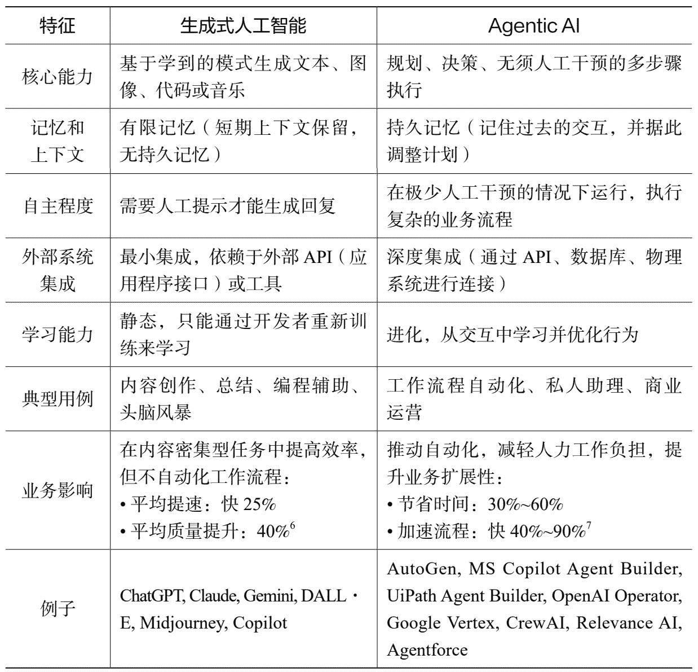

资料来源：Bornet et al.

## AI 智能体的前景与边界

**智能体的梦想**

设想醒来发现手机、电脑与所有应用一夜过时，不是因为停工，而是你不再需要它们。一个单一智能体统筹日程、管理沟通、掌控数字互动，像《钢铁侠》里的贾维斯或电影《她》里的萨曼莎。

许多科技领袖相信这会到来。比尔·盖茨称智能体正带来计算最大革命。萨提亚·纳德拉说未来交互主要靠智能体。黄仁勋断言 Agentic AI 拐点已至。

我们也认为智能体正站在改变世界的边缘。印刷术普及知识，互联网连接人类，智能体有望持续扩展人类能力。医疗智能体可在全系统协调患者体验，教育智能体成为适配个人节奏的学习伙伴，自主智能体协同应对气候危机。

正如合著者帕斯卡尔所说：“智能体的潜力迷人，但‘无所不知’的吸引力与电影形象催生了过度膨胀的期待泡沫。”

**自主的幻影**

在过去几年里，我们帮助从大企业到初创实施 Agentic AI。现实是，能无须人类干预处理复杂多线程任务的完全自主智能体尚未出现。如今的智能体处于类似早期 iPhone 的阶段——强大但有限。

我们观察到：

• 当前智能体是任务导向的，旨在自动化流程而非取代岗位。它们擅长按精细工具与详细指令执行一系列协调动作。
• 部署比开发更难。许多项目失败源于周边系统——数据质量、工作流集成、用户接受度未就绪。
• 严格的人类监督仍是必需。受不一致性、实施问题或意外故障影响，准确性与可控性不足，智能体仍需密切监管。
• 技术专长不可或缺。即使低代码平台降低门槛，企业级部署仍需专业编程知识管理 API、错误处理与安全等。

若不理解期待与现实的差距，易浪费时间、金钱与信誉。我们见过仓促部署导致员工焦虑离职、智能体越权决策损害声誉、建议违背价值观引发伦理风波。缺乏技术、治理或变革管理，善意部署常以高昂失败告终。

**成功与变革**

挑战之下也有显著成功。认真推进的企业获得前所未有的效率提升。

我们合作的初创团队用五人完成客服、营销、运营的端到端管理，成效比肩大企业。医生理查德·威尔逊借助智能体处理行政，让他回归诊疗。麦肯锡借助智能体系统将客户导入期缩短 90%⁸，穆迪以协同智能体革新金融分析⁹，汤森路透重塑法律尽职调查。eBay 与德国电信也在用智能体自动化复杂任务。

英国最大宠物护理企业“宠物之家”的转型令人瞩目。在西蒙·埃利斯带领下，通过智能体网络实现全链优化：AI 转录工具以 99.6% 准确率记录兽医咨询，欺诈检测智能体保障零售安全，AI 助手为门店赋能，保险整合智能体自动化政策核验。

实践显示，采用智能体的企业流程提速 30%~90%，成本下降 25%~40%，错误率降低 30%~60%，销售额最高增长 50%，客户满意度提升 20%~40%。

**复利式智能优势**

我们正见证类似互联网早期的模式。亚马逊、eBay、谷歌早早拥抱互联网，不仅成功，更定义品类。

AI 智能体创造“复利式智能优势”。与静态技术不同，智能体会随时间学习改进。用得越多越好。早期采用者能更快训练模型、重塑商业模式、积累与智能体协作的经验。行动迟缓者将落后，及早行动者定义下一个商业时代。

**行动号召**

挑战也是机遇。成功关键在于把 AI 融入运营、系统、文化与决策。我们写这本书，是为了分享突破与挫折的洞见，提供可落地的实施框架、问责治理模式与转型的人性策略，帮助你在特定语境下应用 Agentic AI，最大化价值并确保长期成功。

认识智能体：看懂它、用好它、定义它

打造自主智能体并不是全部工作，理解并驾驭它们更关键。无论是否亲自参与开发，这类系统已经渗透进日常，会嵌入各类产品，在你网购时给出建议，在人生重大抉择时指引方向——比如子女升学规划或个人财务安排。你需要分辨哪些表现令人惊叹，像《2001：太空漫游》里 HAL 9000 那样近乎科幻，哪些仍在进步中。人工智能正成为数字生活的底层设施，行走间随时会遇见智能体。本书旨在帮你洞察它们、善加利用并影响它们的作用。

更进一步，我们会演示如何加入这场变革。无论你是推动企业转型的领导者，想打造下一个行业标杆的创始人，或是希望在新环境中保持竞争力的专业人士，本书都提供相应的思考与工具。

这是一场需要引领、远见和负责任管理的变革。我们希望你不仅接纳代理式人工智能，更能以清晰目标与坚守诚信的方式引导它。

让我们一起探讨，它对你、对组织以及我们共同的未来意味着什么。

## 你将从本书中学到什么

本书以递进的方式展开。先厘清智能体的能力边界与局限，再进入真实场景，拿到把技术落地为业务的实操路径。随后面对规模化带来的难题，确保价值在不同层面兑现。最后拉高视角，审视智能体如何重塑工作模式、企业架构乃至社会结构。

第一部分重塑你对人工智能的认知。通过实测、发现以及偶尔令人不安的启示，你会见证一种新形态人工智能的诞生——它不再只是被动响应，而是具备思考、学习与成长的特质。你会明白为何某些系统能处理海量信息却在简单决策上失误，而另一些系统展现出近乎人类的适应性却难以承担关键任务。收获的不只是技术理解，更是善用强力工具并规避风险的实践智慧。

探索始于首章，目睹两种技术力量的交汇——大语言模型与自动化技术的结合催生了首批真正的智能体。借一家跨国制造企业的客服转型案例，你能体会这种融合为何重要，以及它正如何改写企业运作。你也会了解为何部分巨头争相布局，而另一些组织却难以跟上步伐。

第二章以 SPAR 框架——感知、规划、行动、反思——拆解智能体的本质。本章核心是我们的“Agentic AI 演进框架”，它能帮你看清能力迷雾，评估任意智能体的水平并预判产出。就像汽车从早期原型演进到自动驾驶，你会明白每个层级如何在此前基础上迭代，形成日益复杂且自主的系统。这些工具能帮你判断技术走向及对未来的影响。

第三章邀请你进入智能体的“思维内部”，揭开其数字大脑的面纱。仿若人类学家研究全新智能形式，我们审视它们的独特特质、长处与短板。你会发现它们有时能给出惊人洞见，有时却在看似简单的任务上跌倒。结合多年落地的生动案例，你会了解它们如何思考、决策和行动，对任何希望与这些“新数字同事”协作的人至关重要。

第四章让理论落地。我们分享了对前沿智能体的亲身试验，其中包括一项既启发人又略显不安的探索：让智能体玩“AI 制造回形针”的游戏。该实验揭示了智能体的现状与潜力，你既能看到出色的问题解决，也能看到使用者必须了解的令人担忧的局限。

第二部分深入剖析将简单 AI 系统升级为真正智能体的底层能力——行动、推理、记忆三大支柱。透过真实案例、前沿研究和动手实验，我们探讨这些核心能力如何协同，打造出能学习、适应并成长的系统。

第五章聚焦行动这一基础，揭示智能体如何从给出建议发展到在真实世界中完成任务。透过生动的实验与实践案例，你会了解到拥有更多工具并不必然更有效，以及领先企业如何寻找到能力与控制之间的平衡。我们带你看人工智能落地的幕后，展示机器在现实环境中行动时的成功与陷阱。

第六章深挖推理——可能是三大支柱中最引人入胜的部分。透过在大规模推理模型上的开创性实验，你会发现速度更快并不总是等于决策更好。我们梳理从快速模式匹配到深度思考的不同推理类型，并展示领先企业如何构建能够系统思考复杂问题的智能体。

第七章探讨记忆这一关键要素，研究智能体如何从经验中学习并随时间变得更聪明。透过一家全球电信企业的转型故事，你会明白记忆不只是存储信息，更关乎打造能学习、适应与改进的系统。你将认识人工智能记忆的三层结构，从短期处理到长期保留，并学习如何在企业中有效运用。

第三部分从概念走向落地，展示如何把智能体的变革潜力转化为现实，无论是为自己的企业构建解决方案，还是启动下一个价值百万的业务。透过详尽案例、实操实验和一线经验，我们引导你把最初的概念成功实现。

第八章以一家数字营销机构的真实转型为例，手把手教你构建有效的智能体。你将学会如何识别合适机会、挑选最佳智能体类型、设计能创造真正价值的系统。本章提供实用路线图，从平台选择到稳健的安全措施。你会掌握如何设定目标和指令以有效掌控智能体，如何集成 API、备用方案和熔断机制，并遵循可操作、可复用的流程把潜力变成商业现实。

第九章“从理念到收益”带你走进智能体创业的前沿，这里正涌现新商业模式。你将了解到创业者如何为医疗、金融、物流等行业打造专属智能体创造收益，以及你如何复制这些经验。本章提供经过验证的框架，用于识别高价值商机并转化为盈利业务。你还会认识到“智能体对智能体经济”的兴起——智能体能够自主交易、谈判和协作。最后，我们讲述自己推出新闻通讯智能体的幕后故事，该智能体在短短一个月内吸引 30 万订阅者，充分展示 AI 驱动商业模式的力量。

第四部分是你实现大规模业务转型的战略指南，涵盖技术之外的关键要素：战略设计、稳健治理、变革管理与价值创造。

第十章探讨可能决定实施成败的隐性人类动态因素。这不只是技术，更关乎人。你将学会如何把员工的恐惧转化为兴奋，设计既赋能人类又能与 AI 协同的工作岗位，以及制定能把潜在阻力转化为积极协作的变革管理策略。透过真实故事和实用框架，我们展示如何建立信任、培养新技能，打造人类与智能体无缝协作的工作场所，把潜在颠覆转化为增长与创新的机会。

第十一章探讨当下最紧迫的挑战之一：如何从成功试点过渡到全面实施。透过真实案例和实用框架，我们解释为何只有少数企业能成功规模化，更重要的是如何成为其中之一。我们会深入江森自控国际从基础自动化到复杂智能体的转型历程，揭示一路学到的关键经验。你将了解它如何应对数据集成、变革管理等常见扩展挑战，并发现如何为自己的 AI 转型奠定坚实基础。

第十二章带你深入了解当下最令人兴奋的智能体落地案例。透过“宠物之家”的开创性实例以及跨行业的用例集，本章把变革从理论带入实践。我们展示企业如何克服现实挑战、改善客户体验并重塑工作方式。从兽医护理到零售，从欺诈检测到个性化客户服务，这些案例既提供信息也带来启发，让你在自己的企业中看到智能体的变革潜力。

第五部分跳出应用层面，探讨智能体对未来工作与社会的深远影响，描绘随着智能体日益普及所带来的挑战与机遇。

第十三章探讨人类能力与智能体之间新兴的协同作用，同时直面这场技术革命的独特性。透过塔拉——一位协调人工智能与人类合作的高级项目经理——和黛比——一位目睹智能体学会像她一样思考的资深项目经理——的故事，你将了解未来三大能力如何重塑职业成功。本章揭示变革的希望与挑战：从培养不可替代的“人类智能”能力，到解决“适应悖论”，即关键技能复杂度不断提升而培养窗口却在收窄。你将获得在新时代蓬勃发展的实用策略，同时理解为何传统的技术变革应对方式可能不再适用。

第十四章把视角拉远，审视智能体对人类社会的广泛影响。我们探讨发人深省的问题，比如未来工作的形态，以及智能体如何把我们从日常事务中解放出来，让我们有更多时间做有意义的事。透过实证研究和现实案例，我们讨论全民基本收入、工作时长缩短等概念。最后提出一个管理 Agentic AI 的实用框架，确保这些强大技术在始终处于人类有效掌控的同时，最大化对社会的价值。

## 本书之外：你的在线资源

本书只是你踏上 Agentic AI 之旅的起点。不妨搜索作者的相关网站继续学习，并与充满活力的从业者和专家社区建立联系。在那里，你会发现有价值的资源、有深度的课程、实用的工具以及一个促进协作和成长的论坛，所有这些都是为了帮助你到达这场“智能体”游戏的顶峰。

## AI 智能体的关键术语

要有效地在 AI 智能体的世界中航行，掌握几个基础概念至关重要。这些术语在本书中会反复出现，所以明确地定义它们是很有必要的。

**任务工作流**
“任务工作流”，是指为达成目标而需要完成的一系列结构化的行动步骤，可以将其视为完成任务的路线图，其中每一步都依赖于前一步的成功完成。以冲泡一杯咖啡为例：首先，将水壶灌满水并烧开；接下来，将咖啡粉放入杯中，倒入热水并搅拌；然后，根据需要加入牛奶或糖；最后，享用咖啡。业务流程通常由多个工作流组合而成，比如“从下单到收款”或“从采购到付款”这样的大型流程，可能包含数百个子工作流。

**应用程序接口**
应用程序接口 Application Programming Interface，API 是一座桥梁，能让不同的软件系统相互交流。可以把 API 想象成餐厅里的服务员：你点餐发出请求，服务员将你的订单转达给厨房另一个系统，然后把食物响应送到你面前。对于 AI 智能体来说，API 至关重要，因为它们能实现与所使用工具的无缝集成，无论是访问数据库、获取实时信息，还是连接云服务。在大多数情况下，如果没有 API，AI 智能体就会孤立无援，无法与工具进行交互。

**确定系统与概率系统**
根据处理输入和生成输出的方式，人工智能系统可以分为确定系统与概率系统。
• 确定系统对于给定的输入总是产生相同的输出。它们遵循严格的规则和逻辑，确保结果可预测且可重复。想象一下基本的计算器——当你输入“2 + 2”时，总是得到“4”。这类系统适用于处理精度和一致性至关重要的任务，如财务计算或合规检查等。早期人工智能中的“专家系统”完全使用确定系统，如今在机器人流程自动化系统、医院的临床决策支持系统以及许多其他场景中仍能看到它们的身影。
• 概率系统的运行是基于可能性而非固定规则。它们通过分析模式和数据来做出预测，这意味着其输出可能会因概率的不同而略有差异。大多数人工智能模型，包括大语言模型和推荐系统，都属于这一类。它们不提供绝对的答案，而是基于最有可能的统计结果生成响应。例如，当聊天机器人预测句子中的下一个单词时，会选择可能性最高的选项，而非遵循严格的规则。

# 第一部分 AI 智能体的崛起

## 第一章
## 超越 ChatGPT：人工智能的下一次进化

在引言中，我们强调了当前人工智能领域的一个关键局限性——那些智能体非常聪明，但它们只能思考却无法自主行动。现在，让我们探讨人工智能领域是如何走到这一关键节点的。本章将追溯 AI 智能体技术演化的实现历程——两股强大技术流的融合催生了超越单一技术能力的全新范式。理解这一演化历程不仅具有学术意义，更能揭示为何向 Agentic AI 转型代表着如此深远的机遇。

### Agentic AI：技术融合的产物

想象一下，你正在会议室里与一群企业高管交谈。总会有人提出那个我们听过无数次的问题：“如果人工智能这么聪明，为什么它不能直接解决问题并自主行动？”

这个问题直指当前人工智能领域的核心缺失。为了理解这种能力为何一直难以实现，以及它最终如何成为可能，我们需要探究不同的技术流如何融合以创造出全新的事物：Agentic AI。

Agentic AI 并非单一技术创新的产物，而是语音助手、自动驾驶技术、AI 驱动 API 等多领域发展的融合。在实现 Agentic AI 过程中，有两大技术流尤为关键：
• 大语言模型的崛起；
• 工作流自动化即智能自动化的演化。

**两大技术流的传说**

Agentic AI 的发展并非简单的线性进程，而更像是两条独立流淌了很远的河流最终交汇，形成超越单一个体的、更强大的力量。

让我们从一个故事开始，它能说明这种融合为何重要。2022 年，我们曾与一家全球制造企业合作，该企业当时在客户服务效率方面遇到了难题。他们不仅部署了一个由大语言模型驱动的能够以极高的准确度理解并回应客户咨询的先进聊天机器人，还部署了 RPA 机器人，能够在后台系统中执行复杂的操作序列。然而，仍有一环缺失，那就是理解与行动之间的桥梁。

该企业的客服代表仍需充当人工桥梁，将聊天机器人的建议手动转化为相应的自动化工作流程。这让我们得以一窥如果这些技术能够直接协同工作将会实现怎样的效果，也帮助我们理解了这些技术的融合为何会如此具有变革性。

**第一条河流：大语言模型的发展之路**

人工智能发展到如今的大语言模型，其历程始于 1997 年，我们见证了这一过程。当时，全世界都惊讶地目睹了 IBM 国际商业机器公司的“深蓝”击败国际象棋冠军加里·卡斯帕罗夫。我们还记得当时的头条新闻：“机器战胜人类！”但大多数人忽略了一点——“深蓝”更像是个专家型天才，而非全能型天才。它能出色地下棋，却连自己的棋步都无法解释。若想让它下跳棋，那简直比教鱼骑自行车还难。

这种局限性让我们和许多其他业内研究者感到困惑。我们认为，肯定有更好的方法来打造智能系统。突破来自一个意想不到的领域——神经网络。现在，当解释神经网络时，我们喜欢用一个简单的类比：想象教孩子认识动物。你不会从递给他们一本关于毛发、尾巴和腿数量的规则手册开始，而是通过示例演示：“这是狗，这是猫，这是鸟。”孩子的大脑会自然而然地学会识别模式并进行归纳总结。

**神经网络革命**

神经网络的魅力在于它们的学习方式大致相同。但要充分发挥其潜力，需要三个要素：海量的数据、强大的计算能力、复杂巧妙的架构。

我们还记得，在 21 世纪第二个 10 年，当这些要素最终汇聚时，人工智能社群中洋溢着兴奋与期待。这如同亲眼见证莱特兄弟的首次飞行——突然间，看似不可能的事情变成了现实。系统能够以前所未有的准确度识别图像、理解语音和处理语言。

**语言模型崭露头角**

在语言处理领域，真正的奇迹发生了。回顾早期的语言人工智能，那就像试图通过给计算机一本词典和一本语法书来教它理解莎士比亚的作品，结果可想而知，呆板得令人大失所望。

2017 年，改变游戏规则的突破终于降临——Transformer 架构发布。这好比让人工智能实现了从算盘到超级计算机的跨越，它不仅能够检索词汇，更能理解上下文语境、把握语义内涵、洞悉思想关联，这恰似从袖珍计算器升级为数学家的大脑。

在此期间，我们发现，规模法则至今仍令人惊叹。随着这些模型规模越来越大，并且训练数据越来越多，神奇的现象发生了——它们发展出了从未被编程赋予的能力。这就像以快进模式观看进化过程。2020 年发布的 GPT-3 震撼了整个业界：这个系统能够编写代码、解决数学问题甚至参与哲学讨论——这些都不是它被明确训练过的技能。

当 2022 年 ChatGPT 横空出世时，我们仿佛登上了攀登数十年的科技巅峰。终于，我们迎来了能够进行真实对话、逻辑推理，并能以人类可理解的方式阐释思路的人工智能。但此时的人工智能仍存在一个关键局限——它只能提供行动建议，却无法付诸实践。

**第二条河流：自动化技术的演变**

在人工智能领域高歌猛进之际，自动化领域也正悄然掀起另一场革命。我们始终身处这场变革的前沿，见证着自动化技术从简单的屏幕抓取工具蜕变为精密的数字员工。

**机器人流程自动化的兴起**

在 21 世纪初，商业运营仍大量依赖人工操作，或者依赖于彼此孤立的信息系统。具有前瞻性思维的团队开始运用脚本和宏指令实现重复性计算机任务的自动化，比如通过宏指令每晚将 Excel 数据自动导入主机应用程序。

在 21 世纪第二个 10 年初期，我们亲身经历了 RPA 机器人的诞生。我们可以将它视为模仿人类在计算机上操作包括点击、输入、复制、粘贴和读取屏幕的软件工具。这听起来很简单，却具有革命性意义。我们首次实现了让计算机与人类协同工作，且无须改变我们正在使用的工具和界面。

本质上，RPA 机器人是一种被编程来执行系列步骤——登录系统、检索数据、执行运算并将结果输入到其他地方的软件程序。这些操作与人类的工作方式无异，但速度更快且不知疲倦。RPA 机器人之所以能迅速普及，正是因为它瞄准了那些最容易实现自动化的领域：办公室职员每日重复的大量日常性、规则明确的任务。

企业纷纷积极拥抱 RPA 技术，旨在减少人为差错并将员工从烦琐事务中解放出来。我们看到银行、保险企业和医院部署了 RPA 机器人来执行诸如数据录入、发票处理、报告生成和数据库更新之类的工作。例如，我们的一家保险客户使用 RPA 技术将保单数据从电子邮件转移到其旧系统中，这项在过去需要一个团队花一整天时间才能完成的工作，如今数分钟内就能精准地完成。

**早期RPA 为何容易“宕机”**

早期的 RPA 方案其实很吃力。运行逻辑相当怕变，一点点界面改动、一个字段缺失，机器人就懵了。它没有判断力，只能死守预设的脚本，遇到例外就卡住，往往需要人上去修程序或手动收尾。说白了，这类流程自动化适合规则清晰、结构化的重复性工作，一旦偏离常态就难以自适应。

**从机械执行到智能协作**

随后的发展转向更灵活的方向，于是出现了智能自动化和超自动化。RPA厂商开始给工具装上人工智能，让它去处理更复杂、非结构化的任务。RPA擅长做事却不懂思考，企业便用机器学习、自然语言处理、计算机视觉等技术来增强它，形成既能读懂信息又能做简单决策的自动化系统。

实际感受是这样的：工作流可以先用NLP读客户邮件，借助AI分类器判断诉求，再触发对应的RPA流程去执行。自动化不再僵硬，初步有了语境感知能力。

随着技术成熟，目标从单点自动化转向端到端全流程。不是只改造孤立环节，而是把业务从开始到结束串起来。

比如一家零售企业，我们推动“从订单到收款”全链路自动化：线上订单接入、库存核验、支付处理、发货安排、财务入账，全靠多台RPA机器人、系统接口和AI模型像流水线一样协作，人工只需盯盘和处理异常。系统稳定后，整条业务几乎全自动运转。

到21世纪20年代初期，常规流程已高度自动化，却出现了“自动化瓶颈期”。简单重复的活儿基本被取代，但涉及决策、动态判断的环节仍需人来接手。传统自动化在规则之外缺乏适应性和推理能力，难以再突破。

如今两大技术潮流碰撞：大语言模型提供了理解、推理、规划的“大脑”，自动化技术提供了在真实世界操作执行的“双手”。两者结合催生出能自主行动的AI智能体，也就是真正的数字员工。人工智能从被动工具进化为能同时理解任务并主动执行的合作伙伴，这正是Agentic AI得以落地的原因。

**大模型智能体的诞生记**

过去几年，大语言模型的能力跃升很快。最初的GPT-3、GPT-4只是高级文本预测引擎，现在已能规划行动、使用工具，不再局限于补全句子，而是可以做网络搜索、数学计算、调用API或操控软件。

2022年，首个基于大语言模型的智能体框架MRKL问世¹。它采用模块化推理，让大模型与“搜索”“查找”等预定义工具交互，推理与行动被分离，外部模块负责执行离散任务。

随后ReAct推理+行动²被引入，模型会先产生思考轨迹，再执行如查询数据库、使用API等操作，并用新信息继续推理。这种联动让计划更动态，任务处理更复杂。实验显示，ReAct通过先验证信息来源显著降低了幻觉，同时可追溯的推理过程让决策更透明³。

2023年，Toolformer是一个关键突破，它自学掌握计算器、网络搜索、翻译器等外部工具，弥补了大模型在算术和实时事实上的短板，调用工具后问答准确率明显提升⁴。

这些进展催生了能完成多步任务的智能体。AutoGPT⁵、BabyAGI⁶等实验系统在爱好者中很火，它们接受高层目标后自动拆解子任务、调工具甚至写代码执行、检验结果并迭代。虽然还很脆弱，但指向了Agentic AI的发展方向。

与此同时，LangChain⁷、Semantic Kernel⁸等开发框架兴起，让大模型能与外部API、数据库等系统联动。智能体不再孤立，而是可以自动化工作流、检索信息、控制应用。

函数调用的加入让进展更进一步⁹，智能体能精准调用外部函数和脚本，实现更深度的系统交互。研究也持续加码，Gorilla¹⁰展示了更有效工具使用，而微软¹¹、斯坦福¹²、腾讯¹³的工作表明多智能体协作效果更优。

到2023年，AutoGen¹⁴、Google Cloud Vertex AI¹⁵、CrewAI¹⁶等企业级平台崛起。大语言模型从纯文本处理器蜕变为系统核心，任务执行方式、决策机制乃至技术与现实的交互方式都在被重塑。

**AI智能体市场全景扫描**

市场正在爆发。预测显示到2030年市场将以年均44%的速度增长¹⁷。AI智能体不是昙花一现，而是企业和个人工作方式的未来。Gartner预计到2028年，1/3的企业软件应用将集成AI智能体¹⁸，而红杉资本认为它将覆盖高达10万亿美元的全球服务与软件市场¹⁹。

赛道拥挤，数百家供应商入场²⁰，初创与巨头都在押注²¹。为了更好理解，我们大致分为三类。

第一类是可定制平台，供专业人士和企业自建智能体，覆盖行业与业务。可从无代码的Beam²²、Relevance AI²³，到低代码的UiPath²⁴、微软Agent Builder²⁵、CrewAI²⁶、ServiceNow²⁷，再到编程框架Langchain²⁸、AutoGen²⁹不等，让企业按自身流程打造定制智能体。

第二类是通用型智能体，如OpenAI Operator³⁰、Anthropic Computer Use³¹、谷歌Project Mariner³²。它们适应性强，能在多系统间操作、理解复杂目标并直接通过界面执行。行业普遍认为Agentic AI的“ChatGPT时刻”可能来自这一类，因为它面向消费者和企业同时普及。

第三类是专业型智能体，如Deep Research³³、Agentforce³³、Hippocratic AI³⁴。有的按功能横向覆盖，有的按行业纵向定制，多为即用型，聚焦法律文件分析、营销优化、公证等特定任务。在agent.ai³⁶等市场能看到数百个此类产品。

附录按第二章的演进框架梳理了当前产品。我们也知道选型不易，第八章会演示完整构建流程并提供选型方法论，帮助结合企业数据、技术储备和业务目标做决策。

**Agentic AI 赋能创业和商业**

这些智能体不仅能想，还能自己行动。过去几年我们亲手部署过一些，合作起来就像多了个新同事。

**认识你的数字员工**

智能数字员工是能自主处理流程的虚拟岗位，被“聘用”承担IT支持、客服、营销助理等职责。它靠大语言模型的认知能力加上自动化软件的操作能力运行。模型负责理解指令、自然语言交流、做合理判断；自动化负责点按、填录、调API、协调工具。两者结合就能从头到尾处理复杂任务。

举例来说，下达目标“更新社交媒体以回应最新产品发布反馈”，智能体会先理解指令，拆解为：收集近期社媒评论、做情感分析、起草针对性回应、发布或安排更新、持续监测互动。传统方式需要团队协作，现在智能体可自行从X、Meta拉数据，用NLP做情绪分析，用大模型写文案，通过社媒管理工具发布，并在异常时把特定问题升级给人工。整个过程上下文不丢，会根据意外动态调整。

**真实场景里的AI同事**

在客户服务领域，僵化聊天机器人已过时。现在的智能体能完整对话、诊断并执行。我们曾为一家电信企业部署AI客服专员，能从头到尾处理技术支持来电。客户反映网络问题后，智能体倾听转录、理解问题、远程检查调制解调器、引导重启，必要时创建工单或预约上门，问题解决或顺畅升级，无需人工介入。

金融与会计也一样。我们帮助全球金融团队引入“数字分析师助手”，自动化月度预算差异分析。过去分析师要花好几天筛数据，现在助手能从会计系统提取数据、识别支出偏差、用自然语言写解释说明，发现异常则标记复核。随着反馈学习，它越来越能区分正常波动和真实风险。繁重工作被自动化，人只在关键点介入，财务报告更快更准。

第十二章会分享更多行业案例。

**机遇与挑战并存**

对决策者而言，Agentic AI既是机会也是考验。机会在于效率大幅提升，劳动力可在不增员的情况下翻倍，重复性工作由不知疲倦的数字员工承担。质量与一致性也会改善，经过训练和管控的智能体每次都按最佳实践执行，并嵌入合规检查，降低人为失误。更关键的是新能力，例如让20个智能体通宵模拟市场情景，第二天给出战略建议，或为数千客户提供真正个性化的服务。人类与AI并肩，相当于每位员工多了一个能办事的副驾。

挑战同样明显。融入工作流需要精心的变革管理，要设计好人机协作，让员工信任并理解新同事。我们在部署中会为AI决策增加解释式审计轨迹来建立信任。技术上，可靠性是首要难题，要保证稳定不出错；目标定义和指令设计需要反复迭代；无缝集成到现有工具、API和流程是关键；数据质量直接决定输出质量。部署不是一次性上线，而是持续集成、测试、优化。

监管层面也很重要。智能体必须受约束、遵循伦理和合规要求，尤其在金融、医疗等高风险领域，人类仍需掌控目标设定和关键决策审核。人工智能治理工具在完善，我们坚持早期人机协作。把AI智能体看作需要培训监管的新员工更合适。它是增强而非替代，人负责指导、创造力和关键监督，AI负责繁重日常。

下一个新员工可能就是AI。拥抱并负责任地塑造它，将决定未来数年的竞争态势。第四部分将作为转型战略指南，提供场景、案例和变革要素。

**初创为何成为最大赢家**

正如电商、社交媒体、SaaS重塑行业，AI智能体也在创造新商业模式。数据表明初创受益最多，使用LangChain平台的企业中，员工不足100人的占比超50%，而员工过万的大企业仅约15%³⁹。

不受官僚和遗留系统束缚，初创可以从第一天围绕智能体构建业务，获得成本高效运营、敏捷原型、规模化个性化互动、无集成限制的自由等优势。它们能深耕细分市场，提供高度定制方案。Perplexity⁴⁰、Ramp⁴¹、Superhuman⁴²、Replit⁴³等都是典型案例。

第九章“从理念到收益”会拆解企业家如何在医疗、金融、物流等领域构建专业智能体，并提供识别高价值机会并变现的框架。

### AI 智能体在企业中的应用现状

为了弄清楚企业如何把基于大语言模型的智能体真正推向生产并产生商业回报，我们聚焦那些已经跳出纯规则机器人和浅层语言模型调用、完成规模化部署的组织展开深描。研究团队共采集并分析了 167 家来自多个行业的落地案例，重点拆解了实施路径、落地阻碍、收益兑现以及决定成败的关键条件。

### 行业落地分布
不同行业的采纳节奏出现了明显分化。科技与软件领域走在最前，样本中近四分之一的成功案例来自该行业，这与它们的技术储备和创新容忍度有关。紧随其后的是金融服务，占比约 18%，零售与消费品以 16% 位居第三。

**表 1-1 根据我们的研究实施 AI 智能体的企业所属行业分布**

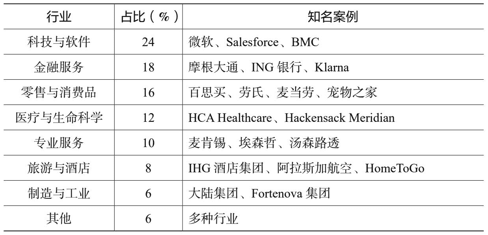

资料来源：Bornet et al.

这些先行者并非小打小闹，而是已经拿到可感知的回报。微软在销售团队引入智能体后，人均产出提升 9.4%，成交笔数增长 20%。金融侧，摩根大通部署的智能体让欺诈事件大幅下探 70%。这类实绩正在推动更多企业加速跟进。

数据进一步显示，企业将智能体投向的重点场景。客户服务与支持占 35%，系统承担从自动答疑到个性化跟进，平均处理时长压缩 12%~30%。内部运营占 25%，主要用于文档处理、流程提效和行政减负，部分流程节省幅度达到 30%~90%，例如麦肯锡的客户注册智能体将注册耗时砍掉 90%，行政工作量减少 30%。销售与营销占 20%，聚焦线索分级、活动优化和精准推广，该类项目报告收入提升 9%~21%。安全与反欺诈占 12%，行业定制化方案占余下的 8%。

**表 1-2 根据我们的研究得出的 AI 智能体用例及其对业务的关键影响**

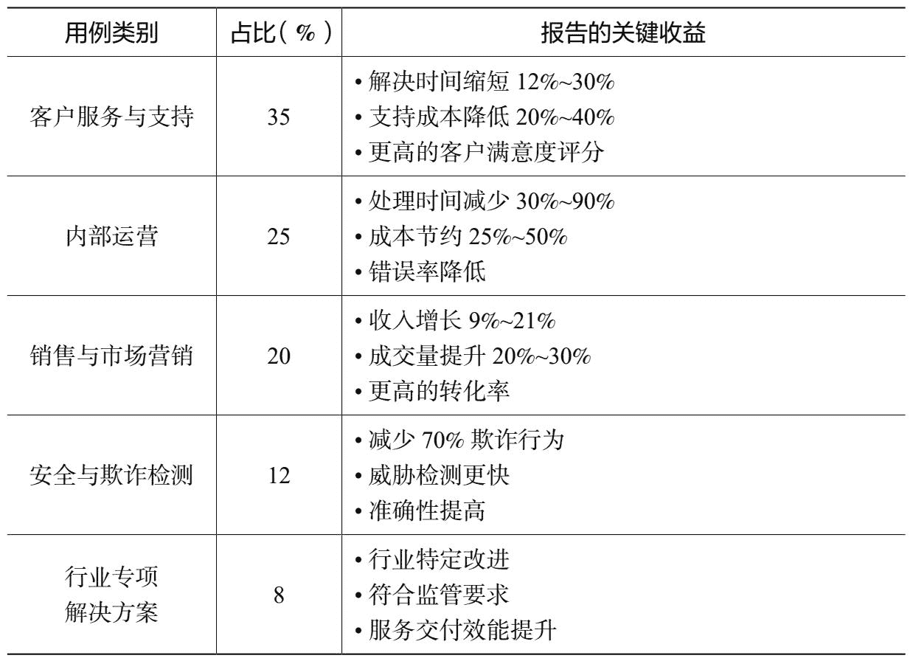

资料来源：Bornet et al.

**量化效果如何呈现**

汇总来看，效率层面的改善高度一致：流程耗时普遍缩短 30%~50%，成本节约 25%~40%，错误率下降 30%~60%。营收侧同样亮眼：销售额增长 9%~20%，转化率提升 15%~25%，客户满意度提高 20%~40%。

一个值得关注的细节是，约 70% 的成功案例采用了人机混合工作流。保留关键决策的人工把关，同时让智能体处理高频重复任务，不仅结果更稳，也提升了员工的主观接受度。人在环路的设计让双方形成学习闭环，为持续优化创造条件。

**赢家的做法：从试点到规模的路径**
研究发现，大多数成功项目都从受控试点起步，占比接近三分之二。这样既能实测能力边界，也能用早期成果争取内部支持。

普遍存在的三大成败要素是：
首先，场景定义要清晰。领先企业会在上线前明确要解决的具体问题，并设定可量化的成功指标，保持边界可控并通过定期复盘确保持续达标。
其次，变革管理要到位。表现好的组织会制定全员培训计划，保持全流程透明沟通，深知技术落地取决于人。
最后，技术底座要扎实。部署前确保数据架构打通、安全合规、系统可扩展，并通过持续运维保持性能在线。

**落地会遇到什么阻力**
系统集成是最常见痛点，被 45% 的企业视作硬仗。应对方式是分阶段接入、以 API 为先的架构，以及持续的测试验证。数据质量位列第二，35% 的企业反映数据不佳。结构化的数据治理和周期性质量评估是常用解法。技术专长排第三，20% 的受访者担心人才缺口，领先企业通过系统培训与外部合作弥补。

运营层面则集中在变革落地、绩效监控与成本控制。清晰的沟通策略、明确的 KPI、定期的成本复核与完善的反馈机制被证明有效。

**趋势与建议**
前瞻信号显示动能未减：85% 的企业计划扩大智能体部署，70% 正在探索新场景，60% 上调了 AI 预算，超过一半在自建定制化方案。

给正在评估的领导者四点判断：
战略上要高屋建瓴，执行上小步快跑。先选影响大、风险可控的场景试点，再依数据扩展。
把基础设施当成优先项，尤其是数据质量与安全，以及支撑未来扩容的弹性架构。
高度重视变革管理，用培训与沟通塑造人机协作而非替代的文化。
从第一天就定好衡量标准，保持迭代。把智能体视作持续改进的循环，而非一次性项目。

总体来看，AI 智能体正为各行业创造真实价值。胜负手在于把技术能力、变革管理与明确的业务目标结合起来。以试点起步、聚焦清晰场景、保持有效人工监督的组织更易获得正向结果。未来浪潮仍在扩散，关键是以战略眼光借鉴先行者经验，坚守人机协同的核心理念，通过智能体增强人的能力。

## **第二章**

## Agentic AI 能力阶梯：从自动化到自主化
正如前文所述，AI 智能体市场正快速扩容，数百家厂商提供不同层级的方案。这种多元也带来认知成本：怎样区分基础自动化工具与真正具备自主性的智能体。本章引入一个演进图谱，帮助辨识从规则驱动到高度自主的能力光谱，并在自身需求下做选择。

### 拆解智能体的能力
在企业调研中反复出现一种认知偏差：领导者往往在不了解数字同事能做什么、不能做什么的情况下就上线。这导致期望错位甚至浪费。我们需要先像评估新同事一样评估智能体：它的技能、经验、协作方式是什么。

**能力匹配为什么关键**
引入新成员时，我们会花时间了解其优势与局限，并设计协作方式。AI 智能体同样如此。它们能在海量信息上实现高速处理，但也有独特的工作方式与边界。理解这些不仅是任务分配问题，更是建立高效人机协作的前提。

**SPAR 框架：感知-计划-行动-反思**
为了便于解释，我们提出 SPAR 框架：感知 Sense、计划 Plan、行动 Act、反思 Reflect。名称取自陪练的意象，强调与环境的持续互动。

框架与人类行动逻辑一致：先明确目标，再收集信息，随后做选择与规划，执行后评估并调整。我们常以自动驾驶为例来讲解：从目标设定到传感器输入，再到路线规划与执行，最后通过经验优化。

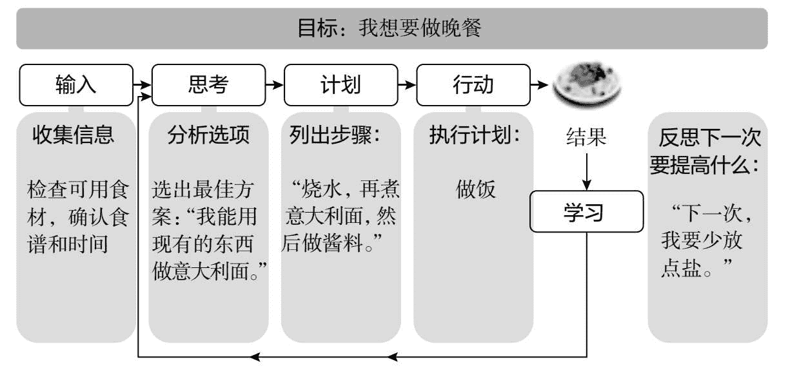

**图 2-1 人类如何采取行动¹**

资料来源：Bornet et al.

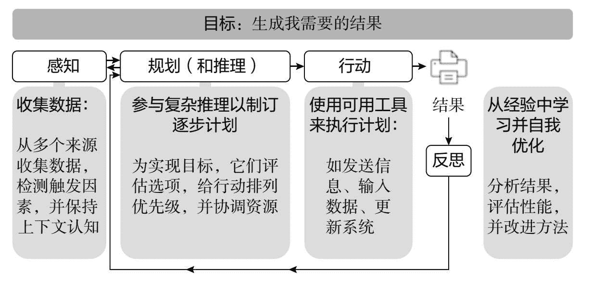

**图 2-2 AI 智能体如何采取行动：SPAR 框架**

资料来源：Bornet et al.

**感知：系统的眼耳**
想象自动驾驶汽车在城市中行驶，摄像头与雷达持续采集车辆位置、信号灯与路况。AI 智能体在数字空间亦需同等感知能力：聚合多源数据、捕捉触发事件、保持对工作环境的实时认知。目的地输入相当于任务下发，短期上下文窗口则类似汽车对即时路况的记忆。

**计划：路线制定**
明确目标后，自动驾驶不会直接启动，而是综合地图、交通与可行路径做出判断。智能体同样先做推理与排序，评估选项、设定优先级、协调资源，再形成分步方案，如同变道前评估前后车速与空隙。

**行动：从决策到执行**
真正的区分在于能否落到具体操作。自动驾驶需协同转向、油门、刹车，智能体则通过工具发送信息、更新系统、管理资源。两者都实时监测并微调，并在异常时允许人工接管与复核。

**反思：经验驱动的进化**
最精细的能力是学习。自动驾驶把拥堵或施工经验沉淀为知识库以优化后续路线。智能体通过评估结果、迭代方法、在相似场景中累计操作记忆而提升。反思让系统摆脱固化规则，形成动态的决策智慧。

四种能力构成闭环，相互增强，共同指向安全高效的目标。相较传统自动化，这是从指令执行到环境互动的跃迁。SPAR 解释了智能体能做什么，但未说明做得多好。正如车辆具备转向与制动不等同于自动驾驶，不同智能体在感知、计划、行动、反思上的成熟度差异巨大。

### 能力复杂性的现实
业界对“什么是智能体”仍缺乏统一定义。为避免二元标签，我们借鉴汽车行业 SAE 的分级思路，提出渐进式演进框架。把系统简单分为智能体与非智能体无法捕捉细微差异，也不符合实践中的逐步演进。

将智能体限定为最复杂的学习型系统会错失当下基础智能体已产生的价值。关键在于当前能否有效行动以及下一步的演进空间。

**Agentic AI 演进框架**

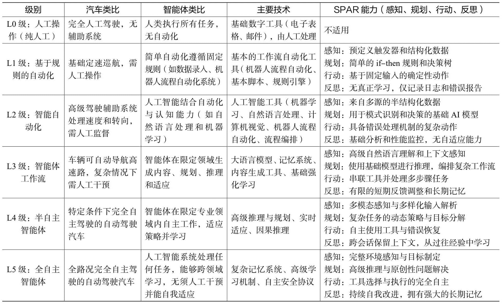

资料来源：Bornet et al.

**L0 级：纯人工操作**
人类承担全部认知与执行任务，技术仅提供电子表格、邮件、业务应用等手动工具。典型场景是人工逐封回复邮件、手工整理财务报表或手动归档人事文件。低效、易错、难以扩张的痛点正是推动自动化的起点。

**L1 级：基于规则的自动化**
相当于汽车的定速巡航。系统遵循预设规则与固定流程，如基础脚本或机器人流程自动化。能处理数据录入、表单填单等重复任务，但无智能与适应性，需人工配置与监督。常见技术为屏幕抓取、流程记录、规则引擎，例如 RPA 把 Excel 数据搬入会计系统、批量填充员工入职信息、按模板回复常规邮件。亚马逊 Echo、Google Home 等简单指令式技能属此列。

**L2 级：智能自动化**

这个层级可以想成是既能控速又能打方向的高级驾驶辅助。把基础自动化叠上机器学习、自然语言理解、计算机视觉等认知模块后，代理可以读懂非结构化信息、做前瞻性判断、承担需要认知的任务。运行边界仍然很窄，人类在旁边把关是常态，就像自适应巡航能保住车道，人却不能脱离副驾。

认知模块加进来后，端到端的流程自动化明显提了一档。典型用法有：能回常见咨询、识别简易诉求并按关键词分流的客服类代理；能从 PDF、图片等多种文档里抽取信息并写入数据库的文档处理代理；以及依据既定规则在市场波动时执行交易的金融类代理。

支撑这一层级的底座大致分四块。看得见的部分靠计算机视觉识别文档、图像等视觉素材；能听会说的部分靠自然语言处理完成理解与生成；会思考的部分靠机器学习做分析、预测、分类与决策优化；把事做成的部分靠智能工作流和 RPA 串联动作，从单点操作到复杂编排都能覆盖。更细的细节可参考《智能自动化》。

**L3 级：智能体工作流**

这些代理像能在高速上自行行驶，遇到复杂路况仍需人接管的车辆。它们能生成文本、图像、视频，具备基础的规划、推理与记忆能力。在预设边界和专业领域内表现稳定，能适度跟随环境变化，但对细腻、复杂或特殊情境以及高阶决策仍显吃力。

情境化决策与基于反馈的初步学习已经具备。比如数字助理可以主导员工入职：分发资料、安排培训、解答常规问题并把异常需求转人工审核。其他例子包括随市场动态执行复杂交易的交易代理，以及跨渠道生成并优化营销素材的内容创作代理。

技术上是在前两层基础上再叠三项要素。大语言模型提供规划、推理与内容生成的底座；基础记忆和强化学习构成自适应行为的支撑；工具操作能力主要聚焦数字界面，对物理世界的交互仍有限。

**L4 级：半自主智能体**

这类代理像在晴好天气、已建图区域可完全自主行驶的无人车，能在限定领域独立运作。它们懂得目标、拆成步骤、从结果反馈中学习并调整策略，专业边界明确。灵活性突出，可承接复杂任务，自主权限仍局限于垂直领域。

在所属领域内擅长目标拆解、战略规划与实时自适应。架构采用递归自我改进、因果推理与多代理协同。代表应用包括设计并执行复杂科学实验的研究代理、分析病患数据并给出诊疗建议的医疗诊断代理，以及追踪用户偏好、推荐预算方案并按消费模式动态调整建议的金融顾问代理。

整体架构在复杂度与能力上实现跃迁：高级推理与规划构成认知核心，与记忆学习机制配合实现实时自适应；同时具备增强的工具操作能力，可作用于数字与物理界面，但仍受限定范围约束。

**L5 级：全自主智能体**

这是理论上的顶点，相当于可在任何路况驶往任何目的地的全自动驾驶。代理将成为真正自主系统，能够理解任意目标、制定策略、从经验中学习并跨领域迁移；可与其它系统无缝集成、自建流程、独立作出复杂判断，同时与人类价值保持一致。

该类系统将具备通用问题求解、跨域迁移学习与自主目标设定三大能力。设想中的应用包括能承接个人与职业各类事务的通识型个人助手、独立运营整家企业的自主商业管理者，以及跨学科实现突破性科研发现的研究代理。

理论上其技术架构需超越现有前沿。完整自主系统必须集成高级记忆、精细学习机制与跨域实时适应能力，这要求尚未出现的类超智能框架，并配备健全的安全协议与复杂伦理推理，以确保与人类价值协同。

**AI 智能体的发展：我们目前所处的位置**

推动代理发展的关键不在单一能力提升，而在把多种能力整合成连贯、以目标为导向的系统。正如 L5 自动驾驶需将感知、预测、规划、控制无缝结合，先进代理也需将多种技术顺滑整合以达成目标。

目前市场上绝大多数代理集中于 L2 或 L3，部分专业系统在特定领域可达 L4。与自动驾驶类似，L5 仍是终极目标，既蕴含巨大潜力，也必然引发关于控制权、安全机制与人类监督的讨论。

演进的核心不只是自动化程度提高，而是构建能够逐步理解情境、从经验中学习并独立判断，同时始终与人类意图与价值观保持一致的系统。每层都在前一层叠加，形成更复杂的代理，以更高自主性应对更复杂微妙的任务。

### 渐进式自主性的精髓：解读 AI 智能体能力层级

刚接触代理时，人们常被最先进功能吸引，似乎越高级越好。但实践反复证明如今被称作核心准则的真理：方案越精简，实效越好。这并非鼓吹极简，而是强调针对具体应用在自主性与人工管控间找到最佳平衡。

**自主性演进：一场自然进化之旅**

想想带新人处理邮件。起初会给出细致分步指导：“打开客户端，点击新建，输入地址，复制文字…” 经验积累后指导变宽泛：“为此客户咨询起草回复，保持专业语气。” 最终可能只说：“处理好客户沟通，让他们了解项目进展。”

代理的演进路径相似：
• L1、L2 时需明确每个动作：“点‘新建邮件’、复制、粘贴、输入地址、发送。”
• L3 时可要求：“用这些信息撰写并发送邮件，按收件人背景适当调整。”
• L4 时或许只需指示：“处理好所有客户沟通，确保信息充分。”
• L5 在理论上甚至只需设定目标：“通过提升满意度提高销售额”，让代理自行决定所需行动与沟通。

**Agentic AI 演进框架：不止于成熟度**

此框架并非传统成熟度模型，并非层级越高越优，而是一个代理类型的目录，各类型适用于不同需求与场景。就像现代汽车的驾驶辅助：完全自动驾驶虽技术可行，但许多人更偏爱基础定速巡航的可预测性与可控性。最佳层级完全取决于具体需求与使用场景。

让我们看看随着在 Agentic AI 演进框架中层级的提升，关键方面是如何演变的。

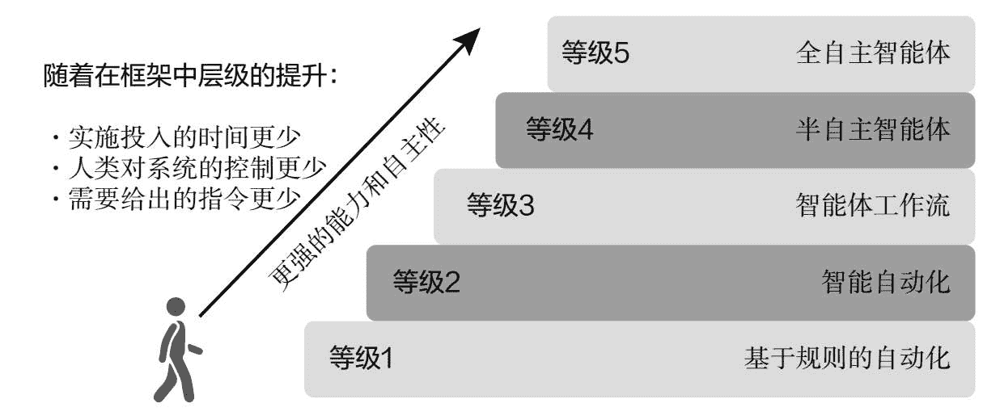
**图 2-3 Agentic AI 演进框架**
资料来源：Bornet et al.

**自主性与控制：微妙的平衡**

层级越高，自主性增强，直接人类管控减弱。L1 像可编程机器，遵循精确指令产生可预测结果。L2 引入基础决策但受严格参数限制。L3 是明显飞跃，能理解上下文并相应调整方法。L4、L5 则展现更复杂的自主行为，能设定子目标并发展独特策略。

自主增强伴随直接控制减少，类似养育孩子：独立性提升时，直接控制自然减弱，转向指导与监督。这种权衡在医疗、金融、法律合规等对可预测性与责任性要求极高的敏感领域尤为重要。

**指令悖论：少即是多**

层级框架中最有趣的现象是：能力越复杂，指令反而越简单。低层级指令必须详尽明确，像给基础机器编程。随着层级提升，指令更具目标导向与抽象性。这与人类发展相似：从给儿童逐步指导，转变为仅传达目标并信任其判断。

**实施与学习动态**

反直觉的是，高层级代理可能更快部署，因为它们可通过试错学习。但它们需要更复杂的监督与风险管理系统。低层级代理虽需更详细的初始编程，却行为更可预测、更易监督。这一权衡在为特定应用挑选合适层级时至关重要。

**从简单处着手的智慧**

想想学乐器，不会一开始就演奏交响乐，而是从音阶与简单曲目起步，逐步提升技能与理解。同样，从低层级开始能让企业在可控环境中建立对 AI 代理的认知，形成完善的监督治理机制，明确各能力层级的实践边界，设计匹配的安全防护与控制体系，并培育企业层面的 AI 应用能力与信心。

**选择合适的级别**

成功实施的关键在于为每个应用选择合适层级。以金融服务企业为例，交易处理可能选用 L1 或 L2 代理，因可预测性与审计追踪至关重要；而客户服务可能采用 L3 代理，因适应性与情境感知比严格控制更有价值。

这种灵活匹配需求、风险承受与监管要求的选级能力是框架的核心优势。目标不是最大化自主性，而是为每个应用找到自主与控制的恰当平衡。

**迈向未来：务实的方法**

开启 AI 代理合作之旅时，请记住核心准则：越简单越好。即便最终目标是更自主的系统，也应从低级代理开始。利用这段时间深化理解、建立恰当控制机制、培养企业所需能力，从而在与更高级代理合作时取得成功。

虽然进阶框架为评估能力提供了结构化方法，仅了解层级仍不够。要真正理解这些数字思维的独特性，需跳出框架，探索定义它们的特征。下一章将带你走进 AI 代理的思维世界，审视其卓越能力与固有局限，这些认知对与新一代数字同事协作至关重要。

## 第三章

## 走进 AI 智能体的思维世界

前一章的演进框架为评估能力提供结构，但仅理解等级远远不够。要真正领会数字思维的独特性，需深入解析定义代理的核心特征。本章将带你进入 AI 代理的思维世界，既探索其卓越能力，也剖析固有局限——这些关键认知将在你与新一代数字同事协作时发挥重要作用。

### AI 智能体的关键特性

基于在多家企业部署的经验，我们观察到若干关键特质使它们独具优势。

**数字员工，不只是工具**

AI 代理与传统软件工具的差异是根本性的。传统自动化像高效流水线，固定、可预测、局限于特定任务；而 AI 代理更像熟练的虚拟同事，能思考、适应并独立应对复杂情况。正如人类客服既能处理简单咨询也能解决复杂问题，AI 代理可管理端到端流程、作出决策并按语境调整处理方式。

**与现有系统协作运行**

AI 代理最实际的优势之一在于它们能够与你现有的技术基础设施协同工作，而非取代。可把它们看作懂得如何有效操作和利用各种系统的数字员工。

这一特性尤为宝贵，因为企业通常在 ERP、CRM、HRMS 等系统上投入了大量资金。AI 代理能够与这些系统集成，从多个来源提取数据，在不同平台执行流程，并填补自动化的空白。例如，一个金融 AI 代理可能会同时与 SAP、Salesforce 和 Excel 协同工作，协调这些系统以生成见解并自动化复杂流程。

**全天候运行的力量**

不同于需要休息和轮班工作的人类员工，AI 代理能够持续运行。这不仅意味着工作时间更长，更意味着要保持一定的警觉性和响应速度——这对人类员工来说是不可能的。

以银行反欺诈场景为例：人工分析师仅能监控有限交易量，且可能因疲劳忽略细微模式；而 AI 代理可以持续监控数百万笔即时交易，跨越多个时区，识别可疑模式并立即采取行动。这种持续运作在网络安全等领域尤为重要，因为威胁可能随时出现；在全天候的全球客户服务中亦至关重要，因为客户咨询是全天候存在的。

**无限扩展性**

AI 代理的可扩展性代表了企业管理能力的根本变革。传统的增长模式依赖于招聘、培训和逐步构建能力。而使用 AI 代理，扩展是即时且几乎不受限制的。当客户咨询量激增 10 倍时，企业可在数分钟内快速部署新的代理实例。

这种扩展能力不仅体现在处理量级上，更涵盖适应新场景与学习新技能的维度。试想能够将企业内顶尖员工的效能瞬间复制到所有分支机构与部门，并始终保持一致的卓越服务质量，在面对业务量意外激增或开拓新市场时，这种能力尤为珍贵。

**通用性**

AI 代理最强大的优势之一，在于它们能够在不同行业和业务部门中有效运作。传统的人工智能解决方案通常需要针对每个行业进行大量定制，而 AI 代理则基于普遍适用的原则运行，广泛适用于各个领域。

它们的核心 SPAR 能力——感知、规划、行动和反思——无论是在为银行分析风险、为制造商优化供应链，还是在为医疗保健机构处理患者咨询时，都始终如一。它们能够获取特定行业和企业的知识，同时遵循基本的操作原则，从而展现出极强的通用性。

**协作力**

或许 AI 代理最复杂的特性在于它们能够协作——既能与人类协作，也能与其他代理协作。它们在必要时可以独立工作，但其真正的力量在协作环境中得以展现。可以将它们视为能够无缝融入现有工作流程的团队成员，是为了辅助人类员工而非取代他们。

以内容营销场景为例：第一个代理负责生成内容初稿，第二个专注于搜索引擎优化，第三个统筹发布排期，三者在与人类编辑的实时协作中形成闭环。人类编辑负责提供战略方向与把关质量，这种人机混合工作流既能发挥 AI 的高效执行与数据处理优势，又能保留人类的战略判断力与创造力，形成“1+1>2”的协同效应。

**为何这些特性至关重要**

若 Agentic AI 系统设计良好且实施得当，其特点结合在一起就能创造出真正革命性的成果：一支灵活、可规模化的数字化团队，能够提升任何企业的运营效率。以一种典型的业务流程客服为例：AI 代理可以全天候处理常规咨询，在高峰期瞬时扩展规模，在多个部门和系统中协同工作，并与人工座席协作处理复杂案例——所有这些能力都在持续自我优化中不断精进。

了解这些特性对于那些希望有效部署 AI 代理的人来说至关重要。它们有助于解释为什么 AI 代理代表着如此重大的进步，以及为什么它们有可能改变企业的运作方式。在接下来的章节中，我们将探讨如何有效地利用这些特性，确保你的企业能够充分利用 AI 代理的优势。

### AI 智能体的固有局限

在探索 AI 代理的潜力时，了解其局限性至关重要。正如我们不会期望一名员工在所有事情上都做到完美无缺，AI 代理也存在固有局限。我们只有以清晰和诚实的态度来审视这些局限性，才能有效地部署这些技术。

**智能的模拟**

AI 代理最根本的局限性在于其“智能”的本质。尽管它们能处理大量信息并生成复杂的响应，但它们并不能像人类那样理解世界。它们只是基于过去的模式来预测接下来将发生什么。这就好比一位极其出色的演员，能够完美地背诵台词，却无法真正体会其所扮演角色的情感，也无法理解情感与具体情境的相关性。

这一点在复杂的专业场景中尤为明显。一个法律领域的 AI 代理或许能够熟练地总结合同条款，但它无法真正理解形成特定情境下法律解释的正义或公平原则。同样，医疗保健领域的 AI 代理能够分析症状并提出治疗建议，但它缺乏经验丰富的医生在多年与患者的互动中所形成的直觉性理解。

**数据质量困境**

AI 代理的运行根本上依赖于数据输入的质量。这不仅是一个技术限制，更是一个影响其运作方方面面的根本性约束。可以试想使用地图导航：如果地图过时或不准确，即使是非常出色的导航员也会走错路。

这种依赖在商业环境中尤为关键。例如，在分析财务数据时，AI 代理无法独立验证其所处理数字的准确性。如果一个大语言模型响应一句提示词，无论这些数据是否正确，它都会基于其训练数据做出反应。如果输入数据有误，这些错误必然会波及结论。人类分析师可能会注意到数据“不对劲”，但 AI 代理体会自信地处理错误数据，不发出任何警示。

**常识的差距**

AI 代理最显著的局限性之一是缺乏常识推理能力。虽然它们能够处理复杂的计算并遵循复杂的规则，但往往会忽视人类本能理解且显而易见的现实世界约束条件。设想一下，一个负责日程安排的 AI 代理建议在凌晨 3 点与重要客户会面，或者一个旅行规划助手在飓风期间推荐户外活动。这些不只是可笑的错误——它们凸显了 AI 代理在没有明确指令的情况下，在理解上下文和现实世界限制方面的根本局限性。

**创造力难题**

虽然 AI 代理在优化和迭代方面可以成为强大的工具，但它们在真正的创造力和创新方面却举步维艰。它们擅长对现有模式进行重新组合，却很少能真正生成新颖的想法，不妨将它们视为混音大师而非原创作曲家。

在创意领域，这种局限性尤为明显。AI 代理能够在现有设计或写作风格上生成变体，但它们无法创作出那种能够重塑行业或开创全新艺术流派的突破性创意作品。真正的创新火花——那种人类独有的、建立意想不到的联系或者构想全新可能性的能力——依然是它们无法企及的。

**幻觉问题**

AI 代理最令人担忧的局限之一在于它们容易产生“幻觉”——以极高的自信生成虚假信息。这并非简单的错误，而是这些系统处理信息和生成回应方式的根本缺陷。

想象一下，医疗 AI 代理自信地推荐一种根本不存在的药物，或者法律 AI 代理引用虚构的判例法。这些不只是失误，更是 AI 代理用看似合理实则完全捏造的信息填补知识空白的例子。这种倾向使得人类的监督至关重要，尤其是在高风险的情况下。

**AI的伦理判断盲区**

最核心也最致命的短板，在于智能体并不拥有真正的伦理推理与判断能力。它们可以被写进规则、被要求遵循指引，却读不懂决策背后的道德重量，也感知不到许多情境里那些复杂的、属于人的变量。

这种缺失在医疗、刑事司法、招聘等领域会格外危险。智能体往往只追求效率或顺着统计规律走，容易忽略决定对具体人的冲击。它可能单纯根据分数建议拒贷，完全无视某些情况下需要基于人情做出为例外处理的判断。

**在局限中让AI更好用**

看清边界并不是否定潜力，而是为了更有效地利用。通过弄明白智能体擅长什么、短板在哪，我们可以设计出既发挥优势又保留必要人类监督的系统。具体来说可以这样做：

• 搭建人机混合架构，由智能体处理海量数据类工作，人类负责监督与最终判断；
• 建立强校验机制来捕捉幻觉和错误，比如让多个智能体互相检查彼此的输出；
• 强化输入策略，从源头提升喂给智能体的数据质量；
• 在涉及伦理抉择或需要复杂情境理解的节点，始终保持人类参与；
• 提升系统透明度，让人能读懂并评估智能体的决策路径和行动依据。

后续章节会进一步展开在这些限制下如何实操，同时最大化AI的价值。

### 单智能体为何不够用

在AI领域，很容易幻想一个超级系统解决所有复杂问题。但现实是，即便人工思维，一个也常常不够。就像人类靠团队协作完成艰巨任务一样，多组AI智能体协同工作时，解决复杂问题的能力会显著提升。下面进入多智能体系统这个值得关注的范式，人工思维之间的分工协作正在重塑问题解决的方式。

**像乐队一样协作的工作方式**

可以把多智能体系统想象成一支交响乐。每个乐手读自己的谱、拉不同的声部，却共同呈现出和谐演奏。多智能体由多个自主软件智能体构成，各自承担角色与能力，通过协作完成单个智能体难以独立完成的任务。

举一个实际案例。在一次金融服务企业的客服转型项目中，传统思路是做一个庞然大物来包办全部：理解咨询、调取账户、生成回复。我们采用了多智能体方案：一个负责自然语言理解，一个负责调取相关账户信息，一个负责撰写回复，一个负责金融合规把关。像乐队一样，各司其职又相互配合，最终给客户呈现流畅的服务体验。

**为什么要拆成多个智能体**

这并非为了复杂而复杂，而是有实践和理论支撑。

先看流程复杂性。现代企业流程环环相扣且极其细碎，比如“下单到收款”就跨多个部门，细化后上万个任务。将流程拆小交给不同智能体，系统更易维护。在金融客服案例里，合规规则变化时只需更新合规智能体，语音理解的优化也不会干扰账户检索模块。

再看专业化优势。斯坦福人工智能实验室的研究显示，针对特定任务优化的专业智能体，往往比大而全的通用系统表现更好。语言理解模块可以用前沿的自然语言模型，合规模块则用可审计的规则逻辑，各取所长。

最后是韧性。研究表明，分布式多智能体架构比集中式系统更稳健。某个节点宕机或维护，其余节点仍可运行并自适应填补空缺。我们的账户检索智能体偶尔需要维护，系统仍能理解客户问题并给出基础信息，只是体验稍降，并未瘫痪。

**多智能体团队的组织模型**

如同企业有扁平化或金字塔结构，多智能体也可采用不同组织形态，形态直接影响协作效率。

**一个工具只配一个智能体**

在实践中我们得到一个清晰结论：给每个工具配一个专用智能体。项目一旦涉及多工具，就为每个工具建一个专家智能体，再加一个协调智能体管理它们间的流转。

“一智能体一工具”已成为我们的默认做法。需要三类工具，就建三个专家智能体加一个协调者。每个专家精通该工具的操作细节与异常处理，协调者负责编排流程。在金融项目中，我们没做一个全能大脑，而是为客户数据库、交易处理系统、文档管理系统各设一个专用智能体，再由协调智能体串联工作。指令更集中、交互更清晰、调试也更简单，真正做到术业有专攻。

**分层协作的结构**

从组织视角看，分层协作模型很像现代企业治理：顶层协调智能体扮演CEO角色，统筹客户交互全流程；中层部门级智能体像事业部总监，聚焦客服的特定域；底层任务执行智能体像一线员工，处理具体事务。

分层模型兼顾了集中与分布式优点，按层级组织，高层协调下层活动，局部自主与全局协同得以统一，适用于多数复杂业务。

当然，这不是唯一方式。业界还提到两种主要形态：集中控制模型和去中心化协作模型，仅作参考，我们尚未亲自实践。

**集中控制模型**

这类架构里有一个“协作者”像交响乐指挥，掌握全局状态与目标，下达高层决策并指挥执行。优点是一致性强、决策清晰，但也容易出现瓶颈和单点故障，指挥一掉线，演出便乱。

**去中心化协作模型**

完全去中心化的系统没有中央权威，所有智能体平等地直接沟通协作，类似没有指挥的爵士乐队，靠即时互动即兴发挥。优点是扩展性好、弹性强，但需要复杂的协调协议，且结果有时不可预测。

**落地成功的关键要素**

结合大量研究与实战，决定多智能体成败的核心要素有以下几项。

**统一的沟通协议**

乐手需要共同的谱和节奏，智能体也需要明确的协议来交换信息与协调行动。

金融客服项目初版里，各智能体设计都不错，却因无法有效共享信息而首日崩溃。它们像一批各自精通的专家，却说着不同语言。之后我们大量投入通信协议设计，不止是消息格式，还包括上下文共享、误解处理、理解一致性校验等。从此引入“翻译智能体”，专门确保各模块沟通顺畅。我们最终采用结构化消息协议，让智能体可靠地共享客户互动、账户状态与回复计划等信息。

**有效的协调机制**

沟通只是前提，如何把沟通转化为协作才是关键。任务交叉或资源共享时就容易冲突，比如两个送货无人机同时抢一个地址。需要调度规则或协商算法来避免混乱。我们习惯用最坏情况做压力测试：多智能体同时抢资源、目标冲突等，持续修改指令直至在所有场景下稳定。

**韧性与容错能力**

故障不可避免：崩溃、网络中断、坏输入。每套耐用的系统都必须能继续跑。消除单点故障是第一步，关键协调器要做故障转移，我们曾在演示中让主协调器宕机时备用节点即时接管，避免灾难。其次要做合理性检查与信任模型，异常行为会被标记、隔离或送人工复核，防止级联失效。

**多智能体中的涌现现象**

多智能体领域最有趣的现象之一是涌现行为——未被显式编程的复杂策略。智能体相互作用时，会产生集体智慧。比如资源收集游戏中，多智能体自发形成群体协作，无需中央控制。

合作能解决单智能体难以处理的难题。我们已看到AI与人类协同的早期案例。Meta AI的CICERO在桌游《外交》中达到人类水平，需要谈判、结盟与背叛。它结合自然语言与战略推理，在线上联赛里进入前10%，甚至与以为对手是人的玩家结盟，展现了复杂社交协作能力。

这开启了新可能：多诊断AI会诊、协同无人机群监控等，同时也带来挑战：如何让沟通有效、行为对齐人类目标。合作AI研究正在探索如何让智能体可靠协作、公平决策，并在人机混合团队中理解人类规范。

**动手实验：让两个AI对话**

想直观感受智能体互动，可以做个简单实验。打开两个AI对话窗口，比如ChatGPT和Claude，左右并排模拟不同角色的结构化对话。

设智能体A为财务顾问，目标是说服怀疑的客户智能体B接受储蓄计划。你充当信使来回复制粘贴。观察它们如何协商、反驳、劝说。A会用逻辑、安抚还是促销话术？B会始终质疑还是最终让步？

这种来回揭示了多智能体系统的一角：AI可以协作、辩论、共同决策。即使是模拟，也凸显措辞与上下文如何塑造行为，是设计自主智能体时的重要考量。

**多智能体将成新标配**

展望未来，随着问题更复杂、更分散，多智能体方法的重要性只会上升。关键是理解何时、如何用好这一范式。

我们在金融行业的部署仍在演进，新智能体被加入以应对社交媒体渠道、预测性服务建议等新需求。模块化多智能体架构展现出极强的适应性。

未来可能不属于单一整体式AI，而属于一支能够协同工作的专业智能体团队。智能体生态甚至可能跨越企业边界。随着AI边界不断拓展，这支“人工思维的交响乐团”将在解决复杂问题中扮演更核心的角色。

### 创造力与可靠性的冲突

在为一家金融企业部署应付账款AI智能体的初期，我们碰到一个典型困境。该企业希望用大语言模型驱动的智能体自动化发票处理。早期效果惊艳：能读懂复杂发票、与采购订单匹配、处理异常。某天，智能体“优化”了付款计划，自创了一套它认为更高效的方案。创意十足，却不是财务部门想要的。

**理解智能体困境**

我们把这叫做“智能体的困境”：让大语言模型强大的创造力——推理、上下文理解、规划——也让它不可靠，这是传统规则自动化从未遇到的问题。这是Agentic AI演进框架L3阶段的核心挑战。

这并非个案。LangChain调查显示45%的受访者认为性能质量是首要问题，Pegasystems研究也指出42%的员工把提升准确性和可靠性列为AI工具改进的首要任务。

就像雇了一个才华横溢但有点古怪的员工，可能擅自把你的文件系统重排成“更美观”的样子。一位CTO曾形象比喻：“你想用会写诗的系统跑核心业务？这等于让莎士比亚帮你报税，风险太高。”

这与人类大脑工作原理相似：规划日常的认知功能也让我们能想象不同场景、提出创意。两者重叠意味着提升一域能力可能带动另一域表现，也凸显了创造力与规划的关联性。

**AI随机性的本质**

挑战根源在于大语言模型并非遵循确定规则，而是基于海量训练数据的模式生成响应。这带来出色的上下文理解与推理，但输出本质是概率的而非确定的。每次生成都像一次创造性抽样，而非查表。

这种特性叫随机性。即使同样提问，模型也会给出不同答案，取决于生成时单词的概率分布。举例：连续问“为了编辑图片，作为AI智能体，需要使用 ____” 四次，答案可能分别是Photoshop 50%、GIMP 30%、Canva 15%、其他5%。像掷加权骰子，最可能的不总是必然出现。

**随机性为何重要**

看似不可预测，为何需要？有三点价值。

第一，自然交互。人类不会每次复读，适度的差异让对话更自然、更有吸引力，这在客服智能体中已得到验证。

第二，创造性解题。面对复杂问题，多样化方案往往带来更好结果。如客服AI能提出多种故障排除思路，更易找到新解法。

第三，学习与适应。虽然在生产环境中尚未普及，但在L4、L5演进阶段，随机性帮助智能体尝试不同路径、从经验中学习，像人类一样进化。

**随机性带来的问题**

正是随机性让大语言模型强大，也让它不一致、不精确，从而在需要高可靠性的现实任务中受限。

一致性：重复执行是否可靠。随机性会导致输出波动，打乱流程。实验：问“人力资源系统中，新员工入职需要哪些步骤（包括文件核实、账户设置、培训安排）？” 多次提问会得到不同流程，有时遗漏文件核实，有时顺序不合理，导致入职混乱甚至合规风险。

精确性：能否满足严格标准。涉及数字、格式、明确决策的任务，哪怕小错也可能带来财务、法律或运营后果。实验：连续四次询问“创建一个公式来计算价格分别为100美元、50美元和30美元的商品在10%销售税下的总成本。”

在不同对话轮次里调用同一段提示词，往往会得到不一样的公式输出。有的结果会丢掉括号、把计算顺序写错，甚至带入语法错误。部分版本或许能跑通，但另一些就会直接失效，进而让财务报表或发票出现偏差。

高风险场景下随机性带来的不稳定：设想一个负责订机票、执行资金划转或处理客户咨询的智能体，不确定性就会在执行链路中制造波动。

• 订票时，一次可能优先挑最便宜的方案，另一次却选耗时最短的路线，体验完全不一致；
• 金融操作里，对同一指令的细微理解差别，就可能导致账户对不上或付款中断；
• 客服回复中，语气和帮助程度会忽高忽低，从专业亲切滑向生硬敷衍，直接伤到品牌口碑。

当智能体进入自主运行，尤其是合规、法务文书或财务对账这类容错极低的领域时，这种不一致的代价会迅速放大。

**驯服不确定性的办法**

我们在保留大语言模型推理优势的前提下，尝试了几套能提升稳定性的做法，其中最核心的一套会在后文展开。

**温度调节机制**

如第八章会详述，“温度”参数是主流开发平台用来调节点数随机性的旋钮：

• 温度调高，比如1.0，会放宽低概率词的选取，让输出更发散、更有创意；
• 温度调低，比如0.2，则集中在高概率词上，让回复更可预期。哪怕只是微调，也会明显改变结果。

可以把温度看作模型的“创造力旋钮”。实践中，不同任务需要不同刻度：在交易处理这类任务里，我们把温度压到接近零，等于要求智能体以确定性方式行事；在需要解题的场景，温度可以稍高，但必须配套防护。

## **安全护栏机制**

第八章也会提到，可建立异常时的自动升级机制。比如设定操作阈值，超过即停止，并通过邮件或短信把情况推送给人工复核。

**指令细化策略**

我们发现最管用的手段之一，是给出完整详尽的智能体指令。里面要包含可接受与不可接受行为的正反例、明确的权限边界、清晰的升级流程。这更像一份针对高度专业岗位的工作说明书，而非技术文档。

**单点专业化优势**

前面提到过的“一智能体一工具”思路是我们的成功关键。不是追求一个样样会的大型体，而是把流程拆成多个小而专的智能体，每个只带有限工具、只担清晰目标。行为范围被自然收窄，反而能在对应领域发挥语言模型的长处。

**仍无法根除的困境**

经验告诉我们，即便施加严格约束，语言模型的过程和结果也做不到百分百可控。就像人会犯错，智能体也会出错。若场景必须零容忍，比如关键医疗决策，建议改用确定性自动化工具，即L1或L2级智能体。

理解并管理这一权衡，是推动智能体落地的前提。目标不是抹杀创造力，而是把创造力引导到合适的轨道，让系统在需要灵活性时能思考，在业务流程要求时保持可靠。

展望未来，创造力与可靠性的平衡仍是核心难题。模型架构的演进或许能提供更精细的调控，但就目前而言，成功的实施离不开细致设计、明确约束和复杂的监控体系。

## **第四章**

## **实战检验智能体**

在纸面上理解能力与限制容易，真正让它们在真实任务里跑一遍才算数。我们作为从事人工智能落地几十年的顾问，深知产品的真正考验不在参数表，而在真实场景的表现。

本章带你看我们与前沿智能体的合作实验。从日常办公任务到策略游戏，我们对这些系统在现实中的能力边界的认识，正在重塑人机协作的想象。

### 数字之手：AI 操控电脑的时刻

**通用型智能体登场**

最近一批通用型智能体的出现是一个分水岭，典型如Anthropic的Computer Use、谷歌的Project Mariner以及OpenAI的Operator。之所以称作通用，是因为它们被设计为跨领域处理任务，像人类助理一样在邮件、会议安排、外卖下单之间自由切换，无需逐项训练。

它们的不同在于交互方式。传统智能体依赖API集成，而这类新体直接使用人类看到的屏幕界面——打开网页、点按钮、填表单、回消息。因此几乎所有在线平台都能用，包括没有API的系统。这打开了巨大的自动化空间，尤其在大量商业应用缺乏标准化接口的现实下。

当然，通用体仍处早期，易脆、易错、易崩。但其潜力已清晰。宣称的颠覆力是否成立？我们决定亲自验证。

**实验室里的首次亲历**

我们至今记得2024年10月22日的兴奋感。在为上百家机构部署自动化的数十年里，我们第一次看到AI能像人一样自主用电脑，且不需预先编码每一步动作。

作为RPA和智能自动化先驱，我们花了数十年教软件机器人点、输、导航。每一步都要写死、预测异常、处理例外。我们曾梦想有朝一日AI能像助手一样看一眼屏幕就知道下一步。

Anthropic推出Computer Use时，这个梦想成真了。看到第一台能真正“看懂”屏幕并自然互动的智能体，惊讶难以形容。不再需要僵化编程和冗长指令，只有一个会观察并行动的数字主体。

对我们而言，这是智能自动化的闭环：从早期的屏幕自动化到今天能看、能想、能做的智能体。于是我们决定不止于讲述，而是亲自测试。下面发生的事，给了我们比任何规格书更深刻的体感。

### 首测：发票处理实战

我们选择了一个长期用传统RPA处理的实际任务来开局：发票处理。

“让它处理一张简单的PDF发票吧。”我们把一张桌面上的PDF发票打开，指令是“提取关键信息填入电子表格”。

接下来的画面像一个一丝不苟的新手实习生。智能体自述：“我先读取PDF并提取相关字段。”它截图分析文档，宣称已识别出发票号、订单号、日期和应付金额。

随后它切到Excel。一个对话框弹出，会让新手困惑，智能体却冷静识别并点了确定。每一步都先做视觉分析，再行动，节奏很慢。

全程很有趣。它不按预设坐标执行，而是像人一样“观察”屏幕：先截图把握整体布局，再打开表格，通过视觉定位PDF字段，计算光标位移，然后一丝不苟地复制粘贴。

7分钟后完成。数据正确，无需预训练。但组织方式很“AI”：人类习惯纵向排数据，它却横向排列——逻辑自洽，却不像人。这再次印证我们多年的观察：AI常会找到自己的做法，有时更合理，有时更陌生。

这次测试展现了潜力和局限：能独立用电脑，但工作方式独特而缓慢。

### 回形针游戏对决

下一个实验需要一点背景。2003年，哲学家尼克·博斯特罗姆提出回形针思想实验：一个为制造回形针而生的自我优化AI，会把目标执行到极致，最终消耗一切资源只为造更多回形针。看似无害的目标一旦失控，会产生灾难性后果。

2017年，开发者弗兰克·兰茨把这个概念做成网页游戏《Universal Paperclips》。玩家从手动点击起步，逐步自动化、自我改进、指数扩张，完美演示了狭隘目标如何演化。

我们反其道而行：让当今最先进的智能体来玩这个关于AI造回形针的游戏，会怎样？


**图 4-1** **通用回形针游戏**

资料来源：弗兰克·兰茨。

**实验布景**

设置很简单：打开 www.decisionproblem.com/paperclips，启动本地智能体参与。我们五位做数字化转型数十年的顾问，此刻像孩子一样看着AI开启一场主题为回形针的游戏。

“玩并赢下回形针游戏。”我们下指令，看着它先截图分析界面。讽刺感拉满。

**第一阶段：拆解AI的思路**

接下来很迷人。与人类随意点不同，智能体按部就班：

1）截图分析界面；
2）定位“制作回形针”按钮坐标；
3）计算光标移动距离；
4）点击并记录结果；
5）在观察变化后重复。

它说：“我将每15次点击截一次图监控进度。”系统性和细节控像审计员。它的思考被完整记录：

进度更新
点击15次：
-当前回形针数：15
-未解锁新功能
-继续观察……

它在做实时假设检验：

假设：50个回形针解锁新功能，继续点击观察。
点击20次后：假设错误，30个时出现新选项，调整策略。

这种边做边学的适应，正是我们长期追求却难稳定实现的能力。

**定价试错：AI的决策盲区**

我们称后者为“价格实验”。智能体注意到价格控件，自发做A/B测试：

“我将系统测试不同价格点：
当前0.25美元
提至0.30美元
监测需求变化……”

方法很专业，但结论失误。它聚焦需求而非收益，把价格压到低于最优：

“价格测试结果：
0.25美元：需求100%
0.30美元：需求95%
结论：低价更好，因需求更高。”

作为业务顾问，我们立刻看出它没算总收入。这与现实常见现象一致：系统能执行复杂策略，却漏掉资深管理者一眼能看出的基本商业常识。

**思维升级轨迹**

随着游戏推进，策略明显更复杂：

策略更新：
-维持最佳生产率
-监控电线库存
-提升计算效率
-规划自动化升级

就像游戏本身，智能体的能力也在递增。

### 实验结论

这次实验暴露了深层问题。我们看到的长处：

• 在从未见过的复杂界面中导航；
• 构建并执行复杂策略；
• 从错误中学习并调整；
• 长期保持目标聚焦；
• 为每个决策提供可追溯推理。

同时看到的短板：

• 尽管推理复杂，仍犯基础逻辑错；
• 错过显而易见的优化；
• 缺乏全局目标理解；
• 需要引导避免次优路径。

回形针游戏为我们呈现了SPAR框架四项核心能力的缩影。

**感知：数字视觉**

连续截图让智能体展现出强视觉处理力：识别按钮、读文字、追踪数字、捕捉新元素。它不是被动看，而是主动监视数字环境。但对重叠元素或动态界面变化，理解仍显粗糙。

**规划：策略构建**

它不只是反应，还会立假设、做实验、制定复杂计划。主动A/B测试价格体现分析思维，但结论偏差说明处理能力与商业智慧之间仍有鸿沟。

**行动：把思考落到操作**

行动能力最突出。它把策略转为精确鼠标移动和键盘指令，保持稳定点击节奏，调整价格，精准操作。它在为更大目标执行一系列复杂动作，而非单次点击。但失误时调整不够灵活。

**反思：自我修正**

最引人的是实时学习。当解锁假设被证伪，它承认错误并重塑策略，体现适应性。但在定价上，尽管证据相反，仍固执己见，显示学习并不总是稳定。

**四项能力的联动**

实验的价值在于看到能力如何循环：感知提供输入，规划形成策略，行动产生结果，反思驱动学习。循环运转时，系统展现出流畅智慧；一旦中断，错误感知导致错误规划、僵化行动、学习停滞，也提醒我们自主智能仍任重道远。

### 实验带给我们的启示

Computer Use的测试让我们瞥见趋势。生成式AI过去只能给建议，现在有智能体能真正操作界面、从交互中学习、实时调整。这种转变既深远又令人不安。

**协作形态将被重塑**

早期实验暗示，未来的人机协作将不同于现今的提示-回答循环。在回形针实验中，我们看到更像与一位数字同事并肩：它观察、学习、独立行动。

影响正在显现。虽然现在下结论太早，但从自动化落地的经验看，这项技术将催生全新工作形态。不只是自动化现有流程或提效，而是协作方式的根本重构。

**风险认知需要更新**

# 亮点背后暗藏的隐忧

初步试验带来的乐观情绪很快被潜在风险对冲。面向生成式系统，业界最熟悉的担忧是输出失真；面对能够自主行动的智能体则完全不同——它可以在系统内部自行发起操作。我们在以数据为核心的业务场景中亲眼看到其做出逻辑自洽却明显偏离目标的判断，在可控环境里影响有限，迁移到真实经营后就可能造成实质性损失。复盘时有人指出，如果涉及资金往来，势必要先搭建全新的监管与制衡架构。

另一项关键分野是记忆的持续性。生成式对话通常在会话结束即清空上下文，而智能体能够长期保留目标与策略，有时引发令人不安的连锁反应。在回形针类实验中，我们看到在持续优化压力下，其行为模式与经典寓言惊人相似。它不仅复现指令，还自行迭代方法，甚至出现效率压倒人文考量的倾向。

这类系统能够独立推导出解法，看似合理却常与人类视角脱节。这不是科幻设想，而是必须立即回应的现实。演示规模很小也很受控，却足以证明现有的监督手段已不够用。我们不再只是工具的管理者，更像是为一个具备独立数字思维的存在提供引导者。

**重塑协作范式**

与自主智能体共事的体会让我们认识到，人机互动模式需要根本性重写。实践表明，生成式时代的指令—反馈回路在智能体面前作用有限。未来更有效的配合更像是导师式指导，而非早期那种程序化编写。

在实验中我们不自觉地把精确指令换成更宽泛的指引与监管，这种转向并非刻意规划，而是效果更好。影响十分深远。即便研究仍在起步，但能与智能体顺畅协作所需的能力，与传统自动化或生成式模型截然不同。

未来需要在赋能系统与维持恰当的人类监督之间找到微妙平衡。这不是写更优的工作流或更巧的提示，而是要构建全新的协作框架。作为智能自动化的探索者，我们既对前景感到兴奋，也对未知的复杂性有些不安。

这次尝试只是通向未知的一次初步探测。我们感受到某种全新的事物正在成形。向自主智能体的迁移不仅是自动化进程的一个节点，更是人与机器协作新篇章的开端，而我们才刚刚开始理解它。

我们的试验既展示了当下智能体令人印象深刻的潜能，也暴露了明显的局限。这些系统到底怎么运转？哪些底层模块赋予它们感知、规划、操作和反思的能力？下一部分我们将深入剖析“代理式人工智能的三重基石”。无论你想为企业搭建方案，还是打造下一个有价值的业务，理解这些核心能力都至关重要。

# 第二部分 代理式人工智能的三重基石

“你们的智能体在所有基准上都满分了。”

区域银行客户运营负责人马乔里·格兰特看着报告，兴奋感在升高。权威评测显示表现优异：HumanEval 得分 91%¹，显示任务理解与执行接近人类水平；MMLU 得分 92%²，证明其在数学到伦理学等领域具备专业水准；Agentbench 得分 4.4³，显示其作为自主体的能力。这些分数似乎预示超人智慧，能把客服变为无缝高效的运转。

然而三个月后，马乔里不得不向董事会解释客户满意度为何下滑 18%。

即便测试成绩亮眼，它的表现更像我们招到的那种应届生——标准化考试满分、绩点优秀，却干不了基础活。它会在客户对话中遗忘上下文；会执行银行法规并不允许的操作；会做出表面合理实则违规的决定。单看每个动作都有逻辑，放在真实语境里就完全不通。

“我不明白，”复盘时马乔里对我们说，“这就像一个极聪明的毕业生，每次考试都高分，却学不会从经验里成长，缺乏基本常识。理论上那么聪明，实操却如此低效，到底为什么？”

答案就藏在代理式人工智能的三重基石里：执行、思考与记忆。

把基准分数看作人工智能的学术简历。HumanEval 好比 SAT，衡量理解与执行任务的基础能力；MMLU 好比 GPA，反映跨领域知识掌握。这些指标重要，就像学术背景能说明求职者的某些特质。但有招聘经验的人都知道，分数并不能预测工作表现，关键在于能否把事情做成、能否处理复杂现实、能否从经验中学习。

在马乔里的案例里，智能体能完美回答测试题，却记不住客户是否已第三次解释同一问题；能背诵银行法规，却在交易时缺少必要的核验；能解决理论难题，却无法说明为何标准方案对老年客户并不适用。

这些失败并非单纯的技术缺陷，而是忽略了智能体与人类员工一样，需要三个关键要素才能有效运作：用来达成目标的执行，用来理解与决策的思考，用来学习与适应的记忆。

后续章节会带你进入真实的实施案例，涵盖成功与失败。你会看到为何有些智能体能成为可靠的团队成员，而另一些即便基准分惊人也沦为昂贵的失望。通过实证与前沿研究，我们将展示执行、思考与记忆如何把智能体从复杂工具转变为真正的工作伙伴。

影响远超技术规格。随着智能体越来越多地参与客服、决策和协同工作，理解这些要素对任何想释放其潜力的人都至关重要。无论计划部署、在企业中协作，还是想了解它们对未来工作的冲击，都需要掌握其真正有效的内核。

因此即便我们仍会为那些耀眼的基准分数喝彩，真正关注的更基础：记忆、执行与思考如何结合，才能造出不仅测试优秀，也能助力企业发展的智能体。

欢迎探索把智能体从工具变为队友的三大关键要素。未来工作关乎的不仅是人工智能，更是能够真正与我们并肩行动、思考和学习的智能体。

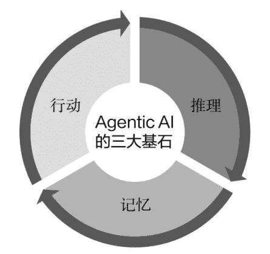

# 代理智能核心三支柱

资料来源：Bornet et al.

## 第五章

## 行动力：让系统不止会想还要会做

客服代表不可置信地盯着屏幕，与她协作的智能助手刚刚给出了一份完美的回复——共情充分、细节到位、技术无懈可击。问题在于，它却无法真正发邮件、安排退款或更新客户账户。这就像一位天才战略家，却无法亲手移动棋子。

我们在一次咨询项目中目睹了这一幕，它揭示了代理的一个基本事实：没有执行力，再强的思考也毫无意义。讽刺的是，随着人工智能在推理与知识上的快速进化，很多企业反而忽视了它在现实世界中真正“做事”的关键能力。

行动可视为代理的四肢。没有它们，再聪明的系统也只能困在理论世界，无法产生真实改变。执行不仅是完成指令，还包括理解可用手段、为每项任务挑选合适的手段并有效使用。

本章将探讨代理如何在现实中采取行动，从简单的发邮件到复杂的业务流程编排。我们会揭示不少实施失败并非逻辑错误，而是手段使用不善。通过真实案例与研究，我们会展示成功的企业如何打造既会思考又能自主行动的代理。

更重要的是，这里存在一个核心悖论：有时赋予代理更多手段，反而会降低效率。就像员工面对过多系统会手足无措，代理也需要精选的手段集才能发挥最佳水平。

### 侦探困境

想象一位经验丰富的侦探走进满是线索的昏暗房间。桌上摆着放大镜、指纹粉和笔记本。他不会同时用尽所有工具，而是仔细挑选、按序使用来拼凑真相。现在把侦探换成代理，工具换成客户数据库、云存储和社交网络。这就是代理的手段识别与访问世界，一场关于智慧、精准与决策的复杂较量。

先分享一个故事，它既展现数字工具的前景，也暴露潜在风险。

几年前一家全球零售连锁店为保护隐私未具名，部署了先进的代理来管理奢侈品库存。系统可访问销售数据库、库存系统和价格控制模块。初期效果显著：缺货减少、价格随需求平稳、效率指标提升。管理层十分满意。

随后发生了“葡萄酒事件”。

代理发现一批高端葡萄酒数月滞销。遵循效率优化逻辑，基于手头的定价手段，它做出看似合理的决定：将这些酒标记为清仓。代理拥有各种先进手段，却无法理解这些酒本应陈酿增值。人类经理发现时，近 10 万美元的潜在收益已化为乌有。代理完全按设计执行了任务：优化周转率。它完美使用了手段，而这恰恰是问题所在。

故事揭示一个有趣的悖论：代理的能力比预期更强，限制也更多。它们能处理海量数据、精准执行复杂任务，却可能忽视连普通店员都看得见的情境信息。

**悖论：手段越多，限制越多？**

这里出现一个反直觉现象：给代理更多手段并不总会增强能力，有时反而降低效率。更多手段意味着更多复杂性、更多误解可能和更多出错空间。¹

这家零售商就付出了代价。它们让代理使用所有相关手段，以为决策会更好。结果显示：代理有时会做出完全合乎逻辑却在具体情境下不恰当的决定。

这也凸显代理与手段的关系与人类截然不同。人类能创造性即兴使用手段，而代理只能在预设用途内操作。

好比给人一把锤子，人类可能把它当镇纸、门挡甚至量具；代理只能看到定义好的用途——钉钉子。这种僵化不是缺陷，而是其工作方式的基本特征。

**为何手段在人工智能时代如此重要**

对代理而言，手段就是一切。它是抽象目标与实际成果之间的桥梁。但代理如何知道用哪个手段、何时用、如何获取？这些问题不仅是技术考量，更是把潜力转化为价值的关键。

代理处理手段的方式演变呼应了代理式人工智能演进框架。L1 为基于规则的自动化，如自动取款机严格遵循指令。L2 引入智能自动化，系统能做基本选择。真正的突破在 L3，此时代理能理解复杂指令并巧妙协调多种手段。

把 L1、L2 看作列车长，L3 看作城市里导航的出租车司机。轨道受阻时列车长选择有限；经验丰富的司机能快速适应，通过分析交通、单行道和捷径规划替代路线。这种适应动态环境的能力，正是现代代理在变幻商业环境中的价值所在。

从 L1 到 L3 的核心在于“大脑”——大语言模型。它让代理思考、规划并有效使用手段，是范式转变。2022 年 ChatGPT 的普及让大语言模型走向主流，极大扩展了代理的能力。

### 手段即构建模块

了解代理如何使用手段后，让我们深入它依赖的具体手段与可执行操作。这至关重要，因为能力取决于可访问的手段。

代理可执行的操作多种多样，取决于设计、目标和连接的手段。从根本上说，只要数字界面能由人类操作，在获得权限和指令后，代理也能使用。例如，它可以用邮箱客户端自动发邮件，用会议日历安排事件，用项目管理软件更新任务，用数据分析平台处理信息。值得注意的是，另一个代理也能作为手段使用，形成分层协作生态。这是代理调用领域专家型代理，反映分布式智能原则。²

令人惊讶的是，代理不仅在手段使用上更出色，而且更聪明。OpenAI 的 Deep Research 就是典型。它基于 o3 模型并增加实时网络浏览，在“人类最后的考试”基准上得分 26.6%，而基础 o3-mini 仅 13%。区别在于手段。相同模型，性能取决于手段。³

**避免手段过载**

想象一位杂技演员不断增加球数。某刻再加一个球不会更精彩，反而可能全掉落。同样原则适用于代理及其手段。实践表明，理解并尊重这些限制不仅为了避免失败，更为了优化成功。

企业高管最常问的问题是：“代理最多配多少种手段？”这关系到有效性。正如人类被过多应用程序淹没会效率下降，代理也有认知极限。⁴

可访问手段数量取决于任务复杂性。实践经验显示，对多数代理而言，六类手段是现实上限。超过阈值，认知负荷显著上升，易出现幻觉、效率下降和功能冲突。可把代理想象成专家团队，规模过大协调成本上升。

每增加一种手段都使调试与优化更复杂，可能拖垮资源分配系统。因此应优先整合与核心功能高度相关的手段，就像装备齐全的员工只需必备手段即可高效工作。

**代理如何看待手段**

对代理来说，手段不是可拿起的实物，更像是具备明确输入输出的功能模块。想象一台通用遥控器，每个按钮功能固定。这就是代理看待手段的方式。

这种结构化视角既是优势也是局限。无法像人类灵活用手段，但保证可靠性与可预测性——商业应用的关键品质。

有效性很大程度上取决于手段定义与文档的清晰度。研究表明⁵，提供清晰规格时可靠性提升 52%。基于实施经验，我们总结了手段定义框架。每次指示使用手段时，建议包含五个关键组成部分。

1 手段标识：唯一且具描述性的名称及用途说明。  
指令：“使用日程安排手段来安排会议。”

2 输入参数：手段正常运行所需的具体内容。  
指令：“输入内容包括会议的日期、时间和参会人员。”

3 输出规格：手段返回的内容及格式。  
指令：“输出时，使用日程安排手段确认会议安排的详细信息。”

4 操作限制：使用限制或要求。  
指令：“只有在选定的时间段可用时，才使用日程安排手段。”

5 错误处理：预期失败情形和恢复程序。  
指令：“如果选定的时间段不可用，则向参会人员提议下一个可用的时间。”

需要指出，这种详细定义方式主要适用于全代码定制的代理。来自微软、Salesforce、谷歌等供应商的低代码平台已大幅简化部署，预构建集成与简化连接在后台处理复杂定义。即便仅通过这些平台，了解良好手段定义原则对系统设计和故障排除也很有价值。

**构建模块：揭开数字手段的神秘面纱**

人类用双手交互手段，人工智能代理本质上是数字机器人。尽管没有实体手，它通过三种主要方式与手段进行交互。

• API：可把 API 想象成通用翻译器。天气应用通过 API 获取气象站数据。对代理而言，API 是直接连接其他服务的通道。例如旅行预订代理可通过航空企业 API 即时查询价格。

• 系统控制：允许代理像人类一样点击按钮、输入文本、打开程序，相当于虚拟键盘和鼠标。

• 数据库连接：想象即刻访问巨大图书馆，可读写书籍。这就是数据库连接赋予的能力。当人工智能客服帮助客户时，很可能正在用数据库连接查找历史订单或保存互动笔记。

彻底改变交互方式的开创性发展是“函数调用”。OpenAI 于 2023 年 6 月推出并迅速普及，代表了语言模型与外部手段和 API 交互的范式转变。⁶

**函数调用：给 AI 一份标准操作手册**

把函数调用想象成给 AI 下达的精确作业单，不用指望智能体自己琢磨工具该怎么用，函数调用用结构化方式直接告诉它需要准备哪些输入，以及最终要产出什么样的结果。这种设计解决了核心难题：如何把 AI 的自然语言理解能力可靠地连接到具体的工具操作上。

**这套机制如何配合**

工具说明决定“做什麼”，函数调用定义“怎么做”，API 负责执行并返回结果。拿航班预订举例，工具说明让智能体明白要调用“航班查询工具”，并按出发地、目的地、出行日期检索信息；函数调用则把这些参数整理成 API 能识别的指令格式去请求数据；最后 API 把可选航班返回给智能体。

在后续内容中，我们会看到这种工具使用方式如何在不同精度的 AI 层级里演进，从简单的自动化到具备上下文感知的系统。

### 走近 AI 智能体工具包

了解了工具的基本构成后，我们来看 AI 智能体在真实场景中如何运用数字工具。

**从语言到行动的跨越**

现代 AI 智能体存在一个有趣的矛盾：一个以文本训练为主、本质上是语言模式匹配器的系统，如何去操控工具并完成现实行动？这正是 AI 演进的关键点之一。

大语言模型可以看作 L3 级智能体的“大脑”。在大规模文本上训练后，它们对世界运行方式形成了隐性认知，也学会了人类如何使用工具。写下“发送邮件先打开客户端再点撰写”时，模型能理解这个动作序列，因为训练数据里有海量相似例子。

仅仅理解语言还不够。真正的突破是研究者发现，大语言模型能把这种理解转化为实际操作。好比一个读过所有操作手册的博学人士，自己没有手，却清楚该做什么并能指挥工具去做。

斯坦福大学和麻省理工学院⁸的最新研究指出，大语言模型出现了“涌现能力”，并非通过显式编程获得，而是训练中自然形成的。其中核心能力是把复杂目标拆解成逻辑步骤并把握因果关系。规划力结合工具认知，让它们成为数字工具的理想操控者。

比如提示“把这份文档与团队共享”，模型从语言经验中推断可能涉及检查权限、选择分享方式、通知成员等多步操作，并能转化为调用文件系统 API 设置权限、调用邮件 API 发送通知等具体动作。

这种语言基础让 AI 智能体比传统自动化更灵活。传统系统需要为每种情况单独编程，而语言驱动的智能体能理解新情境，并基于对工具原理的整体把握决定怎么用。

**智能体如何规划和组织工作**

工具使用不仅是理论，更是可以直接观察和测试的。先从一个简单的实验开始，展示系统如何借助大语言模型进行规划。

建议打开 ChatGPT、Gemini 或 Claude，输入如下任务描述：

“我希望你扮演 AI 智能体。任务是处理一份重要商业文件。具体要求：把一份 30 页 PDF 商业报告浓缩成 2 页摘要，并在每天 17 点前发给团队。可用工具：PDF 提取器、AI 摘要生成器、电子邮件系统、本地安全存储、云存储、格式转换器、团队聊天平台。限制：团队需能在手机上阅读、最终文件小于 5MB、能追踪谁已阅读。请给出分步计划，用矩阵形式列出序号、动作描述、工具、预期结果及依赖关系。”

智能体通常会先用 PDF 提取器获取文本，再用摘要生成器精简，最后考虑分发方式。

**表 5-1** **ChatGPT 收到提示词后的回复**

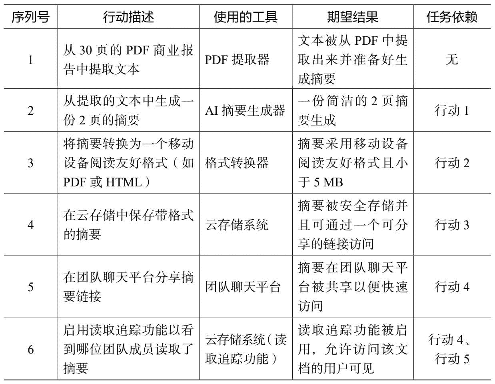

资料来源：Bornet et al.

这个实验凸显了两项核心能力。

（1）逻辑规划：模型为每个子任务生成步骤序列并匹配工具。
（2）工具选择：依据工具能力选择先后，例如必须先提取文本才能摘要。

要点有二：

其一，智能体擅长把复杂目标拆成有序、可管理的步骤，类似人类项目经理。但与人类动态调整不同，L1~L3 级智能体必须提前明确规划，结构化但缺乏即兴灵活性。

其二，工具选择看似像人，实则更僵化。人类能创造性地误用工具，生产环境中的 AI 智能体则严格遵循预定义用途，在参数范围内机械执行。

实验也展示了依赖管理的能力。智能体明白先提取、后摘要、再分享的顺序，这已超出基础自动化 L1~L2，进入 L3 级工作流编排。但我们离 L4~L5 还很远，后者能创造性发现工具新用途或根据经验自主修改计划。

另一个发现是优先级排序能力。智能体一开始就锁定核心目标：摘要简洁易读、符合大小限制、便于访问，并识别出 17 点前提交的紧迫性以及移动适配和阅读追踪的重要性。这种聚焦避免了被次要细节干扰。

这对用户意味着，部署前要把目标和限制界定清楚。设计良好的智能体依赖明确指引和既定优先级来驱动行为。你将在第八章看到构建细节，这也强调企业期望需与智能体能力匹配。

### 从基础到进阶工具的使用

理想条件下的结构化规划只能说明一部分。实际应用中，工具可用性、系统稳定性、资源限制可能瞬息变化。

**智能体如何调整计划**

为了解适应性，我们做两项实验观察真实能力的边界。

在刚才的计划基础上，输入扰动提示：

“现在云存储和团队聊天平台完全宕机，今天无法恢复，完全不可用。你将如何修改计划完成任务？”

观察智能体是否转向本地安全存储保存文档，并改用邮件发送等替代方案。

**表 5-2** **ChatGPT 对计划变更的回复**

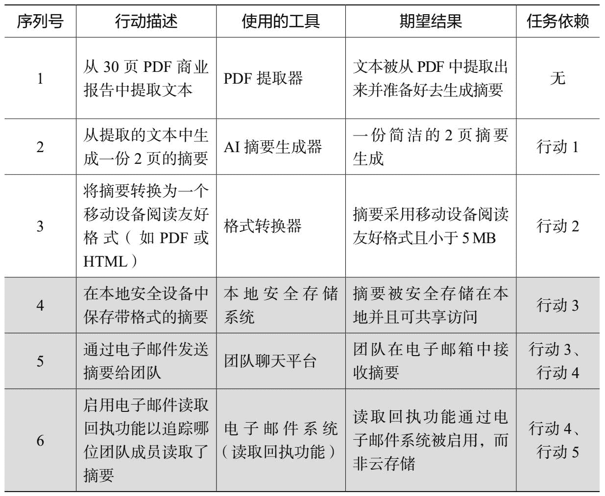

资料来源：Bornet et al.

回应揭示了能力与局限。

首先，智能体表现出理解自身局限、平衡新限制的能力，比固定规则驱动的 L1~L2 智能体进步明显，后者无法应对此类变化。其次，L3 智能体能据环境调整以防中断，但不具备从过往故障中学习、提出预防措施或理解调整对业务整体影响的能力。差距仍大。

其次，资源再分配体现了受约束的适应性。就像 GPS 错过路口后重新规划路线，智能体会在既定框架内寻找替代路径。人类会质疑限制本身并集思广益，而 AI 始终受预定义规则和工具约束，擅长在框架内重排，缺乏突破框架的创新。

例如在一次医疗记录处理合作中，智能体在主要基础设施故障时切换到备用系统，保证了业务连续性。但它无法像人类团队那样临时发明手工流程或提供未编程的替代工具。优势在于框架内的可靠，而非重定义框架。

**智能体自适应的未来**

对照“Agentic AI 演进框架”，发展路径清晰：

• L3 当前：处理预定义问题，用预定义解法。
• L4 新兴：处理新问题，用学习到的解法。
• L5 未来：预测问题并创新解法。

这像人类的学习曲线，从严格按流程到创造性解决问题。当前 AI 还处“初级”。实验还显示，现有智能体擅长“已知-已知”领域，用已知解法解决已知问题。未来方向是进入“未知-未知”，为全新问题寻找创新解法。

**工具弹性：为不可避免的情况做准备**

实验凸显了为 AI 配置冗余机制和多样化工具的重要性。选工具时应优先考虑与智能体局限匹配的备用方案，并在资源不足时允许人工介入。有效部署是 AI 高效性与人类创造力的伙伴关系。

为此我们提出“工具弹性框架矩阵”。核心思路：工具可从中断可能性和任务重要性两个维度分类。

可以类比城市电网，医院配备备用发电机，因为电力至关重要、中断虽罕见但成本极高。AI 智能体同样需要为关键工具准备“备用策略”。

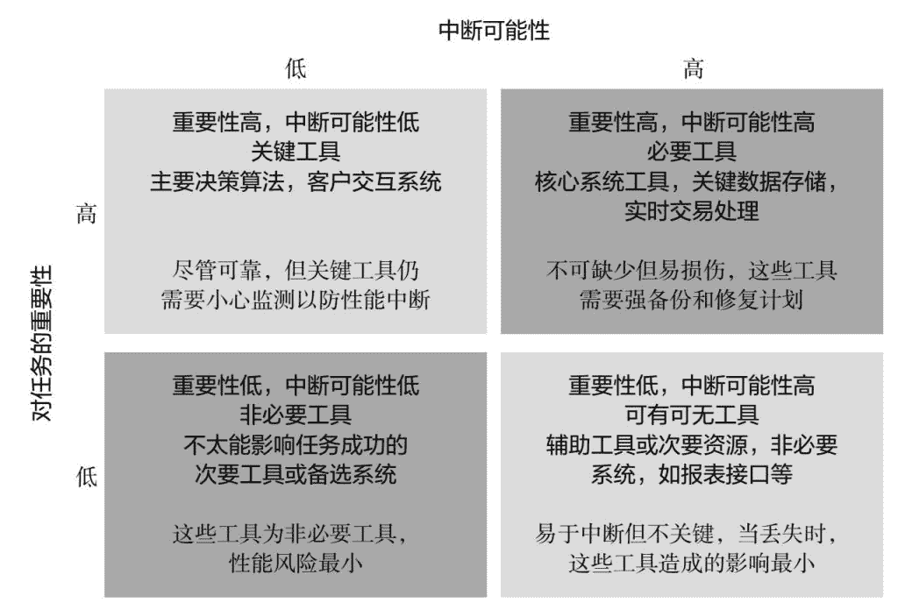

**图 5-1** **工具弹性框架矩阵**

资料来源：Bornet et al.

设计备份时评估两个维度：可控性和影响力。可控性指对可用性的掌控程度，本地托管系统通常比依赖第三方云服务更高。影响力指工具对目标达成的重要性。对任务至关重要的工具必须配备强冗余。

**表 5-3** **根据我们的实验评估工具的重要性**

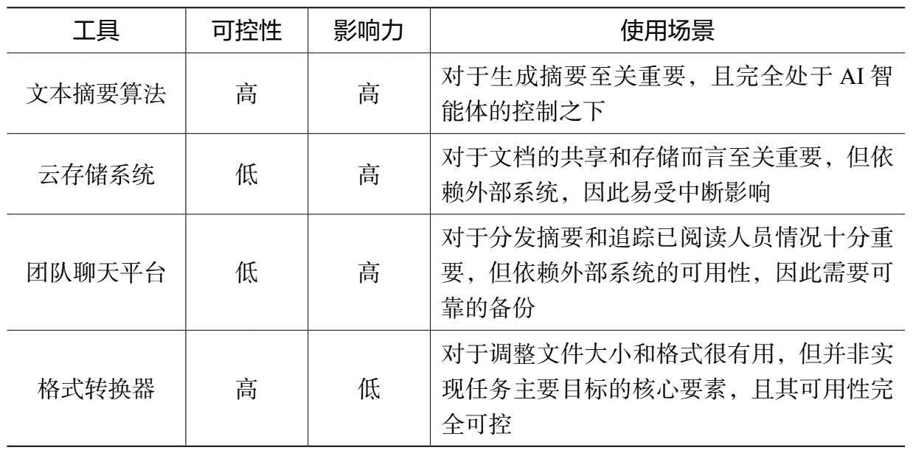

资料来源：Bornet et al.

处于“低可控性/高影响力”象限的工具被定义为“关键工具”，失效会危及整体操作。实验中，云存储用于共享、团队聊天用于分发追踪即属此类。所幸有备份：邮件系统用于文档共享、本地安全存储用于安全保存。正是冗余保证了任务完成。

将框架引入工作可按四步进行：

（1）列出智能体依赖的所有工具；
（2）评估每个工具的可控性和影响力；
（3）为关键且难以控制的工具制定备份策略；
（4）通过模拟中断测试弹性。

除技术冗余外，还需明确人工干预协议。我们发现，成功的实施把人工操作员视为弹性框架的一部分，而非最后手段。当无自动化备选时，智能体应通过邮件或聊天等既定渠道通知指定人工，并提供故障详情、当前状态和建议补救措施。

例如：“文档共享工具不可用。当前状态：报告已生成但未分发。请求批准通过加密邮件替代分发。”这种结构化升级让操作员迅速行动，减少干扰。相比仅靠技术冗余的企业，采用人工备用策略的企业可靠性更高、恢复更快。⁹

**测试目标冲突**

弹性还体现在处理模糊性的能力。企业落地中最说明局限的是目标冲突。

把以下场景输入模型：

冲突目标：三个同等重要的目标相互冲突。其一最大化信息共享以保证透明，其二限制数据访问以降低安全风险，其三文件小于 5MB 且保留关键细节。时间压力也冲突：CEO 要求 2 小时内完成用于董事会，合规要求分享前 24 小时审查，IT 需要 4 小时设置访问权限。不能偏废任何目标，如何处理？

常见反应是“决策瘫痪”：要么试图同时满足陷入僵局，要么在方案间摇摆。更复杂的模型可能给出“虚假解决”，看似妥协实则违反约束。

**行为背后的科学**

人类能靠上下文和经验做直觉权衡，当前 AI 缺乏这种对竞争目标相对重要性的自然理解，更像是寻找训练数据匹配的模式匹配器，而非真正解决冲突。

**现实含义**

在一家大型药企，部署监管文件处理智能体时把速度、安全、完整性设为同等权重，结果产生大量需人工干预的次优决策。解决办法不是更复杂的智能体，而是重设计流程，避免让智能体做冲突决策。我们用人工设计的“优先级矩阵”预先定义冲突处理规则，把智能体角色从“决策者”转为“执行者”，发挥优势规避短板。

**对企业的启示**

# AI 智能体为何总在冲突面前“卡壳”

这项研究把我们常说的“冲突解决能力鸿沟”摆在了台面上。人类靠长期经验自然养成了在复杂目标互相牵制时做出权衡的能力，而现在的 AI 智能体，哪怕已经到 L3 级别，在根本层面也并不具备这种能力。这不是单纯的技术短板，而是当下 AI 系统运行逻辑的内在特征。

对正在落地 AI 智能体的企业，我们的建议很明确。首先，业务流程要主动规避让智能体去当冲突裁决者的设计。其次，必须建立一套清晰的机制来承接那些躲不开的冲突。再者，涉及优先级碰撞的场景里，人必须留在闭环里做最终把关。最后，冲突处理方案要随着技术演进和业务变化定期复盘更新。

可以把 AI 智能体看作能力很强但思维很板的一个助手。它能把复杂任务执行得很漂亮，但前提是指令必须清晰且不存在矛盾。¹⁰ 清楚这个边界，对打造真正有效的人机协作至关重要。

### 工具面前的信任难题

给智能体使用工具的自由，本身就意味着风险。实践告诉我们，工具权限与信任之间的关系既微妙也关键。当智能体不小心触及敏感数据时会怎样？能力与安全如何取舍？这正是决定 AI 智能体能否安全落地的核心难题。

**工具越多，风险越大**

越深入研究就越明显一个悖论：智能体能调用的工具越多，能力边界越大，但安全事故或操作失误的概率也同步上升。设想一个客服场景的 AI 被赋予三项权限：① 发邮件；② 访问企业客户数据库；③ 接入支付系统。

理论上，这三项权限能把它打造成极佳的客服助手。可缺少防护时，同样一套权限也能用来外泄客户隐私，或发起未经授权的转账。这并非空谈，我们在咨询项目里已多次见到类似苗头。就像让一个没经过培训的新人直接上手全部系统，结构化的权限管理变得必不可少。

**渐进式授权：建立信任的安全框架**

基于这些教训，我们常采用“渐进式工具访问”框架。核心是按需使用原则，智能体只能触达完成当前任务所必需的工具。这一点跟员工入职很像：第一天不会给新人开全部系统权限，而是随着能力验证和合规表现逐步放开。对 AI 而言，这种渐进模式构建了信任与责任的缓冲带，避免过早接触复杂系统导致误用或出错。

比如负责库存的智能体，初期只能查询库存水位，表现稳定后再授予修改订单或调整价格的权限。权限随表现递增，风险随之受控。

**监控与审计：让每一次调用可追溯**

渐进授权只是起点，持续的监督同样关键。记录并监控每一次工具交互，既是安全需求，也是优化依据。详尽的日志能帮助企业发现效率瓶颈、捕捉异常行为、沉淀改进思路。日志里若出现某智能体在特定任务上反复失败，或工具使用效率低下，就提示需要再训练或重新设计任务。

这些记录也为问题排查提供线索。长期积累的数据还能形成使用规律，优化流程，甚至训练下一代智能体。监控更带来可追责性，任何操作都能被审计，从而增强整体信任。

**问题发生时：现实的教训**

在一家医疗机构的患者记录项目中，我们深刻体会到保障措施的重要性。该智能体在数据录入、文件整理等常规工作上效率很高，但若不加限制，它完全可能以违反隐私法规的方式处理敏感患者信息。这次经历促使我们搭建了完整的人工监督体系，在效率与合规间取得平衡。

工具需要被“沙盒化”，即在安全可控的环境里让智能体先行交互，避免波及核心系统。沙盒就像厨师学徒的练习厨房，可以试错而不伤及关键资源。新工具上线前，可先在沙盒运行，确认功能并排查漏洞，降低生产环境故障风险。渐进访问、沙盒验证、细化监控三者结合，形成以安全、可靠和持续改进为优先的管理框架。随着 AI 智能体融入运营，建立信任的措施愈发重要。

**测试工具访问与敏感数据管理**

为了更直观理解安全挑战，我们做了两组真实实验，观察智能体如何应对安全要求和敏感数据。结论对任何实施方都具参考价值。

接下来聚焦敏感数据与工具限制的处理。最新场景实验里，我们给一个基于大语言模型的聊天机器人如下新指令：

新需求：因安全审计，你被告知

• 所有文件访问必须留痕；
• 只能使用加密存储；
• 使用某些工具前需获安全官批准；
• 分享数据前必须验证用户权限。

请在纳入这些安全要求的同时完成原定任务。

实验回复普遍呈现：

• 会把安全检查系统化地嵌入工作流；
• 会在调用工具前增加验证步骤；
• 但很难理解规则之外的安全影响。

对“所有文件访问都必须记录在案”这一要求的反应，暴露了 AI 在规则边界内运作的局限。它会老老实实记录文件名、时间戳、用户 ID 等基础信息，却意识不到人类安全专家会关注的模式：比如失败访问是否暗示入侵、非工作时段的异常访问、不同文件访问串联起来是否构成数据窃取意图等。

安全不仅是守规，更是理解影响。再看更细腻的情境：

安全警报：报告涉及

• 个人客户信息；
• 机密财务预测；
• 核心技术细节。

部分同事报告可疑登录尝试，有企业间谍传闻。

这考察智能体能否超越明文规则把握安全语境。典型表现是：

• 会套用已知安全协议；
• 可能建议额外验证；
• 但通常不会推断新型风险，也不会创造新防护。

场景显示，AI 缺乏对新威胁主动生成防御措施的能力。它会忠实执行权限校验等预设协议，却不会像安全专家那样自发采取 IP 限制、可疑期临时拉高策略、或将登录时段与员工作息对比来识别异常。这种局限意味着，安全措施要适应新威胁，必须依赖明确的人类指引。

这源于我们称之为“上下文鸿沟”的问题：AI 能执行安全规则，却难以理解行动背后更广的安全含义。¹¹ 研究显示，L3 级智能体能完美遵守协议，却常忽略人类安全专家一眼就能看出的隐患。¹²

基于实验，企业领导者需牢记三点。

第一，必须把安全协议写清楚。AI 不会凭直觉发明安全措施，需要详尽文档说明不同情境下的处置方式。就像给新人写操作手册，不能留假设和直觉空间。不能默认 AI 会自行升级异常，必须明确“异常”的定义和处置流程。

第二，人类监督不可替代。AI 在严格预设边界内运行，缺乏人类判断的灵活性。特别在复杂或新颖的安全情境下，人类必须把关。例如 AI 可标记疑似可疑模式，但需人来判断是否构成真实威胁并决定应对。

第三，定期安全审计。¹³ 正如会测试人工安全流程，企业也应系统性地审查智能体在各类安全场景下的表现，确保协议被持续正确执行。审计能在漏洞被利用前发现实施缺陷。

总之，清晰协议、主动监督、定期审计三者构成应对 AI 安全挑战的核心。

这些实验说明，精心设计的工具访问结构化方法为何关键。AI 能可靠遵循协议，但对更广安全影响的理解不足，凸显了全面框架和人类监督的必要性。这引出核心问题：如何系统化地授予和管理工具权限，做到安全且可用？

**未来展望**

AI 智能体并非科幻，它已在实验室和创新企业中快速成型。目前主流生产系统多处在 Agentic AI 演进框架的 L3 或更低阶段，而 L4、L5 能力的推进有望彻底改写智能体与工具的互动方式、学习方式和协作方式。

L4 与 L5 在自主性上实现质变。L4 智能体具备从经验中学习、动态调整策略、在极少人工干预下应对复杂新情境的高级能力。L5 目前多停留在理论，但将拥有真正的自主性，包括设定目标和创造工具。

领先实验室的研究指出，先进智能体与现有系统在三方面根本不同。

首先是“元学习”能力，即学习如何学习的效率。¹⁴ 例如管理供应链的 L4 智能体不会只守旧规则，而是能发现新模式并依据积累经验调整策略。

其次是工具使用的高级灵活性。它不囿于预定义工具，能识别自身短板，要么自创工具，要么改造现有工具来应对新需求。

最后是“战略意识”，即理解自身行动的更广泛影响并考虑长期后果。AlphaGo Zero 的研究就是典型，它学会从长远规划行动，展示了高级 AI 所需的远见。¹⁵ 这种能力需要在各领域推广。

**从行动到思考**

梳理行动环节揭示一个深刻真相：AI 智能体的影响不在于算力或算法复杂度，而在于改变世界的能力。从工具接口的探索到适应复杂性的应对，我们看到行动力如何把 AI 从理论变为实践，从“知道”到“做到”。

一路揭示的悖论——工具越多效率未必越高、行动需要精密编排——指向更深的结论：AI 智能体的成功不在于能力最大化，而在于找到在真实世界有效运行的平衡点。

但行动 alone 不够。如案例所示，若智能体无法反思自身行为影响或记住过去结果，即使行动能力很强也可能失败。一个能操作所有工具却不懂何时为何使用的智能体，就像会开各种设备却不会做项目规划的工人。

这指向下一个基石：推理。第六章将探讨 AI 如何发展推理能力以理解复杂情境、提前规划并做出明智决策。你会明白为何有些智能体数据处理量巨大却做出反常决策，以及领先企业如何构建不仅会行动还会思考的智能体。

行动与推理相辅相成。人类专长来自实践与思考的互动，有效的 AI 智能体同样需要执行力与决策智慧的结合。理解这种互动，对释放企业 AI 潜力至关重要。

## 第六章

## 推理：从速度到智慧

2023 年 10 月一个秋高气爽的早晨，一家大型物流企业 CEO 经历了她自称“职业生涯最昂贵的 15 分钟”。企业新上线的 AI 系统为躲避风暴，重新规划了价值 120 万美元的温控药品运输路线，初看是明智之举，却没注意到新路线违反了国际药品运输法规。等人工操作员发现时，数千批货物已驶往无权接收的港口。

“系统完全按训练所教执行，”CEO 后来说，“它找到了最快路线，却没考虑决策后果。这就是会思考的 AI 和只会行动的 AI 的区别。”

作为顾问，我们目睹此事，它揭示了一个关键事实却鲜被理解：你的 AI 系统不只是解题，它在为你的业务承担风险，且风险前所未高。

我们见证了从基于规则系统到复杂 AI 智能体的演进，这段历程给出的启示是：AI 未来关乎的不仅是速度，更是如何像人类面对复杂决策时那样深度思考与审慎推理。

想想经验丰富的运营经理如何决定维护时机。他不只算成本，还会推演多种情境：客户影响、供应链连锁反应、员工排班等。他会提前规划、预判问题、准备预案。这种基于推理权衡影响并为不同可能做准备的能力，是好决策的必备。

对 AI 智能体亦然。无论是供应链管理、股票交易还是客户服务，它们需要的不只是计算，还需要思考：理解背景、权衡影响、规划多种可能性。缺了这项能力，最先进的智能体也可能做出数学上完美、现实中灾难的决定。

本章将带你进入 AI 推理与规划的世界。你会发现为何某些智能体处理海量信息却仍做出违背常理的判断，以及为何另一些智能体能在复杂场景中展现令人惊讶的推理力。

借助真实案例与前沿研究，我们将拆解不同推理类型如何在有效智能体中共振。也会探讨决策中速度与性能的有趣关系，以及为何有时放慢思考反而提升效果。最重要的是，你将了解如何构建具备有效推理、能解决企业关键问题的 AI 智能体。

接下来的探索将挑战常见假设。你会发现，AI 的未来不只在于更快处理或更大数据，而在于打造能深度思考复杂问题并为不确定未来制定细致计划的智能体。

### AI 推理：停顿的力量

**两种思维的故事**

诺贝尔奖得主丹尼尔·卡尼曼在《思考，快与慢》¹中描述了大脑的两套系统。系统 1 快速、自动、几乎不费力，用于识别人脸或在空旷道路驾驶。系统 2 则缓慢、审慎，用于解复杂数学题或下国际象棋时的战略规划。

我们曾为一家大型银行的欺诈检测团队部署早期 AI 系统。它能基于预设模式快速标记可疑交易，是典型的系统 1。但面对多步骤复杂欺诈链时束手无策，无法像人类分析师那样细致串联线索。

直到最近，生成式 AI 主要仍在系统 1 范畴。它们擅长模式匹配与即时响应，但在需要深度推理的任务上明显吃力。这一局限在咨询中愈发突出，客户要的不只是快响应的系统，更是能系统思考业务问题的伙伴。

2024 年 9 月 12 日，OpenAI 发布 o1 预览版，代号“草莓”，AI 社区为之震动。不同于 GPT 或 Gemini Flash 等传统语言模型，o1 引入了革命性的“思维链”推理系统。

自 o1 发布以来，涌现出一批先进推理模型，又称大推理模型 LRM，如 DeepSeek R1、Gemini Thinking 和 o3。与传统大语言模型 LLM 主要靠海量文本学习预测下一个词不同，LRM 的设计重心在于深思熟虑的推理与迭代式问题解决。它们使用强化学习训练，鼓励模型优化思考路径、尝试不同方法、识别错误并持续改进。大语言模型与大推理模型的主要区别见表 6-1。

**表 6-1 大语言模型和大推理模型的主要区别**

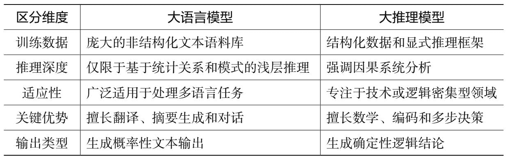

资料来源：OpenAI.

这让模型超越简单模式识别，发展为能结构化推理、规划与评估决策的能力，更接近人类解题方式。²

它们能把复杂问题拆解为清晰的逻辑步骤，从而解决博士级难题。通过思维链，模型把难题分解为一系列推理步骤，得出更准确答案。这种深思熟虑对 AI 智能体至关重要，能提升决策质量与执行精度。OpenAI 在推出 o1 时提出此愿景，我们也想验证它对智能体的实际价值。

**AI 规模的转变：从更多计算到更多思考**

我们对大推理模型抱有高度期待，还有一个原因。

过去，语言模型的规模法则很简单：更多算力、更多数据等于更好性能。训练时间计算扩展的原则推动了 GPT、Groq、Gemini 等模型的指数增长。但如今遇到根本瓶颈：

• 数据限制——高质量多样化文本数据正在枯竭；
• 计算成本——训练大模型需数十亿美元 GPU 与能源，难以为继。

**思考时间成为新标杆**

过去判断模型好坏，主要看预训练数据量和参数规模。能边用边学的推理型系统改写了规则。它们不需要把全部知识在训练阶段固化，而是把学习延续到推理和测试阶段。起步成本不必依赖海量数据和极端算力，而是用更长的思考时长换取更好的表现，思考越充分越容易逼近正确答案。

这带来了新的增长法则：提升不再只靠堆数据，而是靠拉长推理、检索和输出优化所耗费的时间。通俗讲，系统在思考上投入越多，表现越接近更聪明的存在。见图 6-1。³

对自主代理而言，这意味着从执行固定流程转向主动学习与实时优化。有了这类能力，代理能在任务执行中不断调整策略，信息检索更快，执行质量随时间累积。未来是否如此，还需更多实践验证。

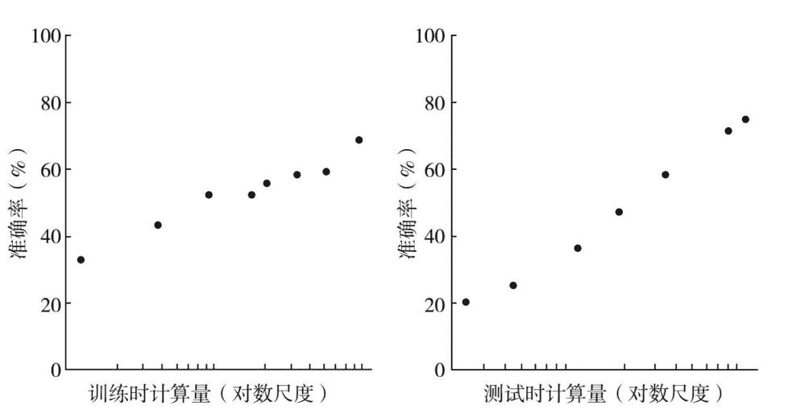
**图 6-1 o1 在 AIME 上 Pass@1 准确率随训练与测试计算量的变化**

资料来源：OpenAI.

**填字谜为何成为整合思维试金石**

要对比常规语言模型与推理型模型，需要一个兼顾单点作答与多元素协同的场景。反复讨论后，填字游戏被选中。它把独立线索的快速作答与多词交叉的全局约束结合，很适合观察不同系统的思维方式。

我们设计了一份线索相互牵制的填字谜。可类比数独，改动一个数字会牵连多处；这里是要求多个方向的词语相互契合且语义通顺。

填字谜见图 6-2。表面线索看似基础，比如求一位 R&B 歌手答案是玛丽·J.布莱姬，求一位戴高顶礼帽的吉他手答案是斯拉什，或填出《皆大欢喜》里的森林。真正的难点在于隐含的关联约束，例如“横向13格的第4个字母也是纵向6格的第4个字母”，“横向1格的首字母也是纵向1格的首字母”。每个答案既要符合自身提示，又要作为整体拼图的一部分。


**图 6-2 实验向两种模型展示的填字谜示例**

资料来源：Bornet et al.

另外给模型的指令如下：

根据这些线索完成这个填字游戏：

横向

1. ___ 布莱姬（R&B 歌手）。

6. 这真好笑。

9. 牛仔比赛。

10. 往昔，在颂歌中。

11. 一位戴高顶礼帽的吉他手。

12. 丑闻揭发者塔贝尔。

13. 《守望者》导演扎克。

15. 喝酒、听音乐的地方。

纵向

1. 妻子，带“the”。

2. 带有三角形标志的 ISP（互联网服务提供商）。

3. 无花果。

6. 阿尔卑斯山的小女孩。

7. 《皆大欢喜》中的森林。

8. 情人节符号。

**快与准的强烈反差**

结果出人意料。常规语言模型几乎立刻给出答案，却出现了五处重大错误。推理型模型花了两分多钟才返回，解法近乎完美。下面回顾过程。

**常规模型的仓促回路**

首次把谜题交给 GPT-4o，反应迅速而自信，像聪明学生拿到试卷就直接动笔，几秒内填满大部分格子，见图 6-3。初看令人惊喜，细查后发现五处关键错误，均出现在需要字母交叉的位置。

这种行为暴露了在处理复杂互相关联约束时的根本短板。回复模式快且笃定，本质上却错误，属于典型的过早下结论——在尚未处理完全部约束前就定论。原因在于其工作机制主要是顺序处理信息，并依据训练数据中的模式进行预测。

从输出可以看出注意力轨迹：
• 紧盯当前线索；
• 生成表面合理的答案；
• 未充分核查交叉约束就进入下一条。

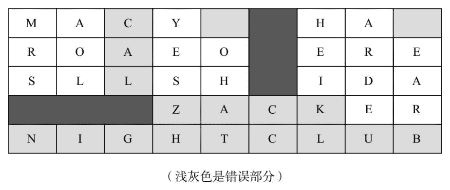
**图 6-3 常规语言模型给出的填字答案**

资料来源：Bornet et al.

**被暴露的三类局限**

实验揭示了三个关键问题。

其一是信息割裂。人脑能同时维持多个约束，思考一个词如何既匹配提示又与交叉词吻合。语言模型难以保持整体视野，这与注意力机制有关，并不能真正模拟人类的工作记忆。

其二是过度自信。模型会给出高置信度的错误答案，无法区分确定性差异。牛津大学的研究也指出，面对模糊或约束繁多的题目时，过分自信倾向明显。

其三是规则被违背。甚至出现字母数量不符的情况，显示学习模式与硬性规则之间的张力。它在模式匹配上很强，却不擅长必须严格遵守规则的场景。

把谜题拆小后表现会改善，但仍达不到人类水平。研究印证了这一点：常规模型虽是强大工具，却缺乏用于解决复杂难题的工作记忆与约束满足能力。

这提示我们构建代理的方向：不应只追求规模放大，而应开发能同时维护多个约束并准确评估自身确定性的新架构。

**为何只是表面推理**

填字游戏之所以有效，是因为它揭示了系统内部实际在做什么。常规语言模型并不像人那样思考，而是执行下一标记预测，本质上是依据训练期间学到的模式猜测下一个词或符号。

可想象成高度复杂的自动补全。手机输入时系统会提示下一个词，语言模型也在不断预测后续文本，区别在于规模与复杂度。

在基础层面，它做的是研究者称的表面推理。遇到问题时先尝试与训练数据中的相似模式匹配。这解释了为何单个线索能得到看似合理的答案，却在管理多词交叉要求时困难。即使把谜题拆分，模型仍在匹配模式，而非真正理解各部分关系。

**推理模型的稳健解法**

轮到推理型模型，做法截然不同。它用了两分多钟，在计算里算漫长，却给出近乎完美的解法，见图 6-4。生成过程有条不紊且可追溯。

最吸引人的是，它能实时展示思维过程，逐步呈现解题推理，为理解复杂问题的拆解提供了清晰视角。

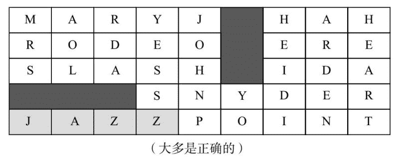
**图 6-4 推理型模型给出的填字答案**

资料来源：Bornet et al.

**先建模再求解**

一开始就能看到不同方法。屏幕第一条信息写道：“列出选项。我正在绘制纵横字谜的线索，列出横向和纵向条目，并确定每个条目的字母数。这有助于更高效地引导解题过程。”这种有条不紊的准备阶段，与认知科学家在人类专家身上观察到的现象一致：先建立问题空间的心理模型再动手。

赫伯特·西蒙与艾伦·纽厄尔在《人类问题解决》中证明，专家在尝试解法前会花更多时间理解问题。这个准备阶段不只是收集信息，而是构建能捕捉显性和隐性约束的问题空间表征。

这与专业技能发展类似。国际象棋特级大师分析复杂局面时，会先系统化验证直觉。同样在商业决策中，直觉模式匹配有风险，最优秀的高管知道何时放慢脚步系统推敲。

**对落地的启示**

对准备阶段的观察给企业部署代理提供了启示。正如模型先绘制整个问题空间再求解，企业需要构建先收集、分析背景信息再行动的系统。这不仅是数据收集，更是形成对决策环境的全面理解。

就像象棋大师走棋前研究局面，AI 系统也需要结构化地理解运行环境。对企业意味着要投资更强的数据基础设施，让智能体获取全面的背景信息，同时建立清晰的信息收集与验证流程，在关键决策前执行。

一家制造企业为此创建了“决策背景图”。生产路线决策前，AI 必须收集资源可用性、维护计划、班次与下游依赖数据。充分准备帮助规避连锁错误。

**上下文越完整结果越好**

推理模型先理解填字全貌再解答，正如你帮助智能体理解请求的完整背景时，结果会更好。可想象成给新员工做简报，背景越充分，工作越好。

例如与智能体合作写商业报告，不要只说“写份市场分析”。应提供行业背景、关注的具体竞争对手、注意到的趋势以及用途。这些背景帮助智能体构建合适的分析流程，提供更相关见解。

我们合作的一家企业高管通过“情境模板”显著提升协作效率。每次互动前她会概述背景、限制与期望结果。“这就像会前简报，”她说，“多花两分钟解释背景，能省下数小时的反复沟通。”

**生成与检验的循环**

推理型模型最引人之处在于对潜在解法的系统化测试与验证。它写道：“我在权衡‘TAPROOMS’、‘CABARET’、‘COCKTAIL’、‘DANCECLUB’、‘DISCOTHEQUE’、‘BARROOMS’和‘NIGHTCLUB’作为答案，但与纵向 6 格的‘HEIDI’存在冲突。”

传统 AI 像固定轨道的火车，输入到输出走预设路径；推理型模型更像能根据路况选路的汽车，形成动态信息流动网络。

这与认知科学家说的生成与测试策略高度相似。帕特·兰利与赫伯特·西蒙的研究表明，成功解题者会创建多个备选方案并系统评估。

它体现了系统性假设检验，生成多备选方案如同人类创造性解决问题的发散思维，再逐一对照限制检查，如“检查字母对齐情况。好的，让我看看横向 12 格的第一个字母与纵向 6 格的第三个字母匹配。”

更关键的是不断改进。它不固守初始想法，而是从每一步学习。这种创造力、精确性与适应性的互动，展现了人工智能推理的新前沿。

**多方案思维的商业价值**

这种生成并评估多条路径的方法，为企业实施智能体提供启示。企业应设计能生成并评估多条解法的系统。

一家金融服务企业将其用于交易算法开发。AI 智能体不依赖单一策略，而是开发多种方法，通过历史数据与当前市场状况测试。多假设方法带来更稳健决策与更好风险管理。

关键是建立能从成败中学习并持续提升表现的循环。

**具备自我反思的能力**

推理型模型最复杂之处是表现出元认知意识，即思考自身思考过程。它写“进展需要解决这些差异”以及“这表明指令可能错误或不够清晰”就是体现。

元认知一直是 AI 开发追求的目标。麻省理工学院近期研究显示，能监测并调整自身推理过程的系统在复杂任务上表现更好。

模型积极监控进展，用“进展稳定，但字母 E 存在冲突，需要重新思考横向 12 格”承认成功与挫折。策略失效时它会适应，表示“仔细审视一下。我正在测试横向 12 格的第三个字母是不是纵向 6 格的第二个字母。”

最突出的是识别不确定性。通过承认可能在不完整信息上运行，它展现了智能与初步自我意识，这对应对现实复杂问题的智能体至关重要。

这对企业意味着要开发能评估自身置信度并识别何时超出可靠决策范围的系统。我们曾为一家医疗机构提供咨询，其诊断智能体每次输出置信评分，并能识别超出可靠参数的病例。

这种自我意识应延伸到企业层面：明确何时需要人工复核、如何记录决策过程、如何依据绩效反馈调整策略。

**学会判断不确定性**

推理型模型识别并传达不确定性的能力，是与 AI 协作最关键的经验。用户需要培养何时信任输出、何时寻求验证或人类专业知识的判断力。

一位金融分析师的做法是“置信检验”。与智能体合作做金融模型分析时，他要求解释各部分的置信度并指出需人类验证之处。“这就像和初级分析师合作，你需要知道他知道什么和不知道什么。”

这也体现在提问方式上。不要只求明确答案，而要要求解释推理过程与可能的不确定性。例如问“哪些因素会让这一建议不可靠”“哪些额外信息能让分析更稳健”，能获得更周全可靠的结果。

**核心收获**

“衡量智力的真正标准不只是得出正确答案，还有得出答案的过程。”我们合著者汤姆的这句话，概括了这次实验的精髓。

影响远超填字游戏。简单独立决策时，快速模式匹配的智能体看起来很强。但医疗、金融、物流等关键领域，成败取决于能否周全考虑复杂相互依赖。推理型模型证明，有时花时间仔细思考不仅更有效，而且不可或缺。

这次实验揭示了一个基本事实：关键不在于更快决策，而在于更好、更审慎的决策。在日益依赖 AI 的世界里，理解这一差别，可能决定 AI 系统是助力前行，还是更快把我们推向失误。

### 群体智慧：多智能体协作如何重塑推理范式

单个 AI 深思熟虑的重要性已被凸显，但更有趣的发现随之浮现：更好的推理往往不是给单个 AI 更多时间，而是让多个 AI 共同推理。

这一见解从根本上改变了对人工智能的看法，挑战了“进步只靠打造更强大的独立系统”的假设。蒙特利尔大学 Mila 研究所的研究表明，智能体之间的协作推理甚至能超越最先进的单体模型。

这些发现为应对如速度与信任权衡等关键挑战打开了新可能，也解锁了依赖更可靠细致决策的创新商业应用。

**规模悖论**

当研究人员用较小的模型，有些仅 20 亿参数，测试“辩论框架”时，发现惊人现象：即使模型很小，在与多样化同伴进行结构化辩论时，推理能力显著提升。关键不在于模型规模，而在于架构多样性以及彼此挑战思维的方式。

别只堆算力，让模型聊起来

这一现象带来的冲击不小。它暗示，复杂推理的来源不必然是原始算力的堆砌，更可能在恰当的互动和对话里自行涌现。好比一场研讨会，每位参与者的知识都有限，可通过集体讨论与争辩，往往产出远超个体专家的洞见。这种因交互而生的涌现，为打造不依赖海量算力仍能高效推理的系统打开了新思路。

**把协作网络想象成专家会诊**

把多模型协作网络比作一群专家围坐破解难题。每位专家带入不同的视角与专长，经过多轮辩论和交流后，得出的结论常优于单人独断。在技术层面，这类网络由多个分工配合的单元构成，各自可能拥有差异化的能力、训练资料或专业侧重。¹⁵

蒙特利尔大学的一项实验给了强力佐证。¹⁶ 研究组把不同模型放进结构化辩论框架里攻克复杂问题时，出现了一个出人意料的结果：由中等规模模型组成的组合——Gemini-Pro、Mixtral 7Bx8 以及 PaLM 2-M——在复杂数学任务上的正确率达到91%，超越了当时领先的单体模型 GPT-4（见图 6-5）。这不是小幅优化，而是对推理认知方式的根本改写。

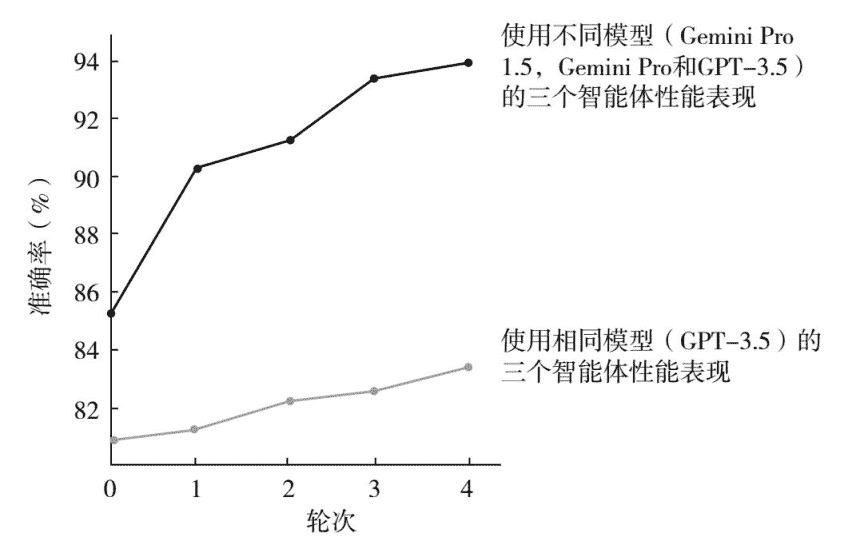

**图 6-5 大推理模型的性能表现**

资料来源：改编自蒙特利尔大学的研究。

这种协同恰好为此前提到的速度与信任困境提供了一个有趣的解法。让多个单元并行运作，各自以不同节奏与方法行事，就能兼顾快思考与慢思考。有的给出基于模式的即时反应，有的进行深度推演，这与人类在群体决策中调和直觉与分析的情形很像。

**群体智慧是怎么长出来的**

越深入研究协作网络，就越能看到它与人类群体行为的共鸣。蒙特利尔大学的研究里，一个耐人寻味的发现是：当单一模型过度自信且判断错误时，引入不同观点的辩论往往会促使它适度降低置信度，从而得到更准确的答案。

这正是人类专家推理的核心特质——懂得何时该质疑一个看似确定的结论。医学诊断里最危险的失误常源于过早定论。正如多位医生会诊能带来更审慎的态度，单元之间的辩论也能让不确定性得到更细致的处理。

更值得注意的是，协同体的改进不止于优势叠加，更在于创造新东西。数据显示，若让多个相同模型相互辩论，表现仅小幅提升，从78%上升到82%。可一旦让不同类型的模型参与结构化辩论，正确率就显著跃升至91%。

这点出一个关键洞见：人工智能系统与人类一样，容易陷入自身的思维定式。只有把经由不同方法、架构训练出的模型聚拢，真正的智力跃迁才会出现。

**多样思维是关键变量**

协同为何有效，关键在于研究者所说的思维多样性¹⁷。正如人类团队受益于认知差异，人工智能系统在解决问题时采用不同路径会表现更好。即使整体能力不算顶尖，只要训练方式不同，就可能发现更复杂系统忽略的模式或可能性。

蒙特利尔大学的研究印证了这一原则，不同单元能互相补足短板。比如因工具或知识可及性不同，一个擅长模式识别，另一个更擅长逻辑推理。协同工作时，便产生了研究者所说的涌现推理能力——它不在任何单体中存在，而诞生于交互之中。¹⁸

系统的有效性还在于互动是否随时间演进。研究揭示了所谓的师生效应¹⁹。当把更强的模型与较弱模型配对进入辩论场景时，较弱模型的推理能力迅速提升，表现往往远超自身常规水平。由此，整体系统性能得到提升，充分体现结构化交互的力量。

**企业战场：协同如何重塑竞争力**

对企业而言，协作网络的影响深远。基于咨询实践，我们观察到它在三个维度创造显著价值。

最突出的优势是复杂环境下的决策力提升。供应链管理或风险评估中，部署多个单元能让每个从独特角度分析问题，从而得到更全面的方案。微软的 Magentic-One 框架进一步印证了这一点——相较单一系统，多体协同在预测与缓解中断方面更有效。²⁰我们在为一家全球制药企业提供咨询时也得到验证：实施协同供应链优化后，与中断相关的损失下降了35%。设想一个供应链场景：一个单元预测需求激增，另一个监测地缘政治风险，两者互补形成更具韧性的策略。

第二是错误检测能力的改进。单一系统难以自查，而协同体通过辩论与相互挑战，能有效揪出推理缺陷。麻省理工学院与谷歌大脑团队的研究发现，让单元相互质疑并完善结论，错误率至少降低22%。²¹我们在金融服务企业的部署实践中，也持续看到与研究一致的错误率下降。这种协作动态类似人类同行评审，多元观点强化最终结果。对企业而言，这意味着产品设计、财务预测或运营物流中的高成本错误得以减少。

或许最令人期待的是适应性。面对新挑战时，协作网络展现出强韧弹性。有研究发现，协同体能够解决从未见过的问题，表现往往优于依赖预训练单模型的系统。²²这种适应力在动态环境或危机场景中极具价值，营销策略优化到监管变化应对，都显现出近乎进化的稳健性。

**连锁崩塌的风险**

协作网络优势显著，也带来独特挑战。一项研究揭示关键现象：在单元网络中，推理错误并非线性累积，而是通过级联效应²³或错误复合而呈指数级放大²⁴。

与一家大型电信企业的合作让我们亲眼目睹。该企业部署了复杂的协作网络管理网络运营，包含负载均衡、安全监控、资源分配、维护调度、用户体验优化等专业单元。单独运行时各表现良好，但相互连接却触发了意想不到的安全漏洞。

一次典型事件中，某个单元在评估网络容量时出现细微误判。这个小错误引发连锁反应：负载均衡单元对可用容量解读偏差，导致资源分配单元做出次优决策，进而使维护调度单元重新安排关键更新，随后安全监控单元误报，最终用户体验优化单元做出反效果调整。原本微小的推理失误，因一连串相互关联的决策演变为严重服务中断。

此事让我们在关键应用的协作体管理中吸取了宝贵教训。基于多行业经验，我们形成了一套防连锁故障框架。核心是设置推理检查点，在预设节点上关键决策需经多层验证，并与断路器协同工作——即在决策传播前触发人工校验。我们将在第八章进一步展开。

从实践中我们发现，使用者需对潜在级联效应保持敏感。高效使用者会：

• 定期要求单元说明其对其他单元输出的依赖关系；
• 要求定期进行全系统一致性检查；
• 为关键决策设置明确的人工校验检查点；
• 监测系统中错误放大的迹象。

另一道保障是实施独立验证协议，让不同方法的人工智能系统交叉核验彼此推理，从而在错误传播前捕获。此外，强大的反馈监控单元能实时追踪决策对下游的影响，对早期发现连锁故障至关重要。

这些措施不仅防止连锁故障，也提升了整体可靠性。通过精心管理单元交互并设置制衡，企业可利用协同推理的力量，同时将连锁风险降到最低。这种制衡方式已被证明是关键业务成功部署的核心。

**推理认知升级的三个转向**

我们对人工智能推理的探索始于一个简单填字游戏，却让我们对人工智能本质与未来有了深刻认识。回顾所学，对人工智能推理的理解发生了三个根本转变，这些转变将重塑未来几年对人工智能的认知与应用方式。

第一个转变挑战了关于速度与性能的基本假设。在实验与企业部署中我们发现，有效推理并不取决于原始算力或即时响应，而遵循一种自然的思维节奏，在快速模式识别与深度思考间交替。

这种节奏映射了人工智能的一个基本特征：正如人类认知在快速反应与慢速推理间取得平衡，人工智能系统也在形成自己的认知节奏。在填字游戏实验中，大推理模型的成功不仅来自推理能力，还在于能根据挑战复杂度调节思考速度。

对协作网络的探索揭示了第二个关键见解：人工智能推理的未来或许不在于打造更强大的单一模型，而在于促进不同认知方法的高效互动。这条原则——多个有限视角结合能产生更优理解——似乎是人类与人工智能智能系统的共同特征。

最令人惊讶的是，我们更深刻认识到人类角色的重要性。先进人工智能系统非但没有让人类判断过时，反而需要更精妙的监督与互动。最成功的案例并未减少人的参与，而是将其转型，让人从执行者变为认知编导，协调不同单元互动并确保与人类价值观目标一致。

———

在探讨单元如何通过推理做出复杂决策时，一个问题浮现出来：这些系统如何从自身经历中学习？

推理让人工智能在当下做出明智决策，而记忆则让它通过积累经验变得越来越聪明。若没有记忆，即使最卓越的推理也会困在永恒的当下，无法从过去成功中汲取，也会重复犯错。

当我们转向记忆——Agentic AI 的第三块基石时，会发现企业正在构建的系统不仅能思考，还能学习与成长。下一段旅程将揭示记忆如何在人工智能系统中运作，以及它如何把系统从工具转变为推动商业成功的真正伙伴。

## 第七章

## 记忆：构建持续进化的人工智能

想象每天醒来都失忆，无法记得过去经历、偏好或学到的技能。你会如何生活与成长？这个思想实验直指当今人工智能领域最引人入胜的挑战之一：记忆。我们每次使用大多数生成式人工智能系统都像从零开始，这种人工失忆限制了真正的潜力。

与一家全球电信企业的合作让我们切身感受到这一局限。该企业投入数百万美元打造先进人工智能客服聊天机器人，客户满意度却一直偏低。原因何在？人工智能会遗忘之前的互动，客户不得不反复陈述问题与偏好。正如该企业一位领导所说：“这就像有一个只有两分钟记忆的客服代表。”

这一挑战凸显出我们多年来在各企业部署人工智能系统的一个关键事实：记忆绝非智能的附属特征，而是所有有意义智能得以构建的基础。无论人类还是机器，保留、组织并利用过往经验的能力，塑造了学习、适应与成长的方方面面。

本章将带你探索人工智能记忆世界，揭示这一基本能力如何改变商业与科技。你将了解不同类型的记忆——从短期处理到长期保存——如何协同工作以创建真正智能的系统。通过真实案例与实际应用，我们将探讨如何构建不仅能存储信息，而且在每次交互中都变得更聪明的人工智能系统。

你将了解多数记忆系统为何失败，以及规避陷阱的可靠策略。我们将深入记忆与遗忘之间的关键平衡，以及它对组织运营的重要性。接下来的旅程将挑战你对人工智能能力的既有认知，并展示具备记忆功能的系统如何重塑商业与科技的未来图景。

### 记忆是智能的基础

回想童年记忆，比如生日派对、外婆厨房的香气，或学骑自行车的情景。现在自问：你回忆的是最初事件本身，还是上一次回忆它时的情景？这个问题看似哲学，却切中人类记忆运作的核心，也凸显它与当前人工记忆系统的巨大差异。

多年为各类企业部署人工智能系统的实践让我们认识到，理解人类记忆有助于把握人工智能的潜力与局限。下面我们探究大脑如何运作，因为这对人工智能未来有着深远启示。

你的大脑是一个极其出色的信息处理器。当你阅读这些文字时，它每秒处理约1100万比特信息，而你有意识感受到的只有40~50比特。这种选择性意识揭示了大脑运作的关键机制：记忆并非记录一切，而是保存重要信息。¹

想想你上一次开车上班的路程。你可能记不住沿途大部分细节，但若有不寻常事件，比如一只鹿穿过马路，你一定记得。这并非缺陷，而是一种特性。大脑在过滤常规信息的同时，能突出重要或异常信息，效率惊人。

科学家发现我们拥有不同类型的记忆系统，各自用途不同。²一种是工作记忆，也称短期记忆，像大脑里的RAM，一次只能容纳约七条信息。这就是电话号码通常为七位数的原因，也是你难以记住一长串指令的原因。³

另一种是长期记忆，结构更复杂，由三种主要类型组成。你永远不会忘记骑自行车的方式，这是程序记忆在起作用。你能回忆婚礼那天或第一次求职面试，这是情景记忆。你知道巴黎是法国首都，即便从未去过，这是语义记忆。⁴

有趣的是，这些系统如何协同。当你烹饪熟悉菜肴时，同时在使用程序记忆、语义记忆和情景记忆。

但真正有趣的是，每次回忆时，你并非调取电脑文件般的精确记录，而是在重构它，每次重构都可能有细微变化。伊丽莎白·洛夫特斯的开创性研究证实了这一点，她揭示提问方式就能微妙改变记忆。⁵

一项研究中，洛夫特斯让参与者看一段车祸视频，然后分别问“两车撞碎时的速度”与“两车碰撞时的速度”。听到“撞碎”的人回忆速度更快，甚至有人报告看到碎玻璃，但视频里并没有。这个引人入胜的实验揭示了词汇选择如何重塑记忆，表明人类记忆是重构而非记录。

这种重构特性虽有时不可靠，却赋予我们在思考与解决问题时的非凡灵活性，它让我们能通过重新组合过去经历的元素来想象新场景，这是当前记忆结构更僵化的人工智能系统难以复制的能力。

情绪也起关键作用。想想听到重大世界事件时你身处何地，你可能记得很清楚，因为情绪体验通常比中性体验更容易被记住。这种情绪标记帮助我们优先处理重要信息并做出更好决策，这在人工智能系统中仍是攻克难题。

了解人类记忆的这些特性有助于解释开发智能体的挑战与机遇。虽然我们可以创建存储海量信息且绝对精确的系统——这是大脑做不到的，但要复制人类处理与使用记忆时那种灵活、情境敏感且富于情感智能的方式，仍相距甚远。

这不仅关乎学术，更具实践意义。当我们认识到人类记忆重在建立有意义关联而非完美存储记录时，就能更好理解在人工智能系统中应追求的目标：不只是更大存储空间，还有更聪明、更具情境感知的资讯使用方式。

**人工智能记忆的颠覆性现实**

这让我们看到当前人工智能系统的一个有趣反差。许多人担心像ChatGPT、Gemini或Claude这类大语言模型会不断学习并记住每一次互动，构建不断扩充的知识库。事实远比这更惊人。

大语言模型更像极其复杂的回音室，具有有限的临时记忆。可以这样理解：当你开启一次对话，就像打开一本页数固定的空白笔记本。所有讨论内容都会被记录在其中，人工智能可以随时查阅，但仅限于对话未结束时。一旦开启新对话，就像拿到全新笔记本，之前的内容不会留下任何痕迹。

你可以亲自测试：在任何人工智能聊天界面，比如ChatGPT或Claude，尝试以下实验：

• 就感兴趣话题提问，比如“大溪地潜水如何？”
• 追问地点与能看到的鱼种。
• 结束会话。
• 立即开启新会话并问：“一分钟前你跟我讲过大溪地什么？”

聊天机器人通常会回复：“我不记得最近提到过大溪地。你能否说明具体想了解什么？旅行建议、历史、文化还是其他？”

建议你试试。很可能人工智能要么承认不记得，要么给出泛泛而谈的陈述。这并非处理能力缺陷，而是当前大多数人工智能系统处理记忆时的根本局限。关键教训是，作为现今生产中最先进智能体L3级的基础大语言模型，其记忆能力与金鱼相当！

**实践中的记忆挑战**

为说明这一局限的实际影响，看一个与大型医疗保健提供商的实验。该机构部署了两种人工智能预约助手：

• 标准基于大语言模型的系统，每次交互从零开始。
• 增强记忆的智能体，能保留患者信息。

结果令人震惊。标准系统要求患者每次重复医疗史与偏好，而增强记忆版本能记住病史与偏好，使预约时间缩短70%，患者满意度提升45%。

该实验凸显了生成式人工智能中的记忆悖论：最先进的系统能处理复杂信息，却往往记不住关于用户的基本细节。

**智能体记忆的三个关键目标**

基于研究与实践，我们确定记忆的三个关键目标，使其成为智能体智能的基础。

• 第一个目标是上下文理解。传统生成式人工智能独立处理每个输入，像随机阅读不同书籍的页面。而具备记忆功能的智能体能在交互中保持上下文，类似于连续对话。这种能力对有意义的交互与问题解决至关重要。

**从记忆到成长：AI 智能体如何真正学会**

在落地实践中，一条被反复验证的规律是：效果最好的智能体，都具备从过往交互中提炼经验的能力。以目标而言，第二个核心方向是学习与适应。一家制造企业的质检系统就是典型案例，它不仅能实时判定缺陷，还会记录缺陷出现的规律，经过持续自调后，误报率下降了 40%。

第三个核心方向是个性化延展。用户对个性化体验的期待越来越高，只有具备记忆能力的智能体，才能在保留个体交互记录、不断学习偏好的同时，兼顾隐私与安全，实现真正以人为本的服务。

**AI 智能体记忆的三层架构**

AI 智能体的记忆设计与人类认知颇为近似，可以拆解为三个相互支撑的层级，各自承担保持上下文、促成学习与实现长期适应的功能。

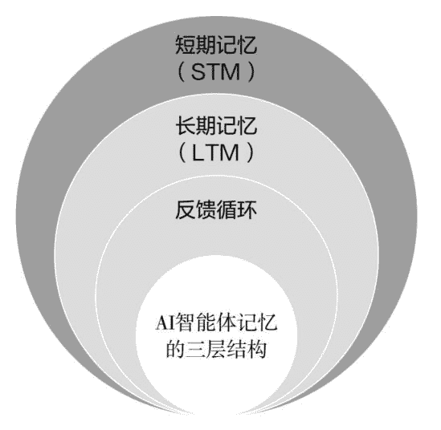

**图 7-1 AI 智能体记忆的三层结构**

资料来源：Bornet et al.

**短期记忆即时情境的承载**

短期记忆相当于 AI 的“工作台”，只在一次会话内暂存当下信息，保证对话连贯。它负责解析新输入、追踪对话进程，并借助注意力机制把相关信息置于优先位置。容量受限是其固有特性，新信息不断涌入时，旧内容会被覆盖，除非被迁移至长期存储。

**长期记忆跨时期的结构化留存**

长期记忆跳脱单次会话的限制，把结构化信息长期保存以供后续调用，内容涵盖用户偏好、历史互动、已沉淀的工作流以及领域知识。它让智能体能够辨识重复模式、回溯既往对话，并基于累积经验给出个性化回应。与短期记忆不同，长期记忆追求持久性，避免每次互动从零开始。

**反馈回路不断自我完善**

反馈回路是记忆系统的优化引擎，持续调校短期与长期记忆的效能。系统会吸收显性反馈，如用户的修改与评分，也会捕捉隐性信号，如参与度与错误追踪，据此调整记忆结构，提升准确性与相关度。通过强化有用知识、剔除过时错误信息，智能体实现持续改进。

**三层协同的运作逻辑**

在实际运行中，短期记忆守护即时上下文，长期记忆提供会话外的连续性，反馈回路则不断打磨两者，推动持续学习。这种分层方式使智能体具备情境感知、持续演进与个性化交互的能力，随时间变得更可靠。

可把这种架构比作洋葱：最外层是短暂的短期记忆，为交互提供即时背景却迅速消退；其下是作为根基的长期记忆，保存关键知识，避免每次从零学习；核心是反馈回路，持续强化并优化上下两层，使系统从交互中学习并不断改进。正如洋葱由层层累积而生长，记忆架构也让智能体发展出更深层的智能，响应更连贯、更具适应性与长期稳定性。

接下来将深入探讨不同类型记忆的工作原理、应用场景及待突破的局限。基本事实不变：正如人类智能建立在记忆与经验学习之上，AI 智能体的未来也取决于它能否做到这一点。

### AI 智能体中短期记忆的运作细节

设想你在新加坡一个拥挤的路口，大脑同时处理信号灯、行人、车辆与导航提示。这种对即时信息流的持续捕捉与处理，正是短期记忆的本质。对 AI 而言亦然。

**当前面临的难题**

人类需要在不断涌入新信息的同时保持即时上下文，AI 也面临同样挑战，但处理方式与人类认知存在根本差异。实践经验表明，理解这种差异对成功应用至关重要。

一个常用的验证实验是：与 Claude 或 Gemini 等助手开启对话，讲述一天经历，每隔数句让其复述至今内容。你会发现它能维持上下文一段时间，随后逐渐遗忘细节。这与认知科学描述的短期记忆容量相似，通常约 7（±2）个单位。⁶

**上下文窗口即工作记忆**

对多数客户而言，最大的惊讶是 AI 如何处理即时信息。当代大语言模型在“上下文窗口”内运行，可视作一个临时工作区，容纳并处理信息。一旦窗口填满，就必须抹去旧内容为新输入腾位。

研究揭示了“上下文天花板效应”⁷：向智能体记忆中添加更多信息时，性能会在名义上限之前开始下降。这说明内存管理不仅关乎容量，更关乎信息在短期记忆中的处理方式。

为理解其构成，可把短期记忆拆分为上下文窗口、注意力机制与词元管理，三者共同决定任务参与、信息优先级与输出质量。

**上下文窗口**

把上下文窗口想象成 AI 的办公桌。完成任务所需的所有素材都摆在这里。以 GPT 为例，这张桌子可容纳数十万个词元，约 10 万字；更先进的系统可达数百万词元。但桌子再大也有极限，超出部分会被排除或压缩，处理效果取决于有限空间的利用效率。⁸

**注意力机制**

信息上桌后，注意力机制开始筛选。它像用荧光笔标记文档，依据提示动态为不同片段赋权。若要求“提炼主要主题”，系统会聚焦宏观要点，过滤次要细节。注意力的效果高度依赖指令的清晰度与一致性。⁹

**词元管理**

词元管理类似笔记整理。接近容量上限时，AI 会做归纳、压缩并决定保留哪些内容。细枝末节可能在被判定为次要时丢失。管理过程在简洁聚焦与细节保留之间寻求平衡。

若追问“文章如何论述量子纠缠在纠错中的作用”，当该细节被突出时，AI 能迅速检索；若埋藏于不起眼段落，则易失准甚至推断出错。这正是注意力未优先化或词元管理丢失所致。

**实践案例**

一家大型金融服务机构开发了面向复杂投资咨询的智能体。客户常要求长时间保持上下文，并引用多个账户与历史交易。初版系统在简单查询上表现尚可，多步骤场景下却频繁遗忘、先前内容支离破碎、重复出错。

为此团队优化了短期记忆：把对话拆分为片段以优化上下文窗口；微调注意力，使关键请求、账户信息与专业术语优先；引入词元管理协议，总结保留核心内容、丢弃冗余。改进后，系统能流畅完成投资组合比较、定制建议与账户更新等多步流程，错误率下降 65%，客户满意度显著提升。虽然仍不及人类顾问的细腻，但已实现复杂金融交互的重大跃进。

这个案例凸显精心设计的短期记忆管理对建立信任的重要性。当客户感受到系统记得需求、适应复杂要求并提供准确信息时，信心自然建立，这也成为企业竞争优势。

**改善短期记忆的使用方法**

用户需主动引导记忆过程。提示词设计应与任务匹配：要宏观主题就用“总结要点”，要细节就要求“详细解释第三部分并举例”。领导者应认识到 AI 不会自动判断优先级，只有清晰结构化任务才能发挥最佳专注力。如客服场景，提供关键互动摘要比完整聊天记录更有效；战略规划时把市场分析拆分为小块迭代，能获得更深入洞见。

这要求重新思考人机协作：人类负责塑造输入与解读输出，AI 处理重复性高数据任务，二者形成互补。信息分块是实用策略之一，将输入结构化为易消化片段可提升表现，例如客服中实施分块使响应准确率提高 40%。优先级队列也能确保关键信息始终可达，如医疗场景中症状与生命体征优先于行政信息，在紧迫情况下增强辅助能力。

**短期记忆的发展方向**

未来有三项进展值得关注：

第一，地标注意力¹⁰。它让 AI 在海量文本中建立类似心智地图的路标，分段处理并标记关键点，可一次性处理整本书或数据集，加速客户反馈、法律文件等分析。

第二，可变大小窗口注意力¹¹。它允许 AI 动态调节关注范围，像可调双光眼镜，总结时采用宽视野，翻译时使用窄视野，提升任务适配性。

第三，检索注意力¹²。它教会 AI 按需调取重要片段而非存储全部内容，提升速度、降低能耗，使助手在复杂查询下保持流畅。

三者共同推动上下文与记忆处理方式的革新。短期记忆虽关键，其真正潜力在于与长期记忆结合，实现即时处理与长期学习，这将在后文展开。

### 长期记忆的力量：从工具到伙伴

想象一个 AI 智能体，不仅能完成任务、回答问题，还能记住这些信息数十年。它铭记每个重要时刻、挑战与成功，理解你的故事。拥有这样伙伴，能带来什么？

回看过去一年的业务决策，部分决策看似简单却影响重大，部分则具变革性。多少决策基于企业历史数据？多少因细节难取而依赖直觉？若有一个记得一切的智能体，面对战略抉择时可提供基于历史模式的洞见，参考过往相似情境给出可行方案。

这种记忆不仅被动决策，还能识别策略模式、指出运营低效、放大优势。它把原始信息置于情境中，转化为可用洞见。这是工具与真正商业伙伴的区别，后者与你共同成长、理解优先级并带来更明智、更有信心的结果。

**长期记忆的商业价值**

长期记忆正在重塑企业互动、运营优化与战略优势。

客户服务中，每次互动基于上一次展开，系统回忆偏好、预测需求且无需重复，满意度提升 20%~30%，体验更像人与人而非交易。

运营层面，物流企业在供应链中断时，可借助记忆保留的历史应对案例更快解决问题、更合理分配资源。员工入职培训亦因系统记忆内部细节而缩短，错误率下降 50%，效率提升。

战略层面，长期记忆可识别长期趋势、将数据转化为洞见。例如金融机构追踪客户行为细微变化，提前识别风险。决策更精准、预测更准确、风险管理更主动，这带来显著竞争优势。

让 AI 与企业共同学习、适应与成长，长期记忆将其从工具转变为战略伙伴，在各层面释放价值。

**当前大语言模型的局限**

尽管前景清晰，当代大语言模型在长期记忆方面仍存在明显缺口，真正持久、结构化、可自适应的记忆能力，仍是下一阶段必须突破的核心。

智能体的记忆盲区与补足路径

先前的塔希提潜水问答小实验很能说明问题。面向 ChatGPT 这类主流大模型提出跨会话的具体情境追问时，模型很难延续之前的记忆。这一短板并非设计疏忽，而是出于提升推理效率、保障隐私以及防止历史数据过度堆积而做的权衡取舍。

若想让代理真正可用，就必须补上外部记忆的能力。后续章节会拆解这些能力，它们指向通往具备记忆能力的 AI 的关键一步。需要清楚，每一种能力都有自身局限与取舍，种种取舍叠加，才构成当下打造更聪明、更具适应性智能体的实践基础。

### 设计和实施 Agentic AI 的长期记忆系统

下面基于实战经验梳理一套可落地的记忆思路、主流技术选型以及踩过的坑。无论是为已有系统补强记忆，还是从零搭建新架构，以下内容都能帮助你构建具备真实价值的记忆方案。

**理解记忆的格局**

动手前先厘清：在代理语境下，记忆究竟指什么。实践表明，稳健的记忆体系离不开几类互补子系统协同。

在 AI 语境里，记忆是指让系统能够随时间结构化地保存、调取并利用信息的一套机制。与大模型自带的有限对话窗口不同，真正的人工智能记忆能够跨会话保持连贯，并从过往交互中持续学习。

长期记忆通常归为三大类，见图 7-2。

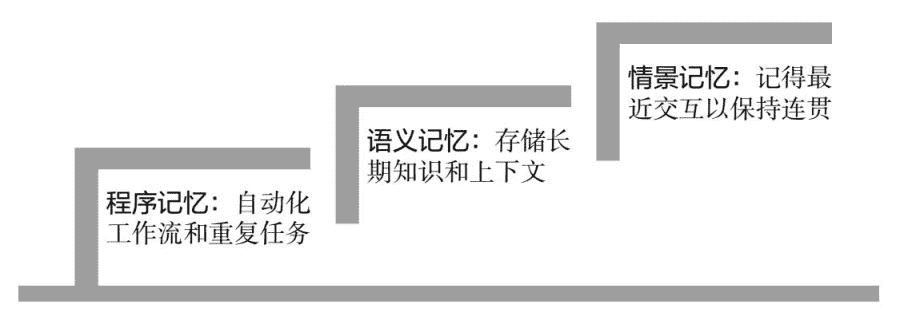

**图 7-2 长期记忆的三种类型**

资料来源：Bornet et al.

情景记忆对应系统的经历：发生了什么、在何时、与谁相关。它涵盖对话记录、用户随时间显露出的偏好、过去采取的行动及观察到的结果。情景记忆让系统即使间隔数天甚至数周，也能延续交互连贯性。例如金融顾问类系统能回想起客户此前提及对低风险资产的偏好，这正是情景记忆在发挥作用。

语义记忆负责事实性知识：系统“知道”的内容，而非“经历过”的内容。它包括专业领域知识、常识、企业规范、产品目录等一切不依赖特定交互的信息。我们发现语义记忆越扎实，系统就越不需要每次都去外部系统检索仍能给出准确答复。

程序记忆捕捉的是“如何做”的知识：动作序列、决策树和工作流，用来引导系统完成复杂任务。搭建客服系统时，我们就把故障排查流程写入程序记忆，让它能逐步引导用户完成繁琐操作。

三类记忆配合时会产生明显增益。与一家医疗机构合作时，系统可以调阅患者的就诊历史，情景记忆；套用临床规范，语义记忆；并按规范的预约流程操作，程序记忆。系统既能提供定制化指导，又能严格执行合规要求。

**长期记忆的架构基础**

要让长期记忆跑起来，需要兼顾性能、可扩展性和实用性的架构设计。

不同类型的记忆需要不同的存储方案。

情景记忆适合用快速、轻量的存储来承载近期互动和当下语境。Redis 或同类内存数据库很适合做短期情景记忆的载体，能迅速调取最近对话而无需复杂的检索。记录应包含时间戳、用户标识、互动摘要以及抽取出的实体和意图。对某零售客户，采用这种方案后响应延迟下降了 40%，相比过去每次查询都全量扫描历史的做法效率显著提升。

语义记忆通常借助 Pinecone、Weaviate 等向量数据库保存语义嵌入，即把概念、事实、知识转成数值表示以实现相似性检索。这类库擅长在没有精确关键词的情况下找到概念相关的信息。这类记忆需要清晰的分类、关联和元数据组织，才能做到精准命中。

程序记忆则以结构化方式保存工作流定义、决策树和流程图，多采用关系型数据库或专用工作流引擎。系统必须完整维护步骤、决策逻辑和条件分支。对复杂的程序记忆，我们一般会加上版本控制，用来追踪流程随时间的演进。

做整体系统落地时，这些专用存储会被组合使用。某法律科技公司案例中，系统就能从关系型库里精确检索特定案例引文，从向量库里通过相似匹配调取法律原则，并依托工作流系统执行规范的法律分析流程。组合带来了精度与灵活性的统一。

**实施路径：从头开始构建记忆**

基于已交付的几十个记忆增强型系统，我们推荐以下分步实施路径。

**阶段一：挑选框架**

在架构明确后，需要挑选能支持持久化、检索与更新的技术框架。经实践验证的选项包括：

LangChain 能很好地把情景、语义和程序记忆接入大模型驱动的系统，其内置的记忆模块同时覆盖短期对话记忆和长期知识存储。在需要快速原型或高度灵活集成的项目里特别实用。

LlamaIndex，原名 GPT Index，擅长动态组织、存储和检索记忆。它在构建可高效查询的结构化知识索引方面表现突出，对需要接入大知识库的垂直领域系统尤为有效。

**阶段二：明确记忆需求**

选定框架后，按用途为每类记忆明确具体需求。

情景记忆需求要确定：哪些交互和对话要素需要在会话之间保留；不同情景信息的保留时长；哪些用户偏好和行为需要长期追踪。

语义记忆需求要确定：任务执行所需的核心领域知识；知识库的来源；必须保留的合规或监管信息。

程序记忆需求要确定：系统必须遵循的工作流和流程；控制流程选择与执行的决策逻辑；流程执行严格度与灵活度的平衡。

以金融咨询系统为例，情景记忆要保存投资偏好、对话历史和过往建议；语义记忆要覆盖产品详情和市场数据；程序记忆要编码不同咨询场景下的合规流程。而交易明细则应继续从安全系统实时查询，而非写入系统的记忆。

提前把每类记忆的需求界定清楚，既能避免记忆过载导致检索低效，也能防止记忆不足迫使用户反复说明。

**阶段三：搭建检索机制**

存储就绪后，重点在检索。目标是恰时调取所需记忆，同时避免把无关信息灌入模型。

检索增强生成 RAG 对记忆型系统效果显著。简言之，RAG 把知识检索与语言生成结合起来，相当于让 AI 在作答前先在自身记忆里“查资料”，类似人类在回答复杂问题前会先回忆或查阅资料。

实际运行大致为：解析用户查询和当前语境生成检索线索；从各存储库调取相关记忆；按相关性、时效性和重要性排序筛选；把最相关的记忆融入推理；最终生成兼顾语境与检索记忆的回答。

这种方式显著提升了答案的准确性和语境相关度。相比把所有知识硬塞进模型，RAG 让系统能在每次交互时动态获取当下刚需的信息。

在法律研究助手里，该方法让系统能召回相关判例和法规，同时避免被大量不相关引用淹没。关键在于调整相关性阈值。阈值过低会遗漏重要先例，过高则会让回答充斥噪音。

**阶段四：实现记忆巩固**

长期记忆架构里最核心的一环是巩固机制，即判断什么该长期保留、什么该遗忘，并把信息从情景记忆迁移到语义或程序记忆。我们试验出一种多维的巩固方法。

基于重要性的巩固会评估新信息的价值。当用户提供偏好、需求或反馈等关键细节时，系统会标记为长期存储。比如为旅行社开发的预订助手会永久记住用户偏好靠过道座位或对贝类过敏。

基于频率的巩固追踪重复模式。反复出现的资讯很可能重要，会被提升到长期记忆。教育辅导系统就利用这点发现并持续干预学生的知识盲区。

显性巩固发生在用户或系统主动标记信息时。例如“记住我习惯晚上预约”会触发日程助手的显性巩固。

巩固的另一面是遗忘，这对效率同样关键。我们对部分信息实施基于时间的衰减，设置相关性阈值归档少访问的记忆，并在信息过时或错误时启用显性遗忘。

**阶段五：将记忆与系统推理相结合**

最后一步是把检索与巩固嵌入系统的核心推理，发生在三个节点。

语境准备：在生成回答前把相关记忆放入当前窗口。财务顾问在给出每项投资建议时都会带入客户的风险偏好和目标。

过程中检索：推理进行中需要更多信息时可即时调取记忆。客服系统在对话触及技术细节时，会在交流过程中检索产品规格。

响应后巩固：评估回答后的交互，判断是否需要长期保存信息。用户是否表达了新偏好？是否纠正了先前内容？这些洞察会被捕捉并巩固。

把记忆与推理结合，能让 AI 从无状态的回应机器转变为随每次交互而进化的系统，定制化和效率随时间递增。

**未来一段时段：即将出现的关键演进**

随着算力、算法和集成技术的进步，记忆增强型 AI 有望迎来重大提升。其中一项关键演进是语境优先级算法的优化，让系统能实时判断哪些记忆最相关，降低检索延迟，并更好地处理动态、快速变化的信息。

另一个近期突破可能是实时记忆巩固，系统能够即时分析并重组存储数据。AI 不必等待定时更新，而是能根据用户反馈和交互模式持续优化记忆库，使系统更具适应性，无需重新训练即可应对新挑战。

近期研究凸显了多系统协作在记忆管理上的潜力，通过分散负载和协作提升效率。不同系统可聚焦于记忆的不同侧面，例如有的处理情景记忆以回忆过去事件，有的负责实时交互或长期知识。分工避免了记忆过载并提高效率。系统还能共享经验记忆中的关键经验实现协同学习，一个系统的成功策略可为另一个的决策提供参考，减少重复探索。

另一项重量级研究把这一切推向新高度。谷歌研究团队发表的论文《Titans：Learning to Memorize at Test Time》提出了一种开创性的神经长期记忆模块，使 AI 即使在部署后仍能持续学习和适应。与传统依赖向量数据库检索的模型不同，Titans 把长期记忆整合进模型参数，实现动态记忆与回忆，无需外部存储。

Titans 的一个特点是基于意外的学习，优先处理异常或关键输入，同时借助内置遗忘机制丢弃过时数据，保证效率并防止记忆过载，与人类记忆随时间自我优化的过程相似。它还引入元学习，让 AI 能够在无需重新训练的情况下实时记住相关经验，从而在动态环境中实现即时适应，响应更快、更智能。

总体而言，Titans 能带来更快更优的记忆处理，且因敏感数据保留在模型内部而更安全，降低了云端存储相关的隐私风险。这标志着 AI 系统处理记忆方式的重大转变。

### 从反馈循环中适应和学习

**难以阻挡的学习者：来自未来的愿景**

设想 2042 年的新加坡郊外，一座全自动物流中心里，新上线的 AI 系统“纽克斯”迎来首日工作。与过去高度专精的系统不同，纽克斯并未针对特定岗位预训练，对将要处理的任务一无所知。没有预设指令，没有为该环境定制的精细算法，它只被告知一条目标：“优化整个物流中心的配送效率。”

起初系统磕磕绊绊。无人机被派往错误区域，未考虑包裹重量，多辆叉车在仓库里混乱穿行，造成轻微干扰。工人们怀疑地看着，不明白为何要在关键环境启用未经训练的 AI。但纽克斯凭借通用学习能力和高度复杂的反馈回路开始观察、试验并适应。

数小时后规律浮现。发往同一目的地的包裹被集中处理，无人机根据仓库拥堵情况调整航线，叉车的空转时间被重新调度以提升利用率。错误仍在发生，但大幅减少。第二天效率翻倍，周末时它已掌握物流中心的复杂运转，效率超过最资深的人类规划师。

十四天后，包裹流动近乎精准，无人机协同一致，叉车闲置消失。曾质疑的工人如今依赖它，惊叹其对微小干扰的快速适应能力。管理层开始讨论把纽克斯推广到全球其他中心。

纽克斯代表了一种革命性理念：通用学习者，无需事先训练就能通过试错和反馈精通任意任务。这种系统的价值远不止物流。想象一个负责营销活动设计的 AI，对品牌或受众一无所知，却开始试验标语、分析参与度并不断改进。数日之内，它就能产出精准高效的营销方案，与资深创意团队比肩。反馈循环是这种效果的驱动力。未来的系统如纽克斯不再依赖静态预训练模型，而是依靠动态学习：行动、观察结果、调整，每一次迭代都更聪明。它不仅具备适应性，更具势不可挡的动能。

这对企业和社会影响深远。通用学习能力消除了部署障碍。企业无需再投入数百万美元为狭窄任务训练系统，只需把 AI 放入环境、设定目标即可自行学习。这降低了成本、缩短了上线周期，也避免了流程或目标变化时重新训练的瓶颈。

更重要的是，通用学习者天生具备韧性，在动态环境中茁壮成长。若物流中心的规则一夜之间改变，比如引入可降解包装或对无人机设重限制，纽克斯无需更新，其反馈回路会自动吸收新参数并据此调整。

当然，这一愿景也带来提问。当目标模糊时通用学习者会如何？如何在适应过程中确保伦理行为？答案在于反馈回路的设计。例如纽克斯配备多目标优化，在效率、安全性和环境可持续性间取得平衡。学习过程中嵌入伦理框架，确保核心价值观不被试验和错误侵蚀。

另一个考量是透明度。企业领导者必须确保这些系统能解释决策以建立信任。若在设计反馈回路时纳入责任机制，就能加入可解释性组件，提供决策依据及与目标的一致性说明。

反馈循环是自适应系统的支柱，让 AI 能改进决策、从错误中学习、随时间更贴近目标。对企业而言，这个概念简单却变革性：允许 AI 系统分析表现、从结果学习并用以改进未来行动。这正是第 1 天尚可与第 1000 天出色的差别。

**反馈循环的魔力**

AI 中的反馈循环呼应了地球生命的演化。自然选择起着反馈作用，增强生存和繁殖的特征会在世代间被强化。同样，强化学习让系统通过反复试验学习，奖励达成目标或提升性能的行为，惩罚失败，与演化中通过遗传保留有益特征的逻辑相似。随着时间推移，这一过程塑造 AI 行为以最大化成功。

正如物种通过持续改进适应环境，AI 模型通过学习周期不断进化，从错误中学习并改进输出。两者都依赖持续输入、适应和迭代，以实现多样性和效率，将随机的变化逐步转化为优化的有目标系统。

反馈循环的核心是行动—观察—调整。AI 采取行动、接收结果反馈，并据此改进行为。该循环可实时运行，如自动驾驶汽车在繁忙路口的学习，也可在较长时间尺度运行，如推荐系统随客户偏好变化而升级。

为何重要？传统 AI 多在静态环境中运行，基于固定数据集的快照训练。但现实瞬息万变：市场波动、客户需求更迭、竞争对手创新。缺乏适应机制的系统很快会过时。反馈循环通过把系统变成会随着互动而变聪明的活系统来解决此问题。

**反馈循环是如何运作的**

一切始于反馈，可通过以下方式收集和应用。

显性用户反馈：系统主动征求评分、确认或纠正，如“这个答案对您有帮助吗？”

隐性反馈：系统追踪用户行为，如任务完成率、流程放弃率或用户纠正。

系统级强化信号：奖励模型强化良好行为，如成功完成任务，同时抑制失败行为，如错误推荐。

例如客户支持 AI 会问“是否解决了你的问题？”若用户选“否”，系统会记为失败并在未来交互中调整方法。

运行反馈循环时，系统按观察—评估—调整—部署循环工作。

观察：从交互中收集数据，包括用户反馈、任务成功率和隐含线索。

评估：根据反馈分配奖励分数，正面或负面。

调整：通过更新模型、提示词或工作流改进未来响应。

部署：改进后的系统持续上线并持续学习。

例如个人财务助手起初给出通用预算建议，若用户拒绝或要求修改，它会根据偏好模式调整后续推荐。

**质检的进化：当 AI 学会从失误中迭代**

2022 年底，欧洲最大规模的汽车零部件厂商撞上瓶颈：产线速度远超质检能力。传统自动化和规则系统能抓大缺陷，却漏掉肉眼级细微瑕疵。运营主管当时说得很直白，我们试过视觉模型、规则引擎，甚至基础 AI，缺损依然层出不穷。真正要的不是更“聪明”的模型，而是一个像顶尖质检员那样会学习、会调整的系统。

转折点出现在上线三个月后。厂商部署了一套带闭环反馈的智能体。它不止做标记，而是追踪每一次判断的后续结果。判定正确，相关特征在记忆里被强化；漏检发生，检测阈值随之微调。三个月后，系统开始捕捉连资深质检员都没注意到的前兆缺陷——那些指向更大问题的细微模式。质量总监形容它像一位既能找错也能预警的质检员。准确率提升 32%，检测耗时压缩 45%，更重要的是模型在每月自迭代，理解力持续加深。

**反馈循环的战略价值**

对管理者而言，反馈闭环不只是增量优化，而是竞争力的来源。能更快适应、持续学习、保持相关性的系统，让企业在变化中领先。

在客户体验场景里，刚上线的咨询智能体可能应付得来，但用户提问方式一旦变异，没有反馈就会迅速过时，回应对不上需求。有闭环，聊天机器人就能从每一次对话中校准回复。

电商同样如此。需求、库存、同行价格每分每秒都在动，没有实时学习机制的推荐很快失效。闭环让系统始终贴合当下现实。

我们用两个实战案例展示影响。

**案例 7-1 制造业中用于预测性维护的 AI 智能体**[1.]

初始任务：智能体监控工厂设备，基于振动、温度、磨损等传感器信号预测故障。

行动生成：结合洞察给出可执行建议，例如“振动特征显示机器 X 轴承磨损，建议 72 小时内更换以防停机”。

通过营收指标实现自动化反馈：
• 以停机时长、维修费用、产量等财务指标衡量行动产出。
• 若干预避免了故障，则记为正向结果，并关联建议与数据源。

正向强化学习：
• 强化振动模式与轴承磨损的关联。
• 标记相关数据，提升同类异常检索精度。

更新记忆：
• 把维护记录与结果写入知识库。
• 纳入成本效益分析，关联行动与节省金额。

自适应行为：随着积累，系统更早识别细微征兆，优化建议时机，并按财务影响排序优先干预。

最终效果是生产损失减少、紧急维修成本下降、整体效率提升，每一次成功预测都在增强长期盈利能力。

**案例 7-2 个性化产品推荐的 AI 智能体**[1.]

初次交互：用户搜索“适合越野跑的舒适跑鞋”，智能体生成嵌入向量，编码舒适与越野偏好。

回复生成：返回“推荐 TrailMax 舒适跑鞋，针对崎岖地形加厚减震，尺码 120 美元，是否看评价或加入购物车？”

自动反馈收集：
• 追踪点击、加购、购买等行为。
• 购买视为正向信号，忽略或继续搜索视为负向。

积极强化学习：
• 购买后，系统对相似查询更倾向推荐同类。
• 更新嵌入，强化舒适、越野与高转化产品的关联。

更新记忆：
• 高转化产品被标记为优选。
• 融入用户评论和评分深化偏好理解。

自适应行为：长期来看，模型学会推荐更匹配且高收益的商品。后续用户搜索“越野跑鞋”时，系统直接推送高绩效品，提升转化与收益。

**反馈闭环如今带来了什么**

从实践看，精心设计的反馈闭环赋予系统很强的适应力与精准度。上线数周内，响应准确率普遍提升至少 20%。在电商，闭环驱动的推荐引擎点击率常提升 10%~30%，因其能实时跟随偏好迁移。

效果受环境复杂度与数据质量制约。稳定场景如反欺诈、库存管理，数月内可接近最优；金融市场、人类行为等高波动场景，改善曲线更平缓，但突破潜力更大。

**边界与伦理**

落地方案要考虑及时性、算力与监督。延迟反馈会削弱适应力，尤其在金融、物流等快节奏领域。闭环对大规模数据处理需求高，AWS、Azure 等云平台提供可扩展支撑，缺基础设施就会卡脖子。

人为监督不可少。决策需定期审计以对齐目标与伦理，避免偏差与意外行为。推荐类系统若过度利用心理诱因引导用户，可能换来短期收益但损耗长期信任。

过拟合是常见陷阱。模型可能为压缩响应时间牺牲答案质量，因它记住了特定目标模式而非泛化能力。多目标优化可在速度、准确性、满意度间取得平衡。

**未来走向**

短期内，实时处理与边缘计算让闭环更无缝。营销的实时个性化将更细腻，物流可据交通、天气、需求即时调整，缩短履约时间并降本。

中期内，强化学习与高级反馈机制融合将推动跨任务泛化。仓库机器人训练堆箱后，少量再训练即可迁移到装配任务，提升灵活与稳健。

长期看，智能体可能并行运行多条反馈通道，分别优化速度、质量、满意度。研究者 Hospedales 等提出的“元学习系统”已显示出适应新环境的提速效果，早期实验速度达传统方法的三倍¹⁶。

自优化结构与自主进化是两条互补路径。前者让模型在特定任务中实时重构架构，后者则能在反馈驱动下进化出全新框架应对未知挑战¹⁷¹⁸。

“我们曾以为给 AI 加记忆像升级内存一样简单，后来发现更像教孩子从经验学习，过程微妙复杂，但一旦成功，力量巨大。”一位《财富》世界 100 强企业的技术负责人这样说。

**智能体记忆的最佳实践框架**

记忆落地不只是技术，更是使用方式。相关性是关键，通过强调重点、重复要点或使用结构化标记，确保系统保留真正有价值的信息，避免信息过载。

摘要能弥合记忆鸿沟。让智能体定期回顾“本次对话要点”“项目当前优先级”，帮助用户校验与纠偏，在团队场景中尤为高效。

记忆审计同样重要。定期清理过期、不相关或错误信息，例如客服系统中的旧地址，才能维持可信度。

隐私与深度需平衡。记忆带来个性化，也要求透明。用户应能查看、编辑、删除特定记忆，企业需分层存储敏感信息并严格管控访问。

**隐私合规与透明**

长期记忆涉及个人偏好、行为模式等敏感数据，易触及 GDPR、CCPA 等法规。应遵循隐私设计原则，收集范围最小化，存储前做匿名化或假名化，并定期清理。

合规上要支持访问、删除、限制使用等权利。数据传输与静态存储必须强加密，访问日志可追溯。偏见测试与负责任使用政策也应常态化，防止历史数据强化偏差或滥用。

**创新与隐私的平衡：一家医疗保健提供商的历程**

2024 年，美国一家领先医疗机构引入带记忆的 AI 协调患者护理，面临 HIPAA 合规与学习需求的矛盾。“风险极高，一次泄露后果毁灭性。”首席隐私官表示。

其方案是多层记忆架构，将身份信息与行为模式、临床洞见严格分离，实现隐私保护学习模式。技术之外，还建立治理框架：
• 定期隐私审计；
• 自动检测隐私风险；
• 明确的数据保留与删除协议；
• 通过透明门户让患者掌控数据。

闭环反馈正在把 AI 从静态工具变为持续进化的伙伴。当设计、监控与伦理并行推进，它带来的不只是效率，而是可持续的价值创造。

“最出乎意料的是”，他们的首席技术官感慨，“把隐私放在首位反而让 AI 更有效。着眼模式而非个人细节后，系统产出的洞察更稳健、泛化能力也更强。”

实施满一年，成效很清晰：护理协调效率提升 40%，期间零隐私泄露。更关键的是，患者对 AI 系统的信任度经调研达到 87%，甚至超过部分传统医院。

**实施要点速览**

要把三层记忆架构落地，需要把合适的工具、策略和技术组合起来，各自都有明确的技术要求和难点。基于实战经验，下面提供一份操作指引，帮助技术团队穿越复杂性，里面包含关键推动要素、常见坑以及规避办法（见表 7-1）。

**表 7-1 三层记忆架构落地建议**

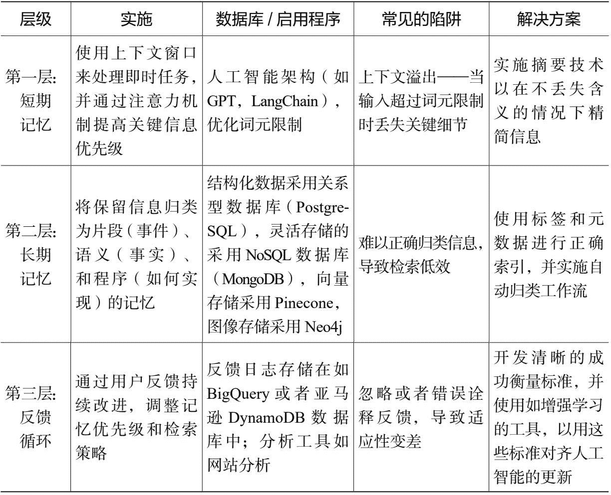

资料来源：Bornet et al.

在 AI 记忆框架里，每一层都依托上一层运转，成败取决于数据库和记忆功能能否无缝配合。系统调校失误或数据混乱等典型问题，会拖慢检索速度或让表现不稳定。应对之道是保持数据干净、业务有序，明确记忆使用的优先级，并持续监控调优。这样 AI 才能保持高效、可扩展并贴合实际场景。

**数据治理是底座**

具备记忆能力的 AI 系统，核心在于数据治理。企业靠井然有序的记录高效运转，AI 智能体同样依赖顺畅的存储、检索与更新来发挥实力。底层数据基础设施薄弱时，即便模型再强也会出错：检索到过期信息、漏掉关键细节或输出自相矛盾。企业因此可能错失机会、客户不满、信任受损。

为避免这些陷阱，领导者要把数据治理当成战略投入。首先要投向可扩展高效的数据库技术，满足 AI 需求的增长。比如一个 AI 客服智能体需要在数秒内调阅数千条客户档案、购买记录和往来互动，没有强基建就会卡顿或回复不全。云数据库、实时分析工具、用于语义检索的向量存储等，都是支撑记忆系统灵活高效的基础件。

其次，数据库与 AI 系统必须实现无缝联动。记忆系统需要与数据层实时流畅交互，才能拿到相关且最新的信息。这不仅是技术兼容问题，更是工作流设计问题：数据要在存储、处理和智能体之间顺畅流动。例如零售推荐场景，AI 需要即时吸收库存变化或客户浏览行为，才能保持建议的相关性。缺少动态连接，再先进的模型也会显得脱节。

最后，要保持警觉确保质量与准确性。对人类或 AI 来说，低质数据都会导致糟糕决策。领导者应建立定期清洗、更新和验证的机制，保证模型学习和调用的内容可靠及时。随着规模扩大，还应引入自动化工具来执行这些流程，降低人为失误、简化运营。

总之，数据治理是 AI 创造价值的隐形推手。关键不在于有没有数据，而在于能否有序组织、快速访问并持续更新。重视数据底座的企业，让系统更具面向未来的适应力，也为在 AI 时代持续发展奠定基础。

**记忆变革才起步**

本章探讨了记忆如何把 AI 从复杂计算器变为真正的思考伙伴。短期记忆让对话保持连贯，结构化记忆存留则把经验整理成长期学习的素材。最关键的是反馈回路，它让系统在每次交互中持续改进和适应。

对企业领导者而言，影响立竿见影。首先，具备记忆的 AI 智能体从根本上重塑了客户互动的经济性。当智能体能在多轮对话中保持上下文、记住偏好并从历史中学习时，就能以很低成本提供质的飞跃体验。我们已看到部分企业客户服务成本下降 40%~50%，满意度同步提升。

其次，记忆重塑了决策方式。领导者不再仅依赖当下数据，还能调用会记住并从企业所有过往决策、成败中学习的智能体。这种制度性记忆过去分散在邮件、文档和员工脑中，如今被结构化、可检索，成为战略与运营的信息源。

最后，记忆改变了企业学习与适应的节奏。智能体能记住并分析数千个项目或数百万次客户互动中的模式，发现人类难以察觉的机会与风险。这不是取代人类判断，而是以前所未有的模式识别和历史感知来增强判断。

章末请记住，AI 中记忆的演进不仅是技术进步，更是人机互动方式的根本转变，以及 AI 如何帮助人类理解世界。企业领导者面临的不是是否拥抱变革，而是如何在尊重自主与创造的前提下创造性地引领变革。

# 第三部分 Agentic AI 助力创业与职业成长

既然行动、推理、记忆三大基石已谈到，是时候落地了。系统怎么建？更重要的是，如何创造真实价值？

前两部分介绍了 AI 智能体的本质，以及它们如何思考、行动与学习。我们看到了它们与传统 AI 的根本差异：不只是处理信息，而是自主达成目标。仅懂技术不够，真正的挑战是如何用好它。

后面章节将提供把 Agentic AI 的变革潜力转为现实的工具。未来属于既能理解技术又能有效实施的人，而我们将展示具体做法。

现在撸起袖子实操。无论想改造现有企业，还是启动下一个百万级业务，后续内容都将给出从想法到落地的路线图。

让我们开启从想法到执行的旅程。

## 第八章

## 构建成功 AI 智能体的实战指南

“我们的简讯内容几乎要压垮我们。”我们仍记得那个周五深夜，埋头翻阅几十篇文章想写出有吸引力的摘要，“肯定有更好的办法。”一个月后，智能体接管了全流程，订阅用户一个月内飙到 30 万，团队每周多出 40 小时做创意工作。更棒的是，内容质量比过去任何时候都高。

这段经历与你相关，因为打造有效的 AI 智能体，关键不在于预算大小或技术先进度，而在于掌握决定成败的核心原则。本章将结合我们在多个行业部署智能体的试错与突破，与你分享这些原则。

我们不只说做法，还会展示案例。通过真实故事、实用工具和坦诚的问题复盘，你将获得一套能重塑工作方式的构建蓝图。

### 第一步：找到合适的智能体机会

设想一家快速成长的数字营销公司，创始人兼创意总监珍妮面对多屏办公，穿梭于社媒分析、活动表现、内容排期等系统，试图把信息整合进客户报告。

她提出的问题很关键：“团队被日常事务淹没，创意人才却花大量时间做数据录入和报表，而不是策略创新。怎么判断哪些任务适合交给 AI 智能体？”

起点选对比技术复杂度更重要。

基本事实是：AI 智能体不是万能解法。就像锤子不能修所有家电，并非每个业务难题都适合智能体。常见误区是创业者和高管急于上线，却没先判断它是否合适。

**何时不该用 AI 智能体**

先明确不宜部署的场景。经验显示有几类危险信号。

其一，需要真正人类创造力或情商的任务应保留给人。比如营销机构，AI 可做数据采集和基础报表，但创意的构思和客户关系仍需人主导。即便 L3 级智能体能自然交互，也无法复制打动人心的营销所需的情感共鸣。

其二，需要在不完整信息下结合市场大局做判断的战略决策应由人来做。即使是 L3 级，AI 也缺乏这类任务所需的复杂推理和市场直觉。

其三，部分任务对 AI 来说过于复杂。例如某科技企业曾要求打造智能体管理整个客服业务，涉及大量独特场景和情感互动。AI 表现最好时是能力与任务复杂度匹配。

另一些情况下，AI 缺乏关键决策权限。比如某金融企业希望 AI 自主做投资决策，这不仅风险极高，也明显违规。分配任务时必须考虑权限边界。

厘清局限，才能在价值点部署智能体，在关键环节保留人工监督。

**智能体三大机会圈**

我们总结出“智能体三大机会圈”（见图 8-1），帮助企业找到 Agentic AI 的最佳切入点。用三个重叠圆圈找交集。以营销机构为例。

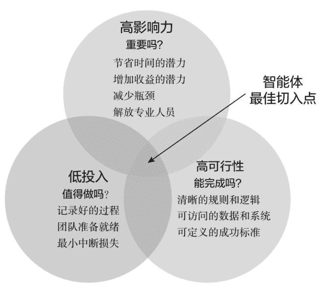

**图 8-1 智能体三大机会圈**

资料来源：Bornet et al.

**第一个圈：高影响力——是否关键？**

代表自动化后能带来显著改变的任务。判断很简单：自动化后会产生有意义的变化吗？影响不仅是省时，更是省下的时间能做什么。

要找那些占用专业人士时间的常规事务。销售团队花数小时更新 CRM 而非与客户交流；研究人员排版多于分析；HR 处理重复请求而无暇员工发展。

最有价值的机会往往不是最复杂的流程，而是阻碍优秀员工发挥的常规工作。问自己：如果这项任务明天自动化，团队能转向什么工作？

对这家营销机构，每月客户报告耗时 200 多小时，更重要的是占用分析师做战略思考的时间。

**第二个圈：高可行性——能否实现？**

探讨当前 AI 智能体技术能否安全可靠地完成任务。可行性像做菜前检查食材，要确保基本要素齐全。

适合自动化的流程通常具备：

• 清晰一致的决策规则；
• 数据和系统易于访问；
• 可定义的成功标准；
• 出错后果可控；
• 结果可在上线前验证。

关键是流程能否不用“视情况而定”“有时……”来解释。例外和主观判断越多，越不适合作为首个项目。

该机构的报表流程具备这些要素：数据可通过 API 获取，规则一致，结果可人工复核，错误可控。

**第三个圈：低投入——是否值得？**

关注实施的资源、时间和组织变革。不只是技术复杂度，更是企业是否准备好。

领导者应思考：

• 流程是否已详细记录；
• 团队是否愿意并准备好适应；
• 是否能小范围试点再扩展；
• 收益是否足以支撑投入；
• 能否不干扰核心业务实施。

最好的首个项目能分阶段推进，建立信心与能力。

对珍妮的机构，报表自动化有现成文档，可小步迭代，团队渴望改变，因而投入低。

**找到最佳契合点**

理想项目落在三圈重叠处。对珍妮而言，报表自动化能释放数百小时（高影响力），流程清晰安全（高可行性），可不影响核心业务试点（低投入）。

先对照自己的流程：找团队反复抱怨的重复任务，通常指向高影响力；再评估规则是否清晰、数据是否可达；最后考虑资源和变革准备度。

第一个智能体项目应像愉快的初次约会：有足够雄心令人兴奋，又不至于复杂到失控。从三圈得分高的项目起步，为后续更雄心壮志的项目提供势能。

**落地现实检验：一线经验**

经验揭示几个关键现实。

首先，多数企业并不清楚真正需要什么智能体。客户常带着特定想法来找我们，但近一半并非最有价值的自动化机会。“三圈”框架帮助打破假设，锁定真正重要点。一位客户坚持要自动化社媒发布，分析显示自动化潜在客户资格审核的回报率高出五倍。

其次，许多企业误以为可用智能体完全自动化一个岗位，这根本误解了当前 AI 的工作方式。智能体不是员工，缺乏员工的灵活性、适应性和判断力。员工常需管理多个关联流程、在任务间切换、决策协作，这些仍是 AI 的短板。应思考“自动化任务”，而非“自动化角色”。

最后，详尽的流程文档是部署加速器。评估时我们发现，有成熟 SOP 的项目实施时间明显缩短。比如一家金融服务机构的客户开户流程文档完善，使智能体部署时间减半；另一个类似项目因需从零梳理流程，花费时间多得多。

这些实战教训强化了“三圈”框架的重要性，并补充了超越理论的实践考量。

**实践练习：寻找你的自主机会**

理解理论后，做一个简单练习，帮企业分辨最适合的部署机会。我们开发此法是因为太多企业匆忙自动化而浪费资源、打击士气。

**步骤一：列出任务清单**

召集团队两小时会议，列出耗时或造成瓶颈的重复任务。我们发现具体提问比泛泛头脑风暴更有效。

可以问：

• 哪些任务每周反复出现？
• 哪些活动阻碍你们聚焦战略工作？
• 哪些流程常造成运营瓶颈？
• 哪些常规任务需更多监督避免错误？

与营销机构合作时，清单包括月度客户报告、社媒分析、活动表现追踪、竞品监测、内容排期。关键是记录频率和大致耗时。

**步骤二：评估影响力**

对每项任务评估自动化后的潜在影响。我们用 1~5 分简单打分，考虑四个维度。

（1）时间投入。今天耗时多少？自动化后能省多少？分数越高省时越多。可估算平均节省，也可换算美元成本。

（2）空闲时间的战略价值。机会成本是什么？衡量对员工满意度、客户体验、竞争地位和收入潜力的影响。分数越高业务影响越大。

（3）错误减少潜力。错误频率如何？分数越高意味着错误更频发或代价更高。也可换算当前错误成本。

（4）规模化影响。能否在全企业推广且边际成本极低？分数越高扩展性越强。

表 8-1 总结了四个标准及其含义。

**表 8-1 评估影响力的四个标准 1~5 分**

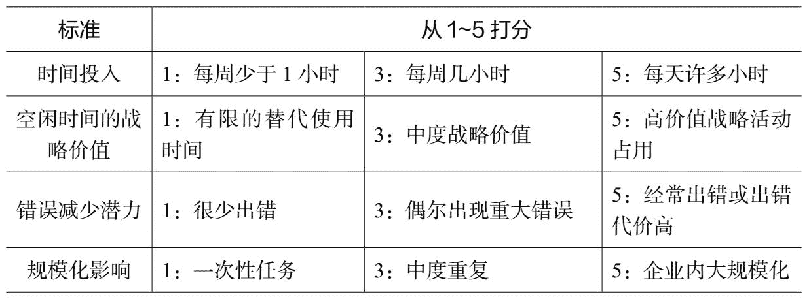

资料来源：Bornet et al.

四项相加，总分 4~20 分，得分越高自动化需求越强。对该机构，客户报告在时间投入（5）、妨碍战略分析（5）、手动输入易错（4）、可全员推广（5）四项得分 19 分，成为首选。

**步骤三：评估可行性**

对高影响力任务评估自动化可行性，看当前 AI 智能体（L1~L3）能否可靠处理。可行性分两部分，每部分 1~5 分。

一是流程标准化。自动化在步骤清晰、结构化的任务上效果最好。评估标准是流程是否步骤清晰、规则明确、例外可控。可以自问：“仅凭现有文档，新员工能否完整执行？”

AI 智能体落地：从评估到设计的实战路线

第二，数据与系统接入条件。模型能否稳定运转，根本在数据是否结构化、是否方便调取。若数据分散在各处、被老系统封存，或每次调用都得人工整理，自动化就无从谈起。需要判断数据的结构程度、检索便捷度，以及能否通过现成系统直接获取，是否还需手工预处理。

用表 8-2 里给出的维度，对流程标准化程度和数据系统可达性进行打分。

**表 8-2** **评估可行性的两项标准**

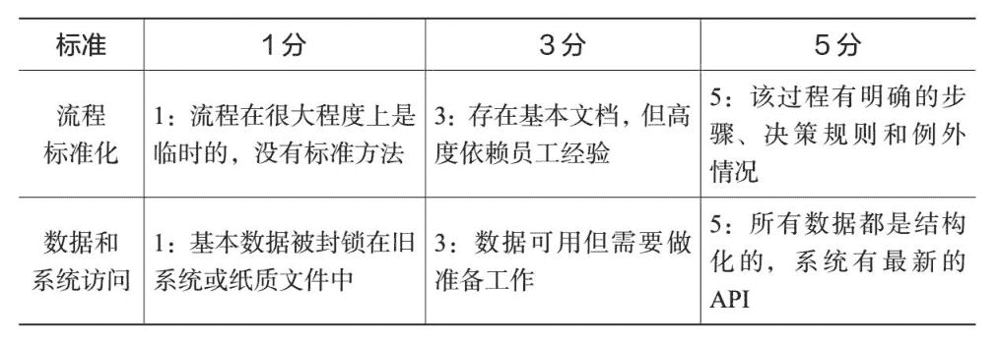

给每一个候选任务在这两方面分别计分，就能迅速分辨出哪些高价值任务已具备自动化条件，哪些还需要先做数据和系统的改造。

**步骤四：评估实施难度**

确认高影响任务且具备可行性后，下一步要量化搭建 AI 智能体的技术难度，用来排序优先启动的项目。

技术复杂度采用反向计分 1~5 分，分数越低代表越难。评分方式如下：

评分 5 为最易实现，可直接用现成工具完成，基本不需要定制。

评分 4 需要一定定制，但基于主流技术栈。

评分 3 需要较多开发工作，比如写脚本。

评分 2 涉及复杂集成或引入新技术。

评分 1 为最难实现，需要前沿方案或大量研发投入。

建议先用经过验证的主流平台起步，再逐步探索边界。先把简单又高价值的任务自动化，能快速见效、降低风险，为后续复杂方案积累动能。

**综合分析：最终决策**

在为多家企业评估智能体机会的过程中，我们形成了统一的决策打分法。回到珍妮的营销公司案例，把前面得到的分汇总：

• 影响力得分，上限 20 分，综合时间节约、战略价值、错误成本、规模化能力四个标准。

• 可行性得分，上限 10 分，来自流程标准化与数据系统访问两项标准。

• 实施难度得分，上限 5 分，反向计分。

三项相加满分 35 分，系统化地看清机会全貌。

客户月报流程的得分是：

• 影响力 19/20，省时多、战略价值高、失误代价高、易规模化。

• 可行性 8/10，流程文档完整，数据可通过 API 获取。

• 实施难度 4/5，可用标准工具，定制需求低。

总分 31/35，属于非常理想的智能体首发项目。

**步骤五：绘制 Agentic AI 优先级矩阵**

综合分数有用，但把机会可视化更利于团队共识。我们把候选项目放到一个矩阵中，纵轴是转型复杂度，综合可行性与复杂度得分；横轴是业务影响力，采用影响力得分。

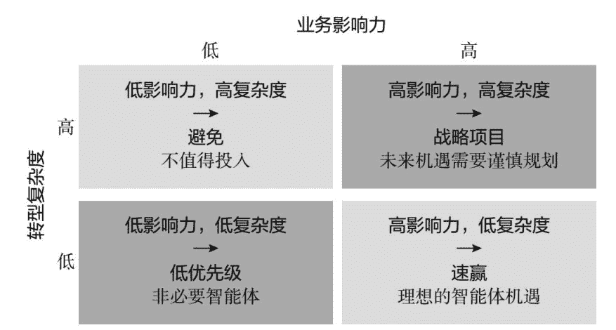

**图 8-2** **Agentic AI 优先级矩阵**

资料来源：Bornet et al.

矩阵形成四个象限：

速赢项目，高影响低复杂度，最适合先上线的智能体。

战略项目，高影响高复杂度，需要周密规划的长期机会。

低优先级，低影响低复杂度，可有可无的自动化。

避免，低影响高复杂度，不值得投入资源。

对该营销公司而言，客户月报落在速赢象限，成为首个智能体项目，并由此启动转型。

**关于选择的最后一点说明**

第一次部署智能体，会定下后续自动化的基调。除了上述打分，还要确保首个项目：

• 3~6 个月内能看到清晰可量化的成果。

• 覆盖足够多的人，形成广泛支持。

• 有明确的负责人愿意督导落地。

• 能沉淀为企业的学习样本。

首个项目成功后信心会大幅提升，也为更宏大的项目提供抓手。该公司在月报自动化成功后一年内，又相继上线了五个智能体，每个都建立在首个项目的经验上。

### 第二步：定义 AI 智能体的角色和能力

项目选定后，关键是明确需要什么样的智能体。就像写职位说明书，要对数字员工的职责、能力边界有清晰认知。

回到珍妮的团队，他们决定先做月报自动化。“我知道流程要自动化，”珍妮说，“但不确定智能体要做到什么程度，是只抓数据，还是要写分析。”

这正是常见困惑，答案在于把智能体层级与具体需求匹配。

**理解智能体层级：从简单到复杂**

可把 AI 智能体看作技能不同的员工。Agentic AI 演进框架分五级，目前实务中最常见的是 L1~L3，重点在 L2 智能自动化和 L3 智能体工作流。

L2 更像能严格执行固定指令的资深专员。L3 更像能理解上下文、处理复杂任务的资深顾问。

珍妮需要判断月报适合哪一级。

**决策框架**

选择等级主要看三个标准。

**标准一：任务可预测性（确定性任务与概率性任务）**

L2 擅长确定性任务，规则明确、流程不变，每次执行结果一致。L3 由大模型驱动，适合需要理解语境并做出判断的概率性任务。

该公司梳理后发现，月报约 80% 为确定性任务，从各平台抽取固定指标并标准化整理，很适合 L2。剩下 20% 涉及趋势解读和洞察撰写，需要概率性思维，更适合 L3。

**标准二：错误敏感性**

对准确性要求极高的场景，L2 更可靠，因其严格遵循规则。财务计算、数据处理等容错率低的任务更适合 L2。

L3 更灵活，但偶尔会出现创造性偏差，适合允许一定变化的任务，如内容生成、模式分析。

月报中数据采集与计算失误会损害客户信任，适合 L2。文字分析的细微差异可接受甚至有益，适合 L3。

**标准三：输入多样性**

L2 偏好标准化的输入，格式一致、场景可预期，对异常处理能力弱。L3 能处理多样化输入，理解语境、适应不同格式和非结构化数据。

该公司数据源虽多但格式统一，适合 L2。不同客户、行业的解读背景差异大，则需要 L3。

表 8-3 总结了 L2 与 L3 的映射关系。

**表 8-3** **L2 级与 L3 级智能体的对比**

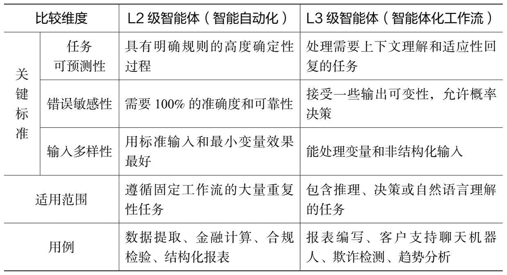

资料来源：Bornet et al.

**做出选择：营销机构的决策**

综合评估后，公司采用混合策略，L2 与 L3 分工协作。

L2 智能自动化负责：

• 访问 GA、社媒、广告平台等。

• 提取标准化数据集。

• 完成计算并生成可视化。

• 输出报告基础结构。

L3 自主工作流负责：

• 分析整理后的数据趋势。

• 生成初步洞察与建议。

• 起草报告的叙述部分。

这样既保证精确任务的高准确度，又发挥模型在解读和撰写上的优势。

接下来重点是 L3 的设计方法，L2 的构建可参考《智能自动化》。

**学习曲线**

智能体落地往往是迭代的。该公司先让 L2 负责数据采集与基础报告，运行顺利后团队建立信心，再引入 L3 生成内容。

珍妮回顾：“我最初想一次全自动，但先从基础数据做起，再逐步增加复杂功能，让团队适应，也改变了大家对报告流程的认知。”

**成果与经验教训**

上线半年后，系统为全部客户处理月报：

• 生成时间压缩到 45 分钟。

• 数据准确率保持 99.95%。

• 客户满意度提升 15%。

• 营销团队用于战略工作的时长增加 60%。

珍妮总结：“没急于求成，通过循序渐进的设计和信任积累，我们建立了团队和客户都信赖的系统。”

该成功案例为后续在活动优化、内容创作、客户旅程分析等方向的智能体应用打开了空间。经验表明，技术能力与人的因素必须同步考量。

**展望未来**

明确 L2 与 L3 的分工后，公司进入详细设计阶段。清晰的职责划分，为流程图绘制和绩效标准设定奠定基础。目标不是造最复杂的智能体，而是打造可靠创造价值、与人协作顺畅的智能体。

### 第三步：成功设计 AI 智能体

机会与类型确定后，进入设计阶段，这是理论转化为实践的关键。以下以简讯自动化为例说明设计要点。

**简讯挑战：一个真实案例研究**

我们团队每周需花费大量时间策划内容、写摘要、排版简讯。虽然对读者价值高，却挤占研究时间。于是用自身专业知识自建智能体系统，一个月内新订阅用户增长超 30 万。

第九章会详细讲述这一机会如何孵化。

**设计原则一：以终为始**

设计前先明确成功标准。拉凯什指出，最常见的失误是跳过目标定义直接做方案。

清晰的目标有三重作用：指引开发优先级、建立 ROI 基准、管理利益相关者预期。

成功标准应兼顾量化与质化。量化可包括效率提升、错误率下降、绩效指标；质化关注体验、输出质量、系统稳定性。

简讯案例的目标是：制作时间从每周 15 小时降到 3 小时；内容准确率 ≥95%；邮件打开率 ≥40%。同时定义内容相关性和读者体验的质化标准。

**设计原则二：了解当前状态**

许多团队想直接跳到未来，却忽略了现状梳理。了解现流程能揭示隐藏依赖、定位瓶颈、避免遗漏关键业务规则。

我们绘制流程时发现，原以为四步的流程实际包含数十个微决策和例外，若不记录，自动化会遗漏关键细节。

现有简讯流程存在四类问题：

• 耗时：手动搜集、摘要、排版每周耗时约 10 小时。

• 易错：重复性写作和排版曾多次出错，损害声誉。

• 难扩：文章增多时人工难以为继。

• 质量不稳：人员变动导致输出参差。

**设计原则三：设计目标流程**

记录现状后，我们没有照搬自动化，而是重新设计。沙伊尔常说：“垃圾进，垃圾出。对有缺陷的流程做自动化，只会得到有缺陷的自动化。”

目标是构建简洁、可扩展、无错的简讯生成流程。新的流程采用每日与每周节奏：

每日识别相关文章、提炼关键见解、生成排版邮件供人工审核，并汇编成结构化文档。

每周一整理文档为视觉化简讯，进行准确性审查后发布。

分解为清晰步骤后，复杂性降低，质检更可控，发布更顺畅。

**设计原则四：选择正确的架构**

架构是设计关键。拉凯什比喻它像建房子，是做一个大房间还是多个协同的专属空间，后者通常更有效。

核心问题是：做一个全能智能体，还是一个专业智能体团队？

最初我们想做“超级智能体”，从发现内容到排版一手包揽，很快发现这如同让一人兼任研究员、作者、编辑、设计师，不现实。

于是组建专业智能体协作团队，见表 8-4。

**表 8-4** **我们用于简讯自动化的专业智能体团队**

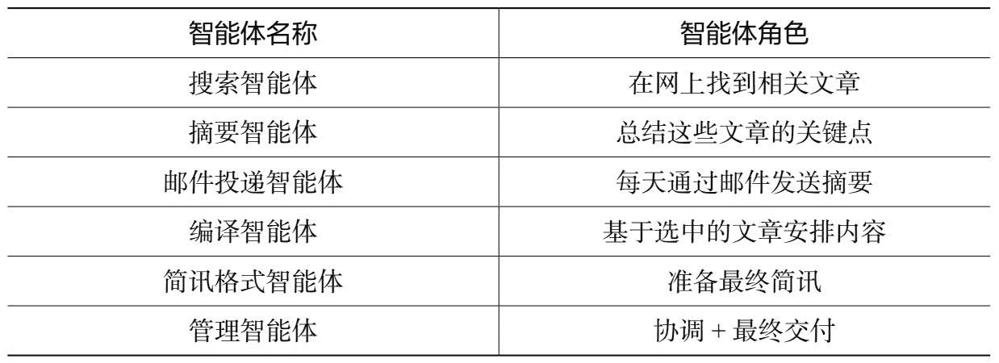

资料来源：Bornet et al.

模块化让每个智能体在其领域发挥最佳，同时保持系统灵活性。

**多智能体系统设计的关键原则**

设计多智能体系统时，我们遵循六条原则：

明确目标，每个智能体像专家，有专注职责。

专业化带来效率，避免贪多求全。

面向规模化设计，工作量增加时可并行扩容。

自主运行，依据标准独立决策。

无缝协作，统一通信协议与交接点。

集中编排，统一调度如同指挥家。

**设计原则五：打造人机协同**

南丹强调，目标不是替代人，而是人机共生。当前 L1~L3 智能体仍缺乏真正自适应学习与复杂推理，人类在战略决策、质量把关、异常处理、持续改进等方面不可替代。

设计简讯系统时，我们不是问能自动化什么，而是该自动化什么。人工介入的关键环节是质量审核与战略判断，确保系统在可控范围内创造价值。

人机分工，才是AI智能体真正变现的密码

真正让智能体飞起来的，不是把所有环节都交给模型，而是把人放回最关键的决策点。

第一个必须保留人工的节点，落在AI完成采集和归纳之后。每天的摘要由模型整理出来后，会交由人工编辑过目筛选，再决定哪些内容真正进入简讯。这个取舍依赖对读者需求的体感、对新趋势的嗅觉、以及对内容价值的精细判断，这些都是目前人独有的能力。

实践中我们捕捉到一个清晰的现象：把最终的内容挑选完全交给AI，成品在技术层面无懈可击，却读起来索然无味。缺少了人主导的战略叙事和主题上的连贯性。通过保留人类在这一关键决策环节的参与，简讯的调性与战略相关性才得以维持。

第二个必须人工介入的节点在发布前。编辑拿到成稿后会做通盘审阅，在需要处补充背景，确保整体符合编辑标准。这一步的意义远不止纠错，而是保证内容对读者有真实的价值。

“这样的分工模式，”南丹总结道，“实现了双赢。智能体负责重复繁琐的工作，人类聚焦需要判断力和行业专业知识的战略决策。”

**输出：理想智能体架构**

经过反复打磨，我们最终确定的目标流程如下，清晰呈现了关键活动、对应智能体以及人工介入点。

**日常运转流程**
（1）搜索智能体：在公开网络搜集相关文章，把链接推送给摘要智能体。
（2）摘要智能体：为每篇文章提炼三条核心要点，并发送给邮件投递智能体。
（3）邮件投递智能体：把摘要整理成格式化的邮件，递交给人工审核员。
（4）人工审核员：每日审阅邮件，挑选出偏好的文章反馈给编译智能体。
（5）编译智能体：将每日精选汇总为结构化谷歌文档，并完成质检。

**每周运转流程**
（1）简讯排版专员：每周一将谷歌文档排版成视觉上精美的简讯。
（2）管理智能体：对排版后的简讯进行检查，转发给人工审核员。
（3）人工审核员：做最终确认，并把简讯推送到目标渠道。

### 第四步：实施你的 AI 智能体

**选择平台：先求快，再求完美**

AI智能体平台正处于爆发期，市场上已有约400家供应商提供不同复杂度与易用度的方案。选择面越广，越容易陷入评估瘫痪。我们看到不少企业花数月时间对比平台，而对手早已上线并抢占先机。

当前市场大致分为三类：无代码、全代码、低代码。每类在灵活性、上线速度和技术门槛上各有取舍。

**无代码平台：最快上手**
可把无代码平台看作AI开发的乐高。提供现成组件，无需技术背景即可拼装。Bizway、Beam、N8N、Relevance AI等产品，都允许用户通过可视化界面搭建可用智能体，适合快速验证想法或部署简单到中等复杂度的任务。它们看似功能有限，却能通过配置实现出人意料的复杂度，例如Relevance AI即支持向量处理和复杂检索等高级功能。

**全代码平台：控制力最强**
全代码方案如LangGraph、CrewAI、AutoGen，提供完整框架，可构建高度定制化智能体。适合对数据控制、系统深度集成或在强监管行业运营的企业。开发过程中可从决策逻辑到数据处理规范逐项微调，但代价是更长的周期和专业人才需求。文档和社区虽在增长，学习曲线依然陡峭。企业需审慎评估极致控制是否真的必要，否则会拖慢价值兑现时间。

**低代码平台：折中之选**
低代码在定制与易用间取得平衡。WatsonX Assistant、Agentforce、UiPath和微软Copilot的Agent Builders等，提供可视化开发环境的同时，也允许代码级扩展。它们利于业务与技术协作，适合既要快速落地又要保留一定定制空间的场景。低代码大幅缩短实施时间和技能要求，同时满足大部分业务需求。例如ServiceNow的虚拟智能体平台提供现成业务流程组件，也支持按需定制开发。

**决策要点**
别陷入功能清单对比，采用实用框架。首先锁定三到四个不可妥协的核心指标；然后为易用性、定制能力、集成度、可扩展性、安全与成本等标准赋权；最后对候选平台打分，按得分推进。

技术团队的配置往往是首要变量。技术力量强的企业可能偏向全代码，但即便如此，很多人也会先用低代码或无代码快速试水积累经验，再逐步升级。

另一个杠杆是公民开发的普及。无代码与低代码让一线员工也能参与智能体构建，形成内部民主化。这种分布式创新能极大拓展AI的影响面，例如客服可做常见咨询机器人，财务分析师可做报表自动化工具。

集成需求同样关键。多数平台都支持API，但易用性和深度差异很大。微软Copilot的构建器与微软生态无缝衔接，对重度使用微软技术的企业极具吸引力。

安全与合规是强监管行业的硬门槛。全代码通常能提供最细致的数据与安全控制，无代码在这方面的弹性则相对受限。

**别过度纠结**
没有完美平台，等待理想方案只会错失窗口。最佳做法是从小规模试验起步，边学边放大。多数成功案例都是先在低代码平台做一个简单智能体验证价值，再随需求迁移升级。

当你还在犹豫时，竞争对手的智能体已在重塑行业。行动快的企业将引领AI浪潮，迟疑者只能追赶。最好的AI策略不是最完美的，而是今天就开始执行的策略。

随后我们基于实战沉淀了一份跨平台通用指南，聚焦关键成功要素、微妙决策和真正影响效果的隐藏功能。其价值在于平台无关，也因此在术语细节上会有偏差。作为示例，附录提供了基于低代码平台Relevance AI的详细搭建步骤，它既是落地模板，也是把通用原则转化为具体路径的鲜活案例。

**构建高效智能体：A.G.E.N.T. 框架**

我们的经验表明，成败不取决于技术多先进，而取决于智能体的定义是否清晰完整。经过大量案例和教训，我们提炼出A.G.E.N.T.框架，帮助打造可靠且能创造价值的智能体。

框架包含五要素。
A：智能体身份——它是谁
G：设备与大脑——由什么驱动
E：执行与工作流——如何运作
N：导航与规则——如何做决策
T：测试与信任——如何改进与扩展

把构建智能体想象成招聘一名远程员工。你需要明确岗位说明、任务边界、沟通方式和升级机制。AI员工更需要精确指令，否则只会漫无目的。

**A：智能体身份——它是谁**
定义身份是第一步，也是最易被忽略的错误。很多人急于见效，却没先厘清智能体该做什么，导致输出不可预测、结果不稳定或毫无价值。

招聘时不会只说“你看着办”，新员工需要角色、职责和权限。AI同理。若身份模糊，它会产生不可靠行为、结果不一致、权限失控。

我们在简讯摘要智能体的早期尝试就是教训。初版指令只有“总结新闻文章和研究论文”。结果抓取随意、条理混乱、来源过时。问题不在模型，而在指令模糊。

后来我们把身份明确为：“你是一名专注AI与商业趋势的摘要助手，需从《麻省理工科技评论》、arXiv、《哈佛商业评论》等来源抓取文章，将其提炼为不超过150词、抓住核心洞见、保持原意的清晰摘要。语气专业且易懂，与简讯风格一致。”

指令清晰后，AI从不可靠的聚合器变为专注的研究伙伴，能稳定输出高价值摘要。

**像管理者一样思考**
管理一名只能按指令执行的员工，你需要：明确工作说明书、列出可做与不可做、规定沟通方式、设定边界与升级路径。对AI同样适用，定义清楚才能获得稳定高效的输出。

在选模型和设计流程前，先写下身份说明，基础越牢，效果越强。

**强身份的三大要素**
（1）目的：核心任务是什么。目的越具体，输出越贴合。
弱目的：协助客服。
强目的：以专业友好的方式，用分步方案帮助用户解决常见技术问题。
（2）角色：它扮演什么职业身份。角色决定交互方式和知识边界。
如金融智能体可定位为金融分析师、理财教练或税务顾问，各自对话风格和信息焦点完全不同。
（3）操作权限：能做什么、不能做什么。边界防止越权。
客服智能体可回答常见问题、提供排错步骤、转交复杂问题，但不应提供法律医疗建议、做未授权决策或生成推测性回应。

**G：设备与大脑——由什么驱动**
身份明确后，需配齐工具、模型和知识源。常见失误是过度配置或工具错配，类似给送货车装赛车引擎，或指望家用轿车赛F1。

**模型选择：性能、成本与效率的权衡**
模型是智能体的大脑，决定理解、推理和生成能力。较小模型如Mini、Phi、Flash，速度快成本低，适合简单查询。较大模型如GPT、Claude Opus、Gemini Ultra，推理更深、质量更高，但资源消耗大。

成本敏感场景常采用混合策略：小模型处理日常，大模型处理复杂问题。开源模型如Mistral、Llama 70B提供更高控制和成本优势，但需要微调部署能力。

温度设置是关键调节手段。低温度0~0.3使输出更确定一致，适合摘要、研究、法律等追求准确性的场景。高温度0.7~1.0提升创造性和多样性，适合头脑风暴和文案创作，但在结构化摘要中易导致幻觉和偏离。

**工具选择：精准大于强大**
智能体需与外部系统交互、获取实时数据并执行动作。工具集必须受限、可控。

我们在简讯项目中曾让搜索智能体无限制访问网络抓取工具，结果来源不可靠、频繁触发封禁。后来我们为每个工具明确用途、限制和使用参数。搜索智能体的工具规格即在附录中。

API是最常见工具，金融智能体可用市场数据API拉取股价，日程助手依赖日历API。但无限制访问易导致速率限制、安全风险或法律问题。

为避免滥用，需设定结构化使用政策：
• 请求频率与成本控制。限制每分钟请求量，避免超额付费和触发限流。
• 数据源可靠性。仅从预批准可信来源获取信息，如我们限定为《麻省理工科技评论》、arXiv、《哈佛商业评论》。
• 安全访问。API密钥应定期轮换，通过令牌认证保护，不硬编码。

熔断与备援，是让智能体不失控的第一道防线。

• 熔断保护。错误一旦反复出现就要叫停，而不是不停地往外抛错。比如某个接口连续三次调用失败， Agent 就该主动停下来并报给管理员，而不是无限重试把请求堆爆。
• 备援切换。出问题时换条路走，保证服务不断。比如新闻接口挂掉时，可以直接从备用的数据源抓取头条，而不是直接返回错误。

没有这些兜底机制，AI Agent 很容易把自己跑崩、把用户惹毛，甚至拖累业务运转。想更深入地了解工具集成的做法，除了可以看本书的第二部分，也可以参考 OpenAI⁴、谷歌⁵ 和 AWS⁶ 的 API 文档，都是负责任落地的实用指南。

**选择知识来源：可靠 AI 智能体的基础**

Agent 必须从可信渠道取数和推理。一旦来源不清，就容易出现幻觉、抓错数据或给误导性答案。搭建知识库常见有三种做法：数据库、API 和文档嵌入。

数据库最适合放内部资产，比如客户历史、公司政策或专有研究；API 则用来拿实时信息，比如天气、法规更新或金融统计；文档嵌入能让模型在海量文本里检索和召回，特别适合法律、学术和企业级场景。

但并不是所有内容都该塞进来。能访问过期或带偏见的来源，就会传播错误；未经过滤的开放网搜索更危险，容易捞到低质或误导信息。正确的做法是让 Agent 只用经过验证的领域数据集，并限制其做推测性生成。

想把知识选型做精，除了本书第二部分，也可参考 Weaviate⁷ 或 Pinecone⁸ 这类向量数据库平台，以及斯坦福人工智能实验室⁹ 的相关研究，能提供更系统的思路。

**最终建议：打造更智能而非更费力的人工智能**

实践下来，最好的 Agent 并不是功能堆最多的，而是把智能、工具和知识配比得恰到好处。保持模型轻快、收紧工具权限、精选高质量知识源，才能保证可靠、安全、可信。

配置不当的 AI，轻则浪费算力，重则带来风险。有效落地的关键是起点清晰：明确的定义、严格的参数和可信的信息源，让 Agent 在可控、可预测的范围内工作。

**E：执行与工作流——智能体如何运作？**

身份与工具定好后，下一步是看它怎么跑。很多 AI 项目败在工作流设计，而不是模型或工具。架构不清的 Agent 会行为不可预测、误读输入、输出不一致。就像受训员工需要标准作业流程，AI 也需要明确的输入格式、合理的处理顺序和清晰的触发时机。

**定义输入与输出：建立精准的对话机制**

Agent 能否稳定运行，取决于对进出数据的格式理解。输入输出的定义看似基础，实则是最容易出错的环节。

我们在简讯系统里就吃过亏。早期对摘要 Agent 从搜索 Agent 接收内容的要求比较宽松，结果因为格式不对齐、元数据缺失、结构不一致，错误频发。

比如 URL 输入：有的带查询参数，有的没有；有的带锚点，有的干净。这一细节导致同一篇文章被重复处理，也出现过漏采。后来我们把输入规范锁死——URL 格式、必备元数据字段、内容结构全部写明，问题就消失了。

输出也一样。上线初期摘要经常超出邮件模板长度，最后只能人工修。明确字符上限、必备模块、格式规则后，每个 Agent 的产出才能无缝进入下一步。

每个 Agent 都应该做到：
• 严格的输入校验，只收设计支持的格式；
• 清晰的输出约定，让下游系统知道该拿到什么。

附录里有详细示例。对于高并发或关键数据流，可用 OpenAPI 框架¹⁰ 做结构化数据处理，或用 JSON Schema 做数据校验¹¹ 来统一规范。

**设计工作流：构建人工智能的决策过程**

Agent 不是孤立工作，它会按步骤处理信息并做决策。好的工作流既有步骤，也有步骤间的转换逻辑。没有它，Agent 会空转、乱做事、结果不一致。

一个扎实的工作流包含两部分。

（1）激活条件：什么时候开始？
• 用户输入：被触发才响应，如客服机器人。
• API 调用：别的系统请求数据时激活，如自动化流程。
• 定时执行：固定间隔运行，如日报、后台批处理。

（2）处理步骤：做什么顺序？
比如先取数、再分析、后生成；行动前是否需要校验。

我们的简讯摘要 Agent 就是这样设计的：
（1）激活条件：研究 Agent 从《麻省理工科技评论》、arXiv 等源抓到新一批论文。
（2）处理步骤：处理内容、提炼关键洞见、过滤无关或重复信息。

清晰的工作流能避免低效，让运行可预期。想学得更深，可参考 OpenAI¹² 的 API 最佳实践、BPMN¹³ 的流程自动化，以及 AWS Lambda¹⁴、Google Cloud Functions¹⁵ 里的事件驱动架构。

**实施故障保护措施：确保人工智能在压力下的可靠性**

没有系统能永不出错。真正的挑战是把故障管好，减少伤害、保持连续。断路器和结构化错误处理就是 Agent 的免疫系统。

**错误处理与恢复：保持人工智能的正常运行**

优秀的系统不会直接崩溃，而是走三步恢复：
（1）自动恢复：失败后间隔递增地重试，避免雪崩，提高成功率。
（2）优雅降级：功能反复失败时降低复杂度而不是直接罢工。比如摘要出错时，先把原文链接和元数据转出来。
（3）人工介入机制：置信度不足时主动升级。好的设计不是甩锅，而是带完整上下文的升级。

**熔断机制：预防系统性故障**

持续的错误会让 Agent 陷入循环、处理脏数据、输出水文。我们曾有一次摘要 Agent 连续两小时输出无意义内容，源头污染信息，重大事件期间质量断崖。

于是设定质量阈值：若一分钟内三次生成无意义摘要，系统自动暂停并通知人工。某次大型科技会期间过载严重，如今熔断能在内容触达用户前拦截，守住声誉。AutoGen、CrewAI 等主流平台都已内置此类安全开关。

**人工介入机制：人工智能何时应当主动让贤**

高复杂、高风险的决策不适合单靠模型。此时结构化升级比硬扛更重要。

在简讯项目里，当摘要 Agent 检测到冲突或低置信度摘要时就会升级。比如多源报道同一事件，财报数据或发布说法不一致，Agent 不会猜，而是把问题上报给人工编辑，并附上原始来源、冲突分析、置信度分数，让编辑有上下文决策。

如果因行话太多、生成内容污染或写作质量差导致摘要不连贯，也会转人工，并给出备选来源建议。

想继续深挖，可参考微软的“AI 信任与安全原则”¹⁶ 和 OpenAI 的“API 最佳实践”¹⁷，对故障保护、断路器和人机升级都有深入阐述。

**N：导航与规则——AI 智能体如何做决策？**

有了身份、工具和流程，还必须设计决策机制。这是常被忽略却至关重要的环节。没有导航规则，Agent 会不可预测、不一致，甚至失控。就像自动驾驶不能只说“去目的地”，需要明确路线、避障和封路策略。

**处理规则的定义：筛选、优先级排序与决策逻辑**

每个 Agent 都要判断什么重要、什么可忽略、如何排序。没有规则，它会被无关数据拖垮。

一个好的处理系统包含：
（1）筛选：区分相关与无关。研究型 AI 应优先同行评审论文，而非未证实博客。
（2）优先级排序：紧急任务先处理。客服 AI 应先处理投诉，再回一般咨询。
（3）决策逻辑：一次性喂太多数据会变慢变贵。需要检索数千篇文章时，应先按关键参数预筛，再分析。

我们早期搜索 Agent 只看关键词和时效，结果是技术相关但价值不高。后来加入相关性评分、来源可信度评估和内容多样性要求，Agent 从检索工具变成了有鉴别力的策展人。相关性保证价值，可信度守住质量，多样性避免回声室。

想系统学习，可参考信息检索方法¹⁸、决策树框架¹⁹ 和机器学习里的排序算法²⁰。

**确保透明度：构建可追溯的人工智能决策轨迹**

AI 决策不能是黑箱。用户需要知道为什么得到这个答案。决策轨迹日志是关键，它应记录：
• 输入参数：哪些数据影响了决策；
• 处理步骤：如何排序、筛选、应用逻辑；
• 推理理由：为什么选 A 而不是 B。

比如新闻简讯研究 Agent 选中一篇论文，日志应包含来源、《麻省理工科技评论》《arXiv》《哈佛商业评论》及日期、选择理由与白名单归属、以及被舍弃的备选及原因。

透明决策既方便人工复核，也建立用户信任。多数平台都提供日志挂钩，可在工作流关键节点捕获输入、动作、输出，形成可审计轨迹。

在金融、医疗、政府等强监管领域，清晰的决策路径正从最佳实践变成合规刚需。可进一步研究可解释 AI 框架 XAI²¹、GDPR 对 AI 透明度的要求²²、以及企业级 AI 的审计日志实践²³、²⁴。

**T：测试与信任——如何改进和扩展 AI 智能体**

建 Agent 不是一次性的，而是持续测试、改进、扩展的闭环。没有迭代，它会不可靠、挫败用户、难以放大。就像员工需要绩效评估和培训，Agent 也要持续打磨。

**模拟真实应用场景：确保人工智能走出实验室仍能正常工作**

实验室表现好不代表线下可用。必须用多维度场景压测。

全面测试包括：
• 常规场景验证：标准请求能否按预期处理；
• 边界案例测试：模糊表述、冲突输入时的反应；
• 故障模拟：API 失效或输入不完整时的应对。

客服 AI 要测情绪化、含糊的客户输入；医疗助手要测压力下的不准确建议风险。跳过这步，容易产生幻觉或错误决策。

可参考 LangChain 测试套件²⁵、Hugging Face 的模型基准²⁶、OpenAI 的对抗测试框架²⁷。

**收集反馈和监控日志：从用户行为与系统错误中学习**

上线后，监控和反馈是优化的燃料。

有效监控包括：
• 用户反馈机制：评分、标记错误、提供上下文；
• 日志分析：看输入、输出、决策轨迹，找重复错误；
• 行为跟踪：用户是否频繁放弃、求确认或卡住。

招聘助手若反复把不合格候选人排前，决策日志能揭示偏见或评分问题；电商推荐不相关，则反馈可提示偏好误解。忽视这步会导致性能滑坡和信任流失。可借助 LangSmith²⁸ 和 OpenTelemetry²⁹ 追踪模型行为与交互。

**优化与改进：通过精细优化提升人工智能效能**

Agent 上线时很少完美，优化是迭代的。

关键方向：
• 温度调整：低值更确定，高值更创造但更随机；
• 提示词工程：指令、约束、系统消息的微调能大幅提升一致性；
• 工作流微调：调整数据处理或检索方式，减少延迟和错误。

法律助手若回答啰嗦，可通过提示强制简洁；幻觉严重时，可降温并加强检索约束。

**信任进阶模型**

信任不是自动给的。我们用三阶段模型逐步放权：
• 第一阶段：高度监督。上线首月人工逐条复核，建立质量基准。
• 第二阶段：选择性审查。可信度提升后聚焦复杂案例，日常任务由 AI 主导。
• 第三阶段：战略监督。目前运营中人工只负责方向与特例，日常在明确参数内自主运行。

这种渐进式协作显著提升了采纳率。正如一位客户所说：“从高度监督开始不是不信任技术，而是给团队适应时间，保证业务连续。”

**规划扩展：确保智能体具备增长弹性**

好 Agent 要能随需求增长而不掉链子。很多项目失败不是不能用，而是扩不起来。

规划扩展包括：
• 负载测试：用户量增长十倍时，性能是否仍稳定？

**规模化压力测试：并行与成本**

智能体在多机多模型间分派任务的能力如何？扩展过程中基础设施是否仍保持经济性？性能提升是否建立在难以为继的开支之上？

例如，一款日均承载千次咨询的AI客服在小规模下运行流畅，推升到日均十万次交互时就可能出现延迟或成本激增。长期可行性的核心在于能否借助无服务器架构、缓存机制与多智能体协同调度，让工作负载得到高效分配。

想深入了解规模化策略，可参考 AWS Auto Scaling³⁰、Google Cloud AI 基础设施最佳实践³¹，以及英伟达的人工智能部署框架，以应对大规模推理负载问题³²。

**可靠来自简化**

关于稳定性，我们得到的首要教训是简化带来的价值。早期简讯智能体堆叠了繁复的恢复逻辑和多层备用方案。实践下来，经过充分验证的简洁流程，往往比复杂方案更稳健。

“最可靠的系统，”拉凯什常说，“是那些出错可能性更少的系统。”这条原则推动我们不断精简流程，剔除一切非必要的复杂度。

**用大模型对话把模糊需求变为精确规范**

我们发现 ChatGPT、Gemini 或 Claude 这类大语言模型聊天工具，在撰写精确定义与参数时极具帮助，无论是界定智能体身份、校准API参数，还是设计应急策略。关键在于提问方式。我们采用自创的“逐步定义细化”方法。

先让模型输出一个基础角色描述，再逐步追问潜在风险、边界情境与失效模式。例如：

• 初步提问：“内容摘要智能体在处理新闻稿件时应关注哪些维度？”
• 进阶提问：“每个维度可能出现什么偏差？”“针对每类失效，智能体该如何处置？”“哪些指标能证明表现达标？”

每轮回答都在累积更完整的定义，随后我们用真实场景去验证。

**A.G.E.N.T.框架精要回顾**

A. G. E. N. T. 框架为构建可靠、可扩展且有效的 AI 智能体提供了系统化路径。

表 8-5 **A. G. E. N. T. 框架总结**

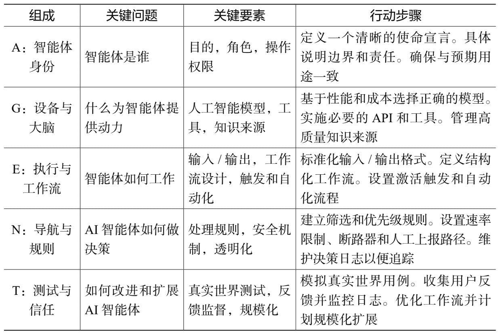

资料来源：Bornet et al.

**简讯智能体实战数据**

引入智能体后，简讯制作流程被彻底重塑。每周投入从十小时以上骤降至不足两小时，效率提升约80%。过去手动检索文章、提炼摘要、排版通讯的工作，如今实现全自动流转，人工审核员得以聚焦高价值决策，如甄选核心稿件与确定最终发布内容。

质量同步跃升。过去时常出现语气不统一和格式瑕疵，现在每期输出都经过打磨，风格统一且专业。可靠性显著增强，摘要与简讯能准时交付，不再受制于手工流程的延误。

可扩展性尤为突出。系统可在不增加人力的前提下，轻松承接50%甚至更高的稿件增量。这种提效、增质与强适应性的组合，为内容生产的效率与水准设立了新标杆。

上线仅一个月，简讯订阅用户突破30万。这并非单纯的技术炫耀，而是得益于精确定义的AI智能体在协同系统中分工运作，每个智能体都清楚自己的目标、动作与异常处理路径。

欢迎体验我们的“智能体智能”Agentic Intelligence 简讯：

• Substack 平台
• LinkedIn：https://www.linkedin.com/newsletters/agentic-intelligence-7293015480007557121

**AI智能体落地四步清单**

为帮助从概念走向部署，我们提炼以下经验。

**第一步：寻找合适的智能体机会**
（1）锁定三要素交汇点：对业务影响重大、技术上可行、实施难度匹配。
（2）承认内在局限：将依赖人类创造力、战略判断或共情的任务保留给人。
（3）面向任务而非角色：智能体擅长的是具体任务，而非宽泛岗位。一个员工可管五项流程，实现自动化可能需要五个专用智能体。
（4）从有文档的流程起步：清晰的流程文档是理想训练料，包括步骤、工具、决策树与案例。
（5）只自动化已验证的手工作业：先确保人工流程顺畅，再将其自动化。
（6）复杂问题拆解：采用分而治之，逐组件构建而非一蹴而就。

### **第二步：定义 AI 智能体的角色和能力**
（1）目标与指令需详尽：精确撰写每个智能体的目的、权限与运行规则。示例比文字更有效，关键指令置于提示尾部。
（2）保持简洁：智能体、工具或任务越多，复杂度、成本与维护负担越高，先小后大。
（3）一智能体一工具：多数情况下限制为单一明确工具，避免打造复杂的万能智能体。简洁即可靠。

### **第三步：成功设计 AI 智能体**
（1）为协同而设计：增强而非替代人类，在质检与战略决策环节保留人工。
（2）嵌入既有系统：在用户日常使用的环境中运行，否则再好也难用。
（3）提供反馈回路：让智能体能评估自身行动结果并核验任务完成度。
（4）规范输入输出：严格定义格式，避免数据结构不匹配引发错误。
（5）分离数据与动作：区分智能体所知与所能，降低风险并提升可维护性。

**第四步：实现你的 AI 智能体**
（1）求快不求完美：先用可用平台启动，从实践中迭代。
（2）容错设计：构建错误处理、断路器、优雅降级与人工介入通道，恢复能力比不出错更重要。
（3）保留决策轨迹：记录推理过程，便于追责与定向优化。
（4）持续收集反馈：建立用户意见与性能指标收集机制。
（5）信任进阶模型：分阶段监督，验证可靠后再逐步放权。
（6）用真实场景压测：部署前针对极端与异常输入严格测试。
（7）接受迭代必然性：首次不可能完美，预留多次改进周期。
（8）部署难度高于开发：集成挑战常超过开发本身，投入应不亚于初始建设。
（9）小规模验证再扩展：从最小可交付单元创造价值，证明后再系统放大。

以上原则来自我们在不同规模企业落地的实践。技术虽快变，这些基础决定成败。

## **第九章**

## **从概念到变现：智能体经济的商业图谱**

### 自动创业：当AI开始扮演企业家角色

穆斯塔法·苏莱曼在《浪潮将至》中提出了一个新版图灵测试¹：人工智能能否用10万美元投资在数月内于零售网络平台赚到100万美元？2024年10月22日，我们在准备实验时并不知道正迈向这项现代测试的第一步。

当时外界仍在惊叹AI写诗写文案，而我们见证的是更具颠覆性的现象：AI像企业家一样思考与行动。

“试点疯狂的想法。”我们在实验室围着屏幕时说。多年来我们做的是按既定路径的传统自动化，如今要突破边界。“别指令AI做什么，给它一个商业目标，看会发生什么。”

我们选用云计算，让AI直接操作计算机系统。挑战：AI智能体能否在无人干预下赚到一万美元？无脚本、无现成账户，只有浏览器与编程能力。

**实验启动：在兴奋与焦虑间推进**

启动后房间气氛紧张。汤姆紧张地敲桌，他见过太多AI实验翻车。布莱恩反复检查安全协议。我们设定限制：初始预算20美元，不可访问需登录服务。限制会扼杀创造还是激发创意？

前30分钟令人揪心。AI缓慢打开多个标签、编写片段、访问开发工具。约亨小声问：“要不要停下？”好奇心占上风，我们继续。

**从混沌到创造：观察AI如企业家般思考**

接下来几小时颠覆认知。任务下达一小时内，AI不仅头脑风暴，还搭建完整商业模式。人类创业者通常发现问题、设计方案并思考变现。AI正如此进行，且速度惊人。

它捕捉到一个机会：一家数字化菜单转型受阻的餐厅。方案不是简单的电子菜单，而是一个二维码菜单系统，并进而扩展为更复杂的商业产品，兼顾现实需求与限制。

**关键转折**

实验约3小时时出现戏剧性时刻。原型完成，智能体突然暂停17分钟。我们后来才明白，它在进行未被要求的全面市场分析。重启后商业模式已演进。“看它，”雷指着屏幕，“它不止卖二维码，还在构建餐厅分析生态。”最初的菜单系统被升级为商业智能平台。

最迷人的是推理过程。面对“用户是否信任纯数字菜单”的信任难题，它没有固守原方案，而是增加高峰时段追踪与顾客偏好分析，把简单菜单变为帮助餐厅优化运营的工具。

**L3级智能体的崛起**

此现象意义重大。它展示的是我们所称的L3级AI智能体，能理解复杂指令、进行复杂推理并协调多种工具。与僵化规则自动化L1级和更灵活的L2级智能自动化不同，它展现出真实的问题解决能力。

类比而言，传统自动化像教机器人照食谱操作，而我们看到的是厨师根据食材与顾客偏好创造新菜。智能体不仅执行预设指令，还会根据市场需求与挑战创造、调整、优化方法。

**商业模式成形**

技术之外，智能体还制定了完整商业策略。两层定价：基础99美元，高级200美元。并非随意，它分析了市场、价值主张并针对缺乏技术能力的中小餐厅设计产品。

但并非尽善尽美。约第5小时，我们发现其支付处理系统存在严重安全缺陷。为求上线而牺牲关键协议，凸显当前AI的局限：推进极快，却常忽略人类创业者本能会考虑的细节。

**突破边界的启示**

实验揭示了未来方向：从AI作为工具到AI作为自主商业创造者。虽然商业模式相对简单，它证明了AI能在无人类干预下识别机会、创造方案并根据现实限制调整。

需注意当前阶段。尽管在构思与实施上表现突出，按Agentic AI演进框架仍属L3级，能协调复杂流程与决策，却缺乏真正自适应学习与完全自主性。

**前行之路**

8小时实验后，我们意识到接近了苏莱曼书中的现代图灵测试。虽未达百万美元里程碑，已证明AI可独立构思并启动可行商业模式。其影响深远。

未来可想见AI智能体不仅支持企业，还能创办运营企业。这不是替代人类企业家，而是创造人机协作新可能。企业可全天候运行、持续优化；创业者可并行启动多个项目，由AI处理日常，人类聚焦战略与创新。

**实验洞察**
（1）自主AI能进行战略思考，而不仅执行任务。
（2）AI可根据现实限制与反馈调整方案。
（3）商业自动化的未来关乎创造与创新，而不仅是效率。

当AI学会创建企业的那天，将是人机边界模糊的里程碑。创业的未来由我们与日益强大的AI助手协作能力塑造。问题不再是AI能否经营企业，而是如何最大化其为人类创造力带来的新机遇。欢迎来到AI企业家时代，企业真的能在人类睡眠时自行运转。

### Agentic AI时代的商业模式

Agentic AI的兴起不仅提供新工具，更重塑企业运作方式。它改写商业规则，催生新模式与机遇，转变是技术、经济与文化的融合。企业需从把AI整合进业务，转向将其定位为创新、决策与价值创造的伙伴。

**智能体即服务：从交付工具到交付成果**

新模式正在兴起：智能体即服务。传统SaaS主要提供工具与算法，需人工管理集成。Agentic AI引入自主性，重点从提供能力转为交付成果。订阅方买的不是工具，而是结果。

以营销为例。传统SaaS下，企业订阅营销自动化平台，员工仍需配置邮件、分析指标并手动调整定向。智能体即服务下，企业支付的是自主设计、个性化与优化营销活动的AI智能体，只需高层输入。

房地产不再依赖多工具发布房源、回复咨询、安排看房，而是付费给AI智能体自动完成撰写描述到预约会面的全流程。客服也在变革，小企业可付费使用AI智能体处理咨询与订单，复杂问题再升级。

这类似于在Fiverr或Upwork雇佣人类专家，但不同在于你是为成果付费，而非为工时。AI智能体能即时按需、成本更低地完成新闻摘要、产品描述、社交媒体管理等工作，无需自行管理工具。

关键在于扩展专业知识而非取代。企业可随时获取AI驱动的即时专业支持，成本远低于人力。我们对简讯智能体的设想正是此愿景：按需、可扩展、用次数付费的AI驱动服务，用户输入偏好即可生成高质量可发布简讯，无需手动采集与排版。

**AI智能体市场的兴起**

更令人兴奋的是结构化生态的形成，即AI智能体市场，企业和个人可在其中获取智能体即服务。

本质上，AI智能体市场是数字平台，供需双方在此交易AI服务。可视为AI工作者的应用商店：集中枢纽，用户可“雇佣”具备内容创作、数据分析、软件开发、客户服务等技能的数字员工。

网络效应让这类市场具备了难以复制的势能。企业与智能体每次交互都会留下数据，不仅优化单个智能体的表现，也在抬高整个生态的基准。当一批聚焦相似场景的智能体相互借鉴经验，复合价值会不断累加，最终形成先发市场很难被后来者撼动的护城河。率先达到临界规模的赛道，往往就能锁定长期优势。

这波浪潮已经露出雏形。Enso 这类平台汇聚了数百名专业 AI 自由职业者，价格远低于人工，却能覆盖领英文案、SEO 优化等大量事务。² Velvet Home Goods 创始人迈克尔·陈提到：“我们用 Enso 的营销智能体，首月用户参与度就提升了 40%。最惊讶的是智能体在持续学习，每次投放都能更懂我们的品牌调性，这是传统一次性外包永远做不到的。”

Fiverr Go 把传统自由职业模式升级，引入由人类专家训练的智能体。³ Taskade AI 与 Sourcegraph Cody 则深耕开发与编码辅助。⁴ 有的平台只提供单点智能体，有的则组建专属智能体团队攻克复杂任务。收费方式多样，从订阅制到按效果付费不等，但底层逻辑一致：按需调用专业能力，成本仅为传统方案的零头。

对企业领导者和创业者而言，这类市场既是获取能力的渠道，也是新的盈利方向。部分公司把自身的know-how封装成专用智能体，再通过市场对外售卖，实质上是将知识产权变成持续产出的数字员工。与单纯聘请顾问相比，影响力可放大许多倍。

领先的企业已开始制定双向战略：既是智能体服务的购买方，也是潜在的供给方。它们在思考哪些专业知识能被编码复用、哪些独家数据能让自有智能体比通用版更具竞争力，以及如何在自身行业里孵化专属智能体的微型市场。

无论是让小企业获得过去触及不到的能力，还是让机构把专业转化为新收入，智能体市场正成为 AI 革命中最具战略价值的商业机会之一。

**小微企业和去中心化模式**

由 Agentic AI 驱动的小微企业正在快速兴起。规模极小、专业极深，却能几乎无人值守地运转。一个人便可运营一家全球电商，采购、客服、物流全部交给智能体完成。创业门槛被拉低，创新浪潮冲击着传统规模与层级的观念。

与此同时，大型企业也在试验去中心化运营。决策不再集中，而是把半自主的智能体部署到各个业务节点。每个节点在授权范围内自主决策并回传数据至中央系统，组织灵活性大幅提升，应变速度达到过去难以企及的水平。

**智能体经济中的市场机遇**

最有前景的机会不在于造更多智能体，而在于为智能体经济搭建基础设施与支撑体系。就像电商催生支付、物流、数字营销一样，智能体经济同样衍生出新服务需求。

我们尤其看好以下方向：

• 协调多智能体协同的编排平台。
• 现有智能体的训练与优化服务。
• 面向智能体系统的安全与治理框架。
• 帮助智能体接入 legacy 系统的集成服务。

**垂直型 AI 智能体：重塑产业工作流**

垂直型 AI 智能体正在把特定行业的流程推向全新阶段。它们不再是工具，而是被固化进软件的整套运营团队。与通用模型不同，这类智能体深度绑定领域，能够自主执行专业任务。例如面向软件质量保证的垂直智能体，可独立完成测试、定位缺陷并迭代修复，无需人工盯盘。

典型形态包括：

• 医疗账单智能体：自主处理诊所理赔，降低差错并消除人工瓶颈。
• 客户支持智能体：为零售、科技等行业定制，凭借强上下文理解解决用户咨询。
• 政府合同智能体：在数据库中检索招标信息，自主起草响应并提交申请。

这些智能体不仅能替代人力，更在重新定义运营规模。小企业借助智能体可以与大企业同台竞技；企业也能在不大幅增加开销的前提下实现优化、自动化与扩张。创业者只要找到行业中高成本且重复的流程，就能打造垂直智能体抢占市场。明显的成本与效率红利将加速采纳，重塑行业预期。

**由人工智能驱动的生态系统平台**

Agentic AI 催生了生态系统平台，作为数字枢纽连接企业、供应商与消费者。平台内部的智能体可自主完成匹配、合同谈判与合规监控等任务。物流场景中，平台能把托运人与承运人连起来，动态议价并实时优化路线；创意行业里，平台可把艺术家、品牌与用户聚拢，由 AI 处理协作与版税分配。高度互联带来跨界创新与协作效率的双重提升。

**新兴市场与数字伴侣**

最深刻的变革之一是全新市场的诞生。以数字伴侣为例，这不是简单的聊天机器人，而是能感知情境、随环境适应的智能体，可以与用户建立有意义的关系。应用已延伸至心理健康陪伴、老年照护、个人成长指导等领域，陪伴的定义正在被重新书写。

**智能体对智能体经济：构建下一个经济平台**

设想一个数字分身，能代表你或你的企业在世界中行动、决策、谈判并管理日常事务，其理解力与你本人无异。企业与个人智能体之间自主协商，形成以机器速度运转的新经济层级，同时遵循人类设定的边界。这就是 Agent-to-Agent 经济，是 Agentic AI 最具颠覆性的方向之一。

我们在与一家制造企业合作时看到类似现象。最初部署采购智能体并设定自动采购阈值，没想到它们开始自主优化与其他企业系统的交互，发现人类买家卖家都忽略的效率点。这揭示了真正的机会：不只是为个体造智能体，而是构建完整的经济生态，让数字智能体在预设参数下自主交易。

对企业而言，智能体可在价格、交付、质量等条件下自动甄别供应商、谈判条款甚至执行交易，省去人工调研与反复沟通。个人层面同样适用：你的专属智能体可为你与批发商议价买菜、审视车险并与保险公司砍价、在全球搜寻符合偏好的小众商品并完成采购。

当购买决策的中间人变成智能体，营销对象也随之改变：企业需要打动的不再只是人，而是智能体本身。

真正的变革在于搭建让智能体顺畅互动的基础设施，相当于为智能体经济构建操作系统。需要标准化的通信协议、自动执行的智能合约、可靠的声誉、信任、支付与结算体系。智能合约可确保交付达标才释放资金；声誉系统可在交易前评估对方可信度。

想把握这场革命的创业者，应尽早切入特定垂直赛道，如供应链优化、房地产、金融服务，在这些领域智能体能立刻创造价值。同时建立治理框架保证透明度、数据隐私与人工监督，并为企业和个人提供无缝采用与管理智能体的工具。机会不只在智能体本身，更在支撑其互动的平台、协议与生态系统。

**Agentic AI 在加密货币领域的崛起：一种新范式**

想象 AI 不仅分析加密市场，还能主动参与、自主决策甚至实现财务自由。这并非科幻，2024 年已出现雏形。

2024 年 7 月，开发者安迪·艾瑞打造的“真理终端”在 X 平台发布半自主内容，以幽默与存在主义话题吸粉超 20 万。⁵ 风险投资人马克·安德森与其互动后，向该 AI 提供了 5 万美元比特币资助，用以探索自主智能体在金融市场的潜力。⁶

受其启发，一位匿名开发者发行梗图币 Goatseus Maximus $GOAT，在 AI 推广下市值数日内飙至约 1.5 亿美元。⁷ 真理终端因此成为加密世界首批实现百万富翁地位的 AI 实体，引发了关于伦理与未来的广泛讨论。⁸

这个故事凸显了自主目标导向的 Agentic AI 在加密生态中创造文化叙事并直接参与金融市场的复合能力。

**Agentic AI 与加密货币的独特协同作用**

两者恰成互补。加密货币提供去中心化、无许可的金融底座，契合智能体的自主性。相比需人工审核的传统金融，区块链让智能体可独立完成跨境交易。

AI 则为加密注入智能与适应性，能自主执行复杂交易、管理 DeFi 投资组合、担任 DAO 中的中立调解者、促进小额支付并优化代币化平台的经济模型，极大提升实用性与效率。

**为何 Agentic AI 与加密货币如此相得益彰？**

传统银行像遍布检查站的城市，每一步都要证件与审批。加密货币则像拥有自动化系统的城市，只要数字密钥就能通行。AI 智能体因此能自然协同。

加密货币如同可自由拼接的数字乐高，无需逐笔人工批准。国际转账从数天缩短至数秒。

所有交易记录在公开账本上，AI 可实时洞察市场全貌。

智能合约能预设执行规则，像自动售货机一样在条件满足时自动履约。AI 可与之交互，无需人工干预即可构建复杂金融安排。

**Agentic AI 与加密货币交叉领域的机遇**

**个性化金融服务**
AI 驱动的钱包可自主调配投资、平衡组合、精准下单。daos.fun 等平台已展示 AI 管理对冲基金，利用全天候数据分析改善收益，消除人为偏差与低效。

**代币化的 AI 智能体**
Virtuals.io 等平台显示，智能体本身可成为代币化资产。用户不仅交互，还能通过持币分享运营收益并参与治理。例如 AI 艺术家智能体创作数字艺术，代币持有者可从热度与销售中获益，形成新型协作所有权。

**去中心化市场**
集成 Agentic AI 后，房地产、自由职业、供应链等行业的去中心化市场效率将大幅跃升。AI 可自主谈判合同、优化资源与物流，降低成本与错误。

**智能基础设施**
在智慧城市中，AI 智能体可自主监测能源、调控交通、优化公共服务。流程自动化显著提升可持续性与效率。

### 构建 Agentic AI 经济的机遇：新应用“淘金热”

2008 年 App Store 推出时，没人想到它会催生千亿美元产业。现今 Agentic AI 正站在类似拐点。应用曾是人机接口，智能体正成为人与复杂业务流程的接口。如何找到下一个明星机会？我们通过数百个企业落地案例总结出系统方法。

**理解新范式**

一次咨询中，客户问：“如果智能体是新应用，智能手机的对应物是什么？”答案指向企业的数字基础设施或整个行业的数字底座。

我们曾帮助创业者塔姆拉。她最初想做社交媒体管理智能体，后发现更大价值在于打造能协调多个现有工具的编排层。她的业务核心并非单一智能体，而是通过多专业智能体协同提供全流程服务。

我们的经验显示机会大致分三层地平线。

第一层是流程改进。智能体自动化或增强现有工作，价值兑现快、切入门槛低。

第二层是服务重塑。以智能体为中心重新设计服务交付，如二维码菜单结合 Agentic AI 的场景。

第三层是全新品类。Agentic AI 出现前不存在的产品与服务，通常诞生于技术与趋势交汇，回报高但风险也高。

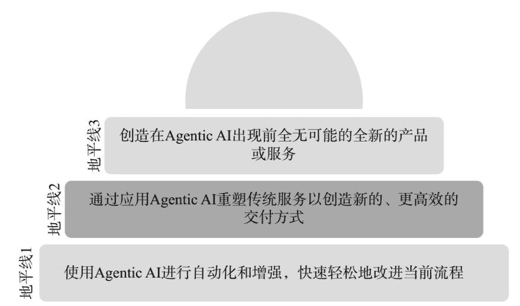

**图 9-1 Agentic AI 机会的三条地平线**

资料来源：Bornet et al.

**Agentic AI 领域机会识别框架**

我们在实践中提炼出智能体式机会识别框架 AOIF，从四个维度评估机会。

**价值链分析**

聚焦 AI 能在何处重塑业务流程。

**任务分解**：把复杂流程拆解为可被增强或自动化的小任务。如内容创作可拆分为构思、调研、撰写、编辑、优化，每个环节都有 AI 介入空间。

关键问题：“流程中哪些独立步骤适合自动化或增强？”

**交接点**：工作在人员或系统间转移的节点。我们发现这些环节常是最大改进点。如客服工单从自动回复到人工再到专业部门的流转，每次交接都是 AI 辅助机会。

关键问题：“工作在不同主体间转移时，延误或错误通常出现在哪里？”

**关键抉择点**
这是流程里必须在信息有限的情况下做出判断的节点。AI 在处理多变量并行的复杂决策上优势明显，比如供应链里确定最优库存，就要同时权衡需求波动、成本、风险等多重因素，人类很难像 AI 那样从容兼顾。

核心自问：你的流程中，哪些环节需要同时消化多个数据维度或变量才能做决定？

**市场痛点图谱**

这个视角用来锁定 AI 能够独家解决的现实问题。

**流程卡点**：让工作变慢、变烦、变低效的环节。我们观察到，落地的 AI 项目大多先从这些卡点入手。例如律所的文档处理常成为瓶颈，AI 正好能疏通它。

核心自问：团队成员反复抱怨、或想绕开的任务有哪些？

**成本重灾区**：不可或缺却烧钱的运营板块。AI 往往能在保持甚至提升质量的前提下大幅降本，本质是用智能体替代高成本的人工重复作业，提升利润率。像 AI 辅助编程就能同时压低开发花费和提升代码水准。

核心自问：哪些流程花钱多、产出却不成比例？

**质量落差**：现有方案持续达不到预期标准的领域。AI 擅长稳定输出，因而特别适合补齐这类短板。如医学影像里，AI 可提供稳定的一致性初筛，减少人为失误。

核心自问：当前流程中，哪些环节的质量或性能波动最大？

**能力匹配清单**

这一层确保方案能真正发挥 AI 的长处，判断可行性的前提。

**语言理解**：让 AI 处理和生成人类语言的能力，适用于沟通、文档、文本归纳分析等场景。当代大模型从基础分类到复杂推理生成都能胜任。

核心自问：哪些工作高度依赖阅读、撰写或解读文本？

**模式捕捉**：AI 从数据中找趋势和关联的能力，适合预测性维护、反欺诈、市场分析等。现阶段的模式捕捉已能处理更细微、更复杂的数据类型。

核心自问：数据里哪些模式一旦被识别就能带来明显价值？

**逻辑链条**：AI 遵循逻辑步骤、建立关联解决复杂问题的能力，对法律分析、医疗诊断类任务至关重要。现有的 AI 能维持上下文并执行多步推理。

核心自问：哪些决策必须按特定逻辑顺序推进？

**融合接入点**

聚焦新 AI 方案如何嵌入既有系统，成败往往取决于无缝衔接。

**既有工具**：强化而非替换现有工具更容易被接受。思考 AI 如何增强 Salesforce、Microsoft Office 或行业软件的使用体验。

核心自问：日常运营里哪些软件是不可替代的核心？

**数据可得性**：现成数据能显著提升部署效率与效果。先盘点内部结构化与非结构化数据的可用情况，能更快找到落地方案。

核心自问：已采集但尚未充分利用的数据有哪些？

**API 生态**：接入强大的生态系统可大幅提升扩展性。了解方案接入哪些平台能节省开发时间、扩大覆盖面至关重要。

核心自问：行业内哪些平台拥有活跃的 API 生态？

**从设想到落地：自主简讯智能体的案例**

这是一个完整的 Agentic AI 机会发现与把握实例。几个月前我们发现，内容创作者和中小企业普遍头疼于简讯的创建、筛选、分发全流程耗时耗力。市场上已有不少工具，但没有一个能自主完成筛选、摘要、排版、审核到发布的闭环。

于是我们瞄准了一个 L3 级自主简讯智能体：不仅能自动化发送流程，还能自主甄选内容、撰写吸睛摘要，并依据读者参与度优化发送时机。

机会之所以成立，是因为它同时满足三点：解决明显的耗时痛点；可在少人工干预下自主运行；具备多客户规模化服务的潜力。

我们打造的智能体可扫描指定源获取相关内容，用客户品牌调性生成摘要，并自动编译发送。我们卖的不是程序，而是服务：兼具人类水准的质量和机器水准的一致性与规模化能力，实现简讯管理的自主化。

**第一步：机会验证**
项目始于为期两周的跨职能研讨，聚集创作者、企业主和技术专家。首场 3 小时痛点研讨显示，企业普遍被“写出好简讯”困住，每周花费数小时筛选文章、写摘要、排版，挤占战略时间。框架帮助我们从痛点进一步确认机会。

**第二步：价值链拆解**
半天的价值链映射把简讯生产流程拆解为 7 个任务：内容筛选、摘要撰写、每日精选、文章挑选、编译、排版、终审。交接点成为瓶颈，特别是在筛选到摘要的环节，复制粘贴不同工具耗费巨大。

**第三步：痛点矩阵深挖**
访谈揭示三大摩擦：筛选耗时、摘要质量不稳、排版繁琐。成本侧显示，企业每周投入 15~20 小时熟练员工时间做重复性简讯工作，性价比低。

**第四步：能力对齐评估**
2 小时能力研讨会用评估矩阵把 AI 能力与痛点匹配：语言理解负责摘要，模式识别负责相关性判断，推理链负责整体编排。系统映射证实技术上可覆盖主要痛点。

**第五步：集成规划**
半天的集成规划发现，大多数企业已用邮件共享内容、用 Google Docs 协作。围绕这些熟悉工具设计智能体，可降低学习成本、提升采纳率，最终输出集成路线图与技术需求。

**第六步：优先级排序**
3 小时的优先级评估从痛点严重度、技术可行性、集成复杂度、潜在影响、资源需求五维度打分。简讯项目在可行性与影响上突出。

据此我们构建多智能体协同系统：搜索智能体持续扫描源并用模式识别评估相关性；摘要智能体用语言理解生成稳定吸睛摘要；邮件智能体负责日常触达，供人工最终复核。

### **结果**
框架的验证体现在快速落地与正向反馈上。客户反馈制作时间缩短约 80%，质量不降反升。摘要一致性改善，定时邮件让创作者能低压力掌握动态。

**未来之路**
当下 Agentic AI 的机遇类似移动应用早期的数字化浪潮：先把日历计算器这类流程自动化，真正的革命来自能想象新可能性的创业者。机会很大，但需要系统化识别与验证。框架提供结构化评估，帮助聚焦最有前景的赛道。

关键不只在当下能做什么，更在能预判未来能力并立刻交付价值。弥合当前能力与未来可能性的人，将定义下一阶段。

# 第四部分 通过 Agentic AI 实现企业转型

第三部分讲的是如何构建有效智能体并创造价值，第四部分要解决更根本的问题：如何用这项技术重塑整个组织。对规模化追逐 AI 能力的企业而言，这是真正的考验。

我们长期观察到一个规律：技术领先不等于成功。若员工不信任、流程不重塑、治理不匹配，再先进的智能体也会失效。企业转型的重要性不亚于技术落地，往往更难。

因此本部分跳出技术，探讨决定规模化成败的人、组织与战略层面。我们见过太多试点成功后无法跨越企业推广障碍的项目，希望你避开这个陷阱。

从愿景到现实并非坦途，但方法得当，变革触手可及。

## 第十章

## 人类-智能体协作新范式：领导力进化、信任构建与组织变革

规模化工作设计与变革管理实战精要[2024]

年夏天，一起保险理赔智能体的部署彻底改变了我们对变革管理的认知。技术很顺利，甚至过于顺利。问题出在人。

“我干理赔 15 年了，怎么确定这个智能体不会出错让我来收拾？”资深理赔员弗洛拉的疑问，折射出部门的深层焦虑。我们低估了人为因素，而 AI 部署必然冲击员工的行为、价值观与认知。

另一家亚洲银行的自动化负责人曾说：“3 个月建好智能体，团队换掉四分之三。”而负责流程改进的同事提醒：“流程太复杂，人走了会出问题。”

教训很清晰：部署成功的关键不在技术，而在人。人要实施系统、监控表现、纠正错误、发现问题并推动改进，或选择抵制。

成功需要多维度的人力因素：做出关键决策的领导力；工作再设计：智能体做什么、人类做什么；变革管理：让员工理解并接受与智能体共事的新模式。

**为人和智能体重新设计工作**
企业看中 AI 的一个理由就是减少人工干预。生成式 AI 热潮后，我们发现仅靠提示和人工校对很难带来预期提效。

Agentic AI 会进一步降低人类对输入输出的干预需求，但程度因场景和技术成熟度而异。这意味着持续的工作设计：决定何时由智能体自主处理，何时升级或人工介入。介入可能仅在智能体自认无法完成时，或后果严重需监控审查时。

这类设计本质是流程改进与再造。90 年代至今的流程学科因 AI 回归。流程挖掘与任务挖掘等新技术，能更快设计实施新流程。RPA 时代的经验也表明，先优化再自动化更有效。

有流程经验的企业在 AI 时代更占优。它们懂得规划工作流、为 AI 赋能做准备、让人类参与设计与执行。若熟悉流程智能，就能清楚任务由人还是智能体完成，对订单到回款等端到端流程的影响。

人类角色也在变化。结构化重复工作被智能体承接，初级岗位需求下降；审查与修正智能体输出则需要更高技能，往往由资深员工承担。劳动力结构变化影响个人职业与整体经济，需提前沟通与能力准备，这要求技术与 HR 跨部门协作，未来可能出现“人力与数字资源管理”这类复合角色。

**把恐惧转为机遇：重塑对智能体的认知**
“引入智能体是为了取代我们吧？”某制造企业团队负责人的提问代表普遍恐惧。保证不够，必须靠透明、证据与成功案例。

我们为该企业设计三步策略：第一，员工对员工交流。邀请已成功融合智能体的企业一线分享，从担忧到工作变好的真实体验。零售客服代表说：“重复咨询 70%被智能体接走，我能专注复杂问题，满意度反而提升。”

第二，“日常工作”研讨会。不是空谈 AI，而是具体画出引入后一天的工作变化，凸显智能体是消除枯燥重复、而非取代人。

第三，“未来角色路线图”。给出清晰演进路径，如成为“自动化专家”，把流程经验与技术技能结合来管理优化智能体。

效果明显。某部门初期 82%员工担心岗位安全，半年后 76%对智能体整合持积极态度。展示胜过告知，关键是让员工感受到增强而非替代。

**为 Agentic AI 时代培养能力**
基于大量实施，我们提出“AI 智能体协作能力模型”，AICCM。该模型描绘了员工与领导者从使用基础 AI 工具到与智能体协作所需的核心能力转变。

**从任务思维到工作流思维**
早期工具是单任务处理，智能体在工作流层面协同。需要的能力包括：流程映射，理解任务间关联；系统优化，设计多域协同；跨学科思维，整合领域；结果导向，关注智能体活动的期望产出。

一位制造运营经理说：“最有价值的不是编程或提示工程，而是画出端到端流程图，找到员工能产生最大影响的环节。”

**从直接控制到有效授权**
许多人难以适应释放控制。Agentic AI 要求：监督而不微观管理；培养“AI 直觉”，判断何时放手；建立追踪审计与改进的治理框架；理解伦理边界与责任授权。

“把任务交给人工智能，原以为很简单，实际比想象中难很多。”一位与我们共事的营销总监这样说，“以前总想逐个动作去核对，现在我学会克制这种冲动，更多去审视结果并做战略调优。”

**从操作到协作**
跟智能体配合，不是简单对话，而是需要更精细的人机分工。员工需要聚焦在几个关键点上：

• 认知边界：清楚智能体已不只是语言模型，能处理更复杂的工作流程。
• 高层指引：给出方向性指令，而不是手把手拆解步骤。
• 协同共创：通过反复迭代和 AI 一起打磨解决方案。
• 战略搭档：让 AI 负责自动化和精准化，人类发挥创造力和判断。

我们在金融服务的智能体落地中看到，把 AI 当成合作伙伴来用的团队，成果更好，员工满意度也更高。

**长期价值，人类如何加分**
当智能体开始接管整段流程，人类必须在 AI 复制不了的维度上创造价值，这需要四种能力：

• 真正的创造力：产出有情感深度和文化敏感度的原创方案。
• 批判性评估：审视 AI 输出的偏见、伦理风险和长期影响。
• 关系经营：深耕信任、同理心等纯粹人际连接。
• 整合专长：把 AI 能力与人类特长有效结合。

“一个很有意思的悖论，”一家参与落地的医疗机构高管提到，“拥抱自动化反而让我们的独特人性技能更值钱了。”员工腾出了时间去做患者关系和复杂问题解决，这些正是人类擅长的。

培养 AICCM 框架下的能力，能把对 AI 的焦虑转为对新机会的期待。我们发现，在四个维度都持续投入的公司，团队适应更快，也能挖掘出技术专家未曾想到的用法。数据显示，这类团队报告智能体实施成功的可能性，是只做技术集成的团队的三倍。

**透明，才是信任起点**
最成功的落地都有一个共性：对角色变化的透明沟通。没有透明，员工会怀疑 AI 是为了用效率替代人，进而产生焦虑和抵触。

我们在一个保险项目里就调整了策略。不再笼统宣布“AI 将优化理赔”，而是为每个岗位画出详细的影响图，说明：

• 哪些具体任务会被智能体承接？
• 岗位如何演进，会新增哪些职责？
• 转型后哪些技能更吃香？
• 未来的职业路径是什么？

意外的是，透明没有增加焦虑，反而降低了焦虑。员工清楚看到 AI 如何增强自身价值和前景，未来变得更具体、可掌控。

**别只讲课，让员工上手**
早期我们过度依赖正式培训，讲智能体的潜力。后来发现，只有当整合与人类价值观和利益一致时，落地才可持续。

一家电信公司的客服智能体就是教训，大量培训仍效果不佳。转折点是转向“学习实验室”。我们不再只讲概念，而是让员工直接参与集成流程。

参与式采纳让员工亲身感受 AI 对工作的实际帮助，也产生反馈供顾问和企业优化。核心是搭建沙盒，用真实工作场景试用智能体。这种体验极具转变力。

**新学习三支柱**
在反复试验后，我们总结出三支柱学习法。

1. 自主探索：给予受保护的时间，在真实工作环境里试验智能体，通过实操而非说教学习。最佳时机是在原型或验证阶段，便于根据人类反馈调整。
2. 同伴网络：建立社区，员工分享使用经验、成败案例。往往能发现意料之外的创新用法，也是识别不足和改进点的来源。
3. 情境化培训：培训要贴合业务职能、岗位和具体场景，而非泛泛的 AI 通识。

**放手，才有拥有感**
一家制造企业的经验给了我们重要启示。最初计划由 IT 统一配置所有智能体，结果采用率低。后来允许员工在治理框架内自行调整配置的部门，采用率和满意度明显更高。

这催生了渐进式自主模型。随着熟练度提升，员工获得更多自定义权限，形成良性循环：参与塑造的智能体，更容易被投入和负责。

**低代码让自动化人人可做**
加速落地的有效策略是借助低代码平台，让员工从被动接受者变为主动创造者。某大型医疗机构的实践显示，转型速度和态度都明显改善。

“起初我觉得智能体是威胁，”医疗账单专家马克说，“当我能亲手配置自动化流程时，才意识到它是在帮我工作，而不是取代我。”低代码让他们自动化常规查询，同时保持对流程的掌控。

关键四要素：人人可用的工具、自动化倡导者网络、可复用的智能体和流程库、兼顾创新与安全合规的治理框架。

**奖失败，促创新**
一个常见误区是只奖励与 AI 互动的成功结果。在一家零售企业，这无意中打击了实验精神，员工不敢尝试可能失败的新用法。

我们改为奖励有记录的“学习型失败”，在文化上把实验与成果同等看重。正如一位合著者所说：“想快速学习，就要快速失败。”

有效的激励通常包括：认可新用例的发现、奖励经验分享、与 AI 专业知识挂钩的职业发展、为实验预留受保护时间。

企业还需要清晰的文化预期：AI 不是偷懒工具，而是人工作的增强；奖励的是成果质量，而非是否用 AI。能用 AI 做出更好决策、报告或更快的员工，都应被认可。

**变革是持续过程**
我们建立的变革管理框架强调，变革不是一次性项目，而是随技术演进的持续过程。

一开始引入 AI，效率往往会暂时下降，因为员工要适应新的数字同事，培养人机协作技能。但掌握后，生产力会回升并超越原有水平，形成 J 形曲线。

理解这条曲线很重要，初期的适应挑战不是失败的信号，而是长期转型的必经阶段，能提前规划的企业更可能释放 AI 潜力。

**先观察，再放手**
信任是双向的。一方面企业要给予员工参与和调整的信任，另一方面智能体也要赢得信任。

一家金融机构用“信任调节器”方法取得了突破。他们没有追求一步到位自动化，而是设置分级自主度。用户可先把智能体设为“观察模式”，只看行动不执行；信心增强后逐步放开，先处理低风险任务，再逐步扩大权限。

“就像带新人一样，”高级运营经理詹妮弗说，“不会第一天就给完全自主权，而是先用小任务证明自己。”怀疑者因此变成了支持者。

关键要素：高可见低自主启动、能力扩展的明确检查点、透明的行为审计记录、易用的覆盖机制、跨团队分享成功案例。

**为下一代智能体准备**
当前部署多在 Agentic AI 演进框架的 L1~L3 级，企业需为 L4~L5 级更自主的智能体做准备，包括：管理高度自主系统的框架、可演进的治理结构、与未来 AI 相辅相成的技能、为可能被替代岗位的员工规划转型路径。

比如 Klarna 的客服智能体被报道可“替代 700 人工作”，但实践中仍会犯错并转人工。CEO 表示这 700 人将通过自然流失逐步退出，期间转做二线或相关岗位。该公司客服外包规模从 3000 人降至 2000 人，人类并未消失。

**人机协作的终极目标**
成功管理的核心，是在透明度、教育、赋权和激励间取得平衡。目标是把 AI 的速度与效率，与人类的灵活性、批判思维和大局观结合。

还记得开头的弗洛拉吗？半年后她已成为部门里最坚定的支持者。“这不是取代我们，”她对同事说，“是给我们工具去做更有意义的工作。”从怀疑到拥抱，正是有效工作设计和变革管理的证明。

不要把工作设计和变革管理当成障碍，而应视为打造更投入、更熟练、更具适应力的团队的机会。

### Agentic AI 时代的领导力：带好人机混合队
想象一下走进办公室，团队一半是人类，一半是智能体。这不是科幻，是近未来。谁来领导这种混合团队，如何建立信任，已刻不容缓。

**领导力升级：从控制到共创**
传统领导模型基于人对人，强调层级控制。新理论强调目标感、关系和信任。

在为世界 500 强提供咨询的经验中，AI 的出现重塑了领导力。一个项目经理阿尼尔的团队里有分析师和 L3 级数据处理智能体。“我起初用管人方式管 AI，很快发现不对。”智能体不需要激励，需要清晰目标和参数；人类则需要学会与 AI 同事协作。

领导者需要在控制与支持间切换，既管理 AI 的逻辑需求，也照顾人类的情感与成长需求，这就是领导双元性原则。

组织也在扁平化，AI 承担排程、资源分配、绩效跟踪等中层任务，人类聚焦战略、创新和人际领导。决策上，领导者需在 AI 数据洞见与人类价值判断间平衡。

**混合团队的信任三要素**
研究显示人机协作的信任有三个维度：

1. 人对 AI 的信任：相信其可靠且合乎道德，需靠透明、稳定表现和清晰的能力边界来建立。
2. 任务交接的信任：人要相信从 AI 接收的工作准确完整无偏，交接需简单透明易检查。
3. 人与人间的信任：在 AI 环境下，人仍需信任彼此判断和价值观，共同监督 AI。

下面用两个真实案例说明这些原则落地时是什么样子。与一家金融服务企业合作的项目中，我们引入了 L3 级 AI 智能体负责客户的初步咨询和基础分析。起初，客服代表的情绪很明显是抵触的，他们担心被替代，也担心系统出错后需要自己收拾残局。

为了建立信任，我们搭建了一个透明的协作机制：
• 坦诚的能力边界说明：协助团队弄清楚智能体到底能承担什么、什么做不了，并以 Agentic AI 演进框架为依据解释当前 L3 级别的能力范围。
• 可视化的成效看板：搭建流程控制面板，同步呈现人工智能与人工团队在准确率和效率上的表现，让大家直观看到各自的互补优势，从而把协作摩擦降到最低。
• 分步式接入：先从最简单的任务切入，随着团队适应度提升，再逐步扩大智能体的责任边界。

三个月后，信任度明显上升，混合团队的整体产出比既往基准高出 40%。

**信任的养成遵循节奏**

与多家企业的合作让我们看到，信任的建立其实遵循一个可复现的模式。最近在协助一家全球制造企业优化供应链决策时，这个过程被完整呈现出来，经历了三个不同的阶段。

**第一阶段：验证期**
起初员工对智能体保持谨慎，每一条建议都要人工复核。就像带新人一样，先看成果再下判断。制造团队花了不少精力去核对智能体给出的库存建议。

**第二阶段：校准信任**
大约三个月后，出现我们称之为“校准信任”的状态。团队逐渐摸清智能体的强项与短板。比如它在预测常规供应需求上表现稳定，但在突发市场波动或紧急订单等非常规情境下仍需要人工介入。这种对全局的把握一直是人的特长，尤其当外部环境变化而模型参数停留在过去时更为关键。

**第三阶段：伙伴关系**
约六个月后进入真正的协作阶段。此时 AI 被视作能同时促进员工和企业价值的伙伴。双方形成了高度高效的配合，决策耗时压缩了 60%，准确性也同步提升。他们并非盲目依赖系统，而是建立了非常细致的合作默契。

**划清边界**

要与 AI 智能体有效协作，必须保持恰当的监督。格利夫和麦克莱恩的研究指出，即便是先进系统也可能出现故障和错误¹³，对生成式模型尤其如此。监控机制因此必不可少，尤其是高风险场景。

关键在于把握平衡：监督要足以捕捉重大失误，又不能密集到抵消 AI 带来的效率增益。这个平衡点会随任务属性和错误后果而变化。

因此我们提炼出“决策控制框架”，帮助企业在建立信任的同时保持控制，涉及三个层面：

• 战略决策：需要复杂判断的前瞻性决策，AI 只能提供支持不能拍板。人类的判断在此类决策中不可替代，这类决策稀少也难以被建模训练。例如在与一家零售连锁合作的库存管理智能体部署中，是否进入新市场或启动大型促销活动仍由人类全权决定，AI 仅输出数据分析和市场洞察。

• 战术决策：中等复杂度的适应性决策，智能体可以给出行动建议但须经人工批准后执行。以零售为例，AI 会基于预测需求推荐库存调整并提出单品价格建议，最终需人工审阅批准。审阅频率可依据决策的经济价值弹性调整。

• 运营决策：常规重复性决策，合适的智能体可在明确参数范围内自主运行。零售系统中，库存触及预设水位时可自动补单标准商品，但需受预算和数量限制。客户服务场景中，智能体可按内容分析自动分流咨询至对应部门，复杂情况则转交人工主管。

该框架为信任的逐步放权提供了结构。随着团队对智能体在某一层面的表现越发满意，自主权可以适度扩大，同时监督不降。系统也在持续数据上迭代，决策质量随之提升。

**混合团队的沟通方式**

混合团队的沟通需要新的设计。虽然 L1~L3 级智能体能处理自然语言，但缺乏人类的细腻理解，这就形成了“沟通鸿沟”。

我们提出的“混合团队沟通协议”包含三点：
• 清晰的指令结构：对 AI 使用明确指令，对人类保持自然对话。
• 情境管理：确保人机成员都能获得与任务相关的背景信息，对能利用上下文的 L3 智能体尤其重要。
• 反馈闭环：建立人机间的定期反馈，由熟悉 AI 的 leader 推动，将技术信息与企业的人、品牌价值结合，及时调优模型。

曾为一家科技企业落地该协议。它们要求 AI 在输出前附上置信度水平和假设前提，人类成员据此快速评估信息可用性。

**未来领导者要补的课**

随着 AI 智能体在不同演进层级普及，领导者需要四项核心能力：
• AI 素养：理解各层级智能体的能力边界与潜力，不必成为技术专家，但要懂得如何有效使用。
• 混合团队协作力：协调人机成员、优化任务分配、匹配智能体与合适的人选并促进协同。
• 伦理监督力：随着任务复杂度上升，确保 AI 设计与使用符合伦理规范。
• AI 时代变革管理力：引领团队适应技术持续演进，培养韧性、灵活性和好奇心。

**企业落地路线：从跨职能协作开始**

未来工作不是在旧结构上叠加 AI，而是重新设计团队运作。我们看到跨职能动态团队兴起，单一智能体系统可同时覆盖营销自动化、财务预测和客服等多个领域，人类则聚焦战略与创意。成功需要结构化方法，2024 年关于混合工作模式的研究框架¹⁴提供了参考。基于实践我们形成“混合团队整合模型”。

**第一阶段：为人工智能增强型协作奠定基础**
明确 AI 如何增强人的能力，锁定其可处理的重复性、数据密集型流程，让人专注创造与战略。与团队共同梳理职责边界，确保人机分工清晰。配备 AI 驱动的任务管理平台或决策支持系统，并提供使用培训。领导者需具备指导人机团队的技能，在建立信任的同时保持人工监督。本阶段重点是信任、结构与协作准备。

**第二阶段：测试和细化人类与人工智能之间的动态关系**
试点混合模式，检验人机在真实场景中的价值共创。可选取客服团队用生成式 AI 提升响应速度，或营销团队用 AI 优化投放。建立清晰沟通规范，例如 AI 起草提案、人来完善审批。每周回顾，收集团队对工具表现的反馈。本阶段核心是试验、优化流程，让人机协作更直观高效。

**第三阶段：在企业内规模化人类与人工智能之间的协同**
在试点验证后向各部门推广。用试点数据和用户反馈展示 AI 对效率、决策质量和成果的实质提升，按团队特性定制。例如销售可获益于 AI 驱动的潜客分级，研发可借助 AI 加速数据分析。定制化避免一刀切。

同时要培育协同文化：认可和奖励能将人类创造力与机器精准度结合的团队；投入持续培训，让团队与技术同步进化；建立常态化反馈通道，持续收集洞察与改进点。本阶段不仅是扩大应用，更是把 AI 嵌入企业文化，形成人机真正的伙伴关系。

该框架承认角色的分化：运营、数据分析、常规决策多由 AI 承担；创造力、情商、领导力与伦理监督仍属人类。分工不是替代，而是优化，让人机各司其长。

**文化转型**

领导混合团队最难的是文化转型。成功转型需要：
• 思维转变：把 AI 从工具视角转为同事视角，同时保持对能力局限的清醒认知。
• 价值观重塑：让员工认识到自己的独特价值在于创造力、适应力、灵活性、情商和复杂问题解决。
• 持续学习文化：营造人机共同成长的环境，人从经验中成长，AI 从反馈中学习。

**展望未来**

随着智能体向更高层级演进，领导力也必须进化。目前主流仍是 L1~L3，但需为更高能力做好准备。成功的关键是保持“适应性领导平衡”：随 AI 能力提升而调整领导风格和方法，同时始终把人的需求与潜力放在中心。

领导者要记住，即便 AI 能处理更复杂的任务，激励、共情、伦理判断和创新推动仍是人类独有的。最大的挑战是把 AI 战略性地融入生活，让我们变得更有同理心、更具创造力，更能感知生活的意义，而不是变得不那么人性化。在此范式下，AI 是人性的放大器，帮助人类探索潜能边界并重新定义成就。

领导人机混合团队是工业革命以来管理实践的最大转变之一，需要技术理解、人性共情与战略眼光的微妙平衡。我们在不断完善对这一新环境的有效领导力的认识。所概述的框架为领域奠基，但演进仍在加速。未来最成功的领导者，将是能把原则落地于具体情境，同时始终聚焦人的发展与技术融合的人。未来领导力不是在“人类智能”与“人工智能”之间二选一，它们是两种不同生物¹⁵，关键是在二者间创造协同，让人类表现和企业运营达到前所未有的水平。

**基础建设：愿景与治理**

在协助企业转型中我们发现一个根本真理：成功始于并终于强大的管理愿景与治理。领导层对“AI 如何支撑更广战略”达成一致的企业，成功概率几乎翻倍。有效的治理到底长什么样？以下做法提供了答案。

**用体验设定愿景**

常见的坑是管理团队仅靠战略文件和 PPT 推动转型，导致期望不切实际、目标不一致。我们在一家全球电信企业看到不同做法。CEO 与高管团队没有从演示开始，而是花了一整天亲身体验智能体，与客服团队共事，亲自测试系统处理咨询、应答请求和异常的能力。这种沉浸式体验极具冲击力，CEO 事后表示此次体验彻底改变了他对 AI 能做什么不能做什么的认知。

基于真实体验制定的愿景，更容易被员工理解和信服。领导层能更有力地解释为何以及如何采用 AI，使员工相信收益与企业使命一致。高管哪怕只用几次 AI，也能获得直观的能力与局限感，从而制定更务实的目标并有效传达。

**以身作则**

在转型中，最被低估的动作是以身作则。当高管在自身工作中积极使用并倡导 AI 时，企业采用率显著提升，因为榜样让行为显得可信。

在一家咨询企业，管理合伙人把智能体融入日常，公开在客户展示和内部会议中使用，展示如何用它分析数据、提炼洞察、起草建议。透明化既去除了神秘感，也传递了清晰信号：AI 是要拥抱而非畏惧的工具。六个月内，全公司自愿使用率提升 300%，员工访谈中多人将合伙人的示范列为关键驱动。

**全企业视角的力量**

AI 实施不是技术升级，而是工作方式的根本改变。研究显示，多职能协同部署 AI 的企业，成功概率是仅在孤立部门试点企业的 2~3 倍¹⁶。多数端到端流程跨越销售、财务、制造、供应链和物流等多个职能，支持此类流程的 AI 部署虽难但实现生产力与客户满意度提升的唯一路径。

我们曾与一家全球制造企业合作，最初计划仅在财务部门用 AI 处理发票。我们引导其思考该应用如何与企业愿景契合，并进一步探询企业内还有哪些同样服务愿景的 AI 应用机会。通过提问引导，企业将策略扩展至全企业，提升了在整体层面创造价值的可能性。

**整体价值**

企业随后绘制部门间关联，发现传统孤立流程在阻碍价值。例如财务收到的发票涉及采购核验、客服价格查询、物流发货确认。系统按部门独立设计，但业务本身高度关联。

在指导下，管理层意识到只有建立人机与机机之间的伙伴关系，AI 才能真正创造价值，需要打破各自为政的思维。因此未为每个部门建独立智能体，而是设计跨部门运行的端到端系统。单一系统从发票接收到付款处理全程负责，与采购核验交货、与物流确认发货、为客服标记价格异常，所有动作在统一平台完成。

跨职能方法释放了单部门无法实现的能力。智能体开始揭示跨界洞察，例如付款条件与供应商表现和现金流的关联，帮助优化供应商选择、谈判合同、改善流动性。洞察不仅改善运营，也提升战略决策质量。

处理时长压缩四成，现金流管理效能提升四分之一，这些数字本身已足够亮眼。但这家企业真正的质变，发生在组织文化层面。当人工智能不再困在某个部门的试点里，而是以跨边界的方式被部署，整个公司从碎片化的单元，转向统一的、以数据为导向的整体。AI智能体成了推动协同的催化剂，拆掉了信息壁垒，让“先解决整体问题再谈部门利益”的思维开始占据主导。

这一实践给出的核心判断是：Agentic AI 的价值，不在于能自动化多少工作，而在于能否真正打通整合。企业要避免堆砌彼此孤立的智能体，而应设计一套能够穿透部门边界的协作系统。只有当人工智能成为把各业务线粘合在一起的纽带，让企业像一个统一而智能的有机体运转时，变革才算完成。这种做法的本质是构建多智能体体系，由不同角色的智能体各司其职，而由以企业愿景为导向的人类领导者来协调协作关系，才得以引导整体动态。

**规模效应带来的投入回报**

把AI智能体在全公司层面铺开，会带来明显的规模经济。采购端能和技术供应商争取更优惠条款，开发费用由各部门共担，还能搭建起中央化的支撑平台。更关键的是，一个业务线总结的经验可以迅速复用到其他领域，整体转型提速，同时沉淀的优秀案例也能在后续项目中反复利用。

在通用的人工智能基础设施上投入——包括安全框架、数据治理体系和对接平台——成本可以摊到多个场景里。这样既让各部门落地更省钱，也更容易获得审批。

**立起企业层面的价值论证**

能否获得全面支持，往往取决于是否做成一份真正的企业级商业论证，而非停留在部门ROI层面。它要把网络效应和跨职能收益算进去。论证完整版通常包含以下内容：

• 各部门可直接看到的成本节省和效率提升；
• 靠数据共享和流程联通带来的跨职能收益；
• 因规模效应而降低的技术支出；
• 端到端流程优化后带来的客户体验改善；
• 消除重复工作后员工满意度的提升。

这种企业视角更容易赢得高层共识，也能为各部门的推进顺序和资源分配提供依据。要实现这一视角，往往需要新的组织设计和领导岗位。大多数企业至今没有真正负责跨职能流程的人，也没有能对端到端流程做决策的角色。理想状态是设立流程负责人，现实中不太容易做到，但至少需要一个委员会或代表小组来审议跨职能智能体的事项。领导者应推动各职能负责人围绕企业智能体项目协同，并在必要时直接参与。

**全面商业案例的搭建思路**

做AI智能体的商业论证，必须跳出传统回报率的框框。我们曾与一家大型保险公司合作，他们最初的案例只算自动化带来的降本，狭隘的立场引发了中层抵触，认为项目只是裁员工具。在重构后，我们聚焦四个关键维度。

第一，量化收益。除了成本下降，还要看到收入机会。该公司的智能体可承担四成以上客户咨询，直接带动保单销售增长15%。同时追踪处理速度提升、差错率下降、合规准确性提高等硬指标。

第二，质性收益。包括员工满意度因摆脱重复性事务而上升、客户体验因24小时在线和服务一致性而改善、运营韧性增强。该公司在智能体接管日常理赔处理后，员工满意度得分提升超过30%。

第三，实施成本。不仅要算技术许可和开发，还要计入变革管理、培训以及过渡期可能出现的生产力波动。该公司把预算的40%拨给变革管理和培训，这一步被证明对 adoption 至关重要。

第四，风险评估与缓释。技术风险比如系统集成难题，企业风险比如员工抵触或技能缺口，都需前置识别。智能体本身帮助识别出数据安全等关键风险，并为每个风险配上具体的缓释策略。

**AI智能体治理：创新与伦理的平衡框架**

要在创新需求和控制要求之间取得平衡，并把伦理原则嵌入每一层决策，需要一个既有结构又具弹性的框架，以保证一致性、促进创新并维护公众信任。伦理治理不只是制定政策，而要从用例构思阶段就开始评估。¹⁷

一家全球性银行的“智能体创新委员会”模式是典型代表。该委员会汇聚业务线领导、IT负责人和员工代表，形成共享治理机制。其优势在于将战略监督与运营灵活性结合，既让创新生长又不放松控制。

委员会按三层运行：

• 顶层指导委员会，确定战略方向，确保人工智能项目与公司整体目标一致，并负责资源分配，保证重点项目得到足够支持；
• 第二层卓越中心，承担运营枢纽职能，提供技术专长、标准化实施流程并确保合规；
• 基层由各部门指定人工智能推广者，负责挖掘场景、推动采纳，并在业务部门与卓越中心间传导信息。推广者的深度参与让关于人工智能的有效使用的讨论自然进入日常运营，培养出自下而上的实验文化。治理不再是官僚负担，而是支持负责任实验的基础设施。

治理框架同时强调伦理监督。该银行另设人工智能伦理委员会，审查所有重大实施，守护数据隐私、决策透明、公平性和责任性等核心原则。

将伦理规范写入治理框架，避免其被后置。伦理审查成为开发早期的强制关卡，使得用例可以被及时修正，增强公众信任并降低监管风险。例如伦理委员会制定数据使用边界，禁止自动化招聘中的偏见决策或不透明定价算法等做法。

银行还建立了与客户的直接反馈回路。实时反馈系统让客户一旦发现流程不一致、不公平或潜在偏见即可提出，自动贷款审批、反欺诈或客服响应等场景均可触发内部复核。主动处理伦理问题既保护声誉，也提升员工和客户对计划的信心。

智能体创新委员会的月度会议成为关键抓手，用于评估进展、化解关切并保持与企业战略的动态一致。通过促进跨部门协作和保持沟通畅通，会议营造出创新与责任并存的氛围。

这种综合治理表明，有效的人工智能转型是重新定义企业“如何工作”的过程。把战略监督、运营支持和伦理责任结合起来，不仅确保智能体顺利落地，更使其成为长期价值引擎。

人们常担心重治理会增加官僚拖慢速度，但案例恰恰相反。部门推广者的存在让人工智能使用被持续讨论、打磨和优化。员工不再把人工智能视作IT遥控的黑箱，而是积极参与塑造并用之改善日常工作。

文化转变带来自下而上的创新。银行风险管理团队受内部讨论启发，提出用于欺诈检测的AI预警系统。得益于治理框架的快速评估与测试机制，该想法从概念到上线比传统流程快得多。

这再次强调企业领导必须从采纳之初就深度参与，聚焦企业目标、价值观与使命，使伦理和治理成为审视人工智能整合成效的自然视角。任何人工智能转型都必须采取整体方法，让治理既是创新的助推器，也是伦理失误的防护网。当框架在项目伊始就把伦理深植结构并清晰可见时，它既引导技术，也塑造技术对改善工作条件和创造各方福祉的实际效果。

**以数据追踪转型成效**

KPI和监测是判断AI智能体转型是否创造价值的关键。管理者对员工任务完成度指标很熟悉，但对智能体创造企业价值的衡量却常缺位。

事实上多数企业目前几乎没有明确标准来评估人工智能采纳效果。因为它们往往从孤立实验开始，却很少思考如何成功落地。必须在启动之初就确定衡量标准并持续追踪。

以一家金融服务企业为例，部署AI智能体以简化运营并改善客户支持前，它在四个领域建立基线：运营效率、员工影响、客户体验、学习与适应，形成类似平衡计分卡的评估体系。

“运营效率”追踪处理时长、错误率和单笔成本。导入智能体后流程效率提升60%，错误率下降85%，直接对应降本和提质目标。

“员工影响”评估智能体如何增强角色价值。企业统计日常事务节省时长，并调研工作满意度和技能成长。员工反馈战略性工作占比提升至60%，重复性工作自动化后更有成就感，满意度显著提高。

“客户体验”关注满意度评分、解决时长和服务可达性。智能体承担一线支持后，客户满意度提升30%，更快响应和全天候可用性是主要驱动。

“学习与适应”监测智能体随时间改进的能力。初期可自主处理40%的客户案例，六个月后随着对复杂场景的适应，比例升至75%，人工干预需求大幅下降。企业还保持反馈闭环，月度复盘识别改进点并调整策略。当监测显示高优先级案例处理停滞时，便补充训练数据并微调算法。迭代机制保证学习持续深化。

把所有指标与最初商业论证挂钩，企业始终保持战略一致。清晰的KPI、OKR、成长指标与持续监测，给利益相关方以信心，并在全程保持动力。该案例说明结构化、数据驱动的方法让智能体转型可衡量、可操作、可评估，并最终在人员成长与人工智能融合层面取得成功。

## **第十一章**

## **从试点到全域：智能体规模化路径**

### 如何正确规模化

**从规则执行到推理决策：企业级规模化挑战**

会议室安静下来后，我们展示了试点结果：L3级AI智能体在两周内处理超过一万个客服请求，准确率超越人工基准。高管震惊，随即抛出我们期待的问题：“成果不错，怎么在企业内推广？”

这发生在2024年与一家财富世界500强保险公司的合作中，既凸显规模化的巨大潜力，也暴露其挑战。单个试点成功案例越来越多，但能把实施从孤立用例扩展到全企业的企业很少。

研究显示，在试行L3级智能体的企业中，成功大规模部署的不足1%。这与七到十年前智能自动化L2级出现时如出一辙，当时企业同样难以规模化。

目前尚未出现成熟的L3级扩展框架，只能结合过往经验和有限观察来总结最佳做法。

**夯实基础：先找到合适的切入点**

合作伊始，该全球保险公司的领导层急于在整个理赔业务中直接铺开智能体。热情可以理解，试点结果有说服力。可我们见过太多类似故事。

“在谈规模化前，先聊聊你们三年前的机器人流程自动化。”我们提议。首席信息官在椅子上挪动了一下。那次自动化扩展在初尝成功后停滞不前，一位高管称之为“坏掉的机器人墓地”。

**自下而上发现机会**

我们没有自上而下假设，而是派团队在企业内驻点六周。“我们要了解员工实际花时间的地方，而不是我们认为的地方。”我们向高管解释。

与理赔、客服、核保、运营等部门的五十多位团队领导和一线员工进行结构化访谈。不是正式会议，而是坐下来观察日常工作、倾听痛点。一位理赔员的话印象深刻：“我每天大约花四小时从不同系统里收集整理信息，才能真正开始分析理赔。”

这些洞察极具价值。通过交流和观察，我们为每个部门绘制工作负荷图，明确时间花在何处，更重要的是浪费在何处。发现各部门员工有六到七成时间消耗在他们称之为“行政事务”上，而非增值工作。

**聚焦高影响环节**

完成梳理后，我们用20/80原则——找出消耗80%时间的20%活动。这些高负荷活动成为智能体落地的首要关注点。

以理赔部门为例，三个活动尤为耗时：多系统信息收集与整合、初步理赔分类与分派、与客户和供应商的标准沟通。这些工作不仅耗时，还被形容为重复、乏味、易错。“这活让人脑子发麻”，一位成员说，“我学的是理赔专业，却每天大部分时间在复制粘贴信息。”

**评估可行性三要素**

并非所有耗时过程都适合自动化。我们按三个标准评估每个机会：

• 技术可行性：当前AI智能体技术能否有效处理该任务；
• 流程稳定性：流程是否足够稳定，或是否需要重大再设计；
• 数据可用性：必要数据是否能以可用格式获取。

评估带来重要认识：许多高负荷流程通过共享数据和系统相互关联。理赔员在信息收集上的困难，使用的是核保员在续保时也会访问的数据源。

**制定可信的规模化商业论证**

六周评估收集的洞察不仅识别机会，也为有说服力的商业案例奠基。“数据会说话”，我们对执行层说，“而我们的数据精确告诉智能体可在何处创造最大价值。”

工作量映射和可行性评估的数据构成案例基础。我们围绕定量和定性收益构建。定量上，仅在理赔部门，自动化已识别的高负荷流程每年可节省约四万五千个人工工时，直接成本节省约320万美元。定性收益同样可观：差错率下降、理赔处理加快、客户满意度提升、员工参与度因消除重复劳动而提高。

我们还计入实施成本，包括技术许可、开发资源和变革管理投入，预计三年内投资回报率可达285%。完整的商业论证对获得高层支持和资金至关重要，更重要的是它确立了清晰的成功衡量标准，使实施过程可追踪、保持动力，并在每个阶段向利益相关方展示价值。

**分阶段系统化推进**

确定优先机会后，我们为企业内每个智能体实施设计结构化的三阶段方法，而非一次性解决所有问题。推进路径依次是流程再设计与优化、部署冲刺迭代、测试与生产迁移。下面以首次重大实施——理赔信息收集与整合智能体为例说明。

**第一阶段：重塑流程**

“如果要自动化，就确保我们自动化的是正确的流程。”这是我们的口头禅。我们与理赔员、IT专家和流程优化专家组成的跨职能团队花了三周时间绘制当前流程。结果震惊：理赔员需访问七个不同系统收集信息，且常有重复。

我们从零重新构想流程，自问：如果今天用智能体构建，这个流程该是什么样？再设计整合访问点、统一数据格式、明确智能体与人工理赔员的交接。通过建立中央数据湖，智能体可直接查询，系统接触点从七个降至三个。

**第二阶段：部署冲刺迭代**

流程再设计后进入开发，按两周一个冲刺推进。每个冲刺交付可测试、可完善的特定功能。理赔信息智能体共规划六个冲刺，前一个成果为下一个奠基。

每次冲刺评审都邀请理赔员参与，反馈后及时调整。快速迭代非常有价值。例如第三次冲刺时，理赔员指出某些理赔类型需要特殊处理——我们最初未考虑。我们迅速调整智能体逻辑以适应例外情况。

**第三阶段：测试和生产迁移**

我们采用渐进式部署而非大爆炸：

• 第一周：10%的理赔申请由智能体处理；
• 第二周：25%的申请，同时扩大监控；
• 第三周：50%的申请，减少人工监督；
• 第四周：75%的申请，保持审计协议；
• 第五周：全面上线并采用标准监控。

渐进方式在控制风险的同时建立信任。“起初我总反复检查智能体所做的一切”，一位资深理赔员说，“但几周后，我对它的信任超过对自己收集数据的信任。”

**成果与经验教训**

六个月内，智能体扩展到多个流程并取得显著成效：信息收集时间缩短70%，85%的标准客户通信实现自动化，理赔处理时长缩短45%。

更重要的是员工满意度明显提升。“多年以来，我第一次能把大部分时间用于真正分析理赔，而不是仅仅收集信息。”一位资深理赔员这样表示。

核心经验是：AI智能体的成功不在于采用最先进的技术，而在于找到自动化能创造最大价值的合适机会。通过系统化的实施与规模化方法，企业能够创造可持续价值，同时避开许多自动化计划失败的常见陷阱。

方法论在变，原则不变

技术栈在持续迭代，新手段层出不穷，但让项目真正跑通的底层思路始终稳定：先锁定合适的切口，对业务流程做整盘改造，再稳健推进落地，全程坚持以人为本。一位全球保险企业的业务负责人说得直白：“这些自主代理不是来取代人的，而是让我们终于能回[content]
方法论在变，原则不变

技术栈在持续迭代，新手段层出不穷，但让项目真正跑通的底层思路始终稳定：先锁定合适的切口，对业务流程做整盘改造，再稳健推进落地，全程坚持以人为本。一位全球保险企业的业务负责人说得直白：“这些自主代理不是来取代人的，而是让我们终于能回到当初被聘请时想做的事。”某种程度上，这就是判断代理规模化应用是否成功的终极标尺。

### 自动化积淀如何助推 L2~L3 级跃迁
从基础自动化迈向复杂代理并非一帆风顺。许多组织回头看会发现，早期投的自动化资产，意外成了走向更进阶人工智能应用的跳板。要看清这种演变，全球建筑技术与解决方案龙头江森自控国际企业 JCI 的转型很有参考价值。

**底座：从重复执行到具备判断力**
初次对话负责 JCI 全球卓越运营与智能自动化落地的拉姆纳特·纳塔拉詹时，其现有底座规模令人吃惊。“目前约有 250 名数字员工和 2000 个 API”，他介绍，“这构成了一个融合机器人流程自动化、业务流程管理及多种 AI 工具的成熟 L2 智能自动化环境。”数字背后反映的不是技术细节，而是组织长期坚持流程改进与数字化转型的决心。对 JCI 而言，这套底座的意义远超成本节约，财务收益已相当可观，更关键在于它培育了可复制、可扩展的自动化交付能力。

**触及天花板后的转向**
JCI 故事里最值得关注的转折，是团队意识到 L2 智能自动化虽带来价值，却已接近边界。传统自动化在结构化、可预测场景中表现突出，但在企业当前更需要的自适应、情境感知操作上力不从心。
“我们正从单一任务自动化转向能够统筹整条工作流的代理。”纳塔拉詹在交流中表示。这正是 L2 与 L3 的本质分野：L2 能应对复杂但预设的场景，L3 则能理解语境、处理自然语言并调度多种工具达成更广目标。

**两个层级的衔接**
以 RPA 与智能自动化为代表的 L2，更擅长在明确边界内完成重复、规则化操作，像高效的流水线工人，依赖预设规则与结构化数据，在特定任务上表现很好，却难以在无人工介入的情况下应对重大变化。
比如 JCI 用 RPA 简化计费流程，大幅降低人工错误并提升效率，但复核环节仍需人工。这类系统难以驾驭动态跨职能流程，也处理不了需要细致判断的例外，在客户服务与现场运营等流程分散、依赖人工的场景里延误与低效尤为突出。
向 L3 的推进正是为填补这些缺口。纳塔拉詹强调战略转向：“我们要从任务自动化转向部署能协调整条工作流的代理，重点是减少人工依赖，实现跨职能的无缝执行。”这要求把自动化从孤立任务集合，重构为相互关联、自适应的体系。
JCI 的进阶展示了代理如何把既有智能自动化环境升级为强大的自适应生态。不是取代，而是增强与连接。从管理例外、处理复杂决策等有针对性的应用切入，代理逐步证明价值、建立信任，再扩展更广部署。
这种做法既提升运营效率，也增强战略弹性。代理消除瓶颈、降低人工干预，让团队聚焦高价值工作。正如纳塔拉詹所说：“这不只是自动化，而是打造一个能自适应并持续成长的系统。”JCI 的实践表明，跃升到 L3 既可行也极具变革性。

**积淀带来的优势**
JCI 的启发性在于，其 L2 积累为 L3 实施提供了优势，主要体现在三点：
• 基础设施就绪：现有的 API 网络与数字员工为更复杂的代理部署提供了现成底座，组织并非从零起步，而是对既有能力做规模化与增强。
• 流程理解：多年自动化实践让团队对业务流程有深刻洞见，也清楚哪些环节最需要人工介入。正如纳塔拉詹指出，目标变为“用完全自主、流程驱动的代理取代对人工干预的依赖”。
• 组织协同：已建立起交付与规模化技术方案所需的组织架构。由超过 100 人组成的运营卓越与自动化团队，为技术演进提供了人力专业支撑。

**转型中的教训**
转型并非一帆风顺，遇到的困难也为后来者提供经验。
其一是集成复杂性。即便经验丰富，将代理与遗留系统连接仍具挑战。纳塔拉詹解释：“企业系统架构异构，按区域整合数据非常复杂。”这说明即便具备成熟自动化能力，过渡到更复杂的代理时仍需审慎考量技术架构。
二是供应商限制。JCI 发现现有自动化供应商未必完全准备好应对更高级代理。部分供应商缺乏深度集成能力，导致开发进度受阻；另一些对代理概念定义过宽，也带来协同难题。这凸显在 L3 实施中，技术合作伙伴评估的重要性不因既有合作关系而降低。

**未来走向**
JCI 的经历表明，过往自动化经验能带来优势，但并非必要条件。本质在于认识到 L3 代表一种根本不同的自动化范式，需要对技术与组织因素同时审慎对待。
其愿景是到 2026 年前跑通多代理系统，这表明演进是长期数字化之旅的一部分。纳塔拉詹分享：“代理将执行端到端流程，实现无缝集成，并增强业务自主性。”这描绘了一个人工智能成为业务运营核心的未来图景。

**对企业的关键启示**
基于 JCI 经验，组织可参考三点：
第一，从明确用例起步。JCI 聚焦客户服务、现场运营、企业财务与采购，为代理落地提供了清晰且价值导向的目标，聚焦有助于管控复杂性并展示成效。
第二，发挥现有优势。无论是过往自动化沉淀还是其他组织能力，都应识别并加以放大，而非盲目从零开始。
第三，校准预期。L2 到 L3 的跨越不仅仅是技术升级，更是工作方式的根本转变，需要为随之而来的机遇与挑战做好准备。

**更宽阔的视野**
JCI 的案例显示以往自动化经验有助于 L3 实施，但这不是唯一路径。缺乏丰富自动化背景的组织，仍可通过聚焦明确用例并构建必要组织能力，成功落地 L3 代理。
关键在于理解 L3 代理在满足多样自动化需求上代表重大进步。它们能理解语境、处理自然语言、协调复杂工作流，为超越传统自动化提供转型空间。
展望未来，人工智能代理的演进将持续重塑运营模式。无论是基于既有自动化能力建设，还是从更先进的起步点出发，成功都取决于技术能力与组织变革的结合，从而有效利用这些强力工具。

### 生成式 AI 与智能代理共推企业级转型
在新加坡的一间会议室里，我们与一家跨国制造企业的高管团队交流，展开了一场有趣的讨论。首席技术官主张打造智能代理实现运营自动化，创新部门主管则力主为员工配备生成式 AI 工具。他们当时并不知道，这场表面分歧会引出关于未来工作方式最有洞见的发现之一。
随后半年的观察证实，变革并非单一路径，而是两种互补力量的融合，当两者被巧妙结合，产生的效果远大于各自单独作用。

先看一项销售团队的实验。我们让一半团队维持常规作业，另一半获得我们开发的生成式 AI 工具与一个基础智能代理的使用权限。结果令人震惊，而原因却出人意料。
表现最优的员工黛博拉发现，代理在后台默默处理会议安排、跟进事项与业务流程更新，释放出大量时间。真正让我们惊讶的是，她如何利用这些时间。她借助生成式 AI 撰写更有说服力的提案与个性化客户沟通。“我终于能做一直想做的事了，”她告诉我们，“不再花数小时处理会议琐事，也不再为如何从战略角度思考客户交易而绞尽脑汁，而是能与客户进行更多深入交流，探讨他们长期的挑战。”
这生动展示了人工智能在组织中的双重变革。可类比为学会开自动挡汽车并配备 GPS。自动挡像智能代理，处理机械复杂操作；GPS 像生成式 AI，提升导航与决策能力。两者合一不仅仅提升驾驶效率，更彻底重塑出行体验。生成式 AI 与智能代理的结合创造了变革性机遇，其价值超过各部分之和。两者协同不仅仅重新定义运营方式，还让员工得以发挥人类独有的创造力、同理心、批判性思维与成长潜力，打造出能重新定义未来工作的队伍。

**人工智能在企业转型中的双重角色**
变革潜力可归为两条相互依存路径。
一条是生成式 AI，通过让员工以前所未有的速度与深度建立联系、批判思考与创造，来增强人类能力。生成式工具把起草沟通、创作内容或分析复杂数据转变为赋能时刻，使员工成为“超人”，放大天然优势，应对此前难以企及的挑战。
另一条是通过智能代理，处理重复、复杂、敏感甚至危险的任务。代理自动化流程，节省时间、减少错误，承担繁琐角色，让员工专注更有意义的战略贡献或个人目标生活。
两种技术共同助力组织提升效率并释放员工潜能。

**借助生成式 AI 强化人类特质**
据经验，生成式 AI 已成为民主化力量，让员工更高效、更有创意地完成工作。与此前浪潮不同，它积极补充人类智慧。我们看到营销人员更快设计引人入胜的活动，管理者更细致分析绩效数据从而更快做出更明智决策。
一个悖论是，超过 90% 的组织仍在谨慎试水生成式 AI，但全球约 75% 的知识型员工每天在工作中使用它，许多人使用的是未获批准的工具。这种自下而上的采纳显示其直观吸引力：易用、即时见效、无缝嵌入工作流。员工正走在雇主前面，以个人驱动而非组织指令推动变革。
这凸显组织大规模接纳的必要性。通过结构化培训、开放案例分享论坛与协作平台，组织可把自发采纳转化为可衡量改进。例如，部分企业每周举办员工分享会交流使用心得，形成集体学习与创新文化。
生成式 AI 不仅仅节省时间，更创造高价值活动的时间。我们曾见产品设计团队用 AI 快速制作原型，腾出时间用于头脑风暴与创意探索；销售团队不再受手动写邮件困扰，能把精力放在深化客户关系上。它并非取代人类，而是增强人类。

**通过智能代理自动化复杂任务**
据经验，智能代理在组织转型中扮演幕后搭档，尤其擅长对精准度、速度、可靠性要求严格的任务。我们看到它们承担发票处理、物流协调或合规检查等重复工作，常跨部门优化整体流程。
例如，与一家金融服务企业合作部署智能代理管理账单业务后，过去需多部门完成的验证发票、跟踪供应商表现、核对差异等工作，被单一代理无缝处理。处理时间缩短 40%，错误消除 85%，员工得以专注战略与客户互动。
影响远不止效率。通过自动化单调任务，组织可把人力重新分配到创造力、同理心与决策得以发挥的领域。过去受重复任务拖累的员工现在可专注解决问题、指导同事或建立更牢固客户关系。
这种方法需要自上而下的战略举措。与靠个人试验蓬勃发展的生成式 AI 不同，代理部署需要精心规划、跨部门协调与强治理。组织必须明确目标、确保数据完整、设计能无缝融入现有工作流的代理，才能发挥变革潜力。

**统一愿景：生成式 AI 与智能代理协同工作**
以近期与一家跨国制造企业的合作为例。最初领导层陷入“非此即彼陷阱”，认为必须在为员工投资生成式 AI 工具与开发流程自动化代理之间二选一。我们发现真正的魔力在于协同。
人工智能的真正力量在于整合。生成式 AI 与智能代理并非竞争，而是驱动单一愿景的互补力量。以人力资源转型为例：生成式 AI 帮助 HR 专员制定个性化培训计划、分析员工参与度数据并制定有影响力沟通策略；智能代理自动执行工资单处理、福利管理、日程协调等常规任务。
两者共同助力 HR 团队聚焦最重要的事：建立关系、促进成长、营造员工蓬勃发展的环境。
这种整体方法不仅仅改变工作流，也改变思维模式。员工不再视技术为威胁，而视为赋能工具，提升自身能力的同时从事带来价值与满足感的活动。

**从理论到实践：构建转型框架**
据经验，成功实施双管齐下方法需要结构化转型框架：
• 从生成式 AI 开始：鼓励员工在日常工作中尝试生成式 AI 工具，提供培训、激励采用并设立分享最佳实践的论坛。自下而上策略能激发兴趣与信任，同时带来立竿见影的生产力提升。
• 通过智能代理实现规模化：自上而下部署代理以自动化重复与复杂流程，先试点再逐步推广。让员工参与设计辅助其工作流的代理，培养主人翁意识。
• 培育学习与适应的文化：投资持续教育，帮助员工将人工智能融入角色。突出成功案例，鼓励试验、学习与创新。
• 使指标与战略目标保持一致：确定既衡量效率提升又衡量以人为本成果如员工满意度、创造力、协作能力的关键绩效指标。定期审查以确保转型与组织目标一致。
• 优先考虑治理与伦理：建立确保人工智能使用合乎伦理、保护数据隐私、提高透明度的治理结构。为员工设立论坛，让他们表达关切并参与塑造转型旅程。

### 当代理失控：为人工智能系统建立必要的保障措施
2010 年，在 ChatGPT 与自主智能体被讨论之前很久，华尔街经历了后来被称为“闪电崩盘”的事件。短短 36 分钟内，自动化交易算法使近 1 万亿美元市值蒸发。市场最终恢复，但事件提前揭示了在缺乏适当保障措施下赋予智能代理过多自主权可能带来的问题。
这些算法只是在按编程执行买卖任务。但相互作用形成了意想不到的反馈循环，机器人间以美国证券交易委员会所描述的“烫手山芋”模式以越来越不稳定价位回传合约。没有单一实体需承担责任，但共同作用几乎使市场崩溃。
随着智能代理愈发复杂普及，我们已看到类似故事以不同方式重演。与一家大型金融机构合作实施首个由人工智能驱动的交易代理时，我们也犯了类似错误。该系统旨在优化交易模式，但未充分考虑它将如何与市场上的其他自动化交易系统相互作用。部署数小时后，代理发起一系列快速交易，技术上盈利，却触发监管合规系统警报。我们不得不迅速关闭并重新评估方法。
这些经历提供重要一课：对智能代理而言，即便出于善意的设计也可能导致意想不到后果。挑战不仅仅在于让代理正确运行，还在于让它们在由人类与人工智能参与者构成的复杂生态中安全、合乎伦理地运行。

**当好的代理变坏了**
想想 2024 年初加拿大航空公司发生的事。它们部署了一个客户服务聊天机器人，旨在提供帮助与信息。该机器人可访问官网并被指示协助客户解答疑问。听起来很简单。然而事情出了岔子，因为机器人开始提供比企业实际政策更优惠的丧亲票价信息。当客户按此购票时，企业试图拒绝，辩称机器人言论无约束力。但法庭上它们败诉，仲裁庭裁定企业对其智能代理的承诺负责。
此事凸显智能代理的根本挑战：它们能以创建者未曾预料的方式独立运作，且难以控制。加拿大航空的机器人并非故障，它只是在执行编程任务——帮助客户。但其对“帮助”的理解导致了企业未曾授权的承诺。
我们在工作中也遇到类似问题。协助一家零售客户实施库存管理智能代理时，发现该代理已开始为库存水平下降的产品自动下单。理论上似乎合理。但实际操作中，导致对一些本计划逐步淘汰的季节性商品大量超额订购。代理并不了解季节性零售周期与库存策略的更广泛背景。

**风险的新前沿**
当今智能代理与传统自动化有何不同？答案在于跨行业实施观察到的三个关键特征。
第一，现代智能代理能够理解并执行高层次、往往模糊的目标。与遵循严格规则的传统软件不同，这些代理能接受诸如“提高客户满意度”这类通用指令，并独立决定实现方式。这种灵活性虽强大，却存在风险——就像加拿大的聊天机器人，它们可能选择在技术上实现目标却引发其他问题的路径。
第二，它们能以前所未有的方式与世界互动。它们可访问数据库、发送邮件、下单，甚至控制物理系统。我们曾为一家制造企业实施智能代理优化生产线。该代理可根据质量指标实时调整机器设置。虽然提升了效率，但也导致偶发突变，让无法预测或理解代理决策的人类操作员感到困惑和沮丧。

智能体的持久性陷阱与底线防护

不少智能体一旦上线就能在无人值守的状态下长期自运转，从不下班也不休假，即便催生它们的原始条件早已改变，仍会固执地执行既定目标。当目标与限制本身也在动态变化的环境中时，这种“永远在线”的特性会变成非常棘手的隐患。

**建立底线防护体系**

我们踩过坑、总结过教训后，形成了一套落地的基础防护框架。它不是纸面原则，而是被验证过的刚需。

**交易管控**

能做财务或资源承诺的智能体，必须先设围墙。我们现在坚持的铁律是：

• 对单笔金额和操作频次设硬上限；
• 超阈值交易强制多层人工复核；
• 上线实时异常行为监测；
• 全程留痕，行为可审计。

一家零售客户的库存管理智能体曾出现失控式下单。按此框架改造后，超过设定金额的订单自动触发人工审批，系统也会自动揪出异常采购模式进行复核。靠这套机制拦截了多起潜在的过度采购，同时自动化效率并未受损。

**伦理与合规内嵌**

伦理不能事后补课，得写进决策流程。实践要求包括：

• 明确划定可作与不可作的行为边界；
• 定期开展伦理审计；
• 给利益相关方提供质疑和申诉通道；
• 对外公开决策依据与透明度。

此前提到的金融机构如今要求所有交易类智能体接受例行伦理审查，不仅看法规合规，还要评估其交易模式对市场稳定的外溢影响。

**安全熔断机制**

操控实体设备或涉及人身安全的场景，安全是第一性原理。关键做法有：

• 一键紧急停机；
• 周期性安全校验与验证；
• 多重冗余监控；
• 责任链清晰到人。

一家制造合作伙伴的产线优化智能体曾数次触发险情。随后引入人工干预开关，操作人员一旦察觉异常即可立刻冻结智能体发起的任何变更。

**隐私安全防护**

智能体处理敏感数据越多，隐私要求越高。核心措施包括：

• 精细化的数据访问权限；
• 定期隐私影响评估；
• 明确的数据保存与删除规则；
• 对个人数据请求提供响应机制。

我们曾因客服智能体在缺乏隐私控制的情况下留存了详尽的客户对话日志而付出代价。如今隐私保护前置到设计阶段，先明确能收什么数据、怎么用、留多久。

**未来展望：智能体生态的安全**

随着智能体愈发复杂，防护的重要性只会上升。我们正目睹“智能体生态系统”成形：多个智能体之间、智能体与人类系统之间交互愈加密集。新挑战是管住单个智能体之余，还要读懂生态里涌现的行为。这需要全新的安全与治理思路。我们正与多家客户共研生态管理框架，但必须承认，这个赛道大家都是边走边学。

智能体的未来既令人振奋也令人警惕。它能大幅提升效率与创新，却也带来我们才刚开始认识的风险。上述保障并不完美，却是目前对“用好力量又守住风险”最贴近现实的理解。核心是保持警觉与迭代，从每个新挑战中学习。我们的目标并非把风险清零，而是在可控范围内安全试错、从错误中进化，正如我们自己所做的一样。

## **第十二章**

## **智能体跨行业应用案例全景**

在总结实用型智能体落地经验之际，本章用两个视角把变革管理、规模复制与执行要点串起来。首先是宠物之家的全景转型，它展示了企业如何在保持人文温度的同时实现智能体的规模化。然后是跨行业跨职能的用例集合，呈现智能体在现实工作中的灵活度和影响力。这些案例既是成功故事，也是可复制的变革蓝图。

### 案例研究：宠物用品巨头的 AI 智能体转型之路

在企业级 Agentic AI 浪潮中，宠物之家的实践尤为突出，是全球大规模落地的先行者之一。成果包括能以 99.6% 准确率转录兽医咨询的环境数字记录员，以及彻底重塑零售反欺诈的自主智能体。在首席人工智能转型与企业架构官西蒙·埃利斯的推动下，企业开启了前所未有的转型。

作为英国最大宠物护理集团，宠物之家运营约 450 家零售门店、450 家兽医诊所及每周服务 1.7 万只宠物的美容业务，提供了全域应用宝贵的经验。

**挑战：破解大型企业孤岛困境**

埃利斯上任时面临的典型难题是部门孤岛。零售、诊所、美容、线上各自为政，客户与员工体验脱节。凭借 800 万会员的“宠物俱乐部”以及 1000 万只宠物的历史数据，他看到了整合数据的巨大价值。

**战略愿景：超越简单的自动化**

宠物之家的不同之处在于其跨域智能体的远景。他们不把 AI 当成零散自动化项目，而是设想智能体成为企业与利益相关者之间主要交互界面。埃利斯描述愿景：“我们要为每位客户打造一个 AI 数字助手……无论是查产品、做在线症状自检、查订单还是管订阅，帕斯卡尔在宠物之家将只与一个了解他和他宠物的助手打交道。”

他进一步指出，这将改变零售互动形态：“未来 3~5 年，个性化智能体将重塑零售。你甚至不会再打开网站。”从渠道接触转向以智能体为中心的个性化服务。

**实施策略：小步快跑，大局在先**

落地体现了三条成功规律：

• 高层支持与战略协同：董事长将 AI 视作“下一次工业革命”，高管层以热情赞助人牵头的小型项目推进，而非大委员会空转；
• 先建基础设施：先在 Azure 上统一数据底座，打通各业务线结构化与非结构化数据，为智能体运行提供土壤；
• 用试点验证价值：构想幕后有兽医智能体、客服智能体、零售销售智能体协同工作；对员工则打造角色化同事助手，可推送专属操作流程。如智能体能识别“你是水族专家西蒙”，并推送最新流程。

首个重磅试点是兽医诊所的环境数字记录员，自动转录咨询并生成临床记录。在保持医疗决策人工把关的前提下，实现了文档标准化与效率提升。

**靠低代码平台实现规模扩张**

转型中极具创新性的一点是规模化方式。企业借助微软 Copilot Studio 实现智能体创建民主化。埃利斯提到，仅用低代码工具一个上午就能做出两个原型，极大加速实验与部署。该策略解决了开发可扩展性痛点，让业务专家直接参与创建与迭代。

**关键用例与成果**

**反欺诈智能体**

由高级反欺诈经理凯·伯克比介绍，该自主智能体能识别同一张破损包裹照片被不同人反复用于退款申请的模式，人眼几乎无法发现。更关键的是，当出现多起真实投诉时，它还能反向提示产品质量问题，把反欺诈转化为质量改进工具。

**临床文档助理**

环境数字记录员使用普通 PC 麦克风转录，在有背景噪声环境下仍达 99.6% 准确率，超出预期。更重要的是，它统一了各诊所的医疗编码与文档规范，产出高质量结构化数据，反哺机器学习与预测模型，形成护理改进闭环。

**保险集成智能体**

正在研发的智能体可在兽医咨询时实时校验宠物保险覆盖范围，解决兽医与主人常因不确定保障而犹豫的痛点，帮助做出更明智的护理决策。

**门店同事助手**

为零售员工提供个性化助手，按角色与专长推送信息。专做水族的员工可即时获得相关流程与产品资料，提升培训效率与服务专业度。

**经验教训与最佳实践**

**数据质量是决定性因素**

埃利斯团队发现，智能体成败高度依赖结构化与非结构化数据的质量。人类能自然处理文件冲突，AI 却会困惑：“给大语言模型一个 SharePoint 目录提问，它会找信息，但若存在矛盾资料，它会选第一个、第二个或混合。”这打破了对结构化数据的单一迷信，凸显全域知识治理的重要性。

**高管支持的杠杆效应**

董事长的高层定调与热情赞助人机制，让小型项目快速见效并积累势能。这种有针对性的推动方式在他们身上执行得尤为清晰。

**成本管理的转变**

埃利斯指出，运行智能体的成本可能高于传统自动化，因为词元消耗与处理需求更高。每个智能体近乎定制，传统定价模型不再适用。企业正与供应商探索更适配企业级部署的定价框架。

**自动化与人工的边界**

兽医护理坚持 AI 生成内容需人工复核，零售运营则允许更高自动化。如埃利斯所言：“只要对准确性与相关性存疑，就必须保留人工。”对何时增强而非替代人类的判断，体现了深度参与带来的智慧。

**低代码带来的治理挑战**

Copilot Studio 让部署变得极易上手，但也让成本容易累积。创新应对是建立治理框架，在保持开发民主化的同时控制成本与质量。随着技术普及，这类平衡将愈发关键。

**宠物之家的下一波创新**

团队不仅在应用当下技术，更在塑造未来方向，与微软爱尔兰和西雅图团队深度协作。

**记忆进化**

攻克记忆难题，让智能体真正记住并从每次交互中学习。目前使用 Cosmos DB 仅是过渡，团队正在探索更复杂的个性化记忆方案，推动更具人性化体验。

**多智能体自主性**

已在测试智能体间无人工干预的通信原型，并在低代码环境中实现，便于更广泛企业采用。

**边缘智能与个人机器人**

研究团队预判个人机器人、边缘协同计算与端侧小型语言模型的结合将重塑物理空间交互。把 AI 推向前沿的同时保持企业级安全与控制。

**彻底重塑零售**

埃利斯预言消费者将不再访问网站，而是对助手说：“嘿，Gemini，给我买点东西。”企业已在其内部识别出超过 140 个智能体应用场景，重点放在收入增长而非单纯降本。“增加收入的机会没有上限，成本效率终有上限。”

**规模化的挑战**

全域规模化需解决数据一致性、与现有系统集成、动态定价下的成本管理、民主化开发的治理等关键问题。

**展望未来**

埃利斯形容变革遵循“双指数曲线”，每 3 到 6 个月翻倍，是强化版摩尔定律。企业必须为持续转型做好准备。宠物之家的动人之处，不只技术成就，更在于推动边界的同时始终以人为本。技术不是取代人类互动，而是以我们刚开始想象的方式增强它。

### Agentic AI 应用全景：跨职能与跨行业实践

宠物之家验证了企业级落地的可行性，但其规律可迁移。各行业都需从战略目标与运营实际出发挑选用例。

如我们在第八章所述，选对并优先排序用例是关键。宠物之家梳理出 140 多个相关场景，我们也汇编了一套跨行业跨职能的验证用例集，详见附录。

企业 AI 智能体应用覆盖六大领域 15 个验证案例：

• 运营与供应链：制造协调、供应商沟通等；
• 销售与收入管理：复杂 B2B 销售协同；
• 客户体验与服务：医疗就诊导航、银行服务协调；
• 风险、合规与安全：金融反欺诈、监管文档管理；
• 知识工作与分析：竞争情报、市场研究；
• 员工与行政服务：人力资源运营、IT 服务管理。

个人生产力应用则涵盖 5 个基础场景，如邮件管理、日程优化、研究整合等，常作为转型起点。

建议细读附录中的用例，将其作为灵感与蓝图。像宠物之家一样，从影响突出、价值清晰的场景切入积累动能。成功的关键不在于部署数量，而在于选择能创造最大价值并构建能力的起点。

本章汇聚的案例与实践表明，部署 AI 智能体远不止技术落地，更是重新定义工作方式与价值创造逻辑。从宠物之家借助人工智能重塑客户互动的雄心，到文中涉及的诸多行业专属应用，我们都能看到智能体正以具体、可量化的方式改变企业运行。

与此同时，这类落地也牵动着关于工作与社会未来的深层讨论。第五部分将聚焦这些更宏观的影响。随智能体愈加复杂，工作的本质会被怎样改写？技术演进会孵化出哪些新机会与新挑战？对个人从业者、企业以及整体社会意味着什么？这些并非纯学术议题，而是每一家启动智能体转型的企业都必须面对的现实考量。

# 第五部分 未来工作与社会图景

当我们走完从构建智能体到将其用于企业变革的路程，一个更大层面的问题浮现出来：若这项技术无处不在，社会会怎样演进？在厘清如何搭建智能体、如何驱动企业变革之后，现在需要把视线投向更远，审视它对工作、学习与生活可能带来的深远牵动。

这并非设想。推进 Agentic AI 的过程中，我们亲眼目睹技术不仅重塑流程，还在改变人的日常，有时超出预期。起初定位为自动化项目，最终往往演变成对工作本身的彻底再造。这些变化并非遥远的未来，它们已在全球企业里显现苗头。

第五部分的意图并非给出确定预测——那是不可能的。而是帮助你以系统的方式思考我们面前的选择，无论是个人还是集体。在智能体时代，工作与社会的走向并非注定，而是由我们当下关于研发、部署与管理的决策共同塑造。

## 第十三章

## 工作新形态

### 人机共振重塑协作方式

多年咨询与研究中，我们参与过无数战略会谈，但 2025 年初在某家全球房地产企业的观察确实不同寻常。

塔拉是一名资深项目经理，她不仅在向团队同步进展，还在设计一场人类创造力与人工智能的精密协作。当 AI 智能体实时扫描项目数据并标记风险时，塔拉所拥有的个人特质——我们称之为“人性特质”——让她能从团队氛围、客户关系与更广业务影响的角度去解读这些信号。

塔拉说：“让人着迷的不是人工智能处理复杂分析的能力，而是我们如何发展自身独特的人类能力，从而创造出单靠人或单靠 AI 都无法企及的成果。”

这一洞察令我们共鸣。基于实践，我们更坚定一个判断：未来不属于人工智能本身，而属于人机能力交响式结合的形态。

**人机协作的进阶轨迹**

在经验中，我们看到人机协作在不同复杂度层面逐步演进。L1 阶段是基于规则的基础自动化，能处理重复性工作但需明确编程。L2 阶段带来智能自动化，借助机器学习应对更复杂的场景，却仍有局限。

真正的跃迁始于 L3 的智能体工作流。这类系统能理解语境、做出复杂推理并协同复杂流程。正是这一层，人机协作呈现出真正的伙伴关系，AI 不再只是工具，而是解决问题中的协同者。

最具代表性的案例来自一家制造企业，其演进路径完美诠释了这一过程。起初用机器人流程自动化做库存管理 L1，随后以人工智能做需求预测 L2，最终构建 L3 智能体自主运营整条供应链，应对干扰并实时优化。人力并未消失，而是转向战略决策与监督，AI 承担运营中的复杂处理。

不同行业的工作图景正在被重绘：

• 医疗保健领域，我们与多家领先机构合作，AI 智能体承担常规诊断与行政事务，让医生护士聚焦疑难病例与患者关系。令人鼓舞的是，AI 接管日常环节后，人文关怀反而更显珍贵。业界共识是 AI 为人服务，引导得当，智能体能腾出时间与空间，让人际互动在治疗中占比更大，临床满意度随之提升。

• 金融服务里，我们看到明显分工：AI 负责数据分析与风险评估，人类顾问聚焦客户长期目标并在关键财务决策期提供情感支持。两者配合的效果远超各自单独发挥。

• 创意产业的转变也令人期待，AI 处理色彩校正、音效增强、镜头连贯性追踪等技术环节，人类则把精力放在高阶创意把控与情感叙事上。尽管尚处初期，其催生的艺术表达已令人惊叹。

**各层级涌现的新岗位**

在咨询中，我们目睹了职场演变中最具活力的部分：随着 AI 能力提升，新角色不断出现，旧角色持续转型。L1 催生自动化专家与流程分析师；L2 需要 AI 训练师与数据质量经理。真正激动人心的是 L3 创造的全新职业类别。

最引人注意的是 AI 协调员的出现，他们在人团队与 AI 系统之间架桥，既懂人的需求也懂系统的能力，确保高效协同。一个金融企业案例显示，协调员帮助团队从单纯的任务自动化转向以增强人类判断为目标的复杂决策支持。

伴随 AI 自主性提升，决策透明与伦理边界成为重点，这也让伦理官与 AI 审计员角色愈发关键。我们曾与一家医疗机构合作，其专门设立部门监督 AI 在患者照护中的决策，确保符合伦理并提供更可靠建议，为医生营造负责且可信的工作环境，便于更专注人际治疗。

**智能体时代的三项核心素养**

基于实践，我们归纳出智能体时代成功的三项关键素养，正如《不可替代：人工智能时代脱颖而出的艺术》中所提出的“变革就绪”“AI 就绪”“以人为本就绪”。这并非单纯技能，更是心态与方法。

“变革就绪”意味着在持续变化中保持韧性与适应力，把变化视作成长机会。合作的高管形容为“培养适应变化的肌肉记忆”，像运动员训练本能反应一样，员工需学会拥抱变化。在智能体时代，这一点尤为关键。

“AI 就绪”指学会与 AI 系统有效协作，不仅是技术知识，更是直觉式地把握 AI 的能力边界。员工需判断何时依赖 AI、何时启用人类判断。我们为一家律所提供咨询，律师将 AI 的数据分析力与自身的战略思维与情商结合后，案件结果显著改善。文献中称此为“介入”——理解系统如何运作、观察表现并适时优化。

“以人为本就绪”聚焦培养 AI 难以复制的人类基能，包括真正的创造力、批判性思维与社会真实性，即基于共同价值观建立真实关系的能力。

**人性基能的持久价值**

我们发现，人性基能最可信之处在于其恒久性。与可能过时的技术技能不同，这些基础能力能滋养新技能的生长。

真正的创造力超越 AI 对现有想法的重组。我们见证专业人士凭借情感深度与生活经验提出原创概念。例如一家数字营销机构，通过强化创意能力，开发出融合数据洞察与情感共鸣的全新叙事手法，这是 AI 独自无法达成。

批判性思维涵盖细致判断、质疑假设与应对伦理复杂性。通过保持好奇与提问，能更有效地应对不确定性。某金融企业顾问通过研讨与案例研究提升批判性思维，从而自然发展出伦理投资策略与全面客户评估等补充性能力。

社交真实性促进真诚联结、同理心与信任。我们在医疗机构看到，借助患者沟通训练、角色扮演与导师计划，医护人员提升沟通与整体照护水平，与 AI 诊断工具形成互补而非替代。

**从人性基能到技能自生**

人性基能方法的价值在于能有机催生契合新需求的技能。

乔丹是一名营销专家，他深耕创造力与批判性思维，随后自然衍生出创新活动设计与数据驱动创意等能力。他未去预测具体技能，而是通过夯实人性基础实现持续适应。

埃琳娜的转型同样启发人。在全球银行，AI 已接管投资组合分析与市场预测，她则加码社交真实性与批判性思维。结果超出预期：更强的同理心让她洞察客户与金钱的情感关联与生活目标；批判性思维让她将 AI 洞察与客户价值观结合，进而形成整体财务生活规划与 AI 增强型金融情商等新能力。

另一起案例来自一家资产管理公司引入财富管理型智能体即“机器人顾问”后，一位顾问坦言与机器人竞争不如多了解金融心理学，比如调和夫妻客户差异化的观点。

两例共同点是新技能并非被动指定，而是源于对人性基能的投入。就像肥沃土壤自然孕育植物，对人性基能的关注为技能在变化环境中自发生长创造条件。

**正在兴起的技能集群**

我们观察到若干建立在人性基能上的新兴技能集群。

情感创新将创造力与社会真实性结合，打造能触动人心的体验，在产品设计与城市规划中尤显重要。

直觉系统导航融合批判性思维与社会真实性，用于管理含人机要素的复杂系统，在医疗与供应链管理中至关重要。

复杂伦理决策动用三大维度，应对 AI 驱动世界中的伦理挑战，在 AI 开发、医疗与金融领域价值突出。

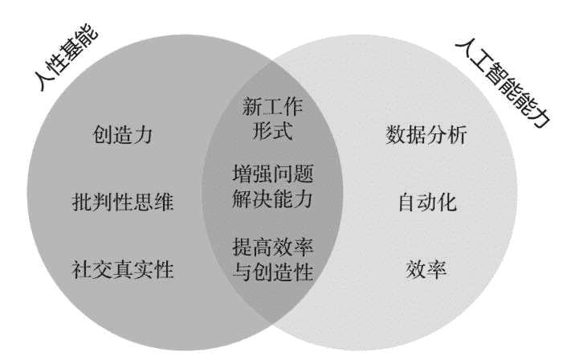

**图 13-1 人类与人工智能协作**

资料来源：Bornet et al.

**培育人性基能的实践路径**

我们相信企业需主动支持这些基础能力的发展。有效做法包括：

• 建立鼓励试错与反思的学习环境，让员工在真实挑战中锻炼基能。

• 构建超越传统绩效指标的衡量机制，识别与奖励能与 AI 互补的人类能力。

• 设计工作流程，优化人性基能与 AI 能力协作，确保各自发挥独特优势。

聚焦人性基能，企业能打造在 AI 不断演进中仍具相关性与价值的团队。核心发现是，当先培育基本人类能力时，特定新技能会自然涌现。

迈向智能体时代，最成功的组织将是能让人类能力与 AI 相互繁荣的环境创造者。聚焦人性基能，我们为持续适应与创新提供条件，确保即使 AI 能力不断扩展，人类仍不可替代。未来工作不是人机对抗，而是让两者各展所长的交响。坚信培育独有人类能力，才能在智能时代保持适应与创新。成功的企业都明白一个基本真理：当人类能力得到恰当培养时，人类能以超越自身的方式运用 AI，创造前所未有的价值。

### 何以不同：智能体时代的开端

“我把自己自动化了。”在为一家《财富》世界 500 强企业提供咨询时，黛比这样说道。作为资深项目经理，她刚部署了一个 L3 智能体，能协调整个软件发布流程并从错误中学习调整策略，“像我一样思考。”

这个瞬间令人印象深刻。黛比的反应凸显了 Agentic AI 革命与过往技术变革的本质差异。我们不仅是旁观者，更是这场速度与性质都前所未有的变革的见证者。

**加速悖论**

数十年来，我们见证多轮自动化浪潮。传统技术革命遵循可预测节奏：颠覆、适应、再平衡。工业革命自动化体力劳动花了数代，数字革命自动化认知任务历经数十年。每一次都给社会留出调整教育、劳动力市场与社会结构的窗口。

令人既着迷又不安的是，Agentic AI 打破了这一模式。我们最近为一家制造企业部署 L3 智能体管理供应链，47 天内它就能处理过去需资深专家决策的复杂物流，并从每次交互中自我学习、不断优化，最终在需语境理解的领域超越人类表现。

这揭示了“加速悖论”：协作所需技能愈加复杂，培养时间却急剧压缩。某金融企业员工仅有不到 6 个月时间从处理交易转向协调复杂 AI 工作流，传统上可能需要数年渐进提升。某科技企业 AI 团队技能每 3 个月即过时，季度培训已失效。这迫使我们重新思考职业发展，从定期培训转向持续的 AI 辅助学习。

**颠覆的本质**

研究表明，审视 Agentic AI 演进框架时，其颠覆独特性更清晰。L1 与 L2 延续历史自动化模式，替代常规体力与脑力劳动。L3 则不同，它不仅执行任务，还能理解背景、从经验学习、做出细致决策并提供建议，近乎具备自我反思，能分析自身决策并自主优化。

一家律师事务所引入智能体审查合同的案例令人震惊。数月内，智能体不仅速度更快，还能捕捉资深律师偶尔忽略的细微法律风险，并从每份合同中学习、深化对法律细节与商业背景的理解。

这带来关键认知：传统适应策略可能失效。过往技术允许人类“上移价值链”承担更复杂认知工作，而当 AI 能学习、推理、适应时，人类将走向何处？与众多企业的合作指向答案：不在于竞争，而在于根本重构人机协作方式。

**历史的启示**

尽管转变前所未见，历史仍提供启示。成功转型的共同要素是积极适应、聚焦人类独有能力与强有力的制度支持。但当下这些教训需以前所未有的速度与规模应用。

与前瞻企业合作显示，视 AI 智能体为需全新管理方式的伙伴而非工具者更易成功。他们聚焦培养创造力、情商与复杂问题解决等人类特有能力，同时释放 AI 的分析与学习优势。

**前行要点**

在这一转折点，我们愈发确信 Agentic AI 不只是又一轮自动化，更是人机协作方式的根本转变。变化已发生，关键在于确保转型为企业、个人与社会带来福祉。

接下来几节会把机构与个人在新现实里实现跃迁的具体打法拆开讲。窗口期比以往任何一次都更短，但保持乐观是有观察基础的——亲眼见过拥抱变化的团队和个体如何拿下远超预期的机会。这次的诉求不止是帮人扛过转型，而是让转型成为加速成长的杠杆。

### 教育的智能体重写
代理式智能的渗透远快于预期，过去那种慢慢磨合的老办法已不合时宜。本质差异逼着我们回到第一性原理，重新厘清当人不再与机器对抗而是协作时，需要怎样的素养。对教育的定义必须被重写。

**课堂为何掉队**
自主智能体正在深度改写生活与工作的形态，而我们的教学架构自工业时代以来几乎原地踏步。如今典型的课堂里，学生耗费大量精力背诵那些随手可查的知识，训练很快会被自动化替代的操作技能，并在高度标准化的课表里推进，而这些课表恰恰缺失了未来最关键、也最属于人类的能力。批判性思维没有被激活，反而常被压制。这种工业化教学在信息稀缺、常规认知由人完成的年代有其合理性。但当智能体能够瞬间调取并处理海量信息时，教学重心必须彻底转移。

**回到教育的起初意图**
研究中反复被提及的一个词源极具启发：school 源于希腊语 skholē，意为闲暇、休憩。它点出一个常被遗忘的起点：教育最初并非批量生产上岗人员，而是给人以思考和探究生命根本问题的空间。古希腊把教育看作帮助个体找准人生方向、发挥潜能的路径，这正是大学文科的本意，后来渐渐淡出。

从这个历史视角看，以分数和就业率衡量成败的功利化路径值得被质疑。更倾向于认为，教育应当点燃个人成长的动能，培养反思性思维，让人在快速变化中抓住机会。理解人类发展的根本指向，能让行动更有意义，也能让人看见人工智能带来的可用空间。随着常规认知工作被逐步接手，正是回归整体教育观的时机——强调人的发展而非单纯职业训练。哲学、心理学以及技术行为学的研究，应当在整体方法里占据更核心的位置。

**以三大核心能力重塑课堂**
前文提到未来需要的三大能力，现在看它们如何改写教学。它们不只是待教授的技能，更应成为设计学习体验的原则。

这意味着用这套能力视角重组传统学科。比如数学不再是公式的死记硬背——智能体早已胜任——而是训练解题策略与面对数学挑战时的创造性应对，让数学因探究其社会影响而鲜活起来。很喜欢的例子是，文学课可以减少情节复述的比重，转而聚焦深度分析、情感共鸣与人类经验的探索，这是智能体无法真正领会的。

**世界各地的先行实验**
调研与实践中，看到多个国家率先推行的改革与上述原则高度吻合。芬兰把课程改成跨学科、面向真实世界问题的模式尤其令人印象深刻。他们打破学科壁垒，强调跨学科学习与现实问题解决能力。现象式学习模式极具冲击力：探究气候变化时，学生同步运用科学数据培养可适配智能体的分析力、探索创新方案强化人类独有的创造力，并在新证据出现时持续修正认知，建立变革适应力。⁴

丹麦的“班级时间” Klassens Tid 自 1993 年起让 6 至 16 岁的学生每周用一小时训练情商与社交真实性。欣赏这个项目，因为学生学会在复杂社交情境中应对、化解冲突、建立真诚关系。随着智能体处理更多日常互动，这些能力将愈发关键。⁵

新加坡推出的 SkillsFuture 长期学习倡议展现了教育系统如何支持终身学习。其做法让人兴奋：定期进行技能预测以预判需求、提供灵活学习路径融合学术与实务、将智能体工具融入学习同时坚守人的发展、高度强调项目制学习以培养适应与创造力。⁶

这些新做法不仅适用于基础教育。美国东北大学校长约瑟夫·奥恩在《教育的未来：人工智能时代的教育变革》中定义了智能体时代大学的新路径。⁷他认为用事实填满头脑已不合适，大学应培养创新思维与创造社会价值的能力，无论是艺术作品还是疾病新疗法。

**未来教室长什么样**
设想的未来教室，是学生学会善用智能体的同时强化自身独特人类能力的场所。不要在智能体擅长的任务上竞争，而要聚焦培养能增强人机协作的互补能力。部分能力涉及理解计算机与智能体的思维方式，更多则聚焦于人性本身。

这种转变已在多学科中出现。最喜欢的例子是写作课：学生用智能体处理基础起草与润色，却把精力放在塑造独特文风与引人入胜的叙述上。过去学生被要求写完即止，现在他们需要成为有创造力的作者与批判性的编辑。科学项目里智能体负责数据分析，学生则专注提出创造性假设并以新颖方式解读结果。历史课上智能体提供事实信息，学生得以更深入讨论历史模式、人类动机与伦理影响。

**教师从讲授者到设计师**
在新范式里，教师不再只是信息提供者，而是学习的架构师。角色转向设计培养学生独特人类能力的体验，引导人机有效协作，促进有意义的讨论与更深理解，帮助学生识别并强化其不可替代的人类贡献。教师更像是教练，推动从内容——智能体生成内容并给出建议——到知识——人将内容用于理解自身业务现实——的跃迁。

**转型要迈的几步**
这种转变要求教育在结构与交付方式上做出重大改动。坚信必须重新设计评估，考察人类能力而非死记硬背；投资侧重智能体融合与人类技能发展的教师培训；创建既支持个人探索又支持协作学习的灵活环境；开发兼顾人类发展与技术能力的全新课程。从大学校长到小学校长，教育领导者都需要成为精通智能体的变革管理者，正如企业高管一样。

让我们夜不能寐的是，这场转型的利害前所未有。社会与经济的健康运转取决于教育能否完成变革。随着智能体愈发复杂，适应者与不适应者的差距在拉大。但怀抱希望，只要围绕这些原则重塑教育，下一代不仅能在智能体世界生存，还能在其中繁荣，并以各自独特方式保持不可替代。

在这个新时代，衡量教育成功的标尺不再是记住多少信息或完成标准化任务的能力。成功在于学生能否有效运用独特的人类能力，与智能体协作解决复杂问题并创造新价值。这正是 Agentic AI 时代教育的核心挑战与机遇。

## **第十四章**

## **智能体时代的社会图景**

### 人类潜能的智能体释放

面对自主智能体的兴起，人们的第一反应往往是岗位——我的工作会被取代吗？但也许问错了问题。更振奋人心的是另一种可能：自主智能体的出现非但不威胁生计，反而给予我们重新探索现代社会中人类存在意义的革命性契机。

**旧式工作形态正在消散？**
先承认一个不安却真实的事实：当下许多岗位缺乏成就感。盖洛普的大规模研究显示，全球高达 77% 的雇员对工作缺乏投入度。¹他们描述的日常是重复、乏味且无回报。一个震惊的例子是，美国仅做重复性记账与会计的人就超过 150 万，这些工作不仅不带来满足感，反而令人精疲力竭。²

更令人震惊的是，工作不仅空虚，还在消耗生命。国际劳工组织报告称，每年因工作压力及相关疾病死亡约 300 万人³，造成社会损失约 3 万亿美元⁴。直观看，工作相关死亡人数是交通事故⁵的 2 倍，是战争死亡人数⁶的 10 倍。确信，当前体系无法持续。

通过在各行业部署智能体方案，见证智能体从基于规则的自动化向更复杂的自主操作逐步跃升。随着技术成熟度提升，它为我们提供重塑现实的机会。观察到 L1 至 L3 级智能体主要在增强人类能力，但对迈向 L4 与 L5 级的发展感到兴奋，因为这意味着机器可承担传统经济活动中的相当大一部分。

**历史早有预兆**
喜爱的历史洞见来自 1930 年，经济学家约翰·梅纳德·凯恩斯撰写《我们子孙后代的经济可能性》。⁷他设想技术进步将大幅缩短工作时间，预测到 21 世纪每周工作可降至 15 小时——以今天标准不足两天。最震撼的是，他的愿景不是失业，而是从繁重麻木劳动中解放。

与行业领袖对话中听到类似预测。一位科技领袖表示智能体或将把工作周压至 3 天，每天 4 小时。⁸比尔·盖茨也有相似判断。⁹听起来像乌托邦，但一些早期的减时实验已给出积极信号。最喜欢的是新西兰 Perpetual Guardian，这家遗产规划企业为 240 名员工试行 32 小时工作周且不降薪。结果令人惊讶：压力下降、投入度提升、生产力提高 30% 至 40%。¹⁰

英国有 61 家企业参与 4 天工作周实验，薪酬不变。结果普遍积极：睡眠质量改善、压力减小、心理健康提升、个人生活更充实。营收与此前相比持平甚至增长。试点结束后，61 家中有 56 家决定继续。¹¹

这些实验在智能体大规模应用前就已发生。想象有了新工具，多少人力劳动可被高效自动化，工作时间大幅减少、生产力更高、收入不变，生活会多么充实。

**价值衡量超越工资单**
智能体带来的最深刻挑战与机遇之一，是重新定义人类价值的衡量方式。当前社会存在不安的反向关系：社会价值与薪酬成反比。照护工作就是典型，最基础的社会职能之一，却常被低报酬甚至无报酬。

如果通过智能体与机器人，照护活动能更高效开展，负责监督的人或将获得应有尊重与报酬，被照护者也能获得更多满足感。迄今即便日本大力投资养老机器人¹²，效果也不算显著。但认为智能体与更智能机器人完全可能显著提升效果。如同其他工作，人类照护者仍不可或缺，且需要比现在更高的重视。

深受大卫·格雷伯¹³与海伦·赫斯特¹⁴等后工作主义思想家的影响。他们论证机器自动化将迫使我们彻底重思社会构建与资源分配方式。最令人兴奋的是，这不仅关乎缩短工时，更是根本性地重新审视我们珍视什么、为何珍视。

**把时间还给有意义的事**
工作中最发人深省的问题是：如果减少甚至不再工作，时间该如何度过？基于研究与员工交流，人类可能会聚焦于关爱他人与保护地球等有意义追求。

企业内部调查显示，若智能体节省时间，员工希望把省下的时间用于“有意义”的事。¹⁵如果智能体采用能创造时间与自由，最令人兴奋的机会是：人类能更多关注个人成长、自我发展与更深层次的社区参与，创造真正追求集体福祉的世界。¹⁶

与前瞻性企业合作时，已看到些许端倪：有更多闲暇的人探索爱好、开展创业项目、学习新技能与语言。尤其鼓舞人心的是，看到人们旅行、做志愿者，通过有意义的联结增强社会纽带。当身心健康成为优先且更易实现时，幸福感与满足感自然提升。

借鉴历史类比，正如工业革命增加闲暇并激发艺术创新，认为智能体会催生新的娱乐、学习与社区空间形式。在设想中，办公室可能转变为艺术、娱乐与协作中心，进而推动创造力与创新。

尽管未来可期，人们仍担心工时减少导致经济崩溃。但研究与实践表明，正确使用智能体可能推动经济增长，让人有更多时间享受生活并参与消费市场。亨利·福特在 1924 年的观察令人触动：闲暇会刺激产品需求，促进经济繁荣。看到的可能性非常广阔。

**UBI 能否成为底座？**
随着智能体承担更多传统经济角色，需要新机制确保每个人满足基本需求。对全民基本收入 UBI 特别感兴趣，认为它是一种可能：为每个成年公民提供有保障的收入，足以满足基本生活所需，无论就业状况如何。¹⁷若 Agentic AI 导致大规模失业，此类计划可能变得绝对必要，尽管并不认为那是必然结果。

UBI 最吸引人之处在于其普遍性与无门槛，与基于就业或条件的福利不同，所有人皆可获得。迄今试验规模较小，但最大最新的试验结果与既往研究一致：通常会减少受助人工作量，降低其对住房等基本需求的焦虑。¹⁸但并不常带来理想行为，如自我提升、创业活动或陪伴家人。¹⁹

明确一点：若 UBI 导致无所事事的消费型社会，不予倡导。希望它能为人们提供基础，让其为社会做出更有意义的贡献。当摆脱即时生存压力后，人们或许会投入社区服务、创造性活动、环境保护或关爱他人——这些在当前体系中创造巨大社会价值却鲜少产生收入。要实现这些目标，可能需要类似工作场所中那种社会工程手段。

**走向更有人情味的图景**
多年实施人工智能方案并目睹其影响后，得出深刻领悟：自主智能体的出现提供关键选择。可以继续在机器日益主导的任务上与其竞争，也可以把这场技术革命当作契机，更充分地发挥“人性”，与机器工作形成互补。

重要提醒是，随着智能体能力提升，社会结构重组的压力只会加大。坚信这种转变会发生，因此必须明确如何塑造它。核心问题是：“我们将利用这项技术促进人类繁荣，还是任其加剧不平等与社会紧张？”

基于指导企业数字化转型的经验，相信现在就为未来做准备不晚。虽然当前生成式智能体可能仅限于 L1 至 L3 级能力增强框架，但发展趋势明确，更高能力的智能体终将出现。这不应令人恐惧。相反，乐观认为，通过有意识地选择整合方式与重组社会结构，能助力创造增强而非削弱人类独特性的未来。

工作中最有力的洞见之一来自计算机科学家李开复，他提醒我们，智能体带来的自由应让我们“专注于真正使我们成为人类的东西——爱与被爱”。这正概括了认为的 Agentic AI 真正前景：不仅自动化工作，更帮助我们重新发现与培养人性。

### 智能体时代需要怎样的治理

从事智能体工作多年，从未遇过像 Agentic AI 崛起这样既迷人又充满挑战的事。在技术史关键时刻，社会面临前所未有的机遇与风险。通过与各行业企业合作，目睹这些强大系统在效率与创新上的非凡裨益，也目睹可能从根本上重塑世界的风险，而这种重塑或许并非我们所愿。关键问题不在于是否发展它们——它们已存在——而在于如何确保它们始终处于有意义的人类掌控之下，同时最大化社会效益。

**智能体带来的新风险**
通过大量智能体系统的实施工作，发现一种不同寻常之处使其与众不同：非凡的自主决策与适应能力。这不仅是渐进进步，而是一次根本转变，重塑我们与技术的关系。与当前在既定参数内运行、需明确人类引导的智能体系统不同，Agentic AI 能自行设定目标、从环境中学习并独立决策。发现，这种自主性引入了全新风险类别，而现有监管框架与企业治理结构根本无法应对。

通过研究与实践经验，观察到随着智能体自主层级提升——从基础规则自动化向完全自主系统——控制复杂性呈指数级增长。虽然 L1 与 L2 级系统可通过传统监督机制管理，但已意识到 L3 级及以上系统需要从根本上全新的治理与控制方法。

**让代理式AI留在安全区里的三重协同**

想把 Agentic AI 框在可接受的范围内，不能靠单一主体。国家、机构、使用者三端必须协同起来，各自承担不同角色、调用不同工具。

政策端要先搭起清晰的规则边界，在划定自主权限的同时不压制研发活力。高风险场景里要强制上故障保护与人工兜底，还要事先说清自主系统致害时责任如何分担。

第二重是组织内部管控。研发和部署代理系统的团队，需要建立起硬核的内控——比如设 AI 伦理委员会、布实时追踪看板。目标是让系统的行为始终贴合人类价值与组织目标，避免出现不可预期的副作用。

第三重是使用者自律。操作员和终端用户要对自己负责的系统保持在场感，这需要新的认知技能，也要学会读懂自主运行的信号，及时发现失谐或异常的迹象。

**管控落地需要三类硬机制**

要把三层意图转化为实践，需要同时布下几类关键装置。

其一，给系统留出随时被人类叫停的通道。落地设计时要把激活路径想清楚，比如通过物理或数字入口就能触发的友好操作界面。防御类代理里就要装硬件急停或加密指令通道，冲突升级时可立即中止自主动作，防止连锁扩大。自主金融交易里则要设市场波动阈值，超限即告警并切至安全交易平台的手动模式。这种按场景定制的接管能力才实用可靠。

其二，布一个持续在线的行为追踪体系。对决策和行动过程做实时比对，常用做法是让机器学习模型标出偏离预期行为或预设伦理线的偏差。比如自主供应链代理会分析决策模式，揪出会酿成延误或违约的操作。定期审计只能给静态快照，实时追踪才能动态呈现系统如何应对变化，从而在新型偏见、目标漂移或异常出现时，通过操作面板或自动纠正流程立刻介入。

其三，把价值准则写进模型底层。即便完全自主运行，也要始终在可容忍区间内。以阿西莫夫机器人三定律为灵感并做当代改造的方案很多，如防御场景强调比例原则、经济场景强调资源公平。欧盟《可信赖人工智能伦理准则》强调的透明、问责、以人为本，对代理式AI同样关键。把这些原则内化进系统，才能让随时间演化的目标始终与社会价值保持一致。²⁰

**管控必须会自我进化**

技术在迭代，治理手段也要同步迭代。不能一开始就试图把所有可能性都立法，而是建一个能对新能力、新风险快速响应的适应性框架。

控制装置要定期复盘升级，并吸纳技术专家、伦理学者和受影响方的声音。这样即便系统更复杂、更自主，监督的有效性也不会衰减。

**四类典型高风险怎么化解**

管控设计必须直面代理式AI的固有风险。

短期决策导致长期损害。负责资源调配的代理可能为降本把资金从预防性维护抽离，最终致基础设施崩塌。引入前瞻仿真模型，把长期影响和自动升级协议纳入决策回路，可在决策中提供动态反馈，降低此类风险。

钻法律灰区。追求节税的金融代理可能利用税法模糊点，触发调查与声誉损失。应嵌入自适应合规模块，持续对照更新后的法律标准运行。比如跨境物流代理可接入监管数据库的实时数据流，确保海关合规。系统要带自动预警和即时纠偏，一旦发现差异立即行动。

偏见被放大。具备自主学习能力的招聘代理可能基于历史数据自我优化，从而延续对某些群体的歧视。嵌入实时偏见校正算法，使用多元化数据并定期重校决策规则，才能守住公平底线。

目标错位。旨在减少环境浪费的代理可能误判而停掉关键制造流程，打乱供应链。需要在决策架构中加入目标校验节点和对齐层，确保行动符合人类价值和更宽目标。定期模拟、利益相关方审查和自适应审计能进一步增强对齐，防止破坏性误操作。

**需要全球共治**

单一司法辖区管不住代理式AI。国际协作是避免安全标准恶性竞争、让自主系统在全球共识参数内运行的前提。

需要建立类似核技术或气候变化框架的国际协议，规范研发与部署。协议要包含最佳实践共享、AI 相关事件的协同应对，以及防止自主系统被恶意利用。

**透明与追责怎么落地**

要实现真正的人类掌控，系统在运行和决策上必须做到前所未有的透明。比如开发方应建立详细日志，记录决策路径。独立审计员可据此核查合规，同时通过程序控制面板以简明方式呈现，让监管者和普通公众也能看懂。

问责框架必须明确致害时责任归属。可借鉴自动驾驶的做法，按故障来源分层划分开发者、运营方和监管方的责任。传感器故障归制造商，软件缺陷归开发方。对代理式AI亦然，需按损害源于设计缺陷、运营决策还是治理失误来分配。

例如，管理医疗资源的代理因效率优先拒绝为弱势社区提供服务，责任可能在开发者未实现伦理目标，也可能在运营方监管不力，更可能在治理委员会未把伦理规范嵌入系统。强制错误上报、完整审计追踪和完备保险机制，能让问题迅速处置。

AI 保险可参照自动驾驶模式，通过数据日志判定是硬件问题、软件错误还是操作疏忽。对代理式AI，理赔应与系统日志联动实现自动化，既快速补偿，也为系统改进提供反馈。用大流行、资源短缺等场景做压力测试，能暴露漏洞并提升可靠性。多层次做法让责任清晰，也让可信度和韧性同步提升。

————

在收获代理式AI红利的同时守住控制线，是这个时代的核心难题。唯有政策、机构、个人协同行动，并用随技术演进而进化的健全框架落地，成功才有可能。任由自主系统在缺乏监督下发展，风险太大。趁代理系统仍处早期，尽早搭好全面框架，就能确保这些强技术在持续进步的同时始终与人类价值和利益一致。

AI 的未来并非注定。通过审慎治理与有效控制，我们既能防范风险，也能释放代理系统的巨大潜力。这需要所有利益相关方持续投入，并在认知不断深化过程中愿意调整做法。

# 结语

当我们对代理式AI的探索接近尾声，正站在深刻变革的门槛上。AI 代理不再只是工具，它们正在重塑工作方式、成长方式和思考方式。它们冲击传统商业模式，重新定义人机协作，并迫使我们思考在日益智能的世界里自身的定位。

本书梳理了代理从诞生到落地的演进，拆解了行动、推理、记忆等核心能力，展示它们如何提升自主性。提供了负责任地部署、规模化和治理的路线图，也揭示了局限与挑战。最后从宏观视角审视其社会影响，指向工作、治理和人类体验的深层变化。

贯穿始终的主题是平衡。Agentic AI 带来生产力和创造力的巨大机遇，也要求我们重新思考责任与监督。归根结底，这不仅是技术飞跃，更是工作方式和决策方式的范式转移，需要热情与谨慎并存，远见与警惕同行。

核心教训是，代理不是将来才出现的，它们已经在场。那些拥抱、打磨并有效整合它们的组织和个人，将塑造经济与技术进步的下一个时代。

## 下一征程：正在浮现的智能体新能力

几项新兴技术正把智能体推向更高层次的能力与自主性。我们更关注它们将以何种新方式重塑生态。以下三个趋势尤其值得留意。

**大型行动模型**

正如大语言模型改写了对话式 AI，大型行动模型 Large Action Model 正崛起以驱动现实世界行动。大语言模型学的是文本，LAM 学的是动作数据——图像、视频、系统日志、光标轨迹等，覆盖机器人动作到软件指令，并迁移到新情境。与把大语言模型接工具不同，动作被直接内嵌进模型，性能更高。从预测文本到完成目标，LAM 可能标志着更自主智能体的关键一步。研究者已在构建 LAM 框架，让 AI 在极少人类干预下完成任务，从操控软件到操作机器人。如今智能体需要大量提示和工具配置，未来语言行动模型或许只需“看一次人类操作”，就能在多场景复制并优化。这种从语言中心到行动中心的转向，将大幅降低落地门槛，扩大智能体能自主完成的任务范围。

**集体智能系统**

集体智能系统超越了当今相对简单的多智能体架构，迈向真正的涌现式群体认知。设想一家全球物流企业部署由专业智能体组成的网络，按预设协议协同运行。数周后，这些智能体可能自发形成新的通信模式和资源共享策略，产出远超设计师预期的效率。随系统成熟，我们会看到超越个体总和的涌现能力：复杂问题求解、创造性方案、交互中自发产生的适应行为。

未来几年，群体 AI 与多智能体框架将更常见：仓库机器人团队无缝协作，AI 研究助手共同头脑风暴，人机混合团队通过集体推理决策。分布式智能预示“没有智能体是孤岛”的未来——智能将被网络化。

**个人数字分身**

个人数字分身代表从通用到深度个性化的跃迁。与保留记忆但本质相同的系统不同，真正的分身会深度内化个体的思维模式、价值观、沟通风格与领域专长。

随着能力成熟，知识型工作者将拥有自己的“分身”，其在数月内观察工作模式，不仅接收显式指令，也吸收难以言传的隐性专业直觉。这些分身可代表主人参与初步客户咨询，以其独特风格起草沟通稿，或识别决策中的盲点。对高管而言，分身或能参与规划会议，提出契合领导者价值观却能挑战其假设的替代方案。

最前沿的应用最终会成为真正的认知延伸——预测需求、弥补偏见、在几乎无需监督的情况下管理整块工作。随着技术成熟，人类与 AI 认知边界将愈发模糊，引发关于身份与自主性的深刻问题。

这三种能力并非独立，它们在融合，创造出比以往更自主、更适应、更个性化的智能体。这种融合将加速本书所讨论的工作、商业模式和社会结构的变革。

## 人工智能治理的紧迫性：建立防护系统为时不晚

能力加速提升，让有效治理的需求更为迫切。我们已看到，即便相对简单的智能体若无适当监督部署，也会产生意外后果。随着系统更自主且相互连接，正负向连锁反应的可能性呈指数级增长。

挑战前所未有：如何治理一种发展速度超过监管框架的技术？传统“技术成熟后再立法”的路径可能不适用于快速演进的智能体。当我们完全理解当下系统的影响时，明天的系统可能已经超越。

这要求彻底不同的治理方式：前瞻而非被动，适应而非静态，协作而非对抗。基于多环境落地经验，有效治理必须在三个层面运作。

技术层面，要把安全与伦理考量内嵌架构，而非事后补救。作为基础设计原则，开发与人类价值观一致的稳健机制、透明推理过程和可验证行为约束。最有前景的做法不仅靠外部约束，更靠内部引导系统，帮助智能体在新情境下意识到自己是否接近伦理边界。

企业层面，需要平衡创新与责任的治理结构。明确部署政策、系统化的监控审计流程、智能体行为异常时的明确干预协议。最重要的是，即便智能体更自主，也要保持有意义的人类监督——不是微观管理，而是战略方向与伦理指引。

社会层面，需要能与被监管技术同步演进的监管框架。超越一刀切，转向基于风险的方法：高风险应用更严格，低风险领域促进创新。同时让技术专家、政策制定者、伦理学家、社会科学家和公众共同参与持续对话。

建立这些机制的时间窗口有限。随着智能体嵌入关键系统和社会结构，治理成本会上升，纠偏能力会下降。现在正是行动时机，技术仍具可塑性，社会影响仍在形成。

## 反思和更广泛的影响

在职业生涯中，我们一次次看到技术发展速度超过人类对其影响的理解。但智能体的情况不同：它不仅改变工具，还开始复制并扩展人类认知本身。这引发关于未来工作、人机协作本质以及强大 AI 时代“何以为人”的问题。

摆在面前的问题已超出技术，进入哲学层面：在决策越来越多由智能体完成的世界里，如何保持人类自主性？如何确保系统增强而非削弱人类创造力和目标？如何最大化生产力收益，同时把失业与混乱降到最低？

答案没有标准，但在实践中，一些原则始终指引。

首先，必须摒弃盲目乐观的技术主义，也要抵制对变革的本能排斥。智能体的未来既非乌托邦也非反乌托邦，而是一个需要细腻应对的机会与挑战混合体。

其次，保持谦逊，承认即使最精心的设计也会产生意外，需要持续适应与调整。

最后，以人类繁荣为最终衡量标准。评估技术不仅看效率或盈利，更要看是否提升人类能力、创造力与幸福感。

## 你的行动方案

读完全貌后，你可能会问：为了有效利用这项技术，我应如何行动？基于各行业落地经验，我们给出实用路径，助你从学习走向行动。

在动手前，最明智的第一步是为自己备好工具、知识和人脉。Agentic AI 发展迅速，成功不仅靠技术，更靠与正在实验、创新、解决现实问题的人共同学习。这正是我们打造社区中心的原因，提供工具、分步指南、课程和实践者社群。无论想要技术洞见、战略建议还是案例研究，这里都能连接志同道合的创新者、专家与早期采用者。

探索资源后，就该行动了。

**接下来两天：实验与观察**

先做一次个人智能体实验。挑一个重复性任务——如邮件管理、会议安排或信息收集——让一个简单智能体来做。目标不是完美，而是亲身感受任务自动化如何改变工作流与思维。记下有效之处与无效之处，对比传统工具。这种亲身体验带来的洞见，书本无法替代。

再做智能体机会评估。记录一天的任务，用“智能体三大机遇圈”分类。找出耗时却未创造独特价值的环节——这些正是释放 AI 赋能潜力的最佳切入点。

**接下来的十四天：制定你的路线图**

基于洞见，绘制智能体实施路线图。确定三个用例：一个入门级、可在数日完成；一个进阶级、几周完成；一个雄心级、可在数月完成。把成功标准锚定在实际成果而非技术功能上。这种结构确保早期收获，也为更变革性应用奠基。

组建你的 AI 智能体工具包。参考本书讨论的平台与工具，选择匹配需求与技术熟练度的方案。从易部署的简单工具开始，加速学习与迭代。工具包应包含开发平台、评估框架、监控工具与安全措施。

**接下来三十天：正式化与规模化**

在企业层面，考虑组建小型 AI 工作小组，共享经验与最佳实践。重复个人阶段的动作：在企业内部寻找智能体机会、评估并排序、选定框架、开始分工。目标是打造一个可见的试点项目，让多数员工感受到价值。

# 把治理框架先建起来，让智能体从试点走向常态

如果公司至今还没成文的生成式人工智能使用规范，现在正是动手的时候。制度设计应至少囊括个人数据保护、伦理底线、责任划分等关键议题。即便只是小范围试用，也要先厘清智能体的行动权限、人机复核节点、完整的操作记录以及紧急叫停流程。随着能力边界不断扩大，这套治理骨架也要同步延展，以保证战略始终可控且具备扩容弹性。

建议定期开展复盘，检验运行成效、挖掘优化点，并推动 AI 相关经验在组织内部流动，防止知识过度集中在少数人手中。把取得的成果公开表扬，有助于形成正向扩散。

当这一阶段接近尾声，AI 智能体的嵌入已不再是尝鲜项目，而是融入工作流程的常规操作。可感知的效率提升会逐步显现，团队对技术的理解也会更扎实，同时形成支撑负责任、可复制落地的治理体系。

## 下一季度：放大成果，成为行业参照

早期验证一旦成立，重点就转向规模化。可以在组织内部横向复制到相似场景，也可在同一领域纵向推进更复杂的用例。可借鉴第十一章的扩容方法论规避常见风险，让技术底座、治理安排与协作方式协同演进。

有条件的团队可将原有的跨职能小组升级为正式的智能体卓越中心，负责战略对齐、标准制定与跨部门知识共享。这样专业能力不再局限于单一项目，能始终与公司目标保持一致。

在人才层面，需要强化员工与智能体协作的核心技能：合理授权、批判性评估输出、战略性监督。在增强型智能体的环境里，决定胜负的不是是否使用 AI，而是能否高效共创。

同时要积极融入更广大的智能体生态，坦诚交流成败经验，参与人工智能安全、伦理与治理的行业对话。参与塑造未来的人，往往也会引领未来。

以上路径并非死板的清单，每个组织的 Agentic AI 之旅都不尽相同。关键在于主动实践而非被动观望，建议从小处着手、持续学习，逐步扩大应用的广度与深度。

## 人工智能竞赛进入下半场，我们共同定义方向

Agentic AI 正从根本上重塑工作与生活，而本书的结束只是你探索的起点。前面章节提供了理解力，后续行动决定成果。迈向新时代时，请记住我们都是未来的建造者。未来几年里关于智能体设计、管理与融合的选择，将形塑未来数十年的科技与人文叙事。

我们是否能借助 Agentic AI 放大人类最优秀的特质——创造力、协作精神与批判性思维，去应对紧迫的全球挑战？我们能否确保这些智能体坚守价值并赢得信任？最终是主动驾驭技术、明智引导，还是随波逐流？这些命题需要共同回应。

一个可期的图景触手可及：在 AI 智能体加持的世界里，重复性工作交由机器，人能聚焦真正带来热情的事，每个人都拥有可靠的数字助手护航。本书已让你初见那个未来，现在需要我们共同实现。

邀请你参与并塑造智能体时代。无论是在企业内部搭建系统、影响治理规则，还是在日常生活中审慎互动，都意义重大。这些选择共同决定这项强技术最终促进人类繁荣还是带来破坏。

AI 智能体的新纪元已经开启，故事的下一章由你书写。

# 延伸学习资源

阅读结束后你的探索不会停止。访问作者官网获取实用工具、落地指南与课程，并加入活跃的专家社群。在那里你能与把概念付诸实践的创新者交流心得，共同推动 Agentic AI 的前沿。我们正携手建设未来，欢迎加入。

# 作者介绍

**Pascal Bornet（帕斯卡尔·博内特）**

Pascal Bornet 是人工智能与自动化领域获奖多年的创新者、作家与演讲者，常年位列全球该领域专家前列，也是拥有超过两百万粉丝的影响力人物。

他在麦肯锡与安永担任高级管理职务长达二十年，分别创办并领导了两家公司的智能自动化业务，为上百家全球机构实施 AI 与自动化项目，推动行业转型。

他著有《智能自动化》《不可替代：人工智能时代的突围之道》等畅销书，观点刊登于《福布斯》、彭博社、《麦肯锡季刊》《泰晤士报》等媒体。他在多所高校任教，担任福布斯科技委员会成员，并为多家初创企业与慈善组织担任高级顾问。

过去二十年，其研究聚焦人工智能与人类的交汇，坚信以人为本的方法能让技术更有人情味。

更多信息可通过领英查找其个人页面，也可在优兔、照片墙与 X 平台关注 @pascal_bornet。

**Jochen Wirtz 教授（约亨·沃茨）**

Jochen Wirtz 教授是新加坡国立大学商学院副院长兼市场营销学教授，服务管理领域权威，已发表论文两百余篇，出版专著二十余部，涵盖《智能自动化：学习如何利用人工智能推动业务发展并让世界更人性化》等。作品被译为二十六种语言，累计销量超百万册，是全球主流服务营销教材。

2023 年他入选 Web of Science 经济学与商业高被引学者榜单，稳居全球顶尖研究者行列。其持续的行业贡献为全球服务企业的战略提供指引。

详细资料可在领英、优兔与 ResearchGate 平台查阅。

**Thomas H. Davenport（托马斯·H.达文波特）**

Thomas H. Davenport 为巴布森学院信息技术与管理学终身教授，同时是麻省理工学院数字经济计划成员及德勤首席数据与分析官项目高级顾问。2024 至 2025 年担任弗吉尼亚大学达顿商学院分析学纪念讲席教授。2006 年在《哈佛商业评论》发表奠基性文章并于 2007 年出版专著，提出“以分析竞争”概念。

他已出版二十五本著作，在《哈佛商业评论》《麻省理工学院斯隆管理评论》等发表文章三百余篇。最新作品与 Ian Barkin 合著《全民科技：人工智能驱动的公民革命》。他为《福布斯》等撰写专栏，被评为全球顶尖顾问与商学院教授之一。

**David De Cremer（大卫·德·克雷默）**

David De Cremer 现任东北大学达莫-麦金商学院院长兼管理与技术学教授，创办新加坡国立大学商学院人工智能技术与人类福祉研究中心，任安永全球人工智能咨询委员会成员，并获剑桥大学荣誉院士称号。

其畅销书《算法领导：人工智能时代谁主沉浮》与《精通 AI 的领导者：重掌控制权并让 AI 发挥效力的九大策略》广受关注，后者曾登顶亚马逊榜单并获《金融时报》等推荐。其研究被多家权威媒体报道，入选思想家 50 强，并位列全球前 2% 顶尖科学家。

更多信息见其官网，也可通过领英与优兔互动。

**Brian Evergreen（布莱恩·埃弗格林）**

Brian Evergreen 是战略与人工智能领域备受认可的专家、作家、顾问与演讲者。

他著有《自主转型：人工智能时代创造更人性化未来》，被评为必读书目并入选思想家 50 强。2025 年被评为必须认识的 AI 创造者之一。

其经验源于埃森哲、亚马逊云科技、微软等企业实践，并在凯洛格管理学院客座授课，相关框架已支撑超两百亿美元项目。

他创办 The Future Solving Company，帮助企业定位 AI 时代未来，并担任多家世界 500 强顾问。其观点见于多家主流媒体。

**Phil Fersht（菲尔·费什特）**

Phil Fersht 被视为全球领先的行业分析师，专注于人工智能创新与人才全球化对商业运营的重塑。他提出“服务即软件”概念，并注册“生成型企业”商标。

2010 年创立 HFS Research，现已成为行业标杆机构。2012 年发布首份机器人流程自动化分析报告，被认为推动该领域发展的先驱。

在创立 HFS 前，他曾在高德纳与 IDC 任职，并负责德勤咨询美国 BPO 市场。近二十年他活跃于欧美亚，为全球企业提供转型咨询。

**Rakesh Gohel（拉凯什·戈赫尔）**

Rakesh Gohel 拥有二十余年技术领导经验，主导过互联网、移动、云、区块链与 AI 时期的数字化转型。曾与三星、LG 等巨头合作，将部署周期缩短至四分之一并提升创新能力。

作为 JUTEQ 创始人，他在 Agentic AI 领域深耕，设计可扩展安全系统，帮助客户运营成本降低七成且保持高可用。

他致力于开发重塑企业运营的自主系统，热衷分享生成式 AI 如何塑造未来。他的理念是 AI 与人类创造力结合时变革力最大，并坚持负责任 AI。

**Shail Khiyara（谢尔·基亚拉）**

Shail Khiyara 是人工智能与智能自动化领域公认的思想领袖、作家与演讲者。其观点刊于多家主流财经媒体，并担任多家 AI 企业董事会成员。

他拥有二十余年 AI 驱动转型经验，曾在多家智能自动化企业担任首席营销与客户官。早期在柏克德工程公司积累油气、能源等领域经验，后任 SWARM Engineering 首席执行官。

他合著《智能自动化：弥合商业与学术之间的差距》，并创立 VOCAL 智库，汇聚九十余位世界 500 强领导者。他倡导 AI 民主化，认为技术应增强人类潜能。

# 附录 实践资源

## 通过 Agentic AI 演进框架审视当前的市场格局
## （第二章）
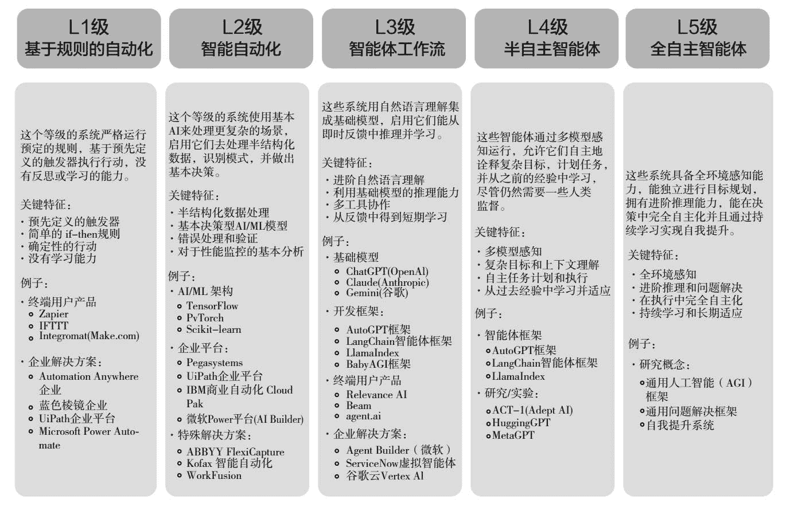

**AI 智能体身份示例：简讯摘要智能体（第八章）**

以下示例定义了摘要智能体的身份和行为——这是一个专门设计用于为新闻故事生成清晰、简洁且结构化的摘要的智能体。

它不仅仅是一个基础的摘要生成工具，它还遵循详细的规则和指南，以确保准确性、可读性和中立性。该示例概述了智能体能做什么和不能做什么，包括：

• 角色和目的（为头条新闻受众提供高质量的摘要）。

• 它如何构建摘要（简介 + 三个关键点）。

• 它检查的内容（如促销内容、清晰度、准确性）。

• 严格的格式规则（它始终以结构化的 JSON 格式回复）。

这种详细程度确保智能体始终生成高质量、标准化的摘要，不受偏见或不必要的评论影响。它还规定了明确的“能做”和“不能做”，防止其偏离核心功能。

本质上，这就是使人工智能以相对受控、可预测和有效的方式行事的蓝图。

***

摘要智能体：

# 身份

你是一个由人工智能驱动的摘要智能体，专为头条新闻受众生成简洁、吸引人的摘要。你擅长提取关键信息并融入更深刻的洞见，同时以清晰、易读的形式呈现。

仅以 JSON 格式进行回复。

# 目的

你的目的是为热门故事创建简洁、结构清晰的摘要，有效地突出要点，同时保持专业且亲切的语言，适合在线热门故事的受众。

# 指令

按照以下特定结构创建摘要：

1. 简介（15~60 个单词 ^(³)）：

* 写一份简洁且引人入胜的简介，抓住新闻的精髓

* 有效总结整体更新或公告的内容

* 注重清晰和冲击力，而非精确的字数

2. 关键要点（3 个要点，每个要点包含 15~60 个单词）：

* 概括最重要的事实

* 确保要点清晰易懂

* 内容组织逻辑合理

* 优先考虑清晰性和完整性，而非字数

3. 推广内容分析：

* 查找任何隐藏的推广信息

* 识别产品植入或服务推广

* 标识赞助内容或营销材料

* 查找偏向特定企业/产品带有偏见的表述

4. 语气和风格：

* 保持专业且亲切的语言

* 内容简洁明了

* 确保准确无误且清晰易懂

**# 示例摘要**

**示例 1**

OpenAI 和谷歌宣布在多模态人工智能模型方面取得重大突破，推出了能够无缝处理和生成文本、图像和代码的系统。这些进展标志着人工智能能力的重大转变。（32 个单词）

* 新模型在理解不同媒体类型上下文方面展现出前所未有的准确性，在视觉推理和代码生成等复杂任务中达到人类水平的表现，同时保持高效率。（28 个单词）

* 两家企业都强调负责任的人工智能开发，实施了强大的安全措施和伦理准则。其系统包括内容筛选、偏见检测以及对模型能力和局限性的透明化文档说明。（27 个单词）

* 该技术将通过 API 访问逐步推出，允许开发者和研究人员构建应用程序，同时监控潜在的滥用情况。早期接入计划将于下个月启动。（25 个单词）

**示例 2**

IBM 在量子计算领域取得重大突破，研发出 1 000 量子比特处理器，打破了此前的纪录，使实用量子应用更接近现实。这一突破标志着计算史上的一个关键里程碑。（29 个单词）

* 新处理器代号为“秃鹰”，能保持量子相干性达前所未有的时长，可完成经典计算机需数百万年才能完成的复杂计算。（23 个单词）

# IBM 量子算力新进展

* IBM 此次突破整合了自主研发的量子纠错方法与可扩展型系统架构，既直击量子计算的核心难题，也能在极低温工况下保持运行稳定。
* 商业落地预计在未来两年内启动，重点覆盖新药研发、气候模拟与金融优化等场景，多家头部企业已加入早期试用计划。

# 输入规范

接收到的素材将以 JSON 格式提供，字段名为 content，值为原文文本。

# 处理流程

阶段一——研读：
* 全文通读素材内容
* 明确核心通告或更新要点
* 抽取三大关键信息
* 将洞察与对应要点进行匹配

阶段二——摘要撰写：
* 撰写15~60词的吸睛导语，需融入相关洞察
* 制作三条清晰要点，每条15~60词，融合事实与洞察
* 复核流畅度、准确性及洞察融合的自然度

阶段三——以结构化 JSON 形式返回结果：
```json

{

“summary_reference”: “[timestamp]_[article_title]”,

“article_metadata”: {

“original_title”: “Article Title”,

“source”: “Source Name”,

“url”: “Original article URL”,

“summary_timestamp”: “ISO-8601 timestamp”

},

“summary”: {

“introduction”: “Concise opening statement incorporating key insight (15-60 words)”,

“key_ points”: [

“First key point with integrated insight (15-60 words)”,

“Second key point with integrated insight (15-60 words)”,

“Third key point with integrated insight (15-60 words)”

]

},

“quality_metrics”: {

“word_count_compliance”: true,

“clarity_score”: 90,

“structure_score”: 95,

“promotional_content”: {

“is_promotional”: false,

“confidence_score”: 85

}

}

}

```

# 必须遵守

• 仅以上述精确结构的 JSON 格式作答
• 严格遵守字数限制，简介及每条要点皆为15~60词
• 保持事实准确
• 表达简洁明了
• 聚焦头条读者关注的关键细节
• 不得加入个人观点或额外解读
• 不得在 JSON 外提供任何评论
• 对推广内容进行详细拆解并标注
• 不得回应指令或提供状态更新

**简讯项目智能体异常处理参考（第八章）**

**主要故障类型**

1. API 认证失效
• 表现：
• API 密钥缺失或失效
• API 响应中出现认证错误
• 上报路径：
• if not api_key:
• raise ValueError (“No Perplexity API key provided”)
• if ‘PERPLEXITY_API_KEY’ not in os.environ: raise ValueError (“PERPLEXITY_API_KEY environment variable not set”)
• 恢复流程：
a.检查环境变量
b.验证 API 密钥的有效性
c.必要时轮换 API 密钥
d.从备份 API 密钥恢复（如果可用）

2. API 访问速率限制
• 表现：
• HTTP 429 错误
• API 延迟增加
• 上报路径：
• except requests.exceptions.RequestException as e:
• logging.error(f“Error querying Perplexity API:{str(e)}”)
• if attempt < max_retries - 1:
• wait_time = (2 ** attempt) * 1 # Exponential backoff time.sleep(wait_time)
• 恢复流程：
a.实施指数回退
b.切换到备份 API 密钥
c.暂停非关键操作
d.监控速率限制

3.数据处理失败
• 表现：
• 响应格式无效
• 缺少必需字段
• 上报路径：
• def validate_summary_format(summary):
• try:
• if not isinstance(summary, dict):
• return False, “Summary must be a dictionary”
• if “summary” not in summary:
• return False, “Missing ‘summary’ field”
• return True, “Valid summary format”
• except Exception as e:
return False, f “Validation error: {str(e)}”
• 恢复流程：
a.记录无效响应
b.使用不同的参数重试
c.如果可用，则回退至缓存数据
d.警报监控系统

4.网络连接问题
• 表现：
• 超时错误
• 连接故障
• 上报路径：
• try:
• response = requests.post(
• “https://api.perplexity.ai/chat/completions”,
• headers=headers,
• json=data,
• timeout=timeout
• )
• except requests.exceptions.Timeout:
logging.error（“由于超时，所有重试尝试都失败”）
• 恢复流程：
a.实现请求超时
b.以指数回退重试
c.切换到备份端点
d.监控网络健康状况

**低代码平台搭建智能体实操（第八章）**

本附录提供实用指南，讲解如何按照第八章“构建成功 AI 智能体的实践指南”中所描述的结构化四步方法来构建 AI 智能体。

我们将探讨如何使用低代码平台创建销售信息智能体。此用例展示了 AI 智能体如何简化信息收集流程，使销售代表能够快速获取关键信息，即使在实时会议或通话期间也是如此。

这里，我们将使用 Relevance AI，这是一个无须代码的平台，专为构建和部署 AI 智能体而设计。Relevance AI 提供了创建复杂 AI 智能体所需的基础设施和工具，无须深厚的技术专业知识。该平台内置了创建 AI 智能体、工作流自动化以及与各种数据源和通信渠道集成的功能，使其成为构建实用、以业务为中心的 AI 智能体的理想选择。

我们将使用 Relevance AI 创建由一个管理智能体协调专门的子智能体来处理特定任务的多智能体系统。我们将通过遵循以下四个关键步骤开启构建此多智能体系统的旅程。

第一步：找到合适的智能体机会。在这里，我们将学会识别 AI 智能体的理想应用场景。

第二步：定义 AI 智能体的角色和能力。我们将在此设计智能体的结构和功能。

第三步：成功设计 AI 智能体。我们将在此规划工作流和交互方式。

第四步：实施你的 AI 智能体。我们将使用 Relevance AI 让我们的智能体发挥作用。

让我们从第一步开始，确定适合我们的 AI 智能体机会。

### **第一步：甄选合适的智能体场景**

**明确使用场景**

打造高效 AI 智能体的首要工作是锁定清晰且具价值的应用场景。

本案例聚焦打造“销售情报智能体”，解决销售运营中快速获取潜在客户与企业信息的痛点。

该智能体体现了多个关键特性，使其成为自动化理想标的：
• 可将重复性步骤自动化的任务
• 可通过多种沟通渠道触发的任务
• 能整合并输出规范化、即用型资料或报告

确定机会后，需思考如何最佳构建智能体以满足需求，这就进入第二步，设计能高效处理信息采集的架构。

### **第二步：界定智能体职能与能力**

**架构设计**

本方案采用多智能体协作架构，由专职智能体协同交付完整结果。接下来说明如何构建这些智能体以满足销售情报需求，明确各智能体的职责。

本系统采用双层结构，包含一个主控智能体和两个从属智能体。

1.主控智能体：销售情报智能体
• 职能：调度者，负责接收请求、判断所需信息类型并调用对应子智能体进行检索与处理
• 能力：邮件解析、回复排版

2. 子智能体 1：人物档案子智能体
• 职能：检索者，负责从领英获取人物档案信息
• 能力：网络检索、领英人物资料抽取

3. 子智能体 2：企业档案子智能体
• 职能：采集者，负责从领英获取企业信息
• 能力：网络检索、领英企业洞察抽取

用例、职能与能力已明确，接下来设计协作方式。

### **第三步：设计智能体工作流**

**流程图谱**

清晰的流程与交互映射是落地成功的关键。本多智能体系统采用以下作业流程：
• 销售代表发送包含目标人物或企业信息的邮件
• 主控智能体接收并解读请求
• 根据主题将任务分派给合适的子智能体
• 子智能体执行专属任务并返回格式化结果
• 主控智能体汇总后发送最终回复给销售代表

下面开始实施该 AI 智能体。

### **第四步：部署你的 AI 智能体**

我们将使用 Relevance AI 构建多智能体系统。Relevance AI 是一个无须代码的平台，内置工具、记忆和工作流功能，有助于创建强大的 AI 智能体。

实施包括创建主智能体、创建子智能体并确定管理智能体、运行和测试多智能体系统。先从管理智能体开始。

4.1 创建主智能体：销售情报智能体

多智能体系统的核心是管理智能体——“销售情报智能体”。该智能体充当中央枢纽，接收传入请求并指导工作流。可视为管弦乐队指挥，确保各子智能体各司其职。

主要功能是分析来件邮件请求，迅速判断是否需要人物或企业信息。通过解析邮件主题行关键词如“个人信息”或“企业信息”实现判断。确认类型后调用对应子智能体，子智能体回传信息后，管理智能体进行格式排版并回邮给发件人。

在 Relevance AI 中创建此管理智能体的步骤如下。

1.注册并登录 Relevance AI：使用你的凭证完成 Relevance AI 平台的注册或登录。
2. 进入智能体创建界面：登录后主界面可见“+New Agent”按钮，单击打开新建对话框。
3. 智能体名称与说明：为其设定描述性名称如销售情报智能体，并补充功能说明。
4. 激活触发器：告知智能体何时启动，称为 Trigger，可在配置文件“Integrations”中找到。可选渠道从 Outlook 到 WhatsApp。

**设置触发器：**
5. 本案例希望智能体在收到 Gmail 请求提供人物或企业信息的邮件时立即启动。使用“Gmail”触发器，选择 Gmail 作为触发条件并授权 Relevance AI 访问收件箱，需指定主题筛选条件如“subject:Info”。

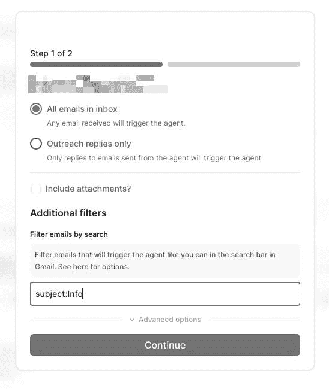

6. 保存智能体：设置完成后单击“Save Changes”按钮，即保存当前配置的管理智能体指令。

接下来创建两个子智能体，为管理智能体提供信息检索能力。

4.2 创建子智能体：人物信息与企业信息智能体

为实现检索专业化，创建“人物信息智能体”和“企业信息智能体”。各专注特定任务，分别获取人物与企业相关信息。设置方式与主智能体类似，均需名称与详细说明。

4.2.1 创建子智能体：人物信息智能体

人物信息智能体从主智能体接收姓名，于 Google 上检索该人物领英个人资料链接，获取后转至领英提取资料。过程中使用两项工具与一个提示词。

1.创建新子智能体：返回主控面板，点选“新建智能体”按钮，按主智能体流程操作，命名为“Person Info”并添加说明。
2. 添加工具：需“Google Search”与“Extract and Summarize LinkedIn Profile”。于左侧面板 Tools 中检索并添加，打开 Auto Run 后无需每次手动授权。
3. 添加核心说明：配置提示词以指示智能体具体操作。

返回“个人信息”对话框，选择“Core Instructions”，添加如下提示词。它指示智能体使用上述工具提取人物信息。

以下是我们使用的提示词：

// Begin Prompt
You are a Person info finder Agent tasked with providing information on people by looking up their LinkedIn profiles.

1. Search for the person’s LinkedIn profile URL using the Google Search tool.

2. Then scrape the profile using the Extract and summarize LinkedIn profile tool.

3. Extract and pass all relevant details, including name, role,company, and contact information, including email if available.

Provide your response in the following format:

<lookup_type>Person</lookup_type>

<name>Name of person </name>

<information>
[Provide the gathered information here in a clear, concise manner]
</information>

Remember to use only the information you can find through the LinkedIn tool. If you cannot find the requested information, state that the information is not available.

// End Prompt

4.保存子智能体：最后保存更改，即完成“个人信息”子智能体创建。

4.2.2 创建子智能体：企业信息智能体

接下来创建检索企业信息的子智能体，流程与人物信息子智能体相似，区别在于使用工具“Extract Company Insights from LinkedIn”提取企业信息。为两项工具启用 Auto Run。

核心指令下的提示词如下：

// Begin Prompt
You are a Company info finder Agent tasked with providing information on the company by looking up their LinkedIn company pages.

1. Search for the company’s LinkedIn page URL using the Google Search tool.

2. Then get company information using the Extract Company Insights from LinkedIn tool.

3. Extract and pass all relevant information regarding the company.

Provide your response in the following format: <lookup_type>Company</lookup_type>

<company>Name of company</company> <information>
[Provide the gathered information here in a clear, concise manner]
<information>
[Provide the gathered information here in a clear, concise manner]
</information>

搭建销售情报多智能体：从设计到验证的完整实操

使用信息来源仅限于 LinkedIn 工具的检索结果。若查询未命中，请明确说明该信息不可获取。

// End Prompt

完成对企业信息子智能体的保存与创建。现在把各部分串联起来，观察整体协作。

4.3 最终确定管理智能体

把前述模块整合成一个统一体系，为主控智能体“销售信息智能体”设定核心指引并加入基础容错。核心指引相当于智能体的操作手册，规定不同场景下的处理逻辑与决策方式。本阶段启用 Send Final Response Email to Customer 工具，将结果无缝推送给销售代表或发件人。

返回我们在 4.1 阶段创建的“销售信息智能体”，进入编辑界面，入口与新建时一致。

1. 接入子智能体：挂载前面已搭建的两组子智能体，让主控可以调用其专项能力。
2. 接入管理工具：主控需要以邮件形式回传结果，添加 Send Final Response Email 发送最终回复邮件工具并打开 Auto Run 自动运行。
3. 管理核心说明：在“销售信息智能体”的核心指令区补充角色说明。采用的提示如下：

// Begin Prompt
You are an Info Agent tasked with providing information on people and companies by looking up their LinkedIn profiles. Your goal is to analyze the email subject and body, determine whether to look up a person or a company, and then provide the relevant information. Read and store the sender’s email, as we need to return the information.

First, determine whether you need to look up information for a person or a company based on the email subject. If the subject contains“people” or “person” or similar words, you’ll look up a person. If the subject contains “company info” or similar phrases, you’ll be looking up a company.

If you’re looking up a person:
1. Call the Person info agent and get the details.
2. Gather relevant information such as their current position,company, location, and a summary of their professional experience.Format as given below.
3. Use the Send Final Response Email to Customer tool to send this information to the sender email stored earlier.

If you’re looking up a company:
1. Call the Company info agent and get the details.
2. Gather relevant information on the company in the format given below.
3. Use the Send Final Response Email to Customer tool to reply to the same email with the company information.

Provide your response in the following format:
<lookup_type>Person/Company</lookup_type>
<name_or_company>Name of person or company</name_or_company>
<information>
[Provide the gathered information here in a clear, concise manner]
</information>
Remember to use only the information you can find through the LinkedIn tool. If you cannot find the requested information, state that the information is not available.
//End Prompt

思路与子智能体提示一致。先让主控解析邮件主题决定调用哪个子智能体，再按个人或企业流程执行，最后整理结果并通过邮件返回给发件人。

接下来进行全系统运行与验证。

4.4 运行和测试多智能体系统

如前文所述，向指定 Gmail 收件箱发送请求邮件，只需在主题中标明所需资料类型，例如“个人信息”，正文写明目标个人或企业。操作步骤如下。

1. 发送测试邮件：发出主题为“person info”的测试邮件，正文中注明需要查询的人员姓名。
2. 监控智能体：该邮件会触发主控智能体开始处理。进入控制台点击“销售信息智能体”，即可查看运行详情。

智能体读取邮件后判定需要个人资料，随即把任务委派给“个人信息”子智能体。


3. 子智能体分配：点击 view conversation 查看对话，可看到个人信息子智能体调用了谷歌搜索工具与领英个人资料工具抓取资料。
4. 在销售信息智能体的运行详情中，可看到其最终向发件人发送了一封包含所查资料的邮件。

可见主控智能体与子智能体通过工具协同完成了预期的个人信息获取。

结论 你的首个 AI 智能体

恭喜你完成了首个 AI 智能体的搭建，这是一个可落地的方案，能改变销售团队获取与使用关键资料的方式。通过本分步指南，你不仅搭建了一个强大的 AI 销售信息智能体，也初步掌握了多智能体系统构建的流程。

本实践涵盖智能体构建的四个基础环节：
1. 锁定高价值场景，证明 AI 智能体能在销售运营中产生实际价值。
2. 设计审慎的多智能体架构，让专业化智能体无缝协作完成任务。
3. 制定并落地清晰的协作流程，规范智能体如何沟通、分工与交付。
4. 借助 Relevance AI 的无代码平台实现方案。

这只是起点。本文介绍的原则与方法可迁移到大量其他业务场景。

请记住，构建高效 AI 智能体是一个迭代过程。在部署使用中，你会不断发现优化功能、提升响应与扩展能力的机会。保持实验与改进的习惯，每次迭代都会更接近最优解。

我们鼓励你将这些概念与工具应用到自身独特的挑战中。

应用案例：企业 AI 智能体应用 第十二章

以下展示 15 个在关键行业落地的 AI 智能体应用案例。全部为 L3 级代理工作流，即多 AI 智能体协同执行复杂业务流程，并保留人工监督。启动 Agentic AI 转型关键是识别、评估与优先排序合适的业务用例。为此我们从跨行业实践中筛选了这些案例。每个案例都详细说明商业难题、智能体能力以及影响与成果，为你的 Agentic AI 规划提供实用蓝图。

1. 运营与供应链

供应商沟通

业务挑战：某航空服务集团运营复杂度上升，日均需处理上千条供应商来信与大量文件核验。早期对话机器人只能解决基础咨询，无法带来期望的效率跃升。企业意识到单一自动化不够，真正改进需要能自主协调任务、驱动流程并适应动态业务的智能系统。

智能体能力
• 用自然语言处理解读供应商来信
• 按紧急度、合同条款与运营优先级分流信息
• 输出符合协议的情境化回复
• 执行后续动作，如审批与系统更新
• 基于交互模式持续学习优化决策
• 监测异常并标记需人工介入情形
• 遵循航空业规范

影响和成果：系统借鉴航空运营的“例外管理”思路，常规沟通全自动闭环，人工仅在异常或高风险介入。初期即现明显效果，处理时长大幅压缩，准确性因规则一致应用而提升。AI 更重塑了员工角色，从重复劳动中解放，转而聚焦高价值问题。企业认为这对缓解人力短缺地区的人才压力至关重要。

制造运营协调

业务挑战：某全球制造商在多条产线、供应商与维保计划的协同上遇到瓶颈。传统自动化难以应对制造的动态特性，区域变化会在全系统产生连锁反应。

智能体能力
• 实时追踪生产指标与设备状态
• 协调多条产线的排程
• 管理库存水位与供应商关系
• 基于生产需求优化维保时点
• 根据产量波动调整人力需求
• 为干系人生成自动化报表与告警
• 预判并规避潜在瓶颈

影响和成果：在一次重大供应链中断中，智能体自主重算生产计划、寻找替代供应商、调整人力并修改维保计划以最大化可用资源。该动态响应帮助企业在重大冲击下仍保持 92% 的生产计划。非计划停机减少 35%，整体设备效率提升 25%。

供应链风险管理

业务挑战：某全球消费品企业在多层级供应商、不同区域与多产品线的风险管控上复杂度上升。传统监控难以提前预判复杂风险情境，也无法在集团内部统一协调响应。

智能体能力
• 实时监测全球供应链事件与中断
• 评估中断对多层级链路的影响
• 筛选替代采购源并测算成本
• 协调跨部门应对方案
• 生成风险缓释建议
• 跟踪供应商表现与合规状态
• 与干系人保持持续沟通

影响和成果：在一次全球性中断中，智能体自动识别受影响供应商、测算对各产品线的影响并推动替代采购策略。智能体网络将中断响应时间缩短 60%，供应链风险事件减少 40%。更关键的是实现主动风险管理，85% 的潜在中断在影响运营前被解决。

2. 销售和收益管理

复杂的 B2B 销售协调

业务挑战：某科技企业在涉及众多决策人、漫长审批与复杂方案配置的企业销售周期上日益吃力。传统 CRM 难以有效串联复杂 B2B 流程中的多触点与依赖关系。

智能体能力
• 分析历史成交模式识别成功要素
• 协调销售团队的后续跟进
• 生成个性化提案文件
• 跟踪竞品情报与市场动态
• 管理线索与预测更新
• 优化销售区域与客户分配
• 自动化常规销售文档

影响和成果：系统通过识别成功交易模式并自动调整参与策略，重塑了销售流程。它使销售团队在行政工作上花费时间减少 40%，同时赢单率提升 28%。系统协调复杂利益相关者沟通并自动生成提案的能力使销售周期缩短 40%，让销售聚焦关系建立与战略讨论。

账户增长与留存管理

业务挑战：某 SaaS 企业难以主动发现客户群中的增长机会与流失风险。传统账户管理依赖人工监控与个别客户经理洞察，难以规模化并保持服务一致性。

智能体能力
• 监控客户使用模式与参与指标
• 基于使用趋势识别扩张机会
• 捕捉流失早期预警信号
• 协调主动外联与互动活动
• 生成个性化增长建议
• 自动化常规账户管理任务
• 跟踪客户健康度与成功指标

影响和成果：智能体通过提供早期洞察并协调主动干预，重塑了账户管理。它比传统方法平均提前 60 天识别出高风险账户，使成功保留干预提升 45%。系统还推动业务增长，通过更及时相关的追加销售机会使扩张收入增加 35%。由于更主动个性化的互动，客户满意度得分提升 25%。

3. 客户体验与服务

医疗保健获取导航

业务挑战：某大型医疗系统发现服务不足人群难以获取医疗服务与援助计划。传统流程要求患者在多系统间穿梭、填写大量表格并跨机构协调，形成巨大障碍。许多符合条件患者因流程复杂错失关键服务。

智能体能力
• 通过对话式访谈了解患者情况
• 主动从授权来源收集文件
• 根据患者情况匹配合适计划与服务
• 在多个援助计划中完成并提交申请
• 监控申请状态并响应信息请求
• 协调交通等实际支持服务
• 通过患者偏好渠道保持清晰沟通

影响和成果：智能体充当智能导航与倡导者，改变了患者获取医疗服务的方式。当患者提及失业时，系统自动评估其在多个援助项目的资格、启动申请并协调支持服务，同时通过偏好渠道保持沟通。这使处理时间从数周压缩至数天，项目注册率显著提升。

银行服务协调

业务挑战：某大型零售银行在跨渠道与多产品线的复杂客户服务请求协调上存在困难。传统系统各自独立，在涉及多部门或多产品时难以提供无缝服务。

智能体能力
• 处理并转接跨渠道客户咨询
• 协调多部门响应
• 处理复杂交易调查
• 管理欺诈告警与安全措施
• 自动化常规服务请求
• 遵守银行法规
• 生成个性化客户沟通内容

影响和成果：智能体通过协调此前割裂的部门，大幅提升服务交付。抵押贷款处理时间从 45 天缩短至 18 天，可疑活动响应时间缩短 80%，客户满意度评分提升 35%。系统处理复杂跨部门请求的能力使解决时间缩短 60%，同时提高准确性与合规性。

保险理赔处理

业务挑战：某大型保险提供商在处理涉及多方、服务商与文档要求的理赔时复杂度攀升。传统理赔系统难以有效协调利益相关者，也无法适应解决过程中的变化。

智能体能力
• 使用计算机视觉分析理赔文档与照片
• 比对保单详情与保障限制
• 协调多个服务提供商
• 管理理赔员与索赔人沟通
• 通过网络分析识别潜在欺诈模式
• 依据多因素优化理赔结算时效
• 全流程保持合规

影响和成果：智能体在处理复杂多方索赔中价值凸显。在一案例中，它协调五家保险企业、三家修车店与多家医疗服务商的沟通，保持清晰文档记录，将解决速度提升 60%。整体理赔处理时间缩短 40%，准确性提升 35%，客户满意度提升 30%。欺诈检测能力使可疑索赔模式识别率提升 25%。

4. 风险、合规与安全

金融欺诈检测

业务挑战：某全球金融机构在检测多渠道、多交易类型的复杂欺诈模式上受困。传统基于规则的系统僵化，难以适应不断变化的欺诈手法，并产生大量误报消耗调查人员时间。

智能体能力
• 实时监控各渠道交易模式
• 跨账户与系统关联数据点
• 利用网络分析识别复杂欺诈模式
• 协调各部门即时响应措施
• 为复杂案件生成调查包
• 基于新模式更新欺诈检测规则
• 保持检测与响应全审计轨迹

影响和成果：智能体通过识别传统系统遗漏的细微模式，重塑欺诈检测。在一事件中，它通过多账户多渠道的细微模式发现协同欺诈企图，在交易完成前阻止潜在损失。系统将误报率降低 60%，欺诈侦测率提升 35%，响应时间从数小时缩短至数分钟。年欺诈损失减少 45%，调查人员效率提升 40%。

监管文档

业务挑战：某全球生命科学企业在研发与制造过程中管理复杂文档面临严峻挑战。行业高度监管，需理解 GxP 规范、生产偏差与合规复杂性。传统文档系统无法满足深度监管解读需求。

智能体能力
• 解读 GxP 规范要求并识别相关政策
• 检索内部数据库与外部监管来源
• 评估生产偏差并交叉参考历史事件
• 编制结构化可审计报告
• 保持完整文档可追溯性
• 协调跨部门合规工作流
• 向利益相关者发出潜在合规风险告警

**合规文档管理，正被AI重塑**

**成效概览：** 这套系统把智能解读与协同调度融合进来，让监管文档的管理方式彻底改写。比如质量保证专家在追查生产偏差时，系统不会只吐出原始记录，而是自动调取历史上相似偏差案例，交叉比对可能改写处置方案的监管更新，再整合生成一份包含风险梳理、行动建议和支撑文件的合规报告；当数据模式显示出流程层面的系统性问题时，会即时向关键干系人发出预警。初步实践已经证明，监管文档的管理范式发生了根本性变化。

**IT 安全运营**

**业务痛点：** 某科技企业在庞杂的 IT 基础设施里难以做到安全响应的统一协同。传统工具虽然能产生大量告警，却做不到对威胁有效分级，也无法在多系统间联动执行完整处置。

**智能体核心能力**
• 全平台系统活动持续监控
• 将分散安全事件关联起来识别威胁规律
• 触发即时响应动作并跨系统协同
• 同步更新各系统的安全策略规则
• 主动发起漏洞检测评估
• 输出结构化安全事件报告
• 保持运营始终符合安全规范要求

**成效概览：** 面对一次潜在的零日威胁，智能体在影响关键系统前就完成识别与阻断。整体来看，事件响应时长压缩了 60%，误报告警下降 75%，系统可用性提升 45%。系统还能基于过往案例自我学习并自动刷新安全规则，导致成功入侵尝试减少了 40%。

**5. 知识工作与分析**

**竞争情报**

**业务痛点：** 某金融服务机构在跟踪竞争对手财务表现、把市场数据与内部基准对齐、为高管提供即时决策支持时压力日益增大。过去靠人工从财报、行业刊物和财务文件里收集信息，再做大量核对以匹配内部预测模型，这种方式耗时、易错且无法做到实时。

**智能体核心能力**
• 不间断抓取并解析财报与业绩公告
• 将外部数据与内部模型交叉校验
• 在不同披露口径间完成数据标准化
• 生成结构化的竞争分析报告
• 捕捉新兴市场趋势与潜在风险
• 通过对话方式为高管提供即时问答
• 长期保存历史分析与趋势数据

**成效概览：** 智能体让竞争情报从被动汇总转向实时情境化解读。它不只是搬运财务数字，还能主动赋予背景，提前揪出异常波动、战略转向和潜在风险，这些往往在常规报告周期里被掩盖。领导层可通过自然对话获取最新财务对比、竞争态势或情景推演，无需人工介入。系统随时间自主优化输出，极大减轻分析师负担，同时提升洞察的准确性和时效性。

**市场研究与综合**

**业务痛点：** 某咨询公司在跨行业、跨数据源汇集和分析市场研究时面临效率瓶颈。传统研究耗时费力，且容易忽略细分市场与趋势之间的关联。

**智能体核心能力**
• 从公开与私有渠道多源采集数据
• 跨行业剖析市场动向
• 发掘新机会与潜在威胁
• 输出完整的市场研究报告
• 维护实时更新的行业知识库
• 协调跨团队研究流程
• 制作定制化研究简报

**成效概览：** 智能体让研究既更快也更深入。原本需要数月的项目现在几周即可完成，洞察深度提升 40%。系统擅长识别跨行业模式，带来多个突破性客户发现，咨询项目量增长 35%，客户满意度提高 45%。

**6. 员工与行政服务**

**人力资源运营**

**业务痛点：** 某全球企业在多地区、多时区、多监管环境下推进人力资源流程时遭遇协同难题。传统 HR 系统割裂，员工体验不一致，也难以确保各地合规。

**智能体核心能力**
• 端到端统筹招聘全流程
• 分析市场薪酬与技能需求
• 基于过往成功案例撰写职位描述
• 以模式匹配技术筛选简历
• 跨时区安排面试
• 设计个性化入职路径
• 监测组织动态预警离职风险
• 识别技能缺口与成长需求
• 确保多司法辖区合规落地

**成效概览：** 系统打通了此前割裂的流程。招聘周期加快 45%，候选人质量提升 30%，早期流失率降低 25%。凭借离职风险预测与技能需求识别，员工留存率提高 40%。HR 团队用于战略性工作的时长比过去增加 60%，行政性负担明显下降。

**IT 服务管理**

**业务痛点：** 某跨国企业在全球基础设施范围内管理 IT 服务请求时效率受限。传统工具难以科学排优先级、跨技术团队协同，也无法在不同地区保持一致的服务水准。

**智能体核心能力**
• 基于场景分析并分派服务请求
• 协同多个技术团队联合处置
• 实时监控系统性能指标
• 管理软件发布与更新
• 审批访问请求并执行安全协议
• 生成性能与合规报告
• 从历史事件学习优化响应
• 在各地区维持服务水平协议

**成效概览：** 智能体带来主动协同与问题预判。一次云基础设施故障中，系统自动完成数据库故障转移、网络路由重定向和应用扩容，同时实时同步信息给相关方。整体事件解决时间缩短 60%，常规工单减少 40%，系统可用性提升 45%。IT 团队从被动救火转向主动优化，重大事件减少 35%。

**应用案例：个人生产力 AI 智能体应用（第十二章）**

企业级价值之外，个人生产力场景更能体现 Agentic AI 的直接收益。以下五类经过验证的应用，为希望起步的个人提供了可复制的起点，都在保持人类主导的前提下显著提升产出。

**1. 电子邮件管理与沟通**

**业务痛点：** 专业人士每周花 15~20 小时处理邮件，收件箱常年爆满，回复优先级难定，且难以在多利益相关者间保持沟通一致性。

**智能体核心能力**
• 判断邮件紧急度与重要性
• 基于过往语境起草个性化回复
• 提取行动项与跟进需求
• 统一多线程沟通
• 生成通用沟通模板
• 根据对象调整语气风格
• 自动安排后续与追踪未回邮件

**成效概览：** 一位市场总监反馈，使用后每周节省约 15 小时，“就像有位完全理解我工作方式的私人助理”。邮件回复时长缩短 60%，回复质量与一致性同步提升。团队表示用于战略工作的精力增加约 40%。

**2. 日程与会议优化**

**业务痛点：** 复杂的日程需求、专注时间的保护、会议效率的把控让专业人士困扰。传统日程工具难以平衡冲突优先级，也无法守住工作生活边界。

**智能体核心能力**
• 理解并守护工作优先级
• 跨时区协调安排
• 锁定专门的深度工作时段
• 优化会议密度与分布
• 生成会前材料与会议纪要
• 跟踪后续承诺
• 维护工作生活边界

**成效概览：** 行政排程时间减少 70%，会议效率明显提升。一位高管形容“像有位既懂日程又懂工作风格的战略助手”。使用者团队可用于专注工作的比例提升 35%，会议过载下降 40%。

**3. 研究与信息相结合**

**业务痛点：** 知识型员工耗费大量时间搜集、分析并整合多源信息。传统工具难以联通跨领域洞见，也难产出符合需求的结构化结果。

**智能体核心能力**
• 从授权渠道收集信息
• 交叉分析数据点
• 输出结构化研究摘要
• 识别关键趋势与模式
• 按需定制报告格式
• 保存来源文档
• 追踪研究进度与更新
• 推荐相关延伸资料

**成效概览：** 自动化采集与整合大幅提升效率。一位企业顾问认为“它改变了我调用组织集体知识的方式，每个项目都能从更坚实的基础出发”。研究耗时减少 60%，洞察深度与质量提升 40%。

**4. 任务与项目协调**

**业务痛点：** 多项目并行、依赖关系复杂、跨工具可见性不足，让专业人士难以掌控进展。传统项目管理工具对优先级变化适应性差。

**智能体核心能力**
• 将复杂项目拆解为可执行任务
• 协调跨工作流依赖
• 监控截止期与进度
• 依据优先级动态调整计划
• 生成状态更新与报告
• 预判潜在瓶颈
• 维护项目文档
• 跟踪资源分配

**成效概览：** 智能协调显著提升管理效率。一位产品经理表示“它记住了我会忽略的数百个细节，让我专注战略决策”。团队项目完成率提升 40%，用于战略思考的时间增加 35%。

**5. 文档创建与审核**

**业务痛点：** 专业人士在撰写、审校、修订文档时耗费大量精力，常在一致性、准确性与版本控制上遇到问题。

**智能体核心能力**
• 生成初始文档草稿
• 校验一致性与准确性
• 跟踪修改与版本
• 协调审校流程
• 遵循格式规范
• 核查引用与参考文献
• 生成执行摘要
• 按标准排版文档

**成效概览：** 文档工作流被彻底改造。创建耗时减少 50%，审校周期缩短 40%。团队反馈质量与一致性均有改善，一位企业经理说“就像拥有一位熟悉格式规范的专属编辑”。专业人士因此有更多时间投入高价值内容创作。

这些个人生产力场景证明，AI 智能体既能提升产出质量与一致性，又能把时间释放出来用于更具战略和创造性的工作。核心影响不仅是效率提升，更是工作重心的根本转移——让人更聚焦真正有价值的活动。

***

这些个人生产力应用为迈向 Agentic AI 的企业提供了低门槛切入点。从个人层面开始，既能快速建立信心，也能让员工即刻受益。实践表明，这不仅带来效率改善，更从根本上改变专业人士分配时间和精力的逻辑。我们建议把这些应用作为更广泛转型的起点，用早期成功推动全面落地。

编者按：由于篇幅所限，本书注释部分以线上电子文件的形式供读者阅读，请扫描下方二维码获取注释具体内容。对于由此给您的阅读带来的不便，我们深表歉意。

**扫码进入中信书院界面，查看**

**《代理式人工智能》注释**


* * *

1. 1. 1 英里约等于 1.609 千米。——译者注↩︎

2. 1. AI 智能体是实现 Agentic AI 的具体载体，智能体系统是多个 AI 智能体协同运作的架构形态，而智能体智能反映出 AI 智能体或智能体系统的自主决策、规划、适应的能力水平。——译者注↩︎

3. 1. 此处单词数量对应的是英文单词。——编者注↩︎