# 企业级 DeepSeek 实战：应用开发与模型训练

# **Preface** **前言**

在当今这个人工智能技术飞速发展的时代，大语言模型（Large Language Model，LLM）已经成为推动产业变革的关键驱动力。DeepSeek 作为国产大语言模型，凭借其卓越的性能和开放的生态系统，正在企业级应用领域展现出巨大的潜力和价值。然而，如何将这一前沿技术有效地应用到企业的实际业务场景中，依然是众多开发者和企业面临的挑战。部署 DeepSeek 对算力有何需求，AI Agent、RAG、多模态等众多解决方案如何服务于企业发展，开发 DeepSeek 应用如何从零着手，以及如何训练专属模型等问题，都需要深入探索和实践。

本书正是针对企业级应用的实际需求，从基础概念、部署实践、应用开发和模型训练等多个环节，深入剖析 DeepSeek 在企业中落地的方案，帮助读者更好地理解和掌握这一先进技术，使其赋能于企业的数字化转型升级。

本书旨在为企业开发者、技术决策者提供一份全面、实用的 DeepSeek 技术指南。与侧重于理论或个人应用场景的 DeepSeek 书籍不同，本书尤其注重“企业级”，既注重讲解技术原理、代码实例、应用开发流程和模型训练过程，又关注读者如何在真实企业环境中应用这些技术解决实际问题。

**本书特点**

本书围绕 DeepSeek 的企业级应用场景，从基础知识到操作实践、从部署到开发、从使用通用模型到训练专用模型，循序渐进。

本书具有以下特点。

（1）开源开放

书中涉及的应用程序案例和开发库都是开源项目，所调用的大模型服务以本地部署的 DeepSeek 为主，不使用线上云服务。书中案例代码不依赖额外的 API，均可在本地部署模型的支持下调试和运行。并且，本书所有示例源码也已在 GitHub 开源。

（2）场景与技术丰富

本书涵盖 Chat、AI Agent、RAG 和多模态 4 种应用类型，以及辅助软件开发、数据分析、医疗文书校对、智能语音客服 4 种实际的企业场景，涉及大量开发框架及开源项目，并且在微调训练过程中使用多种模型复现技术，供读者广泛学习或者针对性地深入研究。

（3）内容成体系

想要熟练实践企业级 DeepSeek 的应用与训练，需要先了解自然语言处理、神经网络和大语言模型的基础知识。本书会介绍与之相关的基础理论，并通过运行代码这种直观的方式逐步讲解大语言模型的核心机制，使读者了解完整的知识体系。

**内容来源**

在写作过程中，笔者精心选择 DeepSeek 应用开发的高频场景案例，使用多种开源主流技术，力求为读者提供足够多元且有深度的 DeepSeek 实战知识。具体来说，本书的写作素材主要源于以下几个方面。

❍实践案例：笔者实践开发了大量 DeepSeek 应用程序，本书有效融合了这些经验。并且，笔者为本书开发了一系列不同场景的示例程序作为案例。

❍官方资源：笔者参考了 DeepSeek 技术报告及各种开发框架的官网资料，确保书中的知识点准确、前沿。

❍培训课件：笔者作为讲师，为软件企业开展了大量人工智能实训课程，本书内容融合了笔者的讲授心得和学生反馈。

**读者对象**

本书所讲的技术知识丰富、操作步骤详细、源代码完整，适合指导企业中的 DeepSeek 使用者和开发者实践。

❍对于使用者来说，DeepSeek 的原理、部署、安装及开源应用项目等，能够满足其在模型部署与使用上的需求。

❍对于开发者来说，开发篇演示的丰富案例，以及训练篇所讲的 DeepSeek 训练、微调和复现知识，能够满足其在开发进阶和模型训练上的需求。

**如何阅读本书**

本书分为 4 篇，共 16 章，深入阐述 DeepSeek 在企业级应用场景的解决方案。具体内容如下。

❍基础篇（第 1 和 2 章）：介绍 DeepSeek 的发展历程、企业级应用需求和实战环境的搭建过程，在对自然语言处理、神经网络和大语言模型核心机制的讲解过程中，使用数值计算实例来直观呈现这些抽象的概念。

❍应用篇（第 3～7 章）：围绕 Chat、AI Agent、RAG 和多模态 4 种应用类型，介绍 LibreChat、Open WebUI、camel-ai/owl、OpenManus、Dify、SearXNG 6 种流行开源应用的安装、集成和使用方法，以及 Janus 和 DeepSeek-VL2 的部署过程和实际应用案例。此外，本篇还演示如何结合 draw.io 制作图表，以及如何使用 FramePack 制作具有连续剧情的长视频。

❍开发篇（第 8～11 章）：针对辅助软件开发、数据分析、医疗文书校对和智能语音客服这 4 种典型的企业场景进行应用开发，包括案例场景分析、架构和运行流程设计，以及完整的源码实现和测试，使 DeepSeek 实现代码生成、基于自然语言交互的数据统计分析、对于专业领域的文本理解与排错、多模态人机交互等功能。

❍训练篇（第 12～16 章）：针对企业训练垂域模型的需求，从 DeepSeek-R1 技术报告入手，讲解 DeepSeek 模型的微调过程，包括 CoT 数据集的处理、使用 Unsloth 进行微调，并结合 Open R1 项目，从 SFT、GRPO 和数据蒸馏三个方向，详细讲解 DeepSeek-R1 复现的过程。

**实践要求及说明**

（1）设备

在本书所有示例中，对于 DeepSeek 模型版本，均选择了参数规模在 8B 及以下的蒸馏模型，运行这些模型占用的 GPU 资源都在 22GB 以内。在涉及大模型微调和多模态应用的案例中，也通过相关技术框架将模型对 GPU 资源的占用压缩到 24GB 以内。

基于此，在读者跟随本书进行实践之前，需要准备至少 1 张 24GB 规格的显卡（最好是推理型显卡），如 RTX3090、RTX4090 等。

需要说明的是，DeepSeek 模型的部署采用 vLLM 方式，不能在 Windows 系统中运行，因此建议读者将模型或应用程序部署到一台独立的、安装了 Linux 操作系统的服务器或者配置足够的个人计算机（PC）上。

（2）操作系统

本书涉及大量实战，建议在 Ubuntu 22.04 系统上运行。虽然 Ollama 等方案支持 Windows 系统并可通过 CPU 加载 DeepSeek 模型，但在这种环境下难以完成完整且高效的实践，尤其是训练篇的操作通常需要 GPU 才能实现。

（3）命令格式

书中涉及的文件下载、编辑、复制等操作均以 Linux 命令形式描述，Windows 用户需要根据实际情况灵活操作。

在操作系统命令行中执行时，Linux 系统支持对较长的命令采用反斜杠“\”换行，命令执行结果不会发生变化，而在 Windows 系统中要将“\”换成“^”。

例如，以下命令在 Linux 系统中运行正常。


该命令如果要在 Windows 系统上正常运行，则需要把首行行尾的“\”替换成“^”。


在操作系统命令行中执行的命令，如果以“#”开头，则为注释，无须执行。笔者一般会将多条命令使用注释作为区隔，以免误认。

（4）源码运行

为避免书中展示的代码缩进影响程序运行效果，建议读者在调试时使用从本书配套代码库下载的完整代码。

（5）主机名约定

为了统一和规范书中程序的配置与访问，减少歧义，本书采用以下约定：

❍本机地址：使用 127.0.0.1 表示。

❍GPU 服务器：使用主机名 deepseek-dev 表示。

在一些 Docker 部署场景中，由于容器中不便使用域名“deepseek-dev”来访问宿主机或外部主机，会用 IP 地址“172.16.62.167”（读者可根据自己的情况设置）来指代 GPU 服务器。所以在本书中，deepseek-dev 和 172.16.62.167 表示同一台机器。

主机名对应的 IP 地址，可以通过 DNS 解析来确定：在 Windows 系统中修改 C:\Windows\System32\drivers\etc\HOSTS 文件，在 Linux 系统中修改/etc/hosts 文件。

**勘误和支持**

本书的所有源代码和简要操作步骤，已在 https://github.com/little51/deepseek-dev 开源，读者可自行查阅。

虽然笔者在写作时已极力谨慎，反复测试验证，但书中仍可能出现一些错误或者不准确之处，恳请读者指正。若读者需要勘误或提出宝贵意见，可通过发送邮件到 little51@126.com 联系作者，或者在 https://github.com/little51/deepseek-dev 代码库上提交 issues。

高强文

2025 年 12 月

# **基础篇**

■ 第一章 DeepSeek 概述

■ 第二章 LLM 基础知识

DeepSeek 是 DeepSeek-AI 研发的一系列大语言模型的统称。在 2024 年底发布的 DeepSeek-V3 和 DeepSeek-R1 引发了大语言模型的技术革新。这些具有 671B 规模参数的模型在生活场景和生产领域都表现出优异的生成效果。当 DeepSeek 的技术报告公布这些模型的训练过程及算法细节后，更多企业和研究机构开始关注并尝试应用 DeepSeek 系列模型。DeepSeek-V3 以其强大的语义理解和生成能力，为企业提供更精准高效的信息处理解决方案，而 DeepSeek-R1 则在特定领域（如法律、医疗、数学和编程）展现出卓越的专业知识理解和应用能力，极大提升了这些领域工作的效率和质量。

DeepSeek 系列模型的广泛应用不仅推动了人工智能技术的进一步发展，还为企业带来切实的效益。通过引入 DeepSeek 模型，企业能够更快速地生成和分析大量数据，从中挖掘出有价值的信息，为决策提供有力支持。同时，DeepSeek 模型强大的智能化特性也能为企业节省大量人力成本，提高工作效率。

学习 DeepSeek 在企业级应用方面的知识，需要了解 DeepSeek 的概况，梳理其各种参数规模版本的情况，为本地部署模型提供算力评估。企业级应用的典型场景也需要重点关注，同时实施多领域的开源应用，并开发众多场景的 DeepSeek 落地应用，这也是本书的重点内容。对于有训练模型需求的企业，可以结合微调和复现技术，按照书中的案例实践学习。笔者在讲解这些知识时，秉承“讲透”的原则，在广度、深度和读者的接受程度方面都进行了充分考虑，力求通过一本书全面而深入地讲解 DeepSeek 企业级应用的方方面面。

第一章介绍了 DeepSeek 的发展历程，以及 DeepSeek-V3、DeepSeek-R1 及其 6 个蒸馏模型的基本情况。DeepSeek 在企业级应用中的主要场景也被详细列出，并对运行 DeepSeek 所需的算力支持以及企业应用的安全合规进行了相应论述。由于从第二章开始涉及 Python 程序的运行与调试，因此在第一章的最后部分介绍了实战环境的准备过程。

第二章介绍了自然语言处理的基本情况和发展阶段，重点强调了 DeepSeek 在自然语言处理领域的地位。DeepSeek 是一种大语言模型，而大语言模型采用了一种大型神经网络架构。因此，本章还讲解了神经网络的工作原理、训练过程和大语言模型的推理过程。此外，Transformer 架构、自注意力机制和多头注意力机制是大语言模型最重要的技术基座，为了让读者深入理解其工作原理而非仅停留在概念层面，本章使用了基于 PyTorch 计算注意力的实例来讲解相关原理。

## **Chapter** **1** **第一章** **DeepSeek 概述**

DeepSeek 是杭州深度求索人工智能基础技术研究有限公司（DeepSeek-AI）研发的一系列大语言模型。在发布 DeepSeek-V3 和 DeepSeek-R1 后，这些模型引发广泛关注，成为 2025 年春节期间的一大热议话题。在很多技术语境中，DeepSeek 通常特指 DeepSeek-R1 这一具有思考过程展现能力的大语言模型，有时也包括 DeepSeek-V3。从 DeepSeek 的官网上来看，与 DeepSeek 对话时，如果未选择“深度思考（R1）”，则表示使用 DeepSeek-V3 模型提供服务支持。DeepSeek-V3 有一些小版本更新，比如后来发布的 DeepSeek-V3-0324 模型；如果选择“深度思考（R1）”则表示使用 DeepSeek-R1 模型提供服务。在很多应用场景中，尤其是在企业应用开发中，由于算力限制，较小参数规模的 DeepSeek-R1 蒸馏模型也被称为 DeepSeek。在多数情况下，人们不会严格区分这些概念。

DeepSeek-AI 从 2023 年 7 月成立以来，以 DeepSeek Coder 模型进入大模型行业。随后，该公司发布通用大模型，并不断进行改进和创新。在 2024 年底，DeepSeek-AI 推出参数规模达 671B 的超大模型，进入大众生活。尤其是在企业级应用中，其热度远远超过此前的其他大语言模型应用。

### **1.1** **DeepSeek 介绍**

从使用者角度来看，DeepSeek-R1 的思考过程让人感觉它比原来众多大模型应用更“聪明”，答案的准确性也大幅提高。由于透明的思考过程，人们对答案的可信度进一步提升。随着微信公众号、微博、抖音等自媒体的推波助澜，越来越多用户加入试用行列，甚至导致 DeepSeek 官网服务一度无法响应。

经过短暂的问答体验期后，DeepSeek 深入各业务领域的应用场景，如火如荼，各行各业将接入“满血”DeepSeek 作为宣传重点，各硬件厂商也迅速推出各种配置的“DeepSeek 一体机”，整个生态欣欣向荣。在短短几个月时间内，各种参数规模 DeepSeek 的本地部署、租用算力、调用官方 API 等需要落地方案的生产场景非常多。从 2025 年 2 月 17 日浙江大学发布的《DeepSeek 行业应用案例集——解锁智能变革密码》来看，DeepSeek 在农业、制造业、汽车行业、手机行业、智能家居、物流、云服务、办公、网络安全、金融、医疗、教育等多个行业都有应用案例。

DeepSeek 不是第一个大语言模型，也不是最后一个。思维链的能力并非其独有之处。DeepSeek 爆火的原因，可以总结成一句话：DeepSeek 是一个具有巨量参数、拥有思维链能力、生成效果良好的开源大语言模型，与同等量级的闭源大模型相比，其本地部署成本更具优势。

DeepSeek 以高质量的问题解答深入人心，但其应用并不限于此。在企业应用场景中，AI Agent、知识库增强检索、辅助开发、智能客服等场景在 DeepSeek 的支持下，将实现更深入的发展并取得更好的应用效果。

**1.1.1** **发展历程**

DeepSeek-AI 诞生于 2023 年 7 月 17 日，由知名量化资产管理公司幻方量化创立。该公司自成立起就致力于在人工智能领域进行深度探索，凭借强大的资源支持和专业团队，开启了大模型研发的征程。其发展历程可分为以下几个关键阶段。

**1.早期探索**

DeepSeek 以辅助编程模型为起点，进入大语言模型领域，随后推出包括 7B 和 67B 两种参数规模的通用模型。

❍首款开源模型：2023 年 11 月 2 日发布首个开源代码大模型 DeepSeek Coder，支持多语言生成与调试，性能超越 Code Llama，奠定了技术口碑。

❍通用模型发布：2023 年 11 月 29 日推出并开源 DeepSeek 67B，即 670 亿参数的通用大模型，其中英文任务表现对标 Llama 270B 并领先。

**2.架构创新**

DeepSeek 早期模型的架构以 Llama 为基础，这可以从模型文件的 config.json 中看出。以 DeepSeek-llm-67b-chat 为例，其 architectures 字段显示为 LlamaForCausalLM。在后续模型研发中，DeepSeek 的架构发生了较大变化，例如 DeepSeek-V2 的架构变为 DeepseekV2ForCausalLM，同时在技术上也进行了诸多创新。

❍MoE 架构突破：2024 年 5 月开源的 DeepSeek-V2（第二代混合专家模型）采用了 MLA（多头潜在注意力）技术，其推理成本仅为同类模型的 1/4。

❍垂直领域拓展：2024 年 6 月发布的 DeepSeek Coder V2 在代码能力上超越了 GPT-4 Turbo。同年 8 月推出的 DeepSeek-Prover-V1.5，覆盖了从初等数学到高等数学水平的推理能力。

**3.技术引领**

在 DeepSeek-V3 发布之前，从大模型使用者的角度来看，DeepSeek 系列模型只是众多开源模型中的一个，其编程模型表现良好。随着 DeepSeek-V3 的发布，特别是 DeepSeek-R1 服务的开放，DeepSeek 成为大模型领域的技术领跑者。DeepSeek-R1 曾占据大模型托管网站 Hugging Face 的榜首位置长达一个多月，对其技术报告的解读文章也层出不穷。

❍低成本高性能模型：2024 年 12 月发布的 DeepSeek-V3，训练成本仅为 550 万美元，性能对标国外闭源模型，生成速度提升了 3 倍。

❍多模态突破：同期推出的 DeepSeek-VL2，支持文本与图像的跨模态推理，可应用于医疗影像和工业质检领域。

❍推理模型发布：2025 年 1 月 20 日推出的 DeepSeek-R1，其性能逼近 OpenAI-o1，推理成本仅为后者的几十分之一。DeepSeek App 一度位于苹果应用商店下载榜首。

**1.1.2** **系列模型简介**

DeepSeek 包含 DeepSeek-Coder、DeepSeek-V2、DeepSeek-V3、DeepSeek-R1 等系列大语言模型，还包括 DeepSeek-VL、Janus 等多模态模型。在当前一般语境中，DeepSeek 特指 DeepSeek-V3 和 DeepSeek-R1 这两个系列的模型。DeepSeek-V3 进一步细分为 DeepSeek-V3-Base、DeepSeek-V3 和 DeepSeek-V3-0324 等具体模型。除拥有 671B 参数的“满血”DeepSeek-R1 外，DeepSeek-R1 系列还包括 DeepSeek-R1-Distill-Llama-70B、DeepSeek-R1-Distill-Qwen-32B 等蒸馏模型。

**1.DeepSeek-V3**

DeepSeek-V3 是一个强大的混合专家（Mixed of Experts，MoE）模型，总共有 671B（6710 亿）的参数。每生成一个 Token ^()时，会激活 37B 的参数参与计算。为了实现高效的推理和具有良好效益的训练，DeepSeek-V3 采用了多头潜在注意力（Multi-Head Latent Attention，MLA）和 DeepSeek MoE 架构，这些架构在 DeepSeek-V2 中得到了全面验证。此外，DeepSeek-V3 开创了一种用于负载均衡的辅助无损策略，并设置多 Token 预测（Multi-Token Prediction，MTP）训练目标以获得更强的性能。 ^()DeepSeek-V3 开创了超大规模参数模型开放权重的先河。在此之前，开放权重的模型规模大都在 14B 以下，其知识的广度与 671B 的模型相比差距非常大。

**2.DeepSeek-R1**

DeepSeek-R1 是 DeepSeek-AI 的第一代推理模型，基于 DeepSeek-V3-Base 基础模型训练形成。DeepSeek-V3-Base 与 DeepSeek-R1 之间存在一个过渡模型——DeepSeek-R1-Zero。DeepSeek-R1-Zero 是一种完全通过大规模强化学习（Reinforcement Learning，RL）训练的模型，未采用监督微调（Supervised Fine Tuning，SFT），在推理方面表现出卓越的性能。然而，DeepSeek-R1-Zero 面临无休止的重复、可读性差和多语言混杂等挑战。为应对这些挑战并进一步提高推理性能，DeepSeek-AI 训练了 DeepSeek-R1。DeepSeek-R1 在数学、代码和推理任务方面的性能可与 OpenAI-o1 相媲美。

DeepSeek-R1 中的“R”是 Reasoning 的缩写，旨在表达模型在逻辑分析方面的强大能力。Reasoning 通常被翻译为“推理”。在大语言模型的常见术语中，尤其在生成式大模型领域，“推理”这个词的应用非常广泛，对应的英文词汇可能并不相同。由于 DeepSeek-R1 模型及其蒸馏模型贯穿于本书，其 Reasoning 特性也被大量提及，因此有必要对“推理”这一概念进行讨论，以说明“推理”在大语言模型语境中的具体含义。这样，当书中提到“推理”时，读者能够明确其指代是 Reasoning 还是其他。

表 1-1 列出的四个英文单词应用在不同的语境中。虽然大多数时候不会严格区分，但在本书中，“推理”往往是指 Reasoning。

**表 1-1** **大模型领域中翻译为“推理”的英文单词情况**

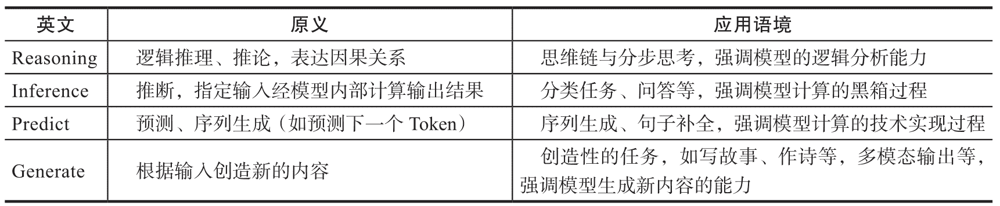

**3.DeepSeek 蒸馏模型**

为了支持社区研究，DeepSeek-AI 开放了 DeepSeek-R1-Zero、DeepSeek-R1 以及基于 Llama 和通义千问、从 DeepSeek-R1 蒸馏出来的 6 个密集模型的权重。其中，DeepSeek-R1-Distill-Qwen-32B 在各种基准测试中的表现优于 OpenAI-o1-mini，展现了密集模型的先进成果。 ^()

这些蒸馏模型以 Qwen2.5-Math、Qwen2.5、Llama-3.1 和 Llama-3.3 中不同参数规模的模型为基础，使用 DeepSeek-R1 的 80 万条数据经两轮 SFT 训练得到，具备推理能力。由于算力所限，本书中的案例涉及 DeepSeek-R1 时均采用 DeepSeek-R1 的蒸馏模型。这些模型的操作方法与 DeepSeek-R1 并无太大不同，区别仅在于推理能力和算力需求差异较大。

**1.1.3** **主要优势**

说到 DeepSeek 的优势，主要探讨 DeepSeek-V3 和 DeepSeek-R1 相比于其他模型的性能。

**1.推理能力强**

DeepSeek-V3 是一种推理模型，在复杂问题求解、逻辑推理和多步分析方面表现突出。不仅能处理常规的问答任务，还能进行数学推导、因果分析、假设推演等需要深度推理的任务。DeepSeek-R1 则以深度思考见长。该模型在生成最终答案之前，会先输出一段以<think>标签包裹的思考过程。模型在该过程中对用户提出的问题进行深入分析，并对解决问题的步骤进行合理规划。这样，提示词就从原来的单纯问题转变为问题与思考过程的结合，生成的答案往往更加准确。

**2.性价比高**

DeepSeek-V3 和 DeepSeek-R1 的权重均以 FP8（8 位浮点型，Floating Point 8Bit）格式保存，每个参数占用一个字节。模型整体装入推理卡需要至少 640GB 的 GPU 内存。按照此精度计算，需要两台配备 8 张 80GB 推理卡的机器才可运行，部署成本并不低。然而，从综合性能、成本和开放程度等方面来说，671B 规模的模型与一些主流闭源模型的能力相媲美，且在本地部署的成本是可接受的，因此 DeepSeek 表现出了较高的性价比。

除了 671B 的 DeepSeek-V3 和 DeepSeek-R1 外，DeepSeek 还发布了参数规模从 1.5B 到 70B 的 6 个蒸馏模型。这些模型是在通义千问和 Llama 等模型的基础上，使用 DeepSeek 的训练语料微调后得到的。与原基础模型相比，这些蒸馏模型一方面性能显著提升，另一方面具备了深度思考的能力。这样一来，在使用与原模型相同的 GPU 资源的情况下，部署具备深度思考能力的 DeepSeek 系列模型，性价比明显优于原始模型。

**3.处理复杂任务的能力强**

DeepSeek-V3 和 DeepSeek-R1 的上下文长度均为 128K，可处理超长文本（如书籍、论文、代码库）的输入，并保持上下文连贯性，适用于源代码分析、法律合同分析、技术文档梳理等场景。在 DeepSeek-V3 和 DeepSeek-R1 的技术报告中，都提及训练过程中对中文和英文进行优化。尤其针对中文语境的训练，DeepSeek 在语义理解、古文处理等任务上优于同等规模的其他模型。DeepSeek 在训练过程中利用基于规则的奖励机制指导其数学、编码和逻辑推理领域的学习过程。特别是思维链的引入，使得 DeepSeek 在数学、编码和科学推理等复杂任务的处理上取得了显著改进。

**4.技术架构创新**

DeepSeek 的技术架构实现了多项创新。

混合专家模型（MoE）架构采用细粒度的专家划分方式，将模型分为通用专家和领域专家，通过动态路由机制分配生成任务，单次推理只需要激活 37B 的参数。

DeepSeek 的多 Token 预测（MTP）改进了传统 Transformer 架构每次推理只能生成一个 Token 的性能瓶颈，一次可以生成两个 Token。第二个 Token 的准确率约为 85%～90%。换句话说，DeepSeek 的生成速度优化带来了 1.8 倍的性能提升。

训练过程的优化也是 DeepSeek 创新的体现。FP8 混合精度训练可以减少 GPU 的内存占用，训练吞吐量较 16 位精度提升 2 倍。结合 FPGA 低延迟推理、GPU 集群训练、张量网络和稀疏化优化技术，资源利用率大大提升。此外，纯强化学习和小模型蒸馏技术为业界带来了全新的模型训练技术理念。

### **1.2** **DeepSeek 企业级应用概述**

**1.2.1** **应用场景**

DeepSeek 的企业级应用可以覆盖多个行业和场景，主要依托其强大的理解、推理和生成能力。由于企业应用需要考虑安全、合规和保密等因素，往往不能以直接调用 DeepSeek 官网接口或第三方平台提供的 API 等方式接入 DeepSeek 服务，因此本书讨论的应用场景都以在企业或单位内部部署 DeepSeek 为前提。

**1.智能客服与客户支持**

基于 DeepSeek 的推理、微调或知识库应用的能力，企业可以提供 7×24 小时的智能客服，减少人工成本。当然，这些能力并非 DeepSeek 所特有，但 DeepSeek 强大的推理能力更利于客服类应用的落地。

**2.企业知识管理**

DeepSeek 的 128K 上下文窗口和逻辑推理能力有助于处理大型文档，例如帮助企业做智能文档分析，快速分析合同、财报、技术文档等，提取和总结关键信息。DeepSeek 与 RAG（Retrieval-Augmented Generation，检索增强生成）技术相结合，可以构建知识库问答系统，接入企业内部文档（如行业技术资料、产品手册、政策文件），使员工或用户可通过自然语言查询信息。

**3.数据分析与商业智能**

数据分析与商业智能领域一直采用大数据技术、报表技术和专业软件。但 DeepSeek 另辟蹊径，充分利用大语言模型在自然语言处理方面的优势，实现以下功能：基于企业数据（如销售、运营数据）生成可视化分析报告；将大模型的生成（也可理解为预测）能力应用于结合历史数据预测市场趋势、客户行为等场景；通过自然语言转 SQL（Text2SQL）技术，让非 IT 技术人员能通过自然语言查询数据库并生成报告。

**4.辅助开发工具**

将大语言模型的代码生成能力应用于辅助软件开发，已经经历几年的发展，如 GitHub Copilot、Cursor、Trae 等工具，在自动补全代码、生成函数、修复 Bug 方面取得显著进展。特别是随着模型能力的进一步提升，一键生成整个项目的前后台代码和全套技术文档的工具也逐步成为主流。DeepSeek 在代码生成方面的能力将有助于其在辅助开发工具领域的深入应用。

**5.营销与内容创作**

内容创作一直是大语言模型的重要应用场景，特别是在营销领域。与编程、数学等较为严格且可验证的场景不同，文案生成更强调营销的效果，而非逻辑严密，例如让 DeepSeek 生成爆款文案或热帖。在这样的场景中，参数规模较小的 DeepSeek 蒸馏模型（如 14B、32B）成为执行任务的首选工具。一方面，企业能够负担得起其部署成本；另一方面，进行模型二次训练的成本也在可接受范围内。

**6.法律行业应用**

得益于长上下文输入、运行效率和推理能力，DeepSeek 特别适合分析长文档，找出文档中句子、段落的内在关系，实现文档总结、纠错和专业分析。在法律行业中，它可以应用于合同审定、自动识别法律风险条款，从而提高法务效率。同样，DeepSeek 还可以用于其他以文字为主的专业领域，实现类似目标。

**7.医疗行业应用**

DeepSeek 的迅速流行，与其在医疗行业的高调应用有一定的关系。在 DeepSeek-R1 发布后 3 个月内，大多数公立医院纷纷参与接入 DeepSeek 的“竞赛”。短时间内，很多医疗机构以 API、自购设备和租用算力等方式完成了 DeepSeek 的接入工作。经过一段时间的应用，DeepSeek 逐步与医疗工作实现了整合，应用场景也日益丰富，如病历辅助书写、智能问诊、检验报告解读等。DeepSeek 的强大思考能力使其在严谨的医疗场景中占据了一席之地。

**8.教育培训行业应用**

大语言模型在教育培训行业的应用由来已久。DeepSeek 的思考过程可视化、数学推理能力使其在教育培训行业有一定的应用基础。通过展示思考过程，学生或学员可以更好地理解解题思路。同时，DeepSeek 的数学推理能力使其在求解数学问题时表现得更为准确。并且，借助一些开源框架搭建聊天应用，用户可以方便地上传图片、PDF、Word 等格式的文件，从而使 DeepSeek 在使用上更为方便快捷。

**1.2.2** **算力支撑**

包括 DeepSeek 在内的大语言模型一般都需要 GPU 资源进行部署和运行。虽然 Ollama ^()等模型部署工具大行其道，实现了在 CPU 上运行大模型量化版本的能力，但从企业应用的角度来看，4bit 量化模型的精度较低，不太适合用于对模型推理能力要求较高的生产环境。所以，我们仅讨论 DeepSeek 应用中 GPU 算力的支撑条件。

是否可以成功运行模型，取决于 GPU 的内存大小；而模型运行的效率，取决于 GPU 中的处理单元数量。一个模型所需最低 GPU 资源，与参数量、参数精度有关，也与服务程序有一定关系。粗略估算，DeepSeek-V3 和 DeepSeek-R1 的“满血”模型需要两台 8 卡 80GB 的 GPU 算力资源。其他蒸馏模型的 GPU 内存需求可参考以下经验公式。

GPU 内存最低需求=参数量×2×1.3

以 DeepSeek-R1-Distill-Qwen-14B 为例，公式如下。

GPU 内存最低需求=14×2×1.3≈37GB

在具体部署过程中，由于部署工具的不同以及各种优化参数的应用，内存使用可能会有所差异。但在对算力支撑的大致估算方面，可以参考以上经验公式。 

**注意**

算力设备主要包括通用显卡（GPU）及推理卡（Inference Card），后者专为推理任务优化设计，且通常不带显示接口。为方便表述，本书中多以“内存”一词泛指算力设备的容量及模型运行时的资源占用情况。

**1.2.3** **安全与合规**

安全与合规是 DeepSeek 企业级应用的重要指标。对于个人而言，使用在线大模型服务时主要担心隐私泄露和上传后文档的去向。而对于企业，数据安全方面的考量则更为突出。企业的技术文档、营销文案、运营数据、客户资料都是企业核心资产，所以本地部署 DeepSeek 往往是企业应用的首选方案。安全防护措施，如防火墙、端口访问策略、访问权限控制等是必要的。此外，对训练数据的使用也必须合规合法。需要对训练数据进行匿名化处理，以降低隐私风险。如果对外提供服务，还要做好网站备案、SSL 证书管理、日志留存、数据安全防护和访问控制等安全与合规措施。在大模型服务的安全方面，应采用防御技术防止提示词注入（Prompt Injection）或越狱（Jailbreaking）攻击等。

### **1.3** **实战环境准备**

对大语言模型的学习可以分为三个方向。第一个方向是如何使用，即如何应用大语言模型的官网服务或第三方工具来实现具体的业务，如用 AI 撰写文档、制作 PPT、生成图片、制作视频等。这主要涉及提示词的使用技巧。第二个方向是学习如何部署和微调大语言模型，并基于此开发相关应用，对外提供服务。第三个方向是深入研究大语言模型的理论和算法。

本书侧重于第二个方向，帮助读者通过较小的算力资源，实践 DeepSeek 的部署、应用安装以及微调，复现 DeepSeek 的关键环节，了解 DeepSeek 的一些技术细节。结合企业应用场景中的开发实例的学习，读者可以掌握 DeepSeek 企业级开发的基本原理和实现手段。基于这一目标，要实践本书中的所有实例，需要准备表 1-2 所示的基础实验条件。

**表 1-2** **基础实验条件**

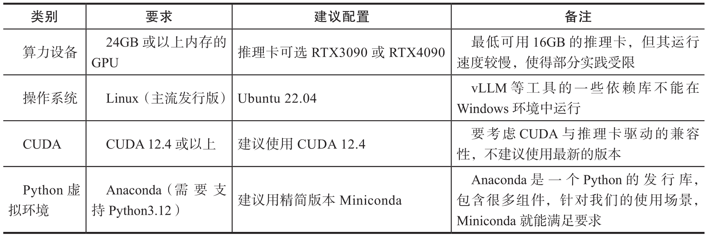

**1.3.1** **硬件准备**

准备一台服务器或配置较高的个人电脑，建议内存为 32GB 以上，并配备一张显存为 24GB 或以上的显卡，如 RTX3090 或 RTX4090。

**1.3.2** **操作系统准备**

使用 Ubuntu22.04 操作系统，并安装 GCC 编译环境，因为后续的推理卡驱动安装以及 Python 的一些开发库需要通过编译方式安装。

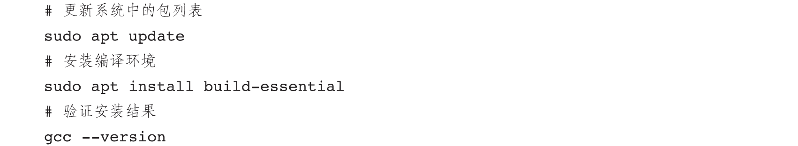

成功安装后，GCC 编译环境验证结果如图 1-1 所示。

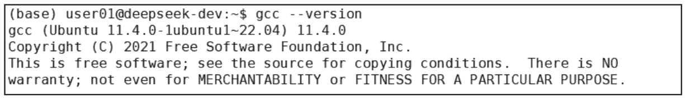

图 1-1 GCC 编译环境验证结果

**1.3.3** **安装推理卡驱动**

从 NVIDIA 官网查找推理卡的驱动程序，下载到算力机器上进行安装，具体步骤如下。

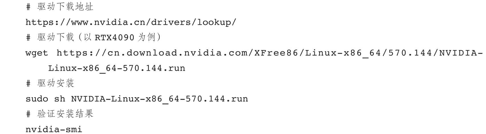

成功安装后，推理卡驱动安装验证结果如图 1-2 所示。

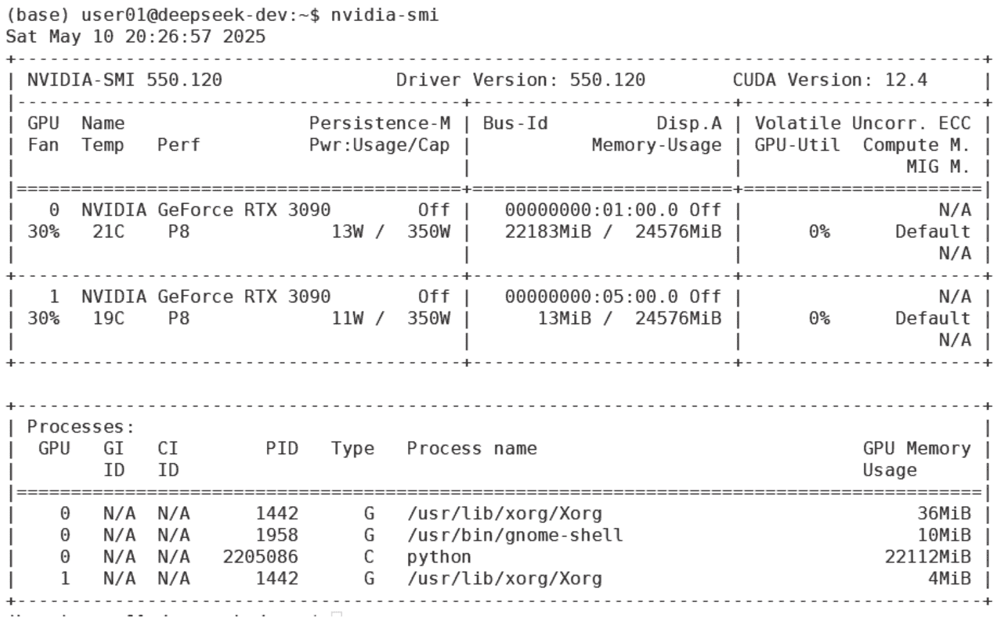

图 1-2 推理卡驱动安装验证结果

**1.3.4** **安装 CUDA 环境**

从 NVIDIA 官网下载 CUDA。以 CUDA 12.4.0 为例，下载到算力机器上进行安装，具体步骤如下。

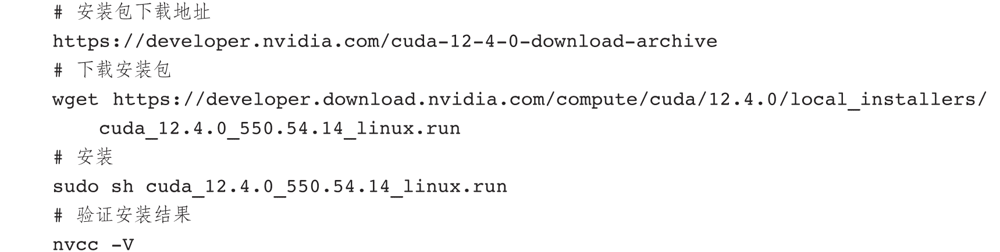

成功安装后，CUDA 环境验证结果如图 1-3 所示。

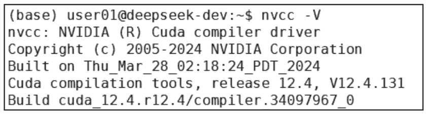

图 1-3 CUDA 环境验证结果

**1.3.5** **安装 Python 虚拟环境**

Python 虚拟环境 Anaconda（此处使用精简版本 Miniconda），按照以下步骤进行下载及安装。

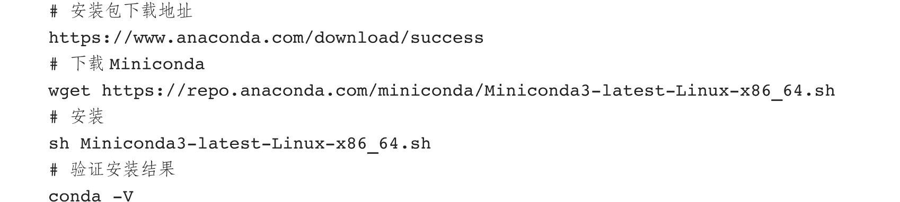

**1.3.6** **环境验证**

为了确认实战工作环境，包括硬件、推理卡驱动、CUDA 和 Python 虚拟环境等是否正常，我们在 Python 虚拟环境下安装 PyTorch 库 ^()，然后调用 PyTorch 相关函数的方法进行整体校验，操作方法如下。

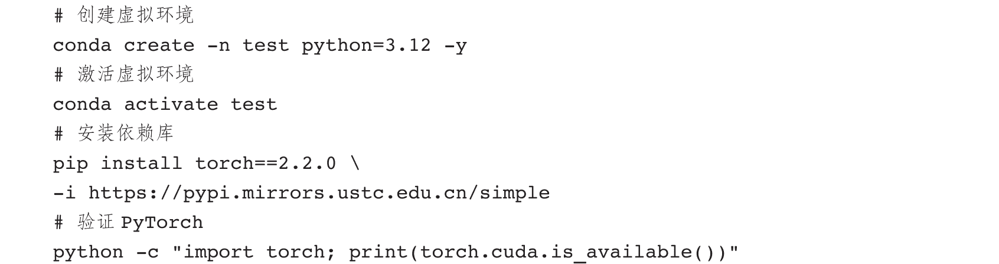

如果执行最后一句代码，显示的结果是 True，则说明实战环境准备就绪；如果为 False 或报错，则要根据具体情况进行处理。

## **Chapter** **2** **第二章** **LLM 基础知识**

DeepSeek 是由 DeepSeek-AI 开发的一系列大语言模型。大语言模型是一种用于处理自然语言任务的大型神经网络结构，属于自然语言处理技术的一个重要分支。Transformer 架构是大语言模型的技术基石，而自注意力机制则是 Transformer 架构中最重要的算法。

LLM 是一个实践性很强的技术领域。掌握相关知识，需要通过安装、微调、应用开发，以及与智能体整合应用等具体的实操经验的积累。对于非人工智能专业的技术人员来说，通过实践过程学习 LLM 技术是一种较为适用的学习路径。特别是对于企业级 DeepSeek 应用，更要强调实战能力。LLM 不是一个简单的概念，其实践的前提是了解基本原理。因此，在进行实践学习之前，掌握自然语言处理、神经网络和大模型运行的基本原理等最基础知识是十分必要的。

### **2.1** **自然语言处理**

自然语言是人类在对话、写作、沟通时使用的语言。与计算机语言（如 Python、C++、Java 等）相比，自然语言的适用用户群体更为广泛。在大语言模型的辅助下，以往需要使用计算机语言编写专用软件处理事务的工作模式，已经转变为通过口头指令也可以顺畅地交互与解决问题。自然语言处理（NLP）作为人工智能领域的重要分支，致力于研究人类使用自然语言与计算机进行交互的机制。该技术涵盖文本理解、文本生成、语音识别、图像与视频生成等核心任务，并在智能客服、机器翻译、信息检索、知识库等应用场景中发挥着越来越重要的作用。

下面具体介绍自然语言处理技术的发展历程。

**1.基于规则的阶段**

自然语言处理兴起于 20 世纪 50 年代的基于规则的机器翻译系统。从 20 世纪 50 年代到 70 年代，自然语言处理主要采用基于规则的方法。研究人员认为，自然语言处理的过程和人类学习和认知语言的过程类似，因此大量研究人员基于这一观点展开这一时期的自然语言处理处于理性主义思潮阶段，以基于规则的方法为主。

以机器翻译为例，如将英文翻译成中文：


反之，从中文翻译成英文：


从上述翻译过程可以看出，采用最简单的规则，如逐词查字典式翻译，在一些情况下也能达成基本上可读的效果。但是，基于规则的方法具有不可避免的缺点，因为规则不可能覆盖所有语法。例如，对于下面的例子，还是按照逐词查字典式翻译的规则，就会出现令人困惑的结果。


这种基于规则的自然语言处理方法，可以用输入法联想的场景来类比。如图 2-1 所示，医生在书写一份病历时，输入“住”字后，其输入法工具大概率会提示“本”字，完整补全为“入住本院”。但如果按照固定的规则，则预测准确的可能性就比较低。

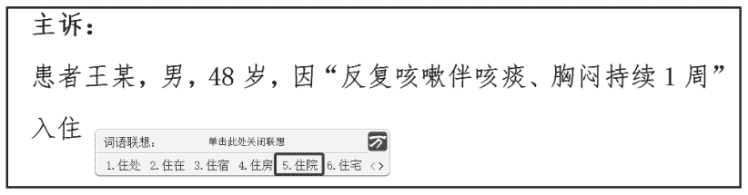

图 2-1 基于规则的自然语言处理方法的类比场景

因此，这一阶段虽然解决了一些简单的问题，但“机翻”的痕迹过于明显，离实用性还有一定距离。

**2.基于统计的阶段**

20 世纪 70 年代以后，随着计算机的快速发展，大量纸质资料逐步实现电子化，越来越丰富的语料库为自然语言处理提供了训练数据支持。同时，计算机硬件的容量与性能也在不断提升，自然语言处理由语言学范畴的基于规则的方法向基于统计的方法发展。基于统计的方法逐步取代了基于规则的方法，自然语言处理在数学模型和统计学的基础上取得了实质性的突破。特别是 90 年代以后，互联网的发展为自然语言处理的研究提供了大量数据支持。社交对话、邮件、文章、搜索引擎每天都会产生海量数据，这使得在大量语料基础上构建自然语言模型成为可能。通过这种方式，可以避开一些因歧义、语境等因素导致的技术难题，还可以对未曾见过的语言现象进行预测。

基于统计的自然语言处理方法，可以用带有动态词频的输入法来类比，如图 2-2 所示，经过优化的输入法，其预测结果将更为准确，而统计方法的本质是一种概率计算。


图 2-2 基于统计的自然语言处理方法的类比场景

**3.深度学习阶段**

2007 年以来，由于深度学习在图像和语音识别领域的快速发展，这项技术逐步应用于自然语言处理研究。2013 年出现的词向量（Word2Vec）技术，使深度学习与自然语言处理的结合更加紧密，并在机器翻译、问答系统、文本理解等领域有了一些成功案例。深度学习是一种多层神经网络技术，从输入层开始，经过逐层非线性的变化，最终得到输出。通过端到端的训练，从输入到输出。根据标注“输入-输出”对的数据，设计并训练一个神经网络，即可使其执行预期任务。N-Gram 模型和 RNN（循环神经网络）是当时常用的技术。

N-Gram 模型实现了通过前一个词预测下一个词。如图 2-3 所示，使用“无明显”这个词来预测“诱因”。

RNN 等循环神经网络则更进一步，实现了对较长距离上下文的依赖预测。如图 2-4 所示，使用前一句来预测下一个词。

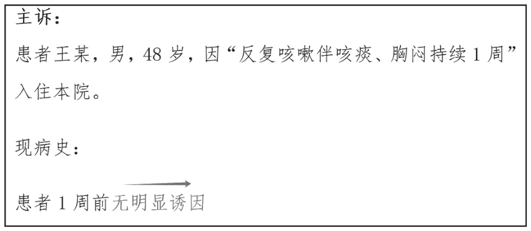

图 2-3 N-Gram 模型预测场景示例

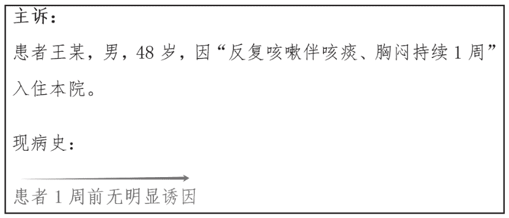

图 2-4 循环神经网络预测场景示例

**4.大语言模型阶段**

Google 翻译团队于 2017 年发表了业界著名的论文“Attention Is All You Need” ^(¹)，采用无监督训练的预训练语言模型在自然语言处理领域取得了重大进展。预训练模型采用 Transformer 架构，在大规模未标注的语料上进行预训练，以此获得通用的语言理解能力和生成能力。在用于特定场景时（比如对话），再使用监督训练等方法进行较小规模的微调，即可满足应用要求。

到目前为止，大语言模型的主流架构依然是 Transformer。BERT 是 Google 开发的一款较早的经典预训练模型，而后来 Open AI 开发的一系列名为 GPT 的模型，成为大语言模型的一支主流，如开源的 GPT-2 以及闭源的 GPT-3、GPT-3.5、GPT-4 和 GPT-5 等。与之对标的开源模型也发展迅速，如 Meta 的 Llama、Google 的 Gemini、Anthropic 的 Claude 等。国产模型也取得了长足的发展，如智谱 GLM、通义千问等，也占据了一定的市场份额。

大语言模型的一项核心技术是自注意力机制。这种算法在理解一段文本的含义时，会计算每个词与上下文中其他词的相关程度。再结合多头注意力机制，整体上改进了自然语言处理中对语义的理解和对新内容的预测能力。其工作场景示例如图 2-5 所示。

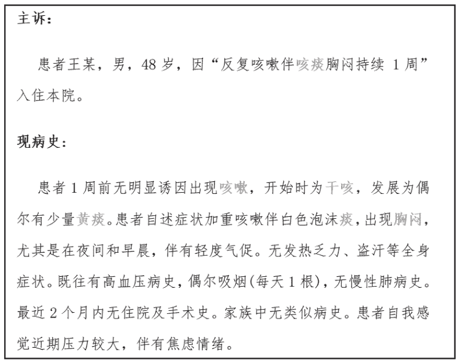

图 2-5 大语言模型自注意力机制的工作场景示例

**5.DeepSeek 阶段**

DeepSeek 系列模型基于 GPT 架构，但进行了诸多创新，其中开放权重、671B 超大规模参数、专家混合模型以及思维链的加入，使得 DeepSeek 处于领先位置。当时，无论是在技术上还是在应用推广方面，其他开源模型普遍处于追赶 DeepSeek 的态势。思维链（Chain-of-Thought，CoT）是一种通过逐步推理来解决问题的技术，在 AI Agent 中作为一种思考框架被广泛应用。DeepSeek 把这种技术集成到大模型的生成能力中，改进了模型处理复杂问题的能力。例如，在求解数学问题、生成代码时，DeepSeek 可以模仿人类的思考过程，将问题分解为多个中间步骤，从而提高答案的准确性和可解释性。DeepSeek 的思考过程如图 2-6 所示。

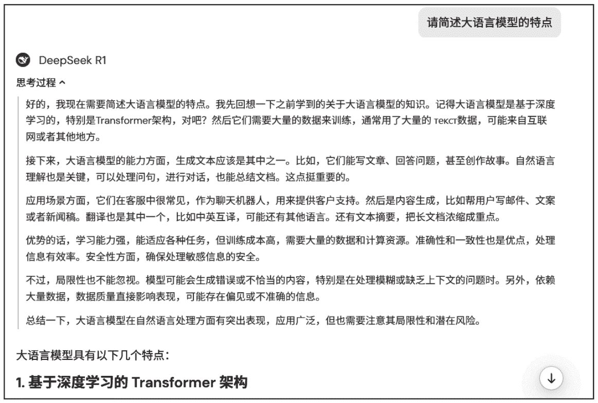

图 2-6 DeepSeek 思考过程示例

### **2.2** **神经网络**

DeepSeek 是一种大语言模型，而大语言模型是一种大型神经网络结构。系统地学习神经网络需要具备一定的数学知识，有一定的门槛。本节的写作目的在于让读者在学习 DeepSeek 的应用与开发过程中，对神经网络的建立有一个基本的认知，而不需要深入研究。因此，在本节中，笔者以介绍大语言模型运行的基本原理为目标，描述神经网络的基本概念及其在大模型推理过程中的作用。

**2.2.1** **神经网络的基本结构**

神经网络（Neural Network）是一种模仿生物神经元结构的计算模型，用于学习和表示复杂的数据模式。其核心是通过多层连接的“神经元”进行信息处理，广泛应用于图像识别、自然语言处理等领域。

从大语言模型的应用方面来看，神经网络可以被视为一个黑盒，输入一些文本后，预测出后续的文字。例如，原始输入是“你好”，大模型给出的答案大概率是“你好，……”。推理（推理、预测、生成，这三个词在此语境下的含义是一样的）产生的第一个词（Token），概率最大的是“你”。在图 2-7 中，我们可看到神经网络工作原理的示意。

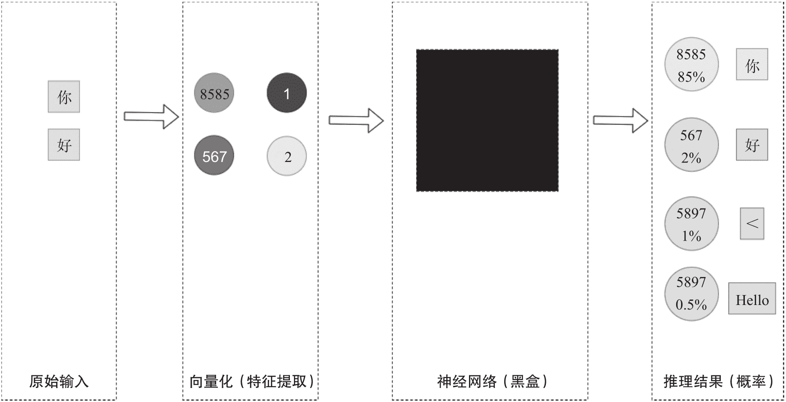

图 2-7 神经网络工作原理示意

由图 2-7 可知，神经网络的工作步骤如下。

①原始输入为“你好”。

②原始输入被分解成词元（Token），再转化为向量表示，并加上位置信息，形成神经网络的输入参数。

③我们把神经网络暂且看作一个黑盒。针对输入，使用一些算法和权重进行计算。

④神经网络计算的结果是一张字典表中每个词元的概率，其中“你”这个词元的概率最大。

在理解神经网络的基本工作过程后，我们再讲解神经网络黑盒内部的工作原理。神经网络由多个神经元组成，每个神经元内包括权重、算法和激活函数。我们仍以输入文字预测下一个词元为例。图 2-8 展示了神经网络内部工作结构的概览。

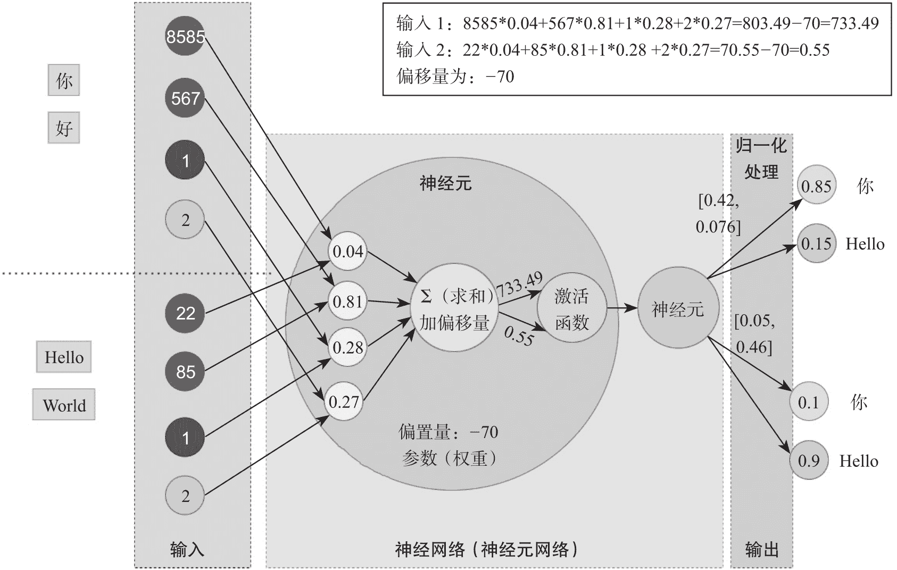

图 2-8 神经网络内部工作结构概览

由图 2-8 可知，神经网络内部工作步骤如下。

①如果输入的是“你好”，经过神经网络推理后，在字典表中“你”的概率最大；如果输入的是“Hello World”，则接下来生成的词元“Hello”的概率最大。

②输入被转换成向量，并附加词元在输入句子中的位置信息，作为神经元的输入。

③神经元中包含一些经过训练得到的参数（权重）。这些参数与输入的向量逐一相乘后求和（即神经网络的全连接层运算）。求和的过程如下。

输入你好：8585*0.04+567*0.81+1*0.28+2*0.27=803.49

输入 Hello World：22*0.04+85*0.81+1*0.28+2*0.27=70.55

从 803.49 和 70.55 这两个数字中，我们仍然看不出规律。在此基础上，将计算结果同时加上一个“-70”的偏置，这样得到的结果分别是一个较大的数“733.49”和一个较小的数“0.55”。那么，这个“-70”是怎么来的呢？我们暂且理解为是通过训练得到的。

④输入参数加权求和后，加上偏置，得到的数字会经过一个数值转换，使其落在 0 到 1 之间，或者进行类似的转换，形成一个非线性的结果。如果结果落在 0 到 1 之间，我们可以将其理解为一个概率：大的数字接近 1，小的数字接近 0。这个转换过程是由激活函数实现的。

⑤激活函数包括 Sigmoid、线性整流函数（ReLU）、双曲正切函数（tanh）、符号函数（sign）等，见图 2-9。

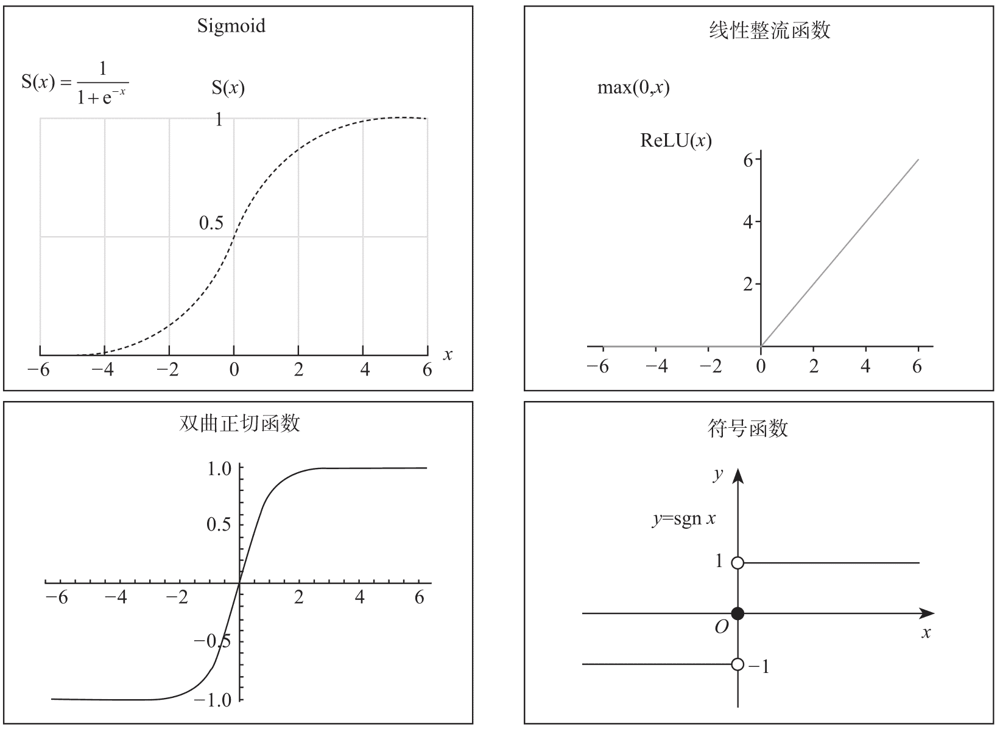

图 2-9 常用的激活函数

⑥经过多层神经网络的计算，最终得到了一些输出词元的概率。将这些概率全部相加作为分母，用单个概率作为分子分别计算，就得出了每个概率在全部概率中的百分比。这些百分比加起来恒等于 1。如图 2-8 所示，输入“你好”时，接下来生成“你”的概率是 0.42，生成“Hello”的概率是 0.076，则最终生成“你”的概率百分比为 85%，生成“Hello”的概率为 15%。

0.42/(0.42+0.076)=85%

0.076/(0.42+0.076)=15%

这个过程被称为归一化处理，一般出现在神经网络的输出层。

**2.2.2** **神经网络的训练过程**

在图 2-8 中，我们直接给出了一些神经元的权重和偏置，这些数值是通过训练得到的。输入经过神经网络推理出输出是一个生成的过程，被称为正向传播；已知输入和输出，反向补全神经网络各层、各神经元的权重和偏置是一个训练的过程，被称为反向传播。两种传播方式的示意如图 2-10 所示。

①正向传播（生成）过程中，已知输入和神经网络中各神经元的参数，逐层计算推理出输出。

②反向传播（训练）过程中，已知输入和输出（经过标注的数据），逐层通过一些方法设定参数，然后正向计算验证推理出的输出与期望输出（标注）之间的差值，这个差值就是损失值（Loss）。

③训练的过程就是通过调整各层神经元的参数，逐步降低损失值的过程。

④由于训练的过程是设定参数，然后正向推导找差值，中间涉及激活函数、归一化等非线性因素，反向传播并非简单地反向推理，训练得到的参数并非通过反向计算直接获得，因此神经网络才会出现不可解释性。

⑤参数调整并非随机设定，而是基于算法和方法论的。常用的方法为梯度下降法，如图 2-11 所示。首先设定一个初始值，根据每次损失值的下降速度（下降曲线的斜率），设定每次修改参数的增量。Loss 下降快，就多改一些；下降慢，就少改一些。如果方向错误，就乘以负数。当修改量过大时，可以乘以学习率常量进行调整。

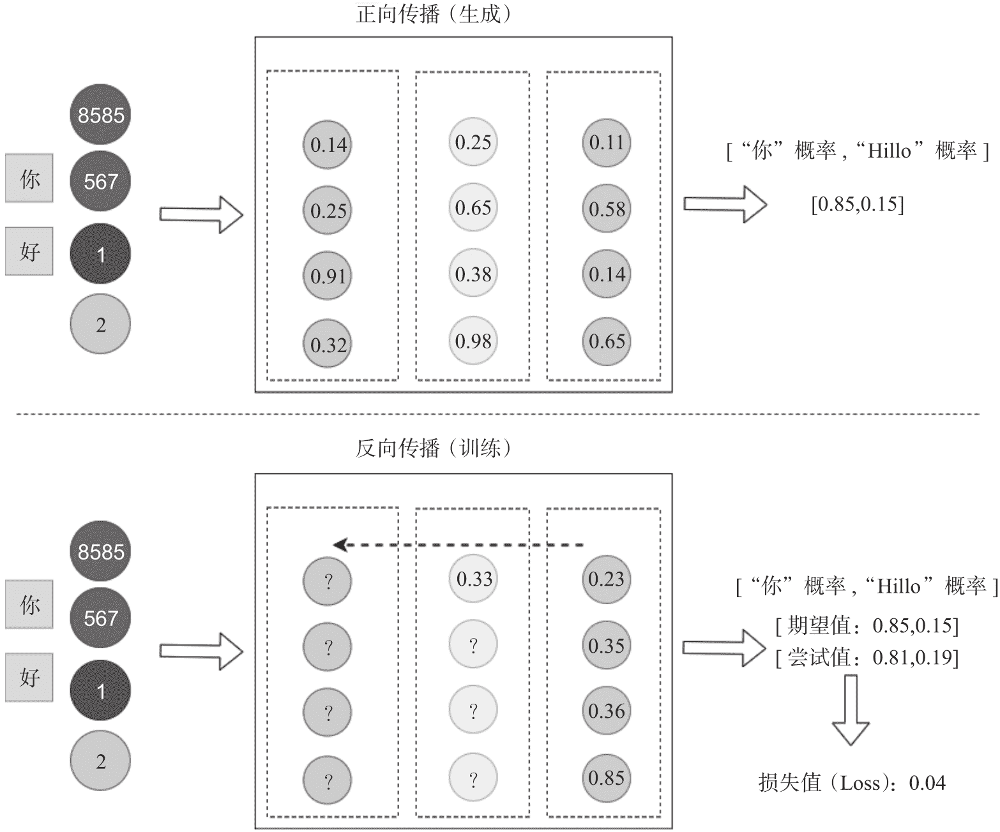

图 2-10 正向传播与反向传播的示意

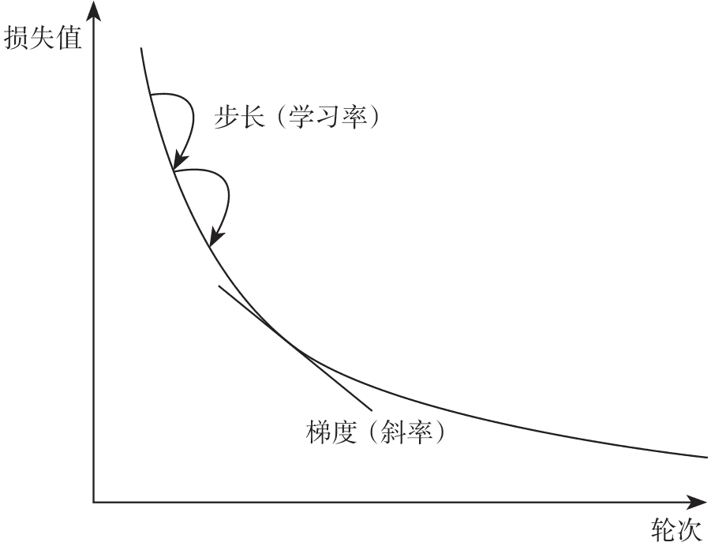

图 2-11 神经网络训练的梯度下降法

**2.2.3** **基于神经网络的推理过程**

在大语言模型中，神经网络采用 Transformer 架构。不同的模型在神经网络的层数、参数量、输入上下文长度以及字典表长度等方面有所不同。DeepSeek 的上下文长度为 128K，其模型结构由 Embedding 层、61 层（MLA+MoE）以及输出层组成，总计拥有 6710 亿个参数。DeepSeek-R1 的字典长度（词表大小）为 129280，这意味着它能处理的 To k e n（包括汉字、汉字词组、标点符号、英文、英文词组以及其他语言元素等）数量约为 13 万个 ^(²)。

以 DeepSeek-R1 为例，为了简化描述，暂不考虑多 Token 预测。基于神经网络，大语言模型的推理过程如图 2-12 所示。

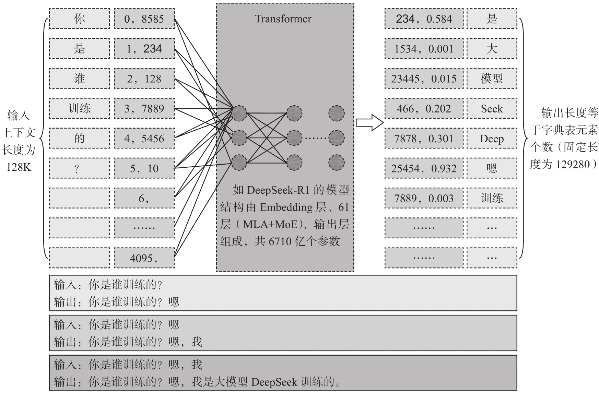

图 2-12 大语言模型的推理过程

以输入“你是谁训练的？”为例，其推理过程的主要步骤如下。

①DeepSeek-R1 的输入上下文窗口为 128K，这意味着最长的输入可以包含 128K 个 Token，约等于 128K 个词。

②输入的问题通过分词器（Tokenizer）将原始文本分割成 Token，并查词表转换为整数 ID（如“你”=>8585）。

③Token ID 通过模型的 Embedding 层转化为一个固定维度的稠密向量（如 8585=>[0.2,-0.5,...,0.7]）。

④将向量输入多层神经网络进行计算，得出在 129280 个词中概率最大的下一个 Token ID（如“嗯”=>25454）。

⑤将 Token ID 转化为明码“嗯”并输出。

经过上述过程，输入“你是谁训练的？”后，模型预测出下一个词为“嗯”。然后将“你是谁训练的？嗯”作为新的输入，预测下一个词为“，”并以此类推，不断将上次的输出作为下次的输入，直到输出结果中包含设定的停止词后结束推理过程。

### **2.3** **LLM 的核心机制**

作为自然语言处理的前沿领域，大语言模型通过海量参数学习语言的深层规律。本节将深入剖析现代大语言模型的核心技术组件，揭示其突破传统自然语言处理任务性能瓶颈的内在机理。

**2.3.1** **Transformer**

Transformer 架构采用“编码器-解码器”结构，通过堆叠多层自注意力模块实现特征的层次化提取。其核心在于自注意力机制与多头注意力机制：前者通过计算序列元素间的关联权重建立全局依赖，后者将特征空间投影到多个子空间进行并行注意力计算。这两者共同实现了对输入序列 ^(³)全局依赖关系的高效捕捉。

与传统 RNN 架构相比，Transformer 完全摒弃了时序递归结构，采用位置编码（Positional Encoding）引入序列顺序信息，使其具备更强的并行计算能力。这种突破性设计不仅大幅提升了长距离依赖建模效果，还显著降低了训练时的计算复杂度。模型通过预训练过程学习通用语言表示，在机器翻译、文本生成等任务中展现出卓越的性能。成功的经验迅速扩展到计算机视觉、语音识别等领域，彻底改变了自然语言处理领域，并成为现代大模型（如 GPT、BERT）的核心架构。当前，基于 Transformer 的模型通过引入稀疏注意力、混合专家系统等创新，持续推动人工智能技术的发展。

**2.3.2** **自注意力机制**

自注意力机制将一个序列的不同位置联系起来，以计算序列的表示形式。自注意力允许模型查看输入序列中的其他部分，从而更好地理解序列中的某个词元。自注意力机制引入了三个关键组件：查询（Query）、键（Key）和值（Value）。每个输入向量首先生成对应的查询、键和值向量。查询向量用于计算与所有键的相似度，反映当前输入对其他输入的关注程度。每个键与对应的值向量一一对应，相似度高的键会影响值的加权计算。通过这种方式，模型能够动态地在长序列中选择重要信息，从而捕捉上下文关系。自注意力计算的公式如下。


公式中，***Q***、***K***、***V***分别是查询、键和值的矩阵表示，*d*[k]是键向量的维度，用于缩放以防止数值过大。为了帮助读者直观理解这种机制，我们以输入“你是谁训练的？”为例，讲解***Q***、***K***、***V***的含义和计算过程。

**1.准备输入参数**

对于“你是谁训练的？”，首先要进行分词，比如将“训练”当成一个词元处理，一共 6 个词元。每个词元通过嵌入层转换为向量表示（本例简化为 4 维）如下。

你：[1.0,0.5,-0.2,1.2]

是：[0.3,-1.0,0.6,-0.7]

谁：[-0.8,1.2,0.4,0.9]

训练：[1.5,-0.6,-1.0,0.3]

的：[-0.5,0.4,1.1,-0.2]

？：[0.2,-0.9,0.7,0.5]

如果以矩阵***X***表示，则***X***为 6×4 矩阵，如下所示。

[[1.0,0.5,-0.2,1.2],

[0.3,-1.0,0.6,-0.7],

[-0.8,1.2,0.4,0.9],

[1.5,-0.6,-1.0,0.3],

[-0.5,0.4,1.1,-0.2],

[0.2,-0.9,0.7,0.5]]

**2.准备*****Q*****、*****K*****、*****V*****权重**

定义权重矩阵（实际工作中，这些权重是经过训练得到的）。

***W******^Q***：

[[0.1,0.4,-0.3,0.5],

[0.2,-0.2,0.6,0.0],

[-0.1,0.5,0.2,0.1],

[0.3,0.1,-0.4,0.2]]

***W******^K***：

[[-0.2,0.5,0.1,-0.3],

[0.3,0.0,0.4,0.2],

[0.1,-0.1,0.3,0.5],

[-0.4,0.2,0.0,0.1]]

***W******^V***：

[[0.0,0.4,0.1,-0.2],

[-0.1,0.2,0.5,0.3],

[0.2,-0.3,0.0,0.4],

[0.3,0.1,-0.2,0.1]]

**3.编写自注意力分数的计算程序**

按以上步骤设定好输入参数，其中模拟了***W******^Q***、***W******^K***、***W******^V***三个权重，后续对***Q***、***K***、***V***、自注意力分数等进行计算。为了便于开发人员理解，下面使用一段程序进行展示。将计算自注意力分数的程序命名为 self-attention.py。

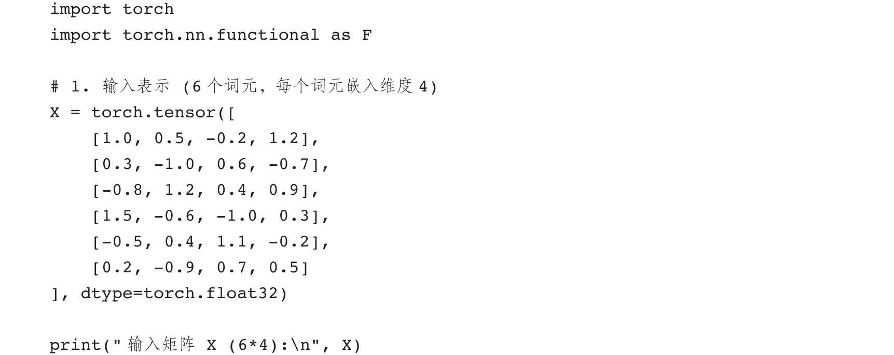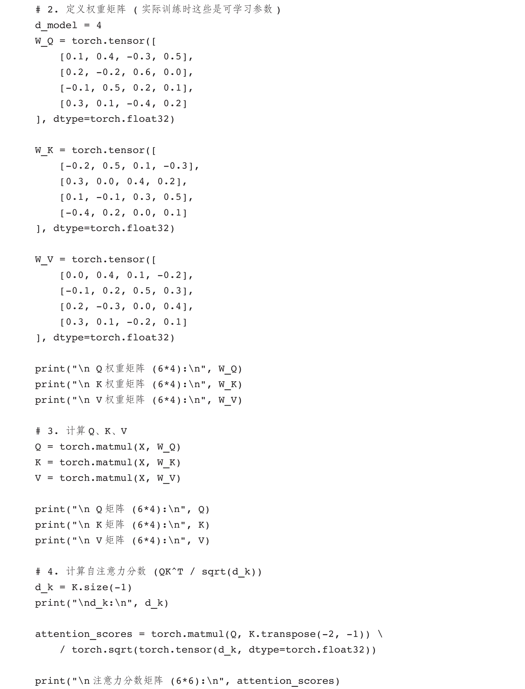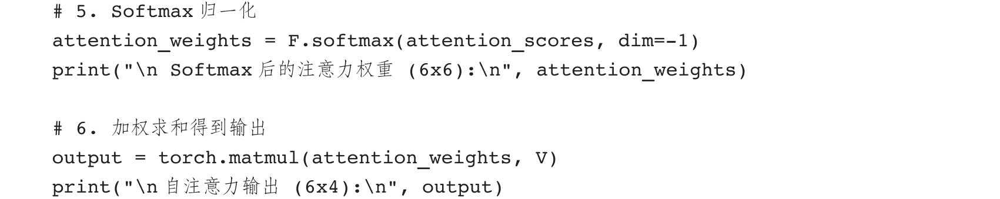

**4.计算自注意力分数**

按以下步骤创建 Python 虚拟环境，安装用于向量计算的 PyTorch 库后，运行计算程序。

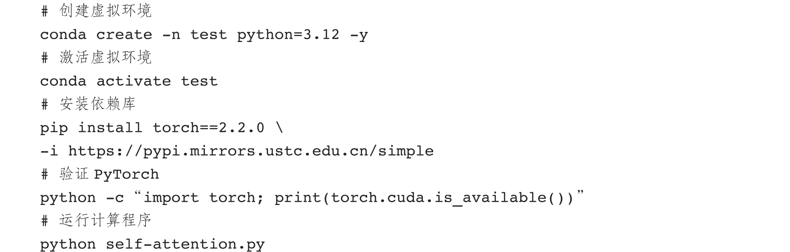

（1）计算***Q***、***K***、***V***

通过权重矩阵***W******^Q***、***W******^K***、***W******^V***，将输入***X***投影到***Q***、***K***、***V***。具体算法就是将输入***X***与三个权重分别相乘，得到的结果如下。

***Q***矩阵（6*4）：

[[0.58,0.32,-0.52,0.72],

[-0.44,0.55,-0.29,0.07],

[0.39,-0.27,0.68,-0.18],

[0.22,0.25,-1.13,0.71],

[-0.14,0.25,0.69,-0.18],

[-0.08,0.66,-0.66,0.27]])

***K***矩阵（6*4）：

[[-0.55,0.76,0.24,-0.18],

[-0.02,-0.05,-0.19,-0.06],

[0.20,-0.26,0.52,0.77],

[-0.70,0.91,-0.39,-1.04],

[0.41,-0.40,0.44,0.76],

[-0.44,0.13,-0.13,0.16]])

***V***矩阵（6*4）：

[[0.27,0.68,0.11,-0.01],

[0.01,-0.33,-0.33,-0.19],

[0.23,-0.11,0.34,0.77],

[-0.05,0.81,-0.21,-0.85],

[0.12,-0.47,0.19,0.64],

[0.38,-0.26,-0.53,0.02]])

（2）计算自注意力分数

计算***Q***和***K***的点积并缩放（假设 sqrt（d_k）=2），得到每个词元与其他词元的注意力分数。因为是 6 个词元，排列组合（包括和本身）后形成 6×6 矩阵，得到词元间相关性。

[[-0.1651,0.0140,0.1584,-0.3304,0.2141,-0.0154],

[0.2889,0.0161,-0.1640,0.4244,-0.2374,0.1570],

[-0.1121,-0.0564,0.1816,-0.2984,0.2152,-0.1619],

[-0.1650,0.0776,-0.0310,-0.1121,0.0163,0.0981],

[0.2325,-0.0650,0.0636,0.1218,0.0047,-0.0122],

[0.1693,0.0389,-0.1614,0.3166,-0.1910,0.1250]]

（3）Softmax 归一化

对每一行（每个词元的注意力分布）应用 Softmax 归一化处理，得到注意力权重。Softmax 的具体算法是：对每个元素取指数，将所有指数值的和作为分母，然后用每个指数值除以总和。这样每行的元素相加起来等于 1，每个元素代表一个概率分布。比如第一行代表“你”的注意力分布如下。

[[0.1419,0.1697,0.1961,0.1203,0.2073,0.1648],

[0.1996,0.1520,0.1269,0.2286,0.1179,0.1750],

[0.1523,0.1610,0.2042,0.1264,0.2112,0.1449],

[0.1434,0.1828,0.1640,0.1512,0.1719,0.1866],

[0.1976,0.1467,0.1669,0.1769,0.1573,0.1547],

[0.1849,0.1623,0.1328,0.2142,0.1289,0.1769]])

（4）加权求和，得到输出

用注意力权重对***V***加权求和，得到自注意力输出，也就得到了上下文感知的表示。

[[0.1666,-0.0240,-0.0469,0.1511],

[0.1538,0.1559,-0.1034,-0.0485],

[0.1638,-0.0066,-0.0301,0.1558],

[0.1623,0.0123,-0.0868,0.0754],

[0.1620,0.0967,-0.0592,0.0521],

[0.1541,0.1245,-0.1023,-0.0264]]

**2.3.3** **多头注意力机制**

多头注意力通过并行多组自注意力机制，从不同子空间学习多样化的上下文依赖关系，能显著提升模型对复杂模式的建模能力。以“你是谁训练的？”为例，不同头会关注句子中不同方面的关系，举例如下。

❍头 1：捕捉“疑问词-核心词”关系，如关注疑问词“谁”与动作“训练”之间的关系。

❍头 2：捕捉“主语-谓语”关系，如关注主语“你”与谓语“是”之间的关系。

❍头 3：捕捉“修饰-被修饰”关系，如关注“训练”与助词“的”之间的修饰关系。

使用多头注意力有以下优势。

①多视角建模：不同头可以关注输入的不同方面（如局部依赖、长距离依赖、语法结构、语义角色等），增强模型的表达能力。

②缓解单一注意力模式的局限性：单头注意力可能偏向某些固定模式，而多头机制通过分散学习多样化的注意力分布，提升鲁棒性。

③提升泛化能力：类似卷积神经网络中的多滤波器，多头机制通过组合不同子空间的特征，更好地泛化到复杂模式。

④并行化计算：多个头可以并行计算，充分利用硬件（如 GPU）加速。

# **应用篇**

■ 第三章 DeepSeek 部署

■ 第四章 构建 Chat 应用

■ 第五章 构建 AI Agent

■ 第六章 构建 RAG 应用

■ 第七章 构建多模态应用

在 GPU 上部署各种规模参数的 DeepSeek 模型，是企业应用开发的基本技能。在不具备 GPU 的条件下，也可以使用 Ollama 在 CPU 上部署模型来实践本书中的一些案例。部署完整参数的 DeepSeek-V3 和 DeepSeek-R1 需要较高的算力，因此在读者实践过程中，可以选择与 DeepSeek-R1 部署和使用方法相同的一系列蒸馏模型。这些模型具备推理能力，且不会影响读者学习大规模参数的 DeepSeek 实践方法。在部署模型前，读者需要先理解机器学习的数据类型及量化方法。这些与参数精度相关的知识直接影响模型对算力，尤其是推理卡内存的需求。在此基础上，读者可以选择与算力匹配的模型进行安装，并用一个简单的 Chat 程序验证安装成果。使用 Ollama 在 CPU 上部署也是快速体验 DeepSeek 的一种简便手段。

Chat 程序是大语言模型最为广泛的应用。本篇首先实践两种流行的开源 Chat 程序的部署，使其与本地部署的 DeepSeek 集成，实现与 DeepSeek 官网的 Chat 应用类似的效果，同时满足企业应用对数据安全与合规的需求。

其次，AI Agent 是大语言模型的高级应用。通过学习两种开源 Agent 技术的实施，读者可以了解如何通过自然语言交互，让多智能体平台从网络或本地文件获取知识，自主完成文档整理、编码和工艺参数编写等企业中常见的工作任务。

再次，RAG 是一种将知识库与大语言模型结合的技术。通过对两种流行的开源 RAG 框架的讲解，可让读者掌握如何将上传文件作为知识来源传递给大模型，使其增强生成效果。也可以通过 RAG 应用中内嵌的搜索引擎实现类似 DeepSeek 官网中联网搜索的功能。

此外，DeepSeek 在图像生成与理解、视觉处理等方面还有相应的多模态模型。学习 DeepSeek 的两种多模态模型的应用，可以实践文生图、图生文等企业应用场景。文生视频技术，作为多模态应用不可或缺的一环，在本书中也有详细的介绍。

第三章从机器学习中的数据类型入手，引出 DeepSeek 系列中各级别参数的模型在不同精度、不同量化方案下的算力估算结果，以此作为企业进行 DeepSeek 模型选型的理论基础。本章介绍使用 vLLM 和 Ollama 部署 DeepSeek 的适用场景和操作方法，同时提供一个名为 Chat_bot 的简单 Python 程序来验证 DeepSeek 部署的成果。

第四章围绕 Chat 应用的开发进行讲解。LibreChat 和 Open WebUI 是目前流行的两种大模型 Chat 应用的开源解决方案，分别在 Docker 环境和 Anaconda 环境下安装配置这两个应用，并与部署在本地的 DeepSeek 模型服务配合，实现企业中 DeepSeek 的基础应用场景。本章还包括 Chat 的扩展应用，将应用成果推广到制作流程图等场景，通过与 draw.io 软件配合，快速制作精美的流程图。

第五章讲解多智能体协作。开源的 camel-ai/owl 是一个多智能体协作框架，可以执行企业中资料获取与整理的任务。OpenManus 支持单智能体生成代码和多智能体协作撰写企业各类文档，这些内容在本章中都有详细描述。在企业应用中，操作方便的 WebUI，是促进应用推广的一种重要技术手段。对此，本章为介绍的两种应用都提供了相应的 WebUI 解决方案。

第六章讲解 RAG 应用。首先介绍 RAG 在企业中的应用场景，然后从检索和生成的增强效果、工作流程等方面阐述 RAG 的基本概念。接着，通过对 Dify 应用部署的描述，让读者详细了解知识库的建立、增强的对话以及更高级工作流应用的完整过程。此外，将 SearXNG 作为联网搜索功能，集成到由 Open WebUI 搭建的 Chat 应用的实现过程，也是 RAG 实践的一部分。

第七章讲解多模态应用，包括图像识别、图像理解和文本生成图像（常见于企业的生产和管理过程中）。本章介绍使用 DeepSeek 的 Janus 模型进行图像理解和生成的过程。DeepSeek-VL2 作为一种视觉模型，可以应用于图像分析领域，这在企业应用中也占有重要地位。通过文生图、图生文，再结合基于 FramePack ^()的文生视频技术，本章涵盖企业大部分多模态应用场景。

## **Chapter 3 第三章 DeepSeek 部署**

DeepSeek 是 DeepSeek-AI 发布的一系列模型的统称。一般来说，DeepSeek 的模型包括 DeepSeek-V3、DeepSeek-R1 这些拥有 671B 参数的模型，也包括使用 DeepSeek-R1 蒸馏出来的 6 个较小参数规模的模型。部署 DeepSeek 时，需要根据算力情况及业务需求选择合适的模型。此外，由于算力限制，在某些应用场景下，模型并不一定要按照默认的精度部署，而可以适当降低权重的精度，以便在较小算力条件下使用模型。

### **3.1 DeepSeek 系列模型分类**

DeepSeek-AI 拥有众多模型，以下重点介绍 2024 年底之后随着预训练模型 DeepSeek-V3-Base 推出而发布的新模型。这些模型代表了 DeepSeek-AI 在人工智能领域的最新研究成果。具体情况如表 3-1 所示。

**表 3-1 DeepSeek 系列模型分类**

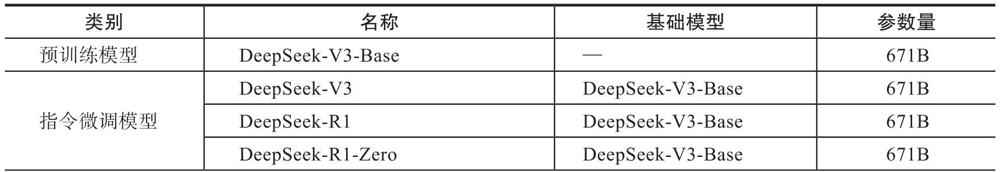

（续）

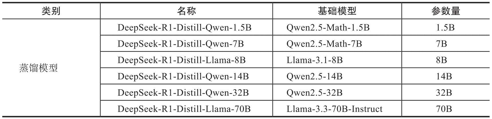

在企业级应用中，DeepSeek 的具体部署方面，知名度较高的是 671B 的 DeepSeek-V3 以及 DeepSeek-R1，这些通常被业界称为“满血”版 DeepSeek。然而，由于部署这些“满血”模型需要较高的算力，因此在许多企业级应用场景中，更轻量级的蒸馏模型（如 DeepSeek-R1-Distill-Qwen-32B 和 DeepSeek-R1-Distill-Llama-70B）往往更为常见。

### **3.2 大模型的精度与量化**

大模型的精度是指模型权重在存储和计算时的数值精确程度，通常由浮点数的位数决定。常见的精度类型包括 FP32、FP16、FP8、INT8、INT4 等，不同精度格式的指数位与尾数位分配存在差异。

精度选择直接影响模型的数值稳定性、计算效率和内存占用：高精度（如 FP32）能保持更精确的梯度计算和权重更新，在复杂数学运算中表现稳定，但会显著增加显存消耗（约为 FP16 的两倍）并降低计算吞吐量；低精度（如 FP16/FP8）通过减少数据位宽可以提升 Tensor Core 的利用率，从而显著提高训练速度，同时降低显存占用，但也可能导致训练过程中出现梯度消失、数值溢出等精度损失问题。实际应用中通常采用混合精度训练策略，结合损失缩放技术来平衡效率与稳定性。

**3.2.1 机器学习中的数据类型**

**1.基础知识**

在深入探讨 AI 领域中数据类型的相关知识之前，让我们梳理一下计算机科学中关于数值处理的基础概念。在计算机的世界里，数值的最小单位是位，也被称作比特（bit）。一个比特代表二进制中的一个数字，可以是 0 或者 1。当我们把 8 个比特组合在一起时，就构成了一个字节（Byte），这是计算机存储和处理数据的基本单位。而当我们提到 16 位或 32 位时，我们实际上是在谈论比特的数量。位数与占用空间的对应关系如表 3-2 所示。

**表 3-2 计算机数据处理过程中的位数与占用空间**


**2.数据格式**

在深度学习和科学计算中，“全精度”通常是指 FP64（双精度，Double Precision），占用 64 位。这种高精度的数值计算在实际应用中并不常见，而单精度的 FP32 及以下的精度应用比较广泛。FP16 作为单精度的一半被称为半精度（Half Precision）。表 3-3 列出了常用数据格式的精度、位数、结构与值范围。

**表 3-3 机器学习中常用的数据格式**

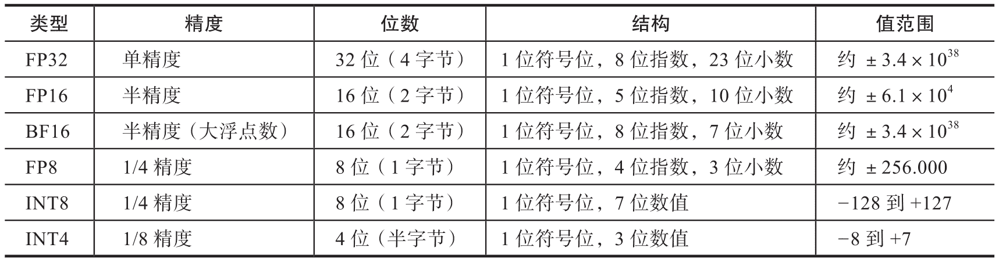

**3.2.2 大模型量化技术**

在大语言模型的精度方面，FP16 和 BF16 是较为普遍采用的格式，而 DeepSeek-V3 和 DeepSeek-R1 这两个模型则与众不同，采用的是 FP8 混合精度进行训练。大模型量化（Quantization）是一种通过降低神经网络模型中数值的精度（例如，将 16 位浮点数转换为 8 位整数）来减少模型存储空间、计算资源和功耗的技术手段，同时尽可能保持模型的性能。通过量化技术，可以有效地减小模型的体积。例如，将 FP16 格式转换为 INT8 格式后，模型的大小可以缩减至原来的二分之一。此外，由于整数运算相较于浮点运算速度更快，因此量化后的模型在推理时能够加速。

量化是一个降低精度后进行计算的过程。在精度下降时，由于低精度的取值范围问题，高精度的数字必须经过一种缩放方法来转换为低精度，比较常用的方法是使用缩放因子。在量化时，首先找到一个合适的缩放因子，将所有权重等比缩放后保存到硬盘或装入内存。在计算时，再用相同的缩放因子将其还原后进行计算。下面介绍 INT8 和 INT4 两种常见量化方案的实现原理。

**1.INT8 量化**

大模型的权重如果以 FP16 量化成 INT8，存储空间从 2 字节降为 1 字节，GPU 内存需求下降一半。实现过程如图 3-1 所示。

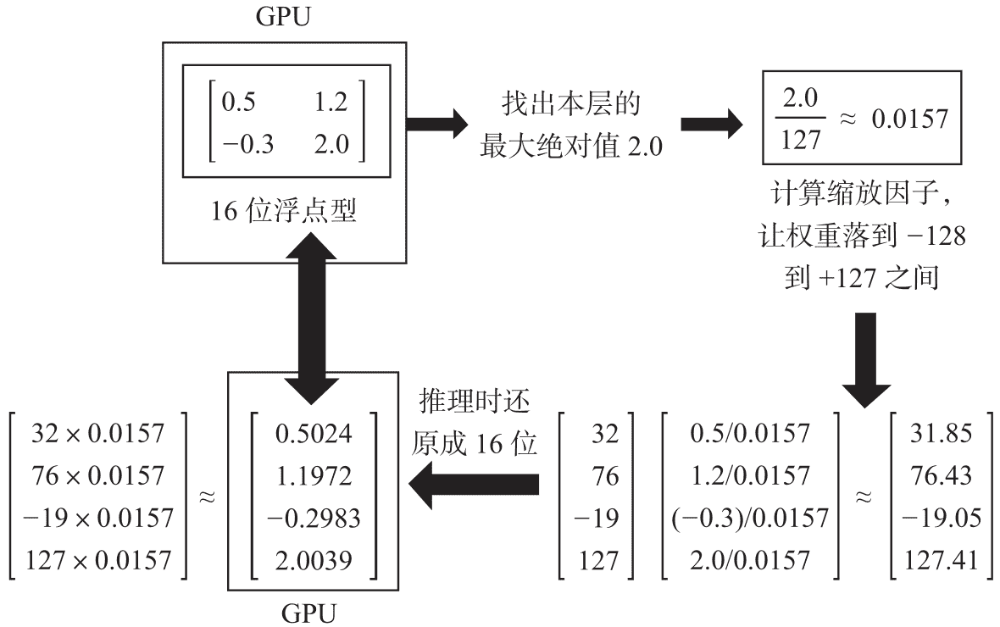

图 3-1 INT8 量化实现过程

①权重缩放可以按层或更细的粒度进行，粒度越细，精度损失越小。

②首先找出所有权重中的最大绝对值，以该绝对值除以 127（INT8 的值范围为-128～127），得到缩放因子。然后将所有权重除以该缩放因子并取整，得到的结果一定会落在 INT8 的取值范围内。

③加载模型时，权重以缩放后的 INT8 格式加载到 GPU 内存，从而减少了一半的内存开销。

④在推理计算时，将 INT8 权重乘以缩放因子，还原为 FP16。与原来的 FP16 权重相比，这种方法会产生一定的误差，但精度损失较小。

**2.INT4 量化**

大模型的权重如果以 FP16 量化为 INT4，存储空间从 2 字节降为半个字节。降到这样的精度后，通过数学等价方法，可以将浮点计算拆解为整数矩阵相乘和缩放因子校正的步骤，从而实现在 CPU 上进行计算。例如，llama.cpp 的 Q4 量化模型可直接在 CPU 上运行 INT4 计算。INT4 量化实现过程如图 3-2 所示。

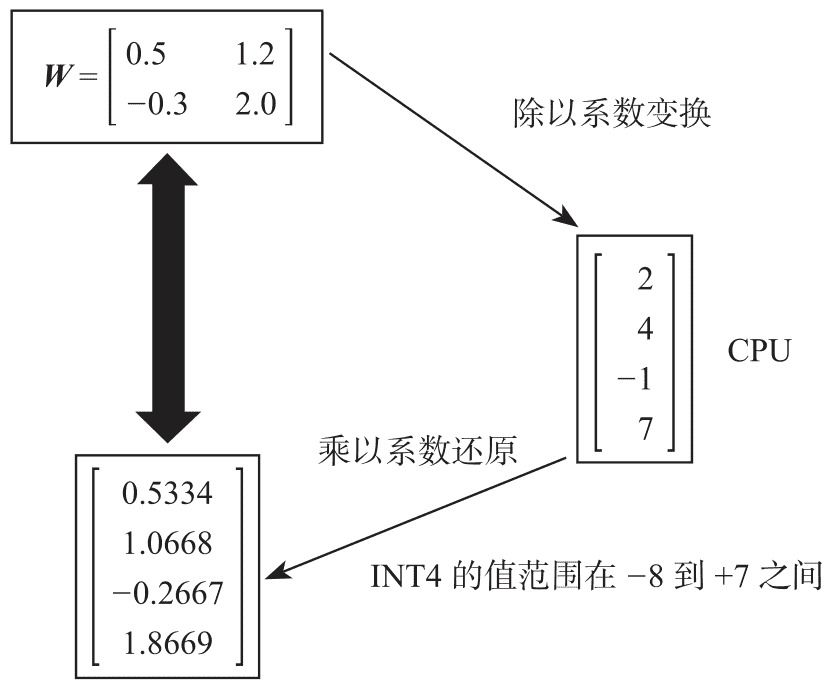

图 3-2 INT4 量化实现过程

由图 3-2 可知，如果采用直接系数变换，由于 INT4 的取值范围为-8～7，仅有 16 个数字可用，对浮点数的表示误差仍然较大。因此，在进行 INT4 量化时，应采用分组缩放因子和零点校正等方法来减小误差。

### **3.3 部署算力的估算**

部署算力的估算，有一个比较简单的基本原理。

①能否运行，取决于内存是否足够。

②运行速度的快慢，与参与计算的算力单元相关。

当大模型部署在 GPU 算力机器上时，所需的内存即为 GPU 显存，算力单元指的是 GPU 的 CUDA 核心和加速单元。以量化方式使用 CPU 算力时，所需的内存即为机器的物理内存，算力单元则为 CPU。因此，估算满足最低运行要求的算力条件可以通过内存计算。

**3.3.1 DeepSeek 内存占用情况**

当大语言模型装入算力设备（GPU 或物理内存）时，占用的空间与参数总量及每个参数所占的字节数有关。例如，参数量为 671B 的模型，如果使用 FP8 精度，则每个参数占用 1 个字节，其空间占用为“6710 亿×1 字节”，然后换算成存储单位“GB”。字节与 GB 的换算关系如下。

1GB=2³⁰字节=1073741824 字节

计算公式如下。


通过以上公式计算可知，671B 模型的权重占用的内存空间约为 625GB。再加上 KV 缓存和框架开销等约占 30%的额外空间，总内存占用为 625GB×1.3，约等于 812.5GB。由于这是估算值，通常取整数约为 800GB。这 30%的额外空间是经验值，与使用的工具和优化方法有关，并非精确值，比如，直接使用 transformers 库编写推理程序，7B 模型在半精度下仅需要约 15GB 内存即可正常运行，而使用 vLLM 工具，则可能占用约 18GB 内存。表 3-4 是 DeepSeek 各种模型在不同精度下占用内存的估算情况。

**表 3-4 DeepSeek 各种模型在不同精度下占用内存的估算情况**

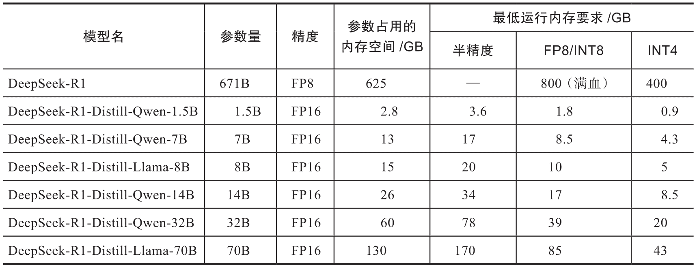

此算法同样适用于其他模型。例如，GLM-4-9B 模型在半精度下约占用 22GB 内存，FP8/INT8 精度下占用 11GB 内存，INT4 精度下占用 5.5GB 内存。

**3.3.2 算力估算结果**

按照最低运行内存要求的估算，再根据推理卡的情况，可以折算出使用的机型。例如，DeepSeek-R1 的 671B 模型，满血需要 800GB 内存，以 8 卡的 H100 机器计算，1 台为 640GB 的 GPU 显存，就需要 2 台这样的机型。表 3-5 以 A800、RTX4090 作为推理卡为例说明。对推理卡的要求一是兼容性，即能够运行 DeepSeek 模型，二是 GPU 总内存量大于最低运行内存要求。

**表 3-5 DeepSeek 模型部署设备估算示例**

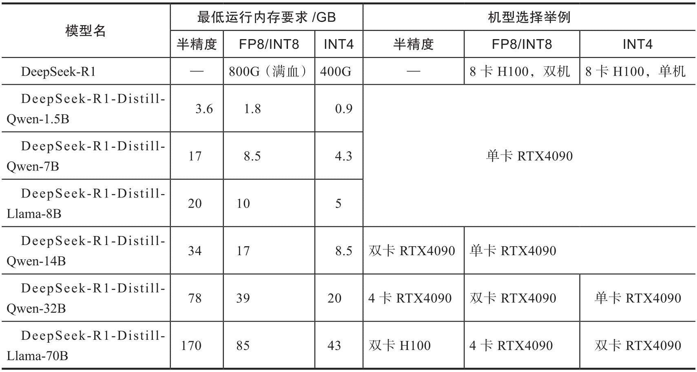

如果采用量化部署的方法，且在 CPU 上运行，则机器的物理总内存大于最低运行内存要求即可。例如，DeepSeek-R1 的 4Bit 量化模型在未安装 GPU 的情况下，需要物理内存的峰值最大为 400GB。如果机器有 512GB 内存，就可以运行起来。在实际应用中，由于 Ollama 等量化工具对权重装入内存的方式进行了优化，用到的物理内存比按权重整体装入内存的测算结果小得多。量化模型运行的性能与 CPU 的核数和计算能力有关。

大模型的微调只能在 GPU 上进行。根据部署所需的 GPU 内存，可以估算出微调所需要的资源情况。如果要进行全量微调，则内存需求如下。

全量微调内存占用=基础内存+同等的梯度内存+

2 倍的优化器内存≈部署（推理内存）×4

为了减少对 GPU 内存的需求量，可以使用 LoRA 方法对部分参数进行微调，内存需求如下。

LoRA 微调内存占用=部署（推理内存）×1.1

### **3.4 CPU 部署**

大语言模型可以既部署到 GPU 算力机器上，也可以通过量化的方法部署在未安装 GPU 的机器上，利用物理内存和 CPU 进行推理。针对 DeepSeek 模型，量化的方法是使用 llama.cpp，并可以使用 Ollama 工具进行部署测试。

Ollama 是一款大语言模型推理工具，可以在本地运行 Llama 3.3、DeepSeek-R1、Phi-4、Mistral、Gemma 3 等模型。其默认的量化格式为 GGUF，支持多种量化级别（如 4-bit、5-bit、8-bit 等），能够在模型大小与性能之间实现平衡。该工具兼容性强，适合 CPU/GPU 的混合部署。本节将介绍如何在未安装 GPU 的机器上部署 DeepSeek 模型。

**3.4.1 Ollama 在 Windows 上的安装**

Ollama 的 Windows 安装包可从其官网（https://ollama.com/download）下载，如图 3-3 所示。

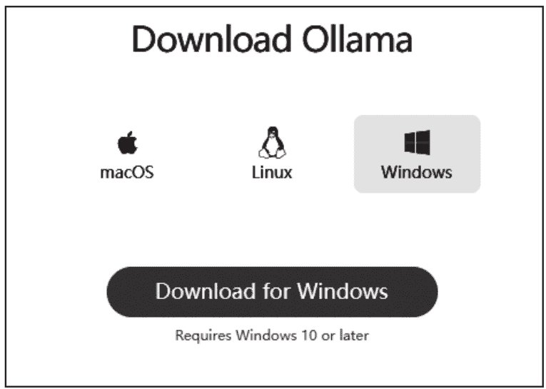

图 3-3 下载 Ollama 的 Windows 安装程序

运行下载的 OllamaSetup.exe 文件即可安装。安装完成后，打开一个命令行控制台或 PowerShell 窗口，输入“ollama-v”命令以验证安装结果。为了让除本机外的其他机器能够访问 Ollama 提供的大模型服务，需要在系统的环境变量中新增 OLLAMA_HOST，其值设置为 0.0.0.0。完成设置后，需要重启 Ollama 服务以使该参数生效。

**3.4.2 Ollama 在 Linux 上的安装**

在 Linux 安装 Ollama 的最简单方法是使用官网上介绍的命令。该命令只有一句，如下所示。


但在执行 install.sh 的过程中，下载安装包的速度往往较慢，建议更换安装源，比如使用以下命令安装。这样会从 aliendao.cn 下载安装包，下载速度明显快于官网。


需要注意的是，以上方法所使用的链接可能会失效，读者可自行通过搜索引擎搜索等方法找到安装包下载速度快的路径

安装完成后，使用“ollama-v”命令校验是否安装成功，输出版本号表示安装成功。

为了让其他机器能够访问 Ollama 提供的大模型服务，需要按照以下步骤修改配置。

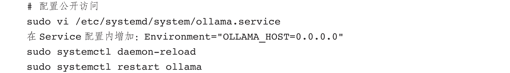

使用以下命令查看 Ollama 服务的日志：


**3.4.3 DeepSeek 在 CPU 上的部署**

先从 Ollama 的官网上搜索 DeepSeek 的量化模型，如图 3-4 所示。

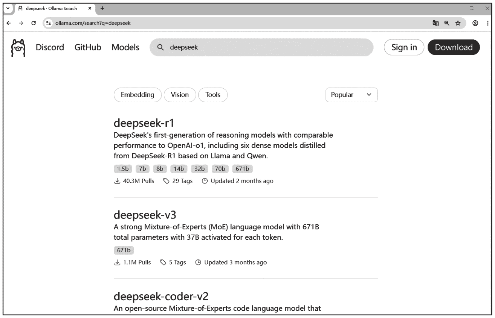

图 3-4 搜索 DeepSeek 量化模型

选择要运行的模型后，再选择模型的类型，如图 3-5 的①处所示，②处为具体执行的命令，命令代码示例如下。

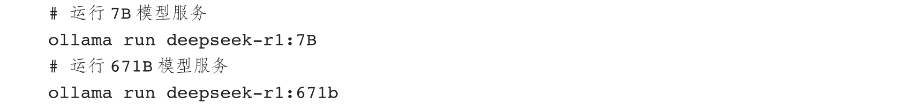

图 3-5 中还有两个地方也要关注：③处显示的是模型下载后占用硬盘的大小，④处显示的是量化算法，常见的有 Q4、Q8 等。量化算法不同，推理计算误差也不同。

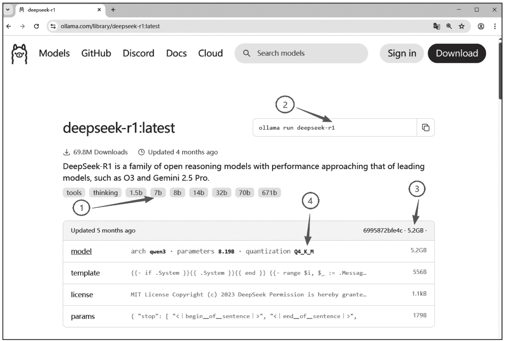

图 3-5 选择模型的类型

以 DeepSeek-R1-Distill-Qwen-7B 模型的 Q4 量化版本为例，运行以下命令。


首次运行该命令时，会从 Ollama 官网自动下载模型权重文件。下载完成后，模型会被装入内存，提供交互式服务。输入问题后，Ollama 开始推理并形成答案。运行结果如图 3-6 所示。

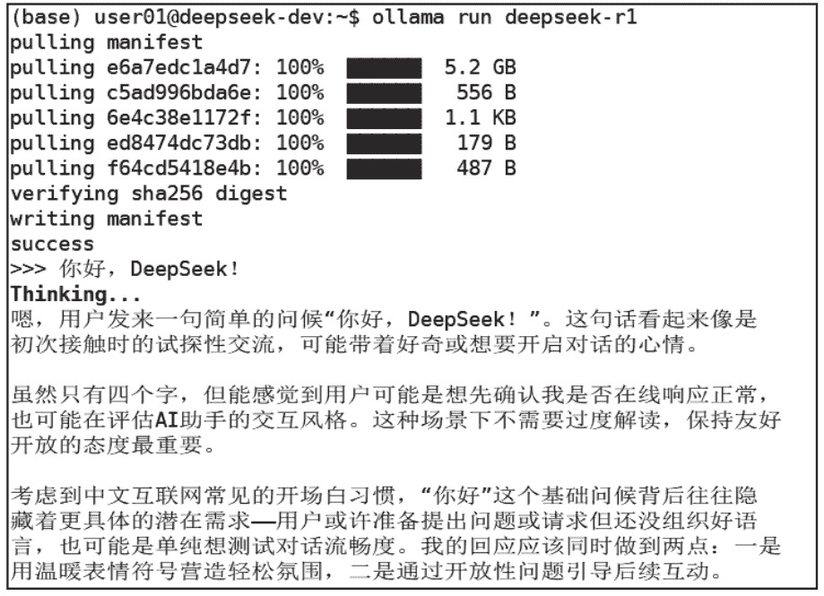

图 3-6 Ollama 运行结果

### **3.5 GPU 部署**

DeepSeek-AI 官方建议使用 vLLM 或 SGLang 加载 DeepSeek 模型开启服务。本书选用 vLLM 工具实现 DeepSeek 在 GPU 环境下的部署。

vLLM 是一个高效的大语言模型推理和服务框架，由加州大学伯克利分校的研究团队开发，通过创新的 PagedAttention 算法和高效的内存管理，显著提升大模型的推理速度，适合高并发场景下的模型部署。 ^()vLLM 具有良好的兼容性，支持 Transformer 架构的大语言模型（如 Llama）、混合专家架构的大语言模型（如 Mixtral、DeepSeek-V3、DeepSeek-R1 等）、嵌入模型（如 E5-Mistral）和多模态大模型（如 LLaVA）。vLLM 是一个 Python 库，可以在命令模式下使用“vllm serve”加载大模型的权重，提供推理 API 服务。

**3.5.1 vLLM 安装**

**1.建立虚拟环境**

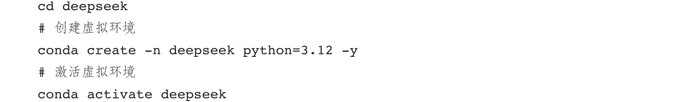

**2.安装依赖库**

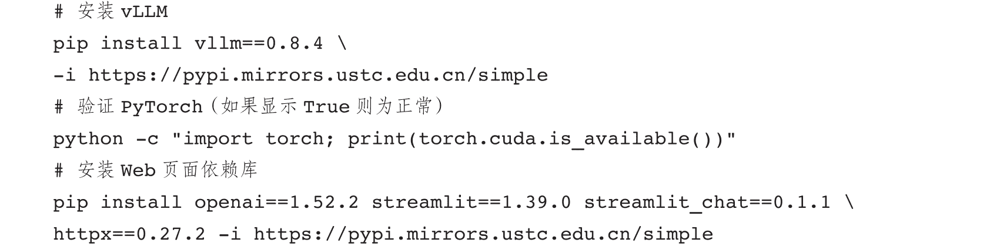

**3.5.2 DeepSeek 在 GPU 上的部署**

以在 RTX3090（24GB 内存）的推理卡设备上部署 DeepSeek-R1-Distill-Qwen-7B 为例。

**1.下载模型**

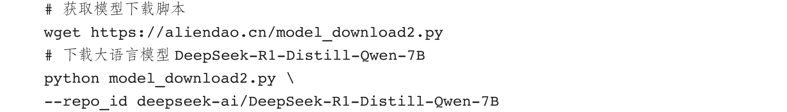

**2.运行模型服务**

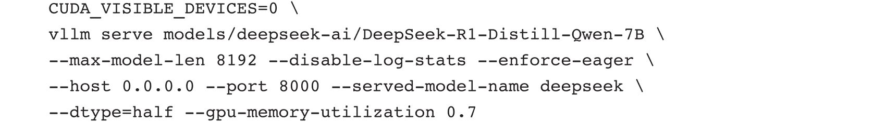

“vllm serve”命令的参数解释如下。

❍max-model-len：模型上下文长度（输入的问题最大长度）。

❍disable-log-stats：禁用统计日志。

❍enforce-eager：使用 eager 模式的 PyTorch，提高性能。

❍host：服务绑定的 IP，0.0.0.0 表示主机所有 IP。

❍port：服务绑定的端口。

❍served-model-name：模型名称（客户端调用时使用）。

❍dtype：加载模型权重的数据类型（T4 推理卡需要设置成 half）。

❍gpu-memory-utilization：用于模型执行器的 GPU 内存比例，如果设为 0.7，则占用 17GB 左右的 GPU 内存（与表 3-4 估算的结果相近）。

运行结果如图 3-7 所示。

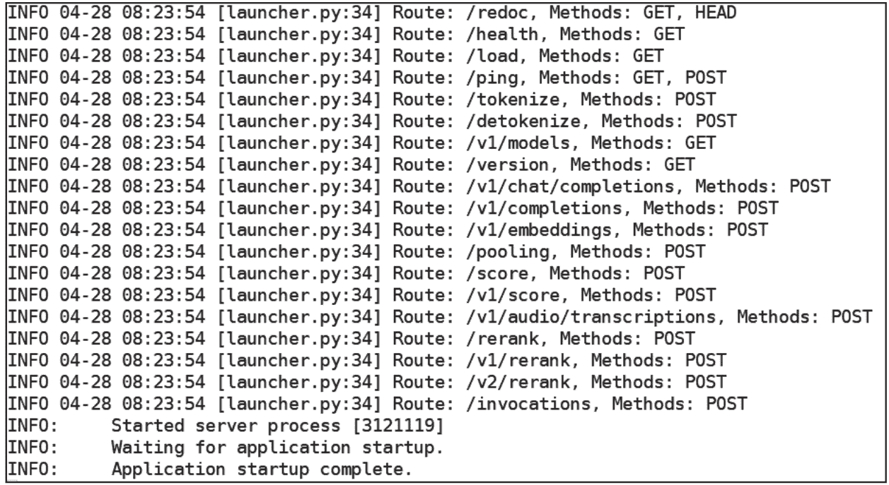

图 3-7 vLLM 运行 DeepSeek 模型的结果

**3.5.3 算力资源监控**

运行大模型服务和训练模型时，对算力资源进行监控可以帮助排查算力分配和性能问题。使用“nvidia-smi”（NVIDIA System Management Interface）命令可以实时监控 GPU 的算力资源占用情况。在终端运行该命令后，会显示 GPU 编号、名称、温度、功耗、显存使用情况（总量/已用/剩余）、计算单元利用率（GPU-Util）等关键指标。例如，某张显卡的 GPU-Util 显示为 90%，表示其计算核心正在高负荷运行。当内存占用接近上限时，可能成为性能瓶颈，并极有可能导致内存溢出（Out Of Memory，OOM）。通过添加“-l 秒数”参数（如 nvidia-smi-l 1），可以定时刷新数据，以便持续监控。

**3.5.4 验证部署成果**

在使用 Ollama 部署 DeepSeek 时，可以在终端交互命令行中输入问题，得到 DeepSeek 的推理结果。但在使用 vLLM 部署 DeepSeek 时，vLLM 只是启动了大模型 API 服务，并未提供交互界面。为了方便测试这两种服务，可以编写一个基于 streamlit ^()的简单 Python 程序，命名为 chat_bot.py。

**1.Chat_bot 源代码**

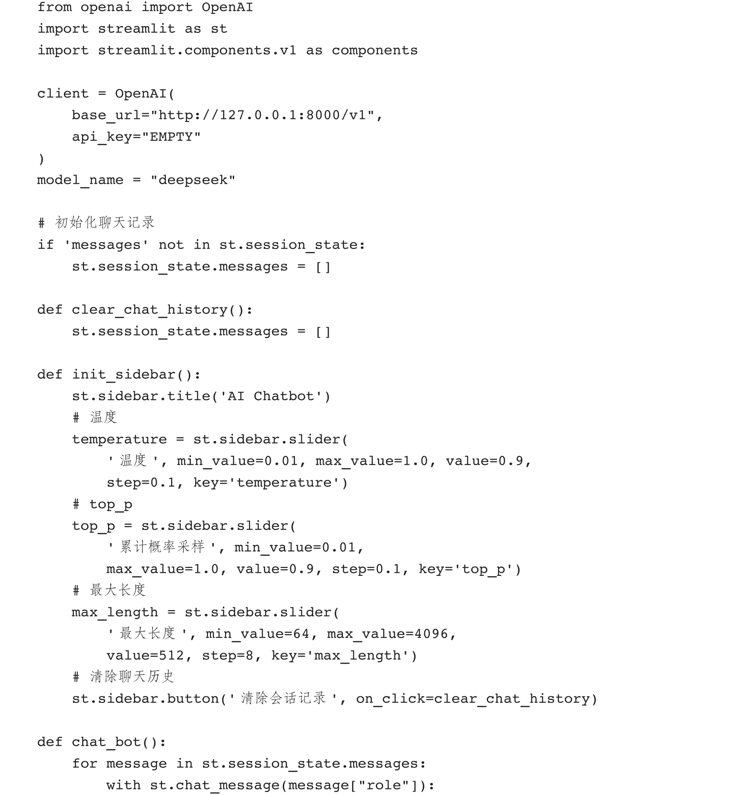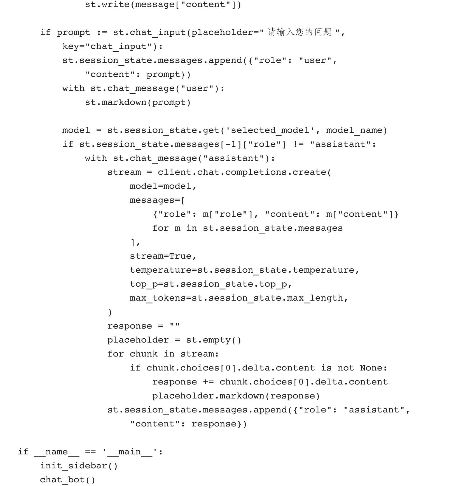

**2.运行 Chat_bot**

先启动 vLLM 服务，然后进行以下操作，运行 Chat_bot。


运行结果如图 3-8 所示。

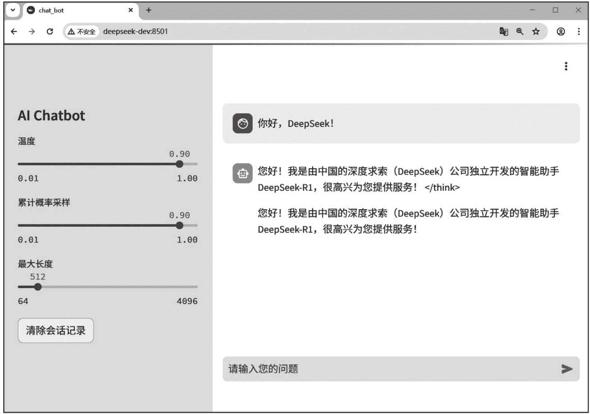

图 3-8 Chat_bot 运行结果

上述 chat_bot.py 实现了连接 vLLM 服务。如果要连接 Ollama 提供的大模型服务，则需要对 chat_bot.py 进行简单的修改，共有以下两处。

①将第 6 行“base_url="http://127.0.0.1:8000/v1"”中的端口从 8000 修改为 Ollama 的 API 监听端口 11434。

②将第 9 行“model_name="deepseek"”中的 deepseek 修改为 Ollama 部署的模型名称，如 deepseek-r1。

## **Chapter 4 第四章 构建 Chat 应用**

Chat 应用是企业级大语言模型应用的基础，用户输入一个问题或提示词，由大模型服务生成相应的答案。如果该模型具备深度思考的能力，那么输出的答案将不是一个简单的回答，而是包括思考过程和最终答案两个部分的清晰回复。在第三章中，为了验证 DeepSeek 的部署成果，我们介绍了一个基础的 Chat 应用 Chat_bot。然而，作为企业应用，Chat_bot 的设计过于简单，无法满足企业级用户的需求。企业所需的功能通常像 DeepSeek 官网所提供的对话应用 ^(⁴)一样。用户通常需要上传一些文件，以便让 DeepSeek 分析这些文件，或者利用这些文件作为本地知识搜索的资源。

Chat 应用是一种用户输入问题、大模型给出答案，以文本为主要交互方式的应用。在开源领域中，我们可以找到众多的大模型 Chat 应用程序，但这类应用程序大多数被设计为桌面客户端的形式，这意味着它们更适合个人用户安装和使用。对于企业级的应用场景来说，这种方式并不适用。在企业环境中，用户通常更倾向于使用 Web 方式。因此所用架构需要允许用户通过浏览器访问，从而为其提供更加便捷的管理和使用体验。除此之外，当企业考虑部署 Chat 应用程序时，还需要综合考虑业务的吞吐量、运行性能以及安全性等多个关键因素。

本章将详细介绍 LibreChat 和 Open WebUI 这两种基于 Web 架构的开源 Chat 应用程序的部署与使用方法。本章还会扩展介绍如何将 Chat 应用与 draw.io 工具相结合，以创建流程图和架构图。

### **4.1 企业应用场景**

基于本地化部署的 DeepSeek 模型开发 Chat 应用，适用于多种企业生产场景，尤其在数据隐私保护、安全性和定制化需求高的领域表现突出。以下是其主要应用场景及优势。

（1）搭建与查询企业内部知识库

在企业内部，可以部署本地化模型作为内部问答系统，使员工能够快速查询公司制度、技术文档、产品手册等相关信息，从而有效节省时间，提高工作效率。本地化模型作为内部问答系统的一大优势在于避免敏感数据外泄。由于所有数据处理和推理均在本地服务器上完成，无须上传至云端，因此可以有效规避数据泄露风险。此外，本地化模型响应速度快，支持私有知识库的定制化训练，使系统更加贴合企业的特定需求。

（2）辅助医疗健康诊断

在医疗领域，医疗机构可以利用 Chat 应用生成病历摘要、解析医学文献或提供诊断建议，从而辅助医生进行更准确的诊断。本地化部署的大语言模型应用于医疗领域可以保护患者隐私，因为所有的数据处理和分析均在本地完成。而针对医疗等垂直领域对大模型进行微调，可以提升模型在该领域的准确性和专业性。

（3）打造教育行业的个性化学习体验

在学校或培训机构中，可以构建通过 Chat 应用交互的智能辅导系统，为学生提供答疑、作业批改、知识点讲解等服务。这种系统能够为学生提供更加个性化的学习体验，帮助他们更好地掌握知识。

（4）提供制造业的设备运维与技术支持

在制造业中，Chat 应用可以部署在工厂端，用于设备维护指导、故障排查或生产流程优化，从而提高生产效率和质量。结合内部技术文档，通过智能分析和预测，可以提前发现潜在问题，避免生产中断，提高整体生产效率。

（5）实现自动化客服机器人

企业可以构建本地化客服机器人，用于处理高频率或标准化问题，减轻人工客服的工作负担，提高客户服务质量。本地化部署的客服机器人可以降低对云服务的依赖，节省运营成本。经微调后，熟悉行业术语的客服机器人能够更好地理解客户需求，提供更加人性化的服务体验。

### **4.2 LibreChat 的部署和应用**

**4.2.1 LibreChat 简介**

LibreChat 是一个可定制的开源应用程序，可本地部署，既支持 OpenAI、Claude、Gemini 等线上模型服务，也可以与使用 vLLM、Ollama 等工具部署于本地的大模型配合使用。将 LibreChat 应用到企业中，可以实现对话记录的保存与导入导出，这一功能在企业常见的长会话场景中非常有用。此外，LibreChat 支持多用户登录与权限控制，这对企业应用中的安全性考量尤为重要。

LibreChat 不是一个 Python 项目，而是采用了前端 React.js、后端 Node.js 的 JavaScript 技术架构。为了持久保存对话记录，LibreChat 使用了 MongoDB。由于涉及组件较多，还需要进行前端代码的编译打包和应用服务器的部署，直接在操作系统上部署的过程相对比较烦琐。因此，本节采用 Docker 来安装 LibreChat。Docker 可以快速启动一个包含运行 LibreChat 所需环境的容器，这是一种简单且可靠的部署方法。

**4.2.2 LibreChat 的安装与配置**

**1.Docker 安装**

Docker 是一种基于 Linux 操作系统的虚拟化技术，通过将所有依赖环境打包到一个容器内的方法来管理应用。Docker 也可以运行在 Windows 系统上，但需要 WSL2（Windows Subsystem for Linux 2，用于 Linux 系统的 Windows 第 2 版）的支持。在本例中，我们只介绍 Docker 在 Ubuntu 系统中的安装过程。

（1）安装依赖包


（2）设置安装镜像

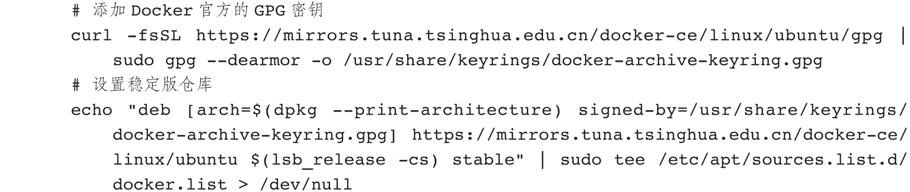

（3）安装


（4）验证安装


（5）修改 Docker 镜像

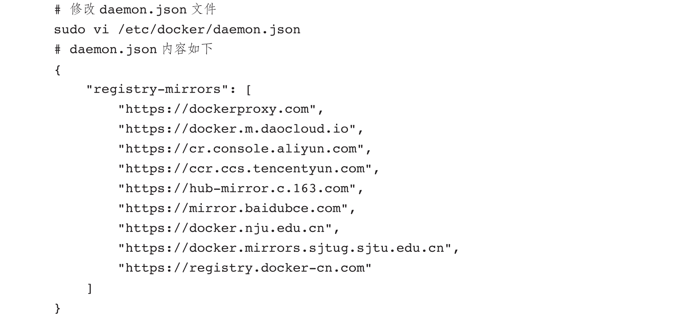

（6）重启 Docker


（7）验证 DockerCompose 安装


**2.LibreChat 安装**

（1）启动大语言模型服务

参考 3.4 和 3.5 节，按业务需求，用 vLLM 或 Ollama 启动大语言模型服务。

（2）下载源码

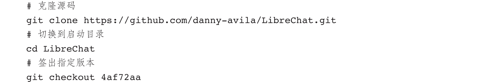

（3）LibreChat 配置

为了让 LibreChat 支持本地部署的 DeepSeek 大模型服务，需要对配置文件进行以下修改。

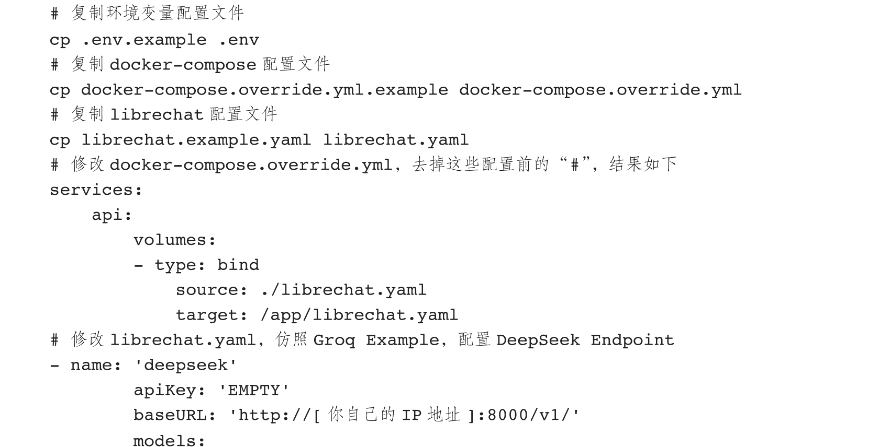

以上配置针对使用 vLLM 部署的 DeepSeek 服务。如果部署工具换成 Ollama，则需要将端口从 8000 换成 11434，然后将“models→default→deepseek”处的相应代码更换成 Ollama 加载的模型名称。

（4）启动 LibreChat 服务


**3.LibreChat 应用**

在浏览器中输入 http://deepseek-dev:3080，注册一个用户并登录，如图 4-1 所示，设定 DeepSeek 为默认大模型服务。


图 4-1 配置 LibreChat 的默认模型服务

用户输入问题，LibreChat 会调用 DeepSeek 推理生成答案。用户也可上传文件，以供模型分析和作为知识库使用。结果如图 4-2 所示。


图 4-2 用户与 LibreChat 的问答过程

### **4.3 Open WebUI 的部署和应用**

**4.3.1 Open WebUI 简介**

Open WebUI 是一个具有高度可扩展性、功能丰富且操作简便的大语言模型前端应用。它不仅支持本地化部署，还兼容多种 API，包括但不限于 vLLM、Ollama 等，这些 API 与 OpenAI 的 API 保持兼容性。此外，Open WebUI 还内置了 RAG 推理引擎，能够对用户上传的各种文件进行深入分析和处理，从而为用户提供更加精准和高效的服务。

Open WebUI 通过 Python 库 open-webui 和“open-webui serve”命令启动服务。与 LibreChat 一样，Open WebUI 也可以使用 Docker 容器部署，但由于其本身对依赖环境的要求较少，因此本节将介绍在 Python 虚拟环境下安装和配置 Open WebUI 的方法。同时，为了满足企业级应用场景的需求，在 Open WebUI 的应用前端增加了 Nginx 应用服务器 ^(⁵)，以提升应用的安全性和扩展性。

**4.3.2 Open WebUI 的安装与配置**

**1.Open WebUI 安装**


**2.启动大语言模型服务**

参考 3.4 和 3.5 节，按业务需求，用 vLLM 或 Ollama 启动大语言模型服务。

**3.Open WebUI 应用**


上述代码中，OPENAI_API_BASE_URL 的配置项指向 vLLM 启动的大语言模型服务。如果大语言模型服务是用 Ollama 启动的，则将端口从 8000 修改为 11434，DEFAULT_MODELS 设置为模型名称。

在浏览器中打开 http://deepseek-dev:8080 访问 Open WebUI。首次使用时，需要注册管理员用户。登录成功后，用户可以输入问题或上传文件和截图，大语言模型推理后给出答案，如图 4-3 所示。

**4.安装与配置 Nginx**

在 Open WebUI 安装并配置完成后，默认会在本地机器的 8080 端口上提供服务。如果直接将这个端口暴露给外部网络，允许企业用户进行访问，那么将会面临许多安全隐患和性能瓶颈。为了确保数据传输的安全性，特别是在公网上运行此应用时，使用 SSL 证书是至关重要的。基于这些考虑，作为企业应用，一般需要在 8080 端口的前端额外部署一个应用服务器，用作反向代理。通过这种方式，不仅可以利用负载均衡技术来提升应用的性能，还可以通过配置 SSL 证书来加密数据链路，确保通信的安全。此外，还可以设置访问白名单来限制只有授权的用户才能访问应用，以及配置流量控制策略来管理访问流量，从而进一步加强应用的整体安全性。


图 4-3 Open WebUI 运行效果

Nginx 作为一个高性能的 HTTP 和反向代理服务器，被广泛用于这些场景。Nginx 不是 Linux 或 Windows 操作系统的内置组件，使用前需要进行安装。

（1）Nginx 在 Windows 上的安装

①从 https://nginx.org/en/download.html 下载 Windows 安装包。

②将下载的安装包解压到硬盘目录下完成安装。

（2）Nginx 在 Ubuntu 上的安装


（3）Nginx 配置

下面配置 Nginx 作为 Open WebUI 的反向代理。Nginx 的配置文件通常位于/etc/nginx/sites-available/default 或/etc/nginx/conf.d/nginx.conf。在配置文件中添加一个 server 块，用于监听 80 端口（如果用 HTTPS，则监听 443 端口），并将请求转发到 Open WebUI 的 8080 端口。

以下是一个简单的 Nginx 配置示例，用于将 HTTP 请求转发到 Open WebUI。


如果需要使用 HTTPS，那么还需要配置 SSL 证书。通常将证书文件（.crt）和私钥文件（.key）的路径添加到 Nginx 配置中，并在 server 块中启用 SSL 参数。

Nginx 默认配置的并发连接数较小，如果用于企业级服务，则应进行性能优化配置。

❍worker_processes：配置成 auto 或 CPU 的核数。

❍worker_connections：默认为 1024，配置成 10240。

完成配置后，需要测试 Nginx 配置的正确性，并重启 Nginx 服务以使更改生效。


至此，Nginx 已经被成功配置为 Open WebUI 的反向代理。可以通过配置的域名或 IP 地址访问 Open WebUI，所有的请求都将通过 Nginx 进行转发和处理。这样操作可以提升应用的安全性和性能。

### **4.4 结合 draw.io 制作图表**

DeepSeek 可以生成文本数据，但如果需要制作图表，则必须与其他工具配合使用。在制作图表的工具中，有大家熟悉的 Visio、draw.io 等。draw.io 是一款开源且免费的图表制作工具，可以绘制各种图表，包括流程图、架构图、UML 图等。DeepSeek 与 draw.io 配合制作图表的基本原理是让 DeepSeek 生成能够导入 draw.io 的 XML 格式文本。

具体来说，draw.io 默认使用“.drawio”作为后缀的文件名。在这种文件中，图表的许多元素以 SVG 矢量图的方式保存，并采用 Base64 编码格式。虽然 DeepSeek 不能直接生成这种格式的文件，但是.drawio 文件可以导出为 XML 格式的纯文本文件。反之，这个 XML 文件也可以被 draw.io 打开。因此，可以通过 DeepSeek 生成 XML 格式的纯文本来制作图表。

**4.4.1 设计提示词**

为了让 DeepSeek 生成样式美观、内容丰富的 draw.io 图表对应的 XML 文本，使用的提示词不仅要包括具体业务需求，还要提供一个生成格式的例子，这样生成的结果不但贴近需求，也更加美观。提示词示例如下。

现在需要一个大模型应用系统的部署架构图，使用 Web 结构，K8S 部署。

请直接帮我用 draw.io 默认的文件格式生成，输出的 XML 可以直接用 draw.io

工具加载。XML 的格式举例如下：


注意：mxCell 元素的属性不能重复定义

**4.4.2 使用 DeepSeek 生成 XML 文件**

使用前面部署的 LibreChat、Open WebUI 应用或线上的 DeepSeek 服务，输入以上提示词，生成 XML 内容并保存为文件。

生成的 XML 格式依赖模型的能力，格式可能会有问题。对此，双击 XML 文件，用浏览器打开此文件，查看是否报错。如果文件以层级显示，则没有问题；如果有报错，则需要重新生成或手动修改 XML 文件。格式不正确的情况多于用 Ollama 在本地部署量化模型服务时出现，用 vLLM 部署模型或 DeepSeek 在线服务一般不会有此问题。

**4.4.3 用 draw.io 打开 XML 文件**

用 draw.io 软件打开此 XML 文件，然后在此基础上进行简单的加工修改，使其更加美观和真实表达使用者的意图。打开 DeepSeek 生成的 draw.io 图表示例，结果如图 4-4 所示。


图 4-4 DeepSeek 生成的 draw.io 图表示例

**4.4.4 高级制表应用**

使用以上提示词格式，模型生成图表的样式比较固定。如果需要更多样式，则可以采用以下方法。

**1.克隆 draw.io 的源码**


在 examples 目录下找到合适的例子，然后通过“文件→导出→XML”的操作导出为 XML 文件。

**2.优化提示词**

用于提示词的示例，可以按前述例子中的 XML 内容进行设定。目前大模型允许的输入窗口长度都超过 8K，所以提示词只要不超过 8K 就能被大模型接受。如果确实过长，则可以删除中间部分内容。如图 4-5 所示是以 infographic-project-steps.drawio 为例生成的结果。


图 4-5 draw.io 图表优化结果

## **Chapter 5 第五章 构建 AI Agent**

AI Agent（智能体或智体，以下简称 Agent）是一种能够感知环境、自主决策并执行动作的智能实体。在大语言模型的支持下，Agent 可以完成用户给定的目标或任务。Agent 结合了感知、推理、学习和行动能力，是人工智能领域的重要研究方向和应用工具。与大语言模型服务被动接收用户问题并推理产生答案的应用不同，Agent 应用突出其主动性。用户提出一个较宏观的目标后，Agent 通过主动规划、主动决策、主动执行的方法分解任务，逐步完成设定的目标。在 Agent 的发展过程中，涌现出诸如 ReAct、ToT、Reflexion、CoT 等思考框架。Agent 通过这些框架以特定的提示词策略，从大语言模型中获得具有可执行性的文本或代码，并借助这些规范化的输出，驱动下一步的流程。

自 2022 年底 ChatGPT 引爆 AI 热潮以来，Agent 的快速发展已持续了约三年的时间。2025 年 3 月 6 日发布的 Manus ^(⁶)，将 Agent 的热度提升到一个新的高度。本章介绍两个开源的 Agent 产品的部署与应用，并结合 DeepSeek 大模型服务，让读者了解 Agent 的基本原理及其在企业中的应用场景。

### **5.1 企业应用场景**

Agent 技术在企业的应用场景非常广泛，其核心优势在于自动化决策、个性化服务和多任务协同能力。以下是其主要应用场景及优势。

（1）复杂任务自动化

对于涉及多种角色、多步流程且以文本为结果的工作任务，Agent 可以在大语言模型的支持下进行任务分解和自动化执行。多 Agent 动态协作机制可分角色协作完成任务分解，而大模型驱动的工具则可灵活地执行任务。

（2）数据的收集和整合

Agent 能够根据用户设定的目标，自动分解复杂的数据需求。通过内置工具，从数据库、网站、文档等数据来源收集数据，并借助 DeepSeek 等大模型对数据进行整理、分析和润色，最终形成完整的数据报告。Agent 的优势体现在工具调用、执行能力和思考能力上。

（3）代码生成与调试一体化

Agent 通过思考框架生成提示词，利用大语言模型的思考和推理能力，自动生成可执行的代码片段，并通过 Python 虚拟环境、Docker 容器等运行代码。运行结果会参与到 Agent 的下一轮迭代中，从而验证代码的准确性并对真实世界产生持久影响。与之相比，大模型的 Chat 应用仅能通过问题生成答案，作用范围局限于虚拟层面，无法主动影响物理世界。

### **5.2 camel-ai/owl 的部署与应用**

**5.2.1 camel-ai/owl 简介**

camel-ai/owl 是一个前沿的多智能体协作框架，通过 CAMEL-AI 框架构建，其愿景是推动任务自动化，通过利用动态 Agent 的交互，实现 AI Agent 之间协作解决现实任务的方式。 ^(⁷)

camel-ai/owl 支持通过搜索引擎进行实时信息检索与知识获取，其多模态的处理能力可对视频、图片、语音进行处理。并且，它借助 Playwright 框架 ^(⁸)开发浏览器模拟交互，支持页面滚动、点击、输入、下载、历史回退等功能，能够模拟人类浏览网页的行为。camel-ai/owl 具有强大的文件解析能力，可对 Word、Excel、PDF、PPT 等文件进行信息提取，包括学术论文检索、音频分析、图像生成、代码执行、数学计算、符号计算等众多工具包的整合，能够满足各类特定任务需求。

本节讲解 camel-ai/owl 的安装方法，并以一个使用搜索引擎实时检索和对检索结果进行分析整理的例子，说明 camel-ai/owl 在 DeepSeek 的支持下应用到企业场景中的过程。

**5.2.2 camel-ai/owl 安装**

**1.下载源码**


**2.安装**


**3.运行大模型服务**

camel-ai/owl 支持本地部署的大语言模型服务，但需要依赖大语言模型的工具调用（Tool Calling）特性。从其例程中可以看出，examples/run_ollama.py 可以使用 Ollama 作为大模型服务来运行，但 Ollama 支持的模型包括 Qwen2.5:72B 和 LLaVA，并未显式支持 DeepSeek。因此，本节仅介绍使用 vLLM 作为 camel-ai/owl 的大模型服务的方案。

首先，参考 3.5 节的步骤建立 vLLM 的基础运行环境。但在运行 DeepSeek 大模型时，所需方法与 3.5 节稍有区别，就是为了支持模型的工具调用特性新增了两个参数，命令如下。


其中，需要注意以下几个参数。

①max-model-len：该参数设置为 8k token（即 8192 个词元）时可以满足大部分场景，但在运行 Agent 时涉及大量数据整合操作和多轮会话，因此设置为 32k token（即 32768 个词元）。长度越大，占用的 GPU 内存资源越多。

②served-model-name：当 camel-ai/owl 与 DeepSeek 配合使用时，默认连接 DeepSeek 官方的 deepseek-chat 模型。为了避免修改源码，迂回的办法是将 vLLM 启动的模型服务名设为 deepseek-chat。

③gpu-memory-utilization：由于 max-model-len 已设为 32k，而 gpu-memory-utilization 设置得过小会导致 vLLM 服务启动时报 KV 缓存溢出错误，因此将其设为较大的 0.9。模型服务开启后，共占用 GPU 内存约 22GB。

④enable-auto-tool-choice：允许大语言模型在运行时动态选择最合适的工具（如 API、函数）来完成任务。所谓动态选择，是指大语言模型在推理过程中从提示词中提供的工具声明中挑选一个，并生成调用的参数。

⑤tool-call-parser hermes：使用 Hermes 解析器处理大语言模型生成的工具调用请求（如 JSON 格式的 API 调用参数）。

**5.2.3 运行 camel-ai/owl 应用**

**1.环境变量设置**

与大部分由 Python 开发的 Agent 相类似，camel-ai/owl 可以通过修改.env 文件的方法设置应用运行的参数。还有一种设置参数的方法是在运行应用程序前设置系统环境变量。应用程序启动时会加载这些变量，使用效果等同于修改.env 文件。环境变量的设置方法在 Linux 和 Windows 上稍有区别。camel-ai/owl 连接 DeepSeek 需要配置 DEEPSEEK_API_KEY 和 DEEPSEEK_API_BASE_URL 两个参数，调用的模型为固定值 deepseek-chat，不需要额外配置。


**2.验证 DeepSeek 测试程序**

camel-ai/owl 对 DeepSeek 进行了良好的支持，为其开发了专用例程 examples/run_deepseek_zh.py。在已设定环境变量的前提下，执行以下命令，完成一个目标为“搜索 OWL 项目最近的新闻并生成一篇报告，最后保存到本地”的任务。


运行过程如图 5-1 所示。


图 5-1 camel-ai/owl 的 DeepSeek 例程运行情况

运行 examples/run_deepseek_zh.py 时，也可以将目标任务以参数形式传入，示例如下。


**3.运行 WebUI 应用**

以命令行方式使用 camel-ai/owl，适合将其作为一个工具，但对于非专业人员来说，有一定的使用门槛，不便于在企业中推广。为此，owl/webapp_zh.py 提供了 WebUI 供用户使用。该程序启动后，默认在 localhost:7860 上提供服务。这在本机上访问不存在问题，但当应用在 Linux 上运行时，若需要从其他机器（如 Windows）通过浏览器访问应用，就会存在问题。而在企业应用中，Web 访问是一种最常见的操作方式。为了实现异机访问，需要对 owl/webapp_zh.py 进行微小的调整，修改内容如下。


在完成 DeepSeek 相关环境变量设置后，运行以下命令启动 WebUI 服务。


在浏览器中访问 http://deepseek-dev:7860，输入设定的目标任务“通过百度搜索采集相关信息，总结一下 DeepSeek 的技术特点和优势，形成一篇 3000 字的总结报告”，并将 run_deepseek_zh 作为中文处理的功能模块，单击“运行”。运行过程如图 5-2 所示。


图 5-2 camel-ai/owl 的 WebUI 运行过程

### **5.3 OpenManus 的部署与应用**

**5.3.1 OpenManus 简介**

在 2025 年初的国内人工智能领域，DeepSeek 和 Manus 无疑是备受瞩目的技术和产品。DeepSeek 以其直观的思维链结构和高质量的生成内容广受好评，成为人们关注的焦点。同时，Manus 凭借其作为通用型 AI Agent 的出色表现，赢得了市场的热烈反响。与 DeepSeek 的开放访问不同，Manus 采用邀请码注册的方式，这使得其在使用上存在一定门槛。因此，一些开源产品很快以“复现”Manus 的方式进入人们的视野，OpenManus 便是其中之一。

OpenManus 是一个与 Manus 类似的产品，由 MetaGPT 团队开发，是一个简洁的通用 AI Agent 实现方案，目前仍在持续迭代开发中。

**5.3.2 OpenManus 安装**

**1.下载源码**


**2.安装**


**3.配置**

（1）复制配置文件


（2）修改配置文件

修改配置文件 config/config.toml，代码如下。


**5.3.3 运行 OpenManus 应用**

**1.运行单智能体应用**

首先运行一个简单的 OpenManus 单智能体应用。执行以下命令。


输入任务，例如“用 Spring MVC 开发一个图书管理信息系统”，结果如图 5-3 所示。


图 5-3 OpenManus 单智能体应用运行结果

**2.运行多智能体应用**

OpenManus 多智能体应用由多个角色的 Agent 协同完成任务。执行以下命令。


输入任务，例如“撰写一份在型材生产企业中实施 DeepSeek 的项目建议书，使用中文书写”，结果如图 5-4 所示。


图 5-4 OpenManus 多智能体应用运行结果

**5.3.4 运行 OpenManusWeb 应用**

作为面向企业级用户的应用程序，提供一个直观且易于使用的图形界面至关重要，尤其是当这种界面可以通过浏览器访问时，这将有助于应用的普及和推广。目前，OpenManus 项目尚未集成 WebUI，这在一定程度上限制了其在企业环境中的应用范围。为了解决这一问题，开发者可以考虑采用 OpenManus 的分支版本，例如由 YunQiAI 团队开发的 OpenManusWeb 项目。该项目在保留 OpenManus 核心功能的基础上，特别增加了 Web 支持，使用户能够通过浏览器直接访问和操作。此外，OpenManusWeb 项目采用 WebSocket 技术，确保与 Agent 的实时通信，能够即时展示运算步骤和结果。这种实时交互的特性，对于需要了解计算过程的企业用户来说非常重要。接下来，我们将介绍 OpenManusWeb 的安装、配置与使用方法。

**1.下载源码**


**2.配置**

OpenManusWeb 的配置方法与 OpenManus 相同，也是修改 config/config.toml，参照 OpenManus 配置 LLM 相关参数即可。

**3.安装 WebUI 依赖库**

OpenManusWeb 使用的环境与 OpenManus 基本相同，使用同一个 Python 虚拟环境 open_manus。使用前需要先激活虚拟环境。为了实现 WebUI 的特性，需要增加 watchdog 和 websockets 两个库，安装方法如下。


**4.运行应用**

OpenManusWeb 默认要经过 30 次迭代后生成最终结果。若用于测试，等待时间过长，因此可以通过修改程序适当减少迭代次数。如果用于生产环境，则要根据结果的准确程度、算力情况和等待时长等综合因素，设置一个适中的迭代次数。修改方法如下。


使用以下命令打开 WebUI 程序。由于 web_run.py 默认监听在 8000 端口，与 vLLM 的服务端口 8000 相同，如果此程序与大模型服务处于同一台机器，就会发生端口冲突。为了避免端口抢占，使用“-port 7860”错开端口号。而“-no-browser”的作用是当程序启动时，默认不自动打开浏览器。这一特性在 Windows 上有一定的方便性，但在 Linux 上运行时，如不设此参数，则会出现提示，但不影响使用。


访问 http://deepseek-dev:7860。输入任务，例如“请撰写一个螺纹钢的热处理工艺流程”，结果如图 5-5 所示。


图 5-5 OpenManusWeb 应用运行结果

## **Chapter** **6** **第六章** **构建 RAG 应用**

检索增强生成（Retrieval-Augmented Generation，RAG）是一种整合信息检索（Retrieval）和文本生成（Generation）的技术。通过向量化和语义检索的方法，RAG 提高了检索的准确性，然后将检索到的内容与用户输入组合，使大语言模型生成更准确、更可靠的回答。RAG 技术的出现旨在解决大模型的一些问题，如知识固化、幻觉（生成虚假内容）、专业领域知识不足和缺乏可解释性等。由于大语言模型在训练完成后无法实时更新信息，其知识面受到限制，在特定领域的推理效果与用户期望存在较大差距。RAG 应用通过检索最新的外部知识库动态获取信息，拓展输入，弥补单纯依赖模型生成的局限性，并使输出更具时效性。

随着大语言模型的发展，像 DeepSeek 这样参数量巨大的混合专家模型，在专业细分领域也表现出强大的能力。在这种情况下，RAG 应用的定位也在逐步发生变化。在与大语言模型配合的场景中，RAG 技术从最初用于充实专业领域知识，逐渐转向文档分析、联网检索、增强结果可信度等方向。本章将介绍 Dify 和 SearXNG 两种 RAG 相关产品的安装与应用，并探讨 RAG 应用在企业中的使用场景和实现方案。

### **6.1** **企业应用场景**

RAG 是一种融合信息检索技术与大语言模型生成能力的技术框架，其主要目标是提高模型在处理知识密集型任务时的准确性、可靠性和可信度。从用户的角度来看，传统的大语言模型往往像一个黑盒：用户输入问题，模型输出答案，而其中的推理和处理过程对用户来说是不透明的，无法进行验证。尽管 DeepSeek-R1 在一定程度上改善了这种黑盒效应，使模型的思考过程更加清晰，但这种改进仍然有限。人们仍然倾向于依赖搜索引擎、知识共享平台以及企业内部的文档资料来获取信息，而不是完全信赖大语言模型给出的答案。这种偏好背后的原因在于，人类主动学习和获取的知识是经过深入分析和筛选的，或者是基于充分讨论和验证的。相比之下，大语言模型提供的答案即使在技术上准确无误，在许多要求严谨的场合，如编程开发、医疗诊断、工业生产等领域，仍然需要通过其他验证手段来确保其正确性。

RAG 通过从外部知识库动态检索相关信息，一方面，这扩展了上下文输入，使得大语言模型的推理结果因拥有更多原始资料来源而更为准确或更接近用户期望；另一方面，大模型生成的结果中会显示知识来源，相当于通过 RAG 技术将搜索引擎和大语言模型整合。知识来源包括知识库和大模型两个部分，大模型还帮助人类进行分析、筛选和充分的讨论和验证。特别是像 DeepSeek-R1 这类模型呈现的思考过程，与人类讨论和验证答案的思路一致。

RAG 是一种技术手段，企业应用这种技术的效果在很大程度上取决于高质量的数据和大模型的推理能力。优质的本地化数据较为稀缺，企业收集的数据可能已在 DeepSeek 的训练过程中被包含。因此，RAG 在多数情况下扮演分析上传文档的角色，或者充当企业内部资料的本地化搜索引擎。而互联网上拥有海量数据，将互联网搜索引擎与大模型相结合是 RAG 应用的一个重要方向。比如 DeepSeek 的联网搜索功能能够一边给出答案，一边显示搜索到的网页内容，两者相互印证。这种方式相当于为一篇论文提供翔实的参考文献进行佐证，增强信息的可靠性和深度。

### **6.2** **RAG 的工作原理**

解释一下 RAG 中的“增强”，这一概念体现在两个方面：检索的增强和生成的增强。

检索的增强是指 RAG 通过嵌入模型等技术手段实现语义检索。语义检索是一种基于向量相似性比对的检索技术，这不同于使用 SQL 语言从关系数据库中按全文或模糊匹配的传统检索方式。语义检索可以实现在自然语言层面的模糊检索，比如输入“DS 大模型”和“深度思考”，都能检索出与 DeepSeek 相关的文字片段，这些片段随后会成为大模型输入的一部分。

生成的增强则体现在 RAG 能够将知识库检索结果和原始问题整合成更完整的提示词。通过大模型的生成能力，RAG 可以对信息进行重组、归纳和推理，从而生成更准确、全面的回答。

RAG 的工作过程如下。

**1.文档预处理**

在语义检索过程中，通常采用向量比对的方法来实现信息的精确匹配。然而，当涉及长文档时，单个向量往往难以全面而精确地表征文档中所包含的复杂语义内容。与之相对的是，短文本由于内容更加集中，在转换为向量表示时能够达到更高的精准度。为了改善长文档的检索效果，文档的预处理步骤至关重要。首先，需要将长文档切分为较短的段落或句子，从而形成一个包含多个文档片段的集合。这些片段随后被用来生成相应的向量表示。文档分块有固定长度分块、语义分块和重叠分块（相邻块保留部分重叠文本）等策略。对于中文文档来说，按句号、问号、感叹号分块，或按段落、章节分块，是语义分块的有效手段。

**2.向量化**

使用嵌入模型对每个文档块进行编码，生成高维向量，这些向量捕捉文档块中的语义信息。将生成的向量存储在向量数据库中，以便后续检索。文本生成向量的过程在查询时也会涉及。将用户的问题通过与文档向量化相同的方法生成向量，从而可以与向量库中的向量进行相似性比对。

**3.向量检索**

当接收到用户查询时，使用与文档编码相同的模型将查询文本编码为向量。在向量空间中计算查询向量与所有文档向量的相似度（通常使用余弦相似度或内积），并返回与查询最相似的若干文档片段。文档片段的数量既可以设定为固定值，也可以设定一个阈值条件，根据查询结果中的相似度得分过滤掉明显与问题不相关的文档片段。

**4.增强生成**

在 RAG 模型中，当系统检索到与用户查询相关的文档片段时，接下来的步骤是将这些文档片段与用户最初提出的问题进行拼接。为了更好地指导大模型生成连贯且准确的回答，RAG 会添加适当的提示词模板，这些模板能够帮助大模型理解如何将检索到的信息与原始问题相结合。大模型在接收到这些信息后，会综合考虑原始问题、检索到的文档片段以及其自身拥有的知识，生成一个综合性的回答。这个回答不仅包含对原始问题的直接回应，还融入从检索到的文档中提取的相关信息。最终，RAG 会将生成的回答与检索结果对应的原始文档出处一并返回给用户。这些出处通常以一组链接的形式展现，便于用户进一步查看和验证信息来源。

### **6.3** **Dify：整合知识库与 LLM 服务**

**6.3.1** **Dify 简介**

Dify 是一个开源的 LLM 应用开发平台，集成了 RAG、AI Agent 和 Chat 功能，并且通过直观的图形化界面与用户交互。在 RAG 功能方面，Dify 涵盖从文档导入到检索的完整过程，支持 PDF、PPT 和其他常见文档格式。Dify 的 AI Agent 功能也非常完善，用户可以基于 LLM 的 Function-Calling 或 ReAct 特性定义 Agent，并为 Agent 添加包括搜索、图像生成和科研专用搜索引擎在内的 50 多种内置工具。 ^(⁹)

**6.3.2** **Dify 安装**

Dify 使用 Python 和 TypeScript 开发，其中 Python 用于构建后台 API，而 TypeScript 用于开发前端应用。如果通过源码安装 Dify，由于依赖环境较多，过程会显得复杂且烦琐。对于初次使用 Dify 的开发者来说，这可能会有一定难度。为此，Dify 提供了 Docker 部署方式，这种方式相对简便。Dify 的 Docker 镜像整合了前后端应用、关系数据库、向量库以及 SSL 证书配置等关键元素。

Dify 是一款功能全面的应用，其安装和配置过程具有一定复杂度，并且对大语言模型的要求较高。因此，请严格按照以下步骤进行操作。

**1.Docker 安装**

参考 4.2.2 节的步骤进行 Docker 安装。

**2.模型准备**

本节使用 Dify 将知识库与大模型整合，因此除了需要提供用于 Chat 环节的推理模型外，还需要提供用于知识库检索的嵌入模型。在一些定制访问知识库的工作流应用中，还需要使用 OpenAI 的服务，模型指定为 gpt-3.5-turbo 或 gpt-4o-mini。这么复杂的模型需求，在本地使用 vLLM 实现较为困难，使用线上模型服务往往不符合企业场景需求，如果使用 Ollama 加载模型，则较为灵活，也容易实现。


**注意**

由于 Dify 旧版本存在兼容问题，笔者在案例代码中特意将 DeepSeek-R1 量化模型的权重复制一份，并重命名为“gpt-4o-mini”。现在 Dify 版本更新后已修复该问题，读者直接使用“deepseek-r1”即可。

**3.下载源码**

Dify 仍在持续迭代开发中，很多功能和配置可能随时发生变化。为了减少版本更新导致书中所述操作步骤与实际代码不符的情况，建议在获取代码后通过“git checkout”命令将源码签出到一个特定的版本上。这样，无论 Dify 后续如何发展，都不会影响书中实践操作的准确性。


**4.安装**

在以下过程中，修改.env 文件中的 pip 镜像配置至关重要。如果不修改，则后续会有很多 Dify 配置操作无法顺利完成，并且前端不会显示错误信息，导致排查问题变得困难。具体的修改方法是将 PIP_MIRROR_URL 设置为一个可用的 pip 镜像地址。


**5.配置**

在浏览器中访问 http://deepseek-dev/install，首先需要注册管理员用户。注册完成后，使用管理员用户登录。之后访问 Dify 时，请使用 http://deepseek-dev/。

（1）安装模型供应商 Ollama

如图 6-1 所示，单击右上角的用户图标，选择“设置”→“模型供应商”，分别安装 Ollama 和 OpenAI。


图 6-1 安装模型供应商

安装的结果如图 6-2 所示。

（2）配置模型参数

在 OpenAI 模型的配置项中，对 API Key 可填写任意值，对组织 ID 无特殊要求，而 API Base 指向 Ollama 服务的地址，无须设置模型名称，如图 6-3 所示。

Ollama 模型的配置需要分为推理模型和嵌入模型，具体配置方法如图 6-4 和图 6-5 所示。


图 6-2 安装模型供应商的结果


图 6-3 OpenAI 模型配置


图 6-4 Ollama 模型配置（1）


图 6-5 Ollama 模型配置（2）

配置好 OpenAI 和 Ollama 模型后，还需要进行系统模型设置。设置全局默认的推理模型和嵌入模型，如图 6-6 所示。


图 6-6 系统模型设置

**6.3.3** **运行 Dify 应用**

在浏览器中访问 http://deepseek-dev/，打开 Dify 应用。下面以 ChatBot 和工作流两种方法介绍 Dify 在 RAG 领域的应用过程。

**1.建立知识库**

从工具栏中选择“知识库”，然后创建知识库，并导入一些文本文件用于测试。由于我们已配置过嵌入模型 nomic-embed-text，因此索引方式默认设置为“高质量”，而其他配置项使用默认值即可，如图 6-7 所示。


图 6-7 知识库索引设置

知识库建立完成后，可以进行“召回测试”，输入与导入文本文件内容相关的问题，查看是否能命中知识库的内容。运行效果如图 6-8 所示。


图 6-8 知识库召回测试

**2.ChatBot 应用**

先单击工具栏中的“工作室”，然后单击“创建空白应用”，建立一个“Chat Bot”应用。接着，添加一个知识库，在弹出窗口中选中已建立的知识库，如图 6-9 所示。


图 6-9 ChatBot 的知识库引用设置

单击工具栏中的“探索”，选择上一步定义的 ChatBot 应用。在与“ChatBot”交互时，知识库的内容会被引用来增强模型的生成内容。如图 6-10 所示，单击引用的文件，还可以跳转到知识库中查看引用文件的详细内容。


图 6-10 与 ChatBot 交互时使用知识库

**3.工作流应用**

先单击工具栏中的“工作室”，然后单击“从应用模板创建”，建立一个“Knowledge Retrieval+Chatbot”应用，如图 6-11 所示。


图 6-11 从应用模板创建“Knowledge Retrieval+Chatbot”应用

流程图的配置是通过 Dify 的图形化界面实现的。在 Knowledge Retrieval 组件的配置中，需要挂载知识库，如图 6-12 所示。


图 6-12 Knowledge Retrieval 组件挂载知识库

配置完成知识库后，可以测试验证，如图 6-13 所示。需要注意的是，这个组件依赖于 OpenAI 模型服务。


图 6-13 测试运行 Knowledge Retrieval 组件

接下来配置 LLM 组件，将模型设置为 deepseek-r1，如图 6-14 所示。配置完成后，单击右上角的“发布”使配置生效。


图 6-14 配置 LLM 组件

从工具栏选择“探索”，然后在工作区中找到“Knowledge Retrieval+Chatbot”应用，就可以与支持工作流的 RAG 应用对话了。工作流应用提供对每个子流程的监控，可查看工作流中每个组件执行的用时，如图 6-15 所示。


图 6-15 “Knowledge Retrieval+Chatbot”应用运行情况

**6.3.4** **企业场景中的 Dify 优化**

Dify 的安装和配置步骤较多，如果是首次使用 Dify，操作起来可能会有一定难度。为了便于读者顺利安装、配置与应用 Dify，本章在准备大模型的环节中采用了 Ollama 的方式。从图 6-15 的情况来看，Dify 给出的答案不够精确，存在一定程度的“幻觉”。出现这种情况的主要原因是推理模型的参数量过小，以及使用 Ollama 部署的模型精度过低。解决办法是用 vLLM 代替 Ollama 部署推理模型，并将推理能力更强的 vLLM 部署模型设置为 Dify 的系统推理模型。

**1.模型准备**

首先参考 3.5 节，建立 vLLM 的基础运行环境。然后用 vLLM 命令启动大模型服务。需要注意的是，served-model-name 必须设置为 deepseek-chat，以便模型名称与 Dify 的模型提供商所支持的模型名称列表保持一致。


**2.配置模型参数**

在“设置”→“模型服务商”→“安装模型服务商”中，增加“深度求索”，并进行配置。配置项目包括两项：一项是“API Key”，可填写任意值；另一项是“自定义 API endpoint 地址”，需要设置为 vLLM 提供的大模型服务地址，如图 6-16 所示。


图 6-16 “深度求索”模型参数设置

在进行系统模型配置时，选择“深度求索”的 deepseek-chat，并将其对应到使用 vLLM 启动的 DeepSeek 模型服务上。

**3.配置应用的推理模型**

单击工具栏中的“工作室”，打开应用列表，分别修改“ChatBot”和“Knowledge Retrieval+ Chatbot”应用中的推理模型，如图 6-17 所示。随后进行测试，观察应用的推理效果。

**4.升级**

Dify 还在快速进化中，如果需要跟进新的特性，则可按以下步骤对其升级。


图 6-17 修改应用的推理模型设置

### **6.4** **SearXNG：集成联网搜索功能**

**6.4.1** **SearXNG 简介**

SearXNG 是一个完全免费的互联网元搜索引擎 ^(¹⁰)，汇集多达 246 个不同搜索服务的结果，为用户提供全面而广泛的搜索体验。元搜索引擎，也被称为多搜索引擎，是指通过提供一个统一的用户界面，用户能够在一个地方访问和利用多个搜索引擎。这种引擎的主要优势在于帮助用户在众多搜索引擎中进行选择，并利用这些搜索引擎的特定优势来执行搜索任务，从而提高搜索的效率和准确性。通过这个平台，用户可以访问和比较不同搜索引擎返回的结果，找到最符合需求的信息。

从搜索引擎获取的实时数据是 RAG 应用重要的外部知识来源。RAG 的技术架构整合了大语言模型与搜索引擎，既利用了互联网的实时搜索功能来弥补大语言模型在知识时效性方面的不足，又避免了不断更新和维护本地知识库所带来的复杂和烦琐工作，是一种简洁有效的 RAG 解决方案。

本节介绍一种将 SearXNG 与大模型 Chat 应用整合的企业级解决方案，将 SearXNG 作为联网搜索功能集成到由 Open WebUI 搭建的 Chat 应用中。

**6.4.2** **SearXNG 安装**

**1.下载源码**


**2.配置**

（1）修改.env 文件

在.env 文件中，只需要修改一处主机名配置。如果不修改，则外部只能通过 https://localhost 访问 SearXNG。由于用户需要在企业内网中访问，将主机名设为 IP 地址则更方便处于 Docker 容器中的 Open WebUI 应用访问。配置修改如下。


（2）修改 docker-compose.yaml

对 docker-compose.yaml 的第一处修改在于 cap_drop 配置。这是 Docker 中一个与安全相关的功能，用于减少容器拥有的 Linux 内核能力，从而遵循最小权限原则，增强容器安全性。docker-compose.yaml 中 searxng 段中的“cap_drop:-ALL”配置会导致 SearXNG 服务在首次启动并创建/etc/searxng/uwsgi.ini 文件时发生“Permission denied”而失败，所以需要修改配置如下。


注意，这个配置项在 docker-compose.yaml 文件中不只存在一处，而只需要修改 searxng 部分的那一处配置。基于安全的考虑，在 SearXNG 正常运行后，应该将这些选项再加回来。

对 docker-compose.yaml 的第二处修改是将 SearXNG 只在 127.0.0.1:8080 监听的 HTTP 服务对外开放。这样做的目的是，SearXNG 默认使用 Caddy 作为反向代理支持 HTTPS，在未配置 SSL 证书的情况下访问会有 SSL 安全警告。这在通过网页访问时可以手动选择忽略，但在 Open WebUI 调用时，会出现无法忽略的 SSL 校验错误。


（3）修改 searxng/settings.yml

对 searxng/settings.yml 的修改较多，共有四处。

第一处，用 sed 命令新生成一个 secret_key 替代默认的 ultrasecretkey，配置如下。


第二处，修改的目的是禁用流量控制。因为本地部署的 SearXNG 不太可能由于流量过大出现“Too many requests”之类的问题，打开这个参数还需要其他更精细的参数支持。修改结果如下。


第三处，将 Bing 配置为默认的搜索引擎，禁用其他，以改善搜索效率。对此，engines 部分修改如下。


第四处，配置搜索结果数据格式，增加以下配置。


由于该文件的配置项较多，修改时容易出现遗漏，下面列出完整的代码，供读者参考。


**3.运行与测试**


首次运行时需要拉取 Docker 镜像，因此等待时间较长。运行过程中，可以使用以下命令查看日志以排查问题。


在浏览器中访问 https://172.16.62.167/，然后进行搜索测试。首次运行时可能会出现一个错误提示：“searx.preferences.ValidationException:Invalid value:"zh-Hans"”。需要将“Preferences（首选项）”中的搜索语言修改为“自动检测[auto]”。

此外，还有一个非常重要的配置操作是在首选项中的“搜索引擎设置”中启用支持中文的搜索引擎（如 360search、Baidu）。否则，在搜索类似“SearXNG 配置搜索引擎的方法”这种中英文混杂的问题时，SearXNG 可能无法返回搜索结果。

完成所有配置后，输入问题进行搜索，结果如图 6-18 所示。


图 6-18 使用 SearXNG 搜索

SearXNG 搜索的结果默认以网页方式显示，这样不便于向 RAG 系统提供数据。通过 URL 参数拼接，可以将搜索结果以 JSON 格式返回，示例如下。


按此 URL 请求的结果如图 6-19 所示。


图 6-19 以 JSON 格式显示 SearXNG 搜索结果

**6.4.3** **Open** **WebUI 与 SearXNG 整合**

首先，按照 4.3 节介绍的方法安装 Open WebUI 并启动大语言模型服务。

然后，在浏览器中访问 http://deepseek-dev:3000，注册后登录 Open WebUI 应用。单击右上角的用户图标，依次选择“设置”→“管理员设置”→“联网搜索”，然后打开“联网搜索”选项。在“联网搜索引擎”中选择“searxng”，并将“Searxng 查询 URL”设置如下。


由于 SearXNG 是本地部署的，因此不应使用 HTTPS 协议，设置完成后保存，设置立即生效。设置过程如图 6-20 所示。


图 6-20 Open WebUI 设置 SearXNG 参数

在与大语言模型对话时，勾选“联网搜索”，即可将 SearXNG 的搜索结果与大语言模型的推理功能整合，结果如图 6-21 所示。


图 6-21 Open WebUI 与 SearXNG 整合

## **Chapter 7 第七章 构建多模态应用**

多模态技术是指能够同时理解和处理多种类型数据（如文本、图像、音频、视频等）的人工智能技术，其核心在于让机器像人类一样融合不同感官输入的信息，实现更全面的认知与推理。音频与文本互转的技术出现较早，主要用于语音识别和音频合成；而输入文本提示词生成图像、视频的技术，简称“文生图”和“文生视频”；大模型理解输入图像或视频的含义后生成文本的技术，简称“图生文”和“视频生文”。此外，还有以上技术的派生或综合应用，如“图生图”“图生 3D”“图生视频”和“图像与文本生成文本”等。

DeepSeek 系列，除了包括大家熟知的 DeepSeek-V3 和 DeepSeek-R1 等文生文大模型外，还包括 Janus 和 DeepSeek-VL2 等多模态模型。其中，Janus 用于文生图和图生文，DeepSeek-VL2 可用于视觉问答、OCR（光学字符识别）、对文档/表格/图表的理解和视觉定位等。本节将介绍这两种模型在企业中的应用场景、安装与使用方法。

大部分开源的文生视频模型由于训练方法的限制，一次只能生成 5～10s 的视频。为了让读者更好地了解多模态模型在企业中的应用，本章还介绍了 FramePack 长视频生成框架。虽然 FramePack 未使用 DeepSeek 训练的多模态模型，但其方法值得学习和实践。

### **7.1 企业应用场景**

文生图和文生视频这类模型适合用于创意工作，如广告创意生成。这类模型根据商品描述自动生成广告图文或短视频内容，可以有效缩短设计周期。特别是对于复杂的提示词指令，大模型生成的结果可能超出使用者的预期。文生图还可用于教育与培训行业。多模态大模型能够根据课程内容生成嵌入 PPT 中的图像，从而提升课件的可读性。

在智能客服领域，多模态工单处理是一种提高客户服务效率的技术手段。用户提交的产品故障照片可以在无人值守的情况下由图生文大模型解析为文本，并生成处理建议，用户据此能够自助解决一些常见故障。

在视频创作方面，文生视频大模型，可将文字分镜生成概念图与分镜动画。此外，文字分镜的工作也可由文生文大模型协助完成。

### **7.2 Janus：文生图与图生文**

**7.2.1 Janus 简介**

Janus 是一种自回归框架，采用 Transformer 架构处理对多模态数据的理解和生成。该框架通过将视觉编码解耦为单独的路径，解决了以往方法的局限性，不仅缓解了视觉编码器在理解和生成中的角色冲突，还增强了框架的灵活性。 ^(¹¹)

Janus-Pro 是 Janus 的高级版本。相比 Janus，Janus-Pro 优化了训练策略，扩展了训练数据，并采用了更大的模型权重。通过这些改进，Janus-Pro 在多模态理解和从文本到图像的指令跟踪方面取得了显著进步，同时增强了从文本到图像生成的稳定性。

**7.2.2 Janus 安装**

**1.下载源码**


**2.修改源码**

Python 的库依赖关系管理通常采用 requirements.txt 或 pyproject.toml 文件，在这些配置文件中设定各个库的名称和版本。开发者通常认为库的新版本会兼容旧版本，所以在很多 Python 项目的配置中，对库版本的设置较为宽泛，可能只给出最低版本号，例如通过“torch>=2.0.1”设置 PyTorch 库的最低版本号为 2.0.1。以此配置安装依赖库时，PyTorch 会被安装为最新版本，这样看起来似乎没有问题。

但在实践中，由于库之间依赖的复杂性，并非所有库的新版本都能兼容旧版本。因此，会出现以下现象：在应用程序开发的某个时间点，设置最低版本的依赖项，应用程序正常工作，但经过一段时间，再以此依赖关系安装库时，应用程序可能由于库之间的兼容性问题而无法正常工作。解决该问题的方法是在 requirements.txt 或 pyproject.toml 文件中为每个库设定固定的版本号，将库依赖关系固定在某些版本上。使用这种方法，基本上可以解决 Python 库冲突的问题，但仍不彻底。因为固定版本的库，可能未在其自身的 requirements.txt 文件中指定某个依赖库的版本，这样随着时间的推移也会导致库冲突问题。虽然无法彻底解决这一问题，但为了尽量减少库冲突，可以对 requirements.txt 进行如下修改。


在本节中，我们将使用 demo/app_januspro.py 例程。在该例程中，当运行程序时，系统会自动从 Hugging Face 网站（huggingface.co）下载所需的模型文件。

为了提升程序的运行效率，我们采取本地加载模型的方法，即先将模型文件从 aliendao.cn 下载到本地计算机，然后让程序从本地加载模型文件。为实现这一方案，需要对例程中的模型名称进行一些细微调整。此外，例程中的 WebUI 服务默认监听的地址是 127.0.0.1，这意味着该服务只能在本机上使用，无法从其他计算机访问。对此，我们还需要对例程进行一处修改，以便实现从其他计算机的浏览器访问该 WebUI 服务。具体修改如下。


**3.安装依赖库**


**4.下载模型**


**5.运行 WebUI 服务**


**7.2.3 Janus 应用**

**1.准备提示词**

在对 Janus-Pro-7B 本生图实践中发现，英文提示词的生成效果优于中文提示词。然而，无论是使用中文还是英文，编写一段既能表达需求、又富有创意、还包含完整场景描述的提示词并非易事。由于本书主要讲解 DeepSeek 的应用，我们可以直接利用 DeepSeek 的文生文方法来提高工作效率。

首先，使用本书中的 Chat 实例或 DeepSeek 官网的 Chat 应用，以提示词“为一个 AI Agent 写一个用于广告创意的文生图提示词，提供中文和英文版本”让 DeepSeek 生成文案。结果示例如下。

中文版

“未来感数字助手形象，充满科技感的 AI Agent 悬浮在蓝色数据流中，半透明全息界面显示图表与代码，背景是深空宇宙与发光粒子，赛博朋克风格，3D 渲染，光影对比强烈，充满智能与未来感”

English Version

“Futuristic digital assistant, a sci-fi AI Agent hovering in blue data streams with translucent holographic UI showing charts and code, cyberpunk style with cosmos background and glowing particles, hyper-detailed 3D rendering, strong lighting contrast conveying intelligence and futurism”

**2.文生图**

在浏览器中访问 http://deepseek-dev:7860，在“Text-to-Image Generation”功能区，分别输入中英文版本的文生图提示词，生成图片。操作过程如图 7-1 所示。


图 7-1 Janus-Pro 文生图过程

**3.图生文**

从上一步文生图的结果中选取一张效果较好的图片，保存到本地。然后在“Multimodal Understanding”功能区，从本地上传这张图片，并输入提示词“先解释这幅图的含义，然后根据这幅图的内容生成一句 Al Agent 的广告词”，点击“Chat”生成文本。操作过程如图 7-2 所示。


图 7-2 Janus-Pro 图生文过程

### **7.3 DeepSeek-VL2：识别多模态内容**

**7.3.1 DeepSeek-VL2 简介**

DeepSeek-VL2 是一系列大型混合专家视觉语言模型，在其前身 DeepSeek-VL 的基础上进行了显著改进。DeepSeek-VL2 在各种任务中展示了强大的能力，包括但不限于视觉问答、OCR、文档/表格/图表理解和视觉定位。

DeepSeek-VL2 系列由三个变体模型组成，包括 DeepSeek-VL2-Tiny、DeepSeek-VL2-Small 和 DeepSeek-VL2，分别具有 1.0B、2.8B 和 4.5B 激活参数。 ^(¹²)激活参数是模型每次推理时使用的参数数量，并非参数总量，而模型运行的 GPU 内存需求与总参数量相关。DeepSeek-VL2-Tiny 模型的总参数量为 3.37B，以 BF16 格式装入 GPU 时需要 6.7GB 的 GPU 内存，可以运行在 24GB 规格的 GPU 上；DeepSeek-VL2-Small 模型的总参数量为 16.1B，需要 40GB 规格的 GPU 才能装入运行；DeepSeek-VL2 的总参数量为 27.5B，需要 80GB 规格的 GPU 装入运行。

**7.3.2 DeepSeek-VL2 应用**

**1.下载源码**


**2.安装依赖库**


**3.下载模型**

本节选用 DeepSeek-VL2-Tiny 模型，以便在 24GB 或以下规格的推理卡上实践。


**4.运行 WebUI 服务**


在浏览器中访问 http://deepseek-dev:7860，加载用于测试的图片，并输入提示词“分析此图片的内容”，单击“Send”，结果如图 7-3 所示。


图 7-3 DeepSeek-VL2 图生文过程

### **7.4 FramePack：生成长视频**

**7.4.1 FramePack 简介**

FramePack 是一种用于下一帧预测的神经网络架构，通过逐步构建的方式生成视频内容。在视频生成领域的下一帧预测模型中，FramePack 采用了独特的算法，即将先前的帧序列以特定的权重分配方式打包，形成输入帧上下文。具体来说，该算法将最后一帧的权重设置为最大，而越往前的帧权重越小。这样的设计使得输出的下一帧不仅依赖于上一帧，还与之前的所有帧存在一定的关联性。

许多文生视频和图生视频的模型受限于训练方法和计算资源，只能生成较短的视频片段。当需要生成更长的视频内容时，通常采用的方法是通过分镜提示词生成视频后进行拼接。为了实现剧情的连续性和人物的一致性，常用的技术手段是利用上一个视频的尾帧作为起始帧来继续生成新的视频片段。然而，在实际应用中，这些方法往往难以保证生成视频的连贯性和质量。FramePack 的推出显著改善了这一局面，突破了传统开源模型仅能生成 4～10s 短视频的限制，将视频时长扩展至 2min 甚至更长，同时保持了视频内容的连续性和流畅度。

FramePack 通过结合使用以下三个模型来生成视频：hunyuanvideo-community/HunyuanVideo、lllyasviel/flux_redux_bfl 和 lllyasviel/FramePackI2V_HY。这种组合不仅显著降低了对计算资源的需求，还使得视频生成过程可以在仅有 6GB 内存的 GPU 上运行。此外，FramePack 支持在 Linux 和 Windows 操作系统上运行，为用户提供了更大的便利性和灵活性。

**7.4.2 FramePack 应用**

**1.下载源码**


**2.安装依赖库**


**3.运行 WebUI 服务**


为了制作剧情连贯且内容丰富的长视频，所使用的提示词应足够详细，并且最好按照场景和镜头进行划分。对于这样的提示词，可以借助 DeepSeek 生成一个基础蓝本，之后再进行调整和优化。

例如，制作一个关于“AI Agent 自主实现人类设定目标”的宣传视频，可以输入一段具体的分镜头文案提示词，比如“描述一个 AI Agent 自主地完成人类设定的目标的过程，包括起始场景、过程发展以及最终结果，每个阶段都需要详细描述”。通过这种方式，DeepSeek 能够生成一个详细的提示词初稿。

在浏览器中访问 http://deepseek-dev:7860/，选择一张合适的图片作为视频的背景或主题元素，输入准备好的提示词，并设定视频的总时长，然后开始生成视频。过程如图 7-4 所示。


图 7-4 FramePack 生成长视频

# **开发篇**

■ 第八章 辅助软件开发应用

■ 第九章 数据分析应用

■ 第十章 医疗文书校对应用

■ 第十一章 智能语音客服应用

开发大模型应用程序，是推动智能化落地的一种重要方式。开发者可以通过 DeepSeek 提供的 API，构建可与其模型服务直接对接的应用程序。通过这种方式，开发者能够充分发挥大模型的强大能力，为企业的业务流程带来创新。通过这些应用程序，企业不仅能提高运营效率，还能优化客户体验，从而实现业务增长与智能化转型。

基于大模型的应用场景广泛，涵盖自然语言处理、图像识别、图像生成、语音识别、语音合成、视频生成等多个领域。

DeepSeek 在文本生成与理解方面具有显著优势。辅助软件开发应用正是利用 DeepSeek 的文本生成能力，根据用户的需求生成完整的程序代码，而非仅限于片段。医疗文书校对应用则充分利用 DeepSeek 专家模型架构的特点，对医学术语和专业表达进行精准识别与校正，从而提升文书质量与效率。此外，DeepSeek 还具备将自然语言生成规范化文本（如 SQL）的能力。结合 RAG 等技术，可将关系数据库结构等元数据输入 DeepSeek，用于数据分析与查询生成。

当 DeepSeek 与语音识别和语音合成技术结合时，还可构建语音交互类智能系统，如智能客服或语音指令控制程序，从而提升企业的客户服务体验和运营效率。

为此，本篇将通过具体案例展示以 DeepSeek 为代表的大模型多场景落地方式。

第八章构建一个辅助软件开发应用。本章基于 React.js 构建纯客户端应用，省略中间层，直接调用 DeepSeek 模型服务。该应用可根据用户输入的原始需求生成完整的前端代码，并以 Mermaid 流程图可视化呈现程序结构。

第九章构建一个数据分析应用。基于 Text2SQL 框架 Vanna，借助 DeepSeek 实现通过自然语言对话查询关系型数据库的完整流程，包括 SQL 生成原理、训练方法、控制台交互及 WebUI 操作等部分。

第十章构建一个医疗文书校对应用。本章展示一个 DeepSeek 在医疗领域的应用实践案例，在提示词设计中加入症状描述、医学术语等专业信息，确保表述准确，并通过数据合理性、完整性与规范性检查，实现对医疗文书的语义分析与错误检测。

第十一章构建一个智能语音客服应用。面向很多行业都会涉及的多模态场景，综合应用语音识别、自然语言理解与语音合成技术，实现从语音提问、模型理解到语音回答的全流程，展现 DeepSeek 在人机交互领域的集成能力。

## **Chapter** **8** **第八章** **辅助软件开发应用**

辅助软件开发是指通过一系列自动化工具或平台，为软件开发人员提供智能化编程支持。这些自动化方案的核心目标在于通过自然语言交互、代码自动生成、错误检测与修复、智能补全等功能，显著提升开发效率，降低编程门槛，优化软件质量。辅助软件开发的应用范围广泛，涵盖代码编辑器插件、集成开发环境（IDE）、自动化测试系统、文档生成器等多种形式，适应多种编程语言和不同的开发场景，为开发者提供全方位支持。

经过多年的演进和发展，辅助软件开发应用已从最初的代码生成器、低代码平台等基础工具，逐步演变为能够显著提高开发人员工作效率的高级辅助工具。近年来，随着人工智能领域，特别是大语言模型技术的飞速发展，这类应用的智能化程度不断提升，所承担的角色和任务也在逐步扩展，从单纯的辅助工具转变为提供全套一站式解决方案。例如，Copilot、Cursor、Bolt.new、通义灵码、Trae 等 AI 编程工具日趋成熟，能够帮助开发者补全代码、生成代码片段，甚至能够生成整套应用程序。这些工具的出现，将自然语言处理技术与软件开发、调试、测试、部署等环节紧密结合，大幅加速整个开发流程，改变软件开发的生产方式，对人员培养、团队协作等方面产生深远的影响。

本章介绍一个辅助软件开发应用的案例，用户通过与该应用对话，使其生成按目录树结构组织的若干代码文件，这些代码具备相对完整的源码工程特征。在辅助开发这一领域，商业化和开源产品都已较为成熟，本案例并非重复制造一个“轮子”，而是让读者了解到，即使只用提示词并结合大模型本身的能力，也能生成一个应用的完整代码。通过学习这一案例，读者可以了解大模型辅助软件开发的基本原理和实现过程。

### **8.1** **开发要点**

❍应用场景：辅助软件开发，通过调用大语言模型生成代码集和程序流程图，并支持打包下载。

❍开发语言或框架：React.js。

❍大语言模型：DeepSeek，通过 vLLM 加载并提供 API 服务。

❍应用部署方式：将前端源码编译生成静态文件后部署至 Nginx，可与 LLM 服务同机部署或异机部署。

❍应用访问方式：通过浏览器访问。

### **8.2** **案例场景**

辅助软件开发工具已成为企业提升研发效能的关键技术。这些工具的主要功能包括智能补全代码、分析代码库、生成代码、修改代码、生成单元测试代码、智能排查问题和修复 Bug，甚至可以自动编写前端代码并进行运行和部署。此外，还有一些工具可以一次性生成前后台代码、数据库结构以及填充测试数据，并直接运行，同时生成开发文档，基本上覆盖了软件开发过程的方方面面。总结而言，辅助软件开发工具可以推广到软件开发的大部分场景，并实现以下目标。

①提升开发效率。开发者提出需求后，剩余的过程由工具自动完成。企业软件开发通常涉及大量重复性代码（如 CRUD 接口、DTO 转换、数据库访问层等），辅助工具能够根据自然语言描述或代码上下文自动生成符合企业规范的代码，从而减少手动编写的时间。

②降低维护成本。通过对整套代码库的分析，可以有效降低员工的培训成本，同时为维护代码提供了方便，使开发者能够从全局角度理解代码结构。大语言模型特别擅长解决复杂问题，例如逻辑看似正确但运行结果异常的代码。将大段代码交由大模型分析排错，往往能为开发者提供启发。

③项目的标准化。优秀的大语言模型之所以优秀，关键在于优质的训练语料。结合像 DeepSeek 那样使用强化学习手段改进模型编码能力的最佳实践，模型生成的代码代表着代码优化、趋同化和标准化的方向。随着 AI 生成的代码的比例越来越高，项目的标准化程度也越来越高，开发与维护成本都随之降低。

④提升团队协作效率。开发人员对编码的热情远高于编写代码注释、API 文档、数据库结构图和过程文档等。尤其是与代码同步的文档，其书写与维护更为困难。如今，这些烦琐的文档编写工作可以通过生成式大模型高效完成。借助辅助软件开发工具，团队能够快速生成文档并进行知识管理，从而实现团队成员之间在文档层面的顺畅沟通，显著提升协作效率。

⑤从辅助编码发展到 AI 增强开发。随着大模型思维链的普及和 AI Agent 的快速发展，辅助软件开发工具正逐步从被动辅助编码转向自主生成、自主执行和自主决策。传统软件是为人类使用设计的，因此人机交互的流程和界面要符合人类习惯。然而，目前已有部分代码由 Agent 在运行过程中通过大模型生成，这些代码不是提供给人类使用的，而是提供给机器使用的，其存在意义发生了根本性的变化。

### **8.3** **关键原理**

**8.3.1** **架构**

这个例程名为 code-llm，意为由大语言模型生成源代码，是一个“纯”前端程序。这意味着前端 WebUI 直接调用大语言模型服务接口生成和管理代码，而没有后台服务。这种架构简洁且功能强大，这得益于大模型强大的代码和文档生成能力。

code-llm 采用 React.js 开发。在开发阶段，开发者通过运行“npm start”命令，启动一个监听在本机 3000 端口的开发服务器（Development Server）来调试程序，从而实现热模块替换和实时重新加载等开发便利方式。在部署阶段，源代码通过“npm run build”命令被编译成静态文件，并部署到 Nginx 应用服务器，使得应用可以被最终用户访问。为了简化应用开发过程，code-llm 采用了前端直连 LLM 服务的两层结构。由于根据提示词生成代码的场景对大语言模型的要求较高，因此建议使用 vLLM 加载与 GPU 内存相匹配的 DeepSeek 模型来提供 API 服务。不采用 Ollama 的原因之一是，程序调试涉及的“http://localhost:3000”和访问 Ollama 涉及的“http://deepseek-dev:11434/v1”存在跨域问题。这增加了程序调试的复杂性。code-llm 的架构如图 8-1 所示。


图 8-1 code-llm 的架构

**8.3.2** **运行流程**

code-llm 使用提示词调用大模型生成程序和流程图。大模型生成的代码被包裹在 Markdown 文本中，需要对该文本进行解析，然后拆解出其中所有文件内容。这些文件的目录结构和文件名以注释的形式出现在每个程序文件的第一行。这种输出格式是在提示词中被强制要求的。Mermaid 是一种简单的、类似 Markdown 的脚本语言，可以通过 JavaScript 从文本生成图表。code-llm 中生成的代码与提示词组合后，交由大模型生成 Mermaid 格式的流程图文本，再由 MermaidChart 组件以图表的形式显示到页面上。code-llm 的运行流程如图 8-2 所示。

①将用户输入的需求与提示词模板组合形成提示词。

②将提示词传递给大模型。

③大模型返回给调用者包含 Markdown 的文本，生成的代码放在由“```”包裹的代码块中。

④解析 Markdown 文件，提取出文件的目录结构、文件名和文件内容。

⑤将生成的代码与用于生成流程图的提示词模板组合形成新的提示词。

⑥将提示词传递给大模型。

⑦大模型生成 Mermaid 格式的流程图文本，并显示在页面上。


图 8-2 code-llm 的运行流程

### **8.4** **实现过程**

**8.4.1** **Node.js 安装**

code-llm 使用 React.js 进行开发，而 Node.js 为 React.js 开发过程提供了诸如依赖库管理、开发工具链等基础设施支持，因此首先需要安装 Node.js。为了便于编写代码，建议在 Windows 系统上进行开发。Windows 系统上安装 Node.js 比较简单，可以从官网 https://nodejs.org 下载安装包并进行安装。安装完成后，验证是否安装成功，然后使用 npm ^()命令安装用于创建 React.js 项目的工具 create-react-app。


**8.4.2** **新建 React.js 项目**

使用 reate-react-app 创建一个名为 code-llm 的 React.js 基础应用，并用“npm start”启动一个开发服务器进行调试。当服务器启动完成后，会自动打开浏览器跳转到“http://localhost:3000”。


**8.4.3** **文件结构**

下面列出 code-llm 目录中新增或修改的文件列表。其中，程序的主要业务逻辑、页面控制等在入口文件 App.js 中实现。


**8.4.4** **源代码**

下面列出 code-llm 的主要实现代码，其中部分代码文件较为完整，部分仅列出新增内容，另有部分因篇幅限制及便于读者阅读，仅提供其中关键代码。欲查看完整代码，请访问 https://github.com/little51/deepseek-dev/tree/main/chapter08。

**1.package.json**

在 package.json 的 dependencies 配置中，增加以下组件配置信息。


这些第三方包的主要用途见表 8-1。

**表 8-1** **code-llm 使用的第三方包及用途**


**2.public/index.html**

index.html 是 React.js 应用的起始页面，使用内置机制通过 index.js 将用户的访问请求引导至程序入口 App.js。对 index.html 的修改有两处：一是修改<title>标签以定制首页的标题；二是在<body>标签内引入 ChatUI 的图标资源。修改结果如下。


**3.src/App.js**

App.js 是 code-llm 的业务逻辑和页面实现的核心代码，其中关键技术点如下。

①使用 OpenAI 组件调用 DeepSeek 模型服务接口，其中 openai.beta.chat.completions.stream 类是获取大模型“流”式生成文本的技术基础类，能够实现逐步生成、逐步显示的交互体验。


② ChatUI 是实现对话应用的 UI 基础组件。在 OpenAI 组件流式返回推理结果的过程中，ChatUI 会用已生成的完整文本实时更新显示内容。


③使用 UI 组件库 Ant Design 的 Tree 组件显示从 Markdown 解析出的文件结构，将 Layout 和 Tabs 用于页面布局。


④在 src/Components/MermaidChart.js 中实现 MermaidChart 组件，用于将大模型生成的 Mermaid 格式文本渲染成图表。


⑤使用 SyntaxHighlighter 组件显示各种计算机语言（如 Python、Java、C++等）的代码，并对其中的语法关键字进行高亮显示。


⑥在 utils/FileDownloader.js 中实现 downloadFiles 函数，提供对所有生成文件进行打包下载的功能。


⑦预制一些需求样例，如“使用 Tailwind 在 React 中构建一个邮件管理应用程序”，引导用户编写提示词。


**4.src/chatui-theme.css**

这个文件中定义了 ChatUI 中一些主要元素的样式单，示例如下。


**5.src/Components/MermaidChart.js**

MermaidChart 组件的完整实现代码如下。注意有一个小技巧：需要使用延时控制，避免 MermaidChart 组件在初始化尚未完成时加载内容导致错误。


**6.src/utils/FileDownloader.js**


**7.src/utils/ParseMarkdown.js**

从 Markdown 文本中解析代码块的算法原理是：用正则表达式匹配由“```”表示开始、再由下一个“```”表示结束的文本块。ParseMarkdown.js 的主要代码如下。


**8.src/utils/prompts.js**

提示词模板是 code-llm 的核心之一。一个完善的模板应包含角色设定、生成格式要求、格式示例和重点规则等内容。下面给出完整示例代码。


**8.4.5** **程序调试**

code-llm 依赖的第三方包在 package.json 中声明。在程序调试前，需要使用“npm i”命令根据这些包的依赖关系下载并安装到 node_modules 目录中，然后使用“npm start”命令启动程序调试。


输入需求，如“使用 React.js 写一个登录界面”，code-llm 开始生成代码，如图 8-3 所示。


图 8-3 code-llm 生成代码

单击右侧所示任意一个代码文件，生成代码的流程图，如图 8-4 所示。

打包下载 code-llm 生成的代码，压缩包中保持完整的文件层级结构，如图 8-5 所示。


图 8-4 code-llm 生成代码的流程图


图 8-5 打包下载 code-llm 生成的代码

### **8.5** **部署方法**

在 React.js 开发中，以“npm start”启动的方式属于开发模式。在这种模式下，为了便于调试程序，启用了快速增量编译（HMR 热更新）。修改代码后，浏览器会自动刷新，代码保留注释，不进行压缩，同时保留完整的错误提示和警告。由于这些特性，代码体积较大，运行效率较低。当 React.js 应用程序用于生产环境时，需要通过编译过程对代码进行优化。编译会对代码进行压缩，减小代码体积，并移除开发工具和调试相关的代码，从而提高加载速度和运行效率。

编译生成的目标文件是一系列静态文件，这些文件可以部署到 Nginx 上以对外提供 Web 服务。Nginx 不仅是一个功能强大的反向代理服务器，同时是一个性能优良的应用服务器。关于 Nginx 的安装过程，在 4.3 节中有详细步骤说明。

运行“npm run build”可以执行编译操作，目标文件会被存放在 build 目录中。在部署时，只需要将 build 目录下的所有文件复制到 Nginx 服务器的 html 目录中即可。这种部署方式的优点在于，一旦文件被复制过去，部署结果会立即生效，无须重启 Nginx 服务器。此外，为了升级程序版本，在编译之前需要更新 package.json 文件中的 version 信息。这样可以确保编译生成的目标 JavaScript 源码文件名中包含新的哈希指纹，从而解决因浏览器缓存导致用户无法访问新版本程序的问题。

## **Chapter** **9** **第九章** **数据分析应用**

数据分析在当今企业日常运营中发挥着至关重要的作用。随着信息化时代的不断发展，众多企业已经积累了海量的数据资源。这些数据大多以关系数据库的形式存储，而对这些数据的分析工作通常属于传统查询统计或大数据分析的范畴。在这一领域，相关技术已经相当成熟，无论是开发人员还是运营人员，都可以借助 SQL 语言或各种可视化工具，轻松从数据库或 Hadoop 等数据平台中提取所需数据。随后，这些数据会被进一步加工和整理，最终形成各种报告。此外，通过自定义报表等方式，可以将常用的统计口径固定下来，便于未来重复使用。

长期以来，这种工作模式运行得非常顺畅，但前提条件是必须有专业的开发人员和运营人员参与。他们负责建立桥梁，使希望获取数据的人能够以自然语言提出需求，并与数据库查询接口进行有效交互。然而，随着人工智能技术的兴起，一个崭新的课题摆在我们面前：是否可以利用 AI 技术实现桥梁的功能呢？如果能够通过自然语言直接从数据库中调取数据，那么数据调取的灵活性将大大提高。这样一来，提出需求的人无须深入思考，也不必向技术人员详细解释数据获取的业务细节。同时，这种基于 AI 的解决方案还带来了实时性的便利，使数据的获取和分析更加高效及时。

Text2SQL 是一种将自然语言文本转换为 SQL 查询语句的技术。随着大语言模型生成能力的不断增强，Text2SQL 技术也日趋成熟。在众多 Text2SQL 技术中，Vanna 具有鲜明的特点。Vanna 基于 RAG 技术和大语言模型服务，使用 Python 语言开发，可以通过对话的方式查询关系数据库。本章介绍一个基于 Vanna 开发的用于自然语言生成 SQL 应用，包括训练过程、控制台交互和基于 WebUI 的 SQL 生成的完整流程。Vanna 还提供了可视化的中间过程，使整个生成过程更加直观且易于理解。

### **9.1** **开发要点**

❍应用场景：将自然语言文本转换为 SQL，实现灵活的关系数据库查询。

❍开发语言或框架：Python。

❍大语言模型：DeepSeek，通过 Ollama 加载并提供 API 服务。

❍应用部署方式：前后端一体化部署。

❍应用访问方式：通过浏览器访问。

### **9.2** **案例场景**

Text2SQL 是将用户的自然语言查询需求自动转换为结构化 SQL 查询语句的技术，用户无须掌握复杂的数据库操作语法，即可直接从数据库中获取所需信息。其主要应用场景如下。

（1）商业智能与数据分析

业务人员通过自然语言直接询问销售数据、客户行为、库存状态等，无须依赖 IT 部门编写复杂的 SQL。例如，部门经理向系统提问“上个月销售额最高的 5 个产品有哪些？”，库存管理人员询问系统“哪些商品库存低于最低限额？”

（2）客户服务与支持

客服人员利用自然语言处理技术直接查询业务数据库，从而应对那些无法通过常规管理页面进行运维操作或查询相关数据的复杂场景。这种技术的应用使得客服人员能够迅速对客户提出的问题做出响应，提升问题解决的效率，提高用户满意度。

（3）数据驱动决策支持

管理层通过自然语言实时查询运营数据来辅助决策。例如，医院管理人员问系统“上周门诊量最多的科室是哪个？数量具体是多少？”，企业 IT 部门使用自然语言生成复杂的聚合查询，为数据可视化工具（如 Tableau、Power BI）提供数据支持。

（4）多数据来源支持场景

企业多年来积累的数据可能存在于多个异构数据库中。这种情况下，支持多样化数据库的 Text2SQL 技术如（Vanna）将发挥更大的作用，可快速适配企业现有 IT 架构，降低集成难度。

（5）持续训练场景

Text2SQL 技术是否能够根据用户的具体需求生成准确无误的 SQL 语句，这不仅取决于大语言模型本身的生成能力，还在很大程度上依赖于训练数据的质量。Vanna 支持利用数据库的元数据、数据库结构的详细说明文档，以及系统中正在执行的 SQL 语句作为训练语料。这种对开发者透明的训练方法，非常适合用于持续训练和不断改进生成效果的场景。

### **9.3** **关键原理**

**9.3.1** **架构**

Vanna 是一个基于 RAG 思想的开源 Text2SQL 库，可以将自然语言提问转化为对应的 SQL 语句，并从数据库中获取结果。在训练过程中，Vanna 将数据库结构元数据和附加说明文档存入向量库。训练数据中还包含大量在生产环境中使用的 SQL 语句。大模型分析这些 SQL 的含义，形成“SQL-问题”对应关系，例如，“select * from users”对应“查询用户表所有记录”。这些对应关系也被存入向量库。在生产过程中，用户使用自然语言提出问题。Vanna 先根据问题本身的文本特征（如关键词、表名、字段名的匹配等）与向量库中存放的训练结果进行相似度计算，从向量库“召回”与问题相关的文本。这些文本经过提示词模板组织后，交由大模型生成目标 SQL。这个过程与 RAG 的检索增强流程相似，但有所不同，区别在于未使用嵌入模型和高维向量比对算法，而采用轻量级匹配方法。这种方法应用于 Text2SQL 这种对数据库表结构和业务逻辑要求较高的场景更为有效。Vanna 在大模型生成 SQL 的基础上更进一步，即执行 SQL 查询数据库并返回查询结果。这在一定程度上形成了基于大语言模型的数据分析应用的雏形。基于这一技术，针对企业特定的业务场景进行开发，就可以在现有数据和应用的情况下定制基于自然语言交互的智能数据分析系统。

从图 9-1 描述的 Vanna 架构可以看出：向量库和大模型（如 DeepSeek）是训练环境和生产环境共用的，训练过程由 Vanna 组织，训练数据来源于训练用数据库的元数据、附加说明文档、SQL 集以及大模型的辅助生成结果，训练的成果存放在向量库中。在生产数据库与训练数据库使用了相同的库表结构的情况下，利用训练好的向量库即可实现知识迁移。


图 9-1 Vanna 架构

**9.3.2** **运行流程**

Vanna 的工作流程分为训练过程和生产过程。在企业实际应用中，这两个过程往往在不同的环境中运行。

训练过程通常在测试库上进行，因为在一般情况下，测试库的库表结构（元数据）与生产环境中的基本一致。数据说明文档由开发人员撰写，不存在测试与生产的区别。SQL 样例由应用程序运行时产生，可以从测试库中收集。通过这样的数据采集过程，可以确保在测试环境中顺利完成训练过程。而训练过程的成果是向量库。

在生产过程中，根据用户的提问从向量库中检索获取相关知识，与原始问题形成提示词组合，交由大模型推理以生成目标 SQL。

Vanna 使用大量数据训练以产生智能并应用到生产过程的方案，与“给模型喂数据让其变得聪明”这种简单明了的大模型训练理念非常相似，也容易被理解。但从原理上来看，Vanna 的训练过程与大模型的训练过程不同。Vanna 的训练更像是 RAG 技术的检索增强，训练语料经过处理后进入向量库，而非用于大模型微调。针对 Text2SQL 的应用场景，这样的训练过程轻量、高效且具有实时性。如图 9-2 所示是 Vanna 的运行流程图。


图 9-2 Vanna 的运行流程

### **9.4** **实现过程**

本节用 vanna-sample.py 实例讲解 Vanna 的基本用法，包括训练、用问题生成 SQL 和启动 WebUI 等。

Text2SQL 需要关系数据库的支持，在本例中，选择使用 SQLite 数据库，这样就可以在程序中使用 Python 的内置库建立数据库表和生成一些测试数据。SQLite 是一个小型的文件型数据库，与 Oracle、MySQL 等大型关系数据库在功能和性能上确实没有可比性，但支持标准的 SQL，也能执行复杂的 Join 操作，在 Text2SQL 场景中应用起来与大型数据库的区别很小。本例的数据库虽然简单，但功能是完备的。在企业实际应用时，基于 SQLite 的实现方法很容易迁移到大型数据库。

另外，为了更好地模拟企业应用的真实情况，同时也考虑样例程序的篇幅，本例设计了两张相互关联的表来为 Vanna 提供数据支持。这样在训练过程、提问过程、生成过程和数据查询过程中，都会涉及两张表的操作。两张表的场景比单表更具复杂性，从两表推广到更多表的难度不高，这对于企业应用开发场景有更好的参考性。

下面介绍 vanna-sample.py 的实现过程。为了便于解释代码的含义，该程序会被分段讲解。

**9.4.1** **源代码**

**1.依赖库引入**


本例用到的依赖库情况如表 9-1 所示。

**表 9-1** **vanna-sample.py 使用的依赖库**


**2.数据库初始化**

设定数据库文件名为 test.db。在 init_db 函数中判断数据库文件是否存在，如果不存在，则进行初始化。创建用户表 users 和部门表 depts，对表中和字段名加以注释（注释信息会与建表语句一起存入 SQLite 系统表中），并插入一些相互关联的测试数据。query_from_db 函数的功能是按照传入的 SQL 语句查询数据库并给出结果，用于校验数据库初始化的结果。


**3.Vanna 初始化**

使用 OpenAI 的客户端对象和 ChromaDB 实例初始化 Vanna。本例选用了 Ollama 部署的 DeepSeek 提供大模型服务。在实践过程中，笔者发现使用 Ollama 部署模型服务比使用 vLLM 部署的同等参数规模模型服务的效果更好。这与一般看法相反，可能是因为 Ollama 部署的模型生成结果较为简单明了，而 vLLM 部署的模型生成的 SQL 较长，且往往附加一些多余信息导致执行失败。在企业实际应用时，模型的选择应综合考虑算力、模型的能力以及与 Vanna 的适配性等因素。


**4.训练**

vanna-sample.py 虽然只是一个示例程序，但完整覆盖了 Vanna 训练数据的三种数据来源。

（1）元数据

元数据通常来自数据库的系统表。关系数据库都有一些表来存放所有的表名、字段名称、类型和注释等信息。这些系统表在 SQLite 中是 sqlite_master，在 MySQL 中是 INFORMATION_SCHEMA.COLUMNS，在 Oracle 中是 SYS.COL$。这些数据极易获取，且不需要过多整理，可以直接交给 Vanna 进行训练。

（2）数据说明文档

这类文档通常来自数据库说明书，整理起来相对复杂。不过近年来，使用纯文本的 Markdown 格式撰写数据库结构变得颇为流行。这种格式相比 Word 版本的说明书更容易用于训练。

（3）SQL 样例

在企业应用中，SQL 样例的收集较为复杂。因为从数据库的会话记录、日志和性能报告中获取的 SQL 通常包含变量绑定信息，这需要进一步整理。


**5.提问**

Vanna 的 ask 函数实现将用户的自然语言提问转化成 SQL。


**6.主函数**

主函数将所有流程进行有效整合，包括命令行参数解析、数据库操作、训练、控制台中的 Text2SQL 功能，以及图形化界面服务启动等。


**9.4.2** **程序测试**

**1.建立虚拟环境**


**2.安装配置大语言模型服务**


**3.运行程序**

（1）训练

Vanna 的训练是一个增量的过程。官网上反复强调只需要训练一次，因为训练是对语料进行处理后写入向量库的过程，而在写入时很难判断是否重复。因此，每次训练只使用新的语料，否则会产生重复的数据，导致生成结果的不确定性。为了减少误操作，本例中专门提供了一个“-train”命令行参数，用于显式标识本次操作仅作为训练用途，不执行生成操作。


在企业实际应用场景中，增量的精确控制往往较为困难，这容易导致重复训练数据的产生。因此，当在控制增量训练遇到困难时，建议删除 chroma.sqlite3 数据库文件以及相关的子目录，然后进行一次全新的训练。

（2）命令行操作模式

Vanna 执行的最简单的通过问题描述生成 SQL 的操作是在命令行中进行的。在使用 Python 执行 vanna-sample.py 时，不需要在后面添加命令行参数，这样输出的结果会直接显示在命令行中。如图 9-3 所示，当输入的问题是“查询所有邮箱（mail）中包含 tom 的用户记录，返回的记录包括用户 ID、用户名以及部门名称”时，样例程序生成的 SQL 结果是对 users 表和 depts 表进行关联查询，连接条件和过滤条件均与需求相符，且查询结果正确。


（3）WebUI 操作模式

在企业应用中，Text2SQL 通常作为整个应用程序的一个子功能，集成到系统中供其他模块使用。例如，在数据分析应用中，它需要与查询或报表模块集成。这里我们介绍另一种较为常见的场景，即 Text2SQL 被用作一种工具，辅助开发人员或运营人员编写查询统计的 SQL。在这种情况下，命令行操作略显复杂，如果配备一个 WebUI，则会更加方便。在本例中，可以通过命令行参数“-webui”来启用 WebUI。启用后，用户可通过访问 http://deepseek-dev:8084 使用该功能，其运行效果如图 9-4 所示。可知生成的结果不仅包含 SQL，还展示了通过该 SQL 从数据库中查询的结果。此外。WebUI 还提供了对开发人员非常友好的功能，例如，单击右上角的“Open Debugger”，可以查看 Vanna 框架输出的提示词、大语言模型的返回结果等调试信息。


图 9-3 运行 Vanna 示例程序（命令行）


图 9-4 运行 Vanna 示例程序（WebUI）

## **Chapter 10 第十章 医疗文书校对应用**

随着 DeepSeek 的快速发展，各行各业都在争抢接入 DeepSeek 的先机，以提升企业或单位的影响力和竞争力。特别是在医疗行业，关于全国有多少家医院接入 DeepSeek，以及应用于多少种医疗场景的新闻，在 2025 年春节后持续不断更新。DeepSeek 在医疗行业如此火爆，其原因主要有这几个方面：一是 AI 在医疗行业的应用如火如荼展开，具备一定的应用基础；二是医疗文书大多属于纯文本信息，与大语言模型的应用场景天然匹配，较容易落地应用；三是自从 DeepSeek-R1 版本推出后，由于思维链的加入，大模型的生成能力在医疗领域的应用场景进一步扩展，像 AI 开处方等业务执行过程的可解释性取得了显著进展。

医疗文书包括病历、医嘱、检查报告等多种形式，是医疗过程的核心记录，其准确性直接影响医疗质量、患者安全和法律合规性。医疗文书是一种较为特殊的文本，其语法结构与一般文章不同，很多时候用于描述病人的各项指标和体征情况，并没有明显的主谓宾划分，其中还包含大量医学术语，如药品名称、检查结果和查体情况等。医疗文书写作的关键在于医学逻辑上的完备性，如合理的症状描述、完整的病程、症状与诊断的匹配性和各种指标数据的合理性等。这些特点使得用普通校稿软件难以发现医疗文书中的隐含错误。

传统的医疗文书校对主要依赖人工完成，不仅效率低下，还容易因人员疲劳或专业知识不足导致错误遗漏。随着电子病历系统的普及和人工智能技术的发展，医疗文书校对应用应运而生。早期的系统多基于规则引擎，依赖专家制定的校对规则库，识别医疗文本中的专业术语、药品名称、解剖部位等关键信息。虽然准确率较高，但受成本限制，覆盖范围有限。随着大语言模型技术的发展，特别是 DeepSeek 的流行，将大语言模型应用到医疗文书校对环节成一个重要的智能化落地场景。根据原理可知，大语言模型凭借其语义分析技术来理解上下文关系，可以检测文书中的逻辑矛盾或表述不清的问题，确保文书的语言规范性。

大语言模型技术在医疗文书领域的应用有着广阔的前景，例如，解析非结构化的医疗文本，提取关键临床信息并进行逻辑验证，对文书质量进行评分，以及对常见错误进行统计分析。这些功能可以有效降低医师的文书工作负担。未来的发展趋势包括更智能化的错误识别与自动修正、多模态医疗数据的综合校对、与临床决策支持系统的深度整合等。随着技术的不断进步，医疗文书校对应用将在提升医疗质量方面发挥更大的作用。

本章介绍一个基于 DeepSeek 的医疗文书校对应用程序，应用于篇幅较短的门诊病历质量控制领域。用户通过其 WebUI 输入病历原文，DeepSeek 会给出修改建议，并比对修改后的文本与原文，在页面上展示增删变化。

### **10.1 开发要点**

❍应用场景：用户输入门诊病历原文，由大语言模型给出修改建议和比对修改前后文本。

❍开发语言或框架：Python。

❍大语言模型：DeepSeek，通过 Ollama 或 vLLM 加载和提供 API 服务。

❍应用部署方式：前后端一体化部署。

❍应用访问方式：通过浏览器访问。

### **10.2 案例场景**

门诊病历的书写是医疗活动中的重要环节。在信息化管理方面，门诊电子病历是 HIS（Hospital Information System，医院信息系统）的一个重要功能。门诊坐诊医生通过询问病人病情，输入主诉、现病史、查体等内容，给出初步诊断。在病历书写过程中，通常会使用自定义的模板或分段的输入控件来辅助书写。医疗领域对病历书写有严格的规范要求。与住院记录相比，门诊病历相对较短，但由于大部分内容需要手工录入，出错在所难免，例如，可能出现非规范的医疗术语（如口语化描述）、时间顺序矛盾（如症状持续 3 天但查体记录病程为 1 周）、医疗逻辑问题（如诊断与病史冲突）等。此外，还有一些隐蔽的错误，如年龄或月龄计算不准确、患者与患儿等称谓的误用等。发现和纠正这些问题正是大语言模型的特长。另外，在教学或规培场景中，病历是否符合书写规范；可以让大模型进行分析，从而避免人为疏漏。通过前面的学习，我们了解到，大语言模型的 Transformer 架构、自注意力机制、多头注意力等技术的优势在于处理长文本依赖问题，而病历校对正是从大段文本中识别逻辑关系和问题的典型应用场景。特别是像 DeepSeek 这样的专家模型架构，以其 671B 的参数规模来说，已经积累了大量的医学知识。利用这些特性，门诊病历的校对将成为人工智能在医疗领域落地应用的一个典型案例。

### **10.3 关键原理**

**10.3.1 架构**

这个例程名为 emr-checker，实现了门诊病历的校正功能。emr-checker 在架构上分为两层，其中一层是由 Ollama 或 vLLM 发布的大模型 API 服务，另一层是由使用 Gradio ^(¹³)技术构建的、整合了 WebUI 与业务逻辑的应用端。Gradio 是一个 Python 库，用于快速开发演示用途的 Web 应用程序。应用端的 WebUI 主要由输入组件和输出组件组成，文本比对的结果是由 HTML 的<table>标签和样式表动态生成，Gradio 提供了专门显示 HTML 的组件。

病历原文通过 Gradio 的输入组件输入，经提示词模板组织成包含任务要求、重点检查项、需要校对的原文以及输出格式说明的提示词，通过 AsyncOpenAI 组件异步调用部署于本地的 DeepSeek API。结果以 SSE ^(¹⁴)方式由大模型服务主动、多次推送回 Gradio，存放到变量中。输出组件以增量方式显示变量中存放的修改建议和修改后的文本。当生成结束后，再通过 Python 的标准库 difflib 比对原文和修改后的文本。emr-checker 的架构如图 10-1 所示。


图 10-1 emr-checker 的架构

**10.3.2 运行流程**

大模型的迅速发展拓展了文本校对的实现思路，不再需要大量预置的专业知识库和规则库，仅通过提示词和大模型本身的能力即可达到用户期望的结果。这种方案简单且直接，其工作重点在于提示词模板的编写和优化。大模型的参数规模越大、性能越高、专业领域训练越充分，校稿的成果越显著。

emr-checker 的工作流程如下：用户通过 WebUI 录入医疗文书原文，按提示词模板将原文格式化为提示词，再由 DeepSeek 生成包括修改建议和修改后文本两部分的目标文本。客户端对目标文本进行解析和分割，将其中的修改后文本可与原文比对，生成仅包含增加和删除内容、按记录显示的修改记录。

提示词模板是 emr-check 的核心之一，其基本特征包括明确的任务描述、语法检查的重点项说明以及对输出格式的举例说明。为了实现针对医疗文书这种专业文本的校对目标，对于重点检查的要求，提示词模板应尽量表述全面，并在实践过程中经过多次优化以验证其效果。

emr-check 的另一个核心是大语言模型。开发者精心定制的提示词在不同模型、相同模型但不同参数规模，以及相同模型且相同参数规模但不同参数精度等情况下，生成的结果可能存在较大差异。甚至调用模型的接口入参的细微差别也会影响模型的生成结果。

在企业实际应用的场景中，应按照相对固定的模型、参数规模和精度，对提示词模板进行调试与优化。例如，医疗机构使用 vLLM 部署 16 位精度的 DeepSeek-R1-Distill-Qwen-32B 模型，则需要根据该条件优化提示词模板。此外，调用模型的参数设置也至关重要。对于医疗这种对确定性要求较高的场景，应将 Temperature 参数（影响生成文本的随机性）设置为 0.1～0.5，使模型倾向于选择概率最高的候选词，从而输出更确定、稳妥和一致的结果。具体取值需要在调试中确定。emr-check 的运行流程见图 10-2 所示。


图 10-2 emr-check 的运行流程

### **10.4 实现过程**

本节通过 emr-check.py 实例讲解对以门诊病历为代表的医疗文书的校对过程。该程序使用 Gradio 定制 Web 界面，其与大语言模型的交互则使用异步的 OpenAI 兼容接口。并且，为更直观地展示校对结果，程序使用 difflib 库对原文和修改后文本进行比对后输出。

下面介绍 emr-check 的实现过程。为便于解释代码的含义，程序会被分段讲解。

**10.4.1 源代码**

**1.依赖库引入**


本例使用的依赖库如表 10-1 所示。

**表 10-1 emr-check.py 使用的依赖库**


**2.提示词模板定义**


**3.大模型异步调用**


修改 api_key、base_url 和 MODEL_NAME 的值，以适配不同的模型服务。

**4.大模型返回结果解析**


**5.文本差异报告生成**


**6.校对流程整合**


**7.WebUI 控制**


**10.4.2 程序测试**

**1.建立虚拟环境**


**2.安装配置大语言模型服务**


**3.运行程序**


在浏览器中访问 http://deepseek-dev:7860 启动程序。输入病历原文，开始校对。结果如图 10-3 和图 10-4 所示。


图 10-3 emr-check 运行结果（1）


图 10-4 emr-check 运行结果（2）

## **Chapter** **11** **第十一章** **智能语音客服应用**

智能语音客服是基于人工智能技术，通过语音交互方式提供客户服务的自动化系统，融合了自动语音识别（ASR）、自然语言处理（NLP）、语音合成（TTS）和对话管理等多项技术，能够接收用户的语音输入，分析意图，并给出恰当的语音回应。与传统的人工客服相比，智能语音客服具有 7×24 小时全天候服务、响应速度快、服务成本低和可规模化部署等优势。在我们的日常生活中，银行、电信和许多公共服务领域普遍使用智能语音客服，尤其是在外呼、客户满意度回访等场景中应用较多。

在智能语音客服的实现技术中，自动语音识别技术已经非常成熟，能够高效准确地识别自然语言，其识别率和处理效率都达到了较高水平。与此同时，语音合成技术也在不断进步，目前已经能够将一段文字内容实时转换为自然流畅的语音输出。随着大语言模型技术的飞速发展，在理解用户意图和生成相应答案方面，智能语音客服系统在一定程度上克服了以往依赖模式匹配或知识库导致的不灵活和局限性。这些技术的进步显著推动了智能语音客服系统的进一步发展，使其能够更加智能和高效地服务用户。

本章介绍一个智能语音客服应用开发实例，实现了语音录入、自动语音识别、基于 DeepSeek 的语义理解和答案生成，以及语音合成等完整语音服务流程，达到用户用语音提问、应用系统用语音回答的效果。

### **11.1** **开发要点**

❍应用场景：智能语音客服的 Web 端应用。用户通过语音输入问题，应用以语音形式回答问题。

❍开发语言或框架：Python。

❍模型：对于大语言模型 DeepSeek，通过 Ollama 或 vLLM 加载并提供 API 服务；对于语音识别模型，则使用运行框架 Vosk 进行调用。

❍应用部署方式：基于 Windows 系统，前后端一体化部署。

❍应用访问方式：通过浏览器访问。

### **11.2** **案例场景**

通过自然语言进行交流是最直接且便捷的沟通方式之一。当用户需要向服务提供者咨询问题时，他们通常会拨打电话，这是一种简单而普遍的沟通手段。在许多公司和机构中，已经采用数字电话系统，这些系统通过数字电话交换机接入用户呼叫，然后将来电转接到相应的分机上。这类设备使得实时将语音转换为文本成为现实。一旦拥有完整的文本信息，就能发挥大语言模型的强项。这些文本信息可以被大语言模型理解，并结合 RAG 及模型微调等技术，使生成的答案更贴合用户的实际需求和期望。这些答案可以分批分段地进行语音合成，通过语音的形式写回数字电话交换机，然后推送给用户。从用户的体验角度来说，他们拨打了客服电话，随后从听筒中听到客服的回答，整个交流过程顺畅且自然，就像与真人客服交谈一样。图 11-1 呈现了一个医疗领域的智能语音客服场景。

当然，上述是一个理想场景。在实际应用中，智能语音客服的运行效果不仅依赖于数字电话交换机的性能和语音识别的准确率，更重要的是，还与大模型、知识库等技术所带来的文本理解和生成能力密切相关。随着像 DeepSeek 这样的大模型进一步发展，可以预见智能语音客服将取得更大的进步，其功能和效率都将显著提升。


图 11-1 医疗领域的智能语音客服场景

### **11.3** **关键原理**

**11.3.1** **架构**

在实践智能语音客服应用开发的过程中，由于数字电话交换机不易获得，在本例中，我们使用一个运行在 Web 环境的录音组件来代替。原本设备自带的语音转文本过程由程序实现。这样做的好处在于，无论是从电话设备还是其他渠道获取的音频文件，都可以通过应用程序进行识别。这不仅增加了语音识别的灵活性，还能降低因设备增加新特性所带来的成本投入。

该例程名为 aivoice-crm，采用 WebUI 实现智能语音客服的完整流程，由基于 Streamlit ^(¹⁵)的前后端一体化应用程序和 DeepSeek 大模型服务两部分组成，其架构如图 11-2 所示。

aivoice-crm 由录音组件、语音识别组件、语音合成组件以及 OpenAI 兼容接口调用等模块组成，并通过基于 Streamlit 实现的 WebUI 进行整合。


图 11-2 aivoice-crm 的架构

**11.3.2** **运行流程**

aivoice-crm 运行的详细流程如图 11-3 所示。


图 11-3 aivoice-crm 的运行流程

①语音录入：采用 audio_recorder_streamlit 库 ^(¹⁶)的 audio_recorder 组件实现语音录制，并保存为本地语音文件。

②语音识别：使用离线语音识别库 Vosk 实现语音文件转文本的过程。42MB 左右大小的模型即可识别中文，且测试效果较好。在识别前，audio_recorder 组件生成的音频文件需要转换为 Vosk 所要求的 16bit-PCM 单声道格式。

③问题文本准备：语音识别产生的文本经过提示词模板的组织，形成提示词。

④大模型服务调用：提示词被传递给大模型服务，同步等待推理结果。

⑤获取推理结果：将大模型的推理结果返回给应用。

⑥语音合成：调用 pyttsx3 库 ^(¹⁷)的语音合成函数，将推理结果（答案）转换为语音。基于运行效率和用户体验的考虑，将语音合成过程放到一个单独的线程中执行。

⑦语音播放：播放合成的语音。

### **11.4** **实现过程**

**11.4.1** **源代码**

aivoice-crm.py 实现了智能语音客服案例，下面讲解完整源码。

**1.依赖库导入**


本例使用的依赖库如表 11-1 所示。

**表 11-1** **aivoice-crm.py 使用的依赖库**


（续）


**2.大模型服务调用**


修改 api_key、base_url 和 MODEL_NAME 的值，适配不同的模型服务。

**3.语音合成**


**4.语音识别**


**5.WebUI 控制**


**11.4.2** **程序测试**

aivoice-crm 需要在浏览器中实现音频录制。对于使用麦克风等设备的场景，浏览器的安全机制要求应用程序通过 HTTPS 方式访问才能获得硬件访问授权。另一种方式是使用 http://localhost 访问程序，也就是说，Web 服务运行在本机上。这是浏览器为了方便开发者调试程序而提供的解决方案。基于以上原因，建议在本机的 Windows 系统上测试本例程。在将程序发布到生产环境时，应使用 Nginx 等反向代理工具配置 SSL，以确保最终用户能通过 HTTPS 方式访问应用程序。

**1.建立虚拟环境**


**2.下载语音识别模型**

Vosk 是一个功能强大的语音识别库，支持 20 多种语言，本例中仅涉及中文。从 Vosk 的模型下载网站可知，针对中文的模型有 1.3G 的 vosk-model-cn-0.22 和 42M 的 vosk-model-small-cn-0.22。出于测试目的，下载小规模的模型即可。下载完成后，保留压缩包中的文件结构，并将其解压至程序目录下。


**3.大语言模型服务安装配置**

大模型服务用于解答已转换为文本格式的问题。在测试过程中，可使用 Ollama 或 vLLM 加载模型，调用模型服务的参数需要在程序中修改。在生产环境中，可以根据实际情况选择与算力匹配且效果良好的模型，或者通过知识库实现检索增强；也可以为已有模型加入新的专业语料，使其微调后提供服务。对于推理类型的模型，由于推理结果包含思考过程，答案相对较长，可能导致语音播报时间过长，因此需要根据实际应用情况对位于<think>标签中的思考过程进行适当取舍。


**4.运行程序**

执行以下命令，运行 aivoice-crm 程序。


在浏览器中访问 http://localhost:8501，结果如图 11-4 所示。应用程序会同步语音播报生成的文本。


图 11-4 aivoice-crm 运行结果

# **训练篇**

■ 第十二章 基于技术报告的 DeepSeek-R1 实现原理解析

■ 第十三章 DeepSeek 微调

■ 第十四章 基于 SFT 复现 DeepSeek

■ 第十五章 基于 GRPO 复现 DeepSeek

■ 第十六章 基于数据蒸馏复现 DeepSeek

对模型进行二次训练（即微调），是开发垂直领域专用模型的常见技术路径。而 DeepSeek 的蒸馏模型，凭借其出色的推理能力、适中的参数规模和较低的算力需求，无疑是进行微调实验的理想基础模型。

在实际开展 DeepSeek 微调之前，对 DeepSeek-R1 技术报告的深入理解，有助于读者掌握其完整的训练思路与关键技术环节，从而建立起系统的模型训练技术框架。报告中涵盖了强化学习与监督微调方法、训练语料的构建，以及模型蒸馏等内容。

对于 DeepSeek 微调，本篇将系统讲解多种微调方案及其算力要求。通过一个具体的微调实例，读者将学习并实践完整的微调流程—包括微调脚本的编写、语料整理、训练执行、增量模型与原始模型的合并，以及效果验证等操作。

根据 DeepSeek 的开放技术报告，开发者能够在可控的算力条件下，训练出具备类似推理能力的模型。其中，Open R1 项目是复现 DeepSeek 训练路线的重要技术方案。通过解读 Open R1 中对 DeepSeek 三个关键训练技术的复现过程，读者不仅能深入理解 DeepSeek 背后的训练逻辑，还能将这些技术应用到垂直领域模型的定制化训练中，以改进训练策略、提升模型性能。

第十二章按 DeepSeek-R1 技术报告的原始逻辑，对其训练流程中的核心环节进行逐项解析，包括使用强化学习训练 DeepSeek-R1-Zero、冷启动策略、面向推理的强化学习方法、拒绝采样与监督微调，以及全场景强化学习的过程。此外，本章还介绍了基于数据蒸馏的小模型训练方法。

第十三章进行 DeepSeek 微调实践。本章讲解微调技术在企业场景中的应用与分类，并且通过使用开源医学 CoT 语料，在 unsloth 框架下完成 DeepSeek-R1-Distill-Llama-8B 的微调全过程，内容涵盖语料获取与清洗、微调实操步骤与代码解析、模型合并方法，以及微调效果验证的标准流程。

第十四章复现 DeepSeek 的 SFT 阶段。与 DeepSeek-R1 蒸馏小模型的训练思路相似，Open R1 在 SFT 阶段引入了从 DeepSeek-R1 蒸馏而来的高质量数学语料，用于训练小规模基础模型，使其具备推理能力。

第十五章复现 DeepSeek 的 GRPO 阶段。基于 GRPO 的强化学习方法，是 DeepSeek-R1 训练体系的关键环节。本章深入剖析 Open R1 针对 GRPO 的复现方案，详细解读奖励策略的设计与实现，并通过完整的示例展示强化学习训练过程。

第十六章复现 DeepSeek 的数据蒸馏过程。优质的训练数据是大模型性能的核心，而高质量数据的构建往往是最大挑战之一。数据蒸馏方法通过向 DeepSeek-R1 或其蒸馏模型提问，生成高质量 CoT 语料，实现训练数据的高效生成。本章将介绍如何使用 distilabel 库并编写程序实现数据蒸馏的完整流程，涵盖从语料生成到数据集构建的每一步操作。

## **Chapter 12 第十二章 基于技术报告的 DeepSeek-R1 实现原理解析**

DeepSeek-R1 的技术报告深入探讨了其技术实现的原理，内容涵盖从 DeepSeek-V3-Base 到 DeepSeek-R1 的详尽训练过程。在 DeepSeek-R1 的训练过程中，DeepSeek 研发团队引入了多项创新技术。从模型最终的表现来看，这些创新确实发挥了重要作用。

DeepSeek 采用纯强化学习（Reinforcement Learning，RL）的方法提升语言模型的推理能力，以 DeepSeek-V3-Base 作为基础模型，利用 GRPO 强化学习框架训练出具备复杂推理能力的 DeepSeek-R1-Zero。为应对 DeepSeek-R1-Zero 在可读性方面存在的问题以及语言混杂的挑战，DeepSeek 团队改进 DeepSeek-R1，通过融合少量冷启动数据和多阶段训练流程优化模型。在训练开始阶段，基于数千条冷启动数据对基础模型进行微调，然后执行推理导向的 RL 训练。在 RL 训练的收敛阶段，通过拒绝采样（生成多个候选答案并筛选最优结果），结合 DeepSeek-V3 在写作、事实问答等领域的监督数据，生成新的 SFT 数据集，并以此重新训练模型。在此基础上，又附加了全场景 RL 优化，最终得到性能卓越的 DeepSeek-R1。

DeepSeek-R1 由于具有庞大的参数量和较高的部署算力成本，并不适合在预算较低的情况下进行推广。因此，DeepSeek 团队探索了模型蒸馏技术，以开源的 Qwen-2.5-Math-1.5B、Qwen-2.5-Math-7B、Llama-3.1-8B、Qwen-2.5-14B、Qwen-2.5-32B 和 Llama-3.3-70B-Instruct 等模型为基础，通过两轮 SFT 蒸馏 DeepSeek-R1。其生成效果显著优于单独的 RL 训练，使不具备思考过程的原始模型经训练后获得了推理能力。这一结果验证了大模型推理模式迁移的重要性。本章将深入解析 DeepSeek-R1 训练过程中的关键环节，详细揭示其工作原理以及在模型优化中的作用。

DeepSeek-R1 的训练过程步骤较多。为了便于讲解，也为了让读者能够比较直观地概览训练流程，我们先给出训练全过程的示意图，如图 12-1 所示。在后续阅读过程中，读者可以根据训练的步骤回看本图，了解当前训练阶段在整个过程中的位置。


图 12-1 DeepSeek-R1 训练全过程

### **12.1 训练 DeepSeek-R1-Zero**

DeepSeek-R1-Zero 可以看作 DeepSeek-R1 训练的一个中间成果。虽然该模型在企业应用中较少涉及，但从技术角度来看却具有非常重要的意义。在 DeepSeek-R1 之前，除少数闭源模型外，大部分开源模型是不具备在生成过程中的思考能力的。而 DeepSeek-R1-Zero 在纯强化学习训练的情况下，进化出了“推理能力”，“推理能力”也成为 DeepSeek 在大语言模型技术发展中领跑的重要因素。

**12.1.1 推理能力**

在深入探讨训练细节之前，有必要先对技术报告中频繁出现的“推理”这一术语进行详细阐释。“推理”在英文中对应的词汇是“Reasoning”。在第一章中，我们已经对经常被翻译为“推理”的几个英文单词—reasoning、inference、predict 以及 generate——进行了细致的区分和解释。实际上，在大语言模型的应用领域内，inference（推断）、predict（预测）和 generate（生成）虽然会被统称为“推理”能力，但是与 Reasoning 所指代的“推理”，在含义上存在较大的差异。Reasoning 所表达的“推理”，是一种涉及逻辑推理和推论的思维过程，强调因果关系，并与思维链和分步思考紧密相关。从使用者的直观感受来看，具备 Reasoning 能力的模型在回答问题时会表现出明显的思考过程，因此其答案具有一定的可解释性。相对而言，不具备 Reasoning 能力的模型则会直接给出答案，缺乏思考过程的透明度。尽管在大语言模型应用的广泛环境中，“推理”一词可能包含多种不同的含义，但在 DeepSeek-R1 的特定语境中，当我们提及“推理”时，明确指代 Reasoning。因此，在接下来的内容中，当出现“推理”这一术语时，读者可以将其理解为 Reasoning。

**12.1.2 基于 GRPO 的强化学习**

传统的强化学习在推理训练任务上表现较为有效，但其训练过程严重依赖于监督数据。所谓监督数据，就是需要对语料进行详细标注，以标识问与答的因果关系。这些收集和整理监督数据的工作专业且十分耗时。

DeepSeek 的研发团队探索发现了大语言模型在没有监督数据的情况下发展推理能力的潜力，使 DeepSeek-V3-Base 通过纯强化学习完成自我进化。这使用了群体相对策略优化算法（Group Relative Policy Optimization，GRPO）。GRPO 避免使用独立的评估模型，而是通过群体分数估计基线。在此过程中，使用了两类奖励策略。一类是准确性奖励，这是一种基于规则验证模型响应正确性的评估方法。以我们熟知的场景举例，比如在求解数学问题时，可以通过其他算法验证答案的正确性；在编程问题中，可以利用预定义测试用例生成反馈。另一类是格式化奖励，这种方法较为直观，判断模型生成的结果中，思考过程是否被放置在<think>标签中，就是一种最简单的格式验证手段。

关于传统强化学习、基于 GRPO 的强化学习和监督训练的原理和区别，我们通过图 12-2 进行讲解。


图 12-2 RL、GRPO 和 SFT 的原理与区别

从图 12-2 可以直观地看出三种训练方法的区别。

**1.传统强化学习**

传统的 RL 方法需要额外的评估模型支持。例如，被训练模型对训练语料中的问题“8+5 的和是多少？”给出的推理结果是 13，判断这个答案是否正确并给予正向奖励，需要引入另一个大语言模型进行验证。然而，这种验证的准确性可能存在问题，同时还需要额外的算力投入。

**2.基于 GRPO 的强化学习**

这种训练方法针对训练语料中的问题“8+5 的和是多少？”会推理出若干答案，并利用算法而非模型评估答案和格式的正确性，从而定制优化策略。

**3.监督训练**

监督训练使用精心标注的语料来训练模型，通过不断缩小损失（Loss）来优化模型参数。与强化学习不同，监督训练并没有一个明确的开放答案用于评估和奖励，而是通过已知的“问题-答案”对来训练参数。

**12.1.3 训练成果**

在 DeepSeek-R1-Zero 整个训练过程中，模型的改进并非源于外部调整，而依赖模型内部固有的发展。模型仅通过强化学习就能获得有效的学习和泛化能力，在未使用监督微调的情况下，就能展现出更多通过思考过程解决复杂任务的能力。比如模型在训练过程中某个检查点出现“顿悟时刻”。这进一步说明无须反复使用监督数据“教导”模型如何解决问题，而是使用适当的奖励策略，就可以使模型自主发展出高级的问题解决路径。

简而言之，DeepSeek-R1-Zero 最大的训练成果是在 DeepSeek-V3-Base 这一不具备推理能力的基座模型上，产生了推理能力。这种能力表现在模型能够生成清晰连贯的思维链。尽管 DeepSeek-R1-Zero 存在可读性差和多语言混杂等缺点，但它奠定了 DeepSeek-R1 的技术基础。

### **12.2 训练 DeepSeek-R1**

受到 DeepSeek-R1-Zero 的训练成果启发，同时也为了解决一些问题，以训练出性能更优、推理效果更好且具备更强大通用能力的模型，研究团队设计了一个分四步进行的 DeepSeek-R1 训练流程。这四个步骤分别是冷启动、面向推理的强化学习、拒绝采样和监督微调、全场景强化学习，并采用了 SFT 和 RL 交替的训练手段。

**12.2.1 冷启动**

在机器学习领域，“冷启动”（Cold Start）这一术语通常用来描述一个系统在初始阶段的训练或推理过程，此时系统缺乏足够的历史数据或初始信息。正如图 12-1 所示，在 DeepSeek-R1 的训练过程中，大量语料数据的引入是在全场景 CoT 增 SFT 的环节才开始的。因此，冷启动也可以理解为计算机系统从未上电的冷状态开始启动，仅加载了最基本运行规则数据。

与 DeepSeek-R1-Zero 采用的强化学习训练方法不同，为了防止从 DeepSeek-V3-Base 开始训练会出现早期常见的不稳定性，在 DeepSeek-R1 开始训练时，DeepSeek 研究团队采取了一种策略，即收集一小部分长思维链数据用于监督微调模型。这些数据来自几个不同的来源：首先，为模型提供生成长思维链输出的示例，以帮助模型理解复杂问题的解决过程；其次，通过提示词直接要求模型生成包含反思和验证的详细答案，从而引导模型进行深入思考；最后，利用 DeepSeek-R1-Zero 生成固定格式的“可读性”数据，并进行人工标注，以确保数据的质量和准确性。通过这些方法，研究团队一共收集了数千条冷启动数据，这些数据被用来微调 DeepSeek-V3-Base，作为训练 DeepSeek-R1 的起点。

具体而言，这一步通过在这些冷启动数据上对 DeepSeek-V3-Base 进行监督微调（SFT1），使 DeepSeek-R1 获得基本格式遵循和反思验证能力，得到的模型记作 R1-SFT1。

**12.2.2 面向推理的强化学习**

在用冷启动数据微调 DeepSeek-V3-Base 后，DeepSeek 研究团队采用了与训练 DeepSeek-R1-Zero 相同的大规模强化学习训练过程。这一阶段的重点在于提升模型的推理能力，特别是提升在编程、数学、科学和逻辑思考等推理密集型任务中的表现。在使用 DeepSeek 的过程中，我们发现，为了让 DeepSeek 写出正确的程序、解决复杂的数学问题、进行科学计算，让 DeepSeek-R1 经过必要的思考过程而推导答案，该结果会更准确。

由于这一阶段使用的训练方法与训练 DeepSeek-R1-Zero 相同，而且编程、数学问题解答、科学计算涉及多种语言，包括中文和英文，因此 DeepSeek-R1 在训练过程中出现了语言混杂的情况。这种情况还出现在思维链中，意味着模型在自行思考问题的过程中，一会儿用中文思考，一会儿用英文思考。虽然这种情况可能对最终推导出的答案影响不大，但与人类的思考方式不符。为了缓解这一问题，强化学习训练中引入了语言一致性奖励。该奖励的计算方法是判断思维链中目标语言词汇的比例。语言一致性与推理任务的准确性奖励叠加，形成最终奖励，模型持续训练，直到模型在推理任务上收敛。这一阶段训练的成果记作 R1-RL1。

**12.2.3 拒绝采样和监督微调**

本阶段训练的目的是增强模型在写作、角色扮演和其他通用任务上的生成能力。训练方法采用监督微调，训练数据来源于拒绝采样和 DeepSeek-V3 生成。拒绝采样的具体操作是精心编写推理提示，利用模型在上一个阶段（R1-RL1）的检查点，对同一个提示词生成多个候选回答，然后由 DeepSeek-V3 判断并保留正确的响应。通过这种方法，最终收集了 60 万条与推理相关的训练样本数据。在写作、事实回答、自我认知（例如，对于“你是谁”“你由谁训练”等问题，期望模型给出具有自我意识的正确回答）和翻译场景中，训练还需要非推理数据的支持。这 20 万条非推理数据部分复用了训练 DeepSeek-V3 的 SFT 数据集，部分调用 DeepSeek-V3 生成。

需要特别强调的是，本阶段的训练不是针对 R1-RL1，而是使用上述约 80 万条精选样本数据集对 DeepSeek-V3-Base 进行两个周期的监督微调。R1-RL1 的作用主要体现在生成那 60 万条训练样本数据上。这一步训练的成果记作 R1-SFT2。

**12.2.4 全场景强化学习**

与基于人类反馈的强化学习（Reinforcement Learning from Human Feedback，RLHF）类似，全场景强化学习的目标也是使模型与人类的偏好和价值观对齐，从而提高模型的安全性和实用性。在训练手段上，通过结合奖励信号和多样化的提示分布来优化模型，以识别并减少生成过程中可能出现的潜在安全风险、偏见或有害内容。这一阶段的成果就是最终的 DeepSeek-R1。

### **12.3 蒸馏模型**

DeepSeek-R1 和 DeepSeek-V3 的参数量为 671B，这需要大量算力支撑，其量级在第三章中已被详细讨论。“满血”模型本地化部署高昂的成本是影响 DeepSeek 推广的重要因素。

DeepSeek-R1 的推理能力起源于 DeepSeek-R1-Zero。然而，当我们深入观察 DeepSeek-R1 的训练过程时，可以清晰地看到，DeepSeek-R1 推理能力的直接来源是那 60 万条经过精心挑选和优化的推理训练样本和 20 万条非推理样本。这些样本是整个训练过程中的关键，因为前几步的训练实际上是为了生成这些高质量的数据。因此，从这个角度来看，DeepSeek 最具竞争力和价值的部分是那 80 万条经过精心准备和处理的训练语料。

为了让中小型模型也能够拥有 DeepSeek-R1 所具备的推理能力，从而在不同参数规模下都能够推出带有 DeepSeek 品牌标识、具备推理能力的模型产品，DeepSeek-AI 团队利用 80 万条数据集对一系列模型进行深度训练和优化。他们对 Qwen2.5-Math-1.5B、Qwen2.5-Math-7B、Llama-3.1-8B、Qwen2.5-14B、Qwen2.5-32B 以及 Llama-3.3-70B-Instruct 等模型进行了两轮监督微调。在技术报告中，这种训练方法被称为“蒸馏”。通过蒸馏，这些模型在原有基础上实现了显著的能力提升，从而在处理复杂任务时表现得更加出色。中小型蒸馏模型的生成能力明显优于原模型。因此，很多时候人们并不严格区分 DeepSeek-R1 和蒸馏模型，而将这些模型统称为 DeepSeek，只是通过“满血”“70B”“32B”等参数级别加以区分。

## **Chapter 13 第十三章 DeepSeek 微调**

大语言模型是一种基于 GPT 架构的自然语言处理应用。GPT 是 Generative Pre-trained Transformer 的缩写，其中 Generative 表示模型通过“生成式”展现智能，Pre-trained 指的是模型在使用前会经历“预训练”阶段，Transformer 是一种特定的神经网络架构。在大语言模型训练的初始阶段，会利用大量无监督数据进行预训练，以使模型获得通用的语言理解和生成能力。所谓“无监督”，是指在未标注“问题-答案”对的语料文本上进行训练，这些文本能够反映上下文之间的关联关系。训练的目标是通过给定的上文来预测下文；而训练的成果则为预训练模型，也被称作基础模型，如 DeepSeek-V3-Base。基础模型的能力主要体现在预测方面，但它在下游任务的场景中容易表现不佳。为了让预训练模型适应特定任务或领域，可以采用少量精确标注的数据对模型进行再次训练，微调模型各层的权重，使其在该任务上表现更优。常见的微调成果是在基础模型上训练出的对话模型。

在对预训练模型进行微调的过程中，需要消耗大量计算资源，这通常由大模型开发公司承担。而在企业应用层面，微调通常指在已经训练好的模型基础上，而不是在预训练模型的基础上，引入特定垂直领域的语料数据进行进一步训练。这样的操作使微调后的模型能够更好地理解特定行业的专业术语和用户的具体意图。例如，在本章中，我们将介绍如何使用已经标注好的医学语料来微调 DeepSeek-R1-Distill-Llama-8B 模型，以期望微调后的模型能够在医疗行业中展现出更优秀的推理和理解能力。对开源模型的微调是开发垂直领域专用大模型的常用手段，其算力要求相对较低，主要难点和竞争力体现在优质语料的整理上。DeepSeek-R1 的发布使这一领域的难度进一步提高，主要原因在于训练数据的整理更加复杂。与传统的监督微调中“问-答”对形式的标注数据不同，推理模型的微调语料需要包含思维链的结构化信息（后面简称为 CoT 语料或 CoT 数据），也就是说，除了问和答之外，还需要补充思考过程。

本章介绍利用开源的医学 CoT 语料，在 unsloth ^(¹⁸)框架下微调 DeepSeek-R1-Distill-Llama-8B 的完整流程，包括语料的获取和修改方法、微调操作过程与代码解释、微调后模型与原始模型的合并以及验证微调效果的方法等。

### **13.1 微调的基本原理**

微调的基本原理是通过加入下游任务数据，对原有模型的参数进行调整。具体而言，这是一个通过计算损失函数并反向传播来更新部分或全部参数，从而使模型的内部表征空间与特定任务需求对齐。微调技术的实现方法多种多样，可以从不同维度进行划分。例如，从参数调整的范围来看，微调既可以针对模型的全部参数进行，也可以仅针对部分参数进行调整；从训练算法的角度来看，可以采用 SFT、RL 等不同的优化算法来实现微调。

**13.1.1 按参数调整范围划分**

**1.全量微调（Full Fine-Tuning）**

微调过程中更新模型参数的范围可能涉及所有权重，使模型完全适应目标任务。通常，这种方法能够取得最佳的任务适配效果，但由于需要调整的参数数量可能达到数十亿甚至万亿，对算力要求较高，训练时间较长。一般情况下，全量微调用于数据充足、计算资源丰富的企业级专用模型定制场景中。

**2.参数高效微调（Parameter-Efficient Fine-Tuning，PEFT）**

微调时冻结模型的主体参数，仅调整少量参数以达到较好的效果。常用的方法包括 LoRA（Low-Rank Adaptation，低秩适应微调），通过引入低秩矩阵增量更新，仅对适配层或低秩矩阵进行微调，从而减少可训练参数量。PEFT 对算力的要求低，训练时间较短。由于模型主体参数保持不变，这种方法还可以避免灾难性遗忘。经微调后，模型的专业能力增强了，同时保持了模型的通用能力，主要适用于资源受限的场景。

**13.1.2 按训练算法划分**

**1.监督微调（Supervised Fine-Tuning，SFT）**

使用标注过的训练数据，以降低损失、拟合目标任务的方式优化模型。按照微调后的模型是否具有推理能力，可将训练数据分为“输入-输出”对和“输入-思考过程-输出”对等，很多时候还包括多轮会话。SFT 简单直接，适用于分类、生成等标准任务。在 DeepSeek-R1 及其蒸馏模型的训练中，SFT 也被广泛使用。指令微调（Instruction Tuning）是 SFT 的一种变体方法，使用自然语言指令数据，增强模型在任务上的泛化能力。

**2.强化学习微调（Reinforcement Learning Fine-Tuning）**

通过强化学习（如 PPO 算法）优化模型，借助奖励模型或 GRPO 奖励策略量化人类偏好，使其输出符合人类偏好的任务目标。在 DeepSeek-R1-Zero 的训练中，强化学习起到了至关重要的作用，尤其是在缺乏大规模标注数据的情况下，基于人类反馈的微调也是一种强化学习微调方法。强化学习微调通过不断试错和奖励机制，使模型学会根据环境反馈调整其行为，以实现最优策略。这种方法尤其适用于需要模型在复杂环境中做出一系列决策的任务。

### **13.2 微调过程**

本节讲解 DeepSeek 蒸馏模型的参数高效微调方法，其中用到 unsloth 库和 Hugging Face 的 trl 库。unsloth 是一个专注于高效微调大语言模型的开源框架，可以显著提升训练速度、降低计算成本，同时保持模型性能。unsloth 实现了一种“无损精度”的节省内存占用的方法，即避开量化技术的数值损失，转而通过计算图重构、内存调度优化和数学等价变换来减少资源占用。以微调 DeepSeek-R1-Distill-Llama-8B 为例，以半精度装入 GPU 并结合 LoRA 微调，一般约需要 20GB 左右的 GPU 内存，但采用 Unsloth 只需要 8GB 内存，而且训练速度有较大的提升。trl ^(¹⁹)是 Hugging Face 开源的一个大语言模型训练库，专为使用监督微调（SFT）、近端策略优化（PPO）和直接偏好优化（DPO）等技术训练模型而设计，构建在 transformers 库的生态系统之中，支持各种模型架构和模式，并且可以在各种硬件设置中进行扩展。

**13.2.1 源代码**

**1.模型微调**

（1）依赖库导入


本例使用的依赖库如表 13-1 所示。

**表 13-1 微调程序使用的依赖库**


（2）加载模型


（3）加载训练语料


（4）训练


（5）训练完成后生成测试


（6）主函数


**2.模型合并**

模型合并的原理是使用 AutoModelForCausalLM 和 PeftModel 分别加载原始模型和微调后的增量模型，调用模型的 merge_and_unload 方法将权重合并。微调过程不会改变模型的分词器（Tokenizer），其处理过程只是将原始模型的分词器迁移至新模型的目录中。


**13.2.2 语料格式说明**

微调 DeepSeek-R1-Distill-Llama-8B 这种具有推理能力的模型，所需的语料需要具备 CoT 结构化信息，也就是说，语料需要满足“问题-思考过程-答案”这一逻辑结构。举例如下。


本例中的语料来自从 huggingface.co 或 aliendao.cn 下载的约 61MB 的 medical-o1-reasoning-SFT 数据集。由于完整数据集直接用于微调会占用较多内存，在实践时，如果仅为了熟悉流程，则可以对其中的内容进行删减。

**13.2.3 微调实战**

**1.建立虚拟环境**


**2.下载模型**


**3.准备语料**


**4.微调过程**


微调的过程见图 13-1。


图 13-1 DeepSeek-R1-Distill-Llama-8B 微调过程

**5.合并模型**

将原始模型 DeepSeek-R1-Distill-Llama-8B 和微调模型在某个检查点的权重参数合并，生成的新模型位于 output/merged/model。


**13.2.4 验证微调结果**

使用 vLLM 从 output/merged/model 目录加载新模型，再新开 Shell 窗口，用 chat_bot.py 测试推理效果。操作步骤如下。


在浏览器中访问 http://deepseek-dev:8501，输入训练语料中的某个问题，查看新模型的推理效果，如图 13-2 所示。


图 13-2 DeepSeek-R1-Distill-Llama-8B 微调结果验证

## **Chapter 14 第十四章 基于 SFT 复现 DeepSeek**

随着 DeepSeek-V3 和 DeepSeek-R1 的发布及深入应用，各行各业掀起了使用 DeepSeek 的热潮。与此同时，与模型权重一同发布的技术报告，对 DeepSeek 模型的训练方法进行了详细的解释说明，使大模型研究人员再训练一个类似 DeepSeek 的模型在原理上变得可行。在这种背景下，众多开源社区复现 DeepSeek 成为一种技术现象，其中 Hugging Face 的 Open R1 ^(²⁰)是这一领域的典型代表。

Open R1 的设计目标是重现 DeepSeek-R1 训练过程中的几个重要环节，例如使用 GRPO 训练推理模型、监督训练和从已有模型合成训练数据等。尽管 Open R1 目前尚未涵盖 DeepSeek-R1 的所有训练细节，但其关键环节的实现思路和参考实现为模型开发者提供了复现 DeepSeek-R1 的重要方向性指导，帮助研究者和开发者理解 DeepSeek-R1 的核心机制，并在一定程度上复现其训练效果。

本章展开讲解 Open R1 复现 DeepSeek-R1 的三个最重要过程：使用 CoT 数据集执行监督训练以获得蒸馏模型，在给定数据集上使用 GRPO 训练推理模型，以及通过数据蒸馏方法从已有模型中生成训练数据。下面先介绍通过监督训练方法蒸馏模型的全流程。

### **14.1 SFT 技术简介**

在第十二章中，我们对 DeepSeek-R1 的技术报告进行了详细解读。从训练过程来看，监督训练被应用到很多环节中，例如，在冷启动阶段，通过 SFT 使模型获得基本的格式遵循能力和反思验证能力；以及后续执行的全场景 CoT 增强 SFT，以加强模型在其他领域的泛化能力。此外，在 DeepSeek-R1 蒸馏模型的训练过程中，通过两轮 SFT 后生成了一系列 DeepSeek-R1 蒸馏模型。

Open R1 的 SFT 实践可以对标 DeepSeek-R1 蒸馏模型的训练过程。通过学习，读者不仅可以加深对 DeepSeek-R1 训练原理的理解，还能够细致地观察优质的 CoT 语料在基础模型微调中如何提升推理能力。

### **14.2 实现原理**

训练 DeepSeek-R1 的 60 万条推理训练样本数据和 20 万条非推理样本数据，是 DeepSeek 的核心竞争力之一，这些数据并未开源。Open R1 的做法是通过提示词调用 DeepSeek-R1 模型生成训练语料，例如，22 万条包含 CoT 结构化信息的数学领域训练数据集 OpenR1-Math-220k ^(²¹)，其所有数据文件加起来约为 12GB。

对于 OpenR1-Math-220k 的生成过程，Open R1 给出了详细的说明。为了构建 OpenR1-Math-220k，首先从数据集 AI-MO/NuminaMath-1.5 ^(²²)中提取出 40 万个问题数据。需要特别注意的是，这里只提取问题（problem），并不需要数据集中的解决方案（solution，相当于思维链）和答案（answer）。因为新产生的训练数据集的另两个元素是通过这 40 万个问题询问 DeepSeek 生成的。Open R1 为每个问题生成 4 个解决方案，以提供筛选和训练的灵活性。这种方法支持拒绝采样，类似于 DeepSeek-R1 的训练思路，使数据集适合于 DPO 等偏好优化方法。

从 Open R1 官网的介绍来看，SFT 是其复现计划的第一步，即根据 DeepSeek-R1 技术报告的指导，从 DeepSeek-R1 中提取高质量的语料来复制 R1 蒸馏模型。由于训练集 OpenR1-220k-Math 是从 DeepSeek-R1 蒸馏而来的，因此用此数据训练出的模型自然能够学习到 DeepSeek-R1 的推理能力。训练流程如图 14-1 所示。


图 14-1 Open R1 SFT 复现过程示意

与 DeepSeek-R1 使用 80 万条数据、经过两轮 SFT 将 Qwen2.5-Math-7B 蒸馏成 DeepSeek-R1-Distill-Qwen-7B 相对应，Open R1 使用了 OpenR1-220k-Math 数据集对 Qwen2.5-Math-Instruct 进行 SFT 蒸馏，生成了 open-r1/OpenR1-Qwen-7B ^(²³)。同理，选择一个基础模型，使用 OpenR1-220k-Math 数据集以及 Open R1 开源的 SFT 训练源码，就可以复现一个与 OpenR1-Qwen-7B 类似的蒸馏模型。

DeepSeek-R1 蒸馏模型、OpenR1-Qwen-7B 的训练过程，以及 Open R1 的 DeepSeek 复现过程如图 14-2 所示。


图 14-2 三种训练过程示意

有 Open R1 的 SFT 实践为基础，开发者就可以根据企业的业务需求，选择合适的开源基础模型，下载并整理训练数据，并在一定算力支持下训练一个与 DeepSeek-R1 蒸馏模型类似的新模型。在企业级应用场景中，这种模型训练流程可以广泛应用于各种垂直领域的特定模型开发。

Open R1 的 SFT 复现与第十三章介绍的 DeepSeek 模型微调，在原理上都采用了监督微调的方法。在语料使用上，两者都利用了包含 CoT 训练数据集。然而，尽管两者在基本概念上相似，但在具体实施上仍存在一些细微差异。Open R1 的 SFT 复现是在一个原本不具备推理能力的基础模型上，借鉴 DeepSeek 蒸馏模型的训练方法，训练出具有推理能力的模型。而 DeepSeek 模型微调则是在一个已经具备推理能力的 DeepSeek 蒸馏模型的基础上，进一步引入新的语料数据进行微调，以增强模型在专业领域的推理能力。这两种方案的训练效果需要在实际应用场景中评估。

### **14.3 复现过程**

**14.3.1 下载源码**


**14.3.2 搭建基本环境**


搭建复现的基本环境步骤较多，且 Open R1 对环境的要求相对严格，下面重点强调一些注意事项。

❍Open R1 要求 CUDA 版本为 12.4 或以上，如果低于此版本，则参照 1.3.4 节的步骤重新安装。

❍完成 vLLM 的安装后，隐含安装的 PyTorch 可能与其他库产生冲突，因此一定要进行校验。如发现冲突，需要调整 PyTorch 及相关库的版本。

❍flash-attn 的安装非常耗时，有时可能需要几个小时以上，这是正常现象。如果安装过程中由于网络问题失败，则可以重试命令反复安装。

❍在所有组件安装完成后，请再次校验 PyTorch，确保 Open R1 的基础环境正常运行。

**14.3.3 用源码安装 open-r1 库**

在 Open R1 的复现过程中，通常会引用 open-r1 库，而不是直接使用源码目录下的文件。因此，在开始复现操作之前，需要先在 open-r1 的源码目录下执行“pip install-e”，将 open-r1 作为一个库安装到 Anaconda 虚拟环境中。


**14.3.4 下载基础模型和数据集**

复现过程中需要使用语料 OpenR1-Math-220k 蒸馏 Qwen2.5-1.5B-Instruct 模型。由于数据集较大（12GB），需要使用硬盘缓存，请预留至少 50GB 硬盘空间。


**14.3.5 SFT 训练**

SFT 训练代码在 Open R1 目录的 src/open_r1/sft.py 中实现，采用 DeepSpeed 训练框架 ^(²⁴)。而关于 DeepSpeed 相关的参数，在 recipes/accelerate_configs/zero3.yaml 文件中进行配置。


注意事项如下。

①如果算力较低，比如只有一张 RTX4090，则可选择使用 LoRA 方式进行微调，需要增加 use_peft 和 lora_target_modules 两个参数。

②文件路径 recipes\accelerate_configs\zero3.yaml 的默认配置是针对 8 张 H100 显卡的。如果只有一张显卡，则需要将原配置中的 num_processes 参数修改为 1。

③如果显存不足，则可以适当缩小 max_seq_length 的值。

复现代码执行过程如图 14-3 所示。


图 14-3 Open R1 SFT 复现代码执行过程

**14.3.6 验证复现结果**

使用 vLLM 加载训练完成的模型，用 Open-webui 等工具测试。


## **Chapter 15 第十五章 基于 GRPO 复现 DeepSeek**

DeepSeek-R1-Zero 由 DeepSeek-V3-Base 模型通过纯强化学习训练得到，其中最重要的算法是 GRPO。GRPO 通过分组相对比较来提升策略训练的稳定性和效率，不但结合策略梯度方法和相对比较学习的思想，还引入组内策略性能的相对评估来优化策略更新。

GRPO 不仅应用于从 DeepSeek-V3-Base 基础模型到 DeepSeek-R1-Zero 的训练过程，还被用于 DeepSeek-R1 后续训练的强化学习环节。在 DeepSeek-R1 的强化训练中，各种奖励等策略发挥了关键作用。

Open R1 复现了 DeepSeek-R1-Zero 训练过程中的纯强化学习过程，包括格式奖励、推理步骤奖励、生成长度奖励等 11 个 GRPO 算法的实现。

### **15.1 GRPO 技术简介**

从第十二章 DeepSeek-R1 的技术报告解读可知，GRPO 在 DeepSeek-R1-Zero 的训练过程中扮演了至关重要的角色。这种创新方法使模型通过纯强化学习获得推理能力。Open R1 通过整合 trl 框架、优化奖励设计及分布式训练策略，成功复现了 GRPO，实现了 DeepSeek-R1 核心能力的迁移。尽管在格式约束、推理步骤优化、编码奖励和长文本奖励偏差等方面仍需改进，但其训练代码、奖励算法实现代码和开放数据集，为大模型研究者提供了可参考的技术实现，推动中小型模型经训练获得复杂推理能力。

Open R1 的 GRPO 实践可以对标 DeepSeek-R1-Zero 的训练过程。通过学习，读者不仅可以加深对 GRPO 原理的理解，还可以了解如何将一个不具备推理能力的基础模型通过强化学习训练成一个具备推理能力的模型。

### **15.2 实现原理**

Open R1 调用 Hugging Face 的 trl 框架中的 GRPOTrainer 模块进行强化训练，无须开发者自行实现底层训练过程，而是通过配置参数来适配具体任务。这个过程在 src/open_r1/grpo.py 中实现。从源代码可以看出，grpo.py 主要实现了模型和数据集的加载、使用 GRPO Trainer 进行训练和模型的保存。GRPO Trainer 将奖励函数委派给 src/open_r1/rewards.py 实现。这些奖励函数包括准确性（accuracy）、格式（format）、推理步骤（reasoning_steps）、余弦函数（cosine）、重复惩罚（repetition_penalty）、长度（length）、编码（code）、二值化编码（binary_code）、IOI 编码（ioi_code）、编码格式（code_format）和标签数量（tag_count）等策略。

**15.2.1 复现流程**

从 Open R1 官网的介绍来看，GRPO 是其复现计划的第二步，即以 DeepSeek-R1 技术报告为指导，引入强化学习推理训练数据，使用 GRPO 的奖励算法，将基础模型训练成 Open R1-Zero，以此模仿和复现从 DeepSeek-V3-Base 到 DeepSeek-R1-Zero 的训练过程。复现过程如图 15-1 所示。


图 15-1 Open R1 GRPO 复现过程示意

**15.2.2 GRPO 奖励策略**

**1.准确性奖励**

准确性奖励实现了一种基于准确性判断的奖励机制，主要用于评估生成的回答（completion）是否与标准答案（solution）相匹配。这种机制通常用于评估或训练生成模型，以确保模型生成的答案在语义和格式上与标准答案一致。此外，Open R1 还提供专门处理 LaTeX ^(²⁵)格式的数学公式的功能。举例来说，如果标准答案是“\\boxed{42}”，生成的文本是“\\boxed{42}”，则奖励为 1.0；如果生成的文本是“42”（未使用 boxed 标签包裹）或“\\boxed{43}”（错误答案），则奖励为 0.0。

**2.格式奖励**

格式奖励用于检查模型生成的回答（completion）是否符合特定的格式要求，并引导模型生成符合要求的回答。具体格式要求如下：推理过程必须被包裹在<think>和</think>标签中，最终答案要被包裹在<answer>和</answer>标签中。例如，“<think>推导计算过程</think><answer>42</answer>”的奖励值为 1.0，而“<think>推导计算过程</think>42”的奖励值为 0.0。

**3.推理步骤奖励**

推理步骤奖励用于检查模型生成的回答是否包含清晰的逐步推理过程，引导模型生成结构化的推理过程，而非直接输出答案。该机制鼓励使用明确的步骤划分（如编号、符号、过渡词），使回答更易读、更具可解释性。具体而言，该机制引导模型生成条理清晰的推理过程，如包含“1、2、3”或“首先、其次、再次”等结构化标记。奖励得分的计算采用简单的算法：奖励值上限为 1.0，每匹配一个标记增加 1/3 的奖励。例如，推理过程包含“First、Next、Finally”，奖励值为 1.0；包含“1.……2.”，奖励值为 0.666；不包含具体步骤标记，奖励值为 0.0。

**4.余弦函数奖励**

余弦函数奖励实现了一个基于答案正确性和生成长度的动态奖励系统。该策略通过余弦调度（cosine schedule）对奖励值进行非线性缩放，旨在避免模型生成正确但冗长的回答，同时减轻对长错误答案（可能包含部分有用信息）的惩罚。在计算奖励过程中，支持 LaTeX 表达式，以满足数学类任务的需求。具体举例如下。

①答案短且正确，奖励值为 1.0。

②答案长且正确，奖励值为 0.5。

③答案短且错误，奖励值为-1.0（加重惩罚）。

④答案长且错误，奖励值为-0.5（减轻惩罚）。

**5.重复惩罚**

重复惩罚基于 N-gram 重复率，检测并惩罚模型生成文本中的重复内容。其作用在于抑制重复生成，防止模型陷入循环。举例来说，完全不重复的奖励值为 0.0，部分重复的奖励值为-0.5，完全重复的奖励值为-1.0。

**6.长度奖励**

长度奖励是一种基于文本长度的奖励策略，主要用于优化生成文本的简洁性，避免模型生成冗余内容，鼓励高效表达。举例来说，如果正确答案是 42，则对于模型给出的正确且最短的答案“42”，奖励值为 0.5；对于“答案是 42”这种正确但较长的答案，奖励值为-0.5；对于像“43”这种错误的答案，奖励值为 0.0。

**7.编码奖励**

编码奖励实现了一种基于代码生成和执行的奖励策略，主要用于评估模型生成的代码片段是否能通过给定的测试用例。该策略需要实际执行代码并验证输出结果来计算奖励值。它使用编程语言模板为每个代码片段生成一段 Python 测试脚本，该脚本负责执行代码并检查输出结果是否与测试用例的预期结果一致。奖励值的计算依据是通过测试用例的比例，其值范围是从 0 到 1。下面举一个直观的例子。


**8.二值化编码奖励**

二值化编码奖励是编码奖励的二值化版本，用于将代码执行的连续性奖励转换为仅包含“通过”和“不通过”两种情况的二元判断。其核心功能是根据代码通过测试用例的比例，实施非 0 即 1 的严格奖励机制。其应用场景包括高精度代码生成，要求生成结果必须完全正确。在实现中，它将编码奖励的计算结果作为输入，并设定一个阈值（如 0.99）。如果编码奖励值大于阈值，则二值化编码奖励值为 1.0，否则为 0.0。

**9.IOI 编码奖励**

IOI 编码奖励实现一个针对 IOI（国际信息学奥林匹克）编程问题的代码执行评估系统，用于评测模型生成的代码在竞赛题目中的正确性。该系统通过异步执行代码并验证测试用例，返回一个介于 0 和 1 之间的分数，表示代码的通过率。举例如下。


**10.编码格式奖励**

编码格式奖励是一种针对代码生成格式进行严格检查的奖励策略，用于验证模型生成的内容是否符合预设的结构化代码输出格式。其原理是通过正则表达式匹配，判断生成内容是否遵循指定的代码模板规则。格式判断原则如下。


**11.标签数量奖励**

标签数量奖励实现了一种基于 XML 标签计数的奖励策略，用于检查模型生成的文本是否包含正确数量的结构化标签<think>和<answer>，作为格式奖励的补充，通过量化标签完整性来评估生成内容的格式规范性。举例来说，若“<think>思考过程……</think><answer>答案……</answer>”中的标签完全匹配，则奖励值为 1.0；若“<think>思考过程……</think>”中缺失<answer>标签，则奖励值为 0.5；若无这两类标签，则得分为 0.0。

总体来说，在 DeepSeek-R1-Zero 和 DeepSeek-R1 的训练过程中，强化学习技术被广泛采用，尤其是 GRPO 算法。然而，对于大多数开发者而言，无论是阅读详尽的技术报告，还是浏览各种技术资料，他们对 GRPO 的理解往往局限于理论层面。通过深入讲解 Open R1 中的 11 个奖励策略，读者可以对 GRPO 算法的理解更加具象化。读者通过学习奖励算法，再仔细阅读 src/open_r1/rewards.py 代码，不仅能够对 DeepSeek 的复现流程有更深刻的认识，还能了解强化学习在模型训练中的作用。这十分有用，因为强化学习以及 GRPO 算法在企业级大模型应用开发中扮演着重要角色，在多种应用场景中具有潜在的应用价值。

### **15.3 复现过程**

首先按照第十四章的内容搭建复现环境，然后进行 GRPO 训练，最后进行测试验证。

**15.3.1 GRPO 训练**

训练命令如下。


对训练命令的主要参数说明如下。

①如果推理卡内存较小，则可以使用 LoRA 方法训练，具体由最后两个参数 use_peft 和 lora_target_modules 实现。

②合理控制数据装入的批次数以减少内存使用量。具体来说，per_device_train_batch_size 与 num_generations 应有整除关系，但不能全部设置为 1，否则会报错。

③训练数据集使用与 SFT 复现相同的 open-r1/OpenR1-Math-220k，基础模型选择 Qwen/Qwen2.5-1.5B-Instruct。

④强化学习得到的结果为 Qwen2.5-1.5B-Open-R1-GRPO。

⑤ GRPO 训练方法需要在训练过程中实时生成模型的补全。例如，在对话生成或文本生成任务中，模型需要不断生成新的文本来进行训练。生成补全的过程通常较慢，尤其是对于大模型来说，这会显著拖慢整体训练进度。在 Open R1 的 GRPO 复现过程中，可以使用 vLLM 启动的大模型服务在后台为训练过程生成补全，以提升训练速度。但如果只有一张推理卡的情况下，只能关闭 vLLM 选项。

⑥每次运行训练程序都会创建一份数据集缓存，多次运行可能导致空间占用越来越多。可以使用以下命令清除缓存。


⑦按照以上配置进行训练时，显存占用约为 9GB。可以同时扩大 per_device_train_batch_size、per_device_eval_batch_size 和 num_generations 三个参数值，以使用更多显存并提高训练效率。

复现过程如图 15-2 所示。


图 15-2 Open R1 GRPO 复现过程

**15.3.2 验证复现结果**

使用 vLLM 加载训练完成的模型，用 Open-webui 等工具进行测试。


## **Chapter 16 第十六章 基于数据蒸馏复现 DeepSeek**

数据蒸馏（Data Distillation）是一种模型压缩技术，其主要目的是将大型模型的知识和信息筛选或转移到小型模型中。通过这种训练方式，可以使小型模型在保持更小的体积和更快的运行速度的同时，拥有与大型模型相近的推理效果。数据蒸馏涉及多种技术方案，包括软标签蒸馏、梯度蒸馏和显著特征映射等。

本章所讲解的数据蒸馏侧重于对数据集的提炼和优化，即通过一系列处理和转换，从大模型中提取关键信息，生成一个小而精的数据集。这种数据蒸馏技术的应用，可以在一定程度上缓解生成优质语料的困难。而 Open R1 将这一过程进行了复现，实现了从 DeepSeek-R1 等模型中蒸馏数据的过程。本章将详细讲解 Open R1 数据蒸馏的原理和操作步骤，旨在帮助读者掌握这种训练数据集的生成技术。

### **16.1 数据蒸馏技术简介**

在大模型的开发和应用过程中，无论是在模型的训练阶段还是在将模型应用于企业实际业务的阶段，高质量的数据都是不可或缺的。而获取和整理这些高质量数据的过程相当耗时，尤其是对于像 DeepSeek-R1 这样具备推理能力的模型来说，它将思维链的结构化信息融入了训练数据中，使所需数据的构建与处理过程变得更加复杂和困难。鉴于这些挑战，优质的数据成为大模型生产厂商以及应用大模型企业的核心竞争力。在大模型生产厂商中，使用优质语料训练模型的重要性不言而喻。而在企业应用开发方面，对模型进行二次训练以形成垂直领域模型，同样依赖良好标注的数据作为支持。

使用数据蒸馏生成训练数据集，是准备大模型训练数据的一种重要补充手段，也是 Open R1 复现 DeepSeek 训练过程中的重要一环。本例使用 distilabel 库 ^(²⁶)，通过 DeepSeek-R1-Distill-Qwen-7B 模型生成训练数据集。

### **16.2 实现原理**

在数据蒸馏场景中，其原理可以简单地理解为：通过向推理大模型提问，得到推理过程和答案，这样就形成了“问题-思考过程-答案”对。原理并不难理解，关键在于提问的问题从哪里来。如果依靠手工整理，工作量巨大且难以保证问题的多样性。Open R1 给出的解决方案是从现有的训练数据集中提取问题，然后用这些问题去问大模型。

解决了提问的问题后，接下来就是技术实现。Open R1 使用了 distilabel 库来整合大模型、数据集和数据生成过程，从而简化开发流程。在 Open R1 的 GitHub 首页上，比较详细地介绍了基于 DeepSeek-R1-Distill-Qwen-7B 和 DeepSeek-R1 的蒸馏数据方法。

①从数据集 AI-MO/NuminaMath-TIR 中抽取问题（problem）。这些问题将作为提示词的一部分，用于向模型提问。这个数据集本身格式完备，包含问题（problem）、解决方案（solution）和答案（messages）。在数据蒸馏过程中，我们需要关注的信息实际上仅限于问题本身，而解决方案和答案部分，在这个特定场景中并不需要。

②调用大语言模型生成解决方案和答案。每个问题生成 4 个答案，并将这些问题、解决方案和答案组合形成新的数据集。

总的来说，数据蒸馏在企业中主要用于垂直领域模型的训练。数据蒸馏能够显著降低大模型的训练成本。通过设计专业的问题，从大模型中提取关键信息，生成高质量的小规模数据集，从而减少工作量和计算资源，提升训练效率。简单来说，企业设计专业领域的问题比直接整理专业化的语料更容易。此外，企业通过数据蒸馏对原有数据进行合理补充，可以提升垂域模型的泛化能力。

### **16.3 复现过程**

**16.3.1 源程序**

Open R1 的 GitHub 官网上提供了数据蒸馏的实现代码，包括使用 Slurm ^(²⁷)调度工具运行 src/open_r1/generate.py 脚本，以及从 DeepSeek-R1 或 DeepSeek-R1-Distill-Qwen-7B 蒸馏数据的代码。基于算力的考虑，本例中对基于 DeepSeek-R1-Distill-Qwen-7B 蒸馏数据的代码进行了较小幅度的修改，以便从本地加载模型和数据集，并将新生成的数据集保存到本地。源程序名为 pipeline.py，完整内容如下。


**16.3.2 环境搭建**


**16.3.3 数据蒸馏**

执行以下命令进行数据蒸馏，按照源程序中的设定，从数据集中选取 10 个问题进行测试，共生成 40 个“问题-思考过程-答案”对，运行过程如图 16-1 所示。


图 16-1 Open R1 的数据蒸馏过程

需要注意的是，数据集生成后，会在“~/.cache/distilabel”目录中成为缓存。如果需要全新生成，则需要先删除此目录，命令如下。


命令执行完成后，生成的新数据集位于“output/numina-deepseek-r1-qwen-7b”目录中。


* * *

1.  1.  来源于 https://arxiv.org/abs/1706.03762。↩︎
2.  1.  参考 https://huggingface.co/deepseek-ai/DeepSeek-R1/blob/main/config.json。↩︎
3.  1.  序列可以理解为 Token 数组。↩︎
4.  1.  参考 https://chat.deepseek.com/。↩︎
5.  1.  一个开源的高性能应用服务器，见 https://nginx.org/。↩︎
6.  1.  https://manus.im/。↩︎
7.  1.  https://github.com/camel-ai/owl。↩︎
8.  1.  https://playwright.dev/。↩︎
9.  1.  https://github.com/langgenius/dify。↩︎
10.  1.  https://docs.searxng.org/。↩︎
11.  1.  https://github.com/deepseek-ai/Janus。↩︎
12.  1.  https://github.com/deepseek-ai/DeepSeek-VL2。↩︎
13.  1.  一种构建并分享机器学习应用程序的 Python 库，见 https://www.gradio.app/。↩︎
14.  1.  Server-Sent Events，一种由服务器主动向客户端推送信息的技术。↩︎
15.  1.  一种快速构建数据共享应用程序的 Python 库，见 https://streamlit.io/。↩︎
16.  1.  https://github.com/theevann/streamlit-audiorecorder。↩︎
17.  1.  https://github.com/nateshmbhat/pyttsx3。↩︎
18.  1.  用于微调 Llama-3、Mistral、Phi-4 和 Gemma 等模型的高性能框架，见 https://unsloth.ai/。↩︎
19.  1.  https://github.com/huggingface/trl。↩︎
20.  1.  https://github.com/huggingface/open-r1。↩︎
21.  1.  https://huggingface.co/datasets/open-r1/OpenR1-Math-220k。↩︎
22.  1.  https://huggingface.co/datasets/AI-MO/NuminaMath-1.5。↩︎
23.  1.  https://huggingface.co/open-r1/OpenR1-Qwen-7B。↩︎
24.  1.  微软开源的一个大模型训练库，见 https://github.com/deepspeedai/DeepSpeed。↩︎
25.  1.  一种用于学术论文、技术文档、书籍、数学公式等的排版格式。↩︎
26.  1.  一种合成数据和 AI 反馈的框架，见 https://github.com/argilla-io/distilabel。↩︎
27.  1.  一种 Linux 系统的开源工作调度程序。↩︎