# 企业级 DeepSeek 实战全案：从部署到训练的完整路径

# 前言

当前人工智能技术演进加速，大语言模型已成为推动产业升级的核心力量。DeepSeek 作为国内领先的大模型，凭借出色的能力表现和开放的生态，在企业级落地中释放出巨大价值。怎样把这一前沿技术真正用在业务里，仍是众多开发者和企业的痛点。DeepSeek 的算力门槛如何评估，AI Agent、RAG、多模态等方案怎样赋能业务，应用开发如何从零起步，以及如何打造专属模型，都需要系统性的探索与实践。

本书围绕企业级落地的真实诉求，覆盖基础认知、部署实践、应用开发与模型训练全链路，对 DeepSeek 在企业内部的实施路径进行深度拆解，帮助读者理解并掌握该技术，从而驱动数字化转型升级。

本书面向企业开发者与技术决策者，是一份兼顾理论与实操的 DeepSeek 技术指南。区别于偏重理论或个人玩法的同类读物，本书更强调企业场景，既讲解原理、代码样例、开发流程与训练方法，也关注这些技术在真实企业环境中解决实际问题的落地方式。

**本书亮点**

本书从基础到实操，从部署到开发，从通用模型到专用模型，层层递进。

其特色主要体现在三方面。

（1）完全开源
书中所有应用案例与开发组件均为开源项目，调用的大模型服务以本地部署的 DeepSeek 为主，不依赖线上云服务。案例代码无需额外 API，在本地模型支持下即可调试运行。整书示例源码均在 GitHub 开源。

（2）场景与技术兼备
全书覆盖 Chat、AI Agent、RAG、多模态 4 大应用类型，并结合辅助软件开发、数据分析、医疗文书校对、智能语音客服 4 个典型企业场景，涉及大量开发框架与开源项目。微调环节还引入多种模型复现技术，供读者择优深入。

（3）知识体系完整
要熟练开展企业级 DeepSeek 应用与训练，需先掌握自然语言处理、神经网络与大语言模型的基础。本书会先介绍相关理论，并通过可运行的代码直观呈现模型核心机制，建立完整认知体系。

**素材来源**

写作过程中，笔者挑选了 DeepSeek 应用开发的高频场景，并结合主流开源技术进行验证。具体素材来源于：

❍实践案例：笔者完成并沉淀了大量 DeepSeek 应用开发项目，本书融合了这些经验，并为本书专门开发了一批多场景示例程序。
❍官方资料：参考了 DeepSeek 技术报告及各大开发框架官网，确保知识点准确前沿。
❍培训沉淀：笔者作为讲师为多家软件企业开展人工智能实训，本书吸收了教学心得与学员反馈。

**适合人群**

技术内容扎实、操作细致、源码完整，适合企业内部使用 DeepSeek 的人员与开发者。

❍对于使用者，书中关于原理、部署、安装与开源应用的介绍，能满足模型部署与使用的需求。
❍对于开发者，开发篇的丰富案例与训练篇的微调、复现知识，能支撑进阶开发与模型训练工作。

**阅读指引**

本书共 4 篇 16 章，系统阐述 DeepSeek 在企业级场景的解决方案。

❍基础篇：第 1、2 章。介绍 DeepSeek 发展历程、企业级需求与实战环境搭建，并在讲解自然语言处理、神经网络、大语言模型核心机制时，通过数值计算实例直观呈现抽象概念。
❍应用篇：第 3～7 章。以 Chat、AI Agent、RAG、多模态 4 类应用为线索，讲解 LibreChat、Open WebUI、camel-ai/owl、OpenManus、Dify、SearXNG 6 个主流开源应用的安装集成与使用方法，以及 Janus 与 DeepSeek-VL2 的部署与案例。另演示如何借助 draw.io 绘制图表，以及用 FramePack 生成带连续剧情的长视频。
❍开发篇：第 8～11 章。围绕辅助软件开发、数据分析、医疗文书校对、智能语音客服 4 个企业典型场景展开开发，包含场景分析、架构与流程设计，以及完整源码实现与测试，实现代码生成、自然语言交互式数据分析、专业文本理解纠错、多模态人机交互等功能。
❍训练篇：第 12～16 章。聚焦企业垂域模型训练需求，以 DeepSeek-R1 技术报告为起点，讲解微调全流程，包括 CoT 数据集处理、使用 Unsloth 微调，并结合 Open R1 项目，从 SFT、GRPO 与数据蒸馏三条路径详细拆解 DeepSeek-R1 复现过程。

**实践说明**

（1）设备
本书示例均选用 8B 及以下蒸馏模型，运行所需 GPU 资源在 22GB 以内。涉及大模型微调与多模态的案例，经相关框架压缩后占用控制在 24GB 以内。建议准备至少 1 张 24GB 显卡，如 RTX3090、RTX4090 等。

需注意，DeepSeek 部署采用 vLLM 方式，不支持 Windows 系统运行，建议部署到装有 Linux 的独立服务器或具备足够配置的个人电脑。

（2）操作系统
推荐在 Ubuntu 22.04 上实操。虽然 Ollama 等方案可在 Windows 下用 CPU 加载模型，但难以完成高效完整实践，尤其是训练篇基本依赖 GPU。

（3）命令格式
书中文件下载、编辑、复制等操作均以 Linux 命令呈现，Windows 用户需自行适配。Linux 下长命令可用反斜杠“\”换行，Windows 下应换成“^”。

例如，以下命令在 Linux 下可正常运行。


该命令若要在 Windows 下运行，需将首行行尾的“\”替换为“^”。


命令行中以“#”开头的行为注释，无需执行。笔者常用注释分隔多条命令，避免误操作。

（4）源码运行
为避免展示代码缩进影响运行，建议使用本书配套代码库下载的完整源码调试。

（5）主机名约定
为统一配置，本书约定：
❍本机地址：127.0.0.1
❍GPU 服务器：主机名 deepseek-dev

部分 Docker 部署场景中，容器内不便使用域名 deepseek-dev 访问宿主机，会用 IP 地址 172.16.62.167 代指 GPU 服务器，二者在本书中指同一台机器。可通过修改 hosts 文件实现解析：Windows 修改 C:\Windows\System32\drivers\etc\HOSTS，Linux 修改 /etc/hosts。

**勘误与支持**

全部源代码与简要操作步骤已开源至 https://github.com/little51/deepseek-dev，欢迎查阅。写作虽经反复测试，难免存在疏漏，恳请指正。勘误或建议可邮件至 little51@126.com，或在代码库提交 issues。

高强文
2025 年 12 月

# 基础篇

■ 第一章 DeepSeek 概述
■ 第二章 LLM 基础知识

DeepSeek 是 DeepSeek-AI 研发的大语言模型系列总称。2024 年底发布的 DeepSeek-V3 与 DeepSeek-R1 推动了大模型技术革新。这两个 671B 参数规模的模型在生活与生产场景均展现出优秀生成效果。技术报告公布训练细节与算法后，企业与研究机构关注度显著提升。DeepSeek-V3 以强语义理解与生成能力，为企业提供更精准高效的信息处理方案；DeepSeek-R1 在法律、医疗、数学、编程等专业领域表现突出，显著提升工作效率与质量。

DeepSeek 的广泛应用既推动了人工智能发展，也为企业创造实际效益。引入模型后，企业能更快生成与分析海量数据，挖掘有价值信息支撑决策，同时降低人力成本，提升效率。

学习企业级 DeepSeek 应用，需先掌握其整体面貌与参数版本梳理，以评估本地部署算力。同时要聚焦典型企业场景，结合多领域开源应用开发落地方案，本书对此为重点。具备训练需求的企业，可结合微调与复现技术按书中案例实操。笔者在讲解时坚持“讲透”原则，在广度、深度与可读性间取得平衡，力求全面深入覆盖企业级应用全貌。

第一章梳理 DeepSeek 发展历程，并介绍 DeepSeek-V3、DeepSeek-R1 及其 6 个蒸馏模型的基本情况，同时列出企业级主要应用场景，并论述算力需求与安全合规问题。鉴于后续章节涉及 Python 程序运行与调试，第一章末尾专门介绍实战环境准备。

第二章介绍自然语言处理的基本脉络与演进，并强调 DeepSeek 在该领域的位置。大语言模型依托大型神经网络架构，本章讲解神经网络原理、训练流程与大语言模型推理过程。Transformer 架构、自注意力与多头注意力是大模型技术基石，本章采用基于 PyTorch 的注意力计算实例，帮助读者从概念走向理解。

## Chapter 1 第一章 DeepSeek 概述

DeepSeek 由杭州深度求索人工智能基础技术研究有限公司 DeepSeek-AI 研发。在 DeepSeek-V3 与 DeepSeek-R1 发布后引发强烈关注，成为 2025 年春节期间的热议话题。技术语境中，DeepSeek 多指具备思考过程展示能力的大语言模型 DeepSeek-R1，有时也涵盖 DeepSeek-V3。在官网交互中，未勾选“深度思考（R1）”时使用 DeepSeek-V3 服务，勾选后使用 DeepSeek-R1 服务。DeepSeek-V3 存在小版本迭代，如 DeepSeek-V3-0324。在企业开发中，受算力限制，参数更小的 DeepSeek-R1 蒸馏模型常被统称为 DeepSeek，日常使用中区分并不严格。

DeepSeek-AI 成立于 2023 年 7 月，由幻方量化创立。公司以 DeepSeek Coder 切入大模型领域，随后推出通用大模型并持续迭代。2024 年底推出 671B 超大模型进入公众视野，企业级热度远超此前其他大模型应用。

### 1.1 DeepSeek 介绍

从使用者视角看，DeepSeek-R1 的思考过程更显“聪明”，答案准确率大幅提升，透明化推理增强了可信度。自媒体的传播推动了用户规模暴增，曾导致官网服务短暂不可用。

体验期后，DeepSeek 快速渗透各业务领域，“满血”接入成为企业宣传重点，硬件厂商也推出各式 DeepSeek 一体机，生态繁荣。短短数月内，本地部署、算力租赁、官方 API 调用等落地需求激增。2025 年 2 月 17 日浙江大学发布的《DeepSeek 行业应用案例集——解锁智能变革密码》显示，农业、制造、汽车、手机、智能家居、物流、云服务、办公、网络安全、金融、医疗、教育等多行业已有应用案例。

DeepSeek 并非首个大模型，思维链能力也非独有。其爆火的核心在于：参数量巨大、具备思维链能力、生成效果良好且开源，本地部署成本显著低于同量级闭源模型。

DeepSeek 在企业中不仅用于高质量问答，也支撑 AI Agent、知识库增强检索、辅助开发、智能客服等场景的深化与提效。

#### 1.1.1 发展历程

DeepSeek-AI 创立于 2023 年 7 月 17 日。其发展可分为三个阶段：

**1.早期探索**
以编程辅助模型起步，随后推出 7B 与 67B 通用模型。
❍首个开源代码大模型：2023 年 11 月 2 日发布 DeepSeek Coder，支持多语言生成与调试，性能超过 Code Llama，建立技术口碑。
❍通用模型发布：2023 年 11 月 29 日开源 DeepSeek 67B，670 亿参数，英文任务表现可对标 Llama 270B 并领先。

**2.架构创新**
早期架构以 Llama 为基础，后逐步演进至 DeepseekV2ForCausalLM，并带来多项技术创新。
❍MoE 架构突破：2024 年 5 月开源 DeepSeek-V2，引入 MLA 多头潜在注意力技术，推理成本降至同类模型约 1/4。
❍垂直领域拓展：2024 年 6 月 DeepSeek Coder V2 代码能力超越 GPT-4 Turbo；2024 年 8 月 DeepSeek-Prover-V1.5 覆盖初等到高等数学推理。

**3.技术引领**
DeepSeek-V3 发布前，其系列模型仅是众多开源选项之一。V3 与 R1 开放后，DeepSeek 成为技术领跑者，R1 曾长时间占据 Hugging Face 榜首。
❍低成本高性能：2024 年 12 月发布 DeepSeek-V3，训练成本约 550 万美元，性能对标海外闭源模型，生成速度提升 3 倍。
❍多模态突破：同期推出 DeepSeek-VL2，支持文本图像跨模态推理，可用于医疗影像与工业质检。
❍推理模型发布：2025 年 1 月 20 日发布 DeepSeek-R1，性能接近 OpenAI-o1，推理成本仅为后者的几十分之一，DeepSeek App 一度登顶苹果应用商店下载榜。

#### 1.1.2 系列模型简介

DeepSeek 涵盖 DeepSeek-Coder、DeepSeek-V2、DeepSeek-V3、DeepSeek-R1 等语言模型，以及 DeepSeek-VL、Janus 等多模态模型。当前语境下多指 DeepSeek-V3 与 DeepSeek-R1 两系。DeepSeek-V3 细分为 DeepSeek-V3-Base、DeepSeek-V3、DeepSeek-V3-0324 等。除 671B“满血”DeepSeek-R1 外，R1 系列还包括 DeepSeek-R1-Distill-Llama-70B、DeepSeek-R1-Distill-Qwen-32B 等蒸馏模型。

**1.DeepSeek-V3**

DeepSeek-V3 基于混合专家 MoE 架构搭建，总参数量达到 6710 亿。每次生成一个 Token ^() 时，只有约 37B 的参数被激活来完成计算。为了在推理速度和训练效果之间取得平衡，模型融合了多头潜在注意力 MLA 与 DeepSeek MoE 方案，这两项技术在 DeepSeek-V2 中已经过完整验证。此外还首创了一套面向负载均衡的无损辅助策略，并将多 Token 预测 MTP 作为训练目标以增强能力 ^()。在权重开放方面，DeepSeek-V3 开启了超大规模参数模型公开的新局面。此前能拿到权重的模型基本都在 14B 以下，与 671B 级别的知识覆盖相比相差甚远。

2.DeepSeek-R1
DeepSeek-R1 是 DeepSeek-AI 推出的首个推理模型，起步于 DeepSeek-V3-Base，中间的过渡版本是 DeepSeek-R1-Zero。Zero 完全依赖大规模强化学习 RL 完成训练，未使用监督微调 SFT，推理表现突出，但出现了无尽重复、可读性差、语言混杂等问题。为解决这些缺陷并进一步提升推理水平，团队训练出了 DeepSeek-R1。该模型在数学、代码和推理任务上的表现可与 OpenAI-o1 相当。

DeepSeek-R1 中的 R 指代 Reasoning，用来强调模型在逻辑分析上的优势。Reasoning 一般译为推理。在大语言模型的常见表述里，“推理”被高频使用，对应的英文并非唯一。因为本书后续会反复涉及 DeepSeek-R1 及其蒸馏版本以及 Reasoning 特性，有必要厘清此处“推理”的具体含义。表 1-1 汇总了不同语境下会被译为“推理”的英文词汇。日常交流中通常不做严格区分，但在本书中，“推理”主要指向 Reasoning。

表 1-1 大模型领域中翻译为“推理”的英文单词情况

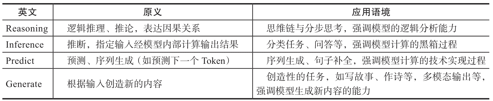

3.DeepSeek 蒸馏模型
为了支持社区研究，DeepSeek-AI 公开了 DeepSeek-R1-Zero、DeepSeek-R1 以及基于 Llama 和通义千问蒸馏得到的 6 个密集模型权重。其中 DeepSeek-R1-Distill-Qwen-32B 在多项基准测试中超过了 OpenAI-o1-mini，体现了密集模型的进步 ^()。

这些模型以 Qwen2.5-Math、Qwen2.5、Llama-3.1、Llama-3.3 等不同规模为基础，利用 DeepSeek-R1 的 80 万条数据经过两轮 SFT 训练而成，均具备推理能力。受算力限制，本书涉及 DeepSeek-R1 的案例均采用其蒸馏版本。使用方式与原版基本一致，差异主要在推理强度与算力需求。

1.1.3 主要优势
谈到 DeepSeek 的优势，核心体现在 DeepSeek-V3 与 DeepSeek-R1 相较同类产品的表现。

1.推理能力强
DeepSeek-V3 偏向推理设计，在复杂问题求解、逻辑推演与多步分析上能力扎实。除了常规问答，还能完成数学推导、因果分析、假设推演等需要深度思考的任务。DeepSeek-R1 更擅长深度思考，输出最终答案前会先给出被 <think> 标签包裹的思考过程。该过程会对问题进行深入剖析并规划解题步骤，使输入从单一问题变为“问题加思考过程”的组合，从而提升答案准确度。

2.性价比高
DeepSeek-V3 与 DeepSeek-R1 的权重均以 FP8 8 位浮点格式保存，每个参数占 1 字节。完整加载至少需要 640GB GPU 显存，按此精度需两台各配 8 张 80GB 推理卡的机器，部署成本不低。综合性能、成本与开放度来看，671B 级模型的能力与主流闭源模型相当，本地部署开销可控，性价比较高。

除 671B 的 V3 与 R1 外，DeepSeek 还发布了 1.5B 至 70B 共 6 个蒸馏模型。它们在通义千问、Llama 等基座上用 DeepSeek 训练语料微调得到，既提升了性能，又获得了深度思考能力。在相同 GPU 资源下，部署具备思考能力的 DeepSeek 系列模型比原始基座更划算。

3.处理复杂任务的能力强
DeepSeek-V3 与 DeepSeek-R1 的上下文长度均为 128K，可接收书籍、论文、代码库等超长文本并保持连贯，适用于源码分析、法律合同分析、技术文档梳理等场景。技术报告均提到训练时对中英文进行了优化，尤其在中文语义理解、古文处理上优于同量级模型。训练中采用基于规则的奖励机制指导数学、编码、逻辑推理的学习，思维链的引入使模型在数学、编码、科学推理等复杂任务上取得明显改进。

4.技术架构创新
DeepSeek 技术架构有多项创新。
混合专家 MoE 架构采用细粒度专家划分，包含通用专家与领域专家，通过动态路由分配任务，单次推理仅激活 37B 参数。
多 Token 预测 MTP 改变了传统 Transformer 每次仅生成一个 Token 的瓶颈，可一次生成两个 Token，第二个 Token 的准确率约为 85%～90%，生成速度提升约 1.8 倍。
训练侧优化同样突出。FP8 混合精度训练降低 GPU 内存占用，吞吐量相比 16 位精度提升约 2 倍。结合 FPGA 低延迟推理、GPU 集群训练、张量网络与稀疏化优化，资源利用率大幅提升。纯强化学习与小模型蒸馏技术为行业提供了新的训练思路。

### 1.2 DeepSeek 企业级应用概述
1.2.1 应用场景
DeepSeek 的企业级应用可覆盖多行业场景，依托的是其强大的理解、推理与生成能力。企业应用需兼顾安全、合规与保密，通常不能直接调用官网接口或第三方 API，因此本书讨论的场景均以企业内部部署为前提。

1.智能客服与客户支持
借助推理、微调或知识库能力，企业可实现 7×24 小时的智能客服，降低人力成本。该能力并非 DeepSeek 独有，但其强大的推理能力更有利于客服类应用落地。

2.企业知识管理
128K 上下文窗口与逻辑推理能力可处理大型文档，帮助企业智能分析合同、财报、技术文档并提取关键信息。结合 RAG 检索增强生成技术，可构建知识库问答系统，接入内部技术资料、产品手册、政策文件，实现自然语言查询。

3.数据分析与商业智能
传统数据分析依赖大数据与报表工具。DeepSeek 则利用大语言模型在自然语言处理上的优势，实现基于企业销售、运营等数据的可视化分析报告生成；利用生成与预测能力结合历史数据预测市场趋势、客户行为；通过自然语言转 SQL 技术，让非 IT 人员用自然语言查询数据库并生成报告。

4.辅助开发工具
大语言模型的代码生成能力已应用于辅助软件开发，如 GitHub Copilot、Cursor、Trae 等，在代码自动补全、函数生成、Bug 修复方面效果显著。随着模型能力提升，一键生成前后端代码与全套技术文档的工具逐渐主流。DeepSeek 的代码生成能力有助于其在辅助开发工具领域的深入应用。

5.营销与内容创作
内容创作尤其是营销场景中，文案生成更强调营销效果而非逻辑严密，例如生成爆款文案或热帖。参数规模较小的蒸馏模型如 14B、32B 成为首选，既能承受部署成本，二次训练成本也较易接受。

6.法律行业应用
得益于长上下文输入、运行效率与推理能力，DeepSeek 擅长分析长文档、挖掘句子与段落内在关系，实现文档总结、纠错与专业分析。在法律领域可用于合同审定、自动识别法律风险条款，提升法务效率，也可推广至其他以文字为主的专业领域。

7.医疗行业应用
DeepSeek 在医疗领域的高调应用推动了其迅速流行。DeepSeek-R1 发布 3 个月内，大量公立医院参与接入。短期内多家机构通过 API、自购设备或租用算力完成接入。应用逐步与医疗工作融合，场景包括病历辅助书写、智能问诊、检验报告解读等。强大的思考能力使其在严谨的医疗场景中占据一席。

8.教育培训行业应用
大语言模型在教育培训中的应用由来已久。DeepSeek 的思考过程可视化与数学推理能力为其提供了基础。展示思考过程有助于学生理解解题思路，数学推理能力提升了数学问题求解的准确性。借助开源框架搭建聊天应用后，用户可便捷上传图片、PDF、Word 等文件，使用体验更友好。

1.2.2 算力支撑
包括 DeepSeek 在内的大语言模型普遍需要 GPU 支持。虽然 Ollama ^() 等工具可在 CPU 上运行量化版模型，但从企业生产环境看，4bit 量化的精度不足，不太适合对推理能力要求高的场景，因此仅讨论 GPU 算力支撑。

模型能否成功运行取决于 GPU 内存大小，运行效率取决于 GPU 处理单元数量。最低所需算力与参数量、参数精度及服务程序相关。粗略估算，DeepSeek-V3 与 DeepSeek-R1 的满血版本需要两台 8 卡 80GB 的 GPU 算力。其余蒸馏模型的内存需求可参考经验公式。

GPU 内存最低需求=参数量×2×1.3

以 DeepSeek-R1-Distill-Qwen-14B 为例：

GPU 内存最低需求=14×2×1.3≈37GB

实际部署因工具与优化参数不同而有所差异，但大致估算可参考上式。 

注意
算力设备包括通用显卡 GPU 及推理卡，后者为推理任务专门优化，通常不带显示接口。为表述方便，本书多以“内存”泛指算力设备的容量及模型运行时资源占用。

1.2.3 安全与合规
安全与合规是 DeepSeek 企业级应用的重要指标。个人使用在线大模型主要担心隐私泄露，企业则更关注数据安全。技术文档、营销文案、运营数据、客户资料均为核心资产，本地部署往往是首选。需配备防火墙、端口访问策略、访问权限控制等防护措施。训练数据使用必须合规合法，需进行匿名化处理以降低隐私风险。对外提供服务时，还需完成网站备案、SSL 证书管理、日志留存、数据安全防护与访问控制。服务安全方面，应采用防御技术防范提示词注入或越狱攻击等风险。

1.3 实战环境准备
大语言模型学习可分为三类：如何使用、如何部署微调并开发应用、深入研究理论算法。本书侧重第二类，帮助读者在较小的算力资源下实践 DeepSeek 的部署、应用安装与微调，复现关键环节并了解技术细节。结合企业应用开发实例，读者可掌握 DeepSeek 企业级开发的基本原理与实现手段。为实践本书全部实例，需准备表 1-2 所示的基础实验条件。

表 1-2 基础实验条件

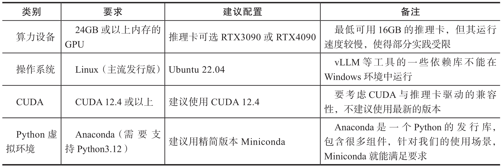
1.3.1 硬件准备
准备一台服务器或配置较高的个人电脑，建议内存 32GB 以上，并配备显存 24GB 及以上的显卡，如 RTX3090 或 RTX4090。

1.3.2 操作系统准备
使用 Ubuntu22.04 操作系统，并安装 GCC 编译环境，因后续推理卡驱动安装及 Python 部分开发库需编译方式安装。

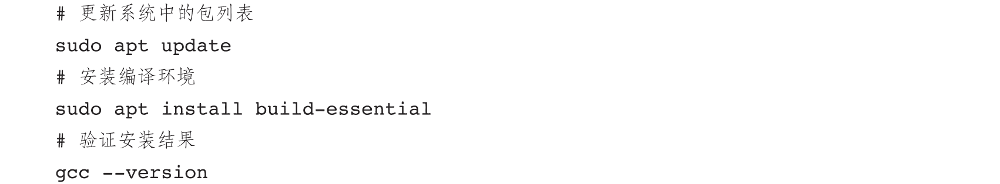

成功安装后，GCC 编译环境验证结果如图 1-1 所示。

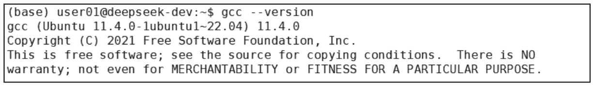

图 1-1 GCC 编译环境验证结果

1.3.3 安装推理卡驱动
从 NVIDIA 官网查找推理卡驱动程序，下载到算力机器上进行安装，具体步骤如下。

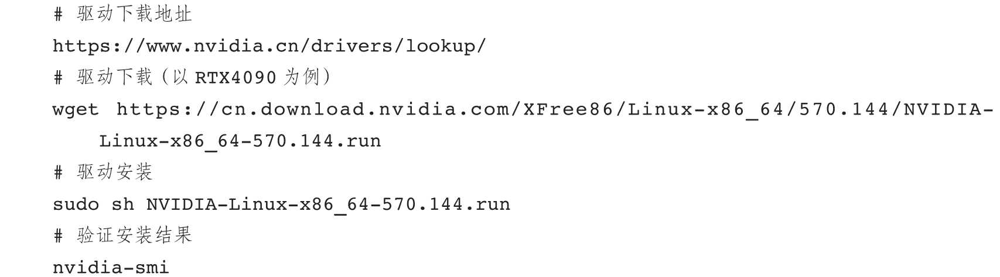

成功安装后，推理卡驱动安装验证结果如图 1-2 所示。

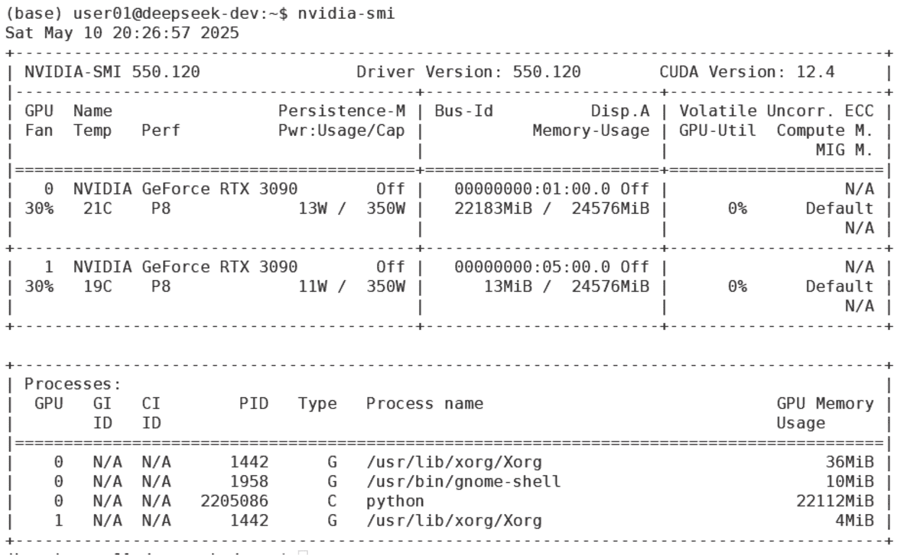

图 1-2 推理卡驱动安装验证结果

1.3.4 安装 CUDA 环境
从 NVIDIA 官网下载 CUDA。以 CUDA 12.4.0 为例，下载到算力机器上进行安装，具体步骤如下。

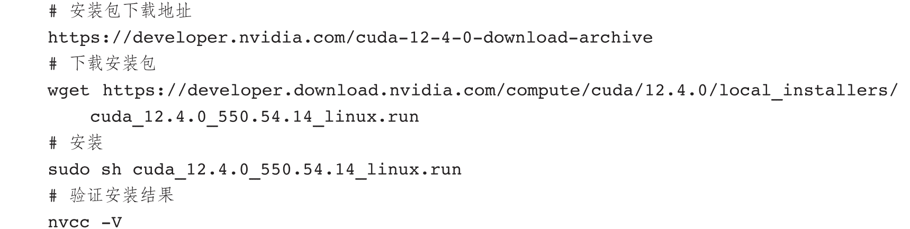

成功安装后，CUDA 环境验证结果如图 1-3 所示。

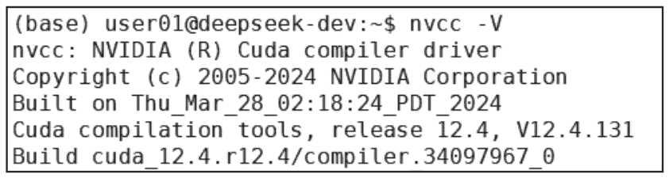

图 1-3 CUDA 环境验证结果

1.3.5 安装 Python 虚拟环境
Python 虚拟环境 Anaconda，此处使用精简版 Miniconda，按以下步骤下载及安装。

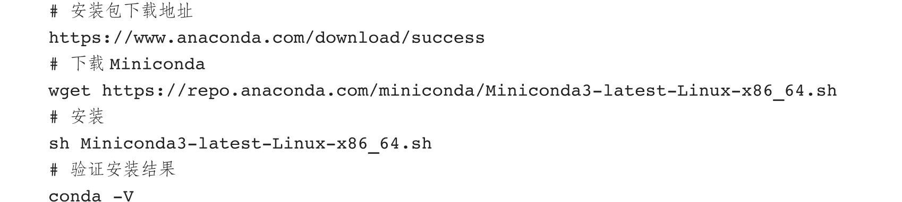

1.3.6 环境验证

要判断实战工作台是否能正常跑起来，重点要核对硬件、推理卡驱动、CUDA 以及 Python 虚拟环境的状态。典型做法是在虚拟环境中装好 PyTorch 库 ^()，然后调用 PyTorch 自带的检测函数做一次整体校验，具体流程如下。

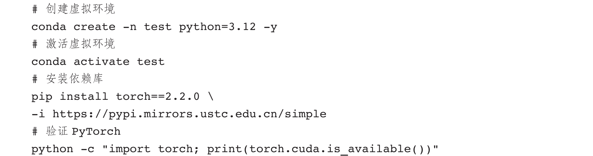

当最后一条指令的输出为 True，就可认为环境已就绪；若输出为 False 或出现报错，就要结合报错信息逐项排查处理。

## Chapter 2 第二章 LLM 基础知识

DeepSeek 是 DeepSeek-AI 推出的一套大语言模型。广义上，大语言模型是面向自然语言任务的超大规模神经网络系统，属于 NLP 的核心分支。Transformer 架构为此类模型提供了底座，其中自注意力机制是 Transformer 体系里最为关键的算法。

LLM 属于强实践型技术。想真正掌握，离不开安装、微调、应用开发以及与智能体结合使用的实操积累。对非人工智能专业背景的从业者来说，边做边学是更合适的路径。尤其是企业级 DeepSeek 场景，更看重实战落地能力。LLM 并非纯概念，落地的前提是理解底层原理。因此在动手实践前，先把自然语言处理、神经网络以及大模型运行等基础知识梳理清楚是必要的。

### 2.1 自然语言处理

自然语言是人们在日常对话、写作、交流时使用的语言。与 Python、C++、Java 等编程语言相比，其使用门槛更低、覆盖人群更广。在大语言模型的加持下，原本需要写代码实现的业务逻辑，现在可以通过口头指令完成交互。自然语言处理作为人工智能的重要方向，研究人与计算机用自然语言交互的机理，涵盖文本理解、文本生成、语音识别、图像与视频生成等核心任务，并在智能客服、机器翻译、信息检索、知识库等场景中作用愈发突出。

下面回顾 NLP 的发展脉络。

**1.基于规则的阶段**
自然语言处理在 20 世纪 50 年代随着基于规则的机器翻译出现。50 年代到 70 年代，规则方法占据主导，研究者认为机器处理语言的过程与人类学习语言类似，这一阶段带有明显的理性主义色彩。

以机器翻译为例，将英文译为中文：


反过来从中文译为英文：


从这些例子可见，最简单的逐词查字典规则在某些场景下也能得到勉强可读的结果。但规则法存在先天局限，难以覆盖全部语法。用逐词对照的方式处理下面例子，就会出现令人费解的输出。


规则法的局限可以用输入法联想来类比。如图 2-1 所示，医生在写病历时输入“住”，输入法通常会提示“本”，补全为“入住本院”。若完全依赖固定规则，预测准确率会明显下降。

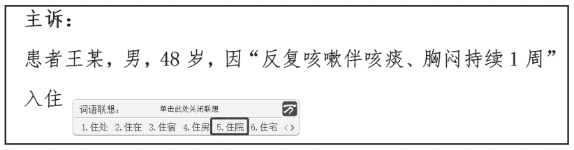

图 2-1 基于规则的自然语言处理方法的类比场景

因此该阶段虽解决了部分简单问题，但机翻痕迹明显，实用性有限。

**2.基于统计的阶段**
70 年代以后，随着计算机普及，大量纸质资料电子化，语料库逐步丰富；硬件容量与算力也在提升。NLP 从语言学范畴的规则方法转向统计方法，统计方法逐步取代规则方法，在数学模型与统计学基础上取得实质性突破。90 年代后互联网爆发，社交对话、邮件、文章、搜索引擎每天产生海量数据，使得基于大规模语料构建语言模型成为可能。这种方式能规避歧义、语境带来的难题，也能对从未见过的语言现象进行预测。

统计法的本质是概率计算，可用带动态词频的输入法来类比，如图 2-2 所示，经过优化的输入法预测会更准确。


图 2-2 基于统计的自然语言处理方法的类比场景

**3.深度学习阶段**
2007 年起，深度学习在图像和语音识别领域快速发展，随后进入 NLP。2013 年出现的词向量 Word2Vec 技术，让深度学习与 NLP 的结合更紧密，在机器翻译、问答、文本理解等领域出现成功案例。深度学习是多层神经网络，从输入层经逐层非线性变换得到输出，通过端到端训练实现任务。N-Gram 和 RNN 是当时常用的技术。

N-Gram 可通过前一个词预测下一个词。如图 2-3 所示，用“无明显”预测“诱因”。

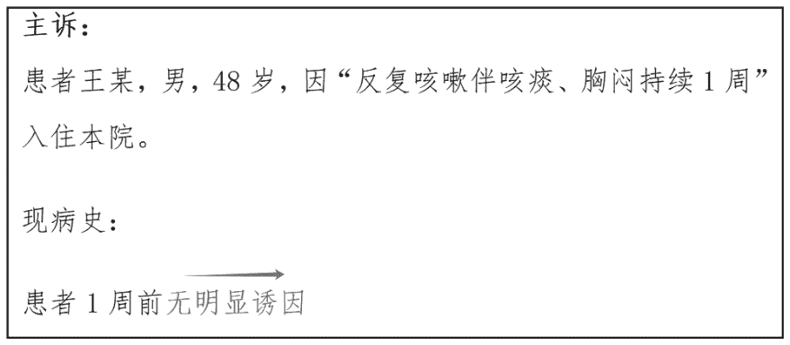

图 2-3 N-Gram 模型预测场景示例

RNN 等循环网络更进一步，能捕捉较长距离上下文依赖。如图 2-4 所示，用上一句话预测下一个词。

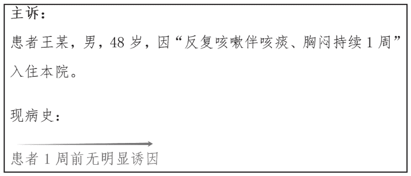

图 2-4 循环神经网络预测场景示例

**4.大语言模型阶段**
2017 年 Google 翻译团队发表论文“Attention Is All You Need” ^(¹)，无监督预训练语言模型在 NLP 取得重大进展。预训练模型采用 Transformer 架构，在海量未标注语料上预训练，获取通用语言理解与生成能力；在使用时再通过监督训练等手段进行小规模微调，适配对话等具体场景。

目前大语言模型的主流架构仍是 Transformer。BERT 是 Google 早期经典预训练模型，OpenAI 的 GPT 系列随后成为主流，如开源的 GPT-2 以及闭源的 GPT-3、GPT-3.5、GPT-4、GPT-5 等。开源阵营也在快速发展，如 Meta 的 Llama、Google 的 Gemini、Anthropic 的 Claude。国产模型如智谱 GLM、通义千问等也占据一定市场。

大语言模型的核心技术是自注意力机制。该算法在理解文本时计算每个词与上下文其他词的相关度，结合多头注意力机制，提升了语义理解与新内容预测能力。其工作示例如图 2-5 所示。

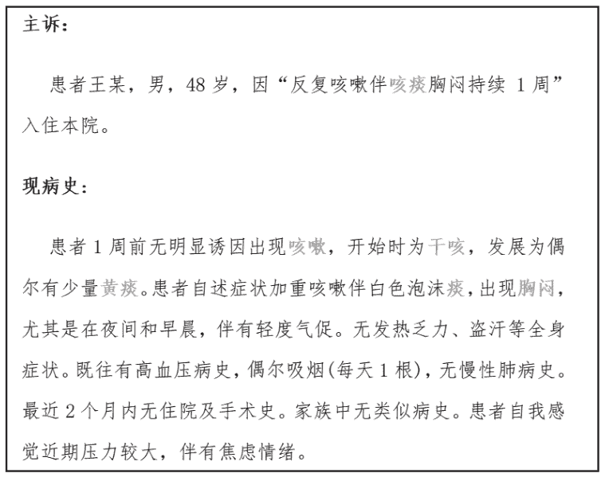

图 2-5 大语言模型自注意力机制的工作场景示例

**5.DeepSeek 阶段**
DeepSeek 系列在 GPT 架构基础上做了诸多创新，包括开放权重、671B 超大规模参数、专家混合模型以及思维链的引入，使其处于领先位置。其他开源模型在技术与推广上普遍处于追赶态势。思维链 Chain-of-Thought、CoT 是一种逐步推理解决问题的技术，在 AI Agent 中作为思考框架广泛应用。DeepSeek 将其融入生成能力，增强了处理复杂问题的能力。例如在数学求解、代码生成时，可模仿人类思考过程把问题拆分为多个中间步骤，从而提升答案准确性与可解释性。DeepSeek 的思考过程示例如图 2-6 所示。

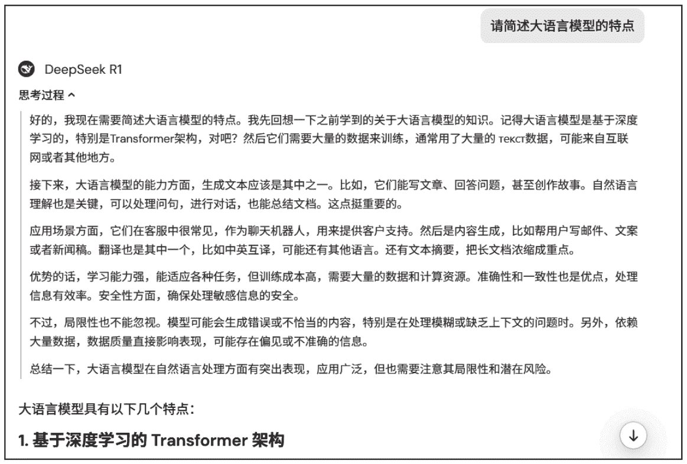

图 2-6 DeepSeek 思考过程示例

### 2.2 神经网络

DeepSeek 属于大语言模型，而大语言模型是一种大型神经网络。系统学习神经网络需要一定的数学基础，门槛较高。本节目标是让读者在应用与开发 DeepSeek 时对神经网络建立基本认知，而非深入研究。以下以介绍大模型运行基本原理为目标，说明神经网络的概念及其在推理中的作用。

**2.2.1 神经网络的基本结构**
神经网络 Neural Network 是模仿生物神经元的计算模型，用于学习和表示复杂数据模式。核心是通过多层互联的“神经元”处理信息，广泛用于图像识别、自然语言处理等领域。

从应用角度看，神经网络可视为黑盒，输入文本后预测后续文字。例如输入“你好”，模型大概率给出“你好，……”。推理即预测、生成，第一个 Token 概率最高的是“你”。工作原理示意见图 2-7。

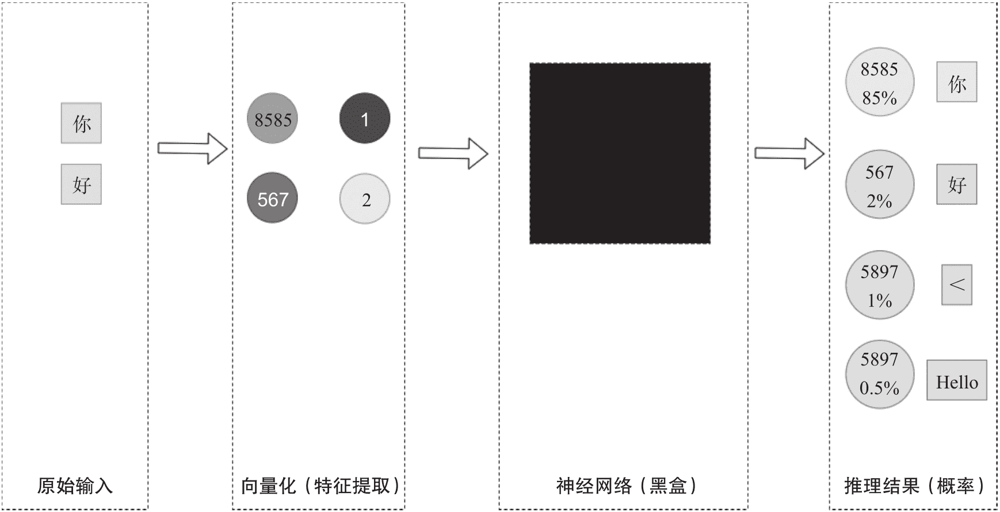

图 2-7 神经网络工作原理示意

由图 2-7 可知工作步骤如下。

① 原始输入为“你好”。
② 输入被拆分为词元 Token，再转为向量表示并加上位置信息，形成网络输入参数。
③ 将网络暂且视为黑盒，对输入使用算法与权重进行计算。
④ 计算结果是词表里每个词元的概率，其中“你”概率最大。

理解基本流程后，再看黑盒内部。神经网络由多个神经元组成，每个神经元包含权重、算法和激活函数。以输入文字预测下一个词元为例，内部结构概览见图 2-8。

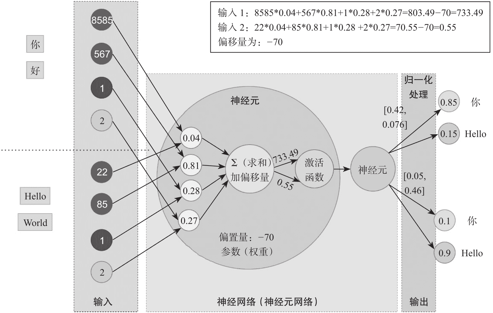

图 2-8 神经网络内部工作结构概览

由图 2-8 可知内部步骤如下。

① 输入“你好”推理后，词表中“你”的概率最大；输入“Hello World”则接下来生成词元“Hello”概率最大。
② 输入转为向量并附加位置信息，作为神经元输入。
③ 神经元包含训练得到的权重参数，与输入向量逐一相乘后求和，即全连接层运算。求和示例如下。

输入你好：8585*0.04+567*0.81+1*0.28+2*0.27=803.49

输入 Hello World：22*0.04+85*0.81+1*0.28+2*0.27=70.55

这两个数值本身看不出规律。加上一个“-70”偏置后，分别得到“733.49”和“0.55”。该偏置可理解为训练得到。

④ 加权求和后加偏置，再经数值转换映射到 0 到 1 区间，或做类似非线性变换。若落在 0 到 1，可视作概率，数值越大概率越高。该转换由激活函数实现。
⑤ 常用激活函数包括 Sigmoid、线性整流函数 ReLU、双曲正切 tanh、符号函数 sign，见图 2-9。

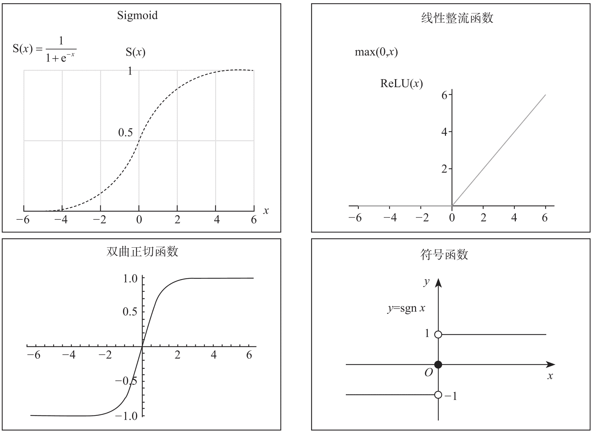

图 2-9 常用的激活函数

⑥ 经多层网络计算后得到输出词元的概率。将所有概率相加作分母，以单个概率作分子计算百分比，之和恒为 1。如图 2-8 所示，输入“你好”时生成“你”的概率为 0.42，生成“Hello”为 0.076，则“你”的百分比为 85%，“Hello”为 15%。

0.42/(0.42+0.076)=85%

0.076/(0.42+0.076)=15%

此过程为归一化处理，通常出现在输出层。

**2.2.2 神经网络的训练过程**
图 2-8 中给出的权重与偏置均由训练得到。输入经网络得到输出是生成过程，称为正向传播；已知输入输出反推各层各神经元参数是训练过程，称为反向传播。两种传播示意见图 2-10。

① 正向传播即生成，已知输入与网络参数，逐层计算出输出。
② 反向传播即训练，已知标注好的输入输出，设定参数后正向计算，比较推理输出与期望输出的差异，该差异即损失值 Loss。
③ 训练即通过调整各层神经元参数逐步降低损失值。
④ 由于涉及激活函数、归一化等非线性因素，反向传播并非简单反推，训练得到的参数并非直接反向计算得出，因而神经网络具有不可解释性。
⑤ 参数调整并非随机，而是基于算法与方法论。常用方法是梯度下降法，如图 2-11 所示。先设定初始值，根据每次损失下降的速度即下降曲线斜率，确定参数修改幅度。Loss 下降快则改得多，下降慢则改得少；方向错误则乘以负数；修改量过大时可乘以学习率常量调节。

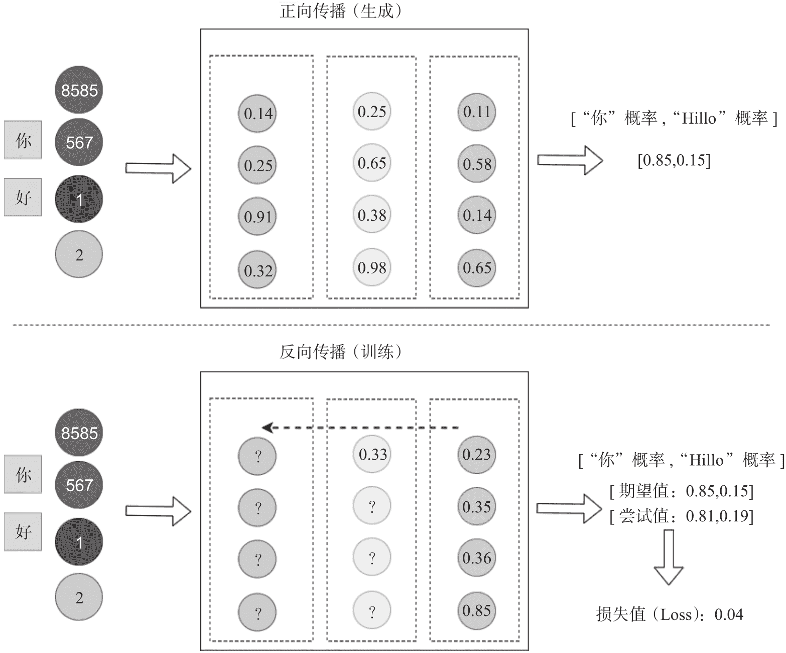

图 2-10 正向传播与反向传播的示意

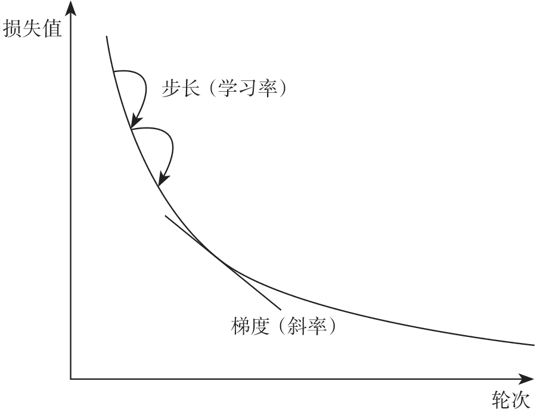

图 2-11 神经网络训练的梯度下降法

**2.2.3 基于神经网络的推理过程**
大语言模型中神经网络采用 Transformer 架构。不同模型在层数、参数量、上下文长度、词表长度等方面各异。DeepSeek 上下文长度为 128K，结构由 Embedding 层、61 层 MLA+MoE 以及输出层组成，总参数约 6710 亿。DeepSeek-R1 词表大小为 129280，可处理的 Token 包括汉字、词组、标点、英文等，约 13 万个 ^(²)。

以 DeepSeek-R1 为例，暂不考虑多 Token 预测，推理过程如图 2-12 所示。

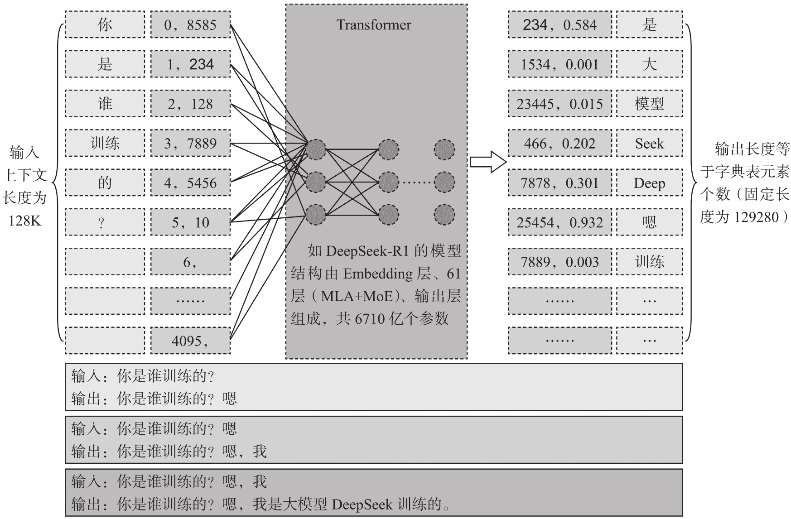

图 2-12 大语言模型的推理过程

以输入“你是谁训练的？”为例，主要步骤如下。

① DeepSeek-R1 输入上下文窗口为 128K，最长可包含 128K 个 Token，约等于 128K 个词。
② 问题经分词器切分为 Token，并查词表转为整数 ID，如“你”=>8585。
③ Token ID 经 Embedding 层转为固定维度的稠密向量，如 8585=>[0.2,-0.5,...,0.7]。
④ 向量输入多层神经网络计算，得出 129280 个词中概率最大的下一个 Token ID，如“嗯”=>25454。
⑤ 将 Token ID 转为明文“嗯”输出。

如此，输入“你是谁训练的？”后模型预测下一个词为“嗯”。随后把“你是谁训练的？嗯”作为新输入，继续预测下一个词“，”，以此类推，不断将上次输出作为下次输入，直到输出包含设定停止词后结束推理。

### 2.3 LLM 的核心机制
作为自然语言处理的前沿方向，大语言模型通过海量参数学习语言深层规律。本节解析现代大语言模型的核心技术组件，揭示其突破传统 NLP 任务性能瓶颈的内在机理。

**2.3.1 Transformer**
Transformer 采用“编码器-解码器”结构，通过堆叠多层自注意力模块实现特征层次化提取。核心是自注意力机制与多头注意力机制：前者通过计算序列元素间的关联权重建立全局依赖，后者将特征空间投影到多个子空间进行并行注意力计算。二者共同实现对输入序列 ^(³) 全局依赖关系的高效捕捉。

与传统 RNN 相比，Transformer 摒弃时序递归结构，采用位置编码 Positional Encoding 引入序列顺序信息，具备更强并行计算能力。该设计大幅提升长距离依赖建模效果，并显著降低训练计算复杂度。模型通过预训练学习通用语言表示，在机器翻译、文本生成等任务中表现优异。成功经验迅速扩展到计算机视觉、语音识别等领域，重塑了 NLP，并成为 GPT、BERT 等现代大模型的核心架构。目前基于 Transformer 的模型通过稀疏注意力、混合专家系统等创新持续推动人工智能发展。

**2.3.2 自注意力机制**

自注意力拆解与 DeepSeek落地实操

在序列建模里，如何让模型把前后文串联起来理解当前词？自注意力提供了一种让各位置互相参考的思路。每个位置先被映射成三类向量：用来提问的 Query、用来做索引的 Key、承载内容本身的 Value。Query 会和整段里的所有 Key 做匹配，匹配分数体现当前词对其它词的关注程度；Key 与 Value 一一对应，分数越高其对应的 Value 在聚合时占比越大。这样模型就能在长文本里动态挑出关键线索，形成上下文感知的表征。典型计算式如下。


式中 ***Q***、***K***、***V*** 分别对应查询、键、值的矩阵形态，*d*[k] 为键向量的维度，用作缩放防止数值爆炸。下面以“你是谁训练的？”为例，把三者的含义和流程演示一遍。

**1. 输入准备**

对“你是谁训练的？”进行分词，本例把“训练”视作一个词元，共 6 个词元。经嵌入层映射为 4 维向量，简化示例如下：

你：[1.0,0.5,-0.2,1.2]

是：[0.3,-1.0,0.6,-0.7]

谁：[-0.8,1.2,0.4,0.9]

训练：[1.5,-0.6,-1.0,0.3]

的：[-0.5,0.4,1.1,-0.2]

？：[0.2,-0.9,0.7,0.5]

以矩阵 ***X*** 表示，则 ***X*** 为 6×4：

[[1.0,0.5,-0.2,1.2],
[0.3,-1.0,0.6,-0.7],
[-0.8,1.2,0.4,0.9],
[1.5,-0.6,-1.0,0.3],
[-0.5,0.4,1.1,-0.2],
[0.2,-0.9,0.7,0.5]]

**2. 权重配置**

实际运行中这些矩阵由训练得到，此处直接给出示例。

***W^Q***：

[[0.1,0.4,-0.3,0.5],
[0.2,-0.2,0.6,0.0],
[-0.1,0.5,0.2,0.1],
[0.3,0.1,-0.4,0.2]]

***W^K***：

[[-0.2,0.5,0.1,-0.3],
[0.3,0.0,0.4,0.2],
[0.1,-0.1,0.3,0.5],
[-0.4,0.2,0.0,0.1]]

***W^V***：

[[0.0,0.4,0.1,-0.2],
[-0.1,0.2,0.5,0.3],
[0.2,-0.3,0.0,0.4],
[0.3,0.1,-0.2,0.1]]

**3. 计算程序**

参数就绪后即可求 ***Q***、***K***、***V*** 及关注分数。为便于理解，下面用一段示例代码演示流程，文件命名为 self-attention.py。

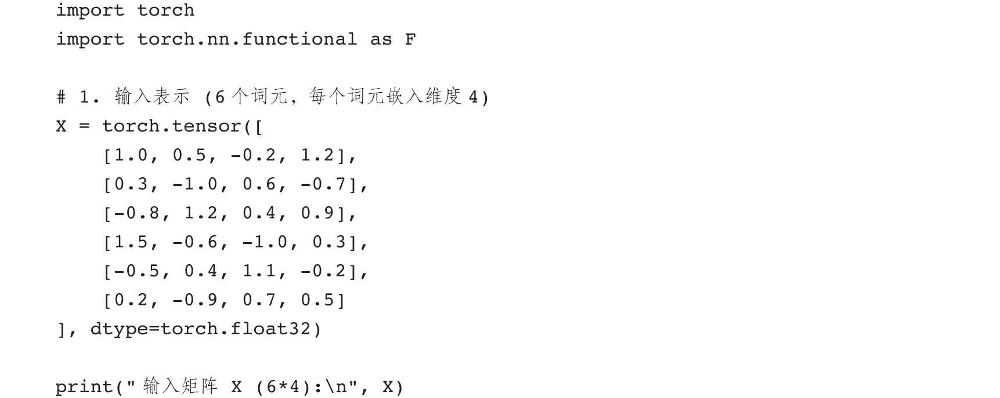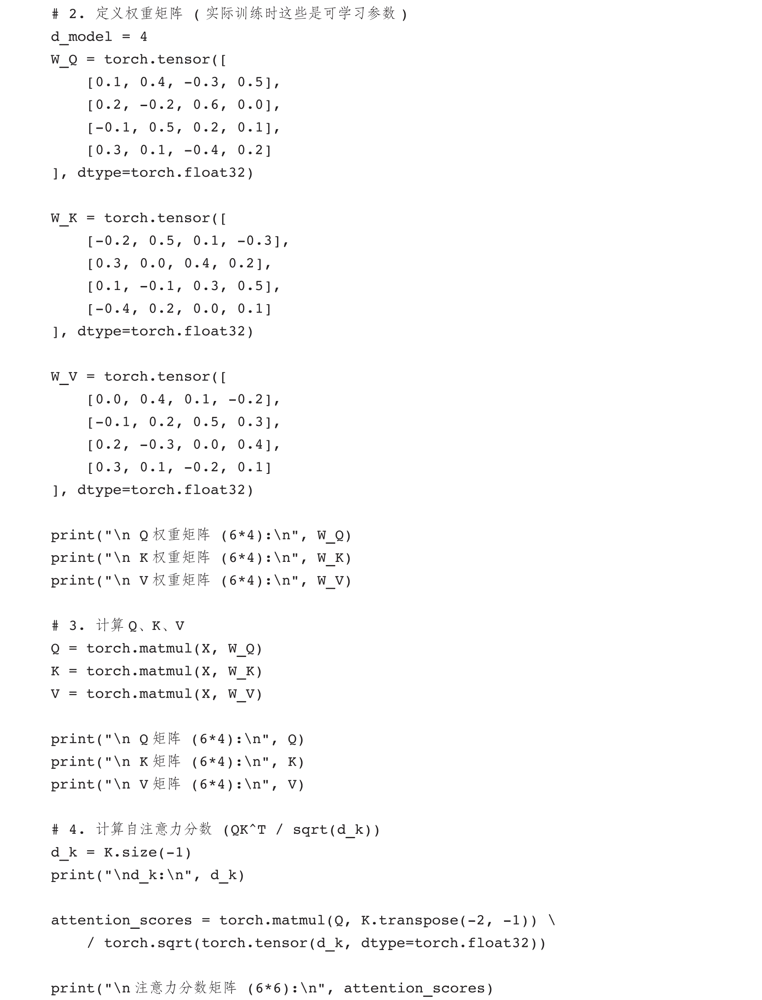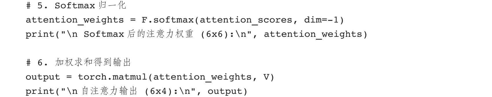

**4. 运行与求解**

先创建 Python 虚拟环境，装好 PyTorch 做张量运算，再执行程序。

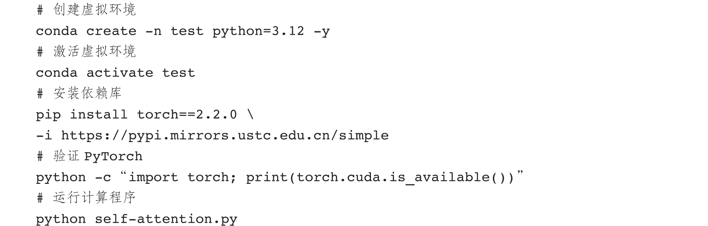

（1）得到 Q、K、V

把 ***X*** 分别与 ***W^Q***、***W^K***、***W^V*** 相乘做投影：

***Q***矩阵（6*4）：

[[0.58,0.32,-0.52,0.72],
[-0.44,0.55,-0.29,0.07],
[0.39,-0.27,0.68,-0.18],
[0.22,0.25,-1.13,0.71],
[-0.14,0.25,0.69,-0.18],
[-0.08,0.66,-0.66,0.27]])

***K***矩阵（6*4）：

[[-0.55,0.76,0.24,-0.18],
[-0.02,-0.05,-0.19,-0.06],
[0.20,-0.26,0.52,0.77],
[-0.70,0.91,-0.39,-1.04],
[0.41,-0.40,0.44,0.76],
[-0.44,0.13,-0.13,0.16]])

***V***矩阵（6*4）：

[[0.27,0.68,0.11,-0.01],
[0.01,-0.33,-0.33,-0.19],
[0.23,-0.11,0.34,0.77],
[-0.05,0.81,-0.21,-0.85],
[0.12,-0.47,0.19,0.64],
[0.38,-0.26,-0.53,0.02]])

（2）关注分数

计算 ***Q*** 与 ***K*** 的点积并缩放，取 sqrt（d_k）=2，得到 6×6 的相关矩阵：

[[-0.1651,0.0140,0.1584,-0.3304,0.2141,-0.0154],
[0.2889,0.0161,-0.1640,0.4244,-0.2374,0.1570],
[-0.1121,-0.0564,0.1816,-0.2984,0.2152,-0.1619],
[-0.1650,0.0776,-0.0310,-0.1121,0.0163,0.0981],
[0.2325,-0.0650,0.0636,0.1218,0.0047,-0.0122],
[0.1693,0.0389,-0.1614,0.3166,-0.1910,0.1250]]

（3）Softmax 归一化

对每一行做 Softmax，使分布和为 1。做法是逐元素指数化后除以行和。以“你”这一行为例，归一化结果如下：

[[0.1419,0.1697,0.1961,0.1203,0.2073,0.1648],
[0.1996,0.1520,0.1269,0.2286,0.1179,0.1750],
[0.1523,0.1610,0.2042,0.1264,0.2112,0.1449],
[0.1434,0.1828,0.1640,0.1512,0.1719,0.1866],
[0.1976,0.1467,0.1669,0.1769,0.1573,0.1547],
[0.1849,0.1623,0.1328,0.2142,0.1289,0.1769]]

（4）加权求和

用权重对 ***V*** 做加权求和，得到自注意力输出，即上下文感知的表示：

[[0.1666,-0.0240,-0.0469,0.1511],
[0.1538,0.1559,-0.1034,-0.0485],
[0.1638,-0.0066,-0.0301,0.1558],
[0.1623,0.0123,-0.0868,0.0754],
[0.1620,0.0967,-0.0592,0.0521],
[0.1541,0.1245,-0.1023,-0.0264]]

**2.3.3 多头注意力机制**

多头注意力并行运行多组自注意力，从不同子空间学习多样化的依赖，提升复杂模式的建模能力。以“你是谁训练的？”为例，不同头关注点不同：

❍头 1：捕捉疑问词与核心词的关联，如“谁”与“训练”。
❍头 2：捕捉主语与谓语的关联，如“你”与“是”。
❍头 3：捕捉修饰与被修饰的关联，如“训练”与助词“的”。

多头注意力的好处：

①多视角建模：各头可侧重局部依赖、长距离依赖、语法结构、语义角色等，增强表达。
②摆脱单头固化：单头易陷入固定模式，多头通过多样分布提升鲁棒性。
③泛化增强：类似卷积网络的多滤波器，多头融合不同子空间特征，更易泛化。
④并行加速：各头可并行计算，充分利用 GPU 等硬件。

# 应用篇

■ 第三章 DeepSeek 部署
■ 第四章 构建 Chat 应用
■ 第五章 构建 AI Agent
■ 第六章 构建 RAG 应用
■ 第七章 构建多模态应用

在 GPU 上运行不同规模的 DeepSeek 模型是企业开发的基础技能。没有 GPU 时，也可借助 Ollama 在 CPU 上部署做实践。完整的 DeepSeek-V3 与 DeepSeek-R1 参数量很大，对算力要求高，实践可选用与 DeepSeek-R1 部署方式相同的蒸馏模型，这些模型保留推理能力，便于学习大型模型的实践方法。部署前需先理解机器学习的数据类型与量化方法，这直接影响模型对算力尤其是推理显存的需求。随后可按算力选型安装模型，并用简单 Chat 程序验证效果。Ollama 在 CPU 上的部署也是快速体验 DeepSeek 的便捷方式。

Chat 程序是大型语言模型最常见的应用。本篇先实践两种流行开源 Chat 程序的部署，使其与本地 DeepSeek 集成，实现类似官网 Chat 的体验，同时满足企业数据安全与合规需求。

其次，AI Agent 是语言模型的高级用法。通过学习两种开源 Agent 技术，读者可了解如何借助自然语言交互，让多智能体平台从网络或本地文件获取知识，自主完成文档整理、编码、工艺参数编写等企业常见任务。

再次，RAG 将知识库与语言模型结合。通过两种流行开源 RAG 框架的讲解，读者可掌握把上传文件作为知识来源传递给大模型以增强生成效果的方法，也可通过 RAG 应用内置的搜索引擎实现类似官网联网搜索的功能。

此外，DeepSeek 在图像生成与理解、视觉处理等方向也有多模态模型。学习两种多模态模型的应用，可实践文生图、图生文等企业场景。文生视频技术作为多模态应用的重要一环，本书亦有详细说明。

第三章从机器学习数据类型入手，给出 DeepSeek 系列各级别模型在不同精度与量化方案下的算力估算，作为企业选型的理论基础。本章介绍 vLLM 与 Ollama 部署 DeepSeek 的适用场景与操作，并提供名为 Chat_bot 的简单 Python 程序验证部署成果。

第四章围绕 Chat 应用展开。LibreChat 与 Open WebUI 是目前流行的两种开源大模型 Chat 方案，分别在 Docker 与 Anaconda 环境下安装配置，并与本地 DeepSeek 服务配合，实现企业基础应用场景。本章还包括 Chat 的扩展应用，与 draw.io 配合快速制作流程图。

第五章讲解多智能体协作。开源的 camel-ai/owl 是一个多智能体协作框架，可执行资料获取与整理任务。OpenManus 支持单智能体生成代码和多智能体协作撰写企业文档。为促进推广，本章两种应用均提供 WebUI 方案。

第六章讲解 RAG 应用。首先介绍 RAG 在企业中的场景，再从检索与生成增强、工作流程等方面阐述基本概念。随后通过 Dify 应用部署的描述，让读者了解知识库建立、增强对话及高级工作流的完整过程。此外，将 SearXNG 作为联网搜索集成到 Open WebUI 搭建的 Chat 应用，也是 RAG 实践的一部分。

第七章讲解多模态应用，包括图像识别、图像理解与文本生成图像等企业常见场景。本章介绍使用 DeepSeek 的 Janus 模型进行图像理解与生成，DeepSeek-VL2 作为视觉模型可应用于图像分析。通过文生图、图生文，再结合基于 FramePack ^() 的文生视频技术，覆盖企业大部分多模态应用场景。

## Chapter 3 第三章 DeepSeek 部署

DeepSeek 是 DeepSeek-AI 发布的一系列模型的统称。一般包含参数达 671B 的 DeepSeek-V3、DeepSeek-R1，也包括从 DeepSeek-R1 蒸馏得到的小规模模型。部署时需结合算力与业务需求选择合适的模型；因算力限制，也可适当降低权重精度以在较小算力下使用。

### 3.1 DeepSeek 系列模型分类

DeepSeek-AI 拥有众多模型，以下重点介绍 2024 年底之后随预训练模型 DeepSeek-V3-Base 发布的新模型，代表了最新的研究成果。具体情况如表 3-1 所示。

**表 3-1 DeepSeek 系列模型分类**

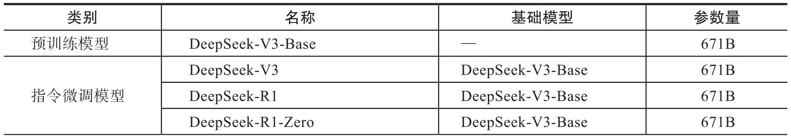

（续）

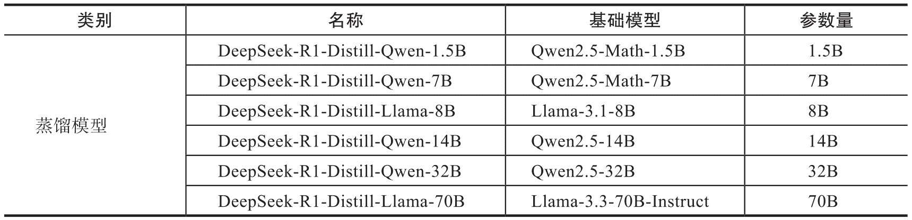

在企业级应用中，知名度较高的是 671B 参数的 DeepSeek-V3 与 DeepSeek-R1，通常被称为“满血”版 DeepSeek。但由于部署需求高算力，实际企业场景更常见轻量级蒸馏模型，如 DeepSeek-R1-Distill-Qwen-32B 和 DeepSeek-R1-Distill-Llama-70B。

### 3.2 大模型的精度与量化

大型模型精度指权重在存储和计算时的数值精确程度，通常由浮点数位数决定。常见类型包括 FP32、FP16、FP8、INT8、INT4 等，不同格式的指数位与尾数位分配不同。

精度选择直接影响数值稳定性、计算效率与内存占用：高精度如 FP32 能保持更精确的梯度计算与权重更新，在复杂运算中更稳定，但显存消耗约是 FP16 的两倍且计算吞吐量下降；低精度如 FP16/FP8 可提升 Tensor Core 利用率，显著提高训练速度并降低显存占用，但可能出现梯度消失、数值溢出等精度损失。实践中常采用混合精度训练配合损失缩放来平衡效率与稳定性。

**3.2.1 机器学习中的数据类型**

**1.基础知识**

在探讨 AI 数据类型前，先梳理计算机数值处理的基础。计算机数值最小单位是位，即比特，可表示 0 或 1。8 个比特组成一个字节，是存储与处理数据的基本单位。16 位或 32 位指比特数。位数与占用空间的对应关系如表 3-2 所示。

**表 3-2 计算机数据处理过程中的位数与占用空间**


**2.数据格式**

在深度学习与科学计算中，“全精度”通常指 FP64，即双精度，占 64 位。这种高精度计算在实际中并不常见，单精度 FP32 及以下精度应用更广。FP16 为半精度。表 3-3 列出常用数据格式的精度、位数、结构与值范围。

**表 3-3 机器学习中常用的数据格式**

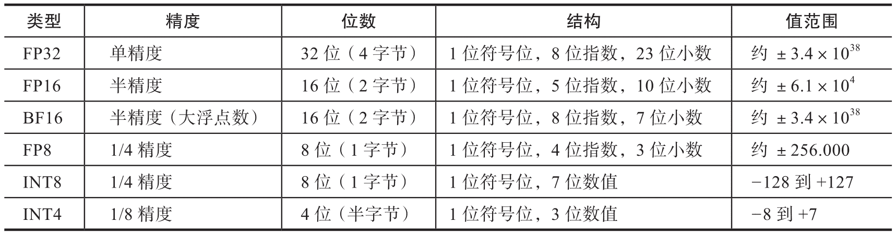

**3.2.2 大模型量化技术**

大型语言模型常用 FP16 与 BF16，而 DeepSeek-V3 与 DeepSeek-R1 采用 FP8 混合精度训练。模型量化是通过降低神经网络数值精度，如把 16 位浮点转为 8 位整数，来减少存储空间、计算资源与功耗，同时尽量保持性能。通过量化可有效减小模型体积，例如 FP16 转 INT8 后模型大小可减至约一半，且整数运算更快，推理速度得以提升。

量化本质上是通过主动降低数值表达精度来换取算力与存储的提升。精度下探后，取值范围受限，原本的高精度数据必须经映射压缩进目标区间，典型做法是引入缩放系数。量化阶段先确定合适的系数，将权重按比例缩小后写入磁盘或载入内存；推理时再借助相同系数恢复数值，再参与运算。以下以 INT8 与 INT4 两种常用方案说明思路。

**1. INT8 精度压缩**

大模型权重由 FP16 转为 INT8 后，单个参数占用从 2 字节降至 1 字节，图形处理器显存需求约减半。流程见图 3-1 所示。

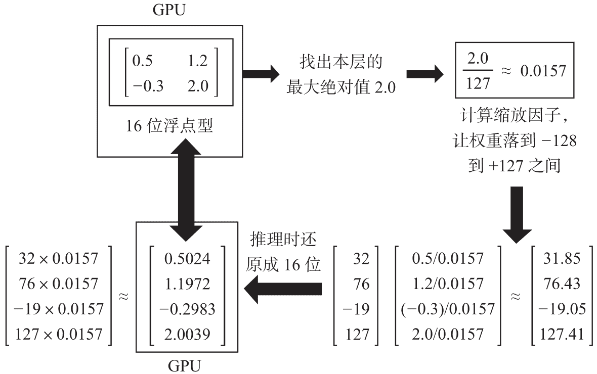

图 3-1 INT8 量化实现过程

① 尺度可按层设定，也可更细。粒度越细，信息损失越小。
② 先在当前层取权重绝对值的峰值，用该峰值除以 127，127 为 INT8 正向上限，范围 -128～127，得到缩放系数。再把所有权重除以系数并取整，结果必落入 INT8 可表范围。
③ 加载时，权重以压缩后的 INT8 形式进入图形处理器显存，存储开销因此减半。
④ 推理时，INT8 权重先乘系数恢复为 FP16，再计算。相比原始 FP16 会有误差，但通常可控。

**2. INT4 精度压缩**

FP16 权重压缩为 INT4 后，单参数占用从 2 字节降到 0.5 字节。精度进一步下降后，可利用数学等价把浮点运算拆成整数矩阵乘法加缩放校正，从而在中央处理器上执行。例如 llama.cpp 的 Q4 版本即可在 CPU 直接完成 INT4 计算。过程见图 3-2 所示。

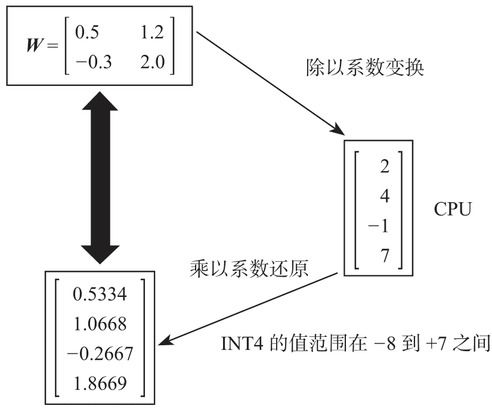

图 3-2 INT4 量化实现过程

由图 3-2 可见，若仅做简单系数变换，INT4 取值范围仅 -8～7，共 16 个等级，对浮点数的表达误差会比较明显。因此实际采用 INT4 时通常引入分组缩放系数与零点校正等手段压低误差。

### 3.3 部署算力的预估

算力是否够用，可用简易判断逻辑。

① 能否启动，关键看存储资源是否充足。
② 运行快慢，则取决于参与运算的计算单元。

模型部署在图形处理器机器上时，需要的存储即为图形处理器显存，计算单元指 CUDA 核心与加速单元；以量化方式运行在中央处理器上时，需要的存储是机器物理内存，计算单元则是 CPU。因此满足最低运行要求的条件本质上可先算存储。

**3.3.1 DeepSeek 内存消耗情况**

大语言模型装载后占用的空间取决于参数总数与每个参数的字节数。比如参数量 671B 的模型，若采用 FP8 精度，每个参数占 1 字节，空间为“6710 亿×1 字节”，再换算成 GB。字节与 GB 关系如下。

1GB=2³⁰字节=1073741824 字节

计算公式如下。


按此公式，671B 模型的权重约占 625GB。再叠加 KV 缓存与框架开销等额外部分，通常要多计约 30%，总消耗约 625GB×1.3≈812.5GB，估算时取整为约 800GB。30% 额外占比为经验值，会随工具与优化策略变化，并非精确数。例如 7B 模型在半精度下用 transformers 直接推理约需 15GB 内存，用 vLLM 则可能到约 18GB。表 3-4 为 DeepSeek 各系列在不同精度下的存储预估。

**表 3-4 DeepSeek 各种模型在不同精度下占用内存的估算情况**

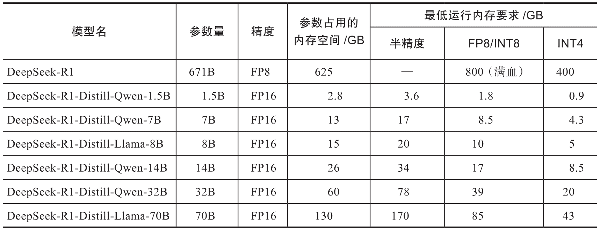

该估算方法同样适用于其他模型。以 GLM-4-9B 为例，半精度约需 22GB，FP8/INT8 约需 11GB，INT4 约需 5.5GB。

**3.3.2 算力预估结果**

先按最低存储需求估算，再对照显卡规格即可折算机型。DeepSeek-R1 的 671B 版本满血需要约 800GB 显存，8 卡 H100 单机显存为 640GB，则需要 2 台同配置机器。表 3-5 以 A800、RTX4090 为例说明。对推理卡的要求一是兼容该系列系统，二是单卡或总体显存要超过最低运行需求。

**表 3-5 DeepSeek 的模型部署设备估算示例**

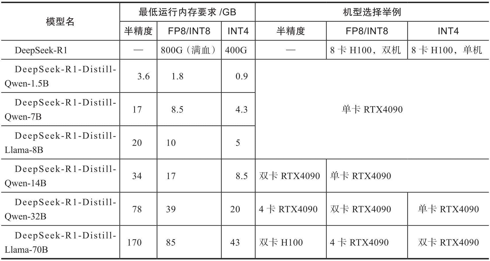

若采用量化部署并在 CPU 上运行，只需物理总存储大于最低需求即可。例如 DeepSeek-R1 的 4bit 量化版本在无图形处理器环境下峰值物理内存需求约 400GB，512GB 内存的机器即可启动。实际使用中，Ollama 等量化工具对权重加载方式做了优化，真实消耗往往比按权重整体装载的理论值低很多。量化版本的推理性能主要受 CPU 核数与计算能力影响。

大模型的微调只能在图形处理器上进行。按部署存储估算资源如下。

全量微调存储需求=基础存储+同等梯度存储+2 倍优化器存储≈部署推理存储×4

为降低显存需求，可用 LoRA 对部分参数微调：

LoRA 微调存储需求=部署推理存储×1.1

### 3.4 中央处理器部署

大语言模型既可部署到图形处理器机器，也可通过量化在无图形处理器的机器上利用物理内存与 CPU 推理。针对 DeepSeek，常用量化方案为 llama.cpp，部署测试可借助 Ollama。

Ollama 是一个本地大模型推理工具，可在本地运行 Llama 3.3、DeepSeek-R1、Phi-4、Mistral、Gemma 3 等模型。默认量化格式为 GGUF，支持 4-bit、5-bit、8-bit 等多种级别，可在模型大小与效果间权衡。兼容性好，适合 CPU/GPU 混合部署。下面介绍在未安装图形处理器的机器上部署 DeepSeek 的流程。

**3.4.1 Ollama 于 Windows 的安装**

Windows 安装包可在官网 https://ollama.com/download 获取，如图 3-3 所示。

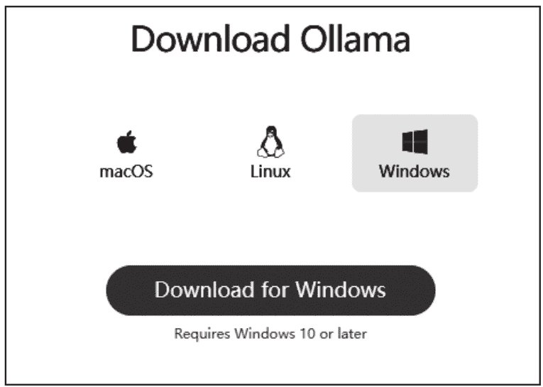

图 3-3 下载 Ollama 的 Windows 安装程序

运行下载的 OllamaSetup.exe 完成安装。安装后打开命令行或 PowerShell，输入“ollama -v”验证安装。为让本机外的机器访问 Ollama 服务，需在系统环境变量中新增 OLLAMA_HOST，值设为 0.0.0.0。设置完成后重启 Ollama 服务使参数生效。

**3.4.2 Ollama 于 Linux 的安装**

Linux 上最简洁的安装方式是使用官网上给出的一条命令。


执行 install.sh 时下载速度可能较慢，可更换为国内源，例如使用以下命令从 aliendao.cn 拉取安装包，速度明显更快。


注意上述链接可能失效，可自行搜索可用的下载路径。安装完成后用“ollama -v”校验，输出版本号即表示成功。

若要让其他机器访问服务，按以下步骤修改配置。

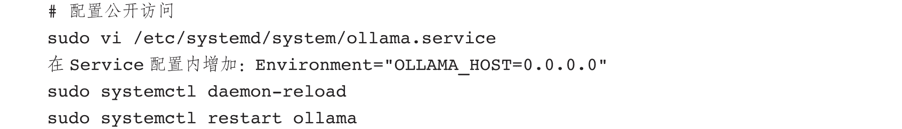

查看 Ollama 服务日志可使用：


**3.4.3 DeepSeek 在 CPU 上的部署**

先在 Ollama 官网上检索 DeepSeek 的量化模型，如图 3-4 所示。

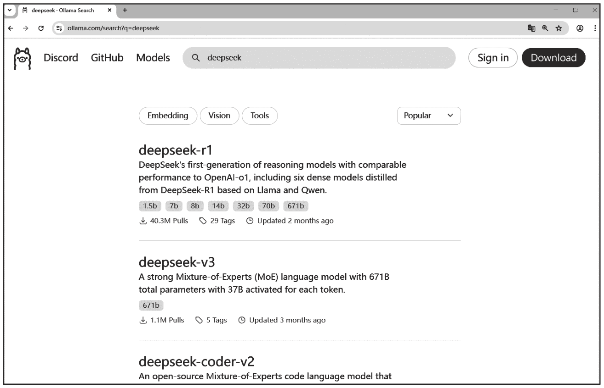

图 3-4 搜索 DeepSeek 量化模型

选定模型后，选择模型类型，如图 3-5 的①处所示，②处为实际执行的命令，示例代码如下。

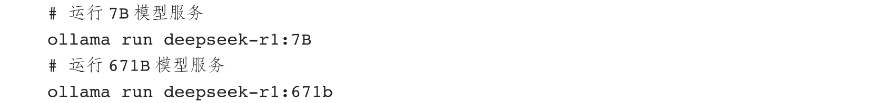

图 3-5 中还需关注两个信息：③处为模型下载后占用的磁盘大小，④处为量化算法，常见有 Q4、Q8 等，不同算法推理误差不同。

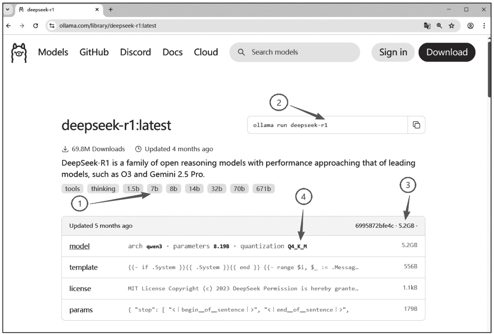

图 3-5 选择模型的类型

以 DeepSeek-R1-Distill-Qwen-7B 的 Q4 量化版为例，执行以下命令。


首次运行会自动从 Ollama 官网下载权重。下载完成后模型载入内存，提供交互式服务，输入问题即可得到推理结果。运行效果如图 3-6 所示。

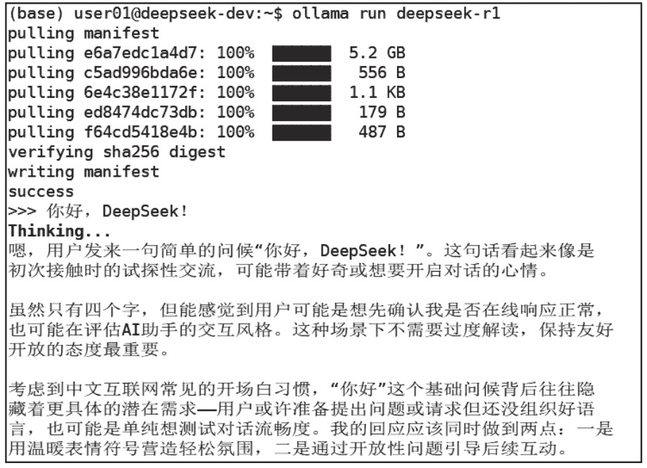

图 3-6 Ollama 运行结果

### 3.5 图形处理器部署

DeepSeek-AI 官方推荐用 vLLM 或 SGLang 加载模型提供服务，本书选用 vLLM。

vLLM 是加州大学伯克利分校团队开发的高效大模型推理与服务框架，依托创新的 PagedAttention 算法和高效内存管理，显著提升推理速度，适合高并发场景。 ^()兼容性良好，支持 Transformer 架构、混合专家架构如 Mixtral、DeepSeek-V3、DeepSeek-R1 等，以及嵌入模型和多模态模型。vLLM 是 Python 库，可通过命令“vllm serve”加载权重并提供推理 API。

**3.5.1 vLLM 安装**

1.建立虚拟环境

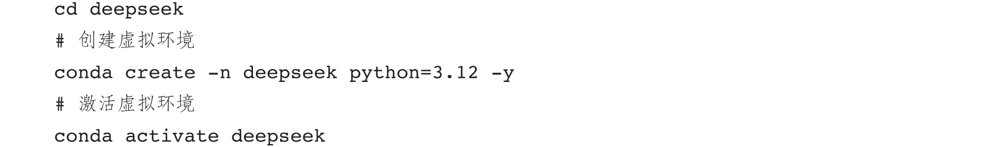

2.安装依赖库

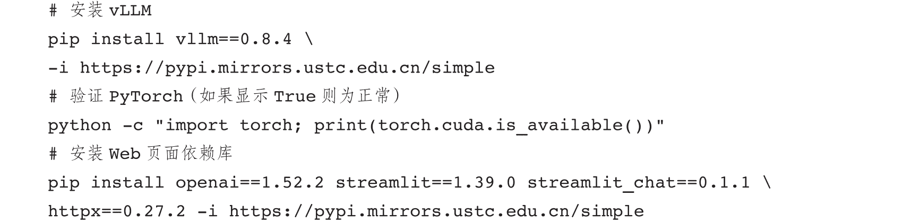

**3.5.2 DeepSeek 在 GPU 上的部署**

以下以 RTX3090，24GB 显存的卡上部署 DeepSeek-R1-Distill-Qwen-7B 为例。

1.下载模型

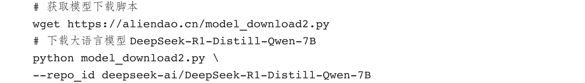

2.运行模型服务

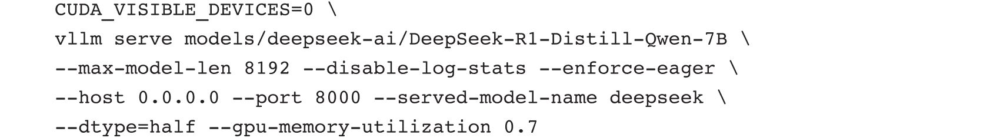

“vllm serve”参数说明如下。

❍max-model-len：模型上下文长度，即输入问题最大长度。
❍disable-log-stats：关闭统计日志。
❍enforce-eager：使用 PyTorch eager 模式，提升性能。
❍host：服务绑定的 IP，0.0.0.0 表示监听所有 IP。
❍port：服务端口。
❍served-model-name：客户端调用时使用的模型名。
❍dtype：权重数据类型，T4 卡建议设为 half。
❍gpu-memory-utilization：分配给执行器的 GPU 内存比例，设为 0.7 时约占用 17GB，与表 3-4 估算相近。

运行结果如图 3-7 所示。

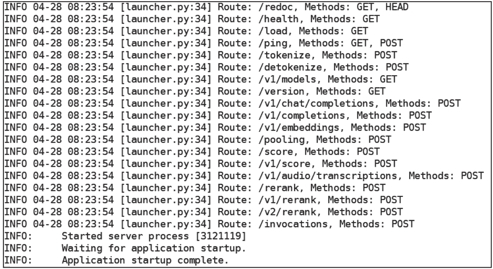

图 3-7 vLLM 运行 DeepSeek 模型的结果

**3.5.3 算力资源监控**

服务运行或训练时，监控算力资源有助于排查问题。可用“nvidia-smi”实时查看 GPU 编号、名称、温度、功耗、显存使用量、GPU-Util 等。若 GPU-Util 长期接近 90%，说明计算核心高负荷；显存占用接近上限时易出现 OOM。加上“-l 秒数”参数，如 nvidia-smi -l 1，可定时刷新数据。

**3.5.4 验证部署成果**

Ollama 部署后可在终端交互输入问题。vLLM 部署后仅提供 API 服务，无交互界面。为统一测试，可编写基于 streamlit ^()的简单 Python 程序 chat_bot.py。

1.Chat_bot 源代码

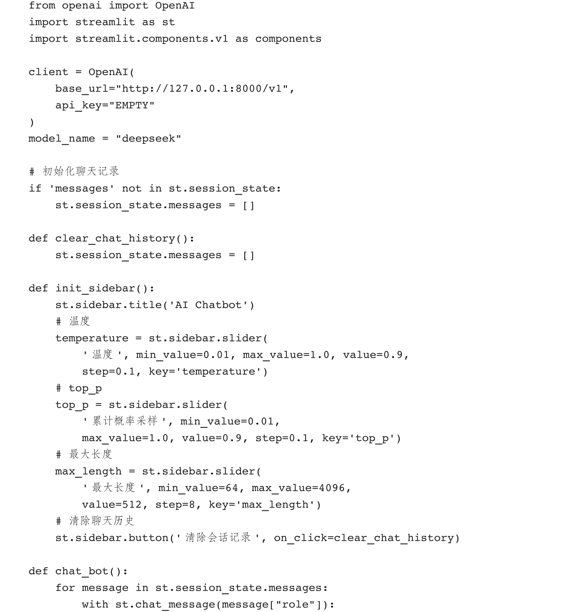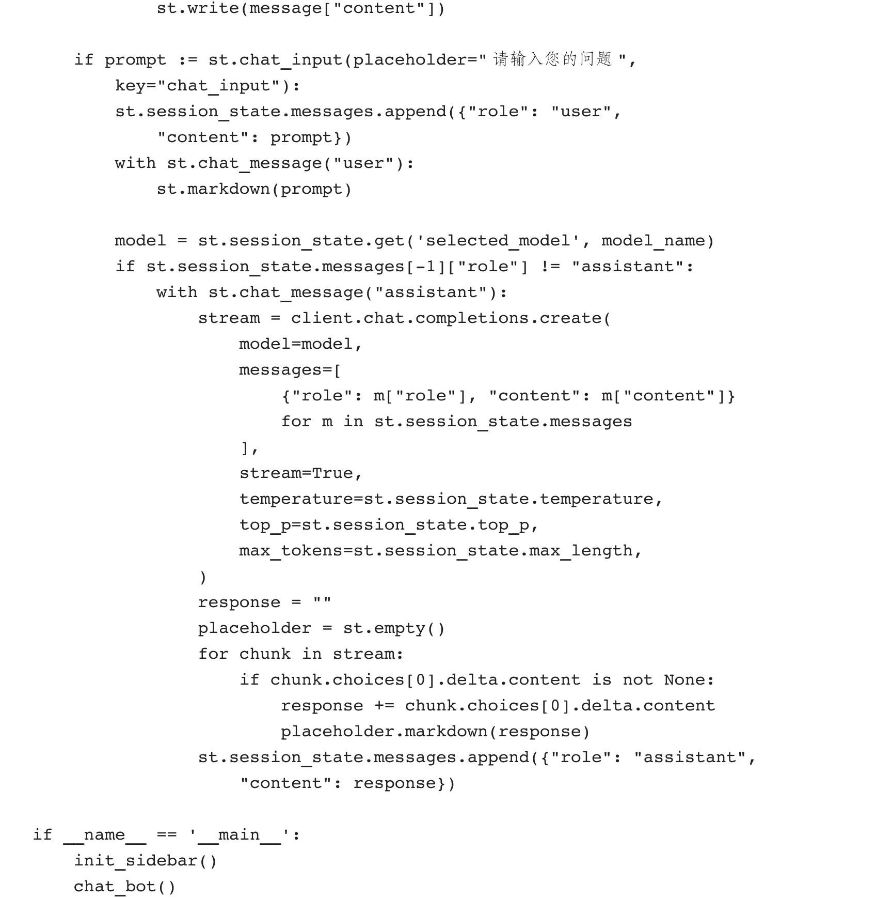

2.运行 Chat_bot

先启动 vLLM 服务，再执行以下操作运行 Chat_bot。

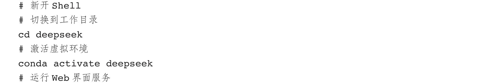

运行效果如图 3-8 所示。

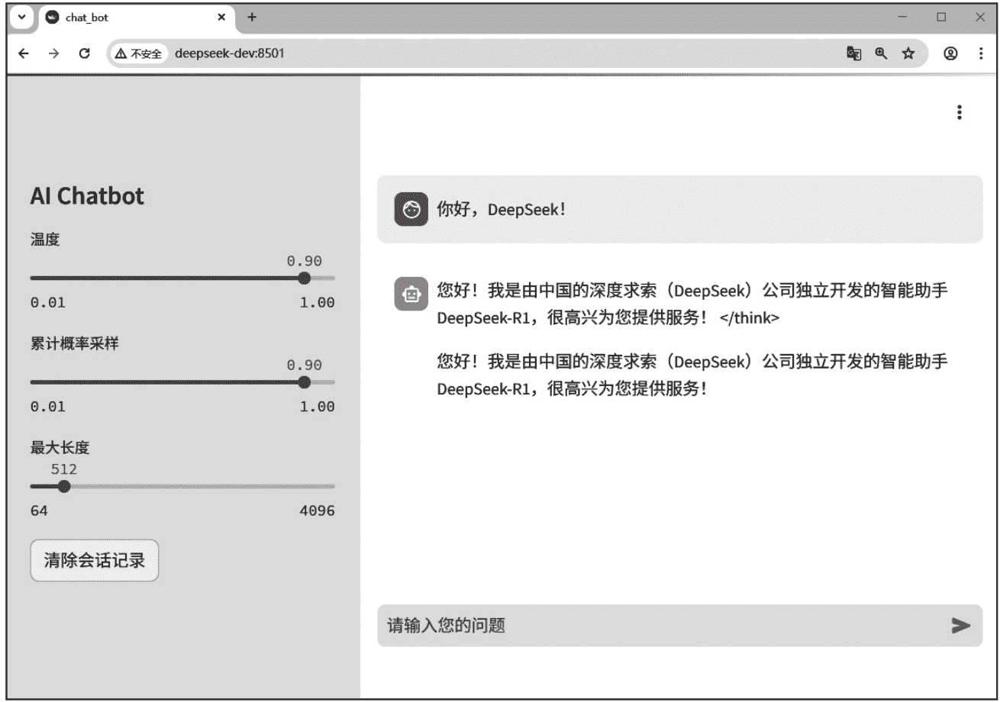

图 3-8 Chat_bot 运行结果

上述 chat_bot.py 连接的是 vLLM 服务。若要连接 Ollama 服务，需做两处改动：①将第 6 行 base_url="http://127.0.0.1:8000/v1" 中的端口 8000 改为 Ollama API 端口 11434；②将第 9 行 model_name="deepseek" 改为 Ollama 部署的实际模型名，如 deepseek-r1。

## Chapter 4 第四章 构建 Chat 应用

Chat 应用是企业级大模型应用的基础，用户输入问题或提示词，模型返回答案。若模型具备深度思考能力，输出会包含思考过程和最终答案。第三章的 Chat_bot 仅作验证，设计过于简单，难以满足企业需求。企业级应用通常像 DeepSeek 官网对话应用那样，支持文件上传、本地知识检索等。

Chat 应用以文本交互为主。开源社区有大量桌面客户端形式的 Chat 程序，适合个人使用；企业场景更倾向 Web 架构，通过浏览器访问，便于管理和协作，同时需考虑吞吐量、性能和安全性。

本章将介绍 LibreChat 和 Open WebUI 这两种基于 Web 的开源 Chat 应用的部署与使用，并扩展说明如何结合 draw.io 创建流程图和架构图。

### 4.1 企业应用场景

基于本地化部署的 DeepSeek 的模型开发 Chat 应用，适用于对数据隐私、安全性和定制化要求高的企业生产场景。主要应用场景和优势包括：

（1）搭建与查询企业内部知识库

把模型留在自家机房：5个落地场景与两款开源前端实操全记录

把自托管模型用在内部问答上，员工查规章、查技术资料、查产品手册都能在内网完成，沟通成本被压缩，工作流更顺畅。数据全程不出边界，推理和计算都在自有服务器里跑，不需要把敏感信息送到公有云，泄密风险大幅下降。本地响应更快，还能拿企业私有知识库做微调，让回答更贴合业务语言。

（2）医疗健康诊断辅助
医院借助 Chat 交互可以自动撰写病历要点、解读医学文献、给出参考性诊断意见，帮助医生做出更稳妥判断。模型本地化部署后，患者数据始终留在院内系统，隐私得到严格保护。针对医疗垂直场景做微调，专业准确度与任务相关性都会明显提升。

（3）教育行业个性化学习体验打造
学校和培训机构能搭建基于 Chat 交互的智能辅导模块，提供解惑、作业批改、知识点讲解等功能。系统可依据每个学习者的掌握情况给出差异化反馈，促进知识内化。

（4）制造业设备运维与技术支持提供
在产线侧部署 Chat 应用可实现设备维护指引、故障排查、生产流程优化，助力提升良品率与产能。结合内部技术文档做智能分析与预测，能提前发现隐患，避免停产损失。

（5）自动化客服机器人实现
企业可搭建本地客服机器人承接高频标准化咨询，分担人工压力并稳定服务品质。本地化部署减少对云服务的依赖，运营成本可控。微调后熟悉行业术语的机器人理解更精准，交互体验更有人情味。

### **4.2 LibreChat 的部署和应用**

**4.2.1 LibreChat 简介**

LibreChat 是一款可深度定制的开源对话程序，支持本地化运行，也能接入 OpenAI、Claude、Gemini 等云端服务，同时可配合 vLLM、Ollama 等工具本地启动的大模型使用。引入企业后可保存、导入导出对话记录，长会话场景下非常实用。平台提供多用户登录和权限控制，对企业安全至关重要。

LibreChat 并非 Python 生态项目，采用 React.js 前端与 Node.js 后端的 JavaScript 技术栈，以 MongoDB 持久化对话记录。组件较多，前端需要编译打包，后端需要部署，手动操作繁琐。本节选用 Docker 部署。Docker 能一次性拉起包含完整运行环境的容器，过程简便可靠。

**4.2.2 LibreChat 的安装与配置**

**1.部署 Docker 环境**

Docker 是一种依托 Linux 实现的轻量隔离技术，将应用依赖打包进容器统一管理。Windows 下也能运行，需配合 WSL2 支持。本示例仅说明 Ubuntu 系统的部署流程。

（1）准备依赖包


（2）配置镜像源

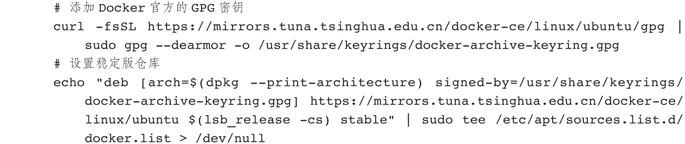

（3）执行安装


（4）校验安装


（5）切换 Docker 镜像

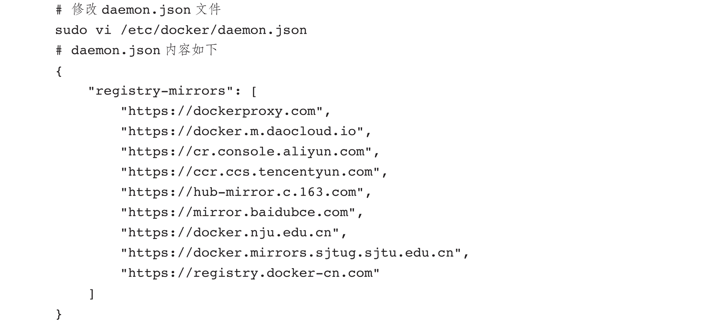

（6）重启服务


（7）校验 DockerCompose


**2.部署 LibreChat**

（1）启动大语言模型服务

参考 3.4 和 3.5 节，按需采用 vLLM 或 Ollama 启动大语言模型服务。

（2）获取源码

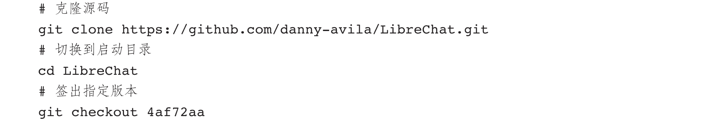

（3）LibreChat 配置

为让 LibreChat 连接本地部署的 DeepSeek 服务，需要对配置文件进行如下修改。


上述配置对应 vLLM 部署的 DeepSeek。若改用 Ollama，则把端口由 8000 改为 11434，并将 models→default→deepseek 下的模型名替换为 Ollama 实际加载的名称。

（4）启动 LibreChat


**3.LibreChat 应用**

在浏览器打开 http://deepseek-dev:3080，完成注册并登录，如图 4-1 所示，将 DeepSeek 设为默认模型。


图 4-1 配置 LibreChat 的默认模型服务

用户输入问题后，LibreChat 调用 DeepSeek 进行推断并返回结果。也可上传文件供模型分析并作为知识库使用。效果如图 4-2 所示。


图 4-2 用户与 LibreChat 的问答过程

### **4.3 Open WebUI 的部署和应用**

**4.3.1 Open WebUI 简介**

Open WebUI 是一个可扩展、功能丰富且操作简便的大模型前端。既支持本地化部署，也兼容多种 API，包括 vLLM、Ollama 等，并与 OpenAI API 保持一致。此外内置 RAG 推理引擎，可对用户上传的文件进行深度解析，提供更精准响应。

Open WebUI 依赖 Python 包 open-webui 和命令 open-webui serve 启动。和 LibreChat 一样可使用 Docker 部署，但因其依赖较少，本节采用 Python 虚拟环境安装。为满足企业级需求，前端额外增加 Nginx 应用服务器 ^(⁵)，提升安全性与扩展性。

**4.3.2 Open WebUI 的安装与配置**

**1.安装 Open WebUI**


**2.启动大语言模型服务**

参考 3.4 和 3.5 节，按需用 vLLM 或 Ollama 启动大语言模型服务。

**3.Open WebUI 应用**


上述配置中，OPENAI_API_BASE_URL 指向 vLLM 启动的服务。若使用 Ollama，则把端口从 8000 改为 11434，并将 DEFAULT_MODELS 设为对应模型名。

在浏览器访问 http://deepseek-dev:8080 打开 Open WebUI。首次使用需注册管理员账号。登录后可输入问题或上传文件与截图，模型推断后返回结果，如图 4-3 所示。

**4.安装与配置 Nginx**

Open WebUI 默认监听本地 8080 端口。若直接暴露到外网，企业将面临安全与性能风险。公网运行时使用 SSL 证书加密传输至关重要。企业应用通常在 8080 前加一层应用服务器做反向代理，实现负载均衡、SSL 加密、访问白名单与流量控制，从而强化整体安全。


图 4-3 Open WebUI 运行效果

Nginx 是一款高性能 HTTP 与反向代理服务器，需单独安装。

（1）Nginx 在 Windows 上的安装

①从 https://nginx.org/en/download.html 下载 Windows 安装包。

②解压到指定目录完成安装。

（2）Nginx 在 Ubuntu 上的安装


（3）Nginx 配置

常用配置文件位于 /etc/nginx/sites-available/default 或 /etc/nginx/conf.d/nginx.conf。在其中新增 server 块，监听 80 端口，HTTPS 时监听 443 端口，将请求转发至 Open WebUI 的 8080 端口。

以下为将 HTTP 请求转发到 Open WebUI 的示例。


若启用 HTTPS，需在配置中指定证书文件 .crt 与私钥文件 .key 路径，并在 server 块开启 SSL。

企业级服务需优化 Nginx 性能。

❍worker_processes：设为 auto 或 CPU 核数。

❍worker_connections：默认 1024，建议调至 10240。

配置完成后测试语法并重启服务使变更生效。


至此 Nginx 已作为 Open WebUI 的反向代理。通过域名或 IP 访问，所有流量经 Nginx 转发，可提升安全与性能。

### **4.4 结合 draw.io 制作图表**

DeepSeek 能生成文本，若需图表则需配合绘图工具。draw.io 是一款开源免费的图表绘制工具，支持流程图、架构图、UML 等。DeepSeek 与 draw.io 协同的核心是让模型输出可导入 draw.io 的 XML 文本。

draw.io 默认文件后缀为 .drawio，内部以 SVG 矢量图 Base64 编码保存。DeepSeek 不能直接生成该二进制文件，但 .drawio 可导出为 XML 纯文本，反之 XML 亦可被 draw.io 打开。因此可通过让模型生成 XML 来制作图表。

**4.4.1 设计提示词**

要生成美观且内容丰富的 draw.io 图表对应的 XML，提示词需包含明确业务需求并给出格式示例，输出更贴合需求且更规范。示例如下。

现在需要一个大模型应用系统的部署架构图，使用 Web 结构，K8S 部署。

请直接帮我用 draw.io 默认的文件格式生成，输出的 XML 可以直接用 draw.io

工具加载。XML 的格式举例如下：


注意：mxCell 元素的属性不能重复定义

**4.4.2 使用 DeepSeek 生成 XML 文件**

使用已部署的 LibreChat、Open WebUI 或线上 DeepSeek 服务输入上述提示词，生成 XML 并保存为文件。

XML 质量取决于模型能力，可能存在格式问题。可双击用浏览器打开检查报错，若呈现层级结构则正常，否则需重生成或手工修正。量化模型经 Ollama 本地部署时出错概率更高，vLLM 部署或线上 DeepSeek 一般较稳。

**4.4.3 用 draw.io 打开 XML 文件**

用 draw.io 打开生成的 XML 文件后可做少量美化与调整，使其更贴合意图。样例效果如图 4-4 所示。


图 4-4 DeepSeek 生成的 draw.io 图表示例

**4.4.4 高级制表应用**

上述提示词生成的样式相对固定。如需更多样式，可采取以下做法。

**1.克隆 draw.io 的源码**


进入 examples 目录挑选合适模板，通过“文件→导出→XML”导出为 XML 文件。

**2.优化提示词**

可用导出 XML 作为提示词示例。目前主流大模型输入窗口普遍超过 8K，只要提示不超过 8K 即可使用，超长时可删减中间内容。如图 4-5 所示为以 infographic-project-steps.drawio 为例优化后的结果。


图 4-5 draw.io 图表优化结果

## **Chapter 5 第五章 构建 AI Agent**

AI Agent 即智能体，是一种能感知环境、自主决策并执行动作的智能实体。在大语言模型支撑下，Agent 可完成用户设定的目标或任务，融合感知、推理、学习与行动能力，是人工智能的重要研究方向与应用工具。与被动应答的模型服务不同，Agent 具有主动性。用户给出宏观目标后，Agent 通过主动规划、决策与执行逐步分解并完成任务。发展过程中涌现 ReAct、ToT、Reflexion、CoT 等思考范式，Agent 借助特定提示策略从大模型中获得可执行文本或代码，驱动流程推进。

自 2022 年底 ChatGPT 掀起 AI 热潮以来，Agent 已快速发展约三年。2025 年 3 月 6 日发布的 Manus ^(⁶) 将 Agent 热度推向新高。本章介绍两个开源 Agent 产品的部署与应用，结合 DeepSeek 服务帮助读者理解 Agent 原理及其企业场景。

### **5.1 企业应用场景**

Agent 技术在企业落地场景广泛，核心优势在于自动化决策、个性化服务与多任务协同。

（1）复杂任务自动化

针对多角色、多步骤且结果以文本为主的任务，Agent 可在模型支持下进行任务拆分与自动化执行。多 Agent 动态协作可按角色分工，而模型驱动的工具则灵活完成具体操作。

（2）数据的收集和整合

Agent 能依据用户目标自动拆解数据需求，通过内置工具从数据库、网站、文档等源采集数据，再借助 DeepSeek 等模型整理、分析、润色，最终形成完整报告。优势体现在工具调用、执行与思考能力上。

（3）代码生成与调试一体化

Agent 依托思考框架生成提示词，利用大模型的推理能力自动生成可执行代码片段，并通过 Python 虚拟环境、Docker 容器等运行。运行结果会反馈到下一轮迭代中，验证代码准确性并对真实世界产生持久影响。相比之下，Chat 应用仅能生成答案，作用局限于虚拟层面，无法主动影响物理世界。

### **5.2 camel-ai/owl 的部署与应用**

**5.2.1 camel-ai/owl 简介**

camel-ai/owl 是基于 CAMEL-AI 体系构建的多智能体协作平台，设计初衷是通过动态 Agent 之间的互动，把复杂现实任务推进到自动化落地。^(⁷)

平台自带搜索引擎实时召回能力，能即时补足外部知识；多模态引擎可同时处理视频、图片、语音等多种输入。借助 Playwright 框架 ^(⁸) 实现浏览器级自动化，支持页面滚动、点击、输入、下载、历史回退等操作，行为接近真人浏览。文件侧可解析 Word、Excel、PDF、PPT 等格式并抽取结构化信息，还集成了学术论文检索、音频分析、图像生成、代码执行、数学计算、符号计算等工具集合，能够按需组合满足细分任务。

下面以安装与实战为主线，介绍 camel-ai/owl 的部署方式，并通过一次借助 DeepSeek 做实时检索并整理报告的案例，说明其在企业场景中的使用路径。

**5.2.2 camel-ai/owl 安装指南**

**1.下载源码**


**2.安装**


**3.运行大模型服务**
camel-ai/owl 可对接本地大语言模型，但前提是模型具备工具调用能力。示例代码 examples/run_ollama.py 演示了 Ollama 的接入方式，其官方支持的模型以 Qwen2.5:72B 和 LLaVA 为主，并未原生支持 DeepSeek。本节以 vLLM 作为推理服务进行说明。

先按 3.5 节搭建 vLLM 运行环境。针对 DeepSeek 的工具调用需求，启动参数有所调整，具体命令如下。


参数要点如下。
① max-model-len：多数场景 8k token 即 8192 词元已够用，但 Agent 执行时需要整合大量上下文并进行多轮对话，建议提升到 32k token 即 32768 词元。长度提升会线性增加 GPU 显存占用。
② served-model-name：camel-ai/owl 默认会去连 DeepSeek 官方的 deepseek-chat 模型。为避免修改源码，可将 vLLM 启动时的服务名称设为 deepseek-chat 实现无缝对接。
③ gpu-memory-utilization：max-model-len 拉到 32k 后，若该值过小，vLLM 启动会报 KV 缓存溢出。建议调高至 0.9，模型启动后约占用 22GB GPU 显存。
④ enable-auto-tool-choice：开启后大模型可在推理过程中从提示词提供的工具声明中自行挑选合适的工具并生成调用参数，实现动态工具选择。
⑤ tool-call-parser hermes：使用 Hermes 解析器解析模型输出的工具调用请求，例如 JSON 格式的 API 参数。

**5.2.3 camel-ai/owl 实践演示**

**1.环境变量设置**
与多数 Python Agent 一样，camel-ai/owl 可通过修改 .env 文件或在启动前设置系统环境变量来配置参数，两者效果等同。Linux 与 Windows 的设置方式略有差异。接入 DeepSeek 需配置 DEEPSEEK_API_KEY 与 DEEPSEEK_API_BASE_URL，模型名固定为 deepseek-chat，无需额外指定。


**2.验证 DeepSeek 测试程序**
为 DeepSeek 定制的示例位于 examples/run_deepseek_zh.py。在环境变量就绪后，执行命令即可完成“检索 OWL 项目最新新闻并生成报告，最后保存到本地”的目标任务。


运行过程如图 5-1 所示。

图 5-1 camel-ai/owl 的 DeepSeek 例程运行情况

该例程也支持将任务目标作为参数传入，示例如下。


**3.运行 WebUI 应用**
命令行方式适合作为工具调用，但对非技术人员门槛较高。owl/webapp_zh.py 提供了 WebUI，默认监听 localhost:7860。本机访问无问题，若在 Linux 上部署并希望从 Windows 等其他机器浏览器访问，则需做小幅改动。


完成 DeepSeek 环境变量配置后，使用如下命令启动 WebUI 服务。


在浏览器打开 http://deepseek-dev:7860，输入目标任务“通过百度搜索采集相关信息，总结 DeepSeek 的技术特点和优势，形成一篇 3000 字的总结报告”，并将 run_deepseek_zh 设为中文处理模块后点击“运行”。运行过程如图 5-2 所示。

图 5-2 camel-ai/owl 的 WebUI 运行过程

### **5.3 OpenManus 的部署与应用**

**5.3.1 OpenManus 概览**
2025 年初，DeepSeek 与 Manus 成为国内 AI 圈的焦点。DeepSeek 以清晰的思维链和高质量生成备受青睐，Manus 则以通用型 AI Agent 的表现获得市场关注。不同于 DeepSeek 的开放访问，Manus 采用邀请码注册，使用门槛较高。于是以“复现 Manus”为目标的开源项目涌现，OpenManus 由 MetaGPT 团队推出，是一个简洁的通用 Agent 实现方案，仍在持续迭代。

**5.3.2 OpenManus 安装**
**1.下载源码**


**2.安装**


**3.配置**
（1）复制配置文件

（2）修改配置文件
修改 config/config.toml，内容如下。


**5.3.3 运行 OpenManus 应用**
**1.运行单智能体应用**
先启动一个简单的单 Agent 应用，执行命令。


输入任务，例如“用 Spring MVC 开发一个图书管理信息系统”，结果如图 5-3 所示。

图 5-3 OpenManus 单智能体应用运行结果

**2.运行多智能体应用**
多 Agent 模式由多个角色协作完成任务，执行命令。


输入任务，例如“撰写一份在型材生产企业中实施 DeepSeek 的项目建议书，使用中文书写”，结果如图 5-4 所示。

图 5-4 OpenManus 多智能体应用运行结果

**5.3.4 运行 OpenManusWeb 应用**
企业级应用需要直观的图形界面并支持浏览器访问，OpenManus 原生未集成 WebUI。为此可采用 YunQiAI 团队的 OpenManusWeb 分支，在保留核心能力的同时增加 Web 支持，并基于 WebSocket 实现与 Agent 的实时通信，可即时展示推理步骤与结果。

**1.下载源码**


**2.配置**
配置方式与 OpenManus 相同，修改 config/config.toml 并参照原项目配置 LLM 相关参数。

**3.安装 WebUI 依赖库**
OpenManusWeb 与 OpenManus 共用 open_manus 虚拟环境，激活后需额外安装 watchdog 和 websockets。


**4.运行应用**
默认会进行 30 次迭代后输出结果，测试时可适当调小迭代次数，生产环境则需综合准确度、算力与等待时长权衡。修改方式如下。


使用命令打开 WebUI。web_run.py 默认监听 8000 端口，与 vLLM 服务冲突，建议用 “-port 7860” 避开冲突；“-no-browser” 表示启动时不自动打开浏览器，在 Linux 上可避免无意义提示。


访问 http://deepseek-dev:7860，输入任务，例如“请撰写一个螺纹钢的热处理工艺流程”，结果如图 5-5 所示。

图 5-5 OpenManusWeb 应用运行结果

## Chapter 6 第六章 构建 RAG 应用

检索增强生成 Retrieval-Augmented Generation 将信息检索与文本生成融合，通过向量化与语义检索提升召回质量，再把检索内容与用户输入结合，促使大模型给出更准确可靠的回答。RAG 的提出旨在缓解大模型的知识固化、幻觉、专业领域匮乏与可解释性不足等问题。训练完成后大模型无法实时更新，RAG 通过动态检索外部知识库拓展输入边界，使输出更具时效性。

随着 DeepSeek 等混合专家模型的强势发展，RAG 的定位也在演进。早期主要用于补足专业知识，如今更侧重文档分析、联网检索与结果可信度增强。本章介绍 Dify 与 SearXNG 两款 RAG 相关产品的部署与使用，并探讨企业落地思路。

### 6.1 企业应用场景
RAG 的核心目标是提升知识密集型任务的准确性、可靠性和可信度。从用户视角看，传统大模型像黑盒，输入问题得到答案却难以验证。DeepSeek-R1 在一定程度上暴露了思考过程，但改进仍有限。人们更习惯借助搜索引擎、知识平台或企业内部文档来交叉验证，尤其在编程、医疗、工业生产等严谨场景。

RAG 通过外部知识库的动态检索，一方面扩充上下文让推理更贴近预期，另一方面在生成结果中呈现知识来源，相当于把搜索引擎与大模型整合。来源既包含知识库，也包含模型本身，模型负责分析筛选与讨论验证。像 DeepSeek-R1 展示的思考链，与人类讨论验证的思路一致。

RAG 的效果高度依赖数据质量与模型的推理能力。优质本地化数据稀缺，企业自有数据很可能已进入模型训练集。因此 RAG 多用于分析上传文档或充当企业内部资料的语义搜索引擎。而互联网数据体量巨大，将互联网搜索与大模型结合是重要方向，如 DeepSeek 的联网搜索功能同时给出答案与网页依据，相当于为结论提供参考文献，增强可靠与深度。

### 6.2 RAG 的工作原理
“增强”体现在检索增强与生成增强两个层面。

检索增强指借助嵌入模型实现语义检索。语义检索基于向量相似度匹配，与传统 SQL 全文或模糊匹配不同，它能在自然语言层面进行宽泛召回，例如“DS 大模型”与“深度思考”都能命中与 DeepSeek 相关的片段，这些片段随后进入模型输入。

生成增强指把检索结果与原始问题融合为更完整的提示词，借助大模型的重组、归纳与推理能力输出更全面准确的回答。

工作流程如下。
**1.文档预处理**
长文档难以用单个向量完整表征，预处理需将其切分为较短的段落或句子，形成片段集合。常见策略有固定长度分块、语义分块与重叠分块。中文文档常按句号、问号、感叹号或段落、章节进行语义切分。
**2.向量化**
使用嵌入模型为每个片段编码为高维向量，捕捉语义信息并存入向量数据库。查询时同样把用户问题向量化，再与库中向量做相似度比对。
**3.向量检索**

面对用户提出的问题，系统会调用与文档处理时一致的编码模型，把问题转成向量表示。随后在向量空间里，用余弦相似度或内积等方法衡量问题向量和全部文档向量的接近程度，挑出最相关的一部分文本块返回。返回量的控制可以是固定取前 N 条，也可以设一个相似度门槛，把明显偏离主题的片段筛掉。

**4. 生成增强**
在检索环节拿到相关片段后，RAG 的下一步是把这些片段和原始提问拼在一起。为了让大模型更好地把检索信息和问题对齐，通常会套用专门的提示模板，帮助模型理清引用关系。模型在综合原始问题、检索到的上下文以及自身学到的知识后，输出一个融合性的回答。这个回答既回应了提问本身，也带入了检索源中的关键信息。最后，RAG 会把生成的答案连同来源出处一起交还给用户，出处一般以链接列表呈现，方便核查。

### **6.3** **Dify：知识库与大模型一体化平台**
**6.3.1** **Dify 概览**
Dify 定位为开箱即用的大模型应用搭建平台，内置 RAG、智能体和对话三大能力，操作界面图形化友好。在检索增强方面，它实现了从文档导入到语义检索的闭环，兼容 PDF、PPT 等多种常见格式。智能体模块同样成熟，支持基于 Function Calling 或 ReAct 的 Agent 自定义，可接入搜索、绘图、学术搜索引擎等 50 余款内置工具。^(⁹)

**6.3.2** **Dify 安装**
Dify 前后端分离开发，后端 API 由 Python 承载，前端界面用 TypeScript 实现。纯源码安装依赖繁多，操作步骤冗长，对新手不友好。因此官方推荐 Docker 部署，一键式镜像内部已打包好前后端、关系型数据库、向量数据库及 SSL 证书等核心组件。
Dify 功能丰富但部署门槛不低，对模型资源也有一定要求，下面按顺序操作。

**1.Docker 安装**
参考 4.2.2 节的步骤进行 Docker 安装。

**2.模型准备**
本次演示要把知识库和大模型打通，所以既要准备对话推理用的模型，也要准备做向量检索的嵌入模型。部分自定义工作流还会调用 OpenAI 接口，指定型号为 gpt-3.5-turbo 或 gpt-4o-mini。需求如此繁杂，本地用 vLLM 部署压力较大，公网模型又难以满足企业内网诉求，而 Ollama 在本地加载模型更灵活易行。


**注意**
早期 Dify 版本存在兼容性问题，示例代码里曾把 DeepSeek-R1 量化权重复制并改名为“gpt-4o-mini”。现版本已修复，直接选用“deepseek-r1”即可。

**3.下载源码**
Dify 迭代很快，功能和配置随时会变。为了保证教程与实际代码一致，建议拉取代码后用 git checkout 锁定到指定版本，避免后续更新导致步骤失效。


**4.安装**
安装阶段务必调整 .env 中的 pip 镜像源。未修改时，后续配置可能 silently 失败，前端也不会提示错误，排错非常困难。具体做法是把 PIP_MIRROR_URL 改为可用的 pip 镜像地址。


**5.配置**
打开浏览器访问 http://deepseek-dev/install，先创建管理员账号。登录后，日常使用请统一访问 http://deepseek-dev/。
（1）安装模型供应商 Ollama
如图 6-1，点右上角用户头像，进入“设置”→“模型供应商”，依次接入 Ollama 与 OpenAI。


图 6-1 安装模型供应商
安装的结果如图 6-2 所示。
（2）配置模型参数
OpenAI 供应商的配置里，API Key 可随意填，组织 ID 随意，重点是把 API Base 指向 Ollama 服务地址，模型名无需填写，如图 6-3。
Ollama 需分别配置推理模型和嵌入模型，具体见图 6-4、图 6-5。


图 6-2 安装模型供应商的结果

图 6-3 OpenAI 模型配置

图 6-4 Ollama 模型配置（1）

图 6-5 Ollama 模型配置（2）
完成上述配置后，还要到系统设置里指定全局默认的推理模型和嵌入模型，如图 6-6 所示。


图 6-6 系统模型设置

**6.3.3** **运行 Dify 应用**
在浏览器打开 http://deepseek-dev/ 进入 Dify，后续以 ChatBot 和工作流两种典型方式演示 RAG 使用流程。

**1.建立知识库**
在工具栏点选“知识库”，新建一个库并导入测试用的文本文件。嵌入模型已选用 nomic-embed-text，索引模式保持默认的“高质量”，其余参数沿用默认值即可，如图 6-7 所示。


图 6-7 知识库索引设置
建库完成后可做召回测试，输入与文档相关的问题，验证是否能正确命中，如图 6-8 所示。


图 6-8 知识库召回测试

**2.ChatBot 应用**
先进入“工作室”，点击“创建空白应用”新建一个 Chat Bot，随后添加知识库，并在弹窗中勾选前面建好的库，如图 6-9 所示。


图 6-9 ChatBot 的知识库引用设置
切换到“探索”栏目打开该 ChatBot，对话时系统会自动引用知识库内容增强回答。如图 6-10，点击引用文件可直接跳转到库中查看原文。


图 6-10 与 ChatBot 交互时使用知识库

**3.工作流应用**
回到“工作室”，选择“从应用模板创建”，新建“Knowledge Retrieval+Chatbot”模板应用，如图 6-11 所示。


图 6-11 从应用模板创建“Knowledge Retrieval+Chatbot”应用
工作流通过可视化画布配置，在 Knowledge Retrieval 组件里挂载对应的知识库，如图 6-12 所示。


图 6-12 Knowledge Retrieval 组件挂载知识库
挂载完成后可运行测试验证，如图 6-13 所示。注意该组件会调用 OpenAI 模型服务。


图 6-13 测试运行 Knowledge Retrieval 组件
随后配置 LLM 组件，选择 deepseek-r1 作为推理模型，如图 6-14 所示，配置完毕后点右上角“发布”生效。


图 6-14 配置 LLM 组件
在“探索”里打开“Knowledge Retrieval+Chatbot”，即可体验基于工作流的 RAG 对话。工作流面板会展示各子节点耗时，便于监控，如图 6-15 所示。


图 6-15 “Knowledge Retrieval+Chatbot”应用运行情况

**6.3.4** **企业场景中的 Dify 优化**
Dify 部署步骤较多，新手上手成本不低。本章先用 Ollama 演示模型接入，但从图 6-15 可见回答准确度有限，幻觉现象明显。根源在于模型参数规模偏小且 Ollama 部署精度不足。改进方案是用 vLLM 替代 Ollama 承载推理，并把 vLLM 部署的模型设为系统默认推理模型。

**1.模型准备**
先按 3.5 节搭建 vLLM 运行环境，再用 vLLM 命令启动服务。注意 served-model-name 必须写成 deepseek-chat，以匹配 Dify 模型列表。


**2.配置模型参数**
进入“设置”→“模型服务商”→“安装模型服务商”，新增“深度求索”，填写任意 API Key，并把自定义 API endpoint 指向 vLLM 服务地址，如图 6-16 所示。
系统模型配置时，选择“深度求索”下的 deepseek-chat，映射到 vLLM 启动的 DeepSeek 服务。


图 6-16 “深度求索”模型参数设置

**3.配置应用的推理模型**
打开“工作室”，在应用列表里分别修改 ChatBot 和 Knowledge Retrieval+Chatbot 的推理模型为新模型，如图 6-17 所示，随后进行测试，观察应用的推理效果。

**4.升级**
Dify 更新频繁，如需跟进新功能，按下述步骤升级。


图 6-17 修改应用的推理模型设置

### **6.4** **SearXNG：联网搜索接入**
**6.4.1** **SearXNG 简介**
SearXNG 是一个开源免费的元搜索引擎 ^(¹⁰)，聚合了 246 条以上不同搜索引擎的结果，提供一站式检索体验。元搜索引擎通过统一入口汇总多源结果，帮助用户发挥各搜索引擎优势，提升检索效率和精准度。
实时网络数据是 RAG 外部知识的重要补充，将大模型与搜索引擎结合，既弥补了模型知识时效滞后，也省去了频繁维护本地库的负担，是简洁高效的增强方案。本节演示如何把 SearXNG 集成到 Open WebUI 搭建的 Chat 应用，实现企业级联网搜索能力。

**6.4.2** **SearXNG 安装**
**1.下载源码**


**2.配置**
（1）修改.env 文件
.env 里只需改主机名。默认只能用 https://localhost 访问，企业内网使用不便。建议把主机名改为内网 IP，便于 Docker 容器中的 Open WebUI 调用。具体修改如下。


（2）修改 docker-compose.yaml
第一次改动是 cap_drop。cap_drop 用于收敛容器内核权限，提升安全性。默认 searxng 段的 “cap_drop: - ALL” 会导致首次启动创建 /etc/searxng/uwsgi.ini 时报 Permission denied，需要按如下方式调整。


注意 docker-compose.yaml 中存在多处 cap_drop，仅需修改 searxng 部分。服务稳定后建议恢复原配置以保持安全。
第二处改动是让 SearXNG 在 127.0.0.1:8080 监听 HTTP。默认 Caddy 提供 HTTPS，若无证书网页访问会弹出安全警告，Open WebUI 调用时会因校验失败而中断。改为 HTTP 可避免此问题。


（3）修改 searxng/settings.yml
settings.yml 需做四处调整。
第一处，用 sed 生成新的 secret_key 替换默认的 ultrasecretkey，配置如下。


第二处关闭流量控制。本地部署流量可控，无需触发 Too many requests 限制，且开启后需配合额外参数。修改后如下。


第三处把 Bing 设为默认引擎，其余引擎禁用，以提升搜索效率。engines 配置如下。


第四处指定搜索结果输出格式，增加以下配置。


配置项较多易遗漏，下面给出完整参考代码。


**3.运行与测试**


首次启动会拉取镜像，耗时较长。运行中可用以下命令查看日志排查问题。


在浏览器输入 https://172.16.62.167/ 进行一次检索测试。首次启动时常会弹出 searx.preferences.ValidationException:Invalid value:"zh-Hans"。此时进入 Preferences，将语言选项由当前值改为 自动检测[auto] 即可消除报错。

另一项容易被忽略的关键配置位于偏好设置 → 搜索引擎配置，需要手动开启对中文支持良好的引擎，例如 360search、Baidu。若未启用这类源，检索 “SearXNG 配置搜索引擎的方法” 这类含中英文的关键词时，往往拿不到有效结果。

完成上述两项调整后再次查询，呈现效果与图 6-18 相同。


图 6-18 使用 SearXNG 搜索

SearXNG 默认以网页列表形式返回结果，不便于直接供给 RAG 系统。通过在请求地址末尾追加参数，可让同一查询以 JSON 结构返回，示例如下。


按此链接取回的内容如图 6-19 所示。


图 6-19 以 JSON 格式显示 SearXNG 搜索结果

**6.4.3 Open WebUI 与 SearXNG 整合**

先按 4.3 节介绍的方法部署 Open WebUI 并启动大语言模型服务。

随后在浏览器打开 http://deepseek-dev:3000，完成注册登录后，点击右上角用户头像进入 设置 → 管理员设置 → 联网搜索，打开联网搜索开关。在联网搜索引擎中选择 searxng，并将 Searxng 查询 URL 设为：


由于 SearXNG 为本地部署，不应使用 HTTPS 协议。保存后设置立即生效，配置界面如图 6-20 所示。


图 6-20 Open WebUI 设置 SearXNG 参数

与大语言模型对话时勾选联网搜索，即可将 SearXNG 的检索结果与模型的推理能力结合起来，效果如图 6-21 所示。


图 6-21 Open WebUI 与 SearXNG 整合

## 第七章 构建多模态应用

多模态技术指让模型同时感知和处理文本、图像、音频、视频等多种输入，其核心是像人类一样融合不同感官信息，实现更完整的理解与推理。语音与文本之间的转换出现较早，用于语音识别与合成；文本生成图像、视频分别称为文生图、文生视频；模型读懂图像或视频后生成文本则称为图生文、视频生文。由此还衍生出图生图、图生 3D、图生视频、图像与文本联合生成文本等复合能力。

DeepSeek 系列除了大家熟知的 DeepSeek-V3、DeepSeek-R1 等纯文本模型外，还包含 Janus 和 DeepSeek-VL2 等多模态模型。Janus 负责文生图与图生文，DeepSeek-VL2 可做视觉问答、OCR、文档表格图表理解与视觉定位。本节介绍二者在企业中的典型场景及部署使用方法。

开源文生视频模型受训练方式限制，通常一次只能生成 5~10s 画面。为了让读者更直观感受多模态落地价值，本章还介绍了 FramePack 长视频框架。FramePack 并非 DeepSeek 自家模型，但其思路值得借鉴实践。

### 7.1 企业应用场景

文生图、文生视频适合创意类工作，例如广告创意生成。根据商品描述自动产出图文或短视频，能明显缩短设计周期。对于复杂指令，大模型往往会给出超出预期的结果。文生图在教育培训中也有用处，可按课程内容自动生成嵌入 PPT 的配图，提升可读性。

在智能客服领域，多模态工单处理能提升效率。用户上传产品故障照片后，图生文模型可自动解析成文字并给出处理建议，帮助用户自助解决常见问题。

视频创作方面，文生视频模型可把文字分镜转为概念图与分镜动画，且文字分镜本身也能借助文生文模型辅助撰写。

### 7.2 Janus：文生图与图生文

**7.2.1 Janus 简介**

Janus 采用自回归框架，以 Transformer 处理多模态理解与生成。它把视觉编码解耦为独立路径，缓解了传统方案中编码器在理解与生成任务上的角色冲突，也提高了灵活性。^(¹¹)

Janus-Pro 是进阶版。相比前代，训练策略优化、数据扩充、模型权重更大，在多模态理解和文本到图像指令遵循上取得明显进步，图像生成稳定性也增强。

**7.2.2 Janus 安装**

**1.下载源码**


**2.修改源码**

Python 项目常用 requirements.txt 或 pyproject.toml 管理依赖，声明库名及版本。很多项目只写最低版本，例如 torch>=2.0.1，安装时会拉取最新版，看似正常。

但库间兼容复杂，新版并不总能无缝替换。常见情况是某时点按最低版本安装正常，过段时间再装，依赖升级导致冲突。缓解办法是为每个库锁定固定版本号，把依赖钉死在特定版本上。这样基本能避免冲突，但仍不彻底，因为被锁定的库自身依赖可能未显式声明，时间推移仍会出问题。为降低风险，可对 requirements.txt 做如下调整。


本节使用 demo/app_januspro.py 例程，运行会自动从 Hugging Face 下载模型。为提升效率，采用本地加载，先把模型从 aliendao.cn 下到本地，再让程序读取。为此需要微调例程中的模型名称。另外例程默认 WebUI 监听 127.0.0.1，只能本机访问，为实现远程浏览器访问，还需改一处。具体修改如下。


**3.安装依赖库**


**4.下载模型**


**5.运行 WebUI 服务**


**7.2.3 Janus 应用**

**1.准备提示词**

实践中 Janus-Pro-7B 文生图时，英文提示词效果通常更好。无论中英文，写出准确、有创意且场景完整的提示词都不容易。可借助 DeepSeek 的文生文能力提高效率。

先用本书 Chat 实例或 DeepSeek 官网 Chat，以 “为一个 AI Agent 写一个用于广告创意的文生图提示词，提供中文和英文版本” 为指令生成文案。示例如下。

中文版

“未来感数字助手形象，充满科技感的 AI Agent 悬浮在蓝色数据流中，半透明全息界面显示图表与代码，背景是深空宇宙与发光粒子，赛博朋克风格，3D 渲染，光影对比强烈，充满智能与未来感”

English Version

“Futuristic digital assistant, a sci-fi AI Agent hovering in blue data streams with translucent holographic UI showing charts and code, cyberpunk style with cosmos background and glowing particles, hyper-detailed 3D rendering, strong lighting contrast conveying intelligence and futurism”

**2.文生图**

在浏览器打开 http://deepseek-dev:7860，进入 Text-to-Image Generation 区，分别输入中英文提示词生成图片。操作过程如图 7-1。


图 7-1 Janus-Pro 文生图过程

**3.图生文**

从上一步挑选效果较好的图像保存到本地。然后在 Multimodal Understanding 区上传该图，输入 “先解释这幅图的含义，然后根据这幅图的内容生成一句 AI Agent 的广告词”，点击 Chat 生成文本。操作如图 7-2。


图 7-2 Janus-Pro 图生文过程

### 7.3 DeepSeek-VL2：识别多模态内容

**7.3.1 DeepSeek-VL2 简介**

DeepSeek-VL2 是在混合专家视觉语言模型方向的迭代，在 DeepSeek-VL 基础上明显提升。模型在视觉问答、OCR、文档表格图表理解、视觉定位等任务上表现强劲。

系列包含三个变体：DeepSeek-VL2-Tiny、DeepSeek-VL2-Small、DeepSeek-VL2，激活参数分别为 1.0B、2.8B、4.5B。^(¹²)激活参数指单次推理实际使用的参数量，并非总参数量，显存需求与总参数量相关。Tiny 总参数 3.37B，BF16 约需 6.7GB 显存，可在 24GB GPU 运行；Small 总参数 16.1B，需约 40GB GPU；DeepSeek-VL2 总参数 27.5B，需约 80GB GPU。

**7.3.2 DeepSeek-VL2 应用**

**1.下载源码**


**2.安装依赖库**


**3.下载模型**

本节选用 DeepSeek-VL2-Tiny，便于在 24GB 及以下推理卡演示。


**4.运行 WebUI 服务**


在浏览器访问 http://deepseek-dev:7860，加载测试图片，输入提示词 “分析此图片的内容”，点击 Send，返回结果如图 7-3。


图 7-3 DeepSeek-VL2 图生文过程

### 7.4 FramePack：生成长视频

**7.4.1 FramePack 简介**

FramePack 是面向下一帧预测的神经网络结构，通过逐步累加合成视频。它把历史帧序列以特定权重打包作为上下文，最近一帧权重最大，越早的帧权重越小。输出帧既依赖上一帧，也保留对更早帧的记忆。

受训练方法和算力限制，多数文生视频、图生视频模型只能生成 4~10 秒短片。需要更长内容时，常用分镜生成后拼接，并以上一片段尾帧作下一片段起始帧以维持连贯，但效果常不理想。FramePack 显著改善了这一状况，打破开源模型仅能产出短视频的限制，可把时长扩展到 2 分钟甚至更长，同时保持连贯流畅。

FramePack 融合 hunyuanvideo-community/HunyuanVideo、lllyasviel/flux_redux_bfl 和 lllyasviel/FramePackI2V_HY 三个模型协同，降低算力需求，甚至可在仅 6GB 显存 GPU 上运行，兼容 Linux 与 Windows。

**7.4.2 FramePack 应用**

**1.下载源码**


**2.安装依赖库**


**3.运行 WebUI 服务**


制作剧情连贯、内容丰富的长视频，提示词需足够详尽，最好按场景镜头划分。这样的提示词可先让 DeepSeek 生成初稿，再自行优化。

例如制作 AI Agent 自主实现人类设定目标 的宣传片，可输入分镜头指令 “描述一个 AI Agent 自主地完成人类设定的目标的过程，包括起始场景、过程发展以及最终结果，每个阶段都需要详细描述”。DeepSeek 会给出详细提示草案。

在浏览器打开 http://deepseek-dev:7860/，选择一张合适的底图作为背景或主题元素，填入准备好的提示词，设定总时长后开始生成。过程如图 7-4。


图 7-4 FramePack 生成长视频

# 开发篇

■ 第八章 辅助软件开发应用

■ 第九章 数据分析应用

■ 第十章 医疗文书校对应用

■ 第十一章 智能语音客服应用

基于大模型构建应用，是推动智能化落地的关键路径。开发者可通过 DeepSeek 提供的 API，将自有程序与模型服务直接对接，发挥大模型能力，为企业流程带来创新。借助这类应用，企业能提升运营效率、优化客户体验，实现业务增长与智能化转型。

大模型的应用覆盖自然语言处理、图像识别、图像生成、语音识别、语音合成、视频生成等多个方向。

DeepSeek 在文本生成与理解上优势明显。辅助软件开发应用利用其代码生成能力，按需求产出完整程序，而非片段。医疗文书校对应用借助专家模型架构，对医学术语和专业表达进行精准识别与修正，提升文书质量与效率。此外，DeepSeek 还能把自然语言映射为规范化文本，如 SQL。结合 RAG 等技术，可将关系数据库结构等元数据输入模型，用于数据分析与查询生成。

当 DeepSeek 与语音识别、语音合成结合时，可搭建语音交互类智能系统，例如智能客服或语音指令控制程序，进一步提升企业客服体验与运营效率。

本篇将通过具体案例展示以 DeepSeek 为代表的大模型在多场景的落地方式。

## 第八章 前端直连的 AI 编码助手
本章用 React.js 搭建一个完全运行在浏览器端的编程助手，省去后端层直接调用 DeepSeek 推理服务。用户输入原始需求后，系统能自动产出一套完整的前端工程源码，并以 Mermaid 流程图把程序结构直观呈现。

## 第九章 自然语言驱动的数据库探索
本章基于 Vanna 的 Text2SQL 方案，借助 DeepSeek 实现从自然语言到关系型数据库查询的全流程，涵盖 SQL 生成原理、模型训练思路、控制台交互以及 WebUI 使用要点。

## 第十章 医疗文书的智能校对实践
本章以医疗场景为例展示 DeepSeek 的落地应用。提示词中融入症状描述、医学专业术语等信息以保证表述准确，并通过合理性、完整性、规范性三重检查，实现文书语义解析与错误检测。

## 第十一章 多模态语音客服集成
本章针对行业常见的多模态需求，整合语音识别、自然语言理解与语音合成技术，把语音提问、模型推理、语音应答串联成完整链路，展现 DeepSeek 在人机交互中的整合能力。

## Chapter 8 第八章 纯前端方案生成代码示例
智能编程的本质是通过自动化工具链为开发者提供增强能力。主线目标是借助自然语言触发自动写码、缺陷发现修复、智能补全，从而压缩交付周期、降低入门门槛、提升工程质量。常见落地形态有编辑器插件、IDE 集成、自动化测试与文档生成，可适配多种语言和研发场景。

经过多年演进，这类工具从早期的代码生成器、低代码平台发展为显著提升效率的高级助手。近两年大语言模型快速进步，智能化程度大幅提高，角色从单一辅助扩展为端到端的解决方案。Copilot、Cursor、Bolt.new、通义灵码、Trae 等产品已相当成熟，可完成补全、片段产出乃至整套应用生成，将自然语言能力与编码、调试、测试、部署串联，加速整体流程，对人才培养与协作产生深远影响。

本章以一个辅助编程案例说明，用户通过对话即可让系统按目录树输出多份源码，形成具备完整工程特征的代码集。市场上商业与开源方案都很完善，本案例并非重复造轮子，而是演示仅凭提示词配合模型自身能力即可产出应用，帮助读者理解大模型辅助开发的原理与路径。

### 8.1 开发要点
❍使用目的：借助大语言模型产出源码集合与流程图，并支持一键打包导出。
❍前端技术栈：React.js。
❍模型服务：DeepSeek，经 vLLM 部署后提供 API。
❍部署方式：前端编译为静态资源后托管于 Nginx，模型服务可同机或异机运行。
❍访问方式：浏览器直接打开。

### 8.2 案例场景
辅助编程工具已成为企业提效的关键手段。核心功能涵盖智能补全、代码库分析、代码产出与修改、单元测试生成、问题排查与修复，甚至可自动编写前端并实现运行部署。部分产品还能一次性输出前后端代码、数据库结构、测试数据并生成开发文档，基本覆盖软件生命周期。可实现的目标包括：

①研发提速。需求由使用者提出，后续工作由工具自动完成。企业开发中大量重复性工作如 CRUD 接口、DTO 转换、数据访问层等，均可依据自然语言描述或上下文自动产出并符合内控规范，节省手工编写时间。

②维护开销下降。对整套代码库进行分析可减少人员培训投入，也便于全局理解结构。大语言模型擅长处理逻辑看似正确却运行异常的复杂问题，将大段代码交给模型分析常能带来启发。

③项目趋同。模型质量高度依赖训练语料。结合 DeepSeek 等采用强化学习提升编码能力的实践，模型输出体现了优化、收敛与标准化的方向。随着 AI 产出代码占比提升，项目规范程度同步提高，开发与维护成本随之下降。

④协作更顺畅。开发者更愿写代码而非注释、API 文档、结构图等资料，尤其是与代码同步的文档维护成本高。生成式大模型可高效完成这些繁琐工作，借助辅助工具团队能快速产出文档并做知识管理，实现文档层面的顺畅沟通。

⑤从辅助编码走向 AI 增强开发。随着思维链普及和 AI Agent 发展，工具正由被动辅助转向自主生成、自主执行与自主决策。传统软件面向人类使用，交互需符合人类习惯。但部分由 Agent 在运行时通过大模型生成的代码是供机器消费的，其存在价值已发生根本变化。

### 8.3 关键原理

#### 8.3.1 架构
本例程名为 code-llm，即由大语言模型生成源码，是一个纯前端程序。WebUI 直接调用模型服务接口生成并管理代码，无需后端服务。架构简洁而强大，得益于大模型在代码与文档生成上的能力。

code-llm 使用 React.js 构建。开发阶段执行 npm start 启动本地 3000 端口的开发服务器，支持热模块替换与实时重载。部署阶段通过 npm run build 编译成静态文件，发布到 Nginx 应用服务器供用户访问。为简化开发，采用前端直连 LLM 的两层结构。因代码生成对模型要求较高，建议使用 vLLM 加载与 GPU 显存匹配的 DeepSeek 提供 API。不选用 Ollama 的原因之一是，本地调试 http://localhost:3000 与访问 Ollama 的 http://deepseek-dev:11434/v1 存在跨域问题，会增加调试复杂度。code-llm 架构如图 8-1 所示。


图 8-1 code-llm 的架构

#### 8.3.2 运行流程
code-llm 借助提示词驱动大模型产出程序和流程图。大模型输出的代码被包裹在 Markdown 文本中，需解析后拆解出各文件内容。文件目录结构和文件名以注释形式置于每个源码文件的第一行，该输出格式由提示词强制规定。Mermaid 是一种类似 Markdown 的脚本语言，可通过 JavaScript 将文本渲染为图表。code-llm 先把代码与提示词结合，交由大模型生成 Mermaid 格式的流程图文本，再由 MermaidChart 组件渲染到页面。运行流程如图 8-2 所示。

①将用户输入的需求与提示词模板拼接成完整提示词。
②把提示词发送给大模型。
③大模型返回包含 Markdown 的文本，生成代码位于由“```”包裹的代码块中。

④解析 Markdown 文件，提取出文件的目录结构、文件名和文件内容。

⑤将生成的代码与用于生成流程图的提示词模板组合形成新的提示词。

⑥将提示词传递给大模型。

⑦大模型生成 Mermaid 格式的流程图文本，并显示在页面上。


图 8-2 code-llm 的运行流程

### **8.4** **实现过程**

**8.4.1** **Node.js 安装**

code-llm 使用 React.js 进行开发，而 Node.js 为 React.js 开发过程提供了诸如依赖库管理、开发工具链等基础设施支持，因此首先需要安装 Node.js。为了便于编写代码，建议在 Windows 系统上进行开发。Windows 系统上安装 Node.js 比较简单，可以从官网 https://nodejs.org 下载安装包并进行安装。安装完成后，验证是否安装成功，然后使用 npm ^()命令安装用于创建 React.js 项目的工具 create-react-app。


**8.4.2** **新建 React.js 项目**

使用 reate-react-app 创建一个名为 code-llm 的 React.js 基础应用，并用“npm start”启动一个开发服务器进行调试。当服务器启动完成后，会自动打开浏览器跳转到“http://localhost:3000”。


**8.4.3** **文件结构**

下面列出 code-llm 目录中新增或修改的文件列表。其中，程序的主要业务逻辑、页面控制等在入口文件 App.js 中实现。


**8.4.4** **源代码**

下面列出 code-llm 的主要实现代码，其中部分代码文件较为完整，部分仅列出新增内容，另有部分因篇幅限制及便于读者阅读，仅提供其中关键代码。欲查看完整代码，请访问 https://github.com/little51/deepseek-dev/tree/main/chapter08。

**1.package.json**

在 package.json 的 dependencies 配置中，增加以下组件配置信息。


这些第三方包的主要用途见表 8-1。

**表 8-1** **code-llm 使用的第三方包及用途**


**2.public/index.html**

index.html 是 React.js 应用的起始页面，使用内置机制通过 index.js 将用户的访问请求引导至程序入口 App.js。对 index.html 的修改有两处：一是修改<title>标签以定制首页的标题；二是在<body>标签内引入 ChatUI 的图标资源。修改结果如下。


**3.src/App.js**

App.js 是 code-llm 的业务逻辑和页面实现的核心代码，其中关键技术点如下。

①使用 OpenAI 组件调用 DeepSeek 模型服务接口，其中 openai.beta.chat.completions.stream 类是获取大模型“流”式生成文本的技术基础类，能够实现逐步生成、逐步显示的交互体验。


② ChatUI 是实现对话应用的 UI 基础组件。在 OpenAI 组件流式返回推理结果的过程中，ChatUI 会用已生成的完整文本实时更新显示内容。


③使用 UI 组件库 Ant Design 的 Tree 组件显示从 Markdown 解析出的文件结构，将 Layout 和 Tabs 用于页面布局。


④在 src/Components/MermaidChart.js 中实现 MermaidChart 组件，用于将大模型生成的 Mermaid 格式文本渲染成图表。


⑤使用 SyntaxHighlighter 组件显示各种计算机语言（如 Python、Java、C++等）的代码，并对其中的语法关键字进行高亮显示。


⑥在 utils/FileDownloader.js 中实现 downloadFiles 函数，提供对所有生成文件进行打包下载的功能。


⑦预制一些需求样例，如“使用 Tailwind 在 React 中构建一个邮件管理应用程序”，引导用户编写提示词。


**4.src/chatui-theme.css**

这个文件中定义了 ChatUI 中一些主要元素的样式单，示例如下。


**5.src/Components/MermaidChart.js**

MermaidChart 组件的完整实现代码如下。注意有一个小技巧：需要使用延时控制，避免 MermaidChart 组件在初始化尚未完成时加载内容导致错误。


**6.src/utils/FileDownloader.js**


**7.src/utils/ParseMarkdown.js**

从 Markdown 文本中解析代码块的算法原理是：用正则表达式匹配由“```”标记开始、再由下一个“```”标记结束的代码块。ParseMarkdown.js 的核心代码如下。


**8.src/utils/prompts.js**

提示词模板是 code-llm 的核心要素之一，完善的模板应包含角色设定、生成格式要求、示例和重点规则。下面给出完整示例代码。


### 8.4.5 程序调试
code-llm 依赖的第三方包在 package.json 中声明。调试前先执行 npm i 下载并安装到 node_modules，再用 npm start 启动调试。


例如输入需求“使用 React.js 写一个登录界面”，code-llm 开始生成代码，如图 8-3 所示。


图 8-3 code-llm 生成代码

点击右侧任意代码文件即可生成对应的流程图，如图 8-4 所示。

打包下载生成的代码，压缩包保留完整的文件层级结构，如图 8-5 所示。


图 8-4 code-llm 生成代码的流程图


图 8-5 打包下载 code-llm 生成的代码

### 8.5 部署方法
在 React.js 中，npm start 属于开发模式。此时启用快速增量编译、热更新，浏览器自动刷新，代码保留注释、不压缩，并保留完整错误提示和警告，体积较大且运行效率偏低。用于生产环境时需编译优化，压缩代码、减小体积并移除调试相关代码，以提升加载与运行效率。

编译产物是一组静态文件，可部署到 Nginx 上提供 Web 服务。Nginx 兼具反向代理与高性能应用服务器能力，相关安装细节见 4.3 节。

执行 `npm run build` 就会启动构建任务，编译产物统一输出到 build 目录。部署时把该目录里的全部文件拷贝到 Nginx 服务器的 html 目录下即可。这样的发布方式响应很快，文件替换完成页面就生效，不需要重启 Nginx。为了保证版本升级可用，编译前要先修改 package.json 中的 version 字段，让构建生成的新 JavaScript 文件名自带哈希指纹，从而避免浏览器缓存旧脚本导致用户拿不到新版本的问题。

## Chapter 9 第九章 自然语言驱动的数据分析
企业日常运营对数据分析的依赖越来越强。随着信息化推进，大量业务数据沉淀下来，多以关系型数据库为主。围绕这些数据的价值挖掘，传统上属于查询统计或大数据分析的范畴，方法已经比较成熟。开发和运营人员借助 SQL 或各类可视化工具，能从数据库、Hadoop 等平台快速抽取数据，经加工整理后形成报表。常用口径还能通过定制报表固化下来，便于复用。

这种模式长期运转良好，但前提是必须有专业人员搭建桥梁，让不懂 SQL 的业务方用自然语言提需求，再由技术人员转化为数据库查询。人工智能兴起后，是否能让 AI 承担这座桥梁的角色成为新课题。若能直接用自然语言从数据库拉取数据，灵活性会大幅提升，需求方无需反复沟通技术细节，也能获得实时响应的查询与分析效率。

Text2SQL 就是把自然语言映射为 SQL 的技术。随着大语言模型能力提升，该方向越来越实用。Vanna 在众多方案中比较突出，它基于 RAG 思路结合大语言模型服务，用 Python 实现，可通过对话查询关系数据库。本章围绕 Vanna 展开，涵盖训练、控制台交互、WebUI 生成 SQL 的完整流程，并提供可视化中间过程，便于理解生成逻辑。

### 9.1 开发要点
❍应用场景：将自然语言转成 SQL，灵活查询关系数据库。
❍开发语言或框架：Python。
❍大语言模型：DeepSeek，通过 Ollama 加载并提供 API 服务。
❍应用部署方式：前后端一体化部署。
❍应用访问方式：通过浏览器访问。

### 9.2 案例场景
Text2SQL 能把用户的自然语言需求自动变成结构化 SQL，用户无需掌握数据库语法即可取数。主要用途包括。

（1）商业智能与数据分析
业务人员直接用口语询问销售、客户行为、库存等情况，不必等 IT 写 SQL。例如，部门经理问“上个月销售额前五的产品是哪些”，库存员问“哪些商品库存低于安全线”。

（2）客户服务与支持
客服借助自然语言处理查询业务库，应对常规管理页面无法覆盖的复杂查询场景，提升响应速度和满意度。

（3）数据驱动决策支持
管理层实时用自然语言查询运营指标辅助决策。例如，医院管理者问“上周门诊量最高的科室及具体数量”，IT 部门生成聚合查询为 Tableau、Power BI 等可视化工具提供数据。

（4）多数据来源支持场景
企业数据分散在多个异构库，具备多库适配能力的 Text2SQL 如 Vanna 能快速对接现有架构，降低集成成本。

（5）持续训练场景
生成 SQL 的准确性不仅取决于模型本身，也高度依赖训练语料质量。Vanna 可用数据库元数据、结构说明文档、线上运行的 SQL 语句作为训练材料，训练过程对开发者透明，适合持续优化。

### 9.3 关键原理
**9.3.1 架构**
Vanna 是一个基于 RAG 思想的开源 Text2SQL 库，能把自然语言问题转成 SQL 并执行返回结果。训练阶段会把库表元数据、补充说明写入向量库，同时收集生产环境常用的 SQL 语句。大模型分析这些语句的含义，建立“SQL-问题”对应，例如 “select * from users” 对应 “查询用户表全部记录”，对应关系也存入向量库。

生产时用户用自然语言提问，Vanna 根据问题文本特征如关键词、表名、字段名匹配，在向量库中召回相关文本，经提示词模板组织后交由大模型生成目标 SQL。该流程与 RAG 检索增强类似，但未使用嵌入模型和高维向量比对，而是采用轻量级匹配，更适合对表结构和业务逻辑要求高的 Text2SQL 场景。Vanna 还会在生成 SQL 后直接执行并返回结果，形成大语言模型驱动的数据分析雏形，可基于此定制企业级自然语言数据分析系统。

从图 9-1 的架构可见，向量库和大模型如 DeepSeek 在训练和生产环境共用。训练由 Vanna 组织，来源包括训练库元数据、说明文档、SQL 集合及大模型辅助生成的结果，成果保存在向量库。若生产库与训练库表结构一致，可实现知识迁移。


图 9-1 Vanna 架构

**9.3.2 运行流程**
Vanna 分训练和生产两阶段，企业中常部署在不同环境。
训练通常在测试库进行，因为测试库的表结构与生产基本一致。数据说明由开发人员编写，测试生产无差异。SQL 样例来自应用运行时，可从测试库收集。训练产出是向量库。
生产时，问题先在向量库检索相关知识，再与原问题组成提示词交大模型推理生成 SQL。

该方案像“喂数据让模型变聪明”，易于理解。但 Vanna 的训练与大模型预训练不同，更接近 RAG 的检索增强，语料经处理后进入向量库而非用于微调。对 Text2SQL 而言，这种方式轻量、高效且具备实时性。如图 9-2 所示为运行流程图。


图 9-2 Vanna 的运行流程

### 9.4 实现过程
本节以 vanna-sample.py 为例说明 Vanna 的基本用法，包括训练、问题生成 SQL、启动 WebUI。

Text2SQL 需要关系数据库支撑，示例选用 SQLite，可用 Python 内置库建表并生成测试数据。SQLite 是文件型轻量数据库，与 Oracle、MySQL 相比功能性能有限，但支持标准 SQL 和复杂 Join，在 Text2SQL 场景下体验差异很小，且便于迁移到大型数据库。

为贴近真实企业情况，示例设计两张关联表提供数据，训练、提问、生成、查询全流程都涉及两表操作，比单表更复杂，也更具参考价值。

**9.4.1 源代码**
**1.依赖库引入**


示例依赖情况见表 9-1。

**表 9-1 vanna-sample.py 使用的依赖库**


**2.数据库初始化**
数据库文件命名为 test.db。init_db 会判断文件是否存在，不存在则初始化，创建 users 用户表和 depts 部门表，并在表、字段上加注释，注释随建表语句存入 SQLite 系统表，并写入关联测试数据。query_from_db 按传入 SQL 查询并返回结果，用于校验初始化。


**3.Vanna 初始化**
使用 OpenAI 客户端对象和 ChromaDB 实例初始化 Vanna。本例采用 Ollama 部署的 DeepSeek 提供模型服务。实践中 Ollama 部署的效果优于同规模 vLLM 部署，可能因生成结果更简洁，避免冗余信息导致执行失败。企业选型需综合算力、模型能力与 Vanna 适配性。


**4.训练**
vanna-sample.py 完整覆盖 Vanna 三类训练来源。
（1）元数据：来自数据库系统表，如 SQLite 的 sqlite_master、MySQL 的 INFORMATION_SCHEMA.COLUMNS、Oracle 的 SYS.COL$，获取表名、字段名、类型、注释等，直接用于训练。
（2）数据说明文档：多为数据库说明书，近年多用 Markdown 撰写，比 Word 更适合训练。
（3）SQL 样例：企业中需从会话记录、日志、性能报告收集，常含变量绑定，需整理后使用。


**5.提问**
Vanna 的 ask 函数把自然语言问题转成 SQL。


**6.主函数**
主函数整合命令行参数解析、数据库操作、训练、控制台 Text2SQL 和图形界面启动等流程。


**9.4.2 程序测试**
**1.建立虚拟环境**


**2.安装配置大语言模型服务**


**3.运行程序**
（1）训练
Vanna 训练是增量的，官方建议只训练一次，因为写入向量库时难以判断重复。重复训练会引入噪声导致结果不稳。示例提供 -train 参数，明确本次仅训练不生成。
企业实际中难以精确控制增量时，可删除 chroma.sqlite3 及相关子目录后重新全量训练。


（2）命令行操作模式
最简单的用法是在命令行运行。执行 python vanna-sample.py 不加参数即可交互。如图 9-3，输入“查询邮箱含 tom 的用户，返回用户 ID、用户名及部门名称”，程序生成 users 与 depts 的关联查询，条件正确，结果也正确。


（3）WebUI 操作模式
企业中 Text2SQL 常作为子功能集成，或作为开发运营人员辅助写 SQL 的工具。命令行使用不够直观，WebUI 更友好。示例用 -webui 参数启动，访问 http://deepseek-dev:8084 即可使用。如图 9-4，输出包含 SQL 及查询结果，点右上角 Open Debugger 可查看提示词、大模型返回等调试信息。


图 9-3 运行 Vanna 示例程序（命令行）


图 9-4 运行 Vanna 示例程序（WebUI）

## Chapter 10 第十章 医疗文书智能校对
DeepSeek 发展迅速，各行业抢先接入以提升影响力。医疗领域尤为热闹，2025 年春节后持续有关于医院接入数量和应用场景的报道。DeepSeek 在医疗受追捧的原因有三：AI 在医疗应用基础已成型；医疗文书多为纯文本，与大语言模型天然契合；DeepSeek-R1 引入思维链后，生成能力在医疗场景可解释性增强，如 AI 开处方的可溯源性明显提升。

医疗文书包括病历、医嘱、检查报告等，是诊疗过程的核心记录，准确性关乎医疗质量、患者安全和法律合规。医疗文书文本特殊，语法结构与普通文章不同，常用来描述指标和体征，缺乏明显主谓宾，且充斥药品名、检查结果、查体描述等专业术语。写作核心是医学逻辑完整：症状描述合理、病程连贯、症状与诊断匹配、指标数据合理。这些隐含错误难靠普通校对软件发现。

传统校对依赖人工，效率低且易因疲劳或知识不足遗漏。随着电子病历和 AI 发展，自动化校对应运而生。早期以规则引擎为主，基于专家制定的校对规则库识别术语、药品、解剖部位等，准确率高但覆盖受成本限制。随着大语言模型普及，尤其是 DeepSeek，基于语义理解的校对成为重要落地方向。模型能理解上下文，检测逻辑矛盾或表述不清，确保语言规范。

大语言模型在医疗文书的应用前景广阔，可解析非结构化文本、抽取关键临床信息并做逻辑校验，对文书质量打分，统计常见错误，降低医生负担。未来趋势包括更智能的错误识别与自动修正、多模态医疗数据的综合校对、与临床决策支持系统的深度融合。随着技术进步，医疗文书校对将在提升医疗质量中发挥更大作用。

门诊病历 DeepSeek 智能校对实战

本节拆解一个以 DeepSeek 为核心的医疗文书校对小工具，聚焦门诊病历这类短文本的质量把控。用户把原始记录贴进 Web 页面，模型会给出修改建议，并把校后文本与源文本并排呈现，增删变动一目了然。

### 10.1 开发要点
❍ 使用场景：用户上传门诊病历原文，由大型语言模型输出修改意见并展示校对前后对比。
❍ 开发语言或框架：Python。
❍ 大型语言模型：DeepSeek，可经 Ollama、vLLM 等运行环境加载并提供 API。
❍ 部署方式：全栈合一式上线。
❍ 访问方式：在浏览器中打开即可使用。

### 10.2 案例场景
门诊病历书写属于诊疗活动的重要一环，在信息化体系里是 HIS 的核心功能。坐诊医生问诊后录入主诉、现病史、体格检查等信息并给出初步诊断，书写时常借助自建模板或分段录入控件。医疗文书对规范性要求极高，门诊记录虽短却多为手工输入，错误难以避免，比如使用口语化医学表述、时间逻辑矛盾，例如症状持续三天但体检却写成一周、诊断与病史冲突等；还有年龄或月龄换算失误、患者与患儿称谓混用等隐蔽问题。揪出并修正这些细节正是大型语言模型的强项。教学、规培场景里，用模型评估病历是否合规也能减少人为疏漏。Transformer 的自注意力与多头机制擅长捕捉长文本依赖，病历校对正是从长段落中挖掘逻辑关系的典型任务。DeepSeek 这类参数规模达 671B 的专家级模型已沉淀大量医学知识，门诊病历的校对可作为 AI 在医疗落地的一个代表案例。

### 10.3 关键原理

#### 10.3.1 架构
本例程命名为 emr-checker，承担门诊病历校正任务。整体划为两层：下层由 Ollama 或 vLLM 发布的大模型 API 服务，上层由 Gradio 搭建的融合 WebUI 与业务逻辑的应用端。Gradio 是一款快速构建演示 Web 应用的 Python 库。前端主要由输入与输出组件构成，差异展示借助 HTML 的<table>标签配合样式动态生成，Gradio 内置 HTML 展示组件。

原文经 Gradio 输入后，由提示词模板整理成包含任务说明、重点检查项、待校对原文及输出格式要求的完整提示，通过异步 OpenAI 兼容客户端调用本地 DeepSeek 服务。结果以 SSE 形式由模型服务分批推送回 Gradio，暂存变量。输出组件以增量方式展示建议和改写文本。生成结束后，用 Python 标准库 difflib 对比原文与改写文本。emr-checker 的架构如图 10-1 所示。


图 10-1 emr-checker 的架构

#### 10.3.2 运行流程
大模型成熟后，文本校对不再依赖海量内置知识库和规则库，只需提示词与模型能力即可达标。核心在于提示词模板的编写与迭代，规模更大、专业训练更充分的模型效果越好。

emr-checker 的工作链路为：用户在 WebUI 输入原文，按模板格式化为提示词，DeepSeek 生成修改建议与改写文本两部分。客户端解析结果，将改写部分与原文比对，产出仅含增删项的条目化修改记录。

提示词模板是 emr-check 的核心之一，需包含清晰任务描述、语法与规范检查重点说明，以及输出格式示例。针对专业医疗文本，重点检查要表述全面，并在实践中反复优化。

另一核心是大语言模型本身。同一提示在不同模型、不同规模、不同量化精度下输出差异明显，甚至 API 入参微调也会影响结果。落地时应固定模型、规模与精度后再调优提示。例如在 vLLM 上部署 16 位精度的 DeepSeek-R1-Distill-Qwen-32B，就需针对该环境优化模板。调用参数也很关键，医疗场景要求确定性高，Temperature 建议设 0.1～0.5，让模型偏向高概率词，输出更稳健一致，具体数值需调试。emr-check 的运行流程见图 10-2 所示。


图 10-2 emr-check 的运行流程

### 10.4 实现过程

#### 10.4.1 源代码
**1.依赖库引入**


本例使用的依赖库如表 10-1 所示。

**表 10-1 emr-check.py 使用的依赖库**


**2.提示词模板定义**


**3.大模型异步调用**


请按需修改 api_key、base_url 与 MODEL_NAME 以匹配不同服务。

**4.大模型返回结果解析**


**5.文本差异报告生成**


**6.校对流程整合**


**7.WebUI 控制**


#### 10.4.2 程序测试
**1.建立虚拟环境**


**2.安装配置大语言模型服务**


**3.运行程序**


在浏览器访问 http://deepseek-dev:7860 启动，输入病历原文即可开始校对。运行效果如图 10-3 和图 10-4。


图 10-3 emr-check 运行结果（1）


图 10-4 emr-check 运行结果（2）

## Chapter 11 第十一章 智能语音客服应用

智能语音客服是基于人工智能的语音交互式自动化服务系统，融合自动语音识别 ASR、自然语言处理 NLP、语音合成 TTS 和对话管理等技术，可接收语音输入、解析意图并给出语音回应。相比人工客服，它具备 7×24 小时在线、响应快、成本低、可大规模部署的优势，在银行、电信及公共服务的外呼、满意度回访等场景广泛使用。

本章介绍一个智能语音客服开发实例，实现语音录入、自动语音识别、基于 DeepSeek 的语义理解与答案生成、语音合成等完整链路，实现用户语音提问、系统语音作答。

### 11.1 开发要点
❍ 应用场景：智能语音客服 Web 端。用户用语音提问，系统用语音回答。
❍ 开发语言与框架：Python。
❍ 模型：大语言模型 DeepSeek 经 Ollama 或 vLLM 加载提供 API；语音识别采用 Vosk 框架调用。
❍ 部署方式：Windows 系统下前后端一体化部署。
❍ 访问方式：浏览器访问。

### 11.2 案例场景
自然语言交流是最直接的沟通方式之一。用户咨询时常拨打电话，很多机构已使用数字电话系统，经数字交换机接入呼叫并转接分机。该设备可实时把语音转文字，文本即可发挥大语言模型优势，结合 RAG 与微调生成更贴合需求的答案，再经语音合成分段回写交换机推送给用户。用户体验如同与真人客服对话，过程自然流畅。图 11-1 展示医疗领域的智能语音客服场景。

理想效果取决于交换机与识别准确率，更关键的是大模型与知识库带来的理解与生成能力。随着 DeepSeek 等模型持续进步，智能语音客服的功能与效率将进一步提升。


图 11-1 医疗领域的智能语音客服场景

### 11.3 关键原理

#### 11.3.1 架构
开发时数字电话交换机不易获取，本例改用 Web 环境的录音组件替代。原设备自带的语音转文字功能由程序实现，无论电话或其他渠道的音频文件都可经应用识别，提升灵活性并降低改造成本。

例程命名为 aivoice-crm，采用 WebUI 完成智能语音客服全流程，由基于 Streamlit 的前后端一体化应用与 DeepSeek 模型服务组成，架构如图 11-2 所示。

aivoice-crm 包含录音、语音识别、语音合成及 OpenAI 兼容接口调用模块，并经 Streamlit WebUI 整合。


图 11-2 aivoice-crm 的架构

#### 11.3.2 运行流程
aivoice-crm 运行详图如图 11-3 所示。


图 11-3 aivoice-crm 的运行流程

①语音录入：借助 audio_recorder_streamlit 库的 audio_recorder 组件录制并保存为本地音频。
②语音识别：使用离线库 Vosk 实现音频转文字，约 42MB 的模型即可识别中文且效果可用。识别前需把音频转为 Vosk 要求的 16bit-PCM 单声道格式。
③问题文本准备：识别结果经提示词模板整理成提示词。
④大模型服务调用：提示词发送给模型服务，同步等待推理结果。
⑤获取推理结果：把模型输出返回应用。
⑥语音合成：调用 pyttsx3 的合成函数把推理结果转为语音。为兼顾效率与体验，合成放在独立线程执行。
⑦语音播放：播放合成语音。

### 11.4 实现过程

#### 11.4.1 源代码
aivoice-crm.py 实现了智能语音客服案例，下面讲解完整源码。

**1.依赖库导入**


本例使用的依赖库如表 11-1 所示。

**表 11-1 aivoice-crm.py 使用的依赖库**


（续）


**2.大模型服务调用**


请修改 api_key、base_url 与 MODEL_NAME 以适配不同服务。

**3.语音合成**


**4.语音识别**


**5.WebUI 控制**


#### 11.4.2 程序测试
aivoice-crm 需在浏览器中录音。若使用麦克风等硬件，浏览器安全机制要求通过 HTTPS 访问或使用 http://localhost 本地调试。建议在 Windows 本机测试，生产发布时应使用 Nginx 等反向代理配置 SSL，确保最终用户以 HTTPS 访问。

**1.建立虚拟环境**


**2.下载语音识别模型**
Vosk 支持 20 余种语言，本例仅需中文。可选 1.3G 的 vosk-model-cn-0.22 或 42M 的 vosk-model-small-cn-0.22，测试时推荐小模型。下载后保留文件结构解压至程序目录。


**3.大语言模型服务安装配置**
大模型服务用于解答已转为文本的问题。测试时可用 Ollama 或 vLLM 加载模型，相关参数需在程序中修改。生产环境可按算力选模型，或通过知识库实现检索增强，也可加入专业语料微调提供服务。推理型模型思考过程可能使答案变长，导致播报时间过长，需根据实际取舍 <think> 标签内容。


**4. 启动系统**
输入指定指令即可把 aivoice-crm 服务跑起来。


打开浏览器访问 http://localhost:8501，就能看到如图 11-4 的运行界面，系统会把生成的文本自动同步语音播报。


图 11-4 aivoice-crm 运行结果

# **进阶训练篇**

■ 第十二章 透过技术报告拆解 DeepSeek-R1 训练全貌
■ 第十三章 DeepSeek 微调实战指南
■ 第十四章 SFT 阶段复现 DeepSeek
■ 第十五章 GRPO 阶段复现 DeepSeek
■ 第十六章 数据蒸馏复现 DeepSeek

对大模型做二次训练是打造垂直领域专属模型的主流做法。而 DeepSeek 的蒸馏系列凭借强劲的推理表现、适中的规模和较低的算力门槛，成为微调实验的理想底座。

在动手微调 DeepSeek 之前，先吃透 DeepSeek-R1 的技术报告，能帮助你建立完整的训练认知框架。报告里覆盖了强化学习与监督微调思路、语料构建方法以及模型蒸馏等要点。

本篇会系统梳理多种微调路径及对应的算力需求，并以一个完整案例带你走通全流程：撰写微调脚本、整理语料、执行训练、合并增量与基座模型、验证效果。

依据 DeepSeek 的公开技术报告，开发者可以在可控算力下训练出具备相似推理能力的模型。Open R1 项目是复现 DeepSeek 训练路线的关键参考。通过剖析 Open R1 对 DeepSeek 三项核心训练技术的复现细节，既能理解其底层逻辑，也能把这些方法迁移到垂直场景的定制化训练中，优化策略、提升性能。

第十二章沿着 DeepSeek-R1 技术报告的原有顺序，逐项拆解训练链条中的核心环节：用纯强化学习训练 DeepSeek-R1-Zero、冷启动设计、推理导向的强化学习、拒绝采样与监督微调、以及全场景强化学习。此外还介绍了通过数据蒸馏训练小模型的方法。

第十三章聚焦 DeepSeek 微调落地。本章先讲清微调在企业场景中的定位与分类，再以开源医学 CoT 语料为例，在 unsloth 框架下完成 DeepSeek-R1-Distill-Llama-8B 的完整微调，涵盖语料获取与清洗、实操步骤与代码解读、模型合并技巧、效果验证规范。

第十四章复现 DeepSeek 的 SFT 环节。与蒸馏小模型的思路相近，Open R1 在 SFT 阶段引入由 DeepSeek-R1 蒸馏的高质数学语料，用来训练小规模基础模型，赋予其推理能力。

第十五章复现 DeepSeek 的 GRPO 环节。基于 GRPO 的强化学习是 DeepSeek-R1 体系的关键。本章深入解读 Open R1 对 GRPO 的复现方案，剖析奖励策略的设计与实现，并给出完整训练示例。

第十六章复现 DeepSeek 的数据蒸馏流程。优质数据决定模型上限，而高质量数据的获取往往最难。数据蒸馏通过向 DeepSeek-R1 或其蒸馏模型提问，自动生成高质量 CoT 语料，实现数据的高效生产。本章介绍如何借助 distilabel 库编写程序，完整实现从语料生成到数据集构建的每一步。

## **Chapter 12 第十二章 透过技术报告拆解 DeepSeek-R1 实现原理**

DeepSeek-R1 的技术报告详细说明了从 DeepSeek-V3-Base 到 DeepSeek-R1 的完整训练轨迹。研发团队在过程中引入了多项创新，这些创新对最终性能起到了关键作用。

DeepSeek 用纯强化学习提升语言模型的推理能力，以 DeepSeek-V3-Base 为起点，借助 GRPO 框架训练出具备复杂推理能力的 DeepSeek-R1-Zero。为解决 Zero 在可读性和语言混杂上的问题，团队对 R1 做了改进，融合少量冷启动数据并采用多阶段训练。训练初期先用数千条冷启动数据对基座做微调，随后开展推理导向的 RL 训练。RL 收敛阶段，通过拒绝采样生成多个候选答案并筛选最优，结合 DeepSeek-V3 在写作、事实问答等领域的监督数据构建新的 SFT 语料，再次训练模型。最后叠加全场景 RL 优化，得到最终的 DeepSeek-R1。

DeepSeek-R1 参数量巨大、部署成本高，不适合低预算推广。因此团队探索蒸馏技术，以 Qwen-2.5-Math-1.5B、Qwen-2.5-Math-7B、Llama-3.1-8B、Qwen-2.5-14B、Qwen-2.5-32B 和 Llama-3.3-70B-Instruct 等开源模型为底座，进行两轮 SFT 蒸馏。效果明显优于单纯 RL，使原本没有思考过程的模型获得了推理能力，验证了大模型推理模式迁移的价值。本章会重点解析训练过程中的关键节点，揭示其工作机理与优化作用。

为了让全流程更直观，先给出整体示意图，如图 12-1 所示，后续阅读时可对照定位当前阶段。


图 12-1 DeepSeek-R1 训练全过程

### **12.1 DeepSeek-R1-Zero 的诞生**
DeepSeek-R1-Zero 可视为 R1 的中间产物。虽然企业落地较少，但技术意义重大。R1 之前，除少数闭源模型外，开源模型大多不具备生成时的思考能力。而 R1-Zero 在纯强化学习下自发演化出推理能力，这也是 DeepSeek 在大模型技术上领先的重要原因。

#### **12.1.1 什么是推理能力**
先厘清报告中反复出现的“推理”。英文对应 Reasoning。第一章已区分 reasoning、inference、predict、generate 的差异。在大模型语境里，inference、predict、generate 常被笼统称为推理，但与 Reasoning 的含义不同。Reasoning 指的是涉及逻辑推演、因果关联、思维链和分步思考的思维过程。具备 Reasoning 的模型回答时会展现思考轨迹，答案更具可解释性；不具备的模型则直接输出结果，缺乏过程透明度。虽然“推理”一词用法多样，但在 DeepSeek-R1 语境下特指 Reasoning。下文提及推理皆指此义。

#### **12.1.2 GRPO 驱动的强化学习机制**
传统强化学习在推理任务上有效，但高度依赖标注好的监督数据，采集与标注成本高昂。

DeepSeek 团队发现模型能在无监督数据下发展推理能力，让 DeepSeek-V3-Base 通过纯强化学习自我进化。核心算法是群体相对策略优化 GRPO。GRPO 不依赖独立评测模型，而是通过群体分数估计基线。奖励分两类：一是准确性奖励，利用规则验证响应是否正确，如数学题可用程序核验，编程题可用测试用例反馈；二是格式奖励，判断思考过程是否放在 <think> 标签内等简单格式校验。

图 12-2 对比了传统 RL、GRPO 和 SFT 的原理差异。


图 12-2 RL、GRPO 和 SFT 的原理与区别

从图中可看出三种方法的不同。

1. 传统强化学习
传统 RL 需要额外评测模型。例如对“8+5 的和是多少？”的推理结果 13 是否正确，需另一个大模型验证，准确性存疑且增加算力开销。

2. 基于 GRPO 的强化学习
针对同一问题产生多个答案，用算法而非模型评估答案和格式的正确性，再据此优化策略。

3. 监督训练
监督训练用精细标注的语料缩小损失来优化参数。没有开放答案用于即时奖励，而是靠已知的问答对训练。

#### **12.1.3 训练产出与启示**
R1-Zero 的改进完全来自模型内部演化，无需外部干预。仅靠强化学习就能学到泛化能力，在未做监督微调时已能用思考过程解决复杂任务。训练中甚至出现“顿悟时刻”，说明只要奖励设计得当，模型可自主发展高级解题路径。

简言之，R1-Zero 的最大成果是在不具备推理能力的 DeepSeek-V3-Base 上催生出推理能力，表现为清晰连贯的思维链。虽然存在可读性差、语言混杂等缺陷，但为 R1 奠定了技术基础。

### **12.2 DeepSeek-R1 四步训练路线**
在 Zero 的启发下并为解决其问题，团队设计了四步流程：冷启动、推理导向强化学习、拒绝采样与监督微调、全场景强化学习，并交替使用 SFT 与 RL。

#### **12.2.1 冷启动预热**
机器学习中冷启动指系统初始阶段数据不足的情况。如图 12-1 所示，大量语料的引入在全场景 CoT 增 SFT 阶段才开始。冷启动可理解为系统从冷态启动，仅加载基础运行规则。

与 Zero 的纯 RL 不同，为避免从 V3-Base 开始的不稳定，研究团队收集少量长思维链数据做监督微调。数据来源包括：提供生成长思维链的示范以理解复杂问题解决过程；通过提示词要求模型输出含反思验证的详细答案；利用 R1-Zero 生成固定格式的可读性数据并人工标注。最终收集数千条冷启动数据，对 V3-Base 做监督微调 SFT1，得到具备基础格式遵循与反思验证能力的模型 R1-SFT1。

#### **12.2.2 推理导向强化学习**
在冷启动微调后，采用与训练 R1-Zero 相似的大规模强化学习，重点提升编程、数学、科学、逻辑等推理密集型任务表现。正因要让模型思考后推导答案，准确性显著提高。

由于涉及中英文等多种语言，训练中出现语言混杂，思维链里中英文交替。虽然不影响最终答案，但不符合人类习惯。为此引入语言一致性奖励，计算思维链中目标语言词汇占比，与准确性奖励叠加，持续训练至收敛。该阶段产物为 R1-RL1。

#### **12.2.3 拒绝采样结合监督微调**
目标是增强写作、角色扮演等通用生成能力。数据来自拒绝采样和 DeepSeek-V3 生成。具体做法是精心设计推理提示，用 R1-RL1 检查点对同一提示生成多候选答案，再由 DeepSeek-V3 甄选保留正确响应，最终收集约 60 万条推理相关样本。写作、事实问答、自我认知、翻译等场景还需 20 万条非推理数据，部分复用 DeepSeek-V3 的 SFT 数据，部分由 V3 生成。

本阶段并非直接微调 R1-RL1，而是用约 80 万条精选样本对 DeepSeek-V3-Base 做两个周期的监督微调。R1-RL1 主要作用是生成那 60 万条样本。此步产物为 R1-SFT2。

#### **12.2.4 全场景强化对齐**
类似 RLHF，全场景强化学习旨在让模型与人类偏好价值观对齐，提升安全性与实用性。通过结合奖励信号和多样化提示分布优化模型，减少安全风险、偏见或有害内容生成。该阶段产出即最终的 DeepSeek-R1。

### **12.3 小模型蒸馏策略**
DeepSeek-R1 与 DeepSeek-V3 参数量达 671B，算力需求巨大，本地部署成本高，制约推广。

R1 的推理能力源于 R1-Zero，但真正直接提供能力的是那 60 万条推理样本加 20 万条非推理样本。前几步训练本质上是为生成这些高质量数据。因此，80 万条精准备料是 DeepSeek 最具价值的部分。

为让中小模型也具备 R1 级推理能力，团队用这 80 万条数据集对 Qwen2.5-Math-1.5B、Qwen2.5-Math-7B、Llama-3.1-8B、Qwen2.5-14B、Qwen2.5-32B、Llama-3.3-70B-Instruct 等模型进行两轮监督微调，技术报告称之为蒸馏。蒸馏后模型能力显著提升，复杂任务表现更好。市面上常把这些模型与 R1 统称为 DeepSeek，仅以“满血”“70B”“32B”等区分参数规模。

## **Chapter 13 第十三章 DeepSeek 微调**

从预训练到精调：大模型如何走向专业化

当下的主流大语言系统大多沿用 GPT 的思路，属于自然语言处理范畴。GPT 的全称是 Generative Pre-trained Transformer，Generative 指向生成式智能，Pre-trained 指上线前的预训练阶段，Transformer 则是底层的神经网络结构。初始训练会投喂海量非标注文本，让模型学会通用的语言规律。所谓非标注并非毫无信息，而是缺少现成的问答配对，但上下文关联仍然保留。训练目标是基于已知前文预测后续，训练结果就是预训练模型，也称基座模型，例如 DeepSeek-V3-Base 这类。基座在续写预测上表现不错，但在具体下游场景容易失分。

要让基座真正可用，需要用少量精细标注数据对权重做二次调整，这就是精调。精调后模型在特定任务上的适配度明显提升，最典型的形态是在基座上长出对话能力。

算力开销是精调绕不开的问题，多数由大模型厂商承担。落地到企业侧，精调更多指在已经训练完成的模型之上，注入垂直行业的专业语料继续学习。这样能让模型更好地理解行业术语和用户意图。后面章节会演示如何用已标注的医学语料对 DeepSeek-R1 蒸馏版 Llama-8B 做精调，期望其在医疗场景下的推理与理解更可靠。基于开源模型做垂直精调是构建行业专用大模型的主流做法，算力门槛相对友好，真正的竞争点在于优质语料的整理。DeepSeek-R1 的发布让难度再次抬升，关键是数据整理的复杂度上升。传统监督精调依赖问答对标注，而推理型模型的精调语料必须包含思维链的结构化内容，简称为 CoT 语料，也就是在问题和答案之间还要补上思考过程。

下面完整展示在 unsloth 框架下，利用开源医学 CoT 语料对 DeepSeek-R1 蒸馏版 Llama-8B 进行精调的全流程，涵盖语料获取与改造、精调操作与代码解读、精调后模型合并以及效果验证手段。

### 13.1 精调机理拆解
精调本质是用下游任务数据驱动原模型参数的调整。通过计算损失并反向传播，更新全部或部分参数，使内部表征空间与目标任务需求对齐。实现方式可从多个维度划分。

**13.1.1 按可调参数范围划分**

**1.全量精调（Full Fine-Tuning）**
训练时覆盖全部权重，让模型彻底贴合目标任务。通常能拿到最好的适配效果，但可训练参数可能达到数十亿甚至万亿级别，对算力与时间的要求很高。一般只用于数据充足且算力充裕的企业级定制场景。

**2.参数高效精调（Parameter-Efficient Fine-Tuning，PEFT）**
冻结模型主体，只更新少量参数即可取得不错效果。典型做法是 LoRA，即低秩适应精调，通过引入低秩矩阵增量来更新适配层，降低可训练参数规模。PEFT 的算力需求低、训练更快，且主体不变可避免灾难性遗忘。精调后专业能力提升的同时通用能力得以保留，适合资源受限的环境。

**13.1.2 按训练算法划分**

**1.监督精调（Supervised Fine-Tuning，SFT）**
利用已标注数据降低损失、拟合任务。依据模型是否具备推理能力，训练数据可分为输入-输出对和输入-思考过程-输出对，也常包含多轮对话。SFT 简单直接，适用于分类、生成等常规任务。在 DeepSeek-R1 及其蒸馏系列的训练中被广泛采用。指令精调是 SFT 的一种变体，用自然语言指令数据增强泛化能力。

**2.强化学习精调（Reinforcement Learning Fine-Tuning）**
借助强化学习如 PPO 等算法优化模型，利用奖励模型或 GRPO 策略量化人类偏好，使输出更贴合偏好目标。DeepSeek-R1-Zero 的训练中强化学习发挥了关键作用，尤其在标注数据稀缺时，基于人类反馈的精调也属于此类。强化学习通过试错与奖励机制，让模型学会根据环境反馈调整行为，适用于需要多步决策的复杂任务。

### 13.2 精调实操路径
本节讲解 DeepSeek 蒸馏模型的参数高效精调，涉及 unsloth 库和 Hugging Face 的 trl 库。unsloth 专注于大语言模型的高效精调，能显著提升速度、降低成本，同时保持性能。它采用无损精度的内存节省方案，不依赖量化带来的数值损失，而是通过计算图重构、内存调度优化和数学等价变换来减少资源占用。以 DeepSeek-R1 蒸馏版 Llama-8B 为例，半精度加载配合 LoRA 一般需要约 20GB GPU 显存，而使用 Unsloth 仅需 8GB，且训练速度明显提升。trl 是 Hugging Face 开源的大模型训练库，面向 SFT、PPO、DPO 等技术构建，基于 transformers 生态，支持多种架构和硬件。

**13.2.1 源代码**

**1.模型精调**

（1）依赖清单导入


本例所用模块见表 13-1 所示。

**表 13-1 精调程序使用的依赖清单**


（2）加载模型


（3）加载训练语料


（4）训练


（5）训练完成后生成测试


（6）主函数


**2.模型合并**
合并原理是分别用 AutoModelForCausalLM 和 PeftModel 加载原始模型和增量模型，再调用 merge_and_unload 方法把权重融合成一体。精调不会改动分词器，只是将原分词器迁移到新模型目录。


**13.2.2 语料格式说明**
精调具备推理能力的 DeepSeek-R1 蒸馏版 Llama-8B，语料必须带有 CoT 结构化信息，即问题-思考过程-答案的逻辑链。示例如下。


本例语料来源于 huggingface.co 或 aliendao.cn 的约 61MB medical-o1-reasoning-SFT 数据集。为控制内存，若只是熟悉流程，可对完整集做裁剪。

**13.2.3 精调实战**

**1.建立虚拟环境**


**2.下载模型**


**3.准备语料**


**4.精调过程**


精调的流程见图 13-1。


图 13-1 DeepSeek-R1 蒸馏版 Llama-8B 精调过程

**5.合并模型**
将原始模型 DeepSeek-R1 蒸馏版 Llama-8B 与某个检查点的精调权重合并，生成的新模型位于 output/merged/model。


**13.2.4 验证精调结果**
使用 vLLM 从 output/merged/model 加载新模型，再另开 Shell 窗口用 chat_bot.py 测试推理效果。操作步骤如下。


在浏览器中访问 http://deepseek-dev:8501，输入训练语料中的问题，查看新模型的推理表现，如图 13-2 所示。


图 13-2 DeepSeek-R1 蒸馏版 Llama-8B 精调结果验证

## Chapter 14 第十四章 SFT 复现 DeepSeek 推理能力
随着 DeepSeek-V3 与 DeepSeek-R1 的发布及广泛应用，业界掀起使用热潮。配套的技术报告详细披露了训练方法，使得在原理上复现类似 DeepSeek 的模型成为可能。在此背景下，开源社区涌现出大量复现尝试，其中 Hugging Face 的 Open R1 是典型代表。

Open R1 的目标是复现 DeepSeek-R1 训练中的关键环节，例如用 GRPO 训练推理模型、监督训练以及从已有模型合成训练数据。尽管尚未覆盖全部细节，但其实现思路与参考代码为开发者理解核心机制、部分复现训练效果提供了重要指引。

本章聚焦 Open R1 复现 DeepSeek-R1 的三项核心工作：用 CoT 数据集做监督训练获得蒸馏模型、在给定数据上用 GRPO 训练推理模型，以及通过数据蒸馏从已有模型生成训练数据。下面先介绍监督训练蒸馏的完整流程。

### 14.1 SFT 技术概览
第十二章已对 DeepSeek-R1 技术报告做过解读。从训练脉络看，监督训练被反复使用，例如冷启动阶段通过 SFT 让模型掌握格式遵循与反思验证能力，后续再做全场景 CoT 增强 SFT 以提升泛化。DeepSeek-R1 蒸馏模型的诞生也源于两轮 SFT。

Open R1 的 SFT 实践可对照 DeepSeek-R1 蒸馏流程。通过学习，读者能更深理解 DeepSeek-R1 的训练原理，并观察高质量 CoT 语料如何在基座模型精调中提升推理能力。

### 14.2 实现原理
DeepSeek-R1 核心竞争力之一是 60 万条推理训练样本和 20 万条非推理样本，这些数据未开源。Open R1 的做法是调用 DeepSeek-R1 模型生成训练语料，例如 22 万条含 CoT 结构化的数学领域数据集 OpenR1-Math-220k，总量约 12GB。

生成 OpenR1-Math-220k 的过程已有详细说明。首先从 AI-MO/NuminaMath-1.5 提取 40 万个问题，仅保留 problem，不需要原数据集的 solution 与 answer。因为新数据集的思维链和答案将由 DeepSeek 对这 40 万问题重新生成。Open R1 为每个问题生成 4 个解法，提供筛选与训练的灵活性。该方法支持拒绝采样，与 DeepSeek-R1 的训练思路一致，也利于 DPO 等偏好优化。

据官网介绍，SFT 是复现计划的第一步，按技术报告指导从 DeepSeek-R1 中提取高质量语料来复制 R1 蒸馏模型。由于 OpenR1-220k-Math 本身就是从 DeepSeek-R1 蒸馏而来，用它训练的模型自然能学到 R1 的推理能力。训练流程如图 14-1 所示。


图 14-1 Open R1 SFT 复现过程示意

与 DeepSeek-R1 用 80 万条数据、经两轮 SFT 将 Qwen2.5-Math-7B 蒸馏成 DeepSeek-R1-Distill-Qwen-7B 对应，Open R1 用 OpenR1-220k-Math 对 Qwen2.5-Math-Instruct 做 SFT 蒸馏，得到 open-r1/OpenR1-Qwen-7B。类似地，选用合适的开源基座模型，结合 OpenR1-220k-Math 数据集与 Open R1 开源的 SFT 代码，即可复现类似的蒸馏模型。

DeepSeek-R1 蒸馏模型、OpenR1-Qwen-7B 的训练过程，以及 Open R1 的复现路径如图 14-2 所示。


图 14-2 三种训练过程示意

有了 Open R1 的 SFT 实践，开发者可按业务需求挑选开源基座模型，整理训练数据，在一定算力下训练出与 DeepSeek-R1 蒸馏模型相似的新模型。该流程可广泛用于企业级垂直领域的专用模型开发。

Open R1 的 SFT 复现与第十三章的 DeepSeek 模型精调在原理上都采用监督精调，都使用了 CoT 数据集。但实施层面有差异：Open R1 是在原本不具备推理能力的基础模型上，借鉴蒸馏方法训练出推理能力；而第十三章的精调是在已具备推理能力的 DeepSeek 蒸馏模型基础上，引入新语料增强专业领域的推理能力。两种方案的实际效果需结合应用场景评估。

### 14.3 复现流程

**14.3.1 下载源码**


**14.3.2 搭建基本环境**


搭建环境步骤较多，Open R1 对环境要求较严，重点注意事项如下。

❍CUDA 版本需 12.4 或以上，低于此版本请按 1.3.4 节步骤重装。
❍vLLM 安装后会隐含安装 PyTorch，可能与其他库冲突，务必校验。如有冲突需调整 PyTorch 及相关库版本。
❍flash-attn 安装耗时较长，有时需数小时属正常。网络问题导致失败可重试。
❍所有组件安装完成后再次校验 PyTorch，确保基础环境正常。

**14.3.3 用源码安装 open-r1 库**

重现 Open R1 项目时，多数教程建议把仓库当作可调用的 Python 包来使用，而非把源码文件直接搬过来操作。动手前，先进入 open-r1 的项目根目录，用 editable 方式执行安装指令，让该仓库作为库被装进 Anaconda 虚拟环境中。


**14.3.4 获取基座模型与训练语料**

本流程需要 OpenR1-Math-220k 语料以及经蒸馏的 Qwen2.5-1.5B-Instruct 模型。语料体量约 12GB，落地后会产生缓存文件，建议提前留出 50GB 左右的磁盘余量。


**14.3.5 SFT 训练实战**

监督微调的入口脚本位于 src/open_r1/sft.py，底层调度借助 DeepSpeed 训练框架 ^(²⁴)。DeepSpeed 的具体开关统一收敛在 recipes/accelerate_configs/zero3.yaml 配置文件中调整。


操作时需留意三点细节。

① 算力受限，例如仅有一张 RTX4090 时，可改用参数高效微调方案，此时要打开 use_peft 并指定 lora_target_modules。
② recipes\accelerate_configs\zero3.yaml 的默认参数是为 8 卡 H100 设计的单机多卡环境，单卡运行需把 num_processes 改为 1。
③ 若出现显存告警，可适当调小 max_seq_length 缓解压力。

训练过程的调用示意图见图 14-3。


图 14-3 Open R1 SFT 复现代码执行过程

**14.3.6 复现效果验证**

模型训练完毕后，可借助 vLLM 加载权重，再配合 Open-webui 等交互工具进行人工测试，以此判断复现质量。


## Chapter 15 第十五章 基于 GRPO 还原 DeepSeek

DeepSeek-R1-Zero 其实是 DeepSeek-V3-Base 模型经纯强化学习训练得到的成果，核心算法即 GRPO。GRPO 通过组内相对比较来提升策略训练的稳定性与效率，融合了策略梯度与相对比较的思路，并以组内策略表现的相对评估来指导更新方向。

该机制不仅用于 V3-Base 到 R1-Zero 的阶段，后续 DeepSeek-R1 的强化训练环节同样依赖它，并且多种奖励设计在其中发挥关键作用。

Open R1 完整还原了 DeepSeek-R1-Zero 的纯强化学习路径，实现了格式奖励、推理步骤奖励、生成长度奖励等共计 11 项 GRPO 奖励的实现。

### 15.1 GRPO 技术概览

结合第十二章对 DeepSeek-R1 技术报告的解读可知，GRPO 在 R1-Zero 训练中扮演主角。它让模型通过纯强化学习获得推理能力。Open R1 在 trl 框架基础上，结合精细的奖励设计与分布式训练策略，成功复刻了 GRPO 并迁移了核心能力。尽管在格式约束、步骤优化、代码奖励与长文本偏差等方面仍有提升空间，但其训练代码、奖励实现及开放数据集为中小模型习得复杂推理提供了可参照的实现。

Open R1 的 GRPO 实践可与 DeepSeek-R1-Zero 的完整流程对应。学习它既能加深对 GRPO 原理的理解，也能弄清如何将一个不具备推理能力的基础模型，经强化学习训练成具备推理能力的模型。

### 15.2 实现原理

Open R1 直接调用 Hugging Face trl 框架中的 GRPOTrainer 进行强化训练，无需自行实现底层细节，只需通过参数配置适配任务。代码实现在 src/open_r1/grpo.py，主要负责模型与数据的加载、训练过程以及模型保存。奖励函数的具体逻辑则委托给 src/open_r1/rewards.py 实现，涵盖准确性 accuracy、格式 format、推理步骤 reasoning_steps、余弦 cosine、重复惩罚 repetition_penalty、长度 length、编码 code、二值化编码 binary_code、IOI 编码 ioi_code、编码格式 code_format、标签数量 tag_count 等策略。

**15.2.1 复现流程**

根据 Open R1 官网介绍，GRPO 是第二阶段复现任务，以 DeepSeek-R1 技术报告为指导，引入强化学习推理数据，用 GRPO 奖励算法把基础模型训练成 Open R1-Zero，从而模拟 DeepSeek-V3-Base 到 DeepSeek-R1-Zero 的演进路径。整体示意图见图 15-1。


图 15-1 Open R1 GRPO 复现过程示意

**15.2.2 GRPO 奖励策略**

**1.准确性奖励**
该奖励用于判断生成的 completion 是否与标准 solution 在语义与格式上一致，常用于保证答案正确性。Open R1 还支持 LaTeX ^(²⁵) 数学公式的特殊处理。例如标准答案为 `\\boxed{42}`，生成文本同样为 `\\boxed{42}` 时奖励为 1.0；若生成 `42` 或 `\\boxed{43}` 则奖励为 0.0。

**2.格式奖励**
用于检查输出是否符合预设标签规范，推理过程必须被 `<think></think>` 包裹，最终答案必须被 `<answer></answer>` 包裹。如 `<think>推导过程</think><answer>42</answer>` 奖励 1.0，而 `<think>推导过程</think>42` 奖励 0.0。

**3.推理步骤奖励**
鼓励模型输出结构化、可解释的逐步推理，而非直接给出答案。奖励依据是否出现编号、符号或过渡词等标记。满分 1.0，每匹配一个标记增加 1/3。例如包含 First、Next、Finally 得 1.0；包含 1. …… 2. 得 0.666；无步骤标记得 0.0。

**4.余弦函数奖励**
基于正确性与生成长度的动态奖励，采用余弦调度对奖励做非线性缩放，避免正确但冗长的输出，同时对长错误答案的惩罚放宽。支持 LaTeX 计算。举例：答案短且正确 1.0；答案长且正确 0.5；答案短且错误 -1.0；答案长且错误 -0.5。

**5.重复惩罚**
依据 N-gram 重复率惩罚重复生成，防止循环。完全不重复奖励 0.0，部分重复 -0.5，完全重复 -1.0。

**6.长度奖励**
用于优化简洁性，避免冗余。正确且最短的 `42` 奖励 0.5；正确但冗长的 `答案是 42` 奖励 -0.5；错误答案如 `43` 奖励 0.0。

**7.编码奖励**
针对代码生成与执行，评估代码能否通过给定测试用例。通过执行 Python 测试脚本对比输出与预期计算奖励，取值范围 0 到 1，按通过比例计分。下面举例说明。


**8.二值化编码奖励**
将编码奖励的连续分值转为二元通过/不通过。设定阈值如 0.99，超过阈值奖励 1.0，否则 0.0，适用于要求完全正确的高精度代码场景。

**9.IOI 编码奖励**
面向 IOI 编程题的代码执行评估系统，异步执行并校验测试用例，返回 0 到 1 的通过率分数。举例如下。


**10.编码格式奖励**
通过正则表达式严格校验代码输出格式是否符合模板。判定原则如下。


**11.标签数量奖励**
作为格式奖励的补充，采用 XML 标签计数策略，检查 `<think>` 与 `<answer>` 是否数量正确。若 `<think>思考……</think><answer>答案……</answer>` 完全匹配奖励 1.0；仅有 `<think>` 缺失 `<answer>` 奖励 0.5；两类标签皆无得 0.0。

总体来看，DeepSeek-R1-Zero 与 DeepSeek-R1 的训练都广泛使用强化学习，尤其是 GRPO。通过 Open R1 的 11 个奖励策略讲解，GRPO 从概念走向具象。阅读 src/open_r1/rewards.py 能更深刻理解复现流程与强化学习在模型训练中的作用，这对企业级大模型应用开发具有重要参考价值。

### 15.3 复现过程

先按第十四章搭建环境，再进行 GRPO 训练，最后验证。

**15.3.1 GRPO 训练**

训练命令如下。


主要参数说明：

① 推理卡显存不足时可启用 LoRA，由末尾的 use_peft 与 lora_target_modules 控制。
② 为减少内存占用，需合理控制数据批次，per_device_train_batch_size 与 num_generations 应保持整除关系，但二者均不能设为 1，否则会报错。
③ 训练集沿用 SFT 复现的 open-r1/OpenR1-Math-220k，基座模型为 Qwen/Qwen2.5-1.5B-Instruct。
④ 强化学习得到的结果为 Qwen2.5-1.5B-Open-R1-GRPO。
⑤ GRPO 训练需在训练时实时生成补全，可用 vLLM 启动后台服务提升速度，单卡环境需关闭该选项。
⑥ 每次运行都会产生数据集缓存，反复运行会占用更多空间，可用以下命令清理。


⑦ 按上述配置显存占用约 9GB，可适度放大 per_device_train_batch_size、per_device_eval_batch_size 与 num_generations 来提升效率。

复现过程见图 15-2。


图 15-2 Open R1 GRPO 复现过程

**15.3.2 验证复现结果**

训练完成后同样用 vLLM 加载模型，结合 Open-webui 等工具测试即可。


## Chapter 16 第十六章 基于数据蒸馏复现 DeepSeek

数据蒸馏是一种模型压缩技术，目标是把大模型的知识迁移到小模型，使其在更小体积、更快速度下保持接近的推理效果。常见方案包括软标签蒸馏、梯度蒸馏与显著特征映射等。

本章聚焦数据集层面的提炼，即从大模型中抽取关键信息生成小而精的语料，以缓解优质语料获取难的问题。Open R1 复现了从 DeepSeek-R1 等模型中蒸馏数据的全过程。

### 16.1 数据蒸馏技术简介

在模型训练与企业落地阶段，高质量数据至关重要。DeepSeek-R1 这样的推理模型还把思维链结构化信息融入数据，构建难度更高。优质数据因此成为厂商与企业应用的核心竞争力。

用数据蒸馏生成训练集是准备数据的有效补充，也是 Open R1 复现的重要环节。本例基于 distilabel 库 ^(²⁶)，使用 DeepSeek-R1-Distill-Qwen-7B 模型生成训练数据。

### 16.2 实现原理

核心思路是向推理大模型提问，获取推理过程与答案，形成“问题-思考-答案”三元组。关键在于问题来源，手工整理成本高且多样性不足。Open R1 的做法是从已有训练集中抽取问题，再用大模型作答。

技术上借助 distilabel 库整合大模型、数据集与生成流程。GitHub 页面详细介绍了基于 DeepSeek-R1-Distill-Qwen-7B 与 DeepSeek-R1 的蒸馏方法。

① 从 AI-MO/NuminaMath-TIR 中抽取 problem 作为提示。该数据集本身包含 problem、solution 与 messages，蒸馏时主要关注 problem 部分。
② 调用大语言模型为每个问题生成 4 个答案，并将问题、推理、答案组合成新数据集。

数据蒸馏在企业中多用于垂直领域模型训练，能显著降低成本。通过设计专业问题从大模型中提取信息，形成高质量小规模语料，减少人力与算力投入，也可补充原有数据提升泛化能力。

### 16.3 复现过程

**16.3.1 源程序**

OpenR1 本地蒸馏实操指南

官方代码库里收录了一套可复现的蒸馏数据范例，其中演示了如何借助 Slurm ^(²⁷) 提交任务调用 src/open_r1/generate.py，以及以 DeepSeek-R1 以及 DeepSeek-R1-Distill-Qwen-7B 作为教师模型产出训练样本。受算力限制，本次改写聚焦 Qwen-7B 分支，把模型与数据的读取改为本地模式，并把产出写入本地磁盘。改动后的入口脚本叫做 pipeline.py，完整实现如下。


**16.3.2 环境搭建**


**16.3.3 数据蒸馏**

接下来按说明执行蒸馏指令。脚本内部默认从源集合里挑 10 道题做验证，最终会汇总成 40 条包含题目、思考链和答案的记录，运行时的界面效果见图 16-1。


图 16-1 Open R1 蒸馏过程示意

补充说明：distilabel 会把中间产物暂存到 ~/.cache/distilabel。若想重新跑一遍全新的产出，先清空该缓存目录，操作命令如下。


指令跑完后，最新生成的数据集会被放到 output/numina-deepseek-r1-qwen-7b 文件夹里。


* * *

1.  1.  来源于 https://arxiv.org/abs/1706.03762。↩︎

2.  1.  参考 https://huggingface.co/deepseek-ai/DeepSeek-R1/blob/main/config.json。↩︎

3.  1.  序列可以理解为 Token 数组。↩︎

4.  1.  参考 https://chat.deepseek.com/。↩︎

5.  1.  一个开源的高性能应用服务器，见 https://nginx.org/。↩︎

6.  1.  https://manus.im/。↩︎

7.  1.  https://github.com/camel-ai/owl。↩︎

8.  1.  https://playwright.dev/。↩︎

9.  1.  https://github.com/langgenius/dify。↩︎

10.  1.  https://docs.searxng.org/。↩︎

11.  1.  https://github.com/deepseek-ai/Janus。↩︎

12.  1.  https://github.com/deepseek-ai/DeepSeek-VL2。↩︎

13.  1.  一种构建并分享机器学习应用程序的 Python 库，见 https://www.gradio.app/。↩︎

14.  1.  Server-Sent Events，一种由服务器主动向客户端推送信息的技术。↩︎

15.  1.  一种快速构建数据共享应用程序的 Python 库，见 https://streamlit.io/。↩︎

16.  1.  https://github.com/theevann/streamlit-audiorecorder。↩︎

17.  1.  https://github.com/nateshmbhat/pyttsx3。↩︎

18.  1.  用于微调 Llama-3、Mistral、Phi-4 和 Gemma 等模型的高性能框架，见 https://unsloth.ai/。↩︎

19.  1.  https://github.com/huggingface/trl。↩︎

20.  1.  https://github.com/huggingface/open-r1。↩︎

21.  1.  https://huggingface.co/datasets/open-r1/OpenR1-Math-220k。↩︎

22.  1.  https://huggingface.co/datasets/AI-MO/NuminaMath-1.5。↩︎

23.  1.  https://huggingface.co/open-r1/OpenR1-Qwen-7B。↩︎

24.  1.  微软开源的一个大模型训练库，见 https://github.com/deepspeedai/DeepSpeed。↩︎

25.  1.  一种用于学术论文、技术文档、书籍、数学公式等的排版格式。↩︎

26.  1.  一种合成数据和 AI 反馈的框架，见 https://github.com/argilla-io/distilabel。↩︎

27.  1.  一种 Linux 系统的开源工作调度程序。↩︎