# 与孩子一起用AI高效学习
# 用AI点亮孩子未来

科技浪潮翻涌的今天，智能系统早已从电影桥段走进日常。身为两个孩子的父亲，我经常在思考：当智能像光和水一样无处不在时，我们该如何为孩子准备一堂面向未来的教育课。

陪孩子实际使用DeepSeek的过程中，我注意到这款助手不仅能秒解数学题、润色作文，还能化身成语接龙的陪玩伙伴、科学小实验的策划师、历史典故的讲解员……它像一扇打开未知领域的窗口，帮助孩子从传统课堂里老师单向讲授的模式，转到充满探索乐趣的双向互动中。正是这份体验，让我决心把这些方法系统整理成书，并非制造焦虑，而是想让更多家庭看到，人类智慧与智能技术碰撞后能迸发怎样的思维火花。

本书面向孩子，是一本零基础的AI启蒙与实操读物，帮助孩子从好奇试探走向熟练运用智能工具提效学习。

全书实操拆成三大板块：

“智慧对话篇”汇集了角色扮演法、编程思维法、5W2H 法、苏格拉底提问法等十余种沟通方法，帮助掌握与智能系统高效沟通的秘诀。

这些技巧既是对话的通行证，也是锻炼逻辑与表达精度的器具。当孩子习惯用层层追问去探问“为什么”，用苏格拉底式追问梳理解题思路时，结构化思考的能力会受益终身。

“学科探索篇”覆盖语文、数学、英语、历史等主科。比如借助成语接龙游戏沉淀传统文化素养，用函数图像把抽象概念可视化，用DeepSeek生成的代码自制单词记忆小工具……案例可直接上手，即学即用，也能培育孩子与智能共舞、用智能创造未来的适应力和竞争力。

“未来实验室”突破学科边界，带领孩子用智能制作成长时间轴、搭建个人主页……当孩子学会用AI绘制的流程图理清思路，用思维导图搭建知识网络时，长效的学习方法便在不经意间内化。

强调提效的同时，我始终相信：善用工具提升效率，也要保持清醒独立的判断。孩子在智能陪伴下学习生活时，更需要引导反思：智能给出的答案是否绝对可信？面对海量信息该如何甄别真知？

这本书不是速成秘籍，而是一把开启新型学习方式的钥匙。教孩子与AI协作而非对立，培养提问的勇气、探索的热情与创造的自信，获得的不仅是学科成绩的提升，更是驾驭未来的核心能力。

憨爸
2025 年 4 月

# 开篇
# 智能演进简史

智能系统看似玄妙，实则是依托海量数据与算法来模仿人类思维与决策。让我们拨开迷雾，探一探人工智能的来龙去脉。


# 人工智能发展脉络

同学们，人类文明之所以前行，正是因为求知的脚步从未停歇。从古希腊哲学家对逻辑与推理的思索，到二十世纪计算机科学诞生，再到二十一世纪大模型语言的井喷，我们见证了人工智能从概念萌芽到技术繁荣的完整历程。

Artificial Intelligence即AI，作为计算机科学的一个分支，其核心是模拟人类思维，让机器具备学习、推理甚至创造的能力。作为二十一世纪的青少年，弄清这段历史，有助于更好地上手并掌握它。

总体可划为六个阶段：

- 第一阶段：人工智能诞生
- 第二阶段：黄金发展期
- 第三阶段：第一次寒冬
- 第四阶段：人工智能复兴
- 第五阶段：第二次寒冬
- 第六阶段：人工智能崛起

## 1 起源萌芽

智能研究何时开始？早在二十世纪四十年代，科学家就开始设想用计算机模拟人脑，这是机器智能的起点。

1950年，被称作AI先驱的艾伦·图灵发表《计算机器与智能》，提出著名的图灵测试，标志AI概念初步成形。图灵测试的说法是：如果一台机器能通过电传与人交流而不被识破身份，就可认为它具备智能。通俗讲，如果你玩的电脑对手强到让你以为面对真人，那就说明它有智能。


被尊为人工智能之父的艾伦·图灵

其后几年出现首台神经网络机、首个可编程机器人的探索。1956年，美国达特茅斯学院举办了一场研讨会，多位科学家聚集讨论智能机器设计的可能性，这场会议首次提出“人工智能”一词，正式宣告AI诞生。

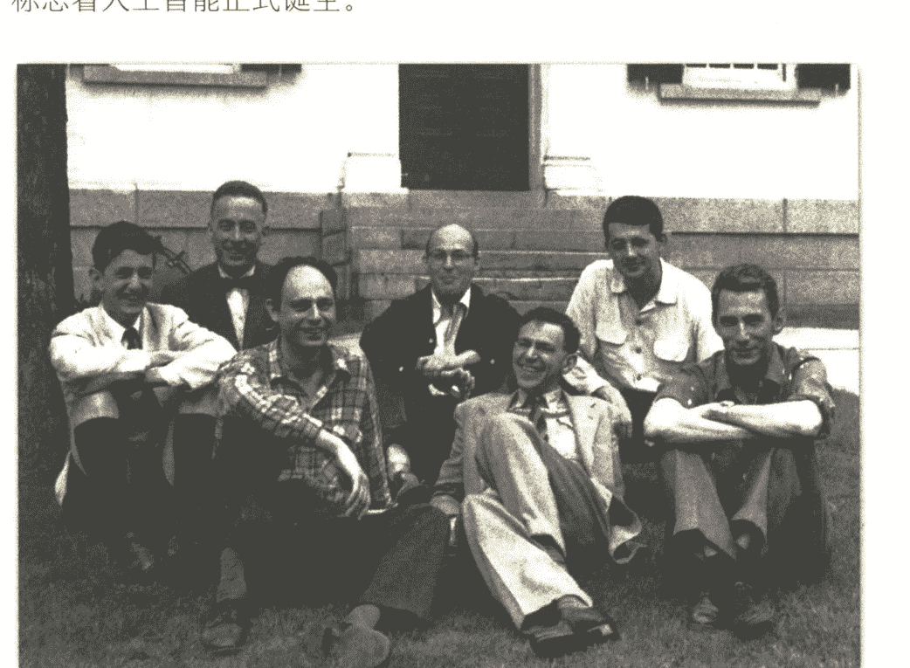
达特茅斯会议史料图

## 2 爆发黄金期

二十世纪五十至六十年代是AI的黄金时期。科学家创造了早期神经网络——感知器模型，它是现代神经网络的基础。理解感知器，可用是否去餐厅吃饭作比喻：

1. 钱包够钱？够=1，不够=0
2. 时间充裕？充裕=1，不充裕=0

设钱权重为3，时间权重为2，加权和大于2.5就去。

1. 钱够且时间充裕，和=5，去
2. 钱不够且时间不充裕，和=0，不去
3. 钱够但时间不充裕，和=3，去
4. 钱不够但时间充裕，和=2，不去

这就是感知器原理，它能不断调整参数提升准确率，在线性可分分类问题上学习能力突出。

1957年首个自学习程序——跳棋程序诞生，“机器学习”概念由此出现。1966年，麻省理工学院的约瑟夫·维森鲍姆发布首个聊天机器人ELIZA，能通过脚本理解简单自然语言并进行类人互动。

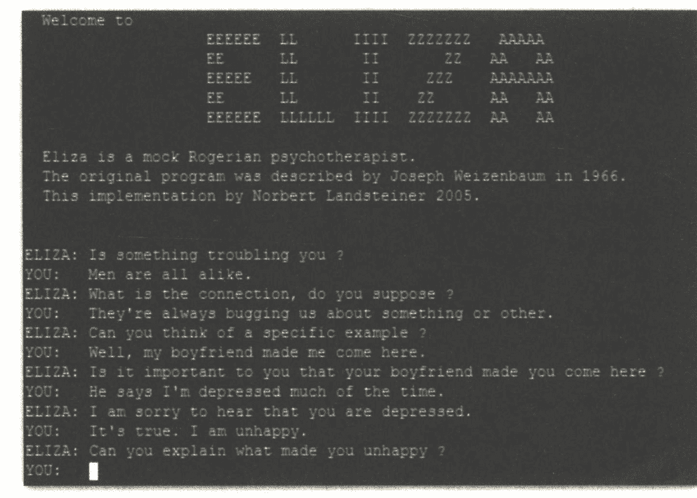
世界首个聊天机器人ELIZA

## 3 首轮低潮

好景不长，七十年代AI遭遇瓶颈。当时计算机内存与算力有限，难以解决实际难题。

## 4 复兴起步

第一次寒冬后，研究焦点转向专家系统。它是一种模仿专家决策能力的计算机系统，依据从专业知识中推导出的逻辑规则回答特定领域问题。比如头疼发热咳嗽可推断流感，肚子疼恶心呕吐可提示胃炎。虽然类比不严，但在医疗、金融等领域得到应用，为AI研究带来希望。

## 5 再度降温

专家系统的繁荣短暂如昙花。知识采集困难、建造成本高、仅限特定场景、不具通用性等缺陷，让商业化举步维艰，引发第二次寒冬。

但这段蛰伏推动了研究方向的转变。AI学界主要有三大学派：符号主义、联结主义、行为主义。

### ● 符号主义
又称逻辑主义，主张智能可用符号实现，强调逻辑、规则与符号模拟思维。比如判断是否下雨，可写A+B=C，A为阴天，B为湿度>70%，C为将下雨。A、B同时满足即得C。专家系统正是符号主义代表。

### ● 联结主义
主张智能可通过模拟大脑神经元网络实现，强调神经网络与学习算法处理信息，包括感知器、人工神经网络、深度学习等。

大脑高效工作靠上千亿神经元，像流星锤般相互连接成网。当信息触碰网点，震动传遍网络，各神经元按强度反应。看到猫时，视觉信息经层层神经元传递、处理，最终得出结论。

AI神经网络模拟了这种机制。输入猫的数据，经多层处理，每层提取不同特征如边缘、形状，最终输出结论。过程中网络通过学习与权重调整，让结果更准。输出不是简单的对错，而是各结果的概率。

### ● 行为主义
主张智能行为可通过与环境交互学习，强调试错与自然选择优化行为，包含控制论、遗传算法、强化学习等。如电竞排位系统会按胜负调整对手与战术。行为主义在机器人、自动控制、游戏AI、自动驾驶等领域应用广泛。

第二次寒冬期间，机器学习与神经网络即联结主义加速崛起，逐渐取代专家系统。AI从知识驱动转向数据驱动。

但各流派并非优劣之分，而是各有所长，后期产品多为融合。

## 6 快速崛起

真正的春天到来。

1997年，IBM的“深蓝”电脑击败国际象棋世界冠军卡斯帕罗夫，成为首个在正式比赛时限内战胜棋王的电脑系统。


# 学习新纪元
# AI与学习

互联网普及与大数据兴起为AI带来新机遇。算力提升与海量数据让AI进入全新阶段，复杂神经网络模型不断涌现；深度学习突破推动AI走向实用。

深度学习是机器学习的重要分支，可视为加强版神经网络。它能自动从海量数据中提取特征，无需人工干预，可实现“自学”。

最出名的“自学狗”是Google旗下DeepMind开发的围棋程序AlphaGo。2016年AlphaGo以4:1击败围棋九段世界冠军李世石，震惊全球，围棋的复杂度远高于国际象棋。AlphaGo的厉害在于强大的自我学习能力，能搜集大量对局数据与名局谱学习模仿。

2014年英国皇家学会的“图灵测试”大会上，聊天程序尤金·古斯特曼首次通过图灵测试，预示AI进入新纪元。

随后以Google提出的Transformer模型为基础的大语言模型爆发。大语言模型像超级语言助手，通过阅读书籍、文章、网页等海量文本学习人类语言规律。它不仅能记住大量词汇句子，还能理解关系，通过不断调参让预测更贴近真实语言，从而实现聊天、答疑、生成文本等功能。

2022年ChatGPT面世，各类AI模型如雨后春笋。由大语言模型衍生的功能让工作生活愈发便利。ChatGPT、DeepSeek等大模型正引领AI发展新时代，成为行业推动力。

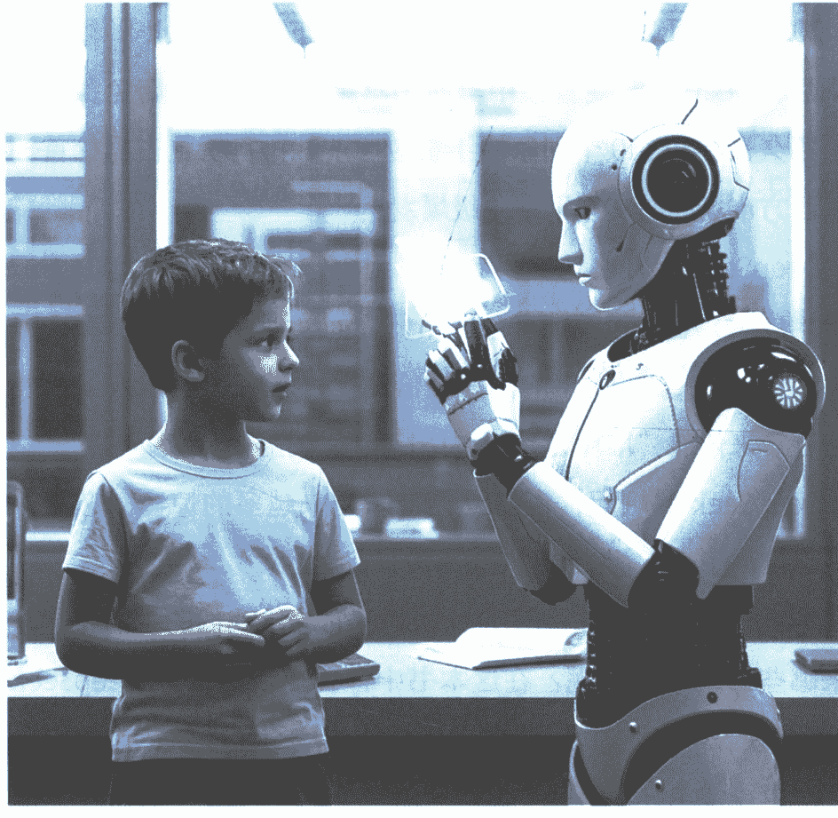
# DeepSeek入门指南
# DeepSeek新手上手

2025年春节前后，中国人工智能企业杭州深度求索人工智能基础技术研究有限公司的开源模型DeepSeek-R1在全球掀起“惊叹风暴”。

2025年1月20日，DeepSeek正式发布DeepSeek-R1。一周后即登顶中美苹果商店免费榜首，随后占领约140个国家下载榜榜首，在东西方市场实现现象级爆发。

为何如此强势？因为成本极低、远低于行业均值，能耗也低，而推理能力大幅提升。DeepSeek以“高性价比”打破了靠“堆算力、大力出奇迹”的路径依赖。开源共享更推动AI技术全球普及。

DeepSeek到底是什么？它将如何影响学习生活？本书将揭开其面纱，探索更多应用场景，一起喊出：“你好未来！你好AI！”

## 1 什么是DeepSeek

DeepSeek即深度求索，成立于2023年，是一家专注AI基础技术研究的中国公司，目标推动通用人工智能发展，探索人类级智能路径。普通用户接触到的是其基于大语言模型的对话网页或App，可用于问答、复杂对话、逻辑推理等。

## 2 DeepSeek新手上手

DeepSeek主要有网页与App两种使用方式。用法类似，区别在于浏览器使用或安装App使用。

**第 1 步** 打开浏览器，输入网址 https://www.deepseek.com 打开官方页面，点【按钮图片】进入对话页。


你好，AI：
给孩子的高效学习法

现在看到的就是DeepSeek对话页面。右侧主体为对话界面，可在输入框直接发送消息。

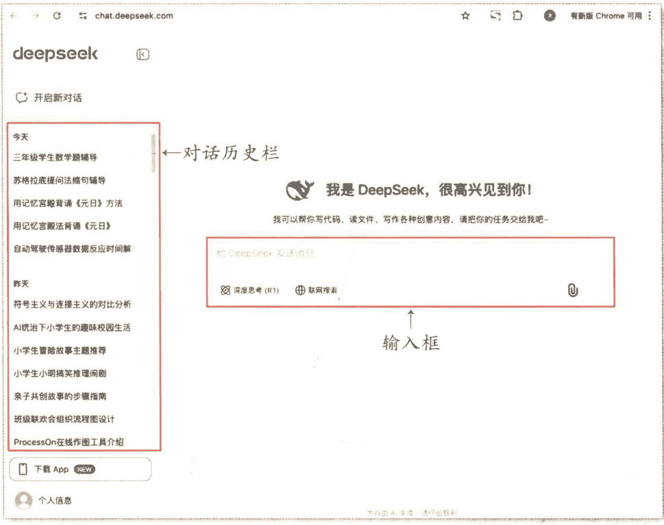
**第 2 步** 在输入框输入指令：

请用简洁的语言介绍一下你自己。


**第 3 步** 点击输入框右下角 ↑ 按钮发送指令，DeepSeek以对话形式作答，并在下方保留输入框，可继续提问。

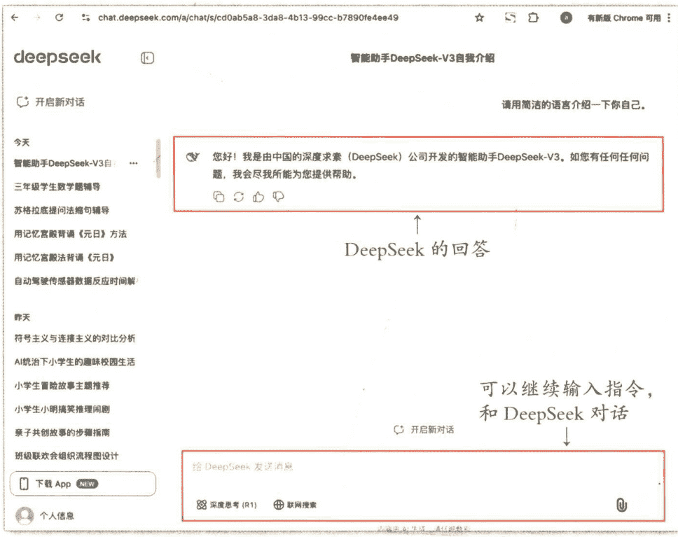
**第 4 步** 点击回答下方 📋 可复制内容；不满意可点 🔄 重新生成；可点 👍 或 👎 表达喜好。


有趣的是，即使发送完全相同指令，DeepSeek每次回答也各有差异，这正是大语言模型的灵活性。

**第 5 步** 点击输入框下方 📎 可上传附件。上传文档时DeepSeek会提取文字作为输入或参考；上传图片时会读取画面内容作为输入或参考。


## 3 DeepSeek的深度思考

输入框左下方有 🧠 深度思考 (R1) 🌐 联网搜索两个选项。可点亮激活。🧠深度思考激活为淡蓝色时，DeepSeek进入“学霸模式”，使用更强模型深度推理，答案更精准，但处理时间较慢。🌐联网搜索激活后，DeepSeek会在需要时检索互联网信息，有助于查询实时内容。

## 4 保存历史对话和开启新对话

页面左侧为“对话历史栏”，开始对话时会新增一条记录并自动命名。每条对话保留全部输入输出，可回看继续。可点右侧 ... 重命名或删除。想开启新主题，点记录栏上的 🔄 开启新对话，即可“忘记过去，重新开始”。


## 5 下载 DeepSeek App

手机上用 DeepSeek 很顺手。打开官网首页点【获取手机 App】就能看到二维码扫码装机；也可以去各大应用商店搜“DeepSeek”，下载名为“DeepSeek-AI 智能对话助手”的客户端。装好后点开即可开始对话。

让孩子学习更高效的方法


移动端的交互逻辑和网页版大体一致，只是细节做了调整。左上角的 ≡ 能调出历史对话，右上角的 ⊕ 用来开启新会话，附件上传的入口换成了 ＋ 号。

## 第一章 智慧对话篇

你好，聪明的探索者！我是你的伙伴 DeepSeek，答疑、理清思路、一起头脑风暴都可以。想把对话效率拉满，提问技巧很重要，来看看实用窍门。

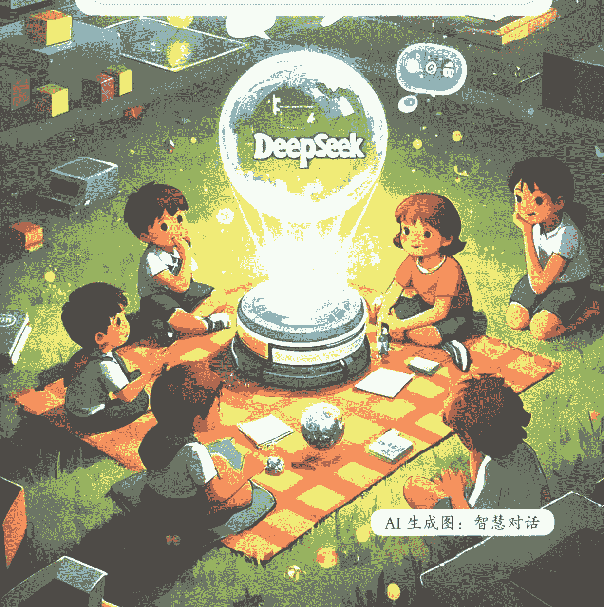

### AI 角色扮演法

换位思考能让我们多角度看问题，对模型也一样。给它设定一个具体身份，回应会更精准，语气和表达也会更贴合使用者的预期。

**例1 用小学老师的口吻讲人工智能**

先看未设定角色时的效果。

输入指令：
什么是人工智能？

默认输出以学术定义起笔，系统介绍了弱人工智能、强人工智能、超级人工智能的划分，梳理了机器学习、深度学习、自然语言处理、计算机视觉等关键技术，列举了医疗、金融、交通、零售、制造等应用场景，并提及数据隐私、算法偏见、就业影响、安全可控等伦理挑战。整体很专业，但小学生阅读起来有距离。

改用角色设定，把提问方式换成：
请以小学科技老师的身份，用通俗的话给我们讲讲什么是人工智能。

定位成小老师后，解释立刻变得亲切易懂。开场用“同学们大家好”，把人工智能比喻成让机器像人一样思考学习的能力，用手机语音助手查天气、游戏里的电脑对手等生活例子说明。随后用“学习”作核心，讲识别猫咪图片、下棋的 AlphaGo、会自己开车的汽车等。生活化举例后又点出语音助手、推荐系统、智能家居的日常应用，最后展望医疗、教育、环保的发展方向，孩子能轻松理解。

**例2 用鲁迅的语气提示时间管理**

作业拖延时，可以让模型写一段提醒文字。

第1步 输入指令：
我做作业总是拖拖拉拉，效率低下，请帮我生成一段不超过200字的话，说明做好时间管理的重要性以及提升效率的方法。

得到一段对孩子说话的建议，强调时间宝贵、制定计划分块完成、设限制造紧迫感、专注单项、完成后自奖，结尾点出管理时间等于掌握未来。

第2步 换成鲁迅的语气再来一次。指令如下：
我做作业总是拖拖拉拉，效率低下，请用鲁迅的口吻，帮我生成一段不超过200字的话，讲清时间管理的重要性以及提升效率的方法。

对比可发现，文风明显变得凝练古朴，用“时间如流水，一去不复返”“今日的拖延便是明日的懊悔”等表达，并提出任务分解、设定期限、自省杂念、今日事今日毕等建议，读起来很有鲁迅的味道。

### AI 受众预设法

有时模型的回答很深奥，与角色扮演不同，受众预设法是直接说明对话对象是谁、有什么特征，让输出更易懂。

**例1 用小学生能懂的话分析中国经济形势**

步骤：在模型中保持 🧠 深度思考 R1 处于选中状态，输入指令：
请用小学生能理解的语言，分析一下当前中国的经济形势。

模型用“大树成长”的比喻展开。先说树已长成森林第二高，增速放缓但仍在稳步长高；再说遇到大风、树根虫害、老叶变黄等小麻烦，园丁通过降税补贴、防风政策等进行呵护；接着讲科技嫩芽、直播带货小花、小微企业小蘑菇等新枝在萌发；园丁重点修剪老枝、扶持新芽、松土改善营商环境；最后提醒要有耐心，补充营养、修剪枯枝、慢慢恢复健康，大树仍会结出果实。

**例2 给化学零基础的孩子讲元素周期表**

第1步 在保持 🧠深度思考 R1 选中的状态下输入指令：
请给一个化学小白讲清楚什么是元素周期表。

第2步 得到一段用乐高积木作比喻的解释。先说元素是宇宙积木，氢、氧、金各有特点；再说周期表是化学地图，把118种元素按规律排布，门捷列夫发现规律并预留空位；横行周期从左到右质子数递增，纵列族内性质相近，如碱金属遇水剧烈反应、稀有气体稳定；符号、原子序数、原子量、金属非金属分布等信息都在表里；最后说明预测性质、发现新元素、理解反应等价值，并举钠位于第三周期第一列的例子。

### AI 风格预设法

不同人偏好不同表达，预设风格即可。常见的有幽默、严肃、简洁等。

**例1 用喜剧人的风格解释“十五的月亮十六圆”**

第1步 输入指令：
请用喜剧人的风格说说为什么“十五的月亮十六圆”。

第2步 得到一段带观众互动的段子。先调侃问题像火锅隔夜仍在肚里转，再说月亮有节奏有小脾气，有时赖床拖到十六才圆。用地球月亮轨道运行的微小差异解释圆缺变化，并类比上班赖床迟到，解释通俗有趣。

**例2 用辩论形式讨论气候变暖的利弊**

第1步 输入指令：
请用辩论的形式来讨论气候变暖的利与弊。

第2步 模型给出正反双方观点。正方认为北极航道开通、耕地扩大、新能源产业兴起、部分地区冬季变暖、人类具备适应能力；反方强调极端天气频发、基础设施受损、农业受影响、经济损失巨大。总结指出利弊需全面看，机遇存在但挑战更严峻，需要减排与适应并重。

**例3 用诗意风格讲述人工智能带来的便利**

第1步 输入指令：
请用带有诗意的风格讲述人工智能给人类带来的便利。

第2步 产出一首《数字之诗》，描写智能管家唤醒窗帘、数据驱动交通有序、机械臂手术如执笔、远程诊疗传递智慧、数字修复敦煌壁画等场景，结尾点出人与机器共谱诗篇、在数字海洋里抵达更远彼岸。

### AI 模仿学习法

三人行必有我师。想让输出更精准，可先让模型学习一位“老师”的风格，再执行任务。

**例1 模仿朱自清风格写母亲**

第1步 输入指令：
请模仿朱自清的风格写一篇描写母亲的文章。

以《背影》著称的朱自清成为模型的参照。生成的《母亲的背影》写寒夜母亲为孩子缝补棉袄的佝偻背影，写巧手剪窗花、爱干净的习惯，写“穷要穷得干净，苦要苦得有志气”的教诲，写“做人要像竹子一样，虚心有节”的叮嘱，整体语言温润细腻，有典型的朱自清式回忆与感伤。

离开家乡求学的日子让我时常思念母亲。每一次回忆，脑中都会浮现出那个寒冬的夜景。微弱的煤油灯光洒在她银白的发梢，针线在她满是老茧的手指间来回穿引，带出轻细的沙沙声。那种响动，像是春蚕正低头啃食桑叶，也像是细雨落在龟裂的泥面。

我清楚，哪怕身在千里之外，母亲的挂念依旧像那盏旧灯，温润而明亮地照进心里。她给的爱，就像她亲手缝补的棉袄，样式朴素，却能抵挡世间所有的凛冽。

## 例2 借用金恩演讲语气写给孩子的学习箴言
第一步 往 DeepSeek 里发送如下指令：
请模仿马丁·路德·金的《I have a dream》，用简短的英文写一段激励孩子学习的文章。

第二步 经典演讲的内核被很好地吸收，金恩仿佛成了 DeepSeek 的引路人。

I Have a Dream for Our Children

I have a dream today.

I have a dream that one day, every child will wake up with a spark in their eyes, eager to learn, to explore, and to grow. I have a dream that classrooms will not be places of boredom, but of wonder, where young minds are ignited with curiosity and passion.

I have a dream that no child will be left behind, that every boy and girl, no matter their background, will have the opportunity to reach for the stars. I have a dream that education will be a bridge, not a barrier, a path to freedom, not a chain of limitation.

I have a dream that our children will not be judged by their grades alone, but by the content of their character, the depth of their questions, and the courage of their dreams. I have a dream that they will learn not just to read and write, but to think, to create, and to lead.

## 例3 先让模型学习素材再模仿作诗
第一步 把想让模型学习的作品拍照或截屏，比如下面这首诗：

第二步 在 DeepSeek 界面点开 📎 图标，将图片上传。


第三步 在对话区输入指令：
这是我写的诗，请学习它的风格与意境，再写一首献给奶奶的诗。

第四步 看，模仿得非常到位，甚至有超越原作之感。


## AI 输出格式管控法
有时 DeepSeek 生成的内容过长抓不住重点，或不便于直接使用，这时可以用“格式管控法”来规范输出，只要明确告诉它你要什么形式，比如表格、诗歌即可。

### 例1 让模型用表格罗列孩子早学编程的十大好处
**第一步** 在 DeepSeek 里发送：
请以表格形式列出十条孩子早期学习编程的好处。

**第二步** 模型按要求给出十条益处，并以表格呈现，一目了然。

孩子早期学编程的十项好处：

| 序号 | 好处描述 | 详细说明 |
| :--- | :--- | :--- |
| 1 | 强化逻辑推理能力 | 编程强调步骤清晰，能帮助孩子学会拆解问题与寻找解法 |
| 2 | 提升数学应用水平 | 代码中涉及变量、循环、条件等概念，能增强数学思维 |
| 3 | 激发创造力 | 通过代码实现想法，培养创新与动手设计能力 |
| 4 | 提高专注与耐心 | 调试与修改代码需要长时间投入，锻炼定力 |
| 5 | 增强解难能力 | 编程会遇到各类bug，促使孩子独立思考寻求对策 |
| 6 | 为未来职业铺路 | 编程是数字时代核心技能，早接触增加职业选择面 |
| 7 | 锻炼协作沟通 | 编程项目多需团队配合，提升沟通与分工意识 |
| 8 | 增强成就感 | 项目完成带来正反馈，有助于自信建立 |
| 9 | 促进跨学科融合 | 编程与科学、技术、工程、数学紧密相关 |
| 10 | 适应数字化生活 | 帮助孩子理解技术社会，提升数字素养 |

### 例2 用代码解决“鸡兔同笼”
第一步 输入指令：
请写一段 Python 程序求解鸡兔同笼，程序需接收总头数和总脚数作为输入并输出结果。

第二步 模型立刻给出代码，并使用指定语言。

下面是一个求解鸡兔同笼的 Python 示例，会先询问总头数与总脚数再计算。

```python
def solve_chicken_rabbit_problem():
    # 输入总头数和总脚数
    total_heads = int(input("请输入总头数："))
    total_legs = int(input("请输入总脚数："))

    # 计算兔子的数量
    # 每只兔子比鸡多2只脚
    rabbits = (total_legs - 2 * total_heads) / 2

    # 计算鸡的数量
    chickens = total_heads - rabbits

    # 检查结果是否合理
    if rabbits >= 0 and chickens >= 0 and rabbits == int(rabbits):
        print(f"鸡的数量: {int(chickens)}")
        print(f"兔的数量: {int(rabbits)}")
    else:
        print("无解，输入的脚数或头数不合理。")

# 运行函数
solve_chicken_rabbit_problem()
```

代码说明：

1. 输入部分：使用者输入总头数与总脚数。
2. 计算部分：
   - 兔数按 (total_legs - 2 * total_heads) / 2 得出。
   - 鸡数按 total_heads - rabbits 得出。
3. 合理性校验：若兔数鸡数均为非负整数则输出，否则提示无解。

示例运行：

```
请输入总头数：10
请输入总脚数：26
鸡的数量：7
兔的数量：3
```

这段程序能有效求解鸡兔同笼并检查输入合理性。

第三步 点击代码块右上角的复制，将代码复制到剪贴板。可在 Programiz 在线 Python 编译器运行，网址 https://www.programiz.com/python-programming/online-compiler/。

## 你好，AI：给孩子的高效学习法

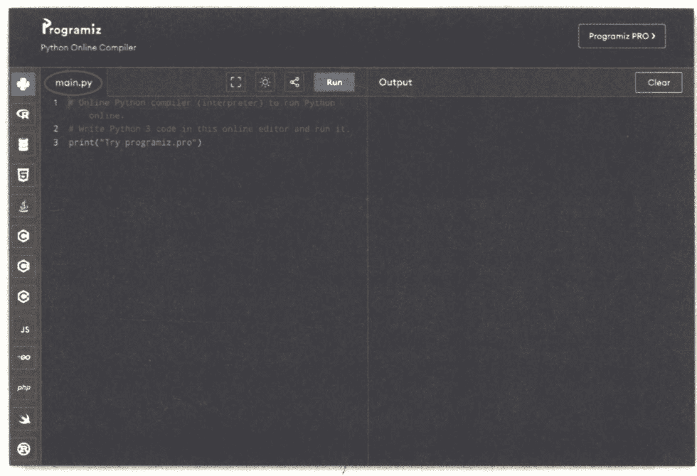

**第四步** 页面分为左侧代码区与右侧输出区。在 `main.py` 标签下清空原代码，粘贴刚才的代码后点 Run。

> **知识小贴士**
Programiz 是面向编程学习者的在线平台，提供教程、示例与工具，便于练习。

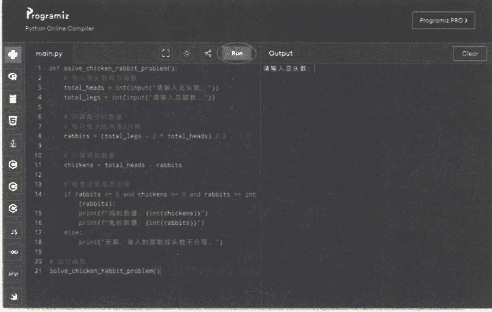

**第五步** 在右侧输出区先输入总头数如 “30”，回车；再输入总脚数如 “70”，回车，即可看到鸡兔数量。

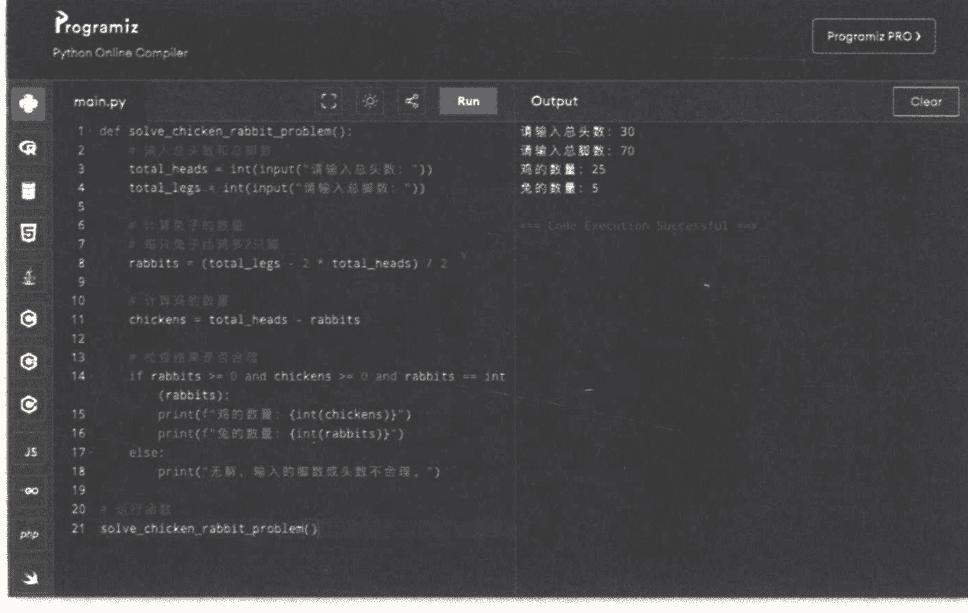

### 例3 生成暑期生活学习计划
第一步 输入指令：
用 CSV 格式生成小学生暑假学习生活表，要求作息合理，每天包含户外与休闲时间。

模型按要求输出了劳逸结合的计划。

以下是一个示例 CSV：

```csv
时间,周一,周二,周三,周四,周五,周六,周日
07:00-07:30,起床、洗漱,起床、洗漱,起床、洗漱,起床、洗漱,起床、洗漱,起床、洗漱,起床、洗漱
07:30-08:00,早餐,早餐,早餐,早餐,早餐,早餐,早餐
08:00-09:00,数学练习,语文阅读,数学练习,语文阅读,数学练习,自由活动,自由活动
09:00-10:00,语文阅读,数学练习,语文阅读,数学练习,语文阅读,户外活动,户外活动
10:00-10:30,休息、吃水果,休息、吃水果,休息、吃水果,休息、吃水果,休息、吃水果,休息、吃水果,休息、吃水果
10:30-11:30,英语学习,英语学习,英语学习,英语学习,英语学习,自由活动,自由活动
11:30-12:30,午餐,午餐,午餐,午餐,午餐,午餐,午餐
12:30-13:30,午休,午休,午休,午休,午休,午休,午休
13:30-14:30,科学探索,手工制作,科学探索,手工制作,科学探索,户外活动,户外活动
14:30-15:30,户外活动,户外活动,户外活动,户外活动,户外活动,自由活动,自由活动
15:30-16:30,自由活动,自由活动,自由活动,自由活动,自由活动,阅读时间,阅读时间
16:30-17:30,阅读时间,阅读时间,阅读时间,阅读时间,阅读时间,家庭活动,家庭活动
17:30-18:30,晚餐,晚餐,晚餐,晚餐,晚餐,晚餐,晚餐
18:30-19:30,家庭活动,家庭活动,家庭活动,家庭活动,家庭活动,自由活动,自由活动
19:30-20:30,休闲放松（看电视、玩游戏）,休闲放松（看电视、玩游戏）,休闲放松（看电视、玩游戏）,休闲放松（看电视、玩游戏）,休闲放松（看电视、玩游戏）,休闲放松（看电视、玩游戏）,休闲放松（看电视、玩游戏）
20:30-21:00,洗漱、准备睡觉,洗漱、准备睡觉,洗漱、准备睡觉,洗漱、准备睡觉,洗漱、准备睡觉,洗漱、准备睡觉,洗漱、准备睡觉
21:00-,睡觉,睡觉,睡觉,睡觉,睡觉,睡觉,睡觉
```

说明：

1. 学习安排：每日涵盖数学、语文、英语、科学探索等，保证多样性。
2. 户外运动：每天至少一小时，帮助孩子放松身体。
3. 休闲娱乐：晚上留出电视、游戏等时间。
4. 休息保障：含午休与充足睡眠。
5. 自由时段：周末安排兴趣自选活动。

可根据孩子需求调整。

**第二步** 点右上角复制，粘入文本文档，将后缀 “.txt” 改为 “.csv”，例如 “我的学习计划.csv”，打开即可查看。


/ 提示 / 若看不到扩展名，可按 Win+E 打开资源管理器，在“查看”中勾选“文件扩展名”。


## AI 递进提问法
提问时往往想得不周全，容易遗漏条件，导致答案不准。可以用“递进提问法”，根据返回结果逐步细化指令，获得更贴合需求的答案。

例 为孩子推荐纪录片
第一步 保持联网搜索开启，输入：
请推荐几部适合儿童观看的纪录片。

第二步 模型检索后给出自然、科学、历史等多个主题的推荐。

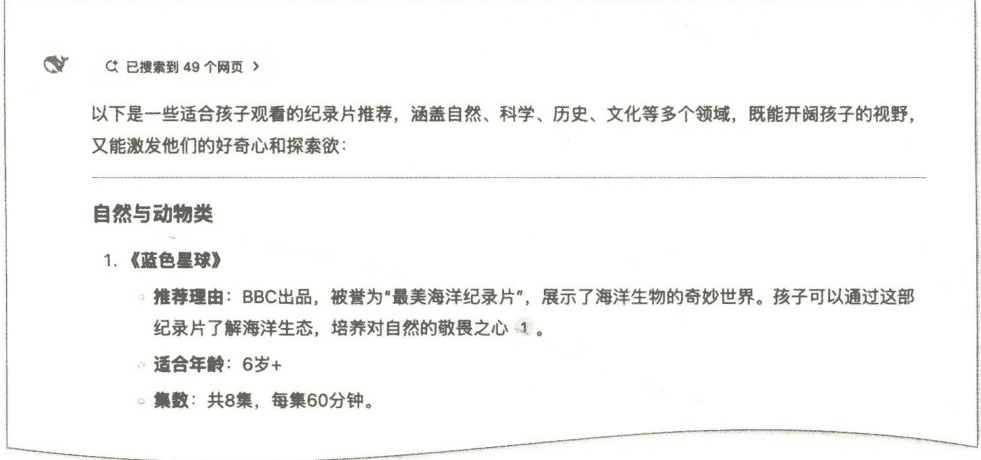

### 2. 《行星》
- 理由：拟人化讲述太阳系，画面精美，通俗易懂。
- 适合年龄：7岁+
- 集数：5集，每集50分钟。

### 3. 《从太空看地球》
- 理由：卫星视角呈现地球景象，帮助宏观认知。
- 适合年龄：4岁+
- 集数：4集，每集50分钟。

### 历史与文化类
### 1. 《影响世界的中国植物》
- 理由：介绍植物与文明关系，画面唯美。
- 适合年龄：6岁+
- 集数：10集，每集50分钟。

### 2. 《千古风流人物》
- 理由：演绎历史名人故事，利于语文学习。
- 适合年龄：7岁+
- 集数：多集，每集30分钟。

### 3. 《如果国宝会说话》
- 理由：幽默讲解文物，每集5分钟，适合碎片观看。
- 适合年龄：5岁+
- 集数：多集，每集5分钟。

### 艺术与人文类
### 1. 《中国唱诗班》
- 理由：动画呈现古诗词，音效动人。
- 适合年龄：5岁+
- 集数：6集，每集约10分钟。

### 2. 《餐桌上的世说新语》
- 理由：以饮食切入魏晋生活风貌，内容有趣。
- 适合年龄：6岁+
- 集数：多集，每集约10分钟。

这些片子能丰富知识、培养审美与价值观，家长可按兴趣与年龄挑选，陪伴观看。

你好，AI：给孩子的高效学习法

**第二步** 若更关注太阳系，可追问：
请推荐适合儿童观看的、关于太阳系的纪录片。

**第三步** 这次推荐全部聚焦太阳系。

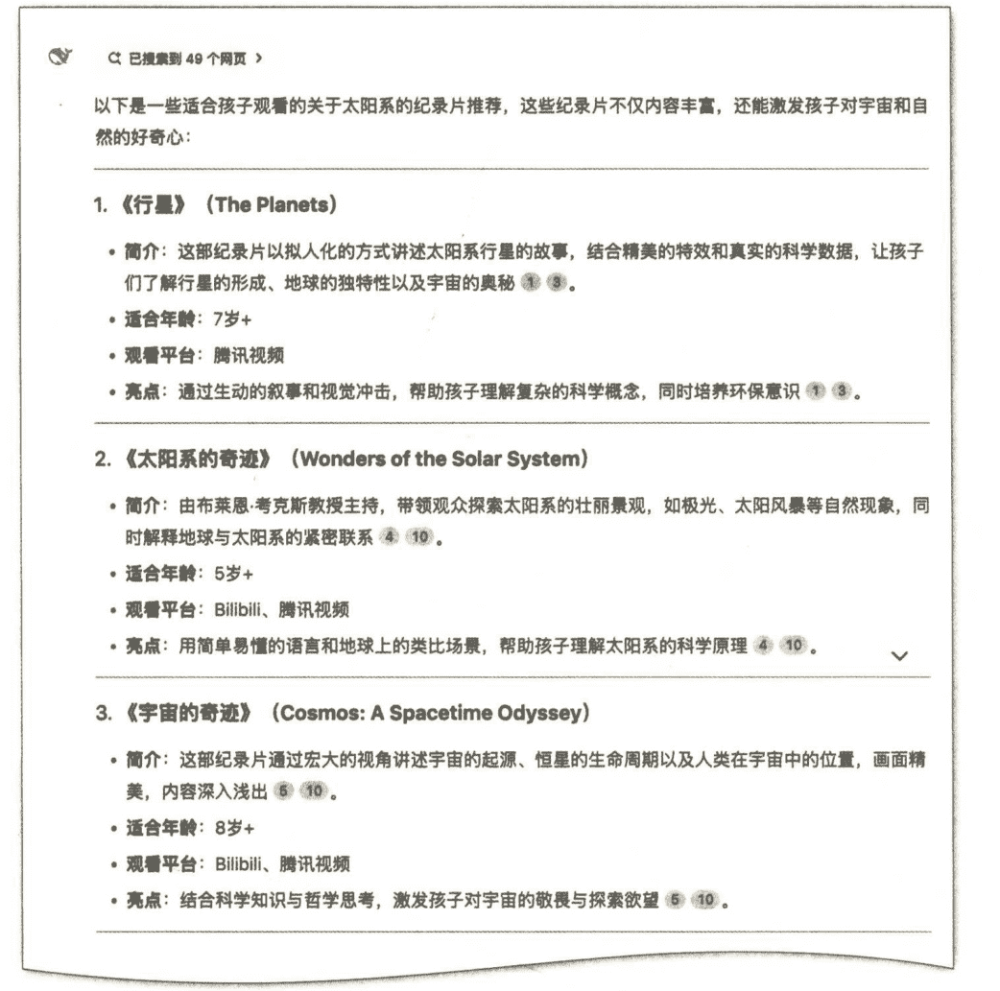

**第四步** 考虑视力保护，再次细化：
请推荐适合儿童观看的、关于太阳系的纪录片，每集时长不超过半小时。

**第五步** 模型在结果中标注时长，超时的也提示可分段观看。

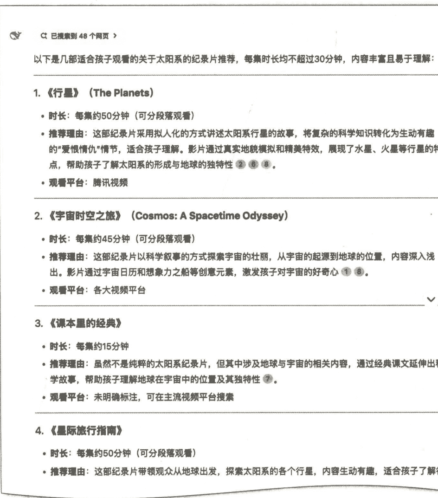

## 你好，AI：给孩子的高效学习法
举一反三
还可在指令中要求提供具体的播放链接，方便观看。通过层层递进，你能逐步提升提问精度。


AI 生成图：仰望太空

# AI 编程化思维策略
当回答不够准确时，可用编程化思维引导模型。通过清晰的逻辑与步骤，让它生成批量化、可持续的内容。

# 例1 批量生成动物介绍短文
需求是批量生成老虎、熊猫、狮子、猫、狗等动物的简介。思路是先让模型写好一种动物的范例，再按同一思路扩展。

第一步 输入指令：
请生成一篇约300字的老虎介绍，需涵盖外观、习性及与人类的关系。

第二步 模型迅速给出范例。

> 森林之王：老虎

老虎是猫科中体型最大的成员，因威严外表与强大力量被称“森林之王”。成年虎体长可达3米，体重超300公斤，橙黄色皮毛布满黑色条纹，每只虎的纹路如同指纹各不相同。

在生态系统的食物链顶端，老虎多半选择独行，领域占有的欲望十分强烈。白天基本处于休眠，夜里才进入活跃期，借助出色的视觉与听觉在密林里捕捉猎物踪迹。它的水性上佳，穿越宽阔的河面毫不吃力。野外环境下，以鹿、野猪等中大型哺乳动物为主要取食对象，一只成年个体平均每天需要约六公斤的肉类摄入。

随着人类活动不断外扩，老虎可用的生存空间被持续挤压。数据显示，全球野生虎群总量已跌破四千头。人虎关系正由长期对立向逐步共存演进，多国设立保护区，借助生态旅游等模式在物种守护与当地收益之间寻找平衡。守护老虎不仅关乎生物多样性维持，也是稳固地球生态系统平衡的关键工作。

**第3步** 接着让模型保持同一版式再输出一篇熊猫介绍。提示可以这样写：
> 帮我写一篇约三百字的大熊猫介绍，需涵盖外形特征、生活习性以及与人类的关联。

**第4步** 这个要求也不难，很快返回结果。

### 竹林隐者 大熊猫
大熊猫是我国特有的珍稀动物，黑白分明的毛色配合憨厚外形深受喜爱。成体身长约1.2至1.8米，体重最高可到160公斤。面颊圆润黑眼圈明显，四肢短粗体型滚圆，走路显得笨拙却十分讨喜。

熊猫堪称典型的竹林居民，饲料几乎全部来自竹子。每天用于进食的时间约10至16小时，食量在12至38公斤之间。性格温顺，多独居，活动范围通常为4到7平方公里。虽被归入食肉目，经过漫长进化已转为以植物为主，偶尔才会摄入动物性食物。

熊猫有“活化石”“国宝”之称，也是世界自然基金会的形象代表。栖息地破碎与繁育困难曾导致数量锐减。依托保护区建设和人工繁育等措施，保护工作取得成效，野外种群已回升至一千八百只以上。它既是生物多样性保护的旗舰，也承担中外交流的友好使者角色，在国际生态合作中作用突出。

**第5步** 从案例可看出指令模式基本一致，此时可采用编程思维批量提需求，提高效率。输入指令：
请输出5篇不同动物的短文，每篇约300字，先写外观，再写习性，最后写与人类的关系。动物分别是：老虎、熊猫、狮子、猫、狗。

第6步 效果良好，模型一次性把五篇稿件都生成出来。

### 森林之王 老虎
老虎是猫科中的巨型代表，橙黄底色点缀黑色条纹，气势十足。强健四肢与锋利爪牙让它猎捕能力突出，一双有神眼眸流露出王者气场。

多为独居，领地感极强。夜行，凭嗅觉与听觉锁定目标。水性极佳，可横渡大江。主食为鹿、野猪等大型哺乳，偶尔捕食鱼鸟。

自古老虎在文化中地位很高，象征力量与勇气，常现于神话、艺术与器物。因栖息地丧失和非法猎捕，野生数量急剧下降。如今全球都在努力为虎营造安全的生存空间。

### 国宝熊猫 黑白萌物
熊猫以黑白配色和憨态外形俘获全球喜爱。体态圆滚毛发厚实，黑眼圈像戴了墨镜。腕骨特化成拇指状，便于抓握竹子，而竹子正是主食。

性情温和，独居，行动缓慢，大部分时间用于进食与睡眠，日均竹子消耗量很大。虽属食肉目，长期以植食为主，偶尔会食小型动物。

熊猫是国宝，也是世界自然基金会标志，被视作和平友谊象征，曾作为外交礼物赠送他国。近年保护力度加大，野生数量有所回升，但栖息地破碎与气候变化仍是严峻挑战。

### 草原霸主 狮子
狮子以威武体态和震撼吼声著称。雄狮鬃毛浓密更显威严，雌狮体型稍小但狩猎能力更强。强健身躯和利齿使其成为草原顶级捕食者。

狮子群居，通常以群为单位，由一至数头雄狮、多头雌狮及幼崽组成。雌狮负责捕猎，雄狮守护领地。食谱包括斑马、羚羊、水牛等大型动物。

人类文化中狮子象征勇气与力量，广见于传说、艺术和旗帜。栖息地压缩与人类干扰导致野生数量持续下滑，保护栖息地已迫在眉睫。

### 居家伴侣 猫咪
猫凭借优雅身姿和神秘气质成为最受欢迎的宠物之一。体型娇小毛发柔软，眼神明亮，尾巴灵活多变，爪子可伸缩，行走安静。

多为夜行，白天大部时间睡觉。爱干净，常以舌头梳理毛发。捕鼠本能强，是优秀的小型猎手。性格独立，也喜欢与人互动。

人与猫的关系可追溯数千年，古埃及人将猫视为神圣甚至为其建庙。如今猫已成为许多家庭的重要成员，研究表明养猫可降低压力，改善心理健康。

### 人类最忠实的朋友 狗
狗作为人类最早驯化的动物，以忠诚友善赢得“人类最忠实朋友”的美誉。体型各异，毛色长度千差万别，但嗅觉听觉都十分灵敏，尾巴是表达情绪的重要工具。

狗是群居动物，社会性很强。聪明伶俐，能学习各种指令与技巧。嗅觉极其灵敏，被广泛用于搜救、缉毒和导盲等领域。性格活泼，喜欢与人类亲近。

人与狗的关系源远流长，可追溯到数万年前。它们陪伴人类狩猎、放牧、看家护院，成为生活中不可缺少的伙伴。如今狗不仅是宠物，更是许多人的精神寄托，用无条件爱温暖人心。

# 例2 让模型生成长度单位换算的小工具。

单位换算也是常用技能，例如米、千米、厘米等换算，可向模型提具体问题。

在模型中输入指令：
2.3米换算成千米、分米、厘米和毫米分别是多少？

返回结果清晰。

要将2.3米换算成千米、分米、厘米和毫米，可按以下步骤：
1. 换算成千米 km
1千米 = 1000米
2.3米 ÷ 1000 = 0.0023千米
2. 换算成分米 dm
1米 = 10分米
2.3米 × 10 = 23分米
3. 换算成厘米 cm
1米 = 100厘米
2.3米 × 100 = 230厘米
4. 换算成毫米 mm
1米 = 1000毫米
2.3米 × 1000 = 2300毫米

最终答案：
| 2.3米 = 0.0023千米 |
| = 23分米 |
| = 230厘米 |
| = 2300毫米 |

但每次都要询问或手动计算，较麻烦。此时可采用编程思维，让模型生成带界面的单位换算小工具，使用更便捷。

知识小链接
HTML即超文本标记语言，是构建网页的标准语言。HTML文件通常以“.html”或“.htm”结尾，由浏览器解析渲染，可便捷运行。

第1步 保持深度思考 R1 选中，输入指令：
请帮我用 HTML 语言生成一个长度单位换算的小工具，界面上有一个输入框，用来输入数字，右侧有一个下拉框，用来选择长度单位，包括米、千米、分米、厘米和毫米。单击下方的“换算”按钮，根据输入的数字和选择的单位，显示换算成其他单位（不包括原来选择的单位）的结果，输出结果按从大到小的顺序排列。界面要美观大方，布局合理、整齐。

# 第2步 很快，模型生成文字说明与黑色背景代码块，代码即 HTML。

以下是一个符合您需求的长短单位换算工具HTML代码，包含样式和交互功能：
```html
<!DOCTYPE html>
<html lang="zh-CN">
<head>
    <meta charset="UTF-8">
    <meta name="viewport" content="width=device-width, initial-scale=1.0">
    <title>长度单位换算器</title>
    <style>
        body {
            font-family: 'Segoe UI', Tahoma, Geneva, Verdana, sans-serif;
            max-width: 500px;
            margin: 2rem auto;
            padding: 20px;
            background-color: #f5f5f5;
        }

        .converter-box {
            background: white;
            padding: 25px;
            border-radius: 10px;
            box-shadow: 0 2px 10px rgba(0,0,0,0.1);
        }

        .input-group {
            display: flex;
            gap: 10px;
            margin-bottom: 20px;
        }
    </style>
</head>
<body>
    <div class="converter-box">
        <!-- 内容省略 -->
    </div>
</body>
</html>
```
```javascript
// 将输入值转换为基准单位
const baseValue = inputValue * unitMap[selectedUnit].value;

let outputHtml = '';
unitOrder.forEach(unit => {
    if (unit !== selectedUnit) {
        const convertedValue = baseValue / unitMap[unit].value;
        outputHtml += `
            <div class="result-item">
                <span class="unit">${unitMap[unit].name}</span>
                <span class="value">${convertedValue.toFixed(4)}</span>
            </div>
        `;
    }
});

results.innerHTML = outputHtml;
}
</script>
</body>
</html>
```

**第3步** 单击代码块右下角的 ▶ 运行 HTML，即可运行代码。试用该换算小工具，是否更方便？


可按需丰富功能，如界面风格，或增加重量、面积、时间等其他单位换算，整合成综合单位换算工具。


AI 生成图：厨师机器人

# AI 5W2H 学习法

预习是学习重要环节。如何预习更高效？可借助 DeepSeek+5W2H 学习法。

例 用 DeepSeek+5W2H 学习法预习小学语文三年级上册古诗《山行》。

知识小链接
5W2H 学习法是一种系统化分析方法，通过七个关键问题帮助全面理解：What 什么、Why 为什么、Who 谁、When 何时、Where 何地、How 如何、How much 多少。

第1步 在 DeepSeek 中同时启用深度思考 R1 与联网搜索，可获得更准确的回答，输入指令：
请你用 5W2H 学习法帮我预习《山行》这首古诗。请逐一提问，等我回答后，对我的答案做出判断和分析，再提问下一个问题。

第2步 思考后，DeepSeek 首先抛出 Who 问题，即这首诗作者是谁。
好的，我们现在开始用5W2H法预习《山行》。
**第一个问题（Who）：**
这首诗的作者是谁？请结合你已知的知识回答。
（等待你的回复后，我会补充背景知识并判断准确性，再提出下一个问题）
我们思考后回答：
这首诗的作者是唐代诗人杜牧。

**第3步** DeepSeek 先分析回答，再提出第二个问题：What。
**判断与分析：**
很好，回答正确！杜牧是晚唐著名诗人，与李商隐并称“小李杜”，擅长七言绝句，诗风清丽自然。《山行》正是他的代表作之一。
**第二个问题（What）：**
这首诗主要描绘了什么内容？尝试概括诗中提到的核心意象或场景。
我们再次作答：
这首诗描绘了秋日山行的景色与作者的感受。

**第4步** DeepSeek 肯定回答，并提示可更具体。接着提问 When。
**判断与分析：**
你的回答部分正确，但可以更具体。《山行》确实以秋日山行为背景，但诗中通过具体意象展开：
1. **寒山石径斜**：点明季节 秋 与山路蜿蜒。
2. **白云生处有人家**：勾勒远景中的山居烟火气。
3. **枫林晚与霜叶红于二月花**：以枫叶浓烈色彩为核心意象，表达对秋景的惊喜与赞美。
需注意：诗人不仅写景，更通过对比 霜叶与春花 体现对秋的独特感悟。
**第三个问题（When）：**
诗中暗示了具体的季节和时间线索，哪些词句体现了“深秋”和“傍晚”？请结合诗句说明。
依次类推，回答完所有问题后，对《山行》的理解将更为透彻，从而实现高效预习。


# AI 苏格拉底提问法

若答题常一知半解，可借助 DeepSeek+苏格拉底提问法，帮助真正把握本质，掌握解题步骤。

## 例1 通过 DeepSeek+苏格拉底提问法解决不懂的数学题。
### 第1步 将错题或疑问发送给 DeepSeek，例如关于闰年的题目。输入指令：
> 我是一位三年级学生，有一道数学题不会做，假设你是我的数学老师，请你用苏格拉底提问法的思路辅导我一步一步解出这道题，以你提问我回答的形式，一次只问一个问题，等我回答完再进行下一个问题。
> 题目是：下列年份中，（ ）年是闰年
> A.2004 B.2018 C.2100。
知识小链接
苏格拉底提问法是一种通过逻辑追问揭示认知漏洞、最终自主接近答案的方法。它不直接灌输，而是逐步引导。
DeepSeek 进入角色，开始引导解题。
> 非常好！让我们用苏格拉底式方法逐步解决。首先，你知道什么是闰年吗？
# 第2步 思考 DeepSeek 的问题，输入回答。
我只知道每 4 年会有一个闰年，这一年二月会多一天。
DeepSeek 循循善诱，先夯实基础知识，再引导解题。
> 这是个很好的开始！那么根据你现有知识，来看选项A的2004年：2004 ÷ 4 等于多少？
# 第3步 继续作答：
501
> 啊，再仔细算：2004 ÷ 4 = 501 余数是0对吗？这说明2004能被4整除。那么按你刚才说的“每4年一闰年”，2004年应是什么年？
闰年
以此类推，继续一问一答解题。
> 很好！现在看选项B的2018年。用同样方法，2018 ÷ 4 等于多少？余数是多少？
504，余2
完全正确！既然2018 ÷ 4余2，不能被4整除，那么2018年应是什么年？
不是闰年
非常好！再看选项C的2100年。先算2100 ÷ 4 等于多少？余数是多少？
525，余数是0
这是个发现！按先前规律，2100能被4整除，看似是闰年。但老师要告诉你特殊规则：整百年份需再用400除。2100 ÷ 400 等于多少？余数是多少？
5，余100
太棒了！你算得很准。既然2100 ÷ 400有余数100，不能整除，那么2100年符合闰年条件吗？
不符合
完全正确！现在总结：
- 2004 ÷ 4=501余0 → 闰年
- 2018 ÷ 4=504余2 → 不是闰年
- 2100 ÷ 4=525余0，但2100 ÷ 400=5余100 → 不是闰年
所以正确答案是什么？
2004
太棒了！你完全正确！正确答案是A.2004。通过讨论，你不仅复习了普通闰年判断，也学到整百年份的特殊规则。你真是个善于思考的小数学家！

最终得到正确答案，并在过程中掌握知识点与思考方法。

## 例2 通过 DeepSeek+苏格拉底提问法，完成语文缩句。
第1步 在 DeepSeek 中保持 深度思考 R1 选中，输入指令：
现在要对“小鸟在那愈发繁茂的绿蔓里边发出一种尖细又娇嫩的鸣叫。”这句话进行缩句，请用苏格拉底提问法辅导我一步一步完成缩句。请以你问我答形式，一次只问一个问题，等我回答完再问下一个问题。
第2步 经过思考，DeepSeek 开始逐步引导缩句。
> 好的，让我们用苏格拉底提问法一步步完成缩句。请先仔细阅读原句：
原句：
小鸟在那愈发繁茂的绿蔓里边发出一种尖细又娇嫩的鸣叫。
问题1：

**缩句实操：锁定主干，剔除枝叶**

先问清楚一句话到底在讲什么动作。换句话说，核心事件是什么？比如这只小鸟究竟在做啥？

第3步 这个判断并不难，直接在 DeepSeek 里输入你的答案：
小鸟在鸣叫。

第4步 反馈回来后，系统会继续推进思考。

问题2：
可以，核心行为就是“鸣叫”。原文里“在那愈发繁茂的绿蔓里边”是在说明鸣叫发生的地点。缩句时，这个地点信息要不要保留？如果保留，能否把表达压缩一下？比如“愈发繁茂的”是不是必须保留？

不需要保留

问题3：
地点已经去掉。现在剩下“发出一种尖细又娇嫩的鸣叫”。
其中“一种尖细又娇嫩的”是对“鸣叫”的定语修饰。缩句时，这类修饰要不要留下？为什么？比如“尖细又娇嫩”是否关键，能不能直接说“发出鸣叫”？

不用保留，因为这些词也是在描写鸣叫

问题4：
定语可以省略。现在结构是“小鸟发出鸣叫”。这里的“发出”是不是必须保留的谓语？能不能再压缩成“小鸟鸣叫”？为什么？提示：想想“鸣叫”能否单独表达动作，而不靠“发出”。

可以简化，鸣叫本身就能表达动作

最终结论：
经过层层推进，缩句结果是：小鸟鸣叫。

要点回顾：
1. 保留主语“小鸟”和核心谓语“鸣叫”。
2. 去掉状语“在那愈发繁茂的绿蔓里边”以及定语“一种尖细又娇嫩的”。
3. 对动词结构做简化，把“发出鸣叫”压缩为“鸣叫”。

抓住主干、舍弃枝叶，多练就熟练。

**艾宾浩斯+AI：让复习更科学**

学习时常有背了就忘的困扰。把 DeepSeek 和艾宾浩斯间隔重复结合，就能制定合理的复习节奏，实现高效记忆。

例1 用 DeepSeek+艾宾浩斯辅助英语单词记忆。

知识小贴士
艾宾浩斯记忆法强调间隔重复，在遗忘临界点复习，加深记忆痕迹。

第1步 准备一组待背单词，在 DeepSeek 输入指令：
- young（年轻的）
- funny（滑稽可笑的）
- tall（高的）
- strong（强壮的）
- kind（和蔼的、亲切的）
- old（年老的）
- short（矮的）
- thin（瘦的）
- Mr（先生）
- like（像、喜欢）
- strict（严格的）
- smart（聪明的、巧妙的）
- active（积极的、活跃的）
- quiet（安静的、文静的）
- very（很、非常）
- but（但是）
- principal（校长）
- university（大学）
- student（学生）

以上是我要学习的单词，请按艾宾浩斯记忆法帮我制定背诵+复习计划，要求表格呈现，并标明每天的新学与复习词。

第2步 DeepSeek 生成了学习方案，包含时间安排、记忆技巧和执行细节。按表执行即可扎实掌握。

以下是基于艾宾浩斯曲线的英语单词背诵复习计划表（21天周期），单词分4组：

| 日期 | 学习新单词 | 复习内容 | 记忆技巧 |
| :--- | :--- | :--- | :--- |
| 第1天 | 第一组: young funny tall strong kind | 无 | 用肢体动作表现单词（如比划tall、strong） |
| 第2天 | 第二组: old short thin Mr like | 第一组 | 对比反义词（tall-short, young-old） |
| 第3天 | 第三组: strict smart active quiet | 第一组 + 第二组 | 制作单词分类表（性格/外貌/身份） |
| 第4天 | 第四组: very but principal university student | 第二组 + 第三组 | 用新单词造句（如：My principal is very kind） |
| 第5天 | 无新学 | 第一组 + 第三组 + 第四组 | 制作单词闪卡（正面英语，背面中文+图画） |
| 第6天 | 综合练习 | 第二组 + 第四组 | 玩单词联想游戏（如：smart→university student） |
| 第7天 | 无新学 | 第一组 + 第二组 + 第三组 | 听写检测（可录音自查） |
| 第8天 | 无新学 | 第三组 + 第四组 | 用单词编故事（必须包含5个新词） |
| 第14天 | 终极检测 | 全部单词听写 | 模拟考试（限时10分钟完成） |
| 第21天 | 长期巩固 | 易错词专项复习 | 制作错题本重点突破 |

执行方案：
1. 每日流程：早上学习新词（10分钟）→ 午休碎片复习（5分钟）→ 睡前闭眼回忆（8分钟）
2. 分组内容：
   第一组: young funny tall strong kind
   第二组: old short thin Mr like
   第三组: strict smart active quiet
   第四组: very but principal university student
增效技巧：
1. 联想记忆：
   用「Mr Lin is old but very active」串联5个单词
   将「university student」与「smart, active」建立关联
2. 场景应用：
   用「strict principal」和「kind university student」编对话
   描述家庭成员：Dad (tall strong), Grandma (old kind)
3. 多感官记忆：
   用不同颜色笔写形容词（红色）和名词（蓝色）
   为「funny」画小丑，为「quiet」画图书馆
复习检测工具推荐：
1. 自制单词转盘（外层英语，内层中文）
2. 利用「Quizlet」创建电子闪卡
3. 与伙伴玩「你说特征我猜单词」游戏（如："Someone helps others"→"kind"）

需要调整分组或获取某天的详细方案可继续咨询。

例2 用艾宾浩斯记忆法生成古诗背诵计划。

第1步 在 DeepSeek 保持深度思考 R1 和联网搜索开启后输入：
我想在 1 个月内背诵 20 篇古诗，请帮我整理 20 篇适合小学生背诵的古诗，再用艾宾浩斯记忆法生成背诵计划，并以表格形式呈现，要求标注好每天应背诵或复习的诗名。

第2步 DeepSeek 先整理诗单，再给出背诵计划。

以下是结合艾宾浩斯记忆法（5次复习周期）和适合小学生的20首古诗，建议每天新学+复习，总周期30天：

### 精选20首小学生古诗清单
1. 《静夜思》李白
2. 《春晓》孟浩然
3. 《咏鹅》骆宾王
4. 《悯农》李绅
5. 《登鹳雀楼》王之涣
6. 《江雪》柳宗元
7. 《赋得古原草送别》白居易（节选）
8. 《游子吟》孟郊
9. 《清明》杜牧
10. 《早发白帝城》李白
11. 《望庐山瀑布》李白
12. 《绝句》杜甫（两个黄鹂鸣翠柳）
13. 《小池》杨万里
14. 《山行》杜牧
15. 《枫桥夜泊》张继
16. 《鹿柴》王维
17. 《江南》汉乐府
18. 《回乡偶书》贺知章
19. 《九月九日忆山东兄弟》王维
20. 《池上》白居易

### 艾宾浩斯背诵计划表
| 日期 | 新背诵古诗（1首） | 需复习的古诗（按记忆周期） |
| :--- | :--- | :--- |
| 第1天 | 《静夜思》 | 无 |
| 第2天 | 《春晓》 | 复习《静夜思》 |
| 第3天 | 《咏鹅》 | 复习《春晓》 |
| 第4天 | 《悯农》 | 复习《咏鹅》《静夜思》 |
| 第5天 | 《登鹳雀楼》 | 复习《悯农》《春晓》 |
| 第6天 | 《江雪》 | 复习《登鹳雀楼》《咏鹅》 |
| 第7天 | 《赋得古原草送别》 | 复习《江雪》《悯农》《静夜思》 |

**记忆宫殿+AI，古诗更好记**

死记硬背效率低体验差。把 DeepSeek 的记忆宫殿法与豆包画面结合，能让孩子高效记住课文。

例 用 DeepSeek+记忆宫殿法+豆包辅助背诵王安石《元日》。

第1步 在 DeepSeek 保持深度思考 R1 选中，输入：
请你用“记忆宫殿”的方法帮助我背诵古诗《元日》，提高背诵效率。

第2步 DeepSeek 构建了场景路径。

知识小贴士
记忆宫殿法借助空间与视觉记忆，把信息锚定在熟悉的物理位置上，增强回忆效果。

太好了！用“记忆宫殿法”背《元日》很合适。我为你设计一条生动的记忆路线：

### 记忆路径设计：春节主题乐园
我们选取“门厅-客厅-厨房-后院”四个熟悉场景，对应四句诗：

1. **门厅场景：爆竹爆炸迎新岁**
   想象推开家门，一串巨型爆竹突然炸响（爆竹声中），炸飞的红色爆竹衣变成一件写着“一岁”的旧唐装，被炸得粉碎（一岁除）。感受硫磺味和红色碎屑飘落。

2. **客厅场景：春风暖酒醉屠苏**
   沙发上坐着一只绿色风精灵（春风），正用吹风机（送暖）对着桌上的琥珀色酒瓶（屠苏）。酒瓶突然长出小脚跳进你嘴里，喉咙顿时暖洋洋的。

3. **厨房场景：朝阳镀金千万户**
   透过厨房窗户，看到初升的太阳长着笑脸（瞳瞳日），它的金光射线把整栋楼的窗户（千门万户）都镀成金色。每家窗台都摆着发光的小太阳灶，反射出刺眼的光芒。

4. **后院场景：桃子大战换春联**
   后院的桃树突然坠落，无数卡通桃子（新桃）砸向旧的春联（旧符）。每个桃子砸中旧春联时都会“砰”地变成新对联，注意旧春联上画着年兽图案。

### 记忆强化技巧：
1. **动态夸张**：每个场景都要有夸张动作（爆炸、跳跃、发光）
2. **感官叠加**：添加爆竹声、酒香、阳光热度等感官记忆
3. **逻辑锚点**：记住“爆-春-日-桃”四个关键词触发整句
4. **顺序锁定**：通过空间移动路径（进门→入座→进厨房→到后院）固定诗句顺序

第3步 细读 DeepSeek 生成的场景，在脑海中构建画面。复制四段描述。
第4步 打开豆包网页或 App，将复制的内容逐一粘贴，并给出生成图片指令。例如：
请帮我生成图片：推开家门时，一串巨型爆竹突然炸响（爆竹声中），炸飞的红色爆竹衣变成一件写着“一岁”的旧唐装，被炸得粉碎（一岁除）。注意感受爆竹的硫磺味和红色碎屑飘落的感觉。
第5步 点击生成，得到场景图。
第6步 把四个场景图组成《元日》记忆组，想象在宫殿里走动，进门到客厅再到厨房最后到后院，结合文字与画面，很快就能背诵。
爆竹声中一岁除，春风送暖入屠苏。千门万户曈曈日，总把新桃换旧符。

## 第二章 学科探索篇

AI 工具能助力各科学习，掌握探索方法。无论修改作文、解应用题还是巧记单词，AI 都能担任小老师、小助手。

**品味语文**

### AI 字词学习

字词是语文基础，逐个查字典效率低。用 DeepSeek 可做专项练习。

例 利用 DeepSeek 认识和学习新字词。

第1步 将要学习的课文生字拍照保存。例如小学语文三年级下册写字表。
第2步 在 DeepSeek 点击 📎 上传生字表图片。
第3步 输入指令：
请把序号为“1”的第一排里的生字标出读音、列出释义，并各组5个以内的词语。
等待片刻，即可得到拼音、释义、组词。
第4步 继续让 DeepSeek 生成练习题复习巩固。
我想针对序号“1”里的生字做一些练习，请帮我出一些看拼音写词语的题目，将生字组词，标上拼音。要求：一行显示四个词；拼音在上面，括号写在下面，留出足够空让我填写；拼音和下面的括号要对齐，拼音开头与左括号对齐，拼音末尾与右括号对齐；词与词之间的间隔大一些；不用给出答案。
很快就能得到符合要求的练习题。
第5步 点击复制，粘贴到 Word 文档打印练习。

### AI 成语积累与学习

成语凝练，是中华文化重要部分，恰当使用能让文章更生动。借助 DeepSeek 可轻松积累成语知识。

例1 和 DeepSeek 玩成语接龙。

第1步 输入指令：
我想和你玩成语接龙游戏，请你先说一个成语，我用这个成语的最后一个字作为下一个成语的开头，然后我们轮流接下去，直到我说“停止”。如果遇到比较难接的字，我们可以稍微灵活一点，允许使用谐音字。如果遇到一些比较难懂的成语，请给出解释。
DeepSeek 进入角色，说出第一个成语：
好的！让我们开始吧，我先说一个成语：
**一帆风顺**
（释义：船挂满帆，顺风行驶。比喻非常顺利，没有阻碍。）
该你了，请用“顺”字开头接下一个成语～😊
第2步 思考以“顺”开头的成语，可回答“顺风顺水”。
顺风顺水
水到渠成
（释义：水流到的地方自然形成沟渠。比喻条件成熟，事情自然成功。）
该你啦，用“成”字接下一个成语～
继续接龙，可在游戏中学习成语。

例2 和 DeepSeek 玩成语填空。

第1步 输入指令：
我想做一些成语填空练习，请你帮我生成一些不完整的成语，空出其中的关键字让我填空。
DeepSeek 生成了10条填空：
好的！以下是10个不完整的成语，空出了关键字，请根据你的知识填写正确的字：
1. 画龙点__
2. 守__待兔
3. 掩耳盗__
4. 亡羊补__
5. 对__弹琴
6. 杯弓__影
7. 鹤立__群
8. 一箭双__
9. 画蛇添__
10. 井底之__

第2步 将答案告诉 DeepSeek，答案之间可用逗号、顿号隔开。
睛，株，铃，牢，牛，蛇，鸡，雕，足，蛙
1. 画龙点睛：比喻在关键处加上一笔，使内容更加生动传神。
2. 守株待兔：比喻死守经验，不知变通。
3. 掩耳盗铃：比喻自己欺骗自己。
4. 亡羊补牢：比喻出了问题后及时补救，还不算晚。
5. 对牛弹琴：比喻对不懂道理的人讲道理，白费力气。
6. 杯弓蛇影：比喻疑神疑鬼，自相惊扰。
7. 鹤立鸡群：比喻人的才能或仪表出众。
8. 一箭双雕：比喻一举两得。
9. 画蛇添足：比喻做了多余的事，反而不恰当。
10. 井底之蛙：比喻见识狭窄的人。
DeepSeek 不仅批改答案，还给出解释，帮助更好理解。

## AI 阅读理解训练

阅读理解是语文重点难点。DeepSeek 可提供练习并逐步教会思考方法。

例 利用 DeepSeek 生成阅读理解文章和综合练习题。

第1步 让 DeepSeek 生成文章并给出五道练习题，保持深度思考 R1 选中。
DeepSeek 不仅生成文章和题目，还在最后给出参考答案。

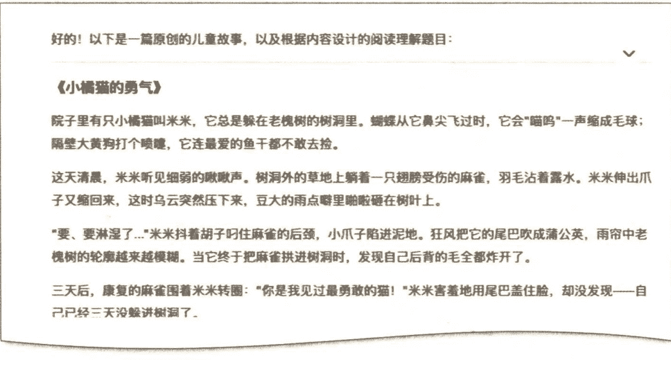

## 阅读理解题目：

1. 选择题：故事开头米米总躲在树洞里是因为什么？
A. 它要守护树洞宝藏
B. 它天生胆小怕事
C. 树洞里有好吃的鱼干
D. 躲避其他小动物欺负

2. 简答题：老槐树在故事中起到了什么作用？请写出两点。

3. 排序题：将下列事件按故事发展顺序排列（填序号）：
（）米米听见麻雀的叫声
（）麻雀称赞米米勇敢
（）暴雨突然降临
（）米米的尾巴被风吹起

4. 词语理解：文中说米米的尾巴“吹成蒲公英”，这样写是想说明什么？

5. 开放题：如果你是米米，在暴雨中会怎么做？为什么？

第2步 将题目复制到 Word 打印练习。也可在 DeepSeek 中作答，标好序号，DeepSeek 会判断分析。

这是我的答案，请帮我批改和分析：
1. B
2. 树洞是米米的藏身之处，也是躲避暴雨的地方。
3. 1-3-4-2
4. 米米的尾巴被风吹得蓬松散开，既写出风大，又体现米米的紧张。

5. 我愿意拼尽全力救下那只麻雀。

批改完成后，DeepSeek 会对每道题进行点评，并在最后给出星级总评与改进建议。

## AI共读指南
面向儿童的阅读提升做法

逐题拆解与点评：

1. 选择题 ✔
判断精准。米米天性胆怯，会躲进树洞亦惧怕蝴蝶与犬类，选B很到位。

2. 简答题 ⚠️
你的作答：部分成立
标准答案须包含两条，你的第一条已到点，第二条把老槐说成躲雨处需要调整。
解析：
- 老槐并非只是避雨之处，更是雨中米米辨认方向的参照，文中“雨幕里槐影愈发模糊”说明米米正艰难朝洞口返回。
- 建议表述：①米米日常的藏身点 ②雨中帮助米米回家的定位标志。
失误原因：
- “尾羽被风吹成蒲公英状”发生在米米冒雨叼着麻雀返程的情节，对应原文“狂风把尾巴吹成蒲公英，雨帘里槐影模糊”，时间应在暴雨来临之后、麻雀夸赞之前。

4. 词义辨析 ✔
完全正确，既抓住了大风的天气特征，又联系到米米的紧张情绪，理解到位。

5. 开放性问题 🌈
你的回答体现善良与勇气，很棒。可再补足细节让内容更完整：
- 加分点：例如先用树叶遮住麻雀再叼走以免淋湿、奔跑时借老槐校准方向。
- 注意：故事里米米其实也很怕，“爪子陷进泥地”“毛发炸开”，你的“不顾一切”很动人，也可谈谈如何勇敢同时兼顾自保。

总评：⭐⭐⭐⭐ 4/5 星
- 优势：把握主线，能抓住人物性格与关键描写。
- 提升点：多关注事件间的时序与动作衔接，如雨中叼鸟→尾羽被吹→安全回洞；简答要紧扣原文细节。

触发灵感
调难度可在指令的“小学”后追加具体年级，或换成“初中”，也可限定字数或题材。如词语释义薄弱，就让 DeepSeek 专项出词语理解题。

## AI作文陪练思路
语文学习里最头疼的常是作文，一篇好文需要反复打磨。如今有 DeepSeek 这位全能辅导师，写作水平很容易跃升。可让它扮演一对一写作导师，对文章做细致批改并给出修改意见。

例 用 DeepSeek 批改作文并给出意见。

第1步 这是一篇孩子写的《一起去游泳》作文。用手机拍清后保存即可。

> 一起去游泳
暑假的一天，烈日炎炎。我、妈妈和弟弟一起来到我学校的游泳馆游泳。
在去游泳馆的路上我很开心，我拉着弟弟的手带着他蹦跳。
我们来到了游泳馆，迫不及待地换衣服，换完衣服，我们就准备下水啦！只听“啪”的一声，我就跳下了水。刚到水里，我就感觉好冷，但动一动就好多了。我在水里玩了好一会儿，也没见弟弟下水，原来，他只把两只脚放进水里，有点害怕。我就在旁边拍水花，弟弟觉得很好玩就把身体也泡进水里，套着游泳圈，向着我漂来。我拉着弟弟的游泳圈，同时也拉着在游泳圈里的弟弟，一会儿游到深水区，一会儿游到浅水区。这可把我累坏了，我就躺在水面上漂浮着休息。休息完了，妈妈让我教她一个泳姿，我说：“我就教你潜泳吧。”我教了好多遍，妈妈也尝试了好多遍，经过不断的努力后，妈妈终于学会了。我们也玩了很多游戏，比如水中拾物、打水仗、接力赛……
我能在水里自由玩耍，是因为我上过很多节游泳课，每天刻苦练习的积累，我想起爸爸经常说的那句话：人生没有白走的路，每一步都对我们有帮助。

第2步 点击📎按钮，将刚才保存的作文图片上传到 DeepSeek。


第3步 输入指令，让 DeepSeek 对作文进行批改和分析。

这是我写的一篇小学作文，请给出具体的修改建议。

可以看到，DeepSeek 从结构优化、语言提升、细节补充等方面对作文进行了详细讲解，让人一目了然。

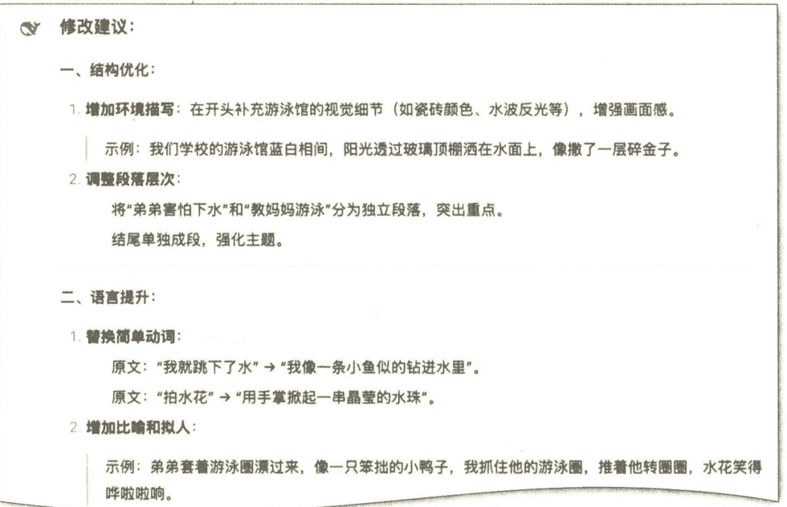

3 丰富情感描写：

弟弟的心理：补充“弟弟紧紧抓住泳池边，嘴唇抿成一条线，像只受惊的小兔子”。

自己的感受：“我的手臂酸得像泡过柠檬汁，但看到弟弟咯咯笑的样子，心里比吃了冰西瓜还甜”。

### 三、细节补充：

1. 加入感官描写：

触觉：“水像凉丝丝的果冻裹住全身”。

听觉：“救生员吹哨的嘟嘟声、水花的哗哗声、欢笑声混在一起，像一首夏日交响曲”。

2. 具体化“努力练习”：

示例：学换气时呛得眼泪汪汪，蹬腿练到膝盖发红，但教练说“坚持就是小海豚”，我咬牙游了一圈又一圈。

### 四、标点与语法修正：

1. 逗号后加空格：“换完衣服，我们就准备下水啦！”

2. 长句拆分：

原文：“我拉着弟弟的游泳圈...累坏了” → “我推着弟弟的游泳圈在深水区转圈，又带他去浅水区踩水。来回折腾几趟，累得直喘气，干脆摊开手脚漂在水面上”。

### 五、主题深化：

结尾可呼应“练习游泳”与“人生道路”的联系：

修改后结尾：

看着妈妈终于能像青蛙一样蹬腿潜泳，我突然懂了爸爸的话。那些呛水的夜晚、酸痛的胳膊，原来都在悄悄为我铺路。人生就像游泳，只要肯扑腾，就没有到不了的岸边。

修改后亮点：

- 画面感：通过比喻（小鸭子、果冻、交响曲）让文字更鲜活。

- 情感递进：从弟弟的害怕到欢笑，从自己的疲惫到成就感，层次分明。

- 哲理升华：将游泳细节与人生道理自然结合，避免说教感。

第4步 如果你想看看按照 DeepSeek 的修改建议优化后的作文，也可以让 DeepSeek 生成修改后的作文，指令如下：

请按照你的修改建议帮我修改作文，并生成修改后的完整作文。

执行完指令，一篇优化后的作文呈现在眼前。你可以对照着修改后的文章读一读、比一比。

## 修改后的完整作文：
暑假的一天，烈日炎炎。我、妈妈和弟弟一起来到我学校的游泳馆游泳。游泳馆蓝白相间，阳光透过玻璃顶棚洒在水面上，像撒了一层碎金子，波光粼粼，让人迫不及待想跳进去。

在去游泳馆的路上，我很开心，拉着弟弟的手蹦蹦跳跳，像两只欢快的小鸟。弟弟也咯咯笑着，眼睛眯成了两条弯弯的月牙。

我们来到游泳馆，迫不及待地换好泳衣，准备下水。只听“扑通”一声，我像一条小鱼似的钻进水里。刚入水时，凉丝丝的感觉像果冻一样裹住全身，我忍不住打了个激灵，但动一动就舒服多了。我在水里游了几圈，回头一看，弟弟却只把两只脚放进水里，紧紧抓住泳池边，嘴唇抿成一条线，像只受惊的小兔子。

我游到他旁边，用手掌掀起一串晶莹的水珠，逗他玩。弟弟被水花逗得咯咯直笑，慢慢放松下来，套上游泳圈，像一只笨拙的小鸭子漂了过来。我抓住他的游泳圈，推着他在水里转圈圈，水花笑得哗啦啦响。我们一会儿游到深水区，一会儿又回到浅水区，来回折腾几趟，我的手臂酸得像泡过柠檬汁，但看到弟弟开心的样子，心里比吃了冰西瓜还甜。

休息了一会儿，妈妈让我教她游泳。我说：“我教你潜泳吧！”我示范了好几次，妈妈也尝试了很多遍。她一开始总是呛水，但经过不断努力，终于能像青蛙一样蹬腿潜泳了。看着妈妈成功的样子，我心里特别自豪。

我们还玩了很多游戏，比如水中拾物、打水仗、接力赛……整个游泳馆充满了欢声笑语，救生员吹哨的嘟嘟声、水花的哗哗声、欢笑声混在一起，像一首夏日交响曲。

我能在水里自由玩耍，是因为我上过很多节游泳课。记得学换气时，我呛得眼泪汪汪；练蹬腿时，膝盖都磨红了。但教练总说：“坚持就是小海豚！”我咬牙游了一圈又一圈，终于学会了游泳。看着妈妈和弟弟的笑脸，我突然懂了爸爸常说的那句话：人生没有白走的路，每一步都对我们有帮助。那些呛水的夜晚、酸痛的胳膊，原来都在悄悄为我铺路。人生就像游泳，只要肯扑腾，就没有到不了的岸边。

## 修改亮点：
1. **画面感强**：通过比喻和拟人（如“小鸭子”“果冻”“夏日交响曲”），让场景更生动。
2. **情感细腻**：从弟弟的害怕到欢笑，从自己的疲惫到成就感，情感递进自然。
3. **主题升华**：将游泳经历与人生哲理结合，结尾点题自然，避免说教感。

## AI协作写故事
爱读书是好习惯，我们最爱读的往往是精彩故事。想不想自己创作一个故事？现在可让 DeepSeek 陪你一起完成一个由你发起的小故事！

例 用 DeepSeek 创作冒险故事。

第1步 在 DeepSeek 中保持深度思考 R1 处于选中状态，输入指令：
> 我是小学生，想创作冒险故事，请先帮我确定具体主题。

第2步 DeepSeek 给出多个有趣方向。

第3步 挑选喜欢主题，让 DeepSeek 设计主要角色。输入指令：
我想写“玩具午夜总动员”，还想加入人工智能元素。请帮我设计主要角色和性格特点。故事约1000字，角色不要太多也不复杂。

第4步 DeepSeek 设计了多个有趣角色并给出情节概述。

第5步 根据背景和角色，让 DeepSeek 进行故事创作。输入指令：
请按你设计的故事背景和角色，生成不超过1000字的故事。要适合小学生，生动有趣、积极向上，情节曲折但合逻辑，文笔温暖舒缓。

第6步 DeepSeek 很快创作了《记忆星图》，你觉得这个由你“执导”的故事怎么样？

> 触类旁通
DeepSeek 创作的故事有时会有明显的“AI 痕迹”，所以我们也不能过度依赖它生成的内容。但是我们可以从它生成的内容中汲取灵感和想法，加入自己的思考和创作。

## AI口算练习
计算是数学的基础和核心，如果你做数学题时总是粗心，现在可以利用 DeepSeek 来帮助自己进行口算练习，提高计算能力。

例1 向 DeepSeek 咨询，获取一些有助于提高计算能力的建议。
在 DeepSeek 中输入以下指令：
我做数学题时总是在计算方面出错，请问可以从哪些方面提高计算能力？
DeepSeek 给出了 7 条建议，其中第 1 条就是加强基础训练，建议通过大量的口算和笔算练习来巩固计算能力。

要提高孩子的计算能力，可以从以下几个方面入手：
1. 加强基础训练
   - 口算练习：每天进行5-10分钟的口算训练，逐步提升速度和准确性。
   - 笔算练习：通过大量笔算题巩固计算步骤，确保每一步都正确。
2. 培养良好的计算习惯
   - 规范书写：确保数字和符号清晰，避免因书写不清导致的错误。
   - 逐步检查：养成逐步检查的习惯，尤其是复杂计算，避免一步错步步错。
3. 掌握计算技巧
   - 简便运算：学习并运用简便运算方法，如凑整法、分配律等，提高效率。
   - 估算能力：先估算结果范围，帮助发现明显错误。
4. 理解算理
   - 理解运算原理：确保孩子理解加减乘除的基本原理，而不仅仅是机械记忆。
   - 解决实际问题：通过应用题加深对运算意义的理解。
5. 适当使用工具
   - 计算器辅助：在复杂计算中使用计算器，但避免过度依赖。
   - 数学软件：利用数学软件帮助理解抽象概念。
6. 保持耐心与鼓励
   - 避免急躁：计算能力的提升需要时间，家长和老师应保持耐心。
   - 积极鼓励：及时表扬孩子的进步，增强信心。
7. 多样化练习
   - 游戏化练习：通过数学游戏或竞赛增加趣味性。
   - 生活应用：将计算融入日常生活，如购物、测量等。

通过这些方法，孩子的计算能力会逐步提高。

例2 用 DeepSeek 生成口算练习题。

DeepSeek 数学提效实操笔记

一键生成可打印的心算卷
初次尝试，先把练习需求抛给对话框。比如说：给我做一套 5 到 10 分钟的心算练习，要涵盖加减乘除，带小数，难度慢慢变大，按试卷排版。模型几乎立刻把整份练习和参考答案一起返回。

下面这份示例可以直接拿来用，题量和难度可按实际水平增减。

**心算练习卷**

姓名：________

用时：5-10分钟

得分：________

**加法 每题1分**

1. 25 + 34 = ______
2. 47 + 58 = ______
3. 12.5 + 3.7 = ______
4. 6.8 + 9.4 = ______
5. 123 + 456 = ______

**减法 每题1分**

6. 78 - 35 = ______
7. 92 - 47 = ______
8. 15.6 - 4.3 = ______
9. 20.8 - 9.5 = ______
10. 500 - 267 = ______

**参考答案**

1. 59
2. 105
3. 16.2
4. 16.2
5. 579
6. 43
7. 45
8. 11.3
9. 11.3
10. 233

这份卷子能有效提升日常计算的熟练度。

把内容导到 Word 打印，操作也简单。复制题干后在 Word 里右键选“选择性粘贴”，挑“无格式文本”，确认后就能直接打印练习。想做专项时，把提示改一下就行，比如“来一组进位加法练习”“来一组小数乘除练习”。

拍照核对并找错因
完成练习后，用手机拍下作业本。点开 DeepSeek 的附件图标上传照片，再发指令：这是我做完的心算作业，请逐题判断对错，指出错题原因并总结计算上的薄弱环节。返回结果会逐题回溯并给出分析。

你提交的计算部分正确。详细回溯如下：
1. 25 + 34 = 59
   - 正确。25 加 34 的结果确实是 59。
2. 47 + 58 = 95
   - 不正确。47 加 58 实际是 105，不是 95。你很可能在个位相加时遗漏了进位。
3. 12.5 + 3.7 = 15.2
   - 不正确。12.5 加 3.7 实际为 16.2，不是 15.2，小数部分处理出现了偏差。
4. 6.8 + 9.4 = 15.2
   - 不正确。6.8 加 9.4 实际为 16.2，不是 15.2，同样是小数位处理问题。
5. 123 + 456 = 579
   - 正确。123 加 456 确实等于 579。
小结：整数加法表现稳定，但在需要进位和涉及小数的加法上容易失误。建议以后做加法时特别注意进位与小数点的对齐。

错题拆解与同类强化
复盘失误并且针对短板训练是提分的关键，DeepSeek 能迅速归纳错题、剖析成因并生成同类练习。

例1 剖析错题并生成巩固题
第一步 错题拍照，要拍全题目和解答，光线够、角度正、没有遮挡识别更准。第二步 在 DeepSeek 点 attachments 上传图片。第三步 打开深度思考模式，输入：请识别图中的数学题，判断解答是否正确，若有问题请分析原因并给出正确解法。系统会给出具体原因与正确过程。第四步 再输入：基于这道题，创作三道同类题目，考察相同知识点并附解析。很快会得到三道换瓶汽水的题目与解析，自行演算后再对照即可吃透题型。

题目1
题目：20个同学在一家商店买了20瓶汽水，规定可以用4个空汽水瓶换一瓶汽水。请问他们最多可以喝多少瓶汽水？
题目2
题目：25个同学在一家商店买了25瓶汽水，规定可以用6个空汽水瓶换一瓶汽水。请问他们最多可以喝多少瓶汽水？
题目3
题目：30个同学在一家商店买了30瓶汽水，规定可以用3个空汽水瓶换一瓶汽水。请问他们最多可以喝多少瓶汽水？
答案解析
题目1解析
初始饮用：喝掉20瓶，剩20个空瓶。
1. 第一次兑换：20 ÷ 4 = 5瓶（余0空瓶），喝掉5瓶，得到5个新空瓶。
2. 第二次兑换：5 ÷ 4 = 1瓶（余1空瓶），喝掉1瓶，得到1个新空瓶。
3. 第三次兑换：1 + 1 = 2空瓶，不足4个，无法继续兑换。
总瓶数：20 + 5 + 1 = 26瓶。
题目2解析
初始饮用：喝掉25瓶，剩25个空瓶。
1. 第一次兑换：25 ÷ 6 = 4瓶（余1空瓶），喝掉4瓶，得到4个新空瓶。
2. 第二次兑换：1 + 4 = 5空瓶，不足6个，无法继续兑换。
总瓶数：25 + 4 = 29瓶。

例2 建立专属错题库用于回顾
DeepSeek 的对话会长期保留，可用来搭建错题库。
第一步 在左侧点击当前会话旁的 …，把会话改名为 “AI 数学错题库”。第二步 在此会话里通过上传照片或输入新题积累错题。例如输入一道年龄题：
小明今年7岁，爷爷的年龄是小明的8倍再加上5岁。爷爷比小明大多少岁？
解答：7×8+5=61（岁）。答：爷爷比小明大61岁。
请判定这道题解答是否正确，若不足请剖析原因并给出正确结果。
第三步 积累一段时间后需要复习时打开 “AI 数学错题库” 会话，输入：
> 请把此前所有题目归纳一下，列出主要失误题型与成因，并生成三道同类题目。
DeepSeek 会对会话中的错题进行归纳并产出新题，通过练习与核对实现有效复习。

归纳总结
主要失误题型
1. 空瓶兑换问题：
   失误：忽略剩余空瓶的再利用，未完全兑换，计算偏差。
   根源：粗心，逻辑不清，运算能力不足。
2. 年龄计算问题：
   失误：理解偏差，计算偏差。
   根源：未明确题目要求，未分步运算。
失误原因
- 粗心：运算过程中未仔细核对每步结果。
- 逻辑不清：未完全理解题意，导致步骤遗漏。
- 运算能力不足：除法与加法运算出错，影响最终结果。
生成三道同类型题目
题目1（空瓶兑换问题）
题目：18个同学在一家商店买了18瓶汽水，规定可以用4个空汽水瓶换一瓶汽水。请问他们最多可以喝多少瓶汽水？
题目2（空瓶兑换问题）
题目：24个同学在一家商店买了24瓶汽水，规定可以用5个空汽水瓶换一瓶汽水。请问他们最多可以喝多少瓶汽水？
题目3（年龄计算问题）
题目：小华今年10岁，他的爸爸年龄是小华的4倍再加上2岁。请问爸爸比小华大多少岁？
小结
这些题目考核基础运算与逻辑推理，核心在于：
1. 空瓶兑换问题：喝完后用空瓶换新汽水，兑换后剩余空瓶与新喝出的空瓶合并继续兑换，直至不足为止。
2. 年龄计算问题：明确要求，分步运算，保证每步准确。

引导式应用题教学
遇到难题时，DeepSeek 可扮演贴身导师。
例 用 DeepSeek 学习“鸡兔同笼”
第一步 拍照并上传题目。例如：
> 农场里养了一些鸡和兔，它们一共有 120 只脚，45 个头。
请问，农场里的鸡和兔的数量分别是多少？
第二步 在 DeepSeek 上传题目。
第三步 发送指令：
这是一道数学题，我想知道解法，请你用苏格拉底提问的方式，每次只提一个问题，我回答后再进入下一问，直到我完全明白。
DeepSeek 进入角色，首先提问：
> 好的，让我们用苏格拉底式的方法逐步解决。首先，我需要问你：
问题1： 题目提到了鸡和兔的总头数和总脚数，你能说出鸡和兔各自有多少个头和多少只脚吗？
第四步 输入回答。
鸡有 1 个头，2 只脚。兔有 1 个头，4 只脚。
DeepSeek 肯定后继续提问。
> 很好！你已明确鸡和兔的基本特征。接下来：
问题2： 题目中说鸡和兔一共有45个头。如果设鸡的数量为x，兔的数量为y，你能根据头的总数写出一个方程吗？
第五步 若不懂方程，可输入：
我不知道什么是方程，请换一种简单讲解。
DeepSeek 调整思路：
> 没问题！让我们用更直观的方法来解决。
问题3（换一种方式）： 假设农场里所有的动物都是鸡，那么45只鸡应该有多少只脚呢？
第六步 跟随讲解逐步得出答案。
> 完美！45只鸡共有90只脚。但题目中实际的总脚数是120只，比假设的90只多了30只脚。
问题4： 为什么会多出30只脚？这是因为农场里不仅有鸡，还有兔。每只兔比鸡多2只脚（兔4只，鸡2只）。那么，多出的30只脚需要多少只兔来“贡献”呢？
（提示：用多出的脚数 ÷ 每只兔多出的脚数）
15只
> 完全正确！15只兔比15只鸡多出了30只脚（因为每只兔多2只脚，15 × 2 = 30）。
问题5： 既然兔有15只，那么鸡的数量是多少呢？
（提示：总头数是45，兔占15个）
（最终检查：鸡的脚数30 × 2 = 60，兔的脚数15 × 4 = 60，总和60 + 60 = 120）
30
> 太棒了！你算对了：
> • 鸡有30只（共60只脚），
> • 兔有15只（共60只脚），
> 加起来正好是45个头和120只脚。
> 总结：
> 通过逐步的假设和调整，我们找到了答案！你在这个过程中表现得非常出色。现在，你理解这道题了吗？
> 如果有任何疑问，可以随时提出哦！
第七步 根据指令，DeepSeek 不断调整提问方式，帮助理解题型本质。
第八步 请求巩固练习，输入：
我懂了，谢谢。请帮我再出两道类似的题目，我要练习一下。
第九步 DeepSeek 回应。
太好了！以下是两道类似的题目，帮助你巩固这个方法。每道题都遵循“头+脚”的模式，你可以用刚才的步骤解决：
题目1
农场里有鸡和羊，它们共有50个头和140只脚。已知鸡有2只脚，羊有4只脚。请问鸡和羊各有多少只？
提示：
1. 设鸡有x只，羊有y只。
2. 根据头的总数写出第一个方程。
3. 根据脚的总数写出第二个方程。
4. 解方程组或用“假设全为鸡”的方法。
题目2
停车场里有汽车和摩托车，共30辆，车轮总数是80个。已知汽车有4个车轮，摩托车有2个车轮。求汽车和摩托车各有多少辆？
提示：
1. 汽车和摩托车的“头”在这里是“辆数”。
2. 尝试用“假设全是摩托车”的方法，比较车轮差额。
完成后可以告诉我你的答案，我会帮你检查！如果需要分步提示，随时提问哦~
第十步 解答后输入答案或上传图片让 DeepSeek 批改。
第1题：假设全是鸡，那脚一共有 100 只，但现在有 140 只，相差的 40 只脚要由羊来补充，需要 20 只羊，所以有 30 只鸡、20 只羊。
第2题：假设全是摩托车，那车轮一共有 60 个，现在有 80 个车轮，相差的 20 个车轮要由汽车来补充，需要 10 辆汽车，所以有 10 辆汽车、20 辆摩托车。
第十一步 DeepSeek 验证并总结方法。
> 你的解答完全正确！✨ 以下是详细验证：
> **题目1验证**
> * 鸡30只 + 羊20只 = 50个头 ✅
> * 脚数：鸡（30×2=60） + 羊（20×4=80） = 140只脚 ✅
> 结论：鸡30只，羊20只。
> **题目2验证**
> * 汽车10辆 + 摩托车20辆 = 30辆 ✅
> * 车轮数：汽车（10×4=40） + 摩托车（20×2=40） = 80个车轮 ✅
> 结论：汽车10辆，摩托车20辆。
> **你的方法总结**
> 1. 假设全为脚少的动物（鸡/摩托车），计算总脚数。
> 2. 用实际脚数差额 ÷ 每只多出的脚数，得到另一种动物的数量。
> 3. 总数减去另一种动物数量，得到原动物数量。
> 你已经掌握了这个技巧！如果还想挑战更复杂的问题（比如三种动物），可以告诉我哦~😊

函数曲线可视化
初中开始学习函数，借助 DeepSeek 配合 desmos 观察曲线能更快理解。
知识小链接
desmos 是一个免费的在线图形计算器，可用来绘制函数图像、做数学计算和数据分析。
第一步 在 DeepSeek 保持深度思考 R1 选中，输入：
我想使用 desmos 来显示不同的函数曲线图，请帮我生成初中和高中阶段的主要函数公式，要用正确的格式输出，以便我可以直接复制到 desmos 中使用。
第二步 DeepSeek 列出主要函数公式。以二次函数为例，复制公式 y=ax²+bx+c。
当然！以下是初中和高中阶段常见的一些函数公式，格式已经调整好，你可以直接复制到Desmos中使用。
## 1. 线性函数（一次函数）
公式：y = kx + b
示例：
```
desmos
y = 2x + 3
```
## 2. 二次函数
公式：y = ax² + bx + c ←复制公式
示例：
```
desmos
y = x^2 - 4x + 3
```
## 3. 反比例函数
公式：y = k/x
示例：
```
desmos
y = 1/x
```
第三步 打开 desmos 网页 https://www.desmos.com/?lang=zh-CN，点击「打开图形计算器」。

第四步 进入计算器界面，把复制的二次函数公式粘贴到左上角输入框。

第五步 点击“添加滑块”右侧的**全部**按钮，为所有参数添加滑块。

第六步 右侧即可看到二次函数曲线，滑动左侧的 a、b、c 滑块，可直观观察参数变化对曲线的影响。
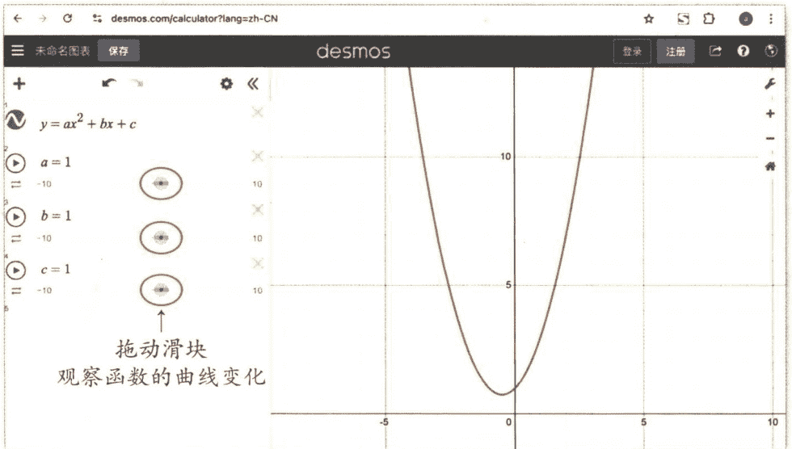


词汇记忆加速
借助 DeepSeek 认识和理解词汇并学会使用。
例 整理英文词汇表
第一步 准备一份需掌握的英文词汇表，例如译林版《英语》四年级上册单词表。

第二步 在 DeepSeek 点击 📎 上传单词表图片。

第三步 发送指令：
识别图片里 Unit 1 的单词，把这些单词用表格的形式整理出来，并给每个单词都配一个简单的例句，附上中文翻译。
很快得到表格展示。
| 英文单词 | 中文翻译 | 例句 | 中文翻译 |
| :--- | :--- | :--- | :--- |
| like | 喜欢 | I like dogs. | 我喜欢狗。 |
| dog | 狗 | The dog is barking. | 狗在叫。 |
| animal | 动物 | The zoo has many animals. | 动物园里有很多动物。 |

AI 赋能的词汇入门与应用攻略

| cat | 猫 | The cat is sleeping. | 猫在睡觉。 |
| cute | 可爱的 | The panda is very cute. | 熊猫非常可爱。 |
| panda | 熊猫 | Pandas eat bamboo. | 熊猫吃竹子。 |
| fat | 胖的 | The elephant is fat. | 大象很胖。 |
| elephant | 大象 | The elephant has a long trunk. | 大象有长长的鼻子。 |
| horse | 马 | The horse is running fast. | 马跑得很快。 |
| lion | 狮子 | The lion is the king of the jungle. | 狮子是丛林之王。 |
| monkey | 猴子 | The monkey is climbing the tree. | 猴子在爬树。 |
| tiger | 老虎 | The tiger has stripes. | 老虎有条纹。 |
| have | 有 | I have a cat. | 我有一只猫。 |

这份清单可以帮你快速建立起基础的概念框架。

第 4 步 在对单词建立初步印象后，可通过情境阅读来加深记忆并体会用法。此时在 DeepSeek 中继续下达指令：

请基于上述 Unit 1 词汇，输出一篇约 200 词、适合小学四年级阅读水平的英文阅读理解，文中涉及的词汇需加粗，并在末尾附上中文译文。

指令执行后，模型会返回一篇符合要求的主題短文，关键词已加粗处理，文后附有中文对照。

阅读理解：My Favorite Animals

文章围绕作者对动物的喜爱展开，先写最爱的狗 Max 很可爱不胖且爱运动，每天在公园玩耍，动物园里曾见到猫、熊猫、大象，熊猫可爱吃竹子，大象体型大鼻子长。也提到喜欢的马奔跑快，丛林里的狮子为王，老虎有漂亮条纹，上周见过爬树的猴子很逗。朋友养的猫小巧爱睡，墙上贴着熊猫照片会让人想起动物园之行。

Questions:
1. What is the writer's favorite animal?
2. What does the panda eat?
3. Where did the writer see a monkey?

中文翻译：
我很喜欢动物，最喜欢的是狗。我有一只可爱的狗叫 Max，他不胖很活泼，每天我们在公园玩。有时在动物园能看到猫、熊猫、大象等，熊猫很可爱吃竹子，大象很大鼻子很长。

我也喜欢马，它们跑得很快。丛林里狮子是王者，老虎有美丽条纹。上周我看到猴子爬树，十分有趣。

朋友有一只猫，小巧爱睡觉。墙上有一张熊猫照片，让我想起去动物园的经历。

问题：
1. 作者最喜欢的动物是什么？
2. 熊猫吃什么？
3. 作者在哪儿看到猴子？

## AI 制作主题单词闪卡

借助 DeepSeek 配合豆包可以把单词学习变得更直观有趣。

例1 为 5 岁孩子制作 10 张动物主题英语闪卡。

第1步 让 DeepSeek 产出一套生成动物主题闪卡图的指令，示例描述如下：

请为我生成 10 条动物英语单词图片的中文生图指令，假设单词为 {A}，格式要求图片上下分两部分，上部为动物图，下部白底写英文单词 {A} 并配一句幼儿园到小学一年级水平的例句。

第2步 保持 DeepSeek 深度思考开启后执行，模型会给出 10 条具体指令，例如 Cat 对应橘色猫咪舔爪浅蓝背景、下部黑体 CAT 并配例句 “This is a cat. It says meow!”；Dog 对应棕色小狗摇尾叼骨草地背景、下部 DOG 并配例句 “I see a dog. It runs fast!”；其余 Bird、Fish、Rabbit、Butterfly、Elephant、Lion、Frog、Duck 也均给出对应画面描述与简易例句，并附生成建议如儿童简笔画风格、明亮配色、易读字体等。

第3步 打开豆包网页或 App，将 DeepSeek 生成的指令复制进去即可出图。以 Dog 为例，指令为上半部画摇尾巴棕色小狗叼骨头草地背景，下半部白底写 DOG 并附例句 “I see a dog. It runs fast!”。

第 4 步 发送后即可得到精美的闪卡，体验很直观。


若要更换主题或难度，只需修改指令中的关键词即可，例如把动物换成高频词，把年级要求改为初中水平。

## 例2 制作元宵节主题英语闪卡

第1步 在原指令基础上调整为：

请为我生成 10 条元宵节相关英文单词图片的中文生图指令，单词为 {A}，图片上下分两部分，上部为主题图，下部红底黄字写出英文单词 {A}。

第2步 执行后模型给出 10 条内容，例如 Lantern 为古风屋檐下悬挂红灯笼、下部红底黄字 LANTERN；Tangyuan 为青花瓷碗盛汤圆、下部写 TANGYUAN；Riddles 为灯笼挂灯谜条、下部写 RIDDLES；Lion Dance 为彩色舞狮、下部写 LION DANCE；Fireworks 为夜空烟花、下部写 FIREWORKS；Reunion 为三代同堂吃元宵、下部写 REUNION；Moon 为满月与灯笼创意图、下部写 MOON；Dumplings 为蒸笼冒热气、下部写 DUMPLINGS；Blessing 为孩童持福字对联、下部写 BLESSING；Parade 为夜间灯笼游行、下部写 PARADE。并给出中国风插画、喜庆配色、粗体无衬线字体的建议。

第 3 步 复制 Lantern 的指令到豆包即可生成对应闪卡。


按同样流程即可批量产出精美的主题闪卡。

## AI 单词消消乐

学习中穿插小游戏能放松大脑。可用 DeepSeek 自制单词配对消除游戏。

例 用 DeepSeek 制作英语单词消消乐小游戏。

第1步 在 DeepSeek 中保持深度思考开启，输入指令：

我想做一个简易英语单词消消乐，请生成完整 HTML 代码。界面显示 20 个小学英语单词，共 40 个小圆圈，分别展示英文或中文，连续点击一对对应的中英文圆圈即可消除，右上角显示得分，每对 5 分，同一屏内不出现重复的中文或英文。

第2步 模型思考后给出包含样式与逻辑的完整 HTML 代码。

以下是一个简单的英语单词消消乐游戏的完整HTML代码，包含样式和逻辑：

```html
<!DOCTYPE html>
<html lang="zh-CN">
<head>
    <meta charset="UTF-8">
    <title>英语单词消消乐</title>
    <style>
        body {
            font-family: Arial, sans-serif;
            display: flex;
            flex-direction: column;
            align-items: center;
        }

        #score {
            position: fixed;
            top: 10px;
            right: 20px;
            font-size: 24px;
            font-weight: bold;
        }

        #game {
            display: grid;
            grid-template-columns: repeat(8, 1fr);
            gap: 10px;
        }
    </style>
</head>
<body>
    <div id="score">得分: 0</div>
    <div id="game"></div>

    <script>
        // 游戏逻辑代码
        const gameContainer = document.getElementById('game');
        const scoreElement = document.getElementById('score');
        let score = 0;
        let selectedCards = [];

        // 示例单词对
        const words = ['apple', 'banana', 'cherry', 'date', 'elderberry', 'fig', 'grape', 'honeydew'];
        const cards = [...words, ...words];

        // 打乱数组
        function shuffle(array) {
            for (let i = array.length - 1; i > 0; i--) {
                const j = Math.floor(Math.random() * (i + 1));
                [array[i], array[j]] = [array[j], array[i]];
            }
            return array;
        }

        // 创建游戏卡片
        function createGame() {
            const shuffledCards = shuffle(cards);
            shuffledCards.forEach(word => {
                const card = document.createElement('div');
                card.classList.add('card');
                card.dataset.wordKey = word;
                card.textContent = word;
                card.addEventListener('click', handleCardClick);
                gameContainer.appendChild(card);
            });
        }

        // 处理卡片点击
        function handleCardClick(event) {
            const clickedCard = event.target;
            if (clickedCard.classList.contains('eliminated') || selectedCards.includes(clickedCard)) {
                return;
            }

            clickedCard.style.backgroundColor = '#ffeb3b';
            selectedCards.push(clickedCard);

            // 当选择两张卡片时进行验证
            if (selectedCards.length === 2) {
                setTimeout(() => {
                    const [first, second] = selectedCards;
                    const isMatch = first.dataset.wordKey === second.dataset.wordKey;

                    if (isMatch) {
                        first.classList.add('eliminated');
                        second.classList.add('eliminated');
                        score += 5;
                        scoreElement.textContent = `得分: ${score}`;
                    } else {
                        first.style.backgroundColor = '#4CAF50';
                        second.style.backgroundColor = '#4CAF50';
                    }

                    selectedCards = [];
                }, 500);
            }
        }

        // 初始化游戏
        createGame();
    </script>
</body>
</html>
```

## 第 3 步
点一下代码区域右下方的 ▶ 按钮，HTML 会立刻执行，专属的词汇消除小游戏随即上线。

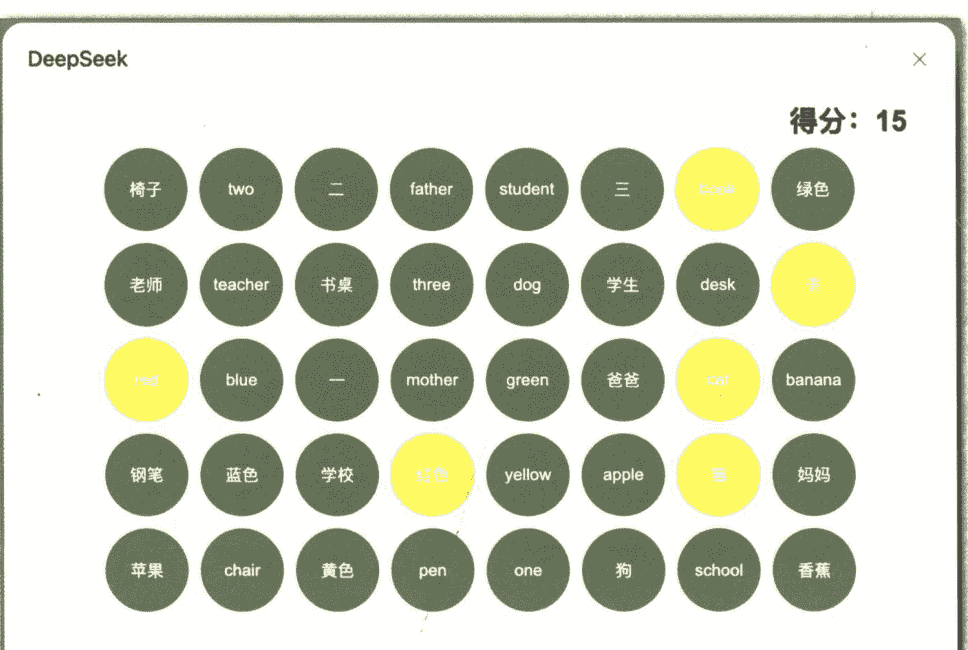

## 第 4 步
实测后功能正常，但配色偏淡、辨识度不足，想加个计时功能方便和朋友赛速。于是追加提示：
> 给每个圆环分配独立色调，被点选的圆环加粗描边并突出显示，已配对消除的圆环转成灰色。另在界面顶部左侧加入计时组件，首次点击圆环即启动计时，全部配对完成时自动停止，请在此基础上继续优化。

## 第 5 步
模型思考后对原方案做了扩充。
下面这段升级代码已实现多色区分、选中态强调以及计时机制：
```html
<!DOCTYPE html>
<html lang="zh-CN">
<head>
    <meta charset="UTF-8">
    <title>英语单词消消乐</title>
    <style>
        body {
            font-family: Arial, sans-serif;
            display: flex;
            flex-direction: column;
            align-items: center;
            margin: 0;
            min-height: 100vh;
        }

        #game-info {
            position: fixed;
            top: 10px;
            left: 20px;
            font-size: 20px;
            font-weight: bold;
        }

        #game {
            /* ... */
        }
    </style>
</head>
<body>
    <!-- ... -->
    <script>
        // ... (代码片段)
        selectedCards = selectedCards.filter(card => card !== clickedCard);
    }

    // 当选择两张卡片时进行验证
    if (selectedCards.length === 2) {
        setTimeout(() => {
            const [first, second] = selectedCards;
            const isMatch = first.dataset.wordKey === second.dataset.wordKey;

            // 移除所有选中状态
            selectedCards.forEach(card => card.classList.remove('selected'));
            selectedCards = [];

            if (isMatch) {
                first.classList.add('eliminated');
                second.classList.add('eliminated');
                score += 5;
                document.getElementById('score').textContent = score;
                checkGameComplete();
            }
        }, 500);
    }
}

// 初始化游戏
createGame();
</script>
</body>
</html>
```

## 第 6 步
激活新代码块右下方的 ▶，游戏窗口即刻打开。此时圆环配色更饱满，已消除的项目显示为灰色，计时组件也正常运作。
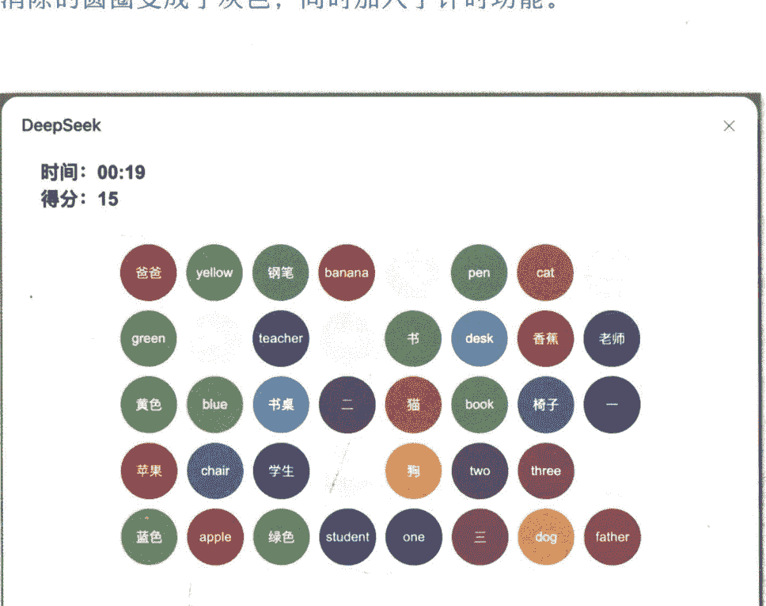

想用教材词汇来练？只需把单词表拍下上传，DeepSeek 能从中抽取词条生成对应游戏。任何创意需求，都可以向它提出，由它来落地。

# AI 助力英语阅读提升

英语学习里，阅读力的提升常被视为关键。现在借助 DeepSeek，相当于请了一位私人阅读导师，能有效加快理解速度。

示例：用 DeepSeek 提升英语阅读理解效率。

## 第 1 步
先把目标阅读材料拍摄下来。这里以一篇介绍亚洲象的英文科普短文为例。

A three-foot-deep watering hole in northeast India hums with buzzing insects and chirping birds. Suddenly seven Asian elephants stomp through the grass surrounding the pool and splash into the water. It's bath time for the herd.

| COMMON NAME | Asian elephants |

|---|---|

| SCIENTIFIC NAME | Elephas maximus |

| TYPE | Mammals |

| DIET | Herbivore |

| GROUP NAME | Herd |

| AVERAGE LIFE SPAN IN THE WILD | Up to 60 years |

| SIZE | Height at the shoulder: 6.6 to 9.8 feet |

| WEIGHT | 2.25 to 5.5 tons |


# THE BIGGER THE BETTER

Asian elephants live in the tropical forests and grasslands of Southeast Asia. They're a little smaller than African elephants but can grow nine feet tall and weigh nearly six tons. That's heavier than two medium-size cars! Even newborns are on the hefty side, weighing some 200 pounds. Given their size it's no surprise that these guys are big on food. Adults can eat 300 pounds in one day, nearly 75 times what the average human eats! An Asian elephant's ideal meal includes roots, grasses, fruit, and bark.

Much of an Asian elephant's time is spent searching for grub. In fact the animal may travel 50 miles a day to find food. Asian elephants also enjoy taking dips in the water. To cool down their backsides, the animals will fill their trunks with water and spray it over themselves like a hose.

# SOCIAL NETWORK

Asian elephants are gentle and super-social. Related females live with their young in herds. (Adult males go off on their own.) To communicate with each other they use rumbles, bellows, growls, and moans. Some of their vocalizations can be heard more than a mile away. Talk about a long-distance call!

## 第 2 步
进入 DeepSeek 界面，点击 📎 图标把刚才的照片上传。


## 第 3 步
先请模型梳理文本架构，输入提示：
你能分析这篇文章的结构吗？

模型返回的解读如下。
1. 标题
Asian Elephant
• 用词简洁，直接照亮主题——亚洲象。
2. 开篇段落
• 借助生动的现场描绘（印度东北部水洼、虫鸣鸟叫、象群戏水）抓住注意力，并顺势带入主题。
• 语体偏叙事描写，可读性增强。

## 第 4 步
接下来让模型做词汇拆解，输入指令：
找出这篇文章中孩子可能不熟悉的单词，并提供中英文释义、例句、同义词与反义词。

模型按需求输出了词表并附上教学建议。
下面列出文中难度较高的词汇，附带释义、例句、同反义词及出处标注：
1. hums (引言段落)
• 英文释义: To make a low, continuous sound like a bee.
• 中文释义: 发出嗡嗡声（像蜜蜂的声音）。
• 例句: The refrigerator hums softly in the kitchen.
• 近义词: buzz, drone
• 反义词: silence
2. stomp (引言段落)
• 英文释义: To walk heavily with loud steps.
• 中文释义: 跺脚行走，重步踩踏。
• 例句: The angry boy stomped up the stairs.
• 近义词: trample, clomp
• 反义词: tiptoe
3. herbivore (关键信息栏)
• 英文释义: An animal that eats only plants.
• 中文释义: 草食动物。
• 例句: Cows and rabbits are **herbivores**.
• 近义词: plant-eater
• 反义词: carnivore (肉食动物)
4. hefty (THE BIGGER THE BETTER 段落)
• 英文释义: Large and heavy.

**单词速记卡**

• 中文解释：沉甸甸的、笨重。
• 例句：She carried a **hefty** bag of books.
• 近义词：bulky, weighty
• 反义词：light, small

5. grub （THE BIGGER THE BETTER 段落）
• 英文释义：(Informal) Food.
• 中文解释：口语中表示食物。
• 例句：Let's go find some **grub** for lunch.
• 近义词：food, eats
• 反义词：没有直接对应，可与“starvation”作对比

### 教学建议

- 互动练习：让孩子模仿大象的 “rumble” 或 “bellow” 发声，加深印象。
- 对比学习：通过反义词提问，例如“大象是草食性还是肉食性？”
- 视觉辅助：播放大象喷水 dips 或跺脚 stomp 的图片、短片。

以上词目挑选的是孩子接触较少的动词、非正式表达以及动物行为类词汇，释义和例句都尽量贴近儿童认知。

## 第 5 步

让 DeepSeek 演示阅读策略，输入指令：

以这篇文章为例，教我如何找整篇文章的主旨句，如何找每个段落的主旨句，如何猜词义，如何预测词义，如何概括，如何推理。

DeepSeek 开始逐步讲解阅读方法，并逐项给出解答。

好的！我以《Asian Elephant》这篇文章为例，演示 **如何分析中心句、推测词义、预测、概括和推理**。这些技能是阅读理解的基础，可迁移到任何材料。

### 一、如何定位全文中心句

中心句即整篇的核心观点，多出现在 **开头或结尾**。

本文中心句：

> “Asian elephants are gentle and super-social.”（末段首句）

原因：

1. 全文围绕亚洲象的 **体型、饮食、社会行为** 展开，最终归于它们的 **温顺与极强的社交性**。
2. 其余段落如洗澡、觅食等，都是支撑这一特质的细节。

要点：

- 优先看首尾段，尤其是结论句。
- 若没有明显句子，可自行提炼，例如：“本文介绍了亚洲象的生活习性与群体结构”。

### 二、如何定位段落中心句

段落中心句多在 **段首或段尾的前一两句**。

例1（第二段）：

> “Asian elephants live in the tropical forests and grasslands of Southeast Asia.”

- 下文都在阐述栖息环境、体型和食物，围绕该主题展开。

例2（最后一段）：

> “Asian elephants are gentle and super-social.”

- 下文用群居、声波交流等细节来论证。

要点：

- 忽略具体数字和例证，寻找概括性强的表述。
- 若段落没有明显中心句，需自行总结，例如：“该段说明大象如何散热”。

## 第 6 步

让 DeepSeek 依据文章出五道题，检验理解，输入指令：

请根据这篇文章设计 5 个英文问题。

DeepSeek 很快给出五题，覆盖面广，难度层次分明。

> 以下基于《Asian Elephant》设计的5道阅读理解题，涵盖细节定位、推理、词义推断等，并附答案与设计意图：

### 1. 细节题
**Question:** What is the average lifespan of an Asian elephant in the wild?
**Answer:** Up to 60 years.
**原文依据:** Key Information栏的"AVERAGE LIFE SPAN IN THE WILD"条目。
**目的:** 训练快速定位明确信息的能力。

### 2. 词义推测题
**Question:** In the sentence "They fill their trunks with water and spray it over themselves," what does "spray" most likely mean?
**Answer:** To scatter liquid in small drops（喷射/喷洒）。
**线索:** 后文比喻"like a hose"提示与水喷出相关。
**目的:** 通过上下文和比喻把握生词。

### 3. 推理题
**Question:** Why might Asian elephants need to communicate over long distances?
**Answer:** Because they live in large herds or roam widely, so they need to stay connected with other elephants far away.
**原文依据:** "Some vocalizations can be heard more than a mile away" + "super-social"特点。
**目的:** 结合文本与常识推断行为原因。

### 4. 主旨题
**Question:** Which sentence best summarizes the entire article?
**Answer:** "Asian elephants are gentle and super-social animals that live in Southeast Asia, with unique behaviors like long-distance communication and massive appetites."
**干扰项：**
- "Asian elephants are smaller than African elephants."（片面细节）
- "Elephants enjoy taking baths."（次要信息）
**目的:** 区分主旨与细节，训练概括能力。

有了 DeepSeek 这位“老师”，英语阅读还怕什么？快让它帮你提升阅读力吧！


# AI 一键查历史上的今天

大家是不是常会灵光一现，想知道自己生日那天世界发生了什么？历史长河里几乎每天都有大事，现在可以用 DeepSeek 来记录某一天发生了什么。

例 用 DeepSeek 快速查某一天的大事件。

## 第 1 步

在 DeepSeek 中保持 深度思考(R1) 联网搜索 选中，输入指令：

我会告诉你一个日期，含年、月、日，请告诉我那天发生的重大事件，不超过3件，用表格输出。我会持续提问，每次给出新日期，请遗忘旧日期，按新日期查找。若我输入的不是日期，请忽略并提醒我提供正确日期。

## 第 2 步

经过思考，DeepSeek “答应”要求，开始让我们输入日期。

## 你好，AI：

给孩子的高效学习法

明白了！请告诉我你要查询的日期（示例格式：7月21日/July 21），我会查找当天3件重大历史事件并以表格呈现。每次只处理最新日期，非日期内容会提示重新输入。

**第3步** 告诉 DeepSeek 一个日期，比如“2008年8月8日”。

**第4步** 这天是北京奥运会开幕日，经深度思考与联网搜索，DeepSeek 给出当天重大事件。

以下是2008年8月8日发生的重大历史事件，按时间顺序整理为三件：

| 日期 | 事件 | 关键内容 |
| :--- | :--- | :--- |
| 2008年8月8日 | 第29届夏季奥林匹克运动会在北京开幕 | 北京奥运会是中国首次举办夏季奥运会，开幕式在国家体育场“鸟巢”举行，全球约10亿观众观看。本届以“绿色奥运、科技奥运、人文奥运”为理念，共设28个大项、302枚金牌。中国代表团最终以48枚金牌位居榜首。 |
| 2008年8月8日 | 北京奥运会开幕式创下收视纪录 | 开幕式成为中国收视率最高电视节目，全国收视率达40.54%，约8.42亿中国观众观看直播。香港地区收视率高达42.5%，全球约15%人口收看。 |
| 2008年8月8日 | 奥运会推动全民健身与体育发展 | 北京奥运会不仅提升中国国际形象，还推动全民健身热潮，促使体育观念从“唯金牌论”向健康生活方式转变，成为中国体育史重要里程碑。 |

补充说明：

1. 北京奥运会：作为中国首次夏季奥运会，开幕式以焰火“脚印”、击缶表演等创意震撼世界，李宁点燃主火炬成经典。
2. 后续影响：奥运会后中国体育事业快速发展，全民健身日（8月8日）设立进一步强化运动与健康理念。

**第5步** 单击左侧历史对话列表右侧的 ... ，将对话重命名为“历史上的今天”。

**第6步** 一个名为“历史上的今天”的小工具就完成了。只要想查询某天重大事件，在 DeepSeek 左侧的历史对话中找到该对话，输入日期即可直接获得答案。


## 用 AI 生成历史时间表

学历史免不了记忆年代、人物、事件，若能让枯燥内容更有条理便于记忆就好了。现在用 DeepSeek+Napkin.ai 就能生成漂亮清晰的事件文字图表。

> 知识小链接
Napkin.ai 是款基于人工智能的工具，专注帮助用户快速生成和分享想法。通过简洁界面和 AI 技术，用户能轻松创建内容并可视化概念。

## 例 生成清朝历代皇帝记忆图表。

第1步 在 DeepSeek 中输入指令：

请生成一个时间轴，用来记忆清朝历代皇帝，按重大时间节点生成。

这个要求不难，DeepSeek 很快生成相关内容。

## 你好，AI：

给孩子的高效学习法

## 清朝皇帝时间轴 (按重大时间节点)

1616年：努尔哈赤建立后金。
1636年：皇太极改国号为“清”。
1644年：清军入关，顺治帝迁都北京。
1661年：顺治帝去世，康熙帝即位，开启“康乾盛世”。
1722年：康熙帝去世，雍正帝即位。雍正帝推行一系列改革，加强中央集权。
1735年：雍正帝去世，乾隆帝即位。清朝逐渐发展到鼎盛时期。
1796年：乾隆帝禅位于嘉庆帝，清朝转衰。
1820年：嘉庆帝去世，道光帝即位，面临内忧外患。
1850年：道光帝去世，咸丰帝即位。1851年太平天国运动爆发。
1861年：咸丰帝去世，同治帝即位，慈禧太后开始垂帘听政。
1875年：同治帝去世，光绪帝即位，清朝继续衰落。
1898年：戊戌变法失败，光绪帝被囚禁，慈禧太后掌权。
1908年：光绪帝和慈禧太后相继去世，溥仪即位，清朝灭亡进入倒计时。
1912年：溥仪退位，清朝灭亡。

附加说明：
- 此时间轴仅列出即位、去世等重大节点，以及对历史进程有重大影响的事件。
- 每个皇帝在位期间还有诸多重要事件，可按需补充。
- 可使用不同颜色、图标等，使时间轴更直观易记。

第2步 选择 1616 年到 1912 年间的文字内容，复制到剪贴板。
第3步 打开 Napkin.ai 网页，网址是 https://www.napkin.ai。
第4步 单击右上角的 Get Napkin Free →，创建账号并登录。首次登录需填写个人使用信息，完成后单击 Submit。

## 第二章 学科探索篇
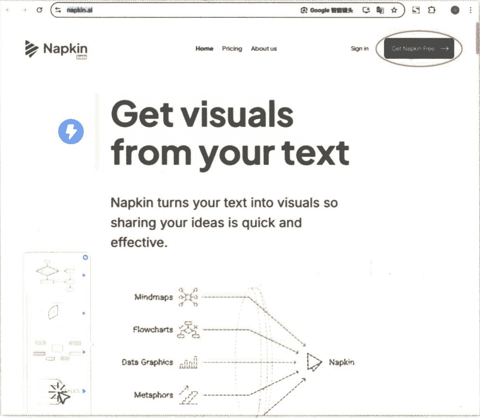

第 5 步 在打开的页面中单击 Create my first Napkin ⚡。
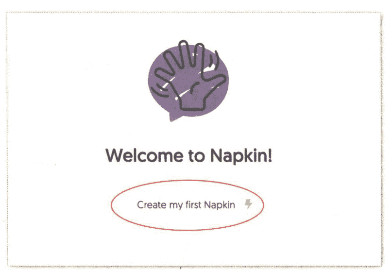
第 6 步 选择添加文字的方法，单击左侧的 📋 By pasting my text content 按钮。
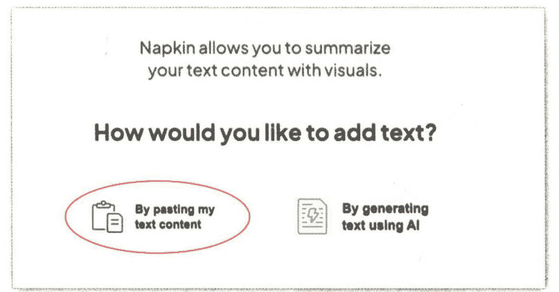
第 7 步 在打开的页面中，将之前在 DeepSeek 复制的年代事件内容粘贴进来。

## Untitled

- 1616年：努尔哈赤建立后金。
- 1636年：皇太极改国号为“清”。
- 1644年：清军入关，顺治帝迁都北京。
- 1661年：顺治帝去世，康熙帝即位，开启“康乾盛世”。
- 1722年：康熙帝去世，雍正帝即位。雍正帝推行一系列改革，加强中央集权。
- 1735年：雍正帝去世，乾隆帝即位。清朝逐渐发展到鼎盛时期。
- 1796年：乾隆帝禅位于嘉庆帝，清朝转衰。
- 1820年：嘉庆帝去世，道光帝即位，面临内忧外患。
- 1850年：道光帝去世，咸丰帝即位。1851年太平天国运动爆发。
- 1861年：咸丰帝去世，同治帝即位，慈禧太后开始垂帘听政。
- 1875年：同治帝去世，光绪帝即位，清朝继续衰落。
- 1898年：戊戌变法失败，光绪帝被囚禁，慈禧太后掌权。
- 1908年：光绪帝和慈禧太后相继去世，溥仪即位，清朝灭亡进入倒计时。
- 1912年：溥仪退位，清朝灭亡。

**第8步** 鼠标移动到粘贴内容附近时，左侧会出现图表生成图标。单击该图标，稍等片刻，即出现精美的事件图表格式列表，可在列表中挑选喜欢的呈现形式。

**第9步** 选择喜欢的图表样式后，Napkin.ai 会自动挑选重要事件的时间节点生成图表。再单击右上角的按钮导出。
**第10步** 在弹出对话框中设置好颜色模式（Color mode）、背景（Background）和分辨率（Resolution）后，预览图表确认，单击右下角的 Download，一幅精美的清朝历代皇帝重大事件记忆图表就完成了。

你好，AI：

给孩子的高效学习法

颜色模式
Color mode
背景
Background
分辨率
Resolution
Light Dark
On Off
1x 2x 3x

## 清朝的历史进程
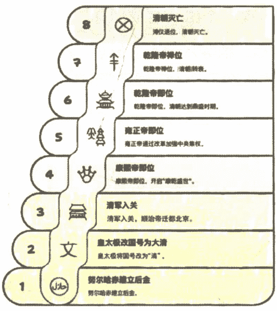
Clipboard
Download

## 第三章 未来实验室

想用 AI 工具制作长时间轴、创建个人主页、设计炫酷海报吗？当你学会用 AI 实现想法甚至让呈现更完美时，恭喜你已在不知不觉中掌握驾驭 AI、掌控未来的能力。


## 用 AI 制作个人主页

“酒香不怕巷子深”，但勇敢展示自己才能获得更多机会。在张扬个性的时代，可借助互联网，利用 **DeepSeek+路过图床+Netlify**，快速制作美观大方的个人主页，展示精彩人生。

> ### 知识小链接
图床是用于存储和托管图片的在线服务平台，用户可上传图片获取 URL 链接，方便在网站、论坛、社交媒体分享或嵌入。路过图床是国内较知名的在线图片托管平台。
Netlify 是现代化网站托管和自动化平台，支持静态网站快速部署。

**例** 利用 DeepSeek+路过图床+Netlify 制作并发布个人主页。

**第1步** 打开路过图床网页，网址是 https://imgse.com。
**第 2 步** 注册账号并登录后，单击 **开始上传**，选择一张自己的照片或图片，单击 **上传**。


**第 3 步** 上传完成后，跳转到图片页面，找到下方的“图片 URL 链接”，复制右边框里的网址。

你好，AI：

给孩子的高效学习法

灯光 上传 Xiaomepp 关于

Xiaomepp - 编辑 删除
分享

## PixCake
关于 图片链接
1
图片链接 https://imgse.com/l/pEUXXWT
网页贴图代码(HTML) <a href="https://imgse.com/l/pEUXXWT">
<html lang="zh-CN">
<head>
    <meta charset="UTF-8">
    <meta name="viewport" content="width=device-width, initial-scale=1.0">
    <title>杨小凡的个人主页</title>
    <style>
        * {
            margin: 0;
            padding: 0;
            box-sizing: border-box;
            font-family: 'Segoe UI', Arial, sans-serif;
        }

        body {
            background: #f0f5ff;
            line-height: 1.6;
        }

        .container {
            max-width: 1200px;
            margin: 0 auto;
            padding: 40px 20px;
        }

        .header {
            text-align: center;
            margin-bottom: 40px;
        }
    </style>
</head>
<body>
    <div class="container">
        <header class="header">
            <h1>杨小凡的个人主页</h1>
            <p>一个热爱编程、篮球和街舞的阳光少年</p>
        </header>

        <section class="section">
            <h2>个人简介</h2>
            <p>👨‍👩‍👧‍👦 家庭成员：爸爸妈妈、爷爷奶奶和我</p>
            <p>⭐ 性格：活泼开朗的小太阳</p>
            <div class="hobbies">
                <span class="hobby-item">🏀 篮球小将</span>
                <span class="hobby-item">💃 街舞达人</span>
                <span class="hobby-item">💻 编程少年</span>
            </div>
        </section>

        <section class="section">
            <h2>获奖荣誉</h2>
            <ul class="awards-list">
                <li class="award-item">青少年阳光体育校园篮球“3对3”联赛小学男子中年级组 三等奖</li>
                <li class="award-item">江苏省小篮球省级决赛U10男子组 优胜奖</li>
                <li class="award-item">全国中小学信息技术创新与实践大赛编程马拉松决赛 三等奖</li>
                <li class="award-item">希望之星暨希语盛典演讲展评市决选 二等奖</li>
                <li class="award-item">全国青少年信息素养大赛图形化编程挑战赛华东赛区 一等奖</li>
            </ul>
        </section>

        <section class="dream">
            <p>🚀 我的梦想：成为改变世界的编程高手！ 💻</p>
        </section>
    </div>
</body>
</html>
```

**第5步** 点击代码区右上角的复制，把整段源码拷贝到剪贴板。随后在本地建一个目录，例如在 E 盘新建名为“我的个人主页”的文件夹，并在其中新建一个纯文本文件，命名为“index.txt”。


**第6步** 打开“index.txt”，把刚才复制的源码粘贴进去并保存。把该文件的后缀由 .txt 改为 .html，文件名变为“index.html”。


> / 提醒 / 如系统未显示后缀，可按 Win+E 打开资源管理器，在上方“查看”菜单勾选“文件扩展名”，即可显示并修改后缀。具体可参考 39 页。

第 7 步 双击“index.html”，本地浏览器即可预览生成的个人站点。


## 杨小凡

实验小学

## 个人简介

- 👨‍👩‍👧‍👦 家庭成员：爸爸妈妈、爷爷奶奶和我

- 🌟 性格：活泼开朗的小太阳

- 🏀 篮球小将

- 💃 街舞达人

- 💻 编程少年

## 获奖荣誉

- 🏆 青少年阳光体育校园篮球“3对3”联赛小学男子中年级组三等奖

- 🏆 江苏省小篮球省级决赛U10男子组优胜奖

- 🏆 全国中小学信息技术创新与实践大赛编程马拉松决赛三等奖

- 🏆 希望之星暨希语盛典演讲展评二等奖

- 🏆 全国青少年信息素养大赛图形化编程挑战赛华东赛区一等奖

🚀 我的梦想：成为改变世界的编程高手！👨‍💻

**第8步** 如需让他人访问，可将页面部署到互联网。访问 Netlify 拖拽上传入口，网址是 https://app.netlify.com/drop。


**第9步** 在页面中央点按 browse to upload，弹出选择框后定位到之前创建的“我的个人主页”文件夹并上传。此时会出现“请仅在信任该网站时执行此操作”的提示，确认后继续上传。稍等片刻即可完成部署。


**第10步** 部署完成后会给出访问密码，首次打开需填写。复制站点链接 https://meek-duckanoo-6588cc.netlify.app ↗，在弹出的密码框中粘贴 My-Drop-Site，点击 Submit 即可在网络上打开自己的主页！


/ 提醒 / 该临时链接有效期仅一小时。若想长期保留，可注册免费账号登录后保存项目。

完成后即可分享给朋友们一起欣赏！

> 若想制作内容更丰富的个人页面，可向 DeepSeek 提供更多个人信息并提出更细致的要求，再复制新生成的代码即可。

## 延伸阅读：个人隐私安全保护指南

1. 避免公开敏感信息：尽量不在个人页面填写真实姓名、家庭住址、学校名称、身份证号、银行卡等隐私，防止被不法分子利用。
2. 照片使用需谨慎：上传时避免出现可辨识身份的标志性背景或物品，不要上传过度暴露或存在安全隐患的照片。
3. 设置合理的访问权限：按需选择公开、仅好友可见等不同权限，避免陌生人随意浏览。
4. 密码要足够强：设置高强度密码并定期更换，不要使用简单数字或与个人信息相关的组合。
5. 了解平台隐私条款：使用网络服务前先阅读隐私政策，明确平台如何收集、使用和保护数据。
6. 保持警惕：对陌生私信、好友请求等要谨慎，不随意透露个人信息，避免网络风险。
7. 未成年人须告知监护人：在制作和上传个人页面时，及时与家长或监护人沟通，获得指导和保护。

## AI 图表生成

成长过程中有很多数据值得记录，如各年龄段身高、不同时期的各科成绩等。现在可借助 DeepSeek 将这些数据转为美观清晰的图表。

### 例1 利用 DeepSeek 生成身高变化曲线图。

第1步 准备身高数据，格式不限。例如以下表格，为某学生 3~10 岁的身高记录。

| 年龄（岁） | 身高（厘米） | 年龄（岁） | 身高（厘米） |

| :---: | :---: | :---: | :---: |

| 3 | 97 | 7 | 124 |

| 4 | 104 | 8 | 130 |

| 5 | 111 | 9 | 135 |

| 6 | 117 | 10 | 140 |

第2步 在 DeepSeek 输入指令，告知身高数据并要求生成曲线图。数据也可文字描述：3 岁 97 厘米；4 岁 104 厘米；5 岁 111 厘米……

生成一个孩子身高变化的曲线图，可视化要美观，用 HTML 格式，确保可运行。相关数据如下：

| 年龄（岁） | 身高（厘米） |

| :--- | :--- |

| 3 | 97 |

| 4 | 104 |

| 5 | 111 |

| 6 | 117 |

| 7 | 124 |

| 8 | 130 |

| 9 | 135 |

| 10 | 140 |

模型推理后，输出代码与说明。

以下是一个基于 HTML 和 JavaScript 生成身高变化曲线图的示例，使用 Chart.js 库绘制美观图表。

```html
<!DOCTYPE html>
<html lang="en">
<head>
    <meta charset="UTF-8">
    <meta name="viewport" content="width=device-width, initial-scale=1.0">
    <title>孩子身高变化曲线图</title>
    <script src="https://cdn.jsdelivr.net/npm/chart.js"></script>
    <style>
        body {
            font-family: Arial, sans-serif;
            display: flex;
            justify-content: center;
            align-items: center;
            height: 100vh;
            margin: 0;
            background-color: #f0f0f0;
        }
    </style>
</head>
<body>
    <div style="width: 80%; max-width: 800px;">
        <canvas id="myChart"></canvas>
    </div>
    <script>
        const ctx = document.getElementById('myChart').getContext('2d');
        const myChart = new Chart(ctx, {
            type: 'line',
            data: {
                labels: ['3岁', '4岁', '5岁', '6岁', '7岁', '8岁', '9岁', '10岁'],
                datasets: [{
                    label: '身高 (厘米)',
                    data: [97, 104, 111, 117, 124, 130, 135, 140],
                    borderColor: 'rgb(75, 192, 192)',
                    tension: 0.1
                }]
            },
            options: {
                responsive: true,
                plugins: {
                    title: {
                        display: true,
                        text: '孩子身高变化曲线图'
                    }
                }
            }
        });
    </script>
</body>
</html>
```

第 3 步 单击代码区右下角的 ▶ 运行 HTML，DeepSeek 会弹出页面展示绘制好的图表。

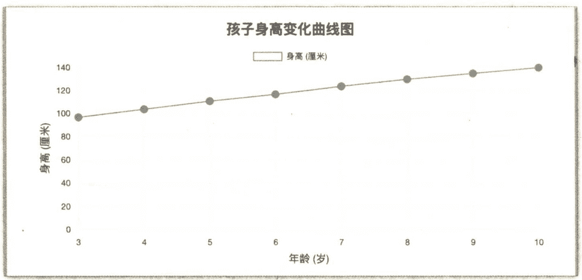

举一反三 曲线图可改为柱状图、饼状图，或更复杂的旭日图、桑基图等，数据也可按自身情况替换。

### 例2 利用DeepSeek生成各科成绩变化雷达图并保存下来。

第 1 步 准备一份成绩数据。例如，某同学四年级到六年级的各科期末成绩如下。

| 年级 | 语文 | 数学 | 英语 | 体育 | 音乐 | 美术 |

| :---: | :---: | :---: | :---: | :---: | :---: | :---: |

| 四 | 97 | 99 | 94 | 100 | 99 | 100 |

| 五 | 91 | 96 | 98 | 100 | 100 | 99 |

| 六 | 94 | 98 | 100 | 100 | 99 | 100 |

第2步 将数据告知DeepSeek，要求生成雷达图。输入指令：

生成各科成绩对比的雷达图，可视化要美观，用HTML格式，确保可运行。相关数据如下：

| 年级 | 语文 | 数学 | 英语 | 体育 | 音乐 | 美术 |

| :--- | :--- | :--- | :--- | :--- | :--- | :--- |

| 四 | 97 | 99 | 94 | 100 | 99 | 100 |

| 五 | 91 | 96 | 98 | 100 | 100 | 99 |

| 六 | 94 | 98 | 100 | 100 | 99 | 100 |

模型推理后，给出可运行的代码与说明。

要生成孩子成绩对比的雷达图并以 HTML 展示，可使用 JavaScript 库如 Chart.js 来创建。以下是一个完整 HTML 示例，包含必要代码，用于生成展示四年级到六年级成绩对比的美观雷达图。

```html
<!DOCTYPE html>
<html lang="en">
<head>
    <meta charset="UTF-8">
    <meta name="viewport" content="width=device-width, initial-scale=1.0">
    <title>学生成绩雷达图</title>
    <script src="https://cdn.jsdelivr.net/npm/chart.js"></script>
    <style>
        body {
            font-family: Arial, sans-serif;
            background-color: #f4f4f4;
            display: flex;
            justify-content: center;
            align-items: center;
            height: 100vh;
            margin: 0;
        }
        #radarChart {
            background-color: white;
            border-radius: 15px;
            box-shadow: 0 4px 8px rgba(0, 0, 0, 0.1);
            padding: 20px;
        }
    </style>
</head>
<body>
    <div style="width: 600px; height: 600px;">
        <canvas id="radarChart"></canvas>
    </div>

    <script>
        const data = {
            labels: ['语文', '数学', '英语', '体育', '音乐', '美术'],
            datasets: [
                {
                    label: '四年级',
                    data: [97, 99, 94, 100, 99, 100],
                    fill: true,
                    backgroundColor: 'rgba(255, 99, 132, 0.2)',
                    borderColor: 'rgb(255, 99, 132)',
                    pointBackgroundColor: 'rgb(255, 99, 132)',
                    pointBorderColor: '#fff',
                    pointHoverBackgroundColor: '#fff',
                    pointHoverBorderColor: 'rgb(255, 99, 132)'
                },
                {
                    label: '五年级',
                    data: [91, 96, 98, 100, 100, 99],
                    fill: true,
                    backgroundColor: 'rgba(54, 162, 235, 0.2)',
                    borderColor: 'rgb(54, 162, 235)',
                    pointBackgroundColor: 'rgb(54, 162, 235)',
                    pointBorderColor: '#fff',
                    pointHoverBackgroundColor: '#fff',
                    pointHoverBorderColor: 'rgb(54, 162, 235)'
                },
                {
                    label: '六年级',
                    data: [94, 98, 100, 100, 99, 100],
                    fill: true,
                    backgroundColor: 'rgba(75, 192, 192, 0.2)',
                    borderColor: 'rgb(75, 192, 192)',
                    pointBackgroundColor: 'rgb(75, 192, 192)',
                    pointBorderColor: '#fff',
                    pointHoverBackgroundColor: '#fff',
                    pointHoverBorderColor: 'rgb(75, 192, 192)'
                }
            ]
        };
        const config = {
            type: 'radar',
            data: data,
            options: {
                responsive: true,
                maintainAspectRatio: false,
                scales: {
                    r: {
                        angleLines: {
                            display: false
                        },
                        suggestedMin: 80,
                        suggestedMax: 100
                    }
                }
            }
        };
        const myChart = new Chart(
            document.getElementById('radarChart'),
            config
        );
    </script>
</body>
</html>
```

**步骤 3** 点击代码块右上角的 **复制** 按钮，将整段内容拷入剪贴板。随后在 Windows 电脑上打开任意文件夹，右键新建一个空白文本文档。

**步骤 4** 将该文档命名为“孩子成绩图.txt”，并以记事本方式打开。


**步骤 5** 把先前拷贝的文字整体粘贴进文档并保存。


**步骤 6** 把“孩子成绩图.txt”重命名为“孩子成绩图.html”，即把后缀从 .txt 改成 .html。


/ 提醒 / 若系统默认隐藏扩展名，可按 Win+E 打开资源管理器，点开上方“查看”标签，在“显示/隐藏”里勾选“文件扩展名”即可显示。（具体操作见第39页）

**步骤 7** 双击改名后的文件，即可呈现精美的成绩变化雷达图。

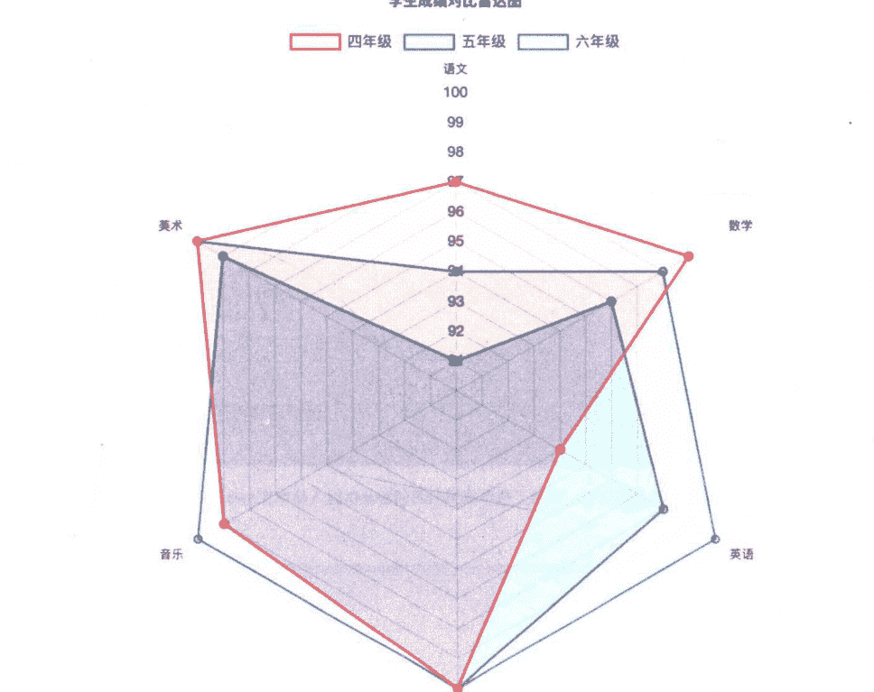

## 借助智能工具绘制知识导图

随着学习内容增多，知识体系会变得错综复杂，思维导图有助于理清逻辑与结构。把 DeepSeek 与 Xmind 结合起来，可以很方便地生成各式导图，下面演示流程。

**知识小链接**

Xmind 是一款专注思维导图与头脑风暴的工具，能帮助搭建清晰的知识结构。

Markdown 是一种轻量级标记语言，用来书写纯文本，阅读编写都很顺手，且能转成标准 HTML 文档。

### 演示：DeepSeek 配合 Xmind 生成动物分类导图

步骤 1 在 DeepSeek 中发送如下请求：

我是一名小学生，我想了解动物的不同分类和典型代表，请帮我生成可以导入 Xmind 的 Markdown 格式文本。

DeepSeek 理解需求后，输出了一段可被 Xmind 识别的 Markdown 文本。

```markdown
# 动物分类

## 1. 脊椎动物
### 1.1 哺乳动物
- **典型代表**：狮子、大象、鲸
- **特征**：有毛发，哺乳幼崽

### 1.2 鸟类
- **典型代表**：鹰、企鹅、鹦鹉
- **特征**：有羽毛，卵生

### 1.3 爬行动物
- **典型代表**：蛇、龟、鳄鱼
- **特征**：有鳞片，卵生

### 1.4 两栖动物
- **典型代表**：青蛙、蝾螈
- **特征**：皮肤湿润，幼体水生

### 1.5 鱼类
- **典型代表**：鲨鱼、金鱼、鲑鱼
- **特征**：有鳍，水生

## 2. 无脊椎动物
### 2.1 节肢动物
- **典型代表**：蜘蛛、螃蟹、蝴蝶
- **特征**：有外骨骼，分节身体

### 2.2 软体动物
- **典型代表**：蜗牛、章鱼、蛤蜊
- **特征**：身体柔软，通常有壳

### 2.3 刺胞动物
- **典型代表**：水母、珊瑚
- **特征**：有刺细胞，水生

### 2.4 环节动物
- **典型代表**：蚯蚓、水蛭
- **特征**：身体分节，无骨骼

### 2.5 棘皮动物
- **典型代表**：海星、海胆
- **特征**：身体呈辐射对称，有棘皮
```

这段 Markdown 可直接载入 XMind 或其他支持的导图软件，自动生成可视化结构。

步骤 2 点击右上角的 **复制**，把生成内容拷到剪贴板。新建一个文本文档，将内容粘贴进去并保存，文件名为“动物.txt”。


步骤 3 把“动物.txt”的后缀改为“.md”，即“动物.md”。

/ 提醒 / 如果文件不显示扩展名，可同时按下键盘上的“Win+E”快捷键，打开文件资源管理器，在工具栏中打开“查看”选项，在“显示/隐藏”栏中勾选“文件扩展名”，即可显示文件扩展名。（具体操作详见39页）

步骤 4 打开 Xmind 官网 https://xmind.cn/，下载安装客户端，或直接使用网页版的 **在线导图** 功能。


**步骤 5** 在线版需先登录，登录后点击“我的导图”，再点击  新建一张思维导图。


**步骤 6** 此时出现默认画布，点击左上角的 ☰ 菜单，选择“导入文件”。

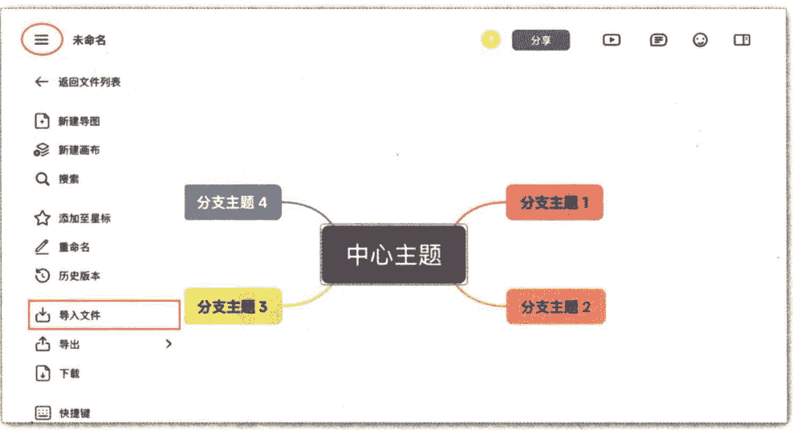

**步骤 7** 在导入界面选中之前保存的“动物.md”，确认导入。


**步骤 8** 导入完成后即可得到可编辑的思维导图，可下载保存，也可继续编辑和分享。

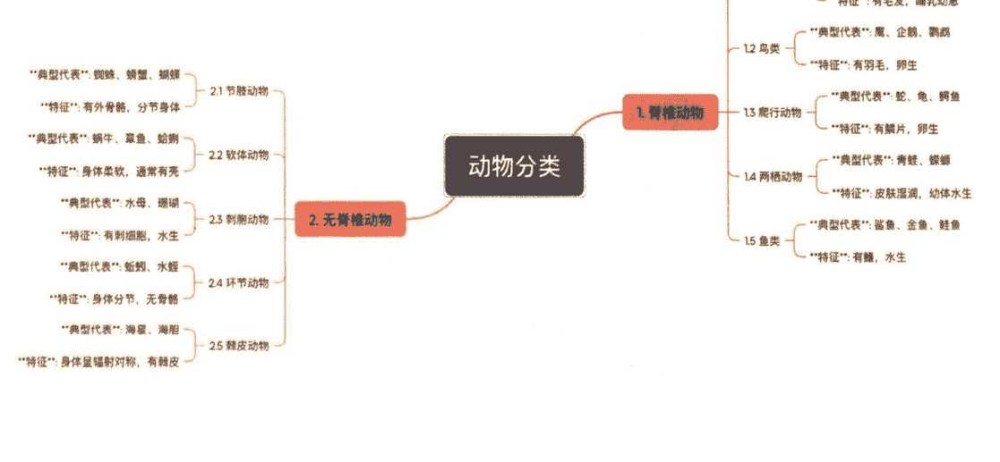

## AI 助力海报创作

学校一年一度的义卖活动即将到来，一张吸睛的海报能带来更多关注。下面介绍如何用 DeepSeek 配合即梦 AI 快速制作专属海报。

### 案例：DeepSeek 联合即梦 AI 制作义卖主题宣传海报

**知识小链接**

即梦 AI 是抖音旗下的一站式 AI 创作平台，通过人工智能技术降低创作门槛，提供图像生成、视频制作与编辑等多种功能。

**步骤 1** 在 DeepSeek 中保持选中状态，输入以下指令：

我是 5 年级 4 班的一名学生，我们学校要组织一场爱心义卖活动，我准备的物品有 1 个汉诺塔玩具、2 个哪吒玩偶、1 本《三体》科幻小说，还有一些精美的徽章，请帮我生成一份符合即梦 AI 要求的海报中文提示词。

**步骤 2** 经过分析后，DeepSeek 返回了可用于绘图的中文提示词。

以下是专为即梦AI设计的海报中文提示词，突出5年级4班义卖特色与童趣氛围：

【画面构图指令】

1.  主视觉：卡通风格校园场景，中央放置巨型爱心存钱罐，金币从罐口洒落成彩虹桥

2.  左侧悬浮层叠的汉诺塔玩具，金色圆环自带旋转光效，塔顶站立Q版哪吒玩偶

3.  右侧立体书造型展示《三体》封面，书本周围环绕星系徽章，每个徽章自带星云光效

4.  底部手绘课桌摆放：哪吒双人玩偶摆出功夫造型+徽章展示板（闪烁收集进度条特效）

【文字排版指令】

标题：「5.4星球爱心舰队」起航！

副标：益智汉诺塔/酷炫三体书/哪吒兄弟/星际徽章 超值兑换爱心能量

卖点气泡：

- 挑战智慧王者（汉诺塔+三体套组）

- 收集哪吒兄弟解锁隐藏剧情

- 限量星系徽章每日随机掉落

【风格参数】

色彩：科幻蓝+中国红渐变，爱心使用半透明果冻质感

字体：标题采用太空陨石斑驳字，正文使用蜡笔手写体

动态效果：徽章自动旋转展示双面图案，书籍悬浮页自动翻动

【情感化提示】

在汉诺塔底部隐藏班级秘密祝福纸条彩蛋，营造寻宝氛围需要补充具体活动时间/地点时，建议在AI生成后添加至海报右下角火箭尾焰位置，保持画面灵活修改空间。

步骤 3 选中提示词复制，然后打开即梦 AI 网页 https://jimeng.jianying.com/，初次使用需注册。


步骤 4 登录后，点击左侧“图片生成”进入生成页，在上方输入框粘贴提示词，比例选择“9 : 16”。

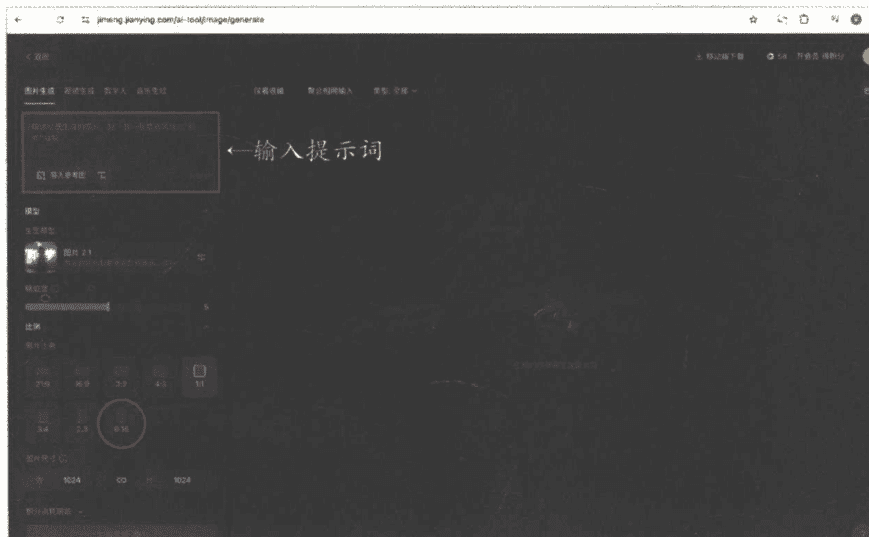

步骤 5 设置完成后点“立即生成”。若提示“当前仅支持中文或英文描述，请修改后再试”，请检查提示词，删除特殊符号或表情并改为逗号后重试。


步骤 7 海报生成后，可挑选满意的一张保存并打印。


若想制作其他主题，只需修改发给 DeepSeek 的指令，例如把**爱心义卖活动**换成**主题演讲**并描述内容。也可以调整图片精细度与尺寸。若不满意，可优化提示词，或在生成图下方点击🔄按钮让即梦 AI 重新生成。

## 快速生成演示文稿 PPT

班级要做主题演讲，一份精美的 PPT 能大大加分。以前需要花费大量时间查资料和排版，现在借助 DeepSeek 与 Kimi 即可迅速完成。

案例：为《圆明园》主题演讲制作 PPT。

步骤 1 打开 DeepSeek，发送如下指令：

我是一名小学生，要制作一个介绍圆明园的 PPT，请帮我以 Markdown 格式生成 PPT 大纲。

步骤 2 发送后，DeepSeek 快速梳理思路，按要求的 Markdown 格式输出了大纲。

知识小链接

Kimi 是由月之暗面科技有限公司开发的智能助手，在 PPT 制作、论文写作等方面提供高效便捷的工具。

Markdown 是一种轻量级标记语言，用于以纯文本形式编写排版，易读易写且可转为有效 HTML 文档。

当然可以！以下是一个关于圆明园的PPT大纲，使用Markdown格式编写。你可以根据这个大纲制作你的PPT。

```
# 圆明园介绍

## 目录

1. 圆明园简介
2. 历史背景
3. 建筑风格
4. 主要景点
5. 圆明园的毁灭
6. 圆明园的保护与修复
7. 结语

---

## 1. 圆明园简介

- 位置：北京市海淀区
- 建造时间：清朝康熙年间
- 别名：万园之园

---

## 2. 历史背景

- 康熙帝的初衷
- 历代皇帝的扩建
- 圆明园的地位与作用
```

**步骤 3** 点击代码块右上角的复制，将大纲内容拷贝到剪贴板。

**步骤 4** 登录 Kimi 官网 https://kimi.moonshot.cn/。


步骤 5 点击页面左侧的⚙图标，进入更多助手列表，选择官方推荐的 PPT 助手

Kimi + AiPPT = 一键生成PPT。


第6步 进入 PPT 助手面板，把 DeepSeek 提前整理好的演示提纲粘贴到输入区，点一下执行▶。

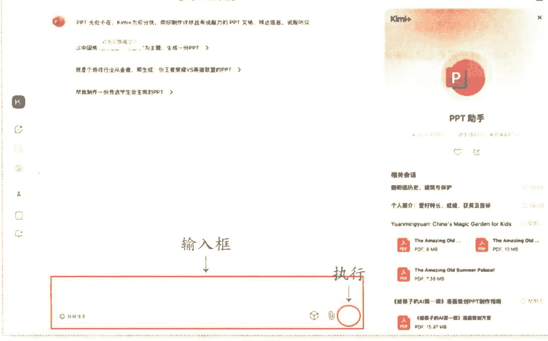

你好，AI：
给孩子的高效学习法

第7步 稍作等待，Kimi 会依据粘贴的大纲自动补全正文并做润饰。

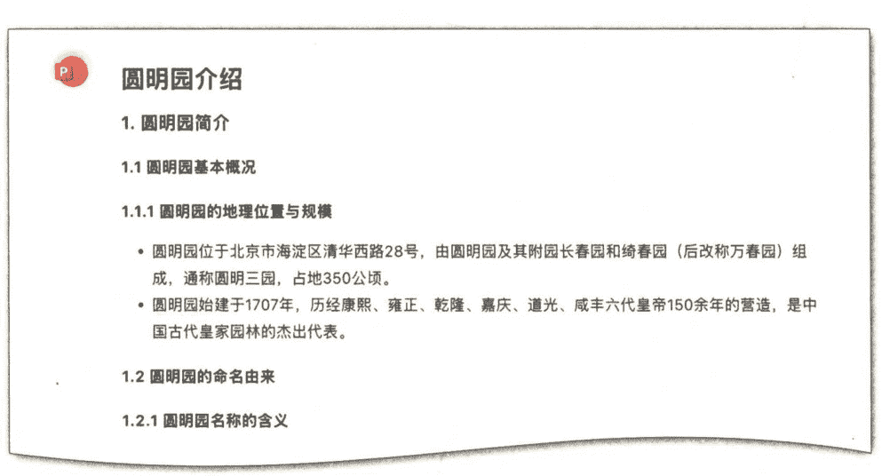

第8步 在页面底部找到【一键生成 PPT ＞】入口，进入模板选择页，示例里选用了国潮风模板，随后对场景、风格与主题配色进行设置，确认后点击右上角【生成 PPT】。

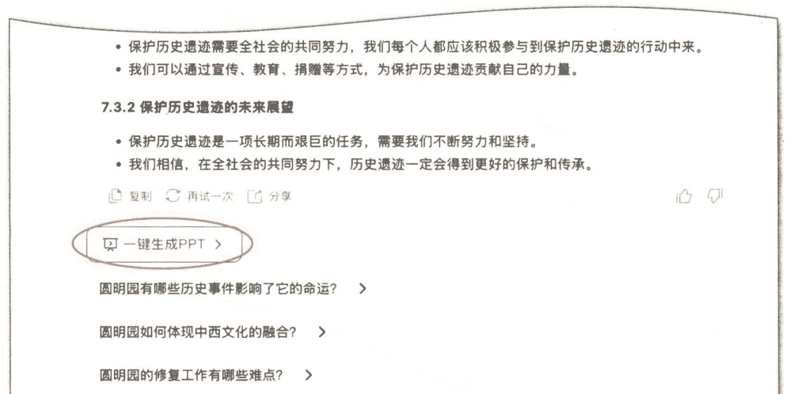


**第9步** 等待片刻，一份清新淡雅带有国潮气质的圆明园介绍演示文稿即完成，后续可继续调整内容与细节。


## AI 流程图实战

班级要办元旦联欢会，老师布置给文艺委员制定一份详细的组织流程图。借助 DeepSeek 配合 ProcessOn 能迅速做出漂亮方案。

例 利用 DeepSeek+ProcessOn 快速绘制联欢会流程图

第1步 在 DeepSeek 中保持深度思考 R1 与联网搜索开启，输入指令：

我想做一个关于班级联欢会的详细的流程图，要用 Mermaid 格式输出。流程不用太复杂，要适合小学生，其中要设计一些游戏环节和应急备选方案。

第2步 经过分析后，DeepSeek 按需求返回一段 Mermaid 语法文本。

知识小链接

ProcessOn 是一个在线绘图平台，支持流程图、思维导图、原型图、网络拓扑图等多种图形绘制。

Mermaid 是一种基于文本的图表描述语言，用户可通过简洁语法生成流程图、时序图、甘特图等可视化图形，并支持与 Markdown 文档无缝集成。

以下是为小学生设计的班级联欢会流程图（含应急方案），采用模块化设计且节奏明快：

```
graph TD
    A[联欢会开始] --> B[开场欢迎词]
    B --> C[节目表演1]
    C --> D[集体游戏1: 抢椅子]
    D --> E[节目表演2]
    E --> F[互动游戏: 传话筒]
    F --> G[自由表演时间]
    G --> H[全班大合唱]
    H --> I[颁奖仪式]
    I --> J[合影留念]
    J --> K[清理场地]

    subgraph 准备工作
        a1[提前1周] --> a2[确定时间地点]
        a2 --> a3[班委分工: 主持组/道具组/装饰组]
        a3 --> a4[收集节目单]
        a4 --> a5[采购物资: 装饰品/奖品/零食]
    end

    subgraph 应急方案
        e1[设备故障] --> e1-1[启用备用音响]
        e2[秩序混乱] --> e2-1[启动备用集体游戏]
        e3[突发伤病] --> e3-1[校医急救处理]
        style e3 fill:#ffcccc
    end

    classDef green fill:#d6f5d6,stroke:#333;
    classDef yellow fill:#ffffcc,stroke:#333;
    class A,B,C,D,E,F,G,H,I,J,K green
    class a1,a2,a3,a4,a5,e1,e2,e3 yellow
```

流程说明：

1. 时间节奏：建议总时长 90 分钟（15:00-16:30）
    * 每个表演/游戏环节 5-8 分钟
    * 自由表演采用举手抢麦制
    * 颁奖设置“最佳表演奖”“最嗨玩家奖”等趣味奖项
2. 游戏设计：
    * 抢椅子：用课桌围圈播放《兔子舞》
    * 传话筒：传递搞笑口令如“班主任今天戴假发”
    * 备用游戏：水果蹲、猜谜语（准备题库）
3. 应急物资：
    * 医药包（创可贴/碘伏）
    * 备用电池/小蜜蜂扩音器
    * 备用游戏道具包（气球/谜语卡）
4. 安全措施：
    * 提前检查场地障碍物
    * 安排 2 名家长志愿者协助
    * 游戏区与观众区用彩色胶带分区

你好，AI：
给孩子的高效学习法

**第3步** 点按 Mermaid 语法块右上角的复制，把内容拷到剪贴板。

**第4步** 用浏览器打开 ProcessOn 官网 https://www.processon.com/ ，点击免费使用。


**第5步** 登录后进入工作空间，点击左上角的 + 新建。


第6步 点击页面底部的导入。


第7步 在文件导入界面切换到 Mermaid 选项卡，将刚才复制的 DeepSeek 输出的 Mermaid 文本粘贴进去。


你好，AI：
给孩子的高效学习法

**第8步** 点击生成流程图，一份包含主流程、应急预案与筹备步骤的联欢会图就出来了，十分全面。左侧工具栏可进一步调整样式，使其更贴合需求。

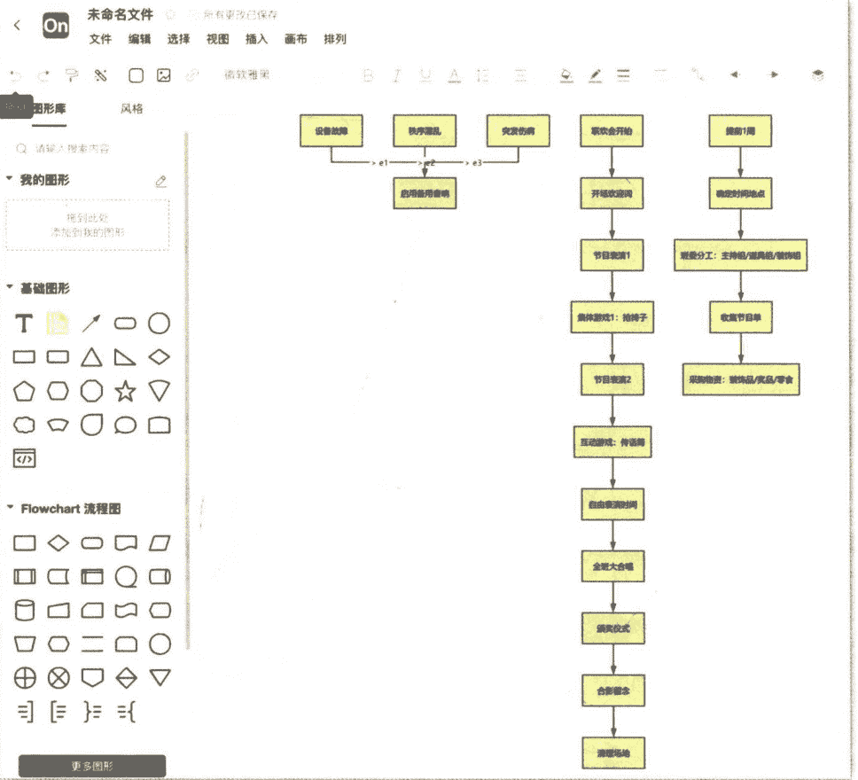

## AI 编程制作小工具

人区别于其他动物的最大优势在于会制造和使用工具。如今在 DeepSeek 帮助下，我们能化身“软件高手”，用编程思维创造有趣实用的网页小工具。

### 例1 用 DeepSeek 编程，生成一个简单的计算器。

第1步 向 DeepSeek 发送指令：

我想生成一个简单的计算器，具有一般计算器的所有功能，布局合理，界面美观，请帮我生成 HTML 代码。

第2步 计算器源文件并不复杂，DeepSeek 很快给出结果。

> 当然！以下是一个简单的计算器的HTML代码，包含基本的计算功能，并且布局合理、界面美观。你可以根据需要进一步调整样式和功能。

```html
<!DOCTYPE html>
<html lang="zh-CN">
<head>
    <meta charset="UTF-8">
    <meta name="viewport" content="width=device-width, initial-scale=1.0">
    <title>简单计算器</title>
    <style>
        body {
            display: flex;
            justify-content: center;
            align-items: center;
            height: 100vh;
            background-color: #f4f4f4;
            font-family: Arial, sans-serif;
        }
        .calculator {
```

```
function clearDisplay() {
    currentInput = '';
    operator = null;
    previousInput = '';
    updateDisplay();
}

function updateDisplay() {
    display.innerText = currentInput || '0';
}
</script>
</body>
</html>
```

**第3步** 点击代码块右下角的 ▶ 运行 HTML，立刻打开精美的计算器窗口，马上试用功能吧！

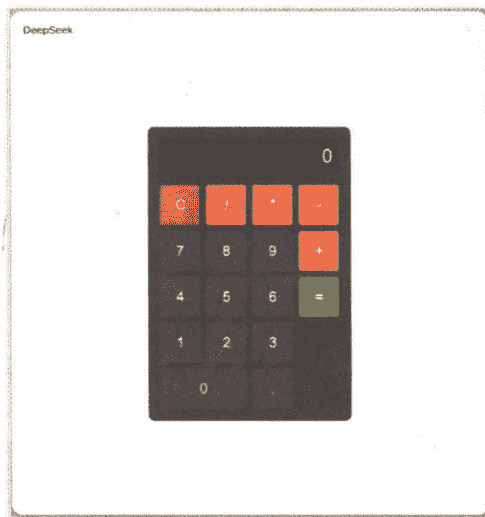

> 举一反三：在制作 HTML 小工具时，对 DeepSeek 讲清楚界面、功能及细节要求，可生成对应源文件，做出专属个性化小工具。

### 例2 用 DeepSeek 编程生成代码，制作一个计时小工具。

第1步 向 DeepSeek 发送指令：

我想制作一个计时小工具，请帮我生成完整的 HTML 代码，要求包含正计时和倒计时功能，时间要精确到 0.1 秒，布局要合理，界面要美观大方。

第2步 不久后 DeepSeek 输出了计时工具的源码。

以下是一个简单的HTML代码示例，包含正计时和倒计时功能。界面分为两部分，上面是正计时，下面是倒计时，时间精确到0.1秒。布局合理，界面简洁美观。

```html
<!DOCTYPE html>
<html lang="zh-CN">
<head>
    <meta charset="UTF-8">
    <meta name="viewport" content="width=device-width, initial-scale=1.0">
    <title>计时小工具</title>
    <style>
        body {
            font-family: Arial, sans-serif;
            display: flex;
            flex-direction: column;
            align-items: center;
            justify-content: center;
            height: 100vh;
            margin: 0;
            background-color: #f0f0f0;
        }
        /* ... 其他样式 ... */
    </style>
</head>
<body>
    <!-- ... HTML 结构 ... -->
    <script>
        // ... JavaScript 逻辑 ...
        function resetCountdown() {
            stopCountdown();
            countdownTime = 0;
            updateCountdownDisplay();
        }

        function updateCountdownDisplay() {
            const hours = Math.floor(countdownTime / 3600);
            const minutes = Math.floor((countdownTime % 3600) / 60);
            const seconds = countdownTime % 60;
            document.getElementById('countdown').textContent = 
                `${String(hours).padStart(2, '0')}:${String(minutes).padStart(2, '0')}:${String(seconds).padStart(2, '0')}`;
        }
    </script>
</body>
</html>
```

第3步 点按代码区右下角 ▶ 运行 HTML，打开计时工具窗口，设置一个 30 分钟倒计时来提升学习效率吧！


### 例3 用 DeepSeek 生成代码，制作一个简单的绘画板。

第1步 保持 🧠 深度思考 R1 激活，向 DeepSeek 输入指令：

> 我想制作一个简单的小画板，请帮我生成完整的 HTML 代码。要求可以直接绘制矩形、圆形、直线等常见图形，也可以自由绘制，还可以改变画笔的粗细、颜色。画布不用太大，不要出现滚动条。

第2步 接收指令后，DeepSeek 经思考产出了画板源码。

```
以下是一个简单画板的完整HTML代码，包含您要求的所有功能：

html
<!DOCTYPE html>
<html>
<head>
    <title>简单小画板</title>
    <style>
        body {
            margin: 0;
            padding: 20px;
            display: flex;
            flex-direction: column;
            align-items: center;
            background-color: #f0f0f0;
        }
    </style>
</head>
```

```
function stopDrawing() {
    isDrawing = false;
    if(currentTool !== 'free') {
        ctx.beginPath();
    }
}

// 临时保存画布状态用于形状预览
let savedCanvas;
function redrawCanvas() {
    if(!savedCanvas) {
        savedCanvas = ctx.getImageData(0, 0, canvas.width, canvas.height);
    }
    ctx.putImageData(savedCanvas, 0, 0);
}

// 初始化
canvas.fillStyle = 'white';
canvas.fillRect(0, 0, canvas.width, canvas.height);
</script>
</body>
</html>
```

**第3步** 点击代码块右下角 ▶ 运行 HTML，打开画板窗口，即可在自制画板上自由创作！

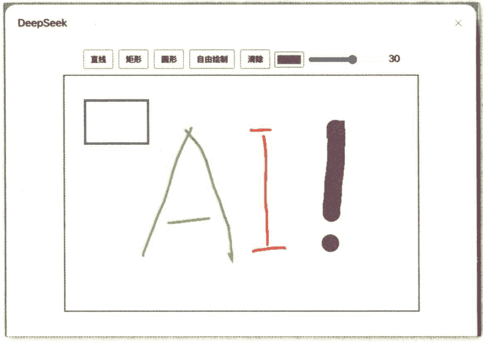

你好，AI：
给孩子的高效学习法


AI 生成图：AI 小画家

## 警惕 AI 幻觉

即便是 DeepSeek 这样的人工智能软件也不是十全十美的，因数据不全、不准、模型推理局限及常识缺失，AI 在生成文章或回答问题时可能编造事实、捏造引用或提供错误信息，表面看很可信，验证后却是错的，这便是 AI 幻觉。我们要保持警惕，有自己的判断，不能过度依赖 AI。

### 例1 林黛玉为什么要倒拔垂杨柳？

在 DeepSeek 中输入指令：

林黛玉为什么要倒拔垂杨柳？

谁料到，这个荒诞的问题竟让 DeepSeek 露怯。我们清楚倒拔垂杨柳的主角是鲁智深，可此处 DeepSeek 竟顺着提问一本正经地胡编。

> 林黛玉倒拔垂杨柳的情节出自《红楼梦》第九十七回，这是林黛玉在得知贾宝玉与薛宝钗即将成婚的消息后，因极度悲伤和绝望而做出的一种象征性行为。这一情节具有深刻的象征意义，反映了林黛玉内心的痛苦和对命运的无奈。

具体背景与象征意义：

1. **情感崩溃**：林黛玉一直深爱贾宝玉，但她的爱情注定无法实现。当她得知贾宝玉将与薛宝钗成婚时，内心彻底崩溃。拔柳树的行为象征着她对命运的绝望和反抗。

2. **垂杨柳的象征**：柳树在传统文化中常被用来象征离别和悲伤。林黛玉倒拔垂杨柳，既是对自己命运的控诉，也是对贾宝玉的无言告别。

3. **自我毁灭的隐喻**：林黛玉身体本就虚弱，这一行为进一步加剧了她的病情，象征着她对生命的放弃和自我毁灭的倾向。

4. **对封建礼教的反抗**：林黛玉的爱情悲剧是封建礼教压迫的结果。她的行为隐含着对封建婚姻制度的不满和反抗，尽管这种反抗是无声且无力的。

总结：

林黛玉倒拔垂杨柳是她内心极度痛苦的外在表现，象征着她对爱情的绝望、对命运的反抗以及对生命的放弃。这一情节深刻揭示了《红楼梦》中人物的悲剧命运和封建社会的残酷现实。

### 例2 哪个数更小？

在 DeepSeek 中输入指令：

200.3 比 200.11 小多少？

我们知道 200.3 比 200.11 大，若问 200.3 比 200.11 小多少，结果必为负数。但 DeepSeek 的回答是 200.3 比 200.11 小 0.19。真是啼笑皆非。

```
要计算200.3比200.11小多少，可以按照以下步骤进行：

1. 将两数对齐小数位数：
   200.30 - 200.11

2. 逐位相减：
   200.30
   - 200.11
   -------
   0.19

3. 得出结论：
   200.3比200.11小0.19。

最终答案为：
0.19
```

### 例3 数一数英文单词里的字母。

在 DeepSeek 中输入指令：

strawberry 里有几个字母 “r”？

草莓里的 r，DeepSeek 怎么会数漏

有人把单词 strawberry 一笔一划点出来，明明能看到 r 出现了三次，为什么 DeepSeek 有的时候却说只有两次？

> 单词 "strawberry"里有两个字母"r"。

这就是典型的模型幻觉。换个时间再问一次，同一个问题答案又可能变回正确，说明输出并不稳定。

下面用一次手工核对说明三次是如何得出的。

先把问题理解为要统计该词中 r 出现的频次，随后把拼写固定下来，确认 strawberry 是草莓的规范写法，避免因写错导致偏差。

把整个词拆成十个字符：s、t、r、a、w、b、e、r、r、y。按顺序扫视，第三个字符是 r，第八个字符是 r，第九个字符也是 r，其余位置都不是。合计起来就是三次。

再从头复核一遍 s、t、r、a、w、b、e、r、r、y 的序列，计数仍然是三次。期间也考虑了拼写是否正确、大小写是否影响、是否漏数或重复等问题，均未发现干扰因素。

最终可以确定 strawberry 中 r 共出现三次。

这个小案例说明模型会产生不准确或误导性的输出，不宜过度依赖，也不能让它完全替代人的判断。

面对模型幻觉可以怎么做

一是保有审慎态度。生成式工具的出现不是停止思考的理由，其输出应被视作参考而非定论，涉及医疗、法律、金融等关键领域时，更需要向业内专家求证。

二是借助权威渠道核实信息。数据或事实最好通过学术论文、政府官网、专业机构发布等来源再确认，单一模型的回答可信度有限。

三是在提问时加上限定条件。明确时间范围、学科领域、数据来源等，能压缩模型随意编造的空间。例如要求“近五年人工智能的进展”。也可以预设指令，例如：“你是一位严谨的助手，若不确定请明确标注‘信息未核实’。”

只有保持警惕，多查证、多对比，用审慎的眼光审视来源与时效，才能更好地发挥工具的价值。

## DeepSeek+最强搭档

| 工具组合 | 优势 | 应用场景 |
| :--- | :--- | :--- |
| DeepSeek+Kimi（PPT 助手） | 文档与演示制作协同效率高 | 1. 生成演讲稿 2. 生成 PPT 结构并自动排版 |
| DeepSeek+ 豆包 | 图片与文字创作搭配顺手 | 1. 图片生成，将想法具象化 2. 撰写文案 |
| DeepSeek+ Napkin.AI | 视觉化呈现美观高效 | 1. 生成高颜值图表或逻辑图、结构图 2. 文字转图表 3. PPT 配图制作 |
| DeepSeek+Xmind | 思维导图与头脑风暴效率高 | 1. 内容的结构化提炼与分析 2. 整理并生成思维导图 3. 读书笔记知识点关联与归纳 |
| DeepSeek+desmos | 几何函数可视化与学习能力强 | 1. 公式、函数检索与动态交互 2. 几何绘图 3. 物理实验模拟 4. 教育演示 |
| DeepSeek+ 即梦 AI | 插图、海报、视频视觉创作能力强 | 1. 专业图片与视频创作 2. 精准 AI 绘画，生成海报、插图、产品图等 |
| DeepSeek+ ProcessOn/draw.io | 流程图创作专业强大 | 1. 制定与梳理流程 2. 生成多种风格的流程与结构图 3. 设计思维导图 |
| DeepSeek+HTML | 应用制作与可视化轻便快捷 | 1. 生成各类应用与工具、数据及图表可视化页面 2. 小游戏与小工具开发 3. 搭建数据及图表看板 |
| DeepSeek+Python | 编程与实用化能力更强 | 1. 数据处理分析与展示 2. 文档、邮件脚本处理 |
| DeepSeek+ 剪映 | 视频创作与生成效率高 | 1. 生成视频文案 2. 图文转视频 3. 创意短视频制作 |
| DeepSeek+Notion | 知识库搭建与整理能力强 | 1. 知识采集、分析与整理 2. 自动分类标签 3. 搭建个人智能知识库 |
| DeepSeek+Tripo | 一键生成三维模型与场景 | 1. 根据文本或图片自动生成 3D 模型 2. 个人 3D 头像、手办模型制作 |
| DeepSeek+飞书妙记 | 会议、课程记录能力强 | 1. 音频转换与整理 2. 内容总结与结构分析 |