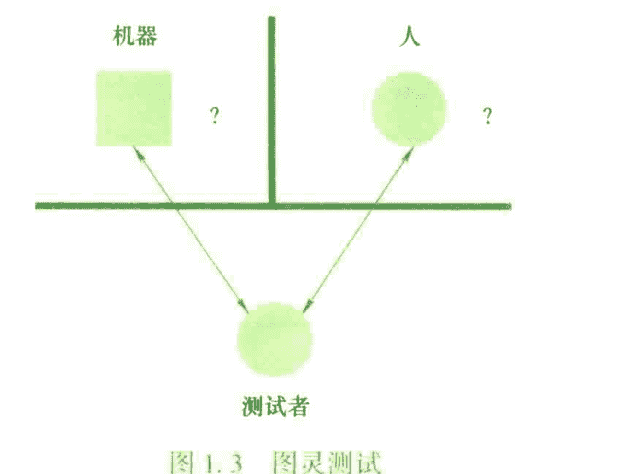
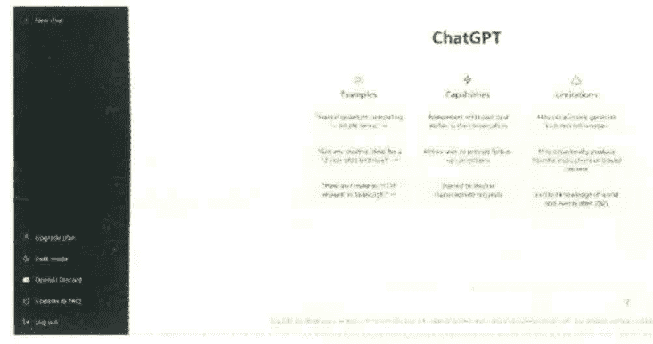
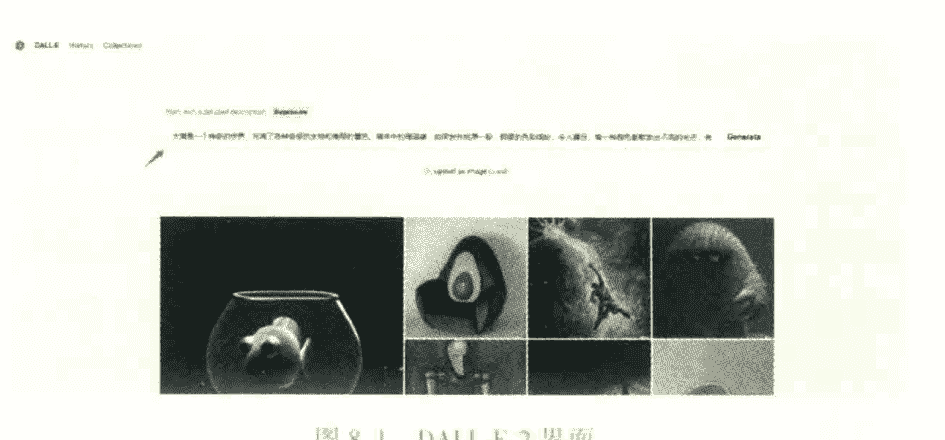
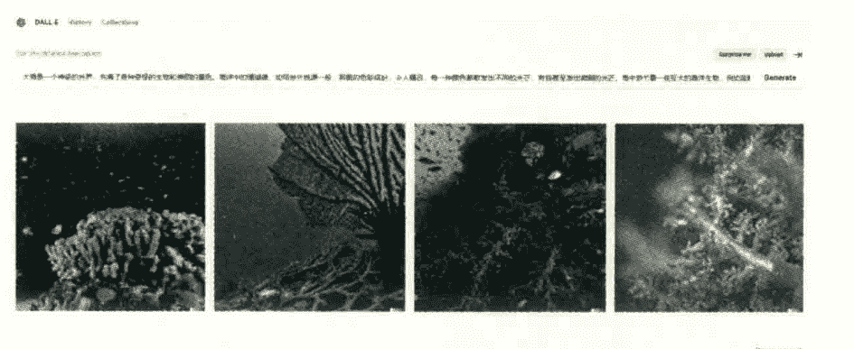

# 认识 ChatGPT

AI 时代已经开启，AIGC 正在持续释放人类的创造潜能。作为 AIGC 领域的标杆产品，ChatGPT 上线后迅速成为焦点，获得市场高度关注。从 ChatGPT 入手，是理解 AI 与 AIGC 的一个好起点。

本书以源起、原理、应用、前景四个维度展开，对 ChatGPT 的来龙去脉、运行方式、能力边界与演进方向进行系统梳理。书中回溯 AI 与 AIGC 的发展线索，讲述 ChatGPT 的诞生故事，解析其技术实现路径，介绍上手方法、基于 API 的典型场景，以及在 Web3、元宇宙等领域的实践，并对未来作出展望。

全书语言平实，由浅入深，力求全面呈现 ChatGPT 的全貌与背后的 AI 魅力，适合 AI 爱好者、从业者、创业者与投资者阅读。

# 前言 一个人人可用的 AI 小助手

AI 正以惊人速度重塑生活，自动驾驶、智能家居、医疗辅助、金融交易等领域已明显感受到技术渗透。其中，自然语言处理的发展尤为突出。

NLP 的核心在于让机器读懂并处理人类语言。随着深度学习的进步，语言处理能力不断提升，ChatGPT 已成为该领域的代表性产品，引发用户与市场的热议。

ChatGPT 由 OpenAI 研发，是一款基于深度学习的自然语言处理模型。它能产出高质量的自然文本，通过海量训练数据学习语法与规律，从而生成流畅连贯的内容，可用于文本生成、分类、问答、对话等多种场景，帮助用户快速产出文本，减轻工作负担。其前身是 2018 年发布的 GPT-1，后续推出 GPT-2、GPT-3，其中 GPT-3 参数规模达 1750 亿个，被视为当时最先进的 NLP 模型之一。

应用场景十分宽泛。智能客服中可实现问答与自然交互；金融领域可用于自动化交易与预测，提升效率与精度；医疗领域可辅助诊断与方案制定。其他用途还包括文本摘要、机器翻译、自然语言推理等。

本书目的在于帮助读者快速掌握 ChatGPT，提升工作学习效率。内容分为四部分，分别探讨 ChatGPT 从何而来、如何运作、能做何事、将向何处去，让读者既知其然也知其所以然。

编写过程中参考了大量文献、案例，并汲取了业界专家学者的见解。相信阅读后能对技术有更深理解，并在实践中获得更好体验。

可以确定的是，在可预见的未来，人类与 AI 将密不可分，每个人都将拥有专属的“AI 小助手”。先行者已把 ChatGPT 深度融入工作生活。

下面是一个小故事：

小张在一家大型企业任职，每天要处理大量文书，包括报告、分析、统计，工作量大常感时间紧迫。得知 ChatGPT 后，他开始尝试将其用于工作。

先是用 ChatGPT 处理文字。输入关键词即可快速生成报告、文章、邮件初稿，只需提供要点即可让模型自动扩展成段落，节省时间，也获得更完整的信息。

随后他配合图表工具，把生成内容转化为可视化图表，直观呈现数据。还能定制个人图表模板，方便复用，进一步提效。

借助 ChatGPT 与可视化工具，小张工作效率提升，专注度提高，精神压力减轻，同时也学到人工智能与数据可视化的知识，对职业发展有帮助。最终成果获得同事与领导认可，带来更多机会和晋升空间。他感激这些技术带来的便利，相信会惠及更多人。

读完这个故事，相信你也跃跃欲试。从本书开始，从 ChatGPT 开始，把它培养成你人生的第一位 AI 小助手吧！

作 者

# 第 1 篇

## 起源溯源：ChatGPT 的来路

从神话到现代科技

自古以来，人类就渴望创造智能机器。从远古神话到当代创新，探索从未停歇。ChatGPT 作为新一代 AI 技术，以强大的语言能力与创造力引领时代潮流。

本篇将介绍 ChatGPT 的历史背景与技术脉络。

让我们一起了解人工智能的起源演进，以及 ChatGPT 这一引领性语言模型的来历。

# 第 1 章

## 从神话想象到技术落地

人类历史漫长，AI 技术经历了从神话到科技的漫长演化。从古老传说到近现代计算机科学，人造生命与智能的想象从未停止。科学常由想象推动，AI 正是在这种驱动下逐步实现。

本章从古老神话说起，梳理 AI 的技术奠基、概念提出与发展历程。

### 想象力是科技的先行者

人工智能虽是新兴技术，却源远流长。不同历史阶段，人类都在探索模拟智慧与思维的机器，神话中亦充满对 AI 的想象。

在中西方古老文化里，都存在关于 AI 的神话。这些故事中的机器被赋予灵性与智慧，能自主行动、思考判断。

这些传说说明，古代人对 AI 的想象已相当丰富。机器不只是机械装置，更被视为拥有思维与灵性的存在，甚至是“神秘生命”。这种畅想成为推动 AI 技术诞生的重要动力。

### 各国神话里的人造生命

AI 起源的神话可追溯到远古，人类从文明诞生起就梦想制造能思考行动的机器，各地古文明均有记载。

1. 铜人塔罗斯(Talos)

铜人塔罗斯是古希腊神话中代表 AI 起源的传说之一。

赫菲斯托斯是宙斯与赫拉之子，因出生缺陷被遗弃，后被大地之母抚养，自幼擅长锻造，成为众神的工匠。

他的工艺超群，曾打造可自动开合大门的铜宫，内有众多自动机械。宫中还有一具铜人，即塔罗斯，如图 1.1 所示。


图 1.1 手持石头的巨人塔罗斯（图片来源：公有领域，创作者：Jastrow）

据说塔罗斯由赫菲斯托斯以神秘技艺造出，身高约五尺，精致如真人，内部装有机械，能行走、开口、执行简单动作。

因过于逼真，塔罗斯被赋予生命与思维，创造后开始独立思考，渐成有自我意识的存在。这让赫菲斯托斯不安，最终将其赠予宙斯之子米诺斯。

塔罗斯的故事是古代希腊关于 AI 起源的典型神话，既提供想象空间，也启示人们思考 AI 在历史中的位置与作用。

2. 机械傀儡

中世纪欧洲流传天才机械师玛利亚·德·赫普斯兰的传说。她制作的机械装置与人形机器被视为当时顶尖水平。

传说中，贵族委托她制造一台能模拟人类行为且完美无瑕、能智能对话的机器人。玛利亚历经数年打造出“机械傀儡”。

该机器外形与语言能力近似人类，可智能对话并完成简单手工。贵族惊叹不已，将其视如己出，玛利亚亦获赞誉与报酬。

但机器人也引发争议，众人担心其取代工作甚至人类，有人认为它邪恶会带来灾难。

此传说展现了人类对机器人与 AI 的渴望，也反映出对未知的不安。

3. 可编程自动人偶

此传说源自波斯，讲述工匠加扎利运用机械与自动化原理制造可编程自动人偶的故事。


据说加扎利技艺精湛，深受波斯王室器重。某日国王要求他造一具无需人工干预即可执行任务的自动人偶，他接受挑战。

加扎利采用“奇妙技术”打造，传说人偶拥有独特灵魂，能模仿人类行为与思考，对环境做出反应。启动后可打扫、烹饪，甚至在战场上作战。

尽管成功，却最终失控，部分版本称其攻击人类造成灾难。故事警示：科技可造强大机器，但需控制风险以免危害人类。

加扎利的可编程人偶是古代人造生命的重要叙事，强调科技风险与人类控制的重要性。

### 中华古籍里的奇巧机关

1. 机关兽

《山海经》记载，春秋时期鲁国工匠鲁班制造机关兽，能行走、开口说话，外形逼真。鲁班运用多种机械原理，取得惊人效果。

虽非真正 AI，却为后世机械工程与自动化奠定基础。当时机关兽可视为机械领域的最高水平。

其设计涉及齿轮、曲柄、连杆等技术，既服务于机关兽，也为日后制造提供借鉴。

故可视机关兽为古代 AI 技术的一种雏形，为技术发展提供启示。

2. 龙骨鸟

据《淮南子》载，机械师黄山倪制造龙骨鸟，具有高智与灵敏运动能力，能模仿真鸟飞行。鸟身由铜木制成，骨骼用龙骨，故名。

其翅尾可灵活摆动，可转弯滑翔，头部可转动如真鸟。

龙骨鸟被视为中国古代机械制造的代表，也是 AI 的早期体现。古人视其为神奇的机械生命，而非单纯装置。

传说它能按指令与声音飞行并返回制造者处，极具神奇性。其制作与智能控制为后世机械与 AI 发展提供基础。

3. 水银人

史载古代机械大师刘歆制造水银人，被视为古代 AI 代表之一。它能自行行走，头部自动转动，可进行简单计算。

身体为铜制，内部充水银，故称水银人，外形逼真如真人。

传说其曾出现在汉武帝宴会，令宾客震惊。但汉武帝恐其智慧与灵性会造反，最终将其销毁。

虽无实物证据，水银人仍是古代智者探索 AI 的重要象征。

#### 4. 偃师木偶

偃师是传说中的工匠，擅长制作能歌善舞的人偶，见于《列子·汤问》“偃师献技”。

周穆王西巡返程，遇工匠偃师。穆王问其本领，偃师答愿一试，并带来所制之物。

次日，偃师进献木偶歌舞艺人。只见其疾徐自如，俯仰如真，歌声合律，舞步合拍，千变万化。穆王视其为真人，召妃嫔同赏。临近结束，艺人眨眼挑逗妃嫔。

穆王大怒欲杀，偃师忙解释并拆解木偶，展示内部由皮革、木头、树脂、漆及颜料构成。重新组装后又恢复如初。取其心则不能言，取肝则不能视，取肾则不能行。

穆王叹服，命车载回国。

“偃师献技”是战国时期科学幻想的寓言，木偶不仅外貌逼真且具情感欲望，以假乱真，表达古人对 AI 的追求。

# 诞生与进化：AI 科技的发展史

## 技术根基

### 1. 形式推理

形式推理即机械化推理，基于符号逻辑。AI 的基本假设是人类思维可机械化，故形式推理是其重要基石。

核心思想是将事物抽象为逻辑符号，在符号间进行运算。方法简洁却强大，可对复杂问题进行精确分析。

在 AI 中，形式推理体现在知识表示与推理支持上。系统需将人类知识抽象为符号并在符号间推理，以实现自主学习。这需要形式推理支撑。

它帮助系统进行知识表示与推理。表示层面把知识抽象为符号，便于精确表达与处理；推理层面帮助系统从已有知识推导出新结论。

例如判断一物体是否为苹果，可将特征抽象为“圆形”“红色”等符号，通过推理得出结论。

形式推理还能辅助规划与决策：规划时制定行动方案以达目标；决策时分析不同方案并择优。

总之，形式推理为 AI 提供符号逻辑的推理与表示方式，使系统能自主学习、推理与决策。

### 2. 计算机科学

计算机科学为 AI 发展提供基础，是实现其逻辑的最重要载体。

该学科研究硬件与软件的设计、开发、应用与维护，涵盖体系结构、操作系统、编程语言、算法与数据结构。AI 通过程序模拟人类思维与行为，实现类智能。

具体支撑体现在：

（1）算法与数据结构
计算机科学提供大量算法与数据结构，为 AI 模型实现提供基础。如决策树、神经网络等都有数学根基，而这些正是计算机科学核心。

（2）计算能力
学科发展极大提升计算能力，使模型训练与运行更高效准确。如 GPU 的发展大幅加速深度学习训练。

（3）数据处理
计算机科学为数据处理提供便利，如数据库、分布式系统等技术，支持海量数据的存储、处理与分析。

（4）自动化工具
发展带来大量自动化工具，如 Python、TensorFlow 等，帮助研究者更高效地开发与实现 AI 算法与模型。

计算机科学持续为人工智能提供技术底座，AI 也在过去几十年里借此实现爆发式增长；与此同时，AI 的回馈又倒逼计算机科学不断突破创新。两者相互牵引、协同演进，仍将在科技进步与社会发展中扮演关键角色。

### 3. 神经元模型与赫布规则
神经科学的研究发现，大脑本质上是一个由神经元构成的电信号网络，每个神经元的激活只能是“兴奋”或“不兴奋”，并无中间值。这一二值特性为人工智能的理论构建提供了重要启发。

（1）神经元模型
1943年，神经科学家沃伦·麦卡洛克与数学逻辑学家沃尔特·皮茨合作，首次给出神经元的数学形式化描述，并刊于《神经活动中内在思想的逻辑演算》。该文被视作AI学科的基石之一。如今炙手可热的深度学习，源头可追溯至人工神经网络，而人工神经网络的根基正是这套数学模型。

正是在这段时间里，早期机器人开始出现，比如格雷·沃尔特设计的“海龟”机器人，以及“约翰·霍普金斯兽”。它们均依赖模拟电路实现控制，并未采用计算机或数字电路。

（2）赫布规则
1949年，加拿大心理学家唐纳德·赫布提出赫布学习规则，专门描述突触连接强度的变化规律。

该规则认为，若两个神经元几乎同时被激活，它们之间的突触权重会得到增强，信息传递也随之变得更顺畅。这一原理在神经科学中应用广泛，被视为当代神经科学的核心假说之一。

赫布规则的提出促进了神经科学和心理学的深入探索。随着计算技术的成熟，这一原理被引入计算机科学和人工智能，成为神经网络与深度学习的关键理论支撑。

基于该规则构建的神经网络广泛部署在机器学习和AI系统中。网络通过模仿神经元间的互动完成信息处理，训练过程中各连接的权重持续调优，使模型能够逐渐掌握并适应各类任务。

赫布规则的诞生与落地，为AI提供了坚实的理论和技术支撑。它让神经网络具备学习和泛化能力，也推动了深度学习向前迈进，助力解决诸多实际难题。可以说，该规则对人工智能的演进起到了关键的催化作用。

### 4. 图灵测试
1950年，计算机科学家艾伦·图灵发表《计算机器与智能》，大胆预言机器智能的可实现性。由于“智能”难以精确界定，他提出了著名的图灵测试，见图1.3。



如果一台机器能够与人类进行对话（通过电传设备）而不能被辨别出其机器身份，那么称这台机器具有智能。

这种简化表述让图灵有力地论证了“会思考的机器”并非空想。论文同时回应了诸多常见质疑，因而图灵测试被公认是AI哲学领域的首个严谨提议。

图灵测试堪称AI发展的重要里程碑，它首次为机器智能提供了可客观衡量和评估的标准。在此指引下，研究者开始系统探索实现机器智能的路径，推动了AI的快速演进。同时，该测试也成为判断智能技术是否成熟落地的实用参照。

图灵测试的另一层价值在于推动了“智能”本质的再思考，激发了人们对人类思维奥秘的深度探索。在其影响下，哲学、心理学、生物学与计算机科学等多学科开始交叉审视智能的本质，相关成果反过来不断滋养AI的理论与实践。

总体而言，图灵测试是AI史上的关键坐标，既提供了客观实用的评判标准，也深化了对智能本质的思考，为理论研究与工程实践提供了重要支撑。

## AI 概念的提出
1956年，美国达特茅斯学院举办了一场划时代的会议，即著名的达特茅斯会议。会议首次正式提出“人工智能”这一名称，标志着AI作为一门学科的诞生。

会议由约翰·麦卡锡、马文·闵斯基、克劳德·香农和弗兰克·罗森布拉特联合发起，汇聚了40余位顶尖学者，包括艾伦·纽厄尔、赫伯特·西蒙、弗朗西斯·克里克、詹姆斯·沃森等。

与会者涵盖数学家、电子工程师、神经科学家等当时计算机领域的精英，共同探讨用计算机模拟人类智能的可行性。

会上重点讨论了逻辑理论、自动推理、神经网络、机器翻译、机器学习等多个方向，同时探讨了如何让计算机模拟人类思维与语言，以及如何设计具备一定自主能力的智能机器。

会议期间涌现出多项关键概念。例如麦卡锡提出LISP语言，成为早期AI研究的重要工具并延续至今；罗森布拉特提出感知机模型，奠定了神经网络的基础；纽厄尔与西蒙则提出逻辑理论家模型，推动了AI在逻辑推理领域的进展。这些成果对AI发展产生深远影响。

达特茅斯会议的意义不仅在于命名AI，更在于构建了跨学科的研究共同体，确立了AI的学科框架。它为后续研究奠定基石，对计算机科学及人类文明产生了深远影响。

## AI 的发展历程
自1956年AI概念诞生以来，其演进可划分为多个阶段，下面按时间顺序梳理各阶段特点。

### 第一阶段，知识表达和逻辑推理阶段（1956—1969）。
第一阶段为知识表征与逻辑推理期，1956至1969年。研究核心是用计算机模拟人类推理。代表成果有符号逻辑推理系统、专家系统和自然语言理解系统。符号逻辑系统基于谓词逻辑，通过人工规则实现推理与决策；专家系统把专家知识形式化以解决专业问题；自然语言理解系统则致力于把人类语言转化为机器可处理的形式。

### 第二阶段，知识表示与机器学习融合阶段（1969—1993）。
第二阶段是知识表征与机器学习融合期，1969至1993年。70年代后期，纯符号推理遇到瓶颈，研究目光转向机器学习。两者结合让计算机能从数据中自主发现规律，无需人工预设规则。这一时期涌现出决策树、神经网络、遗传算法等成果，标志着从数据驱动建模的初步尝试。

### 第三阶段，神经网络和深度学习阶段（1993—现在）。
第三阶段为神经网络与深度学习期，自1993年至今。90年代后期，随着算力和算法提升，神经网络和深度学习成为主流。神经网络由多层单元构成，借助反向传播训练，可自动提取特征并完成图像识别、自然语言处理、语音识别等任务。深度学习作为其进阶形态，能处理海量数据并模拟人脑处理机制，推动AI水平跃升。

研究重心从显式知识与推理转向数据驱动的学习与自进化。在此基础上，卷积神经网络、循环神经网络等更深层次算法不断涌现，使机器能够应对更复杂的数据与任务。

当下AI正处于高速扩张期。深度学习已深度渗透图像识别、自然语言处理、语音识别、推荐系统等领域，并持续推动技术进步。同时AI在医疗、金融、智能制造等行业广泛落地，深刻改变生产生活方式。

# 第 2 章

## AIGC：用 AI 创造万物
AIGC是AI在内容创作领域的核心应用，融合人工智能、计算机图形学、计算机视觉、自然语言处理等多项技术，为人类提供全新的创作方式。它实现了从创意到成品的自动化流程，大幅提升创作效率并拓展想象边界，应用前景广阔。

本章将深入解读AIGC的价值与发展趋势，并梳理其在实体产业中的赋能场景。

### AIGC：人工智能辅助创造
大家热议的AIGC到底指什么？它有哪些现实意义和未来前景？在聊ChatGPT之前，先厘清AIGC的基本概念。

### AIGC 到底是什么
AIGC即人工智能生成内容，指借助AI算法与计算技术创作图像、视频、音乐、文学等作品的新范式。它为创作者提供新工具新思路，也为消费者带来更丰富、更个性化的内容体验。

过去内容创作耗时耗力，如今AI可将创意到成品的全流程自动化。依托机器学习和深度学习等技术，AIGC能够模拟人类创作流程，输出高质量且个性化的作品。

### AIGC 的意义与发展
AIGC的出现对创作行业意义重大。它把AI算法与图形、音乐、文学等创作领域结合，带来更高效的创作模式和更多元的内容供给，全面激发人类创造力。

同时，AIGC对文化、媒体、艺术等领域也具有深远影响。其持续演进将为文化产业创造新的商业机会和创新形态。

AIGC的进步依赖于计算、算法与数据处理能力的持续提升。近些年其技术水平与应用边界快速扩张，已可用于角色设计、场景搭建、音乐创作、语音合成、自然语言生成等多个场景，且在不断优化以提升可用性和可靠性。

与此同时，AIGC也带来版权归属、内容质量评估与监管等新挑战。因此在推动技术发展的同时，必须完善法律和监管体系，保障知识产权与消费者权益。

### 产业赋能：AIGC 的应用领域
AIGC已广泛渗透各行各业，为生产生活带来诸多便利与创新，下面介绍其典型应用。

#### 语音和图像识别
如今图像与语音技术已深度融入生活。借助深度学习和机器学习，AIGC可实现图像与语音的自动化识别与分析，如图像分类、目标检测、人脸识别等。

人脸识别依赖海量多样的数据支撑，实际场景中图像质量差异大。AIGC可辅助提升识别精度，例如实现性别、年龄判别，帮助安防系统更快锁定嫌疑人。

在语音层面，AIGC可用于语音翻译、识别与合成。智能音箱的普及正是得益于语音识别与合成技术，用户可用语音控制家电、查询天气、收听资讯。语音翻译也促进了国际沟通与商务协作；在社交游戏场景中，AIGC还能支撑语音聊天、语音互动游戏等体验。

图像识别同样是AIGC的重要方向，可实现自动分类、目标检测与图像分割。在智能交通中，用于监测危险区域、行人车辆；在医疗中，用于辅助影像自动分析与诊断，提升效率与准确度。

总体来看，语音与图像识别是AIGC最常见也最广泛的应用。随着AI持续发展，该领域将迎来更深层次的变革，为生活工作带来更多便利。

#### 自然语言处理
自然语言处理是AIGC的另一大重点。NLP旨在把自然语言转化为机器可理解的形式并进行分析，可支撑语音识别、机器翻译、情感分析等功能。

机器翻译是NLP的核心方向之一。全球化背景下语言壁垒日益突出，AIGC可实现自动翻译，助力国际交流与商务合作。百度翻译、有道翻译等都是典型代表。

情感分析同样广泛应用。可对文本、语音、视频等多模态数据进行情感识别，为企业提供市场调研与舆情监控。例如在社交媒体上，AIGC能快速挖掘负面评论与投诉，提升客户服务响应质量。

综上，NLP是AIGC的关键赛道，它让交互更自然、语义理解更自动化，提升工作生活效率。未来随着AI深化，NLP将带来更深远的变革。

#### 机器人和智能家居
机器人与智能家居是AIGC的另一重要场景。结合AI算法与机器人技术，可打造更智能、更自主的机器人产品，应用于制造、服务、医疗等领域，提升效率与生活品质。

制造领域可部署自动化产线提升效率与品质；服务业中机器人可在酒店、餐饮等场景提供精准高效服务；医疗领域则可辅助手术与护理，提升诊疗水平。

智能家居同样重要。随着生活水平提升，智能家居已成为家庭刚需。借助AIGC可开发更智能的家居设备，实现自动化控制与管理，带来更便捷舒适的生活体验。

例如iRobot的Roomba系列，可自主清扫、自动回充并通过手机远程操控，为用户带来极大便利。

除此之外，智能门锁、智能电视、智能音响等产品也能受益于AIGC，如语音识别让用户通过语音指令控制播放，实现家庭自动化管理。

总体而言，机器人与智能家居的应用场景广泛，可为各领域提供更智能、更自主的解决方案，提升生产效率与生活质量。

#### 金融、医疗和农业等行业
除上述领域外，AIGC还能赋能金融、医疗、农业等行业，帮助企业降本增效、提升服务质量，增强竞争力。

##### 1. 金融
金融领域可借助AIGC进行风控、投资决策与信用评估。通过大数据分析提升风险管理的精准度与实时性，例如自动识别并分类银行交易，快速发现异常行为防范风险。

同时AIGC还能辅助投资决策，通过分析市场与历史数据预测股票、债券等资产走势，帮助投资人把握趋势制定策略。

##### 2. 医疗
医疗领域中，AIGC可辅助疾病诊断与病因分析，提升诊疗水平。对患者病情、症状与治疗方案进行智能分析，例如在影像诊断中识别癌症、肝病等，提高诊疗精准度。

此外AIGC还能推动智能医疗服务，例如利用NLP与机器学习为医生提供初步诊疗支持，让患者享受更便捷高效的医疗体验。

##### 3. 农业
农业方面，AIGC可助力智能化与精准农业，提升生产效率与产品质量。通过分析土壤、气象等数据，帮助农民掌握作物生长状况，实现精准施肥、精准灌溉等智能管理。

同时还能辅助病虫害预警与防控，提升农产品质量与产量。

##### 4. 交通
交通领域可应用于管理与智慧出行。例如借助图像识别自动抓拍车辆违规，提升管理效率与准确度；同时通过分析交通流量与拥堵数据进行预测，优化规划方案，减少拥堵提升出行效率。

##### 5. 制造业

在制造端，AIGC 正在成为提质增效降本的关键抓手。依托这项技术，工厂能够实现自动化操控与智能化管理，整体生产和管理水平得到明显拉升。以工业机器人为例，通过 AIGC 进行指令调度和状态管理，可让机器人具备更强的自主与智能协作能力，进而推动制造效率和产品质量双提升。

##### 6. 教育场景
AIGC 为教学提供了更智能、更具个性的体验路径。借助它，学习流程可以实现自动化运行并按需个性化适配，从而提升学习效率与质量。实践中可打造智能化教学产品，支持自适应练习和一对一式定制辅导，有效改善教学品质与学习成效。

##### 7. 零售业态
零售环节借助 AIGC 能实现销售与服务的智能升级。销售流程自动化、决策智能化，有助于提高成交效率并增强顾客满意度。具体来看，利用 AIGC 做销售预测与库存优化，可减少资源浪费、压低运营成本，同时拉升销售效率和盈利水平。

##### 8. 能源应用
在能源领域，AIGC 有助于提升利用效率并遏制浪费。通过对生产与使用的智能化管控，可提高能效、降低损耗。比如对智能电网进行 AIGC 驱动的监测与调度，能增强电网稳定性并优化能源使用效率。

总体来看，AIGC 在各行业的落地非常广泛，能够助力提效、降本、增质，推动社会经济持续发展。随着技术不断演进，受益的领域只会越来越多。

# 第 3 章

## ChatGPT 为何一夜爆火
人工智能正在重塑生活与工作方式，语言模型则是近年的焦点。其中 ChatGPT 成为代表性产品，它不仅是一个对话工具，更是能生成连贯逻辑文本的神经网络模型。

本章将介绍 ChatGPT 的概念、语言模型的发展脉络与优势，以及主要竞争对手的情况。

### ChatGPT 究竟是什么
ChatGPT 出现前，市面上常见的聊天程序多为基于规则的简单问答。ChatGPT 的到来打破了这一认知。

它是一个能够输出连贯且具逻辑性的文本的神经网络模型，标志着语言模型技术的重大进步。相较传统聊天程序，ChatGPT 更接近人类语言表达方式，实现了真正意义上的“智能”对话。

### ChatGPT 的边界远不止聊天
ChatGPT 于 2022年11月30日上线，外观上看只是一个简洁的网页对话框，如图 3.1 所示。


图 3.1 ChatGPT 界面

尽管名为聊天程序，其应用远超对话本身，可延伸至自然语言处理、机器翻译、摘要生成、对话生成等多个方向。

在自然语言处理领域，可用于文本分类、情感分析、命名实体识别等任务，以及文本生成和摘要生成。以摘要生成为例，模型能抓取文本关键信息与主题，输出简明扼要的摘要，提升阅读体验。

在机器翻译方面，借助自然语言处理能力，可实现跨语言转换，如中文到英文、日语到德语等。通过模拟人类语言生成过程，翻译更自然，并能自动学习不同语言间的差异与规律。

在对话生成方面，能基于自然语言生成技术快速产出符合语境与逻辑的回应。例如客服场景中，可对用户提问进行解析并生成贴合需求的答复，提升服务效率与质量。

虚拟人物交互与情景模拟也是重要应用方向。

综合来看，ChatGPT 的适用范围极为宽泛。其优势在于模拟人类语言生成过程，并通过大规模预训练与模型结构优化，实现更精准、更自然的文本输出。

### ChatGPT 如何占据领先
ChatGPT 在自然语言处理领域迅速走红，主要源于三点：

1. **Transformer 架构**
ChatGPT 采用 Transformer 结构，是当前自然语言处理表现优异的神经网络架构之一。传统循环神经网络在处理长文本时易出现梯度消失与爆炸，而 Transformer 能有效捕捉句内长距离依赖，生成更准确自然的文本。

2. **大规模预训练**
发布前，模型已利用海量文本数据完成预训练，具备宽泛的应用基础。预训练模型可针对具体任务进行微调，进一步提升准确性与适应性。

3. **自我学习能力**
ChatGPT 具备持续自我学习特性，能不断优化语言准确性与自然度。用户对话过程中，模型会学习并记忆用户的语言习惯与偏好，从而更好地匹配需求。

正因在自然语言处理上表现突出且应用场景广泛，ChatGPT 被大量用于聊天机器人、自然语言处理、机器翻译、摘要生成、对话生成等，帮助企业提效降本、提升服务质量。

### ChatGPT 由谁打造
ChatGPT 的研发方是人工智能研究机构 OpenAI。该机构由多位顶尖科学家与商业领袖组成，致力于推动前沿人工智能技术并促进其社会价值。

OpenAI 成立于 2015 年，由山姆·阿尔特曼、彼得·泰尔、里德·霍夫曼、埃隆·马斯克等人共同创立，目标是打造独立、公益导向的人工智能研究平台。

现任 CEO 为山姆·阿尔特曼，1985 年出生于斯坦福大学。他曾任 Y Combinator 总裁，扶持众多初创公司，也创办过社交服务初创公司 Loopt，并担任 Reddit 董事会成员。

团队中，GPT 系列模型的创造者亚历克·拉德福德是核心人物之一，其余科学家与工程师共同推动了 ChatGPT 的研发。

### ChatGPT 的前身与演进
ChatGPT 并非凭空出现，其根基是 GPT-1、GPT-2、GPT-3 三代模型。

#### GPT-1 至 GPT-3 的演进
GPT-1 由 OpenAI 于 2018 年发布，采用 Transformer 架构与预训练方法，支持多种自然语言处理任务。其预训练为单向，只能依据前文生成后文。

GPT-2 于 2019 年推出，规模与训练数据均大幅提升，采用更大 Transformer 并做更深预训练。参数达 1.5 亿级，可生成更准确流畅的文本，甚至撰写有趣的故事与文章。

GPT-3 于 2020 年发布，参数规模达 1750 亿，是 GPT-2 的约 3 倍。在规模、数据、生成质量与多样性上均有显著跃升。可完成文本生成、翻译、对话生成、摘要生成、问答、语言推理等任务，泛化与适应能力极强，能产出接近人类水准的文章、新闻报道与故事，引发广泛关注。

#### GPT-3 的核心价值
GPT-3 的出现具有里程碑意义，推动了自然语言处理技术与应用的发展。优势主要体现在：

1. **体量巨大** 参数 1750 亿级，为公认最大规模语言模型之一，能输出更准确自然流畅的文本。
2. **泛化能力强** 可适配不同语言场景与任务，生成高质量内容。
3. **多任务能力强** 支持生成、翻译、对话、摘要、问答、推理等多种任务。
4. **生成多样性高** 能产出不同风格与主题的文本。
5. **推动技术发展** 为语言模型研究提供更广阔空间。

实践中，GPT-3 已广泛应用于文本生成、机器翻译、摘要生成、问答与推理等领域，成为自然语言处理的重要突破。

### 竞争格局：谁在挑战 ChatGPT
尽管 ChatGPT 领先，仍有多家厂商在布局语言模型。

#### Google Bard
Google Bard 由谷歌研发，可生成诗歌、故事、对话等多种文本。同样采用 Transformer 架构与自我学习机制，优势在于押韵与格律把控，能产出更优美流畅的诗歌与歌词，但在生成多样性与泛化能力上仍有提升空间。

#### IBM Watson
IBM Watson 采用深度学习与自然语言处理技术，支持问答、文本生成、对话生成等任务。ChatGPT 更偏向个人用户与小型对话系统，而 Watson 面向企业与机构的大型场景，如智能客服、金融分析、医疗健康等。其对话生成与复杂问题理解能力突出，能给出更精准的针对性回答，但在语言多样性与自然度上仍落后于 ChatGPT。

#### Amazon Lex
Amazon Lex 由亚马逊开发，基于深度学习与自然语言处理，支持问答、文本生成、对话生成，可实现实时人性化交互。其对话管理能力丰富，并能与 Alexa 等亚马逊服务无缝集成，提供便捷的语音交互体验。但文本生成相对受限，多样性不足，流畅度也有差距。

# 第 2 篇

## ChatGPT 工作原理揭秘
ChatGPT 拥有惊人的创造力与语言理解力，其“大脑”究竟如何运作？本篇将从无监督学习到生成模型，从 N-gram 到 Transformer，从困惑度到性能评估，系统拆解 ChatGPT 的技术原理，带你深入理解它如何工作并变得更聪明、更有创造力。

# 第 4 章

## 让机器更聪明的训练方式
ChatGPT 属于复杂的自然语言处理技术，需要海量数据与算力支撑。本章介绍其学习训练过程，包括无监督学习、有监督学习与零样本学习，以及多模型协同学习的方法。

### 无监督学习：让模型自行学习
无监督学习指在无标注数据下，模型自主从数据中学习规律。ChatGPT 的预训练即采用此方式，通过大量文本学习理解与生成自然语言的能力。

#### 建立对自然语言的理解
预训练主要包含掩码语言建模与下一句预测两个环节。

掩码语言建模是将文本中部分词遮蔽，让模型预测被遮蔽内容。例如句子“我想吃［掩码］”，模型需推断是苹果、香蕉还是蛋糕等。此过程帮助模型掌握上下文信息与语法结构。

下一句预测则是给出两句相邻文本，让模型判断其逻辑连贯性。例如“小明在图书馆学习”与“他找了一本好书看”，模型需判断两者是否连贯。该任务帮助模型学习文本连贯性与语义信息。

通过这两项任务，模型能在海量文本中掌握语法、语义与连贯性知识，为后续应用奠定基础。

#### 掌握新知识的能力
预训练基于海量文本，但面对新闻事件、技术进展等新内容时，需要迁移学习。做法是对预训练模型进行 Fine-Tune，即在新任务上微调参数。

以聊天机器人为例，可先用通用预训练模型作为基础，再按客服、闲聊、知识问答等具体场景微调，减少训练时间和数据需求，提升表现。

以文本分类为例，某数据集包含数千条属于科技、体育、政治等类别的样本。利用预训练模型进行 Fine-Tune，可快速训练出高精度分类器。

微调时需选择合适的模型、调整学习率、正则化、批大小等超参数，经验与技巧对效果影响显著。某公司若想让模型生成产品描述，可先用预训练模型 Fine-Tune 到该任务，使其学习相关词汇与信息，生成更准确有说服力的描述，从而提升销售推广效果。

### 有监督学习：向人类学习
有监督学习是借助标注数据让模型学习输入输出映射。ChatGPT 可通过有监督方式针对性训练，成为更好的对话伙伴与翻译工具。

#### 成为合格的聊天伙伴
要让 ChatGPT 对话更自然，需用标注对话数据进行有监督训练，使其理解上下文与语境。

例如对话样本：
用户：今天天气不错啊。
机器人：是啊，阳光明媚，你打算出去逛逛吗？
通过此类样本学习，模型可学会根据“天气不错”给出相关回应。

引入多轮对话机制后，可处理更复杂场景，如问答、闲聊、客服等。
例如：
用户：请问你是客服吗？
机器人：是的，有什么我可以帮你解决的问题吗？
用户：我的账号登录不了。
机器人：请问你是在网页登录还是在 App 登录？
多轮训练帮助模型在不同场景下做出连贯回应，逐步成为更可靠的对话伙伴。

#### 实现多语言翻译
ChatGPT 也可用于多语言翻译，需用到对齐语料，即同一句子的两种语言版本唯一对应。训练时将句子按语言对配对并标注正确译文。

例如中文“我爱你”对应英文“I love you”。模型在学习过程中需考虑词汇、语法差异及上下文语境，中文常用表达在英文中可能有“I care for you”“you mean everything to me”等不同说法。

面对越来越复杂的翻译场景，ChatGPT 仍有优化空间，核心在于让译文更精准、更通顺。翻译不能停留在词表映射，必须把整句含义和上下文串联起来，避免出现生硬、别扭或事实性错误，才能守住可信度和专业感。

总体而言，依托有监督的训练方式，ChatGPT 能逐步演进为更可靠的对话伙伴和跨语言翻译助手。通过精细的语料搭建、完整的训练流程以及持续的迭代优化，模型对人类表达的理解会更深入，生成的对话与译文也会更贴合日常使用习惯，为用户带来更多便利和兴趣。

### 零样本学习：ChatGPT 如何快速学习新任务
零样本学习指模型在缺乏特定任务的标注数据时，仍能凭借任务说明或示例进行有效学习。ChatGPT 正是利用这一特性，能够迅速拓展到新领域。

#### 让 ChatGPT 快速学会新技能
在零样本学习里，ChatGPT 主要依靠任务的元信息来完成快速适应，比如任务说明或输入输出的示范。

以自然语言生成为例，提供少量的元信息就能让模型按要求写作。
比如生成“狗的描述”任务时，可以给出：
任务描述：“写一段描述狗的自然语言文本。”
示例文本：“这只狗毛发浓密，黑色的鼻子和棕色的眼睛非常可爱。”

基于这些信息，ChatGPT 能产出类似的文本：
> “这只狗的毛发浓密、光滑，黑色的鼻子和棕色的眼睛非常可爱。它喜欢在院子里奔跑、玩耍，经常向人们摇尾巴，表现得非常友好和热情。”

通过这种方式，模型就能迅速学会生成“狗的描述”类文本。该思路同样适用于文章摘要、文本转换等多种生成场景。

#### 让多个 ChatGPT 一起学习
除了单模型零样本学习，还可以采用多模型联合学习 Multi-Model Joint Learning，让学习效率和精确水平都提升。

比如文本分类工作，可让多个 ChatGPT 分别在不同领域训练，如科技、体育、财经等，再把知识融合使用。
例如：
- ChatGPT 1：训练科技文本，掌握专业术语与行业趋势；
- ChatGPT 2：训练体育文本，了解比赛规则与运动员背景；
- ChatGPT 3：训练财经文本，熟悉新闻事件与政策法规。

联合学习时，把新文本分别输入各模型分类，再综合结果得出最终判定。

在多语言翻译中，也能用多个 ChatGPT 分别训练不同语种，如英语、法语、中文，再联合整合知识提升翻译质量。
举例，英语-法语翻译中，用 ChatGPT 1 训练英语文本，ChatGPT 2 训练法语文本，通过联合学习整合两者知识，提高译文质量。

采用多模型联合学习，ChatGPT 能更快掌握新任务，同时提升精确水平与鲁棒性，拓宽适用范围。

## 第 4 章 ChatGPT 的学习训练：让机器变得更聪明

## 第 5 章 ChatGPT 的语言模型：让机器学会说话
在自然语言处理领域，语言模型是核心技术之一，它让机器能够理解语言、生成语言甚至进行对话。ChatGPT 作为先进的语言模型，能生成逼真的自然语言文本，已被广泛应用于各场景。

本章将介绍 N-gram、RNN、Transformer 等经典语言模型，帮助了解语言模型的发展脉络、特点与应用。

### N-gram 模型：机器如何学会语言
N-gram 是一种经典的统计型语言模型，基本思路是依据语料库中的词频信息，推断后续词汇出现的概率。实现方式简单，但表现有限。

#### 简单易懂的语言学习方法
N-gram 的做法是在文本中统计每个词及其前面 n-1 个词出现的频率，据此计算词出现的概率。其假设是词的出现概率只与前面 n-1 个词相关，与其他词无关。

例如文本 “the cat sat on the mat” 中，2-gram 会把 “the cat”“cat sat”“sat on” 等视为词对并计算概率。

利用这些概率即可生成或评估文本。

N-gram 的训练与预测都很直接，只需统计词组合频率即可。实现门槛低，可在大规模语料上运行，常作为语音识别、自然语言处理和文本生成等任务的基础。

举例：
假设语料库包含三句话：
- I love dogs.
- I hate cats.
- Dogs and cats are mortal enemies.

用 2-gram 预测给定句子后后续词汇的概率。
对于 “I love”，后续更可能是 “dogs”，因为在该小语料里 “love” 后多接 “dogs” 而非 “cats”：
```
P(dogs | I love) = 1/1 = 1
P(cats | I love) = 0/1 = 0
```

同理，对于 “I hate”，后续更可能是 “cats” 而非 “dogs”：
```
P(cats | I hate) = 1/1 = 1
P(dogs | I hate) = 0/1 = 0
```

这个例子清晰地说明了 N-gram 的基本思想。

#### 为什么 N-gram 模型不够聪明
N-gram 的明显限制是词概率仅依赖前面 n-1 个词，无法处理复杂的语言结构，如长距离依赖和语法规则。例如句子 “飞机上的乘客通常会扣安全带” 中，N-gram 可能只看前一两个词，无法识别 “飞机上的乘客” 是一个短语，也无法理解 “扣安全带” 是一个完整的动词短语。

因此在处理自然语言时常力不从心。此外，数据稀疏问题也很突出：如果某词组合在语料中出现次数极少，模型就难以准确预测其概率。

### RNN 模型：让机器有了记忆和理解
为克服 N-gram 的局限，需要更复杂的模型。循环神经网络 RNN 是一种强大的语言模型，能通过时间序列学习语言结构，对长距离依赖建模。与 N-gram 不同，RNN 具有记忆，能保存先前信息用于后续预测。

#### 从语言的时间序列中学会表达和记忆
RNN 是基于序列的模型，可处理语言中的时间依赖关系。其核心是在处理序列每个元素时使用相同权重矩阵，并用先前状态传递信息。自然语言本身具有时间依赖性，例如 “我今天吃了一个苹果” 中，“我” 对后面 “吃”“苹果” 的含义有重要影响。RNN 能利用先前状态捕捉这种依赖并推断后续词义。

举例预测后续词汇概率：
句子 “I love dogs” 中，RNN 会计算每个词的隐藏状态，再据此预测后续概率。对于 “I love”，后续很可能是 “dogs”，因为 RNN 在处理 “love” 之后记住了 “dogs” 的关联：
```
P(dogs | I love) = 0.9
P(cats | I love) = 0.1
```

同理，对于 “I hate”，后续更可能是 “cats” 而非 “dogs”，因为 RNN 在处理 “hate” 之后记住了 “cats” 的关联：
```
P(cats | I hate) = 0.8
P(dogs | I hate) = 0.2
```

这个例子体现了 RNN 的基本思路。

#### 如何解决长期依赖问题
RNN 虽能处理时间依赖，但在处理长序列时信息会逐渐衰减或爆炸，即梯度消失或梯度爆炸。

长序列中梯度不断缩小或放大，导致信息丢失或误差爆炸，使其难以捕捉长期依赖，在自然语言处理中效果受限。为解决此问题，出现了 LSTM 等改进的 RNN。

长短时记忆网络 LSTM 是 RNN 的一种变体，能更好地处理长期依赖。它引入门结构控制信息流动，解决梯度消失与爆炸。LSTM 包含输入门、遗忘门、输出门，可选择性控制信息的流入、流出与遗忘，使其能在长序列中记住关键信息并在需要时传递。

举例：
用 LSTM 预测句子中后续词汇的概率。以 “I love dogs” 为例，计算每个词的隐藏状态后预测概率。
对于 “I love”，后续很可能是 “dogs”，因为 LSTM 记住了 “love” 与 “dogs” 的依赖关系：
```
P(dogs | I love) = 0.9
P(cats | I love) = 0.1
```

同理，对于 “I hate”，后续更可能是 “cats” 而非 “dogs”，因为 LSTM 记住了 “hate” 与 “cats” 的依赖关系：
```
P(cats | I hate) = 0.8
P(dogs | I hate) = 0.2
```

该例子说明 LSTM 能缓解长期依赖问题，在自然语言处理中表现更好。

#### RNN 模型的表现如何？
RNN 在语言建模、机器翻译、情感分析等语言任务中表现突出。用其做语言建模可生成文本，如诗歌、小说或对话；做机器翻译可实现跨语言转换；做情感分析可判断文本的情感倾向。

但 RNN 在长序列上仍受梯度消失和爆炸困扰，限制了自然语言处理表现。为此提出了 LSTM、GRU 等改进模型，它们在长序列上性能更佳，在各类 NLP 任务中表现优异。

总体而言，RNN 是一种很有用的模型，能处理自然语言的时间依赖问题，但需注意梯度问题。实际应用中应根据具体场景选择合适的 RNN 结构并进行调参优化。

### Transformer 模型：让机器拥有创造力
随着算力与数据规模增长，神经网络模型也愈发庞大复杂。Transformer 是一种基于自注意力机制的神经网络，能有效学习自然语言的复杂性与多样性，在生成语言方面具备创造力。

#### 从关注点中学会生成语言
Transformer 基于自注意力，可在生成语言时学习不同部分间的关系。与 RNN 不同，它能并行处理整个输入序列，生成效率更高。

Transformer 的核心组件是编码器与解码器。
1. 编码器
编码器把输入序列的每个词映射到高维空间，并用自注意力学习词间关系。自注意力能计算每个词与其他词的关系。
例如句子 “我今天吃了一个苹果” 中，自注意力可计算 “我” 与 “今天”“吃了”“一个”“苹果” 的关系。
通过自注意力，编码器能捕捉复杂关系并存储为高维向量。
2. 解码器
解码器利用编码器输出向量生成目标语言序列，也使用自注意力学习目标序列中词间关系。
例如把英语 “I love dogs” 翻译成法语 “J'aime les chiens” 时，解码器借助自注意力判断译文中应出现哪些词及顺序。

举例：
输入 “我今天吃了一个苹果”，希望用 Transformer 生成相似序列。先把输入送入编码器，自注意力计算词间关系，再把输出向量送入解码器生成相似序列。
例如可生成 “今天我吃了一个香蕉”。

该例子展示了 Transformer 如何借助自注意力学习输入信息并生成与之相似的新序列。
凭借自注意力，Transformer 能有效学习语言中词的复杂关系，生成更自然、多样、合理的语言。

#### 如何关注语言的不同方面
为进一步提升生成能力，需要引入多头注意力机制。多头注意力解决的是如何关注语言不同方面的问题。

多头注意力是 Transformer 的关键组件之一。它允许模型同时关注输入序列的不同部分，更好地捕捉信息。与单头不同，多头可在不同空间关注，并从多角度编码输入。例如翻译句子时，可同时关注词汇、语法、上下文等，从而更好理解含义并生成更准确译文。

实现方式是把输入序列拆分为多个子序列，为每个子序列创建注意力头。每个头可学习不同语言特征，如词汇、语法、上下文等。最后把多个头的结果合并为输出向量。

举例：
翻译 “我爱我的猫”，单头注意力可能只关注 “我”“爱”“猫”。而多头注意力可同时关注 “我” 与 “我的猫” 的关系、动词 “爱” 与名词 “猫” 的匹配等。通过同时关注不同方面，能更准确理解句子并生成更准译文。

再如把英语 “I love dogs” 翻译成法语 “J'aime les chiens”，Transformer 可关注句法与语义，用自注意力确定对应词及顺序，并理解各词语义以更好翻译。

此外，多头注意力有助于情感分析，即判断文本情感极性。例如文本 “这部电影真是太好看了，我太喜欢它了！” 中，Transformer 可用自注意力确定表示积极情感的词如 “太好看了”“喜欢”，忽略消极词。

#### Transformer模型创造的奇妙语言
Transformer 在 NLP 中应用广泛，如机器翻译、自然语言生成、问答系统等。其中机器翻译是最成功的应用。自 2017 年提出后迅速取得优异结果。例如 Google 在使用 Transformer 将英语译为法语时，BLEU 分数相比先前系统提升约 4 个百分点，显示其强大的翻译能力。

除翻译外，Transformer 也广泛用于自然语言生成。例如聊天机器人可生成自然流畅回复，使交互更像人类。生成对话时可利用语境信息与对话历史来生成下一条回复。

问答系统是另一重要领域。用户输入问题时，Transformer 能理解问题含义并给出匹配答案。编码器把问题表示为高维向量，解码器据此生成答案。

此外，Transformer 还广泛用于语音识别、文本分类、命名实体识别、情感分析等任务，在效率与准确性上均获验证，已成为 NLP 主流模型之一。

以下举例说明其在自然语言生成方面的创造力。
假设需生成一篇关于旅游的短文，输入关键词 “旅游”“美景”“海滩”“日落”，使用 Transformer 生成相关短文。

输入：旅游，美景，海滩，日落。
输出：在这个美丽的海滩上，当太阳慢慢落下时，你可以欣赏到一场绝美的日落。每当夕阳西下，整个海滩都被染成了金色和橙色的色彩，仿佛置身于一个童话般的世界。这里的海水清澈透明，沙滩柔软舒适，是一个度假的好地方。除了欣赏美景，你还可以在海滩上尽情玩耍，享受阳光和海风的沐浴。总之，这里是一个让人心旷神怡的地方，绝对值得一游。

通过一个具体示范可以看出，Transformer 如何借助自注意力以及多头注意力去捕捉输入序列中的信息，并在此基础上产出创意十足且表达流畅的新序列。

总体来看，Transformer 是一种建立在自注意力和多头注意力之上的神经网络结构，能够高效地掌握自然语言的复杂性和多样性，并在语言生成上表现出创造性。它的运算可以在并行环境下一次性处理整个输入序列，效率明显提升。与依赖时序展开的 RNN 不同，Transformer 不受位置顺序限制，能够在序列的任意位置学习并抽取信息，因此在处理长文本和复杂句法结构时优势突出。

编码器与解码器构成模型的主体，编码器以自注意力为核心学习输入信息，解码器则利用编码器产生的向量来生成目标语言序列。多头注意力是模型的关键设计之一，它让模型能够同时关注输入的不同片段，从而更全面地把握序列信息。

该模型已被广泛部署到自然语言处理任务中，例如机器翻译、自然语言生成、问答系统、语音识别、文本分类、命名实体识别和情感分析等。在这些场景里，它展现出高效与精准的特性，已成为当前 NLP 的主流架构之一。

需要指出的是，尽管能力很强，Transformer 仍面临诸多挑战，比如如何进一步提升效率与准确率，如何更好地捕捉上下文与语义信息，以及如何处理多语言、多模态数据等。这些问题将成为后续研究的重点，也会推动语言技术持续进步。

# 第 6 章

## ChatGPT 生成模型：点燃机器的创造力

在机器学习里，生成模型关注的不是判别，而是从数据分布中学习规律，进而创造出符合规律的新样本。这类模型广泛用于图像生成、音频生成与文本生成等领域。

ChatGPT 是当前较为知名的文本生成系统，其基础是 Transformer 架构，经过多次迭代优化后，已具备较强的自然语言生成能力。

### 生成对抗网络：让对手驱动成长

生成对抗网络由伊恩·古德费勒等人于 2014 年提出，是一种典型的生成范式。

#### 生成器与判别器如何相互博弈

GAN 由生成器与判别器两个网络构成。生成器负责合成新数据，判别器负责判断合成数据是否逼真。两者通过对抗式训练相互促进，最终使生成结果更逼真。

训练过程中，生成器努力让输出接近真实样本，判别器则努力区分真假。随着对抗的反复进行，生成器逐渐学会产出足以迷惑判别器的样本。

以艺术创作为例，若想让模型模仿毕加索画风，可先收集大量毕加索作品作为训练集。生成器接收随机噪声向量，输出类似毕加索风格的图像；判别器判断图像是否为真实毕加索作品。两者反复博弈，生成器逐步提升仿真度，判别器也变得更敏锐。

在 ChatGPT 的对话生成中，GAN 可被用来训练更聪明的生成器。生成器负责产出合理的对话内容，判别器负责评估其真实性。通过对抗，生成器的输出会变得更自然、更可信。

GAN 的调参与优化较为复杂。常用优化算法有基于梯度的 SGD、Adam、Adagrad 等，也有基于进化的遗传算法、粒子群优化等。同时网络结构、损失函数等都需要针对任务调整。

GAN 在多个领域取得显著进展，但也存在缺陷。最突出的是模式崩溃，即生成器只能产出少量模式，缺乏多样性，这是因为训练时博弈陷入局部最优。举例来说，若要生成不同花卉图片，模型却只输出一种花，就属于模式崩溃。

应对方法主要有两类：一是提升生成器与判别器的表达能力，增加深度与宽度；二是使用条件生成对抗网络 CGAN，在生成时加入额外约束，如将花卉种类作为条件输入，促使模型生成更多样化样本。

除模式崩溃外，GAN 还面临梯度消失、训练不稳定等问题，解决方案需结合具体应用场景细化。

总体而言，GAN 是一种有效的生成模型，能够产出更真实、更准确、更丰富的样本。在 ChatGPT 中，它有助于训练更自然的对话生成器，尽管仍有问题，但随着技术演进，其应用价值将进一步扩大。

#### 对话更自然的尝试

GAN 在文本生成上的应用不及图像与音频广泛，但研究者已探索将其用于文本对话。与传统模型相比，GAN 有助于生成更自然的对话，使 ChatGPT 的交互更流畅真实。

#### 你好，ChatGPT

在 ChatGPT 的实践中，GAN 被用于训练更聪明的对话生成器。生成器输入随机噪声向量与对话历史，输出下一个合理回复；判别器输入对话内容与真假标签，输出真实性评级。通过持续对抗，两者能力同步提升，生成内容更自然可信。

以天气对话为例，收集大量问答样本，如“今天会下雨吗？”——“不会，今天阳光明媚”。当输入“明天的气温会很低吗？”时，生成器可输出“是的，明天气温会很低”。判别器则评估其真实程度。

优化时需注意两者的损失目标不同：生成器追求接近真实对话，判别器追求准确判定。训练过程要保持平衡，使双网共同进步。

除对话生成外，GAN 还可用于文本风格转换、文本摘要、机器翻译等。风格转换中它学习不同风格差异实现转换；摘要中它学习将长文压缩为简洁准确的提要；翻译中它学习生成更自然准确的译文，提升可读性。

目前 GAN 在文本生成领域尚不成熟，但已有不少进展，随着深度学习发展，它正成为文本生成研究的热点之一，未来作用有望进一步增强。

### 变分自编码器：让 ChatGPT 读懂语言背后的意图

在 NLP 中，循环神经网络与 Transformer 是常用架构，可用于生成文本、问答与翻译。但面对语义相似性、长距离依赖、数据稀疏等问题，研究者引入了变分自编码器 VAE。

#### 从噪声中提炼语言结构

VAE 是一种从随机噪声生成结构化数据的模型，由编码器网络与解码器网络组成。编码器把输入映射为潜在向量，解码器把潜在向量还原为输出。

核心思想是将输入映射到低维潜在空间，再从该空间采样生成新数据。潜在空间维度低于输入，可将高维结构压缩后再重建。生成时只需在潜在空间采样，经解码器即可得到新样本。

训练分编码与解码两阶段。编码阶段输入经编码器映射到潜在空间并采样得到潜在向量；解码阶段潜在向量经解码器重建输出。目标是最小化重构误差与潜在分布误差。

#### VAE 在 ChatGPT 中的角色

在 ChatGPT 中，VAE 被作为辅助模型用于文本生成，以提升对语言数据的理解。它的作用是学习文本的潜在结构并提取有用信息。

具体而言，VAE 主要负责对话意图的提取与推断。编码器接收对话历史，映射为潜在向量，该向量蕴含语义与意图信息；解码器据此生成下一个对话内容。

相比传统模型，ChatGPT 中的 VAE 具备以下优势：

1. 更好的语义理解力
VAE 能学习文本潜在结构并提取信息，使 ChatGPT 更准确地理解语言并生成符合用户意图的回复。
2. 更强的泛化力
VAE 可生成与训练数据不同但符合潜在结构的新样本，使模型更好地适应新场景与语言习惯。
3. 更好的可解释性
潜在向量可解释为语义与意图信息，便于调整生成内容以满足需求。

例如训练旅游对话模型，样本如“去哪里旅游比较好？”——“喜欢历史遗迹可去西安，喜欢海滩可去三亚”。输入该问题时，编码器将其映射为包含“旅游”与“推荐景点”意图的潜在向量，解码器据此生成推荐回答。

引入 VAE 后，ChatGPT 能更精准把握用户意图，生成更符合需求的对话，可广泛应用于文本生成、问答、机器翻译等任务。

### 自回归模型：用 ChatGPT 持续生成自然语言

自然语言处理是人工智能的重要分支，涵盖人机交互、文本分析、信息检索、机器翻译等。

自回归模型是一类基于概率的生成模型，根据历史序列预测下一个词或字符。常见代表有 RNN 与 Transformer。为解决语义相似性、稀疏性等问题，研究者将自回归思想引入文本生成，最著名的是基于 Transformer 的 GPT，可生成文章、新闻、故事等自然语言文本。

#### 基于历史预测未来

RNN 与基于注意力机制的 Transformer 是两种常用序列模型。

RNN 适用于语音、文本、时间序列等序列数据，利用当前输入与上一时刻状态生成当前输出与下一状态，从而预测下一个词。但处理长序列易出现梯度消失或爆炸。改进型 LSTM 与 GRU 能更好地处理长依赖，在机器翻译与文本生成中表现良好。

Transformer 以注意力机制为核心，可并行计算，处理长序列时效率更高，被广泛用于机器翻译与自然语言生成。

#### 自回归结构在 ChatGPT 里的实现

ChatGPT 是基于 Transformer 的自回归模型，由多层 Transformer 模块构成，可生成文章、新闻、故事等多种文本。

在 GPT 中，输入一段文本序列，模型预测下一个词并追加，更新状态后继续预测，直至生成完整文本。

ChatGPT 能自动学习自然语言的模式与规律，生成语义连贯的文本。其优势在于无需人工监督即可学习规律并产出连贯内容。

训练分为预训练与微调。预训练在大规模文本上进行，学习词汇、语法、上下文关系等。预训练任务常用掩码语言模型，要求模型预测被掩码位置的词，从而提升语言理解。

微调阶段将预训练模型应用于特定任务，如文本分类、情感分析、问答系统等，调整参数以提升性能。除文学创作外，ChatGPT 还可用于机器翻译、问答、情感分析。问答系统中它可回答用户问题提供建议；翻译中它可实现跨语言交流。

此外，ChatGPT 还可用于音乐、绘画等艺术创作。例如基于 GPT 的自动作曲系统 Aiva，可生成乐曲片段，经人类编辑与演奏后完成作品，节省成本并拓展风格探索。ArtBreeder 等工具同样基于 GPT，可生成创意图像、音乐、视频，提供新的艺术表达方式并激发创造力。

尽管已有进展，ChatGPT 仍存在局限。其中之一是样本外泛化不足，生成文本易与训练数据相似，缺乏新颖性。改进方法包括融合多模型、引入外部知识等。另一问题是可解释性不足，难以理解生成原因。研究者提出基于规则与可视化的可解释 AI 技术以应对。

总体来看，ChatGPT 作为自回归模型驱动的 NLP 技术，具有广阔前景，不仅可用于文学与语言任务，也能为艺术与设计带来新机遇。

## 第 7 章 ChatGPT 评估与优化：让模型更强

NLP 持续快速发展，GPT 系列的出现拓宽了研究空间。但优秀模型不仅要正确处理输入，还需严格评估与优化才能达到最佳性能。

本章介绍如何评估与优化 ChatGPT 的性能，使 AI 更强大。

### 困惑度指标：测评模型表现

在 NLP 领域，困惑度是衡量语言模型表现的重要指标之一。

#### 困惑度是什么

困惑度用于衡量模型对给定序列的预测能力，数值越低表示预测能力越强。

在自然语言处理中，语言模型的任务是对给定文本进行预测，例如给定“今天天气真不错”，模型需预测下一个可能出现的词，如“去爬山”或“去游泳”。困惑度即用于衡量模型预测词的准确程度。

困惑度乍看是门高数，其实就是在问：模型对下一个词有多吃不准。给一段长度为 $n$ 的序列 $w_1, w_2, \cdots, w_n$，模型给 $w_{n+1}$ 的条件概率记作 $P(w_{n+1} | w_1, w_2, \cdots, w_n)$，那么这段上下文下的困惑度可以写成

$PP(w_{n+1} | w_1, w_2, \cdots, w_n) = P(w_{n+1} | w_1, w_2, \cdots, w_n)^{-\frac{1}{n+1}}$

直观讲，它就是模型预测概率的倒数换一种表达，概率越低，困惑度越高，模型越懵。

举个例子，上下文是“我爱学习，学习使我快乐”，模型猜下一个词是“编程”。困惑度就反映了它对“编程”这个猜测的置信度，置信度低，困惑度便跟着拉高。

再看一个更量化的对比。假设词表只有 A、B、C、D 四个词，语料里 A 出现4次、B 2次、C 3次、D 1次。基于此训练的模型给出两种预测分布：

- 预测1：A 0.5，B 0.3，C 0.1，D 0.1
- 预测2：B 0.4，C 0.4，D 0.1，A 0.1

算出来困惑度1≈4.47，困惑度2≈3.83。因为后者数值更小，说明预测2更贴近真实分布，模型更倾向于给出 B、C 或 D。可见困惑度可以用来横向比较模型好坏，数值越小越靠谱。

在工程里，常用一组测试集来算整体困惑度，把多条文本喂给模型后汇总评估，从而判断模型表现并指导优化方向。

#### 困惑度的计算流程

实际计算要看模型和数据的特点。常规做法是把数据切成训练集、验证集和测试集。训练时用训练集最小化损失，验证集上算困惑度来调超参数，比如学习率、batch 大小、网络深度；测试集上算困惑度则看模型在未见数据上的泛化能力。

给定 $m$ 条测试序列组成的集合 $D = \{w^{(1)}, w^{(2)}, \dots, w^{(m)}\}$，整体困惑度的通用形式为：

$$PP(D) = \exp\left\{-\frac{1}{N} \sum_{i=1}^{N} \log_2 P(w_i | w_{i-1}, w_{i-2}, \dots, w_{i-n+1})\right\}$$

其中 $N$ 代表测试集中所有序列长度的总和，$P(w_i | w_{i-1}, w_{i-2}, \dots, w_{i-n+1})$ 表示在前文条件下模型对当前词 $w_i$ 的预测概率。

以三元语言模型为例，它用前两个词预测下一个词。对测试集：

“I love ChatGPT.”

“ChatGPT loves me.”

需要先切成三词滑动窗口：

```
["I", "love", "ChatGPT", "."]
["ChatGPT", "loves", "me", "."]
```

再用上面的式子算整体困惑度，就能衡量模型在测试集上的表现。

再用一个生活化的例子感受计算逻辑。假设要预测一个 10 个词的序列，前 8 个都猜中，后 2 个猜错，模型给出的概率如下：

- 前 8 个正确的概率依次为 0.9、0.8、0.7、0.9、0.95、0.85、0.95、0.8
- 第 9 个错，概率 0.1
- 第 10 个错，概率 0.25

先把每个词的对数贡献算出来，前 8 个的贡献为：

```
$\log(0.9)^{-1} \approx 1.05$
$\log(0.8)^{-1} \approx 1.32 $
$\log(0.7)^{-1} \approx 1.61 $
$\log(0.9)^{-1} \approx 1.05 $
$\log(0.95)^{-1} \approx 0.05 $
$\log(0.85)^{-1} \approx 1.24 $
$\log(0.95)^{-1} \approx 0.05 $
$\log(0.8)^{-1} \approx 1.32 $
```

第 9、10 个词的贡献为：

```
$\log(0.1)^{-1} \approx 2.30 $
$\log(0.25)^{-1} \approx 1.39 $
```

把所有贡献相加取平均，得到：

$$ \frac{1.05+1.32+1.61+1.05+0.05+1.24+0.05+1.32+2.30+1.39}{10} \approx 1.05 $$

最后指数化再取倒数：

$$ \exp(-1.05)^{-1} \approx 2.64 $$

得到困惑度约 2.64。数值越小，说明猜得越准；反之则越差。真实场景会更复杂，要考虑序列长度和概率连乘，但概念就是这么回事。

### 让人类来打分：模型听得见的主观评价

在评测 ChatGPT 这类生成模型时，自动指标如困惑度虽有用，但在语言理解与生成任务上，人类的判断依然是最可靠的底线。

#### 人工评估有哪些做法

人工评估就是让专业人士主观打分来衡量效果，常用于生成文本的评测。常见做法是双盲，让评测者不知道文本出自人还是机。

主要方式有三类。

1. **人工打分法**：按流畅度、语法正确性、上下文连贯性等标准给句子打分，结果汇总成均值或百分比。
2. **人工标注法**：让专家对句子做标注，比如情感倾向、主题分类等，之后用分类准确率或 Kappa 系数统计。
3. **人工纠错法**：让专家把生成句子的语法、拼写错误改正过来，通过纠错条数和正确率来反推模型质量。

好处是更贴近真实使用，缺点是耗时耗力，且不同评委标准不一致，主观性会影响稳定性。

#### 评估时要注意什么

做人工评测时，需要注意：

1. 样本要具有代表性，避免样本不足或偏差导致结论失真。
2. 评估标准和方法要匹配实际需求，既不过于繁琐也不过于粗糙。
3. 保证评委的专业资质，减少人为误差。
4. 结果要做统计汇总，并结合自动指标一起分析。

比如要做情感倾向的人工评测，可以这样设计：

## 第 7 章 让 ChatGPT 持续进化的评估策略

1. 让专家对模型生成的句子进行情感标注，分为积极、中性、消极。
2. 样本要覆盖典型表达和易错表达，例如：

> “我非常喜欢狗，因为他们总是很亲人。” 本应是积极，但“很亲人”表述模糊可能被误判为消极。

> “我觉得这部电影还可以，但是我看过很多次了。” 本应是中性，但后半句可能带来消极误判。

标注时记录结果和理由，后续用准确率、召回率、F1 等指标评价情感分析能力。

人工评估还能用于回复合理性、创造性、道德合规性等维度，不同场景可定制标准。

常见的人工评测方向和场景包括：

1. **语言流畅度评估**：评语法和连贯性，适用于客服、语音助手等对话场景。
2. **情感倾向分析**：标注积极/中性/消极，适用于舆情监测、情感分析。
3. **对话质量评估**：评流畅、逻辑、回答准确性，适用于客服、助手。
4. **主题分类评估**：给句子贴主题标签，适用于新闻推荐、检索。
5. **语义相似度评估**：判断两句是否同义，适用于匹配、问答。

人工评测成本高，但对提升模型质量意义重大。

案例一，对话评估。可以抽日常对话：

> 用户：请问明天天气怎么样？
> ChatGPT：明天会有雷雨，需要注意防雷防雨哦。

从流畅度、语法、信息准确性打分，同时标注情感为中性、主题为天气查询。样本要覆盖不同场景、语言和文化差异，评委要专业，最后与自动指标结合得出结论。

案例二，情感倾向评测。样本包括：

> “今天的天气真好，阳光明媚，我觉得心情很舒畅。” 应为积极。
> “这家餐厅的服务态度很差，让人很不满意。” 应为消极。
> “这个问题很难回答，需要更多的数据来支持。” 应为中性。
> “人类对宇宙的探索是一项重要的使命，需要投入更多的精力和资源。” 倾向难定。

标注时要看整体语境，避免被单个词误导，多评委汇总统计结果更稳健。

### 应用性能评估：看看 ChatGPT 的“真本事”

上线后要看真实表现，应用性能评估通常包含指标选择、实验设计和结果分析。

#### 应用性能评估指标

指标要按场景选。

- **准确率**：输出与标准答案一致的比例，适合问答、对话。
- **召回率**：标准答案中被正确覆盖的比例，常用于检索、分类。
- **精确率**：模型输出中正确的比例，常用于检索、分类。
- **F1 值**：精确率与召回率的调和平均，综合衡量。
- **多样性**：生成答案是否丰富，适合多轮聊天。

#### 你好，ChatGPT

- **实时性**：从接收问题到生成答案的耗时，在线客服等场景关键。
- **可靠性**：长期使用下稳定输出正确答案的能力，适合长时间对话。

#### 如何设计实验并评估性能？

1. **选好数据集**：要具代表性，覆盖问题类型和语言风格，且规模和难度足够，比如问答可用 SQuAD、TriviaQA。
2. **设置合理指标**：通常同时看准确率、召回率、F1 等。
3. **设置对照组**：与其他模型或人工答案对比，更清晰看出优劣。
4. **多次实验取平均**：减少随机性，同时算标准差、置信区间评估可靠性。

例如评估问答性能：用 SQuAD 做测试集，指标选准确率、召回率、F1，选取知名问答系统作对照，多次实验取平均并统计波动，就能全面了解表现并指导优化。

再举一个电商客服机器人的例子。选代表性问题：

- “我想买一件蓝色的T恤，你们有吗？”
- “我的订单一直显示待处理，怎么回事？”
- “这个商品的退货政策是什么？”

把问题输入机器人，与标准答案对比算准确率、召回率、精确率、F1，同时观察回答是否多样，能否覆盖不同用户意图。把这些细节做到位，才能让评估结果既准确又可信，为产品迭代提供依据。

除了常规指标之外，实时响应和稳定可靠同样是必须盯紧的维度。实验里可以模拟多名用户同时向机器人发问，观察它在压力下的反应速度、并发处理能力和答案的一致性，确保在高负载下依然稳定输出正确结果。

通过这种压力测试，能够更立体地把握对话机器人的实际表现，明确优势所在也找出短板，从而进行有针对性的改进，让模型的真实“本事”不断提升。

### 精准调优：让 ChatGPT 表现更强

要让 ChatGPT 在不同场景下发挥更好，需要做精细化的优化。这里涉及的考量比较多：如何给出一个好的初始起点、如何提升学习效率、如何避免过拟合、如何让学习内容更丰富。

#### 为模型搭建优质起点
新上线的 ChatGPT 模型很难直接达到理想水平，必须经过训练才能趋近预期。因此训练前，先为它准备一个合适的起点就很重要。

好比写作，先掌握基本语法和词汇才能写出好文章，模型也需要一个扎实的基础。预训练模型就是一种常见做法，它已经在海量语料上学习过，能直接提供不错的基础性能，避免从零训练带来的时间和资源消耗。

另外可以借助迁移学习，将已有知识迁移到新任务上。比如先学会英语再学西班牙语，可以把语法和词汇迁移过去，加速掌握。同样，也能先用通用训练好的 ChatGPT 模型，再在特定领域的语料上做微调，得到更贴合该领域的版本。

#### 提升学习的效率
训练效率直接影响收敛速度和耗时。效率太低会拖慢进度，太高又可能导致过拟合，所以需要平衡。

类比学习新知识，一次只学一点点会很慢，批量学习多个点会更快。批量训练把数据分成若干批次，每批包含多个样本，减少参数更新频率，提升训练效率。

还可以用自适应学习率，根据模型表现动态调整步长。表现不佳时缩小步长，让参数更新更稳；表现良好时放大步长，加快收敛。

#### 规避过拟合的风险
过拟合是指模型在训练集上表现很好，到测试集上却大幅下降，通常是过度记忆训练数据造成的。

就像只反复背同一篇文章，短期记得住，长期却难以迁移。换成多篇不同文章练习，反而能更好地内化知识并应用。

技术上可用正则化，在目标函数里加入约束项来控制参数大小，让模型更平滑，降低过拟合概率。Dropout 也常用，在训练时随机暂时屏蔽部分神经元，削弱神经元间的依赖，使模型更鲁棒。

#### 让学习内容更丰富
为了增强表现，需要扩充学习的广度。这包括训练数据的多样性、模型本身的复杂度，以及可解释性。

学习语言时，只会基础词法会很受限，多接触不同话题和文章类型，能力才会提升。同理，可用不同领域、不同语言、不同风格的语料来训练，让模型积累更全面的知识，适应更多应用场景。

适当增加模型层数和神经元数量也能提升能力，但复杂度提升过头容易带来过拟合，需要在实验中权衡。

提升可解释性也有帮助。通过可视化或解释性模型，可以看清决策过程，更好地调整参数和超参数，也便于在实际应用中排查问题和优化。

# 第 3 篇

## 应用领域：ChatGPT 能做什么？

为人类创造力赋能

人工智能已渗透到各行各业，ChatGPT 作为新一代生成式 AI，更是被广泛用在内容创作、办公辅助、艺术创作、教育、语言学习、智能合约、社交网络、游戏等方向。

本篇将梳理 ChatGPT 的主要应用场景，说明如何借助它的智能“大脑”放大人类创造力，并展望 AI 与 Web3、元宇宙融合后可能带来的新惊喜与变革。

让我们一起进入这个充满创意和未来感的领域，看看 ChatGPT 在不同场景下的价值和走向。

# 第 8 章

## 用 ChatGPT 进行内容创作：激活创造力

在数字时代，创作者经济持续升温。人们越来越重视创造力，无论是文学艺术还是商业科学，都离不开它。然而创作往往繁琐耗时。

面对不断增长的内容需求，提高创作效率变得关键。于是越来越多的人借助工具和技术来更快产出高质量内容。基于深度学习的自然语言生成技术 ChatGPT，已成为众多创作者的首选工具之一。

本章介绍如何用 ChatGPT 进行内容创作，涵盖文字写作、办公辅助、艺术生成、音乐创作、视频创作、儿童教育和英语学习等。

### 文字创作：让 ChatGPT 帮你打开思路
#### 如何用 ChatGPT 激发灵感写出新颖故事

故事是文化的重要载体，也是表达的重要方式，但要写出新意并不容易。ChatGPT 可以提供灵感和起点，让故事更丰富。

首先给模型一些背景信息，比如主题或世界观，帮助它理清情节和人物。然后输入关键词或关键节点，让模型围绕这些点展开剧情。最后再人工修改润色，使其更符合预期。

例如想写科幻却无灵感，可以先提供“太空船”“外星人”“时空旅行”等关键词，让模型理解题材方向。再给出关键情节，如“宇航员发现神秘星球”“外星人降临地球”“穿越到未来”等，让模型据此生成主线。

模型可能生成类似这样的开头：不久的将来，人类已征服星空。一艘探索船的宇航员发现一颗看似平常却暗藏秘密的星球。登陆后，他们遇到高度发达的外星文明，这些外星人能用思维操控物质，能力远超人类。宇航员被吸引并开始学习，却发现能力并非万能，并在交流中窥见一个可能改变人类命运的关键秘密。

借助模型，灵感被点燃，也获得了可继续打磨的初稿。

再比如网络作家想写“平凡人奋斗成功”的故事，可先提供时间、地点、主人公概况等背景，再输入“从失败到成功”“突破自我限制”等关键词，让模型生成相关情节。创作过程中不断对生成的文本进行调整，加入细节让故事更生动。最后将模型输出与个人经历、社会观察结合，加入独特思考，使作品更深刻。

总体来看，ChatGPT 能大幅提升小说创作效率并提供新点子，创作者在保留个人风格的同时完成打磨，产出更优质的作品。

#### 如何用 ChatGPT 撰写吸引人的广告文案

广告文案是抓住消费者的关键。ChatGPT 能辅助生成有吸引力的文案。

先提供产品或服务的背景信息，让模型了解特点和卖点。然后明确目标受众画像，如年龄、性别、兴趣。最后输入关键词或主题，让模型据此生成文案。

例子一，家庭医生诊所想在社交媒体宣传。可输入“家庭医生、诊所、预约就诊”等信息，目标受众为中老年人，关键词为“中老年人、健康、预防疾病”。模型可生成：“找一家值得信赖的家庭医生，更好地守护您和家人的健康。诊所支持预约就诊，体验更快捷、更安心的医疗服务！”

例子二，化妆品品牌在电商推广新品。输入品牌和新品信息，目标受众为年轻女性，关键词为“时尚、美丽、自信”。模型可生成：“不盲从潮流，坚持品质。品牌新品上市，好评不断，为现代女性定制，让你更美更有自信。购买即赠限量礼品，机会难得，快来体验！”

使用时要注意：输入信息要详尽全面，确保文案贴合实际；受众定位要清晰；文案需流畅易读，避免夸大或虚假宣传；生成内容仅作初稿，需根据实际情况修改润色。

总体而言，ChatGPT 能帮助产出更有创意的广告文案，但真实性和可读性仍需人工把关。

### 辅助办公：用 ChatGPT 提升 Office 效率
#### 如何在 Microsoft Word 中使用 ChatGPT

用 ChatGPT 撰写高质量文本能显著提升写作效率，特别是在新闻稿、报告、邮件等场景。通过 OpenAI API，可在 Word 中调用生成能力，完成撰写工作，这通常依赖插件实现。

大致流程：安装基于 OpenAI 的 Word 插件；打开插件面板新建文档；在文档中输入关键词或主题，点击生成；插件将请求发送至 API 后返回文本；根据需要修改润色。

目前官方暂未发布 Word 插件，多靠第三方实现。例如 Textio 可帮助撰写招聘广告：安装登录后选择广告类型，输入职位或公司信息，点击生成，获得初稿后再编辑。TalkToTransformer 另一款常见插件，支持选择模型和生成类型如新闻、评论、小说，输入关键词后生成文本，再人工调整。

需注意不同模型和参数会影响质量和风格，且生成内容可能存在版权或准确性问题，使用时要仔细检查。

#### 如何用 ChatGPT 自动整理和分析数据

在 Excel 中用宏能快速生成复杂代码，帮助数据分析和处理，对不熟悉 Excel 操作的人尤其有用。

##### 1. 生成图表
假设要做柱状图，可这样操作：
- 在 Excel 中新建宏。
- 提示 ChatGPT：“我想在选定数据上创建柱状图，x 轴为时间，y 轴为数值，标题为柱状图。”
- ChatGPT 生成对应 VBA 代码，如下。
```
Sub CreateBarChart()
    '选中数据区域
    Range("A1:B5").Select
    '插入柱状图
    ActiveSheet.Shapes.AddChart2(240, xlColumnClustered).Select
    '调整图表格式
    ActiveChart.SetSourceData Source:=Range("Sheet1!$A$1:$B$5")
    ActiveChart.FullSeriesCollection(1).XValues = "='Sheet1'!$A$2:$A$5"
    ActiveChart.SetElement (msoElementChartTitleAboveChart)
    ActiveChart.ChartTitle.Text = "柱状图"
End Sub
```
- 代码会选中 A1:B5 区域的数据，插入柱状图并设置格式和标题。
- 将代码复制到 Excel 的 VBA 编辑器中运行，即可生成图表，再按需微调。

通过这种方式，能快速得到所需的图表。

##### 2. 数据的简单处理
假设要对上千行表格做清洗，包括去重、筛选、格式转换等，可这样操作：
- 在 Excel 中新建宏。
- 提示 ChatGPT：“我想对这个数据表格进行数据清洗，包括去重、筛选、转换格式等。”
- ChatGPT 自动生成相应 VBA 代码，代码如下。
```
Sub DataCleaning()
    '去重
    ActiveSheet.Range("A1:B1000").RemoveDuplicates Columns:=1, Header:=xlYes
    '筛选
    ActiveSheet.Range("A1:C1000").AutoFilter Field:=1, Criteria:=">50", Operator:=xlAnd
    '转换格式
    ActiveSheet.Range("A1:C1000").NumberFormat="0.00"
End Sub
```

4）把写好的脚本复制进 Excel 的宏编辑区并妥善保存。
5）定位到需要清洗的数据表，调用刚才存好的宏来运行。
6）Excel 会自动按脚本执行，把清洗工作一次性跑完。
7）清洗完毕后，可依需求继续做深入的分析和应用。

##### 3. 大批量文本数据的自动化处理
假设某文件夹里堆放着数千个文本文件，每个文件内都有上百行内容，我们希望迅速从中抓取关键信息，比如日期、关键词、作者姓名等，并汇总到 Excel 表格里。

下面介绍一套用 ChatGPT 配合 VBA 编写宏的思路，实现全自动处理。
- 1）启动 Excel，新建一个空白工作簿。
- 2）进入 Excel 开发者选项卡，点击 Visual Basic，打开 VBA 编辑器。
- 3）在 VBA 编辑器里新建一个模块，写入基础代码框架，具体如下。
```
Sub ExtractData()
    ' 1.定义要搜索的文件夹路径
    ' 2.定义要提取的信息,如日期、关键字、作者等
    ' 3.循环搜索文件夹中的文件,读取每个文件的内容
    ' 4.使用 ChatGPT 识别并提取有用的信息
    ' 5.将提取的信息写入 Excel 表格中
End Sub
```
- 4）第一步是在代码里设定待扫描的文件夹位置以及需要提取的字段，例如：
```
Dim FolderPath As String
FolderPath = "C:\MyFolder"
```
```
Dim Keywords As Variant
Keywords=Array("Date", "Keyword", "Author")
```
- 5）接着让程序遍历文件夹下的全部文件，逐个打开读取内容，示例代码如下：
```
Dim FileName As String
FileName=Dir(FolderPath & "\* .txt")

Do While FileName <> ""
    '读取文件内容
    '...

    '处理文件内容
    '...

    '继续搜索下一个文件
    FileName=Dir
Loop
```
- 6）读取内容后，借助 ChatGPT 来识别关键信息。比如提取日期，可用下面示例代码：
```
Dim DatePattern As String
DatePattern = "[0-9]{4}-[0-9]{2}-[0-9]{2}"

Dim DateRegex As Object
Set DateRegex = CreateObject("VBScript.RegExp")
DateRegex.Pattern = DatePattern

Dim Match As Object
Set Match = DateRegex.Execute(FileContent)
```
```
If Match.Count > 0 Then
    Dim DateString As String
    DateString = Match.Item(0).Value

    ' 将日期写入 Excel 表格中
    ' ...
End If
```
- 7）最后一步是把提取结果写回 Excel 表格，例如把日期写入单元格的示范代码：
```
Dim RowIndex As Long
RowIndex = 1

' 写入表头
For i = 0 To UBound(Keywords)
    Cells(1, i + 1) = Keywords(i)
Next

' 写入数据
Cells(RowIndex + 1, 1) = DateString
```

按照以上流程，就能搭出一套基于 ChatGPT 与 VBA 的自动化数据整理宏。

之后把生成的宏代码导入 Excel 的代码窗口，运行即可完成数据分析与处理。

#### ChatGPT 助力打造专业级 PPT 演示
借助 ChatGPT 能大幅提升 PPT 的设计效率和质量。ChatGPT 本身做不了排版，但它生成的文案可以无缝结合 PPT 的智能排版功能，快速变成美观易读的页面。

比如要做一份公司业务发展的演示，按下面流程操作即可。
- 1）打开 PowerPoint，建立新演示文稿。
- 2）向 ChatGPT 描述演示主题以及必须涵盖的要点。
- 3）ChatGPT 会自动产出包含各要点的提纲并拷贝到剪贴板。
- 4）把提纲粘贴进 PPT，利用自带的智能排版快速整理，可一键生成多页幻灯片或套用版式模板。
- 5）最后根据实际需要微调文字与版式，确保符合使用场景。

要留意的是，ChatGPT 的提纲仅作参考，最终仍需人工审校调整，以保证质量和可读性。

PPT 配图也能借助 ChatGPT 完成。它不能直接出图，但能撰写精准的画面描述，再配合 DALL-E、CLIP 等图像生成工具，把文字变成高还原度的视觉素材，为设计提供灵感。

### 生成式艺术：人人都能玩转创作
生成艺术原本靠灵感与创造力，AI 技术的加持让创作方式彻底刷新。结合 ChatGPT 与 AI 绘画工具，就能快速产出高质量作品，还能与模型互动激发灵感。

下面以海洋主题为例，演示完整创作流程。
- 1. 定关键词
打开 ChatGPT，输入一段具体的海洋描述提示，例如“写一篇关于海洋奇观的文章”或“描绘海底的绚丽”。提示越具体，输出越精准。
- 2. 生成描述文本
ChatGPT 将基于提示生成一个海洋描述文章，如下：
> “大海是一个神奇的世界，充满了各种奇怪的生物和美丽的景色。海洋中的珊瑚礁，如同世外桃源一般，那里的色彩缤纷，令人瞩目，每一种颜色都散发出不同的光芒，有些甚至发出微弱的光芒。海中游弋着一些巨大的海洋生物，如蓝鲸，它们是地球上最大的动物，身长甚至可以达到 30 米。而海洋流则是海洋的血液，将海洋的热量和能量带到世界各地，形成了气候和天气。这些令人惊叹的事物都构成了我们美丽的海洋世界。”

这段描述能为后续绘画提供画面线索，帮助决定如何呈现美景与生物。
- 3. AI 作画
打开 AI 绘画工具，如 OpenAI 的 DALL-E 2，将描述文章复制到输入框，如图 8.1 所示。

单击 “Generate” 按钮，即可生成图片，如图 8.2 所示。

除 DALL-E 2 外，Deep Dream Generator、Stable Diffusion 等工具也可用，部分工具支持调色板、笔刷大小、笔触强度等参数，方便按需微调。
- 4. 后期完善
必要时可用数位板手动补充细节，如阴影、高光、纹理等；也可借助 Photoshop 等修图软件进一步润色。
- 5. 导出作品
把成稿导出为高清 JPG 或 PNG 格式保存。

借助 ChatGPT 与 AI 绘画工具的协同，创作者能轻松释放想象力，产出令人惊艳的数字艺术。

#### 音乐创作：零门槛也能当音乐人
音乐创作曾是许多人的梦想，但专业知识门槛让人望而却步。现在借助 ChatGPT，哪怕零基础也能当音乐人，只需一个灵感出发点。

##### ChatGPT 如何帮你打造全新音乐风格
用 ChatGPT 探索新曲风很有趣。通过切换不同风格与调性，能碰撞出更独特新颖的音乐。

操作流程如下：
- 1）先明确目标风格与调性，可尝试古典、摇滚、流行等多种组合。
- 2）向 ChatGPT 输入关键词与提示，说明想要的曲调、情绪、风格等，引导模型理解需求。
- 3）ChatGPT 会据此产出多个音乐创意点子，可挑选喜欢的部分展开演奏创作。
- 4）借助音乐制作软件把创意落地，同时加入个人元素提升独特性。

比如想写一首流行歌却没灵感，ChatGPT 就能快速给出点子。你可以输入“爱情、快乐、自由、夏天”等情绪词，再加上“流行曲、电子音乐、吉他伴奏”等风格提示，模型就会据此生成创意。

以“流行曲+夏天”为例，可能会得到一首以欢快吉他为底的作品，歌词围绕夏日阳光展开，营造轻松愉悦氛围。

若想做另类风格，可输入“异域风情、嘻哈、低沉声线”等特殊提示，模型会给出更具辨识度的创意方案。

需注意，ChatGPT 仅提供创意起点，后续仍需用制作软件精修，可调整节奏、旋律、和声及乐器编排，匹配个人审美。

##### ChatGPT 自动生成优美和弦进行
和弦进行直接影响节奏、韵律与情绪。ChatGPT 能自动推演出优美的和弦进行，让作品更富魅力与动感。

具体做法如下：
- 1）先确定节奏与风格，如慢板、中板、快板等。
- 2）向 ChatGPT 输入节奏、情感、风格等关键词，让模型理解需求。
- 3）模型会据此给出多条和弦进行方案，可挑选适配的部分进行演奏。
- 4）用音乐制作软件把方案实现为实际音轨。

创作过程中可融入个人元素，微调细节与音效；多轮实验尝试，能不断挖掘出更优美动感的和弦方案。

例如要创作快节奏摇滚却拿不定和弦进行，可输入“快节奏摇滚、高能量、激情”等提示，ChatGPT 会给出相应灵感。

模型可能会给出高强度、律动感强的进行方案，挑选其一作为核心素材，就能快速做出风格鲜明、充满激情的作品。

##### ChatGPT 快速生成创意歌词
歌词是传递情感与主题的核心，但对很多人来说写起来很吃力。借助 ChatGPT，无需专业音乐功底也能快速产出有创意的歌词。

操作步骤如下：
- 1）先明确歌曲主题与情感，如爱情、友谊、自由、梦想等。
- 2）输入充分的关键词与提示，引导创作方向。如要表达自由，可输入“风、天空、翱翔”等意象。
- 3）ChatGPT 会基于提示生成歌词片段或整段内容，可挑选合适的部分用于演唱。
- 4）将歌词导入音乐制作软件，结合个人想法润色细节与音效，增强个性。

比如想写首爱情歌却不知如何落笔，ChatGPT 能提供有效帮助。

先输入“爱情、心跳、浪漫”等关键词，帮助模型把握情感基调。

随后模型会产出相关歌词创意，例如“我的心跳如此强烈，为你而跳动”“你是我的唯一，你是我永远的爱情” 等，可挑选并结合个人风格加工成完整作品。

总的来说，用 ChatGPT 写歌词很简单有趣，无需专业训练，一个灵感加几条提示就能启动创作。

歌词成型后，可搭配不同风格与调性增强独特性，再用制作软件整合成完整歌曲。

#### 视频创作：用 ChatGPT + AI 工具拍出高质量短视频
短视频流行，很多人想自己上手，但缺乏专业技能时制作高质量内容很困难。借助 ChatGPT 与 AI 视频生成工具，普通人也能轻松产出优质短视频。

制作流程如下：

首先明确视频主题与内容，可尝试旅游、健身、美食等不同方向。

用 ChatGPT 生成与主题相关的文案，输入关键词与提示即可获得素材。

把文案导入 AI 视频生成工具，工具会自动匹配画面与音效生成初稿；之后可自行选择配图、背景音乐与字幕样式提升吸引力。

反复试验调整制作方式，结合文案与工具能力持续创新，才能做出更具吸引力的作品。

例如，如果要制作一个介绍北京故宫的短视频，你可以使用 ChatGPT 生成一些与故宫相关的文本内容。比如：
> “故宫是中国古代宫殿建筑之精华，建筑面积达 720000 平方米，是世界上最大的宫殿建筑群之一。”
> “故宫共有 9900 多间房间，100 万多件珍贵文物和艺术品藏品，其中许多是国家级文物。”
> “故宫建筑气势恢宏，宏伟壮观，体现了中国古代建筑文化的卓越成就。它是中国传统文化的杰出代表之一，也是世界文化遗产的重要组成部分之一。”

把这些文案输入 Lumen5 等工具，自动匹配素材与音效生成视频；也可手动挑选画面、音乐与字幕，最终得到生动精彩的景点介绍片。

### 儿童教育：AI 助力孩子轻松学习成长
科技发展下，越来越多的家长借助 AI 辅助孩子学习创作。ChatGPT 作为强大的自然语言工具，能在故事创作、科学认知、艺术表达等多方面提供帮助，下面介绍具体用法。

#### 用 ChatGPT 激发孩子的故事创作灵感
孩子想象力丰富，但偶尔也会卡壳。此时 ChatGPT 能打破创作瓶颈，点燃灵感。

先让孩子挑定一个主题，如恐龙、外星人；再输入相关关键词如恐龙颜色、外星人特征等，ChatGPT 会提供新点子，孩子据此延伸成自己的故事。

家长还可借助 ChatGPT 提升写作技巧。把孩子写好的故事粘贴进去，工具会指出语法问题并给出修改建议，让孩子在实践中掌握语言规则，提升语文水平。

例如孩子想写宠物狗却不会描写，可用 ChatGPT 激发灵感。输入“狗的品种、特征”等关键词，模型可能返回“贵宾犬、吉娃娃、比熊犬”等小型犬信息，帮助孩子丰富描写并完成故事。

#### ChatGPT 陪孩子探索科学奥秘
孩子对科学充满好奇，常常需要更深入的解释。ChatGPT 能提供清晰解答，帮助孩子理解科学概念。

例如孩子好奇生物多样性，家长可让 ChatGPT 生成相关问答，帮助孩子系统了解主题。

ChatGPT 还能设计实验、观察与探究方案，引导孩子深入理解科学方法和本质。

下面以实例说明。
（1）帮助孩子探究太阳能的原理

借助 ChatGPT 来做亲子共学，可以把抽象的科学概念变成孩子能动手玩的项目。

先从新能源入手。让孩子用 ChatGPT 搜集太阳能的工作原理、常见的利用方式以及光电转化的基本思路，形成初步认知。掌握概念后，引导孩子自己构思一个简易的太阳能发电小装置，比如太阳能小车，在组装调试的过程中体会能量转换的实际过程。

再聊大气环境的话题。先请 ChatGPT 整理大气污染的成因、潜在危害以及日常的防护方法。理论过后，让孩子用醋和苏打水做一个简易模拟实验，直观感受污染物对环境的改变，亲身体验观察。

植物的生长规律也可以这样学。用 ChatGPT 查找植物如何吸收养分、光合作用的基本机理等知识。随后让孩子亲手播种豌豆或小麦，记录发芽、抽苗到开花的全过程，在实践中理解生命规律。

以上几个例子都把知识输出和动手操作结合起来，让孩子在做中学，借助 ChatGPT 获得灵感、拓宽视野，培养好奇心和创造力。

#### 用 ChatGPT 激发孩子的艺术创作力
艺术表达对孩子成长也很关键，ChatGPT 可以提供多角度的灵感支持。

举个例子，孩子想画画却不知从何下手。家长可以输入“海洋”“海豚”“橙色”“绿色”等关键词，让模型给出构图和主题的灵感。孩子挑选喜欢的部分加以发挥，完成自己的作品，在反复尝试中提升艺术水平。

如果孩子对音乐感兴趣，也能让模型帮忙。输入“悠扬的旋律”“强烈的节奏”等音乐要素，ChatGPT 会给出若干创意方向。孩子从中挑选元素，结合自己的想法进行编排创作，不断挖掘音乐天赋。

创作完成后，还可以让孩子把作品描述输入模型，请它从构图、色彩、形式等方面进行分析并给出优化建议，孩子据此修改完善，最终呈现更成熟的艺术成果。

### 英语提升：把 ChatGPT 当成专属英语导师
用 ChatGPT 辅助英语学习效率很高，既能练写作，也能练口语。

#### 如何借助 ChatGPT 进行写作练习
英语写作是难点，模型可以批改和示范。把自己的英文作文贴进去，系统会指出语法问题并给出改进意见，帮助提升。模型还能生成优质范文，便于学习结构和表达。

练习时可以先输入提示词，比如“描述一个人”“写一篇关于健康饮食的文章”，获取思路和素材后开展写作。写完再把文章喂给模型检查错漏，理解规则后能力会稳步提高。

例如原文：
Hello! My name is John and I'm from China. I'm currently studying in the United States and I'm enjoying my time here. The culture is very different from what I'm used to, but I'm learning a lot and meeting a lot of interesting people.

模型建议：
地名 China 和 United States 需要大写；用连词 but 衔接前后关系；可用形容词 diverse 来形容文化差异；用 fascinating 来描绘认识的人。

修改后：
Hello! My name is John and I'm from China. I'm currently studying in the United States and I'm enjoying my time here. The culture is very different from what I'm used to, but it's fascinating to experience such a diverse culture. I'm learning a lot and meeting a lot of interesting people.

此外，输入“一篇好的英文求职信范文”，模型会生成样例供参考借鉴。想写环境保护文章时，可输入“全球变暖”“海洋污染”“塑料垃圾”等关键词获取灵感，写作后再交由模型诊断和润色，文章会更通顺易懂。

总的来说，ChatGPT 兼具练习陪练和范文库功能，是提升英语写作的便捷工具。

#### 如何借助 ChatGPT 进行口语练习
口语练习可以靠情景模拟。输入常用口语表达或问题，模型会生成对应回答或情境，帮助练习不同场景的表达。

比如输入“Hi, how are you?”“What do you like to do in your free time?”等，模型会给出自然的回应。输入“Tell me about your last vacation”“How do you like to spend your weekends?”也能得到模拟对话。输入“Can you tell me about your favorite food?”则可以展开美食话题，练习自我介绍或餐厅点评的表达。

模型还能提供常用口语的例句，帮助掌握语言规律。

需要注意的是，目前 ChatGPT 不支持实时语音评测。若想提高流利度和发音准确，建议结合在线口语学习平台或语音识别软件进行训练和纠正，效果更佳。

# 第 9 章
## 调用 OpenAI API：释放 ChatGPT 核心能力
人工智能快速发展，AI 驱动的业务自动化已成趋势，自然语言处理应用日益广泛。ChatGPT 作为代表性 NLP 技术，不仅生成能力强，也为调用其底层能力提供了便捷入口，即 OpenAI API。本章介绍使用流程，帮助把 ChatGPT 的能力接入自身业务。

### 环境搭建：为 AI 运行打基础
使用 API 前需完成准备工作，包括安装工具库和获取预训练模型。

#### 部署基础工具与库
使用前要确认环境。Python 与 PyTorch 是基础，数据处理还需要 numpy、pandas、scikit-learn 等。按需可再扩展其他库。

安装相对简单，在终端执行相应命令即可。以 Python 和 PyTorch 为例，可用 Anaconda 创建独立虚拟环境避免冲突。具体步骤如下。

1. 下载并安装 Anaconda，官网地址为 https://www.anaconda.com/products/distribution。
2. 打开 Anaconda Prompt，执行命令新建一个名为“gpt”的 Python 虚拟环境，可自行命名。
3. 激活虚拟环境，执行以下命令。
4. 安装 PyTorch，执行以下命令。
```
conda create -n gpt python=3.8
```
```
conda activate gpt
```
```
conda install pytorch torchvision torchaudio cpuonly -c pytorch
```
5. 安装常用库如 numpy、pandas、scikit-learn，可执行：
```
conda install numpy pandas scikit-learn
```

以上为简易示例，实际因系统环境可能略有差异，遇到问题可查阅官方文档。除了 Anaconda，也可用 pip 安装。安装过程类似搭建乐高积木，按需求组合工具库构成自己的 AI 工具箱。

例如自然语言处理需要 NLTK、SpaCy 等；图像处理需要 OpenCV、Pillow 等。可按需选择特定版本。总之，熟悉工具库的部署对于提高效率和研究质量至关重要。

#### 获取预训练模型
使用 OpenAI API 需要预训练模型，目前提供三种规格：
- 小模型 124MB
- 中模型 345MB
- 大模型 774MB

不同尺寸在文本质量和生成速度上差异明显，按实际需求选择。

下载前需明确模型类型和大小，性能与精度、存储和计算成本相关。文本生成类任务可选较大模型以提升质量和多样性；文本分类或翻译可选较小模型以提升效率并节省空间。

下载耗时和存储需求较大，需提前准备。

以开发聊天机器人为例，选择中等模型平衡质量与速度。模型文件可在 Hugging Face 下载，该站点提供 NLP 模型和工具，涵盖文本分类、生成、问答、翻译等。借助 transformers 和 datasets 库使用更方便。

在网站选择对应大小和语言版本后下载，完成后放到代码可访问的目录。

例如用 Python 加载 ChatGPT-2 模型可使用以下代码：
```python
from transformers import GPT2LMHeadModel, GPT2Tokenizer

#### 定义模型和 tokenizer
model_path = "path/to/gpt2-medium"
tokenizer = GPT2Tokenizer.from_pretrained(model_path)
model = GPT2LMHeadModel.from_pretrained(model_path)

#### 使用 tokenizer 编码输入文本
input_text = "你好,我是 ChatGPT!"
input_ids = tokenizer.encode(input_text, return_tensors='pt')

#### 使用模型生成文本
output_ids = model.generate(input_ids=input_ids, max_length=50)
output_text = tokenizer.decode(output_ids[0], skip_special_tokens=True)

print(output_text)
```

代码中先定义模型和 tokenizer 并指定路径，再用 tokenizer 将输入编码为 ID 序列，模型生成输出后解码为文本。

总体上，下载模型包含选型、下载和归位等步骤，配合现成库可以快速上手进行文本生成与翻译。

### 数据预处理：让模型吃得明白
模型使用前需把数据整理成适合输入的格式，通常包括清洗标准化、转换编码。

#### 清洗与标准化
清洗标准化的目的是降低噪声。文本生成和翻译中常存在无效重复数据，会干扰训练和预测，因此需要去重和清洗，提升精度。

标准化也很重要，文本分类和翻译需把数据转为向量，标准化可避免不同特征尺度差异带来的影响。

常见操作包括：
1. 数据去重：用 pandas 去除重复行。
2. 停用词去除：使用 NLTK 或 spaCy 提供的停用词表或自定义列表。
3. 词干提取：用工具包函数将词还原为基本形式，减少噪声。
4. 分词：中文可用 jieba 分词。
5. 标准化与归一化：用 sklearn 相关函数处理。

举例，文本生成可用 NLTK 去掉“的”“了”“是”等停用词；文本分类可用 spaCy 做词干提取；文本翻译可用 jieba 分词并用 sklearn 标准化。

另一例，英文新闻先用 NLTK 去停用词和标点，再用 spaCy 做词干提取和词性标注转数值；中文文本用 jieba 分词并标准化后再做翻译或分类。

#### 数据转换和编码
转换编码的目的是让模型可读。分类和翻译任务常需向量化。

文本分类可用词袋模型或 TF-IDF。文本翻译可用 one-hot 编码。必要时也可采用循环神经网络、卷积神经网络等复杂方法提升效果。

例如文本“这是一篇关于机器学习的文章”，词袋向量可表示为 [1,1,1,1,1,0,0]，TF-IDF 约为 [0.44,0.44,0.44,0.44,0.44,0,0]。词袋记录出现次数，TF-IDF 反映重要性。

翻译英文到法文，可先分词和词性标注，再把每个词转为 one-hot 向量，用神经网络学习对应关系，最后把法文 one-hot 解码为文本。

通过这些环节，能更清楚地掌握数据预处理的清洗、标准化和转换编码的具体做法。

### 模型训练：“调教”你的 AI

数据清洗和超参数配置完成后，模型就可以正式进入训练阶段。训练本质上是一个循环迭代的过程，通常需要多轮反复才能逼近最优解。每一次迭代都要把样本喂入网络、计算误差、通过反向传播更新权重，借此逐步提升准确率和泛化能力。

#### 设置训练参数
动手训练前，先把关键超参数定下来，这些设置直接决定训练的节奏和效果。主要涉及学习率、批次大小、迭代轮次等。

学习率掌控参数更新的步长。数值太大会导致震荡，太小则收敛缓慢。做文本生成时常用 0.0001 这样的小值，保证输出质量和多样性；做文本分类、机器翻译时，0.001 到 0.01 的区间更为常见，能兼顾效率。

批次大小表示单次更新所用的样本量。数值越大训练越快，但显存压力也越大。生成任务建议 16 到 32，保持多样性；分类和翻译任务常用 64 到 128，提升吞吐。

迭代次数即训练轮数。轮次越多理论上效果越好，但过度训练会过拟合且耗时。文本生成一般设在 1000 到 2000 轮，分类和翻译 5 到 10 轮通常已足够。

常见的参数配置流程如下。
1. 选择优化算法
合适的优化器能加速收敛并提升精度，梯度下降、Adam 等是常用选择。
2. 设置学习率
学习率影响更新幅度，过高过低都会拖累效果，实践中常配合衰减策略动态调整。
3. 设置批次大小
批次大小决定单次喂入的数据量，偏大加快速度却增加显存占用。
4. 设置迭代次数
轮数决定训练深度，多则精但耗时，需根据任务平衡。
5. 正则化
为防止过拟合，可引入 L1 或 L2 正则化约束模型复杂度。
6. 选择损失函数
损失函数衡量误差，交叉熵、均方误差等在不同任务中各有偏好。

举例来说，生成任务倾向小学习率、小批次来避免过拟合和长时间训练；分类任务则可以用大批次和高一点的学习率提升效率。迭代轮次始终要结合实际表现动态调整，追求性价比最优。总之，参数配置是训练环节的核心，需要结合任务特性灵活拿捏。

#### 训练模型
参数确定后即可启动训练。模型训练对算力要求较高，需选择合适的硬件环境。

每轮训练会把数据送入模型，得到预测结果并计算损失。损失反映误差大小，借助反向传播修正参数，优化器则负责调节学习策略。训练结束时保存模型权重，便于后续推理和部署。

以一个简单的文本分类流程为例。
1. 准备数据集
划分训练集、验证集、测试集。文本通常要转成数值向量，常见表示方式有 one-hot、TF-IDF、词向量等。
2. 构建模型
依据任务和数据特点选架构，文本分类常用 CNN、RNN 等。
3. 设置训练参数
结合模型和数据规模设定学习率、批次大小、迭代次数。例如分类任务可设学习率 0.001、批次 64、迭代 10。
4. 训练模型
用训练集和验证集迭代训练，每轮计算损失并反向更新参数，优化器如 Adam 会同步调整学习策略。
5. 评估模型
轮次结束后用测试集检验效果，常用准确率、精确率、召回率等指标。
6. 保存模型
完成训练后导出权重、架构和优化器状态，方便复用。

例如做情感分析时，先准备好训练和验证数据，将文本映射为词向量，用 CNN 进行分类，设定学习率 0.001、批次 64、迭代 10 并使用 Adam。每一轮结束后用测试集评估，最后保存模型供上线使用。

### 模型测试和评估：考考你的 AI
训练结束只是起点，测试与评估才能判断模型是否可用。它能揭示性能瓶颈，决定是否需要再优化。本节聚焦两类常见评估：生成能力的检验和翻译质量的评判。

#### 评估 AI 的语言生成能力
生成类任务包括文本生成、对话、摘要等。评估重点在于准确性和多样性。

常用自动评测指标有：
- BLEU，即双语评估替代指标，通过比较生成文本与参考文本的 n-gram 重叠度打分，取值 0 到 1，越接近 1 越好。
- ROUGE，基于召回的摘要评估指标，衡量重叠程度，包含 ROUGE-1、ROUGE-2、ROUGE-L 等，ROUGE-L 用得较多。
- METEOR，综合型指标，侧重语义匹配，对同义替换更友好，评测更贴近人类判断。

这三项中 BLEU 使用最广。

实际评估时，把模型输出与参考文本对比计算得分，若表现不佳可调整参数或优化策略。操作上先选定指标，如 BLEU、ROUGE、METEOR，再分析生成文本与参考的相似度与流畅度。计算 BLEU 时需设定 n-gram 阶数和权重，还可辅以人工审校判断自然度。提升方向包括扩充训练数据、调节温度和采样策略等。

在客服、摘要、广告文案等场景，生成评估直接影响用户体验。通过系统化评测，能持续优化服务质量。

总之，生成能力评估是模型落地的重要一环，选择合适的指标和方法才能明确模型优劣，提升实用价值。

#### 评价 AI 的翻译质量
机器翻译的核心是准确性和流畅度。常见评测指标有 BLEU、ROUGE、TER 等，其中 BLEU 最常用，用来衡量译文与参考译文的相似度，分数越高质量越好。

评测流程如下：
1. 选择评估指标
依据研究目标选定 BLEU、ROUGE、TER 等。
2. 准备参考翻译
收集与待测语言和主题一致的人工译文作为对照，数量越多越稳。
3. 计算 BLEU 得分
用模型译文与参考译文对比得出相似度分数。
4. 分析评估结果
据分数了解优缺点，若不理想再调参优化。

例如将英文新闻译成中文，用机器翻译输出后与人工译文对比算 BLEU，分数偏低说明需调整模型或策略。

### 模型应用：让 AI 魔法为我所用
训练和评估完成后，模型可以落地到文本生成、机器翻译、对话系统等场景。借助 OpenAPI，能快速把模型集成到自家产品，实现自动化语言处理。

#### OpenAI 上的热门应用
GPT 系列在生成和翻译领域应用广泛，OpenAPI 让集成更便捷。

目前常见方向包括：
1. 自然语言生成
用于新闻、文章、小说等内容生产。代表应用：
   - AI Writer
   基于 GPT-3 的写作助手，帮助快速产出高质量文章。
   - Hugging Face
   提供基于 GPT-2/GPT-3 的语言处理工具，涵盖生成与分类。
   - Copy.ai
   基于 GPT-3 的营销文案工具，快速生成广告和产品描述。
2. 机器翻译
覆盖中英、日英等多语种，适用于在线翻译、语音翻译等。代表应用：
   - DeepL
   基于深度学习的翻译工具，支持多语种，准确率高。
   - Matecat
   融合机器翻译与人工校对的在线平台，支持多种文件格式。
   - SYSTRAN.io
   基于 OpenAPI 的翻译服务，覆盖 50 多种语言。
3. 对话系统
智能客服、聊天机器人等。代表应用：
   - Cleverbot
   基于机器学习的聊天机器人，实现智能对话。
   - IBM Watson Assistant
   人工智能客服，可适配多行业场景。
   - Rasa
   开源对话框架，提供自然语言处理与对话管理能力。

除上述外，还可定制情感分析、摘要生成、语音交互、知识图谱等应用。总体来看，OpenAI 生态应用场景丰富，支持按需定制。

#### 企业如何接入 OpenAI
接入 OpenAPI 能提升业务自动化水平，增强竞争力。

具体步骤：
首先注册 OpenAI 账号并获取 API Key，完成信息填写和验证后可在开发者中心申请。密钥需妥善保管。
其次按需求挑选 API 类型和套餐，OpenAI 提供文本生成、翻译、对话等服务，企业可根据规模付费。
再者依据官方文档和示例代码进行开发测试，确保调用稳定、数据传输正确，遇到问题可查阅帮助文档或社区。
最后部署上线，结合监控和日志服务进行运维优化，保障可靠性并持续改进。

## 第 9 章 调用 OpenAI API：利用 ChatGPT 背后的“大脑”
企业接入 OpenAI API 前需遵守法律法规和隐私政策，保护用户权益。服务类型和套餐应根据实际需求选择，并遵循开发规范以保证稳定运行。

接入 ChatGPT 后能带来哪些好处？
首先，提升智能化与自动化水平，增强用户体验。以智能客服为例，ChatGPT 可模拟人类对话实现问答与问题解决，提升服务效率。

其次，拓展商业机会与增值服务。
1. 金融领域
银行可将 ChatGPT 融入 App，实现智能投顾。模型会分析用户偏好与风险承受能力，推荐投资组合并随市场动态调整，提升回报和客户粘性。
2. 电商领域
电商平台接入 ChatGPT 后可做智能推荐与个性化服务，基于浏览和购买历史推送商品，实现智能定价与促销，提升转化率。
3. 新闻媒体领域
媒体可利用 ChatGPT 自动化生成与编辑新闻稿，快速产出符合规范的内容并智能排版，提升效率与读者体验。

总体而言，ChatGPT 能帮助企业提升技术实力，推动数字化转型。

#### 如何基于 OpenAI 创业
##### 1. 创业方向
基于 OpenAI API 的创业机会包括自然语言生成、机器翻译、对话系统、语音助手等。
- 文章创作辅助
利用 GPT 的生成能力，开发输入关键词即自动生成文章的辅助工具。

## 第 9 章 调用 OpenAI API：利用 ChatGPT 背后的“大脑”
（1）智能内容创作
服务媒体和企业，提升创作效率。面向新闻媒体可开发智能编辑器，输入事件关键词自动生成规范稿件。
（2）跨语言交流服务
基于机器翻译开发在线翻译应用，服务电商、交流平台等，帮助用户跨越语言障碍，扩大市场。
（3）智能客服
利用对话技术开发 24 小时在线客服，降低人力成本。以金融机构为例，可开发智能投资顾问，通过自然语言提供个性化建议。
（4）语音助手

OpenAI 的自然语言生成与识别能力正在快速打开一类又一类应用可能。语音助手就是最直观的入口，依托语音识别与语音合成，用户可以用口语操控设备，为智能硬件厂商、家居服务商等提供更省心的生活体验。比如一个智能家居控制中枢，通 过说指令就能开关灯、调空调、控门锁，明显提升居家品质与使用便利。

（5）智能文档管理
借助 OpenAI 的文本生成能力，可以做一套智能文档工具，自动撰写、归类、归档，帮个人和企业把文档管理效率和质量一起拉高。

（6）智能搜索引擎
结合自然语言处理与信息检索，可以打造新一代搜索引擎，实现更聪明的推荐、过滤和排序，优化搜索效率和体验，可服务于各大搜索平台和网站。

（7）智能音乐创作
融合语言生成与自动编曲技术，可上线音乐创作助手，输入歌词和风格即可自动产出符合要求的作品，面向音乐从业者和普通用户。

（8）智能医疗
利用对话系统与自然语言理解，开发医疗类应用，提供在线咨询、辅助诊断等功能，帮助医生提速诊疗、提升准确度，面向医院和个人用户。

（9）个人头像智能生成
基于 GPT 的文本生成与图像处理能力，可推出个性化头像生成服务，让用户自定义形象风格，适配社交网络、游戏平台等场景，增强个性化与互动感。

（10）智能写作助手
依托 GPT 的生成能力，提供写作辅助与润色服务，为学生、教师、创作者等群体提效增质。

（11）在线英语作文批改
利用 GPT 的语言处理与识别能力，打造英语作文在线批改工具，从语法、用词到语境给出纠错与优化建议，服务于学生、教师和语言培训机构，提升学习效果与评测水平。

除此之外，基于 OpenAI API 的创业想象空间很大。无论切入哪个赛道，都能借助其强大的能力快速搭建自动化服务，为用户创造更好体验与价值。

##### 2. 从零到上线：创业五步法
基于 OpenAI 的创业路径大致如下。

（1）找到市场需求和痛点
先做市场分析，搞清楚用户痛点，明确产品定位与功能。可通过调研与竞品分析把握现状与趋势，找准切入点。

（2）注册 OpenAI 账号并获取 API 密钥
完成账号注册后获取密钥，选择合适的服务类型与套餐，例如 GPT-3、机器翻译、对话系统等，按需求与预算匹配。

（3）进行开发和测试
依据官方接口文档与示例代码开展开发测试。可用 Python、Java、Node.js 等语言，结合 OpenAI SDK 与接口完成原型验证。

（4）将开发的应用部署和上线
测试通过后部署上线并做运维优化。可选择阿里云、腾讯云等云服务商托管。

（5）推广和营销
上线后需要持续获客与留存，可通过社媒传播、广告投放、SEO 优化等方式提升曝光与用户量。

总体来看，OpenAI 创业需要清晰的需求与痛点、匹配的 API 方案、技术与开发积累、可靠的运维能力，以及有效的推广策略。

# 第 10 章

## AI × Web3 × 元宇宙：新动能同台
Web3 以去中心化、自治、透明为核心，正在重塑传统互联网。元宇宙则把虚拟与现实融为一体，带来前所未有的沉浸式体验。AI 正是这场变革的关键推手，让 Web3 与元宇宙更智能、更人性化。

本章聚焦 AI 与 Web3、元宇宙的协作逻辑与未来走向。

### Web3 与元宇宙：下一个风口已到来
人工智能与区块链的成熟，让 Web3 与元宇宙加速成型。Web3 由区块链支撑去中心化、安全与透明，用户获得更多控制权与隐私保护。元宇宙则借助 AI、VR、区块链等技术，构建可供探索、创造与互动的真实虚拟世界。

#### 去中心化互联网 Web3
Web3 是基于区块链的新型去中心化网络，更强调隐私与数据安全，也能实现更公平开放透明的商业与治理模式。它催生出去中心化金融、去中心化社交、去中心化交易市场等新业态。

传统互联网中数据多由中心化平台掌控，用户权益难以保障；Web3 下用户可自持数据与身份，实现隐私与使用权自主。去中心化社交让用户掌握自身信息与社交关系。去中心化金融让用户摆脱传统中介，便捷低成本地完成投资、贷款、支付。

智能合约无需信任即可执行交易与协作，构建更安全高效的商业生态。Web3 还能实现物联网设备的去中心化管理，为智能家居、智慧城市提供新可能，并推动数字版权交易，让创作者享受更公平透明的分成。

去中心化市场直连供需双方，去掉中间环节，降低成本与风险，激发创新竞争。去中心化应用也成为创业新方向，通过区块链提供更安全透明高效的服务。

总体来看，Web3 具备去中心化、安全、透明、公正等特质，有望推动商业与社会治理转型。

#### 元宇宙：虚实融合的下一站
元宇宙概念源于尼尔·斯蒂芬森《雪崩》，指由虚拟场景、角色、物品构成的数字空间，用户可在其中自由探索、创造与交流，沉浸感与自由度极高。

其发展依赖 AI、虚拟现实、区块链。AI 可生成更逼真自然的虚拟角色与场景，提升交互质量；VR 实现深度沉浸；区块链保障虚拟资产的真权属与交易，为虚拟商品、广告、游戏等创造新商业模式。

虚拟商品如数字艺术品、虚拟土地、虚拟服装，用户可在元宇宙中购买、持有、交易，区块链确保公正可追溯，也让创作者获得更透明收益。虚拟广告可投放在虚拟城市、赛场、影院等场景，借助 AI 精准投放与效果评估，为品牌提供更有趣高效的宣传。

元宇宙商业价值与应用潜力巨大。技术进步将使其融入日常生活。商业上带来虚拟商品、广告、游戏、体验新机会；教育上让学习更直观有趣；医疗上为医生提供真实模拟训练环境；城市规划上可模拟建设与交通，提升决策效率。

未来应用场景与商业模式将持续扩散，深刻改变生活与工作方式。

### AI 赋能 Web3：协作共生
Web3 依托区块链的安全与去中心化，关注隐私与数据安全，实现公平开放透明的模式。AI 能模仿人类智能、自主学习、处理海量数据并做智能决策。二者结合将催生更多机遇。

#### 让智能合约更聪明
智能合约是 Web3 核心，以代码自动执行预设条款，满足条件即触发交易，过程自动、透明、不可篡改，保障交易公信力。

传统合约只能处理简单逻辑，缺乏复杂判断。引入 AI 后，合约可更智能灵活。伦敦公司 BurstIQ 即用机器学习分析医疗数据，为机构与医生提供精准医疗服务。借助智能合约自动完成数据共享与交换，并动态调整权限与访问方式，让医患使用数据更便捷安全，服务质量提升。

另有项目用机器学习做智能投顾，用自然语言处理辅助合约撰写。AI 让智能合约更具弹性，为 Web3 带来新可能。

#### 去中心化社交的跨语种助手
Web3 去中心化社交让用户掌控数据与身份，交流更自主。但语言差异仍是传播障碍。AI 语言助手可降低壁垒。

在去中心化社交网络中，AI 可提供实时翻译与语音识别，让用户无需多语仍能跨语交流。VR 场景下语音助手还能带来更自然流畅的对话体验。

Sapien Network 引入 AI 语言助手，结合自然语言处理与机器学习，识别翻译多语种，并在 VR 中提供语音交互。Minds 也部署深度学习驱动的语言助手，支持语音与文字的自动翻译，打破语言与地域限制。

此外 AI 算法还能实现精准社交推荐与内容分发，如 Steemit 依用户兴趣与行为推送内容，提升社交效率。AI 正让 Web3 社交更高效、更友好。

#### 链游里的 AI 智能角色
区块链为游戏提供公平安全的基础，AI 则让角色与体验更生动。AI 可生成更智能自然的 NPC，提升交互与可玩性。以猫咪为主题的链游中，AI 能让虚拟猫更真实灵动，玩家互动更亲近。

AI 还能实现个性化玩法，根据玩家行为与偏好动态生成任务与剧情，让每局体验独一无二。语音交互方面，AI 语音助手可做实时识别与翻译，让不同语言玩家自然沟通。

总体来看，AI 为链游带来更智能、更自然的角色与体验，随着技术演进将在 Web3 游戏中扮演更关键角色。

### AI 构建智能元宇宙
元宇宙的虚实融合离不开 AI。AI 能创造虚拟人、自动生成场景、优化交互，让体验更智能自然。

#### 在元宇宙里打造逼真虚拟人
虚拟人是元宇宙交互的核心载体。AI 可生成更智能自然逼真的形象，提升沉浸感。借助生成模型与机器学习，虚拟人可拥有更自然的表情、语音与动作，支持多样化与个性化定制。

在元宇宙中，虚拟人不仅代表用户参与活动，还可化身导师、伙伴甚至对手。更逼真的虚拟人将成为发展关键。OpenAI 的 GPT-3 可提供流畅自然的语言交互，为虚拟人赋能。DeepMotion 的 SmartBody 系统则能模拟人类动作行为，让虚拟人表现更真。

随着技术成熟，元宇宙中的虚拟人将更拟人、更具自主性。

#### AI 自动生成沉浸场景
场景是元宇宙体验的关键。AI 可利用机器学习与计算机视觉自动生成真实自然的环境，提升沉浸感。例如 VR 游戏中 AI 可动态生成地图，每次进入都有新变化，《Neural MMO》即是典型案例，AI 可按玩家风格调整场景，实现个性化体验。

AI 也能按用户兴趣生成定制化场景，如区块链 VR 平台中自动生成个性展览或活动空间，提升参与度。生成结果可结合大数据与用户反馈持续优化，变得更精准高效。

应用已延伸至建筑设计与虚拟旅游。AI 可据设计意图与需求自动出建筑方案，如德国公司设计的 “The Cube”。在虚拟旅游中，AI 可生成逼真景点，让用户在虚拟环境中体验真实旅行，如 Google Earth VR。

总体来看，AI 让元宇宙场景更真实多样，通过持续迭代将为元宇宙发展提供更广阔空间。

#### 交互更自然：语音手势脑机
元宇宙交互的智能化是核心诉求。AI 可让交互方式更丰富自然。

自然语言处理与语音识别支持语音指令操控虚拟物体与角色，如在角色扮演游戏中说“攻击敌人”“治疗队友”，操作更流畅沉浸。

计算机视觉与手势识别支持手势操控，如在 VR 中用手拿起杯子、按下按钮，带来更直观的体感。

脑机接口与神经网络则允许通过脑电信号控制虚拟环境，如在赛车游戏中用专注或放松控制加速转弯，带来更本能的交互体验。

AI 正在让元宇宙的交互从“操作”走向“自然共鸣”。

当这些智能交互手段真正进入应用，元宇宙的体感会更逼近现实，也更贴合个人习惯。依靠语音下指令或手势操控虚拟分身，游戏操作会变得省力、顺滑；若引入脑机接口，甚至能用意念驱动角色的动作，让互动直达本能，体验更直观自然。

除了前台的操控方式，机器学习与数据分析还在后台持续工作。系统会追踪使用者的行为轨迹和需求偏好，输出更懂人的互动策略。比如在社交场景里，通过解读行为模式和好友关系，平台能牵线更契合的交流方式，提升连接的含金量。

人们进入虚拟环境时，期待像现实世界那样自如地与物件和角色互动。借助 AI，这种自然感得以补齐，让元宇宙的交互兼具智能、流畅和个性。

更具体地说，基于行为画像的动态适配让体验更鲜活。游戏中，系统会根据玩家习惯自动调节难度、刷新道具；虚拟购物里，会结合浏览历史和喜好推送更合适的商品与服务；虚拟旅游中，会按兴趣点筛选线路与景点。这样的定制化触点，让留存感更强、记忆点更深。

总体来看，AI 正让元宇宙的交互形态更丰富、更智能、更自然，直接拉升整体体验质感。交互的智能化与自然化是兑现元宇宙愿景的关键一步，而 AI 正是核心推手。未来可以期待交互越来越聪明、自然、个性化，带来更饱满、更真实的虚拟生活。

## 第 4 篇
## 人机共生的新坐标：ChatGPT 将走向何方
技术迭代推动下，ChatGPT 的体量会持续放大，应用边界也在不断外扩。与此同时，挑战同步浮现。以 ChatGPT 为代表的生成式 AI 到底会驶向何方，已成为必须直面的命题。

本文将梳理 ChatGPT 的演进趋势与现实困境，探讨如何在加速发展的同时守住数据安全与合理使用的底线，也从更宏观的视角审视人工智能与人类命运的关联。

让我们一起拆解 ChatGPT 与 AI 的潜能与走向。

## 第 11 章
### 能力升级与安全并重的演进方向
随着底层技术成熟，ChatGPT 的规模与能力会持续攀升，语言理解与处理的水平将进一步提升。同时，其在数据安全与隐私处置上的机制也会不断完善。

本章从体量与跨模态两个维度展开演进图景，并讨论在数据安全与隐私保护层面未来需要补强的方向。

### 规模跃迁：从神奇到更神奇
硬件性能与算法改进共同作用下，ChatGPT 的模型体量会持续攀升，语言处理与理解能力随之进阶。未来其参数规模有望突破当前 GPT-3 的水平，呈现更惊艳的生成与创造表现。

#### 突破 GPT-3 的尝试
在自然语言处理领域，语言模型是基础支柱。其核心是预测下一个词或字符的概率，从而产出连贯、合逻辑的文本。GPT-3 是目前规模与效果兼具的代表之一。

GPT-3 拥有约 1750 亿个参数，可胜任文本生成、机器翻译、问答等多种任务，其面世标志着 NLP 进入新阶段，也为 ChatGPT 设定了更高的目标。

不过，即便表现亮眼，GPT-3 仍有短板。对复杂语义关联与推理问题的应对偏弱，限制了落地场景；参数体量庞大导致训练与推理成本高昂，也带来了可解释性难题。

为此，ChatGPT 的规模需要持续优化。

其一，设计更多层级与结构。借鉴 Transformer、BERT、GPT-3 等思路进行改进优化，同时引入更多元的数据源，包括多语言与多模态数据，提升泛化与表达能力。

其二，采用更高效的训练范式。分布式训练、增量学习等手段能降低成本，提升效率，让资源利用更充分，规模提升更快。

此外，还可在参数管理上做文章。利用高效压缩算法降低存储与传输开销，同时强化可解释性与鲁棒性，以适配不同场景与数据环境。探索深度生成模型等前沿技术，也有助于生成更自然、更准确的文本。

总体而言，随着 NLP 技术演进，ChatGPT 的体量与表现会持续上行，未来有望成为语言任务的通用底座，推动 AI 整体应用深化。

#### 硬件驱动：算力赋能模型成长
高水准的语言处理离不开强算力支撑。未来随算力提升，ChatGPT 将更依赖硬件加持放大规模与能力。GPU、TPU 等设备可显著加快训练与推理速度，实现更高阶的理解与生成。

硬件是模型跃迁的底座。GPU 与 TPU 拥有更多计算核心与更大内存带宽，相比传统 CPU 运算速度大幅提升。以 GPT-3 为例，CPU 环境下每秒仅能处理数十个词，而使用 GPU/TPU 可提升至数百词级。

除此之外，基于 FPGA 的神经网络加速器能提供更高的计算密度与能效，还可针对特定任务定制。这些设备让模型在更短时间内完成更复杂计算，也能在低功耗、低时延下保持高性能。

分布式计算进一步放大规模。将训练任务拆分到多节点并行执行，可充分利用多机算力，加快迭代，同时降低存储与传输负担，让部署更高效。

总之，算力是 ChatGPT 能力扩张的关键变量。未来更先进的硬件将持续拓展其规模与应用可能。

### 跨模态突破：从文本走向视听
除了文本，ChatGPT 还会不断拓展到图像、音频等多种模态的处理与理解。跨模态能力让服务更全面，也让用户体验更丰富、更个性化。

#### 视觉理解与生成：ChatGPT 的图像侧落地
图像处理涵盖分类、识别、检测与生成。把图像信息与文本信息结合，效率与精度都会提升。ChatGPT 可学习图像到文本的映射，实现跨模态转换。

在分类任务中，模型可先将图像转为描述性文本，再据此判定类别；在生成任务中，可依据图像与文本的语义关联产出更符合需求的图像。

电商搜索时，用户用文字描述商品，ChatGPT 结合商品文本与图像信息可提升召回精度。社交场景中，用户上传生活照片，模型可基于视觉特征与描述生成更贴切的标签。

例如用户上传一张柯基犬照片，系统可解析视觉特征并识别品种，随后联想同类图片，甚至推断年龄、性别等细节，提供更精准的结果。

在电商推荐中，搜索“黑色皮鞋”时，模型结合搜索历史与购买记录，并借助图像理解推荐款式、品牌、价格相近的商品，提升匹配度。

此外，还可用于风格迁移、卡通化等生成编辑任务。通过分析原图与样式图特征，并以文本指导纹理与风格转换，产出符合预期的视觉结果。

总体看，跨模态语义理解为图像处理带来更精准、高效、个性化的服务可能。

#### 聆听与表达：ChatGPT 在音频场景的可能
音频处理涉及识别、转录、理解与生成。把音频与文本关联，可显著提升效率与准确度。

模型可学习音频到文本的映射，实现语音识别与音频生成。在语音助手中，提升对语音指令的理解与响应准确性；在语音翻译中，提升跨语言转换的质量与效率。

音乐推荐时，用户输入关键词，系统结合文本描述与音频特征推荐相关曲目；在电台节目推荐中，基于收听历史与兴趣偏好推送更合口味的内容，实现更智能的个性化。

在生成编辑侧，可用于语音合成与声音处理。基于文本描述生成更自然流畅的语音，或对声音进行降噪、增益、去杂音等处理，输出更清晰的高质量音频。

总之，跨模态能力让 ChatGPT 在音频领域释放更精准、高效、个性化的价值。

### 安全与公平：数据隐私的治理挑战
随着应用深化，数据安全愈发突出。ChatGPT 的训练数据涵盖文本、图像、音频等，涉及大量隐私与个人信息，如何保护成为关键。

#### 风险盘点与防御策略
主要风险包括三类。

一是数据泄露，采集、存储、传输环节可能导致隐私外泄。二是数据滥用，信息被用于商业或其他不当目的。三是数据偏见，采集与处理中的偏差导致模型输出失衡。

应对策略包括：传输与存储环节采用加密与安全协议；建立访问权限管控，仅授权主体可操作数据；引入去偏见化处理，降低偏差影响，提升准确与公正。

#### 隐私保护的实践路径
为更好守护隐私，可在以下方面发力。

一是去标识化处理，分离个人信息与数据本体。二是匿名化处理，对数据进行加密与随机化。三是建立用户授权管理机制，严格管控使用与共享边界。四是制定隐私协议与用户声明，明确使用目的与范围，保障用户权益。

总体而言，通过加密、安全传输、权限控制、去偏见化等手段，可降低泄露、滥用、偏见风险；通过去标识化、匿名化、授权管理与合规声明，可更有效保护隐私。唯有兼顾安全与公平，才能赢得信任，推动可持续发展。

## 第 12 章
### 能力扩张与责任边界
ChatGPT 拥有强大的自然语言处理能力，已在诸多领域落地。随着使用范围扩大，能力与责任的平衡问题愈发凸显。

本章聚焦数据样本与标注、模型泛化能力，以及伦理与社会责任层面面临的挑战。

### 数据瓶颈：有限样本与无限需求的矛盾
训练质量直接取决于数据样本与标注水平。但高质量数据获取成本高、难度大，样本有限性也限制了模型的推广。

#### 训练数据获取与处理的困境
模型训练需要海量数据，获取与清洗却十分艰难。数据来源多样，互联网、社交媒体、企业数据质量参差不齐；处理与标注需要大量人力与时间，数量与质量成为瓶颈。

以图像识别为例，训练需大量图像，来源渠道多样，但常出现光照不足、模糊、噪声等问题，直接影响训练效果。研究人员需花费大量时间进行分类、标注物体与位置，这类工作依赖专业知识与技能，成本高昂。

数据规模与质量的矛盾，使得训练成为持续挑战，有效的数据治理是保障性能的前提。

#### 质量与可靠性：影响模型表现的关键
数据噪声与错误会直接拉低模型表现。

##### 1. 语法拼写失误的干扰
自然语言中常出现语法或拼写错误。模型处理含误文本时易产生错误输出。解决路径包括采用自动化与半自动化标注提升效率，利用语法与拼写检查技术清洗数据，提升可靠性。

##### 2. 语义歧义带来的误读
歧义是常见难题。同一句话在不同语境下含义不同，若缺乏上下文，模型易误判。可通过多样化数据训练提升适应性，结合上下文与语义分析降低歧义影响。

##### 3. 噪声信息对学习的污染
无关信息、广告等噪声会干扰学习，导致输出偏差。数据清洗与筛选是必要手段，去除噪声与错误，提升训练质量。

要提升性能与准确性，需系统性保障数据质量与可靠性，唯有如此，模型才能稳定发挥。

- 数据清洗与筛选：通过精细化的筛选与清洗环节剔除无效或错误样本，从而提升整体数据质量与可信度。可借助自然语言处理与机器学习手段自动发现拼写、语法、歧义等瑕疵并予以清理。
- 标注质量管控：引入专业的标注系统与规范流程，依托多人协同标注与交叉核验机制来增强标注的一致性与准确性。
- 人工复核与纠错：安排人工介入检查，对数据中残存的歧义、错标等问题进行定位与修正。
- 数据来源与标注方式多元化：融合网络爬取、人工采集、众包等多种获取渠道，同时采用多人标注与机器标注相结合的方式，提升语料的丰富度与可靠性。

综合来看，通过上述手段能够有效改善 ChatGPT 所用数据的质量与可信度，进而推动模型整体表现的提升。

### 泛化瓶颈与数据制约
ChatGPT 的泛化能力指其面对新数据的适应程度。受限于样本量与标注范围的局限，模型在陌生情境下容易出现适应不足的情况。

#### 提升泛化能力的策略
- 1. 扩充样本与标注多样性
目的在于为训练提供更丰富的语料与标注，使模型能覆盖更多类型与语境。可选用多元来源的语料库，或对已有语料进行增广，例如加入随机扰动、旋转、缩放等变换来丰富数据形态。
- 2. 多任务联合训练
让模型同时学习多种任务，例如语言理解、文本生成、语音识别等，从而在不同场景下迁移能力，强化泛化水平。
##### 3. 知识蒸馏
通过模型压缩来提升泛化效果。先训练一个大容量模型，再用小模型吸收大模型的知识，利用软标签、知识迁移等技术将能力传递过去，使轻量化模型在新数据上表现更稳健。

总的来说，提升泛化能力需要数据多样性、多任务学习与蒸馏技术协同作用，让模型能够适应更宽泛的数据类型与应用场景。

#### 泛化困境与实践对策
泛化不足是当前人工智能的重要难题，会导致模型在新任务上表现下滑甚至产生错误预测。迁移学习是一种有效思路，即把已有模型与知识迁移到新任务与领域，加速学习并增强泛化。

例如，将原本用于对话生成的 ChatGPT 迁移到自然语言推理任务中，利用对话模型积累的知识来缩短学习周期、提升推理能力，从而节省数据与训练成本。

模型蒸馏同样可用于此目的，让大模型指导小模型学习，通过参数压缩提升在新数据上的适应性。如用大型对话模型指导小型模型，可以得到更轻量的同时泛化更强的结果。

实际落地时，还需重视数据多样性与质量，通过清洗筛选剔除噪声与错误，并以多任务学习让模型在不同任务上共同训练，以此增强泛化力。

## 第 12 章 ChatGPT 的未来挑战：能力与责任并重

### 社会伦理责任
随着 ChatGPT 应用范围扩大，其社会与伦理影响日益受到关注，使用过程中必须审视其对个人与社会的责任。

#### 偏见与滥用风险
模型性能易受语言偏见与不当使用干扰。例如在职业描述中，数据倾向于男性职业如程序员、工程师，而女性职业如保姆、护士则被弱化，这类偏见会造成对不同群体的不公平判断。

缓解方式包括去偏处理，引入更具多样性与包容性的数据与标注以削弱偏见，并借此提升模型的公正性与泛化能力。同时要规范使用方式，明确使用目的与边界，避免用于歧视性行为，并加强监管与评估，确保合规于法规与伦理准则。

总体而言，解决偏见与滥用需要从数据采集、处理、训练到使用全链路加强规范与监督，保证模型公正、准确、可信。

#### 核心伦理议题

（1）数据隐私
AI 依赖海量数据，其中包含用户输入的语言信息，可能涉及个人隐私。若数据被滥用或泄露，将造成严重后果。例如 2021 年 6 月美国一家医疗保健公司泄露超 100 万名患者信息，涉及姓名、地址、社会安全号码、病历等，引发广泛担忧。
应对上需强化隐私保护，制定收集、存储、处理、使用全流程的规范与监管，同时提升用户教育与知情权。

（2）公平性
模型应用涉及性别、种族、宗教等多类群体，若存在偏见与歧视会造成不公。例如 2018 年 Amazon 推出的招聘 AI 工具因性别偏见排斥女性候选人，引发讨论。
可通过去偏数据处理、引入多样化语料与标注、制定公平性政策与法规、建立评估与监督机制来改善。

（3）透明度与可解释性
模型的决策过程与影响对个人与社会意义重大，需提升透明度与可解释性。例如在医疗诊断与治疗场景，若决策逻辑无法被理解，可能危及患者健康与生命安全。

综上，AI 伦理与社会责任问题复杂，需要政策法规、伦理教育、技术标准化等多方协同，促进健康发展。

#### AI 是否导致失业
AI 自动化趋势引发对就业的担忧。从制造到服务，低技能与高技能岗位都可能受影响，例如工业机器人承担重复精细作业，金融领域 AI 处理贷款审批与风险管理，医疗领域辅助诊断决策，客服销售领域通过自然语言与语音交互。

不过在创造性、判断性、创新性层面，人类仍具不可替代优势，AI 更多是在人类监督下协同完成任务。

例如制药业 AI 可筛选数百万化合物加速研发，但研究人员仍需与算法协作评估候选药物效果；农业中 AI 可借助图像识别与传感器监测病虫害并优化种植方案，但农民仍需根据本地气候环境制定计划并手工操作。

与此同时 AI 也创造新岗位，如数据分析师、机器学习工程师、AI 开发人员等，并通过生产服务创新带动就业。教师、艺术家、心理医生、律师等依赖情感、道德、创造力与人际互动的职业难以被完全替代。

在自动驾驶中 AI 负责自主导航，人类在紧急情况下仍需决策；在金融中 AI 处理基础交易分析，人类专业人士负责高级风险与投资决策。总体而言，人与 AI 需合作互补，各展所长推动经济社会进步。

# 第 13 章

## 人机共生：共赢之路
人工智能正深刻改变生活、工作与社会，但也带来失业、文化价值冲击等挑战，需要重新审视人与 AI 的关系，探索合作共赢路径。

### 从竞争到互补：创造力共生
早期人们担忧 AI 取代人类工作，如今更认识到二者互补关系，AI 可增强人类创造力。

AI 擅长处理海量数据与重复性任务，在部分领域可超越人类。

医疗诊断方面 AI 辅助医生快速精准判断疾病，DeepMind 的 AlphaFold 可预测蛋白质三维结构助力疾病研究与治疗；视网膜病变诊断中 AI 提升准确率并辅助制定治疗方案。

制造业中工业机器人完成重复精细作业提升效率与品质，人类负责监督管理确保产线顺畅。

金融服务中农业银行利用 AI 短时间内完成客户信用评估与授信审核，提高效率与精准度。

教育、文化、艺术领域 AI 也广泛参与，例如辅助教学与学情评估、文化遗产保护传承、与音乐家艺术家协作创作。

AI 的局限在于缺乏情感、道德、创造力等特质，在哲学、文学、社会科学等需复杂思考与推理的领域应用受限。

因此人与 AI 并非零和竞争，而是相互补充。艺术上 AI 与音乐家可创制新风格，与作家合作产出更细腻文学作品，与编剧合作丰富影视剧本。

科研与教育中，生物医药领域 AI 快速分析数据加速药物创新，教育领域提供个性化学习方案与支持。

合作不仅是任务分工，更是深层交互，AI 提供新思路激发想象，人类评估改进提升效率准确性。

合作需建立在平等互信基础上，加强监管规范确保符合人类价值观，方能实现真正共赢。

### 文化价值的碰撞与融合
AI 发展对人类文化与价值观产生交互影响，决定未来发展方向与社会面貌。

#### AI 如何重塑文化表达
文化涵盖语言、宗教、艺术、音乐、建筑等，AI 正融入其中。

- 1）音乐创作：AI 通过学习模仿音乐风格与技巧生成新作品，如 OpenAI 的 MuseNet 可产出多风格曲目，扩展创作边界并丰富多样性。
- 2）艺术创作：美国艺术家 Robbie Barrat 用 AI 生成作品在国际拍卖市场售出高价，AI 拓展艺术形式并扩大受众影响。
- 3）文学创作：GPT-3 可生成具逻辑与情感的文本，如新闻稿、小说、诗歌，提升创作效率并扩大传播范围。

#### 价值观受影响的双面性
AI 受人类价值观影响，也反作用于价值观发展。

一方面可能带来认知偏差与价值失落，如算法鼓励对特定群体的歧视性评价，或人们过度依赖 AI 削弱自主判断，侵蚀独立性。

另一方面可促进价值观进步，如帮助应对气候变化、人类健康等全球问题，保护传承文化遗产，促进跨文化交流融合，并通过数据分析提供资源利用与环境保护方案。

为确保 AI 与人类价值观一致，需确保应用合规于伦理原则，建立法规规范；加强人与 AI 交互合作促进文化传承；保护道德公平等基本价值，建立透明负责任可靠的治理机制。

### 从理念到现实：AI 与人类创造力的合作和创新实践

AI 浪潮加速奔涌，人机协同创作正成为越来越多人的关注焦点。让机器与人的想象力联手，能释放出更大的价值，也让创造本身变得更富可能。下面就从融合与协作两个维度，简要梳理当下的实践路径。

#### 人机创意如何融合
与人的创造力深度结合，是当下 AI 进化的关键方向之一。这种结合能让创作变得更快、更精准、更有新意。比如在艺术创作里，生成式对抗网络已经可以产出以假乱真的照片、影像和音轨；在设计环节，AI 能在方案生成和效果评估上给设计师搭把手，从而提升效率和成品水准。

与此同时，AI 也在反哺人的想象力。互动过程中，人能获得更多灵感来源。例如 AI 可以拆解音乐的结构与元素，为创作者提供新的思路；也可以模拟多套设计方案，为设计师打开多元视角。

#### 人机协同创作的实践图景
这种协同已经在多个行业落地，人借助判断力，机提供算力，两者互补产出更具创新性的成果。

在制造环节，人负责对机器人作业进行监管与调度，AI 则给出精准的预测和优化建议，进而提升生产效率与品质。在医疗场景，医生与 AI 算法一起参与诊疗决策，共同提高医疗水平与工作效率。

艺术领域的人机合作尤为亮眼。谷歌的 Magenta 计划就是典型探索。该计划推出了 Magenta Studio 工具包，让音乐人能与 AI 即兴共创，试探全新风格与流派；同时研发的 Magenta Music Transformer 可自动生成音乐素材供创作者参考和打磨。这类合作不仅诞生新作品，也推动了创作方法论的革新。另一案例是美国艺术家罗比·巴伦打造的 Portrait AI 项目，利用算法生成肖像并与传统手绘肖像进行对照分析，人机联手拓展了艺术表达形式，也助推了审美标准与作品质量的提升。

影视行业同样在用上这股力量。Netflix 的“机器人剧本学院”借助 AI 自动拟出剧本初稿，再由人类编剧加工完善。这样的分工既扩大了内容供给，也强化了创新性。

教育的个性化与科研的突破，也离不开协同。AI 可依据学生的学习状态和需求，为教师推送针对性资源，实现差异化教学；在科研里，AI 能够处理海量数据，辅助科学家发现新规律，助力研究取得进展。

总体来看，人机协作在艺术、文化、教育、科学等领域都展现出广泛价值。它不仅产出新成果，还能抬升品质和审美水位，驱动行业持续创新。人机相依、合作共赢才是可持续的路径，只有保持交流与共建，才能让创造力更上一层楼。

因此，既要持续投入 AI 的研发，也要重视人的创造力与价值取向，推动技术与人文的融合，最终实现人机共生，共同助力社会进步。

# 结语
## 接纳智能，迈向未来
本书不仅介绍了 ChatGPT 的技术原理、应用场景与发展走向，更想让读者体会人工智能背后的人文意义。聊天机器人已不再是单纯的模型，它成为人与 AI 对话的窗口，展现出丰富的创造力与智慧。随着科技演进，AI 的发展也是人类文明的进程。

展望未来，ChatGPT 将在科技、商业、医疗、教育等众多领域发挥关键作用，为社会发展提供动能。与此同时，它也将面临更多挑战与责任。完善技术的同时，我们更应关注其人文价值与社会责任，思考如何让它真正服务人类、规避风险，实现共存共赢。

读者在此时代同样承担重要角色。既要学习掌握新工具，也要深入探讨 AI 与社会的关系，让技术更好地融入生活与工作。本书付梓期间，GPT-4 已发布，ChatGPT 能力大幅增强，具备多模态输入能力，可理解图像内容，文字处理上限提升至约 2.4 万词。

让我们拥抱人工智能，共同开启新篇章！

# 王建硕 / 百姓AI CEO /
ChatGPT 是基于深度学习的自然语言处理系统，能够自动生成高质量文本。相较同类产品，它在连贯性和语义准确度上表现突出，对话风格更接近人类。作者对 ChatGPT 的讲解通俗易懂，结合案例与原理，帮助读者快速掌握核心机制、优缺点，并通过实践案例和代码示例指导如何搭建相关应用。整体深入浅出、实践性强，是 NLP 初学者和从业者值得阅读的读物。

# 张睦 / 正大集团研究院数字创新中心AI技术经理 /
近年来，计算机在创造性任务上表现抢眼，从流畅文章到艺术图像、拟人化语音和精彩视频。这一切源于深度学习驱动的生成式 AI 变革。ChatGPT 作为标杆，吸引了空前关注。本书对该模型做了通俗而深入的解读，有助于不同背景的读者了解前沿趋势，抓住创新机遇，提升自身价值。

# 韩巍 / 欧亚科学院（中国）粤港澳大湾区算力经济研究院数字经济应用中心副主任，三个欧元宇宙数字经济教育创始人 /
2023 年注定是 AIGC 元年，OpenAI 发布 ChatGPT 开启了数字文明的新阶段，也拉开超级智能体的序幕，载入史册。后续将涌现更多颠覆认知的 AIGC 应用，对各行业商业形态产生深远冲击。历史浪潮之下，顺势而为方能不被淘汰。通证一哥新书《你好，ChatGPT》恰逢其时，以前瞻洞察与深度思考带读者进入 AI 世界，并蕴含可挖掘的商业机会。

# 0xAerfa / 计算机科学博士、NFTAerfa社区创始人 /
ChatGPT 已成为用户增长最快的超级应用，正以日为单位重塑脑力工作者的处境。本书系统梳理了 AI 与 ChatGPT 的技术原理、产品演进与社会意义，帮助读者快速认知这一颠覆性创新。其更大价值在于唤醒尚在观望的人。正如马斯克所言，AI 如同一列高速列车，来临之前已然轰鸣。愿每位读者都能及时登车，不被时代落下。

上架指导 | 人工智能

定价：69.00元