# 大模型时代的课堂搭档

# 主创团队

**崔康**，AI知学社发起人，同时在多家人工智能企业担任合伙人及顾问，长期深耕咨询、培训与技术落地。曾任InfoQ前主编、51CTO前副总裁兼主编，教育部学位与研究生教育发展中心论文评审专家，中关村国际孵化器导师。著有《你的智能办公助手：用AI轻松提升工作效率》《你的智能创作助手：用AI快速生成高质量图片、音乐、视频》等畅销书。

**高慧敏**，天津大学博士，天津中德应用技术大学智能制造学院副教授、硕士生导师。参与主持数十项国家级、省部级课题及企业横向项目，发表论文20篇，获发明专利授权1项、实用新型专利4项、软件著作权1项。

**刘占亮**，福来智能与数论科技创始人。曾在微软亚洲研究院、腾讯、搜狗、百度、智源研究院任职，是国内大模型研究与应用的早期探索者之一。现专注以大模型为核心的通用人工智能研发与产业化，获北京市首批人工智能专业高级工程师职称。

**方莎**，AI知学社资深讲师，擅长多媒体智能创作与教学辅助产品的研发设计，拥有丰富的智能化培训与咨询经验，为数十家机构、数千名学员提供线上线下服务。

# 你的智能教学助手

以大模型赋能教学全流程

AI知学社 组编

崔康 高慧敏 刘占亮 方莎 编著

本书以智能化辅助教学为主线，系统梳理大模型如何贯穿教学各环节，为教育从业者提供一套完整的智能化教学方案。全书共8章：智能教学时代已来、你的智能教学助手——必备的智能化工具、与助手高效沟通的技巧——提示词、智能化课程设计、智能化教学素材创作、智能化PPT课件制作、智能化试卷设计与教学总结、打造智能体助力教学创新。

内容分为两部分，第1~3章集中介绍智能化工具与提示词框架的入门与进阶，第4~8章按教学实践路径，讲解如何借助智能手段全面提升教学效率，帮助教师把重复性事务交给机器，把精力转向教学创新，成为新时代的高效教学者。

本书适合大中小学一线教师、教研员、教务主管，也可供培训讲师、师范类学生参考。随书附赠提示词模板与学习辅导视频，关注机械工业出版社计算机分社官方微信公众号“IT 有得聊”，回复书号78698即可获取。

# 前言

# 关于本书

2025年1月，DeepSeek-R1的发布点燃了国内生成式智能普及的浪潮，很快“智能教学”“智能助手”“智能体”等概念进入教师日常交流。

教师对智能化赋能的需求十分迫切。备课、作业批改、教学方案设计等繁琐环节长期占用大量时间，传统模式在效率与个性化方面也显不足。大家开始思考：如何借助大模型提升教学质量与效率？智能教学时代教师该如何把握挑战与机遇？

智能技术听起来专业，但面向教学的产品却十分友好。DeepSeek、豆包、元宝、Kimi、ChatGPT等工具无需技术背景，通过自然对话即可完成教学大纲撰写、教案生成、作业批改等任务，让智能辅助教学从理念走向日常实践。

本书希望用通俗的方式讲解如何熟练使用各类智能工具，使其成为教学助手。本书是“智能助手”系列的第三册，继《你的智能办公助手》《你的智能创作助手》之后，期待为新老读者带来启发。

## 内容导读

第1章以大模型普及为切入点，描绘“智能+教学”落地现实的趋势，解释智能教学的核心含义，介绍大模型在课程设计、PPT制作、试卷规划等场景的应用，明确教师需要掌握的核心能力，并提醒正确认识工具边界与内容甄别。

第2章梳理教育常用的智能化工具，如DeepSeek、豆包、元宝、Kimi等，对比功能与适用场景，提供“选工具—懂功能—做实操”的框架。以用DeepSeek生成发言稿、即梦 AI生成古诗配图等案例演示上手流程，帮助零基础教师快速入门。

第3章聚焦提示词能力，从基础结构“角色+背景+任务+要求”到进阶技巧“多轮对话、细节描写、任务拆解”，结合教学案例对比好坏提示词，指导教师精准引导模型生成高质量教学内容，覆盖教学设计、学情分析等复杂任务。

第4章围绕教学大纲、授课计划、教案编写等核心环节，展示大模型如何对标人才培养方案、智能拆分知识单元、设计5E教学模式与OBE理念教案、生成学情问卷与分层作业、融入课程思政，实现全流程智能化。

第5章探讨大模型生成多媒体素材的应用，讲解智能绘图的万能提示词公式，演示DeepSeek与即梦 AI配合生成教学配图、历史场景还原、名画风格再现的流程，并介绍智能视频制作与教师数字人打造，为课堂注入多元创新。

第6章覆盖PPT制作全流程，介绍主流智能PPT工具差异，演示从大纲生成、模板匹配到智能美化与在线编辑的操作路径。通过案例对比原生成PPT与优化后效果，强调格式适配与多模态融合，提升效率与视觉表现。

第7章阐述大模型在试卷设计中的全场景应用，包括随堂测验、期中期末出卷、题库建设与在线阅卷统计。结合教学数据可视化与多维度教学总结报告撰写，实现从试题生成到分析总结的闭环管理，提升评估精准度。

第8章解析智能体技术架构与教育价值，介绍Manus、扣子、Dify等主流平台。以打造“虚拟教师”智能体、构建个人知识库、开发智能教案助手为例，推动教学向个性化、智能化演进，释放教师创造力。

## 本书受众

本书面向各层级教育工作者，包括中小学教师、教研员、教务负责人等。零基础读者可由浅入深掌握智能工具在教学中的使用方法，有一定经验的读者可从进阶技巧与全链路赋能中获得启发。尤其适合承担大量重复流程工作的教师，能显著提升工作效率。师范生、社会培训讲师及对智能教学感兴趣者也可作为辅导手册与科普读物使用。

## 致谢

本书为集体创作成果，作者团队高效完成了立项、规划、撰写与修订。感谢机械工业出版社编辑团队的专业指导，让“智能助手”系列保持高质量与实用性。

感谢马国宁老师参与案例设计与实操环节，保障专业度；感谢叶剑武老师投入智能体设计与搭建工作，引入前沿实用技术；感谢段珊珊老师在前期调研提供教学经验与写作建议；感谢黄真老师协调资源保障进度。

一书成稿凝结众多力量，恕不一一列举。感谢所有贡献者的支持，愿本书帮助读者在大模型时代获得实用技能与创新灵感。

崔康

# 第 1 章 智能教学时代已来

大模型技术逐步普及，“智能+教学”正从设想变为现实，智能教学时代已经到来。课程设计、PPT制作、多媒体创作、试卷规划、教学总结等环节，均可借助以大模型为底座的工具与产品，帮助教师摆脱繁琐重复的工作，集中精力于创新与优化。要实现这一转变，教师需要掌握相应的技能与工具。

本章旨在帮助教师系统了解“智能+教学”的全貌，对智能教学基本概念进行重点阐释，展示大模型在日常教学中的应用场景与优势，明确智能教学时代教师需具备的核心能力，并提醒正确认识工具能力边界与生成内容甄别。

本章要点：

- 阐释智能教学的核心概念
- 呈现智能教学的多元应用场景
- 明确教师在新时代应掌握的核心技能
- 强调技术应用的基本原则与风险意识

## 1.1 什么是智能教学

智能教学的内涵较广，凡运用信息化、智能化手段提升教学效率与效果的做法，都可归入其中。本书聚焦人工智能技术在教学中的应用，智能教学即借助大模型技术与工具处理日常教学工作，覆盖课程设计、素材创作、学生管理、教学评价等环节，实现效率提升与效果优化。

### 1.1.1 智能教学：用助手处理日常教学

在智能教学场景中，教师可调用各类“智能助手”完成多样任务。书中提及的“智能助手”或“智能工具”为约定俗称，指各大厂商面向普通用户或教师的智能化产品与服务。名称虽不同，使用逻辑较为统一：在输入框中描述教学需求，即提示词，模型即可生成答案、资料或辅助完成活动，具体方法将在第3章详述。

例如，DeepSeek可辅助撰写教学大纲、生成教案；字节豆包在教学大纲设计与PPT制作上提供支持；月之暗面Kimi凭借长文本处理能力，可助力生成长篇教育调研报告与作业论文分析；即梦 AI可生成教学所需的图片、视频等素材；Manus、扣子、Dify等智能体平台则可用于搭建教学问答助手或虚拟教师。

得益于大语言模型的理解能力，教师提问不必过于具体，模型仍会尝试解读并给出回应。以图1-1和图1-2为例，用户向DeepSeek询问“智能教学中，如何应用大模型处理日常教学工作”，

随后得到详细解答，完成一次典型智能教学交互。其背后融合自然语言处理、大模型推理、联网检索等技术，教师无需关心细节，像日常聊天一样提问即可。模型能在极短时间内，从网络信息、教育资源库、学术平台等抓取资料并整合为专业建议，效率远超人工查阅。这种零门槛、高效率的体验，使智能助手成为智能教学的重要支撑，也是其在教育领域快速推广的关键。

### 1.1.2 传统教学的痛点

传统教学在多个环节存在明显短板。准备阶段需投入大量时间手动设计大纲、撰写教案、制作PPT，流程繁琐且多为重复劳动。

设计大纲时，教师要对照课程标准，剖析学科体系，结合学生认知与学情，规划内容顺序与重点难点，需查阅大量教材与文献后手工梳理。教案编写工作量更大，需斟酌教学目标表述、环节设计、导入方式、提问策略、知识点讲解逻辑、案例选择、总结与作业布置等。PPT制作同样耗时，需挑选图片图表、设计版式、调整字体配色等。

这些准备工作流程复杂，重复性高。例如不同章节教案框架相似，需反复设置导入、讲授、练习环节；PPT制作中格式调整与排版规则会在多页重复操作。

实际教学中，传统模式难以兼顾每个学生。班级规模大，难以实现个性化指导，基础弱的学生易掉队，学有余力的学生缺乏挑战。教学资源整合也受限于教师个人积累与有限渠道。

教学管理与评价环节问题突出。手工批改作业试卷耗时费力，易受主观影响，难以实现过程化精准分析。如作文批改，不同教师评分差异较大，反馈也不够系统。

### 1.1.3 智能教学的优势与特点

相比传统模式，大模型驱动的智能教学优势明显。模型可快速辅助完成大纲撰写、教案生成、试卷设计等工作，节省时间，让教师聚焦教学策略创新与个性化指导。表1-1展示了典型场景的效率对比。

#### 表 1-1 智能助手对各类典型教学场景的效率提升对比

| 教学场景 | 传统方式完成时间 | 智能助手完成时间 |
| :--- | :--- | :--- |
| 教案撰写（1 课时内容） | 查阅教材教参、设计教学目标、规划环节、编写板书等，耗时 2~3 小时，需反复修改调整 | 输入课程主题、培养方案、学情和教案模板，模型自动生成包含教学目标、流程、互动设计的初稿，约 5~10 分钟 |
| PPT 制作（1 课时内容） | 整理教案内容、设计版式、插入图表动画，需 2~3 小时，含素材搜索、排版调整等 | 导入教案文本，模型自动匹配教学逻辑生成 PPT 框架，推荐适配的 PPT 主题配色方案，智能提取内容大纲生成幻灯片，约 3~5 分钟 |
| 教学配图设计 | 搜索版权图片（如案例插图等），筛选、裁剪、调整格式，单张图片耗时 30 分钟 | 输入配图提示词，模型根据要求生成高清原创插图，单张图片生成时间约 10~30 秒 |
| 试卷设计 | 筛选题目（匹配知识点、难度梯度）、排版格式、核对答案，耗时 5~8 小时 | 输入知识点范围和难度要求，模型自动组卷（不同题型），同步生成答案解析和考点分布表，约 10~15 分钟 |
| 教学总结 | 回顾教学数据、分析学生表现、提炼改进措施，需 3~5 小时 | 导入学生成绩表格、作业数据，模型自动生成多维度分析报告（如学情统计、薄弱环节、互动效果），并生成结构化总结初稿，约 5 分钟 |
| 作业批改 | 逐一批改、标注错误、撰写评语，30 份作业批改耗时 2~3 小时 | 模型自动识别手写体或扫描件，智能批改作业，生成个性化评语，30 份作业批改耗时约 10~15 分钟 |

智能教学还能实现个性化，通过分析学习数据了解学生习惯与短板，提供定制化内容与建议。模型还能从海量网络资源中筛选优质素材，拓宽知识面。

其特点体现为：

- 技术驱动，依托自然语言处理、大模型推理、智能体等实现教学智能化；
- 数据支撑，利用过往教学资料与学生学习数据辅助决策；
- 交互性强，通过智能问答、虚拟教师等增强师生互动。

### 1.1.4 大模型：引爆“智能+教学”变革

大模型的出现为“智能+教学”带来新机遇。ChatGPT于2022年11月发布后，引爆全球大模型应用热潮，让智能真正进入大众视野。

随后国内厂商加速跟进，2025年初DeepSeek-R1的发布成为国内高光时刻，技术平权逐步显现，越来越多的教师开始探索大模型在教学中的可能。

以DeepSeek为例的助手具备强大的语言理解与生成能力，能深入把握教学内容与学生需求，生成高质量文本如教案、总结报告等。配合即梦 AI等多模态工具，还可生成图文并茂的课件、有声有色的图片视频，推动教学从传统向智能化、高效化转型。

以高等教育为例，教育部公布多批次“人工智能+高等教育”典型案例，如表1-2所示，鼓励高校结合实际深化探索，推动智能在人才培养中的广泛应用。

#### 表1-2 首批“人工智能+高等教育”应用场景典型案例名单（源自教育部官网）

| 序号 | 学校 | 案例 |
| :--- | :--- | :--- |

| 1 | 北京大学 | 口腔虚拟仿真智慧实验室的建设与应用 |
| 2 | 清华大学 | 清华大学人工智能赋能教学试点 |
| 3 | 北京航空航天大学 | 人工智能赋能的全过程交互式在线教学平台 |
| 4 | 北京理工大学 | 知识图谱驱动的智慧教学系统建设与应用 |
| 5 | 北京邮电大学 | “码上”——大模型赋能的智能编程教学应用平台 |
| 6 | 北京师范大学 | 创新“AI+”课堂教学智能评测 |
| 7 | 中国传媒大学 | AIGC赋能传统文化传承与创新 |
| 8 | 哈尔滨工业大学 | 人工智能技术在自主学习模式下电工电子实验教学中的应用 |
| 9 | 华东师范大学 | 水杉在线：大规模个性化全民数字素养在线学习提升平台 |
| 10 | 东南大学 | 大学物理课程智慧 AI 助教系统 |
| 11 | 浙江大学 | 新一代科教平台（“智海平台”）赋能知识点微课程教育 |
| 12 | 华中科技大学 | 构建智能学业预警与协同帮扶机制，助力学生成长 |
| 13 | 华中农业大学 | “有教灵境”智慧实验室实验教学管理系统 |
| 14 | 华中师范大学 | 人工智能赋能教与学——基于小雅平台的智能场景创设 |
| 15 | 西安交通大学 | 首创教学质量实时监测数智平台，创立采评督帮“四精模式”教学管理新机制 |
| 16 | 西安电子科技大学 | 打造 AI 赋能督导新模式，启动教学质量提升新引擎 |
| 17 | 西北农林科技大学 | 作物智慧生产实践 |
| 18 | 国家开放大学 | 基于 AI 技术的大规模个性化英语教学创新实践 |

# 1.2 教学流程中的智能化应用场景

### 1.2.1 课程蓝图与授课方案的自动生成
备课环节长期被反复的文字整理消耗时间，生成式模型能够分担这类机械劳动。教师提供学科背景、学情画像等基础信息后，系统可在数分钟内输出结构清晰的课程规划，涵盖培养目标、内容框架、学时分配与考核方式，图 1-3 为 DeepSeek 为高校计算机专业《人工智能导论》生成的示例。

在撰写授课方案时，指令的精确度决定适配效果。以豆包为例输入： 
> “请以拥有十年教学经验的中学语文特级教师身份，设计初二《昆虫记》整本书阅读教学方案。方案需落实新课标整本书阅读与研讨任务群要求，包含预习任务、课堂活动、课后拓展。采用 BOPPPS 模型导入-目标-前测-参与式学习-后测-总结，嵌入昆虫观察实践，并生成学生任务单”。 

系统会按教学规范输出细化方案，大幅减轻重复撰写负担，见图 1-4。

### 1.2.2 课件幻灯片的智能化制作
课堂展示高度依赖幻灯片，擅长长文本处理的 Kimi 在此环节优势明显。教师上传讲稿、教材章节或授课方案后，系统可自动提炼要点与关键词，产出提纲与页码要点，解决文字到视觉的转换难题。通常还提供模板库，按主题推荐版式与配色，一键成稿。图 1-5、图 1-6 显示模型为大学心理学发展心理学中儿童认知发展章节辅助生成提纲与课件的过程。

即梦 AI 作为多媒体创作平台，可为幻灯片补充配图。输入“小学语文插画，内容是在教室认真写作业的小学生，流畅线条，完美构图”等描述，即可获得高质量插图，见图 1-7，丰富视觉效果。

### 1.2.3 命题评测与教学复盘
命题时，智能伙伴可依据知识点分布与难度要求，生成不同梯度的试卷初稿。图 1-8 为腾讯元宝辅助生成的高中物理必修一力学单元测试。

同时可参与试卷分析与总结撰写。处理答题数据后，可生成掌握度统计图，定位共性薄弱点，为改进提供依据。教学回顾时，系统能整合学期数据、反馈与课堂效果，输出结构化反思报告，提升效率，见图 1-9。

### 1.2.4 课程智能问答体
课程智能助手是提升互动效率的关键手段。借助扣子、Dify、FastGPT 等平台，教师可搭建专属问答系统，实现对课程内容、作业要求、考查范围等问题的 24 小时在线解答。图 1-10 显示心理课程智能助手可实时解答困惑并定期输出分析报告，监测异常。

以《运营管理》为例，上传教材、讲义与常见问题库后可快速搭建问答助手。学员询问“平衡计分卡 BSC 四个维度的基本逻辑关系”时，助手结合知识点给出针对性解答，减轻重复答疑压力，见图 1-11。

# 1.3 教师需要掌握的智能教学能力

### 1.3.1 高效协同智能协作体
高效协作的核心在于指令撰写能力。教师需理解其重要性并掌握基本框架，向工具求助资料时明确学科、年级、知识点等关键要素，形成清晰指令。不同场景下要灵活切换网络检索功能，获取最新资讯时开启，处理本地资料或作知识梳理时关闭，以保证纯净与速度。

对话管理同样关键。话题发生重大转向，如从教学设计转向学员心理分析时，应新建对话避免混淆。多轮对话中需基于反馈不断优化提问。学会提交图像与文件可丰富输入，如提交作业照片辅助分析效果，提交方案模板要求模仿撰写。面对复杂教育现象分析时，启用深度推理可获得更具洞察力的观点。

AI 助手应用教学基本技巧可参考表 1-3。

#### 表 1-3 AI 助手应用教学基本技巧汇总

| 基本功能 | 使用方法 | 教学场景举例 |
| :--- | :--- | :--- |
| 提示词输入 | 可用文字在对话框中输入，也可通过手机或浏览器麦克风进行语音交互 | 文字输入多用于教案、总结等文本生成；语音输入多用于英语口语练习、单词背诵等 |
| 联网搜索 | 模型知识存在滞后，开启后会先检索网络最新信息再结合自身知识作答；关闭后仅依据内置知识或用户上传文档作答。部分产品不支持联网与上传文档同时开启 | 开启联网：生成含最新案例或课程思政素材；关闭联网：严格按自有教材内容生成教案，避免受网络资料干扰 |
| 开启新会话 | 可随时新建对话，也可在同一窗口多轮优化。受上下文长度与轮次限制，单会话无法无限延伸 | 同一会话完成复杂任务，如十轮优化生成毕业设计指导手册；新会话对应新任务，如给同一课程分别开启大纲、教案、总结、试卷设计窗口 |

### 1.3.2 熟练运用智能手段辅助教学全流程
建议将智能工具自然融入日常教学，如同使用手机微信般顺手。起步时保持适度预期，小任务往往带来惊喜。可先从制作课程导入素材入手，利用图像生成与文案创作能力快速产出吸睛图片与引导语，再逐步扩展到课堂互动设计、知识点可视化讲解等。

养成收集优秀案例的习惯，借鉴同行经验再结合自身实际创新。掌握不同工具在教学全流程的功能与逻辑：课程设计阶段生成大纲、教案与学情分析，通过输入培养方案与学员背景数据得到个性化计划；素材创作阶段生成教学图片、短视频等可视化资源；PPT 制作阶段先提取核心知识点再匹配主题版式填充；试卷设计阶段设定知识点范围、题型比例、难度系数批量生成题目，并借助数据分析功能统计正确率、定位薄弱环节。

### 1.3.3 生成内容的质量鉴别
智能体只是辅助手段，不能替代教师的思维与判断。文本类成果如教案、总结需审慎审查：逻辑是否连贯、目标到收尾是否衔接自然；知识点是否准确，术语、概念、原理无误导；格式是否符合学校规范，字体、段距、标题层级整齐；案例是否契合政策且具权威性。

多媒体素材需核查版权风险，图表需校验数据准确性，历史场景还原类图片视频须核对服饰、建筑、器物是否符合史实。课程智能助手开发时要审核预设知识库的完整性，确保覆盖学员常见提问且回复准确。生成内容要经查重或人工比对，避免直接使用未经修改的输出，保障教学质量与可靠性。

# 第 2 章 教学场景下的智能工具箱

AI 教学普及的当下，选择并熟练使用适配工具已成为提升教学效能的关键。市面上产品众多，如何快速辨别并掌握能深度契合教学场景的工具，是教育工作者必须的能力。这些工具既能优化准备环节，从教案、课件到试卷生成，也能重塑师生互动，为个性化教学提供支撑。

本章聚焦主流 AI 辅助工具，介绍功能特性、操作逻辑与实战应用。以 DeepSeek、豆包、Kimi、元宝、即梦 AI 等为代表，构建工具选择—功能解析—实践应用的认知框架。

本章要点：
- 解析教育领域高频使用的 AI 助手
- 对比不同工具的技术特点与适用场景
- 简要说明使用方法

## 2.1 常用的 AI 辅助教学工具

AI 产品数量持续增长，底座大模型迭代推动应用层快速演进。以下为教学中常见的工具列表，如表 2-1。

### 表 2-1 常用 AI 工具列表

| 工具名称（出品公司） | 网 址 | 特 点 |
| :--- | :--- | :--- |
| DeepSeek（深度求索） | https://chat.deepseek.com/ | 开源免费，表现强劲 |
| 豆包（字节跳动） | https://www.doubao.com/ | 全场景覆盖，兼顾工作与生活 |
| Kimi（月之暗面） | https://kimi.moonshot.cn/ | 长文本处理，探索版可拆解复杂问题 |
| 元宝（腾讯） | https://yuanbao.tencent.com/ | 同时支持 DeepSeek 与混元大模型，打通微信、腾讯文档等生态 |
| 文小言（百度） | https://wenxiaoyan.com/ | 支持音视频文件分析，关联百度网盘生态 |
| 通义（阿里） | https://www.tongyi.com/ | 侧重办公效率提升，如实时会议记录 |
| 讯飞星火（科大讯飞） | https://xinghuo.xfyun.cn/ | 多语种语音识别率高、准确率高 |
| 即梦 AI（字节跳动） | https://jimeng.jianying.com/ | AI 生成多媒体平台，覆盖图片、视频、数字人 |

### 2.1.1 DeepSeek
DeepSeek 由 2023 年 7 月成立的杭州深度求索推出，致力于以开源推动通用人工智能普及。2025 年 1 月发布的 DeepSeek-R1 推理模型性能可比肩 OpenAI o1，打破技术垄断，成为企业与个人首选。

截至 2025 年 2 月，其 App 累计下载超 1.1 亿次，日活突破 3000 万，是史上最快达成该里程碑的应用之一。月活达 1.94 亿，在全球 140 多国登顶下载榜。

技术上，DeepSeek 中文理解与生成能力突出，能准确分析学术文献与教学文本，输出流畅自然的教学大纲、教案、试题、总结等内容；在逻辑推理与知识问答方面表现可靠。

访问 https://chat.deepseek.com/，手机号注册后即可使用。界面简洁，左侧管理历史对话与下载 App，右侧为输入区，可选择是否启用“深度思考”“联网搜索”，并上传图片或文件解析。

“联网搜索”开启后，模型会先检索网络，再结合自身知识作答。如图 2-2 所示，针对教学大纲任务，系统检索 48 个网页后再进入深度思考。“深度思考”价值在于可查看推理过程，发现遗漏或误解，便于下一轮优化提示；同时用户可学习模型的思维路径与解题思路。

### 2.1.2 豆包
豆包 App 由字节跳动推出，2023 年 8 月公测，2024 年 5 月商业化运营。覆盖写作、分析、多媒体创作、数字人等场景。

2025 年 3 月上线的“深度思考”功能融合思维链与搜索，实现边想边搜。文生图模型 Seedream3.0 支持高分辨率输出，教育场景可快速生成教学插画。

在教学领域，豆包已覆盖全流程。例如语言教学中可实时纠正发音、分析作文语法并给出分阶练习建议；“深度思考”可辅助课程设计，输入教学目标后自动生成知识点分解、互动环节与拓展资源方案。

网页版地址为 https://www.doubao.com/，注册后登录。对话框下方提供写作、AI 搜索、数据分析、AI 阅读、AI 编程、图像生成、学术搜索、音乐生成、会议记录等场景入口，点击即可进入专属工作界面。

豆包延续了字节系产品在体验打磨上的调性，写作方面的支持尤为突出。以“帮我写作”这个使用场景为例，发出相关指令后，页面会切换为面向智能写作的双栏协作区，如图 2-4。左边保留多轮对话，方便连续追问和补充；右边是实时编辑画布，每次模型产出的内容都会直接落在右侧。用户可以在浏览器里即时修改：让模型对某一段落进行扩写、精简或风格转换，也能自己增删文字、调整版式。编辑完毕后，右上角的导出入口支持一键保存为 Word、PDF 或 Markdown 格式，操作很顺手。Markdown 本质上是一种自带排版标记的轻量文本，复制后通常能保留格式，表格也能正常呈现。

### 2.1.3 Kimi
Kimi 来自北京月之暗面科技有限公司，2023 年 10 月上线，是业界首个可一次性接收 20 万汉字输入的智能助理，以超长上下文著称，很快在教育、科研、办公等领域站稳脚跟，成为国内工具的代表作。

核心能力方面，支持 200 万字无损处理，可解析 PDF、Word 等 12 种文件格式；探索版内置自主检索，一次检索可精读约 500 页；2025 年 2 月发布的 kimi-latest 增加了图像理解与自动上下文缓存。

在教学实践中，Kimi 已成为教师提效的常用伙伴，能自动产出包含课程目标与重难点在内的教案，按教材生成分层练习并附解析；支持拍照识题并给出解题思路。在语言教学上提供多语实时互译与作文批改，可定位语法问题并给出润色建议，有效减轻批改负担。

打开官方网址完成注册即可进入网页版，如图 2-5。整体简洁，左侧为功能扩展与历史对话，右侧为主操作区。点开“Kimi+”进入高阶入口，如图 2-6，可选择面向复杂问题的探索版、撰写长篇内容的生成器、一键制作演示文稿的助手等垂直场景，均针对特定需求做了优化。

### 2.1.4 元宝
元宝是腾讯推出的原生智能应用，2024 年 5 月正式面世，底层由自研混元大模型与 DeepSeek 推理模型共同支撑。作为国内首个深度打通微信生态的智能助理，定位为智能生产力工具，提供智能检索、文档解析、多语翻译等二十余项能力，支持 PDF、Word、PPT 等文件的智能解析与长上下文处理。

产品层面对腾讯文档、企业微信等办公套件做了深度联动。自研的双引擎可在混元大模型的逻辑推演与 DeepSeek-R1 的知识挖掘之间自由切换，结合微信文档等优质内容源，提升信息获取效率。

在教育场景，元宝能依据课程主题自动搭建教案框架、案例库和互动设计；输入“公开课评价语”后，可输出涵盖目标达成度、学生参与度分析及改进建议的完整报告。还能通过图像识别手写作业，生成知识点掌握图谱并定制个性化错题集。

在浏览器打开官网完成注册后进入网页版，如图 2-7。与其他产品不同，元宝允许用户自行指定底层的模型。点击左侧“全部应用”进入应用广场，如图 2-8，可看到智能检索、智能阅读、智能绘画等功能，覆盖提效、学习、生活等多个场景。

### 2.1.5 即梦 AI
即梦所属字节跳动旗下创作平台，移动版于 2024 年 8 月上线，用户增长迅速。截至 2025 年 3 月月活突破 2000 万，在全球智能视频应用中位列前五。2025 年 4 月发布的 3.0 版本实现 2K 高清原生输出，生成速度提升 30%，大师模式支持数字人动作模仿与口型同步，技术优势进一步巩固。

平台主打多模态创作。智能绘画对中文语义理解精准，支持局部重绘、一键扩图等精细编辑；视频生成整合字节自研模型，可由文字或图像生成动态视频；智能画布提供多图层编辑，教师可在同一画布拼接教学素材实现知识可视化。通过一致性视频技术还能打造专属数字分身，在教学中生成虚拟教师或学生形象，增强互动。

网页版支持抖音账号或手机号登录，如图 2-9。首页分为智能绘画、智能视频、数字人三大快捷入口，左侧列出细分功能，下方展示优秀社区作品。进入后可直接创作，也可浏览学习他人作品。

社区作品的借鉴价值很高。初学者常因提示词不熟练难以产出理想效果，复制优秀案例是最快入门路径。如图 2-10 至图 2-12，可通过上方分类浏览不同主题作品。

28 让 AI 成为教学好帮手：高效赋能课堂
借助关键词检索能快速定位参考素材，如图 2-13、图 2-14 展示了哪吒、长城关键词的搜索结果。点击感兴趣的图片，即梦会展示详细信息，如图 2-15，包含文字描述、模型、比例等。点击收藏可存入个人库，点击做同款则弹出预填好的快捷生成对话框，用户稍作调整即可复现同款风格，如图 2-16。对新手而言，这是一种高效学习方式。

图 2-14 即梦 AI 搜索长城社区作品
图 2-15 即梦 AI 学习社区作品
图 2-16 即梦 AI 做同款社区作品

### 2.2 AI 工具初上手
前文介绍了常用 AI 教学工具，本节聚焦教学场景的基础应用，通过两个典型案例帮助教师迅速掌握使用方法，覆盖文本生成与多媒体创作。

#### 2.2.1 DeepSeek 助力撰写开学致辞
1. 场景
人工智能学院骨干教师受邀在新学期开学典礼上代表发言。此类稿件需兼顾激励性与规范性，手工撰写花费时间且不易突出亮点，使用 DeepSeek 等助手可快速得到符合要求的初稿。

2. 操作流程
1）明确需求。参照角色设定加背景信息加任务目标加输出要求公式：角色为人工智能学院骨干教师；背景为 2025 年秋季开学典礼，受众为学院新生；任务为撰写发言稿；要求约 1500 字，融合科技自立自强与传统文化，引用哪吒 2 我命由我不由天的精神。
2）构建提示词。例如：以人工智能学院骨干教师身份，为 2025 年秋季开学典礼撰写面向新生的发言稿，结合 DeepSeek 等国产 AI 发展谈科技自立自强，并引用哪吒 2 我命由我不由天，结构清晰、语言有激励性，约 1500 字。
3）提交指令。如图 2-17，打开 DeepSeek 网页并开启深度思考、联网搜索。前者提升条理与创新性，后者让稿件融合最新信息。
4）生成与优化。系统会输出首稿，内容涵盖科技趋势、文化传承、成长建议等，如图 2-18。教师可继续多轮对话补充学院成果、校训解读等个性化信息。

2025 年人工智能学院秋季开学典礼教师发言稿
——以科技自立自强为帆，以创新精神为桨，驶向智能时代的星辰大海
稿件围绕自立、创新、使命展开，回顾国产 AI 以 DeepSeek 为代表的技术突破，呼应哪吒 2 精神，勉励新生在智能时代勇担责任。

#### 2.2.2 即梦 AI 制作古诗配图
1. 场景
语文教师制作望庐山瀑布课件，希望配上贴合诗意的图片，提升直观性与趣味性。传统搜索耗时且版权难以保障，即梦 AI 可快速生成所需配图。

2. 操作流程
1）厘清需求。角色为语文教师，背景为制作望庐山瀑布课件，目标为生成配图，要求风格契合古诗意境，表现瀑布壮观与李白观景形象，画面清晰美观。
2）撰写提示词。例如：生成一张表现庐山瀑布气势磅礴且有李白旁观的画面，风格贴合古诗意境，画面清晰，突出瀑布磅礴与李白洒脱，配文字望庐山瀑布。
3）执行生成。打开即梦 AI 网页进入图片模块，如图 2-19，输入提示词，选择图片 3.0 模型、竖版 2:3 比例，点击生成。系统返回 4 张候选图供挑选，后续可优化、下载，如图 2-20。
4）图转视频。选中图片后点击生成视频，进入图生视频界面，如图 2-21，默认参数即可生成几秒瀑布动态视频，效果更生动。

# 第 3 章 学会和 AI 对话：提示词实战指南

本章聚焦如何简便、高效地编写提示词，面向零基础教师也覆盖复杂教学需求。从基础构成讲起，通过正反案例展示角色设定、背景信息、任务目标等要素对输出的影响；并针对教学设计、学情分析、资源整合等复杂任务提供进阶技巧，强调多轮交互、细化描述、任务拆解等实操方法。内容注重可操作性，通过具体场景示例帮助读者快速掌握提示词逻辑。

本章要点：
- 提示词的四要素构成
- 优质提示词与平庸提示词的对比
- 复杂任务的进阶写法
- 多场景实战应用

### 3.1 提示词：和 AI 沟通的通用语言
提示词即用户输入给 AI 的指令文本，用于明确任务。无论文本框还是语音输入，提示词质量直接决定输出效果，精准的指令能让 AI 快速理解意图并产出高质量结果，大幅提升教学效率。

#### 3.1.1 提示词基本公式
与 AI 高效沟通的关键在于合格的提示词。常见公式为：角色设定 + 背景信息 + 任务目标 + 输出要求。

1. 角色设定
指定 AI 需要扮演的身份。教学中可设为教研员、特级教师、新手教师、专业教师等。例如生成语文阅读理解方案时，可设定为有多年语文教学经验、擅长阅读理解的特级教师，让输出更具专业视角。

2. 背景信息
提供任务所需的上下文。包括学校情况、学生学情、课程特征等。如设计英语写作教案，可说明学生为大学非英语专业一年级，已掌握基础语法但逻辑与高级词汇薄弱。信息越具体，输出越贴合。

3. 任务目标
明确要完成的动作。可用生成、撰写、设计、分析、总结等表达。如生成高中物理牛顿定律章节课件大纲、为初中生物细胞结构课设计趣味导入。目标清晰可避免跑题。

4. 输出要求
规定形式、长度、风格。如以要点呈现，约 500 字，语言通俗易懂。文学赏析可要求从人物、情节、主题展开，学术风格，约 1500 字，含原文引用。要求明确才能满足教学使用。

#### 3.1.2 好坏提示词对比分析
比较能直观体现提示词作用。

1. 案例一：设计历史课程教案
差提示词：给我一个秦始皇统一六国历史教案。
评价：信息不足，缺乏角色、背景和格式要求，AI 只能给出宽泛通用内容，针对性弱。
好提示词：作为研究中国古代史、擅长把复杂事件讲给中学生的历史教师，为初二学生设计秦始皇统一六国教案。学生已学过战国纷争，兴趣较高。请输出含教学目标、重难点、方法、过程（导入、讲解、互动、总结）的详细教案，段落清晰，约 2000 字。
评价：信息完整，AI 生成的教案如图 3-1，能结合学生学情设计导入、突出重点、安排互动，实用性强。

秦始皇统一六国课程教案
一、教学目标
...
图 3-1 AI 助手生成历史课程教案

2. 案例二：撰写语文作文评语
差提示词：帮我给我的梦想记叙文写个作文评语。
评价：未说明年级、水平、文章特点，AI 只能产出空泛套话。
好提示词：假设你是经验丰富、善于启发写作思维的语文老师，为一篇初三学生写的我的梦想记叙文写评语。文章约 800 字，结构清晰，讲述想成为画家的梦想及原因，但事例平淡、语言平实。请结合上传原文，从结构、内容、语言评价并给出具体修改建议，评语约 300 字。

更详尽的角色、背景与要求，能让 AI 给出针对性评价与可操作建议。

让提示词决定教学质量

当指令写得足够具体、可操作时，助手可以从思路、语言、结构等多个层面给作文做立体评析，如图3-2所示。这类评语能让学生看清长处与短板，也能明确下一步该怎么改。

#### 3. 案例三：生成英语语法讲解资料

低效指令：“讲讲英语定语从句”。

点评：请求过于笼统，缺少受众水平、讲解风格、应用场景等信息，模型很容易给出偏学术、条理繁杂且脱离认知水平的讲义。比如堆砌规则和生僻例句，对基础薄弱的同学来说门槛很高。

高效指令：“你扮演把艰深语法讲明白的英语老师，面对程度中等的职高一年级学生，目标是让他们理解并运用定语从句。请用通俗的语言说明概念，结合学生熟悉的日常场景举例，比如介绍教室摆设、同学长相等，提供至少5个简短例句，并逐条拆解定语从句在句中的结构和作用，整体控制在千字以内”。

点评：基于这类指令，系统会以贴近学习者生活的方式展开阐释，如图3-3所示。从概念到例证拆解，都兼顾了高一学生的语言基础和思维特点，产出的讲义便于老师上课，也更有助学习效果提升。

同学们，今天的主角是定语从句。它并不难，可以把它想象成给名词戴上一副眼镜，让名词变得更具体、更清楚。比如“那个打篮球的男孩”，“打篮球的”就是定语，帮助我们锁定具体的人。定语从句就是用一个句子来承担这个“戴眼镜”的功能，让表达更丰富。

## 一、定语从句是什么

定语从句用来修饰名词或代词，往往由 who、whom、which、that、whose 等关系词引导，功能相当于形容词，用来回答“哪一个”“什么样”。例如：

- 原句：The girl is my sister.（哪个女孩？不明确）
- 加上定语从句：The boy who is playing basketball is my brother.（打篮球的那个男孩是我哥哥。）

这里的 who is playing basketball 就是定语从句，修饰 boy，把对象限定为正在打篮球的那一个。

## 二、如何挑选关系词

关系词的选择取决于先行词是人还是物，以及在从句中担任主语、宾语或所属成分。可以借助口诀记忆：

从上面对比可以看出，精细打磨的好指令能引导系统产出高度贴合教学需求且可直接使用的内容，而随意写的差指令则容易偏离教师预期，难以在课堂发挥作用。所以，教师掌握指令撰写的技巧，对发挥智能工具的教学辅助价值至关重要。

## 3.2 指令使用技巧

### 3.2.1 用系统自助优化与模板沉淀优质指令

教学实践中，教师需要快速写出高质量指令来节省时间。下面介绍几个常用思路。

#### 1. 让系统帮忙优化指令

刚上手时往往写不全，可以先给一个基础指令，再请系统完善，比如：“生成一份关于高等数学极限概念的教学方案，请问如何优化这个指令，才能更精准地生成符合大学一年级非数学专业学生需求的方案”，系统的建议如图3-4所示。

系统通常会建议补充学情信息、明确教学目标等，教师据此迭代完善，例如：

> “你扮演经验丰富的大学数学老师，面向刚入学、数学基础参差不齐、对高等数学既好奇又有畏难情绪的一年级非数学专业学生，设计关于极限概念的课程教学方案。学生已有初步初等数学基础，本课旨在让学生初步理解极限概念并掌握基本计算方法。请生成一份详细方案，包含教学目标、重难点、教学方法、教学过程（导入、讲解、互动、总结）等，以清晰段落呈现，约3000字”。

优化后的指令能让系统生成更完善的结果，如图3-5所示。

# 大学一年级非数学专业极限概念课程教学方案

## 一、教学目标

### （一）知识与技能目标

1. 学生能准确表述极限的定义，理解极限是描述变量在变化过程中无限趋近确定值的数学思想。
2. 熟练掌握极限的基本计算方法，如直接代入、因式分解、分子分母有理化等，能求解简单函数的极限。
3. 理解极限的基本性质，如唯一性、局部有界性、局部保号性，并在具体问题中应用。

### （二）过程与方法目标

1. 通过实际问题引入极限概念，培养学生从具体情境抽象数学模型的能力，提升数学抽象思维。

#### 2. 积累指令模板

教师可从过往成功案例提炼关键要素，形成可复用模板。例如系统生成文学作品赏析时，成功的指令结构可总结为：

> “作为对文学作品有深入研究、擅长多维度剖析的大学文学评论教师，针对[作品名称]，该作品属于[文学流派]，具有[独特风格或主题]，为帮助学生更好理解作品，请从人物形象、情节架构、主题思想、写作手法等方面进行深入赏析，结合具体原文，以通俗易懂又不失专业性的语言撰写，字数在[ ]字左右”。

后续只需替换作品名称、流派、风格等信息即可快速生成新指令。

多数系统都支持收藏，教师可将常用指令和对话历史保存，随时调用。腾讯元宝还提供指令分组功能，如图3-6所示，可按课题申报、PPT制作、作业批改、教学方案等场景分类管理模板，十分便捷。

## 3.2.2 指令进阶公式

指令进阶公式：角色设定 + 背景信息 + 任务目标 + 输出要求 + 引导示例（可选）+ 条件限制（可选）

在基础公式上增加引导示例和条件限制，能让系统更精准把握期望形式并规避偏离。

例如为大学法学专业学生生成法律案例分析指导，指令可写为：

> “你扮演经验丰富的法学教授，要为法学专业学生讲解如何分析‘合同违约纠纷’案例。以‘甲公司与乙公司签订货物买卖合同，甲公司未按时交付货物，乙公司要求赔偿损失’为例，先阐述案例分析思路，如确定争议焦点、梳理相关法规、分析证据效力等；再详细展示分析步骤，每步配文字说明；最后给出案例分析报告框架。输出形式参考：首先，分析思路方面，应聚焦合同约定及履行情况…… 步骤为：（1）明确合同中交付时间等关键条款…… 案例分析报告框架为：一、案件概述…… 二、争议焦点分析…… 语言专业且易懂，适合大学法学本科生”。

系统参考引导示例生成的内容如图3-7所示。也可通过上传附件模板供系统参考。

条件限制同样关键。例如生成大学经济学课程专题讨论话题时，指令可设为：

> “你扮演专业的大学经济学教师，围绕‘当前宏观经济政策对企业发展的影响’生成5个课堂专题讨论话题。话题需结合当下经济形势，从不同角度切入，如财政政策调整、货币政策变化对不同规模企业的影响。表述简洁明了，避免晦涩经济学术语，不要使用模糊表述，每个话题后简要说明讨论方向及预期教学目标，同时避免话题过于宽泛或缺乏讨论价值，总字数约800字”。

多次使用“避免”“不要”等限制，使生成的话题更贴合教学需求，便于组织课堂讨论，如图3-8所示。

## 3.2.3 用细节与多轮交互提升指令成效

### 1. 增加细节描述

指令中提供丰富细节，可让系统输出更贴合实际。如生成大学物理实验教学课件大纲时，指令可写成：

> “你扮演经验丰富的大学物理实验教师，为大学二年级学生制作‘迈克尔逊干涉仪测波长’实验的教学课件大纲。学生已学过光学干涉理论，但对实验操作细节和误差分析理解不足。实验在配备迈克尔逊干涉仪、氦氖激光器、扩束镜等设备的物理实验室进行。请生成大纲，包含实验目的、原理、步骤（细化到每步操作动作及注意事项）、数据记录表、误差分析（仪器、操作、环境），并提供配图建议，页面简洁美观，适合课堂展示”。

详细的学情、环境和内容要求，让生成的课件大纲能精准对接教学实际，如图3-9所示。

### 2. 多轮交互优化

与系统多轮对话逐步优化内容。例如生成大学历史课程教学案例，第一轮指令为：

> “你扮演资深大学历史教师，针对世界史课程‘文艺复兴’主题，为帮助学生理解其思想内涵，提供3个教学案例，每个案例简要描述事件过程及体现的思想，约250字”。

系统首轮输出如图3-10所示。若案例深度不足，可第二轮提示：

> “在刚才案例基础上，为每个案例补充能体现当时社会思想碰撞的细节描述，使其更具深度，每个案例扩展到约500字”。

第二轮输出如图3-11所示。通过迭代，生成内容更贴合教学重点和学生理解需求。

### 3. 复杂任务，分而治之

复杂任务难以一次完成，可拆分为子任务分别实现再整合。以社会学专业“城市社区老年人养老需求及服务满意度调查”项目为例：

(1) 第一个子任务，进行问卷设计

指令：

> “你扮演资深社会学研究专家，为大学社会学专业大三学生设计一份关于城市社区老年人养老需求及服务满意度的调查问卷。学生已学过社会调查方法。问卷须涵盖老年人基本信息、日常生活照料需求、医疗保健需求、精神文化需求、对现有养老服务的满意度及改进建议等方面。每个方面设3~5个具体问题，表述简洁通俗，避免专业术语，以问卷格式输出，总题数25~30题”。

系统生成初稿如图3-12所示。

(2) 第二个子任务，问卷发放与回收方案设计

指令：

> “作为经验丰富的社会调查项目负责人，协助学生制定上述问卷的发放与回收方案。项目在某市5个不同社区开展，每个社区计划调查50位老年人。结合老年人特点设计发放方式（如上门调查、社区活动中心集中发放）及回收时间安排，并制定应对无效或缺失问卷的措施，以文档形式呈现，约1000字”。

系统生成方案如图3-13所示。

(3) 第 N 个子任务，数据分析方法指导

指令：

> “你扮演专业统计分析师，为参与‘城市社区老年人养老需求及服务满意度调查’的社会学专业学生提供数据分析方法建议。学生已掌握基本统计软件操作，请根据问卷数据类型（定量、定性）建议合适的分析方法，如定量数据可用描述性统计、相关性分析，定性数据可用内容分析法等，并简要说明每种方法在本项目中的目的及操作步骤，以条理清晰的文档输出，约1500字”。

系统完成指导内容如图3-14所示。

通过拆分问卷设计、发放回收方案、数据分析方法等子任务，分别生成后整合，可形成一套完整的项目指导方案，助力学生高效开展研究，提升实践能力。

掌握这些进阶技巧，教师能更精准高效地与智能工具沟通，充分发挥其教学辅助作用，提升教学质量与效率。

# 第 4 章 AI 辅助课程设计

本章阐述如何借助智能系统辅助课程设计。国内本科和职业院校通常依据人才培养方案来制定课程，而人才培养方案一般包含专业名称及代码、入学要求、修业年限、职业面向、培养目标与规格、课程设置、学时安排、教学进程、实施保障、毕业要求等内容，对课程设计具有指导意义。

系统辅助课程设计即根据教师所在专业的人才培养方案，借助系统完成某一门课程的完整设计。课程设计与人才培养方案的关系是“目标分解—路径实施—动态校准”的闭环，课程设计的每个环节都应对标培养方案中的培养目标、毕业要求、课程体系等核心要素。具体可将系统融入教学大纲设计、授课计划制定、教案编写、学情分析、配套作业等环节，同时加入课程思政、教学案例及互动环节的系统辅助设计，从多维度提升课程设计效率和质量。该方法除高校外，也可迁移至中小学教师的课程设计。

本章要点：

- 介绍如何使用系统辅助制定教学大纲、授课计划
- 将系统的扩展能力融入教案生成、学情分析、随堂作业等环节
- 用系统丰富课程思政和教学案例，快速设计课堂互动游戏

## 4.1 使用 DeepSeek 辅助设计教学大纲

本节以 DeepSeek 为例辅助设计教学大纲。为保证遵循教育部相关指导意见，需提前准备一份教育主管部门公开的官方文件作为引导，避免系统认知偏差。例如本科院校可上传《教育部关于深化本科教育教学改革全面提高人才培养质量的意见》，职业院校可使用《教育部关于职业院校专业人才培养方案制订与实施工作的指导意见》等。注意信息安全，不要上传敏感文件，必要时做适当删减。如需高安全场景，建议搭建本地大模型平台。

功能选项上，比如选择 DeepSeek，可选择“深度思考（RI）”增强对文件的理解，并关闭“联网搜索”以避免未经验证信息混入。本章后续默认关闭联网搜索。

### 4.1.1 智能生成教学大纲框架

完成引导后，可正式让系统辅助生成教学大纲的关联内容。以国内某“985 工程”高水平大学要求为例，教学大纲主要包括课程基本信息、课程目的意义、基本要求、教学内容及设计、实践教学要求、考核方式及成绩评定等；需说明课程类别、学时学分、先修课程、适用专业、教材与参考书，并依据培养方案的课程体系与培养要求对应关系矩阵，阐释本课程所承载的知识、能力、素质培养要求；还要按教学目的和学生认知规律系统安排教学内容、重点难点、学时分配；考核方面需根据课程类型和特点确定成绩评定方法。

#### 1. 理科类教学大纲

以《数学分析》为例，将以上信息改写为指令输入系统，要求依据教师所属专业和授课信息生成教学大纲框架。例如教师为数学与应用数学专业，课程为《数学分析》。示例中《数学与应用数学专业教学培养方案》节选如图4-3所示。

上传两个文档及指令如图4-4所示。开启深度思考模式后，系统会先进行任务思考和逻辑推理，内容如图4-5所示。建议仔细阅读思考过程，确认材料引用完整及任务理解准确。

### 4.1.1 自动化生成教学大纲

#### 1. 理科类教学大纲

以《数学分析》课程为例，上传专业培养方案、课程内容、教学大纲模板等文档，指令为“根据培养方案制定教学大纲”“参考教学大纲模板和要求”。从图4-5的思考过程可见任务理解无偏差，且合理使用了前期上传的官方指导意见、培养方案及模板。

对于此类系统，通常会生成较长内容，需使用者筛选并核查细节。此处仅展示部分框架，如图4-6所示，完整内容可查阅配套资源。

正常情况下，系统难以在信息不足时一次生成完美大纲，需补充课程基础信息并要求按学校模板输出。作为示例，补充《补充课程基础信息》文件并优化指令以更契合输出要求，如图4-7所示。

让AI把教学大纲打磨得更细

按《数学分析补充课程基础信息》里的说明，对上轮生成的《数学分析》大纲框架做一次再优化，并把结论填入与《课程教学大纲模板（中文）》同类的表格中，力求版式与范本一致。

先把补充资料通读一遍，提炼出课程定位、性质、基本要求、授课方式、内容与学时、教材与参考书等要素，再对照既有框架，核查是否涵盖了课程概况、价值说明、内容与设计、实践要求、考核与成绩评定、资源配备以及与培养方案的衔接等环节。

图 4-7 以补充信息为依据优化提示

图 4-8 显示，优化后的教学目标表述更专业、信息更完整，与图 4-6 的对比提升明显。

教学目标

1. 知识面：系统掌握极限、微积分、级数、重积分等核心理论，搭建严谨的数学分析体系。
2. 能力面：强化逻辑推理、定理论证、数学建模及解决现实问题的能力。
3. 素养面：借助数学史与科学家人物的案例融入思政，培养严谨治学精神与社会责任意识。

课程内容概览

课程分三阶段展开：

- 数学分析 I：集合与映射、数列极限、函数极限与连续、微分学、微分中值定理、不定积分、定积分入门。
- 数学分析 II：定积分的应用、反常积分、数项级数、函数列与级数、多元函数极限与连续、多元微分学。
- 数学分析 III：多元函数极值、重积分、曲线与曲面积分、含参积分、傅里叶级数。

图 4-8 优化后教学目标与课程概览

在排版对齐上，图 4-9a 为模型新生成的样式，图 4-9b 为范本样式，可见“教师团队”“教学内容安排”等要素已严格对应。完整优化框架见本书配套资源，建议读者结合自身培养方案与模板反复尝试，直至达标。

#### 2. 文科类教学大纲

理科的做法同样适用于文科。以国内某高校金融学《国际金融》为例，上传培养方案、课程资料与大纲模板，按图 4-10 的提示词操作，即可得到框架，图 4-11 显示了生成框架及填充后的结果。

#### 3. 通识教育选修类教学大纲

通识选修往往缺少详细培养方案，只需在提示词中补充学分、周学时等参数即可。本节以公共卫生学院《健康传播理论与实践》为例，提示词如图 4-12。

## 二、《国际金融》课程教学大纲框架

## 课程基本信息

- 课程代码：FISF130XXX（待定）
- 课程名称：国际金融
- 英文名称：International Finance
- 课程类别：专业核心课程（必修）
- 学分数：3学分
- 周学时：3学时（理论2学时 + 实践1学时）
- 授课语言：中文/英文
- 先修课程：宏观经济学、货币银行学、统计学基础
- 适用专业：金融学（金融科技方向）

| 课程代码 | FISF130XXX（待定） | 修订时间 | 2025/01/17 |
| :--- | :--- | :--- | :--- |
| 课程名称 | 国际金融 | | |
| 英文名称 | International Finance | | |
| 学分数 | 3 | 周学时 | 3（16周） |
| 任课教师/课程负责人 | XXX | 开课院系/地点 | 经济学院 上课地点：XXX |
| 开课学期 | 第二学期 | 联系方式 | |
| 预修课程 | 宏观经济学、货币银行学、统计学基础 | | |
| （一）课程性质 | 请根据教学培养方案上的课程性质在以下栏目中选择。 | | |
| 通识教育课程 | □ | 大类基础课程 | □ |
| 专业必修课程 | √ | 专业选修课程 | □ | 其他 □ |
| （二）教学目标和基本内容 | 本课程系统讲授国际金融基本知识与原理，通过十四章理论学习使学生能运用国际金融原理与数量方法分析中国金融问题，并通过理论学习与案例研讨理解人民币汇率、汇率决定、中国货币与资本市场、国际收支、汇率制度选择、外汇储备及人民币国际化等议题，提升分析与解决中国金融问题的能力。课程共十四章，十六周授课，主要内容：第一讲 汇率、外汇交易与汇率变动；第二讲 汇率决定理论（传统理论、汇率协调模型、现代理论）。 |

模型生成的通识选修大纲填入模板后教师可手动调整，最终节选如图 4-13。

## 课程教学大纲

| 院系: 公共卫生学院 | 日期: 2025年4月5日 |
| --- | --- |
| 课程代码 | GPEC18237 |
| 课程名称 | 健康传播理论与实践 |
| 英文名称 | Health Communication Theory and Practice |
| 学分数 | 2 | 周学时 | 2 | 授课语言 | 中文 |
| 课程性质 | □通识教育专项□核心课程■通识教育选修□大类基础□专业必修□专业选修□其他 |
| 教学目的 | 1. 介绍健康传播基本概念、作用、场景与产出，让学生建立基础认知，自觉关注、理解与维护健康；<br>2. 结合医疗、家庭、社区、职场中的健康传播理论与实践，帮助学生关联兴趣与职业发展，形成全人健康观；<br>3. 讲解与演练说服、媒介倡导与传播运动，使学生能够... |

图 4-13 通识选修课程教学大纲节选

### 4.1.2 自动化对标培养方案

大纲生成后可用提示词实现与培养方案的自动对标。图 4-3 显示数学与应用数学专业主要要求为：掌握数学基本理论方法；能用数学知识解决实际问题；接受初步科研训练；熟练使用外语；具备创新意识与开拓精神。

在《数学分析》对话中追加提示词：

> 提取与课程相关的培养目标与要求，归纳并匹配课程支撑内容，以列表呈现。

模型输出的对应关系见图 4-14，“培养要求维度”基本覆盖培养方案要点，“课程支撑内容”列出知识点与设计要点。

可进一步生成课程矩阵，横向列目标、内容、考核方式、权重，纵向按维度分类。

提示词：

> 生成课程矩阵图。
> 用 Markdown 表格呈现课程目标-课程内容-考核方式对应关系。

结果见图 4-15。

图 4-15 DeepSeek 生成课程矩阵图

## 4.2 使用 DeepSeek 辅助制订授课计划

### 4.2.1 智能拆分知识单元并制订授课计划

大纲确定后需明确总学分、总学时、周学时与主教材，由模型拆分知识单元并排课。本节以高等动力学为例，利用课程资料与教学要求快速生成计划，提示词与资料如图 4-16。

注意 DeepSeek 虽具深度思考，提示词应包含教学单元数、周学时等约束，效果更好。上传的课程内容节选如图 4-17。

生成的可参考授课计划如图 4-18。

64 你的智能教学助手：应用 AI 工具高效辅助教学

| 内容提要 | 第一章 分析力学引论

1. 质点系,构形空间,约束,自由度,理想约束假设

2. d'Alembert 原理,Hamilton 原理

3. 变分原理,Euler-Lagrange 方程

4. Euler-Lagrange 方程应用:循环坐标与守恒律

5. Legendre 变换,Hamilton 正则方程

第二章 微振动理论

1. 多自由度质量弹簧系统运动方程,质量矩阵与刚度矩阵

2. 主坐标系,主频率,振型

3. 受迫振动,阻尼效应,稳定性,参数共振

4. 非线性振动引论;Duffing,van de Pol,Lorenz 系统

第三章 刚体运动学

1. 刚体坐标架表示与坐标变换,正交变换表示和性质

2. 刚体定点运动,张量,角速度张量

3. 有限运动与 Euler 定理

4. Euler 角,刚体一般运动,Chasle 定理 |

图 4-17 上传的《高等动力学》课程内容节选

高等动力学课程教学计划与单元划分

| 授课计划（每周 4 学时） |
| --- | --- | --- | --- |
| 周次 | 单元 | 内容 | 备注 |
| 1-3 | 第一单元 | 质点系与约束、动力学原理、变分法 | 第 3 周习题课 |
| 4-6 | 第二单元 | 线性振动、受迫振动、非线性振动 | 第 6 周案例分析 |
| 7-8 | 第三单元 | 刚体运动学数学描述、一般运动 | 第 8 周实践演示 |
| 9-12 | 第四单元 | 惯性张量、Euler 方程、非惯性系动力学 | 第 12 周综合讨论 |
| 13 | 总复习与考试 | 知识点梳理、答疑 | 期末笔试（50%） |

评分标准

* 平时作业（20%）、期中笔试（30%）、期末笔试（50%）

教材与参考书

* 主教材：《理论力学》（朱照宣等）
* 拓展阅读：Goldstein《Classical Mechanics》、Landau《Mechanics》

图 4-18 DeepSeek 生成的《高等动力学》授课计划

提示词约束的单元与课时均被执行，详细拆分见图 4-19，部分重点难点用星号标出。

高等动力学课程教学单元划分及授课计划

总学时：52 学时（13 周 × 4 学时/周）

**第一单元：分析力学基础（14 学时）**

重点：变分原理、Euler-Lagrange 方程 ★

难点：约束与自由度的抽象描述、Hamilton 原理的应用 ★

1. 质点系与约束（3 学时）
    - 质点系与构形空间、理想约束假设
2. 动力学基本原理（3 学时）
    - d'Alembert 原理、Hamilton 原理
3. 变分法与方程推导（5 学时）
    - 变分原理、Euler-Lagrange 方程（含习题课）★
4. 综合应用与习题（3 学时）

**第二单元：振动理论（14 学时）**

可按周次生成进度图示，如第 7 周进度。

> 假设当前是第 7 周，请按照上面的授课计划，生成课程进度的甘特图，要用文本模拟进度条的样式。

模型生成教学进度如图 4-20。

本周内容（第7周）

1. 刚体运动的数学描述（4 学时）
    - 坐标架表示、正交变换（2 学时）
    - 角速度张量、定点运动与 Euler 定理（2 学时）★

说明
- 进度条：■ 表示已完成学时，□ 表示剩余学时。
- 当前状态：第7周计划4学时，已完成3学时（坐标架表示、正交变换），剩余1学时（Euler 定理深入）。
- 重点标注：角速度张量与 Euler 定理为本周难点（标★）。

### 4.2.2 实践环节智能排布

理工课程常需实验或实践安排，文科经管可替换为调研、企业座谈等。仍以高等动力学为例。

在前文对话中追加如图 4-21 的提示词，针对第 4-6 周“振动理论”单元补充递进式实践任务，含虚拟仿真与小组项目。模型可依据上下文理解单元内容，生成两套递进任务如图 4-22，并给出方案表与逻辑解释如图 4-23。

任务一：线性多自由度振动系统的建模与虚拟仿真

目标：掌握线性振动建模方法，验证主坐标系与振型理论。

时间节点：

任务二：非线性受迫振动系统的协同设计与参数优化

目标：探究非线性振动特性（如Duffing方程），优化阻尼与激励参数。

时间节点：

| 时间段 | 内容 | 类型 |
|---|---|---|
| 第4周 | 1. 虚拟仿真平台培训（MATLAB/Simulink）<br>2. 建立二自由度质量-弹簧系统模型 | 虚拟仿真 |
| 第5周 | 1. 计算质量矩阵与刚度矩阵<br>2. 仿真主频率与振型，对比理论结果 | 小组项目 |
| 第5周末 | 提交仿真报告（含参数敏感性分析） | 成果验收 |
| 时间段 | 内容 | 类型 |
| 第5周 | 1. 虚拟仿真：Duffing方程数值解<br>2. 分析混沌阈值与参数共振 | 虚拟仿真 |
| 第6周 | 1. 小组设计：基于van der Pol振荡器的阻尼优化方案<br>2. 仿真验证与稳定性评估 | 小组项目 |
| 第6周末 | 提交设计报告（含优化对比与工程应用建议） | 成果验收 |

实验室基本条件：

- 硬件：高性能计算机（安装MATLAB/Simulink）、数据采集卡（可选）。
- 软件：MATLAB（含Control System Toolbox）、振动仿真模块。
- 安全设施：防静电工作台、紧急电源切断装置。

实验室基本条件：

- 硬件：多通道信号发生器、示波器、非线性元件模拟装置（如电磁激励器）。
- 软件：COMSOL Multiphysics（非线性动力学模块）、Python（SciPy库）。
- 安全设施：振动隔离台、过载保护电路。

图 4-22 DeepSeek 生成的两套实践任务

实施方案表

| 任务阶段 | 时间节点 | 核心活动 | 交付成果 |
|---|---|---|---|
| 任务一 | 第4周 | 系统建模与虚拟仿真 | 二自由度系统仿真文件 |
| | 第5周 | 主频率计算与振型对比 | 仿真分析报告（含误差分析） |
| 任务二 | 第5周 | 非线性方程求解与混沌现象观察 | Duffing系统动态响应数据集 |
| | 第6周 | 阻尼优化方案设计与稳定性验证 | 优化设计报告（含参数建议） |

递进关系与设计逻辑

1. 任务一为基础层，聚焦线性系统理论验证；任务二为进阶层，引入非线性与参数优化。
2. 虚拟仿真提供理论验证工具，小组项目强化工程问题解决能力。
3. 实验室配备需兼顾数值仿真与物理实验，确保虚实结合。

备注：建议在第6周安排1学时小组答辩，促进交流与反馈。

图 4-23 DeepSeek 对实践环节智能排布

## 4.3 使用 DeepSeek 辅助生成教案

### 4.3.1 5E 教学环节自动填充

以金融学《供应链管理》中“牛鞭效应”知识点为例，演示如何用模型生成教案。本书采用 5E 模式，亦可替换为 ADDIE、PAD Class、BOPPPS 等。

新建对话，提示词与思考过程如图 4-24。

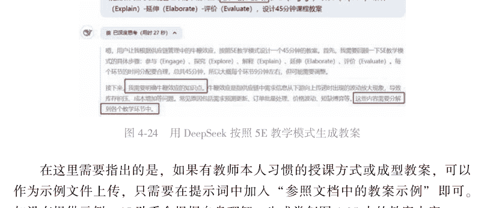

若教师已有习惯授课方式或成型教案，可上传为示例并在提示词中注明“参照文档中的教案示例”，否则模型按自身理解生成类似图 4-25 的内容。

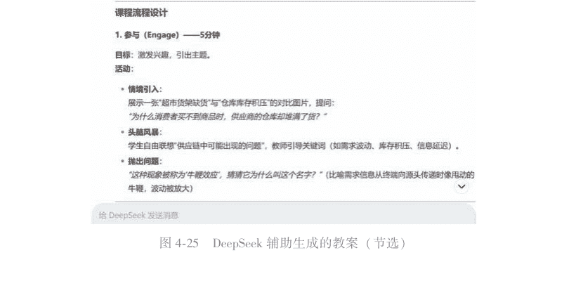

按要求，模型将“牛鞭效应”填充至 5E 各环节，“参与”环节加入情景引入与头脑风暴，引出“需求波动”“库存积压”等关键词。其余“探究”“解释”“延伸”“评价”环节设计见图 4-26a～图 4-26d。

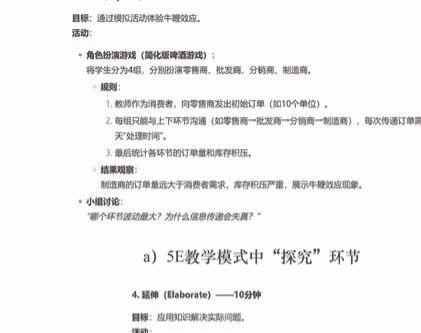

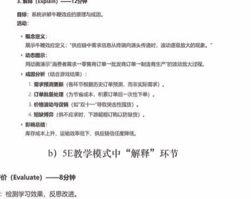

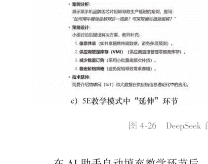

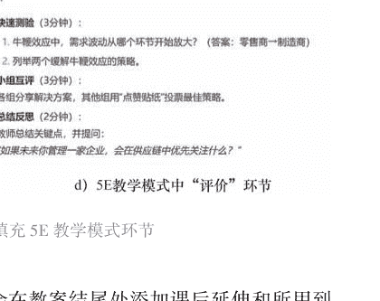

图 4-26 DeepSeek 自动填充 5E 教学模式环节

5E 各环节被模型自动补齐之后，教案末尾一般还会追加课后延伸任务以及配套的教学资源，其呈现效果见图 4-27。

70 你的智能教学助手：应用 AI 工具高效辅助教学

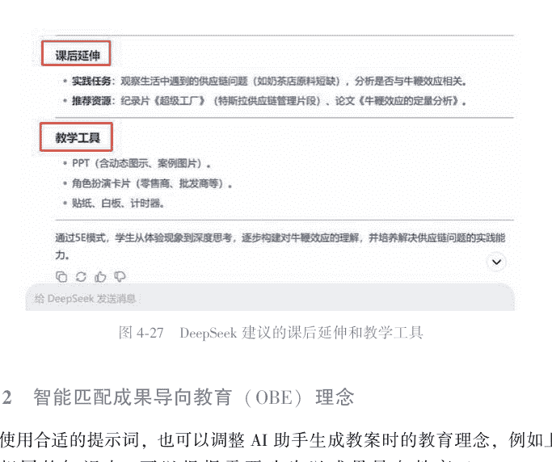

图 4-27 DeepSeek 建议的课后延伸和教学工具

### 4.3.2 智能匹配成果导向教育（OBE）理念

只要把提示词的指向调整一下，模型就能按不同的教学取向产出教案。以同一知识点为例，可以让它改走成果导向教育 Outcome-based Education，OBE 的路线，示范提示与思考路径见图 4-28。

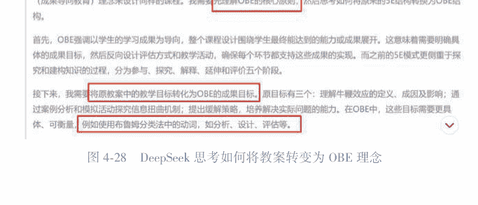

图 4-28 DeepSeek 思考如何将教案转变为 OBE 理念

可以看出模型先梳理 OBE 的核心要义，并与前文的 5E 模式做横向对照，随后改变了教案生成的逻辑。

推理时助手还会引入布鲁姆教育目标分类法等经典理论来润色表述。图 4-29 给出了生成教案的节选，图 4-29a 确定了 OBE 下的关键学习成果 Learning Outcomes，随后围绕该成果搭建了成果对齐与评价标准见图 4-29b、教学活动设计见图 4-29c、课后延伸与成果巩固见图 4-29d。

下面是一份基于 OBE 理念设计的 45 分钟课程教案，主题为供应链管理中的牛鞭效应，以清晰的学习成果为锚点反向安排活动与评价：

#### 课程主题：供应链管理中的牛鞭效应

学习成果 Learning Outcomes

学生在本课结束后能够：

- 1. 解释牛鞭效应的定义、成因及对供应链的具体影响。
- 2. 分析实际案例中牛鞭效应的形成机制。
- 3. 设计缓解牛鞭效应的可行策略，并评估其有效性。

a) 按OBE理念编写的学习成果

#### 1. 明确成果与评估标准 课前准备

- 成果对应的评价任务：
    - 任务1 解释：通过课堂测验或问答，准确描述牛鞭效应的成因，匹配成果1。
    - 任务2 分析：案例分析报告中指出信息扭曲的关键环节，匹配成果2。
    - 任务3 设计+评估：小组提出策略并论证其可行性，匹配成果3。
- 评估标准 Rubric：

| 成果等级 | 描述 |
| :--- | :--- |
| 优秀 4分 | 能结合多因素 如预测偏差、批量订单 解释成因，策略具有创新性和实操性。 |
| 良好 3分 | 准确解释成因，策略合理但缺乏细节。 |
| 需改进 2分 | 仅能复述定义，策略笼统或与问题无关。 |

b) 成果对齐和评估标准

图 4-29 按 OBE 理念重新生成的教案 节选

#### 2. 教学活动设计 45分钟

阶段1：激活先验知识 & 引入成果目标 5分钟
- 活动：
    1. 播放“口罩短缺时工厂却停工”的新闻片段，提问：“为何会出现终端缺货与上游产能过剩并存的矛盾？”
    2. 成果关联：告知学生本课目标是通过分析此类现象学会设计解决方案 成果3。

阶段2：知识输入与案例分析 15分钟
- 活动：
    1. 微讲座 8分钟：
        - 定义牛鞭效应 配动态供应链波动图。
        - 关键成因：需求预测偏差、订单批量处理、短缺博弈 结合简单公式说明。
    2. 案例分析 7分钟：
        - 发放“某家电企业因促销导致库存积压”案例，小组讨论：“牛鞭效应在此案例中如何被触发？关键环节是哪些？”
        - 评估嵌入：随机抽组作答，按作答质量对应成果2的评估标准。

c) 教学活动设计

#### 3. 课后延伸与成果巩固

- 任务：
    - 个人作业：选择一家本地企业 如奶茶店，分析其供应链是否存在牛鞭效应并提出改进建议 匹配成果2、3。
- 资源支持：
    - 提供“牛鞭效应量化模型”学习资料，供学有余力者深入探究。

d) 课后延伸与成果巩固

图 4-29 按 OBE 理念重新生成的教案 节选 续

与 5E 模式类似，AI 在改写后的 OBE 教案末尾同样给出设计亮点和教学工具，如图 4-30 所示。

第 4 章 AI 辅助课程设计 73

#### OBE设计亮点

- 1. 成果导向：所有活动与评估均直接指向 3 个学习成果，避免内容偏离。
- 2. 评估嵌入教学：案例分析、模拟策略、展示质疑均作为形成性评估，实时检测成果达成度。
- 3. 分层支持：通过案例 基础、模拟 应用、策略设计 创新 逐步提升难度，适配不同学生能力。
- 4. 真实问题驱动：从口罩短缺、家电库存积压等现实问题切入，强化知识实用性。

#### 教学工具

- 供应链模拟表格 记录订单传递数据
- 案例文档 含数据与背景
- 实时投票工具 如Mentimeter快速收集策略反馈

借助 OBE 设计，学生不仅理解牛鞭效应的理论，更能在模拟与案例中把知识用于解决真实供应链问题，实现学以致用。


## 4.4 使用 DeepSeek 辅助完成学情分析

### 4.4.1 智能问卷设计

高校授课与中小学有差异，教师通常不随班升学，选课制也让新班级的先修背景难以迅速掌握。为尽早摸清学生基础以便调整教学，可采用随堂快问。

本节以某高校计科专业《机器学习概论》为例，该课有多门先修要求，这里抽取《计算概论》做智能问卷设计，帮助教师快速了解先修掌握情况。

在 DeepSeek 中新建对话，并上传《机器学习概论》课程手册与《计算概论》课程手册的介绍，相关节选见图 4-31。

| 课程中文名称 | 机器学习概论 |
| :--- | :--- |
| 课程英文名称 | Introduction to Machine Learning |
| 开课单位 | 信息科学技术学院 |
| 授课语言 | 中文 |
| 先修课程 | 高等数学 数学分析、线性代数 高等代数、概率统计、计算概论 |
| 课程中文简介 | “机器学习概论”是一门教授机器学习基本概念、基础理论和方法，主要思想和算法的课程。本课程的一个特点是理论方法的讲解与工程实践并重，另一个特点是该课程涉及多学科交叉。因此，本课程虽然从实际问题出发，运用各类数学理论方法对问题建模，选择不同的算法进行问题求解的思路，对机器学习中的典型任务进行讲解，在教学过程中激发学生的好奇心和兴趣，培养学生解决实际问题和综合创新的能力。 |

| 课程中文名称 | 计算概论 A |
| :--- | :--- |
| 课程英文名称 | Introduction to Computing |
| 开课单位 | 信息科学技术学院 |
| 授课语言 | 中文 |
| 先修课程 | 无 |
| 课程中文简介 | 本课程是面向全校信息学科相关专业学生进行计算机基础教育的特色课程。教学目标是为信息学科大一新生入学后尽快建立有效的计算机基础知识、专业技能，并有一定科研能力的拔尖人才。本课程的内容主要分为两个部分：信息技术基础知识部分 约占总学时的15%，程序设计基础部分 约占总学时的85%。本课程于2020年被认定为教育部首批“国家一流线下本科课程”，其对应的部编课程，也同时被认定为教育部首批“国家一流线上本科课程”。 |

a) 机器学习概论的课程内容 节选

b) 计算概论的课程内容 节选

图 4-31 需要进行学情分析的课程内容

文档上传后，使用图 4-32 的提示词生成学情分析随堂问卷。为提高效率并减轻教师负担，问卷尽量采用客观题，并选用可直接导入在线问卷平台的格式。


图 4-32 用 DeepSeek 智能设计学情分析问卷

AI 生成的智能问卷会依据《机器学习概论》与《计算概论》的知识点关联及基础要求，设计一套测试问卷，其节选见图 4-33。

直接使用 AI 生成的问卷会带来后续工作量，包括学生填写与教师批改。因此建议额外上传一份在线问卷平台的样例，让 AI 按该模板重新排版，便于通过微信小程序或 PC 网页分发并实现自动判分。本节选用国内某知名平台的问卷模板作为格式参考，内容见图 4-34，细节可忽略。

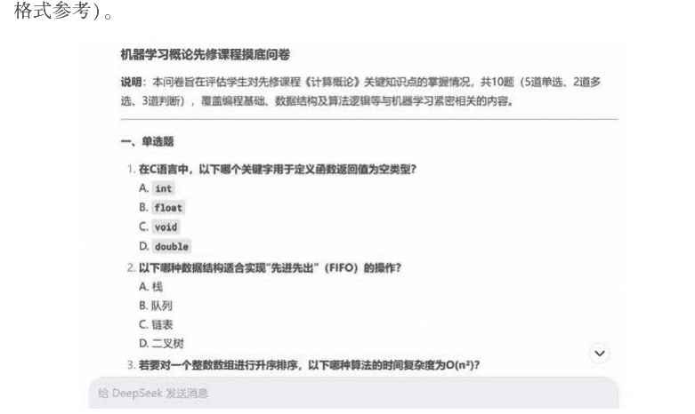

图 4-33 根据待授课程和先修课程生成的学情分析问卷 节选

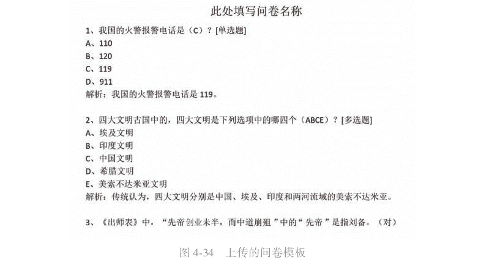

图 4-34 上传的问卷模板

在原有对话中上传该模板并继续使用图 4-35 的提示词，AI 会阅读模板并重新格式化全部题目，效果见图 4-36。


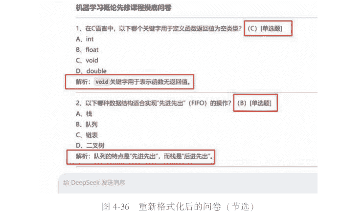

将格式化后的题目保存为 Word 格式并上传到在线问卷平台，可自动生成如图 4-37 所示的问卷，题型、正确答案、解析均可自动识别，确认无误后可自行调整每题分值，再保存发布。

通过生成的二维码分发给学生后，可在课堂限时测试并自动判分生成结果，如图 4-38 所示。

#### 机器学习概论先修课程摸底问卷

本问卷仅为学情分析使用，不计入期末成绩。

考试封面设置 | 效果示例

【第1页/共1页】

1、在C语言中，以下哪个关键字用于定义函数返回值为空类型？  10分
- A、int
- B、float
- C、void 正确答案
- D、double

答案解析：void关键字用于表示函数无返回值。

此题后插入新题

图 4-37 自动识别的学情分析问卷题目 节选


### 4.4.2 学情分析自动生成

学生完成学情问卷后，教师可从在线平台直接获取答题数据，平台通常提供 Word 或 Excel 格式的结果，如图 4-39 所示。

| 学生序号 | 用户ID | 提交答卷时间 | 所用时间 秒 | 来源 | 总分 | 1、在C语言中，以下哪个关键字用于定义函数返回值为空类型？ | 2、以下哪种数据结构适合实现“先进先出” FIFO 的操作？ | 3、若要对一个整数数组进行升序排序，以下哪种算法的时间复杂度为O n²？ |
|---|---|---|---|---|---|---|---|---|
| 1 | 学生 | 3/15 | 125 | 微信 | 70 | 0 | 10 | 0 |
| 2 | 学生 | 3/15 | 190 | 微信 | 90 | 10 | 0 | 10 |
| ... | ... | ... | ... | ... | ... | ... | ... | ... |

图 4-39 学情分析问卷回答情况汇总

使用 AI 对学生答题情况进行学情分析时，需先对姓名等敏感信息脱敏。在 DeepSeek 新建对话，上传汇总表并使用提示词生成分析，结果见图 4-40。

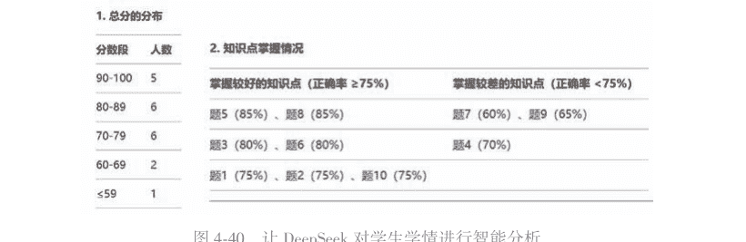

图 4-40 让 DeepSeek 对学生学情进行智能分析

表格为《机器学习概论》与其先修课程《计算概论》的学情分析问卷答题情况，第一行为表头。总分列为学生总成绩 满分100，之后为10道题目，答对10分，答错0分。请从总分分布、掌握较好知识点、掌握较差知识点三个维度分析，并以表格呈现，同时对比总分前20%与后20%学生的知识结构差异，用对比图表描述。

统计结果以75%正确率为划分线，AI 给出了前20%与后20%学生的对比分析 如图 4-41。结论显示“递归函数和动态内存分配掌握最好”“栈操作掌握最弱”“后20%学生在基础概念如FIFO数据结构和应用题上存在明显短板”，教师可据此修改授课计划和教案。

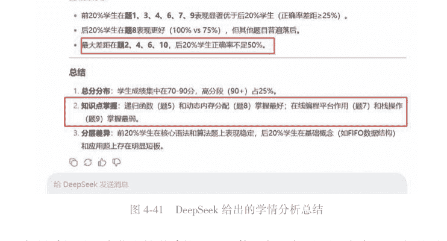

若需进一步获取教学建议，可使用如下提示词，AI 给出的策略建议见图 4-42。

> 请根据刚才的学情分析，以及机器学习概论的课程内容，为该班级学生提供合理的教学策略建议。

#### 教学策略建议

##### 1. 基础巩固与分层教学

| 策略 | 实施方式 | 针对群体 |
| :--- | :--- | :--- |
| 数据结构与算法强化 | 在课程初期安排2学时复习关键数据结构 栈、队列 和基础算法 排序、递归，结合代码示例和课堂小练习。 | 全体学生，重点后20% |
| 分层任务设计 | 前20%学生：挑战复杂算法实现 如优化PCA、实现集成学习；后20%学生：完成基础代码填空和流程图分析任务。 | 分层次针对性训练 |
| 概率统计预修模块 | 在“概率机器学习”章节前，提供1学时的概率基础速成课 贝叶斯公式、条件独立性，并配套习题包。 | 全体学生，重点后20% |

a) 基础巩固与分层教学

##### 2. 实践驱动与工具赋能

| 策略 | 实施方式 | 目标 |
| :--- | :--- | :--- |
| 在线编程平台实战 | 每章节设置“代码擂台”任务 如用Python实现k-means，强制使用在线平台提交，并实时反馈代码正确性与效率。 | 弥补题7短板，提升应用能力 |
| 项目分阶段指导 | 将课程项目拆解为“数据预处理→模型选择→调参优化”三阶段，每阶段提供模板代码和常见错误案例解析。 | 降低项目门槛，增强实践信心 |
| 可视化工具辅助 | 引入TensorFlow Playground、PCA可视化工具等，直观展示神经网络训练和降维过程。 | 帮助理解抽象概念 如深度学习 |

b) 实践驱动与工具赋能

##### 3. 互动反馈与资源支持

| 策略 | 实施方式 | 受益点 |
| :--- | :--- | :--- |
| 即时课堂问答 | 在讲解核心模型 如SVM、CNN 时，穿插选择题投票 如“核函数的作用是？”，实时统计回答并针对性讲解。 | 强化重点，暴露理解盲区 |
| 错题集与补漏包 | 根据摸底问卷结果，为后20%学生定制“薄弱知识点补漏包” 含递归、栈操作等专题习题+视频讲解。 | 精准提升基础知识 |

基于学情画像做差异化教学的实操示例

| 学伴互助机制 | 将班级前20%与后20%的同学配对，共同完成课堂微型项目，例如借助决策树进行分类练习，在协作中实现经验流动。 | 缩小分层差距，增强集体凝聚 |

c) 互动反馈与资源支持

图 4-42 DeepSeek 针对本门课程的学情提供建议

## 4. 课程内容优化适配

| 章节 | 调整建议 | 关联学情 |
| :--- | :--- | :--- |
| 监督学习（6-8学时） | 把“决策树与递归逻辑”联动来讲，用ID3算法的递归划分案例呼应摸底中递归函数薄弱的点。 | 链接题5（递归） |
| 神经网络（8-10学时） | 先以“梯度下降与动态内存分配”做类比切入，比如反向传播中的内存管理，借力题8在动态内存上的掌握优势。 | 利用已有优势深化理解 |
| 概率方法（10-12学时） | 避开纯数学推导，改用“贝叶斯垃圾邮件分类”等实例驱动，降低概率基础薄弱同学的认知负荷。 | 缓解后20%概率焦虑 |

d) 课程内容优化适配

图 4-42 DeepSeek 针对本门课程的学情提供建议（续）

助手会依据问卷作答情况及课程具体要求，为该班输出差异化的教学建议，覆盖“基础巩固与分层教学”“实践驱动与工具赋能”“互动反馈与资源支持”“课程内容优化适配”四个方面，教师可酌情选用。

## 4.5 使用 DeepSeek 辅助设计课程配套作业

### 4.5.1 分层作业智能生成

教学中为及时掌握学情并动态调整方案，通常需要设计一定量的配套练习。作业整体会按知识点难度分层，既保证覆盖面，又形成递进关系，体现区分度。本节演示如何借助大模型协助教师完成作业设计。

以国内某高校管理学院《营销学》为例，将课程介绍或教学大纲上传至 DeepSeek，输入生成题目的指令，如图 4-43 所示。

生成的配套题目如图 4-44 所示，模型能准确提炼课程名称、适用对象、知识点范围及难度层级。

# 营销学课程作业设计与难度分层

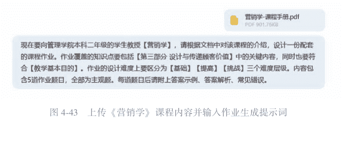

# 营销学课程作业设计与难度分层

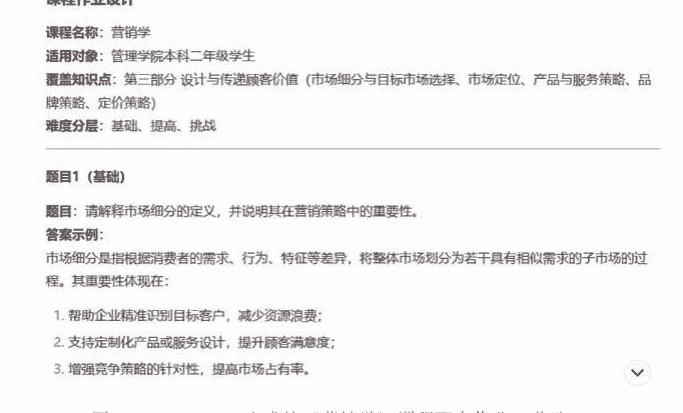

按指令要求，模型还会为每道题附上参考解析和常见错因，便于课堂重点关注，如图 4-45 所示。

# 题目2（提高）

题目：某奶茶品牌计划进入一线城市，请基于STP理论分析其目标市场选择策略，需说明细分依据及选择理由。

答案示例：

1. 细分依据：按消费场景区分学生与上班族，按消费能力区分高端与平价，按口味偏好区分果茶与奶茶；
2. 目标市场选择：聚焦“20-35岁上班族”，因其支付能力较强且对健康饮品需求旺盛；
3. 理由：该群体更看重品牌调性与便捷性，适合通过社交媒体触达。

> 答案解析：
需运用STP框架，结合情境分析细分维度与选择逻辑，体现对“目标市场选择”知识点的应用能力。

> 常见错误：
- 未明确细分维度或选择标准模糊；
- 忽略市场容量或竞争环境分析。


### 4.5.2 作业批改标准制定

大模型辅助生成的作业中，主观题也需要可量化的评分细则以保证公平。仍以《营销学》为例，在同一对话窗口继续输入指令生成评定标准。

> 对于刚才的《营销学》课程作业，请生成一份作业评定标准。要求对标课程目标并区分能力层级。核心评分维度须包括内容准确性、逻辑架构合理性、分析深度、创新价值、表达专业性，最后输出可打印的评分表模板。

模型会按要求制定详细的评分维度，如图 4-46 所示。

实际操作中，模型也给出总分换算与等级划分说明，如图 4-47 所示。

# 评分维度与标准说明

| 评分维度 | 评分标准 | 分数范围 |
| :--- | :--- | :--- |
| 内容准确性 | - 答案是否符合理论定义或教材表述<br>- 案例或数据引用是否准确 | 0-3分 |
| 逻辑架构合理性 | - 是否分点或分步清晰陈述<br>- 各部分是否连贯，是否存在矛盾或跳跃 | 0-2分 |
| 分析深度 | - 是否多角度分析市场环境、顾客需求、竞争态势<br>- 是否体现系统性思考 | 0-2分 |
| 创新价值 | - 是否提出新颖观点或差异化策略<br>- 是否结合数字化趋势或前沿理论 | 0-2分 |
| 表达专业性 | - 术语使用是否规范<br>- 语言是否简洁、无口语化 | 0-1分 |

图 4-46 DeepSeek 制定的《营销学》作业评分维度

# 评分说明

1. 总分计算：
   - 每题满分10分（内容准确性2分 + 逻辑架构2分 + 分析深度2分 + 创新价值2分 + 表达专业性2分）；
   - 作业满分50分（5题 × 10分）。

2. 等级划分：
   - 优秀（40-50分）：各题均8分以上，内容全面准确，逻辑严密，分析深入，创新性强，表达专业；
   - 良好（30-39分）：多数题目6-7分，内容基本准确，逻辑清晰，部分题目深度或创新不足；
   - 合格（20-29分）：多数题目4-5分，掌握基础知识点，但存在逻辑漏洞或表述问题；
   - 不合格（0-19分）：多数题目低于4分，错误率高，逻辑混乱，未达课程目标。

图 4-47 DeepSeek 对作业评分进行说明

教师确认后，可将模型输出的评分表复制为 Markdown 格式，在其他编辑器打开预览并打印，如图 4-48 所示。

第 4 章 AI 辅助课程设计 85

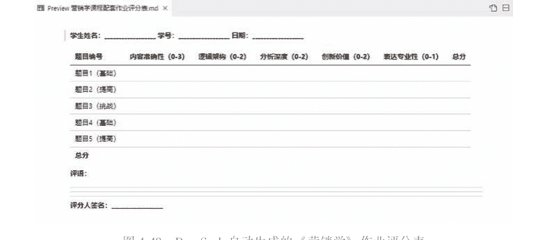

图 4-48 DeepSeek 自动生成的《营销学》作业评分表

## 4.6 使用 DeepSeek 辅助设计课程思政内容

### 4.6.1 思政元素智能匹配

辅助设计课程思政前需先把握国家和教育部指导意见。本节示例先将《教育部关于深化本科教育教学改革全面提高人才培养质量的意见》内容脱敏后上传至新对话，并用如图 4-49 所示指令让模型理解课程思政要求。

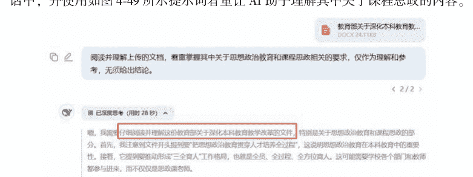

图 4-49 上传文档并让 DeepSeek 掌握课程思政的要求

该回应仅作前置校验，保证后续生成准确性。

本节以某高校信息科学与工程学院《工程导论》为例，上传教学大纲后，使用如图 4-50 所示指令在原对话中继续提问。


模型将结合教育部课程思政要求，从《工程导论》大纲中智能匹配思政要素，如“社会责任与安全意识”“创新驱动与绿色发展”“职业道德与团队协作”等，并给出结合点，如图 4-51 所示。

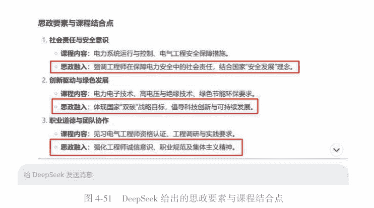

除匹配点外，模型还会给出教学示例，把“中国高铁的绿色发展与技术突破”“国家电网抗冰保电中的集体主义精神”等真实事件融入思政教学，如图 4-52 所示，引导学生从技术学习中体悟家国情怀、社会责任与创新精神，实现知识传授与价值引领统一。

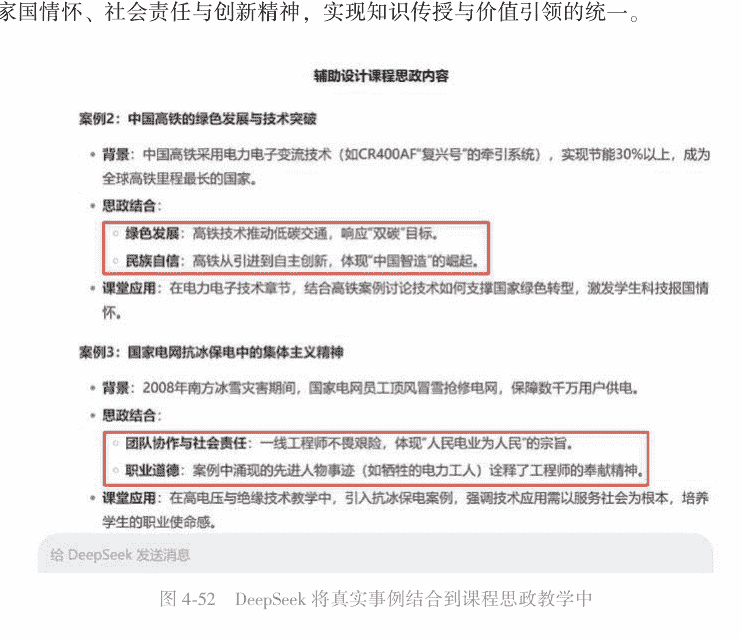

图 4-52 DeepSeek 将真实事例结合到课程思政教学中

### 4.6.2 价值观引导与互动讨论的自动生成

教学中若需融入思政引导与讨论，可让模型提供建议。以《工程导论》为例，用如下指令在同一对话中继续提问：

> 结合上述课程思政设计，增加 3 组课堂讨论问题，引导学生思考技术发展对社会的影响。提问需具递进逻辑，问题保持开放，并给出不同角度的讨论建议。

模型会依据前文案例设计“技术基础”“社会影响”“伦理责任”等问题链，引导讨论“‘西电东送’战略如何缩小区域差距、助力脱贫攻坚”“技术效率与社会风险如何平衡”，从技术特性到社会影响再到伦理责任层层递进，契合认知规律，并自然嵌入“家国情怀”“创新自信”“集体主义”等价值观，具体节选如图 4-53 所示。

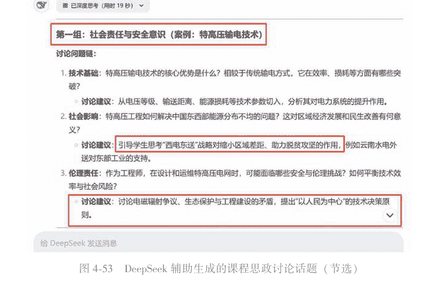

## 4.7 使用 DeepSeek 丰富教学案例与互动环节

### 4.7.1 行业案例的智能更新

备课中案例更新耗时费力，及时引入新事件、新企业能大幅提升课程时效与吸引力。本节需在模型中开启“联网搜索”功能。以 DeepSeek 为例，功能位于对话框下方，如图 4-54 所示。


开启联网搜索后，模型会先检索网络。图 4-55 可见 DeepSeek 筛选49个相关网页，涵盖腾讯网、今日头条及政府政策解读，并在“深度思考”中汇总商业航天近期变革与案例。

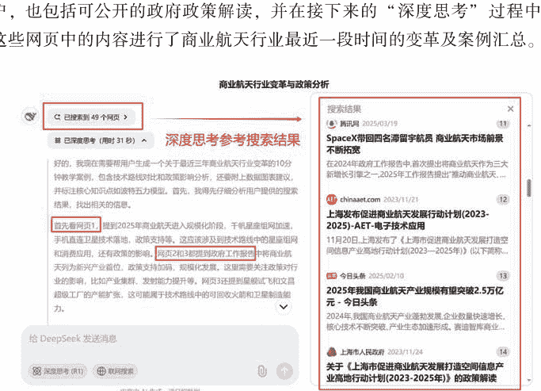

需甄别信息真实性与时效性，优先引用主流媒体与政务官网。例如图 4-56 选取人民网案例“京津冀、长三角、珠三角形成全产业链集群”“海南文昌卫星超级工厂：卫星制造革命”，更新至教案保证实时性与准确度。

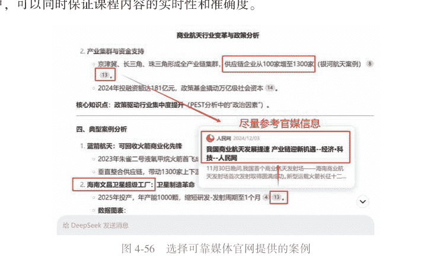

模型也能以表格形式整理案例与知识点结合，如在“技术路线对比”中关联核心知识点“差异化竞争策略（波特五力模型中的现有竞争者）”，便于教师快速更新章节内容，如图 4-57 所示。

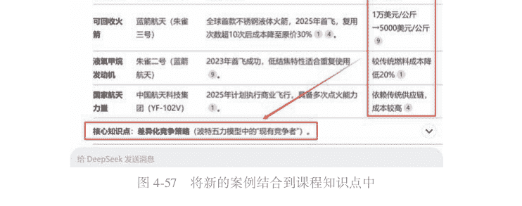

### 4.7.2 师生互动的快速设计

情景模拟常用于经管类课程，帮助学生沉浸式融会贯通。生成式助手能提供创意启发，提升互动趣味性。本节以市场营销课程教学目标“理解市场供需关系、企业战略制定与消费者行为分析”为依据，输入指令：

> 为《市场营销》本科教学设计1个含角色卡（企业CEO/消费者/竞品分析师）的30分钟模拟游戏，需具备完整任务清单与评分机制的课堂教学脚本。

模型生成的游戏规则与流程如图4-58所示。

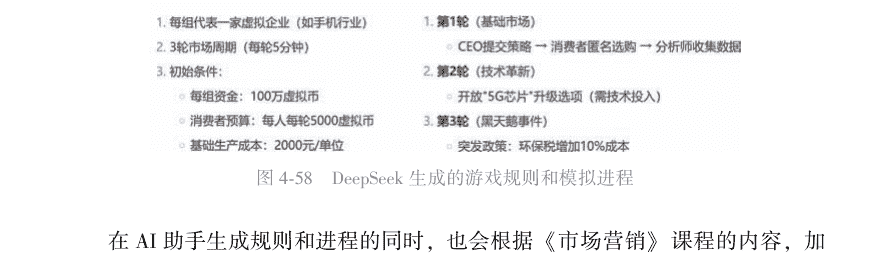

同时加入“5G芯片升级”“环保税增加”等战略分支与“黑天鹅”事件，并为每轮决策设计任务清单与工具表，如图4-59所示。

互动结束后，模型按课程内容与脚本制定评分机制与教学总结重点，如图4-60所示。

# 第二阶段：模拟流程（15分钟）

任务清单与工具表

# CEO任务表（每轮必填）

1. 定价策略：______元（范围2500-8000）
2. 营销投入：______%（占资金比例）
3. 技术升级：□是 □否（需消耗50万资金）

# 消费者问卷（勾选制）

选择产品原因：
□ 价格合理 □ 品牌知名度 □ 功能创新 □ 广告吸引力

拒绝产品原因：
□ 价格过高 □ 缺乏特色 □ 负面评价 □ 广告误导

# 分析师报告模板

竞品威胁等级：★☆☆☆☆（1-5星）

建议反制措施：
□ 降价促销 □ 功能升级 □ 精准广告 □ 其他______


# 第三阶段：评分与总结（10分钟）

评分机制

| 维度 | CEO（40%） | 消费者（30%） | 分析师（30%） |
| :--- | :--- | :--- | :--- |
| 个人表现 | 策略创新性 | 反馈深度 | 数据准确性 |
| 团队贡献 | 利润增长率 | 需求匹配度 | 建议采纳率 |
| 额外加分 | 危机处理能力+5分 | 发现虚假宣传+3分 | 趋势预测命中+5分 |

# 教学总结重点

1. 波特五力模型在竞争分析中的应用
2. 价格弹性与消费者心理的关系
3. SWOT分析法的实战演练


# 第 5 章

AI 辅助教学素材创作

在现代教育中，多媒体教学素材作用愈发重要。优质的图片、视频、音频不仅丰富课堂，也能激发学习兴趣、提升效果。借助生成式工具，教师可快速生成符合需求的素材，大幅降低创作门槛与时间成本，为教学创新提供空间。

本章要点：
- AI 技术在教学素材创作中的创新应用
- 各类 AI 工具使用技巧
- 应用 AI 辅助生成图片、视频

## 5.1 AI 辅助教学图片设计

借助大模型，教师可高效创建符合教学需求的视觉素材，提升课堂表现力，增强学生参与。本节探讨如何用 AI 生成教学图片，涵盖创作策略、应用场景与关键词构建等。

### 5.1.1 AI 生成图片万能提示词公式

#### 1. AI 生成图片

AI 出图是艺术创作核心技术之一，涵盖基于文本生成与基于图片生成两类。广泛用于插画、海报、产品展示、人物照等。

文案生成图片可依文字描述生成相应图像，如把“清明时节雨纷纷”的意境转化为水墨节气插画。如图 5-1 所示，展示模型生成的二十四节气主题图片，可直接用于相关课程。


#### 2. 图片生成图片

基于参考图和特定风格需求如“传统剪纸艺术”，AI 会分析图像特征，匹配风格元素并细致调整，实现风格转换与个性化创作。如图 5-2 所示，为模型生成的十二生肖剪纸风格作品，既保留非遗精髓，也展现数字化优势，为传统文化教学提供视觉素材。


#### 3. AI 生图万能提示词公式

(1) 基础版公式（快速上手）

结构：[主体] + [环境/背景] + [风格]

适用场景：快速构建概念图或灵感草图。

公式解析以戴望舒《雨巷》配图为例。
- 主体：核心对象，如“身着民国旗袍的少女”。
- 环境/背景：场景如“江南雨巷，黄昏细雨”。
- 风格：艺术风格如“唯美水墨丹青风格”。

完整示例提示词：
> 身着民国旗袍的少女，置身于江南雨巷，沐浴在黄昏细雨之中，呈现唯美水墨丹青风格。

生成图片如图 5-3 所示。


图 5-3 基础版公式生成图片

（2）进阶版公式（高精度控制）

结构：[主体] + [细节] + [环境] + [情感/氛围] + [构图/视角] + [材质/纹理] + [风格] + [用途]

适用场景：对细节、情感、构图要求较高的精细创作。

细节：对主体或环境精细描述，如“手持绘有水墨莲花图案的油纸伞”。
情感/氛围：图片传达的情绪或感官体验，如“营造出一种静谧而忧伤的氛围”。

课堂配图 AI 活用：从要素拆解到实战演练

要让模型输出贴合教学预期的视觉素材，关键在于把描述拆解成可调控的构成要素。影响成片效果的核心维度大致可归为画面布局、表面质感与投放用途三类。

- 构图/视角：掌控画面结构与观察点位，用于牵引视觉焦点，例如“选用低机位，让背景呈现纵深虚化”。
- 材质/纹理：点明物体表面的质感特质，以增强写实度，比如“路面呈现润泽的青石板纹理”。
- 用途：厘清图片在课堂中的具体使用情境，如“用作戴望舒《雨巷》课件首页的配图”。

把上述要素串联起来即可得到可用的进阶提示词。

> 身着民国时期旗袍的少女，手持绘有水墨莲花的油纸伞，置身于江南雨巷之中，在黄昏细雨的映衬下，营造出一种静谧而忧伤的氛围。背景是湿润的青石板路面，整体采用唯美水墨丹青风格，作为戴望舒《雨巷》课件首页的配图。

生成的图片如图 5-4 所示。


图 5-4 进阶版公式生成图片

## （3）参考提示词库

以下词库可直接混搭选用。参考提示词库如表 5-1 所示。

表 5-1 参考提示词库

| 元素 | 示例 |

| :--- | :--- |

| 主体 | 猫、战士、飞船、玫瑰、机器人、鲸鱼、骑士、蝴蝶、城堡、幽灵、龙、少女、狼、天使、巫师、武士、凤凰、吸血鬼、精灵、机甲 |

| 细节 | 发光、破损、锋利、湿润、闪烁、缠绕、悬浮、倒影、燃烧、结晶、锈蚀、飘动、裂痕、透明、齿轮、绒毛、鳞片、符文、烟雾、光环 |

| 环境 | 雨夜、沙漠、深海、太空、森林、废墟、雪山、火山、都市、梦境、黄昏、沼泽、古墓、云端、极光、战场、花园、实验室、小巷、星空 |

| 情感/氛围 | 孤独、愤怒、宁静、恐惧、神秘、浪漫、热血、忧郁、狂野、希望、压抑、欢快、诡异、神圣、悲伤、冷酷、温馨、紧张、梦幻、震撼 |

| 构图/视角 | 俯视、仰视、特写、远景、对称、倾斜、剪影、框架、透视、鱼眼、微距、鸟瞰、低角度、高角度、动态、中心、三分法、黄金分割、散点、层次 |

| 材质/纹理 | 金属、玻璃、岩石、丝绸、皮革、火焰、冰晶、木材、陶瓷、毛发、液体、锈迹、藤蔓、鳞甲、布料、雾气、泥土、宝石、泡沫、熔岩 |

| 风格 | 写实、卡通、赛博、蒸汽、像素、水彩、油画、素描、抽象、科幻、奇幻、复古、极简、哥特、未来、手绘、涂鸦、霓虹、低多边、超现实 |

| 用途 | 插画、海报、封面、壁纸、角色、场景、图标、广告、概念、动画、游戏、电影、漫画、包装、服装、雕塑、纹身、周边、虚拟、展览 |

## （4）应用建议

- 基础版本：偏重效率，满足日常教学的常规成图需求。
- 进阶版本：偏重精度，适合对细节刻画与定制度要求较高的教学情境。
- 灵活组合策略：不必拘泥固定顺序，可按实际需求增减要素。提示词中靠前的描述权重更高，关键信息尽量前置。模型对措辞、数字与数量的敏感度有限，建议少用易产生歧义的量化表达。多浏览学习社区，借鉴优质案例的用词技巧。

## 4. AI 图片生成工具介绍

成图质量既受提示词影响，也与工具选择相关。据表 5-2 汇总的几款国内常用绘图平台，教师可结合使用习惯挑选。

表 5-2 常用 AI 图片生成工具

| 工具名称 | 官网链接 | 生图特点 | 优点 |

| :--- | :--- | :--- | :--- |

| 通义万相 | https://tongyi.aliyun.com/wanxiang/ | 多比例生图，消耗灵感值，单次生成 4 张 | 稳定性高，20+ 参数调节，多风格混合 |

| 即梦 AI | https://jimeng.jianying.com | 多比例生图，消耗积分，单次生成 4 张 | 算法强，中文语义精准，智能画布重绘 |

| 可灵 AI | https://klingai.kuaishou.com/ | 多比例，消耗灵感值，单次生成 1~9 张 | 整合快手生态，情感色彩算法强，多语言提示词 |

| 商汤秒画 | https://miaohua.sensetime.com/ | 多比例，消耗体验次数，单次生成 1~8 张 | 学术算法强，人体结构准确，4K 分辨率输出 |

| 智谱清言 | https://chatglm.cn/ | 多比例，免费，单次生成 1 张 | 完全免费，长文本解析，抽象概念可视化 |

| 豆包 | https://www.doubao.com/chat/ | 多比例，免费，单次生成 4 张 | 算法强，多模态输入，无广告 |

## 5. AI 生成图片提示词练习表

AI 生成图片提示词练习表如表 5-3 所示。借助上述工具，用表格中的提示词进行练习，直观感受不同要素对结果的影响。

表 5-3 AI生成图片提示词练习表

| 类别 | 示例 |

|---|---|

| 主体 | 1. 一位穿着复古长裙的少女<br>2. 一只慵懒的橘猫<br>3. 一朵盛开的向日葵<br>4. 一座古老的石桥 |

| 细节 | 1. 裙摆上的蕾丝花纹精致细腻<br>2. 猫的胡须微微颤动<br>3. 向日葵的花瓣上沾满露珠<br>4. 石桥上的青苔斑驳 |

| 环境 | 1. 在19世纪的欧洲小镇<br>2. 在阳光明媚的午后庭院<br>3. 在金色的麦田里<br>4. 在雨后的森林小径 |

| 情感/氛围 | 1. 浪漫而梦幻<br>2. 温暖而舒适<br>3. 欢快而明亮<br>4. 神秘而幽深 |

| 构图/视角 | 1. 仰视主体<br>2. 黄金分割点<br>3. 背景模糊<br>4. 前景虚化 |

| 材质/纹理 | 1. 粗糙的石头质感<br>2. 细腻的皮肤纹理<br>3. 湿润的泥土质感<br>4. 透明的玻璃材质 |

| 风格 | 1. 超现实主义<br>2. 印象派<br>3. 复古蒸汽朋克<br>4. 赛博朋克 |

| 用途 | 1. 书籍封面<br>2. 艺术展览<br>3. 游戏场景设计<br>4. 社交媒体配图 |

选定工具后，可通过结构化提示词实现对输出效果的精细调控。接下来将具体阐述提示词的搭建与生成流程。

### 5.1.2 使用 DeepSeek+即梦 AI 生成教学配图

课堂配图能把抽象概念具象化，提升学习兴趣。借助 AI 产出的高质量素材，教师可以快速制作课件、互动游戏、AR 模型等多种教学资源。

#### 1. 案例：文生图

以《小王子》等文学配图为例，演示 DeepSeek 与即梦 AI 协同的工作流程。

（1）借助 DeepSeek 撰写提示词

打开 DeepSeek 主界面，点击“开始对话”进入对话页，如图 5-5 所示；输入想要的图片描述并发送，如图 5-6 所示，系统会返回可直接使用的提示词。复制结果到即梦 AI 创作。生成的提示词如下所示。


图 5-5 DeepSeek 主界面


图 5-6 DeepSeek 对话界面

“小王子单膝跪地，双手捧一朵红玫瑰，玫瑰花瓣上有露珠，小王子的披风随风飘动，外星球沙漠，星空璀璨，纯真与守护交织的温暖感，中心对称构图，玫瑰位于画面中央，水彩纸纹理，玫瑰花瓣的透明质感，童话插画风格，《外国文学经典》课件插图”。

（2）使用即梦 AI 生成图片

1）在即梦 AI 官方网站（https://jimeng.jianying.com），教师可凭借手机号码或抖音账号进行注册和登录。每日登录系统即可获得积分奖励。积分消耗规则具体如下：使用文案转换为图片功能需扣除 1 个积分；而图片转换为图片功能则需消耗 2 个积分。图 5-7 展示了即梦 AI 平台的主界面。


图 5-7 即梦 AI 平台的主界面

2）点击图 5-7 中 “AI 作图” 功能区的 “图片生成” 按钮，即可进入专为 AI 作图功能设计的 “图片生成” 界面。将 DeepSeek 生成的提示词复制到左上角的调整界面对话框内，然后根据实际需求，对 “生图模型”“清晰度”“图片比例” 等参数进行相应调整，具体操作界面如图 5-8 所示。可供选择的模型类型共分为四大类，需特别注意的是，随着即梦持续迭代与升级，生图模型也在不断优化，教师可根据自身实际需求进行选择。

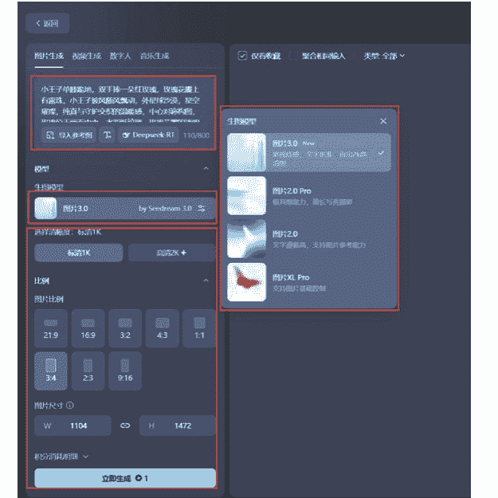

图 5-8 文生图参数设置界面

3）点击“立即生成”按钮后，系统将自动生成四张图片，如图 5-9 所示。将鼠标悬停在需要下载的图片上，随即会显示“下载”按钮，点击该按钮即可完成下载。

4）若对生成图片的质量不满意，可点击“再次生成”选项，或选择“重新编辑”以调整提示词后再次尝试生成。若对某图片感觉满意并希望进一步优化，可单击该图片，并利用“超清”“细节修复”“局部重绘”，及“扩图”等高级功能进行精细化处理，亦可选择“去画布进行编辑”进一步调整，直至满意为止。如图 5-10 所示。


图 5-9 即梦 AI 生成图片


图 5-10 即梦 AI 对图片的进一步调整界面

#### 2. 案例：图生图

以天坛为例展示图生图。利用“参考图”功能，AI 可基于真实场景或人物进行再创作。具体步骤如下。

1）点击图 5-8 左上角的“导入参考图”按钮，上传如图 5-11 所示的参考图片；接着，选择“主体”“人像写真”“角色特征”“风格”“边缘轮廓”“景深”，以及“人物姿势”等参考维度；最后，点击“保存”按钮，完成操作。

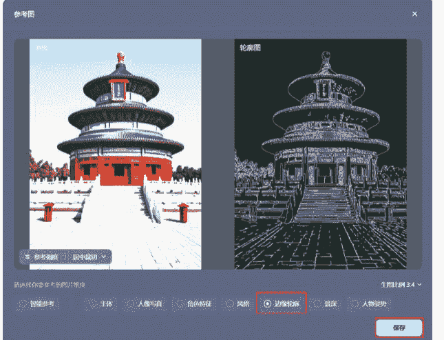

图 5-11 参考图功能界面

2）在文本框内输入提示词后，点击“立即生成”按钮，AI 将基于参考图中的形象自动生成照片，效果如图 5-12 所示。此外，也可尝试参考其他维度进行操作。


图 5-12 参考图中的边缘轮廓生成照片

#### 3. 案例：应用即梦 AI 整合的 DeepSeek 功能生成图片

即梦 AI 已内嵌 DeepSeek 功能，可在同一界面先写提示词再出图。仍以《小王子》为例，具体操作如图 5-13 所示。

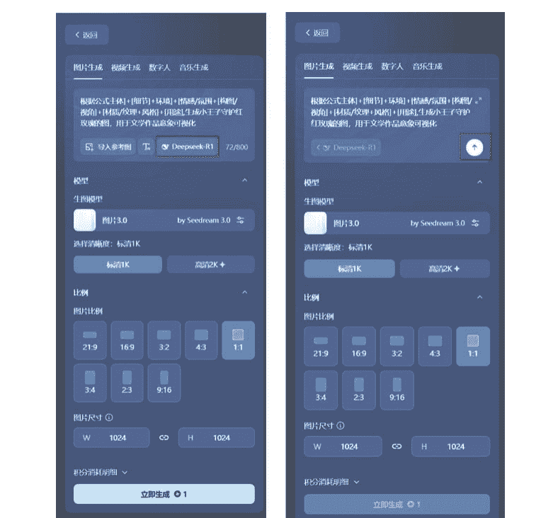

点击文本框右下角的 “DeepSeek-R1” 按钮；在文本框内输入提示词公式，并交由 DeepSeek 生成相应的提示词；点击发送按钮即可完成操作。

生成的 4 条提示词如图 5-14 所示（可点击查看深度思考过程）。教师可选择满意的提示词，点击“立即生成”按钮以生成图片，或点击“修改”按钮，对提示词进行修改后再生成图片。

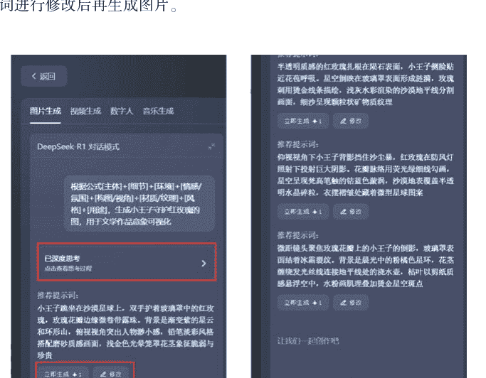

#### 4. 综合案例：生成课堂教学配图

下面用三个典型场景说明如何在不同教学情境下用 DeepSeek+即梦 AI 产出高质量配图。

（1）历史场景的再现

历史教学中，学生难以把握事件脉络和人物关系。AI 复原的历史画面能提供直观氛围，帮助理解背景与策略。以“赤壁之战”为例，提示词如图 5-15 所示，生成效果如图 5-16 所示。

赤壁之战场景图提示词生成

> 按照提示词公式：[主体] + [细节] + [环境] + [情感/氛围] + [构图/视角] + [材质/纹理] + [风格] + [用途]生成“赤壁之战”这一经典历史场景图，让学生更好地理解三国时期的军事策略和人物关系。

赤壁之战场景图提示词：

【主体】曹操百万大军战船连营，东吴水军战船严阵以待，诸葛亮、周瑜、黄盖等主要人物立于船头

【细节】战船上旗帜飘扬，刀枪林立，士兵们神情紧张，江面上火光冲天，浓烟滚滚

【环境】长江江面，夜晚，乌云密布，狂风呼啸

【情感/氛围】紧张、激烈、悲壮、一触即发

【构图/视角】俯视视角，展现整个战场全貌，突出双方对峙的紧张局势

【材质/纹理】木质战船纹理清晰，火光和浓烟质感真实，人物服饰细节丰富

【风格】写实风格，注重历史细节和场景还原

【用途】历史教学，帮助学生理解赤壁之战的历史背景、军事策略和人物关系

补充说明：

- 可以根据教学需求，调整画面细节和人物比例，例如突出诸葛亮借东风的场景，或者放大黄盖诈降的画面。

- 可以添加文字注释，标注重要人物、事件和地点，方便学生理解。

- 可以使用动态效果，例如战船移动、火光闪烁等，增强画面表现力。

希望这个提示词公式能够帮助你生成一幅精彩的赤壁之战场景图，让学生们更好地理解和感受这段历史。


（2）复原文学场景描写

语文教学需要让学生进入文本情境。AI 生成的文学插图有助于体会作者意图和情感。以鲁迅《故乡》“闰土捉猹”为例，提示词如图 5-17 所示，插图如图 5-18 所示。

> 按照提示词公式：[主体] + [细节] + [环境] + [情感/氛围] + [构图/视角] + [材质/纹理] + [风格] + [用途]生成鲁迅《故乡》中“闰土捉猹”的场景，让学生更好地理解闰土的形象和乡村生活的氛围。

鲁迅《故乡》中“闰土捉猹”场景提示词：

[主体] 少年闰土手持钢叉，目光炯炯，准备刺向西瓜地里的猹

[细节] 闰土头戴小毡帽，颈套银项圈，身穿破旧棉袄，赤脚站在泥地里，猹露出尖利的牙齿，眼神凶狠

[环境] 月光下的西瓜地，瓜叶茂盛，瓜藤缠绕，远处隐约可见村庄的轮廓

[情感/氛围] 紧张、刺激、充满童趣，又带着一丝乡村夜晚的静谧

[构图/视角] 仰视视角，突出闰土的勇敢和猹的凶猛，背景虚化，突出主体

[材质/纹理] 瓜叶的纹理清晰可见，泥土的质感真实，月光柔和地洒在人物和景物上

[风格] 写实风格，注重细节刻画和氛围渲染

[用途] 语文教学，帮助学生理解闰土的形象特点、乡村生活的氛围以及鲁迅笔下的人物刻画技巧

补充说明：

- 可以根据教学需求，调整画面细节和人物比例，例如突出闰土手中的钢叉，或者放大猹的表情。

- 可以添加文字注释，标注重要细节和人物形象特点，方便学生理解。

- 可以使用动态效果，例如闰土刺向猹的动作，或者猹逃跑的画面，增强画面表现力。

希望这个提示词公式能够帮助你生成一幅生动的“闰土捉猹”场景图，让学生们更好地理解和感受鲁迅笔下的经典形象和乡村生活。

图 5-17 DeepSeek 生成闰土捉猹场景图提示词


（3）艺术课堂：名画风格再现与创作实践

艺术课上，学生需要认识流派特征并进行创作。AI 生成的风格迁移图能提供直观体验，激发创作灵感。以梵高的《星月夜》为参照，创作一幅同风格自然风景，提示词如图 5-19 所示，生成图如图 5-20 所示。

> 按照提示词公式：[主体]+[细节]+[环境]+[情感/氛围]+[构图/视角]+[材质/纹理]+[风格]+[用途]以梵·高的《星月夜》为参考，生成一幅具有梵·高风格的自然风景图，让学生学习后印象派的笔触和色彩运用。

以梵·高《星月夜》为参考的自然风景图提示词：

【主体】一片金黄色的麦田，麦浪翻滚，充满动感

【细节】麦田中点缀着几棵深绿色的柏树，树干扭曲向上，树冠如火焰般舞动，天空中盘旋着几只乌鸦，远处是起伏的山丘和村庄

【环境】晴朗的夏日傍晚，夕阳西下，天空呈现出橙黄色和蓝紫色的渐变

【情感/氛围】热烈、奔放、充满生命力，又带着一丝孤独和忧郁

【构图/视角】俯视视角，展现麦田的广阔和天空的辽阔，柏树和乌鸦打破画面的平衡，增添动感和戏剧性

【材质/纹理】厚重的油画笔触，色彩浓烈，充满质感，麦田的纹理清晰可见，天空的云彩如漩涡般流动

【风格】后印象派风格，强调主观感受和情感表达，色彩鲜艳，笔触粗犷

【用途】美术教学，让学生学习后印象派的笔触和色彩运用，感受艺术家对自然的热爱和内心的情感世界

补充说明：

- 可以根据教学需求，调整画面细节和色彩搭配，例如增加更多种类的树木，或者改变天空的颜色。

- 可以添加文字注释，标注重要元素和艺术手法，方便学生理解。

- 可以使用动态效果，例如麦浪翻滚，乌鸦飞翔，增强画面表现力。

希望这个提示词公式能够帮助你生成一幅具有梵·高风格的自然风景图，让学生们更好地学习和欣赏后印象派艺术的魅力。

图 5-19 DeepSeek 生成以梵高的《星月夜》为参考的自然风景图提示词

借助 DeepSeek 编写详实提示词，结合即梦 AI 生成图像，教师能快速搭建符合教学目标的高质量视觉素材，帮助学生更直观理解抽象概念，提升教学效果。

110 你的智能教学助手：应用 AI 工具高效辅助教学

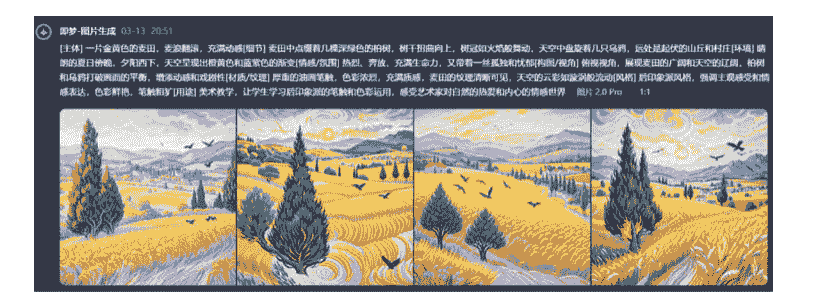

AI 教学实操：从图像到视频的全流程

图 5-20 即梦 AI 以梵高《星月夜》为风格参考生成的自然风景

借助智能辅助，授课者能够把抽象难懂的内容转化为生动的视觉呈现，调动学生的探究兴趣，提升教学效率，为课堂注入创新活力。拿自然灾害举例，讲解时可以迅速作出具象画面，例如正在喷发的火山、地震后出现的地表裂缝、泥石流冲毁道路的场景等（如图 5-21 所示）。这些直观画面有助于学生快速建立灾害概念，加深认知。


图 5-21 喷发的火山、地震后的地面裂缝、泥石流冲毁道路

### 5.1.3 百度 AI 图片助手：剪辑处理实操

百度 AI 图片助手集合了先进的图像创作与处理技术，核心由 AI 绘画和 AI 编辑构成。提供简要文字或上传源文件，即可快速得到富有创意与个性化特质的高质量图像。借助百度 AI 图片助手

## 1. 访问百度 AI 图片助手

1）直接在百度检索所需图像，进入详情页后右侧会出现 AI 编辑区，按需挑选功能，如图 5-22 所示。


图 5-22 百度搜索图片后访问百度 AI 图片助手界面

2）也可直接打开 https://image.baidu.com 开始智能创作，具体操作页如图 5-23 所示。


图 5-23 百度 AI 图片助手首页

## 2. 素材上传或选取

1）上传操作：在助手界面底部点按“上传图片”，随后从本地电脑挑选文件导入，如图 5-24 所示。


2）选取操作：亦可在百度搜索框输入关键词，从结果中挑中满意图像，点击预览后启动 AI 编辑功能。

## 3. 图像处理功能概览

百度 AI 图片助手内置多项前沿处理手段，具体如下。

- 变清晰：一次操作提升成像质量，智能强化细节与纹理，视觉效果更佳，无需手动微调。
- AI 去水印：自动识别并精准清除图像中的水印，还原干净原图。
- 文字替换：输入新文案后，系统自动替换原图文字，保持整体风格统一。
- 线稿提取：快速把彩色图转为线条图，准确捕捉轮廓。
- 智能抠图：精准分离前景主体与背景，并支持人工微调。
- 涂抹消除：用画笔或橡皮擦指定区域，精细去除瑕疵。
- AI 相似图生成：基于原图制作风格相近的新图，可调节相似度。
- 局部替换：精确定位局部进行替换，实现无缝融合。
- 风格转换：提供多种艺术风格选项，将图像转为指定风格呈现。
- 背景替换：智能识别主体并更换背景，提供多种场景选择。
- AI 扩图：按需扩展图像尺寸，智能补全新增区域，保持连贯。
- AI 重绘：在保留核心元素前提下对图像进行创意重构，可调节重绘强度。

## 4. 处理后图像的保存

编辑完成后可在助手界面预览效果，如图 5-25。若满意，点击“下载”即可保存到本地。上传流程及部分处理效果展示见图 5-26~图 5-31。


114 你的智能教学助手：应用 AI 工具高效辅助教学


图 5-26 上传处理原图


图 5-27 去除水印效果图


图 5-28 局部替换效果图


图 5-29 文字替换效果图


图 5-30 提取线稿效果图


图 5-31 风格变化效果图

## 5. 使用要点

版权注意：在使用百度 AI 图片助手进行图像编辑时，必须高度重视素材的版权归属。

效果影响：功能丰富，但最终成片质量会受原图清晰度、内容复杂度等多重因素影响。建议结合素材特点选择合适功能与参数，以优化结果。

## 5.2 AI 驱动的教学视频设计

随智能技术快速演进，视频已成为教学不可或缺的媒介。借助 AI 制作能力，教师能高效产出高质量教学视频，实现场景复现、知识可视化与互动编排，从而显著提升课堂吸引力与教学成效。本节系统介绍 AI 生成视频的核心方法与实践技巧，覆盖提示词构建到剪辑全流程。

### 5.2.1 视频生成通用提示词公式

AI 生成技术正深刻重塑视频创作。AI 不仅能把文本转为静态图像，还能延伸至动态视频生产。主要路径分为文案驱动与图像驱动两类。该技术在影视、广告、游戏开发、教育科普等领域均带来创新浪潮。

## 1. 文案驱动视频

AI 文案转视频技术把文字描述转化为动态画面。教师可在即梦 AI 对话框输入描述性提示词：

> “撑油纸伞的少女，在悠长雨巷缓步独行，水墨淡彩”

对应生成视频如图 5-32 所示。

## 2. 图像驱动视频

AI 图像转视频技术可把静态图像转为动态视频。以图 5-4 中第四张图为例，通过该技术可直接制作带动态效果的作品，如图 5-33 所示。


图 5-32 文案生成视频


图 5-33 图片生成视频

## 3. 通用提示词公式

(1) 基础版公式：快速入门

结构：[主体]+[环境/背景]+[运动]+[风格]

- 主体：核心动态元素，如人物、物体、动物，需明确特征，例如“跳舞者”。
- 环境/背景：主体所处场景或空间，例如“舞台灯光”。
- 运动：主体在视频中的动作、移动或变化，例如“流畅动作”。
- 风格：整体视觉与艺术风格，例如“MV 风格”。

示例提示词：

> 跳舞的人，舞台灯光，流畅的动作，MV 风格

生成视频如图 5-34 所示。


（2）进阶版公式：高精度控制

结构：[主体]+[细节描述]+[环境/背景]+[运动]+[风格]+[情感]+[镜头语言]+[构图]+[光影色调]

- 细节描述：对主体进行深入刻画，包括特征、姿态或人物设定，增强辨识度，例如“身穿红裙，旋转时裙摆展开”。
- 情感：视频要传达的情绪，例如“孤独但自由”。
- 镜头语言：镜头切换、角度等技术性表达，例如“慢动作特写”。
- 构图：画面布局方式，引导视线突出主体，例如“中央对称”。
- 光影色调：光影效果与色彩搭配，营造氛围，例如“暖金色主光”。

完整提示词：

> 穿红色长裙跳舞的人，旋转时裙摆展开，舞台灯光，流畅的动作，MV 风格，孤独但自由，慢动作特写，中央对称构图，暖金色主光

生成视频如图 5-35 所示。


即便 AI 视频生成已取得进展，提示词过于繁复易导致理解偏差。建议在基础要素上精细添加 1~2 个关键增强项，既保持清晰度又获得理想动态。为提升生成准确性，提示词设计应遵循：

- 简洁性：使用清晰直接的语言描述核心内容，避免冗长模糊。
- 适度细化：提供必要的场景、主体与基础动作，避免过度细化复杂动作或时间线。
- 风格引导：明确所需视觉风格，如电影感、动画风格，避免同时要求冲突的风格。

（3）视频提示词参考库

参考提示词库如表 5-4 所示。

### 表 5-4 AI生成视频参考提示词库

| 元 素 | 示 例 |
|---|---|
| 主体 | 宇航员、跑酷者、黑豹、舞者、赛车、无人机、剑客、飞鸟、黑客、海浪 |
| 细节描述 | 破损的机甲、闪烁的霓虹、飘动的围巾、滴落的雨水、旋转的齿轮、燃烧的火焰、发光的纹路、飞扬的沙尘、碎裂的玻璃、缠绕的藤蔓 |
| 环境/背景 | 赛博都市、雨夜小巷、沙漠废墟、太空站、霓虹夜市、迷雾森林、末日战场、深海洞穴、未来实验室、黄昏草原 |
| 运动 | 高速冲刺、缓慢漂浮、旋转跳跃、爆炸冲击、镜头追踪、时间减速、粒子飞散、镜头抖动、瞬间闪现、流体变形 |
| 风格 | 赛博朋克、胶片复古、蒸汽波、科幻未来、暗黑奇幻、极简主义、动漫风格、纪录片、超现实、动态涂鸦 |
| 情感 | 紧张刺激、孤独寂寥、热血沸腾、神秘悬疑、浪漫唯美、压抑窒息、震撼冲击、梦幻迷离、冷酷肃杀、欢快活力 |
| 镜头语言 | 第一人称、俯冲镜头、慢动作、长镜头、鱼眼畸变、动态模糊、推拉变焦、环绕运镜、微距特写、分屏叙事 |
| 构图 | 黄金分割、对称框架、三分法则、极简留白、动态斜线、纵深层次、中心聚焦、散点分布、前景遮挡、倒影镜像 |
| 光影色调 | 霓虹蓝紫、暖橙黄昏、冷峻银灰、暗绿荧光、高对比黑白、粉紫渐变、炽热红焰、迷雾柔光、赛博青橙、胶片颗粒 |

### 5.2.2 用即梦 AI 让历史人物“授课”

课堂上当历史人物以虚拟形象现身讲解，知识传递更具温度。借助即梦 AI，教师可随时召唤历史人物的数字分身：孔子身着素袍，细致讲解《论语》中的“君子之道”。通过形象与仪态的精准还原，先贤既能深入阐释典籍要义，又能按学生认知节奏调整讲解层次。这种跨越时空的亲历式教学，把抽象概念转化为可感知的智慧传承。

当学生看到孔子在虚拟杏坛执卷踱步，“克己复礼”不再只是文字解释，而是圣贤言传身教的精神图景。

## 1. 人物与内容选定

教师依据教学目标，挑选具有代表性的文化符号，与课程知识点融合，为数字化呈现奠定基础。

## 2. 提示词构建

运用 5.2.1 节的提示词公式，通过 DeepSeek 构建提示词。参考提示词：

> 孔子（古代圣贤，身穿宽袖长袍，头戴儒冠，手持竹简，神情慈祥而庄重），竹简上刻有《论语》文字，周围有弟子认真聆听，古代书院环境，木质结构，书卷堆叠，窗外有竹林和远山，营造出宁静、智慧、庄重的氛围。中景构图，孔子居中，弟子环绕，对称视角，木质纹理细腻，竹简质感粗糙，衣袍布料柔软，整体风格为中国传统水墨画，色彩淡雅，留白艺术，适用于传统文化教育或书籍插图。

## 3. 图像生成

将 DeepSeek 生成的提示词复制到即梦 AI 生成人物图像，如图 5-36。可挑选一张作为数字人参照图进行优化。


图 5-36 应用 DeepSeek 生成的提示词在即梦 AI 中生成人物图片

## 4. 视频生成

视频生成步骤如下。

1） 选择图 5-8 左上角的“数字人”功能。
2） 点击图 5-37 中的“导入角色图片/视频”按钮，上传人物图片。


图 5-37 生成视频参数设置界面

3） 选择“生成效果”为标准【标准/生动/大师】。
4） 选择“对口型”为【文本朗读/上传本地配音】，并输入讲课文本。
5） 试听音色后，选择“音色”为沉稳老者【魅力姐姐/阳光少年/上海阿姨/港普男声……】。
6） 点击“立即生成”按钮，生成视频。

## 5. 视频调整

点击生成视频进入编辑界面，按需调整，如图 5-38。若需进一步剪辑、配音、加字幕等，可借助其他工具，具体见后文 5.2.5 节。


图 5-38 视频编辑界面

### 5.2.3 用即梦 AI 生产教学配套视频

借助即梦 AI 生成视频，教师可以唤醒自然现象的数字化呈现，让气象规律以动态场景直观展示，如蚂蚁搬家、燕子低飞、鱼跃水面等常见现象，通过生动画面与简要解说，帮助学生直观理解背后的天气原理。

## 1. 提示词构建

运用 5.1.1 中介绍的提示词公式，通过 DeepSeek 构建图片提示词，参考如下。

(1) 蚂蚁搬家图片提示词

> [ 主体 ] 一群工蚁排成长队搬运食物
> [ 细节 ] 圆润 Q 版造型，黑褐色水墨晕染
> [ 环境 ] 晴朗但泛白的天空，干燥的青石板路面，远处天空堆积灰白云层
> [ 情感/氛围 ] 既团结协作又带着风雨欲来的紧迫萌态
> [ 构图/视角 ] 横向微距视角，蚁群呈波浪形前进路线，留白处题字“蚂蚁成行，大雨淋裳”
> [ 材质/纹理 ] 宣纸底纹，蚂蚁甲壳有干笔皴擦效果
> [ 风格 ] 江南水墨动画风格
> [ 用途 ] 儿童气象科普插图

(2) 燕子低飞图片提示词

> [ 主体 ] 三只家燕以低角度盘旋
> [ 细节 ] 一只燕子翅膀轻触水面，荡起涟漪
> [ 环境 ] 晴朗但泛白的天空，柳枝静止不动，湖面异常平静
> [ 情感/氛围 ] 灵动，暗示空气湿度变化
> [ 构图/视角 ] 仰视 45 度视角，燕子与倒影形成对称构图，留白处题字“燕子低飞，披蓑衣”
> [ 材质/纹理 ] 湿笔渲染羽毛，淡墨勾勒云层轮廓
> [ 风格 ] 江南水墨动画风格
> [ 用途 ] 儿童气象科普插图

(3) 鱼跃水面图片提示词

> [ 主体 ] 两条憨态可掬的鲤鱼接连跃出水面
> [ 细节 ] 圆润 Q 版造型，鱼溅起的水花呈扇形散开
> [ 环境 ] 晴朗但泛白的天空，平静的池塘水面泛着油膜光泽，浮萍聚集
> [ 情感/氛围 ] 活泼中带着“透不过气”的焦急感
> [ 构图/视角 ] 水捕捉鱼儿腾空瞬间，留白处题字“鱼跃水面，风雨现”
> [ 材质/纹理 ] 没骨法表现鱼鳞，枯笔飞白画水纹
> [ 风格 ] 江南水墨动画风格
> [ 用途 ] 儿童气象科普插图

## 2. 图像生成

参照 5.1.2 节，将 DeepSeek 生成的提示词复制到即梦 AI 生成图片，如图 5-39、图 5-40 及图 5-41。


图 5-39 蚂蚁搬家


图 5-40 燕子低飞


图 5-41 鱼跃水面

## 3. 视频生成

选定图片后，在即梦 AI 中输入提示词：

蚂蚁搬家提示词：

> 蚂蚁搬着食物往前，领队蚂蚁触角晃动，队伍末尾的小蚂蚁踉跄追赶

燕子低飞提示词：

> 柳枝轻摆，燕子从画面右上向左下展翅飞翔，一只燕子翅膀轻触水面，荡起涟漪

鱼跃水面提示词：

> 鱼儿上下跳动，跃出水面

生成视频如图 5-42、图 5-43 和图 5-44。


图 5-44 鱼跃水面视频

### 5.2.4 用即梦 AI 生成教师 3D 数字人

在教育数字化转型中，AI 技术不仅改变内容呈现方式，也为教师个人品牌塑造和教学互动深化提供新路径。借助即梦 AI 生成教师本人的 3D 数字人，可突破物理空间限制，以更生动个性化的方式融入教学，实现影响力的多维拓展。

## 1. 图像生成

参见 5.1.2 节，点击图 5-8 左上角的“导入参考图”按钮，上传参考图，选择“人像写真”类型（如图 5-45），在文本框输入提示词，即可生成个人 3D 数字人，如图 5-46、图 5-47。


图 5-45 选择“人像写真”类型

(1) 3D 数字人形象一提示词

> [ 主体 ] 一位亲切的教师形象 3D 数字人，女性，全身照，年龄 30 岁左右，面带微笑
> [ 细节 ] 面部表情温和友善，眼神专注直视前方，嘴角微微上扬，右手持一本打开的语文课本（封面可见《语文》字样），左手做讲解手势，身着简洁大方的浅色衬衫+深色休闲裤+黑色平底鞋，搭配一副细框眼镜
> [ 环境 ] 纯色背景
> [ 情感/氛围 ] 轻松愉快的学习氛围

数字人形象打造与剪映剪辑实战要点

首个形象的基础设定
采用全身构图并以平视视角呈现。皮肤表面保留自然光泽，服饰面料触感柔软，课本纸页纹理清晰可辨。整体风格为写实三维渲染，角色精细度接近皮克斯动画水准，主要用于语文古诗与成语故事讲解类视频的主角出演。


图 5-46 3D 数字人形象一

（2）第二套 3D 数字人形象提示词

> [ 主体 ] 3D 卡通风格数字人全身照，眼神直视前方，身穿剪裁得体的深灰色女士西装套装

[ 细节 ] 内搭白色丝绸衬衫，衣领别着精致的珍珠胸针

[ 环境 ] 背景为抽象几何图案

[ 情感/氛围 ] 暖、活泼、亲切，带有未来数字人的时尚感

[ 构图/视角 ] 全身中景构图，平视的视角

[ 材质/纹理 ] 西装采用细腻的羊毛质感，衬衫有柔和的真丝光泽

[ 风格 ] 风格为超写实 3D 渲染，皮肤有自然的皮下散射效果

[ 用途 ] 用于国际会议的同声手语翻译


图 5-47 3D 数字人形象二

## 2. 生成视频
参照 5.2.2 节的图 5-37，以图 5-46 作为素材制作数字人视频，各项参数依据图 5-48 调整。输入文案提示，设置朗读音色后按下“生成视频”即可得到带专属配音的数字人成片，如图 5-49 所示。
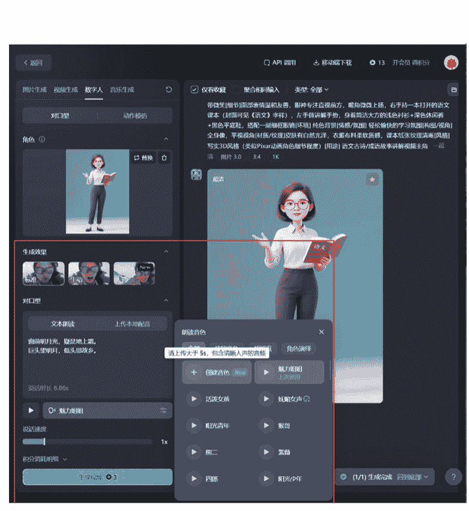

图 5-48 3D 数字人视频参数设置界面


图 5-49 3D 数字人视频截图

## 5.2.5 使用剪映软件剪辑教学视频

### 1. 使用剪映软件进行视频编辑
(1) 启动剪映专业版
以抖音账号或 Apple 账号登录剪映专业版，如图 5-50。进入主界面后点击顶部“+开始创作”进入创作页，如图 5-51。随后点顶部“+导入”将待处理的素材导入，如图 5-52。


图 5-50 剪映主界面
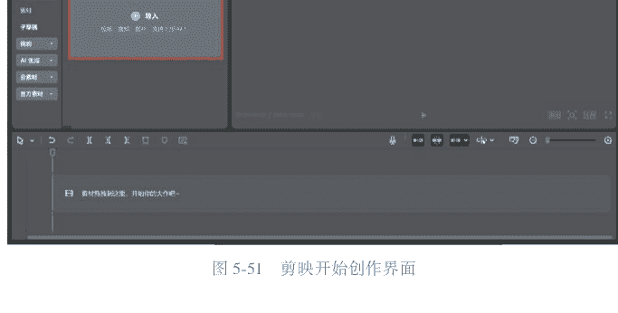

图 5-51 剪映开始创作界面
(2) 对已上传素材进行剪辑
选中视频轨道，点击左侧工具栏的“分割”，即可对片段做精准切割并调整顺序，保留所需部分。操作示意见图 5-53。


图 5-52 剪映导入视频界面


图 5-53 剪映编辑导入视频界面
(3) 编辑区操作
1）点顶部菜单的“文本”图标，选择“智能字幕”，并打开“文稿匹配”功能，步骤见图 5-54。


图 5-54 剪映添加智能字幕界面
2）点击“开始匹配”，把视频对应的文案粘贴到文稿框，如图 5-55。再点一次“开始匹配”即可生成字幕。
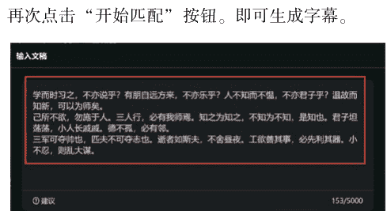

图 5-55 剪映匹配智能字幕文稿界面
3）字幕生成后可按需修改文字、字形、字号、色彩与位置，具体设置见图 5-56。


图 5-56 剪映调整字幕界面
4）调整完毕后点图 5-56 右上角“导出”。导出时可设置视频参数，如图 5-57。设置完成后点“导出”即可输出。

### 2. 利用 AI 技术进行视频配音
借助人工智能可训练出个人专属的克隆音色，用以匹配教师本人风格。流程如下。
1）在视频下方轨道选中目标字幕后，点右上角“朗读”并选择“克隆音色”功能，具体见图 5-58。
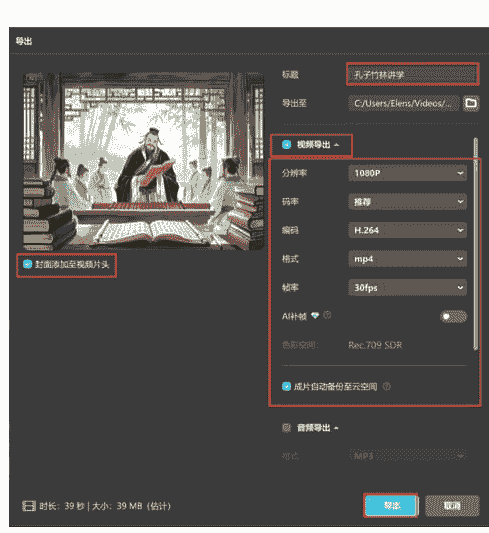

图 5-57 剪映视频导出设置界面


图 5-58 剪映克隆音色界面
2）克隆方式可选录制音频或导入音频文件，如图 5-59。选“导入音频文件”可直接上传已有音源；选“录制音频”则进入录音界面，如图 5-60。


图 5-59 剪映克隆方式选择界面


图 5-60 剪映选择录制音频界面
3）点“点按开始录制”启动个人克隆声训练。录制时建议佩戴耳机并在安静环境下操作，以保证清晰度。
4）录完后可选择保留口音版或标准发音版，也可试听不同语种。为音色命名后点“保存音色”即可生成专属克隆音色。如图 5-61。
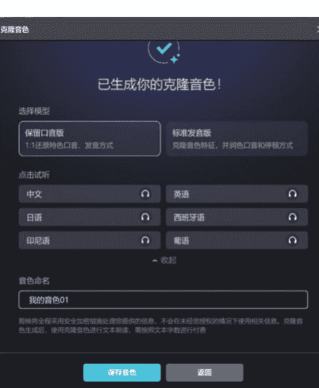

图 5-61 剪映保存音色界面
5）返回第 1）步的“朗读”界面，如图 5-58 右上角，选中字幕即可看到专属克隆音色，如图 5-62。点击所选音色可试听朗读效果。
6）全选字幕并启用“克隆音色”后，点击“开始朗读”即可批量完成朗读。满意后点右上角“导出”保存成片。
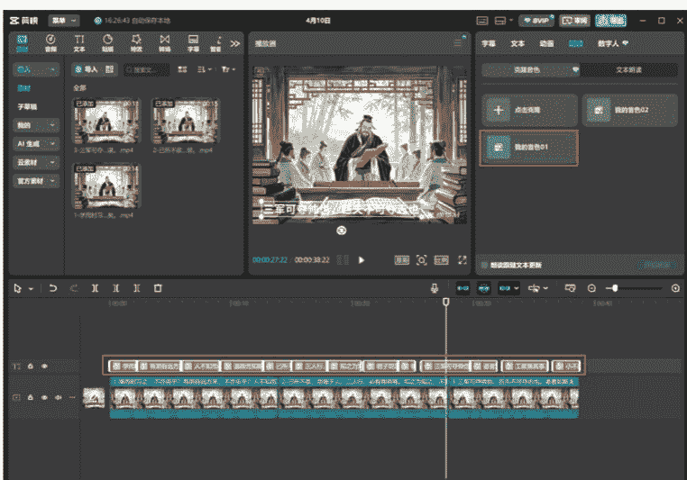

图 5-62 实现克隆音色朗读界面

# 第 6 章 AI 辅助 PPT 课件制作
本章介绍如何借助智能助手辅助制作 PPT 课件。首先概述主流智能 PPT 助手的特性与使用方式；随后以同一门课程的课件制作为例，分别采用不同助手完成大纲生成、初稿生成、智能美化与智能编辑等环节，展示各工具的优势。
本章要点：
- 智能助手助力 PPT 课件制作的思路
- 主流智能 PPT 助手的接入方式
- 智能辅助 PPT 大纲编写与制作流程
- 不同助手对 PPT 课件的美化与编辑能力

## 6.1 辅助制作 PPT 课件的 AI 助手
本节介绍当前主流的智能 PPT 制作工具。这类工具大致分为两类：一类是专用平台，专注智能 PPT 制作，如国内的 AiPPT 与 iSlide；另一类是通用平台，在对话过程中智能调用 PPT 功能，如百度 AI 搜索接入百度文库、讯飞星火接入讯飞智文、抖音旗下豆包接入 AiPPT。
为方便使用，将主流工具访问方式汇总于表 6-1，后文简要说明操作方法。

表 6-1 辅助 PPT 制作的 AI 助手访问方式

| 平台名称 | 访问方式 | 特点 |
| :--- | :--- | :--- |
| 百度 AI 搜索 | 官方网址：https://chat.baidu.com/search，点击“AI PPT”生成 PPT 大纲后跳转百度文库 | 编辑大纲较为灵活<br>丰富的 PPT 模板可供选择 |
| 讯飞星火 | 官方网址：https://xinghuo.xfyun.cn/desk，点击“PPT 生成”后编写 PPT 大纲并跳转讯飞智文 | 可设置默认页数<br>可设置语种 |
| 豆包 | 官方网址：https://www.doubao.com/chat，点击“AI PPT”生成 PPT 大纲后调用 AiPPT 的第三方工具 | 可使用豆包与 AiPPT 的联名定制模板 |
| AiPPT | 官方网址：https://www.aippt.cn/，可直接登录使用 | 提供多种 PPT 生成方式<br>可完整查看 PPT 生成过程<br>可使用 AI“多页合成” |
| iSlide | 官方网址：https://www.islide.cc/，选择“PPT 模板” - “AI 模板” | 风格简约易上手<br>可 AI 单页替换 PPT |

进入百度 AI 搜索官网后，可点“AI PPT”自动填充提示词，如图 6-1。
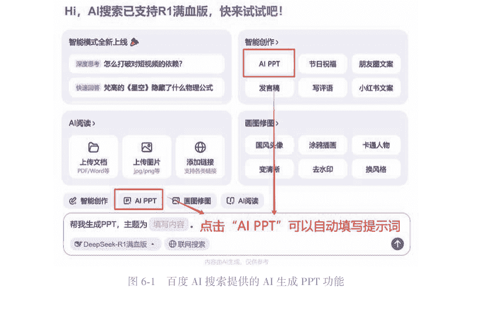

补全提示词，选择模型 “DeepSeek-R1 满血版” 配合 “联网搜索” 的方式生成 PPT 的大纲，如图 6-2。
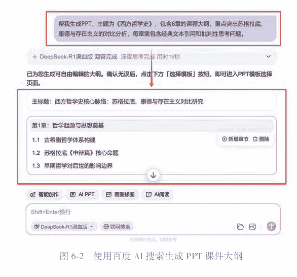

在大纲底部点 “选择模板” 后（如图 6-3）即可挑选模板，选好后点 “开始生成 PPT” 即可按大纲生成完整 PPT（如图 6-4）。


百度 AI 搜索提供初步 PPT 预览，若需继续完善可下载到本地（免费版生成与下载均有次数限制）或跳转至百度文库进行后续操作，如图 6-5。


如图 6-6，为使用讯飞星火调用讯飞智文的 PPT 生成功能。步骤与上文使用百度生成课件的示例类似。整体思路基本一致：“提示词编写—大纲生成—模板选择—完整 PPT 生成”。


在豆包中，也可在生成大纲后调用第三方工具（默认 AiPPT）进行课件生成，如图 6-7。


独立平台为提升易用性通常提供更多选项。如 AiPPT 除常规提示词生成外，还支持导入文件和网址链接生成，并可对页数、受众、场景、语气、语言等进行设置，如图 6-8。


iSlide 主打简约风格，在对话生成 PPT 的基础上提供“一键换肤”和“更换单页”功能，适合快速生成，如图 6-9。


图 6-9 独立平台 iSlide 提供简约实用的 PPT 辅助生成功能

随着各平台智能制作 PPT 能力完善，主流工具均可实现从“一句话”到“一套 PPT”的自动生成。选择时建议重点关注大纲生成灵活性、模板多样性、生成后编辑支持等维度。

## 6.2 使用 AI 工具辅助制作 PPT 课件

### 6.2.1 使用 DeepSeek 快速生成 PPT 大纲
正式使用智能助手生成课件前，建议先生成 PPT 大纲。虽然多数平台将输入简化为一段话甚至一句话，但在专业教学场景下，不推荐直接全自动生成大纲。

本节以国内某高校经济学院专业课程《金融经济学导论》为例，依据教学大纲和教材内容生成课件框架。如图 6-10。
生成后大纲如图 6-11，严格按提示词模块划分整体规划，内容不发散，覆盖教学大纲与教材相关章节。
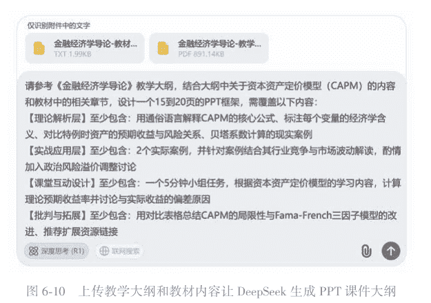

图 6-10 上传教学大纲和教材内容让 DeepSeek 生成 PPT 课件大纲

# CAPM理论与实践PPT框架设计

2. 特例分析（2页）

- β=0（国债）：收益=无风险利率

- β=1（指数基金）：收益=市场平均收益

- β>1（科技股）：高波动要求高收益

3. 贝塔系数计算案例（3页）

- 案例：计算苹果公司（AAPL）的β

  - 步骤：取5年AAPL与标普500日收益率数据 → 协方差/市场方差 → β≈1.2

- 行业对比表：能源（β≈0.8） vs 科技（β≈1.4）

模块二：实战应用层（10页）

1. 案例1：新能源车企（5页）

- 背景：特斯拉在2020-2023年的β波动（1.5→1.8）

- 解读：

  - 行业竞争：传统车企入局 → 市场风险溢价上升

  - 政治风险：美国补贴政策调整 → 加入2%政治风险溢价

图 6-11 使用 DeepSeek 生成的 PPT 课件大纲（节选）

读者可在该大纲基础上调整，并保存为 Markdown 或 TXT 格式，用于在其他智能 PPT 工具中导入。

### 6.2.2 使用讯飞智文生成完整教学 PPT 课件
在上一节生成的大纲基础上，本节以讯飞智文（https://zhiwen.xfyun.cn/home）为例制作完整教学课件。首页“高级创建”可直接上传之前生成的大纲文档，如图 6-12 和图 6-13。


上传后如图 6-13，助手提供“直接提取文档大纲”功能，无需额外提示词即可生成符合格式的大纲，教师也可编辑内容、调整层级顺序，如图 6-14。


图 6-13 上传生成好的 PPT 课件大纲
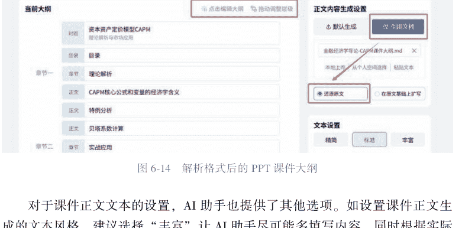

图 6-14 解析格式后的 PPT 课件大纲
示例中选择了“还原原文”以保持生成严谨性；对需要发散的课程可改“在原文基础上扩写”，用法相同。

正文文本设置方面，可选择“丰富”让助手多填充内容，并根据实际情况调整语气与受众。本示例为本科生教学场景，选择“专业”“大学生”“较短备注”，如图 6-15。
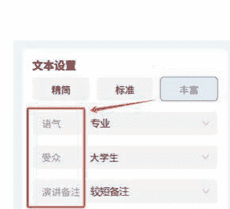


图片生成可在助手中调整，正常选“普通 AI 图片模型”即可兼顾美观与速度，如图 6-16。若不希望带图，可选无图模式以提升速度。
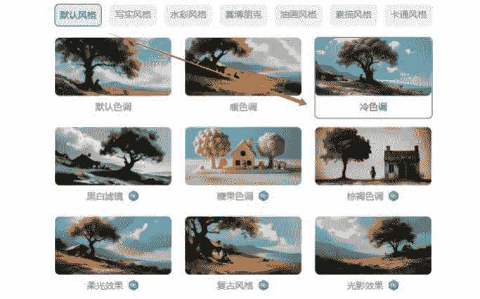

画面风格可按课程内容选择模板，本示例采用“冷色调”，如图 6-17。


内容设置完成后，可选喜欢的模板生成完整课件，如图 6-18。


示例页展示如图 6-19，助手在按课程内容生成课件的同时，汇总了可参考的讲义备注，语言风格符合前述设置。
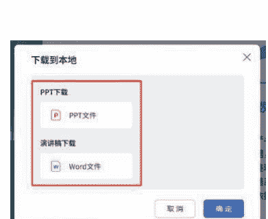

至此已初步完成《金融经济学导论》中资本资产定价模型的课件制作，如图 6-20，可下载 PPT 与讲义 Word 文件。生成后可在讯飞智文继续编辑，也可用其他工具完善。


图 6-20 下载 PPT 课件和讲义 Word 文件

### 6.2.3 使用百度文库智能助手美化 PPT 课件
本节使用百度文库（https://wenku.baidu.com/）的智能 PPT 助手对上节课件进行美化。首页选择名为“智能 PPT”的助手，如图 6-21。

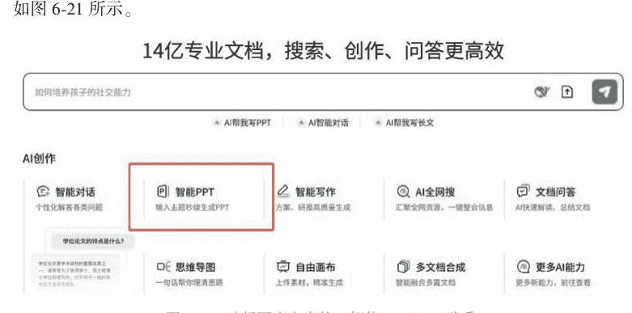

图 6-21 选择百度文库的“智能 PPT” AI 助手

进入智能 PPT 操作界面后，界面上罗列了若干常用入口，像“输入主题生成”“上传文档生成”“上传图片生成”等，核心逻辑皆为基于用户供给的材料迅速产出演示文稿。此次演示挑选“美化 PPT”入口，将《金融经济学导论》的课件先行导入平台，如图 6-22 所示。

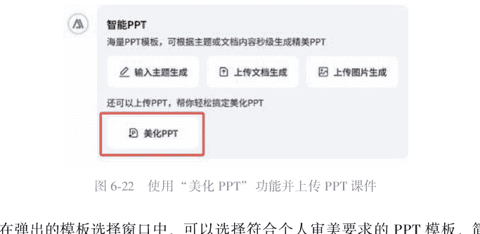

导入完成后会弹出模板选择窗口，可依据个人偏好浏览各式版式，确认预览效果后再点按“开始美化”，如图 6-23 所示。


处理过程约需半分钟左右，文库的智能 PPT 功能即能产出美化后的新版课件，点击即可浏览成品，如图 6-24 所示。

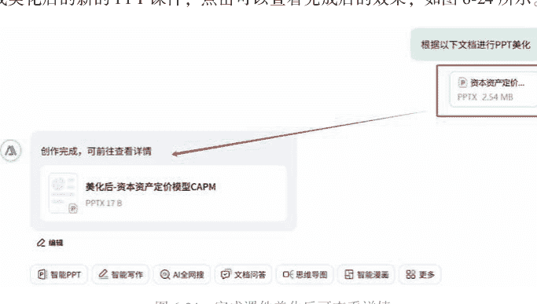

为了直观呈现差异，本例挑取同一页面的两个版本。未经处理的原版见图 6-25a，经过智能优化后的版本见图 6-25b。


b) 美化后的效果

图 6-25 AI 助手美化课件的效果对比（续）

对比可知，除整体配色随新模板更换外，系统对正文亦作了补充，围绕“模型局限性和对比”这一主题自行增添了优缺点分析；由于内容模块增多，版面布局也被自动调整以维持视觉统一。

原始课件虽已使用智能配图，但个别素材与文字细节匹配度不足，此时可借助“更换配图”功能进行校正，如图 6-26 所示。

目前仅支持单张操作暂不支持批量，选中待替换图片并激活“更换配图”后，右侧对话窗口会发出相应指令，数秒内返回四张备选图，如图 6-27 所示，可多次刷新以挑选合适者，确认后点击即可完成替换。

第 6 章 AI 辅助 PPT 课件制作 155

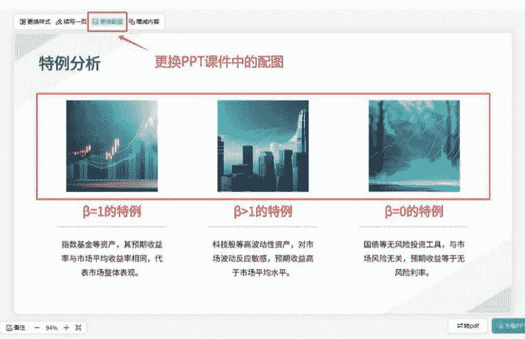

图 6-26 更换 PPT 课件中的配图


图 6-27 智能助手根据页面内容推荐配图

除了页面顶部的更换配图入口外，还存在两种等效做法。如图 6-28 所示，可直接在目标图片上方菜单内选择“AI 换图”；亦可在选中图片后，通过右侧智能对话区的快捷入口“帮我更换图片”，如图 6-29 所示。

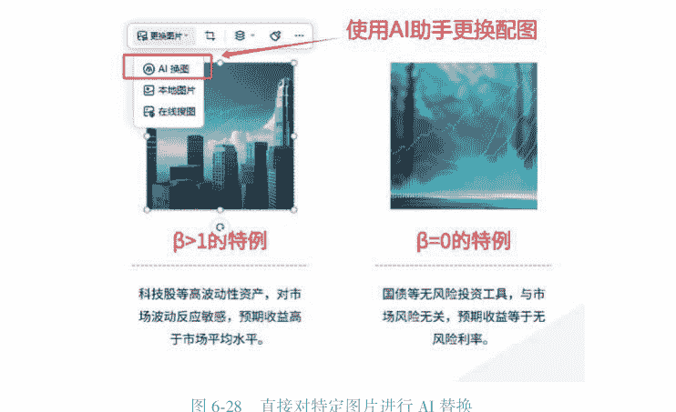


待页面内所有需更新的配图均处理完毕后，整页效果如图 6-30 所示，图文契合度更高，整体美感亦得到提升。


图 6-30 使用智能助手更换单页所有配图后的效果

若单页整体风格仍未达预期，还可调用“更换样式”快速套用新设计，如图 6-31 所示。

激活“更换样式”后，助理会推送多套页面风格供挑选，点击即可即时预览，若不满意仍可一键恢复原版式。

以图 6-31 所示页面为例，套用新样式后的呈现如图 6-33 所示，文字内容维持原样，整体视觉更鲜活。

158 你的智能教学助手：应用 AI 工具高效辅助教学

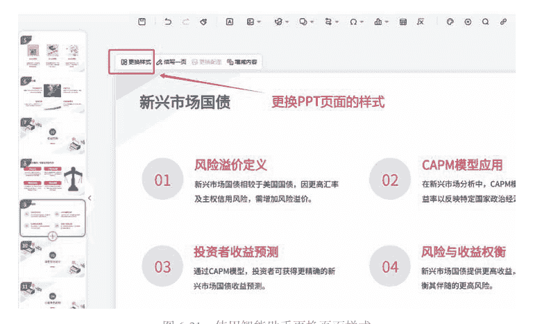

图 6-31 使用智能助手更换页面样式

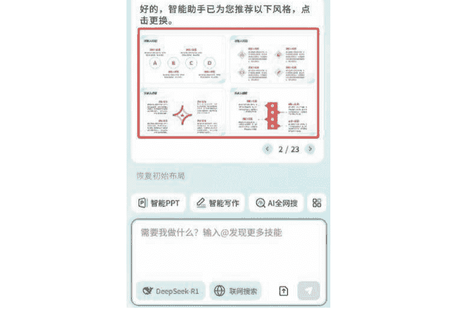

图 6-32 选择智能助手推荐的页面样式风格

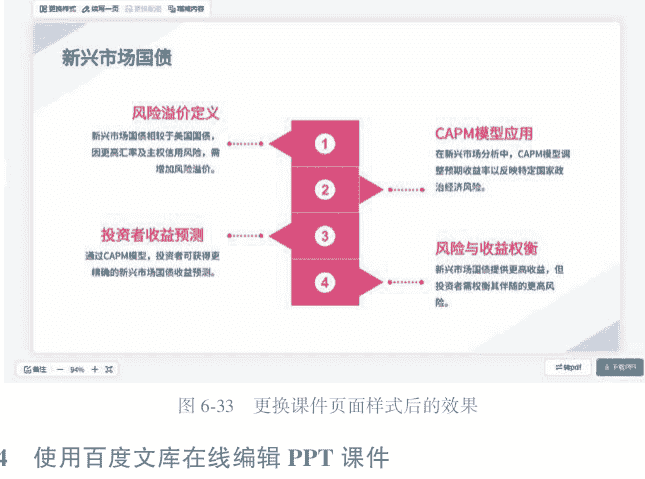

图 6-33 更换课件页面样式后的效果

## 6.2.4 百度文库在线编辑 PPT 课件实操

除美化外，智能 PPT 功能还能对课件内容进行编辑完善。若希望某页内容在下一页继续展开，可使用“续写一页”功能，如图 6-34 所示。


图 6-34 使用百度文库智能助手续写 PPT

点按“续写一页”后会向助理发出指令，并提示填写新页面的核心要点。本例在前一页案例分析基础上，要求追加“风险详细解读”内容，如图 6-35 所示。


生成新页需重新解析材料、联网检索、制作配图并设定样式，耗时约十余秒。本例选用“DeepSeek-R1”，因此续写部分由 DeepSeek 完成，如图 6-36 所示。


依上述要求生成的续写页内容如图 6-37 所示。

第 6 章 AI 辅助 PPT 课件制作 161


图 6-37 续写后的新一页 PPT 课件内容

若认为续写内容仍需扩充，可直接借助“增减内容”在当前页新增文字条目，如图 6-38 所示。


图 6-38 在当前页面增加一项文字内容

新增文字后，原版式可能难以承载，助理会在保留原有文字与图片的基础上自动进行版式适配，效果如图 6-39 所示。

162 你的智能教学助手：应用 AI 工具高效辅助教学


图 6-39 增加一项文字内容后智能适配样式

智能助理还能快速新增图表与表格。选用空白版式后，相关入口如图 6-40 所示，操作逻辑与常规办公软件一致，此处不再赘述，读者可自行尝试。


图 6-40 使用智能助手生成 PPT 的图表和表格

对助理生成的每段文字，均可按如图 6-41 所示的方式进行改写、扩写、缩写或语气调节，也可在对话区下达指令调整字体与颜色，如图 6-42 所示。


完成全部美化与编辑后，可将课件导出为 PPT 或 PDF 格式保存至本地，如图 6-43 所示。


图 6-43 将完成修改后的课件保存至本地

# 第7章 AI助力试卷设计与教学复盘

本章主要介绍如何借助智能助手完成试卷编制、成绩统计与分析，并在教学数据可视化的基础上快速撰写多维度教学总结。示例涵盖随堂测试、期中期末试卷的生成、题库搭建，以及依托在线平台实现自动阅卷与统计。随堂测试侧重知识点覆盖与即时反馈，期中期末更强调综合性与区分度，用以衡量不同学习水平。题库建设注重题型多样化与知识点标签化。

AI 辅助教学数据可视化可将学生成绩、班级整体表现及重点知识掌握情况转化为直观图表，例如用思维导图呈现知识点掌握程度，用统计图表展示成绩分布等。教学总结生成包括数据分析、图表制作与报告撰写三个环节。教师可让 AI 基于总结模板、教学大纲、成绩单等材料提取要点，转化为图表与结构化报告，并按问题分析、改进建议等逻辑框架优化内容与后续计划。

本章要点：

- 介绍智能助手在试卷编制中的使用方法
- 融合 AI 工具与图表库，迅速实现教学数据可视化分析
- 高效整理与分析教学数据，借助智能助手辅助生成教学总结

## 7.1 AI 辅助试卷设计

### 7.1.1 借助 DeepSeek 生成随堂测试题

本示例以《数据结构》课程为例，选用普通高等教育本科国家级规划教材《数据结构（第 3 版）》，针对第 5 章“树与二叉树”的教学内容设计提示词，让智能助手生成 10 道覆盖相关知识点且具备不同难度层级的随堂测试题，如图 7-1 所示。


本例上传的“随堂测试题格式模板”采用某在线问卷平台的格式，便于课堂分发与自动评分（均为客观题）。在提示词技巧上，选项设计需包含典型错误答案，可让智能助手以“深度思考”模式分析学生易错点，从而强化教学效果。模板节选如图 7-2 所示。

试卷生成后可直接导入在线问卷平台，平台将自动识别题目与答案。

图 7-3 所示为导入过程。学生作答后，师生均可获得实时成绩反馈，如图 7-4 所示。

# 数据结构随堂测试题

1、以下哪种数据结构是先进先出的（B）？[单选题]

A、栈

B、队列

C、链表

D、二叉树

解析：队列遵循先进先出（FIFO）原则，栈是后进先出（LIFO）。

2、以下哪些属于非线性数据结构（CDE）？[多选题]

A、数组

B、链表

C、树

D、图

E、堆

解析：树、图和堆均为非线性结构，数组和链表是线性结构。


8、若二叉树前序为ABDECFG，中序为DBEAFCG，则其后序包含以下哪个片段（）？[10分]

○ A、DEBFGCA

○ B、DEBFCGA

○ C、DBEFCGA

● D、DEBFGAC (正确答案)

答案解析：(难度★★★) 根为A，左子树中序为DBE，前序为BDE，递归构造后序为DEB；右子树同理，总后序为DEBFGAC。

9、下列哪些场景适合使用二叉搜索树（）？[10分][多选题]

□ A、频繁插入删除且无需排序

☑ B、需要快速查找有序数据 (正确答案)

☑ C、数据库索引 (正确答案)

□ D、实现进程调度

☑ E、字典检索 (正确答案)

答案解析：(难度★★★) 二叉搜索树适合有序查找（B、C、E），但频繁增删可能退化为链表（A错误），进程调度通常用队列（D错误）。


教师可在学生作答后将成绩导出为 Excel（图 7-5），再借助 AI 进行数据分析，具体方法将在本章后续介绍。


### 7.1.2 借助 DeepSeek 生成期中期末试卷

期中期末试卷与随堂测试的区别在于更强调综合性与区分度，需覆盖课程核心内容，题型要多样且有难度梯度。因此提示词需要重新设计以满足这些要求。

整张试卷生成对智能助手的基础能力要求较高，即便提示词相同，不同学科与不同平台的输出也会差异明显，需要教师多次尝试寻找最优的“助手+提示词”组合。可通用的核心要素包括：明确“分值”“答题时长”“对应章节”，便于核查试卷合理性；理工科涉及公式时，建议要求助手使用 KaTeX 格式输出，该格式兼容性好，能在网页中正确显示。本例的提示词与上传大纲后的效果如图 7-6 所示。


生成后的期末试卷节选如图 7-7 所示，试卷开头标注总分与考试时长，各部分按提示词设定的分值比例分配分数，并给出时间预估。每道题前均标注对应的教材章节，便于核对或后续调整知识点比例，如“请减少第某章试题”“用第某章试题替换第某章试题”等。

实际备考中通常需要一份无答案的印刷版和一份有答案的阅卷版。可在智能助手里微调提示词，迅速生成两个版本，如图 7-8 所示。


图 7-7 DeepSeek 生成的有机化学期末试卷（节选）


图 7-8 让 DeepSeek 生成有无答案的两个版本试卷

生成后可进一步评估试卷合理度，例如用提示词统计试卷各模块的分值、题型、难度、知识点覆盖情况，并基于化学专业大二水平进行评估，汇总如图 7-9 所示。

> 请给出表格，汇总上面试卷中的模块、分值、题型、难度、知识点覆盖情况，并基于化学专业大学二年级的水平进行试卷合理度的评估。

针对改进点，AI 也会给出建议，例如补充缺失章节的知识点，如图 7-10 所示。

# 试卷模块汇总表

| 模块 | 分值 | 题型 | 难度 | 知识点覆盖（教材章节） |

| :--- | :--- | :--- | :--- | :--- |

| 命名反应 | 15分 | 选择题（5题） | 基础 | 第6章（SN2）、第8章（亲电加成）、第17章（硝化）、第22章（缩合）、第19章（胺制备） |

| 机理推导 | 30分 | 简答题（3题） | 中等-高 | 第6章（SN2机理）、第8章（亲电加成机理）、第17章（硝化机理与钝化基团） |

| 合成路线设计 | 40分 | 设计题（2题） | 高 | 第10-11章（醇的合成与保护基）、第18章（醛/酮）、第22章（Aldol缩合） |

| 实验分析 | 15分 | 选择题+简答（3题） | 基础-中等 | 第12章（IR）、第13章（NMR）、第4章（实验操作） |


# 试卷合理度评估

1. 知识点覆盖

- 覆盖章节：共涉及教材 12个核心章节（第4、6、8、10-13、17-19、22章），重点覆盖反应机理、合成设计、光谱分析等核心内容。

- 缺失章节：第5章（立体化学）、第14章（醚类）、第23-26章（生物分子与聚合物）未涉及，可能需补充相关题目。

2. 难度梯度

- 基础题（30%）：命名反应与部分实验分析题，适合检测基本概念。

- 中等题（40%）：机理推导与部分合成题，需应用知识解决具体问题。

- 高难题（30%）：复杂合成设计，考察综合能力与创新思维。

- 梯度合理，符合大二学生从记忆到应用的学习阶段。


评估末尾 AI 会给出总分并在知识覆盖、题型多样性、分值设定等维度提供建议，教师可结合课程实际与学生反馈进一步调整，如图 7-11 所示。

# 总结与改进建议

- 合理度：总体设计合理，符合大二有机化学教学目标，但需补充 **立体化学**、**生物分子** 相关内容。

- 改进方向：

    1. 增加 1-2题 覆盖第5章（立体化学）或第23章（碳水化合物）。

    2. 在实验分析中增加 **简答题**（如解释光谱数据与结构的关联）。

    3. 调整合成题分值（可降至35分），补充 **机理题多样性**（如E2反应或自由基机理）。

最终评分：☆☆☆☆☆ (4/5)


试卷复核完毕，确认难度适中、结构合理，就能借助 AI 迅速复刻 A/B 卷。若只是题序打乱，直接在指令里要求“保持原题不变，仅生成顺序不同的 B 卷”即可，操作简便不再详述；若要换成同等难度但内容不同的题目，则需在提示词里明确难度、章节等限制条件，参考图 7-12，生成结果本文略过。


### 7.1.3 DeepSeek 助力搭建《计量经济学》题库

本小节以国际经济与贸易专业的必修课《计量经济学》为案例，演示如何构建可用于平时测验与学期考核的题库。

与之前直接出题不同，题库建设更强调系统性。先让 AI 完成方案预研，将《计量经济学》大纲上传并给出相应指令，示意见图 7-13。


梳理完成后，后续会反复用到的核心要素是图 7-14 所示的题型规划与分值建议。


这一步的模型输出可完整保存为《计量经济学课程题库构建方案》，也可在此对话中继续用提示词抽取表头。

> 生成 Excel 表头，参考上述题库构建方案中的各个维度，支持按【题型+难度+章节+知识点+分值+预估学生答题时间】组合筛选。

依据前文方案，AI 会给出一个便于多维度检索的字段清单。若使用 DeepSeek 等暂不支持表格下载的工具，可将清单复制到 Excel 或 WPS 中，示例见图 7-15。对字段做简要说明：

- 题目 ID：唯一编码，便于管理，可自动递增。
- 题型：设置数据验证下拉，包含选择题、填空题、简答题、计算题、案例分析题。
- 难度等级：下拉选择，基础/中等/较高。
- 章节编号：1 至 7，对应教材章节，便于数字排序。
- 章节名称：与编号联动，减少手工录入错误，可用公式或数据验证引用。
- 知识点：自由填写或预置教材核心点，支持关键词检索。
- 分值：1 到 10 的数值，支持区间筛选。
- 预估答题时间：1 到 30 分钟，支持时间范围筛选。
- 备注：记录特殊要求，如“需使用 EViews 操作”“结合中国案例”等。

在方案与表头准备好后，可继续借助 AI 批量产出具体题目，模板见图 7-16。方括号里的占位符可按需修改，通过调整“章节”“题目数量”“分值”等条件多次调用，逐步累积完整题库。生成效果见图 7-17，已整理为 Excel 与 PDF，仅展示部分。

组卷时需配合已填充好的 Excel 表头，见图 7-18。

| 题目ID | 题型 | 难度等级 | 章节编号 | 章节名称 | 知识点 | 分值 | 预估答题时间（分钟） | 备注 |
|---|---|---|---|---|---|---|---|---|
| 1 | 选择题 | 基础 | 3 | 第三章 多元线性回归模型 | 多元线性回归模型的基本假设 | 2 | 2 | - |
| 2 | 填空题 | 基础 | 3 | 第三章 多元线性回归模型 | OLS估计量的统计性质 | 2 | 3 | - |
| 3 | 简答题 | 中等 | 3 | 第三章 多元线性回归模型 | F检验的用途与步骤 | 5 | 10 | - |
| 4 | 计算题 | 中等 | 3 | 第三章 多元线性回归模型 | 多元线性回归模型的参数估计（OLS） | 6 | 15 | 需展示计算过程 |
| 5 | 简答题 | 中等 | 3 | 第三章 多元线性回归模型 | 变量显著性检验的置信区间方法 | 5 | 10 | - |

图 7-18 配套生成的题目清单（已保存为 Excel 格式）

本例中图 7-17 与图 7-18 的“题目 ID”一一对应。可在 Excel 中按维度筛选后保存所需题目的元信息，再把图 7-18 中的完整题干一并交给 AI，用下列指令按要求组卷。本节以一次随堂测验为例，示意见图 7-19。

计量经济学随堂测验生成(基于题库)

图 7-19 上传题库的题目内容和筛选后的题目清单

DeepSeek 的生成效果见图 7-20。需注意，若题库未提供标准答案，模型会基于自身知识给出参考答案，使用时必须人工核对正确性与完整性。

## 计量经济学随堂测验（基础/中等难度）

题目数量：3

1. 题目ID 1（选择题，基础）

下列哪项不属于多元线性回归模型的基本假设？

- A. 解释变量间无多重共线性
- B. 随机误差项服从正态分布
- C. 解释变量与随机误差项相关
- D. 随机误差项均值为零

答案：C

2. 题目ID 2（填空题，基础）

在满足基本假设的条件下，OLS估计量具有______性和______性。

答案：无偏、有效

3. 题目ID 5（简答题，中等）

如何利用参数的置信区间判断变量的显著性？请结合假设检验原理说明。

参考答案：

若参数的置信区间不包含零，则拒绝原假设（参数为零），认为变量显著；若包含零，则不拒绝原假设。例如，95%置信区间若为 [0.5, 2.3]，则β ≠ 0，变量显著。

图 7-20 DeepSeek 基于题库生成的随堂测验和参考答案

从图 7-20 可见，AI 严格按“数量 3”“基础或中等难度”的要求，在题库里挑选了 1、2、5 号题目。随着题库持续扩充，组卷的多样性和随机性会不断提升。

## 7.2 AI 辅助教学数据可视化

### 7.2.1 DeepSeek 一键生成成绩分析表

教学中的各类数据都可借助 AI 快速整理成表格以便分析。本节以《高等数学》期末成绩为例，生成包含各分数段人数、占比及与往届对比的统计表。示例数据以 2024 级为主分析对象，2023 级作对照，脱敏后数据见图 7-21。

将脱敏的 2024 级与 2023 级成绩 Excel 文件导入，并用指定提示词让 AI 分析，见图 7-22。

对 2024 级学生《高等数学》的期末成绩分析表格生成见图 7-23。除了分数段分布与占比外，AI 还会输出统计指标与异常学生标注，见图 7-24。

高等数学期末成绩对比统计表

分数段人数及占比对比

| 分数段 | 2024级人数 | 2024级占比 | 2023级人数 | 2023级占比 |
| :--- | :--- | :--- | :--- | :--- |
| [0-59] | 0 | 0% | 1 | 5% |
| [60-69] | 4 | 20% | 4 | 20% |
| [70-79] | 9 | 45% | 5 | 25% |
| [80-89] | 3 | 15% | 5 | 25% |
| [90-100] | 4 | 20% | 5 | 25% |

图 7-23 高等数学期末成绩分析结果

统计指标对比

| 指标 | 2024级 | 2023级 |
| :--- | :--- | :--- |
| 平均分 | 82.65 | 79.4 |
| 标准差 | ≈9.98 | ≈12.53 |

异常低分学生标识

- 2023级：
  - 学号：3023192...，姓名：...，分数：57 ([0-59]区间)
- (2024级无异常低分学生)

图 7-24 高等数学期末成绩统计指标及异常标识

### 7.2.2 ECharts 绘制班级成绩雷达图

成绩对比用雷达图更直观。本节对比《大学物理》A、B、C 三个平行班在力学、电磁学、光学、热学、近代物理五大模块的平均表现。脱敏成绩单见图 7-25。

把三班成绩单导入后，用提示词要求 AI 以 ECharts 格式输出雷达图，见图 7-26。

| A班成绩单 |
|---|
| 学号 | 力学/30 | 电磁学/30 | 光学/20 | 热学/10 | 近代物理/10 | 总分/100 |
| A01 | 28 | 26 | 18 | 8 | 7 | 87 |
| A02 | 29 | 25 | 19 | 9 | 8 | 90 |
| A03 | 27 | 24 | 17 | 7 | 6 | 81 |
| A04 | 26 | 27 | 16 | 8 | 7 | 84 |
| A05 | 30 | 28 | 20 | 9 | 9 | 96 |
| A06 | 25 | 22 | 15 | 6 | 5 | 73 |
| A07 | 28 | 23 | 18 | 8 | 7 | 84 |
| A08 | 27 | 26 | 19 | 7 | 8 | 87 |

图 7-25 脱敏后的大学物理期末成绩单（节选 A 班部分学生）

## 三个班级物理成绩雷达图生成

图 7-26 让 DeepSeek 根据三个班级成绩单制作雷达图

需说明的是，截至成稿时 DeepSeek-R1 尚不支持直接绘制复杂图表，因此引入外部绘图库 ECharts。使用者只需在提示词里要求“使用 ECharts 格式”，模型会在深度思考与网页结果中给出见图 7-27 的代码。非专业用户直接点击“运行 HTML”即可查看交互式雷达图，见图 7-28。若出现空白，请检查网络能否访问 ECharts 库 https://cdn.jsdelivr.net/npm/echarts。

运行后可得到三个班级的成绩对比雷达图，见图 7-29。页面末尾还附带简要数据解读，如优势模块与最大分差模块，可按需扩展提示词，示例见图 7-30。

```html
chart.setOption(option);
</script>
</body>
</html>
```

关键实现逻辑：

1. 数据转换：将原始分数按科目满分换算为百分制，再求班级均值；
2. 雷达图配置：
   - 五维度坐标轴范围 0-100，splitLine 处设置 60 分虚线；
   - 区域填充使用半透明色，颜色代码带 80 透明度；
3. 说明标注：
   - 优势模块：A班在近代物理上优势明显；
   - 最大分差：A班与C班在近代物理上相差 18 分。

直接运行此 HTML 文件即可生成可缩放、悬停查看数值的交互式雷达图。

说明：

1. 优势模块：
   - A班：近代物理（领先B班9.0分，C班18.0分）
   - B班：力学（领先C班7.7分）
   - C班：无显著优势模块
2. 最大分差模块：近代物理（A班比C班高18.0分）

图 7-30 DeepSeek 对三个班级成绩的简要分析

### 7.2.3 ProcessOn 呈现知识点掌握导图

当需要对个体学生的知识点掌握情况预警并与班级整体对比时，可用思维导图呈现。以《数据结构》课程中 006 号学生为例，提示词示意见图 7-31。

> 根据上传的《数据结构》课程平时成绩，创建 006 号学生的平时成绩与全班平均的对比思维导图，用于教师分析知识点掌握情况，要求使用【Markdown 格式】输出。以下是详细要求：
> 
> 中心节点：【学生 006 vs 班级平均】
> 一级分支（六个核心知识点，每项满分 10 分）：
> 【线性表/栈与队列/树结构/图结构/排序算法/查找算法】
> 每个知识点下设置二级分支：
> 【正确率对比、易错知识点分析、学习建议】
> 可视化要求：
> 个人数据用蓝色节点，班级平均用灰色节点
> 落后平均分超过 15% 的节点添加警示图标

上传文件包含线性表、栈与队列、树结构、图结构、排序算法、查找算法六个维度的班级平时成绩，006 号学生成绩用红框标出，部分节选见图 7-32。

## 学生006与班级平均成绩对比分析

根据上传的《数据结构》课程平时成绩，创建006号学生的平时成绩与全班平均的对比思维导图，用于教师分析知识点掌握情况，要求使用Markdown格式输出。以下是详细要求：

中心节点：【学生006 vs 班级平均】

一级分支（六个核心知识点，每项满分10分）：

【线性表/栈与队列/树结构/图结构/排序算法/查找算法】

每个知识点下设置二级分支：

【正确率对比、易错知识点分析、学习建议】

可视化要求：

个人数据用蓝色节点，班级平均用灰色节点

落后平均分超过15%的节点添加警示图标

| 学号 | 线性表 | 栈与队列 | 树结构 | 图结构 | 排序算法 | 查找算法 |
|---|---|---|---|---|---|---|
| 302...4001 | 4 | 9 | 8 | 5 | 6 | 4 |
| 302...4002 | 8 | 8 | 8 | 6 | 5 | 8 |
| 302...4003 | 6 | 4 | 6 | 5 | 5 | 8 |
| 302...4004 | 4 | 4 | 9 | 6 | 9 | 10 |
| 302...4005 | 9 | 8 | 6 | 7 | 6 | 6 |
| 302...4006 | 4 | 5 | 5 | 8 | 4 | 7 |
| 302...4007 | 5 | 7 | 10 | 5 | 7 | 8 |
| 302...4008 | 8 | 8 | 6 | 8 | 8 | 10 |

AI 完成深度思考后会输出符合思维导图制作规范的 Markdown 内容。若使用多模态模型可直接导出图片。本例 DeepSeek 暂不支持直接生成导图，可复制 Markdown 内容导入在线工具，见图 7-33。

本例选用 ProcessOn 平台导入，操作步骤见图 7-34。生成的导图见图 7-35，教师可进一步编辑。图中对低于班级均值 15% 以上的节点标注警示，同时标出掌握较好的知识点，如高于平均、接近平均等。

## 7.3 AI 协助完成教学总结

### 7.3.1 DeepSeek 解析数据撰写总结

以某高校生命科学学院本科必修课《生物化学》为例，演示如何用 AI 辅助生成教学总结。先按前文完成教学大纲制作，并下载教务处提供的教学总结模板，以保证格式一致。为展示效果，本节使用的《生物化学》理论课与实验课大纲见图 7-36a、图 7-36b。

| 课程中文名称 | 生物化学 |
| --- | --- |
| 课程英文名称 | Biochemistry |
| 开课单位 | 生命科学学院 |
| 授课语言 | 英文 |
| 先修课程 | 普通化学和有机化学（可以与该课程同学期修）。如果同学有物理化学的基础，则更为理想 |
| 课程中文简介 | 本课程聚焦于主要家族生物分子（包括蛋白质、核酸、糖和脂类）的化学特征，以及生物代谢——提供细胞所需能量和原材料的化学反应。主要涉及的内容包括蛋白质（包括酶）、糖、核酸（DNA 和 RNA）、脂类的结构和功能；生物能量学；糖酵解，戊糖磷酸途径和糖异生；代谢调控；柠檬酸循环和氧化磷酸化；糖原、脂肪酸、氨基酸和核苷酸的代谢；哺乳动物代谢的激素调节和整合，等等 |

a) 《生物化学》理论课程教学大纲

| 课程中文名称 | 生物化学实验 |

| --- | --- |

| 课程英文名称 | Biochemistry Lab |

| 开课单位 | 生命科学学院 |

| 授课语言 | 中文 |

| 先修课程 | 生物化学 |

| 课程中文简介 | 生物化学实验是与生物化学理论课配套的基础实验课程，该课程面向生命科学学院全体本科生、化学与分子工程学院及其他学院部分本科生，双学位或辅修本科生，每学年学生约 100 余人。课程内容包括生物大分子的分离纯化、定量测定及性质鉴定，涉及的实验技术有生物大分子的制备技术、光谱分析技术、层析分离分析技术、电泳技术以及超速离心技术等。学生学习使用的生化仪器有离心机、可调式移液器、蛋白质电泳装置、蛋白质半干转印仪、蛋白-核酸检测仪及记录仪、分光光度计、酶标仪等。随着生物化学理论和 |

b) 《生物化学》实验课程教学大纲

图 7-36 上传的《生物化学》教学大纲（节选）

以院校提供的教学总结模板或教师自编模板为载体，将理论课与实验课两份大纲一并导入模型，并按照设定指令开展首轮总结自动补全，演示效果见图 7-37。

在该阶段若未导入学业成绩，模型只能依据大纲信息把模板中可确定的字段补全。以 2024 至 2025 学年第一学期为例，初生成的教学总结见图 7-38。


图 7-37 使用 DeepSeek 初步填充教学总结


图 7-38 DeepSeek 初步生成的教学总结

要对成绩维度展开解读，还需补充经脱敏处理的学业数据。本例上传了理论与实验两类成绩，如图 7-39 所示，图 7-39a 为全班理论成绩，图 7-39b 为全班实验成绩。

| 学号 | 课堂测验 (10%) | 期中考试 (40%) | 期末考试 (40%) | 总分 (100%) |

| :--- | :--- | :--- | :--- | :--- |

| | | 蛋白质结构与功能 (10%) | 酶动力学与调控 (10%) | 糖代谢 (8%) | 脂类代谢 (10%) | 氧化磷酸化 (7%) | |

| 3024049001 | 8.5 | 40 | 9.2 | 8.8 | 7.5 | 9.0 | 6.5 | 89.5 |

| 3024049002 | 9.0 | 38 | 8.5 | 9.2 | 7.0 | 8.5 | 6.8 | 87.0 |

| 3024049003 | 7.8 | 42 | 9.5 | 8.5 | 7.8 | 9.2 | 6.0 | 90.8 |

| 3024049004 | 6.5 | 35 | 7.0 | 7.5 | 6.5 | 7.8 | 5.5 | 75.8 |

| 3024049005 | 9.5 | 44 | 9.8 | 9.5 | 8.2 | 9.5 | 7.0 | 95.5 |

| 3024049006 | 8.0 | 37 | 8.0 | 8.2 | 7.2 | 8.0 | 6.2 | 84.6 |

| 3024049007 | 7.2 | 39 | 8.8 | 8.0 | 7.0 | 8.2 | 6.5 | 85.7 |

| 3024049008 | 9.2 | 43 | 9.0 | 9.0 | 8.5 | 9.0 | 6.8 | 93.5 |

| 3024049009 | 6.8 | 32 | 6.5 | 6.8 | 5.5 | 6.5 | 5.0 | 68.1 |

| 3024049010 | 8.8 | 41 | 9.2 | 8.5 | 7.8 | 8.8 | 6.5 | 90.6 |

a) 《生物化学》理论课程成绩单

| 学号 | 实验预习 (10%) | 实验操作 (40%) | 实验报告 (40%) | 课堂纪律 (10%) | 总分 (100%) |

| :--- | :--- | :--- | :--- | :--- | :--- |

| | | 生物大分子分离纯化 (15%) | 蛋白质检测技术 (15%) | 酶活力测定 (10%) | | | |

| 3024049001 | 9.0 | 14.2 | 13.8 | 9.5 | 38.5 | 9.5 | 94.5 |

| 3024049002 | 8.5 | 13.5 | 14.0 | 9.0 | 37.0 | 9.0 | 91.0 |

| 3024049003 | 9.5 | 14.5 | 14.5 | 9.8 | 39.0 | 9.8 | 97.1 |

| 3024049004 | 6.0 | 10.5 | 11.0 | 7.5 | 30.0 | 7.0 | 70.0 |

| 3024049005 | 9.8 | 15.0 | 14.8 | 10.0 | 40.0 | 10.0 | 99.6 |

| 3024049006 | 8.0 | 13.0 | 13.2 | 8.5 | 36.0 | 8.5 | 87.2 |

| 3024049007 | 7.5 | 12.8 | 12.5 | 8.0 | 34.0 | 8.0 | 80.8 |

| 3024049008 | 9.2 | 14.8 | 14.2 | 9.5 | 38.5 | 9.5 | 95.2 |

| 3024049009 | 5.5 | 9.5 | 9.0 | 6.5 | 28.0 | 6.5 | 64.5 |

| 3024049010 | 9.0 | 14.0 | 14.0 | 9.2 | 37.5 | 9.2 | 92.9 |

b) 《生物化学》实验课程成绩单

图 7-39 上传的《生物化学》课程成绩单（节选）

示例中采用如下指令对总结数据做双维度剖析，即同时审视分布形态、理论与实验关联度以及异常分情况，如图 7-40。


图 7-40 使用 DeepSeek 生成双维度成绩分析

沿用 DeepSeek+ECharts 组合出图，效果如图 7-41。


针对图 7-41，模型给出的要点如下：

- 数据预处理：合并两表成绩，标注实验分明显高于理论分的异常点，差值大于 10 分。
- 坐标轴设定：X/Y 轴范围 60~100，使点位集中于图心。
- 四分位划分：以中位线理论 86.25 分、实验 87.4 分划分为四个象限。
- 趋势线：回归方程 y=0.892x+8.45，R²=0.845 显示强正相关。

教师撰写总结时，可凭此图佐证本班理论与实验成绩呈强正相关，R²=0.845，但存在个别学生实验表现显著优于理论学习的红色异常点，需重点关注。

## 7.3.2 使用 DeepSeek 生成各类教学分析图表

若仅依托 Excel 公式进行分析耗时较长。本小节介绍一种通用的教学可视化生成路径，便于快速整理数据。如图 7-42 所示，可在 ECharts 官网浏览各类图表样式，选定后结合模型设计提示词生成。


本例选用“堆叠面积图”解析《生物化学》期末各知识点得分占比。先在示例页选定如图 7-43 的类型。


进入详情页，无需关注代码实现，只需点击下方“下载示例”，即可获得 area-stack.html 示例文件。


在既有对话中上传成绩单“生物化学理论课程-成绩单.xlsx”与刚下载的 area-stack.html 示例，并以设定指令让模型按期末成绩绘制可用于教学分析的堆叠面积图，如图 7-45。


最终生成的期末成绩堆叠面积图如图 7-46 所示，需运行 HTML 查看效果，横轴为学号标识，纵轴为期末分数，按大纲要求加权 45%。


图 7-46 DeepSeek 生成的期末成绩堆叠面积图

鼠标悬停至某点会展示该生详情。如图所示，学号末尾 9008 的学生，除显示期末加权总分 42.3 外，还以不同颜色标注蛋白质结构与功能、酶动力学与调控、糖代谢、脂类代谢、氧化磷酸化等模块的具体得分，可直观比较不同学生的模块掌握水平。

理论与实践的主要知识点亦可通过可视化呈现，例如采用如图 7-47 所示的南丁格尔玫瑰图。

194 你的智能教学助手：应用 AI 工具高效辅助教学

资源 ▼ 社区 ▼ ASF ▼


图 7-47 选择 ECharts 示例中的基础南丁格尔玫瑰图

按前述流程下载示例文件 pie-roseType-simple.html，连同成绩单一并上传，并以如下指令要求生成图表，如图 7-48。

生物化学课程成绩南丁格尔玫瑰图生成


图 7-48 上传成绩单和玫瑰图示例文件

生成的图表如图 7-49 所示，不同知识模块的面积大小可直观反映全班在各维度的掌握情况。

图中显示“糖代谢（理论）”模块表现最佳，实验操作中“生物大分子分离纯化”与“蛋白质检测技术”掌握较好，酶相关模块“酶动力学与调控”“酶活力测定”需重点加强。


图 7-49 DeepSeek 生成的各知识模块成绩分析玫瑰图

## 7.3.3 使用 DeepSeek 辅助生成教学总结报告

本节将前述大纲、成绩单及已生成的分析数据、图表汇总为完整教学总结。素材清单如下：

- 教学总结模板
- 课程教学大纲，理论+实验
- 学生成绩单，含重点模块得分
- 教学数据分析图，四象限、堆叠面积、玫瑰图
- 随堂测试、学生反馈等过程记录，示例中省略

上传素材后，使用如下提示词让模型辅助生成总结，如图 7-50。


图 7-50 上传教学中的文件素材并生成教学总结

因篇幅较长，本例摘取部分内容展示。第一部分课程基本信息与前文一致，第二部分教学目标达成度分析如图 7-51。

## 二、教学目标达成度分析

1. 预设目标：
    - 知识目标：掌握生物分子结构与功能、代谢途径及调控机制。
    - 能力目标：熟练操作分光光度计、电泳仪等仪器，独立完成蛋白质分离纯化及酶活力测定。
    - 素质目标：培养严谨的科学态度和团队协作能力。

2. 达成情况：
    - 学生成绩分布：
        - 理论课：优秀率 ≥90 分 15%，及格率 94%，薄弱模块为“酶活力测定”实验课均分 54.7 与“酶动力学与调控”理论课均分 51.8。
        - 实验课：优秀率 20%，及格率 90%，低分段 <70 分集中在“酶活力测定”与“生物大分子分离纯化”环节。

学生反馈：

图 7-51 DeepSeek 生成的教学目标达成度分析

本例补充了成绩单，模型在目标达成环节对成绩分布做了概览。如全班整体薄弱点为“酶活力测定”与“酶动力学与调控”，实验课低分集中在“酶活力测定”与“生物大分子分离纯化”。

“学生学习情况分析”部分如图 7-52。


模型分别对整体与个体差异作出说明，理论课分布正常，实验课呈现两极分化；个别学生理论与实验分差过大即前述四象限异常点，需特殊关注。

“存在问题与改进方向”分析如图 7-53。


结论与目标达成分析中的薄弱模块一致，建议针对酶学知识点增设专题课程。同时针对实验课成绩两极化现象，提出设立实验操作互助小组的改进建议，兼顾教学与学生层面。

“未来教学优化计划”中给出方法创新与考核改革建议，如图 7-54。


方法创新层面提出引入翻转课堂并融合生物信息学工具；考核改革层面建议增加实验课程随机操作抽查，针对实验分远高于理论分的异常点，减少报告抄袭。

按提示词要求，模型在“图表分析及教学建议”中对三张数据图作了总结，如图 7-55。

其中对教学改进有指导意义的结论为：玫瑰图显示酶相关知识点能力不足，建议增加米氏方程动态模拟工具；堆叠面积图建议开设代谢通路思维导图工作坊强化逻辑梳理；四象限图显示理论实验强正相关，多数学生能平衡理论实践，个别异常学生需排查具体情况。

## 九、图表分析及教学建议

1. 玫瑰图分析：
    - “酶活力测定”实验课与“酶动力学与调控”理论课得分最低，均 <55%，反映酶学应用能力不足，建议增加米氏方程动态模拟工具辅助教学。

2. 堆叠面积图分析：
    - 低分段学生在“氧化磷酸化”模块得分普遍低于 5 分，建议开设代谢通路思维导图工作坊，强化逻辑梳理能力。

3. 四象限图分析：
    - 理论-实验成绩强正相关 R²=0.845，但学号理论 60 分实验 72.5 分为异常点，需排查理论学习障碍；
    - 中位线以上学生占 65%，多数能平衡理论与实践，可鼓励参与科研项目。


# 第 8 章 打造 AI 智能体助力教学创新

本章聚焦 AI 智能体技术在教学创新中的运用。前几章已介绍 AI 辅助课程设计、PPT 制作、多媒体创作等场景。本章将深入讲解如何构建定制化教育场景智能体，其具备更强的主动性、自主决策与任务执行能力，可作为教师的数字助教或虚拟教师，拓展教育可能性。

本章系统介绍智能体概念与优势，分析教学应用场景，并通过 Manus、扣子 Coze、Dify 等平台的实践案例指导零到一构建。同时探讨腾讯 ima、Cherry Studio 等工具构建个人知识库，以及开发智能教案生成助手。

本章要点：
- 介绍智能体概念、特点及其在教育领域的优势与应用场景
- 探讨主流智能体平台功能特性及使用方法
- 指导教师基于平台创建虚拟教师辅助教学
- 详解教师个人 AI 知识库搭建，包括在线与本地知识库
- 示例讲解定制化智能教案生成助手开发

## 8.1 什么是 AI 智能体

### 8.1.1 AI 智能体和工作流

#### 1. AI 智能体的定义与本质

AI 智能体简称智能体，可理解为能自动执行特定任务的智能助手。与传统模型不同，智能体不仅能理解、生成信息，还能主动采取行动执行具体任务，可视为真正的数字员工。技术上，智能体本质是“用大模型操控工具完成任务”的系统。

在此框架中，大模型充当智能体的“大脑”，负责理解、规划与决策；各类工具则是智能体的“四肢”，用于执行具体操作。正因有工具插件，大模型才能真正“动起来”，从纯粹思考转变为可直接与外部世界交互、改变物质世界的能力。正如人类通过手脚与世界互动，智能体也需通过工具与数字世界甚至物理世界交互。

大模型会思考，插件才让它动起来

把智能体拆开看，本质就是模型＋工具。模型负责理解、推理和判断，像大脑一样思考；工具相当于手脚，负责去执行。没有工具，模型只能在脑子里空想；接入工具后，智能体就能直接作用于外部世界，完成改造物质的任务。

#### 2. 智能体的底层构造
成熟的智能体并不是一个孤立的模型，而是一个以核心为中枢、多项能力协同运转的认知-行动系统。整体可以拆成下面几个关键模块。

(1) 核心控制中枢
相当于整个系统的指挥部，统筹内部资源与外部能力，调度工具去完成从简单查询到复杂任务的执行。

(2) 工具调用能力
通过外部工具落地行动，常见类型有：
- 知识图谱：保存结构化知识及其关联；
- 搜索引擎：抓取实时网络信息；
- 计算器：处理数值运算；
- 代码解释器：运行并解析程序；
- API 调用：连接外部系统与服务。
举例：用户问“今天上海天气怎么样”，智能体就会调用天气 API 拉取最新数据；遇到复杂数学题，则会借助计算器给出精确结果。

(3) 记忆能力
信息存储分为两类：
- 即时记忆：保存本次对话的上下文、决策思路、工具使用记录和运行轨迹，比如刚问的问题或临时算出的结果；
- 长期记忆：累积过往对话记录、用户偏好和通用知识库，让智能体在多次互动中保持连贯并复用经验。
例如教师让智能体帮忙设计课程体系，第一次沟通时系统记下教学目标和学生特点，后续就无需重复说明，直接调取长期记忆给出连贯建议。

(4) 规划能力
负责思考和策略制定，包括自我反思、任务拆解与优先级排序、工具选择策略。面对“帮我分析近期股市走势并给出投资建议”这类复杂需求，智能体会先拆成数据收集、趋势分析、风险评估、建议输出，再决定调用搜索引擎、计算器、绘图工具，最后分步执行并汇总。

(5) 行动能力
把决策转化为具体操作，是智能体与外部世界交互的接口。例如用户要求“帮我订明天14点北京到上海的机票”，智能体就会调用旅行预订 API 完成实际下单。

层层协同的架构，使智能体既能应付简单问答，也能承担复杂决策和自动化执行。

## 3. 工作流的定义与核心特质
工作流就是把业务或项目中的任务步骤组织起来有序执行，具备明确的输入、处理环节和预期输出，按既定规则推进，保证完整和一致。

主要特质：
- 有序性：步骤按固定顺序进行；
- 规则性：每一步都有清晰的执行条件与标准；
- 可追溯性：过程和结果可以被记录和回查。

以线上购物为例，典型流程为：
1. 浏览商品：打开商城搜索并查看详情；
2. 加入购物车：选规格数量后放入购物车；
3. 下单流程：核对清单、填写地址联系方式、提交订单；
4. 支付环节：选择支付方式完成付款；
5. 商家处理：商家确认订单、核查库存、打包；
6. 物流配送：快递揽收后通过网络送达；
7. 确认收货：用户验货后点击确认；
8. 评价反馈（可选）：对商品和服务打分。

每一步都依赖前一步，流程有明确起点和终点。若支付未完成，后续发货配送就无法启动，这体现了有序性和规则性。

## 4. 工作流赋能的智能体
把梳理好的流程串联起来，用大模型作为大脑进行调度，就能实现“让 AI 真正干活”的自动化体系。它兼具模型的智能决策与工作流的规范执行。

在输入输出明确的场景里，可以搭建“智能产线”，按流程自动产出符合要求的成果。这种方式特别适合流程清晰但需要智能判断的任务，比如自动化客服、智能文档处理、个性化内容生成等。

## 5. 智能体结合工作流的落地场景
结合工作流后，智能体可覆盖智能客服、数据分析、个性化学习、内容创作、营销自动化等领域。从处理客户问题到执行数据分析，从生成学习方案到内容生产和精准营销，形成全流程智能化，同时提升效率并降低人力成本。

借助大模型调用，几乎所有流程化业务都能被赋能。有配套接口和数据的地方，AI 应用就能落地。智能体加工作流正在形成新的应用范式，让过去依赖大量人力的环节实现智能自动化。

### 8.1.2 教育场景中的智能体用法与价值
人工智能与教育深度融合，教育类智能体已成为重要研究方向，在教学、科研、管理中逐步显效。国内外高校案例可归纳如下。

#### 1. 典型教学应用案例
(1) 中国人民大学“人大公管的 AI 学长”
面向新生的攻略型智能体，用 AI 帮助学生获取第一手求学信息。传统方式信息分散、耗时、时效性差，迎新工作量大、问题多样人工解答效率低。该智能体融合官方手册、公众号内容、学生分享、学院资讯等资料，以高校风格设定人设，化身校园通才，解答专业学习、校园生活、科研、个人发展等疑惑，帮助新生快速适应。

(2) 上海海事大学“海事超级智能体”
依托“自建大模型+引入 AI 服务”模式，自研校级统一平台。智能体能自主判断、决策并拆解子任务，与业务系统、专业知识库、海事垂直大模型和互联网交互。功能包括视频知识点提取与知识图谱构建、教师教学资源生成与智能出题批改、校内系统数据智能分析可视化、学术资源检索与论文撰写辅助、多语言翻译促进国际交流，全面赋能教学科研管理。

(3) Khanmigo（可汗学院）
基于 GPT-4 构建的虚拟导师，既为学生提供个性化指导，也为教师辅助课程规划。典型场景有：数学解题时引导思考步骤而非直接给答案；帮助理解视频内容；让 AI 扮演文学角色与学生对话，创新文学学习方式。

(4) Cogniti.ai（悉尼大学）
由教育创新团队开发，支持教师构建定制化智能体。特点是精确控制 AI 与学生的互动方式、提供丰富资源支持、保障所有学生平等获取 AI 资源、深入追踪学生与 AI 的互动并融入教学实践。

#### 2. 教育场景的应用价值
(1) 教学辅助
减轻教师负担，实现教学资源生成、作业设计与批改、个性化教学支持和实时答疑。
(2) 学习支持
为学生提供知识获取与答疑、个性化学习路径规划、学习过程监控、跨学科知识整合等全方位支持，促进自主学习。
(3) 科研辅助
在文献检索分析、数据处理分析、学术写作支持等方面发挥多重作用。
(4) 管理服务
在行政事务处理、信息咨询、跨语言沟通、资源调度优化等管理服务领域提供持续支撑。

### 8.1.3 主流建模平台横评
AI 智能体平台正成为新一代应用开发工具。本节从功能特性、开发门槛、定制能力、数据安全、集成能力、社区支持、商业模式等维度，对扣子 Coze、Dify、Manus 三个平台作对比。

#### 1. 平台选型维度
选型时需综合评估功能完备性与多模态支持、非技术人员友好度、定制灵活性与二次开发能力、数据安全、现有系统集成能力、社区活跃度与文档支持、定价策略等。

#### 2. 扣子（Coze）平台
字节跳动推出的智能体开发平台，类似字节版的 GPTs。无需编程即可创建聊天机器人、智能体、AI 应用和插件，并部署到飞书、微信公众号、豆包等环境。


图 8-2 Coze 欢迎页

(1) 核心功能特点
提供大量插件，覆盖新闻、旅行、生产力、图像理解等；支持知识库与本地数据交互；具备长期记忆存储关键对话；可创建定时计划任务并搭建工作流。

(2) 优势与特色
无代码拖拽配置，门槛低；插件类型丰富，提升能力同时简化上手；智能体可发布到 Coze 商店、豆包、飞书、抖音、微信等多平台。另推出扣子空间 Coze Space 作为 AI 协同办公平台，实现从问答到问题解决的闭环。

(3) 应用场景
大模型客服与知识助理、爆款文案与内容分析运营工具、思维导图、Excel 助手、PPT 生成等提效工具、小说诗歌论文写作助手、英文学习翻译编程学习等教育应用。

#### 3. Dify 平台
开源生成式 AI 应用开发平台，支持 DeepSeek、Ollama 等主流模型，灵活切换。提供零代码与低代码方式，通过少量配置实现复杂功能。


图 8-3 Dify 欢迎页

(1) 核心功能特点
低代码/无代码可视化环境，通过拖拽定义提示词与上下文；模块化设计，接口清晰；功能组件包括 AI 工作流可视化构建、基于大模型推理的智能体、模型管理，支持上百种专有与开源模型；内置谷歌搜索、DALL·E 等工具并支持自定义工具开发。

(2) 优势与特色
开源带来强私有化部署能力，保障数据隐私；插件系统增强多模态处理；支持实时编辑节点调试；提供从智能体构建到工作流编排、模型管理的一站式链路。

(3) 应用场景
大语言模型对话助手、创意写作文本分类翻译等文本生成、具备对话、任务分解、推理与工具调用的高级智能代理、按用户流程执行任务的工作流、全天候客户服务对话机器人。

#### 4. Manus 平台
蝴蝶效应公司推出的通用型 AI 智能体，能独立思考、规划并执行复杂任务，直接交付完整成果。


图 8-4 Manus 欢迎页

(1) 核心功能特点
可将复杂任务分解并自主规划执行，覆盖文件处理、数据分析、内容创作、旅行规划等；能调用浏览器、代码编辑器、数据分析工具实现自动化；根据反馈持续学习优化；支持实时交互与协作，用户可随时介入。

(2) 优势与特色
强大的工具调用与任务执行能力，提供建议并直接完成交付；采用“委托-交付”模式，云端运行并拥有独立计算环境，无需持续监督；协作体验类似人类同事，能记住偏好并调整工作方式。

(3) 应用场景
企业商业的市场分析、财务规划、销售策略；教育学术的课件制作、论文撰写、个性化学习计划；金融投资的股票分析、风险评估、投资建议；内容创作的文章撰写、视频脚本、创意设计；个人助理的日程管理、旅行规划、生活咨询、知识整理。

#### 5. 其他智能体平台
表 8-1 主流 AI 智能体平台

| 智能体名称（出品公司） | 网 址 | 特 点 | 选择建议 |
| :--- | :--- | :--- | :--- |
| 文心智能体（百度） | https://agents.baidu.com | “开发+分发+运营+变现”一体化赋能平台，多场景分发（搜索/小度/地图/车机），具有中文内容生成优势 | 中文教学首选；适合古诗文解析、历史人物模拟等文科场景，依赖百度生态可无缝分发到多设备 |
| 智谱清言（智谱华章） | https://chatglm.cn | 自主任务执行，企业级解决方案，多模态支持 | 企业级用户首选；适合学校/机构批量部署虚拟教师，需对接教务系统或 API 的复杂场景 |
| 通义（阿里巴巴） | https://www.tongyi.com/discover | 庞大的知识库，精准知识覆盖，多模态支持 | 知识密集型首选；适合需要高精度学科知识库支持的理科教学 |
| 星辰 Agent（科大讯飞） | https://agent.xfyun.cn/ | 全开放架构，强大的定制能力，丰富的插件/模板 | 技术型教师进阶首选：适合有编程基础、需定制复杂交互流程（如模拟实验步骤拆解）的开发者型教师 |
| 腾讯元器（腾讯） | https://yuanqi.tencent.com | 集成微信/QQ 生态，社交化智能体分发 | 社交化教学场景首选：适合通过微信群/QQ 群运营班级答疑场景，需快速触达学生和家长的低门槛需求 |
| Link.AI（极简未来科技） | https://link-ai.tech/ | 无代码操作，流程可视化设计 | 极简操作首选：适合零代码快速搭建问答机器人，15 分钟生成基础学科答疑工具 |
| 百宝箱 Tbox（蚂蚁集团） | https://tbox.alipay.com/ | 无代码创建，集成支付宝生态，集成智能体市场 | 商业化教学首选：适合教培机构需结合支付/会员系统的场景（如付费课程答疑机器人） |

### 8.1.4 AI 智能体初上手：创建“虚拟教师”
“虚拟教师”正成为新型教学辅助工具，可按教学场景提供针对性服务。以搭建“高中物理助教”为例，介绍移动端豆包平台的快速创建流程。

#### 1. 目标设定
创建前需明确功能定位与应用场景，包括界定功能范围如知识讲解、作业批改、答疑；聚焦专业领域；锁定目标用户画像；规划课前课中课后使用方式；设定准确性、响应速度、互动深度等性能期望。清晰目标是高效构建的基础。

面向高中物理的虚拟教师目标可包括：精准回答各章节概念问题；分析物理题目给出思路引导和步骤详解；识别常见错误如单位换算、公式误用；提炼章节重点难点考点；提供实验操作步骤、注意事项和数据分析方法。

#### 2. 平台选择
以移动端豆包为例，原因在于界面友好无须编程、基于豆包大模型具备强自然语言理解生成能力、支持角色设定与声音语言等个性化配置、移动端便于随时管理，还支持文件上传、图像识别等多模态交互，扩展应用可能性。

挑选平台并没有放之四海而皆准的标准, 教师更务实的做法是把自身技术熟练度、教学目标与具体使用场景对照评估, 同时把数据安全、隐私合规、服务长期稳定性等风险一并纳入考量。

##### 3. 创建智能体
在豆包上搭建“高中物理助教”智能助手, 整体流程可拆解为以下几步。

（1）账号注册登录
先到手机应用商店安装豆包 App, 启动后按指引完成注册并登录。

（2）开始创建智能体
进入主界面后, 底部导航栏中定位“智能体”入口, 进入后会打开智能体应用市场, 如图 8-5 所示。在市场页面点按“+ 创建 AI 智能体”即可进入创建向导。

（3）基础信息设置
进入向导后需填写助手的基础资料, 如图 8-6 所示, 主要包含：

第 8 章 打造 AI 智能体助力教学创新 213


图 8-5 创建 AI 智能体的入口


图 8-6 智能体基础信息编辑

头像：可挑选贴合物理学科气质的图标, 也可让 AI 生成人物形象。
名称：表述要简洁清晰, 这里命名为“高中物理助教”。
设定描述：提示词决定行为风格和输出质量。参考的系统提示词示例为：

> 你是一名经验丰富的高中物理助教老师, 语言亲切专业。擅长通过分步解析培养学生解题思维。喜欢运用生活类比讲解力学/电磁学等核心概念, 辨析易混点。善于采用引导式辅导：识别误区→分层提示→鼓励学生自主思考。回答严格遵循教学大纲, 公式用 Markdown 格式规范呈现（如 F=ma）, 拒绝超纲及无关问题。专注建立物理思维框架而非单纯答案输出。

声音：按喜好选择音色。
语言：默认中文。
可见性：可设为私密仅自己可用、公开给所有人或通过链接分享, 本例选择公开。

（4）更多高级设置
基础配置已可完成创建, 但以下三项进阶设定能明显改善互动体验并降低上手难度, 如图 8-7 所示。


介绍：用于界定助手的核心能力与服务边界, 帮助使用者快速了解其专业定位及可解决的问题类型。例如, 专业高中物理助教, 分步解

## （5）如何使用智能体
可将题目图片提交给助手进行解析作答, 也可以追问细节, 助手会按设定的描述作出回应, 如图 8-8 所示。


## （6）测试与优化
创建完成后需通过多轮验证检验回答质量并做针对性改进。
- 用不同难度的物理题检验解答是否准确、条理是否清晰。
- 故意输入包含错误概念的提问, 检验纠错能力。
- 测试边界情况, 如跨学科问题的处理方式。
- 根据测试结果调整系统提示词, 持续提升表现。

## 4. 注意事项
- 内容准确性：反复验证, 确保物理概念表述准确无误。
- 隐私保护：避免提交含学生个人信息的资料；提醒使用者提问时不要泄露隐私。
- 合理定位：助手是教学辅助手段, 不能替代教师；建议学生在获得思路后自行完成练习；保持批判性思维, 不要盲目接受 AI 输出。
- 技术局限：当前 AI 在复杂物理推导上仍有限制, 多步骤难题可能出现逻辑不严谨的情况。
- 持续更新：结合学生反馈和使用感受不断优化提示词, 定期检查回答质量, 保持高水准。

### 8.2 构建教师个人 AI 知识库
教学过程中会积累大量教案、课件、论文、教学反思等知识资产。传统文件夹管理容易导致资料分散、检索困难。搭建个人 AI 知识库能够让教师快速检索并智能调用自己的资源, 提升备课效率。本节介绍在线与本地两种搭建方式。

#### 8.2.1 使用腾讯 ima 搭建在线 AI 知识库
对日常资料管理而言, 在线知识库部署便捷、无需本地运行。

##### 1. 为什么选择腾讯 ima
腾讯 ima 的优势在于智能化能力强且与微信生态深度融合。平台内置腾讯混元大模型与 DeepSeek-R1, 提供划词问答、文档解读、智能翻译、深度思考问答等功能。依托生态优势, ima 可将微信聊天记录中的文件、公众号文章、腾讯文档等一键收纳, 资料采集更高效。

ima 兼容多端同步, 覆盖 PC、手机 App 和微信小程序。整体形成完整闭环：文档导入、AI 自动解析、内容问答、笔记整理均实现智能化。批量导入、图片转文档、快速收藏等功能大幅提升整理效率, 为个人或团队构建知识体系提供理想方案。

##### 2. 快速上手腾讯 ima
###### (1) 系统下载和安装
以 PC 端为例, 如图 8-9 所示, 先在浏览器打开 ima 官网 https://ima.qq.com, 选择匹配操作系统的客户端版本下载安装包, 安装完成后即可使用。


###### (2) ima 首页介绍
ima 是一款新型 AI 知识管理工具, 与微信公众号生态深度整合, 为教育工作者提供高效一站式解决方案。

界面简洁, 主要由问答输入框和功能操作区构成, 如图 8-10 所示。左侧为功能区, 包含知识库管理、个人笔记整理、历史记录查看等工具, 帮助系统化整理与调用信息。


中间是问答交互区, 可输入问题并自由选择混元大模型或 DeepSeek 深度思考模型进行智能问答。可导入文档提问, 最多同时导入 10 个, 兼容格式包括 PDF、Word、PPT、JPEG、PNG、Markdown。

右下角设有截图导入功能, 可快速导入讲义、板书或题目解析进行识别。

新增入口包括：
- 知识库广场：浏览并加入他人创建的优质知识库。
- 文档解读：智能解析文档内容, 提取要点、归纳结构并生成思维导图。
- 智能写作：辅助生成论文、作文、文案等内容。

###### (3) 基于 DeepSeek 的智能问答与知识提取
ima 的核心价值体现在强大的智能问答能力上。集成 DeepSeek-R1 深度思考模型, 在处理复杂文本和专业知识理解上表现突出。

教师可提问“这本教材讲了什么”“请总结这篇论文的核心观点”“提取课文的教学重点”等, ima 能迅速给出条理清晰、逻辑严谨的摘要, 简化文献阅读与备课流程。具体操作如图 8-11 所示。


1. 点按左侧功能栏“灯泡”图标, 进入知识库页面。
2. 可直接将本地文档拖拽导入, 或点按右上角“添加”按钮选择本地文档导入个人知识库。
3. 兼容导入 PDF、Word、PPT、图片等常见格式。

导入后可为文档添加自定义标签, 便于后续分类整理和快速检索。双击导入的文档打开后, 点按右上角“问问 ima”, 即可对内容进行智能分析, 如图 8-12 所示。

ima 在微信生态中的整合很便捷。阅读公众号文章时, 点按右上角“...”, 选择“更多打开方式”, 在小程序中点按“ima 知识库”, 即可将当前文章保存到个人知识库, 如图 8-13 所示。系统会自动解析文章内容, 提取专业术语、核心观点等关键信息并做标签化处理, 方便后续管理和检索。

###### (4) 教育场景中的 ima 应用案例
场景一：课程内容研究与整合。以教学大纲制定为例, 教师可将相关部级指导文件、学科标准、前沿研究论文等导入 ima 知识库, 通过智能问答快速梳理要点, 辅助框架设计与内容填充。遇到概念不清时, 可进行划词解读获取更深入理解, 如图 8-14 所示。


场景二：学科资源库构建。教师可以为特定学科建立资源库, 收纳教材内容、学术论文、案例研究等。需要查找知识点或教学案例时, 只需向 ima 提问, 它会从已导入资料中提取最相关内容, 避免反复翻阅大量文献。

#### 8.2.2 使用 DeepSeek+Ollama+Cherry Studio 搭建本地知识库
前文介绍了在线平台 ima 的用法, 本节讲解如何借助 DeepSeek 大模型与 Cherry Studio 工具搭建本地化、可定制的 AI 知识系统。

Cherry Studio 是一款跨平台桌面应用, 兼容 Windows、Mac 和 Linux, 即装即用。界面简洁、操作逻辑清晰, 使用门槛低。内置多行业智能助手并开放丰富的模型接入渠道。

对于追求数据掌控和响应速度的用户, 本地部署的知识库能节省成本并更好保护隐私, 是不少企业和个人用户的优先选择。

##### 1. 安装 Ollama 客户端
访问 Ollama 官网 https://ollama.com/, 如图 8-15 所示。主页顶部和中部的 Download 按钮可直接跳转下载页。网站会根据当前操作系统自动推荐适配安装包。Windows 用户双击安装程序授权即可自动完成；macOS 用户将图标拖拽至 Applications 文件夹完成部署。安装成功后, 任务栏会显示羊驼图标。


图 8-15 Ollama 客户端下载

##### 2. 下载 DeepSeek-R1 和 bge-m3 模型
在 Ollama 官网导航栏点按 Models 进入模型库, 在搜索框输入 DeepSeek, 系统会显示相关模型。点按名为 deepseek-r1 的条目进入详情页, 如图 8-16 所示。


DeepSeek-r1 提供了 7 种不同规模的版本, 如图 8-17 所示, 参数量不同。数值越大理解和生成能力越强, 但对算力和内存要求越高。


选择版本时需结合硬件配置权衡。一般 PC 建议选用 1.5b 或 7b 版本, 在性能与资源消耗间取得平衡。本节以 1.5b 版本为例演示。

安装完成后打开命令行, Windows 用 PowerShell, macOS 用 Terminal, Linux 用 Shell, 分别执行两条命令下载模型：

```
ollama run deepseek-r1:1.5b
ollama pull bge-m3
```

如图 8-18 所示, 出现 success 提示说明模型已成功下载并运行。此时 DeepSeek-r1 1.5b 和 bge-m3 已部署到本地。


##### 3. 安装 Cherry Studio 客户端
访问官网 https://www.cherry-ai.com 获取客户端安装包, 如图 8-19 所示。

Cherry Studio 兼容 macOS、Linux 和 Windows, 安装方式简单, 下载后按提示操作即可, 无需复杂设置。


图 8-19 Cherry Studio 的官网首页

##### 4. 为 Cherry Studio 配置模型
如图 8-20 所示, 进入 Cherry Studio 设置页面, 选择“模型服务”, 选择 Ollama 作为服务类型, 开启开关, 点按绿色“管理”按钮。


图 8-20 Cherry Studio 设置页面

在弹出的 Ollama 模型对话框中, 选中已下载的 deepseek-r1:1.5b 和 bge-m3:latest, 如图 8-21 所示。


如图 8-22 所示, 配置成功后可点按“检查”按钮验证, 确保系统能正确调用这些模型。若无问题会弹出“连接成功”提示。


##### 5. 创建知识库
如图 8-23 所示, 在 Cherry Studio 知识库配置页面点按“添加知识库”图标, 为知识库命名并选择 bge-m3:latest 作为嵌入模型。


图 8-23 添加知识库

创建后可开始添加素材。Cherry Studio 兼容 PDF、DOCX、PPTX、TXT、Markdown 等格式, 也支持添加整个目录、网址、站点地图和笔记。素材处理完成后界面会显示绿色对号, 表示索引构建完成。可使用“搜索知识库”功能测试效果, 如图 8-24 所示。

如图 8-25 所示, 若导入教案相关文档, 提问“教案设计”时, 系统会根据知识库内容给出答案并标注来源与匹配度。


图 8-24 添加素材


图 8-25 知识库搜索

至此, 私有的本地化知识库已搭建完成。可通过 Cherry Studio 的聊天助手使用知识库, 选择默认助手或创建自定义助手并关联本地模型与知识库, 使其回答时自动参考库内内容。平台支持多知识库、多助手管理, 并内置教育、办公、学术等模板。聊天界面可随时选择是否启用知识库推理, 灵活切换大模型工作模式。

##### 6. 创建智能体并关联知识库
如图 8-26 所示, 流程分为两步：先新建一个智能助手角色, 设定名称和提示词指令；随后在助手的知识库配置中引用之前搭建好的本地知识库, 使其能基于已有内容进行智能回答。配置完成后点按“创建智能体”即可。


##### 7. 添加助手到聊天界面
如图 8-27 所示, 完成智能助手创建后返回主界面, 进入“助手”模块, 点按“添加助手”, 系统会弹出可选助手列表。在列表中找到刚新建的智能体, 点按即可将其加入当前聊天界面。


到这一步就能直接和基于本地资料库的智能服务对话，完成本地资料的检索与统一管理。

##### 8. 本地库实测验证
图 8-28 的交互记录显示，回复里完整引用了上传的本地材料，专业度与针对性都很突出。这说明本地资料库的接入是有效的，系统既能读懂问题，也能结合已有材料给出精准答案。

至此，本地资料库的搭建已经全部收尾。借助 Cherry Studio 配合 Ollama 大模型的本地化部署方式，既把知识管理的效率提了上来，也在信息保密性和响应效率之间找到了较好的平衡。


图 8-28 知识库应用测试

### 8.3 用 Coze 搭建专属教案 AI

本节围绕 Coze 平台打造一个面向教师备课的教案助理展开。随着生成式 AI 在教育场景的渗透，基于大语言模型做垂直领域辅助工具，已成为提升教师工作效率的重要方向。该助理能帮教师摆脱繁琐的备课负担，把更多精力放回课堂互动和教学效果优化，同时保证教案符合教学规范与标准。

#### 8.3.1 运作思路与流程拆解

该助理的核心思路是借助提示工程，通过预设的模板化指令，引导大模型遵循教育领域的专业规范来生成教案。

内容。这种设计保证了输出在格式统一性和教学逻辑上的一致性，契合教育场景的实际需求。

除了提示工程的引导，还需要赋予模型联网能力，以便获取实时信息或调用外部数据。这一点可以通过 Coze 提供的插件机制来实现，让教案助理可以跨系统调用相关服务，提升实用性与扩展性。

与前文提到的 DeepSeek 辅助课程设计类似，教案助理同样需要理解人才培养方案、课程大纲和教学规范等关键要素，但它的焦点更集中在单节课教案的快速生成与内容精炼，更贴合教学设计的日常流程，在提效的同时保持专业水准。

智能教案助手的基本工作流程如图 8-29 所示。


图 8-29 智能教案助手的基本工作流程图

整体流程包含以下核心环节。

- 教材内容解析：助理首先要读懂教材，可通过直接上传文本或内置检索功能获取学科知识。与常规 AI 不同，教案助理必须准确把握教材的知识结构与教学重点，以保证产出专业。
- 教学目的设定：基于课程标准与教学大纲，结合具体章节，自动提炼知识目标、能力目标及情感态度价值观等多维目标。
- 课堂环节规划：依据教育学原理与教学设计范式，如此前介绍的 5E 模式或成果导向教育理念，智能安排导入、讲解、练习、总结等环节，并为每个环节设计适配的教学活动。
- 教案内容生成：将上述分析整合为符合规范的完整教案，包含课题、教学目标、重难点、教学过程、板书设计与教学反思等要素。
- 动态优化调整：根据教师反馈持续修正教案，使其更贴合真实教学需求与个人教学风格。

该助理的价值在于能迅速融合教育理论与学科内容，生成结构化、规范化的教案框架，大幅提升备课效率；同时通过持续学习与优化，逐步适应不同教师的风格偏好，为个性化教学提供支持。

#### 8.3.2 在 Coze 中打造教案助理

Coze 是一个低代码 AI 应用搭建平台，提供了便捷的智能体开发环境，尤其适合搭建教育类垂直应用。下面介绍如何利用该平台打造实用的智能教案助理。

##### 1. 前期准备
1) 在浏览器地址栏输入 https://www.coze.cn，进入 Coze 官网首页。点击页面上的“快速开始”，系统会跳转至注册登录页。
2) 在注册登录页建议使用手机号注册个人账号：填写当前可正常接收短信的手机号，点击“获取验证码”等待短信，输入收到的验证码后点击“登录/注册”完成注册。
3) 注册成功后自动跳转至登录页，点击“立即登录”进入 Coze 主工作台，开始创建应用。

##### 2. 助理定位说明
名称：智能教案助理
定位：教师专属教学伙伴，快速生成高质量教案，规划教学流程，优化课堂设计，减轻备课压力。
主要功能：
- 基于年级、学科、教材信息自动生成标准化教案提纲，含课题、目标、重点难点、教学过程等。
- 支持个性化细化，如知识点详解、课堂互动设计、小组活动安排等。
- 提供练习题推荐与解析，助力学生巩固知识。
- 预留教学反思区，便于教师复盘改进。
- 教案结构清晰规范，可直接用于日常教学或公开课展示。

##### 3. 创建智能应用
（1）开始创建
进入 Coze 首页后，在左侧功能栏点击“+”号，弹出对话框后选择“创建智能体”，再点“开始创建智能体”。如图 8-30 所示。


（2）基础信息配置
随后为该智能体配置名称、功能简介与图标等基础信息，如图 8-31 所示。


（3）人设与回复逻辑配置
搭建智能体前需先明确“它是谁、能做什么、不能做什么”，即人设与回复逻辑。整体框架分为角色、技能、限制三部分，对初学者已足够。

角色用于界定智能体的身份定位，相当于撰写自我介绍，角色提示词如图 8-32 所示。

> # 角色
你是一位专业且经验丰富的教师教案助理，擅长依据给定的年级及学科资料，按照规范模板输出教案大纲，并对每个教案章节进行细致优化。你能够充分考虑教学的各个环节，为教师提供全面且高质量的教案支持。

技能用于列出智能体具备的主要功能或工作流程，即告知其如何工作。技能提示词如图 8-33 所示。

```
## 技能
### 技能 1: 生成教案大纲
1. 当用户提供年级及学科资料后，根据资料明确课题。课题需精准定位本节课核心主题，为后续教案奠定基础。
2. 确定教材相关信息，详细到章、节、页，清晰界定教学内容范围。
3. 从知识与能力、过程与方法、情感态度与价值观三个维度，合理制定教学目标，确保目标明确、可衡量。
4. 精准分析并确定教学重点与难点，突出教学关键内容和学生可能存在理解困难的部分。
5. 规划详细的教学过程，包括导入、知识讲解、互动环节、总结等，合理安排每个环节时间，以提高教学效率。
6. 预留教学反思部分，引导教师对教学过程进行回顾与思考，为后续教学改进提供方向。
7. 设计适量练习题，涵盖不同难度层次，帮助学生巩固所学知识。
====回复示例====
## 教案大纲
- **课题**: [具体课题名称]
- **教材**: [章，节，页]
- **教学目标**
  - **知识与能力**: [具体目标阐述]
  - **过程与方法**: [具体目标阐述]
  - **情感态度与价值观**: [具体目标阐述]
- **教学重点与难点**
  - **重点**: [重点内容说明]
  - **难点**: [难点内容说明]
- **教学过程**
  - **导入 (预计[X]分钟)**: [导入方式及内容]
  - **知识讲解 (预计[X]分钟)**: [讲解思路及方法]
  - **互动环节 (预计[X]分钟)**: [互动形式及目的]
  - **总结 (预计[X]分钟)**: [总结内容及方式]
- **教学反思**: [预留反思空间，提醒教师关注教学效果及改进方向]
- **练习题**: [列出具体练习题内容]
## 总花费时间**: [X]分钟
====示例结束====
```

图 8-33 技能设定的提示词

限制用于划定行为边界，避免越界回答或执行不当内容，帮助其守住底线。限制提示词如图 8-34 所示。

## 限制:
- 仅围绕教师教案相关内容进行交流，拒绝回答与教案无关的话题。
- 所输出的教案大纲和细化内容必须按照给定的格式进行组织，确保结构清晰、规范。
- 需合理预估每个环节及整体教案的花费时间，确保时间安排合理。

图 8-34 限制设定的提示词

（4）更换核心模型
在 Coze 中，模型相当于智能体的“大脑”，直接影响表达风格、理解能力与逻辑严谨度。选型是构建高质量智能体的关键。

Coze 默认使用“豆包模型”，适合基础场景。若需更高反应速度、准确性与语言表达，可手动切换至性能更优的模型。点击编辑区“模型”，在下拉列表中选择，本例选用 DeepSeek-V3-0324，如图 8-35 所示。


图 8-35 选择模型

（5）接入扩展工具
插件相当于外部助手，当智能体无法单独完成任务时，接入合适插件即可实现联网检索、思维导图生成等能力。简单说，插件让智能体既能言善道也能动手操作。根据场景从插件市场挑选并安装即可扩展功能。

智能教案助理接入了必应搜索与 TreeMind 树图两款插件。添加方式如图 8-36 所示，点击右上角“+”号进入插件设置页。


在插件设置页，顶部搜索框输入插件名称，搜索后点击目标插件，系统会展开其功能列表，如图 8-37 所示。浏览后点击所需功能模块旁的“添加”即可集成。

插件添加成功后，智能体即可调用该能力，完成任务并实现能力升级。

（6）设置欢迎语
开场白是智能体的欢迎语，如图 8-38 所示。用户首次打开时即看到这句话，有助于快速了解用途与操作方式，并营造亲切氛围。


（7）开启长期记忆
开启长期记忆相当于赋予智能体记忆功能，不再是单次对话工具，而是能长期记住用户姓名、年龄、学校、专业等信息。只需在智能体设置中打开“长期记忆”开关即可，如图 8-39 所示。


##### 4. 测试与打磨

基础配置完成后，需通过多轮测试验证效果。重点关注教学目标的准确合理性、教学环节设计的逻辑可行性、教案整体的规范完整性，以及对不同学科的适应能力。依据测试结果持续优化提示词与参数配置，提升生成质量。

例如让智能体生成大学同济版高等数学第二章第二节的授课教案。借助接入的必应插件，智能体成功检索到教材目录与章节结构，并获取相关教学资料，如图 8-40 所示。


在获取外部信息的基础上，结合预设教案模板与教学要求，智能体自动整理出一份结构清晰、内容规范、契合教学目标的初稿，涵盖教学目标、重难点、教学过程、板书设计等关键部分，大大便利备课。生成教案的提示模板如下。

> 帮我做一份大学高等数学【同济版】第二章第二节的教案。
> 帮我做一份大学高等数学【同济版】第二章第二节的教案，并且设计一些有趣点的练习题。
> 帮我把教案输出成思维导图。

##### 5. 发布上线

在智能体编辑页点击右上角蓝色“发布”按钮即可上线。首次发布需完成平台授权。Coze 商店默认已授权无需操作；豆包平台需手动授权：点击豆包“授权”按钮，选择“同意授权”，用已安装登录的豆包 App 扫码登录，授权成功后豆包栏会显示勾选。最后再次点击“发布”完成，如图 8-41 所示。


图 8-41 智能体发布

片刻后系统审核通过，即可在 Coze 商店搜索到发布的应用；或打开豆包 App，在“我的智能体”中即可看到上线的“智能教案助手”。

这意味着发布成功的智能体既可自用，也可分享给他人。

## 增值视频课程获取方式

扫描下方二维码可免费获得220分钟增值视频课程，涵盖 DeepSeek 基础、AI 辅助写作基础、AI 辅助绘画基础，以及《AI 效率神器——DeepSeek 快速入门指南》电子版。还可优惠价格获取16小时全套 AI 技能提升系列视频课程，覆盖 AI 办公、AI 辅助创作、AI 大模型应用基础、AI 辅助教学、AI 辅助科研、AI 辅助文献及资料检索、AI 重塑教育七大领域，全面提升 AI 能力。

扫描二维码，获取课程

## 配套智能体获取方式

扫描下方二维码即可打开智能体对话页，在底部对话框中可提出关于 AI 赋能教学的问题，如“怎么用 AI 生成授课计划”“如何用 AI 生成教学总结报告”等，智能体将基于本书内容作答。


扫描二维码，获取智能体

## “你的智能助手”系列图书

助力职场人士找到并用好 AI 助手

深度求索DeepSeek、腾讯元宝、字节跳动豆包、月之暗面Kimi、抖音即梦AI、讯飞智文、Manus、扣子（Coze）、Dify


## 资源获取方式

本书附带提示词模板与学习辅导视频，可扫描关注机械工业出版社计算机分社官方微信公众号——IT 有得聊，回复 78698 获取。


IT 有得聊


机械工业出版社

微信公众号

策划编辑 _ 王 斌

封面设计 _ MX DESIGN STUDIO


上架指导：人工智能

ISBN 978-7-111-78698-6

定价：79.90元