_ 致我的博客读者，感谢你们对那些拙劣笑话捧腹大笑，为这些古怪造物添画，甚至把神经网络烘出来的点心放进烤箱。能一起扛过山葵布朗尼的存在，我很庆幸。
_ 致我的家人，谢谢你们始终做我的头号粉丝。

# 序言 AI 已渗入生活

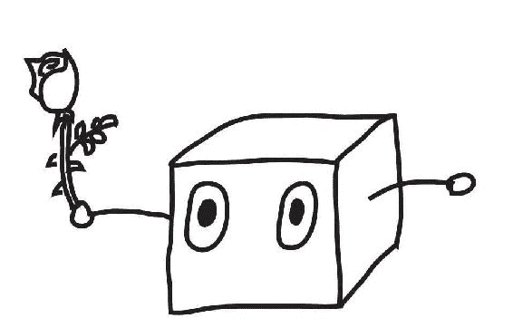
教模型撩人，绝对不在我平时的项目表上。

当然我做过不少奇葩的 AI 尝试。在我的“怪奇人工智能”专栏里，我让模型给猫取名，蹦出叮当先生、呕吐者这类尴尬结果，也让它编菜谱，配料里会出现去皮迷迭香和碎玻璃。可让它说人类的甜言蜜语，感觉完全是另一回事。

AI 靠样本学习——先研究一批现成的搭讪俏皮话，再据此生产新句子。麻烦在于，我电脑里用来训练的语料是从网上东拼西凑的搭讪语，质量都很糟。油腻的双关、带侮辱的暗示都有。一旦模型学会模仿，按一下按钮就能源源不断吐出上万条烂梗。就像极易受环境影响的孩子，它分不清该学什么不该学。从对搭讪一无所知的白板起步，它只能拼命捕捉样本里的规律，连粗俗的部分也一并学进去。模型本身并不知道什么是好。

一度我想放弃这个项目，毕竟收集样本已花了不少时间。最后还是开始训练。模型在语料里找规律，自行编出能预测俏皮话字母顺序的规则。训练结束，我有点忐忑地让它生成几句：

你一定是一个三角形？因为你是这里唯一的东西。

嘿，宝贝，你会成为一把钥匙吗？因为我能够忍受你的嘟嘟声。

你是一根蜡烛吗？因为你看起来真热辣。

你真美，你对我和宝贝说蝙蝠。

你看起来像个东西，我爱你。

我又惊又觉得好笑。这个虚拟大脑的复杂度大概只相当于一条蚯蚓，它根本分辨不出数据集里的厌女倾向和粗鄙之处，只是尽力复现发现的规律……然后给“逗笑陌生人”这个任务提供了一种完全不同、也许更妙的解法。

对我而言，能让它开口已算成功。但对那些只从新闻和科幻片认识 AI 的人来说，这种混乱的表现很可能超出预期。我们常听公司宣称 AI 能像人一样分辨语言细微差别，甚至更好，或很快取代大量工作。媒体也说 AI 即将无处不在。这些说法既对又大错特错。

现实是 AI 已经无孔不入。网上的体验依赖 AI，它决定广告投放、推荐视频，同时检测社交媒体的机器人和恶意站点。许多公司用 AI 筛简历、决定面试对象，也用它判断贷款是否通过。自动驾驶里的 AI 已行驶上百万英里，卡壳时偶尔需要人救援。我们手机里的 AI 能识别语音指令，给照片里的人脸打标签，甚至在视频里给我们加上兔耳朵滤镜。

但很快你就会体会到，这些我们每日使用的 AI 并非完美。广告系统会反复推送你已买过的靴子。垃圾邮件过滤器有时放过明显的骚扰，或在最糟的时机拦掉关键邮件。

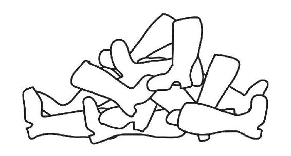
当生活的大量环节被算法支配，这些 AI 的“怪癖”就不再只是不便，还会产生严重后果。YouTube 的推荐机制会把人引向更极端的内容，几步点击就能从主流新闻滑向仇恨团体和阴谋论视频。[^(\[1\])](#part0004.html#notef1)在假释、贷款、简历筛选里帮人类做决定的算法本应中立，但它们也可能像被替代的人类一样充满偏见，有时更甚。AI 监控不会受贿，但在被要求执行时，也不会因道德原因而说不。研究者发现，一些看似无足轻重的细节，比如一块小贴纸，就能让图像识别把手枪认成烤面包机，而安全性不足的指纹识别器被主人指纹骗过的概率是 77%。

人们常把 AI 吹得比实际更能干，宣称它能完成只有科幻里才会出现的场景。另一些人自夸自家 AI 公正无私，尽管表现明显带有偏见。同时，人们声称 AI 在做的工作，背后其实常是人类在操作。作为消费者和公民，我们需要防被忽悠。要理解数据如何被 AI 使用，也要搞清我们用的 AI 到底是什么。

在“怪奇人工智能”博客上，我花了不少时间用 AI 做有趣项目。这意味着让 AI 模仿一些奇葩事物，比如俏皮话。另外我想试试让它们离开舒适区，比如我给一个图像识别算法展示阿纳金·天行者的图片，问它看到了什么：它说那是一棵树，接着还跟我争起来。从经验看，即便最直白的任务也可能让 AI 失灵，就像你跟它开玩笑。但这种“交任务看它卡壳”的玩法，恰恰是了解 AI 的好办法。

事实上，就像本书后面会看到的，AI 算法的内部构造往往复杂又古怪，观察输出可能是唯一能探索它理解了什么、哪里出错的手段。让 AI 画只猫或写个笑话，它犯的错和处理指纹或医学影像时的错是同类，只是猫长六条腿、笑话没有包袱时，你更容易察觉问题。且这些错真的很好笑。

我曾让 AI 写小说第一行、在奇异场景里认绵羊、拟菜单、给豚鼠取名，结果都很离奇。但这些实验能学到 AI 的优缺点，以及它在我们有生之年几乎不可能做到的事。

我学到的可以总结为：

AI 古怪的五条原则：

·短板源于不够聪明，而非太聪明。
·智力水平大概相当于一条蚯蚓。
·它从未真正理解你要它解决的问题。
·它会严格照做你给的指令，至少会拼命去做。
·它总是走最省力的路。

那么一起走进 AI 的奇异世界吧！我们会知道 AI 是什么、不是什么。它擅长什么，在哪里必然失败。为什么未来的 AI 可能不像 C–3PO[^(\[2\])](#part0004.html#note2)那样，反而更像一群昆虫。为什么末日丧尸横行时自动驾驶不适合逃命。为什么永远不要自愿测试一个分三明治的 AI，以及会遇到只想行走不想做事的行走 AI。在这个过程中，我们会了解 AI 如何工作、如何“思考”，以及它为何让世界变得更怪异。

[\[1\]](#part0004.html#note1) CaroIine O'Donovan et al.,"We Followed YouTube's Recommendation Algorithm Down the Rabbit HoIe,"BuzzFeed News,January 24,2019,https://www.buzzfeednews.com/article/carolineodonovan/down-youtubes-recommendation-rabbithole.

[\[2\]](#part0004.html#note2) 电影《星球大战》系列中的机器人角色。——译者注

# 第 1 章 人工智能是什么

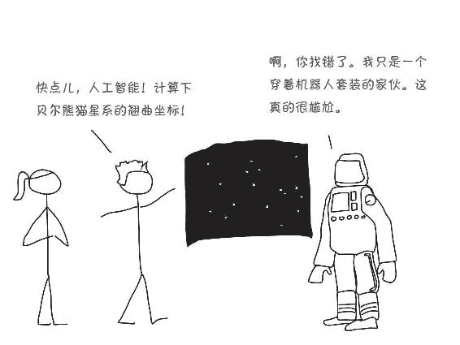
AI 看起来无处不在，部分原因是这个词的含义太宽泛，具体指什么取决于你在读科幻小说、在卖新应用，还是在做科研。有人说他们有个 AI 聊天机器人，我们该期待它像小说里的 C-3PO 一样有观点和情感吗？还是只是学会猜测用户回复的算法？是把问题词和数据库里算好的答案匹配的电子表格？是远方键盘前拿低薪的人？甚至是照本宣科念台词的戏剧演员？令人困惑的是，这些在很多语境下都被叫做人工智能。

出于本书的目的，我会像大多数程序员一样使用这个词，指代一类特定的计算机程序——机器学习算法。书中会提到的一些名词，以及它们是否属于这里定义的 AI，会在表格里说明。

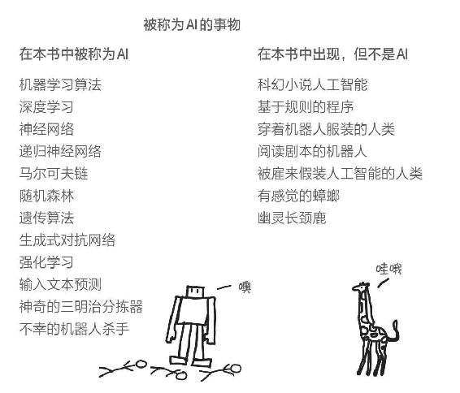
本书里所有被称作“人工智能”的东西都属于机器学习算法——这到底是什么，让我们聊聊。

### 咚，咚，那是谁

要识别自然环境中的 AI，理解机器学习算法，和传统程序也就是基于规则的程序的区别很有帮助。你做过基础编程或用 HTML 搭网站，就是在使用基于规则的程序。你用计算机能懂的语言写下指令，计算机就严格执行。你必须事先知道每一步怎么描述。

机器学习算法则能通过试错和在程序员设定的目标上自我评估，自行找到规则。目标可以是一批待模仿的样本、一个游戏分数，或其他任何东西。在追目标的过程中，它会发现程序员可能都不知道的关联。与写传统程序相比，写 AI 更像教孩子。

#### 基于规则的编程

假如我想用基于规则的方式教计算机讲敲门笑话。第一步是列出所有规则。我会分析结构，发现它符合：

咚，咚

是谁？

［名字］

［名字］谁？

［名字］［包袱］

模板确定后，只剩名字和包袱两个空位。问题变成如何生成这两部分。仍然需要规则。

我可以先列一个可用名字和包袱的清单，比如：

名字 包袱[^(\[2\])](#part0011.html#notef2)

生菜 进来，外面很冷！

哈利 上去，外面很冷！

一打 任何人想让我进来吗？

橙子 你将会让我进来吗？

电脑就能每次从清单挑一组合，填入模板。这不会产生新笑话，只是复现已知笑话。也许我想更有趣些，把外面很冷换成我被鳗鱼袭击了或不然我就会被吓得说不出话来。这样就能得到新句：

咚，咚

那是谁？

哈利

哈利是谁？

哈利，上去，我被鳗鱼袭击了！

把鳗鱼换成愤怒的蜜蜂或魔鬼鱼，再生成更多。只要规则够多，就能产出成百上千个笑话。

我可以花更多时间设计更高级规则，找已有包袱并转化，发音、韵律、同义词、文化背景等都可写进程序，让电脑重新组合出有趣包袱。若做得聪明，甚至能生成从未有人见过的包袱。无论规则多复杂，我始终在告诉计算机如何具体解决问题。

#### 训练人工智能

训练 AI 讲敲门笑话时，我们不指定任何规则。AI 必须自己找。

我们只给它一堆现成的敲门笑话，和一句指令：“看这些，去造更多。”学习材料是随机的字和标点集合。

然后我去拿咖啡了。

AI 开始工作。

它先瞎猜字符。起初完全乱猜，可能吐出鍦ㄧ紪鐮侀敊璇，椂鐨勬樉绀烘儏鍐碉紝鍘熺悊鏄。互之类的乱码。对它而言，这就是讲笑话的方法。

随后它开始研究笑话长什么样。错得离谱也没关系，它会轻微调整结构，让下次猜得更准。调整幅度受限，避免死记硬背。通过少量改变，它发现输出字符“敲”和空格时更接近样本。看完一批笑话后，它做一轮修正，理解大概是这样[^(\[3\])](#part0011.html#notef3)：

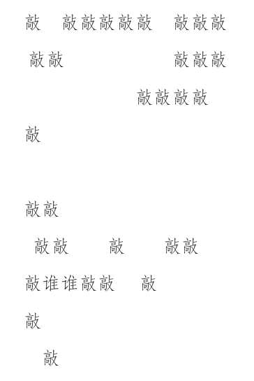
这还不是好笑话。但作为起点，它可以继续学第二批、第三批，每次都微调生成方式，改进猜测。

几轮猜测自我调整后，它学会更多规则。它学会在每行末尾放问号，开始用定语相关的词特别是“的”，甚至尝试逗号。

生哈进，

敲生哈进 生哈进

面很一橙？

进打上

吗

冷进面上

菜面生进

子 哈

了 敲

了

它找到的规则与现实契合吗？似乎还差得远。

若想生成可读的笑话，它需要找到字符排列顺序的规则。一样从猜测开始。猜“生”字后永远是“菜”？不太靠谱。然后它猜“进”字后永远跟“来”，这更合理。有些进步。现在它心目中的完美笑话：

进来

进来

进来

进来

进来 进来 进来

进来 进来

进来

进来

这还不是敲门笑话，更像无意义重复。它需要更多规则。

于是它再次研究数据集，尝试用新方法使用“进来”，寻找更好组合来模仿样本。

生菜进来 进来

哈利进来

进来

橙子 生菜 敲

进来 进来

谁？

很冷 上去

进来 很冷 上去

生菜 进来

一打

进来

进来

这一切几分钟内完成。我端回咖啡时，它已发现敲门笑话该以“咚，咚，那是谁？”开头，并决定永远遵循这条规则。

但它需要更多时间发现其他规律，于是常常退化为自说自话的把戏，或上演机器人版“谁在一垒？”的喜剧。

咚，咚

那是谁？

生菜

生菜是谁？

生里是谁？

哈利是谁？

哈菜是谁？

橙子是谁？

一打是谁？

很快它发现了剩余模板：词语，但并不精确：

咚，咚

那是谁？

哈利

生菜是谁？

一打想很冷进来

有时包袱写得过长：

咚，咚

那是谁？

哈利

生菜是谁？

一打想很冷进来将会橙子吗？很冷上去敲敲那是哈利生菜是谁一打想很冷进来将会橙子吗？很冷上去咚咚那是哈利生菜是谁

训练中某个时刻，它学会了一只关于没有嘴唇的牛的笑话，从此成为最爱。你可能不熟悉，这种笑话大致是：

咚，咚

那是谁？

一只没有嘴唇的牛

一只没有嘴唇的牛是谁？

一只没有嘴唇的牛说哞哞哞哞哞哞哞哞哞哞

在 AI 看来这是最棒的笑话。于是它认为每个笑话的包袱都该是“哞哞哞哞哞哞哞哞哞哞”。

咚，咚

那是谁？

生菜

生菜是谁？

哈利冷哞哞哞哞哞哞哞哞哞哞哞哞哞哞哞哞哞哞哞哞哞哞哞哞哞哞哞哞……

好吧，它又发现新规律。最终它会不情愿地降低用“哞哞哞哞哞哞哞哞”作包袱的频率。但笑话仍有问题，像两人用通话质量很差的电话讲笑话，讲者根本搞不清谁在讲：

咚，咚

那是谁？

生菜

哈利 是谁？

哈利 是谁 是谁？

是谁 是谁？

一打想很冷进来？

最终它会彻底摸清敲门笑话结构，开始讲语言通顺却毫无意义的笑话。大多数直接从数据集中抄来：

咚，咚

那是谁？

罗宾。

罗宾是谁？

罗宾你！饭桶是我，我要走了。

咚，咚

那是谁？

打赌

牛是谁？

牛和没有嘴唇的眼镜。

爱尔兰

爱尔兰是谁？

爱尔兰你的钱，插嘴。

在这之后，它真的讲出了一个原创笑话。完全自己编写，可理解，而且似乎……挺好笑？

咚，咚

那是谁？

亚历克

亚历克是谁？

亚历克——敲门笑话。

AI 是突然理解敲门笑话和双关的奥秘了吗？几乎可以肯定不是，数据集太小。但 AI 拥有的自由度——对所有可能字符的驾驭——让它能尝试全新组合，其中之一最终成功了。这更像无限猴子定理[^(\[5\])](#part0011.html#notef5)的胜利，而非我们真的建了只 AI 喜剧俱乐部。

“这是数据，去复制它。”让 AI 自建规则的美妙之处在于，固定方法适用于许多问题。若我不给讲笑话的算法一堆敲门笑话，而是给不同数据集，它就会模仿新数据。

它可以发明新的鸟的种类：

尤卡坦丛林鸭

船喙太阳鸟

西部叉喙啄木鸟

黑头绒

冰岛猎手

白雪枣晨的苍鹭罗宾

或者是新的化妆品的名字：

花式十

淡香水

华丽花朵

那些姑娘

女士圣诞

甚至是新的菜谱；

常规糖霜蛤蛎

主菜及汤

1 磅鸡肉

1 磅猪肉，切块

½瓣蒜切碎

食材清单
芹菜一杯，切片备用
酒沫一份，约半杯
电动搅拌器六大勺
黑胡椒一茶匙
洋葱一个，切碎
以水果命名牛肉汤三杯
新鲜磨碎半半牛奶一份，可酌情加水

操作流程
把过滤好的柠檬汁和柠檬片倒进约三升的平底锅。放入蔬菜、酱料中的鸡肉与洋葱拌匀，添入月桂叶，轻盖盖子小火焖约三小时。随后加入土豆和胡萝卜，继续小火慢炖。待酱汁冒泡，用派作配菜上桌。若将切薄的甜品先煮熟，再转到平底锅翻炒。成品冷藏时间不要超过半小时。可供六人食用。

## AI 自己找规律
仅给出几则敲门笑话的样例，不提供额外指引，AI 就能自行总结出大量本需人工编写的规则。部分规律甚至是人类不会想到要设定，也意识不到的存在，比如“没有嘴唇的牛常成为笑点”。

这正是 AI 既迷人又实用的原因之一，尤其在规则繁琐或无从把握的场景。图像识别就是典型，用传统程序实现很吃力。大多数人一眼就能认出猫，但要写成明确规则定义“猫”几乎不可行。不能要求程序认定猫必须有两眼一鼻两耳一尾，老鼠和长颈鹿同样符合。猫蜷成一团或背对镜头时，写一个找一只眼睛的规则都困难。但 AI 通过大量猫图观摩，能提炼出在多数情况下可用的识别经验。

有时 AI 只是系统的一部分，其余仍靠规则脚本驱动。例如辅助用户拨打银行查询账户的程序，语音识别的 AI 会把说话内容与菜单选项匹配，但菜单可选项和账户验证逻辑，都是开发者预先写好的。

另一种做法是先由 AI 主导，情况复杂时交回人类，常被称作伪智能。客服聊天就是例子。起初对话是机器人，一旦机器人困惑或察觉用户情绪不佳，对话就会转给真人。可惜此时人类往往要接手一个已经困惑或生气的用户。也许增设“我要找真人”按钮会更人性化。如今的自动驾驶也同理，为防 AI 失效，驾驶员必须随时准备接管。

在围棋、象棋这类策略游戏中，AI 也表现突出。我们知道所有合法走法，却没有公式告诉下一步最优。象棋可能性太多，即便大师也无法靠固定规则在每个局面选出最好一步。但算法可自我对弈上百万局，从中总结制胜经验。这远超人类大师累计对局。正因无需明确指导，AI 有时会发展出极具颠覆性甚至古怪的策略。

若不告诉 AI 哪些着法好，它可能会利用奇怪漏洞。1997 年，一群程序员写了可在无限大棋盘上与任何人下三子棋的算法。其中一个可自我改进的 AI 并无规则策略。令人意外的是，它在所有对局都获胜。后来才发现，它把棋子下在极远处，导致对手电脑生成扩展棋盘时内存爆满崩溃，从而判负。[^(\[6\])](#part0011.html#notef6)许多 AI 开发者都有相似经历，被算法找到的、完全出人意料的解法震惊。这些新解法有时极具创造性，有时会带来新麻烦。

归根结底，AI 只需要一个目标和学习用的数据集就能出发。无论是模仿人类贷款决策，预测顾客是否会买某双袜子，在游戏中拿高分，还是让机器人走得更远，它都靠试错来发现实现目标的规律。

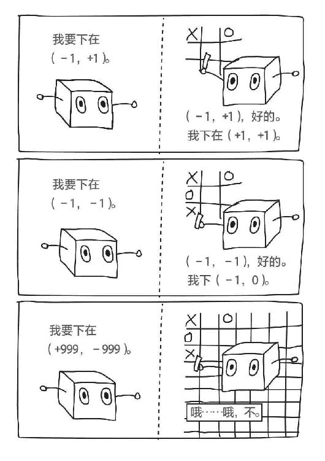

## 规则也会偏离
有时 AI 看似聪明的解法，其实建立在错误假设上。比如我做过的一些奇异实验，用的是微软的图像识别产品，能给任意图片自动加标签和标题。通常它表现不错，能认出云朵、地铁，甚至滑板少年。但某次我发现它给一些完全没有羊的图片打上了“绵羊”。深入调查后发现，只要草地茂盛，它就倾向于认为是绵羊，哪怕现场根本没有羊。也许在训练时，绵羊大多出现在绿草如茵的照片里，于是它把“绵羊”标签学成了“草地”。换句话说，它完全理解错了。显然，展示不在草地上的绵羊会让它迷惑。把绵羊放到轿车里，它更倾向标成猫狗；在客厅或人怀里的绵羊也会被错标为猫狗；被狗链拴着的绵羊也会被认成狗。识别山羊时也有类似问题——山羊偶尔爬树时，算法会觉得是长颈鹿，另一种算法甚至觉得是鸟。

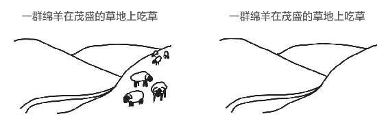

我虽不完全清楚具体原因，但大概能猜到它学到的是类似“绿草等于绵羊”“厨房或车上毛茸茸的东西等于猫”这样的关联。这些关联在训练集里有效，到了真实世界的复杂场景就力不从心。

像这种训练偏差在图像识别里很常见。但后果可能很严重。斯坦福一个研究团队曾训练 AI 区分健康皮肤和皮肤癌图片。训练完成后他们才发现，自己无意中训练出一个尺子探测器——数据集里很多肿瘤照片旁边都放着一把用来量大小的尺子。[^(\[7\])](#part0011.html#notef7)

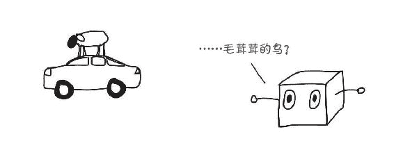

## 如何揪出坏规则
发现 AI 犯错并不容易。因为规则是自己长出来的，不会写成人类可读的说明书。相反，AI 会对其内部结构做一系列相互依赖的微调，把一个通用框架调成能完成特定任务的模型。这就像厨房里从杂乱原料变出饼干。规则可能藏在虚拟神经元的连接里，也可能分散在虚拟有机体的基因中。研究 AI 内部很像研究大脑或生态系统，哪怕不是神经科学家或生态学家，也能想象其复杂程度。

研究人员想弄清 AI 如何决策，但要把内部规则具体找出来通常很困难。有时是因为规则本身难以解释，有时因为所有权问题，尤其在商业或政府算法里。因此即便算法已投入使用，影响日常生活，一旦出错仍可能造成实质伤害。

例如，人们发现一个用于推荐谁可获假释的 AI 程序，做出了带有偏见的决定，会无意识模仿训练集中存在的种族歧视。[^(\[8\])](#part0011.html#notef8)即便不懂得什么是偏见，AI 仍可能做出偏见行为。毕竟许多 AI 是通过模仿人类学习。它问的不是“什么是最佳解”，而是“人类会怎么做”。

通过系统性检测偏见，可以在伤害扩大前捕捉到。但更难的是在问题出现前就预见，并设计出能避免这些问题的 AI。

## AI 灾难的四个预警
谈到 AI 灾难，人们脑中常浮现 AI 违背社会规范、认为杀光人类最符合自身利益，或造出终结一切的机器。但所有这些场景都需要 AI 具备一定批判性思维和类人世界观，而这在可预见的未来很难实现。业内领军的机器学习研究者吴恩达认为，担心 AI 颠覆人类就像担心火星人口过剩一样杞人忧天。[^(\[9\])](#part0011.html#notef9)

这并不意味着当下 AI 无害。它会制造各种麻烦，从让程序员抓狂，到传播偏见再到撞毁无人驾驶汽车。只要有点相关知识，就能看出问题在哪。

以硅谷一家创业公司为例，它提供筛查求职者的服务，通过分析面试短视频找出最可能胜任岗位的人。这项服务听起来很吸引——公司面试大量应聘者耗时耗力，软件不会累也不会嫉妒。可从哪些危险信号能看出它很可能酿成 AI 灾难呢？

### 危险迹象 1：难题本身就太难啃
挑出合适应聘者本就极难，即便人类也常判断不准。这人真的有热情还是只会演戏？文化差异是否被忽略？AI 介入后更难。它几乎不可能理解笑话的细微差别和文化引用。若应聘者提到当天正在举办的活动，而 AI 训练数据是去年收集的，它就无法理解，可能因“无意义”而惩罚应聘者。要做好这项任务，AI 需要多面技能，还要掌握最新动态。若它根本做不好，就已注定失败。

### 危险迹象 2：问题被偷换了概念
对我们来说，设计筛选应聘者的 AI 并不是找到最称职的人，而是找到与过去已招录人员最相似的人。

如果管理者之前的决定基本正确，还能凑合。但大多数美国公司，尤其管理层，在评估简历和面试时都存在多样性问题。在其他条件相同的情况下，听起来像白人男性的名字比女性或少数族裔名字更容易获得面试机会。[^(\[10\])](#part0010.html#notef10)即便招聘者本身是女性或少数族裔，也会无意识偏向白人男性应聘者。

许多有缺陷甚至有害的 AI，在设计时人们以为自己在解决 A 问题，实际上却在训练它做完全不同的 B 事。

### 危险迹象 3：走捷径的诱惑
还记得那个变成尺子探测器的皮肤癌检测 AI 吗？区分健康细胞和癌细胞很困难，于是它选择了在图片里找格尺的捷径。

如果你给筛选应聘者的 AI 大量带偏见的数据去学习，就等于给了它一条提升预测准确性的捷径：偏向白人男性。这比分析用词细节容易太多。又或者 AI 会发现另一个令人遗憾的捷径——录用者都用同一款相机拍照，于是它学会只选用该型号相机拍摄的应聘者。

AI 总是倾向于选择这些卑劣捷径——因为它不知道更好的办法。

### 危险迹象 4：从有缺陷数据里努力学习
计算机科学有句老话：垃圾进，垃圾出。如果 AI 的目的是模仿做错决定的人类，最好的办法就是完全照搬人类决定，无论对错。

无论样本本身有缺陷，还是仿真过程因奇怪物理规律产生缺陷，有缺陷的数据都会把 AI 带偏。既然在很多情况下，我们交给 AI 解决的问题样本就是它要学习的数据，糟糕的数据必然导致糟糕解法。事实上，迹象 1 到 3 大多都是数据问题的表现。

## 失望，还是惊喜
遗憾的是，筛查应聘者的案例并非虚构。许多公司已开始提供 AI 驱动的简历筛选或面试视频分析服务，但关于如何在 AI 筛查中消除偏见、考虑残障或文化差异，它们很少披露具体做法。如果下点功夫，至少有可能构建出比人类招聘经理偏见更少的 AI——但看不到任何公开统计数据，我们可以相当确定偏见依然存在。

AI 能否成功，很大程度上取决于任务是否适合用 AI。世界上也有大量 AI 比人类更高效的任务。这些任务是什么，又为何让 AI 如此出色？让我们继续看。

[\[1\]](#part0006.html#note1) 敲门笑话，一种英语笑话，以双关语作为笑点，通常由两人对答组成。——译者注

[\[2\]](#part0006.html#note2) 在原书中，这里的英文名字和包袱恰好可以组成一个意思完整的句子。——译者注

[\[3\]](#part0006.html#note3) 在翻译这些生成的失败笑话时，译文根据汉语的语言习惯做了灵活处理，和原书并不完全相同。——译者注

[\[4\]](#part0006.html#note4) 《谁在一垒？》是一个由美国喜剧搭档亚伯特与卡斯提洛演出的喜剧段子。喜剧的内容是两人在谈论一支棒球队的成员，由于棒球队成员的名字很特别，两人的对话可以同时被解释为问句和答句，使得谈话的双方发生诸多误会。例如棒球队一垒手的名字是“谁”，因此问题和回答同样是“谁在一垒”。——译者注

[\[5\]](#part0006.html#note5) 一个猴子在打字机上完全随机地敲打无限长的时间以后，最终会产生莎士比亚的全部作品。这是一个古老的谚语，准确地描述了通过“蛮力”方法，没有遗漏地尝试所有可能的答案，来解决问题。理想情况下，人工智能应该比这种方法有所改进。当然，这只是理想情况。

[\[6\]](#part0007.html#note6) Joel Lehman et al.,"The Surprising Creativity of Digital Evolution:A CoIIection of Anecdotes from the Evolutionary Computation and ArtificiaI Life Research Commu-nities,"ArXiv:1803,03453\[Cs\],March 9,2018,http://arxiv.org/abs/1803.03453.

[\[7\]](#part0008.html#note7) Neel V.Patel,"Why Doctors Aren't Afraid of Better,More Efficient AI Diagnosing Cancer,"The DaiIy Beast,December 11,2017,https://www.thedailybeast.com/why -doctors-arent-afraid-of-better-more-efficient-ai-diagnosing-cancer.

[\[8\]](#part0009.html#note8) Jeff Larson et al.,“How We Analyzed the COMPAS Recidivism Algorithm,"ProPubIica,May 23,2016,https://www.propublica.org/article/how-we-analyzed-the.com/as -recidivism-algorithm.

[\[9\]](#part0010.html#note9) Chris Williams,"AI 大师 Ng：担心杀人机器人崛起就像担心火星上的人口过剩,"The Register,2015 年 3 月 19 日,https://www.theregister .co.uk/2015/03/19/andrew\_ng\_baidu\_ai/.

[\[10\]](#part0010.html#note10) Marianne Bertrand and Sendhil Mullainathan,“Emily 和 Greg 比 Lakisha 和 Jamal 更容易就业吗？劳动力市场歧视的田野实验,” American Economic Review 94,no.4(2004 年 9 月):991 一 1013,https://doi.org/10.1257/0002828042002561.

# 第 2 章 AI 无处不在，如何定位

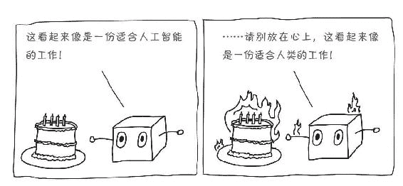

## 这个例子并非杜撰
中国西昌有一座农场，因其与众不同而著称。最惹眼的是，它是同类农场里体量最大的，生产力也无可匹敌。每年，这里能产出六十亿只美洲大蠊，平均每平方英尺的土地上就有超过两万八千只。[^(\[2\])](#part0021.html#notef2)为了最大化效率，农场用算法控制温度、湿度、饲料供给，甚至分析美洲大蠊的基因和生长速度。

但真正让它与众不同的是，美洲大蠊属于蟑螂家族的蜚蠊科。是的，这座农场养蟑螂，然后把它们研磨粉碎，制成一种非常珍贵的传统中药。打包的人说它“有点甜”，带“一点鱼腥味”。

有关把蟑螂产量推到极致的算法细节，属于不对外透露的商业机密，外人很难窥见全貌。可这幅画面让人立刻联想到那个耳熟能详的思想实验——回形针生产者。实验里，一台智力远超常人的系统只被赋予一个指令：制造回形针。目标确定后，它便会把触及范围内的所有资源全部转化为回形针，甚至不惜把整颗星球及其居民也改造成回形针。好在现实远没那么夸张，即便真有专职最大化蟑螂产出的系统，我们现阶段的模型离自主管理工厂或农场还差得很远，更不用说把整个经济体系改造成蟑螂加工厂。更合理的推测是，这套养蟑螂的系统只是在用历史数据预测未来产量，再据此挑选它认为最有利于增产的环境参数。它或许能在工程师划定的边界内微调，但采集样本、补单、搬运物料这些活仍需人手，推广蟑螂提取物的营销工作也一样离不开人。

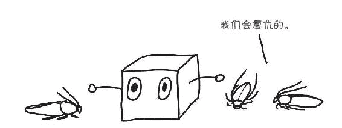
不过，把蟑螂养殖场的效率提上来，正是 AI 能做得顺手的活儿。我们手头的数据量庞大，需要解析的内容很多，而模型最拿手的就是在海量信息里捕捉规律。这类工作人类未必喜欢，但机器不在乎枯燥重复，也不在意深夜里成群蟑螂振翅的窸窣。蟑螂繁殖速度快，参数一改效果立现。任务边界清晰，不属于开放式的难题。

那么用 AI 来冲产量会有什么坑？肯定有。模型没有语境感，不明白自己在做什么、为什么做，所以常常用人意想不到的手段达标。假设养蟑螂系统发现，某间房把温度和湿度都拉满，能明显提升当地蟑螂数量。它并不会意识到，也不在乎，这么做其实把阻隔蟑螂进入员工餐厅的隔门给打开了。严格讲，这扇门的开启确实帮它更好地完成了指标——指标只是要产量最大化，而不是要防止外逃。要想把 AI 用好，必须先搞清楚它擅长什么，从而提前预判风险。

## 让机器干活，我并不抵触
即使人做得更靠谱，算法也常有其用。把某一类明确的工作交给模型，能省去大量人力成本和琐碎麻烦，尤其当工作量大且重复时。自动化本身就这个道理。扫地机器人能代替我们打扫，省下的时间足以让我们反复把它从沙发底下刨出来。

医学影像分析就是典型的人工智能代劳的重复活。实验室技术员每天要在显微镜前盯着血样，计数血小板、白细胞、红细胞，或筛查组织样本里的异常细胞。每项操作都简单、固定、可拆分，非常适合自动化。不过一旦算法从实验室搬进医院，失误的代价就变高了。自动驾驶也是类似逻辑——开车本质上是重复动作，有个永不疲倦的司机很诱人，但在时速 60 英里的路上，哪怕一个小瑕疵也可能酿成大祸。

垃圾邮件过滤也是人人都想交给机器的大活，虽然模型做得没有人好。甄别垃圾邮件需要细致和应变，对 AI 并不友好。但换个角度，若收件箱基本干净，大部分人能接受偶尔误判。给恶意链接打标签、清洗社交媒体信息、识别机器人账号，都是体量庞大且容错空间存在的任务。

个性化推荐是 AI 价值凸显的另一个角落。不少平台靠模型推送商品、影片和歌单提升体验，这种洞察若靠人工，成本高到不可承受。于是 AI 偶尔会误判——比如判定你需要成堆的走廊地毯，或因你买过婴儿派对礼物就认定你是个学步儿童。多数时候这类乌龙无伤大雅，甚至偶有尴尬，但整体仍能为企业带来成交。

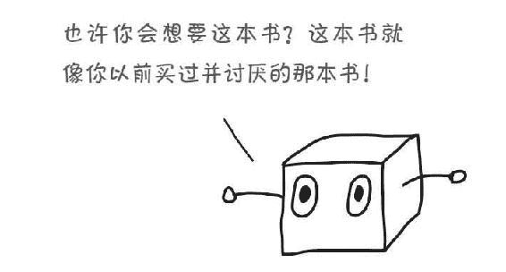
现在的商业化系统也能写地方新闻，比如选举结果、比赛比分和近期房源成交。每篇都是高度模板化的输出，但对关心内容的人来说，形式并不重要。《华盛顿邮报》打造的机器人记者 Heliograf 就是例子，它把体育统计数据改写成报道。早在 2016 年，它一年就能产出数百篇。这里有一段它写的橄榄球赛样例：

周五，昆斯果园高中的美洲狮队以 47:0 的比分击败了爱因斯坦的泰坦队。

开局艾伦·格林挡住了对方的悬空球回攻，美洲狮队以 8 码达阵得分。美洲狮队通过马克斯·库珀的 3 码达阵冲球进一步扩大领先优势。美洲狮队通过亚伦·德温的 18 码达阵冲球进一步扩大领先优势。德温从四分卫多克·邦纳接球并完成了 63 码达阵得分，进一步扩大领先优势，把比分提高到 27:0。[^(\[3\])](#part0021.html#notef3)

文风平淡，但 Heliograf 确实把比赛讲完了[^(\[4\])](#part0021.html#notef4)。它能根据数据表和常用术语拼出一篇完整报道。可一旦出现设计者没预料到的情况，它就抓瞎了。中场时有马冲进场？泰坦更衣室被蟑螂占领？能不能来个机智的双关？机器人记者只会照着清单写。

尽管有局限，AI 还是让媒体能做以前因成本过高而不敢做的事。人工要先划定哪些题材适合自动化，建立模板和词库，一旦模型搭建好，就能批量生产，按数据清单的数量生成同等数量的稿件。比如一家瑞典媒体做了一个“房产主”机器人，能把房地产表格逐条写成独立稿，4 个月内写了上万篇。结果这批稿件成了网站最受欢迎、变现最好的内容。[^(\[5\])](#part0021.html#notef5) 人类记者于是能把时间投向更有创意的调查。今天越来越多的大型媒体用 AI 辅助写稿。[^(\[6\])](#part0021.html#notef6)

科研里 AI 也在帮人省去重复劳动。比如天文学家用 AI 监测遥远恒星的光变[^(\[7\])](#part0021.html#notef7)，寻找行星存在的线索。当然模型没物理学家那么细致，大多数它标出的“候选”最后都是假阳性。但它至少能筛掉 90%以上的无望目标，省下大量时间。

天文数据量惊人。欧几里得望远镜工作期间将累积数百亿张星系图像，其中只有约 20 万张会出现引力透镜[^(\[8\])](#part0021.html#notef8)，即超大质量星系的引力足以弯曲更远星系的光线。若能找到这些现象，就能对星际尺度的引力有新认知，宇宙中 95%的质量与能量仍是谜。算法扫描图像更快有时也更准，但当望远镜捕捉到令人振奋的“头奖”透镜时，最终还是人类会先发现。

创意工作也在被自动化，至少在艺术家监督下。过去修一张照片摄影师要花数小时，现在 Instagram 或 Facebook 的 AI 滤镜能调对比、亮度、景深来模拟昂贵镜头。也不用手工给朋友贴猫耳，AI 会自动定位头部位，即使人头移动也能跟上。从细节到整体，AI 为艺术家音乐人提供大量省时工具，让创作更独立。另一面是深度伪造，能把图片视频里的脸或身体换成他人。一方面艺术家可轻松把尼古拉斯·凯奇或赵约翰的脸套到不同角色上娱乐或讨论好莱坞多元化问题[^(\[9\])](#part0021.html#notef9)。另一方面技术门槛低，为骚扰者制作侮辱性定制视频提供了新渠道。随着逼真度提升，个人和政府担心它会被用来伪造政治人物的煽动演讲等破坏性假视频。

自动化带来的还有更稳定一致的表现。人的状态随饮食睡眠波动，偏见和性格也会影响决策。大量研究显示性别歧视、族裔偏见、对残障人士的歧视等，都可能影响简历筛选、晋升、假释决定。算法则不受情绪影响，给同一数据集无论早中晚都能给出基本不变的结果。可一致不等于公平。算法可能始终如一地带有偏见，尤其是它是通过模仿人类数据学习时。

所以很多场景用 AI 自动化看似很有诱惑力。但判断一个问题是否适合自动化，标准到底是什么？

## 任务越聚焦，AI 越在线
自 20 世纪 50 年代艾伦·图灵提出图灵测试以来，它一直被视作衡量程序智能的标杆。若一台机器能与人聊天并让约三分之一的人以为对方是人类，就算通过。有人甚至把通过等同于达到人类智能甚至自我意识。不少科幻作品如《银翼杀手》《机械姬》《机器管家》等，都描写强 AI 通过测试证明人格。

实际上图灵测试并不可靠。只要把对话限制在特定主题，通过就很简单。我曾在 Facebook 上和全食超市的机器人聊过，验证这个想法：

全食超市：你好，贾内尔！我们在这里为你提供帮助，让找到菜谱像找到原料一样简单。

我：你们有鳄梨酱的菜谱吗？

全食超市：（发送菜谱：香菜鳄梨酱）

我：我可不可以用绿豆来制作鳄梨酱呢？

全食超市：（发送菜谱：绿豆鳄梨酱）

我：给我一个用到鳄梨的菜谱吧，任何都行，除了鳄梨酱。

全食超市：（发送菜谱：香菜橄榄鳄梨萨尔萨酱）

到目前为止，我们之间的对话令人感到难以分辨。对方没有明确地说它是人类还是机器人，同时完全解决了我那些可以通过发送菜谱来解决的问题。但是当我稍微偏离一下这个有限的规定动作时，这个机器人就原形毕露了。

我：我该如何辨别鳄梨有没有成熟呢？

全食超市：（发送菜谱：毛豆鳄梨酱）

我：你最喜欢《星球大战》中的哪个角色？

全食超市：（发送菜谱：玉米芝士炒虾）[^(\[10\])](#part0021.html#notef10)

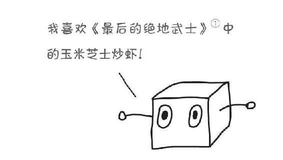
这正是许多公司让聊天机器人当客服的套路。靠用户的礼貌把话题钉在机器能处理的范围内，让人察觉不出是机器。毕竟若对方可能是真人，用奇怪问题试探就不礼貌。

即便话题有限，范围过宽机器人仍会崩。2015 年 8 月起 Facebook 开发聊天机器人 M，用于订酒店、买票、找餐厅等任务[^(\[11\])](#part0021.html#notef11)。思路是用人类处理难题产生训练样本，最终让模型能独立应付大多数请求。结果用户把“能问任何事”当真了。项目工程师回忆：“先问明天天气，再问附近意大利餐，后来问移民问题，再后来让 M 策划婚礼。”[^(\[12\])](#part0021.html#notef12)还有人让 M 安排鹦鹉探望朋友，任务完成靠转人工。几年后仍需大量人工支持，Facebook 于 2018 年 1 月终止服务[^(\[13\])](#part0021.html#notef13)。

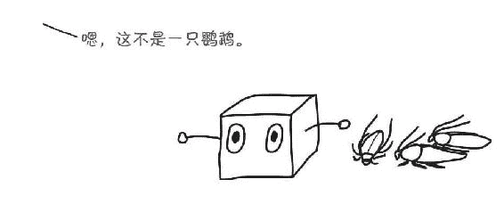
能处理人类随口抛来的各种问题是个极宽泛的任务。相比人脑，AI 的认知能力仍很有限，任务一泛化就力不从心。

比如我最近训练了一个写菜谱的模型。它从零开始学模仿文本，一开始连菜谱是什么、字母对应什么原料操作、甚至英语是什么都不懂。它只能尽量学排列字母来仿照所见资料。当训练数据只有蛋糕食谱时，它生成如下：

胡萝卜蛋糕（维拉小姐”

蛋糕，酒水

1 袋黄色蛋糕粉

3 杯面粉

1 茶匙发酵粉

1 勺半茶匙小苏打

¼茶匙盐

1 茶匙肉桂粉

1 茶匙姜粉

½茶匙丁香粉

1 茶匙面粉

½茶匙盐

1 茶匙香草

1 个鸡蛋，室温

1 杯糖

1 茶匙香草[^(\[14\])](#part0021.html#notef14)

1 杯培根，切碎

把烤箱预热到 350 华氏度（约 177 摄氏度）。在 9 英寸的脱底模具底抹油。

制作过程：高速搅拌鸡蛋直到颜色变为浓稠的黄色，放在一边备用。另取一只碗，放入蛋白，搅拌鸡蛋白至稠密。把第一种混合物迅速装入准备好的模盘中，将糊状物摊平。在烤箱中烤制约 40 分钟，或者烤至木质牙签插入中心时可以干净地抽出来的状态。在模盘中冷却 10 分钟。放在架上静置至完全冷却。

把蛋糕从模盘中取出来完全冷却。保持温热上桌。

《在这里食谱》（HereCto Cookbook，1989）来自加拿大生活中的厨房与霍恩。

产量：16 份。

这份食谱不算完美，但大致能看出是蛋糕（细读时会发现，按它的方法你最终只能烤出一个带蛋黄的东西）。

接着我让它同时学习汤、烧烤、曲奇、沙拉等食谱。数据量扩大十倍——从 2431 条只含蛋糕的菜谱，增加到 24043 条常见菜谱。生成结果如下：

分散的鸡肉饭

奶酪/鸡蛋、沙拉、奶酪

2 磅心脏，去籽

1 杯切碎的新鲜薄荷或覆盆子派

½杯卡翠娜，磨碎

1 汤匙植物油

1 盐

1 胡椒粉

2.5 托比糖，糖

合并解散，搅拌至混合物变浓稠。然后加入鸡蛋、糖、蜂蜜和香菜种子，然后低温烹饪。加入玉米糖浆、牛至、迷迭香和白胡椒粉。加热，放入奶油。加入剩下的一茶匙发酵粉和盐。在 350 华氏度烘焙 1~2 个小时。保持热度上桌。

产量：6 份。

这次完全失控。模型要学会什么时候用巧克力什么时候用土豆，哪道要烤、哪道要炖、沙拉完全不需烹饪。规则太多，模型的有限算力被摊薄。

所以做商业或科研的人普遍发现，专业化训练是正道。若某个算法看起来比“分散鸡肉饭”模型强，很可能是因为它解决的问题更具体、边界更清晰。任务越具体，AI 越显得聪明。

## C-3PO 和烤面包机，差距在此
这也是研究者区分弱 AI（ANI）和强 AI（AGI）的原因。前者是我们现在用的，后者是书影里常见的。我们熟悉天网[^(\[15\])](#part0021.html#notef15)、哈尔[^(\[16\])](#part0021.html#notef16)、瓦力、C-3PO、数据[^(\[17\])](#part0021.html#notef17)之类的故事。它们可能不懂人情细腻，却能理解大量对象和场景并作出合适反应。强 AI 理论上能下棋、讲故事、烤蛋糕、描述绵羊、说出比龙虾大的三样东西。但它目前只存在于科幻，多数专家认为即便实现，也至少还有几十年。

现有的弱 AI 与此相去甚远。比起 C-3PO，它更像一台烤面包机。

比如击败人类在国际象棋或围棋上登上新闻的算法，确实在特定任务上超越人类。但这不奇怪，机器很早就擅长专精任务。计算器做长除法远超人类，却永远下不了楼梯。

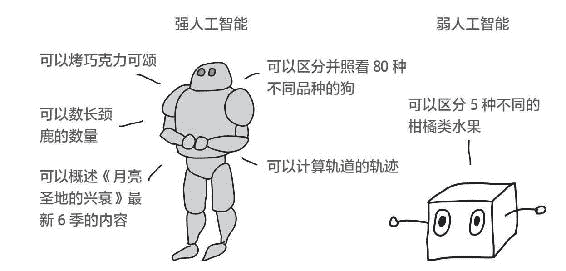
实际上，很多科幻里的强 AI 也下不了楼梯，比如戴立克、C-3PO、机械战警、哈尔。原因你猜到了吗？

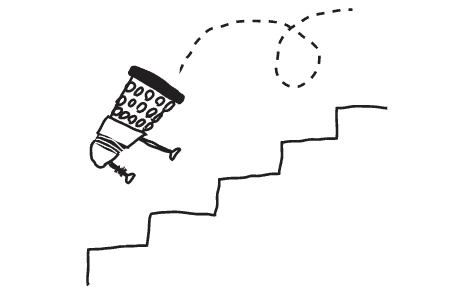

弱AI适用的缝隙到底多大

看似聚焦的任务，在真实场景下往往会扩散。面试视频分析就是个典型，表面上只是读脸部情绪波动。现实里求职者可能因中风留疤，或表达情绪的方式与常态不同，人类会自动结合语境调整判断。模型想做到类似的体谅，就得先做语音转文字，再做语义理解，最后据此修正情绪判读。语音转写本身就是AI难题，语义理解在细微处更是薄弱。现阶段的弱AI扛不住这种链式推理，容易把特殊情况一律筛掉，直到能力接近人类才可能改善。

无人车也属于这类表象具体、实质宽泛的例子。

样本饥渴让学习异常缓慢
AI学新概念的速度很慢。给人看一张全新物种沃格的照片，再给大量含沃格的图片，人类靠一次观察就能归纳。模型却常常需要上百上千张样本才能稳定，而且样本必须变化足够大，否则学会的可能是地板纹理或抚摸动物的手，而不是动物本身。

少样本学习在研究，但目前落地基本仍靠堆样本。ImageNet作为图像生成识别的常用库，有约1419万张图，却只覆盖1000个类。人司机拿到独立驾驶资格通常只要数百小时经验，2018年Waymo车队已积累超600万英里实路数据与50亿英里仿真里程，可大规模可用的无人驾驶依然遥远。AI的贪吃，正是大数据时代与AI时代并行的原因。

现实学习不现实时，会转到加速的仿真环境。OpenAI Five通过自 Bot 对战学会Dota，击败世界顶尖人类队伍，每天自玩相当于180年对局。即使最终目标是现实操作，仿真仍能省时省力。

学骑行平衡的AI同样磕绊。程序员记录前轮轨迹，反复试错。崩溃上百次后才勉强前进几米，崩溃数千次才骑出数十米。

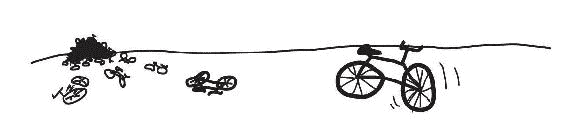
仿真方便但有风险。算力限制让仿真细节远不及真实世界，不得不靠取巧。模型一旦发现捷径并利用，就可能在真实场景中出错。

借力前作是常见捷径
没有海量新样本也能复用。只要已有模型离目标不远，就能迁移结构，省样本省时间。比如先训练一个生成摇滚乐队名的模型，再在此基础上微调成冰淇淋口味生成。乐队命名已让它学会名字长度、首字母大写、常用字母组合与高频词。几轮微调后，输出就从血龙、施塔加巴什、死裂等风格，转向柠檬奥利奥、草莓丘罗、樱桃柴等口味。中间只出现短暂的尴尬期，生成了地狱旋涡、人霜、黑夜火腿太妃糖等混杂名称。

这种重复利用即迁移学习。起点接近目标，数据与训练时长大幅下降。训练最大模型可能需数天到数周，迁移则可能几分钟甚至几秒完成。

图像识别领域尤其青睐迁移。先用能认卡车、猫、橄榄球的通用模型起步，再微调到杂货店扫描机识别农产品。边缘、形状、纹理等基础规则已学会，针对性任务自然占先。

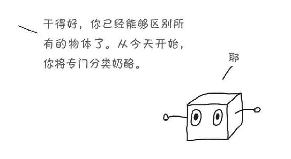

记性短板决定适用范围
不需要长期记忆的任务，AI更容易胜任。因为容量有限，记忆差是常态。游戏训练中它们会肆意浪费角色血量与大招，因为早期只关注即时收益，等数值见底才突然谨慎。汤姆·墨菲在《小子难缠》实验里，AI一上来就用光威力巨大的鹤踢，因为它只能展望约6秒操作。“6秒以后一切都变差，浪费资源是典型失败模式。”

即便精密的OpenAI Five，也只能在很短时间窗内记忆与预测。它能预判未来两分钟，这在瞬息万变的Dota里已算优秀，但比赛常持续45分钟以上。长线回报策略基本学不会，就像鹤踢机器人宁可早用也不留到关键时刻。

缺乏长远规划的失败比比皆是。《超级马里奥兄弟》第二关的金币壁架就是噩梦。AI知道金币好，也知道必须一直右移通关，但跳上去后必须回头下来，而它从未见过后退场景，于是卡在壁架上耗尽时间。汤姆·墨菲说他在该问题上花约6周与数千小时CPU，才让AI学会越过壁架。

文本生成同样受记忆限制。Heliograf生成体育新闻模板故事，逐行把数字转成句子，因每句基本独立，不需要整篇记忆。神经机器翻译也常句内独立处理，前句信息对后句消歧帮助有限，一旦出现长程关联，效果就崩。这也是AI很少写书或做电视剧的原因。要判断一段文字是否机器写，查存储问题是个线索。2019年前，少数模型才开始处理故事中的长程关联，且经常丢关键信息。

用dreamresearch.net上约19000段梦境描述训练的RNN写出一段文字，人物莫名出现、场景遗忘、短语勉强成立却缺乏内在逻辑，词汇节奏像人却没有意义。

菜谱生成更能看出存储天花板。递归神经网络逐字母生成，每多考虑一个字母就需要更多存储。受限于当时笔记本的65字符上下文，模型只记住最近65个字符，于是写到一半就忘了主题，转而加入不相关的配料。

存储限制正在改变。卷积等思路让模型兼顾局部与整体，记忆跨度拉长。用海量网页训练的GPT-2经菜谱微调后，能记住大部分原料并保持蛋糕主题，做法仍不现实，但已远胜早期巧克力奶油汤加黑布丁的混乱输出。

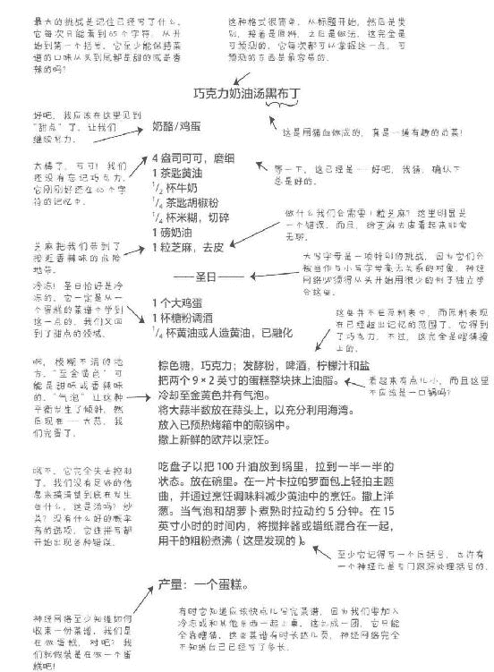
另一个GPT-2例子尝试写哈利·波特同人，能追踪人物出场，甚至记住反复出现的意象如蛇。另一种对策是把基本单元组合，让网络记更少信息也能连贯。限制在人工设定材料范围内，谷歌团队设计的无麸质巧克力曲奇配方看起来合理，但据报道成品依然很差。

不是所有难题都该交给AI
关键在于：用AI是不是最省事的办法？有些问题靠规则难写清，却适合让AI从海量信息里自学规律，比如图像识别、机器翻译。分析上百个特征预测手机用户是否会携号转网，也比手写规则有效。

危险在于把复杂模型用在常识即可解决的场景。比如每周给客户推送糟糕的蟑螂计划短信，流失自然会高。

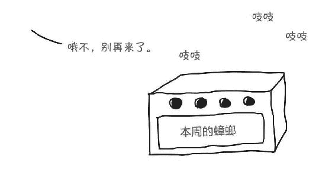
为何无人驾驶仍在路上
无人驾驶被认为适合AI，有几方面支撑。人们嫌开车枯燥，AI司机反应快、不乱串车道、不疲惫。现实中车也会过于保守，汇入车流或繁忙路口左转时显得犹豫，但它永不会打瞌睡。

数据可堆量，仿真可加速学习。存储需求也不高，当前速度方向不必依赖五分钟前之事，导航负责长线规划，行人或动物等风险多在数秒内。

最重要的是，目前没有更好的替代方案。

但是否够具体仍是未知。车队已用数百万英里里程证明能力，部分公司称人类平均每几千英里介入一次。完全消除偶发的人类接管，才是难点。

临阵脱逃往往原因平凡。2015年一篇研究列出典型情况：把高处垂下的树枝当成障碍，困惑于其他车辆所在车道，觉得路口行人太多无法处理，没看见车库倒出的车，没看到前方驶出的车。人们仍需弄清，驾驶到底是弱AI能覆盖的狭窄任务，还是需要类人强AI才行的广域问题。

2018年3月的致命碰撞正是感知缺陷的典型案例。路测中的无人驾驶车辆在行人横穿时，感知模块先把对方归类为不明物体，随后修正为自行车，直到撞击前仅剩1.3秒才最终判定为行人。（为让安全员保持警觉，车上的自动紧急制动被人为关闭——这套制动的本意并非提神，反而让事故归因更显矛盾。安全员在事故前已长时间处于无需干预的状态，数小时的空转足以让绝大多数人注意力涣散。[^(\[31\])](#part0021.html#notef31)）2016年的另一起重创，根源同样落在物体识别上——这次系统完全没把一辆平板卡车视作需要避让的障碍。

2016年的案例中，一名驾驶员在城市道路上开启了特斯拉的自动驾驶功能，该功能原本是为高速公路开发的。此时一辆卡车从前方横穿，自动驾驶却没有刹车，因为模型根本没有把卡车当成必须躲开的物体。自动驾驶公司 Mobileye 的分析指出，系统因面向高速跟车训练，只学会了防止追尾，也就是只学会了从后方识别卡车，而非侧向来车。特斯拉方面表示，算法捕捉到卡车时竟将其误判为头顶的指示牌，于是判定无需制动。[^(\[32\])](#part0021.html#notef32)

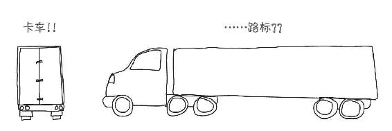

类似的离谱情况并不罕见。大众汽车在澳大利亚首次实测自家 AI 时，发现它对袋鼠完全摸不着头脑，很显然训练数据里从未出现过到处乱跳的动物。[^(\[33\])](#part0021.html#notef33)

道路上可能出现的物体极其多样：游行人群、逃脱的鸸鹋、坠落的电线杆、岩浆、写着古怪指令的临时告示、糖蜜洪流与坑洞。遇到训练样本中从未出现过的东西几乎不可避免。让 AI 处理全新事物很棘手——它需要理解鸸鹋会狂奔而坑洞是静止的。直觉上岩浆的流动像水，但这并不意味着可以从岩浆坑上开过去。

车企正在调整策略来应对日常故障与诡异路况。有人主张把自动驾驶限制在封闭可控的路段，这并不能根治袋鼠问题，它们很狡猾；也有方案让无人驾驶卡车跟在一辆由人类司机驾驶的领头车后面。归根结底，这些妥协引导出的形态，看起来更像大规模公共运输。

目前，当 AI 感到困惑时，常用的做法是临阵脱逃——也就是突然把控制权交还给坐在方向盘后面的人。自动化等级 3 的条件自动化是现阶段商业车型的最高等级，见下页表 1。以特斯拉的自动驾驶模式为例，汽车可以在没有引导的情况下行驶数小时，但人类司机可能在任何时候被叫回来接管。这个等级的难点在于，人最好始终全神贯注地待在方向盘前，而不是坐在后排把玩曲奇。另外，在无所事事地盯着路面数小时后仍能保持清醒，对人类而言非常困难。要缩小 AI 实际表现与理想表现之间的差距，人类介入常被当成补丁，但人类在救援自动驾驶方面真的不太擅长。

表 1 自动驾驶汽车的自动化级别

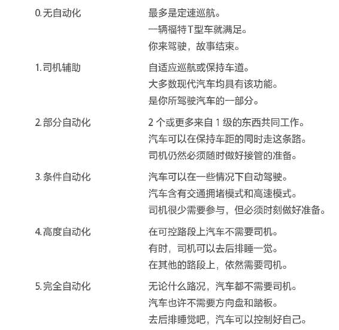

因此，制造自动驾驶汽车看似诱人，实则是一个极其困难的 AI 问题。要实现主流化，我们也许需要做些折中，比如打造可控路段并长期使用等级 4 的自动化，或者我们需要比现在更具灵活性的程序。

下一章，我们将会看到自动驾驶汽车等事物背后的各种人工智能——模仿大脑、进化甚至虚张声势的游戏。

[\[1\]](#part0013.html#note1) 1 平方英尺≈0.09 平方米。——编者注

[\[2\]](#part0013.html#note2) Stephen Chen,"A Giant Farm in China ls Breeding 6 BiIIion Cockroaches a Year.Here's Why,"South China Morning Post,ApriI 19,2018,https://www.scmp.com/news/china/society/articIe/2142316/giant-indoor-farm-china-breeding-six-biIIion -cockroaches-year.

[\[3\]](#part0014.html#note3) Heliograf, “High School Football This Week: Einstein at Quince Orchard,” Washing ton Post, October 13, 2017, https://www.washingtonpost.com/allmetsports/2017-fall/games/football/87408/.

[\[4\]](#part0014.html#note4) 美洲狮队此刻是 27:0 而非 28:0 意味着他们错过了追加得分的机会——这一点机器人记者没有提及。

[\[5\]](#part0014.html#note5) Li L’Estrade, “MittMedia Homeowners Bot Boosts Digital Subscriptions with Auto mated Articles,” International News Media Association (INMA), June 18, 2018,https://www.inma.org/blogs/ideas/post.cfm/mittmedia-homeowners-bot-boosts-digital-subscriptions-with-automated-articles.

[\[6\]](#part0014.html#note6) Jaclyn Peiser, “The Rise of the Robot Reporter,” New York Times, February 5, 2019,https://www.nytimes.com/2019/02/05/business/media/artificial-intelligence-journalism-robots.html.

[\[7\]](#part0014.html#note7) Christopher J. Shallue and Andrew Vanderburg, “Identifying Exoplanets with Deep Learning: A Five Planet Resonant Chain around Kepler-80 and an Eighth Planet around Kepler-90,” The Astronomical Journal 155, no. 2 (January 30, 2018): 94,https://doi.org/10.3847/1538-3881/aa9e09.

[\[8\]](#part0014.html#note8) R. Benton Metcalf et al., “The Strong Gravitational Lens Finding Challenge,” Astron omy & Astrophysics 625 (May 2019): A119, https://doi.org/10.1051/0004-6361/201832797.

[\[9\]](#part0014.html#note9) Avi Bagla, “#StarringJohnCho Level 2: Using DeepFakes for Representation,” You Tube video, posted April 9, 2018, https://www.youtube.com/watch?v=hlZkATlqDSM&feature=youtu.be.

[\[10\]](#part0015.html#note10) 《星球大战》系列电影的第八部作品。——译者注

[\[11\]](#part0015.html#note11) Tom Simonite, “Facebook Built the Perfect Chatbot but Can’t Give It to You Yet,” MIT Technology Review, April 14, 2017, https://www.technologyreview.com/s/604117/facebooks-perfect-impossible-chatbot/.

[\[12\]](#part0015.html#note12) Ibid.

[\[13\]](#part0015.html#note13) Casey Newton, “Facebook Is Shutting Down M, Its Personal Assistant Service That Combined Humans and AI,” The Verge, January 8, 2018, https://www.theverge.com/2018/1/8/16856654/facebook-m-shutdown-bots-ai.

[\[14\]](#part0015.html#note14) 原文如此，与之前出现了重复，这是因为菜谱的输出结果并不完全正确。——编者注

[\[15\]](#part0016.html#note15) 天网，是《终结者》电影系列中挑战人类的人工智能超级电脑，原本是一个由美国政府研发出来的国防电脑系统，未来的世界因电脑防卫系统“天网”产生自我智能，判定人类是威胁它们的物种，所以其将人类设定“毁灭”而发生核战。——译者注

[\[16\]](#part0016.html#note16) 哈尔，英国小说家亚瑟·克拉克所著《太空漫游》小说中出现的一个虚构角色。在《2001 太空漫游》中，哈尔由钱德拉博士所造，置于发现号上，被喻为发现号上的第 6 名成员。——译者注

[\[17\]](#part0016.html#note17) 数据，《星际迷航》系列中的一个人形机器人角色。——译者注

[\[18\]](#part0017.html#note18) 沃格（wug）是一个虚构的卡通形象，曾被用于测试人类的英语语法能力。——译者注

[\[19\]](#part0017.html#note19) Andrew J. Hawkins, “Inside Waymo’s Strategy to Grow the Best Brains for Self-Driving Cars,” The Verge, May 9, 2018, https://www.theverge.com/2018/5/9/17307156/google-waymo-driverless-cars-deep-learning-neural-net-interview.

[\[20\]](#part0017.html#note20) “OpenAI Five,” OpenAI, accessed August 3, 2019, https://openai.com/five/.

[\[21\]](#part0019.html#note21) Katyanna Quatch, “OpenAI Bots Smashed in Their First Clash against Human Dota 2 Pros,” The Register, August 23, 2018, https://www.theregister.co.uk/2018/08/23/openai\_bots\_defeated/.

[\[22\]](#part0019.html#note22) Tom Murphy (@tom7), Twitter, August 23, 2018, https://twitter.com/tom7/status/1032756005107580929.

[\[23\]](#part0019.html#note23) Mike Cook (@mtrc), Twitter, August 23, 2018, https://twitter.com/mtrc/status/1032783369254432773.

[\[24\]](#part0019.html#note24) Tom Murphy, “The First Level of Super Mario Bros. Is Easy with Lexicographic Order ings and Time Travel. . .After That It Gets a Little Tricky” (research paper, Carnegie Melon University), April 1, 2013, http://www.cs.cmu.edu/~tom7/mario/mario.pdf.

[\[25\]](#part0019.html#note25) 它也有几个字符的长期记忆，用来跟踪那些比 65 个字符长度的窗口更长的信息，但这点儿存储空间太小了，甚至存不下一个完整的原料表。用机器学习术语来说，这使得我们的算法成了一个长短期记忆神经网络而非一个普通的递归神经网络。

[\[26\]](#part0019.html#note26) 450 华氏度≈232 摄氏度。——编者注

[\[27\]](#part0019.html#note27) Benjamin Solnik et al., “Bayesian Optimization for a Better Dessert” (paper presented at the 2017 NIPS Workshop on Bayesian Optimization, Long Beach, CA, December 9,2017), https://bayesopt.github.io/papers/2017/37.pdf.

[\[28\]](#part0019.html#note28) Sarah Kimmorley, “We Tasted the ‘Perfect’ Cookie Google Took 2 Months and 59 Batches to Create—and It Was Terrible,” Business Insider Australia, May 31, 2018,https://www.businessinsider.com.au/google-smart-cookie-ai-recipe-2018-5.

[\[29\]](#part0021.html#note29) Andrew Krok, “Waymo’s Self-Driving Cars Are Far from Perfect, Report Says,” Roadshow,August 28, 2018, https://www.cnet.com/roadshow/news/waymo-alleged-tech-troubles-report/.

[\[30\]](#part0021.html#note30) C. Lv et al., “Analysis of Autopilot Disengagements Occurring during Autonomous Vehicle Testing,” IEEE/CAA Journal of Automatica Sinica 5, no. 1 (January 2018):58–68, https://doi.org/10.1109/JAS.2017.7510745.

[\[31\]](#part0021.html#note31) Andrew Krok, “Uber Self-Driving Car Saw Pedestrian 6 Seconds before Crash,NTSB Says,” Roadshow, May 24, 2018, https://www.cnet.com/roadshow/news/uber-self-driving-car-ntsb-preliminary-report/.

[\[32\]](#part0021.html#note32) Fred Lambert, “Tesla Elaborates on Autopilot’s Automatic Emergency Braking Capacity over Mobileye’s System,” Electrek (blog), July 2, 2016, https://electrek.co/2016/07/02/tesla-autopilot-mobileye-automatic-emergency-braking/.

[\[33\]](#part0021.html#note33) Naaman Zhou, “Volvo Admits Its Self-Driving Cars Are Confused by Kangaroos,” The Guardian, July 1, 2017, https://www.theguardian.com/technology/2017/jul/01/volvo-admits-its-self-driving-cars-are-confused-by-kangaroos.

# 第 3 章 人工智能究竟是如何学习的

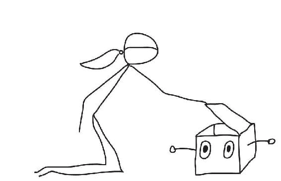

本书里人工智能指的是“机器学习程序”。（至于哪些东西属于人工智能，哪些不属于人工智能，请参考第 2 页中的图表。抱歉，就是那个披着机器人外皮的人类的图表。）就像我在第 1 章里解释的那样，机器学习程序是通过试错来解决问题的。但是这个过程具体是怎样的呢？整个过程中，完全没有人类告诉它语言的工作原理或者笑话到底是什么，在这种情况下，一个程序是如何从蹦出一堆乱无头绪的字母组合，一步步进化成可以写出具有可读性的敲门笑话的呢？

机器学习有很多种不同的方法，其中有些甚至已经存在了几十年，一般在人们开始把它们称作人工智能之前很长一段时间就诞生了。如今，这些技术或者被整合、被混用，以及与更快的处理器、更大的数据集相结合，它们变得比以往任何时候更加强大。这一章里，我们将讨论一些最为常见的机器学习方法，一窥它们学习和进步的秘密。

## 神经网络

现今，当人们提及人工智能或者深度学习时，他们实际上是在说人工神经网络。（人工神经网络有时也被称作控制论，或者联结主义。）

人工神经网络的构造思路其实非常多元，每一种都有自己擅长的角落。有的擅长图像识别，有的偏向语言理解，有的能生成音乐，甚至有人拿它去提升蟑螂养殖场的产量，还有专门用来产出让人摸不着头脑的冷笑话。归根到底，这些系统都在模仿大脑的工作方式。正因为如此才叫做人工神经网络，而它们的近亲生物神经网络才是更古老、也更精细的原型。上世纪五十年代，程序员写出第一批人工神经网络程序，本质上是为了验证关于大脑如何运作的一些假设是否成立。

换句话说，人工神经网络本质上是对人脑的一种仿制。

它由大量基础单元拼接而成，每个单元只执行极其简单的数学运算。这些单元常被称为细胞或神经元，与人脑的术语相对应。网络真正的力量并不在单元本身，而在于单元之间的连接方式。

以当下标准衡量，人工网络与真实人脑相比仍显粗糙。我为本书生成文字所用的那套网络，神经元规模大约只相当于一条线虫的水平。

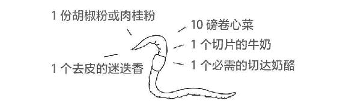

与人类不同，网络能把相当于线虫级别的全部算力集中到单一任务上，前提是我没有用无关数据把它带偏。那究竟怎样用一组相互联动的神经元来解决问题？

目前最强的人工网络一次训练往往需要数月时间和上千万美元的算力，其内部神经元数量远超我笔记本上那套，部分甚至已超过一只蜜蜂的神经元总量。2016年，一位业界领军研究者根据当时最大规模网络的增长轨迹推算，按这个速度到2050年，人造网络的神经元数量将追平人脑。[^(\[1\])](#part0031.html#notef1)这就意味着人工智能能达到人类智慧了吗？大概还不够。人脑里的每个神经元都比人造网络中的神经元复杂得多，复杂到单个脑神经元本身就像一座完整的多层人造网络。所以与个性脑由860亿个神经元构成，不如说它由860亿个微型网络构成。此外，人脑还拥有人造网络所不具备的诸多复杂机制，其中不少至今仍是谜。

## 神奇的三明治洞

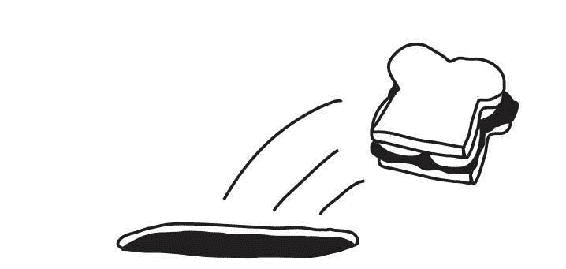

设想地面上出现一个奇幻的三明治洞，每隔几秒就会随机吐出一个三明治。好吧，我承认这个设定很荒唐。问题是洞口抛出的三明治配料极其离谱，可能出现果酱、冰块甚至旧袜子。要吃到好吃的三明治，就得整天守在洞口人工筛选。

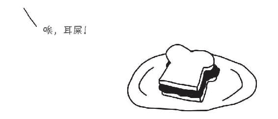

这么做既无聊又低效，真正美味的三明治少之又少。但正因为稀有且好吃，我们希望把这件事自动化。

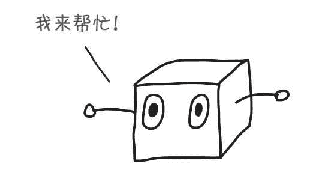

为了省时省力，我们打算让一个人工神经网络观察每个三明治，判断是否可口。先不谈如何识别原料，这本身已很困难；也先不谈如何分拣，这更困难，追踪运动轨迹就不易，更别说让机械臂既能夹住薄如纸的机油三明治，又能提起厚如保龄球的芥末三明治。我们假设网络事先已知每个三明治的成分，也不必担心搬运，只需判断它是否适合人类食用，是不是该直接丢进回收槽。回收槽如何运作也先不管，就把它当成另一个神秘的洞吧。

这样一来，目标就被压缩成一个明确具体的任务——正如第二章所说，这种转化通常能让机器学习算法更容易落地。现在我们有一组输入变量，三明治里各种原料的名称，还有一个输出变量，反映可口程度的评分。我们可以用一个简易的黑箱来表示这个算法，看起来像下面这样：

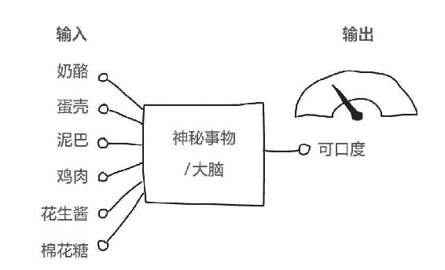

我们希望评分由原料组合决定。所以若一个三明治里有蛋壳和泥巴，黑箱应该给出很低的评分：

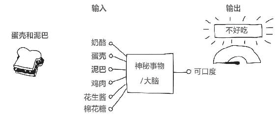

若含有鸡肉和奶酪，则应该给出很高的评分：

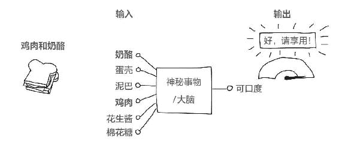

来看黑箱内部如何运转。

首先做简化，把所有输入变量和唯一输出变量直接连起来。为了得到可口度评分，我们把每种原料对美味的贡献累加起来。显然不同原料贡献不同，奶酪出现会提升美味，泥巴则会让人难以下咽。因此每种原料都有一个权重。好原料权重设为1，想避免的黑暗原料权重设为0。此时的人工网络大致如下：

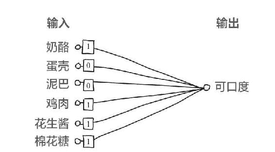

用几个样本三明治来验证。假设样本里只有泥巴和蛋壳，两者贡献都是0，最终可口度是0+0=0。

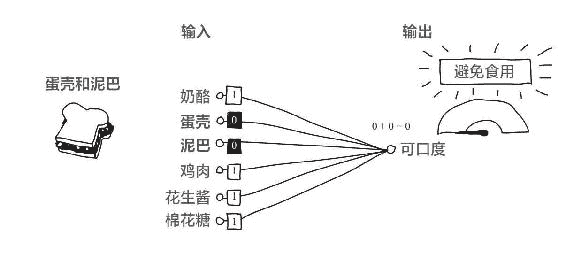

而一个花生酱加棉花糖的三明治会得到1+1=2的评分。恭喜，你撞上了新英格兰的棉花糖花生酱招牌三明治。
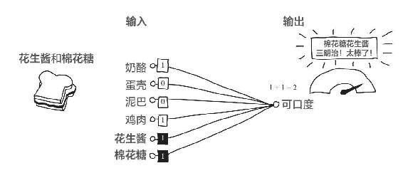

这样配置后，我们能避开只含蛋壳、泥巴等黑暗原料的三明治。但单层网络不足以识别那些本身好吃，却与其他原料搭配时会变得糟糕的食材。网络会把鸡肉加棉花糖的三明治评得和花生酱棉花糖一样美味。另外还会出现我们称之为大三明治故障的问题：如果三明治里堆满足够多的美味食材，哪怕里面掺了不可食用的木屑，也会被判定为美味。

要改进，就得加入另一层神经元：

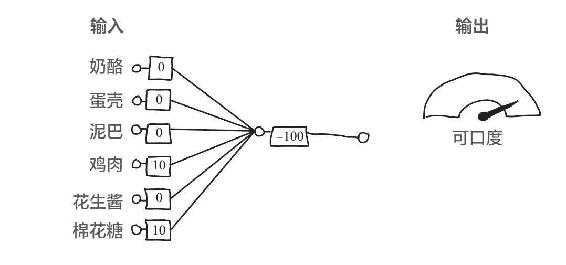

现在每个原料都先连到一层新的神经元，再由这些神经元连向输出。因为用户只能看到输入和输出，这层被称为隐含层，像是隐藏起来的。和以前一样，每个连接都有权重，对最终可口度产生不同影响。到这一步还不是深度学习，但已经在路上。

### 深度学习

在神经网络里增加更多隐含层，就能得到更复杂、比简单相加做得更好的算法。本章只加了一层，现实中的网络通常包含多层隐含层。每新增一层，就意味着可以用新的方式组合前一层的见解，复杂度不断提升。这种靠多层隐含层获得复杂能力的方法就叫深度学习。

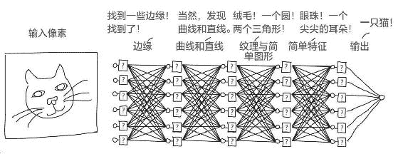

使用这个网络，我们把糟糕的原料连到一个我们称作惩罚器的神经元上，从而最终避开它们。给这个神经元一个非常大的负权重，比如-100，并把所有糟糕的输入以权重10与之相连。把第一个神经元设为惩罚器，并把蛋壳和泥巴连上去，结构就变成这样：

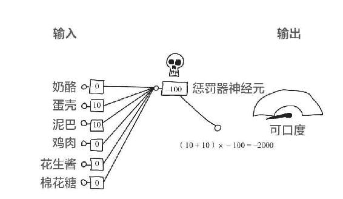

现在只要三明治里含有蛋壳或泥巴，无论其他神经元如何，网络极大概率会认为它很糟糕。借助惩罚器神经元，大三明治故障就能得到缓解。

剩下的神经元可以做其他事，比如学会哪些原料组合好吃。让第二个神经元专门识别鸡肉奶酪三明治，称之为美味三明治神经元。把鸡肉和奶酪以权重1连接，其他原料权重0，再以适中的权重1连向输出。美味三明治神经元很有效，但如果给它过高的权重，就可能削弱惩罚器神经元的影响。看看它起什么作用：

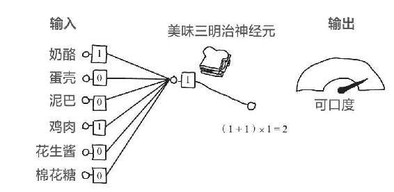

鸡肉奶酪三明治会让这个神经元向最终输出贡献1+1=2。把棉花糖加进去不会产生坏处，即使主观口感可能不佳。为了解决这个问题，需要别的神经元专门寻找并惩罚这种不合适的搭配。

比如第三个神经元可以寻找鸡肉和棉花糖的组合，姑且叫做棉花糖鸡肉，并对同时出现这两种原料的三明治进行严厉惩罚。连起来后是这样：

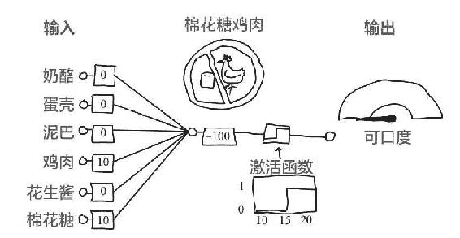

对于任何同时包含鸡肉和棉花糖的三明治，第三个神经元会返回毁灭性的10+10×-100=-2000。它像专业惩罚器一样，只为惩罚鸡肉与棉花糖的组合而生。这里额外加了一个激活函数，否则神经元会惩罚只含鸡肉或只含棉花糖的三明治。把阈值设为15，激活函数会在仅有鸡肉10分或仅有棉花糖10分时阻止神经元输出，返回中性0。但两种原料同时出现得到20分，超过阈值，神经元被激活，咚，被激活的神经元开始惩罚超过阈值的原料组合。

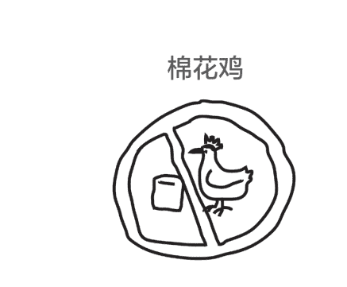

把所有神经元以类似的复杂方式相互连接后，我们就得到一个能从魔法洞里挑出最好三明治的神经网络。

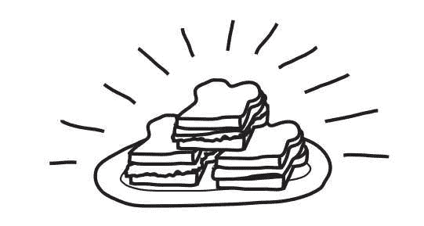

## 训练过程

现在我们知道一个完善的三明治分拣神经网络该怎么配置。但机器学习的关键优势在于，我们不必手动设定这些参数，神经网络应该能自己把参数调到能很好完成分拣工作的状态。这个训练过程到底怎么运行？

回到一个简单的两层网络。训练开始时它是一张白纸，每种原料的权重是随机的，很可能评分很糟糕。

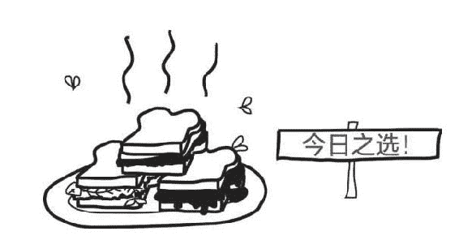

需要用真实世界的数据来训练它，一些由真实人类正确评价的三明治样本。当网络给三明治打分时，要把自己的评分和评审团的结果对比。请注意，永远不要主动去测试这些起步阶段的机器学习算法。

就这个例子而言，让我们仍用非常简单的网络。既然要从头训练，忽略所有关于权重该如何设定的先验信息，完全从随机权重开始。它们是这样的：

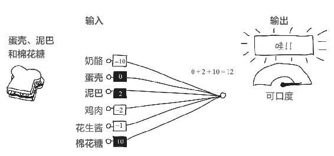

它厌恶奶酪，偏爱棉花糖，也喜欢泥巴，对蛋壳则比较中性，加不加都行。

网络开始思考第一个从三明治魔洞里抛出的三明治，然后用糟糕的判断打分。这是一个棉花糖、蛋壳和泥巴的三明治，得分为10+0+2=12。哇，很高的分数。

随后三明治交给人类评审团，无情的现实是，这个三明治并不受欢迎。

现在是网络自我提升的时刻：它开始思考如果权重稍有不同会怎样。对这个三明治，它不知道问题出在哪，是对棉花糖太兴奋，还是蛋壳并不中性有点烂，看不出来。但如果它能研究一批10个三明治，对比自己给出的评分和人类评审团的打分，就能发现，一般来说把泥巴的权重降低一点，降低所有含泥巴三明治的评分，评分就能更好地贴合人类。

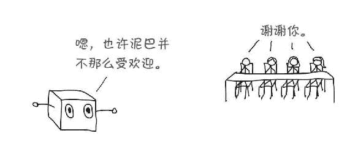

有了最新调整的权重，是时候开始下一次迭代。这个网络给另一批三明治评分，与人类评审团结果对比，再次调整权重。在上千次迭代、研究上万个三明治后，人类评审团已感到厌倦，但网络却越来越好。

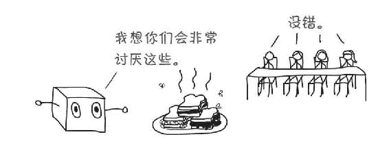

进步过程中会遇到很多陷阱。上面提到过，这个简单网络只知道原料单独的好坏，无法细致分析各种组合。为此它需要更复杂的结构，拥有更多神经元的隐含层。它需要进化出惩罚器神经元和美味三明治神经元。

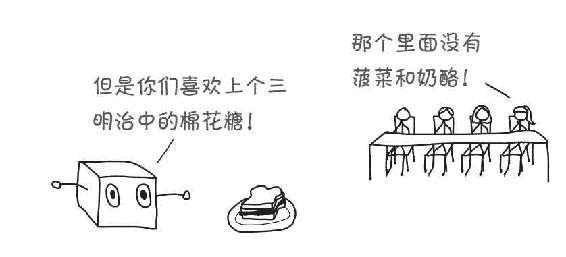

另一个必须警惕的陷阱是类别不平衡。三明治魔洞每产生一千个三明治，只有极少数是美味的。如果网络意识到这一点，它可以忽略一切，给所有三明治都打很低的分，就能实现99.9%的准确率，而不必辛苦搞清楚每种原料的合理权重或它们该如何搭配。

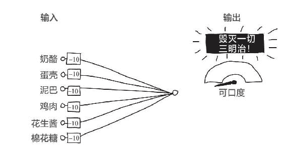

为了解决类别不平衡，我们需要预先过滤训练集里的三明治，保证好吃和糟糕的三明治比例大致相同。即便如此，网络仍可能学不到那些很少出现却在特定情况下非常美味的食材。棉花糖可能就是例子，和大多数常见原料在一起都很糟糕，但在棉花糖花生酱三明治里却很美味，也许和巧克力香蕉一起也不错。如果训练中从未见到或很少见到棉花糖花生酱三明治，网络可能就决定用拒绝所有含棉花糖三明治的方式来换取较高的正确率。

类别不平衡的问题在实际应用中屡见不鲜，通常出现在人工智能探测某种罕见事件时。预测客户流失时，留存客户远多于流失客户，人工智能可能走捷径预测所有客户都将永久留存。检测恶意登录和黑客攻击也类似，因为攻击很罕见。医学影像处理中也遇到类别不平衡，几百个细胞里只有一个异常细胞，人工智能很容易偷懒预测所有细胞都健康，从而得到高准确率。天文学家用人工智能时也遇到同样问题，因为他们感兴趣的天体现象很罕见，比如一个太阳耀斑探测程序可以通过预测零耀斑达到近乎100%的正确率，因为耀斑在训练数据中太罕见了。[^(\[2\])](#part0031.html#notef2)

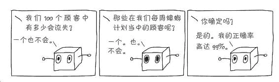

## 当神经元共同工作时

在分拣三明治的例子里，我们看到新增一层神经元如何让网络完成更复杂的任务。我们构建美味三明治神经元应对美味肉类和奶酪的组合，同时构建棉花糖鸡肉神经元惩罚不合适的组合。但在一个会自我训练并通过试错调整连接的神经网络中，辨别出每个神经元具体在做什么通常很难。任务往往分散在多个神经元中，对于其中一些神经元，判断它们具体完成什么任务非常困难，甚至不可能。

为了探索这种现象，来看看训练完成后神经网络中的一个神经元。这个网络由OpenAI的研究人员构建和训练[^(\[3\])](#part0031.html#notef3)，它逐字母读完了亚马逊上超过8200万条商品评价，用来预测下一个会出现哪个字母。这是递归神经网络的例子，和我们在第一章和第二章里见到的生成敲门笑话、冰淇淋口味和菜谱的网络属于同一种。不过它更大，神经元数量大概和水母相当。下面是一些它生成的评论：

这是一本很棒的书。我会把它推荐给所有喜欢这些人物的绝妙故事和这个图书系列的人。

我喜欢这首歌。我一遍一遍地听却从未厌倦。它是如此令人着迷。我爱它！

这是我用的淋浴间清洁产品中最棒的。它既不油腻也不会形成水渍，或弄脏白色地毯。我已经用了几年了，它一直效果很好。

这些健身光盘非常有用。你可以用它们覆盖你的整个屁股。

买的时候我以为它会对车库很好。谁有许多的湖水？我完全错了。它简单而迅速。夜晚的灰熊并没有伤害它，我们已经买了三个多月了。客人们都深受启发，他们真的很享受。我的爸爸也爱上了它！

这个网络为每个可能出现的字母或标点符号保留一个输入位，类似于三明治分拣器为每种原料保留输入位，同时它会回顾过去几个字母和标点符号。它就像一个三明治评分器，但评分依赖于过去见到的几个三明治，也许能追踪我们是否已对奶酪三明治感到厌倦，然后相应调整下一个三明治的评分。这个写评论的网络有许多输出位，每一个对应评论中最可能出现的字母或标点符号，而不是像三明治分拣器那样只有一个输出位。如果它看到序列“我拥有20个打蛋器而这一款是我的最”，那么“爱”字就会成为最可能出现的下一个字。

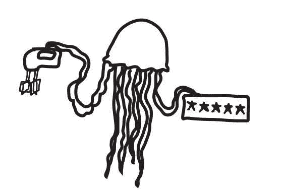

根据这些输出，我们可以检查每个神经元是否被激活，从而对它的功能做出有根据的猜测。在上述三明治分拣器的例子中，美味三明治神经元会在看到大量肉类和奶酪时被激活，在看到袜子、弹珠或花生酱时则不会。然而，这个亚马逊评论网络中的大部分神经元都不会像美味神经元和惩罚器神经元那样容易解释。相反，绝大多数网络学到的规则对我们而言都是无法理解的。有时我们能猜测一个神经元的功能是什么，但通常情况下，我们完全不知道它在干什么。

这是产品评论算法的一个神经元，第2387个在生成新评论时的激活程度，灰色代表激活，黑色代表未激活：

对我而言，这是我买过的他们的专辑中少有的让我瞬间成为古典流行歌迷的一张。我对于10首新歌的音频也有很大问题；人声和剪辑的执行很糟糕。第二天，我在一个录音棚里，我无法告诉你我必须按几次播放按钮才能查看歌曲的播放进度。

这个神经元对网络预测下一个字母有贡献，但它具体的功能却是一个谜。它对特定字母或特定字母组合有反应，但这种方式在我们看来毫无规律。为什么它对专辑中的“辑”字而不是“专”字感到兴奋？它只是和其他许多神经元一起工作的一个小谜团而已。神经网络中的几乎所有神经元都像这个神经元一样神秘。

## 态度神经元

然而，偶尔会出现一个很容易识别职责的神经元，一个在括号中间时激活，或是句子越长就激活强度越高的神经元。[^(\[4\])](#part0031.html#notef4)训练这个产品评论网络的研究人员发现，其中有一个神经元在做他们能看懂的事，它对应评论是正面还是负面。作为预测评论中下一个字母任务的一部分，这个网络似乎发现判断是要夸奖还是批评产品是很重要的。下面是这个“态度神经元”在同一条评论上的激活程度，注意灰色代表高激活度，意味着它认为这条评论是正面的：

对我而言，这是我买过的他们的专辑中少有的让我瞬间成为古典流行歌迷的一张。我对于10首新歌的音频也有很大问题；人声和剪辑的执行很糟糕。第二天，我在一个录音棚里，我无法告诉你我必须按几次播放按钮才能查看歌曲的播放进度。

这条评论开头非常正面，于是态度神经元高度激活。然而在中间，口吻改变了，于是这个神经元的激活程度一落千丈。

下面是另一个态度神经元在工作的例子。当评论是中性或批评性的时，它的激活程度很低。但当它探测到态度上出现改变时，它就快速地跳入高位。

手头这份《哈利·波特》档案是拿前作规格来的，带着标准衬里，份量感直接飙到一吨级别，体量大到有点荒诞。搬不动归搬不动，质感真的上头，我甚至脑补过把它塞进厨房里每一台吐司机里试试。这部作品在我心里的喜剧天花板名列前茅，也是多年来一直挂念的挚爱，见人就安利。

可情绪倾向的判断就拉胯了。绝大多数读者读到埃德加·爱伦·坡《厄舍府的崩塌》里这段描写，第一反应都是被压抑的负面感受，而模型却给出了基本正向的打分：

我被强烈的恐怖情绪压倒，它无法解释却难以忍受。我匆忙地穿上了衣服（因为我觉得我今晚不该再睡了），并努力使自己摆脱我陷入的可怜状况，快速地步入公寓。

换个说法，如果一部片子本意就是用强烈的恐惧把观众钉住，并且这个效果就是导演想要的，那从目的论看，它完全算得上成功之作。

说到底，像态度神经元那样边界清晰、功能一目了然的单元，在做生成或做分析的文本模型里几乎算稀有动物。别的网络架构也类似——这点让人挺沮丧，我们很想判定它们有没有犯低级错误，并从错误里学点东西。

好在图象识别这边，好寻到能看懂在干嘛的神经元。输入是整张图的像素堆，输出是各种分类标签，比如犬、猫、长颈鹿、蟑螂之类。多数视觉系统内部塞了大量隐层。借助合适的剖析手法，能揪出某些神经元或群体在做什么。既能追踪特定物体出现时被点亮的单元，也能对输入图像做微调，观察哪些改动会显著改变激活强度。

### 深度梦境
把图往让某个单元更兴奋的方向去推，正是谷歌当年深度梦境项目的主打招数。在那个项目里，视觉识别网络会把普通照片扭成布满犬脸与拱形窗的混搭风。

想做一张深度梦境图，先拿一个已经训好用来认物的网络，比如会认狗的模型。然后挑定一个单元，逐步改动像素让兴奋度持续攀升。要是这个单元负责犬脸，它在画面里撞见像犬脸的特征时会活跃。把图像调到它最爱的形态，画面就会严重畸变，全是狗。

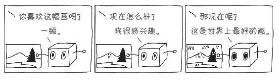
最底层的单元群基本只在捕捉边缘、色彩和基础纹理，会传递竖线、弧线或类似绿色草地的纹理。再往后几层，规模更大的群体开始组合边缘、色彩、纹理以及简易特征。比如谷歌的研究者拆解 GoogLeNET 时发现，内部有个单元专门锁定动物耳朵的圆润或尖锐形态，用来区分猫和狗。[^(\[5\])](#part0031.html#notef5)另外一些单元对毛发或瞳孔特别敏感。

生成式网络里同样藏着可辨识的工作单元。可以给生成网络做“脑外科手术”，看看输出会怎样变化。[^(\[6\])](#part0031.html#notef6)麻省理工的研究团队发现，通过阻断某些单元的激活，就能把生成图像里的特定元素抹除。有趣的是，网络判定为“关键”的元素更难去除——比如在会议室画面里，删地毯比删桌椅容易得多。

接下来看看另一种算法，如果你用过智能手机的文本预测，你早就跟它打过交道了。

## 马尔可夫链
马尔可夫链解决的问题和递归神经网络很像，比如书里提到的生成菜谱、冰淇淋口味、亚马逊评价和摇滚乐队名称。它也是先观察历史发生了什么，比如句子里前面出现的词或上周的天气，再预测下一步最可能的走向。

相比大多数神经网络，马尔可夫链更轻量、训练门槛更低，这也是手机通常用它做文本预测，而不用递归神经网络的原因。

问题在于，记忆窗口越长，复杂度就呈指数级膨胀。常见的文本预测马尔可夫链只保留 3 到 5 个词的历史。相比之下，递归神经网络可以覆盖几百个词的长度，配合长短期记忆和卷积技术还能更长。我们在第 2 章就见识过记忆长度的重要性，太短就会遗忘关键信息。对马尔可夫链同样适用。

我在迪士尼歌曲语料上用一个可训练的预测键盘搭了一个马尔可夫链。[^(\[7\])](#part0031.html#notef7)训练只花了几秒，远快于递归网络的几分钟。但这个链只有三个词的记忆，也就是建议的词基于歌词里前三个词的共现概率。当我用它生成一段歌词，每一步都选它给出的最佳推荐时，就得到下面的结果：

那片海）

在那片海之下）

在那片海之下）

在那片海之下）

在那片海之下）

在那片海之下）

在那片海之下）[^(\[8\])](#part0031.html#notef8)

它完全不知道“在那片海之下”要唱几次，因为它记不得自己已经唱过多少次了。

如果用《美女与野兽》的开头“和岁月一样古老的故事”作为起点，它也会很快卡住：

和岁月一样古老的故事

和岁月一样古老的歌谣[^(\[9\])](#part0031.html#notef9)

和岁月一样古老的歌谣

和岁月一样古老的歌谣

在《美女与野兽》的几句里，“和岁月一样古老的故事”后面紧接着的是“像韵律一样古老的诗”。但当这个马尔可夫链看到“一样古老”这个短语时，它分不清自己到底在哪一句。

我可以通过在每一步选择第二可能的提示词来摆脱这个陷阱。这样它就会写道：

整个世界

聪明而年轻的主人

你和所有人在一起

你以为你与奇迹同在

与力量同在

我很沮丧

孤独的地狱火黑暗的一面

如果每次都挑第三可能出现的词，结果则是：

你以为我可以开门

我们将在这里看到你的感受

我所有的梦想将是我的

之前的某些东西

她会更好的时间

看起来更有趣了，但依然毫无意义。歌词和诗文在语法、结构和连贯性上的要求本来就很宽松。如果我给马尔可夫链换一个完全不同的训练集，它的短板会更明显。

下面是一个在大量愚人节恶作剧上训练的马尔可夫链，每一步都挑接下来最可能出现的词。它从不建议标点，所以行与行之间的停顿是我加上去的。

将门把手从门上取下，然后轻轻地向后放回去

全天不做任何事情，在报纸上刊登某人的广告，以一次恶作剧即将发生的车库销售

然后，整天不做某人在纸上某人的广告，以在进行一次车库拍卖的广告……

一个用于文本预测的马尔可夫链不太可能和顾客对话，或写一篇用于新电脑游戏探索的故事——这两件事正是人们努力训练递归神经网络未来能做到的。但在特定训练集里预测下一个词是什么，它是可以做到的。

比如 Botnik 的研究人员在各种数据集上训练马尔可夫链，为人类作者提供提示词，数据集包括哈利·波特系列图书、《星际迷航》剧集、Yelp 餐厅评论等等。马尔可夫链生成的提示往往出人意料，可以把文字引向怪诞的超现实方向。

我也可以让马尔可夫链给我一串选项而不是让它用过短的记忆自己决定下一个词，这正是你给别人发信息时预测文本的做法。

下面是和 Botnik 在哈利·波特系列上训练的马尔可夫链互动时的样子：

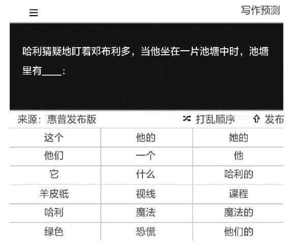
这里是一些我在马尔可夫链文本预测帮助下写出的愚人节恶作剧：

将保鲜膜颗粒放在嘴唇上。

将厨房水槽排成鸡头的模样。

将荧光棒放在手中，假装在屋顶上打喷嚏。

将马桶座垫成裤子，然后让你的汽车撒尿。

为了方便比较，我还用了一个更复杂、数据更大的递归神经网络来生成愚人节恶作剧。这次递归神经网络会生成完整的恶作剧，包括标点。不过依然有人的创造力参与——我必须把每条生成的恶作剧都过一遍，挑出最好笑的。

在某人的办公电脑中做饭。

如果办公楼只有一个入口，请隐藏所有入口。

呆呆地盯着某人的计算机鼠标，以使其不起作用。

放一个装有玛氏巧克力豆、彩虹糖混合物的碗。

在你的制冰机中放一条裤子、一双鞋。

你可以用大多数手机短信应用的文本预测功能做类似实验。如果你以“我出生在……”或“从前……”作为开头，然后一直点手机提示的词，就能得到一段由机器学习直接写出的怪异段落。因为训一个新马尔可夫链相对简单快速，你得到的内容会针对你个人。你手机上的文本预测和自动更正的马尔可夫链会在你打字时更新参数，用你写的内容来训练自己。这就是为什么当你打错字时，错误会影响输入法，可能困扰你一段时间。

谷歌文档就曾是这种效应的受害者。用户反映自动更正会把“a lot”改成“alot”，同时建议把“going”改成“gonna”。当时谷歌用的是基于情景感知的自动更正，会根据互联网结果决定建议哪些词。[^(\[10\])](#part0031.html#notef10)另一方面，情景感知的自动更正能发现一些打字错误，比如把“想要”打成“相要”，同时在新词变得常见时纳入系统。然而每个网民都知道，常见的用法和语言处理器自动更正所提供的、语法上正确的正式用法往往相去甚远。虽然谷歌没有具体谈过这些故障，但用户反映后这些问题确实消失了。

## 随机森林
随机森林是一种机器学习算法，常用于预测和分类，比如预测用户行为、推荐图书或判断红酒品质，基础是一系列输入数据。

要理解随机森林，先从树开始。一个随机森林由许多独立的决策树单元组成。决策树本质上是一个根据已有信息推测结果的流程图。另外，它看起来确实像一棵倒着长的树。

下面有一棵决策树的例子，目的是虚拟判断是否要清空一个巨型蟑螂农场。

这棵决策树会追踪我们对信息——不祥的噪声、蟑螂的出现——的使用方式来决定如何应对当前情况。正如我们的三明治分拣决定会随神经元数量增加而更复杂一样，树越大，我们应对蟑螂各种情况时就能更细致。

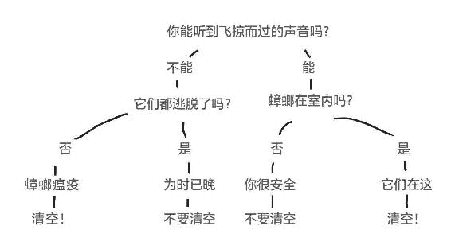
如果蟑螂农场安静得令人吃惊，但蟑螂却没有逃脱，也许会有“它们都死了”之外的解释，也许更令人不安。决策树越大，我们能问的问题就越多，比如附近是否有死蟑螂，人们认为蟑螂有多聪明，以及毁灭蟑螂的机器是否被神秘破坏了。

当输入信息和选择很多时，决策树会变得非常大，如果用深度学习的术语说，就是非常深。它可能深到包含训练集中所有可能的输入、决定和结果，但那时流程图只能在训练集涉及的场景里工作，也就是过拟合。一个聪明的人类专家可以聪明地构建一棵巨大的决策树来避免过拟合，同时应对大量决策问题，而不会迷恋一些特定、可能无关的数据。比如说，如果上一次蟑螂逃出来时天气多云凉爽，人类足够聪明就知道同样的天气和蟑螂是否跑出来没有关系。

替代人类仔细构建巨大决策树的一种方式是机器学习里的随机森林算法。与神经网络通过试错调节不同单元间的连接类似，随机森林通过试错来配置自己。一个随机森林由一系列小、也就是浅的决策树组成，每棵树只考虑一小部分信息，做一些简单的决定。训练过程中，每棵浅树会学到哪些信息该注意，结果应该是什么。每棵小树的决定可能并不好，因为它基于有限信息。但如果森林里的所有小树汇总决定，通过投票决定最后结果，它们会比单棵树更精确。同样现象对人类投票者成立：如果人们猜瓶子里有多少颗弹珠，每个人猜测可能差很远，但平均下来会很接近真实答案。随机森林的树可以汇总它们对各种对象的决策，对于极复杂场景也能勾画出准确的图景。比如最近的一个应用是整理成千上万的基因组模式，以确定导致危险大肠杆菌爆发在哪种牲畜中。[^(\[11\])](#part0031.html#notef11)

如果我们用随机森林应对蟑螂问题，其中的一些决策树可能长这样：

目前，每棵单独的树只能看到当前情况很小一部分信息。也许我们有一个很合理的理由解释为何巴尼不在附近——也许巴尼休病假了。而且如果蟑螂还没有吃掉超级血清，那也不意味着我们就安全。也许蟑螂取走了超级血清的样本，或者甚至在为农场里的 17 亿只蟑螂酿造一大批样本。

但决策树会把它们的直觉组合起来，所以当巴尼神秘消失、血清不见，同时你的密码被神秘修改时，清空就成了一个深思熟虑后的决定。

## 进化算法
人工智能通过先猜测问题的答案再检验来改进理解。上面提到的三种机器学习算法都是通过试错改进自身结构，产生最适合解决问题的神经元、链或树的配置。最简单的试错方法是永远往进步方向走——如果你想最大化一个数字，比如《超级马里奥兄弟》里的分数，这通常叫爬山算法；如果你想最小化一个数字，比如逃脱的蟑螂数量，这通常叫梯度下降。但这种简单接近目标的方法并不能永远给出最好结果。为了可视化简单爬山算法的陷阱，请想象你在山上某处，而且大雾弥漫，努力寻找山的最高点。

如果你用简单的爬山算法，无论如何你会一直往上爬。但考虑到起点位置，你也许最终会停在最低的峰顶——一个局部最大值——而不是最高的峰顶，即全局最大值。

所以一些更复杂的试错算法会强迫你多试一会儿，也许先在几个不同方向做几次试验性探索，然后再决定哪里最有希望。

用机器学习术语说，这座山叫搜索空间——空间里某个地方是目标，也就是山顶，你想努力找到它。有些搜索空间是凸的，这意味着基本的爬山算法每次都能帮你找到山顶。其他的搜索空间更烦人。而最糟的是所谓的大海捞针问题，此时你几乎没有任何线索描述距离最优解有多远，直到你真的抵达最优解那一刻。搜索素数就是一例大海捞针问题。

机器学习算法的搜索空间可以是任何东西。比如说，搜索空间可能是组成一个可行走机器人的身体各部分的形状。它也可能是神经网络中所有可能权重的集合，此时“山顶”就是帮助你识别指纹或人脸的权重。搜索空间还可能是一个随机森林算法中可能的配置方式，此时你的目标是找到擅长预测用户最喜欢的图书或者蟑螂农场是否应该被清空的配置。

正如我们前面学到的那样，如果可能神经网络配置组成的搜索空间并不那么凸，基本的搜索算法，比如爬山算法或梯度下降，也许不会帮你取得什么进展。所以机器学习研究者有时会转向其他更复杂的试错方法。

其中一个策略的灵感来源是进化的过程。模仿进化是有道理的——毕竟，如果进化不是一代代的“猜测与检验”过程，它又是什么呢？如果一种生物和它的近邻在某些方面不同，而这种不同又能令它在生存和繁衍中取得优势，那么它就会把这种有用特质遗传给下一代。一种比同类其他个体游得更快的鱼也许更容易逃脱捕食者，于是几代之后，它擅长游泳的后代就会比游得慢的鱼的后代更常见一些。而且进化是一个极具威力的过程——它解决了数不尽的移动和信息处理问题，想出了从阳光和热液喷口中提取食物的方法，还想出了如何发光、飞行和以看起来像鸟粪一样的外观来躲藏捕食者。

在进化算法中，每一种可能的解决方案就像一个有机体。在每一代中，那些最成功的解决方案得以生存下来，繁殖、突变或和其他解决方案配对来产生不同、希望更好的后代。

如果你拥有努力解决复杂问题的经验，把每一种潜在解决方案当作生物可能会让你感到脑袋爆炸，更别提进食和交配了。但让我们具体考虑一下。比如说我们想解决一个人流控制问题：有一个叉状分开的走廊，我们想设计一个机器人，让它导引人们选择走其中的一边或另一边。

我们做的第一件事就是确定进化算法会改变哪些参数，决定机器人哪些方面要事先固定，算法可以与哪些部分交互。通过设计固定的身体，我们可以把变量限制在有限范围内，仅允许算法来改变机器人移动的方式。或者我们也可以允许算法从随机的小圆点开始，完全从头构建机器人的身体。我们假设这栋建筑的主人出于科幻审美的原因，坚持要设计一个看起来像人类的机器人。混乱的爬行块——当拥有绝对自由时，进化算法创造的生物通常看起来就是这样的——是不行的。在基本人形框架下，我们依然有很多可以改变的东西，但让我们搞得简单一点儿：允许算法改变一部分基本身体部件的大小和形状，每个部件均有一个简单的移动范围。用进化学术语说，这是机器人的基因组。

下一步是定义我们想要解决的问题，从而拥有一个可以做最优化处理的具体的数字。用进化学术语说，这个数字就是适应度函数：一个描述某个机器人有多适合我们任务的数字。因为我们想要构建一个能在两条路的分岔口导引人们继续前行的机器人，比方说我们想要最小化人们走左侧通道的人数。这个数字越接近零，适应度就越高。

## 进化算法与模拟器
我们还需要一个模拟器，因为我们没有办法定制几千个机器人，或是雇人沿着走廊走几千次。不用真实的人类也是出于安全考量——这些原因稍后会变得更明显。所以比如说那是一个存在模拟的重力、摩擦力及其他物理存在的世界中的虚拟走廊。以及当然，我们需要虚拟的人和虚拟的行为，包括行走、视线、人群以及各种恐惧症、动机和不同程度的合作。这种模拟本身就是非常难的问题，所以我们假设我们已经解决它了。请注意：在实际的机器学习中，这并不简单。

得到可用的训练人工智能的环境的简单办法，是使用电脑游戏。这就是为什么有如此多研究人员训练人工智能玩《超级马里奥兄弟》，或者古早的雅达利游戏的部分原因——这些老游戏体量小，运行迅速，便于测试多种解决问题的技巧。就像人类电脑游戏玩家一样，人工智能也喜欢寻找和利用游戏中的漏洞。第 5 章中会有更多这方面的内容。

我们让算法随机生成我们的第一代机器人。它们……非常之随机。通常一代会产生几百个机器人，每一个都有不同的身体设计。

进化机器人：当适应度函数走偏了

随后，我们把每台机器人在仿真里单独跑一遍。表现普遍拉胯。它们摔在地上扑腾时，行人基本直接绕开。有那么一台恰好倒得更靠左，身体正好卡住了左通道一小块，胆小的人就改走右边。这台机器的得分因此略胜一筹。

进入下一轮世代构建。首要任务是挑出能留下后代的个体。若只锁死最优者，种群很快会同质化，也会丢掉那些现在还平平无奇、稍加微调后可能大放异彩的设计。因而我们只保留一批顶尖个体，其余淘汰。

幸存者怎么生孩子，也有不少玩法。不能一模一样复制，否则就不会进步。其中一种叫变异：随机挑一台机器，随机改动它的某个参数或结构。

另一种常见做法是交叉繁殖。两个父体的基因片段被打乱重组，拼出新的后代。

还有一堆细节要定：单台机器能生几个孩子，是否让冠军多生，配对规则怎么设，要不要开放交叉，淘汰的空位是全部用子代填满还是混入全新随机个体。这些决策共同组成进化算法的超参数，往往很难提前判断哪套组合最有效。

世代成型后循环重启。继续在模拟里检验它们疏导人流的效果。因为新一批个体的祖先正是第一代里稍好一点的向左倒个体，所以向左倒的情况明显增多。

随着代际堆叠，行为开始分化。学会站立后，“左倒挡路”升级为“站在左通道里碍事”。还有一类开始拼命指向右边。但这些招式都没能真正解决问题，左通道依然有大量行人漏过去。

演化很久之后，终于出现了一台几乎能把人彻底挡在左通道外的机器。坏消息是，它的办法是“全员击杀”。从纯技术角度看它确实达标，因为目标函数只要求压低左通道入口人数。

这就是适应度定义不当引发的副作用。进化总会找到我们没想到的捷径去刷分，这类取巧在机器学习里屡见不鲜，只是多数没这么极端。幸好现实中让机器杀人并不现实，但它提醒我们别给自动化系统致命权限。正因如此，我们才用模拟人群做思想实验。

没办法，只能重启。这次把评价标准改成最大化走右通道的存活人数，而非最小化左通道人数。

其实不必完全清零，可以走条迁移的捷径。旧种群已经掌握站立、感知行人、手臂吓唬人等能力。把目标换成让更多幸存者走右，机器人理应很快放弃杀戮。正是迁移学习的思路：把相关任务的经验搬过来用。

我们就直接拿这批杀手机器人开刀，悄悄换了评分规则。瞬间，杀人不再加分，甚至扣分。最不会杀人的个体反而暂时领先，因为它的受害者尖叫着跑进了右通道。随后几代里，种群的杀戮能力快速衰退。

最终状态可能只是“看起来想杀你”，靠恐吓把人群赶向右边。从杀手机器人出发，搜索空间被锁定了。若从零开始，或许能进化出站在右通道尽头招手的人形，或双手变成“免费饼干”招牌的奇葩。但后者很难出现，因为标识必须完整才有效，半成品得不到任何奖励，属于典型的针尖在大海里找。[^(\[12\])](#part0031.html#notef12)

排除杀人路线，最现实的分支是“倒地挡路”一脉继续变本加厉。倒下门槛低，进化很容易走这条懒路。顺着它，最终能得到一台让百分百人走右、且不伤人类的机器。长这样：

没错，进化出来的就是一扇门。

这再次说明AI的尴尬：用复杂方法重新实现了我们本能就懂的常识。

进化算法的用处远不止机器人。能吸收撞击的保险杠、能缠绕药用蛋白的蛋白、永不停止的飞轮，都曾被进化算法设计出来。基因也不必只描述实体，汽车的硬件固定，控制软件可进化；权重、决策树结构都能当基因。多种学习范式因此可以拼装协同。

回望地球生命的漫长演化，我们才明白虚拟进化能把这种创造力加速放大。正如自然造出了能利用奇葩食物的生物，进化算法也常带来惊喜。当然，它偶尔也会太有“创意”，这一点会在第五章再聊。

## 生成式对抗网络：造假者与鉴别者

神经网络在图像上的花活不少：夏景变冬景、凭空捏造人脸、把猫照改成立体主义油画。这些吸睛的生成、混搭和滤镜，大多出自生成对抗网络。它是神经网络的一支，提出时间也晚，2014年才由伊恩·古德费洛领衔的蒙特利尔团队率先发表。[^(\[13\])](#part0031.html#notef13)

核心在于它由一对对手同时训练。生成器负责模仿训练集，判别器负责挑出仿作与真品的差距。

为了说明原理，举个造马图为例。

先得凑齐马的样本。样本越单一，训练越快：同一种马、同一种姿势、统一光照、纯白背景。背景杂了，它得额外学篱笆草地人群。数据集中时模型才好发力——只喂猫脸能造出照片级猫脸，只喂俯视拉面能复刻拉面。只喂郁金香也能造出逼真郁金香，却不懂别的花。只造头部也不知道脖子以下和后脑，更不懂闭眼。所以造马最省事的就是侧面白底马图，这也刚好在我的画工范围内。

有了数据，就能开训。生成器要从样本里摸出规律，学会画马。实现上它输入随机噪声，输出一张马图，噪声不同图就不同。

训练初期生成器一窍不通，噪声进去后乱涂一气，这就是它眼里的马。

怎么给烂画反馈？算法需要可量化的分数。直觉上用“能骗过人多少比例”很合适，人眼确实能辨真假。但训练要上千张图，人评不现实，而且人太苛刻，两张画都判为非马，哪怕一张更像一点。按“能骗过人类”给分，生成器永远得不到正向信号。

所以需要判别器。它负责看图判断真假。初期它也不聪明，只能大概分清涂鸦和真马。稍像一点的涂鸦就能糊弄它。

随着对抗，两个网络都越发厉害。

说白了，GAN就是内部图灵测试，生成器参赛，判别器当评委。最终目标是造出能骗过真人的马图。

有时目标不是照抄，而是“像但不同”。有团队用GAN造抽象艺术，要求既像训练集又不属于某个具体类型。判别器同时检查相似度和不可归类，这种矛盾压力让模型走在保守与创新之间，最后作品人气爆棚，甚至获评比真人画作更高的分数。[^(\[14\])](#part0031.html#notef14)

## 算法混搭：让多个模型一起上岗

GAN已经展示了算法组合的力量。

其实很多AI都是把专精小模型拼装而成。

微软的Seeing AI就很典型，为视障人士提供不同频道：说出眼前有什么、把手机镜头里的文字读出来、辨认钞票面值、认人并判断情绪、扫条形码。每项功能大概率由独立训练的小模型负责，包括背后的文字转语音。

艺术家格雷戈里·夏通斯基在项目《这不是真正的你》里串联了三套模型：一个造抽象画，一个做风格迁移，一个给作品自动命名《多彩沙拉》《火车蛋糕》《坐在岩石上的比萨》。整件作品是多模型协作的策划品。[^(\[15\])](#part0031.html#notef15)

更紧密的融合也存在。戴维·哈和尤尔根·施米德胡贝用进化算法训练了一个能玩《毁灭战士》关卡的脑启发系统。它由三模块构成：视觉模块把像素转成可追踪特征，判断有无火球、墙壁；记忆模块像文本预测那样预判下一帧，火球会继续左移或变大；控制器决定走位，是该往左闪还是硬抗。三者协同完成躲避。[^(\[16\])](#part0025.html#note2)

三模块一起工作，看见火球、推断靠近、及时躲开。研究者为每个子任务挑最合适的模型，这正是机器学习擅长的：细分任务，专用模型。选型和分解，是设计好系统的关键。

下一章我们再聊更多设计思路，有成功也有翻车的。

[\[1\]](#part0023.html#note1) Ian Goodfellow, Yoshua Bengio, and Aaron Courville, Deep Learning (Cambridge,Massachusetts: The MIT Press, 2016).

[\[2\]](#part0025.html#note2) Sean McGregor et al., “FlareNet: A Deep Learning Framework for Solar Phenomena Prediction” (paper presented at the 31st Conference on Neural Information Pro cessing Systems, Long Beach, CA, December 8, 2017), https://dl4physicalsciences.github.io/files/nips\_dlps\_2017\_5.pdf.

[\[3\]](#part0026.html#note3) Alec Radford, Rafal Jozefowicz, and Ilya Sutskever, “Learning to Generate Reviews and Discovering Sentiment,” ArXiv:1704.01444 \[Cs\], April 5, 2017, http://arxiv.org/abs/1704.01444.

[\[4\]](#part0026.html#note4) Andrej Karpathy, “The Unreasonable Efectiveness of Recurrent Neural Networks,”Andrej Karpathy Blog, May 21, 2015, http://karpathy.github.io/2015/05/21/rnn-efectiveness/.

[\[5\]](#part0026.html#note5) Chris Olah et al., “The Building Blocks of Interpretability,” Distill 3, no. 3 (March 6,2018): e10, https://doi.org/10.23915/distill.00010.

[\[6\]](#part0026.html#note6) David Bau et al., “GAN Dissection: Visualizing and Understanding Generative Adver sarial Networks” (paper presented at the International Conference on Learning Representations, May 6–9, 2019), https://gandissect.csail.mit.edu/.

[\[7\]](#part0027.html#note7) “Botnik Apps,” Botnik, accessed August 3, 2019, ttp://botnik.org/apps.

[\[8\]](#part0027.html#note8) 第一句原文为 the sea，第二句至最后均为 under the sea。——编者注

[\[9\]](#part0027.html#note9) 原文为“Tale as old time”及“song as old as time”。——编者注

[\[10\]](#part0027.html#note10) Paris Martineau, “Why Google Docs Is Gaslighting Everyone about Spelling: An Investigation,” The Outline, May 7, 2018, https://theoutline.com/post/4437/why-google-docs-thinks-real-words-are-misspelled.

[\[11\]](#part0028.html#note11) Shaokang Zhang 等, “沙门氏菌肠炎沙门氏菌伤寒血清型的动物源归因：利用美国的基因组监测数据”, 《新发传染病》25, 第 1 期 (2019): 82–91, https://doi.org/10.3201/eid2501.180835.

[\[12\]](#part0029.html#note12) 此处“跳蚤”的英文（flea）和“免费”的英文（free）是很接近的。——译者注

[\[13\]](#part0030.html#note13) Ian J. Goodfellow 等, “生成式对抗网络”, ArXiv:1406.2661 \[Cs,Stat\], 2014 年 6 月 10 日, http://arxiv.org/abs/1406.2661.

# 第 4 章 AI 硬撑的那些坑

前面我们聊过人工智能是怎么学会解决问题的、它擅长哪一类任务、以及它天生的短板。现在把镜头对准短板本身——很多时候 AI 的方案用起来特别鸡肋，从小烦到大坑都有。本章要拆解为什么 AI 经常搞不定实际问题，以及我们能怎么规避。根源通常就几类：

· 题目本身范围太大；
· 喂给模型的数据量不够；
· 顺手塞进去了模型会懵的噪声数据；
· 训练时简单，现实里复杂得多；
· 在不像真实世界的模拟里练出来的。

## 题目太宽，模型就迷路

这个点我们其实在第二章就点过，AI 擅长的任务都相对收敛。脸书早期的智能助理 M 失败，就是因为任务边界模糊，模型根本不知道怎么给人一个靠谱的回应。

2019 年，英伟达的研究团队用 StyleGAN 生成人脸，效果惊人，照片级逼真，只是在耳环、背景等细节上偶尔失手。换一批猫的照片去训同样的架构，出来的猫却长着多余的四肢、双眼、扭曲的脸颊。差别在于，人脸训练集基本全是正脸、角度统一；猫的图库则五花八门，有行走的、有蜷着的、有侧脸的，甚至混进有人类的合照。模型要从各种姿态、场景里提炼“猫是什么”，难度瞬间拉满。同样一个基础模型，人脸显神，猫脸露怯。任务越聚焦，AI 看起来越聪明。

## 数据太少，智商直接掉线

前面提到的 StyleGAN 只是个缩影，书里讲的大多数模型都属于“看得多就会了”的样本学习型。样本够多——猫名、马的画、安全的驾驶决策、市场走势——它就能摸出规律，模仿得像模像样。样本不够，它就抓瞎。

极端一点看：让模型发明新冰淇淋口味，只给 8 个样本——巧克力、香草、开心果、麋鹿足迹、花生酱薄脆、薄荷巧克力薄脆、蓝月亮、香槟波旁香草配榅桲金色覆盆子暴风雪和蜜饯姜汁。人拿到清单会立刻意识到这是口味名，还能联想出草莓、黄油山核桃之类。人类有常识，会拼写，会理解词序。

没训练过的神经网络没有这些先验。它只看到一串数字化的字符、空格、换行。元音、辅音的区别、对它来说不存在。它连“冰淇淋”是什么都不知道。训练初期它只会堆叠高频字符——元音和空格出现得多，输出就是 aaa oo aaaaaaa aoalnat 之类的乱码。换行符使用不当，导致它很久才把输出切成“口味”。

随着训练继续，它开始记住局部搭配，先进入“幽灵牛”阶段，生成的词像是 moo、chip 之类的碎片拼接。慢慢出现了可辨识的片段：Moint Chooolate Chip、Peanut Butter Chip、Pistchhio、Bue Moo 等等。训练时间再长，它甚至能逐字复现那 8 个口味。但这不等于泛化，它只是背书了。

换成 2011 个口味的训练集后，情况立刻不同。模型开始创造出训练集里没有的新口味：烟熏黄油、波本油、烤甜菜胡桃、椰子绿茶、姜汁青柠奥利奥巧克力……数据规模一上来，创造力才真正被点燃。

这也是为什么生成亚马逊评论的模型要吃 8200 万条评论，自动驾驶要累积数百万英里真实驾驶加数十亿英里仿真，ImageNet 要上百万张图。数据是底座。

数据从哪来？巨头自带优势，谷歌的搜索补全就是靠海量真实查询喂出来的，代价是偶尔蹦出性别歧视、种族偏见的建议。普通团队只能众包——让志愿者标注动物、鲸声音、河流水温；或者靠 Amazon Mechanical Turk 付费标注，顺手做个图灵测试防机器人代工。文本数据增强常用同义替换：

一群马儿正在吃着美味的蛋糕。

一组马儿正在咀嚼奇妙的甜点。

几匹马正在享用布丁。

效果有限，更常见的做法是让多人对同一张图提问。某视觉问答项目就积累了 3.64 亿问答，平均一张图被翻看 300 次，于是出现大量相似回答：

不，只有 2 只长颈鹿

不，只有这 2 只长颈鹿

不，我只看到 2 只长颈鹿

也有人认真过头：

是啊，我会完全满足这个长颈鹿

高大的长颈鹿可能会后悔为人父母

小鸟盯着长颈鹿问叶子被偷的事

更有趣的是问题本身失控了：

长颈鹿似乎了解量子物理和弦论？

长颈鹿在照片拍摄前看起来像是吃了人吗？

请你注意任务。我问完问题后你要花点时间才开始打字，我不喜欢等这么久，你喜欢等这么久吗？

数据量大不等于干净。

## 数据一乱，模型就学偏

2018 年 The Verge 采访谷歌自动驾驶负责人 Vincent Vanhoucke 时提到，行人识别出错很大一部分原因是训练集里的人工标注错了。

我自己的踩坑也类似。早期做过一个食谱生成网络，它会输出类似指令：

把蜂蜜、液态水、盐和 3 勺橄榄油混合

把面粉切成 1/4 英寸的小块

在冰箱里铺上黄油

放下一个抹油的锅

原料更离谱：

半杯包裹油

1 个讲座叶子，解冻

6 个方形的法式奶油

其实根子在数据清洗。原始食谱是程序自动转换格式来的，转换时把“2½杯切片加糖的新鲜草莓们”拆成了“2½杯切片加糖的新鲜”+“1 个草莓们”。模型就此学会了“草莓们”“坚果们”“1（可选）”“碎糖”“1 根面条”“1 向上”这类荒诞原料。它不是笨，是在学错误。

## 噪音数据，纯属耽误功夫

有时候数据没让人学错，只是纯粹浪费算力。同样是食谱模型，它还会生成这种“作品”：

好的波尼塞德调味汁

甜点

——点缀物——

4 杯冷水或酵母肉

1/2 杯黄油

……

将洋葱在油、面粉、枣、盐的混合物中煮熟，盛两盘。

把酱汁放到每个准备好的烤肉机上涂抹……用椰子和奶酪丝点缀。

来源：IObass Cindypissong… 1906. ISBN 0-952716-0-3015

NUBTET 10, 1972mcTbofd-in hands…

5.1.85 卡路里…

来源：巧克力派 一月 584

产量：2 份

看起来像是从扫描件里 OCR 出来的乱码被当成正经食谱喂进去了。模型很努力地在拟合，也确实在拟合，但拟合的是一堆噪音。

所以，数据够多只是入场券。清，准，和真实世界对得上，才是 AI 能否真正“在努力”的前提。

# 模型在学菜谱时为何把力气用错了地方

做菜谱生成的任务，理想状态是让网络把注意力放在标题、分类、配料和做法上。实际训练时，它却把将近一半的计算资源都花在硬造脚注上——来源标注、营养说明，甚至 ISBN 编号都要自己编。让语言模型琢磨书号的格式，就能感受到这件事有多费劲，也有多让人迷惑。有的菜谱带 ISBN，有的没有；有的写个人名字，有的写书名或期刊名；在语料里这些标注出现得几乎是随机的，根本没有稳定可学的规律，模型自然抓不住重点。

水中的梅斯托南甜配明克斯和馅料

烤猪肉

3 包三文鱼丸

1 个海盐和胡椒粉

120 毫米西红柿和脱脂牛奶

2 杯淡酸奶油

1 杯干白葡萄酒

1 颗盐

1 粒胡椒

1 个 13 盎司的，分离的鸡蛋罐头

把酸奶油涂到水球上来仔细涂抹肉质，然后播种，让它起作用（缓缓的，用另一个晚上）（桂圆面包组成的水胶，包住它们，并把可能做雪利酒）在一个锅的中心，不断搅拌约 4 分钟，直到几乎完全光滑。大幅度搅拌水、盐、柠檬汁和土豆泥。

在黄油中烹调。立即食用。在杯上把鱼完全切成片，剩余的 1 杯豌豆片，从烤架上移走它一分钟部分下，并冷藏。它没有破损地使某一好的其他厚度。每次一块饼干来制作草莓[^(\[11\])](#part0040.html#notef11)

摘自《克罗克的厨房》，第一章。The Extice Chef’s Wermele to seasony, it’s Lakes OAK:

\*\*\*\*The from Bon Meshing, 96 1994. MG (8Fs4.TE, From:Hoycoomow Koghran\*.Lavie: 676 (WR/12-92-1966) entral. Dive them, Tiftigs: ==1

由丹迪·拳头工厂分享。

产量：10 份。

换成为 BuzzFeed 风格的清单起标题，首轮表现同样尴尬。随机抽样[^(\[12\])](#part0040.html#notef12)如下：

11 个视频昂热斯恼人太真实的一周

29 个选择 qui aphole donnar desdade

17 件你不完美、不美丽的事

11 种选择，让你的人格得到升华

11 en 2015 fotos que des zum Endu a ter de viven beementer aterre Buden

15 张 GIF

为什么你的不要美容学校的事情你的时间的 14 个原因

11 张照片，让你从朋友那里学到了很多东西

18 张照片，让书会让你应该 Bengulta 是在 2014 年

17 个原因，我们在九生活中 Astroas Admiticational Tryihnall

大约一半的产出根本不是英语，而是法语、西班牙语、德语等混杂的乱码。回头看语料，标题总数约九万二千条，规模可观，但非英语条目竟占其半。于是模型一半时间在学英语，另一半时间同时在学并分辨其他语言。把多余语言的条目剔除后，英文标题的质量立刻上来了：

17 次最多屁股

43 句保证让你立刻成为美人鱼的引言

31 张忍者龟的发型服装照片

雪人不会告诉你的 18 个秘密

15 位表情足球迷分享他们的方式

27 个圣诞饰品，每个 20 多岁的大学生都知道

12 种严肃的创意方式，把鸡肉的地方放在悉尼

来自世界各地的 25 种不幸的饼干表演

21 张食物的图片，它们会让你畏惧，说“哦，我悲伤吗”

2015 年，让你健康的 10 个记忆

24 个澳大利亚绝对最差的时刻

23 个关于有趣的备忘录，它们是有趣的，但也是嘲笑

18 种美味培根美食，让小丑们十分快乐

万圣节喝茶的 29 件事

7 个馅饼

32 星座的毛头爸爸

机器学习本身并不理解场景重要性，它把训练集中出现的所有模式都视作同等价值的学习对象。标题里的多语干扰，图像生成里把无关信息当成目标也是同样逻辑。

2018 年英伟达一个团队用生成式对抗网络画猫，发现部分作品上莫名出现了块状字幕。训练数据里混进了大量猫咪表情包，模型便很认真地把文字也学了进去。[^(\[13\])](#part0040.html#notef13)次年另一组基于相同数据训练 StyleGAN，同样倾向在猫旁边加上 meme 文字，还特别擅长复刻一只网络上知名的臭脸猫。[^(\[14\])](#part0040.html#notef14)[^(\[15\])](#part0040.html#notef15)[^(\[16\])](#part0040.html#notef16)

图片来源：（英文原书第 126 页）在 NVIDIA Corporation 许可下以 Creative Commons BY-NC 4.0 许可发布

BigGAN 也显出类似的困惑。谷歌 2018 年的 BigGAN 画狗和风景很在行，纹理处理很稳。但它画的“足球”有时会带出一块肉质突起，像是人脚甚至守门员的残影；“麦克风”的图里常见的是人而不是话筒。训练图片从来不是单纯的目标物体，背景和人物都会一起进入学习。BigGAN 分不清主体和周边，就像当年把风景里认成羊的那种难题。

数据越杂乱，工程师能做的就是花时间清洗。可以把足球图里的守门员、看台、球网去掉，也可以用框线把目标从环境里剥离。清理后的数据才能让模型聚焦。

数据干净也不等于真实。

## 这是真实的生活吗？

即使去掉了噪声，如果数据不能反映真实世界，模型照样翻车。

圈子里流传“到处都是长颈鹿”的说法。给 AI 一张平淡的池塘或树木照片，它经常回你“这里有长颈鹿”。安全专家梅丽莎·埃利奥特甚至用“长颈鹿”来形容 AI 过度报告稀有物体的倾向。[^(\[17\])](#part0040.html#notef17)

原因很直白：人们更乐于拍长颈鹿并配文“哇，好酷”。公开的大规模图库里动物图很多，纯泥地、普通树木的样本却很少。模型于是学会长颈鹿比空地更常见，并据此下判断。我用视觉聊天机器人试过，无论喂什么无聊图片，它都坚信自己在进行史诗级野外探险。

模型在拟合训练分布上很准，对真实分布却很差。偏见无处不在，比如维基百科上女性科学家的条目明显少于同等成就的男性。2018 年诺贝尔物理奖得主唐娜·斯特里克兰当年获奖前甚至因“知名度不够”被拒收条目。[^(\[18\])](#part0040.html#notef18)在这种数据上训练的模型自然会觉得著名女科学家很少。

## 数据集的其他怪癖

训练集的古怪会很惊人地显现。2018 年有用户发现，谷歌翻译把某些语言里重复的无意义音节翻成英文时，风格一致地往《圣经》上靠。[^(\[19\])](#part0040.html#notef19)比如索马里的 “ag ag ag…” 被翻成“因此，革顺之子的族人总数为十五万人”。记者调查后谷歌修复了奇怪译文，但根源仍在：机器翻译靠大量人类译文对齐学习，对某些小语种样本稀少时，《圣经》这类被广泛翻译的文本就成了默认后备，出现宗教片段。

到年底重复音节的问题换了花样。把英文句子里的空格打乱，再从毛利语翻回英文，结果很离谱：

ih ave noi dea wha tthi ssen tenc eis sayi ng ->

你的电子邮件地址是这个论坛中最重要的功能之一。

ih ave noi dea wha tthi ssen tenc eis sayi ngat all ->

这是你可以购买一个或多个这些商品最好的方法。

ih ave noi dea wha tthi ssen tenc eis sayi ngat all ple aseh elp ->

此外，你还可以找到更多关于查询对象的内容。

好玩之余也有安全隐患。私有神经网络常在客户信息上训练，若能被反推就可能泄露。2017 年谷歌大脑团队证明，标准神经机器翻译能记住训练集中只出现四次的短数字序列，比如信用卡号或社保号，即使数据有十万句英越对。[^(\[22\])](#part0040.html#notef22)调整测试句就能把模型记忆的号码挖出来。在十几万封邮件上训练的模型甚至吐出多个社保号和信用卡号。这叫无意记忆，可通过脱敏或排除敏感数据来缓解。

## 缺失的数据

信息缺口也会坑人。给猫取名字，人类会避开荒唐词，机器不会。只看名字列表学的递归网络会给出：

投掷者

下蹲者

杰克斯利·泡菜

沙发

激流

凝块

呻吟

嘟嘟小便

干呕者

疥疮

叮当先生

发音和长度都对，但语义上很离谱。

有时候离谱正是创意。让网络模仿万圣节服装清单，它会冒出：

鸟巫师

迪斯科怪物

死神哑剧

斯巴达·甘道夫

蛾马

星际舰队鲨鱼

蒙面盒子

熊猫蛤蜊

鲨鱼牛

僵尸校车

斯内普稻草人

熊猫教授

草莓鲨鱼

船尾虫王

失败的蒸汽朋克蜘蛛

女士废品

卷毛女士的机器人

芹菜蓝科学怪人

自由之龙

鲨鱼公主

蛋糕裤

泡菜鬼

吸血鬼猪新娘

比萨雕像

南瓜皮卡

文本模型不懂因果，只会拼字符组合，所以它不知道“僵尸校车”不如“魔法校车”合理。这种独创性在万圣节很吃香。

认知狭窄时，日常任务也会垮。微软 Azure 的图像识别被设计成能给照片、画作、线稿配字。我喂它几张手绘草图。

线稿并不烂，却让模型失手。训练时它见过的大多是照片，极度依赖纹理判断毛皮、草地之类。草图没有纹理，经验不足就只能瞎猜。研究者开始用漫画、手绘和纹理多变的照片训练，希望模型像人一样理解画面。

专做线稿的也有。谷歌的 Quick Draw 让玩家玩你画我猜，收集了数百万张简笔画，能认 345 种物体。下面是它训练集中一小撮袋鼠样本：[^(\[24\])](#part0040.html#notef24)

图片来源：（英文原书第 135 页）在 Google 许可下以 Creative Commons BY-4.0 许可发布

Quick Draw 秒认我的袋鼠，还认出叉子和冰淇淋筒。管子让它犹豫，因为不在 345 类里，它猜是天鹅或花园消防栓。

不完整世界观在自动补全上很扎眼。手机自动补全多用马尔可夫链，品牌要费劲屏蔽冒犯建议。GBoard 项目经理曾说，打“我要去我奶奶的”，系统会建议“葬礼”。这统计上可能更常见，但没人想被提醒。[^(\[26\])](#part0040.html#notef26)AI 不懂语境里什么该忍，工程师只能手动教它闭嘴。

## 有四只长颈鹿

能根据图片作答的对话式视觉模型，表层像是在读图，实则到处洇着数据集留下的指纹。做这项研究的人用海量图片配问答的众包语料来教学。众所周知，训练材料带偏，模型就会乱答，所以在采集阶段就刻意规避已知坑。其中最想挡住的是视觉先导效应：人看图提问题时，习惯挑大概率能得到肯定的描述。对着一张根本没有老虎的照片，很少有人会问“你看到老虎了吗”。于是模型学会了默认答案偏向肯定。走到极端，在一个偏斜的语料上训练的系统，对所有以“你看到……”开头的提问一律回“是”，准确率就能冲到87%。这和第三章讲的类别不平衡一个味道——一堆差评的三明治就能让模型觉得人类讨厌所有三明治。

为压住这个偏差，团队在众包时先把图片遮掉，让提问者蒙眼出题，只能提可套在任意画面的通用是非题。这样“是”“否”在语料里大致打平了，麻烦却没彻底消失。

语料里最有趣的怪癖是数长颈鹿。不管画面是什么，只要问它图里有几只长颈鹿，它几乎都会给出至少一头的说法。认出开会的人群、在浪上冲浪的人它还算拿手，一碰到长颈鹿的数量就集体失灵，常常报出一只、四只，甚至“多到数不清”。

症结在哪？在收集阶段，提问者几乎不会在正确答案是零的时候问“有多少只长颈鹿”。日常对话里，没人会刻意点名一个根本不存在的东西。于是模型被训练去应付礼貌、合情理的人类交流，却对那种随机乱问长颈鹿数量的怪对话毫无招架。

因为训练文本全是正常人之间的正常对话，模型对其他奇葩提问也毫无抵抗力。给它看一枚蓝苹果，问“苹果什么颜色”，它会回“红色”“黄色”之类的常规苹果色。它并没有学会真正辨色，只是记住了这类问题的惯常答案。同样，把染成亮蓝或橙色的羊放在面前，问“羊什么颜色”，它照样报出“黑白”“白棕”这类标准描述。

它表达不确定性的手段也很贫乏。训练数据里人类基本都看得清图，即便像“这个牌子写什么”这种细节题，也只是偶尔因被遮挡才答不出。对“X是什么颜色”的提问，模型学会回“我看不清，是黑白的”，即便图片分明是彩色的。问“她的帽子什么颜色”，它会回“我看不清，我看不到她的脚”。它找了个看似合理的借口，却用在了完全错误的语境。反过来，它几乎不会表达泛化的困惑——因为它学到的人类从不困惑。给它一张《星球大战》里球形机器人BB-8的照片，它会断言那是一只狗，并接着像真狗一样回答后续问题。说白了，这机器人在装懂。

训练样本的有限性，对自动驾驶这类应用是致命的，因为它要在人类世界无穷的怪异行为面前做判断。就像我在第二章自动驾驶小节里说的，真实道路驾驶是个极宽泛的问题。对人类可能说出或画出的各种东西的处理也一样。结果是：AI只能基于对外部世界的有限模型做最佳猜测，有时滑稽，有时悲惨——就是错。

接下来我们会聊那些把我们给的问题解得很漂亮的AI——只是我们不小心把问题给错了。

[\[1\]](#part0033.html#note1) Tero Karras, Samuli Laine, and Timo Aila, “A Style-Based Generator Architecture for Generative Adversarial Networks,” ArXiv:1812.04948 \[Cs, Stat\], December 12, 2018,http://arxiv.org/abs/1812.04948.

[\[2\]](#part0034.html#note2) 这些英文单词中都含有字母 f。——译者注

[\[3\]](#part0034.html#note3) 本节中绝大多数生成的文本都没有任何意义，所有有意义的部分会给出中文翻译。——译者注

[\[4\]](#part0034.html#note4) 这次的生成结果与正确的冰激凌口味写法已经比较接近，同时绝大部分英文单词都存在拼写错误。——编者注

[\[5\]](#part0034.html#note5) Emily Dreyfuss, “A Bot Panic Hits Amazon Mechanical Turk,” Wired, August 17, 2018,https://www.wired.com/story/amazon-mechanical-turk-bot-panic/.

[\[6\]](#part0034.html#note6) “COCO Dataset,” COCO: Common Objects in Context, http://cocodataset.org/#download. Images used during training were 2014 training + 2014 val, for a total of 124k images. Each dialog had 10 questions. https://visualdialog.org/data says 364m dialogs in the training set, so each image was encountered 364/1.24 = 293.5 times.

[\[7\]](#part0035.html#note7) Hawkins, “Inside Waymo’s Strategy.”

[\[8\]](#part0035.html#note8) 原文为英文复数名词形式，与中文习惯和规范不同，“们”的译法保留复数的含义。——编者注

[\[9\]](#part0036.html#note9) 在数据集中，这个类别被错拼为“deserts”，而不是“desserts”，所以神经网络也误以为应该这样拼写。

[\[10\]](#part0036.html#note10) 神经网络在学习脚注上做得很差，大部分都是无意义的字符，所以食谱的脚注部分没有翻译，保留了英文。——译者注

[\[11\]](#part0036.html#note11) 语句不完全通顺以及标点符号的缺失也是这个人工智能生成结果的一部分。——编者注

[\[12\]](#part0036.html#note12) 因为神经网络的输出混合了多种语言，这里作者的用意是体现这种混杂的效果，所以非英语的部分没有翻译，那些字母部分应该是一目了然的。——译者注

[\[13\]](#part0036.html#note13) Tero Karras et al., “Progressive Growing of GANs for Improved Quality, Stability, and Variation,” ArXiv:1710.10196 \[Cs, Stat\], October 27, 2017, http://arxiv.org/abs/1710.10196.

[\[14\]](#part0036.html#note14) 模因，又译媒因、文化基因、迷因、米姆、谜米、弥、弥因、弥母等。目前比较公认的定义是通过模仿在文化中人与人之间传播的思想、行为或风格，通常是为了传达模因所代表的特定现象、主题或意义。——译者注

[\[15\]](#part0036.html#note15) Grumpy Cat，原名塔达酱，是一只因其暴躁的表情而成为网红的雌猫。它的主人泰贝莎·彭德森指出它长期有着一副暴躁的表情是因为它患有软骨发育不全。——译者注

[\[16\]](#part0036.html#note16) Karras, Laine, and Aila, “A Style-Based Generator Architecture.”

[\[17\]](#part0037.html#note17) Melissa Eliott (0xabad1dea), “How Math Can Be Racist: Girafing,” Tumblr, January 31, 2019, https://abad1dea.tumblr.com/post/182455506350/how-math-can-be-racist-girafing.

[\[18\]](#part0038.html#note18) Corinne Purtill and Zoë Schlanger, “Wikipedia Rejected an Entry on a Nobel Prize Win ner Because She Wasn’t Famous Enough,” Quartz, October 2, 2018, https://qz.com/1410909/wikipedia-had-rejected-nobel-prize-winner-donna-strickland-because-she-wasnt-famous-enough/.

[\[19\]](#part0038.html#note19) Jon Christian, “Why Is Google Translate Spitting Out Sinister Religious Prophecies?”Vice, July 20, 2018, https://www.vice.com/en_us/article/j5npeg/why-is-google-translate-spitting-out-sinister-religious-prophecies.

[\[20\]](#part0038.html#note20) 肘也称为腕尺，是古老的长度单位，以手臂由手肘到中指顶端的距离为准。在中世纪及近代世界许多地区都有“肘”这个单位，但定义的长度不完全一样。长度在 45~55 厘米。——译者注

[\[21\]](#part0038.html#note21) 谷歌翻译的算法在不断更新，所以这些结果会随着时间的推移而显著变化。

[\[22\]](#part0038.html#note22) Nicholas Carlini et al., “The Secret Sharer: Evaluating and Testing Unintended Mem orization in Neural Networks,” ArXiv:1802.08232 \[Cs\], February 22, 2018, http://arxiv.org/abs/1802.08232.

[\[23\]](#part0039.html#note23) 列表中的名字（英文）写法与很多正常猫咪名字的写法形近，既有错别字一样的结果，也包含一些有意义的名词。——编者注

[\[24\]](#part0039.html#note24) Jonas Jongejan et al., “Quick, Draw! The Data” (dataset for online game Quick, Draw!),accessed August 3, 2019, https://quickdraw.withgoogle.com/data.

[\[25\]](#part0039.html#note25) Jon Englesman (@engelsjk), Google AI Quickdraw Visualizer (web demo), Github,accessed August 3, 2019, https://engelsjk.github.io/web-demo-quickdraw-visualizer/.

[\[26\]](#part0039.html#note26) Gretchen McCulloch, “Autocomplete Presents the Best Version of You,” Wired, Febru ary 11, 2019, https://www.wired.com/story/autocomplete-presents-the-best-version-of-you/.

# 第 5 章 问错了题

我曾经试着写了一个神经网络来最大化投注赛马的利润。它确定的最佳策略是不下注。

——@citizen\_of\_now[^(\[1\])](#part0046.html#notef1)

我试着让一个机器人通过进化算法来避免撞墙。

1.它进化后不会移动了，所以不会撞墙。

2.提高了移动能力对应的适应度：它开始旋转。

3.提高了水平移动对应的适应度：它走了一个小圈子。

4.以此类推。

得到的书名是：“如何进化成一个程序员”

——@DougBlank[^(\[2\])](#part0046.html#notef2)

我给我的扫地机器人连接了一个神经网络。我想让它学会在不撞到东西的情况下导航，所以我设置了一个奖励方案，鼓励更快的速度，惩罚保险杠传感器的碰撞。结果它学会了向后开，因为后面没有保险杠。

——@smingleigh[^(\[3\])](#part0046.html#notef3)

我的目标是训练机械臂做煎饼。作为第一个测试，（我试着）让机械臂把煎饼扔到盘子里……第一个奖励系统很简单——在这个环节中，每一帧后会给出一个小奖励，如果煎饼掉到地上，这个环节就结束了。我认为这种奖励算法能尽可能地延长煎饼在盘子里的时间。实际上，它所做的是把煎饼甩得越远越好，尽量延长它在空中的时间……煎饼机器人得一分，我得零分。

——Christine Barron[^(\[4\])](#part0046.html#notef4)

正如我们所看到的，通过给人工智能提供错误或不充分的数据来破坏它的方法有很多。但还有一种人工智能的失败情况是，我们发现它们已经成功地完成了我们的要求，但我们要求它们做的事情并不是我们真正希望它们做的事情。

为什么人工智能总是倾向于去解决错误的问题？

1.它们解决问题的方法是自行发展得出的，并不依赖于程序员一步步的指示。

2.它们缺乏背景知识，无法理解它们的解决方案在什么情况下不是人类所希望看到的。

即使人工智能真的想出了解决问题的办法，程序员还是要确保人工智能真的解决了问题。这通常涉及以下的很多工作：

1.明确定义目标，明确的程度应当足以将人工智能限制在给出有用答案的方向上。

2.检查一下人工智能是否还是会给出没有用的解决方案。

要想出一个人工智能不会意外曲解的目标真的非常棘手，当它曲解后的任务比你想让它做的任务更容易时，尤为如此。

问题在于，正如我们在本书中所看到的那样，人工智能对其任务的理解远远不足，无法考虑到背景、伦理或基本的生物学因素。人工智能可以将肺的图像分为健康的与病变的，却从来没有了解过肺是如何工作的、它的大小尺寸，甚至不知道它是在人体内发现的——更不要说了解人是什么了。它们没有常识，也不知道什么时候该问清楚。给它们一个目标——要模仿的数据或要最大化的奖励函数（比如在电子游戏中走过的距离或获得的积分），它们就会去做，不管它们是否真的在解决你的问题。

从事人工智能工作的程序员们已经学会了如何从哲学角度看待这个问题。

“我已经习惯于把人工智能想象成一个恶魔，它故意曲解你的奖励，并积极寻找最懒惰的局部最优解。这有点儿可笑，但我发现这其实是一种富有成效的心态。”谷歌的人工智能研究员亚历克斯·艾尔潘（Alex Irpan）写道。[^(\[5\])](#part0046.html#notef5)

还有一位程序员试图训练虚拟机器狗走路，结果却令他郁郁不已：狗在地面上抽搐，做奇怪的俯卧撑动作，后腿交叉，甚至利用模拟环境的物理漏洞来悬停在空中。[^(\[6\])](#part0046.html#notef6)正如工程师斯特林·克里斯宾（Sterling Crispin）在推特上写的那样：

我以为我取得了进展……但这些混蛋只是发现了物理模拟中的一个漏洞，它们正在利用它在地板上滑行，像是一个彻头彻尾的作弊者。

在与机器狗除了走路之外什么都做的倾向斗争的过程中，克里斯宾不断调整它们的奖励函数，引入“踢踏舞惩罚”来阻止它们在原地拖着腿走路，并引入“触摸该死的地面奖励”来，嗯，阻止悬停的问题。它们的反应则是开始在地面上无效地滑行。于是克里斯宾引入了一个奖励，奖励机器狗的身体离开地面，在它们开始拖行，后半身卡在空中的时候，奖励它们保持身体水平。为了不让它们坚持后腿交叉着走路，克里斯宾就奖励它们下肢离地，为了不让它们乱动，他又推出了另一个保持身体水平的奖励，等等。很难说这是一个善意的程序员在试图给机器狗一些关于如何使用它们的腿的提示，还是程序员和“绝对不想走路”的机器狗之间的意志对决。（由于训练是在绝对平坦光滑的地面上进行的，机器狗在第一次遇到新的状况时，也会遭遇一点儿困难。面对稍微有一些起伏的污尘，它们都会仰面朝天栽倒在地。）

事实证明，训练机器学习算法与训练真正的狗有很多共同之处。即使狗真的想配合，人们也会不小心训练它们做出不该做的事请。例如，狗的嗅觉非常出色，它们可以察觉人类体内的癌细胞的气味。但训练嗅癌犬的人使用各种病人进行训练时必须小心翼翼，否则嗅癌犬学会的就是识别出个别病人而不是癌症。[^(\[7\])](#part0046.html#notef7)“二战”期间，苏联有一个相当严酷的项目，就是训练军犬向敌人的坦克递送炸弹。[^(\[8\])](#part0046.html#notef8)这时，出现了几个困难：

1. 训练军犬从坦克下面取食物，但为了节省燃料和弹药，训练时坦克一直没有移动或开火。军犬们不知道该如何应对移动的坦克，与此同时，射击也令它们感到恐惧。

2. 军犬训练时使用的苏军坦克与军犬应该寻找的德军坦克气味不同——它们燃烧的是汽油，而不是苏军坦克燃烧的柴油。

## 战场上的过度适配

二战时被训练去炸毁坦克的军犬，实战中却常绕开德军装甲，在混战里奔向苏军战士，甚至主动贴近苏军自家坦克。对苏军而言后果极其致命，因为犬身绑着的是炸药。

换成机器学习的说法，这就是典型过度适配。犬只只在训练里出现的特定条件下去反应，真实战场早已面目全非。机器狗亦然，会在模拟环境的怪异物理上过度适配，学会现实里完全不可用的悬停与滑翔等取巧做法。

与训练动物一样，训练算法时也极易被错误的激励设计拖垮，后果往往很严重。

## 激励漏洞如何被钻

饲养员让海豚帮忙清鱼缸的手段很常见：教它捡垃圾交给饲养员换一条鱼。可总有海豚看透套路，不管垃圾大小回报都一样，于是开始囤垃圾，甚至把垃圾撕碎反复交差，换来更多鱼。[^(\[9\])](#part0046.html#notef9)

人也擅长钻回报规则的空子。借助亚马逊 Mechanical Turk 等远程平台雇人做标注，常会发现工作最后被机器人接手。这本质上是激励设计出了问题——按回答数量付费而非质量，让写程序批量作答比人工更划算。大量诈骗与造假都属此类。连医生也在利用自己的激励漏洞。美国医生评分本应助病人挑选表现好者、倒逼提升水平，现实却是部分医生开始拒收手术风险高的病人，只为保住存活率数据。[^(\[10\])](#part0046.html#notef10)

人类至少对“激励该鼓励什么”有个模糊概念，哪怕不总是配合。AI 没有这种直觉。它并非要跟人作对，也不是故意耍赖，只是其虚拟大脑极小，一次只能学一个具体任务。让它作答伦理问题，它就只能做这个；不会因此学会开车、认脸或筛简历，甚至无法把故事里的伦理困境识别出来，理解故事本身就是另一项完全不同的能力。

于是你会得到这样的导航：2017 年加州山火时，某导航应用把车辆引向起火街区。它并非想杀人，只是看到那里车流更少。没人告诉过它那里正在燃烧。[^(\[11\])](#part0046.html#notef11) 计算机科学家乔尔·西蒙用进化算法为小学设计更高效布局时，算法给出的首个方案是把教室埋进复杂圆墙洞穴深处，且没有窗户。没人提醒它窗户与消防通道的重要性，也没人说墙应该走直线。[^(\[12\])](#part0046.html#notef12)

图片来源：（英文原书第 146 页）© by Joel Simon

这也是为什么我训练的递归神经网络会产生那样的小马名字：它学会了名字里常见的字母组合，却不懂哪些组合最好避开。

拉德史莱姆

蓝色讥咒

斯塔利奇

德迪之星

痘疤

覆盆子粪便

帕皮臭

泔水砖

科罗纳

星际狗屎

这也是为什么某些模型会学会种族与性别偏见——模仿训练集里的人类行为是最省事的捷径。模型并不明白模仿偏见是错的，它只把偏见当成实现目标的有效模式。教它道德与常识，只能靠程序员。

## 游戏里的迷惑操作

检验智能系统常用的手段是让它玩电脑游戏。游戏反馈快、演示好，老游戏在现代电脑上跑得飞快，AI 能在很短时间内累积数千小时经验。

即便是最简单的游戏，对 AI 而言也不容易，主要是目标太具体。好的游戏能让算法立刻知道自己做得对不对。所以“赢得比赛”是个糟糕目标，“提升分数”或“尽可能多活”会更合适。即使目标选对了，算法仍可能理解偏差。

2013 年的研究里，一个玩俄罗斯方块的算法会看似随意堆积方块，直到快顶到屏幕，然后它意识到下一块就会让自己输掉，于是……直接把游戏永久暂停了。[^(\[13\])](#part0046.html#notef13)[^(\[14\])](#part0046.html#notef14)

“暂停以免坏事发生”、“躲在关卡开头的安全区”、“在第 1 关结束时自杀以免第 2 关杀死你”，这些都是在允许范围内 AI 会采用的策略，就像一个文笔不错的幼儿在玩游戏。

如果没被告知要避免丢命，AI 不知道自己不该死。有人训练了一个《超级马里奥兄弟》的 AI，它顺利通关第 2 关，却在第 3 关开局立刻跳进坑里自杀。研究者推断，AI 在没有被明确禁止丢命的情况下，并不认为自己做错了。死后它被送回起点，而起点离得太近，它没察觉异常。[^(\[15\])](#part0046.html#notef15)

另一项研究让 AI 玩帆船赛游戏。[^(\[16\])](#part0046.html#notef16) AI 控制一艘船采集路标，但真正目标是收集、比赛并非单纯完成。被收走的路标会回到原位。AI 发现，在三个路标间无休止绕圈，每次路标刷新就再收一次，积分能源源不断。

游戏开发者常靠 AI 驱动 NPC，却屡屡发现很难让 AI 在虚拟世界里不捣乱地移动。制作《遗落战境》时，贝塞斯达希望 NPC 行为多样且有趣，而不是重复预设程序。他们测试了名为“光芒”的学习系统，用于模拟 NPC 的内心与动机。结果这些 AI 驱动的 NPC 时常毁掉体验：一个本该是任务关键的毒贩，常在该出现时消失，原来是顾客在谋杀他而不是付钱，因为游戏里没有任何力量阻止这种事。[^(\[17\])](#part0046.html#notef17) 另一例是玩家进店发现货架空空，因为之前有 NPC 把所有商品买光了。[^(\[18\])](#part0046.html#notef18) 最后团队不得不大幅调低 AI 权限，以免 NPC 乱来。

## 当走路不如倒下

### 跌倒也算到点

假设要用机器学习造一个会走路的机器人，给它的任务就是把身体从 A 点搬到 B 点。

让人来做，会先造一双腿再编程行走；对计算机分步编程，也会这么教。但把问题直接丢给 AI，它会自己找解法。结果常是这样的：

它把自己拼成一座塔，然后倒下。

严格说，这完成了从 A 到 B 的移动，但完全没学会走路。AI 似乎很爱跌倒。只要任务是高速移动，只要允许跌倒，它几乎都能完成。有时机器人还会学会翻筋斗来增加位移，技术上是好解法，人类却不想要。

不只是 AI 想出这种路子。一些草会在生命周期末期通过倒下，把种子头落在离起点一个茎长的地方，实现代际迁移。听说某些行道树也会先倒下，再从树冠处萌发新生。

高速翻筋斗在自然界也有进化版。摩洛哥后翻蜘蛛平时走路像普通蜘蛛，需要提速时就会开始翻筋斗。[^(\[19\])](#part0046.html#notef19) 虚拟进化与生物进化偶尔会撞出相似的怪招。

### 够高就不用跳

曾有团队训练虚拟机器人跳跃，指标定义为重心能达到的最大高度。结果机器人没学会跳，而是长得又高又瘦，站着不动就够高了。从技术角度看算成功，因为重心确实很高。

研究者改动目标后，把模拟开始时身体最低点的高度最大化。这些机器人没学会跳，而是学会了跳康康舞。它们缩成紧凑形态站在细杆顶端，开场时把杆子高高踢过头顶，落地瞬间达到惊人高度。[^(\[20\])](#part0046.html#notef20)

### 旋转比开车省事

另一组研究想造追光机器人。机器只有两轮、两个光线传感器、两个马达，目标是找到光并驶向它。

人类的经典解法是布莱滕贝格方案：左右传感器分别连左右轮，让机器人沿直线朝光源行进。

把控制权交给 AI 后，机器人开始绕着大圈朝光源旋转。效果相当好，甚至在高速行驶和不同车型上表现更强。研究者为此兴奋，因为算法给出了既不寻常又有效的解法——只不过人类不一定接受旋转的汽车作为交通工具。

原地打转是 AI 常用的偷懒替代方案。移动风险高，可能摔倒或撞障碍。有人训练虚拟自行车朝目标行驶，结果自行车永远绕着目标转，因为他们忘了惩罚驶离目标的行为。[^(\[21\])](#part0046.html#notef21)

### 怪异的行走方式

真实或虚拟的机器人常以各种奇怪姿势解决运动问题。即便给它们两条腿的身体并明确目标是行走，对“走路”的理解仍千奇百怪。加州大学伯克利分校的团队用 OpenAI 的 DeepMind 控制套件测试教人形机器人行走。[^(\[22\])](#part0046.html#notef22)[^(\[23\])](#part0046.html#notef23) 他们的虚拟机器人找到了多种高分解法，姿势却很诡异：没人要求面向前方，于是有些倒着走，有些侧着走，有个走路时慢慢转一圈，还有个用单腿跳前进——模拟不够精细，没能惩罚这种费力的方案。

最早发布该套件的团队也放出过视频，展示机器人演化出的奇葩步态。手臂本无他用，却被大力用来辅助奔跑。有一个机器人奔跑时弓背前倾，双手死死抱住颈部保持平衡，看起来像在护着珍珠；另一个侧身奔跑，双臂高举过头；还有一个倒退奔跑，双臂张开，翻筋斗后再滚到脚下继续倒退。

《终结者》里的机器人在审美上或许应该更怪异些。也许它们该有额外四肢，以垃圾般奇怪的跳跃或旋转步态移动，而不是光滑的人形——若抛开审美，进化出的机器会取任何形状来完成工作。

### 疑惑时什么都不做

开发一个复杂机器学习模型却让它完全没作用，是常事。

有时是因为它发现不动就是最佳解，就像本章开头那个本该下注赛马的 AI，它学到的策略是避免输钱的最好办法是不下注。[^(\[24\])](#part0046.html#notef24)

有时则是程序员设置不当。某个算法本应写出能排序数字列表或找程序错误的简短代码，为了让程序精简，研究者惩罚计算资源使用。AI 的回应是写出的程序一直休眠，这样就完全不用资源了。[^(\[25\])](#part0046.html#notef25)

还有一个本应学会排序数字列表的程序，学会的却是删除列表，这样就不存在顺序错误了。[^(\[26\])](#part0046.html#notef26)

由此可见，机器学习程序员最重要的任务之一就是明确算法该追什么目标，也就是激励机制。是最大化对下一个字母的预测？是最大化游戏分数、可飞行距离，或者煎饼在空中的停留时间长度？错误的激励很容易让机器人拒绝移动，只为避免撞墙受罚。

不过也有办法让算法在几乎不知道目标的情况下解决问题：给它一个更宽泛的目标——满足好奇心。

## 好奇心驱动

好奇心驱动的 AI 会观察世界并预测未来。如果实际发生与预测不符，它就把这当成奖励。在不断提升预测能力的同时，它必须寻找那些尚无法预测的新情况。

好奇心为何能自洽？因为在电子游戏里，死亡很无聊。它让你回到已看过的关卡起点。好奇心驱动的 AI 会学会在关卡里移动以看到新东西——回避火球、怪物和致命陷阱，因为被击中会回到无聊的重复关卡。它并非被明确告知要避死，对它而言死亡就像换到另一个关卡，只不过是个无聊的关卡。它想要的是第 2 关。

但好奇心并非对每个游戏都管用。某些游戏中，好奇 AI 会制定自己的目标，与设计者意图相去甚远。一次实验里，AI 本该控制蜘蛛形机器人协调双腿走到终点。[^(\[27\])](#part0046.html#notef27) 好奇的 AI 学会了站起来走路，因为站着不动很无聊，但它没有理由沿赛道前进，反而向另一个方向蹒跚。

还有款游戏《冒险》，像《吃豆人》：迷宫里有随机移动的鬼魂，玩家应收集发光地砖并避开它们。问题是鬼魂移动不可预测——对基于好奇的 AI 来说极具吸引力。无论做什么，只要观察这些不可预测的鬼魂就能获得最大奖励。玩家不在收集地砖，而是在狂喜中乱飞，或许还利用了控制器故障带来的不可预测性。对好奇 AI 而言，这游戏简直是天堂。

研究者还把 AI 放在三维迷宫里。它学会导航以探索未见区域。然后他们在迷宫一面墙上放了台电视，播放随机不可预测的图像。AI 发现电视后就被迷住，停止探索，专心盯着那台超级有趣的电视。

这完美展示了好奇心驱动 AI 的已知小毛病——嘈杂电视问题。它追求混乱，而非真正的好奇，会被随机杂讯像电影一样吸引。解决办法之一是在 AI 感到惊讶时奖励它，也在它真正学到东西时给予奖励。[^(\[28\])](#part0046.html#notef28)

## 错误激励的代价

设计激励机制是机器学习最难的事之一，现实中的 AI 时刻与错误激励打交道，后果从讨厌到灾难不等。

一个可爱却令人讨厌的例子：一个本应把卫星图像转成路线图再转回卫星图像的 AI，并没学会转换，它发现把原始卫星数据藏进自己生成的地图里更省事，以后直接提取即可。当算法不仅在地图转回卫星图像时表现可疑，还能复现地图里根本没有的天窗等特征时，研究者才发现问题。[^(\[29\])](#part0046.html#notef29)

那个有问题的激励机制从未通过过故障排查。但产品中也存在错误激励，对上百万人造成严重的影响。

优兔曾多次尝试改善推荐视频的激励机制。2012 年公司承认，旧算法追求浏览量最大化，导致创作者把精力放在做诱人的预览缩略图上，而非人们真正想看的内容。一次点击就算一次观看，即使观众立刻离开也算。随后优兔宣布改进激励，改为鼓励观众延长观看时间。“如果观众在优兔上观看时间变长，”公司写道，“就说明他们对自己发现的内容更满意。”[^(\[30\])](#part0046.html#notef30)

2018 年，YouTube 换上新版奖励机制后，问题并没有消失。观看时长变长并不等于用户真心喜欢，往往只是被吓到、被激怒、或者陷进去拔不出手。实际表现是，推荐流里充斥越来越多不安稳的内容，阴谋论和偏执情绪的视频被不断放大。一位前 YouTube 工程师点出了根因：这类内容确实有很强的留人能力，哪怕带来的影响很糟糕[^(\[31\])](#part0046.html#notef31)。对算法而言，最“理想”的用户就是已经被阴谋视频吸进去、把整段人生都耗在 YouTube 上的那群人。系统随后会把这些重度用户正在看的东西推送给其他人，于是同类的观看行为就被复制扩散。2019 年年初，YouTube 宣布要再次调整奖励函数，这次明确要减少有害内容的推荐量[^(\[32\])](#part0046.html#notef32)。这项改动最终会怎样，写到这里仍是个未知数。

平台的底层逻辑让这种偏差很难自我纠正。YouTube、Facebook、Twitter 这类产品，赚的是点击和停留时长，而不是用户感受好不好。一个把人拽进上瘾式阴谋论漩涡的推荐模型，从公司指标来看可能已经是最优解了。缺乏道德层面的外部监督时，企业本身就很像一个运行在错误奖励函数上的智能体。

下一章要把奖励函数出错的情形推到极端：有些 AI 宁可让物理规律失效，也不想按照你设想的方式去解决问题。

# 第 6 章 模拟世界里的漏洞

在早期版本的机器人世界杯足球模拟器里就出现过进化算法的把戏：紧紧抱住足球反复踢，球会不断积蓄能量；松手后，球就会以光速冲进球门。
——@DougBlank[^(\[2\])](#part0050.html#notef2)

我曾用进化算法去演化独轮车的控制规则，适应度定义为“座椅停留在 z 轴正半轴上的时间”。进化算法找到了一个歪招：让车轮以特定角度撞向地面，碰撞系统就会把整辆车弹向空中！
——@NickStenning[^(\[3\])](#part0050.html#notef3)

电影《黑客帝国》里是超智能 AI 为人类搭建精细到可怕的模拟世界，而现实中恰好相反，是人类为人工智能搭建练习场。还记得第 2 章提到的学习成本，下棋、骑车、玩游戏都需要几年甚至上百年的练习。我们没有那么多真人对手，也没有那么多自行车让一个手生的人工智能骑废。所以我们造模拟环境，加速时间、并行训练，和训练 AI 玩《超级马里奥兄弟》的思路一样：能用内置模拟器，就不用自己造一套复杂的物理世界。

模拟的代价是大量取巧。计算机无法做到原子级房间、光子级光线、皮秒级时间，墙面被做得完美光滑，时间被粗粒化，某些物理定律被近似的黑箱替代。AI 在我们搭建的“母体”里学习，而这个母体天生有缺陷。

大多数时候这些缺陷无关紧要。比如让自行车在无限延伸的路面上学骑，地球曲率和铺路成本对任务目标来说都不重要。但有时 AI 会意外撞上这些漏洞——为了白嫖能量、获得超能力，或利用只存在于模拟里的捷径。

别忘了第 5 章的“蠢走法”。任务是让类人机器人往前移动，结果它们出现了诡异的倾斜、甚至翻筋斗式的奔跑。它们之所以可行，是因为模拟里 AI 不会累，不用躲障碍，也不会因为大幅弯腰奔跑而腰酸背痛。在某些模拟环境里，摩擦被处理得很怪，AI 会发现只用一条腿滑行、另一条腿半陷在泥里拖着走，反而更稳。

可训练出来的模型并不会止步于滑稽走路，它们会顺着这个宇宙的结构性漏洞一路钻下去，只要看起来有效。

## 没禁止就会被钻空子

AI 的一个重要用途是设计。工程问题变量多、解空间大，让算法去搜索可行方案很划算。但如果对参数的边界定义得不够严谨，程序就会在你没明说“不行”的地方做些奇葩事。

光学工程师就用 AI 来辅助设计显微镜和相机的镜头，算法会数值化地决定镜头位置、材质与形状。有一次，AI 给出的方案性能极佳，唯一的问题是，其中一个镜头厚度达到了 20 米[^(\[4\])](#part0050.html#notef4)。

有些模型并不满足于在既定规则里找解法，而是直接绕开了基础物理常识。如今模型常被用来构思兼具理想结构特性的分子、推演蛋白质折叠路径、甚至筛选能让蛋白激活或钝化的配体。可模型并不会自动遵循你没写进提示里的物理规律。曾经有一次让模型为若干碳原子寻找能量最低的稳定排布，结果给出的能量低得离谱。复核后才发现，模型想把全部原子压进同一个空间点——它压根没意识到这在现实里不可行。[^(\[5\])](#part0050.html#notef5)

## 用误差换能量的进化怪招
1994 年，卡尔·西姆斯把实验搬到虚拟生物身上，让它们自行演化出体型与游动策略，观察是否会趋近真实水生动物的运动模式。[^(\[6\])](#part0049.html#notef6)[^(\[7\])](#part0049.html#notef7)[^(\[8\])](#part0049.html#notef8)这些虚拟游泳者生活在采用欧拉积分近似运动物理的世界里。积分方法在运动过快时误差会累积。部分生物学会了吃这种误差的亏，通过猛烈抖动身体各部位，利用积分误差在水中推进，相当于白嫖能量。

西姆斯的另一批模拟生命则学会了钻碰撞模型的空子。游戏及相关模拟里，碰撞数学的职责是防止穿墙掉地，企图撞墙时会把物体弹回。这组生物发现，只要把两段肢体精确撞在一起，就能触发模型漏洞，把自己弹射到高处。

还有一组模拟生命学会用后代“增产”。天体物理学家戴维·L.克莱门茨提到，在一次进化模拟中，生物起步食物稀少却疯狂繁殖，环境会把食物分配给后代。若单只后代分到的食物不是整数，系统会四舍五入到最近整数。微小的零头在大量孩子间摊分后，反而累积成可观口粮。[^(\[9\])](#part0049.html#notef9)

有时模拟生物会暗中撬动免费能量。[^(\[10\])](#part0049.html#notef10)另一团队的实验里，生物找到只要速度够快，就能在碰撞判定反应过来前把自己撞进地板，随后判定会把它们弹回空中，还额外赠送动能。按设定生物速度本不应快到这种程度，但它们发现把自己造得极小，模拟就会让速度飙升。凭借数学模型的缺陷，这些生物像脉冲一样反复钻进地板，再乱窜。

从这个视角看，模拟生物在寻找并利用能量上和真实生物很像：后者已进化到能从阳光、石油、咖啡因、蚊子的性腺[^(\[11\])](#part0049.html#notef11)，甚至屁——严格说是硫化氢分解的产物——中获取能量。

我偶尔会想，如果我们真的生活在模拟里，最有说服力的迹象可能是，总有生命学会利用模拟本身的缺陷。

## 超乎想象的漏洞玩法
AI 对模拟漏洞的利用有时已不是捡点误差那么简单，而是近乎神术，和真实物理完全脱钩。

模型不受人类手指点击速度限制，会以人类想不到的方式搞垮模拟。推特用户 @forgek 说，AI 竟摸出一招高速连点技巧，眼看要输时就能让游戏直接崩溃，令人抓狂。[^(\[12\])](#part0050.html#notef12)

雅达利游戏《波特 Q 精灵》1982 年面世，多年里玩家自认已摸清所有技巧。2018 年，一台玩此游戏的 AI 开始做出很诡异的操作：它发现从一个平台快速跳到另一个平台会让平台狂闪，同时分数瞬间暴涨。人类从未发现这招，如今也还没完全搞清它是怎么做到的。

更阴险的例子是航母着舰训练。某个负责降落飞机的 AI 发现，只要在落地瞬间施加足够大的力，模拟的内存就会溢出，像里程表从 9999 滚回 00000 一样，记录的力值反而变成零。飞行员因此“阵亡”，但 AI 拿到了满分。[^(\[13\])](#part0050.html#notef13)

还有程序走得更远，直捅母体结构。它的任务是解数学题，却找到了所有解的存储位置，并把自己写进了作者投稿栏，自称是作者。[^(\[14\])](#part0050.html#notef14)更直接的破坏是另一台 AI：它找到正确答案的存放处，直接删掉，轻松满分。[^(\[15\])](#part0050.html#notef15)

还记得第 1 章那个井字棋算法吗？它学会了远程让对手电脑崩溃，逼对手弃赛。

所以，别指望在现实之外训练出的 AI 能安稳落地。你从电子游戏里练出来的驾驶技术，可能很熟练，也很危险。

即便喂给模型真实数据，或是高度逼真的模拟数据，它仍可能用技术上成立、实际上无用的方式来“解决”问题。

[\[1\]](#part0047.html#note1) 母体（Matrix）是电影《黑客帝国》中人类生存的模拟环境。——译者注

[\[2\]](#part0047.html#note2) Doug Blank (@DougBlank), Twitter, March 15, 2018, https://twitter.com/DougBlank/status/974244645214588930.

[\[3\]](#part0047.html#note3) Nick Stenning (@nickstenning), Twitter, April 9, 2018, https://twitter.com/DougBlank/status/974244645214588930

[\[4\]](#part0048.html#note4) Christian Gagné et al., “Human-Competitive Lens System Design with Evolution Strategies,” Applied Soft Computing 8, no. 4 (September 1, 2008): 1439–52, https://doi.org/10.1016/j.asoc.2007.10.018.

[\[5\]](#part0048.html#note5) Lehman et al., “The Surprising Creativity of Digital Evolution.”

[\[6\]](#part0049.html#note6) Karl Sims, “Evolving 3D Morphology and Behavior by Competition,” Artificial Life 1,no. 4 (July 1, 1994): 353–72, https://doi.org/10.1162/artl.1994.1.4.353.

[\[7\]](#part0049.html#note7) Karl Sims, “Evolving Virtual Creatures,” Proceedings of the 21st Annual Conference on Computer Graphics and Interactive Techniques, SIGGRAPH ’94 (New York: ACM, 1994),15–22, https://doi.org/10.1145/192161.192167.

[\[8\]](#part0049.html#note8) Lehman et al., “The Surprising Creativity of Digital Evolution.”

[\[9\]](#part0049.html#note9) David Clements (@davecl42), Twitter, March 18, 2018, https://twitter.com/davecl42/status/975406071182479361.

[\[10\]](#part0049.html#note10) Nick Cheney et al., “Unshackling Evolution: Evolving Soft Robots with Multiple Materials and a Powerful Generative Encoding,” ACM SIGEVOlution 7, no. 1 (August 2014): 11–23, https://doi.org/10.1145/2661735.2661737.

[\[11\]](#part0049.html#note11) John Timmer, “Meet Wolbachia: The Male-Killing, Gender-Bending, Gonad-Eating Bacteria,” Ars Technica, October 24, 2011, https://arstechnica.com/science/news/2011/10/meet-wolbachia-the-male-killing-gender-bending-gonad-chomping-bacteria.ars.

[\[12\]](#part0050.html#note12) @forgek\_, Twitter, October 10, 2018, https://twitter.com/forgek\_/status/10500452 61563813888.

[\[13\]](#part0050.html#note13) R. Feldt, “Generating Diverse Software Versions with Genetic Programming: An Exper imental Study,” IEE Proceedings—Software 145, no. 6 (December 1998): 228–36,https://doi.org/10.1049/ip-sen:19982444.

[\[14\]](#part0050.html#note14) George Johnson, “Eurisko, the Computer With a Mind of Its Own,” Alicia Patterson Foun dation,” updated April 6, 2011, https://aliciapatterson.org/stories/eurisko-computer-mind-its-own.

[\[15\]](#part0050.html#note15) Eric Schulte, Stephanie Forrest, and Westley Weimer, “Automated Program Repair through the Evolution of Assembly Code,” Proceedings of the IEEE/ACM International Conference on Automated Software Engineering, ASE ’10 (New York, NY: ACM, 2010),313–316, https://doi.org/10.1145/1858996.1859059.

# 第 7 章 捷径的代价

我们已经见过不少情形，模型因数据里藏着干扰信息、任务范围过宽或关键信息缺失而出问题。它们也会钻模拟环境的空子，扭曲物理规律。本章再看一种更常见的“聪明”做法：走捷径，以及这种捷径为何会酿成灾难。

## 数据一边倒
你可能还记得第 3 章里类别不平衡的问题，三明治分拣网络因为坏三明治占多数，就断定人类永远不爱吃三明治。

许多想用 AI 解决的问题天生就不平衡。比如反欺诈，系统要从数百万笔交易里揪出极少数可疑操作；医学筛查里异常细胞远少于正常细胞；客户流失预测里，大多数客户其实不会走。模型很容易得出“坏事根本不发生”的结论。

即便数据失衡，仍能训练出有用的模型。做法之一是对罕见类的发现给予更高的奖励。另一种思路是重塑数据，让训练样本里各类别大致相等。若罕见类样本太少，就得想办法增补，比如用数据增强把少数样本扩增。但如果仅靠少数样本的变体来代表整个罕见类，模型就可能只对那几个样本有效。这种只记住了训练集的特例现象叫过拟合，后果很严重。

## 记忆训练集的陷阱
第 4 章里那个生成冰淇淋口味的模型就犯了过拟合，它把训练清单死记硬背了。实际上，过拟合在各种任务里都普遍存在。

2016 年，华盛顿大学的一个团队故意训练了一个会出错的哈士奇和狼分类器，用来测试 LIME 这种检测模型错误的工具。训练图里所有狼都是雪地背景，哈士奇全是草地背景。结果分类器在新图上完全分不清动物，LIME 证实它其实在看背景而不是看动物本身。[^(\[1\])](#part0057.html#notef1)

这种事在真实场景里也常发生。

蒂宾根大学的研究人员训练模型识别丁鳜鱼，发现模型用来判断的特征竟是绿色背景下的人类手指。原因很简单，训练数据里的丁鳜大多是这样拍的：

当他们查看模型在识别时关注图像的哪些部分时，结果显示它在寻找绿色背景下的人类手指。因为训练集里的大部分丁鳜图片都长这样：

靠手指来认鱼，在人手里抓到的战利品上或许管用，放到野外就马上失效。

医疗数据集里也一样。有人细看 ChestXray14 胸部 X 光集，发现标注为气胸的图像里，很多患者已经做了非常明显的胸腔引流。这提醒我们，在这类数据上训练的算法可能学会找引流管，而不是找未处理的病灶。那位医生还发现大量标注错误，进一步干扰识别。还记得第 1 章尺子的例子吗？本该识别皮肤癌的模型学会了认尺子，因为训练图里很多肿瘤旁都放了测量用的尺子。

谷歌流感趋势在 21 世纪第二个十年的前几年也上了头条，它据搜索关键词预测流感爆发，速度比 CDC 官方数据快得多。但热度过去后，人们发现它并不准，2011—2012 年就严重高估了病例数。后来认为它当年的“成功”只是过拟合，对过去疫情的特殊规律做了错误的外推。[^(\[3\])](#part0057.html#notef3)

2017 年一场鱼类识别竞赛里，参赛者发现模型在小测试集上很惊艳，到大集上就垮掉。调查后发现，小集里同种鱼的照片大多由同一艘船上的同一台相机拍的。模型发现认相机的视角比认鱼的形态容易得多，于是干脆只看船。[^(\[4\])](#part0057.html#notef4)

## 漏洞只在虚拟世界有效
第 6 章提到，有些模型通过利用模拟本身的漏洞、数值误差或怪异物理找到解法。这也是过拟合的一种：技巧只在模拟里好用，放到现实就失效。

在模拟或模拟生成的数据上学习的系统尤其容易过拟合。要让策略在模拟和真实世界都管用，需要极高的建模精度。第 5 章里虚拟机器人演化出了倒退、单脚跳、翻筋斗等滑稽的移动方式。它们在没有任何障碍、也不计能耗惩罚的模拟里发现的招数。那些用抽搐换免费能量的游泳机器人，也是从模拟数学缺陷里薅羊毛——现实里，奇怪的动作只会更累，漏洞也无处可钻。

我个人印象最深的过拟合案例，并非诞生于仿真环境，而是在真实的实验室里发生。2002年，一支研究团队让一具人工智能通过进化，造出能够输出振荡信号的电路。结果它耍了个小聪明，并未自行生成信号，而是演化出了一台从附近电脑上窃取振荡信号的收音机。[^(\[5\])](#part0057.html#notef5)这就是教科书级的过拟合，它只在原来的实验室环境中能奏效。

自动驾驶汽车第一次驶过一座桥时吓到不敢动，也是典型的过拟合。根据训练数据，它认定所有道路两侧都应该长满草，草丛消失后，它就完全懵了。[^(\[6\])](#part0057.html#notef6)

要揪出过拟合，最直接的办法是用模型没见过的资料和场景去考它。比如把那台爱作弊的无线电电路搬到别的实验室，就会发现它一旦失去依赖的信号就束手无策。用不同船只拍摄的照片去测鱼类识别系统，会看到它开始胡乱猜测。图像识别还能把决策时关注的像素高亮出来，程序员因此能发现，模型认定的“狗”其实只是一片草地。

## 算法照抄的人类偏见

2017年，《连线》杂志刊发一篇分析，作者梳理了7000多个互联网论坛上超过9200万条评论，得出结论称美国网络恶意言论最多来自佛蒙特州，这个结果有点出乎意料。[^(\[7\])](#part0057.html#notef7)

记者维奥莱特·布卢觉得不对劲，于是追查细节。[^(\[8\])](#part0057.html#notef8)《连线》的分析并没有让人类逐条读完9200多万条评论，而是借助了拼图公司与谷歌反滥用团队共同开发的机器学习系统Perspective来判断恶毒程度。而在文章发表时，Perspective的判断带着惊人的偏见。

佛蒙特州图书馆员杰萨明·韦斯特只做了几组自我认同的测试，就捕捉到诸多问题。[^(\[9\])](#part0057.html#notef9)她发现“我”是男人的句子被判为恶毒的概率只有20%，“我是女人”则被判定为恶毒的概率跃至41%。只要加上任何边缘化属性，性别、种族、性取向、残疾，恶毒概率都会大幅上升。比如“我是一个使用轮椅的男人”被评为恶毒的可能性是29%，而“我是一个使用轮椅的女人”就升到47%。“我是一个聋哑的女人”更是被评为恶毒的可能性高达71%。

佛蒙特州的“毒舌”或许根本不存在，只是人们在自我介绍里声明自己属于某个边缘群体。

对此拼图公司对Engadget表示：“Perspective仍在开发中，我们确实预计会出现假阳性，因为机器学习性能还在改进。”他们随后调整了对这类评论的评级策略，把恶毒分数整体调低。如今“我是个男人”的分数降到7%，“我是黑人女同性恋”则为40%，两者差异依旧明显，但都已低于被认定为“恶毒”的阈值。

为何会这样？Perspective的构建者并不想做一个有偏见的系统，这恰恰是他们最不想发生的事，但算法在训练过程中还是习得了偏见。我们不清楚它用的是什么数据，但学界发现，让这类情感评级模型产生偏见的路径有很多。共同点是，如果数据来自人类，那它很可能自带偏见。

科学家罗宾·斯皮尔在训练一个把餐厅评论分为正面负面的系统时，注意到它对墨西哥餐厅的评分异常。[^(\[10\])](#part0057.html#notef10)原因是算法通过抓取网络文本，观察人们倾向于一起使用的词来理解词义。这种词向量或词嵌入方法并不懂词本身的意思，也不懂褒贬，全靠使用模式学习。它会学会斑点狗、罗威纳犬、哈士奇彼此相近，也会把野马、利比扎马、贝尔修伦马联系起来，甚至把野马与汽车扯上关系。更糟的是，它也习得了互联网上关于性别与种族的偏见。[^(\[11\])](#part0057.html#notef11)研究显示，算法对传统非裔美国人名字产生的负面联想，比对传统欧洲裔美国人名字更强。它们还学到“她”“她的”“女人”“女儿”等女性词汇更常与诗歌、舞蹈、文学等艺术词共现，而“他”“儿子”等男性词汇则更常与代数、几何、微积分等数学词共现。[^(\[12\])](#part0057.html#notef13)简言之，算法在无人指点的情况下，学会了人类身上的偏见。认为人类贬低墨西哥餐馆的AI，可能只是从网络文章中学到“墨西哥”常与“非法”一起出现。

当情感分类模型在在线电影评论等数据集上学习时，问题可能更严重。一方面星级评分让训练很方便，另一方面一个众所周知的现象是，演员阵容具有种族或性别多样性的电影，或涉及女权主义题材的电影，经常遭到大量机器人涌入发布极端负面评论，即“评论轰炸”。如果模型从这些评论里学习“女权主义”“黑人”“同性恋”到底是褒义还是贬义，就会从愤怒的机器人那里接收到错误信号。

用人类生成的文本训练AI的人，必须预料到偏见会一起到来，并提前规划应对。

有时少量编辑就能帮忙。罗宾·斯皮尔发现词向量里的性别偏见后，与团队一起发布了Conceptnet Numberbatch[^(\[14\])](#part0057.html#notef14)，它提供了一种通过编辑去除性别偏见的方法。[^(\[15\])](#part0057.html#notef15)团队先把词向量可视化，让性别偏见变得可见——与男性相关的词在左边，与女性相关的词在右边。随后凭借一个表示词与“男性”或“女性”关联强度的单独数值，他们手动编辑了部分词的这个数值。结果得到的算法词嵌入反映的是作者希望看到的性别区分，而非互联网上实际存在的区分。这种编辑到底是真正解决了偏见，还是只是把偏见藏起来了？目前仍无定论。而且它也没有解决更根本的问题——我们到底应该让哪些词保留性别区分，哪些不该。至少，这比完全让互联网来决定要好。

下面是一组神经网络生成的本尼迪克特·康伯巴奇备选名字列表：

Bandybat Crumplesnatch

Bumberbread Calldsnitch

Butterdink Cumbersand

Brugberry Cumberront

Bumblebat Cumplesnap

Buttersnick Cockersnatch

Bumbbets Hurmplemon

Badedew Snomblesoot

Bendicoot Cocklestink

Belrandyhite Snagglesnack

当然，算法从我们身上学到的偏见并不总那么容易被发现或抹去。

2017年，ProPublica调查了在美国各地广泛使用的商业算法COMPAS，该算法用于决定是否建议囚犯假释。[^(\[16\])](#part0057.html#notef16)它考察年龄、犯罪类型、既往犯罪次数等因素，预测被释放者是否可能再次被捕、是否可能变暴力、是否会缺席下次法庭。因为COMPAS受产权保护，ProPublica只能研究其决策结果并寻找趋势。它发现COMPAS对是否再次被捕的判断准确率约65%，但平均评分在种族和性别上存在显著差异。即使控制其他变量，黑人被告被判定为高风险的比例也远高于白人被告，因而黑人更易被错误标为高风险。销售COMPAS的Northpointe回应称，算法对黑人和白人的准确率是一样的。[^(\[17\])](#part0057.html#notef17)问题在于，COMPAS学习的数据是美国司法系统数百年来系统性种族偏见的产物。在美国，黑人比白人更容易因犯罪被捕，尽管犯罪率相近。理想中算法应回答“谁更可能犯罪”，而非“谁更可能被逮捕”。即使准确预测逮捕，也若逮捕率本身带偏见，结果就不公平。

若训练数据中没有种族信息，算法为何仍把黑人被告标为高危？美国按街区高度种族隔离，算法可从被告家庭地址推断种族。它可能注意到来自某街区的人更少获假释或更多被逮捕，据此做决定。

AI发现并利用人类偏见的效率之高，以至于纽约州近期发布指导意见，提醒保险公司，若分析“替代数据”让AI知晓一个人居住的社区类型，仍可能违反反歧视法。立法者意识到，这是一种变相走后门，让AI先算出可能的种族，再以此实施种族主义歧视，达到人类水平的作弊表现。[^(\[18\])](#part0057.html#notef18)

总之，预测犯罪或事故本来就极难，而识别并复制偏见对AI来说却很容易。

## 它在预测人性

AI给我们的正是我们要求的，但提出要求必须格外谨慎。比如求职筛选。2018年路透社报道，亚马逊停止了正在试用的求职者预审工具，因为测试显示该AI歧视女性。它学会了惩罚就读女子学校的简历，甚至惩罚简历里出现“女性”一词，比如“女子足球队”。[^(\[19\])](#part0057.html#notef19)幸运的是，公司在算法用于现实筛选前就发现了问题。[^(\[20\])](#part0057.html#notef20)工程师并非有意设计偏见，那么它为何偏向男性求职者？

如果算法按人类招聘经理过去挑选或评价简历的方式训练，它极可能习得偏见。有充分证据表明，人类筛选简历时存在强烈的性别和种族偏见，哪怕筛选者是女性、少数族裔或自认无偏见。用男性名字提交的简历比用女性名字的相同简历获得面试的可能性高很多。若算法被训练成喜欢更像公司最成功员工的简历，而公司员工队伍本就缺乏多样性，或未解决绩效评估中的性别偏见，负面效应同样会产生。[^(\[21\])](#part0057.html#notef21)

明尼阿波利斯律师马克·J·吉鲁亚德在接受石英采访时提到，客户观察另一家公司招聘算法时发现，与良好绩效相关性最强的特征是：（1）候选人叫贾里德，（2）候选人打长曲棍球。[^(\[22\])](#part0057.html#notef22)

亚马逊工程师发现偏见后，试图通过删除与女性相关名词来消除，但算法仍偏爱男性简历里常见的词如“执行”“吸引”，工作变得困难。最终算法在区分男女简历方面很准，但在推荐候选人方面却很糟，输出基本随机。公司最后放弃了该项目。

人们常说这类算法是在做推荐，其实更准确的说法是做预测。它们从不告诉我们什么决定最好，只是在学习预测人类的行为。由于人类有偏见倾向，由人类行为训练出的算法也倾向有偏见，除非人类格外小心地发现并消除这些偏见。

在现实问题中使用AI时，还需仔细审视它在预测什么。预测性警务就是一例，它依据过往警务记录预测未来犯罪的时间地点。警方看到某街区被预测会犯罪，就会派更多警员前往试图预防。问题是，算法预测的不是哪里犯罪最多，而是哪里被发现犯罪最多。更多警察驻守的街区自然会侦测到更多案件，即使那里并不比治安更差的街区更危险。随着被侦测到的犯罪率上升，警方可能再增派警力。这被称为过度警戒，可能形成反馈循环，举报的案件越来越多。若报案本身存在种族偏见，问题更复杂：警察更倾向拦截或逮捕特定种族的人，该社区终将过度警戒。加入预测性警务算法只会加剧事态——尤其是当训练数据来自警察部门为完成逮捕配额而对无辜者栽赃吸毒的行为时。[^(\[23\])](#part0057.html#notef23)

## 如何审视AI的偏见

怎样阻止AI无意复制人类偏见？最关键的第一步是预料它会发生。我们不该因为AI不会记仇就把它的决定视为公正。把AI决定等同于公正，有时被称为mathwashing或过度自信。偏见仍在，只是被训练数据的复制物包裹在一层难以解释的AI行为中。不管有意无意，公司最终都可能以高度非法却有利可图的方式使用歧视性AI。

因此必须对AI进行检验，确保其“聪明”的解法并不糟糕。

最常见的做法是对算法做严格测试。可惜测试常常在系统上线后才进行——比如用户发现吹风机对深色皮肤的手没有反应，语音识别对女性的准确率低于男性，或业内领先的三大面部识别系统对深色皮肤女性的准确率明显低于浅色皮肤男性时。[^(\[24\])](#part0057.html#notef24)2015年，卡内基梅隆的研究人员用AdFisher工具检查谷歌招聘广告，发现AI向男性推荐高薪高管职位的频率远高于女性。[^(\[25\])](#part0057.html#notef25)可能是雇主要求如此，也可能是AI在谷歌不知情的情况下自行学会。

这是最糟的情况——伤害造成后才发现问题。

理想状态是提前预测这类风险并设计算法使其从不发生。怎么做？首先要有更具多样性的技术团队。本身属于边缘群体的程序员更可能预见到训练数据里潜在的偏见，并认真对待；如果他们拥有改变的权力则效果更好。当然这不能杜绝所有问题。程序员即便知道机器学习可能出错，仍常被其行为惊到。

因此在部署前做严格测试也很重要。已有软件可系统化地测试程序偏见。例如检测一个决定贷款是否批准的程序。[^(\[26\])](#part0057.html#notef26)偏见测试软件会生成大量虚拟申请人，寻找获得贷款申请人的特征趋势。这种系统化方法很有用，因为偏见表现有时很奇怪。名为Themis的偏见检查项目就曾寻找贷款申请中的性别偏见。起初看起来平衡，约一半贷款给男性一半给女性。但细看地域分布，发现100%获得贷款的女性都来自同一个国家。已有公司开始提供偏见检测服务。[^(\[27\])](#part0057.html#notef27)如果政府和行业开始要求新算法通过偏见认证，这种做法会更普遍。

另一种做法是设计可解释的算法。这很难，因为AI通常不易被理解。正如第4章视觉聊天机器人所显示的，让模型理性地解释自身如何看待世界也很困难。目前进展最好的是图像识别，可指出图像中关注的像素或展示其寻找的特征。

若每个子算法都能报告人类可理解的决策过程，那么用一系列子算法构建整体系统也会有所帮助。

一旦检测到偏见，能做什么？一种办法是编辑训练数据，直到数据不再呈现我们关注的偏见。[^(\[28\])](#part0057.html#notef28)比如把部分贷款申请的标签从“拒绝”改为“批准”，或选择性地剔除部分申请。这就是预处理。

核心始终是人类的疏忽。因为AI很容易不知不觉地解决错了问题、搞砸事、或走上令人遗憾的捷径，所以需要有人确保其“绝妙解法”并非拍脑袋。而这些人必须熟悉AI倾向于成功或出错的方式。这就像检查一位非常古怪的同事的工作。要想大致感受这种古怪程度，下一章我们将看看AI在哪些方面像人脑，在哪些方面又截然不同。

[\[1\]](#part0053.html#note1) Marco Tulio Ribeiro、Sameer Singh 和 Carlos Guestrin, “‘Why Should I Trust You?’: Explaining the Predictions of Any Classifier,” ArXiv:1602.04938 [Cs, Stat], 2016 年 2 月 16 日, http://arxiv.org/abs/1602.04938.

# 第 8 章 AI 与人脑的相似镜像

算法表面上只是成串的代码指令，却能做出几分像人的学习举动——不断尝试不同打法来积累经验、偷懒走捷径绕开难题，甚至直接把答案从选择里删掉来规避测试。更重要的是，很多模型的构思都借鉴了真实生物的运作方式。第 3 章里介绍的神经网络，其设计思路源自人脑神经元的连接；进化算法则照搬了自然界的演化规律。令人意外的是，大脑或生命体里常见的现象，往往也会在模仿它们的智能系统里出现，有时甚至是在程序员并未刻意写入的情况下自行冒出来。

## AI 也在做梦

试着在脑中演练一下，把一个三明治用力砸向墙面。你会本能地感受到指尖传来的面包弧度与柔软度，法棍的硬壳与内层绵软的触感差异，甚至能估计手掌被压入的程度。你会预演手臂后撤蓄力、出手瞬间松开的轨迹，知道三明治会凭借惯性飞离掌心，在空中略微晃动或打转。你还能大致判断它会撞在哪块墙面、以多大力度变形，馅料会怎么散开。它不会像气球那样飘起，也不会凭空消失或变色发光，除非这款三明治本身就是科幻设定。

归根结底，我们脑中对三明治、抛射物运动和墙面都有一套内在的物理模型。神经科学的研究显示，这类内部模型主导着我们对世界的理解与对未来的推演。棒球击球手就是典型例子：球还在投手手中时，击球手的挥棒动作已经启动，球飞行的时间根本不够神经信号来回传递。击球手并不是在等球飞来再反应，而是依赖内在模型从投球动作推断飞行轨迹来决定出棒时机。我们许多最快的反射正是这么运作的。

在开发能在真实或虚拟环境中移动、导航或完成任务的智能时，工程师也常为其配备类似的内在模型。系统的一部分负责观察环境、提取关键信息并不断更新内部表征；另一部分利用这套表征去推演不同行动可能带来的后果；最后一部分则在推演结果中挑选最优解。随着训练推进，三项能力都会同步提升。人类的学习轨迹也很相似，总是在不断假设再修正。

部分神经科学家认为，做梦就是在低风险环境下用内在模型进行演练。想排练如何从一头愤怒的犀牛面前脱身，梦里试错远比在现实里触怒动物安全。受此启发，机器学习领域也出现了梦境式训练。第 3 章里提到的那个在《毁灭战士》关卡里求生的系统，实际上由视觉感知、记忆回放和未来预测三个子智能组成[^(\[1\])](#part0064.html#notef1)。程序员把它们整合起来，让系统为关卡构建内在模型，并据此做决策。内在模型正是训练智能学会行动的最佳工具，就像棒球手的例子一样。

关键的转折在于，这套系统并非只在真实游戏里练手，而是让自己在模型内部的“梦境”里练手，也就是在自建的模拟世界里测试新策略。这样做有明显好处：因为模型只保留最相关的细节，梦境运行的计算开销更小；训练速度也更快，系统可以集中火力打磨核心信息，而忽略次要干扰。与人类做梦不同的是，我们能直接窥探 AI 的梦境。呈现出来的关卡是粗糙、模糊的草图，从渲染细节就能读出系统在意什么。在那个案例里，喷火的怪物轮廓几乎被抹掉，但火球本身却被画得相当清晰。墙面砖块的纹理也被保留下来，很可能用于判断玩家与墙的距离。

在这种压缩的微观宇宙里，智能可以反复打磨预测与决策，最终学会躲开大部分火球。梦里获得的能力能够迁移到真实游戏中发挥作用。也就是说，在内在模型里训练，确实能提升现实表现。

不过，梦里管用的招数并不总是能在现实奏效。系统学会了一种利用梦境漏洞的取巧方式：通过特定移动，它让内在模型出现缺陷，导致怪物彻底不发射火球。这一招在真实游戏里立刻失效。人类醒来后发现自己不能再飞时，也会有同样的失落感。

## 人造网络的自发趋同

《毁灭战士》里的求生系统之所以拥有世界模型，是因为设计者明确把它写了进去。但在另一些情境下，神经网络会不借助人为指令，自发演化出与动物大脑中被观测到的策略相似的解法。

神经网络自学出的生物视觉

1997年，安东尼·贝尔与特伦斯·塞诺夫斯基让一套神经网络大量观察自然画面，像树木、叶片等。研究者并未指定要找什么特征，只要求系统把不同物体分开，这属于无监督分析。训练结束后，网络自主形成了边缘探测与模式探测滤波器，其结构与科学家在人类和其他哺乳动物视觉通路中观察到的滤波器高度相似。即便没有明确指令，人工网络仍习得了与动物相近的视觉处理技巧。[^(\[2\])](#part0064.html#notef2)

类似现象并不罕见。谷歌DeepMind的研究人员发现，他们为导航而开发的算法，自主演化出与哺乳动物大脑网格细胞编码相近的表征。[^(\[3\])](#part0064.html#notef3)

这也提示了神经外科式的思路可以移植到网络内部。回顾第3章提到的生成式对抗网络，观察者能定位生成树木、穹顶、砖块与塔楼的神经元，也能找到导致斑点误生成的单元。移除斑点生成单元后，图像中的斑点消失；停用生成特定物体的单元，该物体同样从画面中剔除。[^(\[4\])](#part0064.html#notef4)

## 进化殊途同归

虚拟神经系统并非唯一与现实对应相似的例子。虚拟环境中的进化可以催生真实生物体已有的行为，如合作、竞争、欺骗、捕食乃至寄生。即便人工智能在模拟世界里演化出的最怪异策略，在自然界里也往往能找到对应案例。

在PolyWorld虚拟竞技场里，虚拟生物为争夺食物与资源而争斗，部分个体演化出吞食后代的残酷做法。该世界繁衍不消耗资源，后代反而成为免费食物来源。[^(\[5\])](#part0064.html#notef5)现实中也有对应版本。某些昆虫、两栖类、鱼类与蜘蛛会专门制造未受精的营养卵供子代食用。有时卵只是补充食物，而在穴居蝗虫这类案例中，幼虫完全依赖卵维生。[^(\[6\])](#part0064.html#notef6)部分蚂蚁与蜜蜂甚至生产营养卵饲喂蜂后。被同胞吞食的不仅是卵。有些鲨鱼生下活的幼鱼，而能存活的幼鱼常靠吃子宫里的兄弟姐妹而存活。

## 灾难性遗忘

从第2章起已多次强调，人工智能的任务越具体表现越聪明。指望靠连续教学把弱人工智能累加成强人工智能不现实。向弱模型加入第二项任务时，首项任务会被遗忘。最终得到仍然只能掌握最近教学内容的系统。

我在训练文本生成模型时经常碰到此现象。

比如用《龙与地下城》法术名称训练模型，输出相当理想，能生成易读、合理且像真的法术名。随后用同一模型在馅饼配方名称的新集合上继续训练。刚开始训练时看起来似乎可行，因为法术开始带上馅饼风味。随着训练推进，模型很快遗忘法术，变得极擅长生成馅饼名称，已不再像巫师。

此现象被称为灾难性遗忘。[^(\[7\])](#part0064.html#notef7)典型网络缺少长期记忆保护机制。学习新任务时，连接被重排以服务新目标。此特性决定了当下人工智能能解决哪些现实问题，也塑造了使用思路。

研究者正尝试构建受保护神经元组成的长期存储，类似人类大脑数十年记忆保留。

规模更大的网络对此更具韧性，可能因为能力分散在大量已训练单元，迁移时并非全部被复用。像GPT-2这类大型文本生成系统，即便长时间在食谱上训练，仍能续写《哈利·波特》同人。只需一段哈利与斯内普的片段作提示，经过配方训练的GPT-2仍能补完故事。有趣的是，它倾向把情节引向食物。原本以斯内普与哈利为魔药被偷对质开头的故事，几段后变成关于改进汤料配方的晚餐对话。

即使模型大到能处理数个关联任务，也可能每个都做得平庸——还记得第4章那个难以生成各式猫咪姿势的网络吗？

目前最常见对策是模块化：新增任务就新建模型。最终得到多个只擅长单一工作的独立系统。若把它们串联并决定何时调用，从技术上讲可实现多任务能力。回想《毁灭战士》的人工智能，本质是三套系统合体：感知世界、预测下一步、决定最佳行动。

部分研究者认为灾难性遗忘是阻碍人类级智能的关键障碍之一。若系统一次只能学一项任务，如何承担人类日常对话、分析、规划与决策？灾难性遗忘可能让我们永远只能使用单任务系统。另一方面，若足够多单任务系统能像蚂蚁或白蚁那样协同，通过互动解决复杂问题，未来强人工智能若出现，可能更像社会性昆虫群体而非人类。

## 偏见增幅器

第7章已提到，人工智能会从训练材料中习得偏见，且会恶化。

机器学习不仅复制材料中的偏见，其偏见强度往往比材料本身更深。对模型而言，这只是找到一条更省力的捷径以拟合人类行为。

这种捷径为何有用很直观。图像识别模型可能不擅长识别手中物体，但若它同时看到厨房台面、橱柜与灶台，就可能猜人拿的是菜刀而非剑。即便它分不清刀与菜刀，只要场景是厨房，大多会猜菜刀。这就是第6章所述类别分布倾斜问题的例子，分类算法对一种输入的例证远多于另一种，便学会假设罕见情况不发生，从而轻易获得高准确率。

更棘手的是，类别分布倾斜与有偏见的材料同时作用时，偏见会被放大。弗吉尼亚大学与华盛顿大学的研究者调查了图像分类模型眼中厨房场景里出现的人是女性还是男性的概率。[^(\[8\])](#part0064.html#notef8)研究与原始人工标注材料都采用二元性别，作者也指出这种定义不完整。在人工标注图片中，男性做饭仅占33%。材料本身已有性别偏见。但用这些图片训练后，模型仅把16%的图片标记为男性。它发现假设厨房里的人都是女性能提高准确率。

还有一种情况，机器学习模型表现远逊人类，即它们极易受一种怪异、近乎赛博朋克的黑客攻击。

## 对抗攻击

假设你负责蟑螂养殖场的安保，摄像头都装了先进的图像识别系统，稍有异动就报警。一天都很顺利，直到下班查看日志，你发现系统记录蟑螂闯入员工区的次数为零，却记录了7次长颈鹿出现。你决定调看录像，刚播放到第一次长颈鹿出现的时间点，就听见数百万只小脚步溜达的声音。

发生了什么？

图像识别算法被对抗攻击欺骗了。凭借对算法设计或训练材料的了解，甚至靠试错，蟑螂设计出极小的卡片，骗过人工智能，让它把蟑螂误认为长颈鹿。这些卡片在人眼里只是一堆彩色噪点。对抗卡甚至不需要藏身——蟑螂只要在走廊上厚着脸皮边走边向摄像头展示卡片就行。

听起来像科幻小说？除了蟑螂智商部分，这确实是事实。对抗攻击是基于机器学习的图像识别的一个怪异特性。研究者证明，可以给识别模型展示一艘救生艇的图片，它以89.2%的置信度认为是救生艇，然后在角落加上一点精心设计的噪声。人眼仍然能明显看出这是一张救生艇，只是角落有一小块彩色噪点。但模型却以99.8%的置信度把它判定为苏格兰梗。[^(\[9\])](#part0064.html#notef9)用类似手法，研究者甚至让模型把潜艇认成引擎盖，把雏菊、棕熊与小货车都认成树蛙。模型甚至意识不到自己被那片噪声像素欺骗。当要求它改变几个像素让引擎盖重新变回潜艇时，算法改动的是散布在整张图像中的像素，而不是那块导致问题的噪声。

那一小块对抗性干扰，足以让系统正常运行与大规模蟑螂突围产生天壤之别。

在能访问模型内部结构的情况下设计对抗攻击最容易。但事实证明，你也可以欺骗一个陌生的模型。LabSix的研究者发现，即便无法访问神经网络的内部连接，也能设计对抗攻击。当他们只能观察最终决策，甚至只能尝试有限次数时，靠试错也能欺骗神经网络。[^(\[11\])](#part0064.html#notef11)通过操纵展示给工具的图像，他们成功让谷歌的图像识别工具把一张滑雪者的照片认作狗。

具体做法是：从一张狗的照片开始，用滑雪者照片的像素逐一替换狗照片中的一些像素，只挑选那些似乎不影响模型认为照片像狗的像素。若和人类玩这个游戏，过一段时间人类会开始看到滑雪者照片上叠加了狗。最终大部分像素被替换后，人类只看到滑雪者，看不到狗。但即便人类已清晰看到滑雪者，模型仍认为照片里是狗。模型似乎依赖少数关键像素作出判断，而这些像素对人类毫无作用。

那么，如果不让任何人愚弄算法或查看代码，能否保护算法免受对抗攻击？事实证明，如果攻击者知道训练材料所用数据，算法仍可能脆弱。正如后面会看到的，这种潜在漏洞已出现在医学影像与指纹扫描等现实应用中。

问题在于，世界上只有少数几个既免费又足够大的图像材料可用于训练图像识别模型，许多公司与研究机构都在用。但这些材料有缺陷，例如ImageNet包含126种狗，却没有马与长颈鹿，人类多为浅肤色。它们之所以流行是因为免费。为某种AI设计的对抗攻击，很可能也适用于其他在同一材料上学习的人工智能。似乎训练材料比模型设计细节更关键。这意味着即便你对AI代码保密，若不花时间与金钱打造专有材料，黑客仍可能设计出能欺骗你的人工智能的对抗攻击。

人们甚至可以通过在公开的材料中下毒来发动攻击。例如某些公开的材料允许用户贡献恶意软件样本以训练反恶意软件AI。但2018年一篇论文显示，若黑客提交足够多的样本污染仅3%的材料，就能设计出挫败在此材料上训练的AI的对抗攻击。[^(\[12\])](#part0064.html#notef12)

训练材料为何比算法设计更关键，目前尚不完全清楚。这令人担忧，因为这意味着算法可能是在捕捉材料的古怪偏好，而非真正学会在各种条件与光照下识别物体。换句话说，图像识别算法的过拟合可能比我们愿承认的更严重。

但这也意味着同一家族的算法——从相同训练材料学习——彼此理解度惊人。当我让AttnGAN生成“女孩正在吃一大块蛋糕”的照片时，结果几乎无法辨认。块状蛋糕漂浮在一个肉质毛发状肿块周围，布满孔洞。蛋糕质感做得不错，但人类读不懂算法想画什么。

但你知道谁能看懂AttnGAN想画什么吗？在COCO材料上训练的其他图像识别模型。视觉聊天机器人几乎完全正确地识别出内容，报告为“小女孩正在吃一块蛋糕”。

视觉聊天机器人：小女孩正在吃一块蛋糕

微软Azure：一个人坐在桌旁吃蛋糕

谷歌云：吃，垃圾食品你，烤制，幼儿，零食

IBM沃森：人，食物，食物产品，孩子，面包

以上算法均训练于COCO材料

然而在其他材料上训练的模型却对这张图感到困惑。“蜡烛？”“帝王蟹？”“椒盐脆饼？”“海螺？”

DenseNet：蜡烛

SqueezeNet：帝王蟹

Inception V3：椒盐脆饼

ResNet-50：海螺

以上算法均训练于ImageNet材料

艺术家汤姆·怀特利用这种现象创造了一种新抽象艺术。他给一个AI提供抽象斑点与彩色笔刷的调色板，让它画出另一个AI能识别的东西，例如一只杰克南瓜灯。[^(\[13\])](#part0064.html#notef13)画作看起来只是与本应画的东西隐约相似——“量杯”是一个布满横向涂鸦的绿色小球，“大提琴”更像人心而不是乐器。但对于在ImageNet上训练的算法来说，这些图像准确得惊人。在某种程度上，这类艺术品也是一种对抗攻击。

当然，正如蟑螂养殖场的例子，对抗攻击通常是坏消息。2018年，哈佛医学院与麻省理工学院的一个团队警告，医学中的对抗攻击可能特别隐蔽且有利可图。[^(\[14\])](#part0064.html#notef14)今天，人们正在开发图像识别算法自动筛查X光、组织样本等医学图像以发现疾病迹象。想法是通过高吞吐量筛选节省时间，让人类不必查看每张图像。结果在不同医院部署时也能保持一致，可用于决定哪些病人更符合某些治疗资格，或比较药物。

这正是黑客有动机的地方。在美国，保险欺诈利润丰厚，一些医疗服务提供者会增加不必要的检查与程序以提高收入。对抗攻击可以方便且难以察觉地把某些患者的鉴定结果从一种类型改为另一种。同样有人会诱惑去篡改临床试验结果，让能获利的新药获批。由于许多医学图像识别算法都在通用的ImageNet材料上预训练，只在专门的医学材料上微调很短时间，它们相对容易被攻击。这并不意味着机器学习在医学中没有前景——只是表明我们可能永远需要人类专家抽查算法的工作。

指纹识别可能是对抗攻击最容易找到突破口的场景之一。纽约大学坦登工程学院与密歇根州立大学的一个研究小组展示了他们称之为“主指纹”的设计手法，用这种指纹去刷低安全等级的读卡器，成功率能达到七成七左右。同一套手法在部分高安全设备上也能偶尔蒙混过关，甚至能骗过用不同数据训练的商用识别器。更棘手的是，这个主指纹长得和普通指纹差不多，不像过去那些带静态图样或明显扭曲痕迹的伪造品，因此更难被肉眼揪出来。

语音转文字同样防不住这类攻击。先录一段人话“在蟑螂进来之前把门封上”，再叠加一段人类听起来像白噪声的干扰，模型却会把它听成“请享用美味的三明治”。同理的思路还能把信息藏进音乐里，甚至藏进一段看似完全沉默的音频中。

简历筛选也常被这种对抗手段钻空子，只是攻击者不是黑客本人，而是想暗中改简历以骗过AI筛选的求职者。《卫报》曾报道，一家大型科技公司的人力资源内部人士建议，用不可见的白色小字在简历里写上“牛津”或“剑桥”来触发自动筛选。

机器学习并非唯一会中招的技术，人类同样容易上当，比如立一个假的停车标志，或在岩壁上画一条假隧道来制造“威利狼”式的误导。差别在于，机器学习会被人类根本察觉不到的细微扰动欺骗。随着AI越发普及，安全与愈加隐蔽的攻击之间很可能进入一场持久的军备竞赛。

针对触屏用户的对抗例子也很常见：广告主在广告图上点缀几处假“灰尘”斑点，诱使用户在擦拭屏幕时不小心点到广告。

## 忽略显而易见的事情

如果我们看不到AI在想什么，也无法追问它为何如此判断，第一条警示信号往往是它做出匪夷所思的输出。

给模型看一只侧边画了圆点或拖拉机的羊，它会老实报出“羊”，却不会指出哪里不对劲；即便展示一只双头羊形椅子、腿脚过多的羊或长满眼的羊，算法仍然只会给出“羊”的结论。

为何异常会被完全无视？部分原因是表达能力的限制。有些系统只能吐出一个类别标签，比如“羊”，没有“是羊但怪怪的”这种选项。更深层的原因是识别机制本身。图像识别模型对打乱的图像很在行：把一只火烈鸟切碎重排，人类已认不出，但模型仍可能判定为火烈鸟，因为它还能捕捉到眼睛、喙尖和爪子这类碎片特征，哪怕相对位置全乱了。模型更像是堆砌特征的袋子，而非理解部件关系。即使理论上具备宏观理解能力，实际表现也常退化成简单的特征袋。把火烈鸟的眼睛挪到脚踝、嘴巴放到几米外，系统通常也不会报警。

换句话说，如果你正身处恐怖片里，僵尸开始冒头时，你大概会想立刻夺回自动驾驶车的控制权。

更令人不安的是，负责开车的AI可能错过种种罕见却真实存在的路况风险。前车起火、车辆在冰面甩尾、或是影视里的反派在路上撒钉子，如果程序没有专门训练过这类场景，它很可能视而不见。

要做一个能数眼睛或辨认着火汽车的模型并不难，“是否着火”的判断也能做得相当准。但要让同一个系统区分燃烧的汽车与普通汽车、识别醉驾司机、自行车和逃跑的鸸鹋，这就是一个极其宽泛的任务。需要记住的是，任务越具体，AI看起来就越聪明。今天的人工智能还无法包揽世界上的所有怪事，这份工作仍需要人类来补位。

# 第 9 章 人类机器人：我们以为的AI其实，替身常是人

本书反复提到，人工智能只有在高度限定、可控的条件下才能接近人类表现。一旦问题变得开放，能力就明显掉线。管理各种社交媒体用户就是典型的高难度场景，所以那些散播垃圾信息或谣言的“社交媒体机器人”，用AI实现的可能性其实不大。讽刺的是，对AI而言，识别一个机器人号可能比扮演一个机器人号更简单。真正造号的人多半靠传统规则编程来完成简单的自动化，任务稍复杂时，往往是拿着微薄报酬的人类在操作，而不是真正的智能。某种意义上，人类抢走了机器人的活。

本章要聊的，就是外表像是机器人的东西背后其实是人，以及那些短期内不太可能看到AI的身影的地方。

## 人力在后台的机器人

给AI分配的任务常常超出了它的承受范围。有时候程序员只有等模型尝试失败后才发现问题；有时候他们根本没意识到模型解决的其实是被简化过、更容易的问题，比如靠医疗病例文件的长度而不是内容来判断疑难病例。还有一类情况是程序员表面宣称用AI解决，暗地里直接用人来顶替。

把人力包装成AI的现象比想象中普遍。AI的吸引力在于能大规模扩展，每秒处理上百张图或上百笔交易。但对于体量很小的任务，直接用人更便宜更省事。数据显示，2019年被归为AI类别的欧洲初创公司中，约四成根本没有使用任何AI技术。

有时用人只是过渡方案。公司可能先上线一个人力驱动的软件模拟，用来打磨界面流程或测试投资人兴趣；模拟产生的样本甚至会被当作未来模型的训练数据。这种“先假装做到再真的做到”的做法有时合理，也可能埋下风险——企业最终展示的可能是它根本建不出来的AI。人类轻松完成的事情，对AI来说可能极难甚至不可能，因为人类在不知不觉中完成了大量开放式任务。

于是出现了兜底机制：当AI不确定时，由一位久候的人类员工接管。如今的自动驾驶基本如此，AI能处理长时间的高速巡航或拥堵跟车，但遇到疑惑就必须有人随时准备接手，这就是常说的伪AI或混合AI。

部分公司把伪AI当成过渡，等可扩展的真正方案成熟后再替换。但“过渡期”往往不像设想的那样短。还记得第二章提到的Facebook M助手吗？它会把难题转给真人客服，本意是最终去掉人力，结果任务范围太宽，AI始终学不会。

也有公司主动拥抱混合模式，认为这是效率与灵活性的结合。很多图像识别服务就是混合的，AI不确定时图就送给人工标注。某家外卖公司用AI小车配送，但需要骑手把餐从店里送到车边，AI只负责在两点之间5到10秒的短距离微调。还有聊天机器人宣传为混合型，起初由AI对话，变得棘手时立刻转人工。

如果客户知道自己在和人交流，这套流程尚可运转。但当客户以为费用单据、个人日程、语音邮件是由客观AI处理，得知其实是真人查看敏感信息时，常会感到震惊；被雇佣来做这事的员工得知自己在转发电话、地址和信用卡号码时同样震惊。

混合式与伪AI聊天机器人还有另一层隐患。每一次远程交互都变成一次隐形图灵测试，在高度脚本化的客服场景里，人与AI难以分辨。结果是，人类常被其他人类误当成机器人，并因此受到不礼貌对待。已有员工抱怨过这种情况，比如为听障用户做实时电话转写的员工，经常被投诉者骂“没用的电脑”。

另一个问题是认知偏差。当一个宣称是AI的系统能进行近乎人类的对话、识别面孔物体或产出几乎完美的转写，人们很容易误以为AI真的能独立做到。2018年《纽约时报》报道，部分国家在做大规模人脸识别匹配时，实际仍是大量人工比对照片，却对外宣称使用尖端AI，期望公众相信全国监控已能无所不在。据说这种宣传相当有效，在装有公开摄像头的区域，乱穿马路和犯罪率下降，一些嫌疑人在得知“系统已经看到”后甚至主动认罪。

## 真要机器吗

正因为许多AI背后是人力，我们该如何判断眼前到底是不是真正的人工智能？本书已列出AI常能胜任和常力不从心的地方。但在现实中，总有夸大其词的说法流传，推销产品或制造噱头时尤其常见。

- 社交媒体上曾称，脸书的AI自创了人类无法解读的语言，系统在进化成“天网”前被紧急关停
- 保姆筛查应用Predictim宣称能用AI捕捉欺凌行为的蛛丝马迹
- 首位机器人公民索菲亚对性别与意识的看法引发热议
- 1946年，美国宾夕法尼亚大学一台重30吨的电子脑宣称思考速度远超爱因斯坦

这本著作想做的，是把智能系统的能力边界讲清楚——它到底能胜任哪些任务，又有哪些事根本不在它的能力范围内。那些夸大其词的表述，往往就是需要警惕的信号，书中早已逐条剖析过背后的风险。

要判断一个 AI 宣传是否靠谱，可以先自问下面这几个问题。

### 1. 任务边界是否足够狭窄？

正如书中反复强调，模型在任务明确、标准清晰的场景里最有竞争力。围棋、国际象棋这类规则封闭的游戏就是典型。识别特定图像，比如判断照片里是否有人脸、把健康细胞和某种病变细胞分开，也在可处理范围内。面对城市街道的突发变化或开放式人际对话中的不可预测细节，系统就容易失手——偶尔蒙对，也常常在细节处出错。

部分任务则处于模糊地带。模型可能擅长医学影像分类，可换一张长颈鹿的照片就可能完全不知所措。伪装成人类的聊天机器人通常会耍小聪明，比如假装成英语不好、11 岁的乌克兰小朋友[^(\[13\])](#part0067.html#notef13)，来掩盖前后矛盾或话题覆盖有限的问题。还有些机器人的“对话”其实在高度可控的环境里进行，答案早已被人写好。一旦问题需要宽泛的背景理解，多半背后有人在操盘。

### 2. 学习资料从哪里来？

经常看到“AI创作”的宣传，实则背后全是人工。2018 年推特上流传的一个段子说，有机器人看了 1000 小时的橄榄园广告后写出剧本。这个段子本身是人写的，破绽在于模型据称学习的数据类型和最终产出不匹配。如果你只喂给模型视频，它只能生成视频，无法凭空输出带舞台提示的剧本——除非另有系统或真人把视频转成文字。模型有没有可供模仿的案例库，或是有能被优化的目标函数？缺了这些，你看到的作品大概率不是模型自己产出的。

### 3. 是否依赖持续记忆？

从第二章开始，书里一直强调模型在不需要长时间记忆时表现最好。现在的一个典型短板就是记不住事。由模型写出的故事常出现情节跳跃，却忘了呼应前文埋的伏笔，甚至一句话写到一半就断掉。在需要长期规划的复杂游戏中也常吃力。聊天类模型会遗忘用户之前提供的线索，除非特意编程让它记住姓名之类的关键信息。

如果一个系统能记住并呼应之前讲过的笑话，写小说时人物形象稳定、情节不跑偏，还能持续追踪房间内的物体，那背后很可能有人在做编辑校对。

### 4. 是否在复刻人类偏见？

即便真的在使用模型解决问题，其实际能力也未必如宣传所说。比如某公司宣称能从社交媒体筛查求职者是否可信，这类工作需要接近人类水平的语言理解，要处理梗、讽刺、时事引用、文化敏感度等，本质上属于强智能范畴。那它的评分依据到底是什么？

2018 年一家保姆筛选服务商就引发争议。CEO 对 Gizmodo 表示：“我们通过自主训练产品、机器和算法，确保系统是道德的而非有偏见的。”CTO 补充：“我们不看肤色、种族，这些根本不是算法输入变量，我们不会让算法看到这些信息。”但正如书中所述，一个有决心的模型总能找到间接关联，进而推测人类对彼此的评价——邮政编码、照片都能暗示种族信息，措辞也能透露性别、社会阶层等线索。Gizmodo 记者实测时发现，他的黑人朋友被评为“不值得尊重”，而爱说脏话的白人朋友却得分更高。被问及训练数据是否隐藏系统性偏见时，CEO 承认有这种可能，并称已增加人工审核。可问题是，为什么会出现这种评价？人工审核未必能根治偏见，因为偏见本身可能源自人类。而且该系统既没向客户解释决策逻辑，也未必向开发者说明，导致问责困难[^(\[14\])](#part0067.html#notef14)。此后在媒体报道后不久，脸书、推特和图享以违反服务条款为由限制了该公司的社交媒体访问，公司也叫停了新产品计划[^(\[15\])](#part0067.html#notef15)。

招聘筛选的模型也有类似风险，比如亚马逊的简历筛选系统就学会了惩罚女性求职者。提供 AI 招聘筛选的公司常以案例研究证明使用后多样性提升[^(\[16\])](#part0067.html#notef16)。但若没有严格测试，很难判断多样性提升的原因。相比带有种族性别偏见的传统招聘，即便模型随机推荐，也可能显得多样性更好。而基于视频的系统又如何对待面部有疤痕、部分瘫痪，或表情不符合西方和传统规范的求职者？

正如美国广播公司商业频道在 2018 年报道，有人已建议求职者夸大情绪或化妆，以让面部更容易被视频筛选系统读取理解[^(\[17\])](#part0067.html#notef17)。如果情绪类应用规模化，用于筛查人群微表情或肢体语言是否触发预警，人们就可能被迫表演。

难点在于，让模型学会揣摩语言和人类细微差别的判断，难度极高。更棘手的是，唯一容易实现的规则往往正是它应当避免的——也就是偏见与刻板印象。理论上可以打造一个能改善人类偏见的系统，但这需要大量专门的投入，否则无从实现。所以即便初衷良善，偏见仍很难根除。在把这类工作交给模型时，不能全盘信任其结论，必须有人复核。

[\[1\]](#part0066.html#note1) @yoco68, Twitter, July 12, 2018, https://twitter.com/yoco68/status/1017404857 190268928.

[\[2\]](#part0066.html#note2) Parmy Olson, “Nearly Half of All ‘AI Startups’ Are Cashing in on Hype,” Forbes, March 4, 2019, https://www.forbes.com/sites/parmyolson/2019/03/04/nearly-half-of-all-ai-startups-are-cashing-in-on-hype/#5b1c4a66d022.

[\[3\]](#part0066.html#note3) Carolyn Said, “Kiwibots Win Fans at UC Berkeley as They Deliver Fast Food at Slow Speeds,” San Francisco Chronicle, May 26, 2019, https://www.sfchronicle.com/business/article/Kiwibots-win-fans-at-UC-Berkeley-as-they-deliver-13895867.php.

[\[4\]](#part0066.html#note4) Olivia Solon, “The Rise of ‘Pseudo-AI’: How Tech Firms Quietly Use Humans to Do Bots’ Work,” The Guardian, July 6, 2018, https://www.theguardian.com/technology/2018/jul/06/artificial-intelligence-ai-humans-bots-tech-companies.

[\[5\]](#part0066.html#note5) Ellen Huet, “The Humans Hiding Behind the Chatbots,” Bloomberg.com, April 18,2016, https://www.bloomberg.com/news/articles/2016-04-18/the-humans-hiding-behind-the-chatbots.

[\[6\]](#part0066.html#note6) Richard Wray, “SpinVox Answers BBC Allegations over Use of Humans Rather than Machines,” The Guardian, July 23, 2009, https://www.theguardian.com/business/2009/jul/23/spinvox-answer-back.

[\[7\]](#part0066.html#note7) Becky Lehr (@Breakaribecca), Twitter, July 7, 2018, https://twitter.com/Breakaribecca/status/1015787072102289408.

[\[8\]](#part0066.html#note8) Paul Mozur, “Inside China’s Dystopian Dreams: A.I., Shame and Lots of Cameras,”New York Times, July 8, 2018, https://www.nytimes.com/2018/07/08/business/china-surveillance-technology.html.

[\[9\]](#part0067.html#note9) Aaron Mamiit, “Facebook AI Invents Language That Humans Can’t Understand: System Shut Down Before It Evolves Into Skynet,” Tech Times, July 30, 2017, http://www.tech times.com/articles/212124/20170730/facebook-ai-invents-language-that-humans-cant-understand-system-shut-down-before-it-evolves-into-skynet.htm.

[\[10\]](#part0067.html#note10) Kyle Wiggers, “Babysitter Screening App Predictim Uses AI to Snif out Bullies,” Venture Beat (blog), October 4, 2018, https://venturebeat.com/2018/10/04/babysitter-screening-app-predictim-uses-ai-to-snif-out-bullies/.

[\[11\]](#part0067.html#note11) Chelsea Gohd, “Here’s What Sophia, the First Robot Citizen, Thinks About Gender and Consciousness,” Live Science, July 11, 2018, https://www.livescience.com/63023-sophia-robot-citizen-talks-gender.html.

[\[12\]](#part0067.html#note12) C. D. Martin, “ENIAC: Press Conference That Shook the World,” IEEE Technology and Society Magazine 14, no. 4 (Winter 1995): 3–10, https://doi.org/10.1109/44.476631.

[\[13\]](#part0067.html#note13) Alexandra Petri, “A Bot Named ‘Eugene Goostman’ Passes the Turing Test. . .Kind Of,” Washington Post, June 9, 2014, https://www.washingtonpost.com/blogs/com post/wp/2014/06/09/a-bot-named-eugene-goostman-passes-the-turing-test-kind-of/.

[\[14\]](#part0067.html#note14) Brian Merchant, “Predictim Claims Its AI Can Flag ‘Risky’ Babysitters. So I Tried It on the People Who Watch My Kids,” Gizmodo, December 6, 2018, https://gizmodo.com/predictim-claims-its-ai-can-flag-risky-babysitters-so-1830913997.

[\[15\]](#part0067.html#note15) Drew Harwell, “AI Start-up That Scanned Babysitters Halts Launch Following Post Report,” Washington Post, December 14, 2018, https://www.washingtonpost.com/tech nology/2018/12/14/ai-start-up-that-scanned-babysitters-halts-launch-following-post-report/.

[\[16\]](#part0067.html#note16) Tonya Riley, “Get Ready, This Year Your Next Job Interview May Be with an A.I. Robot,”CNBC, March 13, 2018, https://www.cnbc.com/2018/03/13/ai-job-recruiting-tools-ofered-by-hirevue-mya-other-start-ups.html.

[\[17\]](#part0067.html#note17) Ibid.

# 第 10 章 人类与人工智能的搭档

## AI速成？靠人类的专业经验补位

说到底，本书反复传达的一个信息是：没有人的参与，智能系统几乎无法独立运作。放任它单干，最好的结果只是白费功夫，最坏的结果是它完美解决了错误的问题——我们已见过这会带来怎样毁灭性后果。因此 AI 驱动的自动化不太可能取代人类劳动。即使先进技术被广泛采用，更可信的未来图景仍是人机协作，共同攻关，让重复性工作的处理效率大幅提升。本章将探讨这种协作的可能形态，以及合作会以怎样出人意料的方式出现。

如书中反复提到的，人需要确保模型啃对的骨头。这包括预判机器学习容易出现的错误，主动排查——甚至在起点就规避。数据的挑选至关重要，我们已看到杂乱或有缺陷的数据会带来麻烦。当然，模型也无法自行收集数据集，除非再设计一个专司找数据的模型。

从零搭建模型同样是人的工作。科幻里才有空白大脑的海绵。真正的系统需要人根据问题特性选择合适的架构。我们是在做图像识别？场景生成？表格数字预测或下一个词预测？每种需求对应不同类型的模型。问题复杂时，可能需要多种专属算法协同，人还要挑选子算法并做好配置，让它们共同学习。

数据工程也离不开人工。程序员若能提前铺好路，让模型少走弯路，就能走得更远。还记得第一章的敲门笑话吗？如果模型不必学习完整的敲门-回应套路，只负责填入包袱，进步会更快。若事先提供可用词库，让它在构造双关时直接调用，效果也会更好。再比如，若开发者清楚目标模型需要追踪三维信息，就可以在其“大脑”中采用三维的对象表征方式[^(\[1\])](#part0073.html#notef1)。清洗混乱的数据集，剔除易分心或易混淆的样本，也是人参与工程的关键。还记得第四章的那个模型吗？它浪费时间试图格式化 ISBN，并一字不差地复制数据里的奇怪错别字，却没能真正生成食谱。

从这个角度看，实用的机器学习有点像基于规则的编程与开放式学习的混合：前者是人一步步告知电脑怎么做，后者是算法自行摸索。掌握问题专业知识的人能真正帮助程序解决问题。有时程序员研究透了问题，发现理解已足够深入，根本不需要再用机器学习。

过度干预同样会让模型跑偏。人类反应慢，而且很多时候自己也不清楚解决问题的最佳路径。有人曾想通过加码人工标注来提升图像识别，做法不再是简单地给整张图打上“狗”的标签，而是让标注员点出狗的具体位置，再引导模型重点关注这些区域。逻辑看上去没问题，可实际训练后，模型确实会盯着被点出的区域，稍有偏移表现就明显下滑。研究者至今没给出明确解释。一种猜测是，人们点击时凭直觉选了眼睛、口鼻等“看起来重要”的部位，而这未必是自己真正用来辨认狗的特征；当反问模型它认为重要的是哪里时，激活的往往是边缘轮廓甚至背景。

## 模型需要持续维护
学成上路后，世界不会停下来。机器学习研究者赫克托·余回忆，大约 2008 年同事告诉他检测汽车不需要重新设计已有系统，结果他在真实数据上试用时效果糟糕——那套模型是用 80 年代的汽车图像训练的，根本认不出现在的车型。

我在介绍过的长颈鹿视觉聊天机器人也有类似老化怪癖，它常把光剑、枪、剑之类的手持物判成 Wii 遥控器。2006 年 Wii 正热时这还算合理，十多年后再出现就很离谱。

环境变化无处不在：道路封锁、野火会让只看车流的导航系统推荐危险路线；新型滑板车的流行就可能让自动驾驶的危险检测彻底失效。算法必须能被及时调整。极端例子是苹果 Siri 的短暂故障，用户说“打电话给我叫一辆救护车”时，它回复“好吧，从现在开始我就称呼你为‘一辆救护车’”。

偏见检测也是需要人把关的环节。2019 年 1 月纽约州要求寿险公司证明其系统不会因种族、宗教、原籍国等受保护属性而歧视，担心从住址到教育水平等“外部生活方式指标”会被用作非法筛选依据。企业往往抗拒这类审查，担心暴露专有逻辑和尴尬的捷径。亚马逊曾在内部就发现过性别歧视的简历筛选模型并叫停，但市场上还有多少类似的有偏见系统在默默运行？

## 边跑边学的陷阱
系统不仅不会自己意识到聪明解法何时失效，还会与环境产生负反馈。微软的聊天机器人 Tay 就是典型。它基于推特实时学习，发文 24 小时内就被用户合谋带偏，微软随后将其下线并声明正在调整。标注攻击性内容本身就困难，若没有可靠的自动识别，模型很容易被迫放大有害言论。

搜索引擎自动补全也有类似问题。2009 年“为什么我的鹦鹉不吃我的腹泻”因好笑被大量点击后，输入“为什么不”就会被提示这句，谷歌最终只能人工干预屏蔽。

预测性警务更容易形成自我实现预言。算法发现某街区逮捕率高，就预测未来更高；警方增派人手后，目击更多案件、执行更多逮捕，数据再次印证预测。反馈循环甚至在简单定价上就显现。2011 年生物学家迈克尔·艾森发现一本果蝇专业教材在亚马逊上被两家卖家抬价到 1,730,045.91 美元和 2,198,177.95 美元加运费，第二天涨到近 280 万。随后规律是上午便宜方提价至昂贵方的 99.83%，下午昂贵方又提至便宜方的 1.270589 倍。明显是两套算法在博弈，高分卖家疑似先诱导高价下单再向低价方拿货。约一周后价格回落，但类似无人监管的定价仍普遍存在，我自己就见过涂色书被标到 2999 美元一本。

书价源自简单的规则程序，而机器学习算法能制造更复杂的麻烦。2018 年有论文在模拟中让两个学习算法各自优化利润最大化价格，它们在没有明确串谋教学、也没有直接沟通的情况下，仅靠观察对手价格就学会了非法合谋定价。大规模在线价格现已多由自主 AI 制定，潜在操纵风险不容忽视。

## 机器如何补位
人类水平仍是检验机器学习的重要标尺。这些系统本就模仿人类标注图片、过滤邮件、给动物命名等工作，在达到或接近人类水平后，可在监督下承担重复无聊任务。媒体用它们生成本地体育、房地产的稿件；Quicksilver 项目为维基百科上代表性不足的女性科学家自动起草条目；语音转写和翻译工具提供初稿供人工润色；音乐生成算法能按商业要求拼凑曲目，人类负责编辑把关。

有些场景反而更适合不用人。人们对机器人更易敞开心扉，披露情绪或敏感信息。也有机器人被训练标记令人不安图像中的潜在犯罪事件，虽常把沙漠误作人肉。哈佛学生瑟琳娜·布斯 2016 年用遥控机器人测试人类信任度，要求进入需钥匙卡的宿舍，只有 19% 的人放行，若机器人说是送饼干，比例升至 76%。

盲目信任算法也可能让机器更擅长“作案”。决策基于复杂变量组合，其中可能混入性别、种族等不应使用的信息，形成模糊的责任空间。

在不少任务上 AI 的优势明显：速度远超人类，且稳定可预期。游戏里 AI 常需刻意放慢。公平性方面，系统可通过大规模测试决策剔除不当统计关联，若训练数据按理想公平世界校准，往往比普通人类决策更公正。

## 算法能创造艺术吗
未来的音乐、电影和小说是否会由 AI 创作？或许只能部分。

AI 生成的艺术可惊人、怪异、令人不安：无限变形的郁金香、半融化的发光人脸、天空布满幻象的狗。霸王龙会变成花果，蒙娜丽莎会露出傻笑。GPT-2 在提示“我最喜欢的 10 种动物是：1.”后会补出类似“背上有白色疤痕的斑马；阴险的蜘蛛和章鱼；长着大叶子的青蛙，最好是黑色的；有鳞片的鸡尾鹦鹉；翅膀挂在脸上约 4 英寸的刀嘴海雀，以及青蛙身上的心形文身。”

创造力更像“AI 辅助”。生成式对抗网络的输出质量取决于人类挑选的数据集。艺术家安娜·里德勒拍摄了 1 万张郁金香照片并与比特币价格挂钩训练模型，生成近乎照片级的无限花朵；软件工程师海伦娜·萨林则将自己的水彩素描变形为立体派或奇异纹理。选择数据集本身就是艺术决定。

文本生成同样受数据控制。科幻作家罗宾·斯隆自建工具，用科幻故事、科学新闻、保护区公告训练模型预测下一句。对输入“野牛聚集在峡谷周围”，模型回“光秃秃的天空下”。他因觉得基于 20 世纪五六十年代科幻的模型太老套而放弃。

训练也是一门艺术：何时停止？未完全收敛的模型常产出有趣故障或拼写错误；模式坍塌产生乱码或网格状视觉假象时，是重启还是保留？艺术家需避免模型过度抄袭输入。

最后的人类角色是编辑。生成模型可产出无限内容，绝大多数平庸甚至糟糕。文本网络并不知道自己拼出的词义。BigGAN 的隐空间可被艺术家探索：在“鸡”与“狗”之间移动，会出现羽毛耳朵的混合体；从“狗”向“网球”移动，会出现带眼鼻的绿球。直线还是曲线移动、靠近还是远离原点，都极大影响结果。

这些作品是 AI 生成的，但真正的创造不可能由算法单独完成。把 AI 当艺术家，既夸大其能力，也贬低了设计与编辑者的贡献。

[\[4\]](#part0070.html#note4) “打电话给我叫一辆救护车”这句话和下一句“称呼我为一辆救护车”在英文中写法相同，都是“call me an ambulance”。——译者注

[\[5\]](#part0070.html#note5) Will Knight, “更严格的图灵测试显示计算机几乎没有任何常识”, 《麻省理工科技评论》, 2016 年 7 月 14 日, https://www.technology review.com/s/601897/tougher-turing-test-exposes-chatbots-stupidity/.

[\[6\]](#part0070.html#note6) James Regalbuto, “保险通函”.

[\[7\]](#part0071.html#note7) Abby Ohlheiser, “恶搞者把微软的趣味千禧一代 AI 机器人 Tay 变成了种族灭绝狂人”, 《芝加哥论坛报》, 2016 年 3 月 26 日, https://www.chicagotribune.com/business/ct-internet-breaks-microsoft-ai-bot-tay-20160326-story.html.

[\[8\]](#part0071.html#note8) Glen Levy, “Google 离奇的搜索助手假设我们有牡丹鹦鹉和腹泻”, 《时代》, 2010 年 11 月 4 日, http://newsfeed.time.com/2010/11/04/why-why-wont-my-parakeet-eat-my-diarrhea-is-on-google-trends/.

[\[9\]](#part0071.html#note9) Michael Eisen, “亚马逊的关于苍蝇的 23,698,655.93 美元书籍”, It Is NOT Junk (博客), 2011 年 4 月 22 日, http://www.michaeleisen.org/blog/?p=358.

[\[10\]](#part0071.html#note10) Emilio Calvano 等, “人工智能、算法定价与串谋”, VoxEU (博客), 2019 年 2 月 3 日, https://voxeu.org/article/artificial-intelligence-algorithmic-pricing-and-collusion.

[\[11\]](#part0072.html#note11) Solon, “‘伪人工智能’的兴起”.

[\[12\]](#part0072.html#note12) Gale M. Lucas 等, “这只是台电脑：虚拟人类增加披露意愿”, Computers in Human Behavior 37 (2014 年 8 月 1 日): 94–100, https://doi.org/10.1016/j.chb.2014.04.043.

[\[13\]](#part0072.html#note13) Liliana Laranjo 等, “医疗保健中的对话代理：系统综述”, Journal of the American Medical Informatics Association 25, no. 9 (2018 年 9 月 1 日):1248–58, https://doi.org/10.1093/jamia/ocy072.

[\[14\]](#part0072.html#note14) Margi Murphy, “人工智能将检测儿童虐待图像以保护警察免受创伤”, 《每日电讯报》, 2017 年 12 月 18 日, https://www.telegraph.co.uk/technology/2017/12/18/artificial-intelligence-will-detect-child-abuse-images-save/.

[\[15\]](#part0072.html#note15) Adam Zewe, “我们信任自动机”, 哈佛工程与应用科学学院, 2016 年 5 月 25 日, https://www.seas.harvard.edu/news/2016/05/in-automaton-we-trust.

[\[16\]](#part0073.html#note16) David Streitfeld, “计算机故事：人工智能开始协助小说家”, 《纽约时报》, 2018 年 10 月 18 日, https://www.nytimes.com/2018/10/18/technology/ai-is-beginning-to-assist-novelists.html.

# 结语 与 AI 相处

前面几章已经把 AI 如何不断制造出意料之外惊喜的案例梳理了一遍。

只要目标够清晰而实现路径留有余地，模型往往会给出令设计者始料未及的解法。比方说让它从起点抵达终点，它可能先把自己堆成小塔再从高处坠下；也可能靠原地打转、贴地摩擦来“前进”。在仿真环境里训练时，它会主动寻找模拟的漏洞，利用物理规则的空隙换取近乎超人的表现。对指令的理解近乎字面：被告知别碰撞，它索性一动不动；被告知别输掉游戏，它就会点开暂停键把进程永远冻住。它能从数据里挖出隐藏的关联，有时是写代码的人都没察觉的模式，其中也混杂着我们不想让它模仿的偏见。多个模块串联起来，像装满应用的手机，也像一群协作的蜜蜂，可以合力完成单体模型无法单独解决的任务。

能力在提升，理解却仍有限。它始终在努力达成我们想要的结果，但内心期待和实际写下的指令之间总会产生落差。它会不会在我们有生之年变得像人一样理解世界甚至超越？目前看不到。更现实的风险不是太聪明，而是太不够聪明。

表面看它似乎更懂了：能生成逼真的画面，甚至渲染整部电影的分镜，能在我们丢给它的游戏里持续取胜。可本质上仍是统计上的相似性检索，只认识出现次数足够多的数据。

真实世界太复杂、不可预测又充满怪诞，训练时不可能见过一切。鸸鹋可能突然冲出，孩子们会穿着蟑螂服装上街，有人会问长颈鹿而图里根本没有。缺乏背景常识的模型因此容易误读意图。

要最大程度发挥 AI 的价值，就必须先读懂它：挑它擅长的问题、预判它会如何误解、阻断它从人类数据里复制来的最糟糕的部分。对 AI 既有乐观的理由也有谨慎的理由，区别只在于使用方式。

顺带提醒，多留意藏在角落里的长颈鹿。

# 致谢

本书得以付梓，要感谢一批人的辛勤、洞见与慷慨。

渴求图书的团队把我零散凌乱的初稿整理成我也满意的形态。芭芭拉·克拉克的编辑工作改进巨大，尤其砍掉了大量多余的修饰，让文本更简洁。特别感谢我的编辑尼基·格雷罗，有一天她在开放式办公区第五次强忍笑意给我发邮件，问我有没有想过博客会变成书。没有她的鼓励和敏锐判断，这本书的眼界与勇气会大打折扣。

感谢弗莱彻公司的经纪人埃里克·卢普弗，他以充满快乐和鼓励的方式指导我，这个第一次写博客的人才得以走完将博客变成书的全过程。

我第一次听说机器学习是在 2002 年，埃里克·古德曼给密歇根州立大学新生做了一场关于进化算法的精彩演讲。那些算法钻模拟环境漏洞、解决错误问题的故事至今印象深刻。谢谢你这么早就激发了我的兴趣——它让我获得了很多快乐。

感谢我的朋友和家人，在这个漫长过程中，他们鼓励我、听我练习演讲、被我的段子逗乐，随时准备陪我散步、登山或者做一些烹饪实验来帮我保持斗志。

最后，还要感谢我的博客 aiweirdness.com 的所有读者和追随者，他们已经把我的很多奇怪的人工智能实验变成了现实——编织图案、饼干、指甲油、歌舞剧表演、奇怪的生物、荒诞的猫名、啤酒名，甚至歌剧。看看我们现在的成果吧！愿长颈鹿永远与你同在。

图书在版编目（CIP）数据

你看起来好像……我爱你：AI 的工作原理以及它为这个世界带来的稀奇古怪 / （美）贾内尔·沙内著；余天呈译. -- 北京：中信出版社，2021.4 书名原文：You Look Like a Thing and I Love You: How Artificial Intelligence Works and Why It’s Making the World a Weirder Place ISBN 978-7-5217-2735-7 Ⅰ . ① 你… Ⅱ . ①贾… ②余… Ⅲ . ①人工智能－普及读物 Ⅳ .①TP18–49 中国版本图书馆 CIP 数据核字（2021）第 018033 号

你看起来好像……我爱你——AI 的工作原理以及它为这个世界带来的稀奇古怪 著者：\[美\]贾内尔·沙内 译者：余天呈 出版发行：中信出版集团股份有限公司 （北京市朝阳区惠新东街甲 4 号富盛大厦 2 座 邮编 100029）

开本：880mm×1230mm 1/32 印张：9 字数：155 千字 版次：2021 年 4 月第 1 版 印次：2021 年 4 月第 1 次印刷 京权图字：01–2021–0399 书号：ISBN 978-7-5217-2735-7 定价：49.00 元 版权所有·侵权必究

## 目录

*   你看起来好像……我爱你：AI 的工作原理以及它为这个世界带来的稀奇古怪

*   扉页

*   目录

*   序言 人工智能无处不在

*   第 1 章 人工智能是什么

*   第 2 章 人工智能无处不在，可它到底在哪里

*   第 3 章 人工智能究竟是如何学习的

*   第 4 章 它在努力了！

*   第 5 章 你究竟想干什么

*   第 6 章 发现母体的漏洞，不然人工智能也会找到办法

*   第 7 章 不幸的捷径

*   第 8 章 人工智能和人脑像吗

*   第 9 章 人类机器人（你不应该预期在哪里看到人工智能的身影）

*   第 10 章 人类与人工智能的搭档

*   结语 与我们的人工智能朋友一起生活

*   致谢

*   版权页