# 信息科学技术专著丛书：AI驱动的测试用例自动生成与优化策略

·版权页信息保留·

## 前言

计算机技术突飞猛进，早已渗透入国民经济与社会生活的每一个毛细血管。随之而来的，是系统规模与复杂度的指数级攀升。软件作为系统的“灵魂”，其体量与结构亦随之剧变。软件质量短板，已成为制约计算机进一步发展的核心瓶颈之一。众多计算机科学家在勾勒学科未来蓝图时，均将“质量提升”置于“功能扩展”与“性能优化”之上。

动辄百万、千万行代码的操作系统已成常态，大规模软件中的缺陷更是难以根治。数据显示，即便历经编译与传统测试洗礼，每千行代码仍潜伏着 10 到 20 个缺陷。软件失效引发的后果，轻则影响体验，重则酿成巨额经济损失甚至危及生命安全。

尽管形式化验证与正确性证明技术已现雏形，但软件测试在未来相当长时期内，仍将是守护质量的主力军。测试环节耗费巨大，往往吞噬 50% 甚至更多的开发预算。单元测试作为基石环节，聚焦于最小代码单元的逻辑校验，旨在揪出所有功能逻辑漏洞。纯靠人力完成单测，不仅耗时费力，准确率更难保障；面对大规模代码库，人工测试几近不可能。测试用例自动生成技术应运而生，它能大幅压缩测试周期、释放人力产能、降低研发成本，在测试领域占据不可替代的核心地位。

测试伊始，生成器往往能自动产出海量用例。随着迭代推进，代码频繁变更，回归测试成为常态。开发者可通过剔除冗余用例精简规模，或依据故障检出概率对用例排序实现“快速反馈”，在不降低覆盖要求的前提下显著提效。

本书作者团队深耕软件测试与 AI 融合研究多年，积淀深厚。作者早前曾出版《源代码分析》（科学出版社，2018），该作侧重程序分析与工程本体；而本书聚焦 AI 技术在测试全流程中的落地应用，属于典型的跨学科探索。在测试用例自动生成与优化这一细分交叉领域，本书系国内外首部系统性、深层次的专著，具有显著的创新性与引领价值。

感谢王兴德、王启明先生的大力支持，感谢张旭舟、张博、白玉、徐健豪、李晋忠等同仁的贡献。

水平有限，疏漏在所难免，恳请读者批评指正。

作者 敬上
2022 年 2 月

# 第 1 章

# 软件测试

## 1.1 软件系统开发的可靠性危机与测试价值

上世纪 70 年代以前，软件对大众而言仍属陌生概念，只存在于政府、科研、军工及大型企业的巨型主机中。70 年代末，以微软、IBM 为代表的厂商推动计算机走入寻常百姓家，软件发展随即按下“加速键”，迅速渗透各行各业。如今，从 PC、手机到微型芯片、国防重器，软件已成支撑世界运转的隐形基石。

软件的重要性不言而喻，故障往往意味着灾难。2007 年洛杉矶机场海关系统瘫痪致 2 万旅客滞留 14 小时；EDS 系统缺陷导致英税务系统混乱亏损 10 亿英镑；2011 年 CSDN 明文存储密码泄露引发连锁信任危机……案例枚不胜举。

正因如此，软件测试作为最主流的质量保障手段，被业界广泛采纳。微软测开比曾达 2:1（Win2000 时期），谷歌虽为 1:10，但因单测由开发自行承担；阿里巴巴约 1:4，蚂蚁金服因金融级安全要求更高，比例升至 1:3 且逐年攀升。差异背后，折射出不同研发模式下的质量策略。

软件开发如流水线，每道工序皆需质检。传统 V 模型下，需求、概要、详设、编码分别对应验收、系统、集成、单元测试；高可靠系统还涉及性能、压力、安全等专项。单元测试处于塔基，聚焦模块内部故障，虽耗时最多、发现缺陷最早最多，但修复成本最低，是后续测试顺利推进的基石。

测试伴随软件诞生而生。早期规模小、复杂度低，测试等同于开发自测。80 年代软件大型化、复杂化浪潮至，测试理论与技术体系初步成型，步入“正规化、结构化”阶段。彼时以人工为主：手写用例、手工执行、人工统计。优势在于人的发散思维能覆盖复杂逻辑；劣势显而易见——重复劳动枯燥乏味，大规模代码下测试人员极易疲劳、分心，导致效率骤降与漏测、错测。

自动化测试应运而生，成为必然趋势。脚本按预设逻辑执行，不惧重复、不知疲倦、精度恒定。优势显著：提效降本、剥离重复回归、规避人为疏漏、模拟人力难企及的高并发场景。

## 1.2 回归测试的核心诉求：用例质量与执行效率

测试成败，关键在于用例设计。优秀策略以少覆多、以精发现。自动化测试的核心难点，亦在于“如何自动生成高质量用例”，执行层面仅是驱动程序跑用例的过程。

用例设计非易事，需满足多维指标。以阿里 Java 工程为例，考核维度涵盖类、方法、行、分支覆盖率等，不同工程侧重各异。类/方法覆盖只需调用入口，但语句/分支覆盖需深入内部结构，尤其是分支逻辑。如何依据代码结构自动构造用例，正是该领域核心课题。近年来涌现多种成熟算法，各有适用场景：

*   **随机算法（Hamlet, 1994）**：输入域随机采样，无反馈机制。优点是实现简单、生成快、规避主观偏见；缺点是覆盖率低、无效用例多。
*   **遗传算法（Jones, 1995）**：引入反馈循环。随机初始化 -> 约束筛选保留次优解 -> 迭代进化寻优。质量显著优于随机法，但复杂度提升。特点是“重大体、轻精准”，后期次优解稀缺易陷瓶颈。
*   **蚁群算法（Mcminn 等引入 Dorigo 仿生模型）**：将约束建模为有向图，模拟蚂蚁寻径、信息素沉积与挥发。属增强学习系统，善用程序内在信息。冷启动期信息匮乏效率低，积累足够后效率跃升。

此外，尚有其他新算法不断涌现，共同丰富着自动生成的技术图谱。

## 1.3 单元测试：自动化的迫切需求与实现困境

单测本质是开发者编写微小代码片段，验证被测函数在特定条件下的行为符合预期。作为测试金字塔底座，它剖析控制结构（语句、分支、循环），检验功能正确性。因需深度代码分析，成本高昂。

现状是：有单测需求的项目中，人工仍是主力——手写用例、代码评审。但大型项目前此极其繁重，对人员代码功底、测试经验、耐心均要求极高。随规模膨胀，单测自动化已成迫切刚需。

虽说自动化能破解人工低效与易错，但落地极难：被测代码千差万别，几无通用“银弹”。

## 1.4 静态测试与动态测试：两条技术路线的权衡

单测按是否运行程序，分为动静两派。

**动态测试**（Miller & Spooner, 1976 针对浮点数提出）需实运行、收集信息、按结果导向后续分析。优势在于运行时变量值已定，信息具体；劣势是随机初值与试探性搜索带来不确定性，易陷大量迭代甚至溢出，**无法保证有解约束必被求解**。

**静态测试**不运行程序，通过静态分析与模拟生成用例，开销更小，是重要分支。核心流程：解析语法结构 -> 符号变量替代实变量模拟路径执行 -> 提取路径约束 -> 约束求解器生成用例。静态分析采用“保守策略”，结果可靠。主流技术包括：

1.  **符号分析（70 年代引入）**：用符号值模拟执行。赋值为参数，条件为约束。含前向替换（符合自顶向下执行）与后向替换。擅长变量数值关联求解，能遍历数据流给出保守取值范围。短板在于面对结构体、数组、字符串、库函数等复杂结构，符号化建模困难。*本书第 5 章的库函数约束求解模型即针对性攻克此难题。*
2.  **区间抽象与区间运算**：基于抽象解释理论，以抽象域计算逼近程序语义。区间抽象忽略变量关联（非关联抽象），用取值区间替代具体值，区间运算提供保守取值描述。源自 Burkill/Young，Moore 引入数值分析，后广泛用于科学工程计算，后被引入测试领域以提精度、保可靠。

## 1.5 黑盒与白盒：视角不同，策略迥异

按是否洞察内部结构，测试分黑白两盒。

### 1. 黑盒测试（功能/规格测试）
视程序为不透明黑盒，仅关注输入输出映射，依规格说明验证功能、性能、安全、兼容。穷举测试虽理想但工程不可行。常用四法：
*   **等价类划分**：将输入域分为不相交子集（有效/无效），选代表值测试。兼具完备性与去冗余。
*   **边界值分析**：故障高发于边界而非内部。锁定边界条件，精准构造边界用例。
*   **因果图法**：用图形符号表达因果逻辑，推导输入组合，高效全面生成用例，且能反向揭示规格说明的歧义与遗漏。
*   **决策表法**：穷举条件组合与对应输出，结构简单、覆盖完整，但工作量最大。

### 2. 白盒测试（结构/程序测试）
深入内部逻辑，按覆盖度衡量充分性。分控制流测试（面向结构）与数据流测试（面向变量）。
*   **控制流覆盖准则**：语句、分支、谓词、路径覆盖，统计覆盖率评估完备性。
*   **数据流覆盖准则**：关注变量定义与使用的正确性，含定义覆盖、引用覆盖、定义-引用覆盖等。
*   **程序插装**：在代码椩入探针（统计覆盖、断言验证），是白盒测试基础手段。

## 1.6 基于路径与覆盖率的测试策略

# 核心观点：路径测试本质是约束求解，覆盖率难达标因多重现实阻碍

面向路径的测试用例生成，无论是控制流还是数据流测试，核心难点都统一归约为一个约束满足问题（CSP）。简单说，给定程序 P 与目标路径 w，我们需要在输入域 D 中寻找数据 x，使程序按预期路径运行。求解过程实则是寻找一组输入，令其满足路径 w 上的全部约束条件。

破解 CSP 通常采用“推理+搜索”组合拳。推理负责把原问题等价转化为易解形式；搜索则在变量取值空间里猎捕答案。传统搜索因空间巨大而效率低下，一致性技术（如弧一致、路径一致）的引入显著提升了求解速度。实战中，启发式策略常用于决策变量赋值顺序与取值选择。

覆盖率是衡量测试完备性的关键指标。单个用例能否满足路径约束，看它是否覆盖目标元素；用例集能否求解约束系统，看它是否覆盖路径上所有目标元素。覆盖率公式为 $ p = \frac{t}{T} \times 100\% $（t 为已覆盖元素数，T 为总目标元素数）。优秀用例集追求“少即是多”，用最少用例覆盖最多元素。虽 100% 覆盖是理想，工程落地却常受三重阻力：

1.  **不可达路径拦路**：无论输入如何赋值，路径上某些约束永无法满足，导致生成失败或产出无效用例，致使代码段永无覆盖之日。
2.  **死码躺平**：设计缺陷导致代码逻辑永不执行，对应目标元素天然无法触达，直接拉低覆盖率上限。
3.  **用例遗漏**：人为疏忽或求解器缺陷导致用例集不全，目标元素漏网。

现实中需在成本与完备间权衡，各团队应依据实际制定最适配的覆盖准则与测试标准。

## 1.7 约束求解问题

为指定路径自动生成用例，是单元测试的基石难题。核心痛点在于建立并求解路径约束系统，这正是 AI 领域经典的约束求解问题。数学上指对象状态需满足特定约束；测试场景下，则是提取路径全量约束组成系统，算出一组特定值，使其逐个击破所有约束。

随机法最朴素：无视约束类型、合法性甚至语义（如给 `log(x)` 传负数），纯碰运气。进阶算法均引入反馈机制与代码信息利用。以 `if(x>5)` 为例，连续尝试小值失败后，算法会“觉醒”转向大值方向。总而言之，各路算法都在探寻高效机制，精准求解约束，产出合规用例。

## 1.8 代码测试系统（CTS）

CTS 是一款面向 C 语言的自动化单测利器。内置多维覆盖准则，融合静态分析自动造数、动态执行统计覆盖率，兼具代码度量、故障定位、回归测试功能，大幅提效增质。总体架构如下：

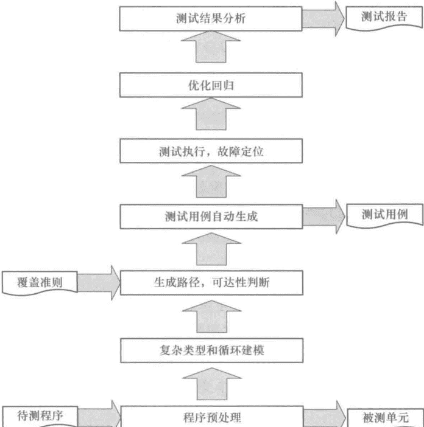

图 1-1 CTS 的总体框架

### 1. 程序预处理
扫描代码、模块划分、提取测试单元、生成驱动源文件、软件度量统计信息、构建抽象语法树（AST），为后续建模、生成路径与用例铺路。

### 2. 复杂类型与循环建模
针对结构体、数组等复杂数据结构及循环控制结构，实施专项建模，生成适配符号处理的表示形式。

### 3. 生成路径，可达性判定
基于 AST、控制流图（CFG）及符号执行结果，按覆盖准则确定目标元素，引入区间运算剔除不可达路径，最终敲定可达路径集（本书将详述判定策略）。

### 4. 测试用例自动生成 —— 核心引擎
在可达路径基础上，提取约束表达式并求解，运用分支限界及其加速算法产出用例。本书聚焦于此，基于区间运算深度优化分支限界技术。

### 5. 测试执行与故障定位
执行用例对比预期，失败则触发自动定位。采用可疑度计算模型，锁定最可能故障的边与节点。

### 6. 优化回归
代码微调场景下，避免全量回归。CTS 通过识别修改点、筛选用例库、面向目标生成新用例，实现选择性回归，兼顾质量与效率。

### 7. 测试结果分析
输出多维报告：代码属性（行数、注释率、函数数等）、测试耗时、覆盖率等关键数据。

---

# 第 2 章 测试用例自动生成技术

因路径用例生成本质即约束求解，学界深耕三大主流流派：
- **静态法**（70年代起）：不运行程序，靠符号执行与区间运算静态分析模拟生成，开销小，是测试重要分支。
- **动态法**：依赖实际执行，随机初值与不确定性易致大量迭代甚至溢出。
- **动静结合（Concolic，2005年后兴起）**：动态实运行采集具体值，辅助符号分析攻克难解表达式，化繁为简。十年迭代虽有进展，仍存挑战。

## 2.1 静态测试用例自动生成方法

鼻祖级技术，70年代登场。流程：解析程序 -> 符号变量替实变量模拟执行目标路径 -> 提取路径约束 -> 约束求解器出解得用例。

### 2.1.1 常用静态分析技术

静态分析源于 50 年代，早于测试生成技术。其核心是“保守分析”，结果可靠，为真实语义超集。主流技术热点聚焦三大支柱：

#### 1. 基于抽象解释的数据流分析
Rice 定理揭示：非平凡属性全自动静态分析不可判定。抽象解释由此应运，核心是用抽象域计算替代具体语义计算，在“保守性”前提下实现“不可能任务”。抽象域包含可机器表示的对象集合与操作集合；程序状态用域元素近似，动作语义（判断、赋值、循环）用域操作建模。如区间抽象域将变量取值抽象为离散区间，用区间运算模拟运算推导取值范围。

本质上，抽象解释在效率与精度间博弈：先牺牲精度换速度，再迭代回补精度。在特定约束下保证正确性、安全性、可计算性。对象域抽象、Galois 连接、完备格上的加宽/收窄算子是基石。

作者团队 CTS 即立足抽象解释，扩展经典区间抽象：首创区间集概念，定义数值/引用/布尔统一代数，给出 RABAII 统一值域分析法，引入加宽算子解循环范围，定义参数未定义值，用函数摘要建模过程调用上下文影响。该体系能压缩取值空间，高效探测矛盾节点与不可达路径。本书依托不动点理论迭代优化区间运算，大幅提升不可达路径预判与约束求解精度。

#### 2. 区间运算
将变量取值抽象为区间域，属非关联抽象（视变量独立，忽略关联），以区间集合保守描述可能取值。源自 Burkill/Young，Moore 奠基并解决数值计算可信边界与误差控制。后广泛用于工程计算、科学计算、金融建模。

计算机领域早期服务于图形处理、辅助设计（Muder 几何应用，Maekawa 外形分析等）。软件测试引入旨在提精度、保守守。Harrison 用于编译器分析确定取值范围；王志言用于约束求解但效率难支撑大规模工程；李福川引入航天测试保守估算数值范围；高传平检测整数数组越界；GhodratI 限定取值范围验证算术等价性。

区间运算静态分析将路径语句转为变量表与正则约束式表。变量表全量记录定值/引用变量（含临时变量、常量）；正则约束式形如 `r=d₁ op d₂`（op 为算术/关系/逻辑算子），刻画变量约束关系。

生成流程：穷举布尔值、对乘除变量分区间确定全域范围 -> 依约束式迭代区间削减与区间对分穷举收敛范围 -> 得解或判定不可达。得益于正则约束式，可处理复杂逻辑表达式及二次函数等非线性约束。

#### 3. 符号分析
70 年代入场程序分析。用符号值替代实值模拟执行，非真运行。赋值语句视为参数条件，条件语句视为约束系统。分前向替换（自顶向下执行，收集谓词得约束，贴近真实执行）与后向替换（自出口向前，用赋值右值替换判断中变量，得仅含输入变量的约束集）。后向替换无需保存符号值，且两法等价。

现有理论多聚焦变量线性关联，逻辑关联常被忽略。主流工具 GSE、jCUTE 已支持复杂类型输入、多线程复杂逻辑。应用域覆盖测试、调试维护、程序验证、故障定位等。

### 核心技术解析：符号分析与程序切片

**符号执行的核心逻辑**在于：用抽象符号替代变量的具体数值，在不真正运行程序的情况下，静态模拟其执行过程。输出的不再是具体结果，而是携带变量约束关系的符号表达式。这项技术的最大优势是能“未卜先知”地推演程序行为，精准刻画变量间的依赖与约束，进而识别出不可达的代码路径与分支。其判断原理是：控制流图中的分支条件天然构成了路径执行的约束条件（路径条件）；分析引擎利用代数符号结合这些约束推导变量关系式，若表达式出现矛盾，则该路径不可达。由于遍历了所有可达路径下的变量取值空间，分析结果具有保守性。但面对大规模代码，路径数量随代码量呈指数级爆炸，必须引入阈值截断等策略以防状态空间爆炸。

**符号分析虽精准，却面临三大挑战**：一是复杂数据结构（字符串、结构体、数组）难以构造对应的符号值；二是函数调用链过长且缺乏代码可见性或摘要信息时，逐句分析将耗尽算力，甚至无法进行；三是海量路径约束的求解极度依赖高性能约束求解器。

**工程落地的妥协与创新**：业界常用“晚初始化”策略——仅在变量首次被访问时生成符号，以节省开销。本书算法为适配测试生成需求，反其道而行之：在函数入口即为所有入参创建符号，并建立“符号-入参”的逆向映射表，便于在路径终点快速定位哪些符号对应输入，从而反推测试数据。

#### 4. 程序切片

程序切片自1979年Mark Weiser首次提出以来，已成为软件维护、调试、测试、理解及逆向工程的利器。Weiser将其视为调试时的“智力抽象”，切片程序在特定功能属性上与原程序等价。依据分析关注点（切片准则）的不同，可“按需”提取子程序，这种“聚焦核心、剔除噪音”的特性，使其成为提升静态分析效率的关键手段。

后续研究衍生出多种变体，大致经历了静态转动态、单机转分布式、前向转后向的演进。Horowitz等人给出的经典定义：切片是由可能影响程序某点`p`处变量`v`值的语句与判定组成的集合，`(p,v)`即为切片准则。

**静态切片**仅依赖代码静态结构（控制流/数据流），不预设输入；**动态切片**则结合具体执行轨迹，依赖特定输入。1991年Gallagher等人提出的**分解切片**旨在将程序模块化，其集合仍属程序切片，能捕获对特定变量的全部计算逻辑，直观指导哪些修改安全（不波及他模块），哪些禁忌。

### 2.1.2 经典静态测试生成技术盘点

#### 1. 区间削减法

1991年DeMillo与Offutt开创了基于约束的自动测试生成范式——**区间削减**。核心思想：构建约束系统，其解即满足测试目标（如到达目标语句的可达性约束、杀死变异体的必要性约束）。系统输入为变量取值区间（源自类型或人工指定），求解过程针对两类基本约束（变量-常量比较、变量-变量比较），其余约束经反向替换化简。化简受阻时，选取区间最小变量赋随机值并回代，全变量赋值成功则系统满足，否则重试。配套工具Godzilla即由此诞生。

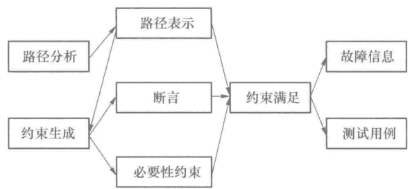

**动态区间削减**虽名为“动实”，实为静态增强版。它不再随机赋值，而是在符号分析阶段，依路径谓词“动态”收缩变量区间。例如`y<z`且均在`[-10,10]`，为覆盖真分支，将`y`压缩至`[-10,0]`，`z`扩至`[1,10]`。若陷入死胡同则回溯修正分割点。虽缓解了符号执行的部分困境，但循环处理、枚举类型支持仍是短板，且缺乏启发式搜索引导。本书方法虽与其同源，但得益于十余年静态分析技术积累、大量启发式策略、CTS抽象内存模型对复杂类型的支撑及动静结合循环模型，实用性与效率大幅跃升。

#### 2. KLEE 符号执行引擎

2008年斯坦福Cadar团队推出**KLEE**，引入约束求解优化算法，通过分析变量相关性将约束拆解为独立子集并行求解，大幅提速，实现高覆盖率。国防科大李仁见团队基于KLEE扩展了**链表抽象建模**：定义变量可达向量描述节点可达性，引入计数刻画形态与数量，覆盖含环单向链表，并验证了运行时错误与长度性质。

#### 3. 静态单一赋值（SSA）结合路径求解

Robschink法先将程序转SSA形式，融合程序切片与路径约束求解。基于系统依赖图简化路径必要条件，再引入约束求解器。为适配量词消解求解器，要求路径变量均为存在量词。缺陷明显：仅限算术公式，约束系统臃肿（含无关变量），对线性约束亦非完备。

#### 4. 面向测试的抽象内存模型（CTS模型）

针对复杂数据类型建模难题，北邮网络与交换技术国家重点实验室CTS课题组提出**抽象内存模型**。它能精准记录字符串、结构体、数组在符号执行中的状态；精确模拟指针别名、数组变下标操作；映射字符串库函数语义；在模型中沉积路径约束。经开源求解器Choco验证，该模型对数组、字符串等类型支持良好。**本书方法即构建于此基石之上，衍生出自主知识产权的测试生成工具。**

#### 5. 其他流派速览

- **Ramamoorthy法**：排序入参，融合解方程、回溯、随机搜索。
- **Coward法**：定义目标函数为变量之和，线性规划求解线性约束。
- **Euclide系统**：符号执行+数值分析，融合约束传播、整数线性松弛与搜索。
- **李宣东团队**：面向对象分层切片算法，服务于程序理解。
- **张健团队**：后向替换建立线性约束，线性规划求解。

---

## 2.2 动态测试用例自动生成：实战流派

动态方法基于程序实测执行。1976年Miller与Spooner首倡此法，最初仅针对浮点数。核心循环：反复运行、收集运行时信息、评估当前输入对测试目标的满足度、依此引导下一轮搜索。优势在于变量取值已定，规避了静态分析的复杂建模；劣势是受随机性与试探性束缚，**有解不保证能找到解**。

### 2.2.1 直线式程序法

Miller与Spooner的开山之作。将路径判断语句改写为布尔赋值（如`B=(bj>=0)`），`bj`量化分支谓词的“满足程度”；并以等价直线代码替换路径语句。特点：可用于黑盒、处理非线性、预处理少。但**强制要求用户预给整数变量值**；对纯线性约束完备，非线性因易陷局部最优而不完备。

### 2.2.2 分支函数极小化法（Korel经典范式）

1990年Korel扩展至Pascal，成奠基之作。策略：试探搜索方向 + 模式搜索极小化分支函数值 + 动态数据流分析锁定影响变量。最擅长数值型变量。**痛点**：极易陷入局部最优；非线性多极值下难觅全局解，故非完备。

1992年Korel推**面向目标法**：聚焦目标节点，自动将分支分为关键/半关键/非必需三类，省去了显式枚举覆盖路径的步骤。后续研究暴露出更多问题，催生出诸多改进搜索算法。但Korel的分支函数定义（见表2-1）深刻影响后世，众多变体皆在其上修正。

| 关系断言 | 分支函数 f | 关系 rel |
| :--- | :--- | :--- |
| `a > b` | `b - a` | `<` |
| `a >= b` | `b - a` | `<=` |
| `a < b` | `a - b` | `<` |
| `a <= b` | `a - b` | `<=` |
| `a = b` | `abs(a-b)` | `=` |
| `a != b` | `-abs(a-b)` | `<` |

后续衍生出**面向目标链法**（1996），应用于断言驱动测试与回归测试生成。

### 2.2.3 ADTEST：Ada领域的工程化实践

Gallagher团队将Korel法移植扩展至Ada，开发**ADTEST**。通过插桩强制执行任意路径，回传变量与谓词状态。引入指数罚函数处理分支谓词，目标函数为罚函数之和，将约束求解转化为无约束数值优化。支持整型、实型、离散类型、子程序与异常。实战生成6万行Ada代码测试用例。罚函数机制有效处理逻辑运算，但为尽早剪枝，单变量/单谓词迭代、回溯导致资源浪费严重，求解效率低，难胜任真实大型程序。

### 2.2.4 迭代松弛法：引入切片思想的突破

1998年Gupta提出，**创新性引入程序切片**。随机输入，观察谓词，经数据流分析得依赖关系，构造谓词片与动态切片。建立谓词关于当前输入的线性算术表达，进而构建输入增量线性约束系统，求解得增量，迭代更新输入直至覆盖目标。**优势**：每轮迭代执行次数仅与变量数相关，与路径长度无关，规避了Korel/Gallagher法回溯带来的资源耗散。

早期用高斯消元求解，自由变量取值不当易致方程不相容需重试；后改用最小二乘法逼近可行解。Edvardsson指出：该法对线性路径约束非完备且非终止。Gupta团队后将其用于分支覆盖生成。国防科大单锦辉团队改进版：省去谓词片构造，直接跑路径得谓词线性表达，建立输入线性方程组直接求解，一步到位得新输入。

### 2.2.5 MHS 元启发式搜索：SBSE浪潮下的主力军

近年**基于搜索的软件工程（SBSE）**崛起，核心是引入**元启发式搜索（MHS）**。应用于测试生成即**基于搜索的软件测试（SBST）**，是MHS最杀手级应用场景。

落地MHS需解决三大决策：**编码**（如何将候选解映射为可搜索基因，优编码保邻域性质）；**评估**（目标函数设计，成败关键，优劣解需映射为优劣函数值，极值方向取决于求极大/极小）；**搜索策略**（如何利用历史信息导向更优解）。以下列举测试生成常用MHS算法。

#### 1. 爬山法：局部搜索的基石

别称“逐个修改法”、“瞎子摸象”，经典局部启发式搜索。类比一维确定性搜索，在目标函数曲面上“爬山”：山峰=局部最优，山谷=劣解。无启发式版本随机评估邻域；进阶版引入评估函数定向搜索（见算法2-1）。

```
算法 2-1 寻找目标函数最大值的爬山法

1: Select a starting solution s ∈ S
2: Repeat
3: Select s' ∈ N(s) such that obj(s')>obj(s) according to ascent strategy
4: s ← s'
5: Until obj(s) ≥ obj(s'), ∀ s' ∈ N(s)
```

# 智能搜索算法在测试生成中的实战进阶

### 2.1 爬山法：起步轻快，却易“困”于局部山峰

爬山法的运作逻辑直观高效：从随机初始点出发，扫描周边邻域寻找更优解。一旦发现“更高处”，立即迁移并以此为新起点继续探索，直至四周无更优候选解，宣告搜索终止。这套流程执行迅捷，出结果快，但致命短板显而易见——极易陷入**局部极值**陷阱。

所谓局部极值，即搜索停滞在一个并非全局最高的“山峰”上，导致算法过早放弃了对更广阔解空间的探索。这本质上源于爬山法对**初始值的强依赖性**：起点选得好，能登顶珠峰；选得差，只能在小土坡上原地打转。工程上常见的补救策略是**多初始值并行搜索**，通过撒网式布局，增加触达全局最优解的概率。

### 2.2 模拟退火算法：以“温度”破局，弱化初值敏感性

模拟退火（SA）的灵感源于固体退火物理过程。早期由 Metropolis 等人奠基，Kirkpatrick 等人将其推广为通用优化策略。其核心框架虽与爬山法同宗，却引入了关键差异化机制：**概率性接受劣解**。

具体而言，算法以概率 $p$ 接受比当前解更差的候选解，计算公式如下：

```
p=e^{-\frac{\delta}{t}} \quad (2-1)
```

式中 $\delta$ 为邻域候选解与当前解的目标函数差值，$t$ 为“温度”控制参数。初始高温允许算法在广阔空间“大踏步”跳跃，规避早早落入局部坑；随后按冷却规则缓慢降温，搜索范围逐渐收敛。**冷却节奏把控至关重要**：降温过快，搜索不充分，极大概率锁死局部最优；降温过慢，则计算开销失控。

Tracey 等人将 SA 引入动态测试用例生成，重点解决局部搜索难题。针对不同变量类型，邻域定义策略各异：整/实数变量取值区间为邻域；布尔/枚举型因无序特性，全值域视为邻域。目标函数设计上，Tracey 创新性要求新候选解**必须覆盖历史已覆盖子路径**，并定义了分支谓词到目标函数的映射表（如下），有效引导搜索方向。

```
算法 2-2 模拟退火算法

1: Select a starting solution \(s \in S\)
2: Select an initial temperature \(t > 0\)
3: Repeat
4:   it \(\leftarrow\) 0
5:   Repeat
6:     Select \(s' \in N(s)\) at random
7:     \(\Delta e \leftarrow\) obj(\(s'\)) - obj(\(s\))
8:     if \(\Delta e < 0\)
9:       \(s \leftarrow s'\)
10:    else
11:      Generate random number r, \(0 \leqslant r < 1\)
12:      if \(r < e^{-\frac{\delta}{t}}\) Then \(s \leftarrow s'\)
13:    end if
14:    it \(\leftarrow\) it + 1
15:  Until it = num_solns
16:  Decrease t according to cooling schedule
17: Until Stopping Condition Reached
```

| 关系断言 | 目标函数定义逻辑 |
| :--- | :--- |
| Boolean | TRUE 则 0，否则 K |
| a=b | 差值为 0 则 0，否则 $\|a-b\|+K$ |
| a≠b | 差值不为 0 则 0，否则 K |
| a<b | $a-b<0$ 则 0，否则 $(a-b)+K$ |
| a≤b | $a-b\le0$ 则 0，否则 $(a-b)+K$ |
| a>b | $b-a<0$ 则 0，否则 $(a-b)+K$ |
| a≥b | $b-a\le0$ 则 0，否则 $(a-b)+K$ |
| ¬a | 向内否定直到 a |

*注：K 为正常数，用于拉开满足/不满足条件的适应度差距。*

### 3 遗传算法：种群协同进化，天然全局搜索者

演化算法家族模拟自然选择与遗传机制，遗传算法（GA）是其中集大成者。上世纪 60 末，John Holland 奠基；同期德国学者 Rechenburg 与 Schwefel 推演化策略（ES），侧重变异操作。后续研究逐步融合两者精华，形成现代 GA 体系。

GA 通过**编码技术**将变量映射为基因染色体，维护一个**候选解种群**而非单点。搜索驱动力来自三大算子协同：
*   **选择（优胜劣汰）**：Holland 提出的轮盘赌选择（fitness-proportionate selection）最经典，适应度越高，繁殖概率越大。
*   **交叉（信息交换重组）**：父代基因片段交换，生成后代，实现解空间大尺度跳跃。
*   **变异（随机微扰）**：低概率随机翻转基因位，维持种群多样性，防止早熟收敛。

种群迭代繁衍，使 GA 天然具备**全局搜索属性**，初始点分布广，探索范围远超局部搜索。

```
算法 2-3 遗传算法

1: Randomly generate or seed initial population P
2: Repeat
3: Evaluate fitness of each individual in P
4: Select parents from P according to selection mechanism
5: Recombine parents to form new offspring
6: Construct new population P' from parents and offspring
7: Mutate P'
8: P ← P'
9: Until Stopping Condition Reached
```

**工程落地与实证分析**：
GA 落地测试生成领域早有文献[101-107]探索。国内薛云志团队引入 Messy GA 免除染色体排列先验依赖，提升并行寻优效率；英伟等人实测对比显示，GA 计算时间随输入域增大呈**亚线性增长**，远优于随机测试的超线性增长，更适配大型程序。

但 GA 非银弹：理论基石“隐性并行性”证明存瑕疵[110]；早期适应度函数常仅考量分歧分支谓词，忽略路径全貌[111]。Sofokleous 等人（ICTAI 2007）实测表明（见表 2-3），代码规模突破 500 行后，覆盖率显著下滑（从 100% 降至 65% 以下），且表达式复杂度（Simple/Medium/High）为高时，生成耗时显著上升。本书第 5 章算法旨在突破该瓶颈，在 100% 覆盖率基线上支撑更大规模复杂表达式。

**表 2-3 文献[112] 实验数据摘要（部分）**

| 代码行 | 用例数 | if数 | 覆盖率 | 嵌套if | 表达式复杂度 | 耗时 |
| :--- | :--- | :--- | :--- | :--- | :--- | :--- |
| 20 | 3-4 | 2-3 | 100% | 0-1 | Simple~High | <5s |
| 100 | 4-5 | 3-4 | 100% | 1 | Simple | 45~150s |
| 500 | 6-7 | 5-6 | 86%~78% | 2 | Simple/Medium | 10~15s |
| 1000+ | 8-14 | 7-10 | 77%~65% | 3-7 | Simple~High | 15~61s |

*趋势：规模↑ → 覆盖率↓、耗时波动大；复杂度↑ → 耗时↑。*

### 4 蚁群算法：仿生觅食智慧，分布式寻优新锐

蚁群优化（ACO）由 Dorigo 受蚂蚁分泌信息素寻径行为启发提出。蚂蚁个体简单，群体却能自组织发现最短路径。ACO 将此机制数学化：人工蚂蚁在解空间图上移动，留下信息素，后续蚂蚁倾向高信息素路径，正反馈加速收敛最优解。

ACO 兼具**快速求解、全局优化、有限时间合理解**三大特质，经全球学者长期拓展改进，已成成熟分布式求解范式。文献[114] 首度详述其用于测试生成流程，基准测试显示性能超越 GA 与 SA，极具竞争力。

### 5 粒子群算法：群体跟随领飞，轻量级收敛加速器

粒子群优化（PSO）源于鸟群觅食仿真，Eberhart 与 Kennedy 1995 年首倡。同属迭代优化范畴，但**摒弃了 GA 的交叉/变异**，改用**速度-位置更新机制**：粒子在解空间飞翔，动态追随个体历史最优（pbest）与全群全局最优（gbest）调整轨迹。

优势显著：**实现极简、参数极少（无需编码/交叉概率等）、收敛极快、精度高**。学术界高度关注，近年大量文献[116,117]将其引入测试生成，小规模基准测试表现亮眼。

**同期国内创新并举**：
*   南京大学徐宝文团队融合演化测试与组合测试，构建 ETF 框架[118-120]。
*   北京化工大学赵瑞莲团队针对 EFSM 路径，引入禁忌搜索（TS）配合动态程序切片提效[121-123]。
*   湖南大学李军义团队采用分支函数线性逼近极小化 + 选择性冗余优化[124]。

**动态法固有短板仍存**：指针变量适应度构造难、多局限于基础数值类型处理。

---

## 2.3 动静结合：动态符号执行——精准与效率的平衡术

单纯静态符号执行受限于复杂表达式、不可视调用（库函数/系统调用）等“拦路虎”，路径约束求解极难；纯动态搜索又缺乏方向性指导。**动态符号执行（DSE / Concolic Testing）**应运而生，实现优势互补。

**核心工作流**：
1.  **具体执行启动**：以随机/指定具体输入运行程序，记录实际执行路径。
2.  **符号约束收集**：沿路径回溯，对分支谓词进行符号化建模，积累路径约束集。
3.  **路径翻转与求解**：取反末尾分支约束，构造新可行路径条件，交由约束求解器（SMT Solver）求解，产出新具体输入。
4.  **迭代闭环**：以新输入重复上述过程，系统性探索程序状态空间。

**关键破局点**：遭遇难处理符号表达式（如非线性算术、指针别名、外部调用）时，**直接用具体运行时的具体值替代符号表达式**，绕过求解器瓶颈，保证流程不中断。

### 代表性工具演进脉络

*   **DART (2005, Godefroid 等, Bell Labs)**：开山之作。随机启动 → 具体执行记录路径 → 符号执行收集约束 → 末尾分支取反求解新输入。融合模型检查思想，配合 Purify 等运行时检测工具挖掘缺陷。局限：仅支持整型约束，符号执行受阻则退回随机测试。
*   **CUTE (Koushik Sen 等)**：DART 核心开发者主导扩展。显著增强**指针/结构体处理能力**，支持非空、别名等复杂指针约束求解。
*   **AUSTIN 等后续改进工具**[125-126]：持续优化约束求解策略、路径选择启发式、环境建模等。

### 实战挑战：真实工程的“高墙”

Lakhotia (2009) 以大型开源实战项目压测 CUTE 与 AUSTIN，结果泼冷水：**小程序覆盖率高光，实战工程效果不及预期**。复杂代码库中，路径爆炸、环境依赖、复杂约束求解失效等问题叠加，导致覆盖率难以突破。 **"实战工程高覆盖率" 仍是动静结合技术面临的核心硬骨头。**

---

## 参考文献精选

*   [1] King J C. Symbolic execution and program testing. *CACM*, 1976.
*   [5] Korel B. Automated software test data generation. *TSE*, 1990.
*   [6] McMinn P. Search-based software test data generation: a survey. *STVR*, 2004.
*   [8] Godefroid P, et al. DART: Directed automated random testing. *PLDI*, 2005.
*   [9] Sen K, et al. CUTE: A concolic unit testing engine for C. *ESEC/FSE*, 2005.
*   [97] Holland J H. *Adaptation in Natural and Artificial Systems*. 1975.
*   [113] Dorigo M. Optimization, Learning and Natural Algorithms (PhD Thesis). 1992.
*   [115] Eberhart R, Kennedy J. A new optimizer using particle swarm theory. *MHS*, 1995.
*   [127] Lakhotia K, et al. Evaluating DART and AUSTIN on real-world apps. *ICST*, 2009.
*   *其余文献 [2-4, 7, 10-11, 92-96, 98-112, 114, 116-126] 详见书末完整书目。*

# 测试生成技术演进脉络：一份跨越三十年的核心文献图谱

在自动化测试数据生成的漫漫长途中，学界构建起一座跨越理论奠基与工程落地的宏大殿堂。若按技术血缘梳理，这五十余篇里程碑式的文献，清晰地勾勒出四大主线：智能搜索探路、符号执行突围、抽象解释筑基、程序切片与内存建模赋能。

**智启蒙：进化算法的早期探索**
故事始于对“搜索”本质的追问。薛云志等人（[7]）早早引入 Messy 遗传算法，试图在结构测试的迷宫中寻找最优路径，为后来的搜索型测试生成（SBST）奠定了启发式优化的基调。

**破局者：符号执行与混合测试的黄金十年**
2005 年是分水岭。Godefroid 等人推出 DART（[8]），首次将自动化随机测试与符号执行融合，打开了“有向测试”的大门；紧随其后，Sen 等人开发出 CUTE（[9]）与 jCUTE（[45]），将混合单元测试推向 C 语言与 Java 工程实践。Godefroid 不止步于此，又提出组合动态测试生成（[10]）与 SAGE 白盒模糊测试（[11]），在 Windows 核心组件上验证了规模化落地的可能性。同期，Cadar 等人打造的 KLEE（[54]）以无人值守、高覆盖率著称，成为复杂系统程序测试的标杆；Gottlieb 等人的 Euclide（[62]）则聚焦关键 C 程序的约束求解框架。早期奠基工作中，Howden 的 DISSECT 系统（[40]）、Ramamoorthy 等人的自动化测试数据生成（[41]）、Clarke 的符号执行系统（[42]）以及 Coward 的综述（[61]），共同确立了符号评估的理论基石；Clarke 与 Richardson（[46]）进一步拓展了其应用边界。

**求解引擎：约束技术与域缩减的深度博弈**
符号执行的生命线在于约束求解。DeMillo 与 Offutt（[52]）引入基于约束的自动生成范式；Offutt 团队随后提出动态域缩减过程（[53]），显著提升了求解效率。Khurshid 等人（[44]）将广义符号执行引入模型检测与测试，Miné（[43]）则通过符号方法强化数值抽象域精度，Sen 与 Agha（[45]）在工具链层面实现了显式路径模型检测的工程化。

**理论基石：抽象解释与区间数学的深度融合**
如果说符号执行是“动态利剑”，抽象解释便是“静态盾牌”。Cousot 夫妇奠定了统一格模型（[16]）、动态性质静态确定（[17]）及形式化方法未来愿景（[18]）；Nielson 等人的专著（[12]）系统化了程序分析原理。国内学者紧跟前沿：李梦君等人（[13]）探讨程序验证技术，姬孟洛团队构建了基于通用单调数据流框架的值范围分析（[14]）与 WCET 自动分析工具（[15]）；王雅文、宫云战等人深耕变量值范围分析，从扩展区间运算（[20]）到必然集测试用例生成（[60]），形成了完整的工程化技术栈（[19]）。

区间数学作为抽象解释的核心数学工具，其谱系同样清晰：从 Burkill（[21]）、Young（[22]）的早期代数奠基，到 Moore 确立区间分析学科（[26][27][28]）、Hansen（[24]）、Alefeld 与 Herzberger（[23]）完善理论体系，再到 Kearfott 与 Moore 合著教材（[25]）普及应用。工程落地方面，Moore 早期即关注数字计算误差自动分析（[28]），Mudur 与 Koparkar（[29]）、Maekawa（[30]）、Enger（[31]）、Snyder（[32]）、Kearfott 与 Xing（[33]）、Schramm（[34]）将其拓展至几何建模与图形渲染。软件测试领域，Harrison（[35]）率先编译器级分析变量值范围，王志言与刘椿年（[36]）、李福川与宋晓秋（[37]）、高传平等人（[38]）及 Ghodrat 等人（[39]）在 VLSI 验证中均验证了区间代数的实战威力。

**结构感知：程序切片与内存建模的维度跃迁**
面对指针、链表、字符串等复杂结构，单纯的数值分析显得力不从心。Weiser（[47]）开山程序切片，Tip（[49]）综述技术演进，Horwitz 等人（[50]）利用依赖图实现过程间切片，Gallagher 与 Lyle（[51]）拓展至软件维护。李必信团队（[48][63]）深度剖析面向对象切片应用，Robschink 与 Snelting（[56]）在依赖图中高效提取路径条件。

内存建模成为破解复杂结构测试的关键一招。李仁见等人（[55]）提出变量可达向量抽象链表，唐容等人（[57]）构建面向用例生成的抽象内存模型，李飞宇等人（[58]）实现复杂结构类型测试数据自动生成，Li 与 Gong（[59]）更专门攻克字符串操作程序的建模难题。

这份文献图谱，不仅记录了从“随机尝试”到“智能引导”、从“数值标量”到“复杂堆内存”、从“动态执行”到“静态推演”的技术跃迁史，更为当下的大模型辅助测试生成、二进制级漏洞挖掘等前沿方向，提供了不可或缺的理论坐标与工程参考。

## 测试数据生成与搜索型软件工程演进脉络

### 起步期：动态执行与约束求解奠基

1976年，Miller 与 Spooner [65] 率先实现浮点数测试输入的自动化合成，揭开序幕。90 年代初，Korel [66] 开创动态生成范式，继而联合 Ferguson [68] 确立链式构造策略，并同 Al-Yami 合作 [69, 70] 将适用场景拓展至断言驱动及回归测试。同期，奚红宇等 [67] 研制出面向 Ada 语言的用例生成工具。Zhang 与 Wang [64] 引入约束求解器校验路径可行性；Gallagher 等 [71] 发布 Ada 专用测试套件 Adtest。世纪之交，Gupta 等人 [72, 73, 75] 提出基于迭代松弛与 UNA 技术的求解流程，聚焦分支覆盖优化，单锦辉等 [76] 与 Shan 等 [77] 对该路线实施改进，而 Edvardsson 与 Kamkar [74] 则专门考察求解器在 UNA 框架下的表现。

### 范式转向：SBSE 确立与理论深化

Harman 与 Jones [78] 正式提出搜索型软件工程（SBSE）概念；Clark 等 [79] 系统阐释“将工程问题转化为搜索任务”的方法论；Harman [80] 进一步描绘领域未来图景。McMinn [83] 与 Ali 及 Briand [84] 分别从理论实证与系统梳理两个维度，全面回顾局部、全局及混合搜索策略的演进；Zhao 等 [82] 聚焦扩展有限状态机模型下的生成效能实证分析。

### 优化算法移植：从攀爬策略到退火机制的演进

经典优化技术逐渐成为核心驱动力。Goldfeld 等 [85] 早期引入二次型山峰攀爬法；Yuret 与 De La Maza [87] 改进自适应攀爬策略以突破瓶颈。此后，该思想在贝叶斯网络结构学习 [86]、领域无关规划 [88]、SMT 处理器资源调度 [89]、应用服务器配置优化 [90]、分布式文件系统副本放置 [91] 等方向衍生出众多变体。Metropolis 等 [92] 奠定退火模拟基础，Kirkpatrick 等 [93] 将其推广为通用优化手段。Tracey 等人 [94-96] 将退火机制深度嵌入结构化测试框架，实现缺陷自动检测与动态用例生成的统一。

### 进化计算赋能：遗传算法及变体的工程落地

Holland [97] 奠基自然与人工系统适应理论；Back 等 [98, 100] 系统梳理进化策略的理论与实践；Whitley [99] 深度剖析工程应用中的常见陷阱。Wegener 等 [101] 首次将进化测试引入嵌入式系统代码覆盖；Harman 等 [102] 通过消除标志位提升测试效能。Buehler 与 Wegener [103] 在自动泊车系统功能验证中验证该方法；Jones 等 [104] 确立遗传算法在结构化测试中的核心地位；Bouchachia [105] 引入免疫机制增强进化算法，拓宽测试输入多样性。

---
**参考文献**

[64] Zhang J, Wang X. Constraint solver for path feasibility analysis. Int J Softw Eng Knowl Eng. 2001;11(2):139-156.

[65] Miller W, Spooner DL. Automatic generation of floating-point test data. IEEE Trans Softw Eng. 1976;2(3):223-226.

[66] Korel B. Dynamic method for software test data generation. Softw Test Verif Reliab. 1992;2(4):203-213.

[67] 奚红宇, 徐红. Ada软件测试用例生成工具. 软件学报. 1997;8(4):297-302.

[68] Ferguson R, Korel B. The chaining approach for software test data generation. ACM Trans Softw Eng Methodol. 1996;5(1):63-86.

[69] Korel B, Al-Yami AM. Assertion-oriented automated test data generation. Proc 18th Int Conf Softw Eng. 1996:71-80.

[70] Korel B, Al-Yami AM. Automated regression test generation. ACM SIGSOFT Softw Eng Notes. 1998;23(2):143-152.

[71] Gallagher MJ, Narasimhan LV. Adtest: a test data generation suite for Ada software systems. IEEE Trans Softw Eng. 1997;23(8):473-484.

[72] Gupta N, Mathur AP, Soffa ML. Automated test data generation using an iterative relaxation method. ACM SIGSOFT Softw Eng Notes. 1998;23(6):231-244.

[73] Gupta R, Mathur AP, Soffa ML. UNA based iterative test data generation and its evaluation. Proc 14th IEEE Int Conf Autom Softw Eng. 1999:224-232.

[74] Edvardsson J, Kamkar M. Analysis of the constraint solver in UNA based test data generation. ACM SIGSOFT Softw Eng Notes. 2001;26(5):237-245.

[75] Gupta R, Mathur AP, Soffa ML. Generating test data for branch coverage. Proc 15th IEEE Int Conf Autom Softw Eng. 2000:219-227.

[76] 单锦辉, 王戟, 齐治昌, 等. Gupta 方法的改进. 计算机学报. 2002;25(12):1378-1386.

[77] Shan JH, Wang J, Qi ZC, et al. Improved method to generate path-wise test data. J Comput Sci Technol. 2003;18(2):235-240.

[78] Harman M, Jones B. Search-based software engineering. Inf Softw Technol. 2001;43(14):833-839.

[79] Clark J, Dolado JJ, Harman M, et al. Reformulating software engineering as a search problem. IEE Proc Softw. 2003;150(3):161-175.

[80] Harman M. The current state and future of search based software engineering. Proc Future Softw Eng. 2007:342-357.

[81] Harman M, McMinn P. Theoretical and empirical study of search-based testing: local, global, and hybrid search. IEEE Trans Softw Eng. 2010;36(2):226-247.

[82] Zhao R, Harman M, Zheng L. Empirical study on the efficiency of search based test generation for EFSM models. Proc 3rd Int Conf Softw Test Verif Valid Workshops. 2010:222-231.

[83] McMinn P. Search-based software testing: past, present and future. Proc 4th Int Workshop Search-Based Softw Test. 2011:153-163.

[84] Ali S, Briand LC. Systematic review of the application and empirical investigation of search-based test case generation. IEEE Trans Softw Eng. 2010;36(6):742-762.

[85] Goldfeld SM, Quandt RE, Trotter HF. Maximization by quadratic hill-climbing. Econometrica. 1966;34(3):541-551.

[86] Tsamardinos I, Brown LE, Aliferis CF. The max-min hill-climbing Bayesian network structure learning algorithm. Mach Learn. 2006;65(1):31-78.

[87] Yuret D, De La Maza M. Dynamic hill climbing: overcoming the limitations of optimization techniques. Proc 2nd Turkish Symp Artif Intell Neural Netw. 1993:208-212.

[88] Hoffmann J. A heuristic for domain independent planning and its use in an enforced hill-climbing algorithm. Proc Int Symp Methodol Intell Syst. 2000:216-227.

[89] Choi S, Yeung D. Learning-based SMT processor resource distribution via hill-climbing. ACM SIGARCH Comput Archit News. 2006;34(2):239.

[90] Xi B, Liu Z, Raghavachari M, et al. A smart hill-climbing algorithm for application server configuration. Proc 13th Int Conf World Wide Web. 2004:287-296.

[91] Douceur JR, Wattenhofer RP. Competitive Hill-Climbing Strategies for Replica Placement in a Distributed File System. Proc Int Symp Distrib Comput. 2001:48-62.

[92] Metropolis N, Rosenbluth AW, Rosenbluth MN, et al. Equation of state calculations by fast computing machines. J Chem Phys. 2004;21(6):1087-1092.

[93] Kirkpatrick S, Gellat CD, Vecchi MP. Optimization by simulated annealing. Science. 1983;220(4598):671-680.

[94] Tracey N, Clark J, Mander K, et al. An automated framework for structural test-data generation. Proc Int Conf Autom Softw Eng. 1998:285-288.

[95] Tracey N, Clark J, Mander K. Automated program flaw finding using simulated annealing. Proc ACM SIGSOFT Int Symp Softw Test Anal. 1998:73-81.

[96] Tracey N, Clark J, Mander K. The way forward for unifying dynamic test-case generation: the optimisation-based approach. Proc Int Workshop Dependable Comput Appl. 1998:169-180.

[97] Holland JH. Adaptation in Natural and Artificial Systems. Ann Arbor: Univ Michigan Press; 1975.

[98] Back T, Hoffmeister F, Schwefel HP. A survey of evolution strategies. Proc 4th Int Conf Genet Algorithms. 1991:2-9.

[99] Whitley D. An overview of evolutionary algorithms: practical issues and common pitfalls. Inf Softw Technol. 2001;43(14):817-831.

[100] Back T. Evolutionary algorithms in theory and practice. New York: Oxford Univ Press; 1996.

[101] Wegener J, Buhr K, Pohlheim H. Automatic test data generation for structural testing of embedded software systems by evolutionary testing. Proc Genet Evol Comput Conf. 2002:1233-1240.

[102] Harman M, Hu L, Hierons R, et al. Improving evolutionary testing by flag removal. Proc Genet Evol Comput Conf. 2002:1359-1366.

[103] Buehler O, Wegener J. Evolutionary functional testing of an automated parking system. Proc Int Conf Comput Commun Control Technol. 2003.

[104] Jones BF, Stamer HH, Eyres DE. Automated Structural Testing Using Genetic Algorithms. Softw Eng J. 1996;11(5):299-306.

[105] Bouchachia A. An Immune Genetic Algorithm for Software Test Data Generation. Proc 7th Int Conf Hybrid Intell Syst. 2007:84-89.

# 基于分支限界策略的测试用例生成技术

## 3.1 分支限界算法概述

本章深入探讨基于分支限界策略的测试用例生成方法，其核心算法流程如图 3-1 所示。

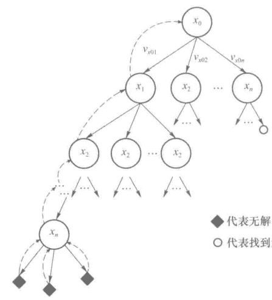

图 3-1 分支限界算法流程图

为有效攻克面向路径的测试用例生成难题，我们依据静态测试视角下的问题定义，在 3.1 节中对其进行了形式化重构：面向路径的测试用例生成实质上是一个约束满足问题（CSP）。因此，本书后续所有论述均围绕路径约束的求解过程展开。

### 3.1.1 问题形式化定义

众多测试用例生成问题均与待测程序 $P$ 的控制流图（Control Flow Graph, CFG）紧密相关。

程序 $P$ 的 CFG 定义为有向图 $G = (N, E, i, o)$，其中 $N$ 为语句节点集，$E$ 为有向边集，$i$ 与 $o$ 分别代表唯一的入口与出口节点。图中每个节点 $n \in N$ 对应程序的一条语句；每条边 $e = (n_r, n_t) \in E$ 表示从节点 $n_r$ 到 $n_t$ 的控制流转移。针对判断语句（如 `if`、`while`）的节点称为分支节点，其出边称为分支。路径定义为 CFG 中的节点序列 $W = (n_1, n_2, ..., n_q)$，满足对任意 $1 \le r < q$，均有 $(n_r, n_{r+1}) \in E$。

若存在某组输入使得程序执行轨迹恰好为路径 $W$，则称 $W$ 为可达路径，否则为不可达路径。基于此，面向路径的测试用例生成问题可形式化为约束满足问题：设 $X = \{x_1, x_2, ..., x_n\}$ 为输入变量集，$D = \{D_1, D_2, ..., D_n\}$ 为区间域集合（由区间构成，简称为区间），$D_i \in D$ 为变量 $x_i$ 可取值的全集。问题的解为一个赋值向量 $V = \{V_1, V_2, ..., V_n\}$，其中 $V_i \in D_i$，使得目标路径可达。在静态生成场景下，路径可达性通过区间运算判定：路径上每个约束条件均须满足，方能保证整条路径可达，这也是优化区间运算的切入点。

以下通过实例阐释。图 3-2 展示了待测程序 `test1` 及其 CFG，其中 `if_out_7`、`if_out_8`、`if_out_9`、`exit_10` 为虚拟节点。若采用分支覆盖准则，共有 4 条待覆盖路径：Path1: 0→1→2→9→10，Path2: 0→1→3→4→8→9→10，Path3: 0→1→3→5→6→7→8→9→10，Path4: 0→1→3→5→7→8→9→10（数字标识 CFG 节点）。以加粗显示的 Path3 为目标路径，生成任务即从域集 $\{D_1, D_2, D_3\}$ 中选取值 $V = \{V_1, V_2, V_3\}$ 赋予 $x_1, x_2, x_3$，使程序执行路径为 Path3。Path3 包含 3 个分支节点（`if_head_1`, `if_head_3`, `if_head_5`）及对应的 3 个分支（$F_2, F_4, T_5$），蕴含待满足的约束条件。

```c
void test1(int x1, int x2, int x3)
1 { if (x1-x2<=0)
2     printf("Path1");
3   else if(x3-x2<=0)
4     printf("Path2");
5   else if(3*x3+5>=0)
6     printf("Path3");
7 }
```

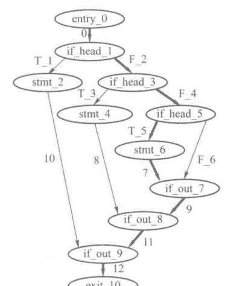

图 3-2 待测程序 test1 及其控制流图

### 3.1.2 核心求解策略

鉴于面向路径的测试用例生成属于约束满足问题，需借助搜索或优化算法求解。分支限界算法作为全局求解器，具备灵活的回溯机制：陷入局部无解时可回溯至高层调整搜索范围，致力于最小化搜索树节点访问量。考虑到回溯增加时间开销，必须精心设计叶子节点扩展策略，涵盖：合理排序自由变量、以最少尝试次数寻得可行解或快速判定局部无解、以及求解后大幅剪枝。因该问题仅需一组解，搜索时无需生成可扩展节点的所有子节点，仅判定一个子节点可扩展即可向下深入，从而提升效率。该被选中的扩展子节点可视为某种意义上的“最优子节点”，据此我们提出采用**最佳优先搜索分支限界法**（Best-First-Search with Branch and Bound, **BFS-BB**）求解。为简化表述，本书中“分支限界”与“BFS-BB”指代同一全局搜索算法，二者等价。

本节涉及变量均为符号变量。搜索过程中，变量划分为三类集合：已赋值变量集（Past Variable, PV）、当前变量（Current Variable, CV）、未赋值/自由变量集（Future Variable, FV）。

#### 1. 状态空间搜索模型

**定义 3-1（状态空间）** 状态空间定义为四元组 $(S, A, I, F)$：$S$ 为状态集合；$A$ 为状态间连接关系，表征搜索操作；$I \subseteq S$ 为非空初始状态集；$F \subseteq S$ 为非空目标状态集。

**定义 3-2（状态）** 状态定义为五元组 $(\text{Precursor}, \text{Variable}, \text{Domain}, \text{Value}, \text{Type})$。搜索进行至某阶段，当前状态 $S_{cur}$ 包含：前驱状态 $\text{Precursor}$；当前处理变量 $\text{Variable}=X_i \in X$；当前变量取值域 $\text{Domain}=D_{ij} \subseteq D_i \in D$（形式为 $[min, max]$，$n$ 为变量数/树深，$m$ 为其他变量固定时当前变量最大尝试次数，控制树宽）；已选赋值 $\text{Value}=V_i \in D_i$；状态类型 $\text{Type} \in \{\text{active}, \text{extensive}, \text{inactive}\}$。

**定义 3-3（状态空间搜索）** 指在庞大状态空间中寻找目标状态：该状态下所有变量均获确定值，且经验证为问题一解。搜索伊始 $\text{Precursor}=\text{null}$；终止时 $\text{Variable}=\text{null}$，所有 $\text{extensive}$ 节点串联成解路径。

本书将测试用例生成过程等同于状态空间搜索过程：从初始状态出发，在各当前状态下借助智能策略确定搜索方向，最终抵达解路径。

#### 2. BFS-BB 算法详解

首先汇总本书涉及的核心算子及其功能于表 3-1，随后给出算法伪代码与详解。

### 表 3-1 核心算子功能速查表

| 算子名称 | 功能描述 |
| :--- | :--- |
| **BFS-BB** | 本书提出的全局搜索主算法 |
| **动态变量排序 (DVO)** | 对 FV 排序，确定下一待赋值变量 |
| **路径倾向计算 (PTC)** | 评估路径上所有变量的性质特征 |
| **初始域计算 (IDC)** | 基于 PTC 结果，确定各变量初始取值区间 |
| **迭代区间运算 (IIC)** | 优化的区间运算迭代机制，贯穿 BFS-BB 所有区间计算环节 |
| **爬山搜索 (HC)** | 变量赋值判定的局部搜务器，调用区间运算检测赋值矛盾并计算目标函数值 |

#### 算法 3-1 BFS-BB 主流程

```
输入 p: 待覆盖路径
输出 result{Variable -> Value}: 覆盖 p 的测试用例
Begin
阶段 1. 预处理
1: result←null;
2: 路径约束提取；
3: 求相关变量集和相关变量闭包；
4: 变量级别确定；
5: 调用算法 3-2 Irrelevant Variable Removal；
6: 区间初始化，并调用 IIA 进行判断；
7: 调用算法 3-3 Dynamic Variable Ordering；
8: 调用算法 3-4 Path Tendency Calculation；
9: 调用算法 3-5 Initial Domain Calculation；
10: V11←select(D11);
11: initial state←(null, x1, D11, V11, active);
12: Scur←initial state;
阶段 2. 状态空间搜索
13: while(xi ≠ null)
14: 调用算法 3-6 BB-HC;
15: if (Scur = (Pre, xj, Dj, Vj, inactive))
16: Pre←Scur;
17: Scur←(Pre, xij, Dij, Vij, active);
18:     else result<-result U {xi -> Vjj };
19:     FV <- FV - {xi };
20:     PV <- PV + {xi };
21:     调用算法 3-3 Dynamic Variable Ordering;
22:     调用算法 3-5 Initial Domain Calculation;
23:     V1i <- select(D1i);
24:     Scur <- (Pre, xi, D1i, V1i, active);
25: final state <- Scur ;
26: foreach x* \in X_irel
27:     result <- result U {x* -> V_random };
28: return result ;
End
```

**阶段一：预处理与初始化**。首步执行预处理：提取路径约束、识别相关变量集与闭包、确定变量层级。通过无关变量移除（IVR）压缩搜索空间，仅保留与目标路径相关的变量参与运算。随后扫描路径约束，利用程序切片技术进一步压缩变量区间。初始化测试用例存储表 `result` 为空。对所有相关变量排序得序列，队首变量 $x_1$ 成为首个赋值对象。从其区间 $D_{1i}$ 中选取值 $V_{1i}$ 赋值。上述要素构成初始状态 $(\text{null}, x_1, D_{1i}, V_{1i}, \text{active})$，即当前状态 $S_{cur}$。

# 自动化测试用例生成核心技术：状态搜索与变量依赖分析深度解析

在自动化测试生成的流程中，完成路径选取后，核心挑战便转向了如何高效求解路径约束。本文将深入剖析测试用例生成的“第二阶段”——状态空间搜索机制，并详细拆解路径约束提取、变量依赖分析、层级排序以及无关变量剔除等关键技术环节。

## 3.1.3 路径约束提取：从语法定义到工程落地

### 约束表达的“语法边界”

在 CTS 框架内，路径约束被形式化为特定的表达式文法。其核心产生式规则如下：

*   **Expression（表达式）**：由 Term（项）通过加减法连接，或单个 Term 构成。
*   **Term（项）**：由 Power（幂）通过乘除法连接，或单个 Power 构成。
*   **Power（幂）**：由 Factor（因子）通过乘方运算连接，或单个 Factor 构成。
*   **Factor（因子）**：常量、变量或括号包裹的 Expression。

这套定义明确划定了区间运算的“原生支持区”：四则运算与乘方。凡是超出此文法范畴的运算（如取模 `a%b`、三角函数等），均被归类为**复杂算术表达式**。

### 攻克复杂表达式：符号化与反函数库

区间运算本身无法直接求解复杂表达式的值。CTS 采取的策略是**符号化处理**：为复杂表达式引入新符号，并赋予其一个更宽泛的区间范围。但在分支限界搜索阶段，光有宽区间不够，必须精准收敛。为此，系统专门构建了**反函数库**，针对不同类型的复杂运算提供定制化的求逆处理逻辑，从而绕过区间运算的原生短板。

### 表达式提取的工程实现：插桩式暂存

区间运算模块原本不提供表达式导出接口。为获取完整约束，工程上采用了**“运算前拦截”**策略：修改区间运算源码，在执行运算前将表达式对象暂存至对应的控制流图（CFG）节点中。由于路径本质是 CFG 节点序列，提取带表达式的节点即等价于提取路径约束。

**提取算法逻辑（对应流程图 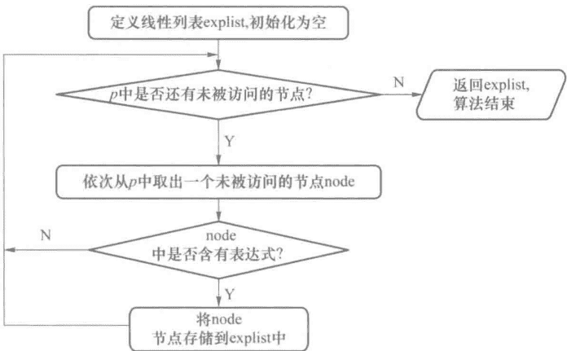）：**
1.  初始化线性链表 `explist`。
2.  遍历路径 `p` 上的每个 CFG 节点 `node`。
3.  若 `node` 携带表达式，入链 `explist`；否则跳过。
4.  遍历结束，返回 `explist`。

## 3.1.4 相关变量集与闭包构建：依赖关系的传递闭包

变量间的“相关性”本质是**依赖关系**。若变量 `a` 依赖 `b`（记作 `b→a`），意味着 `b` 的取值变动会传导影响 `a`。直接依赖记作 `b→DirDep^a`，`DInfluence(a)` 表示直接影响 `a` 的变量集。在 CTS 中，**同现于同一表达式**即构成相关性基础（如 `a+b>0` 中 `a` 与 `b` 互为直接依赖）。

### 四大依赖来源

1.  **赋值直接依赖**：赋值号左侧变量直接依赖右侧表达式中的所有变量。
2.  **赋值间接依赖（数据流依赖）**：若执行序列 `a1...an` 满足 `x` 在 `a1` 被用、`y` 在 `an` 被定、且相邻动作间存在动态数据/控制依赖，则 `y` 依赖 `x`。经典案例：`z=x/2; y=z-1` 形成 `x→y`；但 `z=x/2; z=0; y=z-1` 切断了依赖链。
3.  **关系运算依赖**：判断条件中，关系符左侧变量依赖右侧变量（取值受右侧约束）。
4.  **复杂运算依赖**：如 `a%b` 中，`a` 依赖 `b`。因为必须先知 `b` 才能确定表达式取值范围，反之则不然。

> **核心聚焦**：前两类可通过符号分析静态获取，但算法核心关注后两类（关系/复杂运算引发的依赖）。需结合前序提取的 `explist`（含表达式节点集）与 `symlist`（变量集）计算直接依赖集。

### 直接相关变量集算法（对应流程图 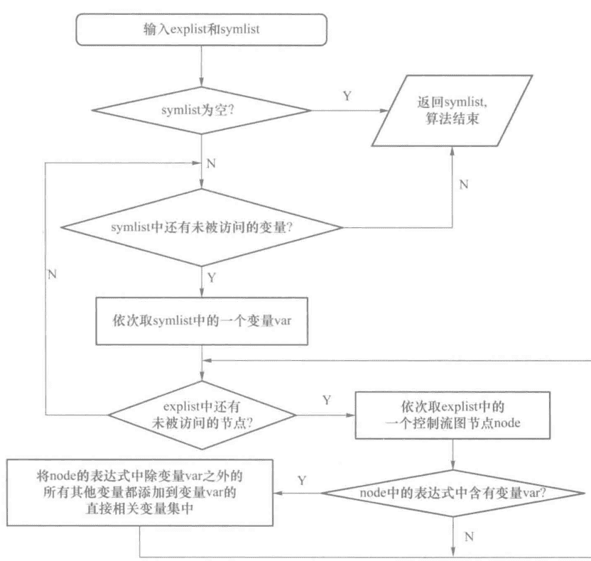）

1.  若 `symlist` 空则结束。
2.  遍历 `symlist` 中每个变量 `var`。
3.  遍历 `explist` 中每个节点 `node`。
4.  若 `node` 表达式含 `var`，则将该表达式中**除 `var` 外的所有变量**加入 `var` 的直接依赖集 `U→DirDepvar^var`。

### 相关变量闭包：递归扩展至传递闭包

直接依赖不够，必须求**传递闭包**。定义：
`Influence(a) = DInfluence(a) ∪ (⋃_{b∈DInfluence(a)} Influence(b))`  (公式 3-1)

**闭包计算算法（对应流程图 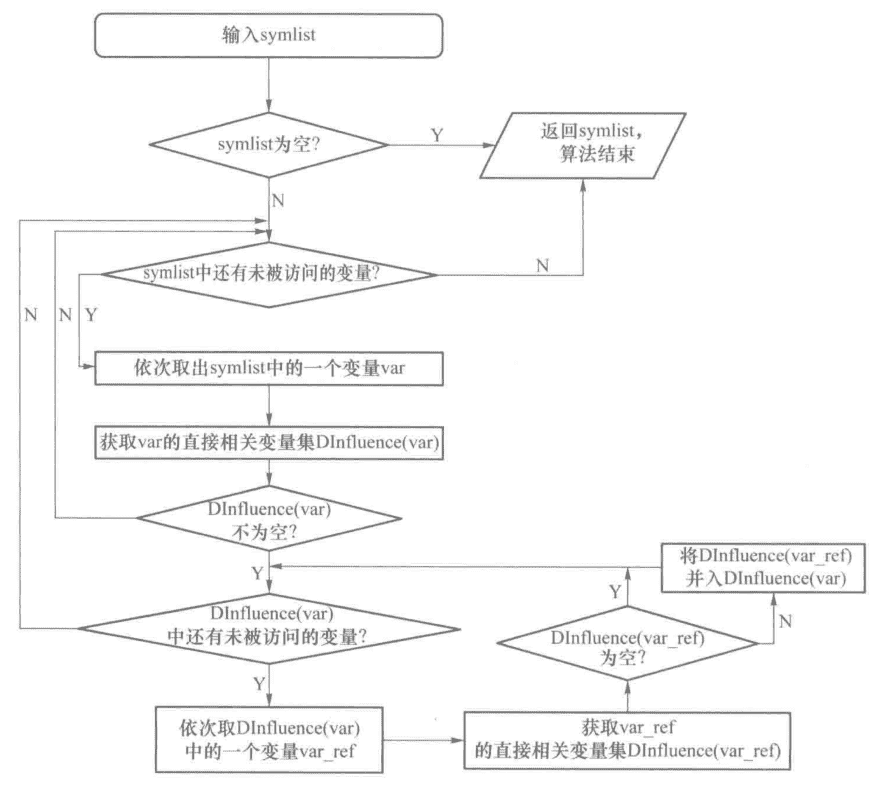）：**
1.  遍历 `symlist` 中每个变量 `var`。
2.  取其直接依赖集 `DInfluence(var)`。
3.  对该集合中每个变量 `var_ref`，递归获取其 `DInfluence(var_ref)`。
4.  若非空，并入 `DInfluence(var)`（原地扩展），直到无新变量加入。最终 `DInfluence(var)` 即为闭包 `Influence(var)`。

## 3.1.5 变量级别确定：基于“离入口距离”的优先级排序

区间运算从程序入口开始数据流分析，**靠近入口的分支约束对路径可达性影响更大、更早生效**。因此，必须按变量在约束中出现的先后顺序分级，指导搜索优先决策靠前的变量。

**分级规则：**
*   默认级别 `-1`（未出现在任何约束表达式中，优先级最低，不影响他人赋值）。
*   第 1 个表达式出现的变量 → 级别 `0`。
*   同一表达式内变量 → 同级。
*   表达式序号每 +1，级别 +1。

**提取与分级联动算法（对应流程图 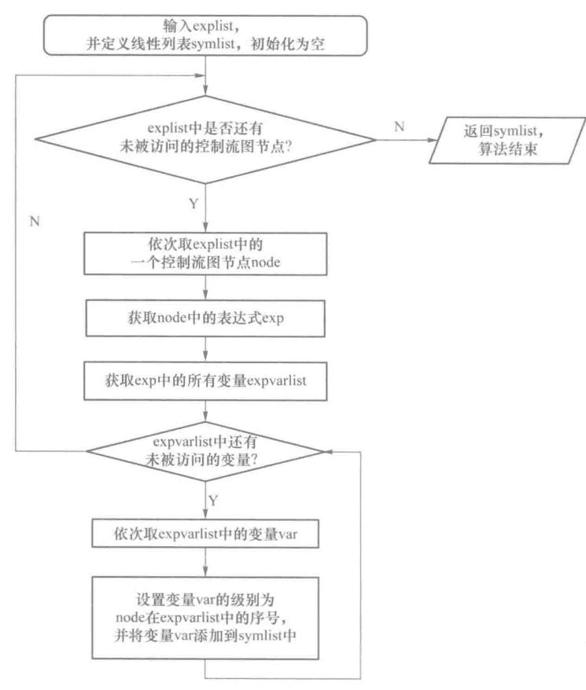）：**
利用已按序存储的 `explist`（节点序号即表达式序号）：
1.  初始化 `symlist` 为空。
2.  按序遍历 `explist` 节点 `node`（序号 `idx`）。
3.  取出 `node` 中表达式 `exp` 的所有变量 `expvarlist`。
4.  遍历 `expvarlist` 中变量 `var`：
    *   若 `var` 不在 `symlist` → 设 `var.level = idx`，加入 `symlist`。
    *   已在 `symlist` → 保留原级别（首次出现决定级别）。
5.  返回 `symlist`。

## 3.1.6 不相关变量移除 (IVR)：搜索空间的“外科手术”

### 为什么要做 IVR？

输入变量集 `X` 中，并非所有变量都影响目标路径 `p` 的可达性。
**例**：`test1` 程序 4 条路径中，`x3` 仅与 Path2/3/4 相关，**与 Path1 无关**。为 Path1 搜索 `x3` 纯属浪费。

**严格定义：**
*   **相关变量**：存在一组赋值使 `p` 不可达，**仅改变该变量值**即可使 `p` 可达。
*   **不相关变量**：对任何使 `p` 不可达的赋值，**改变该变量值**仍无法使 `p` 可达。

**根因**：区间抽象域丢失了变量间关系，导致搜索被迫覆盖无关维度。静态分析可保守估计相关性，实施 IVR 剔除无关变量，**直接降维打击搜索空间**。

### 线性约束下的 IVR 算法 (Algorithm 3-2 ```
Br(n_{qa}, n_{qa+1}) = \sum_{j=1}^{n} a_j x_j \mathbb{R} c \quad (3-2)
```/```
输入 Br(n_{qa}, n_{qa+1}) (a \in [1, k]) ; 路径上 k 个分支条件
X = {x_1, x_2, \cdots, x_n} ; 输入变量集合

输出 X_{rel} ; 路径相关变量集合
X_{irrel} ; 路径不相关变量集合

1: X_{rel} \leftarrow \emptyset ;
2: X_{irrel} \leftarrow \emptyset ;
3: foreach Br(n_{qa}, n_{qa+1}) (a \in [1, k])
4:     if (X_{rel} == X)
5:         break ;
6:     else if (a_j \neq 0)
7:         X_{rel} \leftarrow X_{rel} \cup {x_j} ;
8: X_{irrel} \leftarrow X - X_{rel} ;
9: return X_{rel}, X_{irrel} ;
```)

假设路径上 `k` 个分支，条件均为输入变量线性表达式：
`Br = (Σ a_j * x_j) R c`  (R 为关系符，a_j、c 为常数)

**核心逻辑**：遍历路径上每个分支条件，检查变量系数 `a_j`。若某变量在**所有**分支条件中系数均为 0，则判定为不相关变量，移除。

### 理论收益：指数级复杂度降低 (命题 3-1)

搜索主算法 (Algorithm 3-6) 对单变量连续试值，每次消耗 1 次区间运算，上限 `m` 次。最坏时间复杂度 `O(m^n)` (n 为变量数)。

*   设相关变量集 `X_rel`，不相关变量集 `X_irrel`。
*   `X_rel` 每增 1 变量，区间运算次数**指数级**增长。
*   移除所有 `X_irrel` (大小 `|X_irrel|`)，复杂度直接降低 `m * |X_irrel|` 量级。
*   线性约束下 BFS-BB 多为不回溯搜索，IVR 效果极其显著。

### 实战复盘：test1 程序 IVR 过程 (表 3-2)

| 目标路径 | 关键分支条件序列 | 系数矩阵 | 相关变量集 (X_rel) | 不相关变量集 (X_irrel) |
| :--- | :--- | :--- | :--- | :--- |
| **Path1** (0-1-2-9-10) | `x1-x2<=0` | a1=1, a2=-1, **a3=0** | **{x1, x2}** | **{x3}** |
| Path2 (0-1-3-4-8-9-10) | `x1-x2>0` <br> `x3-x2<=0` | (1, -1, 0) <br> (0, -1, 1) | {x1, x2, x3} | ∅ |
| Path3 (0-1-3-5-6-7-8-9-10) | `x1-x2>0` <br> `x3-x2>0` <br> `3x3>=-5` | (1, -1, 0) <br> (0, -1, 1) <br> (-, -, -) | {x1, x2, x3} | ∅ |
| Path4 (0-1-3-5-7-8-9-10) | `x1-x2>0` <br> `x3-x2>0` | (1, -1, 0) <br> (0, -1, 1) | {x1, x2, x3} | ∅ |

**结论**：仅 Path1 受益于 IVR，成功剔除 `x3`。其他路径因后续分支引入 `x3` 约束，全员相关。这精准印证了 IVR 的**路径敏感性**——相关性非全局固定，随路径结构动态变化。

---

**小结**：从爬山法驱动的状态搜索，到约束提取、依赖闭包构建、变量分级，再到 IVR 降维，这一套组合拳构建了基于区间运算的测试用例生成核心链路。理解这些机制的协同与权衡，是攻克复杂程序自动化测试生成效率瓶颈的关键钥匙。

## 3.2 搜索提速利器：三大核心算法详解

在自动化测试用例生成的核心环节——分支定界探索中，如何实现更快、更精准的求解？答案蕴藏在三大关键技术中：基于 Abstract Interpretation 的 Interval Iteration Refinement、变量动态排序决策、以及 Hill Climbing 求解策略。本节将逐层拆解这些核心“黑科技”。

### 3.2.1 Abstract Interpretation 驱动的 Interval Iteration Refinement：从“顺序依赖”迈向“Fixed Point 收敛”

#### 核心痛点：Interval Arithmetic (IA) 的“顺序敏感性”陷阱

IA 是 Branch and Bound (B&B) 的基石。无论是路径可达性裁决，还是赋值有效性校验，全赖于此。但 B&B 对路径约束的精度要求远超 CTS 体系其他组件。前置阶段、状态空间探索均高频调用 IA。

问题在于：标准 IA 采用顺次执行模式，致使结果高度依赖约束前后次序。

**示例 3-1 约束组对比**

```
A: { b<a   a,b∈Z       和      B: { b>0   a,b∈Z
     b>0                   b<a
```

直观上，A 组（`a>b, b>0`）与 B 组（`b>0, a>b`）的数学可行域一致：`{a: [2, +∞], b: [1, +∞]}`。若作为 B&B 控制条件（对应下列程序 if 真分支）：

```
A: void f(int a,int b){
if(b<a)
if(b>0)
;
}
```
```
B: void f(int a,int b){
if(b>0)
if(b<a)
;
}
```

运算结果却大相径庭：
- **A 组结果**：`< a: [-∞, +∞], b: [1, +∞] >`（a 域未收敛，精度损耗）
- **B 组结果**：`< a: [2, +∞], b: [1, +∞] >`（精准命中可行域）

**根因剖析**：A 组第 2 行出现 `b>0` 时，第 1 行的 `a>b` 已处理完毕。顺次模式无法让后序约束“回溯”修正前序结果，导致 `a` 域滞留在 `[-∞, +∞]`。若不改进，探索将在 `< a: [-∞, 1], b: [1, +∞] >` 这个无效域里白白耗费算力。

#### 破解方案：引入反馈回路的 Iterative Interval Arithmetic (IIA)

结合 B&B 特性，我们引入迭代机制：

- **状态视角**：搜索树每个节点对应一个“稳态域集”（经 IA 校验含有效解）。状态跃迁（稳态域集 → 下一稳态域集）需经多轮迭代，中间产物称“过渡域集”。若过渡域现空域，说明当前取值无效，需回溯换值。
- **计算视角**：每轮初始条件 = 上轮结果 = 隐含前序所有约束。本轮结果若超出初始条件，即违背约束，直接修剪。迭代直至域不再变化（达 Fixed Point）。
- **预判价值**：在生成测试案例前，通过迭代即可预判可达性，直接过滤死路径，规避无用功。

**核心定义**：
- **Def. 3-8** $(D_1, \dots, D_n)_0$：前置阶段得到的初始变量域集。
- **Def. 3-9** $(D_1, \dots, D_n)_i$：探索中第 $i$ 个变量取值前的稳态域集。

**两阶段迭代流程**：

**(1) 前置期：$(D)_0 \rightarrow (D)_1$ —— 从粗糙初值到首个稳态**

① **迭代收敛**：对初始域反复代入路径约束计算，直至输入输出一致，得 $(D)_1$ 作为 B&B 入参。
② **迭代矛盾**：若过程域变空，判定路径不可达，前置阶段即终止，不再进入探索。

**实战复盘·示例 3-1 (A 组)**：
初始 `< a: [-∞, +∞], b: [1, +∞] >`。
- **第 1 轮**：处理 `b<a` → `a` 收敛至 `[2, +∞]`；处理 `b>0` → 无变化。结果与输入不一致，继续迭代。
- **第 2 轮**：输入已是精准解，运算结果不再变化，**Fixed Point 达成**。最终结果与数学可行域完美对齐，消除了顺序依赖缺陷。

```
B: \begin{cases} b>0 \\ b<a \end{cases} a,b\in \mathbf{Z}
```

**实战复盘·示例 3-2 (死路径识别)**：
```
if(b>a)
if(b<-4)
if(a>0)
...;
}
```
传统单次运算得 `< a: [1, +∞], b: [-∞, -5] >` 直接用于取值，却不知此域与首个约束 `b>a` 矛盾。
IIA 模式：
- 第 1 轮得上述结果，非稳态，强制进入第 2 轮。
- 第 2 轮处理 `b>a` → 域直接变空 **`< ∅, ∅ >`**！
- **结论**：前置期即捕获矛盾，路径标记为死路径，测试案例生成流程直接终止，巨大算力节省。

**(2) 探索期：$(D)_{i-1} \rightarrow (D)_i$ —— 稳态间的试探与修正**

探索中每状态均为“无矛盾最简域集”（必含有效解）。从 $(D)_1$ 到 $(D)_2$ 等，需经多轮迭代。中间“过渡域集”可能不可达，因当前稳态中选取的变量值无效，需换值重试。此即 IIA 核心逻辑。完整流程见下图（加粗为迭代运算节点）：

```
\(y_0 = x_0 \quad y_{n+1} = y_n \Delta x_{n+1}\)
``` *(对应原文证明区块标记)*

#### 理论支撑：Narrowing Operator 保证的单向收缩

为何迭代必趋稳且不漏解？Abstract Interpretation 给出数学担保。

**Prop. 3-2**：IIA 中，变量域单向收缩。

**证明纲要**：
- 抽象域 $L$ 为高度有限格，$F$ 为路径解析函数（单调）。
- 初始条件隐含前序约束。本轮结果若超出初始条件，即违背约束，被 Narrowing 算子 $\Delta$ 修剪。
- Narrowing 满足：$x \le y \implies x \le x \Delta y \le y$；且对任何递减数列 $\{x_n\}$，序列 $y_{n+1} = y_n \Delta x_{n+1}$ 必趋稳（严格递减数列长度有限）。
- 将两稳态间的过渡域视为递减数列，迭代终点即收敛极限：
  $(D)_1 = \text{temp}D_1$；$(D)_{i+1} = (D)_i \Delta \text{temp}D_m$。

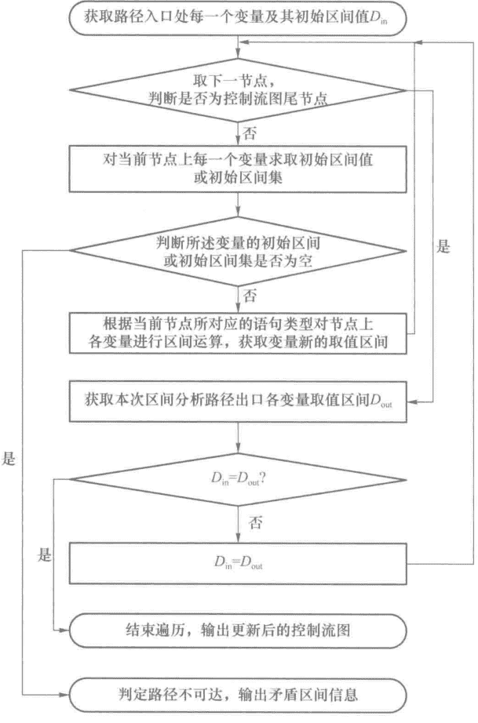
图 3-7 一次区间迭代运算流程图

### 3.2.2 变量动态排序决策：双键机制破解同尺寸僵局

Best-First B&B 维护优先级队列，节点优先级由变量域有序集决定。排序即决策，决策即效率。

#### 经典启发式与失效场景
主流原则：域最窄变量优先取值（Fail-First，极小化树宽）。
**死结**：多变量域宽度完全相同时，单键排序失效，陷入随机或固定序，无法保证最优。

#### 破解方案：引入“控制流层级”作为次键

**Def. 3-10 分支秩**：
路径上第 $k$ 个分支 $(n_{q_a}, n_{q_{a+1}})$，秩 $rank=a$（入口为 1，递增）。变量继承所在分支秩；现身多处取最小秩；未现身视为 $\infty$。

**物理意义**：离入口越近的分支表达式，对取值成败影响越大（修剪杠杆越长）。优先取值高层级变量，等于优先试探“关键卡口”。

#### 算法流程：双键快排 + 即时停机

1. **特征提取**：遍历路径线性列表（存含表达式的 CFG 节点），提取变量，初始化秩与出现次数为 -1。
2. **动态刷新**：每当状态达稳（变量取值成功），立即触发重排，确保下一个扩展变量始终是当前优先级最高者。
3. **排序规则**：
   - **主键**：域宽度（升序）；
   - **次键**：变量秩（升序，即越靠近入口越优先）。
4. **实现**：快排。针对同宽度变量组，按秩排序，**一旦确定队列首元素即可提前终止**，无需全序。此即 BFS-BB 采用的排序策略，后续可扩展更多键经实验验证。

```
输入路径p
提取p上表达式，求相关变量集和相关变量矩阵，确定变量级别，移除不相关变量
得到路径出口处各变量区间(D1, D2, ..., Dn)并对其进行迭代运算
能够达到迭代稳定?
得到初始回退前的精化区间(D1, D2, ..., Dn)1
变量排序，设置当前状态
对当前变量进行回退(对当前状态进行迭代区间运算)
回退成功?
得到路径出口处各变量精化区间(D1, D2, ..., Dn)(i=2, 3, ..., n)
当前状态的前驱状态是初始状态?
回溯(判断矛盾变量，将矛盾变量设定为当前变量)
分支限界求解失败
所有变量都成功回退?
分支限界求解成功(D1, D2, ..., Dn)即成功生成的测试用例
```
图 3-8 使用区间迭代优化策略的分支限界算法流程图

```
输入路径p
提取p上表达式，求相关变量集和相关变量矩阵，确定变量级别，移除不相关变量
得到路径出口处各变量区间(D1, D2, ..., Dn)并对其进行迭代运算
能够达到迭代稳定?
得到初始回退前的精化区间(D1, D2, ..., Dn)1
变量排序，设置当前状态
对当前变量进行回退(对当前状态进行迭代区间运算)
回退成功?
得到路径出口处各变量精化区间(D1, D2, ..., Dn)(i=2, 3, ..., n)
当前状态的前驱状态是初始状态?
回溯(判断矛盾变量，将矛盾变量设定为当前变量)
分支限界求解失败
所有变量都成功回退?
分支限界求解成功(D1, D2, ..., Dn)即成功生成的测试用例
```
B&B 调用的 IA 部分从程序入口开始对目标路径进行数据流向解析，若变量取值在某分支节点导致死路径产生，则取值失败，不再向下解析。越靠近入口的表达式对取值成败影响越大。故需结合表达式出现次序对程序变量分级。因变量存在于 CFG 分支节点上，故给出秩的定义。

```
算法 3-3 Dynamic Variable Ordering
输入 FV: 待排序变量的集合
$D_i : x_i$ 的区间 $(x_i \in \text{FV})$
$(n_{q_a}, n_{q_{a+1}}) (a \in [1, k])$: 路径上 k 个分支节点
输出 $x_i$: 下一个待赋值变量
Begin
1: $Q_i \leftarrow \text{quicksort}(\text{FV}, |D_i|)$;
2: for $i \leftarrow 1; |Q_i|$
3: if $(|D_i| \neq |D_j|) (j>i; x_i, x_j \in Q_i)$
4: break;
5: else for $(n_{q_a}, n_{q_{a+1}}) (a \in [1, k])$
6: if $(\text{rank}(n_{q_a}, n_{q_{a+1}})(x_i)=\text{rank}(n_{q_a}, n_{q_{a+1}})(x_j))$
7: $a \leftarrow +$;
8: else permutate $x_i, x_j$ by $\text{rank}(n_{q_a}, n_{q_{a+1}})$;
9: break;
10: $x_i \leftarrow \text{head}(Q_i)$;
11: return $x_i$;
End
```
这是一种双关键字（域宽度+变量秩）排序。通过快排得到按域宽度的序，对同宽度变量从入口沿路径按秩排序，一旦得出结果即随时退出，因只需序列首元素。此双键排序正是 BFS-BB 所用方法，现也考虑加入更多元素进行多关键字排序，并通过实验验证效果。

### 3.2.3 Hill Climbing 求解策略

IIA 锁定“可行域”，动态排序决定“探索序”，最后一公里——如何在连续或大规模离散域内高效落子？Hill Climbing 策略登场。它将约束满足转化为优化目标，沿梯度方向逼近目标分支，配合随机重启跳出局部最优，成为处理复杂数值约束的利器。详细机制将在后续章节展开。

# BB-HC 机制：全局定界统筹与局部攀爬突击的协同破局

自动化测试数据生成领域，攀爬策略（Hill Climbing）由来已久。前文指出，其虽具极速收敛之利，却因“局部收敛”天性，极易陷入极值陷阱，或因局部不可解导致全局求解崩塌。本节构建 **BB-HC 混合引擎**：分支定界（Branch and Bound, B&B）担任全局调度员，动态生长搜索树、把控宏观方向；攀爬策略充当局部攻坚手，利用闪电般的收敛速度快速试探。局部可解即刻锁定，受阻则迅速回退至全局层回溯，最大化规避“局部死胡同拖垮整体”的风险。双方协作拓扑见下图。

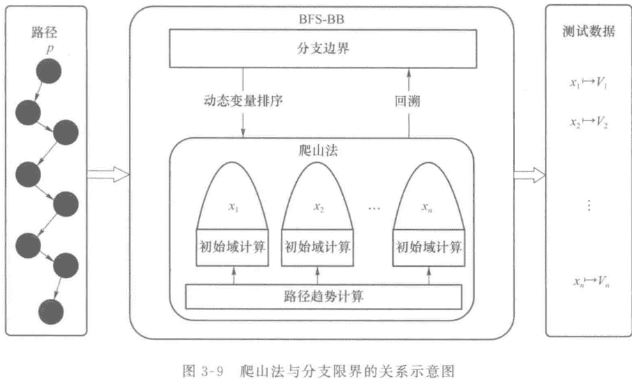

## 一、 启发式定初值：在“盲目撒网”与“固定中点”之外寻优解

变量首值优劣，直接关乎探索成败。无回溯流程中，首值即解的基因；有回溯时，优质首值能引领搜索一路绿灯。主流路径两极分化，痛点显著：
*   **纯随机派**：样本多样性有保障，却缺乏导航，常陷海量无效迭代泥沼。
*   **固定中点派**：二分取中，检索极快，但多次运行必出同一组数据，多样性归零。

破局需满足三大刚性指标：
1.  **差异性**：多轮执行产出迥异用例集。
2.  **贴近实况**：统计表明，C 语言代码中线性限制条件占比超 9 成。
3.  **工具适配**：CTS 内区间抽象域采用顺序存储，二分检索原生高效。

**解法路径：经验规则锁定搜索域 → 对半压缩 → 压缩域内随机采样。**

借助符号解析与区间演算，抽取变量关联表达式，研判变元在式中的“角色”：
*   **单表达式维度**：**增益型**（取值越大越易成立）、**抑制型**（取值越小越易成立）、**中立型**（其余）。
*   **全路径维度**：聚合全路径表达式统计，同样划分三类。

摸清变元“脾气”后，定向收缩初始定义域，再在缩减区段内随机落子。实施三步走：

1.  **拒绝单一值**：为保差异性，必须在子区段 $D' \subseteq D$ 内随机抽取。
2.  **对半压缩**：结合线性约束占优、顺序存储利于二分的特质，在中点处切分，保留偏大或偏小半边作为 $D'$。
3.  **如何抉择（取大/取小）？** 关键在于变元 $x_i$ 与各分支限制的**单调关联**。我们将分支约束建模为 $x_i$ 的映射，依据复合映射的增减规律决策。

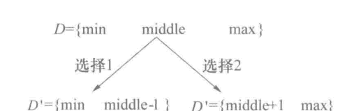

### 核心建模与数学基石

**定义 3-11（分支映射）**  
设 $B=\{true, false\}$，$D_i$ 为 $x_i$ 定义域。分支映射 $Br_{(n_{qa}, n_{qa+1})}(x_i): D_i \to B$ 定义为：
$$ Br(x_i) = (a_i x_i + \sum_{j \neq i} a_j x_j) \mathbb{R}^c \quad (3-3) $$
其中 $\sum_{j \neq i} a_j x_j$ 视作 $x_i$ 的常量项。该映射与 $x_i$ 的单调走向，直接指引初值应偏大还是偏小。

**命题 3-3（复合映射单调性传递）**  
若 $f_1, \dots, f_n$ 均为分段单调映射且定值域衔接，则复合映射 $F_n = f_n \circ \dots \circ f_1$ 亦为分段单调映射。（数学归纳法证毕）

**定义 3-12（路径变元倾向 PathTendency）**  
量化变元在全路径上的“倾向性”：`positive` 提示取大值，`negative` 提示取小值。计算基于分支权重 $w_i$ 与路径累计权重 $pw_i$：
$$ w_i(n_{qa}, n_{qa+1}) = \begin{cases} \frac{|a_i|}{|a_i| + \sum_{j \neq i} |a_j|}, & \text{单调递增} \\ -\frac{|a_i|}{|a_i| + \sum_{j \neq i} |a_j|}, & \text{单调递减} \end{cases} \quad (3-4) $$
$$ pw_i = \sum_{a=1}^k w_i(n_{qa}, n_{qa+1}) \quad (3-5) $$

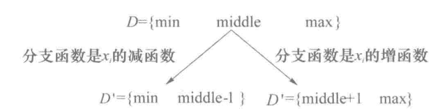

```
输入X_rel:路径的相关变量集合
pw_i:变量 x_i的路径权重(x_i \in X_rel)
输出 Path-Tendency <Variable,PathTendency>:存储 X_rel中每个变量性质的哈希表
Begin
1: Path-Tendency<-null;
2: foreach x_i \in X_rel
3:   if (pw_i>0)
4:     Path-Tendency<-Path-Tendency U{<x_i,positive>};
5:   else if (pw_i<0)
6:     Path-Tendency<-Path-Tendency U{<x_i,negative>};
7: return Path-Tendency;
End
```  *（算法 3-4：路径倾向计算）*
```
输入D_i=[[min,max]]:x_i的区间
Path-Tendency <Variable,PathTendency>:存储 X_rel中每个变量性质的哈希表
输出 D_{1i}:用来选取变量 x_i初始值的区间
Begin
1: PathTendency(x_i)<-retrieval of Path-Tendency;
2: if(PathTendency(x_i) = positive)
3:   D_{1i}<-[[(min+max)/2 , max]];
4: else if(PathTendency(x_i) = negative)
5:   D_{1i}<-[[min ,(min+max)/2]];
6: return D_{1i};
End
```  *（算法 3-5：初始定域计算）*

---

## 二、 攀爬实战：将“觅峰顶”转化为“极小化评价函数”

攀爬策略主攻等式限制，亦可推广至不等式，覆盖常见关系式。核心机制：调用区间演算核验当前取值 $V_{ij}$ 是否冲突。**“峰顶”即：区间演算判定无冲突的赋值。**

为透析原理，将路径上 $k$ 个分支判据拆解为区间传递链（见图 3-10）：
*   **通达链（a）**：$k$ 个判据全通过，赋值生效，转入后续变元排序。
*   **受阻链（b）**：第 $h$ 个判据不成立，锁定冲突点、剖析成因、收缩当前变元定义域 $D_{ij}$，重新采样再试。

融合攀爬策略的 B&B 流程，定名为 **BB-HC**，主流程详见算法 3-6。

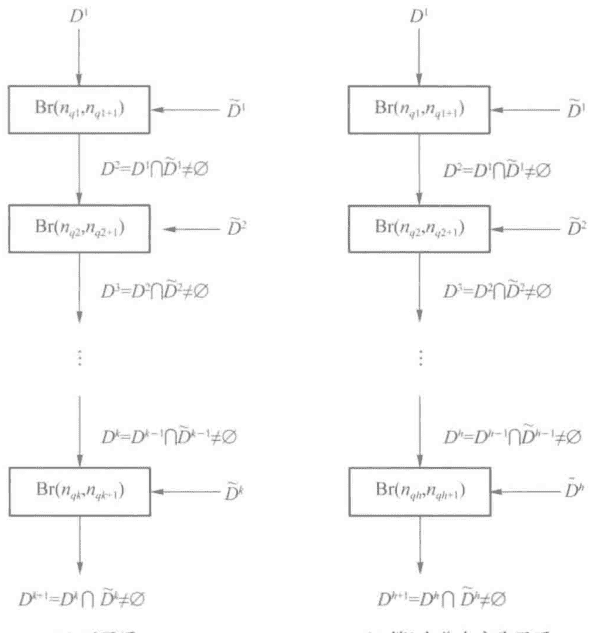

> **图 3-10 文本还原**：区间演算输入含 $V_{ij}$ 的完整定义域 $D^1$。逐个判据筛选：$D^1 \xrightarrow{Br_1} D^2 \xrightarrow{Br_2} D^3 \dots \xrightarrow{Br_k} D^{k+1}$，定义域单调收窄 $D^1 \supseteq D^2 \supseteq \dots \supseteq D^{k+1}$。若中途某判据 $Br_h$ 判 false，登记冲突、算评价函数、收缩 $D_{ij}$ 取新值继续闯。

```
输入 D_{i+1}: 选取 x_i 初始值的区间
V_{i+1}: x_i 的初始值
输出当爬山失败时，S_cur = (Pre, x_i, D_{ij}, V_{ij}, inactive)
当爬山成功时，S_cur = (Pre, x_i, D_{ij}, V_{ij}, extensive)
Begin
1: F(V_{i1}) <- 0;
2: while (|D_{ij}| > 1 & j <= m)
3:     for a -> 1; k
4:         Br(n_{qa}, n_{qa+1})(x_{ij}) <- false;
5:         D^a <- calculate Br(n_{qa}, n_{qa+1})(x_i) with D^a;
6:         if (D^a ∩ \widetilde{D}^a ≠ ∅)
7:             Br(n_{qa}, n_{qa+1})(x_{ij}) <- true;
```
```
8: D^{p+1}<-D^p \cap \tilde{D}^p ;
9: else F(V_{ij}) <- V_{ij} - \sum_{h=1}^{\tilde{d}} (D^h \cap \tilde{D}^h)(x_i) ;
10: break ;
11: if (F(V_{ij}) = 0)
12: S_{cur} <- (Pre, x_{ij}, D_{ij}, V_{ij}, extensive) ;
13: return S_{cur} ;
14: else if (F(V_{ij}) < 0)
15: D^* <- [V_{ij} + 1, V_{ij} + |F(V_{ij})|] ;
16: else D^* <- [V_{ij} - |F(V_{ij})|, V_{ij} - 1] ;
17: j++ ;
18: D_{ij} = D^* ;
19: V_{ij} <- select(D_{ij}) ;
20: S_{cur} <- (Pre, x_i, D_{ij}, V_{ij}, inactive) ;
21: return S_{cur} ;
End
```

### 评价函数：让“可信度”可度量、可比较

探索能否高效达标，评价函数设计是命门。优质解得分高，劣质解得分低。融合区间演算特质与约束求解需求，给出定义：
$$ F(V_{ij}) = V_{ij} - \sum_{a=1}^{k} (D^a \cap \tilde{D}^a)(x_i) \quad (3-6) $$

*   **$F(V_{ij}) = 0$**：全程零冲突，登顶“峰顶”，任务完成。
*   **$F(V_{ij}) \neq 0$**：依据返回值大小收缩 $D_{ij}$，在新域内取新值继续攀爬。

**本质上，这是一个“极小化 $|F|$”的迭代过程**。模值越趋近 0，备选解质量越高，优先入选下一轮赋值。由此，无序尝试转为精准打击，局部攻坚效能跃升。

# 区间运算失败时的削减策略与爬山法收敛机制

当区间运算遭遇失败时，函数 \( F(V_{ij}) \) 的反馈值能精准指引 \( D_{ij} \) 的上下界削减方向：正负号决定削减侧，绝对值界定削减幅度。得益于双向并行削减机制，算法效率显著跃升。在此驱动下，分支条件构成的路径约束得以逐步精准传播。

综上分析，我们引入阈值 \( m \) 与目标函数双重机制管控爬山法收敛，且该过程呈双向推进态势。3.3节实验数据揭示：绝大多数被测程序在爬山法作用下，区间运算次数远未触及阈值 \( m \) 上限，印证了目标函数本身具备强劲的收敛驱动力。

### 3.2.4 实战复盘

以下通过具体案例深度解析前述核心技术。

#### 1. 案例一

以图3-2中Path3粗体段为输入生成测试用例。该路径IVR过程详见表3-2，三个变量均为关联变量。为简化计算，统一初始输入区间为[-2, 2]（宽度5）。初始化阶段经区间运算收缩至：\( x_1 \in [-1, 2], x_2 \in [-2, 1], x_3 \in [-1, 2] \)。按图3-11分解后，PTC按表3-3推导变量路径性质；DVO依表3-4排序首个赋值变量，\( x_2 \) 脱颖而出（末列加粗标识）。从[-2, 1]中为\( x_2 \)选取初始值：IDC查表得\( x_2 \)性质为negative，倾向取小值，遂定为-1。

```c
void test1(int x1, int x2, int x3)
{if (x1-x2<=0)
printf("Path1");
else if(x3-x2<=0)
printf("Path2");
else if(3*x3+5>=0)
printf("Path3");
}
void test1(int x1, int x2, int x3)
{int b1=x1-x2;
if (b1<=0)
printf("Path1");
else{int b2=x3-x2;
if(b2<=0)
printf("Path2");
else{int b3=3*x3;
if(b3>=-5)
printf("Path3");
}
}
}
```

图 3-11 程序 test1 及其分支函数分解之后的形式

表 3-3 \( x_1, x_2 \) 和 \( x_3 \) 的路径性质计算过程

| 分支函数 | 基本函数及其单调性 | 分支函数单调性 | 权值 | 路径权值 | 路径变量性质 |

| :--- | :--- | :--- | :--- | :--- | :--- |

| \( x_1 - x_2 > 0 \) | \( f(x_1) = x_1 - x_2 \): 增<br>\( f(x_2) = x_1 - x_2 \): 减<br>\( f(b_1) = b_1 > 0 \): 增 | \( Br(x_1) \): 增<br>\( Br(x_2) \): 减 | \( w_1 = 0.5 \)<br>\( w_2 = -0.5 \) | | |

| \( x_3 - x_2 > 0 \) | \( f(x_2) = x_3 - x_2 \): 减<br>\( f(x_3) = x_3 - x_2 \): 增<br>\( f(b_2) = b_2 > 0 \): 增 | \( Br(x_2) \): 减<br>\( Br(x_3) \): 增 | \( w_2 = -0.5 \)<br>\( w_3 = 0.5 \) | | |

| \( 3x_3 \geqslant -5 \) | \( f(x_3) = 3x_3 \): 增<br>\( f(b_3) = b_3 + 5 \geqslant 0 \): 增 | \( Br(x_3) \): 增 | \( w_3 = 1 \) | \( pw_1 = 0.5 \)<br>\( pw_2 = -1 \)<br>\( pw_3 = 1.5 \) | \( \langle <x_1, positive>, <x_2, negative>, <x_3, positive> \rangle \)|

表 3-4 \( x_1, x_2 \) 和 \( x_3 \) 的排序过程

| 排序规则 | 每个变量的情况 | 遇到僵局? | 排序结果 |

| :--- | :--- | :--- | :--- |

| 区间大小 | \( |D_1| = 4, |D_2| = 4, |D_3| = 4 \) | 是(3 个变量的区间大小都是 4) | \( x_2 \to x_1 \to x_3 \) |

| 级别 1 | \( Rank1(x_1) = 1, Rank1(x_2) = 1 \),<br>\( Rank1(x_3) = \infty \) | 是(\( x_1 \) 和 \( x_2 \) 的级别都是 1) | |

| 级别 2 | \( Rank2(x_1) = \infty, Rank2(x_2) = 2 \) | 否(\( x_2 \) 有级别 2, 而 \( x_1 \) 没有) | |

IIC执行区间运算：\( x_1: [-1, 2], x_2: [-1, -1], x_3: [-1, 2] \)。运算成功，\( x_1, x_3 \) 区间分别压缩至\([0, 2]\)。DVO按表3-5选定下一变量\( x_1 \)（加粗标识）。

表 3-5 \( x_1 \) 和 \( x_3 \) 的排序过程

| 排序规则 | 每个变量的情况 | 遇到僵局? | 排序结果 |

| :--- | :--- | :--- | :--- |

| 区间大小 | \( |D_1| = 3, |D_3| = 3 \) | 是(两个变量的区间大小都是 3) | \( x_1 \to x_3 \) |

| 级别 1 | \( Rank1(x_1) = 1, Rank1(x_3) = \infty \) | 否(\( x_1 \) 有级别 1, 而 \( x_3 \) 没有) | |

IDC查表得\( x_1 \)性质为positive，从\([-1, 2]\)中选取1。IIC计算\( x_1: [1, 1], x_2: [-1, -1], x_3: [0, 2] \)通过。同理为\( x_3 \)选取1。最终IIC验证\(\{x_1 \mapsto 1, x_2 \mapsto -1, x_3 \mapsto 1\}\)无冲突，符合Path3。变量排序结束，BFS-BB输出成功用例。表3-6记录区间演变（变化项加粗），第4列因初始削减/IDC变化，第5列因IIC变化。生成过程对应图3-12搜索树（加粗箭头为解路径），呈现无回溯特征——此类搜索占主导。状态空间搜索阶段每变量仅运算一次，初始值即终值，爬山过程一步到位。

表 3-6 搜索过程中变量区间的变化情况

| 阶段 | 功能 | 初始区间削减前 | 初始区间削减后区间运算前 | 区间运算后 |

| :--- | :--- | :--- | :--- | :--- |

| 初始化 | 初始区间削减 | — | x1:[-2,2], x2:[-2,2], x3:[-2,2] | x1:[-1,2], x2:[-2,1], x3:[-1,2] |

| 状态空间搜索 | 区间运算判断 x2 赋值 -1 | x1:[-1,2], x2:[-2,1], x3:[-1,2] | x1:[-1,2], x2:[-1,-1], x3:[-1,2] | x1:[0,2], x2:[-1,-1], x3:[0,2] |

| 状态空间搜索 | 区间运算判断 x1 赋值 1 | x1:[0,2], x2:[-1,-1], x3:[0,2] | x1:[1,1], x2:[-1,-1], x3:[0,2] | x1:[1,1], x2:[-1,-1], x3:[0,2] |

| 状态空间搜索 | 区间运算判断 x3 赋值 1 | x1:[1,1], x2:[-1,-1], x3:[0,2] | x1:[1,1], x2:[-1,-1], x3:[1,1] | x1:[1,1], x2:[-1,-1], x3:[1,1] |

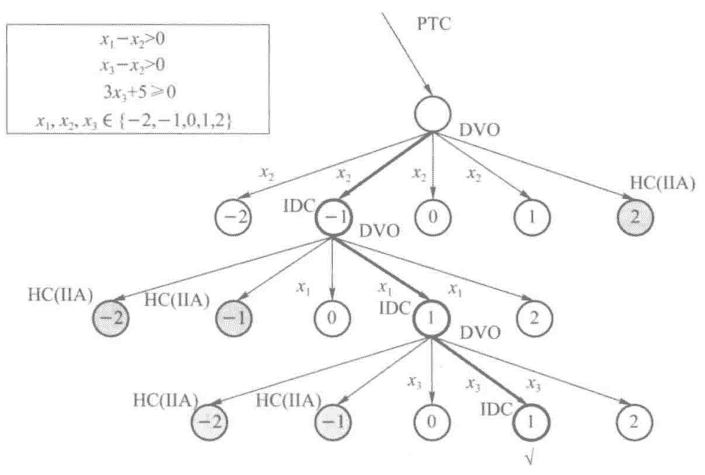

图 3-12 BFS-BB 为 Path3 生成测试用例的搜索树

#### 2. 案例二

为演示爬山法解方程效能，引入图3-13案例。test2含两输入变量\( x_4, x_5 \)，采语句覆盖，目标路径Path1: 0→1→2→3→4→5→6（经两真分支达stmt_3）。因两真分支\( T_1, T_2 \)谓词相同，实质为解方程组，唯一解\(\{x_4 \mapsto 60, x_5 \mapsto 40\}\)。约束强度极高。设\( x_4 \)初始区间[70, 70]，\( x_5 \)[0, 100]（见图3-14）。

```c
void test2(int x4, int x5)
{
if(x4+x5==100)
  if(x4-x5==20)
    printf("Solved!");
}
```

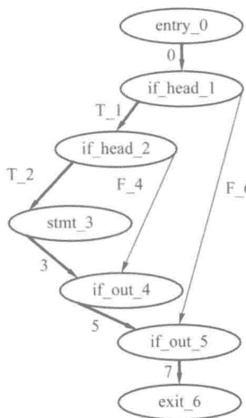

图 3-13 被测程序 test2 和对应的控制流图

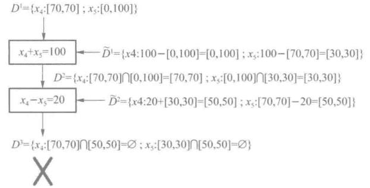

图 3-14 为 x4 赋值 70 的判断过程

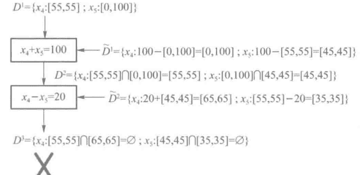

图 3-15 为 x4 赋值 55 的判断过程

二分支检出矛盾，目标函数\( F(70)=70-\sum_{a=1}^{2}(D^a \cap \tilde{D}^a)(x_4)=20>0 \)，削减\( x_4 \)区间至[50, 69]，远小于[0, 100]。虽70不合适，但指引了方向。若从[50, 69]取55赋值，状态转\( S_{cur}=(\text{null}, x_4, [50, 69], 70, \text{active}) \)，判断见图3-15。

四分支矛盾，\( F(55)=55-\sum_{a=1}^2(D^a \cap \tilde{D}^a)(x_4)=-10<0 \)，削减\( x_4 \)至[56, 65]，区间再缩。55虽非解但指引方向。若从[56, 65]取60，状态转\( S_{cur}=(\text{null}, x_4, [56, 65], 60, \text{active}) \)，判断见图3-16。

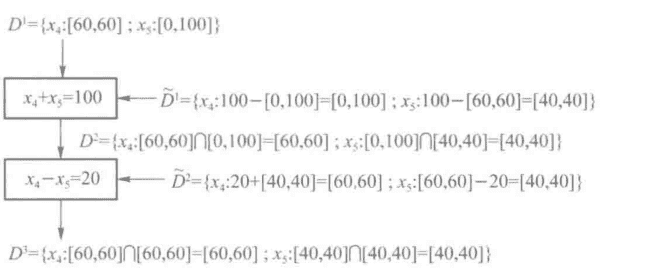

图 3-16 为 \( x_4 \) 赋值 60 的判断过程

\( F(60)=0 \)标志登顶。爬山过程详表3-7。满足\( x_4+x_5=100 \)后区间化简为\( D^2=\{x_4:[60,60]; x_5:[40,40]\} \)；进入\( x_4-x_5=20 \)仍满足，得\( D^3 \)同\( D^2 \)，确认\( x_4=60 \)满足全路径约束，状态转extensive，推进搜索。\( x_5 \)唯一值40，最终得用例\(\{x_4 \mapsto 60, x_5 \mapsto 40\}\)。

表 3-7 使用爬山法为 \( x_i \) 赋值的过程

| j | \( D_{i,j} \) | \( V_{i,j} \) | \( F(V_{i,j}) \) | \( |F(V_{i,j})| \) | 是否到达山顶? |

|---|---|---|---|---|---|

| 1 | \([0, 100]\) | 70 | 20 | 20 | 否 |

| 2 | \([50, 69]\) | 55 | -10 | 10 | 否 |

| 3 | \([56, 65]\) | 60 | 0 | 0 | 是 |

### 3.3 实证评测

CTS功能覆盖单元划分、路径选择、用例生成、执行管理（插装/打桩/驱动）、结果分析、覆盖率统计、故障定位，架构见图3-17。支持语句/分支/MC/DC覆盖，基于此确定目标元素并选取路径。作为面向路径生成器，BFS-BB处理CTS路径，旨在最短时间产出高覆盖用例。

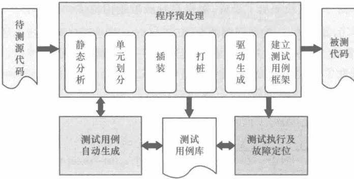

图 3-17 CTS 的系统架构

本章实验分三节（3.3.1-3.3.3），分别验证3.2节加速策略。

3.3.1测试迭代区间运算（3.2.1），该法兼具提效与不可达路径检测，故实验注入预处理难查的不可达路径。

3.3.2对比3.2.2提出的变量级别破僵排序法与单纯区间大小排序法。

3.3.3多维评估核心局部搜索——爬山法（3.2.3）。三算法对比，从变量数与表达式关系两维验证；并测不同方程数下爬山法解方程能力。

#### 3.3.1 迭代区间运算对比实验

##### 1. 实验设计

锁定其余策略为最优配置，对比「含迭代」与「无迭代」两组（各10次）。注入一条预处理阶段不可见的不可达路径，考察检出能力。

##### 2. 实验环境

- CPU: Intel Pentium U5600 @ 1.33GHz
- 主板: 联想 3249A69 (Intel QM57)
- 内存: 4GB (2.92GB可用)
- 显卡: Intel HD Graphics
- 硬盘: 希捷 ST9250315AS
- OS: Windows 7 家庭普通版

##### 3. 实验数据

表3-8对比结果：A=含迭代，B=无迭代。

| 项目 | A | B |

|---|---|---|

| 代码行数 | 847 | |

| 覆盖准则 | 语句 | |

| 不可达路径数 | 1 | |

| 可达路径数 | 13 | |

| 最大分支数 | 601 | |

| 最大变量数 | 50 | |

| 计算时间/h | 4.03 | 2.65 |

| 可生成测试用例路径比例 | 92.9% | 78.6% |

| Aborted 路径比例 | 0 | 21.4% |

| 成功率 | 92.9% | 78.6% |

##### 4. 实验总结

- **检出不可达路径**：迭代过程成功识别出上述不可达路径。剔除后，分支限界为其余13条可达路径全数生成用例。
- **攻克复杂约束**：14条路径中，2条仅靠迭代才能求解。代价是耗时增加34%（4.03h vs 2.65h）。分支限界以时间换成功率。**求解效率优化将成下一核心课题。**

#### 3.3.2 变量动态排序的对比测试

##### 1. 测试方案设计

所谓变量动态排序，核心逻辑包含两层：首先优先处理取值区间较小的变量；其次，当区间大小一致时，则依据变量级别高低决定优先顺序，级别越高越优先赋值。

在保持其余策略均为最优配置的前提下，本实验对比了“采用动态变量排序”与“仅按区间大小排序（小区间优先）”两种模式的表现（每组重复实验 20 次）。

##### 2. 测试平台配置

- ① 处理器：Intel(R) Pentium(R) CPU U5600 @ 1.33 GHz。
- ② 主板：联想 3249A69（英特尔 QM57 芯片组）。
- ③ 内存：4 GB（可用 2.92 GB）。
- ④ 显卡：Intel(R) HD Graphics（Pentium 核芯显卡）。
- ⑤ 硬盘：希捷 ST9250315AS。
- ⑥ 操作系统：Windows 7 家庭普通版。

##### 3. 测试数据记录

表 3-9 展示了动态排序对比实验的详细数据。其中，方案 A 代表“区间大小 + 变量级别”的动态排序策略；方案 B 代表仅按区间大小排序（小区间优先）的基准策略。

| 项目 | 424 行程序 | 840 行程序 |

|---|---|---|

| 代码规模 | 424 行 | 840 行 |

| 覆盖标准 | 语句覆盖 | 语句覆盖 |

| 不可达路径数 | 0 | 0 |

| 可达路径数 | 13 | 13 |

| 最大分支数 | 201 | 601 |

| 最大变量数 | 50 | 50 |

| 计算耗时/h (A) | 0.20 | 4.03 |

| 计算耗时/h (B) | 1.45 | 5.22 |

| 可生成测试用例路径占比 (A) | 100% | 100% |

| 可生成测试用例路径占比 (B) | 69.2% | 61.5% |

| Aborted 路径占比 (A) | 0 | 0 |

| Aborted 路径占比 (B) | 30.8% | 38.5% |

| 求解成功率 (A) | 100% | 100% |

| 求解成功率 (B) | 69.2% | 61.5% |

##### 4. 实验结论分析

实验表明，变量动态排序对分支限界算法的影响主要体现在两个维度：

- ① **显著缩短生成时间**。当最大分支数分别为 201 和 601 时，耗时分别降低了 86% 和 23%（具体降幅受被测程序特性影响）。
- ② **决定求解成败**。两组实验中均出现了因区间相同导致随机排序引发求解失败的情况。变量排序作为分支限界的核心环节，对整体求解能力影响显著（本实验中成功率提升了 30%~40%）。

#### 3.3.3 爬山法实验评估

##### 1. 爬山法性能剖析

本实验通过对比“路径变量性质决定初始值的爬山法”在变量数量与表达式数量两个维度上的表现，分别验证初始值选取策略与爬山迭代过程的有效性。为此设置了三组对照方法：
- **RI&NHC**：随机初始值 + 矛盾后不爬山；
- **RI&HC**：随机初始值 + 矛盾后爬山；
- **BB-HC**：基于路径变量性质确定初始值 + 矛盾后爬山。

鉴于三种方法生成时间差异巨大，坐标轴采用了指数化处理。

###### (1) 与变量个数的关联

实验设定被测程序含 50 个输入变量 $x_1, x_2, \cdots, x_n$，$n$ 从 1 递增至 50。采用语句覆盖，每程序设 50 个 `if` 语句（即 50 个路径约束），仅覆盖全真分支路径（TTT···TT），使分支条件与谓词完全一致。每个 `if` 为 $n$ 个变量的线性组合，形式如下：

```
[a1,a2,···,an][x1,x2,···,xn]' rel_op const[c] (3-7)
```

其中 $a_1, a_2, \cdots, a_n$ 为正负随机数，$\text{rel\_op} \in \{>, \geq, <, \leq, =, \neq\}$，$\text{const}[c]\ (c \in [1,50])$ 为 $[0,1000]$ 区间内的随机常数数组。经验证确保路径可达，且每程序至少含一个“=”以测试等式处理能力。此设定构建了变量间最紧密的线性相关关系，且均为目标路径相关变量。对 $n=1$ 到 $50$ 的每个程序均执行 50 次实验，取平均值对比，结果见图 3-18。

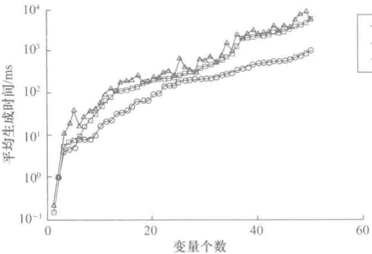

图 3-18 三种方法随变量个数变化的耗时对比

结果显示：BB-HC 平均耗时远低于其余两法，而 RI&NHC 耗时最长。BB-HC 耗时随变量数增加呈匀速增长趋势。拟合曲线求导得 $y=1.06x-8.682$，推断：$n < 8$ 时三法耗时相当；$n > 8$ 时 BB-HC 优势显现，耗时开始拉大。

###### (2) 与表达式个数的关联

实验固定 50 个输入变量 $x_1, \cdots, x_{50}$，语句覆盖下设 $u\ (u \in [1, 50])$ 个 `if` 语句（$u$ 个路径约束），同样仅覆盖全真路径。每个 `if` 为 50 变量的线性组合：

```
\( [a_1, a_2, \cdots, a_{50}] [x_1, x_2, \cdots, x_{50}]' \, \text{rel\_op} \, \text{const}[u] \quad (3-8) \)
```

其中 $a_1, \cdots, a_{50}$ 为正负随机数，$\text{rel\_op} \in \{>, \geqslant, <, \leqslant, =, \neq\}$，$\text{const}[u]$ 为 $[0,1000]$ 随机常数数组。验证随机数 $a_v\ (v=1,\cdots,50)$ 与 $\text{const}[u]$ 保证路径可达，且每程序至少含一个“=”。对 $u=1$ 到 $50$ 的每程序重复 50 次实验取均值，结果见图 3-19。

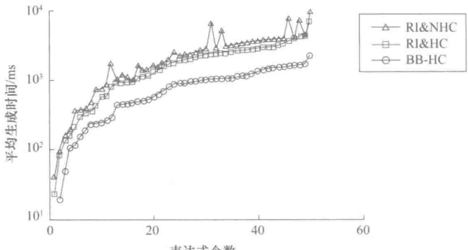

图 3-19 三种方法随表达式个数变化的耗时对比

结论一致：BB-HC 耗时最短，RI&NHC 最长。拟合分析显示，BB-HC 下生成时间与表达式个数呈线性正相关，即约束增加导致耗时线性增长。

##### 2. 爬山法处理等式的对比测试

###### (1) 测试设计思路

爬山法引入分支限界旨在攻克等式导致的求解失效。为验证其处理等式的能力，实验在保持其余策略最优的基础上，取分支限界处理 201 分支案例，将不等式依次替换为 1 到 5 个等式观察效果。仅选取含等式路径，采用语句覆盖，每组实验 20 次取平均值。

###### (2) 测试平台配置

- ① CPU：Intel(R) Pentium(R) CPU U5600 @ 1.33GHz。
- ② 主板：联想 3249A69（英特尔 QM57）。
- ③ 内存：4 GB（2.92 GB 可用）。
- ④ 显卡：Intel(R) HD Graphics (Pentium)。
- ⑤ 硬盘：希捷 ST9250315AS。
- ⑥ 系统：Windows 7 家庭普通版。

###### (3) 测试数据统计

表 3-10 记录了爬山法处理不同数量等式时的回溯次数与生成时间。

| 等式数量 | 回溯次数 | 生成时间/min |

|---|---|---|

| 1 | 53.7 | 2.3 |

| 2 | 60.8 | 3.9 |

| 3 | 186.5 | 7.15 |

| 4 | 205.3 | 12 |

| 5 | 343 | 21 |

###### (4) 实验复盘与改进方向

表 3-10 显示：等式较少时影响有限，回溯与耗时接近无等式基线；但从 3 个等式起，两指标陡增。结合执行追踪分析，针对含等式程序提出两点优化建议：

- ① **提升等式处理优先级**。等式约束更严苛、更难满足，应优于不等式处理，需单独提取等式约束集。
- ② **引入线性代数辅助判断**。现策略过度依赖区间运算，可将提取的等式视为输入变量方程组，利用线性代数中判定线性方程组解的存在性（如系数矩阵秩）来辅助赋值决策，减少盲目搜索。

# 第 4 章 人工智能赋能测试用例自动生成

## 4.1 基于矛盾定位的混合回溯技术

### 4.1.1 技术背景铺垫

#### 1. 回溯搜索机制

CSP（约束满足问题）是 AI 核心分支，主流求解均基于回溯搜索，核心思想是逐步扩展局部解。搜索各阶段，算法尝试将当前局部解延伸为完整解[1,2]。参照 3.1.2 节，变量分为三类：已赋值变量集(PV)、当前变量(CV)、未赋值/自由变量集(FV)。若 PV 构成的局部解无法向其他变量扩展、也无法成为最终解一部分，即产生**不一致**；若 CV 所有取值尝试均失败，则陷入**死端**。此时需从 PV 中移除变量，退回上一决策点，即**回溯**。

优化回溯算法的技术分两派：**前向方法**（扩展局部解前调用[3]）与**后向方法**（遭遇死端时触发）。前文[4]已详述 BFS-BB 的前向策略，本章聚焦后向方法——通过分析死端成因决定回溯深度，并记录新约束防止同类矛盾重演[5]。

#### 2. 经典回溯算法谱系

- **时序回溯** —— 最基础、应用最广。一致性检查按初始变量序进行。CV 检查失败则尝试下一值；值耗尽则回溯至最近赋值变量(PV中)；新变量赋值成功则记录部分解。
- **回跳** —— 遇死端时比 BT 高效。不回溯至最近变量，而是直接跳回与 CV（如 $x_i$）冲突的最深已赋值变量（如 $x_j$）。改变 $x_j$ 可能使 $x_i$ 一致，而修改二者间变量无效。BJ 直击矛盾源头，跳过无关层级。
- **矛盾驱动回跳** —— 机制更精细。每变量维护**矛盾变量集**，记录与其当前赋值冲突的历史变量。$x_i$ 赋值 $V_i$ 与 $x_j$ 赋值 $V_j$ 冲突时，将 $x_j$ 入 $x_i$ 矛盾集。$x_i$ 无值可选时，CBJ 回溯至其矛盾集中最深变量 $x_h$。同时，将 $x_i$ 矛盾集中除 $x_h$ 外的变量并入 $x_h$ 矛盾集，保全矛盾信息。除 PV、CV、FV 外，新增矛盾变量集。
- **前向检查** —— 反向思维，面向未来。赋值 CV 后，检查 CV 与 FV 一致性：移除 FV 区间内与 CV 赋值冲突的取值。若所有 FV 区间非空，则在缩减区间选值赋值下一变量；若有 FV 区间变空，FC 失效尝试下一值；若 CV 无值可选，FC 退化为时序回溯。**BFS-BB 采用 FC 作为回溯策略。**
- **混合算法 FC-CBJ** —— 融合 FC 与 CBJ 优势。弃用 FC 的时序回溯，改用矛盾集定位回溯点。CV $x_i$ 赋值 $V_i$ 与 FV $x_j$ 值 $V_j$ 冲突时，$x_j$ 入 $x_i$ 矛盾集；若 $x_k$ 区间被消除，将 $x_k$ 矛盾集变量并入 $x_i$ 矛盾集。$x_i$ 无值可选时，回溯至其矛盾集最深变量 $x_h$，并将矛盾集中除 $x_h$ 外变量并入 $x_h$ 矛盾集。Prosser[7] 评价 FC-CBJ 为回溯算法“冠军”，效率层级见图 4-1（越靠下效率越高）。

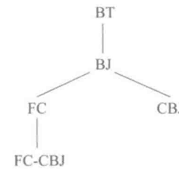

图 4-1 回溯算法效率层级对比

### 4.1.2 核心痛点剖析

约束满足虽可通过寻优/搜索求解，但回溯操作往往是效率瓶颈。图 4-2 为项目组用 BFS-BB 测试某基准程序的实测数据：被测程序涵盖工程常见数据类型与控制结构，语句覆盖下 65 条待覆盖路径。生成测试用例时，**仅 21 条路径触发回溯（占比 32%），却耗费了总时间的 81%**。可见，提升回溯效率是缩短搜索时间的关键——需挖掘搜索过程信息，减少搜索树访问次数。

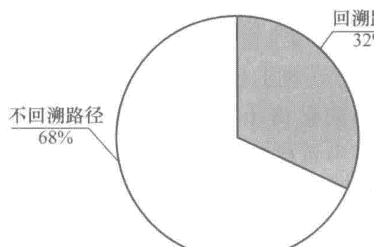

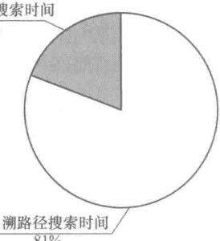

图 4-2 回溯路径占比 vs 耗时占比

制约回溯效率的三大具体问题：

- ① **盲目时序回溯导致无效搜索**。如图 4-3（灰色为死端）所示：抵达死端后不分析矛盾本质，机械逐层回溯至上一变量，若仍无解则继续上溯，直到触达矛盾变量所在层。因未定位矛盾变量，大量增加了搜索树访问开销。

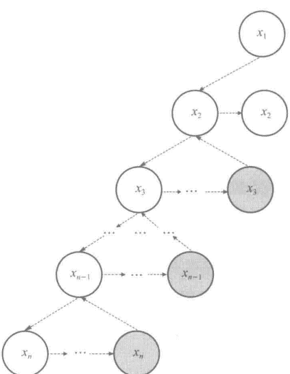

图 4-3 时序回溯盲目性示意

- ② **不可达区间引发的无效穷举**。未剔除不可达区间会产生不可达路径，导致大量运算无用功，统计占比 30%~75% [8]。业界已觉醒“边搜边测”重要性并落地实践。
- ③ **忽视变量关联性**。项目组早期实验证实：变量独立时，搜索时间随变量数线性增长；变量紧密线性相关时，搜索时间呈多项式级增长[4]。变量相关性对搜索影响巨大，利用相关性压缩矛盾传播范围可显著提升回溯效能。

### 4.1.3 3C 算法：破局之道

针对上述痛点，本节提出 **3C 算法**——融合 **Conflict-directed backjumping（矛盾驱动回跳）**、**forward Checking（前向检查）**、**Closure（闭包/传播）**，三大机制协同完成 BFS-BB 回溯操作，在原型系统中集成为高效约束求解引擎。

#### 1. 前向检查机制

每次变量赋值后的区间运算开销大，且许多变量区间本身不可达，在其内运算纯属浪费。因此，搜索过程中引入**前向检查**：利用区间运算动态剔除未来变量的不可达区间。得益于区间运算的保守性，非不可达区间必被保留。此策略相当于在高耗时区间运算前加装“过滤网”（见图 4-4）——仅判定为可达区间才进入后续深度运算，最大化剪枝，从而压缩执行时间、提升求解效率。

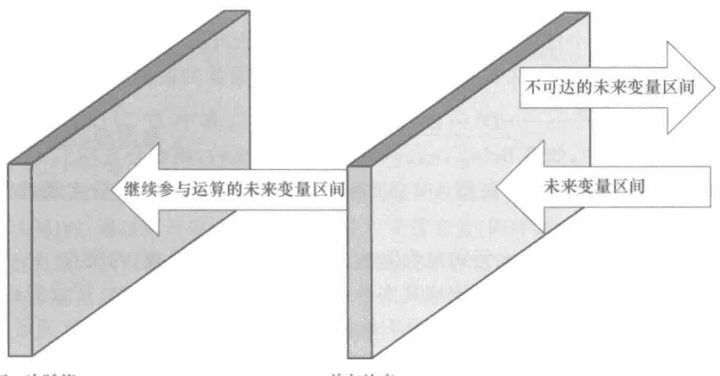

图 4-4 前向检查削减未来变量区间示意

前向检查依托区间运算实现。为精确描述其流程，先给出分支条件的形式化定义。

#### 定义 4-1

设 $B$ 为布尔值集 $\{\text{true}, \text{false}\}$，$D^a$ 为第 $a$ 个分支前所有变量区间的集合。若路径含 $k$ 个分支，则分支条件 $Br(n_{qa}, n_{qa+1}): D^a \to B\ (a \in [1, k])$ 可按式(4-1)计算，其中 $n_{qa}$ 为分支节点。

# 核心原理：区间约束传播与冲突引导的跳跃回溯

## 一、 区间演算：约束层层收敛的判定逻辑

分支判定函数 $Br(n_{qa}, n_{qa+1})$ 的核心在于两个区间的交集测试，如式 (4-1) 定义：输入域 $D^a$ 承载了前 $a-1$ 级判断的约束，而临时域 $\tilde{D}^a$ 则是 $D^a$ 代入第 $a$ 个判断式求解后的产物。若交集非空，说明存在取值同时满足前 $a$ 个条件，搜索得以推进；反之交集为空，则意味着至少一个变量的可行域被排空，当前路径断裂。对于包含 $k$ 个判断节点的路径，唯有全部 $k$ 个判定函数均返回真，路径才算可达；一旦出现假值，必须精准溯源冲突根因。

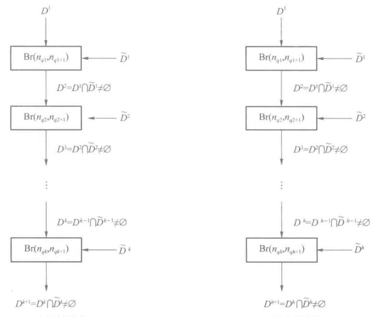

此过程实质是**约束逐级传播与定义域持续压缩**的链式反应：初始域 $D^1$ 经首个判断筛选得 $D^2$，再经第二个得 $D^3$，最终形成 $D^1 \supseteq D^2 \supseteq \dots \supseteq D^{k+1}$ 的嵌套序列。任一环节判定为假（如图 4-5(b)），演算即刻终止。值得注意的是，该方法采用“区间集合”而非“离散值”参与运算，属于粗粒度约束检查（类似 AC-3 但颗粒度更大）。这虽降低了计算开销，却可能导致定义域削减不够精细，甚至误删潜在可行解（含未来变量的解空间）。

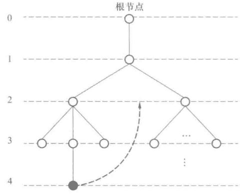

## 二、 冲突引导回跳：跳出逐级回退的低效泥沼

传统回溯撞墙后仅退一步，而冲突引导回跳（CBJ）的精髓在于**精准定位冲突源头层级**，实现跨层级“飞跃式”回溯（见图 4-6）。搜索树中，变量赋值先后序即其“层级标识”（定义 4-2）：根节点为 0 层，首个赋值变量为 1 层，层级越深离根越远。

```
void test(int x1, int x2, int x3, int x4,
int x5, int x6, int x7, int x8)
{
{x1=x2+1 ;
x3=2*x5;
if(x1>x3)
if(x3+x4==100)
if(x5-x7<30)
if(x6+x8<100)
printf("example");
}
```

要实现精准跳跃，首先要构建变量间的“关联拓扑”：
*   **直接关联（定义 4-3）**：若变量 $x_i, x_j$ 共同出现在某约束 $r_h \in R$ 中，它们互为直接关联变量。集合 $S_{rel}(x_i)$ 记录 $x_i$ 的所有直接伙伴。测试生成场景下，同一谓词内的变量天然直接关联。
*   **传递闭包（定义 4-4）**：$x_i$ 的闭包 $C(x_i)$ 通过迭代公式 (4-2) 计算，囊括了直接或间接与 $x_i$ 相关的所有变量。这本质是一个映射表，锚定了变量在路径约束中的影响辐射范围。

```
算法 4-1 BFS-BB-HB

输入 \(\rho\): 待覆盖路径
输出 result(\(<x_1, V_1>, <x_2, V_2>, \cdots, <x_n, V_n>\)): 令 \(\rho\) 可达的测试用例
```

以图 4-7 的 `test` 程序为例，表 4-1 列出了目标路径上各变量的符号表达及闭包。可见 $x_1$（符号为 $x_2+1$）和 $x_3$（符号为 $2x_5$）闭包为空，属于无关变量，随机赋值即可，无需纳入搜索决策。假设前序工作已剔除此类变量，以下讨论均聚焦“关联变量”。

**关键推论**：若已赋值变量导致当前不一致，该变量必位于当前变量的闭包 $C(x_i)$ 内。基于此，定义 4-5 给出**冲突源变量**的正式判定：当前赋值 $\langle x_i, V_i \rangle$ 触发冲突，在同闭包内且定义域被排空的已赋值变量中，层级最浅（最靠近根）者即为冲突源 $x_j$。回跳目标直指 $x_j$ 所在层级，跳过无关中间层。

```
Begin
1: result ← null;
2: S_rel(x_i) ← ∅ ; (i∈[1,n])
3: for k→1; m
4: if(x_i r_k x_j) (i,j∈[1,n])
5: S_rel(x_i) ← S_rel(x_i) U {x_j} ;
6: S_rel(x_j) ← S_rel(x_j) U {x_i}
7: C(x_i) ← S_rel(x_i) ; (i∈[1,n])
8: for i→1; n
9: if (x_a r_h x_b) (x_a ∉ C(x_i) ∧ x_b ∈ C(x_i) , h∈[1,k] , r_h ∈ R)
10: C(x_i) ← C(x_i) U U_{x_p ∈ S_rel(x_a)} S_rel(x_p) ;
11: while(FV ≠ ∅)
12: x* ← sort (FV) ;
13: V* ← select (D* ) ;
14: S_conflict (x*) ← ∅ ;
15: forward check (V* ) ;
16: while (forward checking fails)
17: foreach x_j ∈ C(x* )
18: if (D_j = ∅ ∧ x_j ∈ PV)
19: S_conflict (x*) ← S_conflict (x* ) U {x_j} ;
20: if (S_conflict (x* ) ≠ ∅ )
21: x1 ← quicksort ( S_conflict (x* )) ;
22: else x1 ← x_level(x* -1) ;
23: PV ← PV - {x1} ;
24: x* ← x1 ;
25: V* ← select after conflict (D* ) ;
26: forward check (V* ) ;
27: result ← result + {<x* , V*> } ;
28: FV ← FV - {x* } ;
29: PV ← PV + {x* } ;
30: return result;
End
```

## 三、 算法全貌：BFS-BB-HB 混合回溯流程详解

我们将前瞻校验（FC）与带闭包机制的 CBJ 融合，形成 **BFS-BB-HB** 算法（表 4-2 列出关键符号表）。输入为待覆盖路径（含约束集 $R$、变量集 $X$、初始域 $D$），输出为测试用例 `result`。

流程核心循环（针对未赋值变量集 $FV$）：
1.  **预处理**（第 2-10 行）：为每个变量构建关联集与传递闭包。
2.  **变量选序与取值**（第 12-13 行）：对 $FV$ 排序选出当前变量 $x^*$，从其域 $D^*$ 中取值 $V^*$（选值策略详见第 3 章）。
3.  **前瞻校验**（第 15 行）：执行 `forward_check(V^*)`，判断赋值是否引发冲突，同时剪枝未来变量域。输入包含三段：已赋值变量（退化为单点区间）、当前变量（单点区间）、未来变量（已过滤区间）。
4.  **校验通过**（第 27-29 行）：记录赋值对，变量转入已赋值集 $PV$，继续下一轮选序。
5.  **校验失败——智能跳跃**（第 17-21 行）：收集定义域被排空的已赋值变量组成冲突集 $S_{conflict}(x^*)$。若非空，快速排序定位层级最浅的冲突源 $x_i$，CBJ 直接跳转至 $x_i$ 所在层级重试。
6.  **校验失败——兜底退回**（第 22 行）：冲突集为空（无关变量导致），退化为传统回溯，退回至直接前驱变量 $x_{level(x^*)-1}$。
7.  **取值更新**（第 23-25 行）：利用冲突信息为当前变量选新值，循环回步骤 3。
8.  **终止**（第 30 行）：$FV$ 为空，返回完整测试用例。

```
([a<sub>n1</sub>, a<sub>n2</sub>, ..., a<sub>n5</sub>] [x<sub>1</sub>, x<sub>2</sub>, ..., x<sub>5</sub>]'<sub>rel_op</sub> const[n][1]) \land
([a<sub>n6</sub>, a<sub>n7</sub>, ..., a<sub>n10</sub>] [x<sub>6</sub>, x<sub>7</sub>, ..., x<sub>10</sub>]'<sub>rel_op</sub> const[n][2]) (4-3)
```

## 四、 实战验证：从闭包粒度到工程项目的效能实测

实验环境：32 位 Win7，P4 3.8GHz，4GB 内存。在 CTS 框架内开展四组实验，重点考察**闭包数量**这一核心指标对合成耗时与回退频次的影响，并对比 FC-CBJ（即 BFS-BB-HB）与纯 FC（BFS-BB）性能，还引入 N 皇后问题与商业工具 C++test 实测。

### 1. 闭包粒度实验：解耦越细，搜索越快

设 10 个输入变量 $x_1 \dots x_{10}$，语句覆盖准则，每程序含 $n \in [1,10]$ 个 `if` 语句（即 $n$ 个路径约束），仅一条全真路径可达。每个表达式包含所有 10 变量，但分布在不同闭包中。我们控制闭包数量为 1, 2, 3, 4, 5，并尽量均匀分配变量（如 2 闭包时各 5 变量，表达式形式见 ```
([a<sub>n1</sub>, a<sub>n2</sub>, ..., a<sub>n5</sub>] [x<sub>1</sub>, x<sub>2</sub>, ..., x<sub>5</sub>]'<sub>rel_op</sub> const[n][1]) \land
([a<sub>n6</sub>, a<sub>n7</sub>, ..., a<sub>n10</sub>] [x<sub>6</sub>, x<sub>7</sub>, ..., x<sub>10</sub>]'<sub>rel_op</sub> const[n][2]) (4-3)
``` 处线性组合）。每配置跑 100 次取平均。

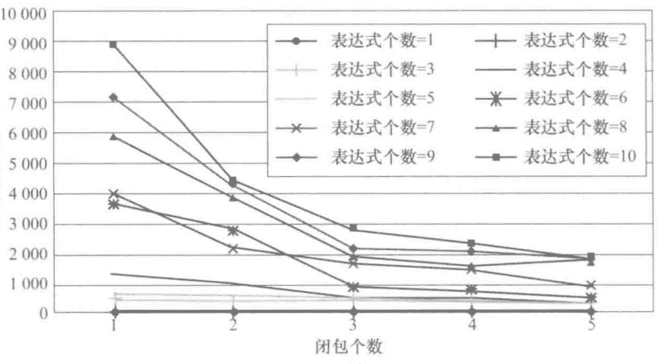

**发现**（图 4-8, 4-9）：
*   **约束越多越难**：固定闭包数时，表达式数 $n$ 从 1 增至 10，平均耗时显著上升。$n \le 5$ 时多为无回退搜索，差异不明显；$n \ge 6$ 约束复杂度激增，回退频发，耗时曲线陡峭。
*   **闭包越多越快**：固定 $n$ 时，闭包数从 1 增至 5，耗时单调下降，回退频次同步减少。原因清晰：闭包多 $\rightarrow$ 单约束涉及变量少 $\rightarrow$ 搜索空间解耦度高 $\rightarrow$ 组合爆炸被有效遏制。

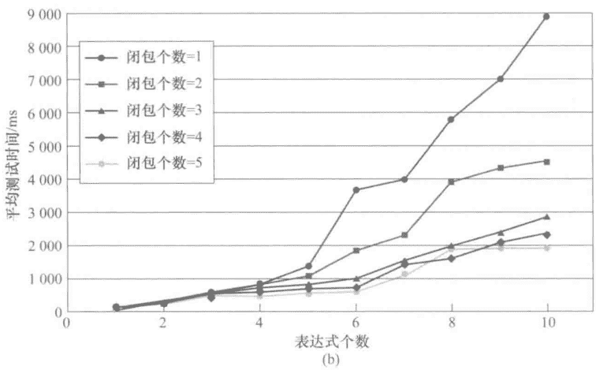

### 2. 实际工程项目测评

（后续内容待续……）

## 实战检验：BFS-BB-HB 在工程项目中的表现

本节选取实际工程项目 `aa200c` 对 BFS-BB-HB 算法进行实测。实验配置为 32 位 Windows 7 系统，搭载 Intel Pentium G640（2.80 GHz）处理器及 2 GB 内存，采用语句覆盖准则。被测程序涵盖了多样化的数据结构与变量类型。

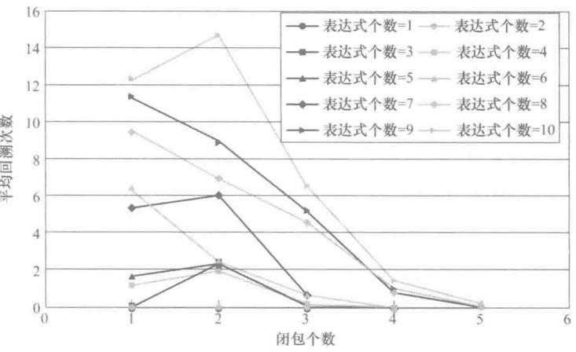

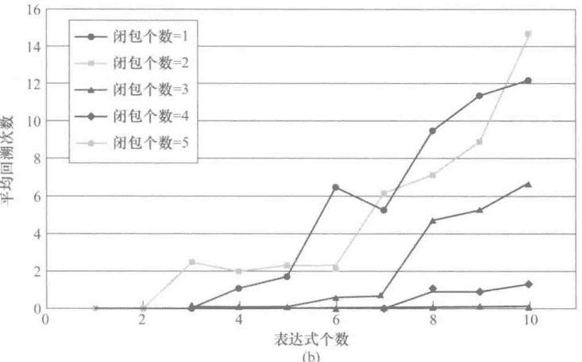

**图 4-9 平均回溯次数与闭包数量的关联趋势**

测试数据汇总于表 4-3。区间运算此前已阐述，此处用于评估 BFS-BB-HB 中前向检查机制的效能。数据揭示两大核心发现：其一，在无指针参与的程序中，算法性能更优，指针类型处理亟待强化；其二，表达式数量会干扰搜索效率，致使相同约束检查次数下耗时各异。总体而言，算法在可接受时限内运行良好，但仍有优化空间。

**表 4-3 BFS-BB-HB 测试工程 aa200c 结果统计**

| 文件 | 函数 | 变量类型 | 来源路径 | 平均约束检查次数 | 平均耗时/ms |
| --- | --- | --- | --- | --- | --- |
| angles | angles | double[],double[],double[] | path1 | 10 | 313.74 |
| deflec | relativity | double[],double[],double[] | path1 | 4 | 34.30 |
| | | | path2 | 11 | 151.54 |
| diurab | diurab | double,double *,double * | path1 | 16 | 207.98 |
| | | | path2 | 16 | 188.56 |
| diurpx | diurpx | double,double *,double *,double | path1 | 5 | 353.46 |
| | | | path2 | 5 | 17.40 |
| fk4fk5 | fk4fk5 | double[],double[],struct star * | path1 | 30 | 1034.88 |
| | | | path2 | 15 | 828.90 |
| | | | path3 | 30 | 1146.44 |
| | | | path4 | 15 | 1018.78 |
| | | | path5 | 15 | 935.74 |
| lightt | lightt | struct orbit *,double[],double[] | path1 | 3 | 68.48 |
| | | | path2 | 3 | 87.92 |
| | | | path3 | 8 | 616.5 |
| | | | path4 | 6 | 215.04 |
| | | | path5 | 4 | 101.04 |
| | | | path6 | 6 | 224.14 |
| lonlat | lonlat | double[],double,double[],int | path1 | 18 | 366.48 |
| | | | path2 | 18 | 250.18 |
| | | | path3 | 20 | 349.72 |
| pctomot | main | int,char ** | path1 | 71.40 | 1403.18 |
| | | | path2 | 15 | 68.12 |

### 3. 算法对决：BFS-BB-HB 对比 BFS-BB

此部分设置对照实验，环境升级为 Pentium 4（3.8 GHz，4 GB 内存）的 32 位 Windows 7 平台。

#### (1) CSP 经典问题测评

选取 CSPLib 标准库中的经典问题。以 N 皇后为例（n=4~9），各运行 100 次，记录均值对比。表 4-4 结果与解分布规律（表 4-5）吻合：6 皇后解数反而少于 5 皇后（1、2、3 皇后或过简或无解，故从 4 开始测）。数据显示，全规模下 BFS-BB-HB 均优于 BFS-BB（表中加粗项）。

**表 4-4 N 皇后问题对比实验数据**

| N | 平均回溯次数 | | 平均耗时/ms | |
| --- | --- | --- | --- | --- |
| | **BFS-BB-HB** | **BFS-BB** | **BFS-BB-HB** | **BFS-BB** |
| 4 | 0.67 | 0.79 | 132.15 | 143.48 |
| 5 | 0 | 0 | 142.30 | 185.84 |
| 6 | 2.84 | 4.72 | 1233.77 | 2699.03 |
| 7 | 0.56 | 0.57 | 942.74 | 1012.63 |
| 8 | 2.86 | 4.13 | 3417.05 | 4604.20 |
| 9 | 4.27 | 4.38 | 5636.65 | 5743.14 |

**表 4-5 N=1~9 时 N 皇后解数量分布**

| N | 1 | 2 | 3 | 4 | 5 | 6 | 7 | 8 | 9 |
| --- | --- | --- | --- | --- | --- | --- | --- | --- | --- |
| 解数 | 1 | 0 | 0 | 2 | 10 | 4 | 40 | 92 | 352 |

此外测试了 4 阶幻方与魔幻六边形，各 100 次。表 4-6 显示 BFS-BB-HB 全维度碾压：回溯次数仅为对照组的 12% 与 42%；约束检查量降至 24% 与 48%；时间开销压缩至 21% 与 47%。结论明确：新算法在 CSP 求解中显著提升回溯效率，后续将扩展测试集持续迭代。

**表 4-6 两大 CSP 问题性能对比**

| 问题 | 平均回溯次数 | | | 平均约束检查次数 | | | 平均耗时/ms | | |
| --- | --- | --- | --- | --- | --- | --- | --- | --- | --- |
| | **BFS-BB-HB** | **BFS-BB** | **占比** | **BFS-BB-HB** | **BFS-BB** | **占比** | **BFS-BB-HB** | **BFS-BB** | **占比** |
| 4 阶幻方 | 5.36 | 43.98 | 12% | 10305.42 | 42526.50 | 24% | 14999.66 | 71495.28 | 21% |
| 魔幻六边形 | 0.27 | 0.65 | 42% | 3573.94 | 7379.56 | 48% | 4659.56 | 9994.08 | 47% |

#### (2) CTS 基准程序实测

环境切换为 Ubuntu 12.04（Pentium 4，2.8 GHz，2 GB）。目标程序 `branch_bound.c`（CTS 基准，402 行，29 变量，结构复杂），语句覆盖下 65 条路径，每条跑 100 次。45 条路径无回溯，略过；剩余 20 条对比见表 4-7：回溯总量降 53%，耗时缩减 38%，搜索效率质变。

**表 4-7 CTS 基准程序测试结果**

| 路径 | 平均回溯次数 | | 平均生成时间/ms | |
| --- | --- | --- | --- | --- |
| | **BFS-BB-HB** | **BFS-BB** | **BFS-BB-HB** | **BFS-BB** |
| path1 | 3.80 | 57.60 | 14347.80 | 49937.44 |
| path2 | 2.00 | 5.40 | 19262.80 | 31203.70 |
| path3 | 0 | 1.10 | 2348.20 | 3907.30 |
| path4 | 0 | 0.10 | 2649.50 | 2827.80 |
| path5 | 0.50 | 0.80 | 1224.90 | 1316.80 |
| path6 | 45.45 | 45.45 | 46275.27 | 53049.36 |
| path7 | 0 | 0.10 | 2185.50 | 2417.80 |
| path8 | 0.29 | 0.29 | 698.64 | 726.57 |
| path9 | 0.38 | 0.47 | 496.84 | 705.38 |
| path10 | 0.26 | 0.33 | 638.79 | 741.13 |
| path11 | 0.09 | 0.23 | 670.08 | 915.73 |
| path12 | 0.09 | 0.44 | 655.65 | 731.09 |
| path13 | 0.33 | 0.33 | 565.87 | 686.73 |
| path14 | 0.23 | 0.38 | 556.41 | 769.31 |
| path15 | 0.09 | 0.29 | 739.50 | 831.82 |
| path16 | 0.29 | 0.38 | 587.81 | 722.36 |
| path17 | 0.23 | 0.29 | 628.00 | 741.21 |
| path18 | 0.17 | 0.29 | 636.86 | 759.42 |
| path19 | 0.09 | 0.29 | 712.00 | 773.71 |
| path20 | 0 | 0.10 | 730.80 | 831.30 |

### 4. 巅峰对决：BFS-BB-HB VS C++test

对比商业工具 C++test（VS2008 插件），同平台（Win7，P4 3.8G，4G），语句覆盖，N 皇后（n=4~9）百次实验。表 4-8 亮点：一、覆盖率碾压——BFS-BB-HB 全系 100%，C++test 因约束求解受困，最高仅 25%（4 皇后），9 皇后跌至 10%；二、速度优势显著——C++test 耗时以秒计，数倍于新算法（毫秒级），且解越稀疏（参考表 4-5），优势越巨大。

**表 4-8 BFS-BB-HB 与 C++test 对比数据**

| N | 平均语句覆盖率 | | 平均耗时/s | |
| --- | --- | --- | --- | --- |
| | **BFS-BB-HB** | **C++test** | **BFS-BB-HB** | **C++test** |
| 4 | 100% | 25% | 0.12 | 5 |
| 5 | 100% | 19% | 0.14 | 8 |
| 6 | 100% | 15% | 1.23 | 7 |
| 7 | 100% | 14% | 0.94 | 10 |
| 8 | 100% | 11% | 3.42 | 8 |
| 9 | 100% | 10% | 5.64 | 9 |

## 4.2 基于优化区间运算的一致性判断算法

### 4.2.1 理论基石

#### 1. NP 完全问题的挑战

AI 领域按计算复杂度将问题二分：多项式时间（P）可解的“易处理”问题（如选择 O(n)、排序 O(n log n)、矩阵乘法 O(n^2~n^3)、线性规划 >O(n^3)），与非多项式（NP）的“难处理”问题。CSP 属后者，复杂度随变量数 n 呈指数爆炸。同列者尚有超指数的 Presburger 算术、复杂度不可判定的 Hilbert 第十问题。这些均为 NP 完全，因无法用 n 的多项式刻画复杂度。

#### 2. 回溯搜索：从穷举到剪枝

穷举搜索遍历变量值域的笛卡尔积，逐组验证约束，首个满足者即为解。回溯搜索则按序赋值，变量赋值完毕即激活约束判断，冲突则回退修改最近变量。本质是深度优先搜索，通过剪除冲突子空间大幅超越穷举。

但统计模型表明，回溯仍属指数复杂度，主因是“无效搜索”：
*   **节点不一致**：变量值域含无效值，赋值必失败。
*   **弧不一致**：变量 x_i 取值 a 无法在 x_j 中找到匹配，导致中间变量所有组合白跑。

对策明确：节点一致性靠值域清洗；弧一致性靠搜索前对每条弧 (x_i, x_j) 施加 AC 算法消除。

#### 3. 一致性算法谱系

一致性算法（节点、弧、路径）核心价值：剪枝提速、缩减值域 d（因变量数 n 固定），即“值域剪除”。

发展脉络：
*   **AC-1 (1970, Fikes)**：奠基定义弧一致性，但效率低下。
*   **AC-2 / Waltz 算法**：引入约束传播思想，显著改进。
*   **AC-3 (1977, Mackworth)**：总结前作，给出通用高效算法，并延伸至路径一致性...

## 核心思想：约束传播与一致性算法演进

Mackworth 奠基了路径一致性体系，先后给出 PC-1 及改进版 PC-2。1985 年，Mackworth 与 Freuder 对 AC-1 至 AC-3、PC-1 及 PC-2 做了系统的复杂度理论分析。次年，Mohr 和 Henderson 推出 AC-4 和 PC-3，并证明 AC-4 在最坏时间复杂度上已达理论上限，标志着通用弧一致性算法的探索基本告一段落。

1992 年出现转折：Hentenryck 等人针对特定约束提出了最坏情况下优于 AC-4 的算法，同年 Perlin 也在可分解约束前提下给出更高效方案，两者均被称为 AC-5。但因 AC-5 依赖具体约束语义，不属于通用算法范畴。1994 年，Bessiere 通过大量实验指出：虽 AC-4 理论最优，但大多数场景下表现不及 AC-3。至今，**AC-3 仍被公认为工程落地的经典首选**。

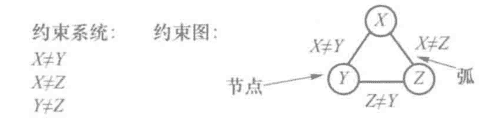

图 4-10 约束系统与约束图

Fikes 虽定义了弧一致性，但其 AC-1 仅具理论意义——核心逻辑是反复扫描全图所有弧，直到无不一致为止。Waltz 与 Mackworth 分别在算法中引入**传播队列**，将修正范围限定在受影响的邻近弧，这种“局部调整、全局传播”的机制，即**约束传播**的雏形。

为直观展示，我们引入约束图：节点代表变量，弧代表二元约束，路径对应三元约束。弧一致性（AC）聚焦两变量：若 $v_i \in D_i$ 找不到 $v_j \in D_j$ 满足 $R_{ij}$，则剔除 $v_i$。路径一致性（PC）聚焦三变量：在 $R_{ij}$ 成立前提下，若 $v_i, v_j$ 找不到 $v_k$ 同时满足 $R_{ik}, R_{kj}$，则**仅标记 $R_{ij}$ 失效，不直接删值**——值域剔除仍需 AC 二次判断。因此，**AC 是一致性检查的核心基石**。

AC 检查虽非独立求解器，却是搜索的两大助推器：
1.  **赛前预处理**：压缩初始搜索空间；
2.  **赛中前向检查**：搜索过程中动态剪枝（如本文 BFS-BB 內嵌的 AC 检查）。

### 4.2.2 痛点剖析：BFS-BB 的“盲区”与“耗时”

实测工程 `aa200c`（77 函数，MC/DC 准则），BFS-BB 耗时 110 分钟。**短板显而易见**：
*   **耗时高**；
*   **不可达路径漏检**——统计显示约 34% 路径不可达，若不提前识别，后续测试用例生成将大量资源浪费在“死路”上。

```
void test1( int x1, int x2){
 if (x1>x2 )
 if (x1<-10)
 if (x2>10)
 printf("Reachable?")}
```

图 4-11 程序 test 1

以 `test 1` 为例，目标路径为全真分支到达打印语句。末分支 `(x2 > 10)` 处，区间集为 `{x1:[-∞, -11], x2:[11, +∞]}`。直观看 x1 为负、x2 为正，与首谓词 `x1 > x2` 矛盾，**路径实为不可达**。但区间运算的**保守性**导致范围过度放大，BFS-BB 无法提前察觉，陷入无效搜索。

### 4.2.3 理论基石：区间、格与不动点收敛

区间是抽象解释中近似变量取值的经典工具，广泛用于工程值域分析。

> **定义 4-6（区间）**  
> 给定 $a,b \in \mathbb{R} \cup \{-\infty, +\infty\}$，有界闭区间 $[a,b] = \{x \mid x \in \mathbb{R} \cup \{-\infty, +\infty\}, a \le x \le b\}$。$a$ 为下确界，$b$ 为上确界。若 $a > b$ 则为空区间 $\bot$；$[-\infty, +\infty]$ 为顶区间 $\top$。

区间本质是取值范围的**并集集合**。例：$x \in [-3,6] \land x \ne 0 \Rightarrow [-3,-1] \cup [1,6]$。全体区间记为 $\mathbb{I}_{ivs}$。

> **定义 4-7（偏序 $\sqsubseteq_i$）**  
> $I_1=[a,b] \sqsubseteq_i I_2=[c,d] \iff c \le a \le b \le d \land [a,b]=\bot$。

> **定义 4-8（交并运算）**  
> 交集 (4-4)：$[a,b] \cap_i [c,d] = \begin{cases} [\max(a,c), \min(b,d)], & \max(a,c) \le \min(b,d) \\ \bot_i, & \text{否则} \end{cases}$  
> 并集 (4-5)：$[a,b] \cup_i [c,d] = \begin{cases} [a,b], & [c,d]=\bot_i \\ [c,d], & [a,b]=\bot_i \\ [\min(a,c), \max(b,d)], & \text{否则} \end{cases}$

上述定义在实数域成立，替换 $\mathbb{R} \to \mathbb{Z}$ 适用于整数。计算机中实数离散化，以步长 $\lambda>0$ 表精度（整数 $\lambda=1$，浮点 $\lambda$ 可变）。开区间 $(a,b)$ 可映射为闭区间 $[a+\lambda_1, b-\lambda_2]$。易验证 $\langle \mathbb{I}_{ivs}, \sqsubseteq_i, \cup_i, \cap_i, \bot_i, \top_i \rangle$ 构成**完全格**，图 4-12 为整数域哈斯图，区间运算遵循格规则。

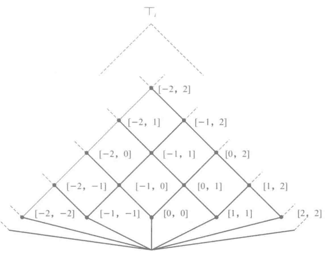

将入口区间集 $D_{in}$ 到出口 $D_{out}$ 的区间运算视为函数 $f$，依**克纳斯特-塔斯基定理**，迭代 $f$ 必收敛至**最小不动点**。这对天生“保守膨胀”的区间运算，是巨大的精度优化。

### 4.2.4 创新算法：迭代区间算子（IIA）与 BFS-BB-IIA

针对区间膨胀，我们引入**迭代区间算子（IIA, Iterative Interval Arithmetic）**。其工作流程见图 4-13、4-14：
*   **收敛不动点（图 4-13）**：多轮迭代逐步收缩区间，终得同等输入下**最精简区间集**，即函数不动点。
*   **检出空区间（图 4-14）**：迭代中若产生 $\bot$，即证**路径不可达**。

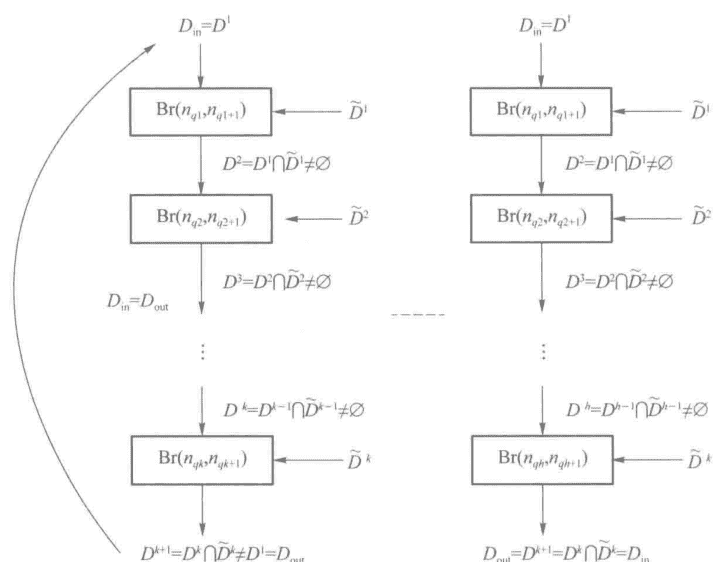
图 4-13 迭代算子运算到不动点的过程

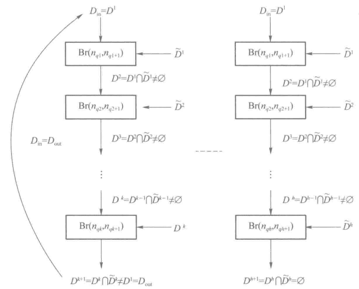
图 4-14 迭代算子检查到不一致的过程

#### 算法 4-2 迭代区间运算（IIA 伪码）
输入 $D^1$：路径入口变量区间集  
输出 $D^{k+1}$：路径出口变量区间集  
$F(V_i)$：变量赋值冲突时的目标函数值

```
Begin
1: arc consistent← false;
2: while(D^1≠∅)
3:     for a→1, k
4:         Br(n_qa, n_qa+1)←false;
5:         D'←calculate Br(n_qa, n_qa+1) with D^r;
6:         if (D^r ∩ D^r̄ ≠ ∅)
7:             Br(n_qa, n_qa+1)←true;
8:             D^{r+1}←D^r ∩ D^r̄;
9:         else if (PV ≠ ∅)
10:            calculate the corresponding F(V_i);
11:            return F(V_i);
12:         else return;
13: if (D^{k+1} = D^1)
14:     arc consistent← true;
15:     return D^{k+1};
16: else D^1 = D^{k+1};
End
```

将 IIA 嵌入 BFS-BB，得 **BFS-BB-IIA**（算法 4-3）。

#### 算法 4-3 BFS-BB-IIA
输入 $p$：待覆盖路径  
输出 `result(Variable ↦ Value)`：使 $p$ 可达的测试用例

**Stage 1: Preprocessing（预处理）**  
```
1: call Algorithm 1. Iterative interval arithmetic;
2: if (arc consistent = false)
3:     return infeasible path;
4: else foreach x_i ∈ FV
5:     if (D_i=[-∞, b] || D_i=[a, +∞] || D_i=[-∞, +∞])
6:         do reduce D_i;
7:         call Algorithm 1. Iterative interval arithmetic;
8:     while (arc consistent=false)
9:         D←D^{k+1};
```

**Stage 2: Branch & Bound Search（分支限界搜索）**  
```
Begin
10: result←null;
11: x1←order (FV);
12: V1←select (D1);
13: D1←{[V1,V1],D2,D3,...,Dn};
14: foreach xi(i→1: n)
15:     call Algorithm 1. Iterative interval arithmetic;
16: if (arc consistent = true)
17:     D←D^{k+1};
18:     result←result∪{xi ↦Vi};
19:     FV←FV−{xi};
20:     PV←PV+{xi};
21: if (FV=∅)
22: return result;
23: else xi←order (FV);
24:     Vj←select (Dj);
25:     D1←{[V1,V1]...[Vj,Vj]...[Vi,Vi],Di+1,...,Dn};
26:     goto 15;
27: else if (|Di|>1)
28:     reduce Di by F(Vi);
29:     Vi←select (Di);
30:     D'1←{[V1,V1]...[V2,V2]...[Vi,Vi],Di+1,...,Dn};
31:     goto 15;
32:     else backtrack;
End
```

---

**双阶段协同机制：**

| 阶段 | 核心动作 | IIA 角色（三模式） | 触发条件与差异 |
| :--- | :--- | :--- | :--- |
| **预处理** | 1. 弧一致性检查<br>2. 无穷大区间收敛 | **IPD** (行1)<br>**IDR** (行7) | **IPD**：输入含不可达导致的区间 → 检出不一致 = **铁板钉钉不可达**，直接终止。<br>**IDR**：输入含无穷大区间 → 检出不一致 = **收敛策略失效**，需调整策略而非判死刑。 |
| **搜索中** | 变量赋值试探 + 前向检查 | **VAD** (行15) | **VAD**：输入区间均有限界，且已赋值变量区间退化为单点 $[V,V]$ → 检出不一致 = **当前赋值非解**，触发回溯/重赋值。 |

**IIA vs 经典 AC-3 定位差异：**
*   **粒度**：AC-3 细粒度（逐弧/二元）；IIA 粗粒度（聚焦分支条件，常涉多变量）。
*   **效应**：冲突时，AC-3 削减局部域；IIA 可能同步收缩**所有相关变量域**。
*   **适用性**：IIA 原生支持浮点；大变量域工程项目中，粗粒度反而**效率更高**。
*   **代价**：粗粒度牺牲精度（源于区间保守性），IIA 通过迭代在**精度与效率间折中**。

### 4.2.5 实验验证：CTS 框架下的多维对决

在 CTS 框架内开展大规模实验，维度三：
1.  **基准对标**：VS 经典 **AC-3**；
2.  **敏感性分析**：VAD 模块在**变量数**与**表达式数**两维度的表现；
3.  **工业级 PK**：VS 商业工具 **C++test** 与 约束求解器 **Choco**。

#### 1. 弧一致性检查评估

## IIA 与 AC-3 实测对比：搜索效率谁更强？

本节通过对比实验，直观展示 IIA 与 AC-3 在 BFS-BB 框架下的表现差异。鉴于弧一致性算法常与搜索策略联用，我们将二者分别嵌入 BFS-BB，形成 **BFS-BB-IIA** 与 **BFS-BB-AC-3** 两套方案进行 PK。测试平台为 32 位 Windows 7，Pentium 4 3.0GHz/4GB 内存，基准程序选取 N 皇后问题（N=4~11）。

> **关键控制变量**：变量区间一致性检查的顺序会显著影响 AC-3 性能。为确保公平，实验统一采用数字自然序。

实验聚焦于“求得首个解”这一节点，统计两者的约束检查次数与回溯次数。表 4-9 数据一目了然：无论是检查频次还是回溯深度，IIA 均全面碾压 AC-3。这意味着，在搜索树中，BFS-BB-IIA 访问的节点数显著更少，搜索效率更高。

#### 表 4-9 AC-3 与 IIA 核心指标对决

| N | 约束检查次数 | | 回溯次数 | |
|---|---|---|---|---|
| | AC-3 | **IIA** | AC-3 | **IIA** |
| 4 | 122 | **42** | 4 | **1** |
| 5 | 83 | **40** | 0 | 0 |
| 6 | 902 | **281** | 21 | **3** |
| 7 | 212 | **168** | 0 | 0 |
| 8 | 858 | **473** | 10 | **0** |
| 9 | 973 | **540** | 5 | **1** |
| 10 | 1274 | **540** | 8 | **0** |
| 11 | 32326 | **3377** | 256 | **10** |

---

### 2. 测试用例生成性能深度评测

#### (1) 变量规模扩张：谁更从容？

变量个数是考验生成算法伸缩性的核心指标。实验构造 100 个输入变量（$x_1 \dots x_n$），$n$ 从 1 递增至 100。采用语句覆盖，每程序植入 100 个 if 语句（即单次区间运算需处理 100 个路径约束），仅设一条全真分支路径。约束形式为线性不等式（公式 4-6），系数与常数经验证确保路径可达，构建了变量间最紧密的线性耦合。每个 $n$ 值重复 100 次取平均，环境为 32 位 Win7 / Core 2.4GHz / 2GB。

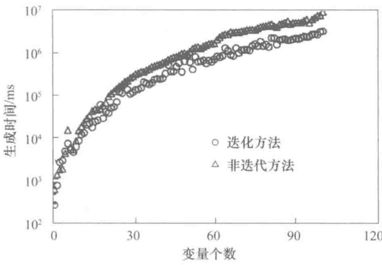

**图 4-15 变量个数增长时的双算法耗时对比**

对数坐标系下差异分明：**迭代法（含 VAD）耗时远低于非迭代法**。迭代法耗时随变量数呈多项式增长拟合良好（$p \ll 0.05$），导数 $y' = 904.4x - 12190$ 揭示了加速增长趋势。经验阈值：**$n \le 13$ 两者耗时接近；$n \ge 14$ 迭代法优势确立，且差距随规模拉大。**

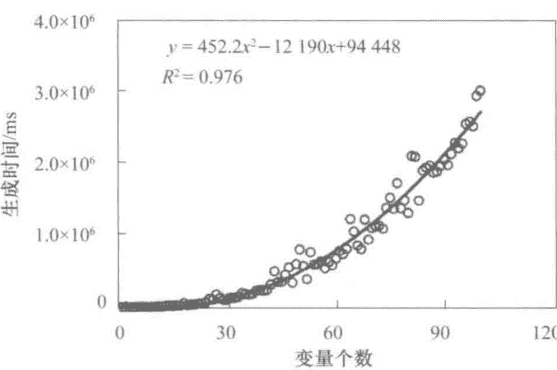

**图 4-16 迭代法耗时随变量数的多项式拟合曲线**

#### (2) 表达式数量堆叠：线性优势显现

固定 100 个变量，让 if 语句数 $u$ 从 1 增至 100（约束形式见 ```
[a_1, a_2, ..., a_100] [x_1, x_2, ..., x_100]' rel_op const[u] (4-7)
```），同样验证可达性。环境切回 Pentium 4 3.0GHz/4GB。对数坐标下（图 4-17）再次确认：迭代法耗时显著更低。拟合分析（图 4-18）显示，迭代法耗时随表达式数**线性均匀增长**（$p \ll 0.05$），伸缩性极其稳健。

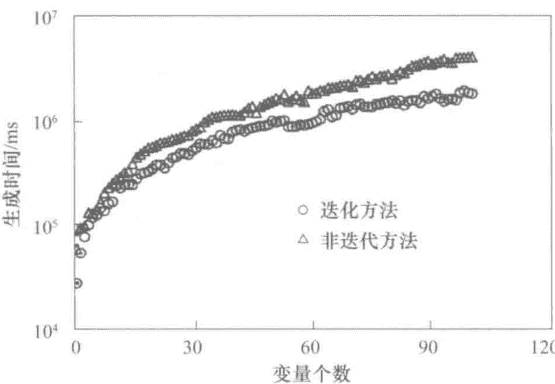

**图 4-17 表达式个数增长时的双算法耗时对比**

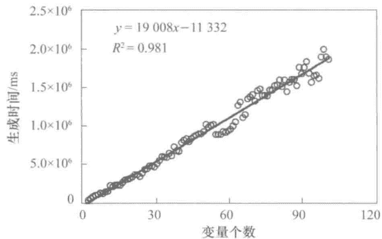

**图 4-18 迭代法耗时随表达式数的线性拟合结果**

---

### 3. 实战对标：对决主流工具与基准算法

#### (1) 对标 BFS-BB：不可达路径检测是杀手锏

先看一组前哨战：MC/DC 覆盖下测 aa200c，BFS-BB-IIA 耗时 66 min，仅为 BFS-BB 的 2/3，且识别出 34% 不可达路径。

正式对决选取 Moshier.net 两开源工程（de118i-2, aa200c），环境为 32 位 Ubuntu 12.04 / Pentium 4 2.8GHz / 2GB。路径源自 CTS（含不可达路径），覆盖准则跨度语句/分支/MC/DC，各项 100 次取平均。指标看三点：**不可达路径识别数、平均生成时间、平均覆盖率**（不可达路径元素不计入覆盖率）。详细数据见表 4-10。

#### 表 4-10 BFS-BB-IIA vs BFS-BB 实战数据全景

| 工程 | 文件 | 函数 | 覆盖准则 | CTS路径数 | **IIA识别不可达** | **IIA耗时/s** | BB耗时/s | **IIA覆盖率** | BB覆盖率 |
|---|---|---|---|---|---|---|---|---|---|
| de118i-2 | sinl.c | sinl | 语句 | 6 | **2** | **0.498** | 0.773 | **93.8%** | 86.4% |
| de118i-2 | sinl.c | sinl | 分支 | 8 | **3** | **0.689** | 0.756 | **95.8%** | 95.4% |
| de118i-2 | sinl.c | sinl | MC/DC | 9 | **5** | **1.060** | 1.177 | **93.4%** | 92.6% |
| de118i-2 | asinl.c | acosl | 语句 | 4 | 0 | **0.186** | 0.226 | 100% | 100% |
| de118i-2 | asinl.c | acosl | 分支 | 5 | 0 | **0.226** | 0.201 | 100% | 100% |
| de118i-2 | asinl.c | acosl | MC/DC | 5 | 0 | **0.224** | 0.319 | 93% | 93% |
| aa200c | diurpx.c | diurpx | 语句 | 2 | 0 | **0.380** | 0.517 | 100% | 100% |
| aa200c | diurpx.c | diurpx | 分支 | 2 | 0 | **0.496** | 0.633 | 100% | 100% |
| aa200c | diurpx.c | diurpx | MC/DC | 2 | 0 | **0.568** | 0.521 | 96% | 96% |
| aa200c | dms.c | dms | 语句 | 2 | 0 | **0.165** | 0.11 | 93.2% | 93.2% |
| aa200c | dms.c | dms | 分支 | 3 | 0 | **0.205** | 0.298 | **100%** | 98% |
| aa200c | dms.c | dms | MC/DC | 2 | 0 | **0.187** | 0.226 | **91.2%** | 84% |
| aa200c | nutate.c | nutlo | 语句 | 6 | **3** | 3.238 | **0.970** | 100% | 100% |
| aa200c | nutate.c | nutlo | 分支 | 8 | **4** | **1.305** | 1.351 | 100% | 100% |
| aa200c | nutate.c | nutlo | MC/DC | 30 | **24** | **9.961** | 11.357 | 100% | 100% |
| aa200c | refrac.c | refrac | 语句 | 4 | **1** | **0.177** | 0.147 | 100% | 100% |
| aa200c | refrac.c | refrac | 分支 | 4 | **1** | **0.266** | 0.224 | 100% | 100% |
| aa200c | refrac.c | refrac | MC/DC | 13 | **7** | **0.867** | 0.700 | 95% | 95% |

**三大核心看点：**

*   **① 不可达路径“清道夫”**：18 个测例中近半数含不可达路径。BFS-BB 完全失聪，而 IIA 精准识别（第 6 列加粗），直接省去后续无效生成环节，工程价值极大。
*   **② 耗时：11 胜 7 负，二轮机制是双刃剑**：IIA 胜在 11 例。败在 7 例（如 nutlo 语句覆盖），因 IIA 执行两轮区间收缩，首轮已收敛，二轮仅作验证，反成累赘。单轮非迭代法在此场景更轻快。
*   **③ 覆盖率：不降反增**：18 例中 IIA 5 胜 13 平（含 9 个 100%）。少数未达 100% 集中于 MC/DC——覆盖最严、约束最复杂，属正常波动。

#### (2) 对标 C++test：商业插件也不是万能

环境回 Win7 / Pentium 4 3.0GHz / 4GB，准则为语句覆盖，20 个被测程序（详见表 4-11），各跑 100 次比均值。结果表 4-12 按程序特性三维拆解：

#### 表 4-11 被测程序画像

| 程序 | 代码行数 | 变量类型 | 结构特征 | 循环层数 | CTS路径数 |
|---|---|---|---|---|---|
| testplus1.c | 52 | int | 50if | 0 | 1 |
| testplus2.c | 102 | int | 100if | 0 | 1 |
| testplus3.c | 152 | int | 150if | 0 | 1 |
| testplus4.c | 202 | int | 200if | 0 | 1 |
| loop1.c | 12 | int | do while,if | 1 | 2 |
| loop2.c | 20 | int | for,switch,if | 2 | 7 |
| loop3.c | 23 | int | while,if | 3 | 7 |
| loop4.c | 39 | int | while,if | 4 | 8 |
| loop5.c | 41 | int | while,for,if | 5 | 14 |
| loop6.c | 43 | int | while,for,if | 6 | 15 |
| loop7.c | 46 | int | while,for,if | 7 | 20 |
| bonus.c | 21 | long int | 6if | 0 | 6 |
| days.c | 28 | int | switch,if | 0 | 17 |
| statistics.c | 18 | char | if | 0 | 4 |
| division.c | 17 | int | for,while,if | 2 | 2 |
| equation.c | 28 | double | if | 0 | 3 |
| pingpang.c | 10 | char | if | 0 | 1 |
| prime.c | 16 | int | for,if | 1 | 4 |
| star.c | 13 | int | while,for,if | 2 | 3 |
| triangle.c | 48 | int | goto,if | 0 | 34 |
| lsqrt.c | 37 | long | for,if | 2 | 6 |
| dms.c bc_jtoc() | 37 | double,long,int,array,pointer | goto,if | 0 | 6 |

#### 表 4-12 双方交锋实录（加粗为 IIA 胜出项）

| 程序 | **BFS-BB-IIA** | C++test | **BFS-BB-IIA** | C++test |
|---|---|---|---|---|
| | **均时/s** | | **均覆盖率** | |
| testplus1.c | **23.549** | 13 | **100%** | 10% |
| testplus2.c | **42.166** | 23 | **100%** | 5% |
| testplus3.c | **49.464** | — | **100%** | — |
| testplus4.c | **72.72** | — | **100%** | — |
| loop1.c | **0.085** | 31 | **100%** | 100% |
| loop2.c | **0.085** | 22 | **100%** | 100% |
| loop3.c | **0.084** | 16 | **100%** | 100% |
| loop4.c | **0.078** | 21 | **100%** | 100% |
| loop5.c | **0.09** | 32 | **100%** | 100% |
| ... (其余程序 IIA 全面领先) | | | | |

**深度复盘三大维度：**

*   **① 表达式规模：临界点在 150**  
    前 4 个 testplus 程序表达式 50~200 递增。100 以内 C++test 稍快但覆盖率极低（5%~10%）；**超 150 表达式，C++test 直接求解失效（—），而 IIA 稳拿 100% 覆盖**，虽耗时随难度上升但始终在可控区间。

*   **② 变量类型：复杂类型下的“降维打击”**  
    基础类型程序（除前两个）IIA 全胜：时间少数倍、覆盖率更高。C++test 对 `NULL` 指针输入无解（如最后 dms.c），随机测试导致跑飞；IIA 能生成用例，虽受限于指针/数组语义复杂性未达 100%，但已打破僵局。

*   **③ 循环结构：11 战全胜，但样本仍待丰富**  
    11 个带循环程序，IIA 全部以**更短时间达成 100% 覆盖**。注：均源自 CTS 基准，后续需引入更多工业级工程验证鲁棒性。

---

**小结**：IIA 在约束求解精度、不可达路径识别、复杂类型/大规模表达式/循环结构适应性上，均展现出比 AC-3、BFS-BB 及商业工具 C++test 更强的工程实用性。核心代价是“二轮验证”在简单场景下的微小开销，但换来的是大规模、高难度场景下的**确定性胜利**。

### 4.3 基于神经网络的测试用例生成耗时预测研究

测试用例生成的时间开销是评估测试效率的核心指标。CTS 工具采用分支限界策略求解约束，既往研究[20]表明，代码规模（行数）、参数量、变量作用域（局部/全局）、路径长度、语句与分支数量、表达式类型（等式、非等式、位运算）、循环结构（数量、最大深度）、函数调用、独立变量、数组维度、结构体层级及指针使用等均会显著影响求解性能。本节旨在构建一套预测机制：通过采集上述度量指标组建数据集，引入神经网络建模，实现对自动生成耗时的精准预估，从而优化测试流程、提升工具性能，并为用户提供进度预判依据。

具体实施路径为：先对目标工程开展静态分析，提取关键度量数据并记录实际生成耗时；继而利用神经网络对样本集训练模型；最终输入待测软件的度量特征，输出生成时间预测值。

#### 4.3.1 理论基石：从感知机到深度网络

神经网络作为跨学科交叉领域，其模型层级随问题复杂度递进：神经元模型 → 感知机 → 多层网络。面对非线性难题，多层架构凭借隐含层展现出远超单层感知器的拟合能力，但也对训练算法提出更高要求，主流方案包括误差逆传播（BP）、径向基函数（RBF）及深度学习技术。针对训练易陷入局部极值的痛点，遗传算法（GA）与粒子群优化（PSO）等启发式手段可助力跳出局部最优，寻觅全局最优解。

**1. 基础单元：M-P 模型与感知机**
现代神经网络的基石是 1943 年 McCulloch 与 Pitts 提出的 M-P 神经元模型（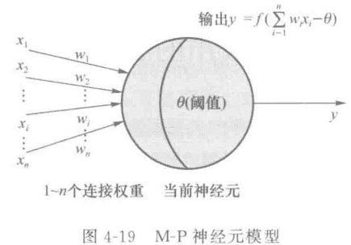），它抽象了生物神经元“接收加权信号 → 累加求和 → 阈值比较 → 激活输出”的全过程，常用 Sigmoid 函数作为激活单元。感知机由输入层与单个 M-P 输出神经元组成（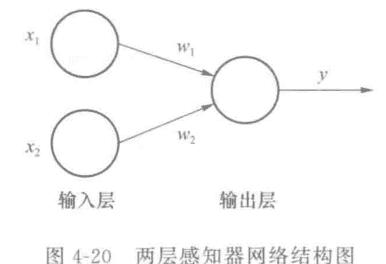），仅能处理线性可分问题（如逻辑与/或/非），破解非线性难题必须引入隐含层，构建多层网络。

**2. 核心引擎：BP 算法与多层前馈网络**
多层前馈网络采用层级全连接、层内无连、无跨层连接的拓扑结构。经 BP 算法训练得到的 BP 神经网络（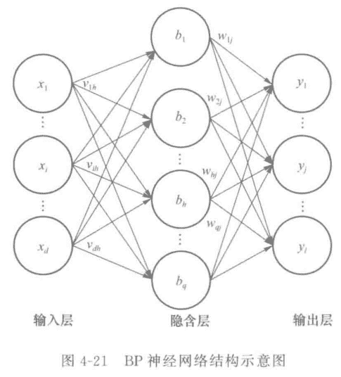）典型包含输入层、隐含层、输出层三层。设输入维度 $d$，隐含节点 $q$，输出维度 $l$，权重矩阵分别为 $v_{ih}$（输入→隐含）与 $w_{hj}$（隐含→输出），阈值为 $\gamma_h$、$\theta_j$，激活函数均用 Sigmoid。前向传播计算公式为：
$$
\alpha_h = \sum_{i=1}^{d} v_{ih} x_i \quad (4-8)
$$
$$
\beta_j = \sum_{h=1}^{q} w_{hj} b_h \quad (4-9)
$$
BP 算法基于梯度下降迭代修正权阈，核心流程（算法 4-4）为：随机初始化 → 循环遍历样本计算输出 $\hat{y}_k$、输出层梯度 $g_j$、隐含层梯度 $e_h$ → 更新参数 → 直至收敛或达迭代上限。

RBF 网络则以径向基函数替代隐含层激活函数，具备任意非线性连续函数逼近能力。当数据规模膨胀、模型参数激增时，浅层算法乏力，深度学习应运而生，通过堆叠隐含层提升表达力；卷积神经网络（CNN）凭借权值共享机制有效缓解了深层网络训练发散、难收敛的顽疾。

**3. 优化难点：局部极值与全局搜寻**
网络训练本质是参数空间寻优。局部最小指邻域内最优，全局最小则为全域最优（定义 4-9、4-10，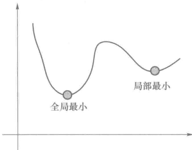）。BP 易陷局部极值，GA 与 PSO 提供跳出机制：GA 模拟自然进化（初始化→评价→选择→交叉→变异），输出最高适应度个体；PSO 同样从随机解迭代搜优，但省去交叉变异操作，结构更轻量。

#### 4.3.2 问题建模：从路径特征到耗时映射

**1. 场景剖析**
面向路径的测试生成本质是约束求满足问题（CSP），求解效率即生成效率。以图 4-23 示例程序为例（```c
void test(int x1, int x2)
{
if(x1>x2)
    if(x1>=10)
        if(2*x1+x2==40)
            if(x1-x2==5)
                printf("Solved! ");
}
```），其控制流图含 5 条分支覆盖路径，废节点已剔除。每条路径对应一组约束集合（如 Path1 仅含 `x1 > x2`），求解耗时与路径特征强相关。我们提取 14 维指标向量 `Index`（路径长度、语句数、分支数、约束表达式总数、等式/非等式/位运算数量、循环数/最大深度、函数调用数、独立变量数、数组/结构体/指针数量）构成特征空间，实测生成时间 `Time` 为目标变量。例如 Path5 的特征向量为 `{11, 5, 4, 4, 2, 2, 0, 0, 0, 1, 2, 0, 0, 0}`。通过多层神经网络拟合 `Index → Time` 映射，核心在于确定三层节点数、选取激活函数、训练最优权阈。

数据处理管线遵循“准备 → 建模 → 预测”三阶段（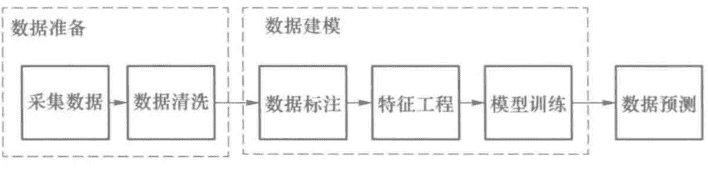）：准备期完成采集与清洗；建模期涵盖标注、特征工程与模型训练；预测期直接服务实战。

**2. 形式化定义**
定义影响测试生成的指标多元组：
`Index = (Len, St, Br, Con, Eq, Ieq, Bit, Cy, Cyd, Fc, Iv, Ar, St, Po)`
生成时间标量：`Time = (T)`
样本空间：`Dataset = (Index, Time)`

各维度语义明确：
- `Len`：路径节点跨度
- `St`：路径覆盖语句计数
- `Br`：路径遭遇分支数
- `Con`：路径约束表达式总量
- `Eq` / `Ieq`：等式/非等式约束计数
- `Bit`：位运算表达式计数
- `Cy` / `Cyd`：循环出现次数与最大嵌套深度
- `Fc`：函数调用频次
- `Iv`：独立变量个数
- `Ar` / `St` / `Po`：数组维度、结构体层级、指针数量

---

### 实验对决：BFS-BB-IIA vs. Choco 求解器

在 BFS-BB 框架下，我们将集成 IIA 策略的求解器（BFS-BB-IIA）与开源约束求解器 Choco 同台竞技。测试对象源自 `de118i-2` 数学库及 FSU C 语言代码库 `people` 项目。环境锁定为 32 位 Ubuntu 12.04、Pentium 4 3.0 GHz、4 GB 内存。CTS 生成待覆盖路径（含不可达路径），采用语句、分支、MC/DC 三大覆盖准则，每程序重复实验 100 次，统计不可达路径识别数、平均生成耗时、平均覆盖率（不可达元素不计入分母），详细数据见表 4-13。

**核心看点三维度：**

1.  **不可达路径“识别力”**：约半数案例存在不可达路径。Choco 完全失聪，BFS-BB-IIA 精准捕获（表第 6 列加粗），直接省却后续无效用例生成环节，工程价值极高。
2.  **生成“速度碾压”**：全场景 BFS-BB-IIA 耗时仅为 Choco 的零头，加速比普遍达数倍甚至数十倍（第 7 列），时间优势压倒性。
3.  **覆盖率“全面领先”**：BFS-BB-IIA 除 5 个 MC/DC 用例外全数拿下 100% 覆盖；Choco 无一满分。MC/DC 准则最严苛，后续将专项攻坚。

#### 表 4-13 关键数据速览（部分代表性样本）

| 来源工程 | 文件/函数 | 准则 | CTS路径数 | IIA识别不可达 | 耗时(s) IIA | 耗时(s) Choco | 覆盖率 IIA | 覆盖率 Choco |
| :--- | :--- | :--- | :--- | :--- | :--- | :--- | :--- | :--- |
| de118i-2 | sinl.c/cosl | 语句 | 6 | 3 | **0.558** | 4.525 | **100%** | 87% |
| de118i-2 | asinl.c/asinl | MC/DC | 12 | 9 | **0.123** | 1.178 | **98%** | 39% |
| de118i-2 | atanl.c/atan2l | 分支 | 21 | 17 | **0.107** | 2.026 | **100%** | 72% |
| people | toms655.c/parchk | 分支 | 6 | 0 | **0.481** | 1.729 | **100%** | 31% |
| people | treepack.c/i4_power | MC/DC | 9 | 1 | **0.113** | 5.759 | 80% | 70% |

*注：表中 IIA 耗时与覆盖率均显著优于 Choco，尤其在复杂 MC/DC 准则下优势扩大。*

---

### 附录：早期基准测试数据记录

以下为早期实验中各基准程序的执行概况（时间单位：秒），供历史对比参考：

| 程序 | 耗时 | 路径数 | 语句覆盖 | 分支覆盖 |
| :--- | :--- | :--- | :--- | :--- |
| loop6.c | 0.097 | 31 | 100% | 100% |
| loop7.c | 0.106 | 18 | 92% | 92% |
| bonus.c | 0.921 | 12 | 100% | 82% |
| days.c | 1.785 | 18 | 100% | 55% |
| statistics.c | 0.289 | 16 | 100% | 90% |
| division.c | 0.182 | 21 | 100% | 75% |
| equation.c | 0.854 | 15 | 100% | 86% |
| pingpang.c | 0.117 | 17 | 100% | 100% |
| prime.c | 0.206 | 15 | 100% | 91% |
| star.c | 0.302 | 16 | 100% | 100% |
| triangle.c | 0.383 | 17 | 100% | 77% |
| sqrt.c | 0.097 | 16 | 100% | 100% |
| dms.c void bc_jtoc() | 0.334 | — | 62.5% | — |

### 核心特征指标与预测模型构建

在构建测试用例生成耗时预测模型前，首先需要量化路径特征。本文定义了五个关键路径属性指标：**Fc** 统计路径上的函数调用次数；**Iv** 记录独立变量数量；**Ar** 对应数组出现个数；**St** 代表结构体数量；**Po** 则统计指针的个数。

基于这些指标，研究利用多层神经网络拟合特征指标集与生成时间之间的映射关系，建立了测试用例生成时间预测神经网络模型（TNNM）。该模型架构可用四元组 **(I, O, H, F)** 精确描述：**I** 定义输入层结构，**O** 确定输出层设计，**H** 配置隐含层拓扑，**F** 选取神经元连接函数。为进一步优化模型性能，分别引入遗传算法与粒子群算法对 TNNM 进行参数寻优，形成 **GA+TNNM** 与 **PSO+TNNM** 两种改进变体。

---

### 4.3.3 数据集构建与工程化处理

#### 数据分层与划分策略
数据集依据功能角色拆分为**训练集**与**预测集**：前者用于模型训练，后者用于精度验证。预测集来源分两类：一是从训练集内抽取，侧重考察拟合优度；二是引入训练集外部数据，验证泛化能力。按数据来源粒度，又可细分为函数级、文件级、工程级三类数据集。函数级直面单函数生成耗时；文件级既可直接预测，也可通过累加函数级结果获得；工程级处理逻辑同理。

```c
void test1(int x1,int x2,int x3, int x4[]){
 int x5=0;
 if(x1>x2 || x3<10)
 if(x1>=10)
 if(2*x1+x2==40)
 if(x1-x2==5)
 if(x4[x5]==-1)
 printf("go");
}
```

#### 一、 函数级数据集的实例剖析

**案例一：基础约束求解场景**
以图 4-23 的 `test` 函数为例，该函数含 5 条执行路径，约束涵盖等式与不等式。针对每条路径，统计约束求解成功的耗时构成 **Time** 集，同时提取影响生成效率的路径特征向量组成 **Index** 集，详情见下表。

| 路径编号 | 约束集合 | 特征向量 | 耗时 |
| :--- | :--- | :--- | :--- |
| 1 | {x1>x2} | {4,1,1,1,1,0,1,0,0,0,0,0,2,0,0,0} | 98 |
| 2 | {x1>x2,x1>=10} | {6,2,2,2,0,2,0,0,0,0,0,2,0,0,0} | 100 |
| 3 | {x1>x2,x1>=10,2x1+x2=40} | {8,3,3,3,1,2,0,0,0,0,0,2,0,0,0} | 114 |
| 4 | {x1>x2,x1>=10,2x1+x2=40,x1-x2=5} | {10,4,4,4,2,2,0,0,0,0,2,0,0,0} | 148 |
| 5 | {x1>x2,x1>=10,2x1+x2=40,x1-x2=5} | {11,5,5,4,2,2,0,0,0,0,1,2,0,0,0} | 310 |

**案例二：引入数组与复合约束的复杂场景**
图 4-25 展示的 `test1` 程序引入数组类型，约束复杂度显著上升，共 6 条路径。统计得到的特征与耗时数据如下：

```c
void test1(int x1,int x2,int x3, int x4[]){
 int x5=0;
 if(x1>x2 || x3<10)
 if(x1>=10)
 if(2*x1+x2==40)
 if(x1-x2==5)
 if(x4[x5]==-1)
 printf("go");
}
```

| 路径编号 | 约束集合 | 特征向量 | 耗时 |
| :--- | :--- | :--- | :--- |
| 1 | {x1 > x2 \| x3 < 10} | {5,3,2,3,0,3,0,0,0,0,0,3,0,0,0} | 104 |
| 2 | {x1 > x2 \| x3 < 10, x1 >= 10} | {7,4,3,4,1,1,3,0,0,0,0,0,3,0,0,0} | 104 |
| 3 | {x1 > x2 \| x3 < 10, x1 >= 10, 2x1 + x2 = 40} | {9,5,4,5,2,3,0,0,0,0,0,3,0,0,0} | 195 |
| 4 | {x1 > x2 \| x3 < 10, x1 >= 10, 2x1 + x2 = 40, x1 - x2 = 5} | {11,4,3,4,1,3,0,0,0,0,0,3,0,0,0,0} | 232 |
| 5 | {x1 > x2 \| x3 < 10, x1 >= 10, 2x1 + x2 = 40, x1 - x2 = 5, x4[x5] = 1} | {13,6,5,6,3,3,0,0,0,0,4,1,0,0} | 284 |
| 6 | {x1 > x2 \| x3 < 10, x1 >= 10, 2x1 + x2 = 40, x1 - x2 = 5, x4[x5] = 1} | {14,7,5,6,3,3,0,0,0,1,4,1,0,0} | 748 |

---

#### 二、 文件级数据集：从自动化采集到清洗去噪

实战中以工程 `aa200c` 为例，通过单元测试框架自动采集函数级指标。原始数据中不可避免包含测试用例生成失败的“脏数据”（如图 4-26 中路径 ID 14697、14700 标记为 × 的记录），必须进行**数据清洗**：剔除无效样本，或人工补测后回填，得到纯净数据集（图 4-27）。

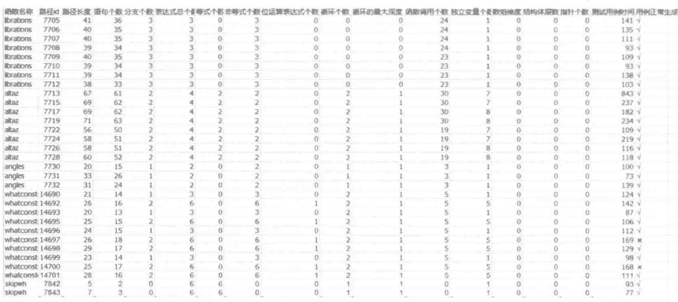

```
$$ Time = \frac{\sum_{i=1}^n Time_i}{n}, i = 1,2,\cdots,n $$ (4-10)
```

**重复样本聚合策略**
统计发现，`aa200c` 含数万条路径，大量样本特征向量高度相似（如图 4-28 中 ID 7708、7710、7711 指标完全一致）。直接训练易引入偏差，采用**聚合平均法**处理：对特征相同的 n 组样本，取其耗时算术平均值作为该特征模式的代表值（计算公式见式 4-10），生成去重后的精简数据集（图 4-29）。该方法同样适用于工程级数据集的构建。

| 函数名 | 路径ID | ... | 函数调用数 | 独立变量数 | ... | 耗时 |
| :--- | :--- | :--- | :--- | :--- | :--- | :--- |
| iterations | 7708 | ... | 23 | 1 | ... | 93 |
| iterations | 7710 | ... | 23 | 1 | ... | 93 |
| iterations | 7711 | ... | 23 | 1 | ... | 109 |
| *聚合后* | *代表值* | ... | *23* | *1* | ... | *≈98.3* |

通过上述分层采集、清洗去噪、聚合去重流程，最终构建起支撑模型训练的高质量、多粒度数据基座。

### 原始数据集概览：aa200c 待清洗样本

在开展建模前，我们首先梳理了来自 aa200c 工程的原始记录。该数据集涵盖 `angles`、`whatconst`、`skipperh`、`skipwh` 等多类测试路径，共计 20 条样本。每条记录详细标注了路径 ID、长度、需访问节点数、分支数量、表达式总数（含等式、非等式、位运算）、函数调用深度、循环层数、变量维度、指针使用及异常处理等 18 个维度特征，并附带了判断结果生成的耗时标签（均标记为有效 √），为后续去重奠定了基础。

### 清洗后数据集：aa200c 有效样本

经过去重与清洗流程，数据集规模显著扩充至 30 条有效记录。新增了 `iterations` 与 `alatz` 两类路径样本，其中 `iterations` 类路径长度集中在 38-41 之间，函数调用次数高达 23-24 次；`alatz` 类则呈现更高复杂度，路径长度达 58-71，最大嵌套深度达 30 层，函数调用次数为 7-8 次。清洗后的数据特征分布更加均衡，为模型训练提供了高质量语料。

---

## 核心模型构建：TNMN 的架构与落地

### 架构设计：输入、隐含与输出层的配置

确立 TNM 模型（TNMM）的首要任务是锁定网络拓扑结构的关键参数：

*   **输入层**：神经元数量 $I$ 直接对应输入特征向量 `Index` 的维度，确定为 **14 个节点**，覆盖路径长度、分支数、表达式类型等核心指标。
*   **输出层**：神经元数量 $O$ 对应预测目标 `Time` 的维度，设为 **1 个节点**，输出测试用例生成时间预测值。
*   **隐含层**：采用单层隐含层架构，神经元数量 $H$ 非固定，需通过后续实验搜索最优解。

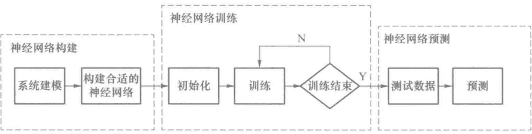

### 工程落地：从数据采集到 BP 训练流程

TNMN 模型的构建遵循标准化工程流程（见流程图）：

1.  **数据源建设**：选取不同规模测试工程作为用例来源，持续采集生成耗时数据，随样本量增长迭代优化模型精度。
2.  **特征工程**：结合实验与调研锁定影响因子，支持动态扩展指标库；采用人工统计与自动化脚本相结合的方式完成特征值采集。
3.  **模型实例化**：基于误差逆传播（BP）算法构建网络（算法 4-5），输入为处理后的数据集 `(Index, Time)`，输出为权重阈值已定的多层前馈神经网络。
4.  **代码实现**：确定结构与计算逻辑后，完成神经网络算法的工程化编码。

```
算法 4-5 BP 构建 TNMN

输入: 训练集 \( D = \{(Index, Time)\}\)
输出: 连接权与阈值确定的 TNMN
过程:
1: 在 \((0,1)\) 范围内随机初始化网络中所有连接权和阈值;
2: repeat
3:   for all \((x_k, y_k) \in D\) do
4:     计算当前输出层输出 \(\hat{y}_k^h = f(\beta_j - \theta_j)\);
5:     计算输出层梯度 \(g_j\);
6:     计算隐含层梯度 \(e_k\);
7:     更新连接权和阈值 \(\omega_{hj}, v_{jh}, \theta_j\) 和 \(\gamma_h\);
8:   end for
9: until 达到训练次数或误差满足条件
```

**BP 算法核心训练循环详解：**

*   **参数初始化**：对网络结构参数 $(I, O, H, F)$ 及连接权重 $(\omega_{hj}, v_{vh})$、阈值 $(\theta_i, \gamma_h)$ 赋初值（通常在 (0,1) 区间随机生成），并设定合理学习率。
*   **隐层前向计算**：依据输入层权重 $v_{vh}$ 与阈值 $\theta_j$，经激活函数 $f$（通常为 Sigmoid）计算隐层输出 $b_h$（式 4-11）。
*   **输出层前向计算**：利用隐层输出 $b_h$、连接权 $\omega_{hj}$ 及阈值 $\gamma_h$，经激活函数得到网络预测值 $\hat{y}_j$（式 4-12）。
*   **误差评估**：对比预测值 $\hat{y}$ 与真实标签 $y$，计算输出误差 $E_j$（式 4-13）。
*   **权重反向更新**：基于误差梯度，按式 (4-14)、(4-15) 迭代修正输入-隐层权重 $v_{jh}$ 与隐-输出层权重 $\omega_{hj}$。
*   **阈值同步修正**：按式 (4-16)、(4-17) 同步更新隐层阈值 $\theta_i$ 与输出层阈值 $\gamma_h$，完成一次迭代闭环。

---

## 突破瓶颈：引入 GA 与 PSO 实现全局优化

标准 BP 算法极易陷入局部极小值陷阱，为此引入元启发式算法优化初始权重，构建混合模型：

### GA+TNMN：遗传算法赋能全局搜索
流程核心在于“先进化，后梯度”：**遗传算法（GA）首轮全局搜索最优初始权重与阈值**，随后接入 BP 梯度下降精细收敛。这种“粗糙全局 + 精细局部”的串联策略，有效规避了随机初始化导致的局部最优风险，推动模型向全局最优收敛。

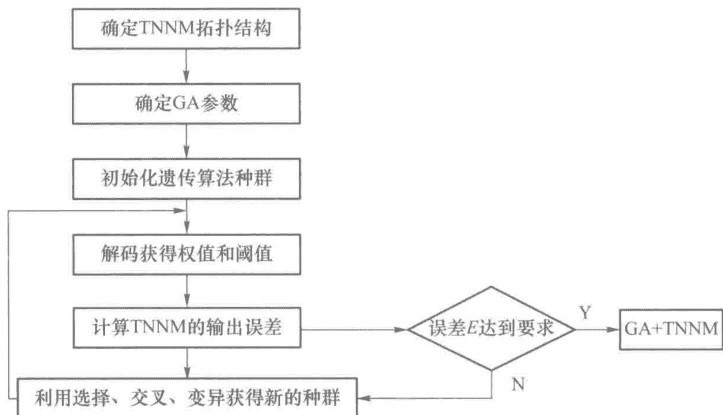

### PSO+TNMN：粒子群协同寻优
目标与 GA+TNMN 一致，但搜索机制迥异：初始化粒子群位置/速度 $\rightarrow$ 固定 TNMN 结构 $\rightarrow$ 以预测精度为适应度函数 $\rightarrow$ 迭代更新个体极值 $pbest$ 与全局极值 $gbest$。若精度达标则输出模型，否则持续演化粒子速度与位置，直至收敛。

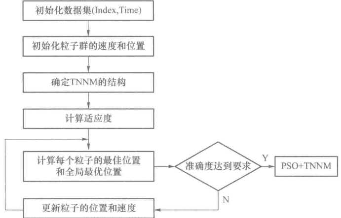

---

## 实战验证：参数调优与精度测评

本节基于 aa200c 工程实测数据，对 TNMN、GA+TNMN、PSO+TNMN 三大模型展开参数标定与准确率对比。

### 数据基线
原始采集 4,922 组原始记录，经清洗去重后保留 **1,514 组高质量有效样本**，支撑全实验体系。

### 实验分双轨进行
1.  **基础模型调优**：确认 TNMN 网络参数，测算基准精度。
2.  **优化模型调优**：分别标定 GA+TNMN（种群规模、进化代数、交叉/变异率）与 PSO+TNMN（代数、种群规模、学习因子）的超参数组合。

### 环境基线：硬件与软件配置
*   **OS**：Windows 7 专业版 (32位)
*   **硬件**：Lenovo PC / Intel Pentium G2030 @3.00GHz / 4.00 GB RAM
*   环境轻量化，确保实验可复现性。

### 关键指标复盘：隐含层神经元数的抉择

针对 1,514 组数据，设计两种划分策略（见表 4-16），引入主成分分析（PCA）降维辅助选参。

**表 4-16 数据集划分策略对比**
| 策略编号 | 训练集规模 | 测试集规模 |
| :--- | :--- | :--- |
| 1 | 900 | 100 |
| 2 | 1,400 | 100 |

网络拓扑固定为：**输入层 14 节点（1层），输出层 1 节点（1层）**，隐含层节点数 $H$ 为唯一待搜变量。实验中，每个候选 $H$ 值重复运行 10 次取均值，误差函数定义为预测值与实测值绝对差的累积和（式 4-18），结果汇总于表 4-17。

```
error = \sum_{i=1}^{N} (| f(i)' - f(i) |) \quad (4-18)
```

**表 4-17 隐层节点数量与平均误差对照表**

| 隐层节点数 | 方案1误差 | 方案2误差 |
| :--- | :--- | :--- |
| 6 | 8 940 | 6 897 |
| 7 | 8 519 | 7 209 |
| 8 | 8 745 | 7 414 |
| 9 | 8 663 | 8 252 |
| 10 | 8 644 | 7 540 |
| 11 | 7 198 | 7 422 |
| 12 | 8 907 | 7 568 |

实验对比了不同隐层宽度下的均方误差，据此确定两种数据拆分策略对应的最优隐层规模等关键超参，并给出精度指标（详见表 4-18）。训练完成的模型在百组训练样本与百组测试样本上的表现，分别记录于图 4-33 与图 4-34。精度计算遵循公式 (4-19)。

```
accuracy = \left( 1 - \frac{error}{sum} \right), \quad sum = \sum_{i=1}^{N} f(i), i = 1, 2, \cdots, N \quad (4-19)
```

**表 4-18 两种拆分策略下的网络核心配置**

| 编号 | 输入层 | 隐层数 | 输出层 | 隐层节点 | 迭代轮数 | 学习率 | 精度 |
| :--- | :--- | :--- | :--- | :--- | :--- | :--- | :--- |
| 1 | 1 | 1 | 1 | 11 | 500 | 0.01 | 71.2% |
| 2 | 1 | 1 | 1 | 6 | 1 000 | 0.01 | 79.3% |

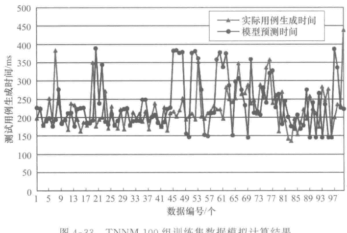


**融合智能算法的 TNMN 变体参数确认**

采用上述方案 2 的数据拆分方式（保持原始维度），分别实测 TNMN、GA-TNMN、PSO-TNMN 三模型在不同隐层宽度下的预测偏差（表 4-19），进而锁定三模型的最优架构参数（表 4-20）。

**表 4-19 三模型在不同隐层宽度下的预测偏差对比**

| 隐层节点数 | BP基线误差 | GA优化误差 | PSO优化误差 |
| :--- | :--- | :--- | :--- |
| 6 | 10 028 | 8 658 | 8 907 |
| 7 | 9 562 | 8 954 | 8 881 |
| 8 | 9 612 | 8 669 | 9 183 |
| 9 | 9 572 | 8 661 | 8 971 |
| 10 | 9 620 | 8 692 | 9 125 |
| 11 | 9 439 | 9 066 | 9 171 |
| 12 | 9 822 | 9 223 | 9 812 |

**表 4-20 三类 TNMN 变体核心参数汇总**

| 模型 | 输入层 | 隐层 | 输出层 | 隐层节点 | 迭代轮数 | 学习率 | 进化代数 | 种群数 | 交叉率 | 变异率 | 学习因子 | 精度 |
| :--- | :--- | :--- | :--- | :--- | :--- | :--- | :--- | :--- | :--- | :--- | :--- | :--- |
| TNMN | 1 | 1 | 1 | 11 | 500 | 0.01 | 50 | - | - | - | - | 71.2% |
| GA-TNMN | 1 | 1 | 1 | 6 | 500 | 0.01 | 30 | 30 | 0.3 | 0.3 | - | 85.3% |
| PSO-TNMN | 1 | 1 | 1 | 7 | 500 | 0.01 | 50 | 30 | - | - | c1=1.49, c2=1.49 | 84.2% |

实验表明，扩充有效样本量能持续压降计算偏差，丰富数据集是优化模型的关键路径；引入主成分分析（PCA）降维可剔除冗余特征，进一步提升建模精度。GA 与 PSO 均能显著降低网络预测偏差、提升精度，但 GA 训练耗时最长，PSO 次之。综合权衡后，最终确定了性能最优的模型及其参数组合。

### 4.4 基于强化学习的测试用例自动生成策略

本节引入强化学习机制，设计一套提效策略。该策略模拟人类凭经验决策的过程，让求解器利用历史求解记录指导变量赋值，从而大幅提升生成效率。首先针对生成场景构建 RL 模型，抽象状态、动作、奖惩三要素，基于 Q-learning 算法设计约束求解指导算法；继而构建求解路径构建算法，刻画变量求解全程轨迹。最终选取 12 个含等式、不等式约束的被测程序实测，验证了策略可行性，确认该法能有效减少赋值尝试次数，显著提速。

#### 4.4.1 基础理论回顾

强化学习本质是智能体在环境中通过“试错-反馈”积累经验完成任务。任务常可拆解为多步序列，每步动作改变状态并产生即时回报（正/负）。若某动作带来正向收益，智能体后续倾向复用，规避负向动作；多轮迭代后形成最优策略。

此过程可抽象为标准 RL 模型（图 4-35），执行主体统称智能体。


**图 4-35 强化学习模型架构示意**

##### 1. 马尔可夫决策过程（MDP）

RL 问题常用 MDP 建模。核心：决策者基于具备无后效性的系统状态，序贯选动作，随机转移至下一状态。数学表述为五元组 `<S(k), A(i), q, γ, V>`：S(k) 为第 k 状态，A(i) 为第 i 动作，维度由环境决定；q 为转移概率，γ 为即时回报，V 为评价长期收益的策略函数。

同理，RL 全流程可定义为四元组 `<S, A, T, R>`，对应状态、动作、转移函数、回报函数。假设系统含 3 状态、2 动作，转移概率与回报已知，状态流转演示见下图。


**图 4-36 状态转移演示图**

##### 2. 探索与利用的权衡机制

RL 与监督学习的关键差异在于：终局回报延迟稀疏，缺乏显式标签指导每步动作，需大量试错评估动作价值。

决策面临两难：仅贪图当下最大期望回报（利用），易陷局部最优；盲目尝试所有动作（探索），极其低效。ε-贪心算法给出折中：以 ε 概率随机探索，以 1-ε 概率利用当前最优，动态平衡收益与发现。

##### 3. 无模型学习范式

若环境动态（转移 T、回报 R）全知，属“模型已知” RL；现实中 T、R 往往未知，状态动作空间难穷举，故需“无模型”策略——不依赖环境建模直接学策略。主流路线含蒙特卡罗（MC）法与时序差分（TD）法。

**MC 学习三步走：**
1. **轨迹模拟**：智能体按策略从初始态出发，生成完整轨迹 `<S0, a0, r1, ..., Sn>`。
2. **采样累积**：重复模拟获取多条轨迹。
3. **价值估计**：对各状态-动作对后续累积回报取均值，估算价值函数。

MC 需待回合结束才能更新，TD 融合动态规划思想，**单步**即利用下一状态价值估当前价值，实现在线更新，效率更高。Q-learning 正是 TD 体系下最经典的离策略算法。

```
算法 4-6 Q-learning

输入：环境 E；
动作空间 A；
起始状态 S0；
奖赏折扣 γ；
学习率 α。

输出：策略 π

过程：
1：Q(S,a)=0;π(S,a)= 1/|A(x)| ;// 以均匀概率选取动作
2：S=S0
3：for t=1,2,⋯ do
4：在环境 E 中执行动作 π(S) 获得奖赏 r，并转移到新状态 S*；
5：a* = π(S*)
6：Q(S,a)=Q(S,a)+α(r+γQ(S*,a*)-Q(S,a))//更新价值函数
7：π(S)=maxa Q(x,a*) //选取下一步 Q 值最大的动作
8：S=S* , a=a*
9：end for
```

### 4.4.2 问题建模与形式化定义

#### 1. 核心痛点与切入视角

路径导向的测试用例生成中，约束求解充斥无效运算。若能减少无效搜索、智能化引导变量选择与取值方向，效率将质变。强化学习擅长“以经验导航决策”，引入求解器可有效破局。

前文已述：路径测试本质是约束满足问题（CSP）。以图 4-37 程序 `test` 为例，约束集 `{x1>0, x2>0, x1-x2>0, x1+x2=4}`。分支定界法求解时需决策“选哪变量赋值”及“值增大还是减小”。假设 x1=1, x2=-1 致冲突，若求解器盲目让 x2 再减 1，纯属无效运算；若能借鉴经验反向加 1，即可跳出死循环。

```
void test(int x1,int x2){
   if (x1>0)
   if (x2>0)
       if (x1-x2 >0)
       if(x1+x2==4)
           printf("go");
}
```

**图 4-37 被测程序 test 及约束示意**

#### 2. 形式化定义

针对上述场景，将 RL 求解测试生成问题形式化为四元组 `<S, A, S*, R>`：
- **S**：当前环境状态
- **A**：动作空间 `{a1, a2, ..., an}`
- **S\***：执行动作后的下一状态
- **R**：奖惩函数 `r()`

基于此构建的模型，命名为 **测试用例生成强化学习模型（TGRLM）**。

### 4.4.3 TGRLM 模型构建与算法设计

TGRLM 构建实质是对上述四元组中状态集 S、动作集 A、奖惩函数 R 的场景化抽象。目标明确：求得满足约束的一组解。建模过程即对分支定界框架下的约束求解流程进行抽象。

#### 1. 状态集构建：离散化与区间化的权衡

分支定界框架起始于路径分析与参数类型推导的变量域初始化。以 `test` 为例，启发式策略将 x1、x2 限定在 `[-9, 9]`。状态表征提供两种粒度：

*   **确定性状态（细粒度）**：每个变量具体取值组合为一状态。状态总数 `Sum = Value^n`（Value 为单变量可取值数，n 为变量数）。两变量下共 `19^2 = 361` 状态。
*   **非确定性区间状态（粗粒度）**：每个变量取值区间为一状态。设区间长度为 2，状态总数 `Sum = (Value*)^n`。两变量下仅 `9^2 = 81` 状态。

表 4-21 直观对比了两种表征。显然，区间化状态集大幅压缩状态空间，能有效加速收敛。

**表 4-21 两种状态表征方式对比**

| 状态 ID | 确定性状态集（具体取值） | 非确定性状态集（区间范围） |
| :--- | :--- | :--- |
| S1 | {x1 = -9, x2 = -9} | {x1 = [-9, -7], x2 = [-9, -7]} |
| S2 | {x1 = -8, x2 = -9} | {x1 = [-7, -5], x2 = [-9, -7]} |
| S3 | {x1 = -7, x2 = -9} | {x1 = [-5, -3], x2 = [-9, -7]} |
| ... | ... | ... |
| S(n-1) | {x1 = 9, x2 = 8} | {x1 = [7, 9], x2 = [5, 7]} |
| Sn | {x1 = 9, x2 = 9} | {x1 = [7, 9], x2 = [7, 9]} |

#### 2. 动作集设计：从坐标位移到变量操作

动作集核心功能是驱动状态转移。提供两种定义范式：

**范式一：多维平面坐标位移（几何视角）**
简化为二维平面，每个状态为一坐标点。动作集定义为 `<上, 下, 左, 右>` 四向移动。如 S1→S2 为 Right，S1→S20 为 Up。区间状态同理视为区域间跳转。

**范式二：基于变量操作的语义动作（求解器视角，更贴合工程）**
结合分支定界特性，经区间大小、变量相关性、出现顺序分析，得有序变量集 `{x1, x2, ..., xn}`。动作集定义为：**变量选择（左移/右移/当前） × 取值调整（增/减）**。

以三变量 `{x1, x2, x3}` 为例，当前变量为 x2 时，动作语义如下（表 4-22）：

| 动作编码 | 语义含义 |
| :--- | :--- |
| LeftAdd | 切换至左侧变量 x1，并增加其取值 |
| LeftReduce | 切换至左侧变量 x1，并减少其取值 |
| CurrentAdd | 增加当前变量 x2 取值 |
| CurrentReduce | 减少当前变量 x2 取值 |
| RightAdd | 切换至右侧变量 x3，并增加其取值 |
| RightReduce | 切换至右侧变量 x3，并减少其取值 |

**表 4-22 基于变量操作的状态转移动作表**

| 当前状态 | 当前聚焦变量 | 执行动作 | 下一状态 |
| :--- | :--- | :--- | :--- |

### 3. 奖惩机制的构建策略

奖惩函数的设计通常依据其对目标问题解决进程的影响力度确立，核心意图在于为求解过程注入导向性指引。随着问题刻画层面的持续深入，奖赏函数亦可随之迭代优化。聚焦于测试用例生成这一具体场景，设立奖惩函数的根本动机，是在约束求解的迭代过程中提供决策依据。此处提出两种差异化的构建范式：

首种范式依托**约束满足计数**建立。一般而言，符合约束条件的项数越多，对约束求解的推进作用越显著。据此，可确立基础奖惩函数 $r_1$，其计算逻辑如式 (4-20) 所示。

```
$r_1 = F_1 * n + F_2 \times (N-n)$
```

式中，$n$ 标识已满足的约束数量；$F_1$ 与 $F_2$ 分别代表满足与不满足约束条件时的影响权重；$N$ 则为约束条件的总数。

第二种范式在首种基础上，引入**距离度量 $L$** 进行精细化增强。针对约束表达式 $C_i (i=1,2,\cdots,N)$，即形如 $a_1x_1+a_2x_2+\cdots+a_nx_n \ (\text{关系运算符}) \ D_i$ 的形式，我们将关系运算符（涵盖 “=”、“>”、“<”、“!”=” 等）右侧的项迁移至左侧，转化为 $L_i = a_1x_1+a_2x_2+\cdots+a_nx_N - D_i$。代入当前状态的变量取值，即可得出当前约束 $C_i$ 的偏离距离 $L_i$。以约束 $x_1-x_2-x_3 < 9$ 为例，可重述为 $L = x_1-x_2-x_3-9$。若当前状态 $S$ 为 $\{x_1=-9, x_2=-9, x_3=-9\}$，代入计算可得距离值为 0。整个约束集合的累积总距离定义见式(4-21)，进而衍生出复合奖赏函数 $r_2$，定义详见式(4-22)。

```
$L_{sum} = |L_1| + |L_2| + \cdots + |L_N|$
```

```
$r_2 = -\frac{L_{sum}}{a} + \frac{r_1}{b}$
```

其中，$a$ 为距离敏感度因子，$b$ 为基础奖赏函数 $r_1$ 的影响因子。

两种奖赏函数的具体演算对比汇总于表 4-23。以约束集 $C \{x_1 > x_2, x_1 \ge 0, x_1+x_2=9, x_1-x_2=5\}$ 为例，预设参数：$r_1$ 中 $F_1=5, F_2=-5$；$r_2$ 中 $a=2, b=1$（注：原文此处写 $F_2$，结合上下文应为 $b$ 或权重系数）。

| 状态 S | 约束集合 | $r_1$ 数值 | $r_2$ 数值 |
| :--- | :--- | :--- | :--- |
| $\langle x_1=0, x_2=1 \rangle$ | C | -10 | -17.5 |
| $\langle x_1=1, x_2=0 \rangle$ | C | 0 | -7 |
| $\langle x_1=6, x_2=1 \rangle$ | C | 5 | -1.5 |
| $\langle x_1=7, x_2=1 \rangle$ | C | 0 | -7.5 |
| $\langle x_1=7, x_2=2 \rangle$ | C | 20 | 14 |

---

### 4. 核心算法架构详解

本节重点阐释两大核心算法流程。其一，**基于 Q-learning 的约束求解导向算法**，旨在为求解器提供逐步决策建议——即在当前求解状态下，采取何种动作能最大化长期收益。满足全量约束的状态被定义为“目标态”，这正是我们期望生成的测试用例。其二，**基于 Q-learning 的求解行为路径输出算法**，用于复现并输出最优决策链路。

```
算法 4-7 基于 Q-learning 的约束求解指导算法

输入：环境 $E$(约束集合 $C_i(i=1,2,\cdots,N)$；
动作集 $A\{Left,Right,Up,Down\}$；
起始状态 $S_0$；
//从确定状态集随机选取，如 $\langle x_0=0,x_1=1 \rangle$
奖赏折扣 $\gamma$；
更新步长 a。
输出：策略 $\pi$
过程：
1: Q(S,a)=0;\pi(S,a)=\frac{1}{|A(S)|};
2: S=S_0;
3: for t=1,2,3,...,n do
4:     A' = \pi(S');
5:     R,S' = 执行动作 \pi(S);
(采取 \epsilon 贪心策略)获取奖赏 R 与转移的状态 S
6: Q(S,a)=Q(S,a)+a * [R+\gamma * Q(S',a') - Q(S,a)];
7: \pi(S)=arg max_{a'}Q(S,a'');
8: S=S', a=a';
9: end For
```

针对上述求解导向算法，其完整执行流水线如图 4-39 所示，文字描述如下：

1.  **输入阶段**：导入提取得到的约束集合 $C$。
2.  **初始化阶段**：构建 Q 矩阵 $Q(S, a)$、策略矩阵 $\pi(S, a)$ 与 R 矩阵。其中 R 矩阵承载求解经验，需在求解迭代中动态统计积累。

> **算法流程伪代码结构：**
> 输入: 约束集合C、动作空间A、初始状态$S_0$
> ↓ 初始化Q矩阵并建立策略函数$\pi(S, a)$
> ↓ 从E中依据$\pi(s)$选取动作A
> ↓ 执行动作A，观测下一状态$S'$
> ↓ 计算即时奖励R
> ↓ 更新Q矩阵与策略函数$\pi$
> ↓ Q矩阵收敛判定? **N** → 循环回退 | **Y** → 输出: 策略$\pi$

3.  **状态启动**：选定初始状态 $S_0$。
4.  **迭代训练（核心环节）**：执行 $n$ 轮循环对 $Q(S, a)$ 数值进行修正，此过程等同于智能体“大脑”的训练。训练轮次越多，Q 表优化越充分。单轮更新步骤包含：
    *   在当前状态的合法动作集中择一执行动作 $A$。
    *   依据动作 $A$ 跃迁至后续状态 $S'$。
    *   依据贝尔曼方程更新 $Q(S,a)$。
    *   迭代状态与动作：$S \leftarrow S', a \leftarrow a'$。
5.  **策略产出**：输出最终收敛的转移策略 $\pi$，即状态-动作迁移路径。具体应用方式参见算法 4-8。

**算法 4-8：基于策略 $\pi$ 的求解行为路径构建**

| 项目 | 内容 |
| :--- | :--- |
| **输入** | $Q(S,a)$, 约束集合 $C_i$ |
| **输出** | 满足约束的状态 $S$ 及求解行为路径 $P$ |
| **执行逻辑** | 1. $S \leftarrow S_0$，初始化路径集 $P$；<br>2. 选取动作 $a'$ 使 $Q(S,a') = \max_{a}(Q(S, a))$；<br>3. 状态迁移 $S \leftarrow S'$；<br>4. **若** $S$ 不满足 $C_i$：**则** 将 $(S, a')$ 记入路径，**跳转至步骤 2**；<br>5. **否则**：输出 $S$ 对应的变量赋值及完整路径 $P$。 |

---

### 4.4.4 实战案例复盘

本节选取一段包含等式与不等式混合的被测程序片段（参考图 4-37）进行实证分析。经路径约束提取，获得约束集 $C \{x_1>0, x_2>0, x_1-x_2>0, x_1+x_2=4\}$，据此建立 TGRLM 模型。分支限界搜索结合参数类型，将变量搜索域锁定在 $[-9, 9]$ 区间。为便于模型演示，进一步将取值范围压缩至 $[-2, 2]$。穷举变量组合可得完整状态空间（共 25 个状态），详见表 4-24。

**表 4-24 状态空间全景 (节选布局)**

| 索引 | 状态值 $(x_1, x_2)$ | 索引 | 状态值 $(x_1, x_2)$ | 索引 | 状态值 $(x_1, x_2)$ |
| :--- | :--- | :--- | :--- | :--- | :--- |
| S1 | (-2, -2) | S2 | (-1, -2) | S3 | (0, -2) |
| S6 | (-2, -1) | S7 | (-1, -1) | S8 | (0, -1) |
| S11 | (-2, 0) | S12 | (-1, 0) | **S13** | **(0, 0)** |
| S16 | (-2, 1) | S17 | (-1, 1) | S18 | (0, 1) |
| S21 | (-2, 2) | S22 | (-1, 2) | S23 | (0, 2) |
| ... | ... | ... | ... | S25 | **(2, 2)** |

动作空间定义为 $\{ \text{Up}, \text{Down}, \text{Left}, \text{Right} \}$，分别映射状态空间中的四向迁移。以状态 $S_{13}\{0,0\}$ 为例：
*   Up $\to$ $S_8\{0,-1\}$
*   Down $\to$ $S_{18}\{0,1\}$
*   Left $\to$ $S_{12}\{-1,0\}$
*   Right $\to$ $S_{14}\{1,0\}$

即迁移关系式：$S_{13} \xrightarrow{Up} S_8, \dots, S_{13} \xrightarrow{Right} S_{14}$。

**奖励矩阵 R 的构建**：依据约束集 $C$ 及基础奖惩函数 $r_1 = F_1 \cdot n + F_2 \cdot (N-n)$，设 $F_1=5, F_2=-5$。由此生成的 R 矩阵如下：

```
\(\begin{bmatrix} -20 & -20 & -20 & -20 & -10 \\ -20 & -20 & -20 & -10 & 0 \\ -20 & -20 & -20 & 0 & 0 \\ -10 & -10 & 0 & 10 & 10 \\ -10 & 0 & 0 & 10 & 20 \end{bmatrix}\)
```

**Q-learning 训练与策略推演**：执行训练流程，收敛获得 $Q(S,a)$ 矩阵（表 4-25 部分展示）。结合算法 4-8，若初始状态设为 $S_1$，完整求解轨迹可表征为：

```
\( S_1 \xrightarrow{Down} S_6 \xrightarrow{Down} S_{11} \xrightarrow{Right} S_{12} \xrightarrow{Right} S_{13} \xrightarrow{Right} S_{14} \xrightarrow{Down} S_{19} \xrightarrow{Right} S_{20} \xrightarrow{Down} S_{25} \)
```

**求解过程还原**：目标约束集 $C \{x_1 > 0, x_2 > 0, x_1 - x_2 > 0, x_1 + x_2 = 4\}$。初始变量值 $\{x_1 = -2, x_2 = -2\}$ 对应状态 $S_1$。智能体在 Q 表指引下的逐步演进轨迹如表 4-26 所示。

**表 4-25 训练收敛后的 Q 矩阵 (关键状态片段)**

| 状态 | Up ($a_1$) | Down ($a_2$) | Left ($a_3$) | Right ($a_4$) |
| :--- | :--- | :--- | :--- | :--- |
| $S_1$ | -8.1 | **2.1** | -8.1 | **2.1** |
| $S_2$ | 2.1 | 13.4 | -8.1 | 13.4 |
| ... | ... | ... | ... | ... |
| $S_6$ | -8.1 | 13.4 | 2.1 | 13.4 |
| $S_{11}$ | 2.1 | **26.0** | 13.4 | **26.0** |
| $S_{12}$ | 2.1 | **26.0** | 13.4 | **26.0** |
| $S_{13}$ | **26.0** | **55.6** | **26.0** | **55.6** |
| $S_{14}$ | 50.0 | **72.9** | 50.0 | **72.9** |
| ... | ... | ... | ... | ... |
| $S_{19}$ | 65.6 | **81.0** | 65.6 | **81.0** |
| $S_{20}$ | **72.9** | **90.0** | **72.9** | 81.0 |
| ... | ... | ... | ... | ... |
| $S_{24}$ | **72.9** | 81.0 | **72.9** | **90.0** |
| **$S_{25}$** | **100** | **100** | **100** | **100** |

> *注：表中粗体数值提示了该状态下的最优/次优动作倾向。*

**表 4-26 变量演进与动作轨迹复盘**

| 步骤 | 当前状态 | 变量取值 $(x_1, x_2)$ | 执行动作与迁移 |
| :--- | :--- | :--- | :--- |
| 1 | $S_1$ | $\{-2, -2\}$ | $x_2 + 1 \to S_6$ |
| 2 | $S_6$ | $\{-2, -1\}$ | $x_2 + 1 \to S_{11}$ |
| 3 | $S_{11}$ | $\{-2, 0\}$ | $x_1 + 1 \to S_{12}$ |
| 4 | $S_{12}$ | $\{-1, 0\}$ | $x_1 + 1 \to S_{13}$ |
| 5 | $S_{13}$ | $\{0, 0\}$ | $x_1 + 1 \to S_{14}$ |
| 6 | $S_{14}$ | $\{1, 0\}$ | $x_2 + 1 \to S_{19}$ |
| 7 | $S_{19}$ | $\{1, 1\}$ | $x_1 + 1 \to S_{20}$ |
| 8 | $S_{20}$ | $\{2, 1\}$ | $x_2 + 1 \to S_{25}$ |
| 9 | **$S_{25}$** | **$\{2, 2\}$** | **终止：生成目标测试用例** |

---

### 参考文献

[1] Philippe Jégou, Terrioux C. Hybrid backtracking bounded by tree-decomposition of constraint networks[J]. Artificial Intelligence, 2003, 146(1):43-75.

[2] Chang L, Qin F, Li A. A novel backtracking scheme for attitude determination-based initial alignment [J]. IEEE Transactions on Automation Science and Engineering, 2015, 12(1):384-390.

[3] Frost D, Dechter R. Look-ahead value ordering for constraint satisfaction problems[C]// IJCAI (1), 1995: 572-578.

[4] Xing Y, Gong Y Z, Wang Y W, et al. Path-wise test data generation based on heuristic look-ahead methods[J]. Mathematical Problems in Engineering, 2014. http://dx.doi.org/10.1155/2014/642630

[5] Dechter Rina, Meiri Itay, Pearl Judea. Temporal constraint networks[J]. Artificial Intelligence, 1991, 49(1-3): 61-95.

[6] Bitner J R, Reingold E M. Backtrack programming techniques[J]. Communications of the ACM, 1975, 18(11): 651-656.

[7] Prosser P. Hybrid algorithms for the constraint satisfaction problem[J]. Computational intelligence, 1993, 9(3): 268-299.

[8] Hermadi I, Lokan C, Sarker R. Dynamic stopping criteria for search-based test data generation for path testing [J]. Butterworth-Heinemann, 2014, 56 (4): 395-407.

- [9] Shapiro S C. 人工智能百科全书，第 1 卷和第 2 卷[M]. 纽约：Information Science Reference, 1987.

- [10] Gascig J. 某些搜索算法的性能度量与分析 [D]. 匹兹堡：卡内基-梅隆大学, 1979.

- [11] Fikes R E. REF-ARF: 一个用于求解以过程形式陈述问题的系统[J]. 人工智能, 1970, 1(1-2):27-120.

- [12] Waltz D L. 从带阴影场景图生成语义描述 [R]. 麻省理工学院, 1972: 19-91.

- [13] Waltz D. 理解带阴影场景的线图[M]. 纽约：麦格劳-希尔书业公司, 1975.

- [14] Mackworth A K. 关系网络中的一致性. 人工智能, 1977, 8(1):99-118.

- [15] 勘误表. 约束满足问题中某些多项式网络一致性算法的复杂性：A. K. Mackworth 和 E. C. Freuder [J]. 人工智能, 1985, 26(2):247.

- [16] Mohr R, Henderson T C. 弧一致性与路径一致性重访[J]. 人工智能, 1986, 28(2):225-233.

- [17] Van Hentenryck P, Deville Y, Teng C M. 一种通用弧一致性算法及其特化[J]. 人工智能, 1992, 57(2-3): 291-321.

- [18] Perlin M. 可分解关系的弧一致性[J]. 人工智能, 1992, 53(2-3): 329-342.

- [19] Bessiere C. 弧一致性与弧一致性再探[J]. 人工智能, 1994, 65(1): 179-190.

- [20] Zhao R, Harman M, Li Z. 基于搜索的 EFSM 模型测试生成效率实证研究[C]//第三届软件测试、验证与确认国际会议研讨会. IEEE, 2010: 222-231.

- [21] Fitch F B, McCulloch Warren S, Pitts Walter. 神经活动内在观念的逻辑演算 [J]. 符号逻辑杂志, 1944, 9(2):49-50.

# 第 5 章

# 特殊程序结构下的测试用例生成策略

## 5.1 动静结合的循环处理模型

### 5.1.1 研究背景与动机

覆盖测试的核心任务，是为程序中每一个逻辑元素“量身定制”测试用例。在主流的自动化覆盖技术里，**基于约束求解**与**基于搜索优化**是两大支柱。但一旦程序引入“输入相关循环”，路径数量便会指数级膨胀：前者因状态空间爆炸而在有限时间内“卡死”，后者则因搜索盲目性而丢失精度。

针对函数调用引发的路径爆炸，V. Chipounov、P. Godefroid 等学者早已提出**选择性执行**与**组合执行**思想：在核心区域用符号执行穷举全路径，非核心区域仅走一条具体路径。这种“重点突击、其余放行”的策略，兼顾了分析深度与系统完整性。

循环结构在逻辑上可视为一个“黑盒函数”——入口读变量，出口改变量。借鉴上述思想，本节构建了一套**启发式引导的动静结合 k+1 循环处理模型**。核心思路是：按循环与覆盖目标的空间位置分类，施以差异化路径生成策略；同时引入启发式评估函数，在动态执行阶段为子路径选择“导航”。模型由三大模块支撑：

1.  **循环分类定策**：依据循环相对覆盖目标的位置分类，匹配差异化路径生成策略。
2.  **核心静探、非核心动跑**：包含目标的循环用符号执行全搜，其余循环用动态执行单跑。
3.  **启发式领航**：利用评估函数引导动态执行阶段的路径选择，逼近目标。

下文将先拆解选择性符号执行与启发式搜索的理论基石，再详述模型细节，最后以实例复盘全流程。

### 5.1.2 选择性符号执行：破解扩展性瓶颈

经典符号执行的“阿喀琉斯之踵”是路径爆炸，难以落地大型工程。选择性符号执行（SSE）给出的破局思路是：**按需分配分析预算**。观察可知，测试人员通常只聚焦核心模块（如业务逻辑），而库函数、系统调用往往无需逐路径探究。于是 SSE 将程序切分为“符号区”与“具体区”：前者全路径穷举，后者单路径执行。


图 5-1 选择性符号执行示意图

以图 5-1 为例，用户自定义库 `lib` 纳入符号执行全搜，主程序 `app` 与系统内核 `kernel` 则走具体执行。两大执行域能否无缝衔接，关键在于**状态跨域映射**：
- **符号 → 具体**：从当前路径约束解空间取一解，作为具体执行入参；
- **具体 → 符号**：用符号变量替换具体值，并结合执行轨迹回溯约束。
转换过程须保证程序状态一致性，相关一致性维护策略详见文献 [3]。

### 5.1.3 优化建模与目标函数：将测试转化为搜索

在动态自动测试视角下，**面向路径的测试生成本质是一个组合优化问题（COP）**。求解分三步走：确定初始输入/域/目标 → 数学建模抽象为优化模型与目标函数 → 套用优化算法求最优解。

COP 属于 NP 难题，不存在多项式算法。现有解法分两派：
- **确定性算法**（动态规划、分支限界等）：本质是树搜索，能保证全局最优，但复杂度随规模指数上升，仅适用小规模场景。
- **近似算法**：不求最优，但能在可接受时间内给出“足够好”的解。启发式搜索便是典型代表，它以高层抽象策略为向导，应对大规模优化。

**目标函数（OF）** 是优化目标的数学映像。搜索空间中每个候选解经 OF 打分，分值高低直接反映优劣。搜索算法正是依赖这“分值向导”，决定下一步向何处探索。若 OF 设计失真，再高明的搜索策略也会“南辕北辙”。

### 5.1.4 启发式引导的 k+1 循环处理模型：核心架构

模型融合 SSE 的分治思想与启发式搜索的向导机制：将循环抽象为独立代码单元，分类施策，并用目标函数评分引导具体执行，最终为指定覆盖目标产出测试用例与可达路径。

#### 1. 循环分类：三类角色，精准定位

程序含循环时，控制流图（CFG）呈有向有环结构。循环记为 $L = (E_L, N_L, in_L, out_L)$，给定覆盖目标 $t$，按静态/动态相对位置将循环划为三类：

- **目标循环 ($L_{target}$)**：目标在循环体内。
    > **定义 5-1** $L = (E_L, N_L, in_L, out_L)$ 为 $L_{target} \iff t \in N_L$。
    嵌套场景下，若目标在内层，外层循环也归为 $L_{target}$。这描述的是静态包含关系。

- **目前循环 ($L_{before}$) / 之后循环 ($L_{after}$)**：动态确定。
    > **定义 5-2** 遍历 CFG 遇到不含 $t$ 的循环 $L$：若当前轨迹已覆盖 $t$，则 $L$ 为 $L_{after}$；否则为 $L_{before}$。


图 5-2 循环结构分类示意图（白节点：入口/出口，灰节点：目标 $t$，虚线：可达路径）

工程中循环常组团出现，按拓扑结构可归为三类：**简单循环、嵌套循环、串联循环**（见下图）。


图 5-3 三类典型循环拓扑

**串联循环分类规则**：
- 目标在首个循环体 → 首个为 $L_{target}$，次级为 $L_{after}$。
- 目标在次级循环体 → 首个为 $L_{before}$，次级为 $L_{target}$。

**嵌套循环分类规则**（两层为例，见下图）：
- 目标在最内层 → 双层均为 $L_{target}$。
- 目标在外层 → 外层为 $L_{target}$；内层视遍历时机：未达目标前为 $L_{before}$，达目标后为 $L_{after}$。


图 5-4 嵌套循环的两种分类情形

#### 2. 基于分类的差异化路径生成策略

借鉴 SSE“按关注度分配分析力度”的原则，四类程序区域采取差异策略：

| 循环类型 | 处理策略 | 核心逻辑 |
| :--- | :--- | :--- |
| **$L_{target}$** | **符号执行（展开上限 k）+ 1 次动态执行** | 与目标强相关，符号执行全搜可达路径；为防爆炸限展开 k 次，得含目标部分路径后，动态执行 1 次补全剩余段，形成 **k+1 模型**。 |
| **$L_{before}$** | **具体执行单路径** | 路径无限多、全展开不现实，且难判定是否必须经此循环。故生成满足前置约束的用例，具体执行取一条可达轨迹作子路径。 |
| **$L_{after}$** | **约束驱动动态执行** | 已获含目标部分路径，利用其约束生成用例，动态执行直接得完整覆盖路径。 |
| **其余程序段** | **符号执行全路径搜索** | 非循环区域常规符号执行。 |

#### 3. $L_{target}$ 内部的 k+1 模型：静态切片 + 动态补全

聚焦包含目标的循环。假设循环体内有 $m$ 条子路径（$P_1 \dots P_m$），目标在 $P_1$，迭代上限 $k=3$。完全展开需遍历指数级搜索树（见下图），代价高昂。


图 5-5 循环示意图（k+1 模型）

**动静结合 k+1 模型**三步走：
1.  **静态展开 k 次**：符号执行在循环内搜索，获取一条**部分可达路径**；
2.  **提取测试用例**：由该路径约束解出具体输入；
3.  **动态执行 1 次**：用该用例跑真实程序，自动穿越剩余迭代，**一次性拿下循环内完整路径**。


图 5-6 k+1 模型处理流程

#### 4. 启发式引导具体执行：告别盲目随机

SSE 原生缺陷：具体执行阶段随机取满足约束的用例。虽能保证前序路径一致，但后续“盲走”极难命中目标。将路径生成视为**输入空间找解过程**，引入目标函数为子路径“打分排序”，引导搜索靠近目标。

**目标函数设计：节点/路径距离度量**

> **定义 5-3** 设 $n$ 为 CFG 上非目标节点 $t$ 的节点。
> - **节点距离** $d_t(n)$：$n$ 到 $t$ 的最短路径长度。
> - **路径距离** $d_t(p)$：路径 $p$ 上所有节点到 $t$ 的最小节点距离，即 $\min \{ d_t(n_i) \mid n_i \in p \}$。
> **距离越小，越接近目标。**

**算法 5-1 路径距离计算算法**

1.  **预计算主宰距离表**：给定目标节点 $n$，反向遍历 CFG，得从 $n$ 到程序入口的主宰节点集 $S_t$；用最短路算法算出 $S_t$ 中各节点到 $n$ 的距离，存表 $D_t(S_t)$。
2.  **运行时快速评价**：动态执行得路径 $\rho$，取 $\rho$ 节点与 $S_t$ 的交集 $N_t \cap S_t$；查表得其距离集合 $D_t(N_t \cap S_t)$；**路径距离 = 该集合最小值**。

此机制让具体执行不再“碰运气”，而是沿着“距离下降最快”的方向演进。

### 5.1.5 启发式引导的 k+1 循环处理模型算法总述

# 启发式 k+1 循环测试生成模型与 LDc² 死路径特征解析

## 算法 5-2 启发式引导的 k+1 循环处理算法

基于前述讨论，本节提出一种融合策略模型，旨在为循环体内的目标节点生成测试用例。该模型综合运用符号推演与具体执行，核心构成如下：
*   **k**：对目标循环 `L_target` 施行 k 次展开的符号推演；
*   **1**：对目标前循环 `L_before` 及目标后循环 `L_after` 各执行一次具体运行，获取部分可达轨迹；
*   **启发式**：引入目标函数，引导 `L_before` 内的具体运行倾向于选择更接近目标的分支路径；
*   **+**：策略组合，实现对目标可达路径的增量式构建。

为优化效率，算法增设**预处理环节**，一次性完成支配节点至目标的距离预计算。详细流程如下。

**预处理环节**  
全量遍历控制流图（CFG）识别所有循环拓扑，标记出目标循环 `L_target`。随后反向回溯 CFG，获取目标节点 `t` 的支配节点集合 `S_t`，并计算该集合内所有节点到 `t` 的跳数距离集合。

**步骤 1：入口推演与循环分发**  
从程序入口出发，沿 CFG 推进符号推演，同步积累路径约束。每新增一个逻辑判断，即调用求解引擎校验可满足性；若冲突则判定该路径不可达，立即回退。推演过程中一旦触及循环入口，依循环类型分流：
*   命中 `L_target` → 进入 **步骤 3**；
*   命中 `L_before` → 转至 **步骤 2**。

**步骤 2：启发式具体运行穿越 `L_before`**  
旨在获取 `L_before` 内部既可达又可能通往目标的路径片段。利用步骤 1 积累的前置约束，通过求解引擎生成多组测试输入并实运行，采集执行轨迹。所有轨迹在入口至 `L_before` 入口段共享相同前缀，随后在环路内部随机探索分支。  
**关键决策——距离排序**：依据预处理阶段预计算的节点距离，对轨迹按路径距离升序排列。距离越小，轨迹越逼近目标。截取距离最小轨迹在 `L_before` 内的路径段作为新前缀，回返 **步骤 1** 继续推演。

**步骤 3：目标循环 `L_target` 内的符号深度搜索**  
在 `L_target` 内开启全路径符号推演，确保覆盖到达 `t` 的路径。针对嵌套循环的复杂拓扑，采取递归策略：
*   遭遇 `L_before` → 转至 **步骤 2**；
*   遭遇 `L_target` → 递归执行 **步骤 3**；
*   若在预设展开上限 `k` 内未触达 `t` → 回退至上一决策点尝试他分支；
*   若在 `k` 次展开内成功获得含 `t` 的可达片段 → 携带该片段进入 **步骤 4**。

**步骤 4：具体运行补全 `L_after` 尾部**  
利用步骤 3 得到的部分可达片段对应的测试输入，直接实运行获取目标节点之后的完整轨迹，从而拼凑出覆盖目标的全路径。

```
/*Example Program, contains four loops.
** n is the data size to deal with in a[]*/
void maxPrime(int a[], int n){
int max, a[0]= 4, isPrime = 1;
1 for(int i = 0;i < n;i++){    //L1
2   ...    //记录最大元素max;
   }
3 for(int i = 2;i < max/2; i++){    //L2
4   if(max % i == 0){
5     isPrime = 0;
6     break;
7   }
7   if(a[i-2]%3 == 0){
8     target;
9     for(int j=0;j < n;j++)    //L3
10      a[j]++;
   }
11 if(isPrime){
12   while(...)    //L4
13   }}
End of example program.
```

### 5.1.6 实例分析

以图 5-7 所示程序为例，阐述应用该模型对循环内目标自动合成测试用例的过程。目标程序含 4 个循环，第 8 行 `target` 语句为待覆盖目标。

```
1 void unreachable(int x1, int x2, int x3 ..., int xn) {
2   int y = 0;
3   if (x1 > 0) { y = y + 1; } else { y = y + 2; }
4   ...
5   if (xn > 0) { y = y + 1; } else { y = y + 2; }
6
7   if (y > 0) {
8     if (y == 0) { // Error condition for, e.g., division-by-zero
9     error();
10  }
11  }
12}
```

**预处理扫描结果**  
识别后，`L2` 被标识为 `L_target`。目标节点的支配集合 `S_t = {1, 3, 4, 7}`，对应距离向量 `d_t(S_t) = {4, 3, 2, 1}`。

**步骤 1·遭遇 `L1` (判定为 `L_before`)**  
符号推演从入口推进至 `L1` 入口，此时累积路径未含目标。切换至动态运行模式。求解引擎基于 `L1` 前置条件产出 3 组测试数据（`TC_1`、`TC_2`、`TC_3`），实际执行迹如下（下划线标识环路内路段，加粗高亮显示支配节点）：

*   **TC_1**: 输入 `<{10,3,5,...}, -3>` → 迹 `1, 3, 11...` (经节点 3，距离 3)
*   **TC_2**: 输入 `<{0,-1,-5,...}, 1>` → 迹 `1, 2, 1, 3, 11...` (经节点 3，距离 3)
*   **TC_3**: 输入 `<{-4,2,6,...}, 3>` → 迹 `1, 2, 1, 2, 1, 2, 1, 2, 1, 3, 4, 5, 6, 11, 12...` (经节点 4，距离 2)

**启发式裁决**：`Path_3` 距离最小（2），逼近程度最高。提取其在 `L1` 内的路径段 `1, 2, 1, 2, 1, 2, 1` 作为后续搜索前缀。

**步骤 3·攻克 `L2` (即 `L_target`)**  
符号推演进驻 `L2` 全路径探查。目标位于 `a[0]%3==0` 真分支。首轮迭代条件不满足，第二轮迭代成功得到片段可达路径，约束为 `(n>2) ∧ (n≤3) ∧ (max%2 ≠0) ∧ (a[0]%3=0)`。求解引擎给出测试输入 `({-4, 6, 7, ...}, 3)`，实际运行即命中目标的全程可达路径。

## 5.2 基于代码模式与逆向符号执行的死路径识别技术

### 5.2.1 背景介绍

程序中的**死路径**（不可达路径）指任意输入均无法触发的执行轨迹。循环结构导致路径呈指数级增长，死路径随之激增，严重制约静态分析精度与效率——例如在自动测试生成中，大量无效路径消耗算力，导致覆盖率难以达标。

主流对抗手段是推演过程中的约束可解性检查。按推演方向分为：
*   **顺向推演**：从入口出发，顺控制流生成路径并判定可达性。
*   **逆向推演**：从指定目标点出发，逆控制流搜索判定。

**关键难点**：死路径根源在于约束冲突（CSP 问题），而 CSP 不可判定，不存在通用高效算法。既有手段（冲突片段识别、约束求解、具体运行等）成效高度依赖程序拓扑、约束类别、搜索策略。

**典型案例对比**（参考 P. Dinge 工作 [10]）：  
若路径末尾两个谓词冲突（如 `y>0` 与 `y==0`），顺向推演需走完全程才能发现冲突，极大概率超时；逆向推演从目标点出发，**即时发现矛盾**。路径越长，优势愈发明显。


**启示**：死路径特征主导了最优判定策略，但现有研究鲜有系统性探索“特征-策略”映射。本章将重述判定问题，梳理路径特征，探究程序结构与死路径的关联，提出匹配的判定技术。

### 5.2.2 死路径判定问题的重述

*   **路径建模**：路径 `p` 由结点序列 `n1...nk` 及控制流边组成，`k` 为长度。
*   **可达路径 (定义 5-4)**：存在输入 `v ∈ D` 使运行轨迹匹配 `p`。等价于路径约束 `Cp` 有解 (`Cp ⊨_D v`)。
*   **冲突约束 (定义 5-5)**：路径约束 `Cp = φ1 ∧ ... ∧ φk`。若 `p` 为死路径，则 `Cp` 在定域 `D` 内无解，记为 `Cp ⊨_D ⊥` (后续省略定域标记)。
*   **冲突触发点 (定义 5-6)**：死路径 `p` 中，存在子式 `φi ∧ ... ∧ φj` 无解 (`i ≤ j ∈ [1, k]`)。称 `j` 为冲突触发位置。**若 `k-j < i-1`，逆向分析比正向分析更快定位冲突。**

下节将通过实证研究，统计死路上冲突约束的位置分布特征。

### 5.2.3 死路径的特征实证调研

调研对象源自相关文献 [14-18] 及 6 个常用开源项目（WCET-benchmark、CoreUtil 等）。对外部未建模函数采用统一近似处理：假定能返回任意满足约束的值，此法为主流分析工具所采纳。

从**控制流**（循环）与**数据流**（等式运算）两个层面统计死路特征，结果如图 5-9 所示：


*   **76%** 的死路径含**等式运算** (图 5-9a)；
*   **54%** 的死路径含**循环结构** (图 5-9b)；
*   在含循环的死路径中，**60%** 的冲突约束涉及**等式运算** (图 5-9c)。

**推论**：循环增加路径长度、提高死路概率；等式约束压缩求解空间、增加冲突几率。两者耦合为高频诱因。基于此，下节给出一种代码模式描述此类场景。

### 5.2.4 依赖循环的等值代码片段

#### 1. 基础概念界定

*   **循环结构**：`L = (EL, NL, inL, outL)`，在 CFG 中表现为有向环。
*   **数据依赖 (定义 5-7)**：结点 `ni` 与 `nj` 对同一内存位置存在读写集合相交 (`R∩W`, `W∩R`, `W∩W` 不为空)，记为 `ni ↔ nj`。
*   **值传播 (定义 5-8)**：赋值节点 `v = expr(y)` 表示 `y → v`，满足传递性 (`y→v, v→z ⇒ y→z`)。
*   **条件依赖 (定义 5-9)**：两个判断节点 `ni`, `nj` 间路径 `p` 中，若无赋值且读变量集合相交，或经赋值传播建立关联，则存在条件依赖。这反映了不同位置约束对同一变量的关联。
*   **支配循环 (定义 5-10)**：结点 `n` 的支配结点集包含某循环 `L` 的入口和出口，则 `L` 为 `n` 的支配循环。意味着：到达 `n` 的所有路径必完整穿越 `L`。
*   **独占节点 (定义 5-11)**：循环 `L` 内的结点 `n`，若从 `inL` 到 `n` 的所有路径要么不经过任何其他循环，要么完整包含另一循环 `L'` 的入口和出口。如图 5-10 所示。
*   **常量判等条件 (定义 5-12)**：判断节点 `n` 的逻辑表达式包含 `v = N` 形式（`N` 为常数）。C 语言常见形式列于表 5-1（如 `v==N` 真分支、`v!=N` 假分支、`if(v)` 假分支、`switch case N`）。求解器常对这类约束做专门优化。

#### 表 5-1 C 语言常量判等条件形式

| 代码形式 | 约束形式 (分支条件) |
| :--- | :--- |
| `if(v == N)` | 真分支: `v = N` |
| `if(v != N)` | 假分支: `v = N` |
| `if(v)` | 假分支: `v=0` |
| `switch(v) case N:` | 每个 `case N`: `v = N` |

#### 2. LDc² 模式定义

**定义 5-13 (依赖循环的等值代码片段 / LDc²)**  
设 `L` 为循环，`n` 为常量判等判断节点。当满足：
1.  **控制流前提**：`L` 是 `n` 的**支配循环**，**或** `n` 是 `L` 的**独占节点**；
2.  **数据流关联**：`L` 内存在节点 `n_l` 与 `n` 存在**数据依赖**或**条件依赖**；
3.  **纯净性约束**：`L` 内**不重新定义** `n` 中的变量（重定义会破坏内存位置一致性，违反依赖定义）。

则称 `L` 与 `n` 形成 **LDc² 模式**。

**模式语义说明**：
*   **支配循环/独占节点** → 确保从入口到 `n` 的路径必经 `L`，路径可达性取决于 `L`。
*   **数据/条件依赖** → 循环内操作直接决定 `n` 的约束变量值。
*   **无重定义** → 变量在循环内保持身份不变，依赖链完整未中断。

图 5-11 展示多种拓扑形态，符合者标 `√`，不符合者（如非支配循环 `L_4`、`L_5`）标 `×`。

**核心假设**：包含 LDc² 模式的程序中，常量判等判断节点 `n_c` 极易触发路径约束冲突，**且冲突恰在 `n_c` 处爆发**。这为靶向判定（如逆向推演切入点选择）提供了理论支点。

### 5.2.5 代码片段特征有效性的实证验证

本节通过实测数据，对上一节提出的推测特性进行量化校验。选取广泛采用的开源项目 Coreutils-8.24 作为实验对象，该项目作为 GNU 核心工具集，代码规模超 6 万行，涵盖 174 个文件。统计结果（见表 5-2）显示，目标代码片段 LDc² 在此项目中的出现频度为 4.4 次/千行代码。

#### 表 5-2 LDc² 模式在 Coreutils 中的分布统计

| 项目名称 | 文件数 | 代码行数 | LDc² 出现次数 | 出现频度 (次/kLoC) |
| :--- | :--- | :--- | :--- | :--- |
| Coreutils-8.24 | 174 | 60,164 | 266 | 4.4 |

验证采用二项分布检验。将待验证特性拆解为两个层级假设：
- **假设 R₁**：程序中存在 LDc² 时，等值判断条件 *n* 引入的约束可能导致路径条件冲突。
- **假设 R₂**：由 LDc² 触发的冲突约束位置，相对于程序入口点，更靠近判断条件 *n*。

鉴于不可达路径统计采用保守近似策略，设定 R₁ 成立的基础概率为 0.7；R₂ 建立在 R₁ 之上，设定其条件概率为 0.93。构建假设检验框架如下：

$$H_0: p(R_1) < 0.7,\ p(R_2) < 0.93 \tag{5-2}$$
$$H_1: p(R_1) \ge 0.7,\ p(R_2) \ge 0.93 \tag{5-3}$$

显著性水平 $\alpha = 0.05$。拒绝域临界值 $c$ 取满足下式的最小整数：
$$c \ge nq + 0.5 + u_{1-\alpha}\sqrt{nq(1-q)} \tag{5-4}$$
其中 $u_{1-\alpha}$ 为标准正态分布分位数。经计算，针对 R₁ 与 R₂ 的临界值 $c$ 分别为 169 与 163。实测样本数据汇总于表 5-3，具备 R₁、R₂ 特性的样本量 $x$ 分别为 170 与 163。在 5% 显著性水平下，原假设 $H_0$ 被拒绝，两假设均获验证。

#### 表 5-3 假设检验关键统计量

| 假设 | $\alpha$ | 概率阈值 $p$ | 样本量 $n$ | 临界值 $c$ | 实测值 $x$ |
| :--- | :--- | :--- | :--- | :--- | :--- |
| $R_1$ | 0.05 | 0.7 | 266 | 169 | 170 |
| $R_2$ | 0.05 | 0.93 | 170 | 163 | 163 |

---

### 5.2.6 面向可达路径生成的逆向符号执行技术

鉴于 LDc² 导致的冲突点往往靠近等值判断条件，逆向分析在不可达路径识别上较正向分析具备效率优势。常规基于符号执行的覆盖测试通过正向收集路径约束、调用求解器判定可满足性来剪枝。近年兴起的逆向符号执行因“从目标点回溯”特性，成为靶向分析的利器。例如雷恩大学 Charreteleur 针对 Java 字节码的测试生成技术[21]，即利用逆向执行收集指令级约束，并引入受约束内存变量（CMV）记录状态；IBM Chandra 团队[22]则结合调用图实现过程间最弱前置条件的逆向传播。

本节改造符号执行引擎，使其支持逆向约束收集以判定不可达路径。相较正向执行，逆向技术在可达路径搜索上具备双重优势：**从目标点逆向遍历控制流图（CFG）可大幅压缩搜索空间；目标条件的具体取值可用于约束化简**。两者在工程实现上的核心差异在于：

1.  **变量“先用后定”**：正向执行中变量定义先于使用；逆向执行中使用先于定义。遇到未知变量时，引擎会向前追溯最近的定义点进行符号化，类似初始化机制[23]。
2.  **赋值关系的约束回溯替换**：若变量 $v$ 出现于已收集约束集 $C$ 中，且在赋值语句中以表达式 $\exp$ 赋值，则需将 $C$ 中所有 $v$ 替换为 $\exp$。

**算法伪码逻辑**：初始化内存表 $M$、路径集及搜索状态，从目标节点 $n$ 启动逆向分析。遇条件语句 $C$ 则提取符号表达式；遇赋值语句 $A$ 则获取赋值关系 $[x:\text{symbolExpression}]$，并将约束集 $C$ 中的 $x$ 替换。每次约束更新即调用一致性检查判定可满足性。算法终止时，若成功则返回目标可达路径，若回溯至初始状态仍无解则返回 null。

---

### 5.2.7 实例对比分析

以算法 5-3 代码为例，对比正/逆向方法在含 LDc² 程序中的可达路径生成过程。目标为覆盖真分支下的语句 9（位于 `if (i == 20)` 内）。变量 `i` 在循环中按奇偶性累加（偶+3，奇+1），循环终止条件依赖 `i` 值。简化后保留仅与 `if (i%2==0)` 存在控制/数据依赖的片段，确认符合 LDc² 定义。要执行到目标，循环至少需迭代 6 次（初始 $i=9, n=20$）。

```
算法 5-3 包含 LDc²模式的示例程序
1: Input : i : [0..10], n : [-inf, +inf]
2: void foo(int i, int n) {
3:   while(i < n) {//循环结构
4:     if(i % 2 == 0)
5:       i = i+1;
6:     else //与循环后判定的变量有依赖
7:       i = i+3;
8:   }
// 等值的判定条件
8: if (i == 20)
9:   target;
}
```

搜索过程示意见图 5-12。图中边代表约束与操作，方框标注满足入边约束的变量取值域。

**左侧（逆向分析）**：以目标 `if (i == 20)` 真分支条件作为优化前缀，沿 `i=i+3` 与 `i=i+1` 两分支回溯。逆运算得前驱状态 `i=17` 或 `19`。因这两分支分别对应 `i` 为奇/偶判断，与当前约束形成矛盾分支关联，直接剪枝。沿“奇数分支”继续回溯，**每次循环迭代均能判定并丢弃一个不可满足分支**。


#### 图 5-12 正向与逆向分析搜索空间对比示意

**右侧（正向分析）**：因输入域含多值，循环每轮迭代均无法剪枝，搜索空间规模显著大于逆向分析。

该实例直观证明：针对含 LDc² 程序，基于逆向不可达路径判定的可达路径生成效率显著优于正向方法。

---

## 5.3 基于原子函数的字符串类测试用例自动生成技术

### 5.3.1 技术背景与挑战

字符串作为主流语言基础类型，在 Web 应用与数据库系统中普及度极高。自动测试工具需求解多类型约束，现有工具虽覆盖数值、布尔、数组等，但因字符串操作语义复杂，若缺乏专用处理机制，难以生成高精度字符串测试数据。

字符串本质为有限长字符序列，程序通过标准库函数操作字符串，这些操作可映射为数学运算，抽象为字符串语言中的函数/谓词[24]。作者对约 90 万行工程代码统计了标准字符串函数调用分布（表 5-4），Top 7 高频函数占总调用量 80% 以上，成为重点攻关对象。

#### 表 5-4 标准字符串函数调用频度统计 (单位：次/万行)

| 函数 | Strlen | Strcmp | Strdup | Strcat | Strcpy | Strchr | Strrpl | 其他 |
| :--- | :--- | :--- | :--- | :--- | :--- | :--- | :--- | :--- |
| 数量 | 29.85 | 18.87 | 7.84 | 7.15 | 6.59 | 5.38 | 2.69 | 17.96 |
| 占比 | 31.13% | 19.68% | 8.17% | 7.46% | 6.88% | 5.61% | 2.80% | 18.28% |

字符串函数语义丰富，难以直接求解。利用“字符串即字符数组”特性，可将函数操作等价拆解为数组成员基本操作的组合。函数语义含“操作类型”（修改/查询）与“操作范围”（目标字符位置）。按操作范围差异分类如表 5-5。

#### 表 5-5 字符串函数按操作范围分类

| 典型代表 | 语义描述 | 操作范围 | 同类函数 |
| :--- | :--- | :--- | :--- |
| `strchr(s,c)` | 查找字符 c 首次出现位置 | 单一成员（首个匹配） | `strlen`, `strrchr`, `strcspn`, `strspn` |
| `strcmp(s1,s2)` | 字符串比较 | 连续多成员 | `strcat`, `strcpy`, `strncmp`, `strstr` |
| `strrpl(s1,s2,s3)` | 全局替换 s2 为 s3 | 离散多成员 | `strupr` |

自动生成字符串测试用例面临双重难点：一、字符串函数由代码实现，语义不固定，约束提取必须无损；二、被测程序常混合字符串与非字符串约束，求解器需支持混合约束求解。核心突破口在于：**精准提取各类字符串函数约束** 与 **高效求解混合类型约束**。

---

### 5.3.2 字符串约束描述语言体系

采用数组模型建模求解字符串，首要任务是将源码约束转换为数组模型表示。本节分析主流字符串函数语义，定义分层描述语言完成转换。

#### 1. 字符串操作语言 $\mathscr{L}_{\text{Str}}$

$\mathscr{L}_{\text{Str}}$ 为多类型一阶逻辑语言[25]，用于描述含字符串函数的原始程序约束，包含四大要素：
- **域集合**：字符表 $A$（有限）、字符串集 $S = \mathcal{P}(A)$、整数集 $I$、布尔集 $B$，变元用小写字母标识。
- **常量**：全体整数与字符串字面量。
- **谓词**：整数域谓词 + 字符串属性查询（返回 $B$）部分。
- **函数**：整数运算 + 字符串查询/修改（返回 $I$ 或 $S$）部分。

所有标准字符串函数均可归类为 $\mathscr{L}_{\text{Str}}$ 的谓词或函数，故原始约束可由该语言公式表示。

#### 2. 原子字符串语言 $\mathscr{L}_{\text{Atom}}$

为降低求解复杂度，定义 $\mathscr{L}_{\text{Atom}}$ 作为中间语言。其集合/常量与 $\mathscr{L}_{\text{Str}}$ 一致，差异在于符号表：
- **谓词**：仅含整数域谓词，**剔除**字符串函数谓词。
- **函数**：保留长度函数 $L(s)$，核心引入 **3 个原子函数** 覆盖三类操作范围：
  - `CharAt(s,i)` / $s[i]$：单点访问，$s \in S, i \in I$。
  - `CharAt(s,\tilde{i},i)` / $s[\tilde{i}:i]$：连续切片访问，$\tilde{i}, i \in I$。
  - `CharAt(s,N)` / $s(N)$：离散位置集合访问。$N$ 为位置集合，基数 $|N|=n$，位置有序 $i_1 < \dots < i_n$。引入四元组 $N^p = \langle n, \bar{n}, \Delta, \Gamma \rangle$ 描述集合属性：$n/\bar{n}$ 为基数上下界，$\Delta$ 为最小间隔，$\Gamma$ 为非法位置标记。

$\mathscr{L}_{\text{Atom}}$ 公式递归定义规则：
1.  变量/常数为项。
2.  函数符号 $f$ 作用于项序列 $(t_1,\dots,t_n)$ 构成新项。
3.  谓词符号 $F$ 作用于项序列构成原子公式。
4.  以 $\neg, \wedge, \vee$ 连接公式得复合公式。

$\mathscr{L}_{\text{Str}}$ 类似文献[24]的核心字符串语言 CSL，但 $\mathscr{L}_{\text{Atom}}$ 函数集更丰富，表达能力更强（覆盖更广操作范围）。作为 $\mathscr{L}_{\text{Str}} \to$ 数组约束的桥梁，它既能无损表示原始约束，又可直接送入求解器。下节详述转换算法。

#### 3. $\mathscr{L}_{\text{Str}} \to \mathscr{L}_{\text{Atom}}$ 转换规范

以表 5-6 三类代表性函数为例，阐述语义分解与原子化转换过程。

从覆盖测试视角，生成用例应触发函数正常语义，规避空串触发异常等意外行为。故将函数语义拆分为：**有效前置条件**（限定合法输入域，防崩溃/未定义）与 **语义定义**（合法域内的操作逻辑）。转换时引入下标辅助变量，求解阶段需为其赋予合法确定值。查询类函数（如 `strchr`, `strcmp`）语义与返回值绑定，需分情况讨论。详细转换规则见表 5-6。

#### 表 5-6 从 \(\mathcal{L}_{\text{Str}}\) 到 \(\mathcal{L}_{\text{Atom}}\) 的映射规则

| \(\mathcal{L}_{\text{Str}}\) 库函数 | \(\mathcal{L}_{\text{Atom}}\) 原子表示 | 适用前提 |

| :--- | :--- | :--- |

| \( j = \text{strchr}(s, c) \) | \( s \lceil j \rceil = c,\; s \lceil \frac{j-1}{0} \rceil \neq c,\; 0 < j < |s| \) <br> \( s \lceil 0 \rceil = c,\; j = 0 \) <br> \( s \lceil \frac{|s|-1}{0} \rceil \neq c,\; \text{其余情况} \) | \( |s| > 0 \) |

| \( j = \text{strcmp}(s_1, s_2) \) | \(\begin{cases} s_1 \lceil \frac{i}{0} \rceil = s_2 \lceil \frac{i}{0} \rceil,\; i < \min(|s_1|, |s_2|),\; j < (>) 0 \\ s_1 \lceil i+1 \rceil < (>) s_2 \lceil i+2 \rceil \\ s_1 \lceil \frac{l-1}{0} \rceil = s_2 \lceil \frac{l-1}{0} \rceil,\; l = |s_1| = |s_2|,\; j = 0 \end{cases}\) | \( |s_1| > 0 \) <br> \( |s_2| > 0 \) |

| \( s_4 = \text{strrpl}(s_1, s_2, s_3) \) | \( s_1 \lceil \frac{N+|s_2|-1}{N} \rceil = s_2 \lceil \frac{|s_2|-1}{0} \rceil,\; N \diamond p: \{0 | s_1 | -1 \cdot \Delta | s_2 | \cdot \Gamma: \{I\} \} \) <br> \( |s_1| = |s_1| * s_4 \lceil \frac{|s_4|-1}{0} \rceil = s_1 \lceil \frac{|s_1|-1}{0} \rceil,\; * s_4 \lceil \frac{N+|s_2|-1}{N} \rceil = s_3 \lceil \frac{|s_3|-1}{0} \rceil \) | \( |s_2| = |s_3| \) |

> **注**：\(C\) 为字符常量。语义定义中，逗号分隔的公式之间为“与”（合取）关系。下面逐一拆解上述三条映射的含义。

*   **① `j=strchr(s,c)`**：在字符串 `s` 中定位字符 `c` 首次出现的下标。若返回值 `j` 满足 \(0 < j < |s|\)，说明 `c` 位于下标 `j`，且区间 `[0, j-1]` 内无 `c`；若 `j=0` 则首字符即为 `c`；否则表明 `s` 全长范围内均不含 `c`。
*   **② `j=strcmp(s1,s2)`**：按字典序逐字符比较 `s1` 与 `s2`。非零返回值意味着存在最小下标 `i` 使得 `s1[i] ≠ s2[i]`，且后续首个差异字符决定大小；返回 0 则两串长度、逐字符完全一致。
*   **③ `s4=strrpl(s1,s2,s3)`**：将 `s1` 中**所有**子串 `s2` 替换为 `s3`。此处限定 `|s2| = |s3|`（等长替换），语义由两部分构成：
    *   \(s_1 \lceil \frac{N+|s_2|-1}{N} \rceil = s_2 \lceil \frac{|s_2|-1}{0} \rceil\)：`s1` 包含若干个 `s2`，`N` 为这些 `s2` 起始下标的集合，其属性记为 \(N^p\)。
    *   \(N^p : \{0, |s_1|-1, \Delta: |s_2|, \Gamma: \{I\}\}\)：
        *   `0` 与 `|s1|-1` 界定搜索边界；
        *   \(\Delta: |s_2|\) 强制相邻匹配起始位置间距大于 `|s2|`（避免重叠）；
        *   \(\Gamma: \{I\}\) 标记非法起始位置（如 `s2="qwer"` 但 `s1[2]='b'`，则起始位 `{0,1,2}` 均非法）。
    *   后半段公式描述替换后字符串 `s4`：未被替换区域保持原样，`N` 对应区域改写为 `s3`。

同类字符串库函数均可按此范式组合原子函数表达。转换后得到带量词的谓词公式，求解时需在边界确定后消去量词。

### 5.3.3 原子函数间的等价转换

三种原子函数本质均刻画“字符串中某段字符的成员关系”，差异仅在于**表示范围**不同。在特定条件下可互相转换：

*   区间原子函数 \(s \lceil \frac{i}{i} \rceil\) 是 \(\forall i \in [i_-, i_+], s[i]\) 的简写（式 5-5）。
*   当集合 `N` 内元素构成**连续整数序列**时，\(s[N]\) 可改写为区间形式（式 5-6）：
    \[
    s[N] = \exists N \Bigl( \forall j \in [1, |N|-1] \bigl( i_j \in N \land (i_j + 1 = i_{j+1}) \bigr) \; s \lceil \frac{i_N}{i_1} \rceil \Bigr)
    \]

### 5.3.4 \(\mathcal{L}_{\text{Atom}}\) 约束求解流程

原始字符串约束转为 \(\mathcal{L}_{\text{Atom}}\) 公式后，交由支持数组理论的 SMT 求解器处理。因引入原子函数，求解器需额外实现对其的处理逻辑。整体分两阶段：**下标求解 → 数组求解**。

#### 1. 整体架构

```
\(|N|\) - Propagation: \(\frac{M || N||^d || C_p, C_a, f(s[n_1, n_{|N|^d}]), \cap_{j=0}^{|N|^d-1} (n_j \leqslant n_{j+1} + \Delta, n_j \neq \Gamma)}{M || C_p, f(s[|N|]), C_a \text{ if } |N|^d \leftarrow V_{|N|}, N^p: (\Delta, \Gamma)}\)
\(i\)- Propagation: \(\frac{M \tilde{i}^d \tilde{i}^d || C_p, C_a, f(s[\tilde{i}^d, \tilde{i}^d])}{M || C_p, f\left(s\left[\frac{\tilde{i}}{\tilde{i}}\right]\right), C_a \text{ if } (\tilde{i}^d, \tilde{i}^d) \leftarrow (V_{\tilde{i}}, V_{\tilde{i}})}\)
位置回溯: \(\left\{ \begin{aligned} N: \frac{M || C_p, (||N| \neq |N|^d), C_a}{M || N||^d || C_p, C_a, f(s[n_1, n_{|N|^d}]) \text{ if } \vDash \forall f(s[n_1, n_{|N|^d}])} \\ i: \frac{M || C_p, f_2 \left(s\left[\frac{\tilde{i}}{\tilde{i}}\right]\right), (i > m \vee \tilde{i} < m), C_a, f_1(s[m])}{M \tilde{i}^d \tilde{i}^d || C_p, C_a, f_1(s[m]), f_2(s[\tilde{i}^d, \tilde{i}^d]) \text{ if } \vDash \forall f_1(s[m]), f_2(s[\tilde{i}^d, \tilde{i}^d]) m \in [\tilde{i}^d, \tilde{i}^d]} \end{aligned} \right.\)
```

**图 5-13 求解架构概览**（文中图 5-13）

转换后的约束拆分为：
*   **下标部分 \(C_p\)**：线性整数算术约束，含下标关系、字符串长度。
*   **数组部分 \(C_a\)**：字符成员约束。

**求解顺序**：先解下标，后解数组。下标赋值顺序固定为：  
**字符串长度变量 → \(|N|\) → 单下标 \(i\) / 双下标 \(\tilde{i}\)**。

理由：
1.  固定长度 → 搜索空间有限化；
2.  含集合变量 \(N\) 的约束属于二阶逻辑，须先确定 \(|N|\) 将其降为一阶才能继续求解；若下标赋值导致冲突，则回溯重试。

书中将“给下标变量赋具体值，导致单一约束展开为多个约束”的过程称为**增殖**，分两类：
*   **\(|N|\)-Propagation**：`|N|` 赋值 \(V_n\) 时，引入 \(V_n\) 个临时下标变量 \(n_i\) 及对应字符变量 \(s[n_i]\)，将含 \(s[N]\) 的公式展开为 \(V_n\) 个含 \(s[n_i]\) 的公式；新变量受 \(N^p\) 中 \(\Delta\)（最小间隔）与 \(\Gamma\)（非法位置）约束。
*   **\(i\)-Propagation**：边界 \(i, \tilde{i}\) 赋值后，将 \(s[i \dots \tilde{i}]\) 展开为连续字符变量序列，交由下一阶段求解。

#### 2. 形式化描述（DPLL(L) 风格）

采用 SMT 领域通用的 DPLL(L) 范式形式化下标求解规则，**图 5-14** 给出完整推导规则。

```
\(|N|\) - Propagation: \(\frac{M || N||^d || C_p, C_a, f(s[n_1, n_{|N|^d}]), \cap_{j=0}^{|N|^d-1} (n_j \leqslant n_{j+1} + \Delta, n_j \neq \Gamma)}{M || C_p, f(s[|N|]), C_a \text{ if } |N|^d \leftarrow V_{|N|}, N^p: (\Delta, \Gamma)}\)
\(i\)- Propagation: \(\frac{M \tilde{i}^d \tilde{i}^d || C_p, C_a, f(s[\tilde{i}^d, \tilde{i}^d])}{M || C_p, f\left(s\left[\frac{\tilde{i}}{\tilde{i}}\right]\right), C_a \text{ if } (\tilde{i}^d, \tilde{i}^d) \leftarrow (V_{\tilde{i}}, V_{\tilde{i}})}\)
位置回溯: \(\left\{ \begin{aligned} N: \frac{M || C_p, (||N| \neq |N|^d), C_a}{M || N||^d || C_p, C_a, f(s[n_1, n_{|N|^d}]) \text{ if } \vDash \forall f(s[n_1, n_{|N|^d}])} \\ i: \frac{M || C_p, f_2 \left(s\left[\frac{\tilde{i}}{\tilde{i}}\right]\right), (i > m \vee \tilde{i} < m), C_a, f_1(s[m])}{M \tilde{i}^d \tilde{i}^d || C_p, C_a, f_1(s[m]), f_2(s[\tilde{i}^d, \tilde{i}^d]) \text{ if } \vDash \forall f_1(s[m]), f_2(s[\tilde{i}^d, \tilde{i}^d]) m \in [\tilde{i}^d, \tilde{i}^d]} \end{aligned} \right.\)
```

**图 5-14 下标约束求解规则**

*状态* 记为 \(M \parallel C\)，其中 \(M\) 为赋值表，\(C = C_p \lor C_a\)。规则自下而上应用：输入状态满足右侧条件 → 迁移至上方新状态。若无规则适用，说明所有下标变量已落地，进入数组求解阶段。

| 规则 | 触发条件 | 动作 |
| :--- | :--- | :--- |
| **① \(|N|\)-Propagation** | \(|N|\) 被赋值 \(V_n\) | 引入 \(V_n\) 个下标变量 \(n_i\) 及字符变量 \(s[n_i]\)；含 \(s[N]\) 的约束展开为 \(V_n\) 个子约束；添加 \(n_{j+1} - n_j > \Delta\) 保证间隔。 |
| **② \(i\)-Propagation** | \(i, \tilde{i}\) 被赋值 | 将 \(s[i \dots \tilde{i}]\) 替换为 \(s[V_i], s[V_i+1], \dots, s[V_{\tilde{i}}]\)，每个字符引入新变量。 |
| **③ 位置回溯** | 展开后约束在数组层面冲突 | 回溯至上一状态，将导致冲突的赋值记为禁忌约束（如 \(i_4 \neq 6\)）加入 \(C_p\)，避免重复搜索。 |

### 5.3.5 实战演示：`isEasyChair()` 路径用例生成

引用文献 [24] 中的 `isEasyChair()`，将其中字符串库函数重命名为标准 C 库函数，**图 5-15** 展示目标路径上的字符串操作。

```
/*示例程序 isEasyChair() 中指定路径的约束*/
input: String s1
1: int i1 = strrchr(s1, '/'); //找到最后一个'/'
2: int i2 = length("http://");
3: string s2 = substr(s1, i2, i1); //取子串
4: int i3 = contains(s2, "Easy")); i3 > 0;
5: int i4 = strchr(s2, 's'); i4 > 0; //包含's'
6: string s3 = replace(s2, '/', ' ') //替换
```

**图 5-15 示例程序字符串操作流**

按提取规则将路径约束转为 \(\mathcal{L}_{\text{Atom}}\) 公式，拆分为下标/数组两部分，**表 5-7** 列出详细约束。

#### 表 5-7 路径约束的 \(\mathcal{L}_{\text{Atom}}\) 表示

| # | 下标约束 \(C_p\) | 数组约束 \(C_a\) |
|---|---|---|
| 1 | \(i_1 \ge 0,\; i_1 < |s_1|\) | \(s_1[i_1] = '/',\; s_1[i_1+1] \neq '/')\) |
| 2 | \(i_2 = 8\) | \(\varnothing\) |
| 3 | \(\|s_2\| = i_1 - i_2,\; i_2 < i_1,\; i_2 \ge 0\) | \(s_2 \lceil \frac{|s_2|}{0} \rceil := s_1 \lceil \frac{i_1}{i_2} \rceil\) |
| 4 | \(i_3 > 0,\; i_3 + 4 < |s_2|\) | \(s_2 \lceil \frac{i_3+3}{i_3} \rceil = \text{"Easy"}\) |
| 5 | \(i_4 > 0,\; i_4 < |s_2|\) | \(s_2[i_4] = '\&',\; s_2 \lceil \frac{i_4-1}{0} \rceil \neq '/')\) |
| 6 | \(\|s_3\| = \|s_2\|,\; |N| \ge 0,\; |N| < |s_2|-4,\; N: \{\Delta:1, \Gamma:\{i_3+4, i_3\}\}\) | \(s_2[N] = '/',\; s_3 \lceil \frac{|s_3|}{0} \rceil = s_2 \lceil \frac{|s_2|}{0} \rceil,\; s_3[N] := ""\) |

**求解演示**  
假设下标求解器给出一组候选解：  
\(\{i_1:18, i_2:8, i_3:5, i_4:6, |s_1|:20, |s_2|:10, |s_3|:10, |N|:2\}\)。

1.  **\(|N|\)-Propagation**：`|N|=2` → 引入 `n1, n2`，将 `s2[N]`, `s3[N]` 展开为 `s2[n1], s2[n2], s3[n1], s3[n2]`。
2.  **\(i\)-Propagation（`i_3=5`）**：确定 `s2` 中 `"Easy"` 位于 `[5, 8]`。
3.  **\(i\)-Propagation（`i_4=6`）**：生成 `s2[6] = '&'`，但与步骤 2 得到的 `s2[5..8] = "Easy"` 冲突（`s2[6]` 既要是 `'a'` 又要是 `'&'`）。
3.  **回溯**：撤销 `i_4=6`，添加约束 \(i_4 \neq 6\) 到 \(C_p\)，重新搜索。

当 \(C_p\) 中无未赋值下标变量时，剩余纯数组一阶约束交由数组求解器解出最终测试用例。

---

### 5.4 库函数约束求解策略

库函数作为成熟、高效的功能封装，广泛存在于工程代码中。其内部实现往往隐含输入参数的隐式约束（如 `strlen` 要求以 `\0` 结尾），这些约束若被忽略会导致：
*   符号执行无法为库函数调用构造合适符号表达式；
*   路径约束丢失关键语义，区间运算失精；
*   最终测试用例生成失败，或误判可达路径为不可达。

因此，**必须建立一套库函数建模与求解机制**，既能还原其精确语义，又能依据语义收缩参数取值区间、判定路径可达性、生成有效用例。

### 5.4.1 问题建模

#### 1. 问题由来

# 攻克库函数约束难题：基于语义分析的区间求解新思路

在自动化测试用例生成领域，路径覆盖是核心目标，但库函数约束往往是横亘在面前的一座“大山”。传统符号执行与区间运算面对 `isupper()`、`pow()` 这类库函数时，因无法获取内部语义而“束手无策”，只能在庞大的输入空间里盲目搜索，极其低效。本文将深度解析一种**基于语义分析的库函数区间运算求解模型（ICSIF算法）**，展示如何通过“求反操作”精准锁定定义域，实现从“盲目试错”到“精准打击”的质变。

---

### 痛点直击：为何传统手段失效？

以图 5-16 所示程序为例，目标是覆盖 `Path1`（节点序列：0→1→3→4→5→8→9）。路径上共有三个约束：
1. `x > 90`
2. `x < 150`
3. `isupper(x) != 0`（判断字符是否为大写字母）

前两个约束将 `x` 限定在 `[91, 149]`，而第三个约束要求 `x` 落在 ASCII 大写字母区间 `[65, 90]`。**两者交集为空**，意味着 `Path1` 根本不可达。

**传统困境**：符号执行无法为 `isupper()` 建立语义符号，区间运算也无法依据语义推演参数取值。求解器只能死板地保留 `[91, 149]`，随后在这个注定失败的区间里白白消耗算力——这正是我们要解决的“无用功”问题。

---

### 核心模型：四元组与五元组的精妙设计

针对上述痛点，文中构建了严谨的数学模型，将“语义理解”转化为可计算的“区间运算”。

#### 1. 顶层求解模型：四元组 `(E, L, X, D)`
定义 5-14 确立了处理约束表达式 `E` 的标准流程：
*   **E**：当前待解约束表达式。
*   **L**：库函数反操作集合（核心武器库，普通约束则为空）。
*   **X**：库函数输入参数符号集合（普通约束为空）。
*   **D**：参数对应的值域集合（普通约束为空）。

**求解逻辑**：判定 `E` 含库函数 → 调用 `L` 处理参数 `X` → 输出满足定义域的区间集 `D`。

#### 2. 核心执行单元：反操作集五元组 `(E, F, X, I, O)`
定义 5-15 细化了 `L` 的内部机制，这是实现“语义驱动求解”的关键：
*   **F**：库函数语义（如“幂次运算”、“大写字母判断”）。
*   **I**：参数满足约束时的**输入值域**（约束给库函数加的“紧箍咒”）。
*   **O**：区间运算后的**输出区间**（参数的最终合法定义域）。

> **一句话总结**：拿到语义 `F`，结合约束限定的值域 `I`，通过区间运算反推参数合法区间 `O`。

#### 3. 理论基石：定义域与求反操作（定义 5-16、5-17）
*   **参数定义域 D**：只有落在 `D` 内的输入，库函数才能按预期工作。生成测试用例的前提是 `V ∈ D`。
*   **求反操作 Lᵢ**：借鉴数学“反函数”思想。已知函数值域 `C`，找到操作 `Lᵢ` 使 `C` 经区间运算得出参数定义域 `O`。
*   **约束形式统一**：将含库函数约束统一为 `E = (LF(x₁..xₙ) op N) op M`，确保库函数值域可由 `M、N` 表示，从而建立从约束到参数的反向推导链路。

---

### 算法落地：ICSIF 算法与分层处理策略

算法 5-4 (ICSIF) 给出了标准化流程：
1.  **JudgeType(E)**：通过函数名识别类型 `F_type`，绑定语义 `F`。
2.  **查表匹配**：在反操作集 `S_L` (键为 `F_type`，值为 `L_i`) 中选取对应求反操作。
3.  **区间运算**：输入约束值域 `I` 与参数列表 `X`，输出合法区间 `D'`，再与现有区间 `D` 取交集。

#### 关键难点：并非所有库函数都有现成“反函数”
文中敏锐地指出了工程现实的复杂性（图 5-17 层次图）：
*   **S_API（自带反函数类）**：如 `sin`/`asin`，语义确定后直接调用配对函数。
*   **S_NAPI（需人工定义类）**：绝大多数库函数（如 `isupper`, `abs`, `pow`）无现成反函数，**必须根据语义与约束人工定义求反操作**。

#### 更棘手的“多参数、多约束”组合爆炸
同一库函数，因约束不同、参数赋值顺序不同，求反操作截然不同：
*   `abs(x) > 10` → `x ∈ [11, +∞) ∪ (-∞, -11]`
*   `abs(x) < 10` → `x ∈ [-9, 9]`
*   `pow(x, y) = 9`：
    *   已知 `x=3` 求 `y` → `y = log₃9 = 2` (对数运算)
    *   已知 `y=2` 求 `x` → `x = √9 = ±3` (开方运算)

**解决方案：参数个数分层 + 赋值顺序固化**
*   **单参数 (key1)**：直接按 `F_type` 执行求反。
*   **多参数 (keyN)**：**人为规定赋值顺序**，逐个赋值确定，直至仅剩最后一个不确定变量，再对该变量执行求反操作。算法 5-5 将此流程固化为标准化步骤。

---

### 实战验证：从“不可达判定”到“精准赋值”

#### 实例 1：精准切断不可达路径（图 5-16 Path1）
*   **初始区间**：`(-∞, +∞)`
*   **普通约束收敛**：`x > 90` & `x < 150` → `D = [91, 149]`
*   **语义分析**：识别 `isupper` → 语义“判断大写字母”，单参数。
*   **求反操作 `L_isupper`**：依据 ASCII 码表反推 → `D' = [65, 90]`
*   **最终裁决**：`D ∩ D' = [91, 149] ∩ [65, 90] = ∅` → **路径不可达，直接回溯**。
*   **价值**：避免了在 `[91, 149]` 盲目采样浪费资源，实现“早失败、快回溯”。

#### 实例 2：多参数协同求解 `pow(x, y) = 9`（图 5-19/5-20）
**场景 A（图 5-19）：x 先收敛为单值**
*   约束 `x>2, x<4` → `x ∈ [3, 3]` (确定值)；`y ∈ [-10, 10]` (未定)。
*   语义解析：`pow` 为幂次函数，双参数 (`S_NAPI.key2`)。
*   **按序求解**：`x` 已定为 3 → 启动 `y` 的求反操作 `L_pow` → `y = log₃9 = 2`。
*   **结果**：`y` 精准落在 2，覆盖成功。避免了 `y` 在 `[-10, 10]` 盲目乱试。

**场景 B（图 5-20）：y 先收敛为单值**
*   假设 `y` 先被约束为 `2`，`x ∈ [-10, 10]`。
*   **赋值顺序切换**：因 `y` 已定，求反操作切换为 `x = ʸ√9` (开方)。
*   **结果**：`x = 3 或 -3`，同样精准命中。

> **核心启示**：**“赋值顺序固化”将多变量耦合求解拆解为单变量序列求解**，配合语义定制的求反操作，彻底消除了盲目搜索空间。

---

### 总结与展望

本文提出的 **ICSIF 算法框架**，通过以下三大创新攻克了库函数约束求解难题：
1.  **模型层**：四元组/五元组形式化定义，将“语义鸿沟”转化为可计算的“区间映射”。
2.  **策略层**：`S_API`/`S_NAPI` 分层 + 参数个数分层 + 赋值顺序固化，系统性覆盖了从标准库函数到复杂多参数约束的全谱系场景。
3.  **效果层**：实例证明，该方法不仅能**精准生成有效用例**（如 `pow` 例），更能**快速判定不可达路径**（如 `isupper` 例），双重保障了测试生成的**成功率与效率**。

未来，随着 `S_L` 反操作知识库的持续扩充（积累更多 `F_type → L_i` 映射），该模型将具备更强的泛化能力，成为自动化测试用例生成引擎中处理复杂库函数约束的“标准件”。

```
void test(int x)
{
if(x>90)//约束1
   if(x<150)//约束2
   if(isupper(x))
      printf("path1");
printf("end");
}
```

```
输入:约束表达式 E,库函数值域 I,库函数参数列表 X,X 的区间 D
输出:X 的取值区间 D
1:F_type←null;
2:F_type←JudgeType(E)
3:if(F_type≠null)
4:   if(F_type∈S_L.key)
5:       L_i←S_L.getValue(F_type);
6:   if(L_i≠null)
7:       D'←L_i(X,I);
8:       D=D∩D';
9:else
10:D←calculate as normal
11:return D;
```

```
算法 5-5 求反操作的确定算法
输入:约束表达式 E,库函数参数变量列表 X
输出:对应的库函数反操作 L_i
1:F_type←null;
2:L_i←null;
3:F_type←JudgeType(E);
4:if(F_type∈S_API.key)
5:   int i=1;
6:   while(i++<X.length-1)
7:     if(dom(x_i).isConcrete())
8:       continue;
9:     else
10:     x_i←selectValue(dom(x_i));
11:     L_i←S_API.getValue(F_type);
12: else if(F_type∈S_NAPI.key)
13:   int i=1;
14:   while(i++<X.length-1)
15:     if(dom(x_i).isConcrete())
16:       continue;
17:     else
18:     x_i←selectValue(dom(x_i));
19:     L_i←S_NAPI.getValue(F_type);
20:   return L_i;
```

```
void test1(int x,int y){
    if(x>2)
    if(x<4)
    if(pow(x,y)==9)
    printf("path1");
}
```
```
void test2(int x,int y){
    if(y>1)
    if(y<3)
    if(pow(x,y)==9)
    printf("path2");
}
```


- [10] Peter Dinges, Gul Agha. 基于符号-混凝逆向执行的定向测试输入生成[D]. 伊利诺伊州: 伊利诺伊大学香槟分校, 2014.

- [11] Ngo M N, Tan H B K. 通过模式识别检测大量不可行路径[C]//欧洲软件工程会议与ACM SIGSOFT软件工程基础国际研讨会联合会议. DBLP, 2007:215.

- [12] Ding S, Tan H B K. 不可行路径检测：方法与挑战[C]//新颖软件工程方法评价国际会议, Springer Berlin Heidelberg, 2012: 64-78.

- [13] Ngo M N, Tan H. 面向动态测试数据生成的启发式不可行路径检测[J]. 信息与软件技术, 2008, 50 (7-8): 641-655.

- [14] Bueno P, Jino M. 通过监控测试数据搜索识别潜在不可行程序路径[C]//第十五届IEEE自动化软件工程国际会议. IEEE, 2000.

- [15] Song D, McCamant S, Saxena P, 等. 面向JavaScript的符号执行框架[C]//安全与隐私. IEEE, 2010.

- [16] Yu F, Alkhalaf M, Bultan T. 基于自动机的前向与后向符号分析生成字符串操作程序的漏洞特征[C]//IEEE/ACM自动化软件工程国际会议. ACM, 2009.

- [17] Aydin A, Bang L, Bultan T. 基于自动机的字符串约束模型计数[C]//计算机辅助验证国际会议. Springer International Publishing, 2015.

- [18] Ghosh I, Shafiei N, Li G, 等. JST: 面向带字符串的工业级Java应用的自动测试生成工具[C]//软件工程国际会议. IEEE, 2013.

- [19] Feige U, Reichman D. 关于近似最大满足问题的难度[J]. 信息处理快报, 2006, 97(1): 31-35.

- [20] Malevris N. 一种用于测试LCSAJs并抑制不可行路径的路径生成方法[J]. 信息与软件技术, 1995, 37(8): 435-441.

- [21] Charreteur F, Gotlieb A. 面向Java字节码的基于约束的测试输入生成[C]//2010 IEEE第21届软件可靠性工程国际研讨会, 2010: 131-140.

- [22] Satish Chandra, Stephen J Fink, Manu Sridharan. Snugglebug: 一种强有力的最弱前置条件方法[C]//2009年ACM SIGPLAN程序设计语言设计与实现会议论文集, PLDI 2009, 爱尔兰都柏林, 2009年6月15-21日. ACM, 2009.

- [23] Godefroid P, Klarlund N, Sen K. DART: 定向自动化随机测试[C]//2005年ACM SIGPLAN程序设计语言设计与实现会议论文集, 美国伊利诺伊州芝加哥, 2005年6月12-15日. ACM, 2005.

- [24] Bjørner N, Tillmann N, Voronkov A. 字符串操作程序的路径可行性分析[C]//系统构造与分析工具与算法, 第15届国际会议, TACAS 2009, 作为欧洲理论与实践软件联合会议ETAPS 2009一部分举办, 英国约克, 2009年3月22-29日. DBLP, 2009.

- [25] Liang T, Reynolds A, Tinelli C, 等. 面向字符串与正则表达式理论的DPLL(T)理论求解器[C]//CAV'14, 2014: 646-662.

- [26] Nieuwenhuis R, Oliveras A, Tinelli C. 求解SAT与SAT模理论[J]. ACM期刊, 2006, 53(6):937-977.

# 第 6 章

# 测试套件精简

## 6.1 测试套件精简综述

### 6.1.1 相关技术探讨

- 1. 回归测试

软件生命周期中，一旦代码发生变更，就可能引发缺陷。变更通常源于两类场景：修复遗留缺陷或新增功能模块。若开发人员对缺陷成因理解不透，或配置管理体系缺失，极易导致修复不彻底甚至引入新错。因此，每当软件版本迭代，均需对存量功能实施重测，验证变更是否达标及是否破坏原有特性，同时为新增或修改功能补充测试用例。由此，回归测试成为保障软件迭代质量与稳定性的核心环节。

#### (1) 回归测试核心概念

**定义 6-1** 回归测试是指在修改既有代码后，对修改后版本重新执行测试，以确认变更未引入新错或导致其他代码异常[1]。

作为软件生命周期的关键构成，回归测试贯穿开发全阶段。在敏捷与快速迭代模式下，版本发布频次高，每次发布均需回归，导致回归测试高频化。故而，制定高效策略以提升效能、保障有效性并压降成本，具有重要现实意义。

#### (2) 回归测试常用策略

回归测试聚焦“效率”与“有效性”两大维度，主流策略如下：

- ① **全量重测**
  回归测试集涵盖基准库所有用例，安全系数最高，漏测风险最低，但执行成本随规模膨胀呈指数级上升，甚至超出预算承受范围。

- ② **基于风险的选测**
  依据风险准则从基准库筛选用例组成测试集。剔除非核心、高稳定、低优先级用例，聚焦关键、重要、可疑区域，按主次特征递进检测，大概率捕获缺陷。

- ③ **基于操作剖面的选测**
  若用例基于软件可靠性工程中的操作剖面构建，可预测实测分布。优先执行高频或核心业务用例，在可控成本下最高效覆盖最高风险层级，提升稳定性，但工程落地难度较大。

- ④ **修改区域重测**
  测试人员若熟悉变更细节，可利用依赖分析评估影响范围，将测试范围收窄至变更模块及受影响模块。

上述四策略中，全量重测虽最稳妥，但因单次变更通常不波及全系统，重复执行多为无效功耗，难以捕获新故障，造成人力时耗浪费。实践中，测试人员常结合项目实况采用精简后的回归策略[1]。

#### (3) 测试用例

测试用例是对待测软件测试任务的规格化描述，涵盖方案设计、方法技术、执行策略等宏观层面，落地为测试目标、环境配置、输入数据、操作步骤、预期结果、执行脚本等要素，最终形成测试文档。

**定义 6-2** 测试用例为依据测试目标设计的一组输入、执行条件与预期结果，旨在验证软件是否满足质量要求[2]。

- ① **测试用例核心价值**

  - a. **指导测试落地**
    适用于回归、系统、集成等多测试阶段。用例设计有章可循，执行时须严格遵循步骤与规范，实时记录生成结果。

  - b. **驱动数据准备**
    设计阶段依用例备齐正常、边界、异常等多维数据及基准结果，覆盖边缘场景与鲁棒性校验。

  - c. **量化评估基准**
    测试收尾需量化指标出具报告。传统以模块或功能点为统计粒度显粗糙，用例级度量（如分支/语句覆盖率、通过率）更精准有效。

  - d. **缺陷分析标尺**
    对比实测数据与用例库、缺陷库，诊断两类核心问题：**漏测**（覆盖不足，需补用例）与**缺陷复现/回归**（用例充分但流程或变更管理缺失，需溯源整改）[3]。

- ② **测试用例设计准则**

  用例质量直决定测试效果，进而关乎产品质量。优质用例能节约资源、提效、精准暴露缺陷。设计遵循五大原则：

  - a. **正确性**：覆盖需求规格基本功能点，验证正常运行。
  - b. **全面性**：兼顾复杂场景、联动功能、非法操作、异常环境，实现需求全覆盖。
  - c. **连贯性**：结构清晰、主次分明，单用例聚焦单测试点，降低执行耦合，保障流程顺畅。
  - d. **可判定性**：每用例对应明确预期结果，杜绝执行后无法定性。
  - e. **可操作性**：步骤规范明确，阐述操作差异对结果的影响[4]。

综上，用例设计直接影响测试效能与结果，实践中需把控四点：

1. **规模适度**：按需设计数量，避免冗余推高成本。
2. **去重聚焦**：规避多用例重复覆盖同一测试点。
3. **复用导向**：重视复用性设计，缩短周期、提升效率。
4. **全维细致**：软件复杂度高，除功能外须统筹边界等非功能要素，保证内容完备。

#### 2. 测试套件精简关键技术

##### (1) 测试套件精简定义

**定义 6-3**（测试套件精简） 旨在最大程度削减执行用例规模。为保障精简有效性，精简后套件必须与原始套件保持等价覆盖率（如语句覆盖率——即执行过程中被覆盖语句占比，这是工业界最普遍的测试需求指标）[5]。

##### (2) 经典精简算法

早期以贪心算法为代表，后演进出 GRE 算法、H 算法及整数规划法，逐一述评如下。

- ① **贪心算法**
  最早提出的精简策略之一。流程：初始化新套件；在旧套件中迭代寻找“当前能覆盖最多未满足测试需求”的用例，移入新套件并从旧套件移除，同步标记其覆盖需求为“已满足”；循环直至所有需求达标。最坏时间复杂度 $O(mn\min(m, n))$[6]。

- ② **GRE 算法**
  Chen 与 Lau 在贪心基础上改进，引入三大策略：**必需策略**、**冗余策略**、**贪心策略**[7]。其中必需策略为核心：若某测试需求仅能由特定用例满足，该用例必留存，优先识别并固化。冗余策略负责剔除多余用例。

  执行逻辑：先用必需策略锁定必留用例，依此删减对应需求并施用冗余策略清冗余（此步可能改变需求集）；循环上述两策略直至无必需用例。此时分两种情况：一是需求全满足，精简完成（最优解）；二是剩余套件无必需用例但覆盖不全，转用贪心策略补全。最坏复杂度 $O(\min(m, n)(m+n^2k))$，$k$ 为单用例最大覆盖需求数[8]。

- ③ **H 算法**
  Harrold 等人基于“用例重要性”设计的启发式算法。核心思想：按重要性排序，高优先入选精简集[9]。

  重要性度量：覆盖某需求的用例数越少，该等用例重要性越高（稀缺性原理），反之越低。算法迭代选取最高重要性用例，标记其覆盖需求，转战剩余需求选次高重要性用例，直至全覆盖。最坏复杂度 $O((n(m+n)d))$。

- ④ **整数规划法**

##### (3) 经典群智能算法驱动的约简策略

区别于传统思路，Lee 等学者将测试用例集约简转化为整数规划模型 [6]，借助整数规划求解器即可获取理论上的最优约简子集。此法优势显著：理论上能保证覆盖全量测试需求的最小子集，且泛化能力强，无论是初始测试还是回归测试均适用，对约束条件、适应度函数及覆盖准则等多元因素兼容性良好。然而，其致命短板在于计算复杂度过高，测试用例与需求规模一旦扩大，运算开销将呈指数级激增，导致在实际工程中难以落地，往往投入产出比失衡。

全军林早期提出的基于遗传算法的测试用例极小化研究 [10]，是引入智能优化算法求解约简问题的代表性工作。该算法随机初始化种群，通过变异、交叉、选择等遗传机制迭代演化，依据适应度筛选出覆盖需求的最优测试子集。其核心流程如算法 6-1 所示。

```
begin
1; initialize()//随机产生 N 个解构成的初始种群
2; execute program() //运行初始解
3; evaluate() //计算初始解的适应度
4; while do
5; select() //选择复制
6; crossover() //交叉融合杂交
7; mutate() //变异
8; execute program() //运行后代
9; evaluate() //计算后代的适应度
10; end while
11; end
```

### 6.1.2 测试用例集约简核心定义

测试用例集约简问题的基础定义如下：

**定义 6-4**（测试用例集） 记为 \( T=\{t_1, t_2, \cdots, t_n\} \)，指针对特定测试任务设计的一组用例集合，\( n \) 为用例总数。

**定义 6-5**（测试需求集） 记为 \( R=\{r_1, r_2, \cdots, r_m\} \)，可根据实际选取代码行、分支、功能点等作为需求元素，\( m \) 为需求总数。测试要求每个需求至少被一个用例覆盖。

**定义 6-6**（测试关系） 定义为 \( S=\{ (t,r) \mid t \text{ covers } r, t \in T, r \in R \} \)，描述用例与需求之间的满足映射。

**定义 6-7**（测试开销） 记为 \( C=\{c_1, c_2, \cdots, c_n\} \)，量化执行每个测试用例所消耗的资源成本。

**定义 6-8**（测试约简集） 指从 \( T \) 中筛选出的子集 \( RS \)，满足：\( RS \) 能覆盖全量需求 \( R \)，且累计测试开销最小化。

### 6.1.3 测试用例集约简数学模型构建

约简问题的输入为四元组 \( (T, R, S, C) \)，目标是寻找 \( T \) 的子集 \( RS \)，实现全需求覆盖下的最小开销。

设需求集 \( R=\{r_1, \cdots, r_m\} \)，用例集 \( T=\{t_1, \cdots, t_n\} \)。若存在 \( T_1 \subset T \) 覆盖 \( R \)，且对任意 \( T_x \subset T \)，\( T_x \) 的开销均不小于 \( T_1 \)，则问题等价于寻找满足覆盖约束的最小开销子集。这本质上是一个最小集合覆盖问题，属于典型的 NP-Complete 类问题，传统确定性算法难以求得全局最优解。

以表 6-1 为例：用例集 \( T=\{t_1..t_5\} \)，需求集 \( R=\{r_1..r_6\} \)，■ 表示覆盖关系，每行对应一个开销 \( c_i \)。显而易见，\( \{t_1, t_2\} \) 即可覆盖所有 6 个需求点，其余 3 个用例即为冗余。

| 测试用例集 T | r1 | r2 | r3 | r4 | r5 | r6 | 测试开销 C |
|---|---|---|---|---|---|---|---|
| t1 | | ■ | ■ | | ■ | | c1 |
| t2 | ■ | | | ■ | | ■ | c2 |
| t3 | | | | | ■ | ■ | c3 |
| t4 | | ■ | ■ | ■ | | | c4 |
| t5 | | | | ■ | | ■ | c5 |

将上述问题数学化：用例与需求对应矩阵行列，覆盖关系记为 \( \bar{S}_{ij}=1 \)，开销为向量 \( C \)，可转化为 0-1 矩阵模型：

```
r1 r2 r3 r4 r5 r6 c
t1 (0 1 1 0 1 1) (c1)
t2 1 0 0 1 0 1 c2
t3 0 0 0 0 1 1 c3
t4 0 1 1 1 0 0 c4
t5 (0 0 0 1 0 1) (c5)
```

即在开销最小前提下，选取部分矩阵行覆盖所有列。设决策向量 \( x \)，\( x_i=1 \) 表示选中第 \( i \) 个用例。优化目标与约束表述为式（6-1）与式（6-2）：

```
min f(x) = x · c (6-1)
```

```
s. t. \prod_{j=1}^{n} (\sum_{i=1}^{m} (x_i \cdot s_{ij})) > 0 (6-2)
```

其中式（6-1）为最小化总开销目标，式（6-2）为覆盖约束，保证每个测试点至少被覆盖一次。

## 6.2 佳点集萤火虫算法在测试用例约简中的应用

### 6.2.1 萤火虫算法原理

萤火虫算法（Firefly Algorithm, FA）源于对萤火虫发光求偶行为的仿生建模，属于群智能随机优化算法。2008 年，Yang 等人正式确立了该算法框架 [11]。

自然界中，萤火虫通过发光强度互相吸引，亮度高者吸引亮度低者靠近。算法将搜索空间中的解视为萤火虫，适应度值映射为发光强度——光越亮，位置越优。低适应度个体向高适应度个体移动，通过种群协同迭代最终聚合至全局最优区域。

算法遵循三大基本假设：
- ① 无性别限制，全体个体间均存在相互吸引；
- ② 吸引度仅取决于发光强度与空间距离，与亮度正相关、与距离负相关；
- ③ 发光强度即适应度值，由目标函数决定，通常在定义域内与目标函数值成正比。

核心数学模型包含三要素：

- ① **相对发光强度** 式（6-3）：
$$

I = I_0 e^{-\gamma r_{ij}}

$$
\( I_0 \) 为最大亮度（目标函数最优值），\( \gamma \) 为光吸收系数（表征介质衰减），\( r_{ij} \) 为个体 \( i,j \) 欧氏距离。

- ② **相互吸引度 \( \beta \)** 式（6-4）：
$$

\beta(r) = \beta_0 e^{-\eta r_{ij}^2}

$$
\( \beta_0 \) 为最大吸引度（距离为 0 时值）。

- ③ **位置迭代更新** 式（6-5）：
$$

x_i(t+1) = x_i(t) + \beta(x_j(t) - x_i(t)) + \alpha(\text{rand} - \frac{1}{2})

$$
\( t \) 为迭代代数，\( \alpha \) 为步长因子，\( rand \) 为 \([0,1]\) 均匀分布随机扰动项，引入探索多样性。

### 6.2.2 佳点集增强型萤火虫算法（GFA）

#### 1. 佳点集理论基石

佳点集理论由华罗庚、王元院士在《数论在近似分析中的应用》中确立，核心结论：佳点集选点偏差远小于随机采样 [12]。张铃教授曾将其引入遗传算法初始化，从理论与实验双维度验证了性能提升 [13]。

关键定义与性质：
- ① \( G_m \) 为 \( m \) 维单位立方体，点 \( \langle x \rangle = (x_1, \cdots, x_s) \)，\( 0 \leqslant x_i \leqslant 1 \)；
- ② 偏差 \( \varphi(n) \) 衡量点集 \( Pn(i) \) 均匀度，定义涉及样本计数 \( Nn(\langle x \rangle) \) 与体积 \( |\langle r\rangle| \) 的差异；
- ③ 若 \( \varphi(n) = C(\langle r \rangle, \varepsilon) n^{-1+\varepsilon} \)（\( \varepsilon \) 为任意小正数），则称 \( Pn(i) \) 为佳点集，\( \langle r \rangle \) 为佳点。

佳点集显著特性：近似积分误差阶仅与样本数 \( n \) 相关，与维数 \( m \) 无关，极适合高维优化。理论偏差 \( O(n^{-1+\varepsilon}) \) 优于随机法的 \( O(n^{-1/2} (\log\log n)^{1/2}) \)。图 6-1 直观对比了三维空间 100 个样本点分布：佳点集（a）呈现高度均匀性，随机法（b）则存在明显聚簇与空洞。


图 6-1 佳点集分布对比示意

#### 2. GFA 算法流程设计

针对标准 FA 初始种群分布不均易陷局部最优的缺陷，本文融合佳点集理论，提出佳点集萤火虫算法（Good-point set Firefly Algorithm, GFA），核心在于初始化阶段引入佳点集保障种群多样性。主流程如下：

- **步骤 1**：参数初始化（种群规模、位置维度、最大吸引度 \( \beta_0 \)、步长 \( \alpha \)、最大迭代数）；
- **步骤 2**：**佳点集初始化萤火虫位置**，计算初始荧光度（适应度）；
- **步骤 3**：计算种群内个体间相对亮度与吸引度，判定移动方向；
- **步骤 4**：更新位置，对当前最优个体施加随机游动；
- **步骤 5**：依据新位置重构 0/1 决策序列，重新评估亮度；
- **步骤 6**：未达终止条件则迭代计数器加 1，跳转步骤 3；
- **步骤 7**：输出全局最优位置对应的最优萤火虫（即最优约简方案）。

#### 3. 算法性能实证分析

选取 Ackley、Drop-Wave、Griewank、Holder Table、Schaffer N.2 五大经典基准函数，从收敛速度、稳定性维度对比标准 FA 与 GFA 性能。

**(1) 基准测试函数详解**

- **① Ackley 函数**
  - *表达式*：$$

f(x) = -a \exp \left( -b \sqrt{\frac{1}{d} \sum_{i=1}^d x_i^2} \right) - \exp \left( \frac{1}{d} \sum_{i=1}^d \cos(c x_i) \right) + a + \exp(1) \quad (6-6)

$$
  - *特性*：\( d \) 维多模函数，外围平坦，中心陡峭深谷（图 6-2 二维投影），极易早熟。
  
  图 6-2 Ackley 函数地形图
  - *定义域*：\( x_i \in [-32.768, 32.768] \)
  - *全局最优*：$$

f(x^*) = 0, \quad x^* = (0, \cdots, 0) \quad (6-7)

$$

- **② Drop-Wave 函数**
  - *表达式*：$$

f(x) = -\frac{1+\cos 12 \sqrt{x_1^2+x_2^2}}{0.5(x_1^2+x_2^2)+2} \quad (6-8)

$$
  - *特性*：二维高度多模，波纹状复杂地形（图 6-3），局部极值密集，全局最优隐于中心峰谷。
  
  图 6-3 Drop-Wave 函数地形图
  - *定义域*：\( x_i \in [-5.12, 5.12] \)
  - *全局最优*：$$

f(x^*) = -1, \quad x^* = (0, 0) \quad (6-9)

$$

- **③ Griewank 函数**
  - *表达式*：$$

f(x) = \sum_{i=1}^d \frac{x_i^2}{4000} - \prod_{i=1}^d \cos(\frac{x_i}{\sqrt{i}}) + 1 \quad (6-10)

$$
  - *特性*：\( d \) 维，局部极小值周期性分布，规律性强（图 6-4 多尺度视图），考验算法跳出周期性陷阱能力。
  - *定义域*：\( x_i \in [-32.768, 32.768] \)
  - *全局最优*：$$

f(x^*) = 0, \quad x^* = (0, \cdots, 0) \quad (6-11)

$$
  
  
  
  
  图 6-4 Griewank 函数多尺度地形

- **④ Holder Table 函数**
  - *表达式*：$$

f(x) = -\left| \sin(x_1) \cos(x_2) \exp\left( \left| 1 - \frac{x_1^2+x_2^2}{\pi} \right| \right) \right| \quad (6-12)

$$
  - *特性*：二维，含多个局部最小值与全局最小值（图 6-5），地形起伏剧烈。
  
  图 6-5 Holder Table 函数地形图
  - *定义域*：\( x_i \in [-10, 10] \)
  - *全局最优*：
  $$

# 深度解析：测试用例约简算法实战对比与蚁狮优化原理

$$

- ⑤ Schaffer 函数 N. 2

  - a. 函数描述

该函数的数学表达式如下：

$$

f(x) = 0.5 + \frac{\sin^2(x_1^2 - x_2^2) - 0.5}{[1 + 0.001(x_1^2 + x_2^2)]^2}

$$

  - b. 函数介绍

Schaffer 函数 N. 2 的维度是 2，是 Schaffer 中的第二个测试函数，其具体的分布如图 6-6 所示。


图 6-6 Schaffer 函数 N. 2

  - c. 输入域

Schaffer 函数 N. 2 通常在二维平面 $x_i \in [-100, 100], i=1, 2$ 上求解。

  - d. 全局最小极值点

$$

f(x^*) = 0, \quad x^* = (0, \cdots, 0)

$$

- (2) 佳点集萤火虫算法结果分析

佳点集萤火虫算法主要对比数据为收敛次数、平均迭代次数以及收敛结果的均值和方差。实验结果如表 6-2 所示。

#### 表 6-2 佳点集萤火虫算法的实验结果

| 函数序号 | 方法名称 | 收敛次数 | 平均迭代次数 | 均值 | 方差 |

| :--- | :--- | :--- | :--- | :--- | :--- |

| 1 | FA | 12 | 44.5 | \(2.5 \times 10^{-5}\) | \(3.37 \times 10^{-8}\) |

| 1 | GFA | 14 | 28.25 | \(2.45 \times 10^{-5}\) | \(2.5 \times 10^{-8}\) |

| 2 | FA | 15 | 7.73 | -0.98 | \(6.1 \times 10^{-4}\) |

| 2 | GFA | 20 | 5.85 | -1.00 | \(8.1 \times 10^{-10}\) |

| 3 | FA | 17 | 12.0 | \(2.6 \times 10^{-3}\) | \(1.3 \times 10^{-5}\) |

| 3 | GFA | 19 | 10.9 | \(5.5 \times 10^{-4}\) | \(2.7 \times 10^{-6}\) |

| 4 | FA | 14 | 5.57 | −17.84 | 39.6 |

| | GFA | 20 | 5.45 | −19.2085 | \(1.8 \times 10^{-10}\) |

| 5 | FA | 17 | 10.18 | \(7.4 \times 10^{-4}\) | \(4.31 \times 10^{-6}\) |

| | GFA | 20 | 6.35 | \(7.62 \times 10^{-5}\) | \(4.78 \times 10^{-10}\) |

通过对结果进行分析发现，在 5 种函数的 100 次实验中，传统萤火虫算法总共收敛到全局最优值的次数是 75，佳点集萤火虫算法收敛次数是 93，有很大的提升。从平均收敛次数来看，佳点集萤火虫算法在 5 种测试函数中的表现均好于传统萤火虫算法；从收敛均值来看，两者差别较小，佳点集萤火虫算法表现略优。由此可见，引入佳点集技术对于传统萤火虫算法的改进具有较好的效果。

### 6.2.3 测试用例集约简建模

#### 1. 二元优化问题

测试用例约简问题属于二元优化问题，因此可以引入二进制编码，并采用一维二值细胞自动机模型对问题的复杂求解过程进行描述[14]。假设问题维度为 L，则萤火虫细胞列的长度为 L，每个细胞的取值 $Q \in \{0,1\}$，第 i 只萤火虫的第 j 维位置表示为 $x_{ij}$。可以采用 sign 函数对细胞值进行分类，sign 函数为

$$

S_{ij} = \frac{1}{1+e^{-x_i}}

$$

则细胞自动机模型分类的表达式为

$$

X_{ij}(t+1) = \begin{cases} 0, & \text{sign}(x_{ij}(t)) < 0.5 \\ 1, & \text{sign}(x_{ij}(t)) \ge 0.5 \end{cases}

$$

式中，t 代表的是时刻，萤火虫在 0 时刻需要遍历一遍分类模型，将位置信息转化为一个 0/1 序列，从而得到二元离散问题的解。

#### 2. 算法描述

本节将佳点集算法应用于测试用例集约简，其目标是首先通过萤火虫算法得到一个 0/1 序列，其中 0 代表舍弃这个测试用例，1 代表保留这个测试用例，然后采用传统的贪婪算法得到解。

经过上文的讨论可知，在萤火虫算法中，将萤火虫的位置转化为 0/1 序列，随机在空间中生成初始点，每个点通过二值细胞自动机模型转化为 0 或 1，并利用萤火虫算法搜索能力强的特点遍历空间，向适应度最好的点收敛，更新位置和适应度，得到最好的约简效果。

#### 算法 6-2 二元优化性点集萤火虫算法

```
输入：测试用例集 T,测试开销 C
输出：最优解 xb

Begin:
1: Initialize variables pop,α,β,γ,maxGAN
2: Initialize f=1, firefly population bp
3: Initialize fireflies' positions xp
4: While f<maxGAN;
5: Find fitness for bp using T and C;
6: Find best solution x' in xp;
7: if x'>xb:
8: update xb;
9: end if
10: for each i=1,...,pop:
11: for each j=1,...,pop:
12: if i != j and fitness_i <= fitness_j:
13: update xi move to xj;
14: else if i != j and fitness_i == fitness_j:
15: update xi random;
16: end if
17: end for
18: end for
19: f=f+1
20: end while
21: return xb
22: End
```

### 6.2.4 实验分析

#### 1. 实验环境

本节算法是在 CPU 为 i5-4200 2.3 GHz, 内存为 12G DDR3 的环境下运行的, 算法的实现语言为 Python 3.6。

#### 2. 实验内容

本节采用由 Siemens Corporate Research 学者们为了研究程序的数据流和控制流的覆盖准则的错误检测能力而提供的标准程序测试套件 Siemens Suite[15]。在 Siemens 程序中有 7 个标准 C 程序（printtokens、printtokens2、replace、schedule、schedule2、tca、totinfo）和对应的测试用例集合, 以及执行这些用例的 shell 脚本, 具体信息如表 6-3 所示。

#### 表 6-3 Siemens 测试程序的信息

| 被测程序 | LoC | 分支数 | 测试用例集规模 | 官方提供错误版本 | 描述 |

| :--- | :--- | :--- | :--- | :--- | :--- |

| printtokens | 420 | 109 | 4 130 | 7 | 词法分析器 |

| printtokens2 | 483 | 163 | 4 115 | 10 | 词法分析器 |

| replace | 516 | 180 | 5 542 | 32 | 用于图案替换的程序 |

| schedule | 299 | 66 | 2 650 | 9 | 用于优先级调度程序的程序 |

| schedule2 | 297 | 86 | 2 710 | 10 | 用于优先级调度程序的程序 |

| tca | 148 | 66 | 1 608 | 41 | 用于高度分离的程序 |

| totinfo | 346 | 88 | 1 052 | 23 | 用于信息衡量的程序 |

本节的实验旨在研究以下几个问题。

- ① 本书方法在降低测试用例集开销方面的能力如何？

对测试用例集约简来说，开销的降低是最重要的，也是最直接的表现，本书用约简后测试子集，即 RS 中的总测试开销表示约简效果，本书采用约简集开销成本（Execution Cost of the Representative Set, ECRS）表示约简效果[16]，公式如下。

$$

ECRS = \sum_{i \in RS} Cost(i)
$$

其中，$Cost(i)$ 指代第 $i$ 条测试用例的执行开销，$ECRS$ 数值越低，说明约简效果越优。

## 核心实验问题

本研究围绕三大核心疑问展开：
1.  本书提出的方法与 GRE 算法、贪心算法相比，约简性能孰优孰劣？
2.  面对不同规模的测试用例集，该方法表现有何差异？
3.  在不同工程项目的测试集上，该方法的适用性如何？

## 实验设计与执行

实验基准选取 Siemens Suite 中的 7 个经典程序，测试需求锁定为分支覆盖率，通过 gcov 工具提取覆盖信息。测试开销定义为单条用例执行 50 次的平均耗时。

实验流程为：在保证 100% 覆盖率前提下，从全量测试集中分别随机抽取 50 条、200 条、1000 条用例及全集，构建四个规模层级的测试集，每层级重复随机抽样 20 次。对比基线设定为 Lin 等人提出的 GRE 算法与传统贪心算法。评估维度包含两点：一是固定约简轮次下，GFA、GRE、贪心三算法取得最优解的次数；二是各组实验结束后的 ECRS 具体数值。详细数据汇总见下表。

#### 表 6-4 实验结果对比

| 测试工程 | 算法 | 50 | | 200 | | 1 000 | | max | |

|---|---|---|---|---|---|---|---|---|---|

| | | 次数 | ECRS/ms | 次数 | ECRS/ms | 次数 | ECRS/ms | 次数 | ECRS/ms |

| printtokens | GFA | 20 | 2.855 | 18 | 2.743 | 20 | 2.806 | 20 | 2.462 |

| | GRE 算法 | 20 | 2.855 | 5 | 2.827 | 20 | 2.806 | 3 | 2.463 |

| | 贪心算法 | 0 | 3.032 | 3 | 3.074 | 0 | 2.997 | 0 | 2.998 |

| printtokens2 | GFA | 20 | 4.709 | 20 | 4.061 | 20 | 2.971 | 20 | 2.395 |

| | GRE 算法 | 8 | 4.74 | 0 | 4.617 | 1 | 3.561 | 20 | 2.395 |

| | 贪心算法 | 3 | 5.081 | 0 | 4.739 | 1 | 3.735 | 0 | 2.992 |

| replace | GFA | 18 | 3.03 | 20 | 2.879 | 17 | 2.681 | 16 | 2.637 |

| | GRE 算法 | 20 | 3.026 | 17 | 2.893 | 7 | 2.717 | 6 | 2.615 |

| | 贪心算法 | 0 | 3.162 | 4 | 3.035 | 0 | 3.037 | 0 | 3.182 |

| schedule | GFA | 20 | 2.854 | 19 | 2.689 | 18 | 2.508 | 20 | 2.229 |

| | GRE 算法 | 17 | 2.856 | 6 | 2.754 | 9 | 2.535 | 5 | 2.34 |

| | 贪心算法 | 3 | 2.021 | 3 | 3.012 | 0 | 2.784 | 0 | 3.072 |

| schedule2 | GFA | 18 | 2.545 | 19 | 2.6 | 11 | 2.508 | 20 | 2.456 |

| | GRE 算法 | 18 | 2.545 | 9 | 2.617 | 13 | 2.504 | 0 | 2.457 |

| | 贪心算法 | 0 | 2.705 | 0 | 2.898 | 0 | 2.787 | 0 | 2.835 |

| tca | GFA | 20 | 2.611 | 16 | 2.439 | 17 | 2.622 | 19 | 2.322 |

| | GRE 算法 | 20 | 2.611 | 17 | 2.438 | 20 | 2.617 | 20 | 2.321 |

| | 贪心算法 | 3 | 2.971 | 0 | 3.129 | 0 | 2.983 | 0 | 3.086 |

| totinfo | GFA | 18 | 3.395 | 20 | 2.872 | 18 | 2.459 | 20 | 2.379 |

| | GRE 算法 | 5 | 3.616 | 0 | 3.272 | 7 | 2.46 | 0 | 2.388 |

| | 贪心算法 | 0 | 3.996 | 0 | 4.182 | 0 | 2.891 | 0 | 2.891 |

## 实验深度复盘

### 维度一：算法综合性能PK

从 ECRS 总量看，GFA 录得 77.717 ms，显著低于 GRE 的 79.846 ms 与贪心算法的 89.307 ms。换算下来，GFA 相较 GRE 降低 2.7%，相较贪心算法暴降 13.0%。从最优解获取频次看，三者分别为 522 次、293 次、20 次（含并列最优）。双维度证据均指向同一结论：GFA 约简效果全面领跑。

### 维度二：规模敏感性分析

针对 7 个程序在 50、200、1000 及全集四个规模下的表现统计显示，GFA 夺得最优的比例依次为 52.86%、75.00%、65.00%、85.71%。数据揭示：小规模集合（50 条）时 GFA 略逊 GRE 一筹；但随规模膨胀，GFA 优势逐步确立，在大规模与全集场景下稳居三强之首。具体计次详见下表。

#### 表 6-5 不同规模下最优获取次数统计

| 约简方法 | 50 | 100 | 1 000 | 全集 |

|---|---|---|---|---|

| GFA | 134 | 132 | 121 | 135 |

| GRE 算法 | 108 | 54 | 77 | 54 |

| 贪心算法 | 9 | 10 | 1 | 0 |

### 维度三：跨工程鲁棒性验证

横向对比 7 个工程项目，GFA 最优次数占比分别高达 97.5%、100%、88.75%、96.25%、85%、90%、95%，均过半数。仅在 tca 项目上略落后于 GRE 算法，其余 6 个项目均占据绝对优势。贪心算法则全程乏力。这有力佐证了 GFA 具备优异的跨项目稳定性与鲁棒性。

#### 表 6-6 各被测程序最优次数分布

| 约简方法 | printtokens | printtokens2 | replace | schedule | schedule2 | tca | totinfo |

|---|---|---|---|---|---|---|---|

| GFA | 78 | 80 | 71 | 77 | 68 | 72 | 76 |

| GRE 算法 | 48 | 29 | 50 | 37 | 40 | 77 | 12 |

| 贪心算法 | 3 | 4 | 4 | 6 | 0 | 3 | 0 |

---

## 6.3 基于蚁狮优化算法的测试用例集约简新探

### 6.3.1 蚁狮优化算法（ALO）机制详解

蚁狮优化算法灵感源自蚁狮与陷阱中蚂蚁的博弈捕猎。为模拟这一自然交互，算法构建了蚂蚁在搜索空间随机游走、蚁狮设陷捕猎的数学模型。

#### 1. 蚂蚁随机游走建模

蚂蚁觅食轨迹呈随机性，采用随机游走描述其位移：

X(t)=[0,\text{cumsum}(2r(t_1)-1),\text{cumsum}(2r(t_2)-1),\cdots,\text{cumsum}(2r(t_n)-1)] \quad (6-19)

式中 cumsum 为累积求和，$n$ 为最大迭代数，$t$ 为游走步数。$r(t)$ 定义为：

r(t)=\begin{cases} 1, & \text{rand}>0.5 \\ 0, & \text{rand}\leqslant 0.5 \end{cases} \quad (6-20)

其中 rand 服从 $[0,1]$ 均匀分布。

#### 2. 边界约束与归一化处理

原始游走公式 (6-19) 无边界限制，直接应用易越界。引入归一化机制将游走轨迹压缩至可行域内：

X_i^t = \frac{(X_i^t - a_i) \times (d_i^t - c_i^t)}{b_i - a_i} + c_i^t \quad (6-21)

参数说明：$a_i, b_i$ 为第 $i$ 维变量游走的理论极值；$c_i^t, d_i^t$ 为第 $t$ 次迭代第 $i$ 维变量的实际极值。每轮迭代均执行此归一化，确保游走始终在搜索空间内演化。

#### 3. 蚁狮陷阱捕猎机制

蚂蚁游走受蚁狮陷阱吸引，位置更新受陷阱边界 $c_i^t, d_i^t$ 动态调控：

c_i^t = \text{Antlion}_j^t + c' \quad (6-22)

### 蚁狮优化算法在智能电表测试用例约简中的实战表现

#### 核心数学模型与机制解析

在蚁狮优化器（ALO）的迭代过程中，蚂蚁的位置更新遵循特定公式：$d_i^t = \text{Antion}_j^t + d'$（公式 6-23）。此处，$c'$ 与 $d'$ 分别代表第 $t$ 轮迭代中所有变量的取值下界；$\text{Antion}_j^t$ 则标识被选中的第 $j$ 只蚁狮在当前迭代中的空间坐标。

捕食匹配采用轮盘赌机制：每只蚂蚁仅对应一只蚁狮，适应度越高的蚁狮，捕获蚂蚁的几率越大。这一过程通过公式 6-24 与 6-25 量化：$c'^t = c' / I$，$d'^t = d' / I$，其中 $I$ 为调节比率。

一旦蚂蚁的适应度优于蚁狮（即 $f(\text{Ant}_i^t) > f(\text{Antion}_j^t)$），判定为蚁狮捕获成功，蚁狮随即迁移至该蚂蚁位置（公式 6-26）。每轮迭代结束，适应度最优的蚁狮晋升为“精英”。蚂蚁下一代位置由其围绕选中蚁狮与精英蚁狮随机游走的平均值决定（公式 6-27）：$\text{Ant}_i^{t+1} = \frac{R_A^l(l) + R_E^l(l)}{2}$。

#### 算法 6-3：面向智能电表的测试用例集约简流程

```
begin
1: 输入测试用例集 T
2: 输入测试需求 R
3: 输入测试关系 S
4: 输入测试开销 C
5: 初始化算法参数(pop,max_iter,xmin,xmax,acc)
6: 初始化蚁群种群和蚂蚁种群
7: 计算蚁群种群中所对应的适应度
8: 根据适应度对蚁群种群进行优先级排序
9: 取排序后的第一只蚂蚁为精英蚂蚁,并获取相应的适应度
10: for cur=1 : max_iter;
11:     for i=1 : pop;
12:         采用轮盘赌的方式获取轮盘指数
13:         通过模拟蚂蚁随机游走计算得到 R^t_A(i) 和 R^t_E(i)
14:         更新蚂蚁的位置
15:     end for
16:     计算蚂蚁种群对应的适应度
17:     根据蚂蚁更新周边的蚁群种群
18:     计算新生成蚁群种群的适应度
19:     更新精英蚂蚁,并获取相应的适应度
20: end for
21: 结果后处理
end
```

流程梳理：前 4 步录入基础数据；第 5、6 步配置算法参数并初始化种群；第 7 步评估蚁狮适应度；第 8 步按优劣排序；第 9 步锁定精英个体；第 10 至 20 步交替更新两个种群并循环迭代直至收敛；最后一步输出结果并可视化。

#### 实验设计与环境配置

**硬软件基石**：实验运行于 Win10 64 位系统，i5-8250U 处理器（1.6 GHz 主频，8GB DDR4 内存），Python 3.9.0 编码实现。每个被测模块执行 20 次独立运行，单次迭代 100 代。

**测试对象矩阵**：选取智能电表 5 个核心模块代码，均能实现分支全覆盖，规模差异显著（详见下表）。

| 模块名称 | 代码行数 | 分支数 | 用例集规模 | 功能描述 |
| :--- | :---: | :---: | :---: | :--- |
| ap_ad.c | 167 | 105 | 1,680 | AD 检测 |
| ap_CommProgram.c | 355 | 78 | 1,326 | 编程标志清零/事件记录 |
| ap_recorder.c | 292 | 96 | 1,632 | 负荷记录读取 |
| GuoWangPrepay.c | 114 | 118 | 2,006 | 插卡用户智能检测 |
| Ap_ClockBatLowV.c | 232 | 37 | 1,221 | 时钟电池欠压检测 |

**评价指标——ECRS**：约简后测试开销 $ECRS = \sum_{i \in RS} c_i$，$c_i$ 为单用例开销（本实验以覆盖分支数为权），值越小约简效果越优。

**对比基线**：复现萤火虫算法（FA）、贪心算法、GRE 算法。从原用例集中随机抽取 100、200、500、1000 及全集五个规模层级构建子集，保持覆盖率不变进行约简。

#### 实验结果深度复盘


**维度一：综合约简能力（问题①）**
- **ECRS 均值对比**：ALO 120.62 < FA 122.72 < GRE 124.27 < 贪心 125.07。ALO 相较三对手分别降低 1.71%、2.94%、3.56%。
- **最优命中率**：ALO 以 362 次绝对领先（FA 155、GRE 73、贪心 27）。
双维度指标一致指向：ALO 约简效能最强。

**维度二：规模敏感性（问题②）**
随用例集膨胀，ALO 优势扩大：最优次数占比从 100 规模的 49% 升至全集的 62.5%（中间峰值 65.8%@500）。反观 FA、GRE、贪心波动大、无明显增长趋势。说明 ALO 更擅长大规模搜索空间。

**维度三：跨模块鲁棒性（问题③）**
五个模块中 ALO 最优占比均超 48%（区间 48.5%~68.1%），稳居榜首。FA 仅在 Ap_ClockBatLowV.c 接近（54 次），其余模块差距显著。GRE 与贪心全程落后。佐证 ALO 对不同代码结构适应性强、鲁棒性好。

#### 参考文献精选
[1] 马军勇,杨胜建. 软件回归测试研究[J]. 电子测试, 2009(6): 56-59.
[16] Wang S, Ali S, Gotlieb A. Cost-effective test suite minimization...[J]. JSS, 2015, 103: 370-391.
[18] 宫云战,徐健豪,邢颖. 萤火虫算法在测试用例集约简中的应用[J]. 哈尔滨工程大学学报, 2020, 41(4): 577-582.
(其余文献略)

---

## 第 7 章 测试用例优先级排序

### 7.1 优先级排序的理论基石

Rothermel 等人给出的经典定义：给定测试集 $T$ 及其排列空间 $PT$，目标函数 $f$ 将排列映射为实数。求解目标即寻找 $T' \in PT$，使得 $\forall T'' \in PT, T'' \neq T'$，均有 $|f(T')| \ge |f(T'')|$ 成立[1]。简而言之，就是在所有可能的执行顺序中，锁定那个能最快暴露缺陷、最大化累积收益的“黄金序列”。

# 7.1 测试用例优先级排序的多目标建模与评测体系

这里先明确几个核心符号：PT 代表测试用例集 T 所有可能排列的全集；f(pi) 为适应度函数，用来量化某个排序方案的优劣，通常函数值越大，说明该排序在发现缺陷或覆盖代码方面越有效。

## 7.1.2 多目标优化问题解析

现实工程中的决策难题，鲜少是单一目标的，通常由一组相互制约、甚至冲突的目标构成。这就是**多目标优化问题（MOP）**：在既定维度的解空间里，试图让多个指标同时达优。但现实往往骨感——一个解能让某指标出彩，却常拖累其它指标，导致“全局共赢”难以实现。因此，求解 MOP 的核心在于**权衡与均衡**，寻找一组折中方案，而非唯一答案。这正是多目标与单目标优化的本质分野。这组折中方案的集合，学术上称为 **Pareto 最优解集**，其中的每个元素即为 Pareto 最优解。

### 1. 数学建模框架

多目标优化模型由三要素支撑：目标函数、决策变量、约束条件。其标准数学形式如下：

```
\begin{cases} \min y = F(x) = (f_1(x), f_2(x), \cdots, f_n(x))^T \\ s. t. \quad g_i(x) \leqslant 0, \quad i=1, 2, \cdots, k \\ \quad h_j(x) = 0, \quad j=1, 2, \cdots, l \\ X = (x_1, x_2, \cdots, x_p) \\ x_{\min} \leqslant x_d \leqslant x_{\max} \end{cases}
```

其中，y 为 n 维目标向量，$f_i(x)$ 对应第 i 个目标；$g_i(x) \le 0$ 与 $h_j(x)=0$ 分别表征不等式与等式约束；X 为 p 维决策向量，受上下界 $x_{min}, x_{max}$ 约束。

### 2. 核心概念界定

**定义 7-1（可行解）**：若决策向量 $x \in X$ 满足全部约束，则称其为可行解。  
**定义 7-2（可行解集/可行域）**：全体可行解构成的集合记为 $X_f$，其在向量空间的映射如下：

```
X_f = \{x \in X | h(x) \leqslant 0, g(x) = 0\}
```  
```
Y_f = f(x) = \bigcup_{x \in X_f} \{f(x)\}
```

**定义 7-3（支配关系）**：对于目标空间中任意两向量 u、v，若满足：  
① 所有维度上 u 均不劣于 v（$u_i \ge v_i$）；  
② 至少存在一维 u 严格优于 v（$u_i > v_i$）。  
则称 **u 支配 v**，记作 $u \prec v$，u 为非支配解，v 为被支配解。

**定义 7-4（Pareto 占优）**：可行域内两解 $x_A, x_B$，若 $x_A$ Pareto 占优 $x_B$，需满足：

```
\forall i=1, 2, \cdots, m, f_i(x_A) \leqslant f_i(x_B) \wedge \exists j=1, 2, \cdots, m, f_j(x_A) < f_j(x_B)
```

**定义 7-5（Pareto 最优解）**：若可行解 $x^*$ 在可行域内不存在其它解支配它，即满足：

```
\neg \exists x \in X_f : x \succ x^*
```

则称 $x^*$ 为 Pareto 最优解。

**定义 7-6（Pareto 最优解集）**：全体 Pareto 最优解构成的集合定义为：

```
P^* \triangleq \{x^* | \neg \exists x \in X_f : x \succ x^* \}
```

**定义 7-7（Pareto 前沿面）**：最优解集 $P^*$ 中所有解对应的目标向量，在目标空间形成的边界曲面，称为 Pareto 前沿面：

```
PF^* = \{F(x^*) \triangleq (f_1(x^*), f_1(x^*), \cdots, f_1(x^*))^T | x^* \in P^* \}
```

### 3. Pareto 最优解集的构建算法

多目标进化算法（MOEA）通过维护种群非支配解集，随迭代逼近真实前沿。其效率瓶颈在于**非支配排序/集合构建**的速度。常用高效策略包括：Kung 算法（常译作“枸家法”）、擂台赛法、递归法、快速非支配排序法。下文重点剖析前两者。

#### (1) ε-约束法（此处文中对应 Kung 算法逻辑）构建非支配集

> 注：原文标题为“ε-约束法”，但步骤描述实为 Kung 等人提出的非支配集构建算法，此处保留原标题并按步骤复述。

- **初始化**：候选集 $Q=P$，非支配集 $NDSet=\varnothing$。  
- **循环抽取**：从 Q 随机取解 x，移出 Q，初始化被支配集 $D=\varnothing$。  
- **标记被支配解**：$D = D \cup \{y \mid x \succ y, \forall y \in Q\}$。  
- **剔除与判定**：$Q = Q \setminus D$；若 $\exists z \in Q$ 使 $z \succ x$，则 x 非最优，否则 $NDSet = NDSet \cup \{x\}$。  
- **终止**：Q 为空时输出 $NDSet$。

#### (2) 擂台赛法构建非支配集

采用“挑战者-卫冕者”机制，逐轮筛选：

1. **设擂**：$Q=P, NDSet=\varnothing$，随机选 $x$ 为首位卫冕者。  
2. **初始化**：$Q=Q\setminus\{x\}, PK=\varnothing, R=\varnothing$。  
3. **循环比武**：Q 非空则进入比武，否则转步骤 5。  
4. **逐个挑战**：从 Q 取 y 与 x 对决，三种结局：  
   - $x \succ y$：y 出局（$Q=Q\setminus\{y\}$），继续。  
   - $y \succ x$：x 失利，y 成新卫冕者（$x=y, Q=Q\setminus\{y\}, PK=PK\cup R, R=\varnothing$），继续。  
   - 互不支配：y 入待定区（$R=R\cup\{y\}, Q=Q\setminus\{y\}$），继续。  
5. **清理战场**：$PK' = \{y \in PK \mid \neg(x \succ y)\}$，$NDSet = NDSet \cup \{x\}$。  
6. **递归下轮**：$Q = PK' \cup R$；若 $|Q|>1$ 回步骤 1，否则并入最后幸存者，输出 $NDSet$。

### 4. 多目标种群分布性维护

进化若陷入单一最优解，解集会坍缩，失去前沿全貌。**多样性保持**是关键。主流手段有：小生境技术、信息熵法、聚类/网格法等。本节聚焦前两者。

#### (1) 小生境技术

核心三机制：**预选、排挤、共享**。在种群周围设定“共享半径” $\sigma_{share}$，度量个体相似度。

个体 i 的小生境计数 $m_i$ 为：

$$m_i = \sum_{j \in Pop} sh[d(i, j)]$$ (7-8)

共享函数定义为：

$$sh[d] = \begin{cases} 0, & d > \sigma_{share} \\ 1 - \frac{d}{\sigma_{share}}, & d \leqslant \sigma_{share} \end{cases}$$ (7-9)

半径 $\sigma_{share}$ 可固定，也可动态调整：

$$\sigma_{share} = N^{\frac{1}{1-m}} \times \frac{d^n}{x}$$ (7-10)

其中 $d^n$ 为第 n 代超球半径（由非劣解均衡面决定），m 为目标数，N 为种群规模。

**共享适应度** = 原始适应度 / $m_i$。原始适应度基于支配关系定义：  
- 非支配解适应度：

$$fitness(i) = N_i / (N + 1)$$ (7-11)

$N_i$ 为个体 i 支配的种群个体数。  
- 被支配解适应度：

$$fitness(j) = 1 + \sum_{i \in NDSet, i > j} fitness(i)$$ (7-12)

综合得个体最终适应度：

$$fitness(k) = \begin{cases} [0, 1), & k \text{ 为非支配个体} \\ [1, N), & k \text{ 为支配个体} \end{cases}$$ (7-13)

#### (2) 信息熵技术

从信息论视角度量种群分布均匀度。设种群 $Pop=\{X_1,\dots,X_N\}$，每个个体含 L 个基因，$X_i=[x_i^{(1)},\dots,x_i^{(L)}]$。基因期望向量 $\overline{X}$ 为：

$$\overline{x}^{(j)} = \sum_{i=1}^N (x_i^{(j)} - \overline{x}^{(j)})^2 / N$$ (7-14)

解集方差向量 $D=(D^{(1)},\dots,D^{(L)})$，分量为：

$$D^{(j)} = \sum_{i=1}^N (\overline{x}^{(j)} / N), j = 1, 2, \cdots, L$$ (7-15)

将种群按特征划分为 m 个不相交子集 $P_1,\dots,P_m$（并集为全集，两两不交）。定义解集熵：

$$E = -\sum_{i=1}^m q_i \log q_i$$

$q_i = |P_i|/N$。熵值域：  
- $m=1$（全同）时熵=0，最小；  
- $m=N$（全异）时熵=$\log N$，最大。  
**熵越大，说明个体在搜索空间分布越分散、越均匀，多样性越强。**

---

## 7.1.3 多目标测试用例优先级排序问题定义

测试优先级排序的度量维度天然多元：需求覆盖、缺陷检出率、代码覆盖率等。故而它本质是一个 MOP。形式化定义如下：

**已知**：测试用例集 $T$；全排列集 $PT$；目标函数向量 $F=(f_1(p),\dots,f_M(p))$，$p \in PT$，$f_i: PT \to \mathbb{R}$。  
**求解**：找到 $PT' \subseteq PT$，使 $\forall p' \in PT'$，其目标向量 $F(p')$ 达到 Pareto 最优。

---

## 7.1.4 排序序列的评测指标体系

理想指标是**缺陷检测率**，但测试前缺陷未知，不可得。工程上常用代理指标量化“早发现、快覆盖”能力。

### 1. APFD（缺陷检测平均百分比）
Rothermel 提出，Elbaum 公式化。设 N 个用例，M 个缺陷，$TF_i$ 为第 i 个缺陷首次被发现的用例位序：

$$APFD = 1 - \frac{TF_1 + TF_2 + \cdots + TF_M}{NM} + \frac{1}{2N} \quad (7-16)$$

取值 0~100%，**值越大，缺陷发现越快**。

### 2. 覆盖率族指标（APBC / APDC / APSC）
李征等人将 APFD 思想迁移至结构覆盖：块覆盖 (APBC)、判定覆盖 (APDC)、语句覆盖 (APSC)。计算形式同构，以 APSC 为例：

$$APSC=1-\frac{TS_1+TS_2+\cdots+TS_M}{NM}+\frac{1}{2N}$$ (7-17)

$TS_i$ 为语句 i 首次被覆盖的用例位序。

### 3. APTC（测试点检测平均百分比）
面向黑盒测试，将需求分解为测试点，度量测试点覆盖速度：

$$APTC=1-\frac{TT_1+TT_2+\cdots+TT_M}{NM}+\frac{1}{2N}$$ (7-18)

$TT_i$ 为测试点 i 首次被触发的位序。

### 4. EET（有效执行时间）
考虑用例执行成本差异，定义为达到最大语句覆盖率时累计耗时：

$$EET=\sum_{i=1}^{N'} ET_i$$ (7-19)

$N'$ 为达最大覆盖所需用例数，$ET_i$ 为第 i 个用例耗时。

---

# 7.2 基于人工免疫算法的测试用例优先级排序

## 7.2.1 优化目标锁定

本研究选取 **APDC（判定覆盖平均百分比）** 作为免疫算法的单一优化目标，量化排序序列对判定结构的快速覆盖能力。

## 7.2.2 人工免疫算法（AIA）概述

AIA 仿生物免疫机制（抗原抗体识别、克隆变异、免疫记忆）与遗传进化原理融合而成。以**群体并行搜索+迭代优化**为范式，凭借**多样性维持机制**有效规避“早熟收敛”，在多峰优化中易获全局最优。核心优势：自适应、随机并行、全局收敛、种群多样性强。

### 1. 编码策略：排列即抗体

- **抗原** = 测试用例集 $T$。  
- **抗体个体** = T 的一个具体执行序列。  
- **编码方式**：对 $T=\{t_1,\dots,t_n\}$ 编号，序列顺序即染色体编码。示意如下：

| t1 | t2 | t3 | ... | tn |
|----|----|----|-----|----|
*图 7-1 抗体编码示意*

### 2. 亲和度函数设计

亲和度 = 抗体与抗原结合强度，对标遗传算法的**适应度**。  
- 函数优化问题：可直接用目标函数值或其单调变换（倒数、取负）。  
- 组合/工程优化：需结合问题本质定制。  
本研究中，亲和度函数即 **APDC 值**，直接反映该序列判定覆盖的“快慢”。

# 基于人工免疫与多种群粒子群的测试用例优先级排序优化研究

## 7.2 基于人工免疫算法的测试用例优先级排序

### 7.2.1 核心指标构建：亲和度、浓度与激励度

在免疫计算的映射体系中，**亲和度** 用于量化抗体个体与理论最优解的相似程度，对应免疫学中抗原抗体匹配度的度量。本章引入 **APSC（判定检测平均百分比）** 作为亲和度的具体计算指标：APSC 值无限逼近 1 时，表明该测试用例序列与最优解高度收敛，亲和力强。

**抗体浓度** $den(x): S \to [0, 1]$ 则反映种群多样性的优劣。浓度过高预示着大量高相似度个体聚集，会导致搜索陷入局部区域，阻碍全局寻优。因此，算法必须引入抑制机制，惩罚高浓度个体以维持种群活力。针对测试用例序列编码特性，本书采用 **海明距离** 衡量抗体间亲和力（即相似度），计算公式如下：

$$aff(ab_i, ab_j) = \sum_{k=0}^{L-1} \partial_k$$ (7-20)

其中，基因位一致时 $\partial_k = 1$，不一致时 $\partial_k = 0$（式 7-21）。编码相似度越高，海明距离越大，抗体浓度随之升高。

$$act(ab_i) = a \times aff(ab_i) - b \times den(ab_i)$$ (7-22)

**抗体激励度** 综合表征个体应答抗原及被同类激活的综合能力，与亲和度正相关、与浓度负相关。本书通过亲和度与浓度评价结果的线性运算获取激励度 $act(ab_i)$，$a, b$ 为调节常数。

### 7.2.2 AIA 优化算法流程设计

基于上述机制，构建了基于 AIA 的测试用例优先级排序算法（算法 7-1）：

```
begin
1:输入测试用例集 T
2:初始化算法参数(pop,iter_time,a,b,mp)
3:初始化抗体种群 antibodies
4:get_affinity() //求取抗体亲和度
6:m=1
7:while(m<=iter_time);
8: get_density() //获取抗体间浓度 densities
9: get_inspire() //获取抗体间激励度 inspire_values
10: get_selection() //选择优质抗体,使其活化
11: get_clone() //对活化的抗体进行克隆复制,得到若干副本
12: get_density() //更新抗体间浓度 densities
13: get_inspire() //更新抗体间激励度 inspire_values
14: 求取进行克隆抑制的种群激励度的范围 ins_selection
15: for i=1: pop;
16:     if inspire_values[i] <= ins_selection;
17:         随机生成一个抗体个体,并计算其对应的抗体亲和度
18:         if antibody_aff > affinity_values[i] ;
19:             antibodies[i] = antibody
20:             affinity_values[i] = antibody_aff
21:         end if
22:     end if
23:     if affinity_values[i] > aff_max ;
24:         aff_max = affinity_values[i]
25:         best = antibodies[i]
26:     end if
27: end for i
28: m++
29: end while
30:结果后处理及可视化
end
```

流程解析：第 1 行输入参数；第 2-3 行初始化种群与参数；第 4 行评价全体可行解亲和度，锁定当代最优个体 `best` 及最大亲和度 `aff_max`；第 5-28 行执行迭代寻优，核心免疫算子涵盖**免疫选择、克隆扩增、变异重组、克隆抑制**；第 29 行输出结果与可视化。

针对智能终端测试场景，免疫处理环节做了专项适配（算法 7-2）：

```
begin
1: 输入:测试用例集 T
2: 输出:免疫选择数组 imm_selection
3: 输出:经过克隆变异后的抗体种群 antibodies 及其对应的 affinity_values
4: def get_selection(): //免疫选择
5:    获取抗体种群的最小抗体激励度 min_inspire
6:    获取抗体种群的最大抗体激励度 max_inspire
7:    limit = min_inspire + (max_inspire − min_inspire) * 0.3
8:    得到抗体激励中大于免疫界定线的一个 boolean 数组
9:    return imm_selection
10: def get_clone(): //进行克隆变异操作
11:    根据抗体亲和度和 imm_selection 数组得到要进行免疫克隆变异的抗体个体数量 m_nums
12:    for i = 1 : pop:
13:       if imm_selection[i]:
14:          num = int(m_nums[i]) //第 i 个抗体对应的克隆变异数量
15:          克隆得到 num 数量的抗体 i 所形成的数组 clone_abi
16:          clone_abi = mutation(clone_abi) //进行抗体变异操作
17:          for j : num :
18:             得到第 j 个克隆变异个体对应的亲和度 clone_abi_aff
19:             if clone_abi_aff > affinity_values[i]
20:                antibodies[i] = clone_abi[j]
21:                affinity_values[i] = clone_abi_aff
22:             end if
23:          end for
24:       end if
25:    end for
26:    return antibodies.affinity_values
end
```

其中：第 1-3 行定义接口；第 4-9 行实施免疫选择，筛选高激励度个体进入克隆池；第 10-26 行执行克隆选择操作，通过高频克隆与变异生成后代，再经抑制筛选回补种群。

### 7.2.3 实验验证与性能分析

#### 实验环境
选取智能终端 5 个核心模块代码作为被测对象（表 7-1），测试用例集均实现语句级全覆盖。

| 被测程序 | 语句数 | 用例规模 | 模块功能 |
|---|---|---|---|
| ap_ad.c | 167 | 1,050 | AD 检测模块 |
| ap_CommProgram.c | 355 | 1,014 | 编程标志清零与事件记录 |
| drv_communicate.c | 104 | 866 | Uart 参数配置初始化 |
| ap_FarControlCommExplain.c | 130 | 1,432 | 远程命令全局变量转储 |
| ap_dataResume.c | 114 | 2,035 | 电参数校验及计量芯片数据校验 |

#### 实验一：迭代次数对收敛性的影响
固定种群规模，变更迭代次数（50/100/150/200），记录 APSC 变化趋势：


**结果洞察**：随迭代推进，APSC 单调逼近最优，并在特定轮次后趋于平稳，不再显著波动，验证了算法收敛的稳健性。

#### 实验二：AIA 与遗传算法（GA）的对比评测
统一设定种群 50、迭代 200，复现文献 [9] 的 GA 排序基线，对比 APSC 表现：


**核心结论**：收敛稳定态下，AIA 显著优于 GA。得益于**克隆保精英、变异增多样、抑制防早熟**的机制协同，AIA 能有效保留迭代过程中的历史最优，同时持续探索全局搜索空间，规避局部最优陷阱。

---

## 7.3 基于多种群粒子群算法的多目标测试用例优先级排序

### 7.3.1 双目标优化模型
针对多目标排序需求，确立两大优化目标：
- **APSC**：故障检测效能指标，越大越好；
- **EET（有效执行时间）**：测试成本指标，越小越好。

### 7.3.2 多种群协同粒子群算法（MCPSO）

#### 标准 PSO 回顾
PSO 模拟鸟群觅食，粒子位置即候选解，速度与位置按下式迭代更新：

$$v_i(g+1) = w * v_i(g) + c_1 * rand() * (pbest_i(g) - x_i(g)) + c_2 * rand() * (gbest(g) - x_i(g))$$ (7-23)
$$x_i(g+1) = x_i(g) + v_i(g+1)$$ (7-24)

$v_i(g)$ 为速度，$x_i(g)$ 为位置，$w$ 惯性权重，$c_1, c_2$ 学习因子，$pbest_i$ 个体历史最优，$gbest$ 全局最优。速度融合惯性、认知、社会三分量；位置由原位置与速度矢量决定。

#### MCPSO 改进机制
标准 PSO 易因全群向单一 `gbest` 聚拢而丧失多样性。MCPSO 引入 **1 主群 + N-1 副群** 架构：副群独立按标准 PSO 进化；主群融合主群自身历史最优、主群全局最优、副群历史最优三向信息更新：

```
v_{id}^M = wv_{id}^M + R_1 c_1 (p_{id}^M - x_{id}^M) + R_2 c_2 (p_{gd}^M - x_{id}^M) + R_3 c_3 (p_{gd}^S - x_{id}^M) \quad (7-25)
x_{id}^M = x_{id}^M + v_{id}^M \quad (7-26)
```

主群粒子速度、位置更新引入副群精英引导项 $p_{gd}^S$ 与迁移系数 $c_3$，实现**多源信息协同寻优**，缓解早熟收敛。

### 7.3.3 多目标排序算法实例化

#### 算法整体流程
构建 1 主群 + 多副群并行迭代框架，副群独立搜索，主群融合副群精英指导自身迭代，最终由主群输出 Pareto 最优解集（算法 7-3）：

```
算法 7-3 基于多种群粒子群算法的多目标测试用例优先级排序算法
输入：测试用例集中的 L 个测试用例；种群数 N；种群大小 n；算法迭代次数 iterate_num
输出：测试用例排序的 Pareto 最优解集
1：对主粒子群初始化；
2：初始化主粒子群的全局最优解集 Mgbest 和每个粒子历史最优解集 Mpbest；
3：for i = 1 to N-1
4： 初始化一个副粒子群；
5： 初始化单个副粒子群的全局最优解集 Sgbest(i) 和每个粒子的历史最优解集 Spbest(i)；
6：end for
7：初始化多副粒子群的全局最优解集 Ssbest；
8：for i = 1 to iterate_num
9：for j = 1 to N-1
10： for k1 = 1 to n
11： 副粒子群中的每个粒子基于 Sgbest(i) 和 Spbest(i) 更新自己的速度和位置；
12： 分别计算粒子基于每个优化目标函数的适应度；
13： 根据粒子的适应度按照 Pareto 支配关系更新副粒子群的全局最优解集 Sgbest(i) 和每个粒子的历史最优解集 Spbest(i)；
14： end for
15： 根据该副粒子群的全局最优解集 Sgbest(i) 更新多副粒子群的全局最优解集 Ssbest；
16: end for
17: for k2=1 to n
18: 主粒子群中的每个粒子基于 Mgbest、Mpbest 和 Ssbest 更新自己的速度和位置；
19: 分别计算粒子对每个优化目标函数的适应度；
20: 根据粒子的适应度按照 Pareto 支配关系更新主粒子群的全局最优解集 Mgbest 和每个粒子的历史最优解集 Mpbest；
21: end for
22: end for
```

#### 粒子编码与初始化
- **编码策略**：序列编码。L 个测试用例映射为长度为 L 的整数数组，第 i 位存储第 i 顺位执行的用例编号。
- **初始化**：N 个种群（N>2），每群 n 粒子（n>2），每粒子随机生成一组用例编号的全排列。

#### 离散空间下的速度位置更新：单点交叉算子
连续域 PSO 更新公式不适用离散排列编码。借鉴文献 [13]，引入 GA 的**单点交叉**替代速度位置更新（算法 7-4）：

**算法 7-4 单点交叉操作流程**
> **输入**：父代 A1、A2  
> **输出**：子代 B1、B2  
> 1. 随机选取交叉点 $k \in (0, \dots, L)$，$L$ 为编码长度；  
> 2. A1 前 $k$ 位基因直接复制为 B1 前 $k$ 位基因；  
> ……（后续步骤同标准单点交叉，完成两子代生成）

该操作等价于在离散解空间中定义“速度”与“位移”，兼顾继承性与扰动性，适配多目标排序的组合优化本质。

### 算法 7-3 核心步骤：基因重组与多种群协同进化

#### 子代编码组装与交叉筛选策略

**步骤 3**：对父个体 A2 的基因链执行首至尾扫描，剔除与父个体 A1 前 k 位基因重合的片段，提取出长度为 L-k 的残基序列 S1；

**步骤 4**：自子个体 B1 首个空位起，按顺序填充序列 S1 的基因值，至此 B1 编码组装完毕；

**步骤 5**：子个体 B2 的生成逻辑与 B1 同构；

**步骤 6**：终止流程。

##### (2) 副种群粒子位置与速度的迭代机制

多个副种群相互隔离、独立演化。第 $i$ 个粒子在第 $k+1$ 轮的状态刷新遵循三元杂交公式：

$$v_i'(k+1) = p_i(k) \oplus p_g(k) \tag{7-27}$$
$$v_i(k+1) = v_i'(k+1) \oplus v_i(k) \tag{7-28}$$
$$x_i(k+1) = x_i(k) \oplus v_i(k+1) \tag{7-29}$$

符号约定：$k$ 为迭代计数；$\oplus$ 表示杂交运算；$p_i(k)$ 为粒子历史个体极值；$p_g(k)$ 为种群全局极值；$v_i'(k+1)$ 可视为速度增量。公式 (7-28) 融合增量与旧速度生成新速度，公式 (7-29) 再将新速度作用于旧位置产出新坐标。

针对 $\oplus$ 杂交算子产出的双子代结构，筛选规则为：若两子代间不存在支配关系，保留适应度更优者；若形成支配关系，则随机选取其一作为交叉输出。

**并行化注记**：尽管算法 7-3 以串行笔触描述 $N-1$ 个副种群的逐个刷新，但因种群间无耦合依赖，实务中可全并行执行，显著缩短周期。为便于叙述，此处按顺序处理书写。

##### (3) 主种群协同进化：引入副种群集体智慧

主种群粒子在刷新时，额外吸纳全体副种群的聚合最优认知。其速度增量计算扩展为三元杂交：

$$v_i'(k+1) = p_i^M(k) \oplus p_g^M(k) \oplus p_g^S(k) \tag{7-30}$$

其中 $p_i^M(k)、p_g^M(k)$ 分别为主种群个体/全局历史最优，$p_g^S(k)$ 为全副种群聚合的全局最优。后续速度、位置刷新沿用 (7-28)(7-29)。**时序约束**：主种群必须等待全副种群完成当轮迭代、产出 $p_g^S(k)$ 后，方可启动自身刷新。

#### 4. 最优解集动态管理：基于帕累托支配的归档更新

在多种群协同粒子群测试用例排序算法（算法 7-3）中，构建了四层归档体系：各副种群自维全局最优集、各粒子自维历史最优集、全副种群共维聚合最优集、主种群维护自有全局/历史最优集。维护逻辑统一为：新粒子入池时，依据与现有成员的支配关系刷新帕累托前沿，详细流程见算法 7-5。

```
算法 7-5 更新 Pareto 最优解集

输入：新产生的粒子个体 $t$，测试用例集原先的 Pareto 最优解集 tbest
输出：更新后的 Pareto 最优解集 tbest
1: for $b$ in tbest
2: if($t$ 被 $b$ 所支配) then
3: return tbest
4: end if
5: if (t 支配 b) then
6: tbest 中删除 b
7: end if;
8: end for
9: 将 t 加入 tbest 中
10: return tbest;
```

### 7.3.4 实证研究：多目标排序算法的收敛与优势验证

#### 1. 测试基准套件

实验从软件制品基础设施库 (SIR) 甄选 8 个 C 语言被测程序。前 7 个为西门子套件小型程序，space 为欧空局研发的大规模 ADL 解释器。相关属性汇总于表 7-2。为剔除冗余，预处理阶段筛选出“语句覆盖率达用例池理论上限”的精简用例集。

| 被测程序 | 代码行数 | 变异体数 | 用例池规模 | 功能描述 |
| :--- | :---: | :---: | :---: | :--- |
| printtokens | 402 | 18 | 4130 | 词法分析器 |
| printtokens2 | 483 | 19 | 4115 | 词法分析器 |
| replace | 516 | 21 | 5542 | 模式替换 |
| schedule | 299 | 18 | 2650 | 优先级调度器 |
| schedule2 | 297 | 16 | 2710 | 优先级调度器 |
| tcas | 148 | 9 | 1608 | 机载防撞系统 |
| totinfo | 346 | 7 | 1052 | 信息统计器 |
| space | 6218 | 136 | 13585 | ADL 语言解释器 |

#### 2. 实验设计与结果剖析

##### (1) 实验一：迭代轮数对收敛行为的影响

**设定**：单种群 50 粒子、4 副种群、尽可能长迭代直到前沿稳定。图 7-4 横轴为有效执行时间 (EET, s)，纵轴为平均语句覆盖率 (APSC)，每点为一非支配解。


图 7-4 被测程序在不同迭代次数下最优解的分布

**观察**：
1. **单调收敛**：随迭代推进，非支配前沿持续向帕累托最优逼近，经特定轮次后趋于静止。
2. **规模效应**：小程序收敛快、所需轮次少；space 等大程序收敛慢、需更多轮次。
3. **机理解释**：程序体量 ↑ → 用例集规模 ↑ → 粒子编码维度 ↑ → 搜索空间指数膨胀 → 遍历充分所需的迭代步数 ↑。

##### (2) 实验二：MPPSO 对标单种群 PSO 的优势确证

**设定**：同规模参数（50/4/200），对照组采用文献 [13] 单种群 PSO。图 7-5 同坐标系对比双算法终代前沿。


图 7-5 被测程序在不同算法下的最优解分布

**结论**：前沿稳定时，MPPSO 所得非支配集**全面优于** PSO。多种群协同机制有效缓解了多样性流失，强化全局探勘能力，产出更高质量的测试用例排序方案。

---

## 7.4 融合蝙蝠回声定位与免疫机制的测试用例集排序

### 7.4.1 双目标优化模型

针对排序问题，确立两个正交目标：
- **APTC**（测试点检测平均百分比）——衡量故障暴露效能；
- **EET**（有效执行时间）——衡量资源消耗代价。

### 7.4.2 蝙蝠算法（BA）原型

#### 1. 生物启发与建模假设
1. 全体蝙蝠依赖回声定位感知距离、辨别猎物/障碍；
2. 随机飞行中自适应调节脉冲频率/波长、按距离调控发射率；
3. 响度从正值衰减至最小；
4. 忽略射线追踪时延与三维地形细节；
5. 频率 $f \in [f_{\min}, f_{\max}]$，波长 $\lambda \in [\lambda_{\min}, \lambda_{\max}]$。

#### 2. 数学实现三部曲

**① 位置-速度协同刷新** (7-31)~(7-33)

$$f_i = f_{\min} + (f_{\min} - f_{\max})\beta \tag{7-31}$$
$$v_i^{t+1} = v_i^t + (x_i^t - x_*) f_i \tag{7-32}$$
$$x_i^{t+1} = x_i^t + v_i^{t+1} \tag{7-33}$$

$\beta \sim U(0,1)$，$x_*$ 为当前全局最优位置。

**② 局部随机游走生成新解** (7-34)

$$x_{\text{new}} = x_{\text{old}} + \epsilon * A^{(t)} \tag{7-34}$$

$\epsilon \sim U(-1,1)$，$A^{(t)}$ 为群体平均响度。引入缩放因子 $\sigma$ 后修正为高斯游走 (7-35)：

$$x_{\text{new}} = x_{\text{old}} + \sigma \epsilon_i * A^{(t)} \tag{7-35}$$

$\epsilon_i \sim N(0,1)$。

**③ 响度与脉冲率自适应演化** (7-36)(7-37)

$$A_i^{t+1} = \alpha A_i^t \tag{7-36}$$
$$r_i^{t+1} = r_i^0 [1 - \exp(-\gamma t)] \tag{7-37}$$

$\alpha \in (0,1)、\gamma > 0$ 保证 $A_i^t \to 0、r_i^t \to r_i^0$。

#### 3. 标准 BA 流程 (算法 7-6)

1. **初始化**：种群规模 $m$、最大代数 $\text{maxGEN}$、位置 $x_i$、速度 $v_i$、频率 $f_i$、响度 $A_i$、脉冲率 $r_i$、目标函数 $f(x)$。
2. **选优**：识别当前最优 $x^*$。
3. **全局漂移**：按 (7-31)~(7-33) 更新 $v_i、x_i$。
4. **局部游走判决**：生成 $\text{rand1} \sim U(0,1)$；若 $\text{rand1} > r_i$，在 $x^*$ 邻域按 (7-35) 采样局部解；否则沿用 (7-33) 刷新。
5. **贪婪接受与参数自适应**：生成 $\text{rand2} \sim U(0,1)$；若 $\text{rand2} < A_i$ 且新解适应度更优，则接受新位置，同步按 (7-36)(7-37) 衰减 $A_i$、增大 $r_i$。
6. **排序存档**：按适应度排序，刷新 $x^*$。
7. **终止判断**：未达 $\text{maxGEN}$ 回步骤 2，否则输出 $x^*$。

```
5:   if rand1>ri ;
6:     find best solution x' in xi ;
7:     find partial solution using x' ;
8:   end if
9:   find x* by random flight ;
10:  if rand2<Ai & fitness(xi)<fitness(x*) ;
11:    update xi
12:    increase ri and decrease Ai ;
13:  end if
14:  find best solution x*
15: end while
16: return x*
17: end
```

### 7.4.3 人工免疫系统（AIS）：多样性增强的理论基座

#### 核心概念映射
| 免疫术语 | 算法语义 |
| :--- | :--- |
| **免疫** | 特异性应答、异物排斥、自稳态维持 |
| **抗原** | 待解问题（含目标函数、变量域、编码、精度、停止准则） |
| **抗体** | 候选解 |
| **染色体** | 解的编码数据结构 |
| **基因** | 编码片段、可遗传单元 |

#### AIS 基本框架与亲和度算子

亲和度 $aff(x): S \to R$ 量化抗体间相似性。设抗体 $ab_i$、第 $k$ 位 $ab_{i,k}$、编码长度 $L$，四种常用度量：

**① 抗体-抗原亲和度**  
直接评估候选解对目标函数的契合度，表达式为：

# 揭秘多目标测试优化：蝙蝠免疫算法（AIBAT）深度解析

在软件测试领域，如何用最少的代价尽快暴露缺陷，始终是核心追求。本文将带你深入剖析一种融合生物免疫机制与蝙蝠回声定位特性的创新算法——**多目标蝙蝠免疫算法**，看它如何攻克传统算法“易早熟、收敛慢”的双重难题。

---

## 核心数学建模：亲和度、浓度与激励度的精妙平衡

算法的基石在于对抗体（候选解）质量的量化评估。我们首先定义了多种**亲和度计算方式**来衡量抗体与抗原（测试目标）的匹配度，以及抗体间的相似性：

*   **离散匹配模式**：若两抗体归属相同，亲和度为 1；否则按归属差值倒数衰减。
    $$

- ② 欧氏距离计算方法

该计算方法的表达式为

$$
*   **欧氏距离模式**：基于基因向量的几何距离。
    $$

- ③ 海明距离计算方法

当抗体采用二进制方式编码时，等价为

$$
*   **曼哈顿距离模式**：基于基因向量的绝对差值累加。
    $$

- ④ 信息熵计算方法

群体 G 的平均信息熵为

$$

为引入免疫网络理论中的“浓度”概念，利用信息熵度量抗体群体的多样性分布：
$$

若 M 为二进制字符集，则抗体 ab_{i,k} 和 ab_{j,k} 的亲和度为

$$
$$

##### (2) 抗体浓度评价算子

算子形式为 den(x):S->[0,1]，假设种群规模为 N，其具体的计算方法通常定义为

$$

**抗体浓度**反映个体在种群中的拥挤程度：
$$

##### (3) 激励度计算算子

抗体激励度是指抗体群中抗体应答抗原和被其他抗体激活的综合能力，主要受亲和度和浓度影响，与亲和度成正比，与浓度成反比。根据条件不同，有两种常见的计算方式，分别为

$$

**激励度**则是筛选优势抗体的关键指标，综合考量亲和度（奖励）与浓度（惩罚），提供两种计算范式：
*   线性加权模式（$a, b$ 为场景相关常数）：
    $$

$$
*   非线性指数模式（$\beta \ge 1$ 为调节因子）：
    $$

    其中，act(ab_i) 为抗体 ab_i 的激励度；a 和 b 是常量，一般根据实际应用场景进行设置；β 是调节因子，\(\beta \geqslant 1\)。

    $$

---

## 免疫算子集：进化引擎的“齿轮组”

人工免疫算法通过一组协同算子驱动种群向最优解演进：

1.  **免疫选择算子** ($T_s$)：设定激励度阈值 $T$，仅保留高激励抗体进入克隆扩增环节。
    ```
\(T_s(ab_i)=\left\{\begin{array}{ll} 1, & act(ab_i) \geqslant T \\ 0, & act(ab_i) < T \end{array}\right.\) (7-46)
```
2.  **变异算子** ($T_m$)：引入高斯扰动打破局部最优，增强搜索半径。父代基因 $G$ 经扰动生成子代 $G'$，参数 $\eta$ 控制变异强度。
    ```
\(\left\{\begin{array}{l} G'_M = G_M + \gamma \times N(0,1) \\ \gamma = \frac{1}{\eta} \times e^{-f} \end{array}\right.\) (7-47)
```
3.  **克隆抑制算子** ($T_r$)：从克隆、选择、变异产生的临时群体 $X_{ij}$ 中，仅保留亲和度峰值抗体 $ab_i'$ 进入下一代。
    ```
\(T_r(X_{ij}) = ab_i'\) (7-48)
```
4.  **种群更新算子** ($T_d$)：淘汰低激励个体，注入随机新抗体，维持种群活力与多样性。

**标准流程**遵循“识别→初始化→评价→迭代判断→浓度计算→激励驱动增生/抑制→更新”的闭环，直至达最大迭代数。

---

## 创新融合：多目标蝙蝠免疫算法（AIBAT）

针对多目标优化求解的是 **Pareto 最优解集** 而非单一解的特性，AIBAT 在蝙蝠算法（BAT）框架下植入免疫机制，实现“1+1>2”：

*   **补短板**：利用免疫多样性机制治愈 BAT 易“早熟收敛”的顽疾。
*   **提速度**：借助蝙蝠快速声呐定位特性，缓解人工免疫算法收敛迟缓的短板。

### 关键改进策略

#### 1. 全局最优值的“小生境+轮盘”选择法
因解集非唯一，传统单一全局最优 $x^*$ 失效。采用**小生境技术**维护解集分布均匀性，配合**轮盘赌选择**引导种群向 Pareto 前沿稀疏区域聚集，保障解集覆盖面。

#### 2. 基于支配关系的动态解集构造
迭代中将种群分为支配/非支配集，非支配解依次入库 Pareto 存档集（NDSet），遵循严格支配判据：
*   新解支配旧解 → 替换旧解；
*   旧解支配新解 → 拒绝新解；
*   互不支配 → 纳入存档。
为控制规模，存档设容量上限，溢出时再用小生境适应度淘汰拥挤解，确保分布均匀。

#### 3. 定制化编码与算子重构（针对测试用例排序）

**蠕蚓/蝙蝠编码**：采用**序列编码**，长度 $L$ 等于测试用例数，数组值代表执行顺序。

**速度/位置更新 → 单点交叉重构**：标准连续空间公式失效，引入 GA 单点交叉：
*   步骤 1：随机选交叉点 $k \in [1, L]$。
*   步骤 2：父代 F1 前 $k$ 基因成片段 $B_{1,1}$。
*   步骤 3：遍历父代 F2，剔除 $B_{1,1}$ 中已有基因，得片段 $B_{1,2}$。
*   步骤 4：拼接 $B_{1,1} + B_{1,2}$ 得子代 $B_1$；同法得 $B_2$。
*   更新公式重定义为交叉算子调用：
    ```
$f_{1n} \cdot f_{2z} = \text{randi}(1, L)$ (7-49)
$v_i^{t+1} = \text{cross}_{f_{12}} (v_i^t, x_*)$ (7-50)
$x_i^{t+1} = \text{cross}_{f_{i2}} (v_i^{t+1}, x_i^t)$ (7-51)
```

**基因优化置换变异**：针对排序问题设计的定向变异：
1.  随机定变异数目 $k$。
2.  选基因，统计其前序基因覆盖的测试点。
3.  从后序基因中挑选“覆盖未覆盖点最多/耗时最少”的基因互换。
4.  循环至 $k$ 次止。

---

## AIBAT 完整执行流程

1.  **初始化**：参数设定（种群 $m$、代数 maxGEN、频率 $f_i$、响应度 $A$、脉冲率 $r_i$ 等），NDSet 置空。
2.  **非支配筛选**：分层种群，非支配解入 NDSet，复制种群备用。
3.  **领航选取**：轮盘法从 NDSet 选全局向导 $x^*$，按 ```
$f_{1n} \cdot f_{2z} = \text{randi}(1, L)$ (7-49)
$v_i^{t+1} = \text{cross}_{f_{12}} (v_i^t, x_*)$ (7-50)
$x_i^{t+1} = \text{cross}_{f_{i2}} (v_i^{t+1}, x_i^t)$ (7-51)
``` 更新速度位置。
4.  **局部/全局搜索**：随机数 $rand_1$ 决定：大于 $r$ 则在 $x^*$ 邻域局部搜（式 7-34），否则全局更新（式 7-33）。
5.  **精英保留与参数自适应**：随机数 $rand_2$ 触发接受准则（$< A_i$）：
    *   新解支配旧解 → 替换，缩减 $A_i$、增大 $r_i$（式 7-36, 7-37）。
    *   旧解支配新解 → 弃之。
    *   互不支配 → 新解入备用群，同步更新参数。
6.  **免疫深度优化**：全种群更新完毕，对备用群执行**克隆免疫选择**（浓度抑制、激励筛选）。
7.  **终止判断**：未达代数回步骤 3，否则输出 NDSet。

---

## 实战验证：SIR 基准程序上的硬核表现

### 实验配置
选取 **SIR 仓库 5 个 C 程序**（flex, grep, space, schedule, printtokens），以注入故障为测试点，执行时间为成本。剔除冗余用例后，对比算法设定：种群 100、克隆 50、$\alpha=0.8, \gamma=1.5$、迭代 100 代。基线为 **A-PSO**（引入 Additional 策略的多目标粒子群）。

### 核心看点 1：Pareto 前沿分布质量（图 7-12）
横轴 EET（执行时间），纵轴 APTC（缺陷检测均值）。**AIBAT（●）解集显著优于 A-PSO（★）**：
*   更贴近坐标原点（低耗时、高检出）；
*   分布更连续、均匀，无明显断层；
*   极端解优势明显，为决策者提供更丰富的权衡选项。


### 核心看点 2：APTC 指标统计碾压（图 7-13）
对比 5 程序 APTC 箱线图：
*   **波动范围**受测试集规模/覆盖率影响，各程序差异大（flex/grep/space 波动大，schedule/printtokens 稳），无普适规律。
*   **核心均值**：**AIBAT 在全部 5 个程序上均值全面超越 A-PSO**，证明其在“单位时间内平均缺陷检出率”这一核心指标上具备统计学显著优势。


---

## 结语

多目标蝙蝠免疫算法（AIBAT）通过**免疫多样性机制修正蝙蝠算法早熟缺陷**，利用**蝙蝠声呐机制加速免疫收敛**，并针对测试用例排序的离散特性定制了**序列编码交叉更新**与**覆盖率导向置换变异**。实验证实，其生成的 Pareto 解集分布更优、APTC 均值全面领先，为回归测试资源受限场景下的“快速止血”提供了极具竞争力的智能决策支持。

## 参考文献
- [1] Rothermel G, et al. Prioritizing test cases for regression testing[J]. IEEE TSE, 2000, 27(5): 102-112.

### 核心文献速览：多目标优化与测试用例排序研究脉络

**奠基性理论与早期探索**
- **[2]** 郑金华著作《多目标进化算法及其应用》，科学出版社2007年版，系统梳理了该领域的理论基石与工程实践。
- **[3]** Pareto 早于1897年发表的《经济政治学教程》（上下卷），由Rougeand Cie出版，为后来的多目标决策确立了核心优势关系概念。
- **[4]** Michalewicz 等人在1990年IEEE决策与控制会议上提交的论文，探讨了遗传算法在最优控制问题中的适用性。
- **[5]** Cavicchio 与 Daniel 在1972年ACM年会论文集中提出的“繁殖自适应计划”，为自适应搜索策略提供了早期范式。
- **[6]** Colorni 在1991年首届欧洲人工生命会议论文集中发表的分布式蚁群优化研究，开启了群智能优化的新篇章。

**测试用例优先级排序：从单目标到多目标的跨越**
- **[7]** Elbaum 等人在2001年ICSE会议上的工作，首次将差异化测试成本与故障严重度引入优先级排序模型，极大拓展了工程适用性。
- **[8]** Li、Harman 与 Hierons 在2007年《IEEE软件工程汇刊》（33卷4期）发表的经典综述，全面总结了基于搜索的回归测试用例优先级排序算法体系。
- **[9]** 张卫祥、魏波、社会森在2015年《小型微型计算机系统》（36卷9期）刊文，设计了一种基于遗传算法的测试用例优先排序具体实现路径。

**粒子群优化（PSO）在多目标排序中的深度应用**
- **[10]** Kennedy 与 Eberhart 在1995年国际神经网络会议（ICNN）上正式确立粒子群优化算法（PSO），奠定了群智能优化的另一重要支柱。
- **[11]** Tyagi 与 Malhotra 在2014年ICSPCT会议上，引入多目标粒子群优化器求解测试用例优先级问题，验证了其在多指标权衡上的优势。
- **[12]** Niu、Zhu 与 He 在2005年ECAL会议（Springer出版）提出多种群协同粒子群优化（MCPSO），通过种群协作机制增强了全局搜索能力。
- **[13] & [14]** 陈云飞、李征、赵瑞莲分别于2014年在《Computer Science》（41卷5期）与《计算机科学》（41卷5期）同期发表中英双语版本论文，深入剖析了PSO在多目标测试用例预优化中的应用细节。
- **[15]** 杨芳2017年西南大学硕士学位论文，系统研究了基于多目标粒子群算法的测试用例优先级排序策略，为工程落地提供了完整的实验参考。