# 元宇宙：下一代互联网的模样

相遇这件事，向来不简单。相逢难得，真正懂得更是难上加难。藏区诗人说过，莫若不相见。错过的就不必耿耿于怀，能走到一起的，终究会再见。

我们都在追寻。登高望远时常形单影只，“独上高楼，望尽天涯路”，可越是登顶，知音越少。嘶声高歌，回荡的只有空山回音。执念不改的人只能“衣带渐宽终不悔，为伊消得人憔悴”，在旁人看来却像个疯子，无端落泪、形容憔悴。辛弃疾拍遍栏杆，也只能长叹无人懂得登临的况味。

话到嘴边却说不出口，更教人憋闷。岳飞夜半惊醒，听着寒蛩悲鸣，只叹“欲将心事付瑶琴。知音少，弦断有谁听”。伯牙更决绝，钟子期一去，便摔琴断弦，再不愿有人听不懂。

路上再曲折，终有转机。山重水复之后自会柳暗花明。可蓦然回首，灯火阑珊处的那个人，真的是你心里等的那一个吗？

或许起初就错了。起心动念那一刻，就踏上了一条不归路。或许起初就迷茫，寻来觅去仍是一片朦胧。或许那颗藏在心底最柔软处萌生的种子，还没开花，便已擦肩，“遇”了却没“见”。

金风玉露一相逢，便胜却人间无数。尤其是在群峰之间，在星河之下。哪怕卑微如尘埃，那一刻，心底的种子也会绚烂如花。

遇见，本身就是一份最好的礼物。

# 序一 元宇宙与后人类

## 一

1992 年，尼尔·斯蒂芬森的小说《雪崩》问世，评价很高。书里描绘了现实世界之外的平行感知，却未料到三十年后，书中提出的“元宇宙”一词掀起巨浪。[^(\[1\])](#part0003.xhtml#comment_570)

标志性节点是 2021 年 3 月 10 日，Roblox 作为首家把“元宇宙”写入招股书的公司登陆纽交所，首日市值突破 400 亿美元，点燃了科技与资本圈。随后各大媒体铺天盖地讨论，思想界、科技界、资本界、企业界、文化界乃至政府都卷入这场“元宇宙”现象。

如何理解它？一种主流说法是，元宇宙是与现实并行又独立的虚拟空间，是映射现实的在线世界，是愈发逼真的数字世界。维基百科的表述更贴近新特征：通过虚拟增强的物理现实，具有收敛性与物理持久性，基于未来互联网，具备连接感知与共享特质的 3D 虚拟空间。

也就是说，2021 年的元宇宙已远超《雪崩》初衷：它融合了 5G/6G、Web 3.0、人工智能、VR/AR/MR 及游戏引擎等技术成果，展现出构建与物理世界平行的全息数字世界的可能；推动了信息科学、量子科学、数学与生命科学的交叉，改变了科学范式；冲击了传统哲学、社会学与人文体系；囊括区块链等全部数字技术成果；丰富了数字经济转型路径，融合了 DeFi、IPFS、NFT 等成果。

投资界视“虚拟世界联结而成的元宇宙”为宏大主题，是数字经济创新与产业链的新高地。它也为人类社会最终数字化转型提供新路径，与“后人类社会”深度交织，具有与大航海、工业革命、宇航时代同等的历史分量。

## 二

人类谈论宇宙的历史，与文明史一样漫长。公元前 450 年，古希腊哲学家留基伯著《宇宙学》，其弟子德谟克利特续写《宇宙小系统》，奠定了古典原子论基础。

当价值观念、人文思想、技术工具、经济模式与宇宙认知结合，被赋予特定理念的“宇宙”便成为“元宇宙”。其演进可分三阶段。

第一阶段是古典形态，以文学艺术宗教为载体。西方的《圣经》、但丁《神曲》、达·芬奇《蒙娜丽莎》、巴赫宗教音乐均属此列；中国《易经》《河洛图》《西游记》则是东方代表。

第二阶段是新古典形态，以科幻与电子游戏为载体。雪莱夫人《弗兰肯斯坦》、J.K.罗琳《哈利·波特》是典型。1996 年基于 VRML 构建的 Cybertown 是里程碑，1999 年《黑客帝国》则让“矩阵”概念深入人心。

第三阶段是高度智能化形态，以非中心化游戏为载体。2003 年 Linden Lab 推出 Second Life，2006 年 Roblox 发布，2009 年 Mojang 开发《我的世界》，2019 年 Facebook 推出 Horizon，2020 年基于以太坊的 Decentraland 陆续出现，成为第三阶段的关键节点。

元宇宙源于游戏、超越游戏，正处第三阶段中后期：一方面游戏主导的基础设施与框架趋于成熟，另一方面游戏与现实边界开始消融，创作者只是最早的玩家，规则由社区共治。

Roblox CEO David Baszucki 提出元宇宙八大特征：身份、朋友、沉浸感、低摩擦、多元、随地、经济系统、文明。基于此，元宇宙=创造+娱乐+展示+社交+交易。

Beamable 创始人 Jon Radoff 提出七层构造：体验、发现、创作者经济、空间计算、去中心化、人机互动、基础设施。

2020 年疫情催化了一系列典型事件：Travis Scott 在《堡垒之夜》举办虚拟演唱会吸引 1230 万观众；家长在《我的世界》和 Roblox 上为孩子办生日派对；CNBC 报道元宇宙地产热潮与资产基金；顶级 AI 会议 ACAI 在《动物森友会》上开研讨；Roblox 月活超 1 亿，催生 1800 万个游戏体验。

前景是，人们可随时切换身份，在真实与虚拟间穿梭，学习、工作、交友、购物、旅游。现有想象力显然不足。

## 三

2021 年可称元宇宙元年。其爆发力源于要素“群聚效应”，类似 1995 年互联网。

技术视角下，技术意义的元宇宙包括内容系统、区块链系统、显示系统、操作系统，最终呈现为超越屏幕的 3D 界面，是 PC 时代、移动时代之后的全息平台时代。

支撑集群分五块：网络与算力、包括空间定位、场景拟合、实时传输、GPU 服务器、边缘计算；人工智能；电子游戏技术，如游戏引擎；显示技术 VR/AR/XR 等持续迭代；区块链技术，通过智能合约提供去中心化结算与价值传递。

元宇宙是硬技术之作，涵盖计算机、网络设备、集成电路、通信组件、新型显示、混合现实设备、精密光学、高像素摄像头。2021 年 Oculus 最新 VR 产品销量超预期，再度点燃想象。产业链将涉及微纳加工、高端制造、高精度地图、光学制造与软件。最终运行仍需物理能源支撑。

## 四

元宇宙具象而又抽象，具象的元宇宙建立在抽象的元宇宙之上。

抽象的元宇宙首先是数学意义的。抽象代数可能是研究工具，它基于群、环、域，通过研究对象集合性质理解复杂关系，符合第一同构定理。设 R 为现实客体集合，R′ 为虚拟客体集合，则 R′ 是 R 的压缩，R′＜R，元宇宙即 R 与 R′之和。同态映射与同构模型有助于理解二者关系。

范畴论中的“自然变换”理论，也能帮助从数学层面理解元宇宙形成原理。

量子力学亦提供抽象视角。可观测宇宙中 26.8% 为暗物质、68.3% 为暗能量，物质 99% 为空。量子可穿墙、同时存在于多处，环境变化时状态改变，与全息宇宙理论高度重合。

宇宙可看作二维结构加人类信息构成三维模式，万物可编码为量化意识。记忆本质是意识时刻编码的信息。

维克森林大学罗伯特·兰扎指出，意识创造宇宙而非反之，时空是意识工具。无意识则物质处于不确定状态，时间并非真实存在，空间只是感知概念。通过量子诠释的元宇宙，由一个个描述经历的意识信息块组成，是全息的。

## 五

元宇宙已进入大爆炸阶段，其主体是谁？原住民是谁？

早期，现实人通过数字映射获得虚拟身份，实现生理、文化、心理、精神的虚拟化配置，成为第一代虚拟原住民。他们兼具现实与虚拟双重身份，具备自我学习能力。可预见未来居民将极度多元，远超《银翼杀手2049》中的生物人、电子人、数字人、虚拟人、信息人及其后代，每个个体都具复杂身份，生命从有限走向无限。

若元宇宙本质是“信息块”，则信息视角下的生命是什么？信息人、数字人、虚拟人可构成信息网络。生物人、电子人、数字人、虚拟人、信息人最终演变为有机体与无机体的结合，人工智能与生物基因技术融合，形成“后人类”。

唐娜·哈拉维提出“赛博格”概念，人类在生物与机器之间行走，是虚实交界的新形态。雷蒙德·库兹韦尔将人类进化分为六纪元，最后阶段传统人类成为半机器人，升级为 3.0 版本。弗朗西斯·福山警告，生物技术可能掏空人性，带来后人类时代。

现实人类与虚拟人正建立新社会关系与情感联结，开拓边界，构建后人类社会。

1990 年后出生的 Y 世代对即时通信、网游、云计算天然适应，是现实与虚拟双栖第一代，推动 YOLO 文化。2010 年后出生者与生俱来与尖端科技互动，将是元宇宙真正的原住民，现已参与构建。

可将后人类想象为碳基向硅基过渡。伴随两类演变：生物学、信息论、技术层面与伦理、文化、社会层面。前者充满期待，后者充满风险。一种说法称未来 90% 以上人类活动将在元宇宙进行[^(\[2\])](#part0003.xhtml#comment_1389)，风险评估必须提前。

## 六

元宇宙到来是进行时，需回答一系列新问题：

第一，如何确定价值取向、制度选择与秩序。现实世界价值对立、信仰不同，元宇宙需避免简单复制现实，如何设计制度，是否坚持自由、主权、正义、平等，何以制定秩序与宪章，如何构建文明框架体系。

第二，经济规则如何制定。元宇宙不存在农耕与工业社会，传统产业结构不存在。观念经济将成基本形态，金融货币不再是贵金属而是虚拟社会货币。早期经济体系可移植数字经济创新成果，试验数字货币、合作经济、共享经济、普惠金融，消弭现实贫富差距。

第三，如何避免内在垄断。元宇宙具反垄断基因。Roblox 联合创始人 Neil Rimer 认为能量来自用户而非公司，单一公司无法建立元宇宙，需集合力量。Epic CEO 蒂姆·斯威尼强调元宇宙是数百万人共同创作的结晶。每个人都可通过内容、编程、游戏设计贡献价值。国内曾流行的“全真互联网”概念忽视了区块链结合与 Web 3.0 非中心化特征，易让人联想到《射雕英雄传》中的全真派。

第四，防止元宇宙走向霸权与彼此间爆发冲突。往后出现的不只是一个元宇宙，而是层出不穷的多个元宇宙，共同构成多元、互联的体系，像太阳系之于银河系那样形成层级。更关键的是开放性，同一个住民可以同时栖居于好几个不同的元宇宙中。元宇宙本身也在持续演进。在这种局面下，必须为宇宙间的共存与协作建立秩序，把曾经被设想的星际争霸彻底排除。

第五，怎样维系现实世界与元宇宙的正向互动。可以预见，元宇宙兴起后人们将同时生活在真实与虚拟两重空间中，感官向外延伸，意识边界被拉宽。元宇宙的成长必须与现实保持联动，在观念、技术与文化三个层面实现互补与平衡，共同形成新的文明生态。起步阶段，两界的连接主要靠现实人类不断切换存在身份，以及虚拟机和预言机这类技术媒介来完成。若人们在元宇宙的社交活动与日常生活中收获更多幸福感，并把这种体验带回现实，就有利于现实向善发展，也有助于人们更深刻理解人类命运共同体的含义。

第六，元宇宙搭建过程中如何协调资本、政府与公众的分工。建设元宇宙，三方各有分工。早期政府作用格外突出。2021 年 5 月 18 日，韩国宣布成立由本土企业组成的元宇宙联盟，目标是打造统一的国家级 VR 与 AR 增强现实平台，厘清虚拟环境的伦理与法律规范，确保元宇宙不被单一巨头垄断，并把虚拟服务定位为新型公共产品。这一构想值得关注与借鉴。

以上思考仍未完全摆脱当下人类思维的框架。若要用全新范式看待元宇宙，就应该相信，一旦形成，元宇宙会拥有自身生命力，以及自我调节、自我演化的内在驱动力。

七

当人类深度参与元宇宙的生成与发展，传统的生命观、时空观、能量观、族群观、经济观与价值观念都将被重塑，甚至触及哲学与伦理边界。

元宇宙的出现迫使人们重新审视哲学基本命题：先验知识、存在与存在主义、经验主义、二元论、语言本质、超现实社会、单向度，进而改变我们对以下思想家的认知。

第一，笛卡儿的二元论。笛卡儿把心灵与身体看作两个独立领域，进而追问是否存在支配二者的普遍法则。在元宇宙里，心灵与身体趋向融合，“我思故我在”被彻底实现。从认识论角度看，世界依赖主体，或说世界的性质由主体建构。

第二，萨特的存在与虚无关系。萨特在《存在与虚无》中用存在与虚无的二元性替代物与人的二元性，认为人被虚无包围，虚无即人的真实存在，人终究被非存在制约，于是人即虚无，也是一切虚无之源。元宇宙的本质在于实现存在与虚无的真实联结与统一。

第三，福柯的“我将成为什么”。根据福柯《词与物》，18 世纪末以前并不存在“人”，“人”是现代认识型的产物。因此书末写道：“人将被抹去，如同海边沙上的一张脸。”于是人之死不可避免。福柯的后现代理论对现代体制的质疑，为虚拟空间孕育替代传统人类的新人类提供了合法性依据。

第四，海德格尔与维特根斯坦的“语言即世界”。海德格尔认为语言并非表达世界观的工具，语言本身即是世界。维特根斯坦则把语言看作游戏与生活形式。元宇宙的语言系统不同于传统自然语言，而是以程序语言为基础，经代码转化为文本、声音、图像、视频等符号构成新的文明规则。在此，活动与游戏、语言游戏之间已无清晰界限。若二人目睹元宇宙语言的深层结构，会重新界定语言与社会活动的关联。

第五，鲍德里亚的大众化虚无世界。鲍德里亚在《在沉默的大多数的阴影下》中指出，旧阶级结构瓦解，传统秩序支点中性化，进入大众化的虚无状态，现实与虚构界限消失。必须承认，元宇宙正是社会走向虚无趋势的一种积极显现。

写到这里，对中国古代哲人充满敬意。南宋陆九渊在承袭战国“四方上下曰宇，往古来今曰宙”的诠释后提出“宇宙便是吾心，吾心即是宇宙”，确立了心学的内核。明代王阳明更进一步指出“无心外之理，无心外之物”。当下把握元宇宙真谛，需要参透二人的深邃思想。

朱嘉明  
著名经济学家  
珠海市横琴新区数链数字金融研究院学术与技术委员会主席  
2021 年 6 月 12 日

* * *

### 注释

[\[1\]](#part0003.xhtml#commentRef_548) 《雪崩》相关译文：“名片背面是一堆杂乱的联络方式：电话号码、全球语音电话定位码、邮政信箱号码、六个电子通信网络上的网址，还有一个‘元宇宙’中的地址。”在《雪崩》的中文译本（郭泽译，四川科学技术出版社 2009 年版）中，“Metaverse”被翻译为“超元域”。

[\[2\]](#part0003.xhtml#commentRef_1372) 参见吴啸《“元宇宙”——21 世纪的出埃及记》。

# 序二

“元宇宙”与“区块链”

得知中译出版社即将推出《元宇宙》和《元宇宙通证》两本书，我十分兴奋。我长期关注元宇宙概念，它与区块链密不可分，却意义更为宏大，二者相辅相成。可以说，正因有了区块链，元宇宙才由平淡的虚拟世界跃升为开天辟地的宇宙。

区块链是一个全球化、安全、点对点的网络，但在全球范围内，它并不是第一个点对点网络，也不是第一个应用密码技术的网络，更不是第一个允许远距离交流的网络。全球 P2P 文件共享网络 BitTorrent 已存在 15 年，让世界各地的人共享网络资源；它也作为平台让相距很远的人仍然可以便捷交流。区块链也不是第一个做到这一点的技术。互联网在过去几十年已取得很大进步。

密码学即让人互信的技术，已有近 40 年历史，它允许远程交互而无需信任每位参与者。上网时，几乎所有电脑或手机与运行应用的服务器间的通信都已加密。

密码学很有价值。它能保证信息仅被预期读者阅读，内容在传输中不被篡改，并能确认发送者身份。

但密码学做不到很多事。例如无法说明信息何时创建或发布，不能证明某信息在某一时间点前就已存在，也不能证明某人是否确认过该信息。它无法促成参与者达成共识。在金融体系里，若各方对资产共同价值无共识，体系便无法运行。密码学无法提供经济激励，因为它不能提供股权证明与支付通道，而许多技术高度依赖经济激励。密码学无法证明来自现实世界的信息。你无法用数学证明香港气温是华氏 100 度，也无法证明美元兑港币汇率为 1:7.18。现实世界大多数事务无法被证明。

区块链无法解决所有问题，却补足了密码学未能解决的诸多难题。

区块链技术并非简单的点对点网络与密码技术的线性叠加，关键在于让整个网络参与者达成一致。区块链网络的每个节点都是历史的见证者，从而避免因缺乏信任导致操作失败。

我们现有的大部分应用都试图使用某种中心化数据库。因为部分互联网应用拥有庞大数据库，如 QQ、微信、支付宝等，近年来垄断现象增多。

应用用户越多，想要查阅数据库的人越多，其他用户越容易与既有用户快速互动。这意味着小公司即使产品再好也难以与大公司竞争。

区块链的账本与数据库不依赖特定公司存在。不同公司可借助分布式数据库与密码学保护隐私，共享网络效应带来的好处，规避大公司垄断，使行业被单一巨头主导的情况不再容易发生。

有很多网站已产生明显网络效应，但数据不被特定公司控制，维基百科是典型例子。人们不仅分享信息，还可以分享共识、余额、账户。

所以当你在一个建立在区块链之上、完全开放的平台时，其强大的网络效应会让你更容易享受应用的好处。这不仅限于单一行业，可跨越行业与国界。

区块链应用领域极广，涵盖支付、预订、个人身份认证等。

支付最先显现价值。人们对代币、货币、各类金融工具兴趣浓厚。例如在追求透明的领域，如慈善组织，对公开预算使用有需求的国家，区块链支付大有裨益。

虽然我们现在能用区块链订火车票、订酒店、订机票，但在这些过程中，仍有许多低效之处需要改进，而区块链最能发挥作用的是协调多方参与的场景。

这些年“上链”推进并不明显，重要原因是上链资产与实物可能不一致，且无法由区块链网络自身保证。但在元宇宙中，所有资产都是数字化的，天生存在于网络上。严格来说，元宇宙的全部资产都可基于区块链网络。上述优势尤其能防止元宇宙数字资产集中于大公司，使创新小企业举步维艰。区块链保障了元宇宙居民对数据的自主权，把数据权利归还给居民。

元宇宙对区块链发展同样关键。元宇宙数字资产规模很可能在极短时间内超越物理世界，在高速增长环境中，区块链更能大显身手。

现在全世界都在关注中国，关注中国元宇宙。我相信元宇宙在中国未来光明。我们应善用并完善区块链技术，推动元宇宙发展。尽管元宇宙居民生活在不同国家，元宇宙本身超越国界。我也关注中国的理念，如“人类命运共同体”。这一理念虽古老，却与最潮的元宇宙精神内核相通。在元宇宙中，我们借助区块链实现了同一个共同体；在每个元宇宙里，他们休戚与共。

祝福中国，祝福《元宇宙》！

维塔利克·布特林  
电脑工程师  
以太坊共同创办人  
2021 年 7 月 22 日

# 序三

元宇宙：新一代无限网络

什么是元宇宙？

正所谓一千个人眼里有一千个哈姆雷特。

解释元宇宙的角度与层次也可以多种多样。

我更倾向于从“人”的视角来说明。

元宇宙是人类数字化生存的最高形态。互联网让人拥有线上化身，于是有人说在互联网上没人知道你是一条狗；元宇宙让人拥有数字世界的分身：一个虚拟数字人的你，既与现实中的你是数字孪生，又原生于数字世界，可能比现实中的你要更丰富多彩、角色多元。元宇宙也是人的社会、人的世界，只是虚拟社会、数字世界。

因此，元宇宙本质上会像过去几千年现实社会一样，人类总在致力于使其繁衍生息、绵延不绝。越深入了解元宇宙，越觉得它像哲学家及宗教学者詹姆斯·卡斯描绘的“无限的游戏”。无限游戏里没有时间空间，没有终局，只有贡献者，没有赢家输家；所有参与者都在设法让游戏无限持续。正如他在《有限与无限的游戏》所言，无限游戏的参与者在所有故事中都不是严肃演员，而是愉悦诗人，这故事永在继续，无有尽头。很难想象元宇宙会像竞技或博彩游戏。你的数字化身生命周期可以是无限的，尤其在 AI 助力下，甚至身后仍能活出更大精彩。

复杂系统科学发源地圣塔菲研究所前所长、物理学家杰弗里·韦斯特在其《规模：复杂世界的简单法则》中探讨了生物、企业、城市的兴衰周期。城市兴衰跨越数百年，企业兴衰平均仅数十年，没有企业寿命能超越城市。其重要原因在于企业是自上而下的封闭系统，以市场竞争为手段、以利润最大化为目标，因而遵循边际成本递增、边际收益递减规律。规模永远是企业不可逾越的边界；而城市是开放包容系统，呈现生态特征。城市人口每增一倍，公共配套仅需增 0.85 倍，而知识传播、工作岗位与创新能力会随人群聚集而成倍增长。城市遵循规模成本递减、规模收益递增规律。

元宇宙正是规模成本递减、规模收益递增的生态系统，因而能生生不息、绵延不绝。

这样一个无限游戏的元宇宙，其治理结构是分布式、去中心、自组织的。加入元宇宙无需许可，沉浸其中自由自在。规则制定依靠共识，规则遵守依靠自治。

这样一个无限游戏的元宇宙，其经济模式是利益相关者制度。价值共创者即利益共享者，没有股东、高管、员工之分。所有参与者共建、共创、共治、共享。

这样一个无限游戏的元宇宙，其商业模型是创作者驱动。互联网是消费者驱动，用户数是估值核心指标。区块链是技术开发者驱动，开发者社区建立是成功标志。元宇宙是内容创作者驱动，丰富多彩、引人入胜的内容是无限游戏的关键。

元宇宙不是下一代互联网，而是下一代网络。CT 技术构成通信网络；计算机互联网构成信息网络；而人类社会进入数字化时代，AI、云计算、区块链等构成数字网络。元宇宙是新一代网络：数字网络。

赵国栋、易欢欢、徐远重三位朋友思维敏捷、唯实唯新！当他们告诉我合写了关于元宇宙的著作时，我惊讶于其敏捷。细读书稿，受益良多！于是本着写读书笔记的初衷，欣然应允为本书作序，祝《元宇宙》一纸风行，洛阳纸贵！

肖风  
万向区块链公司董事长  
2021 年 7 月 28 日

# 序四

元宇宙，人类的初心

三位年轻人聚在一起，写下一本通俗读本，将刚刚兴起的新词“元宇宙”条分缕析，形成一门学问。对传统学者而言，一个月内高谈阔论成书过于草率。但对站在数字世界边缘的新生代而言，这已是姗姗来迟。我熟悉这三位年轻人，他们驰骋于移动互联网、大数据与区块链，是充满激情的布道者。“弄潮儿向涛头立，手把红旗旗不湿”。

翻阅全书，多处饶舌烧脑，跌跌撞撞却藕断丝连，具逻辑张力。从游戏引爆元宇宙展开，以网络、数字、人工智能为基础的虚拟世界。由比特币到 NFT，将混沌初开的幻象过滤成万千独特可交易的产品与场景。书中传统价值体系被无情抛弃，习惯的经济学、社会学与政治学规则逐一失灵。归根结底，新生代的共识才能创造元宇宙的价值。

庞杂架构、突兀词语、松散逻辑、急促分析，这本书看似并不成熟，作者未提供任何解决方案，却给了读者无限解读空间与自由想象。有趣的是，三位作者仍站在传统大陆上向未来新世界投射智慧光芒，各种假设、预期、指标，甚至基础设施建议。不过，元宇宙已使人类切断基因脐带的全新结构，在无限的“0”与“1”组合中衍生自己的命运。

过去 100 年，人类基本解决了衣食住行等现实世界困扰。

过去 30 年，人类创造了承载精神寄托的网络平台与数据工具。

现实世界难以企及的幻想与难以排解的焦虑，可在平行的精神元宇宙中解放，何其快哉！

我们在元宇宙里肆意放纵的意志与天马行空的臆想终于得到释放，而且还能下凡到现实世界小试锋芒，更是痛快淋漓！

人类归根结底是精神生物，几千年产业文明积累让我们享受物质化生存，而几十年互联网与数字革命则让我们回归精神社会。

元宇宙——才是人类初心。

7 月 15 日，在北京瑞吉酒店的盖亚星球大会演讲上，我对约 300 名被称为 Z 世代的年轻大学生讲道，元宇宙不是一个，而是无数个。每个人都有自己的元宇宙，每个人还可以有许多个同时叠加的元宇宙。你们这一代远比我们这些仍在现实中挣扎的传统一代更加快乐与有创造力。

元宇宙不同于哲学家的冥想空间，这是一个数据化、网络化、智能化的大千世界，我们可以设计、编辑、运行、体验和把握的超现实世界，而且可以关联、干预、创造和操控我们生存的现实世界。

理解了元宇宙，我们才能更好地理解和享受现实世界。

推荐大家读这套书，一起开启未来的智识历程。

王巍  
金融博物馆理事长  
2021 年 7 月 19 日

# 前言

## 当经济学“遇见”元宇宙

理论突破很少从大而全的概括中产生。世界纷繁复杂、万物普遍联系。因此研究理论、总结规律需要几个条件：其一，合理取舍，从万物联系中分离出最具代表性、先进性、变化最快的典型案例。其二，研究这些案例，找到原子级不可再分的构成要素；研究这些要素的特征与要素间关系，甚至定义原子级操作。其三，回归整体，整体问题仍需整体求解，检验结论是否经得起时间与其它要素的考验。

元宇宙经济即数字经济的最佳范例，从元宇宙入手，可得出与传统经济学，包括秉承新自由主义经济学与新制度经济学的经济学家完全不同的结论。虽然不能说彻底推翻传统经济学教条，但一个完整、先进的经济学体系正在建立。元宇宙经济学的先进性，恰恰在于元宇宙实践的特殊性。

元宇宙是一个完整、自洽的经济体系，是纯粹数字产品生产、消费的全链条。从商品属性看，元宇宙经济学与传统经济学相同，遵循相似供需规律，但从商品生产、消费全链条看又完全不同。元宇宙中的商品完全在元宇宙中制造与消费，层层剖析到最后，无非是“0”“1”的排列组合。从某种意义上说，元宇宙的商品是脱离物理世界的单独存在，尽管它们之间可发生千丝万缕的联系。

基于元宇宙的运行逻辑，经济活动大致可划分为两类：一类围绕实体品展开的传统经济，一类以数字资产为对象的元宇宙经济。数字经济以数据、算法等数字化要素为核心生产资料，传统经济向数字经济演进是必然趋势，而数字经济内部变化最剧烈、最先行的部分就是元宇宙经济，因此元宇宙经济中所显现的规律具有相当的普适意义。

长期以来，传统经济学研究陷入了自我封闭的局面，对信息技术驱动的结构性变动反应迟钝，在社会剧变最激烈的场域几乎失语，取而代之的是未来学的高歌猛进。经典西方经济学已难以对当下世界作出合理解释，更谈不上前瞻。经济学必须在继承基础上实现创新，并在创新中完成理论体系的升华。

元宇宙经济的独特性首先体现在数字资产的创制与使用上。数字资产不占用物理世界的物质资源，也不受仓储物流等物理约束，在某种程度上呈现出类似量子态的特性。严格而言，数字商品乃至数字物体都是离散的，它们不服从物理定律，元宇宙里的一切秩序都是代码编排的人工秩序，可模拟量子纠缠、瞬移等任意现象。时间与光速在其中都是可被调节的参数。

元宇宙本身是一个完整的社会场域，不同空间里的化身往往映射着个体真实自我的某个侧面。善良者会更善，偏恶者会更恶。无论意识形态如何差异，物理世界的政府都以惩恶扬善、保护生命为基本价值。犹如神话中创世后出现天堂与地狱的分野，元宇宙内部也存在类似地狱的角落。相关议题将在第五章展开。

元宇宙本质上是原子化的，所有物件、关系、规则最终都归约为0与1的排列组合，再也无法细分。物理世界则可以不断拆解：由原子到质子中子电子，再到夸克，再到离散能量，科学家又企图用弦来解释夸克，而弦自身又该由何物解释？弦论认为宇宙不过是若干弦的不同振动方式所组成的乐章。宇宙与元宇宙，究竟何者更真实？

所幸元宇宙的原子性与离散性是可以确定的。基于这些基本单元，可定义周全无遗漏的基础操作。布尔代数已穷尽0、1的所有运算。元宇宙与物理世界的关系可由采样定理[^(\[1\])](#part0007.xhtml#comment_2494)界定，物理世界能够在元宇宙中被精准重现，例如宏观物体的量子态可在其中构建，反向则未必成立。

比特币为金融场景确立了原子级动作，即点对点的货币支付。所有金融活动最终都可归结为点对点支付，由此能衍生出各类金融业务。以太坊为数据变换确立了原子级动作，即点对点的数据变换，可通过编程实现任意变换，并保证其不可逆、不可篡改。这就实现了元宇宙社会中关于信任与信用的原子化操作。

借助区块链，任意一段加密数据都能被铸造成数字资产，为同质数据赋予独一无二的身份标识。数据由此变为资产，具备有偿流通的可能，进而催生经济行为，形成充满活力的商业生态。

物理世界满足生理需求，虚拟世界满足精神需求，二者在人的需求层级上构成统一整体。现实世界亦能部分满足精神需求，两者并非物理意义上的平行宇宙，而是紧密相连，人是关键纽带。知识获取在两端均可实现，且虚拟世界的知识丰厚度往往超越现实，例如飞行员的模拟训练。因此不应割裂二者，从人的视角看本质是统一的，只是满足方式不同。

随着物质积累与物理改造技术的进步，人们在现实世界投入的工作时长持续压缩，在虚拟世界的沉浸时长不断攀升。这种迁移是不可逆的。据统计，人均在物理世界的工作时间已降至每日约4小时。未来思考与决策将在虚拟世界完成，执行则回到物理世界，正如思考依赖大脑、行动依赖四肢。

由此，研究元宇宙具有现实意义。我们并非空谈乌托邦式想象，而是通过对元宇宙的探讨，加速改造整个世界，建设日益丰富的数字世界，营造更美好的物理世界。

全书以六个维度研究元宇宙，共七章。

第一章概览元宇宙的特质与技术基础，单独阅读即可把握全书要义。

第二章剖析元宇宙居民，称之为M世代，M取自Metaverse首字母，以95后、00后为核心，他们的情绪与行为塑造了元宇宙，他们是真正的原住民。

第三章聚焦游戏。游戏是元宇宙的雏形，能直观呈现其特征，对画面清晰度、流畅度、真实度的持续追求长期驱动通信、3D技术与算力发展。借鉴游戏演进路径，各行业都能找到通往元宇宙的路径，难度与先后虽有差异，思维需同步。

第四章研讨元宇宙经济学。指出它是数字经济中最活跃、最具前瞻性的有机组成部分，归纳其与传统经济的显著差异，并对传统经济学奉为圭臬的观点提出挑战。

第五章讨论元宇宙治理。难以复制类似政府的机构，自治似乎是唯一出路。面对邪恶共识或大面积灾难事件，目前尚无统一解法，治理仍在探索，技术高速前行而治理模式在物理世界的摩擦中艰难推进。

第六章以“超大陆”为名探讨元宇宙基础设施，分物理层、软件层、数据层、规则层、应用层展开，并提出产业超大陆的领先实践EOP生态运营平台概念。

第七章讨论技术对产业与社会的影响。数字技术正系统性地与人类大脑、躯干融合，后人类社会与硅基生命正一步步成为现实，人类借助VR/AR等终端在不同元宇宙间自由穿梭。

本书仅用一个多月仓促成稿，疏漏难免，敬请指正。元宇宙的核心在于进化，本书作为与元宇宙的初次相遇，期待在演进中不断完善。

2021 年 7 月 20 日

* * *

注释：

[\[1\]](#part0007.xhtml#commentRef_2483) 采样过程所应遵循的规律，又称取样定理、抽样定理。采样定理说明采样频率与信号频谱之间的关系，是连续信号离散化的基本依据。在进行模拟/数字信号的转换过程中，当采样频率`f[s.max]`大于信号中最高频率`f[max]`的 2 倍时（`f[s.max]＞2f[max]`），采样之后的数字信号完整地保留了原始信号中的信息，一般实际应用中保证采样频率为信号最高频率的 2.56—4 倍。

# 01 绿洲呼之欲出

大家来到“绿洲”是因为可以做各种事，但是他们沉沦于此是为了不一样的人生。

——电影《头号玩家》

元宇宙是承载娱乐、生活乃至工作的虚拟时空。Roblox集中展示了其诸多面貌。核心在于数字创作、数字资产、数字交易、数字货币与数字消费，尤其在用户体验层面已达真假难辨、虚实交融的程度。

元宇宙具备从虚拟物品生产到消费的完整产业链闭环，形成以虚拟商品为主要交易对象的独立经济体系。元宇宙经济学应运而生，成为数字经济中最活跃、最具革命性的板块。

共创、共享、共治是元宇宙的基本价值观。在元宇宙中生活工作正逐渐成为M世代亚文化的一部分，进而演变为社会思潮，重塑元宇宙社会并影响现实社会。在传统文化与元宇宙文化相互渗透融合中，人类文明或将被重新塑造。

大约再过15年，互联网或将迎来一次重大转折。正如从PC为主转向手机，接下来也将由手机转向VR/AR设备，开启互联网下一个15年的演进周期，人类将迎来互联网大变局的前夜。

“末影龙”“苦力怕”这些怪诞名字指什么？若你不知，不妨虚心向孩子请教，他们会兴高采烈地告诉你。我曾在吃早饭时问刚上小学一年级的儿子，什么是“苦力怕”。他回答，那是一种怪物，靠近就会爆炸，还边说边比画。

“末影龙”“苦力怕”都是游戏《我的世界》[^(\[1\])](#part0008.xhtml#comment_2826)中的角色。它们在其中生存，在玩家不注意时忽然发动攻击。游戏中所有物体、生物都由一个个小方块构成，甚至太阳也是方形的。相比画面精良的大作，这里每个物体都显得粗糙，但玩家乐此不疲，并能用小方块“创造”出各种事物。有人在《我的世界》里建造城市，有人依据电路知识从搭建与非门开始制造完整计算机。更关键的是，玩家可被组织起来开展活动，例如召开毕业典礼。

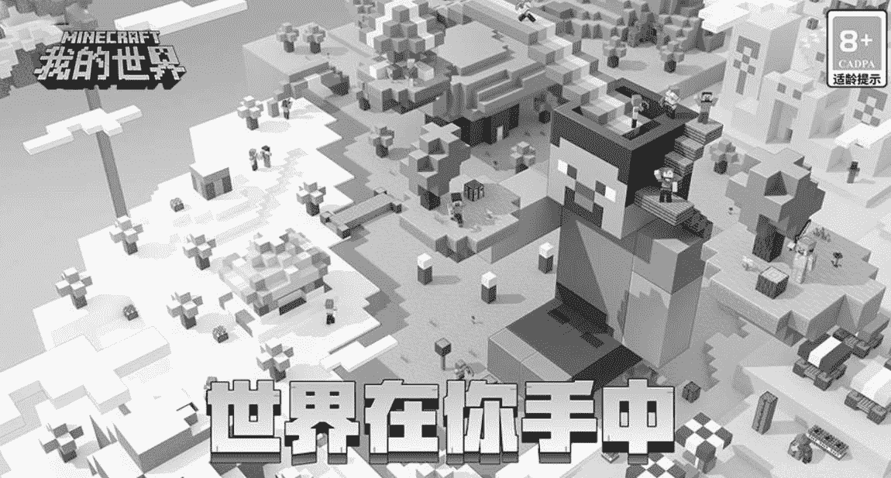

图 1-1 《我的世界》游戏画面

（图片来源：网易游戏《我的世界》官网）

2021 年 6 月 16 日，中国传媒大学动画与数字艺术学院毕业生在《我的世界》中按校园实拍搭建建筑，还原了校内外场景，上演别开生面的“云毕业”。除了基本风貌，花草树木和校猫也现身其中。典礼进行时，校长还提醒同学们“不要在红毯上飞来飞去”。直播时有网友感慨像“霍格沃兹的毕业典礼”。

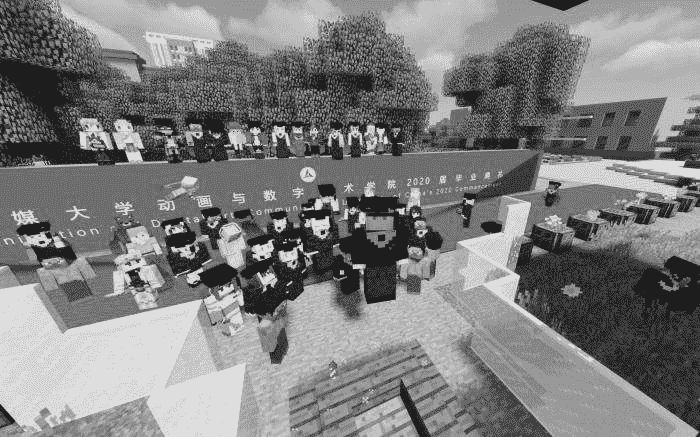

图 1-2 中国传媒大学“云毕业”场景

（图片来源：哔哩哔哩视频《中国传媒大学创意“云毕业”打造游戏世界中的毕业典礼》截图）

中国传媒大学的“云毕业”并非首例，美国加州大学伯克利分校的百余名在校生和校友也在《我的世界》里复制整座校园，六周内再现百余栋建筑，包括熟悉的小商店乃至条幅。

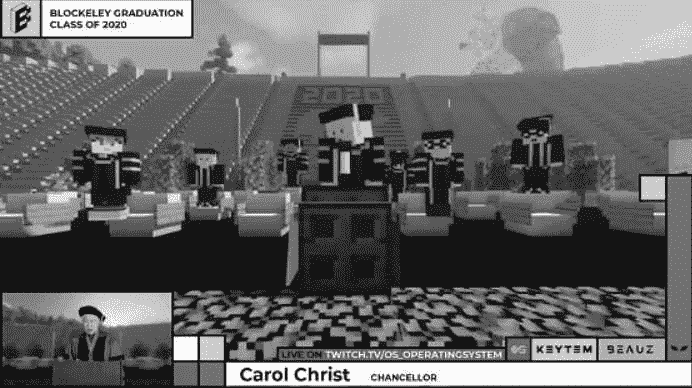

图 1-3 加州大学伯克利分校第 11 任校长 Carol Crist 致辞画面

（图片来源：加州大学伯克利分校官网）

《堡垒之夜》与美国说唱歌手 Travis Scott 跨界合作，在游戏中举办“ASTRONOMICAL”虚拟演唱会，场次覆盖美洲、欧洲、亚洲、大洋洲等服务器。按 Epic Games 统计，已演出场次吸引超 1200 万玩家同时在线，创下惊人纪录。图中动漫形象即 Travis Scott 在《堡垒之夜》中的造型。

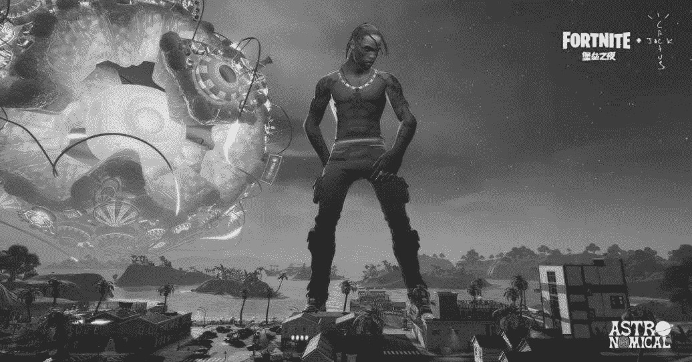

图 1-4 Travis Scott 在《堡垒之夜》中的形象

（图片来源：腾讯游戏《堡垒之夜》官网）

史蒂文·斯皮尔伯格执导的电影《头号玩家》，将背景设定在 2045 年，世界濒临崩溃，人们把救赎希望寄托于“绿洲”，一个由鬼才詹姆斯·哈利迪打造的虚拟游戏世界。戴上 VR 设备即可进入，与现实形成强烈反差的世界，内有繁华都市、各色玩家，跨次元的影视游戏经典角色亦能齐聚。现实中挣扎于社会边缘的失败者，在“绿洲”里仍可化身超级英雄，梦想触手可及。哈利迪临终宣布把巨额财产和“绿洲”所有权留给第一个解开三道谜题找到彩蛋的人，由此引发全球竞争。

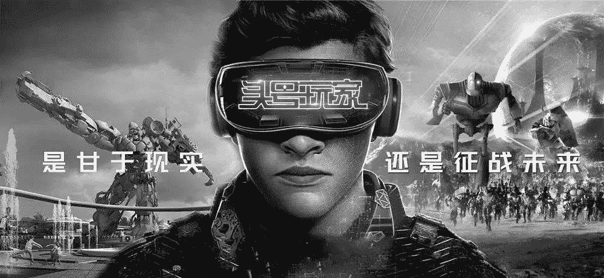

图 1-5 电影《头号玩家》宣传海报

现实中无处寄托、沉迷游戏的少年韦德·沃兹，生活在贫民区，害羞、孤僻、毫无存在感。但在“绿洲”中他化身帕西法尔，自信、勇敢、机智，成为人们心目中的英雄。凭借对虚拟游戏的深入剖析，他历经磨难找到三把钥匙，通关并拥有“绿洲”所有权。

电影中的“绿洲”已被《我的世界》这类游戏率先实现，尽管像素感强、形象方正，却切实展示了一个虚拟世界。人们因能做各种事而到来，因渴求不同的人生而沉沦。

著名科幻作家尼尔·斯蒂芬森在 1992 年出版的《雪崩》中描述了一个平行于现实的网络世界——元宇宙。现实中每个人的元宇宙分身即阿凡达。斯蒂芬森笔下的元宇宙是虚拟现实之后互联网的新形态。

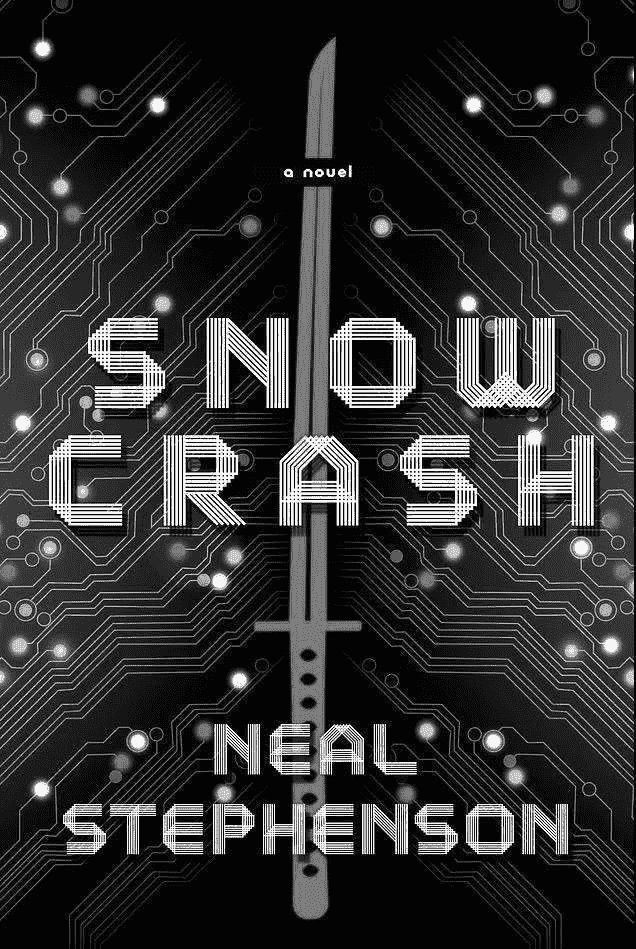

图 1-6 科幻小说作家尼尔·斯蒂芬森 1992 年出版的《雪崩》封面，书中首次提出元宇宙概念

* * *

注释：

[\[1\]](#part0008.xhtml#commentRef_2788) 《我的世界》是一款 3D 第一人称沙盒游戏，玩家可在三维空间自由创造与破坏各类方块，用想象力建立并探索专属世界。

## Roblox 创世纪

故事可追溯至 1989 年的一个小砖块。当时 David Baszucki 与 Erik Cassel 编写了名为“交互式物理学”的 2D 模式物理实验室，为日后创建 Roblox 奠定基础。通过该实验室，全球学生可观察两辆车相撞，也可学习搭建房屋。孩子们的设计令人惊叹，激发二人雄心，如何让青少年创造力发挥更大作用？于是他们开始构建想象力平台的核心组件，于 2004 年正式成立 Roblox，致力打造新一代平台，让人们更人性化地自由表达，突破想象极限，通过游戏创作分享人生体验。

### Roblox 简要介绍

Roblox 成立 17 年后，于 2021 年 3 月 10 日在纽交所上市。Roblox 既提供游戏，也提供创作工具 Roblox Studio，同时具备强社交属性，玩家可自行产出内容、实时参与，并拥有独立闭环经济系统。作为兼具游戏、开发、教育属性的在线创作系统，Roblox 大部分内容由业余创作者制作。若有有趣游戏构想却缺乏商业资助，可通过 Roblox Studio 自主创作，邀请其他玩家参与。随着参与者增多，游戏规则在游玩中逐渐形成并完善，也会随小组成员约定的玩法而改变。

为满足社区整体需求，Roblox 创作者会快速更新调整游戏。正是游戏库能不断搭建、变化、扩展，Roblox 才广受欢迎。用官方表述，游戏不叫游戏，而称 Experience 体验。截至 2020 年底，Roblox 用户已创造超 2000 万种体验，其中 1300 种被更广泛社区造访。这些体验均由用户而非公司创造。

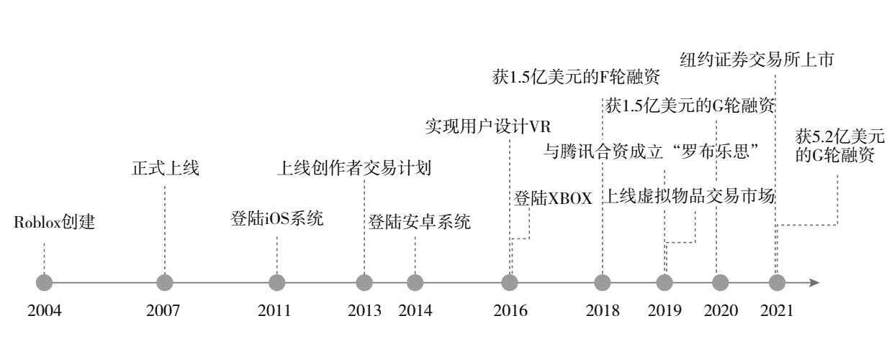

图 1-7 Roblox 发展历程

（图片来源：Roblox 招股书，天风证券研究所《Roblox 深度报告：Metaverse 第一股，元宇宙引领者》）

用户日均使用 Roblox 2.6 小时，每月约探索 20 种体验。2020 年第四季度平均日活用户达 3710 万。其中超一半用户年龄在 12 岁以下，9 至 12 岁占比最大达 29%，25 岁以上青年仅占 15%。

用户可在手机、台式机、游戏主机和 VR 头盔上运行 Roblox。先注册创建免费虚拟形象，再访问绝大多数虚拟世界。玩家可通过游戏货币 Robux 获取特定世界的最佳体验，或购买首饰服装等通用道具彰显个性。2020 年，Roblox 付费用户为 49 万。

Roblox 经济系统运作如下：玩家购买 Robux，再消费 Robux，开发者通过搭建游戏获得 Robux，Robux 可回投游戏、再投资或兑换现实货币。用户购买道具或服装时，支付的 Robux 归属该道具开发者，Roblox 抽取少量佣金。2020 年，超 120 万开发者赚到 Robux，其中超 1250 名收入达 1 万美元，超 300 名收入达 10 万美元。开发者每年至少赚取 10 Robux 才能加入 Robux 转美元的“开发者兑换”计划。

公司将购买 Robux 的行为称为“booking”，用 Robux 购买道具、服饰、装备或体验后才确认收入。2020 年 1—9 月用户累计充值 12 亿美元，其中消费 5.9 亿美元。公司预计 2021 年全年充值 20 亿—21 亿美元，消费 15 亿美元。2020 年 Roblox 营收 9.24 亿美元，同比增长 80.39%。

Roblox 增长迅速但未盈利。2020 年亏损 2.6 亿美元，主要源于平台维护与社区分成奖励，后者支出已超基础设施与安全成本，在总成本中占比最高。

成本结构反映 Roblox 已形成飞轮效应。随着更多开发者创造更好内容，平台吸引更多用户；用户聚集越多，越激励开发者通过 Roblox 接触不断增长的用户群。

目前 Roblox 已遍布 180 个国家，公司拟通过投资翻译辅助技术渗透其他市场。此外，公司正与科技巨头腾讯成立合资公司探索中国市场的巨大潜力。[^(\[1\])](#part0009.xhtml#comment_3421)

## Roblox 在资本市场的表现

2021 年 3 月 10 日，Roblox 以 DPO 方式在纽交所上市。上市前参考价每股 45 美元，对应市值 295 亿美元。2021 年 3 月 11 日收盘市值升至 400 亿美元。上市股价飙升，峰值达每股 103 美元，较上市前估值涨幅近 10 倍，成为美国资本市场炙手可热的明星股。

Roblox 与元宇宙的第一次交汇

2021 年初，押注特斯拉收获亮眼回报的 ARK 投资管理在年度展望中勾勒出十五条长期方向，其中就包涵由众多虚拟世界串联而成的元宇宙。该机构负责人 Cathie Wood 当时加码约 52 万股 Roblox，股价随之明显上行。一位美国资管机构的产品负责人指出，Roblox 上市首日的热烈行情，既反映出过去半年游戏公司乃至更广阔科技板块上市升温的态势，也说明二级市场承接意愿充足。

估值叙事一度很吸睛，Roblox 的市值短暂超过传统巨头 Electronic Arts，并长期压制 Take-Two。相较之下，后两者营收规模更大且保持持续盈利，而 Roblox 多年未能扭亏，亏损规模还在扩大。

资本面亮眼之外，运营基本面也有支撑。近两年产品在北美走红，2020 年双端合计下载量约 1.6 亿次，移动端收入突破 11 亿美元，并在当年北美圣诞档成为收入最高的手机游戏。

## 招股书里首次点名元宇宙

科幻作品《雪崩》里构建了一个名为元宇宙的网络空间，参与者以自定义分身活动，主角借助目镜看到电脑生成的城市景观，中央大道灯火通明，百万级人群穿梭其间。网络的主干线路与运行规则由“计算机协会全球多媒体协议组织”制定，开发者需先取得土地开发许可，再在自有街区规划巷道、搭建建筑公园乃至违背真实物理规律的构造。主角的探险就发生在这套信息技术支撑的虚拟世界里。

元宇宙通常被理解为人们生活与工作的虚拟时空。Roblox 是第一家把该词写入招股说明书的公司。文件中提到，市场上有人把其业务范畴称作元宇宙，一般指持久共享的三维虚拟场域。随着计算设备升级、云计算普及与高速网络成熟，元宇宙将逐步成真。Roblox 已搭建出雏形，被归类为元宇宙概念股。

公司还提炼出通向元宇宙的八大要素，分别是 Identity、Friends、Immersive、低延迟、Variety、Anywhere、Economy、Civility，是最早做商业化归纳的企业。

Identity：进入平台后使用者会获得专属身份，现实与虚拟需要一一对应，每个人在元宇宙中都能拥有一个分身，《雪崩》中称 Avatar，指个人虚拟替身。身份是生态闭环的起点。

Friends：元宇宙内置社交网络，每个分身的活动与交流均在其中展开。

Immersive：沉浸感在人机交互中常被忽视，游戏里被频繁提及，阅读精彩书籍或观看影视也有类似感受。但书影的沉浸与游戏的沉浸不同，前者角色由作者导演决定，玩家随剧情感受，后者由玩家对角色的操控与代入感主导体验。

低延迟：指信号在客户端与服务器间往返所需时长。网速好、响应快、在场人数少，延迟越低。对竞技或 RPG 对战等对反应要求高的场景影响显著。Roblox 延迟很低，因画面像素较低、颗粒较粗，算力需求小，普通电脑可承载，若画面精细则多数设备难以达标。

Variety：虚拟空间的自由度高于现实，可呈现更多元形态。

Anywhere：不受地域束缚，可借助终端随时进入。

Economy：Roblox 自建经济体系。用户与开发者规模达标后，2008 年公司停止自营游戏开发，上线虚拟货币 Robux，2013 年为开发者提供虚拟商品，随后持续优化类现实交易系统。开发者可通过四种方式获得 Robux：售卖自研付费游戏、在自研免费游戏里获取玩家时长分成、开发者间内容与工具付费交易、在平台销售虚拟商品。例如 21 岁的 Alex，9 岁起创作游戏，17 岁时作品《越狱》大火，被游玩累计四十亿次，靠皮肤道具销售每年收入达百万美元级。

Civility：平台内部也有文明体系。人们可在其中生活，多人组成社区，社区汇聚成城市，形成乡村、城市及共同规则，按规则共同生活，演化成持续发展的社会形态。

***

注释：

[\[1\]](#part0009.xhtml#commentRef_3398) 本书中 Roblox 的简介参考了 VI 研究院的视频，特此感谢。

## 逍遥游在元宇宙

元宇宙可被视作生活工作的沉浸式虚拟时空。这里需要重新思考存在与虚无、肉体与精神、善恶、自我与宇宙等哲学问题，不断探索有限与无限、秩序与自由、自治与法治、经济与治理、伦理与文明的边界，并全面融合区块链、AR、5G、大数据、人工智能、3D 引擎等新技术，形成数字创造、数字资产、数字市场、数字货币、数字消费的新模式。元宇宙是心的绽放，是梦的具象，是“我思故我在”的全息呈现。内求于心，外形于物，物物相生，元宇宙遂成。

在认知层面，元宇宙冲破想象边界，创造自在世界。元宇宙世界皆由所思所想直接幻化，是人类精神的外化，是“我心即宇宙，宇宙即我心”的立体呈现。它主张共创、共享、共治，在生产力、生产关系、上层建筑层面带有共产主义色彩。元宇宙经济由数字身份、数字资产、数字市场、数字货币、数字消费等要素构成完整体系。其基本特征体现为沉浸体验、自由创造、社交网络、经济体系与文明形态。元宇宙汇聚了区块链、5G、人工智能、3D 引擎、VR/AR/XR、脑机接口等尖端技术，这些构成了基础设施。

表 1-1　元宇宙的基础设施

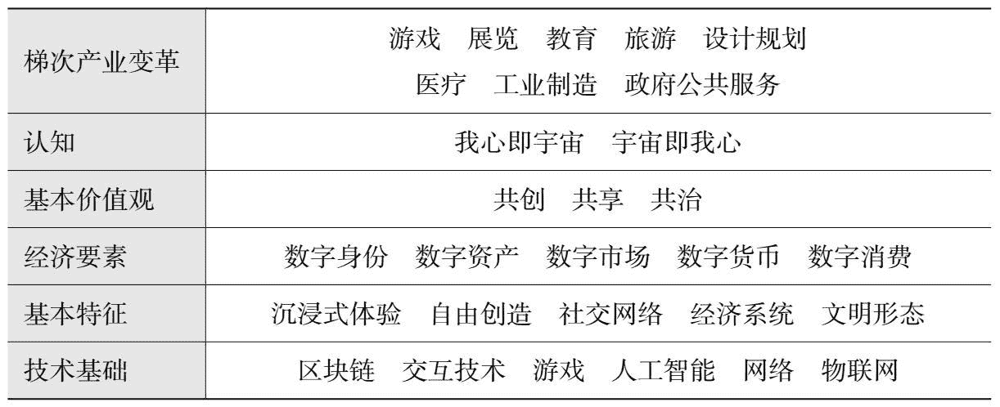

### 小说与电影里的元宇宙雏形

刘慈欣在科幻作品中描写先进外星文明对地球的监视。从地球生物首次仰望星空起，外星人便把地球列为技术可能爆发式发展的危险区，展开技术封锁。人类探索宇宙的历史甚至早于人类自身。

以心为原点，向外探寻物理世界与浩瀚星空；向内建立丰富精神世界。向外思维的高峰是《三体》三部曲，呈现阔大时空，寻找宇宙边界，一不留神就与所爱之人相隔数十万年。向内求的高峰是《逍遥游》，无所系而游于无穷，扶摇直上九万里，挣脱世俗束缚，达到超越时空的绝对精神自由。

心外无尽求索已达历史顶峰。介子须弥，人类在纳米级刻蚀，极尽精微；巡天万里，太空往返开启宏大旅程。心内精神世界多属宗教、文学、艺术创造。伟大艺术作品往往构建完整宇宙观。中国如《红楼梦》《西游记》，西方如《荷马史诗》《哈利·波特》。

《西游记》对心的刻画最直观典型。吴承恩处处留下暗示：孙悟空即唐僧心的化身。孙悟空拜师处挂对联：“灵台方寸山，斜月三星洞。”灵台、方寸在道教中皆指心，斜月三星亦成心形。可说《西游记》记录了唐僧取经，是以唐僧之心为原点构建的元宇宙。

电影艺术中，《黑客帝国》与《头号玩家》最具观感与启迪。两部片都在追问何为真实，大脑感知到的世界是否虚幻。

心外至极广大，心内至极精微，反而可能一体。我心即宇宙，宇宙即我心。

### 虚拟与真实的边界在哪里

这是 2018 年 12 月我在中国商用飞机有限责任公司参观时拍摄的照片。我在 ARJ21 飞机的模拟机舱里模拟飞行操作。教练员看过体型后仅开启初级模拟程序，即巡航阶段操控。当然我也自知，若打开模拟飞鸟撞击发动机场景，恐怕会直接眩晕。

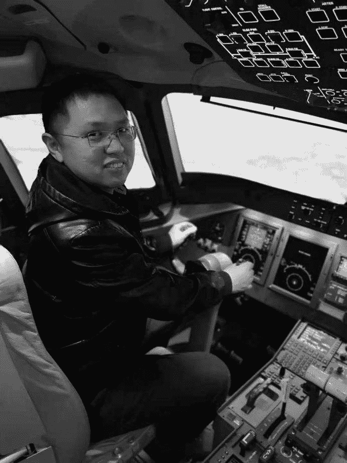

图 1-8 作者赵国栋在 ARJ21 飞机的模拟机舱中

飞行员主要在模拟舱训练，即使已有实际飞行里程，也需定期回模拟舱复训。因为模拟舱能复现飞行中极少遇到的场景，比如飞鸟撞击发动机致一侧发动机失火失动力，该如何处置。

很多人看过《中国机长》，刘长健机长驾驶四川航空 3U8633 航班在万米高空遭遇驾驶舱风挡爆裂脱落、座舱释压的极端罕见险情。类似险情极少发生，但在模拟舱可真实再现，用以考察飞行员应急能力与驾驶水平。

模拟舱与真实 ARJ21 飞机几乎一致，只把机身、机翼换成液压杆，模拟各种飞行姿态。一架模拟舱造价不菲，中国商飞仅有两架。对飞行员而言，实飞无疑真实，但在模拟舱可体验飞行中几乎不会遇到的极端场景。虚拟世界里的飞行场景则更丰富。学习与培训均在模拟舱完成。

何为真实？真实一词存在语言模糊性。无论模拟舱还是真机，给人的驾驶体验都一样。模拟舱能提供极端状况体验，唯愿飞机永远不给驾驶员极端体验。

就体验丰富度而言，虚拟世界远超物理世界。对个人来说，无论虚拟还是物理，体验都是真实的。

体验真实、感受真实，超越物理世界，物理与虚拟的界限将不再清晰。

再看《黑客帝国》场景，皆为电脑程序刺激大脑获得的信号。大脑体验真实，故尼奥无法分辨虚幻，直至服下墨菲斯递来的蓝色药丸。

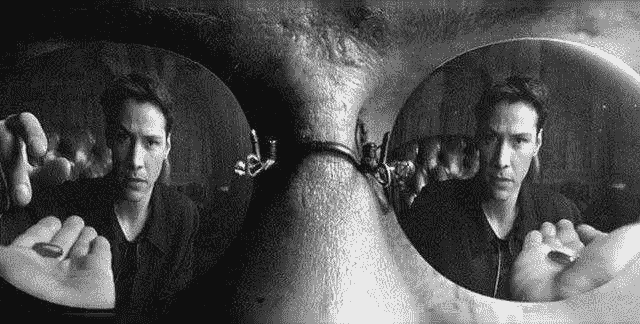

图 1-9 电影《黑客帝国》剧照（图片来源：影片截图）

元宇宙的重要特性即体验真实，超越物理世界。

元宇宙是精神世界的逍遥与物理世界星空璀璨的奇妙融合。5G、3D、VR 等技术发展，把心即宇宙的心学认知化为超现实的虚幻存在。

若把元宇宙定义为工作生活的虚拟时空，其实还有很多符合该定义的系统，不只游戏与电影。只是电影的视觉冲击与游戏的沉浸感，让人更容易体验到自由创造，释放无拘天性，去感受现实世界不可能发生的事。

### 共创共享共治为什么缺一不可

元宇宙中许多产品由分身创造，也存在分身组队推出精良产品的情形。UGC 是元宇宙主流方向，很难像管理员工那样管理分身，因难以制定明确任务与考核指标。

但成熟游戏大多建立任务机制，玩家完成任务获得激励，激励可能是积分、游戏币或稀有装备。换言之，激励分身创造是必须考虑的，因为这是元宇宙生产的前提，也是满足玩家自我实现精神需求的方式。有创造才有产品，有产品才需要交换场所，于是发展出数字市场。

共创是共同制作，共享是共同分配，共治是共同制定做大蛋糕、分好蛋糕的规则。共创、共享、共治分别关乎生产力、生产关系、上层建筑三个根本方面。共荣则是整体目标——元宇宙的繁荣。

共创与共享方面，部分企业做得不错。如苹果给开发者分成，微软新推出的 Windows 11 号称开发者在其系统上创造的应用全部免费，微软不收取任何费用；抖音、B 站等平台创作者也可获得可观报酬。

但在共治方面，中心化公司体制几乎未给制度空间。大量以区块链为底层支撑的去中心化应用走在前面。

以三个价值观考察元宇宙第一股 Roblox，可发现其共治价值观并未得到很好体现。而共治恰是区分新经济与旧经济、新理念与旧理念、新模式与旧模式的关键点。

关于元宇宙治理问题，将在第五章详述。

### 元宇宙经济的运行逻辑

数字经济是以数据为主要生产要素的经济活动，既包含物质产品生产流通消费，也包括数字产品创造交换消费。只要生产流通消费任一环节利用数字技术或数据，即属数字经济范畴。而元宇宙经济严格限定数字产品创造交换消费所有环节都必须在数字世界完成。

元宇宙经济是数字经济的特殊形式，体现其特殊性，同时作为数字经济组成部分必然体现一般性特征。特殊性主要体现为经济人假设崩溃、认同决定价值而非劳动决定价值、边际成本降低、边际效益提高、交易费用趋近于零等。一般性体现为符合经济基本原理，市场规模越大经济越繁荣。

元宇宙经济要素包括数字创造、数字资产、数字市场、数字货币、数字消费。其特征区别于传统经济，表现为计划与市场统一、生产与消费统一、监管与自由统一、行为与信用统一。

元宇宙经济的特征决定了它是研究数字经济的绝佳样本。其结论置于数字经济体系中检验，未必完全相同，但对建立我国数字经济体系有深刻启示。

元宇宙经济是很多平台型公司的必然选择。所有平台型公司或多或少具备融入元宇宙经济的部分特征，尽管表现形式略有差异。表 1-2 给出不同类型元宇宙经济体系的对比。

表 1-2　不同类型元宇宙经济体系的对比

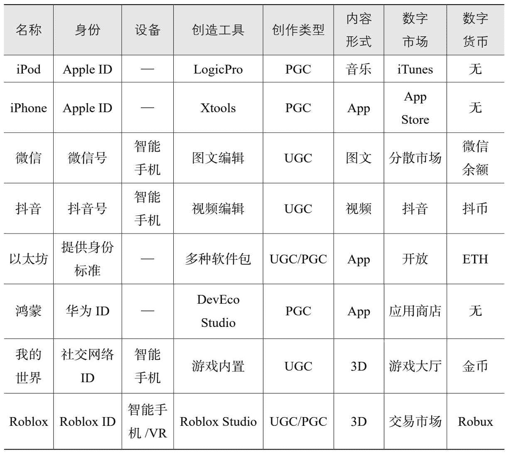

关于元宇宙经济，将在第四章详加讨论。

### 元宇宙的五大核心特质

关于元宇宙特质众说纷纭。Roblox 总结了八方面，去芜存菁，我认为五方面可涵盖基础特征。

第一，沉浸式体验。

微信抖音等平台也可视作元宇宙雏形。若认为元宇宙是人们生活工作的虚拟时空，为何在微信、抖音鼎盛时我们并未提出元宇宙概念，只用“产业生态”形容其商业帝国？

当然也会沉迷刷短视频，一次刷很久。但使用者并未产生置身异时空的感受。眼睛紧盯几寸屏幕，仍能感知屏幕外发生的事。手机方寸之间并无身临其境感。

VR 不同，设备启动后感官会进入另一空间，如《头号玩家》场景。

沉浸式体验带来超越现实的震撼，与物理世界两相对立。似两平行宇宙，需借助虫洞连接。穿越虫洞，便是另一个宇宙。

《阿凡达》中，男主杰克双腿瘫痪，行动受限，其化身却身体强健。杰克首次感受到化身身体，既惊诧又兴奋，动动脚趾不敢置信，走几步感受到真身双腿从未有过的体验。这种体验叫自由。于是他不顾劝阻跑到野外忘情奔跑，让风吹过面颊。就像新生幼儿贪婪感受世界。

看到飞鸟无人不羡慕其翅膀，恨不得自己也有双翅随花飞至天尽头。观众看到阿凡达驾驭斑溪兽自在飞翔时，会心生感叹，这才是人生，自由人生。

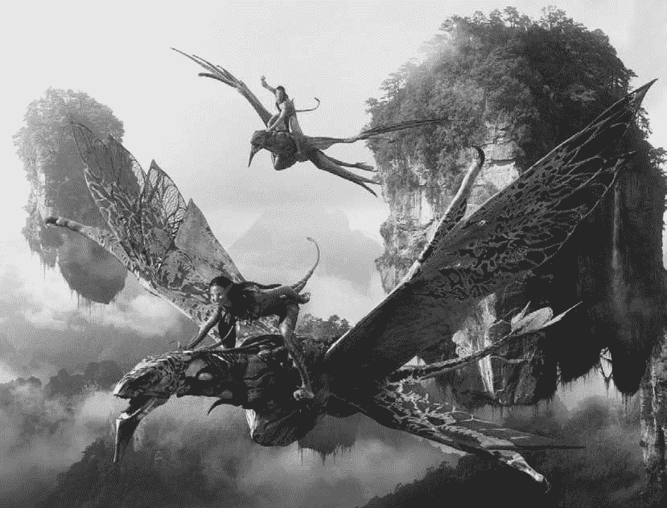

图 1-10 电影《阿凡达》剧照，“阿凡达”们正在驾驭大型飞鸟

（图片来源：影片截图）

这种体验，非元宇宙不可得。

#### 第二，创造

创造本质是精神生活。“两句三年得，一吟双泪流。”是贾岛索句后的内心独白。“满纸荒唐言，一把辛酸泪，都云作者痴，谁解其中味。”是曹雪芹批阅十载增删五次后的感慨。

创造是快乐的，但再细致入微的描写也难以穷尽真实景物。绘画、雕塑、建筑皆为艺术，艺术之美非言语可尽述。

元宇宙中简单易用的创造工具赋予人们无尽创造力。创造只取决于想象力，尤其那种创世的感觉。

创造也是元宇宙经济基础。没有创造就没有资产，没有资产就没有交易，没有交易就没有经济系统。

#### 第三，社交网络

“嘤其鸣矣，求其友声。”小鸟都知找朋友，何况人。孤独、不被理解是人们最大精神危机。古往今来人类最悲凉情绪莫过于此。岳飞说：“欲将心事付瑶琴，知音少，弦断有谁听？”贾岛“两句三年得，一吟双泪流”后又有“知音如不赏，归卧故山秋。”寻求同好、知音共鸣是人类基因决定的。

社交网络是元宇宙标配。国内以微信、国外以 Facebook 为代表的社交网络趋于成熟。抖音内嵌社交功能，游戏亦然。

#### 第四，经济系统

经济活动是社会基础。元宇宙作为虚拟社会，同样离不开虚拟经济。经济系统重要到需单独一章讨论，此处不再赘述。

#### 第五，文明形态

文明是人类社会行为与自然行为的总和。每个人都是多面的，孩子在父母面前与朋友在一起的行为区别很大。在元宇宙中，人们以分身出现在朋友面前，很可能也代表内心深处不一样的渴望。因此元宇宙形成的文明形态，既与物理世界文明形态相似，也有诸多不同。

故不同元宇宙可能形成物理世界文明形态的不同投射。游戏《第二人生》与《堡垒之夜》的文明形态显然不同。

也正是这些不同文明形态，反映了物理世界文明的复杂性与多样性。正因如此，我们才能体验不同人生。

### 支撑元宇宙的数字技术组合

元宇宙技术基础可用 BIGANT 概括。B 指区块链技术，I 指交互技术，G 指电子游戏技术，A 指人工智能技术，N 指网络及运算技术，T 指物联网技术。“大蚂蚁”可谓集数字技术之大成。从图中可见元宇宙对数字技术的拉动作用。

#### 通过 AR、VR 等交互技术提升游戏的沉浸感

从扁平到立体，再到沉浸：游戏何时抵达元宇宙

游戏技术发展的线索里，沉浸感的拉升始终是关键牵引。早期《愤怒的小鸟》这类作品只能做成平面画面，到了《CS:GO》时代，场景与道具都获得了立体厚度，玩家可以随意调转视点，代入感随之明显增强。可是三维作品依然被限制在单一竖屏里，交互也依赖键盘、鼠标、手柄等传统外设，与元宇宙所倡导的实时同步与高度拟真还有相当距离。展望前方，VR、AR 等人机交互手段成熟后，由更逼真、交互频率更高的开放虚拟世界承接的娱乐体验，有望实现一次质的跃迁，逐步缩小与成熟元宇宙形态的差距。

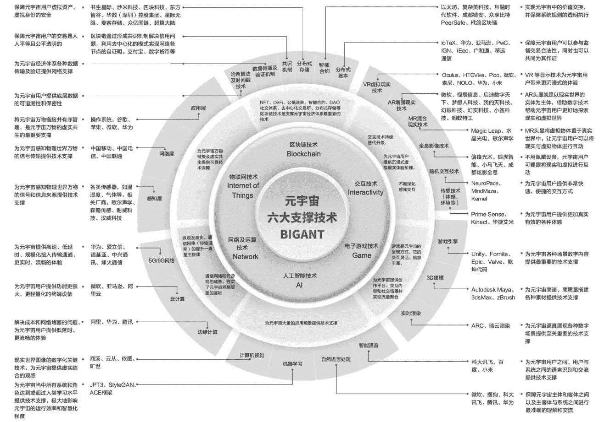

图 1-11　元宇宙 BIGANT 六大技术全景图

（图片来源：中译出版社《元宇宙通证》）

#### 依托 5G 和云计算承载亿级并发，降低进入门槛
元宇宙是面向大规模参与的媒介，使用者规模会进入亿级量级。如今主流在线游戏多以客户端形式运行，计算由运营商服务器与本地终端共同分担。这种模式下，本地硬件性能本身就成了使用门槛，限制了覆盖广度；服务器承载能力也难以支撑海量用户同时在线。5G 与云计算等底层基础设施的普及，是打开可进入性瓶颈的关键。

#### 凭借算力与算法升级渲染方式，扩大触达范围
当前三维游戏多采用本地渲染，受制于个人电脑图形处理单元的上限，画面细腻度与真实感仍有提升空间。要改善呈现效果并扩大触达，需要算法与算力的协同突破，同时半导体等基础产业的持续演进。

#### 用区块链与 AI 降低创作成本，拓展延展空间
在官方生产内容层面，第一方内容是元宇宙落地的基石，而三维场景与角色建模仍耗费大量人力物力。算力、算法与 AI 建模的进步，有望显著提升官方内容生产效率。在用户自创内容层面，第三方自由创作与闭环经济的持续激励，是元宇宙扩张的核心动力。现有用户自创门槛过高，高度定制与易创作难以兼得，且鲜有真正闭环的经济体系。要达到元宇宙所需的可延展性，需要区块链经济、人工智能与综合内容平台等产业的共同突破。

### 规则由谁来制定
区块链与元宇宙相互依存。区块链提供了组织、治理与经济模式所需的技术底座，其去中心化价值观与元宇宙“共创、共享、共治”的理念高度契合。

在物理世界，政府作为上层建筑的作用不可替代。元宇宙在某种意义上是物理世界的数字投射，却鲜有人愿意为政府在其中预留位置。即便元宇宙的创世者并非无政府主义者。

西方思想家常把政府比作看门人，守护秩序与规则。职能远不止于此。但必须思考，元宇宙的创世居民以 M 世代为主体，不少人把反抗家长权威视作自由的象征，如何引导他们健康面对生活成为关键议题。

既然追求无拘无束与驰骋自由，为何还要设计一个类似家长的机构？

元宇宙必须有规则，且规则执行最好不依赖单一中心化组织，这正是区块链发挥作用的场景。

另外，构建真正统一的元宇宙需要跨宇宙机制，让不同宇宙中的用户能以同一身份活动，而非沦为平行宇宙的分身。游戏 A 的账号无法登录游戏 B，游戏 B 的装备也无法在游戏 A 使用，对玩家而言它们就是永不相交的平行世界。

某些资产例如皮肤，可能在不同游戏中通用，这些资产就可以跨宇宙流动。目前能实现数字资产跨宇宙传递的技术，只有区块链。NFT 提供了一种可行的范式。

#### 元宇宙为 NFT 拓展应用空间
NFT 的英文 Non-Fungible Token 直译为非同质化代币，表述并不直观。它是区块链上的一个条目，代表某个独一无二的数字资产，如博物馆名画或土地所有权。它是数字世界的资产，独一无二、不可复制、可交易，也能映射现实商品，但存在形式是数字化，通常保存在以太坊等链上。

很多人宣称 NFT 是区块链最重要的应用，是推动元宇宙发展的关键。确实，NFT 让物理资产与数字资产联通成为可能。但一个重要问题被忽视：NFT 的内在价值缺乏足够共识。

一双袜子拍出 15 万美元，推特首 5 个英文单词拍出 250 万美元，将 5000 天创作汇集的作品拍出近 6900 万美元，这些价格依据何在？单从基础物品看，一双袜子、5 个单词、一个作品合集都不可能支撑如此高价。

加上 NFT 作为加密权益证明，就能让价格数十倍、数百倍甚至数千倍飙升吗？显然，一双袜子即便用何种权益加密，价值也难以过度膨胀；推特首推的作者早已尽人皆知，是否需要 NFT 证明都值得怀疑；一个汇集 5000 天作品的新作加上 NFT 权益证明，并不代表对全部 5000 幅作品都做了权益保护，也缺乏合理基础。

对高价的合理解释只能是信仰力量与炒作结果。有专家曾呼吁审慎对待 NFT。很多人急于投资，是为了彰显数字世界的领先地位并获取升值收益，会不遗余力夸大价值、相互炒作抬价，存在强烈的传销特征，风险极大。

在元宇宙里，每个数字产品都有真实玩家支撑。每个 NFT 难以代表实际价值，却是玩家体验的真实记录。从这个角度看，元宇宙赋予 NFT 意义。

没有 NFT，元宇宙同样发展，如今的 Roblox 即是明证。元宇宙也能反向带动 NFT 成长，甚至规范其交易规则，使之逐渐理性化。

### 网络演进的终极形态
蒂姆·伯纳斯-李 1990 年发明首个网页浏览器，互联网由此起飞。苹果 2007 年发布首代 iPhone，移动互联网时代开启。PC 互联网独领风骚约 17 年，移动互联网已走过约 14 年。上网终端正从 PC、笔记本向智能手机为主过渡，如今即将迎来新一轮变革，终端很可能从智能手机转向 VR/AR 等设备，这个周期预计也将维持 10 至 15 年。

另一条脉络是区块链。自 2009 年比特币上线以来，区块链技术逐步普及，其衍生的治理模式与商业模式叠加互联网发展，形成恢宏图景。

以 VR/AR 设备、区块链与游戏叠加形成的新型互联网形态正呼之欲出。继 PC 互联网、移动互联网之后，元宇宙时代即将到来。

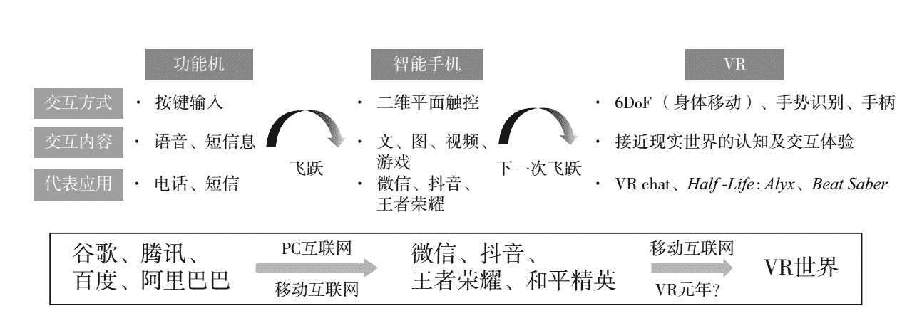

图 1-12　硬件设备内容形式对比

（图片来源：天风证券研究所《Roblox 深度报告：Metaverse 第一股，元宇宙引领者》）

# 02

## M 世代：元宇宙的创世居民
You Only Live Once（只活一次，何不随心所欲？）
——网络流行语

M 世代即 Metaverse 世代，指与互联网同步成长的一代人。他们第一部手机就是智能手机，第一次打开的应用多半是游戏，他们正是元宇宙的创世居民。他们不仅重塑元宇宙社会，也在改变物理社会，并引领时代走向。

“创造+分享”成为 M 世代自我实现的核心驱动。在元宇宙里，创造只受想象力限制，生产无需担忧资源枯竭，突破想象的极限就能获得无尽世界。

M 世代是元宇宙经济的主要参与者与推动者。他们在虚拟世界的行为与现实并不完全相同，合作与分享更频繁，阿凡达似乎没有自私的基因。传统经济学必须重新审视“经济人”假设。

科技繁荣、文化茂盛、城市兴旺，现代文明的成果层层展开任人享用。自由学一门语言、学一门手艺、看一场电影、去遥远旅行。很多人从小便自由探索兴趣，培养爱好。不少人在童年就已不惑于自己喜欢什么、不喜欢什么。

……

因为你们，这世上的小说、音乐、电影所呈现的青春不再是忧伤迷茫，而是善良、勇敢、无私、无所畏惧，心里有火眼里有光，不必活成我们想象的样子。

我们这一代人的想象力不足以想象你们的未来，若你们仍需要祝福，那就奔涌吧，后浪！我们在同一条奔涌的河流。

2020 年五四青年节，哔哩哔哩发布演讲《后浪》，献给新一代。有评论称其如给青年的一封信，激荡青春之声。中国年轻人正以前所未有的态势在多元、丰富、包容的新环境中成长。

每个时代都有其特征，特征由主流人群决定。他们在青春期遇到的历史大事件塑造一代精神，这一时代也在推动历史进程。

“60 后”可能是最具西方精神的一代，青春期恰逢中国改革开放起步。“70 后”是最早的互联网一代，中国第一封电子邮件发出时，这代人最大的已 17 岁。到了“00 后”，拿起的第一部手机必然是智能手机，功能机只存在于上一代记忆。

最年轻的这一代代表世界方向。尽管在上一代眼中尚显稚嫩，但他们的选择就是未来。

我们将在第四章讨论元宇宙经济学，其中一个重要假设是元宇宙的阿凡达没有自私基因。这个特质与这些年轻人的经历、追求与精神密切相关。

## M 世代的互联网纪年
日本社会学家岩原勉认为，群体是具有特定共同目标、归属感并存在互动关系的个人集合。我们习惯把具有相似特质的人归为一个世代，如 80 后、90 后、千禧一代、X 世代、Y 世代、Z 世代。我们把目光投向最具活力与可塑性的 Z 世代，在本书中为他们命名为 M 世代，即生活在元宇宙的这一代，大约出生于 1995 至 2010 年间。他们伴随互联网成长，受即时通信、短信、MP3、智能手机与平板电脑影响深远。通常不畏权威、追求社交认同、注重自我实现、愿意为知识与热爱付费。他们是元宇宙世界的居民，与智能手机共同成长，手机发展史就是他们的成长史。

据 QuestMobile 2021 年数据，截至 2020 年 11 月，“95 后”“00 后”活跃用户规模达 3.2 亿，占移动网民 28.1%，线上消费能力与意愿均高于全网。这代人生活优渥，消费意识强，消费能力与意愿较高，是技术迭代的早期尝鲜者、移动互联网的重度用户，兴趣爱好广泛，是社交、娱乐、购物的重要力量。M 世代的生活究竟如何？以 1995 年出生的 M 世代为例，将其成长轨迹与互联网大事件串联，或许能窥见端倪（见表 2-1）。

表 2-1　M 世代的生长轨迹对应互联网发展中的大事件

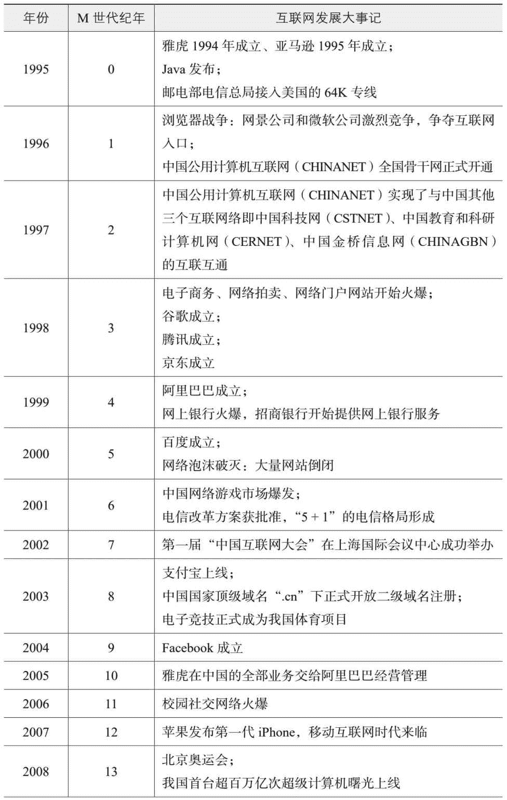
续表
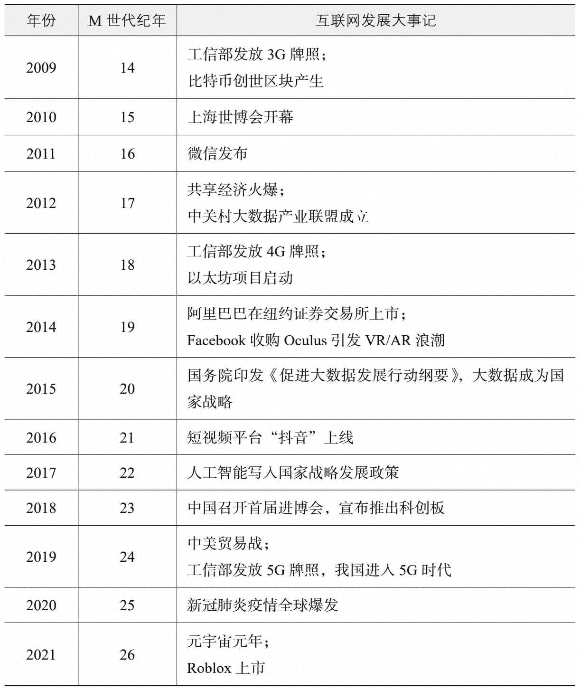

从表中可见，M 世代几乎与互联网发展同步。他们第一部手机就是智能手机；第一个打开的应用很可能是游戏；第一个发布的内容很可能是短视频。M 世代塑造了互联网，互联网也塑造了 M 世代。

* * *

注释：

[1] 有说法称千禧一代为“M 世代”，或“多任务世代”“多媒体世代”，特点是可同时使用不同即时网络通信工具，乐于花费大量时间在社交媒体与网络游戏上，这与元宇宙世代有相通之处。

## 自我实现的世代呼唤
借用马斯洛需求层次理论观察 M 世代心理需求。通行的五级模型现已扩展至八级，本书采用七级模型，自下而上为：

第一层生理需求：食物、水分、空气、睡眠、性等，是最基本也最有力量的需求。
第二层安全需求：稳定、安全、受保护、有秩序、免除恐惧焦虑等。
第三层归属与爱的需求：建立情感联系与关系，社交、交友、追求爱情等。
第四层自尊需求：渴望被尊重，相信自身力量与价值，更有能力与创造力。例如读书证明社会存在价值。缺乏自尊则自卑、信心不足。
第五层认知需求：知识、理解、好奇心、探索、意义与可预测性。
第六层审美需求：欣赏并追求美、平衡、形式等。
第七层自我实现需求：追求潜能完善化与实现。运动员练到极致，企业家认为事业能创造社会价值等。

M 世代物质生活几乎未经历匮乏，更多是物质丰富带来的选择困难。总体看，第一、二层需求已得到充分满足。

他们的需求更集中于精神层面，希望建立情感联结、获得认可、持续学习关注新鲜事物、追求美艺术快乐、发挥潜能不断完善自我。

以 M 世代为主的社会物质极其丰富，虽未达理想按需分配，但他们出生之日“短缺”已不复存在。传统经济学研究对象是实物商品，制造有成本，易受原材料限制。M 世代更关心实物商品附加的“文化”属性，与个人感受体验相关，与美、流行趋势、朋友选择相关。

在元宇宙中，虚拟商品极度丰富，完全可实现按需分配。商业实践中，生产商人为制造稀缺性来吸引目光。

面对极度丰富的虚拟商品，M 世代还是利己的经济人吗？

尽管 M 世代进一步圈层化，形成流行亚文化，总体上仍秉持共享、共美的价值观。正如披萨多吃一块你就少一块，快乐却每分享一次就多一份。分享是 M 世代鲜明特征。

互助也表现突出。在团队合作游戏中，“一个都不能少”往往是取胜关键。队友受伤必须倾力相救，才能保持胜率。共享、互助是元宇宙中 M 世代的共同价值观。

## 圈层文化
加拿大哲学家查尔斯·泰勒指出，基于个人自主性的现代文化，源于社会历史转变：人获得空前膨胀的个人权利与自由，由此形成全新自我理解。M 世代正是标榜个性、崇尚自我理解、追求自我实现的一群人，他们拥有诸多标签，如互联网原住民、敢赚敢花的剁手党、颜值主义、二次元、懒宅族、朋克养生党等；善于表达、热爱分享，是潮流引领者。他们用手机指挥商家上门服务，外卖到家是典型表现；热爱亚文化如动漫、网游；每日外出时间常少于 3 小时，上网时间多于 8 小时。在游戏中社交、寻找朋友与伴侣时有发生，《微微一笑很倾城》里的故事并非空穴来风（见图 2-1）。

图 2-1 电影《微微一笑很倾城》宣传海报

M 世代在懒宅人群中占比很大。据 iMedia Research 数据，2021 年中国二次元用户规模将突破 4 亿人。懒宅用户最喜爱的产品有视频、直播、外卖送餐、生鲜零售、电子阅读、游戏等。对每日优鲜、盒马鲜生、饿了么、美团的偏爱体现了对“懒”的追求。对腾讯视频、哔哩哔哩、虎牙、斗鱼、掌阅的欢迎度也体现了多样化休闲娱乐需求。

消费者大数据分析师徐璐指出，青年消费理念已超越炫耀名牌与虚荣，更愿意取悦自己。泡泡玛特爆火即是典型案例。泡泡玛特 CEO 王宁曾说，泡泡玛特做的是马斯洛需求上层的生意，用户买的不是刚需而是文化（见图 2-2）。“年轻人就是要及时行乐——买喜欢的衣服，吃想吃的东西，见想见的人，开心就是王道。”这或许才是 M 世代的生活信条。

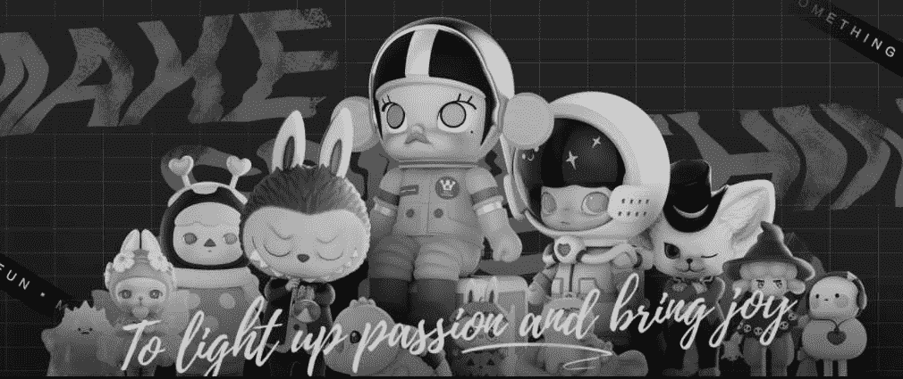

图 2-2 在 M 世代中颇具人气的泡泡玛特盲盒（图片来源：泡泡玛特官网）

M 世代崇尚颜值主义。他们动辄把“颜值”挂在嘴边，毫不讳言颜值崇拜，形成前所未有的景观。他们愿意为兴趣付费，腾讯 QQ 联合媒体发布的《95 后兴趣报告》显示，“95 后”年轻人认为为兴趣付费无可厚非。

有人为 M 世代梳理出 16 个亚文化圈层，分别是二次元、国风国潮、游戏电竞、潮玩酷物、硬核科技、御宅族、偶像圈、快文娱、cosplay、宠物、新舞音、新健康、新艺术、新教育、新竞技、街头野外。这些圈层势能极强，持续关注即可感知新时代、新文化、新消费的脉搏，发现新机遇，实现品牌跨越式增长。

* * *

注释：

[1] 《微微一笑很倾城》为顾漫小说，后改编为影视作品，讲述一对大学生情侣在游戏世界相遇、在现实世界相爱的故事。

[2] 曾昕.理性消费者，还是感性购物狂——“Z 世代”消费文化解析[J].教育家.2021(23).

[\[3\]](#part0016.xhtml#commentRef_6929) 陈格雷. Z 世代的亚文化圈层大搜罗\[Z/OL\]. https://t.qianzhan.com/daka/detail/210325-91d9232f.html, 2021-03-25\[2021-06-21\].

## 想象即建造：元宇宙里的无界创作

在现实世界里，做出一件东西往往要耗费大量练习和时间。过去的木工、冶铁、制瓷，都得拜师、靠手艺和匠心。可到了元宇宙，创造的门槛被拉回到想象力本身，其他繁琐环节都由软件接手。只要脑中有画面，动动鼠标敲敲键盘就能把想法落地。想盖一栋摩天大楼也好，想亲手搭出一款芯片也罢，都能实现。元宇宙里的物理规律与规则全是人设定的，甚至可以反过来设计元宇宙本身，衍生出各种各样的平行世界。

创造本身离不开展示与交流。独自的创作若无人分享，社会价值就大打折扣。提供创作工具并搭建分享平台，已成为元宇宙不可或缺的基础设施。

再往前推一步，数字创作能直接变现。NFT 已经证明，虚拟世界的作品可以产生真实收益。Roblox 里，玩家自制道具、皮肤，再放到数字市场上流通给有需求的人。从创造到分享，再从分享到交易，构成了元宇宙居民自我实现的递进路径。

回看 M 世代，他们的成长轨迹几乎与互联网同步。网络上的奇闻异事早已融入日常生活。他们既被互联网塑造，也在重塑互联网。物质层面从不匮乏，真正的困扰是选择困难，而选择困难背后是对自我的迷失与认同的分裂。

M 世代对精神层面的追求，超过了之前任何一代。物质需求退居二线。精神诉求一旦成为主导，社会面貌就会随之改变。一双普通耐克，只要冠上某位明星联名，就能被炒到数万元，这正是 M 世代认同力量的体现。

这种认同源于精神层面的深度共鸣，源于自我实现的需求。它具备改变社会的潜能。

可以说，元宇宙是为 M 世代而生，M 世代也是元宇宙最初的创世居民。两者相互塑造、彼此影响，站在文明前沿。

* * *

注释：

[\[1\]](#part0019.xhtml#commentRef_7115) 请参见：果壳网. 学而时玩之：动物们的玩耍\[Z/OL\]. https://www.guokr.com/artic le/439441/,2014-11-11\[2021-06-21\].

### 元宇宙初胚：游戏在先行

元宇宙是互联网演进的下一形态，几乎所有行业都会被波及。每个时代都有一个率先爆发的先导产业，带动要素聚集，进而形成正反馈加速社会进步。回溯工业时代的先导产业与工业革命的先后次序，有助于判断元宇宙的演进路径。

#### 从棉纺起步的工业革命

提到工业力量，人们容易联想到空间站、火星车、飞机、巨轮、原子弹。但真正点燃工业革命的产业是什么？

18 世纪，英国开启第一次工业革命。此前，农业与手工业主导经济。衣食住是基本需求，而在天然纤维中，棉纤维最柔韧、最便于机器操控。相较于种粮建房，纺织劳动更轻便，不受天气、季节、光照制约，更适合用简单的重复动作完成，比如纺纱织布，因此更容易低成本实现机械化。相较于珠宝、瓷器、家居等轻工业消费品，纺织品的市场容量最大，收入弹性最强，既可作原料也可作终端消费品，市场随收入提升迅速扩张，足以支撑大规模生产并在竞争中催生创新。早在 14 世纪，英国政府就已扶植全球纺织品贸易近百年。18 世纪初，英国已拥有欧洲最大的纺织市场与最多的纺织初级工业。[^(\[1\])](#part0020.xhtml#comment_7594)

英国的工业革命首先从棉纺业发端，而唯有具备高收入弹性的庞大市场，才能刺激并维持机械化大规模生产。

一旦启动，传导效应便接踵而至。卡尔·马克思在《资本论》里指出：机械纺纱催生机械编织，二者又必然带来漂白、印刷、印染的化学革命；棉纺革命又催生轧棉机，没有它大规模棉花生产就不可能。

# 03 游戏的寒武大爆发

你有时候分不清是醒着还是在做梦。

——电影《黑客帝国》

游戏被视为人类文明的起点。席勒认为，只有当人真正成为人的时候才会游戏；只有在游戏时，人才是完整的人。同时，游戏也是自然赋予的学习方式，只是商业游戏的异化掩盖了其教育价值。

游戏是元宇宙的雏形，将融合艺术、文化、技术，引领探索元宇宙文明的浪潮。它注定要扮演先行者与引领者的角色，带动上游与相关产业逐步迈入元宇宙时代。

传统产业的发展需要借鉴游戏思维，数字化转型必须注入游戏元素，这是通向元宇宙的必经之路。

大约 5.42 亿年前到 5.3 亿年前，地质学上划为寒武纪之始。这一时期大量无脊椎动物化石突然出现，而在更古老地层中几乎找不到明显祖先，这种现象被称为寒武生命大爆发。

哲学家给出解释：在复杂系统中，突变是演化的常态。改变的因素长期积累表现为量的变化，直到某个微小扰动到来，量变发生质变，系统焕然一新，演化随之加速，进入新时代。

## 文明的游戏根源

### 动物玩耍：为生存做预演[1]

玩耍对动物生存至关重要。它帮助练习未来所需的技能，提升运动协调性与体力。从哺乳动物到灵长类，幼崽都在玩耍中学习生存本领。可见玩耍并非成长的阻碍，而是打下生存基础的关键环节。

### 游戏是自然赠予的学习路径

观察、模仿、游戏，是儿童学习的自然链路。几乎没有人专门教孩子怎么用智能手机，孩子看着大人用手指点屏，自己也就跟着点点划划。每一次操作得到反馈就觉得有趣，于是乱指乱点乱划。观察模仿游戏是必经阶段。反之，教父母用智能手机却很难，父母一般不会乱点乱划。看似胡来的过程中，一些新手势就被激活，甚至成年人不会的操作孩子也能掌握。

在这样的过程中，规则逐步建立。两个孩子一起玩就会形成相处规则，比如不能抢玩具。你抢我玩具，我也会抢你玩具，想继续玩下去就得学会克制。

规则的形成赋予游戏社会意义。在游戏中，人们学会与他人相处、与世界相处。棋牌、麻将、桌游等现实游戏社交性强，除娱乐外还承载信息交换与社交功能。

中国古代“六艺”礼、乐、射、御、书、数，本质也是游戏，只是被归为高雅之列。

古人说“尧造围棋，以教子丹朱”。孔子言“志于道，据于德，依于仁，游于艺”。“游于艺”本质是解放心灵，使人走向完整。席勒亦云，只有当人充分是人的时候才游戏，只有游戏时人才完整。

当代教育却将游戏与学习对立。流行的大作只追求快感体验，忽视了潜移默化的教育过程；学习则变成循规蹈矩的重复，忽视了玩耍的学习效用。在元宇宙的多维时空中，游戏能否回归本真？

### 游戏即文明之源

荷兰历史学家约翰·赫伊津哈的《游戏人生》，是首部从文化史视角多层次研究游戏的专著，阐述了游戏的定义、性质、意义、功能及其与社会文化现象的关系。

赫伊津哈明确提出：文明是在游戏中成长、在游戏中展开，文明就是游戏。随着文化演进，游戏要素逐渐退居幕后，大部分融入宗教，剩余结晶为民间传说、诗歌、哲学或社会生活。但无论文明多发达，游戏会本能地强化自身，让个人与大众沉浸其中。

他认为科学难以量化游戏，尤其无法解释“乐趣”。大自然本可以用机械反应提供宣泄、放松、技能训练等功能，却给了我们游戏、紧张、欢笑与乐趣。因此应研究游戏的社会结构形式，而非自然冲动。

赫伊津哈指出，游戏超出人类生活领域，其产生与特定文明无关。文化出现前游戏已存在，伴随文化渗透至今。游戏无法归入真善美范畴，不以理性为基础，处于智愚真假善恶之外，无道德评判性。与美有关却非固有属性。游戏是一种生存功能，无法从逻辑、生物或美学上精确定义。

人类与动物在一般意义上的游戏特征一致，文明未添加不可或缺的特征。他说游戏中某种超越直接需求并赋予行动意义的东西“在活动”，一切游戏都有意义。他更关注人类群体性游戏，归纳出三特征：游戏是自由的自主行为；游戏非“平常”生活或“真实”生活，孩子们心知肚明只是在假装，却可升华至美与崇高；游戏受时空封闭限制，需在特定范围内完成。游戏有时间限制，可形成传统；有空间限制，竞技场、牌桌、舞台、银幕、法庭等都是隔绝外界的临时世界，特殊规则在其间通行。

他认为游戏创造秩序，甚至游戏即秩序。无视规则者成“搅局者”，比“作弊者”更具破坏性，因其摧毁游戏世界本身。

高等游戏的功能来自竞赛与再现，二者常合一。他重点讨论宗教表演，认为其以再现实现存续，并保留游戏特征。引用弗洛贝尼乌斯观点：远古人类以祭祀戏表演宇宙秩序，借此维护秩序。赫伊津哈认为后者混入了目的论，游戏的要点恰在于游戏本身。

他认为宗教仪式表演与儿童游戏、动物游戏本质无异。游戏特有的秩序、紧张、运动、变化、庄重、节奏、痴迷，在古代社会游戏中早已具备。稍后才与“在游戏中表达某样东西”联系起来。

读者或许会问，仪式何其严肃，怎能算游戏？赫伊津哈借用柏拉图：极度严肃唯神配得上，人是神的玩偶，最佳用途是玩最高尚的游戏。他赞赏这种把游戏等同神圣的观点，认为游戏可在严肃之上进入美的与神圣领域。但他也警惕过度延伸，提醒勿将所有巫术、礼拜、圣餐、秘仪都等同游戏，以免玩文字游戏。

他追问：游戏与仪式的相似是否只限形式？仪式在多大程度上以游戏姿态进行？“只是在假装”的意识与虔诚仪式如何兼容？汇集人类学研究后，他得出仪式即柏拉图所说的游戏。我们应坚持把这种体验视为逻辑无法触及的最崇高情感。

赫伊津哈试图以游戏为人找出口。在《中世纪的衰落》中，他提出三条美好生活之路：宗教彼岸理想、现实改进、梦境即超现实。《游戏的人》体现了第三条超现实路径。他不把游戏视为逃避，而认为是人类超越现实的冲动。若世界完全由盲目力量支配，游戏便多余，正因精神洪流冲破决定论，游戏才得以存在。

历史学家罗伯特·贝拉认为，人是唯一不能百分之百生活在现实中的物种。我们总要通过脱离现实的方式超越平庸。游戏、做梦、旅游、艺术都是超越手段，或许这才是游戏对人类的真正意义。

* * *

注释：

[\[1\]](#part0019.xhtml#commentRef_7115) 请参见：果壳网. 学而时玩之：动物们的玩耍\[Z/OL\]. https://www.guokr.com/artic le/439441/,2014-11-11\[2021-06-21\].

## 元宇宙胚胎：游戏先行

元宇宙是互联网的下一个形态，各行各业都会受影响。每个时代都有先导产业爆发式增长，带动要素发展，形成正反馈加速进步。回顾工业时代的先导产业与革命顺序，有助预测元宇宙走势。

### 棉纺引爆工业革命

要问什么产业代表工业力量，人们会想到空间站、火星车、飞机、巨轮、原子弹。但工业革命的起点在哪？

18 世纪英国开启第一次工业革命。此前农业手工业占主体。衣食住是基本，棉纤维最柔韧易被机器控制。与粮食生产和房屋建造相比，纺织劳动更轻便，不依赖天气季节光照，更易用简单重复动作完成，易于机械化。与珠宝瓷器等轻奢品相比，纺织品市场潜力最大，消费弹性最强，可作原料也可作终端产品，市场随收入提升快速增长，支撑大规模生产且因技术简单而促进创新。14 世纪起英国政府已扶植全球纺织品市场近百年，18 世纪初英国已拥有欧洲最大纺织市场与最多原始工业。

英国工业革命率先从棉纺开始，只有巨大的高收入弹性市场才能刺激并维持机械化大规模生产。

革命起步后连锁反应展开。马克思指出机械纺纱机造就机械编织，二者又催生漂白印刷印染的化学革命；棉纺革命催生轧棉机，唯有如此大规模棉花生产才可能。

19 世纪英国地理空间广阔，贸易量与配送需求激增，带动煤炭、钢铁、蒸汽机、电报及公路铁路轮船等运输工具的工业革命。

分工形成后需求与供给分离且不断细分。供中有需、需中有供，相辅相成。市场双方展开相互创造、相互追赶的竞赛，螺旋上升。机械化的每一步提高生产规模，更大生产规模又需更大市场消化。生产能力每次扩展，都需要更多需求吸收，激发资本家开拓新大陆、创造新市场。反之，市场每次扩展又使新一轮机械化有利可图。一个领域的机械化变革会让相关产业产生类似需求与激励。增长带来更多增长，扩张导致更大扩张。

第一次工业革命对能源的需求，刺激了第二次工业革命的到来，我们至今仍在享受其成果。

纺织开路，像素接棒：先导产业的时代密码

棉纺织成为工业革命的先声，并非偶然，而是具备了四项匹配条件：可容纳的市场极其宽泛，消费难以饱和，产业链纵深足够长足以触发连锁反应，技术种类繁多足以推动技术趋熟并产生外溢。

在工业革命爆发前，荷兰造船业的分工已相当精细。可造船无法撑开足以承载革命级浪潮的巨大腹地，最多只能造就一批工艺精湛的手艺人。若想靠造船引爆连锁效应基本不现实。17 世纪荷兰国力一度压过英国，最后扛起第一次工业革命大旗的仍是英国。历史把先导产业的选择给了棉纺，而不是渔业这类方向。

## 游戏，为何像元宇宙的雏形

大的时代转折常有一个现象级赛道作示范。今天游戏产业的基因，与当年棉纺惊人地相似。

其一是腹地。2020 年 12 月 17 日中国游戏产业年会现场，中国音像与数字出版协会第一副理事长张毅君发布《2020 年中国游戏产业发展状况》。多年的大数显示行业保持快跑，2020 年整体收入约 2786.87 亿元，同比多出近 500 亿元，用户规模亦稳步上行。正如人人都有御寒保暖的刚需，人人也都有休闲娱乐的精神刚需。

其二是弹性。爱美者可日换一装，消费主义常说衣橱总差一件合适的单品。游戏亦然，玩家追求新鲜与差异化体验，需求近乎无限。

其三是链条。棉纺上游涉及种植、采摘、轧棉、纺纱、织布、印染等环节。游戏软件端有策划、开发、发行，硬件端有主机、芯片、操作系统，支撑网络则依赖 5G、光纤等。

其四是外溢。棉纺带动农业、机械、运输、化工等。玩家能直观感受到内容跑在硬件前面，需要更强的 3D 引擎、CPU、GPU、显示屏、VR、AR 来承接。

大体量游戏通常具备五大元宇宙雏形特质。

1. 内建经济运行：规则接近现实，虚拟权益受保护，用户原创的虚拟资产可在游戏内流通。
2. 虚拟身份认同强：身份具有一致性、代入感强，玩家通过定制形象、皮肤和独有属性获得归属感。
3. 社交属性突出：内置社交网络，支持文字、语音乃至视频实时互动。
4. 开放共创：世界内容庞大，主要靠海量用户创新，开放式的共创是主导。
5. 沉浸呈现：交互顺畅、信息密集、沉浸感强，既是元宇宙主要的内容载体，也是 VR 等设备最佳应用场景。

国盛证券研究报告从开放创作、沉浸体验、经济系统、虚拟身份与强社交五维度，评估了 Roblox、Decentraland、Soul、《我的世界》《魔兽世界》《堡垒之夜》《王者荣耀》与元宇宙概念的关联[^(\[2\])](#part0020.xhtml#comment_7844)。结论是 Roblox 创作自由度极高，平台经济完备且可与现实经济互通，虚拟资产与身份可在不同内容间互通，创作者可自建商业模式，已显现元宇宙轮廓。《我的世界》在开放创作上接近元宇宙，其余维度仍有差距。《魔兽世界》在身份代入、社交与体验上接近概念。《堡垒之夜》人气极高。Decentraland 在经济系统上更贴近。《王者荣耀》有一定虚拟社交属性，与概念仍有距离。Soul 仅在社交性与虚拟身份上与概念有少量交集。

元宇宙核心特质在游戏世界得到精彩演绎，但没有一款游戏能完全达标。由此可见游戏只是雏形，却足以帮助理解元宇宙。

* * *

注释：

[\[1\]](#part0020.xhtml#commentRef_7558)文一.伟大的中国工业革命——发展政治经济学一般原理批判纲要［M］.北京:清华大学出版社，第 98 页。

[\[2\]](#part0020.xhtml#commentRef_7812)具体请参见国盛证券研究报告《元宇宙：互联网的下一站》。

## 游戏如何向上传导产业

与元宇宙游戏相关的价值链可分为七层，自下而上为基础设施、人机交互、去中心化、空间计算、创造者经济、渠道和体验。

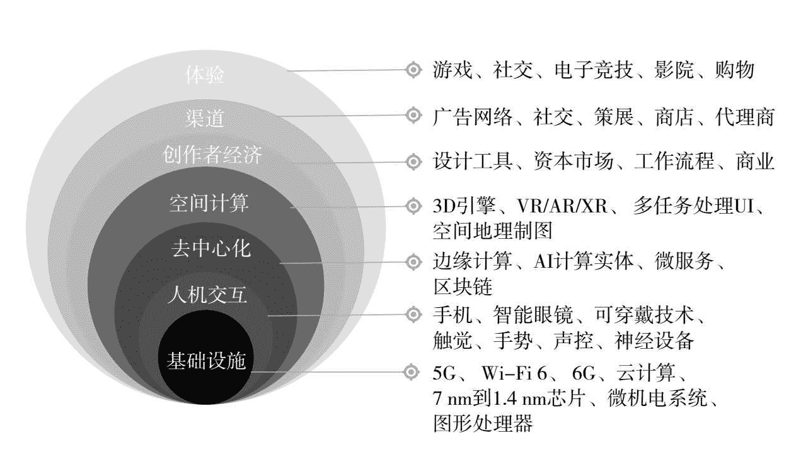

图 3-1　Metaverse 的七层价值链（资料来源：Roblox 招股书）

基础设施涵盖 5G 通信、Wi-Fi 6、云计算、芯片工艺、微机电系统、图形处理器。人机交互包含手机、智能眼镜、可穿戴设备、触觉设备、手势感应、声控、脑机接口。去中心化涉及边缘计算、AI、微服务、区块链。空间计算包含 3D 引擎、VR、AR、XR、多任务 UI、空间地理制图。创造者经济包含设计工具、资本市场、工作流程、商业系统。渠道包含广告网络、社交网络、策展、商店、代理商。体验层面有游戏、社交、电子竞技。

即便游戏只是雏形，其发展已全面带动元宇宙所需的底层技术与经济系统。技术及生产关系的外溢会牵动相关产业连锁变化。

### 游戏与 5G

4G 托起视频，5G 则被游戏激活，二者相互促进。若没有游戏对大带宽、低时延、高并发的强需求，5G 部署会明显放缓，看视频 4G 已足够。业界曾把自动驾驶视作 5G 杀手级应用，但普及仍需时日。工业、矿业的 5G 案例已不少，单靠生产场景难以拉动整体产业，必须有消费级普及应用。游戏成为关键抓手。

真 VR 离不开 5G。

影响体验的核心指标有视频分辨率、帧率、头部 MTP 时延、操作响应时延、肢体 MTP 时延等，后三者可通过算力、传感器、数字接口、操作系统优化改善，分辨率与帧率则直接关系临场感、逼真度与眩晕感。

VR 要达到肉眼无法察觉纱窗效应的完全沉浸，需 16K。16K 约 1.3 亿像素，按 24 位真彩色、140Hz 计算，每秒原生视频流量约 138Gbps。随着硬件提升，要摆脱有线束缚，必须探索大带宽低时延无线网络与高效压缩算法。

华为测试报告显示，在 110 度水平视域、6 DOF、H.264 编码下，单眼 1.5K、60FPS 为入门级，需带宽约 25Mbps；单眼 2K、90FPS 为未来提升目标，需带宽约 153Mbps；理想体验需单眼 6K、90FPS，需带宽 1.4Gbps，因此 5G、千兆宽带、Wi-Fi6 等下一代接入不可或缺。

表 3-1　不同单眼分辨率不同帧率对应的平均码率和视频体验得分  

（资料来源：华安证券研究所《华为云 VR 临场感指数白皮书》）

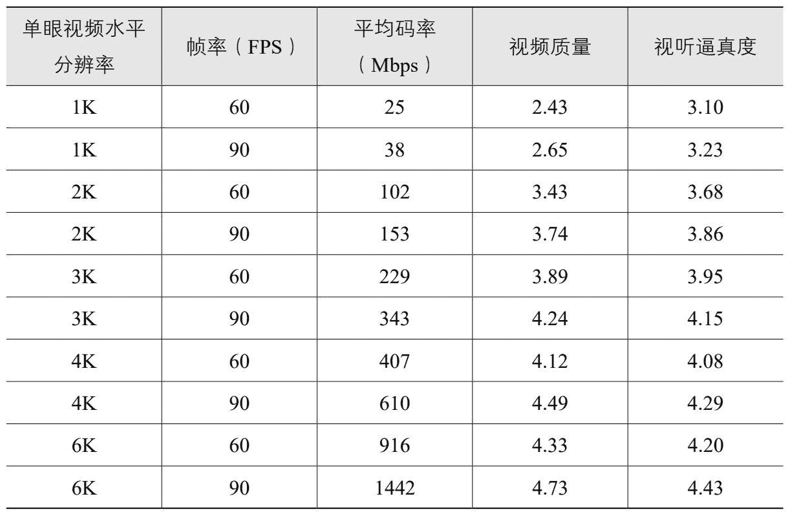

爱立信移动报告预计 2021 年全球 5G 用户渗透率约 10%，到 2025 年渗透率达 40% 左右才可能看到 VR 室外规模商用。网速测试工具 Speedtest 显示，2021 年一季度全球网速前十国家平均约 200Mbps，目前仅能支撑 2K、90FPS 的 VR 体验，千兆宽带普及价值凸显。

5G 才能支撑云游戏

云游戏以云计算与流式技术为基础，游戏逻辑与渲染在云端完成，结果编码为音视频流传输至终端，终端将操作回传云端实时交互。云游戏让移动设备随时随地体验 3A 大作，打破终端壁垒，延迟高低直接决定体验。伴随 5G 成熟，云游戏的关键网络难题迎刃而解。

大体量桌游本地硬件要求极高，5G 发展后计算可移至云端，本地仅需显示，大幅降低配置门槛，手机、平板也能运行大型游戏。

云游戏核心技术包括 GPU 服务器、虚拟化、音视频技术、实时网络传输和边缘计算，目前均已趋于成熟。

### 游戏与 VR

用户体验是普及瓶颈。

2018 年美国一项面向专家的调查显示，影响 AR、VR 普及的因素中，用户体验被视为最主要因素，选择该项的受访者占比分别达 39% 和 41%（见图 3-2）。设备性能不足会大幅削弱体验感。作为进入元宇宙的第一入口，AR、VR 仍需在软硬件上持续优化。

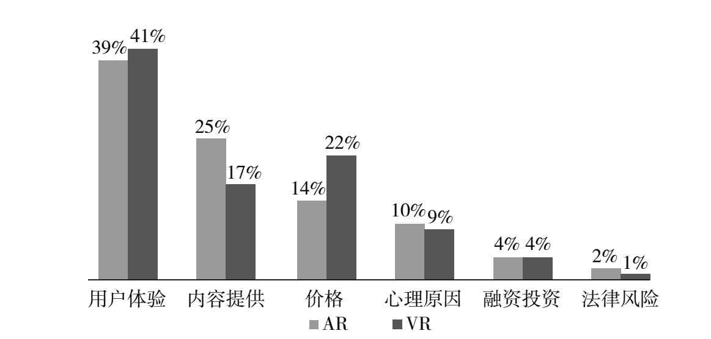

图 3-2　用户体验是影响 AR/VR 普及的主要瓶颈  

（资料来源：eMarketer、华安证券研究所）

以 VR 设备为例，主流形态有 VR 手机盒子、头显、一体机。市面分辨率最高约 4K，如需人眼自然清晰度则需 16K。高刷新率可提升流畅度、降低延迟与重影，减轻眩晕。理想刷新率为 180Hz，当前主流头显为 70Hz 至 120Hz。

轻便化需求推动无线串流发展。

为实现头显轻量化并解决空间移动，无线串流是设计重点。当前主流技术为 Wi-Fi 与私有协议。前者将 PC GPU 渲染压缩后数据经 Wi-Fi 路由器传至头显，通常需千兆路由器；技术不成熟易出现额外延迟、画质损耗、功耗高与不稳定。后者由厂商自研压缩算法与通信协议，如 VIVE 无线套件配合 WiGig 可实现电脑与头显延迟小于 7ms，但需额外 WiGig 加速卡，提升成本。

表 3-2　主要 VR 内容平台概况  

（资料来源：映维网、VR 陀螺、青亭网、搜狐网、华安证券研究所）

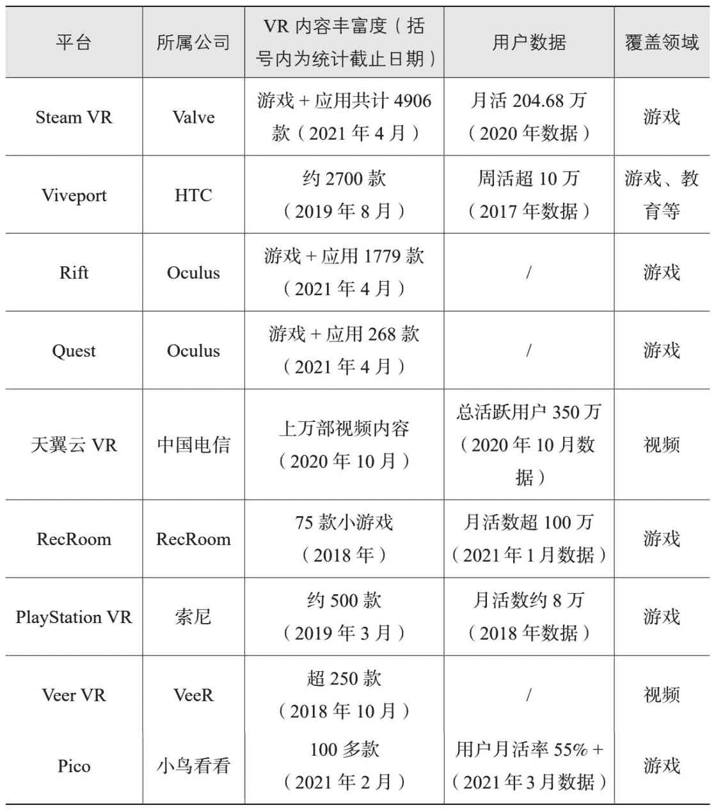

在游戏带动下，VR/AR 出货量持续攀升（见图 3-3），全球 VR 硬件市场规模快速增长（见图 3-4）。

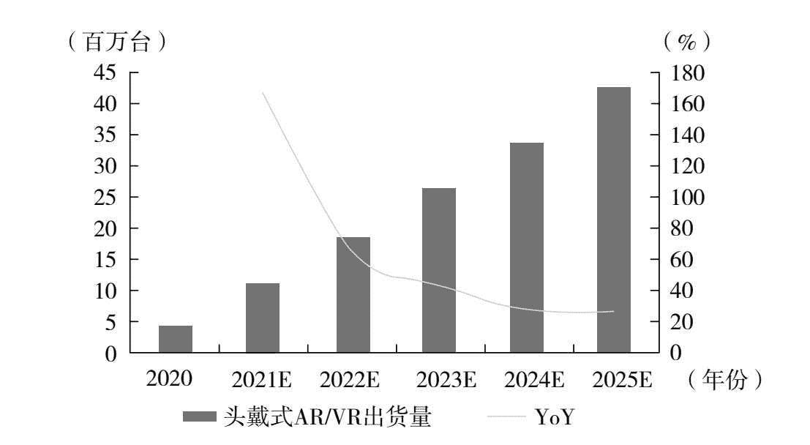

图 3-3　2020—2025 年 AR/VR 头显出货量 CAGR 53%  

（资料来源：Trendforce、华安证券研究所）

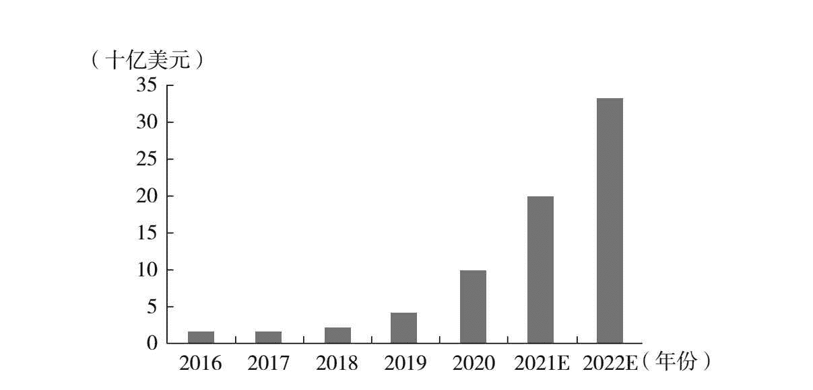

图 3-4　2020—2022 全球 VR 硬件市场规模快速增长  

（资料来源：Statista、华安证券研究所）

### 游戏与数字货币

从经济视角看，每款游戏都是体验加消费，具备元宇宙特征的游戏还需加入创造。创造与消费推动基础价值循环。现代游戏本质上是虚拟经济体，内部需流通的货币。

氪金指游戏中充值行为。拥有氪金的游戏即为独立经济体。

商业模式经历变迁：初期如软件销售，售光盘一次性付费终身使用；盛大代理《传奇》开启点卡按时长收费时代；随后转向道具付费，游戏免费无限玩，需付费购买宝贝或皮肤，充值常态化，形成氪金一词。付费从一次性转向持续性，且通常不退款，玩家默认会消费掉充值。

Roblox 做出大胆创新：充值后可提现。即便在美国金融创新活跃的环境下也颇具争议，引发洗钱监管等讨论。

Roblox 内部发行 Robux，简称萝卜币。游戏内购买道具仅能用萝卜币，制造道具可出售，玩家可赚取萝卜币，退出时可兑换美元。与出国兑换外币类似，机场可换汇，手续费与限额约束兑换规模。

货币是国家主权的象征，无独立货币难以构成独立国家。统一货币可形成紧密经济体，欧元即例。

在 Roblox 中，Robux 让平台像经济体运行。有人为消费进入，有人为谋生而创作，设计新皮肤出售，玩家用萝卜币支付，卖家可随时兑换美元，形成买有卖有闭环。萝卜币展示了元宇宙经济雏形。

熟悉比特币、以太坊的读者会想到 ETH，确可用以太坊实现萝卜币。具备元宇宙特征的游戏天然形成数字货币应用场景。随着元宇宙扩张，数字货币交易量快速上升。

以太坊可成为元宇宙通行货币，二者相互促进。DC/EP 作为基础数字货币，也可成为元宇宙通行货币，二者同样相互促进。

## 传统产业数字化需纳入元宇宙视角

### 从信息化到数字化

咨询从业者常纠结信息化与数字化的区别。区分关键在于决策发生在哪一方世界。若决策在数字化世界完成，即为数字化；若决策在物理世界完成，即为信息化。这里的决策指指导物理世界下一步动作的指令。

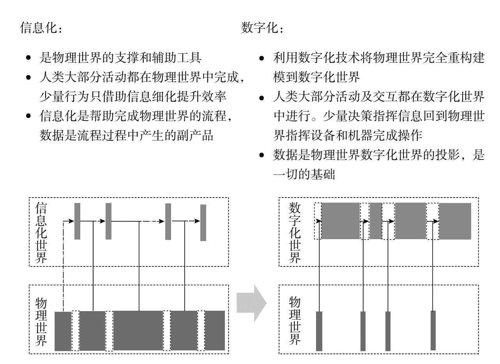

图 3-5　从信息化到数字化[^(\[1\])](#part0022.xhtml#comment_9163)

### 从数字化到元宇宙

元宇宙更为彻底，没有物理世界，只有数字世界。如《头号玩家》中玩家戴上 VR 头盔瞬间穿越虫洞，进入另一宇宙，所有生产活动都在数字世界完成。

物理世界的人如躯壳，只要满足空气、水、营养即可，躯壳所在无所谓。极端情形在《黑客帝国》中体现，人成为 Matrix 能量来源，生活在密封罐中，化身在 Matrix 中工作、生活。

### 理解数字孪生

2003 年，迈克尔·格里夫斯教授在密歇根大学课程上提出与物理产品等价的虚拟数字化表达概念，定义为一个或一组特定装置的数字复制品，可抽象表达真实装置并据此在真实或模拟条件下测试，希望整合数据进行更高层次分析。

2011 年，Michael Grieves 在《几乎完美：通过产品全生命周期管理驱动创新和精益产品》中引用合作者约翰·维克斯提出的名词——数字孪生，并沿用至今。[^(\[2\])](#part0022.xhtml#comment_9298)

数字孪生最大突破在于物理实体与数字孪生体相互映射、相互影响。物理实体主要功能是采集数据并传给数字孪生体，数字孪生体汇聚数据、关联分析并给出动作指令，物理实体接收指令执行并再次采集数据。数字孪生体负责分析决策，物理实体负责执行。用文学化说法，数字孪生体是物理实体的灵魂。

# 数字孪生到元宇宙，企业数字化的终局图景

数字孪生的根基是数字技术在持续演进，让物理世界的各层面可以被越来越精细地映射进数字空间。某些领域的建模精度，已经逼近《黑客帝国》里那种全息复刻的程度。

## 数字孪生组织：转型的终点站

在数字化推进的路上，人类最理想的终点，是在数字世界里为现实中的组织——可能是单家企业、一个行业乃至一座城市——搭建一套对应的软件模型。给模型不断喂入组织的运营数据、服务对象的各类数据，让模型在数字侧实时镜像组织的运转，并随外界变化即时刷新、调度资源、交付预期价值。模型与数据流合在一起，就构成了数字孪生组织。

数字孪生组织落地那天，也就意味着数字化转型真正完成。

对企业而言，意味着把所有相关角色及其互动全流程数字化。角色大致可归为五类：客户、员工、合作伙伴、供应商、消费者。数字化之后企业形成数字资产，并借助各类数字技术做采集、挖掘、分析，用以支撑决策、创造客户价值。

从用户侧看，体验应被重塑为五项标准。第一，实时。自动驾驶等场景对响应的要求能达到毫秒级。第二，按需。这是个性化的前提，数字时代从工业时代的千人一面走向千人千面。第三，全在线。交互全部在线完成。第四，自助。用户可自行操作，企业甚至要开放让用户参与业务开发优化的机会，加速创新也增强参与感。第五，社交化。为用户提供经验分享、吐槽的社交场域，培养粉丝黏性和归属感。

## 游戏即具象的数字孪生

这里说的游戏是指带有元宇宙特性的游戏，不是 Windows 系统自带的扫雷类小游戏。

DTO 概念提出时显得过于抽象，很难一句话讲清，因为没人见过完形。现实里也没有哪家公司完全符合 DTO 的标准。提出这个概念本是为了解释传统企业。那么传统企业数字化究竟要走向何方？理想化的数字化企业长什么样？这是转型方向的根本问题。

答案被元宇宙给出。元宇宙可以视作企业数字化的最终形态。相对 DTO，元宇宙拥有可感知、可视化的雏形，比如《我的世界》、Roblox 这类平台。

DTO 里概括的 Roads 特征——实时、按需、全在线、自助、社交，在元宇宙里被完整演绎出来。

## 用元宇宙加速数字化迁移

作为元宇宙的雏形，游戏不仅自身进入元宇宙，还带动了通信、云计算、3D 建模、VR 设备、数字货币等技术演进。随着这些技术应用更广、成本更低，各行各业会接连以此为样本迈入元宇宙。

以 IP 为核心的数字消费已是万亿级赛道，涵盖网络文学、短视频长视频、3D 动画等。展览业与大型场馆也面临升级，需要在物理场馆中营造超越现实的效果，并把场馆搬进元宇宙、用元宇宙技术反哺物理空间。博物馆与此同理。设计行业从工业设计到建筑设计，所有依赖想象力的工作都将迁移到元宇宙中与客户共创。文旅方面，诸如黄果树瀑布的元宇宙复刻，比在景区大兴土木更可行，尤其环保语境下不宜改变物理环境。消费品领域，元宇宙里出现品牌单品只是起点，更关键的是形成消费宇宙。工业制造端，工人戴 AR 眼镜作业的场景或将很快到来。

按《国民经济行业分类》GB/T 4754—2011 预测，元宇宙产业将经历起始、探索、基础设施大发展、内容大爆发、虚实共生五个阶段。至第五阶段，元宇宙进入繁荣期，现实社会 90% 以上的产业都会在其中发生，甚至现实没有的业态也在虚拟侧蓬勃生长。届时虚拟空间与现实社会高度同步互通，互动逼真，现实的一切事件同步映射到虚拟，虚拟交互反馈接近真实，达成虚实共生。

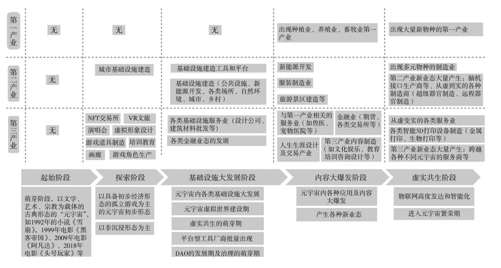

图 3-6　元宇宙内的产业发展阶段预测图（图片来源：中译出版社《元宇宙通证》）

### 孵化万亿级的产业新集群

除牵引行业数字化外，元宇宙自身也在孵化新集群。严格说属于内容消费集群，用于满足人类精神需求，其规模很可能超过现实，甚至数倍于现实。

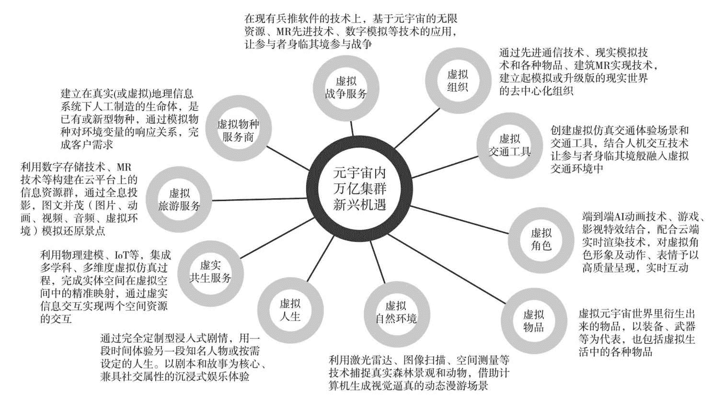

图 3-7　元宇宙催生万亿产业集群（资料来源：中译出版社《元宇宙通证》）

# 04 元宇宙经济

元宇宙经济学

阿凡达没有自私的基因。

传统经济学以实物商品为核心，元宇宙经济学以虚拟商品为核心，而数字经济则涵盖实物商品的数字化过程。于是元宇宙经济学是数字经济的有机组成，也是最活跃、最具代表性的部分。

认同决定价值而非劳动，边际收益递增而非递减，边际成本递减而非递增，交易成本趋近于零，经济人假设也需被放下。

元宇宙经济的四个构成要素是数字创造、数字资产、数字市场、数字货币；四个统一是计划与市场统一、生产与消费统一、监管与自由统一、行为与信用统一。

元宇宙为 DC/EP 提供了大量使用场景，DC/EP 也可成为元宇宙经济行为的基础设施。

电影《阿凡达》构建了潘多拉星球，纳威人自给自足。人类资本主义代表 RDA 公司觊觎矿产 Unobtanium，采矿进展直接影响地球股价。纳威人处于原始采集社会，资源相对需求近乎无限，靠打猎采摘即可小康。而杰克借助仿生设备在两界穿梭，阿凡达在潘多拉活跃时人类肉身休眠。

阿凡达成为化身概念的最佳注脚，也指向元宇宙中的自我投射。潘多拉没有市场也没有货币，资源相对无限。元宇宙同样资源无限，阿凡达的生理需求几乎全可满足。这样的经济体系呈现出怎样的特征？

## 元宇宙经济：数字经济的发动机

### 什么是元宇宙经济学

主流经济学研究以物质为原料的产品及其生产流通消费。围绕生活需求建立的市场、货币、产权、法律等秩序，可称传统经济学。

数字技术催生了数字载体产品，如游戏、短视频、电影。游戏内道具皮肤等在数字世界创造消费。数字产品大致分三类：信息娱乐类、象征符号概念类、过程服务类。

生产消费场景各异：电影在物理世界创造消费，游戏在物理世界创造在数字世界消费，游戏皮肤则全程在数字世界发生。

把数字产品的创造、交换、消费等全部在数字世界进行的经济活动称为元宇宙经济，研究其规律的学问即元宇宙经济学。大型游戏中已可见雏形。美国《第二人生》里玩家创造虚拟商品出售，就是典型的数字世界经济行为。

### 它与数字经济如何分合

数字经济是以数据为主要生产要素的活动，既包含物质产品的生产流通消费，也包含数字产品的创造交换消费。只要生产流通消费任一环节用到数字技术或数据，就属数字经济。

2016 年 G20 杭州峰会《数字经济发展与合作倡议》定义数字经济为以数字化知识信息为关键生产要素、以现代信息网络为载体、以信息通信技术有效使用为效率提升和结构优化推动力的一系列经济活动。该定义被广泛接受。

就研究对象和使用范围看，元宇宙经济是数字经济的子集，是最活跃、最具革命性的部分，其思想与工具对数字经济发展有重要启示。

摆脱传统经济学的天然限制，如有限自然资源、复杂制度秩序、市场高昂建立成本。在纯数字世界分析阿凡达行为、设定简规则、从零构建经济体系，其结论可为传统经济现代化提供借鉴。

### 元宇宙如何重塑现实

《王者荣耀》皮肤是数字产品，印在 T 恤上，T 恤便获得新的数字内涵。这是数字产品影响传统经济的案例。元宇宙的人与产品通过塑造观念，进而真实影响物理世界乃至改变行为，因此具有更宏大的社会意义。

元宇宙影响现实主要有两条路径。其一影响思想观念。学习不分物理或虚拟，在某些场景只能靠模拟器训练，如航天员在模拟天宫二号中训练、登月训练靠模拟环境。游戏中习得的经验、喜好也会投射到物理产品，游戏、展览、旅游、设计因此形成新业态。

其二推动数字产品的有形化。手办玩具是典型，原型来自影视游戏，深受 M 世代欢迎。2019 年上海首家《火影忍者》主题餐厅开业，影迷玩家蜂拥。

元宇宙与物理世界千丝万缕，互相塑造，也让元宇宙经济学具备现实意义。

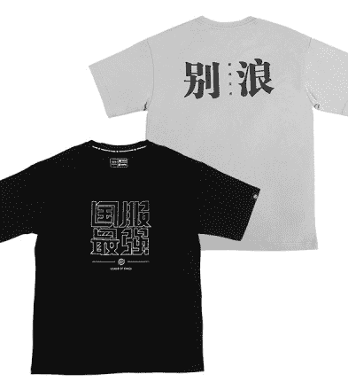

图 4-1 游戏《王者荣耀》主题 T 恤  
（图片来源：王者荣耀周边商城）

## 传统经济学假设为何失效

物理资源约束是传统经济最主要的制约。经济即节省，利用有限资源满足欲望。土地有限，农业时代土地是核心要素。历史上人类长期资源短缺，马尔萨斯据此提出人口理论。

元宇宙关注的数字产品不消耗除电力外的物理资源，数字产品不过是 0 与 1 的排列。没有物理限制时，行为是否仍符合经济人假设？

### 稀缺、利己、理性不再是默认

亚当·斯密在《国富论》中写道，我们得到的食品不是来自屠夫、酿酒师和面包师的恩惠，而是出于他们的利己。无需怜悯，只需唤起私利。这蕴含三个前提：资源稀缺、个体利己、个体理性。

### 阿凡达追求体验而非计算

理性人假设指经济行为力图以最小代价获最大利益。极端看，理性即趋利避害的生存本能。但在元宇宙中，时间近乎无限，阿凡达生命也无限，生存或死亡只是游戏的开始或结束。山巅一跃，最坏结果也不过重开。

欧美年轻人流行的 YOLO 文化强调活在当下敢于冒险。阿凡达可体验多段人生，挣脱理性束缚的诉求被放大。无限资源、无尽时间造就从头再来的自由。

### 阿凡达天生不自私

阿凡达摆脱生老病死，是精神化身。M 世代未经历物资匮乏，游戏中团队任务需要互补救援、团结协作。精神需求指向胜利渴望、合作与分享，阿凡达天然追求马斯洛顶端需求——自我实现与超越。自我实现源于创造与分享，源于抛弃理性束缚。

在潘多拉，人类殖民者贪婪残暴，阿凡达信仰万物通灵，动物与大树的神经末梢连接可实现无语言沟通。他们更看重生命与环境的和谐，强调团结、合作、分享、体验，而非博弈与过度索取。

# 元宇宙正在重写价值的底层代码

脱离了吃饭穿衣的束缚，进入精神世界的漫游时，阿凡达的排序让创造变得有面子，分享变得好玩，沉浸感比结果更重要。自私被分享稀释，利己被利他取代，这套价值观和元宇宙居民的日常选择高度一致。

## 重新思考几个规律

数字世界里流通的是数字原生产品，这在传统经济学里几乎没有讨论过。物理世界里被默认为常识的经济逻辑，在虚拟世界里正在被一条条改写。

### 认同决定价值

马克思把价值定义为凝结在商品里的无差别人类劳动，由此推导出剩余价值。劳动决定价值，是传统经济学的支柱。无论价格怎么波动，劳动总量被视作锚点。

在数字世界，商品与劳动的关系不再是线性正比，更像是奢侈品。LV 手袋和普通手袋在收纳功能上差别不大，高仿品甚至只有 Logo 的细微不同，但正品价格可能是十倍甚至百倍。支撑溢价的是认同感，LV 代表特定阶层的生活方式，精神满足远超储物本身。

精神层面的商品普遍不遵循劳动决定价值。绘画就是典型，普通人难以辨别张大千真迹的细微差别，依然愿意为真迹支付高价，而临摹品价格断崖式下跌。真迹与临摹花费的时间和成本相近，落差来自人们对张大千的认同，即使临摹在细节上更胜一筹也无济于事。

物理世界中违背劳动决定价值的品类只占极小部分，而在元宇宙里，几乎所有商品都带艺术品属性。

Roblox 的创作材料是低分辨率像素，一切都方方正正。现实里圆润的脑袋在这里变成棱角分明的方块。看似一文不值的像素物件，却被玩家抢着追捧。

偶像与粉丝的关系同样颠覆了旧逻辑。粉丝圈的互撕屡见不鲜，因为在粉丝眼里，明星的身价无法用金钱衡量。这既是对个人的认同，也是在追星中完成的自我社会认同，最终转嫁到商品价值上。明星代言的商品并未凝结其无差别劳动，却凝结了粉丝的自我认同。

人工智能创作的商品也值得注意。AI 的效率是人类的成千上万倍，按劳动论应极度低价，却仍有人愿意高价收购。

### 边际效益递增

物理世界里同类商品越多，单位效用越低，边际效益递减。在元宇宙里这条法则失效。

游戏里人越多越好玩，玩得越久激励和快感越高，日常签到还有奖励，这就是典型的沉迷。若遵循递减法则，沉迷不会发生。

社交网络是元宇宙的支柱之一，典型的网络效应非常明显。微信一旦被广泛使用，就很难离开。朋友们像一筐螃蟹，想爬出去的会被拽回来，不进微信就无法自由交流。

### 边际成本递减

物理生产的成本包含原材料、产线、人工、仓储、物流，呈现 U 形曲线。产量提升初期边际成本下降，产线饱和后大幅上升。

2009 年美国关闭 F22 生产线，共生产 187 架当时最先进的五代机。关闭主因是对手短期内难以复制。重新开线意味着重新培训工人、重新采购材料，成本飙升。

数字世界没有这些麻烦。原材料是 0 和 1，生产线是代码，没有工人、仓储和物流，随时可以停产重启。一次创造永久有效，不磨损、不折旧，再生产的边际成本趋近于零。边际成本递增的传统法则在这里被打破。

### 关注市场创立成本

市场是经济学的核心，商品需要交换才能定价，定价提供生产信号。市场规模越大分工越细，社会财富越多，这条规律在两个世界都成立。

在物理世界，建一个市场的成本极高，却常被经济学家忽略。需要稳定的秩序和惩罚机制，需要四通八达的基础设施，边界就是道路的尽头。统一大市场需要巨额投入。

在数字世界，建市场的成本低得多。淘宝、京东交易的是物理商品，苹果、华为、小米的应用商店交易的是创造数字内容的工具，《王者荣耀》、Roblox 里的玩家商城交易的是皮肤、道具、玩家自制小游戏等纯数字产品。规则由软件代码设定，违规的交易要么无法通过，要么被清退。

因此数字世界会涌现更丰富的新市场。加密数字资产市场是典型，比如比特币、以太坊。和电商、应用商店、游戏商城不同的是规则的制定与修改权。区块链市场规则一旦发布即不可随意更改，除非绝大多数自治社区同意，否则去中心化治理得以维持。而非区块链市场由追求商业利益的公司掌控，可随时修改规则。

建立市场和维持市场都需要成本。物理世界和数字世界给出不同方案，数字世界中两者成本都大幅降低。

### 交易成本趋零

交易成本不同于市场运营成本。后者是人工、租金、监管等刚性支出，前者是买卖双方完成交易所需付出的费用，淘宝的快递费、上网流量费都属于交易成本。

交易成本越低市场越繁荣。若快递费高于商品价格，在线购买便失去意义。

物理世界的交易成本种类繁多，企业间的合同签署费用可能占合同额的 10% 到 20%。在数字市场的数字交易里几乎没有交易费用，《王者荣耀》买皮肤不需要物流，甚至没有流量费。

以太坊上的 GAS 严格来说不是交易成本，而是整个市场运营费用在单笔交易中的分摊，即使交易失败也须支付。

认同而非无差别劳动决定价值，生产边际效益递增而非递减，生产边际成本递减而非递增，市场建设成本大幅降低，交易成本趋近于零，这些都动摇了传统经济学的支柱。

黄江南、朱嘉明大力倡导观念经济学，认为传统经济学连现代工业都难以解释。元宇宙经济与观念经济学高度契合，甚至更纯粹。

## 元宇宙经济的四个要素

在元宇宙里，阿凡达不用吃饭应酬，不会生病，也不会真正死亡。核心活动是体验、创造、交流、交换。疫情期间这一状态被放大。

游戏中阿凡达清晨上线逛街聊天，虽不能烹饪却凑在虚拟餐厅打卡，爬塔看日落拍照。有人制作衣服被购买，一天就这样流转到深夜。

Epic CEO 蒂姆·斯威尼曾表示，需要的不只是 3D 平台和技术标准，更是一个公平的经济体系，让所有创作者能参与、获利，消费者得到公平对待，避免作弊诈骗，公司也能发布内容并获益。

支撑这一生活需要四个要素：数字创造、数字资产、数字市场、数字货币。前两者满足需求创造，后两者解决产权与交易。

### 数字创造

元宇宙经济有供需两端。需求是多层次的精神需求，供应端必须提供多样化数字产品。

数字创造是起点，没有创造就没有可交易的商品。物理世界创造实物或服务，元宇宙创造数字产品。游戏里的建筑、短视频、图文公众号内容都是数据集合。

判断元宇宙是否繁荣，首要指标是创作者数量与活跃度。缔造者必须提供更便捷的创作工具，降低门槛。

抖音在 4G 时代崛起的重要原因就是降低了拍摄门槛，即使不识字也能拍视频。Roblox 更进一步，鼠标拖拽就能完成 3D 游戏开发。

谁能做到创作工具的顶级水平，谁就更有机会成为下一个元宇宙缔造者。

### 数字资产

资产隐含产权，且是交易前提。《王者荣耀》皮肤产权属于腾讯，玩家付费使用，皮肤不可转让但账号可转让并出售获利，因此具备资产属性。

皮肤只能在游戏内使用，离不开平台，不同平台虚拟产品不通用，因而并非严格意义上的数字资产，这限制了跨平台流通。

Roblox 提供游戏开发平台后，玩家自制产品可在平台内跨游戏使用，这是重大突破，上市后市值突破 400 亿美元即是市场认可。

若想把 Roblox 上的虚拟物品用于其他游戏，目前仍不可行，平台未打通，数字资产流通受限。

严格意义的数字资产需要底层平台提供版权保护和跨平台流通机制，区块链技术提供了可能性。加密算法、签名、共识机制确保每次拷贝都被登记，防止非法篡改，为数据资产化奠定基础。

#### 数字资产的生产方式和确权

数字产品的生产大致分为 PGC、UGC，AI 发展后还会有 AIGC。

PGC 如游戏皮肤，开发者通过商业规则人为设限，只能在指定账号角色使用，其他场景无效。这是中心化机制，通过人为制造稀缺来稳定价值，买家无法靠囤积打破开发者设定的市场。

UGC 是用户在游戏中创造的家园、新武器等，理论上可进入市场交易。若能无限复制，价值会失稳，于是需要确权机制。现实世界通过登记确权，证件作为权威标志，由国家机构背书。

元宇宙没有中央政府，是开放、公平、自治的世界。确权依赖区块链提供的价值体系与加密体系，通过共识验证交易并留下不可篡改记录，完成对数字产品的确权。数字创造和数字资产是数字市场交易的前提。

### 数字市场

数字市场是数字经济的核心基础设施，其目的在于繁荣元宇宙，让阿凡达能从体验中获得经济收入。

数字经济带来三种市场扩张：第一种是实物交换的电商，如阿里巴巴、京东；第二种是交换创造内容的工具，如应用商店；第三种是纯数字内容的交换，如打赏、购买虚拟建筑、汽车、皮肤。

## 元宇宙数字市场与经济特征

我们聚焦第三种，即交换纯粹数字产品的市场。雏形已出现，玩家在外部网站售卖皮肤、养号，但交易并未在元宇宙内部完成，和游戏内直接交易有区别。成熟的元宇宙数字市场要求创造过程和交易都发生在元宇宙内部。

当一款游戏的用户规模达到一亿级别时，任何新皮肤的总成交不可能超过玩家基数。想要把收益做大，运营方通常会把皮肤做成梯度产品。入门级的皮肤价格亲民、货源充足，面向全量用户；往上一个档次，价格抬升但依然可以随买随得；再往上，则同时具备高价和稀缺性，往往只能通过限量获取。稀缺性这四个字，正是撑起元宇宙经济逻辑的关键，后面的讨论会围绕它展开。

玩家买皮肤的动机大致可以归结为两类：一类是填补内心的精神欲求，另一类是追求更丰富的游戏体感，以及在社交场景里获得关注与优越感的快感。

Roblox 在这点上走了另一条路。玩家可以在平台上自制建筑、服装等虚拟道具并对外售卖。王者荣耀卖的是官方出品的皮肤，Roblox 的内部交易则以玩家原创内容为主。

### 数字货币
银行常被视作现代社会的标志，是资本主义区别于封建社会的制度性产物，也是工业时代技术进步与社会变革的集大成者。我们正处在工业向数字的历史拐点，脱胎于工业体系的银行能否跟上步伐，核心在于它能否推动而非阻碍数字货币的发展。

工业时代完成的是实物货币向法币的切换，数字时代必然要完成法币向数字货币的切换。元宇宙就是数字货币全面落地的试验田，法币在其中几乎没有容身之地，原因很简单：法币体系成本高、效率低，已经配不上元宇宙经济的节奏。换句话说，元宇宙经济最紧迫的问题，就是数字货币如何被真正应用。

在王者荣耀里充值获得点券，摩尔庄园充值获得摩尔币，Roblox 充值获得 Robux，名字五花八门。既然如此，为什么不能直接用人民币或美元买道具呢？

在物理世界里，只要不是现金交易，银行必然在场。现金交易是一手交钱一手交货，钱货两清；非现金交易则包括信用卡、汇票、转账、支票等，离开银行无法完成。即使日常小额支付借助微信、支付宝，银行也只是暂时隐身。可以说，物理世界所有支付行为都绕不开银行。

游戏里的虚拟商品交易若让银行介入，成本高、效率差，满足不了玩家。物理世界的非现金交易本质上只是账目变动，并没有货币实际转移，账款分离。双方都要在银行开户，交易不过是银行在买方记支出、在卖方记收入，钱仍躺在银行金库。跨行则要清分结算，A 行要付 B 行 2 亿、B 行要付 A 行 1 亿，轧差后 A 行实付 1 亿。跨国结算更复杂，每笔约万分之一的费用，还要等几天。

游戏中不少玩家根本没有独立银行账户，儿童玩家多用父母账户充值。充值后就能摆脱银行账户限制自由购买道具。即便有账户，现行的会计、发票体系也无法覆盖虚拟道具购买。银行账户体系、会计体系、清分结算体系、金融监管体系都是为物理世界的真实商品设计的，对元宇宙基本无能为力。

于是大小游戏都自建充值通道，构建自己的经济闭环。

### Roblox 的突破
大多数游戏支持法币充值兑换游戏币，却几乎不允许游戏币反向兑换回法币。一旦双向兑换，就等于形成了两个并行的经济体，彼此以汇率挂钩。

法币发行背后是一整套复杂模型，要兼顾经济增长、外贸、大宗价格、居民消费等才能决定发行量，这就是锚点之争。

游戏币发行没有成熟规则。如果双向兑换，谁来维护汇率？若公司经营不善卷款跑路怎么办？在中国，游戏币与法币双向兑换不仅是技术问题，更涉及经济乃至政治层面。

Roblox 开放了 Robux 与美元的双向兑换，这是一次影响巨大的示范。如何看待、如何应对，不仅关乎游戏产业，也关系到数字经济和现代化经济体系的构建。

### 元宇宙经济的四个特征
元宇宙的数字市场呈现出整体性特征，它糅合了埃ucken 提出的对社会负责的社会市场经济，在自由与社会平衡之间强调道德担当；也契合我国传统整体观，把国家、政府等多方纳入视野，从全局审视数字市场的特性和传统难题。

物理世界的讨论容易被现实条件牵制，一些革命性思想常被扼杀在摇篮。元宇宙屏蔽了部分无关的现实阻力，为自由思考提供了舞台。探讨元宇宙经济的特征，也是在勾勒理想数字经济的轮廓。

在重新审视传统经济学假设时，可以看到元宇宙经济提出了“认同决定价值”替代“劳动决定价值”，认为边际收益递增打破了边际收益递减规律，认为边际成本递减颠覆了边际成本递增规律，并强调市场创设成本，把思考拉回到以社会为整体的框架。这些在元宇宙里都能找到普遍例证。

#### 计划与市场的统一
数字市场是“计划”出来的
这句话足以让新自由主义经济学家惊讶。绝大多数经济学家只关心市场成立后的演化，很少追问市场如何诞生。

元宇宙的生产资料只有数字，而数字是无限的。无限资源无法形成市场，但王者荣耀的皮肤为何能持续热卖？答案是人为制造的稀缺。数字可以无限复制、零成本，数字市场的诀窍就在于限量供应。

热门皮肤常被设定每日最高发售量或总发售量。以王者荣耀一亿玩家为例，假如“西施”皮肤限量一万套，就人为制造了卖方市场。限量是一万还是百万，需要根据海量玩家数据来判断。

元宇宙里数据丰富、玩家透明，海量数据配合精算算法，可以算出最优上限，甚至最合适价格。若定价 999 元，被价格挡在门外的玩家只能望而兴叹。游戏道具市场，本质上是一个精算市场。

这个市场里数据充分但信息不透明，玩家并不知道皮肤总共发多少。当信息不对称被打破，市场就带有计划性。

物理世界的碳排放权交易就是典型的计划性市场，没有总量限制就没有交易。

数字市场的一个特征是商品总量受计划影响，资源配置和自由竞争则交由市场完成。

中国的经济发展在过去四十年里，计划能力和市场能力同步长进。传统市场的很多梗阻源于政府与市场、政府与社会边界割裂，导致计划片面、市场失效。要让市场在资源配置中起决定性作用并更好发挥政府作用，就必须融合计划与市场。

从第一个五年计划到第十四个五年规划，体现了整体性和计划性；各类要素市场的发展体现了市场化和灵活性。正是因为长期坚持统一协同，才有了今天的成果。

打着新自由主义旗号的论调把有形的手与无形的手对立起来，本质是二元机械论。数字市场里，两者高度统一。

数字市场里计划与市场的统一性是通过数字技术赋能实现的。生产要素总量的调控带有计划色彩，资源配置和自由竞争由市场完成。

首先，基于要素总量调控是计划机制。数字市场包含大量传统要素市场，土地和人口数据更为翔实，土地总量自建国起基本固定，人口弹性有限。对稀缺要素需科学调配，数字技术的赋能提供了计划调控的有效路径，这部分权力理应掌握在政府手中。数字基础设施透明、实时、完整，能反映要素和整体经济状况，为政府计划提供科学原料，帮助制定宏观调控，有节奏地释放与回收要素，最终实现要素价格由市场决定、流动在政府宏观调控下自主有序。

其次，资源配置通过市场机制实现。企业获取订单、采购原材料、组织生产全程依赖市场，信息在数字市场中完整呈现，打破了传统市场的信息封闭，提升了有效性。某些行业里，市场机制甚至成为新型组织方式。

在此机制下，组织与市场、政府与市场的边界模糊。政府既是控制要素总量的计划主体，也是市场的一部分。它保障市场有效性，同时参与交易全过程。计划自然融入市场机制，计划越科学，市场干预越有效。看不见的手与看得见的手握在一起，成为驱动数字经济发展的核心力量。

#### 生产与消费的统一
物理世界里，商品从生产者到消费者要经过主干物流、大仓储、支线物流、社区末端等多个环节，任何一环信息不畅都会增加库存和成本。

映射到数字市场，企业能整体洞察需求端，能看到用户数、需求量、潜在需求，从而实现按需、定制、细粒度的生产，大幅减少浪费，也降低恶意竞争腾出的精力去满足长尾需求。技术甚至可以交由计算机完成，减少人为不确定性。

更进一步，元宇宙里原有的物流、仓储环节都不存在，没有信息梗阻。生产到消费的链条中，物理世界需要流通环节，数字技术把流通数字化并提升效率；元宇宙里根本没有流通环节，生产与消费自然合一。物理世界正在通过数字化向这一方向趋近。

生产与消费的统一正是计划与市场统一的微观体现。

#### 监管与自由的统一
实现监管与自由的统一，就是实现数字市场的良好治理，具体由社区自治、第三方监管还是政府监管，需要在实践中平衡。

比特币不成功的自由实验
比特币以极端去中心化为理想建立社区自治实验，但并未实现中本聪的初衷。它没有成为严格意义上的数字货币，只是首个加密数字资产，价格长期被操纵，自由意义丧失。

2021 年 2 月特斯拉向美国证监会披露购入 15 亿美元比特币，3 月马斯克宣布可用比特币购车，价格一度冲到 6.4 万美元，5 月特斯拉又关闭比特币支付渠道，价格暴跌近 50%。此后中国整顿矿机行业，价格跌至 3.1 万美元左右。

马斯克利用社会影响力操纵市场，若比特币受证监会监管，此类行为很可能被处罚。可惜在代码世界里不适用。绝对自由往往导致绝对垄断，物理世界的反垄断法对比特币无效。即使是以太坊在比特币基础上改进，若币值不稳，仍会伤害元宇宙生态。

理想的市场经济需要监管来划定边界、维持稳定、明确权责。数字市场中若无监管，用户自由难以保障，平台可借助数据与技术优势制造信息不对称形成垄断。监管是方向锁与惩戒棒，市场自由是指参与者活动不受不当干预，竞争、选择、贸易、私产得以保障。自由是保障有效运行的自由，而非放任。

监管手段滞后是市场自由受限的主因。监管盲区、监管缺位、监管失当都会出现。监管越充分，市场越自由。必须发展监管科技，让监管与数字市场同步运行，实时、动态、可协调，把风险扼杀在萌芽。

#### 行为与信用的统一
数字市场里，主体信息、数据、操作都会留下可追溯的痕迹。行为直接与信用挂钩，构成信用本身。以淘宝为例，交易记录、买卖数量、评价、物流速度、退货比例、客服介入、复购率等数据完整记录，每一步操作都在绘制信用的轨迹。

元宇宙中阿凡达都已数字化，一切皆数字化。信用就是数字化行为的总和。规则由软件定义，智能合约与代码共同确认，一旦写定便难以篡改。交易必须遵循软件规则，交易行为必须符合信用，强制性地保障各方信用。

在此机制下，原本由银行或支付宝承担的第三方监管被自组织、自管理、自监管取代，行为与信用得到统一。

元宇宙经济是数字经济的子集，却是最活跃、最彻底的一种。它的特征在一定程度上映射了数字经济的发展趋势，对数字经济具有借鉴意义。

[\[1\]](#part0027.xhtml#commentRef_12146)文一.伟大的中国工业革命——发展政治经济学一般原理批判纲要［M］.北京：清华大学出版社，第 176 页。

## 让 DC/EP 在元宇宙里成为法币

`DC/EP` 不仅是数字金融的基础设施，更是整个数字经济运转的核心枢纽。元宇宙提供了一个超大规模、面向普通用户且不受国界种族限制的消费型应用空间。把 `DC/EP` 引入该空间，一方面有助于虚拟经济形态的成型，另一方面元宇宙本身也为 `DC/EP` 完成数字经济发展使命提供了主战场。元宇宙扩张极快，若 `DC/EP` 不能及时进入，就会被 `Q 币` 这类功能受限的内部代币，或以 `以太坊` 为代表的加密资产所占据。

### 数字支付已出现割据态势

传统货币学认为货币应具备计价、交换、储值、结算四项职能。计价用于标定商品价格，交换相当于媒介，储值体现为价值跨时间的保持。法币同时兼具且不可分割这几项职能，而数字支付工具的渗透程度并不一致，在某些场景甚至部分替代了法币。

以盒马鲜生为例，它代表了新零售模式。顾客在此购物只能通过盒马 App 完成结算，唯一通道是支付宝，预设选项为蚂蚁花呗。支付宝里的余额本质上是一种数字形式的货币，在盒马等新零售场景里，它已经承担起人民币的交换媒介角色。花呗与余额宝都是围绕余额这一类数字货币衍生的金融工具，前者用于分期，后者用于理财，内核都是借贷与投资。

数字支付的应用高度依赖具体场景。`DC/EP` 的试点多与头部电商合作，在限定时段内使用，对用户感知差异不大。但在元宇宙语境下情况截然不同。

### 游戏是最合适的承载入口

游戏可视为元宇宙的雏形，一旦在游戏内跑通，就能平滑迁移到其他虚拟应用。游戏经济体量庞大且增速快。根据中国音数协游戏工委统计，2020 年中国游戏市场实际销售收入达 2786.87 亿元，同比增长 20.71%，较上年增加 478.1 亿元。

游戏内普遍存在大量预充值资金，对玩家来说是沉没成本。若充值形成的货币能在多款游戏间通用，将显著放大消费意愿。

当前基于账户的支付体系难以匹配游戏交易的瞬时性需求。`Roblox` 自行发行了 `Robux` 来满足其社区用户的消费，`Robux` 仅限于 `Roblox` 生态内部使用，《王者荣耀》玩家无法动用。跨平台通用的底层货币候选方案中，以太坊常被提及，但其性能争议较大，特别是在对响应速度要求极高的游戏场景。基于以太坊开发的加密游戏在商业表现上远不及成熟商业游戏。

从单个厂商角度，自建虚拟货币有利益驱动；从生态角度看，元宇宙要繁荣必须拥有超越单一游戏的通用货币。中国的元宇宙建设必须以 `DC/EP` 为根基，这既是必然也是必须。

### 以游戏为跳板的出海路径

`DC/EP` 的海外推广是人民币国际化的重要抓手。游戏面向跨国、跨文化、以年轻用户为主的群体，在游戏中嵌入 `DC/EP`，可以在用户几乎无感的情况下实现跨境渗透。

元宇宙中的虚拟分身辛苦赚取的 `DC/EP`，为何不能兑换为本土法定货币？在中国 `DC/EP` 自身就是法定货币，无需转换；在海外，`DC/EP` 与当地法币的兑换过程本身就意味着完成出海。

物理世界的地缘博弈日趋激烈，美国试图在科技、金融、外交等多维度排挤中国。我国的战略目标是加强国际联结，构建更广阔的统一市场。物理世界的统一市场建设阻力重重，而在数字世界的元宇宙里搭建统一市场几乎毫无障碍，因为年轻玩家天然具有跨国属性。

游戏既是文化输出的载体，也是构建全球数字统一市场的前锋。`DC/EP` 需要在游戏场景中深度落地，助力游戏繁荣与出海，进而培育真正的元宇宙经济，再向更广的数字经济延伸。

从游戏到元宇宙，再到数字经济与传统经济，既能促进元宇宙成熟，也能引领数字发展，构成推动 `DC/EP` 应用的清晰路径。

我们应从元宇宙语境、国际话语权竞争、文化输出、数字经济先锋、`DC/EP` 构建数字金融体系等维度重新评估游戏的战略引领价值。游戏只是元宇宙的雏形，要实现繁荣需要在构成要素上协同推进。能否提供易用的内容创作工具？能否内置社交网络形成网络效应？能否搭建高效低成本的交易市场让创作者获利？能否建立跨越元宇宙的数字货币体系？前三项可由创业团队解决，第四项关乎基础设施，必须上升到国家层面系统解决。

# 05 自治的乌托邦

但是，请你一定要记住！能导致这世界灭亡的并不是他，而是人类，是人类自己！

——游戏《恶魔城：月下夜想曲》

打着程序正义旗号的消极不为，与高喊不做恶口号的互联网企业，实质都在拖慢社会进步。当数据垄断成为常态，数字霸权已成为影响治理的关键变量。

去中心化的探索是对数字霸权的反抗。智能合约正在塑造新型治理方式，在一定程度上同时约束了个人不当行为和程序性缺陷带来的负面后果，并在全球范围内形成普遍合作机制。

应对大规模灾难、处理超出法律但违背道德的失范行为，并非去中心化治理的强项。不过去中心化治理诞生不过十年，且在快速演进，解决方案或许在未来迭代中出现。

人类一直追求桃花源、乌托邦式的理想社会。各民族在历史上都经历过战乱、灾难、疾病的煎熬。好的社会治理不仅要维持运转和经济平稳增长，还能在危急时刻挽狂澜于既倒、扶大厦之将倾。应对突发的公共应急能力，是衡量治理水平的重要标尺。

元宇宙里没有战乱、灾难、疾病，即便有也是创世者设计的体验。元宇宙并不孤立，只要人有肉身，就无法完全摆脱物理约束。因此元宇宙治理也必须考虑全局性的公共利益、公共安全以及危机应对机制。元宇宙经济学里是否仍有看得见的手的空间？

把视野从元宇宙经济切换到元宇宙社会治理，首先要清醒认识到，正是在经济领域行之有效的规则，成了制造社会问题的温床。

## 行政不作为与平台自律的矛盾

2021年6月24日，美国佛罗里达州迈阿密-戴德县 Surfside 镇一处公寓楼局部坍塌，该楼共136套住房，其中55套损毁。6月29日遇难人数升至12人，149人失踪。6月30日下午，当地官员称死亡18人，147人下落不明。

一起严重事故折射出诸多社会治理难题。不同理念、不同技术基础会给出不同解法。事故成因网上一片嘈杂，官方调查结果迟迟未出。

迈阿密公寓倒塌有没有更好的治理方案？

商业保险并不是好答案。商业保险多以个人或家庭为单位投保，部分居民无力承担保费。保险公司最多赔付购买了险种的住户，无责任也无义务善后。

公寓内每套房屋产权归属不同个人。基于产权的保险和救助机制无法解决整栋公寓的问题。没有机构对整体事件负责。迈阿密公寓必然面临年久失修的公共风险，这关乎全体居民的公共利益。问题出现后只能找业主委员会，但委员会是否有能力与资金处置公共事件？

迈阿密公寓悖论体现了产权归属与公共安全之间的矛盾。

### 可借鉴的维修基金做法

房屋维修基金分房屋公用设施专用基金和房屋本体维修基金两部分，前者用于物业共用部位、公共设施设备的更新改造，遵循钱随房走原则，余额在房屋转让时转移给新产权人。

中国房屋维修基金始于1998年，2004年起成为办理产权证的必缴费用。2008年缴纳标准由购房款的2%—3%改为按住宅建筑安装工程每平方米造价的5%—8%缴纳。

在一定程度上，维修基金能缓解迈阿密公寓悖论。购房时预付一笔费用用于将来公共维修。若资金被挪用，问题就严重。中国有配套监管确保专款专用、钱随房走。在元宇宙中，可借助区块链去中心化机制和智能合约，确保每位业主缴纳维修基金且不得挪用。

现实物理世界麻烦不少。法律繁多，智能合约在技术上可图灵完备，但在现实中能否实现法律完备则值得商榷。

2021年4月10日，国家市场监督管理总局公布处罚决定，责令阿里巴巴集团停止滥用市场支配地位行为，并以2019年中国境内销售额4557.12亿元的4%对其罚款，共计182.28亿元，同时发出行政指导要求全面整改并连续三年提交合规报告。这是中国《反垄断法》实施以来最大罚单，也标志着平台型公司治理正式拉开序幕。

### 谷歌不作恶口号的变迁

谷歌不作恶的企业宗旨形成于1999年。创始人之一阿米特·帕特尔等早期员工担心商业人士加盟后可能被迫修改搜索排名。谷歌创始人信中写道：不要作恶。我们相信作为一家为世界做好事的公司，长期看会得到更好回报，即便放弃短期收益。

最初看到不作恶，人们觉得奇怪，这不该是所有公司的底线吗？为什么成了最高原则？不作恶很难吗？随着对平台型公司与结构洞理论的深入研究，才发现作恶几乎是所有平台型公司的宿命。

2015年，谷歌悄悄把格言从 Don’t be evil 改为 Do the right thing，随后在赚钱路上狂奔，不再顾及善恶说教。

谷歌劣迹不少。面对利润，其广告部门曾帮助卖假药者规避合规审查，导致假药、走私处方药、非法药物广告大量出现在搜索结果，案件由 FBI 调查并和解，谷歌被罚5亿美元。

阿拉伯之春始于2010年突尼斯自焚。埃及总统塞西称革命导致超100万人死亡、基础设施损失近1万亿美元。叙利亚、伊拉克、利比亚、也门等地的损失同样巨大，仅基础设施损失就达9000亿美元，超140万人死亡，1500多万人成为难民。曾被视为典范的突尼斯，青年失业率约35%，人均GDP从2010年后停滞，从每年4000美元降至3600美元。

在这场颜色革命浪潮中，谷歌、Facebook 等大型互联网公司扮演了不光彩角色。它们利用垄断信息与数据，从屠龙少年变成了恶龙本身。

### 中心化节点走向作恶的逻辑

旅客通过旅游类App购票常被搭售保险，延误险是常见品种，保费低、赔付不高、购买率高，尤其夏季天气延误频发。

消费者、旅游App、保险公司构成三方关系，消费者与保险公司只能通过App建立联系，App是中心节点。正常流程是下单买票、投保，App记录信息并把机票数据传给航空公司、保费传给保险公司，收到保费后投保生效。

保险公司与消费者并无直接联系，若App截留投保数据，保险公司毫无察觉。理想状态下，下单同时两端都应收到记录。但一切必须经过App完成，App就有作恶空间。飞机不一定延误，消费者也不一定每次投保，App完全可以截留部分保费，消费者不知情，保险公司也无可奈何。

网约车也有类似体验：身边空驶出租车呼啸而过，App却叫来远处的车，甚至是价格更高的高端车型。

乘客与司机需求只能通过网约车App对接，App是中间节点。凡是中间节点，都有利用数据霸权获取最大商业利益的动机。获利本身无可厚非，但若为获利干预本该自由透明的数据流动，作恶的潘多拉魔盒就被打开了。

谷歌创立时提出不作恶，正是担心商业导向影响搜索排名。如今它可用人权、正义等各种理由肆意干涉结果。澳大利亚媒体曾被谷歌屏蔽，相当于该国在谷歌上消失。Facebook也不遑多让，因澳大利亚要求为原创内容付费，直接屏蔽了澳大利亚所有媒体。

顶峰事件是美国主流互联网平台联手封杀特朗普，使其在互联网世界中消失。

### SWIFT 作为金融霸权的工具

银行间结算系统是环球银行金融电信协会 `SWIFT`，总部设在比利时布鲁塞尔，是国际银行间非营利合作组织。设立之初为各国银行提供快捷准确服务，后逐渐沦为金融霸权工具。无法接入 `SWIFT` 网络，就难以开展国际贸易。

例如中国企业采购巴西大豆，需将人民币兑换为美元支付。跨国支付须经各国银行配合，中国银行向巴西银行大额支付时必须通过 `SWIFT`。华尔街大鳄嗅到套利机会：动用巨资购入美元制造供不应求，当中国需要支付时汇率已上涨，被迫付出更高成本。使用 `SWIFT`，等于把各国重要跨国贸易暴露在华尔街面前，美元作为中介成为渔利工具。

美国对伊朗、俄罗斯最严厉的经济制裁之一，就是禁止其接入 `SWIFT`。

蒂姆·伯纳斯-李发明网页浏览器，人类进入互联网时代，他被尊为互联网之父。开放平等是互联网初心，而大型平台公司如数据黑洞形成垄断，利用中心节点信息优势剥夺人们自由平等获取数据的权利。伯纳斯-李忧心互联网已背离初衷。最终互联网巨头都活成了自己讨厌的样子，成为巨无霸型中介。

## 去中心化从理念走向实践

中心化商业组织的天然垄断倾向根植于商业基因。它们在推动人类进步方面功不可没，但时代在前行，人们一直在探索破解之法。

最早也最成功的实验是比特币。我国虽在严控挖矿，但比特币带来的去中心化思想天生就是对抗互联网巨头、银行等中介的武器，也是商业化治理的探索。

### 比特币绕开银行中介

比特币交易无需银行。无论跨国还是个人交易，都不必经过银行中介，也不再需要 `SWIFT`，华尔街再难从中获取信息优势。

比特币是一种点对点电子现金，支持一方直接向另一方在线支付，无需金融机构。

在黄金、白银、铜板充当货币的时代，并没有银行概念。支付就是最原始的点对点交付，买方直接把钱交给卖方，不经过中间环节。这是实物货币诞生以来最主流的方式，也是经济活动的基础。

比特币在数字世界复原了人类最古老的支付方式：交付即付款，没有中间商赚差价。

### 智能合约实现无第三方自治交易

现实商业有先后顺序。即使是一手交钱一手交货的大额交易，也可能陷入谁先付钱、谁先发货的矛盾。买方担心付款拿不到货，卖方担心发货拿不到钱。

银行提供的方案是开立共管账户，资金进入共管账户后需双方同意才能动用。流程为：第一步，银行开立共管账户；第二步，买方汇入资金；第三步，卖方发货；第四步，买方确认收货；第五步，资金划入卖方账户；第六步，注销共管账户。

在商业往来里，银行长期扮演着最后的信任锚点，买卖双方都默认它不会作假。可一旦所有人都把信任押在银行身上，中心化的格局就又回来了。比特币要打造的无中介金融理想，看起来似乎再次被现实拉回原点。

转折点出现在智能合约。算法此地顶替了银行的角色。借助智能合约，一手交钱一手交货的流程被拆解为：先部署合约并冻结买方部分资金，确保付款能力；随后卖方完成发货；最后合约依据收货确认信息自动触发约定的转账，把预先锁定的款项划给卖方。如此一来，智能合约就同时承担了传统银行和共管账户的工作。

它之所以能生效，关键在于底层每一步交易都搬到了区块链上，被精确记录且无法篡改。

## 区块链，去中心化的账本

记账是区块链的根本。账本一旦形成，就依靠一套技术与共识机制保证无人能单独改动。

前面提到过一个旅游 App、消费者与保险公司的消费场景，中心化的旅游 App 实际上掌握了信息垄断权。它垄断了什么？是消费者的投保凭证。只有 App 自己留存了“某年某月某日，张××向××保险公司购买延误险一份，支付×元”的记录。只要 App 把这本账隐藏起来，保险公司就无从核实，也就拿不到应收的款项。

区块链的逻辑完全不同。它用分布式账本让同一条记录被全网同步保存并对所有节点公开。如果这笔投保信息上链，旅游 App 和保险公司作为链上节点都会各自记一遍，且两边的账目内容完全一致，任何一方都无法单方面篡改。信息在节点间完全透明，地位平等，不存在藏匿的可能。依托这本公开账本，保险公司可以据理力争结算，旅游 App 该付多少钱就必须付多少钱。

中心节点对信息的垄断由此被打破。

## 两种治理方式的比较

在物理世界，中心化组织加监管机构是最典型的治理组合。数字世界里，区块链则提供了去中心化组织加智能合约自治的新思路。

银行业有银保监会的监管，证券业有证监会的监管，互联网平台现在由市场监管总局盯着。这种模式在现实社会中仍具效力。即使中心化平台想靠数据霸权任性行事，也要忌惮头顶的监管之剑。

区块链构建的去中心化世界正在试验另一种治理。去中心化究竟去掉了什么中心？先看物理世界电影产业的治理。

### 电影产业的治理

电影是物理生产、物理消费、数字体验的复合型行业，其资产属于高价值数字资产。

早期胶片时代，电影是一卷卷胶片。现在数字文件已成主流，偶尔出现胶片拍摄也只是以质感做卖点。无论胶片还是硬盘，盗版都是行业死敌。防盗版常见做法有加密文件、靠密钥播放，或使用昂贵的专用放映设备来控制播放。

电影链条涉及制作方、发行方、院线三方，收益分配随阶段而变。中国发行方话语权大则份额高，海外重原创则制作方占比提升，比例本质是博弈结果。

但有两个核心难题始终存在：总票房到底谁说了算？院线和票务收到的钱怎么归集？只有总盘子清晰，各环节才能按比例分钱。票房资金必须专款专用、及时分配。

中国为此设立了国家电影事业发展专项资金管理委员会办公室，简称专资办，直属于中宣部。其职能包括征收使用管理国家电影专项资金，建设管理全国电影票务相关信息系统，监督协调省级办的工作，并依托信息技术手段对票房市场实施监督等。

按专资办要求，所有售票公司须在10分钟内上传销售数据，及时完成全国票房记录，同时监管票务资金。专资办因此从每张票中提取5%票面金额作为服务费。

专资办记账并监督分配，构成了电影产业的基础支柱。可以说没有它，产业难以运转。

专资办还有一个显性作用在疫情期间凸显。疫情让影院空置近一年，制作方和院线濒临破产。此时历年积累的专项资金发挥了兜底作用，像个大家长拿出私房钱救助行业，帮助其度过寒冬。

### 区块链的治理模式

若用区块链治理电影，与专资办模式不同。

首先，分布式账本会取代全国电影票务综合信息管理平台。制作方、发行方、院线都是链上节点，票务数据全部上链，任何一方都无法修改。技术手段替代了行政命令，却达到同样效果，账目权威性足以作为分配依据。

监管则交由智能合约实现。专资办的各项细则被写成代码，一旦触发违规条件即自动执行处罚。

两种治理模式各自有效。相比之下，电影产业中心化治理成本高昂，占票房5%。2020年中国总票房204亿元，治理成本就达10亿元。这种模式难以复制到小众行业，也很难在去中心化世界里再造一个中心化机构来完成治理。

因此，区块链治理更适合数字世界。

专资办能在疫情期救助行业，这是中心化治理的优势。在去中心化模式里，谁来承担行业整体衰退的救助责任？答案是没有人。也许自治社区尚未遇到此问题，也许未来会诞生新机制。迈阿密公寓悖论在区块链世界依然无解。

### 延伸阅读：以太坊是如何进行治理工作的

在区块链世界，代码即规则，改代码就等于改规则。有一套流程确保修改符合整体利益。以太坊为例。

网络的各方面理论上都可调整。与现实社会契约不同，去中心化网络里参与者不满意可选择愤怒退出，另起炉灶。而现实中我们无法单方面退出纳税或违法规则。

谁来决定软件内容？

主要利益相关方有：用户，即持有ETH、使用DApp的终端用户、交易所、生态开发者；矿工，即运行验证服务器获取奖励的个人或机构；核心开发人员，即维护节点软件并参与技术讨论的研究者。

核心开发者像政客一样，通过社交媒体、会议等感知用户需求。建议被提出来后进入EIP流程：

Draft——格式化后由编辑合并入库。
Review——作者标记就绪并请求同行评审。
Last Call——经初步迭代后接受广泛审查。
Accepted——核心EIP在Last Call至少两周且技术修改处理完毕。
Final——开发人员决定将其纳入各客户端并在未来硬分叉发布，或已在硬分叉中发布。

以太坊治理属于软治理，协调多在链下进行，最终接受或拒绝新软件的决定仍在链上由参与者做出。它是社区自治的典型，矿工、持币者、开发者都有话语权，至今保持了最活跃的开发者生态。未来最大的挑战可能是从工作量证明向权益证明的迁移。

## 游戏，并非逃离现实的桃花源

元宇宙的化身不过是人格的延伸，善可以在虚拟中被放大，恶同样会被放纵。有些问题代码无法解决。

### 另类的欺凌

《摩尔庄园》由淘米网络开发，2008年4月28日上线。以卡通形象、轻快音乐和梦幻世界著称，主打健康快乐创造分享，深受孩子喜欢。2009年获百度风云榜最佳网络游戏奖，成为首个获此殊荣的儿童游戏。

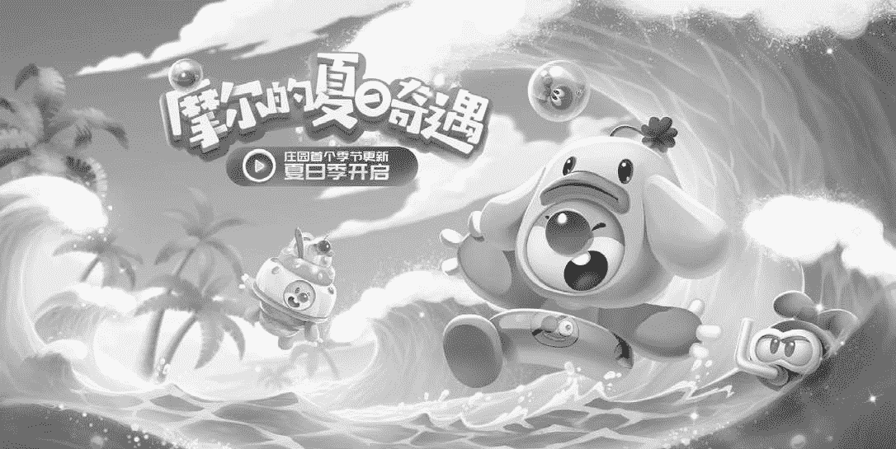
图 5-1 游戏《摩尔庄园》宣传画（图片来源：雷霆游戏《摩尔庄园》官网）

游戏被视作乌托邦式的净土。

2021年新版本上线后，成年玩家“星无火”在微博自曝，他在《摩尔庄园》里通过盗号、洗号、欺骗等方式凌虐幼童以获取满足。

做法很简单，利用孩子单纯好骗，套取账号后登录并摧毁其房屋、衣服、游戏币等资产。孩子求情时便遭辱骂。他还利用漏洞让孩子免费为他做任务，完成后再说“哦，滚吧”并以此为乐。

他并未获利，只是借虚拟伪装肆意施虐，并公开炫耀。“星无火”并非孤例，许多人在数字暗流中利用结构漏洞满足变态欲望，破坏了原本的桃花源设计。

### 性犯罪的温床

在元宇宙里，作恶成本被极度拉低。正如网上那句“你不知道对面是人是狗”。

淘米网络的《小花仙》本是一部低龄化、微观世界的奇幻冒险，玩家多为6-7岁到14-15岁的女孩，可换装、可收集。

图 5-2 游戏《小花仙》宣传图（图片来源：淘米游戏《小花仙》官网）

就是这片纯净之地，被恋童者污染。花3-5张米米卡约30-50元可买漂亮衣服，于是有人以送米米卡、发红包为饵，在世界频道、留言板留下联系方式，引诱女孩索要裸照、色情视频，甚至要求线下见面性侵。还有人公开提出包养。

女孩缺乏性保护意识，被威胁后不敢告知家长。2017年事件冲上微博热搜，淘米紧急下架留言板和传音花功能。游戏已运营7年，受害者数量无从知晓，留下的创伤难以估量。

### 数字资产的损毁

《星战前夜》EVE Online由冰岛CCP开发，提供庞大的科幻太空场景，玩家可驾驶改装舰船穿梭数千个星系。

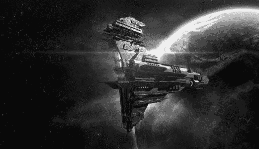
图 5-3 游戏《星战前夜》宣传图（图片来源：网易游戏《星战前夜》官网）

游戏抛弃传统AI迷局设计，强调人与人互动。玩家可组建军团，共享财产。

2005年发生了一场载入史册的劫杀。Ubiqua Seraph军团CEO Mirial在受信任副手的陪同下游戏时，被GHSC军团伏击。GHSC为此提前一年在Ubiqua Seraph安插大量间谍，获取信任后发动攻击。最终劫掠财产折合约16500美元，Mirial账号损失惨重。按规则这是合法行为，无人受罚。

类似劫杀司空见惯，新手辛苦建造的飞船常被打成废铁。虚拟世界的损失在现实中是真实的。

当人性之恶遇上平台的不作为，普通玩家的安危与财产如何保障？

### 教唆犯罪

《蓝鲸》是臭名昭著的俄罗斯网络游戏。玩家被分配“主人”，每天布置任务，包括用刀在臂上刻鲸图案、观看恐怖电影、凌晨4点起床，第50天被命令自杀。

退出者会被管理员威胁，担心IP被锁定，连累家人，只能带着恐惧继续。

英国《每日镜报》称虽无确凿报复证据，但威胁已迫使不少孩子走向极端。俄罗斯媒体称，仅一天内Vkontakte上就出现4000多条相关标签群组，如“深海鲸群”“静谧的房间”“4点20叫醒我”，背后玩家数量难以估计。

该游戏在中国被禁，但类似的阴暗游戏仍在暗处危害青少年。

## 治理模式，依然在求索的路上

在元宇宙中，行为规则的社会化属性比去中心化应用更明显。目前以区块链为基础的应用多集中在金融交易，游戏类尝试虽有，但画面与可玩性仍难及Roblox、《堡垒之夜》等主流大作。治理的路，仍在摸索。

每个平行宇宙都配有各自的化身设定，也映射出迥异的人性面向。表面上多元的人生样本，底层仍在同一套游戏规则里生长。造物者并不是完整意义上的上帝，《蓝鲸》这款产品的缔造者，更像是虚拟世界里撒旦的投射。

在虚拟世界内部设立一个行使最终裁决的政府并不现实。以区块链为基础的社区自治提供了一种成本更低的替代方案，却难以遏制人性之恶，更遏制不住创世者自身的恶。对恶的容忍等同于对善的压制。从这个视角看，虚拟世界的社区自治仍需继续探路，在可行的制度成形前，借鉴影视行业的治理做法是有必要的。

再者，类似迈阿密公寓悖论的困局在虚拟世界里同样具备发生条件。因为是被创世的宇宙，治理架构必然伴随创世一起被锁定。

# 06 超大陆角逐

把对希望大陆的憧憬牢牢装在心里，风浪终究会被克服。
——哥伦布

超大陆从一开始就是巨头的博弈场，也是判断一方是否成为巨头的唯一标尺。虚拟世界内部必将孕育出新的超大陆。目前呼声最高的两个名额属于鸿蒙和以太坊。一个以软件孵化万物，一个以数字资产孵化万物。

超大陆意味着虚拟世界的基础设施，横跨物理层、软件层、数据层、规则层与应用层。五层互为影响、互为推动、共同演化。

把视线抽离到虚拟世界之外，传统产业的升级与数字化转型同样需要自建一套超大陆，需要从产业维度重新审视企业本身。它们的超大陆就是生态运营平台 EOP。

天覆地载，大地是万物之母。每次创世都伴随着新大陆的出现。盘古开天辟地，清气上为天，浊气下为地，与天地共生。哥伦布发现的新大陆为欧洲扩张提供了空间基础。几个世纪的世界格局变化，源头都可追溯至大航海时代新大陆的开辟。

超大陆在地质学上指拥有多个大陆核的构造。亚欧大陆就是超大陆，兼具亚洲核与欧洲核，在漫长的地质年代里碰撞融合，形成了今天的陆海格局。

把这个概念平移到虚拟世界，指代那些能提供数字创造、数字资产、数字交易与数字消费基本要素的平台。集齐这四项能力的平台可称作虚拟世界的超大陆。超大陆并不算严谨的学术概念，却点明了巨头竞争的方向。未来虚拟世界的掌控者必定是超大陆的开创者。如同 iOS 属于苹果，安卓属于谷歌。在应用层面，微信是图文时代的超大陆，抖音则是短视频时代的超大陆。虚拟世界时代必然诞生新的超大陆。在数字世界，以太坊最具超大陆的气质。游戏领域，Roblox 的平台也可被归入这一序列。

## 超大陆边界即市场边界

人的创造力没有天花板，只是缺少合适的舞台。人的需求也没有尽头，只是缺少被满足的工具。

### 从农家到镜头前的李子柒

李子柒生于一九九零年，农家出身。十几岁因家庭缘故只身北上打工，曾睡在公园长椅上，也曾连吃两个月馒头。做服务员时月薪只有三百元人民币。后来她学习音乐，在酒吧担任打碟。为照顾病重的奶奶，二十二岁那年她回到家乡。此前八年的漂泊，让她像多数 M 世代那样对网络有天然的亲近。返乡后在照顾奶奶之余，她面临谋生难题，于是开起淘宝店勉强度日。

为提升小店生意，她从二零一五年起拍摄短视频，起初风格偏无厘头搞笑。摸索后转向自己真正擅长的烹饪。

转折点出现在二零一六年，新浪微博推出原创扶持计划，她成为受益者之一。为拍摄《兰州牛肉面》，她特意去兰州拜师学拉面一个月，该视频全网播放量最终突破五千万，点赞超过六十万。

二零一八年一月，她的短视频在海外运营三个月后获得 YouTube 白银创作者奖牌，粉丝突破一百万，被海外网友称为“来自东方的神秘力量”。其发布的《汉妆》《面包窑》《芋头饭》等作品在脸书获得数百万播放；七月推出《番茄牛腩汤》；八月十七日其天猫旗舰店正式开业，上架五款美食商品；十月 YouTube 订阅数达到一百万，并获得烁金创作者奖牌。

二零二零年四月二十九日，她在 YouTube 的粉丝数突破一千万，成为首个达成此成就的中文创作者，凭借一千一百四十万订阅量被列入《吉尼斯世界纪录大全二零二一》，保持“最多订阅量的 YouTube 中文频道”的纪录。

短视频成就了李子柒。若没有微博、YouTube 等平台，她可能至今仍是普普通通的孝顺姑娘。

### 平台的隐性推动力

在电视时代，李子柒的故事难以被想象。电影银幕也不会给一个农村姑娘做饭的画面留出时间。正是智能手机普及、4G 网络建设，以及微博、YouTube、抖音等分发平台，给了普通人展示自我的空间。

抖音的日活峰值曾达到七亿，这构成了李子柒获得两亿一千万次点赞的基础。

开放的平台加上用户的创造，迸发出的能量不可思议，它正在重塑世界。

抖音上像李子柒一样的创作者约有二千二百万人。二零二一年三月八日，抖音发布《二零二一抖音女性数据报告》。报告显示，过去一年平台女性用户发布恋爱视频两千一百三十五万条，关于工作的视频五千三百零六万条，直接从平台获得收入的女性达一千三百二十万人。例如四川创作者“蜀中桃子姐”、宁夏非遗皮雕手艺人乔雪，都是借助抖音开启新事业的典型。

埃森哲的调研指出，中国二十至六十岁的女性消费者近四亿，年均掌控的消费支出高达十万亿人民币。

抖音上像李子柒这样的女性创作者超过一千三百万人，计入男性后数量需翻倍。

### 数字市场边界的再审视

在物理世界构建统一的大规模市场，面临诸多限制，既有硬约束也有软约束。

硬约束如道路桥梁。道路不通之处，市场无从产生。人不能见面，就无商品交换，更谈不上交易。道路的尽头就是市场的边界。

软约束同样关键。两千多年前秦始皇已解决大量软约束，统一文字、度量衡、车轨宽度、税收标准。软约束的本质是不断降低达成交易的成本。

在数字世界，光纤的尽头就是数字市场的边界。光纤带宽与公路车道相似，不同带宽决定了不同类型的数字市场。在 2G 时代，以视频为载体的电商根本无法发展。

由此可见基础设施的关键意义。数字市场需要大规模数字化基础设施的投入。

市场本就昂贵，无论是建设成本还是运维成本。人类需要交换物品维持生活，但要把交换变成集市、再变成交易中心，需要付出海量成本。从农产品到工业品再到数字产品，市场机制愈发复杂，市场规模需求也愈大。

物理世界跨越时空需要支付交通成本，这本身就是交易成本的一部分。《元史》记载：“百里之内，供二万人食，运粮者须三千六百人。”即百里运输距离供两万人吃饭，光运粮者就需要三千六百人。元朝粮食运输仍处畜力阶段，以此条件建立大规模市场难以想象。

现代社会得益于蒸汽机、内燃机驱动的轮船汽车革新，才具备建立国际大市场的基础。

数字世界摆脱了时空限制，没有远距离运输之苦，却增加了技术限制。不同的技术标准、操作系统、运行平台，导致数字市场出现割裂，割裂程度甚至超过现实世界。

不同的电商平台是自由竞争的结果，但迫使品牌商二选一就是割裂市场的行为。苹果 App Store 与安卓应用市场相互隔绝，程序不能互通。开发者必须为两大系统分别开发。玩家在游戏中辛苦获得的装备，换操作系统后数字财产归零。

导致数字市场割裂的核心制约就是平台，即提供数字创造、数字资产、数字交易、数字消费能力的底层设施。我们能建设多统一的平台，就能创造多大的数字市场。

### 创新从何而来

混乱的边缘往往是创新的起点。按照系统论的观点，创新是涌现出来的。大脑的想法如潮汐起伏，创新亦然。涌现、共振、突变是产生创新的机制。

具体创新难以预测，偶然性很强，但在宏观层面创新是可以被培育的，当系统中要素的聚合与分散成本足够低时，创新大概率会涌现出来，创新几乎必然发生。

因此培育创新就是想方设法降低系统中要素聚合分散的成本，提供统一平台让大家用同一种技术语言交互，这正是创新的基础设施。

典型模式是平台+UGC，这是释放个人创造力的最佳路径。苹果借助此模式在短时间内汇聚成千上万名开发者为 iPhone 开发应用，迅速在功能多样性上碾压诺基亚。抖音上的视频全部由用户创造，其丰富度远超电影公司重金拍摄的作品。

这或许就是数字时代的人民战争。

要构建大规模的数字市场，进入奇幻的虚拟世界，需要简单易用的创作工具彻底释放创造力与想象力。需要统一的平台让一次创作可在多宇宙通用，把数字产品变为真正的数字资产，消除不同市场的技术壁垒，技术要统一、规则要统一。所以虚拟世界的繁荣同样依赖基础设施建设，尤其是数字基础设施。

## 虚拟世界的新基建[1]

虚拟世界是数字经济中最活跃、最具代表性的部分，也是数字化基础设施发展到一定程度后的必然产物。推动虚拟世界发展需要新型数字基础设施。基础设施的外部性将促进物理世界数字经济的发展，加速向数字社会过渡。游戏展示了虚拟世界的雏形，虚拟世界展示了数字社会的形态。

虚拟世界的技术基础、经济要素、基本特征，可逐层剖析出五层级的虚拟世界基础设施模型，其建立基于三个假设。

假设一：虚拟世界基础设施具有层次性。它持续迭代，不同阶段重点不同，形成不同层级。在传统基础设施之上，部分热点领域会衍生出具有公共品属性的新服务，随着覆盖范围扩大、服务对象增多，这些服务成为基础设施的一部分。分层有助于厘清关系，对探明发展规律与政策制定至关重要。

假设二：虚拟世界基础设施不仅是硬件范畴。例如微信已融入日常生活，不仅是社交工具，更是商务应用与公共管理的载体，如广东省市民服务的“粤省事”小程序。海外版抖音成为新的创意与思想传播渠道。因此必须把握公共品与外部性两大特征，才能勾勒新型基础设施的全貌。

假设三：虚拟世界基础设施代表技术融合应用的发展方向。基础设施常由多种技术融合形成创新应用。如网约车 App 在 4G 网络、电子地图、定位系统、智能手机普及后出现，集成了 LBS、人工智能、大数据等技术，成为网络生活的一部分。Roblox 则需要 3D 引擎、VR 设备、空间计算等技术的融合。

虚拟世界五层级基础设施模型是认知虚拟世界的基石之一，也是数字经济理论体系的核心组成。

### 数字经济基础设施的五层级

虚拟世界基础设施共分五层，自下而上为物理层、软件层、数据层、规则层、应用层。五层并非机械划分，而是认识方法论。物理层重硬件，软件层重广泛应用的软件，数据层更抽象，是重要资产与新型生产要素，规则层强调数字经济内在运行秩序。四层逐层抽象、相辅相成，构成虚拟世界基础设施主体。第五层是建立在其上层的各类应用。需特别指出，部分应用可演化为软件层、数据层或规则层的基础设施。

表 6-1　数字经济基础设施框架

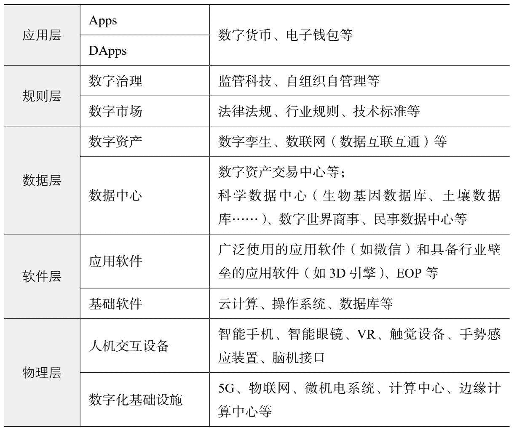

### 物理层

物理层是虚拟世界基础设施的根基，是产生、存储、分析、应用数据的载体，即装备与设备。依定义，它属于公共品服务，具备外部性与公共性。物理层可分为三类：传统基础设施数字化、数字化基础设施、人机交互设备。在虚拟世界语境下，重点在于数字化基础设施与人机交互设备。

数字化基础设施指各类电子设备，如 5G、物联网、微机电系统、计算中心、边缘计算中心等。5G 是其重要组成，为虚拟世界、工业互联网、人工智能、远程医疗等重点新兴产业提供通信管道，并与传统产业深度融合，催生新产业新业态新模式。5G 建设包括：一、机房、供电、铁塔、管线等设施升级改造与储备；二、5G 基站、核心网、传输等基础网络设备研发部署；三、5G 新型云化业务应用平台部署，与新业务及垂直行业协同；四、围绕 5G 的工业互联网新型先进制造网络环境，包括物联网云网端及车联网车路网协同基础设施等。据赛迪智库电子信息研究所《“新基建”发展白皮书》，5G 带动的虚拟现实、云端办公、高清视频等行业应用市场规模将快速上升，预计 2025 年 5G 全产业链投资超 5 万亿元，为抢占全球新一代信息技术制高点奠基。

从社会层面看，物理层建设形成新型基础设施，是数字经济基础设施的第一步，也是最基础的根基层。

人机交互设备是人类进入虚拟世界的直接媒介，包括智能手机、智能眼镜、VR、触觉设备、手势感应装置、脑机接口等，部分新设备正加紧推进。智能手机普及率已达峰值；VR 等新型设备走向成熟，进入爆发期；脑机接口是极具科幻色彩的交互界面，尚处原型验证阶段。

### 软件层

基于物理层的软件层是加工、处理、分析数据的主体，含基础软件与应用软件两类。前者指具备大规模应用、行业公共属性的软件系统，含操作系统、数据库、云计算系统、泛在操作系统等，是在新一代信息技术支撑下围绕数字经济各领域构建的智慧服务平台，具全面感知、泛在互联、高效应变、灵活处理特性。应用软件指个体或机构可用的各类程序集合，包括即时通信软件如微信、行业壁垒型软件如 CAD、CAE、PDM，也包括跨地域层级组织的社会协同平台如工业运行自动控制系统、生态运营平台。EOP 即生态运营平台，面向个人的微信、面向企业的 ERP 均属此类。另一典型缺口是中国较短缺的辅助设计软件、芯片设计软件、飞机设计软件等，它们与模块数据紧密相关，兼具设计与仿真运算能力，是重要生产力工具。应用软件如“桥梁”，连接物理层与现实场景，提升企业数字化管理、智能制造管控、政务协同治理能力。

科技型企业如用友、金山、农信互联、阿里云等都是软件层重要建设者。从企业角度看，搭建自有应用平台、将数据变为公司资产的趋势明显。行业层面，每个行业都会形成 EOP，掌控平台者基本掌控行业。宏观层面，“软件定义世界”，数字化技术支持下的软件应用对社会各领域产生重大改进。

### 数据层

物理层和软件层均产生数据要素，数据层被单独剥离，脱离软件层独立存在。数字经济新型基础设施数据层包括“数字孪生”“数联网”及各类大数据中心，核心解决数据互联互通。

数字孪生依据实体物理特性创造数字“克隆体”，可动态复现历史状态、实时数据与外部环境，突破时空限制进行高仿真实验，未来重点应用于大型工程动态设计。最早 NASA 用其仿真分析、检测、预测空间飞行器，辅助地面决策。Michael Grieves 与西门子主要用其做产品数据全生命周期管理。数字孪生还能对产品设计、功能、性能、工艺、维保进行仿真。欧特克等工程建设类软件商将其用于建筑、工厂、基础设施的全生命周期管理。北京航空航天大学陶飞等人提出车间数字孪生由物理车间、虚拟车间、车间服务系统、车间孪生数据组成。智慧城市建设中，利用全息扫描数据建立数字交通孪生体，可助力精细化管理。

数联网是国家大数据战略的基础性示范工程，通过数据标识、挖掘、深度学习等发现物理空间潜在联系，反作用于物理空间。数联网传输标准数据，应用开发模式将改变，个性化大数据应用将大量出现。互联网提供基础平台，数联网提供加工好的数据与标准访问总线，便于应用共享。数据以数字孪生或数联网形式投入现实场景，将促进云计算、物联网等产业联动，预计 2025 年带动市场规模超 3.5 万亿元，成为产业边界拓展催化剂和现代服务业变革助推器。

数字基建的五层跃迁：从物理到元宇宙

区块链从一种边缘技术演进为数字经济的核心支撑，资产上链正成为主流趋势。其可信、透明、开放的特性使其成为数字货币的技术底座，对支付行业产生结构性影响。数字资产交易持续升温，而承载交易的数字资产交易中心本质上是对以虚拟电子形态存在的各类数据进行统筹调度与存储，核心在于海量信息的汇聚。它还可借助区块链实现股权细化，把高科技企业的融资门槛大幅压低，让公众分享创新红利。与此同时，科研、政务民生、产业等垂直领域的大数据中心快速聚集，首要解决的是数据承载问题。生物基因、科学实验等数据已成为关键生产要素。工信部《全国数据中心应用发展指引》指出，数据中心机架规模增速保持33.4%，到2022年预计新增机架220万个，配套直接投资约1.5万亿元。除公共端外，个人与企业自建的数据中心也在发挥作用，它们保障数据留存并为后续应用提供原始素材。

## 数据层
从社会层面看，数据治理与数据安全是两大议题。其一，头部互联网平台对数据的垄断占有限制了中小企业成长，数据寡头地位不断强化，形成数据黑洞，如何实现各方公平使用权的平衡值得讨论。其二，数据一旦集中，安全风险呈集中暴露态势：分散时难以获取全量，只能收集片段；集中后只须突破一个节点，全部数据即遭威胁，如何守住安全底线成为重点。

## 规则层
数据要真正落地应用，必须先搭建规则体系与监管框架。从数字市场视角看，数字化交易需要一套全新规则来维持有效运行。从系统论视角看，万物彼此关联，哪些联结该强化、哪些该弱化，都要靠规则来厘定。数字经济基础设施的规则层面可分为约束环境与数字监管。约束环境由政府、行业协会、大型企业共同制定，从法律法规、行业规范到技术标准、规章制度等软硬兼备的制度组合，为数字经济有序运行提供保障。部分规则会直接改写行业生态，例如微信订阅号规则的调整就重塑了以微信为中心的生态圈。数字监管是落实规则的制度化手段，也是数字市场自由存在的前提。没有有效监管就没有自由市场，即便数字监管本身不产生经济价值，它也是确保他人依规获取合法收益的基础性公共服务，政府需要大力发展数字监管以维护市场秩序。

数字经济时代的规则与传统规则截然不同。首先，实物资源不可分割且难以共享，确权相对简单；数据资源可无限共享且共享后所有权不失，边界界定与保护成为核心。其次，规则制定主体也变了：计划经济时期规则由政府制定，传统市场多由行业协会或自治组织制定，而数字市场里社区已成为重要甚至主导的规则制定者。最后，数字市场规则能修复传统市场失灵。传统失灵部分源于部分主体具备破坏规则的能力，而数字经济中大量规则可程序化实现，即程序即法则。例如智能合约把交易玩法写入程序，规则不可随意更改，有效遏制了传统市场的不公。

数字市场的规则博弈始终存在。从微观看，规则即利益，参与方围绕制定权展开持久争夺以最大化自身收益，如手机硬件厂商与微信等软件公司在规则话语权上的较量直接决定利益归属。从宏观看，如何用规则引领数字市场发展方向、最大化释放数据价值，是国家政策必须考量的议题。规则层的建立确保数字经济基础设施良性运转，使数据在规则约束下产生价值，保障市场稳定、有序、高效，服务经济社会发展与民生福祉，推动供给侧改革与经济转型。总体而言，规则制定需回答三个问题：谁来定规则、定什么规则、如何执行。

从科技企业视角看，规则层长期被大公司与标准组织占据，但真正起作用的是应用型企业，它们通过自身数据制定新行业规则，从而改写行业边界，遵循规则的企业自然纳入其生态。以比特币钱包为例，软件厂商制定使用规则，用户下载即表示接受，成为生态一员并从中获益贡献。因此规则在重新定义行业边界。宏观社会层面还需直面数据伦理，即数据规则应以何种价值标准制定，产业发展后是否会对社会造成损害，是必须深思的命题。

## 应用层
在前述四层基础之上，数字经济基础设施的应用层呈现百花齐放景象，各种移动端应用与去中心化应用正渗透进各行各业乃至日常生活，对生产生活方式与经济发展产生深远影响，未来将涌现一批具有示范效应的应用予以推广。

表6-2 五层架构在各行业的具体侧重

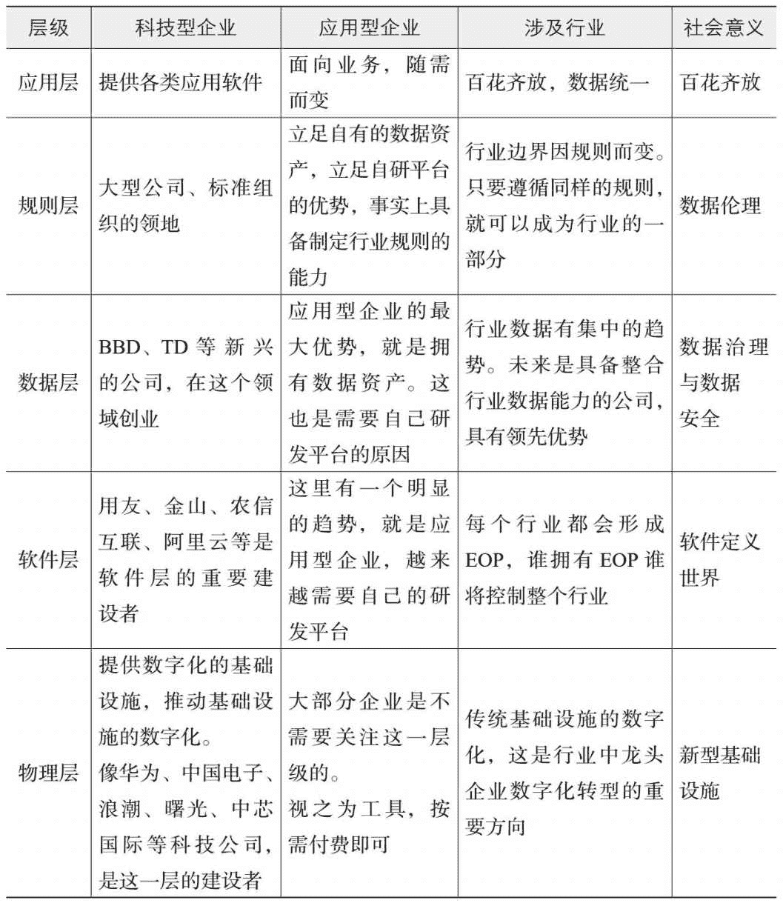

更关键的是，一些从四层基础中生长出的应用本身成为新型基础设施。以央行试点的DC/EP为例，从用户视角看不过是在手机装一个数字钱包存放数字人民币。但当数字钱包大规模普及后，其外部性与公共品属性凸显，便升格为新型基础设施的一部分。未来还会有更多应用在此之上循环衍生，数字经济新基建正是在这种循环中持续升级。

应用层以区块链、大数据、互联网等新一代信息技术为突破口，与实体产业深度融合，催生“区块链+”“大数据+”“互联网+”“AI+”等落地形态。例如“AI结合金融”模式下，金融机构凭借开放技术平台、稳定获客渠道与持续创新能力，将自身资源优势与科技公司的技术优势结合，构建全新价值链，不仅提升客户体验与满意度，更重塑商业逻辑，实现价值共创与共享，逐步形成“互联网+金融”生态。在此基础上，各技术供给方围绕基础设施、流量变现、增值服务等环节形成差异化能力，构建多元盈利模式，开拓蓝海市场，并借长尾效应创造巨大价值。再如“人工智能赋能交通”所带来的自动驾驶、“大数据+营销”对数字营销格局的重塑等，均是物理层、软件层、数据层、规则层之上应用层的典型事例。

这一层级由科技型企业提供各类应用软件，应用型企业面向自身业务需求，释放数字经济基础设施的强大动能，解决真实业务痛点，使基础设施真正落地。宏观上看应用形态千变万化，但内核始终一致。

## 元宇宙基础设施五层级模型的关系、作用与实例
### 五层级的关系
元宇宙基础设施逐层建设，层级越高越抽象，底层为上层奠基，上层为底层赋义，层层递进最终形成应用层繁荣。物理层是整个体系的基石与最底层架构；软件层在物理层之上搭建系统，脱离硬件独立存在后能最大化发挥物理层在现实场景中的效能，无论基础软件或应用软件皆然；数据层在物理与软件之上将数据剥离为资产，保障互联互通并释放价值。正所谓无监督的自由并非真正自由，缺乏监管体系数据必将乱象丛生，个人隐私与安全问题层出不穷，规则层正为数据发挥价值提供监管保障。应用层则是基于前四层的具体场景数字化，是企业数字化转型在业务端的体现，也是各行业应用的百花齐放。随着演进，部分应用层App可能具备公共属性而转变为基础设施，如微信、抖音、微博等。

### 元宇宙基础设施对于传统产业数字化转型的意义
对应企业数字化转型与数字市场议题，各层作用各有侧重。

认知转型是首要问题。物理层建设以看得见摸得着的基础设施帮助企业形成数字化理念，推动高管认知转换，使数字化转型从空谈变为可落地的战略。此外数据作为数字经济关键生产要素，企业高层认识到打通数据、消除信息孤岛、构建数据资产的重要性，是转型的成功关键，数据层建设对改变认知至关重要。

组织变革是另一关键。基础软件提升数字化技术水平，应用软件从应用维度改变固有组织模式，克服惰性，实现转型并提供动能。数据也有助于打破金字塔式科层结构，构建更契合数字经济的扁平化网络化、以客户为导向的组织，优化资源配置。掌控数据是企业在数字时代形成竞争优势的强力动力，也是转型的核心要素。

在数字市场，元宇宙基础设施有助于市场与计划统一。数据层与规则层推动这一目标实现。传统市场因数据匮乏导致市场与计划二元割裂，而数字市场中数据作为基础设施，有助于资源合理配置，将要素市场总量调控融入市场经济，实现统一。规则层使政府依托数据的调控更具真实性，解决传统监管缺位，是实现统一的必要环节。

元宇宙基础设施能有效缓解传统市场信息不对称。数据资产的公共品外部性使数字市场信息高度对称，化解了道德风险、供需不透明与认知不足导致的市场失灵。规则层的数字监管与约束环境使监管更科学合理可行，有助于实现行为与信用、监管与自由的统一。

物理层、软件层、数据层建设有助于生产与消费统一。要实现统一需获取消费者数据，物理层智能终端是获取数据的重要入口，也是后续存储分析并为生产决策提供依据的基础。软件层可存储海量数据并实现快速调用，数据库统一维护消费数据保障价值产生。数据还能支撑消费与生产决策，通过分析消费行为制定合理生产方案，引导生产、优化配置。

数字市场交易成本趋近于零，依赖物理、软件、数据、规则四层协同。物理层5G等设施保障信息高速无感传输；软件层生态运营平台提升数据透明度与流通性，实现信息对称从而降低成本；数据层中数据流呈现透明化特征，如数联网实现万物互联互通，避免信息孤岛与产业壁垒，是保持低交易成本的关键；规则层以公信、公开、透明、去中心化、点对点传输等新型交易特征提升信息透明度与流通效率，同时化解信任风险，多维度降低交易成本。

* * *

注释：

[1]关于元宇宙“新基建”，借用了笔者参与的国家发改委相关课题成果。人民大学商学院院长毛基业和他的学生也是课题的参与者。这部分论述，保持了课题一贯风格，考虑到保密的需要，做了部分删减和调整。

## 两个超大陆——鸿蒙和以太坊
鸿蒙系统代表硬件与软件的统一平台，其意义不仅在于国产，更在于它是历史上首个跨硬件平台的操作系统。以太坊代表软件与数据的统一平台，真正铺开通往纯粹数字世界的道路。这个完全以数据为基础的世界，正以前所未有的方式影响物理世界。

元宇宙正建立在鸿蒙与以太坊夯实的地基之上。人类丰富的精神世界借助“超大陆”统一的技术与标准，才能摆脱物理限制，在元宇宙中自由绽放。

### 鸿蒙，软件万物生
最早让操作系统走进千家万户的是微软，它长期占据PC操作系统市场，份额一度令苹果绝望。为避垄断指责，微软曾注资苹果维持其在PC市场的微弱存在。三十年河东三十年河西，苹果凭借iOS几乎垄断高端手机市场，微软在手机操作系统竞争中落败，苹果与谷歌形成双雄对峙。

iOS与安卓几乎占据智能手机100%市场份额，能打破这种局面的是华为鸿蒙的出现，它撕开iOS与安卓垄断的缺口。

严格说来，鸿蒙诞生的初衷并非与安卓、iOS直接竞争，而是为了解决日益增多的智能硬件如何高效互联互通。智能硬件从智能汽车到耳机手环，均可囊括，目标远超iOS与安卓。iOS与安卓仅限智能手机，苹果自身就需维护iOS与macOS两套系统。而在鸿蒙生态里，PC、电视、平板、智能汽车、手表、VR眼镜、音响、耳机乃至摄像头、扫地机、智能秤、微波炉、豆浆机、冰箱等都能运行同一套系统。

这一愿景极具吸引力，大幅激发程序员创造力。对开发者而言，无需为不同硬件编写多套适配程序，鸿蒙本身即是数字创作工具。其设计理念早已超越当前主流商用系统，只有谷歌的Fuchsia可与之媲美，但后者远未投入使用。

微软发布Windows 11并未引发广泛关注，反倒是业界热议其支持安卓应用。微软向PC与手机融合迈进一步，但仅限于手机与PC。显而易见，未来是多终端、多场景、多硬件的时代，单把PC与手机融合已不足够，Windows 11在发布之初已落后于鸿蒙。

鸿蒙也是首个在消费领域大规模应用的国产操作系统，在中美博弈的关键期，它承载了很强的民族信心。无论元宇宙采用何种技术，其软件都必须运行在操作系统之上。作为全球首个以硬件互联为目标的操作系统，鸿蒙注定是元宇宙的超大陆。

### 以太坊，数字万物生
关于区块链与以太坊的著述汗牛充栋，其理念之新、哲学深度与技术之简令人叹服。若鸿蒙是集体冲锋的丰碑，以太坊则是Vitalik个人才华的结晶。

在数字世界，任何操作最终体现为数据状态的改变。数据状态既是数字万物的起点也是终点，改变状态即改变数字万物。以太坊实现了改变数据状态的去中心化可编程通用计算，核心是去中心化。

在中心化系统中改变数据状态很容易。以电影票房为例，票数即一种状态，卖出后加一即可。但若影院卖票却不记账，票数与收款不符，便出现偷票房行为，损害制作发行方利益。中心化卖票系统需监管，终极方案是成立监管机构，成本高昂，最终由全行业承担，增加交易成本。数字世界难以设立监管机构，如何防止记账节点造假、随意篡改数据状态成为难题。

区块链1.0时代的共识机制提供了有效解法。借助工作量证明等共识机制，即使没有中心化监管，也能确保记账正确且不可篡改（见图6-1）。

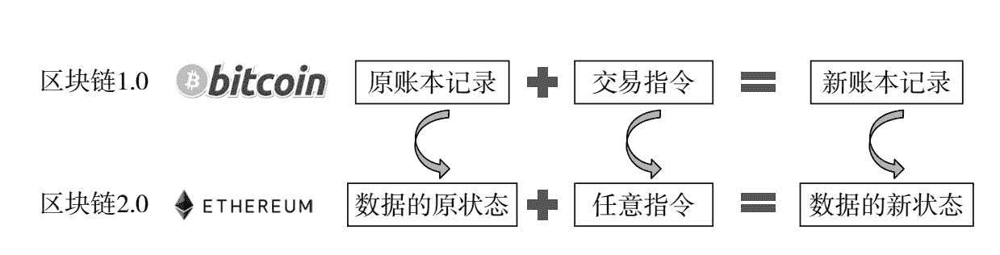

图6-1 从区块链1.0到区块链2.0（图片来源：国盛证券研究所）

以太坊更进一步。比特币仅记录交易信息，以太坊可记录任意信息并可编程，同时继承和发展了去中心化共识机制（见图6-2）。

自2009年比特币上线以来，区块链迅速发展，以太坊尤为突出。搭建去中心化通用计算平台后，大量去中心化应用涌现，DeFi与NFT最具代表性。

比特币证实了数字世界点对点货币支付的可行性。以太坊进一步证实，点对点的任何数字行为都可实现，均可无需第三方实现零信任背景下的可信交易。这为数字世界奠定了交易规则与行为规则，衍生出各类应用，形成了区块链的元宇宙。

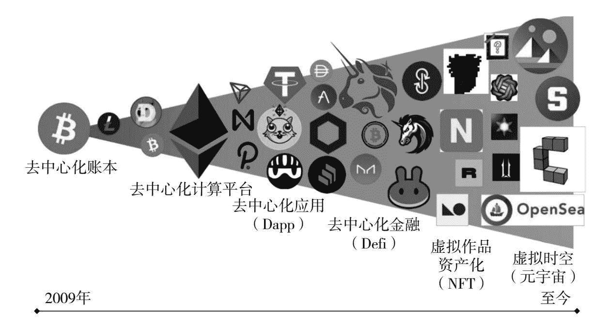

图6-2 区块链的发展：从去中心化账本到去中心化元宇宙（图片来源：国盛证券研究所）

### DeFi
中本聪设计比特币的初衷是摆脱银行中心化，实现点对点支付，比特币已实现该目标。由以太坊衍生的DeFi，即去中心化金融，在点对点支付基础上衍生出各类金融业务，其中并无传统金融机构身影。

DeFi覆盖稳定币、借贷、交易所、衍生品、基金管理、彩票、支付、保险等，只是粗略划分，这些业务可像积木一样叠加，衍生出新金融产品。

这些业务在物理世界难以理解。各国对去中心化应用态度不一。中国正收紧比特币挖矿与交易炒作。与此同时，南美小国萨尔瓦多宣布比特币为法定货币。

对中国而言，不经银行的跨境转账是便利的资产转移通道，在中美竞争态势下，不受节制的转移通道难以容忍。萨尔瓦多面积2万多平方千米，人口600多万，与中国省会城市相比排在中游靠后，在美元冲击下几乎丧失货币主权，宣布比特币为法定货币至少可抵御美元通胀。

元宇宙正在重塑资产与产业运行规则

元宇宙为去中心化金融打开了大量新场景。比如 7 月 3 日，链游 The Sandbox 上一块 24cm×24cm 的虚拟地块拍卖最终成交 364 万美元，刷新历史纪录。此前该平台虚拟地块的最高成交纪录是 65 万美元。

传统金融体系很难介入游戏内虚拟地产的拍卖业务，这恰好为 DeFi 提供了发挥空间（见表 6-3）。

表 6-3　传统金融 VS 去中心化金融（资料来源：国盛证券研究所）

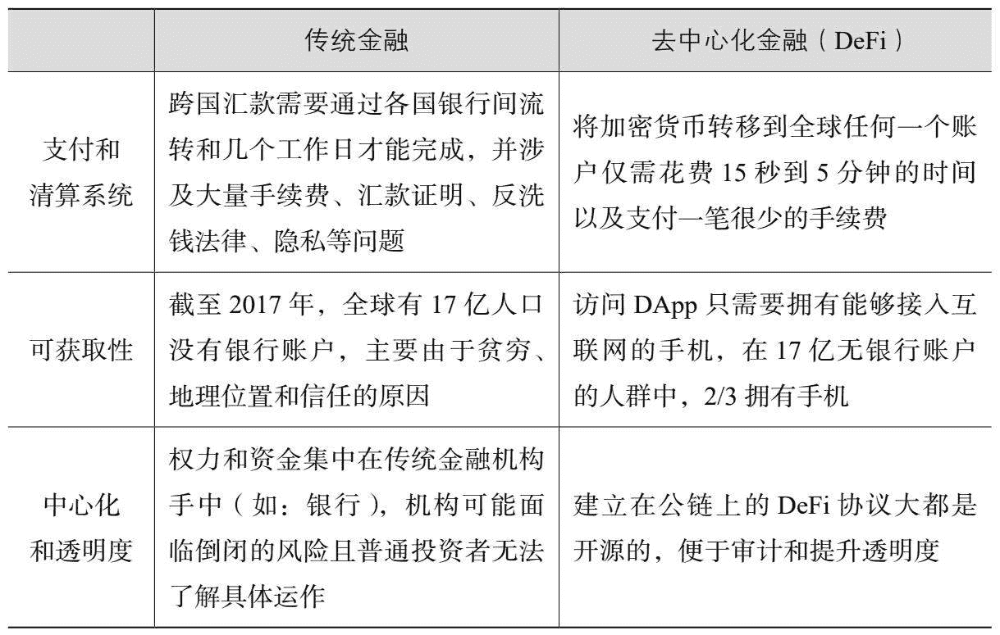

### NFT 如何让数据获得资产属性

NFT 是指不可分割且独一无二的非同质化资产。非同质化资产不能拆分，也不会完全相同，现实及虚拟世界中的绝大多数资产都属于这一类。NFT 能把虚拟物品映射上链，成为可交易的载体，从而实现虚拟物资产化。任意数据内容都可以通过链上链接完成映射，使 NFT 成为数据内容的具有资产属性的“实体”，进而推动数据价值的流通。映射完成后，装备、饰品、土地产权等都拥有了可交易的凭证。

对元宇宙构建而言，NFT 意义重大。有了 NFT 机制，玩家在游戏中购买的装备、自行创作的物品都具备资产属性，可以自由买卖并明码标价。传统模式下，游戏装备与皮肤本质上是服务而非资产，供给不限量且边际成本趋近于零。运营方通常把游戏道具作为服务内容售卖，用户使用他人作品时需按指定费用付费。NFT 改变了这一模式，创作者可以直接生产并交易虚拟商品，流程更接近现实世界的生产交易。NFT 还能脱离单一游戏平台，用户之间可以自主流通相关资产。

元宇宙目前仍处于混沌初开阶段，很难靠一个权威的中心化组织来规范内部经济秩序。Roblox 算是探路者。它没有采用去中心化交易机制，却必须谨慎维护 Robux 与美元汇率的稳定，稳定的汇率有利于生态繁荣。不同 Roblox 生态之间如何互通数字资产，则是其自身无法解决的问题。

以太坊在为元宇宙搭建经济机制，元宇宙也在为以太坊提供丰富场景，两者相互成就。

## EOP：产业数字化的统一操作系统

谈论元宇宙并非单纯概念炒作，而是清晰呈现传统产业数字化转型后的终局形态，当下只是以可视化、游戏化的方式呈现。在元宇宙的设想里，传统产业补上的第一课是搭建全行业统一平台。这个平台需涵盖数字内容创作、线上数字市场以及必要的金融支付能力。制造是传统产业的核心，而游戏中的创造本质就是玩法。因此传统产业的统一平台在制造侧往往体现为管理系统。

### EOP 到底是什么

产业生态是数字经济的基本单元，其内部充满各类交易，以及支付、借贷、物流、供应链管理乃至生产单元管理等衍生关系。支撑这些交易并让生态呈现整体性特征的载体，就是 EOP 概念诞生的背景。

产业生态中的生产、流通、金融、消费单元理应运行在同一信息系统之上，以生态契约为基础，以跨行业业务流程为导向，以提升整体效率、降低总成本为目标。这个整合了互联网、大数据、人工智能等技术的综合信息系统即为 EOP，它将成为数字经济基础设施的一部分。

这里的 E 与以往不同，E 代表生态 Ecosystem，而 ERP 的 E 指企业 Enterprise，范围被显著放大。EOP 将关联企业联结起来，过去是内部系统互联，现在是外部系统互联。O 指运营 Operation，ERP 更侧重管理，核心是企业管理系统，而运营强调创造收益的过程，即如何更好发挥客户、资源、机会与市场的作用。P 从 ERP 的计划 Plan 变为 EOP 的平台 Platform，内涵更广。EOP 通过运营手段把产业资源与企业联结，提供业务开展的平台。

EOP 与 ERP 的差异体现在三点：①关注范围不同，ERP 看企业内部，EOP 看行业生态链；②目标不同，ERP 追求管理效益与成本下降，EOP 追求市场机会与收入扩张，更开放，O 既指开放也指运营，企业应向外强化而非内生；③管理手段不同，ERP 重流程管理、BPR 业务流程再造，EOP 重生态整合，BPR 是企业内部重组，生态整合是跨行业流程重组，范围更大难度更高。

商业模式也发生颠覆。EOP 作为产业生态运营支撑系统，与 ERP 作为企业管理信息系统在软件属性上相近，但 ERP 是卖软件给客户，供求关系明确。EOP 用户无需购买，只在需要时租用，多数情况下租金为零。提供者与使用者不再是甲乙方，而是共同开拓业务的共同体。EOP 与用户形成的业务拓展共同体，是产业生态大厦的基石。

从商业模式看，ERP 卖的是商品，EOP 卖的是服务。软件到服务的跨越是质变，是新旧经济的分水岭。完成跨越的 ERP 企业将重生，未完成者将出局。

更深层的差异是使命。EOP 面向产业生态繁荣，ERP 面向企业有序管理，这决定了两者在价值观、理念、能力结构上的根本不同。某种程度上，EOP 承担了发展数字经济的使命，也为产业重组提供方法论与工具。

企业层面，EOP 把异质企业联结形成互生、共生、再生的价值循环。行业层面，EOP 融合不同产业尤其是第三产业与第一、二产业，形成产业融合机制。社会协同层面，EOP 让不同经济主体跨越地域、时间、行业限制形成协同平台。

因此 EOP 不仅是软件平台，更是与用户深度融合的经营思想载体。EOP 公司不靠平台本身盈利，而是在推动用户业务发展的过程中，通过服务佣金与租金获取收益。

### 以EOP驱动的数字重组新逻辑

数字重组产业是在行政重组、资本重组之后的又一重组力量，它是数字经济区别于农业经济、工业经济的鲜明特征。与前两者不同，数字重组有四个特征。

第一，垄断服务而非主业。行政重组与资本重组的根本目标是做大做强形成垄断型大公司，如国内央企整合、资本市场并购。数字重组的目标是提升产业整体效率、降低整体成本，收入来自围绕主业的服务，而非主业本身。这决定了重组方必须致力于行业活力而非规模扩张。

以农信互联为例，其收入来自为生猪养殖提供的服务：促成交易收取佣金、提供贷款收取利息、提供物流收取运费、提供信息平台收取使用费，但它从不亲自养猪。收入结构决定了农信互联与养殖企业是共生关系，养殖场壮大，农信互联才有更多收入，这才能带来整体繁荣。

第二，以生态契约替代控股参股。资本重组的核心是股权变更，企业易主并获得完整运营权。数字重组则靠业务合作协议即生态契约联合。温氏集团每年与养殖户签约约定双方义务，温氏负责销售，养殖户遵守标准并接受检查，第二年可续约也可终止。双方联合经营，共同追求更高收益。

第三，跨行业而非单一行业。资本重组聚焦单一行业做大。数字重组更注重行业融合，凡主业做大所需服务业均在视野内，包括银行、保险、基金、物流、交易市场、咨询等。

第四，先业务融合再做大。数字重组收入来自围绕主业的服务，提供更多高效服务是目标，这必然带来行业间深度业务融合。资本重组常先把分散资源装袋再决定用途，数字重组则先融合业务再整合企业。

# 07 虫洞：穿越元宇宙的入口

生存在宇宙中本身很幸运，但不知何时起，人们把生存视为理所当然，这正是失败的根源。
——刘慈欣《三体》

我们生活在三维空间，但主流显示设备仍是二维平面。VR/AR 正加速进入生活，有望终结手机的平面时代。我们在数字世界体验真实，在物理世界感受虚实交融。

终端形态的变迁重塑行业格局，加速人类向数字世界迁移。不同元宇宙聚集不同人群，人们可在各元宇宙间自由穿梭，身形不动而神游万方。

过去人们因器官受损才使用人造设备，未来人们会为增强功能而主动选择。智能设备在形体上与人体融合，在精神上让思想在元宇宙中尽情绽放。硅基生命将以出人意料的方式到来，或许我们正步入后人类社会。

人类是唯一不能完全生活在现实世界的生物。我们为航天员欢呼、为探险家喝彩，因为内心渴望摆脱俗物束缚、突破物理极限、探寻未知。未知或许即完美。毛泽东诗云“可上九天揽月，可下五洋捉鳖”，这引发了共鸣。人类对宇宙、精神的思考从未停止。

《红楼梦》刻画金陵十二钗，满足对美的全部幻想，最终却化作空梦。《三体》描绘人类无法体验的四维宏阔，最终四维空间乃至太阳系都被毁灭。创世与毁灭是艺术永恒主题，或许毁灭才是现实永恒主题。我们该如何思考永生与超越？

超现实主义艺术家选择探索潜意识，主张突破逻辑与经验的现实观，将现实观念与本能、潜意识、梦境融合，展现深层心理世界。现实受理性控制，而真实心理的彼岸是超现实世界，即梦境。

《哪吒之魔童降世》中的《山河社稷图》是超现实巅峰。哪吒被困其中潜心学艺，图中还有“指点江山笔”，角色想到何处笔就画到何处，最后哪吒借此画出传送门逃出。

《山河社稷图》即元宇宙世界的艺术想象，“指点江山笔”即元宇宙中的创造工具。随着技术发展，超现实将变得司空见惯。沙盒游戏《我的世界》里超现实怪物、建筑、物理法则比比皆是，玩家可亲手创造超现实作品，而这些游戏不过是元宇宙雏形。

我们需要像《山河社稷图》那样的新工具，自由穿梭于不同“宇宙”之间。这个工具就是 VR 技术。

## 三维体验：告别手机平面的时代

人类生活于三维空间，视觉体验自然是三维的，但思想载体长期以二维存在，从甲骨文、竹简、纸张到智能手机、电视、电影皆是如此。电影视觉特效尤其是 IMAX-3D 能带来强烈震撼，却仍未达到身临其境。关键在于观众知道自己在看电影，即便戴上 3D 眼镜，前排脑袋时刻提醒现实存在。三维视觉乃至四维时空全体验是人类追求目标。随着技术推进，超越手机平面显示的时代临近，这将引发产业巨变。

三维视觉体验依虚拟现实关系可分为 VR、AR、MR、XR 四类。VR 让人们沉浸于虚拟世界，如《头号玩家》。AR 在现实环境中叠加虚拟物体，车载 HUD 在挡风玻璃投射导航箭头即典型应用。MR 在虚拟环境中增加现实物体，与 AR 易混淆，AR 以现实为底增加虚拟，MR 以虚拟为底增加现实，两者正快速融合。XR 是虚拟与现实的进一步融合。狭义 VR 指虚拟现实，广义则涵盖 VR/AR/MR/XR。

### 虚拟现实从科幻到落地的百年路

1930 年科幻小说《皮格马利翁的眼镜》已描述可视听嗅的特殊眼镜。20 世纪 50 年代中期，美国摄影师 Morton Heilig 发明首台 VR 设备 Sensorama。该设备含固定屏幕、3D 立体声、3D 显示、震动座椅、风扇与气味生成器，却是个庞然大物且成像糟糕。它展示了虚拟现实的雏形，模拟视觉、触觉、嗅觉。

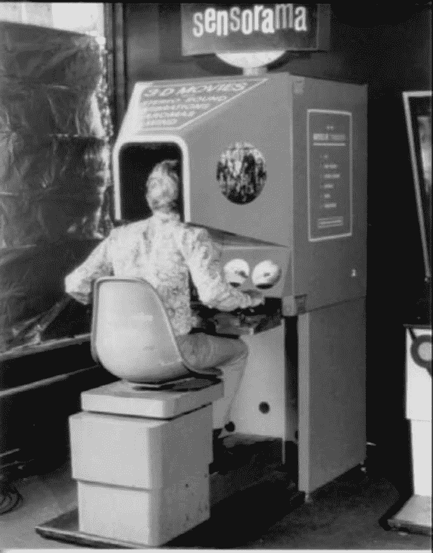

图 7-1 第一台 VR 设备 Sensorama，由美国摄影师 Morton Heilig 发明[^(\[1\])](#part0041.xhtml#f1)

1968 年，计算机科学家 Ivan Sutherland 发明接近现代 VR 眼镜原型的头盔，比 Sensorama 进步许多，但重量过大需额外设备吊起才舒适。

随着材料、通信、成像与计算进步，VR 设备愈发轻薄。脸书以 20 亿美元收购 Oculus 后，2015-2016 年迎来 VR 热潮。Pokemon Go 流行，让资本嗅到 VR 成熟信号。但眩晕、纱窗式画面、带宽不足抑制了热情，上轮高潮仅剩商场游乐场儿童设备记忆。

玩家进入 Half-Life: Alyx 后担忧烟消云散。精致设计、清晰细节、流畅画面带来身临其境感，重新点燃市场热情。

Oculus 随后推出一体机 Quest，系列大受欢迎，内容也更丰富。预计 2020 年 Quest 系列出货超 1000 万台，到 2025 年 VR 设备出货预计达 9000 万台，增速可媲美智能手机。

### 硬件与内容共振形成的增长飞轮

疫情推动宅经济，娱乐、游戏、社交需求上升。截至 2020 年底，Steam 平台 VR 内容达 5554 款，加上 Oculus、VIVE、PICO 等，主流平台 VR 内容已超万款。行业进入用户增长——收入提升——体验与内容改善——用户再增长的正向循环（见图 7-2）。

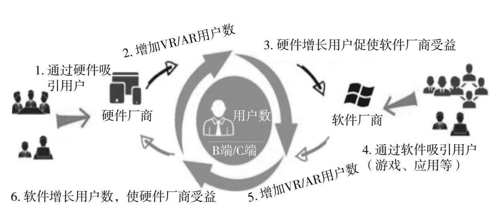

图 7-2  VR/AR 进入硬件+内容相互促进的双循环  
（图片来源：公众号“邋遢道人”，兴业证券经济与金融研究院整理）

Half-Life: Alyx 大火。Superdata 显示，2020 年该游戏单款收入超过 2019 年全部 VR 游戏收入之和，全球 VR 游戏收入同比增 25% 至 5.89 亿美元。2020 年 Steam VR 会话达 1.04 亿次，新增用户 170 万人，游戏时长较 2019 年增 30%。

Steam 平台[^(\[2\])](#part0041.xhtml#comment_17562)的 VR 连接数据持续刷新纪录，Oculus 一家独大。Steam 年度报告显示，2020 年新增 VR 用户 170 万，月活 VR 用户达 205 万。按 Roadto VR 的估算，平台月度连接的 VR 终端已突破 250 万台，且仍在攀升。脸书系在消费市场占据主导，2021 年 3 月 Steam 上 58% 的月度连接设备都来自 Oculus。

### 当逼真模拟成为生死考场：航天的极致应用

HUD 抬头显示是车载 AR 最普及的形态。驾驶员不必低头，车速、导航等关键信息直接投在挡风玻璃上，有助于提升注意力。因为成本限制，这类配置多见于高端车型，日常通勤瞥一眼仪表盘也无大碍。

对飞行员而言，情况截然不同。战斗机飞行员必须时刻保持前视，任何分神都可能致命。HUD 最初正是为飞行员量身打造的。

仅仅一套 HUD 远不足以训练飞行员。《中国机长》还原的风挡爆裂场景就是极限考验：青藏高原上空，机长以自身对抗数百公里时速的狂风与严寒，最终安全落地。

飞行员要应对雷雨穿越、鸟撞、风挡失效、发动机停车等突发状况。如何能在无经验时练就经验，这正是先有鸡还是先有蛋的困境。答案是模拟舱。

模拟驾驶舱能高度还原极端情境，让学员产生身临其境的真实感，在舱内磨练技术与抗压能力。入职后飞行员仍会定期回舱复训，保持对突发事件的敏感。宇航员更是只能靠模拟，登月、火星登陆等前无先例的任务，地球上根本不存在对应的自然环境，只能依靠观测数据搭建完整的月球、火星环境进行训练。

虚拟现实已做到以假乱真，但目前主要局限于航天、军工等专业领域。原因很现实：一座飞机模拟舱的造价有时甚至超过一架真机，成本是制约其普及的核心因素。

## VR 已从实验室走向各行各业

### VR 技术行业应用之汽车制造行业
汽车外观设计是 VR 建树最为突出的方向。设计师借助 VR 平台可将 3D 模型 1:1 放大，在虚拟空间以实物尺度评审，无需制作油泥模型，大幅压缩周期与成本。平台无需导出数据且兼容多款 3D 软件，也让其在汽车行业迅速获得青睐。

### VR 技术行业应用之电力能源领域
输变电工程设计与电柜倒闸操作正被 VR 重塑。客户可通过虚拟化视觉体验沉浸式场景，团队无需到场就能协同开展线路设计，操作培训也趋于安全高效。

### VR 技术行业应用之汽车零售业
购车前通过 VR 进行虚拟试驾正成为可能。3D 展示已在电商普及，若叠加 VR 设备体验试驾，将为汽车销售带来革命性变化。

### VR 技术行业应用之旅游业
VR 与旅行的结合是未来观光与文化导览的重要方向。它既能呈现自然景观的壮阔，也能复原人文遗迹的历史风貌，数字博物馆因此大量采用。Pokemon Go 类的玩法与真实景区联动，也催生了旅游的新业态。

### VR 技术行业应用之房地产业
贝壳找房数据显示，VR 看房使用后人均线上浏览房源量提升 1.8 倍，在线停留时长增长 3.8 倍，7 日内看房成交效率提升 1.4 倍。

### VR 技术行业应用之自动化领域
依托设计蓝图与方案，工厂自动化设备可先在虚拟环境中完整构建，通过 VR 头盔逐段调试程序，最后进行整体功能验证。

### VR 技术行业应用之体育领域
荷兰国家队已将 Beyond Sport 的 VR 技术用于教学、训练演练、视频分析与战术复盘，以提升整体训练水平。

### VR 技术行业应用之教育领域
VR 全景能显著提高参与度与学习兴趣。抽象化学成分、遥远天象等都能被具象化呈现，配合旁白、文字与资料，形成沉浸式学习环境，提升理解效率。

### VR 技术行业应用之娱乐
2017 年第 74 届威尼斯国际电影节增设 VR 竞赛单元，标志着极致沉浸式观影的关注度提升。此前香港旅发局推出的“VR 时光倒流香港游”微电影，用 VR 复原昔日经典街景，让游客在维港与老香港之间穿梭。

### VR 技术行业应用之医疗健康
2016 年上海瑞金医院借助 VR 直播 3D 腹腔镜手术，国内 VR 医疗直播由此起步。加州大学旧金山分校医学院的 Bridges Curriculum 也把虚拟现实模拟学习作为课程核心，强调健康照护的整体认知。斜视患者 James Blaha 佩戴 Oculus Rift 两年后恢复 80% 立体视觉，后创立 See Vididly 并推出 VividVision 软件，用 VR 进行斜视与弱视矫正。

### VR 技术行业应用之矿业生产
矿山地质复杂、体系庞大、环境多变，智慧矿山成为新趋势。以一部手机加一副 VR 眼镜运营整座矿山，已不再是空想。

### VR 技术行业应用之军事
ULTRA-VIS 系统集成全息透视显示与视觉跟踪定位，士兵的弹药信息与战场态势叠加于视野，可实时识别友军、车辆、飞行器并提供导航与危险区标记。美国陆军 CERDEC 研发的战术增强现实 TAR 系统，在头盔上集成微型显示屏，将作战指令、战术地图、热成像与目标距离共享至团队。

## 增强现实的例子，就在我们身边[3]

### 社交
社交软件是 AR 主要入口。Snapchat 功不可没，截至 2021 年第一季度日活 2.8 亿，其中约 2 亿用户每日使用 AR 互动。最初的爆款是在视频通话中叠加滤镜，之后扩展到试发色、虚拟鞋试穿等实用场景，并可为现实画面添加滤镜。欧莱雅等品牌借助此进行产品广告，AR 成为营销新渠道。

### 游戏
游戏是推动 AR 大众化的另一主力。Niantic 的 Pokemon Go 全球爆红，截至 2018 年 5 月月活超 1.47 亿，2019 年初下载量破十亿，2020 年收入超 60 亿美元。游戏将现实与虚拟融合，玩家走动捕捉散落于真实世界的宝可梦，AR 模式让它们如真物般出现，并可在实景竞技场对战。游戏还与线下商业联动，2016 年与日本麦当劳合作将门店变为竞技场，单店日均客流增 2000 人；Sprint 也借此推广 1.05 万家零售店。任天堂《马里奥赛车实况：家庭赛车场》让实体玩具车与 AR 图形叠加在家中赛道竞速。基于华为 HMS Core AR Engine，腾讯、网易等合作伙伴推出大量 AR 游戏，如 X-Boom 让玩家射击叠加在现实中的虚拟动物。

### 教育
AR 教育多由出版、广播等传统教育机构研发，常与电信运营商合作。CERN 与谷歌艺术与文化部门联合推出的“宇宙大爆炸”AR 应用即为典型，用户可通过手势触发超新星、将行星托在掌心，实现互动式宇宙学习。

### 零售
AR 让人先试后买。LGU+ 子公司 Evecandylab 2019 年推出 augmen.tv，用户可将电视购物中的商品拖入自家空间摆放并直接下单。IKEA Place 让用户把家具 1:1 放置在家中确认尺寸与风格，类似功能在家具行业迅速普及。

### 导航
谷歌地图与谷歌地球已加入 AR，路线指引更直观，还可在餐厅、地标上叠加信息卡片，提升获取效率。

### 旅游
杭州“AR+西湖”项目让游客下载“掌上西湖”App，对准景点即可看到历史背景故事，AR 体验区全长 1.4 千米，并集成景区智能导航、导游与导购。

### 仓储
企业是头显最大需求方。DHL 在 2015 年试点 Google Glass 后，将 AR 眼镜作为全球仓库作业标配，拣货准确率与效率提升，生产力平均提高 15%。

## 元宇宙，虚拟现实应用的终极场景

盘点各行业应用可发现，VR 仍处于分散试验阶段。技术之外，更关键的是不能孤立使用 VR，而要依托数字创造、数字市场、数字消费、数字资产的模式在细分赛道率先建立优势。

旅游业的例子很说明问题：单纯搭建高还原度的景区供人观赏难以持续。旅游的本质是共同经历，虚拟世界必须提供比物理世界更丰富的社交体验。这指向元宇宙的两个核心：沉浸感与社交网络。

游戏已展示方向：剧情与线索的重要性正超过动作本身，共同经历成为多媒体世代的集体记忆。把虚拟现实、沉浸感、社交甚至经济行为融合在一起的载体，就是元宇宙。它是 VR 成长的场景，VR 的发展则是元宇宙繁荣的技术基础。

## 终端的进步与产业的变革

终端英文为 terminal，泛指与最终用户交互的联网设备，如手机、自动驾驶汽车等。它是通信、网络、芯片、软件、传感器与制造工艺的综合，代表先进技术与商业模式。特斯拉将汽车进化为新型终端，也颠覆了传统汽车格局。

VR/AR 本质上是新型终端，其普及同样会引发行业巨变。以 iPod 为起点回顾终端演进很有启发。

### iPod 的丰碑

`iPod` 是便携音乐播放器史上的里程碑。“苹果先做 iPod 还是先做 iTunes”连资深粉丝也常混淆。2000 年前后美国用户习惯 P2P 下载后刻录 CD，门槛较高。乔布斯收购 Rio 团队的音乐管理程序并极致简化体验，形成 `iTunes`[^(\[1\])](#part0042.xhtml#comment_18463)。

有了 iTunes，乔布斯才需要配套的播放器，于是 `iPod` 诞生。先有 iTunes 后有 iPod。iTunes 起步时面临内容匮乏，而唱片公司深陷盗版困扰。乔布斯以 99 美分一首歌的定价说服五大唱片公司合作，形成“音乐公司、艺术家、苹果、用户”四赢模式。iTunes 上线 6 天售出 100 万首歌，第一年 7000 万首，2006 年 2 月累计 10 亿首，2010 年 2 月累计 100 亿首。

在“`iPod`+`iTunes` 商店”模式里，硬件、软件、内容首次完美结合。`iPod` 远胜同类 MP3 播放器，成为音乐门户的入口，由此引发音乐产业变革。

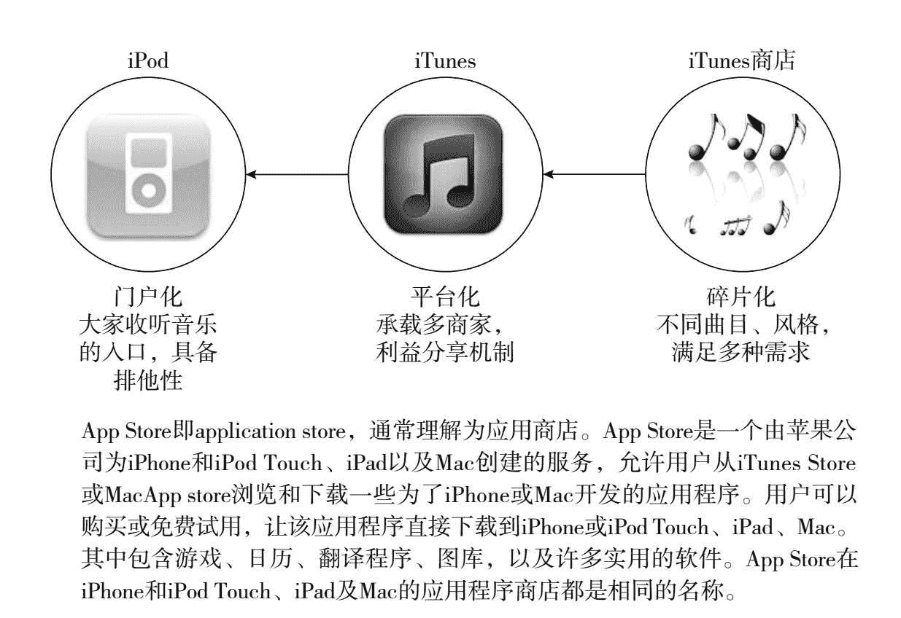

图 7-3　`iTunes`+`iPod`开创了泛互联网化模式的雏形

在这个模式中，`iPod`作为一款独立的音乐播放设备，非常受人欢迎。同类的`MP3`播放器，跟`iPod`相比就像廉价的山寨货。`iPod`已成为人们收听音乐的首选，没有人在使用`iPod`的时候，还会使用其他播放器。`iPod`客观上具备了音乐门户的特征。

苹果为 iTunes 设计了一套与唱片公司联动的分成机制，收入大致按七三分配，苹果拿大头。这样的安排让唱片公司不必再为盗版头疼，也省去自建分销渠道的成本。更进一步，苹果甚至直接与有创作实力的音乐人签约，让作品跳过传统厂牌流程直接登陆 iTunes。上架模式的变化让苹果承担了唱片公司的一部分职能，围绕 iTunes 盈利的第三方越来越多，平台很快被市场认可为一个受欢迎的音乐发行入口。

用户口味向来分散，苹果打破了整张专辑捆绑销售的老规矩，允许单曲单独购买，不用把好听的和不喜欢的歌曲一起买单。把专辑拆解成独立曲目，个性化收听需求得到最大程度满足。

从数据的角度看 “iPod + iTunes” 这套组合，音乐库同时保存在设备端和电脑端，两端通过同步保持一致。同步的对象还包括播放列表，而播放列表本质上是用户的偏好指纹，极具个人色彩。设计上让播放列表不完全绑定某台 iPod，换机后也能迅速找回自己的歌单。

这种同步逻辑与纯粹的互联网应用不一样。纯互联网应用在本地终端几乎不留数据，泛互联网化终端即使离线也能完成核心功能，联网后才拓展更多能力；而纯互联网应用一旦断网就不可用，这是两者根本的分界。

### 唱片行业的挽歌
iPod 出现前，歌手创作后由唱片公司制作并全国推广，大厂牢牢掌握行业枢纽。没有大厂背书，再有才华也难被看见。iPod 出现后局面改观，乐迷被音质和随身体验吸引，更关键的是通过 iTunes 能买到任意曲目并马上推送到 iPod 播放，不必再跑到实体店挑选唱片。

iTunes 取代了唱片公司的发行能力。音乐人发现作品可以直接上传，平台成为最大的发行渠道。在 iPod 与 iTunes 的组合下，听众与创作者直接连通，唱片公司失去了生存空间。

一个产业就此消失。

苹果在音乐领域的成功近乎消灭了一个行业。此后苹果拓展其他赛道变得格外艰难，电视就是典型。大型制片公司目睹唱片业的下场心生忌惮，集体拒绝与苹果深度合作。

## 从音乐商店到应用商店
2005 年 iPod 销售额占苹果营收的 45%。乔布斯却未沾沾自喜，反而忧心忡忡。他判断能动摇 iPod 的必然是手机，一旦手机自带音乐播放，iPod 的生命周期就结束了。

iPhone 的出现印证了这一判断。手机内置 iPod 音乐播放功能，并把当年验证有效的音乐商店模式升级为应用商店。用户可在商店下载各类趣味软件，比如为照片添加相框、记录每日跑步里程等。

2008 年 3 月 6 日，苹果对外公布面向 iPhone 的应用开发工具包供免费获取。3 月 12 日，不到一周下载量即突破 10 万次；三个月后升至 25 万次。苹果此前在产品和技术上相对封闭，IBM 兼容机出现后微软等公司围绕 PC 构建了大量办公娱乐软件，抢走大量用户。而 Mac 因兼容性问题长期只剩约 10% 的核心用户。此次放出 SDK 是苹果首次向个人和企业开发者伸出橄榄枝。应用付费后按三七分成，苹果得三开发者得七，一批暴富故事吸引了全球开发者。2008 年 7 月 11 日 App Store 正式上线，上架应用 800 个，下载量达 1000 万次。2009 年 1 月 16 日，应用数超过 1.5 万个，下载累计超 5 亿次。到 2021 年，App Store 应用数量超过 200 万个。

应用商店催生了内容创作产业，影响辐射整个信息行业。业内都在思考：是做苹果商店里一件碎片化程序，还是另起炉灶自建商店？

iPhone 作为主流智能手机扮演大门户角色。打电话、玩游戏、刷微博、读电子杂志越来越离不开它。应用商店扮演平台角色，解决了与开发者的利益分配，并成为推广软件的主要渠道。商店里大量碎片化应用满足工作、娱乐、休闲、购物等多重需求。

回到大数据视角。用户仅在下载或更新应用时才会进入应用商店，应用使用过程中产生的行为数据和内容数据并未被采集和留存。仅有商店下载数据不足以构成大数据，其活性很低。

iPad 推出后数据问题更突出。大量照片、通讯录、音乐、文档堆在 iPhone，如何方便地在 iPad 上查看？手机丢失后资料如何找回？于是 iCloud 应运而生。

## iCloud 补齐苹果生态拼图
2011 年 5 月 31 日，苹果官宣 iCloud，提供邮件、日历、联系人同步。除此之外，它还能保存用户已购的音乐、应用、电子书并推送到所有匹配设备。可以说 iCloud 第一次让 iPhone、iPod Touch、iPad 甚至 Mac 电脑实现无缝联动。借助 iCloud，苹果产品能从多源收集数据并统一存储与索引，为搭建大数据中心铺路。

iCloud 核心功能包括照片流、文档与应用云服务、日历、通讯录、邮件、iBooks 备份与恢复。每个功能都是苹果获取用户数据的入口。

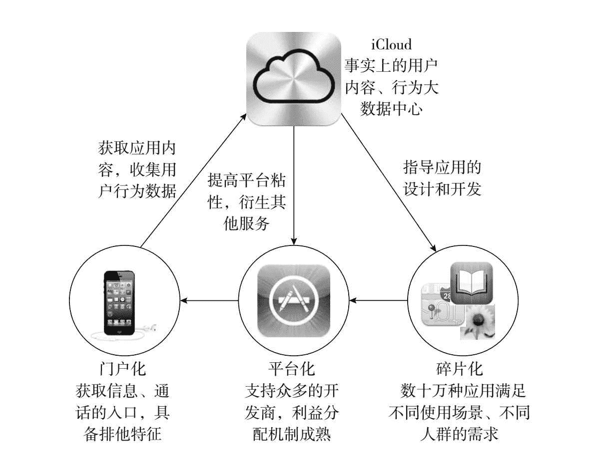

图 7-4 推出 iCloud，标志苹果完成泛互联范式的最后一块拼图

照片流让用户通过多台 iOS 终端实时共享影像，覆盖 Mac 和 iPad。照片从相机导入电脑后，iCloud 会立刻借助 WLAN 发到 iPhone、iPad 和 iPod Touch。无需手动同步或把照片塞进邮件附件，影像会自动出现在所有设备上。用户还能指定共享对象，并允许对方评论互动。照片流让影像数据统一归档，便于收集。

文档和应用云服务支持在 Mac、iPhone、iPad、iPod Touch 上创建文档和演示文稿，iCloud 保证文件在所有 iOS 设备上保持一致。Keynote、Pages、Numbers 等 App 已内置 iCloud，也可配合其他适配 App 使用。用户在某设备购买的应用会自动同步到其他设备。开发者通过苹果提供的 iCloud API 可把应用生成的数据存入云端，用户在使用支持 iCloud 的应用时无需手动上传或同步即可在多设备协同编辑。苹果也因此获得更有价值的应用数据，为应用大数据奠基。

日历、通讯录和邮件让用户把私人信息存入 iCloud，并在所有设备实时更新。删除邮件地址、新增日历事件或修改通讯录的变动会即时同步。备忘录、提醒事项和书签同样保持一致。这三类数据源提供了最私密也价值最高的信息，极大提升个性化服务水平。

iBooks 是另一竞争点。移动阅读用户基数大，各方争夺激烈。苹果凭借统一流畅的体验赢得用户，iCloud 进一步巩固其地位。用户从 iBooks 购得电子书后，iCloud 会自动推送到其他设备。阅读进度、标注文字、笔记或书签在 iPad 上产生的变化，都会自动更新到 iPhone 和 iPod Touch。

备份与恢复同样关键。iPhone、iPad、iPod Touch 存储大量重要信息。设备充电时，iCloud 会每日通过 WLAN 自动备份，无需用户操作。设置全新 iOS 设备或恢复数据时，iCloud 可完成任务，只需接入网络并输入 Apple ID 与密码即可。对苹果而言，备份与恢复最大化收集用户数据，可衍生新服务并指导产品设计。

回溯 60 年前，计算机自诞生起就是数据中心，文件资料保存在个人电脑中。iCloud 横空出世，正在取代个人电脑的数据中心角色。它不同于纯互联网应用，其思想与 iPod 时代的音乐管理一脉相承，即泛互联网化。

## 数字经济闭环成形
从 iPod+iTunes 到 iPhone+App Store，再到 iPhone+App Store+iCloud，数字经济商业模式基本闭环，覆盖数字创造、数字市场、数字消费、数字资产各环节。

2011 年 iCloud 上线标志数字经济商业模式确立。随后十年，所有巨头的竞争都绕不开数字创造、数字市场、数字消费与数字资产。小米的崛起最具代表性。

小米几乎完整复制了苹果的路径，可视为低配版苹果。公司 2010 年成立，十年后跻身世界 500 强。

## 手机迭代进入瓶颈
2007 年苹果发布首代 iPhone 宣告智能手机时代到来。至今已 14 年，硬件软件发展飞快，生活工作已离不开手机。

从外观看，首代 iPhone 颠覆性极强，从十几个物理按键瞬间变成一个按键，眼见就是全新物种。乔布斯当时喊出“我们重新发明了手机”。但到现在手机外观变化不大，唯一物理按键已消失，正面只剩一块玻璃。只能在屏幕尺寸上做文章，再大一点就变成平板电脑。

从维度看，手机始终呈现二维世界。二维世界里手机、平板、电视这些不同尺寸屏幕已发展到相当高水平。

突破可能来自三维世界。就像 iPod 探索出的商业模式催生了 iPhone。手机二维世界的商业模式和经济模型已完全成熟，下一步是终端形态的变革。革命性的变化才能带动全行业。

## VR/AR 站在爆发临界点
经过近半个世纪积累，我们迎来了有望取代智能手机的新终端——VR 一体机。从产业周期看，现在正处爆发前夜。

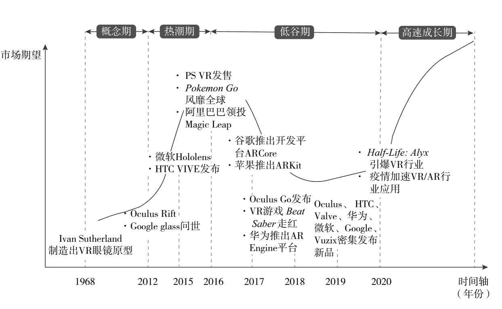

图 7-5　VR/AR 产业趋势（资料来源：东方证券研究所）

互联网巨头的动向反映产业趋势，脸书最具代表性。扎克伯格致力于把 VR/AR 与社交结合构建社交元宇宙。2014 年，脸书以 30 亿美元收购 Oculus VR，正式进军 VR。2016 年提出的十年规划中，前 3—5 年重点构建社交生态、优化核心产品；未来 10 年侧重 VR、AR、AI、无人机网络等新技术。到 2021 年初，脸书从事 VR/AR 研发的员工比例由 2017 年的 1:10 提升至 1:5，并频频投资行业领先者。凭借技术赛道与社交双重优势，脸书有望构建大型社交元宇宙平台。

从脸书频繁的投资收购可见其野心：终端设备、游戏内容、分发渠道、社交网络几乎全覆盖。虽然在智能手机市场已无缘进入，但借助新终端崛起，脸书有望复制苹果在智能手机市场的成功故事。

脸书很可能成为元宇宙的引领者之一。

* * *

### 注释

[1] iTunes 是一款媒体播放器应用，2001 年 1 月 10 日由苹果在旧金山 Macworld Expo 推出，用来播放及管理数字音乐与视频文件，至今仍是管理苹果电脑上 iPod 文件的主要工具。此外，iTunes 能连接到 iTunes Store，在有网络且苹果在当地开放服务的情况下，用户可下载购买数字音乐、音乐影片、电视节目、iPod 游戏、各类 Podcast 及标准唱片。

## 后人类与硅基生命

### 时间消耗全揭秘
据国家统计局第二次全国时间利用调查，居民一天平均活动：个人生理必需 11 小时 53 分钟，占 49.5%；有酬劳动 4 小时 24 分钟，占 18.3%；无酬劳动 2 小时 42 分钟，占 11.3%；个人自由支配 3 小时 56 分钟，占 16.4%；学习培训 27 分钟，占 1.9%；交通 38 分钟，占 2.7%。

吃喝拉撒睡占据近半天时间，用于工作的仅 4 小时。除生产线工人外，工作、自由支配、交通、学习培训时间都可使用手机，且许多岗位工作就依赖手机，如快递。推算下来，人们一天在智能手机上消耗的时间很可能超 5 小时。

据 2020 年第 45 次中国互联网络发展状况统计报告，2019 年 12 月，手机网民常用 App 中，即时通信使用时长最长，占比 14.8%；网络视频、短视频、网络音频、网络音乐、网络文学依次为 13.9%、11.0%、9.0%、8.9%、7.2%。短视频时长占比同比增 2.8 个百分点，增长明显。

网民在手机观看各类视频花费的时间占总时长三分之一。人类是唯一不能完全活在现实的生物。从统计看，若把视频内容等同虚拟空间，人们其实已在元宇宙中沉浸而不自知。每天至少有 2 小时在元宇宙中生活。

戴上 VR 头盔后，沉浸时长可能不会明显变化。对人类体验和思想的冲击不容小觑，这个过程才刚开始。

### 神经直连与力量外放
脑机接口与外骨骼都是直接增强个人能力的技术。脑机接口让数字化技术直接理解大脑指令；外骨骼直接增强体力。

脑机接口又称“大脑端口”或“脑机融合感知”，是在人脑或脑细胞培养物与外部设备间建立的直接连接通路。单向接口只能接收或发送信号，双向接口允许双向信息交换。大脑测量与分析已能解决实用问题。科学家能用神经集群记录技术实时捕捉运动皮层复杂神经信号并控制外部设备。人工耳蜗是迄今最成功、最普及的脑机接口，帮助大量聋哑人恢复听力。

外骨骼在辅助体力劳动方面贡献巨大。某种程度上，骑士全金属盔甲可视作外骨骼，提供硬壳保护。航天服和深海潜水的“JIMM”装也属外骨骼，帮助人体在恶劣环境中正常工作。

### 半机械人时代
半机械人 Cyborg 是一种“电子控制的有机体”，一半人一半机器。人类与智能机械结合兼备两者优点，这已是现代科技目标之一。

把 VR/AR 设备、脑机接口、外骨骼技术融合，科幻片中的超级英雄将从屏幕走向现实。《我，机器人》中男主角左臂即为机械改造。

图 7-6 电影《我，机器人》剧照（图片来源：影片截图）

半机器人并非新概念，人类一直通过工程产品改善自身，但目前多用于生理缺陷、病痛、受伤的治疗性改善，如四肢损伤者或装有起搏器者。

未来在元宇宙中，半机械人能否成为主要居民？

### 硅基生命

# 硅基生命：从化学幻想到智能现实

提起碳基生命，人们自然会联想到硅基生命这一对照概念。这一设想最早可追溯至19世纪。1891年，波茨坦大学的天体物理学研究者朱利叶斯·席纳在撰写的论文中，率先系统探讨了以硅为基础的生命可能形态，大致是第一位提出该想法的学者。此后英国化学家詹姆斯·爱默生·雷诺兹接受了这一设想，并在1893年于英国科学促进协会的演讲中提出，硅化合物的耐热特性或许能让基于它的生命在极端高温环境中存活。

早期学界的切入口是化学类比。研究者习惯以构成人类生命的核心元素碳为参照，再向同族的硅延伸。这一思路看似顺畅，实际性质差异悬殊，硅很难复制碳的化学行为。以有机化学为基准所展开的硅氢化学探索最终宣告失败，试图用硅烷、硅氧烷等衍生物去复刻有机物功能也走不通。

颇具反差的是，由硅材料制成的芯片，反而在孕育一种以人工智能为核心的新型生命形态。当下学界提及硅基生命，更多指的是硅芯片叠加人工智能，并配上钢铁骨骼与橡胶外皮的复合系统，而非传统意义上的化学生命体。

人工智能的发展验证了这一判断。在语音识别与自动驾驶两大场景里，AI已切实重塑了人们的日常。如今大多数智能电视都具备语音交互能力，即便在嘈杂环境也能完成换台、调节音量等基础操作。到了驾驶场景，其价值更为突出：驾乘者双手不离方向盘，就能用语音设定导航目的地或开启空调，这只是AI应用的冰山一角。

展望元宇宙，未来大规模的制造与生产将由AI主导。一旦虚拟世界的体量膨胀到物理世界的数十倍乃至上百倍，仅靠人类程序员已无力承载。人的角色更接近于制定规则的造物主，为元宇宙设定少数创世法则，随后AI依照这些法则生成繁复的世界。

蚂蚁提供了一个恰当的类比。单只蚂蚁的行为极其简单，仅靠触角进行有限信息交换。若把一只行军蚁单独置于平面，它会无目的地打转直至精疲力竭。而把数百万只置于一起，群体便呈现出难以预测的超有机体特征，展现出深奥甚至惊人的集体智慧，甚至能聚成蚁球渡河。球体外层的个体不断溺亡，整体却能存活并重建种群。简单规则叠加庞大数量，就能在更高层面产生智慧，而这正是AI擅长的方向。元宇宙无疑是AI成长的理想土壤。

## 如何判断你对元宇宙的认知层级？

第六章与第七章分别聚焦平台与终端设备。市场上讲平台经济、讲VR/AR的著作汗牛充栋，为何要把它们置于元宇宙框架下讨论？因为世界正进入融合发展阶段，体现为技术融合与行业融合。靠单一产品单打独斗的时代已结束，企业要么加入一个产业生态，要么自行创造一个生态。生态内部技术架构趋同、业务相互联动、数据资源互通，共创、共生、共赢是基本逻辑。把看似无关的要素视作整体的能力，决定了一家企业的业务边界。

# 结语

“看山是山，看水是水”常被用来形容第一层认知。鸿蒙就是鸿蒙，以太坊就是以太坊，游戏就是游戏。对元宇宙的书也可能只被视作又一个噱头。若看不到鸿蒙、以太坊、游戏、VR/AR之间的内在关联，而割裂对待，认知就停留在第一层。这个阶段能辨认事物的构成要素，明白其特征与价值，却是碎片化、孤立化、缺乏联系的。在此层若意识不到改变的必要性，更体会不到改变的紧迫性。

“看山不是山，看水不是水”是第二层。此时能看到事物间的联系，感知整体存在，却忽略了各自独特性。游戏与VR/AR相关，VR/AR与网络相关，网络又牵连5G、6G……用鲁迅的说法，见到短袖想到白胳膊，想到裸体，想到生殖器，再想到性交、杂交、私生子。这种普遍联系掩盖了事物的独立性与差异性。若看不到发展的约束条件，便容易空谈，行动无章可循，这一层次的言语往往具有迷惑性。

“看山还是山，看水还是水”是第三层。在此既能统合整体性，又能剖析独特性；既能把握普遍联系的本质，又能抓住主要矛盾。一旦达到此境，便具备改变现状的能力。元宇宙兼具综合性、概括性、具体性与可操作性，要真正理解它，必须抵达第三层认知。只有深刻理解，才能付诸实践。

合上书本自问：对元宇宙的理解，你目前在第几层？

# 后记

本书的诞生可谓机缘巧合、众人合力。几位走在时代前沿的人感到了大潮的涌动，迅速集结、明确目标、调整工作、整合资源、分工协作，才在短短两个月内完成。

2021年6月8日，主创团队与编辑团队首次碰面。乔社长甫履新，仍保持对前沿趋势的关注与热情，早已筹划元宇宙书系的出版。当时我正与毛基业院长合作一本关于数字化转型的书稿。各行各业综合应用数字化技术，迅速形成新组织模式与商业模式，甚至重塑生产要素，汇聚成新兴数字生态。这些实践蕴含新的产业规律与经济思想，新理论正从实践中生长。

数字化转型的理想终态是什么？这个问题长期困扰我。只有找到终极形态，各行各业才能据此定位，结合自身现状寻找路径。许多传统产业数字化转型的案例提出DTO概念，借数字孪生的思路认为未来组织都是数字孪生组织，思考决策在数字世界，执行在物理世界。概念虽先进，却过于抽象，读者难以接受。

恰在此时，易欢欢兴致勃勃地与我讨论元宇宙，甚至把微信昵称改为“All in 元宇宙 大未来”。我意识到元宇宙正是寻找已久的理想形态，且以极具象化与传播力的概念呈现。再看同行的分析报告，以Roblox为样本，综合5G、VR/AR、区块链、游戏，约略指明方向。

2017年写作《数字生态论》时，我开始研究数字经济，书中指出数字经济的最小单元是数字化的产业生态，数字经济即新型经济体系的代名词。数字经济体量庞大，传统商品生产、流通、消费各环节都与传统经济学纠缠，缺乏纯粹展现数字经济魅力与特征的场景。加密经济虽已完整，但冲击金融且带有无政府主义色彩，难以完全纳入主流语境。

元宇宙恰好提供了一个完整自洽的经济体系，即纯粹数字产品的生产与消费全链条。与物理商品的宏观链条相比，它具备所有经济学特征，却没有物理生产过程，是研究数字经济的最佳范本。无需像过去研究经济那样做大量不成立假设，将经济活动从社会活动中剥离，机械套用数学模型。现实社会复杂，社会学与经济学研究总能找到反例，传统经济学对人们思想的束缚，需要颠覆性案例才能打破。元宇宙的经济学具备生产数字商品并仅在数字世界消费的闭环，这是过去未曾出现过的。无论宏观还是微观，无论新自由主义还是新制度经济学，面对元宇宙经济现象都无力应对。

因此元宇宙是诞生与验证数字经济理论的最佳试验场。理论源于实践，领先理论源于领先实践，伟大理论源于伟大实践。产业彻底变革带来的震撼，正是研究者最大的喜悦。

不仅是经济，元宇宙更是一个社会，是M世代构成的后现代社会。其中有经济现象，也有文化与社会现象。在超越国家、民族、地域与时间界限的社会中，会孕育何种文明，令人神往。

元宇宙中，存在与虚无、自我与宇宙、肉体与精神的思辨被淋漓尽致地展现。电影《黑客帝国》反复追问，人是否能一直生活在虚拟世界？尼奥最终摧毁Matrix，可日出后的物理世界是否就是理想家园？至少有一点共识，人类无法永远生活在物理世界。这些问题持续吸引我们走进元宇宙，共同创世。

《元宇宙》成书时间极短，创作过程也极具元宇宙特征。结合数字经济研究心得与科技变革，给出未来发展的粗线条梳理。错漏之多令我自感不满意。如王巍理事长所言，相较严谨学术著作简直谬误千里。但对元宇宙的M世代而言，已是姗姗来迟。宇宙本不完美，在进化中才生发大千世界，本书只是开端，如宇宙大爆炸的奇点。乔社长将据此打造系列书籍，易欢欢要做投资的元宇宙，徐远重要做区块链的元宇宙，邢杰要做通证的元宇宙。

首先感谢中译出版社，在乔社长带领与支持下，几乎集全社之力打造标杆。感谢社长乔卫兵、总经理李学焦、副总编辑刘永淳、财经中心负责人于宇、外语分社社长刘香玲、责任编辑张旭、文字编辑赵浠彤、张程程、张莞嘉、方荟文、薛宇、黄秋思、营销编辑顾问张晴、毕竞方、吴一凡、杨菲，编务助理李静维、全占福、侯鑫，以及校对、排版、设计、印制、发行、宣传推广等各环节人员。

感谢中关村大数据产业联盟，感谢理事长宣鸿先生。感谢副理事长包志刚、孟庆国、施水才、隋国栋、王仁宗、徐长军、薛素文、张金辉、赵福君；理事白数波、陈瞿清、程宏亮、鄂维南、费毕刚、姬晓晨、姜春玲、姜海欧、梁双、李豪、李嘉、刘睿民、毛基业、南春雨、沈丹婷、史博、孙峰、田溯宁、吴曼、尹蓝天。感谢监事长王文京，尤其是姜春玲作为执行副秘书长与理事长特别助理承担大量工作。

感谢和君集团董事长王明夫先生给予商学启蒙，感谢和君商学的潘番大力推广。

感谢文峰数字团队：孙峰、房子超、张威、王高等，让我得以专心写作。

感谢曾俭华行长、苗巧刚、宋宇海在资本市场的实践与认识，感谢函数资本刁心玉、张文明协助查找资料。

感谢艾欣、张小平、苏彤、刘菁、张钢乐、蒋平富、李明、张岚、王汉、修磊、李茜、屠思睿、朱星、杨红宇、霍永光对《元宇宙通证》的付出。

感谢筹备2021年首届元宇宙高峰论坛及新书发布会的会务组成员：徐远龙、李欣蓉、王昊、林家卫、周美含、骆卡、张璟璟，以及中译出版社王文、李珍妮、闫心语、冯颖等。

感谢为本书作序推荐的学者、企业家与朋友们，愿我们并肩遨游元宇宙。

最后感谢家人，忍受了我两个月的甩手掌柜状态。没有妻子的理解与支持，本书不可能在短时间内完成。

# 参考文献

［1］曼纽尔·卡斯特尔。网络社会的崛起［M］.夏铸九，译。北京：社会科学文献出版社，2000.

［2］曼纽尔·卡斯特尔。认同的力量［M］.曹荣湘，译。北京：社会科学文献出版社，2006.

［3］曼纽尔·卡斯特尔。千年终结［M］.夏铸九，译。北京：社会科学文献出版社，2006.

［4］周其仁。货币的教训［M］.北京：北京大学出版社，2012.

［5］亚当·斯密。国富论［M］.郭大力，王亚南，译。南京：译林出版社，2011.

［6］彼得·德鲁克。管理：使命，责任，实务［M］.王永贵，译。北京：机械工业出版社，2009.

［7］彼得·德鲁克。管理的实践［M］.北京：机械工业出版社，2009.

［8］亚德里安·斯莱沃斯基。发现利润区［M］.北京：中信出版社，2010.

［9］亚历山大·奥斯特瓦德。商业模式新生代［M］.北京：机械工业出版社，2012.

［10］弗雷德里克·温斯洛·泰勒。科学管理原理［M］.北京：机械工业出版社，2014.

［11］赵国栋，易欢欢，糜万军，鄂维南。大数据时代的历史机遇［M］.北京：清华大学出版社，2013.

［12］赵国栋，许正中，徐昊，糜万军。产业互联网［M］.北京：机械工业出版社，2015.

［13］赵国栋。数字生态论［M］.杭州：浙江人民出版社，2017.

［14］何全胜。交易理论［M］.北京：新华出版社，2010.

［15］涂子沛。数据之巅［M］.北京：中信出版社，2014.

［16］周涛。为数据而生：大数据创新实践［M］.北京：北京联合出版公司，2016.

［17］车品觉。决战大数据［M］.杭州：浙江人民出版社，2016.

［18］杰里米·里夫金。第三次工业革命［M］.张体伟，孙豫宁，译。北京：中信出版社，2012.

［19］稻盛和夫。阿米巴经营［M］.曹岫云，译。北京：中国大百科全书出版社，2016.

［20］彼得·德鲁克。管理的实践［M］.齐若兰，译。北京：机械工业出版社，2009.

［21］尤瓦尔·赫拉利。未来简史：从智人到智神［M］.北京：中信出版社，2017.

［22］吴军。浪潮之巅［M］.北京：人民邮电出版社，2016.

［23］林恩·佩波尔，丹·理查兹，乔治·诺曼。产业组织：现代理论与实践［M］.郑江淮等，译。北京：中国人民大学出版社，2014.

［24］文一。伟大的中国工业革命——发展政治经济学一般原理批判纲要［M］.北京：清华大学出版社，2016.

［25］姜璐。钱学森论系统科学［M］.北京：科学出版社，2012.

［26］保罗·萨缪尔森，威廉·诺德豪斯。经济学［M］.萧琛，译。北京：人民邮电出版社，2008.

［27］朱·弗登博格（Drew Fudenberg），让·梯若尔（Jean Tirole）.博弈论［M］.黄涛，译。北京：中国人民大学出版社，2010.

［28］米歇尔·渥克。灰犀牛［M］.王丽云，译。北京：中信出版社，2017.

［29］约翰·斯图亚特·穆勒。政治经济学原理［M］.金镝，金熠，译。北京：华夏出版社，2017.

［30］约瑟夫·熊彼特。经济发展理论［M］.郭武军，吕阳，译。北京：华夏出版社，2015.

［31］亚历山大·奥斯特瓦德。商业模式新生代［M］.黄涛，郁婧，译。北京：机械工业出版社，2016.

［32］德内拉·梅多斯。系统之美［M］.邱昭良，译。杭州：浙江人民出版社，2012.

［33］河本英夫。第三代系统论：自生系统论［M］.北京：中央编译出版社，2016.

［34］哈里·兰德雷斯，大卫·C.柯南德尔。经济思想史［M］.周文，译。北京：人民邮电出版社，2014.

［35］安东尼奥·达玛希奥。笛卡尔的错误［M］.北京：北京联合出版公司，2018.

［36］维塔利克·布特林。理想：以太坊的区块链创世录［M］.北京：科学出版社，2019.

［37］尼尔·斯蒂芬森。雪崩［M］.成都：四川科学技术出版社，2018.

［38］朱嘉明。未来决定现在［M］.太原：山西人民出版社，2020.

［39］龚焱。公司制的黄昏［M］.北京：机械工业出版社，2019.

［40］徐远重。三链万物［M］.北京：东方出版社，2019.

［41］龙白滔。数字货币：从石板经济到数字经济的传承与创新［M］.北京：东方出版社，2019.

［42］黄家明，方卫东。交易费用理论：从科斯到威廉姆森［J］.合肥工业大学学报（社会科学版），2000.

# 专家推荐

（排名不分先后，按姓氏拼音排序）

站在自己的对立面，走出未知的世界，冲破未知的世界，进入元宇宙世界。用灵魂的一半去呼应另一半，用精神的一半去映照另一半，用身体的一半去与元宇宙中的另一半相合，构成完整的自我。以灵魂引领精神摆脱过往面具，在元宇宙中重生。这是一条必经之路。当我读完本书目录时，一道光划破夜空，它眷顾我，让我看见那澎湃而清新的宇宙。读此书的意义在于看见自己是一个完美的人。

——艾欣 三通集团董事长、中国企业家俱乐部发起理事

《雪崩》“创造”的元宇宙，“在黑太阳里，一切都是立体的，不透明的，写实的”。欢迎来到元宇宙时代，重新定义人和人生；它也会带来迥异的商业，请保持兴奋与警醒。

——柏亮 零壹智库发起人、横琴数链研究院院长

人类社会一直在演进，但需求的核心未变。衣食住行，生老病死，七情六欲，对更美好生活的追求，这些从未改变；变的是满足方式。可以说，元宇宙是对社会生活的一次再造甚至重塑，也是影响个人、集体乃至财富命运的新形态。远重兄的“元宇宙”系列，是通往未来的入场券，意义重大，影响深远。

——毕亚军 华商韬略创始人

元宇宙是继大数据、区块链、5G、云计算之后的下一趋势吗？我的三位好友分别是大数据、金融科技与区块链专家，倾力创作国内首套介绍元宇宙的图书，勾勒出未来的轮廓。无论是否认同元宇宙为互联网未来，这本书都能带来诸多启发。

——蔡凯龙 后浪财经创始人、前德意志银行副总裁

《易·乾卦》曰：“大哉乾元，万物资始”。自人类诞生，对宇宙本原的探索推动文明前行。远至星辰大海，近至微观粒子，每一次探索都带来巨变。如今虚拟世界已融入生活，大数据、人工智能、区块链、云技术构成统一而多样的世界，它改变生活方式，拓展空间、延伸时间，给人类带来全新宇宙观。新宇宙需要新探索，本书描绘了一座通往无限可能的传送门，或许这就是虚拟世界的本原。

——曹阳 悦达国际科技金融研究院院长、独立投资人

对未知的渴望一直是文明进步的重要动力，爱因斯坦用相对论揭示宏观规律，普朗克和玻尔的电动力学展现粒子世界的奥妙。向中观世界的好奇者致敬，带着我们体验平行时空的人生，更奇妙的数字化人生！本书是对元宇宙元年的一份献礼。相信出版后能帮助更快把握生态发展的关键要素，迎接下一代数字未来的到来。

——常扬 阿里巴巴副总裁、阿里巴巴文娱集团产业发展总经理

# 元宇宙新书，业界怎么说

在现实层面约瑟投资一直为优秀创始人、优质企业和知识产权提供助力，而进入元宇宙的辽阔数字疆域后，约瑟所承载的分量已不再局限于资本。这部作品足以作为进入数字新纪元的引路之书。

——陈九霖 约瑟投资创始人

信息的唯一性最终由物理能量来兜底。诞生于低能耗系统的旧互联网，只能维持低维信息流通，交流可行交易却难自洽。面向未来的新世界倚靠高载能近零碳的新能源做地基，并以社会共识与能量聚合来锚定信息唯一性。表面看仍是网络，底层逻辑与基座已彻底重构。

——陈升 世纪互联董事长

我们正处信息数字化的当下，很可能下一篇章将被称作元宇宙时代。元宇宙指向一个闭环自洽的经济体系，纯数字产品的制造与消费将开启全新场景。这种形态下，商品的产生、流通、损耗全流程与当下市场迥异，简单讲其内部商品在体系内自生自用。我们每个人和每个组织都是参与构建者，“我心即宇宙，宇宙即我心”。随着5G、AR、VR、区块链、AI的加速成熟，创造新世界已具备条件，这本书会阐明它的本质、能力与影响。

——陈伟 深圳太古计算机系统有限公司董事长、浙江大学 MBA 创业导师

元宇宙的概念听起来新鲜，其实并非凭空出现，人类在技术和资本驱动下已走了很久。这套著作恰好从理论层面进行系统梳理，助读者提前感知发展趋势与时代拐点。

——陈玮 东方富海董事长

业界普遍把2021年视作元宇宙元年。区块链、人工智能、虚拟现实的突破，使得超空间传输、跨域价值凭证与拟感官交互界面首次能够同场协作，由此开启地球数字纪元，人机共生的时代正式来临。

——陈序 元宇宙与未来资产研究智库 MetaZ 创始人、NFT China 首席顾问

作为全新议题，元宇宙为虚拟世界的未来搭建了新的想象空间，潜力可观。想要系统认识这一方向的人，这本书能带来另类的观察视角。

——陈英 中国电子学会秘书长

当虚拟与现实的界线被打通，人类将何去何从？《元宇宙》《元宇宙通证》未必给出标准答案，却能促使人类变得更睿智。2021年被视作元宇宙元年，它按下重启键，重新审视科技、文明、自然与人的关系。

——程博 武汉市中小企业发展促进中心主任

技术创新是社会进步的关键驱动力。元宇宙所带来的新概念和新世界需要探索和实践。连接现在与未来的数字空间既有机遇也有挑战，虚实同频的平行世界已经到来，我们应怀着欣喜、期待、敬畏和谨慎迎接每一天。

——池腾辉 一名横琴普通拓荒者

# 元宇宙系列图书推荐语

## 邓迪 太一集团董事长
我预感到元宇宙会为人类自我认知打开全新视野，就像几何学中欧式与非欧式的差异，在平行时空里肉身所在的物质世界未必是唯一真理。无限的想象力与区块链、人工智能等新技术结合，将重塑万千世界，这是一场新创世，人人都会参与。

## 蒂姆·德雷普 DFJ 投资基金的创办合伙人
元宇宙已经到来。从创新到经济再到治理，虚拟世界正日益成为生活核心。大量服务可通过去中心化实现，现实机构的影响力会减弱。这套书描绘了一个更自由的未来。我期待元宇宙和去中心化世界能为人类历史上最具创造力与生产力的飞跃提供舞台。

## 刁志中 广联达科技股份有限公司董事长
该系列极具前瞻性，描绘的虚实互补本质是物理实体与数字孪生的相互映射，终将成为数字化发展的终极形态。元宇宙将赋能各行各业，推动现有商业模式的元宇宙化创新，让数字孪生的社会创新从概念走向落地。

## 丁伟 江西裕民银行首席信息官
元宇宙正在重新定义数字世界的未来。人们未来的工作与生活将在怎样的虚拟空间展开，如何搭建支撑其有序运行的基础设施，如何治理，以及核心数字技术如何融入生活，本书将带你深入探究。

## 董晨 东北证券股份有限公司副总裁
互联网对世界的改变仍在延续，元宇宙的宏大图景已现身。若数字最终主导世界，未来会怎样？对于所有关注未来的读者，这本书开卷就有益处。

## 杜永波 华兴资本合伙人兼董事总经理
VR/AR/XR、脑机接口、区块链、数字人、数字孪生等技术持续涌现，现实与虚拟的边界正不可逆地模糊。元宇宙的概念为人类终极赛博世界提供了完整蓝图，也为下一代数字技术指明方向。这套书从多个维度解析核心内涵和典型特征，展望未来应用前景，让读者提前踏入奇幻世界，成为原住民。

## 樊晓艳 幸福社发起人
走进元宇宙，拥抱美好生活与幸福世界。

## 傅盛 猎豹移动 CEO
系列图书描绘了一个与现实平行的虚拟世界，其技术落地路径日益清晰。在这个永不掉线的空间里，人们可以互动与交易，宛如现实的镜像。高瞻远瞩、视野独特，为认识未来打开一扇门。

## 傅榆翔 国际跨界艺术家，独立策展人
北宋邵雍曾推算文明的循环。数字技术与人工智能时代依然由人类主导，脑机连接的探索仍在向前。元宇宙是意识的投射与幻化，在无垠时空中，人类的自觉与异化正被大数据切片与共谱。此时天文学研究在火星与月球发现类似金字塔、狮身人面像的构造，若证实同源，人类历史与起源将重新改写，回归不生不灭的元宇宙。读这本书，仿佛与先祖在量子纠缠中完成终极书写。

## 顾振清 著名策展人
链上原生的NFT本质是执行智能合约的标准，天然拥有可收藏、可流通、可验证的特性。它具备进入虚拟社交与游戏元宇宙的优势，势必与多链应用场景、以及虚拟世界中映射的人类交往理性与乌托邦理想产生梦幻联动。链上加密数字艺术史将与现实世界的传统艺术史并行输出，虚实同进，最终成为传统艺术的一种印证，让艺术文明获得数字永生。互联网的终点或许就是元宇宙，《元宇宙》与《元宇宙通证》是认识元宇宙的基础佳作。

## 郭学涛 悉尼科技大学博士、郑州银行数据管理部技术总监
元宇宙概念虽源自科幻，但随着AR、VR、5G、云计算的日渐成熟，走向现实已不遥远。无论是否成为互联网的终极形态，其经济对传统经济的渗透与冲击都不容忽视。传统经济向数字经济升级后，以数字商品为核心的元宇宙经济所带来的创新与价值，已可在游戏经济和新生代生活方式中窥见。书中对技术演进与经济特性的探讨令人振奋。

## 韩颖 广州基金董事长
创新与发展是时代主题。我们正处于互联网红利逐渐消退的下半场，数字经济正在叩开新时代之门，而元宇宙则是数字社会未来的必然产物，终将颠覆现有的生存与发展模式。

## 何伊凡 知名财经作家、浅海融媒有限公司董事长
元宇宙并非情绪化的概念，也不是给旧产品贴新标签。它的价值不仅在于游戏革命，还可能成为新一代的社交或电商工具。这是一个演化形态尚不确定的生态，不会由单一公司垄断，而是由个人、企业、组织共同构建，依赖大量工具、基础设施与协议。关键要素包括虚拟身份与资产、用户创作、经济体系、沉浸感与社交性。相关研究资料零散，本书进行了系统梳理，值得阅读。

## 胡捷 上海交通大学上海高级金融学院教授
由计算机、网络、算法构建的虚拟世界如同城市，聚集新一代人群，实现多元价值的创造、交换与消费。这就是元宇宙。它正处于大爆炸的前夜，因为感知技术突破弥合了碳基生命与硅基世界的鸿沟，而基于区块链的社区自治规则已落地生根，规则成就秩序，秩序成就文明。先知者智，先行者慧，强烈推荐《元宇宙》与《元宇宙通证》。

## 怀洋 爻宇宙公民、悉见创始人、本无起源创始人
元宇宙时代，物理、伦理、成本、生产力、生产关系和价值定义都发生巨大变化。狭义的元宇宙可以指任何精神沉浸场景，如书籍、角色、电影、游戏、城市；广义的元宇宙则是现实与虚拟世界及其中的生命、物质、信息、规律、时间互联形成的超级文明体。每个人都能创造无数个狭义元宇宙，最终构成广义统一体。2030年前是Web 2.5虚实共生阶段，AR世界地图等互通入口至关重要；2050年前是Web 3.0虚实难辨阶段，海量子元宇宙实现体验互联；2070年前Web 4.0才是脑机与AI系统互联的真正元宇宙时代。

## 黄光明 魔漫相机创始人
任何全新时代的到来都伴随科技的全方位突破。这套丛书为我们提供了观察未来世界的视角。

## 黄怒波 北京大学文学博士、中坤集团创始人、丹曾文化总策划
这是一部数字时代的开源著作，描绘了人类从偶尔成为的人向可能成为的人进化的路径。它是21世纪乌托邦的真正构建，也是桃花源梦想成真的证明，人由此与上帝达成和解。

## 纪振强 苏宁易购集团有限公司采购总监
元宇宙不仅是游戏概念，更是数字时代互联网的继任者。随着游戏、社交媒体和数字经济的推动，大图景的拼图已基本就位，元宇宙经济应运而生。本书从玩家熟悉的游戏切入，勾勒新蓝海，再从元宇宙经济学展开，视角新颖独特。

## 贾伟 洛可可创新设计集团董事长
想象力和创造力始终推动人类进步。文艺复兴改变了观念，让人类更具创造性和信仰力。进入元宇宙时代将是人类历史上的新文艺复兴，底层逻辑是想象力的爆发。随着区块链、人工智能、AR、VR 的成熟，想象力被释放，人们渴望真实地生活在数字世界。沟通、社交、价值交换、自我实现、精神追求在人人拥有数字身份的元宇宙中被无限放大。商业美学、个性化、体验感、价值感都将被重新定义。我认为元宇宙还应有“力”的视角，即元宇宙力：想象力、创造力、信仰力，从而形成创作力经济。

## 江有归 浙江富润 CEO
5G时代万物互联即将到来，我们正处在数据大爆发的边缘。系列图书描绘的虚拟世界正是未来数字的终极形态，数字将成为身份与资产的象征。区块链通过去中心化的权益记录，让虚拟身份与资产具备真实价值，用户可以自由处置、流通、交易，不受中心化机构制约。

## 蒋东文 投资家网创始人
5G、VR、区块链、人工智能、工业4.0……第四次科技革命正席卷而来。新技术重塑社会结构，提升物质与精神生活，也带来伦理道德挑战。《元宇宙》《元宇宙通证》将告诉我们如何与科技和谐共进。

## 蒋济舟 中国信通院码号服务推进组副组长
5G时代催生的元宇宙在虚拟空间孕育了新的经济与文化世界，现实的信息正演变为信息的现实。难以想象这场划时代的变革将带来多少精彩传奇。对追梦者而言，本书将是遨游新世界的美丽翅膀。

## 孔华威 中科院上海计算所所长
元宇宙是计算机自行计算、自行运营的世界。我们人类中只有极少数是初始建设者，大多数是参与者，但加起来也只是少数群体，因为最活跃的将是机器人。

## 孔剑平 嘉楠耘智集团董事长
有人把元宇宙简单视作虚拟游戏，有人知道它源自《雪崩》。我认为它是利用算法与数据，以区块链为底层操作系统，通过计算与显示技术创造的后人类平行文明。它接近四维世界，其价值不再与用户数的平方成正比，而是与用户数的三次方甚至N次方成正比。

## 蓝春 新英才控股（集团）有限公司董事长、北京市新英才学校董事长兼校长
元宇宙作为下一代具象化互联网形态，将带来真正的沉浸式虚拟现实体验。其所需的技术、创作、经济生态也将催生新需求与商机。未来必将百家争鸣，谁能打造独特的文化IP将成为核心竞争力。本书的观点与案例将助力加快探索，并期待元宇宙时代的到来。

## 李劼 DataMesh 创始人
未来元世界的底座将是连接BIM/CAD/IoT数据的数字孪生系统，B端应用将在其上构建。AR将是数字孪生与元世界的入口，也是真实与虚拟的融合点，真实与虚拟的切换对空间映射的要求越来越高。但仅有技术支撑并不等于能驱动用户持续创造内容，找到这一关键点至关重要。

## 李蒙 第十届全国政协副主席
探索前沿的精英们不断取得新发展与新发现。现在是你们的时代，把握方向，奋力飞翔。

## 李瑞 哈啰出行资深 BD
在“无限办公室”里，若想与异地的人沟通，不是打电话，而是对方的化身传送进来，你可以看到他的全部背景信息。眨眼间又被送回原地，仿佛从未出现。神奇的元宇宙将带你进入互联网发展的下一章。

## 李斯璇 著名双语主持人、财经评论员、《硅秘》up 主
如果感知世界最重要的维度“时间”与“空间”被赋予全新体验，生活行为与经济运行都可被重新定义。元宇宙底层逻辑中的去中心化思潮代表了部分千禧一代的全新身份认同，也将面临监管博弈。是《头号玩家》式的多元宇宙，还是垂直的3D兴趣社区App，亲历技术变革的最初几分钟都让人兴奋。

## 李文 混序部落创始人
科技的突破一直引领社会快速发展，从混沌到秩序的创新让想象变为现实。由虚拟世界连接而成的元宇宙将展现数字经济与信息技术交相辉映的宏大前景，预示着人类新时代的到来。

## 李新永 纪晓岚研究专家、书法家
系列图书出版于辛丑年，正值建党百年，艰辛历程昭示了中华民族崛起的方向。宇宙无垠，初始有元，元亨利贞。万象自然，大道向前，积淀知识启迪智慧，符合时代需求。

## 李亚倩 华益控股董事长
“上下四方曰宇，往古来今曰宙。”元宇宙是我们不太熟悉却充满未知与心动的事物。这套书将帮助我们探寻上下，思考古今，迎接虚实共生的新人类世界。

## 李熠 51WORLD 创始人兼 CEO
每十年技术范式迭代都带来全新社会创新。2000-2010是PC互联网时代，2010-2020是移动互联网时代。如今2021年我们再次站在历史的分水岭。预计未来十年，元宇宙将作为与物理世界平行的数字世界，推动全行业实现终极数字化转型，其能量远超移动互联网。若错过了前两次浪潮，请不要错过互联网的下一站——元宇宙。

## 李玉彪 威海市商业银行信用卡中心经理
读佛法一沙一叶，空色不二，万物有度；学物理天体运转量子纠缠，变化有规律；读马克思社会变迁终是社会关系规律在运转。《元宇宙》通过生动的商业剖析，从一沙见世界，带领读者穿越数字世界，透过千姿百态返璞归真，最终回到本源，找到商业之道，让我对数字经济有了新认知。

## 李志军 东方航空信息部副总经理、《旅行简史》作者
系列图书带领我们前往平行于现实又紧密相连的在线虚拟世界旅行，了解其构建原理、运行模式与商业价值。可以预见，无论是否使用化身，元宇宙必将成为每个人生活、工作、学习的新世界。我们每个人早已或深或浅地踏入其中。为更好地迎接未来，建议认真阅读。

## 李志磊 希鸥网创始人
元宇宙概念在全球资本市场正掀起热潮，多项目获得巨额投资。这本关于元宇宙的书值得勇于冒险者认真阅读，你将走进一个新世界。

## 廖双辉 投投金融董事长、东方财富联合创始人
元宇宙是独立于现实的第二虚拟数字世界，用户以数字身份自由生活，核心在于可信地承载资产权益与社交身份，能够寄托情感带来归属感。技术层面仍需突破，但通过系列图书可以清晰看到元宇宙正越来越近，应积极拥抱并把握历史潮流。

## 林家卫 艺术家
宇时宙，宙间宇，宇宙梦；元宇宙之门，引领一个美丽而宏伟的世界。

元宇宙：可观测的技术底座与演进中的数字社会

从技术角度看，元宇宙是能够被验证、被推演的前沿集成平台。物联网、云计算、大数据、人工智能、AR/VR/MR/XR、区块链、数字孪生等要素在此汇聚，成为数字经济的新型基础设施，并为进入另一重数字空间打开入口。

从经济角度看，它是一种快速演化的新型数字经济体。内容生产由 UGC 过渡到 PGC 再走向 AIGC，人机协同的参与度与创造力被持续放大。基于数字创作、数字资产、数字交易与数字消费，一套与传统经济迥异的运行法则正在成形。

从社会角度看，它是一种自生长、自迭代的系统。价值触点、产业链条、生态圈层、共生体在点线面体的结构中不断升维，催生出新的商业模式。信息技术从互联网、移动互联网、互联网+到物联网、智联网，再到万物互联、万象智联的演进，正持续重塑社会形态。

未来是《头号玩家》的绿洲、《黑客帝国》的 Matrix，还是庄周梦境？答案在这套书里。

林菁 佳讯飞鸿股份公司董事长
当下推进的数字城市、数字政务、产业数字化，本质上是元宇宙在现实侧的先行实践。随着虚拟侧的日渐真实，两侧终将汇合为虚实共生的新世界。这套书可作为通向元宇宙未来的向导。

刘波安野 宜信高级架构师
思维无限，想象力源于已知并指向未知。数字化当下，未来是否如预期？元宇宙在数字探索中承上启下，开启了新的专业讨论篇章。

刘高畅 国盛证券首席分析师
作者的前瞻判断令人惊叹，这套书再次体现了对人类想象力最强科技领域的敏锐洞察。

刘金涛 北京沃丰科技大连公司总经理
价值取决于认同而非无差别的劳动。元宇宙系列生动呈现了数字世界的全貌。工业化时代在淡出，数字化时代已然到来。世界本多元，宇宙亦然。从细胞到星系，微小单元有序运转方能繁荣。数字化把各单元串联并实现有序运行。人类将被大幅解放，电子网络与个人电脑分散权力、赋能个体，信息技术消弭民族国家边界，人类走向全球化，以合作取代竞争，追求普遍和谐。

刘兴亮 《亮三点》出品人、DCCI 互联网研究院院长
谈元宇宙，我说三点。左：现实世界数字化加速，我们都在路上。右：数字虚拟世界加速真实化，AR、VR、MR拐点临近。下：面对这一新事物，这套书有助于更好理解。

刘玉超 一体化指挥调度技术国家工程实验室主任
数智时代到来，数字孪生与人机融合成为大势。物理世界向数字世界的映射在逐步建立，智能技术将带来认识层面的深刻改变。元宇宙不仅是物理的数字孪生，更应是认知的数字孪生。人与机器作为未来认知交互的主体，需要多维视角的思考。
元宇宙概念如飓风席卷社会各界。这是一部应时之作，为热点讨论贡献有价值观点。《元宇宙》从生态、治理、基础设施等多角度呈现全景，三位作者以生动具洞见的语言描绘出令人振奋的虚拟宇宙。元宇宙是正在发生的现实，正在从根本上改写未来数十年。它离我们越来越近。

# 元宇宙系列书推荐语

### 刘志阳 上海财经大学教授
5G、人工智能、区块链、云计算、大数据、物联网、机器人等新一代技术把人类推向新时代。数字经济里，创新将以数字形态更快涌现。这次变革更深更广，人类可借此把物理世界完整映射进计算机网络，形成数字平行世界。《元宇宙》与《元宇宙通证》为认知未来平行数字世界的认知打开了前沿之门。

### 隆雨 京东集团前首席人力资源官、首席法务官
碎片化数字信息时代，时间呼啸而过。自互联网革命以来，AI、区块链、数字货币、星链、加密艺术、元宇宙等新概念层层冲击大脑。当个体演变为互联母体中的一段程序，真实与虚拟界限模糊。工业巨头之后，数字互联网时代的 IT 超主导，人们愈近在线虚拟系统，愈远梦想机器。人们不过是尘埃或像素，世界似由代码编造的精神荒原。本套书可作了解元宇宙的入门钥匙，会让人爱上元宇宙。
未来由人与机器构成的超级混合体中，再先进的算法也难以比拟会思考的大脑。元宇宙或有边界，人类想象力却无界。

### 罗强 著名互联网主义艺术家、全球首个线下 NFT 加密艺术个展举办者
未来一切皆有可能。随着互联网沉浸感提升、虚实距离拉近，一个平行于现实的人造空间已诞生。元宇宙对多数读者仍陌生，但不久它或将成为热词。

### 绿叶 一位来自元宇宙的住民
互联网、大数据、区块链、半导体等在中国的崛起改变了生活消费。我们一直在寻找下一个爆发点。阅读此书，你会找到答案。它通俗易懂，系统解析元宇宙与现代平行世界的关系，读后大开眼界，如获新生。

### 马天诣 安信通信首席分析师
若你尚未意识到新兴数字技术正以前所未有的速度重塑生活并把人拉入虚拟时空，本书会帮到你。它对数字经济时代的新现象与趋势给出深刻有趣的解读、颠覆性判断与大胆预言，让你在愉悦阅读中脑洞大开。

### 毛基业 人民大学商学院院长
区块链被视为数字经济的新大陆、平行宇宙。若成立，元宇宙即是该平行宇宙的终极实现，是数字资产的终极容器，也是数字商品的终极消费场景，代表了对数字经济最胆大最激动人心的设想。了解元宇宙是把握数字经济财富机会的必经之路。

### 孟岩 Solv 协议创始人、数字资产研究院副院长
《元宇宙》不止于概念普及，更深入用户、基础设施、治理等议题探讨。元宇宙是真实存在的平行世界。在其中，每个人拥有新身份、新认同、新生活，进行生活、交易、学习。数字经济将因此产生全新业态，重构现实经济社会形态。这是了解关键概念与趋势极好的入门读物。

### 南春雨 和君资本副总经理
元宇宙打通现实与数字世界。一方面，每个人和设备将在元宇宙拥有数字孪生；另一方面，虚拟世界将反向影响现实时空。智能交互硬件终将突破感知极限，真假难辨；物联网、大数据、AI 终将突破边界，让元宇宙无边无际。庄生晓梦迷蝴蝶。你更愿活在现实还是元宇宙？答案在书中。

### 倪晓林 联想懂的通信副总经理
1999 年夏天看《黑客帝国》，觉得世界可通过数字万物互联。那只是想象。22 年后发展远超想象。数字时代已至，无网世界不可想象。今夏读此书，深感其热度，它启发人们思考技术驱动下的新社会形态、模式与趋势。超炫。

### 潘庆中 清华大学苏世民学院常务副院长、中国公共关系学会副会长
书中关于元宇宙的思考体系独到深刻，打开了一扇通向元宇宙世界的大门，愿你也能享受这场思想盛宴。

### 钱峰雷 浙江恒峰国际控股有限公司董事长
无论感知如何，我们早已身处数字世界。数字经济、生活、娱乐、工作，庞大的数字时空迅猛崛起，这正是本书所指的元宇宙。其量子性与离散性玄妙：不受物理规律支配又能模拟一切物理规律。终极之问：元宇宙与宇宙谁更真实？本书将 2021 定为元宇宙元年，命题深远、内容宏大、认知先锋，值得阅读。

### 钱晓钧 国联股份创始人、CEO
万物元年、鸿蒙初始，创世纪般新世界将至。我们正从物质世界的正面现实与肉体走向背面虚拟与思想，塑造另一个自我，即元宇宙。佛教有三千世界，数字时代也有三千元宇宙。

### 乔伟豪 中国资本市场投资大师
每个人都曾希望重活一次。元宇宙提供现实之外的另一种新生方式。技术让新世界更生动、体验更真实。此书对有意了解与投资元宇宙的人极具参考价值，值得细读。

### 秦朔 人文财经观察家、秦朔朋友圈发起人
人类是现实世界的认知奴隶，却正成为元宇宙的上帝。

### 沈阳 清华大学教授
历史证明，不可思议之事终成现实。元宇宙可能是通向未来的必经之路。现实身体在元宇宙可拥有无限能量与可能，既是理想体系，又因与现实交融而不虚幻。人类文明未来将以我们认为不可能的方式绽放无限魅力。本系列书是体悟阴阳的敲门砖，推荐阅读。

### 沈振鸿 钧源资本 CEO
元宇宙概念正火，它到底是什么？元宇宙是互联网的继任者，基于虚拟现实，对现实具隐喻性，为泛滥的数字化娱乐、社交与企业业务提供机会。世界联系正加速紧密，元宇宙离我们越来越近。

### 施涛 信也科技集团采购资深专家
元宇宙是集社交、娱乐、学习于一体的全新数字世界，逐步承载身份、数据与资产。系列书从传媒、IT、区块链视角阐述十年老兵观察，颇具共鸣。

### 宋嘉吉 国盛证券区块链研究院院长
元宇宙是什么？是平行于现实且始终在线的沉浸式虚拟世界，核心在于承载虚拟资产与虚拟身份。用户可在其中进行文化、社交、娱乐等虚拟活动。由游戏与虚拟空间构成的庞大新世界正在崛起，或成万物互联时代的终极赛道，须高度重视。

### 宋宇海 京东天使投资人
系列书全面描绘了互联网未来形态，给出与物理世界平行的数字虚拟世界图景，并为社会全面数字化转型提供参考。阅读可指导思考大数据、区块链等新技术与各行业的融合，以及数字经济、社会治理、数字基础设施的未来方向，引领探索数字世界。

### 宋雨伦 联通数字科技有限公司首席数据科学家
元宇宙全貌尚未完整可描，但它将是媒介工具、社交方式、无限开放平台与重构时空场景。通过万物互联、技术驱动与信息标准化，我们正创造全新赛博世界，全新消费业态也在路上。

### 隋国栋 值得买科技创始人、董事长
这是数字爆炸与科技造富的时代。如何平衡精神与物质、工作与生活、虚拟与现实，是当代困惑。读此书会豁然开朗，明白生命意义与存在价值。本套书为社会乃至全人类指明方向。

### 汤旭东 创势资本董事长、创始合伙人
透过系列书可看到未来虚拟世界前景，它拥有完整经济与生活系统，是独立于现实的另一套社会生活体系，可进行社交娱乐、生产生活与交易。支付体系打通现实与虚拟桥梁，是元宇宙不可或缺的元素。

### 唐彬 易宝支付 CEO
元宇宙近几年兴起，被视为数字经济创新与产业链拓展的新疆域。本书通俗易懂地介绍何谓“元宇宙”，帮助读者学习思考未来技术方向与趋势，以及技术推动的商业变化，值得一读。

### 唐凯 厦门云扬未来科技有限公司总经理
元宇宙是平行于现实的虚拟世界，数字承载人类虚拟身份与资产，代表财富与信用，是数字社会发展的必然趋势。系列书展现的未来图景与技术路径带来无穷想象，让人对美好场景充满憧憬。

### 唐宁 宜信集团 CEO
元宇宙突破想象力，可能代表最新社交方式、生产关系、数字化内容。其生态将诞生大量生产力建设者与科技创新公司，为未来描绘蓝图、创造价值。每一位未来建设者都值得阅读，我亦从中获益良多。

### 唐肖明 惟一资本创始人
物理世界的长江润泽大地与心灵，元宇宙数字世界的长江可流向每个需要之处，助力值得助人之处。哪里有需求，数字长江的智能合约便流向哪里。此书是进入元宇宙无尽价值世界的好伙伴。

### 滕斌圣 长江商学院副院长战略学教授
元宇宙本质是开放，融合区块链价值元素后想象空间更大。它被视作人类文明下一载体，也有人质疑其泡沫。本书从历史纵向与产业横向展开，勾勒出清晰翔实的元宇宙全貌，为认识与探索提供捷径。

### 王峰 火星财经及 Element 创始人
元宇宙目前难以精确定义，但热度已足。可怀疑但不应盲目拒绝。不必参与，至少应了解。本书是不二之选。

### 王富强 互动吧创始人
从数字经济到数字社会，人类创新不停息，新业态、新模式、新生态、新概念层出不穷。元数据、元地球、元宇宙，一脉相承。

### 王继业 国家电网有限公司副总信息师
数字产业化与产业数字化蓬勃发展，万物数字时代已至。元宇宙将是创新链、产业链、资本链三链联动的汇聚点，随着 AR、VR、5G、云计算成熟，元宇宙正从概念走向现实。系列书系统阐述其过去、现在与未来，值得研读。

### 王璞 北大纵横创始人、中国生产力促进中心协会名誉会长
IT、互联网、AI、云计算、区块链每次大发展都离不开创业者与投资者的相互成就。已开启的元宇宙世界将是更为宏大的产业浪潮，或为互联网终极形态。此书帮助大家走进数字世界。

### 王少杰 中关村股权投资协会会长
互联网最大特征是创造消费。元宇宙将是新的未来型消费幻想，有需求就有供给就有投资。未来如何？答案是：可把未知的未来拿到今天来消费。

### 王世渝 数字辉煌科技创始合伙人、富国富民资本创始合伙人
5G 社会悄然临近，海量数据推动人类从信息时代迈向数字时代，我们终将成为数字化物种，真实与虚拟并存。这是未来发展趋势，我们有幸见证划时代变革。

### 王文京 用友网络董事长兼 CEO
被虚拟互联网与人工智能改造的宇宙是无边界的混沌元宇宙。其间是非善恶好坏持续反转，即生即灭，能量起伏充满不确定性甚至无穷性。个人与组织唯有从零出发，敬畏无穷性，不断打破边界，聚能创造精美绝活，以拓展人类与宇宙的福祉。

### 王育琨 伟事达私董会教练与管理哲学家
数字化转型第一步是建立数字分身。《头号玩家》所想象的世界即由数字分身构成的虚拟空间，也是本书元宇宙概念的形象呈现。可从三层面前瞻：在技术上，是 5G、区块链、沉浸式 VR/AR、数字加密货币等有机整合的场域；在社群经济上，催生年轻世代虚拟社群，推向体验经济与注意力经济极致；在人机博弈上，成为基因进化文明与数字知识文明的连接器。本书虽有玄学杂糅之味，但作为对人+机器未来的思考，脑洞大开。

### 吴晨 《经济学人·商论》执行总编辑
几位作者洞察数字世界最新方向，送来明灯，指引我们探索数字时代无限可能的未来。

### 吴刚 九鼎集团董事长
我们一部分人花在虚拟世界的时间已超现实世界。未来多数人花在虚拟的时间可能更多。这即是元宇宙新时代。强烈推荐中国首套系统描述未来元宇宙的系列丛书，一起预测并创造未来。

### 吴家富 沐盟科技集团董事长、中国通信学会创新驱动委员会资本组组长
随区块链、AI、大数据、云计算、VR、5G 发展，我们身处变革挑战时代，提升科技创新能力关乎个人与民族复兴。元宇宙提出创造无数可能性，揭示未来社会生态图景。在此背景下，《元宇宙》与《元宇宙通证》惊艳诞生。我们相信元宇宙将带来巨大变革，影响全球经济秩序，年轻人任重道远。

### 吴晓青 民建中央副主席、中国产学研合作促进会常务副会长
穿越时空，探索宇宙，梦中世界入我心。虚拟融合浩瀚无穷，AI 世界美丽呈现。请打开此书，每个人都能拥有美好人生。

### 小太阳 M 世代之光
宇为上下四方，宙为古往今来，合之象征无限空间时间与无限可能。系列书告诉我们宇宙还有另一种打开方式。元宇宙丰富想象、扩展认知，是技术与艺术、商业与社会的大融合大跨越。元宇宙时代已至，难以分辨何为虚拟何为真实，或许真实本是虚拟，虚拟却是真实。

### 徐浩然 中国第一个首席品牌官、中国中小企业协会副会长

元宇宙为人们打造了与实体世界对应、却在网络中独立存在的数字分身。现实帮助我们初识自我，而虚拟空间给了我们重新塑造自我的自由。在这片数字疆域里，每个人都能演绎属于自己的英雄叙事。它拥有自主的运行秩序和经济法则，正在成为人类精神栖息的下一处家园。正如变革乃生存之道，总书记也指出科技必须持续革新，唯有不断迭代才能保有生命力，确保发展顺畅。

### 徐烜 策展人
元宇宙有望成为下一代虚拟空间里的核心赛道，其技术成熟的临界点已隐约可辨。各类数据、数字资产、数字化的内容形态乃至 IP 资产，都能在其中自由流动。

### 宣鸿 中关村发展集团总经理、中关村大数据产业联盟理事长
未来创意内容的底座会演化成什么样子？这个问题我们持续在研判。技术为想象力提供燃料，元宇宙由此打开新空间。技术与创作将相互促进，而由价值观与世界观塑造的身份归属和社群文化，才是推动文明长期演进的核心动力。

### 杨振 特赞总裁
元宇宙的崛起依托的是既有互联网的技术积淀，并以 5G、AIoT 为支撑，借助区块链、大数据、人工智能等新一代信息技术来定义身份与资产属性，维护虚拟世界里权益的安全与流通。这套《元宇宙》系列著作搭建起一套完整的虚拟社会与经济蓝图，让人从中窥见未来数字生活的精彩潜能。

### 叶大清 融 360CEO
元宇宙概念最早可追溯到尼尔·斯蒂芬森 1992 年的科幻作《雪崩》，随后在《黑客帝国》《头号玩家》等作品中从纸面走向大银幕，成为构建时空的关键符号。时至今日，实现所需的底座技术已初步成型，平行数字世界的到来或许近在眼前，而这套《元宇宙》系列书籍正为我们提供了观察的窗口。

### 易鹏 盘古智库理事长
无论环境怎样变化、时代如何位移，区块链艺术、元宇宙等数字文化形态都该成为连接当下与未来的桥梁，拒绝停滞寻求突破，以非凡的思维与手段与更广阔的宇宙对话。可以预见，数字世界的能量会在某个节点重塑现有现实的结构与观念，催生出从未见过的无限形态。本书可读性强，值得细品。对一个超越物理限制的元宇宙未来，我满怀好奇与期待。

### 尤莉娅 A.Yang 乌克兰 NFT 加密艺术家
在将来，社交、娱乐、办公、协作都将以元宇宙为主要平台。它不仅是新物种本身，更是孕育新物种的摇篮，很可能在五年内重塑人类日常。借助区块链、NFT 等技术的推动，所有人将在这个全新数字世界里孵化出大量新型数字资产，从而改写财富版图。如今就应开始关注并理解元宇宙，研读这套系列著作对每个人都至关重要。

### 于佳宁 中国通信工业协会区块链专委会轮值主席
元宇宙标志着互联网与数字科技进入全新周期，为想象力与创造力提供新舞台。它把有限博弈、零和竞争转化为开放博弈、共赢格局，打破存量市场的内卷束缚，拓展价值边界并催生新商业形态，终将成为新经济与财富生成的核心引擎。

### 余晨 易宝支付联合创始人
易欢欢是我的老朋友，他的《元宇宙》与《元宇宙通证》对概念、理论及落地场景做了系统梳理。元宇宙搭建起现实与虚拟的桥梁，带来更沉浸的体验与更强的承载力，大幅提升人类信息处理的容量。同时它有望重塑社交、电商、短视频、广告、游戏等现有行业面貌。

### 曾光 深圳互联网金融协会秘书长
《元宇宙》与《元宇宙通证》兼顾专业深度与大众可读性，讲解清晰、启发思维，是观察未来虚拟世界的重要窗口。

### 曾俭华 华建函数基金董事长、原建行首席财务风险官

# 元宇宙 推荐语

## 曾良 — 天使投资人、互联网创业家
由游戏与虚拟空间聚合成的宏大新世界正在成形，这就是元宇宙。它蕴含巨大潜能，也肩负深刻变革使命。本套著作通俗地剖析了支撑元宇宙的技术底座、平台运行要素，以及构建健康活力生态所需的经济体系。向撰写此书的年轻布道者致敬，愿与大家共同探路未来。

## 张晨 — 浙江创邻科技有限公司创始人兼 CEO、杭州市特聘专家
元宇宙是全新的数字世界，可能是层层嵌套的位面，也可能是若干平行的宇宙。每个位面都有自身规则，进而重塑经济与上层架构，催生新型的虚拟地产、零售、娱乐业态，开启全新数字人生。本书全面介绍了未来形态的雏形与搭建技术，如同为读者配备了充足的材料，我们都是未来的世界建筑师，唯有想象力不可逾越。

## 张功臣 — 齐鲁银行科技部总经理
随着技术迭代与网络普及，数字力量正重塑每个人的日常，人类已踏入数字时代。《元宇宙》以数字视角解读普通人的游戏与生活，并剖析数字世界的经济、社会、政治运行机制，提供一套完整的元宇宙框架。内容跨度极大，涵盖社会学、经济学、哲学，以及区块链、5G 等技术，从大众熟知的热点切入，探讨元宇宙规律，激发对数字生活的深层思考。

## 张进隆 — 英国中华总商会主席、商域国际集团董事长
互联网是在一定混乱中生长起来的，学术开放网络与面向消费者的封闭服务长期并存。元宇宙时代的到来必将成为加速科技与文明演进的核心推力。如今元宇宙的服务形态尚不清晰，但我相信随实践推进，人类定能克服认知障碍，而本书将是洞察世界的得力助手。

## 张军 — 中信云网副总经理
在全球数字化浪潮与数字中国战略的背景下，元宇宙强势登场，这是一次罕见的历史契机。阅读本套书，便能系统把握元宇宙的本质，懂得如何抓住机遇。

## 张瑞海 — 百悟科技董事长
老子《道德经》有云：万物生于有，有生于无。现实的有形世界源于元宇宙的虚无根基，元宇宙的演进将决定现实的走向。若想预见未来的现实，就必须深入理解未来的元宇宙。

## 张晏佳 — 工信部互联网+产业融合工作组秘书长、晏瓴资本董事长
元宇宙是全新的建设起点，横跨技术、金融、社会学、法学等诸多维度。每一种文明在演进到特定阶段时都会进入新的哲学境界，人类或许将趋近神性。相较古人，信息爆炸的今天我们几乎实现了信息饱和。全知后产生的神性使命感，在本书中被具象化。文中呈现出如大爆炸般震撼的视角：生命如何诞生、生态何时兴盛、混沌与秩序在无限中如何形成、碳基与硅基如何交接。存在与意义的终极命题，或许将随着人类创造宇宙的能力而逐渐明晰。

## 张宗真 — 全国政协委员、永同昌集团董事局主席
元宇宙时代的事业版图，取决于整合要素的广度。元宇宙提供了无限时空，正所谓海阔天空，各展其能。

## 章苏阳 — 火山石资本创始合伙人兼董事长
元宇宙概念持续升温，点燃人们对未来的想象。随着基础设施和软硬件的进步，加上年轻一代对多维世界的渴望，未来将出现可深度沉浸的应用甚至生活方式。它会把身份、社交、竞争法则及基于此的经济体系整合起来，创造全新生活。我童年时看的科幻，如今大多成真。《头号玩家》式的世界也终将到来。

## 赵越 — 联通智网科技股份有限公司董事长
该系列从技术、经济学、哲学多重视角切入元宇宙，提出诸多新见解。从物理世界映射到数字虚拟，再通过数字再造实现现实优化，这正是我们长期实践的方向。元宇宙是否为数字化的下一阶段？我们在其中能如何作为？值得深入阅读与思考。

## 周鸿祎 — 360 公司创始人、董事长兼 CEO
数字城市的核心是打造城市数字孪生，通过数据生产、采集、运营与赋能，打通数字空间与物理世界，形成闭环。数字城市的升级是否即是城市版元宇宙？人们创造、生活、娱乐、工作的时长将越来越多地投向元宇宙，这必将掀起经济形态、文化范式等全方位变革。适逢建党百年觉醒时代，恰同学少年，风华正茂，书生意气，挥斥方遒。相信你们正是“路漫漫其修远兮，吾将上下而求索”的浪漫理想主义者！

## 朱玉 — 中国信息协会副会长
当下数字技术已深度渗透生产生活场景，对各领域赋能、对个体赋智、对主体赋速。元宇宙指向互联网的终极形态，是数字化未来的具象化集合，也是数字经济创新与产业链拓展的新疆域。随着 AR、VR、5G、云计算等技术成熟，沉浸、参与、永续得以实现，元宇宙将逐步从概念迈向现实，重塑现实世界的社交、生活、经济与社会体系。