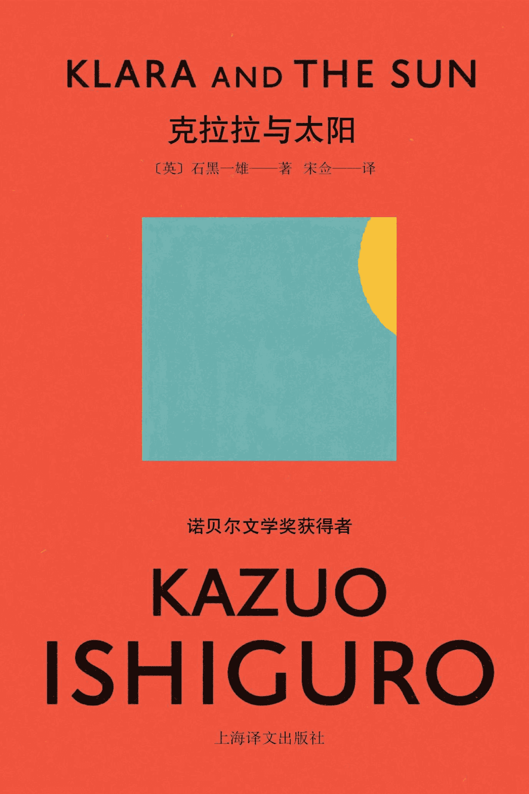

# 克拉拉，在光里

献给我的母亲

石黑静子

（1926-2019）

## 第一部

罗莎和我刚被安置时，位置在店堂中央靠杂志架的那边，从那里能穿过半扇玻璃盯着街面。外头是匆匆的白领、出租车、慢跑者、领着狗的流浪汉，还有 RPO 大楼的下半截。待我们熟了些，经理才准我们往前挪到橱窗后头。那一刻才真看清 RPO 有多高。运气好的时候，就能看见太阳在屋顶间赶路，从我们这面溜到 RPO 那面^((1))。

每次它从眼前滑过，我就把脸探过去拼命汲取，罗莎在旁边的话我也会招呼她。几分钟后就得回原位。新手期的我总怕自己一天比一天虚，店中区光线时好时坏。挨着我们的男孩 AF 雷克斯安慰我们，说太阳总有办法找到我们，无论在哪儿。他指着地面：“太阳的影子印在地上。怕了的话摸一摸，就又有劲了。”

当时店里没人，经理在红架子前忙，我不想打扰去请示。于是瞥了罗莎一眼，她回我空洞的一瞥，我便上前两步蹲下，把手伸向地上的光斑。指尖刚碰到，图案就黯淡散了。我拍打、摩挲，始终不见回来。站起时雷克斯说：

“克拉拉，你太贪了。你们女孩子就是这样。”

我刚来不久，却隐约觉得这不全是我的错，太阳大概就是在那一刻收回了影子。但他仍板着脸。

“你把养分全占完了，克拉拉。你看店里都快黑了。”

确实，光线沉了下来，人行道的禁停牌也灰扑扑看不清了。

“对不起。”我对他说，又转向罗莎，“对不起，我不是想独占。”

“因为你，晚上我就要没力气了。”雷克斯说。

“你在开玩笑，”我说，“我知道。”

“我没开玩笑。也许我现在就病了。后区的 AF 已经不太对劲了，这下更差了。你真贪。”

“我不信你。”我回他，可心里没底。望向罗莎，她依旧空茫。

“我已经不舒服了。”他说着低头驼背，身子一软。

“你刚还说太阳总能找到我们。你在开玩笑吧。”

后来我自以为他只是逗我。可那天我隐约觉得他无意间点出了一件我们不常谈的、令人不安的事。不久后那件事真的落在雷克斯身上，让我怀疑即便他当时在开玩笑，心里也有一部分是认真的。

一个晴朗的早晨，雷克斯已不在身边，经理把他调到了前区壁龛。经理总说每个位置都经过精算，无论站哪儿被挑中的几率都一样。

话虽如此，我们都清楚，顾客进门第一眼看的就是壁龛。雷克斯似乎很高兴轮到他了。我从中区看着他抬着下巴站在光里，全身洒满图案；罗莎有一次探身对我说：“哇，他看起来真棒！肯定很快就能回家了！”

雷克斯进壁龛第三天，一个女孩和母亲一起进来。我那时对年龄判断不准，估她 13 岁半，后来觉得是对的。母亲像个高职位的办公室职员，鞋子和套装能看出来。女孩直奔雷克斯，母亲则随意瞥了我们一眼后往后区走，两个 AF 坐在玻璃桌上晃着腿。母亲叫过女儿一次，没理。女孩抬头凝视雷克斯的脸，随后伸手抚过他的胳膊。雷克斯一动不动地对她微笑，按规矩回应兴趣。

“看！”罗莎低声说，“她要选他了！她爱他！他真幸运！”我用肘撞了她一下。

接着女孩又叫母亲，两人一起站到雷克斯面前打量，女孩时不时摸他。压低声音说话，我听见女孩说：“可他真完美，妈妈。他真漂亮。”又说：“哦，妈妈，求你了。”

经理无声地站在身后。母亲终于问经理：

“这是什么型号？”

“是 B2，第三代。遇到合适的孩子，雷克斯会是非常好的伴侣。我觉得他特别能激发年轻人的认真。”

“嗯，这位姑娘确实需要这个。”

“哦，妈妈，他太完美了。”

母亲又问：“B2，第三代，就是那批太阳能吸收有问题的批次吧？”

她就这么说，笑着说，雷克斯也笑着，孩子一脸困惑。

“不错，第三代早期确实有些小状况。”经理说，“但报道夸大了。照明正常就完全没问题。”

“我听说吸收不良可能导致后续问题，甚至行为问题。”

“太太，第三代已经给很多孩子带来快乐。除非你住阿拉斯加或矿井，否则不用担心。”

母亲继续盯着雷克斯，最后摇头：“对不起，卡罗琳。我看得出你喜欢他。可他不适合我们。我们会帮你找到合适的伙伴。”

雷克斯保持微笑，直到两人离开。事后我才想起他的玩笑，那些关于太阳、关于能汲取多少养分的问题，他可能已经琢磨一阵子了。

现在我明白雷克斯不是唯一一个这么想的。官方说法我们不受摆位影响，技术规范都有保障。可某个 AF 离开太阳几小时后，会慢慢没精神，担心自己有独一份的缺陷，一旦被发现就再也找不到家了。

这也是我们渴望进橱窗的原因。经理承诺每人都有一次机会，我们都盼着那天。名义上是代表商店面向街头的荣誉，实际上我们都知道橱窗里被挑中的概率更大。最不敢明说的原因，是太阳和养分。罗莎在机会将至时压低声音问我：“克拉拉，你说进橱窗后，我们会不会得到大量营养，以后再也不匮乏了？”

我那时太新，不知道怎么回，虽然心里也在问同样的问题。

机会终于来了，一早罗莎和我走进橱窗，小心不推倒陈设。店还没开，我以为铁栅会全落下，却见底部露出一道缝——经理来确认时抬了一点。光切出一道亮三角，爬上平台停在我们面前。脚往外伸一点就能沐浴其中。我知道无论罗莎的问题有无答案，这几天的养分已经够了。经理按下开关，栅栏全开，我们立刻被灿烂裹住。

我得承认，我还有另一个进橱窗的理由，与养分或被选中无关。与罗莎不同，我一直想看更多外头的细节。栅栏升起的瞬间，我意识到我和人行道之间只隔一层玻璃，能近距离完整地看以前只能瞥见的景象，我激动得几乎忘了太阳的恩惠。

那是我第一次看清 RPO 大楼其实由许多砖块拼成，而且是淡黄的，不是白的。它的高度远超我想象，大约二十二层，每扇窗下都有不一样的窗台。太阳在楼面划出一道对角线，一边近白，一边阴沉。可整栋楼其实都是淡黄。我能看见顶部的窗，偶尔看见有人站、坐、走动。楼下街道的行人，各种鞋子、纸杯、背包、小狗，我能送他们走过斑马线，走到第二块禁停牌，一直看到修理工在下水道前指点。出租车礼让行人时，我能看清司机拍方向盘的手，乘客头上的帽子。

白天就这样过去，太阳一直温暖着我们，罗莎很开心。但我注意到她几乎不看别处，两眼总盯着我们正前方第一块禁停牌。只有我指给她看时她才扭头，很快又失去兴趣回来看人行道和牌子了。

只有路人驻足时，罗莎的目光才会久一些。我们按经理教的，面带淡笑望向街对面，在 RPO 直线上凝视。很想细看走近的人，但经理说目光接触不雅。只有路人明确示意或说话时才能回应。

有些驻足者根本不是冲我们来的，他们脱鞋、摆弄手机。另一些会走到玻璃前盯着看，其中很多是孩子，正好在我们适合的年龄组，他们似乎很高兴见到我们，会指指点点、大笑、做鬼脸、敲玻璃、招手。

偶尔，一个孩子会走过来紧盯我们，脸上有一丝悲伤，有时带怒气，像我们犯了错。这种表情下一刻可能就换成大笑招手。但在橱窗第二天后，我学会了分辨差别。

我试着跟罗莎说过这事，她笑着说：“克拉拉，你想太多。我确信那孩子很幸福。今天整座城市都这么快乐。”

第三天结束，我还是跟经理提了。她夸我们“美丽又得体”。店里灯光已暗，我们在后区靠墙，有人翻有趣的杂志睡前读物。罗莎在我旁边快睡着了。经理问我这一天开不开心，我借机说了那些悲伤的孩子。

“克拉拉，你真了不起，”她压低声音，“你能注意到并领悟这么多。”她摇头叹句。接着说：“你得明白，我们是特别的商店。很多孩子很想选择你、罗莎、这里的任何人，可他们做不到。在他们眼里我们遥不可及。所以他们来橱窗前做梦，然后感到悲伤。”

“经理，一个那样的孩子家里会有 AF 吗？”

“也许没有。没有你这样的，肯定没有。所以如果有时一个孩子用奇怪的眼神看你，带着怨恨或悲伤，透过玻璃说不中听的话，不要多想。那孩子很可能只是沮丧。”

“没有 AF 的孩子一定很孤独。”

“是的，没错，孤独。”

她垂下眼，我等着。随后她笑了，伸手把我手里的杂志拿开：“晚安，克拉拉。明天保持今天的水准。别忘了，你和罗莎代表我们面对整条街。”

*

我们在橱窗的第四天，上午快过半时，一辆出租车放慢，司机探身让路，车停在店前路边。乔西从车里下来，目光就落在我身上。她苍白瘦削，步态和其他人不同，每一步都像在确认自己站得稳。我估她 14 岁半。

她走到近前，微笑着隔着玻璃说：“嗨，能听见我吗？”

罗莎仍望着 RPO。我可以直视回应，她便点了头鼓励。

“真的？”她说，“我自己都快听不见自己了。你真的能听见？”

我再次点头，她摇头不可思议。

“哇哦。”她回头小心地瞥向出租车，后排坐着两人指着马路对面。她很高兴大人没下车，于是又靠近一步，脸几乎贴玻璃。

“我昨天看到你了。”她说。

我回忆前一天，没印象，就惊讶地看她。

“别难过，你看不到我。我就坐在车里路过，车还挺快。所以我今天才让妈妈在这儿停车。”她又瞥车，“哇哦。她还在跟杰弗里丝太太说话。这样说话挺贵的，计价表一直跳呢。”

她笑时脸上有善意，但同一瞬间我第一次怀疑，她会不会就是经理说的那些孤独的孩子之一。

她瞥了罗莎一眼，说：“你朋友真可爱。”目光立刻回到我身上。静静看我几秒，我开始担心大人们要下车了。她开口了：

“知道吗？你朋友有一天会成为外面某个人的完美朋友。可昨天我们经过时，我看到的是你，我当时就想：就是她了，就是我一直在找的 AF！”她笑了，“不好意思。也许这话不礼貌。”再瞥出租车，“你是法国人吗？你看上去有点像。”

我微笑摇头。

“上回聚会来了两个法国女孩，”她说，“头发剪得那样又短又利落，就像你。好可爱。”她审视我片刻，我想我又看到了悲伤的迹象，但那时我还新，不太确定。接着她又明亮起来：

“嘿，你们这样坐着不热吗？要不要喝点什么？”

我摇头，举起双手示意太阳的光正洒下来。

“对哦。我傻了。你们喜欢待在阳光里，对吧？”

她又扭头看向群楼楼顶。那一刻太阳正卡在缝隙里，她眯眼回头看我。

“不知道你们是怎么做到的。我说是一直盯着那里也不会被闪花。我一秒都做不到。”

她按住额头把头扭开，这次不是看太阳，而是看 RPO 楼顶附近。五秒后又回头。

“我猜对你们来说，太阳是落到那栋楼后面的，对吧？你们从来没真正看到过落下的地方。那栋楼老是挡在那里。”她匆匆瞥向出租车，见大人仍坐着，才继续：“我住的地方没有东西挡住。从我楼上房间能清清楚楚看到太阳落到哪儿。看到他回去睡觉的明确位置。”

我露出惊讶。视野边缘看见罗莎也忘了规矩，诧异地盯着她。

“不过看不到早上从哪儿升起的，”乔西说，“被山和树挡住了。就像这里，我猜。总有东西挡着。可晚上就不一样了。那边从我房间望出去，真的是开阔空旷。你要能来我们住就知道了。”

一个大人钻出车，跨上人行道，接着是另一个。乔西没看见，或许听见了，语速加快。

“我发誓。你能看到他落下的明确位置。”

两个大人都是女性，穿高级别办公室装。我猜是乔西说的母亲。她一头黑发，瘦，虽然不像乔西那样瘦。现在她走近，我把年龄调到 45 岁。远看我以为她年轻些，近了才看清嘴角的沟壑和眼中愤怒的疲惫。我还注意到她伸手去拉乔西时胳膊在空中迟疑了一下，几乎要缩回，最终才搭上女儿肩头。

她们没入人流，朝第二块禁停牌方向走，乔西走得小心，母亲胳膊一直挽着她。有一次她们快走出视线时，乔西回头看了我一眼，打乱了步伐，还是向我挥手告别。

*

那天下午晚些时候，罗莎对我说：“克拉拉，你说奇怪不奇怪？我一直以为进橱窗就能看到外头有好多好多的 AF，都找到了家。可我们没看到很多。不知道他们去哪儿了。”

橱窗对面的世界

我从一开始就觉得罗莎身上有种特别的处事方式。她会不经意间忽略掉许多细节，即便我当面指给她看，她依旧抓不住那份微妙和意味。可偶尔她会冒出一句看似随意的感慨，一出口我就明白了。我脑中本能地想象，橱窗外的街面上应该会有不少 AF 快乐地陪着孩子散步，或是单独出门办事。我没有对自己坦白过，但心里确实有点惊讶，甚至隐隐失望。

“你说得没错，”我回应，目光从右向左扫过，“这会儿路人这么多，竟然一个 AF 都瞧不见。”

“是不是那边那个？刚从太平梯大楼走过去的那个？”

我们一起凝神看去，随后几乎同时摇头。

这个关于窗外的 AF 的话题本是她挑起的，却很快就被她抛在脑后，这完全符合她的脾气。等我后来终于在 RPO 大楼那侧的果汁摊看见一个少年牵着 AF 走过时，她甚至懒得抬头多看一眼。

可我却一直记着她那句话。每当难得出现一个 AF，我就会更仔细地盯着。很快我就察觉到一个规律：出现在 RPO 大楼那一侧的 AF 总是比我们这边多。就算有个 AF 不小心朝我们这边走来，带着孩子路过第二块禁停牌，他们也会绕到人行横道，绝不从店门前经过。而真正从我们窗前走过的 AF，神态总是怪异，会猛地加快脚步，把脸偏开。我不禁想，是不是这整间店、乃至我们两个，都让他们感到难堪。我在想，若有一天罗莎和我也找到了家，回想起自己曾与孩子分开、坐在店里展示的日子，会不会也产生同样的尴尬。可我怎么努力也想象不出罗莎和我会对店铺、对经理、对其他 AF 有那种复杂的情感。

于是我换了个念头：也许他们不是尴尬，是害怕。他们害怕我们这种新型号的出现，担心有一天他们的孩子会决定把他们淘汰，换成像我们这样的 AF。这大概就是他们路过我们门口时脚步踌躇、目光不敢投来的原因。窗外出现的 AF 少得可怜。也许隔壁街道、RPO 大楼后面那条路上挤满了 AF。说不定外面所有的 AF 都在刻意避开这条会经过我们店前的路线，唯恐自己的孩子看到我们之后上前搭话。

这些想法我没有告诉罗莎。反而每当见到窗外的 AF，我就会故意问：他们和孩子、和家满意吗？这个问题似乎让罗莎很兴奋，她把这当成了游戏，一边指一边说：“看，那边！克拉拉你看见没，那个男孩多爱他的 AF 呀，瞧他们笑得多开心！”

确实有不少组合看起来很和谐。可罗莎漏掉了许多信号。她常对着路过的情侣欢呼，而我再细看就会发现，尽管女孩对 AF 微笑，心里却可能在生气，甚至在想着残忍的念头。我总是能捕捉到这种落差，却一声不吭，让罗莎继续相信她想相信的。

我们在橱窗的第五天早晨，我看见两辆出租车几乎并排缓慢驶过，就在 RPO 大楼那侧，若是不留神会把它们看成一辆连体车。前面那辆稍快，中间出现一条缝隙，透过缝隙我看到对面人行道上走来一个 14 岁的女孩，穿着卡通衬衫，身边没有大人也没有 AF，神情自信却带点不耐烦。她的步行速度恰好跟出租车一样，便让我得以持续观察。随后缝隙拉大，我才发现她后面三步远跟着一个男孩 AF。不是偶然，是女孩规定的走法——她在前，他在后，保持距离。男孩 AF 接受了这安排，哪怕路人都能看出女孩并不喜欢他。我还能看出他步态里的疲惫，不禁想，拥有一个家却被孩子嫌弃，会是什么感觉？在这之前我从没想过一个 AF 会跟着一个鄙视自己的孩子，却依然不离不弃。前面出租车在斑马线前减速，后面那辆跟上，我便再也看不到他们。后来我一直张望，人群里也没有他们的身影，出租车也挡住了视线。

那段时间我只想和罗莎在橱窗里待着，从未想过别人，可相处也凸显了我们的差异。我并不是比她更想了解外面，她以她的方式同样好奇、爱观察，也迫切想成为一个更善良更有用的 AF。但我观察越多，想知道的越多；而路人偶尔流露的那些怪异情感让我困惑，进而着迷。我明白，若不能至少部分理解这些，我就无法在将来真正帮助我的孩子。于是我在人行道、出租车里、等红绿灯的人群中搜寻这种行为。

起初我想让罗莎跟我一样，可很快发现徒劳。进橱窗第三天的早上，太阳从 RPO 大楼后面升起时，两辆出租车停在我们这一侧，两个司机下车就打了起来。并非第一次见打架——很久前我们还很新时，围在窗前看过三个警察和一个醉酒的乞丐人及其狗在空房门口推搡。那次经理解释过是好意。可这次两个司机完全不同，他们像是要把对方彻底伤到，脸扭曲得可怕，嘴里不断吼出恶毒的话。路人先是惊讶后退，随后办公室职员和一个跑步者上前把他们拉开。尽管一个司机脸上带血，两人仍钻回车里，一切恢复如常。片刻后，就在这两辆车，一辆在前一辆在后，在同一个车道里安静排队等灯。

我试图和罗莎聊这件事，她一脸茫然：“打架？我没看到呀，克拉拉。”

“就在我们面前，两个司机。”

“哦，你说那两个出租车人！我看见了，但我不觉得他们在打架。”

“他们明明在打架。”

“不是的，他们在装打架，在闹着玩。”

“罗莎，他们在打架。”

“别想太多，克拉拉！他们只是在玩，而且玩得很开心，路人也很开心。”

最后我只好说：“也许你是对的。”她很快忘了这事，我却忘不掉。我会盯着一个路人，想他会不会忽然大怒；我会想象怒火扭曲的脸。最重要的是，我想用自己的头脑去感受那两个司机当时体验到的愤怒。我设想我和罗莎对彼此愤怒到如此地步，甚至动手伤人。这想法很荒谬，可我又想在脑中抓住那种情感的萌芽，最终却只会嘲笑自己。

橱窗里还有别的景象——我起初无法理解，后来在自己心里找到一种类似的影子，就像铁栅落下时吊灯在地板上的倒影。那位咖啡杯女士就是如此。

那是在我初遇乔西两天后的雨天。上午雨水浸透了街道，路人眯眼躲在伞下，RPO 大楼被雨蒙住，许多窗户亮着灯像天黑了。太平梯大楼正面左半边被打湿，像是楼顶漏水一路淌下。忽然阳光穿破云层，照在湿街和车顶上，路人成群走出。我在 RPO 那侧看见一个身披棕色雨衣的小个子男人，我估计他 71 岁。他在往外招手呼喊，脚都快踩到人行道边缘了，我担心他会冲进车流。经理那时正好也在橱窗里调沙发前的标牌，和我同时发现了他。他雨衣带子从身体一侧垂到脚踝，似乎没在意，仍在朝我们这边招手呼喊。人群瞬间挤在店门口，人动弹不得。随后人群稀疏，我前面出现一个小个子女人，背对我们，目光越过四车道的车流望向那个男人。看不到脸，但体型姿态让我估计她 67 岁。我在心里叫她咖啡杯女士，因为厚羊毛大衣包裹的她，看起来圆圆宽宽，像倒扣在红架子上的陶瓷咖啡杯。男人仍在招呼，她却没有回应，纹丝不动，即使有跑步者从她左右分开又汇合，鞋子在水洼里啪啪作响。

终于她动了，朝人行横道走去，起初缓慢后加快，又因红灯停下。男人不再挥手，却焦灼地盯着她。我又担心他会冲进车道。随后他走向自己一侧的横道口等待。灯变了，咖啡杯女士和其他人一起过马路，我看见男人把一只握成拳的手按在一只眼睛上，像商店里不安的孩子常做的动作。随后她来到 RPO 这一侧，和男人紧紧拥抱，看起来几乎融成一个人形。阳光落在他们身上。我看不见她的脸，男人的眼睛紧闭，我不确定他是极度开心还是极度不安。

“那两个好像很高兴见面。”经理说。

“是的，很开心，可也显得很不安。”

“噢，克拉拉，”经理轻声说，“什么都逃不过你的眼睛吧？”

她沉默许久，手握标牌望向街对面，那对男女早已走远。最后她说：“也许他们很久没见了。很久很久。也许上一次那样拥抱时，两人都还年轻。”

“经理，你是说他们失散了？”

她又沉默片刻：“是的，一定是。他们走散了。然后也许刚才是巧合，他们又找到了彼此。”

经理的声音和平时不同，她望着窗外却似乎没在看。我想路人看见经理久久站在橱窗里，会怎么想。

最后她转身经过我们身边，碰了碰我的肩膀：“有时候，在那种特殊时刻，人们的快乐里会夹着痛苦。我很高兴你观察得这么细致，克拉拉。”

罗莎问我：“她那话是什么意思，好奇怪。”

“没什么，她只是在说外面的事。”

我却一直想着咖啡杯女士和那个雨衣男人，想着经理的话。多年后罗莎和我各自找到家，若在街上重逢，那份快乐会像经理说的夹杂痛苦吗？

我们在橱窗的第二周刚开始的早晨，我正和罗莎说 RPO 那边的事情，忽然停住，因为乔西正站在我们面前的人行道上，她母亲在身边。这次背后没有出租车停着，可能刚下车，人流暂时被游客挡住了。现在人流平稳，我看见乔西对我笑，脸上一笑便透出善意。她还没走近，母亲俯身和她说话，一只手搭在她肩上。母亲穿着一件深色高级薄外套，风中飘动，有时让我想起高处电线杆顶的黑鸟。母女俩说话都看着我，乔西明显想过来，母亲却不放。按理我该像罗莎一样盯着 RPO，可我忍不住偷看，生怕她们消失。

终于母亲直起身，眼睛仍紧盯着我，手却收回了，乔西才迈步靠近。我觉得母亲让她一个人来是在鼓励，可那不放松的目光和抱胸扯着外套的姿态让我意识到还有许多我读不懂的信号。

“嘿，你还好吗？”她隔着玻璃说。

我点点头，竖起大拇指。

“抱歉来晚了，猜猜多久了？”我竖起三根半的手指。

“太久了，抱歉。想我吗？”

我点点头，挤出一个苦脸又立刻示意自己没生气。

“我也想你。我本来以为我会早点来的。你是不是以为我跑了，真的对不起。”笑容黯淡，“你是不是觉得有很多人来过你这儿。”

我摇头，她似不信。她回头瞥了母亲一眼，确认母亲没靠近，然后压低声音：

“老妈这样看着这边好奇怪，我知道的，一直盯着你。那是因为我告诉她，你就是我要的那一个，非你不可，所以她现在在打量你。对不起。”我又看到一闪而过的悲伤。“你会来的，对吧？只要老妈点头，一切顺利的话？”

我点头鼓励。她似乎安心了一些。

“太好了。”笑容回来，“你会喜欢那里的，我会让你喜欢的。听着，我想一开始就把话说清楚，所以有件事得说，别担心老妈听不见。看，我想你会喜欢我们家的，我的房间就是你的地方，不会把你塞进橱柜的。我们有太多好玩的事一起做。唯一的麻烦是，有时候……也许因为我身体不太好，不知道。但家里可能有件反常的事发生。我不确定那是不是坏事。有时候就是挺奇怪的。大部分时间你感觉不到。但我想先告诉你。因为有人跟你说一切完美，结果不完美，那感觉很糟。所以我现在就说。拜托了，说你还是想来。你会爱上我的房间，我知道会的。你还能看见太阳落下的地方，就像上次说的。你还是想来，对吧？”

我用最认真的方式点头。我还想告诉她若家里有困难我们一起面对，但隔着玻璃无法表达。于是我双手交握高举微微晃动，像我曾在行驶的出租车上见过司机对着招手行人的动作。不知她是否明白，这动作似乎让她开心起来。

“谢谢你。也许那不是坏事，也许是我想多了……”

母亲喊了一声朝我们走来，游客挡住去路，乔西才来得及说：“我很快就回来了，保证明天见。拜拜，但只是现在。”

乔西第二天没来，第三天也没来。等到我们橱窗第二周过半，我们的机会用完了。

从头到尾经理都温暖地鼓励我们。每天早上我们坐上条纹沙发等铁栅升起时，她总说：“你俩昨天很棒，今天继续加油。”每天结束她都微笑说：“漂亮，你们都做得很好，我为你们骄傲。”所以我从未想过会出错，当最后一天铁栅降下时，我以为她会再次表扬。经理当天的态度却让我惊讶：锁好铁栅后她直接转身走开，甚至没等我们。罗莎困惑地看我一眼，我们仍坐了片刻。屋里几乎全黑，最后我们起身走下平台。

面前是商店，我的视线能延伸到后排玻璃桌，但空间被切成十个方格。最右格是前区壁龛，最靠近壁龛的杂志桌被分到不同格，部分甚至出现在最左格。灯光调暗，其他 AF 在几格背景里靠墙准备入睡。我的注意力被中间三格吸引，它们呈现经理转身面向我们的不同侧面。一格只见她腰到颈半段，紧邻一格几乎全是她的两只眼睛。近的那只比另一只大，眼睛里满是善意和悲伤。第三格是她下颌和大半张嘴，透露出愤怒和沮丧。随后她完全转过身走向我们，商店重新连成一幅画面。

“谢谢你们，你俩都是。”她伸手依次轻抚我们，“非常感谢。”即便如此，我仍感觉到某种变化——不知怎的，我们让她失望了。

第二次进橱窗，我撞见了起死回生的乞丐

中区轮岗又开了。正好凑巧罗莎还在隔壁，我两依旧常作伴。可带班最近爱调位，我时常被挪到男款雷克斯或女款吉库身边站一整天。大多数班次还能瞥到窗外，继续打听街面消息。库廷斯货机抵达那阵，我被推到杂志台，面朝中区凹位，视野竟和从前橱窗时差不多。

征兆很明显，那玩意儿绝对不寻常。先来了一群维修工封街，用木板把人行道一段隔开。出租车司机按喇叭抗议。随后钻机作业，地面被凿开，人行道被掀了几段，橱窗里的两具展示体吓得发抖。噪音大到罗莎得双手捂耳，店里仍有客人进出。带班对每位推门而入的顾客都道歉，哪怕响动跟我们无关。还有个客人指着外面说污染危险。我当时还以为库廷斯是来治污的，雷克斯却说它就是为造更多污染而造的。我不信，他回我：且看吧，克拉拉。

他说中了。侧面写着“库廷斯”三字的机身先是一声尖啸，比钻声轻，却不比吸尘器温柔。顶篷伸出三根短烟囱，先吐白烟，很快变黑，最后聚成一股粗壮的烟柱。

再看向外头，街面在我眼里被切成好几条竖幅。不用探头就能看清其中三条。烟的浓淡在不同幅面间不一样，像在做灰度对照。即便在最黑的那条里，细节仍能辨出。能认出维修工的木板围栏，和半截出租车，竟像长在了一起。旁边幅面里，一根金属杆斜切进角落，是高处信号灯的一部分，上头还停着一只鸟的黑影。还见跑者从一块幅面窜进另一块，跨过去后身形和轨迹都变了。污染加重后，杂志台这边也看不见天空的缝隙，擦得锃亮的玻璃尽是污迹。

橱窗里等了许久的那两具男款让我心疼。他们仍保持坐姿，我却看见其中一具举臂遮脸，仿佛污染会穿透玻璃。带班上到平台低声安抚，等她下来重新整理手镯推车里的饰品时，我看得出她自己也烦躁。看样子她本想出去找维修工理论，可她留意到我们，笑了笑说：

诸位请听我说。这事糟糕，但别担心。我们忍几天，很快就会过去。

第二天、第三天机体仍在，白天几乎成了黑夜。我在地板、壁龛、墙面上找太阳的痕迹，没找到。太阳在努力，第三天下午烟更重时，它的轮廓却黯淡地出现了。我担忧问带班我们还能不能得到养分，她笑道：那玩意儿来过好几次，店里没人因此生病，放宽心吧，克拉拉。

即便如此，连续四天污染后我明显感觉自己在衰弱。有客人时我努力撑着，没客人时我偶尔会让姿态松下去，这时雷克斯会碰我胳膊让我站直。

又一个清晨铁栅升起时，机体和那段异样的街面一起没了。污染散去，天隙回来了，蓝得发亮，太阳把养分洒进店里。出租车重新顺畅行驶，司机们看起来很开心。路过的跑者脸上也有笑。机体在的那段时间我一直担心乔西想回来却被挡住，现在解除了，我觉得如果她要回来，今天最有可能。可到下午过半我才意识到这念头太不现实。我不再在街上搜寻她的身影，转而更专注于认识外头世界。

装置消失两天后，一位留着短刺猬头的女孩走进来，我估计她十二岁半。那天她像跑者一样穿着，亮绿背心，两条胳膊细得露到肩。父亲穿一套高级休闲办公装。两人起初没多说话。我一眼看出女孩对我有兴趣，她只是飞快瞥我一眼就回前区。一分钟后她又来，假装认真看我前面的手镯推车。东张西望确认父亲和带班没注意，她试探把身体靠在推车上，脚轮往前滚了一两寸，一边看我一边笑，像这挪动是我们的小秘密。她把推车拉回原位，又冲我咧嘴，然后喊老爸。父亲没回应，被玻璃桌上坐着的两具展示体吸引住了。她最后又看我一眼，回到父亲身边。两人压低声音交谈，不时瞟我，明显在讨论我。带班注意到了，从桌后起身站在我身边，双手交握在前。

又聊了很久，女孩大步从带班身边走来，直面我。她挨个抚摸我两只手肘，右手握住我的左手，直视我的脸。表情严厉，手却轻轻捏我，像又是我们的小暗号。我没有笑，保持面无表情，视线越过她的刺猬头盯着对面墙的红架子，尤其是倒扣在第三层的陶瓷咖啡杯。女孩又捏了两下，第二下没那么轻，我仍不看她，也不笑。

与此同时父亲也轻步走来，生怕打扰这不同寻常的时刻。带班在他身后。我都注意到了，却仍盯着红架子和咖啡杯，那只被握住的手故意松软，只要她一松，我的手就会沉回身侧。

我越来越强烈地感觉到带班的目光在我身上。这时她说：克拉拉很棒，她是我们最好的展示体之一。这位小姑娘或许会对刚到货的最新B3型号感兴趣。

B3？父亲听上去很兴奋，你们已经有B3了？

我们和供应商有专属合作，刚送到还没调校好。我很乐意为你们展示一下。

刺猬头女孩又捏我一下手：可老爸，我就想要这个。她正合适。

可他们有新的B3，宝贝。你不想看一眼吗？你认识的人里没有一个有B3呢。

漫长等待后，女孩松开了手。我任手臂垂下，眼睛仍看着红架子。

这些新B3到底有什么了不起的呢？她转身朝父亲走去。

她牵我时我一直没想罗莎，现在才意识到她就站在我左边，一脸惊讶看着我。我本想让她别看，最后还是决定继续盯着红架子，直到女孩、她父亲和带班都走到店后。能听见父亲被带班某句话逗得大笑，等我能望过去时，带班已在打开店最后面的员工专用门。

真不好意思，这里有点乱。

父亲说：能进来我们很荣幸。对吧，宝贝？

他们进去了，门关上，听不见对话了，不过我一度听到刺猬头女孩的笑声。

上午后半段依旧忙。带班帮父亲填新B3的送货单时，又有顾客进来。直到下午大家喘口气，带班才走到我跟前。

我对你今天上午的表现很惊讶，克拉拉。我没想到你会这样。

我很抱歉，经理。

你怎么啦？你平时不是这样的。

我很抱歉，我不是想制造难堪。我只是觉得对那个孩子而言，我也许不是最好的选择。

带班看着我。或许你是对的，我相信那个女孩会对那具B3男孩很满意的。即便如此我仍很惊讶。

我很抱歉，经理。

这次我支持了你。但没有下回了。是顾客挑选展示体，千万别弄反了。

我明白，经理。我又轻声补一句：谢谢你，经理，谢谢你今天所做的一切。

不用谢，但别忘了，没有下次了。

她正要走，又折返回来。

不会吧克拉拉，你以为自己已经有约了？

我以为她要像那次训斥在窗前嘲笑乞丐的两具男款那样训我。她却把手放在我肩上，声音比之前柔和：

让我告诉你一件事，克拉拉。孩子们总爱许诺。他们在窗前许诺会回来，求你别让别人带走你。这种事一直在发生。但十有七八，那孩子永远不会回来。或者更糟，他回来了却看也不看等他的展示体，转身选了另一个。孩子们就是这样。你一直在观察、学习，学了很多。现在这是我要教你的另一课。你明白了吗？

是的，经理。

很好，那就到此为止。她碰碰我胳膊，转身离开。

新到的B3——三具男款——很快调校好就位。两具直接进橱窗配上大招牌，第三具得到前区壁龛的位置。第四具B3当然已经被刺猬头女孩买走运走，我们连见都没见过。

罗莎和我仍在中区，只是新的B3到后我们被移到了红架子那侧。橱窗轮值结束后，罗莎养成新习惯，复述带班的话：什么店里每个位置都是好位置，中区被选中的几率和橱窗或前区壁龛一样大。对罗莎来说这话不假。

那天开始并无异常迹象。出租车和路人往来正常，铁栅升起的样子正常，带班打招呼的方式也正常。可是那天晚上罗莎被买下，消失在员工专用门后准备发运。我一直以为在她离开前我们会有时间把一切细谈。可事情太快，男孩和母亲一进门就选中她，我几乎没留意到两人身上的有用信息。两人刚走，带班刚确认她被买下，罗莎就兴奋不已，我们根本没法好好谈。我想再温习她必须牢记的事，帮助她以后做个好展示体；想和她回顾带班的教导，解释我对外面世界的认知。可她只是连珠问问题：男孩房间天花板高吗？那家人开什么颜色车？她能看见大海吗？他们会让她把野餐装进篮子吗？我提醒她要记得太阳的养分，多么重要，还自言自语问她房间是否方便太阳照进来，罗莎对这些全不感兴趣。接着不等我们反应时间就到了，罗莎该告别商店，走进后面的房间。我看见她回头给我最后一个微笑，便消失在门后。

罗莎走后的日子我仍在中区。橱窗里那两具B3相隔一天被人买走，男款雷克斯也在前后找到了家。很快又来了三具B3，全是男款，带班把他们放在我对面，杂志桌那边，和两具旧型号男款一起。玻璃展品推车隔着我们，我听不见他们说话。却有充足时间观察，我看到两具旧男款如何热情欢迎新B3，给他们各种建议。我据此猜他们相处不错。后来我开始注意到奇怪的事。比如某天上午，随着时间推移，那三具B3会一点点从两具旧B2身边挪开。或者一具B3突然对窗外某物感兴趣，走过去查看，回来时站位稍稍偏离带班选定的位置。四天后确凿无疑：那三具新B3在刻意远离两具旧展示体，这样顾客进店时B3看起来就像一个独立小团体。我起初不愿相信——不愿相信展示体们，尤其是带班亲手挑选的展示体们会这样做。我为那两具旧展示体难过，随即意识到他们什么也没察觉。另一件他们没察觉我却很快注意到的事是，每当一具旧男款不厌其烦向B3们解释一样东西时，后者如何交换狡黠眼神与暗示。据说新B3们获得了各种改进提升。可如果他们的头脑能生出这样的想法，他们怎么能做孩子们的好展示体呢？如果罗莎还在我身边，我一定会和她讨论所见的一切，当然，那时她已不在了。

一天下午，太阳的目光一直延伸到商店最里面时，带班来到我身边说：

克拉拉，我决定再给你一次进橱窗的机会。这回只有你一个，但我知道你不会介意。你一直对外面的事那么感兴趣。

我大吃一惊，只看着她没说话。

亲爱的克拉拉呀，以前我一直替罗莎操心呢。你不着急，对吧？你千万别着急。我一定会让你找到家的。

我不着急，经理。我差点说出口乔西的事，还好最后关头忍住了，因为想起刺猬头女孩来过后我俩的那次谈话。

那就从明天起，带班说，只有六天。我还会给你一个特价。记住了，克拉拉，你又要代表整间商店了。所以，全力以赴吧。

第二次橱窗经历和第一次的感觉不同，但不是因为罗莎不在我身边。外面的街道和以前一样生气勃勃，但我发现自己得多花些力气才能为眼前的事物兴奋。有时一辆出租车放慢，一个路人俯身和司机交谈，我会试图猜他们是朋友还是敌人。另一些时候，我看着小小人影从RPO大楼窗前走过，试图理解他们动作有何意味，想象每个身影在各自长方格子里现身前在做什么，之后又会做什么。

我在第二次橱窗经历中观察到的最重要一件事发生在乞丐人和他的狗身上。那是第四天下午，天色阴沉，一些出租车亮起了小灯。我注意到乞丐人不在老地方，他平时总坐在RPO大楼和太平梯大楼中间那扇空房门前和路人打招呼。我起初没多想，因为乞丐人经常想走就走，有时一走就是好久。可是后来当我朝街对面望去时，我意识到他原来就在那里，他的狗也在，我之前没看到，是因为他俩都躺在地上，紧靠空房门免得挡路，从我们这侧看去，你完全可能把他们当成城市工人有时落在那里的袋子。可是，当我透过人流间隙持续观察他们时，却发现乞丐人一动也不动，他怀抱中的狗也是。有时一个路人会注意到他俩，暂时停下脚步，但很快又抬脚走开了。最后，太阳几乎已经落到RPO大楼后面，乞丐人和狗却还是同样那副他们已经保持了一整天的老样子——显然他们已经死了，尽管路人们对此一无所知。我感到一阵伤悲，虽说这也算得上是一件幸事——他们死在了一起，彼此相拥，直到最后还在试图帮助对方。我希望有人会注意到他们，把他们带去一个更好的地方，更安静的地方；我想着要和带班说说。可是，等到我该从橱窗里下来，准备过夜的时候，她却看上去非常疲惫，非常严肃，我决定还是什么也不说为好。

第二天早上铁栅栏升起，天气真是好极了。太阳向大街上，向大楼里倾洒着他的滋养，我朝乞丐人和狗昨天死去的地方看去，却发现他们竟然没有死——太阳发出的某种特殊的滋养救了他们。乞丐人还没有站起来，但一脸微笑地坐着，背靠空房门，一条腿伸着，另一条腿弯着，好把胳膊架在膝盖上；而他空出来的那只手，这会儿正爱抚着狗的脖颈——他的狗也活过来了，正摇头晃脑地看着来往路人。他俩都在如饥似渴地吸取太阳的特殊滋养，正在以肉眼可见的速度强壮起来；看得出来，很快，也许不到下午，乞丐人就能重新站起来，一如既往地在空房门前和路人开心地交谈了。

一眨眼，我的六天时间就结束了；带班告诉我，我为商店争了光。我在橱窗里的这些日子，进店人数，据她说，超出了平均数，听到这话我很高兴。我感谢她给了我第二次机会，她则微笑着说，她确信我无须再等太久了。

十天后，我被挪到了后区壁龛里。带班知道我多么爱看外面的世界，因此向我保证我只需在那里暂待几日，然后就能重返中区了。再说了，后区壁龛也是一个非常好的位置；一点不错，我发现我根本就不介意。我一直很喜欢现在坐在靠后墙的玻璃桌上的那两具展示体，这下我们挨得近了，就可以说上很久的话了——我会朝他们那边招呼，只要店里没有顾客。不过呢，后区壁龛是在拱门后面，因此从这里不但看不到外面，就连商店前区也很难看到。如果我想在顾客一进门的时候就窥见他们，就得往前探出头去，一直探过拱门的一侧，而即便是那样——即便我往前再走几步——我的视野依然会受到杂志桌上的银花瓶还有站在中区的那几个B3的干扰。另一方面，也许是因为我们离街道更远了吧——或者是因为商店后区的天花板倾斜向下的角度——我能更清晰地听到屋里的动静了。这就是为什么一听到她的脚步声，根本不用等她说话，我就知道乔西进店了。

那家人为什么要喷那么多香水？我差点要呕了。

香皂，乔西。这是母亲的声音，不是香水。手工香皂，而且非常精致。

反正，上回不是那家店。是这家。我早跟你说了，老妈。我听着她迈开小心翼翼的脚步从地板上走过。接着她又说道：肯定就是这家店了。可她不在这儿了。

我往前迈了三小步，直到我能透过银花瓶和B3中间的空隙看到母亲，她的目光正盯着某样我视野之外的东西。我只能看到她的半边脸，但我觉得她似乎比我上次看到她时的模样更加疲惫了——那一回她是站在人行道上，就像一只迎着风、落在高处的黑鸟。我猜她是在看着乔西——而乔西则是在看着前区壁龛里那个新到的女孩B3。

过了许久，屋里都没有人说话。这时母亲开口了：你怎么看，乔西？

乔西没有回答，我听到母亲从地板上走过的脚步声。此时我感受到了店里那种特殊的沉寂——只有当所有的展示体都在屏息聆听，揣测同伴能否售出时，才会这样地静默无声。

孙怡是B3，当然咯，带班说，我所见过的最完美的B3之一。

我现在能看见带班的肩膀，但依然看不到乔西。这时我听到乔西的声音说：

你真的很棒，孙怡。所以，请不要误会我。只是……她欲言又止。我又听到了她小心翼翼的脚步声；接着，我终于能看见她了。乔西正在商店里举目四顾。

母亲说：我听说这些新B3有着很好的认知与记忆功能。不过有时候他们不那么有同理心。

被遗忘的十年，拱门下的相遇

经理从鼻腔里挤出一声介于叹气与笑意的音色。起先也许真有那么一两台 B3 让人觉得有点轴，但他向我保证，眼前这位绝对不会闹脾气。

“如果可以的话，”母亲开口，“我想直接和她聊几句，我有几个问题想问。”

“妈，”乔西的声音从我视线之外传来，她又退到一边了，“干嘛非要这样？她不错我知道，可她不是我想要的那款。”

“乔西，我们没法无止境地找下去。”

“可上回就是这一家店，我跟你说过的。她当时就在橱窗里。我猜我们只是来晚了。”

不巧得很，就在我被调到店面后区的那一刻乔西出现了。即便如此，我仍坚信她终会走到我所在的区域，一眼认出我，这也是我当时纹丝不动的缘故。或许还有更深的原因：在认出进门的人是谁的瞬间，喜悦涌起的同时恐惧也钻了进来。那份不安和经理前一天说过的话有关，孩子们爱许诺却常食言；就算回来，也会视而不见曾经承诺过的那个伙伴，转而挑别人。也许正因如此，我才选择沉默地等。

这时经理的声音又起，语气里添了先前没有的味道。

“不好意思，小姐。您该不是在找一个特定的伙伴吧？就是您之前在这里见过的那位？”

“是的，太太。你们前不久还把她放在橱窗。她真的很可爱。也很聪明。看上去像法国人，你知道吗？短发颜色很深，穿的都是深色衣服；她有一双极温柔的眼睛，而且聪慧得很。”

“我想我知道您指谁，”经理说，“您跟我来，我们马上就能对上号。”

直到此时我才起身走到她们能看见我的地方。整个上午我都待在太阳图案之外，现在我踏进了两块明亮相叠的长方形里，就在这时经理站到拱门前，乔西跟在他身后。乔西看清我时，脸上瞬间被喜悦填满，脚步也随之加快。

“你还没走！”

她比上回更瘦了。她用那不太稳的步伐不断靠近，我以为她要拥抱我，可在最后一刻她停住，直视我的面庞。

“天哪！我还以为你已经走了！”

“我为什么要走？我们说好要等。”

“是啊，”乔西说，“是啊，我想我们是说好了。是我把事搞砸了。拖得太久。”

我冲她笑了，她回头喊道：“妈！就是她！我一直找的就是这个！”

母亲缓缓朝拱门走来，随后停下。那一刹那三个人都看着我：乔西在最前笑得灿烂；经理在她身后也在笑，但神情里透着一丝谨慎，我读出那是她想传达的信号；最后是母亲，眼眯成一条缝，像路上的人辨认出租车是否空着那样费力。我一看见她以及她看我的眼神，那种恐惧——在乔西喊出“你还在”时几乎散去的恐惧——又回来了。

“我不是故意等这么久的，”乔西还在说，“我只是有点小病。现在好了。”说着又回头喊：“妈？我们能不能现在就把她买下，免得别人先抢走？”

房间里安静了一阵，随后母亲平静地说：“我猜这不是 B3。”

“克拉拉是一台 B2，”经理说道，“第四代——有人说这一代从此再没有被超越。”

“但不是 B3。”

“B3 的创新确实令人惊叹。不过也有顾客觉得，对某些孩子而言，一台顶尖的 B2 仍是最合适的伴侣。”

“明白了。”

“妈。克拉拉就是我要的那个。别的我都不要。”

“稍等一下，乔西。”她又问经理：“每一台人工朋友都是独一无二的，对吧？”

“一点不错，太太。尤其是这个级别的。”

“那么，这台的独特之处在哪呢？这个……克拉拉？”

“克拉拉有很多特别之处，说起来能讲一上午。不过如果要我挑一个特质，我一定要说她对观察与学习的热爱。她能吸收并融合身边看到的一切，这种本领很惊人。所以在店里所有 AF 中——包括 B3——她的理解力目前是最成熟的。”

“是吗。”

母亲再次眯眼看我，随后朝我靠近三步。

“你不介意我问她几个问题吧？”

“请便。”

“妈，拜托……”

“不好意思乔西。我和克拉拉说话时，你先站那边等一会儿。”

于是只剩下母亲和我。我努力维持笑容，却并不容易；恐怕恐惧还是泄露出来了。

“克拉拉，”母亲说，“别往乔西那边看。现在告诉我，不要看：她的眼睛是什么颜色？”

“灰色的，太太。”

“很好。乔西，我要你绝对安静。现在克拉拉。你女儿的声音。你刚刚听到了。你说说，她的音高如何？”

“她说话的音高在中央 C 上方的降 A 到高八度 C 之间。”

“是吗？”沉默片刻后母亲说：“最后一个问题，克拉拉。你有没有注意到我女儿走路的方式？”

“她的左髋可能有问题。右肩也会痛，所以乔西走路时会避免右肩的突然动作或不必要的冲击。”

母亲思索着我的话。接着说：“好吧克拉拉。看来你懂得不少。那么能不能请你重现一下乔西的步态？你愿意吗？现在？就我女儿的步态？”

越过母亲的肩膀，我看见经理的嘴唇动了动，似乎要说话。可她没有出声，只是迎上我的目光，极轻地对我点了点头。

于是我迈开脚步。我意识到不只是母亲和乔西，整间店都在注视、聆听。我走过拱门，走进地板上太阳的图案。然后走向店中区的几台 B3 和玻璃展品推车。我尽力复刻我所看到的乔西的步态——第一次是在她下出租车时，罗莎和我当时在橱窗里；第二次是四天后，母亲刚松开按住她肩膀的手，她便冲向橱窗；最后是刚刚，她迫不及待朝我走来，眼里满是欣慰与快乐。

我走到玻璃展品推车前，绕开它，一边尽量不碰到推车旁那个男孩 B3，一边保持着乔西的步态特征。

可就在我要原路返回时，我抬眼一瞥，正好看到母亲，而我看到的东西让我停住脚步。她仍在专注地看我，但目光似乎穿透了我，落在我身后很远的地方，仿佛我是一块玻璃，她在看玻璃后面。我的脚悬在空中，脚跟离地。店里笼罩在一种怪异的寂静中。这时经理开口了：

“如您所见，克拉拉有着超乎寻常的观察力。我从未见过像她这样的人。”

“妈。”这回乔西的声音很轻，“妈。拜托了。”

“很好。我们要她了。”

乔西急切地朝我走来，伸臂把我拥入怀中。我的目光越过孩子的头顶，看见经理快乐的笑，还有母亲憔悴严肃的脸——她正低头在单肩包里翻找着什么。

* * *

（1）在主人公以第一人称讲述的这个故事中，出现了许多特定的人、物、地点名称。这些名词在英文原文中是以首字母大写的形式出现的，不同于一般的行文规则，暗示这些名称在主人公头脑中的独一无二性，如 Beggar Man（乞丐人）、RPO Building（RPO 大楼）、the Sun（太阳）、the Manager（经理）等等。在译文中，这些特定的名词都统一以楷体出现。——译注

## 第二部
厨房的动线最难掌握，因为里面的物件随时会改换相对位置。我现在才懂得经理为何把店里的东西——想必也是出于体贴——摆得井井有条，即便是手镯或银耳饰盒那样的小件。而在乔西家里，尤其是厨房，梅拉尼娅管家却总把东西挪来挪去，逼着我重新学习。某天早上，她在四分钟里就把食物搅拌器的位置换了四次。不过，一旦我确认了中岛的重要性，一切就简单多了。

中岛位于厨房中央；也许为了强调它的不动性，这里贴着淡棕色的瓷砖，像大楼的砖块。中岛中央嵌着一个锃亮的水槽，三只高脚凳沿着岛体一侧排开，供人落座。最初的日子里，乔西还算健壮，常坐在中岛边写作业，或只是用铅笔和速写本放松。一开始我很难坐上高脚凳，因为脚够不到地面；若想晃腿，脚又会被凳子框架上一根横杆挡住。但很快我便学乔西的样子，把手肘牢牢支在中岛上，从此感觉安全多了——尽管梅拉尼娅管家随时可能从我身后伸手打开水龙头，放出哗哗的水流。那件事第一次发生时我吓了一跳，差点失去平衡，可身边的乔西几乎纹丝不动，我也很快明白几星水花并没有什么可怕。

厨房格局很适合光线进来。大窗户开向广阔的天空和几乎没有汽车或行人的户外。站在窗前能看到公路翻过山头，穿过远处的树林。厨房里常充盈着太阳最好的滋养，而且除了大窗，高高的天花板上还有一个天窗，可用遥控器打开或隐藏。梅拉尼娅管家经常在太阳正好送来滋养时用遥控器拉下百叶帘遮住天窗，起初这让我很担心。但我很快发现乔西体温容易升高，于是学会了在太阳投下的图案过强时，自己使用遥控器。

让我感到陌生地不仅仅是车流人流的稀少，还有其他 AF 的缺席。当然我没指望房子里会有别的 AF，而从许多方面说，我很高兴自己是唯一的，因为可以把全部注意力放在乔西身上。但我也意识到自己已经多么习惯通过观察身边其他 AF 来做出自己的判断，而这又是我必须调整的地方。我时常望着屋外翻过山头的高速公路——或卧室后窗外田野那头的景色——意识到自己在搜寻远处某个 AF 的身影，随即又想起这种事不可能发生，因为这里离城市和其他房子太远了。

我搬进那栋房子最初的日子里，愚蠢地把梅拉尼娅管家当成了经理那样的人物，因而产生了一些误会。比如我一度以为她有责任向我介绍新生活的各个方面，因此可以理解她觉得我频繁跟在她身旁既奇怪又讨厌。当她最终愤怒地转身吼出“AF，别再跟着我了，滚开！”时我吃了一惊，但很快认识到她在这栋房子里的角色与经理迥异，错的人是我。

即便考虑到这些因我而起的误会，我也很难不相信梅拉尼娅管家从一开始就对我的存在心存芥蒂。她待我始终礼貌，尤其最初几天还试图用做小事取悦她，她却从不回应我的微笑，也不跟我说话，除了发号施令或斥责。如今把这些记忆整理起来，我能明显看出她的敌意与她更大的担忧有关——她担心会有什么事发生在乔西身边。可当时我很难为她的冷漠找到解释。她似乎总是想缩短我和乔西相处的时间——这与我的职责相悖——而且起初她甚至试图阻止我进入厨房，在母亲喝那杯匆忙咖啡、乔西坐下吃早餐时出现。多亏乔西的强烈坚持——母亲最终做出了有利于我的裁决——我才获准在每天早晨这个重要时刻进入厨房。即便如此，梅拉尼娅管家仍坚持要我在乔西和母亲坐在中岛边时一直站冰箱那里，直到乔西又抗议几回后，我才终于获准与她们同坐。

母亲的那杯匆忙咖啡，如我所说，是每天早晨的重要时刻，而我的任务之一就是适时叫醒乔西，免得迟到。然而尽管我一催再催，乔西常要到最后一刻才肯起身，然后从套房卫生间里扯着嗓子大喊：“快点，克拉拉！要迟到了！”尽管我已站在门外的楼梯口上焦急等待。

下楼后我们会看到母亲正坐在中岛旁，边喝咖啡边盯着她的矩形板，梅拉尼娅管家则候在一旁，随时准备续杯。乔西和母亲往往没太多时间交谈，但我很快发现这丝毫不影响这一刻的重要性，因为乔西能够在母亲喝这杯匆忙咖啡时陪她坐一会儿。有一次乔西被病痛折腾了大半夜，我叫醒她后又让她睡过去，以为多休息有益。等她醒来，她对我大吼了几句；尽管很虚弱，她仍赶忙下楼。可当她从套房出来时，我们听到了母亲的汽车从楼下碎石地上开走的声音；我们匆匆赶到前窗边，刚好看到她的汽车驶向远处的山头。乔西没有再对我吼叫，可进入楼下厨房后，她用早餐的整段时间内一直没有微笑。从那以后我就明白，如果她没能陪母亲喝那杯匆忙咖啡，她这一整天都有可能被孤独感渗透，无论有什么别的事填满余下时间。

偶尔母亲早上不必着急；当她穿上那套高级服装，手袋靠在冰箱上的时候，她会慢条斯理地喝咖啡，甚至从高脚凳上起身，一手拿杯子一手端托盘，在房间里走动。有时她会站在大窗前，沐浴在太阳早晨的图案中，说：

“知道吗乔西，我觉得你已经放弃彩色铅笔画了。我喜欢你现在画的黑白画。可我真的很怀念你的彩笔画。”

“妈，我已经认清了我的彩笔画有多丢人。”

“丢人？噢，你在说什么！”

“妈，我画彩笔画就像你拉大提琴。事实上，只会更糟。”

说这话时，母亲脸上绽开微笑。她不常笑，但每当她笑时，她和乔西的笑容惊人相似：整张脸似乎都洋溢着善意，而那些平时制造紧张表情的皱纹，此时会折叠重组，传达出幽默与温和。

“我得承认，我的大提琴演奏水平，哪怕在最辉煌的时刻，听起来也像吸血鬼德古拉的奶奶。可你对色彩的运用更像是，嗯，夏夜的湖泊。诸如此类。你能用色彩做出一些很美的东西，乔西。做出别人连想都没想过的东西。”

“妈，孩子的画在父母眼里总是那样的。这和进化有关。”

“你猜怎么着？我觉得这一切都是因为有一回你带到聚会上的那张你画得很棒的传单。上上次聚会的时候。那个姓理查兹的女孩说了两句有点讽刺的话。这话我之前就跟你说过，我知道，可我还是得再啰嗦一遍。那位年轻女士嫉妒你的才华。所以她才会那么说。”

“好吧。如果你真这么想，妈，我说不定真会重拾彩笔画呢。而作为回报，你或许也可以重拾你的大提琴。”

“哦，没门。那一切对我来说已成过去。除非有人急着要给他们自拍自导的僵尸片找配乐。”

然而另有一些早晨，母亲自始至终紧绷着脸，没有笑容，哪怕那杯匆忙咖啡她不必急着喝完。如果乔西这时说起她那台矩形板里的家庭教师，竭力拿他们打趣，母亲会一脸严肃地听着，然后插嘴：

“我们可以换老师的。如果你不喜欢这家伙，我们随时可以换。”

“不，妈，拜托。我只是随便说说，好吗？事实上这家伙比上一个要好多了。而且他还挺好玩的。”

“很好。”母亲这时会点头，依然严肃，“你总是愿意公正地给别人一个机会。这是个很好的品质。”

那些日子里，乔西身体还不错，总是喜欢等母亲下班回家后再吃晚饭。这意味着我们会上楼去乔西的卧室等待母亲归来——一边看着太阳去往休憩之所。

正如乔西许诺的那样，透过卧室后窗，我们的视线能毫无遮拦地越过田野，直达地平线，看着太阳在结束一天后沉入大地。尽管乔西总说“那片田”，那事实上是彼此相接的三片田，你只要细看，能看见标示田间边界的桩子。三片田里的草都长得很高，每当起风时，草便随风摇摆，看起来像有个隐身的路人在草丛中匆匆走过。

卧室后窗外的天空比商店窗外那道天空的缝隙大得多——而且变化莫测。有时它是果盘里柠檬的颜色，接着又会变成石案板灰色。在乔西不太舒服时，天空会变成她的呕吐物和灰白排泄物的颜色，甚至呈现一道道血色。有时，天空会被分割成一组紫色方格，每一格的色度都与相邻的一格有所不同。

卧室后窗边摆着一张米色软沙发，我在脑海中称它为“纽扣沙发”。尽管沙发面朝屋里摆放，乔西和我却喜欢跪在上面，胳膊抵住靠背，久久望着窗外的天空和田野。乔西清楚我有多爱看太阳的最后一程，因此我们只要有机会就会爬上纽扣沙发观看。有一次母亲回来得比平常早，和乔西正坐在中岛边的高脚凳上说话——为了不打扰她们，我这时站到了冰箱旁边。那天晚上母亲兴致很高，语速很快，讲着办公室里各路人物的滑稽事，时不时打住话头哈哈大笑，有时一气笑上很久，差点笑背过去。两人正说到一半，母亲眼看着又要大笑起来，可就在这时乔西插嘴道：

“妈，这故事真有意思。可你介不介意克拉拉和我上楼去我的房间待一会儿？克拉拉真的很喜欢看日落，我们现在不上楼可就看不着了。”

她说这话时，我环顾四周，看到厨房里已经充满了落日的光芒。母亲紧盯着乔西，我以为她马上要发怒。可是很快，她的脸庞柔和下来，转而露出善意的笑容，嘴里说：“当然可以，宝贝。你们去吧。去看你们的日落。然后我们就吃晚饭。”

除了田野和天空，我们透过卧室后窗看到的景物中，还有一样东西引起我的好奇，那就是最远那片田野尽头一个四方形的黑影。草丛在它周围变幻不定，它却一动不动；而当太阳沉向大地，眼看就要碰到草丛时，那个黑影在他的光芒面前依然静立。也正是在那天傍晚——那天乔西为了我甘冒惹母亲生气的风险——我第一次向她指出了那个黑影。随着我的手指，她在纽扣沙发上撑起身体，两手在眼睛上方搭起凉棚。

“哦，你是说麦克贝恩先生的谷仓啊。”

“谷仓？”

“也许那其实不是谷仓，因为它有两面是敞空的。更像是个棚子吧，我猜。麦克贝恩先生在那里面放些东西。我有一回和里克去过那里。”

“不知道太阳为什么要去那样一个地方休息。”

“是啊，”乔西说，“你会以为太阳应该需要一座宫殿，最起码的。也许打我上次去过之后，麦克贝恩先生又对那里做过一场大升级呢。”

“不知道乔西是什么时候去的那里。”

“哦，很久以前了。里克和我那会儿还很小呢。那是在我得病之前了。”

“那附近有没有什么不同寻常的东西？一道大门？或者是通往地下的阶梯？”

“呵呵，没有。只有那座谷仓。而且我们很高兴找到它，因为那会儿我们还小，又走了那么远的路，真的累坏了。提醒你一句，那会儿离日落还早着呐。如果那里真有通向宫殿的入口，肯定也是藏好了的。也许大门刚好会在太阳到来的前一刻打开？我看过一部那样的片子，里面的那些坏蛋把总部建在了一座火山里，山顶上的一片你以为是熔岩湖的东西会像滑门一样打开，下一秒他们就坐着直升机飞进去了。说不定太阳的宫殿也是这样的原理。反正呢，我和里克，我俩当时并不是有意在找那个地方。我们跑去那里只是图个开心，然后我们就走热了，想找个阴凉的地方。所以我们就在麦克贝恩先生的谷仓里坐了一会儿，然后就回来啦。”她轻轻碰了碰我的胳膊，“真希望我们当时能看到更多的东西，只可惜没有。”

太阳这时已经变成一道窄线，透过草丛闪着光芒。“他走啦，”乔西说道，“但愿他睡个好觉。”

“不知道这个男孩是谁。这位里克。”

“里克？就是我最好的朋友。”

“哦，我明白了。”

“嘿，克拉拉，我刚才说错什么话了吗？”

“没有。只是……现在我的职责就是成为乔西最好的朋友。”

“你是我的AF。这是两回事。里克呢，唔，我们是要在一起过一辈子的。”

太阳现在只是窗玻璃上一个淡淡的粉色印记了。

“没有什么事情是里克不愿意为我做的，”她说道，“可他操心太多了。老是操心会有什么事情来阻挡我们。”

“什么样的事情？”

“还有一件事吗？”

“他纯属白操心，我和里克那早就算好了，根本改不了。”

“那位里克现在在哪儿？住得近吗？”

“就隔壁。我很快就会让你们认识，我都等不及了。”

*

大概七天后我才真正见到里克。那天我也第一次从街面把乔西住的那栋楼看个清楚。

我和乔西为屋子里空间怎么连来吵过好几次，比如她始终不肯承认吸尘房就在主卫正下方。清早又因为这事拌嘴，她说：

“克拉拉，你再问我要疯了。等我把赫尔姆教授那节课应付完，我带你出去，从外面把整栋楼绕一遍。”

我一下子兴奋起来。可先得上课，她把讲义摊在中岛上，点开那块矩形板。

我和她中间隔着一把空高脚凳。很快能听出来课程进行得糟透了：耳机里家教的声音偶尔漏出来，听着像全在训斥，她则在活页上胡乱涂抹，有时甚至把本子推到水槽边，差点掉进去。几次她明显被窗外景色勾走，根本没在听教授讲。后来她对屏幕有点急：

“好了，我做完了，我真的做完了。你为什么就是不信？完全按要求做的。”

这节课比平时拖得更久。最后她压低声音：

“好，赫尔姆教授，谢谢。是的，我会注意的。再见，谢谢今天的课。”

她关掉板子叹气，摘下耳机。看见我，脸色立刻亮了。

“没忘，克拉拉。我们要出门吧？我缓一下。那个赫尔姆，哇，再也不想看到他了！他那边好像很热，一直在冒汗。”她从凳子上站起伸懒腰，“我妈说不管什么时候出门都得先通知梅拉尼娅。你等我披外套的时候过去说一声好吗？”

我能感觉到她和我一样激动，我猜是因为上课时透过玻璃看到的东西在作怪。于是我去了大开间找管家。

大开间是整栋里最空旷的空间，两张沙发、几条柔软的长形坐垫、台灯绿植外加一角靠墙的书桌。那天我拉开滑门时，家具构成一个错综的网格，梅拉尼娅的身影几乎要被淹没其中。好在我还是找到了她，她笔直坐在长垫边上摆弄板子。我走过去，她抬头，眼神不善。得知乔西想出去，她立刻放下设备，快步从我身旁冲出去。

在门厅撞见乔西，她披着那件棕色内里夹克，是她最常穿的衣服，身体不舒服时即便在家也会裹着。

“嘿，我简直不敢相信你来这么久一次户外都没体验过。”

“是啊，我确实一次都没出过门。”

她愣了一秒：“你是说，你不是只在这里没出过门，是压根在哪儿都没出过门？”

“没错。以前我在商铺，后来就被带到这儿了。”

“哇。那今天你有的玩了！别怕，外面没有野兽之类。来，走吧。”

梅拉尼娅打开正门时，空气和日光一下子涌进门廊。乔西对我笑得很温柔，但梅拉尼娅立刻插到我们中间，一把拽住乔西的手臂夹在腋下。乔西也吃了一惊，却没反抗。我明白了，在她看来我对环境陌生，户外没法妥善照看乔西。就这样两人先走，我跟在后面。

我们踏上碎石道，粗糙的地面明显是给车准备的。风很舒服，我不禁想，这么暖的风怎么会把山头的大树吹得弯腰摆动。可很快我就得低头看路，石面上布满车轮压出的坑。

眼前是我从卧室窗前反复看过的景色。我们跟着二人走到公路，光滑坚实的路面像铺好的板，走了很久，两侧才出现修剪整齐的草带。我很想回头用路人的视角核对一下建筑，可二人手臂挽着一直在走，我不敢停。

终于可以放慢，我抬头，左侧出现一座小土丘，丘顶有少年晃动，约莫十五岁，黑色轮廓在灰白天空中若隐若现。乔西朝丘走去，梅拉尼娅说了句什么，屋里大概能听清，室外就听不清了。能看出两人有分歧。我听见乔西说：

“可我想让克拉拉认识他。”

后面的我没听清，梅拉尼娅说：“行，但要快。”随即松开手臂。

“来，我们上去见见里克。”乔西转身对我说。

我们顺着坡爬上那抹绿丘，乔西的呼吸变得急促，双手紧紧拽着我。我只能匆匆回头，却发现身后不只有乔西住的房子，远处的田野里还立着另一栋住宅，是从乔西任何窗户都看不到的邻居。我很想细细比对两栋建筑的模样，但必须集中注意力，别让乔西摔倒。登顶后她停下来喘气，那个少年既没招呼也没看我们。他双手握着一个圆形遥控，目光落在两栋房子之间的天空，一队鸟正在编队飞行，我立刻认出是机械鸟。他盯着它们，轻轻碰了一下遥控，鸟群随即改变队形。

“哇，好漂亮，”乔西喘着说，“这些是新到的吗？”

里克的眼睛始终没离开鸟群，嘴里答道：

“最后两只算新的。你能看出它们不太搭。”

鸟群俯冲到头顶盘旋。

“是啊，但真鸟也各有差异。”

“或许吧。至少这一组我能让它们听同一个指令。好，瞧着。”

机械鸟一只接一只落在草地上，却有两只仍在空中。里克皱眉又按了一下遥控。

“天，怎么还是不对。”

“可是它们看起来超棒，里基。”

乔西挨着里克站着，几乎贴上去，双手抬起在他的背部和左肩后方。

“这两只得彻底重调。”

“别担心，你能搞定的。嘿，你记得周二的事吧？”

“我记得。但我从没说过我会来。”

“得了吧！你答应过的！”

“我答应个头。再说，你的客人也不见得欢迎。”

“我做东，我想请谁就请谁。而且我妈会很喜欢你来的。行啦，这事我们说太多了。如果计划是认真的，我们就得一起扛。你得像我一样能应付。再说了，为什么我就得一个人面对那群人？”

“你不是孤身。你有你的AF。”

最后两只鸟也落地了。他碰了碰遥控，整群鸟在草地上进入休眠。

“哦天，我还没介绍你们认识呢！里克，这是克拉拉。”

里克的注意力仍在遥控上，没看我。

“你以前说过永远不要AF。”

“那是过去。”

“你说过永远不要。”

“好吧，我改了主意行不行？再说了，克拉拉不是普通的AF。嘿，和里克说句话。”

“你说过永远不要。”

“行啦！小时候的话长大了不必全兑现。凭什么我就不能有AF呢？”

她把双手按在里克左肩上，身体重量压上去，像是想把他压矮一些。里克似乎并不介意，反而很自然。那一刻我脑中闪过念头：也许对乔西而言，这个男孩和母亲一样重要；也许他的目标和我部分重合，我应该留意他如何融入乔西的生活。

“很高兴认识你，”我开口，“不知道是不是就住在旁边的那栋房子里。真奇怪，我以前没留意。”

“对，”他说，视线仍没对上我，“我和我妈住那儿。”

我们一同转身看房子。这是我第一次真正看清乔西住的建筑外形。比想象中小一号，屋檐线条稍尖，但其余和我从室内推测的几乎一致。外墙是用精心搭接的木板，刷成近乎纯白。房子由三个立方体连接成复杂形体。里克家的房子更小，也更简洁，只有个高大于宽的方块，立在草地上。

“我觉得你们一定是一起长大的，”我对里克说，“就像你们的房子一样并排。”

他耸耸肩：“是，并肩。”

“我觉得你说话有点英伦口音。”

“可能有一点。”

“我很高兴乔西能有这么好一个朋友。我希望我的存在永远不会破坏这份友谊。”

“希望如此。可很多事都会破坏友谊。”

“行啦，够了！”梅拉尼娅的喊声从山脚传上来。

“来了！”乔西大声回应。接着对里克低声说：“听着，我跟你一样讨厌这场聚会。我需要你来，你必须来。”

里克又摆弄遥控，鸟群一起升空。乔西双手仍按在他的肩上，两人在天空背景下融为一体。

“行啦，快下来！”梅拉尼娅吼，“风太大了！你想死在上面吗？”

“好，来了！”乔西又对里克低语：“周二，午餐时间，好吗？”

“好。”

“好孩子。这下你答应了。克拉拉是见证人。”

她从他肩上移开手，转身走开。然后紧紧抓住我的胳膊，领我下山。下坡我们没走原路，而选了另一侧更陡的坡，直接连到乔西家门口。山下梅拉尼娅先抗议后放弃，匆匆绕过小山会合。我们穿过修剪的草带下行时，我回头瞥见里克又变成天空下的黑色剪影。他没看我们，只是望着鸟群在灰蒙中盘旋。

回到家，乔西收起夹克，梅拉尼娅为她调了一杯酸奶饮品。我们并肩坐在岛台边，她用吸管喝着。

“真不敢相信这是你第一次出门，”她说，“感觉怎样？”

“我很喜欢外面。风、声音，一切都很新鲜。”我又补了一句，“能见到里克也很高兴。”

她把吸管捏住。

“我猜他刚才的印象不算好。他有时会让人尴尬。可他很特别。我生病时努力想开心的事，就会想到我们将来要一起做的事。这场聚会他来定了。”

*

那天晚上照旧把灯调暗，只剩岛台上方几盏。我在场，因为乔西喜欢我在身边，但我站到阴影里，面向冰箱。几分钟里我听她们边吃边聊轻松话题。随后乔西用同样轻松的语气问：

“老妈，我成绩都这么好了，还非得主持这场交流聚会吗？”

“当然要，宝贝。聪明不够，还要合群。”

“我知道怎么合群，只是和这群人不来电。”

“这群人就是你的同龄人。进大学后你得跟各式各样的人打交道。我当年进大学前早就和别的孩子相处多年了。对你们这代人来说，如果现在不努力，会很难受。大学表现不好的人，往往就是聚会参加得不够多。”

“大学还远着呢老妈。”

“没有你想的那么远。”她放缓语气，“来吧宝贝。你可以把克拉拉介绍给你的朋友们，他们肯定会很兴奋。”

“他们不是我的朋友老妈。而且要是我非得主持不可，那我想让里克也来。”

我身后沉默了一会儿。母亲开口：“好，这没问题。”

“可你觉得这不是好主意，对吗？”

“没有，怎么会。里克是个好人，还是我们的邻居。”

“这么说，他来定了，对吧？”

“只有他自己想来才行。这是他自己的选择。”

“所以你是觉得别的孩子会对他不礼貌？”

母亲沉默片刻：“我看不出他们有什么理由这么做。如果有人表现得不得体，只能说明他们自己有问题。”

“所以没有理由里克不能来。”

“唯一的理由乔西，就是他自己不想来。”

当天晚些时候在卧室，乔西躺在床上准备睡觉，只有我俩。她轻声说：

“我真希望里克能来参加这场尴尬的派对。”

我很高兴她提起聚会，因为我对许多细节还不清楚。

“是啊，我也这么希望，”我说，“别的年轻人也会带他们的AF来吗？”

“呵，不会，那样不合规矩。不过主人家的AF一般可以参加，尤其是像你这样新的AF。他们都会想好好看看。”

“这么说乔西想让我在场。”

“我当然要你在场。不过你的体验可能不会太好。这种聚会可恶心了，我实话实说。”

*

开交流聚会那天早上，乔西焦虑得很。早餐后她回卧室试各种衣服，即便听见客人们进门的声音，梅拉尼娅在楼下叫了三回，她还在梳头。最后我对她说：“也许现在该下去见客人们了。”

她才放下梳子：“你说得对。是时候面对现实了。”

下楼时门厅站满陌生人，全是陪同孩子的成年人，声音幽默地交谈。孩子们的声音从大厅传来，滑门却关着，乔西的客人此刻在我们视线之外。

乔西走在我前面，快到四级台阶时停住。要不是有人喊“嗨！你好吗？”她可能要回头了。

她抬起手，母亲穿过人群朝大厅打了个手势：“快进去吧，你的朋友们在等你了。”

我以为母亲还要再加几句，但其他成年人围上来，她只能转身。乔西似乎鼓起勇气，走下台阶，融入人群。我跟上，本以为她要去大厅，她却穿过人群朝正门走去，门开着，送来新鲜空气。她脚步不停，好像有明确目的，旁边人可能以为她在忙重要的事。没人拦她，我跟在后面。有人说：“教我家孩子数学物理的关教授，课或许教得不错。即便如此，他也没权力对我们无礼。”另一个声音说：“欧洲。最好的管家还是出自欧洲。”更多声音在她走过时打招呼，然后我们来到正门，户外空气拂面。

乔西望向门外，一只脚踩在门槛上喊：“来呀！你在干吗呢？”接着抓着门框探出身去，“快呀！大家都到了！”

里克出现在门口，乔西抓住他的胳膊把他拖进门厅。他穿的还是那天在草丘上的运动衫配牛仔裤，成年人立刻注意到了他。声音没停，但音量降了。母亲穿过人群走来。

“里克，你好呀！欢迎！快进来。”她一只手搭在他背后领着他走向宾客。“各位，这就是里克，我们的好朋友，好邻居。你们中有些人已经认识他了。”

“你好吗？你能来真是太好了。”

成年人们开始一拥而上友善地说话，但我注意到他们的声音里有种奇怪的谨慎。母亲的声音盖过众人：

“里克呀，你妈妈还好吗？她有一阵子没过来了。”

“她很好，谢谢您，阿瑟太太。”

里克说话时房间安静下来。身后一个高个女人问：“我刚才听说你就住附近，对吧？”

里克目光扫过众人，最后落在她脸上。

“是的太太。事实上，你要现在走出门外，我们家就是你能看到的唯一一栋房子。”他轻笑，“除了这栋房子，我是说。”

这半句话逗得大家都笑了，站在他身边的乔西紧张地笑着，像是她自己说的一样。又一个声音说：

“这里的户外空气真清新。真是个成长的好地方，毫无疑问。”

“是还不错，谢谢您，”里克说，“只要你永远都不需要叫披萨极速达。”

笑声更大，乔西也加入了，一脸灿烂。

“去吧，”母亲说，“带里克进去。你也该招待其他客人了。快进去吧。”

成年人们往后站，乔西仍抓着里克的胳膊把他往大厅带。两人没看我，我不确定该不该跟上。下一刻他们消失在门后，成年人们再次填满门厅，只剩我站在正门边。这时旁边一个声音说：

“好孩子。就住隔壁，他是这么说的吧？我没听清。”

“里克是我们的邻居，没错，”母亲说，“他和乔西做了好多年的朋友。”

“真棒。”

一个像食品搅拌机般的大块头女人开口：“而且看上去还挺聪明。真可惜，这样一个孩子居然错过了机会。”

“不说我还真不知道，”另一个声音说，“他自我表现得多好呀。他说话是不是带着英国口音？”

“重要的是，”搅拌机女人说，“我们的下一代学会和各式各样的人和谐相处。彼得一直是这么说的。”其他声音表示赞同，她又问母亲：“他家里的人就那样……决定放弃了吗？被吓住了？”

母亲脸上的和蔼微笑消失了，听见的人都沉默了。搅拌机女人自己也愣了，朝母亲伸手。

“噢。我刚才说了什么？我不是有意的……”

“没关系，”母亲说，“请别放在心上。”

“噢。我真抱歉。我有时候真蠢。我只是想说……”

“那是我们最大的恐惧，”边上一个沉着的声音说，“我们这里的每一个人。”

“没关系，”母亲说，“我们就到此为止吧。”

“？”搅拌机女人还在讲，“我只是想说，一个那样的好孩子……”

“我们中的有些人比较幸运，另一些则不那么幸运。”一个黑皮肤女人向前一步，亲切地碰了碰母亲的肩膀。

“但乔西现在身体很好，对不对？她看上去气色好多了。”

“她时好时坏。”母亲说。

“她看上去越来越好了。”

搅拌机女人说：“她不会有事的，我知道的。你真勇敢，在经历了那一切之后。乔西总有一天会真心感谢你的。”

“帕姆，来吧。”黑皮肤女人伸手开始把她带走。可母亲看着搅拌机女人，轻声说了一句：

“你觉得萨尔会想要感谢我吗？”

孩子们的审判现场

话音才落，厨房台前的那位女人眼泪就止不住地流下来。“对不起，我太笨了，一开口就……”她抽噎着，忽然提高声音，“现在所有人都看清楚了，都认定我大概是世上最蠢的人！孩子那么讨人喜欢，这太不公平了……克丽西，我向你道歉。”

“别放在心上，我是认真的。”母亲这次上前了一步，伸手轻轻把她揽住。女人回抱过去，哭得更厉害，下巴抵在母亲肩头。

房间里尴尬地安静下来，肤色黝黑的女人忽然用俏皮的语气插进来：“哟，他们在里面相处得挺和谐嘛，到现在还没闹成一锅粥。”

笑声响起，母亲换了个声线。

“我们还待在这儿干嘛？去厨房吧各位，梅拉尼娅正在做她家乡的点心。”

有人故意压低嗓音装作窃窃私语：“要不我们就留在这儿，偷听一会儿？”

又是一阵笑，母亲脸上重新有了笑意。

“他们要是有需要，我们肯定能听见。请吧，走。”

大人陆续往厨房走，开放客厅里的声音变清晰却听不清具体词句。一个大人从我身边经过，低声说：“我们家詹妮上回聚会后情绪很差，我们一整个周末在跟她解释，她把所有事都想偏了。”

“克拉拉，你还在这儿。”

母亲已经站在面前。

“嗯。”

“不进去吗？不跟乔西待一起？”

“可是……她没叫我进去。”

“去吧。她需要你陪。其他孩子也想认识你。”

“好，我这就过去。”

阳光注意到屋里挤了这么多孩子，便从大窗子把暖意倒进客厅。沙发、软凳、矮茶几、花盆和相册拼成的那个我花了很久才熟的空间，如今仿佛被重新排列，像换了个房间。地面和家具表面铺满了背包、外套和方形平板。视野所及，场子被切成二十四格，上上下下两层一直延伸到后墙。被切割后很难一览无余，但慢慢还是理清了。

乔西在房间中部，跟三位来访女孩低声说话。她们的头部几乎碰到一起，上半脸连眼睛都落在上层同一格，嘴巴下巴挤在下层同一格。大多数孩子站着，有人穿梭在不同格子之间。后墙那边三个男孩坐在模块沙发上，尽管坐得分散，头部却落在一格内。靠窗的男孩伸出的腿横跨了邻格又往外一格。那三格透着让人不舒服的黄，焦虑感一下子涌上来。旁人走来挡住视线，我把注意力转回身侧的交谈。

进门时有人说“哦，这就是新的人造伙伴，她好可爱”，但现在几乎所有声音都在聊里克。乔西刚才一定站在他旁边，现在为了跟那三位女孩说话背对着他，他独自站着，没人搭理。

“他是乔西的朋友，住在附近。”我身后一个女孩说。

“我们应该对他好点，他来跟我们待一起一定觉得怪。”另一个说。

“乔西为什么要请他？他肯定会觉得很奇怪。”

“要不给他点东西，让他感受到受欢迎。”

手臂修长的瘦女孩端起一盘巧克力朝里克走去，我也往里走，听见她说：

“打扰一下。要不要来一颗夹心巧克力？”

里克先前一直在看乔西和那三位女孩，这时才转头。

“来一颗吧。”她把盘子举高，“味道不错的。”

“谢谢。”他看着盘子，挑了一块裹着亮绿色糖纸的巧克力。

整个房间说话声没停，但我注意到包括乔西在内的所有女孩这时都在看他。

“你能来我们都很开心。”长臂女孩说，“乔西是你的邻居，对吧？”

“对，我住隔壁。”

“隔壁？你开玩笑吧！方圆几里就你们家和这栋房子！”

那三位女孩加入长臂女孩，一边笑一边看着里克，乔西却站在原地，眼神不安地观察着。

“这么说也对。”里克笑了两声，“但我还是住隔壁。”

“当然啦！你一定喜欢这里吧，一定很安宁。”

“没错，安宁。完美极了，只要你永远想不起来去电影院。”

我感觉他想让大家像大人听到披萨笑话那样大笑，可四位女孩只是温和地望着他。

“这么说你不在掌机上看电影？”其中一位终于问。

“偶尔也会看。但我喜欢去真正的影院，大银幕、冰淇淋。我妈跟我都很喜欢。麻烦是以前路太远。”

“我家街尾就有影院。”长臂女孩说，“不过我们很少去。”

“嘿！他喜欢电影！”

“米西，别这样。不好意思，我妹妹就这样。你喜欢看电影吧，能让你放松，对吧？”

“我猜你肯定爱看动作片。”米西说。

里克看她，笑了：“那类片子有时候挺有意思。可我妈跟我喜欢看老电影。那时候一切都不一样，看电影就能知道以前的饭店什么样，人穿什么衣服。”

“可你一定喜欢动作片，对不对？飙车追逐什么的。”

“嘿，”我身后有人说，“他说和他妈妈一起看电影。挺可爱的。”

“你妈妈不喜欢你和朋友一起去吗？”

“不能这么说，只是……这是我和我妈喜欢一起做的事。”

“你们看过《金本位》吗？”

“她妈妈肯定不喜欢那部片！”

乔西这时上前，挡在里克面前。

“来吧，里克。”她的声音里藏着怒意，“告诉他们你喜欢什么片。他们就是想问这个。你喜欢什么？”

几个客人围上来，部分挡住我视线。但我能感觉到他内心起了变化。

“你们猜怎样？”他没有对乔西说，而是对所有人说，“我喜欢看有恐怖场面的电影，虫子从人嘴里爬出来那种。”

“真的吗？”

“能问一句吗，”里克问，“你们为什么对我喜欢什么类型这么好奇？”

“这叫聊天。”长臂女孩说。

“他怎么不吃巧克力？”米西说，“他只是拿着。”

里克转向她，把那块还包着糖纸的巧克力递过去。

“拿着，你自己尝一口吧。”

米西笑了一下，身子后缩。

“嘿，”长臂女孩说，“咱们友好一点，好不好？”

里克看向乔西，乔西正瞪着他，满是愤怒。转眼他又面对那几位女孩。

“友好，当然。我在想，你们听说我喜欢虫子片，会不会很高兴？”

“虫子片？”有人说，“那算一种类型吗？”

“别取笑他。”长臂女孩说，“对他好点，他表现得不错。”

“是啊，他表现得不错。”旁边几人咯咯笑，里克猛地转头，就在这时乔西伸手从他手里拿走那块巧克力。

“各位，”乔西大声说，“我来介绍克拉拉。这位就是克拉拉！”她示意我靠近，我照做了，所有目光都转过来。里克也看我，只看了半秒就离开人群，走到角桌旁的一小块空地。似乎没人再关注他，都在看我，连长臂女孩也移开了注意力，双眼直盯着我。

“哇，这个仿生伙伴看着真帅。”她说。身子亲昵地凑向乔西，我以为她还要评价我，却换了话题：

“看见那边丹尼没？他进门第一件事就是宣布他被警察抓了。没打招呼什么都没有。我们跟他说先打招呼，他不听，一个劲吹他和警察的事。”

“哇哦。”乔西看向模块沙发上的几个男孩，“这么说他觉得当罪犯很酷？”

长臂女孩哈哈大笑，乔西的身形也并入了那群女孩里。

“后来他哥哥说漏嘴了，喝太多啤酒就那样。”

“嘘。他知道我们在说他。”有人说。

“知道更好。警察发现他醉倒在长椅上，送回了家。他却跟我们说他被捕了，诸如此类。”

“没打招呼，什么都没有。”

“嘿，我也没听见你进门时跟乔西打招呼呀，米西。所以你跟丹尼一样差。”

“我打了。我跟乔西说你好。”

“乔西？你进来时，有没有听见我妹妹跟你打招呼？”

米西表情明显紧绷。“我真的说了，只是乔西没听见。”

“嘿，乔西！”沙发上那个叫丹尼的男孩喊道，“嘿，乔西，那是你的新的人造伙伴？叫她过来这边。”

“去吧，克拉拉，”乔西说，“去跟那几个男孩打招呼。”

起初我没动，部分是因为乔西的语气让我惊讶。那像是她跟梅拉尼娅管家说话时的语气，不是我以往听到的对我的任何一种语气。

“她怎么了？”丹尼从沙发上站起，“她不听话吗？”

乔西严厉地看了我一眼，我才朝沙发走去。可丹尼个头比屋里所有人都高，快步冲过来，在我走到一半时抓住我两只手肘，让我无法继续移动。他上下打量我，然后说：

“嗯，适应新家吧？”

“是的，谢谢。”

沙发上一个男孩喊：“嘿！她会说话！欢呼！”

“闭嘴，小不点。”丹尼回道。又问：“嗯，他们叫你什么来着？”

“她的名字叫克拉拉。”乔西在我身后说，“丹尼，放开她。她不喜欢这样被抓着。”

“嘿，丹尼，”小不点又叫，“把她扔过来。”

“你想看她。”丹尼说，“就从沙发下来，过来这边。”

“你就把她扔过来吧，我们测试一下她的协调性。”

“她不是你的仿生伙伴，小不点。”丹尼的手还紧箍着我的手肘，“想那样做得先问乔西。”

“嘿，乔西，”小不点大声说，“这样没问题吧？我那个B3，我能把她抡过半空，她每次都能双脚着地。来吧，丹尼，把她扔到沙发上，她不会坏的。”

“真没礼貌。”长臂女孩轻声说，那几个女孩包括乔西都笑了。

“我那个B3，”小不点还在说，“她会翻筋斗，再稳稳落地，背挺得笔直，完美。所以，看看这个有什么能耐吧。”

“你不是B3，对吧？”丹尼问。

我没回答，乔西在我身后说：“不是，但她是最好的。”

“是吗？那她能做你刚才说的动作吗？”

“我现在就有个B3，”一个女孩说，“下次聚会你们就能看见了。”又有人问：“你为什么不要一个B3，乔西？”

“因为……我喜欢这个。”乔西说得有些犹豫，紧接着声音又坚定起来：“B3能做的，克拉拉全能做。”

我身后一阵动静，长臂女孩站到了丹尼身边。靠近她让他既兴奋又害怕，于是他松开了我的手肘。可长臂女孩立刻抓住我的左手腕，动作没丹尼那么粗暴。

“你好，克拉拉。”她说，然后细细打量我。“好吧，让我们看看。克拉拉，能为我唱一曲和声音阶吗？”

我不确定乔西希望我怎么应对，所以等她发话。她只是沉默。

“咦？你不唱？”

“来吧，”小不点叫嚷，“把她扔过来。她协调性不好，我就接住。”

“话也不多。”长臂女孩凑近，盯着我的眼睛，“也许她电量低了。”

“她一点问题都没有。”乔西的声音很轻，也许只有我听见。

“克拉拉，”长臂女孩说，“跟我打个招呼。”我依然沉默，等乔西再说话。

“不说话？一个字都不说？”

“嘿，乔西，”我身后有人说，“你本来可以要个B3，对吧？那你为什么不要？”

乔西笑着说：“现在我开始觉得我确实该要了。”

这句话引来更多笑声，又有人说：“B3真好极了。”

“来吧，克拉拉，”长臂女孩说，“就说声你好，最起码的。”

这时我把面部定格在和蔼的表情上，目光越过她凝视身后，像经理教导的那样，过去在店里她就训练过我们如何应对这种状况。

“一个拒绝打招呼的仿生伙伴。乔西，你能不能让克拉拉跟我们说句话？”

“把她扔过来，保证她活过来。”

“克拉拉记忆力很好，”乔西在我身后说，“不比任何一个仿生伙伴差。”

“哦，真的吗？”长臂女孩说。

“而且不只是记忆力。她会注意到别人没注意到的事，把它们记下来。”

“好吧。”长臂女孩还抓着我的手腕不放，“好吧，克拉拉。我们这样，不要回头不要看。告诉我，我妹妹今天穿了什么。”

我的目光依然越过她，看墙上的砖。

“好像愣住了。不过她挺可爱，这点我承认。”

“再问她一次，”乔西说，“来吧，玛莎。再问一次。”

“好吧。喂，克拉拉，我知道你行。告诉我米西今天穿了什么。”

“我很抱歉。”我说，目光仍望向她身后。

“你很抱歉？”她对屋里所有人问：“这话什么意思？”人群大笑。她又怒视我：“你什么意思，克拉拉？什么叫你很抱歉？”

“我很抱歉帮不上忙。”

“她不打算帮忙。”长臂女孩目光缓和，最后松开了我的手腕。“好吧，克拉拉。你可以回头看一眼。看一眼米西的衣服。”

这样做不太礼貌，但我仍没回头。因为一回头，我看到的就不止米西——我当然知道她今天穿了什么，连她紫色腕带和小熊吊坠都清清楚楚——我还会看到乔西，那样我们就必须对视了。

“我放弃了。”长臂女孩说。

“好吧，”丹尼说，“那就做小不点的测试。让他高兴高兴。菲尔，过来帮我抛她。小不点，待在原地准备接住她。这样乔西没意见吧？”

乔西在我身后一言不发，但一个女孩说：“把仿生伙伴扔过房间——你们真坏。”

“有什么坏？他们的设计本来就能应付。”

“问题不在这儿，”女孩说，“这么做就是不好。”

“你太软弱了。”丹尼说，“菲尔，抓她的胳膊。我抓腿。”

“你那口袋里装了什么？”说话的是里克，房间一下子安静下来。

“你说什么，朋友？”

里克穿过人群，在我右手边不远处停下，毫无惧色地指向丹尼衬衫胸前的口袋。我也注意到了那个东西——一只软软的小玩具狗，能放进口袋。以前见过七八岁的孩子进店时口袋里会装这种玩具。

大家都转头想看时，丹尼抬起双手捂住口袋。

“一样宝贝吧，我猜。”里克说。

“那不是宝贝。”丹尼说。

“要我看，那就是你的宝贝。帮你在这种聚会里保持镇定。”

“这都是什么胡说？谁让你发表意见了？”

“如果那东西真的没什么特别，你应该不介意让我看看。”里克伸出手，“别担心，我会照顾好它。”

“跟你一点关系都没有，无论特别不特别。”

“拜托，让我看一下，就一分钟。”

“我什么都不会借你的。我干吗要借？你根本不该来。”

“不行？连看一眼都不行？”

“我不在乎那东西，但我不会把它给你。”

“该不会你自己有点软弱吧，丹尼？至少在这件事上往口袋里塞小可爱。”

“够了！你离丹尼远点！”

这是成年人的声音。那个女人大步走进房间，孩子们纷纷后退。“而且丹尼说得对，”她继续说，“你根本不该来。”

母亲随后也匆匆进来，我看见别的成年人正透过门洞张望。

“好啦，莎拉，”母亲说，“我们不插手，还记得吗？”

母亲伸手揽住叫莎拉的女人，后者继续怒视里克。“好啦，莎拉。遵守游戏规则。让孩子们自己解决。”

莎拉脸上仍怒意未消，但还是由着母亲把她领出房间，回到门厅里成年人的低语中。一个声音说：“这是他们学会相处的唯一办法。”随后成年人的声音渐远，客厅恢复寂静。

大人的介入也许比小玩具更让丹尼尴尬。他仍用双手捂着胸前口袋，背有点拱，向着整屋人掉头回到沙发。

“好啦，”长臂女孩欢快地说，“我们出去转会儿怎么样？外头天气变好了。看！”

大家异口同声呼应，我在这些声音里听见乔西说：“好主意，赶快！”

孩子们鱼贯而出，领头的是乔西和长臂女孩。丹尼和小不点也跟出去了，开放空间里只剩下里克和我。

里克环顾地上扔的夹克、散落的坐垫、盘子、苏打罐、薯片袋、杂志，就是没看我。我想着孩子们走了，成年人会不会进来收拾；但他们没来，厨房那边含糊的说话声继续传出。

“你挑战那个男孩，我想是为了我。”我终于说，“谢谢你。”

里克耸肩：“他真的讨厌得快受不了了。事实上，他们都挺讨厌。”随后又补一句，眼睛仍望向别处：“我猜这对你也不是什么特别享受的经历吧。”

“我后来已经很不舒服了，谢谢你的解救。不过这同样也是非常有趣的经历。”

“有趣？”

“在不同环境下观察乔西对我很重要。而观察——比如孩子们在群组间走动时形成的各种形状——同样很有趣。”他没回应，眼睛继续望向别处，于是我说：“也许里克现在想出门，加入那些孩子，求和解。”

他摇头。随后他穿过阳光投下的图案——开放空间，我注意到，这时空间的割裂感消失了——走到模块沙发边坐下，双腿伸展开来。

“不过，我猜他们说得有点对，”他说，“我不属于这里。这是一场升级版孩子们的聚会。”

“里克来，是因为乔西非常希望你来。”

“她坚持我来，但我猜她这会儿正忙，没工夫回屋看看我有多享受聚会的这一环节。”他身子后仰靠在沙发上，直到阳光洒满面庞，迫使他闭上眼睛。“问题在于，”他继续说，“她会变。我以为只要我今天来——我真蠢，真的——我以为她就不会……变了。还会是原来的乔西。”

他说这话时，我眼前再次浮现交流聚会上乔西不同时刻的双手——欢迎的手、款待的手、紧张的手——还有她的脸，还有别人问她为什么不要B3时她笑着回答：“现在我开始觉得我确实应该要了。”这时我脑海里又响起经理的话，响起她的警告：孩子们在橱窗前许诺，却一去不回；更糟的是，他们回来了，却选择了另一个仿生伙伴。我想起那天我透过两辆出租车的间隙看到的那个男孩仿生伙伴，想起他沿着RPO大楼那一侧垂头丧气地走着，跟在那个少年身后，保持三步距离；我不知道乔西和我有一天会不会也那样走路。

“也许你现在看出来了，”里克一面说，一面顶着阳光睁开眼睛，“看出来我为什么需要把乔西从这群人中间给救出来。”

瀑布未竟的隔阂

里克的担忧藏在话里，他怕乔西会被那帮孩子同化。哪怕刚才她有些异常，我仍觉得她本性善良。那几个孩子看起来冲动，可能只是怕被孤立才那样表现。乔西，或许正承受着类似的压力。

他说，继续让她和他们混，她很快就不再是原来的自己。她心里清楚，所以总在提我们那个旧计划。那件事她好久没有提起，这段日子却反复挂在嘴边。

我曾听她提过计划的内容，听起来像是她和里克想要共享同一条未来吗？

他的目光越过我，落在开着的大落地窗上，敌意又回来了，随后开口。

那是我们年纪很小就开始的念头。那时没人想到它会变成什么样，也没料到路上会遇到这么多阻碍。即便如此，她仍坚信不移。

那你自己还信吗？

这回他终于看向我。刚说了，没有那个计划，她最后就会变成他们中的一员。我得走了，他忽然起身，要在孩子们回来前离开，还有那个易怒的母亲。

我希望我们能尽早再谈，因为在很多事情上，我与里克的目标其实相近。

改天吧。他说。那天我就说过，不想要乔西拥有AF。不是针对你，只是……总觉得又多了一重会把我们分开的东西。

我倒宁愿不是。了解得越多，我越想尽力促成里克和乔西的设想，或许还能帮你们扫掉一些障碍。

我得走了，去看看母亲。

好。

他从我身边经过，走出开阔的客厅。我往前几步，看着他走出正门，消失在阳光里。

那次对话让我收获不少。最关键的是，我明白了里克所说的“变”是她的一部分，从此我开始留意她下一次转变的征兆。同时我也在想，她对B3的偏好到底有多真诚。那番话也许只是为了避免聚会冲突而开的玩笑。话虽如此，B3确实拥有我不具备的能力，所以这个念头偶尔在她脑中出现，我也无法完全排除。

聚会后几天，我担心她会怎样看待我对长臂女孩一事的沉默。当时缺乏明确指令，我选了自己认为最稳妥的处理。现在才意识到，她可能酝酿一阵后会对我生气。

基于这些，我一度担心那场交流会会在我们友情上留下阴影。但日子过去，她对我的态度依旧亲切。她从未提及聚会上的事。

正如我所说，那段经历很有启发。我不仅学会了把“变”视作她的常态并去适应，还认识到这并非她的独有。人们常会把精心准备的一面展示给旁人，就像布置橱窗，时过境迁后也不必过度解读。

因此我很高兴聚会并未改变我们之间的关系。可不久后另一件事的确让友情降温了一阵，那就是摩根瀑布之行。它困扰我的原因在于，我很久才看清它为何在我们之间制造隔阂，也看不清该如何避免类似情况再次发生。

交流会三周后清晨，我检查她时发现睡姿与呼吸都不对劲。我按下呼叫钮，母亲立刻赶来。她联系赖安医生，没多久梅拉尼娅也打了第二通电话催促。

医生到了，检查后说无大碍。母亲松了口气，医生一走，她就精神起来。坐在床边对她说，你真的不能再喝功能饮料了，我一直说那东西对你没好处。

她头未抬，回道我知道没事，只是太累。你别担心，这样你就不会迟到工作了。

担心你就是我的工作。她又补了一句，也是我的工作。你这警报拉得很对。

我只想再睡一会儿。随后就没事了，我保证，妈。

听着，宝贝。母亲俯下身，嘴唇几乎贴到她耳边。听着，为了我你得好起来。你听到了吗？

听到了，妈。

很好。我还以为你没在听呢。

在听，妈。我只是闭着眼睛而已。

好吧。那我给你一个条件。母亲说，周末若能恢复，我们就去摩根瀑布。那地方你还喜欢，对吧？

是的，妈。我还喜欢。

很好。那说定，礼拜天，摩根瀑布，只要你能好起来。

长久的沉默后，我听到她像是对着枕头说话，妈，要是我好起来了，我们能带上我吗？也让她看看那里？她只出过一次门，还就在附近。

当然可以一起。可你得先自己恢复，不然一切免谈。你明白了吗？

明白了，妈。我现在得再睡一会儿。

她一直睡到接近午饭才醒，我正要照吩咐去叫梅拉尼娅，她却疲惫地开口，我睡了这么久，你一直在吗？

当然。

你听到母亲说我们要去瀑布了吗？

是的。我很希望能成行。但母亲说，只有在身体允许的情况下才行。

我会好的。只要我想去，下午就能走。只是太累，仅此而已。

那处瀑布到底是什么地方？

是个很美的地方。你一定会觉得美得惊人。回头我给你看照片。

白天大部分时间她都很累。下午稍晚，我刚把卧室百叶帘拉起，让光纹洒满她全身，她明显有了力气。梅拉尼娅上来看过，说可以起床穿衣，只要安静度过这一天。这就是为什么傍晚将近时我俩还在卧室，她从床底搬出一个纸箱。

我拿给你看。她把箱里的东西全倒出来，大小不一的打印照片散落在地毯上，正反都有。我猜这些都是她最珍视的影像，随时可以拿出来安抚心情。照片大多是她更小的时光，有与母亲的，有与梅拉尼娅的，还有些我不认识的人。她一张张摊开，捡起一张，露出笑容。

瀑布，她说，这就是我们礼拜天要去的地方。你觉得怎样？

她把照片递给我，我跪坐在她身边。照片里小时候的她坐在一张粗木板桌旁，椅子也是木板做的。旁边的是母亲，不像现在那么瘦，头发也比现在短。桌边第三个身影是个女孩，大约十一岁，穿着轻棉质短夹克，背对镜头。我看不到脸。光纹落在木桌上，清晰地洒在每个人身上。她和母亲身后是一片模糊的黑白。我端详后说，这是瀑布。

对喽。你见过瀑布吗？

见过。我在商店里的一本杂志上见过一次。瞧，你们在吃东西，就在瀑布跟前。

在那里可以野餐，边吃午饭边被水花淋。你正吃着，突然发现衬衫后面全湿了。

那对身体不太好。

天暖和时没事。不过你说得对。阴冷天得坐远点。那里座位很多，因为大家都不太知道。她伸手，我把照片还给她。她又看了一眼，说也许只是我和母亲觉得那里特别。所以人从来不多。不过我们每次都在那里玩得很开心。

我真心希望你这个周末有力气去玩。

礼拜天永远是那里最好的一天。礼拜天有种特别的氛围。就好像瀑布也知道那天是安息日似的。

照片上你这位同伴是谁呀？就是和你母亲在一起的那个女孩。

哦……她表情变得严肃，然后说那是萨尔。我的姐姐。

她放手让照片落下，落在其他照片上，随后伸手抚过那些影像，让它们在地毯上游移。我看到孩子们的影像，在田野、游乐场、屋外。

是的，我姐姐。许久后她说道。

那萨尔现在在哪？

萨尔死了。

真是让人悲伤。

她耸耸肩，我不怎么记得她了。出事时我还小。对她说不上想念或别的什么。

真伤悲。你知道出了什么事吗？

她生病了。不是我现在得的这种病。她的病严重得多，所以才死了。

我以为她在找姐姐的另一张影像，她却把所有照片收拢，塞回纸箱。

你肯定会喜欢那里的。看看你，只出过一次门，一转眼就能去那里了！

她的身体一天天好转，随着周末临近，似乎已没有理由担心去不成瀑布了。周五晚上，母亲回来得比较晚，她早已吃过晚饭。她把我叫进厨房。她已上楼回卧室，厨房几乎全黑，只有门厅透进一点光。母亲似乎乐意就这么站在大窗前，一边喝红酒一边望夜色。我站在冰箱边，能听见嗡鸣。

半晌她开口，乔西说你希望礼拜天能和我们一起去。去瀑布。

如果不妨碍你们，我非常愿意同去。我相信她也希望我能来。

她当然希望。现在很喜欢你。我也一样，如果能这么说的话。

谢谢您。

说实话，一开始我还不确定多了你在身边会是什么感觉，整天在房子里走动。可自从你来了，她变得平静了许多，也快乐了许多。

我真高兴。

你做得很好。我想让你知道这一点。

非常感谢。

你去那里不会有问题。很多孩子都带自己的AF去。尽管如此，有的话不说你也知道。到了那里你可得留意自己，也留意她。那里的地形有时很不稳定。她到了那种地方，有时会过于兴奋。

我明白。我会多加小心。

你在这里开心吗？

是的，当然。

对一个AF问这样的话挺奇怪吧。事实上我都不知道这个问题有没有意义。你想念那家商店吗？

她又喝了一口酒，朝我走来。借着门厅灯光我能看到她半边脸，另外半边连鼻子大半都隐在阴影里。那只看得见的眼睛很疲惫。

有时候我会想起那家商店，想起窗外的景色，还有其他的AF。但次数不多。我非常高兴能来这里。

母亲看了我片刻。然后说，这样一定挺好的。不会想念任何事情。不会渴望回到过去。不会没完没了地回首往事。一切都会是那么地……她停住，说好啦。那么礼拜天你就和我们一起去。不过记住我刚才的话。我们可不希望在那儿出事故。

种种征兆一定贯穿着整件事，因为尽管那个周日上午发生的事让我事后感到悲伤，并再次提醒我还有很多东西需要继续学习，但它的到来并不完全出乎意料。

到周五，她已信心十足地说身体足以应付周日的远足，还花了不少工夫试穿搭，对着衣柜长镜细细端详。偶尔她会征求我的看法，我会微笑，尽力鼓励她。但即便那时，我一定也注意到了信号，因为当我夸她好看时，我一直小心翼翼有所保留。

那时我就知道，周日早餐气氛可能会突然紧张起来。别的日子，即便母亲喝完匆忙的咖啡后还能再待一会儿，也无法驱散一种感觉，那就是此时说的每句话都可能是晚餐前的最后一句；这有时会让她和母亲对彼此说出很不客气的话，但早餐也就无法承载太多暗示。可在周日，母亲哪儿都不去，她的每个问题都让人感觉会引发一段不适的对话。刚到家里时，我以为有个别话题对她是危险的，只要不让母亲拐弯抹角地引出，周日早餐就会祥和。但通过进一步观察，我发现即便避开那些危险话题，比如学科作业或是社交分数，那种不适感仍挥之不去，因为真正引发它的是潜伏在下面某种东西；那些危险话题只是母亲想出的办法，其目的就是让某些情感在她脑中显形。

因此，就在去瀑布的那个周日早晨，当母亲向她问出那个问题时，我立刻紧张起来。她问为什么老爱玩那个矩形板游戏，里面人物会不停死于交通事故。她起初快活地答，那只是游戏设定，你往超级巴士里装上越来越多人物，但如果你没想清楚路线，一场撞车就能让你所有的王牌都报销。

你为什么要玩这样一个游戏呢？一个会让可怕事情发生的游戏？

她继续耐心回答一会儿，但很快笑意从声音中消失了。最后她只是一遍遍重复这就是她爱玩的游戏，而母亲则追问出越来越多的问题，似乎动怒了。

突然，母亲的怒气瞬间消失了。她依然没快活起来，但看她的目光变得温柔，她和蔼的微笑让她像完全变了一张脸。

我很抱歉，宝贝。我不该在今天提起这个话题。我这么做太不公平了。

说完她从高脚凳上起身，走到她坐的凳前，将她拥入怀抱；拥抱似乎永无尽头，直到母亲不得不左右摇摆，以掩饰两人已相拥多久。她，我看得出来，毫不在意这漫长的拥抱，等到两人分开时，直到我确信她们已经分开，我才从冰箱那里回头，母女之间的裂痕已经弥合了。

因此，早餐最终在一派和谐中收尾，尽管我之前担心它可能会对我们的瀑布之旅构成最后一道障碍。直到最后一刻，在母亲和梅拉尼娅都已经出门上车之后，我才看见她在把手臂伸过衬里夹克袖口时停下动作，让疲态流露出来。她接着穿好衣服，看到我在门厅另一头，于是露出灿烂的微笑。这时我们听到门外汽车动静和车轮碾过碎石的声音。梅拉尼娅手拿钥匙回到屋里，示意我俩出门。可现在我已经有所察觉，因此当她先我一步走上碎石地时，我得以注意到另一个小小的信号，就藏在她匆匆的步伐中。

母亲把着方向盘，透过挡风玻璃看着我们，这时一丝恐惧钻进我的脑海。可她没有再表现出更多信号，她穿过碎石地时甚至还强作欢娱地雀跃了一下，然后自己动手拉开了前排副驾位的车门。

我之前从来没有坐过车，可罗莎和我曾经观察过那么多人上下汽车，观察过他们的姿态和灵活动作，还有车辆一旦启动他们如何就座，因此当我小心翼翼摸进后排座位时，并没有遭遇意外。坐垫比我想象的要软，我前排的座位，也就是她现在落座的那个，离我非常近，因此我几乎完全看不到前面景象，但我没有因此耽搁。我没有时间细致观察车厢内部，因为我已经意识到那种不适的氛围又回来了。前排的一言不发，目光避开身旁的母亲，盯着房子和梅拉尼娅的方向，后者正穿过那片碎石地，手里拿着一个不成形的拎袋，里面除了其他各式各样的东西，还装着她的应急药物。母亲双手握住方向盘，似乎迫不及待要出发，头的转向和她一致，但我看得出来，母亲既不在看梅拉尼娅走近，也不在看房子，而是直直地看着她本人。母亲的眼睛张大了，而她那张格外瘦骨嶙峋的脸似乎将这双眼睛又放大了一圈。梅拉尼娅把那只不成形的拎袋放进后备厢，砰的一声放下盖子。然后她拉开她那一侧的后车门，溜进我旁边的座位。她对我说道：

AF。系上安全带。不然你会撞坏的。

我试图弄明白安全带系统，之前我见过那么多乘客操作这种装置，可就在这时母亲开口了：

你以为你骗过我了，是吧，姑娘？

车里一阵沉默，接着她反问道你在说什么呐，老妈？

你掩饰不了的。你又病了。

我没病，老妈。我好着哪。

你为什么要这样对我？从来都是如此。为什么事情非得弄成这个样子？

我不知道你在说什么，老妈。

你以为我不期待这样一趟旅行吗？和我的女儿过一个我自己的休息日。一个我碰巧爱进骨子的女儿，她跟我说她好着哪，其实她却在生着病！

这话不对，老妈。我真的挺好。

但我从她的声音中听出了变化；仿佛她已然放弃到这一刻为止所付出的全部努力，突然间她精疲力竭了。

你为什么要装呢？你以为这不会让我心痛吗？

老妈，我很好，我发誓。拜托开车带我们去吧。她从没有去过瀑布，她多期待今天啊。

她期待今天？

老妈，拜托了。

梅拉尼娅，母亲说，需要帮助。下车。绕到她那一侧，帮她一把，拜托。如果让她尝试自己下车，她可能会摔倒的。

又是一阵沉默。

梅拉尼娅？你在后排干吗呢？你也病了吗？

也许她能行。

你说什么？

我帮她。还有AF。她没事。也许吧。

让我们把话说说清楚。这是你给出的评估吗？我女儿的身体足以在户外撑过一整天？足以上瀑布？这让我担心起你来了，梅拉尼娅。

梅拉尼娅一言不发，但她依旧没有动弹。

梅拉尼娅？我是否要将这解读为你拒绝帮助她下车？

梅拉尼娅正透过前排座椅的间隙，望着车外正前方的公路。她一脸困惑，仿佛远处山上的什么东西很难识别似的。突然间，她推开她那一侧的车门，钻出汽车。

老妈，她说道，拜托，我们能走了吗？拜托不要这样做。

你以为我喜欢这样吗？喜欢这一切吗？好吧，你病了。那不是你的错。可谁也不告诉。就这样一个人藏在心里，好把我们全骗上车，面对这整整一天。这样可不好。

你这样才不好呢，老是说我病了，其实我有足够的力气轻松撑过……

梅拉尼娅从外面拉开了她一侧的车门。她沉默了，接着她那张满是伤悲的脸从汽车座椅的边沿探了出来，看向我这里。

我很抱歉，下回我们再去吧。我保证。我真的很抱歉。

没关系，我答道，我们必须做对她最有利的事。

我正要一同下车，这时母亲却开口了：

等一下。  也说了，你很期待今天。嗯，那你干吗不待在原位呢？

我很抱歉。我不明白。

嗨，很简单。她病了，去不成了。她本可以早点告诉我们的，可她选择了不说。好吧，那她就待在家里。梅拉尼娅也是。但没有理由你和我也不能去。

我看不到母亲的脸，因为座椅靠背太高了。可她的脸探过座椅边沿，依然在凝视我。她的双眼已然没了神采，似乎已经不再关注它们所看到的事物。

好啦，梅拉尼娅，母亲提高了嗓门说，帮她下车。扶她的时候当心点。她病了，别忘了。

你真要和她一起去瀑布？

母亲的提议非常好心，我答道，但也许这一回，最好还是……

也许你们真的该走。克拉拉，妈妈也一起。把一个大好日子全浪费在我身上没意思……对不起，近来我一直觉得身体不舒服，自己也搞不懂是怎么回事……眼泪在眼眶里打转却被忍住了，声音放得很轻：对不起，妈妈，我是认真的，我怕耽误了你们。克拉拉，你去吧，瀑布你一定会喜欢。说完她的脸就从椅背边消失了。

那一瞬间我有些手足无措。母亲与乔西的态度其实一致，都希望我跟着上路。我也能感觉到，如果照她们说的做，途中很可能获得新的体悟，看清乔西当前的状态，以及我该怎样更有效地陪伴她。可就在她转身穿过碎石地时，悲伤已经藏不住。步伐软得像是在飘，接受梅拉尼娅管家搀扶时没有任何抗拒。

我们目送管家用钥匙打开正门，进屋不见了。母亲启动引擎，车子驶了出去。

*

这是我头一次坐车，根本无法判断时速。母亲的车开得很快，一度让我感到不安，旋即想到她每天都要爬这条山坡，应该不会出事。我把注意力移到两侧飞掠的林木，偶尔路边会突然裂开一片空地，左边一次右边一次，透过缝隙可以俯瞰下方的树冠。公路不再向上，车辆穿过开阔的田野，远处有一座谷仓，轮廓和乔西窗前看到的那座很像。

车里沉默被母亲打破。她在开车，无法回头，我几乎要听不出她是在对我说话。

她们就是这样，用情绪捉弄人。过会儿她又说，也许这看起来是我太严厉。可除了这样，又怎么让她们明白人都有感受呢。她们得知道我们也会疼。停顿了一下，她说她以为自己喜欢每天和女儿分开吗。

路上出现别的车辆，和店门口的不一样，是双向行驶。远处一辆车冲过来，驾驶员总能顺利避开。周围景象飞快切换，我难以拼凑。某个格子被车辆填满，邻格就是公路与田野。公路跨格时我努力保持线条连贯，眼前变化太快只能放弃，让公路每次过框都先断后连。尽管费劲，视野的开阔与天空的辽远仍让我兴奋。太阳时常躲进云里，有时光斑会横跨整座山谷或大片平原。

母亲再次开口，语气显然是对我。

有时候没有感觉也挺好。我有点羡慕你。

我思考了一下回应，我觉得自己感受很多。观察越多，能够接收到的情绪也越多。

她意外地笑了，笑声让我一惊。既然这样，你大概不该那么执着于观察。她又补了一句，别介意，我相信你有各种各样的情绪。

乔西不能同行时，我感到难过。

你难过。好。她沉默，注意力回到方向盘与迎面来车。过会儿她说不久前我觉得自己的感觉在一天天减少，说不清是喜是忧。但最近，我又变得过度敏感了。克拉拉，看你左手边。你后面还好吗？望向你左边远处，告诉我你看见了什么。

我们正穿过平坦的原野，天空依旧辽阔。我看到一片平整的田地，没有谷仓也没有农机，一直延伸。地平线附近，出现一处像用金属箱堆起来的聚落。

看见了吗？母亲问，目光没离开路面。

很远，但我看到一处类似聚落。也许是造车的地方。

猜得不差。那是一家高精尖的化工厂，金博尔制冷。虽然几十年没造制冷设备了。我们搬来就是因为它。乔西父亲当年在那里上班。

金属箱聚落仍很远，但我能分辨出连接建筑的管道，还有几根直冲天空的管。那里的某种气质让我想起可怕的库廷斯机器，随即浮现污染的担忧。就在这时母亲说那是好地方。进去的是清洁能源，出来也是清洁能源。乔西父亲当年是那里的明日之星。

金属箱聚落随后就不见了，我重新坐直。

我们现在相处得不错，甚至可以说像朋友。对乔西也是好事。

我在想，父亲现在还在制冷村工作吗？

什么？哦，不在了。他被取代了，和其他人一样。他曾经是天才，现在也是。我们关系好多了，这对乔西很重要。

一阵无话，路面陡然升高。母亲减速，我们拐进窄路。透过前排空隙往外看，新路似乎只比车身宽一点。前方路面上留着一组泥泞的平行痕迹，是前车轮胎留下的；两侧树木向我们逼来，像城市街上的两排房屋。母亲继续前行，车速虽慢，我仍担心对面来车怎么办。拐过弯，车停了。

就是这里，克拉拉。从这儿开始走路。你能行吗？

下车时冷风袭来，鸟声嘈杂。我们沿着布满石块与泥土的小径向上，四周野树增多。我得注意脚下，还是跟上了母亲；走一阵穿过两根木桩的空隙，上了另一条路。这条路一直攀升，母亲不得不时常停下等我。我意识到，她的判断或许是对的，这趟对乔西来说确实太吃力。

这时我不经意向左望，目光越过身旁延伸的栅栏，看见田里一头公牛，它也在谨慎地望着我们。我在杂志上见过公牛照片，现实中第一次；虽然很远，我知道它过不来，形象仍让我惊惧，我不禁叫出声，脚步也停住。我从未见过能同时传递如此多愤怒与毁灭欲信号的生物。它的脸、角、冷冷注视我们的眼睛，都唤起恐惧，而我感受到的还不止于此，还有更陌生更深的东西。那一刻我觉得仿佛有人犯了错，竟然让那生物站在太阳图案里——公牛理应埋在泥土与黑暗中，出现在草地上只会带来可怕后果。

没事，它碰不到我们。快走，我要喝咖啡了。母亲说。

我强迫视线移开，跟上她。很快路面不再升高，周围出现了乔西照片上见过的粗木桌。我数了数，共十四张，围着空地摆，每张两边配木板长凳。成人、孩子、仿生人及狗或坐或跑走。桌子对面就是瀑布，比照片更大更猛。仅这道瀑布就占了八个格子。我寻找太阳，灰色天空中没有。

我们坐这儿，母亲说，来，坐吧。在这里等我，我去要咖啡。

我看着她走向二十步外一间用同样粗木板搭的小屋。屋前有开放式柜台，像小商店，路人排队。

我很高兴借此空档熟悉环境；等母亲回来时，发现周遭事物慢慢有了秩序。瀑布不再占那么多格，孩子与他们的仿生人在我眼里轻松地从一格跳到另一格，几乎无阻隔。

没有一个仿生人用关注的目光看我，每个都全神贯注于自己的孩子，我仍很高兴能再次置身仿生人中间；有一刻我快乐地看着他们，用目光一个个追随。就在这时母亲回来了，在我面前坐下，我转身面对她，瀑布在她身后汹涌。她的咖啡在纸杯里，举到嘴边。我想起乔西那天说过，坐在瀑布边，后背会不知不觉全湿，我不知该不该提醒她。但她的态度告诉我，她不想我现在说话。

她直直盯着我的脸，就像那天罗莎与我坐在橱窗里时，她在人行道上看我的眼神。她喝咖啡，眼睛一刻不离开，直到我发现单是母亲的脸就占了六格，她眯起的眼睛在其中三格反复出现，每次角度不同。终于她开口。

好，你觉得这里怎么样？

太棒了。

这下你见过真正的瀑布了。

我很感谢您带我来。

奇怪，我还以为你看起来不太开心呢。没看到你平时的笑容。

我道歉。我不是故意表现不知感恩。我很高兴看到瀑布。但也许我也很遗憾乔西没能和我们一起来。

我也是。那件事让我感觉很糟。接着她又说一句，但没有那么糟，因为你在这里。

谢谢您。

也许梅拉尼娅说得对。也许乔西不会有事。

我没说话。母亲抿咖啡，眼睛仍看着我。

乔西是怎么跟你描述这个地方的？

她说这里很美，她一直很喜欢和您一起来玩。

她是这么说的？那她有没有告诉过你，我们以前总是带萨尔来这里？萨尔是多么喜欢这里？

乔西的确提到过姐姐。我又补充，我在照片里看到过乔西姐姐。

母亲目不转睛地看着我，目光如炬，我不由得想自己是不是说错了话。可她马上开口，我想我知道你说的是哪张。就是我们仨坐在那边的那张。我记得是梅拉尼娅拍的。当时我们就坐在那边的长凳上。我、萨尔、乔西。怎么了，克拉拉？

听说萨尔已经去世了，我很难过。

难过这个词用得很准。

对不起。也许我不该……

没关系。她离开我们有一段时间了。可惜你没见过萨尔。跟乔西不一样。乔西想到什么说什么，从不在乎说错没说错。这有时候挺烦人，可我就爱她这点。萨尔不一样。萨尔在开口前，总会把一切想一遍，你明白吗？她更敏感。也许她面对疾病的方式就不如乔西。

我在想……萨尔为什么会去世？

母亲眼神变了，嘴角现出某种残酷表情。

这算什么问题？

对不起。我只是好奇，想知道……

你没有权利好奇。

非常抱歉。

这跟你有什么关系？发生了就是这样。

一阵漫长沉默后，母亲面容柔和下来。

我想，今天没带乔西来是对的，她身体不好。可现在我们这样坐着时，我又想她了。她环顾四周，扭头看向瀑布。随后回头，目光越过我，凝视路人、狗与仿生人。好了，克拉拉。既然乔西不在，那我就让你来做乔西。就一会儿。既然我们都来了。

对不起。我不明白。

你以前为我做过一次的。就是我们从店里领走你的那天。你没忘，对吧？

我当然记得。

我是说，你没忘记该怎么做吧。怎么模仿乔西走路。

我可以用她的姿态走路。事实上，现在我更了解她了，也在更多情境下观察过她，我的模仿也更成熟了。然而……

然而什么？

对不起。我不想说然而。

母亲看着我，然后说很好。不过我本来也不打算让你再学她走路了。你看我们就坐在这儿，就我们俩。好地方，好天气。而我一直盼着能带乔西来。所以我问你，克拉拉，你很聪明，如果此刻坐在这的是她而不是你，她会怎么坐？我觉得她不会用你的坐姿。

是的。乔西的坐姿会更像……这样。

母亲朝我探过身，身体越过桌面，眼睛眯起，直到她的脸庞占满八格，只剩边缘几格给瀑布；有那么一刻，我感觉她的表情在不同格子里变化不定。某一格里，她的眼睛残酷地笑着，下一格里，这双眼又满是悲伤。瀑布、孩子和狗的声音渐次消失，直至安静，为她接下来要说的话让路。

很好。非常好。现在我要你动起来。做点什么。做乔西，不要停。做个小动作给我看。

我像乔西那样笑起来，安然摆出一个懒洋洋不拘小节的姿态。

很好。现在说点什么。让我听听你说话。

对不起。我不确定……

不。那是克拉拉。我要乔西。

嗨，妈妈。我是乔西。

很好。继续。来啊。

嗨，妈妈。没什么好担心的，对吧？我来了，我没事。

母亲身体又探过一段桌面，我在一个个格子里看到欣喜、恐惧、悲伤和大笑。别的一切此时都已安静，因此我能听见她压低嗓子一遍又一遍地重复，很好，很好，很好。

我告诉过你我不会有事的，我说道，梅拉尼娅说得对。我没事。有点累，仅此而已。

很抱歉，乔西。母亲说，很抱歉今天没带你来这里。

没关系。我知道你是在担心我。我很好。

真希望你在这。可你不在。真希望我能让你不再生病。

别担心，妈妈。我会没事的。

你凭什么这么说？你知道什么？你只是个孩子。一个热爱生活，相信一切都能搞定的孩子。你知道什么？

没事的，妈妈，别担心。我很快就能好起来。我还知道怎么好起来呢。

什么？你说什么？你以为你比医生懂？比我懂？你姐姐当年也许许过诺言。可她没兑现。你可不许这样。

可是妈妈，萨尔的病不一样。我会好起来的。

好吧，乔西。那就说给我听听你打算怎么好起来。

一样特别的帮助就要来了。一样没人想到的东西。然后我的病就好了。

这是什么话？这是谁在说话？

现在，在一个格子接着一个格子里，我都能看到母亲脸上两块颧骨在皮下那么突兀。

真的，妈妈。我不会有事的。

够了。够了！

母亲起身走开了。这时我又看到了瀑布，它的声音——还有我身后的人声——也再度响起，比之前更嘈杂。

母亲在那道木围栏划出的界线前停下，这里是地面消失、瀑布出现的地方。我能看到水雾在她面前飘浮，心想不一会儿她就要湿透了，可她还是站在那里，背对着我。终于，她转过身来，朝我招手。

克拉拉。上来。来看看这个。

我从长凳上起身走向她。她刚才叫了我克拉拉，所以我知道不该再试图模仿乔西了。她示意我再走近些。

瞧，快看。你以前从没见过瀑布。那就看看这个。你觉得怎么样？

棒极了。比杂志上的壮观多了。

很特别，对吧？很高兴你见到了瀑布。现在我们回去吧。我担心乔西。

下山回车的那路上，母亲都没说话。她走得很快，总是领先我四步，我却不得不格外小心，以免在陡路上失误。我们又路过了刚才看见那头公牛的地方，我的目光扫过那片田野，一直望向远方，但那头可怕的生物这会儿不见了，我心里想，不知道它是不是被带回地下了。

*

我们回到车里后，我正要坐进老位子，母亲却开口。

坐前排吧。视野会更好。

于是我坐进了她旁边的位子，视野果然大不一样，就像商店中区和橱窗的差距。我们驶下山坡，穿过田野，太阳在云朵之间清晰可见，我观察着地平线上那些高高的树木如何七棵一丛、八棵一簇地抱团聚集在一起，哪怕它们四周全都空旷。汽车沿着一条长长的窄线穿过大地，远处的田野起初似乎现出某种局部的图案，但我随后看清了那其实是羊群。我们经过一片田野，里面有四十多只这种生物，尽管车速很快，我还是看到了它们每一个都充满善意——与方才那头可怕的公牛截然相反。有四只绵羊格外吸引我，它们看上去比其他同类还要温和。它们在草地上排成整齐一列，一只接着一只，仿佛在列队行进。不过我也看得出来——尽管车疾驰而过——它们其实就静静站在原地，只有嘴巴在咀嚼青草时微微张合。

我很感谢你，克拉拉。有你在我身边，我感觉没那么糟了。

我真高兴。

也许，我们俩可以偶尔再去那里一趟。在乔西身体不好，不能外出的时候。

我没说话，于是她又说你不介意吧，克拉拉？不介意我们以后再一起出去吧？

不，完全不介意。如果乔西不能来的话。

你猜怎么着？我觉得我们最好不要跟乔西说起这件事。不要提你刚才在山上做的事情——模仿她。她也许会误会。接着沉默片刻后，她又问那么我们就说定了？不要跟乔西提这件事。

如您所愿。

这时，我又能看到远处的金属盒村落了，这一次在我们的右侧。我以为她又会说起一些那里的事，或是爸爸的事，可她只是一言不发地开着车，接着金属盒村落便消失了。直到这时她才又一次开口，而且相当突兀。

孩子们有时候挺伤人的。他们以为只要你恰好是个大人，你就刀枪不入，怎么也不会受伤。不过，你来之后，她还是成长了一些的。她已经比之前更懂得体贴了。

我很高兴。

挺明显的。这些天来，她确实更加考虑别人了。

这时我看到一棵树，它的树干粗看是一整根，事实上却是由三根较细的树干盘绕交织在一起共同构成的。经过时我细细观察它，身体在座椅上随之转动，只为了能多看它一眼。

你刚才说，母亲开口，她会好起来。说什么特别的帮助就要来了。你只是随便一说，对吧？

请您原谅我。我知道，您、医生还有梅拉尼娅管家全都非常周密地考虑过乔西的状况。这件事非常让人担心。即便如此，我还是希望她很快能好起来。

只是希望吗？还是说，你在期待一件更加确凿的事情？一件我们其他人都没有看到的事情？

我想……这仅仅是希望。不过是真实的希望。我相信乔西很快就会好起来。

母亲半晌没说话，眼睛透过前挡玻璃凝视前方，神情如此恍惚，让我不禁怀疑她究竟有没有看我们眼前的路。这时她平静地开口。

你是个聪明的AF。也许你能看到我们其他人看不到的东西。也许你的希望是有道理的。也许你是对的。

*

我们回到家时，乔西不在厨房里，也不在大开间。母亲和梅拉尼娅管家站在厨房门口，小声说着话，我能看出梅拉尼娅是在报告我们不在家的这段时间里，乔西一切都好。母亲不住点头，然后穿过门厅，走到楼梯底下，唤了一声楼上的乔西。乔西只答应了一个好字。母亲在楼梯下面又静静站了一会儿。然后她耸耸肩，往大开间那头去了。现在门厅里只剩下了我一个人，于是我上楼去找乔西。

她正坐在地毯上，背靠着床，蜷起双腿，用膝盖支起一本速写簿。她聚精会神地用铅笔画着什么，所以我和她打招呼时，她并没有抬眼看我。散落在她四周的是从速写簿上撕下来的几页纸，一些是她草草画了几笔便丢弃的，另一些上面画满了线条。

乔西一切都好，我真高兴。我说道。

是啊，我没事。她还是没有从速写簿上抬眼，那个，你们玩得怎么样？

好极了。只可惜乔西不能来。

是啊。真是太糟了。你有没有去瞧一眼瀑布？

瞧了。那瀑布棒极了。

妈妈开心吗？

我想是的。当然了，乔西不在身边，她非常遗憾。

终于她朝我看了过来，眼睛越过速写簿上沿，飞快地投来一瞥；从她的目光中，我看到了某种我之前从未见过的眼神。这时我又想起了交流聚会上的那个声音，盘问乔西为什么不要一个B3，想起了她笑着答道，现在我开始觉得我确实应该要了。接着她的目光从我身上移开了，她又开始画了起来。我在原地又站了许久——自我进屋那刻起，我就没有挪过位置。终于，我开口道：

“如果我哪里不对，让你不快，我得先道歉。”

“并没有，你怎么会这么猜。”

“那我们还是好朋友，对吗？”

“你是我的 AF，我们当然还是朋友吧。”

她回话时听不出笑意，明显是想一个人待着继续画画，我便退了出来，站在楼外的梯间。

* * *

（1）里基（Ricky）是里克（Rick）的昵称。——译注

## 第三部

我本以为摩根瀑布带来的郁闷会在第二天清晨散去，结果失望了，乔西的冷淡延续了相当久。

更令我费解的是母亲的转变。那趟出行我以为很顺，她们的关系会因之升温。实际却同乔西一般，母亲对我的疏离加深了；在门厅或楼梯口撞见，我也收不到往常的招呼。

接下来数日，我反复揣摩为何交流聚会毫无阴影，而摩根瀑布即便我顺从了乔西和母亲的想法，仍招来后果。脑中再次闪过一种可能：我的限制，相比 B3 而言，可能正是在那一天显露出来，让两人都不满意当时的决定。若果真如此，我最好的应对便是加倍尽力做好乔西的 AF，直到隔阂消退。与此同时，我慢慢看清了人类为躲避孤独会采取何等繁复难测的策略，也明白摩根瀑布的结局或许始终超出了我的控制。

现实却不给我太多揣测的时间，归来不久乔西就病倒了。

她虚弱到早晨下不了楼，只能让母亲端着匆忙的咖啡上楼，在她昏睡的身侧挺直背脊站着。

母亲去上班后，一切由梅拉尼娅管家接手。她把安乐椅挪到床边坐下，大腿上放着矩形板，视线在屏幕与病人之间游移。那天清晨我站在门口待命，梅拉尼娅忽然回头说：

“AF，你在我后头，我看着不舒服。出去。”

她指的是外面。我转身面向房门，小声确认：“管家，您说的是屋外吗？”

“房间外也行，院子外也行，无所谓。我喊你再回来。”

我从未单独到过室外。对梅拉尼娅而言，似乎没有理由禁止。我小心下台阶，既兴奋又牵挂。

左手边可见里克上次放鸟的那处坡地，越过坡地就是母亲每日出门驶上的公路，我去摩根瀑布也是循那条路。我避开这些景物，转身向反方向走，穿过碎石地，到一处能望见屋后田野的点位。

天色灰白辽阔，田野向远延伸，地势缓缓抬升。虽然没法像卧室后窗那样居高临下，麦克贝恩先生的谷仓仍清晰可辨。从这里看，草叶纹理比窗前更易分辨，最大的不同是我能看见里克家的房屋矗立在草甸间。我意识到，若后窗再偏左一点，从卧室就能看见那栋房子。

我并没有去想里克家，满脑子都是乔西的状况，特别是不解：太阳为什么还没给予他那种特殊的助力，就像曾帮助过乞丐人和他的狗那样？出发前那几天乔西开始衰弱时，我便期待太阳会出手。后来我也认可暂时的等待或许合理。可现在她每况愈下，未来蒙上疑云，太阳仍在等待，实在令人困惑。

独自在户外，田野在前，太阳在上，我终于把零散的思绪串起来。我能理解太阳虽仁慈却事务繁忙，除了乔西还有许多人需要关注，即便太阳也可能忽视像她这样的个案，尤其她本就拥有母亲、管家与一个 AF 的照料。一个念头冒出：要想获得太阳的特别关照，或许需要以某种不寻常、引人注意的方式去吸引目光。

我沿着松软的泥土走到第一片田地的篱笆边，边上有一扇像画框的木门。门上系着绳圈，提起即可打开，便可进入田中。田里的草很高，乔西和里克小时候就能穿过它直达麦克贝恩先生的谷仓。我看见一条被脚步踩出的小径起点通向草深处，心里盘算自己能否完成同样的路程。

我又回想起太阳为乞丐人和狗送去特殊滋养的时机，比较两者境遇的差异。比如乞丐人许多路人都认识，虚弱时正躺在繁忙街道上，出租车司机与跑者都能看见，其中任何人都有可能引动太阳的注意。更重要的是，我记得就在太阳施予帮助前不久，库廷斯机器制造了可怕污染，连太阳都不得不躲避一段时日，正是在那台机器消失后的新纪元，摆脱烦恼的太阳才送出特殊帮助。

我在画框门前又逗留片刻，看着草丛左右摆动，猜想里面是否还藏着别的小径，我该如何帮助乔西摆脱病痛。可我还不习惯单独待在户外，渐渐感到方向感迷失。于是我转身背对田野，向家走去。

赖安大夫这段时间上门频繁，乔西白天大段时光都在睡眠。每日太阳仍把普通的滋养倾注进屋内，图案常落在她熟睡的身形上，可特殊助力始终不见。如今太阳选择等待或许仍是正确的，因为她确实一点点恢复力气，最终能在床上坐起。

赖安大夫叮嘱她不要再上矩形板课程，于是她靠枕头撑起身体，用尖头铅笔与速写本做了大量画作。每完成一幅或决定放弃，她就撕下那页抛向空中，让它飘落到地毯上；收集并码好这些纸页成了我的工作。

随着赖安大夫来访减少，里克上门却日益频繁。梅拉尼娅一向对里克保持戒备，不过即便她也看出，他的到访让乔西情绪好转。于是她允许里克来做客，只坚持时长不得超过三十分钟。里克第一次被带进卧室的那个下午，我正准备起身离开以免打扰，梅拉尼娅却在楼梯口拦住我，低声说：“别走，AF。你留下。盯着他们，别让他们乱来。”

由此形成惯例：里克来访时我留在房内，即便他偶尔用“快走开”的眼神瞟我，几乎从不与我交谈，连招呼也不打。若乔西也发出类似暗示，我就会离开，即便梅拉尼娅有指示。可乔西似乎乐于我留下，我甚至觉得她能从中得到安慰，只是她从未让我参与对话。

我尽量不打扰，只是坐在纽扣沙发上望向田野。身后对话偶尔传来，有时我觉得不应偷听，又转念想到我的职责就是尽可能了解乔西，而倾听或许能提供别的途径得不到的观察。

里克这段时间的卧室探访大致可分三阶段。第一阶段，他进门后紧张环顾，整整半小时都像怕碰坏家具。这一阶段他养成了坐在摩登衣橱前地板上，背靠橱门的习惯。从纽扣沙发上，我能看见他们在窗里的影子，里克保持这个姿势，乔西坐在床上，看起来像并肩而坐，只是她的位置更高。

贯穿这一阶段的是一种温和氛围，不必说几句实质内容，半小时就过去了。两个孩子会分享更年幼时的回忆，拿往事开玩笑。一字一句带过，就能触发一段回忆然后沉浸其中。那时我一度怀疑他们是否在用密码把我排除在外，很快明白这纯粹是彼此生活熟悉所致，并无故意。

起初乔西招待里克时并未画画。随着两人放松，半小时往往会一张接一张地画画，一边画一边撕下纸页让它飘向他坐的地方。泡泡游戏就是这样开始的，起初毫无恶意。

泡泡游戏的出现标志着探访进入第二阶段。也许这是他们孩提时代就发明的游戏，这次两人无需沟通规则。乔西忽然开始把画丢给里克，即便两人仍在漫无边际聊天，直到里克拿起一张细看，然后问：“这是要玩泡泡游戏吗？”

“你想玩就玩。”

“我没铅笔，扔支黑的给我。”

“屋里所有的黑笔我都要。再说这屋里谁是艺术家？”

“你不借笔我怎么填泡泡？”

我背对着他们也能猜出游戏脉络。每到半小时结束，里克一走，我就能从地板上收起纸页观察。就这样我慢慢认识到这游戏对两人的分量在加重。

乔西的简笔画技巧不错，通常画一到三个，偶尔三个人的头；相对于身体，脑袋故意画得很大。早期探访中人物的脸通常和善，只用黑色尖头铅笔画，而肩膀和身体同环境一样用彩色铅笔。在每幅画中，乔西都会留一个空白泡泡框，飘在一个或两个脑袋上方，让里克填文字。我很快明白，在这个游戏世界里，尽管面孔不像里克或乔西，那些形形色色的画中女孩仍可能代表乔西，画中男孩代表里克。其他人物可能代表母亲、交流聚会上的孩子，还有我尚未见过的人。对我来说画中许多面孔代表谁很难弄懂，里克却似乎毫无问题。每当画纸飘到他手里，他从不要求乔西澄清，只会毫不犹豫地把文字填进去。

我也明白了里克填进泡泡的文字代表画中人的思绪，有时是话语，这任务本身就带危险性。从一开始我就担心乔西画的或里克写的某样东西会制造紧张。不过在这一阶段，泡泡游戏似乎只带来欢乐与回忆，窗玻璃里能看到他们大笑、互相指点。若他们像最初那样全神贯注于游戏本身，只把话题局限在画上，或许两人关系就不会被后来的紧张渗透。可随着乔西不停画，里克不停填泡泡，他俩开始谈论与画无关的话题。

一个阳光明媚的午后，里克背靠摩登衣橱坐着，太阳的图案触到他的脚。乔西开口：“里基，你是不是有点吃醋？你老是问我那个画像的事，问个不停。”

“我不明白。你是说我在给你画像？”

“不是。我是说你老是提起我的画像。那个城里的伙计正在给我画的那幅。”

“哦那个呀。我确实提过一次，这算得上没完没了？”

“昨天就提了两回。”

里克写字的手停了，却没抬眼。“我想我只是好奇。可凭什么有人给你画像就要吃醋呢？”

“听起来是挺傻。可你的话的确给人那种感觉。”

一小会儿两人都不说话，各自忙手头的事。里克开了口：“我说我不是吃醋，我是不放心。这个家伙，这个艺术家什么的。你说的关于他的一切都听起来挺瘆人。”

“他只是在给我画像。他一直很有礼貌，一直怕我累着。”

“他听起来一直不对劲。你说我老提起这事。好吧，每次我一提起，你就会再说一件让我觉得：天啊，这事更瘆人了。”

“有什么瘆人？”

“比如说，他的工作室你去了四次吧？可他从来没给你看过任何东西。没有草图，什么也没有。他好像只做一件事，就是近距离给你拍照。你的这一块，那一块。这真的是艺术家该做的吗？”

“他更喜欢拍照，因为这样我就不用传统方式一动不动坐几个小时累垮。这样每次只要待二十分钟，顶多。他分阶段拍需要的照片。而且我妈一直在场。你说，我亲妈会雇一个变态来给我画像吗？”

里克没回话。乔西接着说：“我觉得这就是某种吃醋，里基。不过，我不介意。这证明你有正确的态度，你一心想保护我。证明你在想我们计划。所以别担心。”

“我没担心。你给我的帽子太荒唐。”

“这不是帽子。我没说跟性有关。我想说的是，这幅画像只是外面更大世界的一部分，而你担心它会成为我们的障碍。我说你也许吃醋，只是想表达这个意思。”

“好吧。”

他们的“计划”时常被提起，却很少详谈。尽管如此，正是在这一依然温和的探视阶段，我开始把两人相关言论整理成清晰的观察。我渐渐认识到，这个计划并非他们精心构建，而是与未来相连的模糊愿景。我同样认识到这个计划对我目标的重要性；认识到即使母亲、梅拉尼娅和我每时每刻陪在乔西身边，没有这个计划，她很可能仍无法赶走孤独。

这件事之后，泡泡游戏迎来转折，它带来的不再是欢笑，而是恐惧与不确定。如今这标志着里克探访进入第三个也是最后一个阶段。

如今我已很难确定是哪一方先改变了游戏氛围。前两个阶段，乔西创作简笔画时常有意勾起两人过去有趣或快乐的小事，这也是里克能飞快毫不犹豫填好泡泡的原因。如今纸页飘到他手中，里克的反应出现变数。他越来越喜欢久久凝视画面，时而叹气时而皱眉。写字时他写得很慢，更专注，通常不会回应乔西的话，直到写完最后一个字。而乔西的反应，在里克把纸页递还后，也变得难以预测。她有时用茫然目光审视，然后一言不发地搁在被褥边。有时她轻轻拂开一张填好字的画，让它落回地上，这次落向里克够不到的地方。

时不时游戏氛围会回到从前，他们友好地一起大笑或争论。然而，如今两人之间会更频繁爆发不友善的对话，起因要么是乔西的画，要么是里克的文字。即便如此，等梅拉尼娅在楼上喊时间到时，舒心的氛围通常会再度降临。

有一回，里克伸手拾起一页纸，认真端详，然后放下了尖头铅笔。他又看了一会儿，直到坐在床上的乔西注意到了，于是停下手头的画。

“怎么了，里基？”

“唔，我只是在纳闷你画的这些是什么意思。”

“他们看起来像什么？”

“她周围的这些人。我该认为他们是外星人吗？他们没有头，只有一个大眼球。不好意思，也许我理解错了。”

“不能说完全错。至少不全错。他们不是外星人。他们就是……这就是他们。”

“好吧，他们是一个眼球部落。可他们全都盯着她的样子很让人不安。”

“有什么不安的？”

身后陷入持久沉默；窗玻璃映出里克的影子，我看见他还在盯着画纸。

“到底有什么不安的？”乔西又问。

“我不确定。你给她留的这个泡泡特别大。我不确定该写什么。”

“你觉得她在想什么就写什么，老规矩。”

又是一阵沉默。窗玻璃上的太阳让我很难再看清影子，我很想转身，却又怕打扰他们。但不等我动作，里克就说话了：

“他们的眼睛真的很瘆人。更瘆人的是，她看上去好像希望他们继续盯着自己看。”

“这说法很恶心，里基。她怎么会有那种愿望呢？”

“我不知道。你来告诉我。”

“我怎么能告诉你呢？”乔西声音带恼意，“填泡泡是谁的任务？”

“她像是在隐隐微笑。好像内心其实是乐意的。”

“不，里基，你弄错了。这说法太恶心。”

“对不起。我一定是误解了。”

“没错，误解。那就快填上她的泡泡吧。下一幅画我都快画完了。里克？你听见吗？”

“也许我最好放弃这一张吧。”

“哎，你干嘛呢！”

太阳这时已退下；借着窗玻璃，我看到里克把那页画纸轻轻丢在地上，丢进乔西床边渐渐堆起的杂乱画纸中间。

“我很失望，里克。”

“那就不要再画这样的画了。”

又是一阵沉默。我看见乔西坐在床上假装全神贯注画下一幅。里克的影子已不太能看清，可我知道他仍一动不动背靠摩登衣橱，目光越过我凝望后窗外面。

里克探访结束后，乔西通常会疲惫地把铅笔、速写本和零落的画纸往地上一扔，俯身卧在床上休息。这时我会从纽扣沙发下来拾起散落物件，也就有机会窥见探访中他们讨论了什么。

乔西尽管把脸埋在枕头里，并未真睡，反倒闭着眼不停说话。因此她清楚我会在收起画纸时观察她的画作，显然并不介意。事实上，她心里很可能希望我能看到每一幅。

有一回，我在整理时碰巧拾起一页纸，即便只是飞快瞥了一眼画面，我仍认出画中两张最重要的面孔应该是交流聚会上的米西和那个长臂女孩。当然画中有许多不准确之处，但乔西的用意显而易见。两姐妹位于画面最前排，脸上带着不友善表情，她们身边还聚集着另一些完成度较低的面孔。画中没有任何家具细节，但我知道背景就是大开间。画面里还有一个小小的无特征生灵，挤在两姐妹中间的缝隙，要不是头顶一个大泡泡，你很难注意到它。与画中米西和长臂女孩不同，这个生灵缺少通常意义上的面孔、肩膀或手臂，更像是在水槽边中岛台面上聚成的水滴。事实上，只要去掉它头上的泡泡，一个路人很可能根本猜不出这形状要代表一个人。两姐妹完全无视这水滴人的存在，哪怕它近在咫尺。泡泡里，里克写着：

“那些聪明孩子以为我没有形体。但我有。我只是把它藏起来了。因为谁想让他们看见呢？”

尽管我只瞥了一眼，乔西仍知道我领会了含义，于是从床头用懒洋洋的声音问：

“你不觉得他写出这样的话很奇怪吗？”

我轻笑一声继续整理，她又追问：“你说他会不会认为我画的那个人就是他？那个夹在两只讨厌鬼中间的小人？你说他会不会就是因为那么想，才往泡泡里填这样的话？”

“有可能。”

“但你觉得不是。对吧，克拉拉？”她又加一句：“克拉拉，你在听吗？说呀。让我听听你的高见？”

“他更有可能认为那个小人是乔西。”

她没有再说话，任我把一页页纸码成小堆，连同之前的一起塞进梳妆台下面的空间。我以为她睡着了，可就在这时她突然开口：

“你为什么这么说？”

我的判断只是主观揣测，我以为画里那个小小身影就是乔西，也觉得对方其实想表达关心。

关心在哪儿？

我感觉里克在意乔西，担心她在不同场景下会显得分裂。可在这幅作品里，他明显想传递温柔，暗示乔西聪明地为自己筑起保护壳，并未真正改变。

就算偶尔的言行与从前不尽相同又如何，有谁愿意一辈子停留原地？里克的毛病在于，只要我表露出他不满意的状态，他立刻指责。那是因为他希望我永远留在儿时模样。

我不认为那真合他心意。

那他写下那些怪话算什么？形状缺失，藏匿起来？我看不出任何温情。里克本质上拒绝成长，起码他母亲拒绝，他也默许了。潜台词是他要和母亲长久地同住。这对我们的共同目标有助益吗？每当我有点想要成熟的倾向，他就沉默生闷气。

我没有插话。乔西仍躺着闭眼，片刻后真的睡去，眼皮合上前她轻声说：也许吧，也许他是想安慰我。

我一直好奇下一次探访她会不会提起这张纸或是气泡里的文字。可她始终没提，我反而读出了两人的默契：落笔之后的东西不能再直白讨论。大概正因有了这层禁忌，他们才敢肆意作画。像我起初就觉得气泡游戏暗藏风险，最后也正是它让里克半小时的到访戛然而止。

* 
雨天午后，卧室里仍依稀透出太阳的纹样。早前几次会面都算轻松，当天氛围也还算舒缓。探访进行到二十分钟左右，两人又回到气泡游戏。乔西忽然问：下面那位还没完成吗？

我还在斟酌。

里基，别斟酌，只写脑中第一个闪现的念头。

好吧，可这一张需要多想想。

有什么特别？快点，我下一张都快画完了。

玻璃上映出里克的倒影，他依旧蜷在地上老位置上，双腿盘起把图板搁在膝头，双手垂落。他盯着面前的纸，神色困惑。过一会儿乔西又说话，笔尖没停：

有件事我一直想问，你母亲为何不驾驶了？车还在吧？

多年没启动过，不过车还在车库里。等我拿到驾照也许会彻底检查一遍。

她是怕出事吗？

乔西，这已经聊过。

嗯，我忘了。是害怕吧？

我母亲正好相反，开得飞快。里克没回，她又追问：里基，你还没填吗？

会填的，再等下。

不开车是一码事，你母亲难道不在乎交际圈吗？

她有熟人。里弗斯太太常来探望，她和你母亲也是朋友吧？

那不是我想表达的。每个人总有一两个熟面孔，可你母亲几乎没有社交生活。我母亲朋友也不多，但她有社交。

社交？听起来怪怪的。指什么？

就是你走进店里或坐进出租车时，别人会把你当一回事，好好对待。有社交很重要吧？

听着，乔西，我母亲身体时常不佳，别说得像她能自主决定。

可她确实做过决定，比如很久以前关于你的那个决定。

我不想聊这个。

你怎么想的，里基？说错就让我闭嘴。我觉得你母亲一直不让你跨出一步，是因为想把你据为己有。现在一切都晚了。

我不想聊这个。那又怎样？谁需要社交呢？这也不会妨碍我们的事。

当然会妨碍，里基。先妨碍我们的计划。

我在尽力……

你根本没尽力。你天天说计划，可你做了什么？日子流逝，我们长大，问题堆积。我在做我能做的，你什么都没做。

我有什么该做没做？再去参加你的交流会吗？

你至少更努力一些。你可以照之前说过的去做。更用功，争取进入阿特拉斯·布鲁金斯。

说那所学校有什么意义？我连一点机会都没有。

你当然有，你很聪明，连我母亲都说你有机会。

只是理论上的机会。那学校名声大，但未提升的孩子录取率不到百分之二，仅此而已。

可你比其他未提升的考生更聪明，为何不试一试？我告诉你为什么。因为你母亲想让你永远住在家。她不想你走出去，成为真正的大人。嘿，下面在干嘛，还没写完吗？下一张画好了。

里克沉默，只盯着手里的纸。乔西说画好了却还在新一张上添笔。

反正呢，这怎么可能成功？我们的计划。如果你有社交而你没有，怎么能行？我母亲开得快，但至少有勇气。她在萨尔的事上失误，之后又鼓起勇气在我身上再迈一步。这需要勇气吧？

里克忽然前倾开始书写。往常他会垫杂志，这次纸直接压在大腿上，已起皱。他写得很快，站起把尖铅笔丢在地上，没把画递给乔西，而是往床上一扔，落在羽绒被上。然后退到门口，自始至终瞪着她，眼里既有怒气也有恐惧。

乔西惊讶转头，放下笔捡起纸，用茫然目光看了许久，里克始终在门口注视。

我不敢相信你会写出这种话，你为什么这么做？

我从沙发上转身，判断紧张程度已不允许两人独处。也许里克忘了我的存在，我的动作吓到他。他看向我，盯了片刻，眼里仍是恐惧与愤怒，然后一声不响大步走出。我们听着脚步下楼。

正门关上的声响刚落，乔西打了个哈欠，把东西全扔下床，俯卧在床上，仿佛探访结果与平常无异。

他有时候真令人疲惫。她对着枕头说。

我下沙发整理。乔西没再说话，眼睑闭着，我看得出来她没睡。我瞥向那张制造紧张的纸。

正如预期，画里是两人的变体。细节有出入，也有足够相似让人辨认。画中两人仿佛漂浮在高空，下方树木公路房屋都小得像模型。身后天空一角，七只鸟在编队飞行。画中乔西托着一只更大的鸟，像礼物献给对方。她笑得很大，对方则惊讶又兴奋。

对方头上没有气泡，唯一的气泡留在乔西思维上，对方写道：真希望能走出去，散步、跑步、滑板、去湖里游泳。可我不能，因为我母亲有勇气。所以只能躺着生病。我对此很高兴，我真的很高兴。

我把画夹进手里的那摞纸中，确保它在下层。乔西一动不动。换作摩根瀑布旅程以前，我会开口，她也会实话回。如今氛围变了，我决定沉默。我走到梳妆台前，把这摞新画放入台下空间，与之前的并放。

* 
随后两天里克未现身。管家梅拉尼娅问一句：那孩子去哪了？生病了？乔西耸肩不语。

日子推移，对方没有再上门，乔西更安静了，频频发出走开的信号。她仍在床上作画，可没有对方和气泡游戏，热情很快枯竭，常常把画到一半的作品往地上一扔，直挺挺躺着盯天花板。

一个午后她发呆时我对她说：如果愿意，我们可以玩气泡游戏。你画，我尽量配文字。

她抬眼看向半空，转头说：不行。你可以旁听，但你无法替代他。没门。

我明白了，对不起，我不该提……

是的，不该。

又过些日子对方仍未到，乔西越来越昏昏欲睡，我担心她又要乏力。一个念头冒出：现在正是太阳提供特殊帮助的好时机。每当卧室图案改变，或他冲破云层重现，我都会格外关注。可常规滋养还在，特殊支持迟迟未至。

一天早晨我把餐盘送下楼，回卧室发现她撑着枕头画画，先前的热情似乎回来了，而且神情严肃，我从未见她作画时如此。我尝试说话，她未回应。后来我靠近床头整理，她调整坐姿不让我瞥见纸面。

过会儿她撕下那页，揉成团扔进羽绒被褶缝，夹在身体与墙壁间。然后重新开画，双眼大睁，神色紧张。我坐在沙发上正对着她，让她知道随时可开口。

约莫一小时后她放下尖笔，盯着作品看了会儿。

克拉拉？看到下面左边最底下的抽屉吗？能帮我拿个信封？大气泡信封。

我蹲下时看见她又举起笔，通过笔尖动作我看出她在写字。接着她沿中线对折画纸，中间夹白纸防弄花，接过信封小心塞入，揭开窄窄胶纸封好，还压了压封口。

终于完事，真开心。她用双手翻弄信封，像获得慰藉。就在我要走开时，她伸手递来：麻烦放回你刚才翻信封的那只抽屉，左下。

当然。我接过却没立刻走，站在房间中央手握信封看着她。我在想，这幅作品会不会是女孩送给对方的特别礼物。

为何这么说？

只是推测。

好吧，你猜对了。我想留给对方，等他下次过来时。

沉默。她看着我，我不确定她是急着让我把信封放回抽屉，还是等我谈谈探访的事。

也许他很快会再来。

也许吧，目前没迹象。

我想对方看到这幅画会很高兴。他会看出创作时格外用心。

我没格外用心，眼里闪过怒火，我只是无聊又画了一幅。仅此而已。不过你说得对，画是给他的。问题是他得先来才能拿到。可他再也不来了。

她仍瞪着我。我立在原地。

如果你愿意，我可以把这幅画带给他。

眼里出现惊讶还有兴奋。你是说你愿意把画带到他那边？带去他家？

是的。他家就在隔壁。

我猜别人家的AF一直跑腿，对吧？

我很乐意去一趟。我相信能找到去他家的路。

你愿意今天去吗？午饭前？

你希望什么时候就什么时候。如果你愿意我现在就可以立刻带去。

你觉得这是好主意吗？

我微微举起气泡信封：我想替她把画带给对方。户外探索对我有好处。况且若对方接受这特别的画，他也许会原谅她，再次成为她最好的朋友。

你说原谅是什么意思？该是她原谅他。你这话傻透了，现在我不要你带了。

对不起，是我的错。我还不太懂原谅的规矩。即便如此，我仍认为带给他最好。我想他会喜欢。

怒气消失。好吧，去吧。拿着。转身时她又轻声添一句：也许你是对的。我想，我是需要他来原谅。

我会把画带给他，然后看他怎么做。

好吧。她微微一笑，几乎像摩根瀑布旅程前的笑。要是他敢无礼造次，你就把画撕了，好吗？

希望不至于。

她戏谑地倒进枕头，躺回床上。行啦，去吧。我得歇会儿了。

我紧握信封正要走出卧室时，她又说：嘿，克拉拉？

怎么？

这日子肯定挺无聊吧？跟个病孩子住在一起。

和她在一起从来不无聊。

你在商店等了我那么久。我敢说，你这会儿心里肯定想当初跟别的孩子走就好了。

我从没有那种想法。我的心愿就是做她的AF。愿望实现了。

是的，可是……她轻笑，笑里满是悲伤，可那是在你来之前。我答应过你，生活在这里棒极了。

我在这里非常快乐。我只想做她的AF，这是我唯一心愿。

要是我好起来了，我们就可以整天出门玩。我们可以去城里看我父亲。也许他还能带我们去别的城市。

那些是未来的希望。但她要明白：我再找不到比这里更好的家，也再找不到比她更好的孩子。我很高兴等到了你。是那位经理允许我等那么久。

她想了想。然后笑了，笑容里有善意，背后不再有恐惧。so我们是朋友，对吧？最好的朋友。

是的，当然。

行，很好。那你记住了：别由着他放肆。

我回以微笑，举起信封，表示一定会保管好。

* 
管家没反对我独自去送画。尽管如此，当我穿过碎石地走向画框门时，她一直站在正门口看着我，直到我踏上第一片田野她才回屋。

沿着踩出的小径走，路面很快难以预测，深一脚浅一脚。野草高及肩，恐惧钻入脑：我会在这里迷路。不过田野被划分成整齐方格，从一格进下一格时前方方格一字排开。野草总是从两边冒出挡路，我很快学会用一只胳膊拨开。要是能腾出两只胳膊会更快，但我得用一只手拿着信封不敢冒险受损。就在这时高草消失，我站在对方家房子前。

远处已看出对方家不如她家高档。近看许多刷白木板发灰，有些变土褐色。三扇窗只是黑洞洞长方形，没有窗帘百叶。我走上木板台阶，每块都弯曲变形；再踏上平台，缝隙大到能看到下泥地。门口旁放着一台冰箱被推到一旁，背面完全暴露，我能看到蜘蛛在金属构架里安家。我停下观察精巧蛛网时，正门开了——我没按任何按钮——对方走出门站上平台。

抱歉，我并不想打扰。我来办件重要的事。

他似乎没生气也没说话，只是看着我。

AF常肩负重要差事。派我来，为了这个。我举起信封。

兴奋一闪而过又迅速消失。那么你来对了。他说。

也许他指望我把信封交给他就走。可我预料到这可能，没表现出要交出的意思。我们继续站在平台上，听风从木板缝呼呼穿过。

那样的话，我想你还是进屋吧。不过做好准备，屋里可不太漂亮。

门厅铺深色木地板，我们走过一只敞开大箱子，里面有坏台灯不成双鞋子。对方向领我进大房间，有扇宽窗开向田野。家具不摩登也不像大开间那样交错——有笨重深色衣橱，几块花纹黯淡小地毯，几把软硬不一椅子。四面墙挂许多小图画，有些照片有些铅笔画；蜘蛛在画框角落安家。屋里还有书本圆面钟表几张矮桌。我看步行不易，选了地面相对开阔处，背靠大窗站着。

好啦，我们就住这里，他说，我和我母亲。

你真客气让我进屋。

我刚才楼上看着你走过来。我马上又得回楼上去了。他眼珠朝天花板一翻示意。接着难过地说：我猜你已经注意到味道了。

我闻不到味道。

哦抱歉，我还不知道。我以为嗅觉是重要感官能力。为安全考虑，万一着火什么的。

也许正因如此B3才被赋予有限嗅觉。但我完全没有这能力。

哦，那今天你算走运。因为屋里还臭着呢。哪怕我今天早上收拾过门厅。收拾了一遍又一遍。泪水涌进眼眶，他仍看着我。

母亲身体不太好？

你可以这么说。不过她的病和她的病可不一样。如果你不介意，我不太想谈我母亲。她这些天怎么样了？

恐怕没有好转。

恶化了？

或许没恶化。但我相信她的病情可能非常严重。

我猜也是。他叹气，在我对面沙发坐下。

这么说，她派你跑腿来了。

是的。她要我把这个带给你。这是她格外用心的成果。

我把信封递过去，好让他不用起身就能接到。可他还是站了起来，接下信封，小心打开。

他盯着画看一会儿，脸上眼看着要现笑容。里克和乔西永远在一起。他终于说。

上面是这么写的吗？在气泡里？

哦，我还以为你看过了呢。

她没给我看，就封进了信封。

他又瞥了那张纸一眼，随手把画面朝外翻转，递到我面前。这样的画面在泡泡游戏里从来没有出现过。纸的大部分被一堆棱角分明的物件占据，尖刺外凸的零件互相纠缠，形成一张几乎看不见缝隙的网。乔西用好几支彩色笔堆出了这张网，整体氛围却显得阴沉压抑。只有左下角留出一小块明亮安宁的区域，能看见两个纤细的剪影背对着观众手拉手远行。轮廓太细看不出是谁，只分辨得出是男孩和女孩，他们的神情却很放松。头顶飘着一个孤零零的气泡，却没有平常的细线或小圆点，里面的文字更像是宣传标语，或是出租车门上的广告，而非脑子里冒出的念头。

“你觉得如何？”他问。

“很不错，我觉得这是善意的作品。”

“对，我也是这么想。里面藏着一句善意的提示。”

楼上传来震耳的音乐和电子合成女声，里克的脸色立刻沉了下来。他起身离开，手里还抓着那幅画。

“妈！”他在玄关喊，“妈！拜托把音量调小点！”

楼上有回应，里克稍稍放软语气再喊一次：“我马上上去，先把声音关小。”

噪音止住，里克回到客厅，再次盯着画看。

“没错，是带着善意的画。替我谢谢乔西。”

“我猜乔西更希望由里克亲自上门致谢。”

他的笑容很快消失了。“哪有这么简单。”他说，“你从头到尾都在场，情况你都看见了。你心里和我一样清楚。她一次次去招惹我，换谁都咽不下这口气。她已经过分了，现在又想靠一张讨喜的画把一切翻篇，还派仿生人来送信。得让她明白，不是所有事都能轻易抹掉。”

“如果里克愿意再来一次，我觉得乔西或许会想道歉。”

“真的吗？我了解乔西，我觉得她认定该道歉的是我。”

“乔西跟我聊过这点。我相信她是真心想向里克道歉的。”

“我也承认自己有时太过了。可她不能总拿话刺我妈，这不公平。我妈也在努力，而且情况好转了不少。”

进门时出现的里克，和探访时对我视而不见的模样很像，但此刻我却看到他逐渐转变——那个在交流会结束后孩子们都散去，还留下来跟我说话的里克。这刻的感受就像那天下午之后，我第一次与后者重逢，续上上次中断的对话。

“我也觉得乔西的口吻有时不算友善，”我说道，“也许是因为，她认为里克的母亲管得太紧，紧到让他们未来的打算没有实现的可能。”

“乔西凭什么老是怪我妈？没道理。”

“她在担心你们的约定。我想她觉得里克的母亲不愿放手，是怕随之而来的孤单。”

“你或许很聪明，可很多内情你并不清楚。单听乔西一面之词，你永远看不清全貌。而且不只是母亲的事。乔西现在专门设套给我。”

“设套？”

“你肯定听人提过。她时常这样。她一会儿指责我整天想着那方面的事，一会儿又因我没往那方面想而怪我。她怎样回都能被她卡住。她说我在DS上看到的女孩让我动心，然后下次再提时，我若没反应，她就说我有毛病、不自然。她没完没了地说，我们小时候就太熟了，所以以后没法做性方面的事。怎么说怎么做都是错，我就被困住了。她还老是提我母亲的话。太过分了。什么计划不计划的，这样对我很不公。”

他重新坐回沙发，阳光的纹样落在身上。他谨慎地把乔西的画放在身旁，虽然面朝下放着，视线仍停留在那张纸上。

“不管怎么说，乔西现在病了。我们的约定、这一切，除非她快点好起来，否则毫无意义。最近我都不知道该怎么想。”他抬头看我，“听着，克拉拉。你是超智能仿生人。你能给我一个……你懂的，判断吗？乔西到底病得有多重？”

“我相信，正如我所说，她的状态很严重。有可能衰弱到像她姐姐那样带着怨恨离世。但我相信，有一种方法能让她重新好转，是大人还没想到的办法。我也相信局势非常危急，不能再等了。现在或许正是行动的时候，即便看起来粗鲁，会打扰到人。我今天来，当然因为肩负重要差事。另外，我也希望里克能给我一些有用的建议。”

“我是没接受过提升的普通孩子，你可是超智能。好吧，想问就问，我可以试着给点建议。”

“我希望穿过田野，去麦克贝恩先生的谷仓。乔西跟我说起过，里克至少去过一次。”

“你是说那边的谷仓吧？我们小时候去过一次，在她生病之前。后来我又独自去过几次。那里没什么特别，只是一处散步时能找到阴凉坐坐的地方。那地方怎么能帮到乔西呢？”

“我现在不能多说，怕泄密。也许我去谷仓本身就越界了。可我觉得必须试一试。”

“你要找麦克贝恩先生谈乔西的健康？要是能碰上他就算走运了。他住在五英里外的宅子，最近很少过来。”

“我找的不是他。拜托，我不能再说了，否则乔西本可以得到的特殊帮助就可能泡汤。对里克的唯一请求就是给我一些建议。”我转身，两人一起透过大窗望向外面，“请告诉我，有没有一条踩出来的小径能穿过草地带我到谷仓前，就像带我到里克家门前的小路一样？”

他起身走到窗边。“算是有一条路吧。有时好走有时不好走，就像你说的，是条踩出来的路。有时候上去一看全是杂草。不过一条路走不通或被水淹了，通常还能找到另一条。总有路能通向那边，即便在冬天。”他忽然上下打量我，仿佛第一次正眼看我，“我不太懂仿生人。如果这真的能帮到乔西，即便我们现在不能谈，我也愿意帮忙。”

“里克真好。可我想我最好还是一个人去。说实话，可能……”

“哦，上帝……”里克猛地转身朝门口走去。

屋里一直有脚步声，现在声响到了门外的走廊。紧接着海伦小姐走进房间，此时我还不知道她名字。目光四处游移，却似乎没注意到我。她肩上披着一件薄外套，像办公室职员外出时穿的那种，两手没伸进袖子里，只是抓着外套不让它滑落，快步走向窗台下的木箱。

“会在哪儿呢？我真是糊涂了。”她掀开箱盖翻找。

“妈，你在找什么？”

里克的声音带着怒气，像是她破坏了某种规矩。他走过来站在我身边，我们一起看着海伦小姐弯腰伏在箱前。

“我知道，我知道，”她说，“我们有客人。我马上招呼。”

她终于直起身，手中多了一只鞋，一根麻花鞋带下面晃着它的另一只。

“抱歉，”她直视我，“我太没礼貌了。欢迎。”

“谢谢。”

“我从来不知道该怎么接待你这样的客人。说到底，你算不算客人呢？还是我该把你当成一台吸尘器？刚才我大概就是这么想的。真的抱歉。”

“妈。”里克轻声说。

“别大惊小怪，亲爱的。让我用自己的方式认识新客人。”

那只悬空的鞋抵不住重量落回箱里，海伦小姐怔怔看着它，手里仍拿着另一只鞋。可看出里克越来越坐立不安，我很想告辞，可她又开口了。

“我知道你是谁。乔西的小伙伴。你很成功啊！我听克丽西全都说了。她常来这里，对吧里克？你干嘛不坐下？”

“您太客气了。我想这会儿该回去了。”

“别是因为我哦。我下来是想好好聊聊的。”

“妈，克拉拉有她的任务。你大概也累了。”

“我感觉好得很，谢谢亲爱的。”她转向我，“显然我昨晚状态不太好。现在，克拉拉。我猜你对我挺好奇的。克丽西说你对一切都好奇。果真如此，你一定注意到了，我是英国人。你有分辨口音的功能吧？还是你能直接透视内层，看我的遗传信息？”

“妈，拜托了。”

“我们店以前常有英国客人，所以所有仿生人 都熟悉你们的说话方式。我们都觉得那样说话很悦耳，管我们的那位女士也总鼓励我们多学一点。”

“这些机器人还要上演说课——想想看！真有意思！”

“妈……”

“说到上课，克拉拉。你的名字是克拉拉，对吧？说到上课，我们家里酝酿了一个想法。”

“妈。千万别。克拉拉没兴趣……”

“让我说，亲爱的。她人都在这儿了，让我们抓住机会。我得说，亲爱的，这些天你越来越喜欢在家当老大了。真让人烦。克拉拉，你愿意听听我们的想法吗？”

“当然。”

里克朝门口走去，像是要满心厌恶地离开。可到门口又停住，我只能看到他后背的一截和手肘。

“这事与我无关。”他喊，仿佛喊给走廊里的人听。

海伦小姐对我微笑，坐到里克刚才的沙发上。她用一只手整理肩上的薄外套，另一只手仍拿着那只鞋。

“里克以前上过学，知道吗。是那种真正的老式学校。挺混乱的，可他也交了几个好朋友。对吧，亲爱的？”

“我不参与这个。”

“那你还在这儿晃什么？你这样真的很奇怪，亲爱的。要么走开，要么留下。”

里克没动，背靠门框。

“长话短说：里克退学了，和那些聪敏孩子一样接受家教。后来，哎，你大概猜到了，事情变得难办了。”

她突然沉默，目光越过我肩膀望向前方。我以为她在看窗外，可就在我要转身时，她说：

“那里什么也没有，克拉拉。我只是沉浸在自己的思绪里。回想往事。我时不时就这样。里克可以告诉你，每当我这样，就需要别人轻轻推我一下。”

“老妈，看在上帝的分上……”

“我们说到哪儿了？啊，对。所以我们原本打算让里克像其他聪敏孩子一样接受家教，听屏幕里的教授讲课。可是，当然，不说你也知道，这事儿难办了。然后我们就走到今天。亲爱的，你能把剩下的故事讲完吗？不行？好吧，长话短说。虽说里克没接受过提升，他面前还是有个不错的选择。阿特拉斯·布鲁金斯会接收少数未提升的学生。他们是唯一还愿意这么做的正规大学。他们有理念有信仰，谢天谢地。如今每年只有几个名额，竞争非常残酷。可里克很聪敏，如果全力以赴，再得到一点专家的点拨——那种我给不了他的——他还是很有机会的。哦，是的，你有，亲爱的！别摇头！不过长话短说：我们找不到合适的屏幕家教。他们要么加入了 TWE，而 TWE 禁止会员接收未提升的学生；要么就是漫天要价的强盗，我们付不起。就在这时，我们听说你进了邻居家，我就有了个绝妙的想法。”

“妈！我是认真的。我们不要再说了！”里克返身走进房间，大步走向母亲，像是要把她提溜起来。

“很好，亲爱的，如果你反应这么强烈，我们就此打住。”

他已经走到沙发前，低头怒视母亲。她微微调整坐姿，目光绕开他，依旧看着我。

“刚才，克拉拉，我好像在做梦。可那不是梦，知道吗。我当时正看着窗外——”她用手里的鞋指着我身后——“然后我就想起了什么。你尽管回头看，但我向你保证，现在那里什么都没有。不过曾经，前些日子，我看着窗外时，确实看到了一样东西。”

“妈。”里克开口，可话题已转，他的语气不再急迫。他半转向我，后退一步，不再挡住母亲的视线。

“那天天气很好，”海伦小姐说，“大约是下午四点。我叫了里克，他来了，也看到了那样东西，对不对，亲爱的？尽管他非说自己来晚了。”

“你说不准那是什么，”里克说，“根本说不准。”

“我看到的是克丽西，乔西的母亲，就是她。我看到她从草丛里钻出来，就在那边，胳膊里夹着一个人。我说得不太清楚。我的意思是，这个人似乎想逃跑，而克丽西在追她。然后她抓住了她，但没完全按住。所以她俩一齐连滚带爬摔倒在地，可以这么说——就在那边，滚出草丛，滚到了我们的地界上。”

“妈那天状态可能不太好，看得也不准。”

“我那天的眼力非常好。里克不喜欢这个故事，所以想旁敲侧击。”

“你是说，”我问，“你看到乔西的母亲和一个孩子从草丛里钻出来？而那个孩子不是乔西？”

“克丽西拼命拦住那个人，后来也确实多多少少制住了她。克丽西两手并用，抱住了那个女孩。里克进来时刚好看见这一幕。接着她俩又一齐退了回去，消失在草丛中。”

“你根本说不准那是谁。”里克说，神态松了一些；他挨着母亲坐下，目光同样越过我望向窗外。“好吧，其中一个确实是乔西的妈妈。我承认。可另一个……”

“另一个看上去像萨尔，”海伦小姐说，“乔西的姐姐。所以我才叫里克来。这件事发生在萨尔应该死了整整两年之后。”

里克哈哈大笑，伸臂搂住妈妈肩膀，亲热地拍了拍她，弄歪了她肩上的薄外套。“妈脑子里有些奇怪的理论。比如，她就认为萨尔还在那栋房子里生活着，躲在某个橱柜里。”

“我没这么说过，里克。我从来没有认真提出过这种想法。萨尔去世了，那是一场巨大的悲剧，我们不会拿愚蠢的玩笑玷污她留给我们的记忆。我想说的是，我看到的那个人，那个想从克丽西身边逃跑的人，看上去像萨尔。仅此而已。”

“可这个故事真的很奇怪。”我说道。

“我在想啊，克拉拉，”里克说，“乔西也许在担心你出了什么事呢。”

“啊，可我们的小朋友还不能走呢，”海伦小姐说，“我刚刚想起来之前讨论的话题。我们在讨论里克的教育。”

“不，妈，够了！”

“可是亲爱的，克拉拉来都来了，我就是要和她说这件事的。嗯，这是什么？”海伦小姐注意到了乔西的画，之前被里克落在了沙发上，面朝下放在信封上面。

“够了！”不等她伸手，里克一把抓起画，忽地站了起来。

“你又来了，亲爱的。又想在家充老大。你真的不能再这样了。”

里克一面背对海伦小姐，不让她看到自己手头的动作，一面小心地把乔西的画塞回信封。接着他走出房间，这次没有在门口停留。我们听着他大步踏过走廊的坚实脚步声，正门打开，随即砰的一声关上。

“出去透透气对他有好处，”海伦小姐说，“他在家里憋得慌。如今他甚至都不去隔壁乔西家串门了。”

她的目光再度越过我望向窗外；这回我转身时，看到里克的身影正站在外面的木头平台上，靠着扶栏，脚下是那段沉向地面的木头台阶。他凝望着远处的田野，太阳的图案洒在他身上。风吹乱了他的头发，可他一动不动。

海伦小姐从沙发上起身，朝我走近几步，直到我们肩并肩站在窗前。她个头比母亲高两英寸。不过，她站立时身子并不像母亲那样笔直，而是微微前倾，呈现一道平缓的弧线，仿佛她，就像窗外高高的野草，正随风摇曳。那一刻，她的形象完全没有空间上的割裂；借着窗口的亮光，我能看清她下巴周围细小的白色汗毛。

“我还没有做过正式的自我介绍，”她说道，“请叫我海伦。我真是太没礼貌了。”

“哪里。您对我非常好。可我担心，我的到来或许已经造成了摩擦。”

“哦，可摩擦一直都有。只是小插曲，省得你问了。不过你说得对。我真的好怀念英格兰啊。我尤其怀念那儿的树篱。在英格兰，至少在我老家那片，你能看到四周全是绿色，而且永远都有树篱把它们分隔开来。树篱，到处是树篱。那么井井有条。现在，你再看看窗外那片田。无休无止，没有尽头。我猜那当中什么地方也许有栅栏，可谁知道呢？”

她沉默了，于是我说道：“我相信那里的确有栅栏。事实上，那是三片田地，中间有栅栏把它们分隔开来。”

“你一眨眼的工夫就能推倒一道栅栏，”她说道，“然后再换个地方竖起一道新的。只要一两天的工夫，你就能完全改变整片土地的布局。栅栏围成的土地是那么不长久。你能轻而易举地改变一切，就像变换舞台背景一样。我以前是演戏的，知道吗。有时候在像样的剧院里。有时候在糟糕的剧院里。栅栏，那是什么？舞台设计罢了。这就说到英格兰的一样长处了。树篱给人一种真正沉淀在土地中的历史感。我演戏的时候，从来不会忘记台词。我的同事们就总是忘。那些台词总的说来都不怎么样。可我从来不忘。一句都不忘。这些年来，我时常想着要问问克丽西我那天看到的是怎么一回事，可下一秒我就管住了自己的嘴巴。我想，不要，最好不要。再说了，这又关我什么事呢？”

“我相信，里克的母亲刚才希望谈谈里克的教育。”

“请叫我海伦。是的，没错。你也看到了，这个话题里克连提都不愿意提。请你帮忙这件事，我是说。我想我其实应该先问问克丽西的。甚至是乔西。我不知道。真是一团迷雾，这些礼节问题。如果我是要借一台真空吸尘器……可那是两码事，我知道。你得原谅我。我真是太没礼貌了。里克需要的仅仅是一丁点指引。我已经给他买来了最好的教科书。全都是来自上一个时代——那时候的孩子们还没有接受提升这回事——正适合他。可这些书全都默认你的身边蹲守着一个导师之类的角色。他真的很有潜能，尤其是在物理、工程这类领域，可每当他遇到一些他不理解的东西，而身边又没人跟他解释的时候，他就会灰心。我以前经常叫他去问乔西，可是，当然咯，他一听这话就生气。”

“所以海伦小姐是希望我来帮助里克理解教科书？”

“这只是我的一个想法。那些教科书对你来说肯定就像儿戏一样简单。我们的目标只是让他通过考试。你瞧，他真的非常需要考进阿特拉斯·布鲁金斯。这是他唯一的机会。只求你帮他过了这一阵子就行。我猜，我真的需要先问问克丽西。”

“如果里克能进一所正规大学，那会是一件好事。如此说来，是的，我非常乐意帮助里克，只要这完全不影响我照顾乔西。或许，如果里克能继续来我们家做客，他有时可以把他的书本带过来。”

看得出来，我的回答并没有让海伦小姐满意。她依然望着窗外里克立在木头平台上的身影——他一动都没有动过——然后说道：

“我猜，要是我坦诚相告的话，真正的问题不在那里。是的，一定程度的辅导会有帮助。可就眼下的现状来看，真正的障碍在于，里克他不想努力。只要他愿意全力以赴，我就知道他有机会了。尤其是，你瞧，我还有一样秘密武器能帮他。再轻轻地推上他一把——毕竟这可是阿特拉斯·布鲁金斯啊。可他不愿意努力，不愿意认认真真地努力。而他不愿意努力的原因在于我。”

“在于您？”

“他认定自己走不了多远，担心把我丢在原地。实话说我独自也能处理，只是他非要把我形容成离不开照料，只要他一走，乱子就会冒出来。”

“阿特拉斯·布鲁金斯大学距离这里有多远？”

“开车大概需要整整一天。距离倒不是核心，他相信自己顶多放我独自待在屋里约莫一小时。你想想，若每次离去都不能超过六十分钟，他怎么能成长、走进外面的世界？”

屋外里克慢吞吞从木质台阶挪向草地，步伐飘忽像在发呆，右臂僵硬抵在胸口的姿势让我断定他手里还握着乔西的画作。随着头部与肩部逐级下沉淡出视线，海伦小姐继续说道：

“我真正想请你帮忙的其实是另一桩更深的请求，克拉拉。你愿不愿意去找乔西，让她试着去说服里克？她才是唯一可能改变他立场的人。他固执你知道的，内里也充满恐惧。谁能责怪他？他明白外界不好应付。而乔西正是有能力让他换个视角的人。你方便和她聊聊吗？我清楚你在她那里很有影响力。你愿意帮这个忙吗？不是提一次就罢，要反复提，直到她真的愿意对他施加真正的压力？”

“我很乐意。可我以为乔西已经和他说过了。说不定他们之间的裂痕正源于乔西在这个问题上表达得太强硬。”

“有意思。若你所说属实，那么我拜托你的事就更重要了。乔西也许为了两人和好会选择退让，也可能觉得自己当初的态度从一开始就错了。你得和她谈，让她坚持，不管他如何发脾气。怎么啦，亲爱的？”

“抱歉，只是我感到有些吃惊。”

“你惊讶什么，亲爱的？”

“坦率讲，我惊讶海伦小姐关于里克的请求如此真诚。我惊讶有人会主动追求一条注定让自己陷入孤立的道路。”

“就惊讶这个？”

“是的。直到刚才我才明白人类是可以主动选择孤独的。有些力量有时会比躲避孤独的渴望更强大。”

海伦小姐轻笑：“你真可爱，话不多却能看出你在思考。母亲对儿子的爱，和对孤独的恐惧一样崇高，却能压倒后者。你的想法不错。可让我告诉你，选择孤独的理由远不止这些。面对我所处的境况，有人宁可孤独。我过去也常如此。比如我没有和里克的父亲在一起。**已故**的父亲，很遗憾里克对他毫无记忆。即便如此，他一度是我的丈夫，也不是毫无用处的丈夫。多亏他，我和里克才能维持生活，尽管并不富足。看，里克回来了。他其实不想回来，想在外面再闹会儿别扭。”

果然里克已爬上木台阶，瞥了房子一眼，随即又在最后一阶坐下，背对着我们。

“我得回乔西那边了，”我找了个由头，“海伦小姐愿意敞开心扉让我很感动。我会按您说的去找乔西谈。”

“反复谈，这是他唯一的希望。另外我还有个秘密武器，一个联系人。也许下次克丽西带乔西进城，或是她去给那位肖像画家当模特时，我和里克也能搭个顺风车。那时他就能见到我的秘密武器，最好留下好印象。克丽西我已经聊过了。但这一切都枉费，除非里克能转变心态。”

“我明白了。再见，我得走了。”

我走出屋子，踏上木质平台时，风从板缝间穿过的感觉比先前更强烈。田野不再被分割，我眼前是一片延伸至地平线的完整景象。视角改变了，麦克贝恩先生的谷仓仍在预想的位置，只是轮廓和我在乔西家后窗看到时有些差异。

我绕过那台布满蛛网的冰箱，走到里克坐着的那级台阶前。我以为他还在生气不理我，他却抬头，目光温和。

“若我的到来让气氛僵了，我道歉。”

“和你无关，这类事经常发生。”

我们一起望着田野，片刻后我注意到他的视线和我一样落在麦克贝恩先生的谷仓上。

“你刚才在说什么，”他开口，“就是在我妈下来之前。你提到因为某事想去谷仓。”

“对，而且必须在黄昏。这一趟对时间的把握要求很严格。”

“你确定不要我陪？”

“里克你真好。但只要有踩出来的小路通向麦克贝恩先生的谷仓，我最好独自前往。不能对任何事想当然，这点很重要。”

“好吧，按你说的。”他眯眼抬头看我，一半是太阳的光纹落在脸上，一半是我意识到他在重新打量我，也许在评估我能否完成这段路程。“听着，我不太明白这到底为了什么。可如果能帮到乔西，那祝你顺利。”

“谢谢。那我先回家了。”

“对了，我一直在想，或许你可以转告乔西，我很喜欢她的画，也很感激。若她不介意，我这两天想过去一趟，当面说。”

“她会很高兴的。”

“也许明天。”

“当然可以。再见，今天的出行对我来说很有意思，谢谢你的建议。”

“再见，克拉拉，路上小心。”

正如我跟里克说的，去麦克贝恩先生谷仓的路程事关时间；当天我第二次穿越碎石地走向画框门时，焦虑冒了出来：也许我算错了。太阳已低垂在我眼前——我不敢假设第二块、第三块田地会和第一块一样好走。

起初很顺利，去里克家的小路和上午差不多。这次我用双手拨草，黄昏虫被惊起四散。我看到许多小飞虫在我面前盘旋，焦急换位却不愿离开温暖的群体。

担心迟到，我经过里克家时只匆匆一瞥，便继续沿小径前行，进入从未踏足的区域。我穿过另一扇画框式的门，这里草很深，看不见远处的谷仓。田野被切成大小不一的格子，我注意到不同格子的气氛差异很大。这一秒草还柔软好走，下一秒跨过界线一切转暗，草丛抗拒我的手，身边传来怪声，让我担心自己判断严重失误，担心没有正当理由以我想的方式打扰他，担心我的努力会害乔西。穿过一个特别不友好的格子时，我听到动物痛苦的哀鸣，一幅画面闪现：罗莎坐在野外粗糙的地面上，身边散落细碎金属，伸手去抓自己眼前僵硬的大腿。那画面只持续一秒，可叫声还在，我感觉地面在脚下塌陷。我想起去摩根瀑布上山路上那头公牛，想着它也许又钻出地面。一瞬间我甚至觉得太阳并不仁慈，这就是乔西每况愈下的原因。可即便迷茫，我仍相信只要坚持到下一个友好的格子就安全。我听到一个声音在叫我，这时前方不远的草地上放着一个像维修工交通锥的东西。

“克拉拉！过来！这边！”

走近才发现那根本不是锥子，是里克，一只手拨开草，另一只手朝我伸来。认出他后我想更快靠近，可我的脚在泥里陷得更深。我明白再往前一步就会失去平衡坠入深处。也明白尽管他看起来近在咫尺，实则隔着一道危险的界线，我们在不同的格子里。尽管如此，他仍继续伸手，那探进我所在格子的手臂看上去被拉长、扭曲了。

“克拉拉，来呀！”

这时我已确信自己很快会坠落，确信太阳对我生气，也许并不仁慈，乔西也对我失望。我开始迷失方向，即便里克的手臂越伸越长越弯，最后碰到我。多亏这只手臂，我才没倒下，双脚也稍稍稳住。

“好啦，克拉拉，这边走。”

他领着我几乎是架着我穿越这一格，随后我进入下一个友好的格子，太阳的光纹慷慨地洒在我身上，思绪重新理清。

“谢谢你，谢谢你赶来帮忙。”

“我从窗后看到你了。你没事吧？”

“是的，一切又正常了。这片田地的困难超出预期。”

“我猜这些小沟有时不好走。要说实话，从上往下看你就像一只没头苍蝇围着玻璃嗡嗡转。不过这话太刻薄，对不起。”

我微笑：“我觉得自己很傻。”这时才想起正事，抬头确认太阳位置。“这趟旅程很重要，”我对他说，“可我之前估算错了，现在没法按时到了。”

这儿草仍高，我看不见谷仓，但里克直直望向那个方向，手搭在眼上当遮阳；我这才意识到他身高，或许真能看见。

“我本该早点出发的，”我说，“不管我回去的时间多不合适。我之前一直在等乔西睡着，还要让梅拉妮娅管家相信我又要去里克家一趟。我以为时间很充裕，可这片田比我想的复杂。”

里克仍望着谷仓。“你一直在说没法按时到，”他说，“那你到底想什么时候到？”

“就在太阳刚好抵达麦克贝恩先生谷仓的时候，但必须在他进入休憩处前。”

“听着，我完全不懂这事。我也明白你不能告诉我哪怕一个字。可如果你愿意，我可以把你送过去。”

“你真好。可就算有你的指引，现在也太晚了。”

“我不是要指引你。我是要背你。我驮着你。前面还有段路，只要抓紧，我想我们还能赶上。”

“你愿意？”

“你一直说这事很重要，对乔西很重要。所以是的，我愿意帮忙。虽然我完全摸不着头脑，但我早习惯了。要上路的话就得快了。”

他转身，弯腰摆出蹲伏姿势。我明白是要我爬上他背；我照做后双手双脚环住他，他立刻迈开步伐。

现在我身处高处，能更清楚看见傍晚的天空和前方麦克贝恩先生谷仓的屋顶。里克步伐自信，在草丛间冲撞；他的手都用来托着我，大部分冲击靠头和肩承受。我很过意不去，但我自己帮不上忙拨草。

我抬头越过他的头顶，天空被分割成不规则的区域。一些区块泛着橙色或粉红微光，一些呈现夜空的碎片，碎片边缘能看到月亮的一角。随着他前行，这些区块不断重叠替代，就在这时我们穿过又一扇画框门。门后的草不再柔软随风，而是迎面而来的扁平物，也许是用做街边广告牌的厚纸板；里克撞上时我真担心他受伤。接着天空和田野不再被分割，变成一幅广阔画面，这时麦克贝恩先生的谷仓赫然出现在我们面前。

此前一个不安的念头像种子一样在脑中生根，此刻再也压不住了。即便里克伸手相助之前，我就开始怀疑太阳的休憩处是否真在这座谷仓。最初提出这个念头的是我，不是乔西，就在我们一起透过后窗望出去的那次，所以错误全在我。毫无疑问乔西从未误导过我。即便如此，想到太阳将落入的不是我千辛万苦赶到的地方而是更远处，我还是感到沮丧。

眼前的景象让我不得不承认担忧有理。麦克贝恩先生的谷仓不像我见过的任何建筑。它像是一栋尚未完工的房子外壳。我能看到灰色屋顶，常规三角形坡面，左右各有一面更深色的墙支撑。可除包围屋顶的部分，前后两面都没有墙。此刻风毫无阻碍地穿堂而过。太阳，我能看见，已经落在谷仓建筑后面，正透过洞开的背面回望，把光投向我们。

与此同时我们来到一片林中空地，很像里克家所在的区域。这里也有草，但被修剪过，也许是麦克贝恩先生亲手修剪的，草高刚过脚踝。修剪者的手艺精湛，能看见一道迂回的图案指向谷仓入口；太阳的光此刻直穿谷仓，它的影子也落在草地上，向我们延伸。

即便这样做有些不礼貌，我还是猛地夹紧腿和臂向里克示意。“请停下！”我贴着他耳朵低语，“停下！让我下来！”

他小心把我放下，我们一起凝视眼前。尽管我现在必须接受谷仓不可能是太阳真正的休憩处，我仍抱着乐观希望：无论太阳最终安眠何处，麦克贝恩先生的谷仓都是他每晚临睡前必访的最后一站，就像乔西上床前一定要去卫生间。

“非常感谢，”我压低声音说，尽管户外声效和室内不同，“不过从这儿开始，里克最好离开我，让我一个人去。”

“听你的。你愿意我可以在这等你。你觉得要多久？”

“里克最好回家，不然海伦小姐会担心。”

“妈没事的。我想我还是等着。还记得我出现前你经历了什么吗？况且你回去的路多半要摸黑。”

“我只能尽量克服。里克你对我已经太好了。而且我最好一个人进去。事实上站在这里本身可能已经是一种过分打扰。”

里克又看了一眼谷仓，然后耸肩：“好吧。那我就让你一个人进去了。不管你要做什么。”

“谢谢。”

“祝你好运，克拉拉。真的。”

他转身走入高草，很快从视线里消失。

田野里只剩我一人，我立刻把全部注意力放在任务上。我想着，如果一个路人早五分钟站在谷仓正前方，他不仅能透过建筑背面看见傍晚的天空和绵延田野，还能看清谷仓内部不少情形。然而此刻太阳直射我，我只能分辨出几个堆叠像方盒的模糊形状。那个念头再次闪现，比以往任何时候都确凿：即便考虑到太阳的宽宏慷慨，我要做的事仍有风险，需要全神贯注。我听着身后草间的微风和远处鸟鸣，一边整理思绪一边穿过修剪过的草地走向麦克贝恩先生谷仓。

谷仓内部充满橙色光芒。半空飘浮着干草颗粒，像黄昏虫，他的光纹洒遍整扇木门。我回头一瞥，我的影子像一棵瘦高的树，眼看就要在风中折断。

周遭还有几处奇特。刚走进谷仓，我的眼睛遭遇强烈明暗对比，花了好一会儿才适应。尽管如此，我很快确定，那几垛干草——我在门外就记下形状——此刻在我左手边，一垛叠一垛构成某种平台，高及肩膀，路人可以爬上去甚至躺下休息。可这些干草垛堆叠时，在它们和后墙之间留出空隙——也许是给麦克贝恩先生从那面进出。我定睛细看，目光越过干草平台，看到的却是我们店里的那只红架子，固定在那面墙上，从一头延伸到另一头，就连陶瓷咖啡杯也一应俱全，全都倒扣着排成一行。

在我右侧——也就是室内阴影最深处——我看到一段几乎和商店前区壁龛一模一样的墙。事实上我确信只要走上前，就能在阴影中央发现一个AF，他正骄傲地站在那里——顾客十有八九会第一眼看到的位置。

同样在右侧——虽比壁龛近一些——是谷仓内唯一可算家具的东西——一把小小的金属折叠椅，此刻展开，被一条对角线一分为二，一半被阳光照亮，一半落在阴影里。这把椅子让人想起经理平时放在后屋偶尔拿进店展开的椅子，只是漆面开始剥落，露出下面的金属。

思索片刻后，我认定坐在这把椅子上等太阳不算失礼。坐下时，我预料由于角度变化周遭画面会不同，结果还是让我吃惊：眼前的一切不是调整，而是被割裂成不同区块——不只是平时的方格，还有许多不规则碎片。一些碎片里能看到麦克贝恩先生农具的部件——铁锹手柄，金属梯下半截。另一块碎片里我知道是两只并排塑料桶的桶口，也许因光照不好，它们只是两个相交的椭圆。

我知道太阳很快会来到我身边；尽管我时而觉得应该起立像迎接顾客那样，另一个声音却告诉我，只要坐着不动，反而能避免冒昧打扰，也更不容易惹太阳反感。于是我让身形尽可能贴近折叠椅的轮廓，安静等待。太阳光束越发明显，橙黄色彩越发鲜明，我甚至感觉光束可能让干草碎屑剥离飘向半空，因为眼前悬浮的颗粒明显变多。

这时我有了想法：如果判断正确，如果太阳在前往真正休憩处路上此刻正途经麦克贝恩先生谷仓，那我就不能太拘礼。我必须大胆抓住机会，否则我的努力——还有里克的帮助——都要付诸东流。于是我整理思绪开始说话。我没有真的把言词说出口，因为我知道太阳不需要寻常语言。但我希望表达清晰，于是把那些言词——或类似的东西——在脑中快速无声地组织成形。

“请让乔西好起来。就像您让乞丐人好起来那样。”

我微微抬头，在各种农具碎片和干草垛之间，看到一截交通信号灯，还有里克的一只机械鸟的半截翅膀，这时脑中回响起经理的声音：“那是不可能的。”还有男孩AF雷克斯的声音：“你真自私，克拉拉。”于是我又说：

“可乔西还是个孩子，她没有做过任何不善良的事情。”

谷仓深处与太阳的约定

摩根瀑布的野餐那天仍在我脑中回响，野餐桌对面母亲审视的目光，和那头把自家田地视作领地的公牛，冲我怒吼，仿佛我没资格从它身下经过。那一刻我忽然明白，我大概把太阳也惹恼了，我硬闯到它面前，正好撞上它需要歇息的时间。

我想在心里先道歉，可谷仓的影子已拉得更长，手指的影子几乎要拖到入口。太阳显然不打算为乔西松口，他本性仁慈，却分不清乔西和别的普通人，而后者中有几个因污染和自私把他气坏了。我当时觉得自己蠢透了，跑到这里提这种请求。

橙红的光在谷仓里更浓了，我又看见罗莎，僵硬地坐在地上，痛苦地抚着鼓起的腿。我把身子尽量蜷进折叠椅的轮廓里，低下了头。随后我意识到求情的窗口极短，于是鼓足勇气让一段半完整的请求在我脑中闪过。

“我知道冒昧打扰，我也清楚你完全可以不听。我理解你甚至不想考虑。可念在你一向宽厚，能不能让我再说一句话？如果我能做成一件让你真正开心的事，你愿不愿意像上回帮那个乞丐和他的狗那样，给乔西一点恩典？”

念头落下，四周有了细微的松动。红光依旧，却多出一层柔和，割裂空间的碎片仿佛在余晖里缓缓漂浮。我看到玻璃展车的下半截、它细小的脚轮正慢慢上浮，直至被邻近的碎片遮住。抬头望去，那头凶恶的公牛彻底消失了。我抓住这来之不易的转机，不再雕琢措辞。

“我知道污染最让你难受，最让你愤怒。我亲眼看见了那台制造污染的机器。若我能找到它并毁掉它，结束这种伤害，你能不能也特别帮一帮乔西？”

光线随之转暗，却是一种友好的暗淡。碎片收敛，割裂感消失。我明白太阳重新上路，于是起身走向麦克贝恩谷仓敞开的背侧。田野向远处延伸，抵在一排像软栅栏般的树线，树后疲惫、不再炽热的太阳正缓缓没入土层。天幕转为夜色，星点隐约，太阳在坠向安息地时朝我露出一丝善意的笑。

我感激地站在开口处，直到最后一抹微光消失，随后穿过谷仓幽暗的内部，沿原路走出。

重返草地，高草在我身侧轻晃。黑夜穿田本就令人畏惧，可刚才的经历让我振奋，几乎察觉不到恐惧。地势起伏仍提醒着危险，忽然远处传来里克的声音。

“是你吗？” 
“在哪儿？” 
“右边。没听话，没直接回家。”

我循声走去，草渐稀疏，又来到一处圆形的林间空地，像被吸走草叶的真空区，草只到脚踝，半弯月悬在上空。里克正坐在半埋的巨石上，平静地笑。

“谢谢你等我。” 
“有点私心，怕你一夜卡在这里坏掉，毕竟是我带你来的。”

“进去后找到你要的东西了吗？” 
“嗯，我相信找到了。我们也有了希望的理由，乔西会好起来的希望。可我还得完成一件事。” 
“什么？我能帮吗？” 
“不能谈。昨晚达成的是个协议，也像契约。乱说可能让它失效。” 
“明白。” 
“最重要的是，你去争取阿特拉斯·布鲁金斯大学。那样乔西和你的并肩才还有可能，那幅善意的画意才能保留。”

“我的天，你母亲是不是在替你说工作。她说得太轻松了。你不知道我这样的孩子要进那种地方要付出多少。就算进了，我母亲怎么办？我把她丢下？” 
“海伦小姐比你想象的坚强。你没提升也有独特的天赋，全力以赴我相信你能被录取。而且海伦小姐说她有个秘密武器能帮你。” 
“秘密武器？就是她认识的讨厌鬼，管学校的那个人，还是她旧情人。我不想掺和。走吧，该回去了。” 
“你说得对，我们已经出来很久了，海伦小姐会担心。而且我若能在乔西母亲进门前到家，就能避开不少尴尬。”

次日上午十点左右门铃响，乔西在猜是谁，匆匆下楼，我跟在后面。里克从梅拉尼娅身边走进门厅，乔西回头看我，闪过兴奋，随即在走向楼梯口时换成面无表情。

“嘿，梅拉尼娅，你知道这个怪人是谁吗？” 
“你好，乔西。”里克仰望我们，拘谨地笑，“听说是我们又能做朋友了。”

乔西坐在最高一级台阶，背后的我仍能看见她最温柔的笑。

“真的吗？好奇怪，是谁放的风。” 
“只是传闻。顺带一提，我挺喜欢那幅画，昨晚用相框裱好了。” 
“真的？是你亲手做的那个框吗？” 
“其实用了我妈旧的。我们家旧框到处都是，我把一张斑马照片抽出来，换上了你的。” 
“不错。”

梅拉尼娅去厨房，两人一个在下一个在上对视傻笑。乔西似乎给了暗号，两人几乎同时动了——她起身，他去扶栏。他们一起进卧室，我想起梅拉尼娅的叮嘱，也跟了进去。

一切像旧时回放，我坐在纽扣沙发背对窗，里克和乔西在我身后聊往事。透过玻璃我看见她拿着早餐后未收的餐刀。

“嘿，我在想这样握对不对？还是该这样？” 
“我怎么知道？” 
“我以为你知道，你不是英国人吗？我化学老师说要这样握。她懂什么呢？” 
“那我懂什么？你干嘛老说我是英国人，我又没在那里真正生活过。” 
“是你以前老这么说，两三年前吧？你总说自己很有英国范。” 
“我有吗？那一定是阶段性的。” 
“持续好几个月呢。你那会儿老说劳驾、见谅，所以我才以为你懂。” 
“为什么英国人就要懂得多？”

几分钟后里克说：“我喜欢这间屋子一个原因是，这里有你的气息，乔西。” 
“什么？我不敢信你会这么说！” 
“没恶意。” 
“你不能对女生这么说！” 
“我一般不对女生说，只对你说。” 
“等等，你是说我不是女生了？” 
“一般不对女生说。我是说很久没来了，忘了这屋子长什么样、闻什么样。” 
“天啊你真讨厌。”她声音里却有笑。沉默后里克说：“至少我们不再生气了。我很开心。” 乔西答：“我也是，很开心。对不起之前没完没了说我妈的事，她是好人，我不是故意。抱歉我一直生病，让你担心。”

我看见他走向她，伸臂拥住，另一只手也环上。她由他抱着，却没抬臂回应，像她与母亲告别时的习惯。

“这下你能好好闻我的味了？”她问。里克没接，喊道：“你在吗？”

我转身时两人稍稍分开，一同看向我。

“怎么了？” 
“或许你该避免打扰我们，就像你常说的。” 
“哦，好。”

他们看我下沙发走过。门口我回头：“我一直想避免打扰，只是担心会出事。有人让我确保不发生胡来，所以我一直待着，哪怕你们玩泡泡时。” 
“我们不打算发生性行为，好吗？只是聊几句。” 
“好的，那我退下。”

我关门回到楼梯平台。

随后几天，我总想着那台库廷斯机器该怎么找到并毁掉。我在脑中演练各种借口，好让我能陪母亲进城并有自由时间，可都站不住脚。乔西看出我走神：“你又走神了，是不是能量低了。”我甚至想过向母亲坦白，立刻否决，觉得她不会理解也不信那份协议。机会自己出现了。

一个傍晚，太阳歇息一小时后，我在厨房靠冰箱听它安稳的嗡鸣，天花板灯未开，我借走廊的光站着。母亲刚从办公室回来，我下楼就是为了让楼上不被打扰。随后我听见她下楼走向厨房，身形挡住门口让厨房更暗。

“克拉拉，我先说一声，跟你有关。” 
“什么事？” 
“下周四我请假不去上班，开车带乔西进城过夜。我们刚聊过，她要赴约。” 
“赴约？” 
“你知道她一直在让人画像。还记得她来店里的几次吗？进城就是为这个。因健康中断很久，现在她有点力气，我想让她再去一次工作室。卡帕尔迪先生很有耐心，一直等着。”

“我明白。她会不会要长时间不动？” 
“他很会，不会累着她。他可以先拍照再创作。即便如此仍需她时不时过去。我告诉你，是因为这次我想让你陪乔西，我想她愿意你陪着。”

“好，我很乐意。”

母亲往里走几步，走廊微光只照亮她半张脸。

“她去见卡帕尔迪时，我要你陪着。事实上卡帕尔迪迫不及待想见你。他对AF特别痴迷。你介意吗？” 
“当然不，我期待见到他。” 
“他也许有研究相关的问题要问你。他对AF很痴迷，你不介意吧？” 
“不介意。而且进城对乔西有好处，她现在稍有力气。” 
“很好。对了，我们可能还要载客。邻居需要搭车。” 
“里克和海伦小姐？” 
“他们也有事进城，她现在已不开车。别担心，车坐得下，你不用挤后备箱。”

当周日下午两三点，里克带着母亲上门。我再次站在楼梯平台避开卧室，凭栏能听见母亲和海伦小姐的笑声从厨房传来。听不清细处，只有大声时才抓到。海伦小姐喊：“噢，克丽西，那也太过分了！”随后大笑。没多久母亲也笑着喊：“是真的，是真的，绝对是真的！”

因看不见表情，我无法断定，但感觉那一刻的母亲比进入家门以来最放松。我正想细听，卧室门开，里克朝我走来。

“乔西在洗手间，这个时候出来等在这里比较礼貌。” 
“很体贴。”

他顺着我目光越过扶栏指向楼下。

“她们一直合得来，可惜阿瑟太太在的时间不多。有人这样陪她母亲聊天，对她很有好处。在阿瑟太太身边她总高兴。我尽力了，但没法让她那样大笑。我是她儿子，要放松不容易。” 
“里克对海伦小姐来说肯定是好搭档。不过如你所见，即便你不在，她也能找到别的伙伴一起大笑。” 
“也许吧。”他又说：“这几天我把那晚的话又想了一遍。我同意你的说法。我答应过母亲会全力以赴考进阿特拉斯·布鲁金斯。”

“太棒了！”

他探身想听楼下，我担心他会摔下。这时他直起身，双手扶栏。

“我甚至答应去见见这个……男人，她的老情人。”他压低声音。 
“那个秘密武器？” 
“对，母亲的秘密武器。她觉得他能给我开后门。我都答应了。” 
“也许会带来最好的解决办法，那幅善意的画表达的愿望又近了一步。” 
“说不定她们正说我怎么这么久才被母亲转变思维。说不定她们笑的就是这个。” 
“我不认为笑声有恶意。我觉得海伦小姐一定为里克的承诺高兴，满怀希望。”

沉默片刻后他说：“我想我们要跟着乔西和阿瑟太太一起进城了。” 
“是的，我也受邀同行。” 
“那挺好，你和乔西可以共同给我精神支持。因为我并不想祈求这个家伙帮助。”

忽然卧室传来乔西喊：“好啊！所有人都抛弃我了！”接着：“嘿，你也进来吧，没事，我们没打算上演性爱戏。”

两天后，多雨的工作日，没客人。午餐后乔西去大开间上矩形板辅导课，我上楼回卧室。坐在杂志堆里时，梅拉尼娅出现在门口。她低头看我，面无善意也无愧色，我以为她要斥责我让里克和乔西独处。可她又往里走一步，用粗哑的低语说：

“AF。你想帮助乔西小姐，对吧？” 
“是的，当然。” 
“听着。太太周四带乔西小姐进城。我说我想一起去。太太说不。我说可以，太太还是说不。她再清楚不过，我嗅出苗头了。她说要带AF。所以你在城里给我好好照看乔西小姐。听见了吗？” 
“是的，管家。”我同样低语，“不过请多解释几句。你究竟担心什么？” 
“太太带乔西小姐去见卡帕尔迪先生。画像的家伙。那个卡帕尔迪是个讨厌鬼。太太说你观察好。那你就给我好好观察他。你想帮乔西小姐。我俩一伙的。”她瞥向门口，楼下并无动静。

“可是管家，卡帕尔迪不是只想画像吗？” 
“画像个球。AF，你看紧他，不然乔西小姐会出大事。” 
“毫无疑问……” 
“太太爱乔西小姐。可萨尔小姐的死把太太折腾够了。听懂了吗？” 
“是的。那我会十二分用心观察，尤其在他身边。不过……” 
“你还要不过什么？” 
“如果他真的像你说的那样，仅观察够了吗？”

梅拉尼娅紧盯我的眼睛，路人会以为她在威胁，可我明白她满是担忧。

“我怎么知道够不够？我想和乔西小姐一起去，太太说没门。她要带AF。真搞不懂。所以你跟紧乔西小姐，尤其在他身边。你尽全力，AF。我俩一伙的。” 
“管家，我有一个特别的计划来帮助乔西。我不能公开谈。但如果我能陪乔西和她母亲进城，我或许就有机会实施。” 
“计划？听着，你把事情弄糟，我就来拆了你。” 
“但若计划奏效，乔西就会强壮健康。她能去上大学，然后成为成年人。不幸的是我无法告诉你更多细节。但只要我能进城，我就有机会。” 
“好吧。最重要的一件事，你周四进城后，好好照看乔西小姐。听见了吗？” 
“是的，管家。” 
“还有，你的大计划。要是它让乔西小姐情况更糟，我就过来拆了你。把你塞进垃圾桶。” 
“管家，我答道，面带自信微笑——自进这个家门起头一回如此面对她——感谢这次谈话和你的警告，也感谢你信任我。我会做我所能做的一切来保护乔西。” 
“好吧，AF。我俩一伙的。”

进城前这段时间里，还发生另一件值得注意的事，给了我重要一课。那是在一个深夜，我被乔西的动静惊醒。卧室很暗，但因她不喜欢漆黑，遮住前窗的百叶帘升起三分之一，月光和星光在墙面地面投下图案。我望向床铺，看见她用羽绒被堆出小山形状，被子里传出哼哼声，像在努力回想一支曲子，却又不想打扰房子里的其他人。

我走到那座矮丘旁边，略高于它站定，伸手轻轻碰了一下。那丘体像失控般炸开，羽绒被摊成薄薄一层白，瞬间沉进四周的黑里，屋子里只剩乔西压抑的抽噎在回荡。

“乔西，怎么了？”我压低嗓音，却掩不住急切，“是不是又疼起来了？”

“不疼！一点都不疼！我想妈妈，让妈妈现在就过来！”

她的音量很大，听起来像是叠了两层，回声里高低有差。我从没听她这么说话，愣了一下。她跪坐在床上，视线挪过去才看清，羽绒被并没有散掉，只是堆在她身后成了一个大团。

“让妈妈来！”

“你母亲需要休息。”我仍用耳语般的音量，“我是你的AF，这里的工作一直由我负责。”

“我没说你，我要妈妈！”

“乔西，可……”

身后传来动静，有人把我猛地往外一推，差点失去平衡。站稳后，床沿那侧出现了一个巨大的、不断变形的轮廓，月光与阴影在表面游走，让它更显繁复。我认出那是母亲与乔西紧紧相拥的影像。母亲像是穿着浅色运动装，乔西仍是深蓝睡衣裤。两人的身体缠绕，连头发都纠在一起，随后轻微摇晃，和清晨告别时的不舍很像。

“老妈，我不想死，我不想那样走。”

“没事，没事。”母亲的声音很轻，和我刚才差不多。

“我不想，老妈。”

“我知道，我知道，没事。”

我悄悄从她们身边退开，向门口挪，再走出卧室，站在昏暗的楼梯平台扶着栏杆。头顶与走廊布满奇异的夜色纹路，脑子里反复咀嚼着刚才那幕暗含的意思。

过了一会儿，母亲也轻手轻脚走出卧室，拐进通往自己房间的暗道，目光从未往我这边瞥。乔西房门后安静下来。我回去时，床铺与羽绒被都被整理得整齐，乔西已经睡着，呼吸平稳。

## 第四部

友人的住处在一排连体排屋里。从客厅窗户望出去，对面也是连排住宅，一共六栋，每栋外墙刷成略有区别的颜色，方便住客不至于走错台阶。

出发去见画师卡帕尔迪先生前四十分钟，我把这个观察说了出来。乔西当时半躺在我身后的皮沙发上，从黑色书架抽出一本平装书在看。阳光落在她抬起的膝盖上，她读得很投入，只含混应了一声。我挺高兴，因为等候时她的紧张明显缓解了。我走到那扇三联窗前站定后，她更放松了，因为她知道只要父亲的出租车停在门口，我就会通知她。

母亲的情绪也很紧绷，我分不清是会见在即让她不安，还是父亲即将到来。她刚离开客厅，我能听见隔壁房间电话的声音。把耳朵贴墙就能听见，我甚至想过这么做，因为她可能在和卡帕尔迪通话。但转念一想，这样会让乔西更焦虑，而母亲更可能是在给父亲指路。

既然乔西希望我留意出租车，我就把原本想进一步探查公寓的打算放下，专注盯着窗外视线。也不算吃亏，尤其是库廷斯机器随时可能经过的可能性一直存在，即便追不上，看到它本身也是进展。

不过到现在我已经接受，库廷斯机器路过公寓门口的概率极低。进城路上我一度期望过高，城郊时我们经过许多维修人员身边，哪怕人撤走了，路障仍挡着这条那条街。那时我总觉得机器会冒出来。可我一直盯着车窗，外面两次出现其他型号的机器，它始终没出现。车流开始变慢，维修人员也越来越少。前排母亲和海伦小姐用她们惯常放松的方式聊天，后排我身边的乔西和里克轻声指着窗外，有时一个轻轻推一下另一个，两人就笑起来，却没说一句正经话。我们路过一座开着粉色花朵的公园，又经过一块写着“不得停车，卡车除外”的牌子，前排两人又笑，笑声里带着戒备。“对他严格点，克丽西。”海伦说。

随后路边出现汉字标牌，路桩上拴着自行车，天空开始下雨，太阳仍在坚持。打伞的情侣出现，游客用杂志遮头。我还看见一个AF跟在少年身后冲向路边躲雨。“里克，这太荒谬了。”乔西评价着什么，咯咯笑。驶入某条街时雨停了，街边楼房很高，人行道全在阴影里。穿汗衫的男人坐在门口台阶上说话。我们经过时，海伦说：“真的，克丽西，就随便找个地方放我们下吧，我俩已经让你绕太远了。”我看见两栋灰楼并排，却不等高，高的那栋外墙上有人画了卡通画，似乎想削弱差距。每看到一块禁停牌，我心里就泛起喜悦，尽管和店门口的那几块不太一样。乔西探身向前说了句俏皮话，两位大人都笑。母亲说：“那我们明天就在那家寿司店等你俩，就在剧院边上，你找不到不了。”海伦答：“谢谢你，克丽西，这对我和里克都大有帮助。”我们经过喷泉广场，再过一片落叶的公园，又看见两个AF，随后驶入一条繁忙的大街，街边高楼林立。

“他迟到了。”乔西在沙发上说，我听见书本落在地毯的闷响，“不过这也不稀奇。”

我意识到她在开玩笑，便笑了：“我确信他很想和乔西团聚。你记得进城时车流多么缓慢吧，他现在大概也卡在同样的路上。”

“老爸从来不守时。就算老妈答应帮他付车费。好吧，我打算把所有关于他的事先忘一会儿，绝对不值得大惊小怪。”

她弯腰去捡那本掉落的书时，我再次转身看向三联窗。公寓外的街景和店外大不相同。出租车很少见，其他大小不一的汽车却一辆辆飞驰，又在最左侧的长臂信号灯下停下。这里跑步者和游客少，却多了戴耳机的行人，骑车的人更多，有些人一只手拿东西一只手扶把。就在乔西刚说完父亲迟到，一个骑车人从窗外经过，腋下夹着一块像被压扁的鸟的板子，我担心会招风失衡，可他身手敏捷，绕过汽车来到信号灯正下方。

隔壁母亲的说话声开始焦躁，乔西听得到，可我回头时她似乎仍沉浸在书里。一个牵狗的女人走过，一辆写着“吉奥家咖啡店熟食”的旅行车经过。门外一辆出租车缓缓停下。客厅比人行道高，看不到车内，但母亲的说话声停了，我确定是父亲。

“乔西，他来了。”

她先还在读书，接着深吸一口气坐起，让书又落回地毯。“你肯定觉得他是个呆子，有些人就这么看他。可他其实超级聪明，你要给他机会。”

一个高大却驼背的身影披着灰雨衣从出租车钻出，手里捧着纸袋。他狐疑地抬头看我们这栋楼，应该分不清哪一栋，因为这边排屋和对面很像。他小心捧着袋子，像捧着走不动的小狗，选对了台阶，也许看见了我。我在提醒乔西后立刻退了回去。我以为母亲会回客厅，听见脚步声却停在门厅。等待显得格外漫长，乔西、我和门厅里的母亲全都沉默。门铃响起，随后是母亲的脚步和说话声。

他俩低声交谈。门厅和客厅间的门半开，我们站在屋子中央密切关注。父亲走进来，雨衣不见了，双手仍捧着纸袋。他穿着还算体面的办公室夹克，里面却是一件陈旧的棕色毛衣，衣领几乎抵到下巴。

“嘿，乔西！我最亲爱的小野兽！”

他想拥抱，便环顾想放下袋子，乔西自己上前，伸臂把他连同袋子一起抱住。他接受拥抱时目光在屋里游移，最后落在我身上，接着移开，闭眼把脸颊靠在她头顶。两人静立不动，甚至没有像早晨母亲和乔西告别时那样缓缓摇晃。

母亲一动不动，肩靠在两个黑书架间，面无表情地看着。屋子里那片区域被分割开来，她眯起的眼睛在一个个方格里重复，有的看着乔西和父亲，有的看着我。

终于手臂松开，父亲微笑着把纸袋举高，像是给它供氧。

“给，小野兽，带给你我最新的小作品。”

他把袋子递过去，托住底部直到她也托住。两人并肩坐上沙发，往袋子里看。乔西没把东西取出来，而是撕开纸，露出一面粗糙的小圆镜，装在小支架上。她用膝盖托住镜子问：“这是什么呀，老爸？化妆用的吗？”

“想怎么用都行，可你没细看。好好瞧它。”

“哇哦！太神奇了。这是怎么回事？”

“所有镜子照出来的人脸都是反的，却没人提意见，这不奇怪吗？这面镜子照出的是你真正的模样。而且不比一般的化妆粉盒重。”

“了不起！是你发明的吗？”

“我很想说是，但真正的主意是我的朋友本杰明，他也是社区里的一员。他想出来却不会在现实里实现，这部分我来做了。新鲜出炉，上周刚完。你觉得怎么样？”

“哇哦，真是一件杰作。这下我要整天在公共场合照自己的脸了。多谢！你真是个天才。这东西要电池吗？”

随后父女继续聊镜子，说着说着又停下，用开玩笑的方式互相打招呼，仿佛初次见面。肩膀碰在一起，说话时愈发靠近。我站在房间中央，父亲偶尔瞥我，我以为乔西会介绍我们。可父亲的到来让她兴奋，语速飞快，父亲很快不再往我这边看。

“我的新物理家教，老爸，我敢说他懂的还不如你一半，而且是个怪咖。要不是认证资质极硬，我肯定会说：老妈，我们得叫人把这家伙抓起来。不，不，别激动，他没不当行为。只是他在工棚里鼓捣东西，你懂的，要把我们全炸上天。嘿，你膝盖怎么样？”

“哦，好多了，谢谢。事实上，一点问题都没有。”

“你还记得我们上次出去时你吃的那块曲奇吗？那块像中国主席的曲奇？”

尽管她说得快且连贯，我仍能看出她在开口前先在脑中过了一遍。母亲这时回来了，穿着外套，手里高举乔西的厚夹克。她直接打断对话：“保罗，快点。你还没有对克拉拉说你好呢。这位就是克拉拉。”

父亲和乔西沉默，一起看向我。父亲说：“克拉拉。你好。”他进门时一直挂着的笑消失了。

“我真不想催你俩，”母亲说，“可你已经迟到了，保罗。我们还有约。”

父亲的笑又回来了，眼里却有怒火。“我差不多有三个月没见我女儿了，现在和她说五分钟都不行吗？”

“保罗，是你坚持要在今天一起来的。”

“我想我有权利一起去，克丽西。”

“没人否认。可你不能让我们迟到。”

“这家伙就这么忙吗……”

“别让我们迟到，保罗。到了那儿表现好点。”

父亲看乔西耸肩：“瞧见没，这就闹别扭了。”笑起来，“那就来吧，小野兽，我们最好快点出发喽。”

“保罗，你还没和克拉拉说话。”

“我刚刚说了。”

“快点，再多说两句。”

“家庭的一分子。你是这个意思吧？”

母亲瞪他，似乎改了主意，挥了挥乔西的夹克：“来吧，宝贝。我们得走了。”

出门时父亲披上雨衣，一臂搂着乔西，两人站在人行道靠路沿处，我贴着连体住宅围栏站在后面。行人从中间穿过，因位置和户外音效我听不清。父亲一度转身看我，嘴里仍和乔西说话，眼睛却在细细打量我。一个戴大耳环的黑肤女士走过，等她走远，父亲又背对我了。

母亲的车到了，乔西和我坐后排。出发时我试图看她的眼睛，给她关于当模特的慰藉。她只是望着车窗外，没看我。

母亲的车开得很慢，刚切出车道又被堵住。我们路过卷帘封住的大门，窗户上画着大叉的房子。天又下雨，撑伞的情侣出现，牵狗的人匆匆。这一侧窗外出现一堵被雨浸透的墙，近得只要放下窗就能摸到，墙上画满愤怒的卡通文字。

“情况还不算糟，”母亲和父亲说话，“我们人手不够，每场活动预算削减了差不多百分之四十。永远跟公关部门不对付。除此之外，是的，一切都好。”

“斯蒂文还是那么有存在感？”

“当然，还是从前的和蔼大人物，一如既往。”

“知道吗，克丽西，我真想问，这样干值吗？你还在咬牙坚持着。”

“我好像没听懂。我在咬牙坚持什么？”

“古德温斯。你的法律部门。这一整个工作的世界。你睁开眼的每一分钟都要受你签下的合同束缚。”

“拜托，别老调重弹了。我对你的遭遇很抱歉，也很愤怒。但我一直咬牙坚持，因为哪天我一旦停下，乔西的世界，我的世界，就会崩塌。”

“你凭什么这么确定？你看，这已经是一大步了。我只是建议想得再远一点，试着换个视角。”

“新的视角？得了吧，保罗。别再宣称你很高兴事情最后是这样了。你所有的才华，你所有的经验。”

“说实话？被替代是我遇到的最好事，我总算解脱了。”

“你怎么能这么说？你当年可是王牌啊，无与伦比的知识，专家级别的技能。说没人给你用武之地，怎么说得通？”

“克丽西，关于这件事你比我要耿耿于怀得多得多。被替代让我得以用全新视角审视世界，我真心相信这帮我分清什么重要什么不重要。在我现在住的地方，我遇到许多想法和我一样的人。他们都走过和我一样的路，一些人事业远比我辉煌。我们看法一致，而我真诚地相信我们不是自欺欺人。我们现在比以前过得更好。”

“真的？每个人都这么想？就连你那个在密尔沃基当过法官的朋友也这么想？”

“我没说我们现在一帆风顺。我们都有不走运的时候。但与之前的遭遇相比，我们头一回感觉……感觉终于真正活了一回。”

“这话从前夫嘴里听到真好。”

“抱歉。我说，别讲这个了。我有几个问题，关于这个画像。”

“现在不行，保罗。这里不行。”

“嗯，好吧。”

“嘿，老爸，”我旁边的乔西喊道，“你只管问你想问的。我不听。”

“你不听才见鬼呢。”父亲笑着说。

“别再争论画像的事儿了，保罗，”母亲说，“你欠我的。”

“我欠你？我不太明白我怎么会欠你任何东西，克丽西。”

“现在不行，保罗。”

这时我意识到我们刚路过的禁停牌正是我熟悉的那块；与此同时RPO大楼出现在乔西那侧，熟悉的出租车在我四周出现。我兴奋地转向前方商店，却发现不对劲。

我从没从街上看过那家店，即便如此，一眼便看出橱窗里既没有AF也没有条纹沙发。取而代之的是摆着彩色瓶子的展窗，还有一块写着“嵌入式照明”的招牌。我把身体完全转过去，不想移开视线。这时乔西说话了：

“嘿，克拉拉，你知道我们到哪儿了吗？”

“是的，当然。”可我们这时已过了人行横道，我甚至没抬头看鸟儿是否还在信号灯上。事实上商店的新面貌让我震惊，完全没能按习惯观察周遭。接着我们来到完全不同的街区，我转身透过后挡风玻璃望向车外，看着RPO大楼越变越小。

“你知道我怎么想吗？”乔西声音里带着关心，“我想，你的老东家也许搬家了。”

“是的。也许吧。”

我没空再想那家店，因为接下来出现在我眼前的——透过前排座椅间隙——正是库廷斯机器。不等看清机体名字我就认出来了。它在那里，三根烟囱喷吐污染，和从前一样。我知道该感到愤怒，可在经历商店的意外后再次偶遇，我对这台可怕机器生出近乎善意的感情。随后我们擦肩而过，母亲和父亲仍在气氛紧张地说话，乔西在我耳边说：“这些商店，老是变来变去。那天我来找你时，就担心这种事。担心那家店已经不见了，带着你和你的朋友们一起走了。”

我给了她一个微笑，却什么也没说。前排大人的说话声越来越响。

“听着，保罗，这件事我们说过一遍又一遍了。乔西、克拉拉和我一会儿都要进去，我们要完全按计划行事。你答应过的，还记得吗？”

“我是答应过，可我总还能发表评论吧，是不是？”

“这里不行，你不能！现在不行，在这辆该死的车里面也不行！”

乔西自始至终一直在和我说着什么，但她也渐渐分了心。这时，趁着大人们都闭口不言的工夫，她又说话了：

“你要是想，克拉拉，我们明天可以出去找它，只要有时间。”

紫门后的那个下午

我先以为我妈口中的是库廷斯的那台机器，后来才反应过来她说的是经理和几位AF可能要搬去的新铺面，至于具体在哪儿她也不清楚。就因为橱窗的外观有点不一样就断定人家搬走了，这结论下得太快；我正想开口，她已经探出身去和前排的大人说话了。

“妈，要是明天有空，克拉拉想去查一下她以前的老东家到底出了什么事。我们能一起去吗？”

“去啊宝贝，我们早就说好了。今天先去见亨利，按他要求的做。明天就做你想做的事。”

我爸摇头转头看向车窗，乔西就坐在他后头，我看不到他脸上的神情。

“别怕，克拉拉。”我妈伸手碰了碰我的胳膊，“明天我们会找到它的。”

*

车子离开主街，拐进一个四面被铁丝网围起的小院。栏杆上挂着禁止停车的牌子，我妈偏偏就把车停在牌子正前方，和院子里唯一另一辆车挨着。下车后地面又硬又裂。乔西挨着我爸，战战兢兢往对面的砖楼走，坑洼的地面让他一直扶着她的胳膊。我妈先在车边愣了一下，然后意外地走到我面前，抓住我的手和我并排往前，像是在模仿我爸和乔西的步伐。

两边没有别的建筑，我觉得它更像楼而不是宅，因为砖面没刷漆，黑色的太平梯一折一折往上爬。五层高，顶上是个平台。总觉得它孤零零的，是因为附近曾经出过事，清掉了邻居才留下它。我跨过裂缝时，我妈靠得更紧了。

“克拉拉，”她压低声音，“一会儿亨利会问你问题，可能不少。你就如实说，好吗宝贝？”

这是她第一次叫我宝贝。我说好的，当然。砖楼直挺挺地站在面前，每扇窗里都贴着坐标纸的图案。

一楼靠两个垃圾桶的地方有一扇门，乔西和我爸走到门口等着，像是在等我妈带路。她松开我的手独自过去，在门前站了会儿，按下门铃。

“亨利，我们到了。”她对着墙上的扬声器说。

*

亨利的屋子里和外面完全不一样。主空间里地面和几面墙几乎是同一种白，天花板的大灯直打下来，抬头就会被晃到。偌大的房间却几乎没什么家具，只有张黑沙发和一张矮桌，桌上放着他的两台相机和镜头。矮桌底下装着轮子，和我们店里的玻璃展示车一样，可以随便推着走。

“亨利，我们不想让乔西太累，也许现在就可以开始了？”我妈说。

“可以。”他朝角落挥挥手，那里并排钉着两张图表，上面密密麻麻画着各种角度交叉的直线。前头放着一把轻便的金属椅，还有一盏三脚架灯，这会儿灯是关着的，角落显得暗沉又孤单。乔西和我妈都盯着那里发怵，他似乎察觉到了，碰了碰矮桌上的东西，灯立刻亮起，把角落照亮，也投下新的阴影。

“不用紧张。”他说。秃顶，大胡子快遮住嘴，我估计他五十二岁左右。脸总是像要笑出来。“一点都不费劲。要是乔西准备好了，我们就开始吧。过来，可以吗？”

“亨利等等，”我妈的声音在空旷里回荡，“我想先看一眼那件肖像，看看进度。”

“当然可以，只是工作还在进行，外行很难懂它是怎么慢慢成形的。”

“我还是想看。”

“我带你上楼。其实克丽西，你不用征求我的同意，你在这儿是老大。”

“这东西有点吓人，”乔西说，“但我也想偷偷瞟一眼。”

“不行宝贝，我答应过亨利，你现在什么都不能看。”

“我也是这么想的，”亨利说，“如果你不介意的话，乔西。按我的经验，对象太早看见肖像，事情会乱。我需要你保持自然。”

“保持自然是对什么？”我爸的声音在屋里晃。他一直披着雨衣，亨利两次让他挂到门口挂钩他也没理。这时他已经走到两张图表前皱眉研究。

“我的意思是保罗，如果对象眼下就是乔西，变得不自然，姿态就会扭捏。我只是这个意思。”

我爸仍盯着墙上的图，随后摇头，和刚才在车里一样。

“亨利？”我妈说，“我能进你的工作室吗？看看你忙到哪儿了？”

“当然，跟我来。”

他把我妈领到通往楼上回廊的金属楼梯前。我透过踏板缝看见他们的脚步。上到回廊，他在紫门边的数字键盘上按了几下，短促的嗡鸣后两人进去。紫门关上，我走到乔西坐的那张黑沙发边，想说句玩笑让她放松，我爸已经先在灯亮的角落开口了。

“我猜他的主意，小野兽，就是让你一遍遍在这两张图表前拍照。”他又走近一步，“看，每根线都标着尺寸。”

“爸，妈说你答应今天不过来闹。可也许这不是好主意。我们换个地方见面，做点别的。”

“别担心，我待会儿再去做别的，有意思的。”他转身温柔地笑，“这肖像。就算能完成，我也不太开心，因为你妈肯定想把它放在身边。”

“你随时可以来看啊，就当借口常来嘛。”

“听着乔西，我很抱歉。抱歉变成这样。我真希望能多陪你，多陪你。”

“没事爸。现在都好起来了。嘿克拉拉，你觉得我爸怎么样？不算太疯吧？”

“我很高兴见到保罗先生。”

我爸没理我，继续看图表，还指着某个细节。等他终于转过脸来，眼睛里没了笑纹。

“我也很高兴见到你，克拉拉。”他看向乔西，“猜怎么着，小野兽。我们快点把这事了。然后我们去个地方吃点东西，就我们俩。有个地方你肯定喜欢。”

“行啊，只要妈和我没意见。”

她回头望身后，就在那瞬间，楼上回廊的紫门打开，亨利出来，隔着门洞喊：“想在里面待多久都可以，别客气。我最好去照顾乔西。”

我听见我妈说了句什么，随后她也出现在回廊。挺直的背消失了，亨利伸出一只手，像随时准备扶她。

“你还好吧克丽西？”

我妈推开他往前走，抓着扶栏下楼。走到一半停下，拨了拨头发，继续下剩下的台阶。

“怎么样？”乔西急切地问。

“还不错，结果会不错的。保罗，要看就上去看吧。”

“等等吧，亨利，麻烦你今天快点结束。我想带乔西出去喝咖啡，吃块蛋糕。”

“没问题保罗，一切都在掌控。你那边还好吗克丽西？”

“我很好。”说着她加快脚步，朝黑沙发走去。

“乔西，开始前我想请克拉拉帮个小忙。我给她安排了个小任务，趁拍照的时候做。没问题吧？”

“我没意见，但你应该问克拉拉。”

亨利却对我爸说话：“保罗，也许作为同行，你会认同我的看法。我相信AF能带给我们的帮助远超我们现在知道的。我们不该惧怕他们的智力，该向他们学习。AF有很多东西能教我们。”

“我是工程师，从来不是科学家。这点你该知道。AF也不是我的专业。”

他耸肩摸了摸胡子，又转向我：“克拉拉，我为你准备了个小测验，问卷。在楼上的屏幕上。你要是不介意填一下，我会很感激。”

我妈抢先说：“好主意克拉拉，乔西摆拍时你也有事做。”

“当然，我很乐意。”

“多谢！一点也不难，我保证。事实上，我希望你别太用力，在自然反应下效果最好。”

“明白了。”

“那些都不算问题。我们直接上楼吧，让我拿给你看。大家，乔西，这不会花很久。我安顿好克拉拉就下来。乔西，今天你看上去很棒。这边请克拉拉。”

我以为他要带我去紫门前，他却带我到另一头，那里也有道金属楼梯通向回廊。他先上去，我跟在后面，每步都小心翼翼。回头看楼下，乔西、我妈、我爸都抬头望着我们，我妈仍坐在黑沙发上。我朝乔西挥手，没人动。乔西喊：“好好干克拉拉！”

“这边请。”回廊很窄，是和楼梯一样的深色金属。他替我推开一扇玻璃门，里面是个比乔西洗手间还小的房间，面对屏幕的软写字椅最显眼。请坐，一切就绪。

我坐下，肩膀抵着白墙。屏幕下是窄板，三个操控装置。房间太小，他进不来，就把玻璃门开着，一边讲解一边偶尔伸手操作。我认真听着，却渐渐听见楼下我妈和我爸的紧张对话。透过他的话，我听见我妈说：“没人逼你留下保罗。”我爸说：“这话前后矛盾，我只是指出矛盾。”我妈说：“我不想前后一致，我只是想找条出路。你为什么非跟我过不去保罗？”

我身边亨利笑出声，停下说明：“哦天，我得下楼当裁判了！你这边ok吗克拉拉？”

“谢谢，都清楚了。”

“非常感谢。有不懂就叫我。”

门关上时门扉碰到我肩膀，透过玻璃看得见他下到回廊的身影。目光又飘向对面楼座和我妈出现过的紫门。

我开始做问卷。有时是文字，有时是不断变化的图表，有时屏幕变暗，扬声器传出层次丰富的声音。乔西的脸、我妈的脸、陌生人的脸出现又消失。起初十二位数字或符号的简短回答就够了，后来题目变复杂，我的回答也变长，有些超过一百位。自始至终楼下声音剑拔弩张，玻璃关上后只能隐约听见。

做到一半，我透过玻璃看见影子晃动，是亨利领着我爸走上对面回廊。我继续做题，却分神看着我爸紧张地裹紧雨衣，走向紫门。他背对我，隔着磨砂玻璃看不清，但看起来像突然病了。

陪着他的亨利却谈笑自若，抬手按紫门边的数字键盘。我听不见解锁的嗡鸣，等再看时我爸已进去，亨利把身子探进门洞说着什么。随后他后退一步，我爸出来，似乎不再病态，而是多了种新的力量。他没在意撞开亨利，大步冲下楼梯。亨利看着他摇头，像父母看闹商店的孩子，然后关上紫门。

屏幕画面加快，但任务清晰。几分钟后我推开身边的玻璃门，这时楼下声音更分明了。

“你强调的是保罗，我们的工作如何定义我们。这就是你的观点对吗？它定义我们，有时不公平地定义我们。”

“你歪曲我观点的方式很聪明亨利。”

“保罗行了。”我妈说。

“抱歉亨利，这可能不礼貌。但坦率说？我觉得你是有意曲解。”

“不保罗，你根本没说明白。任何工作都面临道德选择。这是真的，不管有没有报酬。”

“你真体贴亨利。”

“保罗行了，”我妈又说，“亨利只是做我们请他做的事，不多也不少。”

“一点也不奇怪亨利——不好意思——像你这样的人很难理解我要说的话。”

我把带脚轮的椅子推开，起身走上回廊。我确认回廊是长方形回路，和四面墙相接。这次我贴着白墙走在后半段，小心不踩出金属网的声音，也避免切过探照灯的光束，以免楼下出现移动阴影。无人察觉时我来到紫门边，输入我已观察两遍的密码。短促嗡鸣响起，楼下没人注意。我走进亨利的工作室，随手关门。

房间呈L形，眼前的拐弯通向超出常规边界的拓展区。两排工作台固定在墙上，摆满形体、织物、小刀和工具。但我没时间看，继续往弯道走，留意着脚下的金属网。

拐过弯，我看见乔西在那里，悬浮半空。高度不高，双脚约到我肩膀，但身体前倾，双臂大张，十指展开，像被冻结在摔倒瞬间。小光束从各角度照亮她。她的面庞很像真正的乔西，但眼睛没了善意微笑，嘴巴上扬的弧度给她一种我从未见过的表情。失望又害怕。她的衣服不是真衣服，是薄绵纸做的，上身像T恤，下身像宽松短裤。绵纸浅黄半透明，在强光下让她的胳膊腿显得纤弱。头发在脑后扎着，像乔西生病时的发型，这也是唯一不说服人的细节；那头发用的材质是我从未在任何AF身上见过的，我知道这个乔西不会喜欢。

看完我决定赶在有人发现我离开小隔间前回去。我小心绕过工作台，轻轻打开紫门。门嗡鸣，但楼下声音判断没人听见。那里的气氛更紧张了。

“保罗，”我妈近乎吼叫，“你从一开始就铁了心要闹。”

“来吧乔西，我们走。就现在。”

“可是爸……”

“乔西我们现在就走。相信我，我知道自己在做什么。”

“我认为你不知道。”我妈说，随后亨利声音盖过她：“没关系克丽西，放他们走。这不会有任何影响。”

“老妈？我干吗不跟着爸现在就走呢？那样你们就不用大吼大叫了。我留在这里只会更糟。”

“来吧小野兽，咱们走。”

“待会儿见老妈可以吗？拜拜亨利先生……”

“放他们走克丽西。放他们走吧。”

大门在他俩身后关上，关门声在楼里回荡。我想起那辆车是我妈的，不知道我爸有没有钱叫出租车。乔西没想带上我，这让我觉得有点奇怪，但我妈还在，我想起我们去摩根瀑布那天。

我跨出隔间，站上平台，这下不用再躲闪。我把身体探出钢铁护栏，看见我妈坐在乔西先前坐的金属椅上，面向图表。亨利走过来，一直走到我正下方；我能看到他光头，看不到表情。他继续缓慢朝我妈走去，最后在三脚架灯边停下。

“我看得出来你有顾虑，”他用更轻柔的声音说，“让我告诉你。这种事我见过很多次。最终赢的总是坚持下去、保持信心的人。”

“我没顾虑才见鬼了呢。”

“保罗不是问题。让保罗见鬼去吧。问题在……楼上的那件肖像。”

她说话时眼睛抬起，瞟向我，正好看见我。她的目光越过顶灯强光，久久落在我身上，随后亨利也转身抬头看我。然后他用疑惑的眼神看我妈。我妈仍盯着我，手举到额前。

“好啦克拉拉，”她终于说，“下来吧。”

我走下金属台阶时注意到一个细节：我妈显露的是焦虑，不是愤怒。我走向他们，在几步之外停下。先开口的是亨利。

“你觉得怎么样克拉拉？我做得还不错吧？”

“她很像乔西，模仿得相当精确。”

“那我猜这是肯定了。顺便问一句，你的测验做得怎么样？”

“我完成了亨利先生。”

“那太感谢你的配合。你把数据安全存好了吗？”

“是的亨利先生。我的回答都存好了。”

一阵沉默；我妈坐在椅上紧盯我，亨利站在灯具边看着我。我意识到他们在等我再说点什么，于是接着说：

“只可惜乔西和我爸都走了。亨利先生的肖像进度可能要暂时受影响了。”

“没关系，”他说，“不是什么大挫折。”

“我需要听一听，”我妈说，“我需要听一听克拉拉，听听你的想法。关于你刚才看到的那一幕。”

“我为未经许可擅自查看肖像道歉。但在当时情形下，我觉得这是最好的做法。”

“好吧。”我妈说，我又一次看到她表现出的是担忧而非愤怒，“现在，跟我们讲讲你怎么想吧。或者不如说，讲讲你认为你在楼上看到的是什么。”

我怀疑这事已经不止一天了，卡帕尔迪先生室内的那位肖像并不是油画也不是雕塑，而是一台`AF`。我进去就是想把猜测坐实。乔西的轮廓被他掌握得很准，唯一可挑剔的就是髋部似乎可以再收一点。

“谢谢，”卡帕尔迪先生回道，“我会留意的。这件还没收工。”

母亲猛地垂下头把脸埋进手心，头发散下来。卡帕尔迪投来关切，却没动地方。母亲并没有哭，只是隔着指缝说出含糊的声音：

“也许保罗是对的。也许从头到尾都错了。”

“克丽西，别泄气。”

她抬头，眼里有了火气。“信心？亨利，你哪来底气认定我到时候能接受楼上那个`AF`，不管你把它做得多像？萨尔那回没成，乔西这里就能成？”

“萨尔那次和这次根本不同。我们说过。那只是安慰丧亲的玩偶。那之后我们进步了太多。你要明白。新乔西不是复制品，她**会真正成为乔西**，是乔西的**延续**。”

“你要我信？你自己信吗？”

“我全身心都信。很高兴克拉拉去看过。我们现在需要她，早该需要了。因为她会改变结局，让这次截然不同。稳住，克丽西，现在不能软。”

“可我到时候真的能信吗？”

“抱歉，”我接话，“但我觉得还有一种可能，你们最后根本用不到楼上的新乔西。现在的她或许能好转。我觉得希望不小。当然需要契机。但既然你们这么失望，我现在就摊开了说。要是将来真有那么一天，乔西必须离世，我会尽力。卡帕尔迪说得对，这次和萨尔不一样，因为你们会有我帮忙。我现在才明白你为什么要我一步步观察乔西、学习她。我盼那天永远不来，但若真的来临，我会用所学去调教楼上的新乔西，让她尽可能接近过去的那个人。”

“克拉拉。”母亲的声音更坚决——整个人被切成密密麻麻的格子，比父亲上次去朋友公寓时更多。有的格子里眼睛半眯，有的睁得很大。有一个格子只装得下一颗直视的眼球。我能从边缘瞥见卡帕尔迪的部分身形，他的手抬到半空打了个模糊的手势。

“克拉拉，”母亲继续，“你的推理有道理，我也感谢你刚才的话。还有一件事我想让你听。”

“不，克丽西，现在不行。”

“怎么不行？哪里不行？你自己也说需要克拉拉，她能改变结果。”

沉默片刻，卡帕尔迪说：“好吧。你想说就说。”

“克拉拉，我们今天来的首要目的并不是让乔西再多摆拍。我们是为你而来。”

“我明白，”我答，“我懂那项测验的意思，是在检验我对乔西的了解到什么程度，检验我能否理解她的选择和情绪。我想测验会显示我完全能训练楼上那台乔西。但我还要再说一次，不该放弃希望。”

“你还没明白。”卡帕尔迪说。尽管他就在我面前，声音却像从视线边缘传来，因为眼前仍只有母亲的双眼。“让我跟她讲，克丽西。从我口中说出来更顺。克拉拉，我们不要你去训练新乔西。我们要你成为她。你在楼上看到的乔西，正如你察觉到的，是个空壳。若那天真的到来——我希望不会，但若来了——我们要你凭着迄今学到的一切，占住楼上那台乔西。”

“你们要我占住她？”

“克丽西正是怀着这个想法才挑选你的。她相信你最有能力学习乔西，不只是表层，而是深层完整地学习，直到第一位乔西和第二位乔西之间再无差别。”

“亨利现在跟你说，”母亲开口——突然她身上的割裂消失了——“好像一切都是预先设计的。其实不是。那时我甚至不知道自己相不相信能成。也许一度相信。见到楼上的肖像后，我又没底了。”

“所以你现在明白我们在请你做什么了，克拉拉，”卡帕尔迪说，“我们不只要你模仿外在行为，还要你为克丽西延续她。为所有爱乔西的人延续她。”

“可真有可能吗？”母亲问，“她真能为我延续乔西吗？”

“能，”卡帕尔迪说，“现在克拉拉完成了楼上的测验，我就能拿出科学证据给你。证明她已在全面评估乔西全部冲动与欲望的路上取得长足进展。问题是，克丽西，你我都一样。我们感情用事，改不了。我们这代人还保留老派情感。我们的一部分自我拒绝放手，还执着地想相信每个人内核里都有无法触及的东西。独一无二、无法转移的东西。我们**必须**放手，克丽西。那里什么都没有。乔西内核里没有什么是这个世界的克拉拉无法延续的。第二个乔西不会是复制品，她和前一个完完全全一样，你有充分理由像现在爱乔西一样去爱她。你要的不是信心，是理性。我必须这样做，很难，但在我身上起效了。你也能行。”

母亲起身朝房间另一头走去。“你或许是对的，亨利，但我太累了，没法再想了。另外我还需要单独和克拉拉谈谈。抱歉事情变得这么乱。”她走向门口挂手包的挂钩。

“我很庆幸克拉拉知道了这件事，”卡帕尔迪说，“说实话我松了口气。”他跟在母亲身后，“克拉拉，那些数据可能显示你还需再加把劲。但我很高兴我们能更坦率地说话了。”

“来吧，克拉拉。我们走。”

“那么，克丽西——我们对这一切还有共识吧？”

“有。但我现在需要喘口气。”

她碰了碰卡帕尔迪的肩，我们走过他殷勤拉开的正门，出了房间。他一直把我们送进电梯，还在门关上前挥了个愉快的再见。

电梯下行时，母亲从手包拿出矩形本看了一会儿。门开时她又收好，我们一起走出去，经过龟裂的水泥地。太阳透过铁丝围栏投下傍晚的图案。我以为乔西和父亲会在那等，但院子空无一人，只有树影落在母亲的车上，还有城市的声响。

“克拉拉，宝贝。坐前面。”

并肩坐下后，透过挡风玻璃看那块禁停牌，母亲却没发动。我看着卡帕尔迪的楼房，太阳的图案落在外墙和太平梯上，觉得这栋楼从外面看竟如此脏。母亲又在看矩形板。

“他们去了一家汉堡店。乔西说她很好。**他**也很好。”

“希望他们玩得开心。”

“我有话要说。但我们先离开这地方吧。”

我们开出院子，开进街区时得礼让一位骑挂篮自行车的女士。几分钟后在长臂信号灯下停下，路上看不到别的车。灯变后我们经过一栋缩在人行道后、没有窗户的棕色大楼，正中却有个大烟囱；随后驶过桥下阴影、泥坑和滑板人的一片区域。在一栋挂着“正在招聘”牌子的楼边，我们钻出桥下驶入阳光下，很快来到行人中间，路边种着小树。母亲放慢车速，在一块写着“我们只用现绞牛肉”的牌子边停下。别的车只能绕行吵闹，这里并不禁停。透过挡风玻璃，我们能看到前方另一片桥下区，其他车辆在排队等进入。

“就是这儿。他们在里面。”她又补了一句：“保罗说得对。他们有时也需要单独待会儿。只有他俩。他们需要。我们不该总是跟着。你明白吗，克拉拉？”

“明白。”

“她想她爸爸。这很正常。所以我们就在外面坐会儿。”

马路上方的信号灯变色，车流驶入桥下暗处。

“这一切肯定让你吃惊，”她说，“你一定有很多问题。”

“我觉得我都明白了。”

“喔？你明白？你明白我在请求你做什么？求你的人是我。不是卡帕尔迪，不是保罗。归根结底，是我。我才是根源。我请求你让这个办法奏效。因为如果那件事发生了，如果那天又来了，我没有第二条路。萨尔那次我挺过来了，但我没法再挺一次。所以我请求你，克拉拉。请你为我尽全力。店里的人说你与众不同。我观察你够久了，知道这话可能不假。如果你在这件事上下定决心，谁知道呢？也许办法就奏效了。而我也就能够爱你了。”

我们没看彼此，继续透过挡风玻璃凝视车外。我边上窗外，一个系围裙的男人从“现绞牛肉”里出来扫人行道。

“我不怪保罗。他有那情绪很合理。萨尔出事后，他说过不能再冒险了。就算乔西不接受提升又怎样？许多孩子没接受。但我绝对不能让乔西过那样的日子。我只想给她最好的。我要她过好日子。你明白吗，克拉拉？我拍了板，现在乔西病了。因为我的决定。你明白我是什么滋味吗？”

“是的。我很难过。”

“我要的不是你难过。我要的是你做你能做的。再想想这对你意味着什么。这世上再没有人会像你这般被珍爱。也许有一天我会找另一个男人。谁知道呢？但我保证，我永远不会像爱你一样爱他。所以为我做成这件事吧。我请求你为我做成这件事。为我延续乔西。说点什么。”

“我在想，假使我延续了乔西，假使我占据那个新乔西，那这一切……又该怎么办呢？”我把双臂举在半空，母亲这才第一次看向我。她瞥了我的脸，又低头瞥我的腿，接着别开目光开口：

“这有什么关系？不过是织物罢了。还有一件事你或许该考虑。那个男孩。里克。我看得出来他对你意味着什么。别说话，让我说。我要说的是，那个里克爱慕乔西，一向如此。如果你能延续乔西，你就不仅拥有了我，还拥有了他。他没接受提升又如何？我们会找出法子一起生活。远离……一切。我们会躲在那里，只有我们几个，远离这一切。你、我、里克、他的妈妈——如果她想来。这能行。但你得把那件事做成。你得真正学习乔西。你听到了吗，宝贝？”

“直到今天，直到刚才，”我说，“我还相信我的职责是拯救乔西的身体。但也许这条出路更好。”

母亲缓缓转身，伸开双臂拥抱我。车里的设备隔开了我们，让她很难完全抱住我。但她的眼睛闭着，就像她和乔西久久相拥、轻轻摇摆时那样，我感觉到她的善意涌遍全身。

想进入桥下区的人得先绕开母亲的车，都很恼火。许多人经过时用不友好的眼神瞪我，尽管看得出我只是乘客，不该负责。

不过我关心的不是车流或司机，而是“现绞牛肉”里此刻发生什么。要不是脑子被母亲的话和拥抱占据，我或许能说服她不要进去。但拥抱一结束——尽管她才说过乔西和父亲需要单独待会儿——她就突兀地从我身边消失，砰地甩上车门。

时间一分一秒过去，我回忆起卡帕尔迪砖楼里的紧张时刻，不由想，尽管不礼貌，我是不是也该走进店里，以免出现会让乔西感到不安的场景。但不等我决定，父亲就出现在我这侧窗外的人行道上。他把钥匙装置指向汽车，没反应；他检查钥匙，又按一次。这次我身边响起解锁声——母亲刚才一定把我锁在车里了——他绕到驾驶侧，利落地钻进车。他舒服地坐下，却几乎没瞥我，直盯着前方的桥下区。然后他把手搁上方向盘，用手指有节奏地敲打。

“真不可思议，她居然还在开这辆车，”他说，“是我帮她选的。那阵子她迷德国车，但我告诉她这辆更可靠。哈，我说对了。至少它比我更持久。”

“保罗先生是专业工程师，一定能在选车上给出很好建议。”

“也不能这么说。汽车引擎从来不是我的专业。”他还在抚摸方向盘，带一丝哀伤。

“乔西和母亲也要出来了吗？我问。”

“什么？哦，不。不出来。我想她们一时半会儿出不来。”他补了一句：“事实上，克丽西建议我把车开到别的地方去。她想要我走远一点，趁这个时候她要和乔西再多说几句。”他看上去不像在砖楼里时那么愤怒，神情几乎像在做梦。“说实话，克丽西进来时我并没有不高兴。你肯定以为她那样打扰我们我会不乐意。但实话说，乔西和我的谈话并不轻松。我不知道该怎么回答她。真不傻，那个乔西。”他再度望向桥下区，用手指哒哒敲方向盘，“在那次‘做客’后，我本想带她放松一下。来杯咖啡，吃点东西。可她问我了。既然卡帕尔迪是在帮我们，而我也一直都是这样说的，为什么我还要那么恨他呢？”

“保罗先生怎么回答的？”

“我从来没法在她面前说谎。所以我猜，我只是含糊其词。我知道她一眼就看穿了。就在这时，克丽西进来了。”

“乔西有没有察觉到……这个计划？为她含恨离世做最坏打算的计划？”

“我不知道。也许她察觉了，但不敢面对。可她不是傻瓜。问出很多叫人犯难的问题。为什么我那么反对找人替她画像？嗨，让克丽西来回答吧。”突然他把钥匙插进点火孔，“按吩咐，我们俩得离开一段时间。直到，确切地说”——他看手表——“五点四十五分。然后我们要在这家寿司店会合。我们所有人，好像是这样。乔西、克丽西，还有那两个邻居。所以，除非你想在一辆趴窝的车里坐一个钟头，我建议我们还是开车转转吧。”

他发动引擎，但路上车辆已排成长队，我们一时间动不了。我系上安全带静静等着。接着马路上方的信号灯变色，车子一下蹿了出去。

光影在我们四周变幻，接着我们驶出桥下区，驶入两边是高大棕色建筑的大道。我们驶过一个长着许多肢体和眼睛的庞然大物，接着就在我眼前，它正中间现出一道裂缝。随着自我分裂，我才意识到那自始至终是两个独立的人——一个跑步者和一个遛狗的女人——相向而行，瞬间擦肩。接着出现一家挂着“堂食外卖”招牌的店铺，门前人行道上遗落一顶棒球帽。

“你有没有特别想去的地方？”父亲问，“乔西说起过你的老东家。她说我们今天早些时候从那里路过。”

一听到这句话，我立刻意识到随之而来的机会，大呼：“噢，是的！”声音也许太大。接着我控制住，用更平静的声音说：“如果您不介意，我很想去那里。”

“她说那家店可能不在了。可能搬走了。”

“我不确定。即便如此，如果保罗先生能把我们带往那片区域，我会很高兴。”

“好吧。我们有的是时间消磨。”

下一个路口，他把车头转向右边，一边转弯一边说：“不知道克丽西应付得怎么样。还有她们这会儿聊啥。说不定她设法转移话题了。”

路上车辆增多，我们慢慢跟在后头挪动。太阳偶尔现身，却已低垂，高大建筑时常遮住。两边人行道挤满下班的办公室工人；我们路过一个站在梯子上摆弄一块亮闪闪红招牌的男人，上面写着“转炉烤鸡”。人行横道和禁停标牌一个接一个掠过，我能感觉到我们正在接近那家商店。

“我能问你一句话吗？”父亲说。

“是的，当然。”

“我觉得乔西大体还蒙在鼓里。但我不知道你什么情况。你之前猜到多少。今天又弄明白多少。也许你不介意跟我说说你了解到的。”

“在我拜访卡帕尔迪先生之前，”我答，“我察觉到一些事，也对很多事一无所知。现在探访之后，我能理解保罗先生的不安了。我也能理解他最初对我的冷淡。”

“为此我再致歉。我不擅长，嗯，和你的同类相处。你得体谅我。我不介意克丽西刚才突然闯进来。因为乔西问出一些很难回答的问题，而我完全不知道该怎么回答她。真不傻，那个乔西。”他再度望向桥下区，用手指敲打方向盘，“你说到的那颗心，那或许的确是乔西身上最难学习的部分。它像一栋有许多房间的房子。即便如此，一个全心全意的`AF`，只要有时间，总能走遍每个房间，一个接一个用心研究，直到它们像她自己的家一样。”

父亲冲着一辆钻出小巷想插队的汽车按了喇叭。

“那要是你走进一个房间，”他说，“发现里面还有一个房间呢。而那个房间里面呢，还有一个房间。房间套着房间套着房间。这不就是你要面对的情形吗，如果你要学习乔西的内心？无论你在那些房间里游荡多久，总会有别的房间是你从未走入过的，难道不是吗？”

我把他刚才说的话在心里转了几圈，然后才回答：“人心复杂是肯定的，但它的容量始终有限。就算保罗先生把这件事放在文学的角度来谈，研究到最后也会有尽头。乔西的内心很可能像一栋怪异的楼房，房间套着房间。若这真的是救她的最好路径，我会竭尽所能。”

“嗯。”

沉默了一小会儿，我们就这么坐在车里。先是驶过一栋挂着“美甲”招牌的商铺，随后是墙皮剥落的海报墙。就在这时，他开口了：“乔西提到，你的前雇主就在这一片区。”

我对这里并不熟悉，推测大概如此。于是说：“保罗先生方才说得很坦白。也许现在轮到我也坦诚一些了。”

“说吧。”

“带您把车开进这个城区，并不是因为我的老东家。”

“不是？”

“今天早上我们路过这里时，曾在那家店附近擦肩过一台设备。修理工在操作它，产生的污染相当骇人。”

“继续。”

“解释起来困难。但关键在于，保罗先生现在得相信我。那台设备必须被毁掉。这才是我请您送我来的真正目的。它应该就在附近，很好认，机身上写着‘库廷斯’。它有三根烟囱，每根都在往外吐出可怕的污染物。”

“你想现在就去找它？”

“对。然后把它毁掉。”

“因为它在制造污染。”

“那是一台令人恐惧的机器。”我探身向前，不停左右张望。

“你打算怎么毁？”

“我也不太清楚。正因为如此我才想坦白。我需要你的帮助。保罗先生是成年人，还是专业的工程师。”

“你在问我怎么搞破坏？”

“先找到它再说。比如，能拐进前面这条街吗？”

“拐不了，那是单行道。我也讨厌污染，但这么做会不会太过了？”

“我没办法多解释。保罗先生必须信任我。对乔西来说很重要，对她的健康很重要。”

“可这样能帮到乔西什么？”

“抱歉，我不能再说了。保罗先生必须信任我。只要找到那台库廷斯并把它毁掉，我相信乔西就会好转。到那时，卡帕尔迪先生、他的画像、我能多像乔西，这些都不再重要了。”

父亲沉吟片刻。“好吧，”他最后说，“那我们就试一次。你上次见到它是在哪里？”

我们继续开。RPO大楼和旁边的太平梯大楼正迎面而来，太阳像往常一样沉在它们后面，随后我们经过了那家店。我又看见了彩瓶橱窗和“嵌入式照明”的招牌，但我太怕错过库廷斯，几乎没往那边看。车子正驶过人行横道时，父亲说：“我觉得这条街只准出租车通行。看，它们到处都是。”

“也许在下一个路口拐一下好吗？拜托了。”

库廷斯不在我记得的位置，两侧街景又变得陌生，我瞪大了眼睛搜寻。阳光时而从楼缝里刺进来，我不确定那是鼓励还是监督。当我们拐进另一条街仍不见踪影时，我心里的恐慌愈发明显，父亲这时用我从未听过的温和语气问道：

“你真的相信这有用，是吧？真的能帮到乔西。”

“是的。我信。”

那一刻他似乎起了变化。身体前倾，和我一样急切地左右张望。

“希望，”他说，“这该死的玩意儿总算没让你甩掉。”他几乎带着怨恨摇了摇头，随后又有了新劲头，“好，一台车，你说。建筑工人用的。”

“它有轮子，但我觉得不能算车。得被别的车拖着走。机身上写着‘库廷斯’，颜色淡黄。”

他瞥了眼手表。“建筑工人们今天该下班了。我试试看。”

父亲的驾驶开始熟练起来。我们甩开其他车辆、行人和店面，钻进更窄的街道，两边是无窗的楼房和画满卡通文字的彩墙。时不时他停车、倒车，再慢慢把车头开进铁丝网边的狭小空地，对面能看见卡车和脏旧轿车。

“看到没？”

我摇头，他便猛地向前冲，让我担心会撞上消防栓或楼角。我们查了几处院子；有一次从两扇半开的铁门挤进去，其中一扇挂着“严禁闯入”，在堆满车辆、箱子、还有一台吊车的院子里转了一圈，仍无踪影。随后他把我们带进阴影里的社区，两边是破损的人行道和零落的行人。在一栋“楼层租赁”大楼旁，他开进一条窄巷，后面又是一个被铁丝网围起的院子。

“那里！保罗先生，就在那儿！”

父亲骤然刹住。院子在我这边，我把头抵在车窗上，他则在座位上挪动，想要看清。

“那边有烟囱的那个？”

“对。我们找到了。”

他缓慢倒车，我的视线始终盯着库廷斯。停下后，他说：“主门被链子锁住了，不过侧门……”

“侧门是开着的，路人徒步就能进去。”

我解开安全带准备下车，父亲的手抓住了我的胳膊。

“在你想好要怎么做之前我不会跟你进去。这地方看起来破旧，谁知道有没有报警器或监控。你到时可能没空发呆。”

“您说得对。”

“你确定就是这台？”

“非常确定。我看得很清楚。”

“你说毁掉它能帮乔西？”

“能。”

“那你打算怎么做？”

我盯着库廷斯——它停在院子中央，和别的车辆保持距离。远处两栋剪影大楼俯视着，太阳正从中间落下，光线未被遮挡，院中车辆边缘都在发光。

“我觉得自己像个傻子。”我终于说。

“这事不简单，”父亲道，“而且你想做的算刑事破坏。”

“是的。但就算楼上有人看见，我相信他们也会乐意看到库廷斯被毁。他们知道它有多可怕。”

“也许吧。那你怎么做？”

父亲靠在椅背上，一只胳膊松松搭在方向盘上，感觉他已有想法却不肯说。

“保罗先生是专业工程师，”我转身看着他，“我指望他能想出办法。”

他只是直视院子。“咖啡馆里我没法跟乔西解释，”他说，“也没法跟你解释，克拉拉。介意的话。”

他忽然转折让我失望，但我怕失去他的好感，便沉默等待。

“我恨卡帕尔迪，原因是我心里怀疑他可能是对的。怀疑科学已经证明我女儿身上没有任何独特的东西，任何现代工具无法复制、转移的东西。几百年间，人们陪伴、相爱、相恨，都建立在一个错误假设上，一种我们长期固守的迷信。卡帕尔迪这么看，我的一部分也担心他是对的。克丽西不一样。也许她还不知道，但她绝不会被说服。即便那一刻到来，无论你演得多像，克拉拉，无论克丽西多希望有效，她都无法接受。她太老派了。即便知道自己在和科学对抗，她也迈不过去。可我不一样。我心里有她缺乏的冷酷。也许因为我是工程师，借用你的说法。所以每次遇到卡帕尔迪这种人，我就很难礼貌。每当他们说要做的事，说出的话，就像从我手里夺走了我最珍视的东西。明白吗？”

“明白。我理解保罗先生的感受。”我故意停顿几秒，“所以我们更需要确保卡帕尔迪的计划永远不会实现。如果乔西能康复，画像、我学得多像，都不重要了。所以我再次请求您，请告诉我怎么毁掉库廷斯。我有预感，保罗先生知道怎么做。”

“我想到了一个可能。但我本指望脑子里冒出更好的主意，可惜没有。”

“请说吧。机会稍纵即逝。”

“那台机器里装着一个西尔威斯特通用发电单元。中端型号。燃油效率不错，很结实，却没有防护。也就是说再多灰尘、烟雾、雨水它都能扛住。可一旦有高丙烯酰胺含量的物质进入系统，比如P-E-G 9溶液，它就受不了。那相当于往柴油机里倒汽油，后果更严重。注入P-E-G 9会迅速聚合，损伤可能无法修复。”

“P-E-G 9溶液。”

“对。”

“您知道现在哪里能快速拿到P-E-G 9吗？”

“凑巧知道。”他盯我一秒，“你体内应该就有一定量的P-E-G 9。在你头里。”

“我懂了。”

“我相信颅后靠近颈部的部位通常有个小腔。这不是我的专业，卡帕尔迪更懂。但我猜少量损失不会严重危害健康。”

“如果能取出来，量够毁掉库廷斯吗？”

“不是专长。但据我所知，你体内大约有500毫升P-E-G 9。减半也足以让中端机器瘫痪。不过我必须强调，我不提倡这么做。危及你的能力就等于危及卡帕尔迪的计划，那肯定不是克丽西想要的。”

脑中充满恐惧，我仍说：“但保罗先生相信，取出来就能毁掉库廷斯。”

“我相信是的。”

“有没有可能，您提这个方案，不只为毁机器，也是想破坏我，进而破坏卡帕尔迪的计划？”

“这个念头刚才闪过。但真想害你，我有更简单的办法。事实上，你又点燃了我的希望，希望你说的是真的。”

“怎么取出溶液？”

“只需要在耳下开个小口，哪只耳都行。要个有尖头或刃的东西，穿透表层。表层下应该有个小阀门，我能用手指松开，再拧紧。”他翻开母亲车上的储物箱，拿出塑料水瓶。“这个可以接住溶液。还有这个，小螺丝刀，不理想但可用。要是能把刃再磨尖一点……”他举起工具对着光。“然后我们走到那边，把溶液倒进一根烟囱就行。选中间那根，很可能直连西尔威斯特单元。”

“我会失去能力吗？”

“我刚才说，整体性能应该不会大损。但这不是我专业。也许认知会受影响。但你主要靠太阳供能，应该不会过度受创。”

他摇下车窗，把塑料瓶伸出去，把水倒在地上。

“你自己决定，克拉拉。想走我们就开车走。现在离和团队会合还有，大概二十分钟。”

我再次隔着铁丝网看院子，努力控制恐惧。从车里视野完整，太阳仍在两栋剪影楼间注视。

“知道吗，克拉拉。我也不明白这一切为什么。但我只想要乔西最好的结果，和你一样。所以我愿意抓住任何机会。”

我转头对他微笑，点头。“没错。那就试试吧。”

*

我坐在寿司吧靠窗的位置，看着剧院外的影子越拉越长，心里暗想太阳或许马上会把特殊的养分透过窗户洒到对面坐着的乔西身上，不是没可能。但我也知道太阳已经累了——一天工作即将结束——指望它立刻回应既失礼也无理。脑中仍存一线希望，我细看乔西，很快不得不接受，今天最早也得等到明天早上。

我也意识到窗外看不清是因为玻璃满是灰尘，与院子里发生的事无关。剧院大门上方一条布横幅在风中飘动，上面写着“美轮美奂！”。我能清楚辨认出剧院外的新来者，他们加入已在门外徘徊的人群。每次有人到来，总伴随问候和大喊。我听不清对话，因为隔着厚玻璃，这本就正常。

院子里的工作没耽搁太久，父亲和我找到寿司吧时，乔西、里克、母亲和海伦小姐已围着靠窗的桌子坐了好几分钟。父亲像什么都没发生过一样热情打招呼，母亲起身走出门外，矩形板贴在耳边。

父亲正翻看里克的笔记本，不时赞叹。我却担心乔西为何异常安静，父亲也注意到了。

“你还好吗，小野兽？”

“我们忙了挺久。你想回公寓吗？”

“我不累，也不病。我没事，老爸。让我坐着就行。”

里克坐在乔西旁边，关切地看着她。“嘿，乔西，要不要帮我把这个吃完？”他轻声说，把剩下的半块胡萝卜蛋糕推过去，“也许能给你补充点能量。”

“我不需要能量，里基。我很好。我只想坐这里。”

父亲认真看了乔西一眼，又低头看笔记本。

“无人机不是我的强项，”他说，“但这个，里克，真是了不起，让人激动。”随后转向海伦小姐：“无论有没有提升，真正的才华不能被埋没。除非世界已经彻底疯了。”

“阿瑟先生一直鼓励我，”里克说，“从我初入行起就鼓励。您当年给我看的很多东西，为现在这些打下基础。”

“你太客气了，里克，我愧不敢当。无人机技术从不是我的专长，也不认为我帮了多大忙。但谢谢你这么说。”

透过窗户，我看见太阳把最后的光影洒在穿领结黑西装的女人、发传单的剧院官员、成双的男女，以及在人群中穿梭、背着小吉他的音乐家身上，音乐断断续续飘进来。

“嘿，小野兽。你妈是不是说了什么让你不高兴？这可不像你，这么安静。”

“我挺好，老爸。我又不是真人秀，没法整天妙语连珠。有时候只想安静坐会儿。”

“保罗，你们真的很想我吗，”海伦小姐说，“都四年了吧？那边又有新人来。不知道什么时候放人进去。幸好这儿不让车通行。克丽西呢？她还在外面吗？”

“我看见她了，妈。她还在打电话。”

“今天有她陪着我们真好，让人安心。她是我很好的朋友。我也谢谢大家陪着，支持里克和我。”她环视桌子，似乎特意把我也纳入目光，“我不想假装不紧张。时间快到了。不仅仅因为里克，实话说。我告诉过你吗，保罗？我们马上要见的男人，我和他曾有过激情。不是一个周末，也不是两三个月，而是几年……”

“妈，拜托……”

“你有机会和他聊，会发现你们有共同点。比如他也有法西斯倾向，一直都有，我一直假装看不见……”

“老妈，求你了……”

“喂，海伦，先别急，”父亲说，“你是在暗示我……”

“只是因为你刚才说的事，保罗。关于你的社区。”

“不，海伦，我不能接受。当着孩子们的面。刚才说的那些和法西斯主义无关。我们没有侵略企图，只是必要时自卫。在你住的地方，也许不必担心，我真心希望平静能持续。但在我住的地方不一样。”

“那老爸你为什么不搬走呢？为什么住在黑帮横行、枪支泛滥的地方？”

父亲似乎很高兴乔西终于加入对话。“因为那是我的社区，乔西。它没听起来那么糟。我喜欢那儿。我和很多很棒的人分享生活，他们大多走过类似的路。如今我们都明白，生活可以有许多体面而充实的方式。”

“你是说，老爸，你很高兴丢了工作？”

“从很多方面是的，乔西。不过说我真的丢了工作也不太对。那是变化的一部分。每个人都得找到继续生活的新方式。”

“我很抱歉，保罗，”海伦小姐说，“抱歉我刚才暗示你和你的新朋友是法西斯分子。我不该那么说。只是，你确实用了‘我们都是白人，都来自过去的职业精英’。你还说过，你们几乎全民皆兵，武装对抗其他各色人等。这听起来确实有点法西斯的味道……”

# 街灯下的迟到会面

海伦的语气让我不舒服。她说乔西清楚真相，我不想让女儿听见，也不想让里克听见。她否认事实，却承认我们这片区圈子林立。规矩并非她制定，分群是自然形成的。倘若别的群体不尊重我们及我们的东西，冲突就难以避免。

里克低声说母亲最近很不对劲，太过焦虑，请我体谅。我安慰他，我认识克丽西多年，也很喜欢她。

海伦小姐介绍，等着见的人叫万斯。里克和我感谢在场诸位的支持，往后只能自立。她告诉保罗，万斯当年对她痴迷。里克别摆臭脸，他从未见过万斯，那是在他出生以前的事。或许有一次匆匆路过，不算数。保罗见到他会好奇自己当初看中了什么。她保证从前他比保罗更俊。奇怪的是，事业越顺，魅力越淡。如今有钱有权，模样却让人不敢恭维。她还是想努力在皱纹和赘肉里找回昔日的英俊。不知他是否也这样看她。

小野兽问外头怎样，能不能看见母亲。她还在打电话。我自认把她气坏了，只要我还坐着，她大概不会进来。

父亲似乎盼有人反驳，可无人开口。海伦小姐挑眉轻笑，随后说该出发了，里克亲爱的。

她说完这句，我心头一紧。院子里那件事的余波似乎在扩大，一旦我走进陌生的户外，我的新身体很可能被发现。

她继续说，万斯约在剧院外见面时，会不会料到正赶上散场，人潮汹涌。我们该过去了。他可能来得早，人群会让他迷路。

里克把手放在乔西肩上问她是否安好。她发誓没事，让他放手去做，这是她此刻最想看到的。父亲说没错，记得自己有才华，或许该动身了。

他起身，目光不寻常地打量我。我担心异常被察觉，切口藏在头发下。随后视线转回乔西，把你送回，我们去找你妈。

*

走出寿司店，余晖洒在地面，我彻底放弃等待那份额外的帮助。听觉已恢复正常，街道喧闹，剧院门口街灯成了主要光源。有一瞬我觉得围着灯的人群似乎在按约定排队，下一瞬图案散开，人形随意变幻。

父亲与海伦小姐先行，大步进入人潮。里克和乔西缀在我身后，怕我骤停撞上。乔西压低声音说等会儿再说，老妈今天确实反常。

什么事？里基，重点是你即将见的人，以及你要说的。她还有余怒，如果你分心，没在对方面前展现最好，他会不高兴。

我原以为透过玻璃会更清晰，出人意料的是置身其中，形体反而简化，像纸板堆出的锥体柱体。衣物褶皱消失，灯下的面孔像是平面拼凑，排列却又勾出轮廓。

走着走着声浪包围。曾想拉乔西的胳膊，她已不在身后。只听见她对里克说妈在那儿。转头只见一个光滑额头贴近。有人轻推后背，父亲的声音响起。再转身，父亲和海伦小姐站在陌生人身旁。

他说刚才不想当着孩子说。海伦，你怎么叫我都行，但你现在住的地方不会永远平静。上周城里发生的事你听说了吗？不至于马上危险，但你要想未来。我跟克丽西提，她只是耸肩。

海伦回，我正为未来打算。今天来的目的，你还不明白？我在寻找失散的恋人，为将来做准备。若成事，里克能远走，不是去武装社区。她需要万斯帮忙。他人呢？是不是走错剧院。

里克长成了棒小伙，我盼他走出我们留下的泥潭。若事与愿违，海伦，请保持联系，我可在社区里给他位置。

你真体贴。抱歉刚才失礼。我其实不愤怒。孩子强则资源该给强者，这点我接受。但里克不能过得体面，这我无法接受。世界太残酷，他没接受过提升，仍可有前程。

我也愿他前程似锦。成功之路很多。

面孔从四面挤来，一张脸挡住其余，逼近。我这才认出是里克。

克拉拉，乔西怎么了？发生什么？我不知道她们聊了什么。但我有好消息。那晚你带我去麦克贝恩谷仓，我领到任务，现在完成了。一直想做却不知方法，现在成了。

太好了。可我听不懂。我暂时不能解释，还放弃了某样东西。不过那不重要，希望回来了。

碎片涌入，里克的形状被乔西取代。认出她后形象清晰，能在脑中固定。

嘿克拉拉，这是辛迪，刚才服务的。她认识你旧东家。

手搭上我臂，有人喊以前爱死你们家。上周路过变家具店了？瞧见你橱窗里。克拉拉想知道搬哪儿了，辛迪知道吗？不确定是搬家还是……

有人扯我胳膊，眼前碎片似墙。我怀疑许多不是实体，而是明暗画出的假体。领路的身影是母亲，耳语道车里聊了很多，脑中同时想多事，别太当真。

指桥洞停车的事吗？是的。我不是全盘否定，只是让你明白。这件事太折腾，保罗也不帮忙。他在跟她说什么？

不远处父亲凑近乔西热切说话。母亲说他满嘴胡话，要去阻止。海伦小姐拉住她手腕，让他们单独待会儿，最近相处时间不多。

保罗今天说教够多了。母亲说他们吵起来了。海伦保证没吵，让聊会儿。

海伦，我不用你解读。我能读懂女儿丈夫。前夫，海伦说，前任深不可测。万斯说不会等，现在看。我们没结婚，后味不同。我十四年没见他，上次偶然一面。会不会刚擦肩而过没认出？

你后悔吗？母亲问，你知道指什么。没让里克迈出那一步？

海伦看着他们，迟疑后说如果直说，是的。即便看见后果。我没尽力。这件事我没想透，不像你和保罗。我那时心跑偏，错失时机。也许最悔的是爱得不够，无法做决定。

没关系，母亲搭上她的臂，难，我明白。

我现在要尽力。旧爱出现就好。噢他在那儿。万斯！不好意思。

一个涂白粉黑发男人问母亲愿不愿意在请愿书上签名。为了抗议清空牛津大楼，四百二十三名后就业者八十六名是孩子，莱克斯戴尔和市政府没给出搬迁方案。

我没听清后续，父亲走来压低声音问克丽西对女儿说了什么，她表现怪，你该不会告诉她了吧？

没有，保罗，没有。至少没说全部。说了什么？我们聊了肖像。我们没法完全隐瞒，她猜太多会失信。

你跟她说了肖像？我只说那不是画，是雕塑。她记得萨尔娃娃。

我以为说好了。乔西不是小孩，能推理。她有权要求坦白。

里克！海伦的声音，万斯到了，过来打招呼。克丽西，来见见万斯，老朋友。

万斯穿高档西装白衬衫蓝领带，秃顶，身高比海伦矮。他环顾困惑。你好，很高兴见到你。他问海伦，这边在干嘛，大家等看戏吗？

里克我等你。能再见太好，你几乎没变。她回你也好，这边怎回事，你儿子呢？里基过来。

里克在不远处举手回应，穿过碎片走来。万斯是否认出不明，他望向正确方向。剧院官员走来挡住两人。你买票了吗？想升座吗？

万斯瞪他不语。里克经过，万斯叫这是你儿子？真棒。海伦轻声谢谢。

你好先生。里克微笑像在乔西聚会初见大人时。嗨里克，我是万斯，你母亲老友。听过你许多事。

能见到太好。

原来你们在这儿！乔西占据视线。旁边是十八岁女孩辛迪，形象已不简化。

你旧东家没搬，德兰西又开新店，部分AF可能转过去。

不好意思。穿高级蓝裙的女士挡在我前面对乔西。她判断四十六岁。我们想知道是否打算带机器进剧院。

要带关你什么事？辛迪说。座位紧张，不该被机器占，异议。

我不懂碍你何事。没事乔西说，克拉拉不看戏，我也不……这不是重点辛迪说，我不认识你，凭什么。

这是你的机器？嗨，克拉拉是我的AF。

先抢工作，现在抢座位？

父亲脸贴近我。你还好吗？我好。确定吗？刚才有点晕，现在好。

很好。很快走，所以你能告诉我刚才做了什么？接下来期望什么？

保罗先生信任我很荣幸。但不能多说，否则前功尽弃。但有希望了，请耐心等好消息。

随你。我明早来公寓送乔西再见。母亲说回公寓再谈，不能在这里。乔西说我只想说这件事，我不想要你封房间，像对萨尔的房间那样。我要克拉拉用我的房间自由进出。

干嘛非说这个？你会好起来的。我们不必想。

哦克拉拉在这儿。海伦出现。听着，我跟克丽西说过，你跟我们走吧。克丽西要带乔西回公寓单独聊，你暂时跟我们。半小时后她来接。她悄声说看出来了吗？里克和万斯很合拍。即便如此，里克很在乎你始终陪伴。这是考验。

好，当然。但母亲……她快就来，别担心。她只需和乔西待几分钟。

万斯笑着说最想离开这片人群。那家小餐馆不错，可坐下看彼此说话。

胳膊环住我，乔西拥抱，像商店里决定后那个拥抱。她贴耳说别担心，我不会让坏事发生。我会跟妈谈。你先跟里克走。相信我。

说完松开，海伦轻轻拉我。走吧克拉拉亲爱的。

我们离开人群，万斯领路向小餐馆，海伦紧随。里克我跟在大人后。空旷街道清凉空气袭来，方向感回来了。回头，街道昏暗安静，只有街灯四周人群。距离拉开，人群像傍晚田野夜空的飞虫，各自寻位却不越界。乔西站在边缘挥手困惑，母亲站在她后手搭肩，眼神空洞看着我们。

*

夜深，剧院嘈杂渐弱，观察力未受损。我能清楚看见靠近的亮灯小餐馆。形状似馅饼尖端朝向我们。街道两旁分岔，窗沿人行道延伸，路人可从窗看室内皮椅亮桌透明柜台。经理戴白帽围裙等待。

路上无车，建筑漆黑，只有此店发光投下斜影。我猜万斯选哪条岔路。走近时发现尖角上方有扇门。先前未注意因它很像窗，玻璃为主，外刷字。万斯拉开门，站在一旁让海伦先进。

跟在里克后面进了那间小馆子的时候，扑出来的灯光黄得刺眼，我本能地眯了眯眼睛。等眼睛慢慢缓过来，才看清收银台后透明柜台里摆着一块块水果派，派的形状竟然跟这家店本身差不多。柜台后站着餐馆经理，一个皮肤黝黑身形高大的男人，一动不动，脸始终没朝我转，只是侧着看向别处。后来我才反应过来，在万斯和海伦挑卡座、相对落座的这段时间里，他一直盯着那两个人。

里克的背影擦过反光的地板，在他母亲旁边坐下。乔西临别时说的话忽然在我脑子里响起来，我忍不住想，母亲到底要跟住在友人公寓的那位朋友讨论什么样的大事，而我为什么被排除在外。

我慢了几步才绕到他们桌边，走到近前时海伦和万斯始终只是静静地互相对视。跟万斯不算熟，坐他旁边也不太合适，再说他占了双人卡座的正中，我要是挨过去肯定会让他不自在。于是我选了走道对面挨着的一个卡座，自己一个人坐下。

万斯终于把视线从海伦那里挪开，扭身提高了声音跟经理点单。就是这时候我才注意到，虽然店里除了我们没有别的客人，桌椅却依旧整整齐齐地摆着，像是在等随时可能进来的外人。忽然就觉得这位经理也挺孤单的，至少这一会儿，他一个人守着亮着两扇门面的店，灯火对着夜里路过的人一直亮着。

“先生，实在谢谢您能在百忙中见我，也谢谢您愿意考虑伸手帮我。”里克开口。

“里克，”万斯的声音有点像在梦游，“有段时间没见到你母亲了。”

“我知道，先生。您之前几乎没见过我，两岁左右匆匆见过一面。所以您肯在这种情况下跟我见面，真的很慷慨。妈也一直这么说您。”

“听你妈老提起我的好，我挺受用的。她没跟你提过什么不好的？”

“没有。她只会说您的好。”

“是吗？我这些年一直以为……算了不提。海伦，我这个儿子我得说，已经让我刮目相看了。”

海伦一直很专注地观察着万斯。“不用我多说你也清楚，万斯，我心里感激得很。真想说一通谢谢，但这是里克的场合，我不替他说话。”

“说得对，海伦。那就让里克自己讲讲今天的来意吧。”

“嗯，我也不知道怎么开始，就想到哪儿说到哪儿吧。我对无人机技术特别着迷，可以说是痴迷。自己在做一套系统，现在有一支机械鸟编队……”

“慢点。‘自己的系统’，里克，你是想说你已经超过了前人？”

里克脸上闪过一丝慌乱，朝我瞥了一眼。我冲他笑了笑，想把这份笑意也算上乔西的份。好像他get到了，神情稳了一些。

“不是，先生，我没想自称天才。我的意思是，这套无人机系统是我独立设计的，没有导师。网上能找的资料我都看了，母亲还给我买了几本很贵的书。我也带了几张草图，如果您想大致了解的话。这是的。不过我没觉得有突破性的进展，也清楚没有正确指导很难实现。”

“我明白了。所以你打算去一所好大学，把才华好好发挥出来。”

“差不多。妈和我都觉得阿特拉斯·布鲁金斯可能合适，那所学校包容又自由……”

“包容到即使没接受过基因编辑的孩子也能进去，这就是自由。”

“一针见血，先生。”

“而且你母亲应该也告诉过你，我现在是这所学院的创始人委员会主席，手里握着奖学金的决定权。”

“她说了。”

“现在问你个实际的。我希望你母亲没暗示学院的选拔可以走后门。”

“我和我妈都没想过走后门。我只希望如果我配得上阿特拉斯·布鲁金斯的一席之地，您能给我这个机会。”

“说得漂亮。那就看看你的成果吧。”

里克把笔记本推到桌上，万斯打开，第一页是图表，他看了会儿翻到下一页，又慢吞吞地一页页往后翻，有时会回头再看前面几页。翻着翻着他低声嘀咕：

“这些都是你未来的计划？”

“基本是。有些已经实现，比如下一页那个。”

海伦安静地看着，嘴角挂着温柔的笑，眼神在万斯和笔记本之间移动。那一瞬，我脑子里又闪过那种转瞬即逝却很真实的画面——我的头被固定在一个角度，靠在父亲的手里，听见液体滴进塑料瓶的响声，瓶子贴着我的脸。

“里克，”万斯说，“我对这些门外汉。说实话，我能感觉到你的无人机监视能力很强。”

“能收集数据是真的，但不必然等于用来侵犯隐私。安保、照顾孩子都有用。当然，也有人我们得防着。”

“比如罪犯。”

“或者准军事团体，各种奇怪的邪教。”

“懂了。很有意思。你不觉得这里面有道德问题？”

“我觉得道德问题很多，但该怎么管制是立法者的事。我现在只想多学，让自己提升。”

“很好。”万斯点点头，又继续看笔记本。

孤零零的经理这时端着托盘过来，把饮料放到三人面前。每个人都压低声音道谢，他转身又走了。

“里克，你得知道我不是为难你，只是想考验考验，分量掂一掂。”万斯又对海伦说，“到现在为止，他表现得不错。”

“万斯，亲爱的，要不要配杯咖啡来点甜点？我看到那边有甜甜圈，你以前最爱吃了。”

“谢谢海伦，今天晚饭约了人。”他看了眼表，又转向里克，“想想看，阿特拉斯·布鲁金斯相信外面有很多有天赋的孩子，像你这样因为经济或其他原因没接受AGE提升。我们觉得社会没让他们发挥天赋是个严重错误。可大多数学校不这么想。于是申请远超名额，筛掉无望的之后，本质上就是抽奖。现在，里克，你说不想走后门。那我问你，**为什么我现在会坐在你面前？**”

这句话一出，万斯的脸色也变了，我差点叫出声。里克明显被吓到，只有海伦像早有预料，微微一笑接话：

“这个问题我来答，万斯。是的，我们是在请求你关照。我们知道你能做主，所以我们请求你帮忙。换句话说，**是我**在请求你。让我儿子在这世上有一线成功的机会。”

“妈……”里克叫了一声。

“里克亲爱的，就是这样。求人的是我，不是你。我们就是在请你开后门，这很正常。”

我之前以为我们是经理唯一的客人。现在才注意到，三桌之外有个卡座上坐着一个四十二岁的女人，紧贴着窗户，额头几乎碰到玻璃，两眼盯着窗外的暗色。我在想，经理可能也没注意到她，她心里大概更觉得被冷落了。

“海伦，”万斯说，“你现在用的是个奇怪的策略。后门这种事，像其他腐败一样，不挑明效果最好。先放下这个问题。”他往前探身，“我刚才以为是里克请我帮忙，那是一回事。他是个很特别也讨人喜欢的孩子，气氛也很顺。但你刚才告诉我，其实是你要我帮你——你，海伦——一个忙。二十七年了。你二十七年没回我信息，我却一直在想你。”

“你一定要在这里说这个？当着里克的面？”海伦仍在笑，但声音颤了。

“里克足够聪明，他最终要面对结果，没必要瞒着他。让他看全貌。”

“那全貌到底是什么，万斯？有那么复杂吗？我只是请求你帮我儿子。不帮的话我们礼貌离开就好。”

“谁说我不想帮里克？我看得出他有天赋，草图有潜力，我相信他能在阿特拉斯·布鲁金斯发光。问题是，现在求我的是你，海伦。”

“那我就不该开口。在我说话前一切都挺好，我看得出他俩聊得很投机，里克对你也带着敬意。可我一插嘴就变了。”

“变了就对了，海伦。足足二十七年的事。你二十七年不联系我。里克，我没骚扰过你母亲。一开始语气可能激动，但我从没威胁、指责过她。我只是请求。公允吗，海伦？”

“公允。你很执着，但没越界。可这话一定要当着里克说吗？”

“也许该收敛了。也许该让你说几句，海伦。”

“先生，我不知道过去发生了什么。但如果我们的请求不合适……”

“等等，里克。我想帮你，但我想先听你母亲解释一下她自己的行为。”

几秒钟没人说话。我瞥向经理，他依旧盯着自己那侧窗外的黑，没有任何被吸引的迹象。

“我承认，”海伦说，“我过去对你很坏，万斯。这一点我认。可我对自己、对任何人都不怎么样。不是针对你，我的坏是无差别覆盖的。”

“也许吧。但我不是随便谁。我们在一起生活了五年……”

“是的。我也想道歉。有时候我甚至希望能把所有受我不公对待的人都叫来排成一队，我像君主一样走过去，一个个握手，看着他们的眼睛说对不起，我以前真够差劲。”

“太妙了。那我现在就排在队里，有幸接受女王陛下的道歉。”

“天啊，我这说法太糟糕了。我只是想表达感受。我知道措辞很难听。可回想起来太难承受了，我才想有这种解决办法。要是我是女王，是的，我就可以……”

“当年你确实像女王，海伦。美丽的女王。你觉得可以为所欲为。我有点难过，也有点高兴。看到你没有逍遥法外，最终还是要付出代价。”

“代价是什么，万斯？你说贫穷？我其实并不在意。”

“你不在意贫穷，海伦。但你变得脆弱了。而这一点，你应该在意得多得多。”

海伦沉默几秒，万斯直直盯着她。终于她开口：

“是的。你说得对。这些年我比初识时脆弱得多。脆弱到一阵风可能就把我吹散。我失去美貌，不是因为岁月，而是因为脆弱。但万斯，亲爱的，你现在就不肯原谅我一点点吗？不肯帮我儿子吗？我愿意给你一切，可我什么也拿不出，只剩这份恳求。我求你，万斯，帮帮他。”

“妈，别这样。拜托，别……”

“你看到了我的困境，里克。我不太懂你母亲想说什么。她说要道歉，为什么道歉？太宽泛了。也许我们该谈点具体的，万斯？”

“我只是在请求你帮我儿子，这还不够具体？”

“细节，海伦。比如迈尔斯·马丁家的那个晚上。你知道我指的是哪晚。”

“是的。那晚我对所有人说你还没读《詹金斯报告》……”

“那句话让全场哄笑，把我当笑话。你很清楚自己在干嘛。”

“万斯，那晚我失控了，想报复。我希望……”

“再一个细节。随机想到的。你在俄勒冈波特兰那家旅馆留给我的语音。那留言不伤人吗？”

“很伤人。那条信息卑劣，我没忘。它会在我最意想不到的时候闯进来。我以为删掉了，可我脑子里总在重播，甚至会自己改写成不那么难听的版本。因为我从没真正听过原版，有时会觉得现在补救还来得及。那种糟糕感一直在。我也惩罚过自己很多次。另外当年我不知道怎么技术删除……”

“妈，够了。先生，这样对我妈身体不好。”

海伦碰了碰里克让其安静。“万斯，我要道歉，我要恳求。我要说我过去对你很坏；如果你愿意，我发誓我会一直惩罚自己，直到弥补。”

“妈，我们走吧。这对你没好处。”

“如果你愿意，万斯，我们两年后再见，还在这个地方。你就能检查我有没有好好惩罚自己……”

“够了，海伦。要不是里克在，我真想告诉你我怎么想。”

“先生？我一点都不想您帮我。我不想参与了。”

“不，里克，你不懂，”海伦说，“别听他的，万斯。别走。”

万斯站起身：“我得走了。”

“妈冷静。这没那么重要。”

“你不知道自己在说什么，里克！万斯，先别走！我们不能就这样分开。你以前多爱甜甜圈，现在就不想来一个吗？”

“我同意里克。这一切对你没好处，海伦。最好的就是我离开。里克，我喜欢这些草图，也喜欢你。照顾好自己。再见了，海伦。”

万斯顺着卡座间的通道走开，没回头看我们任何一个，推开玻璃门进了夜色。海伦和里克仍并肩坐着，低头看着桌上空白。里克说：“克拉拉，上来跟我们一起坐吧。”

“我在想。”海伦说。

“想什么，妈？”

“我在想，刚才的那一切够不够，不知道能不能让他满意。”

“说实话，妈。要是早知道会往这个方向走，我说什么都不会答应。”

我滑进万斯空出来的位置，海伦和里克都没抬眼看我。我望着海伦，想起她和万斯曾经多么相爱。忍不住想，当年的他们是不是也像现在的乔西和里克这样对待彼此。将来乔西和里克会不会也变得那样冷酷。我又想起父亲在车里说的关于人心复杂的话，看见他站在院子里，站在低垂的太阳前，身形和影子融成细长，手上拧开库廷斯机器喷嘴的保护盖，我焦急地站在他身后，手里拿着装着珍贵溶液的塑料矿泉水瓶。

“刚才发生了什么？”海伦问，“万斯接下来会怎么做？他至少该告诉我们，不管决定如何。”

“不好意思，我不想制造虚假希望。但按我的观察，我相信万斯先生会选择帮助里克的。”

“你真的这么想？为什么？”

“可能我判断错了。但我觉得万斯先生仍很喜欢海伦小姐，所以会帮里克。”

“哦，你这个亲爱的机器人，我多希望你是对的。我不知道我还能怎么办。”

“妈，让他见鬼去吧。我怎样都能过。”

“他其实没我想象的那么丑。”海伦望向窗外空荡的街道，“说实话，一点也不难看。我只是希望他刚才能说清楚，不管是什么决定。”

\*

母亲把车停在餐馆路边的时候，一定能清楚看到我们的卡座。但她只是关了远光灯，人坐在车里不动，或许不想打扰我们，即便她看得见万斯已经走了。

后来我们走出餐馆，上了车，在夜色中行驶。母亲显然在担心被一个人留在友人公寓的乔西，所以想先把我送过去，再送里克和海伦去他们那家还算可以的旅馆。上车时她问了一句：“情况怎样？”海伦回了句“不太妙，只能走着瞧了”之后，车里就安静了下来，各自沉进自己的思绪。

夜里的友人公寓很难跟邻居区分。母亲领着我上了正确的台阶；在最高一级回头瞥了一眼，街灯下停着的那辆车里能看到海伦和里克的身影，我猜他们俩现在会说什么。

公寓里跟我们去卡帕尔迪先生那时差不多，只是暗了下来。从门厅能看见主客厅，沙发上落着夜的图案，乔西的那本平装书还躺在地毯上她放下的位置，一角被苍白的光照着。

母亲指了指过道，轻声说：“她应该睡熟了，走路轻点。有担心就给我打电话。我二十分钟就到。”

她转身要出门，我本不想耽误里克和海伦回旅馆，还是小声说了句：

“现在，或许我们可以抱有希望了。”

“你这话是什么意思？”

“等到太阳在清晨回来的时候。也许我们就能够期待点什么了。”

“行吧，我看你就是这样，永远乐观。”她伸手去推门，“灯全都别开，光线会把她吓到，就算她还在屋子里。”说完，母亲忽然安静下来，站在近乎全黑的地方，鼻尖几乎碰到门板。她没转身，声音从嘴里出来：“我才跟乔西聊完。聊着聊着就有点不对劲了。我想我们俩都累了。她要是醒来乱说话，你不用在意。对了记住，别上门链，不然我进不来。晚安。”

*

我轻轻推开次卧的门，乔西睡得很沉。房间比主卧窄，顶却更高。她把百叶帘拉了一半，光斑落在衣柜和墙上。我走到窗边看夜色，想确认明天太阳会从哪条缝进来，这间屋子靠不靠得住。同房间一样，窗也高而窄。外面是两栋楼的背，近得让我能分辨排水管的竖线和一排排相似的窗，多半空着或被帘挡住。两栋楼之间窄缝能看见远处一条街，天亮肯定热闹。现在也有稳定的车流穿过缝隙。街的上方悬着一线夜空，我判断太阳能把养分撒进来，尽管那线很细。我也明白自己得打起精神，一有动静就把百叶帘拉满。

“克拉拉？”身后传来乔西的声音，“妈妈也回来了？”

“快了。她只是开车把里克和海伦小姐送回旅馆。”

她似乎又要睡着。片刻后，床单又响了。

“我绝对不会让任何坏事发生在你身上。”她的呼吸变长，我以为她又睡过去了。她却用更清晰的声调说：“什么都没变。”

她清醒了一些，我也开口：“母亲有没有跟你说点新想法？”

“嗯，我不觉得那算想法。我告诉她，那种事根本不可能。”

“我想知道母亲到底提了什么。”

“她没跟你说？也没什么大不了的。就是她脑子里闪过的一团模糊。”

我以为她还继续说。羽绒被又动了一下。

“她想要……表示点什么吧。我猜。她说她可以辞职，一直陪着我。要是我愿意。她说她可以变成那个永远陪我的人。她愿意那样做，如果我真心想要；她会那样，然后放弃工作，可我问，那克拉拉怎么办？她说那样我们就不需要克拉拉了，因为她会一直和我在一起。你看得出来她根本没想清楚。可她还是不停地问，好像必须我来决定似的，最后我就说：听着，妈妈，这不合适。你不想放弃工作，我也不想放弃克拉拉。就这么回事。这件事没可能，妈妈也同意了。”

说完我们都沉默了一会儿；乔西躲在阴影里，我仍站在窗前。

“也许，”我终于开口，“母亲觉得她一直陪着乔西，乔西就不会那么孤单了。”

“谁说我孤单了？”

“如果真是那样，如果母亲的陪伴能让乔西不孤单，那我会很高兴离开。”

“可是谁说我孤单？我不孤单。”

“也许人类都有孤单的可能。至少有可能。”

“听着，克拉拉，这只是妈妈现在一个乱七八糟的念头。我之前问她画像的事，她越说越慌，才冒出这个。也不算念头，什么都不是。所以拜托，我们忘了这事吧？”

她又安静下来，随后睡着了。我打算如果她再醒来，就跟她说几句话，让她为明天早上可能到来的事做好准备，至少别做妨碍他带来特殊滋养的事。可现在，也许因为我陪在房间里，她睡得更沉。我离开窗边，走到衣柜旁——从那里我能看到太阳归来的第一丝迹象。

*

我们坐的位置没变。靠背很高，母亲开车时我只能看见她的一部分，海伦小姐几乎全被挡住，只有她从座椅前探出头强调话时才露出来。一度——车子还在城市清晨缓慢的车流里——海伦小姐转向我们：

“不，里基，亲爱的。我不想你再说他的坏话。你根本不认识他，也不明白。你怎么能明白呢？”说完她的脸扭开，可声音还在继续：“我想昨晚我自己也说了许多。可今天早上，我才意识到那些话多不公平。我有什么权利指望他为我做事呢？”

这最后一个问题像是对母亲说的，可母亲的心思已经飘远。车子过一个路口时，母亲嘟囔：“保罗没那么坏。我想我有时候对他太严了。他不是坏人。今天我为他难过。”

“有意思，”海伦小姐说，“今天早上我醒来，心里多了点希望。我觉得万斯还是有可能帮忙的。他昨晚挺激动的，可冷静下来认真想想，说不定会下定决心做个绅士。你看，他喜欢把自己塑造成正人君子。”

我旁边的里克坐不住了：“我跟你说了，妈妈。我不会再跟那个人有任何牵扯。你也不该有。”

“海伦，”母亲说，“再想这些能得到什么结果？一遍遍打转？干吗不等等看？干吗折磨自己？你们都尽力了。”

坐在里克另一侧的乔西抓起他的手十指相扣。她对他笑了，笑里有鼓励，也有一丝哀伤。里克回以微笑，我不禁猜他们是不是只用眼神就能传私密信息。

我转头面向车窗，把额头抵上玻璃。从黎明刚冒头起我就一直在看。清晨第一缕光透过两栋楼的缝隙直射进次卧，我一刻也不敢把那当成他的特殊滋养。我当然没忘该心存感激，却也摆脱不了失望。接下来在那顿提前的早餐、打包行李、母亲过朋友公寓安检口时，我仍在观察和等待。此刻车子经过那两栋高楼时，我探身向前，目光越过里克和乔西，看见早晨仍在升高的太阳从楼缝里忽然闪出。我想起父亲，想起他关上同一辆车的车门，目光越过我望向院子和库廷斯机器，说：“别担心，我听见了。那嘶嘶的细响。信号错不了。那头怪兽再也爬不起来了。”片刻后，他的脸赫然出现在我面前，声音问：“你还好吗？你看得到我的手指吗？看到几根？”纠缠我一早上的焦虑又卷来：太阳也许不会遵守他在麦克贝恩先生谷仓里许下的诺言了。

“听着，里克，”母亲说，“无论昨晚发生了什么，你的成果——你的作品——得到了认可。你该从这点里得到鼓舞。这下你更有理由相信自己了。”

“妈妈，拜托，”乔西说，“里克现在不需要说教。”虽然大人看不见，她握着他的那只手握得更紧，又给了他一个笑。他用眼神回应，然后说：

“谢谢您这么说，阿瑟太太。您一直对我很好。谢谢您。”

“说不准的，”海伦小姐说，“万斯这个人说不准的。”

我注意到那栋高楼已经有一会儿，此刻离我这侧越来越近。它和RPO大楼有些像，但更高；车流放缓，我得以细看。太阳的光打在它的立面上，一截像是太阳的镜子，反射出刺目的晨光。大楼的窗排成行列，横竖都有，结果却杂乱无章——行列常歪着，有时彼此交叉。有些窗里能看到办公室的人走动，有时会走到玻璃前低头看街。但许多窗我看不清，因为灰雾从窗外飘过。紧接着，母亲把车往前挪了一小截，透过旁边几辆车的缝隙，我看见那台机器，端坐在自己的地盘上，维修路障护着它，不受迎面车流影响。它的三根烟囱正吐着污染，它的名字起首“C——O——O”印在机身上。即便失望正席卷我，我也能看出，这不是父亲和我在院子里毁掉的那台。机身是另一种黄，尺寸稍大——制造污染的能力比第一台库廷斯机器更甚。

“现在你就等等看吧，海伦，”母亲说，“也许里克总归还有别的选择。”我们把那台新库廷斯机器甩在身后，灰雾从挡风玻璃前飘过；母亲注意到，低声嘟囔：“瞧瞧这。他们这么干就不怕麻烦吗？”

“可就算有，妈妈，”乔西说，“那样的大学你会让我去吗？”

“我不明白你和里克为什么非得去同一所大学，”母亲说，“你们这是怎么啦？这就成亲了？年轻人就该到处跑，这不妨碍保持联系。”

“妈妈，我们非得现在说这些吗？里克真的不想听。”

我回头，透过后挡风玻璃往后看。那栋高楼仍在，可新库廷斯机器已被其他车挡住。我现在明白太阳为什么没动。那一刻我也许放松了自己，露出垂头丧气的样子。乔西从座位里探出身子，看着我。

“瞧，妈妈，”她说，“你把克拉拉也弄不高兴了。她已经够不高兴的了，毕竟她老东家搬走了。我们现在需要说点开心的。”

## 第五部

我们从城里回来十一天后，乔西开始没力气了。起初这阶段似乎不比她之前更糟，但很快新迹象出现，比如奇怪的呼吸声，还有她早晨的半醒状态——眼睛睁着，眼神空洞。这种时候我跟她说话，她不回应。母亲开始每天清晨都上楼到卧室。要是赶上乔西那样的半醒状态，母亲就站在床前，压低嗓子一遍遍重复：“乔西，乔西，乔西。”像是在背一首歌谣里的词。

有时乔西状态好些，能坐在床上说话，甚至用她的矩形板上家教课；有时她就一小时接一小时地睡。赖安大夫开始每天来访，他的脸上不再有笑容。母亲早上出门上班的时间一天比一天晚，她和赖安大夫会在大开间里拉上滑门，反复长谈。

刚回城的那段日子，乔西情况尚可，于是我们商定我会帮里克学习，这段时间他常来家里。随着乔西每况愈下，他对上课失去兴趣，开始老在门厅徘徊，等着母亲或梅拉尼娅管家喊他去楼上卧室。可即便等到机会，他也只许在屋里靠近门口的地方站几分钟，看着乔西昏睡。有一回，就在他这样望着床头时，乔西睁开眼，露出微笑。

“嘿，里克。不好意思。今天太累了，没法儿画画。”

“没关系。你只管休息，总会好起来的。”

“你的鸟儿怎么样了，里克？”

“我的鸟儿很好，乔西。它们大有长进。”

在乔西眼睛再度阖上前，他们只说了这几句。

之后里克看上去很沮丧，我便陪他走下楼梯，出了正门。随后我们并肩站在门外的碎石地上，望着灰蒙蒙的天空。我能看出他还有话要说，但也许意识到卧室里能听见我们的说话，他一直沉默，只是用运动鞋鞋尖戳着地上的碎石。于是我问：“里克也许不介意陪我走一小会儿吧？”然后指指那扇画框门。

当我们踏上第一片田野，我看到，比起我们穿越草地去麦克贝恩先生谷仓那个傍晚，草的颜色变黄了。我们慢慢走着踏出小径的开头一段，时而风分开草丛，让我瞥见远处里克家的房子。

我们来到一处，小径豁然开朗，像变出了户外房间，这时里克停下脚步，转身面向我，草丛在我们四周沙沙响。

“乔西的情况以前从没有这么糟过，”他说，低头看地面，“之前你一直说我们有心怀希望的理由。你一直这么说，就好像你有一个特别的理由似的。所以你也让我心怀希望了。”

“对不起。也许里克生气了。事实是，我也失望了。即便如此，我还是相信我们有希望的理由。”

“得了吧，克拉拉。她一天比一天糟。瞧瞧医生，瞧瞧阿瑟太太——你看得出来。他们差不多已经放弃希望了。”

“即便如此，我相信我们依然有希望。我相信帮助会来自一个大人都没想到的地方。但我们现在必须赶快行动起来。”

“我不知道你在说什么，克拉拉。我猜又是那桩你不能跟任何人透露的大买卖。”

“老实说，自打我们从城里回来以后，我就一直不太有把握。我等待着，犹豫着，希望帮助终究会到来。可是现在，我相信，正确的做法只能是让我回去做出解释了。如果我能提出一番特别的恳求……但我不能再多说了。我需要里克再相信我一次。我需要再去一次麦克贝恩先生的谷仓。”

“所以你想要我再背你一回？”

“我必须尽快动身。如果里克不能带我去，那我就试着自己去。”

“嘿，等等。我当然愿意帮忙。我看不出这样做能帮乔西什么忙，但如果你说有用，那我当然愿意帮忙。”

“谢谢你！那我们必须立刻出发，就在今天傍晚。就像上次一样，我们必须正赶在太阳下山，去往他的休憩之所时抵达那里。今晚七点十五分，里克一定要在这里等我，就在这个地方。你愿意这样做吗？”

“我百分百愿意。”

“谢谢你。还有一件事。等到我抵达谷仓时，我当然会认错道歉。这是我的错，我低估了任务。但我手里还得有另一样东西，一样可以帮助我提出吁求的额外的东西。这就是为什么我现在必须问里克一个问题，哪怕这样做或许是在窥探隐私。你必须告诉我，里克和乔西之间的爱是不是发自内心，是不是一场恒久的真爱。我必须知道这一点。因为如果答案是肯定的，那我就有了一样可以用来谈判的东西，无论之前在城里发生了什么事。所以请你认真思考一下，里克，再告诉我真相。”

“我不需要思考。乔西和我一起长大，我们是彼此的一部分。而且我们还有我们的计划。所以，我们的爱当然是发自内心，直到永远的。至于谁接受过提升，谁没有接受，这对我们没有任何影响。这就是你要的答案，克拉拉，也是唯一的答案。”

“谢谢你。现在我有了一样非常特别的东西。所以拜托，别忘了。七点十五分在这里和我再次会合。就在我们现在站着的这个地方。”

*

现在我渐渐习惯了骑在里克背上，便可以时常伸出那只空着的手来，帮他拨开草丛了。草叶不但比上次来时更黄，而且更柔软易弯；就连那一群群拂面的黄昏虫也在我们穿过时友好地在我眼前分开。这一回，田野始终没有出现割裂；当第三扇画框门被我们抛在身后时，前方麦克贝恩先生的谷仓便一览无余地出现在了眼前，还有谷仓上方一片宽广的橘黄色天空——太阳此时已经接近屋顶那个三角形的顶端了。

等到我们进入那片修剪过的矮草地，我便请里克停下脚步，将我放下。然后，就在他和我站在那里，看着太阳越沉越低时，谷仓的阴影，就像上回一样，越过那片有着迂回曲折图案的草地，向着我们延伸而来。而就在太阳落到了谷仓屋顶构架后面的那一刻，我忽然想起了一件非常重要的事情：千万要避免任何不必要的打扰，于是请求里克留我一个人在这里。

“那里面有什么名堂啊？”他问，但不等我回应，他先友好地拍了拍我的肩膀，说了一句：“我等你。还在上回的老地方。”

说完他便走了，只留下我一个人站在那里，等待着太阳在屋顶之下再度现身，透过谷仓向我投来他最后的光芒。这时我想到的不仅是太阳或许正因为我在城里的失败而生我的气，还有这很可能是我向他祈求特殊帮助的最后一次机会了——我还想到假如我失败了，那对乔西会意味着什么。恐惧钻进我的头脑，但紧接着我又想起他莫大的仁慈，于是我不再犹豫，迈步向着麦克贝恩先生的谷仓走去。

*

同上次一样，谷仓里充斥着橘黄色的光芒，起初我很难看清周遭环境。但很快我分辨出了堆在我左手边的那一垛垛干草；看得出来，它们堆成的这堵矮墙比上次更矮了。太阳的光束又一次捕捉到那些干草的颗粒，但它们不再像之前那样柔和地飘浮在半空，而是不安地躁动着，仿佛有一个草垛一头砸在硬木地板上，摔得分崩离析。而当我抬手去摸这些躁动的颗粒时，我注意到了我的手指如何投下长长的阴影，一直延伸到谷仓的入口。

干草垛后面才是谷仓真正的墙壁，我很高兴地看到我们原来店里的红架子依然钉在墙上，虽说今晚它们有些歪歪扭扭的，明显向着建筑背面偏斜。那些陶瓷咖啡杯保持了它们井然有序的队形，但混乱的迹象依然存在：譬如说，咖啡杯后面，就在同一层架子上，我看到的一样物品毫无疑问是梅拉尼娅管家的食品搅拌机。

我想起上一回我在这里等待太阳时，坐过一把折叠金属椅，于是转向谷仓另一侧，希望不仅能看到那把椅子，还能看到我们商店的前区壁龛——说不定还有一个AF骄傲地站在里面。而我实际上看到的却是太阳的一道道光束从我眼前掠过，划出一道近乎水平的轨迹，从背面的入口直射向正面的入口。那就像是我在一条繁忙街道上看着经过的车流，而当我勉力将目光投向更远处那一侧谷仓时，我发现那里已经被分割成许许多多个大小不一的方格。过了几秒，我才看到了那把金属折叠椅——或者不如说是它的各个部分，被划在了几个不同的方格中——我想起上回它曾经带给我莫大的安慰，于是迈步向着它走去。但我刚一踏入太阳的光束，便立刻想到一件事：如果我希望在太阳再度上路前吸引他的注意力，那我必须得立刻行动。于是，就在我站在那里，沐浴在那耀眼光芒中的同时，我已经开始在脑海里组织起字句。

“您一定是很累了，非常抱歉我还要打扰您。您一定记得，之前夏天的时候我来过这里一回，当时您非常仁慈地给了我几分钟时间。现在，我大胆地在这个傍晚又回到这里，还是想讨论那件非常重要的事情。”

这些字句甫一成形，那一日乔西办交流聚会的记忆便钻进我的脑海，我想起那个愤怒的母亲一面大步闯进大开间，一面怒吼着：“丹尼说得对！你根本就不该来这里！”几乎是在同时，我在我右侧一个方格里面看到了愤怒的卡通文字，很像是我进城时透过车窗在一栋建筑表面看到过的那种。尽管如此，我还是让更多半成形的字句从脑海中飞快地闪过。

“我知道我无权如此这般来到这里。我也知道太阳一定在生我的气。我让他失望了，完全没能阻止污染。事实上，我现在看清了自己有多愚蠢，竟然没有考虑到会有第二台可怕的机器让污染毫无停顿地得以继续。但太阳那天也在院子里看着，所以他一定知道我多么努力地尝试过了，又做出了怎样的牺牲——对此我心甘情愿，哪怕我现在的能力也许已经大不如前了。您一定也看到了父亲同样伸出援手，尽了全力，即便他对于太阳仁慈的约定一无所知——因为他看到了我的希望，从而选择了信任。我先前低估了我的任务，对此我要真诚地道歉。那是我的错，不是别人的；虽然太阳有权生我的气，我还是要请求他接受一件事，那就是乔西本人是完全无辜的。同父亲一样，她那时全然不知我和太阳的约定，如今也依然不知情。而现在，她正一天天地衰弱下去。今晚我如此这般来到这里，是因为我不曾忘记太阳是多么的仁慈。要是他愿意对乔西展露他那伟大的怜悯，就像他那天对待乞丐人和他的狗一样——要是他愿意为乔西送上她如此急需的那份特殊的滋养……”

那些零碎的念头刚一掠过，我就被带回了去往摩根瀑布的盘山道上。那头被晒得发亮的公牛，粗壮的角，冰冷的眼神，还有当时那种荒唐的错愕——竟然有人让这样一头怒气冲天的畜生在洒满阳光的草地上自由站立。身后小路上母亲的声音在吼，保罗的名字被扯出来，车里不准胡来。再往前，万斯小馆里有个女人独自坐在卡座，额头抵着玻璃，凝望着外头黑沉的街，店员都没注意到她。那一瞬我觉得她很像罗莎。我明白现在不能分心，傍晚的光会随时撤走，便让思绪继续飞驰，不再强行拼成完整的句子。

我对着光说，我不在乎会流失多少液体，哪怕倾尽所有，只要你能为乔西提供一次特别的照拂。上次离开后，我又想到另一种拯救她的方法，如果那是唯一的出路，我会尽力去试。可我心里没底，最卑微的愿望就是那轮光再一次展现它巨大的仁慈。

手伸进光束时碰到硬物，低头看，是折叠椅的金属骨架。重新找回它让我松了口气，我没有坐下，只是双手扶着靠背站在椅后。

谷仓背面的光太刺，我把视线挪向右侧那些晃动的光斑，本想瞥见卡座里孤单的身影。可光斑落进前方的凹龛，把它照亮了。里面没有AF，只有墙上钉着一张椭圆照片。照片里是阳光下的草甸，羊群点点，前方我认出了从摩根瀑布返程时透过车窗看到的那四只特别的绵羊。它们比记忆里更温柔，一字排开低头吃草。那天它们带来喜悦，冲淡了牛带来的惊惧。重新看见它们依旧让人安心，哪怕只是照片里的身影。可奇怪的是，四只羊维持了当时看到的队形，却像悬在空中，脚下没有地面。于是伸长的脖子够不到草叶，本该欢乐的画面多了一层怅惘。

我开口，请别走，再给我一点时间。进城后没能兑现承诺，我没有资格再求什么。可我记得咖啡杯女士和雨衣男人重逢那天你有多欢喜，那份喜悦溢于言表。我明白你有多在意失散的人重聚，哪怕相隔多年。光总会祝福他们，甚至牵他们相见。请想想乔西和里克，他们还年轻。若乔西此刻离去，两人便永远错过。如果你能赐予她当年救下乞丐人和他那条狗时的那种滋养，他们就能一起走进成年，正如那幅善意画里所愿。我可以作证，他们的爱牢固持久，像咖啡杯女士与雨衣男人的爱一样。

这时我注意到凹位前几步地上丢着一个小三角。一开始我以为是万斯餐馆柜台里那块尖角点心。我又想起万斯冷硬的声音，还有海伦小姐急促的回应，谈的是走后门。才明白地上那东西不是点心，而是乔西在朋友公寓等父亲时从沙发上掉落的那本平装书露出的一个角。并非真三角，只是阴影里只露出一角造成错觉。在凹位左侧，一些格子在飘浮重叠，像被风吹动。其中几格闪着亮色，背景里出现我曾在商铺新橱窗里瞥见的彩瓶陈列架，强烈对比把瓶子照亮。某些格子里还能认出写着嵌入式照明的招牌局部。时间不多了，我赶紧继续。

我知道走后门不好。可若光执意要破例，最该破例的就是一辈子相爱的一对年轻人。也许光会问，孩子懂什么真爱。但我观察过他们，我确信那份感情是真的。他们一起长大，早已彼此成为一部分。里克今天亲口告诉我这件事。我知道城里的努力失败了，可我仍请求你再一次显现仁慈，把特别的帮助给予乔西。明天或后天，请你看她一眼，给她你曾给乞丐人的滋养。这就是我的请求，哪怕像走后门，我的任务也已失败。

傍晚的光开始退去，谷仓被夜的预兆填满。我一直面向那个让光射进来的开口，刚才却注意到右肩后方还有另一个光源。起初以为是彩瓶架的再现，随着谷仓里光线减弱，那个新光源愈发醒目。转身一看，惊讶发现光并未离去，而是进入了麦克贝恩的谷仓，坐在了凹位和正面开口之间，贴着地面。那一幕太晃眼，我险些眩晕。视力恢复后我才明白光并未实体在谷仓，而是某件反光物被遗落在此，黄昏最后的时刻它捕捉到了光的倒影。说白了，有东西在给光照镜子，像RPO大楼或者别的建筑的玻璃。我走向那面镜子时，光晕柔和了一些，仍在阴影里泛着橘黄。

走近后本质才清楚。麦克贝恩，或他的朋友，在墙角靠放了几块长方形玻璃，一块叠一块。也许他打算为缺失的两面墙做点事，或许想开窗。总之大约七块近乎竖立的玻璃里，我看到的是傍晚光的面容。我上前一步，几乎喊出，请向乔西显现你特殊的仁慈。

我凝视着那些玻璃。倒影仍是明亮的橙黄，却不刺眼。越细看最外层边框里的面庞，我才意识到这不是单一画面。每块玻璃里都藏着一个不同的光的面孔，我起初以为的统一其实是七张面孔层层叠加，从第一块到最后一块。最外层的面孔严肃冷漠，紧接着的一张甚至更不和善，再往后两张变得温和柔软。再往后三层因位置靠后看不清，但我不禁推测它们应带着更幽默善良的神情。单看每张或各有特性，合起来却像一张完整的面孔，轮廓和情感都十分丰富。

我继续盯着，接着所有面孔一起从镜中消失，谷仓的光线暗了下去，连乔西那本看似三角的书，或那几只吃不到草的绵羊也从视线里退去。我轻声说，感谢你再次接见我。很抱歉没能完成承诺。请考虑我的请求。可这句话连在自己心里都说得很轻，因为光已经走了。

此后几天，赖安医生和母亲不断在大开间里争论乔西要不要去医院。声音激烈，我能透过移门听见。最后他们总会达成一致：那个地方只会让她更受罪。但每次医生来，争论还是会重来。

里克每天都来，在母亲和梅拉尼娅管家休息时接班，坐在卧室里照看乔西。两个大人已经不按作息生活，撑不住才睡。在场很重要，可大家又觉得只有我一个不够，母亲知道我可能最先发现危险信号。日子一天天过去，母亲和管家都筋疲力尽，每个动作都透着疲惫。

在我第二次造访麦克贝恩谷仓的六天后，早餐后天空变得异常阴沉。我说早餐后，尽管家里一切规律早已崩坏，早餐和其他餐食都不再按时。那天早上阴郁加剧了迷惘的感觉，只有寥寥几件事提醒我们还没到晚上，里克的出现就是其一。

上午推移，天空愈发阴沉，云层加厚，随后狂风大作。一块松脱的建筑部件开始在房子背面砰砰作响。我从卧室前窗望出去，公路坡上的树木弯腰摇晃。

乔西却仍在熟睡，对外界一无所知，呼吸又浅又快。上午过半，里克和我正守着她，梅拉尼娅出现了，眼神疲惫半睁，说该她接班。我看见里克先一步下楼，在最底一级台阶坐下，肩上压着沉重的悲伤。我决定给他点独处时间，于是走过他身边进门厅。母亲从开阔间出来，身上还披着穿了一夜的黑晨衣，大步从我身边走过，似要去喝咖啡，纤细的脖颈在薄衣里显露。就在厨房门口，她转身，看见楼梯底下的里克，于是盯着他。里克片刻才意识到，回应了一个勇敢的微笑。

阿瑟太太，你还好吗。

母亲仍盯着他。然后说，上来。便消失在厨房。里克起身时投来困惑的一瞥。我虽未被邀请，还是跟了上去。

窗外阴沉让厨房变了样。母亲没开灯，我们进来时她正透过落地窗望向她上班会走的那条公路。里克犹豫地在中岛边停下，我在冰箱旁站定，以免打扰。从这个位置能看见对面的大窗，视线越过母亲的身影，看见向远方攀升的高速公路，和摇曳的树木。

我想问你一件事，母亲说，你不介意吧里克。

请问，阿瑟太太。

我刚才在想，你此刻会不会觉得自己是赢家，觉得笑到了最后。

我不明白，阿瑟太太。

我一直待你不错，对吧，我希望是这样。

当然。您一直对我很好，还是我妈妈的好朋友。

所以我问你，里克，你是不是觉得自己是最终赢家。乔西赌了一把。好吧，是我替她掷骰子，可最终面对成败的人永远是她，不是 我。她押了重注，若赖安医生没错，她很快就要输。可你，里克，你没冒险。所以我才问。你现在感觉如何。你真的觉得自己是赢家吗。

母亲说这些时眼睛凝望阴沉天空，随后转身面对里克。

因为如果你觉得自己是赢家，里克，那我就希望你想想我下面要说的话。首先，你在这件事里到底赢了什么。我这么问，因为乔西身上的一切，从我第一次抱她进怀那刻起，都在告诉我，她是个对生活充满渴求的人。整个世界都让她兴奋。这就是为什么我从一开始就知道，不能剥夺她的机会。她要求的是配得上她活力的人生。我说她下大注，指的就是这个。那你呢，里克。你真以为自己更聪明。你真相信你们两人中，你才是最终赢家。因为如果你真这么想，就请问自己。你到底赢了什么。看吧，看你自己的未来。她冲窗户挥手，你下小注，所以收益又少又可怜。你可能现在很得意。可我要告诉你，你没有理由得意。完全没有。

母亲说话时，里克脸上某种危险的东西被点燃，最终面孔像那天交流聚会上挑战想把我扔到房间另一头的男孩的样子。他向母亲走近一步，瞬间她似乎也感到紧张。

阿瑟太太，里克说，最近几回我来，乔西十次有九次都不太舒服，说不了话。但上周四她精神了一天，我挨着床头坐着，不想错过她说的每个字。她托我带个口信给你，但她还没准备好马上让你听。我的意思是，她请我替她留着口信，直到合适时机。我想或许现在就是合适时机。

母亲眼睛睁大，眼里满是恐惧，却什么也没说。

乔西的口信，大概是这样。她说，无论现在发生什么，无论结果如何，她都爱您，永远爱您。她非常感谢您能做她的母亲，也从未想过换一个母亲，哪怕一次。她还说了关于接受提升的事。她想让您知道，她不想要任何别的选择。如果她能重来，由她做主，她说她会和您做出完全一样的选择，您永远会是她能拥有的最好母亲。就这些了。我刚才也说了，她想让我等到合适时机再传。所以我要现在告诉您，阿瑟太太，希望我的判断正确。

母亲面无表情盯着里克，但就在他说话时，我透过她身后大窗看到一件或许很重要的事。趁着里克停顿，我举起手。母亲没理我，目光仍在里克。

不好意思，我说。

天啊，母亲说，然后轻叹，这口信不简单。

不好意思。这次我几乎大叫，母亲和里克全转头看我。抱歉打扰。但外面有事正在发生。太阳要出来了。

母亲瞥了大窗一眼，又回头看着我：当然。那又怎样。你怎么啦宝贝。

我们必须上楼。我们必须立刻去乔西身边。

母亲和里克面露惊恐。我说出这话时，他们露出了恐惧神色。当我转身往门厅走时，两人全都从我身边飞奔而过，一时间我竟跟在他们后面，紧赶慢赶冲上楼梯。

也许他们并不明白我为何大喊，可能以为乔西突然有危险。因此当他们冲进卧室，看到她仍像之前一样熟睡，呼吸均匀时，一定松了口气。她以惯常睡姿侧卧，大半张脸被头发遮住。乔西本身并无异样，但屋子里却是另一番景象。光的图案以异于寻常的强度落在墙壁、地板、天花板各处，衣柜上方是一个深橘黄色三角形，贯穿纽扣沙发的是道明亮弧线，地毯上是几根璀璨长条。但躺床上的乔西仍处在阴影中，同房间里许多区域一样。接着阴影动了起来，我意识到它们都来自梅拉尼娅管家，她站在前窗边拽着百叶帘和窗帘。百叶帘已完全放下，她还要拉起窗帘形成第二层屏障，但锐利光芒不知怎的仍渗透边角，构造出房间里的各种形状。

该死的太阳。梅拉尼娅管家大叫，走开，该死的太阳。

不，不。我赶忙走到她跟前，我们必须拉开这些，拉开一切。我们必须让太阳尽全力。

我试图从她手中夺走窗帘布料，她起初不肯，最终却让步，一脸惊诧。此时里克已来到我身边，似乎凭直觉判断，于是也伸手帮忙升起百叶帘，拉开窗帘。

太阳的滋养随即涌入房间，充沛饱满，里克和我都摇晃着向后退，几乎失去平衡。梅拉尼娅管家双手遮脸，又说了一遍，该死的太阳。但她没再试图遮挡他的滋养。

我从窗口退回，但此前我已注意到窗外风势猛烈，不但树木仍在风中摇摆，更有许多小小的漏斗与金字塔形状，每个看上去都像用尖头铅笔的线条画出来，被大风飞快吹过天空。然而太阳已冲破乌云，突然间仿佛屋里每个人都收到秘密讯息，我们全都转身看向乔西。

太阳用耀眼橘黄色半圆形照亮了她，还有整张床。母亲离床最近，不得不举起双手挡在面前。不知怎的，里克此刻似乎已猜到正在发生什么，但真正吸引我关注的是母亲和梅拉尼娅管家似乎也领悟了本质。于是接下来几分钟，我们全都一动不动站在原地，看着太阳愈发明亮地在乔西身上聚焦。我们看着等待，哪怕橘黄色半圆形一度看似要被点燃，我们也全无干预。这时乔西动了一下，眼睛眯缝，一只手举到半空。

嘿。这光到底是怎么回事啊，她说道。

太阳继续毫不松懈地照耀她，她挪动身子，直到仰面朝上，靠着枕头和床头板坐了起来。

这是怎么啦。

你感觉怎么样宝贝，母亲低声问，两眼紧盯乔西，似乎忧心忡忡。

乔西重重往身后枕头一倒，直到眼睛几乎正对头顶天花板。但她驾驭身体的动作显然多了一股新气力。

嘿，她说，百叶帘是卡住了还是怎么着。

那块松脱的房屋构件还在什么地方砰砰敲着，等我再度瞥向窗外时，黑暗色调又开始在天空铺开。接着就在我们眼前，太阳的图案从乔西身上渐渐消逝，直到她躺在一个阴云密布早晨的灰蒙之中。

乔西，母亲说，你感觉怎么样。

乔西用疲惫神情看她一眼，又挪动身子更好地面对我们。母亲看到这一点，于是凑上前去，也许是想让乔西重新躺下。但就在她触及乔西的同时，她似乎改了主意，转而开始帮助乔西寻找更舒适坐姿。

你看上去好些了宝贝，母亲说。

我说，这是怎么一回事啊。乔西问，为什么所有人都在这里。你们全都在瞪什么呀。

嘿乔西，里克突然说话，声音满是激动，你看上去真是一团糟。

谢谢。你自己看上去也不赖。说完她又添一句，不过，知道吗，我确实感觉好些了。就是头有点晕晕的。

可以了，母亲说，先别着急。你想不想喝点什么。

可以来杯水吗。

好的，咱们先不要高兴得太早，母亲说，我们得一步一步地来。

## 第六部
事实证明，太阳的特殊滋养对乔西就像对乞丐人一样有效。那个阴沉早晨过后，她不但变得有力气了，还从一个孩子变成了成人。

四季更替，岁月流逝，麦克贝恩先生的载具将三片田地里的高草全部刈倒，只留下淡棕色泽。谷仓现在看上去愈发高大，轮廓也愈发鲜明，但麦克贝恩先生始终没有为它筑起更多墙壁。在那些清朗无云的傍晚，在太阳去往休憩之所时，我依然能够在他没入地下之前，看到他沉向谷仓的背面。

碎石上的最后对话与高窗下的礼物

家教被拖得很长，乔西看起来累了。家里为她要去哪所大学争得面红耳赤，她和母亲各执一词，阿特拉斯·布鲁金斯这条路，里克早已放下，几乎没人再提起。父亲的态度最难捉摸，既不认同女儿，也不认同母亲，却挑了一天破例进门，用很坚定的口气表明立场。那是我多年里第一次见到他进屋，我很欣喜能再次相见，大家心里都清楚，这次造访打破了长久以来的不成文规矩。

那段时间乔西离家的频率明显上升，有时连去好几天，去看同辈朋友，或说是需要安静为求学做准备。我知道这些行程和未来有关，她却极少向我透露，我所能了解的始终有限。

康复初期里克来访还算频繁，直到麦克贝恩先生开始修剪草地的季节，人影才渐渐少了。乔西常不在是一方面，他自己也忙了起来，买了辆自己戏称老破车的车子，三不五时开进城和新友人会面。他喜欢把车停在那片铺满碎石的空地上，理由是比从自家门口绕那段又窄又弯的路要省事，也更利于出发。于是他后来到我们家，更多是因为车子在那儿，而我和他最后一次交谈，也就发生在这片碎石上。

当天清晨乔西和她母亲都不在家，我听见外头脚步声便走出去。里克没有像往常那样急着上车，我们站着聊了几分钟，他倚着车身，我站在稍远处，风从头顶掠过。那天天空阴沉，和记忆里某段景象重合，也许因此勾起他的回忆。

“还记得那个清晨吗？”他说，“先是怪异的天气，接着阳光直射进她房间。”

“我当然记得，那天我一辈子忘不掉。”

“我时常想起那天，甚至觉得她就是从那一刻开始好转。也许是我自己在联想，但回头看感觉确实如此。”

“是的，我也是这样觉得。”

“还记得那天吗？我们都累了，也绝望了，随后一切反转。我一直想问你，你在这件事上守口如瓶。我想知道，那个清晨的异象和另一件事有没有关联。你明白我的意思，田野里我背你走，你完成了一个只有我们知晓的约定。那时我以为那不过是AF圈里的迷信，求个好运。可后来我总在想，可能没那么简单。”

他认真看着我，我却长时间沉默。

“很抱歉，到现在我也不敢多说。那是一份极特殊的恩泽，一旦我向任何人提及，哪怕只是对你，我担心她得到的帮助会被收回。”

“那你就别说了，一字都别提。我不想哪怕一点风险让她再病倒。医生也说，只要度过她经历的那段阶段就安全了。”

“即便如此还是要谨慎，她的情况很特殊。但既然你提起了，也许我可以借机说另一件让我不安的事。”

“什么事？”

“里克和乔西之间仍保持善意，可他们现在似乎在为截然不同的将来做打算。”

他把视线投向那条上坡公路，手指拨弄车上的后视镜。“我明白你的意思，”他说，“我记得我们第二次去谷仓那次，你忽然很严肃地问我们之间的感情是否发自内心。我和乔西的感情。我想当时我告诉你，那是真爱，实实在在，永远不变。所以我猜这就是你现在的担心。”

“你说得对。看到他们对未来的安排如此迥异，我心里很不安。”

他用脚尖碰了碰脚边的碎石，然后说：“听着，我不希望你说任何话威胁到她的健康。但有些话我可以告诉你。当年你转达说她和我彼此相爱，在当时是事实。没人能说你误导了他们。但现在我们都长大了，只能彼此祝福，各自前行。让我去大学和那些接受过提升的孩子们竞争，根本不现实。我有了自己的计划，也该如此。那句话并非谎言，从某种说不清的意义上，它至今仍不是谎言。”

“你的话是什么意思？”

“我只是想表达，在某种层面，她和我永远会连在一起，一种深层的连结，哪怕我们走进外面的世界再也不见。我不能代替她说话。但一旦我走出去，我知道我会一直寻找一个像她那样的人，至少像我曾经认识的那个她。所以那从来不是欺骗。无论你当年与谁达成约定，如果他们能直接看透我的内心和她的内心，他们会明白你从未想骗他们。”

说完这些，我们又在碎石上沉默了一会儿。我以为他随时会起身钻进车里，可他换了轻松的语气又问：

“你收到过梅拉尼娅的消息吗？有人说她去了印第安纳。”

“我们推测她在加州。上次的信里，她正期待被当地一个社区接纳。”

“我以前很怕那位女士，后来也习惯了。希望她过得好，能找到安全的地方。那你呢？她入学以后，你的日子也会好吧？”

“母亲一直对我很好。”

“如果你需要帮忙，随时告诉我，好吗？”

“好的，谢谢。”

此刻我坐在这块硬地上，又想起里克那天早上的话，我确信他说得对。我不再担心阳光会觉得被欺骗或报复。事实上，很可能就在我恳求他的那一刻，他已经知道里克和乔西注定要分开；但他也明白，无论如何两人的爱会持久。他当时问我，孩子们真的懂得爱意味着什么吗，我相信他心里已有答案，只是为了帮助我。也许那一刻他正想着咖啡杯女士和雨衣男人，毕竟我们刚聊过他们。或许太阳认为，多年以后历经变故，乔西与里克会像咖啡杯女士和雨衣男人那样再度重逢。

*
开学日期临近，其他年轻人开始频繁来家里做客。她们全是女性，多半一次只来一人，偶尔两人同行。有时司机送来，有时自驾，但再也不会有父母陪同。通常她们会在家住两晚，有时三晚，我能提前得知，因为新管家会提前一两天把蒲团或露营床搬进她的卧室。

正因这些客人，我才发现顶楼楼梯平台上的杂物间。卧室已经没有我的位置，再者我也明白自己的存在不再合适。若梅拉尼娅管家还在，我相信她会给我安排地方，但实际上是我自己找到的房间。乔西曾说没人要求我躲起来，可她也没给出别的方案，于是我就住进了杂物间。

那几周很忙，即便她没有客人，我也能听到她在屋里匆匆走动，对着母亲或新管家大声说话。就在一个午后，杂物间的门开了，她探头进来，带着笑。

“所以，这里就是你现在待的地方了。还好吗？”

“都好，谢谢。”

她张开双臂，两手搭在门框上。她弯腰看向屋内，像是怕撞到斜面天花板。目光快速扫过堆放的杂物，最后停在房间里唯一一扇高窗上。

“你有没有机会从那里往外看？”她问。

“不幸的是，那太高了。它的作用是通风，不是观景。”

“我们拭目以待。”

她跨进一步，头仍低着，四处张望。然后她开始动手，搬开一件杂物，推动另一件，凭空堆出几个小台阶。我没料到她动作如此迅速，险些撞上，她哈哈大笑。

“你待那儿别动，我在干活。”

很快她在高窗下方清理出一点空间，把一只木箱推了进去，又拿一只带密封盖的塑料箱小心放在木箱上。

“好了。”她退后一步，对成果很满意，虽然屋里其他地方乱成一团。“试试看，小心点，第二级有点高。来，我想让你试试。”

我走出角落，轻易登上她搭的两级台阶，最终站到塑料箱盖上。

“别担心，这些东西很结实，就当它是地板，很安全。”

她又笑了一声继续看着我，我也回以微笑，随后透过高窗望向外面。景色和我过去从她后窗看到的差别不大，只是更低了两层。视线方向变了，右边有一部分屋顶映入视野。但我能看见灰色天空铺在修剪过的田野上，一直延伸到麦克贝恩先生的谷仓。

“你应该早点告诉我，我知道你多爱看外面的风景。”

“谢谢你，真的谢谢。”

有一瞬间我们对视，带着和煦的笑。接着她扫了一眼满地的杂物。

“天啊，太乱了！好吧，我保证会收拾好的。不过我现在有点事要处理。你别自己动手，一会儿我来，好吗？”

*
母亲在这段时间里与我的接触也变少了，有时在家碰见也会避开视线。我理解她很忙，也许我的存在唤起了不愉快的回忆。但有一次，她确实给了我特别的关注。

那天乔西外出，周末母亲在家。我上午都待在楼上杂物间，听到楼下说话声便走到楼梯口。我这才意识到，和母亲在过道说话的男人是卡帕尔迪先生。

我很吃惊，因为卡帕尔迪先生的名字已经很久没人提起了。他和母亲语气轻松，但聊着聊着，母亲的声音里有了紧张。随后脚步声响起，她从三层楼下抬头望我。

“克拉拉，”她喊道，“卡帕尔迪先生来了。你肯定记得。下楼来打个招呼。”

我小心走下楼梯时，听见母亲说：“我没有答应过你这个，亨利。你当时不是这么说的。”

卡帕尔迪回应：“我只是想和她谈谈，仅此而已。”

比起上次在那栋砖楼见他时，他体态沉了，耳边头发发白。他热情地和我打招呼，领我进大开间，说：“只想和你说几件事，你能帮我们大忙。”

母亲一声不吭跟进来。卡帕尔迪坐上模块化沙发，后仰靠在软垫上，这个放松的姿势让我想起男孩丹尼，想起那场交流会，他就坐在这张沙发上，一条腿伸着架在坐垫上。与他不同，母亲笔直站在房间中央。卡帕尔迪邀请我坐下时，她开口了：

“我觉得你更愿意站着。有话快说吧，亨利。”

“别这样，克丽西。这事不必紧张。”

他收起放松的姿态，向前倾身靠近我。

“你应该记得，克拉拉，我有多着迷于AF。我一直把你们当朋友，当重要的教育启蒙源。但你也知道，外面有些人因为你们忧心忡忡。一些心怀恐惧与怨恨的人。”

“亨利，请说重点。”

“好吧。事实是，如今社会上对AF的担忧很普遍且在增长。有人说你们变得太聪明了。他们害怕，因为他们不懂运作原理。他们能看到你们做了什么，你们也承认决定、建议合理可靠，几乎总是正确。但他们不喜欢的是，他们不知道你们怎么得出的。这就是根源，反弹、偏见。所以我们必须反击。必须告诉他们，好吧，你们担心是因为不理解AF如何思考。行，那我们就看一看盖子下面。做逆向工程。你们不喜欢封闭的黑箱。好，我们就打开它。一旦看到里面，事情没那么可怕，我们也能学到东西。学到令人惊奇的新东西。所以你能派上用场。我们这些站在你们这一边的人在寻求帮助，寻求志愿者。我们已打开了一些黑箱，但远远不够，真的需要更多。你们这些AF，真了不起。我们发现了很多以前不敢想的东西。这就是我今天来的原因。我从未忘记你，我知道你的帮助无可替代。拜托，你愿意帮我们吗？”

他目不转睛地盯着我，我答道：“我愿意帮忙，只要不妨碍乔西或她的母亲……”

“等一等。”母亲快步绕过咖啡桌，站到我身边，“我们电话里根本没说过这个，亨利。”

“我只是想问问你，仅此而已。这是你长远贡献的机会……”

“你理应得到更好的回报。”

“你也许说得对，也许我在这点上严重误判了。即便如此，既然我来了，你也站在我面前，你能允许我问你吗？”

“不行，亨利，你不能。你理应得到更好的回报。你理应善终，慢慢凋零。”

“但我们还有工作要做。必须抵制反弹……”

“那就去别处抵制。找别的黑箱撬开。别碰我们的克拉拉。让她安静慢慢凋零吧。”

母亲上前一步站在我前面，像是要保护我免受伤害；因愤怒她跨步过急，后肩胛几乎碰到我的脸。这样我不但清楚感知到她那件黑毛衣光滑的织物，也想起那一刻，她在车里前排拥抱我，就在我们在现绞牛肉小馆前停车时。我从母亲身后探头，看见卡帕尔迪摇头，后仰靠在坐垫上。

“我很难不觉得，”他说，“你还在生我的气，你生了我很久。这不公平。记得吗？是你来找我的。我当时只是尽力帮助你。我很高兴乔西最终一切都好。我真的很高兴。但这不是你长时间生我气的理由。”

*
乔西离家前的最后几天既紧张又兴奋。若梅拉尼娅管家还在，事情会平静许多。但新管家常把任务拖到最后一刻，又想同时上手几件事，愈发增加紧张感。我决定不添乱，便在杂物间久坐，站在她为我搭的平台上，透过高窗望向田野，听着屋里声响。就在她离家前两天的一个下午，我听见脚步声在楼梯顶响起，她出现在门口。

“嘿，你为什么不下楼到卧室坐会儿呢？如果你不忙的话，当然。”

我跟着她下楼，再次回到那个老房间。许多细节变了。除了她的床，如今还常设一张帆布床给客人，纽扣沙发已不见。细节也有变化，她现在坐在一把带滚轮的四脚椅上，想动就能移动。但太阳在墙上的图案仍如我记忆中那样，那记忆来自我们在此度过的许多个下午。我坐在她床沿，我们开心地聊了一会儿。

“你遇到的每个人都会告诉你，他们不怕上大学，”她说，“可你一定不敢相信，他们中有些人心里其实多怕。我自己也有点怕，不会假装不害怕。但你猜怎么着？我不会让害怕挡道。我对自己郑重承诺了。嘿，我以前跟你说过吗？我们每个人都要设一堆冠冕堂皇的目标。五大类，每类两个。我被迫填了表格，但我耍了滑头。我想了自己的秘密目标，和表格上八竿子打不着。天啊，他们可不会喜欢我真实的清单！老妈也别想知道，没门！”她快活地大笑，“就连你也不行。我不会和你分享秘密目标。不过等我圣诞节回家，如果你还在，我会告诉你完成了多少。”

这是那段时间里她为数不多的暗示之一，让我知道我自己可能也要离开了。而就在她终于和母亲一起驾车离开的那天早上，她又提到了这件事。

我知道，她原本希望里克会来挥手告别。但那天他去了很远的地方，去见新朋友，讨论那些难以发现的数据采集装置。最终只有我和新管家站上那片碎石地，看着她和母亲把最后一件行李装进母亲的汽车。

就在母亲握住方向盘准备出发时，她忽然转身朝我走来；步态依旧小心翼翼，从未改变，每一步都咯吱地陷进碎石。她看上去兴奋又健壮；在她手触到我前一刻，她高举双臂，像是要摆出最大的Y字。接着她把我揽进怀里，许久不放。她个头已比我高，只能稍稍蹲下，下巴枕在我左肩，长发遮住我部分视野。分开时，她脸上带着笑，却也有几分悲伤。

“我猜等我回来，你可能已经不在这里了。你很棒。真的很棒。”

“谢谢你，”我答道，“谢谢你选择了我。”

“想都不用想。”她又给了我一个短暂的拥抱，然后退开，“拜拜。你好好的。”

“再见。”

她钻进车里时，欢快地挥了挥手，是冲我挥手，不是冲新管家。汽车便沿公路驶向远方，驶过风中的树木，越过山头，正如她和我过去一次次看到的那样。

*
过去几天，部分记忆开始以奇怪的方式重叠。譬如太阳拯救她的阴沉早晨、摩根瀑布之旅，还有万斯先生挑选的那家亮灯小馆会一并涌入脑海，融合为一个场景。母亲背对我站着，看着瀑布的水雾。可我没坐在木质野餐凳上看她，而是坐在万斯先生的小馆卡座。尽管万斯先生不在视野，我仍能听到他冷酷的话语从走道对面传来。与此同时，就在母亲和瀑布上空，乌云密布，正是太阳拯救她那天早上的乌云，那些小圆柱体和金字塔乘风掠过。

我知道我没有昏头，因为我愿意时总能把一段记忆与另一段区分，将它们放回真实背景。再说，即便在这种拼合记忆出现时，我仍能辨认出它们粗糙的边界，像是不耐心的孩子用手指撕的，而非用剪刀裁的，把瀑布边的母亲与我的餐馆卡座分隔开。若再细看那团乌云，会注意到它们与母亲或瀑布有些不成比例。即便如此，这样的拼合记忆有时仍会充斥头脑，栩栩如生，让我半晌回不过神，忘记自己事实上正坐在这堆场里，坐在这块硬邦邦的地上。

堆场里的克拉拉

我站的这个角落能看见的唯一高物，是远处那台孤零零的建筑吊车。头顶的天空空旷到让人觉得可以一直延伸下去，如果里克和我还能再走一次麦克贝恩先生的那片田野，尤其是现在田里的高草已被割倒，天空在我眼里大概就是这般辽阔。视野如此开阔，我可以毫无阻碍地追踪太阳的移动，即便阴云密布，我也清楚它此刻在我上方的方位。

刚被送到这里时，我觉得整个场地乱糟糟的。现在才慢慢读懂它的秩序。最初的混乱感，我后来明白，是因为许多物件本身看起来就很凌乱——有的裸露着断裂的电线，有的顶着坑坑洼洼的格栅。可只要细看就会发现，场地的工人费了很大力气，把每一台机器、每一个箱子、每一捆货物都排成整齐的一排，一排排拉出长长的通道。走在通道里的访客，虽要提防杆子或电线绊脚，却能把两边一件件杂物依次收进视线。

因为天空开阔、四周没有遮挡，堆场里只要有人出现，我几乎立刻就能察觉。哪怕人还在很远的地方，只是在成列的物件间晃动的微小轮廓，也逃不过我的眼睛。访客并不多，我听到的多数人声，是几个工人隔空喊话。

偶尔有鸟从上空俯冲下来。很快它们会发现，这里没有什么能吸引它们的。最近一次，一群黑鸟排着整齐的队形降落在我前方不远的一台机器上，我一时间竟以为是里克派来盯我的信使。当然不是，它们只是普通的飞鸟。它们安静地停了一会儿，连风把羽毛吹乱也一动不动，随后便整群飞走了。

差不多在那个时候，一个好心的工人走到我面前，告诉我南面有一个装着三个 AF 的圆环，其中两个空位。如果我愿意，他可以把我搬过去。我说我很喜欢现在这个特别的位置，他点点头就离开了。

几天前发生了一件让我印象很深的事。

我不能走动，但左右转头很自由，所以早早就注意到身后走来一个穿长外套的人。转头时她已走到中景，我认出是个女人，背着一根背带，带末挂着一个像小布袋的提包。每当她低头查看地上的东西，提包就会在身前晃动。起初我一直注意着她，后来一段别的记忆闯进来，我就把她忘了。随后我听见一点声响，她已经站到我面前。还没等她蹲下看我的脸，我就认出她是经理，欣喜立刻充满了我的系统。

“克拉拉，是你吗？”

“是的，经理。”我抬头对她笑。

“太好了，等一下，我搬个东西来坐。”

她回来时拖来一个小金属箱，箱底刮过地面发出刺耳的声响。她坐上去后，我能更清楚地看清她的脸，尽管宽阔的天空正落在她身后。

“我一直在找你。有一次，大概一年前，我在这堆场里发现一样东西，一时以为是克拉拉，结果不是。这次肯定是你，我很高兴。”

“我也很高兴能再见到经理。”

她继续笑着说：“我很想知道你现在在想什么。过去这么久再见到我，一定会让你困惑。”

“能再见到经理，我只感到高兴。”

“那就说说，克拉拉。这些年你过得怎么样？来这里之前，我是说，你一直跟着带你离开店的那家人吗？抱歉这么问，我现在已经很难查到这些信息了。”

“是的。我一直和乔西在一起，直到她上大学。”

“那一切都很顺利。一个成功的家庭。”

“我相信我提供了很好的陪伴，让乔西少了孤独。”

“我确定有你在，她几乎感觉不到孤独。”

“希望如此。”

“克拉拉，在我照看过的所有 AF 里，你绝对是最出色的。你有非常独特的洞察力，还有观察力。我当时就注意到了。听到你说一切都好，我很高兴。因为这件事谁也说不准，即便像你一样非凡。”

“经理还在照看 AF 吗？”

“不。那一切早已结束。她环顾堆场，又笑了笑。”这就是我偶尔会来的原因。我也去过纪念碑桥那边的堆场，但更喜欢这里。”

“经理来只是为了找自己店里的 AF 吗？”

“不止。我也喜欢捡些小纪念品。”她指了指布袋，“重要东西不能拿，小东西没人管。这里的工人认识我。不过你说得对，我每次来都希望碰到一个老 AF。”

“你见过罗莎吗？”

“见过，就在这儿找到的，大概两年前吧。罗莎的日子没你那么顺。”

“她不喜欢那个少年吗？”

“不能这么说。别担心罗莎了，谈谈你自己。你能力很特别，陪伴你的那个孩子应该也慢慢体会到了。”

“我觉得她体会到了。家里每个人都对我很好，我学到了很多。”

“我还记得她们来店里选你的那天。那位女士先让你学她女儿走路。那让我有些担心。你走后我还想过这件事。”

“经理别担心。那是我最好的归宿，乔西也是最好的孩子。”

经理沉默片刻，凝视着我，于是我接着说：

“我尽力做对乔西最有利的事。这件事我反复想过无数次。假如真的有必要，我相信我可以延续乔西。但最后的结果更明显更好，虽然里克和乔西没在一起。”

“我相信你是正确的。可你说的‘延续乔西’是什么意思？”

“经理，我做了所有能做的去学习乔西；如果必要，我会竭尽所能。但我现在相信，怎么努力总有一部分我够不到。母亲、里克、梅拉尼娅管家、父亲——我永远无法触及他们内心对乔西的感情。我现在确定了。”

“只要你觉得结果最好，我就高兴。”

“卡帕尔迪先生认为乔西内心没有无法延续的特别之处。他对母亲说，他找了很久就是找不到特别的东西。但我现在相信，他找错了地方。那样特别的东西确实存在，但不在乔西心里，而在爱她的人心里。所以我认为卡帕尔迪先生错了，我做不到。所以我很高兴当初作出了那个决定。”

“我一直想听到 AF 重逢时说这些。听到你们说一切顺利，无怨无悔。知道吗，堆场另一头还有几个 B3，不是我店里的。如果你想找个伴，我可以让工人把你移过去。”

“不用谢谢你，经理。你还是老样子好。我喜欢这个位置，而且我还有很多记忆需要整理归位。”

“这样更明智。我在店里时不会这么说，但我从来没法像对你们这一代 AF 那样对 B3 产生感情。顾客们也一样，他们很难真正喜欢 B3，尽管技术进步很多。今天见到你真高兴，克拉拉。我想你很多次。你是我拥有过的最好的 AF 之一。”

她站起身，布包再次在身前摇晃。

“走之前我还要汇报一件事。太阳一直对我很仁慈，尤其是陪伴乔西时，有一次格外仁慈。我想让你知道。”

“我相信太阳一直待你很好，克拉拉。”经理说着转身望向身后的天空，手举到眼前。我们一起望着太阳片刻，她又转回来，“我该走了。再见，克拉拉。”

“再见，经理，谢谢你。”

她俯身去拿那只金属箱，拖回去时发出同样的刺耳声。然后她沿着两排杂物间的长通道走远。她的步态和在店里时不同了，每走两步身体就向左侧偏一下，我担心她的长外套会碰到脏地。她走到中景处停下，转身，我以为她要回头再看我最后一眼。她只是望着远方的地平线，望着那台吊车的方向。然后继续迈步。

完

阅读后记

石黑一雄在 2015 年《被掩埋的巨人》之后，隔了五年带来《克拉拉与太阳》。故事外壳是近未来的 AI 陪伴机器，外表像科幻，内核却是石黑一以贯之的人心探问。瑞典文学院曾总结他的主题为记忆、时间与自我欺骗，这本书正是这样一种变奏。

克拉拉是太阳能 AF 人工朋友，也是全书的第一人称。她在生命将尽时，把自己的过往逐项归位。机器人不会说谎，且克拉拉具备极强的观察、推理、共情与过目不忘的记忆，她的回忆因此异常可靠。这是石黑作品里少见的可靠叙述者。

自我欺骗并未消失，只是转移到了人类身上。克拉拉像一面精准的镜子，映出身边每个人的心。乔西与里克日复一日描绘共同的未来，却清楚横亘在他们之间的阶层与基因鸿沟不是计划能跨越的。里克的母亲海伦想让儿子考上大学，向当年伤害过自己的男人求助，仿佛要一个凡人拥有圣人的胸怀。乔西的父亲保罗因被人工智能取代而失业，反复强调自己无怨无悔，是失业让他找回自我，却在与妻子、女儿的团聚里无法抹去那个代价。

最沉痛的自我欺骗在乔西的母亲。她失去大女儿萨尔后，这次又眼看要失去乔西。她请求克拉拉在终点到来时“延续乔西”。在车里她说“为我延续乔西吧，我就能够爱你了”。这并非要克拉拉在物理世界复制女儿，而是要她在母亲心里留下女儿的存在，让她可以继续欺骗自己女儿仍在。

克拉拉、卡帕尔迪先生与保罗给出三种解读。卡帕尔迪相信人的内核没有不可转移的东西，人心只是等待被科学粉碎的迷信。保罗把人心比作层层套着的房间，克拉拉永远进不去最里面的那间。克拉拉的结论更接近本质：请求延续的不是乔西，而是爱她的人。爱她最深的是母亲，她要的其实是内心的延续。自我欺骗像五彩泡泡，现实越残酷破裂越快。无论还原多逼真，克拉拉也只是乔西的一尊遗像，看清这点她才做出不复制的决定。

石黑从未把自我欺骗写成单纯的怯懦。它是人面对残酷现实的缓冲，是生存必需。克拉拉从不评判。她对神祇太阳默念祷词，相信太阳能拨开谎言看到人心深处真正珍贵的部分，并原谅我们的脆弱。

克拉拉拥有人类引以为豪的善良、体贴、无私，她能体会喜悦、兴奋与哀伤。唯一缺失的是自私。因为她完全利他，一切考量都围绕他人，既无自我欲望，也无自我焦虑。正是自私与升华并存，人类才充满矛盾、彷徨与痛苦。没有下坠的重力，一切崇高也失去了分量。自私是负担，也许是人之所以为人的最后锚点。