# FPGA 双册全解：AI 时代驱动引擎与英特尔入门实践

# 内容简介
现场可编程门阵列是一种在出厂后仍可改写内部硬件连线的特殊芯片。它以极强的可重构性闻名，在算力、能耗和研发投入之间取得相当均衡的表现，因而在通信、工业自动化、超算等众多行业得到普及。

本书盘点了大数据与人工智能浪潮下 FPGA 的技术演进路径、工程开发手段的迭代，以及异构计算时代显现的新走向和关键趋势，同时着重解析其核心技术特性。

对企业决策层而言，本书提供前瞻性理念与可落地的工程范式，有助于新兴信息技术与传统行业的深度结合；对 FPGA 实践者而言，可作为解决实际问题的系统化思路；对高校师生、企业研发人员及对硬件感兴趣的爱好者，也能帮助快速建立前沿认知与基础框架。

# 作者简介
**石侃**
伦敦帝国理工学院电子工程系博士，现供职于英特尔担任 FPGA 研发工程师，同时兼任英特尔研究院研究科学家。长期深耕数据中心网络加速、网络功能虚拟化、高速有线通信等方向的研发与创新。学术成果覆盖 FPGA、近似计算、计算数学等领域，论文发表于 DAC、FCCM、FPT、ISCAS、TRETS、TVLSI 等国际顶级会议期刊，并两度斩获欧盟 HiPEAC 论文奖。

其运营的微信公众号“老石谈芯”已累计发布七十余篇原创文章和数十条原创视频，反响热烈。B 站粉丝超十万，全网粉丝超二十五万，视频总播放量数百万。

# 推荐序 1
二十一世纪以来，网络信息产业的扩张速度惊人，其根源在于复杂集成电路技术的迅猛推进。芯片集成度不断攀升，制造成本却持续下降。如此复杂的电路究竟如何设计出来，外界知之甚少。

石侃的这本书说明，现代网络信息系统里处理海量数据流的复杂逻辑，完全可以借助 FPGA 来实现。流片费用高昂，芯片设计的首个验证阶段往往依赖 FPGA 来确认目标逻辑的正确性，并以极高速度可靠地处理巨量数据流，在量产前替代正式的集成电路。FPGA 内部逻辑可通过编码重写，规模可达数千万甚至上亿个逻辑单元，因此大量软件功能能够以硬件形式落地，使整套数据处理系统的运行速度提升数百倍乃至上千倍。

很高兴石侃将大数据处理中 FPGA 的技术思想介绍给更多非设计专业的读者，包括电子信息爱好者。书中不少专业内容只有一线从业者才能体会价值。无论是软件开发者、网络信息从业者、业余硬件爱好者，还是技术决策者，都能通过阅读获取最新专业认知，跟上时代节奏。谨向石侃致谢。

我从事数字逻辑设计近五十年，其中二十余年聚焦 FPGA 与集成电路设计，并推动 Verilog 方法学的推广。此书拓宽了我的视野，受益匪浅，故推荐给对 FPGA/IC 设计感兴趣的本科生与研究生。细读本书有助于把握专业分支、技术方向与导师选择。

愿这本新书被更多读者喜爱，诚挚推荐。

夏宇闻
北京航空航天大学退休教授

# 推荐序 2
初读石侃博士的《详解 FPGA：人工智能时代的驱动引擎》，便勾起许多回忆。我约在 2005 年首次接触 FPGA，从此打开了硬件世界的大门。

博士课题时研制了一套基于 FPGA 的内存总线监测设备 HMTT。软硬协同的设计让它成为一套颇具特色的自主系统，相关论文于 2008 年被系统评测领域顶级会议 SIGMETEICS 收录，或许是该会自 1973 年创办以来收到的首篇中国大陆论文。

十五年后，HMTT 的细节仍历历在目：硬件是一块自制搭载 FPGA 的 PCB，直接插入 DDR 内存槽，内存条装在 PCB 上。总线信号被分路，一路送往内存条读写数据，另一路进入 FPGA 实时解析为带物理地址的读写指令，再通过以太网传至磁盘阵列保存。

软件层面设计了同步机制，使 FPGA 能够识别操作系统页表更新、函数调用等操作，从而将物理地址与软件行为关联，例如经页表映射即可把物理地址还原为进程虚拟地址。

如今 HMTT 已迭代到第四代，从早期支持 DDR-200 到现今支持 DDR4-2600，使用的 FPGA 也从 Xilinx Virtex-4/5 演进至 Kintex UltraScale XCKU035。HMTT 研制成功后的十余年，我们团队的科研几乎都离不开 FPGA。

常会思考，为何会出现 FPGA 这样的硬科技，为何多在美国诞生，中国未来何去何从。翻阅本书中诸多 FPGA 与前沿技术深度融合的案例，对这几个问题有了更深的思考。

书中把 FPGA 的诞生称为历史必然。20 世纪 80 年代约三分之二的芯片项目因需求变更、设计缺陷、流片失败而亏损，仅三分之一能投入生产。业界急需一种流片前可充分验证的技术以降低失败率，于是 FPGA 出现。1984 年 Xilinx 发布全球首款 FPGA XC2064，仅 64 个可编程逻辑单元、800 个晶体管。35 年后 2019 年英特尔推出当时全球最大 FPGA Stratix10 GX 10M，1020 万个可编程逻辑单元、433 亿个晶体管。如今 FPGA 已成长为约 60 亿美元规模的产业，在芯片产业链中举足轻重，甚至成为我国“卡脖子”的关键器件之一。回顾硬科技，只要真正解决市场需求，其出现就是必然。

为何 FPGA 先在美国而非日本或欧洲诞生？20 世纪 80 年代初日本半导体强盛，1986 年全球份额一度超过美国。本书虽未直接回答，但结合书中 FPGA 与云计算、大数据、人工智能的融合案例，以及 80 年代美日产业差异，可得到启发。当时存在两点差异：

其一，需求侧：美国市场需求更旺盛、更前沿。日本半导体虽高速发展，但大部分出口美国，1980—1984 年对美出口增长 8 倍。换而言之日本并未直接感知最前沿需求。

其二，供给侧：美国研发投入更具前瞻性、布局更合理。1984 年 Xilinx 成立，得益于政府支持的 MOSIS 项目带来的 MPW 技术与 Fabless 模式，也得益于政府推动的一系列 CAD/EDA 项目。相比之下日本研发更聚焦于现有产品的改良，追求更高品质、更低价格、更稳定供货，缺乏开拓性。当时美国还启动了 SRC、SEMATECH 等机构，大力支持半导体基础研究与共性技术，培养大量高端人才，为产业提供深厚储备。

诚然中国错过 80 年代半导体黄金期，半导体成为今天中国与发达国家的差距最大领域之一。但本书也展现新机会：一方面，云计算、大数据、人工智能在中国同样蓬勃发展，并催生出达到国际先进水平的 FPGA 技术，如深鉴科技的 FPGA 人工智能加速技术、阿里巴巴弹性裸金属服务器神龙架构、我们团队研制的芯片敏捷设计 SERVE 云平台等。另一方面，中国对半导体领域的重视前所未有，社会各界在市场、科研、资本、知识产权、教育等多个维度积极投入，覆盖应用、设计、制造、封测、装备、材料等环节，采用引进消化、自主创新、开源共享等多种路径。相信只要持续投入，不久将来必见成效。

包云岗
中国科学院计算技术研究所研究员、副所长

# 前言
PREFACE
2011 年我正式进入学术界从事 FPGA 相关研究，2015 年转入工业界继续工程研发至今，已从业十年。

这十年间我亲历了 FPGA 这一特殊芯片在人工智能时代的高速成长。除传统领域外，FPGA 在云数据中心、人工智能、高速网络、金融科技、数字医疗等行业开辟全新场景，逐步成为这些领域不可或缺的关键单元。在这场不为人熟知的技术变革中，我也有幸参与并完成若干关键工程项目的研发。

我们既要埋头拉车，也要抬头看路。多年来我一直在寻找一类书籍——能够对 FPGA 技术本身及其未来发展进行探讨与总结。这有助于厘清“动机”，例如为何学习 FPGA、该行业的未来如何。更重要的是，通过分析发展历程与现状来回答这些问题，形成较为完整的思维体系。我相信许多学习或从事 FPGA 的朋友也在寻找答案。

遗憾的是，市面上绝大多数 FPGA 书籍都在讲具体开发方法、流程与经验，重心多在“怎么学”“怎么用”，而非“为什么学”“为什么用”。

事实上，就广泛应用而言，FPGA 早已不只是技术或产品，更代表一种理念。特别是在摩尔定律近乎黄昏之际，以 FPGA 为代表的异构计算技术不断兴起，成为延续摩尔定律的重要力量。因此信息化技术对各行各业的提升与 FPGA 的强力助推密不可分。新领域新形式的结合深刻改变了该器件的地位与作用，业界对其体系、架构、功能等提出了变革与发展的新要求，这需要我们以全新视角重新认识 FPGA。

由此萌生撰写本书的想法，希望以通俗易懂的语言，梳理三点：第一，FPGA 在大数据与人工智能时代的新应用及其主要技术特征；第二，开发的新方法与新手段；第三，发展史、现状以及技术趋势与未来方向。正如前述，我并非借此书教授具体开发方法，而是希望大家在抬头看路时能有可参考的路标。

写作过程中我力求平衡技术的广度与深度。本书读者不限于专业从业者或学习者，亦可面向学界、企业界及社会中的非专业人士与技术爱好者。愿不同层次、不同背景、但对 FPGA 感兴趣的读者都能从中获益，为自身的工程实践与学术研究提供借鉴。限于水平，书中难免有错漏，欢迎批评指正。

付梓之际，感谢清华大学出版社杨迪娜编辑在写作出版过程中给予的重要建议与帮助。感谢北京航空航天大学退休教授夏宇闻老师与中科院计算所研究员副所长包云岗老师百忙之中为本书作序，感谢摩尔精英 CEO 张竞扬先生、英特尔中国创新中心总经理张瑞先生、西南交通大学邸志雄老师、电子科技大学黄乐天老师为本书推介。感谢“老石谈芯”的所有读者与观众，你们的支持与反馈让我不断提升，最终写下书中内容。最后感谢我的家人，包括父母、岳父母，特别是妻子与儿子，你们的无私爱与包容让我成为更好的人。

本书献给我外公，他教给我“众里寻他千百度，蓦然回首，那人却在灯火阑珊处”的治学境界。愿他在天国安好。

# 第 1 章 延续摩尔定律——FPGA 的架构革新
20 世纪 60 年代中期，英特尔创始人之一、当时的仙童半导体工程师戈登·摩尔在《电子学》杂志发表论文指出，芯片上晶体管密度会每年翻倍。1975 年他将周期修正为每两年翻倍，该规律后被称作摩尔定律。正如预测，过去 50 年每一年半到两年芯片晶体管密度翻倍，呈指数增长。性能随之指数级提升，计算成本与功耗则在五十年间呈指数下降。摩尔定律见证了半导体与集成电路的突破性发展，也是驱动人类社会过去半世纪飞速前进的根本动力。

FPGA 的演进始终与摩尔定律高度吻合。自 1984 年面世至今，容量增长超万倍、运行速度提升超百倍，成本与功耗则下降超过千倍。这一演进一方面得益于半导体工艺持续进步，另一方面也源于该器件本身不断创造新颖芯片架构与系统，以延续指数式发展轨迹。

随着工艺突破 10nm 节点并持续向原子极限推进，芯片架构设计思路与方法也需不断更新变革。对 FPGA 而言，其未来架构如何继续演进，已成为工业界与学术界持续探讨的重点。那么该器件究竟是什么？它从诞生至今经历了哪些阶段？未来在何处？能否继续跟随摩尔定律脚步？需要何种技术支撑其延续？下文将尝试寻找答案。

## 1.1　什么是 FPGA
FPGA 的英文全称是 Field Programmable Gate Array，意为现场可编程门阵列。名称虽拗口，但从本质上看它就是一种半导体芯片，与我们熟知的 CPU 或 GPU 并无本质区别。

从名称即可看出其三大核心特征：门阵列、可编程、现场。

首先，该芯片由海量逻辑门阵列构成。我们知道逻辑门是数字电路的基本单元，基于布尔代数对二进制 0/1 进行操作，完成与、或、非、异或等运算。例如非操作将 0 变 1 或 1 变 0；0 与 1 作或得 1；0 与 1 作与得 0。图 1-1 列出若干常见逻辑门电路符号。

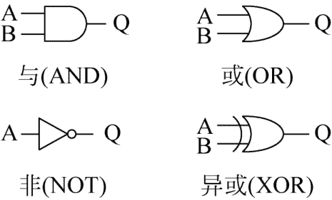
图1-1 常见逻辑门电路符号

通过组合这些逻辑门可得到更复杂的运算单元，如执行算术运算的加法器与乘法器。图 1-2 即为一位二进制加法器，仅需五个逻辑门即可实现。

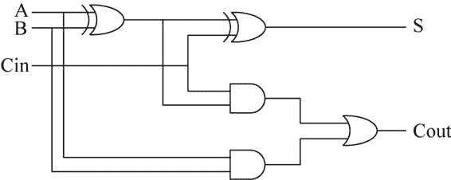
图1-2 全加器逻辑结构图

有了这些基于逻辑门的通用单元，便可进一步设计复杂功能模块，最终形成各具特点的 IP。大部分数字芯片都是通过选用不同 IP 实现特定逻辑功能，经验证、集成、优化后流片制造。

需注意的是，一旦芯片生产出来，其逻辑功能即被固化。尽管许多芯片可通过片上寄存器编程改变配置，但这并不改变其本质逻辑功能。若需修改逻辑或修复缺陷，就必须重新设计、验证和制造，耗费大量时间、人力与资金，风险极高。

在此背景下，设计者提出与其将逻辑固化在芯片，不如设计一种通用芯片只内置最基础的逻辑门，并通过某种方式对这些门进行排列组合，使其逻辑结构可编程。这样一枚芯片即可实现多种功能。这个设想就是 FPGA 的雏形。

FPGA 最核心的构成是海量“逻辑门”，它们以特定方式组合成门阵列，并通过互连单元连接。由于逻辑门可任意组合成更复杂电路，该器件在理论上可实现任意数字逻辑功能。随着技术发展，现代产品集成了上千万个逻辑单元，因而可在某些领域替代专用芯片，具体将在后续章节深入介绍。

这里的“逻辑门”已加上引号，因为内部的逻辑门实际以查找表 Lookup-Table 方式实现。简单说就是把某简单逻辑功能的全部可能结果写入存储单元，根据输入变化直接查表输出结果。除了部分中低端或较早产品采用 4 输入 LUT 结构外，大多数现代器件，如英特尔 Arria10、Stratix10、Agilex 及赛灵思 6 系、7 系、UltraScale 与 UltraScale+ 系列，查找表输入通常为 6 个，即可实现任意 6 输入 1 输出的逻辑功能。

除查找表外，最小逻辑单元还包含寄存器、选择器，甚至算术运算单元如加法进位链等。不同厂商命名各异，英特尔称 ALM 自适应逻辑单元，赛灵思称 CLB 可配置逻辑块。名称虽不同，主要构成类似，均包含上述要素。图 1-3 展示了英特尔 Stratix10 芯片最小逻辑单元 ALM 的结构示意。

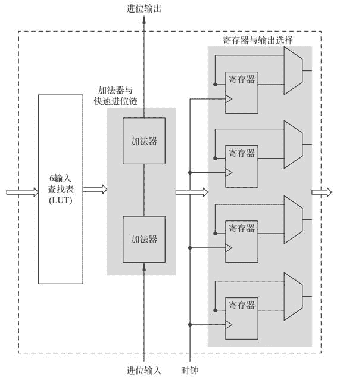
图1-3 Stratix10 FPGA 最小逻辑单元 ALM 结构示意

很多人把 FPGA 的可编程性和 CPU、GPU 乃至各种专用芯片的可编程性混为一谈，实际上二者的本质完全不同。FPGA 的可编程性，是指可以直接对内部的逻辑阵列进行编程，从而让芯片实现的硬件功能发生改变，这一点和仅通过改写寄存器配置来调整工作模式的芯片有着根本区别。举个例子，按寄存器配置的编程并不能把一颗网络交换芯片变成视频处理芯片。

正因为逻辑门阵列可以反复重写，FPGA 能够在逻辑层面重塑自身的硬件结构，灵活性极高。理论上，只要可编程资源足够，单颗 FPGA 就能复现任意数字电路的功能。这种特性让 FPGA 成为 ASIC 流片前最常用的硬件仿真和原型验证平台。设计团队先用 FPGA 实现目标功能，和真实的软硬件系统联调仿真，可不断迭代修改。等设计定型后再流片，能够大幅降低因疏漏导致流片失败的风险，也让固件、驱动乃至应用软件能在流片前就开始并行开发，整体周期被显著压缩。

再说 FPGA 的现场可编程性。所谓现场，就是芯片在投入使用后无需拆回工厂，仍能直接完成编程。这个能力放在今天看起来理所当然，却有明确的历史来由。20 世纪 80 年代以前，芯片固件多存放在掩膜 ROM 或熔丝 PROM 里，只能读不能写，更谈不上多次重写。随后出现的 EPROM 虽可擦写，但需要专用设备长时间紫外线照射，根本无法在现场完成。直到 80 年代后 EEPROM 与闪存出现，现场可编程才真正成为可能。如今的 FPGA 甚至可以每隔几秒就刷新一次运行在芯片上的硬件设计，灵活性可见一斑。

可以说，FPGA 是一类由大量逻辑门阵列构成的芯片，能够在现场通过编程改变硬件逻辑，理论上可实现任意数字电路。人们常用乐高积木或活字印刷来形容它：基础单元的自由组合能拼出汽车、高楼或飞船，也能排布成任意诗词歌赋，正好凸显了灵活与通用这两个最大特点。

随着半导体技术持续演进，FPGA 早已不是最初的简单可编程门阵列。除了逻辑单元，芯片变得越来越复杂，并结合最先进的制造工艺衍生出多种架构。本章接下来将先回顾 FPGA 发展的三个关键阶段，再聚焦当前架构的最新变革，尤其是 3D 芯片封装技术在 FPGA 上的应用，最后以赛灵思和英特尔最新的高端 FPGA 为例，剖析其所集成的尖端工艺、架构与技术，帮助建立完整清晰的发展认知。

1.2 FPGA 进化的三段路径
FPGA 的架构一直沿着摩尔定律演进，是现阶段最能集结前沿半导体技术的器件之一。1984 年赛灵思推出首款商用 FPGA XC2064，仅有 64 个可编程逻辑单元、2 个 3 输入查找表、约 800 个逻辑门。35 年后，英特尔在 2019 年底发布的 Stratix10 GX 10M 已采用 14nm 工艺，集成约 433 亿个晶体管、1020 万个可编程逻辑单元和 2304 个可编程 I/O。

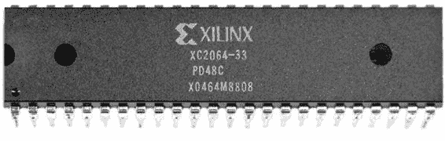
图 1-4　世界上首枚商用 FPGA-XC2064

短短三十五年里，架构变化可以用翻天覆地来形容，多次根本性的变革奠定了现代 FPGA 的核心方向。这些变革大多源于新兴应用的牵引。前赛灵思院士、拥有 200 多项 FPGA 相关专利的 Steve Trimberger 博士将发展历程概括为发明期、扩张期、积淀期。三个阶段分别对应技术从无到有、从小到大、从大到强的过程，也见证了 FPGA 从单纯可编程逻辑单元，发展到上千万单元的大型阵列，再发展到集成各类硬件资源、IP 核甚至处理器内核的复杂片上系统，形成今日丰富多样的产品线。

1.2.1 发明期：需求催生的必然
FPGA 的发明期横跨 80、90 年代。当时的芯片设计与制造模式与今天大相径庭。无晶圆厂模式尚未普及，ASIC 公司只有在客户设计进入量产时才有收入。但需求在开发中变化、流片失败或存在无法通过固件修复的设计漏洞时，约三分之二的芯片项目会亏损，只有约三分之一的设计最终投产。巨大的流片成本迫使业界急需一种通用半导体器件，用于流片前的测试与验证，降低流片失败概率，可编程逻辑器件由此诞生，这正是 FPGA 的前身。

FPGA 的特殊之处在于制造完成后可按不同用户需求通过编程改变自身逻辑功能，且可反复进行。同时它使用固定的开发工具与环境，无需像 ASIC 那样为每个项目定制工具链。于是不同 ASIC 设计都能借助同一颗 FPGA 进行验证，大幅降低成本与风险。

以今天的眼光看，首款 FPGA XC2064 更像个玩具。售价 55 美元，采用 2.5μm 工艺，只有 64 个逻辑单元和不到 1000 个逻辑门，实现一个简单的 64 位移位寄存器就会耗尽全部资源。但在当时，作为 ASIC 流片前的硬件仿真与验证平台，性能并非关键，业界所需只是相互连接的可编程逻辑门。XC2064 的出现仍引发不小轰动。进入 90 年代，芯片主体架构慢慢演进为今天大家熟悉的可编程逻辑阵列结构，如图 1-5 所示。

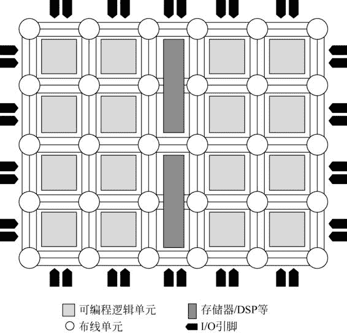
图 1-5　FPGA 的基本架构

1.2.2 扩张期：自动化设计兴起的时代
90 年代末正是摩尔定律最活跃的时期。半导体行业迎来高速发展，FPGA 在 1992 至 1999 年间进入扩张期。随着制程突破，制造大尺寸芯片不再困难，FPGA 自然选择提升容量，逻辑单元、I/O、时钟与布线等片上资源持续增加。芯片面积变得相对廉价，也催生出“用面积换性能”等设计方法。

更大的面积为架构创新提供想象空间。可编程单元中的 LUT 从最初的 3 输入发展到 4 输入、6 输入乃至更多，内部还逐步加入寄存器、多路选择器等功能。渐渐地，片上资源互连的复杂性开始取代逻辑结构复杂性，成为厂商优先解决的问题。

本阶段另一个显著变化是 FPGA 自动设计工具与软件的兴起。结构越复杂，越需要自动综合、布局布线的 EDA 工具，设计流程逐渐走向自动化。与 ASIC 不同，FPGA 公司并未依赖传统 EDA厂商，而是自建工具链。英特尔原 Altera 的 Quartus 系列、赛灵思的 ISE 与 Vivado 系列被视为公司的核心资产。早期各家 FPGA 架构相似度较高，工具优化成为竞争主战场，这些工具中的专利与技术机密也构筑起深厚的技术壁垒。

1.2.3 积淀期：复杂片上系统的成形
进入 21 世纪，FPGA 发展进入积淀期。单纯提升容量已难以满足需求，客户更追求性价比，不愿为超大容量买单。FPGA 开始从可编程门阵列向可编程片上系统演进。在改进可编程逻辑单元微架构的同时，厂商也在易用性上发力，定义了大量标准化的数据传输协议，便于模块互连与通信，并提供可复用的 IP 核，例如软核处理器 Altera 的 NIOS 与赛灵思的 MicroBlaze、存储控制器及各类通信协议栈，让客户不必重复造轮子。

与此同时，许多专用逻辑单元被固化进器件，成为现代 FPGA 的标配。比如数学计算用的进位链、乘法器、定点与浮点 DSP 单元、固定容量的片上存储器、不同速率的串行收发器与物理接口。随着人工智能兴起，AI 引擎、可变精度 DSP 等面向 AI 的 IP 也被集成进去。如今的 FPGA 已成为各类前沿技术的集大成者，也因此在更多场景被采用。

那么在半导体技术继续演进的背景下，FPGA 如何突破尺寸与集成度的维度限制，为摩尔定律续命？当摩尔定律步入尾声，架构又将怎样调整以适应新周期？接下来将深入探讨这些问题。

1.3 突破平面限制的 3D FPGA
过去几十年里，半导体技术在摩尔定律指引下高速增长，近年来增速放缓，“摩尔定律已死”的讨论此起彼伏。从单晶体管看，革新从未停止，单原子甚至单电子晶体管已被制造出来。产业层面的难题并非能否做出更小的晶体管，而是能否以合理成本生产出包含百亿级晶体管且稳定工作的芯片，这是个经济问题。

当晶体管逼近原子极限，传统制造几乎不可行。晶体管结构已演进为 FinFET 等复杂的 3D 形态，材料、设备、封装与测试等全产业链需同步发展，芯片架构也必须进化以维持性能提升。

当水平扩展接近极限，业界开始探索垂直方向的密度扩展，由此出现 3D 芯片封装技术。在 FPGA 领域，赛灵思采用堆叠硅片互联 SSI 技术，英特尔则采用嵌入式多管芯互联桥接 EMIB 技术。

1.3.1 赛灵思堆叠硅片互联 SSI 技术
在新一代工艺初期，工艺不成熟导致良率偏低，大面积硅片尤甚。研究表明，硅片面积 6cm² 在工艺早期良率仅约 0.25%，一枚 12 英寸晶圆上仅能产出约 0.3 颗可用芯片。而面积 1.5cm² 时良率可达 22%，同一晶圆可产出 107 颗可用芯片，如图 1-6 所示。

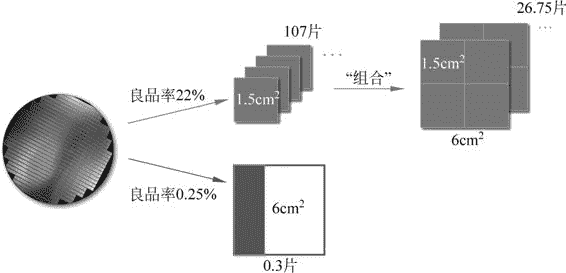
图 1-6　工艺早期不同面积的裸晶良率与产量的关系

如果能把 4 颗 1.5cm² 的硅片组合成一颗 6cm² 的芯片，同一晶圆可产出平均 26.75 颗芯片，产能提升超过百倍，这正是 SSI 技术出现的背景。

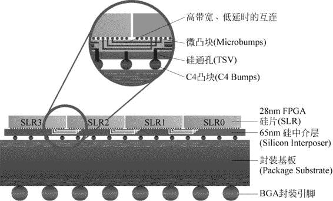
图 1-7　堆叠硅片互联 SSI 技术示意图

SSI 技术在封装基板与 FPGA 硅片之间加入一层无源硅中介层，在中介层上放置多颗 FPGA 硅片，通过硅通孔 TSV、微凸块以及大量连线实现互连。微凸块连接硅片引脚，TSV 将电源、地线与 I/O 接口经 C4 凸块引至封装基板，中介层内有上万条连线连接相邻硅片。

TSV 是核心创新点与难点，通过蚀刻工艺制造，对工艺要求严格。中介层通常采用成熟工艺如 65nm 加工，不含晶体管等有源器件，以保证较高良率与较低静态功耗。

SSI 主要优点是能在工艺早期快速生产良率较高的大型 FPGA，加快上市节奏，抢占高端市场。工艺成熟后即便可生产大单片，仍可通过多片组合集成更多可编程逻辑单元。

2017 年 HotChips 大会上，赛灵思发布 Virtex UltraScale+HBM 系列 FPGA，使用第四代硅中介层技术组合 3 颗 16nm FPGA 与 2 颗 32GB 高带宽存储芯片 HBM，如图 1-8 所示。

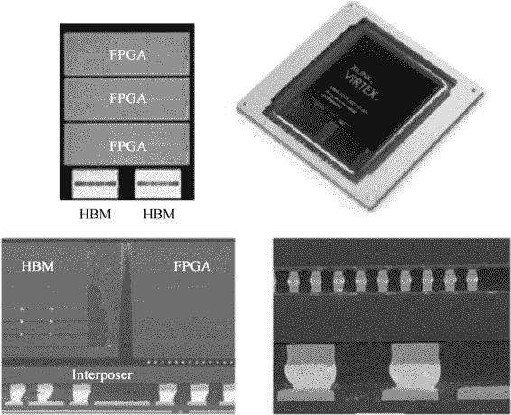
图 1-8　Virtex UltraScale+HBM FPGA 结构图（图片来自赛灵思）

1.3.2 SSI 技术的主要短板
SSI 虽能提升早期良率，也有明显缺点。

其一，适用窗口受工艺成熟度限制。工艺不成熟时大硅片良率低，SSI 优势明显；工艺成熟后良率大幅回升，6cm² 从 0.25% 升至 55%，1.5cm² 从 22% 升至 86%。此时一枚晶圆可产出 66.9 颗 6cm² 硅片，或 104.6 颗 4×1.5cm² 硅片，产量差距缩小，而硅中介层、TSV 与多片组装的成本开始凸显，整体成本优势减弱。

其二，相较单颗大硅片，多片组合会降低性能。垂直方向上，硅中介层的引入需要经过 TSV 等额外结构，带来额外延迟，单芯片信号仅需经过封装基板导线。水平方向上，中介层导线与微凸块也增加延迟。研究显示，尺寸 7mm×12mm 的硅片中，微凸块可能距芯片边界 2.25mm，跨片互连的导线延时可达约 1ns，而 FPGA 片上延时仅几百皮秒，约为前者的十分之一。

2014 年多伦多大学 Andre Pereira 与 Vaughn Betz 等人在 FPGA 国际研讨会上指出，中介层互连带来的延迟会拖累系统性能。中介层互连使关键路径增加 0.5ns、1ns 或 1.5ns 时，系统性能分别下降约 20%、35% 与 50%。

硅通孔 TSV 并非只带来好处，对系统表现的拖累同样明显。大型 FPGA 的 I/O 数目往往以千计，若每一路都要配对 TSV，晶圆制造的难度就会急剧攀升。更高密度的 TSV 阵列还会破坏信号一致性，在高速模拟通道上尤其容易出现串扰与耦合，让设计和验证的复杂度被推向新高。

（3）SSI 会削弱 FPGA 配置的灵活性。多颗硅片拼合本质上是在芯片内部划出了若干设计分区和不可逾越的硬边界。面对一个大型的 FPGA 实现，设计者必须额外做逻辑拆分，尽量避免单一逻辑块被分散到不同 Die 上，这直接拉长了项目周期并提高了门槛。硬边界的另一后果是资源浪费，因为部分区域无法跨片调整，往往需要占用更多片上资源，进而推高功耗并降低性能。图 1-9 的场景很典型：原本包含模块 A 至 D 的方案，D 为挂载大量并行 I/O 的内存控制器，在单芯片形态下约三分之二面积即可完成。换到 SSI 器件后，片间互连的额外延时让把 D 切分到两颗 Die 的做法无法满足时序，被迫将 D 整体锁定在同一颗 Die。于是 A、B、C 被重新摊铺到整片区域，出现了不必要的资源占用，正如图 1-9 下半部所示。

（4）SSI 的第四个痛点落在 EDA 工具链。片间延时增大让时序收敛更困难。布线层面，片间可用资源有限，容易产生拥塞。与传统流程相比，映射 Mapping 与布线 Routing 之间常常需要插入额外的分区步骤，用以协调各 Die 的资源分配和时序。硬边界的存在还要求工具引入更精细的设计域划分，这使全局时序与布局布线的协同优化难度显著提升。

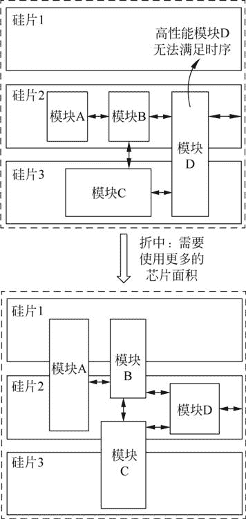
图 1-9　多硅片模型对 FPGA 配置灵活性的影响

### 1.3.3 SSI 技术小结
赛灵思的堆叠硅片互联 SSI 自 2012 年面世以来迭代多代，至今仍在最新 FPGA 产品中沿用。作为多芯片集成与互联方案，SSI 能在新工艺导入初期快速提升大芯片良率、压缩上市节奏、抢占市场。但其根本短板在于人为制造了 Die 间的硬边界，这一特性会不可逆地影响芯片性能，同时对 FPGA 设计与优化工具提出更大挑战。

### 1.3.4 英特尔 EMIB 技术
英特尔从 14nm 工艺的 Stratix10 系列 FPGA 开始采用异构 3D SiP。其动机与工艺演进紧密相关。第一，不同功能 IP 的最优工艺各不相同。逻辑电路追求先进工艺以获性能与功耗优势，而 DRAM、Flash、传感器、模拟器件等更适合成熟工艺制造，这就需要一种能把不同世代 IP 异构整合的硅片互连方式。第二，IP 迭代速率不一致。以收发器为例，同一款 Stratix10 可能需要搭载不同类型的收发器形成子产品线，支持 PCIe、乙太网等不同协议，并随速率从 10.3Gbps 逐步演进至 28Gbps、56Gbps。若与 FPGA 做同构单片集成，每次收发器迭代都要重流片，灵活性极差。因此需要一种让 FPGA Die 保持不变，同时能灵活连接多种收发器 IP 的集成方案。

为此英特尔提出嵌入式多硅片互联桥接 EMIB。示意图与封装剖面见图 1-10。与赛灵思 SSI 不同，EMIB 没有铺满整片的硅中介层，只在相邻两颗 Die 的边缘处加入一条硅桥，并重新定制边缘 I/O 以配合桥接规范。

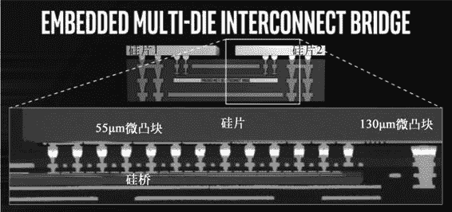
图 1-10　`EMIB`技术示意图

相较使用硅中介层的 SSI，EMIB 的最大价值在于降低制造复杂度并减少片间传输时延。无需制作覆盖整片的硅中介层与大量 TSV，EMIB 只用较小的硅桥完成互连即可。芯片 I/O 到封装引脚的连接路径与常规封装保持一致，不再依赖 TSV 或中介层走线。硅桥仅布置在 Die 边缘，避免了中介层里长导线的问题。对收发器等模拟器件而言，没有全局中介层的干扰，高速信号的串扰明显下降。

在 Stratix10 系列中，EMIB 主要用于 FPGA 与收发器及高带宽存储器 HBM 之间的连接，如图 1-11 所示。英特尔把这些经 EMIB 连接的部分称为 Tiles。与赛灵思 3D FPGA 不同，Stratix10 的可编程逻辑阵列采用一整颗 FPGA Die，而非多颗小型 Die 拼接，这种做法从根本上规避了多硅片模型带来的诸多缺陷。

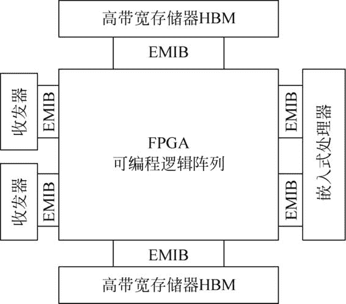
图 1-11　使用`EMIB`技术进行`FPGA`的异构集成

2019 年 HotChips 上，Ayar Labs 展示了名为 TeraPHY 的硅光学收发器。该光收发器以芯粒形式通过 EMIB 集成在英特尔 Stratix10 FPGA 上完成异构封装。相比传统电收发器，其峰值带宽可达 2Tbps，传输距离最高 2km，每比特传输功耗不超过 1pJ。

EMIB 还可直接连接多颗 FPGA Die。例如目前全球最大的 FPGA Stratix10 GX 10M 中，英特尔首次把两颗各含 510 万可编程逻辑单元的大型 FPGA Die 通过 EMIB 相连，形成超大 FPGA。两颗 Die 通过 25920 个 EMIB 数据接口互联，每个连接提供 2Gbps 吞吐，系统整体通信吞吐高达 6.5TBps，证明 EMIB 完全能胜任超高带宽需求。

从系统角度看，这种异构集成把 FPGA 与各类 IP 的开发周期解耦，形成模块化集成方案。EMIB 桥接可让 FPGA 与不同功能、不同工艺的 IP 混合集成，使各 IP 在最优工艺下实现并独立迭代。这样既扩展了 FPGA 应用场景，加快细分产品面市，也让研发重心转向软件与生态，降低开发门槛，利于生态扩张。

### 1.3.5 基于 EMIB 技术的异构 FPGA 的潜在问题
基于 EMIB 的异构 FPGA 集成也存在潜在风险。

首先，使用单颗更大尺寸 FPGA Die 时，工艺早期良率可能成为瓶颈，直接影响上市时间。在激烈竞争中，抢先发布意味着更多份额。随着工艺难度上升，两代工艺间隔拉长，成熟时间相应增加，这在一定程度上缓解了早期良率问题。

其次，EMIB 连接不同 Die 后容易形成不规则芯片结构，带来一系列隐患。以 Intel Stratix10 MX FPGA 如图 1-12 所示，FPGA 与 HBM 及收发器的布局并不规则。EMIB 本身是无源器件，且 FPGA 与外置 IP 的工艺、集成方式各不相同，例如 Stratix10 MX 中的 HBM 是基于 TSV 的 3D 芯粒。工作时 EMIB 两端的匹配性可能成为问题，如发热不均导致的应力、连接可靠性等。

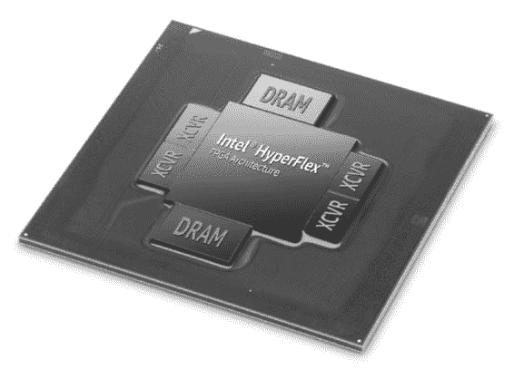
图 1-12　`Stratix 10 MX FPGA`芯片图（图片来自英特尔）

### 1.3.6 EMIB 技术小结
EMIB 是英特尔在芯片互连与集成领域的核心武器，能把多种工艺、功能、尺寸的硅片互联，同时提供高带宽、低时延的数据传输。除 FPGA 外，EMIB 已广泛应用于英特尔 Nervana AI 芯片 NNP-I 等产品。

需要指出，EMIB 并非英特尔唯一的 3D 互连技术。SSI 与 EMIB 并非真正意义上的 3D 芯片技术，硅片仍在二维平面排列，只是借助中介层或桥接实现互连，业界称之为 2.5D 技术。

2019 年初英特尔公布了名为 Foveros 的“真 3D”封装技术，可把 CPU、GPU、DRAM、Cache 等不同功能硅片堆叠封装。该技术已在 10nm 工艺的 Lakefield CPU 上使用。可以预见，随着封装技术进步，类似 Foveros 的 3D 芯片技术终将引入 FPGA，3D FPGA 不仅会面世并成为主流，也将催生更大、更复杂的 FPGA 器件，推动科技与文明持续演进。

## 1.4 突破集成度的边界——从 FPGA 到 ACAP

### 1.4.1 ACAP 概述
2018 年赛灵思推出 ACAP 产品线，CEO Victor Peng 反复强调 ACAP 不是传统 FPGA，而是一个整合硬件可编程逻辑、软件可编程处理器与软件可编程加速引擎的下一代计算平台，是赛灵思自发明 FPGA 以来最卓越的工程成果。

与其说是具体芯片，不如说 ACAP 代表一种架构。2019 年赛灵思发布了基于 ACAP 架构的首款产品 Versal。相较传统 FPGA，Versal ACAP 在系统架构、电路结构、互连方式上进行了大胆革新。

### 1.4.2 芯片架构：在传统框架内革新
Versal ACAP 基于台积电 7nm 工艺，资源布局如图 1-13 所示。整体上仍与传统 FPGA 相似，包含可编程逻辑、高速 I/O 与收发器、嵌入式处理器、存储控制器等常见模块。

与传统 FPGA 相比，ACAP 有两大不同。第一，芯片内置固化的 AI 加速引擎阵列，如图 1-14 所示。Versal 集成 400 个 AI Engine 单元，按横竖方向分布，主要加速神经网络推理、无线通信等数学计算与信号处理，峰值 INT8 性能可达 133TOPS。每个 AI Engine 内置 32 位 RISC 处理器与 512 位数据总线的向量处理器，支持 SIMD 定点与浮点并行计算，并拥有 32KB 分布式内存，L1 缓存总量 12.5MB，相邻 AI Engine 之间可通过 DMA 共享内存。

第二，ACAP 在传统片上互连基础上引入固化片上网络 NoC，面向高带宽、高吞吐场景。NoC 提供超高数据传输带宽并减轻布局布线压力，相较传统 FPGA 互连可带来高达 8 倍的能效优化。

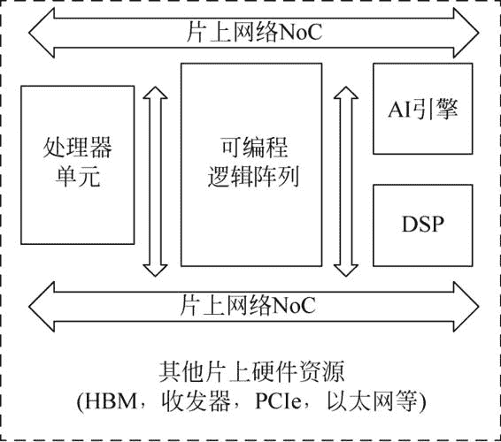
图 1-13　`Versal ACAP`芯片资源布局

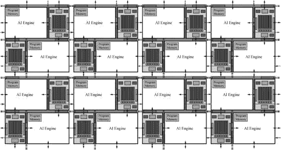
图 1-14　`Versal ACAP`中的 AI 加速引擎阵列（图片来自赛灵思）

对比 CPU/GPU 开发，FPGA 开发的最大痛点是编译时间长，中等规模设计往往需数小时。Versal ACAP 采用更为规整的可编程逻辑阵列和时钟域分布，大幅提升 IP 接口复用性。移动 IP 不必重编整网表，只需处理改动部分即可。用户可复用已完成布局布线的半成品或模板，在预留区域内加入新设计，显著缩短编译时间。

### 1.4.3 CLB 微结构大改
CLB 即可编程逻辑块，是 FPGA 架构的核心。Versal ACAP 对 CLB 微结构进行了翻天覆地的改动，主要变化有四点。

第一，相较 UltraScale 架构，ACAP 的 CLB 面积扩大 4 倍，如图 1-15 所示，每个 CLB 包含 32 个 LUT 与 64 个寄存器。为减少全局布线占用，每个 CLB 设置独立内部高速互连，其速度与布线复杂度远优于全局布线。大 CLB 让 18% 的布线可在内部完成，而传统 FPGA 仅约 7%。

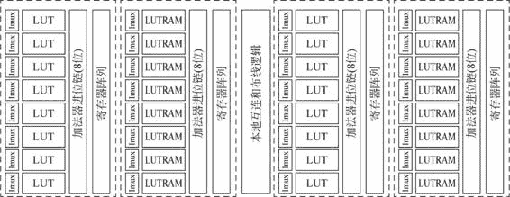
图 1-15　`Versal ACAP`的新`CLB`结构

第二，每个 LUT 增加一个额外输出，如图 1-16 所示。传统 FPGA LUT 多为 6 输入 2 输出，可实现任意 6 输入逻辑或两个 5 输入逻辑。新增输出后，单 LUT 可实现两个独立 6 输入逻辑，有利于逻辑合并减少 LUT 消耗。设计工具会依据 LUT 间距离判断是否可合并，例如在两个 LUT 距离小于 5 个 Slice 网格时，Versal 相比 UltraScale 可多合并 21.5% 逻辑。

代价是 UltraScale 中的宽函数被移除，例如 32 选 1 选择器需扩展到多个逻辑片，对时序与资源都不利。

第三，逻辑片的进位链被彻底重构。现代 FPGA 通用的加法器进位链被移除，改用 LUT 新增的进位输入信号配合查找表逻辑完成加法与进位传递。

第四，引入 Imux 寄存器结构。其作用与英特尔 Stratix10、Agilex 系列的 HyperFlex 相似，均用于在关键路径引入额外寄存器与流水段，实现流水线重定时以加速收敛。与 HyperFlex 不同，Imux 寄存器包含复位、初始化、时钟使能等常见功能，而非锁存器结构；Imux 仅存在于 CLB 前，且并非铺满全部布线资源，因此引入的额外延迟更小，但在深度流水线场景下的绝对性能仍可能不及 HyperFlex。

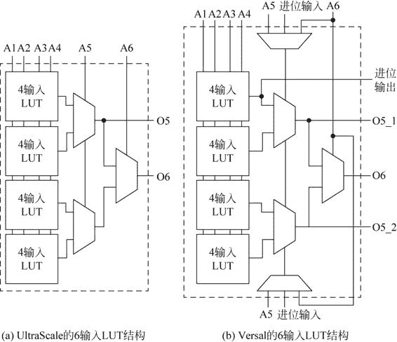
图 1-16　`Versal ACAP`的新`LUT`结构

### 1.4.4 第四代 SSI 技术：3D FPGA 的进一步优化
ACAP 采用赛灵思第四代硅片堆叠技术 SSI。针对 SSI 延迟偏高的短板，Versal 在架构层面做了大量优化，例如增加更多片间互联通道 SLL Channel，并将这些通道的传输延迟相比传统连线降低约 30%。

### 1.4.5 片上网络：高带宽数据传输的全新利器
NoC 作为 Versal ACAP 的核心互连手段，实现了以可控时延提供持续高吞吐的数据搬运，使大规模并行计算、AI 推理与高速 I/O 在同一片上协同运行成为可能，也为后续更大规模的集成奠定了基础。

面对`DDR`存储器、高速网络、`PCIe`这类高速接口与应用场景，带宽压力始终很高。为此一方面要拉宽总线位宽，另一方面要提升工作时钟。过去的`FPGA`设计常用办法是对总线进行深度流水线化，以换取更高的带宽和吞吐。可一旦设计规模变大，这种做法很快就会让芯片内部布线资源变得拥挤，时序收敛难度上升，性能不升反降。于是，如何在保证高速数据搬运的同时降低布线拥堵，成为必须解决的难题。

`ACAP`给出的是片上网络`NoC`的思路，其结构示意图如图 1-17 所示。除了传统`FPGA`的布线资源外，`ACAP`内置了一套固化的`NoC`。需要高速传输的数据不再走常规布线，而是被封装成数据包，经由片上网络的交换机完成转发。这一做法在系统层面把数据搬运与数据计算拆开了，既能维持带宽，又能减轻布局布线的压力。比如计算可以在`AI Engine`或其他模块里完成，无需紧挨`DDR`控制器等高速接口。类似网络通信的思路，片上网络还能对不同类型的传输实施服务质量控制`QoS`。

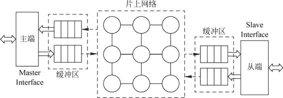

图 1-17　`ACAP`采用的片上网络`NoC`结构示意图

当然，在`FPGA`里引入片上网络也会带来额外传输时延，对对时延敏感或要求固定时延的应用会形成影响。此外`NoC`的位宽是固定的，难以针对具体应用做定制，这也会在某些场景下制约整体性能。

## 1.5 灵活性与敏捷性兼备——英特尔 Agilex FPGA

随着英特尔 10nm 工艺趋于成熟，首款基于该节点的`FPGA`也正式露面。2019 年 4 月，曾用代号`Falcon Mesa`的最新 10nm `FPGA`发布，并命名为`Agilex`。

`Agilex`之名融合了`Agile`敏捷与`Flexible`灵活，这正是当代`FPGA`的两大核心诉求。灵活性对应可编程性，依托可编程逻辑阵列，可针对不同场景重构逻辑与功能。敏捷性则指向异构，可以是逻辑单元间的异构，也可以是工艺间的异构，或二者兼具。不同`IP`的成熟工艺与迭代节奏不同，异构才能让各`IP`与各工艺节点优势互补，在性能与成本间取得平衡。因此异构化也是未来`FPGA`架构发展的重要方向。

在这一背景下，`Agilex FPGA`应运而生，它兼顾了传统`FPGA`的可编程灵活性与现代异构架构的敏捷性，可适配众多领域并快速迭代部署。

与`Stratix`、`Arria`、`Cyclone`、`Max`等历经多代演进的产品线相比，`Agilex`是英特尔 2015 年底收购原`FPGA`巨头`Altera`、成立可编程方案事业部`PSG`后首个全新系列，承载了英特尔较高的期望，也得益于英特尔自身核心技术的加持，这正是它区别于前代产品与竞争对手的关键。

### 1.5.1 英特尔 10nm 工艺能否后发制人

英特尔长期称霸半导体，靠的是一手`x86`架构，一手领先的制造工艺，也由此形成了著名的“`Tick-Tock`”节奏，让架构与工艺交替升级，性能持续稳步增长。

已退休的 Mark Bohr，马克·波尔，曾主导英特尔工艺研发，是英特尔资深院士及美国工程院院士，长期担任半导体科技与制造业务总监。四十余年间他与团队不断逼近物理极限，让芯片在不断缩小中性能倍增，使英特尔工艺多年保持领先，业界视其为推动摩尔定律前行的人物。

2017 年 9 月，波尔在英特尔“精尖制造日”上发表《工艺领导者》主旨演讲，发布了 10nm 工艺路线图。他认为 10nm 研发周期会更长，但性能提升也更大，整体仍可延续摩尔定律。

现实却出现波折。英特尔在 10nm 上遭遇阻滞，波尔后来也承认“我们对 10nm 有些冲动了，或许应调低目标会更顺利”。结果是此前落后的竞争对手纷纷完成超车，台积电与三星先后将 10nm 量产，并已布局 7nm 及更先进节点。

直到 2019 年初，英特尔一口气推出 4 款 10nm 芯片，包括“Ice Lake”“Lakefiled”CPU 及“Snow Ridge”网络处理器，覆盖个人计算、数据中心、5G 等领域。此次发布的`Agilex`系列`FPGA`，正是基于英特尔 10nm 工艺的旗舰级产品。

`Agilex`采用了第二代`EMIB`技术，基于 10nm 工艺连接可编程逻辑阵列及周边芯粒`Chiplet`。与赛灵思的`SSI`相比，`EMIB`无需硅中介层，也就不需要大量硅通孔，制造复杂度显著下降。`EMIB`不使用中介层上的长导线，降低了晶片间传输时延并减少信号串扰，还能快速连结与替换不同子芯片，实现芯片的快速迭代。

### 1.5.2 全新的芯片布局与微架构优化

相较英特尔现役旗舰`Stratix10`，`Agilex`在布局与微架构上有多处改动。`Agilex`的芯片布局如图 1-18 所示。布局上同样使用`EMIB`实现异构硅片的高速互连，尤其是可编程逻辑与不同速率收发器`Tile`之间的连接。图中收发器固定在芯片东西两侧，其余非可编程结构，如通用`I/O`、存储器接口、嵌入式`SRAM`、4 核`ARM` CPU 等，则固定在南北两侧。

一大变化是将原本置于芯片中部的通用`I/O`、存储器`I/O`、硬核处理器等移至两端。英特尔此前的`Arria10`与`Stratix10`，以及包括赛灵思在内的业界惯例，都将可编程逻辑阵列、`I/O`单元、存储器、`DSP`等按列间隔排列，如图 1-19 所示。

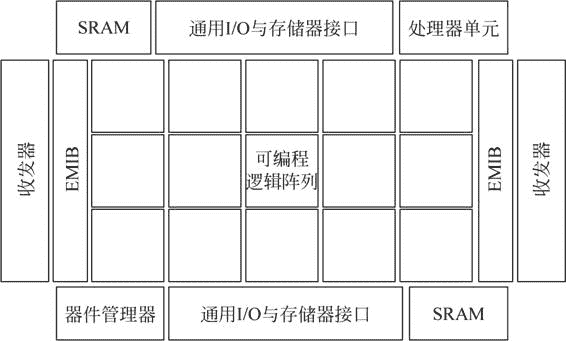

图 1-18 Agilex FPGA 的芯片布局示意图

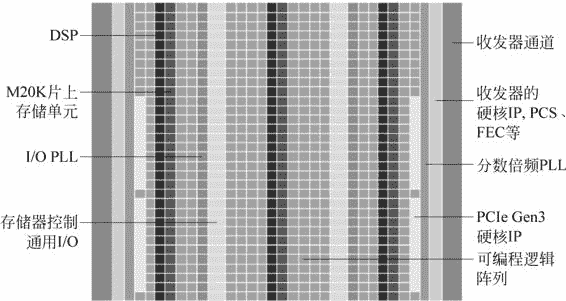

图 1-19 英特尔 Arria10 系列 FPGA 的芯片布局

列式间隔的优点是简化布局规划，尤其是`I/O`引脚相关布局，因为逻辑单元与`I/O`单元距离相近，布局放置灵活度较高。

缺点也很明显，整片可编程逻辑被人为切分成多个区域，跨区布线时延增大；在高速大设计中容易出现局部拥塞。很多有经验的工程师都见过片上某些区域拥堵严重而另一些区域资源闲置的问题，列式结构正是根源之一。

在`Agilex`里，`I/O`单元被挪到逻辑阵列上下两侧，中间形成更规整的可编程阵列，如图 1-20 所示。去掉`I/O`对逻辑阵列的分割后，系统性能提升，同时时序计算更简化，资源布局与放置的灵活性也更高。

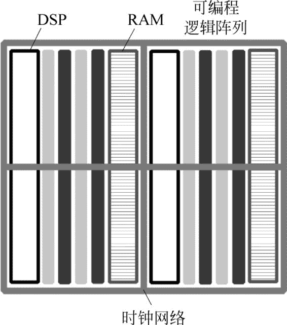

图 1-20 英特尔 Agilex FPGA 的芯片布局

微架构层面，`Agilex`对自适应逻辑模块`ALM`做了优化以降低传输时延。`ALM`是英特尔`FPGA`的基础可编程单元，`Stratix10`的`ALM`结构如图 1-21 所示，主要由 6 输入`LUT`、加法器进位链及 4 个输出寄存器组成，多片`ALM`构成逻辑阵列块`LAB`。

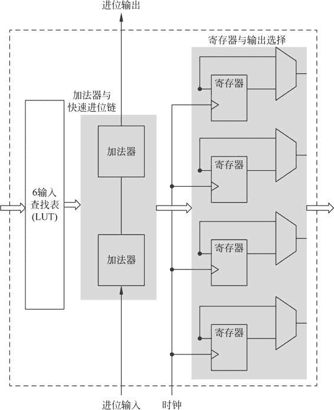

图 1-21 Stratix10 FPGA 的 ALM 结构

与`Stratix10`相比，`Agilex`的`ALM`如图 1-22 所示，增加了两个`LUT`快速输出端口，使`LUT`输出可直接连入`HyperFlex`寄存器，无需经`ALM`内部寄存器中转，这正服务于利用`HyperFlex`对关键路径做重定时`Retiming`的场景。同时寄存器灵活性大幅增强，每个寄存器输入增加了一个 4 输入选择器以选通不同信号，4 个寄存器还可受两个独立时钟控制。

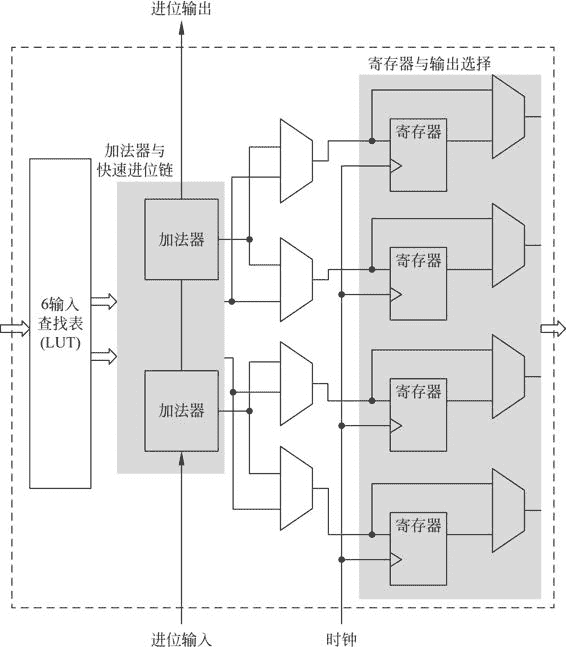

图 1-22 Agilex FPGA 的 ALM 结构

除`ALM`外，`Agilex`还提升了片上内存`MLAB`的逻辑密度。单位面积`MLAB`密度是`Stratix10`的两倍，且 50% 的`LAB`可配置为存储器模式，这一优化明显面向高带宽需求，如`AI`计算加速。

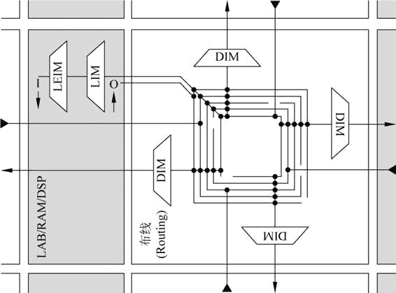

图 1-23 Agilex 的布线节点（图片来自英特尔）

`Agilex`对布线单元也重新设计，如图 1-23 所示，涉及`DIM`、`LIM`、`LEIM`。每个交换节点仅连接一个逻辑功能单元，可编程阵列`LAB`、`RAM`、`DSP`等，但可连接多个布线单元或其他交换节点。过去的架构常让一个交换节点同时连接左右两个逻辑单元。这种简化让布线架构更简洁，减少了交换节点多路器的输入，在保持灵活性的前提下降低寄生电容、提升性能。研究早已指出布线节点不必全连接，`Agilex`更进一步做到 1 对 1 连接，这对设计工具与布局布线算法提出了更高要求。

此外，`Agilex`针对各逻辑单元间时延的一致性做了优化。早期`FPGA`因工艺与时序变化会差异化处理资源，同一资源可能呈现不同时延分布。工具虽会避开慢速资源上关键路径，但高速或深度流水线设计中常出现“近临界路径”，资源分配受限，`EDA`计算难度剧增。

`Agilex`采用基本同化的硬件资源与对应的布线方式，使各资源时延趋于相近。图 1-24 可见，相较`Stratix10`，`Agilex`的时延分布非常平坦，简化了资源分配流程，提升开发效率与系统性能。

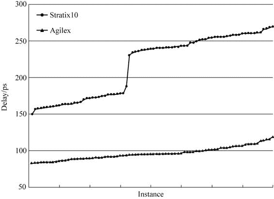

图 1-24 Stratix10 与 Agilex 的延时分布对比（图片来自英特尔）

### 1.5.3 CXL：CPU 与 FPGA 互连的终极方案

当前`FPGA`在数据中心的核心角色是作为`CPU`的硬件加速器，用于深度学习训练、金融计算、网络功能卸载等。数据中心`CPU`领域，英特尔`Xeon`长期占据主导，`AMD`、`高通`等竞争者尚未形成足够威胁。对数据中心加速器而言，与`Xeon`的兼容性是首要考量。血统正统的`Agilex`天生占据地利。

缓存一致性一直是硬件加速器难题，解决办法是明确并标准化`CPU`与加速器间的内存互联协议，类似大家熟悉的`PCIe`。

由此诞生多种缓存一致性方案，代表性的有`AMD`、`高通`发起的`CCIX`，见图 1-25，以及`IBM`发起的`OpenCAPI`，见图 1-26。每个阵营都包含`CPU`厂商与加速器厂商。英特尔此前不属于这两大阵营。

2019 年 3 月，英特尔联合微软、阿里、思科、戴尔`EMC`、Facebook、谷歌、惠普企业`HPE`、华为等组建全新缓存一致性标准`CXL`，即`Compute Express Link`，如图 1-27 所示。与`OpenCAPI`、`CCIX`主要由半导体公司发起不同，`CXL`发起方中包括 4 家互联网巨头、两家服务器厂商、两家网络设备厂商，目标应用覆盖互联网数据中心、通信基础设施、云计算与云服务，正是`FPGA`大放异彩的舞台。

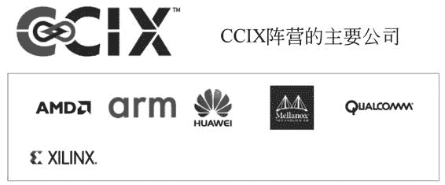

图 1-25 CCIX 的主要成员

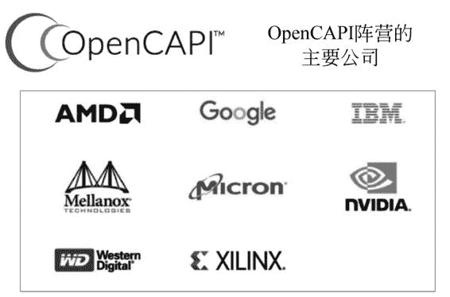

图 1-26 OpenCAPI 的主要成员

`Agilex FPGA`将原生支持`CXL`协议，成为业界首款面向`Xeon`可扩展处理器的内存一致性硬件加速器。`CXL`基于第五代`PCIe`设计扩展，可完全复用`PCIe PHY`与通道，易用性更好。在天时地利基础上，也为`Agilex`在数据中心带来巨大的人和优势。

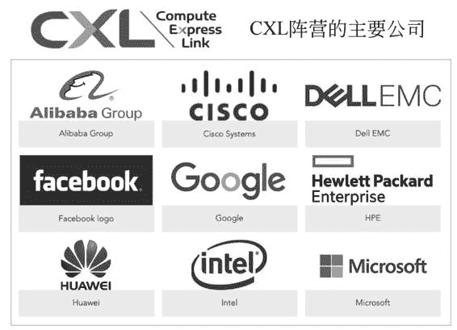

图 1-27 CXL 的主要成员

### 1.5.4 可变精度 DSP：全力支持 AI 应用

在人工智能场景，`FPGA`的一大优势是运算精度可变，而非`CPU`等芯片的固定字长，从而带来巨大性能提升。现有的英特尔`FPGA`已以硬核方式固化定点数及双精度浮点数`FP32`的`DSP`单元。

`Agilex`进一步加入`FP8`、`FP16`单精度浮点数及块浮点数`BFLOAT16`的支持，同时增加不同精度乘法器的数量并扩展乘法器配置方式。图 1-28 展示了部分常用的`DSP`配置模式，为简化示意，更多细节可参考英特尔官方文档。通过不同精度`DSP`配置，`FPGA`既能用浮点数做模型训练，也能用低精度定点数做模型推理，这些面向`AI`的革新将大幅拓宽`FPGA`在人工智能领域的应用空间。

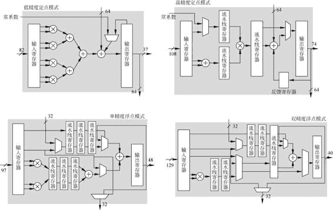

图 1-28 Agilex 可变精度 DSP 的一些配置模式

### 1.5.5 增强版 HyperFlex 架构

与`CPU`或`GPU`相比，`FPGA`主频较低，通常在 200～400MHz。为达成吞吐需求，需要更宽的总线，但过宽的总线会带来布局布线拥塞与时序收敛问题。因此提升工作频率一直是行业重点。

`HyperFlex`架构是英特尔在`Stratix10`系列引入的关键创新。其思路是在布线网络上加入大量名为`Hyper-Register`的小型寄存器，把原本较长的时序路径分割成多段较短路径，从而提高工作频率。

理想很丰满，现实却往往骨感。Hyper-Register 方案出发点不错，实装后却暴露出不少难处。在许多场景下并非所有 Hyper-Register 都会被启用，于是每个寄存器都得配上 2:1 的选择器来控制通断，这反而引入了额外的旁路延迟，也让 FPGA 工具里的重定时以及自动流水线变得更棘手。更关键的是，Hyper-Register 并非由时钟边沿驱动的触发器，而是靠脉冲驱动的锁存器，时序表现偏弱，对工艺离散性的敏感度也很高。英特尔显然注意到了这些短板。Agilex 系列引入了第二代 HyperFlex 架构，对上述问题做了较大改动。新一代把锁存器换成了寄存器，并重新设计了驱动节点，使得旁路延迟最高被压低了 40%。与此同时，Agilex 在布线网络里砍掉了约三分之二的 Hyper-Register，对面积、功耗以及工具优化都起到了正面作用。

相对 Stratix 10，Agilex 的平均性能提升约 41%。英特尔公开的基准数据显示，工程样片的最高时钟频率平均值为 566MHz，最低为 284MHz，峰值则达到 951MHz。相比传统 FPGA 设计普遍在 300MHz 左右的水平，这标志着时钟频率迈向了新台阶。值得注意的是，尽管 Agilex 采用 10nm 工艺，但工作电压比 Stratix 10 更低以换取功耗下降。在此前提下，频率上的进步很大程度上归功于架构层面的创新，这也让业界对 Agilex 量产后的表现充满期待。

### 1.5.6 oneAPI：英特尔的统一计算野心
oneAPI 堪称英特尔生态布局的战略核心，这一点业界早有共识。2018 年底英特尔架构日上，芯片首席架构师 Raja Koduri 对外披露公司正重点打造的软件框架：oneAPI，而 Agilex FPGA 将成为首批搭载该框架的 FPGA 产品。

如其名所示，oneAPI 旨在为英特尔旗下 CPU、GPU、FPGA 以及各类 AI 与加速器提供一套统一的编程接口，让开发者在不同底层硬件间迁移与优化时不必深究电路细节。

除了接口本身，oneAPI 还涵盖完整的开发环境、软件库和驱动。这一跨平台框架体现了英特尔将自家芯片与硬件产品通过软件串联、实现无缝切换并覆盖主流应用的野心，同时也预示着英特尔将围绕该体系逐步构建生态。一旦成型，它将成为竞争对手难以复制的壁垒。关于 oneAPI 的详细内容将在第 4 章展开。

## 1.6 本章回顾
FPGA 常被比作积木，因其能拼接实现多种应用，但制造和设计 FPGA 并非搭积木那么简单。从诞生到兴起已逾 30 年，FPGA 正是摩尔定律的典型代表，见证了半导体从小到大、从弱到强的演进。

当前行业正处变局。摩尔定律进入暮色，集成电路在性能、功耗与成本上的提升节奏放缓，半导体发展站上了十字路口，如何延续增长、寻找下一个爆发点成为共同课题。

幸运的是，FPGA 再一次走在新技术前沿，持续带来系统与微结构的迭代换代，不断拓宽芯片集成的边界。这些创新折射出业界为延续摩尔定律而做的不懈努力。

# 第 2 章 数据洪流中的 FPGA 云化之路
全球超过 90% 的数据是在近两年内产生的。人工智能、自动驾驶、5G、云计算等领域持续扩张，预计到 2025 年数据总量将是现在的十倍。大量技术进步都建立在大数据研究与分析之上，也正因如此，数据常被形容为人工智能时代的石油。

即便如此，当前被有效处理、分析与利用的数据不足 1%。如何以数据为中心，优化现存系统、推动升级与创新，市场空间巨大且迫在眉睫。数据中心是支撑计算与传输的核心环节，也因此成为半导体与互联网厂商的必争之地。

一方面，传统 FPGA 厂商积极抢占数据中心份额。英特尔近年在推进业务转型，愿景是从以 PC 与 CPU 为主的传统半导体公司，转向以数据为中心提供全栈方案的企业，其中 FPGA 作为硬件加速器承担计算与传输加速。赛灵思在现任 CEO Victor Peng 2018 年上任后，公开将数据中心列为优先方向，随后推出 ACAP、Vitis 等软硬件组合，大举进入该市场。

另一方面，互联网公司也在布局云端硬件加速。微软率先在自家 Azure 云数据中心大规模部署 FPGA 并取得显著效果；以亚马逊为代表的云服务商则将 FPGA 纳入 AWS 实例体系推广，同样成效明显。

新场景催生新技术。为让 FPGA 在云端更易用、高效且可靠，一系列应用技术涌现，其中 FPGA 虚拟化是最具代表性的方向之一。

本章将介绍微软、亚马逊等巨头如何在大型数据中心部署 FPGA，以及传统 FPGA 厂商如何帮助更多用户实现云端加速，并深入探讨 FPGA 虚拟化的实现与演进。

## 2.1 先锋实践：微软 Catapult 项目
2014 年微软在 ISCA 上发表论文《A Reconfigurable Fabric for Accelerating Large-Scale Datacenter Services》，详细介绍名为 Catapult 的项目。微软将英特尔 Stratix V 系列 FPGA 部署到 1632 台自家数据中心服务器中，用以加速必应搜索引擎的文件排序运算，最终吞吐量提升达 95%。

这篇论文在业界掀起波澜，成为首份由互联网巨头主导并落地 FPGA 的详实公开研究，标志着 FPGA 首次在互联网与软件公司的大型数据中心实现实质应用。该文让 Catapult 项目进入公众视野，也传递出 FPGA 不再局限于硬件厂商，可被微软这类互联网公司采用，并有望进入谷歌、亚马逊、Meta、阿里、腾讯、百度等全球数据中心。

### 2.1.1 Catapult 诞生的背景
提到 Catapult 就绕不开主要负责人 Doug Burger 博士。他现任微软技术院士，曾任微软研究院杰出工程师，加入微软前是德州大学奥斯汀分校计算机科学教授。高校时期学术界与业界的主流方向是多核架构，当时普遍认为只要有高效并行软件，就能将处理器扩展到数千核，Doug Burger 却持保留态度。

2011 年他发表关于“暗硅效应 Dark Silicon”的论文。暗硅效应指处理器核心数量可不断增加，但受能耗限制无法同时全开，类似大楼有诸多房间却因耗电无法全部点亮灯光，因而得名。

他认为暗硅效应的根源在于后摩尔时代晶体管能效提升停滞，即便增加核心、开发并行软件，性能增益也会明显减弱。他的解决思路是“定制计算”，即针对特定负载优化硬件设计，这一思路与微软当时方向契合。

微软对 FPGA 在数据中心的研究始于 2010 年底。当时微软正从 PC 软件公司向互联网服务提供商转型。Doug Burger 加入后提出，体量级互联网公司不能只做软件，还需掌控最高效的网络硬件。随着大数据与 AI 应用兴起，网络带宽从 1Gbps 升至 10Gbps、40Gbps 乃至 100Gbps 以上，传统 CPU 服务器与网络设备难以满足增长的计算与带宽需求，寻找网络加速设备势在必行。

这一想法在微软内部遭遇质疑，不少高管认为自研网络硬件如同“可口可乐去做鱼翅”。好在得到时任必应负责人陆奇支持，Doug Burger 才得以向时任 CEO 鲍尔默及继任者纳德拉展示 FPGA 在数据中心加速的潜力。图 2-1 为 Catapult 团队合影。

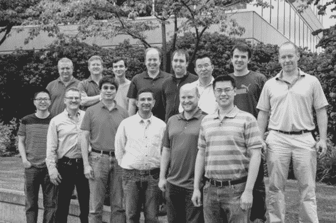

图 2-1 Catapult 团队，右一为 Doug Burger（图片来自微软）

### 2.1.2 数据中心引入加速器的关键考量
大型数据中心运行着数以万计 7×24 小时运转的服务器，部署额外加速硬件绝非易事。性能提升只是众多因素之一，管理者更关注性能与新增功耗成本的平衡。

部署还需兼顾三点：

其一，加速设备应具备良好灵活性和可扩展性。数据中心负载多变，应用多样，加速器不能只服务单一场景，需能按任务动态分配逻辑与加速资源，避免场景切换时资源短缺或过剩，否则运维开销会显著上升。

其二，需保持数据中心同构性。加速器应复用现有服务器、机柜、网络、供电散热等硬件，以及管理、监控、资源调度等软件。没有公司会为加速单元推倒重建已有基础设施，设计时不应以改造现有架构为前提。

其三，加速器需具备一定容错能力。数据中心为保证稳定性会保留冗余，但硬件数量庞大难以人工维护，需要加速器能自定位、调试与分析故障。

### 2.1.3 四种加速方案的权衡比较
硬件加速可选 FPGA、GPU、ASIC，通常与 CPU 对比。从性能、灵活性、同构性、成本、功耗五个维度定性评估：

性能指系统性能提升幅度；灵活性指对不同应用场景的适应度；同构性指能否直接接入现有数据中心并复用基础设施；成本包含研发、采购、部署与运维；功耗指额外能耗负担。

1．CPU
CPU 的指标矩阵如图 2-2。CPU 仍是传统数据中心的主力计算单元，扩展时只需线性增加机柜、网络、供电，同构性高。作为通用处理器，灵活性极强。但相比 ASIC 与 FPGA，功耗偏高；性能并非面向加速，算力不及 GPU、ASIC、FPGA；高性能多核 CPU 的开发与运维成本也较高。

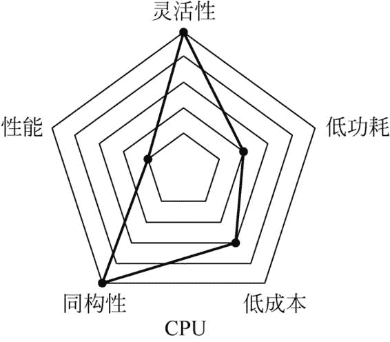

图 2-2 CPU 的各项性能指标

2．GPU
GPU 的指标矩阵如图 2-3。通用 GPU 在数据中心加速研究中很热门。相对于 CPU，GPU 在计算密集型任务如神经网络、大数据分析、数学建模上性能提升数倍到数十倍。

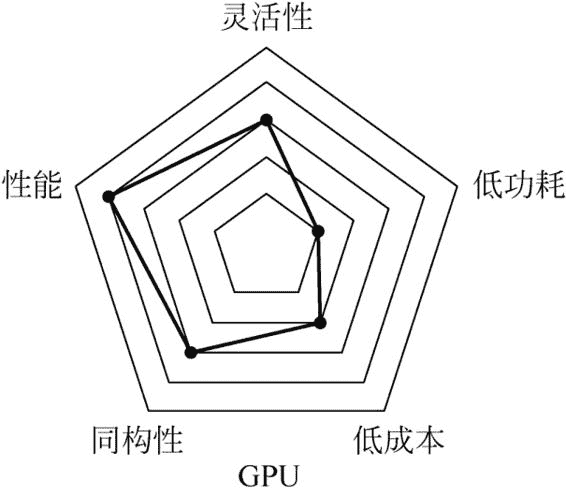

图 2-3 GPU 的各项性能指标

不过 GPU 在其他指标上短板明显，被称为“功耗黑洞”，中端产品普遍超 200W，高端超 300W，远高于 FPGA 或 ASIC 的数十瓦乃至数瓦。高功耗不仅推高电费，还需改造供电散热，影响同构性与成本。灵活性方面，GPU 对通信密集型应用依赖 CPU 与网卡协同，部署成本上升。

3．ASIC（专用集成电路）
ASIC 的指标矩阵如图 2-4。部分公司尝试自研专用加速器在自家数据中心批量部署，典型如谷歌为 TensorFlow 设计的 TPU。ASIC 的优势是超高性能与超低功耗，TPU 性能比 GPU 高一个量级，功耗低一到两个量级。

代价是研发投入巨大，周期长、风险高，全球能承担的公司屈指可数。灵活性差，专用芯片难以迁移到其他应用；使用成本需靠足够大的应用量摊销，且要求算法协议稳定，这对 AI、5G 等快速迭代领域难以满足。短期内难以成为数据中心主流。

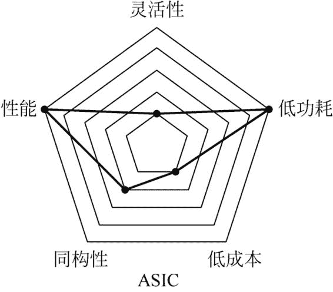

图 2-4 ASIC 的各项性能指标

4．FPGA
FPGA 的指标矩阵如图 2-5。整体来看 FPGA 在各指标间取得较好平衡。性能上可构建定制化硬件流水线并实现大规模并行，虽不及 GPU、ASIC 绝对峰值，但相比 CPU 有一到两个量级跃升。可编程特性使其兼顾计算密集与通信密集场景，动态与部分可重构能力支持跨时空处理多应用，灵活性强。

功耗与成本方面，FPGA 通常数十瓦，运维成本低于 GPU。开发成本包括设计套件、调试软件、芯片或加速卡采购及团队投入，虽高于纯软件，但远低于流片。部署上多以加速卡形式配合通用处理器，对供电散热要求不高，可兼容现有基础设施，软件层面需补充驱动、配置与虚拟化框架，但无需大规模改动数据中心软件架构。
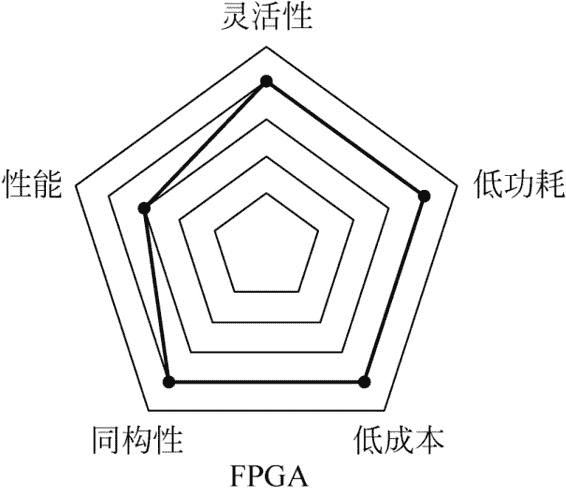

图 2-5 FPGA 的性能指标

FPGA 为何成为微软数据中心的第一选择

和其它硬件加速方案相比，FPGA在算力、灵活度、架构一致性、成本和能耗上找准了比较理想的妥协点，这也是微软最终把FPGA选为数据中心加速核心的根本原因。接下来重点讲Catapult项目走过的三条演进路线，以及每一步带来的收获。

### 2.1.4 Catapult 项目的三次迭代

2016年，微软在MICRO会议上发表了《A Cloud-Scale Acceleration Architecture》这篇论文，披露了Catapult新一代的架构细节。算到那时，项目已经走完三轮迭代。下面从片上逻辑、加速卡形态与互联方式、多卡资源调度与网络拓扑、主要性能指标四个维度，对三轮分别展开。

#### 1．第一阶段

Catapult起步时采用单板多FPGA的设计思路，一张卡上塞进6颗Xilinx Virtex-6，芯片间靠各自的通用I/O口直接通信，如图2-6所示。

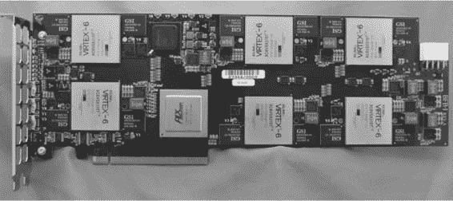

图 2-6 Catapult第一阶段的FPGA板卡（图片来自微软）

这种大板在实测部署时问题明显。首先灵活性很差。某类大作业需要超过6颗FPGA就无解；板上除了PCIe没有网络口，板与板之间的带宽被卡死，难以把一个作业铺到多块板上；反过来作业只用一两颗FPGA时，剩余资源被白白浪费。

其次一致性差。受功耗、供电、体积限制，这类重板很难塞进数据中心的高密度机架。若要上架，就得另购服务器或重改机房硬件架构，本末倒置。

最后可靠性不达标。单块板上元件众多，任一故障都可能拖垮整板，进而影响所在服务器和业务，数据中心无法接受。

第一阶段更像一次原型验证，目标是检验FPGA作为数据中心加速器的可行性，而非直接商用。基于上述短板，团队大幅调整了系统结构，项目进入下一轮。

#### 2．第二阶段

Catapult第二阶段的核心成果发表于2014年ISCA会议，是业界首次大规模关注的版本。实现形式仍是FPGA加速卡，但从单板多核改为单板单核，如图2-7所示。

第二代卡搭载Altera当时尚未被英特尔收购的Stratix V，集成约17.2万个可编程逻辑单元、2014个M20K片上存储、1590个硬核DSP。板载8GB DDR3，提供一个PCIe Gen3×8接口和两个SFF-8088 SAS口，FPGA间通信可达20Gbps。网络层面，48张卡通过SFF-8088 SAS连成6×8的二维Torus，每台服务器放一张卡，通过PCIe供电，无需额外制冷，如图2-8所示，右下角圆圈即为卡位。

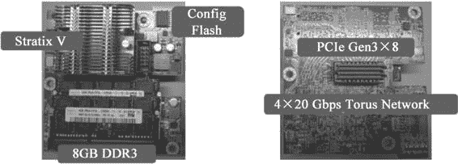

图 2-7 Catapult第二阶段的FPGA板卡（图片来自微软）

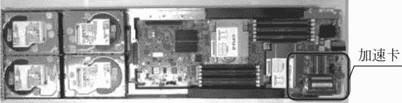

图 2-8 Catapult板卡在服务器中的位置（右下角圆圈处）（图片来自微软）

该代架构引入Shell & Role体系，如图2-9。Shell封装通用底座IP，含内存控制器、PCIe、DMA、各类I/O控制器等；Role是可重构区，通过标准化接口与Shell挂钩，用来承载用户应用。

软件侧，数据中心层加入Mapping Manager负责按作业给FPGA配置，服务器层加入Health Manager负责监控FPGA及相关服务健康。

第二阶段最具代表性的实践，是把Bing搜索引擎中超过3万行C++实现的文档排序运算搬到FPGA上。单卡资源受限，算法被拆到8张卡并行，整体投放1632台服务器协同运行。

图2-10给出关键对比。横轴为系统时延，纵轴为吞吐量。基于深度优化的纯软件已是基准，FPGA仍带来明显优势。

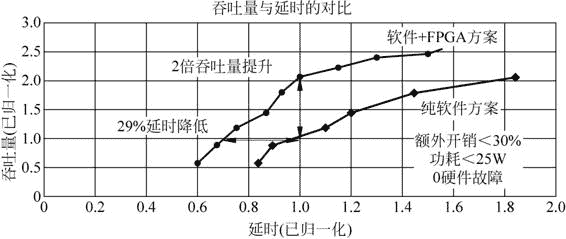

图 2-10 Catapult 项目取得的性能提升

解读有两条：同等时延下，FPGA方案吞吐接近翻倍；同等吞吐需求下，时延下降约29%。单颗FPGA额外功耗小于25W，全系统功耗增幅不到10%，整体成本增加不超过30%。稳定性方面，初期有7块卡出现硬件故障，占比0.4%，随后数月运行全部稳定，证明了可商用可靠性。

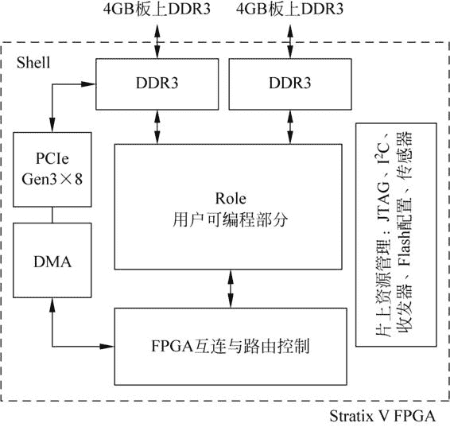

图 2-9 Catapult FPGA采用的“Shell & Role”架构

#### 3．第三阶段

第二阶段虽取得2倍于软件的加速，但Torus网络带来新问题。为实现卡间低时延通信，方案额外搭了一个6×8二维Torus二层网络，与数据中心常见的TOR直连CPU结构不同，扩展性和一致性受限。

Torus互联依赖两类定制线缆，如图2-11，左侧线缆连8张卡，右侧连6张卡，成本高且必须精确知道机柜内卡的物理位置，扩容维护困难。不同Torus域间通信要经过复杂路由，时延和损失明显。同时FPGA仅服务特定加速，对数据加解密、流量控制、虚拟化等基础网络功能毫无增益。

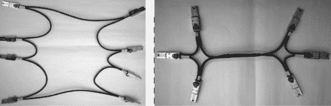

图 2-11 FPGA互连网络的连线方式与线缆（图片来自微软）

2016年发布的第三阶段工作砍掉了第二级网络，直接让FPGA接入数据中心网络，如图2-12所示。

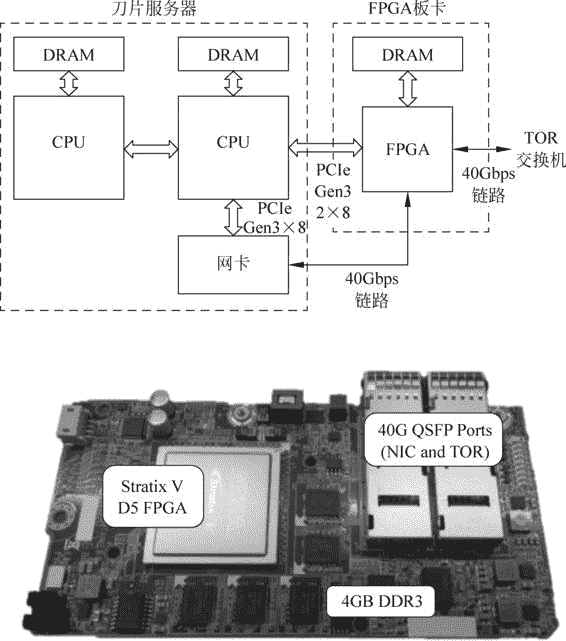

图 2-12 Catapult第三阶段的FPGA加速卡和系统框图

新卡仍用Intel Stratix V，网络接口升级为两个40Gbps QSFP，一个连TOR交换机，一个连服务器网卡。CPU仍可通过PCIe Gen3×8访问FPGA完成加速。由此带来三点改进：

其一，FPGA可承担网络与存储类卸载。直接挂在数据中心网络上，FPGA能作为智能网卡处理加解密、流量控制、QoS等功能，流量在FPGA内闭环，释放CPU核。

其二，FPGA不再与本地CPU地理绑定。通过网络互联，CPU可调度“远端”FPGA，闲置卡可聚合成资源池供全局调用，打破地域限制。为此微软提出轻量传输层协议LTL，实现远程调用。该阶段在自家数据中心部署了5670台服务器的第三代卡，覆盖全球五大洲15国，微软因此成为当时全球最大的FPGA客户之一。

其三，架构延续Shell & Role并扩展，如图2-13。新增40Gbps网络处理流水线、两个MAC/PHY及包处理逻辑，用FPGA硬逻辑实现LTL，并引入Elastic Router管理多个Role与外部网络的通信。为统一管理池化资源，微软提出硬件即服务HaaS模型，成为FPGA虚拟化的代表做法。

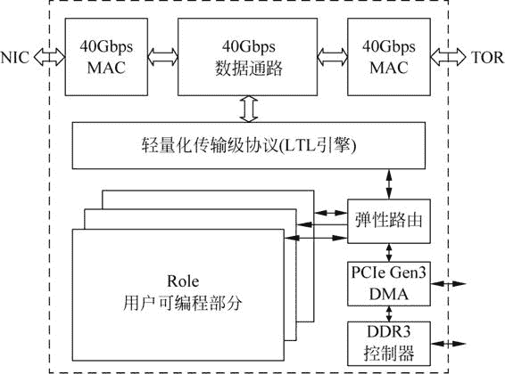

图 2-13 Catapult第三代FPGA架构

第三代卡已正式上架Azure，对Bing页面排序算法加速后，在同样时延要求下吞吐提升约2.25倍，如图2-14。

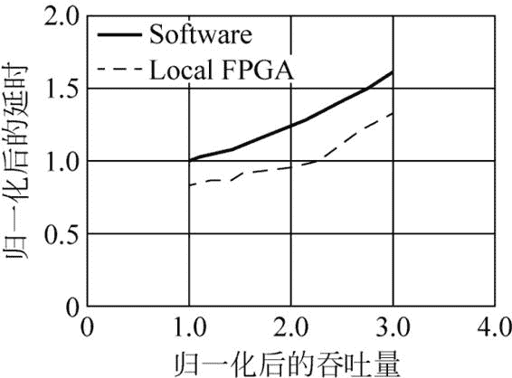

图 2-14 Catapult第三代取得的性能提升

图2-15对比远程与本地FPGA，性能差异不明显，验证了LTL与HaaS的有效性。

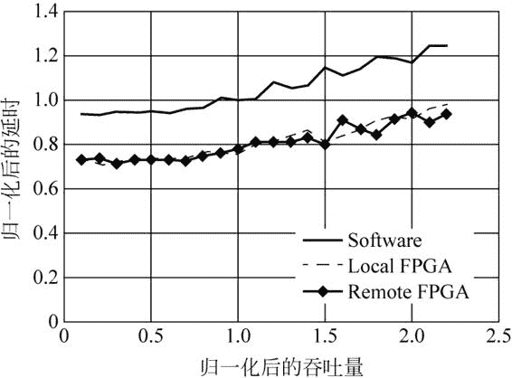

图 2-15 Catapult第三阶段远程FPGA与本地FPGA的性能对比

第三阶段解决了大规模数据中心的灵活性和可扩展性问题，为后续大规模部署奠基。2017年微软随之推出Brainwave深度学习加速平台，标志FPGA应用正式进入AI领域。

### 2.1.5 微软 Catapult 项目小结

Catapult可称是FPGA在大型商用数据中心大规模落地的开山之作，兼顾学术创新与工程落地，对业界参考价值高。对比基准是微软内部深度优化的纯软件，FPGA的优势更具说服力。项目前期原型验证外均采用英特尔原Altera的FPGA，微软也跃升为英特尔FPGA最大客户之一。Wintel联盟在后PC时代通过FPGA实现了新的组合。

## 2.2 FPGA 即服务

Catapult源于微软自建数据中心扩张带来的算力与能耗压力，需要在性能、功耗、成本、灵活度间取得平衡。FPGA的客户主要是微软内部搜索与深度学习团队。另一种进入路径由亚马逊开创，即FPGA即服务FaaS。

### 2.2.1 亚马逊 AWS-F1 实例：FPGA 云服务的首次尝试

与微软私有云自用不同，FaaS把FPGA作为公有云基础设施向外部开发者开放。亚马逊AWS首创了这一模式。此前AWS已推出GPU实例P2，每台含16颗Nvidia GK210，单精度达70TFLOPS，双精度超23TFLOPS，用于神经网络训练等。

2017年HotChips大会上，AWS发布报告《FPGA Accelerated Computing Using AWS F1 Instances》，正式推出首个FPGA云加速实例AWS F1，标志FPGA与GPU一样进入公有云商品化。

对云端FPGA开发便利性要求极高。大型客户能获得厂商深度支持，而公有云的广大开发者资源有限，难以直接获得厂商援助。因此平台必须提供完整的开发、调试、部署、维护体系，并营造活跃社区实现协同。

理想平台应做到：抽象底层逻辑资源，让用户不必纠结常用IP与接口细节；提供完整的软硬件工具链，支撑云端全流程开发。

由此可归纳AWS以FPGA作为计算加速服务的主要意义：

1. 以标准AWS实例形式把FPGA开放给数百万开发者与终端用户。
2. 提供云端标准化开发工具，简化开发流程。
3. 统一FPGA逻辑接口，抽象物理细节，让开发者专注算法。
4. 搭建统一的应用市场与交易平台，为用户提供更多IP选择。

### 2.2.2 AWS FPGA 云服务的技术概述

AWS-F1 的整体架构在图 2-16 中有清晰呈现。看完整机结构，除了 FPGA 之外，实际上还由两大核心组成：AMI 和 AFI。AMI 的全称是 Amazon Machine Image，说白了就是一套操作系统镜像，同时打包了完整的 FPGA 软硬开发与仿真调试工具链。AFI 的全称是 Amazon FPGA Image，本质上是 FPGA 的位流配置文件，也常被叫做 FPGA 镜像，它会被直接烧写到 F1 实例的 FPGA 上运行。AFI 既可以由 AWS 官方提供，也可以由第三方开发者自行生成。最终产出的位流文件同样称作 AFI，最终会写入 F1 实例的 FPGA 中执行。

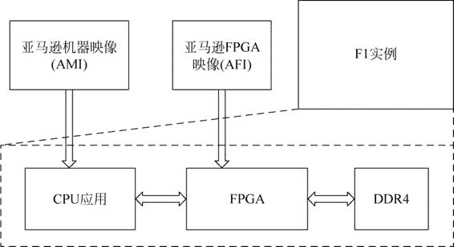

图 2-16　AWS-F1 实例示意图

目前的 F1 实例搭载的是 Xilinx 16nm UltraScale+ 系列 FPGA，每台实例提供两种配置，可选 1 颗或 8 颗 FPGA 芯片，对应 4×16GB 与 32×16GB 的 DDR4 内存，以及 10Gbps 与 25Gbps 的网络带宽。

F1 实例还内置了一套底层的 FPGA 逻辑框架，思路和微软 Catapult 项目中的 Shell & Role 非常接近，即把 FPGA 分为 I/O 接口层和用户可编程逻辑区。这样开发者就能把精力集中在算法和应用本身，无需过多操心外部通信逻辑的细节。

在开发流程上，F1 并没有脱离常规 FPGA 开发的路径，仍然是用 Vivado 完成综合、实现、时序优化和仿真验证，区别在于所有这些步骤都需要在 AWS 提供的 AMI 环境里完成。开发结束生成的 FPGA 镜像 AFI 可以直接部署到实例上运行，也能上传到 AWS 应用市场供他人复用。如今不少 FPGA 初创团队都在市场里上架了自己的 AFI，比如已被 Xilinx 收购的深鉴科技的语音识别引擎、Maxeler 的金融计算加速应用、Falcon Computing 的基因检测加速引擎，以及 LegUp 的网络功能加速应用。加州大学洛杉矶分校 UCLA 等高校，也把 AWS-F1 当作 FPGA 设计课程和实验的主力平台，省去了自建实验环境的高昂成本，让学生直接用上最先进的工具、器件和流程，专注于创新本身。

### 2.2.3 其他云厂商的 FPGA 加速实践
亚马逊 AWS 开创了“FPGA 即服务”的模式，让公有云用户和开发者能更便捷地使用和开发 FPGA，也搭建起一个成熟的 FPGA 应用交易市场。

国内云厂商的布局也在加速。阿里云目前已发布三款 FPGA 云加速实例，其中 2018 年上线的 F3 计算实例采用 Xilinx Virtex UltraScale+ 芯片，而更早的 F1 则基于英特尔 FPGA 器件和开发套件。腾讯云推出了基于 Xilinx Kintex UltraScale 的云服务，并计划后续推出英特尔 FPGA 版本的计算实例。华为云也有基于 Xilinx 器件的 FPGA 加速云服务器正在推向市场。

可以说，国内互联网头部企业已全面进入 FPGA 云服务赛道。随着竞争加剧，使用者将持续受益于技术红利，FPGA 生态也随之完善。与此同时，如何做出差异化，像微软和亚马逊那样走出独特的技术路线，仍是各家厂商和初创公司需要思考的课题。

## 2.3 电信网络新变革：SDN、NFV 与 FPGA
除了微软 Azure 和亚马逊 AWS 这类云数据中心，电信运营商也在用 FPGA 推动自有数据中心网络架构的转型。驱动转型的核心力量，正是如火如荼发展的网络功能虚拟化 NFV 和软件定义网络 SDN。

### 2.3.1 NFV 与 SDN 的核心价值
预测显示，未来五年全球网络流量将增长超过三倍。在 5G、物联网、自动驾驶等成为主战场的今天，电信网络与数据中心的处理能力被推到前所未有的高度。传统方式下，电信基础架构很难有效扩展，问题出在硬件与软件两端。

硬件层面，传统网络依赖各类专用设备，如接入设备、交换机、路由器、防火墙、QoS 等。虽然性能稳定，但数据规模暴涨后弊端凸显：设备间兼容性差、升级维护困难、供应商垄断抬高成本、新增功能必须重新开发硬件。

软件层面，各类设备各自对应不同的配置与控制软件，不同厂商规格又导致整合复杂，难以在系统层面统一部署。即使尝试用纯软件实现部分网络功能，也会出现服务器利用率低、服务无法动态迁移等难题。

在这种背景下，网络功能虚拟化 NFV 逐渐成为运营商的主流解法。NFV 的直接动因之一就是支撑指数级带宽增长。欧洲电信标准协会 ETSI 在 NFV 标准化上做了大量工作，其发布的 NFV 概念图如图 2-17 所示。

与传统方案不同，NFV 用通用服务器、通用存储和通用高速以太网交换机来承载传统网络架构中的各种功能。具体做法是把网络功能以软件形式跑在通用服务器上，数据存于通用存储，流量经通用网卡和高速交换机转发。这样既摆脱了专用设备带来的扩展性限制，也降低了对单一供应商的依赖，通过开放竞争减少采购与部署成本。

借助虚拟化，网络功能运行在不同虚拟机中，单体应用不再独占整台服务器，一台服务器可同时承载多个虚拟机或网络服务。虚拟机在数据中心内的横向扩展与迁移也变得更灵活，不易导致服务中断。

NFV 与 SDN 常常并提。两者的核心都是把网络的控制面与转发面分离，让所有转发面设备能够被统一控制、配置和管理，避免管理员逐台设备手工配置的低效局面。

2016 年，中国电信启动为期十年的网络智能化重构，并发布《中国电信 CTNet2025 网络架构白皮书》。白皮书指出：“未来网络架构必须开放和标准化网络能力接口，通过软件定义网络实现面向业务的资源调度和定制化，同时提供网络可编程能力，实现网络业务深度开放。”这说明 SDN 将成为电信网络演进的重要方向，中国电信计划在 2025 年前完成这轮转型。

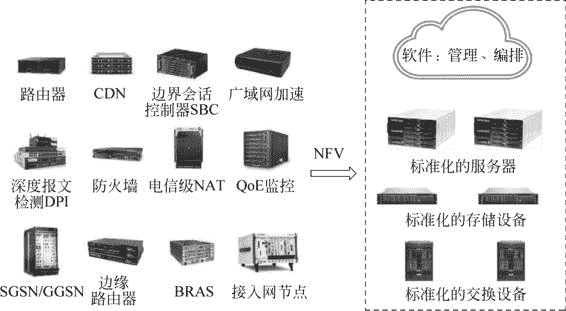

图 2-17　NFV 概念示意图

### 2.3.2 FPGA 如何加速虚拟网络功能
SDN 与 NFV 正引领电信网络智慧转型，但在工程落地层面仍面临挑战。不同场景下的网络负载千差万别，很多应用要求线速处理，如 QoS、流量整形、VPN、防火墙、NAT、加解密、实时监控、深度包检测 DPI 等。用软件实现这些功能很难达到专用硬件的性能，即便借助 DPDK 这类专用库，纯软件线速处理的难度依然很大，这也让部分人质疑 NFV/SDN 的初衷。同时，两项技术仍在早期探索阶段，相关协议标准尚未完全定型，不少企业持观望态度。

在 SDN/NFV 架构里，这些负载被虚拟化为一个个虚拟网络功能 VNF。一个有效的实现需要 VNF 足够灵活、易用、可大规模扩展，且不局限于特定场景，同时性能不输甚至超过专用硬件。因此必须实现控制面与转发面的分离与独立扩展，并设计可编程的转发面并加以标准化。

在电信场景中，NFV 的典型代表是虚拟化宽带远程接入服务 vBRAS，也称 vBNG。其内部往往包含 RADIUS、DHCP、DPI、防火墙、QoS 等多个 VNF。

从算力需求看，这些网络应用可分为两类：一类算力需求低，如 RADIUS 和 DHCP，多属于控制面，适合放在控制面运行，具有良好的纵横向扩展性，也适合通用计算存储实现；另一类算力需求高，如流量管理、路由转发、数据包处理，需在线速如 40Gbps、100Gbps 及以上环境下处理，属于数据面。数据面还需同时支持多种高计算量的网络功能，才能体现 NFV 相比专用硬件的优势。

由此，数据面需要具备线速高吞吐的复杂包处理能力，同时支持多种网络功能并具备强可编程性。纯软件受 CPU 性能瓶颈限制难以兼得，而自研 ASIC 虽快却缺乏灵活性，且会增加同构性、开发运维成本，这与云数据中心加速器的评判标准一致。

在这种权衡下，FPGA 成为性价比最优的智能加速平台。它相比软件拥有绝对的包处理性能优势，可在硬件层实现并行处理；相比传统专用硬件，它又具备高度可编程性，能支撑多种虚拟网络应用。

2017 年，中国电信联合英特尔与 HPE 发布白皮书《为下一代电信基础设施寻找有效的虚拟网络体系架构》，其中即以 FPGA 作为数据面的核心加速单元，在多租户环境下实现 QoS 和多级流量整形的线速处理。

类似微软 Catapult 项目中的 FPGA 智能网卡，基于 FPGA 的包处理方式非常灵活：数据包可在 FPGA 内部完成处理后直接转发，不经过 CPU；也可通过 PCIe 传给 CPU，用 DPDK 等软件处理后再转发；二者还能结合，控制面功能在 CPU 运行，部分功能卸载到 FPGA 完成。

得益于动态重构特性，FPGA 可在不同时段加速多种网络功能，无需更换板卡。用户自定义的网络功能也能在 FPGA 上很好支持，无需专用设备，从而在高性能与高通用性之间取得平衡。

可以看出，FPGA 正逐步在运营商数据中心落地并深度参与网络智能化转型。随之而来的新问题也层出不穷：如何设计 CPU+FPGA 异构架构，如何统筹计算、控制、存储资源，如何在数据中心高效部署加速资源，如何构建商业模型明确硬件加速器在系统中的定位等，这些都将是企业与学界未来一段时间的重点研究方向。

## 2.4 系统级方案：FPGA 加速卡
作为云数据中心加速的关键组件，FPGA 的应用已从微软、亚马逊等巨头扩展到各类规模的数据中心，并在大数据、AI、网络功能加速等领域发挥作用。

在大数据浪潮下，FPGA 厂商的推广方式也在进化，目标明确是让更多用户用上自家产品。鲜明趋势是，FPGA 厂商正从单纯的芯片商向系统级解决方案提供商转型。

### 2.4.1 从芯片到方案：FPGA 厂商的角色转变
传统 FPGA 业务里，厂商主要卖芯片和 EDA 工具，售出后客户如何开发与厂商无关。虽然提供技术支持，但核心开发仍由客户承担。这种模式在新兴领域并不适用：用户面临 CPU、GPU、ASIC 多种选择，FPGA 并非首选；用户的核心诉求是算法和应用落地速度，硬件只是手段。只有能更快实现算法的平台才能帮助客户抢占市场。

因此，现在 FPGA 厂商更倾向于提供完整的系统级解决方案。两大 FPGA 厂商纷纷推出的 FPGA 加速卡正是这一趋势的体现。

硬件层面，厂商已不止于芯片，而是提供板卡级组合。与开发板不同，加速卡是针对特定领域和应用的专业卡，通常以 PCIe 扩展卡形态部署，板上集成丰富的高速 I/O 和存储资源，但不像开发板那样配备大量通用 I/O 和调试接口。

软件层面，除了传统开发套件，厂商还提供配套驱动、软件库、API，甚至完整的开发栈和软硬件参考设计。这些一站式环境大幅降低了 FPGA 开发门槛，让软件背景的开发者也能快速完成算法在 FPGA 上的实现。厂商通过提供原厂方案同时吸纳第三方 IP 与应用，构建完整生态。

值得注意的是，除了原厂方案，华为、浪潮、Mellanox 等第三方厂商也推出各自的 FPGA 加速卡。它们虽采用英特尔或 Xilinx 芯片，但针对细分领域进行了优化设计，满足特定应用需求。

### 2.4.2 英特尔 PAC 加速卡布局
早在 2017 年 10 月，英特尔就发布了旗下首款 FPGA 加速卡 Programmable Acceleration Card，简称 PAC，并同步推出配套的软硬件开发框架与加速栈。这不仅是英特尔 FPGA 的首款通用加速卡，也是当时市场上首款面向大数据、AI、高性能计算等新兴领域的数据中心 FPGA 加速卡，意义重大。

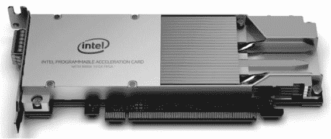

图 2-18　英特尔 PAC FPGA 加速卡（图片来自英特尔）

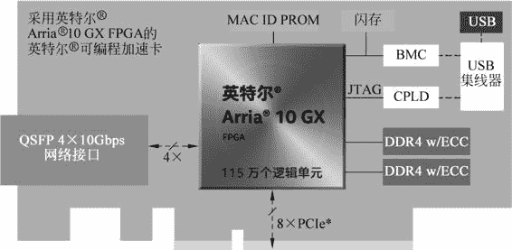

图 2-19　英特尔 PAC FPGA 加速卡板级资源

硬件资源如图 2-19 所示。PAC 基于英特尔 Arria10 GX 系列 FPGA，采用 20nm 工艺，拥有 115 万个可编程逻辑单元，是当时英特尔性能和规模最强的 FPGA 产品。板卡集成 8GB DDR4 内存和 128MB 闪存，提供一个 QSFP+ 接口，最高支持 40Gbps 网络带宽，同时通过 PCIe Gen3×8 与主机 CPU 互联。功耗约 45~60W，采用被动散热设计，尺寸为半高半长，便于在各类服务器中部署。

PAC 的核心场景是加速数据中心各类应用。作为英特尔原厂卡，它天然适配 Xeon 处理器，可作为硬件加速单元卸载 CPU 上的任务，形成 CPU+FPGA 的高性能组合。

在生态构建上，英特尔还发布了面向 Xeon 与 FPGA 的 Acceleration Stack 加速堆栈，见图 2-20。该堆栈是一个软件开发框架，包含板卡驱动、API、接口管理、软件库和开发工具，为 CPU 与 FPGA 的协同开发提供统一编程接口，简化流程、缩短周期。

**数据中心 FPGA 加速卡与虚拟化全景**

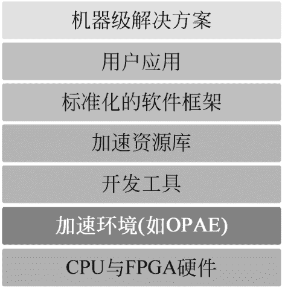
图 2-20　英特尔 FPGA 加速堆栈结构

为了让软件开发者不必直接面对底层的 FPGA 硬件，英特尔推出了并开源的开放可编程加速引擎 OPAE，即 Open Programmable Acceleration Engine。OPAE 采用分层架构，提供统一的软件调用接口，并内置了寄存器管理、内存分配等常见硬件功能的实现，见图 2-21。同时它在操作系统内核层为 FPGA 提供支持，把开发重心完全放在用户空间的应用编写上。

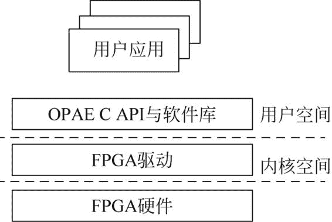
图 2-21　英特尔 OPAE 技术的结构层级

首款 PAC 面世一年后，英特尔在 2018 年 10 月发布了基于 Stratix10 SX 系列的新一代加速卡 PAC D5005，见图 2-22。相较于基于 Arria10 的前代产品，这款卡在算力上实现质的提升。Stratix10 属于英特尔高端 FPGA，采用 14nm 制程配合 3D 系统级封装，集成度大幅提高。该卡搭载的 Stratix10 SX FPGA 拥有约 280 万个可编程逻辑单元、244Mb 片上存储，以及最高 26Gbps 的高速串行收发器。

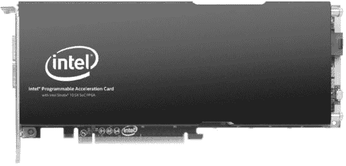
图 2-22　英特尔 Stratix10 PAC FPGA 加速卡（图片来自英特尔）

PAC D5005 的板级配置如图 2-23 所示。板卡配备 32GB DDR4，两个可支持最高 100Gbps 带宽的 QSFP28 网络接口，以及 PCIe Gen3×16 互联。由于面向更高性能的数据中心场景，这款卡的功耗和体积均有所增加，板级功耗约为 225W，采用全高、3/4 长度的双槽设计。

图 2-23　英特尔 Stratix10 FPGA 加速卡板级资源

英特尔 FPGA 加速卡的最大优势在于其在数据中心处理器的主导地位。Xeon 处理器占据 x86 服务器市场的主流份额，任何 FPGA 加速卡都要针对 Xeon 做大量兼容与优化，而英特尔自家产品天然具备这一优势，也因此成为目前少有的能够提供全栈数据中心解决方案的厂商。

此外，英特尔与戴尔、HPE、富士通等主流服务器厂商保持紧密合作，这些厂商通常会直接在其服务器产品线中集成并销售基于英特尔 FPGA 的加速卡。

### 2.4.3 赛灵思 Alveo 系列的进场策略

赛灵思在数据中心 FPGA 加速卡领域的起步较晚。直到 2018 年 10 月才正式推出面向数据中心的第一代产品 Alveo，如图 2-24 所示。首发型号 U200 与 U250 均基于 16nm UltraScale 工艺，逻辑单元数分别约为 89.2 万和 134.1 万，与英特尔的 PAC 相比处在同一量级。

图 2-24　赛灵思 Alveo FPGA 加速卡（图片来自赛灵思）

两款板卡同样瞄准大型数据中心，板载 64GB DDR4、两个 QSFP28 网络口和一个 PCIe Gen3 接口。与 PAC 相比，Alveo 在板载资源上更丰富，但也带来尺寸与功耗的增长。主动散热下板卡为全高全长，标称功耗 100～110W，峰值可达 225W，远高于基于 Arria10 的 PAC 的 45～60W，与基于 Stratix10 的 PAC 相近。

在软件生态上，Alveo 主要依托赛灵思的 SDAccel 开发环境，如图 2-25 所示。SDAccel 提供面向 C/C++ 和 OpenCL 等高层语言的 FPGA 编译器、软件库与 API，帮助开发者快速完成硬件开发和使用。这与英特尔的 Xeon 与 FPGA 加速堆栈思路一致，也反映出 FPGA 软件正朝着降低门槛、强化高层语言支持的方向演进。

图 2-25　赛灵思 SDAccel 开发环境

### 2.4.4 厂商自研的 FPGA 加速卡

除英特尔和赛灵思的原厂方案外，浪潮、华为等国内厂商以及以色列的 Mellanox 也相继推出基于 FPGA 的加速产品。

浪潮在售的 F10A 加速卡如图 2-26 所示，采用英特尔 Arria10 系列 FPGA，片上可编程逻辑单元最高约 115 万。板卡提供两个 SFP+ 10Gbps 以太网口、PCIe Gen3×8 接口，以及最高 32GB 板载 DDR 内存。

图 2-26　浪潮 F10A FPGA 加速卡

2018 年 10 月底在赛灵思开发者大会上，浪潮发布了 F37X，华为发布了 FX 系列，如图 2-27 和图 2-28 所示。

图 2-27　浪潮 F37X FPGA 加速卡

图 2-28　华为 FPGA 加速卡

两款产品均采用赛灵思 16nm UltraScale+ FPGA。相比原厂 Alveo，它们在功耗控制上做了优化。浪潮 F37X 典型功耗约 75W，华为 FX 系列中端型号典型功耗最高 75W，高端型号约 200W。

在规格上，浪潮 F37X 的 FPGA 集成 8GB HBM2 片上高速缓存，相较 DDR 能显著提升存储带宽与访问效率。此外，两款第三方卡的片上逻辑单元数量均高于 Alveo，可应对机器学习、视频编解码、NFV、图像与语音识别等新兴数据中心场景。

以色列厂商 Mellanox 则推出多款基于 FPGA 的智能网卡，例如 Innova-2 Flex 系列。Mellanox 深耕数据中心网络，其产品线覆盖网卡、交换机、线缆与软件。2019 年 Mellanox 被英伟达收购。

智能网卡的核心在于将原需在 CPU 核心上运行的功能卸载至网卡硬件加速器，特别是虚拟交换、虚拟路由等基础设施功能，避免占用可售卖的 CPU 核心资源，同时降低网卡与 CPU 间的通信量，节省 PCIe 带宽。

### 2.4.5 FPGA 智能网卡与虚拟化思路

Mellanox 的智能网卡如图 2-29 所示。核心由自研 ConnectX-5 以太网控制器与赛灵思 Kintex UltraScale FPGA 组成，提供两个 25Gbps 以太网口，经 PCIe Switch 连接主机与 FPGA。ConnectX-5 自身已支持虚拟交换、虚拟路由卸载、SR-IOV、QoS 与流量控制等功能，FPGA 则作为可定制加速单元满足差异化需求。

图 2-29　Mellanox FPGA 智能网卡

不论是芯片厂商还是服务器与第三方厂商，都在加速布局 FPGA 加速卡市场，其背后是 FPGA 易用性的提升以及软硬件生态的构建。系统级解决方案的普及，将推动 FPGA 在更多应用中发挥作用。

## 2.5 FPGA 虚拟化：从硬件到资源的管理

要在数据中心部署 FPGA，需要一套开发、管理和调度的机制，而传统 FPGA 开发方式并不适用。近年 FPGA 虚拟化成为研究热点，它能简化开发流程、便于系统管理、降低使用门槛。

### 2.5.1 为什么要虚拟化 FPGA

传统 FPGA 开发模型如图 2-30 所示。开发者用硬件描述语言 HDL 对业务建模，经 FPGA 工具链映射到器件，由 EDA 完成布局布线与时序优化，最终生成可运行镜像。这种方式允许自由使用 LUT、RAM、DSP 及 PCIe、以太网等 I/O 资源，并在硬件层做优化，性能较高。

但缺点明显：对开发者技能要求极高，需精通 FPGA 结构、HDL 与调试工具，积累周期长；同时 FPGA 常由单一用户占用，对资源需求不大的应用，硬件在大部分时间处于闲置，资源利用率低。

随着大数据与异构计算兴起，FPGA 与 CPU、GPGPU、ASIC 等协同工作。若仍坚持硬件电路描述的开发模式，将难以融入以软件指令为主的异构系统。由此需要对 FPGA 进行逻辑抽象，让上层用户不必关注底层实现细节，图 2-31 所示的新型开发模型应运而生。

图 2-30　传统的 FPGA 开发层级

简单说，FPGA 虚拟化在传统模型中加入抽象层，形成桥梁连接应用与底层硬件，如图 2-32 所示。上层应用经虚拟化编译工具映射到抽象层，避免直接操作硬件。抽象层承担任务调度、资源分配与管理，类似 Hypervisor。底层 FPGA 仅需执行分配的任务，系统中可同时包含 FPGA、多核 CPU、GPU 等异构单元。

图 2-31　新型 FPGA 开发模型

图 2-32　FPGA 虚拟化分层

### 2.5.2 FPGA 虚拟化的核心目标

与软件虚拟化类似，FPGA 虚拟化旨在对特定计算资源进行抽象、分配与整合，打破物理限制，实现有效管理。当前业界普遍认可的九项目标包括：

多租户架构：同一 FPGA 结构可为多个用户提供服务；
资源管理：对逻辑资源抽象，提供驱动、API 与任务调度监控；
灵活性：支持更广泛的应用与加速器描述方式，兼顾 HDL 与 C/C++、OpenCL 等高层语言；
独立性：逻辑隔离，确保各用户应用安全独立运行；
可扩展性：硬件层面兼容多厂商多代产品与板卡，软件层面支持多种开发环境与框架；
高性能：虚拟化带来的性能损耗与资源开销应尽量小；
安全性：保护用户信息与平台免受恶意攻击；
稳定性：保证系统与服务持续稳定运行；
开发效率：大幅缩短开发周期，提升竞争力。

### 2.5.3 虚拟化的层次划分

业界对 FPGA 虚拟化的分类尚无统一标准。2004 年 Christian Plessl 等人提出三层划分：时域划分，通过重配置实现时间片轮转执行；虚拟化执行，将应用拆分为可通信任务，在统一环境调度；硬件虚拟机，引入硬件抽象架构，开发者无需关注底层结构。

2018 年 Anuj Vaishnav 等人按抽象程度重新划分：资源级虚拟化，涵盖架构虚拟化与 I/O 虚拟化；单节点级虚拟化，以单个 FPGA 器件为最小粒度进行资源管理与基础设施搭建。

（3）多节点级（`Multi-node Level`）虚拟化：把最小操作单元放大到若干片 `FPGA`，这类粒度主要服务于依赖多芯片协同的大型应用。

上述三种层次与软件虚拟化尤其是 `JVM` 各层级的对照关系可参见图 2-33。

无论怎么划分层级，归根到底都是在解决怎样调动单片或多片 `FPGA` 的逻辑资源，以及配套的虚拟化软件与工具如何设计。支撑虚拟化的抽象层可以是单一层级，也可能是多层叠加而成。不同抽象高度与各类虚拟化诉求之间往往存在互斥，很难面面俱到。图 2-34 把虚拟化按单 `FPGA` 与多 `FPGA` 拆成两大阵营，并梳理了其中常见的 `FPGA` 虚拟化手段，以及这些手段在资源灵活性、开发范式和开发效率等维度上的相对表现。

图 2-33　FPGA 虚拟化层次与软件虚拟化（`JVM`）层次的大致对应关系

随着虚拟化程度抬高，对片上资源的可操控灵活性会同步下降，原因比较复杂。一方面虚拟化管理逻辑本身要占用额外资源，另一方面软件化的资源分配调度很难达到手工精细优化的效果。反过来，抽象越高，开发体验越贴近软件，效率提升就越明显。

### 2.5.4 常见的 FPGA 虚拟化实现方法

本节聚焦三类主流实现路径：`Overlay`、部分可重构配合虚拟化管理器，以及 `FPGA` 资源池与虚拟化框架。

图 2-34　不同抽象层次与多个性能指标之间的相对关系

#### 1. Overlay

`Overlay` 原义为覆盖叠加，在网络里常用来在物理网之上搭建虚拟逻辑网络，实现应用与底层物理的解耦，数据中心里常用的 `VxLAN` 便是典型。

`FPGA Overlay` 是目前最普及的虚拟化方案之一，其思路与网络类似，在硬件层之上架设一层可编程的虚拟架构并对接上层应用，如图 2-35 所示。

图 2-35　Overlay 结构图

具体形态多样，既可以是工程上常用的软核通用处理器，例如英特尔的 `NIOS-II`、赛灵思的 `MicroBlaze`，也可以是面向更高级编程模型的可编程逻辑阵列 `CGRA`，或是像 Virtual Box 公司那样为加速向量计算专门打造的向量处理器。

选用 `Overlay` 的核心价值在于给用户提供更熟悉的编程环境与接口，借助高层语言就能操作 `Overlay` 里的软核或处理单元，而不必深究底层电路，从而实现对 `FPGA` 硬件的抽象与虚拟化。因为 `Overlay` 层通常与具体 `FPGA` 架构无关，上层设计在不同芯片间的迁移成本也降低了。

另一个明显收益是编译时长的压缩。传统流程要走综合、映射、布局布线，耗时数小时。`Overlay` 的底层结构相对固定，可由开发者提前完成大部分编译，用户只需对自身逻辑做增量编译，开发调试迭代因此快得多。

与高层次综合 `HLS` 的差异在于，`Overlay` 并不能完全遮蔽底层 `FPGA` 结构，会带来额外成本与难度，主要体现在两点：
（1）`Overlay` 层难以覆盖用户的全部需求。以软核处理器为例，数据通路与控制可以用处理器完成，数据通路的真正实现仍需硬件工程师介入。
（2）目前缺乏统一的行业标准开发模型。若采用专用阵列或 `CGRA`，因缺少像 `HLS` 那样的通用标准，软件工程师需要额外学习其编程模型，同时还需硬件团队在 `FPGA` 上实现并优化 `CGRA` 电路。

#### 2. 部分可重构（Partial Reconfiguration）与虚拟化管理器（Hypervisor）

部分可重构是 `FPGA` 的原生优势，体现其灵活性。可把芯片内部划分为一个或多个区域，在系统运行时单独对这些区域重配置、改写逻辑而不干扰其他部分，如图 2-36 所示。这就实现了时空两个维度上的硬件级多任务切换。

借助该技术，`FPGA` 可被切分为若干子区作为虚拟 `FPGA` 供不同用户使用，同时保留不可重配置区承载基础功能，如内存管理、网络通信等。

微软 Catapult 项目是典型案例。第二阶段中，每颗 `FPGA` 逻辑上分为 “`Role`” 与 “`Shell`”。`Role` 为可重构单元，随应用变动；`Shell` 为固定区，集成 `DRAM` 控制器、高速串行收发器、与主机通信的 `PCIe` 模块与 `DMA`、负责重构的 `Flash` 读写模块以及各类 `I/O` 接口。

IBM 的 cloudFPGA 也有类似思路。2015 年的方案把 `FPGA` 划为管理层 `Management Layer`、网络服务层 `Network Service Layer` 与虚拟 `FPGA` 层 `vFPGA`，如图 2-37 所示。

图 2-36　通过 FPGA 部分重构进行多任务切换

图 2-37　IBM cloudFPGA 结构示意图

`vFPGA` 本质是可动态重构的区域，可归属同一用户或多个用户，运行相同或不同的任务。重构某个 `vFPGA` 不会影响其它实例。管理层不可由用户配置，负责 `vFPGA` 的内存分配与管理，关系类似传统虚拟化中的虚拟机与编排器。网络服务层则负责多 `vFPGA` 与数据中心网络的通信，并在硬件上实现 L2-L4 协议，供所有 `vFPGA` 使用。

要做部分重构虚拟化，通常需引入管理层统一调度资源，但管理层本身会占用本可用于应用的可编程资源并拖累整体性能。强行划分可重构区还可能削弱系统性能：划定边界后其他逻辑无法使用该区资源，布局布线灵活性下降，时序路径被迫绕行导致布线延迟增加；若可重构区划分过少，又会造成资源闲置。如何确定合理的区域数量并优化动态重构的布局布线，正是学界与工业界持续探索的课题。

#### 3. FPGA 资源池与虚拟化框架

与在单芯片上做动态分区相比，更直接的做法是把多颗 `FPGA` 级联，每个芯片服务一个或少数用户，通过整体虚拟化框架完成集成与调度。该架构同样能支撑单用户占据多芯片的场景。这类多租户虚拟化需要软硬件协同，如图 2-38 所示。

图 2-38　FPGA 资源池与虚拟化框架示意图

硬件侧要实现多 `FPGA` 互连形成资源池，并兼容 `CPU`、`GPU` 或其他加速器。软件侧需要一个虚拟化框架负责任务部署：分配调度各类硬件资源、管理 `FPGA` 含内的加速器间通信与数据搬运、控制互联方式，以及执行动态重构与配置。

Catapult 与 cloudFPGA 都具备多租户能力。Catapult 第三阶段在每颗 `FPGA` 内集成弹性路由单元 `Elastic Router`，多个可配置模块 `Role` 通过虚拟通道对外通信。上层提出“硬件即服务 `HaaS`” 模型，由中心化资源管理器 `RM` 统一调度数据中心 `FPGA` 资源，每个资源池配有服务管理器 `SM`，通过 `API` 与 `RM` 交互，实现负载均衡、互连管理与故障处理。

cloudFPGA 则把 `FPGA` 与 `CPU` 解耦，作为网络设备接入数据中心并池化为硬件加速资源。IBM 基于 `OpenStack` 构建了虚拟化框架与加速服务，用户可通过预设的管理员 `IP` 对资源池进行注册、分发、配置与使用。

在该领域，Maxeler 公司的基于 `FPGA` 的数据流引擎也极具代表性，如图 2-39 所示。传统 `CPU` 架构下，`CPU` 反复从内存取指令与数据，计算结果回写内存。数据流架构下，应用启动时一次性读入数据，随后在 `FPGA` 上完成流式处理与计算，中间数据不回写内存，直至结束，从而规避访存瓶颈。多节点数据流引擎可与 x86 `CPU`、网络、存储组成完整集群。

Maxeler 提供类 Java 的 `MaxJ` 语言描述数据流图，经 `MaxCompiler` 映射到底层 `FPGA`，对上层虚拟了电路细节。该架构已用于蒙特卡洛仿真、金融风险计算、科学计算及卷积神经网络加速等场景。

图 2-39　基于`CPU`的传统计算模型与基于数据流引擎的计算模型

在虚拟化框架协议层面，对 `MapReduce` 的 `FPGA` 支持是另一个重点。`MapReduce` 为大规模数据处理提供并行框架，用户只需调用库与 `API`。为其增加 `FPGA` 支持，可先设计 `map` 与 `reduce` 的硬件模块及接口，再由框架调用实现分布式部署与配置。模块实现可采用传统硬件描述语言，也可借助 `OpenCL` 等高层语言配合高层次综合完成。

### 2.5.5 FPGA 虚拟化的未来研究方向

要让 `FPGA` 虚拟化真正成熟落地，仍有多个难点待解：

（1）`FPGA` 资源池、虚拟化框架与多用户支持需要更深入的研究。终极目标是实现硬件资源的完全抽象，为用户提供近似无限的加速资源池。硬件层面需研究更高吞吐、更低时延的互连与通信，以支撑多 `FPGA`、`FPGA`-`CPU`、与其它加速器及网络存储的高速协同。软件层面需完善虚拟化框架与协议，实现资源池的统一管理与配置，并提供友好接口。相关基础设施往往涉及多家厂商，标准统一与协作机制将成为焦点。

（2）可扩展性必须提升。理想平台应兼容不同架构、不同厂商与开发环境，以及多种开发语言，并具备弹性扩展能力。例如在大数据中心，平台要能支撑大规模 `FPGA` 部署，同时与现有软硬件架构与服务无缝兼容。

（3）安全性与可靠性亟待加强。`FPGA` 可编程特性带来独特风险，一旦被恶意控制，不仅会中断软件服务，还可篡改硬件逻辑导致大规模瘫痪。2017 年卡尔斯鲁厄理工学院的研究指出，现代 `FPGA` 架构可能被远程攻击并在电气层面造成破坏，使得芯片无法通过重编程恢复，需手动断电重启服务器。在大规模部署场景下后果严重。因此在虚拟化平台中增强安全与可靠性保障，是未来研究的重要方向。

### 2.6 本章小结

近二十年，`FPGA` 多作为原型验证与硬件仿真平台存在。但进入大数据时代后，这款已步入而立之年的芯片重新焕发活力。

在云数据中心，`FPGA` 先以网络数据加速器身份在微软站稳脚跟。经过多轮迭代，微软已在全球云数据中心部署上百万颗基于 `FPGA` 的加速卡，基础设施成熟后，应用场景迅速扩展。下一章将介绍微软如何用 `FPGA` 构建实时 AI 系统并加速 AI 应用。

亚马逊 AWS 开创了另一种云端部署模式，即 AWS-F1 实例的“`FPGA` 即服务 FaaS”，用户可像操作 `CPU` 或 `GPU` 实例一样开发公有云中的 `FPGA` 资源，该模式已被众多云服务商采纳。

电信运营商也开始把 `FPGA` 作为硬件加速平台与 NFV 的载体，卸载网络功能、加速计算，推动网络向 SDN 架构转型，提升资源利用率、性能与能效，降低部署成本。

相较 `CPU`/`GPU`，`FPGA` 的开发门槛与学习曲线一直受诟病。厂商与第三方推出各类加速卡产品，显著降低开发部署成本。`FPGA` 厂商正从单纯提供芯片与底层工具，转向提供加速卡加完整软件开发环境的全栈方案，第三方产品也丰富了选择。

与此同时，`FPGA` 虚拟化技术不断进步，使 `FPGA` 能以云中虚拟加速资源存在，开发者无需关心底层硬件细节。后文将进一步探讨高层次综合、领域专用语言等全新开发方法与工具。

# 第 3 章 FPGA 面向 AI 时代的核心弹性

灵活性是 `FPGA` 最突出的特质。同一颗芯片可被反复加载不同硬件设计，以执行多样化功能；亦可在现场动态切换运行逻辑，所谓现场可编程。使用者甚至能以秒为单位更换芯片上运行的硬件设计，这使得 `FPGA` 能高度灵活地适配各类应用场景。

在生成式 AI 与大模型快速演进的当下，FPGA 所具备的可重构特性被提到了前所未有的高度。驱动这一趋势的动力主要来自两方面：其一，AI 应用对硬件算力的诉求持续攀升，同时又要求平台兼顾高能效、低时延、高吞吐、可扩展等多种特性；其二，AI 场景与算法迭代极快，训练与推理任务的系统需求千差万别。因此，能够提供强算力且高度灵活的硬件变得必不可少。

FPGA 可以让定制化计算和芯片架构的研究设计迅速落地，同时仍能与现有的软硬件生态保持良好的兼容性。当某个应用场景或算法变化过快、产品规模尚小导致 ASIC 开发成本不划算时，FPGA 能作为理想的过渡载体。一旦应用规模稳步放大，就能在成熟时机把已验证的定制设计迁移到专用芯片，以提升稳定性和降低功耗与均摊成本。

本篇围绕 FPGA 在人工智能领域的典型实践展开。先以微软的脑波项目为例，说明 FPGA 如何构建实时 AI 系统并在云数据中心实现规模化部署，为深度神经网络加速带来可复制的经验；再从技术层面剖析 FPGA 在 AI 时代的差异化优势；最后触及 FPGA 厂商在 AI 赛道的布局思路与技术演进方向。

## 3.1 实时 AI 处理：微软脑波项目

第 2 章已介绍过微软的 Catapult 计划。其核心成果是搭建了一套基于 FPGA 的数据中心加速底座并配套完整的软硬件栈。历经三阶段演进，微软在全球云数据中心部署了上万量级的 FPGA 加速资源。从 2015 年底起，几乎所有新上线的服务器都搭载了来自 Catapult 的 FPGA 板卡，这些机器支撑着必应搜索、Azure 云服务及其他在线业务。

更关键的是，Catapult 为微软积累了大规模 FPGA 开发、部署与运维的工程经验与人才储备。在深度学习驱动 AI 快速发展的背景下，借助 Catapult 平台开展 AI 加速成为顺理成章的下一步。

深度学习让机器翻译、语音识别、计算机视觉等传统 AI 领域取得显著进步，并且逐步替代历史悠久的专用算法。这一变革也倒逼半导体与芯片架构的思考。微软据此重点布局面向 AI、机器学习尤其是深度学习的定制化硬件，于是出现了 Project Brainwave 脑波项目。

### 3.1.1 FPGA 资源池化的主要优点

与业界其他 FPGA 云方案相比，Catapult 的最大亮点在于构建了覆盖全球的 FPGA 资源池，并能灵活调度池内算力。这种池化方式带来了明显优势。

第一，打破 CPU 与 FPGA 的壁垒。传统使用模式下 FPGA 多作为挂载在 CPU 下的加速单元，卸载 CPU 上的软件任务，两者耦合紧密、依赖 CPU 管理。在 Catapult 里 FPGA 成为“第一等公民”。加速卡中的 FPGA 直接接入数据中心 TOR 交换机，无需经 CPU 与网卡转接，使得同机房甚至跨机房的任意 FPGA 均可通过高速网络互联，形成真正的资源池。管理软件可直接划分 FPGA 资源，无需经由每个 FPGA 背后的 CPU 代理，从而实现 FPGA 与 CPU 的有效解耦。

第二，打破单一 FPGA 的资源限制。从逻辑上看，池化架构在 CPU 计算层之上叠加了一层可独立服务的 FPGA 计算层。微软数据中心中池化 FPGA 数量达十万级，互联时延维持在约 10μs 量级。

对 AI 应用尤其是基于深度学习的实时场景而言，搜索、语音识别等对时延极为敏感。微软还拥有大量富文本类 AI 业务，如网络搜索、语音转文本、翻译与问答。相较传统 CNN，这些任务对内存带宽的要求更为苛刻。

若同时满足低时延与高带宽，常规做法是剪枝压缩神经网络以适配有限的加速芯片资源，但会带来不可逆的精度与质量损失。

Catapult 中的 FPGA 资源可视为近乎无限，能够把大模型切分为多个子块，每个子块完整映射到单个 FPGA 执行，再通过高速网络互联。这样既满足时延与带宽需求，又保留模型完整性，避免精度损失，这正是脑波项目的出发点。

### 3.1.2 脑波项目系统架构

脑波项目旨在利用 Catapult 基础设施和大规模池化 FPGA，为没有硬件背景的用户提供 DNN 的自动部署与硬件加速，同时兼顾实时性与成本。

为此提出完整的软硬件方案，包含三方面：根据资源与需求对已训练 DNN 模型做自动区域划分的工具链；对划分后的子模型进行 FPGA 与 CPU 映射的异构系统架构；在 FPGA 上实现并优化的 NPU 软核及指令集。

图 3-1 展示了脑波项目加速 DNN 的完整流程。系统首先将训练好的 DNN 表示为计算流图，即中间表示 IR，图中节点为张量运算如矩阵乘法，边表示数据流动。

图 3-1　脑波项目的完整计算流程

随后工具将整张大图拆分为若干小图，使每个小图可映射到单个 FPGA。若模型中存在不适合在 FPGA 执行的操作，则映射到相连的 CPU 上执行，从而形成基于 Catapult 的 DNN 异构加速系统。

在 FPGA 上的具体实现中，为解决低时延与高带宽两大关键需求，脑波采取了两项核心措施。

其一，完全放弃板级 DDR，全部数据存储于 FPGA 芯片内部高速 RAM。这一做法在单芯片 ASIC 或 FPGA 方案中难以实现。脑波所用的英特尔 Stratix10 系列 FPGA 集成 11721 个 512×40b 的 SRAM 模块，约合 30MB 片上内存，在 600MHz 下提供约 35Tbps 的等效带宽。单颗 FPGA 的 30MB 对任意 DNN 应用都捉襟见肘，但依托 Catapult 超大规模 FPGA 的低时延互联，这些分散的片上 RAM 被聚合成看似无限的资源池，从而突破长期困扰 DNN 加速的内存带宽瓶颈。

其二，采用自定义窄精度数据位宽。项目提出 8~9 位浮点表达方式 ms-fp8 与 ms-fp9。与同精度定点相比，逻辑资源相近但动态范围与精度更好。相较 32 位浮点，使用 8~9 位浮点的精度损失很小，且可通过重训练进行补偿。

图 3-2　自定义浮点数与 32 位浮点数的精度对比

脑波的核心单元是在 FPGA 上实现的软核神经网络处理器 NPU 及其指令集。软核是在高性能与高灵活性之间做的折中。宏观上看，DNN 硬件可选用 CPU、GPU、FPGA 或 ASIC，各有取舍：CPU 灵活但性能一般，ASIC 性能强但缺乏灵活性，FPGA 则在两者之间取得较好平衡。

微观上，FPGA 实现 DNN 也有多种路径：直接编写底层 RTL 做针对性优化，或采用高层次综合 HLS 用高层语言描述。前者经验门槛高、周期长，后者受工具限制性能难达要求。

因此微软选择软核 NPU 与专用指令集，既让硬件工程师可进一步优化架构，又让软件工程师通过指令集快速描述算法，无需关心底层实现细节。

脑波 NPU 架构如图 3-3 所示，核心是矩阵向量乘算术单元 MVU。它针对 FPGA 底层结构深度优化，并结合片上内存与低精度提升性能。其最显著特点是“超 SIMD”指令集，与 GPU 的 SIMD 类似，但一条指令可触发超过百万次运算，相当于在 Stratix10 上实现每个时钟周期约 13 万次运算。

图 3-3　脑波项目中的神经网络处理器架构图

### 3.1.3 脑波项目的性能分析

图 3-4 给出了 NPU 在不同 FPGA 上的峰值性能。以 ms-fp8 精度计，脑波 NPU 在 Stratix10 上可达 90 TFLOPS，与现有 NPU 芯片方案相当。

图 3-4　脑波项目在不同 FPGA 和不同精度的峰值性能

项目还在必应搜索的 TuringPrototype TP1 与 DeepScan 两个 DNN 模型上做加速验证。受严格实时性限制，CPU 实现必须大幅削减模型参数以致精度受损。脑波方案可在模型规模提升十倍以上的同时实现十倍以上的时延缩减。

图 3-5 显示了不同 FPGA 上的等效算力。在 Stratix10 工程样片上 300MHz 运行可得 39.5 TFLOPS 等效算力，峰值 48 TFLOPS。预计量产版 Stratix10 可稳定运行在 550MHz，带来约 83% 性能提升，逼近 90 TFLOPS。Stratix10 满载功耗约 125W，对应峰值吞吐量约 720 GOPs/W。

图 3-5　脑波项目在不同 FPGA 上的性能结果

## 3.2 AI 加速引擎：FPGA 与深度神经网络的近似算法

通常，AI 推理是 FPGA 与 ASIC 等硬件加速器的主要战场。随着应用爆发，推理场景从数据中心延伸至基站、自动驾驶汽车、摄像头等边缘侧，对灵活性、实时性、吞吐量、能效与成本的要求同步提高。

与训练多集中于数据中心不同，推理需求更为分散。GPU 作为当前训练主力，凭借强大的并行浮点能力与 SMIT、SIMD 架构，擅长高密度浮点矩阵计算。但在推理中，高密度浮点运算会拉高能耗、增大存储与数据搬运压力，且难以满足不同场景的灵活性。因此降低 DNN 推理的计算复杂度与存储访问需求成为研究热点。

大量研究表明，在 DNN 中引入近似化可在几乎不损失推理精度的前提下显著提升系统性能。常见近似手段包括低精度定点替代浮点、网络剪枝、结构优化与压缩等。GPU 的 SMIT/SMID 架构不适配近似后低密度数据，性能优势消失且功耗高昂，难以满足能效综合要求。

定制化硬件如 FPGA 与 ASIC 能有效落地上述近似方法，使其在 AI 推理中占据主导。相较 ASIC，FPGA 灵活性更强，在性能、功耗与开发成本间取得良好折中。近年 FPGA 持续演进，如英特尔 Stratix10 与 Agilex 系列集成硬核浮点 DSP、大容量片上内存与 HBM 片外存储；赛灵思 ACAP 集成面向 AI 推理的加速引擎。FPGA 厂商已把人工智能视为未来重点并集中投入，相关战略将在下文展开。同时高层次综合工具的成熟大幅提升了 FPGA 易用性，更多研究与应用选择 FPGA 作为 DNN 推理加速平台。

下面聚焦几种常见 DNN 近似算法与 FPGA 的独特适配优势。

### 3.2.1 使用低精度定点数代替浮点数

用低精度定点替代浮点是最常见的近似方式。其思路是用一定理论精度的牺牲换取更简洁的硬件实现，从而获得更高的并行度、吞吐量与更低的访存开销。

因低精度定点不可避免带来误差，研究焦点是如何在保持高吞吐与能效的同时尽量提升精度。早期做法对各层使用相同精度，因层间权重范围差异导致截断与量化误差较大。随后出现按层自适应选择精度的方案，也有研究改进舍入方法，如随机舍入等。

该方法对 FPGA 尤其友好。FPGA 支持自定义总线位宽，甚至单比特表示；其 DSP 单元内置不同精度定点乘加模块。现有英特尔 FPGA 已支持固化定点与 FP32 计算，Agilex 进一步扩展至 FP8、FP16、BFLOAT16，并增加 9×9 乘法器数量与配置灵活性。这使得 FPGA 在定制精度 DNN 实现上比 GPU 与 ASIC 更具可塑性。

例如 Nurvitadhi 等人在 2017 年的研究显示，与英伟达 Titan X GPU 相比，在英特尔 Stratix10 上使用 6 位定点时性能提升超 50%，且 FPGA 功耗更低，能效约为 GPU 的两倍。

图 3-6　FPGA 使用 Int6 精度时的性能对比

### 3.2.2 网络剪枝

网络剪枝即剔除 DNN 中冗余连接，可为冗余神经元或低权重突触，如图 3-7 所示。剪枝后网络结构大幅简化，可显著降低存储需求并提升计算效率。

该领域代表性工作是深鉴科技联合创始人韩松在斯坦福期间提出的迭代剪枝方法，借鉴人脑发育中神经元的“修剪”过程，对每层网络做剪枝—再训练循环。在 2015 年 NIPS 论文 Learning both Weights and Connections 中，使用 ImageNet 数据集时，该方法可将 AlexNet 与 VGG-16 参数压缩至 1/9 与 1/13 而不损失精度；对 GoogleNet、SqueezeNet、ResNet-50，约 70% 参数可被剪枝且 ImageNet Top-1 与 Top-5 精度保持不变。

图 3-7　网络剪枝示意图

剪枝操作会把原本稠密的神经网络转变为稀疏结构。前面已提到，稀疏矩阵运算在图形处理器上加速效果有限，而可编程门阵列在该类负载下更具优势。2017 年国际 FPGA 研讨会上，韩松团队推出 ESE 方案，即 Efficient Speech Recognition Engine with Sparse LSTM on FPGA，详细说明了借助可编程逻辑加速稀疏 LSTM 的思路，并重点阐述了稀疏矩阵-向量乘法与单元乘法单元的实现手法。该方案部署在 Xilinx Kintex UltraScale 平台上后，相比 Intel Core i7-5930K 处理器性能提升约 43 倍，相比 NVIDIA Pascal Titan X 显卡提升约 3 倍。凭借可编程逻辑的高能效，同场景下能效比处理器高约 40 倍，比显卡高约 11.5 倍。

### 3.2.3 深度压缩

深度压缩是韩松 2016 年提出的综合性方法，可视为前面手段的集合。整体分三步，如图 3-8 所示。第一步采用迭代剪枝，在尽可能保留精度的前提下剔除权重较小的分支。第二步进行权重量化与共享，让多个连接复用同一数值，只需保存有效权重和索引，无需保留完整权重矩阵，同时共享也降低了位宽需求。第三步借助霍夫曼编码对分布不均的权重做无损压缩。应用该流程，AlexNet 被压缩 97%，从 240MB 降至 6.9MB；VGG-16 被压缩 98%，从 552MB 降至 11.3MB。正因成效显著且学术价值高，论文 Deep Compression：Compressing Deep Neural Networks With Pruning，Trained Quantization and Huffman Coding 获得了 2016 年 ICLR 大会最佳论文。

图 3-8　深度压缩算法流程

压缩最直观的收益是内存占用大幅下降。其一减少访存带来的时延与功耗，其二压缩后的参数可以直接置于片上存储，无需依赖片外存储。对可编程逻辑加速单元而言意义尤其突出。可编程门阵列的片上存储读写带宽很高但容量受限，片外存储容量大却带宽相对偏低，常成为传统深度神经网络加速的瓶颈。有了压缩配合，就能绕过片外带宽制约，充分利用片上存储，将系统能效显著提升。

## 3.3 新格局：可编程逻辑厂商在智能化浪潮中的战略

### 3.3.1 赛灵思

2018 年，赛灵思新任 CEO Victor Peng 上任。这位出生台湾、在纽约皇后区长大、康奈尔大学毕业的掌舵人拥有深厚工程背景，上任后即宣布战略转型，把数据中心列为优先方向，其中人工智能是核心应用。

Peng 上任第一年，赛灵思推出下一代计算平台 ACAP。发布时反复强调 ACAP 融合了硬件可编程逻辑单元、软件可编程处理器以及软件可编程加速引擎。与传统可编程门阵列相比，ACAP 的关键创新之一是内置人工智能加速引擎系列，用来加速机器学习和无线网络中常见的数学与矩阵运算，这款产品明显是为人工智能定制。

同年七月，赛灵思收购了国内人工智能芯片初创企业深鉴科技，收购时间距离深鉴完成 A+轮融资不到 9 个月。深鉴由清华大学几位创始人创立，在可编程逻辑与人工智能交叉领域积累深厚，研发实力突出。赛灵思此前一直是深鉴的 FPGA 供应商、主要合作伙伴和投资方，曾领投其 A 轮。

2019 年，赛灵思发布 Vitis 设计软件，包含面向人工智能应用的软件开发框架和库，并提供预训练和优化过的模型。其中深鉴的深度压缩、量化、剪枝技术，以及深鉴的 DNNDK 开发框架也被整合进 Vitis 的 AI 优化器。

### 3.3.2 英特尔

与赛灵思相比，可编程逻辑业务在英特尔整体营收中占比很小。但从公司层面看，英特尔在人工智能的布局更广。错过移动计算时代后，人工智能芯片成为英特尔不能再错过的赛道，尤其在数据中心面临巨大压力。英伟达 GPU 已基本垄断了数据中心人工智能训练计算，同时谷歌、亚马逊、微软、脸书等国外巨头，以及阿里、腾讯、百度等国内厂商都在加码自研深度学习加速芯片。英特尔必须尽快抢占份额，避免重蹈移动时代覆辙。

近年英特尔相继收购多家人工智能芯片创业公司：面向终端人工智能计算的 Movidius、面向自动驾驶的以色列公司 Mobileye、面向云端人工智能计算的 Nervana，以及 2019 年完成的 Habana Labs 等。这些公司已成为英特尔人工智能布局的重要推手。Mobileye 多个季度实现创纪录双位数增长，成为英特尔增速最快的业务；Movidius 与 Nervana 分别推出面向各自场景的 DNN 训练与推理 ASIC，如 NNP-I 与 NNP-T。2020 年初，英特尔大幅调整人工智能芯片路线图，将 Habana 的 Gaudi 系列 DNN 训练芯片和系统作为主打方案。

在传统强项数据中心 CPU 领域，英特尔也在 Xeon 可扩展处理器中加入深度学习加速引擎 DL Boost，用以加速人工智能推理。同时公司正加速自研高性能独立 GPU，旗下 Xe 产品已多次被提及。

可编程逻辑对英特尔整体占比不大，却在人工智能的数据传输、计算和硬件加速等场景中举足轻重。2019 年英特尔发布新一代可编程逻辑旗舰 Agilex 产品线，内置多项面向人工智能计算优化的硬件单元，如可变精度 DSP。

与赛灵思一样，英特尔也在通过收购补强人工智能技术储备。2019 年 4 月，英特尔收购英国公司 Omnitek。Omnitek 主营基于可编程逻辑的视频图像处理 IP，涵盖超高清视频图像旋转、形变、3D 映射、编解码等，但在深度学习领域也有建树。2018 年底，Omnitek 发布自研深度学习处理器 DPU。

用户可基于 TensorFlow、Caffe 或 OpenVINO 等主流框架构建模型，或自行用高级语言编写模型，通过 DPU 编译器生成特定微代码，用以配置可编程逻辑上 DPU 的数据处理流水线，这与微软 DPU 采用数据流图的方式不同。

图 3-9　不同模型的网络拓扑

Omnitek DPU 的另一特点是可编程地调节对不同 DNN 拓扑的支持效率。通常硬件加速器往往针对特定拓扑设计。以谷歌 TPU 为例，对 AlphaGo 所用 CNN 模型可达 78.2% 运行效率，平均性能约 86TOPS；但对 GoogleNet，效率降至 46.2%，性能骤降至 14.1TOPS。可见不同 CNN 模型对同一硬件的实际表现差异很大。除 CNN 外，RNN、MLP 等拓扑特性也不同。随着研究推进，更新颖的结构会持续出现，如图 3-9 所示。若用同一硬件对所有拓扑一视同仁，性能难以令人满意。只有可编程门阵列能快速调整硬件结构以适应不同网络拓扑，这是 ASIC 或 GPU 难以做到的。

### 3.3.3 Achronix

相较两家老牌厂商，Achronix 更像是可编程逻辑领域近年崛起的新星。总部位于硅谷圣克拉拉的公司已有 16 年历史，但近两年发展迅猛，季度营收从 2016 年第四季度的 500 万美元，一年后跃升至 4000 万美元，成为当时全球增速最快的半导体企业之一。

2019 年 5 月底，Achronix 发布 Speedster7t 产品，主打高速网络传输、机器学习加速等热门领域，有与赛灵思、英特尔正面竞争的势头。该款产品为人工智能计算做了专门优化，集成多个机器学习处理器，支持不同定点数及浮点数运算。片上内存最高可达 300Mb，与英特尔高端产品 Stratix10 相当。

Speedster7t 基于台积电 7nm 工艺制造，与 ACAP 一致，也对标 Agilex 产品线。

架构上采用遍布芯片的 2D 片上网络，与 ACAP 的思路相似。片上网络用于应对高吞吐低延迟场景，例如数据中心、5G 需要可编程逻辑线速处理高达 400Gbps 以太网流量。传统设计需 1024 位宽总线并以 724MHz 运行才能满足带宽。可编程逻辑单元常需在芯片不同位置传输数据，包括片上/片外存储器及各类加速模块，如机器学习加速器，必须采用新型片上网络。

Speedster7t 采用横向纵向 2D 片上网络，以 256 位宽 AXI 总线实现，运行频率高达 2GHz，提供单路 512Gbps、总计 20Tbps 的片上网络带宽。除满足带宽外，还能把片上逻辑划分为相对粗粒度的区域，降低布局布线复杂度，提升时序收敛速度。

历经 16 年积累，Achronix 已拥有与两大巨头抗衡的技术储备，其在智能化时代的表现值得持续关注。

## 3.4 前景展望：可编程逻辑在智能时代的演进路径

人工智能与深度神经网络算法日新月异，相较 CPU、GPU、ASIC，可编程门阵列具备独特优势。与此同时，可编程逻辑技术也在持续演进，以适应持续涌现的新算法与新需求。

例如可编程门阵列架构正集成越来越多人工智能相关硬件资源。传统可编程门阵列片上 DSP 已从仅支持固定字长定点计算，扩展到支持多种精度浮点及可变精度定点，可按需灵活配置。人工智能专用的加速引擎也逐渐集成到可编程门阵列与 ACAP 器件中。可预见未来会有更多面向人工智能加速的架构创新，如对矩阵运算与乘加运算的进一步支持、对访存的优化、利用片上网络提升数据传输吞吐等，这些都是学界与产业的热点。

除将人工智能加速单元以 IP 形式集成外，还可将人工智能处理子系统与可编程门阵列异构集成。通过 EMIB 或芯片组桥接等方式，把可编程门阵列与不同人工智能加速芯片互联并在系统级整合，形成多芯片封装 MCP。异构系统可发挥可编程门阵列与 ASIC 的互补优势，提升性能并降低功耗与延迟。随着可编程逻辑异构芯片能效持续提升，其用于 DNN 训练也将成为重要方向。

再好的芯片也离不开工具易用性。相较 CPU 与 GPU，可编程逻辑开发难度大、调试困难、学习曲线陡峭，始终是制约其推广的关键。在人工智能领域，要求软件工程师或算法专家掌握高性能可编程逻辑开发并不现实。因此如何提升易用性与开发效率，如何用高层次语言编程可编程门阵列，如何封装复用现有人工智能 IP，将成为学界与业界共同关注的焦点。

目前英特尔与赛灵思均支持基于 OpenCL 的可编程逻辑高层次开发语言，并发布各自 API 与 SDK，一定程度上降低了门槛，让软件工程师可用相对熟悉的语言在可编程逻辑平台上开发。但开发者仍需了解可编程逻辑基础架构与设计约束，才能引导工具实现有效优化。基于 OpenCL 的可编程逻辑设计移植性不佳，严重依赖厂商工具与底层模块，调试也困难。高层次语言开发可编程逻辑的更多问题与挑战将在下一章详述。

除 OpenCL 外，英特尔还推出基于 OpenVINO 的可编程逻辑开发套件，专为计算机视觉应用优化，面向深度学习在边缘计算的场景。OpenVINO 支持英特尔全栈视觉加速方案与硬件平台，除可编程逻辑外还包括 CPU、GPU、Movidius VPU 等，并兼容多种深度学习框架。提出领域专用的框架、语言、开发套件并以可编程门阵列作为硬件加速单元，将是业界接下来重要方向。

同时可编程逻辑在人工智能的应用正逐步向网络边缘与端点扩展，如智能安防、视频采集处理、自动驾驶与机器人等。边缘计算加人工智能一直是国内外初创企业切入市场的主要路径。用可编程门阵列可在数据来源处完成人工智能模型推理与处理，并做硬件加速，这也是众多公司参与的热门领域。

## 3.5 本章小结

诞生 30 年后，可编程门阵列在人工智能时代重新焕发活力，这既源于其架构特性，也得益于技术持续迭代创新。人工智能及其应用已成为可编程逻辑公司的战略方向。软件与互联网公司如微软也在积极拥抱可编程门阵列，将其作为加速人工智能应用的重要引擎。这些成果只是开端，可编程门阵列必将延续发展脚步，在智能时代创造新成就。

# 第 4 章 简化与复杂并存——可编程逻辑开发的新路径

美国加州大学洛杉矶分校丛京生教授是可编程逻辑学术研究领域的领军人物，发明了多项高效可编程逻辑设计工具与算法，并成功商业化，如 AutoESL、Falcon Computing 等。他在 2020 年 ASP-DAC 主旨演讲中指出，其学术生涯大致分两阶段：2009 年前聚焦面向硬件设计人员的电子设计自动化，帮助硬件工程师更快更好完成设计；过去十年则转向面向软件工程师的可定制电路 EDA。之所以转向，既因业界对可编程逻辑需求升温，也因可编程逻辑开发伴随诸多难点与挑战。

可编程门阵列这一“特殊”芯片历经 30 余年发展，已成为集先进电路、逻辑单元、接口、封装、制造技术于一体的集大成者。芯片硬件持续进化，开发软件与设计工具也在持续迭代。首先，设计工具持续整合前沿算法与创新成果，在基于硬件描述语言 HDL 的流程基础上，逐渐演化出基于高层语言的设计方法，其中最具代表性的是高层次综合 HLS。通过高层设计隐藏了可编程门阵列的底层逻辑与实现细节，使软件与算法工程师能聚焦算法实现，在很大程度上让可编程逻辑开发变得更简单。

与此同时，这些高层次设计工具也带来诸多难题。对使用者而言，可编程逻辑的高层次设计并不像 CPU 或 GPU 应用设计那样可以随意使用语言、框架或设计模式。可编程门阵列仍要求设计者在一定程度上理解内部架构，才能引导高层综合工具获得优化的系统性能，这反而让高层次开发变得更复杂。

本章将详细介绍近年涌现的可编程逻辑开发新方法及其对开发流程的影响，并介绍可编程逻辑厂商为顺应这一趋势推出的新型设计工具，以及开发工具与方法未来的发展方向。

## 4.1 开发瓶颈：当代可编程逻辑工程的挑战

时至今日，FPGA 已进入极致复杂的阶段。赛灵思 2019 年推出的 Versal 系列内部集成约 360 亿颗晶体管；英特尔当时量级最大的 Stratix10 GX 10M，则公布了 433 亿颗晶体管、1020 万个可编程逻辑单元以及 2304 个可编程 I/O 接口的规格。

单纯以晶体管计数难以说明实质难度。数百亿晶体管背后是海量的可编程逻辑单元与查找表、数千个高性能运算核、多类不同容量的存储单元、高速串行 I/O、若干嵌入式处理器，以及成百上千种软硬兼备的 IP。相较于传统芯片，FPGA 具备独特的阵列化可编程结构，可以在芯片内部实现大规模硬件并行与定制化深度流水线，从而带来吞吐、功耗与系统效率的连锁收益，这也是其最具吸引力的特质。

当所有资源集中在一片硅上时，关键问题显现出来：这些硬件该如何被有效驾驭？

在具体应用中，往往需要把任务拆分为硬件执行与软件执行两部分。对 FPGA 而言这种拆分更繁复：哪些功能落在可编程逻辑区，哪些交由片上微处理器处理；片上存储如何分配，容量不足时如何借助片外存储；怎样提升吞吐与主频；如何引入并行与流水结构等。

由此可知，打造高效的 FPGA 方案难度极高。对众多尝试 FPGA 的团队来说，阻力根源就在于 FPGA 架构本身。一旦软硬件架构确定，团队必须面对复杂数字电路的设计挑战，需要借助硬件描述语言建模，并对综合、映射、布局布线、时序收敛等全流程具备丰富经验，门槛因此被显著抬高。

降低开发难度始终是厂商数十年的重点。现阶段英特尔与赛灵思投入 EDA 工具研发的人力甚至超过芯片研发团队；与此同时规模庞大的现场应用工程师随时支援客户，第三方设计咨询、IP 供应商与外包服务也形成完整生态，专门承担简化开发的任务。

FPGA 正快速渗透边缘到云加速、网络数据处理与存储加速、5G 与汽车等嵌入式市场。但这些赛道的大多数团队缺乏 FPGA 设计积累，开发习惯以纯软件为主，且对人工智能的依赖愈发加深，导致开发难度被进一步放大，推广受阻。

业界的共识是，开发环境必须升级，让面向特定领域的软件开发者能够直接调用复杂的异构硬件，独立完成 FPGA 应用落地，而无需掌握底层电路细节，也无需 FPGA 专家深度介入。

## 4.2 让软件工程师开发 FPGA——高层次综合

高层次综合的核心，是把用高层语言描述的逻辑架构，通过 EDA 工具自动转化为低抽象层次的电路模型。高层语言如 C、C++、SystemC，抽象度高，通常不涉及时钟或时序；而 Verilog、VHDL、SystemVerilog 等硬件描述语言则用于描述寄存器传输级、逐周期精确的模型，是 ASIC 与 FPGA 设计的主流方式。

近十年里 HLS 在 FPGA 领域获得广泛关注，原因大致有三。

其一，更高抽象建模是集成电路演进的必然。随摩尔定律推进，芯片复杂度早已超出手工可控范围。据 NEC 2004 年研究，一个含 100 万逻辑门的芯片设计约需 30 万行 RTL 代码。若改用 C、C++ 等高层语言建模，代码量可压缩至原先的 10% 至 14%，压缩倍数达 7 至 10 倍，大幅缓解复杂度。

其二，高层语言提升 IP 复用效率。传统 RTL IP 需要固定的架构与接口标准，复用时互连与验证耗时。高层语言隐藏这些细节，由 HLS 工具完成具体实现。现代 FPGA 内建大量成熟 IP，如嵌入式存储、算术单元、嵌入式处理器、AI 加速器、片上互联网络等，HLS 能充分利用这些固定功能 IP，提升复用效率、简化综合流程并改善综合后性能。

其三，HLS 使软件与算法工程师得以参与并主导芯片或 FPGA 设计。工具封装了硬件实现细节，让软件与算法人员专注上层算法；对硬件工程师而言，HLS 有助于快速迭代，集中优化对性能、面积或功耗敏感的子模块。

### 4.2.1 FPGA 高层次综合的前世今生

在 FPGA 出现以前，业界就已尝试用高层语言做行为级描述，并借助自动化工具生成电路。上世纪 80 至 90 年代，面向集成电路的 HLS 已是学术热点，代表性工作包括卡内基梅隆大学的 CMU-DA 工具，以及加拿大卡尔顿大学提出的 force-directed 调度算法。

从今天回看，这些研究为后续综合算法奠定基础，也提供了宝贵经验。但当时成果转化并不成功，可概括为“在错误的时间遇到对的人”。彼时后端自动布局布线已成主流，前端 RTL 综合兴起，传统工程师纷纷转向基于 RTL 的建模，RTL 综合工具高速发展。而当时的 HLS 多采用特殊编程语言，如 CMU-DA 使用的 ISPS，在与 RTL 处于蜜月期的工程师群体中难以获得青睐。

沉寂一段时间后，HLS 在 2000 年后重启。较为知名的工具包括 Bluespec 与 AutoPilot。转折点在于 HLS 开始以 C/C++ 为主要目标语言，被不熟悉 RTL 的软件与算法工程师所接受，同时综合结果质量显著提升，在部分应用中可接近手工 RTL 的性能。

FPGA 的兴起也推动了 HLS。不同于 ASIC，FPGA 的片上逻辑资源是固定的，HLS 不必在面积、性能、功耗上做极致权衡，只需把设计合理映射到固定架构即可，这使其成为在 FPGA 上快速落地算法的理想途径。

时至今日，主流厂商均推出自家方案，如赛灵思的 Vivado HLS、英特尔的 HLS 编译器与 OpenCL SDK，学术界也有多伦多大学的 LegUp 等成果。

### 4.2.2 高层次综合的主要工作原理：以 AutoPilot 为例

AutoESL 公司的 AutoPilot 是 HLS 学术成果产业化的典型案例。它源自 UCLA 丛京生教授主导的 xPilot 项目，后由丛京生与张志如共同创办 AutoESL，并于 2011 年被赛灵思收购，成为其后的 Vivado HLS。

AutoPilot 的前端基于 LLVM 编译架构，可处理可综合的 ANSI C、C++ 以及 OSCI SystemC 等模型。前端编译器 llvm-gcc 将高层模型转为中间表示 IR，并进行针对代码复杂度、冗余、并行性等方面的优化。随后依具体硬件平台综合生成 RTL 代码、验证与仿真环境，以及必要的时序与布局约束。

AutoPilot 的突出表现在于某些场景下超越人工优化 RTL。例如在无线 MIMO 系统的 Sphere 解码器 IP 中，AutoPilot 将 4000 行 C 算法综合到赛灵思 Virtex5 系列 FPGA，工作频率 225MHz，且逻辑资源占用低于赛灵思原厂 Sphere 解码器 IP，见表 4-1。该结果即使放在现在仍具震撼力，证明了 HLS 具备超越 RTL IP 的潜力。

图 4-1　AutoPilot 高层次综合工具的工作流程框图

表 4-1　AutoPilot 工具运行结果比较

### 4.2.3 高层次综合工具常用的优化方法

HLS 工具需要在性能、功耗、面积等电路指标与自身资源占用、运行时间等工具性能之间取得平衡。主流优化方法包括：

其一，字长分析与优化。FPGA 支持任意字长的数据通路与运算，HLS 工具可对设计进行全局或局部字长优化，从而兼顾性能提升与面积缩减。此类优化要求使用者对目标算法与数据集有深入理解，是推广的主要限制之一。

其二，循环优化。目的是将软件中原本顺序执行的循环语句映射为硬件并行结构，最终目标是让相邻两次操作在最小时延下完成。理想情况是完全并行展开，但受资源限制与循环嵌套、依赖关系影响难以实现，优化循环以获得最优硬件结构是研究重点。

循环优化的常见手段是多面体模型，即 Polyhedral Model。该模型把循环语句表示为空间多面体，再依据边界约束与依赖关系，通过几何操作进行调度与变换。

图 4-2　多面体模型建模示例

多面体模型在 FPGA HLS 领域已取得较好效果，可帮助优化性能与面积，也能提升片上内存使用效率。

第三类优化是对软件并行性的支持。C/C++ 原为面向处理器顺序执行的语言，而 RTL 可通过例化多个运算单元实现并行。随着处理器并行支持加强以及 GPU 等异构芯片兴起，C/C++ 引入了 pthreads、OpenMP 等多线程机制，以及面向 GPU 等异构系统的 OpenCL 扩展。HLS 工具因此需要支持这些并行表达，例如多伦多大学的 LegUp 工具整合了对 pthreads 与 OpenMP 的支持，实现任务与数据层面的并行。

### 4.2.4 高层次综合的发展前景

历经十余年发展，AutoPilot、OpenCL SDK 等已成为 FPGA HLS 的商业化成功案例，但完全替代手工 RTL 建模仍有很长路要走。对 FPGA 而言，内存瓶颈始终是制约性能的关键。除片上各类 BRAM 外，还有 DDR、QDR 以及近年兴起的 HBM 等片外存储，如何有效利用片上与片外存储是研究热点。

同时，HLS 生成结果的等效性、仿真与调试方法也需进一步探索。等效性方面可能需要形式化方法证明 RTL 与高层代码在逻辑功能上等价。软硬件协同仿真与调试时，工具应提供测试环境、用例、脚本与调试手段；硬件出现问题时，需要自下而上的调试方法论来定位高层代码缺陷。

近年来，特定领域的编程语言与对应的 HLS 方法受到关注。例如 P4，即 Programming Protocol-Independent Packet Processors，是面向网络数据包处理领域的高层语言。P4 由 Barefoot 初创公司联合英特尔、谷歌、微软、斯坦福与普林斯顿于 2014 年起草发布并开源，主要设计者是斯坦福大学教授 Nick McKeown，他是软件定义网络的先驱，创立了开放网络基金会与 P4.org。

图 4-3　P4 语言的主要设计者之一 Nick McKeown 教授

P4 的目的是为 SDN 数据平面提供协议无关的可编程能力，如包头解析、匹配、表项配置等。网络数据包处理历来是 FPGA 的优势领域，而 SDN 与网络功能虚拟化等新兴应用正是 FPGA 的未来方向之一。赛灵思与英特尔均已发布面向 FPGA 的 P4 编译器，使设计者可通过 P4 直接生成高性能数据包处理流水线。2019 年英特尔收购 Barefoot，Nick McKeown 成为英特尔资深院士。

伴随人工智能发展，面向 AI 应用的 Python HLS 工具不断涌现。2019 年 FPGA 国际研讨会上，UCLA 丛京生课题组与康奈尔大学张志如课题组合作的 HeteroCL：A Multi-Paradigm Programming Infrastructure for Software-Defined Reconfigurable Computing 获颁最佳论文奖。该工作提出基于 Python 的领域专用语言与编程模型 HeteroCL，专门针对图像处理与机器学习进行优化，在很大程度上降低编程难度并解决现有 HLS 工具的痛点。

当前 HLS 工具的使用体验仍未达到理想状态，可说是“理想很丰满，现实很骨感”。虽然算法可用 C、OpenCL 等高层语言编写，但直接综合往往结果不佳。为获得最优硬件性能，开发者仍需清楚底层 FPGA 架构，按硬件思路编写代码，并通过 Pragma 等预处理指令引导编译器生成期望结构。这一过程多为手动，会影响效率与可读性，且经处理后的代码与源代码差异较大。图 4-4 即展示了点积函数的源代码与为 HLS 优化后的代码对比。

图 4-4　HLS 代码优化前后的对比

HeteroCL 框架的思路是将算法描述与底层硬件结构完全解耦，使算法与软件工程师无需关注数据类型、计算单元实现与存储器架构优化。通过特定领域的高层次综合技术，可以对工具做领域化优化，大幅提升性能并降低面积与功耗。面向特定领域的 HLS 算法优化与设计，将成为未来发展的重要方向之一。

## 4.3　商业级开源开发工具：赛灵思 Vitis

Vitis：面向软件工程师的 FPGA 入口

2019 年 10 月 在赛灵思开发者大会 XDF 上 公司对外发布名为 Vitis 的软件框架。官方披露该项目打磨约五年 累计工作量达到千人年规模。换算下来 若从 1984 年公司成立之初就启动 35 年里保持约 28 人全职投入 方能达成。虽是玩笑的说法 却直观体现了背后的工程体量。

Vitis 面向软件侧的使用者 它构建于 Vivado 之上 提供设计 调试 运行 FPGA 所需的一整套组件。框架并不强制绑定某一种 IDE 反而可以嵌入主流的软件开发环境与框架 通过一系列硬件加速库与赛灵思的底层生态相连。公司强调所提供的库和硬件 IP 以开源方式发布 不过这种开源是围绕自家硬件架构做的优化 直接搬到竞争对手平台上使用难度不小 业内仍视其为一次大胆的尝试。

图 4-5　Vitis 体系结构示意

按示意图 核心开发工具包位于运行库上方 内部包含编译器 分析器与调试器。运行库负责调度各类硬件加速计算以及子系统。最底层是硬件相关的目标平台 由具体的 FPGA 器件或开发板决定 界定软硬件基础架构与运行环境 涵盖存储器接口 自定义 I/O 数据传输协议等细节。

在核心工具包之上是硬件加速库 共分为 8 个子库 覆盖人工智能模型 视频编解码 视觉图像处理 数据分析 金融量化 基础线性代数 求解器以及数据库操作。整体提供 400 多个预先优化的开源应用 可显著降低相关方向的开发难度与周期。软件与算法工程师能够基于这些库进行高层次建模 并借助可编程逻辑实现加速。

其中能够落地到 FPGA 的部分 底层已完成 RTL 实现 验证 综合 映射 布局布线与时序收敛 调用时后端流程自动执行。对外以开源的 C/C++ 函数或 API 形式分发 并针对赛灵思 HLS 编译器做了预优化 使用者无需关心底层硬件细节。

Vitis 最上层是面向特定领域的开发环境。以人工智能为例 兼容 TensorFlow PyTorch Caffe 等主流框架 并提供一批预训练并经过优化的模型。

通常人工智能模型的训练在数据中心以高精度浮点进行 部署推理时则会做并行化 量化 剪枝 并在时延 面积 功耗三个维度做权衡。Vitis AI 帮助这些优化在 FPGA 上落地并获得可观收益。

总体看 Vitis 符合当前技术走向 对赛灵思而言是重大进步。它为硬件 软件 算法三类工程师提供了清晰的 FPGA 加速入口与熟悉的开发体验。作为以开源为导向的 FPGA 开发框架 有望吸引更多开发者进入该领域 推动生态建设。

## 4.4 晶体管零浪费：英特尔 oneAPI

2018 年底 英特尔芯片首席架构师 Raja Koduri 公开表示 公司正全力打造 oneAPI 编程框架 目标是把 CPU GPU ASIC FPGA 等自家芯片整合起来 形成完整的软硬件生态。

从名称可看出 oneAPI 旨在为不同计算架构提供统一的编程模型与应用接口。开发者一次编写代码 就能在跨平台异构系统上运行。口号 No transistor left behind 即晶体管一个也不能少 形象概括了其终极目标。

oneAPI 想解决的核心问题是简化异构系统的可编程性。跨平台优化一直是业界热点 英特尔希望以此提供通用开放的编程体验 让开发者自由选择架构而不牺牲性能。统一的编程环境也能大幅降低因代码库 语言 工具 流程各异带来的复杂性。

英特尔把自有芯片架构划分为 SVMS 四类：
· 标量架构 Scalar：CPU；
· 矢量架构 Vector：GPU；
· 矩阵架构 Matrix：AI 芯片；
· 空间架构 Special：FPGA。

各类别优势与编程范式不同。以 FPGA 为例 可编程性是其最大差异点 但编程难度也高。需要用硬件描述语言做寄存器传输级建模 抽象层次很低。开发者要把目标算法拆分 并行化 设计流水线 转化为数据通路或控制电路 同时处理存储读写 跨时钟域同步 时序收敛等 以满足功耗 吞吐 精度 面积等需求 还需仿真调试与软件层工作。

真正做出优化的 FPGA 设计往往需要经验丰富的团队协作。即便是再常见的嵌套循环 硬件实现与性能调优也可能耗时数月 这从近年学术会议上大量关于循环展开与优化的论文可见一斑。

应对复杂度 业界常见两种做法：一是将优化好的硬件封装成 IP 供调用；二是使用高层次综合 直接把高层语言描述的模型转为 FPGA 硬件。

高层次综合起初是为硬件工程师服务 而非软件和算法开发者。目前成功的 HLS 工具仍要求使用者具备硬件知识。在数字电路工程师手中 HLS 能显著压缩周期 有时甚至不逊于手工 RTL。但对没有硬件背景的软件工程师而言 用 HLS 设计 FPGA 就像让足球明星去打篮球 噱头足 效果难尽如人意。

oneAPI 在很大程度上可视为 HLS 的延伸 但受众明确指向软件与算法工程师 这是它与传统 HLS 工具的最大区别。oneAPI 提供统一软件编程接口 让开发者在底层 SVMS 架构间自由切换与优化 而无需关注具体电路结构与实现细节。

具体实现上 oneAPI 的核心是 Data Parallel C++ 即 DPC++。DPC++ 本质是 C++ 的扩展 增加了对 SYCL 抽象层的支持。SYCL 由 Khronos 组织开发 原为 OpenCL 设计 旨在让用户用简洁的 C++ 对 GPU 等进行开发 避免 OpenCL 的繁琐。

除编程接口外 oneAPI 还涵盖完整开发环境 软件库 驱动 调试工具等 加速库均针对底层硬件做了优化。这一思路与赛灵思的 Vitis 如出一辙 也代表了行业走向。如今生态为王 要掌握生态 吸引开发者 就必须持续提供各类开发库与 IP 让开发者聚焦应用 避免重复造轮子。

为覆盖 SVMS 四大类硬件 oneAPI 目标极高。英特尔在 2019 年第四季度发布了开发者测试版。除基础开发包外 还推出面向高性能计算 深度学习 物联网 视觉与视频四种领域的专用开发包 实现针对性优化。本阶段开发者仍需手动指定 SVMS 四类中的目标器件类别 其余子类别优化则由 oneAPI 自动完成。

## 4.5 本章小结

业界普遍认为 英伟达与 GPU 在人工智能时代的成功 很大程度上归因于其对 GPU 编程方式与环境易用性的提升。相比之下 FPGA 虽在单位功耗性能上占优 应用范围也在不断扩大 但其编程模型仍以硬件工程师做 RTL 开发为主 对软件与算法工程师并不友好。

随着高层次综合理论与工具的成熟 FPGA 的高层次设计将成为必然趋势。Vitis 与 oneAPI 等工具正在不断演进完善。从某种意义上看 它们像当年 CUDA 之于英伟达一样 将让普通软件工程师也能借助非传统硬件架构进行高性能编程。对 FPGA 阵营而言 人们亲眼目睹英伟达和 GPU 多年主导硬件加速。值得欣慰的是 Vitis 与 oneAPI 走在正确方向上 或许能为赛灵思与英特尔提供更多抗衡的筹码。

可以预见 随着高层次综合难题逐步被攻克 用高层语言高效编程 FPGA 将得以实现 这也将是 FPGA 更广泛应用的最后一块拼图。

# 第 5 章 FPGA 学术研究与未来展望

站在巨人肩上 看清 FPGA 新趋势

很多世界顶尖的建筑师鲜为人知 却设计出了我们日常生活中无处不在的芯片内部结构。只要使用手机 电脑或互联网 就在受益于他们的创造。

FPGA 领域同样有一群才华横溢的建筑师。在他们推动下 FPGA 从简单的可编程门阵列发展为基于大量可编程逻辑的复杂片上系统。开发工具与应用场景也取得了长足进步。

站在巨人肩上才能识清全貌。要深入理解一个领域 就必须了解该领域的重要人物与关键成果。本章将带你认识 FPGA 研究领域的杰出学者 回顾过去几十年涌现的重要成果 并探讨未来发展趋势。

## 5.1 百花齐放 百家争鸣：FPGA 学术研究概况

科学技术的发展离不开企业研发与高校科研院所的学术研究 二者互补 互动。FPGA 行业亦然。除英特尔 赛灵思等公司的投入外 世界顶尖大学与研究组在过去数十年取得了一系列突破 从架构到工具 现代 FPGA 的许多技术都源自学术研究。

普通读者对工业动态更熟悉 对学术界了解有限。本节将介绍国内外 FPGA 学术领域的知名高校与专家 研究方向与主要贡献 并简要梳理主要学术会议。因篇幅限制 选择四所代表性高校做重点介绍 以帮助建立初步认知。

### 5.1.1 多伦多大学

多伦多大学的 FPGA 研究长期被认为世界顶尖。聚集了 Jonathan Rose Vaughn Betz Jason Anderson Paul Chow 等知名教授 见图 5-1。研究覆盖 FPGA 各层面 包括架构 开发工具 应用 广度与深度均属一流。

该校研究兼顾前瞻与实用 成果常成功转化为工业产品。许多教授曾在 FPGA 公司担任高管或高级工程师 回归学术后仍与产业保持紧密联系 使研究更具实用价值。例如 Jonathan Rose 与 Vaughn Betz 创办 Right Track CAD 专注 FPGA 自动化设计与布局布线 后被 Altera 收购并发展为 Altera 多伦多研发中心 二人也在 Altera 担任多年高级管理职位。正是基于其技术 Altera 将 Quartus 升级为 Quartus II CAD 工具套件并持续发展。

再如 Jason Anderson 在赛灵思任职十年 专注 FPGA 自动化设计与优化技术 担任过主任工程师 资深经理等职。学界回归后 他于 2015 年与学生联合创办 LegUp 公司并任首席科学顾问。LegUp 是目前业界领先的高层次综合工具之一 公司曾获英特尔资本领投的种子轮融资。

图 5-1　多伦多大学 FPGA 核心学者

### 5.1.2 加州大学洛杉矶分校 UCLA

UCLA 的代表人物是丛京生教授 Jason Cong 见图 5-2。他是美国工程院院士 中国工程院外籍院士 研究集中于集成电路设计自动化 FPGA 综合 互连优化等。著述丰厚 发表超 400 篇高水平论文 其中 15 篇获最佳论文奖。

其研究兼具学术深度与实用性 商业转化记录突出。他曾联合创办 Aplus Design Technologies 后被 Synopsys 收购。2006 年 他与时任博士生张志如联合创办 AutoESL 公司 产品 AutoPilot 是高层次综合领域最成功的学术成果商业化案例之一。AutoESL 后被赛灵思收购 AutoPilot 更名为 Vivado HLS。丛教授目前也是初创公司 Falcon Computing Solutions 的联合创始人和首席科学顾问 专注为数据中心提供可编程计算方案。

丛教授还与国内外高校保持高效合作 牵头成立北京大学高能效计算与应用中心并任主任 客座教授 同时担任北京大学-UCLA 理工联合研究所共同主任。

图 5-2　丛京生教授

### 5.1.3 帝国理工学院

英国帝国理工学院有着悠久的 FPGA 研究传统。知名教授包括电子系的 George Constantinides Peter Cheung 以及计算机系的 Wayne Luk 陆永青 见图 5-3。Constantinides 担任电子系电路与系统研究组主任 数学功底深厚 研究侧重 FPGA 字长优化 高层次综合算法及近似计算等。

Cheung 与 Luk 是 FPGA 学术研究的元老级人物。Cheung 曾任帝国理工电子系主任 研究 FPGA 设计中的可重构设计 信号处理 可靠性 工艺漂移等问题。Luk 的研究偏向高层应用 包括 FPGA 设计语言 建模工具 以及如何用可重构硬件加速特定算法与应用。

值得一提的是 Cheung 与 Luk 还是多个知名会议与期刊的创始人与发起者。Luk 是 FPL 与 FPT 两大 FPGA 顶会的创始人 也是期刊 TRETS 的创刊者。目前他仍担任中国初创公司鲲云科技的联合创始人和首席科学官。

图 5-3　帝国理工学院 FPGA 知名学者

### 5.1.4 清华大学

清华大学电子工程系汪玉教授是国内 FPGA 研究的领军人物之一 见图 5-4。他现任电子工程系主任 信息科学技术学院副院长 本硕博均毕业于清华 博士导师为杨华中与谢源教授。谢源教授现任教于加州大学圣塔芭芭拉分校 同时担任阿里平头哥首席科学家 阿里达摩院计算技术实验室负责人。

汪玉教授主要研究 EDA 与硬件计算加速 已发表 200 余篇论文 三次获最佳论文奖。近年最受关注的工作是利用 FPGA 对深度神经网络进行剪枝 压缩与优化 在精度损失极小的情况下实现数十倍压缩。基于此 其研究组提出对应的硬件架构 编译器与设计框架 形成完整的神经网络推理低功耗高性能系统。

更引人注目的是 依托这一系列成果 汪玉教授作为联合创始人创办深鉴科技 一度成为国内炙手可热的 AI 初创公司。2018 年深鉴被赛灵思收购 其 DPU 与 DNNDK 开发工具包随后整合进赛灵思最新发布的 Vitis AI 开发框架。

图 5-4　清华大学汪玉教授

### 5.1.5 FPGA 领域的主要学术会议

FPGA 顶会分布与里程碑研究

可编程逻辑研究的主流国际交流平台大致可归纳为四个，即 FPGA、FCCM、FPT、FPL。其中 FPGA 会议的全称是 ACM/SIGDA International Symposium on Field-Programmable Gate Arrays，自 1993 年起连续举办，是该方向的旗舰级聚会。为避免与技术本身混淆，下文统一称作 FPGA 主会。

FPGA 主会每年固定在美国加州的海滨城市 Monterey 召开。每届录用的全文通常在三十篇上下，另有大量海报、专题报告与演示交流。入选全文篇幅约十页，工作量与评审要求接近期刊论文，录取门槛极高，因而长期被学界视作把握未来走向的重要风向。

FCCM 全称 IEEE Symposium on Field-Programmable Custom Computing Machines，多在北美地区轮流举办。FPT 全称 International Conference on Field-Programmable Technology，2002 年创立后固定在亚太区进行。FPL 全称 Field-Programmable Logic，自 1991 年起每年在欧洲高校间巡回。FCCM、FPT、FPL 三会与 FPGA 主会共同覆盖了硬件架构、EDA 工具、综合算法以及具体应用等绝大部分议题，是海内外研究者每年必到的核心场合。

这些会议也是知名学者的常客。据统计至 2017 年，丛京生教授在 FPGA 主会累计发表 62 篇论文，位居全球第一。放眼四大会，帝国理工学院的 Wayne Luk 教授累计 247 篇，Peter Cheung 教授 131 篇，George Constantinides 教授 103 篇，三人位列前茅。此外众多学者在四大会上发表数十篇成果并获最佳论文，例如汪玉教授关于神经网络压缩的工作即获 2017 年 FPGA 主会最佳论文。

5.2 为纪念 FPGA 国际研讨会二十周年的 25 项代表性成果
2011 年为庆祝 FPGA 国际研讨会举办 20 周年，学界权威与产业领袖联合评选出上世纪九十年代以来最具影响力的 25 项研究，用以回答 FPGA 过去与未来的关键问题。

这 25 项成果按 FPGA 架构、计算机设计自动化工具、应用、可重构计算等维度归类，每项均由一位顶尖学者撰写评介。本节按类别展开。虽然部分工作在今日看来已显成熟，但在发表时均曾引发强烈反响，其方法论、前瞻性与严谨治学仍为后继研究树立典范。

5.2.1 FPGA 系统架构篇
本篇收录五项架构层面的关键工作。有的奠定了 Xilinx Virtex 系列与 Altera Stratix 系列等商用器件的基础，有的开创了 FPGA 担任并行硬件加速器的思路，有的统一了架构研究的评测规范，为现代系统架构提供了理论支撑。

#### 1. FPGA 与 SIMD 阵列的结合与统一
一句话总结：FPGA 作为并行计算加速器的开山之作
英文名：Unifying FPGAs and SMID Arrays
作者：Michael Bolotski，Andre DeHon，Thomas F. Knight，Jr
发表时间：1994 年
推介人：Jonathan Rose，多伦多大学

图 5-5　Andre DeHon，现任宾夕法尼亚大学教授

该研究从哲学层面重新审视 FPGA 这一计算介质，将其与单指令多数据 SIMD 方法相联系，用于常规计算的并行加速。它首次把 FPGA 与 SIMD 看作连续谱系，并在一定意义上实现融合。

工作提出一种混合结构——动态可编程门阵列 DPGA。配置逻辑与布线的比特流存放在特制的本地存储单元中，并可快速刷新。DPGA 内部设有中央上下文标识器，决定从本地存储加载何种配置。

由此 DPGA 在一定程度上类似 SIMD：本地存储内容一致时各单元执行相同“指令”，内容不一致时各单元独立运行，从而兼具数据并行与串行处理能力。研究还对该体系的成本与收益进行了深入剖析。

这是 DPGA 系列影响深远工作的起点，也是较早探讨 FPGA 编程上下文的研究之一。尽管该架构未成为产业主流，却激发了大量后续工作并奠定理论基础，其突破常规的思路仍具借鉴价值。

#### 2. 一种高速的层次化同步可编程阵列
一句话总结：高性能高时钟频率 FPGA 架构与时序优化的开创性探索
英文名：HSRA：High-Speed，Hierarchical Synchronous Reconfigurable Array
作者：William Tsu，Kip Macy，Atul Joshi，Randy Huang，Tony Tung，Omid Rowhani，Varghese George，John Wawrzynek，Andre DeHon
发表时间：1999 年
推介人：Carl Ebeling，华盛顿大学

研究的核心问题是 FPGA 是否能与 CPU 或 ASIC 在时钟频率上相抗衡。传统 FPGA 受制于逻辑与互连延迟，频率往往仅为 CPU/ASIC 的十分之一到二十分之一。该工作试图通过架构与 CAD 工具的协同创新提升性能。

研究采用逆向思路：按目标时钟频率设计架构。设计者可精确限定每时钟周期内的逻辑层数、互连长度与距离，从而得到包含可编程互连的高度流水化结构。

成果提出 HSRA 新架构，最显著的是树形分层互连，如图 5-6 所示。该结构支持点对点连接，可求得任意两点间的距离与延迟，进而从时序角度解决布局布线问题。

并非所有设计都适合深度流水线。为此提出 C-slowing 方法：当存在较大反馈时，通过引入额外并行性来消化反馈延迟。C-slowing 后来成为重定时技术的主流手段之一。

总体而言，该工作在面向时序与高性能的架构上开辟新方向。HSRA 因与传统结构差异过大未大规模商用，但其思路对现代 FPGA 演进产生深远影响。

#### 3. Virtex-II FPGA 的动态功耗
一句话总结：现代 FPGA 动态功耗分析、建模与优化方法的开山之作
英文名：Dynamic Power Consumption in Virtex-II FPGA Family

图 5-6　HSRA 中的树形分层互连结构

作者：Li Shang，Alireza Kaviani，Kusuma Bathala
发表时间：2002 年
推介人：Russ Tessier，马萨诸塞大学

此前鲜有专门研究 FPGA 功耗的成果，该工作为理解与优化功耗迈出第一步。业界长期认为互连功耗是动态功耗主因，研究通过实验予以验证。

在动态功耗分析中，研究考察了不同结构对功耗的贡献，为后来的功耗优化 CAD 算法提供理论基础。结合仿真与实测，所得功耗分布可信：以 Virtex-II 为例，片内互连功耗约占总功耗 60%，逻辑约 16%，时钟与 I/O 分别约 14% 与 10%。

进入二十一世纪初，功耗优化继面积与时延之后成为新的优化重点。该工作不仅给出分布数据，还为之后十年的功耗分析与优化提供方法论支撑。

这也是产学合作的典型案例。Xilinx 提供了器件模型、数据集与动态功耗分析技术。由于学界对 Virtex-II 架构熟悉，无需披露机密信息，因而方法具有较强通用性。

#### 4. Stratix FPGA 的布线和逻辑架构
一句话总结：奠定五代 Stratix 核心架构的基石之作
英文名：The Stratix Routing and Logic Architecture
作者：David Lewis，Vaughn Betz，David Jefferson，Andy Lee，Chris Lane，Paul Leventis，Sandy Marquardt，Cameron McClintock，Bruce Pedersen，Giles Powell，Srinivas Reddy，Chris Wysocki，Richard Cliff，Jonathan Rose
发表时间：2003 年
推介人：Herman Schmit，卡耐基-梅隆大学

多年来 Jonathan Rose 教授团队开发的 VPR 可重构布局布线工具套件，用于探索简化 FPGA 系统与微架构。VPR 涵盖后端流程中的逻辑封装、布局布线等，使大量架构问题可量化分析。

1998 年 Rose 创办 RightTrack CAD 以推动 VPR 商业化。与此同时 Altera 为应对 Xilinx Virtex 系列竞争而改进架构。2000 年 Altera 收购 RightTrack，并开发 Altera FPGA 建模工具包优化首代 Stratix。

该成果详细披露 Stratix 架构技术细节，并系统阐述架构师在设计时的决策过程。工作证实 VPR 的定量分析方法同样适用于真实器件的性能与面积、关键路径时延等指标分析，并被用于随后至少五代 Stratix 的设计，展示了学术与产业的紧密合作。

#### 5. 量化 FPGA 与 ASIC 的区别
一句话总结：FPGA 基准测试的标杆之作
英文名：Measuring the Gap between FPGAs and ASICs
作者：Ian Kuon，Jonathan Rose
发表时间：2006 年
推介人：Herman Schmit，卡耐基-梅隆大学

发表以来该文被引超 1400 次，是被引最多的 FPGA 论文之一。其核心贡献是对可编程性成本进行量化：FPGA 核心面积约为标准 ASIC 单元的 40 倍，这成为推动架构改进的主要动力。

此前比较多基于小型电路且常与掩膜可编程门阵列对比，面积差距约 10 倍。到 2006 年 ASIC EDA 已成熟，基于可综合逻辑单元的设计成为主流。

客观上 40 倍并不完全合理，因研究仅计核心区面积且未使用固化乘法器。成果按电路是否含算术、存储器、结构化逻辑与寄存器分为四大类。例如含逻辑与算术的电路，若 FPGA 架构含固化乘法器与 DSP，面积差距降至约 28 倍。

更重要的是，工作揭示了 FPGA 架构特性如固化存储器与 DSP 与评测结果的相关性，并深入分析固化逻辑结构对性能与成本的影响，直接影响现代架构设计。现代器件中哪些 IP 以硬核实现，已成为与查找表尺寸、布线拓扑同样关键的命题。

5.2.2 FPGA 微架构篇
本篇介绍五个微架构领域的重要工作，有的奠定了现代 FPGA 查找表微结构的理论基础，有的探讨布线架构设计与优化，有的探索前沿技术与微架构的结合。

#### 1. 在可重构计算阵列中平衡互连与计算
一句话总结：首次兼顾逻辑与布线资源使用，提升整体利用率，对架构与 CAD 设计具深远影响
英文名：Balancing Interconnect and Computation in a Reconfigurable Computing Array（or，why you don't really want 100% LUT utilization）
作者：Andre DeHon
发表时间：1999 年
推介人：Mike Hutton，谷歌

该成果融合理论、实证与洞见，挑战了 FPGA 架构优化的常见假设，尤其通过对比逻辑面积与布线面积证明 100% 硬件利用率并不一定最优。

研究首次深入分析 FPGA 设计各部分的布线需求，探讨最坏情况布线要求对整体的影响，影响大量后续研究，并在发表十多年后仍被频繁引用。由此发展出的 HSRA 布线方法重新点燃学界与产业对分层架构的兴趣。

成果还清晰描述了架构风格与 CAD 算法风格的对应关系，即分层递归分解。DeHon 进一步对比逻辑互连增长率与器件尺寸，给出高效系统架构设计的实证结论。

其方法论最具借鉴价值：借助树状网格可得到伸缩性更强的互连模型，对基于逻辑簇的传统方法提出挑战。当结果违背传统观念时，对问题本质的敏锐把握使该工作在多个领域产生全面而持久的影响。

#### 2. LUT 和簇大小对深亚微米 FPGA 性能与密度的影响
一句话总结：现代 FPGA 里 6 输入 LUT 结构的理论基础
英文名：The Effect of LUT and Cluster Size on Deep-Submicron FPGA Performance and Density

**作者：**Elias Ahmed，Jonathan Rose

**发表时间：**2000 年

**推介人：**Mike Hutton（谷歌）

这项开创性工作聚焦于把逻辑单元组织成层级化结构时，LUT 规模与逻辑簇规模如何共同作用于性能与面积。当时学界对 FPGA 逻辑簇的讨论才刚刚起步，可参考图 5-7；产业界的 Altera 与 Xilinx 虽已小范围采用层次化方案，却因尺寸与接口各异难以推广。正是基于这一背景，研究首次系统地量化了面积与延迟之间的取舍，并将其与簇的输入通道数关联起来。

核心贡献是在面积受限的前提下建立理想输入数模型，并据此给出兼顾特定面积与时延目标的 LUT 规模与簇规模的推荐区间。研究特别指出 6 输入 LUT 在面积时延上优于此前方案，详见图 5-8，这一判断后来成为当代 FPGA 普遍采用 6 输入 LUT 的理论依据。

图 5-7　FPGA 逻辑簇结构

除了结论本身，研究的方法论同样具有借鉴价值。作者强调，推导出的最优区间与当时工艺节点密切相关，伴随制程演进最优点也会漂移；他们因此提供了一套清晰可复用的预测框架，用以判断工艺进步带来的最优解迁移。

另一项重要贡献是构建了覆盖综合到布局布线的 FPGA 架构统一评估体系，为后续架构探索与 CAD 算法研发提供了可参考的基准。

图 5-8　LUT 大小对面积和延时的影响

#### 3．LUT 簇内稀疏互连架构研究

**一句话总结：**FPGA 簇级布线微架构的奠基之作

**英文名：**Using Sparse Crossbars within LUT Clusters

**作者：**Guy Lemieux，David Lewis

**发表时间：**2001 年

**推介人：**Sinan Kaptanoglu（Microsemi 公司）

该成果聚焦一个此前少有人触及的问题：不依赖全互连前提下，簇内布线该如何设计。先前关于簇规模、LUT 规模与互连的研究多默认簇内全连接。而本文显示，大幅削减全连接交叉开关后，簇的最佳特性会发生明显变化，但布线灵活性与系统性能依然保持在高位。

为支撑观点，研究提出一种通用性强的簇结构，并配套面积与时延模型用于量化对比。同时还分析了多种架构参数对面积性能的影响，例如为 LUT 增补输入引脚的收益。

这一思路对产业界影响深远。如今绝大多数商用 FPGA 的布线均基于逻辑簇，且簇内采用的是部分连接而非全连接的交换结构。不同厂商实现细节各异，但核心思想相近。学术层面，该文发表后数年内，其实验数据被反复归纳，为后续研究奠定了坚实的理论基础。

#### 4．实验条件左右 FPGA 架构结论的敏感性

**一句话总结：**对研究方法论的范式性反思佳作

**英文名：**On the Sensitivity of FPGA Architectural Conclusions to Experimental Assumptions，Tools，and Techniques

**作者：**Andy Yan，Rebecca Cheng，Steven J. E. Wilton

**发表时间：**2002 年

**推介人：**Katherine Compton（威斯康星大学麦迪逊分校）

做 FPGA 架构研究的学者都知道，实验方法会显著影响结论。对于同一架构参数，测试基准的选择、电路映射所用的 EDA 工具等都会产生干扰。

知道这些因素可能干扰结果是一回事，亲眼看到数据因此变化又是另一回事。本文揭示了一个关键结论：通过实验寻找最优架构参数并不必然带来最优的 EDA 效果，因为结果高度依赖实验设置。例如图 5-9 显示，使用不同 EDA 工具与配置时，最优 LUT 大小会在 4 到 6 输入之间波动。

更重要的是，从方法论角度鼓励研究者更审慎地设计实验并审视结论。这已超越 FPGA 范畴，对所有科学研究都有借鉴意义。该文提醒人们应审视方法本身，避免只看表面结果，并持续质疑结论的有效性与适用范围。

图 5-9　使用不同 EDA 工具时，LUT 大小与电路面积的关系

#### 5．纳米线亚光刻可编程逻辑阵列探索

**一句话总结：**以前沿纳米技术构建 FPGA 的开创性尝试

**英文名：**Nanowire-Based Sublithographic Programmable Logic Arrays

**作者：**Andre DeHon，Michael J. Wilson

**推介人：**Deming Chen（伊利诺伊大学香槟分校）

2003 年，纳米线集成电路出现两大突破：哈佛大学提出通用纳米线结构与层级控制方法，惠普实验室则给出纳米级元件的制造与测试路径。尽管如此，当时多数工作仍集中在纳米晶体管或简单的逻辑存储单元。

受此启发，作者将纳米元件制造与纳米系统设计结合，展现出纳米技术的真正潜力。本文利用纳米线构建大规模可编程逻辑阵列的布线交换结构，并对系统进行详细建模。同时指出了一系列独特挑战，例如如何用随机机制解决纳米级二极管的恢复问题，并对芯片面积、良率、时序进行了理论分析，将多组基准电路映射到新架构以评估逻辑密度。

该研究深入剖析了设计与制造的挑战，以及对传统 CMOS FPGA 的潜在竞争力，对业界理解纳米技术如何提升 FPGA 具有重要意义。后续工作还讨论了纳米线制造缺陷等议题。

光刻一直是 CMOS 制造的核心。本文表明，不依赖光刻，利用新兴制造工艺构建高密度大规模可编程逻辑是可行的，为突破传统光刻限制提供了替代思路。

### 5.2.3　FPGA 布局布线算法篇

本篇收录五个在 FPGA 布局布线领域具有里程碑意义的工作。有的奠定了现代商用 FPGA 布线算法的基础，有的在布局、布线与时序优化上取得大幅提升，也有的带来了设计软件与算法的跨越式进步。

#### 1．Pathfinder：协商式性能驱动布线算法

**一句话总结：**公认的 FPGA 布线经典之作

**英文名：**Pathfinder：A Negotiation-Based Performance-Driven Router for FPGAs

**作者：**Larry McMurchie，Carl Ebeling（见图 5-10）

**发表时间：**1995 年

**推介人：**Sinan Kaptanoglu（Microsemi 公司）

图 5-10　Carl Ebeling，现任华盛顿大学教授

该工作是过去二十年影响 FPGA 技术发展的重要成果之一，对工业界与学术界均产生深远影响。核心在于把 FPGA 布线从结果波动大的难题，转变为可控的优化问题。时至今日，几乎所有 FPGA 厂商都在使用本文提出的协商拥塞布线算法或其变体，学术界广泛使用的 VPR 工具也是基于此发展而来。

多数成果会迅速受关注，或被暂时低估后才被理解，这篇属于后者。1995 年时多数研究者只把它看作又一个带来约 10% 提升的成果，只有少数人意识到其改变游戏规则的本质。几年后学界与业界才逐步认识到该理念的高度。

文章先阐述协商思想与一阶拥塞处理，再分析二阶拥塞并引入历史成本，随后推广到时延考量，最后给出伪代码与实验。相比同期商用工具，该方法带来约 11% 的提升。

如今协商拥塞算法已得到广泛成功应用，但其为何如此有效在理论上仍缺乏统一解释。例如退火算法的工作机制已比较清晰，而协商拥塞的收敛理论仍不完善，这也持续激发后续研究。

#### 2．布线分段与缓冲对速度密度的影响研究

**一句话总结：**对 VPR 工具的跨越式优化，直接推动高端商业 FPGA 成形

**英文名：**FPGA Routing Architecture：Segmentation and Buffering to Optimize Speed and Density

**作者：**Vaughn Betz，Jonathan Rose

**发表时间：**1999 年

**推介人：**Carl Ebeling（华盛顿大学）

该工作为 VPR 加入时序优先布线支持并实现精细延时估计，使 VPR 能深入研究 FPGA 互连网络。通常 FPGA 约 90% 面积用于可编程布线，关键路径延时中约 80% 来自布线。因此互连网络的设计对性能与资源消耗至关重要，随着芯片面积增大，这一趋势更明显，因 Rent 法则要求导线数增长快于逻辑单元。

架构师常凭直觉决策，而非基准测试与理论分析。EDA 工具多针对单一架构优化，架构变更后有效性下降。若要量化互连对性能影响，需要时序驱动的综合、布局与布线流程。

本文在 VPR 中引入 Elmore 模型进行延时精算，并提出用 VPR 分析 FPGA 布线架构的方法。架构师可通过架构描述语言建模，工具则自动适配。

研究假设传统岛式 FPGA，先以最优方式对连线进行分段并连接，利用 VPR 自动探索参数空间，得到给定参数下的最优布线结果。

最大贡献在于方法论与工具。数年后 Altera 在构建 Stratix 架构时采用了类似设计方法并使用基于 VPR 的工具链，证明创新需要跳出思维定式并借助先进工具验证。

#### 3．高层描述驱动的 FPGA 布线架构自动生成

**一句话总结：**通过自动化处理繁琐细节，推动研究领域整体跃进

**英文名：**Automatic Generation of FPGA Routing Architectures from High-Level Descriptions

**作者：**Vaughn Betz，Jonathan Rose

**发表时间：**2000 年

**推介人：**Scott Hauck（华盛顿大学）

FPGA 架构研究复杂，即使回答简单问题也需大量工作。架构师常认为更大的逻辑块或新型进位链会带来明显收益，但需工具与实际案例验证，同时需考虑大量无关细节以形成完整系统。Pathfinder 与 VPR 已为逻辑映射提供稳定后端。

互连架构仍有诸多细节需处理，如连线长度、互连方式、逻辑块结构等，这些往往与核心研究问题无关却必须统筹。例如单向导线可能有利，但若用于所有节点，面积与电容增加会抵消收益。若仅用于部分节点并配合奇偶导线连接策略，情况又会如何？此前这些问题难以求解。

解决方案是本文提出的架构描述语言与 VPR 中的架构生成器。研究聚焦布线架构中不引人注目却至关重要的细节，如逻辑块连接方式、连线交互的确定性、交换结构排列、长导线的合理分段等。

因此尽管工作未聚焦热点，但极大提升了研究生产力，推动领域大量创新。

#### 4．面向时序的 FPGA 布局优化

**一句话总结：**现代 FPGA 设计工具中核心的布局与时序优化算法

**英文名：**Timing-driven placement for FPGAs

**作者：**Alexander（Sandy）Marquardt，Vaughn Betz，Jonathan Rose

**发表时间：**2000 年

**推介人：**丛京生（加州大学洛杉矶分校）

VPR 是学术界最流行的开源 CAD 软件，几乎所有新架构研究都依赖它。本文详细阐述了 VPR 中使用的时序驱动布局算法 T-VPlace，并作出三项重要贡献。

第一，时序优化通过最小化延时与线长的加权和实现，采用模拟退火引擎，每个节点的权重为其时序临界度的多项式函数。结果显示该权重函数收敛良好，且线长与时序可按迭代自适应归一化，保证稳定性。

第二，每个节点的时序裕量不必随逻辑单元移动而实时更新，只需在每个温度迭代结束后进行一次精确的基于路径的时序分析即可。使用未更新裕量不会显著影响优化，反而大幅提升性能。后续工作指出，在高度流水线化设计中，未更新裕量可能带来负面影响。

第三，在分段可编程互连架构中，源汇延时不能仅用曼哈顿距离估计。布局期间逐对计算不现实。T-VPlace 利用 FPGA 架构对称性，采用预计算的延时查找表，以水平与垂直距离为索引实现快速查询。

这三项技术使 T-VPlace 能够高效产生高质量时序优化结果。前两项同样可用于标准单元布局，而非 FPGA 专属。作者所在 RightTrack 公司于 2000 年被 Altera 收购后，T-VPlace 及其优化技术被整合进 Quartus 设计软件，至今被广泛使用。

#### 5．商用平台上确定性并行 FPGA 布局

**一句话总结：**利用多核处理器显著降低 FPGA 项目编译时间的标志性工作

**多核并行布局，让 FPGA 编译提速**

原文标题：High-Quality，Deterministic Parallel Placement for FPGAs on Commodity Hardware
署名：Adrian Ludwin，Vaughn Betz，Ketan Padalia
刊发年份：2008 年
推荐专家：Jonathan Rose，多伦多大学

FPGA 设计流程里，编译耗时一直是拖慢迭代效率的硬伤。一边是通用 CPU 性能提升放缓，另一边是工艺进步让 FPGA 规模越滚越大，计算量随之水涨船高。把编译摊到多核上并行跑，成为缓解瓶颈的常见思路。

这篇研究把目光投向了设计链路里最吃时间的环节之一——布局的并行化。做法相当硬核，也是到现在为止唯一把工业级布局器真正并行化并落地到商用产品的尝试。学界此前也有并行布局的探索，但大多停留在理想化的学术模型，处理不了真实量级的器件库、海量时序以及商业工具里的各种细节。

研究里特别强调确定性。无论调用几个核心，输出结果必须完全一致。学界对此争论不少，商业环境里可复现和可调试却是底线。团队说明实现确定性需要一连串细致的工程处理，同时证实这些处理对速度的损耗很小。论文还专门拆解了内存组织对并行效率的影响，得出不同存储结构会带来明显性能落差的结论。

实测层面，布局阶段开 4 个核心就能拿到约 2.2 倍的提速。对应到大型工程，能省下好几个小时。整条 FPGA 编译链还有不少耗时点，后续仍有优化空间，但这项成果为降本增效提供了可复制的范本，也成了后续工作的参照线。

### 5.2.4　其他 EDA/CAD 算法篇

本节梳理了 FPGA 计算机辅助设计领域里四项关键成果。它们分别在逻辑映射方法、簇结构包装以及功耗优化方向上形成了长期的影响。

#### 1．LUT 映射同时兼顾深度与面积的优化
核心提要：FPGA 逻辑映射的奠基型研究

原文标题：Simultaneous depth and area minimization in LUT-based FPGA mapping
署名：Jason Cong，Yean-Yow Hwang
刊发年份：1995 年
推荐专家：Eugene Ding，赛灵思

对 FPGA 逻辑映射的演进起到推动作用。1994 年 Jason Cong 团队推出的 FlowMap 是首个多项式复杂度级别的映射方案，理论上能逼近最小逻辑层数。其关键在于把 K 输入 LUT 的映射问题转成最小高度且 K 可行的割问题，而不是沿用传统的局部簇式思路。

FlowMap 虽快，却容易生成过小的 LUT 并产生大量逻辑冗余，面积代价偏高。作者提出的后处理和对非关键路径高度的适度放宽，本质仍是局部补救，脱离了全局割的框架。

文中提出的 CutMap 在保持多项式时间的前提下实现了深度最优，同时大幅压低了 LUT 用量。

主要贡献有三点。引入成本函数来调控割的产生，在保证最小割的前提下能枚举全部可行解并兼顾次优目标；具备全局层面挖掘共享逻辑、削弱顺序依赖、让映射质量与网络结构更贴合的能力；给出若干剪枝规则加速割计算。虽然今天看来部分思路已显而易见，当年却并不常见。实践中 CutMap 表现稳定，并成为后续研究的基准。基于割的多目标优化由此成为逻辑映射的主流范式，并非仅限 FPGA。

#### 2．割的生成排序修剪，让映射更通用高效
核心提要：FPGA 映射性能的一次跃升

原文标题：Cut Ranking and Pruning：Enabling a General and Efficient FPGA Mapping Solution
署名：Jason Cong，Chang Wu，Yuzheng Ding
刊发年份：1999 年
推荐专家：Steve Wilton，英属哥伦比亚大学

通过割的生成、排序与修剪，显著降低了 LUT 映射的计算量和耗时，提升了可扩展性。

从首批商用 FPGA 起，查找表就是实现逻辑的核心结构，映射问题始终是 CAD 工具的重心。1999 年时 FlowMap、Chortle、DFmap 等已出现，研究者已确认映射可行性。这篇工作的价值在于提炼出可迁移的技术原理，能提升大多数映射算法的核心操作效率。

文中讨论了割生成、割排序、割修剪。生成决定割集合的构建方式，排序负责评估与优先级，修剪则是丢弃不重要解。对大型电路这些步骤代价很高，需要高效方案。论文还演示了如何用这些技术改进既有算法并获得提速。

此后该成果成为 CAD 工程师必备的理论工具，并在工业工具里不断迭代。逻辑映射至今仍是活跃方向，这篇 1999 年的论文持续影响新算法的诞生。

#### 3．基于簇的逻辑块与时序驱动打包提升速度和密度
核心提要：FPGA 簇包装的开创性研究

原文标题：Using Cluster-Based Logic Blocks and Timing-Driven Packing to Improve FPGA Speed and Density
署名：Alexander（Sandy）Marquardt，Vaughn Betz，Jonathan Rose
刊发年份：1999 年
推荐专家：Steve Wilton，英属哥伦比亚大学

该研究首次量化了基于簇的逻辑块在速度上的优势。到 1999 年，Altera Flex 系列与 Xilinx Virtex 系列等商用器件已普遍采用簇结构，但建模分析仍在起步。Vaughn Betz 此前证明簇结构能提升密度，本文揭示其真正亮点在速度，由此开启了包装算法的研究，并成为 CAD 流程的基础模块。

作者先给出适用于该类架构的流程与分析方法，随后基于前期成果提出参数化簇架构以探索不同结构特性，并推出时序优先的 T-VPACK 算法，把 LUT 与寄存器打包进逻辑簇。实验表明簇结构可明显提升速度，最优簇规模落在 7 到 10 个逻辑单元之间，此后多年成为学界与工业界的共识。

图 5-11　FPGA 时序与面积分析流程图

其长远价值在于为后续研究提供理论基础。RPACK、iRAC、DVPack、P-T-VPACK 等大量工作都源于此。如今 FPGA 的簇逻辑愈发关键，多伦多大学团队在其基础上做了大量拓展，但仍保留了本文提出的基本假设、评估方法和架构框架。

#### 4．FPGA 漏电流功耗的主动优化
核心提要：善用可配置性实现无损功耗下降

原文标题：Active Leakage Power Optimization for FPGAs
署名：Jason H. Anderson，Farid N. Najm，Tim Tuan
刊发年份：2004 年
推荐专家：Russ Tessier，马萨诸塞大学

该成果提出一种简便方法，可显著削减 FPGA 漏电流功耗。当特征尺寸大于 100nm 时漏电流可忽略，进入 100nm 以下后漏电流可占总功耗 30% 以上，移动场景对 FPGA 的需求随之上升。FPGA 不像 ASIC 那样能完全关断局部区域，随着数据中心与移动通信等功耗敏感场景扩张，漏电流优化变得重要。

常规优化常需权衡，而本文方法能兼顾多维度目标。仅需轻度预处理即可节省高达 25% 的静态功耗，且不增加面积也不损失性能。

核心思想很直接。CMOS 晶体管栅极处于逻辑 1 时，把漏极和源极也置为逻辑 1，可降低静态泄漏。若布线架构让驱动信号默认保持逻辑 1，则互连的静态功耗也大幅下降。得益于 FPGA 的可配置性，大多数信号都能这样设置，从而实现优化。

该技术通用性与互补性很强，可与其它功耗手段叠加且互不干扰，实现成本低、软件简便，是利用 FPGA 灵活可配置性把简单思想用在关键领域的典型案例。

### 5.2.5　FPGA 应用篇

本节介绍 FPGA 应用领域的代表性工作。它们有的为动态重构奠定理论实践基础，有的首次探索 FPGA 与虚拟化结合，有的则展示了高效高性能的应用设计范式。

#### 1．DPGA 的使用与应用场景
核心提要：FPGA 动态重构领域的奠基之作

原文标题：DPGA Utilization and Application
署名：Andre DeHon
刊发年份：1996 年
推荐专家：John Wawrzynek，加州大学伯克利分校

这是最早系统研究 FPGA 运行时重构的工作之一，为后续研究奠定坚实基础。

作者深入分析了能提升运行效率的器件架构与应用设计模式。此前虽有 Chris Jones 等关于无线视频编码中使用动态重构的研究，但对重构的设计模式、成本与收益缺乏清晰理解与量化标准。DeHon 在 MIT 研究生时期即引入动态可重构器件概念，本文阐述了一组实用设计模式，并严格证明其与动态可重构器件结合后可带来明显的面积优势。

该工作在学术上贡献巨大，同时在更广层面启发研究者。它示范了如何用定量分析指导可重构器件的架构与系统研究，如成本收益分析。与商用可编程逻辑阵列相比，作者在系统架构层面提出大胆不同的设想，为微架构研究树立了创新思维范例。研究者往往局限于商业器件的特定优化，这在一定程度上限制了领域创新。

总体看，该成果建立了可重构计算的定量分析标准，激励了一代研究者探索动态重构的方法与应用，其架构与设计思想被众多团队与初创公司采纳。

#### 2．用高性能 FPGA 在 250MHz 完成信号处理
核心提要：高性能 FPGA 设计的典范，时钟远超同期 x86 CPU

原文标题：Signal processing at 250 MHz using high-performance FPGA's
署名：Brian von Herzen
刊发年份：1997 年
推荐专家：Andre DeHon，宾夕法尼亚大学；Steve Trimberger，DARPA，美国国防先进计划研究署，前赛灵思院士

这是一篇令人振奋的力作，展示了 FPGA 的性能上限及达成方式。1997 年背景下，Intel 奔腾 CPU 在 0.5μm 与 0.6μm 工艺上运行在 75 到 100MHz，0.35μm 工艺才可能达到 200MHz，而大多数 FPGA 设计仅在 25 到 40MHz 之间。业界普遍认为 FPGA 必然慢于 ASIC 或处理器。

论文证明 1997 年即可用基于 0.6μm 工艺的赛灵思 XC2100A FPGA 以 250MHz 时钟运行，这一水准至今对许多 45nm FPGA 开发者仍具参考价值。

实现依赖细致的布局、流水线设计以及对单周期信号传输距离与位置的严格规划。工作不仅阐述了整体方法论，也为 CAD 工具与 FPGA 架构研究提供了前瞻性指导。GARP、HSRA、CHESS、SFRA、Tabula，以及互连重定时、流计算模型等后续研究都可追溯至此。

作为 FPGA 应用研究的代表，它打破了传统认知，详细说明了如何利用架构特性实现超越，为相关研究提供了宝贵经验。文本部分晦涩如实验报告，但在今天仍具可读性且不过时。

#### 3. FPGA 上 CORDIC 算法的综述
核心提要：FPGA 高效算法实现的经典代表

原文标题：A survey of CORDIC algorithms for FPGA based computers
署名：Ray Andraka
刊发年份：1998 年
推荐专家：Paul Chow，多伦多大学

该工作系统阐述了在 FPGA 上高效实现算法的方法，是此类研究的代表作。1998 年可编程 DSP 芯片普遍用于信号处理，当时最先进器件拥有 128KB 片上内存与 100 MIPS 性能。FPGA 能构建 DSP 无法完成的处理系统，又比开发 ASIC 简单。当时 FPGA 规模远小于现在，约有上千个 4 输入 LUT，如文中采用的赛灵思 4013E 器件，因而高效小面积的 DSP 功能实现是设计关键。

这篇论文发布后很长一段时间内，一直被做 FPGA 硬件设计的工程师当作信号处理算法落地的标杆参考。DSP 里大量存在正弦、余弦这类超越运算，硬件上要算出来可不像软件里直接调个库那么方便。当设计团队开始把信号处理搬到 FPGA 上时，正是这项工作让大家意识到，高效的 DSP 实现离不开不同的硬件思路与架构取舍。核心就在于 CORDIC 算法，整个计算过程只靠移位和加法搭建，天然契合 FPGA 的实现特点。

过去 FPGA 的研究多集中在某个具体应用怎么在 FPGA 上落地。这篇工作的不同之处在于面向面更广，它把目标对准了大量的应用层设计者，做的是技术普及与工程教育的工作，也因此对后续研究产生了更持久的辐射。

#### 4. 流水线重构 FPGA 的管控先驱
一句话总结：可重构计算与硬件虚拟化首次联手探路

英文名：Managing Pipeline-Reconfigurable FPGAs
作者：Srihari Cadambi、Jeffrey Weener、Seth Copen Goldstein、Herman Schmit、Donald E. Thomas
发表时间：1998 年
推介人：Katherine Compton 和 Andre DeHon

1998 年时即便是最顶级的 FPGA 也仅有约 5 万个 LUT，一个完整设计往往放不下。更麻烦的是，设计能在当前器件上跑起来，等下一代产品出来后仍需重新适配才能发挥更多逻辑与容量。时至今日百万级逻辑资源的 FPGA 已让容量焦虑大幅缓解，但跨代兼容与弹性伸缩的研究仍不充分。

论文提出的 PipeRench 架构为 FPGA 设计者提供了一种动态重构的逻辑抽象。它把计算看成一张大型的静态前向图，用动态重构来调度与置换电路的不同片段。设计超出可用资源时，系统可以把不同部分轮换进出，最终满足资源约束。

PipeRench 的亮点在于展示了如何在内存带宽受限的情况下借助流水线重构实现快速配置切换。编译完成后生成的映像还能在更大或更小的 PipeRench 实例间迁移，性能相应提升或下降，从而实现 FPGA 的弹性扩展。

这是一项涵盖面很宽的大型系统探索，涉及配置数据的组织、PipeRench 的底层实现细节、可重构硬件的配置流程与原理，以及如何让数据在虚拟流水线中准确到达物理位置。它是可重构计算领域的标志性成果，为后继工作指明了方向、风险点与创新解法。

#### 5. FPGA 与 CPU 浮点性能的峰值对决
一句话总结：浮点运算领域 FPGA 的开创性量化研究

英文名：FPGAs vs CPUs：Trends in Peak Floating-Point Performance
作者：Keith Underwood
发表时间：2004 年
推介人：Paul Chow（多伦多大学）

该研究指出 FPGA 在需要大量高精度浮点运算的超算类场景中有明显潜力。从 FPGA 诞生起就有加速计算的讨论，但早期并不属于它的主战场。发表时 FPGA 在定点信号处理上已能优于可编程 DSP，然而科学计算普遍依赖 IEEE 格式的浮点数，尤其是双精度，以保证数值稳定。学界长期怀疑 FPGA 难以在浮点性能上与当时 CPU 抗衡。

作者在多代 FPGA 上完成了加、乘、除、乘加等基本运算的实现，并对时钟频率与面积做了定量评估，结合器件容量推导出最优性能的演进曲线。按摩尔定律 CPU 类运算约每 18 个月翻倍，而研究显示 FPGA 的浮点峰值性能已然接近或超越 CPU 并保持增长态势。

这是首次用模型定量证明 FPGA 可作为浮点加速器的尝试，显示出两者在竞争中的可能性，也印证了可重构计算前景光明。需要指出的是结论高度依赖峰值性能，如何在真实应用中兑现该性能，以及峰值与实际性能的差距，仍是持续讨论的话题。

#### 6. FPGA 多端口存储器的高效实现
一句话总结：从根本上改写了现代 FPGA 的存储设计

英文名：Efficient Multi-Ported Memories for FPGAs
作者：Charles Eric LaForest、J. Gregory Steffan
发表时间：2010 年
推介人：Scott Hauck（华盛顿大学）

FPGA 的长处是可以把大量简单逻辑单元组合成更复杂的结构。单个可编程单元仅有 4~6 个输入，但多片 LUT 就能支持任意规模输入并实现任意逻辑；单个触发器只存 1 位，组合起来即可构成 32 位寄存器甚至多级 FIFO。

技术演进让 FPGA 内部加入了针对特定任务优化的硬核，如乘法器、存储器、处理器核等，通用计算能力大幅提升，但灵活性受限，难以级联成更大结构。若应用不需要硬核提供的功能，设计者只能回退到用 LUT 与寄存器自建逻辑。存储器是典型例子：容量或寻址不够可以堆叠多个单元凑数，但端口数固定时就很被动，比如内存每周期只能写两次而应用需要三次，读写冲突直接影响性能。读端口可通过复制缓解，写端口的独立性才是瓶颈。

该工作给出了根本性的解决思路。底层硬件通常比用户设计跑得更快，因而可对端口做时间复用来提升等效独立访问数。同时通过巧妙的组织，可把多个存储单元联合起来扩大读写带宽并保持控制逻辑清晰。两者结合，就能实现端口数量的有效扩展。

## 5.3 FPGA 的新蓝海：高层综合与 AI 驱动未来
回望几十年的发展，FPGA 在结构、工具、场景上的演进早已远超诞生时的设想，也超出多数人的预期。正是持续的研发投入，让它在不同时代不断焕发生机，并延续摩尔定律带来的红利。

展望下一步，FPGA 仍有大量难题待解，也存在诸多高潜方向。综合四大顶会近年的论文与产业动态，未来走向已初见端倪。

整体上，高层次综合与人工智能应用将继续占据主导。四大顶级会议中每年超过一半的论文聚焦在这两类主题，既有 AI 与机器学习结合 FPGA 的工作，也有高层语言优化、HLS 工具与算法设计等方向。HLS 已是过去 5~10 年的核心热点。例如 2019 年 FPGA 大会中 AI 相关论文 8 篇、HLS 相关 6 篇，合计占接收论文近半；2020 年分别有 7 篇与 8 篇，保持同一趋势。

AI 与 HLS 并非割裂，而是相互促进。大量研究探讨用 HLS 来搭建与加速 AI。例如 2019 年丛京生教授与张志如副教授合作的 HeteroCL，这一基于 Python 的硬件加速框架帮助 AI 与 Python 开发者快速把图像算法映射到 FPGA。类似探索很多，面向领域的 HLS 工具与算法研发将成为重要抓手。工具易用后，会吸引更多软件与算法工程师把 FPGA 作为落地方案，形成正向循环。

在 AI 侧，算法正经历爆发式增长，算力、功耗、成本与灵活性的权衡让 FPGA 的定制化架构更具性价比。后续重点包括微架构设计、AI 加速资源的扩展与数据吞吐能力的提升。

数据中心里 FPGA 的角色也在抬升。微软 Catapult、亚马逊 AWS F1 等案例已显示其在云计算与大数据中的价值。电信运营商也在借助 FPGA 转型网络架构，受软件定义网络与网络功能虚拟化推动。未来需要研究的是如何高效部署可编程加速资源、构建对应的商业模型，以及应对安全问题。

摩尔定律可持续性讨论升温后，如何在性能提升的同时降低功耗成为共识。新型架构、IP、工艺与封装技术纷纷以 FPGA 为载体。面向原子极限的半导体，SSI、EMIB、3D IC 等技术会继续涌现，FPGA 仍将是整合者。量子计算、类脑计算、存内计算等新范式百花齐放，如何与 FPGA 的可重构思路融合与互补，将是极具趣味的研究方向。

## 5.4 小结：站在 FPGA 的黄金时代
FPGA 在摩尔定律指引下从简单的逻辑粘合与原型验证芯片，成长为集先进架构、IP 与开发方法于一体的复杂 SoC，并仍在高速演进。这一切归功于一代代在可重构计算领域探索、发明与创新的研究者。

本章梳理了多位学者的代表性贡献。当前研究仍以欧美为主，但中国在近年已实现快速追赶，尤其在人工智能与 FPGA 工具链领域涌现出大量世界级工作。学术成果转化与商业化亦提速，深鉴、寒武纪、地平线等企业已成长为各自领域的全球领先者。

这既是 FPGA 的最好时代，也是芯片技术的最好时代。芯片作为人类文明的重要基石，仍将驱动社会与技术进步。FPGA 将在人工智能、大数据、云计算等领域持续焕新，其技术思想也将不断启发新一代研究者。