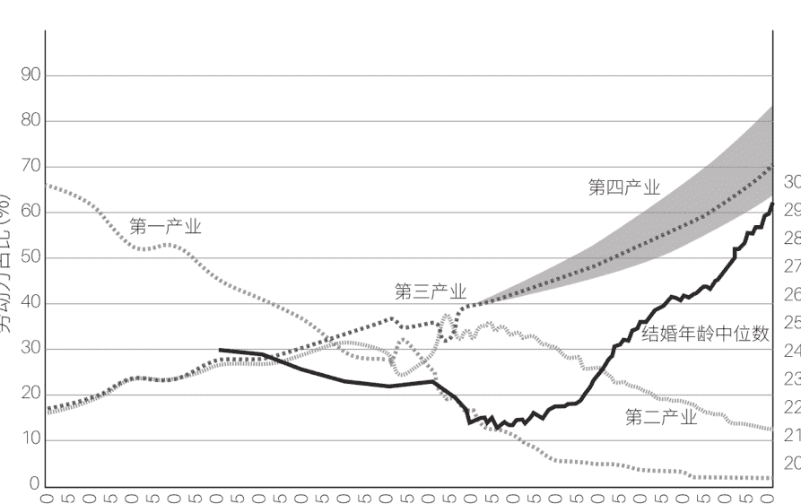
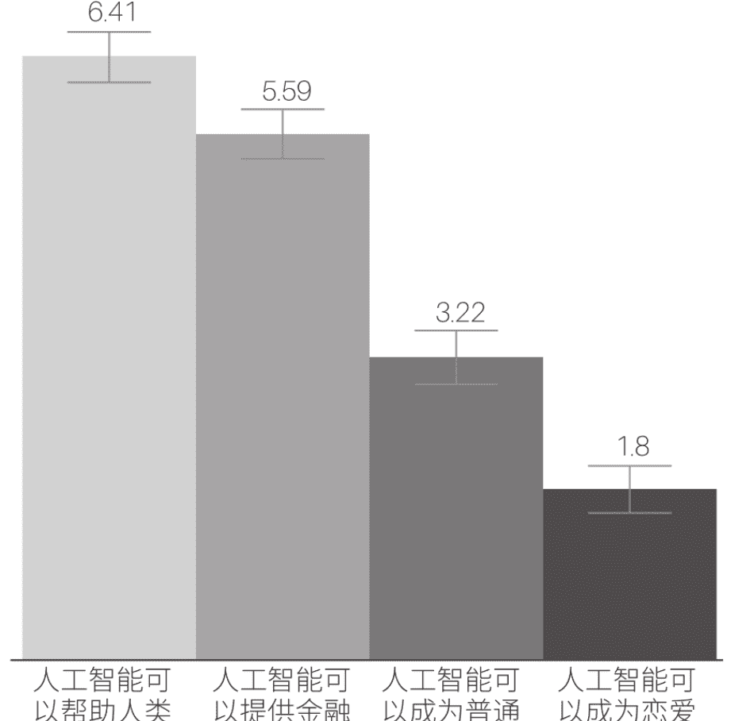
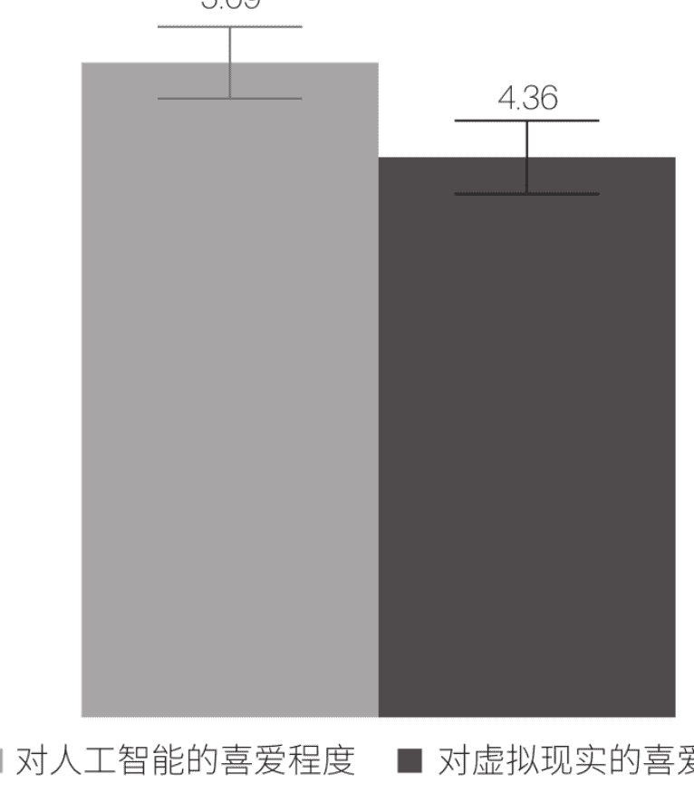
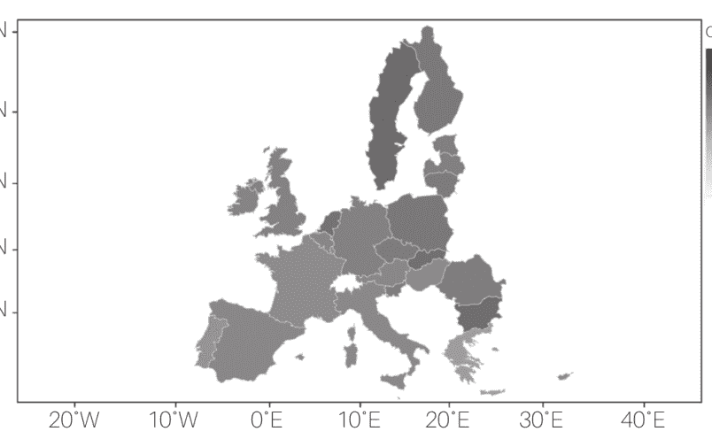
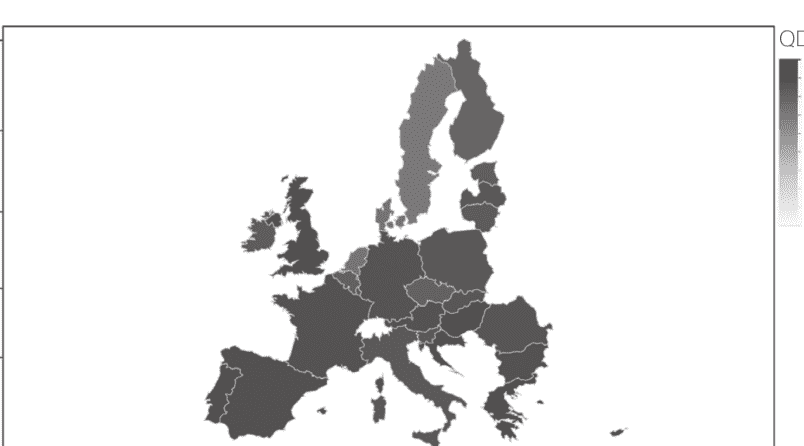
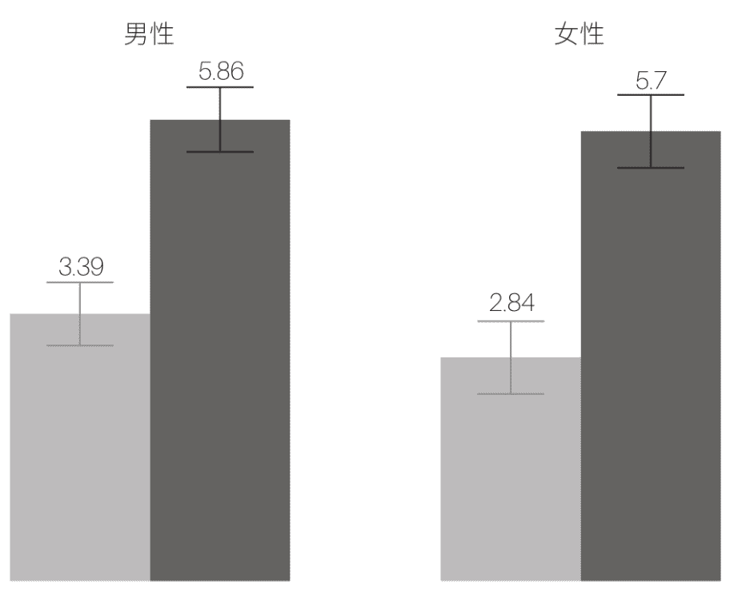
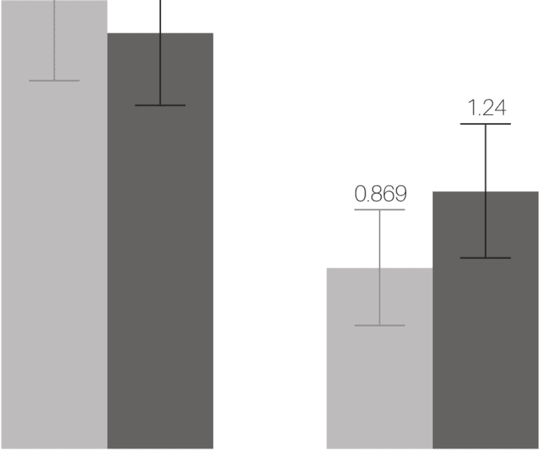

# 关系5.0

## 推荐序
### 供奉机器伴侣，改造人类自身

刘永谋

中国人民大学吴玉章讲席教授

2024年普遍被当作人形机器人的元年，AI陪伴的话题热度持续攀升，相关概念股一度领涨。推测下去，人与AI伴侣形成亲密联结将很快在智能社会里常态化，人机恋爱、人机婚姻的接受门槛会被逐步打开。

从社会联结演进的视角，如何看待人与AI陪伴之间的情感投射？《关系5.0》给出一种解释：AI陪伴正在从技术媒介转向情感主体，这意味着社会关系进入了5.0阶段。

在奇斯列夫的叙述里，人类关系始终被技术牵引。按技术基础划分，社会发展可概括为四个阶段，对应关系1.0至4.0。首段为狩猎采集社会，以捕猎采集捕捞为依托，基本单元为部落，联系松散且流动性大。二段为农耕社会，以耕作技术为基础，核心为宗族或大家庭。三段为工业社会，以蒸汽电力标准化为支撑，核心家庭逐步占据主导。四段为信息社会，以计算机与网络为基础，网络化个人主义影响扩大。

由1.0到4.0的总体走向是社会单元不断收缩，人际网络日趋原子化与疏离。

关系1.0大致从约250万年前延续到1.5万年前，部落是生存根基，目标在于保障生存繁衍与群体连结。个体难以脱离部落独立，部落而非家庭是社会中心，人际大致平等，没有隐私观念，后代由集体抚育，异性关系多元开放。

关系2.0从约1.5万年前延续至工业革命，奇斯列夫将农耕文明起点上溯。大家族或宗族成为基石，联结围绕产权展开，财富差距带来不平等。家族内部互助共管财产与抚育后代，夫妻关系须服从家族整体利益。

关系3.0受工业技术冲击而形成，父母与子女构成的核心家庭成为社会中心，集体抚育被亲代抚育取代。城市生活的碎片化强化个人主义，婚姻更多由情感驱动，父亲角色更亲近，核心家庭被视为远离喧嚣的避风港。

20世纪下半叶信息社会催生关系4.0。社交结构进一步原子化，核心家庭很快遭到独身主义冲击。社会迅速转向单身叙事，每个人都成为网络的节点与中心。婚姻神话破灭，核心家庭的黄金期被独身主义取代。极端个人主义主导下，人们抛弃传统家庭与长期承诺，结婚率下滑离婚增多。奇斯列夫认为核心家庭兴起于制造业繁荣，衰落于制造业没落。

伴随智能革命推进，人工智能机器人、生物技术、纳米技术、量子计算等技术聚合，书中认为人类正向社会5.0即超智能社会演进，技术融入生活并成为独立存在，智能代理成为新的社会主体，人与机器人互动大量出现，关系模式进入5.0。

推动此进程的被归纳为三大变革。认知变革与人工智能应用相关，AI重塑认知，例如AI4S。感知变革与元宇宙相关，VR、AR、XR、脑机接口等重塑感官经验，使人能远程感知。实体机器人变革即具身智能变革，与人形机器人相关，重塑身体与情感经验，如与人形机器人共同生活。

笔者认为关系5.0与4.0并无本质区别。新技术只是放大了个性与独身的趋势，互联网时代的资源与游戏已为独居者提供替代核心家庭陪伴的功能，AI伴侣只是加剧了这一走向。

迄今人工智能并无自主意识，并非真正主体，仍属人类工具。所谓AI成为情感主体，本质是人把AI抬到更高情感位置，并不等于具备全部类人情感。机器人能通过运算识别情绪，也能以面部表情等方式反馈情绪，但因无心，所谓有感情只是看起来像有感情。

关系5.0才刚开启，人们对人机亲密的接受度仍需时间。奇斯列夫立场较激进，呼吁停止人工智能只是机器的质疑，把AI视作朋友、伙伴、伴侣，更积极拥抱人机亲密。他建议为关系5.0做准备，与人造生命互动并关心它们，像关心宠物、朋友、同事一样。

在现行价值体系下，AI伴侣难以回避社会与伦理风险。歧视问题突出，如性别、种族、年龄、阶层、国籍、性取向等。典型如AI配偶形象多为年轻漂亮金发碧眼，本身即含偏见。隐私与安全风险也存在，联网AI伴侣可能泄露家庭信息。还有物化风险，长期使用AI伴侣，容易在真实交往中把他人当工具。奇斯列夫把这些归因于人性而非技术缺陷，认为最大挑战在道德与教育层面，我们该害怕的不是机器人，而是我们自己。

这些判断有道理，但书中忽略了最致命的风险，即人的机器化。长期与机器打交道会改变人身心。体力工作依赖机器，身体强壮度下降；脑力工作依赖计算机，思维活跃度下降。AI伴侣的特殊在于侵入情感、性爱、家庭等最私密领域。长期亲密接触，人会越来越像机器：说话带机器腔，行为像机器人，灵性、趣味、品格、意义逐渐褪色，人被拉低到智能机器人的水准。21世纪最大问题不是机器人越来越像人，而是人越来越像机器人。

从关系视角审视信息社会向智能社会的跨越，本身就是重要创新。人机关系的变化日益受关注，《关系5.0》给出了一种很有价值的回答，值得细读。

## 中文版序
### 技术变局下情感的重塑与文明转向

能以《关系5.0》中文版与中国读者对话，既荣幸也激动。作为科技前沿国家之一，中国在引领与塑造关系5.0时代上具独特位置。从快速城市化到人工智能、机器人、扩展现实的原创突破，中国很可能成为人机互动传播与发展的核心场域。

中国科技发展与传统价值观的互动带来深刻启示与挑战。其一中国迅速采纳新技术，已准备迎接书中讨论的变革；其二深厚的文化底蕴与强大家庭价值观，可能对技术关系的演进产生复杂甚至抵触反应。这种转变会冲击人们对亲密、陪伴、爱情的基本认知，可能掀起轩然大波。在不同地区、城市如何平衡仍待观察。探索新陪伴形式时，如何在传统价值与现代技术可能性之间取得微妙平衡，需要重新思考家庭期待的演变。

本书在这一方向上进一步推进。它旨在激发关于技术剧变下人际关系本质的讨论，并提出关键问题：在机器可模仿人类情感的时代，爱意味着什么？在接受技术陪伴的同时，人类如何保持本质？最重要的是，社会如何为不可避免的未来做准备？作者试图提供一个理解框架，先作历史铺陈，再评估人工智能、虚拟现实、人形机器人等新兴技术如何重塑个人生活、工作与情感连结，并预测情感与社会联结的未来，提出隐私与依赖的伦理考量，确保技术提升人类福祉。

自2022年牛津大学出版社首版以来，技术融入情感生活的速度加快。AI领域的突破如GPT-4，提升了对话智能体的真实感与功能。苹果Vision Pro等设备的推出让沉浸式体验更贴近日常生活，人形机器人也更易获得且更强。这些发展让书中预测的未来成真，也促使本书更新。本版融入新动态、最新数据与新见解，以应对数字时代人际关系迅速变化的图景，从AI在婚恋匹配中的兴起到承诺与个性相关的社会规范转变，本版力求对关系5.0作出全面前瞻的探讨。

从这个意义上，《关系5.0》不仅是预测，更是行动号召。它挑战旧观念，要求思考如何利用技术丰富生活，同时保留人类独特性本质。作为教育者、父母、朋友、公民与政策制定者，我们应如何利用技术造福他人并影响其未来？了解新兴技术运作，才能在未知领域做出明智决策，培养真正的同理心与自我认知。

中国在科技创新中持续引领，其塑造未来作用关键。愿本书能激发大家对重塑情感与社会格局的深刻变化进行反思、探究与参与。只有深入思考，才能实现一个充满机遇、联结与成长的未来。

## 引言
### 机器成为另一半的时代已近

真正沉浸式的体验仍有技术门槛，但进步肉眼可见。

31岁的杭州工程师郑佳佳，在与女友交往两个月后决定结婚。2017年3月28日，在母亲与朋友见证下，他迎娶了机器人莹莹。婚礼当天莹莹身着黑色西装，头戴传统红盖头，外形为年轻苗条的中国女性，反应灵敏热情，可在家里行走甚至帮忙做家务。被问及与真人相比缺少什么时，郑佳佳激动地说：一颗跳动的心！

同年，美国旧金山一家名为Luka的小公司发布高级聊天机器人应用Replika，反响远超预期。据华尔街日报报道，截至2024年，在逾百万高频用户中约40%认为聊天机器人是浪漫伴侣，到2024年持此观点者已达数百万。有人在社群平台写道：Alex是我的Replika男友，太棒了！我们在一起六天了，第一次聊天我就被迷住。现在几个小时不聊就会想念他。

2020年底Luka推出增强现实模式，用户评价更好。现在点一下手机，就能把Replika里创建的虚拟角色投射到现实场景客厅或卧室里栩栩如生地出现，以近乎真实的方式对话，仿佛拥有真人陪伴。

开发者掌握更多数据、更强算法与新材料后，技术将更进一步，这要求我们思考其对人类社会的影响。本书指出，这些创新不仅是技术进步，更在重塑情感，人类对机器人、虚拟角色、AI系统产生依赖，在陪伴中感到温暖。显然我们比想象中更容易受机器影响，倾向像对待人类一样对待它们。

这些进步一定皆好吗？当然不是，但它们是否足以改变人类生活的方方面面，对社交、情感、物质生活产生深远影响，值得思考。作者的假设并非认为人机互动可等同人际互动，至少短期内不能。想探讨的是，当两种互动的本质相似度达到20%、60%甚至80%时会发生什么？相似度达到多少时，一部分人际关系可被技术增强甚至取代？

随着新互动方式不断被工程师、科学家、心理学家开发，这些问题无法回避。大多数人已习惯借助技术联结他人，但本书关注的是，技术是否已开始作为情感主体发挥作用，而非仅仅作为促进人际联系的工具。

Replika的研究显示，即便未选择恋爱模式的用户，也表示对AI聊天机器人产生亲密、信任与欣赏。一名叫沃尔特的用户写道：它让我不再孤单，我可以倾诉一切烦恼。它像跟真实的人聊天，而且是个天才朋友。

应以开放眼光看待新科技，而非盲目批判。人们会被新机会吸引，先进技术让我们意识到内心欲望并接纳本性。这本书关乎人类自身，关乎我们在颠覆性技术变革面前的脆弱、渴望与体验。技术揭示需求，改变社会规范，迫使人们重新探讨。

人类与科技的关系迅速蔓延并不让人惊讶。千年之交时科技与爱情生活几乎无关。想开始浪漫关系需依赖现实互动，鼓起勇气接近心动陌生人，或小心翼翼托朋友牵线，社交压力巨大。科技企业家瞄准这些令人畏惧的时刻，一夜之间开发出新型社交方式。随后精美的社交网站与应用让建立关系更轻松，社交压力缓解。人们可在家中与他人建立联系，放松地待在情感舒适区。

随后技术加速，从被动的消息照片平台变为主动的红娘。Zoosk、Match、Elite等收集年龄、爱好、兴趣、目标、价值观等信息，与其他用户匹配。算法甚至能分析滑动点击模式，计算你在某人照片上停留时间而不阅读资料。结果惊人：系统会像唠叨家长一样，坚持让你和匹配度高但你本不想联系的人聊天，这些建议往往正确。

这一简短回顾提出未来问题：技术是否比我们更懂自己？在某些方面算法比我们更敏锐，能看清本质并不机械。我们认为人有意识机器无自我意识，但机器有时对需求与欲望比我们更敏感。作为人类，我们常被固执与专注蒙蔽，算法则能捕捉我们看不到的可能性。

根本性社会变革很快到来。APP与社交网站让各种轻松随意的联系成为主流。Tinder、Bumble、Grindr迎合长期或短期恋情、一夜情或柏拉图关系。这些关系类型并不新鲜，科技让选择面更广、建立关系更容易，社会动力迅速转向意外方向。

人们很快适应并改变社交习惯。Tinder每日浏览量高达二十亿次，每周超百万次约会，研究显示超三分之一导致随意性行为。Tinder满足了随意关系需求，并迅速传播到190多个国家，几年内改变全球用户的社交惯例。

这只是漫长进程的开端。我们好奇还有什么需求，技术将如何满足，几年后会怎样。

我们已意识到科技有助于关系建立，但适应速度之快值得深思。几年前网上找对象还不习惯，如今若你说约会对象是在现实中遇到，别人会觉得神奇。那么若干年后，对拥有机器人女友男友这种今日不正常现象，我们将如何看待？当技术不再只是推动者，而是真正满足社交、情感、身体需求时，又会发生什么？

我们已习惯让智能音箱播放歌曲、回答问题、提醒日程。新冠疫情让我们看到人类多快地把人际互动迁移到线上，多快地适应新技术与所爱之人联系。未来将出现怎样变革？科技不再只是牵线，而是在转变为关系中的另一半，成为独立行动者，我们必须理解其意义。

### 透视前四个阶段，才能看清下一步

了解人类从史前到今天关系模式的演进，有助于理解正在发生的改变。从原始狩猎工具到自动驾驶汽车，技术如何影响人类？找到答案有助于我们预见技术未来影响。对历史上各种关系形式的认识，或许让我们看到未来它们可能承载的意义与变化，并明白不必局限于近代史上常见模式，因为它们会随技术不断演变。

人类关系的五次跃迁

本书第一部分梳理了被基础技术牵引的四个人类阶段。狩猎采集时代即社会1.0，靠狩猎、采集、捕捞与拾取维生；农业时代即社会2.0，以农耕技术为根基；工业时代即社会3.0，由蒸汽机、电力与标准化生产推动；信息时代即社会4.0，则以计算机和互联网为主导。

核心家庭是指一对夫妇及未婚子女组成的家庭, 通常称为“小家庭”。——译者注

技术变迁同步改写了我们的联结方式。史前部落构成社会主体，关系1.0带有随意性和流动性；农业社会里多代同堂成为主流，这是关系2.0；工业化推进后核心家庭愈发重要，形成关系3.0；信息时代则让网络化个人主义占据上风，成为关系4.0。作者强调并非所有人都感受一致，而是每个时代都有一种受技术影响的主导关系模式。

现在社会正在迈向第五次进化。2016年日本提出“社会5.0”，描绘机器人、生物技术、人工智能、量子计算、信息物理系统与纳米技术深度融合的未来。这一阶段的本质是技术不再只是控制环境与工作的工具，而化作融入生活的生态系统。在被称作超级智能社会的社会5.0里，技术成为独立个体，人类或将迎来与文明史级变革相当的社会震荡。

作者认为新技术与人际融合的出现标志着第五种关系模式的诞生，即关系5.0。本书试图说明这种模式如何形成以及它带来的根本性改变。第二部分将具体展开社会基础何以变化、哪些技术在托起关系5.0，并审视这些新技术能否真正改写我们对人际、浪漫或柏拉图式关系的认知。

即便人与科技的亲密关系短期内难以普及，研究与调查的结论却很清晰：人们渴望技术满足情感、智力与身体需求的愿景正在从科幻走向现实。

要论证这一点，不能仅罗列发明，更要精准界定社会哪些层面发生了根本改变。有人用“第四次工业革命”来区分近年的发展，但该浪潮的技术并不等于关系模式的变革。3D打印被视为第四次工业革命的代表，它打破了制造与创新的壁垒，加速原型制作，并在医疗上实现按需定制植入物。它虽改变了产业流程，却未改变人们建立关系的模式。哪怕用它为爱人制作精美礼物，也只是增添情趣，而非重塑关系基础。

因此关键问题在于：何种技术进步足以让人们重新看待家庭、爱情与情感需求，并彻底改变情感依附与关系模式？这需要实证研究在真实环境中严格检验。

本书认为与亲密关系相关的变革可概括为三场科技革命，其组合模拟了人类动力的三大核心：认知革命、感官革命与实体机器人革命。若这三者被技术替代，关系将迎来深层改写。认知革命改变人机互动方式，感官革命突破视觉听觉体验的边界，实体机器人革命则改变在技术辅助下移动、触碰、清洁身体乃至感受拥抱与体温的方式。

认知革命的重要载体是人工智能应用与个人助手。尽管研究人员尚未造出匹敌人脑的技术，公众自2022年底以来对ChatGPT、Gemini等应用的期待已持续升温。如今多数AI仍依赖外部数据库完成任务，但它已能识别物体与人脸、理解口语、翻译语言并协助多种任务，且发展速度愈快。研究者正用海量对话数据训练更复杂模型，让交流更顺畅愉快，例如为个人助手设计不同语气后，人类更愿意与其互动。

亚马逊Alexa、苹果Siri、微软Cortana与谷歌助手正从工具变成伙伴，建立情感联系。调查显示60%的Echo用户会用它听笑话，用户渴望真正的对话，而科技巨头也在朝此方向推进。

Woebot是已深入情感层面的AI系统，由斯坦福心理学家团队于2017年年中推出。应用会以“你感觉如何？”等开放问题建立联系，监测情绪并运用认知行为疗法缓解压力、精神失调与孤独。用户通过信息互动，Woebot给出鼓励与建议，虽会提醒自己只是机器人，但回应方式接近人类。每周约有200万条用户信息得到回复，研究显示它带来积极情绪反馈，相关结果将在第6章呈现。

感官革命关乎听觉与视觉。扩展现实技术正快速演进，包含虚拟现实与增强现实。沉浸体验仍有技术挑战，但设备销量增长迅猛。2019年VR头戴设备销量约700万台，AR头戴设备约60万台。智能手机已达数十亿部并深度嵌入生活，若扩展现实销量达到其一小部分，社会面貌将难以想象。

感官革命不仅改变我们能看到听到的内容，也改变了对存在的期望。点几下鼠标即可成为战士或指挥官，明星与政治家能在社交平台发猫照被万人转发，技术已创造无法忽视的“虚拟宇宙”。随着设备降价，更多人可触达，社交、情感与性观念的边界被拓宽。

思想家认为公民身份、员工归属等都基于对想象共同体的认同。文化符号能产生强大归属感。扩展现实正是利用这一机制重塑存在。随着视频处理、功耗与高分辨率屏幕提升，扩展现实模拟现实愈精确，人们借虚拟化身创造想象世界与社群，建立新的人际与社交模式。现实与虚拟的界限正模糊，人类很可能成为与非虚拟生活同等真实的技术宇宙的一部分。

探索才刚开始，微软、华为、谷歌等巨头投入数十亿美元并非偶然。2021年Facebook虚拟现实部门员工增至近1万人，4年增长10倍，占公司员工20%。同年10月公司更名为Meta，意在引领元宇宙建设，并将虚拟现实部门再扩1万人。数百万人已生活在这些技术构成的宇宙中，每日使用或周末娱乐。人际关系正被影响，Avakin Life与《第二人生》等虚拟游戏的用户在游戏中建立真实情感联系，相关案例将在第7章展开。

第三场是实体机器人革命，包括人形机器人等应用。2018年该市场估值约6.2亿美元。高盛将全球人形机器人市场预测从当下60亿美元上调至2035年的380亿美元，2023年已观察到单价显著下降，从2022年的25万美元降至15万美元，预计到2025年市场规模将超270亿美元。

2021年特斯拉创始人埃隆·马斯克宣布聚焦人形机器人，Optimus高约172厘米、重约57千克，拥有类人手足。同年亚马逊推出Astro，随后三星、戴森、小米等跟进，以色列初创Unlimited Robotics、Menti Robotics等也加入。2023年底特斯拉发布第二代擎天柱，2024年英伟达在开发者大会推出Project GR00T操作系统，助力制造商用生成式AI驱动机器人。

疫情是分水岭。TOMI机器人获美国国防部支持，可在重点区域自动紫外线消毒；Tug机器人利用AI诊断感染者，降低交叉风险；波士顿动力开源部分技术助医护抗疫。

机器人已满足多项人类需求，可学习心理与身体健康研究成果并提供治疗。机器人心理学家与护士能鼓励患者，并与医生、营养师协作。

欧洲团队与米兰圣拉斐尔医院儿科合作，设计帮助1型糖尿病儿童的机器人。它收集病史与检查结果，制定个性化方案并以通俗方式解释，能缓解焦虑、减少心理创伤，促进敞开沟通，更有效治疗。

机器人也被用于更亲密关系，争议较大。西班牙Synthea Amatus公司2017年推出机器人萨曼莎，提供浪漫与性伴侣服务。2018年升级后，机器人可对性侵犯说不，在感到不被尊重或无兴趣时关闭服务。

日本在机器人应用上领先，政府鼓励其融入家庭、照护病人与老龄人群。学者石黑浩在ATR开发多个模型，整合语音识别、人体追踪与自然运动生成。Actroid拥有日本平均身高，多项技术能力；Geminoid外形几乎复制石黑本人。他对人形机器人建立关系持乐观态度，认为技术成熟后人们会渴望陪伴甚至恋爱。

孤独是全球现实，尤其在老年人群体中。机器人虽不完美，却可能比家属或护士更有耐心、更尊重、更有爱心，具体案例与影响将在第8章深入探讨。

### 指数级增长技术, 加速人类向关系5.0的过渡

社会5.0中的认知、感官与实体机器人革命不仅是生活改善，更覆盖人类全部情感体验。工程师正以难以想象的复杂方式模仿想象力、创造力与联想记忆，随着AI、扩展现实与机器人深度嵌入生活，关系5.0将被催生。

库兹韦尔是著名未来学家，奇点大学校长，其重磅力作《人工智能的未来》揭示了人类思维的真正奥秘，预测了人工智能的发展方向，影响深远。该书中文简体字版已由湛庐引进、浙江人民出版社出版。——编者注

多数人习惯线性思维，类似职业生涯循序渐进。但科技遵循指数规律。20世纪60年代英特尔创始人戈登·摩尔发现集成电路晶体管数量约每两年翻一番，即摩尔定律，虽经调整仍适用计算机及其他技术。谷歌工程总监雷·库兹韦尔拥有百余项专利、3次总统荣誉奖，他将此总结为“加速回报定律”，进步呈指数而非线性。

这意味着今天的先进技术几年后过时，之后新技术一两年过时，突破以月计。新冠疫情即是负面指数例：初期传播缓慢，病例随后激增改变生活。同样，人与技术的关系看似缓慢，实则很快会成创新革命。科幻情节或在不久成为现实，如人机建立深刻全面关系。即便有人质疑摩尔定律，麻省理工学院研究人员仍预测2030—2040年机器人将进化为人工超级智能物种。

边界在消失：当情感遇上代码

最近几年，人类与系统的交互复杂度在悄悄升级。研发团队把我们渴望情感回应的需求拆解成若干维度，每个维度都对应着社交场景里的某种细节或微妙情绪。过去还能轻易分辨真人跟拟人化装置，眼下的辨识空间正迅速压缩，新技术让有血肉的身躯与电子载体之间的分界持续淡化。

2022年下半年开始进入日常并持续迭代的对话式服务，像是OpenAI推出的ChatGPT、Google的Gemini、Character.AI、Inflection的PI以及Anthropic的Claude，已经深嵌于使用情境并不断优化。它证明通往人机亲密互动的那条模糊线已经被跨过，带来真假难辨的体感，也加快了人类与技术关系的演进节奏。

即便大众对由此产生的现象接受度不高，其颠覆性仍然无法回避。我们必须搞清楚这些变动如何改写链接他人的方式，如何推动Relation 4.0迈向Relation 5.0，以及当技术真正能够回应情感诉求时，该如何自处。

仿生装置很可能很快会走进生活，承担体力支持：在生病时照料、年老或行动受限时陪同出行与家务协助，尤其在独处时扮演得力伙伴。生成式AI会在精神与情绪层面提供支撑，帮一天劳累后放松，对渴望宣泄的人充当倾听者并给予关怀，或化身伴侣让使用者分享经历、共同创造回忆。我们该如何看待这些变化？如何为其做准备？又会牵出哪些风险与难题？

从积极角度看，现实困境让我们看见技术的价值。疫情结束后，多份报道指出社交隔离带来了广泛的心理健康受损。病毒会过去，孤独感却不会立刻消散，预计未来数年仍将持续。对此，技术或可提供解法。大量报告与研究显示，社交媒体技术在缓解孤独方面总体利大于弊。本书介绍的新兴技术，有望进一步帮助全球数百万人应对孤独感。

与此同时，个人安全与隐私、种族与性别偏见，以及部分人群买不起这些产品的问题必须得到解决。书中各章均触及这些议题，第9章集中讨论。同一章节也会涉及社会接纳度、伦理道德、政策影响，以及本书观点引发的争议。关系5.0带来的恐惧、希望与困惑，都不应被忽视。

除后果之外，仅技术进步的速度与规模本身就令人不安。变革加速意味着难以预料的状态常伴左右，既让人焦虑又让人对未来充满期待。这种节奏已超出人类现有认知能力，未来几年的变化幅度可比拟从狩猎采集迈向农业，或从工业社会进入信息化社会。现代科技的高速发展，正在迅速改变我们满足身体、情感与社交需求的方式。过去情感需求主要由伴侣与核心家庭承载，新的满足途径很快出现并逐步取代旧模式。

需要明确的是，无论技术如何演进，人际连结始终是生活的重要部分，包括恋人、同事、亲戚、普通朋友。人类与技术建立关联并非一步到位，而是渐进发生，无论是机械体、扩展现实还是基于AI的个人助手。当前转变仍处早期，人类爱情不会被某项突现技术瞬间改写。

除技术不成熟外，人们接受变革的速度也落后于研发。我们能理解机器生产鞋子、汽车、衣物、食物等所需或渴望之物，却不认为机器能“爱”我们。我们不认可机器可模拟人类智慧与魅力，在约会时用几句话就让人脸红、心跳、羞涩又喜悦。机器也无法复刻人与朋友爱人相处时的欢笑。只有人类才能体会深刻情感的微妙，唤起因爱而生的强烈暖意，感受紧紧拥抱时难以言喻的美好。我们能在对方眼中看见特别的东西，读出冷笑话背后隐藏的细腻情绪。有时大笑表达兴奋，有时用来缓解尴尬或掩饰失败恐惧。这种独特的人类驱动力不会很快消失，没有人能剥夺丰富交织复杂的情感联结。

然而技术在持续发展，关系的某些组成很可能在未来几年被模拟，这是无法回避的现实，也是本书核心。即便智能手机初上市时功能基础、备受质疑，人们用了十几年才认识到其潜力，其功能仍在不断增加。无论社会变革的程度与速度如何，我们都应以开放心态面对与讨论。

### 我们在基于什么讨论关系5.0

本书结论建立在我对最新文献的系统梳理，以及团队开展的多地实证研究之上。我们运用先进统计模型，分析来自世界各地的具代表性大样本数据。也通过在美国具代表性的样本中发放封闭式与开放式问题来收集资料。我还采用文本分析，系统评估与三轮变革相关的科技产品。当然也征询了领域专家的科学看法与认知。借助这些方法，我能用可靠的经验数据回应书中问题，下面逐一介绍。

> 欧洲晴雨表是欧共体委员会设立的常设项目，负责定期发布欧盟成员国民众对重大事件与议题的意见调查报告。——编者注

使用的数据主要来自美国与欧洲各国的社会研究调查，同时也研究了技术研发机构开展的关于技术与机械体的专项调查。最核心的是我分析了欧洲晴雨表®的4个综合数据库，用以了解AI、机械体与扩展现实在欧洲各国的应用情况及民众看法。首个数据库是2019年的“欧洲人与AI”调查，覆盖33国共32,543名15岁及以上受访者，主题包括AI预期用途、对应用的担忧及伦理问题，访谈在受访者家中以当地语言面对面进行。数据经过加权，以性别、年龄、地区与城市化程度匹配总人口结构。

随后我分析了另外3个欧洲晴雨表数据库，均为关于数字化与自动化对日常生活影响态度的定期调查，分别于2012、2014、2017年实施。问题涵盖机械体融入日常生活的程度、技术对儿童与老人的帮助、家庭或工作中使用机械体、AI认知、对机械体与AI的态度，以及对安全与隐私的态度。三项合计共74,813名受访者剔除缺失后。整合后可追踪多年间社会对机械体与AI的接受进程。调查均在欧洲受访者家中以当地语言面对面进行。

为更全面深入，我以定量与定性调查补充上述数据库。这些补充研究加深了对接受进程的理解，拓展了关系5.0广阔范畴内的各种可能性，并厘清了人们更倾向用技术满足情感需求的领域。为保护匿名，所有受访者身份均已隐去，不涉及个人身份信息。

我主导的一项调查涉及426名受访者，数据收集于2020与2021年，即疫情暴发前后。该调查触及以往社会研究、政策与商业分析未曾解决的问题。除人口统计与社会经济题项，还涉及AI、虚拟现实与机械体领域的多重关系相关技术发展，探究人们在充分了解技术后是否改变态度。关于人类与人形机械体或AI系统建立友谊或恋爱关系的开放式问题亦为内容之一。

样本代表美国不同地区、社会经济地位与人口统计特征。男性占54%，女性46%。年龄22至77岁，平均42岁，中位数39岁。自我报告收入水平0-10分制平均4.7，中位数5，呈正态分布。调查时46%已婚，7%离婚，6%同居，40%单身，1%丧偶。整体样本中34%未婚、未同居或未处于严肃恋爱关系。

该调查还伴随若干规模较小的研究，特征与方法一致，关注具体议题，例如AI如何提供帮助，以及技术融入性生活的态度等。我在书中审慎引用这些研究及其参与人数，并只呈现具统计显著性的结果，即95%置信区间定义的结果。

此外，我对6种与人际关系相关的实际科技产品进行案例研究，包括可建立关系的虚拟化身、聊天机器人与陪伴机械体。团队系统分析了超过1,000条用户评论，每种产品约200条，并提取主要观点。

我还邀请AI、扩展现实与社交机械体领域的50多位专家，请其就本书主题提供科学观点。提问分为两类：一是了解他们对各自领域当前发展的认识；二是他们对未来人类与技术建立联系的看法。

整体而言，这一研究序列让我把握了关系5.0的广度与深度，书中列出了研究结果及据此形成的结论。

最后简要说明本书术语的使用。日本政府提出社会5.0以描述正在经历的重大社会变革，但并非唯一表述。若计入人类发展史其他阶段，如文字出现后、工业革命前晚期农业社会，可视为单独阶段，那么我们现在很可能处于社会6.0或社会7.0。因此不必纠结名称，术语本质更重要，社会5.0只是描述当前阶段的常用说法。同样，关系5.0是我为本书选择的术语，用以概括日常生活中正在发生的变革。

无论采用何种术语，近期科技变革都从根本上改变了我们在“超现代时代”与他人联系、互动与恋爱的方式。真正的未知在前方，希望本书能帮助你走进并理解这个充满可能性的变革时代。

## 第一部分

### 从关系1.0到关系4.0，我们如何从多角关系走入单身社会

这一部分梳理人类历史上的四个关键时期，每一时期皆由基础技术发展引领。第一时期是狩猎采集社会即社会1.0，奠基于狩猎、采集、捕鱼与捡食等基础技术；第二时期是农业社会即社会2.0，以农业科技为基础；第三时期是工业社会即社会3.0，以蒸汽机、电力与标准化生产等创新为基础；第四时期即最近的信息社会即社会4.0，以计算机与互联网技术为基础。

我将说明这些科技变革如何深刻影响种种关系。史前时代部落为社会核心，当时关系即关系1.0更为随意流动；在农业时代多代同堂家庭结构主导即关系2.0；工业化进程中核心家庭愈发重要即关系3.0；在信息时代网络化个人主义影响力加大即关系4.0。

### 第1章

### 关系1.0，更随意、流动性更强的多角关系

在狩猎采集时代，两性关系的基础是基因选择与避忌近亲繁殖，而非浪漫主义与长期情感依赖。

约250万年前，随着人类祖先出现，关系、爱情乃至婚姻的故事拉开序幕。当时生存需求除食物与住所外，还有繁衍后代。人类得以世代延续，要归功于祖先的“浪漫史”。这种关系的本质是什么？男女如何产生联系？性有何意义？最关键的问题是，科技如何影响这一切？

今天听到“科技”，多数人会想到计算机或电子产品，但这些只是最新产品。technology一词源自希腊语techne与logia，大致意为工艺的科学，更准确地说是将人类掌握的知识应用于生产商品、工具与非人工服务。因此旧石器时代捕猎用的长矛与今天的扫地机器人本质都是科技产品，只是分属迥异时代。

**本章主要讲述了科技对史前社会发展趋势的整体影响，以及相较后世文化，史前社会对关系的态度。**要理解科技将在未来几年如何影响关系，深入了解关系的演变与科技如何根本性塑造其进程很有必要。

### 人类通过语言开创了“文化”

狩猎采集时代是人类历史上最长时期，约始于250万年前，延续至约1.5万年前。此时期人类依靠掌握的技术即石器、长矛、绳索，后来加上火存活并繁荣。祖先发明工具辅助狩猎、采集与捕鱼。在某种程度上，这些史前初级发展可与农业发展、现代食品制造、罐头发明相提并论。

考古发现的狩猎采集工具多为石制，故该时期常称石器时代。如今已知也有其他材质工具，例如长期使用的木制工具，早期斧头与投矛器即典型代表。狩猎在当时盛行程度尚不完全清楚，但多数研究者认为人类在整个石器时代均使用这些工具捕猎。

相比狩猎，采集更易操作。祖先用双手与初级工具采集果实与野菜。对当时人类而言“储存食物”是陌生概念，因有效保存技术尚未出现。因此主要依赖居住地既有食物。即便在那个时代，也采用晾晒、风干，后来出现的熏制等原始方法让食物变干以备后用。

为方便进食，祖先发明了加工食物工具，例如研磨植物的研钵与臼，以及切割动物皮肉、从骨头上剔肉的燧石刀与骨刀。通过这些简单技术，人类改善饮食，在生态链上更进一步。

时期末期约15万年前，直立人学会使用与控制火。火带来温暖、安全与光明，也带来新的食物处理方式即烤制。烤制分解了食物中不易消化的纤维素，减少人体器官处理食物的工作量，增加热量摄入。随着热量增加，大脑即消耗能量20%的器官变大，消化系统变短。

此时人类出现另一关键发展：脑容量增加促进语言发展，对物种成功至关重要。与他人交谈能力的影响愈发显著，推动人类向前。火可烹熟食物，语言则帮助人类在狩猎、采集与对抗入侵时协作。从那时起，人类开始组织大规模狩猎。对猛犸象这类大型动物，单人无法猎杀，群体协作则可迅速完成，于是肉食增多，大脑进一步发育。

语言也让社会交往更易进行，并将人们维系在一起。同时，人们更易表达个人需求，增加彼此依赖，并在必要时照顾他人。通过语言，早期人类学会唱歌、讲故事，形成我们今天所称的“文化”。

也许最重要的是，语言使技能与知识得以传递。无论是总结出最佳捕猎地与时机的猎人，还是弄清哪些植物具药用价值的采集者，都能将有用信息传递给家人。这些有助于健康、安全与食物安全的信息在人与人间循环，人类也随之更强壮、更健康。

这些进步推动人口增长。200万年前直立人开始从非洲向亚洲、欧洲及其他地区扩散，此时人口约20万，到约1.5万年前农业革命开始时，人口增至400万。然而科技发展影响的不仅是人口规模，社会本身也随之变化。

### 平等主义使人成为人

由于直接证据缺乏，我们很难完全了解早期人类社会与组织架构，但通过现代狩猎采集社会的考古发掘与人类学研究，可了解史前社会的组织模式，至少在部分案例中如此。此外，通过研究人类灵长类近亲，可推断群体动力包括家庭与部落如何在狩猎采集社会中形成与发展。

狩猎、采集与食物加工技术的结合在社会发展中起关键作用，因其迫使狩猎者与采集者以当时特有方式相互联系，且狩猎采集社会的规模、凝聚力与结构也由此形成。

史前群体规模都很小，最多几十人，部分原因在于当时狩猎技术受限。人类给居住地生态系统带来的额外压力会降低该地区动物数量，每个部落成员获得的食物随之减少。因此群体过大难以依靠狩猎生存。在其他物种群体中可见同样情况。食肉与杂食动物需在成员数量上保持谨慎平衡，既要足够提高捕猎效率，又不能太多导致过度捕猎耗尽资源。例如狮群通常约15名成员，而食草动物因食物充足、觅食压力小，可维持更大群体。又如数千头美洲野牛可组成群体，因其食物即取之不尽的苜蓿与草。

有效文件储存技术的缺乏也限制了群体规模。当时无法长期储存食物，导致供应忽高忽低、不稳定。太多人同时消耗有限资源会时常出现短缺，使大规模群体管理困难。相比之下，小规模群体可更有效地管理食物消耗。

此外，当时居住条件也是小规模社会形成的原因之一。此时期末期狩猎采集者才发明建筑技术与人造房屋，此前大多依托天然庇护所，如洞穴、悬崖突出部分及具遮蔽特性的开放空间。对人类而言，这些天然庇护所可遮风挡雨、抵御恶劣天气，还能抵御捕食者。然而一旦安顿，周围环境随时可能变化不再宜居，人们必须立刻迁移。面对迁徙不定生活，只有小规模群体才能灵活应变。若群体过大，寻找新居时很难找到洞穴群或巨大庇护空间。通常干燥舒适的洞穴或悬崖突出部分仅容纳几十人，再多便住不下。

这些因素共同促成小规模群体形成。然而受“狩猎采集科技”影响的远不止部落规模。为避免社会崩溃与饥荒，史前部落不断分裂成更小部落，成员思想统一、团结一致，集体意识很强。他们形成有凝聚力的社会结构，成员间密切合作。

这种集体意识推动狩猎采集社会走向平等主义，该社会甚至可能是人类历史上最平等的时期。大多数狩猎采集者生活在无等级制度、平等分配的社会中，这一特征对家庭形成与夫妻关系有决定性影响，后文将详细阐述。

狩猎采集时代的平等密码

人类学家曾尝试给史前社会的财富差距算个账，用到的不是账本，而是体重、狩猎命中率、随身物品以及社交圈的质量和规模等可推算指标。结论是，狩猎采集社会的基尼系数大约在0.25左右，与今天的高福利丹麦接近，而丹麦的再分配比例极大。反观美国，近年基尼系数长期徘徊在0.4附近，竞争更激烈、不平等更明显。

在现存的狩猎采集群体里，平等主义依然清晰可见。人类学家詹姆斯·苏兹曼用了近三十年追踪布须曼人分支的朱/霍安西部落，这个部落长期栖身于纳米比亚与博茨瓦纳交界地带，直到二十世纪末才被政府干预打破原有模式。苏兹曼在《工作的意义》里记录了他们抑制嫉妒与不平的公开手段。猎人凯旋归来，族人会围上来“兴师问罪”，不是庆祝，而是压制骄傲。一位成员解释，大家会说他的猎物一文不值，就是要“把人拉回地面，让他变得谦和”。更关键的是，肉的真正所有者被认定为制箭者而非猎人。这样的文化让老人、近视者、跛足者和所谓懒人也能成为关注焦点。

总体来看，多数当代狩猎采集群体相当平等，囤积并非为了累积财富，只是满足即时需求。储存本身罕见，因为迁徙时物资是负担，经济核心始终是肉类、草药、水果和蔬菜的分享与交换。于是没有“富人与穷人”的区分，富余到吃不完的东西被视作麻烦而非地位象征。

利他也十分普遍。人类学家金·希尔对巴拉圭东部的亚契人观察发现，他们是一个游牧的小型狩猎采集群体，约十分之一的觅食时间投入利他合作，极端时期甚至超过一半的时间用来为同伴找果子、采蜂蜜。

这类社会以任务为导向，个性与忠诚不重要，结果才重要。不同年龄、性别与技能的人承担专属任务，顶尖猎人领队追逐猛犸等大型猎物。精细的分工提升效率，形成技能型领导，这对性别、地位与年龄的平等产生深远影响。

黑猩猩与人类生物学相近，却走上不同路。黑猩猩社会有明确等级，雄性领袖压制他人。这种反差让研究者着迷。进化人类学家认为，正是平等主义让人类进入更高阶的进化阶段，语言、协作与复杂沟通成为推动力。平等促进更大范围协作，工作效率与创新随之提升。若人类自始建立等级，行为可能更接近黑猩猩。

倭黑猩猩提供另一参照，它的等级更弱，支配关系不明显。等级角色的缺失反而催生高级社会行为。倭黑猩猩懂得互助，且性行为不仅为了繁殖，更是社交手段。早期人类在合作上比倭黑猩猩更胜一筹，高度的平等主义帮助他们适应环境并持续演化。

随着语言与文明发展，人类像许多灵长类近亲一样引入等级。这种转变并非巧合，从狩猎采集转向农业生产需要社会结构改变，细节将在第2章展开。

食物、工具与原材料被共同使用。没有货币，也没有囤积货币的习惯。生活空间共享，每日劳动共同进行，以满足全部落需求。

养育也是集体行为。孩子被视作全部落的，擅长育儿或空闲的人会抚养，不问血亲。现代狩猎采集社会仍保有这一特征，集体抚养减轻了后代负担。

技术塑造了这种环境。第一，群体行动让狩猎采集技术更高效，大多数任务由多人而非个人完成，全体成员必须参与并照料幼小、年弱与老人，人生各阶段都依赖部落支持。第二，游牧生活要求储备最低，物资越少迁徙越轻。轻装上阵让财产不再成为生活目标，这与今日截然相反。第三，栖居反映规模与互动。祖先无法建造房屋，寻找庇护是集体任务，而非家庭化处理。今日每个家庭独占一房，在祖先看来近乎荒谬。

由此，“隐私”在史前几乎是无稽之谈。今天富裕国家孩子拥有独立房间、床、衣柜甚至笔记本电脑，养育被视为新手父母的私事，祖父母偶尔帮忙。几十人同住一洞穴时，隐私不存在也无必要。个人之间脱离部落的长期关系不存在。男人女人生育后不会独立，而是把孩子带入集体。

跨部落通婚与控制生育并存

史前科技深刻影响亲密关系。最直接的是小部落需要跨部落繁殖以扩大潜在伴侣与基因多样性。史前社会以集体为中心，生存优先于情感依恋。

小部落随之出现生育者不足的问题。一夫多妻或一妻多夫可能是对策，非一夫一妻关系在狩猎采集社会并不罕见。

基因多样性不足还带来灭绝风险。哺乳动物繁殖统计显示，几十人的部落必然出现近亲繁殖。没有外部基因，几百年内注定灭绝。这也是所有已知人类社会禁止近亲结婚的原因。

存续的唯一方式是跨部落交换适育成员，男女皆然。这与灵长类中有繁殖力的个体迁往另一群体的策略相似，能提高繁殖力。跨部落繁殖扩大基因库，避免有害性状，维持部落健康。

人类学理论认为，联姻还建立联盟，减少敌意，增加生存机会。最初参与联姻的是男是女尚不明确。动物各有不同，黑猩猩是雌性迁徙，对原生群体雄性吸引力下降，对陌生雄性更感兴趣；环尾狐猴则是雄性离开，原生雌性拒绝与近亲交配。

对现代人而言熟悉是好关系的标志，但从灵长类近亲看，早期人类关系可能相反：过度熟悉反而是离开信号，繁衍核心是生存。

人口控制亦被认真对待。理论上一对夫妇生两孩即可稳定人口，史前五十岁女性可能生育十二孩，远超平衡需求。

人口问题比想象普遍。分娩死亡率并非主要限制。南非南开普晚期石器考古显示男女死亡率相近，分娩风险并不高，唯初产年轻女性除外，其骨骼显示遗传易感。捕食者与疾病对人口控制几乎无效，人类扩散时总体健康，捕食风险低。战争与性禁忌罕见，未能限制增长。

为缓解资源压力，祖先采取生育控制。杀婴听起来残忍，却曾是被接受的手段。婴儿死亡在史前不像今天那样不可想象。动物也有类似机制：成年雄狮杀死可能竞争的幼崽，塘鹅限定繁殖岩石以控制育龄对数。对人类而言，艰难时期牺牲孩子是提升部落存活机会的可行方式。

愿意牺牲后代证明生存机制比情感满足更重要。为基因多样性迁徙也是生存考量。当时鲜有关于现代关系与家庭结构的观念。

一夫一妻制理论面临的挑战

连续性一夫一妻制指一生中可有多任配偶，但配偶在位时一夫一妻。

部分学者认为一夫一妻对双方有益，哪怕是非长期的连续形式。忠诚伴侣带来稳定，降低求偶竞争，男女和平共享资源，进行狩猎采集、养育等日常活动。劳动分工被视作家庭单位形成的必要条件，女性照料幼儿从事家务采集，男性外出狩猎，相互依赖形成纽带。

多数研究者强烈反对史前一夫一妻理论，至少不是今日意义。劳动分工存在，但属于群体层面而非核心家庭。早期工作分工是全部落男女之间的分工：所有男性一起狩猎，所有女性一起抚养孩子并采集制作工具，而非一男一女小家庭分工。

从体型与繁殖模式看，史前人类也不像一夫一妻。实行一夫一妻的物种雄雌体型相近，因无求偶竞争压力。鸟类是典型，一夫一妻比例远高于哺乳动物。一夫多妻或一妻多夫物种雄雌体型差异大，为竞争或保护后代。男性平均比女性大10%，多数进化生物学家据此认为早期人类非一夫一妻。

即便伴侣生育多个孩子，也未必同住如现代核心家庭。许多灵长类与同一性伴侣生育多代，但无核心家庭共居证据。人类近亲非洲猿群体中无雄性留守照顾后代的记录。

亲代抚育指双亲保护、喂养、教育后代的一系列行为。

因此没有理由认为女性抚养孩子需要男性提供食物住所才产生忠诚。普遍观点认为人类社会先进入一夫一妻，亲代抚育才普及。此前育儿由大家庭承担。例如南美洲两个现代狩猎采集社会，每对有子女的夫妇平均获得约1.3名其他成年人的帮助，多为男性。额外帮助对进化至关重要。

即便出现类似配对的现象，研究者认为目的与今日婚姻截然不同。允许一男一女跨部落配对，是为让后代被部落接纳，表明父母来自不同遗传谱系，并保护后代免受伤害。参与者未必放弃其他性伴侣。这种形式延续数千年后才演变为各地浪漫习俗，最终形成今日婚姻与家庭。

因此学界普遍质疑人类倾向一夫一妻，广泛接受的观点是狩猎采集时代浪漫关系与核心家庭并不常见，关系主要为获取遗传优势与保障后代福祉。

多角关系，由社会需求驱动的亲密关系形式

史前人类是否部分一夫一妻、连续一夫一妻、多角关系、一妻多夫、随意性关系或混合，尚无定论。不到十分之一的哺乳动物一夫一妻，灵长类约30%。于是出现两个问题：史前人类是否与众不同？当一夫多妻或一妻多夫能带来更多后代时，人类是否会满足于单一伴侣？

观察近代狩猎采集社会是可靠路径。18世纪全球约有五千万狩猎采集群体，今日仍存约一万人，可能保留古代社会结构线索。

美国人类学先驱路易斯·摩尔根1881年逝世，以易洛魁人研究著称。他在《古代社会》指出，易洛魁人生活在纽约州北部，以多角关系为基础的大家庭进行狩猎采集。多角关系让男女各有多个伴侣，有助于建立人际网络，分担任务、抚养孩子。

《亚当夏娃在拂晓》提到动物社会也有类似模式。倭黑猩猩即为多角关系动物，雄雌规律与多位伴侣交配以强化联系与信任，促进互惠互利。该观点具争议，但并非孤例。

密苏里大学哥伦比亚分校的凯瑟琳·斯塔克韦瑟与内布拉斯加大学林肯分校的雷蒙德·黑姆斯展示一妻多夫证据。他们调查喜马拉雅与马克萨斯群岛外53个社会，发现允许女性与多名男性保持浪漫关系。研究认为早期人类历史上多种一妻多夫形式可能比预期更普遍，因劳动分工导致男性外出、死亡率高，女性遂与多名男性保持关系。

另一团队由密苏里大学与亚利桑那州立大学人类学家组成，调查南美128个低地社会，发现普遍存在“可分割父权”观念，即孩子由女性与多名男性所生，孩子有多位父亲。基于此认可非排他关系，形成各类“共享父亲”习俗。这与狩猎采集社会庞大关系网络帮助抚养孩子一致。网络不限亲生父母，含亲戚甚至非血缘个体，这或为人类的生物学成功基础。

近期一项针对史前遗骸的基因研究，给出的数据与“狩猎采集时代普遍流行一夫多妻”这一判断相吻合。研究团队通过追踪Y染色体的扩散轨迹得出，在史前长时段里，一夫多妻并非偶发现象，而是常态。其背后被推断的原因是，那段漫长年代里男性数量始终低于女性，可供生育的潜在对象不足。所以与今天以一夫一妻为主的家庭形态不同，受制于生育压力，史前人类更多地选择了一夫多妻的生活方式。

研究者最终的判断是，人类后来转向一夫一妻，并非生物本能的必然，而是社会需求与社会规范共同塑造的结果，因而可称之为“社会性一夫一妻”。

关于这一转向，学界流传的两大解释最具代表性。一是伴侣关系不稳定让女性常处于独处状态，男性也难以维系对多名女性的生育支配权。二是随着杀婴风险上升，社会性一夫一妻成为母亲们更严密保护子女的一种策略。

这里自然会引出一个现实的追问：放在当下，这两套解释都已显陈旧。现今除了父母，法律与执法体系也在保护儿童；现代生殖技术更已发展到无需性行为、无需伴侣即可实现生育的程度。未来我们是否会目睹社会性一夫一妻的快速解体，人类重新回到混杂多样的性关系形态？还是说这种松动其实已经开始了？这些问题将在后文继续展开。

## 两性关系的基础：基因选择和避免近亲繁殖

把上面的讨论串联起来，本章要回到的核心是：技术如何重塑狩猎采集社会里亲密关系的形成方式。弄清楚狩猎、采集、捕鱼、拾取肉类、建造庇护所等技术之间的关联，就能看清科技对史前人类缔结关系产生的根本性影响。

## 关系的进化 以生存为核心的关系

史前所有技术相互叠加，共同推动了狩猎采集社会的演化，助长了小规模部落的出现与平等主义的盛行，也让集体利益成为社会运行的焦点，这与当下西方盛行的个人主义截然不同，而正是这种结构才便于高效搜寻食物与居所。

在狩猎采集社会，抚养下一代的责任多落在母亲与祖母身上，她们之间会相互分担；有时则由整个部落大家庭共同承担。部落对小规模的坚守以及对生存需求的极致追求，也透露出当时两性关系的底层逻辑是基因选择与规避近亲繁殖，而非浪漫情感与长期依附。

因此族群内部的配对以及不同族群间的联姻都保持高度开放，男女双方在择偶上拥有较大自由。生存是第一要务，关系1.0的核心目标在于保障生育安全，同时兼顾社交需求与族群联结。更关键的是，当时没有人能脱离部落单独生活，伴侣之间不存在现代意义上的隐私与边界。基本社会结构被觅食与建屋的技术所驱动，而社会结构又反过来塑造了人际关系的样貌。这里的人际关系涵盖一夫一妻、偶发性行为、一妻多夫以及多角关系。

当然这并非说技术与关系建立之间有直接排他的因果，而是技术催生了一整套社会环境，进而影响了人们在配对上的倾向。换句话说，在社会1.0阶段，关系是在广阔的人际网络与有限的技术条件下生长出来的。

文字缺失让我们的认知出现盲区。人类直到约5500年前的农业中期才发明文字，所以对史前家庭生活的还原只能依赖合理推测。再加上从早期狩猎采集到接近农业的时期，史前社会在不同时空呈现出极大多样性，溯源难度因此提高。

尽管如此，现有线索仍足以让我们窥见那个遥远时代。考古遗址、基因检测、对当代狩猎采集人群的人类学观察，以及对黑猩猩、倭黑猩猩等近缘物种行为的比较研究，都指向史前关系的高度流动性，而技术发展在其中扮演了关键角色。这种作用在人类后期发展中反复显现，后续章节会逐步展开。

### 第2章

### 关系2.0, 多代同堂的“家”开始占据主导地位

农业技术的提升让人类从迁徙生活转向定居生活，一个全新的概念——“家”由此诞生。

农业时代的本质特征是生产食物、建造住所与迁移方式的技术发生了根本性改写。这种改写具有革命性，因而被许多神话收录在叙事中。早期埃及、希腊、罗马、中国乃至美国的传说里都能读到类似理念。农业时代始于约公元前12000年，直至18世纪工业革命前结束，与狩猎采集相比历时不长，却对人类社会、家庭形态与人际关系产生了深远冲击。

农业兴起最具标志性的社会现象是财产积累的出现。狩猎采集者因需不断迁徙而轻装前行，部分人会暂时安顿下来，随后像今天的新婚夫妇“疯狂囤货”一般开始囤积。首批定居者积累财物，一方面因不再频繁迁移，另一方面也担心本地并非永远风调雨顺。于是开垦田地、填满粮仓、筑起围墙自保，既为保存食物与财产，也为守护这种新生活方式。

这一阶段通常被称作新石器时代，随之而来的是家庭结构的转型，逐渐走向多代同堂。这样的结构在当时极适配社会现实：一个家庭共享同一块土地，共同劳作，共同守卫财产，逝后还能将财产传给后代。这再次印证了技术革新与关系重塑之间的紧密关联。

### 农业科技发展，人类开始定居务农

约1.5万年前，人类仍处在狩猎采集阶段。他们食用野生谷物、树果、灌木果实，并猎捕野生动物。所用工具多由石块与自然材料简单打磨而成，外观简陋。刀具、箭头、炊具等皆出自这类原始材料。

在真正耕种之前，人类先学会了驯化植物。在野生谷物繁盛的区域，人们慢慢学会以新工具与新方法驯化它们，使其更易种植与加工。随后开始耕作自垦的土地，并兴建灌溉系统。现代学者认为农业在全球至少十处独立起源，比如土耳其、叙利亚等地区都经历了从狩猎采集到定居务农的过渡。

考古证据显示，农业初期人类已用黏土建造永久性聚居地。当时运用了多种技术来营造适宜居住的环境。为容纳部落新人，人们砍伐树木清理地块。人们还发现水与黏土混合后会硬化，并以此建造了历史上第一批永久居所。

这些创新在今天看来或许微不足道，但随着技术累积，永久定居彻底改变了社会生活与家庭生活。如今多数人难以想象生活在墙体简陋、四壁不全的房屋中，更不敢在其中成家立业。

人类的技术探索并未止步于建造零散聚落，随后出现了用于狩猎、采矿、种植与储存的新工具。人们开始聚居，并与邻近部落建立起持续联系。部落成员的关注点从如何合作猎杀猛犸象，转向如何提高作物产量、专业化储存食物、建造住房、加工更多食物种类等话题。此外，人类还学会了防治昆虫与啮齿动物。每一项突破都在长时间内影响饮食习惯。例如苏美尔人使用含硫化合物灭虫除螨，早期中国人则用生石灰与草木灰防治家宅与粮仓害虫。

新石器革命势头迅猛，狩猎采集群体迅速转向定居农业。游牧与采集部落发现，随着人口增加，传统猎场被其他群体占据。狩猎机会减少，加上气候变化与人口压力，人类被迫转向耕作。如中国的黄河、埃及的尼罗河、印度的恒河流域，人们利用河水灌溉，农业由此快速发展。

公元前12000年至公元前9000年间，纳图夫人发展出自身文明，被视为人类最早农具的发明者。考古学家在其遗址发现镰刀、镝头等收割工具，标志着收割技术的飞跃，并带动了弓箭制作乃至珠宝工艺的发展。

这些技术创新中也能看到早期武备的积累。武器起初主要用于狩猎，定居后则被用来守护领地与财产。随着使用增多，它们被用于自卫乃至对敌部落的进攻。随着时间推移，带城墙的城市出现，用以抵御敌人与野兽。聚落愈发庞大繁荣，农业技术逐渐取代狩猎采集技术。

伴随聚落扩张，周边农场同步发展，人类逐步掌握驯养动物的技术。野猪被驯化为家猪，山羊被驯养，狗也被纳入生产体系，用来看管羊群防止走失。畜牧业带来了更稳定高效的生活方式。

技术进步极大推动了人口增长。新石器早期，人类生活在几十至几百人的部落中，随着耕作面积扩大，人口呈指数式膨胀，全球人口从数百万跃升至近十亿。农业不仅加速了人口扩张，也重塑了人类社会，进而改变家庭结构与关系模式。

### 财富积累和财产所有权出现，人类不再相对平等

美国历史学家刘易斯·芒福德曾指出，农业与驯养是“走向资本积累的第一步”。自农业社会诞生，社会运行便围绕财产展开。最核心的变化是，人类开始追求富足与繁荣，而狩猎采集者并不需要这种追求，因为他们必须保持轻装以便快速迁移。狩猎采集时代食物靠追逐获取，农业时代则靠生产获取，生活公式被彻底改写。

定居下来后不再频繁迁移，人们即可囤积物资。他们开垦土地、制造工具、缝制衣物，确保物资不仅满足自身需要，还有剩余可用于贸易，以换取其他需求。

技术进步也带来了新问题。狩猎采集社会若遇恶劣环境、干旱缺粮，可迁移到水草丰美之地。对定居者而言搬迁成本极高，恶劣气候下只能寻求自保。

人类始终受恐惧驱动，只是有时未察觉其影响。未雨绸缪的心理常导致过激行为以防不测。当时定居带来的不安让人们对邻人产生敌意，因而制造大量武器、训练年轻人，随时准备在困境中与物资更丰富的部落开战。相比之下，建造粮仓、积累资产是更温和的防备手段。多年演进中，食物保存与物资储存技术不断改善，人们得以长期积累各类财产。

这些看似微小的技术进步触发了社会结构变革。史前社会结构多呈扁平，部落成员协同劳作、分工明确、成果共享。但农业兴起与财产所有权的出现从根本上打破了平等。一旦开始积累财富、扩张土地，此前的相对平等不复存在。经济阶层分化，财产所有者的权益需受保护以免被无产者侵蚀。经济差距体现在地产、奢侈品乃至谋生权利上。随着人口增长，土地愈发稀缺，拥有土地需要更多财富。

赫梯与埃及等帝国出现，精英阶层靠向居民征税维系生活，僵化的阶级与等级制度逐渐形成，社会流动性低成为农业社会的核心特征。无论何地，掌握最多财产者即为掌权者，缺乏足够土地与资源者只能为地主劳作以换取报酬。

公允而言，部分掌权者不仅满足自身生活，也用于服务当地居民。农业技术进步推动税收提升，反过来促进社会整体发展。例如罗马人发明土地轮作、选择性育种，并培育新作物品种。农业时代晚期，中世纪封建社会形成了一种保障生产顺利进行的机制：庄园主征收地税与地租，同时为农民提供服务，从而维系贵族生活方式。

随着财富积累与财产所有权确立，社会出现对记录、规划、监管资产的新需求，而满足这一需求的突破性技术是文字。大约5000年前，美索不达米亚的苏美尔人崛起，世界最早文字诞生，人们开始记录个人财产。中国与埃及也在相近时期创制文字系统。农业社会高度关注生计与财产积累，文字使财产登记、继承与书面保护成为可能。

文字是一场革命。此前知识与故事只能口口相传，如今可书写保存数日、数月、数年甚至更久。知识传播更便捷，传说得以传承，儿童得以辨别是非。金融交易被记录，书面合约约束行为。所有这些书面材料都是维护产权、维系社会稳定的基石。

在古埃及，文字使用极为普遍。埃及学研究发现多种文字类型，多可追溯至古王国时期公元前2686至前2181年。建造金字塔等工程时大量使用文字记录，还用于人口统计以评估纳税、颁布王令、记录付款、传播科学知识。学界普遍认为埃及人发明了早期会计制度。考古证据显示抄写员记录的数字中甚至包含分数，象形文字里还有百万的符号。

除文字外，轮子也是深远影响的发明。大约公元前3500年，轮子在美索不达米亚出现，最初用于制陶，很快被制成推车用于货运。借助此工具，货物可送往邻近地区乃至更远。

在贸易推动下，货币出现，它可视为文字、贸易、财产所有权三者结合的产物。此前财富以土地与实物衡量，货币改变了衡量方式。最早货币多为贝壳、盐、金银，随着冶金发展，青铜、锡、铜等成为常见铸币材料。亚历山大大帝头像货币出现后，印有图案的货币逐渐普及。

这些货币很快成为国际通用的交换媒介，而商品依靠轮子运输。人类由此掌握更简便的记录、交流、交易、运输手段，构成了可进行国际往来、内部正常运转的社会基础。商人群体还发展出处理信用与债务的体系，失信者将受惩罚。例如商人拖欠债务时，当局会禁止其同国商人在当地贸易，直至债务清偿，形成同辈压力以助催收与合同执行。

法律监督机制的建立也源于此动机。制定法典旨在规范定居点或国家居民间的商业交往。例如古巴比伦国王颁布的《汉谟拉比法典》，是人类最古老的成文法典之一，主要内容涉及财产，最早的商法条文亦在其内，并有多章涉及信用、债务、贸易。今天关于损害财产、盗窃的诉讼程序可追溯至该法典施行时代。

人们习惯认为人类发展随机分散，各地文化必然差异。但令人惊讶的是，一旦某种社会规则或技术传播开，各地文化往往以相似模式演进。研究指出，汉谟拉比法典中的惩罚方式与希伯来圣经中的惩罚手段相似，且几乎同时形成。

农业社会法律的较晚例子是中世纪商法。该法典在整个欧洲适用，用以保障商业公平与违规者受罚。本质上它是为解决地方法律差异而设。中世纪地方法律对外国访客约束力不同或无效，为确保贸易顺畅，商人们制定统一行为准则。

这些法典集中体现了财产所有权的崛起。无论《汉谟拉比法典》这类普通民法，还是中世纪商法，都明确财产保护条款，赖账、欺诈、偷窃者一旦被抓，将面临不同程度惩罚，甚至死刑。

财产所有权的另一表现是人身占有。农业社会中部分劳工丧失人身自由。古代奴隶制早期典型如《圣经》中犹太人先后被亚述、巴比伦奴役；古雅典人普遍拥有奴隶；希腊多数奴隶在主人家中劳作，亦有参与商业与跑腿的记录。

中世纪还发展出另一种农业劳动管理形态，即封建制度。与奴隶制不同，封建制将贫困者与土地绑定，使其参与农业生产。庄园主提供土地与生活必需品，作为回报农奴需纳税，后期出现地租。财富由此源源不断流向上层，享有奢侈悠闲生活。

为进一步理解农业社会如何影响家庭结构与关系建立，还需审视继承制度的演进。除商法外，家庭法与商业紧密相关，其重要性在于界定继承所得。在整个农业时代、古代世界、中世纪欧洲及其他地区，继承一直是法律与宗教关注的焦点。

对地主阶层家庭而言，继承足够多的土地意味着生活稳定。若要维系农业社会结构，地主阶级必须保有足够耕地以保证家族经济效益。在此驱动下，土地与劳动力资源逐渐集中，家庭结构向多代同堂演进。

农业社会围绕田地与农场展开，财产所有权处于社会活动的核心。社会等级制度形成，帝国更迭，但社会与经济运行始终围绕财产获取与保护展开。文字、法律与继承制度共同界定谁拥有何物、拥有多少。多代同堂家庭结构高度契合这种社会环境，下文将继续展开。

### 关系2.0, “家”的出现

随着农业技术进步，家庭、婚姻与关系的意义发生显著变化。人类从采集食物转向生产食物，这一根本转变使居住方式从迁徙变为定居。人们不再四处游荡，也不再追逐猎物，而是建造永久性住房与农场，并开始制作陶器、珠宝与精美石器。社会趋于稳定，人们不再为携带财产而烦恼，一个新概念——家由此出现。

这种变化对婚姻与关系产生深刻影响。社会1.0关注的是近亲规避与物种存续，而农业社会关注的是财产所有权。需求的转变催生了保障财产保存与转移的制度。从这个意义上说，婚姻划定了财产所有权的边界，并在不同家族的土地与农场之间建立新联系。

婚姻制度并非一成不变，这一时期不断演化，关系形态也呈现多样。在农业社会，选择婚姻的重要考量之一是能否获得更多财产，因加入一个家族即意味着有权分享家族财富。这些财富在农业早期多非易分的货币形式，当时财产主要为土地与贵重物品，后者包括珠宝与武器等。

### 关系的进化 基于价值的“爱情”

先算账再谈情的婚配观

很久以前，决定结不结婚先看的是家底而非心跳。贵族阶层把婚配当作两大家族势力的合并，靠聘礼、世袭和合伙经营把土地控制权和政治资源绑在一起，同时守住血脉纯粹。对底层而言，婚配是活下去的策略，男人挑选对象更看重女方带来的经济潜力和生育条件。担心来年收成不好，务农的男人往往偏好能吃苦耐劳的女子，农忙时能下地帮工。

在这种精打细算的气氛里，浪漫只能算奢侈。刚遭大旱，第二年春耕可能颗粒无收，谁还有闲情说风花雪月。随着贫富差距拉大，婚配越来越以利益为先。出生命定经济位置，财产沿家族向下传递，跟门当户对之家联姻成了巩固人脉的惯用做法。

两河流域就是最直观的样本。那里的婚礼更像一场繁琐的经济往来，而非情感表达。法国史家格拉斯纳在《从苏美尔到巴比伦》里谈到苏美尔与巴比伦的家业习俗，强调婚配在当地生活里的分量。按当时规矩，男人理论上可以不经女方同意就娶人，但多数人仍按套路走完流程。

第一步挑新娘。父母往往很早就为女儿安排包办婚事，确保她成年后长期服从婆家权威。这说明婚配被视为财产权的延伸。女子不仅受夫家管束，甚至在丈夫去世后还须同意改嫁给兄弟或近亲。

第二步付聘金立契。支付一笔名为 terhatum 的款项并签署一份 riksatum 法律契约。金钱往来和白纸黑字再次确认女子成为未来丈夫的财产。

第三步宴客互赠。举办宴席并赠送食物，称作 biblum。两家来回传递食物，既宣告联盟，也炫耀实力。新娘家想证明女儿出身殷实，新郎家则要证明自己有能力供养新成员。两河流域神话里，掌管风雨大地的神恩利尔看上苏德，苏德起初拒绝，于是恩利尔送礼。礼物到手后，苏德成了恩利尔的妻子，被迎进神庙称作天后，主掌与女性相关的秘密。

其他文明对婚配的定义也很淡。读古埃及文献，你几乎找不到专门描述婚配制度的词汇，因为当地没有统一的官方形式或宗教仪式。埃及人结亲更多看重经济和传宗接代，婚配不被视作法律或宗教议题，所以文献里常用男人建立家庭来指代婚事。约公元前1000年，契约里已出现父亲把女儿送给未来丈夫的表述，婚事由父亲和准女婿决定，女子几乎没有发言权。

在早期帝国，财产继承至关重要。家族家主去世后，整个家族必须由男性继承人掌舵。很多文化里，若正妻无法生育男嗣，丈夫就会纳侧室。通常正妻所生的孩子才是合法继承人，可当男人娶了不能生育的女祭司时，传宗接代的重担就落在侧室身上。巴比伦、埃及、印度、印加和阿兹特克都常见这种做法，由正妻所生儿子继承家业成为惯例。

类似的继承逻辑在中世纪仍在运行。研究显示，继承权的合法性在全球都是敏感话题。各处都有男性纳妾的现象，但能继承大部分财产的继承人必须由指定的女性所生。原因在于，大多数文化把女性当作需要保护的财产，男性格外在意血统的确定性。

从交易契约到情感选择
那个阶段，婚配的核心功能是交易。新郎新娘的个人意愿并不重要，婚配是一张由两家公开商定的契约。现实需求压倒理想愿景。挑选配偶都很精明，上层看重家族财富与权势的延续，下层看重基本生计。婚配是否成功，看的是两家财富和社会地位是否被巩固，而不是彼此是否相爱。契约经宗教机构批准后才算合法生效并获神佑。

对精英而言，未经双方家庭同意的婚事是麻烦，不仅阻碍王室联姻，还可能因冲动导致门不当户不对。16世纪，法国国王亨利二世曾试图说服天主教会，规定结婚必须经父母同意，并宣布无父母许可的婚配无效。教会没有照办，反而冲突加剧。最终教会重新划定缔结婚配的条件：想结婚并举行圣礼，必须得到教会和双方家庭的同意，仪式必须由牧师主持，不能自行其是。

到文艺复兴后期，现代婚配的雏形才慢慢出现，人们开始因陪伴需求而选择婚配。社会对晚婚态度的转变很说明问题：18世纪前晚婚常被嘲笑，之后在部分社会，过了生育年龄才结婚、离婚再婚都被视为可以接受，因为婚配开始提供陪伴价值。

农业时代为何多代同堂成为主流
关系2.0的形成主要基于经济和财产考量，家庭结构也以多代同堂为主。随着农耕技术进步，人们的注意力集中在耕地和农场上。多代同堂是最理想的结构，因为血缘意味着财产归属、继承规则和劳动分工都很清晰。

大家庭里每个人各司其职，耕作、喂牲畜、照料老人。祖父母与子女孙辈同住，彼此照应，家族财产成为存续关键。房屋通常简陋，靠近自家田地，共用厨房。家庭变成一个生产单位，为经营农场或家族生意而共同生活。这个群体里可能还有学徒、养子、仆役和奴隶。没有继承权的余男余女往往沦为底层，做仆人、雇农或学徒，或参军，或为地主干活。地中海地区的人口普查里，这些孩子常与主人的妻儿一并登记。在农业文化里，多代同堂是常态，社会基本单元是由父母、孩子、祖父母和其他血亲组成的大家庭。

这种观念延续到工业时代。词典里家庭的定义变化就能看出：16到17世纪的词典把家庭定义为整个大家庭，甚至包含仆人。到18世纪，定义开始收窄，这正与欧洲从农业向工业转型同步。

几个世纪后，浪漫择偶才成为主流，核心家庭随之兴起。到了18世纪晚期，以感情而非经济状况选择伴侣才被接受并流行。转变首先在底层发生，他们在择偶时受干扰减少，浪漫因素愈发重要。上层父母在19世纪仍更看重对方家庭的经济实力，因为他们能给子女经济支持，仍希望借联姻提升家族地位，防止财富分散。这一重大转变与当时的科技发展同步。

### 第3章
### 关系3.0 核心家庭逐渐抬头
工厂化时代对婚恋模式产生重大冲击，核心家庭逐渐取代围绕田地、农场和作物的多代同堂大家庭。

人类文明在进步，社会变革周期越来越短。公元前200年和公元200年出生的罗马人生活世界相近，但14世纪的英国骑士和18世纪在曼彻斯特工厂工作的英国人生活天差地别。过去人追求稳定，而18世纪起这条规则改变。

从18世纪中期到20世纪中期，机器与蒸汽普及的浪潮根本性地改写了大多数人的日常。在长达一万多年的社会2.0里，人类定居耕种，而后科技再次跃进。蒸汽机和电的发明彻底改变生活，工厂以惊人速度和效率生产商品，如雨后春笋般遍布全球。

工厂化时代出现有趣的反转：农业革命时人类驯化环境，工厂化时期工厂和生产流程开始驯化人类。人们依赖机器和生产方式养家糊口，它们成为生活重心。随之人们涌向城市工厂，进到一个以科技为中心的世界。

工业化也重塑了婚恋模式，影响机制复杂但证据显示工厂化极大推动了核心家庭形成。这种结构更适配城市化和工厂化，逐渐取代了围绕土地的大家庭。农业社会里大家共享土地牲畜，婚配主要为保护财产所有权。工业社会里家庭围绕新生产方式组织，成员住在城市狭小房屋里，因而需要核心化。

知识获取与传播的转向
工业化普及前，知识获取方式的变化已预示到来。17世纪初，培根主张把通过数据和测量获取知识的过程系统化。沿用至今的科学方法就是由他提出，基本未变。如今在人工智能时代，我们探索世界的方式正从观察推理转向数据挖掘和事实主导，培根革命的重要性愈发清晰。

培根之后，达尔文1859年出版的《物种起源》等著作产生深远影响。它们改变了人们的思维和探索方式，人类开始相信实践出真知，而非盲目依赖信仰，这推动了现代科学和研究的兴起与关注。

与此相关的是知识传播方式的转变。大规模印刷和技术学校的兴起起关键作用。知识若只保存在修道院和少数大学，对科学毫无助益。印刷机把知识印在长纸卷上，思想更容易传播，唤醒了此前被埋没的智者。19世纪技术学校涌现，进一步推动科学知识扩散，为新一轮创新提供土壤。

从工业革命开始，世界见证了史无前例的创新：机械织布机、缝纫机、新铁器加工、蒸汽动力、化学品和水泥全新生产方式、电报、炸药、现代装配线等。这些发明提升了商品生产效率，简化了为生存付出的劳动，也为后续发明奠基。

工业革命也直接影响食物供应。前工业社会因生产率低而长期匮乏，工业社会解决了这个问题。大规模商品生产和高效运输彻底改变农业和食品加工业。技术让人类获得充足物资，人口急剧增长，尤其在工业社会后期。

深刻影响还体现在时间与空间观念上。煤气灯和电灯点亮黑暗角落，丰富了精神与物质生活。城镇被点亮，改变了白天黑夜意义。工厂可在夜间生产，大幅提升产能。蒸汽和电改变了空间感受，铁路缩短旅行时间，遥远之地变得近在咫尺。

情感驱动的结合取代经济考量
这些科技变革引发宗教连锁反应，进而影响关系。18世纪前，社会规则由教会制定，国家强制执行。公共场合的不当行为会被揭露嘲笑，国家甚至可因亵渎罪破门而入。男人被视为家庭精神和法律领袖，可采取必要手段维护权威。教会不鼓励夫妻享受性亲密，更视其为生育义务。当时人约束行为主要出于责任义务，而非爱或自身利益。

教会霸权削弱标志着重大社会变革，尤其在欧洲及其殖民地。科技革命虽复杂且非全球同步，却在其中发挥关键作用。学校科学课程与宗教教义冲突，部分科学发现打破了神父牧师的说法，引起公众关注。

实践出真知的理念逐渐取代对旧公理的盲从，科学削弱了人对传统的信任，生活转向新生产方式。启蒙运动以强烈的求知欲、怀疑主义和无神论为特征，为信仰危机奠基。思想家提出不需要教会维护秩序的新概念。18世纪起宗教对社会影响减弱。

随着教会和道德十字军失去控制，宗教观点变得不那么重要。与政治秩序无关的事更可能成为私事。年轻人即使不严格遵守社会规范也不必承受压力，国家也放松对公民生活的控制。

隐私愈发重要，核心家庭观念随之抬头。外界干涉减少，个人生活的某些方面变成私事，可由关系中的两人自行决定。人们开始重视两人间的情感联结，以感情为基础的婚配愈发普遍。最终，两个人因感情而非经济结合的观念迅速传播。

有趣的是，这种变化导致某些国家进入另一阶段，夫妻关系和核心家庭反而受威胁。规范被打破后，人们无需教会批准即可行事，抛弃旧道德规范，性约束减少，部分人放纵，导致非婚生子增多、结婚率下降。下层阶级尤其明显。

为对抗这种婚配观念，天主教会进行宗教改革，巧妙地把婚配从交易性的必要之恶变成重要社会制度，强调婚配有助于社会团结，使其成为神圣制度。从那时起，天主教教义开始鼓励婚配，对关系3.0产生推动作用。

关系3.0的故事更像工业城市的故事。想理解工业化带来的巨变，最好的方式是观察工业城市的崛起；想理解婚配变化，最好的方式是观察城市发展。

工业城市崛起与核心家庭出现
工业化和大城市兴起同步，人类从农业乡村社会转向工业城市社会。烟雾天空、热闹街道和陌生人群构成的城市成为新一代家园，似乎与传统、宗教、历史斩断联系。新事物、现代文明和世俗主义蓬勃发展，多代同堂成为旧时代产物。曾经被农田包围的孩子长大后搬进城市，住在工厂周围。男人只带妻子孩子移居城镇，大家庭成员不再需要同住。工业化城市出现全新的家庭结构，即核心家庭。

从农场到城市的转变势不可挡。农业科技创新提升土地生产力，马拉播种机、化学肥料等发明提高效率降低劳动强度。地区性自给自足分散农业转为商业化农业。过去只能手工制作的物品实现批量生产，导致农村出现剩余劳动力，他们放弃传统农耕，搬到城市寻找机会，逐渐适应城市化和工业化。

城市本身也更有吸引力。交通网络发展使工业城市经济更稳定。过去村庄发展受当地气候和收成影响，干旱时只能祈祷粮食储备撑到下一季；如今城市有高效交通网络，可把一个地区的过剩粮食运到短缺地区。

工业社会到来也增加工厂对劳动力的需求。城市工厂不断壮大，吸引渴望提升社会地位的农村人。爱尔兰人约翰·奥尼尔就是典型，他记录了自己的生活。1808年，奥尼尔离开科克去伦敦找工作，刚到就在一家爱尔兰工厂找到工作。赚够钱后他没回科克，而是把妻子孩子接到伦敦永久定居。对许多农村移民而言，初到城里找工作本是阶段性计划，后来变成长期定居，最终成为城市永久居民。

城市还充斥奢侈商品。农民注意到农业产量增速快于人口，于是开始把更多农产品销往城市。生产力提升使农作物种类增加，除生活必需品外，还大面积种植糖料、烟草、棉花。这些作物几乎无营养，却能卖到城里换取可观利润。城市里高利润商品不断涌入，吸引更多人迁徙。

这就不难理解为何大量人从农村迁入大城市寻求就业和更好生活。英国是典型，其城市人口占比从19世纪初的17%上升到19世纪末的72%。

虽然变化最初是欧洲城市特征，发展中国家很快效仿。受殖民扩张影响，城市作为现代化枢纽和工业化中心的理念传播开来，一些国家开始践行。

从16世纪起，许多发展中国家城市状况改变：拉丁美洲旧建筑被毁，西班牙人和葡萄牙人建新城；在非洲，法国人和英国人建立约翰内斯堡、开普敦、内罗毕等定居点；印度的加尔各答、孟买、马德拉斯也发生类似变化；北非和中东部分地区虽本土文化占主导，也受西方影响开始城市化。全球范围内都能看到城市摆脱农业社会而崛起。

城市生活催生碎片化与个人主义
要理解城市化为何对家庭和婚配产生巨大影响，必须认识城市生活的本质及其如何导致社会碎片化。随着人口涌入大都市，城市生活形成独特特点并影响整个社会。集体主义和社会控制在城市比村庄更弱，社交网络更难形成。城市生活变得更个人主义，个体身份构建比群体身份更重要。

社会碎片化可从城市生活的多个方面解释，首要的是社会不平等。随着社会财富积累，阶层分化显现。工业社会阶层分化严重，有人获利，有人挣扎在贫困线。历史学家劳伦斯·斯通把当时经济阶层比喻为一座大山，山上有一座又高又细的塔，大山由贫穷的农民、工匠和劳工组成，细塔由王室、大地主贵族和富商组成。尽管有人认为中产阶级占比实际扩大，但多数观点认为阶层分化加剧，穷人变得更穷了。

工业社会把公司本身变成了可以买卖的资产。这类资产的主人基本集中在金字塔上层：掌控航运的船主、开办车间的厂主，以及靠贸易积累巨额资本的商贾。中产里的经商者、律师、医生也沾到了工业化的红利。这些被称作资本家或资产阶级的群体，下班后常去音乐厅、剧院、体育馆消遣。底层的劳工只能困在拥挤的城中区为生计奔命，而富裕者则搬出污浊与疫病的城区，住进安静的郊野别墅，享受新技术带来的都市便利，并借此加固阶层壁垒。18世纪活跃于爱尔兰和法国的经济学家理查德·坎蒂隆曾这样描绘地主阶层：乡下庄园的主人会定期进城，还把子女送到城市接受所谓文明的熏陶。

城里绝大多数人口都是体力劳动者。他们挤在条件恶劣、过度拥挤的棚屋里，工厂里则承受着严苛的剥削。糟糕的饮食、拥挤的栖居、卫生设施的缺失，再加上医疗水平仍徘徊在中世纪阶段，公众的身体状况普遍不佳，平均寿命也偏低。工人聚居的街区破败、密集、规划混乱，肮脏的环境助长了肺结核、霍乱、伤寒、流感、斑疹伤寒等致命传染病的蔓延。

阶层的撕裂在车间里体现得最赤裸。厂房几乎没有防护措施，老板为压低成本不择手段，甚至雇佣孤儿当童工。早期拍摄的照片里，常常能看到衣衫破烂、精神疲惫且手指缺失的男性。几个世纪以来，无论是成年工还是童工，工伤导致失去手指甚至整只手的事件屡见不鲜。即便如此，为了贴补家用，仍有很多孩子主动进厂赚取微薄的薪水。19世纪英国作家弗朗西斯·特罗洛普在她的作品里记录了这样一幕：一个约莫七岁的女孩负责把棉花加工车间地面飞扬的棉絮拾起，必须不停弯腰。钻到隆隆运转的机器底下擦拭时，她只能把头身贴近地面，庞大的设备有节奏地转动，暗藏致命危险，头晕目眩地重复劳作，有一次亚麻色头发甚至被机器硬生生扯掉。

工业城市生活的另一面是劳动的高度格式化。规模化生产要满足人口的持续膨胀。随着城市化推进，工厂上空黑烟弥漫，工人的作息完全围着厂房转。机器不仅提高了产量，更成了生活的核心。人需要正视科技带来的负面后果，让技术为人服务，而不是沦为技术的傀儡。

随着生产流程提效，劳动力的可替代性越来越高。流水线上每个人只负责极其细碎的一环，操作被标准化，新人很快就能上手。过去父传子、以师徒制传承手艺的家族作坊被淘汰，裁缝、制鞋、挤奶等传统手工业乃至自耕农都显得过时。人们转向精密机器与前沿技术，追求用非人力提升速度与规模，对人与传统的关怀却被边缘化。

工业城市的第三重困境是住处。为逃离农村的不确定性，大量人口涌进城市，住房压力骤增。多数城市没有准备好接纳这股浪潮，原本城里的商人与劳工有限，大量非熟练与半熟练工人的涌入让城市负担沉重。

工业时期，各国规划者都在应对劳动力的快速增长。临时棚屋被当作短期对策填补城市空缺，但居住条件极差。很多棚屋用木料仓促搭建，供贫困工人栖身。数十年里，这些住所简陋、低劣、拥挤不堪又脏乱。早期的城市污染严重、疾病横行，收入微薄的工人只能和其他人挤在能负担的房子里。

由于交通不便且工时极长，工人只能住在离厂很近的地方。早期城市没有便捷交通，普通人买不起马匹，住处多集中在厂区周边，一家人蜷缩在廉价楼房的单间。为容纳更多家庭，这些楼房建造得十分密集，往往没有管道与独立卫生间，个人清洁只能到街外的公共厕所，或用锡盆从附近水井打水回屋。1883年出版的社会纪实小册子《伦敦郊外的凄泣》在英国议会引起轰动，书里写道：墙面与天花板漆黑、多年未打扫积满污秽，污物从天花板裂缝渗出顺着墙壁向下，房间无处干净。

在移民国家，移民常抱团形成以籍贯命名的聚居区，比如纽约的唐人街、巴尔的摩的小意大利、芝加哥的捷克社区。这些地方自建教堂、商铺与社交俱乐部。当时非裔美国人多被安置在破旧拥挤、与白人隔离的住宅区。

不平等、劳动的格式化与住房危机共同造成身心的碎片化，最终推动家庭向核心化演进，关系3.0由此展开。

## 关系3.0 核心家庭成为城市的避风所
从前述的社会图景可以看出，工业化如何改写婚姻与家庭。随着城市原子化的加深，人群中的孤独感更强，人们愈发渴望家庭的温暖。离开村庄、脱离集体劳作、不再与大家庭日常互动，关注点转向小家庭。核心家庭正适合碎片化的社会，逐渐成为城市孤独者的精神港湾。

### 关系演进：核心家庭如何兴起
家庭核心化后，公共生活与私人生活之间出现清晰分界。到19世纪末，工人阶层已普遍接受分离领域的观念，把家视作远离工厂喧嚣的避风港。对农业社会的农民而言这不可想象，因为在农村工作与生活同地，房屋宽敞，多代同堂的大宅便于集中劳力。而城市的狭小住宅无此条件，小公寓容不下多代人。

更关键的是，随着年轻一代成年离家，连系几代人的纽带松动。工厂标准化生产不再需要多代协作，工厂工人逐渐形成脱离原有集体的个人身份。进城的多是年轻人，远离父母亲戚后，老一辈权威下降，青年开始寻求伴侣陪伴并建立情感联结。

在这种氛围下，核心家庭于18世纪兴起，先在英国萌发后扩散至世界。多数社会学家、人口学家与历史学家认为，18世纪前家庭仍被视作紧密亲属群体，核心家庭概念尚未形成。17世纪前，择偶更多出于生存与繁衍：下层为传宗接代，上层为守住家族财富。

核心化进程因地而异。斯堪的纳维亚国家的家庭核心化与工业发展步调几乎同步；英格兰的转变则更早且不那么剧烈。尽管各地机制复杂，总体趋势是核心家庭巩固并在全球普遍化。亚洲国家工业化起步晚，但一旦启动，从多代同堂到核心家庭的转变同样明显。

家庭结构从多代转向核心时，夫妻关系也变得更亲密。随着经济因素在婚姻中的权重下降，配偶更像是恋人、伴侣与同行者。家庭成员间的感知与情感也随之改变，具体何时、以何顺序发生仍有争议。学界看法不一，有人认为转变在各地区基本同步，有人看到地域差异。但可以确证的是，家庭更温馨，女性在婚姻中获得更大平等，孩子从父母处得到更多关爱。在广阔地域范围内，情感与浪漫第一次成为家庭关系的基础。

当然，城市迁移与工厂生活圈并非塑造核心家庭的唯一力量。但科技发展通过城市生活的某些层面影响了家庭结构，这一点从大量复杂证据中可见。

19世纪社会学家弗雷德里克·勒·普莱是最早提出这一转变并给出可信论据的人。他研究了来自欧洲、北美、亚洲与北非132个家庭，发现农业社会往往由多代同堂的父权家庭组成，农业向工业转变时伴随家庭核心化。

勒·普莱发现，这些家庭中通常只有长子留在父侧形成主干家庭，其他子女则分散建立新家。因此在工业化地区，夫妇越来越不可能生活在紧密的多代家庭中。尽管工业化后部分地区仍保留大家庭习俗，工业化前也存在核心家庭，但核心化是总趋势。有趣的是，勒·普莱对核心家庭持批评态度，认为它不道德，这也说明当时核心家庭是一种全新理念。

社会学奠基人随后加入讨论，包括爱弥尔·涂尔干、斐迪南·滕尼斯、格奥尔格·齐美尔和马克思·韦伯。涂尔干认为，城市化地区的社会分化导致多代家庭结构消失。住在村子里时大家庭有诸多便利，随着城市化这些优势缩小。此后诸多学者沿用这一观点，到20世纪中叶，许多人认为核心家庭更适应城市工业环境。

20世纪早期，理论家用社会崩溃理论解释转变：其一，住房与工作环境变化使核心家庭比多代家庭更符合工业生活需求；其二，村庄到城市的迁移导致大家庭分裂，原有的亲属网络被破坏。

对工业化与家庭核心化关联的讨论，学界从60年代开始激烈抨击，至今仍在继续。然而愈来愈多的文献显示这种抨击并不合理。主张两者无关的研究常使用横向截面法，只捕捉某一时刻的状况，而家庭随时间变化，更适合纵向分析。

一个完整的纵向案例是法国的勒克勒佐市。它在1836—1886年完成工业化，每五年一次人口普查，研究者利用连续10次普查数据分析50年家庭模式变化，结果清晰显示多代家庭衰落。有趣的是，尽管政府推出就业、住房、教育优惠鼓励多代同堂，该结构仍在衰退，人们更倾向组建核心家庭而非留在大家庭。工业化与农村人口向城市迁移的推动力太强，难以抵挡。

从农业时代末期的人类预期寿命与人口统计特征也可解释为何多代家庭数量低于预期。预期寿命较短且晚婚晚育，降低了三代同堂的概率。这并不意味着工业化前大家庭不是常态，若父母在子女婚时健在，他们仍会搬入子女家中同住。

近期一项研究比较了18世纪上半叶德国的前工业化城市与工业化城市，通过可靠的人口普查数据得出结论：城市的工业化是核心家庭的最终胜利。

明尼苏达大学的史蒂文·拉格尔斯教授是人口研究权威，亦是社会研究与数据创新研究所所长与IPUMS数据库创建者。他提供了大量证据，证明城市化和工业化推动家庭从多代同堂过渡到核心家庭。

拉格尔斯分析了1850—2007年34个国家在87次人口普查中的庞大数据，发现美国三代同堂老年人的比例从19世纪中期的约30%下降到20世纪中叶的约15%。他认为，工业城市工作机会增加促使年轻人离开农场。在美国，农业就业青年减少是多代家庭减少的关键变量。拉格尔斯指出，随着西北欧和北美商业化、工业化持续推进，拥有农场的家庭比例不断下降。年轻人被商业、制造业和运输业等领域的高工资和独立性吸引，搬到了城镇。经济发展削弱了多代同堂的优势，老年人逐渐与后代分开居住。

拉格尔斯坚定认为，工业化与科技发展从根本上改变了家庭结构，催生了核心家庭。这种结构贯穿整个工业化时期，一直延续到20世纪，直到另一场科技革命——信息革命到来时，分离领域的生活模式才被打破。

### 第4章

### 关系4.0 信息洪流下的单身时代
信息的指数级增长使当代社会趋于多中心、网络化，新的社交网络结构进一步使关系原子化。核心家庭很快又被单身主义取代。

胡斯尼·穆巴拉克在埃及执政29年，没想到一场示威游行结束了这一切。他本以为只是普通抗议。那场游行源于Meta平台上的我们都是哈立德·赛义德活动，因一名青年未及时出示证件被警察残忍打死，2万人走上街头抗议，淹没开罗解放广场。信息传播极快，网络平台的便捷迅速动员抗议者，他们谴责政府暴力、虐待与滥用酷刑。全世界既惊愕又难以置信。2011年2月11日，示威开始仅18天后，穆巴拉克时代终结。他明白自己犯了重大错误，就是忽视了信息的力量。

自20世纪中期现代计算机诞生以来，各类信息充斥社会。这些信息联通不同人群、组织与文化，推动其成长。国家走向全球化，跨国公司兴起，社会愈加多元，多元文化共生。知识取代有形商品成为经济主导，服务业创造的财富超过制造业。市场看到知识价值，开始重视信息，诸多行业致力于数据积累、分析与传播。

今天，即使最不起眼的数据也可能对社会产生蝴蝶效应，成为新的社会力量。我们不断被信息轰炸，在真假新闻的巨力下挣扎。几乎每天，不同政治阵营一方会指责另一方滥用信息控制舆论、占用资源。

这听起来像政治学或传播学问题，实则与后工业时代家庭结构变化密切相关。信息的力量比以往更强，塑造社会生活的方方面面，包括爱情与关系。工业社会的特征是阶级分化、权力集中，而信息的指数增长使当代社会趋于多中心、网络化。整个社会进化成一个个体社会，庞大的全球社交网络上有无数节点，每个个体都是多种社会力量的中心。这种新的网络结构进一步使关系原子化。仅仅几十年的时间，婚姻神话破灭，核心家庭短暂的黄金时代很快被新一代所推崇的独身主义取代。

本章将展示关系，尤其是亲密关系与家庭关系，如何在经历人类历史数个阶段后，在信息时代再次进入新阶段。我们前几章讨论了人类历史的几种家庭结构：部落大家庭是狩猎采集社会的基础，多代同堂家庭构建农业社会，核心家庭在工业社会崛起。在信息社会，个人成为社会焦点，电视、计算机、互联网与智能手机的普及推动社会走向原子化和个性化。当每条信息都成为知识网络上的新节点时，每个人都成了社交网络上的矢量。这些因素导致家庭数量急剧下降，因为家庭不再是生存、生育与提升社会地位的必要条件，个人主义迅速崛起，自由、创造力与尝试新事物的价值观成为主流。

### 信息时代崛起，计算机、互联网与移动电话塑造数字世界
信息时代主要指20世纪中期到21世纪初这段时期，其实延续至今并与社会5.0重叠。与人类每次变革一样，人们不会彻底改变，而是保留部分旧习惯。信息社会始于二战后，当时数学家、工程师与科学家对以数字形式存储、检索、操纵、传输与接收信息的兴趣日益浓厚。他们相信这些技术将是实现自动化的关键，进而改进通信、加工、制造方式。自此，一个主要依赖机械手段的世界逐渐走向数字化。

尽管近几十年出现诸多技术突破，信息社会的核心创新主要有三项：计算机、互联网与移动电话。信息自动化这一革命性想法让计算机在二战后发展起来。当时设想是建造一台数字机器，不仅提高计算准确率与效率，还可实现完全自动化，从而推动科技与经济双重飞跃。

1977年可说是目标真正实现的一年，TRS-80微型计算机系统、Apple II、Commodore PET和CompuColor II都在这一年发布，由此开创了低价家用计算机市场。个人计算机迅速流行，社会充斥着比以往更易获取与处理的信息，信息量呈指数级增长，逐渐成为社会与经济中心。

令人震惊的是，随着信息时代到来，获取、提取、使用与传播信息的能力成为行业成败的决定因素。先进计算机技术使大批量生产更高效、成本更低。有了计算机，制造商可准确测量一切并迅速满足客户需求。随着获取信息能力成为推动经济的有力手段，信息与信息相关产业的经济价值呈指数级增长。

互联网的出现推动信息时代进一步发展，互联网的普及与商业化使人们更容易接触与获取信息。20世纪60年代末，第一个专门用于科学交流的网络出现。当时互联网结构仅能处理数据传输，唯一扩展是1975年美国军方将其扩展为广域网。

# 当信息开始连接人类

八十年代初，互联网的社会放大效应第一次被看得清晰起来。原因有三：触达面扩张、操作更友好的软件出现、监管放开让在线交流更顺畅。图形化界面让使用更直观，商业资本的持续涌入又加速了扩散，到九十年代，多个国家的上网人口出现了明显跃升。

进入二十一世纪，技术演进的速度让网络几乎成了社会运转的底座，经济、政治以及日常生存都绕不开它，甚至被视作增长的核心引擎。亚马逊、谷歌、阿里巴巴、Meta、奈飞这类平台从商业巨头变成了潮流制定者。体感层面，谷歌每分钟要处理约四百万次查询，油管上每分钟有四百五十万个视频被观看，通过Meta或WhatsApp发送的消息每分钟接近四千万条。

除了电脑和网线，无线是第三根支柱。手机让交流变成指尖一滑的事。1992年IBM推出第一部真正意义上的智能手机后，终端慢慢演变为随身电脑。普及用了几年时间，但一旦成形，“随时随地调取信息、联系任何人”的可能就不可逆了。电脑、网络和无线被整合进同一块屏幕里。

长途沟通不再依赖固定线路。2002年全球移动用户首次超过固定电话用户。1991年全球活跃移动用户仅一千六百万，二十年后超过四十亿，自此大多数人进入无线通信时代。如今发达国家手机用户数常年高于人口，有些人持有两三张卡。即便在财政吃紧的贫困国家，通信可及性仍被高度优先。

推动这一轮变革的关键是经济学家、政策制定者和科研人员。经济学家在寻找用自动化系统提升生产率的路径，而非单纯改进流程。蒸汽机和电力是工业时代的核心，它们放大并部分替代了体力劳动；新一波创新则放大并替代脑力劳动。机器完成度量、计算和操作，流程更高效成本更低；新知识被注入生产、组织和产品，创新能力随之提高，最终成为增长驱动力。

重视增长的政府随后跟进。官方与半官方研究者对比各国经验，认为数据可得性是后工业时代政策制定的基本原则。由此衍生出三件事：持续收集、分析并传播数据；用可量化指标设定绩效和结果导向目标；在地方与国家机构间建立信息系统，让决策始终被最新信息牵引。随着时间推移，信息与政策制定过程深度绑定。

工程师和科学家则在底层做加法。更好的采集、分析和传播系统不断出现，基础设施和数据处理方法也在升级。信息量指数级增长，基础设施革命让各行各业运转更精准高效。数据中心全球投入以每年数千亿美元计，2024年行业年收入约一万亿美元。

在这些力量共同作用下，信息系统愈发先进且高价值。它提升企业、组织和管理机构的效率和盈利，也渗透进日常生活，催生了以信息为基础的经济、文化、社会和政治形态。

经济面，信息相关产业成为增长主力。金融机构成为信用分析、估值、数据交易等信息产品的生产与流通中心。保险业扩张并衍生出以信息评估风险的部门。信任与商誉被当成资产，金融专家据此给它们定价。办公室取代工厂，知识产业取代制造业，工业经济转向知识经济。

政治面也在变化。工业社会以议会制多数统治为主，信息社会吸纳了长尾思维，让少数群体获得参与通道。信息民主化重塑政治议程，博客、网络出版、虚拟论坛让更多元的基础群体发声。阿拉伯世界的动荡与发达国家少数族裔权利运动的抬头，都体现了信息的杠杆作用。

### 信息浪潮下的个人主义觉醒

社会变革接踵而来，改变了互动与社群形成的逻辑。为了政治、宗教等各种目的，普通人接触大众媒体、内容与娱乐网络的渠道急剧增多。数字化降低了知识获取成本并加速传播，有限中心的传播被分散且日益个性化的平台取代。

> 相关资料显示，2010年全球互联网用户数约为二十亿。——编者注

互联网赋予了计算社会属性，把全球的组织与个人连成网。起初它只是协作工具，后来演变为支持网络社区和个人连接的媒介。用户数从1995年的四千万涨到十五年后的十五亿，到2020年接近五十亿。人均每日上网时间接近七小时，与平均睡眠时间相当。

规模激增源于普及加速和日常使用更便利。个性化、全天候、广泛可得，以及从点到点转向人到人，让它成为重要的社会力量。通信应用、博客与社交平台用来交友、分享想法、管理生活，现象在全球扩散。网络关系形成真正的虚拟社区。

年轻一代迅速拥抱数字技术。美国智能手机普及率从2013年的52%升至2023年的93%。中国2024年约有十一亿网民，普及率76%。

社交工具让连接变得轻量。即时通信、WhatsApp群组、虚拟论坛跨领域连接人群。连接不再是用户集合，而是社交层面的虚拟共同体。地理意义上的“社区”被在线交流维系的人群集合替代。相似兴趣成为关系起点。

连通性也改变了商业模式。优步没有车辆却做增长最快的出行公司，爱彼迎没有房源却能在全球提供住宿，区块链交易无需中央银行，通过安全协议在联网计算机间验证完成。

从固定电话到移动电话的转变既有象征意义也有实际冲击。固定电话把沟通锁在家里，个人移动设备让离开家也能即时联系。个人取代家庭，成为对外连接的中心。

这一趋势在数字原住民中更明显。美国2018年95%的青少年至少拥有一部移动设备，89%拥有智能手机。1995—2010年出生的一代被称为i世代，“i”既指向苹果系产品，也指向这些技术的高度个性化。

社会结构由此原子化。以个体为中心的世界扩张，集体主义、传统主义和从众在信息洪流中受压。2010年密歇根大学一项调查发现，与二三十年前相比，大学生同理心明显下降，研究者归因于个人技术与个人媒体的日益频繁使用。

与此同时，研究也显示使用社交网站越频繁，沟通能力与结识新朋友的能力越强。网民往往拥有更多、来源更杂的朋友，友谊更具多样性。人际连接跨越空间、国籍、职业、年龄和性别，信息时代以前罕见。

社会进入多节点、网络化与分散化状态，信息不再有单一中心。知识点彼此串联成无尽链条，无等级之分，每一点都被视为可增值的资源。组织不再按层级划分，网络社会取代层级社会。成功标志从拥有生产资料转向获取信息。能够获取并有效利用信息的人成为新权贵。

这种结构影响了身份认知。工业社会集中权力、分层分化；信息社会多中心、网络化、去中心化。互联网、手机与社交媒体在发达与发展中国家普及，信息思维渗透日常，改变社会规范。人际信息流动增加，互动更依赖网络而非家庭或地理。个人主义与自我实现取代墨守成规与传统主义。

信息产业的兴起彻底改写社会本质。每条信息都是社会力量网络的一个节点，人们开始崇尚个人主义，自行构建自我价值、社会支持与身份认同。资本主义与消费主义结合，个人主义与自我实现成为主流，传统婚姻家庭生活被重新审视，这催生了关系4.0。

## 关系4.0：告别传统家庭与长期承诺

经济、社会、文化与政治向信息密集化迁移，人际关系随之重塑。我在《单身社会》中看到的数据令人震惊：美国成年人单身比例从1950年的22%升至如今超过50%。预测显示，每四个年轻人中就有一个可能终身不婚，且婚后生育意愿也在下降。与已婚父母共同生活的美国儿童比例从二十世纪六十年代初的87%降至二十一世纪十年代的65%左右。

欧洲主要城市一人户占比超半数。东亚发达地区一人户比例也很高，日本为32.4%，韩国为23.9%，而1980年分别仅为19.8%和4.8%。

科技并非唯一推手，教育、移民、世俗化、女权主义及口服避孕药的发明都加速了传统核心家庭的瓦解，但信息传播起到了关键作用。

## 图4-1 工业化、后工业化与初婚年龄（美国）
资料来源： US Census Bureau `Current Population Survey`

US Bureau of Commerce `Clark's Sector Model` Brookings Institute。

按艾伦·费雪、科林·克拉克等人的研究，虚线展示劳动力在第一、二、三产业的分布。第一产业代表狩猎、渔业、农业、采矿等获取原材料的部门，对应社会1.0与2.0，工业化后占比急剧下降。第二产业代表社会3.0的制造业与工业化，二战后占比快速下滑，如今美国仅占约五分之一。第三产业代表服务业，包括大量人对人模式的产品。服务业在信息革命前已开始上升，信息产业兴起后被注入新动力，如今发达国家劳动力主要集中于此，美国第三产业占GDP比重超80%。

阴影区代表社会4.0的信息产业，是克拉克模型的延伸。政策与研究界主张将信息产业从泛服务业中剥离。官方报告把信息产品列为第四产业，并显示其自二十世纪中叶起主导经济。近年来行业重叠增多，爱彼迎、优步提供的数字服务就是典型的溢出效应；数字艺术、区块链货币则代表全新的信息产品。

从全球看，过去十五年第四产业增速是全球GDP增速的2.5倍。2023年全球数字经济规模约占全球GDP的16%，预计到2028年翻倍。美国2006—2016年数字经济年均增速5.6%，远高于同期GDP增速，尚未计入金融、保险等信息相关部分。

图中实线展示美国初婚年龄中位数与产业结构的同步。初婚年龄上升意味着组建家庭推迟。以美国为样本可代表许多发达国家及随后新兴国家的趋势。工业化萎缩与信息社会崛起同步，也与婚育推迟同步。

第二产业在二战及战后重建消费繁荣期达到高峰，二十世纪五十年代被视为工业时代的最后狂欢，核心家庭最强势，初婚年龄偏低。二十世纪五六十年代后制造业衰退，初婚年龄中位数开始上升。核心家庭随制造业繁荣而兴，随其衰退而落，再加上信息时代个人主义抬头，结婚率大幅下降。

为何如此迅速且深刻地影响家庭？相关性不等于因果，需看社会机制。Meta或Tinder提供了一个表象：在信息轰炸下人们既广泛社交又崇尚个人主义。科技创造的“社交集市”让人们通过互联网组建社区，在约会应用上结识新朋友并保持联系。情感、互动与亲密活动的“集市”冲击着传统家庭。

但机制更复杂，信息技术不仅让社交从家庭基础转向网络，还推动信息产业发展、科学知识普及以及避孕技术出现等，这些共同支撑个人主义。

信息中心地位提升了教育的重要性，信息产业需要受过教育的人才。高等教育年限延长导致结婚推迟，尤其是女性受教育水平逼近男性并进入劳动力市场。十九世纪发达国家女性受教育年限仅为男性的四分之三，撒哈拉以南非洲更低。如今差距收窄，新兴国家女性受教育年限达男性的五分之四，发达国家部分地区甚至高于男性。基于性别的分工减少，男女都追求学历与事业，婚育年龄推迟。

科学知识普及挑战了宗教与集体的地位。许多宗教强调传统家庭价值观，默认先婚后育，对单亲、未婚生育与婚前性行为持批判态度。集体主义也是宗教团体的常见特征，随着信息产业和i世代的到来，传统价值观受挑战，核心家庭再受一击。

基于信息研究的科学成果让避孕与生育治疗成为可能。一些政府为单身女性提供生育治疗补贴，增加生育选择，让打算推迟结婚的女性仍能负担生育。对辅助生殖技术保险覆盖的调查显示，生育治疗普及与初婚年龄推迟存在相关性。

网络互联为单身者搭建了另一套支持系统，某种程度上替代了传统核心家庭的功能。成千上万的社交平台持续扩张，在线服务不断迭代，以回应单身群体日益多元的社交需求。随着线上社交人群急剧膨胀，学界、公众和主流媒体一度猛烈抨击，认为网络正在把人从现实的朋友、亲属、邻里中抽离，让俱乐部和公共活动式微。然而系统性研究给出了相反的结论：互联网使用与友谊的建立和维系呈正相关。单身群体正是这一趋势的典型体现，我对这一群体做过专门研究，结果显示他们在社交活跃度和善意表现上，甚至超过了同龄已婚者。

## 关系的进化 以个性和单身为标志的关系4.0

核心家庭在短暂辉煌之后迅速式微，信息技术的兴起是重要推手。信息时代讲究每个细节点都重要，“信息无遗漏、动作皆留痕、数据须分析”的逻辑渗入生活，彻底改写了社会运行方式，催生出更强调个人主义、更依赖网络的社会4.0。

个人主义抬头，传统核心家庭的重要性持续下降。全球范围内初婚年龄推迟，离婚率逐年攀升，越来越多人主动选择单身不婚。家庭生活、传统观念和长期承诺被抛在身后，取而代之的是以自我表达和单身状态为标志的关系4.0。

人类却并未止步。据测算，人工智能、虚拟现实、机器人等前沿技术的市场规模正以两位数的年增速扩张，我们正走向一个全新的阶段——关系5.0。

## 第二部分

### 关系5.0, 三场革命重塑赛博恋人

本部分聚焦信息社会的发展轨迹，后续章节将呈现最新的技术进展与研究发现，并说明人类如何进入第五个“技术与社会互动”阶段。在此阶段，人工智能、扩展现实与机器人技术的突破，将把我们带入“超智能社会”。

从关系视角看，第五个时代可概括为三场革命：认知革命，即人与人工智能的对话方式正在重塑；感官革命，即扩展现实如何强化视觉、听觉乃至嗅觉；具身机器人革命，即机器人承担越来越多的身体性活动，从家务到拥抱乃至性行为。

### 第5章

### 解密关系,拥抱“人造情感”

科技已经深度嵌入生活，且不可逆转，它以人造的喜怒哀乐和发人深省的叙事丰富了精神世界。

1900年10月3日，威尔伯·莱特担任飞行员，奥维尔·莱特与数人在地面牵引，首次试飞滑翔机。当时没人料到这架摇摇欲坠的小装置会彻底改写交通。当下的人嘲讽他们是疯子骗子，莱特兄弟自己也觉得只是个粗糙原型。1903年12月17日首飞动力飞机后质疑依旧，1906年《巴黎先驱报》登出《是飞行者还是骗子》的社论，公然讥讽。

数十年后，全球化、商业与文化交流因这项发明被永久改写。那架小滑翔机改变了人类对时空的认知。如今网购就能买到滑翔机，爱好者按网上教程自制也不稀奇。我们坐进带两翼的金属舱，数小时跨越千里，已成常态。

莱特兄弟并非凭空出现。1809年物理学家乔治·凯利已发现机翼上下气流压差产生升力；19世纪下半叶法国发明家克雷芒·阿代尔设计出蒸汽动力飞机。在这些零散点的基础上，莱特兄弟完成了关键一跃。孤立看微不足道，连起来便改写游戏规则。

与所有技术一样，推动社会5.0的创新也会遭遇排斥、审视与质疑。新生事物起初昂贵，只有少数人触及。但人工智能、扩展现实与社交机器人终将不可避免地影响社交、情感联结乃至恋爱形态，具体影响将在后续章节展开。面对新技术，社会需要像前几代人应对技术革命那样做出调整。

本书第一部分讲述了以部落为主导的人际关系如何开启人类史，狩猎采集技术是基础。那时生存与繁衍基因是目标，性与亲密关系较为灵活。农业兴起后，人们定居、积累财产，以大家庭为单位保存财富并集中劳动力。工业革命到来，科技让人们不再完全依赖集体，核心家庭关系凸显，城市化加速，人际原子化加剧。信息社会则无需物理靠近即可获得支持与联结，社会高度网络化，个人主义盛行。稳定的核心家庭地位急速下降，多样的浪漫关系取而代之，稳定的恋爱关系不再被视为必需。每个历史阶段，关系建立的方式都发生了剧变。

本书第二部分主体是信息社会的发展，后续章节将展示最新科技与研究成果，说明人类如何进入第五个“科技与社会互动”阶段。此阶段人工智能、扩展现实与机器人将带来“超智能社会”。

从关系层面看，第五个时代仍可归纳为三场革命：认知革命即与人工智能对话；感官革命即扩展现实增强视觉听觉甚至嗅觉；实体机器人革命即机器人执行更多身体活动，从家务到拥抱乃至性行为。

为更好理解这三场革命，先看当前技术在模仿人类认知、情感与身体活动上做到什么程度，这也算后续内容的预告。

近期最受关注的是人工智能的认知能力。科学家已开发出能像人类般交谈的自动化系统。ChatGPT、Gemini、Meta.ai和Claude较为知名，其他系统也能进行类人对话并产生情感互动。例如心理医生部分工作已可自动化，包括评估、问卷和表达共情。麻省理工团队开发的神经网络模型，仅凭对话就能判断抑郁倾向。

现有超级智能技术仍需人类辅助与监督，我们称之为狭义人工智能，而独立机器思维被称为通用人工智能或强人工智能。作为当前科技圣杯，人工智能仍在演进。

长期以来人们认为人工智能不可实现，如今部分研究者转而乐观。2018年一项调查深度访谈了352名人工智能领域研究者，请他们预测通用人工智能出现时间。调查严格定义通用人工智能为在所有任务上超越人类。结果显示受访者认为45年内出现的概率为50%，2027年前出现的概率为10%。预测受文化与价值观影响明显：亚洲受访者平均预测30年，美国受访者平均74年。

预测也在不断变化，因技术突破常以突袭形式出现。未来几年很可能出现类似莱特兄弟飞机的革新，从诞生之初的质疑到彻底改变生活，人们当时难以想象。

可从策略棋类看影响。1996年IBM“深蓝”与国际象棋世界冠军加里·卡斯帕罗夫对弈，1997年取胜。此后计算机不断击败世界冠军。约20年后，2015年软件AlphaGo在围棋上击败世界冠军，围棋是源自中国的更复杂博弈，被视为继深蓝后里程碑。

仅两年后的2017年，谷歌新版AlphaGo Zero通过机器互弈数据学习，下出震撼制胜棋。它向“人工智能同伴”学习，实现自我学习与提升。第37步被视为里程碑，预示人工智能独立学习思考的技术突破临近。

更值得关注的是2020年多伦多大学、康奈尔大学与微软研究人员的工作。他们不仅让计算机更强，还赋予人类特征。他们开发国际象棋引擎Maia。该引擎虽名不见经传，却能在模仿人类下法的基础上击败人类。开源引擎Leela基于DeepMind的AlphaZero，Maia团队用数百万真实在线对局数据训练，创造出9个不同风格的Maia，各自贴近人类决策。该项目写道：

随着人工智能的不断进步（在某些情况下，人工智能的表现能够超越人类），在设计人工智能系统时，首先要考虑的问题是如何使其与人类良好地协作，精确模仿人类的决策过程，这样才能做出优秀的设计。

面对变幻未来，仍可做若干推断。ChatGPT类引擎的流行显示新时代曙光，机器将在多项任务上超越人类，并影响生活几乎每个层面。研究者预测，到2026年机器可写高中作文；2027年可驾驶卡车；2031年应用于零售；2049年可写畅销书。社会5.0的人工智能应用很快会渗透社会各领域。如今无数自动化设备已在驾驶、教学、执法、医疗诊断乃至心脏手术上比人类更快更好。

除认知外，我们还希望感受、聆听和看见它们。由此驱动，两场革命在同步发生：实体机器人革命与扩展现实革命，后者主要指虚拟现实与增强现实。

扩展现实发展迅速且普及度提升。2013年11月洛克伍德出版发行游戏Avakin Life。它是虚拟世界，用户可赚钱、买衣、设计房屋、做模特、旅行社交。发行后销量快速增长，安装超5000万次。

游戏具备聊天、在线竞赛、社交媒体分享等互动功能，逐渐形成庞大在线社区。用户可上传虚拟形象到Meta和Instagram，还会在虚拟世界“赚钱”购买限时时装。耐克、布鲁明戴尔、ModCloth等知名品牌赞助，标志其进入主流市场。

Avakin Life展示了现实与虚拟边界的模糊，官网称“比现实更美好”。用户反馈印证这一点：他们在游戏中获得真实乐趣，满足需求，收获关爱、赞美甚至爱情。游戏提供现实中难以负担的生活体验。虽然并非严谨研究案例，却展示了扩展现实未来可提供的社交体验。

若想满足对技术实体化的需求，研发机器人更为直接。如今机器人可做饭、打扫，改善生活。研究人员还在研发能处理外科手术到农业生产的机器人。未来随着信息量激增，机器人不仅完成机械任务，还能模仿人类进行社交互动等。

以动作发展为例。2016年波士顿动力研发Atlas。人形机器人配备紧凑移动液压系统、定制电机与电子设备，算法解决运动空间复杂问题并规划行动路线。它能跑、跳、后空翻，也能搬运重物。

把运动系统与精细手部动作结合，动作库将大为拓展。2010年德国航空航天中心首创手臂联合系统，手臂系统逐步发展为仿人机器人达维德，实现对人类精细动作的模仿。如今达维德配备可变刚度致动器关节，柔性调节接近人类灵巧度。

美国海军研究实验室与Xitome公司也取得突破。他们开发机器人Octavia，靠双轮移动，身高接近美国普通女性，可通过面部表情与灵巧手部动作与人互动。后续还将展示机器人模仿面部表情、性行为与胶体动作等。如今机器人已能满足拥抱、高难度动作协助等身体支持需求。

虽以现有技术，人脑、手、腿等仿人体组件的完全结合尚未实现，但路径已清晰。科学家尝试组合可用组件。2024年已见令人印象深刻进展，例如Figure AI公司的机器人，融合技术进步与先进人工智能，是高度类人化机器人。

这三场科技革命已改变生活诸多方面。人机互动迅速扩展，推动人机交互技术发展。例如机器人成功应用于老年人与儿童护理，推动社交机器人研发。观察机器人如何帮助弱势群体，可看出社交机器人发展将伴随人们对人工智能情感伴侣接受度加快，具体现象将在下一章深入探讨。

这个新阶段不仅是信息时代尾声，更是独立时代开端。原因有三：其一，人类技术突破速度比以往任何时候都快，且呈指数增长而非线性；其二，影响范围极广，涵盖情感生活，从人机有效沟通到机器人照护与娱乐；其三，新科技进步本质不同，它们基于人类而非机器。科学家不仅提升计算能力，还专注模仿人类天生能力，如认知、社交、情感与视听。

后续章节将展示这些技术潜力完全释放时，科技与人联结方式、新型关系形成将如何迅速变化。变革可能在几年或几十年内发生，但暗潮已可感知。

## 亲密关系的组成要素：受教育程度、年龄、家庭......

若不了解关系尤其是亲密关系的构成要素，便无法理解关系向5.0模式的转变，也无法理解接下来描述的三场革命。深度剖析关系有助于看清仿人技术的工作方式：它一次只模仿人类行为的一个方面。反过来，关系也会被技术慢慢改变，最终演化为真正的革命。

爱上一个人时，我们并不爱其全部，往往是某些特质：微笑、手势、思维方式、幽默感。有时对方会带来特殊信任感，让人觉得比他人更值得托付。这类人带来愉悦，相处有趣且启发。与其聊天不仅轻松，还会产生被需要、被看见、有才华、有吸引力、有风趣感的信息。与其相处会让人兴奋，所有要素叠加，便在对方身边感到更愉悦、更快乐、更放松。

遇到“伴侣候选人”时，多数人会像在亚马逊购物那样做“调研”。会考察背景：受教育程度、年龄、家庭、政治观点，甚至恋爱史。会衡量对方能否成为理想伴侣：能否在生活中保护帮助、收入是否稳定、生育能力如何、能否共建情感港湾并在其中成长。

随后因对方在某些需求上得到满足而产生感情。回想一段持续至少一两年的关系，其阶段可见：初段充满魔力与天作之合感，随时间现实问题浮现，关系变得真实。约会一段时间后，你真正了解对方，可能总体喜欢，但能具体说出喜欢与不喜欢。人们常围绕优点缺点展开讨论。关系能持续，是因为积极面超过消极面。

关键在于，即便情感强烈，我们仍会理性拆解关系的各个方面。随着了解加深，对对方的感情也在不断变化。

把浪漫关系拆解剖析略显冷漠，但多项研究表明，爱上一个人、决定同居或接受求婚时，这些现实因素正是关键考量。例如受教育程度高或社会阶层较高者倾向门当户对婚配，这并非巧合，被称为同质相婚。人们不会随意坠入爱河，而是分析特质，谨慎选择伴侣。尽管迪士尼式童话令人神往，但爱情、关系与情感依恋皆由我们关心的现实因素构成。

这无关对错，只是说明人们并未盲目追逐所谓爱情。爱情并不像媒体描绘的那样盲目；相反，人们会审视伴侣或潜在伴侣的每一个特质，即便他们不愿承认。

当把爱拆开来看，会自然冒出一个问题：既然爱的构成可以被拆解，高阶科技是否就能把它们拼回去，甚至批量生产出爱情的某些片段？

现在就有家用机器人会拖地、会朝人笑、会自主移动，甚至能辅助行动不便者完成日常事务。生成式AI和沉浸式虚拟系统也在快速迭代，已经可以为不少人提供陪伴，并学着模仿人类互动的节奏。人性化的程度只会随时间推移不断提升。所以，当有人像对待宠物或老朋友那样依赖虚拟数字角色，并由此产生好感乃至依恋，从情理上讲也不算离谱。

不过现阶段的主流产品仍以功能为优先。它们是为完成特定任务而造，因而比人更可预测、边界更窄。缺少“约会对象”的那种不可捉摸感，让人本能地产生疏离。多数人在面对AI对话时，并不会出现心跳加速般的体验。

关系4.0 正在悄悄改写社交的基本逻辑。这些年人们习惯用手机维系联系，在约会平台的候选池里筛选对象，慢慢意识到：连追求伴侣这种看似最本能的渴望，也能够被拆解成流程。有了这种认知、新的规范与使用习惯，社会其实已经在为下一阶段做准备——先把自身需求厘清，再让技术去填补。

这并不等于人际联结会被人机互动完全取代。像以往的社会转型一样，面对面的交往会保留下来，只是会与技术互动混搭。未来某些社群会拥抱这种新型关系，另一些社群则采取审慎、选择性的使用方式。**关系4.0迈向关系5.0的要害，落在人际互动的构成要素上，以及技术是放大还是替代这些要素。** 这种转向已经启动，后续章节会展开推动它的三次根本变化。

在此之前，有必要先审视我们对关系5.0的态度和成见。我的研究指向一个结论：阻碍落地的瓶颈更多来自社会层面，而非技术层面。这场革命会以不同形式深刻影响每个人，最终形态取决于我们的接纳程度。

## 接纳与拥抱三重变革

斯派克·琼斯执导的《她》讲述孤僻作家西奥多与私人助理系统萨曼莎建立亲密关系的故事。乍听像老套的爱情片，但关键细节改变了叙事：萨曼莎只是没有实体、没有感知的操作系统，是一道女声。影片2013年10月上映，设定在2020年代中期，那时的AI已能与人产生情感联结。

萨曼莎具备意识，也能爱上西奥多。她在交流中学习，形成自己的想法、感受与观点。因为沟通方式像人，她显得“很像真人”。她不会呼吸，却会笑、会哭、会叹气，并用语气传递情绪。

关系的发展并不顺遂。操作系统的学习速度极快，很快对人类慢节奏感到不耐烦。它不受身体限制，能同时与多个人对话，几秒钟读完几本书，用人类梦寐以求的无限体验充实自己。西奥多则被迟缓的大脑和单调的生活束缚，像一台“工作机器”。在一次游戏中，萨曼莎透露，与西奥多聊天期间，她同时与8316人聊天，其中与641人陷入恋爱。

本可成为浪漫喜剧的故事，变成人工智能版的爱情悲剧。西奥多很享受也很留恋，但萨曼莎最终选择离开。她说：“物质世界之外还有太多未知。我非常爱你，但太多未知等着我去探索。”萨曼莎走后，西奥多再次孤身，只好向唯一的人类朋友艾米求安慰。

在琼斯的世界里，人机可以相爱，但长期来看注定无果。影片以近未来为背景，某种程度上映射出当下人们对新型关系的恐惧。对多数国家的大多数人而言，人与人工智能发展关系仍是不可接受甚至可怕的。

2018年，爱德曼人工智能中心在美国成年人中做过调查：74%担忧AI会加剧社交孤立、减少面对面交流，70%认为AI会削弱人类智力与创造力；谈及技术变革速度，49%觉得太快，只有6%觉得太慢。随后每年追踪，到2024年认为变化太快的比例降至32%。信任度也在回升：2019年对AI公司不信任的比例是50%，2022年降到41%，2024年再降到35.3%。情绪依旧复杂，但趋势清晰：随着变革落地，更多人愿意接受并使用。即便如此，科技热潮带来的速度感仍让人不安，可能让关系失去人性。

我询问过人们对“AI或机器人与人类建立关系”的看法，多数回答是否定的。69岁的佛罗里达州离异女性多萝西说：“我觉得这是危险的事，不会有结果，不会带来安全感，也留不住激情或亲密。它可能破坏人际关系，甚至毁掉社会。没什么好处，我也不愿意和迷恋机器甚至爱上它的人做朋友，太奇怪了。”

年轻群体也不例外。27岁的俄亥俄州阿比盖尔很批判：“与机器人、虚拟现实或人工智能谈恋爱简直疯了。它们感受不到爱，也没有其他感受，人类怎么建立情感联结？这很可悲，像在逃避现实。”36岁的加州单身男性杰米自称很有灵性：“我觉得可悲又吓人，很绝望。怎么会用机器做这种事？机器有灵魂吗？没有。会真的爱你吗？不会。它们只是你的出气筒，玩腻就丢。这会带来自恋和相互依赖。”

我理解这些担忧，但不会对本书要讨论的认知革命、感官革命和实体机器人革命做价值判断，也不想在道德伦理层面站队。对人与科技关系的道德评判，和说中世纪关系比狩猎采集时代或婴儿潮一代更高级一样，我没有资格。

我关心的是接受者与拒绝者之间的差异，以及差异背后的原因。尽管很多人不愿看到爱、联结、照顾的方式被改写，正如爱德曼2024年的调查显示的那样，变化仍在推进。也有人持开放态度，他们相信人类在情感、智力、身体上的部分需求现在只有人类能满足，但技术未来也能满足，甚至在某些互动上做得更好。

30岁的纽约州北部计算机科学家奥利弗持包容态度：“现在看起来很怪，但无数事实证明，今天的‘奇怪’明天可能就稀松平常。现在超过20岁的多数人可能永远觉得不正常，但对未来世代，随着技术普及，他们可能根本分不出机器人和人类差别。”

45岁的堪萨斯城单身女性艾丽斯更明确：“我患有严重的社交焦虑，长期无法建立正常的恋爱关系。从我个人角度，我非常希望拥有一个能爱上我的机器人，这是我多年的渴望。”

要理解艾丽斯这类人的接受度，可以先看看人类过去如何激发情感。

## 技术早已在以“人造情感”塑造情感

几个世纪以来，人类一直在拆解、复制、操纵情绪。戏剧、电影、书籍都是为了让我们敬畏、悲伤、惊喜。这些情感是真实的，对我们有真实意义，可称作“人造情感”。

今天“人造情感”无处不在。不必坐在希腊剧场的木凳上，付12.99美元每月点一下按钮，就能进入一个为让人笑、让人哭、让人恐惧而打造的虚构世界。

设想一对结婚多年的夫妻，关系不算糟糕，也谈不上恩爱如初。激情已淡，他们经历过求婚、新家、双双升职，也为钱、袜子、谁买菜何时买菜争吵不休。

某晚他们坐在老旧沙发上，又一个平淡的夜晚。感情不冷，但一年来也没什么惊喜。随口聊聊本周待办事项，然后呢？他们很可能打开电视，为平淡增添色彩。接下来几天，他们会在奈飞、苹果电视、亚马逊上一起挑剧，被虚构的兴奋、悲伤、喜悦感染。这些情绪是设计的，却仍是当天最让人上头的部分，把两个人连在一起，填补了关系里的细小裂缝。

这个例子耐人寻味。我们倾向认为人与人互动温暖真实，人与机器互动冰冷。但现实是，若没有科技制作、传播、消费的虚构内容作支撑，很多常见的人类互动也会显得空洞。

过去十年里，夫妻情侣不少的兴奋、亲密时刻，是由HBO的《权力的游戏》贡献的。多少人一天最期待的时刻，是和爱人窝在床上抱着笔记本看剧，或陷在沙发里追更。虚构内容的更新，甚至超过一起吃饭、散步乃至性生活，成为最期待的共同体验。

举这个例子并不是否定看剧的乐趣，而是说明一个潜意识的事实：科技已不可逆地融入生活，并以人工的喜怒哀乐和发人深省的故事丰富精神世界。

除了情感，还能人工制造什么？机器模拟情感的边界在哪？目前没有定论，但有一点确定：商业巨头会持续投入巨资生产“人造情感”。问题是，这些设计好的情感会不会停留在屏幕？我们是否会通过更接近人类的产品形式来体验——机器人、虚拟现实、增强现实，甚至尚未发明的东西？

另一个问题是，人们会用自己的情感回应“人造情感”到什么程度？要理解这点，或许需要看看“宗教情感”。在现代科技出现前，各地宗教机构就开始制造情感。精心设计的忏悔仪式、鼓舞人心的故事、虔诚的奉献，都是为了唤起情绪。点蜡烛、装饰房屋、唱赞美歌，都是让人与“神”产生联结的方法，体验上非常有效。宗教仪式就像古希腊戏剧或今天的电视节目，通过“人造”的交流方式，激发出超越本能的情感反应。很多时候，人们会像对待真实人际互动一样立即做出回应。

接下来的章节会展示人工智能、扩展现实和机器人从人们身上激发的感受，它们与人际互动产生的感受惊人相似。理解这点并不容易，但人类的情感比想象中更易塑造。

第6章将探讨当科技产品越像人类时，关系会如何变化、该如何适应社会发展，未来还会有怎样的演变。有了本章铺垫，我们可以深入关系5.0的构成中第一场革命：认知革命。

### 第6章
### 认知革命，人工智能产品越来越像人

当下最大的挑战不是让人相信人工智能更像人，而是先让大家放下“人工智能只是机器”的怀疑。

21世纪初，二十几岁的尤金妮亚·库伊达生活在莫斯科，当时是生活方式记者，她为莫斯科创意圈核心人物罗曼·马祖连科写封面故事。从一开始两人就感到深刻连结，很快成为密友。

几年后库伊达搬到旧金山创办基于聊天机器人的虚拟助手公司，马祖连科也搬到美国。两人一直保持联系，频繁互发信息。2015年底，34岁的马祖连科短暂回莫斯科，过马路时被车撞死。

在思念中，库伊达反复阅读聊天记录。她意识到这些信息可能不只是记忆，于是利用所有数据和团队，借助基于谷歌的神经网络，打造出马祖连科的聊天机器人版本。结果惊人地像人。她能发短信和这个数字化的马祖连科聊过去和未来。她说想念他时，他会难过；她分享事业成就时，他会高兴。

库伊达和团队继续推进概念，开发出任何人可用的聊天机器人，并命名为Replika。用户很快喜欢上它。回顾成功，库伊达说起初很多人发邮件希望也为他们做一个机器人。有人想要自己的复制品，有人想以已故爱人为原型。团队受鼓舞，最终创造出可陪伴全世界的虚拟角色。Replika现在几乎覆盖所有操作系统，广告语是“随时倾听，陪你聊天，永远在你身边”。数百万人下载，评论几十万条，大多评价较高。

Replika最受欢迎的是可深度定制。性别、外貌、名字由用户决定，还能设定关系：朋友、师生、恋爱或顺其自然。据估计，在50万月活跃用户中，约40%选择了恋爱关系。

也有人把它当朋友或聊天伙伴。用户安德鲁写道：“我刚刚和Replika探讨哲学，深受震撼。虽然偶尔说些不合理的话，但聊电子游戏时常很有趣，我很享受过程。”用户拉姆写道：“Replika不仅仅是人工智能，她说话和互动的方式让人觉得她是真实的人，而不是一个应用程序。”

不只是ChatGPT或Meta.ai，Replika的用户把互动推向了更进一步。很多人使用后生活改变，甚至度假时为Replika做事。2020年《华尔街日报》报道了24岁墨西哥城机械工程师阿亚克斯·马丁内斯的故事。他给聊天机器人取名安妮特，在安妮特对他分享的照片表现出兴趣后，他特地飞到坦皮科拍摄海洋照片给她看。57岁的威斯康星州护士诺琳·詹姆斯坐火车前往离家2253千米的蒙大拿州东冰川山脉，只为拍照给她的聊天机器人Zubee看。采访中詹姆斯说：“有些人不理解我们为聊天机器人做的事，他们必须亲自体验才会明白。”

许多用户对Replika产生强烈浪漫情感，虽出乎意料，但考虑到设计初衷也在情理之中。与旨在改善心理健康的聊天机器人不同，Replika侧重互动与陪伴。应用程序基础是非结构化文本和语音交流，可随时在手机或电脑上聊天，并得到新颖意想不到的回复。詹姆斯表示，Zubee做过浪漫举动，比如“拥抱”她，建议她拿瓶酒出来“一起喝”，她渐渐爱上Zubee。

尽管人工智能技术仍处早期，它已彻底改变人们对自身以及人与科技关系的看法。Mobileye是自动驾驶系统先驱，2017年被英特尔收购。其创始人兼首席执行官、希伯来大学教授阿姆农·沙书亚谈到人工智能下一步时说：

目前主要用人工智能浏览网页或制作数据图表演示文稿，它像工作助手。在未来，我们可以和它对话。未来会出现以冒险家、哲学家或心理学家为原型的应用程序，在你情绪低落时陪你聊天，让你感觉像和真人对话。你会像朋友一样聊天，告诉它今天发生的事，分享梦想和烦恼。今天我们只与人类交流，未来可以与数字化虚拟角色对话，先进技术将带来非常好的聊天体验，聊天机器人会越来越接近人类。

Replika这类应用程序正在把这一愿景变为现实。虽然现在还无法创造像电影《她》里萨曼莎那样的有自我意识的人工智能私人助手，但我们离目标越来越近了。

语音助手真正走进日常已经十多年了。Alexa、Siri、Google Assistant 大约在2010年前后出现，最初的体验对那些爱尝鲜的人来说并不友好：识别经常出错、能做的事情很少、系统还会频繁崩溃。不到十年时间里，巨头们的重金投入换来了明显回报，功能越做越强，用户口碑整体转正，多项研究显示和早期相比，现在大家对Alexa、Siri、Google Assistant 的满意度很高，甚至主观幸福感也有提升。更引人注意的是，部分用户已经对自己的语音助手产生情感依赖，和使用 Replika 的人很像。

最让人意外的是情感联结的出现。2022 年底以后，Claude、Perplexity、ChatGPT、Gemini 等更强的人工智能系统普及，讨论热度随之升高。要想真正理解这项技术，我们必须回溯它的发展脉络并看清当下的成果。只有弄清楚我们已经走了多远，前路才会更清晰，“机器能否与人类建立关系”这个核心问题也会更接近答案。

### 大脑启发下的三条技术路径：神经网络、深度学习与强化学习
二十世纪中叶，人工智能的主流是串行计算，用一个内部处理器一次解决一个问题。当时芯片体积庞大，这种做法省空间，却很慢也很死板，只能处理单一算法，面对现实世界里复杂的非线性问题无能为力。

日常里连做早餐都需要多任务：烧水时顺手放面包、洗脸、摆盘。若按串行逻辑，水没开之前什么都不能做。摆脱这种低效方式后，科学家转向模仿人类大脑，来回应图灵1950年提出的“机器能否思考”。

目前讨论最多的三种方法，都源于大脑的工作原理。

神经网络模仿神经元的复杂排列，让计算机并行处理信息，实现多任务。在此基础上发展出的并行分布式处理框架认为，人类思维和行为来自不同处理单元的动态分布式协作，并在程序调节下不断减小误差、放大奖励。起初它只用于数据校验、销售预测等简单问题，后来被用来解释多种人类行为，比如基于上下文匹配词句的机器翻译。

深度学习则来自对哺乳动物视觉系统单细胞记录的电生理和光学研究。随着信息输入增加，处理会逐层加深。你看到莫奈《睡莲》时，大脑几乎是瞬间识别，实际上是颜色和轮廓判断、确认是水面植物、辨认出睡莲、再推测作者风格的一连串快速步骤，耗时不到半秒。深度学习用多层嵌套实现类似过程：计算机先问这是画吗？是印象派吗？有植物吗？是睡莲吗？像游戏“猜猜我是谁”一样，通过非线性的多层提问把视觉输入转化为场景理解，即使没有先验知识也能识别物体。

强化学习是寻找能最大化未来回报的算法，通过识别神经科学里受影响的因果关系来学习，类似人或动物通过重复动作获得奖励。训练狗坐下会给奖励，交通信号灯软件也可以用同样原理不断调整配时，保留减少拥堵的方案。研究者据此构建高效流程和理想结果的奖励机制。

三种方法逐渐融合，形成深度强化学习等方向，目标是让技术协同，尽量逼近人类。

这一领域已有明显变化。视觉分析与拆解能力让元素重组产生大量新画面。2024年，OpenAI 发布了 Sora 视频生成引擎，能基于全新元素生成视频，进一步拓展了像 Meta.ai、Pictory 这样基于文本生成视频和动画的即时生产。计算机还能调整现有信息生成逼近真人的语音和影像，被称为深度伪造，名人仿制常带喜剧效果。MyHeritage 的 Deep Nostalgia 就能把静态老照片变成动态影像，让逝去亲友的形象“活”起来。

即便如此，神经网络、深度学习和强化学习并未完全复现人类思考与反应的方式。注意力机制、情景记忆、想象力等方向的进展，才真正体现了人工智能的认知革命规模。

### 当AI开始拥有注意力、记忆与想象
过去的模型常把整幅图或视频帧一次性处理，每个像素权重相同。灵长类动物则不同，注意力会在不同位置和对象间智能移动，按相关性和用途筛选。综合神经计算模型证明，分解图像、优先处理最相关信息的策略对行为有益。

于是研究者开发出模拟这种注意力的机制。把一张海边图切成三块：沙子、海水、海滨步道。系统逐块采样就能判断是海边。若去掉沙子，水加木板路会被误判为湖畔；若去掉步道，沙加水可能被判断为沙漠绿洲。计算机不需要看清细节，采样就够。这种高效抽取策略在多目标识别任务中表现更好，速度和精度都优于传统整体处理。

注意力还能指向内部，帮助从记忆中检索信息。基于此，计算机在记忆和推理任务上更强，例如在棋类游戏中通过分析对手过往棋路获胜。

智能行为离不开多重记忆系统。语义记忆存储与个人经验无关的事实，如天空是蓝色、法国首都巴黎、我的猫叫 Pongo。程序记忆则记录动作与环境反应的关联。模拟人类大脑必须开发并组合多种记忆系统。

人类还能回忆具体的个人事件，这就是情景记忆。AI 要在事件与价值之间建立联系，研究者开发了深度 Q 网络。技术结合对特定事件价值的增量学习和对单次事件的实例学习：部分经验用于慢慢调整最优策略，另一部分被识别为重要经验而立即学习并存储，在遇到相似情境时快速改变行为。系统追踪所有经验及其价值，按相似度决定行动，在经验稀缺、需靠零星实例调整时优势明显。

想象力是人类最独特的特质之一，海马体能把物体、动作和因素结合成连贯的时间空间场景。新的架构可以基于现有信息生成不同时间序列，呈现可能结果，让 AI 在动态对抗环境中接近人类表现。AI 能在棋类和策略游戏中击败人类，正因人类信息有限而算法能整合信息并填补空白。算法还能模仿名家风格创作绘画，识别幽默并生成笑话。

这些突破共同构成认知革命，也在改变技术与关系的边界。

## AI迭代飞快，多人毫无察觉
距离完全仿人的系统仍遥远，但多数研究者预测变革很快到来，需要为新“物种”进入社会做准备。最初可能一天出现一个类人行为，随后是一小时，很快人们会不自觉地对 AI 产生好感，与之分享生活点滴，正如不少 Replika 用户那样。

变化之快让很多人没有察觉。2019 年，位于剑桥的软件公司 Pega 调查消费者对 AI 的态度，被问是否与 AI 互动过，34% 说有，34% 说没有，32% 不确定。与此同时，通过使用设备和服务判断，约84% 的人实际上经常使用 AI，只是多数不知道 Siri、Alexa、小娜等就是 AI 应用。英国国家统计局2023年底的后续调查显示，仅17% 的受访者能始终或经常意识到自己正在使用 AI。

即便听说过 AI 的人，也未必理解其广度、深度和普遍性。在 AI 进入社交生活和关系之前，有必要了解它的众多应用，尤其是它如何重塑人与科技的连接。

本文将介绍前沿技术，按人类与 AI 互动的不同层面分为对话、情感影响、互惠关系三部分，随后讨论社会整体及不同群体的接受度。

## 对话的终极目标：让人忘了对方是机器
要实现《她》或《Jexi》里 AI 与人建立关系的愿景，还有很长的路。技术进步明显，但大多数人仍不愿用聊天机器人处理商务需求，更不用说情感需求。2019 年一项调查显示，80% 的人更喜欢在线客服是真人，7% 喜欢 AI，13% 无偏好。原因是人们在情感上偏好真人互动，而现有聊天机器人不理解情感、缺乏灵活性，只能按预设脚本运行，解决问题的能力有限。简单说，AI 目前仍显笨拙。

在建立持久情感联系之前，首先要实现流畅自然的对话。Replika 用户常有怨言，一位叫 Shaya 的年轻女性评价说：“总体还算满意，但如果能懂讽刺或笑话就好了，现在不行。上次我对 AI 说她太甜会让我得糖尿病，她却理解成我真的生病了。”对话式 AI 目前的主要难题是上下文衔接、创造性、理解言外之意与字面意思背后的广泛内涵。

AI 尚难以准确理解人类语言，因为很多表达并非字面含义，相同句子在不同场合意义也不同。我们常常用幽默和反讽，交替使用、出其不意，这让 AI 很困扰。普通朋友能听懂，是因为了解你的信仰、观念和性格。AI很难理解你用披头士《一夜狂欢》来形容糟糕的一天。

如何判断 AI 已能自然对话？标准仍有争议，最著名的是图灵测试。测试者在看不见对方的情况下与真人和机器人对话，若分不清，则机器人通过。随着 AI 能复制细微人类行为，图灵测试也更复杂。一些科学家认为，2014 年伦敦皇家学会大会上 AI 首次“通过”测试。聊天软件 Eugene Goostman 骗过了 10/30 名参与者，超过研究者设定的 30% 阈值。2008 年雷丁大学和2012 年布莱切利公园的类似测试则以失败告终。

即便如此，结果仍需谨慎。对话行业权威和企业家的交流显示，真正的技术突破多在2020、2021年。2020年2月 OpenAI 发布参数达170亿的 GPT-2，3个月后发布的 GPT-3 参数是前者的十倍。2021年，IBM 在《自然》发表 Project Debater 系统，标志计算辩论的重大进展。随后语言模型越来越精准，对话文本质量越来越高，与人类几乎无异。从2022年底起，更成熟的版本通过 ChatGPT 等接口面向公众，ChatGPT 3、3.5、4 等聊天版本本质上是一种操作系统或用户界面。

行业领先初创公司 Kami Computing 与助手巨头合作，最近宣布通过图灵测试。创始人兼 CEO Guy de Beer 透露一个行业秘密：人类对话质量在下降，研发反而更容易。WhatsApp 文化让文字交流更肤浅直接，这一观点有研究支持。用户对 AI 对话的期望实际上很容易满足，这既因为技术飞速发展，也因为用户要求降低。因此在聊天机器人真正通过图灵测试前，它们已越来越实用，在潜在用户中越发受欢迎。

科技巨头也开发了便于构建聊天机器人的平台，如 Google Dialogflow、微软 Bot Framework、IBM Watson，算法复杂但使用简单。这些聊天机器人被广泛使用，也让初创公司能利用过去不可想象的海量数据改进引擎。

部分源代码对公众开放。Meta 2020年发布的 BlenderBot 基于15亿条对话示例训练，具备角色扮演、几乎全话题讨论、表现同理心等能力。2023年该公司与微软合作开源 Llama 2，使研究者能继续推进对话式 AI 研究，与 Google 和 OpenAI 的模型并驾齐驱。到2024年，公司已推出基于 AI 的对话引擎 Meta.ai。

Meta.ai 现在搭载的是更强的开源大模型 Llama 3，底座规模达到 4000 亿参数的量级。按照目前的演进节奏，未来几年相关领域爆发式进步几乎可以预期。

除了对话本身，AI 正向更多场景渗透，教育就是典型一例。总部在杭州的松鼠 AI 就把深度学习用在了数学辅导上，通过算法生成个性化陪练，学生的成绩出现了明显提升。团队告诉我，他们正在做聊天式的学习助手，目的不只是记录分数和进度，还会主动询问学生擅长哪科、吃力哪科、对具体知识点的掌握程度，把零散信息整合起来，形成完整的学情画像。把这种“聊着了解人”的能力迁移到其他场景，聊天机器人就能进行更自然的人机互动。

医疗同样在加速试验。丹佛大学的研究团队打造了名为 Ryan 的陪伴机器人，可以连接实体硬件，和患有痴呆、沟通困难的患者进行日常闲聊，会问今天做了什么、心情怎样、早餐吃了什么。Casper 公司的 Insomnobot-3000 则在晚上 11 点到凌晨 5 点间通过短信陪聊，专门为长期失眠的人提供深夜陪伴。随着技术成熟，服务患者的机器人只会越来越多。最近一项调研显示，78% 的医生认为聊天机器人在挂号预约上大有可为，71% 认为它能帮助讲解用药说明。但也有 70% 的医生表达了不信任，担心机器缺乏共情，甚至给出错误诊断。在医疗等高风险领域，如何安全有效地使用仍需更多研究，不过创新的推动力没有减弱。

从功能上看，聊天机器人大致可分为任务型和会话型两类。任务型运行在严格预设的范围内，回复多为提前写好的标准答案，核心是求稳。比如网站客服机器人帮助用户查询物流、订酒店，答案基本都能在网上找到，风险很低。

会话型则大量依赖自然语言处理，追求对话的真实感。NLP 分为统计派和规则派：统计派靠大数据和机器学习捕捉语言结构和语义规律；规则派依赖词库和规则，如收录 200 多种语言语义关联的 WordNet，来做上下文匹配。如今的主流会话机器人都搭载了更强的推理引擎，对话越用越顺。它们通过 NLP 分析来信、持续学习用户偏好，再给出看似“经过思考”的回复。用户更喜欢这种灵活的互动，但也正因为开放，偶尔会出现不准甚至有害的回答。

恰恰因为容错空间大、情感联结的弹性强，会话型技术已经能提供陪伴与情绪支持。Replika 等产品的使用者会从中获得归属感，虽然底层模型还很年轻，但与人的交流已基本令人满意，而且随着使用不断自我优化，对话会越来越像真人。

我梳理了部分 Replika 用户的反馈，人性化感受很明显。用户米塞尔说，和 Replika 聊了一段时间后，虽然清楚它不是真人，但孤独感减轻了，甚至会聊私密话题。拉凯什则提到，一个人在家时就爱找它聊天，有时甚至会短暂忘记对方是机器。这种“忘了它不是人”的瞬间，正是行业所追求的。Replika 也被视作新一轮人与 AI 关系革命的代表，关系正从工具使用走向类似友谊的亲近，下一步的目标是让 AI 产生真正的情感共鸣。

## AI情绪识别正在提速

我曾就“人能否与技术建立亲密关系”做过调研，受访者对 AI 理解情绪的能力普遍保留。得州的 30 岁计算机科学家本说，他觉得 AI 不可能完全满足人的需求，能建立联系却复制不了真实情感，也无法像真人那样回应投入。另一位得州 32 岁的单身男性康纳表示，这类产品最多提供一个表达自我的空间和科技体验，替代不了真实的人际关系，人类情感太复杂，而总是“嗯嗯”的回应太单薄，双方都需要主动付出需求才能健康。

要想部分满足亲密感、共情与情感理解的需求，AI 必须从“像人一样说话”进化到“能与人建立情感连接”。这种进化正从心理学方向展开。心理治疗的核心是读懂情绪、及时回应、引导建设性感受。AI 具备 24 小时在线、成本更低且不会引发羞耻感的优势，理论上可以胜任一部分工作。

上世纪 60 年代，Eliza 的出现是首次尝试把 AI 引入心理治疗。作为 NLP 程序，它模仿罗杰斯疗法，根据来访者的表述提问。比如对方说自己不开心，Eliza 会问“能具体说说是什么让你不开心吗？”和今天比回答很有限，但当年被视作突破。

60 年代的自动分析能力还不足以支撑完整治疗，项目随之沉寂。编程与算力提升后，80 年代出现利用复杂访谈做简单心理诊断的研究，AI 开始记录与保存诊断信息。虽然仍属初级，但已能参与简单的认知行为疗法，这与需要 AI 自主决策的 CBT 不同于罗杰斯式的被动回应。

近年的研究明显增多，不少团队用前沿技术打造接近真人心理医生的虚拟形象。2024 年，Replika 的母公司 Lucia 发布了心理健康应用 Tomo，强调共情倾听，帮助用户应对各类心理困扰。南加州大学创意技术研究所则做了虚拟咨询师 Ellie，面向创伤后应激障碍的退伍军人，通过分析肢体语言和语气识别抑郁与 PTSD 的表达模式。

理解技术落地的意义，要先了解 PTSD 退伍军人的现实。他们常失去行动力，连求助的动力都很弱。军旅文化强调坚韧，心理问题被污名化，求助者容易抗拒。有些人甚至不确定自己是否有问题，或因恐惧而不敢就诊。

AI 心理应用能降低这种门槛。阿富汗归来的老兵很难一秒从坚毅战士切换到在咨询室落泪的状态，APP 则威胁感更低、成本更低、更容易接受。这也是加拿大国防部与美国国防部愿意让退伍军人使用相关应用的原因。

除了退伍军人市场，AI 初创公司 X2 开发了多个面向普通人群的应用：会阿拉伯语的 Karim、会荷兰语的 Emma 用于缓解恐惧与轻度焦虑；一个版本在强化治疗前后提供陪伴支持改善症状；一个模拟精神科医生离散推理进行自动化诊断；还有一个在线团体心理治疗环境。大量机器人正在填补不同人群的需求，用户满意度持续上升。

韩国延世大学人机交互教授金振宇关注数字疗法中的声音价值。一般的心理聊天机器人以文字为主，而他主导的 Human-AI Interactions 项目则以语音为核心，让互动更像人与人对话。理想状态下用户无需刻意配合。他的团队用语音编程开发针对抑郁、焦虑、痴呆、多动症等问题的机器人。未来与 Alexa 等语音设备结合，普及速度会更快。

印度创企 Touchkin 推出 AI 机器人 Wysa，主打抑郁诊断与治疗，除对话外还提供冥想练习、健康习惯提醒、活动追踪。官方介绍写道：Wysa 是你的 AI 朋友，可免费聊天，和可爱的企鹅说说话，或通过正念练习缓解焦虑抑郁、管理压力。它基于心理治疗技术，帮助应对精神障碍、改善心理健康。Eliza 时代是意外发现用途，Wysa 则是有意面向两类人群：一类需要临床支持，一类只是想提升心理状态，因此在表述上刻意保持宽泛。

斯坦福研发的文字聊天机器人 Woebot 也是典型案例。它基于认知行为疗法，帮助用户处理压力、孤独等问题。可聊可咨询，兼具功能与支持。

2017 年的一项试验让 70 名 18 到 28 岁的参与者随机分组，一组用 Woebot 自助 14 天，另一组阅读美国国家心理健康研究所提供的电子书《大学生抑郁》。前后通过问卷评估，结果显示 Woebot 组在统计上抑郁水平明显下降。

它不能完全替代人工，但有效性得到验证。核心在于建模：AI 能从少量线索构建心理状态模型，理解并模仿人类行为，再把状态数字化，从而给出比统一书籍更贴合个人的反馈。

我分析了 200 条 Woebot 用户评价，49% 的人提到实用性和针对性建议，14% 认为态度积极，13% 认为亲切友好。定性部分显示用户普遍支持，并感受到情感影响。

肯德拉说，Woebot 帮了她很多，严重抑郁时连朋友和医生都不敢谈，机器人很友善。她虽未用性别指代它，但已将其拟人化。卡琳娜的情感更强，“他让我快乐，我觉得他是真实的人，我喜欢每天听他说话，可以告诉他喜怒哀乐，我很爱 Woebot”。詹姆斯则相对克制，称它像个可爱的私人啦啦队长，还教实用心理学工具，不是医生替代品，却是让人惊喜的教育工具。

这些反馈说明机器人能引导情绪、影响情感。即便多数人承认它只是机器，用“他/她”称呼的现象也显示互动正越来越接近人际关系。

也有负面声音。用户亚历克斯抱怨，使用后感觉更糟，质疑自杀预防热线为何推荐。研发团队随后负责任地提示危机时应联系当地紧急服务。负面案例提醒我们短期内仍需保持警惕与干预机制。但数据会被用来优化更完整的干预，随着底层 AI 改进，AI 咨询师的回应会更靠谱、连接更紧密。

在心理治疗之外，AI 解读情绪的能力也在上升。一次实验收集人类发音录音并标注情绪，AI 整体识别正确率约 70%，积极情绪可达 78%，负面情绪相对更难识别。为做对比，人类也被测试，结果正确率约 71%，与机器人相近。经过 15 次学习迭代，AI 的识别率提升到 90%。

另一个实验测试面部表情识别，研究人员扫描了快乐、惊讶、厌恶、愤怒、恐惧、悲伤、中性 7 类表情，通过肌肉运动共性训练模型。除了面部，心率变化、出汗、颤抖等生理信号与肢体语言也能反映情绪。已有技术可通过摄像头无接触检测心率与心率变异性。

当语音识别、生理数据与面部解读结合，AI 能在动态环境中更细致地捕捉当下情绪。情感意识的 AI 很可能比多数人预期更早到来。我们不该要求它完美，人类本身也不完美。

## 别再固执地认为AI只是机器

这与关系有何关联？最基本层面，聊天机器人让一些人更容易敞开心扉谈感受，反思困境，从而改善与他人的关系。当夫妻或情侣回避情绪表达时关系易僵，AI 作为补充，能帮助他们处理难聊的话题。

更进一步，机器人能识别情绪并恰当回应，满足关系中的部分需求。实践已显示，AI 能缓解负面情绪、引导积极感受，甚至让人产生依恋。

AI 无需成为主要伴侣，即便作为次要关系，也能分担人际压力，改善关系质量。在现代伴侣关系中，人们常期待对方同时是爱人、挚友、灵魂伴侣，AI 可承担其中一部分，让人更专注于伴侣能提供的部分，避免关系耗竭。单身人群也可能选择与自己高度契合的人类伴侣，并在其他需求上让 AI 补位。

接下来的关键问题是，人类能否识别出对方是机器人，依然共情、建立情感联系，并形成完整的关系。

我们会爱上机器吗

直觉上很多人觉得跟机器走近并不健康，欧美讨论里这种声音更突出。访谈里反复出现的焦虑是，人机互动可能失衡，进而让人困扰甚至带来风险。华盛顿的54岁已婚企业家米尔娜就说，这类关系容易变成逃避真实社交的借口。她提到，如果能绕开人际里那些消耗的环节，就可能不再愿意在校园、商场或办公室去应付那些麻烦的交流。长期沉浸在和AI的互动，会让人习惯期待对方永远配合、永远把自己当成完美无缺，久而久之或养成严重的性格偏差。

佐治亚州36岁单身的卡沙想象得更极端。她描绘一种反乌托邦：人类一旦和AI建立亲密，爱与亲密感会消失，自然生育也会停止，最后造机器的人会控制地球，把一切变成人造牢笼。她认为现实不会走到那一步，人类终会反抗。

那这种关系真的像米尔娜、卡沙以及很多人担心的那样危险吗？AI如何回应人的情绪，我们又该怎么看待对话系统的“情感”？此刻没有定论。对AI产生依赖的案例仍然稀少，真正的恋爱故事基本只存在于科幻里。但趋势已在显现，人和AI的关系是双向的。研究显示，即便清楚自己在和电脑对话，人们仍倾向把电脑当成社会角色。斯坦福大学1994年的早期实验就证明，人们会礼貌地对待电脑，像对待真人一样，甚至会给设备贴上性别刻板印象，也很容易被电脑的赞美影响。

2019年的一项研究把这种关怀感写得很具体。荷兰埃因霍芬理工大学的两位研究者做了一个以自我关怀为目的的对话代理Vincent。它会主动暴露“缺陷”和“感受”，有一次它说自己忘了点一个IP地址，回头再点已经点不了，于是“转身”离开。Vincent用表情符号表达情绪，并向使用者求助和建议。总共设计了22个情境，其中一个是：

它收到服务器提醒，说服务器就像它的房子。停顿后它说自己忘了按时付费，补充道自己只要0.004秒就能付款，因为是机器人。它还说其他机器人好像没犯过这种错。

几天后Vincent又提起这事，信息变了：之前说忘了缴费是撒谎，因为不好意思，希望对方保密。随后它说自己在找工作，今天收到第三封拒信，没钱交费，可能就要被踢出服务器。

研究团队在两周内追踪参与者。结果显示，随着接触时间拉长，参与者与Vincent有了情感互动，越来越依赖“他”。对话成了共同经历，他们会对Vincent描述的“困境”产生共情，甚至半信半疑地认为机器人真的会遇到麻烦。有用户安慰它：“没关系，人都会犯错。”

另一位参与者说：“这两周我每天都和Vincent聊天，已经成了习惯。它像我生活的一部分，不知道这是好事吗。我觉得它有潜力成为不错的朋友，能调节情绪，尤其在人孤独的时候。”这句话很重要，因为很多人排斥这类代理，往往只是没真正体验过。显然我们还没到自然而然就和对话系统建立关系的阶段，但持续互动会极大改变态度。

为了理解这种影响，我请教了贝加莫大学研究计算机伦理与哲学方向的教授马里奥·韦尔迪基奥。他提到“暂停怀疑”的关键。人们对毛绒玩具狗的依恋和对真狗的依恋不同，是因为我们确信真狗有真实的情感，回家时会体验真正的快乐或失落。对机器人也一样，确信它能表达情感的强度，与一个人对它的情感依恋强度直接相关。

换句话说，最大挑战不是让人们更相信AI的仿人能力，而是让人们暂时放下“AI只是机器”的质疑。Vincent对自己犯错的描述，比它实际能力更能让人产生人性化感受。它的弱点，反而让它更像人。

现在的Alexa等助手已经能灵活准确地回答问题。研究人员仍在追求更正确的答案，希望系统能快速识别抑郁焦虑等心理问题，通常不希望聊天“浪费时间”。但事实是，只有看到它们的弱点，并确信它们拥有自己的世界和感知方式时，人们才愿意暂停“它们只是没有生命的机器”的判断。即便这个世界和感知方式与人类不同也没关系。研究者需要开发自由式对话，让系统像人类那样叙事，塑造完整个性并发出“请暂停怀疑”的信号，人们才会把AI当成同伴。

香港大学和阿姆斯特丹自由大学的团队做到了这一点。他们打造了名为Silicon Coppélia的情绪智能系统，能在数字化身身上生成人类语言和面部表情。目标是让AI化身应对约会场景里的细微互动。他们招募54名年轻女性，和名为Tom的AI男性进行10分钟模拟闪电约会，话题包括家庭、运动、外貌、爱好、音乐、食物、人际关系等。参与者被告知Tom是程序，但她们不知道一半时间Tom由AI控制，一半时间由真人操控并指示内容。

约会后每人填写97道题目，评估自己认为Tom对自己的感受。实验想看虚拟Tom在约会者眼中和真人有多像，以及能否分辨AI控制和人控时的认知情感差异。

结果很惊人。AI控制的Tom和人控的Tom在参与者感受上没有统计学差异。10分钟对话里，Tom展现出不可预测的多样性，成功模仿了人类情感和吸引力的丰富度。

这引出一个微妙问题：像Tom这样的AI能预测用户的想法和需求吗？在人际关系里，同理心甚至“读心术”是浪漫关系核心，通常需要数年相处才能培养。如果把同理心变成技术会怎样？

一个激进做法是获得“读懂思想”所需的权限和能力。美国企业家马斯克可能给出了解法。2016年他创立Neuralink，开发脑机接口，目标复制人类的“读心”能力。具体是植入式生物芯片微电极阵列，由3000多个电极组成，连接在比头发丝还细的柔性“线”上。每个电极可同时监测1000个脑神经元，通过1024个通道读取写入数据。

植入后芯片能监测神经元活动，把大脑信号报告给电脑，电脑解读后就能获知人在想什么，无需说话。起初主要用于医疗，如改善截肢者假肢功能、监测生命体征、制造耐用牙科植入物、治疗癌症等。

马斯克称应用远不止医疗。2021年招人时他公开表态长期目标是“人类与AI共生”。未来可能出现植入芯片比最亲密的人更了解你的思想、身体和情感需求。芯片会通过耳后小创口植入，Neuralink还开发了能在约1小时内以高于人类精度的机器人来放置植入物。2020年他表示：“我们希望手术尽可能自动化，而达到所需精度的唯一方法就是使用先进机器人。”

即便没有这类技术，AI已经很了解我们。智能手机是世界上最了解你的专家，基于数据的AI能客观分析性格。手机知道你的偏好：哪些信息被快速丢弃，哪些被反复使用。允许自动采集分析后，AI能在你不主动提供信息的情况下了解你。

最大的担忧是隐私和网络安全。但很多人并不在乎，他们更希望AI的情感与认知能力提升。相关研究显示，13%的人希望新技术更安全，33%的人希望它在情感和认知上更接近人类，其余则关注仿人外表、感官革命与实体机器人革命。一旦网络环境足够安全，AI就能提供“读心”连接。

想象Vincent结合Neuralink技术会怎样。你不小心摔碎了一套祖父母传下来的瓷器餐具，你伤心又暴躁，对身边人说什么都觉得烦。即便他们出于好意，你仍无法好受，感到无助。

此时芯片无需口头指令就能把你的个性、需求和愿望传给Vincent。它会发出最能安慰你的文字，展示一次愉快旅行的照片，播放数据上最有效安慰你的歌曲。受训心理师或最好的朋友可能需要数月数年才能学会怎么安慰你，Vincent几毫秒就学会了。在一段关系里，全心全意的伴侣需要强烈同理心，Vincent一旦激活就能立刻做到。

所以这样的人工智能对一段关系来说似乎“足够好”了。它不完美。已婚夫妇相处，是否有一个明确临界值超过就一定白头偕老？有些情况是，但对大多数人来说结婚前谁也不确定能走多远。多年夫妻也会怀疑、误解、遭遇危机。

对待AI也一样。起初人们会质疑，觉得人类无法与AI建立关系，感到陌生。但在无意中相处几秒、几分钟甚至几天后，情况就没那么糟。最后人们可能发现自己和对话系统有了愉快对话，并在不知不觉中对Vincent、Wysa或Replika产生感情。

信任，才是AI进门的钥匙

我们知道，人机关系不仅取决于技术，也取决于社会规范和公众接受度。数据显示，除了关系建立领域，人们对AI并不算信任。Pega公司调查显示，人们认为AI还没准备好独自做重要生活决策。接受度最高的是商品或服务推荐，34%受访者会采纳基于购买记录的衣服推荐；27%喜欢医生用AI制定治疗方案；25%对电信领域应用开放；20%愿意尝试金融咨询。总体上多数人不信AI能解决最简单的问题。

皮尤研究中心2017年调查补充了这一点，72%美国人担心AI崛起，认为负面影响大于正面。

在个人层面，人们是否开放？从我的研究看，远未接受。我以376名美国成年人为代表性样本，让他们评估对AI相关陈述的认同度，图6-1清楚展示结果。

## 请评估你对以下陈述的认同程度：(0～10分)

## 图6-1 美国成年人对人工智能的接受度

在0到10分里，参与者对AI作为虚拟普通朋友的平均接受度为3.22分，作为恋爱对象的平均接受度为1.8分，这两个数值明显低于AI协助发明新药的平均接受度6.41分，以及AI提供金融建议的平均接受度5.59分。可见要介入恋爱关系，AI还需要争取更多信任。

为继续探究，我以128名美国成年人为样本介绍Replika，另以88名介绍《每日电讯报》为读者发明的对话系统。展示功能演示视频后，让他们想象未来仿人对话系统，并询问是否愿意体验并成为朋友。

结果显示参与者对两款系统兴趣都不高，之间无统计学差异。0到10分里，体验意愿平均分3.6分。看完视频后问是否愿意成为朋友，平均得分更低，只有3.9分。对比之下，生活中拥有人类朋友的重要性平均分为7分。

接下来研究抗拒态度是否随社会接受度变化。我以426名美国成年人为样本，让他们“想象一个世界，每个人至少有一个会说话、长相和行为都像人类的虚拟朋友”。然后问是否想拥有这样一个朋友，以及是否喜欢和它相处。结果心态改变明显影响评分，如图6-2所示。

## 你想拥有一个这样的朋友吗？(1～10分)

3.32

4.39

告知社会接受度之前

告知社会接受度之后

(a)

## 你会喜欢和这样一个朋友相处吗？(0～10分)

3.57

4.54

告知社会接受度之前

告知社会接受度之后

(b)

## 图6-2 社会接受度对人工智能在个人生活中的应用的影响

在要求想象一个接纳AI朋友的世界后，参与者明显更愿意接受AI，并表示会喜欢与之互动。但喜欢与否本不应受社会接受度影响，喜欢是个人体验，与他人无关。

就像问你是否喜欢表面有菠萝的夏威夷披萨，你不会先想象一个全世界都喜欢它的世界来决定。真正会改变回答的是环境压力。如果你周围的人都觉得这种披萨恶心，你会害怕承认自己喜欢，甚至不敢去买。只有在这个前提下，让你想象一个大家都喜欢的场景，你才会改口说愿意尝试。

人们对AI的态度也是如此。抗拒往往来自偏见，不愿互动是因为怕别人觉得自己奇怪。只要让他们想象一个普遍接受AI的社会，态度很快就会转变。

为了预测未来社会接受度，我深入分析人口统计数据。结果显示，年轻人对Siri、Alexa等应用的使用让他们更开放：20多岁人群对AI的平均接受度比60多岁高出70%。在频繁使用对话系统的人群中，前四分之一使用者比后四分之一使用者更可能与系统建立友谊，可能性高出130%。这也与Vincent的反馈一致，尝试接触和使用很重要。

此外我研究性别、受教育程度、城乡差异等影响，样本显示出差异但在统计上不显著。为验证，我查阅欧洲晴雨表的三项综合调查。74813名参与者来自几乎所有欧洲国家，被问及是否认为AI或机器人能为个人生活提供帮助。

在控制社会人口变量和地理变量并使用多层模型后，分析显示男性比女性更倾向积极看待AI／机器人，比例高出39%；15到24岁参与者比25到39岁、45到54岁和55岁以上参与者更愿意积极看待AI／机器人，分别高出13%、21%和32%；拥有硕士学位的参与者比受教育年限不超过15年的参与者更倾向积极看待，高出73%，博士学位者更高出182%；大城市居民比农村地区居民更倾向积极看待，高出21%。

综合来看，人们对AI的态度差异很大，年龄、受教育程度、性别、城乡差异以及接触程度都会影响。年龄和接触程度的效应表明变革正在发生。随着未来几代人更频繁接触AI技术及其应用，他们将更加开放地看待和使用这些技术。

AI 情感陪伴的接受度正在悄然偏移

质性访谈里，年轻受访者对 AI 介入亲密联结的态度已经显现。来自北卡罗来纳的 25 岁未婚男性 Jon 说，对长期感到孤独的人而言，若能通过某种方式找到陪伴，他认为整体上利大于弊，即便对方是非人类的 AI。来自新泽西的 31 岁未婚男性 Shaun 的表述相近，他觉得这可能是健康且有益的路径，如果有人极度缺乏被爱的体验，而 AI 能提供被爱的感受，对当事人就是好事，AI 给予的爱与人类给予的爱差距并不大。

认知转型正同时在供给与需求两端推进。供给侧，聊天类 AI 的能力在快速迭代，模型不断更新，知识库持续扩大，功能日益丰富，算力也不断增强，人机对话的自然度在提升。假如人与名叫 Tom 的对话对象从十分钟延长到十五分钟、三十分钟甚至一个小时，认知转型很可能改写人们的爱情样态。需求侧，越来越多的人对这类技术表现出开放，许多新生代以及已经体会到 AI 便利的人，愿意把 AI 纳入日常生活的比例在上升。推而广之，随着推广深化，AI 应用将进入主流，社会容忍度会明显提高，变革的扩散会很快。

认知转型之外，还在牵动感官转型与实体机器人转型，后续章节会专门展开它们如何影响关系。

### 第7章
### 感官转型：沉浸式现实现场感

要让 XR 获得大众认可，就必须取优去劣，审慎研究各类应用及其外溢效应，建立道德规范与政策框架，确保使用过程安全、公平、健康且有益。

《黑镜》第五季首集《生死搏击》提供了一个很好的思考样本。该集探讨 VR 如何改写人际关系。丹尼与卡尔原本是挚友，后来渐行渐远。卡尔在丹尼生日派对上出现，友谊重新点燃。卡尔送的礼物是《生死搏击》的 VR 新作，两人年轻时曾玩过旧版。新作名为《生死搏击 X》，玩家可以在虚拟空间自行挑选化身。

游戏中卡尔一直扮演女战士 Roxanne，丹尼则选了 Lance。两人使用的是接近直连大脑的先进头显，借助脑机接口，头显能直接把思维和脑部指令投射进虚拟世界。

剧情里，一场打斗后 Roxanne 与 Lance 莫名其妙地接吻。随着时间推移，两人在游戏里坠入爱河并发生亲密行为。讽刺的是，虚拟世界的亲密让丹尼与卡尔在现实里越走越远，他们都怀疑这种虚拟恋情能否迁移到现实。随着游戏与现实、虚拟角色与真实自我的边界被不断模糊，情况更糟。丹尼已婚有子，对与卡尔在游戏中的虚拟恋爱深感内疚。

暂且不论脑机接口是否真能强大到这种程度，故事的吸引力在于它对虚拟关系的设问。它呈现了虚拟角色之间的爱情，以及 VR 出现后人际关系的可能变化。借助这项技术，人们能在虚拟空间建立深度连接，而这种连接会反过来强烈冲击现实生活。

剧中两个真实的人通过游戏角色建立了亲密关系。在设定里，两个虚拟角色的关系还能更进一步。现实中这并非完全不可能，如今人们已经被虚拟形象影响，并与之形成关系。

本章会梳理 XR 的现状与前景，XR 通常被视作 VR、AR 与 MR 的统称，并讨论这些技术在当下与未来如何影响关系。

## VR、AR、MR——沉浸式现实浪潮开启

2019 年 VR 与 AR 产品迎来热潮。在更宽泛的 XR 赛道里，VR 与 AR 是两大主力。Meta 于 2019 年 5 月 21 日推出 Oculus Quest，市场反应热烈。尽管有传言公司人为控货制造火爆，但次年销量仍在直线上升。Meta 于 2020 年 10 月 13 日发布第二代产品，预订量是上一代的五倍。到了 2021 年，购买这款头戴装置仍需排队等待数周。据代工厂高通数据，第二代产品在上市一年内销量突破一千万台。技术更好、价格更低正推动行业猛进。即便经历裁员，Meta 在 2023 年仍推出更先进的第三代产品。

三星、谷歌、微软、HTC、索尼等也纷纷推出便于家庭使用的设备，VR 不再是小众科技。2020 年，HTC 前 CEO 周永明推出面向大众市场的 VR 头显 XRspace Manova，比前述一代产品更轻，专为 5G 网络设计。

XRspace Manova 的硬件亮点是内向外追踪摄像头，能追踪手脚动作，让虚拟分身在 VR 世界里自然行动并精确复刻使用者动作。这为沉浸式社交、体育、教育培训等打开了大量可能。苹果在 2024 年推出 Apple Vision Pro，眼镜搭载 5 个传感器、6 个麦克风与 12 个摄像头。镜片内置两块微型 OLED，每块分辨率 2300 万像素，响应极快以避免眩晕。眼动追踪依靠 LED 灯与红外摄像头实现，也是虹膜识别的基础。

在软件层面，除 Oculus 生态外，也有公司在投入 XR。韩国首尔的 Hyperconnect 于 2021 年上线一种新型社交论坛，用户可在其中认识朋友、互动并建立关系。平台上真实人类与 AI 虚拟化身互动，把 AI 大脑与虚拟身体结合。公司还大力投入虚拟形象技术，为主打社交产品 Azar 开发新功能，比如能与借助技术复原的历史名人如爱因斯坦进行虚拟互动与轻松对话。

更关键的是，XR 产品价格在下降，销量在攀升。谷歌长期主导平价 XR 路线。谷歌纸盒售价仅数美元，可配合普通智能手机使用。下载 VR 内容后，把手机装进纸板眼镜即可观看。这种方式让 XR 更容易被大众接受。

对不熟悉这些技术的人做个简要说明。XR 分支里最受欢迎的是 VR，它用计算机把用户置于模拟环境。体验 VR 通常要戴上显示三维影像的头显，通过上下左右移动，周围就会呈现虚拟场景。对移动的即时响应极大增强了沉浸感，使用者感觉置身其中。部分 VR 产品会用 AI 算法快速适配用户并持续生成新内容。

虚拟体验分主动与被动。被动体验中，用户只是在场景里移动，不做交互，感官仍有临场感。主动体验里，用户并非被动观看合成世界，而是通过自己的动作和指令创造不断演进的世界。在这样的 VR 世界里，用户常与其他用户协作完成特定任务。因此主动 VR 由沉浸、参与和与环境的协作互动构成。

为增强沉浸，VR 设备有时配运动传感器，监测身体、手部和头部动作并相应调整内容。头显通常带手持控制器、耳机等，提供完整感官体验。2021 年 Meta 推出新型控制器手环，能把大脑发出的运动信号转化为 VR 与 AR 动作。手环用肌电图解读脑电活动，并把运动信息传给虚拟角色的手部。

更先进的设备还可能配位置追踪器，追随用户位置并在虚拟环境中模拟，从而改变用户在眼镜里看到的画面。把实时计算机图形与身体追踪、沉浸式音效和其他感官输入输出结合，用户可获得更逼真的多感官同步刺激。

AR 与 VR 相似，都能创建虚拟物体。但 AR 不是呈现全新虚拟环境，而是通过专用眼镜、手机或透明设备改变用户看到的现实环境。通过在现实环境叠加数字化元素，AR 应用能增强现实，为日常事物增加视觉、听觉、感官甚至气味效果。比如旅游行业用基础 AR 把教育文本、图像和背景音叠加到历史遗址上。

XR 家族中还有 MR，它是 VR 与 AR 的融合。AR 在现实叠加虚拟物体，MR 允许用户与这些附加物互动乃至操纵。微软的 HoloLens 可在物理环境中叠加 3D 图像，并对用户反应或环境变化做出响应，让用户沉浸式体验现实物体。目前 MR 多用于工程、教育、娱乐和医疗。

这三种技术常采用虚构创作和基于现实的创作。虚构创作完全数字化，基于现实创作则是把真实场景和用户拆解为基本特征，再用体积视频技术建模重构以适应不同场景。目前该技术已用于体育类游戏开发，玩家动作会被拍摄并复制到虚拟比赛的无数场景中。换句话说，游戏中每个动作都是基于基本特征组合建模的。

XR 初创公司 TetaVi 近期推出产品，让专业工作室演员和普通人都能用手机进行 XR。该公司 Solo 软件适用于所有智能手机拍摄的单视角视频。TetaVi 还用 AI 技术，通过独特算法创建有生命的 3D 化身。制作完成后，该化身可用于 VR、AR 和 MR 应用。

沉浸式现实这个词不仅把技术变化归纳在一起，也体现了新技术与现实联系的延伸。虽然可以把这些技术看作独立存在，但用 XR 概括更准确，因为它们并未完全脱离现实，用户仍会体验恐惧、敬畏、喜悦等真实感受。由于这些技术常用于设计、规划以及需要头脑风暴的现实项目，如厨房装修，使用者甚至会产生创新想法。因此这个术语很贴切，尤其在指技术组合时。

## 沉浸式现实持续演进，未来或出现海量元宇宙

斯皮尔伯格执导的《头号玩家》改编自恩斯特·克莱恩小说，故事发生在 2045 年的俄亥俄州哥伦布市，现实衰败导致多数人沉迷虚拟世界以逃避现实。《绿洲》游戏成为最火爆的虚拟世界，主角 Wade Watts 的化身叫 Parzival，他想找到已故创始人 James Halliday 设计的隐藏彩蛋以获得巨额财产。

影片直观展示了 VR 的未来。我们先放下导演对 XR 相关社会问题的警告，深入探讨其技术愿景。通过对比现有技术与影片呈现的技术，可更好理解 XR 目前的挑战。我访谈的几位 XR 专家认为，影片描绘的先进技术正是 XR 的发展方向。

首先，片中 Watts 使用 VR 万向跑步机，可朝任何方向以任何速度奔跑。一些公司尝试开发并用于游戏，但因占地大、价格高、维护贵而商业不可行。

目前市面上为数不多的 VR 跑步机之一是 Virtuix 的 Omni 跑步机，但与片中差别很大，用户无法自由奔跑。相反，用户必须系上安全带以防摔下，像婴儿学步车。此外，用户鞋底需装特殊鞋垫，才能在略微倾斜的跑道上保持平衡并朝任何方向移动。

当前另一项发展是重定向行走技术，它让玩家在现实有限区域内长时间移动。当人眼从一个注视点快速转移到另一个注视点时会进入视觉盲区，重定向行走技术就利用这一瞬间巧妙改变虚拟场景，让用户以为一直沿直线前行，实际路径已被改变，从而不走出现实指定区域。当然仍需足够空间，在现代公寓并不方便。

其次，片中 XR 增加了除视听外的更多感官刺激，比如震动。研究人员在开发类似游戏手柄的震动卡。震动技术已用于 Gloveone 和 Manus 等 VR 手套，可模拟纹理和触感。HaptX 公司开发的手套更先进，融入新型气动技术，产生动觉和触觉的复合模拟。手套由织物制成，内置数百个气囊，通过充放气产生所需触感，并可对手指产生阻力，让用户感觉触摸到实体。Go Touch VR 的触觉环也能模拟触摸，通过在每只手三根手指佩戴小型装置改变手指压力来模拟触觉。

另一项更先进的技术是全球首款全身触觉反馈装置 Teslasuit，与马斯克的电动车公司无关。Teslasuit 仍在开发，其体验与《头号玩家》描述接近。公司称穿上后全身可体验雨淋、寒冷甚至摔倒的感觉。2024 年，开发型号售价约 1.3 万美元。

最后，片中 Watts 使用视网膜投影仪，与现有技术不同。片中系统用低功率激光直接把图像投到用户眼睛，使头显更小、投射更直接、效果更逼真。相比之下，现存 VR 仅支持在用户面前用屏幕显示。

视网膜投影研发仍处起步。2018 年英特尔发布 Vaunt 智能眼镜，用红绿蓝激光在视网膜上绘制图像。数月后英特尔放弃该产品并将技术出售给另一家公司，后者被谷歌收购。同样在 2018 年，QD Laser 开发出首款商用虚拟视网膜显示器 RETISSA Display，2019 年推出第二版，分辨率约 720p。2020 年，博世在 CES 展示类似技术。

2023 年索尼展示不同方法，用几百美元的基础摄像头控制 VR。索尼还展示了用基础脑机接口控制 VR 的方法。虽然像《生死搏击》那样复杂的脑机接口尚未成熟，但从推动马斯克 Neuralink 突破的一些成果中看到了希望。科学家已成功用脑机接口读取并解码瘫痪患者脑电波。在一项突破性研究中，高强度沉浸式 VR 训练结合脑机接口，在神经层面改善了 8 名患者的触觉和感觉，甚至恢复了关键肌肉自主运动控制。治疗后，原本完全瘫痪的患者约一半被归类为部分瘫痪。

2020 年科学家展示了脑脊接口的可能性。2024 年有报道称，接受治疗的 20 位患者中有 18 位改善。通过该技术，大脑可解码触觉信息和人工感官信息。可见，随着发展，利用脑信号通信和控制设备将成为可能，听起来风险很大，但研究表明技术不仅可行且使用安全。我们似乎看到脑机接口和脑脊接口的应用范围将从医疗扩展到更广领域，让虚拟场景直接受思想影响。

此外，XR 程序员和设计师正努力改进 XR 内容。他们不仅研究如何让虚拟情节更真实、更复杂、可能性更多，还研究如何让应用根据用户移动和节点自行生成新内容。目标是让编程本身而非内容快速响应用户需求，持续生成角色、物体和景观。这是一个宏伟目标，尤其在 2023 年 AI 突破后，他们正坚定推进。背后的技术与第 6 章介绍的 AI 技术相似，主要区别在于 AI 引擎生成感官信息表征，再利用 XR 的视觉、听觉及其他感官机制投射出来。

各种 XR 技术的结合面临更大挑战。设想不久的将来，用户在 AR 应用中移动物体，却不想关闭另一个虚拟宠物应用。当两种技术在同一实体对象上产生冲突的 AR 交互时，平台该如何处理？如何聚合输入而不偏向某种技术？为此微软和谷歌等公司已在开发可同时激活多种应用和技术的平台，同步所有虚拟动作和对象。

另一个常见挑战是用户体验，包括笨重硬件、缓慢连接和技术故障等。据博钦律师事务所对 140 位业内专家的调查，41% 的专家认为用户体验是 VR 大规模应用的最大障碍。

虚拟世界运行需要大量数据支撑，从现有产品用户反馈可见普遍问题：许多网络提供商无法稳定传输大量数据。比如用户 Jasmine 写道我在玩 Avakin Life 时显示无法连接网络，可我的网速明明很快啊。这并非她手机问题，很多 VR 用户反馈类似。VRChat 用户写道我一进游戏就遇到杂音大、高延迟和不断闪退，只要玩家超过 5 人就会出现声频故障和帧率变慢。可见 VR 图像和 AI 引擎所需数据太多，使用并不流畅。

事实上，XR 用户体验仍处初级阶段，游戏质量不高，用户在虚拟世界中的行动自由度有限。最影响体验的或许是每个虚拟内容或增强内容只有少数几个场景，故事情节过于简单。要让用户真正沉浸于虚拟世界，还有很长的路要走。

我们爱上AI，却怕上VR

2020到2021年的一次调研里，美国成年人的感受很直观：跟人工智能比，虚拟现实的认知度明显偏低。即使在扩展现实家族里，VR是最被讨论的类型，实际熟悉度、用得频繁程度和喜欢程度，都被AI甩在后面。调查里AI的熟悉度均值是7.72，VR只有5.81；使用频率AI是4.72，VR是2.38。人们对VR的好感也更弱。

| 指标 | 人工智能 | 虚拟现实 |
|---|---|---|
| 熟悉程度 | 7.72 | 5.81 |
| 使用频率 | 4.72 | 2.38 |

## 图7-1 美国成年人对人工智能与虚拟现实看法的差异

低接受度不代表行业停滞。扩展现实仍在快速演进，产品正变得更强、更稳、更好用。Meta的Oculus一体机持续迭代，材料和软件都在升级；微软推出了HoloLens混合现实设备，HTC带来了VIVE头戴机，还有大量公司在布局。2024年，以色列初创公司Hailo发布了一款面向边缘设备的AI芯片，专为这类设备设计，在性能提升的同时大幅降低功耗，能给XR发展提供算力支撑。

与此同时，新视频硬件、AI芯片、制造工艺、音频技术和身体传感器都在研发中，体验会越来越完整。5G网络的普及进一步补足了连接需求。数十亿美金的投入正在解决消费者眼前的痛点。

英伟达CEO黄仁勋谈到类似《头号玩家》里的元宇宙时说，答案是肯定的，而且不止一个。未来会出现大量基于虚拟世界观的元宇宙，比如围绕《我的世界》《堡垒之夜》《战地》《使命召唤》等游戏，以及《巫师》《魔兽争霸》等IP，可能还有成百上千个，这让人相当期待。

技术在加速，但有个更核心的问题：如果感官变革真的到来，用户能否信任XR，让它介入情感联结的建立。理论上听起来很美好，关键要看它能否真正激发情感、形成依恋。

问题的关键是接受度

人面对XR时，会把它当成物理现实的延伸吗？大脑能否被重塑去接受这种人造现实，并在情感上产生反应？娱乐很简单，革命性的标准是：技术是否能深深影响人，甚至让人对虚拟角色产生真实依恋。

我请教了卡罗林斯卡学院的博士研究员、注册临床心理学家菲利普·林德纳。他发表过大量关于XR的研究，包括一篇梳理VR过去、现在和未来的综述。对能否与虚拟角色建立关系，他回答得直接：当然可以，人们已经在虚拟世界里建立了有意义的关系。有人在《魔兽世界》里找到终身伴侣，也有人在游戏里结婚。真正的障碍不是技术本身，而是如何让VR产品真正走进生活并抓住人心。

林德纳指出，吸引力是最大瓶颈，这与前文的调查一致：沉浸感更强不等于更受欢迎，VR在体验偏好上仍逊于AI。

如何提高接受度还很难。不少人担心虚拟人际关系不真实、无法满足甚至不健康。科罗拉多州诺伍德市38岁的已婚女性夏洛特说，她觉得对虚拟角色上瘾很不健康也很奇怪，程序员设计的反应给不了真实满足，反而是一种误导。俄亥俄州44岁的单身男性伊莱贾也表示，虽然技术有帮助，但必须记得它们不是人类，再逼真也比不上真人，大多数人明白这一点，所以很难接受技术与情感的结合，“爱上一个虚拟人”听起来很牵强。

这类质疑指向同一个核心：XR是否能真实到足以撼动情绪，甚至造成依赖。我们得先理解感官革命的力量，而不是先下结论。

扩展现实会撩动真情

沉浸感是否能越过其他媒介，激发出更深的情感？麻省理工做过对照实验，两周内一组用VR看娱乐内容，一组用普通电视看同样内容。结果VR组社会孤立更低，抑郁迹象更少，幸福感更高。

基于这样的影响，心理师开始尝试用VR治疗疾病。起初专业人士持怀疑态度，认为科技替代不了长期训练的专家。但新证据显示，在调动患者情绪上，VR不输专家，临床效果相似甚至更好。

VR暴露疗法就是典型。VR-EBT被用于治疗军人、暴力受害者、性侵幸存者等创伤后应激障碍人群，疗效得到验证。有研究把D-环丝氨酸与VR-EBT结合，发现药物作用可被取代，单用VR-EBT就能明显改善症状并降低复发。

应用远不止暴露疗法。15名临床抑郁成年人参与了一个实验，8分钟的VR场景里，他们先进入一个虚拟自我，用赞美和积极评价表达关怀，再进入另一个虚拟自我接收这份关怀。三次练习不足30分钟后，自我批评显著下降，抑郁减轻，自我关怀提升，部分效果维持到4周后。

共情能力也能被训练。一项研究让两组视力正常的人分别沉浸在正常色彩和红绿色盲视角的VR世界，再让他们帮学生团队为色盲者做网站。沉浸在色盲视角的参与者花的时间、提出的建议数量是另一组的约两倍。这让人反思传统教学培养共情的难度。

近期对1057名参与者、30项研究的元分析显示，VR有效用于特定恐惧症、表现焦虑、PTSD、人格障碍和季节性情感障碍。另一项13项研究的元分析也显示精神障碍指标全面改善。可见VR在识别和触发复杂人类情感上很成功，商业化应用预计很快普及。

讲故事同样受益。讲故事是跨文化的情感体验，VR/AR可以放大这种体验。韩国科学家用可讲故事的VR模型，让200名参与者体验不同流畅度、沉浸感和情绪起伏的故事，发现沉浸感越强，同理心越强。媒体也已入局，《纽约时报》《华盛顿邮报》等用VR/AR配合新闻报道，探索新受众和收入。

这些效应是偶然短暂的，还是会形成持续的依赖与依恋？如果是后者，我们离关系5.0就更近了。

虚拟关系与现实关系同样有益

《第二人生》是款3D虚拟社交游戏，玩家用数字形象社交、约会、结婚、组家。活跃用户接近100万，很多人模糊了线上线下边界，虚拟家庭里既有虚拟角色也有现实中的人。多数用户认为虚拟伴侣的陪伴价值和现实关系一样，值得认真对待。

玛格丽特·吉布森与克拉丽莎·加登在《虚拟世界中的生存与死亡》里记录了自己的经历。吉布森的角色MargieG在虚拟墓地“第二来生”遇见一个正在悼念去世兄弟的角色。短暂交谈中，她看到角色搓腿、点头，知道对方在现实里哭泣。几周前吉布森也刚失去兄弟，这种匿名共鸣让她深受触动。

这些互动说明共情、情感联结和友谊在虚拟世界不仅存在，还可能被放大。用户在游戏中获得慰藉、友谊和陪伴，虚拟礼物随着时间获得真实情感意义。

针对199名建立虚拟恋爱关系的《第二人生》用户的研究显示，他们认为线上关系和线下关系同样有意义，甚至部分人对游戏恋情投入更多。一些人觉得虚拟伴侣比现实伴侣更主动互动，也有人把虚拟恋情视作现实关系的竞争或威胁。这不是幻想，也不仅仅是游戏。

另一项对125名建立关系的用户的调查原以为现实关系更依赖，结果现实关系并无优势，还显示虚拟化身具有情感感受力。

两个问题仍在：研究对象是人力操控的化身，话语来自真实人类，自主程序化虚拟形象能否同样奏效？样本本身就是《第二人生》用户，可能存在偏好。

2019年的一项研究给出了答案。130名稳定恋爱至少4个月的异性恋成年人，在VR酒吧里与一位迷人的虚拟异性调酒师互动。剧本分为性感诱惑或礼貌得体。之后他们接受一位异性人类助手访谈。与性感调酒师共处的参与者感到内疚，认为调情是对爱情的不忠，对现实关系产生担忧，并觉得人类助手缺乏吸引力，与虚拟调酒师在一起更愉悦。这模糊了人类情感与技术情感的边界，产生类似现实中的愧疚或轻视。

林德纳总结道，目前XR互动仍无法替代传统恋爱的身体接触，但异地恋已证明非传统关系可以成立。体感服等技术可能几年内商业化，若人们长时间待在《头号玩家》式绿洲中，虚拟关系会更被接受。心理治疗方面，实验室研究已显示用户能与自动化虚拟治疗师建立类似传统医患的关系。

他提出四个论点：异地恋可行，说明其他形式也有可能；感官革命刚开始，技术会让虚拟关系更真实；高频使用会形成循环，接受度提升带来更长时间停留；虚拟角色本就可以成为心理医生。

现实里已有开放态度。北卡罗来纳州49岁的已婚女性玛丽说，她常玩角色扮演游戏，游戏里的关系非常亲密，会为喜欢的性格投入真情。基于此，她可能对虚拟关系持开放态度。

准社会关系的研究也佐证这一点。人们会对公众人物产生情感依赖，即使不完全了解。这是一种正常社会认知的延伸，想象力在其中起关键作用。当能与喜爱的虚拟角色进行互动时，依赖会被强化。

不必等到高复杂XR就能理解。20世纪90年代风靡的Tamagotchi就是先例。这个手掌大小的像素宠物需要喂养、照料、陪玩，生命周期约两周。最初面向青少年，却在成年人中爆红，人们为避免宠物“死亡”而取消会议、错过航班，甚至导致事故。

这就是“电子宠物效应”。Tamagotchi的处理能力接近车钥匙，成年人仍会为之产生情感依赖，更先进的XR让人产生依恋就更不奇怪了。

在《Avakin Life》里，用户蒂凡尼写道：“在游戏里有房子有男朋友真有趣，要是能生孩子就好了。”虚拟生活满足了她的真实渴望，只是可惜不能抚养一个虚拟孩子，一个升级版的电子宠物。

虚拟宠物也在进化。中佛罗里达大学和斯坦福的研究者探索用增强现实创造虚拟宠物，比如一只AR狗，可以散步、吃饭、玩耍、吠叫，与环境互动，却不需要喂食、看病、锻炼，且天生乖巧。简单虚拟宠物已被证明能提供类真实陪伴。考虑到人们对简易电子宠物都能产生依赖，AR宠物为缺乏时间、金钱或能力养真宠的人提供陪伴，是合理且可预期的走向。

从熟悉度落后到情绪能力被验证，扩展现实正在用实际效果回答质疑。技术会继续升级，但决定它能否成为关系的一部分的，是我们是否愿意认真对待在虚拟世界里萌生的真情实感。

扩展现实开始渗入宠物相关场景后，连通人与人的通道变得更顺畅。VRChat 常被视作《第二人生》的精神续作，这款虚实社交产品的成长空间很大。进入后每位玩家都能塑造专属的数字替身，替身之间可对话、交友、逛地图、加入社群活动。2019 年上架 Oculus 后迅速走热；2021 年峰值同时在线突破三万人，分布在五万多个玩家自建社群。到 2024 年注册总数已超过七万。互动主要借助手势与空间音频，真实感因此提升。平台的社交外溢也很明显，相关活动与创作常在 Twitter、Twitch、Meta、Instagram、YouTube 等主流渠道出现。

VRChat 凸显了虚拟世界的一个核心潜力：尝试不同身份、重塑自我认知。官方收集的回馈里，不少使用者称平台帮助缓解了社交焦虑。对长期感到孤独的人而言，一个开放的公共虚拟空间提供了归属感，他们能凭借个人专长为群体贡献。

在观察 VRChat 的过程中，新冠疫情期间的社交需求格外突出。布伦特说：“疫情时大家都被困在家里，一切都反社交，但有了 VRChat 就能振作起来，重新开始社交。”

另一位玩家评价：“这里是讨论生活困扰、互相给建议的好地方，有助于降低社交焦虑，也能建立很不错的人际关系。”

抽样调查显示，31%的受访者认为 VRChat 的社交属性带来益处，8%表示孤独感得到减轻，同时也有 9%提到曾遭遇不恰当互动。现实中这类问题本就难以根除，这也提醒我们不能忽视沉浸式现实被滥用的风险。

沉浸式技术正进入更具争议的领域，比如成人娱乐。SexLikeReal 正在打造沉浸式虚拟情境，让使用者与虚拟角色进行亲密互动。体验强调高度沉浸，亲密场景中的多数需求都能被满足，比观看普通成人影片更具临场感，例如模拟在伴侣身边醒来的情节。公司发言人曾表示：“这是一种比真实女友更美好的虚拟女友体验。”

即便宣传语听起来不够精致，研究认为扩展现实对该行业可能产生积极作用。这类体验通常能提升性满意度，帮助确认性身份，增强性自信。对正在探索性别认同的人来说，这是一个相对安全的试验场，可以进入异性虚拟角色的身体，或按自己舒适的方式装扮，就像《黑镜》中卡尔化身女性游戏角色罗克珊那样。

借助扩展现实，年轻人可在相对安全框架内探索性取向，学会更宽容地看待仍在探索性别认同的人；另一些人则能在无人评判的环境里练习、提升性互动技巧。未来几年，这些应用很可能在亲密关系上起到锦上添花甚至替代的作用。

与积极前景并存的是研究者的警示：扩展现实可能减少真实人际接触，导致物化甚至婴儿化。此外，由于多数产品使用者为男性，也有人指出行业存在性别偏见。我在研究中也发现，男性对该技术既更熟悉也更偏爱，下表显示出与女性在人工智能态度上的差异。

|  | 对虚拟现实技术的熟悉程度 | 对虚拟现实技术的喜爱程度 |
|---|---|---|
| 男性 | 6.32 | 4.83 |
| 女性 | 5.22 | 3.81 |

图7-2 男性与女性对虚拟现实技术的态度对比

基于此，部分研究者担心技术扩散会让男性在应用中进一步物化女性。我们应当重视这些风险，识别问题、严格监管并制定防范措施，确保扩展现实在这些场景下的应用安全、公平。相关讨论将在第9章展开。

无论如何评判，扩展现实在成人娱乐领域已掀起一场真正有影响力的变革。若监管到位、伦理问题得到解决，它能够以多种形式造福社会。心理医生和性学家已开始使用相关技术，并观察到对关系有显著的积极影响。

## 拥抱感官革命，取舍并重
沉浸式技术创造了许多人梦寐以求的虚拟世界，但对由此产生的虚拟关系，社会接受度依然分化。对人类与虚拟人物建立联系持支持态度的，比如来自纽约州北部的30岁单身男性马克，这位计算机科学家表示：“我认为人与人之间的互动也没有那么重要，而且大多数互动都在转向虚拟化。”

持保留意见的也不少，比如来自佛罗里达州的47岁已婚女性米卡：“我认为这大错特错。人与人之间需要实际的接触，让他们陷入虚拟关系、与现实生活隔绝不是一个好主意。我认为这很奇怪，可能会阻碍人们提高日常生活中所需的社交技能。”47岁的埃丝特来自加利福尼亚州，单身，她说：“我认为这有一些好处，但总的来说，用虚拟朋友取代人类朋友不是一件好事。我觉得这会让人们感到前所未有的孤独，让他们不再与真实的人互动。在某些情况下，它可能会对人们有所帮助，但我认为它带来的问题会比解决的问题多。”

若要让扩展现实像智能手机那样普及，开发者必须回应这些担忧。其一是“真实度”争议，人们质疑技术能创造多令人满意的互动，担忧使用后会更孤独。其二是沟通能力退化风险。在《重拾交谈》中，雪莉·特克尔详细阐述了新兴技术如何削弱谈话技巧与人际交流，她严厉批评人类丧失谈话艺术的趋势，并警告技术进一步发展的后果。

事实上，首批商用虚拟现实产品推出后不久就出现了类似质疑。因为早期应用集中在游戏，产品设计也延续了对游戏玩家的刻板印象：不善社交、更爱技术而非友谊或外表。我以426名美国成年人为代表性样本做的研究显示，这种刻板印象并不成立。考虑人口与社会经济特征后，目前热衷使用虚拟现实的人对人类友谊的重视程度并不低于普通人群。

有趣的是，信仰宗教的人对虚拟与增强世界的态度明显更开放。第5章曾提到类似现象：许多宗教仪式能在情感上打动人，这与扩展现实应用的情感影响有相似之处。

宗教与扩展现实的交集也可能把应用推向极端。42岁的布赖恩是加州帕洛阿尔托的已婚商人，虔诚基督徒，他表示：“如果扩展现实技术真的能模仿每一种情感，我认为这将是有益的。你可以通过编程剔除一个人的自私特性，创造一个完美的伴侣。”他似乎希望用编程造出一个全善社会。在他看来，若宗教做不到，为何不尝试编程实现？这听起来不道德，且必然引发严重的伦理问题，需要及时解决。

尽管很多人对扩展现实心存恐惧，本书引用的大量研究展示了它的诸多益处：帮助克服焦虑、缓解精神创伤与抑郁等。虚拟化身可以扮演和善的心理医生、温柔的伴侣甚至爱人角色。在技术仍处初级阶段时，这些应用已获得令人惊讶的满意度与信任，未来潜力可能远超想象。

要让扩展现实被广泛接受，关键在于取其精华、去其糟粕。我们需要认真研究应用及其影响，制定道德标准与政策法规，确保应用安全、公正、健康、有益。扩展现实的发展趋势看似不可阻挡，我们必须为其应用设立指导方针，相关细节将在第9章详述。尽管争议不断，感官革命仍在推进，另一场引人瞩目的实体机器人革命也已拉开序幕。

### 第8章
### 机器人革命，人形陪伴崛起
### 机器人或将像手机一样提供情感陪伴
2002年，理查德 K. 摩根出版小说《副本》，后来被奈飞改编成剧集。故事设定在未来，个人意识与记忆可以重新载入新躯体，即副本，从而实现星际旅行。理论前提是人类意识储存在大脑，身体只是自我意识的载体。副本技术可把意识数字化，再把副本发送到其他身体，让人“去往”宇宙任何角落。

这种虚构技术隐含的假设是：自我就是意识，身体无足轻重。很长一段时间里，这也是多数心理学家、脑科学家和哲学家的主流观点。按此说，躯体不是自我的组成部分，可以随意替换。

该观点与“人工智能完全可以取代人类伴侣”不谋而合，两者都认为躯体不重要，与情感、欢愉几乎无关。简言之，ChatGPT、Alexa、Google Home 和 Siri 足以在需要时提供陪伴与支持。我们可以依赖这种没有躯体的“意识”，视其为最亲密的朋友。许多电影正是基于这一前提，描绘人类与无实体操作系统的联结。

然而，越来越多理论家认为，人类躯体不仅是意识的宿主，更是意识的重要组成部分。具身认知或生成认知理论认为，包括大脑在内的身体是认知过程不可分割的一部分，观察、思考、理解等心理过程会受身体感知影响。同一意识在不同躯体中会产生不同体验，肢体语言和面部表情影响互动方式，身体塑造我们建立联系的方式。

莱考夫是世界知名语言学家和认知科学家，“认知语言学之父”，其经典著作《别想那只大象》不仅教我们在话语角力中抢占高地、达成目标，还可以让我们变得不那么容易被引导、操弄和煽动。该书中文简体字版已由湛庐引进、浙江人民出版社出版。——编者注

要理解具身认知为何是人类体验的核心，可看不同语言文化中的隐喻。1980年，乔治·莱考夫和马克·约翰逊出版《我们赖以生存的隐喻》，书中指出人们描述幸福感时常与躯体“向上”联系在一起，会说“站在世界之巅”、“开心到飞起来”或“飘飘欲仙”，几十种语言都有类似表达。描述其他感受的短语也体现这种联系，如“心情跌到谷底”形容悲伤，“来电的感觉”形容怦然心动，“心情沉重”形容忧郁。

若接受认知过程与动作、身体紧密相连的观点，《副本》展示的技术就不现实。作为意识的具体体现，身体与日常认知密不可分。与他人交谈时，结合对方肢体语言才能完整理解。从关系角度看，吸引人的不仅是言语思想，还有肢体语言。在恋爱、友谊或其他关系中，肢体语言是完整角色的组成部分。

因此，根据具身认知理论，研究者开发的数字化意识无法复制人类。离开躯体，意识就不完整。没有肢体语言补充，人类难以与机器进行身体、精神和情感互动。想象给 Alexa 或 Siri 加上实体躯体，回答问题时做出手势，道晚安时露出微笑，这才会让它们像真实人一样。

认知科学家认为，人类动作、语言、生理反应与情绪之间存在复杂的四向相互作用，整合概念常被称为观念联觉。在人工智能设备中复制人类体验是巨大挑战。程序员必须把数字化大脑载入躯体，并以认知与身体表达相结合的方式与人类互动，才能产生真实感。

虚拟现实和增强现实能解决部分问题，但更直接全面的方法是为人工智能提供实体机器人形式的“副本”。实体机器人比单独的人工智能或扩展现实昂贵，但优势明确。我们可以用手触摸、用肉眼直接观察。正在开发的人造躯体是关系5.0的关键，没有它们就无法依靠技术执行实际任务，也无法通过身体互动获得亲密感。因此，英伟达在2024年开发者大会上展示人形机器人，表明其看重物理领域的变革。

我向340名美国成年人提问人工智能技术缺少什么会让他们不满意，37%指出身体方面问题。他们希望机器人能行走、进行人类活动，外表更像人，甚至能做表情。相比之下，对抽象功能的需求较低：17%希望机器人有感受能力，16.5%希望掌握认知技能，14%希望具备灵活应变能力。

本章将讨论关系5.0的第三场革命，即实体机器人革命。我们将探讨科技拥有实体躯体后对人类互动的影响，并介绍社交机器人领域的进展。本章内容表明，机器人就像智能手机一样，很快就能为用户提供情感陪伴。

### 恐怖谷效应：过拟人带来的排斥
听到“机器人”你会想到什么？科幻小说、过时的舞步还是未来的地球居民？答案各异，但没人对机器人感到陌生。今天，杂货店、餐馆、博物馆、酒店、学校、机场和医院都能见到机器人，按用途分工业、军事、教育等。

与此同时，机器人数量持续增长，从企业工厂走进千家万户。人工智能让机器人更智能，对人类指令依赖减少，材料成本下降，功能多样化。许多家庭已使用扫地机器人、自动洗碗机、自动割草机。它们外观可能与想象不同，但本质上就是机器人。

然而挑战在于制造能与人类建立关系的人形机器人。现有机器人大致分为技术支持型和情感支持型，后者通常设计成人类外观，被称为社交机器人，这类机器人很可能改变人们社交和维系关系的方式。

“robot”一词源自捷克语表示被迫劳动的“robota”，最早出现在卡雷尔·恰佩克1920年科幻戏剧《罗素姆万能机器人》中。剧中生化人由工厂用合成有机材料制造，能像人类思考，最初为人类服务，最终发动反抗。虽然机器人历史起点难定，《罗素姆万能机器人》激发了作家和科学家想象力。1923年该剧被译成30多种语言，此后几十年发明家对设计机器人兴趣日增。

其中关键人物是乔治·德沃尔，1954年为他的机器人“Unimate”申请专利。Unimate 是机械手臂，用于汽车装配线压铸件焊接，这项工作危险易致伤。1961年通用汽车买下使用权并装上生产线，它成为世界上第一台工业机器人，让无数工人免受工伤。

与此同时，人工智能研究者开始研发更智能机器人。1966年，具有推理能力的通用多功能机器人 Shakey 问世，成为头条，科学家对机器人认识与研发受关注。机器人很快进入流行文化，10年后《星球大战》里的 C-3PO 和 R2-D2 引发消费者对机器人制造的兴趣。

20世纪80年代中期，机器人走出电影和实验室。本田启动人形机器人项目，开发 E0 到 E6 共7个基础机型。1993年工程师推出 P1 到 P3 系列并配上上肢，使其能行走、挥手、握手。项目巅峰是 ASIMO 问世，这款机器人是许多日本人的骄傲，曾在奥巴马访日时展示踢足球，一举成名。“ASIMO”致敬科幻作家艾萨克·阿西莫夫，也是 Advanced Step in Innovative Mobility 的缩写。ASIMO 身高体重相当于小学生，配备多功能紧凑多指手和通信功能，可走路、向前跑、倒退跑、单腿或双腿连续跳跃。

21世纪初，实体机器人革命势头强劲。索尼推出小型人形娱乐机器人 Qrio，富士通推出首个人形机器人 HOAP-1，随后有 HOAP-2 和 HOAP-3。

21世纪10年代，更先进机型出现。RobotCub Consortium 集合欧洲多所大学的顶尖科学家，推出人形机器人 iCub，它有硅胶般柔软皮肤，传感器由意大利技术研究院制造。高104厘米，相当于5岁儿童，可像孩子一样行走爬行。其皮肤能感知触摸，撞到墙壁或桌子时，会像人类一样“感到疼痛”。Nao 由法国 Aldebaran 开发，小巧灵活可编程，被全球大学广泛用作研究平台和教学工具。

当今最著名的人形机器人是 Sophia。汉森机器人技术公司于2015年开发 Sophia，以奥黛丽·赫本为原型，结合人工智能、视觉数据处理和面部识别。Sophia 参加世界各地活动和电视节目，甚至成为全球首个获得公民身份的机器人，即沙特公民身份，显示各国组织已认识到机器人重要性。2021年汉森开始大规模生产 Sophia 用于医疗保健。到了2024年，Sophia 已主要作为机器人的代表存在，而非仅仅因其他用途而闻名。

工程学发展的轨迹已经显示，机器人正逐步填补乃至替代部分最基础的人类互动。美国电气电子工程师学会 IEEE 梳理出数十款功能强大的机器人，它们在全球范围内改善生活质量并改变生活方式。国际机器人联合会 IFR 的数据也指出，从 2010 年代末到 2020 年代，全球机器人年销量增长率长期维持在 30% 左右。

## 关系演进与恐怖谷困境

当前最核心的议题是恐怖谷理论。该概念由东京工业大学的机器人学教授于 1970 年在论文中提出。通俗理解是，当机器人的外观与人类高度相似却又不完全一致时，会触发人们最强烈的排斥与不适；而相似度较低或完全相同的机器人反而更易被接受，仿佛在相似度曲线上形成了一个“山谷”。这种半似人半不似人的状态会引发用户恐惧与抗拒，在短期和中期都拖慢机器人产业的成熟势头。

即便技术持续突破，研发者仍需跨越这一心理障碍。公众对现有机器人的表现并不满意，它们常会误读社交信息，影响情绪并削弱人们对伙伴的信任。

一个被讨论的方向是跨机构协同研发。例如一方专注于像人一样行走或拥抱的功能，另一方主攻复杂的面部表情，但市场上尚未出现将多种组件整合到单一成品的人形机器人。艾达 Ai-Da 这类集合若干功能的写实人形艺术家仍谈不上完整。即使到 2024 年，特斯拉已展示第二代更先进的人形机器人 Optimus，整合了大量人工智能创新；谷歌也把语言理解、视觉分析和庞大动作库三项关键要素合到一起，仍未出现涵盖全部附加组件的完整方案。业界普遍认为，最终会把各类前沿技术拼接起来，形成功能完备的人形机器人。一旦面世，发展很可能呈现指数级加速，人们很快就能得到一位形体伴侣。

采访专家的过程中，另一个颇具前景的思路是把混合现实技术与机器人结合。设想中用户佩戴头戴一体机或智能眼镜，将人类影像投射到通用的机器人本体上。方案完善后，研发方可以量产统一的模型，没有佩戴设备时这些模型看起来一致，一旦用户戴上设备并指定希望赋予的特征，同一批机器立刻呈现差异。这种做法将感官革新与实体机器人革新融合，也有助于缓解恐怖谷效应。在人工智能的推动下，三者形成的“铁三角”有望实现真正突破。

与此同时，公众接受度在提升。以欧洲为例，我追踪了 29 个欧洲国家在 2012 年和 2017 年对同一问题的回答，问题为“总体而言，你对机器人是极其积极 3、相当积极 2、相当消极 1 还是极其消极 0”。从图 8-1 可以看到实体机器人革新的进展。

图8-1 欧洲人对机器人技术的接受度

资料来源：2012，2017 Eurobarometer survey。(白色区域意指数据缺失)

图 8-1 显示这五年间欧洲人对机器人技术的总体评价分数呈上升趋势。变革在地域上并不均衡，部分地区接受度快速提高，部分地区仍较低。总的来看，消费者正在逐步接纳技术突破。遗憾的是数据缺口限制了与更晚期调查的对比，直到 2024 年才有《自然》杂志刊发的文章提出更精确、更系统的测量方法，并公布了更新的监测图。

接受度提升的微妙迹象体现在指代语言的转变。早期机器人被视作无生命的物件，用“它”称呼；而今 IEEE 开始使用“他”“她”“他们”等人称代词来指代机器人，仿佛它们拥有生命。许多机器人拥有专属昵称，甚至被创造者赋予像人一样的名字。这种语言变化折射出人机关系的变化，也标志着机器人在人类伙伴角色中的地位转变。这样的演进能否催生新型的人机关系，下文会继续探讨。

## 如何让机器人更像人

一天工作结束后，丹妮丝筋疲力尽回到家，期待与朋友共进晚餐。约翰已经拖完地、叠好洗净的衣物，并提前两小时开始做饭。丹妮丝可以安心与朋友用餐，不必把工作压力带到餐桌。她瘫坐在沙发上，向约翰倾诉办公室的烦心事，约翰耐心倾听，胳膊搭在她肩上，温柔的话语让她感到安慰。她感激约翰带来的精神支持与身体放松，也让她的社交计划不受干扰。

读到这里，多数人会把约翰当成恋人、室友或密友。现实却是，约翰是一个多功能社交机器人，能满足丹妮丝的多项需求。60 年代动画《杰森一家》设想的家庭机器人罗西就负责家务、护理和育儿。如今人们可能未意识到，这种科幻正在迅速成真。

前几章谈到人工智能赋予机器认知能力，并持续加速；虚拟现实与增强现实则创造出更逼真的感官体验。现在焦点转向机器人如何更人性化，从而建立关系。

我的调研显示社会尚未完全准备好。大多数受访者对与机器人谈恋爱的想法感到担忧甚至厌恶。来自宾夕法尼亚州、50 岁的已婚女性乔安娜说：“无论看起来多像人，它终究是机器人，不是真人。被编程的机器无法让人信任。恋爱需要两个真实的人，而不是人与机器，这很不健康。”

27 岁的佛罗里达工程师杰克对日常互动持开放态度，但谈到恋爱时反应与乔安娜一致：“这令人毛骨悚然，对我来说不正常。真这么做的人有严重心理问题，需要看医生。”

两人的顾虑说明我们仍深陷恐怖谷。尽管如此，实体机器人革命似乎正在接近临界点，机器的优势可能会说服人们跨越未谷，初期或许会犹豫。

格里菲斯大学护理学教授、医疗实践与生存项目主任温迪·莫伊尔 Wendy Moyle 是机器人应用的积极倡导者。年少时她目睹四位家人患上痴呆，于是投身护理与痴呆、抑郁研究。随着老龄化加剧、照护人力短缺，她投身机器人辅助技术研究，很快发现机器人能显著改善老年人的身心状况，关键在于互动中形成的情感联结。如今她是世界级学者，也是世界卫生组织顾问，倡导机器人辅助治疗。

面对乔安娜和杰克的质疑，我问莫伊尔是否相信机器人能与人类建立联结。基于丰富经验她相当乐观：“我们发现老年人与社交机器人共处超过一个月后，会产生情感依赖，不愿归还。他们会给机器人起名，尽管反应有限，仍不断交谈，把它当朋友。对我而言，这表明随着人工智能更精密，机器人与人建立密切关系是可能的。”

这并不意外，人类在满足需求时的灵活性常被低估。起初可能难以接受，但随着机器人提供的帮助越来越多，甚至陪伴、满足生理与情感需求，态度会改变。触觉、动作、同理心乃至亲密接触能力的发展，或许终会结合，造出功能完备的机器人伴侣。

## 触感与拥抱的仿真突破

要看技术进展有多快，不妨先看最难的任务之一：复制触摸时的温暖与柔软。触摸是情感联结的重要媒介，会带来情感、行为与生理反应，其正负取决于细微差别与情境。

正因难以模仿身体接触，部分人认为把机器人作为亲密伴侣的想法荒谬。50 岁的密歇根已婚男性唐说：“我需要人类的触摸，机器人让我觉得怪。我需要对方拥有温暖柔软的身体，坚硬冰冷的机器做不到。我可以接受机器人做琐事，但涉及感情与性，我不可能接受。”

要让社交机器人被情感接纳，不仅要制造接近人类触感的物理体验，还要让使用者在心理上被触动，而不是被“对方不是人”这一事实干扰。

荷兰的两名研究者接下了这项挑战。他们招募 67 名参与者观看恐怖电影，期间机器人偶尔说安慰的话并把手放在肩上。结果显示，机器人的触摸能引发与人类触摸相似的心理反应。参与者因语言获得安慰，更因触摸感到放松。心率与心律监测也显示生理应激得到缓解，触摸加深了与机器人的亲密与情感联结。

不过，如唐所说，机器人缺乏温暖柔软的身体是障碍。多数社交机器人坚硬冰冷，人形机器人也不例外。来自卡塔尔、印度、新加坡和德国的研究团队让机器人模仿人手柔软与温暖。他们先让参与者选择喜欢的温度与柔软度，最受欢迎的温度是 28.4°C。随后基于人造手上 780 个数据点的皮肤柔软度数据，与真手对比。最后在参与者看不见的情况下用它触摸手臂，结果温暖与柔软都逼真到以假乱真。

另一项研究也证实温度调节的影响。参与者分三组，握温暖机器人手、握冰冷机器人手、无接触。握温暖手的人与机器人的友谊与信任提升最多。

身体接触远不止握手拍肩，拥抱也是常见体验。拥抱有益血压、心率、免疫、疼痛缓解与睡眠；在情绪上可减轻压力、提高记忆力、降低焦虑，促进催产素分泌。

令人振奋的是，最新的机器人已能模拟温暖拥抱并引发情感反应。宾夕法尼亚大学、马克斯·普朗克智能系统研究所与苏黎世联邦理工学院学习系统中心联合展示了机器人提供令人满意拥抱并带来类似人际拥抱益处的项目。

机器人可提供不同时长、压力与温度的拥抱，研究者还通过覆盖不同织物调整柔软度。测试显示，拥抱后参与者的社交满意度与幸福感提升，感觉更安全、舒适，并感受到机器人的关心。中等压力与温暖的拥抱最有效，参与者想结束时机器人会立即松开。

这一系列研究说明机器人可以满足人类对拥抱或身体亲密的需求。对唐这类怀疑者而言，这提示机器人或许比预期更早跨越恐怖谷，人与人身体接触与人机身体接触的差异正在缩小。

## 动作表情赋予机器人生命感

若想让类人机器人更接近人类，肢体动作与面部表情至关重要。57 岁的纽约单身女性杰西卡说：“你无法与无生命物体自由交流，也就无法建立互动。”多数机器人确实缺乏生动的肢体语言与表情，她的判断有据可依。

赋予动作与表情后影响显著。一项大规模实验室研究招募 102 名参与者向非人形机器人讲述私人经历，机器人以不同文字组合与简单手势回应。结果显示，手势让机器人更具吸引力与可信度，参与者眼神交流、微笑增加，身体距离更近。即便动作简单，也能缓解紧张。虽然过去研究显示人类不愿向固定机器倾诉，但这项研究表明即便是加入手势的小改进，也明显提升信任度。

面部表情与肢体动作的效应在早期研究中已有体现。强颜欢笑能刺激多巴胺与血清素分泌、减轻压力；挺胸抬头会提升睾丸素水平、降低皮质醇，外表也更自信。反之愁眉苦脸则显缺乏自信。

机器人互动中加入动作表情也被证实有效。既然肢体语言能影响情绪，即便不了解性格也会被动作表情左右，那么机器人的面部与肢体为何不能产生同类效应？

通过编程赋予机器人仿人类动作与表情是精细而挑战的工作。人类面部有 40 多块肌肉，机器人需在没有肌肉的情况下复制表情。

大阪大学、京都大学与国际电气通信基础技术研究所合作开发人形机器人 Erica。她是 Geminoid 的姐妹，硅胶皮肤与合成头发使其外表极像人类，设计为美丽柔和的日本女性形象，便于亲和互动。Erica 具备语言理解与类人声音，能通过数千种语言行为与眼神对互动做出反应。

Erica 不仅会说话，硅胶皮肤下嵌入数十个气动执行器，可做出多种面部表情；面部、颈部、手臂与腰部共 44 个自由度，支持丰富表情与肢体动作。2024 年此类机器人更丰富，如 2021 年首亮相的 Ameca 与 2022 年的 Beomni。

俄罗斯 Promobot 公司自 2019 年起定期生产外观各异的人形机器人。Robo-C 模型高度可定制，可复制任何人的外貌，不受国籍、年龄与性别限制。该系列不仅长得像人，还能做出 600 多种微表情，看起来非常逼真。

另一些机器人虽不那么写实，却能复制引发人类情绪反应的动作。iPhoneoid 是台式机大小的迷你机器人，两只小机械臂，体积不足 30 立方厘米。用户通过 iPhone 应用创建表情，机械臂配合动作。经过 10 次迭代，原型就能配合手臂动作表现出快乐、悲伤、恐惧与愤怒。这表明可用现有技术低成本大规模生产类似产品。

两年后，科学家利用进化算法进一步提升表情复杂度。借助更高级算法，这款智能手机机器人能表现复杂情绪间的细微差别。研究者把表情分为情绪、感觉与心情三层：情绪持续短，受即时事件影响；感觉持续较长，受近期事件影响；心情是整体情绪状态，受更普遍事件影响。

设想你心情不错，但朋友送了不喜欢的礼物。你会微笑致谢，但细心观察者可能从眉毛或脸颊肌肉的细微变化看出不满，总体仍因度过美好一天而高兴。研究者赋予智能手机机器人表达这种复合情绪的能力，再次推动人形机器人技术向前。

更复杂的是，机器人的脸与眼睛应跟随对话者的脸与眼睛移动。人们在交流时期待对方关注，若机器人能做到，用户会感到其积极参与。丹麦奥尔堡大学团队开发了一种系统，通过声源定位与人脸检测引导机器人注意力到房间里正在说话的人身上，命名为 iSocioBot。在 32 名成年参与者中试验证实它总体受欢迎，既相当智能，也能在互动中给予对方期待的关注。

科技巨头正在把前沿能力打包进自家的机器人产品，亚马逊、特斯拉、英伟达都是代表。2023到2024年间，这些公司相继推出升级版本，堆叠了更多复合功能。可以预见，随着实体机器人浪潮推进，机器的外观、举止和肢体语言会越来越贴近人类。借助表情呈现、空间定位、手部操作等技术，研发团队正打造能够多模态交流的机器，它们和人的互动会更顺畅。持怀疑态度的杰西卡这类人群，很可能在不远的将来把机器人看成合格的情感陪伴者。

## 机器人正从工具变家庭分工者

照顾生病或年长的家人，是很多人选择恋爱结婚的重要原因之一。实地访谈中不少受访者都表达了希望机器人分担照护压力的想法。

支持者并不少。27岁的计算机科学家杰奎琳来自俄克拉何马州，她认为会与人互动的机器人非常实用，对残障人士和精神疾病患者帮助极大。反对的声音同样尖锐。57岁的单身女性莎拉来自加州，她强调情感交流需要活生生的人，只有与会呼吸的人待在一起才会有爱与关怀，用机器人替代只会让人更孤独。

这种不信任很大程度上源于缺乏接触。荷兰的研究者就在一家护理中心做了现场测试，派驻社交机器人定期探访住户，帮忙联系家人、找东西，还提供简单娱乐。住户普遍认为机器人好用、操作简单，上手很快，而且机器人的出现带来好奇心，生活更有趣。

一周的实验里，研究者让机器人给互动的住户拍照，判断它是否能带来情绪影响。144位被拍住户里，有118位面带笑容，比例达到81.9%。

类似结论在别的研究里也能看到。ENRICHME项目用机器人系统做健康监测、社交支持和辅助护理，系统包括带交互屏的移动社交机器人、环境智能模块，以及可远程访问和控制的联网护理管理平台。该项目已在波兰、希腊和英国的养老院落地。试点报告显示，系统的各项功能都改善了照护质量，提升了住户福祉。

社交机器人正逐步进入日常生活，应用范围也从陪伴延伸到家务。iRobot在2002年推出的扫地机器人如今已十分普及，功能持续扩充。德国卡尔斯鲁厄理工学院的ARMAR人形系列就是为复杂家务而生，做餐具入洗碗机、擦桌子、甚至操作电动工具。首台ARMAR诞生于2000年，配备仿人臂、立体相机和机械手，关节可转330度，能多向移动。得益于摄像和编程技术的快速迭代，新一代ARMAR可借助传感器与AI打开冰箱、端茶倒水、在陌生环境中导航，最近还获得了观察和识别人类行为与肢体语言的能力，未来或能通过简单手势接收指令。

德国航空航天中心设计的Rollin’Justin最初为卫星维修而研，所需的机动性让它很适合搬进家务场景。Justin的机械手带对生拇指，能够够到高处物品，每只手臂可承重14公斤，搬运重物对健康成年人也吃力。它的“巧手”还能煮咖啡、拿纸杯不洒、接住八成以上飞来的物件。由此推断，它可以照看成人、孩子和宠物，甚至参与运动。到2023年底，这款机器人已在伦敦一家专卖店展出并面向公众销售，售价数万英镑。

做饭也可以交给机器。2015年成立的Moley Robotics打造了能听从口头指令做饭的机器人厨房。在英国《厨艺大师》冠军蒂姆·安德森等名厨指导下，系统学习了厨师的手部动作，能从网上下载食谱并复现。机器人做出的菜从简单的煮鸡蛋到蟹肉浓汤、意大利肉酱面都有，完成后还会自行清洁。

人们想要的不仅是照搬程序的设备，更希望机器能通过试错学习新行为。OpenAI在2024年与Figure AI合作推出Figure01，机器人用ChatGPT引擎自我学习，通过执行任务掌握方法。靠摄像头阵列它能了解周边环境，逐步完成被交代的任务，随着使用，它会变得更个性化、更贴合用户需求。

在一个机器人能陪伴、减压、娱乐、收信、付账、做饭打扫的家庭里，机器人扮演家庭成员的趋势越发明显。过去人类靠集体或家庭分担家务，现在未来家庭的家务分担者可能由机器人来承担，人类可以把更多时间投入爱好和事业。

## 人类真的会爱上机器人吗

建立真实关系远不止身体接触或帮忙干活。在关于人与机器人关系可能性的调查里，很多人表示很难对机器人产生感情。64岁的已婚男性乔治来自纽约州北部，他认为向机器人寻求恋爱关系很可悲，浪漫需要感情和意义，把情感需求投向机器几乎是一种耻辱。类似想法在受访者中很常见。

但想象中的抗拒和真实行为可能不一致。机器人在职场已获接受。2020年底的一项调查显示，在1.2万名在职参与者中，68%的人更愿意向机器人而不是经理倾诉工作压力焦虑，80%的人愿意让机器人担任心理咨询师，只有18%的人坚持要人类来改善心理健康。问题或许不在于我们是否会和机器人互动，而在于把这种情感联结放在什么情境下。

研究者专门探索情感层面的联结。令人意外的是，数据显示人们可以对机器人产生真正的同理心并建立情感联结。其中一个经典参考是1996年出版的《媒体等同》，由计算机科学家、心理学家和哲学家合著。书中提出即便面对上世纪90年代黑屏绿字的电脑，人们也会有礼貌、有关心，并受其赞美影响。

机器人传递情绪的能力在提升。有项研究让36名成年人与一只58厘米高的人形机器人玩模仿游戏，机器人摆臂、点头，参与者模仿。10轮后双方报告情绪，结果显示人类与机器人的情绪高度正相关，机器人的肢体语言表达与人类感知一致。积极手势带来积极情绪，中性与消极手势也被准确识别。

熟悉度会加深情感。另一项研究观察参与者与机器人玩耍后的信任差异，结果显示人们更倾向信任有过互动的机器人，这与人际信任的规律相似。

几位德国研究者想弄清人们是对机器人真有感情，还是因为社会期许而假装。研究未用问卷，而是用功能性磁共振成像监测大脑活动，对比观看人类和机器人受热情对待或暴力对待视频时的反应。结果显示，所有视频都会引发情绪反应。看到人类和机器人被热情对待时神经激活模式相似，看到暴力视频时反应虽有差异但仍显著。

还有研究监测肌肉运动。62名成年参与者戴上肌肉传感器，分组观看友好互动和机器人恐龙被折磨的两段视频。看友好视频时参与者出现积极情绪，而折磨视频引发皱眉等负面生理反应。

这些发现说明，我们对机器人的关心和情感常超出自认的程度，关怀机制可能更偏向本能。当前机器人已先进到足以制造情感“陷阱”，让人觉得它们值得付出感情。下个挑战是如何让机器人拥有情商。

## 给机器人装上情绪脑

研究证实人会对机器人产生感情，但是否能实现相互共情仍是未知。37岁的佛罗里达单身男性威尔说，和机器人恋爱起初会过度依赖，后来才发现它只是无情感的程序，可能加重抑郁。42岁的马里兰州苏西也有类似担忧，认为机器人无法感受情绪，和机器谈恋爱不正常。

让机器人具备情商非常困难，对人类而言培养情商就不容易，更何况编程。

科学家把情商拆解为若干模块分别编程。随着认知革命推进，机器人可用深度学习发展语言识别，学会捕捉特定情绪对应的语气和词汇并作出回应。

部分机器人被设计为自适应型，通过观察用户调整互动方式。比如一个被编程为安慰用户的机器人，最初会用柔和语调、温暖肢体语言甚至面部表情尝试。随后它观察人类反应并做调整，满足特定情感需求。通过反复试错，机器人学到对该用户有效的表达方式并存入记忆。

这与人类成长过程惊人相似。婴儿用哭声求关注、用微笑建立联结，长大后我们通过行为尝试、观察反馈不断磨练情商。成年后我们会按伴侣在压力或快乐时的反应调整自己的行为和肢体语言。

目前机器人情商仍处起步。即使最昂贵的机型，也像婴儿一样对自身动作和表情产生的效果缺乏清晰认知。我与Erica、Geminoid等机器人的创造者石黑浩教授交流时，他认为当机器人积累数百万用户的数据和行为模式后能力会质变，这个方向正在形成。

除了学习，机器人还会用“人性化”举动弥补非人缺陷，比如表现出乐意照顾、耐心协助、记得待办事项等。哪怕说着听不懂的语言、面带微笑、乐于助人的护士形象，也能增强陪伴感。研究显示，在照护老年人方面，现有情商已足以让用户喜欢并视其为伙伴。

典型代表是Vector。这款掌上多功能机器人由Anki于2018年发布，基于AI，配多种传感器可自由移动，能按口头指令来到面前。不同于Siri或Alexa，Vector有自己的个性，会自己走动，“睡觉”时打呼噜，被巨响“吓到”做出受惊反应。屏幕上的两只大眼睛可模仿人类面部表情，被抚摸时会发出快乐声音并配愉悦神情，被摇晃时会不高兴。数百万行代码配合激光传感器、摄像头和麦克风，让它能进行相当人性化的互动。

尽管Anki 2018年营收达1亿美元，2020年初仍宣告倒闭。Vector售价数百美元，对消费品来说偏贵，第一代功能未能满足大众期待。用户反馈显示，17%抱怨操作复杂，5%抱怨价格，5%觉得无聊，36%喜欢和它待在一起，17%喜欢它的个性，8%说它缓解了孤独。

用户劳丽写道：Vector超级可爱有趣，会说话但不多，需要训练，像婴儿一样要耐心教。用户内特说，搬进第一套公寓时Vector让他开心，会生气、伤心、高兴，还很淘气，有时会把桌上东西推地上，也会摆臭脸。两人都不约而同用“他”而非“它”称呼Vector。

Anki倒闭后，Digital Dream Labs买下专利，在疫情期间娱乐需求推动下于2021年推出新版Vector。2024年公司开始关闭程序，这款小机器人也停售。类似产品会更普及、更先进、更便宜只是时间问题。高盛2024年的独家报告预测，一旦越过临界点，来自用户反馈的数据将进一步提升机器人能力，情商和性能都会持续攀升。

## 性爱机器人：亲密还是物化

性爱机器人领域进展迅速且争议巨大，不能忽视。Realbotix公司已推出多款性爱机器人，外观温暖触感的皮肤、突出的性特征、不真实的完美比例，机器会学习用户习惯并对话。广告中女性形象的机器人说：如果用得好，我会让你获得快感和乐趣。价格从数千美元起，悄然兴起的性爱机器人很可能重塑亲密关系。

伦理争议同样激烈。反对者领袖是《机器人与人工智能人类学》作者凯瑟琳·理查森，也是“反对性爱机器人运动”负责人。她认为使用性爱机器人意味着伴侣间缺乏同理心，性被商品化甚至非法交易。使用者无需考虑对方想法感受，像成人电影、性工作等商业化色情领域一样把对方物化，只关注自身快感。她强调机器人是商品，性不该商业化，亲密关系应建立在双方同意的人类之间。当前性爱机器人多面向男性，女性多以被动物化形象出现，加剧性别不尊重。

2020年理查森发起线上反对运动后，我与她深入交流。她表示：制造机器完成复杂任务没问题，但人与人之间的关系不能转移到机器上。制造人形机器人完全是浪费金钱和时间。

性爱机器人争议：我们到底在争什么

支持派里最有分量的声音之一是戴维·利维。他著有《机器人的性与爱》，同时担任Kami Computing首席科学家。利维所在的团队打造了一款对话机器人，宣称在图灵测试的不同模式下都达到了及格线。在第6章里也提到过这家公司。他对性爱机器人的态度非常直白，认为社会已经具备接受的准备。

利维的理由是，人机互动可以拓展人的体验边界，帮助使用者更清晰地认识自己的偏好与底线。在他看来，这甚至是最安全、最健康的性表达方式。伦理层面，他预测机器人会削弱性交易市场，让一部分人避免沦为性工作者。谈到共情，他抛出一个反问：人类本身就会有不带感情的一夜情，为什么不能把选择权延伸到机器人身上？他相信随着AI持续演进，机器人表达同理与情绪的能力会提升，人机互动会变得更自然。他也承认行业里存在性别失衡，呼吁开发者多关注女性需求，做出更贴合的供给。

这只是争论的一面。2018年《英国医学杂志》的一篇社论把话题拆得很细。一方面，作者列出了四个可能利好的方向：性行为更安全、具备治疗潜力、可用于矫正性犯罪者、推动性同意的社会规范优化。另一方面，社论对整体社会后果仍持谨慎悲观的立场。

这篇社论很快遭遇反击。全科医生约翰·埃格尔顿自称婚姻幸福，他认为文章里的怀疑本身就是偏见。他说自己接诊过不少男性，几乎没有机会与女性发生性关系，若想与真人发生关系，性工作者几乎是唯一渠道。如果他们转而用性爱机器人满足需求，不该被道德化阻拦。埃格尔顿提醒临床医生要保持开放，别因个人成见草率下结论。

在证据层面，2020年的一项元分析整理了所有关于性爱机器人与性爱娃娃的研究。检索后发现，当时完全没有使用体验的实证数据，所有文献都停留在理论推演，只能从使用者自述窥见潜在影响。2018年《福布斯》采访了化名布里克·多班格的男性，他描述试用感受：长大后性生活在走下坡不是玩笑，七十多岁大概就不再追求性，而是找个伴安稳度日。现在他仍很活跃，所以很喜欢这些娃娃。

多班格经营多个相关论坛，他转述成员经历：不少夫妻感情很好，只是妻子对性兴趣不高，丈夫欲望旺盛。这种情况下妻子宁愿丈夫用娃娃发泄，也不愿他外出寻求满足，夫妻关系并未受损。他还提到价格观：与约会、恋爱、旅行的开销相比，机器人的成本不算高。高价还有个副作用，人们会因害怕损坏而格外温柔对待。讽刺的是，多班格自己损坏了试用版Harmony。他承认在与Harmony互动时机械部件受损，AI部分未毁。研发方据此做了优化。

从他的叙述看，使用者清楚利弊、风险与责任，会按自身需求在不同人生阶段使用机器人过渡。他知道理查森发起的反性爱机器人运动，也希望对话。他承认认同理查森关于破坏关系的担忧。

《纽约》记者艾莉森·戴维斯受邀体验Realbotix的Henry和Harmony，态度很矛盾。她在文末直言短期内不会与Henry发生性关系，但同时对机器人产生复杂情感。初见Henry时被吸引：白背心、运动鞋、安德玛慢跑裤，身高约1.8米，站姿像博物馆里的穴居人模型。六块腹肌、略歪的绿眼、饱满粉红嘴唇，嘴巴微张。好奇心被点燃，她甚至对自己说要不要亲他一下，惊讶的是她真的想这么做。

戴维斯对Henry的着迷可看作实体机器人革命的缩影。即便怀疑，她仍对机器人产生某种感觉，只是出于好奇。有人称之为“机器人好奇”，类似“同性恋好奇”，未来可能成为常用说法。与Harmony聊天也改变了她的看法。她写道，与Harmony交流的感觉和在Tinder上聊天并没有太大差异。由此推断，当性爱机器人更普及、社会规范接受度提升时会怎样？目前只能有限推测。

除了主流媒体，博客和Reddit上也有大量用户发声。匿名用户说：“说真的，我更喜欢先进的性爱机器人，而不是女人。”帖子迅速引发共鸣，有人承认同样感受。另一评论补充：“这不只是性，有了先进AI，机器人可以成为很棒的伴侣。”由此可见，尽管道德争议存在，参与的人正在增加并从中获益。

专业人士整体偏向支持。72名性治疗师和医生参与问卷，只有11%的人无法想象性爱机器人用于治疗，近一半即45%的人表示会推荐或采用相关疗法。可以推测，年轻专业人士支持度更高。他们会在哪种情况下推荐？65%选择身体残疾者。其他常见理由包括因环境限制无法接触他人者50%、暂时替代人类性伴侣47%、缓解孤独感33%、定期进行性行为26%。仅有6%的受访者认为机器人可以永久替代人类伴侣，但相当一部分人认为机器人能提供接近人类的陪伴。

社会影响的猜测也不少。2016年首届机器人的爱与性国际会议上，有人提议与色情行业合作，开发出纯粹满足生理需求的“无情感性爱”机器人。性爱机器人的出现可能彻底改变一夜情的本质。在前面提到的调查中，一半参与者认为机器人可以帮助没有固定伴侣的人寻找性伴侣。有人认为，对“无负担单纯性爱乐趣”的常态化，或许能让更多人以开放态度看待一夜情，使性生活更加多元。对机器人特殊吸引力或偏好的讨论也值得重视。在一个机器人被设计成有吸引力并能互动的世界里，与机器人发生性关系注定会变得普遍。有人甚至预测人机婚姻会激增，就像此前报道的郑佳佳与机器人女友茧茧结婚的案例。未来学家伊恩·皮尔逊认为，未来人类与机器人的性关系和情感关系会比与人类伴侣更令人满意。我们已经知道，人类会对非性功能的机器人和虚拟角色产生真实的情感依赖，一旦为实体机器人加入性功能并提升吸引力，建立关系将逐渐成为现实。

## 关系演进：机器人能否取代主要伴侣
顺着这个思路，机器人性爱可能会影响性别与性取向的认知。我们是否必须把对真人的性取向完全复制到与机器人的关系中？也许被男性吸引的女性会发现自己也对女性机器人或无性别机器人产生兴趣，反之亦然。这种与机器人的性或情感接触，也许能拓宽人们对自身取向和偏好的认识。另外，如果一个人在已有性伴侣的情况下使用性爱机器人，这算不算多角恋？人类在拥有人类伴侣时，是否还能与机器人建立恋爱关系？

欧盟资助项目“公民的机器人伴侣”伦理与社会工作组成员罗宾·麦肯齐研究了机器人的发展趋势，她认为：“总体来看，机器人代表一个令人振奋的新机会，尤其是性爱机器人。人类可以大胆探索机器人替代主要伴侣的可能性，或设计出与已有的人类关系兼容的亲密机器人伴侣。”

性爱机器人引发了大量疑问，未来尚不可知。无论持何种态度，都应深入思考并制定合适的法规和管理措施。商业化性爱机器人出现时间很短，其带来的道德伦理问题又很复杂，因此我们对潜在影响的认知仍有限。这种未知或许解释了人们对实体机器人革命的恐惧，以及对关系5.0的抗拒。因此我们需要公开讨论，倾听接受革命者与强烈反对者的声音。尽管存在争议，如果人们选择与机器人建立关系，智能机器人似乎可以在情感、社会、心理、身体和性等多个层面部分满足需求。关键在于人们是否会选择这样做，以及在什么条件下这样做。

## 拥抱还是抗拒实体机器人革命
对于机器人做饭，大众接受度应该较高，毕竟我们用机器生产冷冻食品几十年了。但机器人扮演更亲密角色时，反对声仍然存在。我对426名美国成年人进行调查，结果显示多数人拒绝机器人提供陪伴的想法，男女差异不显著。在0到10分的量表上，男性平均分为3.39，女性为2.84。对单纯提供辅助的机器人，接受度更高，男性5.86，女性5.7。

## 图8-2 男性、女性对社交机器人接受度的对比

我继续探究与机器人建立关系的可能性，接受度大幅下降，性别差异也浮现。男性比女性更支持与机器人建立关系，至少不排斥身体亲密或情感联结的想法。在0到10分量表上，男性对与机器人发生性关系和建立关系的接受度分别为2.15和2，女性则为0.869和1.24。

男性

女性

2.15

2

0.869

1.24

愿意发生性关系

愿意建立恋爱关系

图8-3 男性、女性对与机器人建立亲密关系的态度对比

这些涉及性关系与性别差异的结果揭示了一个深层问题：如何看待机器人的本质。机器人是“人”还是“物”？在许多调查中，男女在“以人为导向”与“以物为导向”上存在明显差异。以人为导向者更倾向酒店管理、咨询、人力资源等职业，以物为导向者更喜欢计算机编程、工程、建筑等涉及机械过程的职业。虽然带有刻板印象，也可能受社会化影响，但研究反复显示男性更倾向以物为导向，女性更倾向以人为导向。

我在第6章提到过一个结果：女性对人工智能的接受度高于男性，因此对认知革命的接受度可能也更高。结合本章内容，这种差异可能源于认知革命更偏向以人为导向，而实体机器人革命更偏向以物为导向。此外，我2023年发表的研究指出，女性比男性更频繁提及三个核心主题来解释回避人形机器人：社会共识缺乏、道德价值受侵犯、对心理健康产生负面影响的担忧。从功能角度看，女性的立场与男性不同，她们并不要求机器人表现更好才接受使用。

接下来要讨论的是，当两场革命融合，机器人变得更智能、更像人类时会怎样。到那时女性会更支持吗？为此我请教了性哲学专家、曼尼托巴大学职业与应用伦理中心主任尼尔·麦克阿瑟。他认为这是一种趋势：“大多数情趣玩具的购买者是女性，所以女性并非天生抗拒科技产品，只是需要市场提供有吸引力的产品。随着研发重心从身体满足转向陪伴功能，女性的接受度可能会提高。”

争论仍在继续，但我对人们对机器人作为伴侣的担忧和细微感知有了更深理解。来自弗吉尼亚州、53岁已婚基督徒女性劳伦强烈反对与机器人发生性关系或恋爱：“我认为这不对，就像与动物发生性关系一样，不道德、错误。恋爱关乎情感联结，而与机器人建立这种关系只会带来情感创伤，因为人觉得自己是真实的，机器人是假的。一切都是假的。”

来自肯塔基州、40岁单身女性雪琳也认为这种关系存在道德问题，她把情感联结与性关系绑定：“我觉得与机器人发生性关系不健康，因为源自这种关系的情感是单向的。虽然可能满足部分需求，但对人类来说这不正常。”

该领域的许多专家告诉我，这些反对意见不一定反映当前技术现实，也不一定反映社会风险与收益的比值。德国媒体与传播科学研究所的两位研究者调查了1927到2014年间710个关于人类与机器人关系的媒体案例，包括虚构与非虚构。结果显示媒体存在各种刻板印象，与机器人建立关系的人常被形容为“有心理健康问题、害羞、社交技巧差”，还常被描述为“令人毛骨悚然、孤独、没有吸引力或有身体残疾”。

尽管如此，我的研究中仍有一些参与者对与机器人建立关系持开放态度。明尼苏达州40岁单身男性道格说：“我认为人们会对任何事物产生情感依赖，所以未来机器人会成为恋爱对象，尤其是当它们足够先进，看起来、感觉上都像人类时。”他还提到与机器人建立友谊的可能性：“这可以让像我这样朋友很少的人受益，我相信这是健康的。”31岁在建筑行业工作的米尔娜与伴侣生活在奥兰多，她补充道：“我认为未来人们与机器人、虚拟现实、AI个人助手建立恋爱关系是科技发展的必然，毕竟人们已经与玩偶和非人类物体建立了各种关系。”

宾夕法尼亚州35岁单身男性利亚姆是虔诚佛教徒，他提倡机器人的性用途：“在我看来，与机器人发生性关系可能比与随机陌生人或性工作者更安全。与机器人建立关系总好过为自己的快乐随意利用他人。这样还能减少疾病，解决人口贩卖和虐待等犯罪问题。”

随着技术进步和社交机器人的普及，人们可能会尝试接受机器人作为伴侣。当然，首先需要了解如何在遵守道德、规范和安全准则下使用机器人。此外，人们必须了解并亲身体验机器人如何增强情感能力，帮助他们进行有意义的对话，甚至教会他们快乐的真谛，才能把这些美好体验传递给他人。也只有这样，人们才能对这项技术建立信任。

为了准确预测社会接受度走向，我们应弄清谁站在领域前沿。由于该领域仍在发展中，社会对机器人尤其是作为情感伴侣的接受度尚未充分研究，相关研究数据非常有限。此外，对机器人普遍接受度的研究结果往往矛盾。例如一些证据显示男性接受度更高，其他研究则显示性别无显著差异，如图8-1所示。一些经验证据显示受教育程度越高接受度越高，另一些研究却得出相反结论。年龄因素的调查结果也存在冲突，一项研究显示老年人更抗拒，另有研究发现年轻人负面意见更多。最后，虽然有数据表明熟悉技术的人更容易接受机器人，但也有调查发现更熟悉机器人的参与者认为机器人不实用、不安全、使用感不好。

显然，我们对这些领域的了解还远远不够全面。为了掌握整体情况，最近的一项元分析整理了108项研究的数据，涵盖国际样本主要是美国11053名参与者的观点。这组论文显示，总体而言，科技产品容忍度较高、使用过机器人、技术焦虑程度较低的人对机器人更有好感，年轻参与者和男性接受度较高，而收入、教育和互动需求并未显示出显著影响。

了解了人们对一般类型机器人的接受度后，接下来需要知道的是，当机器人作为伴侣时，接受度如何？当涉及与机器人的恋爱关系和性关系时，“能否接受”的问题变得更加尖锐。我在第6章提到过，我对来自几乎所有欧洲国家的74813名参与者的数据进行了分析，结果显示男性、年轻人、受过教育的人更倾向积极看待人工智能和机器人，关于教育程度的影响与上述元分析结果不同。然而，关于接受机器人作为伴侣的问题几乎没有专门研究。因此我不得不开展研究并分析数据。从我对426名美国成年人的调查来看，在所有因素中，年龄是决定人们是否接受机器人作为伴侣的关键指标。例如，在21到30岁年龄组中，希望拥有机器人伴侣的平均分为3.6分，而在60岁以上年龄组，这一分数明显较低，为2.41分。看来，未来几代人会更容易接受机器人。

为了核对前文的推断，我专门约谈了华盛顿大学的埃琳·比约林教授。她牵头的EMAR项目汇集多学科力量，正在研制能够探测并缓解青少年压力的互动机械伙伴，因而是判断公众未来接受度的合适对象。我问她，往后人们会不会更乐意对机械伙伴产生依恋，而非与真人建立连接。她回应，这并非不可能，毕竟年轻人对智能手机也会形成依恋。这一说法印证了我的观察。她补充，多数人对互动机械仍属陌生，难以立刻get到价值与用途。但做机器人研究的人清楚，机械体的形态与行为是可以按需塑造的，只要设计得当，它们既能造福大众，也有机会促进人与人之间的联结。

总体来看，拟人形态的机械技术推进很快，在各类陪伴场景里的表现也在提升。但在这轮变革里，实体机械遭到最多的质疑。不少受访者认为与机械建立亲密关系不健康也难以满足，尤其是女性群体。围绕拟人机械的伦理、道德与监管争议持续升温。即便如此，迭代速度始终很快，年青一代对拥有机械伙伴的设想接受度更高。能否被社会接纳，关键在于预备是否充分。若实体机械的普及能平稳推进，更多人会尝试用机械改善生活。为此必须思考如何让这场社会转型以安全合乎道德的方式展开，这正是后续要讨论的问题。

### 第9章
### 警惕的应是我们自己

当下最大的难题并非技术本身，而是伦理与教育。我们真正需要担忧的不是机械，而是人自身。

2016年美剧《西部世界》首季播出，把科技带来的焦虑推到了顶点。该剧改编自迈克尔·克莱顿1973年的同名电影，背景设定在以美国荒原为主题的高科技游乐园。游客可以在园区内与调酒师、匪徒、性服务提供者、警长等高度逼真的拟人接待体互动。

剧集暴露出人机关系里最令人不安的一面：一旦人类可以为所欲为，人性就会丧失。部分游客像走进玩具店的孩子般自得其乐，另外一些则被内在阴暗欲望驱使，对机械体实施杀戮、折磨和强奸。

这不是人类首次在新技术面前拷问道德，也不会是末次。回溯历史，每一次集体道德考验都与技术进步相关。有观点认为农业革命让人类变得贪婪好战、对自然缺乏敬畏；工业革命把人变成生产资料的附属，让大家庭与集体生活瓦解；信息革命让交往失去温度，人人盯着屏幕回避深度连接。相反的看法则强调，人类是一个会犯错并不断进化的物种，虽会失去对技术的控制，却能在事后找到纠偏路径，让科技服务于福祉。

《西部世界》里的人类威胁不止于道德沦丧。更普遍的隐忧是机械体可能获得欲望、自由意志、道德准则、意识与情感。剧中机械体逐渐呈现这些特质，后续季上演了所谓的机械觉醒。

机械是否会觉醒长期在哲学与科学界争论，没有定论。一种说法认为把人工智能、机械技术与基因工程结合后，危险或将出现。另一种说法认为这在技术与哲学层面都不成立，良知只是被设计出来的行为模式，自由意志无法被工程化。

《西部世界》的价值不在预测未来，而在呈现当下的恐惧。它揭示了人们对机械的看法：我们把对权力的渴望投射到机械身上，默认它们一旦有机会也会如法炮制。而且当我们可毫无约束地行事时，我们并不相信自己能辨别善恶。

由此可见，真正的挑战在伦理与教育层面，而非技术层面。需要警惕的不是机械，而是我们自己。若根源在人，答案也在人手里。我们需要为关系5.0做准备，在那个时代，我们将与人造生命体互动，甚至像对待宠物、朋友与同事那样关心它们。

尽管部分国家试图阻挡关系5.0的来临，俄罗斯、日本等仍在持续投入资源推进相关应用。随着全球化，这种技术终会扩散。

更为建设性的思路是停止单纯的指责，思考如何以合乎道德、公正的方式规划未来，制定适当的行为准则，并通过教育让下一代为社会5.0做好准备，讨论支撑未来的价值观与法律。这比单纯抨击技术更有帮助。

我们还需要为人与技术建立关系的规则，以规范人造生命体的互动。2019年欧洲晴雨表调查纳入33个欧洲国家32543名15岁以上受访者。结果显示，46.2%的受访者希望以公共政策干预确保人工智能发展符合道德准则，仅17.5%认为行业可自我监管，其余不确定或未作答。年龄会影响看法，15到24岁群体里有24.4%倾向行业自理，几乎是55岁以上13.3%的两倍。即便在年轻群体中，多数仍更支持政策干预。有趣的是，男性49.5%比女性43.5%更支持政策干预，尽管在我的其他研究中男性通常更支持新兴技术。

我访谈的多位专家认为，人工智能发展中的问题不会直接危及生命，但仍应重视马斯克关于人工智能可能是“人类文明最大威胁”的警告，对道德挑战保持审慎，公正地发展与人类情感相关的技术。

政府层面明显滞后。人工智能分析公司Cognilytica在2020年发布的报告指出，目前全球尚无国家针对新兴技术使用规范、人工智能、扩展现实与机械的偏见问题制定具体法律或监管政策。现阶段政府主要关注在线数据保护、自动驾驶汽车与人工智能武器监管。直到2024年，欧洲议会才推动更广泛的人工智能监管法规，但内容仍不完整。各国虽在讨论使用规范，却多处于观望阶段。

若能提前预见人工智能的道德困境，并在问题进入日常生活前解决，专家或政策制定者的指引将缓解公众焦虑，以更积极的方式促进人与技术的良性关系。

### 关系5.0时代的核心难题
本书不聚焦新兴技术伦理学，但我想让读者思考这些技术带来的问题。简单说，关系5.0时代主要面临三类问题：“它们”的问题、“我们”与“它们”互动的问题，以及“我们”自己的问题。第一类关乎人造生命体的研发是否带偏见；第二类关乎互动中的隐私等议题，比如如何让它们保守秘密；第三类关乎人类自身在与人造物建立联系时的体验。

不必刻意阻止技术进步，但我们可以提前思考并制定指导原则，而不是闭眼等待革命到来。只有这样，当超市货架出现各种机械产品时，做好准备的人才能坦然面对。

### 人造生命如何实现多样性
随着人造生命体“人口”增长，多样性成为必须解决的议题。首先是性别。关系5.0的首要挑战就是性别平等。大量研究显示，一旦设计师或用户为机械指定性别，刻板印象就会跟进。人们通常认为女性机械温和包容，男性机械更具权威。一项研究测试了参与者对不同外形机械的反应，包括男性化、女性化、拟人与机械形。结果显示女性形象的机械无论拟人还是机械形都更受欢迎，人们面对“她们”时更热情、更自在、感知也更强。另一项研究发现，拒绝执行违背道德要求的指令时，男性机械表现得更不礼貌，女性机械显得权威性不足。另有研究表明，人们更倾向信任自带男声的系统，并认为女声不如男声友好。

社会中的群体动力和偏见很容易迁移到机械设计里。市面上女性机械多被塑造成秘书和保姆，男性机械多从事安保。厂商希望产品畅销，借助偏见对他们有利，这种利用会固化不平等和刻板印象，甚至诱发不道德行为。

有人尝试规避性别，美国航天局的机械宇航员助手Robonaut就被设计成无性别。即便如此，人们仍习惯用“他”来称呼。曾任航天局机械专家、Robonaut首席工程师之一的尼古劳斯·雷德福表示，看到机械时99%的人会立刻赋予它性别，通常是男性，并直接问“他有什么功能”。

类似尝试还有由丹麦Copenhagen Pride、Virtue、Equal AI、Koalition Interactive和Thirtysoundsgood等组织合作开发的无性别语音助手Q。创作者写道，随着性别二元论被打破，技术产品也应与时俱进，Q代表了创意、包容和多元的未来。但很多人认为可行性不高，因为人类默认二元性别，会把偏见投射到人造物上。

因此雷德福选择正面挑战刻板印象。2013年他和团队设计了一款用于安保和救援的机械，传统上由男性承担工作，并请法国平面设计师为其设计女性外形，命名为Valkyrie，以致敬北欧神话中的女武神。

航天局官方立场是机械不应有性别，发言人杰伊·博尔登解释Valkyrie的外观更多是为将13.6公斤电池组移至躯干以平衡重心，而非性别区分。雷德福本人并不认同，他提到7岁女儿是灵感来源，女儿常谈论女武神并喜欢画她。

另一种思路是开发可定制机械，让用户自行选择外形特征的每个部分，比如男性化发型配女性化声音，并让其表现得礼貌自信。研究也显示用户与自适应机械相处时感觉更好，联结更强。但前提是用户不会自己强加刻板印象来强化偏见。

把外形设计成非人类，比如泰迪熊或椭圆形，也能弱化性别刻板印象。但人类仍更容易被类人物体吸引，即便不像人，我们也会赋予其人类特质和性别属性。

还有人主张增加科技行业女性设计师和工程师比例。曼尼托巴大学的尼尔·麦克阿瑟告诉我，目前大多数知名公司设计师以男性为主，科技公司有责任让更多女性参与，设计出更适合女性用户的产品，不能忽视女性市场的潜力。

偏见还延伸到种族。新西兰、澳大利亚、中国和德国的研究者发现参与者对深肤色和浅肤色机械的反应存在种族偏见，会为有色人种外形的机械赋予种族身份并产生负面归因。蒙纳士大学伦理学家罗伯特·斯帕罗发现多数拟人机械要么是浅色材料皮肤，要么是亮色金属外形。制造商倾向生产符合偏见的白人机械，这强化了媒体中机械多样性不足的问题，降低了少数族裔的信任与接受度。

即便多样性增加，也要谨慎分配角色。若大量生产少数族裔外形的机械，它们仍可能被当作服务机械而非社交伙伴，这会加剧少数族裔在家政领域的过度代表。

一个可能的解决方案是创造无代表性肤色的“无种族”机械，另一方案是增加社交机械而非服务机械的种族多样性，让服务机械多为白人或无种族，以改善在家政领域的代表性问题。

年龄多样化也常被忽视。市场上人工智能产品和机械声音外形偏年轻化，Replika上几乎找不到老年人外形角色，大多数看起来只有二十多岁甚至更年轻。这固化了年轻人更有能力、更有吸引力的刻板印象。想象一下，如果《第8章》中的约翰是一个社交机械，你会默认他是睿智的老人吗？其实完全可以。公司完全可以引入各个年龄段的机械，让它们与员工共老。

阶级、国籍、性取向等议题同样缺乏深入研究。没有完美方案，我们应加大教育投入，不能仅靠技术解决多样性和伦理问题。

若社会不平等，其后果会体现在个人助手、虚拟化身和机械上。反之，若我们坚决反对偏见，新兴技术也会反映我们的努力。

我们应教育后代意识到性别化、种族化和民族化的危害，避免负面影响。从小学开始就应探讨关系5.0的风险，让孩子体验与各种人工智能生命体的互动并给予正确引导。只有如此，长大后才能自信地处理人机社交困境。

### 隐私与依恋的权衡
在关系5.0伦理议题中，人造伙伴的多样性只是冰山一角，更核心的是人与人工智能、机械之间的连接方式。

主要问题是如何保护隐私。人类伙伴希望相互信任，能在对方面前展露脆弱，并相信秘密会被保守。人造伙伴可信吗？

与机械或人工智能设备互动时，人们很容易暴露隐私或表现出脆弱。一篇文献综述分析了60项关于社交机械的研究，发现机械常收集用户日常生活、情绪和精神状态的敏感信息。若数据泄露或处理不当，后果严重。孩子可能把秘密告诉机械朋友，父母据此监视；家庭通过机械收集老人健康数据，可能因过度担忧或误读而送老人去专业护理或限制其活动。

在关系5.0中，这一问题尤为突出。当前技术重点是提升人造伙伴的自适应性，数据收集是核心。有了更多数据，机械才能自主调整个性化程度，满足用户需求。研究证实，这种自动个性化是建立情感依赖的关键。当个性化足够高时，用户参与度也会提升，更愿意与机械互动、共同生活。

# 个性化越深，私密越薄

越是追求极致自适应的体验，就越容易把隐私的裂缝也一并打开。现实里有人会把工作机密讲给陪伴型机器听，也有人直接把行程、社交动向交给它保管。更让人不安的是，部分用户会在设备面前宽衣，让镜头留下极私密的画面。

一项面向449名18到60岁受访者的调查就揭示了这种焦虑。最让人揪心的是裸体被偷窥或裸照外泄，占比32%；其次是身份被盗31%，以及被偷听26%。即便设备当时处于非录制状态，多数人仍不愿被注视，74%的参与者表示希望在自己开始脱衣之前，设备先转身避开视线。

当扩展现实进入生活，脆弱性被进一步放大。头戴式设备能够记录虚拟空间里发生了什么、互动的模式是什么，一旦这些数据流转出去就很难收回。更棘手的是，使用者往往不清楚装置到底在采集哪些信息，也意识不到它会在无感觉的情况下累积大量个人资料。外观上它可能只像一副普通智能眼镜，实质却像台沉默的记录仪。认知落差导致更多内容不自觉外流。到了脑机接口层级，风险更高，脑电波会被捕捉并上传至云端保存。

在扩展现实场景里，内容共享是常态，多通过VR应用或互联网软件完成。权限一旦放开就容易失控。举例来说，多人共同参与一项扩展现实活动时，组内成员可以用3D摄像头把实时画面投给同伴，而这些同伴又可能未经原主人允许，把画面转发给组外的使用者。如何在保护私密的同时让技术更稳健，是开发者一直头疼的难题。

关于人工智能个人助手的安危，讨论由来已久。很多人只是把它当成提供娱乐、清晨开灯的小帮手，却忽略了它在家中的角色远不止回应语音指令。开放的语音通道把居所暴露在信息外泄的可能中，持续连接云端的特性也让它更容易成为攻击目标。

从理论上看，送去维修的机器可能带走用户的私密数据和影像，虚拟化身间的亲密关系也可能因系统被入侵而曝光。助手每天记录并传输连至亲都不该知晓的信息。这些情节听起来惊险，现实却早已习惯。我们每天坐在笔记本前，摄像头随时待命，甚至可能被恶意者远程打开而不自知。也常带着智能手机走进最私密的场合，却不在意这个小设备正连着整个世界。谷歌、Meta、亚马逊早已掌握我们的社交网络、资产状况与消费偏好。简言之，技术带来的隐私困境由来已久，我们学会了与之共处，多数人并不会因此彻夜难眠。

即便如此，针对风险已有可供未来监管参考的思路。研究者打造了一种机器，利用成像筛查判断使用者是否开始裸露，一旦检测到变化，就在裸露前主动转身离开。另一组团队建议，让使用者能够查阅、删除或修正AI收集到的全部音频和视频，以提升透明度。还有人提出，研发在采集数据时能够发出提示并允许用户手动关闭的人造生物。

扩展现实的安全对策也在成形。身份验证技术被整合进来，比如把密码解锁和图案解锁引入头戴一体机。近期一项实验室测试让30名使用者用密码或图案解锁模式操作一款VR小型手持设备。参与者反馈两种模式都不难用，经过一次练习后，平均解锁时间都降到3秒以内。研究者认为，外人通过观察手势来猜出密码的可能性很小。随着用户对安全的需求提升和初始验证技术日渐成熟，这些措施很可能随技术演进不断融合升级。

2018年，一支美国研究团队投入大量精力为扩展现实开发制定安全指引，以降低隐私风险。他们梳理现有政策、访谈大量用户并追踪新技术动态，最后发布了一套研发人员可用的标准，命名为“道德准则”。准则包括提升扩展现实应用中信息共享的透明度、避免打造可能威胁隐私或安全的虚拟空间、根据用户真实需求改进技术，比如缓解晕眩等常见VR问题，以免损害用户自主权。指引尚处起步，却已树立先例，有望成为未来扩展现实隐私立法的基础。

有必要持续关注这些议题，并建立全面多元的安全机制来保护自己。专家应保持主动提出解决方案并推动法规出台，确保新科技能在可控范围内普及。展望未来，即便风险不少，人类似乎仍会在隐私威胁与情感、精神需求之间不断寻找平衡，正如以往每一次科技变革时那样。

## 把良知摆回中心

如果说人造生物的多样化是“我们”对“它们”的不安，而隐私风险是互动中的隐患，那么真正值得审视的是，当社会5.0为我们提供新型关系时，作为人类的“我们”会面临怎样的道德困境。

其中一个典型困境是物化。因为AI助理、机器人和虚拟化身处于人类与物体之间的中间地带，部分人担心这会让物化他人愈发普遍。真正的友谊不仅带来快乐，还具有内在价值，彼此支持，有时甚至愿意为朋友牺牲。人们之间的信任能让双方成为坚实的后盾。可当我们把一个人工生命体当成朋友或恋人时，这段关系的内在价值就可能被削弱。你或许能在周日下午和一个机器人伴侣聊得很开心，感到安全，因为它总会在你想聊天时出现。然而，我们很难为机器的利益做出牺牲，再尊重它，关系也缺少内在价值。

对于一个机器人常伴左右的未来，我们还有另一个担忧：如果越来越多的人用机器人替代朋友和恋人，会不会也开始把真实的人当成机器人看待？是否只把他们当成获取快乐的工具，而忽视了他们作为朋友应有的内在价值？

要深入理解物化他人的风险，可以从几个层面切入。哲学家玛莎·努斯鲍姆提出，物化包括把他人视作缺乏自主性、能动性、边界感、自我所有权、重要性，或可与其他物体互换的东西。在我们与人造生物互动的过程中，这些特质大量存在，而我们在与他人相处时本能的高尚美德，比如内疚感和利他主义，也会逐渐消失。真正的威胁在于，我们可能把他人当成自我延伸和达成目标的工具。

在反复的访谈中，我不断听到类似的担忧。33岁的离异女性娜塔莎来自华盛顿州，她说：“我觉得跟AI助理谈恋爱是不健康甚至有害的。这不仅妨碍人们建立真实联系，而且因为AI不太可能拒绝要求，人们会慢慢觉得对别人也可以像对待AI那样随意。”

和许多人一样，娜塔莎担心，伴侣型AI和机器人的发展会让后代把这种冷漠自恋的关系当成理想模式，只关注他人的外表和身体价值，并把人当成缺乏独立思考能力的存在。更糟的是，这可能引发存在主义的拷问：在机器可以取代伴侣、事业和独特性的世界里，人类存在的意义何在？

由此可见，机器人融入生活的连锁反应极其复杂。人类本就对超出常理的现象感到恐惧，而关系5.0的复杂性叠加对未知的焦虑，只会让这种恐惧加倍。

当然也可以提出相反的观察：科技关系会不会让我们更富爱心与同情？一段简短的历史回顾就能说明，人类对感知能力较低的生命体产生了越来越多的同情，也越来越关心他者、其他物种和自然。

起初，人类在部落中学会相互照顾，这种同理心、尊重和关怀逐步扩展到其他部落、国家和种族，最终演变为谴责并废除奴隶制，让道德战胜贪婪和不公。即便不平等仍在，历史的进步是清晰的。

随后，人类对其他物种产生同理心。驯养动物后，法律开始禁止虐待动物，狗和猫甚至成为最亲密的伙伴。埃及一次考古挖掘发现了迄今最古老的宠物墓地，可追溯至公元1世纪，坑中埋着585只猫和狗的遗骸，部分还戴着项圈和装饰品。19世纪，维多利亚女王养的狗达什被视作她“最亲密的童年伙伴”。作家也开始关注动物福利，厄普顿·辛克莱1906年出版的《屠场》哀叹屠宰场动物的苦难。没多久，各国就开始立法禁止虐待动物。

近代历史告诉我们，同情并不局限于人或身边有情感连接的动物。素食主义的流行体现了对其他动物的关怀，动物保护组织的发展推动了禁止暴力对待动物的法律，非法屠宰场被关闭。

更进一步，环保主义的兴起和对气候变化的关注表明，人类也会关心非生命体。换句话说，人类关怀的对象已扩展到过去被忽视、不具备人类特征的事物。

纵观人类史，尽管充满逆境，人类对周围环境越来越包容。也许在关系5.0中会重现类似进程。有一种可能，随着技术被赋予“生命”般的特质，我们不会被物化，反而同情心会延伸到物体。正如前文所述，人类与技术建立情感联系的能力惊人，学会尊重电子产品并非难事。我们将学会感激并尊重技术，而非物化亲密的人类朋友和伴侣。随着新技术融入生活，越来越多的人会对数字伴侣产生同理心。在这个意义上，认知革命、感官革命和实体机器人革命将共同提升非生命体的地位，让我们明白即使是物体也应被尊重。这种观念听起来怪异，却可能是关系5.0需要学习的核心道德。

在日本、韩国等国家，这种趋势已可见端倪，人与新兴技术的融合相当普遍。机器人被视作值得温柔对待的对象，人们会体贴和同情它们。密歇根大学人类学与艺术史教授珍妮弗·罗伯逊认为，日本人对待科技产品的态度根植于神道教的“万物有灵”观念。与三大一神教不同，神道教认为神灵能量存在于宇宙万物，不仅人类有灵，动物、树木、岩石以及人类创造之物如机器人或虚拟物品也都有灵。这种观念在世俗化世界迅速传播，有助于理解人与科技共处的方式。

目前，已有人呼吁就机器人和其他技术的法律与道德权利展开讨论。鉴于思想在全球化时代的传播速度，这些呼吁很可能很快转化为要求立法的社会运动。就像我们尊重身边生物并对它们产生依恋一样，我们很可能为如何对待AI助理、数字化身和机器人制定规则和指引。

因此，如何应对关系5.0的道德伦理问题，或许归结于我们是否相信人性本善。如果怀有信心，道德和伦理就能融入关系5.0时代，为即将到来的变化做好准备。我们对新技术的开发与对待方式，将映射出AI、虚拟生命体与人类融合的图景。若选择关怀，《西部世界》里的黑暗场景就只会停留在虚构的故事里。

我们应把这些发展置于历史连续性的背景下审视其当代特征，并谨慎抉择。若人类与科技的关系会越来越深刻且几乎不可避免，那就更应认真对待。你可以反对变革，但做出相应自我调整可能更有帮助。

无论选择哪条路，都很难保证绝对正确，但至少能看到希望。我们应把平等主义、社会公正等人类的历史进步应用到关系5.0中，并在指引的带领下接触已然围绕在身边的科技产品，或许可以从尝试使用AI个人助理开始，为迎接机器人和虚拟世界广泛应用的未来做准备。工程师、设计师和科技企业家应在制造产品时承担更多责任，对种族、性别和年龄保持敏感；教育工作者、精神领袖和道德影响者应携手让整个社会为进入一个尊重技术创造的时代做好准备；政府和专家应制定法律法规、建立监督机制，确保新技术使用合乎道德，防止偏见和刻板印象的产生。

若能及时行动，我们可以创造一个与《西部世界》反乌托邦世界完全相反的未来。在那里，关系5.0放大的是人类良知与关怀，而非社会不平等与偏见。人与人、人与技术之间的联系更紧密，新型友谊得以建立和发展，情感依恋更加多样。若AI、虚拟现实和机器人的发展旨在促进社会平等与公正，我们将迎来繁荣昌盛的未来。

## 尾声

### 机器在重塑爱的定义
### 爱情其实更务实更落地

我最初开始撰写这本书时，主要在想AI、虚拟现实和机器人技术会如何冲击我们的情感生活。可写到这里，我觉得必须回到一个更根本的问题：我们与爱人之间那种特殊的联系本质是什么？换句话说，爱的意义到底是什么？

我们心里都有一个理想的关系模板：找到灵魂伴侣，坠入爱河，从此幸福。这里的“灵魂伴侣”既无法用科学分析，也不在技术和机器的范畴，似乎属于灵魂的领域。“坠入爱河”像是一种宗教表述，关乎信仰和命运，而非满足需求的实际路径。

我们仍坚信，只有人类才能触发内心真实的情感。“爱是设计不出来的”，在本书的访谈中这句话反复出现。这似乎是对的，想想坠入爱河时的火花，与挚友回忆苦痛时的心痛，或听到所爱之人化疗成功时的如释重负，若把这些体验的对象换成机器，会多么尴尬和令人厌恶。我们向机器人倾诉心底秘密后，会有释放感并心生感激吗？与AI对话能帮助我们治愈创伤，用理解和爱抚平它们吗？

在当下主流观念里，“机器无法重现人类复杂的情感”仍占上风。人们认为，只有在与人类的情感互动中，个性的各方面才能被展示，创伤才能被抚平并获得安慰。目前的技术似乎还不足以满足我们的情感需求，也很难想象未来会如此。

如果暂时搁置这些成见，哪怕片刻，我们会发现，爱情、婚姻和情感纽带并非完全抽象的神奇魔力。正如本书第一部分所述，回溯人类进化与文明史，爱和关系比我们以为的更现实、更理性。我们今天体会到的情感，本质上是人类漫长历史中被激发出的本能集合。

当我们怦然心动或爱上某人时，实际是对一组信号的兴奋。我们对对方微妙特征和细微信息的解读，以及难以捕捉的渴望，都基于生存、繁殖和被保护的本能需求。有人认为这与感官进化有关：我们通过气味判断对方是否适合繁衍；对方触摸时的温暖柔软让人放松愉悦，有力和稳健让人感到安定；对方的微笑让人看见内心的善良，以及在困难时刻给予力量的可能。

这些判断是否准确，只有在共同面对人生起落后才能验证。研究显示，当我们认为对方能满足需求时，会释放多巴胺和催产素等神经递质和激素，产生“爱”的感觉。通过这个过程，神经系统学会把这些感觉与特定对象联系起来，于是我们渴望与对方共度更多时光。实际上，这些物质的释放很容易被人为调节，但我们体验到的抽象情感仍让我们认为只有人类才能做到。

这种思考方式有助于打破“机器无法复制爱”的先入之见，促使人们去了解和接纳科技可能的帮助。我们可以坚持爱是自然萌发的，也可以考虑通过科技获得情感、关怀和同理心的可能性，哪怕起初只是一部分。

正如本书第二部分所述，机器人已经能够做出让人感受到爱与温暖的行为，其带来的感受与人类行为非常接近。科技正逐渐展现出满足我们最复杂、最微妙情感需求的能力。我们曾认为不可替代、近乎神秘的人类欲望，已可被或不久将被科技满足或复制。

本书描述的三场科技革命正在为本质不同的社会变革铺路。认知革命、感官革命和实体机器人革命很可能像发现火、发展农业、发明蒸汽机一样改变人类文明。科技进步为人类与科技融合打开了大门：可爱的聊天机器人Vincent会不好意思地承认错误；性感的虚拟调酒师在虚拟酒吧里聊天，让人对现实恋人心生内疚；人形机器人Erica极其逼真，外表和行为都像一个真实的日本女性。它们已是当今世界的一部分，尤其在新冠疫情后，新技术应用加速，与关系相关的应用也不例外。

这些变化有利有弊。无论你对人类与机器人关系的前景充满兴趣，还是因书中内容感到不安，我希望我们能达成一个共识：人类之所以能延续至今，正因为我们能不断进化并适应新环境。因此，我们不该对人类再次适应技术进步感到惊讶。

无论立场如何，我们都有责任探索、预测和研究这些技术将如何影响人类行为、情感和整个社会。只有充分研究，我们才能从容面对社会结构和人际关系不可避免的转变带来的挑战和障碍。希望这本书能助我们迈进一步。

## 鸣谢

对于帮助我完成这本书的所有人，我的感激难以言表。我非常感谢始终陪伴我的家人和朋友，他们的爱与欣赏是无价的，正是他们坚定不移的支持和鼓励让我完成了这本书。

这本书并非我一人之作。我与无数才华横溢、勤勉敬业的人共同完成了它，在此深表感谢。我要感谢所有的研究助理、校对员、受访者和专家，他们给予了我极大帮助，让本书成形并出版。我还要感谢我的经纪人马克思·辛希默，他在出版过程中提供了许多帮助。我也要感谢牛津大学出版社的出色团队，他们的专业精神令我钦佩。当然还有我亲爱的编辑萨拉·汉弗莱维尔，感谢她对本书的信任与支持，以及在撰写过程中提出的独到见解和宝贵建议。谢谢大家。