# 写出来：自媒体表达与个人品牌全攻略

# 内容提要

当人工智能愈发成熟，重复性岗位被机器快速取代，人与人之间的连接才变得稀缺。写作、演讲与沟通是最难被替代的能力，而写作是其中根基，它能锻炼逻辑，也能引发深度思考。

本书汇聚作者多年的实战经验，共分11章，涵盖如何轻松启动自媒体写作、如何破除阻碍持续输出、素材从哪里找、爆款标题怎么定、爆款结构如何搭、开头结尾怎样写、笔力如何提升、故事怎样讲好、如何养成畅销书、微博如何涨粉与运营、如何成为微博大V等方法。

本书致力于全面提升可公开的写作力，让你的文字被成千上万人看见。通过写作，你可以审视自我、结识朋友、拓展人脉，甚至开辟第二份职业。大学生成长、职场白领、营销从业者、企业主都能从中受益。

# 序 相对与绝对的成长

和写书哥相识已近五年，有三点给我留下很深印象。

（1）说话直截了当，从不绕弯，直奔要点，和我很像。
（2）为人谦和朴实，善良热心，常常无私帮助他人，也帮过我不少。
（3）身为公司老板，仍能放下身段亲力亲为，说做就做，做事踏实。这点很值得学习。

写书哥邀我合著此书，我一口答应。写书哥深耕出版多年，微博运营做得风生水起，微博写作训练营已办了多期。谈自媒体写作与微博运营，他最拿手。能和他合作，我深感荣幸。写作让我对人生有更深体悟，也带来实实在在的收益。本书里我也毫无保留地分享了自己的方法。

刚入职时，我羡慕管理者，觉得他们位高权重收入高。后来自己成长为一家三万人的上市公司高管，才明白管理并不如想象美好。这是因为当上管理者只是相对成长，并非绝对成长。

相对成长来自外界、来自他人授予，带有暂时性与不确定性，依赖资源。好比黑板上的字，写上去像成长，擦掉就回到原点。可惜粉笔和橡皮都不在自己手里，而在上司手里。副总、总监、经理等都是相对成长的典型。

绝对成长来自内在、来自自身能力积累，长期稳定且可控，不依赖外部资源。如同学会骑自行车，十多年不骑再上车依然会骑。开车、游泳亦然。写作能力的提升就是绝对成长，一旦养成，受益终身。

靠相对成长的人很脆弱。我在职场观察到，部分高管擅长两件事：刷资历、做PPT。职位越高反而越脆弱。实际工作都由下属完成，自己多在务虚，一旦离职，比务实的普通员工更难再就业。

靠绝对成长的人更具反脆弱性。我在成为高管后，刻意保持务实，保持对成长的渴望，深入实践、持续学习并不断输出。专业能力、实战能力与写作能力同步提升。

接到咨询项目，帮助客户搭建管理体系的过程我会记录下来；发现问题后协助建立解决流程的经历我会写下来；对工作的感想也写下来。这些后来都成了自媒体素材，也为写书打下基础。

能读到本书的读者很幸运。成长之路从不顺遂，这本书不是两个成功者的炫耀，而是两个经历挫折、带伤前行的人，把走过的弯路、遇到的障碍化为心得与方法，希望你一次做对。

提升写作能力，是普通人最容易实现的绝对成长。

愿本书助你通过写作改变命运。

任康磊
2020年7月21日

# 前言

做微博的一年里，我接触的人比创业二十年还多。很多人很优秀，线下能力强且有影响力。我常问自己，一个人的成就由什么决定？能力强就够了吗？

## 1. 写作是最好的投资

除了能力，还有对时间的使用效率。时间大致有三种用法：第一种是把时间卖一次，第二种是把同一段时间卖多次，第三种是用别人的时间来卖。因此，第一种是员工，第二种是提供知识服务的人，写作就是典型，第三种是老板。

很多人选择第一种，用力工作把时间卖给老板。但收入有天花板，老板会控成本，想涨薪就有人会用更低价替代。

第三种是高风险高回报。我身边创业的朋友，八成最后亏本关门，这种模式也不好复制。另一种小老板模式是我这种，虽有员工，但收入并不高，大部分钱发工资，最后算下来不如自己干。

相对稳妥的是第二种，风险低且收入上限高，难点在于需要时间沉淀。很多人熬不过漫长的等待就放弃了。

## 2. 我的学员故事

微博写作训练营里人才辈出，代表是“外贸大队长”。

他自己经营外贸公司，主业稳定，写微博只是打发时间。起初并无运营想法。我建议他写公司运营与外贸知识，他试着写了几篇。在我和几个大V转发下，粉丝一下涨了几百。他劲头十足，坚持写了三个多月。后来突然停更，私信我才知道，他偷懒了，觉得没意思，涨粉太慢。

我鼓励后他重新开始，春节后参加训练营，认识了很多人。他发挥专长分享外贸经验，很快聚到三万粉丝。因为内容很垂直，大家信任他，要求他开课。

他本想一百人参加就满意。结果招生信息发出三小时内就有两百多人报名，最后超过八百人。他只讲一节课，每人三百元，轻松收入二十四万多元。

那时他粉丝才三万。这就是微博写作的价值，粉丝不多也能变现，只要产品够独特。

网友为何愿意付费？他建了个微博群，当时三千多人。他每天在群里解决问题，大家看在眼里，自然建立信任。所以我常说：微博是强链接。

## 3. 本书可以带给你什么

本书是微博写作训练营精华，任康磊协助我又系统梳理并补充了写作知识。阅读后至少能得到：

（1）坚定信念。这很虚却最重要。我带过很多学员，发现阻碍写作的不是技巧而是懒与怕。因此本书用两章帮你破心魔，养成习惯。
（2）提升能力。标题很重要，好标题有哪些固定技巧？同一句话调整语序、加上数字就能脱胎换骨。这些我已分类总结，可直接用。
（3）学会讲故事。写作最吸睛的是故事，我们每天都在经历，哪些能成故事、怎样变得吸引人？第八章专门拆解精彩故事的写法。
（4）争取出书。如果你已擅长写作，建议出一本书，一举两得：厘清知识体系、扩大影响力，对未来发展有帮助。
（5）成为大V。写作之外要增长粉丝，才能发挥能力到极致。我的观察是微博最适合普通人，只要肯努力有干货，很可能成功。我是例子。我的学员里已有上百人有收益、上百人粉丝过万、二十多人粉丝过十万。

## 4. 关于作者

“写书哥”：原名张增强，1998年入清华大学，毕业后从事图书策划，后创办公司；出版经验18年，每年出书上百本；尝试过公众号、头条、抖音等，最后选择微博，一年内粉丝从零到六十万。

任康磊：曾任世界500强及国内A股上市公司人力资源总监；十余年人力实战、超万人次招聘经验，专注团队与人力管理实务；为多家上市公司提供管理与人力咨询；已出版十余本人力类畅销书。

## 5. 适合的读者

- 想提升自己的职场人
- 创业公司老板
- 企业高管与销售人员
- 在家带娃的妈妈
- 各类学校老师
- 自媒体从业者

最后送你一句话：成长比成功重要，完成比完美重要，坚持是最高门槛！

# 第1章 轻松开始自媒体写作

互联网上有1%定律：1%的人生产内容，9%的人加工内容，90%的人消费内容。所以写作的关键是开始，一旦开始，你就进入那1%，质变也就开始。

## 1.1 自媒体写作其实很简单

难者不会，会者不难。很多人想象写作是集大成后的严肃创作，结果把事情想复杂了。自媒体写作并不难，放下包袱、用对方法，就会变得简单。

### 1.1.1 放下包袱开始

我在训练营开课前，总有人想退出，理由相似：“看完大家作品，觉得自己太差，不好意思发，越临近越紧张。”这是普遍现象。

因好面子而停滞很可惜。写作刚开始写得不好是正常的，正因不好才需练习。就像学英语，说得越差越需要口语练习。怕丢人而不敢说，水平只会更差。

我回看一年前的文章都觉得幼稚。持续写作让我知道该写什么，也知道怎么写得精彩。不断表达能拓宽眼界格局。

想写作，可以放下包袱从自媒体入手。心里有包袱可尝试四种调整。

1. 模糊标准
文无第一，武无第二。自媒体看重观点，手法没有绝对好坏。技巧高超的文章有人不爱，平淡的文章观点合理也会被喜欢。

2. 换位思考
网上看到不喜欢的文章，读者会特意去查作者是谁吗？不会，通常直接关掉。所以被批评总比没人理好。

3. 隐藏身份
互联网时代每个人都躲在ID背后。合法合规下表达想法，质量不高观点不被认同又如何？双方身份皆不透明，没什么丢人可言。

4. 转移视角
就算文章确实不好，也别产生负面情绪。写得再差也要写，发出来才有收获。

敢于尝试、敢于发布，最终会挣脱枷锁，获得更广阔空间。

### 1.1.2 轻松完成写作

轻松写自媒体，可参考公式：写作=输入+思考+输出+修正。

- 输入是知识、技能、见闻、故事等。
- 思考是对输入的加工，形成结论与观点。
- 输出是把思考写成文字的过程。
- 修正是发布后根据读者反馈与自我反思做调整。

这是一个闭环流程，如图1-1所示。

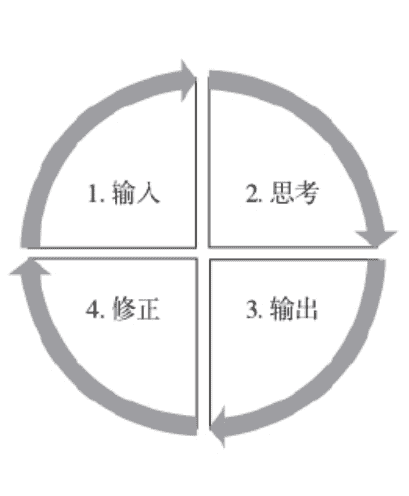
图1-1 自媒体写作的闭环流程

写作像种苹果：先种树、施肥、养护，再等开花结果。写作也一样，需先有经历或学习，内化成知识，再输出成文字，最后修改定型。

很多人写不出东西，大脑空白，通常是前端没做好。

#### 举例

公司有个小姑娘，看我微博火了也想做自媒体，结果坐电脑前半小时一句话没写出来，跑来问我写什么。

巧的是前一天公司遇到一位作者，两句话就怀疑我们是骗子，我们拿出奖状、产品、营业执照，他仍不信，到处找证据证明我们是骗子，最后不欢而散。

我告诉她，这个故事很典型，读者爱看，还能总结出“信任也是一种能力”。文章雏形就有了。

她觉得有道理，却又憋了半小时写不出来。

我问她为什么，她说不知道从哪开始。

这种情况很典型，知道大概内容却写不出来，问题在：

1. 输入端。身边有好故事但没发现价值。
2. 思考端。她能口头复述，却提炼不出核心观点。
3. 输出端。我已提炼观点她仍写不出，说明表达长期缺乏练习。
4. 修正端。还没写出内容，自然无反馈。

总之轻松写作要完成流程：足够输入，足够思考，足够输出，足够修正。发布后看评论看数据，用反馈提升思维深度，不要怕反对，有纳百川的胸怀。

## 1.2 写作的意义何在

写作不只是技能，也是一种知识服务、一种变现方式，更是一条改变圈层、改变命运的路径，能实现从量变到质变。

### 1.2.1 持续成长

#### 举例

去年我打车去出版社开会，车上玩手机时胃里翻腾想吐，确定是晕车，赶紧开窗看向窗外才好转，再也不敢低头。

十几年前上下班固定坐一个东北师傅老王的车。老王开车横冲直撞，急停急刹。我坐过两次事故：一次追尾，一次剐蹭电动车。即便如此，我在车上看过无数本书，从未晕车。

如今中年，身体状态远不如前，明白公司为何不愿录用中年人。没有家事羁绊，中年人的体力和精力也拼不过年轻人。这是自然规律。

常规工作老中青都能完成，但中年人的劣势在体力精力，很难拼过年轻人，公司更愿意用新人。中年人的优势是经验与人脉，这两样要在年轻时攒下，否则四十岁后很被动。

中年危机如何应对？写作是不错的方法。因为写作能融合经验与人脉，让人持续成长：

1. 经验丰富
中年人精力不如年轻人，经验却更足。在公司难体现，在互联网世界优势会被放大。
2. 更多故事
互联网上有趣的大叔大姐很少，中年人分享自己的故事，帮助年轻人，也能体现价值。
3. 为自己积累
无论岗位多高，离职后公司利润与你无关。曾结交的朋友也可能因岗位变动而疏远。写作积累的内容、朋友、粉丝都源于自身努力，关系更牢靠，越滚越多，超过临界点就能靠写作养活自己。
4. 可以传承
自媒体账号相当于个人品牌，持续运营下去。老了写不动，后代可以接力。

#### 举例

我自己是出版人，帮上千人出过书，却没坚持写作，很可惜。这些年做自媒体重新开始写作，我发生了变化：

1. 遇到各种有趣的自媒体人，学到新写作知识。以前只和出版社打交道，思维受限。
2. 与自媒体人交流的学习效率远高于读书。书上的方法认可但不行动，聊过后就有冲动立刻做。
3. 公司经营思路打开了。传统出版稳定却圈子固定，自媒体崛起后经营理念升级，未来几年会进入快车道。
4. 家庭关系改善了。以前教育孩子钻牛角尖，和儿子关系紧张。通过写作反思自我，在网友交流中修正方式，家庭更和睦。

我很庆幸重新开始写作，整个人有升级感。上一次这种感觉还是十年前。

### 1.2.2 跨越时空

这种模式在创业者群体里很常见，他们通过招聘员工来买断对方的工作时段，让团队替自己执行任务，从而把个人能力放大数倍，效率随之跃升。借用别人的时间确实能让赚钱的规模指数级扩张，可代价也高，经营一旦失误就容易倾家荡产。

3. 购买老板的时间

这种路径更多出现在资本方身上，他们站在更高维度筛选可靠的经营者，把资金投进去助推企业快速做大，进而获取投资回报。买断老板的时间门槛更高，既要资金充足，也要承受高失败率。投下一个十个项目里，能有一个跑通就算不错了。

把时间运用的三个档次放在一起看，靠自有时间吃饭的普通人最被动，只能一天干活换一天收入，完全没有弹性。若哪天想停下来休养三个月，这三个月就意味着零收入。

要破解这个困局，自媒体写作是最直接的突破口，原因有三。

1. 跨越时间

不少头部自媒体人已经沉淀了海量内容，不需要持续生产全新素材。经常会把旧文章翻出来重新发布。对创作者而言是存货，对新读者而言却是首次阅读，因为受众在不断轮换。

2. 跨越空间

信息传播的成本已经极低。只要内容发布到网络，就有机会触达全球任何有网的地方。在一个固定地点写下的文字，可以瞬间覆盖到世界各地的屏幕前。

3. 多种呈现形式

同一份知识可以承载在不同载体上，比如图书、音频、平台图文、视频等。优质内容可以跨格式复用，也能实现多平台分发。同一篇文字可以同时上线在多个自媒体渠道，每个渠道自带不同的用户群体。

自媒体写作打破了时间、空间和载体的三重枷锁，让文字拥有穿透时间的生命力、覆盖空间的触达力、跃迁媒介的延展力。

### 1.2.3 写作倒逼成长

很多人误以为写作者必须先什么都懂才敢下笔，这其实是把因果颠倒了。写作是输出，学习是输入。不是等输入够饱满才有资格输出，而是因为要输出，才倒逼自己去输入。

常说的“输出倒逼输入”就是这个道理。不是先学够了再写，而是因为写作需要总结，于是发现自己认知不足，才去主动学习。这种学习是带着问题去的，是自然发生的。自媒体写作持续推进，会让人逐渐意识到自己远非专家，但写着写着就成了专家。

#### 举例

做自媒体写作后，我明显感受到知识在加速积累。回头想，并不是过去不爱学习，过去也常有焦虑感，每天花大量时间读书，怕被时代淘汰。

只是那种焦虑很模糊，没有衡量标准。知道要多读书、开眼界，却不知道读多少、吸收到什么程度、对自己有没有用、何时能用上。这一连串问题没有答案，学习也就失去了目标感。

开始写作后，一切变得清晰。

1. 微博每天要更十篇以上的原创。讲完自己的故事、朋友的故事后就没素材了，只能去读书汲取养分，看书的目的立刻明确。

2. 过去一本书要读一周，现在必须两三天读完，快速提炼核心观点，再结合自身经验内化成自己的东西。学习的专注度因此极高，阅读速度也大幅提升。

3. 以前爱听线上课，现在几乎改成看文字了。音频一分钟大约只有两三百字，还要等衔接；而阅读一分钟能看上千字，可以快读、跳读、精读，十分钟音频的内容两分钟就能过一遍。

4. 学习不只是吸收，更需要表达。如何把话说得通俗易懂，需要大量练习和反复打磨。看起来轻松的文章，其实都改过好几版，不满意的千字段落也会直接删掉。过程很磨人，却练出了写作功力。回看一年前的文字，总觉得粗糙，这就是成长的体感。

### 1.2.4 写作助力跃迁

1964年，英国BBC播出纪录片《人生七年》，导演迈克尔·艾普特挑选了来自不同阶层的14名7岁儿童，随后每隔七年回访记录。看完的人大多感慨阶层固化，“龙生龙凤生凤”似乎成了注定的规律，出身往往决定走向，圈层突破异常艰难。

但写作确实改变过许多人的轨迹。英国作家J·K·罗琳写《哈利·波特》前，生活在英国一个普通工薪家庭，失业时靠救济金抚养女儿，住在简陋公寓里。成名后，她的圈层和社会坐标发生了质变。

身边也有类似案例。

#### 举例

我一个朋友的朋友，写这本书前一年，他是北京一家三十人公司的主管，同时还是畅销书作家，在知名学习平台开课。再往前五年，他只是个刚入行的职场新人，跟着导师打拼。等到我写书时，他已成为查理·芒格在中国的重要合作伙伴之一。

查理·芒格是巴菲特的长期搭档，共同缔造了伯克希尔·哈撒韦的神话，正是站在世界金字塔顶端的人物。

朋友回忆，有次他们组织思想会，每个人都要说出一个与兴趣相关的大目标。他这位朋友坦言对思维模型着迷，因为思维模型能有效解决问题，而提出这个概念的就是查理·芒格。于是他给自己立下目标，有生之年要与查理·芒格建立联系。

当时没人相信，一个普通年轻人即便努力，也未必等得到已近九十岁的芒格。但这个宏大目标真的实现了。他的第一步就是开始自媒体写作，积累经验后写出关于思维模型的畅销书。

从起步自媒体那一刻起，他与芒格之间就建立了隐性关联。书一出版、开始畅销，距离逐渐拉近。芒格注意到他，对他产生兴趣，这本书起到了关键推动作用。如今他的圈层、视野和高度都已与过去截然不同。

### 1.2.5 出书的路径

我辅导过不少作者出书，发现一个共性：人人都有出书的念想，书能梳理知识、放大影响力、助力职业发展，还能拿来跟朋友分享。但大多数人止步于想法。

相声里有个桥段。

#### 举例

A天天去寺庙上香求中彩票，连续多日仍未中奖。恼了之后拉着朋友去找和尚算账。

> 和尚说：“施主，先买了彩票才有中奖可能。”

写作和出书的关系就类似。很多人想出书，却从未真正写，便永远没机会被看见。我帮作者出书的筛选大致分三步。

1. 在网上看到作者的文章，觉得质量过关，发出约稿邀请。
2. 与作者沟通后，对其背景和创作力进行评估。
3. 让作者提供目录和样章，判断框架和文字是否达标，合格再签约合作。

想出书，先得写出来。出版人不会主动上门求作者，更多是作者通过持续写作积累内容和粉丝，被出版人发现。先有鸡还是先有蛋的问题，答案永远是先写。

### 1.2.6 从写作者到大V

微博上粉丝多、影响力大的账号常被称为大V，后来这个词泛指各平台上粉丝量大、号召力强的自媒体。文字输出是门槛最低、最容易起势的方式。大V既是流量核心，也是个人品牌和商业模式的关键节点。

在互联网上，每个人都有机会成为大V。要建立个人品牌，先要拆解大V的商业逻辑。通用模型可分为五个层面。

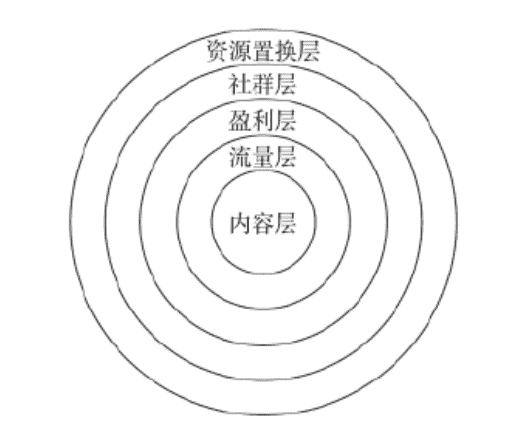

图1-2 通用的大V商业模式的5个层面

1. 内容层

## 2. 流量层

互联网里流量指用户规模或互动量。打造大V时，既可以用粉丝数衡量，也可以用阅读、点赞、转发、评论等综合指标。内容发布后通过渠道扩散，被更多人看见，好的内容还会产生二次传播，认识的人越来越多，流量自然放大。

## 3. 盈利层

拥有内容和流量就具备商业价值。变现路径主要有五种。

- ① 保持内容免费，持续做大流量，靠品牌投放广告盈利。
- ② 把部分免费用户转化为付费用户，做知识付费。
- ③ 用影响力反哺本职事业。
- ④ 内容+流量+带货，销售商品。
- ⑤ 通过付费社群实现盈利。

## 4. 社群层

互联网信息爆炸，每天接收的信息量远超过去一年。如今连接容易，但兴趣壁垒更明显。于是垂直社群兴起，粉丝模式转向社群模式。人在不同社群里交流、寻找归属感。

## 5. 资源置换层

社群成熟后，成员彼此熟悉且信任，就会出现资源交易。不是简单的卖货，而是社群里有人有需求，另有人恰好能提供。比如求职信息可以在社群内精准匹配推荐。社群因此从兴趣集合变成相互交换资源的朋友圈。

使用这五层模型时要注意。

- ① 五层并非孤立，而是相互影响、可以转化。
- ② 顺序不是固定的，会随情况调整。
- ③ 五层不必全齐，可按实际需求重组。

#### 举例

我一个朋友经营一家公司，业务分知识和娱乐两大板块。知识板块做线上课、线下课、出版物等；娱乐板块做影视剧等。两者独立运营，但流量、社群、资源端有联动。

公司核心是通过打造互联网大V输出内容获客，再通过产品变现。基于原始流量逐步建立两类微信社群，并在高端用户社群里实现资源置换。

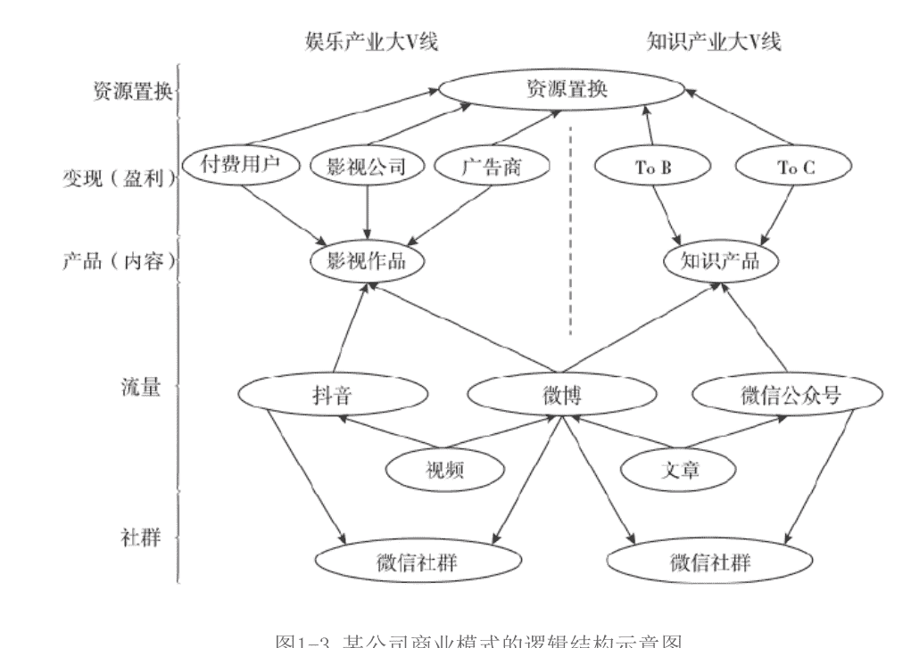

该公司两大业务板块围绕核心产品打基础，铺流量、做转化，社群深耕带来资源交换。

## 1.3 自媒体写作的定位

写作前必须先定调。清晰的定位让内容更聚焦、个性更突出、大V之路更顺。定位通常从自身优势出发，若一开始不明确，也可先广撒网写作，边写边找。

### 1.3.1 如何找到合适的定位

找定位本质上是自我认知，要回答三个问题。

- 1. 我是谁？
- 2. 我想成为谁？
- 3. 我的核心闪光点是什么？

很多人自述冗长却不聚焦，正因没认清自己。找定位是做减法，可从三个维度审视。

- 1. 工作：我在专业上有哪些特长和优势？
- 2. 生活：我有哪些与众不同的经历？
- 3. 兴趣：哪些爱好我做得比别人好？

选择定位时需注意。

- 1. 合法合规，切勿触碰法律红线。
- 2. 坚持科学，远离伪科学和迷信。
- 3. 正向积极，传播正能量。

定位清晰后，可把内容拆成主矿和副矿。

#### 1. 主矿

专业主导内容，比如定位是电商创业者，就持续分享电商实操经验，形成差异化。主矿建议占整体七成左右。

#### 2. 副矿

大众喜爱的泛兴趣内容，如美食、旅行、情感，增加烟火气。副矿约占三成。主副结合既有专业深度，也有生活温度。

### 1.3.2 如何锁定优势领域

可用SIGN模型来评估。

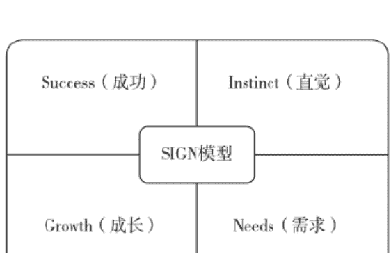

图1-4 SIGN模型示意图

#### 1. Success（成功）

感受充实高效，创造力强，成就感高。表现是做某事比别人快、做得更顺畅、能一气呵成。

#### 2. Instinct（直觉）

感受期待、兴奋、好奇。表现是看到别人做这件事会想“我也想试试”，一旦开始会持续探索。

#### 3. Growth（成长）

感受轻松、专注、求知欲强。表现是上手快、学习效率高、容易进入心流，甚至能自学成才。

#### 4. Needs（需求）

感受渴望、存在感、满足感。表现是不做会难受，强烈想成为该领域的人，做进去有价值感，达到目标有满足感。

评分表可帮助量化。

| 维度 | A 领域 | B 领域 | C 领域 |
| :--- | :--- | :--- | :--- |
| Success（成功） |  |  |  |
| Instinct（直觉） |  |  |  |
| Growth（成长） |  |  |  |
| Needs（需求） |  |  |  |
| 合计 |  |  |  |

使用步骤：

- 1. 列出相关领域填入表。
- 2. 按各维度程度打1-5分。
- 3. 求和比较，选择分值最高的领域作为个人品牌方向。

#### 举例

张三是上市公司财务高级经理，也是高中生的母亲。她自学高考志愿填报，发现学习很快；工作中常被年轻同事请教职业规划，于是对该领域产生兴趣。可选领域有财务管理、高考志愿填报、职业生涯规划。评分后高考志愿填报总分最高，她便以此为主攻方向。

需要提醒的是，SIGN模型只从个人出发，未考虑市场规模、竞争程度等外部变量。最终决策时还需综合外部环境。

### 1.3.3 定位难寻时的对策

很多人觉得自己样样通、样样松，找不到拿得出手的特长。这很常见。

#### 1. 逐渐摸索

多数自媒体人的定位不是一开始就定的，而是通过持续写作慢慢收敛出来的。

#### 举例

任康磊在简书写了近两年职场类文章，后来才聚焦到人力资源管理本行，并逐步延伸到团队管理等相关领域。

定位没头绪时，不妨先横向试水。涉猎多个方向，边写边感受，自然能筛出最契合自己的那片天地。

#### 2. 别急着求成
大多数头部创作者都不是一蹴而就的，他们往往花了数年沉淀才在某个赛道站稳并成为公认的专家。新手不必盲目崇拜，更不必焦虑。把时间当作筹码，沉下心持续输出即可。起步阶段想法不够深刻、笔法不够娴熟都很正常，给自己一段持续写作的周期，这些问题会自然改善。

#### 3. 用反馈持续校准
试错加反思是找到方向最快的路径。写作不是闭门造车，要保持对读者回应的敏感度，基于评论私信等信号不断校准内容，随时复盘调整，这样定位才会越来越清晰。

#### 4. 先放下涨粉执念
定位尚未成型时，别把粉丝增长当成考核标准，也别用涨粉快慢来决定转不转赛道。否则很容易陷入焦虑，偏离本真。先把方向稳住、持续产出，等内容体系跑顺了，再谈增粉也不迟。

#### 5. 以个人品牌兜底
定位本质上是给读者一个快速识别你的标签。若一时找不到单一赛道的甜点，完全可以暂时放下精准定位，转而经营一个有辨识度的个人品牌。

#### 举例
以我微博的经历为例，内容涵盖出版、创业、考证、育儿以及个人成长等多个主题。只要持续解决读者实际问题，就能沉淀出一个独立的品牌资产。人的特质本就多元，即便赛道不够聚焦，读者依然可以记住你这个人。

### 1.3.4 怎么看市场
做定位时很多人先看市场体量，想挑一个大而空的赛道。理论上数据齐全就能找到大市场低竞争的区位，现实里几乎不存在。只要出现一处蓝海，很快就会被创作者填满。

我的观察恰恰相反，头部博主扎堆的赛道往往更值得入局。别人问我怎么评估市场，我通常看该领域有多少头部账号，以及头部账号的粉丝量、阅读量、互动数据等。具体逻辑有三点。

#### 1. 市场足够大
大V数量多，背后是受众基数大。感兴趣的人多，愿意为内容付费注意力的人也多。粉丝并非某一个人的私有财产，关注是多对多的关系。一个大V的粉丝也可能同时关注你，所以竞争激烈恰恰证明需求旺盛、机会充足。

#### 2. 有可对标的标杆
有榜样学习效率更高。赛道里只要有头部账号，就等于有了现成样本。不需要从零摸索，可以借鉴内容框架、选题节奏和表达方式，沿着已经验证的路径前行。

#### 3. 能形成同伴网络
同赛道的创作者不一定是敌人，更多时候可以成为盟友。大V聚集的领域，腰部和素人也更集中，便于形成互推、联名、信息共享的生态。能和头部建立连接最好，哪怕不行，和同类创作者抱团，也能共同提升话语权。

## 1.4 自媒体写作平台选择
可供写作的平台很多，类型各异。大而全的、背景强势的、小而精致的各有侧重。选平台本质上是做匹配，要结合自身定位、擅长表达方式和长期规划来抉择。

### 1.4.1 主流的三大梯队
目前常用的写作阵地大致可划分为三层。

- 1. 第一梯队：大流量大众型
微信公众号、微博、今日头条是这一层的代表。它们用户体量巨大，属于大众入口，但创作者体验差异显著。

- （1）微信公众号
公众号背靠十亿级活跃生态，潜在触达面极广。平台调性偏封闭，作者与读者像主人和访客，作者掌握发声权，读者评论需经审核才能公开。用户结构中上班族占比高，消费意愿相对较强。

#### (2) 微博
微博月活超5亿，年轻用户为主。它的生态更像一条开放的街区，每家店面敞开经营，路人可以随意进出评论，店主之间也能互相串门。粉丝粘性较高，互动频次多。对以粉丝沉淀为目标的人来说，微博是理想阵地。我曾调研多位毕业生，关于三大平台使用频率，微博被提及最多。先在微博积累受众，再做跨平台迁移，相对顺畅。

#### (3) 今日头条
头条日活超2亿，用户集中在二三线城市。平台更像综合商场，商户入驻但流量由商场分配，用户忠诚于平台而非单个账号，对评论反馈也不敏感。三者里，头条的粉丝留存能力最弱。

#### 2. 第二梯队：强背景+扶持政策
第二梯队的平台依托大厂或传统媒体，具备较强资源和扶持力度。代表包括百度系百家号、腾讯系企鹅号、阿里系大鱼号，以及搜狐号、新浪看点、网易号等门户系产品，还有一点号、东方号、大风号等。为吸引创作者，它们经常推出原创激励和流量扶持，优质内容收益可观。

#### 3. 第三梯队：小而美+垂直领域
第三梯队是小而美、强功能型的平台，流量不算爆炸但用户意图明确，典型如知乎、简书、豆瓣。

##### （1）知乎
知乎用户以高知和高收入群体为主，问答属性强，搜索意图明显。在这里输出高质量内容，容易建立专业形象，获得身份认同感。

##### （2）简书
简书聚集文艺向创作者，氛围偏小众。平台推荐机制相对封闭，上首页是关键流量口。若内容偏散文、随笔风格，可重点经营。

##### （3）豆瓣
豆瓣的读书和电影板块热度高，是大众购书观影前的参考地。在豆瓣积累影响力，同样具备较强的话语权。

##### （4）垂直领域
除了综合型小平台，还有一批垂直社区，适合深耕细分赛道。

#### 举例
比如人力资源垂直社区三茅网，畅销书作者任康磊正是从这里起步并成长起来的。

### 1.4.2 选择的三大法则
面对众多选择，选平台可遵循三条原则。

#### 1. 围绕用户法则
首要原则是用户匹配。先清晰你的目标读者是谁、有什么行为特征，再看平台用户结构是否吻合。

#### 举例
任康磊选三茅，是因为平台用户正是HR从业者，与他的读者画像高度重合。同一批读者也在公众号和微博活跃，因此他同步布局了这两个平台。

#### 2. 自身需求法则
第二是需求导向。每个人写作目标不同，平台需能承载。想打造个人IP、沉淀私域粉丝并高频互动，微博更合适，它的开放评论和传播链路利于人格化表达。若目标是出书，知乎和简书是不错的起点，出版人常在此发掘作者。但最终成书仍需一定的粉丝背书，建议同步经营公众号或微博。

#### 3. 平台属性法则
第三是尊重平台机制。每个平台的流量逻辑不同，硬搬内容容易水土不服。

#### 举例
我曾认真做过头条号，单篇阅读多次破百万，但粉丝增长缓慢。这与平台机制有关。头条是基于兴趣的分发系统，用户无需关注作者即可不断获得推荐内容，因此流量高但沉淀难。

### 1.4.3 常见的4个问题
选平台时常有疑问，下面梳理四个典型困惑。

- 1. 同一时间选一个平台，还是选多个平台同时发布
时间和精力有限，平台机制各异，运营打法不能通用。新手应先单点突破，把一个平台做透，有受众基础后再横向扩展。同时铺多阵地，容易顾此失彼。

#### 举例
我有近二十年出版经验，曾每天投十小时在微博，花两年才算站稳。很多新人连一个平台都没摸清，就想同时兼顾，注定事倍功半。不同平台的爆款逻辑甚至相反，同一内容在微博热烈，在公众号可能平淡。

#### 2. 可不可以同时运营多个领域的账号呢
本质仍是资源分散。单账号单赛道都需要持续投入，兼顾多个领域风险极高，不建议新手尝试。

#### 3. 选一个平台坚持输出，万一这个平台倒闭了怎么办
担心平台关停就不做？任何组织都有不确定性，就像公司也可能倒闭，但我们不会因为可能而停止工作。真到了平台消失的那天，只要写作能力在手，积累的内容资产和运营经验可迁移，照样能在新阵地重启。平台会变，能力是自己的。

#### 4. 听说X平台X形式是最新的风口，我也想去做那个
不要盲目追风口。

举例
我认识一位朋友，微博刚火时入局小有成效，公众号兴起便弃微博追公众号；头条起来又换阵地；短视频火了再转方向。结果每一次都半途而废，始终没做出积累。

举例
很多人认为微博已过时，其实只要内容够好、执行够深，任何平台都能做出成效。我就在外界喊微博没落时把账号做起来了，后来不少人主动来搬运我的内容到其他渠道。

# 第2章 突破阻力保持持续写作
任何事都要靠坚持才能成事。写作更是如此，只有持续输出才能积累价值，中途放弃等于白费。很多人想写却被各种阻力卡住，关键在于提前预判并穿越障碍。

## 2.1 写作过程的心理建设
事先预判才能从容应对。为了降低写作摩擦，启动前先做心理准备，列出可能出现的卡点。写作中保持觉察，及时调整状态。

### 2.1.1 选准比较对象
在我开第5期写作训练营时，有位学员特别焦虑，觉得自己欠缺太多，报了写作、心理、演讲多个训练营却时间不够，最后想推迟到第6期。我建议他先聚焦一个营，把内容消化吸收后再学下一个，避免囫囵吞枣。

我也发现，当身边有人跑步超过我时，我会不自觉加速，打乱节奏反而更累。写作亦然。学员写着写着发现别人更新更快，便焦虑赶进度，质量下降。新手最好纵向自比，和昨天的自己比进步即可。必要时横向只找比自己略强的人对标。

### 2.1.2 追求粉丝同频
我的微博大家庭群每天都在分享文章和优秀作品，成员间可以互相鼓励。但也有人把群当成导流工具。写作能力不足时盲目求粉只会挫败。新手应追求粉丝同频，即内容是否真正满足读者需求、是否产生共鸣。

任康磊曾聊过他的减肥经历，前两周体重几乎不动，两个月后才明显下降。写作也一样，粉丝增长是结果，不是起点。先确认方法是否正确、是否持续，效果自然会来。很多人每天看体重秤就放弃，写作新手看粉丝数没涨就停更，道理相同。

我认识一位作者，大学时坚持写知乎两年多才起效，毕业前出版，已被大公司录取。知乎不是高流量平台，但他与那批读者形成了强共鸣，个人品牌因此扎实。

### 2.1.3 对抗焦虑情绪
如今获粉变难，焦虑普遍存在，部分因平台更重内容推荐而非账号培养，部分因媒介分流。应对可从四方面着手。

1. 聚焦成长
写作本身就是收获，涨粉只是副产品。没有涨粉也有能力提升。

2. 难点价值
越难坚持的事，坚持下来的回报越大。大家都焦虑时，持续输出的人机会更多。

3. 相信文字
文字的持久力和传递力是不可替代的，其价值经得起时间考验。

4. 用户分层
随着媒介多元，用户会分层，文字受众会更聚焦、粘性更高。

十几年前也担心碎片化阅读会杀死图书，现实里图书总销量保持平稳。喜欢读书的人仍在读书，互联网只是让他们更好获得内容。现在回头看，我曾发过一篇《承认自己是普通人》，那段时间我也掉粉焦虑，最后选择沉下心打磨。长期看，方向没变，粉丝仍在增长。不忘初心是缓解焦虑的关键。

### 2.1.4 做到与人为善
与人为善既是做人底线，也是做自媒体的关键。我在经营微博时见过很多大V互黑、人身攻击，我始终专注于自己的内容。平台是个小社会，总有人爱挑刺。把对手当敌人不如把赛道做大，粉丝关注A的同时也能关注B。与其对付别人，不如做好自己。对粉丝也一样，别因不同意见就争执，会消耗自己。

第1期训练营开营前我很忐忑，以为能招100人就不错了。结果36小时内报满，因为很多大V转发了招募。我的招募帖阅读超70万，这就是广交朋友的回报。

### 2.1.5 寻找资源圈子
每个人都有地域、兴趣、职业等标签，对应着不同的圈子。写作初期多逛逛这些圈子，合适就留下，不合适就退出，既能提升自己也能获得资源。

我每年都会加入一些圈子，大多会自然消亡或变广告群，但总能留下几个能持续发展的志同道合圈子。它们像矿藏，能提供人脉、素材和粉丝资源。持续深耕，价值会不断释放。

我自己在微博里也常年经营着一个小圈子，发文后圈子里的人会互相转、评论、点赞，互动数据很快就起来了。互动上去后，被微博官方或大V注意、被推荐的几率也会跟着提高，文章冲到爆款的概率也就更大了。

找圈子的思路和广交朋友其实是同一个逻辑。“一个篱笆三个桩，一个好汉三个帮”，没有人可以真正单打独斗。如今人与人连接这么方便，圈子带来的就是资源和助力，能让写作走得更顺。

## 2.2 让写作持续下去的打法

能力都是练出来的，想把写作练好，关键就是坚持写。写作本身很耗劲，要能一直写下去，需要搞明白提升的要点，掌握可落地的方法，跨过懒和拖延，养成持续输出的习惯。

### 2.2.1 写得更好用的通用公式

成功学里有个经典套路“只要……就……”，比如只要努力就能成功，只要战略对就能成功，只要诚实就能成功。套上这个公式配两个故事，听起来很有说服力，但细想就知道成功没那么简单，所以很多人排斥成功学。

不过有些领域，这个公式是真的管用，比如减肥。只要管住嘴迈开腿，就能瘦下来，理论上人人都能做到。

任康磊两个月把体重从88公斤降到75公斤，之后写了篇《减肥是世界上最简单的难事》。为什么说简单？因为多数人要瘦下来，核心就两件事：管住嘴、迈开腿。用“只要……就……”的说法，就是只要做到这两点，就能瘦。难的不是道理，而是坚持。很多人查资料、做计划，最后还是坚持不下来，起心容易，过程太难，最后放弃。

写作能力的增长也符合这个公式。只要持续写、不断写，水平就会上去。就像学英语，最关键不是背单词，而是坚持开口说。有人背下一本词典却从不交流，最后还是不会说。写作也一样，最重要的是先开始写，然后一直写下去，坚持写自然就会进步。

我现在回看去年写的稿子，会觉得有很多不足；去年再看前年，又更不满意。正是不断写才让能力在积累和提升。

### 2.2.2 破解写作拖延的办法

很多人清楚写作重要，却总是不动手。原因可能有准备不足、怕被嘲笑、没时间等等，但大多只是借口，核心问题是拖延症。

美国作家娜塔莉·戈德堡有个对抗拖延的方法，给自己设一个时间锚点。拖延严重的人可以先定10分钟，在这10分钟里全神贯注写。坚持一周后，再慢慢加到20分钟、30分钟、40分钟、60分钟。

要让这个方法生效，不管时长多长，都必须遵守到底，并且把这个时段写完。操作时要注意以下四点。

图2-1 战胜写作拖延症的4点注意事项

1. 别停顿
决定要写就立刻开写，用电脑或手机都行。不要先想把某个点完善了再动笔，那是拖延的伪装。工具不重要，重要的是马上进入状态。

2. 别删除
新手写出来是什么样就是什么样，别怕幼稚、别怕另类、别怕错别字，先把内容堆出来。写完后可以为通顺、清晰、突出重点做适当修改，但别大段删掉。

3. 不求完美
观点要说清楚，喜欢就说喜欢，讨厌就说讨厌，别纠结各种例外。事物可以从多个角度解读，写作不需要面面俱到，把自己在某个角度的看法表达清楚就行。

4. 长短无所谓
很多人有“憋大招”的心态，想一鸣惊人写出爆款，这几乎不可能。可以从短打起，哪怕只有50字，也是零的突破。坚持下去，半年后写500字会变得轻松。

### 2.2.3 用习惯对冲惰性

想写的人很多，能坚持的人很少，三天打鱼两天晒网。信息爆炸的时代，很难长时间做一件事，有人说现代人能专注两小时已算不错。

能不能持续做一件事，靠的不是自制力，而是习惯。

经历过高考的人都知道，备考那段时间学习状态和自控力几乎是巅峰，每天可以熬夜刷题，第二天早起照样精神。奇怪的是，考上大学后同样一群人就松懈了，熬夜追剧、晚睡晚起成了常态。

差别在习惯。

早上起床刷牙洗脸，睁眼、穿衣、走过去、接水、挤牙膏、刷牙、洗脸，睡眼惺忪也能自动完成，不需要自制力。高中的学习也基本靠被动习惯，紧张的氛围让大家形成规律的上课、自习、吃饭、睡觉，老师替学生规划好一切。

进入大学后环境变自由，被动养成的习惯消失，学习就松了。

任康磊的大学生活很散漫，经常逃课去网吧。考试前别人都在自习室，他在自习室坐15分钟就走。

后来他开始写作，是刻意培养习惯。先做到每天写一点，不计字数；再变成每天1000字、2000字、3000字，现在平均每天至少5000字。这个习惯已经成了强迫症。

写完5000字，他才觉得一天有意义；写不完就像早上没刷牙。外出时间长不方便用电脑就用手机写。有次坐飞机，起降时不能用电脑，他就用手机打字，空姐来提醒他飞行模式，他还在投入写作。长期下来，他的手机主要用途就是写作，而不是聊天。

### 2.2.4 养成持续写作习惯的回路

刷牙洗脸这类事简单，容易养成习惯。写作没那么简单，需要给自己建立正反馈，让行为进入增强循环。

养成写作习惯的增强回路如图2-2所示。

反馈就是环境对行为的回应。重复行为会形成习惯，正向反馈会推动行为持续，负向反馈则会削弱习惯。

任康磊没出书时，正反馈来自自媒体文章的点赞评论；写第一本书时，正反馈来自即将出版的成就感；现在写书，正反馈来自销量，市场对他创作价值的认可。

获取正反馈的渠道很多，比如加入写作训练营，成员互相监督、点评、学习，从社群获得认可。

起步阶段会有很长一段看似无产出的投入期，会觉得漫长，但功不唐捐。书法家前期练字没价值，成名后写的字才有价值，可没有前期大量练习就不可能成为书法家。

## 2.3 让写作更轻松的思路

很多人觉得写作难，其实方法对了就能变简单。好方法能在没动力时给动力，没灵感时给灵感，无法专注时提升专注力，没时间时帮你规划。

### 2.3.1 用杠杆提升写作动力

阿基米德说给我一个支点，我就能撬动地球。杠杆原理用在不同领域都能放大效率。

金融里就有杠杆，用1%到10%的保证金撬动10倍到100倍的额度，收益高风险也高。公司有财务杠杆，投资者会看杠杆系数判断经营状况和价值。

写作习惯怎么加杠杆？如果你只默默说要每天写一篇文章，很容易失败。把承诺公开，让身边人知道你要做这件事，就是加杠杆。没做到会觉得失信，做到就有正反馈。

除了公开承诺，还可以找个信得过的朋友监督，比如把100元交给他保管，坚持21天每天写作就拿回，没做到钱就给他。

### 2.3.2 写作灵感从哪里来

很多人想写却不知道写什么，把问题归为缺灵感。

著名作家刘墉问儿子刘轩为什么很久没写东西，刘轩说没灵感。刘墉说，什么叫没灵感？这只是不创作的借口。

写作应该像吃饭睡觉一样规律，不是等到饿了才吃，等到困了才睡。常是到了饭点，点菜后食欲来了；到了睡觉时间，躺下看会儿书自然困。写作也应是持续行动，坚持写灵感才会越来越多，关系不是因果而是结果。

灵感可以通过输出倒逼输入来产生。必须输出内容，就会被迫去找相关的素材和灵感。

灵感主要来自场景、表达、记录三个部分，如图2-3所示。

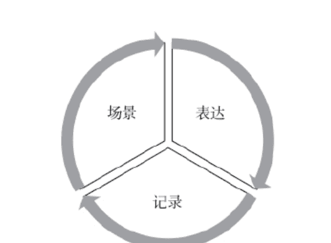

获得灵感可以走三步。

1. 想象一个有剧情、有画面感的动态场景，像电影一样。
2. 在这个场景里，有人沟通和表达，那时会说什么？
3. 观察场景，按需描述场景或记录对话，形成文字。

### 2.3.3 保持写作专注的小技巧

写着写着就走神，很难集中。心流是最佳状态，但可遇不可求。

一个帮助任康磊集中注意力的技巧叫断点续传，如图2-4所示。

断点续传是互联网传输技术。早期下载文件是一次性传完，中断就要重来。断点续传把文件切成多份多线程下载，已下载的部分不会丢失。

把这个原理迁移到写作，就是用分模块多任务来管理注意力。

任康磊写书先列目录，三级标题二三百个，先做内容拆解。写的时候不按顺序，而是写哪个模块有感觉就先写哪个。有时要同时策划二三本书，模块就有四五百到九百个，再加上线上线下课的内容，形成多线程、多任务。

任务量大到思维很难跳脱出任务范围，可以分散但都围绕目标。写到一半走神想到另一个模块，就去写另一个模块；想到课程内容就去准备课程。一天在各个点之间切换，不知不觉就到深夜。

采用这种方式后，一坐下来工作就持续推进，效率高到忘了吃饭，后来他设闹钟提醒自己每小时起来活动、按时吃饭。

心流不只是心无旁骛做一件事，也可以是心无旁骛做很多相关事。大脑休息不是放空，而是切换到另一个相关任务，保持整体专注的同时让大脑得到喘息。

### 2.3.4 管理写作精力

物理学有能量守恒，写作也有。时间在哪，结果就在哪。要提高写作能力、持续输出，就必须投入大量时间练习。

很多人想要好结果却不愿投入时间，把时间花在短视频、聊天、刷新闻上。连时间都不肯付出，谈何成长。

管理精力要做好三点。

#### 1. 寻找时间
写作不一定要连续整段时间做。碎片时间也可以用，像副业或随笔记录。

任康磊在职场时，午饭后30到60分钟休息用来写作；下班吃完晚饭后集中写2到4小时；通勤时用电脑或手机写。创业后可自主安排，要求自己每天工作14小时，其中至少6小时用来写作。

#### 2. 屏蔽干扰
进入状态慢、专注度低，很容易被干扰破坏节奏，所以要把干扰源挡在外面。

任康磊写作时把手机调成静音，只留闹钟；社交软件几乎不用朋友圈，只用来收发信息；不参加无意义的社交聚会；上网时屏蔽推送、热搜、新闻和广告。

#### 3. 不纠结得失
一个领域投入多，其他领域自然投入少。选择把时间押在写作上，就安心投入，争取做出成果，别纠结因此可能少获得的东西。

我在微博上投入大量时间和精力才把账号做起来。任康磊在写作上长期深耕才成为畅销书作家。身边很多朋友想得多做得少，自媒体没做成、社群没经营好、书也没写出来。

# 第3章 如何找到写作素材

很多人不知道素材从哪里来。写作素材来源很广，常见分一手素材和二手素材，写作者可按自身特点选择。

## 3.1 一手写作素材

一手素材指源于自身或不专属任何人、谁都能写的素材。常见获取途径有人生经历、生活感悟、热点事件等。掌握获取方法，才能让一手素材发挥最大价值。

### 3.1.1 从人生经历里挖素材

互联网时代，人人都有机会成功建立个人品牌。每个人都是独特的，就像世界上没有两片完全相同的叶子，也没有两段完全相同的经历。不同的人生经历是差异的来源，也是他人愿意了解的原因。

1. 人生经历是最好的个人品牌故事

做个人品牌需要故事，故事让品牌更立体。人们好奇别人的经历，想知道自己没有的境遇。读别人的故事能看见不一样的风景和烟火。

2. 写经历要动情，别写成流水账

写给自己看的人生可以随便记，弄成大事记也无妨；一旦准备给读者看，就必须避开流水账式的平铺。真正能打动人的，往往是那些关键节点或情感波动明显的瞬间。

希望与失望、喜悦与悲伤、成败得失，都可以成为笔下素材。每个人际遇不同，但底层情绪相通。打动人的是文字传递出的情绪，而不是事件本身。与其用经历去砸人，不如把经历里的情绪提炼出来，表现得足够饱满。

3. 素材远不止你亲身经历的事

读过的书、碰到的事、遇见的人、甚至转述给别人的段子，都能变成可用材料。生活是一座待开采的富矿，细心就会有收获。

**举例**
任康磊的老家聚会里总有那么一类人，能把气氛带起来。他们常备一堆笑段子，调性自然。任康磊以前的同事就是这种角色，讲段子不重复，铺垫、转折、表演感都很足，特别逗。

后来公司年会需要人写小品，任康磊请他帮忙。没想到对方一筹莫展，理由是没写过这种东西。任康磊提示他直接拿聚会时讲过的段子来用，他一下子反应过来，下午就写出了成品。年会上这个小品效果炸裂，台下阵阵笑声，成为当晚最佳节目。

### 3.1.2 从感悟里提炼独特视角
人与人接收相同信息，反应却不一样。即使是同卵双胞胎，童年经历相近，对事物的加工与感悟也可能南辕北辙。除经历外，对生活的感悟本身就是重要素材。

1. 感悟能彰显个性
个性来自对同一件事的不同判断，来自不同的价值取向。感悟最能体现差异，呈现出与众不同的气质。

韩寒在《通稿2003》里的感悟就是典型。

**举例**
一个人要独立，我觉得经济上的独立比精神上的独立更根本。有人大言不惭地说自己独立，却还和父母住一起，十八岁以后还靠爸妈养，那问题不是精神独立，而是脑子是不是有问题。同样，经济压力比精神压力更实在，因为所谓的精神压力很多都是自找的，我发现有些人总喜欢往悲惨里想，即便生活美满，也会为“为什么美满”而发愁。

2. 先说出来再写下来更容易保留感悟
很多人卡在“不知道怎么表达”。有感悟时没动力记录，想写时又想不起来。最好的办法是感悟发生的当下先说出来。

普通人语速约1分钟180到260字。哪怕偏慢的人，10分钟也能说1800字，1小时约10800字，12小时理论上可达12.96万字。理想状态很难，但1小时写1000字多数人都能做到。

小技巧是语音输入。把当下的感悟先录音，或直接用语音转文字。说话比写作门槛低，先说清楚再整理成文，写作能力会跟着提升。

生活感悟没有绝对的对错，不同阶段会有不同看法。可以大胆写出来，即便不被所有人认同，总会找到能产生共鸣的读者。

### 3.1.3 追热点写作三要诀
在互联网上，热点就是流量入口。标题和内容契合热点时更容易被看见。但追热点必须守住底线。

1. 守法为先
涉及时政类话题，要以官方发布为准。信息未明朗时，不要在官方信息上添油加醋，也不要加入推测和主观判断，更不能造谣散谣。制作传播不实信息是违法行为。

2. 找准关联角度
热点流量大，但与每个领域都不一定相关。借势写作时要审视热点与自身领域的关联，不能生搬硬套，要选择真正相关的议题切入。

3. 坚守道德底线
自媒体观点一旦放大，影响面极大。写作时要考虑内容是否符合道德水准，这直接关乎个人品牌的价值观。缺乏基本素养的账号很难建立长期信任。

### 3.1.4 挖一手素材的三步自省法
获取一手素材的核心关键词是回顾、反思、总结。很多素材藏在日常里，需要自省能力去捕捉。

1. 习惯反思
每晚睡前回想，今天有哪些事触动了自己。事情多时，先发散想三件，再挑最有感触的一件；事情少时，就把当天经历过一遍。

2. 多角度拆解
针对选定的事，从多面审视：矛盾点在哪？当事人怎样反应？为何这样反应？背后目的？错在哪？怎么解决？能总结出什么道理？

3. 用人际分类法找事
实在想不出素材时，可以按关系分类：今天和同事发生了什么？和领导？和同行？和陌生人比如外卖员？对特定职业，可把对象换成物品。程序员就可以想自己和电脑、代码、服务器之间发生了什么。8小时工作里总有细节。

与人相关事件最终往往指向人性，比如欲望、贪婪、恐惧、享乐等。

另外可回溯旧事。很多大V靠连载过去的故事涨粉。回顾自己的往事，也可以通过听别人讲故事触发自己的记忆，再从一个细节切入。回忆时聚焦某一个人会更容易，比如特别佩服的同学，他的优点和行为就是好选题。

新手初期感知力不足时，可以多写过去的小事，避免宏大叙事，把细节写清楚、要点列出来，练手感就好。

**举例**
我经常以任康磊为例，写他如何从滞销书作家转型为畅销书作家，如何靠写作实现年入百万，相关文章阅读量长期大几十万。这是亲眼见证的典型经历，励志且具借鉴性，读者反馈很好。

### 3.1.5 个人素材为何更值钱
自媒体能用一手素材就别用二手，能用自己的就别用别人的。因为个人相关素材鲜明、有标签，别人难以复制，更具吸引力。

个人素材的价值主要体现在四点。

1. 建立信任
个人素材更容易让读者产生信任。娱乐号、营销号多用固定模板，甚至由系统批量生成，内容虽对但缺少人味，看完即走，很难积累忠诚粉丝。有些搞笑号阅读量高，但一旦变现，粉丝并不买单，因为粉丝喜欢的是内容形式，不是创作者本人。

2. 容易引发共鸣
人更爱听故事而不是道理。道理再正确也显干瘪，故事则能拉近距离，形成更高级的互动。

3. 内容稀缺
基于个人素材的故事是独一份，别人平台看不到。稀缺性决定差异化竞争优势。

4. 推动反思
写作离不开反思。无论出发点是什么，反思都是提升能力的核心路径。

## 3.2 二手写作素材
二手素材是指将他人的内容通过学习、思考、加工后内化为自己的素材。来源包括网红、知识平台、视频平台、他人故事、书籍等。二手素材不能直接搬运，必须经过内化。

### 3.2.1 学红人内容别抄形
当一手经历有限时，可以向同赛道的网络红人取经。先锁定5到10个方向相近的创作者，研究他们的表达方式。

先学会辨别真假红人。假红人靠数据包装，通常有以下特征：互动异常，低质内容配高阅读点赞；评论区水化，评论只剩“好”“学到了”等通用话；内容拼凑严重，只有道理没有故事。

找到真红人后，优先研究个人标签强烈的文章，学习他们如何把经历转化为文字。

可用的三个做法：

1. 评论变原创内容
看到红人的观点很认同时，先写评论再扩展成自己的文章。

**举例**
我在微博上给红人写精彩评论时，粉丝涨得很快，也为自己的原创积累了雏形。

2. 标题联想式写作
只看标题不看正文，尝试围绕标题自己写一篇，再与原作对比找差距。

3. 总结规律
红人文章通常有选材、手法、切入点、观点创新的规律。归纳总结后可形成自己的框架。

### 3.2.2 从知识平台汲取素材
知乎、微信公众号、百度百科是常用入口，各有特点。

1. 知乎
小故事和干货多，经常能触发记忆。知乎热榜提供最新热点和点评，卡文时可去找灵感。

**举例**
我已淡忘十多年前的事，刷到知乎上的某个小故事会突然想起当时的场景，随后就写出了自己的版本。

2. 微信公众号
文章质量参差，但精品不少。找不到素材时可翻阅优质号。搜索可借助搜狗微信，基本能搜全网公众号文章。

3. 百度
虽广告多，但聚合全网信息能力强。百度百科知识相对严谨，工具使用技巧也能查到。

4. 垂直平台
垂直领域有专业站点，如科普的果壳、教育的 小花生、财经的36氪。深入领域写作时要常去“主产地”取营养。

### 3.2.3 用视频平台做素材库
解读视频是高效方法。

1. 关注相关视频博主
哔哩哔哩、腾讯视频、爱奇艺、优酷、抖音、快手等平台都有可解读内容。

2. 做深度解读
不要转发或简单转述。学习视频逻辑，用自己的角度做二次创作，形成新内容。

3. 善用历史搜索
不必只看最新视频。用站内搜索挖掘多年前的优质内容，历史视频同样有价值。

### 3.2.4 从他人故事中获取灵感
**举例**
我喜欢聊天，听别人的人生会产生很多感触。我微博里“小A”的很多故事并非亲历，而是朋友讲述后我吸收再转述的，也独具辨识度。听完精彩故事后，我会征求朋友同意，整理成自媒体文章，这类内容同样受欢迎。

注意事项：

- 多听少说
交流时让对方讲，自己整理。

- 必须有中心思想
不是记流水账，要提炼主旨，最好能落到一个道理。

- 读者能有所得
写前问自己，读者花一分钟看，得到什么？哪怕只是会心一笑，也比一头雾水好。

### 3.2.5 读书所得是长期素材库
书的审核最严、覆盖面最广、质量最高。噱头往往藏在书里，但啃书不易。

**举例**
很多人一年读50本却没变化。阅读不在于数量。选自己能读下去的书，按销量榜前十挑选，一章一章解读，用自己的话复述，是很好的写作训练。电子书阅读时把精彩处截图保存，长期积累会成为宝库。

### 3.2.6 二手素材内化的6个步骤
1. 明确概念的原始定义。
2. 明确概念能解决什么问题。
3. 用自己的语言再表述一遍。
4. 围绕概念举出几个例子。
5. 看它和其他概念的关系、区别和联系。
6. 思考它的漏洞或反向说法。

**举例**
以马斯克的第一性原理为例。

第一步，定义：打破经验阻隔，回归事物理论本源，从底层出发思考。

第二步，作用：造特斯拉时，电池成本高达600美元/千瓦时。马斯克拆解为金属元素等基础单元，优化供应链，成本降至80美元/千瓦时。

第三步，自述：把复杂事拆成更小的单元，减少或优化联系，就能大幅降本。

第四步，迁移：孩子教育焦虑，拆解到第一性原理，真正想要的是好性格、专注力、进取心和热爱生活，培养这些品质比单纯追分数更根本。

第五步，外延：第一性原理类似“看本质”“底层逻辑”。同理不同名，换说法显得专业。

第六步，批判：它是否对所有人适用？是否会因过度拆解耗费时间？经过质疑后才算真正理解。

素材来不及处理时，可建一个只有自己的微信群，命名为“写作素材思路”，置顶保存。遇到好点子先丢进去，有空再整理，用完即删，保持整洁。

## 3.3 写作素材应用方法

手上握有优质资料，不等于就能产出优质作品。资料要变成有价值的成品，必须经过有意识的加工。实现这一目标，需要在观念上把自己从旁观者调成创作者，在技法上学会对资料进行重组，在策略上确定进入文本的切口。

### 3.3.1 消费者向生产者转变

工厂经济时期制造者与使用者界限分明，网络时代界线开始松动，自媒体时期一个人往往同时承担内容生产与内容消费的双重角色。长期习惯阅读自媒体的人一旦开始写作，本质上就是一次身份迁移。

身份迁移后，思维、习惯和行动都要同步调整。资料收集最能体现这种变化。五百字成稿，熟手十分钟即可完成，但要筛出可用的资料，往往需要花上一个小时以上。各渠道各有优劣，关键在于如何使用。

想让资料库变厚，必须肯花时间沉淀。有人说我信手拈来，背后是近二十年的出版阅历和大量的阅读积累。对大多数人而言，只有持续积累才有东西可写。

怎样判断自己已从使用者转向创作者？

从使用层面看，打开手机盘点已装的应用，自问它们是在消耗时间，还是在为创作提供养分？哪些工具对写作帮助最大，具体在哪些方面？电脑使用者也可以对照自己的软件清单做同样检查。

从认知层面看，阅读时要审视：是带着围观心态看热闹，还是以创作者视角推敲作者为何这样写？戳中了哪类心理？为何互动数据突出？如果是我会怎样切入？有哪些缺陷可以补足？形成这种思考，就能把新观点迅速融入自己的知识体系。

从行为层面看，要反思：是否在持续阅读并把阅读成果整理成可用资料？聊天内容有没有被转化成写作点？是否主动检索、学习与自身领域相关的知识？是否留心生活中的开心、振奋、沮丧并记录下来？看影视作品时是否主动拆解，形成可用的写作点？

从使用者到创作者的转变，既是身份变化，也是意识的转变。没有完成这种转变，资料收集就不可能持续有效。发现自己还没转过来，第一步就是先完成它。

### 3.3.2 素材的5种组合方法

#### 举例

我的微博文章基本由两部分构成：故事与观点。故事多用亲历资料，观点有时用亲历，有时用二手资料。故事更容易拉近距离，观点更容易引发共鸣。当一手和二手资料都积累够了，输出就会轻松很多。资料组合成内容的路子很多，自媒体里比较受欢迎的有5种。

- 1. 回忆法
回想近期生活中触动较深的经历，把个人故事与底层逻辑结合，组合成内容。我个人最常用这招。

- 2. 干货法
把纯干货整合成一篇作品。每篇干货通常在千字以上，知乎上这类内容非常多。

#### 3. 问答法
用问答形式引出观点。可以定期回答粉丝提问，挑选话题性强的写出来，反响往往不错。这里有个小技巧，多数平台都有问答榜单，比如知乎热榜、今日头条悟空问答、微博问答等，都可以用来找选题。

#### 4. 时评法
针对当下热点进行点评。需要注意的是，不要盲目追热点，要追自己感兴趣、能讲出见解的热点。微博、百度及各大门户都有热搜和热点聚合页，可以作为选题来源。

#### 5. 摘抄法
挑一本经典书籍，摘录十几条精华语录，或从热门影视剧里摘取经典台词，记得注明出处，这样很容易引起共鸣。

组合资料时要警惕机械拼凑。不少营销号为了流量，把资料生搬硬套，内容空洞，很难让人产生共鸣。如今受众更理性，看得出内容的好坏。靠写作慢慢积累粉丝，前期可能不爆发，但长期坚持必会被认可。要做到这点，需要踏实输出。踏实输出有三层意思。

- (1) 内容扎实，干货足，受众自然认可。
- (2) 每天坚持写，哪怕质量一般，受众也会看到你的努力。
- (3) 写自己的真实经历，让受众感到亲近。反之，立虚假人设、刻意炫耀或杜撰，早晚会被识破。

### 3.3.3 素材的两大切入角度

想在自媒体立足，首先要搞清为谁写作，即明确受众。自媒体是写给用户看的，锁定用户后，内容就要围绕他们展开。用户想看的是能产生情感共鸣或引发思考的内容，要深入人心。形式可以多样，资料可以丰富，切入角度不能随心所欲。

- 1. 写用户想看的，而不是自己想说的
自媒体要体现个性，但个性建立在尊重用户之上，不能只顾着自我表达。做自媒体时，视角始终要围着用户转。在构思形式和搜集资料时，要站在用户立场思考他们想看什么，看到某类信息会有什么感受。

#### 举例
我认识一位名校中文系博士，文学素养极高，远在我之上。但他的作品很少人看，出版社也不愿出。因为他只写自己想写的，从不考虑用户需求。我读过他的文字，感觉过于堆砌辞藻，刻意展示功底，用力过猛，导致阅读困难，无人问津。

- 2. 告诉用户为什么需要你，以及你能提供什么价值
重要的不是你是谁，而是别人为什么需要你。每个存活的写作类自媒体，本质上都是在为他人提供价值，让人受益。一旦失去价值，自媒体也会失去意义。

#### 举例
公众号“每天学点HR”定位非常清晰，名字就说明了服务对象。这个号粉丝不到百万，但用户精准，价值明确。相比之下，粉丝几百万却定位模糊的账号，价值反而更低。

目前写作类自媒体大致分三类。

- 1. 为用户提供知识或信息。
- 2. 说出用户不敢说的话，成为用户的代言人。
- 3. 让用户觉得找到了一个懂自己的知己。

# 第4章 如何取爆款文章标题

信息传播的规律决定了用户先看篇名再决定是否阅读。内容再好，篇名平庸等于藏着不让人发现。篇名的分量不亚于正文，爆款作品都有爆款篇名。

## 4.1 爆款文章标题的样子

自媒体起步时流行“内容为王”，后来转向“标题为王”，篇名直接决定打开率。随着大量爆款出现，篇名的结构和写法呈现出可复制的共性。

### 4.1.1 结构的三大组成

好篇名有骨架，有了结构即使没经验也能快速上手。通用爆款篇名结构如图4-1所示。

爆款篇名可分为三部分。

- 1. 前缀
前缀写在篇名主体前，是用户最先看到的部分。它不是必需，却能强化主体。常见前缀有以下三种。
- (1) 警示词、说明词。警示词用于提醒，例如注意、当心、危险、震惊、惊奇、重要信息等；说明词用于标明作品性质或亮点，例如独家报道、最新消息、刚刚发生、干货文章、精选内容、必读、深度好文等。
- (2) 热点事件。内容与热点相关时，可在篇名中带入热点，例如最新技术突破、最新产品发明等。
- (3) 人物、事物。在篇名前加入知名人物或事物能提升兴趣度。例如，《马云：要经商，先学会这10条法则》《褚时健：人生不怕从头再来，只怕这3件事》《小米：当别人认为我不行时，我用这个方法证明了自己》等。

- 2. 主体
主体反映作品核心内容，去掉前缀后缀后主体依然成立。好主体的构成通常包含三要素。

#### 3. 后缀
后缀是对篇名的补充说明，通常以补充语出现，作用与前缀相近。常见的后缀信息是对用户有价值的亮点或提示，例如赠送×资料、女生专属男生勿点、想学×必进等。

### 4.1.2 遵循的四大原则

爆款篇名往往能满足用户的某种需求，直击内心。取篇名时应遵循四大原则，如图4-2所示。

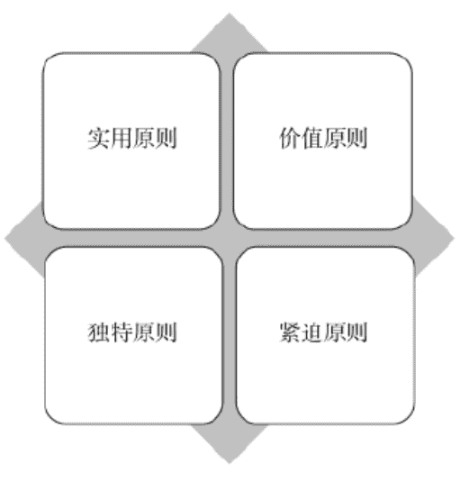

图4-2 爆款文章标题的四大原则

#### 1. 实用原则：看完对我有什么用
篇名要让人感觉有用。实用指贴近实际、能解决需求、能带来技能。例如，《在微博上赚钱的8个方法》《微信公众号运营的9条攻略》《正确管教孩子的10项原则》等。

#### 2. 价值原则：看完后我能收获什么
篇名要让用户感知到价值。能感受到价值的内容才会被点开。例如，《如何变成有趣的人》《如何提升写作能力》《如何成为演讲高手》《如何快速学习英语》等。

#### 3. 独特原则：这篇文章有什么值得看的
篇名要让人感觉独家、不可替代。例如，《华为高管告诉你什么是狼性》《阿里巴巴高管详解铁军是如何做销售的》《腾讯高管亲授绩效管理是如何做的》等。

#### 4. 紧迫原则：我为什么现在就要看
篇名要制造紧迫感，让用户觉得必须现在看，而不是收藏。例如，《孩子5岁，必须看这些书了》《成了管理者，立即要学会的6项法则》《当了妈妈，要马上了解的7个育儿知识》等。

篇名是点睛之笔，至少要满足以上原则之一，同时满足多个更好。新手可以先模仿阅读量高的爆款篇名，拆解其特点。

### 4.1.3 呈现的五大特征

打动人心的篇名是触及内心的文字，能激发点击欲望，也能激发转发欲望。爆款篇名具备五大特征，如图4-3所示。

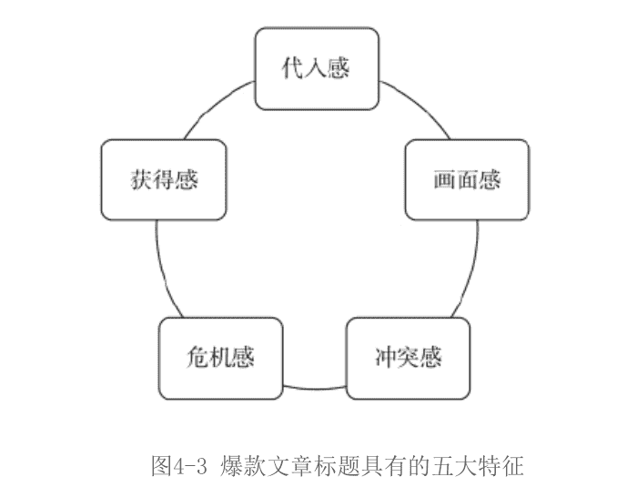

#### 1. 代入感
好篇名让人感觉与自己相关，产生“说的就是我”的共鸣。初始的亲切感和认同感，往往带来“这篇文章可能说出我心声”的冲动。

例如，《每年都在苦苦支撑的Flag，怎能说倒就倒》。有目标感的读者会立刻共鸣，也很适合转发，显得自己上进。

再例如，《和相处不来的人在一起，总有一天你会被累坏》。恋人、朋友、同事都可能出现相处难题，“累坏”一词切中痛点。

#### 2. 画面感
好篇名能在脑中形成画面，营造临场感，让人想点开验证。

例如，《人间再无梅艳芳：4岁登台，红遍亚洲，穿婚纱和世界告别》。熟悉梅艳芳的读者会立刻想起那场告别演出。

#### 3. 冲突感
冲突能激发好奇心，增加戏剧张力。

例如，《“结婚两次，我又离婚了”：婚姻的真相，都藏在这三句话里》。两次结婚又离婚的信息本身就有张力，后半句则点中婚姻焦虑。

再例如，《我95后，秒辞，领导说我会后悔，网友说这是进步！》。领导和网友的两种评价形成对立，用户会想点开看全貌。

#### 4. 危机感
危机感能触发潜意识的防御机制，让人迫切寻找解法。

例如，《一个致癌的饮食习惯，很多中国人都有》。以癌症的恐惧和普遍性制造危机，用户会急于自检。

再例如，《IBM辞退2万名40岁老员工：时代抛弃你时，连招呼都不会打》。失业焦虑加上年龄关键词，极易引发职场人的不安。

#### 5. 获得感
好篇名让人未读先知能学到东西。

例如，《原来这叫鸭子定律（深度好文）》。鸭子定律的新奇感让人好奇。

再例如，《我做了10年HR，发现容易升职的人，都拥有这3种特质（建议收藏）》。给用户一种点开即得秘籍的感觉，提升打开率。

## 4.2 取爆款文章标题的方法

掌握方法就能稳定产出好篇名。取篇名时可结合结构、原则、特征，按步骤来，参照套路和类别。

### 4.2.1 取标题的3个步骤

自媒体圈有句话，用写作品的时间取篇名也说得过去。对新手来说，专门花2-3小时琢磨一个篇名是正常的。

取篇名可按如图4-4所示的3步走。

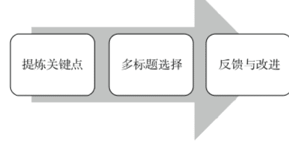

图4-4 取爆款文章标题的3个步骤

#### 1. 提炼关键点
先提炼作品核心要素，关键点可以是词、短语或一句话。

一篇作品的关键点主要包括三项。

- （1）用户画像的关键点，即给谁看，他们有什么特征。例如00后/90后/80后/70后，男性/女性，单身/已婚/已育，喜欢/不喜欢×，职业/身份是×等。篇名中应明确体现用户身份。
- （2）作品看点的关键点，即作品的亮点、卖点。例如独家原创、10年珍藏、访谈100位商界领袖总结等，都能制造稀缺或权威感。
- （3）用户价值的关键点，即能解决什么问题。例如《让英语四六级考试提高50分的3个方法》，价值就是提分；《家中没空间收纳不用怕……》，价值是解决收纳难题。

#### 2. 多标题选择
提炼关键点后，参考五大特征和三大结构来拟题。初期建议每篇至少准备3-5个篇名，对比选择。

如果关键点太多，一个篇名装不下，就让不同篇名承载不同重点，再做比较。

筛选方式有三种。

- （1）请资深同行帮忙选。
- （2）发给关系好的用户投票。
- （3）依据自身经验自行判断。

#### 举例
某作者写完一篇稿，总结关键点如下。

- （1）用户画像：大龄女性，单身，工作辛苦常加班，无暇恋爱。
- （2）作品看点：访谈10对幸福婚姻夫妇的恋爱史，咨询3位资深婚姻心理咨询师关于大龄女性抗拒恋爱的心理。
- （3）用户价值：工作繁忙下如何找到合适异性，如何识别渣男。

据此拟出篇名。

- 《拿什么拯救大龄女性的单身问题，3位资深专家这样说》。
- 《就算大龄到底，也要防住渣男，好男人很多，方法在这里》。
- 《大龄女不是找不到对象，是不会找，10对幸福夫妇这样说》。
- 《大龄不是剩女，女人对自己的好可以这样实现》。
- 《10对幸福家庭+3位专家总结，大龄剩女脱单的5个方法》。

作者最终认为《10对幸福家庭+3位专家总结，大龄剩女脱单的5个方法》最合适。

选篇名时不仅要看关键点覆盖，还要看与核心思想的契合度，不能只为点击率。

#### 3. 反馈与改进

《头名打法正在迭代》

取题思路从来不是固定不动，尤其在新媒体信息更迭极快的当下。公号刚起步时，《惊！该事震动全国！》这类夸张写法还能带来可观点击，后来同类套路被过度使用，读者很快产生反感。

判断题名好坏的能力来自实战反馈和数据复盘，可参考的两组指标是：

- （1）打开表现，也就是打开量，数值高低直接反映题名吸引力。
- （2）传播表现，也就是分享率，和题名相关度稍弱，可作为辅助判断。

创作者终究不是受众，能推测情绪，难把握真实偏好。想做出爆款别指望一次定成，需要反复试验、持续投放、收集反馈再优化，题名才越用越准。

### 4.2.2 精品的6个技巧

精品题名不是凭空想出，稳定奏效的套路基本集中在这六类，如图4-5所示。

#### 1. 情绪共振

人最基本的驱动是情绪，难以回避。一旦内容在情感层面与读者同频，阅读、点赞、分享、评论都会被带动。起题名时先自问稿件哪个点最打动人，把它提炼出来。

比如《催婚带来“春节焦虑症”：别催了，90后真结不了婚》，被催婚的90后看到春节时的追问、指责、教导，会立刻对号入座。

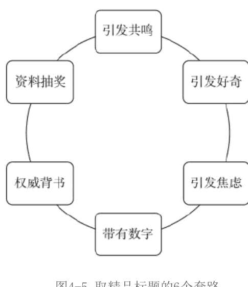

图4-5 取精品题名的6个套路

#### 2. 好奇心驱动

题名里埋下钩子，好奇心就被点燃。人都有把事情搞清楚的冲动，不知道答案会感到不适。稿件开头留悬念同样有效。

常见做法有三：

- （1）点出反转却不交代缘由，例如《小A长期班级倒数，结果半年逆袭，他都做了什么？》。
- （2）用省略号制造留白，例如《豆瓣评分9.9的悬疑片，原来是……》。
- （3）反常识打破固有认知，例如《反应慢一些，没准收获更大》。

例如《国内唯一敢媲美九寨沟的地方，却低调得让人心疼》，看过九寨沟的读者会立刻脑补美景，没去过的读者也会好奇究竟何处能与九寨沟相提并论。

#### 3. 紧迫感制造

紧迫感是持续的流量入口，中年危机、大厂裁员、副业变现等话题，本质都是放大紧迫感。题名从负面切入，更易促使点击。

比如《从人这辈子最容易后悔的5件事说开去》，比《从人这辈子必须做的5件事说开去》杀伤力更强。

#### 4. 数字呈现

数字自带记忆点，对比数字效果更突出，比如《1个宿舍，6个女生，42个微信群》。数据会让读者觉得信息密度高、可信度高，更愿意点开验证价值，比如《值得永久保留的6个网址》《学好Python，你必看的10个视频》《99%的人都不知道Word还能这样用》《工作10年，有的月薪三千元，有的月薪三万元》等。

#### 5. 名家加持

题名里带上大众熟知的权威，打开率会明显提升。我曾发过《心理学家告诉你：为什么要写作》，被一位400多万粉的大V转发。转发原因不是我原创，是“龙虾教授”乔丹·彼得森的观点，他著有《人生十二法则》，上市两年销量超300万册，权威感带来了传播。

另一篇爆款《费曼学习法》，方法本身很常见，学、整理、消化、吸收、反馈的老套路，但蹭上费曼的名字，就被多位百万粉账号转发，转发量近2万，也带来数万新增粉丝。

可以检索观点是否被大众熟知的权威提出过，但权威必须叫得上名，不能只在小圈子里有名。

#### 6. 赠品激励

题名里明确写送资料或抽奖，吸引力会上升。粉丝过3万且更新频率高的账号可定期使用。注意四点：

- （1）抽奖以图书为奖品更稳妥，标准品不易扯皮，也显得有品质。
- （2）送资料不代表内容可空，内容扎实才更容易爆。
- （3）资料要有吸引力，别碰版权争议内容。
- （4）奖品数量别太多，既制造稀缺，也减少工作量和后续麻烦。

### 4.2.3 题名的九大分类

爆款题名大致可归为9个类型，如图4-6所示。

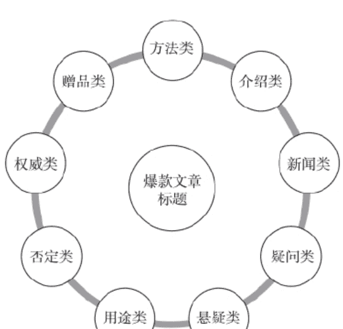

图4-6 爆款稿件题名的9大分类

#### 1. 方法类：介绍某种方法、工具或理论

例如《白粥、面条不养胃！真正养胃的方法就两个字》。前半句挑战常识，后半句用“两个字”勾起联想。

#### 2. 介绍类：介绍某个人、某种事物或某个现象

例如《李佳琦薇娅首次同台搭档：成年人的朋友圈，真的很现实》。既讲事件，也暗含名人成长的辛苦，人名、首次、很现实等词会激发好奇。

#### 3. 新闻类：描述某个新闻报道、发明创造或者热点事件

例如《白天敲钟，晚上带货，丁磊能否把前浪网易留在互联网中心》。交代2020年6月11日网易上市并直播首秀的事实，用疑问收尾促阅读。

#### 4. 疑问类：说出某种疑问，引发人们的好奇

例如《被质疑、没地位、赚钱少，那为什么你还在做HR？我们采访了100位HR》。前半句是HR共识，后半句产生冲突，尾缀“采访了100位HR”提升可信度。

#### 5. 悬疑类：通过引发冲突或制造悬念，激发读者好奇心

例如《我复旦毕业，应聘前台，要月薪两万，被网友群嘲》。名校毕业应聘前台冲突，月薪要求再冲突，被群嘲却写出来又冲突，剧情感强。

#### 6. 用途类：说明某种事物的属性或用途

例如《面条和米饭，吃哪个更容易胖？》。暗示正文会有热量对比，不直接给出答案，用“胖”字戳痛点。

#### 7. 否定类：通过对某个事物的否定引发关注

例如《我30岁，刚离职，才发现自己什么都不会》。能力缺失引发焦虑，读者会对照自己，产生危机感。

#### 8. 权威类：引用权威专家话语，增加内容的可信度和权威性

#### 9. 赠品类：赠送资料或抽奖类的题名

例如《员工胜任力模型与任职资格资料包（136份）》，明确送资料且带数字，需求匹配者容易点开。

例如《对话可口可乐前CEO艾斯戴尔：真正的高手，都是长期主义者》，引用名人语录，有围观对话的感觉。

## 4.3 爆款稿件题名的趋势与误区

掌握组成、原则、特征、步骤、技巧和类别之外，起题名还要注意最新风向、常见坑和操作细节。

### 4.3.1 未来的3个趋势

题名党泛滥让读者产生免疫，爆款题名正在向三个方向走，如图4-7所示。

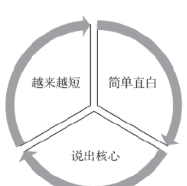

1.  **越来越短**

    读者没耐心看长题名，和正文精简同步，题名也在瘦身。能一句话说清就别用两句，例如《我喜欢和靠谱的人相处》《恭喜那些不参加聚会的人》《心软的人，最苦》《所有烦恼，都有解药》《自我管理的6个好习惯》《太闲，会毁掉一个人》等。

2.  **简单直白**

    以前《如何做出一盘好吃的红烧肉》这类直白题名不吃香，现在读者审美疲劳后开始返璞归真。例如《头发掉得厉害，怎么做能好转？》《月经周期，多少天算正常？》《细嚼慢咽，可以减肥吗？》《喝酒脸红的人，更容易得癌？》《厨房油烟会导致肺癌吗？》等。

3.  **说出核心**

    过去认为题名不能泄底，现在读者更喜欢提前知道能得到什么，核心观点清晰反而提升体验。例如《车市复活，终于走出近30年来最长滑坡期》《其实，你的老板也想被你管一次》《油腻，正在悄悄毁了你的颜值和气质》等。

### 4.3.2 常见的4大误区

1.  **题名不是简单概括稿件内容，而是为吸引读者阅读**

    纸媒时代题名可以是概括，如《父亲给我的一封家书》《团结就是力量》《珍惜时间的重要性》。互联网信息过载，这类题名会被淹没。题名要具备吸引力，例如改成《为了劝我早结婚，父亲竟和我说了这些》《如何应对团队中1+1<2的现象》《同样是10分钟，为什么他可以做那么多事》。

2.  **题名中不要包含稿件内容的所有关键信息，不然读者将失去惊喜**

    如《提升认知能力是职场发展的关键》，信息全出，点开欲望低。对比《芹菜最营养的部分，可能已经被你丢掉了》，若改成《芹菜叶比芹菜茎更有营养》，效果会大打折扣。

3.  **题名不仅是题名，还是促进读者转发的原因**

    题名有社交属性，读者因强烈共鸣而转发时，题名要体面。题名吸引人却低俗，转发意愿会下降。

4.  **过分看重题名的作用，题名取得过于夸张，重题名而不重内容**

    题名党文不对题，读者会觉得被欺骗，不利于个人品牌。如《惊叹！春节假期一个人少还便宜的好去处，一般人我不告诉他！》实际讲的只是作者在单位加班，期待落差会带来负面评价。

### 4.3.3 实施的5个注意事项

1.  **关注同类爆款稿件的题名**

    研究同类爆款的题名结构和正文关联，学习其逻辑。

2.  **保留自己的风格**

    齐白石说“学我者生，似我者死”。可以借鉴写法，但别复制粘贴，利于品牌区隔。

3.  **说读者看得懂的话**

    为显高深而堆术语，读者看不懂就会流失。如《管理中的SYRT原理》，SYRT是作者自创，阅读量自然惨淡。

4.  **不必追求完美**

    题名只有更好没有最好，别因追求完美耽误上线。好坏没有绝对标准，因人而异。

5.  **谨慎使用悬念**

    悬念易吸睛，但期望越高失望越大。正文撑不住就别用大悬念。题名和内容要匹配，正文5分，题名打5到7分即可，打12分易被判定题名党。

# 第5章 如何搭建爆款稿件结构

新媒体爆款要么有用，要么有趣，能兼顾最好。稿件成色离不开结构框架。

## 5.1 爆款稿件的样子

爆款结构有共同特征，可供参考。若以生产者心态写作，就要向专业人和爆款学习。

### 5.1.1 爆款的六大特点

爆款内容通常具备六大特质，如图5-1所示。

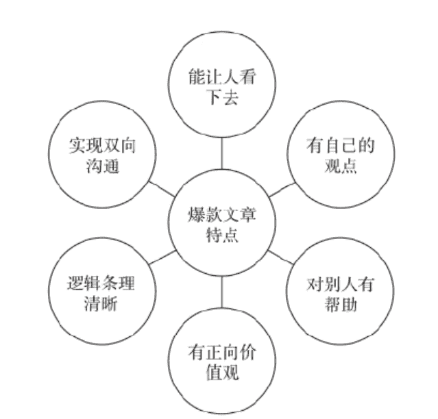

1.  **能让人看下去**

    读起来不累是基本要求。病句错字、冗长啰嗦、读两段就烦都不可取。堆砌SEO、KOL、ADS、CPM等专业缩写不解释，会把新手读者劝退。好稿件只要识字就能轻松读懂。

2.  **有自己的观点**

    稿件要有核心观点。写几千字自己都说不清想表达什么，读者更不会买账。写作前要先厘清自己想说什么。

3.  **对别人有帮助**

    帮助可以是启发也可以是纠偏。不一定非要新知识，人性基本稳定，旧观点用新故事讲也是价值。

4.  **有正向价值观**

    能长期流传的爆款传递正能量。关注负面问题没错，但要给出经验、方案和成长路径，而非沉溺抱怨。

5.  **逻辑条理清晰**

    序号条目是利器，可并列、可时间递进、可逻辑递进。很多新手写几千字一个序号都没有，逻辑自然混乱。

6.  **实现双向沟通**

    爆款能和读者互动。道理对、条理清还不够，若作者姿态高高在上，读者会疏离。要真诚，把读者当朋友。

### 5.1.2 新手的四大法则

新手如何写出爆款？先掌握这四条写作心法

别说有经验的老手能张口就来，写出让人追着看的文章，对刚入行的自媒体新人来说并不是一件容易的事。要想快速破局，在动笔之前先把下面这四条基本心法吃透，会少走很多弯路。

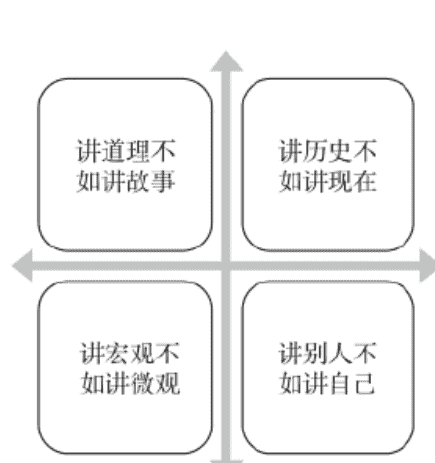

1. **用故事承载观点，别空泛说教**

道理并不稀缺，现在到处都是道理，甚至孩子都能把大道理一套套讲出来。文章如果全是说理，读者很容易划走。人们天然对故事更有耐心，同样的观点换成不同的情节呈现，效果会完全不一样。先讲好一个具体的故事，把观点放在故事的收束处做总结，而不是一上来就摆论据。

2. **聚焦当下语境，别沉溺历史堆砌**

很多新手喜欢在文章里塞满历史人物和典故。可自媒体是写给活着的读者看的，不是写给自己看的。读者对历史不感兴趣时，这类写法很容易曲高和寡。历史素材只有在读者本身就是历史爱好者时才有效，否则不如紧扣当下他们能感知的现实。

3. **从小处着眼，别总谈大局**

刚起步的作者爱搬热点、大事件、国际新闻来显示格局。但如果账号定位不是新闻，或作者并不具备相关专业身份，这种写法容易让人觉得眼高手低、不接地气。真正的共鸣往往藏在日常里，多写具体的小事，比空谈宏观更有说服力。

4. **多写自己的经历，别光讲别人的事**

能写身边的事就写身边的事，能写自己的事就写自己的事。自省本身就是一种有价值的成长记录，也是读者偏爱的阅读方向。在强调个性的自媒体环境里，关注者选择你，正是因为想看到你的真实。很多爆款都是作者解剖自己、用自己的故事来说明问题的。

把握好这四点，再去设计标题和规划正文，才能避免标题党。没有方法地乱写，只会消耗时间，既涨不了粉也练不了手，最后连写作的意义都找不回来了。

## 5.2 爆款文章的常见结构

标题、开头和结尾往往是全文最亮眼的部分，就像月饼的盒子，漂亮的包装会让人想买。但盒子好看不够，里面的馅也得好。自媒体对文笔要求不高，对结构要求却很高，段落、层次、过渡和呼应处理好了，文章才能一气呵成。常见的爆款结构大致有三种：总分总结构、并列结构和正反对比结构。

### 5.2.1 总分总结构

总分总是一种符合记忆习惯的三段式思路。开头点明主题，提出核心论点；中间用分论点或故事来展开论证；结尾回到开头，对主题进行升华。中间的分论点可以是并列、递进或对比，但不能是包含或交叉关系。

这种结构很适合新手。可以参考金字塔原理。写作时先提炼一个中心论点，再用3到7个一级论据支撑；一级论据本身也可以成为论点，再被3到7个二级论据支撑，如此层层展开，整体就像一座金字塔。

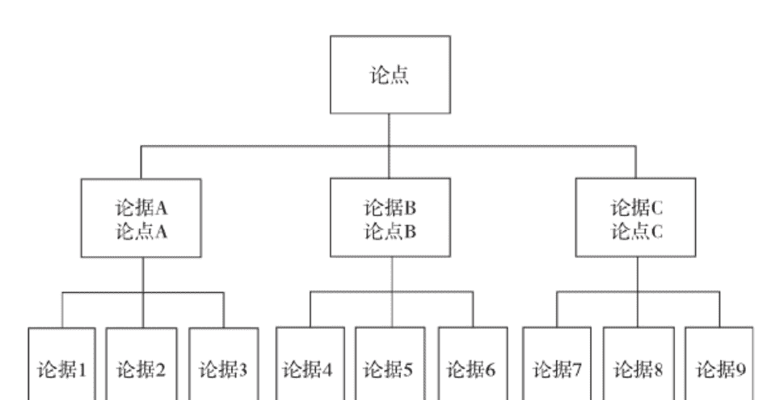

读者最容易接受的顺序是，先给出抽象的主干思想，再展开具体的支撑思想。因为主干思想本来就是从支撑思想中概括而来，理想的文章组织也应当是金字塔式的，由一个总观点统领若干分支。

用金字塔原理写作，有四条基本原则。

1. **结论先行**：每篇文章只有一个核心思想，且放在最前面。
2. **以上统下**：上一层必须是下一层思想的概括和总结。
3. **归类分组**：同组思想要属于同一逻辑范畴。
4. **逻辑递进**：同组思想要按清晰的逻辑顺序排列。

搭建金字塔可以按以下步骤操作。

1. **自上而下表达**

    1. 提出主题思想。
    2. 设想受众会产生的核心疑问。
    3. 写序言：背景→冲突→疑问→回答。
    4. 与受众进行问答式对话。
    5. 对新的疑问，重复问答式对话。

2. **自下而上思考**

    思想之间的联系既有纵向的，上一层对下一层做总结，也有横向的，多个思想因共同服务于同一推理而并列。

3. **纵向总结概括**

    组织思想常见的逻辑顺序有四种。

    1. 演绎顺序，大前提、小前提、结论。
    2. 时间顺序，第一、第二、第三。
    3. 结构顺序，从大到小，例如国家、市、区。
    4. 重要性顺序，最重要、次重要等等。

4. **横向归类分组**

    对每一层的支撑论据要满足MECE原则，即相互独立不重叠，合起来完全穷尽不遗漏。不遗漏才能避免漏洞，不重叠才能避免重复。

5. **序言讲故事**

    序言最好用故事切入，先交代读者熟悉的背景，制造冲突，引发疑问，再给出答案。讲大家已经听过的故事，反而更容易被接受。

6. **用精炼概括做标题**

    找到能概括文章或段落核心价值的句子作为标题，有助于读者提前预判思路，加速理解和认同。

新手用金字塔结构写作要注意四点。

1. 先搭框架，再填内容，起步阶段优先用自上而下法。
2. 序言要从背景入手，把背景作为起点。
3. 不要跳过序言，多花时间打磨它。
4. 在关键句层面，更适合用归纳推理而非演绎论证。

### 5.2.2 并列结构

并列结构适合写知识类或方法类的长文，也适合需要罗列多个要点的情况。这类文章往往要通过列举多个知识点、方法、观点或事件来说明一个主题，比如《关于减肥的10个方法》这种标题就很典型。

并列结构能体现作者的专业度和体系感，逻辑清晰更容易获得信任。因为干货密度高，也更容易被转发。以下是一个学霸方法论的微博案例，发布在高考话题高峰期，很快阅读量就超过50万。

**刷题的差距，藏在这些细节里**

做题能把知识点转化为经验记忆，高三阶段时间宝贵，效率就决定成败。下面是四条刷题的小技巧：

1. **间隔重复**

    不要把同一个知识点只练一次就换新题。要分批间隔练习，当天练完后，第二天、一周后、半个月后、一个月后再巩固，把短期记忆转为长期记忆。

2. **整套对答案**

    别一题一对，这样效率低且容易依赖。按考试习惯做完一套再统一核对。

3. **题型多样化**

    不要只刷单一题型。要针对同一知识点选择单选、多选、填空、解答、证明等不同形式，打乱顺序交替复习。

4. **知识点穿插**

    不要连续刷同一个知识点。要穿插不同知识点的题目，虽然不利于短期记忆，却有助于理解和长期保留。

同样刷题，有人能到140分，有人只能到100分，差的就是这些细节。

使用并列结构时，前三点一定要出彩，能够快速建立认同感，否则容易被划走。并列点并不是越多越好，一般3到7点最合适，人的记忆有限。追求全面收集的盘点文除外。

### 5.2.3 正反对比结构

爆款文章不能单方面说明问题，正反两面一起讲更有说服力。常见的正反对比有三种。

1. **不同人物或事物的对比**

    例如两位同校同专业的职场新人，三年后各自发生了什么、遭遇了什么关键事件、原因有何不同。

2. **同一人物或事物在不同时间的对比**

    例如母亲的一道拿手菜，小时候吃的感觉、长大后吃的感觉、结婚生子后再次品尝的感觉。变化能体现岁月流逝，也能体现人间温情。

3. **不同人物与标杆人物的对比**

    例如办公室里几位同事的工作状态与同办公室的小马相比有何差距，后来小马晋升为部门经理，进一步印证了差距。

举例：一则标题为“学历低的人，素质就一定差吗”的微博，正反对比了两位人物的故事，发布不久阅读量就超过50万。

我们公司的小姑娘入职时不到20岁，打字都磕磕绊绊，学历不高也不算聪明。当时人手不足就让她试试。实习期合伙人教她很费劲，她学得慢。但她愿意问，知道自己不行，干劲很足。

看她认真就留下了。后来发现她有一股不学会不罢休的劲头，愿意琢磨。不知不觉她成了老员工，现在负责营销，财务后勤的事也能顶上。她靠自身努力活得越来越精彩，即使离开也会很好。

反观清华的同学，毕业即去了投行，起点很高，2002年起薪近20万。生活丰富多彩，聚会不断，自称广交朋友。

前年他向我借钱想买房，说职位没升，工资40多万因吃喝玩乐存不下，女朋友也走了。他下决心买房。按起点，现在年薪200万很正常，可这么多年他没提升自己，年纪大了只想保住工作。

总结三点。

1. “本事”是会变的，十年前的佼佼者可能十年后平庸得很公平。因为曾经努力所以出类拔萃，后来坐吃山空自然衰退。若天天吃喝玩乐还能独占鳌头，才不正常。
2. 保持一股冲劲，每天进步一点点，任何人都能变有本事。问问自己今天学到了什么，有没有提升。
3. 有目标感，哪怕只是为了自己和家人，也要不断努力，过更好的生活。

## 5.3 六大类爆款文章内容写法

互联网上常见的爆款大致分六类：知识干货型、热点解析型、读书笔记型、视频解读型、精彩故事型、罗列资源型。掌握这六种写法，写作效率会大幅提升。

### 5.3.1 如何写知识干货型文章

这类文章适合想获取知识的读者。作者通常结合自身定位，找到领域的痛点并给出解法。例如教育类《孩子没有专注力怎么办》，财经类《年终奖怎么花》等。

写这类文章要注意五点，如图5-4所示。

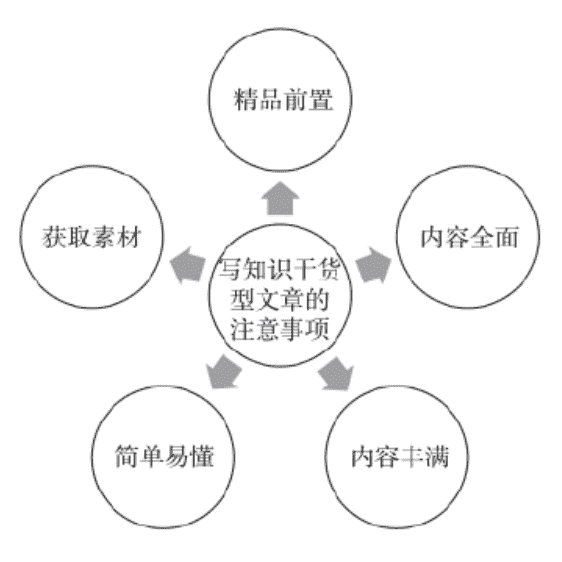

#### 1. 精品前置

文章前三点的干货最关键，很多读者不会读完。只要开头足够精彩，就更容易点赞收藏转发，与并列结构的要求类似。

#### 2. 内容全面

读者看知识干货的心理是想通过一篇文了解一个事物。如果读完仍觉得缺东西，就不会认为是精品。爆款干货通常能把一个主题讲透。

#### 3. 内容丰满

追求全面时，最少也要写到五点。列出的点越多，读者越觉得价值高，越愿意传播。

#### 4. 简单易懂

不要堆砌专业术语，要结合现实用大白话表达。例如费曼学习法网上介绍很多都难懂，结合孩子学习用故事讲，就一目了然。

#### 5. 获取素材

如果知识体系不完整，没能力直接输出系统内容，写作前要先找素材。重点参考二手写作素材的获取和应用方法。

### 5.3.2 如何写热点解析型文章

这类文章适合喜欢看新闻的读者。并非只有新闻号能写，任何领域都能结合热点写。因为热点种类多，总有与自身领域相关的。适度借助热点既能引流，也能把理论与现实连接，增强说服力并丰富案例库。

注意四点，如图5-5所示。

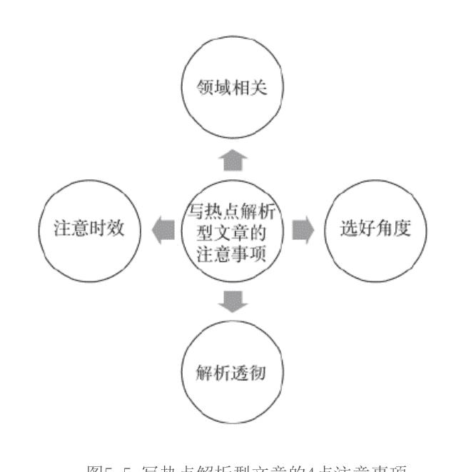

#### 1. 领域相关

非新闻类账号不要硬蹭热点。最好自然发现与自己领域相关的热点再写。

#### 2. 选好角度

热点最怕人云亦云。必须选择独特切入点，避免审美疲劳。

#### 3. 解析透彻

要透彻不是要复述事件来龙去脉，专业媒体会做这个。作者要做解读，让文章深度高于同类。

#### 4. 注意时效

热点有很强时效性，通常只能火一阵，很难长期被收藏。核心素材建议放在能长久流传的类型里使用。

### 5.3.3 如何写读书笔记型文章

每个领域都有畅销书，选出经典著作边学边解读，既是素材也是提升自己的方式，还可能被原作者转发。读书笔记比热点更长效，只要书没过时，这类文章就会持续受喜爱，还能解决读者的三大需求。

写时注意五点，如图5-6所示。

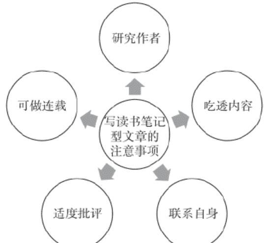

#### 1. 研究作者

先了解作者是谁，是否有自媒体账号及影响力。争取被作者转发。当然，研究作者也有助于更准确地理解书。

#### 2. 吃透内容

要认真读透，否则容易以偏概全，引来读过书的读者不满甚至原作者反感。

#### 3. 联系自身

自媒体写作要彰显个性。除了概括要点，最好用自己的话重述，结合实际案例。

#### 4. 适度批评

带着辩证眼光写作是好的，但不要把文章主基调变成全盘否定。应以发现闪光点为主。

#### 5. 可做连载

对内容丰富的经典书，可做连载发布，保持读者黏性。连载不宜超过10期，发布时说明总期数和当前期数。

### 5.3.4 如何写视频解读型文章

对视频的解读也是爆款类型之一。例如《提升积极性的14个小窍门》这篇文章就源于一个视频，分上下两篇发布，阅读量很快达到50多万。

注意四点，如图5-7所示。

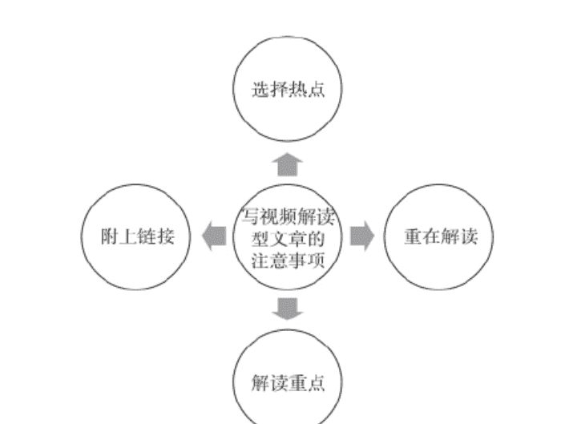

#### 1. 选择热点

视频最好是热点视频，最好是读者看过或熟悉的。选视频要看播放量和转发量，转发量更能说明观众的认可度。

视频解读的写作要点

比如 B 站上线的《后浪》，播放量接近三千万，转发累计过百万，随后引发大批自媒体的跟进解读与讨论。

#### 2. 解读是前提
做视频解读，不是把画面内容搬成文字。关键是吃透视频想表达的核心，再用自己的表达方式，结合账号的人设去拆解、重组，最好能在此基础上做延展。

#### 3. 只抓要害
不少视频为了铺陈节奏，前半段铺垫很长，有时能占到七成以上。这一段多是背景信息，写稿时可以直接跳过，只针对核心观点进行剖析即可。

#### 4. 留下来源
解读文最好附上原视频的链接。既是尊重原创，也方便未看过完整版的读者补课，让解读更可信、更完整。

### 5.3.5 如何写出有感染力的故事稿
在爆款类型里，故事类既最受欢迎也最难写。难在故事本身不好写，也难在素材总是嫌少。刚起步时我把自己的经历用完了，《我的赔钱故事之研究生合伙》《培训班的悲剧》就是那段时期的代表作。

后来有意识地留心生活，从自己和身边人身上找素材，才发现可写的片段其实很多，只是平时没在意。刻意品味生活，就能捕捉到不少细节。

写故事稿要把握下面五点，如图5-8所示。

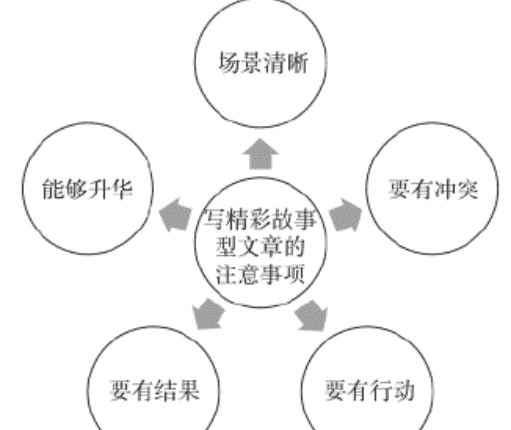

图5-8 撰写精彩故事文的五大要点

#### 1. 场景交代要清晰
让读者能立刻进入情境。背景用几句话点明即可，自媒体写作最忌大段背景说明。新手容易背景交代过于啰嗦，直接影响阅读流畅度，导致流失。

#### 2. 必须设置冲突
冲突可以是挫折、难题或悲剧，总之是让人不爽的转折。冲突是吸引力的来源，有张力的故事才让人读下去。以《培训班的悲剧》为例，起初信心十足前景看好，结果事与愿违，这就是冲突。

#### 3. 需要行动推进
冲突出现后要去应对，解决问题的过程往往是主线。可以列出几种应对思路，包含失败和成功。失败后可以再出发，成功后又可能迎来新的矛盾。

#### 4. 结局要明确
故事最后必须收束，无论成败。读者跟随情节波动，最后都想知道落点在哪，确定性是阅读的基本需求。

#### 5. 要有升华
自媒体不能只讲故事，要让小事体现大道理。很多读者反馈，我的稿子故事本身不算惊艳，但收尾的提炼让人印象深刻。故事要能带给读者收获。

### 5.3.6 资源清单类文章怎么做
清单类算是最容易出圈的类型，也很适合新手练手。一边梳理知识框架，一边积累粉丝。它追求全与细，需要把某个领域的资源系统收集。典型如《买房前必看的10类数据及网址大全》《这20个公众号把投资人必会知识说全了》《教育孩子你必须看的30本书附读书笔记详解》《学做PPT你必须收藏的500个模板附下载链接》。

写作时留意三点，如图5-9所示。

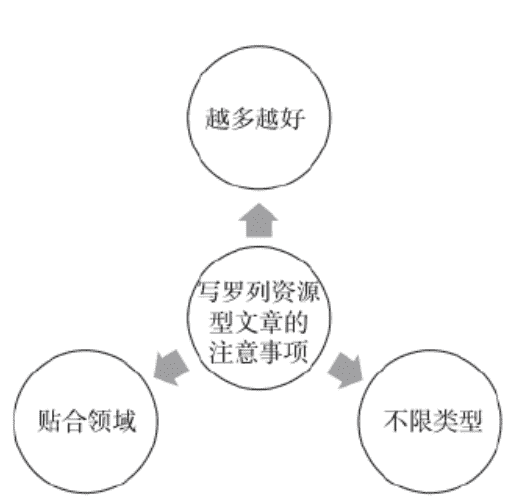

图5-9 资源清单文的三大注意事项

#### 1. 数量要够
清单的价值在于多与全，通常至少上十项。相同主题的清单很多时，拼的就是谁更全、更精、更新。

#### 2. 形态不限
只要对读者有用，就可算资源。公众号、微博账号、公开课链接、论文资料、判例网站、网盘地址都行。

#### 3. 贴合定位
清单主题要与账号垂直领域一致，才能强化品牌认知。为博流量发大量无关领域的清单，会稀释读者的整体印象。

## 5.4 爆款内容的修改思路
好文章都是改出来的。一气呵成是幻想，资深作者也离不开反复打磨。写完后要审视，让阅读更顺畅。

### 5.4.1 用词与修饰怎么改
自媒体写作不比作文，不需要华丽辞藻、精妙句式，成语也无需堆砌。核心是观点与信息，语言越朴实越好，人人都看得懂才算成功。

举例
很多人问我写稿时用词修饰该注意什么。对新手我的第一条建议是：无论什么类型，先做到人人可读。用词返璞归真，别刻意修饰。

在用词修饰上注意四点，如图5-10所示。

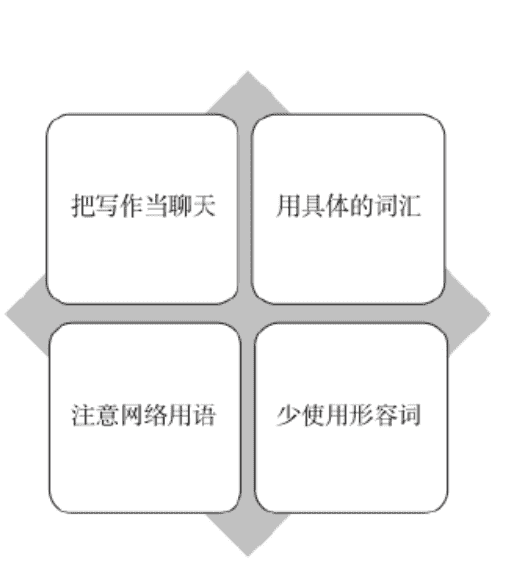

图5-10 自媒体用词修饰的四个要点

#### 1. 把写作当聊天
别把写作想得太高。有人一提写作就想端坐雕琢，正式文书才需要那样，自媒体反而会画蛇添足。写孩子打架的事，就像把来龙去脉讲给邻居听那样写即可。

#### 2. 用具体的词
越具体画面感越强。比如不说“儿子在玩游戏”，说“儿子在玩王者荣耀”；不说“他开着豪车”，说“他开着玛莎拉蒂”；不说“他正在吃水果”，说“他正在吃橘子”。

#### 3. 少用网络用语
载体在互联网，但写作尽量避免网络词。很多网络用语不通用，懂的人无感，不懂的人会产生隔阂。

#### 4. 尽量不用形容词
形容词偏主观。不要写“今天的天气非常热”，而写“知了在声嘶力竭地鸣叫，放在上衣口袋没吃完的半块巧克力，出门走二十分钟就化了”。

### 5.4.2 文章内容如何精简
老舍说：“我们应当先把不必要的话、不必要的字，狠狠地删去，像农人锄草那样。不要心疼一个好句子，或一个好字，假若那一句那一字在全段全句中并不起什么好的作用。

文章正像一个活东西，全体都匀稳调谐就美，孤苦伶仃的只有一处美，可是跟全体不调谐，就不美。比方说，一个人长得并不俊，服装也不整齐，可是戴了一顶极漂亮的帽子，那能教他变成美人吗？不能！文章也是这样。”

自媒体写作最后一步是删。初期可以先写出来，再做减法，先加法后减法。

删减可按下面流程，如图5-11所示。

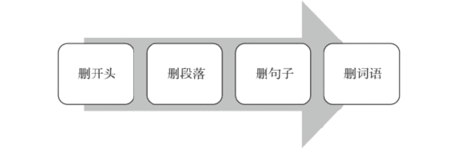

图5-11 自媒体文章删减流程

#### 1. 删开头
铺垫之后要快进主题。很多稿子开头几百字仍在铺垫，读者还没进入正题。开头偏离或进入慢就要删。现在读者要快速获取信息，冗长开头易被弃读。开头应放最有冲击的信息，比如“我曾从年入五万到年入百万”“我曾是某省高考状元”。

#### 2. 删段落
故事中删去不影响中心表达的场景即可。文章里人物越少越好，能用两人就不放大三人。比如主题讲养成习惯，却插入一段帮女朋友买首饰的经历，虽然真实却分散注意力，非必要就删。同一主题堆砌多个相似案例也没必要，除非能带来新场景共鸣。

#### 3. 删句子
意思重复的句子只保留一句。例如“在微博上，转评赞很重要，因为这代表粉丝是否喜欢这篇文章。通过转评赞数据能看出文章受欢迎程度。”两句相近，保留一句即可。

#### 4. 删词语
写完后句子常有冗余。“我们”“大家”“应该是”出现频繁可删；“×的时候”可简化为“×时”。
删词要注意三点。
- （1）删不必要的代词。例如，“昨天和小王吃饭，他对我说：‘写书哥要注册商标了。’”可改为“昨天和小王吃饭，他说：‘写书哥要注册商标了。’”
- （2）删不必要的连接词。例如，“很多粉丝受不了小张的戾气，所以大量取关”。“所以”可删。
- （3）删不必要的“的”“是”“了”。例如，“今天的天气很好”可改为“今天天气很好”。

# 第6章 爆款文章的开头和结尾怎么写
业内常说好文章等于好标题加好开头加好结尾。说法不全，却点出开头结尾的重要性。标题定方向，结构定呈现，开头结尾定质量。

## 6.1 精彩开头的五种写法
标题决定是否点击，开头决定是否继续读。第一句话要反复推敲。首因效应下，第一印象决定后续感受，开头抓人作者印象分才会高。

### 6.1.1 开门见山法
很适合知识干货。

比如标题《微博赚钱的8个方法》，可以这样起：“我的微博年收入已过五十万。微博赚钱的门路很多，我刚开始也不懂，慢慢才摸索出来。下面这八个方法最靠谱。”

比如标题《高考志愿填报的10项注意事项》，可以这样起：“我曾帮助过几百位考生报志愿，他们都进了理想的学府。关于高考志愿填报，作为过来人我有些体会，主要包括下面十项。”

比如标题《孩子学习的三大误区》，可以这样起：“最近小A上课能听懂会背也会答，但摸底只考了七十分。父母很困惑。为什么会这样？其实小A碰到了学习上常见的三大误区。”

新手先掌握这种写法再扩展。

### 6.1.2 故事开头法
营销号常缺真情实感，因为缺乏真实经历。用故事开篇能突出账号个性与温度。

把生活经历提炼成开头，能让理论更生动。比如《好妈妈的小花招，激发孩子学习兴趣》开头写“这是我同学的故事，他儿子小A数学不太好”；《人无完人，对孩子不要苛求太多》开头写“昨天中午，儿子偷偷玩《我的世界》，我对他发了脾气”。这类开场更容易抓住读者。

使用时注意三点。
#### 1. 真实为先
交代时间、地点、事件，细节具体。比如“昨天我遇到了老同学”不如“昨天下午，我在海底捞吃火锅，夹起羊肉时抬眼看见了清华大学的老同学”。

#### 2. 设置冲突
有反差的故事更抓人。比如“24岁清华大学生，放弃高薪工作进山养殖”，反差即冲突。

#### 3. 铺垫要少
紧扣主题展开，无关细节要删。比如想突出清华毕业生做养殖，却前面大段讲他小时候调皮，就是无关信息，应删除。

### 6.1.3 设置悬念法
开头埋悬念，引发好奇，促使继续阅读。

例如，“半年前小A还住在北京的地下室，今天见他居然开上了玛莎拉蒂。”读者会好奇发生了什么。

使用时注意三点。
#### 1. 抓住重点
悬念应是故事的核心矛盾。可以先把故事完整写出，再把最大矛盾点放到开头。

#### 2. 联系故事
悬念通常依托故事背景，单独悬念力度弱。比起“一个人如何从成功走向失败”，写“小A上半年被评为优秀企业家，下半年企业就因经营不善倒闭了”更有力。

#### 3. 悬念感要强
冲突与反转要足够强烈。比起“毕业后很久没找到工作，然后我创业了”，写“我从清华毕业后很久没找到合适工作，恰好几个志同道合的同学想创业，我们就一起开始了”更具张力。

### 6.1.4 名人名言法
主题可用名言概括时，可用名言开篇。名言不一定是乔布斯的，也可以是影视、小说里的经典句子。

例如电影《教父》里的话：“让朋友低估你的优点，让敌人高估你的缺点。不要憎恨你的敌人，那会影响你的判断力。”这句话很有共鸣，放在很多主题开头都合适。

使用时注意四点。
#### 1. 日常积累
需要大量素材积累，不适合临时抱佛脚。平时多留意精彩语句，整理到素材库。

#### 2. 语言力度
选的名言要有力度，能提升文章格调。若力度不足，反而拉低整体。

#### 3. 注意筛选
筛选素材最好自己完成。我曾让刚毕业的员工筛选，她选的语句大多没力度或脱离现实。筛选本身也是一种能力。

#### 4. 网络获取
若积累不足，可通过搜索引擎输入“主题+名人名言”快速找到相关语句。

### 6.1.5 有违常识法
开头抛出与常识相悖的观点，制造冲击，引发兴趣。

很多传统谚语已不合时宜，用来反驳效果很好。比如“失败是成功之母？错，成功才是！”、“能成大事的人，都懂得麻烦别人”。读者会好奇原因。

使用时注意三点。
#### 1. 确认常识
前提必须是大众公认的常识，不能是作者自以为的常识。比如养生文写“众所周知，吃辣对身体有害，实际上吃辣也有好处”，其中“吃辣有害”并非公认常识。

#### 2. 论证严密
抛出反常识观点后，必须有清晰逻辑和确凿证据支撑，否则会被识破。

#### 3. 做好互动
挑战认知可能引发抵触，评论区可能出现反驳，要做好互动，避免冲突。

## 6.2 完美收尾的五种写法
开头负责吸引，结尾负责收束点题和升华。精彩结尾容易留下深刻印象，这源于近因效应，最后出现的信息最容易被记住，也更容易带来点赞、留言、转发。

### 6.2.1 故事收尾法
故事既可用作开头，也可用作结尾。结尾的故事应能统领全文，起到总结或升华作用。

举例
有一篇写母子关系的文章，开头是作者和母亲关系紧张的故事，包含催婚催生、代沟导致的理念不合等对话，令人又笑又共鸣。

讲完开头故事后，作者介绍自己学习了一些与母亲相处的方法，关系大大缓解，并具体说明了这些相处技巧。

文末以亲历变化收束，是很常见的写法。作者先铺陈母子相处的思路，结尾再用一段自己的实践经历作回响，与开头的场景在背景上相似，但在走向和细节上呈现出关系修复的转折，读起来首尾贯通。

若要借故事收尾，需把握两点。

#### 1. 紧扣主旨
收束用的小故事要起到承上总结或提升的作用，内容必须与全文传递的核心一致。结尾若另起话题讲另一个主题，读者刚消化完前文的主线，又要去理解新议题，会造成阅读断层。

#### 2. 可用隐喻补位
没有与开头呼应的亲身案例时，可改用含哲理的隐喻小叙事来收尾，隐喻故事能在潜台词里点出主题。

例如主题是发散思维时，可用下面这則小故事收束。
**示例**
牧场主人临终前让儿子到床前，问：“牛嫌活太多，羊嫌住处不佳，你怎么解决？”
儿子答：“给牛减负，给羊改善环境。”
主人说：“不对，你要告诉它们，外面有狼。”
### 6.2.2 互动式提问
自媒体的核心在于作者与粉丝的互动，尾部留问能够放大讨论度，提升留言与转发。提问收尾时要注意四点。

- 1. 避免空泛
不要只写“大家怎么看”之类的通用句式，这类万能收尾是营销号的标志。读者见多了会产生反感，互动效果适得其反。
- 2. 需要新意
提问要有新鲜角度，缺乏创意的提问难以激发回应。比如问“文中方法之外你还有什么”这种老套问法，如今已很难引出讨论。

#### 3. 便于作答
结尾的问题要简洁好答，若提问过于宽泛或复杂，读者即便有想法也会因门槛高而放弃。例如问“你有没有类似经历可以分享”，范围太大，需要长时间整理，参与度会很低。

#### 4. 留白给读者
运营者有时会用小号先示范作答，但示范时要懂得留白。
**示例**
我曾在结尾写下“若我突然离世，该把哪些信息留给家人”。提问很新颖，本应有不错的互动。但我习惯求全，把银行卡、房产证明、股票账号、微信、支付宝等能想到的都列出来，等于把答案讲完了，读者只能点赞，讨论自然被掐断。后续我学着只透露部分，保留部分给读者补充，互动才真正起来。

### 6.2.3 金句点睛
读者读到最后容易疲劳，这时一句凝练的句子能带来满足感，帮助提炼主题，也便于读者转发或当作朋友圈文案使用。

使用时注意两点。
#### 1. 主旨一致
每篇内容都有核心，如勤奋、惜时、协作等。金句要围绕核心做归纳与升华。若金句偏离，读者会觉得逻辑跳跃，主旨模糊。
#### 2. 收集方式
日常积累最为可靠，自己熟悉的句子用起来更自然，也与用名言开篇的道理相通。若积累不足，可用“主题+金句”作为关键词搜索。如今专门收录名言的网站多提供关键词检索，输入主题即可快速获取。

### 6.2.4 情绪共鸣收尾
人都有情绪，文章结尾精准点燃情绪，即使其他部分平平，也能留下好印象。注意四点。
#### 1. 表情收尾
自媒体平台支持表情，结尾放几个表情往往比长句更直接。传递喜悦可放大笑，传递不满可放愤怒等。
#### 2. 替读者说出来
情绪需要共鸣，文章点出读者想说却不敢说的感受，共鸣就会被激活。如写与上司冲突，写“我选择辞职”不如写“一气之下直接不干了”，更能引发共情。
#### 3. 排比强化
排比可增强感染力。如写成长，可写“成长是历经磨难仍心怀感恩的沉稳；成长是屡败屡起的豪爽；成长是跌跌撞撞依旧前行的勇气；成长是直面困难仍面带微笑的笃定。”若写不出工整排比，多次重复也是一种强化，如写老师别拖堂可写“别拖堂！别拖堂！别拖堂！”
#### 4. 标点用法
标点也能传情，自媒体不必拘泥传统规范。结尾用“！！！”表达强烈惊讶，用“？？？”表达强烈困惑，都能起到情绪放大作用。

### 6.2.5 幽默收尾
文末让读者会心一笑，说明功力到位。
**示例**
我写过一篇《你的善良，必须留点锋芒》，前面讲案例、讲道理，劝大家别当老好人，内容成立但吸引力不足，后来在结尾加了个笑话，效果立刻不同。文中片段如下。
我从小被教育要助人为乐，别人求助时我总不好意思拒绝。
大学时常帮同学小A打饭，有次自己想偷懒，让小A帮我，他却一口回绝，我心里很不是滋味。过了几天他又让我打饭，我还是答应了。
……
多年不见的同学忽然问我借钱，我直接问：五万够吗？他马上回：够够够，你小子可以啊，哪发财了？我淡淡一笑：没事，不够再说，我现在做信用抵押贷款，不用押房押车，有身份证就行。

使用笑话收尾要注意两点。
- 1. 长期积累
合适的笑话比名言更难找，若平时不收集，上网找很容易不合适。好笑话要提前存档并分类。
#### 2. 保持品味
结尾的笑话不可低俗，否则会拉低整篇质量，也会伤害账号形象。一旦读者觉得作者品位不高，很可能取关。

# 第7章 文笔修炼实操
把写作比作投资，基本功是本金，写作成就是收益。在收益率稳定的前提下，本金越厚，收益潜力越大。提升写作能力，先夯实基本功。

## 7.1 基本功训练
一切能力都从基本功起。相声的基本功是说学逗唱，京剧的基本功是唱念做打。写作的基本功对应中学语文要点，很多人底气不足，正是基础松动。本节聚焦自媒体关联度最高的三大基本功：表达方式、表现手法、修辞方法。

### 7.1.1 表达方式的选择
表达方式是为清晰传递观点、思想、情感与价值观而采用的路径。常见有五种，如图7-1所示。

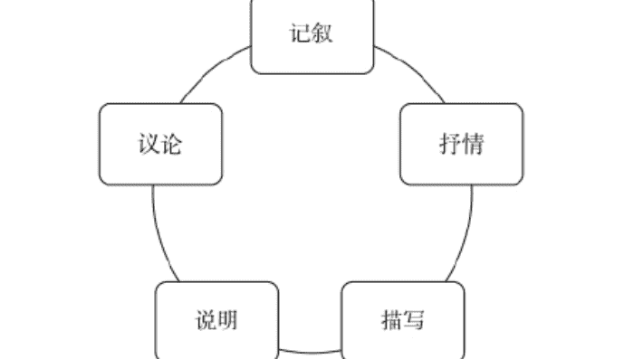

#### 1. 记叙
记叙是有序有逻辑地把人物、情境、事件的发生发展过程写出来。核心是记录经历。五种方式里记叙最平实，也最常用，任何时代的写作都离不开它。
按进程可分顺叙、倒叙、插叙。人称常用第一人称“我、我们”和第三人称“他、他们”。第一人称更亲切真实，但受时空限制；第三人称时空限制少，但亲切感弱。
**示例**
曹文轩《草房子》中有典型的记叙段落。油麻地家底最厚的是杜小康家，却在一早忽然跌落谷底，杜家独子辍学，跟父亲去放鸭。小船赶鸭走了许久，回头已不见故地，他对父亲说要上岸回家，船上回望只有朦胧树烟。
#### 2. 抒情
抒情是传达作者情感的表达方式，语言常饱含深情、个性化且带主观色彩。诗歌和抒情散文多用此法，自媒体也常强调个性表达，故抒情很重要。
#### 示例
余光中《乡愁》是抒写思念家乡的现代诗。诗中把乡愁比作邮票、船票、坟墓、海峡，随着生命阶段变化，情感递进。
#### 3. 描写
描写是用语言描绘人物、事物、情境的状态、特征和细节。包括人物外貌、神态、语言、动作、心理，事物外观细节，情境场面环境。细节描写在自媒体中应用频繁。
#### 示例
莫言《蛙》中描写母牛产犊。老母牛痛苦嘶叫，家人无计可施。母牛舔小牛身上的黏液，仿佛有灵药，舔到哪哪就有了力量。姑姑眼神慈爱，仿佛被那舔舐触及。最终小牛颤颤站起。
#### 4. 说明
说明有两种目的。
- （1）解释某个道理，如观点、概念、技术、原理、意识等。
- （2）描述客观事物的性状，如建筑、器物、植物、名山大川等。
功能型内容中说明用得多。
#### 示例
茅以升《中国石拱桥》是典型说明文。赵州桥横跨洨河，建于公元605年左右，至今仍在使用。桥长50.82米，两端宽9.6米，中部略窄。设计合乎科学原理，施工巧妙。唐代张嘉贞称其制造奇特。特点是仅一个大拱，长37.4米，桥洞呈弓形，上路无陡坡，便于通行。
#### 5. 议论
议论是就某个观点表明态度并用论点论据加以论证，让人信服的写法。议论主观性强，爆款文章本质多为议论文，容易产生强烈认同。
#### 示例
马南邨《不求甚解》运用议论。作者认为不求甚解并非全错，陶渊明在《五柳先生传》中“好读书，不求甚解；每有会意，便欣然忘食”前后两句相连，意思清楚，应虚心学习，不宜粗暴非议。

### 7.1.2 表现手法的运用
表现手法是用文字呈现内容的方法。常见有衬托、烘托、渲染、伏笔、铺垫、象征、对比、扬抑变化、借物言志、借景抒情等。自媒体常用的是扬抑变化、正反对比、以小见大。

#### 1. 扬抑变化
能让读者情绪有起伏，增强情感感受。“扬”指褒奖赞美，“抑”指批评讽刺。常见两种：欲扬先抑、欲抑先扬。
欲扬先抑是想写好的一面，先写一些不好的一面，扬是目的，抑是手段。欲抑先扬是想写坏的一面，先写一些好的一面，抑是目的，扬是手段。
#### 示例
杨朔《荔枝蜜》用了欲扬先抑。开头写小时候被蜜蜂蜇过，不喜欢蜜蜂，是抑。中间写荔枝蜜的甜美和采蜜的劳碌是铺垫。后面写蜜蜂的高尚伟大是扬，最后梦到自己变成蜜蜂升华主题。
#### 2. 正反对比
把相对或相反的情况并置比较，突出一方特征。可为同人物不同时空，也可为不同人物相同时空。只有可比性才适合对比。
#### 示例
鲁迅《故乡》对闰土的描写。初见时少年项戴银圈，手捏钢叉捕猹。二十年后重逢，身材粗壮，紫脸变灰黄，眼睛红肿，衣着破旧，手像松树皮，神情老迈。对比强烈，衬托出时光与社会变迁。
#### 3. 以小见大
通过描写微观细节反映宏观状况，表面写A，实则通过A反映B。写完A再点出B，可信度更高，感受更深。
#### 示例
老舍《北京的春节》描写春节的热闹祥和，通过腊八备年货、除夕守岁等细节，表现对国家发展的欣慰与赞美。

### 7.1.3 修辞手法的运用
修辞手法是增强表达效果、便于理解的手段。种类繁多，如比喻、排比、夸张、拟人、对偶、反复、反问、设问、借代等。自媒体最常用的是比喻、排比、夸张和拟人。

#### 1. 比喻
利用A事物与B事物的相似点，通过描写A来说明B。形容哭泣可写“小明哭了”，也可写“眼泪像断线的珍珠，一颗颗落在身上”。
#### 示例
朱自清《荷塘月色》中有比喻段落。

> 曲曲折折的荷塘上面，弥望的是田田的叶子。叶子出水很高，像亭亭的舞女的裙。层层的叶子中间，零星地点缀着些白花，有袅娜地开着的，有羞涩地打着朵儿的；正如一粒粒的明珠，又如碧天里的星星，又如刚出浴的美人。微风过处，送来缕缕清香，仿佛远处高楼上渺茫的歌声似的。

#### 2. 排比
排比是通过把形式相近、旨意相近、声调相近的多个分句并置，形成气势的修辞方式。

#### 举例
马致远的《天净沙·秋思》把排比运用到极致。作品里连串的意象铺排，既让读者脑中出现栩栩如生的画面，也让人感受到游子漂泊的凄苦。

《天净沙·秋思》的内容如下。

> 枯藤老树昏鸦，小桥流水人家，古道西风瘦马。夕阳西下，断肠人在天涯。

#### 举例
美国民权运动领袖马丁·路德·金 Martin Luther King 在经典演讲《我有一个梦想》中大量使用排比。通过这种层层递进的句式，他不断强化情感输出，让听众感受到能量与激情，使演讲成为永恒经典。《我有一个梦想》的内容节选如下。

> 我梦想有一天，这个国家会站立起来，真正实现其信条的真谛：“我们认为这些真理是不言而喻的—人人生而平等。”

> 我梦想有一天，在佐治亚的红山上，昔日奴隶的儿子将能够和昔日奴隶主的儿子坐在一起，共叙兄弟情谊。

> 我梦想有一天，甚至连密西西比州这个正义匿迹，压迫成风，如同沙漠般的地方，也将变成自由和正义的绿洲。

> 我梦想有一天，我的四个孩子将在一个不是以他们的肤色，而是以他们的品格优劣来评判他们的国度里生活。

#### 3. 夸张
夸张是为了表达需要，对人物或事物的形态、特征、作用、时空等进行有意放大或缩小的修辞手段。它能提升感染力，激发联想，有时也能揭示本质带来启示。

#### 举例
李白《望庐山瀑布》借助夸张来展现瀑布的雄奇。

《望庐山瀑布》的内容如下。

> 日照香炉生紫烟，遥看瀑布挂前川。

飞流直下三千尺，疑是银河落九天。

常见带有夸张意味的成语有一步登天、一目十行、千钧一发、一字千金、一落千丈、一日千里、十万火急、百发百中、人山人海、山穷水尽、地动山摇、惊天动地、怒发冲冠、气吞山河、死去活来、大海捞针、只手遮天等。

#### 4. 拟人
拟人是把非人事物当作人来描写，从而凸显其鲜明特点的修辞手法。

#### 举例
五月天歌曲《洗衣机》开篇即把洗衣机拟人化，描写出它平凡无华却默默坚持的形象。歌曲结尾点出真正承担洗衣的是母亲，进而体现母爱的质朴与伟大。

歌曲《洗衣机》的部分歌词如下。

所有电器都住在屋檐下不必风吹雨淋。

却只有它孤独地守在阳台角落里运行。

多少年了旋转又旋转时间一眨眼过去。

上了年纪却依然尽力孤独勇敢洗衣机。

突然有天好想要帮忙衣服放进洗衣机。

才发现了它早就坏了只是舍不得换新。

奇怪是谁一直清洗着我闯的祸和污泥。

好久以来原来我衣服全部都是妈妈洗。

从来没有一句的怨言你丢多少她都洗。

她却总是全心又全力直到颤抖了身体。

## 7.2 让写作内容出彩的方法
基本功打牢后，还要在反复练习中借助技巧提升质感，博得读者好感。出彩的关键可归为三点：内容要合读者口味，内容要能读完，词句要精准。

### 7.2.1 写出读者喜欢的内容
写出读者买账的文字，需要把握三点。

#### 1. 站在读者的立场写作，替读者说出心中的话
每个人都渴望表达，并非人人都有渠道。当文章能替读者把藏在心里的话说出来，读者会产生知音感，既喜欢内容也欣赏作者。

很多公众号爆款之所以受欢迎，正因擅长代读者发声，甚至说出平时不敢公开的想法。

例如标题《你还在听老板的话，而我，能让老板听话》的文章，核心讲职场人应当学会向上管理，不能单向服从，这是在替大量职场人发声。

例如《真正的浪漫都藏在柴米油盐里》主张浪漫不需惊天动地，而在日常生活细节里，这恰好击中婚后人群的共鸣。

这类文章往往标题就戳中心坎，读者只看标题就能预判内容，打开率更高。转到朋友圈时，标题本身就能表明转发者的态度。

#### 2. 用自己的故事打动读者，与读者产生情感共鸣
真实经历最容易让读者代入，也最能传递情绪。个人故事既是好素材，也是建立共鸣的桥梁。

#### 举例
任康磊写作时常拿自身经历举例，以下为其自媒体文章节选。

前几天，第20本书交稿。

有人问：任老师，你写这么多书是怎么做到的？

我答说：因为傻……

如果人生有两个选项，一是精明地活着，二是傻傻地进步。

我建议选后者。

工作时，有位精明的老员工当着领导的面说：任康磊工作出色，能不能总结经验方法供同事学习呀？

当时傻，乖乖把东西全整理出来分享了。

后来那位老员工说：让这小子出风头！他都教给我们了，看他以后还有什么利用价值！

创业后，有个精明的咨询公司老板说：有个项目，要看你水平，把你的方法论总结发我看看吧。

当时傻，乖乖把600多页PPT全给他了。

后来那老板再没联系我，看他朋友圈接了那项目，背景中放着我的PPT。

从工作到创业，一直傻到现在，不过傻着傻着，我成了畅销书作家，商务合作不断。

而当初的老员工同事一切照旧，那咨询公司老板濒临破产。

有时傻一点，不是坏事。

有时太精明，不是好事。

2020年初，某线下课机构拉我进讲师群，讨论进军线上的宏图大业。

机构老板看我线上课经验足，主动找我聊。

第2天我就给了他要的方案，然后就没了动静。

后来我看那讲师群里大家每天都在聊伟大理想，聊正确的废话。

从春节聊到现在，没见一个人真做出点什么。

群里有人说：线上课赚不着钱了，只能引流。很多人表示认同。

真的吗？为什么我见到很多人线上课依然有不俗的收入？

按这个逻辑，图书早就该没落了，如今谁还看书？可为什么很多人还能靠图书盈利？

人们总喜欢说选择大于努力，意思是当人们做不成事时，可以怪自己选择不对。

做HR的，说HR是文员，自己做不好是因为选错了职业。同样是HR，我朋友圈里年薪超100万有十几个。

回收废品的，说选错了行业，赚不着钱。同样是回收废品，每个城市的“破烂王”，经营业绩上亿的不计其数。

其实所有产业，都是头部10%赚钱，中间20%持平，剩下70%陪玩。

#### 3. 讲道理时加入小故事，让道理更容易被接受
只干巴巴摆事实讲道理，文章难看也难服人。若在说理中穿插小故事，不仅更容易被接受，也让整体更亲切。

#### 举例
一篇标题为《三观不合，永远不会是一路人》的文章，开头讲了这样一则哲理故事。

一个青年感觉很迷茫，于是向禅师请教。

禅师问青年：“你觉得是一锭金子好，还是一堆烂泥好呢？”

青年立即答道：“当然是金子啊！”

禅师笑了笑，继续问：“假如你是一颗种子呢？”

青年这才恍然大悟：

这个世界上并没有绝对的好与坏，看事物的角度不同，答案自然就不同。

只有真正适合你的，才是最好的。

同理，人和人之间的关系也是如此，只有三观一致才能走到一起。

三观不同，永远不会是一路人。

### 7.2.2 吸引读者阅读完内容
互联网时代注意力稀缺，很多人点开文章读一会就关掉。读不完，文章就难有转发和记忆。

打开率靠标题，读完率靠内容。读者中途放弃，通常有两点：一是标题与内容不符，预期落空；二是内容或排版抓不住眼球，缺乏继续读的动力。

在自媒体上提升读完率，需注意三点。

#### 1. 减少长难句的数量
网络文章应惜字如金，能用短句表达的就不用长句。在自媒体中，“他是一个脱离了低级趣味、忧国忧民、品德高尚、具备崇高道德素养的人”不如直接写“他是一个好人”。

读者短时间内信息承载有限，自媒体文章应简明扼要，快速形成画面和代入感，而不是追求信息堆砌。

#### 举例
一篇标题为《“我的生日，老公花了50块”：成年人的感情，藏在细节里》的文章阅读量超10万。文章的部分内容如下。

最近看到一个故事让我很动容。

故事里，小女孩从小喜欢吃红烧肉，心心念念着长大后想从事养殖工作。

但她的父亲，却一直很反对，两个人自此矛盾横生。

这是一个天底下万千父亲的缩影。对孩子看起来总是满不在乎，一边训斥她：

> “能不能有点小姑娘的样子。”

却也一边偷偷地给她做她爱吃的红烧肉。带着满满的耐心和爱意，一丝不苟地做着这点点滴滴：

和小贩挑剔肉的肥瘦，和妻子小心翼翼地掂量咸淡……

长大后的小女孩，如愿以偿成了一名养殖技术指导员。

今年春节回家的时候，她发现，原来她一直以为是妈妈做的红烧肉，竟然是爸爸为她做的。

原来她努力向前的背后，是父亲一直在默默守护，她终于释怀了。

作者整段叙事的起承转合都是由比较简单的短语和词句组成，没有运用复杂的修辞手法。但读者在阅读时，却很容易被代入其中，快速产生画面感，快速理解整段场景中的内容重点和蕴含的情感。

#### 2. 减少每个段落的字数
纸媒时代段落3-5行为宜，如今手机阅读为主，注意力更低，最佳体验变为每段1-3行。

手机屏幕一行约20-24字；微博约22字。在Windows下用Word5号字写，一行约39字符，在手机上会显示为两行。

#### 举例
一篇标题为《致新年：家人安康、岁月静好、初心不忘》的文章阅读量超10万。部分内容如下。

> 三毛说：“岁月极美，在于它必然的流逝。”

春花、秋月、夏日、冬雪。

四季流转，是一年又一年的开始与终结。

对于自然来说，这只是一次循环。对人而言，却是必然的流逝。

> 子在川上曰：“逝者如斯夫。”

桃花依旧，故人不在。

时间带走了许多，却也馈赠了许多。

一路走来，有悲有喜，有得有失。

岁月在自己身上流淌，曾经已成过往，一切都是最美的印记。

岁月也许波澜万千，并不静好。

但是我们却可以选择与岁月相处的方式。

> “每逢大事有静气。”

在变化中汇总拥有改变的勇气。

在变化中，保持内心的平静。

在变化中超越昨天的自己。

以上内容在手机上阅读时，大部分内容为一行，个别句子是两行。在写作形式上这篇文章既像诗歌，又像短篇散文，让读者阅读时毫不费力，而且具有美感。

#### 3. 每个部分之间用金句连接
写文章时，除了正常分段，还可把文章拆成3-5个部分，每部分说明一个核心问题，并在每个部分的开头用金句引出核心内容，结尾用金句收束。

举例
公众号MBA智库发布过一篇标题为《《精英律师》被吐槽、朱丹再叫错嘉宾名字：专业不强尚可原谅，精神不足才是硬伤》的文章，作者追风天下，被多家公众号转载。整篇文章分成五大部分。

第1部分是文章的开头，简单介绍背景，说明最近热播的《精英律师》网络评分持续下降，且剧情与现实生活差异较大。这部分用了一个金句结尾：“现实中，我们最大的悲哀，是将‘专业’当人设，却忽视了自我内心的打磨。”

第2部分，用金句“人生，最怕‘业余’充‘专业’”开头，内容从央视《主持人大赛》节目开始说起，说明专业的重要性，并用金句“业余的人看见的是孤立的事件，而专业的人，看到的是事件背后的系统”结尾。

第3部分，用金句“专业不强尚可原谅，精神不足却是硬伤”开头，内容从朱丹在节目录制过程中频频出现错误说起，进一步说明专业的重要性，并用金句“无论其中有多少点做得如何出类拔萃，只要有一点不合格，整件事就是不合格”结尾。

第4部分，用两个金句“真正的专业，是打磨内心”“对我们而言，世界越快，内心就应该越慢”开头，内容从papi酱因发布原创短视频在互联网爆火开始说起，点明专业是专注于一件事，并用金句“保持一颗敬畏之心，用极致的认真和恒心，去打造出极致的产品或作品”结尾。

第5部分，用社会学家理查德·桑内特 Richard Sennett 的话开头：“只要拥有一种纯粹为了把事情做好而好好工作的欲望，我们每个人都是匠人。”该部分总结全文，强调专业的重要性，并用金句“真正的专业，是经得起时间检验，禁得住岁月推敲”结尾。

这篇文章用金句连接文章始末，金句在文章中就像一条环环相扣的锁链，让读者在阅读时不自觉地被接下来可能出现的内容所吸引。整篇文章并不是空洞地讲大道理，而是用现实案例恰到好处地说明观点。写在整篇文章最后的金句既能起到总结全文、画龙点睛的作用，又能促使读者读完之后转发。

### 7.2.3 各类词语写作的用法
让内容出彩离不开词语的巧妙应用。词语可分为实词和虚词两大类，每类下含6个小类，如图7-2所示。

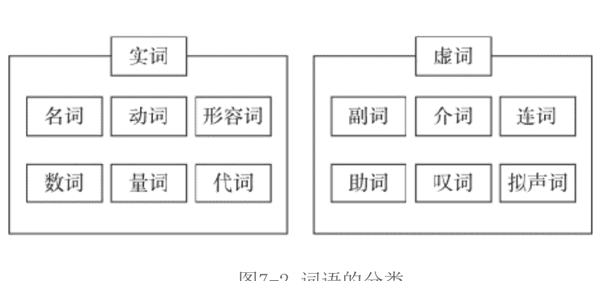

图7-2 词语的分类

名词是表示人或物的词，包括人物名词、事物名词、时间名词、方位名词和关系名词。

动词是表示行为动作发展变化的词，包括行为动词、心理动词、判断动词、发展动词、存现动词、趋向动词、使令动词、愿望动词。

形容词是表示人或物性质的词，包括表示性质的形容词、表示状态的形容词、表示形状的形容词。

数词是表示人或物数目的词。量词是表示人或物或动作单位的词。数词和量词常常一起使用，表示具体数量。

代词是代替人物或事物名称的词，包括人称代词、指示代词、疑问代词。

副词是表示程度或范围的词，包括时间副词、范围副词、语气副词、程度副词、重复副词、情态副词。

介词如从、当、把、被等，是一种连接词，一般放在名词与代词前面，表示一种方向感和指向性。

连词如不仅、而且、因为、所以等，是用来连接短语和句子的词。

助词一般是放在别的词后面、没有具体意义的词，可以包括时态助词、语气助词、结构助词。

叹词如啊、哎、哼、呸等，是用来表达感叹的词。

拟声词如淅沥沥、哗啦啦、轰隆隆等，是用来模仿人物或事物的声音的词。

自媒体写作中善用各类词语，要注意以下三点。

#### 1. 能用几种常用词语类型呈现信息的，就不要用其他词语类型
一般情况下，名词、动词、形容词和代词足以传达大多数的信息。需要比较精准地传达信息时，要大量用到数词和量词。当这些词语已经能传达信息时，就不要再用其他词语。不然的话，原本简短的句子很容易变成长难句，不利于阅读。

#### 2. 除了介词和连词适当运用外，其他虚词尽量少用，尤其是副词
介词和连词有助于连接词语，让语言看起来更顺畅。例如“我一整天没出门，我没觉得无聊”中，前后两句连着看起来有一种“卡顿感”，让读者摸不着头脑。实际上“没出门”和“无聊”之间有一定的关系，加上连词后，变成“虽然我一整天没出门，但却没觉得无聊”的表达效果更好。

著名作家斯蒂芬·金 Stephen Edwin King 曾说：“我相信通往地狱的路是副词铺就的。”斯蒂芬·金认为，使用副词是一种“偷懒”的行为；要想有效地表达程度，不能依靠副词，应当用上下文之间的细节，让读者感受到，而不是直接告诉读者。

例如，“他非常爱他的妻子”这句话用“非常”这个副词来形容“他”对妻子的爱的程度。实际上，“非常”是一种主观概念。作者的“非常”与读者的“非常”所表达的程度很可能是不同的，读者并不能准确地理解作者的感受。

同样要表达这层含义，可以换一个写法：“他回到家，妻子迎上来，他吻了妻子的脸颊，把她最爱吃的葡萄放在桌上。”这种写法是用一个场景侧面表现他对妻子的爱，不仅能给人画面感，而且表达效果更好。

#### 3. 写作内容口语化，少用生僻词语，尤其要少用生僻成语
口语和书面语有着不同的语言逻辑。如果是在比较正式的场合，写作内容应采用书面语，强调用词精确、内容严谨、表意丰富；如果是自媒体写作，写作内容可以有一定的口语化成分，在把事情交代明白的同时，更强调内容的可读性。

口语是人们在日常生活中接触最多的语言模式，更容易给人亲近感，更容易被人们理解和接受。有的作者为了显示自己深厚的文学功底，喜欢长篇大论，或者堆砌一些华丽的辞藻，这些都是不可取的，是画蛇添足。

一般来说，自媒体写作中要尽量少用生僻词语。如果要用成语，应当尽量用日常生活交流中高频出现的成语。如以下四条成语就是日常口语交流中的低频成语。

- “沆瀣一气”，指的是臭味相投的人勾结在一起。
- “胶柱鼓瑟”，指的是固执拘泥，不知变通。
- “一傅众咻”，指的是一个人教导，众人吵闹干扰。
- “怀瑾握瑜”，指的是某人具有纯洁优美的品德。

这类成语如果出现在比较正式的文学作品中，能显示作者的成语功底，但如果出现在自媒体文章中，很容易“吓跑”读者。自媒体写作要用读者看得懂的词语。

## 7.3 功能型内容的写法

功能类文字的核心工作，是把一套可执行的思路说清楚。方法论与理论不同，理论解释“是什么”，方法论回答“怎么做”，本质上像自带说明书的工具，直指问题解决。

像操作手册的说明、知乎回答式的阐述、产品说明书里的使用指引，都属于这一类写作。本书的大部分内容也都遵循这一思路。写好这类稿件，关键是提炼要点、借助图示、形成易记的抓手。

### 7.3.1 设计功能型内容的要点

这类文本逻辑性强，很适合做结构化、分模块、分步骤的呈现。常见做法是用“1、2、3”或“第一步、第二步、第三步”的序列推进，每条配一个总结性小标题。

写要点要考虑人的注意力有限，因此数量要克制。一般一篇文章控制在3到6条，理想是3条。宣称“一篇文章讲12个要点”的写法并不推荐。

若梳理出的要点确实很多，先整理归类，看能否压缩到3到6条。能合并就合并，合并不了就按逻辑拆开，独立成篇，如图7-3所示。

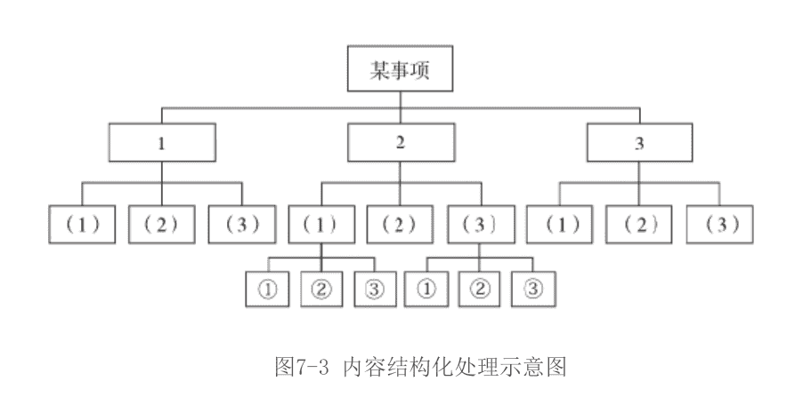

#### 举例

任康磊在介绍企业如何提升招聘成功率的文章中这样表述。

招聘能否成功，和互联网获客成交的底层逻辑类似，都遵循“产品×流量×转化率”的模型。

系统性提升招聘成功率，需要在产品、流量、转化率三个维度同时发力，且不能顾此失彼。HR的发力方向如图7-4所示。

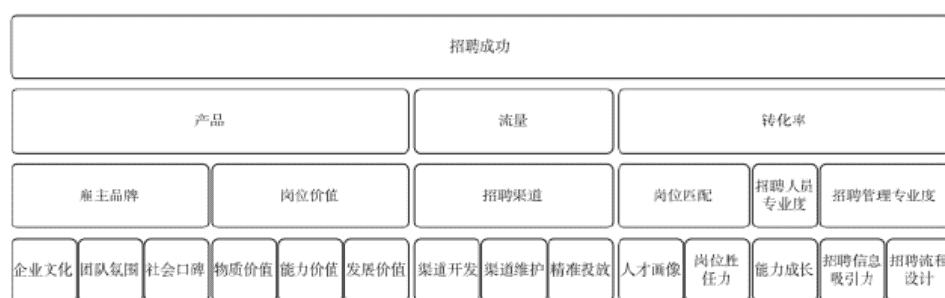

图7-4 要系统提高招聘效率，HR的努力方向

#### 1. 产品

（1）从企业视角看，雇主品牌直接影响岗位吸引力，雇主品牌的构成涉及企业文化、团队氛围、社会口碑。
（2）从岗位视角看，岗位价值决定吸引力，岗位价值可拆分为物质价值、能力价值与发展价值。

#### 2. 流量

招聘流量主要受渠道影响。渠道越多，信息覆盖越广，流量越大。管理好渠道要做好开拓、维护，以及基于岗位特性在不同渠道做精准投放。

#### 3. 转化率

（1）转化率受产品吸引力、投放精准度影响，也受岗位与候选人匹配度及招聘管理专业度影响。通过人才画像可实现人人匹配，通过岗位胜任力模型可实现人岗匹配。
（2）招聘人员的专业水平决定招聘管理的专业水平，提升专业度依靠刻意学习与能力成长。
（3）招聘管理是否专业，决定招聘信息是否有吸引力，决定招聘流程是否专业，最终影响候选人是否选择企业，进而影响招聘成败。

### 7.3.2 设计有助于表达的图形

对结构性强的功能内容，文字搭配图示，理解和记忆效果会更好。

举例

任康磊在梳理人力资源管理全貌时这样写。

实战中，人力资源管理的工作内容可分为三个层面，如图7-5所示。

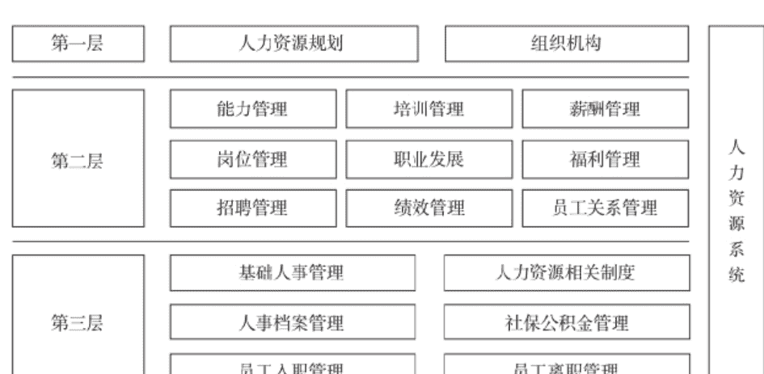

图7-5 人力资源管理模块示意图

复杂信息靠文字很难说透，用图形呈现更容易被理解和记住。

#### 举例

任康磊在介绍公司管控类型时这样写。

依据公司特征，管控模式可分为三种：财务管控型、战略管控型和运营管控型。其中运营管控型权集中，财务管控型权分散，战略管控型居中。

这三种模式的特点如图7-6所示。

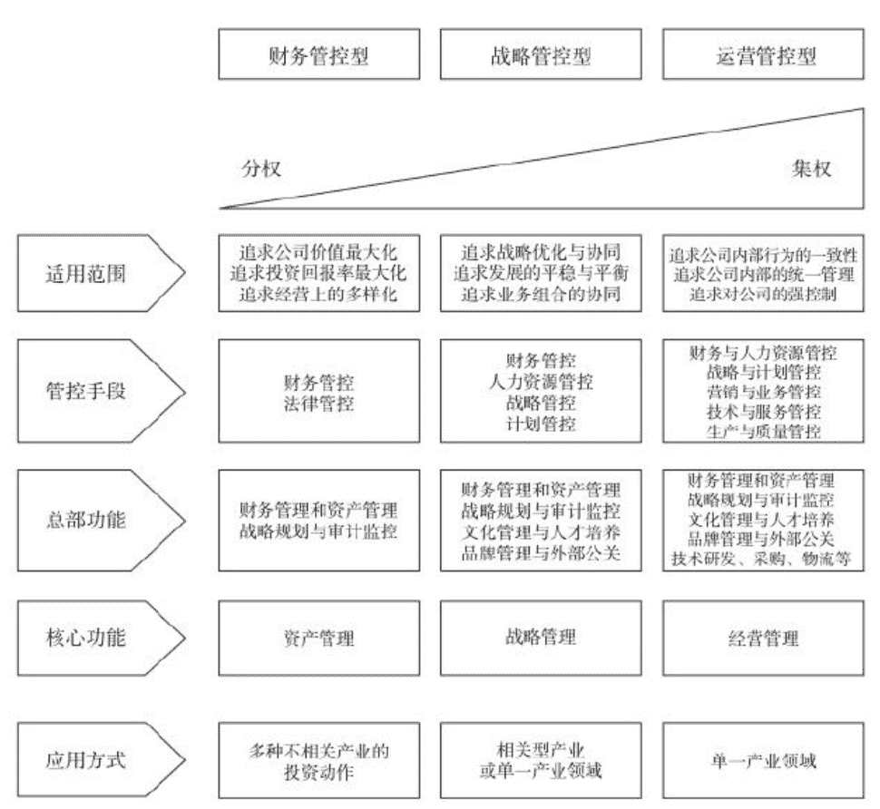

在发展目标上，财务管控型更聚焦子公司或部门的投资回报、业务组合优化、公司价值最大化等财务结果。

运营管控型更强调各业务单元经营行为统一与优化、整体协同成长、对行业关键成功要素集中管控等操作层面的事项。

战略管控型兼顾财务结果与操作层面，处于两者之间。

### 7.3.3 编写能帮助记忆的口诀

功能型写作的目的是针对性解决问题。为了让读者记得住、学得会、用得上，可以在文中提炼一段口诀。口诀有助于快速把握要点并便于执行。

比如小学数学入门的“一一得一，一二得二，一三得三”；交警宣传的“红灯停，绿灯行，黄灯是提醒；过马路，走人行，不要走捷径”；消防员普及燃气泄漏的“燃气泄漏莫慌张，断气禁火开门窗”。

#### 举例

美食自媒体里有调制糖醋汁的“54321”诀窍。

糖醋味是中式菜系的经典口味，糖醋鱼、糖醋肉、糖醋虾都很常见。做糖醋菜，糖醋汁是关键，相当于火锅的汤底加上蘸料。

很多人调不出稳定口感，时甜时酸，就是配方没掌握。

调制糖醋汁有个“54321”秘诀，五个数字对应五种配料。“5”是5勺水；“4”是4勺醋；“3”是3勺白糖；“2”是2勺老抽；“1”是1勺料酒。

按口味偏好，还有另一种配方，同样遵循“54321”。此时“5”是5勺水；“4”是4勺番茄酱；“3”是3勺白糖；“2”是2勺白醋；“1”是1勺淀粉。

# 第8章 如何讲好一个故事

自媒体文章很多，能讲故事的文章不多，能讲好的更少。人人都爱听故事，一百个道理不如精彩的故事更打动人。故事对自媒体写作至关重要，作者要多留意身边的素材，掌握讲故事的方法，讲好不同类型的故事。

## 8.1 常见的五大好故事公式

同一个故事，流水账写出来像白开水，平淡无味。换个写法就有了调味。好故事都有共性，可以提炼成公式。梳理脉络后套用公式，就能写出精彩故事。常见的五大公式如下。

### 8.1.1 问题+行动+转折+结果

适合描写发现问题后采取行动，结果发现问题并非当初想的那样，情节反转的场景，比如生活中的乌龙。

逻辑如下。
- 1. 问题：发现一个严重、紧急、需要立即处理的难题。
- 2. 行动：针对问题采取常规行动或做出努力。
- 3. 转折：情况变化，事情与想象不同，行动显得错误。
- 4. 结果：对事件做结论或反思。

原版流水账如下。

#### 举例

儿子考了一百分，老婆奖励他可以玩会儿游戏。我回家看见儿子在玩游戏，很生气要制止，结果发现是老婆允许的。儿子委屈大哭，我摸着他的头道歉说：“是我不好，你继续玩吧。”

流水账像白开水，看着提不起兴趣。

按公式重写如下。

#### 举例

本来谈好的客户临场变卦，我和客户周旋一整天，下班走到楼下才发现连水都没喝。（必要的铺垫）

看来本月业绩奖金要泡汤了，工作不顺让我很郁闷，回家却看见儿子在玩游戏。（问题）

这孩子最近怎么迷上游戏了，这样学业肯定受影响，我大声呵斥让他关机。（行动）

儿子怯生生地说妈妈允许他玩的，这时老婆快步出来，说确实是她允许的，因为儿子考了100分。（转折）

我摸着儿子的头道歉：“爸爸不好，没弄清原委就发脾气，希望你以后别犯我这样的错。”（结果）

故事结尾可再点出道理，关于沟通、亲子教育、工作生活平衡或情绪管理，道理放在好故事后面更易被接受。

### 8.1.2 结果+曾经+原因+感悟

适合开头人物在某方面较弱，经过改变后大幅提升的情境，重点解释变化原因。比如新手成长为CEO，或技能从弱到强。

逻辑如下。
- 1. 结果：先交代当前令人满意且不易达到的结果。
- 2. 曾经：交代过去较差的状态。
- 3. 原因：解释从过去到现在的转变过程，这是重点。
- 4. 感悟：总结道理或结论。

原版流水账如下。

#### 举例

儿子平时学习不好，成绩总是不理想。我很着急，把自己的学习技巧都教给他，还说了很多道理。他慢慢听进去了，开始努力，最后考了班里第一。

原版平淡，缺乏冲突和原因。

按公式重写如下。

#### 举例

今天儿子进门就冲我喊：“老爸，我做到了！语文考了99分，全年级第一！”（结果）

两个月前，他的语文成绩从来没进过班前20，这次却冲到年级第一。（曾经）

他是怎么做到的？我两个月前教了他很多学习方法，主要包括……

一开始他并不买账，后来我又讲了三个我自己的故事。小时候我也不爱语文，正是这三个故事让我爱上语文。这三个故事是……（原因）

经过几轮沟通，我发现教育孩子原来……（感悟）

核心在于把原因写具体、写丰满，可加入曲折、冲突和反复。

### 8.1.3 目标+障碍+努力+结果

适合描写克服重重阻碍、付出努力后达成目标的故事。与上个公式类似，都是由弱到强，区别是障碍和努力是核心。

逻辑如下。
1. 目标：出于某种原因设定目标。
2. 障碍：在实现过程中发现重重阻碍。
3. 努力：针对阻碍做出相应行动。
4. 结果：最终达成或接近预期结果。

原版流水账如下。

#### 举例

张三是普通上班族，有一天决定做自媒体改变现状。于是注册了微博账号开始写文章。三年不懈努力后，微博有了100万粉丝，成为大V。

原版没有障碍和努力，故事平淡。

按公式重写如下。

#### 举例

张三在外企做行政，每天朝九晚五，毫无目标，生活枯燥，职业看不到希望。他写作能力强，大学写过中长篇小说。看到自媒体崛起后，他决定利用业余时间做自媒体，注册微博，希望成为大V。（目标）

坚持写了三个月，粉丝仍不足500。他的内容是连载小说，平均阅读量仅几百。他发现微博是轻阅读平台，小说难出圈，功能型、知识型、干货型文章更受欢迎。（障碍）

这时他决定转战文学类网站。坚持输出六个月后，粉丝阅读量依旧很少，几乎绝望。朋友建议后他发现方式不对，自媒体不适合写长篇小说。

于是他回到微博，分享职场心得，并在自身经历的故事上加上方法、原理、工具，形成干货内容。这些文章很快火了，加上他人脉好，结识了众多大V，涨粉加速。（努力）

三年后，他的微博拥有100万粉丝，成为大V。（结果）

障碍和努力是写作重点，可进一步细化。

### 8.1.4 目标+意外+反转+结果

适合描写原本目标是A，因意外转为B的情节。意外和反转是核心。

逻辑如下。
1. 目标：原本有一个坚定的目标。
2. 意外：出现意外，动摇信念。
3. 反转：目标发生变化，形成新目标。
4. 结果：调整后得到的结果或感悟。

原版流水账如下。

#### 举例

张三毕业后找到一份安稳工作，本想成家，公司突然业务重组裁员，他在其中。顿时迷茫，离职后一直没找到工作，后来创业竟然成功。

原版看不出过渡和主题。

按公式重写如下。

#### 举例

名校毕业的张三进入大型上市公司的行政部门，工作轻松工资高，同窗羡慕。他庆幸考上好大学、找到好工作，接下来的人生目标就是娶妻生子。（目标）

没想到公司突然开会宣布业务重组，要裁一部分人，张三在列。他不服找领导理论，说自己是名校毕业，为什么裁他而不是学历更低的员工？

> 领导拍着他肩膀说：“小伙子，你以为这是考试按成绩排名？公司讲的是价值，谁为公司创造价值就留下。以你现在的工作状态能力，就算没重组，早晚也会被淘汰。”（意外）

张三懵了。他之前不懂居安思危，只做职责内的简单事务型工作，缺乏职场生存和抗风险能力。

他给几十家公司投简历，因名校学历总能面试，却一家未录用。理由一致：“没有创造价值的能力。”无奈下，他选择创业开淘宝店。（反转）

创业后他痛定思痛，改变态度，四处学习开店知识，提升经营能力。张三还……

五年后，他的淘宝店在品类中名列前茅，年销售额过亿元。（结果）

意外描写越精彩，故事越有张力。

### 8.1.5 努力+结果+反转+结果

适合描写付出努力后得到一个结果，随后反转再得到另一个结果的情节。两个结果可相反也可递进。

逻辑如下。
1. 努力：针对初始目标和障碍做出努力。
2. 结果：得到第一个结果。
3. 反转：出现情况，事态变化。
4. 结果：继续努力后得到第二个结果。

原版流水账如下。

#### 举例

某人在工作上遇到困难，本想放弃，后来发现努力能解决问题，于是奋发图强，最终完成任务。

原版缺乏张力。

按公式重写如下。

#### 举例

张三大学毕业后进入一家公司做销售，加入大客户团队。上岗第一天就遇到难题：公司谈了很久的大客户临门变卦，因竞争对手价格更低。他和领导一起拜访客户，无奈降价，客户表示可考虑合作。（努力）

不久竞争对手也降价，客户再次犹豫。晨会上领导对大客户团队不满，张三感到挫败想放弃。团队领导找他谈心，说做销售要经得起失败，成功让人“长叶”，失败让人“长根”。张三听后备受鼓舞。（结果）

吃了亏后，张三开始认真反思，决心给成功找办法，而不是给失败找借口。经过一番摸排，他发现对手报价一直压在自己公司之下，根源在于对手在交付环节采用的技术路线比本公司更低端。这种方案虽然成本便宜，却稳定性不足，而且他手上已经收集到不少佐证材料和相关案例。在向领导汇报并获得许可后，他重新约了客户做一次深度沟通。

转折就发生在那次沟通上。张三提前做了大量准备，并在交流会上担任主讲。他系统拆解了竞争对手的技术短板、介绍本公司的技术优势和过往成功案例，同时把产品的成本构成也做了透明化分析。讲话始终围绕互利共赢、合作共生的基调，最终打动了客户。客户当场拍板决定合作，张三的付出也得到了公司的肯定。

如果想让篇幅更长、情节更曲折，这个叙事框架可以根据需要延展为“目标+障碍+努力+结果+意外+反转+行动+结果”。

## 8.2 功能型故事写作指南
生活各领域里都有故事，影视、剧集、纪录片、游戏乃至广告片，各自都有固定的叙事模式。应用场景不同，故事的表现手法也不同。自媒体写作里经常需要功能型故事，所以掌握它的写法很有必要。

### 8.2.1 营销软文故事的写作思路
营销软文是自媒体中最常见的功能性内容，说白了就是以推广产品、商业营销或促成交易为目的，带有广告属性的文字。营销软文的精髓在“软”字，比起硬广，它更隐蔽，读者不会一下子看出来自己在读广告。

广告主和读者之间本来就有矛盾。广告主想让人看到，读者却普遍想跳过。营销软文正好能调和双方诉求，让广告能被展示，读者也能安心阅读。

故事是营销软文的灵魂。如果只讲原理说教，内容会很枯燥。很多高明的营销软文几乎不讲道理，全靠一个精彩故事就完成营销。

营销软文故事常用套路是“负面+影响+转变+正面”，逻辑如下。

1. 负面：先抛出一个负面状况，越具体越好，最好比读者日常遇到的更严重。这个负面状况要有普遍性，只是程度更深，正是产品或服务要解决的问题。
2. 影响：说明这个负面状况会带来怎样的后果，要写得深刻，贴近大多数人的痛点，让问题显得必须马上解决。
3. 转变：使用某款产品或服务后，负面状况明显好转，同时转变过程会带来一系列好处，这部分突出产品卖点。
4. 正面：转变完成后，原来的负面变成正面。可以做前后对比，进一步凸显转变价值。

举例
张三是职场新人，入行几年仍只是个普通文员，每天的工作就是帮领导跑腿、打下手，做些事务性杂活。

他没有拿得出手的能力，对职业发展很迷茫。年纪慢慢上去，家里开始催婚，可现在的岗位和收入让他自卑。朋友介绍相亲，对方一问工作，他就含糊其辞。

一次公司开重要会议，他负责记录纪要。总经理也在场，他发现全场竟然没人会用Excel做数据，会议效率很低。灵机一动，他在网上找了一套Excel学习课程开始自学，很快学到精通。

再一次开会到数据处理环节，仍无人上手。张三主动请缨，用几个Excel函数几步就把数据整理好，会议效率提升明显，总经理眼前一亮，记住了他。

之后几场会议他都表现突出，总经理看在眼里，不久把他调到身边做贴身助理，负责数据抓取、报表生成和公司运转监控。

张三聪明好学踏实肯干，跟在总经理身边学到很多经营管理的核心要领，也接触到不少内部机密。逐渐成为总经理的得力助手，职级和薪水一路上涨。三年后升任副总经理，成为公司的二号人物。

为增强冲击力，营销软文也可以用“正面+负面+影响+转变”的顺序。这种结构类似“结果+曾经+原因+感悟”。先点出一个理想的正面状态，再拉回曾经的困境，开头形成强烈反差，抓住读者兴趣。

### 8.2.2 商业路演故事的打造方式
路演是通过演示来吸引关注公司、产品或项目的兴趣，从而实现融资、合作或招商。能否引起兴趣是路演成败的关键。

故事在商业路演里是辅助，不是核心。故事的作用是激发兴趣，而不是直接卖货。模式有问题，再精彩的故事也没用。

自媒体常见的商业路演型文章目的就是点燃读者兴趣。通用写法是“平行案例+成功案例+挫折困难+成功案例”。

1. 平行案例：先介绍与当前项目相近或平行的项目成功案例。
2. 成功案例：再展示当前项目已有的成功或接近成功的案例。
3. 挫折困难：点出成功案例中仍存在的问题，或项目可能遇到的风险，并说明解决思路，消除顾虑。
4. 成功案例：再举一个更成功的案例，最好比第一个更亮眼，并展望未来，呼吁行动。

举例
某餐饮连锁想用自媒体做路演文章拉招商，框架可以这样设计。

某小龙虾连锁业绩亮眼，加盟商赚得不少。这里要呈现小龙虾市场的整体情况和加盟商盈利数据。

火锅市场体量比小龙虾更大，操作更简单，回本更快。该公司在某城市某店年销售额可达×。这里可做小龙虾和火锅行业的对比。

做加盟要注意一些坑，否则容易被套路。

火锅行业虽然门槛低，竞争也激烈。不过该公司的火锅不走寻常路，有以下特色……能保证差异化。

另外选址、原材料、运营流程都需要专业支持，普通人单干很难做好，这些问题公司都能提供解决方案，具体做法是……

在某城市某加盟商在某年某月加盟后，怎样经营到某时已实现盈利多少。有意加盟者可拨打电话……

### 8.2.3 文化传播故事的构建逻辑
不少企业会在自媒体发布企业文化故事来塑造雇主品牌。好的文化故事既能带来正面口碑，也具广告效果。比如海底捞的服务形象，很大程度上靠自媒体传播的服务故事堆起来的。

文化传播故事常用结构是“人物+事件+反转+结论”。

1. 人物：介绍人物基本情况，可以是创始人、内部代表人物，也可以是外部人物，一个或多个均可。
2. 事件：人物在某个节点遭遇的典型事件，通常有冲突，属于特殊或关键时刻。
3. 反转：事态发展出现常人难以预料的反转。
4. 结论：反转带来的结果或说明的问题、得出的结论。

举例
某外资零售公司的经营理念是顾客至上，规定可以无理由退货。理念要落地，需要让员工真正理解，公司就会讲这样的故事。

一天，一家门店来了一位怒气冲冲的顾客要退货。商品是雪地防滑链，冬天已经过去，链子明显已使用了一个冬季。客服人员Susan热情接待。

顾客称质量不好，公司既然说无理由退货就必须退。Susan问他多少钱买的，有购物单据吗。

顾客理直气壮：100美元买的，我是会员，单据早丢了，你们不是无理由退货吗，没单据就不给退？

Susan想了想，收下旧链子，双手把100美元递给顾客。顾客拿钱头也不回地走了。

到这里还没讲出核心。因为很多零售也会在无单据情况下退货。关键在后面。

办理完退货，Susan打电话向总部汇报来龙去脉，并表示自己为维护理念，同意顾客退了一家店从未卖过的商品，100美元是自己先行垫付的。总部经理听后表扬了她，并把100美元的退货款发给了她。

此事发生后不久，Susan被调到总部担任客服经理，负责管理全公司客服，[content]
吃了亏后，张三开始认真反思，决心给成功找办法，而不是给失败找借口。经过一番摸排，他发现对手报价一直压在自己公司之下，根源在于对手在交付环节采用的技术路线比本公司更低端。这种方案虽然成本便宜，却稳定性不足，而且他手上已经收集到不少佐证材料和相关案例。在向领导汇报并获得许可后，他重新约了客户做一次深度沟通。

转折就发生在那次沟通上。张三提前做了大量准备，并在交流会上担任主讲。他系统拆解了竞争对手的技术短板、介绍本公司的技术优势和过往成功案例，同时把产品的成本构成也做了透明化分析。讲话始终围绕互利共赢、合作共生的基调，最终打动了客户。客户当场拍板决定合作，张三的付出也得到了公司的肯定。

如果想让篇幅更长、情节更曲折，这个叙事框架可以根据需要延展为“目标+障碍+努力+结果+意外+反转+行动+结果”。

## 8.2 功能型故事写作指南
生活各领域里都有故事，影视、剧集、纪录片、游戏乃至广告片，各自都有固定的叙事模式。应用场景不同，故事的表现手法也不同。自媒体写作里经常需要功能型故事，所以掌握它的写法很有必要。

### 8.2.1 营销软文故事的写作思路
营销软文是自媒体中最常见的功能性内容，说白了就是以推广产品、商业营销或促成交易为目的，带有广告属性的文字。营销软文的精髓在“软”字，比起硬广，它更隐蔽，读者不会一下子看出来自己在读广告。

广告主和读者之间本来就有矛盾。广告主想让人看到，读者却普遍想跳过。营销软文正好能调和双方诉求，让广告能被展示，读者也能安心阅读。

故事是营销软文的灵魂。如果只讲原理说教，内容会很枯燥。很多高明的营销软文几乎不讲道理，全靠一个精彩故事就完成营销。

营销软文故事常用套路是“负面+影响+转变+正面”，逻辑如下。

1. 负面：先抛出一个负面状况，越具体越好，最好比读者日常遇到的更严重。这个负面状况要有普遍性，只是程度更深，正是产品或服务要解决的问题。
2. 影响：说明这个负面状况会带来怎样的后果，要写得深刻，贴近大多数人的痛点，让问题显得必须马上解决。
3. 转变：使用某款产品或服务后，负面状况明显好转，同时转变过程会带来一系列好处，这部分突出产品卖点。
4. 正面：转变完成后，原来的负面变成正面。可以做前后对比，进一步凸显转变价值。

举例
张三是职场新人，入行几年仍只是个普通文员，每天的工作就是帮领导跑腿、打下手，做些事务性杂活。

他没有拿得出手的能力，对职业发展很迷茫。年纪慢慢上去，家里开始催婚，可现在的岗位和收入让他自卑。朋友介绍相亲，对方一问工作，他就含糊其辞。

一次公司开重要会议，他负责记录纪要。总经理也在场，他发现全场竟然没人会用Excel做数据，会议效率很低。灵机一动，他在网上找了一套Excel学习课程开始自学，很快学到精通。

再一次开会到数据处理环节，仍无人上手。张三主动请缨，用几个Excel函数几步就把数据整理好，会议效率提升明显，总经理眼前一亮，记住了他。

之后几场会议他都表现突出，总经理看在眼里，不久把他调到身边做贴身助理，负责数据抓取、报表生成和公司运转监控。

张三聪明好学踏实肯干，跟在总经理身边学到很多经营管理的核心要领，也接触到不少内部机密。逐渐成为总经理的得力助手，职级和薪水一路上涨。三年后升任副总经理，成为公司的二号人物。

为增强冲击力，营销软文也可以用“正面+负面+影响+转变”的顺序。这种结构类似“结果+曾经+原因+感悟”。先点出一个理想的正面状态，再拉回曾经的困境，开头形成强烈反差，抓住读者兴趣。

### 8.2.2 商业路演故事的打造方式
路演是通过演示来吸引关注公司、产品或项目的兴趣，从而实现融资、合作或招商。能否引起兴趣是路演成败的关键。

故事在商业路演里是辅助，不是核心。故事的作用是激发兴趣，而不是直接卖货。模式有问题，再精彩的故事也没用。

自媒体常见的商业路演型文章目的就是点燃读者兴趣。通用写法是“平行案例+成功案例+挫折困难+成功案例”。

1. 平行案例：先介绍与当前项目相近或平行的项目成功案例。
2. 成功案例：再展示当前项目已有的成功或接近成功的案例。
3. 挫折困难：点出成功案例中仍存在的问题，或项目可能遇到的风险，并说明解决思路，消除顾虑。
4. 成功案例：再举一个更成功的案例，最好比第一个更亮眼，并展望未来，呼吁行动。

举例
某餐饮连锁想用自媒体做路演文章拉招商，框架可以这样设计。

某小龙虾连锁业绩亮眼，加盟商赚得不少。这里要呈现小龙虾市场的整体情况和加盟商盈利数据。

火锅市场体量比小龙虾更大，操作更简单，回本更快。该公司在某城市某店年销售额可达×。这里可做小龙虾和火锅行业的对比。

做加盟要注意一些坑，否则容易被套路。

火锅行业虽然门槛低，竞争也激烈。不过该公司的火锅不走寻常路，有以下特色……能保证差异化。

另外选址、原材料、运营流程都需要专业支持，普通人单干很难做好，这些问题公司都能提供解决方案，具体做法是……

在某城市某加盟商在某年某月加盟后，怎样经营到某时已实现盈利多少。有意加盟者可拨打电话……

### 8.2.3 文化传播故事的构建逻辑
不少企业会在自媒体发布企业文化故事来塑造雇主品牌。好的文化故事既能带来正面口碑，也具广告效果。比如海底捞的服务形象，很大程度上靠自媒体传播的服务故事堆起来的。

文化传播故事常用结构是“人物+事件+反转+结论”。

1. 人物：介绍人物基本情况，可以是创始人、内部代表人物，也可以是外部人物，一个或多个均可。
2. 事件：人物在某个节点遭遇的典型事件，通常有冲突，属于特殊或关键时刻。
3. 反转：事态发展出现常人难以预料的反转。
4. 结论：反转带来的结果或说明的问题、得出的结论。

举例
某外资零售公司的经营理念是顾客至上，规定可以无理由退货。理念要落地，需要让员工真正理解，公司就会讲这样的故事。

一天，一家门店来了一位怒气冲冲的顾客要退货。商品是雪地防滑链，冬天已经过去，链子明显已使用了一个冬季。客服人员Susan热情接待。

顾客称质量不好，公司既然说无理由退货就必须退。Susan问他多少钱买的，有购物单据吗。

顾客理直气壮：100美元买的，我是会员，单据早丢了，你们不是无理由退货吗，没单据就不给退？

Susan想了想，收下旧链子，双手把100美元递给顾客。顾客拿钱头也不回地走了。

到这里还没讲出核心。因为很多零售也会在无单据情况下退货。关键在后面。

办理完退货，Susan打电话向总部汇报来龙去脉，并表示自己为维护理念，同意顾客退了一家店从未卖过的商品，100美元是自己先行垫付的。总部经理听后表扬了她，并把100美元的退货款发给了她。

此事发生后不久，Susan被调到总部担任客服经理，负责管理全公司客服，帮助公司践行经营理念，做好客户服务。这正体现了顾客至上、无条件退货的真正含义。

## 8.3 好故事的五大核心要素
一个好故事通常包含人物、事件、悬念、冲突和反转。在自媒体写作中，这些要素不仅要齐全，写法也需要有特点。

### 8.3.1 人物塑造的关键技巧
人物是故事的第一要素。读者看故事，本质是看围绕人物发生了什么。自媒体对人物的塑造与传统文学不同，主要体现在篇幅有限、人物数量要少、关系要简化。

自媒体塑造人物有三条常用做法。

1. 注重细节
通过外貌、动作、语言、心理的小细节来刻画性格。

举例
事出突然，他等不了主人回来，一脚踢开门，几步冲进里屋……用来表现直爽干脆的性格。

2. 危难表现
危难时刻最能看出品格。压力越大、选择越难，人物形象越鲜明。

举例
下班前张三接到妻子电话，女儿在家不适，妻子在外地回不来。刚到楼下，电话又响，有个案子要他去现场。他犹豫两秒，给妹妹打电话让她带女儿去医院，自己把钥匙放在门垫下就直奔案发现场。

3. 直接描述
篇幅有限时，直接点明人物情况，能让读者快速进入状态。

举例
张三大学毕业后好吃懒做成啃老族，每天打游戏。之前换过几份工作都嫌累，索性辞了。现在没钱就向妈妈伸手。

### 8.3.2 事件设计的要点
事件是故事的骨架，好故事的事件要有画面感，能让读者代入。

设计事件要注意三点。

1. 研究读者
先明确读者画像，从他们高频发生的场景里选情节，提升代入感。

举例
读者以大学生为主，写时间管理，就从校园里“学霸”的作息安排切入。

2. 情节合理
故事最好真实，编造也要合乎逻辑，不能过于夸张。

举例
张三财务毕业做三年财务转行编程三年又转厨师再转电焊，情节显然不合理。

3. 行云流水
因篇幅限制，事件推进要一气呵成，别东拉西扯。

举例
10年前张三创业不太成功，李四5年前创业比较成功，王五15年前创业很失败，张三没结婚王五成家早李四事业成功却没结婚，叙事混乱。

### 8.3.3 悬念设计的步骤
悬念是让读者继续读下去的动力。自媒体常用三步法。

1. 预设结局
开头直接抛问题或设置疑惑场景，最好出人意料，快速引出好奇。
2. 加重渲染
在预设结局基础上进一步铺垫，加深悬念，看似要揭晓实则继续吊胃口。
3. 拨开疑云
在核心处解答悬念，让读者有“原来如此”的满足感。

举例
两年前张三注册微博写作，如今已是200万粉丝的大V，年入超百万元，他是怎么做到的？

张三出生在普通农家，父母务农，连智能手机都不会用。第一台电脑是工作后吃三个月泡面攒钱买的。大学时没钱上网，对互联网一窍不通，接触微博是近几年的事。刚上手时连发文按钮都找不到……

能成为大V，是因为他做对了几件事，主要内容如下。

……

如果拨开疑云环节空洞，读者会觉得故弄玄虚。

### 8.3.4 冲突设计的常见类型
故事要有波澜，冲突是关键。自媒体常见四类冲突。

1. 时间不够
时间紧迫，人物必须在有限时间内完成目标。

举例
还有三个月高考，孩子成绩不稳定，好时能进重点，不好时连本科都悬。怎么在三个月内稳住成绩？

2. 空间不够
空间是主要矛盾，表现为行动空间、发展空间或思维空间受限。

张三在一家小规模公司担任行政文员，干活利落多次被领导点名表扬。只是时间一久，他心里开始别扭：业绩虽然被认可，可公司人少，行政线除了他之外只有一位四十出头的直属领导，晋升通道几乎看不见，这条路该怎么走？

#### 3. 资源缺口冲突
当资源成为矛盾的核心时，就是资源不够的冲突。人物想把一件事落地，却卡在必备资源上。

#### 举例
年会现场，总经理的一番讲话点醒了张三。总经理提到公司发展卡在瓶颈上，而张三心里早有成型的对策。他把方案递给直属领导看，结果被驳回。张三觉得领导是出于私利才否定，方案对公司大有裨益，于是萌生了绕开领导直接呈递总经理的念头。

问题在于张三只是基层职员，和总经理隔着好几层。他拿不准越级上报会不会砸了自己的职业前途，更关键的是根本不知道该通过何种渠道搭上总经理的线。面对这种局面，张三应该怎么办？

#### 4. 能力缺口冲突
当能力成为矛盾的核心时，就是能力不够的冲突。人物有明确目标，却缺少实现目标所必须的能力板块。

#### 举例
大学毕业后，张三进入一家头部公司销售部做业务员，十分珍惜这次机会。公司规定新业务员试用三个月内至少要开发三个新客户，否则以业务能力不足为由不予转正。

入职两个月后，张三的新客户数为零，是同期新人里唯一颗粒无收的。同期同事最高已开到九个，张三每天也在冲刺，症结究竟在哪？

### 8.3.5 如何设计反转
好故事离不开反转，反转能让情节陡增张力，出人意料。反转可分人物反转和事件反转，也可分正向反转与反向反转。

反转形式变化无穷。曾有一档综艺让艺人随旁白即兴演绎，过程中不断掉头，把表演难度和节目效果拉满。

自媒体写作里反转不宜堆砌，通常一篇作品放一到三个最合适。超过三个，读者容易觉得作者在故弄玄虚，反而产生反感。

自媒体常见的反转手法有三类。

#### 1. 虚惊一场
表面看形势很糟，发展到最后发现并非那么回事。

#### 举例
张三和父亲关系长期紧张，很久没回老家。那天姐姐来电说父亲突发重病晕倒在医院，因事发仓促没带住院用品，让他先回家取东西再赶过去。

张三赶到家里匆忙收拾，姐姐又打来电话说不用准备了，父亲走了……电话里“喂喂”声还在，手机从手中滑落。

张三瘫坐在地，泪如雨下，反复回想与父亲的争吵，懊悔没能最后见一面。就在他沉浸在“人死后才懂珍惜”的悔恨时，门被推开，父亲站在门口。

“臭小子，许久不见，一开口就是我走了。”父亲说。

原来姐姐说的“走了”，是指父亲自己出院回家，不是去世。张三没听完后面的解释，先入为主地以为父亲离世了。

#### 2. 是非颠倒
本该属于某种状态，却被误读成了另一种状态。

#### 举例
为赶第二天领导要用会的方案，张三整夜加班。早上他把材料交给同事李四转交领导，自己先回家补觉。领导阅后非常满意，当场在部门里公开表扬了李四，会上又表扬了一次。

张三回来后发现不对劲，自己熬夜的心血怎么算到李四头上，便去找领导说明。领导听了一半，反而批评他计较，强调大家是一个团队，不该分得那么清。

张三觉得这种环境待不下去，愤而离职创业。十年后，他的公司在行业内小有名气，而当年的领导和李四辗转多家公司，职业发展一路下滑。

#### 3. 事与愿违
原本期待事物朝某个方向走，结果偏偏走向相反。

#### 举例
女儿青春期叛逆，成绩常年垫底，中考在即，母亲急得焦头烂额。为激励学习，母亲设了奖金：下次考进班级前二十奖五百，前十奖一千。没想到女儿成绩很快冲到班级前列，母亲以为重点高中稳了。

中考前，女儿与同学冲突，班主任请母亲到校。母亲才得知女儿成绩一直很差，带回家的试卷和成绩单全是伪造的。金钱激励反而养成了造假的恶果。

# 第9章 借出书做杠杆
很多人出于不同诉求都想出书，但门槛比想象中高，成功出书与否拉开了明显差距。出书后想成为畅销书更难。写书前先定目标、搞清方法，才能事半功倍，一边出书一边拿下销量。

## 9.1 最适合出书的六类人
一本书能积累巨大的势能，势能变大后转化为变现动能的能力也随之提升。不同人群从出书里得到的价值各不相同，特别契合的人大致有六类。

### 9.1.1 企业主
企业主看似最忙，却是最需要出书的群体之一。他们每天要拓展客户，参加展会投放广告成本高昂，一本书就能把获客成本降下来。

企业主出书的好处：
- 1. 客户触达更方便
书籍的展示力很强，在线上挂上十年不变，作者介绍公司信息都是免费的广告位。
- 2. 信任感立刻拉满
客户来访先送一本书，展示理念、经典产品、企业故事，比宣传册更有说服力。
#### 3. 投资会谈更有底
商业计划书的冲击力远不及实体书，有成熟商业思想时，书本配合计划书效果翻倍。
#### 4. 人才招聘更省心
招聘越来越难，人才选公司。面试时把书摆在显眼处，应聘者好感度会明显提升。

因此越来越多企业主自费出版，他们算过账，出书远比持续打广告便宜。

#### 举例
我曾协助一位咖啡馆老板出版《咖啡馆经营者养成笔记》，记录他真实的创业经历。出版后他每次办聚会都会摆放一摞书，朋友圈里对他的认可度明显提高，能出书的咖啡店老板全国也不多见。

### 9.1.2 上班族
上班族出书的意愿最强，可真正落地的很少。只要行动起来，回报非常可观。

主要收获：
#### 1. 职业更自由
出过书的人选择面更宽，出书本身就是能力的证明。不少作者出版前平平无奇，出版后职业路径明显打开。
#### 2. 人脉自然增长
写书是认识同行的好路径。很多作者靠书结识朋友，实现资源互换，为发展铺路。
#### 3. 个人能力补齐
写书是输出也是复盘。写作前很多知识点似懂非懂，写作过程中被迫钻研，短板变长板，成长速度超过同龄人。
#### 4. 时间利用更高效
没写书时晚上多半刷手机刷到晚，一旦开始写作，娱乐时间自动被压缩，时间利用率提升。

#### 举例
2010年我认识一位作者，她写了《财务报表分析从入门到精通》，起初销量平平，后来她多参加活动，书成了同类品类的标杆。2016年她跳槽到大公司，从财务经理做起。有一天领导把她叫进办公室，桌上正放着她的书。原来领导是她的铁粉，职业发展从此顺风顺水。

### 9.1.3 家庭主妇
从时间维度看，家庭主妇是出书黄金人群，照顾幼儿的妈妈除外。

原因：
#### 1. 时间相对充裕
孩子上学后，除了家务采购和健身，写书是打发时间又能积累资产的方式。
#### 2. 视野得以打开
主妇社交圈往往偏小，写作需要学习查资料，和编辑交流，能保持心情愉快。
#### 3. 经济与自信双提升
长期没有收入易心虚，写书能赚些零花钱，畅销时甚至能成为家庭主要收入。
#### 4. 技能保持在线
写作能练笔，也能把离职前的专业技能重新梳理，为未来再就业加分。

#### 举例
我有一位作者，大学时写过Java相关书籍，婚后成为全职妈妈多年没联系。2018年底我在朋友圈看到她在教孩子学编程，便建议她写《和儿子一起学Python》。她正好有时间，欣然接受，写书让她填满空档，还把专业知识系统梳理了一遍。

### 9.1.4 自由职业者
自由职业者最怕断单，断单等于没收入。他们喜欢项目连轴转，出书正好补上这块短板。

契合点：
- 1. 时间可控
写书没有硬性ddl，忙时做项目，闲时写书，互不冲突。
- 2. 个人品牌加成
出书等于立招牌，送书给客户更易建立信任，报价也更好谈。
#### 3. 收益更均衡
项目收入属短期，书的版税是长期被动收入，两者结合收入更稳。
#### 4. 缓解孤独感
自由职业难免孤单，出版能带来一群同频朋友，交流互助。

#### 举例
市场上写文案的书很多，有位作者有实操经验文笔也不错，和我出了本《文案爆炸 轻松写出打动人心的销售文案》。出版后读者不断加她微信，两个星期内就靠书接到三个咨询单。

### 9.1.5 在校大学生
很多人以为大学生没阅历写不了书，实际上每年都有十几位大学生作者在我这里成功出版。关键不在阅历，而在是否在某个领域有独到见解并能表达清楚。

大学生最大优势是学习力。俞敏洪靠英语学习经验创立新东方，张邦鑫靠奥数培训做起好未来，都是北大毕业把学习方法变现的典型。

#### 举例
公司曾为一位大学生出版《逆袭，一个高中差生的三年奋斗史》，真实讲述从学渣到学霸的经历，家长爱买给孩子，寒暑假销量大涨。

大学生出书的不足：
- 1. 经验不足
容易纸上谈兵，内容质量堪忧。
#### 2. 见识不够
社会认知浅，篇幅常浪费在次要细节。
#### 3. 理解不深
知识深度有限，很难写出高阶内容。

但优势同样明显：
#### 1. 时间够用
可以花数月深挖一个技术点，例如某个机器学习开发包，研究透后再成书。
#### 2. 更懂新手
自己也是初学者，更能共情新手痛点，内容对入门者价值大。
#### 3. 原创态度强
敬畏心强，不爱抄袭，原创性高更受读者欢迎。

#### 举例
《Python与机器学习实战》的作者是北大数学系本科生，在校期间深耕算法，写得深入浅出。毕业后被创新工场录用。

需要注意，大学生不适合写小说，阅历少、市场竞争激烈、推广成本高，不易出头。

### 9.1.6 退休老人
退休老人时间充裕，出书目的多不在金钱。

#### 1. 传承经验
一生实战积累的干货，经过时间检验，能帮助后辈少走弯路。
#### 2. 让生活不空
跳广场舞聊天健身之外，写书是打发无聊的好方式。
#### 3. 保持思维敏捷
写作需要不断接触年轻人，思维保持活跃，避免暮气沉沉。

## 9.2 出书落地的六种打法
邀请作者写书时，常见顾虑是经验少、文笔差、身边有人更牛、没时间、没名气、领域窄。其实只要有写作能力并愿意行动，每个人都能出书。

### 9.2.1 经验较少者
并非只有行业专家才有资格出书，我的作者里三分之一是工作三年以内的新人。

销量与工龄并无必然关系。没经验的大学生出版的书，卖得比在世界五百强干了十五年的高管更好，比比皆是。

经验少者的隐形优势：
- 1. 时间更足
同样一个主题，大学生能投入五百小时写作，高管只能挤出两百小时。慢工出细活，结果在这里。
#### 2. 好奇心更强
新人更容易吸收跨领域知识，取百家之长；高管思维易固化，外延不足。
#### 3. 更贴近大众
新人从新手视角写，内容由浅入深，适合初学者；高管眼界高易曲高和寡，导致工具书读不懂。

所以经验不足不必自卑，投入时间、保持好奇、用新手视角写，照样能成书。

### 9.2.2 文笔不佳者
文笔是否重要？当然重要，它决定阅读体验。但互联网是快餐时代，读者更在意内容是否干货。

一段诗意的描写读起来很美，可工具书连篇累牍如此，读者会直接关掉。

工具书不需要华丽辞藻，准确清晰即可。例如写“外贸价格谈判”，直接列出三点，逐条展开就能解决问题。

除了小说散文诗歌，文笔一般的人完全可以写工具书，只要能搭好知识框架，把知识点讲清楚即可。当然，逻辑混乱、词不达意、废话连篇的书仍无法出版。

### 9.2.3 牛人相伴者
不少人因为身边有人更厉害而不敢出书，觉得“领导都没出书，我凭什么出”。

大可不必拿自己和他人比。出不出书取决于自己的需求，而不是别人的选择。想成为谁，才决定要不要行动。

要不要去出书，最关键的不是冲动，而是先把自己的中长期发展路线盘清楚。把未来三年、五年、十年的职业走向、收入目标、家庭安排都想明白，目标确定后，再倒推需要积累怎样的影响力、借助哪些载体去实现。影响力不是凭空而来，出版恰好是其中一条能放大个人标签的路径。

我经手过上千本书，接触过三千多位作者。经验反复印证一件事：出过书的人，后续的发展轨迹普遍更顺。有人因此打开了更大的商业版图，也有人实现了财务自由。

别人不出书，自有别人的考量，你要不要出，与别人无关。反过来想，如果同行还在犹豫，你先拿出书来，就是一次差异化超越。书一出来，你就多了一个公开背书，多了一种被看见的可能，整体声量自然不一样。

### 9.2.4 时间不够怎么办

很多人想写，却先说自己没时间。先问自己一句，真的忙到没缝了吗？除去和家人相处和日常工作，真正属于自己的时间都被消耗到哪里去了？

> 鲁迅说过，时间像海绵里的水，愿意挤总还是有的。写作是系统工程，时间可以从各个缝隙里挤出来。

#### 举例

一位做机器学习的作者常年全国飞，背着电脑跑项目。他把火车上的碎片时间用来写作，工作再紧也能在四个月内交稿。

觉得时间紧的作者可以参照下面四条操作。

- 1. 打开手机盘点娱乐类 App，写作期间与创作无关的应用就删掉。决定动笔，就要把干扰源先清掉。
- 2. 上下班路上用来理思路，把目录和框架在脑中过一遍。思路成型后，晚上再把结果录入电脑，效率会高很多。
- 3. 把工作本身当成素材库。日常多观察、多做记录，很多案例和观点本就来自工作积累，前期积累充分，后期就不必专门去找素材。
- 4. 削减低效社交。晚上的聚餐、逛街、娱乐尽量推掉，把省下的时间留给写作。

这四点很多人都知道，难在坚持。写书本质上是心性的打磨和自我升级，是在提升专业的同时管住欲望、管理自己、放弃短期享乐来换取长远目标的过程。

#### 举例

任康磊过去也是上市公司高管，出差、应酬、公司大小事务一样不少。但他会利用碎片时间，前三本书基本都是在职期间一点点写出来的。

### 9.2.5 没有名气怎么办

很多人担心自己名气不够，书出来也没人买。确实，名人的自带光环会让书更好卖，像白岩松那样的例子比比皆是。但名人终究少数，而且真正能静下心写书的并不多。

名气不够的人怎么破局，核心在于选题。

#### 1. 热点
主题如果正好踩在当下关注点上，传播和购买的势能会更强。像 Python 火的时候，这类主题的书自然容易被追捧。

#### 2. 特色
每本书都需要独一份的视角。人云亦云很难出圈，独树一帜才容易被记住。

#### 3. 竞品
如果某个品类盘子不小，但现有图书质量平平，还没有形成绝对头部，那这个赛道就值得切入。

总的来说，没有名气的作者，只要把选题策划做好，照样有机会。

### 9.2.6 领域很窄怎么办

有人觉得自己的专业面太窄，不适合出书。领域宽度确实会影响销量，比如《发动机制作》这种工具书，受众天然有限。但这不是绝对判断，必须用市场数据来验证，而不是主观臆断。

#### 举例

我认识一位在银行做信贷的作者，他一度觉得关于“银行业专业人员职业资格考试”的书已经写得很全，没必要再写。但调研后发现：

- 1. 需要信贷知识的不只是银行人，互联网金融、各类金融机构乃至大企业融资部门的人都有需求，受众远超想象。
- 2. 现有的考试类图书偏重原则，理论正确但操作性弱，动辄四百多页，实战案例稀少，可读性一般。如果出一本两百多页只讲实战、案例密集的书，与考试书形成互补，需求就存在。
- 3. 市场上目前还没有这样的产品。

基于这些判断，我们做了这本书，销量和作者反馈都不错。

每个人的信息是有盲区的，仅凭个人认知很难判断一本书能否卖得动。作者熟悉专业，但对出版市场、竞品格局、真实需求往往不了解。这正是图书策划的价值所在，看似简单的“做”与“不做”，背后是多年看书和数据沉淀后的判断。

总之，领域窄不窄能不能出书，得先分析再决定。

## 9.3 畅销书做对了什么

书是商品，最终要有人掏钱。能不能畅销，要看能不能满足具体需求。出版社、编辑、作者甚至部分读者的意见都不关键，市场才有决定权。

### 9.3.1 畅销书的四种类型

畅销意味着被市场认可，满足了读者的付费需求。市面上所有畅销书，大致都对应了四类需求，如图9-1所示。

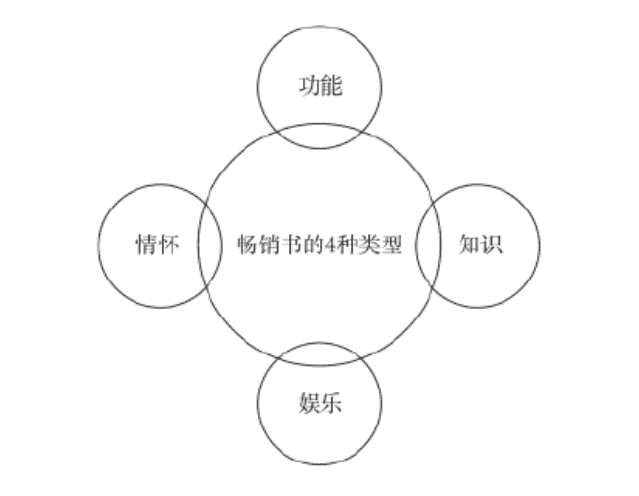

#### 1. 功能
读完能学到技能、解决实际问题、达成个人目标的书。编程、会计、外贸、写作、管理类图书多属此类。

#### 2. 知识
读完能增长人文社科类见识的书。知识类图书作者众多，想畅销需要有差异化，比如图解、漫画、独特视角的呈现方式。

#### 3. 娱乐
用来打发时间的书，阅读本身就是放松。这一类与游戏、影视剧的本质相近，核心是休闲娱乐。

#### 4. 情怀
读者因为喜欢作者、想收藏而买的书。即使内容微调重版，也愿意再买一本。这类作者通常是明星、主持人、自媒体头部。

任何畅销书必定落在这四类中的一类。能同时覆盖两类以上，畅销概率更大。完全不沾边的书，大概率卖不动。

很多人按个人喜好写书，不看市场需求，结果出版了也难热销。看完稿子后直接建议不出版，判断依据主要就是这四类需求是否被满足。

### 9.3.2 畅销书的写作方向

明确了四类需求，就能判断一本书值不值得写。可以用表9-1这样的工具来检验。

#### 表9-1 检验图书是否值得写作与出版的工具表

| 需求类别 | 是否满足（是打√，否打×） | 如果是，程度大小（最高10分，最低1分） |

| :--- | :--- | :--- |

| 功能 | | |

| 知识 | | |

| 娱乐 | | |

| 情怀 | | |

#### 举例
有位知乎作者写历史随笔，累计几十万字，想结集成书。用表来评估，得到表9-2的结果。

#### 表9-2 检验图书是否值得写作与出版的工具表

| 需求类别 | 是否满足（是打√，否打×） | 如果是，程度大小（最高10分，最低0分） |

| :--- | :--- | :--- |

| 功能 | × | 0 |

| 知识 | √ | 3 |

| 娱乐 | √ | 1 |

| 情怀 | × | 0 |

满分40分，这本书只有4分，不建议出版。若想出版，可以深耕知识、把内容写得更有趣，或先在平台涨粉建立情怀基础，达到阈值后再出手。

总之，写畅销书要顺应市场规则，满足读者需求，内容风格上也要贴合这四类需求，否则连出版基本门槛都难达到。

#### 举例
几年前一位名校学生研究计算机算法，能力很强，却坚持按自己想法写，还夹杂荤段子。让他删掉无关内容，他认为我在为难他，甚至家人打电话来施压。最终合作终止。这本书也没见到出版面世。有经验的编辑判断都是一致的。

### 9.3.3 小说畅销写作方法

想靠小说出头的人很多，但绝大多数稿子连出版价值都有限。小说市场竞争极其激烈。

#### 举例
仅起点中文网一个平台累计小说就超百万部。阅文集团旗下储备作品1120万部，创作者770万名。2018年营收50.4亿，净利润约9亿，假设一半成本为稿费，则总稿费约20.5亿，均摊到770万作者，人均约266元。头部作者稿费很高，排名在700名之后基本无收入，万中挑一的难度可见一斑。纸质小说环境更严峻，周围的人多久没买过小说了。

读者购买小说大致有四种场景：

- 1. 影视剧带动，例如《人民的名义》。
- 2. 作者有名气，慕名购买，例如韩寒。
- 3. 网络爆款转实体，例如《明朝那些事儿》。
- 4. 网购凑单，看排行榜顺手买。

#### 1. 首先尝试
先在起点、晋江等文学网站或自媒体连载，测试反馈。有人看就持续更新，积累足够粉丝和影响力后再谈出版。

#### 2. 自费出版
实在找不到出版社愿意接，也可以自费实现出版愿望。

普通人写哪些题材更可能出圈？盗墓、玄幻、穿越、都市、爱情等常规类型已被头部占据，很难突围。

更好的做法是写自己熟悉且竞争小的专业背景，比如：

（1）职业编辑写编辑部日常，出书难、作者难沟通等幕后故事；
（2）华为工程师写研发历程，投入、阻碍、领导决策及人物立场；
（3）外贸老板写行业恩怨，结合时代背景塑造人物。

有了专业背景就能形成差异化，再叠加畅销小说的三大要素，成功率会提升：

- （1）有感情戏，人与人之间的起伏；
- （2）有冲突，正邪对立、人性博弈；
- （3）有悬念，持续牵引读者继续读下去。

## 9.4 案例 任康磊成为畅销书作家之路

任康磊出书前是上市公司高管，分管人力资源。第一本2017年11月上市，滞销；第二本2018年6月上市，销量平平也一度滞销。从第三本开始一路走高，成为畅销书作家。

截至2020年底，他已交稿25本，作品集中在人力资源领域，品类销量名列前茅。全网付费课程学习人次超百万，线下授课和咨询项目也源源不断。畅销书带来的势能显著放大了他的业务，稿费本身也是一笔可观收入。

他的成长可分为三个阶段。

### 9.4.1 懵懂阶段
当时不知道写什么、为什么写，只是感觉职业发展遇到瓶颈，对现状不满。

他工作强度极大，每天至少14小时，吃饭都常忘记。父母离异，由爷爷奶奶抚养，家庭条件差，靠自己打拼买房买车。26岁就成为大型上市公司高管，却更早撞上职业天花板。梦想做职业经理人、CEO，但需要更长的司龄和经验积累。

为寻求突破，他在简书上输出职场内容。早期写作杂、发散，但锻炼了基本功。很多人以为写作是天赋，他说完全是练出来的。理工男出身，高中数理化全市第一，语文常不及格。

第一本书是心灵鸡汤类，道理对但市场无感。原本不宜出版，后来他自费才出，销量很差。犯了三个忌讳：

- （1）没名气写鸡汤，基本没有成功案例。
- （2）没联系编辑，自行拍脑袋写作。
- （3）缺乏后续推广，工作占据时间无暇宣传。

这本书失败但他有韧性，开始准备第二本。

### 9.4.2 开悟阶段
吸取教训后，他与我沟通，第二本方向定为人力资源管理。我的判断是：

（1）他做了十几年HR，在世界500强履历完整，覆盖各模块，有理论也有实战；
（2）中国HR从业者超500万，市场需求大，且我此前操盘过20万册的HR畅销书；
（3）该品类尚未形成绝对头部，有机会打造头部作者。

他认同方向，但细节上流露出强者的通病。应该讲实操方法，如如何设计奖金、如何做招聘，但他觉得太基础，想高屋建瓴。沟通后部分采纳，整体仍按原思路写。

第二本销量略好但仍失败，后来靠成大V才带动了一些销量。失败原因：

- （1）没名气却务虚，高屋建瓴需要大咖背书。
- （2）目录结构不清晰，未按招聘、培训、薪酬、绩效等常规模块划分，价值感不强。
- （3）实操性不足，原理多、技能少。

两本失败后他才真正悟到写书要点，于是开始策划第三本。

### 9.4.3 觉醒阶段
第三本仍聚焦人力资源，但做了关键调整：

- （1）接地气，目标读者是HR新人，内容贴近实战，可照做。
- （2）易上手，提供大量表格、规范、工具，拿来即用。
- （3）内容全，把实战涉及的全部细节写成操作大全，成为案头工具书。
- （4）讲故事，每个知识点配真实案例和应用场景，增强共鸣。
- （5）录视频，购书附赠课程，提升学习体验。

他的目录标题近300个，全书实操知识点超500个，这需要很强的专业积累和执行力。拿到稿子时我就判断，这本成了。

出版后很快上畅销榜。成功既靠策划，也靠营销。出版社资源加上他的全力配合。

为彻底投入，他选择辞去上市公司高管职位。高薪和职位需要很大魄力才能放下。很多作者想兼顾事业和作家身份，最后两头不到岸。

辞职后他做了：

- （1）到各大人力资源垂直网站持续更新文章，日更，既提升知名度，也带来持续流量。

任康磊的起步打法很清晰。线上线下的活动他几乎场场参加，一到现场就自然带出自己的书。后来他直接备了上千本库存，用来当活动礼品送出去，活动质感一下子就上来了。

他还和多个线上教育平台走到一起，联合推出了一系列人力资源管理的课程。图书叠加线上课的组合，让他的线上存在感持续放大。

一套组合拳打下来，这本书冲进了人资品类头部畅销榜，他的个人影响力也水涨船高，成了行业内有分量的大V。

按常理，大V之后往往会松手不再写书了。可任康磊没有，反而写得更稳。

原因很简单。产品层面他跑通了闭环：出书收集读者反馈，反馈驱动课程设计，课程再反哺新书，形成螺旋上升。品牌层面同样如此：出书增强影响力，影响力强化个人品牌，品牌再支撑下一本出书，影响力继续累积。

未来他的作品会逐渐覆盖人力资源管理的各个细分，也会向“管人”相关的全域延伸。我们计划把这些书打包成套装，像经典武侠合集那样，朝着人力资源从业者必备丛书的方向去做。

# 第10章 微博涨粉与粉丝经营实务

很多人做微博的初衷就是冲着涨粉去的，这无可厚非。但要把写作、运营和涨粉的关系理顺。写作是内功，运营是外功，涨粉是最终结果。内功最关键也最难打磨，耗时耗力，需要长期反复练习。一旦扎牢，能力可迁移到任何相关场景。外功像招式，学得快，点一下就会，但碰到内功深厚的人立刻被破，缺乏根基就很难持久。

## 10.1 涨粉逻辑与变现路径

一个微博账号的受众大致可划分为四个圈层：展现层、点击层、关注层、信任层。这就是微博涨粉的漏斗模型。想有效涨粉，就要针对不同圈层的特征做针对性运营。

### 10.1.1 涨粉漏斗模型拆解

互联网电商里流传很广的漏斗模型，如图10-1所示。

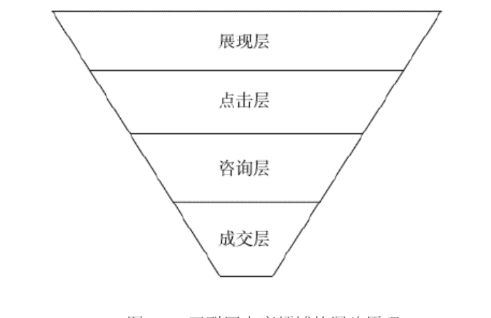

展现层指在全网能接触到商品信息的全部潜在人群。

点击层指看到信息后产生兴趣并点进详情页的潜在人群。

咨询层指进入详情页后主动询问客服具体细节的人群。

成交层指最终下单付款完成购买的人群。

漏斗思维不仅用于电商，整个营销体系都在用。

案例演示

以淘宝上一个卖羽绒服的店铺为例，说明购买路径。

1. 展现层
买家在淘宝搜索“羽绒服”，系统会列出上万件商品同时展示。排名靠前的商品被看见的概率更高。

2. 点击层
买家浏览后对某件羽绒服感兴趣，点击进入详情页。假设展现层浏览了1000件，最终只点进10件，剩下99%被直接筛掉。

3. 咨询层
进入详情页后，买家有购买意向，会问客服价格、款式、尺码、物流等信息，这一层又会淘汰掉不少选项。

4. 购买层
询问后买家看中三件，最终只选一件下单付费，交易完成。

微博涨粉同样遵循同样的漏斗，如图10-2所示。

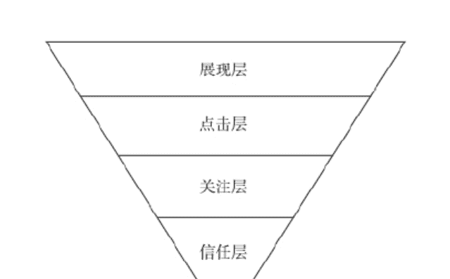

展现层指的是内容传播的广度，大小取决于微博的曝光量。曝光越大，被潜在粉丝触达的几率越高。

点击层指的是读者看到内容后对博主产生好奇，点击进入主页评估是否值得关注。能否进下一步，很大程度上取决于主页的整体质感。

关注层指的是读者进入主页后觉得内容符合预期，点击关注。涨粉只是开始，掉粉也常发生。需要持续输出优质内容来维系。微博除了关注，还有特别关注。

信任层指的是粉丝形成后，对博主既喜爱又信赖。到了这一层，博主具备意见领袖属性，主要的课程或商品变现也靠这部分人支撑。

### 10.1.2 展现层：如何放大曝光

展现层是流量的地基。扩大曝光是涨粉的第一步。常见做法有五类。

1. 账号名
账号定位模糊会让人无感。账号名都抓不住人，前面就输了。

2. 评论大V
大V评论区聚集的是同领域志趣相投的人，在这里露脸很有价值。

3. 微博推荐
追热点能让内容被更多人看见。

4. 被引用
账号被频繁引用说明有分量，大家会逐渐熟识并产生兴趣。

5. 被转发
文章被转发等于获得背书，转发者的粉丝会顺带看到，曝光自然增加。

这五类里，评论大V性价比最高。因为评论可以主动把控，其他方式多靠被动。

评论大V时要注意细节。

1. 评论权重
排位越靠前曝光越高。点赞多、回复多的评论会往前排。大V回复加点赞的权重最高，普通用户的互动也能提升权重。可用的小技巧：自己给自己点赞；在自己微博评论区回复他人评论；向大V提问诱导其回复。

2. 字数控制
评论写到120字左右即可。写满140字后再转发会超字数，需要删改，反而影响传播意愿，也容易在二次转发时被放弃。

3. 时间卡位
大V发博后第一时间跟评，上榜机会更大。可把喜欢的大V设为特别关注，及时响应。

4. 发文规律
多数大V发文有固定节奏，摸清规律更容易抢先。

5. 别只转不评
评论精彩却直接转发，会把展示机会让给别人。

6. 不硬刚
故意反驳大V来彰显自己，很容易被拉黑。相当于到别人家做客当面挑刺。

7. 适度幽默
有趣的评论容易被顶到头部，前提是与账号调性一致。

8. 结合定位
评论时带入自己的定位，能强化认知，吸引同路人。例如我过去常结合出版案例来评论。

9. 踩准转发型大V
有些大V习惯转发评论，要重点关注并针对性评论。

10. 借力他人大V
评论里可引用其他大V账号，形成联动。以前我提过年底借钱的话题，有人引用了大V账号后被转发感谢，并连带关联更多大V，曝光形成了链式反应。

### 10.1.3 点击层：制造点击欲望

展现和点击的本质都是吸引注意。先让大量用户看到，再让他们想点进来。进主页后，关注与否主要看四点：粉丝规模、内容数量、内容质量、置顶质量。粉丝数和文章数一个月内能快速累积，关键在后两项。

1. 内容质量
好内容是写作内功的体现。注意四个要点。

展现的文章要精挑细选，质量不佳的设为仅自己可见，既保留记录又不影响观感。

发布的文章必须与定位一致，教育类账号频繁转发搞笑内容会拉低调性。

主页上方默认显示最近参与的话题，追热点太多会显杂乱，可关闭该功能。

粉丝上来后要关注互动数据，互动低的文章可隐藏，只保留高互动内容对外展示。

2. 置顶效果
置顶相当于主页的标题，是点睛之笔。粉丝多时可放广告变现，粉丝不足1万时不建议置顶广告，会影响品味。

置顶的五个细节。

自我介绍式置顶基本无效，用户关注的不是你是谁，而是你能带来什么。

点赞评论多的文章不一定适合置顶，我曾有高互动文章置顶后对涨粉帮助不大。

用话题合集做置顶不推荐，很多用户不会用话题，点击意愿低。

不如置顶转发量高的文章，转发多说明内容有价值且愿意分享。

可用精华合集置顶，挑选历史高转发文章合并，既代表个人风格，也是一次梳理复盘。若有超级爆款就直接置顶，没有就做精选合集。合集封面显示首篇文章的摘要，是重要展示位，不要浪费。顺序不必按时间，可把最精彩的放最前。

### 10.1.4 关注层：提升粉丝粘性

用户在点击层产生兴趣并关注，就成为粉丝。但这只是起点，后续要持续经营，让粉丝持续看到好内容，增强好感。

微博的特别关注会优先推送博主内容。有人说关注只是半个粉丝，特别关注才是真爱，确实有道理。

我有17万粉丝时，没大V转发的情况下单条微博阅读约10多万，其中3-4万来自微博推荐。也就是说近一半粉丝可能没看到内容，这就凸显了特别关注的重要性。

要让粉丝把你设为特别关注，要避开七类容易掉粉的账号。

转发型，只会转发别人，没有观点。

刷屏型，一天发上百条低质内容。

抱怨型，负能量满载。

中立型，观点模糊，滴水不漏。

鸡汤型，天天灌鸡汤，缺少故事和细节。

自嗨型，只写流水账，自娱自乐。

图片型，每天自拍，把微博当朋友圈。

避免这些后，应该怎么做。

内容为王。

保持节奏输出，有能力时每天发5到20条，质量在线可适当放量。我的节奏是早安开头，转发几篇优质内容，再发一篇原创重磅，后续随想随写。

深入研究粉丝，了解构成和阅读习惯来调整节奏。起步阶段可均匀发文，例如每小时一条，粉丝多后再根据数据优化。

主动引导粉丝设为特别关注，可在文末自然提示，也可在爆款文后借评论或转发提醒。

### 10.1.5 信任层：从流量到变现

粉丝累积到一定规模就要考虑变现，这依赖信任层。粉丝不等于信任，只有被信任才愿意付费。写作时要刻意经营信任感。

九个关键点。

坦然谈钱。变现不必装清高。我一直强调自己是小老板要养团队、养家，大家有预期，粉丝理解度高。第一次接电动牙刷广告并未掉粉，因为大家认可创作需要成本。

公开真实信息。城市、行业、家庭情况等不涉负面可适度公开，让粉丝看到立体的人。也是一种自我约束，我曾长期带定位发文，通勤路线公开，信任感更强。

专业与通俗兼顾。变现无论卖课还是带货都需要专业背书，但过于专业会劝退外行。我早期写得太专业，反而掉粉。

坚持与勤奋赢尊重。坚持本身就是一种魅力。我不是最聪明的，但日更带来的稳定输出打动了不少人。

敢于出糗。真实的人有光有影。如李云龙这样优点缺点都鲜明的人更讨喜。自媒体要展现个性，别过度包装。被指出错误时大方认错，反而加分。

评论区是基本盘。运营初期要熟悉早期评论者，他们是陪伴成长的伙伴。与粉丝像朋友一样互动能在聊天中建立信任，评论区也可能藏着未来大V。

承诺必兑现。信任即信誉。我写过如何找靠谱人的文章，核心就是承诺做到。微博上互相推荐，我会记下别人的转发并回馈，这种细节积累了长期合作口碑。变现时要严控品质，微博是长期事业，别因小利毁掉大盘。

可以吃点小亏。与大V互推时偶尔被遗漏也不必较真，下次自然想起。表面吃亏，实际信誉更好。

接纳各方观点。看到意见第一反应不是反驳，而是先感谢再思考。固执易让人觉得不值得信任。

## 10.2 快速涨粉的四种打法

涨粉需要时间，配合漏斗坚持写作能逐步增长。善用方法也可以加速。常见有四种：嘉宾宣讲式、关联牛人式、官方活动式、增加势能式。

### 10.2.1 嘉宾宣讲式涨粉法

有线上线下分享机会一定要抓住。很多线上分享无报酬但曝光高，内容过硬就能收获粉丝。

任康磊经常在人资垂直社群做分享，内容抓人，每次都能带走一批粉丝。因他讲得好，头部机构主动邀请他分享书籍，书与课互相带量。

执行要点。

别妄自菲薄。每个人都有擅长领域，PS、拍照、财务等看似日常的事就可能帮到别人。

提前准备。线上分享可录播，新手可先列大纲写逐字稿，反复打磨，临场更有底气。

不怕失败。分享失败与文章没人看差不多，影响有限，听众很快遗忘，纠结的只有自己。

讲好自己的故事。细节更打动人，方法堆砌容易让人疲惫。讲故事也是快速建立印象的方式。

控制时长。线上分享20到45分钟合适，线下30到120分钟视情况而定，过长走神，过短收效不足。

### 10.2.2 关联牛人式涨粉法

通过与大V建立强关联，借势提高曝光，从而增加展现层人群并带来粉丝增长。

实施要注意以下五点。

1. 找到大V

各行业里都存在喜欢搬运、分享他人内容的头部账号，他们的转发口味差异很大。比如有的人偏爱资源汇总型的帖子，这时候就可以专门做深度资源梳理，在文末附上该大V的账号并投稿，争取获得注意和转发。

- 2. 研究大V
筛选大V要先辨真伪，别被虚假数据误导。要细看对方的赛道、发文习惯和互动风格，摸清后再去接触。一次引用别超过10个账号，微博有风控机制，容易导致部分大V看不到。引用前最好先把对方关注了，这是基本的尊重。

- 3. 分清重点
不是每条内容都要挂大V，只有优质、重点的文章结尾才适合@。大面积、无差别引用会让大V反感，也会让读者觉得阅读体验差。

- 4. 勤于互动
想和大V建立强关联，关键是让对方认识你、记住你，最好发展成朋友。平时多去大V的微博下留言、转发，持续露脸。刚开始不熟时别直接发私信，遵守社交礼仪更稳妥。

- 5. 传达善意
投桃报李是微博相处的潜规则。不帮忙是常态，帮忙是情分，要记得感谢对方的每一次支持。大V转发了你的内容后，别删掉原文的引用，最好去对方动态下致谢。

### 10.2.3 官方活动引流法
微博官方为了提升平台活跃度，会在各垂直领域开设官方账号。博主可以找到自己赛道的官方号并关注。不知道名字的话，可以在站内搜“微博+领域”，比如微博教育、微博母婴、微博财经，通常能搜到。官方号的特点是名字后面有蓝色V，简介末尾一般带“官方微博”，粉丝量多在百万级以上。

官方号经常在置顶里放活动信息，一定要盯紧，第一时间参与。官方活动自带流量池，内容出彩的话有机会被官方发现并私聊，成为重点扶持对象。

### 10.2.4 提升势能涨粉术
读者点进主页后是否关注，取决于粉丝量、内容量、内容质量、置顶质量这四项，再加上账号散发的势能。势能够大，涨粉会更顺畅。

- 1. 申请加V
开通认证V能让账号显得更权威。达标后可申请，认证后用户更信任，推送力度也会提升，涨粉加速。若单月阅读破千万，还能申请金V，是目前的顶级标识。

- 2. 出版图书
能出一本书，账号势能会明显上涨，也会强化专业人设。读者更愿意信专家，出版就是专家身份的证明之一。书越畅销、知名度越高，效果越好。加V是被平台认可，出版是被出版社认可，畅销是被市场认可。

## 10.3 分阶段运营策略
粉丝体量不同，运营重点也不同。搞清各阶段的打法，才能避免卡在某个数值上。

### 10.3.1 千粉以下起步期
粉丝不到1000，属于起步的“一穷二白”。原创很容易沉没，阅读、点赞、转发都很低。

这个阶段少发原创，频率可放宽到两天一篇，甚至一周一篇更合理。与其拼产量，不如把重心放在涨粉上：加入社群、参与官方活动、给大V评论、做嘉宾分享等方法都要用上。

例如，我的写作训练营学员之间会互相推荐转发，营里还有愿意带新人的大V。用心经营的话，一周突破1000粉是常事。

### 10.3.2 千粉到万粉期
粉丝到1000到1万，评论会明显变多。这时要一条条回复，感受微博的“律动”。

常混互联网的人会有“网感”，网感好才容易被认可。我就听过@营养师顾中一的答疑，风格和传统讲座很不一样：

- 1. 他爱用顺口溜，比如中年发胖要“挑三拣四”，随后逐条解释，一下子就记住了。
- 2. 俏皮话多，把枯燥知识讲得有趣，比如“人生如戏，全靠演技”。

他有400万粉丝，专业是基础，网感是关键。微博上营养师很多，能出头就靠这个。

这个阶段不能只涨粉，要兼顾原创的数量与质量，尽量每天更一更，同时保持和大V的互动，维持曝光。

### 10.3.3 万粉到五万粉期
一万是个坎，过了后涨粉会提速，1-2个月翻倍很常见。过不去就容易长期卡住。

前提是稳定输出。我训练营里有个学员，2月时2000多粉，坚持不断出爆款，6月就到了5.9万。

这个阶段最容易内容枯竭。初期素材多，写一年后很多人没东西可写，文章变得干瘪像营销号。这时要用到素材收集的方法，多输入、多观察日常生活，积累一手和二手素材。

运营上最适合打爆款，精雕细琢一篇爆款，一篇涨上千粉很正常。粉丝基础大了，权重也高，在大V评论区更容易抢前排，和大V关系熟了，互动效果会被放大。

### 10.3.4 五万到二十万粉期
五万以上算小V了。这时基本每月能接广告，收入3000到5000元不难。

重心要回到自己账号上，坚持原创、持续输出精品，争取爆款。同时要继续深耕现有粉丝的信任。

还要放低姿态继续认识大V。这个阶段结识大V相对容易，线下见面能学到更多运营和变现技巧。我5万粉后认识了十几位大V，少走了很多弯路。

### 10.3.5 二十万粉以上期
二十万以上算中小V，说明账号经受住了检验。这个阶段保持活跃，月广告费破万很轻松。

就像武侠里出师下山，技术已成，接下来要讲武德。

- 1. 珍惜粉丝，学会相处
这时要考虑如何维护现有粉丝。涨粉难，掉粉易，学会与粉丝相处更重要。

- 2. 珍惜羽毛，慎接广告
广告商会很多，贪心接烂广告会把账号变成广告堆。商品出问题，粉丝会流失、口碑崩塌。我会拒绝不靠谱的广告，粉丝信任不能辜负。

- 3. 大V联动，持续涨粉
二十万粉已有一定影响力，完全具备和大V联动的资格。继续用之前的涨粉打法，数量会持续增长。

# 第11章 微博大V养成策略
想在微博成为大V，需要懂规则、看数据、用对方法。规则、写作、爆款、运营、数据和变现都得理清。本章结合实操经验谈养成思路。

## 11.1 微博基本规则
每个平台都有规则，顺应规则才能长久生存。

### 11.1.1 微博的核心本质
微博是自媒体平台、是八卦聚集地、是App，都是对的，但本质是产品，是公司的产品。它为盈利而运营：用户规模大广告贵，用户活跃停留时长增加，明星八卦上热搜都是为了拉增长。

### 11.1.2 推荐机制
微博会优先推权重高的账号。账号权重低时官方流量很少。权重主要看亲密度、内容质量、新鲜度。

#### 1. 亲密度
指博主和粉丝的双向亲近度。点赞、评论、回复、转发、私信、互关都能提升。粉丝质量越高，提升越大。比如一个账号只有5个大V粉丝且互动频繁，权重也会很高。

我涨粉快与亲密度高有关。很多想出书的大V会关注我并互动，这类互动大幅拉升权重。所以鼓励去大V下评论，也是这个逻辑。

#### 2. 文章质量
微博算法看不懂文字，但会看字数。字数多会被视为认真，权重略高。只发几个字或纯转发不评论，会被判定为低质，推荐减少。

我转发时坚持写100字左右的点评，后来多条转发上热搜，带来数万阅读。认真对待平台，平台也会回馈。

#### 3. 新鲜度
微博有时间线概念。后发往往先现。如今广告和推荐稀释了严格的时序，但大致仍按时间展示。

根据后台数据，当天文章约占总阅读50%，昨天约25%，前天约12.5%。时间越久越不新鲜。30天无任何动作，账号基本会被归为僵尸号。动作包括发文、点赞、转发。

### 11.1.3 流量构成
阅读量来自多个渠道：

- 1. 粉丝阅读
最有价值，相当于私域，有认同感。

- 2. 转发阅读
被转发会形成二次阅读，带来信任背书的流量。

- 3. 评论区流量
去大V评论区写优质评论，排前可获曝光。

- 4. 微博推荐
官方算法推送给陌生用户，按亲密度、质量、新鲜度分配。

- 5. 粉条推荐
付费推广，可定向投放，有预算可尝试。

注意，阅读量包含划过即走。很多人文章阅读上千万也没涨粉，就是因为用户只是快速刷过。

### 11.1.4 阅读特征
用户主要从首页和特别关注进入。

#### 1. 首页
显示所有关注账号的内容，夹杂广告和推荐。

- （1）文字显示：最多7行，空行也算。
- （2）图片显示：可展示9张。

前7行抓不住人，用户直接滑走。

#### 2. 特别关注
只展示3行文字，3行的质量决定是否点开。能进特别关注的博主很幸运，但用户关注数多了同样会信息过载。

所以标题和开头前两行最关键，决定打开率。微博这样设计是为了帮用户省时间，也因为前三行已透露大量信息，图片视频理解更快，在特别关注里用户要求更高，硬实力是基础。

### 11.1.5 账号起名定位
- 1. 起名
要有辨识度，一眼记住。新人可起长名字，优势亮出来更利于吸粉。我的账号起初叫“写书是最好的投资”，对书籍感兴趣的人自然会来。

不要刻意避开竞争领域，避开反而让用户看不懂定位。用“美妈”做前缀很明确，即使很多人用也没关系，定位清晰就好。

- 2. 头像
要简洁，颜色复杂难记忆。头像是辨认依据，选定后尽量别换，否则易掉粉。常见有效头像有真人照、孩子照、动漫、宠物、企业LOGO。

- 3. 注册
最好用手机号注册，并补充实名认证信息如姓名、工作、学校，可靠度更高，更易被推荐。不要用企业号，我的经验是个人号比企业号早一年成大V。以前用企业号运营，看起来专业却带来了不少麻烦。

企业号在微博上的处境比较尴尬，流量天花板明显：

- 评论永远排在末尾。就算写得再用心，也因为企业号权重偏低，很难被人看见。
- 审核门槛更高。同一篇稿子，个人号能正常发布，企业号却常被拦截。
- 认证成本持续增加。每年都需要重新认证，费用也不便宜。
- 不能加入广告分成计划。变现渠道被直接堵住。

总体来说，企业号很难做起来。我自己把企业号做到三万粉的时候，身边很多人都建议我换号，我当时舍不得，最后尝试无果还是换掉了。

### 11.1.6 新手入局守则
想在微博把账号做成大V，就必须先接受平台规则。规则不喜欢就别来，来了就别一边想涨粉一边抱怨。微博是商业公司，规则背后有它的考量。想借助平台呈现自己，就要去了解、尊重并善用这些规则。

发内容时以下几种情况要尽量避开。

#### 1. 敏感与违禁
带敏感词、违禁词的内容，涉及敏感和违禁话题的稿子，都不能发。发之前一定要把微博的发布规范读熟，否则轻则删稿，重则封号。

#### 2. 引流他平台
流量是平台的命脉，任何会分流的行为都是大忌。文案里出现微信、今日头条、抖音、快手、知乎、知识星球、小红书等其他平台的名字，基本会被限。这一点在其它自媒体平台也类似。

#### 3. 外部链接
微博不希望用户被带走。文中放上抖音、微信公众号、今日头条之类的链接，限流几乎是必然的。之前有个学员，公众号有几万粉，把同样内容放微博却没人看。我看她的主页发现，每次就写几句预告就扔一个公众号链接，这种操作一定会被压制。

#### 4. 商业痕迹明显
微博希望交易闭环在站内。正文里出现购买、优惠券、下单等广告语迹，会被判定为营销而限流。置顶里放二维码也是典型案例。我申请认证第一次被拒，客服回复说个人简介里放了微信号，被判定为有商业推广嫌疑。

运营过程中还要注意这几点。

#### 1. 别刷数据
买粉、买阅读、买赞对新手没有任何好处。粉丝短期暴涨、阅读点赞异常飙升都会被系统判定为作弊，被抓到就会限流。

#### 2. 少批量@别人
微博默认不鼓励大批量艾特。如果一条微博同时带上三个以上话题、五个人以上的账号，很容易被判定为骚扰。最好少@，只@熟悉或相关的人。

#### 3. 杜绝抄袭
微博能识别相似度，直接搬运别人内容属于恶劣行为。即便没被举报，相似度高也会被降权。看到好文章可以转发并加上自己的点评，或者结合观点重写后附上原文链接，既表达观点也能交朋友。

## 11.2 微博写作方法论

每个平台都有自己的文字习惯。想让内容在微博上长住，就要顺着微博的调性来写。

### 11.2.1 为什么微博适合练笔
很多人在问起步写什么平台，我的答案都是微博。原因有三点。

1. 平台开放
微博是开放分发的，流量不只靠粉丝。微信公众号主要靠存量粉丝阅读，粉丝少就难曝光。微博可以通过官方推荐、大V互动、粉丝转发获得曝光，新人出头快。

2. 阅读轻，写作门槛低
微博用户习惯短平快的阅读，不喜欢长篇大论。这对新手很友好，一两百字就能表达一个观点，修辞要求也不高，能把事说清楚就行。

3. 可以高频输出
单条字数有限，但可以一天写很多条。先用几百字讲清一个问题，再换一个问题继续写，话题切换能力会越来越强。

如果不知道写什么，给大V写评论是最好的练习场。

- 大V评论区就像一个开放的讨论室，发言长短不限，发挥空间大。
- 关注的大V基本是兴趣相关，他提出的话题你一定有感受，感受就是写作的起点。
- 把想法“说”出来比“写”出来更自然，能减少对写作的恐惧。
- 看到别人的评论会激发联想，结合自己的经历就能找到灵感。

### 11.2.2 标题打法
微博默认展示前七行，特别关注只显示前三行，用户没耐心看完，第一行抓不住人就直接划走。所以标题决定打开率。

比如这条开头：上午跟一个做了十年运营的同学聊天，他现在在宠物电商公司... 今年营收还行，销量没涨但利润涨了... 淘宝流量越来越贵... 看到这里多半就关了。

如果前面加一个标题《从淘宝到私域，年入过亿，这家公司抓住了什么》，打开量肯定翻倍。

微博适合疑问或悬念式标题，越简短越直观越好。《如何提升专注力》《如何提高学习效率》这类标题，用户一眼就知道是否对自己有用。

常见用法有：
- 以“如何”起头
- 以“为什么”起头，如《你为什么要写作》
- 以“怎么办”收尾，如《月薪4000却欠债10万，怎么办？》
- 以“吗”收尾，如《为了梦想，你拼尽全力了吗？》

把核心观点提炼成问题抛出，好奇心自然会被点燃。

### 11.2.3 数量打法
微博写作的关键是多篇、短小、频繁。篇数要多、单篇要精炼、频率要和粉丝量匹配。其中“多”是最重要的。

写作能力没有捷径，不练手永远学不会技巧。就像游泳开车，光看理论没用。

一个在我眼里很有才华的同事，我们同期入职，他总给我讲各种点子，却总说工作忙、想法不成熟。后来我每天下班就写，有好有坏都发。几年后他还在朝九晚五，我已经不用为生活费发愁了。他偶尔会写点东西给我看，行文生硬、结构混乱，长时间不写连对文字的敏感度都丢了。坚持写的人，文笔会不断被打磨，平台也越公平。

### 11.2.4 内容处理策略
把公众号文章原封不动搬到微博不行，改写后可以。微博是轻阅读，长文要拆分重排。公众号一篇文通常能拆成5到10条微博。可做成系列定时推送，发布时不要主动说明来源，避免被限流。

内容不够精彩就别放头条文章，会比普通微博少三分之一流量。粉丝少时别用头条，等粉丝多、做合集或需要打赏时再考虑。

不同时段都有人刷微博，上下班路上、睡前、下午四到六点是高峰。发文越多覆盖越全。

我的做法是：
- 从早上六点到晚上十一点，十七个小时里基本每小时发一条，保证不同时段的用户都能刷到。
- 原创和转发二八搭配。每天发约二十条，一半原创一半转发。全原创做不到，全转发会掉粉。
- 转发分四类：转发他人内容并写认真分析；转发自己文章下的优质评论，中午时段选几个精彩评论转发，既互动也鼓励粉丝。

### 11.2.5 内容配比
营销号往往单一，要么讲道理要么讲段子。想建立信任，内容配比要合理。

1. 干货
展示专业度，给出粉丝能看懂、学得会、用得着的实用信息。

2. 个人
全是干货会显得距离感强。适当说点生活琐事，比如孩子趣事、自嘲怕老婆、在海底捞当“美食博主”之类的，让人设更立体，粉丝才觉得你是真实的人。

几种常见打法：
- 干货流：每天发两三条，一条长文硬核，其他转发。适合粉丝两万以上且时间紧张的人。
- 随心流：每条两百字左右，说一个小事夹带观点，时效强、难模仿。
- 自转流：先发主帖，随后自己多次转发和评论补充，把一个核心点不断完善。
- 搬运流：时间少就做精选搬运，每天两篇起步。筛选本身就是能力。
- 坚决原创流：内容最扎实但也最累，适合已有一定粉丝基础后。

### 11.2.6 写作时间安排
上班带娃没时间不可怕，可怕的是不重视。有人带三个孩子还要学高尔夫，仍能保持每天一篇高质量原创。她在粉丝一万时被居委会邀请以红人身份参加活动，结识大批高手，收益巨大，于是更重视微博运营。

具体做法：
1. 时刻记着微博。做事时想想能否写成微博，灵感来了立刻语音或文字记下。
2. 固定写作段。每天留出专属时段，比如早六点半到七点、晚十点半到十一点，形成习惯。
3. 定时发布。可写好后用网页版定时功能选在热点时段发。我很多书摘都是提前备好晚上定时。
4. 周末囤稿。把草稿存进微博箱，同时备份到本地，防止手机更换或卸载导致丢失。

### 11.2.7 发文节奏
1. 早上发主打。通勤时间流量最大，适合放干货。可设目标如点赞五十、阅读两万，发前反复打磨。爆量文可提前写好定时。
2. 每天发趣事。定时发生活小事或工作趣事，增加亲近感。
3. 盯评论区。有精彩评论就转发，和粉丝聊天互动。
4. 看特别关注。偶尔逛自己特别关注的大V，有共鸣就评论+转发。

粉丝少时别在意主页乱，先堆量。粉丝多了再看数据，判断粉丝喜欢什么，再找灵感。

## 11.3 爆款打法

爆款不全是运气，也不全靠大V。

### 11.3.1 爆款成因
常见误区：
- 内容有价值就能爆。实际上大量优质内容阅读量很低。
- 阅读量大就是爆。有时候是系统推荐的假流量，用户根本没点进去。
- 大V转发就等于爆。大V转发带来的二次转发多，但原文转发少，收益归大V。

真正的爆款标志是原文转发量高。转发越多越火。

新人想做爆款可以这样做：
1. 先写出有转发欲望的价值内容。
2. 发文时@大V并在文中推荐或表扬，增加被助力的可能。
3. 先在小圈子把互动做起来，比如先做到一百转发。
4. 吸引大V注意，被顺手转发。

### 11.3.2 爆款选题
选题要和账号定位匹配，别为爆款硬写。

好选题通常：
1. 击中用户痛点。如《如何回答孩子层出不穷的问题？》
2. 有传播性。如《有一种自我营销叫自黑》，主题自带传播欲。
3. 有趣易懂。如《要不要合伙，我根据多年经验做了一个公式》，公式加案例，直观有趣。

### 11.3.3 研究大V
新手流量基本都来自大V，研究大V是战略级工作。

先看大V是否习惯在评论区互动。经常互动的大V，给新手提供了与大V对话的机会，内容和诚意到位就有可能被注意到。

2. 先判断大V是否爱分享他人内容。有些大V对流量极度敏感，从来不转发别人的微博，甚至关注的人都很少，这类账号不适合作为引爆助力。

3. 再看大V会不会转发评论。大量大V习惯把优质评论拿出来再发一遍，一旦锁定这类习惯，接下来就要重点经营互动。

4. 看被@后是否会原样转发。有些大V即便被公开点名感谢，也懒得点转发；有些大V比较敞亮，只要被@就会把原文转出来，和后者多互动收益更高。

5. 留意转发的具体方式。部分大V为了不影响自身权重，不会直接转发链接，而是截图原文并写上自己的点评。这种形式若正文里带了原博主的账号还能带来一定曝光，若没带账号，基本起不到涨粉作用。

### 11.3.4 被大V转发后的关键操作

博文被大V转发是难得的窗口期。同样的转发，有人涨千粉，有人只涨百粉，差别就在后续动作。被转发后务必注意以下几点。

1. 及时优化全文。大V转发后多数只发链接，不会再回来看原文。此时应快速复盘：标题是否更抓人、情节是否更紧凑、主题是否更鲜明、结尾是否需要一句金句。优化后的版本更能承接流量，涨粉效率更高。

2. 文末加上关注引导。很多读者觉得内容有价值却忘了关注。可在结尾明确提示，例如“想继续看自媒体写作干货，请关注xx”，并附上自己的账号，方便一键关注。

3. 文首加上身份标签。为了让新读者更快产生信任，可以在正文开头前加上个人优势标签。比如我讲学习方法时习惯写“清华学霸告诉你”。每个人都有多个标签，只要不偏离账号定位，都可以灵活使用。

4. 保持高频互动。被转发后评论量会激增，必须积极应对：
- 打开评论权限，允许任何人参与讨论；
- 认真回复每条评论，和评论者形成对话；
- 主动到大V的评论区逐条回应，提升存在感。

5. 追加引用其他大V。被大V转发后转发量会快速放大，这时可在文中感谢转发的大V，并@其他相关领域的大V展开讨论。内容已有基础热度，很容易被第二、三位大V看到，形成二次甚至三次转发。

6. 可考虑投放广告。如果预算允许，可以为这条被转发的博文买微博广告，让大V的粉丝群体都能看到，进一步扩大曝光和涨粉。

### 11.3.5 抱团起量更容易出爆款

微博生态里，博主抱团取暖是新人破局的有效路径。根据爆款形成规律，一条微博刚发出就能聚拢初始热度，就更容易被大众看到。

对新人而言，抱团恰好弥补了起步流量不足的问题。比如一条微博一开始有十来个人转发，而这十来人本身也有一定影响力，再带来二三级扩散，初期转发就能达到二十到三十，足以形成助推势能。

我的涨粉速度一半靠内容和坚持，一半靠交往和互动。很多大V愿意和我往来，这就自然形成了多个圈层。

圈层大致可分为四级。

第1级圈子，是粉丝比自己少的博主。不可轻视，和他们一起互助互推是很好的起点。我的每日转发有一半以上来自粉丝量低于我的博主，我曾被大V扶持，也要回馈新人。

第2级圈子，是粉丝量相近的博主。沟通成本低，容易组队，大家水平相当，可互相支持、互相推荐。

第3级圈子，是粉丝量比自己高3到10倍的博主。这类博主偶尔会帮忙转发，相当于单向付出，需要心存感激并设法回报。

第4级圈子，是粉丝量高出10倍以上的博主。数量级完全不同，能与之交流已是运气，若还能获得转发，更要懂得珍惜。

在四个层级里，第1级和第2级是基本盘，要稳住；第3级盟友争取保持3个以上；第4级盟友需要持续研究、勇于互动。

### 11.3.6 选择大V的发布细节

依据爆款逻辑，内容质量加上大V转发和圈层助推，在通勤早高峰、晚高峰、睡前等黄金时段发布，效果更好。具体要注意：

1. 每次最多点名2个第4级的大V，且要确保这两人之间没有矛盾。若同时推荐关系不好的大V，两边都可能不转发。

2. 第1、2级圈子的博主最好私下沟通好，不要放到推荐名单里。一次性@太多人容易被限流，真正的大V就看不到了。平时多转发他们的内容，协助他们出爆款即可。

3. 可提前联系第3级博主，询问是否愿意转发。被拒绝很正常，我做爆款时也被拒绝过无数次。

4. 全文推荐人数控制在5人以内，优先把第4级大V放在前面重点推荐，一旦被转即可盈利。

一次爆款做出后就会形成方法论，后续即可复用，持续产出。

## 11.4 微博的运营策略

微博运营和写作是互补关系。光写不好涨粉，光运营没内容也走不远。一般写作占60%时间，运营占40%。

### 11.4.1 增加流量的方法

流量来源不同，提升方式也不同，需结合自身账号阶段有针对性操作。

#### 1. 粉丝阅读
粉丝5000以下时，来自粉丝的阅读非常有限。哪怕设置了特别关注，也很容易被其他内容覆盖。粉丝超10万后，粉丝阅读成为核心驱动力，写好原创即可获得稳定传播。

#### 2. 转发阅读
无论粉丝量多少，大V转发都能带来大流量和涨粉，所以持续追求转发阅读始终有效。

#### 3. 评论区阅读
到大V评论区留言吸粉是长期可用的引流手段。

#### 4. 推荐阅读
可通过追热点获得。手机微博底部“发现”页顶部就是热搜，有能力做热点选题时迅速跟进，一旦被系统推荐，流量会暴涨。微博会先小范围试推，根据转发评论点赞反馈决定是否扩大推荐。

#### 5. 粉条阅读
如果有明确变现规划，购买粉丝头条能显著缩短涨粉周期。纯粹输出内容、没有盈利打算或不想付费的人可忽略。购买粉条也有不少细节，后文会展开。

### 11.4.2 增加互动的方法

转发、评论、点赞是衡量内容质量的三项核心指标。粉丝不多但三项数据很高，说明粉丝粘性强。

互动好的好处：
1. 用户看到评论多会觉得内容受欢迎，更愿意关注；
2. 微博算法会判定为优质内容，更易获得推荐；
3. 商家更愿意合作投放；
4. 大V更愿意互推，因为也能提升自身流量。

提升方式：
#### 1. 转发
可在评论区挑选精彩评论并自己转发，带动连锁反应。内容质量高、贴合粉丝心声时，转发意愿也会增强。

#### 2. 评论
在评论区和粉丝聊起来，可用提问方式引导一问一答，让评论区本身成为二次内容。

#### 3. 点赞
不仅要提升原文点赞，还要提升评论区点赞。写出能引发点赞的评论，并主动为粉丝的优质评论点赞，都能增加互动总量。

### 11.4.3 增加推荐的方法

#### 1. 多图+多视频
图文视频内容更容易被推荐。
1. 图片最好原创自拍，若用素材要有趣、有记忆点；
2. 图片多时排成九宫格更整齐，质量不佳时需适当美化；
3. 保持主图思维，每张图都有表达重点，围绕统一主题。

#### 2. 含有话题
微博鼓励话题互动，但不要堆砌，2到3个为宜。
1. 培养专属话题，例如“#白菜问答#”，形成个人流量池；
2. 借用官方话题，如“#知识大作战#”，有机会被官方扶持；
3. 可适度嫁接当下热门话题；
4. 关注并参与官方账号的活动，如“微博儿童教育”，活动自带流量加成。

#### 3. 发长微博
100字以上算长文，300到500字为我经验的最佳区间。新手初期坚持每条100字以上即可。

#### 4. 增加互动
微博算法会先推几百人看反馈，互动好就滚雪球式扩散，最终可能上热搜。

#### 5. 参加超话
超话类似贴吧，聚拢垂直人群，精准投放效果好。

#### 6. 量变引起质变
每条微博都有基础推荐量，发得多被看到的机会就越多。我每天全时段发布，常发20篇以上，正是此理。

### 11.4.4 购买粉条策略

粉丝头条简称粉条，就是花钱让微博把博文推送给更多目标用户，可用于自己的博文，也可用于他人转发的博文，投放对象还能匹配与指定账号粉丝画像相似的人群。

运作示例：做写作训练营招生，发一条广告很快就被淹没。购买粉条后，博文左上角出现“热点”标识。粉丝登录微博，首页第一条就是这篇推广，且不受时间线限制，购买期内始终置顶。可对大V转发的版本买粉条，让更多大V粉丝看到；也可投放到相似大V粉丝群。多人同时买广告时，系统按支付先后顺序展示，刷新后会依次置顶。

注意事项：
#### 1. 内容质量
质量决定投放回报。内容平淡只会浪费钱，需有明确关注引导。

#### 2. 粉丝少时，买大V＞买自己
粉丝少时，给大V转发的文章买粉条效果更好；粉丝多想变现时，再给自己的文章买曝光。

#### 3. 征得大V同意
未经同意投放相似粉丝，会损害关系。我曾因此被大V取关。

#### 4. 购买时间
粉条只能用于发布一个月内的文章。
- 不要刚被转发就买，权重随时间递减，初期的自然流量会被浪费；
- 一个转发可分两阶段投放，每次1小时即可。通常首周投一次，临近一个月时再投一次；
- 选择热门时段：工作日早8-9点、中午12-13点、晚18-19点、夜22-23点；周末早10-11点、晚18-19点、夜22-23点。

#### 5. 效用递减
同一大V的粉条效果第1次最好，后续快速衰减，不要重复投放同一对象。

#### 6. 评论粉条
可为转发评论买粉条，但效果不如为原文买。粉丝少时可尝试。

每次投放后应记录数据，不断优化投放效率。

### 11.4.5 合理运用资源

运营微博不必单打独斗，充分盘点身边资源可大幅降本增效。

#### 1. 认识的作者
我做图书策划，认识大量作者。出书时让他们提供10篇左右干货，我筛选修改后发布，并注明作者并@其账号。既解决内容供给，也能互推。

#### 2. 员工
公司员工工作量不饱和时，可安排选题搜集素材，如“提升自信的方法”，由其整理数十篇资料供我提炼。粉丝少时也可让员工帮忙寻找各领域大V，我再去评论区互动。

#### 3. 家人
家人会主动帮忙找素材、分享好文章，为创作提供持续灵感。

### 11.4.6 运营注意事项

#### 1. 大V只是副产品
写作首要目标是记录生活、梳理思想、提升自己。即便运营效果一般，能力成长本身就有意义。

#### 2. 做自己
微博是展示个性的舞台，别过度在意他人评价，可学习但不要成为某个账号的复制品。

#### 3. 微博也是社会
对友好大V持续学习并多推荐；对个性强的大V保持理解，用学习心态阅读。现实人际沟通规则在微博同样适用，尊重边界。

#### 4. 注意邀约
粉丝增长到一定程度会收到合作邀约，常见类型：
- 赠书活动：有利互动和回馈，值得参与；
- 各类广告：商品广告有风险，接单需谨慎；
- MCN邀约：目前缺乏成功案例，建议谨慎；
- 微博官方邀约：尽量加入，官方扶持是重要流量来源。

对于商务类邀约，可以参考如下3个原则。

先接触，了解对方大概情况，保持开放心态的同时要提防被骗。
弄清楚市场价位，给自己的微博定一个合理的报价。
别花钱，凡是需要自己先掏钱的，基本都有问题。

11.5 微博数据怎么读
不少人会采纳我的建议，原因很简单：说得在理。凭什么在理？因为我长期泡在数据里，每天都在看、复看。想把微博运营好，就必须学会看数据、做分析。

11.5.1 整体数据看门道
做事先量化，量化后再拆解。目标要拆成能执行的具体动作。
举个例子
张三的目标是每天涨100粉，那他要怎么做？
- 每天输出3篇原创内容。
- 去各大V评论区互动，每天至少写50条评论。
- 转发10条同级优质微博，争取互推，提升曝光。
- 回复、点赞所有来评论的人，并转发优质评论。
把这些事做完，才能做整体复盘。
整体复盘里最核心的指标是单篇互动量 = 总互动数 ÷ 发博数。比如某位博主发了2条微博，总互动1600，单篇互动就是800。这个数值很能打，很多百万粉大V都达不到，却常被小V做到。
单篇互动量高说明两件事：
- 单条内容触达面大，实际浏览量不低。
- 粉丝粘性强，愿意主动互动。

11.5.2 互动细节拆开看
只看整体不够，得把互动拆细。
1. 点赞数据怎么看
点赞是互动里门槛最低的，只是表示认同。点赞分两类：给原文点赞、给评论点赞。加起来是赞总量。原文点赞体现信任感，评论点赞体现亲切感，可以分开看。
如果一段时间内文章点赞明显下滑，说明信任感在掉，要补强文字的专业度与可信度；如果评论的点赞下滑，说明亲切感在降，要让内容更有人情味。
2. 评论数据怎么看
愿意评论的人都是有感触的。评论数高，代表内容亲切度高。若评论量明显减少，就要审视内容是否还够贴近粉丝，以及自己是否在评论区保持互动。
3. 转发数据怎么看
转发权重最大。转发意味着不仅认同，还愿意把观点当成自己的心声分享给朋友，所以转发直接关联粉丝认同感。若转发数下降，要检查内容是否偏离了粉丝的核心圈层。
点赞评论很高但转发很少，官方推荐后即使浏览过20万，涨粉也未必理想；点赞评论一般但转发很高，同样被推到20万阅读，涨粉效果通常更好。

11.5.3 大V数据怎么学
想成为大V，先学会研究大V。以大V为样本，重点看三点：
- 领域相关：研究的账号要跟自己赛道一致，比如做教育就看教育大V。
- 分层研究：不同量级的大V做法不同，1000万+、500-1000万、100-500万、50-100万、20-50万、20万以下都要看。
- 流量大王：有些综合性流量号虽不垂直，但运营套路值得借鉴。
把这些账号设为特别关注，随时拆解。它们是风向标，卡文时也能提供灵感。
做大V分析时要会辨真假。部分营销号会买僵尸粉，刷阅读、点赞、评论、转发，用程序控量制造虚高。粉条是按访问主页的账号数计费的，所以很多假大V粉条很贵。
最有效的鉴别法是看评论区。真大V的评论区五花八门、互动频繁；假大V的评论多是无情感的通用句、表情或废话。

11.5.4 用数据把账号养起来
除了写好内容、做好运营，还可以用小号辅助提升互动。注册小号有四个用处：
- 站在粉丝视角：切小号看主页排版、内容配比、互动情况，更清楚自己的短板。
- 提高被大V看见的概率：大V只转发优质内容，小号先行互动能提升被转发的机会。
- 提前测试：正式发布前先在小号发一版，检查排版和效果，确认没问题再发大号。
- 防炸号：炸号指主号被封。小号一直保持活跃，权重不断累积，比封号后重头再来更稳妥。

11.6 微博变现有哪些路
很多人做微博就是为了变现。变现没有固定粉丝门槛，有人5万粉才开始，有人几千粉就开始了。常见路数有五类：广告、知识付费、反哺主业、带货、社群。

11.6.1 广告变现打法
主要两种模式：
- 广告共享计划：粉丝≥1万，且上月总阅读≥100万，可申请。申请后微博后台按算法分阶段投放广告，阅读越高收益越高。举例：一位美食博主每天发上百条，靠共享计划日入约1000元。
- 商家广告：有商家找博主，也有博主找商家。报价依据粉丝量、单条平均阅读、点赞评论转发。除了实物商品，还有社群推广、教育培训、医美、游戏、App推广等。
粉丝到10万时，广告询盘会变多，这个阶段单条报价大概在500~5000元。粉丝越大、数据越好，价格越高。顶级大V一条能卖到100万。
接广告要挑质量，出事要背锅。稳妥做法是接大品牌、可控的案子，避免风险高的品类。

11.6.2 知识付费打法
很多大V有知识星球、小红圈、V+会员等变现渠道。卖的是自己的认知，不需要粉丝量很大也能启动。
比如一位博主粉丝2万时就开英语学习班，反响不错；另一位粉丝2000时做亲子英语打卡课，4980元一期，招了40人，收入可观。
我起初走的是反哺主业路线。因为主业是出版，想让更多作者认识我、信任我。后来发现很多专业人士写作表达弱，对训练营需求大，于是做了写作训练营，也很成功。

11.6.3 用微博带飞主业
微博能强力支撑主业。我粉丝30万时，通过微博就对接了20多位作者，相当于我公司找作者专员两年的产出。
微博建立的信任感比电话更强。粉丝多、活跃度高、影响力大，博文的真实感就强。微博本身就能成为一个品牌和情感载体。
我粉丝里有不少企业创始人，他们靠微博认识人、拓展资源、发展业务。
任康磊的一个大V朋友是园林工程公司总经理，这个行业看似和微博无关，但他坚持写三年微博，开发了10个客户，相当于公司一年业务量。

11.6.4 微博带货思路
带货的核心是信任，破坏信任的事别做。带货要注意三件事：
1. 选品
对于有粉丝基础、没现货、没做过电商的博主，选品建议具备四点：高毛利、高单价、高频次、改善型。
选品时注意：
- 选自己相对熟悉的品类，便于理解属性和用户。
- 别选价格极度透明的品，利润被渠道拿走。
- 若不想转成专职带货博主，别碰民生刚需品，利润薄、走量、耗时。
2. 盈利
很多博主没做过生意，不懂成本结构、定价、售后，开干就亏。比如纯净水出厂几毛，超市卖几块，中间的物流、渠道、损耗都要算。带货前先建财务模型，把所有成本和风险算清，确认能盈利再开始，多向有电商经验的人请教。
3. 货源
供应链不稳定就做不下去。质量、价格都要稳定，否则口碑直接崩盘。

11.6.5 社群变现打法
微博有聚合力，可以建群变现。可做付费群，也可先免费群再导向付费。重点说付费社群。
付费社群需要交费才能进，提供一般渠道拿不到的知识、资源、信息。举例：付费读书会年费300元，听100本书精讲。
做社群变现要注意：
- 独特价值：要真能解决问题。任康磊朋友的人力资源群里有不少大厂HR总监，群友既能学到干货，也能直接找工作。
- 收益测算：先算经济账。比如年费99元、每天45分钟直播课，一年招100人，投入产出比极低。
- 社群运营：要有规则，禁广告。我的训练营设了两个群，一个禁言群发课和通知，一个畅言群自由讨论。一定要提前告知付费后能得到什么、不能得到什么，否则会影响续费。比如有朋友的付费群没说明讲师不答疑，结果群友天天@讲师，导致体验双输。

11.7 微博未来的趋势
平台在变，微博也在调。未来会更明显两件事：强推荐弱关注，不养大V独大、扶持中小V。

11.7.1 从关注到推荐
结合数据和大V交流判断，微博算法正向今日头条靠拢，重推荐轻关注。
抖音、头条都是推荐制，用户想看什么不由自己决定。过去微博时间线是关注谁就看谁，后来发现流量被大V垄断，平台赚不到钱，于是加入推荐。
推荐阅读出现后，用户信息流里既有关注的内容，也有平台推荐的内容。比例也在变：2012年10条全是关注的；2018年10条里8条是关注的；2020年10条里只有5条是关注的。
微博想让每个领域长出更多中小V，粉丝到一定量后官方推荐会减少。经验上，粉丝10万以下的博主更容易获得官方推流，对新人很友好，多写就能多获曝光。

11.7.2 推荐会怎么分
官方推荐会越来越重要，主要分三类：
- 爱好兴趣：长期看育儿内容的用户，会持续被推同类内容，这是头条式的用户画像推荐。
- 话题超话：内容按话题纵向切分，母婴、教育、情感、职场等垂直板块有专门负责人，按浏览和互动考核，所以参与官方话题对账号有利。
- 粉条投放：粉条是微博盈利点，买粉条的内容仍会被重点展示，短期内不会变。

11.7.3 未来怎么运营
平台要占用户时间，就要让用户持续看到好内容。所以核心是持续产出优质内容。
新人运营三要点：
- 打磨精品内容，这是基本功，没它一切都是空中楼阁。
- 保持高频互动，提升点赞转发评论，与大V保持联系，让账号看起来活跃、值得推荐。
- 盯住垂直领域的官方账号，多参与官方活动和话题，争取被扶持。

后记 我的微博是怎么起来的
外界总说我涨粉快，2019年一年涨到60多万，其实失败经历更多。
主业是图书出版，做近20年，跟文字打交道。五年前发现自媒体书好卖，就想亲自试试。
1. 错过微信公众号
最早做公众号做房地产博主，积累到1万多粉，本来想帮开发商卖房，结果市场火爆开发商不缺客户，没谈成。我心灰意冷半年没更新，回头发现大V已成气候，我的号废了。
2. 放弃今日头条
错过公众号后转头条，2017年底开始每天更，悟空问答也答。一年多只涨500多粉，后劲全无。头条是纯算法推荐，没有真实互动，成就感低，几百万阅读也找不到粉丝在哪，安全感极差。2018年底我停更了。
3. 错过抖音，少赚500万

2018年春节前后，抖音闯进我的视野，挺有意思。恰好那段时间想碰碰自媒体，就挑了侦探游戏这个方向。连发十几条后，平台开始推我的作品，正赶上流量井喷期，轻轻松松就能拿到十几万播放，好的甚至破百万。

最离谱的一次是我陪儿子踢球的空档，15分钟就涨了100个粉丝。隔会儿刷一次后台，成就感爆棚，涨粉速度完全碾压微博。

一个月不到，粉丝就冲到一万七千多。到四月底，账号已被推到顶级流量池，新视频上线十分钟内就能破一万播放。涨势一天比一天猛，我正准备放大招。

2018年5月左右，平台开始收紧内容审核，打“黄赌毒”之类的。作为侦探推理账号我以为能躲过去。没想到评论区出现了“反”字，代表观众不喜欢就把视频弹回给创作者。我的内容基本都是悬疑开场、命案现场之类的，观众里带学生，家长觉得不合适，举报就此接连不断。

被反复下架打击得烦躁，资料查一天、剪辑一晚，结果视频说没就没。第一次忍气吞声，第二次也压着，到第三次实在扛不住，一怒之下卸载软件，整整半年没碰。到2019年春节看到抖音在播春晚，又手贱装了回来。

回来一看，账号早已掉队，冷得不行。而同赛道的新号却雨后春笋般冒出，十几个做侦探推理的，有好几个都到二十多万粉了。最近再搜“侦探”，千万人级的头部扎堆，几百万粉的大号也一串。自己早起占坑、势头正盛，最后却连末班车都没挤上，直接被晾在路边。

## 4. 微博起步：从零互动到被看见
折腾完抖音后，2019年我把阵地搬到微博。开局每天发一篇干货，做了个“出版那些事儿”的连载，跟本职工作相关。坚持了三个多月，数据惨淡，单篇阅读六七百，大部分是系统推荐和机器爬取，真正的人气几乎为零。

那段时间挺灰心的，评论区空空，点赞寥寥，粉丝纹丝不动。正打算收手时，一件意外让我思路打开。

有天无聊刷大V动态，随手在评论区丢了个段子，结果被大V转发，一夜之间评论暴涨，粉丝也多了二十几个。瞬间醒悟，原来微博的玩法不是闷头写，而是先去互动。

于是开启冲刺模式，把喜欢的大V全部设为特别关注，每天雷打不动写两百条评论。能一天涨五到十个粉丝，我就觉得特踏实。

## 5. 微博破圈：被大V注意到
当时用的是企业认证号，名字叫“写书是最好的投资”。评论区发言多且质量在线，很快被大V盯上。第一个给我转发的博主，单条就带来一千多粉。后来陆续有大V互关，粉丝慢慢爬到一万多。借助这点影响力，我还认识了不少作者，对本职工作也有帮助。

## 6. 微博运营：用互推换流量
有了基本盘后，我开始认真经营账号，多发原创。慢慢发现自己有了可交换的价值，能和同体量博主互相导流。策略就转向交朋友，精挑两三万粉左右、理念接近的博主，互相转发彼此的好文章。互动起来了，粉丝自然跟着涨，这也是平台愿意看到的生态。

## 7. 微博换号：企业号的教训
起初觉得企业号更正式、更有说服力，后来身边的大V反复提醒，企业号限制多，建议赶紧换个人号，具体原因书里11.1.5节有说明。于是2019年8月3日，我割肉关掉了拥有3.6万粉的老号，另起炉灶开了“写书哥”。大家现在能看到的最早博文就是那天开始的。迁移后粉丝流失严重，大概只剩一半跟了过来，另一半直接没了。这里要提醒一句，别走企业号的弯路。

## 8. 微博成长：野蛮生长的五条心得
换号后郁闷了很久，但行动没停，还是按老路子输出干货、攒经验，慢慢又把氛围盘活。回头看，哪些事做对了？

1. 死磕到底。坚持不一定赢，不坚持一定输。不断试错、调方向，总能找到感觉。写作的核心竞争力其实就是持续输出。
2. 内容扎实。现在翻三个月前的旧文，阅读照样在线，这就是干货的长尾效应。只写日常流水账，再勤奋也没用。
3. 多交朋友。微博就是个社交场，别端着，信息流动起来才有价值。我每天都转发大量优质内容。
4. 转发也是创作。每条转发我都认真筛选，早上那几条精选转发数据都很漂亮。因为我会从几十篇里挑出真正值得看的，像做读者文摘。
5. 常怀感恩。帮助过我的前辈我一直记得，转发的机会也常推荐给他们。大家都是做硬核内容的同路人。

## 9. 微博变现：从免费答疑到训练营
到了2019年底，账号已经有点分量，之前还连载了《微博写作从入门到精通》和《微博涨粉的方法》两个系列。跟粉丝的互动大致经历了六个阶段：

1. 免费答疑期。半年前私信不断，大家问写作和运营，我一对一回复了上百人，每次都聊很久，也积累了不少案例。
2. 问题过载期。到了十一月，咨询量爆炸，根本应付不过来。于是我开始把常见问题公开整理，有人再问就直接甩链接。
3. 第一次收费尝试。不少人咨询的是商业引流，比如茶庄、客栈想做微博导流。我想既然有明确商业诉求，收费应该合理，就报了3000元的定制方案。结果一开口谈钱，对方立刻冷掉，让我挺失落的。要感谢李美及，她始终支持付费模式，每次提问都包200元红包，真的暖心。
4. 微博问答试水。为筛选高质量用户，我开通了微博付费问答，设了200元门槛。结果只有宋师傅阳光乐园一位用户提问。
5. 训练营诞生。被打击几次后，我决定不再无偿答疑，于是推出了微博写作训练营。首批招生反响出奇好。
6. 规模化落地。2020年1月开第一期，到7月已连开到第六期，每期三四百人，学员里有清北学霸、企业高管、创业老板。他们愿意为品牌投入时间，说明价值被认可。

路还在走，期待更精彩的后半程。