# 青少年 AI 动手实验手册

* * *

* * *

**读者服务热线：**(010)81055410

**反盗版热线：**(010)81055315

**读者服务：**


微信扫码关注【异步社区】微信公众号，回复“e59088”获取本书配套资源以及异步社区 15 天 VIP 会员卡，近千本电子书免费畅读。

# 你会得到什么

这是一套面向初中高中读者的 AI 科普读物，目的在于点燃科学兴趣，拓宽认知边界，养成理性质问的习惯，并通过实作提升动手能力。阅读后可以梳理 AI 的来路、现状与走向，更从容地生活在智能化时代。书中会先带你入门 Python 的基本操作，再演示如何用网络爬虫获取数据，进行简易清洗与分析，解释算法的本质，让你亲手跑通入门级 AI 练习，体会算法带来的惊喜。最后会手把手教你写完整代码，在电脑上运行自己搭建的小模型。

为降低理解门槛，全书大量使用生活化比喻与校园情境，配合诙谐手绘插画把抽象概念拆解，力求易读好懂。

整体脉络是从“AI 到底怎么造出来”切入。先介绍当前最主流的 AI 开发工具之一 Python 的用法，再讲解数据采集的常用手段——网络爬虫，介绍基础数理处理，阐释什么是算法，让你体验初级算法的运行，最后在本地一行行实现自己的程序。多视角打开 AI 的大门，让你看见门内的风景。

# 制作名单

**内容总策划：**曾鹏轩 王宇航

**执行主编**：庄 淼 丁倩玮 陈佳红 孔熹峻

**插 画 师：**闫佩瑶 林方彪 黄昱鑫 王晶宇

# 给小读者的信

小伙伴们好，我是“核桃编程”的宇航老师。说到 AI，你会想到什么？是会说话的智能音箱，是击败围棋世界冠军的 AlphaGo，是无人驾驶，还是电影里的超能机器人？AI 已经渗进学习和生活的各处。

为什么这些不一样的东西都叫 AI？在《写给青少年的人工智能 起源》里，我们聊过 AI 的定义，并沿着人类使用工具的历史，从远古工具到达特茅斯会议，再回溯近几十年的关键突破。

科学家怎么做出这些产品？在《写给青少年的人工智能 发展》里，我们模仿研究者的思路，重现 AI 发展的过程，并认识几种常见路径：让机器学会推理、模拟大脑结构、让机器适应环境等。

经过多年积累，技术已落地到医疗、艺术、农业、商业等领域。《写给青少年的人工智能 应用》挑选了典型有趣的案例，展示当下 AI 的能力体现在哪里。

了解起源、发展与应用后，是不是想自己动手试试？本书就带你从实践出发，亲手做一些属于自己的 AI 程序，体会其中的奥妙。

还有个彩蛋。为了让难懂的名词更易理解，我们尽量用生活类比和形象比喻，难点也用风趣手绘呈现。画中角色都是“核桃世界”的动漫明星，快来跟他们打招呼吧！


小读者们，准备好开启 AI 启蒙之旅了吗！

核桃编程联合创始人　王宇航

# AI 的“身体”

禾木：小核桃，快点吧，我们来造 AI 啦！我想做一个能认出我的智能程序！

桃子：我也要！我想做一个有艺术气息、会写诗的 AI！

小核桃：可以，不过别急，真动手前要先做准备。计算机的智能来自人类指令，所以我们得先学会下命令。


## 编程语言是什么

为什么冰冷的机器能按人的想法运转，甚至显得聪明？读过前三册的同学应该清楚，关键不在机器，而在人类把每一步操作写成指令交给电脑。电脑照做，于是看起来“机智”。这些指令集合就叫计算机程序，也就是代码。编程的本质就是给出精确的描述。

我们日常用的软件、手机 App、强大的 AI 系统，背后都是编程实现的。可以说代码构成了 AI 软件的“躯干”。

给软件加上机械外壳，再用软件驱动硬件，就有了扫地机器人、无人驾驶这类 AI 硬件。总之，学会编程是创造 AI 产品必备的能力。

但电脑听不懂人话，必须用它能识别的语言，也就是程序语言。人类有汉语、英语、日语等，计算机语言同样丰富，比如大家熟知的**C 语言、Java 语言、C++语言**，如图 1-1 所示。

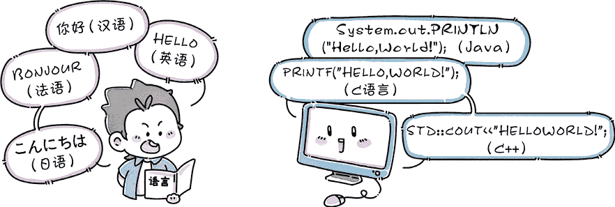

图 1-1　正如人类语言多样，计算机语言也各不相同

不同语言特性不同，适用场景各异。C 与 C++以性能见长，运行效率很高，但编写难度大、易出错。Java 性能稍逊，却好用且跨平台迁移方便。

Python 也是一门程序语言，简洁易上手，极受欢迎。表 1-1 列出 2021 年 8 月流行度前五的编程语言，其中就包括 Python。

表 1-1　2021 年 8 月流行度排名前五的编程语言

| 排名 || 编程语言 || 流行度 || 对比上月 |

| --- | --- | --- | --- |

| 1 || C || 12.57% || ↑0.95% |

| 2 || Python || 11.86% || ↓0.91% |

| 3 || Java || 10.43% || ↓0.74% |

| 4 || C++ || 7.36% || ↓0.65% |

| 5 || C# || 5.14% || ↑0.31% |

## Python 的来历

Python 的创造者是荷兰程序员吉多·范罗苏姆，曾在荷兰数学与计算机科学研究学会工作。1989 年 12 月，他为打发圣诞假期而构思新语言，这个想法就是 Python。当然一周内完成不现实，假期后他继续完善，于 1991 年以开源形式发布了最初版本 Python 0.9.0。到 2021 年 8 月，Python 3.10 基本开发完成，数以万计的开发者参与贡献。

趣闻　什么是开源？

“开源”即开放源代码。大多数商业软件只能使用，看不到内部代码，这类叫闭源。有些开发者公开源代码，让大家了解原理并共同改进，这就是开源软件。开源协作是计算机飞速发展的重要推动力，很多关键技术都诞生于此。

Python 这个词本意是“大蟒蛇”，选它不是因为想让语言像蟒蛇一样强壮，而是范罗苏姆喜欢《巨蟒剧团之飞翔的马戏团》这部剧。

## Python 为什么适合做 AI

Python 语言非常简洁，贴近人类思维。和 C 语言要求程序员迁就机器不同，Python 让机器更贴近人。好的 Python 代码就像一个用英语表达极其严谨的人在说话，易读易懂。用它可以专注解决问题，而不是纠结语法规则。这也是 AI 领域青睐它的原因——做 AI 已经够难了，写代码就该省点力。

Python 也有短板，比如运行速度相对慢，而 AI 通常计算量大，需要快速。好在 Python 有一个优势：**能很方便地调用其他语言写的程序段**。计算密集的部分可用 C 等高性能语言实现，再用 Python 搭建整体结构并调用，兼顾开发效率与运行速度。因此 Python 常被戏称为“**胶水语言**”，像胶水一样把各零件粘合在一起，如图 1-2 所示。


图 1-2　Python 常被称作“胶水语言”

因为上手快，AI 领域已有大量开发者为 Python 制作好用的“零件”，也就是**Python 库**，并以开源精神分享出来，让生态更完善。

趣闻　Python 之禅

为 Python 开发作出重要贡献的程序员蒂姆·彼得斯写了一首小诗来描述理想的 Python 代码。

**Python 之禅**

优美而不丑陋，

明了而不隐晦，

简单而不复杂，

复杂而不凌乱，

扁平而不嵌套，

稀疏而不稠密，

可读性很重要，

即使实用比纯粹更优，

特例亦不可违背原则。

错误绝不能悄悄忽略，

除非它明确需要如此。

面对不确定性，

拒绝妄加猜测。

任何问题应有一种，

且最好只有一种，

显而易见的解决方法。

除非你是荷兰人，否则这方法一开始并非如此直观。

做总比不做强，

但是冒失去做还不如不做。

很难解释的，必然是坏方法。

很好解释的，可能是好方法。

命名空间是个绝妙的主意——我们应好好利用它！

**The Zen of Python**

Beautiful is better than ugly.

Explicit is better than implicit.

Simple is better than complex.

Complex is better than complicated.

Flat is better than nested.

Sparse is better than dense.

Readability counts.

Special cases aren’t special enough to break the rules.

Although practicality beats purity.

Errors should never pass silently.

Unless explicitly silenced.

In the face of ambiguity,

refuse the temptation to guess.

There should be one——and preferably only one——obvious way to do it.

Although that way may not be obvious at first unless you’re Dutch.

Now is better than never.

Although never is often better than \*right\* now.

If the implementation is hard to explain, it’s a bad idea.

If the implementation is easy to explain, it may be a good idea.

Namespaces are one honking great idea —— let’s do more of those!

## 如何安装 Python

要写程序，先装好运行环境。本书介绍两种常用做法：一是直接安装原生 Python 并使用自带的 **IDLE** 编程；二是使用面向初学者的集成开发环境 **Thonny**。

安装与操作系统相关，本书以 Windows 10 为主，也会提到 macOS 的情况。

### 直接从官网下载 Python

# 安装与初体验

## 安装 Python

最简便的方法是官网下载。打开 Python 官方网站，鼠标移到“Downloads”上，页面会自动显示最新稳定版的下载按钮，并按 Windows 或 macOS 自动匹配。编写本书时，适配 **Windows 10 系统**的最新稳定版是 3.9.6，点击“Python 3.9.6”按钮即可下载，如图 1-3 橙色箭头所示。

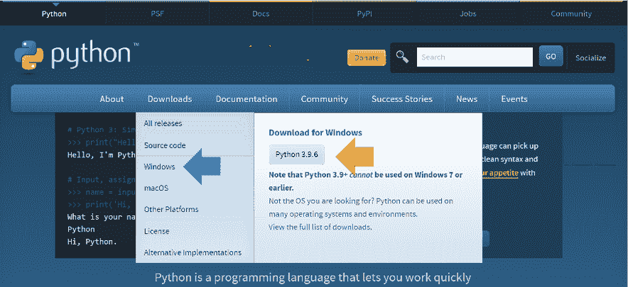

图 1-3　下载 Python 3.9.6

如果你用的是 **更早的 Windows 系统，比如 Windows 7**，需要点击“Downloads”菜单里的“Windows”选项，如图 1-3 蓝色箭头，打开版本选择页面，如图 1-4。

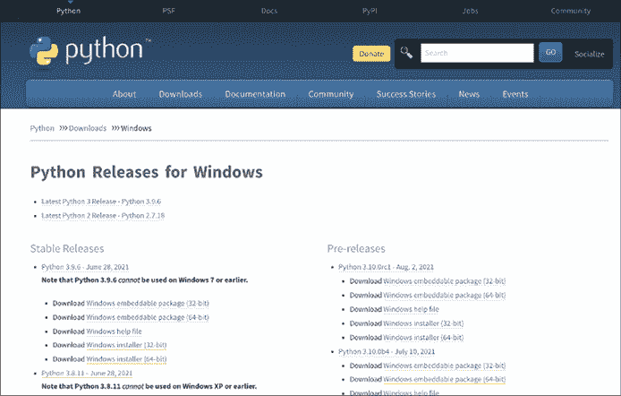

图 1-4　Python 官网的下载版本选择页面

在版本列表找到“Python 3.8.10 - May 3, 2021”，根据电脑是 **32 位还是 64 位**选择对应的下载包，32 位对应橙色箭头，64 位对应蓝色箭头，如图 1-5。

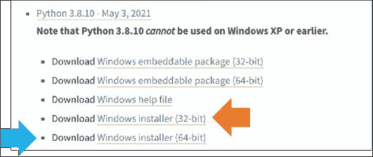

图 1-5　Python 3.8.10 - May 3, 2021

不确定系统位数可以在“开始”菜单找到“计算机”，右键选择“属性”，如图 1-6，即可在“系统”类型条目中看到准确信息，如图 1-7。

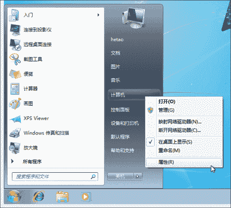

图 1-6　Windows 7 系统的“开始”菜单

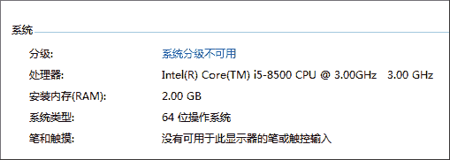

图 1-7　计算机属性中的“系统”类型

如果使用 Windows XP 等更老系统，建议先升级，以免部分内容无法运行。

下载完成后运行 Python 3.9.6 安装程序，勾选下方两个复选框后点击“`Install Now`”，如图 1-8。若你对 Python 比较熟悉，也可以选择“`Customize installation`”自定义安装项。

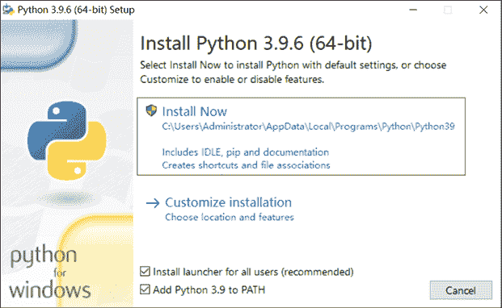

图 1-8　安装 Python

稍等片刻后安装程序提示成功，点击“`Disable path length limit`”，再点“`Close`”完成安装，如图 1-9。

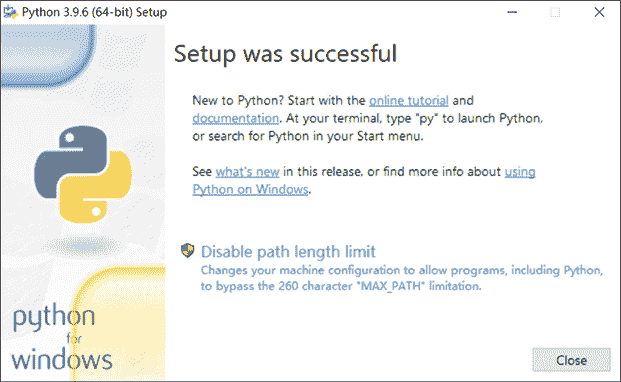

图 1-9　安装成功

安装完成后可用自带的 IDLE 编写程序。在“开始”菜单找到 Python 3.9 文件夹，打开 IDLE，如图 1-10。macOS 用户可在启动台找到 IDLE。

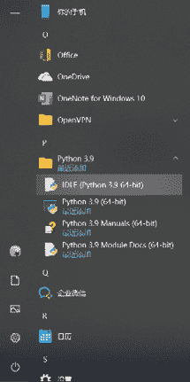

图 1-10　在“开始”菜单中找到 IDLE（Windows 10 系统）

图 1-11 这个界面叫 **IDLE Shell**，也称交互模式。直接在此输入 Python 代码，即可看到返回结果。

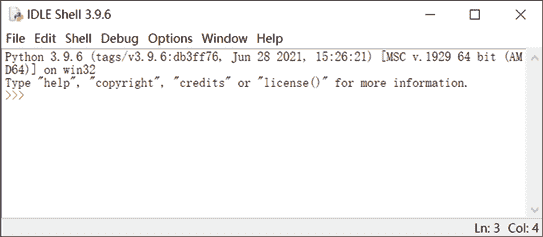

图 1-11　IDLE Shell 窗口

### 用 Thonny 编写 Python

Thonny 是一款面向 Python 初学者的开源集成开发环境，上手非常容易。先打开 Thonny 官方网站，如图 1-12。

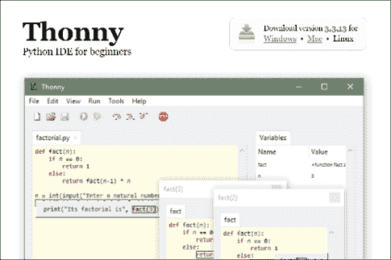

图 1-12　Thonny 官方网站

页面右上角根据操作系统选择对应选项，如 Windows，即可下载最新版 Thonny。编写时最新版本是 3.3.13。

下载后运行安装程序，可能会弹出“`Select Setup Install Mode`”对话框，选择“`Install for me only（recommended）`”，如图 1-13，开始正式安装。


图 1-13　选择安装模式

按提示点击“`Next`”，如图 1-14。

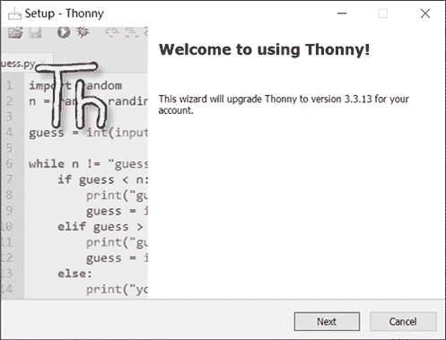

图 1-14　欢迎安装页面

下一步选择“`I accept the agreement`”，点击“`Next`”，如图 1-15。

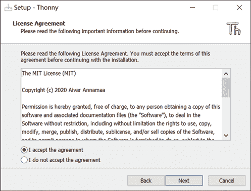

图 1-15　选择接受协议

在图 1-16 页面勾选“`Create desktop icon`”，点击“`Next`”。


图 1-16　选择生成桌面图标

最后点击“`Install`”按钮，如图 1-17。

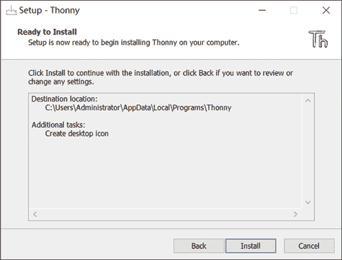

图 1-17　准备安装界面

观察图 1-18 的进度条，出现图 1-19 的“`Great success！`”提示后，点击“`Finish`”按钮，安装结束。

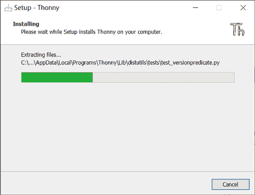

图 1-18　查看进度条

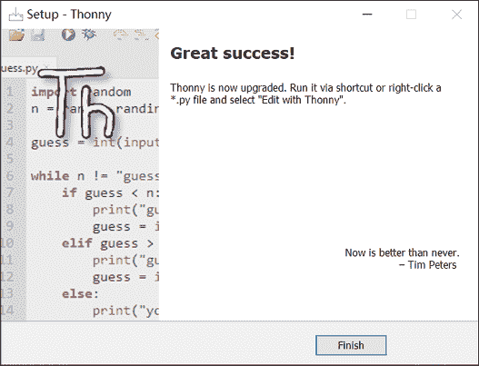

图 1-19　安装结束

想中断安装时，直接点图 1-18 中的 `Cancel` 按钮即可。安装完成后，桌面会生成 Thonny 的快捷方式图标，见图 1-20，双击它就能启动 Thonny 开始写 Python 程序。


图 1-20　Thonny 的快捷方式图标

Thonny 的整体布局很简洁，除文中已提到的菜单和按钮外，界面大致可分成三块。现阶段我们主要关注图 1-21 所示的 **“Shell”区域**，它与前面讲到的 IDLE 主界面功能一致，都属于交互模式。在这里敲入代码，按一下 `Enter` 键就能立刻得到返回结果。

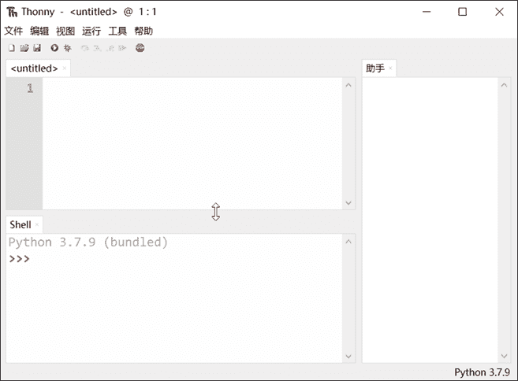

图 1-21　“Shell”区域

若觉得 Shell 窗口太窄，可把鼠标移到分隔线上，等光标变成图 1-21 那样的上下箭头后，上下拖动箭头就能调整 Shell 的大小。

Thonny 在视觉和易用性上比 IDLE 更友好，也提供若干便捷功能。Thonny 3.3.13 自带的 Python 版本是 3.7.9，并非最新，但完全足够运行本书示例。可同时保留原生 Python 的 IDLE 与 Thonny，两者在默认设置下互不干扰。

## 先模仿再理解

已接触过 Python 的读者可以直接跳过本节，进入第 2 章。没有基础也没关系，后面会简明地介绍常用的基本用法。

本书并非要系统全面地讲解 Python，只会挑选后续内容会用到的基础点进行说明，不会覆盖整门语言。若想深入学习，建议另选专业教材或课程。

绘画书法多从临摹起步，做题也要先看例题，学编程同样可以从模仿开始。本书会给出示例代码，方便你复制到电脑上并思考其运行机理。

程序语言要求极严格，初次上手务必保证输入与书中完全一致，字母与符号都需在英文输入状态下敲入，否则容易出错。

弄懂示例后，可尝试做少量修改，先推测结果再执行，验证是否与预期相符。能按自己的想法改写并得到想要的输出，就说明相关知识点已掌握。

由于本书侧重入门，示例代码刻意减少对各种特性的使用，每段程序都还有优化空间。等对 Python 更熟悉后，再回头改进也不迟。

## 第一次打印 Hello world

程序员的第一个练习通常是让屏幕输出 `Hello world`。

在 Python 里实现起来很简单。**在 IDLE 或 Thonny 的 Shell 交互模式中**，按程序 1.1 的方式输入，然后回车执行。其中 Shell 窗口里本就显示的 `>>>` 不需要手动输入。**注意引号要使用英文输入法下的字符**，可自行对比英文引号与中文引号的差异。

注：不同系统的字体库不同，你看到的引号形状可能与书中略有出入，以实际为准。

程序 1.1　输出 Hello world

```
>>> print("Hello world")
```

输入无误时，Shell 会在下一行显示：

```
Hello world
```

呈现效果见图 1-22 与图 1-23。

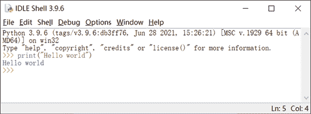

图 1-22　IDLE 交互模式的“Hello world”

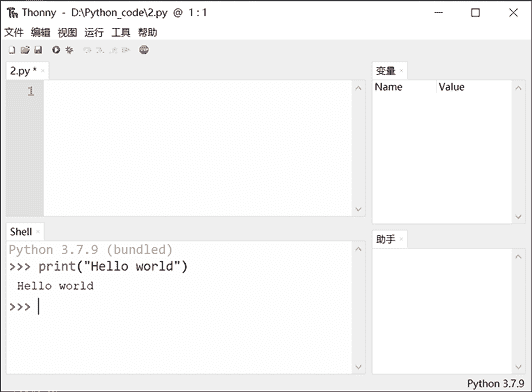

图 1-23　Thonny 交互模式的“Hello world”

若出现图 1-24 的红色提示，说明写法有误。提示说 `pirnt` 未定义，正是因为把 `print` 拼成了 `pirnt`。

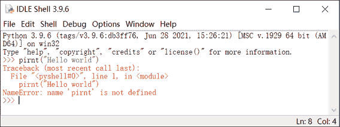

图 1-24　代码拼写错误

使用 Thonny 时，右侧的助手窗口会给出更清晰的英文说明，觉得干扰可点 `×` 关闭。

后续凡在 Shell 交互模式下运行的代码，均以 `>>>` 作为输入前缀，而不带前缀的是程序输出。这样书中的示例与你在电脑上看到的内容基本一致。

`print()` 的作用是将括号内的内容呈现在屏幕上。这类具有特定功能的代码称为 **函数**，括号里的部分是 **函数的参数**。你会发现 `Hello World` 外面有一对引号，但引号本身不会被打印。引号的作用是标明 `Hello World` 是一个字符串，相当于手写文字，如图 1-25。

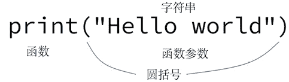

图 1-25　函数的构成

可把引号内的内容换成数字或中文试试效果，如程序 1.2。

程序 1.2　print()练习

```
>>> print("1+1=2")
1+1=2
>>> print(1+1)
2
>>> print("你好，世界。")
你好，世界。
>>> print(3,"Python",3+8)
3 Python 11
```

注意 **引号必须成对出现**，内部可包含中文标点。若想一次输出多个内容，可用英文逗号 `,` 分隔，输出时各内容之间会以空格隔开。

## 代码自动补全

IDLE 与 Thonny 都支持 **自动补全/自动完成**。输入代码词汇的一部分，例如 `print`，再按 `Tab` 键，Python 会自动补齐。注意自动补全针对的是代码词汇，而不是普通英文单词。

补全方式唯一时，如输入 `pri` 再按 `Tab`，会直接变为 `print`。存在多种可能时，如只输入 `pr` 按 `Tab`，会弹出候选列表，可用鼠标选择，也可用上下键定位后按 `Tab` 确认，IDLE 中需按两次 `Tab`。该功能提升输入效率，减少记忆负担，也能降低拼写错误，例如把 `print` 写成 `pirnt` 的情况。

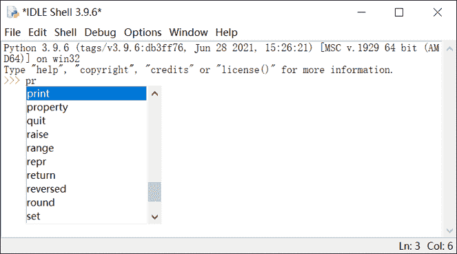

图 1-26　IDLE Shell 的自动补全功能

## 注意首行空格

在 Shell 区域输入时，若出现类似下图的报错，通常是因为行首不小心敲入了 **空格**。

```
这里多了一个空格
   ↓
>>>  print(1)
  File "<stdin>", line 1
    print(1)
    ^
IndentationError: unexpected indent
```

实际上 Python 中行首的空格决定程序的逻辑关系，Shell 中一般不需要在开头加空格。

## 把 Python 当计算器用

计算机最基础的能力就是计算，常见的数学运算都能用 Python 完成。你完全可以把它当作计算器使用。程序 1.3 展示了 **数学运算符** 在 Python 中的写法。

程序 1.3　数学运算符示例

```
>>> 10 + 20                        # 加法 +
30
>>> 10 – 20                        # 减法 -
-10
>>> 10 * 20                        # 乘法 ×
200
>>> 9 / 2                          # 除法 ÷
4.5
>>> 10 % 3                         # 返回除法的余数，在编程中通常称为取模
1
>>> 2 ** 3                         # 幂（乘方），2³
8
>>> 9 // 2                         # 向下整除，得到小于商 4.5 的最大整数 4
4
>>> -9 // 2                        # 得到小于商-4.5 的最大整数-5
-5
```

除加减乘除外，大小比较也很常见，这用到 **比较运算符**。比较的结果不是数值，而是逻辑上的真 `True` 与假 `False`，也可存入变量，后续介绍数据类型时会再展开。

程序 1.4　比较运算符示例

```
>>> 2 > 1                 # 判断是否大于 ，2>1 得到真
True
>>> 2 < 1                 # 判断是否大于，2<1 得到假
False
>>> 3 >= 3                # 判断是否大于或等于≥，3 等于 3 所以 3>=3 得到真
True
>>> 3 <= 3                # 判断是否小于或等于≤
True
>>> 3 == 3                # 判断是否相等
True
>>> 3 != 3                # 判断是否不相等，3 等于 3 所以得到假
False
>>> 3 != 4                # 3 不等于 4，所以得到真
True
```

还有 **逻辑运算**，即对真假值进行计算。本书常用三种：**逻辑与 `and`**、**逻辑或 `or`**、**逻辑非 `not`**。

`and` 类似日常的“且”，只有 `A` 与 `B` 皆为 `True` 时，`A and B` 才为 `True`，否则为 `False`。`or` 类似日常的“或”，只要 `A` 或 `B` 有一个为 `True`，`A or B` 就是 `True`，两皆为 `False` 才为 `False`。`not` 取反，`A` 为真则 `not A` 为假，反之亦然。示例如程序 1.5。

程序 1.5　逻辑运算符示例

```
>>> 2 > 1 and 2 < 1       # 逻辑与 and，"真 and 假"得到假
False
>>> 2 > 1 and True
True
>>> 2 > 1 or 2 < 1        # 逻辑或 or，"真 or 假"得到真
True
>>> x = False
>>> not x                 # 逻辑非 not，"not 假"得到真
True
```

Python 还有更多运算符，后续用到时会再介绍。

与数学中先乘除后加减类似，Python 运算符也有优先级。表 1-2 按从上到下优先级递减排列，同行优先级相同。

表 1-2　常用运算符的优先级

| 运算符 | 优先级描述 |
| --- | --- |
| `**` | 幂，优先级最高 |
| `*, /, %, //` | 乘、除、取余、取整除 |
| `+, -` | 加、减 |
| `<=, <, >, >=` | 大小判断 |
| `==, !=` | 相等性判断 |
| `=` | 赋值，后文详述 |
| `not，and，or` | 逻辑运算符 |

另外，括号内的表达式总是优先计算。Python 中起作用的只有 **圆括号 `()`**，即数学小括号。若不确定计算顺序，最好显式加括号。复杂的嵌套会显得眼花，例如下面这组表达式结果为 34359738368.0：

```
18//((1+2)*3/4**((1+3)*5-3))
```

数学中的中括号 `[]` 在 Python 里称为方括号，有其他用途，后文会说明。

## 认识变量

直接使用字符串、数字等数据可以，但对同一组数据重复操作时就不够方便。

方程里常用字母代表数值，编程中用 **变量** 保存数据。例如 Hello world 程序也可以写成程序 1.6 的形式。

程序 1.6　使用变量

```
>>> a = "Hello world"
>>> print(a)
Hello world
```

其中 `a` 就是变量，`a = "Hello world"` 的意思是把字符串 `"Hello world"` 存进 `a`，这个过程叫 **赋值**，变量里保存的内容叫 **值**。

首次赋值即创建变量，常称为声明或定义变量。定义后同样可以使用自动补全。

赋值号 `=` 并非数学等号，而是 **赋值运算符**，表示把右边的内容存到左边变量里。右边可以是数据，也可以是需要计算的表达式，如 `a = 1 + 1`，则 `a` 的值为 2，如图 1-27。

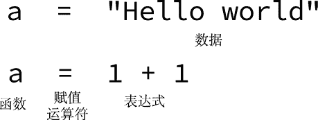

图 1-27　赋值语句的代码成分

可把变量想象成能装东西的盒子。盒子里装的是苹果，别人只要拿盒子就能拿到苹果，而不是把苹果拆出来。不要像图 1-28 的禾木那样把内容“吃掉”。


图 1-28　使用变量（就是使用变量的值，而不是把变量清空）

变量可随时重新赋值。例如程序 1.7 中 `b` 先为字符串 `"你好，世界！"`，后变成数字 `2`。也可把变量看作贴在数据上的标签。

程序 1.7　变量赋值

```
>>> b = "你好，世界！"
>>> print(b)
你好，世界！
>>> b = 1+1
>>> print(b)
2
```

**赋值时，计算机先算出等号右边的结果，再赋给左边。** 数学中 `x = x + 1` 无解，但在 Python 中表示把 `x` 的值加 1 再写回 `x`，如程序 1.8。

程序 1.8　变量自增

```
>>> x = 1
>>> x = x + 1
>>> print(x)
2
```

第一行把 `x` 设为 1，第二行右边先取到 1，再加 1 得到 2，最后写回 `x`，于是 `x` 变为 2。

Python 支持一次赋多个变量，如 `a = b = c = 1` 使三者同为 1；`a, b = 2, 3` 分别赋值；还可通过 `b = a` 实现复制，用 `a, b = b, a` 交换值。程序 1.9 演示了这些用法。

程序 1.9　变量赋值在 Python 中的示例

```
>>> a = b = c = 1                    # 使用连等号=给多个变量赋相同的值
>>> print(a,b,c)
1 1 1
>>> a, b, c = 2, 1, 3*5              # 使用逗号，给多个变量分别赋值
>>> print(a,b,c)
2 1 15
>>> c = a                            # 用一个变量给另一个变量赋值
>>> print(c)
2
>>> a, b = b, a                      # 使用逗号，交换变量 a 和 b 的赋值
>>> print(a,b)                       # 显示变量 a 和 b 的值
1 2
```

变量命名需遵守规则：只能以字母或下划线 `_` 开头，不能以数字开头；不能与 Python 的关键词重复。Python 的关键词包括下面这些：

# Python 变量命名与数据类型入门笔记

Python 为了让解释器能正常识别指令，预留了一组关键字，这些名字不能拿来当作变量或函数使用：
`True` `False` `None` `if` `elif` `else` `and` `or` `not` `for` `in` `while` `break` `continue` `def` `yield` `return` `from` `import` `as` `assert` `class` `del` `global` `nonlocal` `is` `lambda` `pass` `raise` `try` `except` `with` `finally`

除此之外，像 `!@#之` 这类特殊符号也不能出现在标识符里。名字不符合规范，代码就无法运行。请问下面哪个变量名是错误的？

```
Asd　　name　　123age　_hao　名字　__ming_zi　haha！
```

答案是第三个和最后一个，也就是 `123age` 和 `haha！`。`名字` 这种写法在语法上是可用的，Python 支持使用汉字来命名变量，只是实际开发中不建议这么做。

除了语法限制，给变量起名字时最好用一看就懂的词。比如保存姓名就用 `name`，保存年龄就用 `age`。用拼音命名也可以，但全篇要保持统一风格。

需要注意的是，你完全可以把变量命名为 `print`，例如 `print = 1`。这么做之后，原本的输出功能会被遮蔽，这个名字就只是一个保存数值 1 的普通变量。重启解释器后，内置功能会恢复正常。

Thonny 提供了一个很方便的查看工具：点开菜单栏的“视图”，勾选“变量”，就能打开变量窗口。窗口里会实时列出当前已声明的变量及其对应的值，如图 1-29 所示。

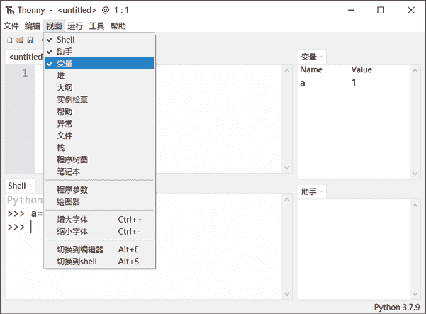

图 1-29　Thonny 的“变量”窗口

## Python 中的数据类型

前面用到过数字 `10`、`2`、`3` 以及字符串 `"Hello World"`，它们属于不同的类型。Python 常见的类型有数字、字符串、列表、元组、字典等。

### 数字
数字类型里最常见的是整数 `int`，比如 1，和浮点数 `float`，比如 1.0。数字可以做各种数学运算。

还有一种特殊的数字类型是布尔型 `Bool`，只有 `True` 和 `False` 两个取值，用来表示逻辑真假，也常被称为逻辑型。比较运算和逻辑运算的结果就是布尔值。

在计算机底层，`True` 和 `False` 本质上就是 1 和 0，所以 `True + True` 会得到 2，这也是布尔型被归为数字类型的原因。Python 区分大小写，布尔值必须写成 `True`、`False`，写成 `true`、`false` 会报错。返回布尔值的表达式常叫做布尔表达式或逻辑表达式。

### 字符串
文字在 Python 里用字符串 `str` 表示，由一对引号括起来的字符序列。可以用单引号 `'Hello world'`，也可以用双引号 `"Hello world"`，前后必须一致。

字符的位置叫索引，也有人称下标。Python 的索引从 0 开始，`"Hello world"` 中 `H` 的位置是 0，空格也占一个位置，如图 1-30 所示。通过索引可以取单个字符，例如 `string = "Hello world"` 时 `string[0]` 是 `H`，`string[-1]` 是倒数第一个字符 `d`，负号表示从末尾往前数。你可以试试 `print(string[0])` 的结果。字符串一旦创建就不能修改其中的字符，如程序 1.10 所示。

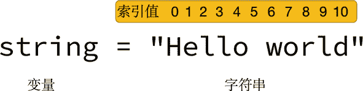

图 1-30　字符串的构成

想取一段文字可以用切片 `string[m:n]`，取到第 m 个到第 n-1 个字符，省略冒号前或后代表取到开头或结尾。试着运行程序 1.10 的代码体会切片的含义。

程序 1.10　字符串访问字符和切片在 Python 中的示例

```
>>> string = "Hello world"        # 创建字符串
>>> print(string[0])              # 显示字符串的 0 号（第一个）字符
H
>>> print(string[-2])             # 显示字符串的倒数第二个字符
l
>>> string[3:5]                   # 用切片访问字符串的 3、4 号字符
'lo'
>>> print(string[:7])             # 显示字符串的 0～6 号字符
Hello w
>>> print(string[4:])             # 显示字符串的 4 号～结尾字符
o world
>>> string[0] = 'h'               # 不能给字符串 0 号字符重新赋值（修改字符串）
Traceback (most recent call last):       <==程序报错无法运行
  File "<stdin>", line 1, in <module>
TypeError: 'str' object does not support item assignment
```

注意 `print()` 的区别：不带 `print()` 直接显示会带引号，表示数据本身；使用 `print()` 则只显示内容，不带引号。

`1` 和 `"1"` 看起来相似，实际完全不同。数字能做数学运算，字符串不能。字符串相加是拼接，字符串乘以整数是重复，字符串乘以字符串会报错，如程序 1.11 所示。

程序 1.11　数字和字符串运算在 Python 中的示例

```
>>> 1 + 1                        # 数字进行加法+运算
2
>>> '1' + '1'                    # 字符串 + 字符串，可得到连接后的字符串
'11'
>>> '12' * 3                     # 字符串 * 数字，得到重复多次的字符串
'121212'
>>> '1' * '1'                    # 字符串 * 字符串，程序报错，无法运行
Traceback (most recent call last):
  File "<stdin>", line 1, in <module>
TypeError: can't multiply sequence by non-int of type 'str'
```

`len()` 函数可以快速得到字符串长度，如程序 1.12 所示。

程序 1.12　`len()` 函数

```
>>> string = "Hello world"
>>> len(string)
11
```

### 列表
列表 `list` 用方括号 `[]` 包裹，元素之间用逗号分隔。它可以存放多个数据，元素可以是数字、字符串，也可以是列表、元组、字典等，甚至类型各不相同，如图 1-31 所示。

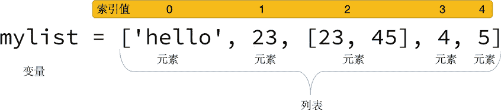

图 1-31　列表的构成

列表通过 `列表名[数字]` 访问元素，和字符串一样支持切片。对于嵌套列表可以用连续的中括号访问。列表是可以改写的，元素可以重新赋值，如程序 1.13 所示。

程序 1.13　列表使用和赋值示例

```
>>> mylist = ['hello', 23, 3, [2, 45]]  # 创建列表
>>> mylist[0]              # 访问列表中 0 号元素，这是一个字符串
'hello'
>>> mylist[:2]             # 切片访问前两个（0、1 号）元素，得到 2 个元素的列表
['hello', 23]
>>> mylist[-3:]            # 切片访问倒数 3 个元素，得到 3 个元素的列表
[23, 3, [2, 45]]
>>> mylist[3]              # 访问 3 号元素，这个是一个列表
[2, 45]
>>> mylist[3][1]           # 嵌套访问 3 号元素（列表）中的 1 号元素
45
>>> mylist[0] = 0          # 重新赋值 0 号元素
>>> mylist[1:] = [1,2,3]   # 重新赋值 1 号到最后的元素
>>> mylist                 # 调用改变后的列表进行查看
[0, 1, 2, 3]
```

列表同样支持 `+`、` * ` 和 `len()`，如程序 1.14 所示。

程序 1.14　列表运算符示例

```
>>> [1] + [1]                       # 列表 + 列表，得到连接后的列表
[1, 1]
>>> [1,2] * 3                       # 列表 * 数字，得到多次重复的列表
[1,2,1,2,1,2]
>>> len([0,4,5])                    # len(列表)，得到列表长度（元素个数）
3
```

列表还有其他便捷操作，如程序 1.15 所示。

程序 1.15　操作列表的其他方法

```
>>> x = [1, 2, 3]
>>> x.append(4)        # 列表.append(元素)，将元素增加到列表末尾
>>> x
[1, 2, 3, 4]
>>> x.extend([5,6])    # 列表.extend(列表)，将两个列表拼接，类似列表 + 列表
>>> x
[1, 2, 3, 4, 5, 6]
```

### 元组
元组 `tuple` 用圆括号 `()` 表示，写法和列表很像，用逗号分隔元素。访问方式相同，但元组创建后不可修改，试图修改会报错，如程序 1.16 所示。

程序 1.16　使用元组的示例

```
>>> mytuple=(1,2,3)                      # 定义元组 mytuple
>>> mytuple[1]                           # 访问元组中 1 号元素
2
>>> mytuple[0]=5                         # 修改元组中元素会报错
Traceback (most recent call last):
  File "<stdin>", line 1, in <module>
TypeError: 'tuple' object does not support item assignment
```

正因为不可变，元组在传递过程中不会被意外改动，这在需要稳定数据的场景下很有用。

### 字典
字典由多个键值对组成，键 `key` 相当于索引，可以自行指定，每个键对应一个值 `value`。写法是用花括号 `{}` 包裹，键值对之间用逗号分隔，键和值之间用冒号分隔，如图 1-32 所示。

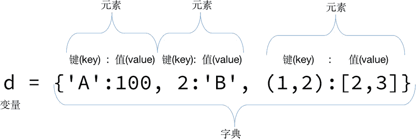

图 1-32　字典的构成

值可以是任意类型，键只能是不可变类型，如字符串、数字、元组。列表或字典不能作为键。用方括号和键可以取值，如程序 1.17 所示。

程序 1.17　使用字典的示例

```
>>> d = {'A':100, 2:'B', (1,2):[2,3]}        # 定义字典 d
>>> d['A']                      # 访问字典中键'A'对应的值(键可以是字符串)
100
>>> d[2]                        # 访问字典中键 2 对应的值(键可以是数字)
'B'
>>> d[(1,2)]                    # 访问字典中键(1,2)对应的值(键可以是元组)
[2, 3]
>>> d['A':2]                    # 对字典切片会报错
Traceback (most recent call last):
  File "<pyshell>", line 1, in <module>
    TypeError: unhashable type: 'slice'
```

字典在内存中没有顺序，因此不能像列表或字符串那样进行切片操作，即使键是 0、1、2 也一样不行。

## 保存编写的程序
交互模式 Shell 像计算器一样每次只能输一行，代码不方便保存和复用。编辑器模式可以自由编写、编辑并反复运行完整的程序。

### IDLE 的编辑器模式
在 IDLE 中依次选择“File”→“New File”，即可打开编辑器窗口，如图 1-33 所示。

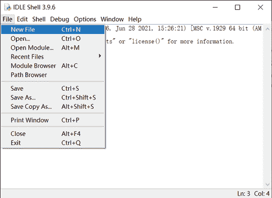

图 1-33　打开 IDLE 编辑器窗口

在编辑器里输入之前在 Shell 用过的代码，如程序 1.18 所示。

程序 1.18　尝试使用编辑器

```
print("Hello world")
1+1
```

编辑器支持自动补全。要显示行号，可依次选择“Options”→“Show Line Numbers”，如图 1-34 所示。行号仅供参考，不要当成代码。

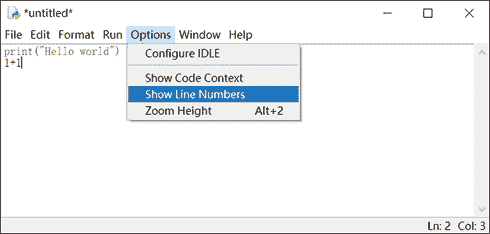

图 1-34　显示行号的命令

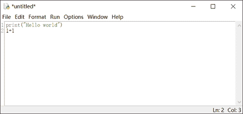

图 1-35　显示了行号的代码

保存时选择“File”→“Save”，文件扩展名为 `.py`，这就是 Python 脚本文件，如图 1-36 所示。

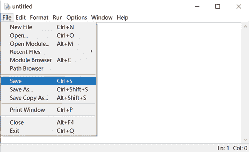

图 1-36　保存程序文件

运行程序可选择“Run”→“Run Module”或按 F5，如图 1-37 所示。部分笔记本需要同时按 Fn+F5。

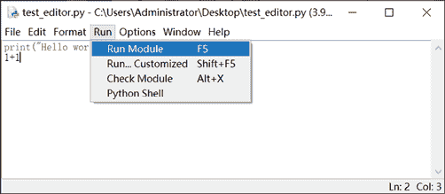

图 1-37　运行程序

运行结果会回到 Shell 窗口输出，如图 1-38 所示。注意，只有通过 `print()` 等函数的内容才会被显示出来，单纯的计算语句不会输出。

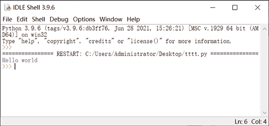

图 1-38　显示在 Shell 窗口的程序运行结果

程序运行后 Shell 中的变量会保留最终状态，可以继续交互使用，如图 1-39 所示。但再次运行新文件前，旧数据会被清空。

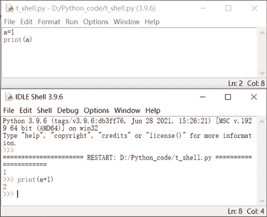

图 1-39　程序运行完毕后可以在 Shell 窗口继续操作变量

### Thonny 的编辑器模式
Thonny 的编辑器位于 Shell 区域上方，如图 1-40 所示。

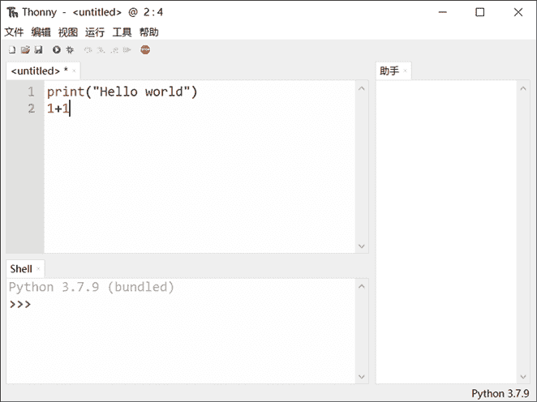

图 1-40　Thonny 的编辑器

Thonny 编辑器同样支持自动补全，行号会自动显示在左侧。

Thonny 窗口顶部集中了几项常用操作：新建文件、打开文件、保存文件、运行程序、开启调试以及停止并重启内核。整体布局可参考图 1-41 所示。把鼠标停在任意图标上停留片刻，按钮名称会即时浮现。

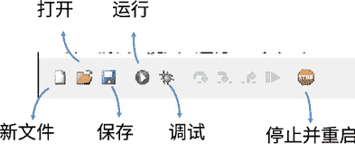

图 1-41　Thonny 中的相关按钮

点按运行后，已保存的脚本就会被执行。程序结束后 Shell 面板里保留的变量仍然可用，便于继续操作。再次启动同一个文件前，先前的数据会自动清空；按下停止并重启键，也能达到同样的重置效果。

点按调试即可进入当前脚本的调试模式。**调试也就是 Debug**，是写代码时排查错误的常规手段。双击行号区域，行尾会出现一个红点，说明在此处放置了断点。

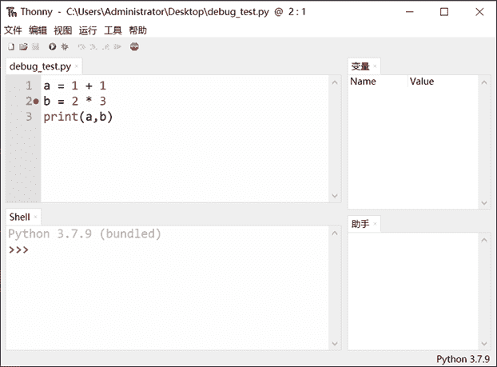

图 1-42　在 Thonny 中设置断点

采用调试方式运行，程序会在断点前暂停。暂停期间可以查看变量窗口的实时数值，也能在 Shell 中输入命令检验中间结果是否符合预期，示意见图 1-43。

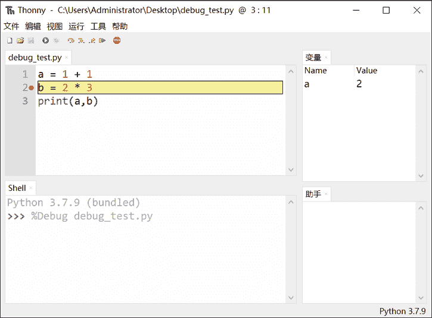

图 1-43　Thonny 调试

篇幅所限，其余细节不展开，可参考专业的 Python 编著深入学习。

IDLE 亦提供调试能力。在编辑区右键单击选择 Set Breakpoint 来设置断点，见图 1-44，随后在 Shell 菜单里打开 Debug→Debugger 启动调试器，如图 1-45 所示。

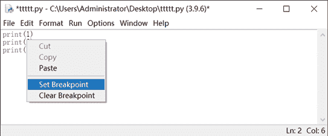

图 1-44　设置断点

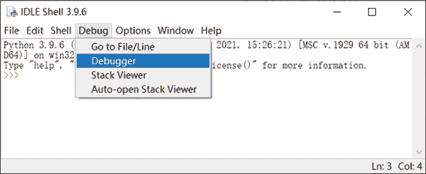

图 1-45　打开调试器

## Python 语言的逻辑结构

写作讲求逻辑，编程亦然。程序的执行方式可归纳为顺序、分支与循环三大结构。

### 顺序结构

Shell 中输入的指令总是先完成当前行再进入下一行，如图 1-46。这种按书写顺序逐条推进的方式称为顺序结构，是最基础、最常见的执行形式。

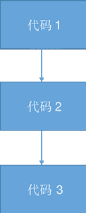

图 1-46　顺序结构

现实问题往往需要判断与选择，这就引出了分支结构。

### 分支结构

密码是保护信息的重要手段，登录或支付时都需要校验。若要编写校验程序，需要先接收输入，再与存储的密码对比，相同则通过，不同则提示错误。

**如果……那么……否则……，这正是一种分支。在 Python 中可用 `if`、`elif` 和 `else` 构建分支。**

分支的通用写法是 `if` 后接布尔表达式。表达式为真时执行第一段代码块，执行完后跳过第二段；为假时跳过第一段执行第二段，如图 1-47 所示。

```
if 布尔表达式:
    代码块 1
else:
    代码块 2
```

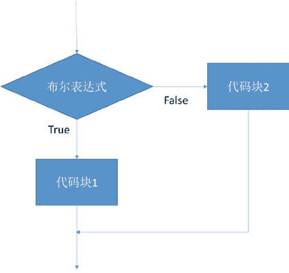

图 1-47　选择结构

两段代码块都以缩进标识层级，Python 用缩进来表示隶属关系，相同缩进即同属一层。连续多行保持一致缩进就构成同一个代码块，通常采用 4 个空格。

程序 1.19 示范了如何用分支判断密码。`input()` 会把提示文字显示出来并接收用户输入，按 Enter 后返回字符串赋给变量 `password`。`#` 后的内容为注释，不参与执行，冒号需使用英文状态。

程序 1.19　使用分支结构来判断密码

```
1    password = input("请输入密码：")       # 向程序输入密码
2    correct_pass = "123456"              # 正确的密码是 123456
3    if password == correct_pass:         # 比较输入的密码和正确的密码
4        print("密码正确")                 # 比较结果为 True 则显示密码正确
5        print("欢迎进入")                 # 相同的缩进说明属于同一个代码块
6    else:                                # 否则
7        print("密码错误")                 # 显示密码错误
```

需要多次判断时，可在中间加入一个或多个 `elif`：

```
if 布尔表达式 1:
    代码块 1
elif 布尔表达式 2:
    代码块 2
else:
    代码块 3
```

例如程序 1.20 把分数映射为评价，90 分及以上为优秀，60 到 89 为良好，60 以下为不合格。因为 `input()` 返回字符串，比较前需用 `int()` 转为数值。

程序 1.20　使用`elif`的示例

```
1    score = input("请输入分数:")             # 输入分数
2    score = int(score)                      # 将分数字符串转换为数字
3    if score >= 90:
4        print("优秀")
5    elif 60 <= score < 90:
6        print("良好")
7    else:
8        print("不合格")
```

Python 支持 `60 <= score < 90` 这样的链式比较，等价于 `60 <= score and score < 90`，写法更接近数学表达。

分支还可以嵌套，即把代码块换成另一层 `if` 结构，嵌套层级的缩进需再增加 4 个空格，形成 8 个空格的层级。

```
if 布尔表达式 1:
    if 布尔表达式 2:
        代码块 1
    else:
        代码块 2
elif 布尔表达式 3:
    代码块 3
else:
    代码块 4
```

### 循环结构

有时需要反复执行同一段代码，例如用 `*` 拼出 3×3 方阵，直接写三次输出即可，如程序 1.21 这样的代码。

```
***
***
***
```

程序 1.21　显示星号方阵的直接方法

```
1    print('*'*3)           # '*'*3 就表示字符串'***'，参见前文字符串部分
2    print('*'*3)
3    print('*'*3)
```

当重复次数很大时，可改用循环结构。

**Python 提供两种循环，第一种是 `while` 循环。**

```
while 布尔表达式:
    循环体代码块
```

当条件表达式为真时持续执行下方代码块，条件变为假时退出循环，如图 1-48。

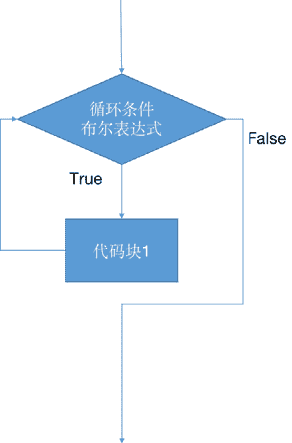

图 1-48　循环结构

前述星号方阵可用 `while` 改写为程序 1.22。

程序 1.22　使用`while`循环显示星号方阵

```
1    i = 0
2    while i <3 :
3        print('*'*3)
4        i = i + 1
```

循环变量 `i` 从 0 开始，只要 `i < 3` 就输出 `***` 并自增，执行三次后条件不成立结束。

循环变量会随着循环进行而变化，适当改动代码即可输出由 `*` 组成的三角形，见程序 1.23。

```
*
**
***
```

程序 1.23　使用`while`循环显示星号三角

```
1    i = 1
2    while i <4 :
3        print('*'*i)
4        i = i + 1
```

`while` 适合循环次数不确定的场景，例如密码错误时反复询问，直至正确为止，如程序 1.24。

程序 1.24　使用`while`循环反复询问密码，直到正确

```
1    correct_pwd = 'hetao'           # 正确的密码
2    pwd = input('请输入密码：')       # 用户输入密码
3    while pwd != correct_pwd:       # 比较密码是否正确
4        pwd = input('请输入密码：')   # 如果密码错误，则进入循环，重复输入密码
5    print('密码正确')                # 如果密码正确，则退出循环，显示"密码正确"
```

**第二种循环是 `for` 循环。**

```
for 变量 in 可迭代对象:
    循环体代码块
```

`for` 会把可迭代对象中的元素逐一赋给变量并执行循环体。字符串、列表、元组、字典等都是常见可迭代对象。

遍历一组姓名可写成程序 1.25。

程序 1.25　列出一组中所有同学的名字

```
1    Group_1 = ['禾木','桃子','乌拉乎','小核桃']
2    for name in Group_1:
3        print(name)
```

星号方阵属于执行次数确定的情形，适合 `for`，如程序 1.26 进行三次循环。

程序 1.26　使用`for`进行 3 次循环

```
1    seq = [0,1,2]
2    for i in seq:
3        print('*'*3)
```

更简洁的做法是使用 `range()`，见程序 1.27。

程序 1.27　使用`range()`函数

```
1    for i in range(3):
2        print('*'*3)
```

`range(3)` 生成 0、1、2 的序列；`range(1,3)` 生成 1、2；`range(1,6,2)` 生成 1、3、5。`range` 的结束值不包含在序列中，与切片规则一致。

`while` 与 `for` 都可配合 `break` 强行终止循环，也可用 `continue` 跳过本次循环剩余部分直接进入下一次。例如程序 1.28 中两段循环本应跑到 99，但遇到 `break` 时在变量为 3 时停止。

程序 1.28　`break`语句可以终止循环

```
1    i = 0
2    while i <100:
3        i = i + 1
4        if i==3:             # 当 i 为 3 时
5            break            # 强行中断循环
6    print(i)
7
8    for j in range(100):
9        if j==3:             # 当 j 为 3 时
10           break            # 强行中断循环
11   print(j)
```

把 `break` 换成 `continue`，循环会跳过当前剩余代码，如程序 1.29。

程序 1.29　`continue`语句可以跳过本次循环后续内容

```
1    for j in range(5):
2        if j==3:              # 当 j 为 3 时
3            continue          # 跳过后面内容
4        print(j)
```

该循环会跳过 3，输出结果如下：

```
0
1
2
4
```

## 函数

## 函数

循环能让代码重复执行，但若要在多处灵活复用某段逻辑，就需要函数。函数是对一段具备特定功能代码的封装，可重复调用。调用时传入的参数充当函数内部使用的变量。`print()`、`input()` 都是内置函数。

自定义函数定义简便，如下所示：

```
def 函数名字(参数):
    代码块
    return 结果
```

定义完成后可用 `函数名(参数)` 调用，定义位置必须在调用之前。

圆面积公式为 S=π×r²，可定义函数计算半径 3 和 8 的面积，如程序 1.30。

程序 1.30　使用函数计算圆面积

```
1    def circle_area(r):
2        S = 3.14 * r**2
3        return S
4    print(circle_area(3))
5    x = 8
6    y = circle_area(x)
7    print(y)
```

除特殊情况外，函数内部的变量仅在函数内有效，执行结束即被清除，不会留在外部。参数名与定义时使用的变量名无关，可相同也可不同。

函数也可不带参数且无返回值，例如程序 1.31 每次调用仅在屏幕输出两句问候。

程序 1.31　没有输入输出的函数

```
1    def hello():
2        print('你好世界')
3        print('Hello world')
4    hello()
```

## 注释

代码中常见的 `#` 用于书写注释，供人阅读理解，解释器会忽略其后内容。

多行注释可用三个引号包围，单双引号均可，同一段注释中需保持一致，如程序 1.32。

程序 1.32　注释

```
1    # 这里的内容是注释
2    ''' 使用 3 个单引号开始注释
3        可以进行多行注释
4        再使用 3 个单引号结束注释'''
5    """使用 3 个双引号开始注释
6        可以进行多行注释
7        再使用 3 个双引号结束注释内容"""
```

## 使用 Python 库

Python 拥有大量标准库，涵盖显示、文件操作、数学计算、时间处理、网络等功能。库通常按包、模块组织，模块提供具体函数。

使用前需导入库。例如求绝对值可使用标准库 `math` 中的 `fabs()`，常见写法见程序 1.33。

程序 1.33　使用`math`库中的绝对值函数`fabs()`

```
1    import math
2    x = math.fabs(-3)
3    print(x)
```

调用时需加上库名前缀 `math.`，以表明该函数属于 `math` 库。

库名偶尔会显得过长，写起来不顺手，这时候可以为它设定一个简短的别名来使用。举例来说，程序 1.34 就演示了把 `math` 导入时重命名为 `mt` 的写法。取名时务必留意别造成命名冲突。

程序 1.34 给 math 库起别名

```
1    import math as mt
2    x = mt.fabs(-3)
3    print(x)
```

如果只需要用到库里的少数几个函数，就没必要把整个库都搬进来，可以直接导入所需函数。下面这段代码只拿了 `fabs()`，并没有把 `math` 全部引入。如此一来，调用时就无需加上库名前缀，见程序 1.35。

程序 1.35 直接导入库中函数

```
1    from math import fabs
2    x = fabs(-3)
3    print(x)
```

给函数起别名同样可以用 `as` 实现，程序 1.36 给出了对应示例。

程序 1.36 函数别名

```
1    from math import fabs as jueduizhi
2    x = jueduizhi(-3)
3    print(x)
```

## 第三方库

Python 自带的库很丰富，却覆盖不了所有需求。于是社区里不少开发者会把自己写的模块打包公开，供大家使用，这些就是**第三方库**。

调用第三方库的语法和标准库一致，差别在于第三方库并非内置，使用前必须先装好。

不同环境下的安装步骤会有些差异，下面以原生 Python 的 IDLE 和 Thonny 为例说明。需要特别提醒的是，**若两种编辑器同时存在，各自安装的第三方库互不通用，必须分别安装。**

### 使用 pip 安装第三方库

选用 IDLE 的话，最省事的方法是借助 `pip` 命令安装。`pip` 是 Python 自带的包管理工具，能自动从网上抓取并安装所需的库，绝大多数 Python 包都支持这种方式。

`pip` 运行在命令行里，使用起来并不复杂，但前提是**联网**。

Windows 系统下，按住 Windows 键同时按 R 打开运行窗口，输入 `cmd` 后回车，如图 1-49。

即可进入命令提示符窗口，如图 1-50。

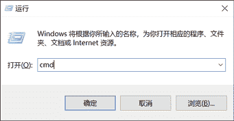

图 1-49 运行窗口

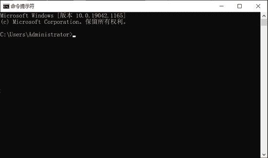

图 1-50 命令提示符窗口

在该窗口里输入指令并回车就能完成安装。注意，**`pip` 必须在联网状态下使用**。

```
pip install 库名
```

比如想用 `requests` 库，就在命令行里输入对应的安装命令：

```
pip install requests
```

回车后开始执行，如图 1-51。

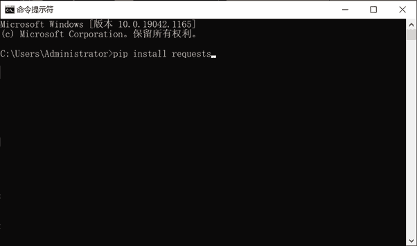

图 1-51 输入 pip 命令

装好后通常会看到 `Successfully installed+库名` 的提示，如图 1-52。

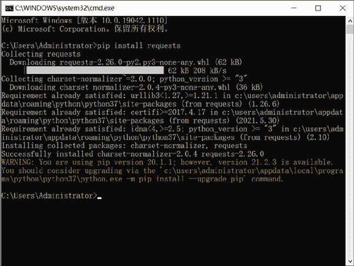

图 1-52 安装成功

若出现和图 1-52 类似的黄色提醒，表示 `pip` 不是最新版本，可用下面命令升级：

```
pip install --upgrade pip
```

卸载已装的第三方库，只需把安装命令里的 `install` 改成 `uninstall` 即可。

Windows 10 也可以通过“开始”菜单 →“Windows 系统”→“命令提示符”打开命令行，如图 1-53。

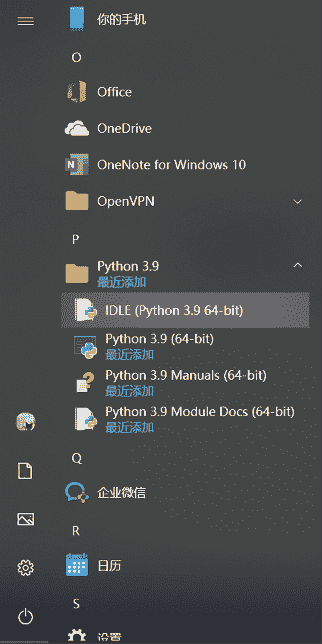

图 1-53 Windows 10“开始”菜单中的“命令提示符”

macOS 用户可按 Command+空格打开聚焦搜索，输入“terminal”打开终端，也可经“启动台”→“其他”→“终端”进入，然后执行对应的 `pip` 命令。

### 使用 Thonny 安装第三方库

Thonny 不能用命令行装包，必须借助内置的包管理功能。联网状态下打开 Thonny，依次点菜单栏的**“工具”→“管理包”**，如图 1-54。

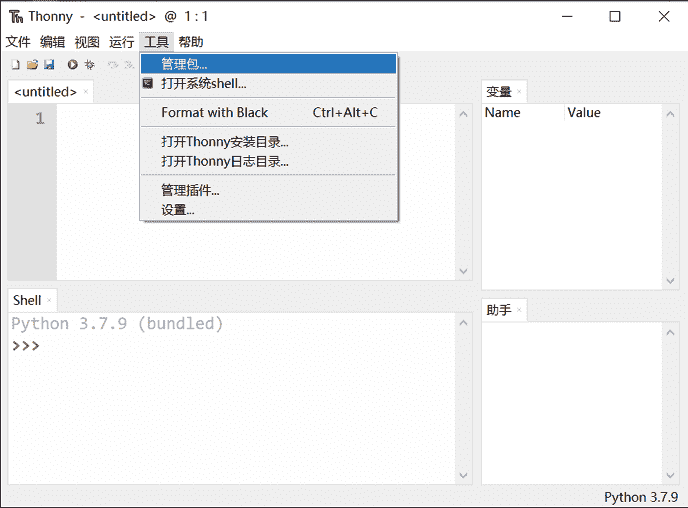

图 1-54 Thonny 的包管理功能

在输入框填入想装的包名 `requests`，点**“Search on PyPI”**按钮，会得到如图 1-55 的搜索结果，选择第一个选项即可。

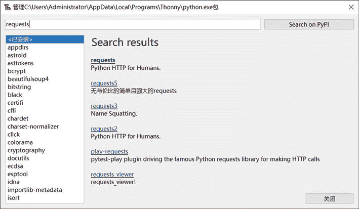

图 1-55 搜索 requests 的结果

选中后点**“安装”按钮**，如图 1-56，若未报错即为安装成功，按钮会变为“升级”和“卸载”。


图 1-56 准备安装 requests 包

## 趣闻

编程语言为何多为英文？中文编程是否存在？

不少同学会疑惑，为何 Python 里 `if`、`while`、`print` 等关键字都是英文，对英语基础薄弱的人不太友好，那能否用汉语写程序？

先厘清一个概念：编程语言虽然借用了拉丁字母，但它并不是英语，而是一套遵循自身语法规则的独立语言。很多语言里确实允许使用汉字作为标识符，但这不等于用中文编程。

在 Python 里，变量名或函数名是可以写成汉字的，例如下面这段程序是可以执行的：

```
>>> 核桃 = 1
>>> 编程 = 2
>>> print(核桃 + 编程)
3
```

不过实际开发中一般不推荐使用中文命名。因为 Python 必须使用英文符号编写，若混入中文变量名，很容易因输入法未切换而误打中文标点，导致错误。

完全基于汉字和中文符号的语言也有，比如“易语言”。这类语言虽能实现纯中文编程，但在专业领域普及度不高。

除易语言外，2019 年还出现了用文言文编程的“文言编程”。例如下面这段代码的效果是连续输出三遍“問天地好在。”

```
吾有一數。曰三。名之曰「甲」。
為是「甲」遍。
吾有一言。曰「「問天地好在。」」。書之。
云云。
```

## 读者服务：


# 数据：AI 的核心养料

桃子：禾木，你在写这么多数字做什么？

禾木：听说训练人工智能需要数据，我在收集数据呢！

小核桃：别把数据和数字混为一谈。数据不只是数字，还可以是其他形式的内容。接下来我们就一起弄清楚数据到底是什么，又从哪里来。


## 什么是数据

**数据**这个词很常见。用流量上网、看电影评分、网购参考销量，都是在说数据。现在已进入数据时代，几乎每个场景都离不开它。

数据到底指什么？和数字有何区别？**数据是统计、计算、研究或设计时所依赖的数值。**所以数据常表现为数字，如评分、销量等。每天气温、苹果价格、考试分数、写作业时长都能算数据。在计算机视角里，**数据是客观事物的符号化表示**，凡是可以输入电脑并被程序处理的符号都算数据，因而照片、声音也属于数据。

常与数据并提的是信息。信息论之父克劳德·香农认为，**信息是可以消除不确定性的东西**。信息让你对事物了解更多。比如你只知道禾木拿了编程比赛奖项，却不知名次，这就是不确定。小核桃告诉你“禾木获了一等奖”，不确定就消失了，这句话就是信息。桃子说“禾木是在编程比赛上获奖”，你本就知道，所以对你而言不算信息。但两者都可看作数据，如图 2-1。若数据规模极大，就形成了媒体常说的**大数据**。


图 2-1 信息消除不确定性

## 数据是从哪里来的

最直接的获取方式就是观察、汇总并记录。例如清点树上苹果数、用量温计测气温，都能得到数据。

但现实中需要数据的地方太多，人工记录不现实。为此科学家研发了各类**电子传感器**，让数据采集自动化。

手机内部就装了不少传感器。自动调节亮度靠光线传感器，指南针功能靠**磁场传感器**或**霍尔传感器**，视频通话用到**声音传感器**和**图像传感器**，也就是我们熟知的**麦克风**和**摄像头**。

如今传感器无处不在，甚至在深海和太空的探测器上也在工作，如图 2-2。截至目前全球已知的传感器种类超过 2.6 万种，几乎任何数据都能找到对应的采集装置。


图 2-2 无论深海还是太空都有很多传感器

我们使用手机、电脑时也在不断产生数据。填写网络服务的信息、社交平台发布的文字照片、每次点击浏览记录，皆属数据。

传感器采集的数据和网络行为产生的数据往往不能直接使用。随着技术进步，数据传输和收集变得便捷，人们把大量数据如美国天气、月球地形整合成数据集并上传网络供共享。

还记得《写给青少年的人工智能 应用》里提到的**ImageNet**吗？**ImageNet**是由华裔科学家李飞飞团队构建的图像识别研究用**图片数据集**，目前包含约 1500 万张标注图片，涵盖 2 万多种物体。类似的还有用于手写数字识别的**MNIST 数据集**，包含 7 万余个手写数字样本。

对天文感兴趣的同学可从**探月工程数据发布与信息服务系统**获取嫦娥探测器传回的月球数据，也可从**美国宇航局 NASA 的数据网站**下载丰富天文资料。

互联网上的数据大多并非像 ImageNet 或 MNIST 那般整理完善，手工获取耗时费力，于是常借助工具，其中之一就是网络爬虫。

## 网络爬虫是什么虫

**网络爬虫**又称**网络蜘蛛**，它不是生物，而是一种程序。它的任务是在互联网上自动浏览信息，把你需要的内容抓取下来。爬虫像蜘蛛一样在网址的大网上逐点巡查，如图 2-3。

借助爬虫，可以为搜索引擎和人工智能提供素材，也能做出很多有趣应用。比如聚合感兴趣的新闻推送、监控天气预报并自动提醒下雨、批量下载网站图片、监测商品价格变动等。


图 2-3 网络爬虫

Python 非常适合编写简易爬虫。下面我们尝试实现最基础的爬虫。

喜欢天文的人一定熟悉火星。这颗红色星球位于太阳系宜居带，曾可能具备类似地球的环境与资源，因而备受研究。几十年来人类已向其发射大量探测器，拍摄了无数照片。

NASA 数据网站就有不少火星图片，例如“NSSDCA Photo Gallery Mars”页面（在网站主页依次点“Image Resources”→“NSSDCA Photo Gallery”，再进入图片库目录选择“Mars”），页面提供预览图和介绍，点击可看高清图。若想批量下载页面所有图片，手动操作很麻烦，可以用 Python 写爬虫来完成。

**通常，浏览器打开网址时会把请求发给网站服务器，服务器再把网页数据返回给你**，如图 2-4。


图 2-4 上网时，用户通过浏览器与网站服务器进行信息交流

用 Python 获取网页信息也是类似流程，只是无需打开浏览器，可以借助相关库如**requests 库**向网站发送请求。

```
pip install matplotlib
```

## 安装 `requests` 库

`requests` 库属于第三方库，请自行安装（第 1 章末尾已介绍安装）。若未安装，可现在操作。原生 Python + IDLE 用户需打开命令行窗口（Windows 的“命令提示符”或 macOS 的“终端”）执行如下命令：

```
pip install requests
```

Thonny 用户可用包管理安装（见图 1-55）。

安装完成后可用 `requests.get()` 向网站发请求并获取响应。程序 2.1 可用于发送请求并打印回应。

### 程序 2.1 发送请求并显示网站的回应

```
1    import requests                                # 导入 requests 库
2    url = '▓▓▓▓▓▓▓▓▓▓▓▓▓▓▓▓▓▓▓▓▓▓▓▓▓▓▓▓▓▓▓▓▓▓▓'
3    r = requests.get(url)
4    print(r.text)
```

运行后输出看起来像代码却不知其意的东西，如图 2-5（内容较多会在“Shell”区自动折叠，双击可展开）。


图 2-5 `requests.get()` 函数的返回结果

这其实是网页源码，用 HTML 语言编写。浏览器会把这些代码渲染成图文并茂的页面。网页元素全由 HTML 决定。

对计算机来说，装饰性的内容反而是干扰，必须解析 HTML 抽取出真正的数据。解析网页是编写爬虫的第一步。

虽然精通 HTML 是分析源码的基础，但借助工具也能高效完成。对简单网页甚至无需深入 HTML 就能处理。

按键盘 F12（部分键盘需 Fn+F12）可打开浏览器的开发者工具，推荐 Edge 或 Chrome，如图 2-6。


图 2-6 Edge 浏览器和 Chrome 浏览器

开发者工具使用很直观：在“元素”标签下把鼠标悬停在源码上，网页对应区域会高亮显示，如图 2-7。

点“元素”标签前的第一个按钮可让鼠标变成选择模式，点网页内容即可定位到对应代码，如图 2-8。


图 2-7 Edge 浏览器的网页分析工具


图 2-8 根据网页元素定位代码

代码左侧的小三角可展开或折叠代码块，如图 2-9。


图 2-9 将一段代码展开或折叠起来

耐心查找即可定位到图片在源码中的位置，如图 2-10。


图 2-10 网页中的图片代码

熟悉文件格式的人会注意到代码中的 `.jpg` 和 `.gif`，它们代表图片文件。

```
<a href="/image/planetary/mars/marsglobe1.jpg">

</a>
```

快速掌握网页图片爬取与 API 数据获取

网页里的一张小图，往往藏着通往高清原图的大门。先把图片标签的逻辑理清，再用工具批量提取，最后用 API 做对比演示，就能理解爬虫的核心思路。

图片链接是怎么构成的
网页中展示动图时，代码会被 `< >` 包起来，以 `img` 开头，这就是 HTML 的 `` 标签，用来声明此处是一张图片。`alt` 与 `src` 都是标签的属性，其中 `src` 决定了图片的存储位置。这个地址通常是相对路径，相当于只写了“5 号楼 3 单元 204 室”，没有告诉你城市和小区。网页的图片“城市和小区”就是站点域名，把相对路径加上域名后，才是可访问的完整链接。直接用这个地址下载，拿到的往往是页面上使用的缩略图。

想要高清原图，要看点击后的行为。点开图片会跳转到新页面，地址以 `.jpg` 结尾，说明跳转的目标是一个更清晰的图片文件。定位到网页源代码，能看到上一行存在 `<a href = 地址 >` 这样的结构，`<a>` 表示超链接，`href` 属性记录了跳转地址，例如 `/image/planetary/mars/marsglobe1.jpg`。补上站点域名，就得到了高清图的完整链接。

用 BeautifulSoup 解析网页
Python 的第三方库 BeautifulSoup 可以很方便地读取标签与属性，需要自行安装。

使用原生 Python + IDLE 时，在命令行窗口执行如下命令：

```
pip install beautifulSoup4
```

使用 Thonny 时，在包管理搜索`beautifulSoup4`并进行安装。

先用 `BeautifulSoup()` 函数把网页内容转成对象，再用 `find_all('a')` 拿到页面上所有的 `<a>` 标签。对每个标签用 `get('href')` 取出链接，非图片链接要筛掉，包含 “.jpg” 的才是目标。整体流程如图 2-11 所示。


图 2-11 使用 BeautifulSoup 库提取图片链接

程序 2.2 是利用`BeautifulSoup`库解析网页，提取图片链接的程序。

### 程序 2.2 利用`BeautifulSoup`库解析网页，提取图片链接

```
1    import requests
2    from bs4 import BeautifulSoup
3
4    url = "▓▓▓▓▓▓▓▓▓▓▓▓▓▓▓▓▓▓▓▓▓▓▓▓▓▓▓▓▓▓▓▓▓▓▓▓▓▓▓"
5    r = requests.get(url)
6    print("=====获取网页数据完成=====")
7
8    soup = BeautifulSoup(r.text, "html.parser") # 建立 BeautifulSoup 对象
9    a_tag = soup.find_all("a")                 # 提取所有的<a>标签
10   link = []                                  # 准备将链接保存在列表中
11   for t in a_tag:                            # 遍历所有标签
12       href = t.get("href")                   # 提取 href 属性
13       if href and ".jpg" in href:            # 如果图链接存在并含有.jpg
14           link.Append(href)                  # 记录链接
15   print("======网页解析完成======")
```

提取到链接后，还要把图片保存下来，这里用第三方库 `wget`。

你既可以在命令行窗口执行 pip 命令安装，也可以在 Thonny 的包管理搜索 wget 安装：

```
pip install wget
```

`wget`用起来很简洁。程序 2.3 会在脚本所在目录新建文件夹“火星图片”，并把图片写入其中，这段代码要接在程序 2.2 之后。

### 程序 2.3 利用`wget`下载图片

```
16    import os                         # os 库用于操作文件夹
17    import wget                       # wget 库用于下载
18
19    if not os.path.exists("火星图片"): # 检测"火星图片"文件夹是否存在
20    os.mkdir("火星图片")               # 如果不存在，就新建"火星图片"文件夹
21    for pic in link:                  # 遍历所有链接
22        IMAGE_URL ="▓▓▓▓▓▓▓▓▓▓▓▓▓▓▓▓▓▓▓▓▓▓▓▓▓▓▓▓▓▓▓▓▓▓▓▓▓▓▓" +pic # 拼接得到完整链接
23        pic_name = wget.download(IMAGE_URL, out="火星图片/") # 下载图片
24        print(pic_name + "下载完成")   # 每下载完一幅图片，进行提示
25    print("======全部下载完成======")
```

把两段合并，就得到完整的下载程序，如程序 2.4。在合法授权的前提下，也可以改写代码去抓取其他站点。合并时通常把导入语句放在最前。

### 程序 2.4 使用 Python 爬虫下载火星图片

```
1    import requests, os, wget
2    from bs4 import BeautifulSoup
3
4    url = "▓▓▓▓▓▓▓▓▓▓▓▓▓▓▓▓▓▓▓▓▓▓▓▓▓▓photo_gallery/photogallery-mars.html"
5    r = requests.get(url)
6    print("=====获取网页数据完成=====")
7
8    soup = BeautifulSoup(r.text, "html.parser") # 建立 BeautifulSoup 对象
9    a_tag = soup.find_all("a")                # 提取所有的<a>标签
10   link = []                                 # 准备将链接保存在列表中
11   for t in a_tag:                           # 遍历所有标签
12       href = t.get("href")                  # 提取 href 属性
13       if href and ".jpg" in href:           # 如果图链接存在并含有.jpg
14           link.Append(href)                 # 记录链接
15   print("======网页解析完成======")
16
17   if not os.path.exists("火星图片"): # 检测"火星图片"文件夹是否存在
18       os.mkdir("火星图片")           # 如果不存在，就新建"火星图片"文件夹
19   for pic in link:                  # 遍历所有链接
20       IMAGE_URL ="▓▓▓▓▓▓▓▓▓▓▓▓▓▓▓▓▓▓▓▓▓▓▓▓▓▓" +pic # 拼接得到完整链接
21       pic_name = wget.download(IMAGE_URL, out="火星图片/") # 下载图片
22       print(pic_name + "下载完成")   # 每下载完一幅图片，进行提示
23   print("======全部下载完成======")
```

利用网站 API 获取数据
直接解析 HTML 是最通用也最基础的方法，但网页里混杂了大量排版信息，分析起来繁琐。有些站点会把数据整理成机器可读的接口，称为应用程序接口 API，调用起来更直接。

下面以核桃世界的两个城市赛加市和中心城天气为例。打开教学网页核桃天气，可以查看赛加市 2021 年 7 月 14 日至 7 月 20 日的预报，点击顶部“导航栏”标签即可切换到中心城，如图 2-12 所示。

通过网页分析工具可以看到，这两个页面的数据非常零散，用传统解析写爬虫难度较大。若提供 API，则可直接通过网址获取。


图 2-12 天气预报教学网页

依然用 `requests.get()` 发起请求。该 API 返回 JSON 格式，JSON 在互联网上很常见，和 Python 字典很像。用 `requests` 库的 `json()` 方法即可把响应转成字典。

### 程序 2.5 从 API 获取数据并转化为字典

```
1    import requests
2    url = '▓▓▓▓▓▓▓▓▓▓▓▓▓▓▓▓▓▓▓▓▓▓▓▓▓▓▓▓▓▓▓▓▓▓▓▓▓▓'
3    r = requests.get(url)
4    r.encoding = 'utf-8'                        # 设置编码
5    saijia_date = r.json()
6    print(saijia_date)
```

为便于阅读，对字典做整理。

```
1    {
2        "location": {
3            "city": "赛加市",
4            "id": "0001"
5        },
6        "now": {
7            "temp": 27,
8            "wind_class": "微风",
9            "wind_dir": "东风",
10           "text": "多云"
11       },
12       "forecasts": [{
13           "date": "2021-07-14",
14           "high": 33,
15           "low": 24,
16           "wc_day": "微风",
17           "wc_night": "微风",
18           "wd_day": "东风",
19           "wd_night": "东风",
20           "text_day": "多云",
21           "text_night": "晴"
22       },
23   ……后 6 天内容略]
24   }
```

这个字典包含三个键值：`"location"` 所在地、`"now"` 当前天气、`"forecasts"` 未来 7 天预报。

重点是 `"forecasts"`，它是一个含 7 个元素的列表，每个元素对应一天。以第 0 个元素为例，数据被截断展示了第 13～21 行，其余 6 天省略。

天气内容的字典结构见表 2-1。

表 2-1 天气内容的字典表示

| 代码 || 含义 |

| --- | --- |

| `"date": "2021-07-14",` || 日期 |

| `"high": 33,` || 最高气温 |

| `"low": 24,` || 最低气温 |

| `"wc_day": "微风",` || 白天风力 |

| `"wc_night": "微风",` || 夜晚风力 |

| `"wd_day": "东风",` || 白天风向 |

| `"wd_night": "东风",` || 夜晚风向 |

| `"text_day": "多云",` || 白天天气 |

| `"text_night": "晴"` || 夜晚天气 |

通过列表和字典即可取任意一天的数据，比如下面这句取的是第二天的最高气温：

```
temp = date["forecasts"][1]["high"]
```

提供 API 的平台很多，百度、高德等公司都有地图、交通、天气等服务，注册后可免费或付费使用。

分析和处理数据
拿到两个城市的天气后，可以比较气温走势。爬虫返回的每天温度是最高和最低两个数值，先求平均值更方便。

程序 2.6 会抓取两个城市的数据，计算每天最高与最低的平均值并存入列表，同时保存 7 天的日期。

### 程序 2.6 爬取并计算平均气温

```
1    import requests
2    url_saijia = '▓▓▓▓▓▓▓▓▓▓▓▓▓▓▓▓▓▓▓▓▓▓▓▓▓▓▓▓▓▓▓▓▓▓▓▓'
3    url_zhongxin = '▓▓▓▓▓▓▓▓▓▓▓▓▓▓▓▓▓▓▓▓▓▓▓▓▓▓▓▓▓▓▓▓▓▓▓▓'
4
5    # 获取赛加市数据
6    r = requests.get(url_saijia)
7    r.encoding = 'utf-8'                       # 设置编码方式
8    saijia_data = r.json()
9
10   # 获取中心城数据
11   r = requests.get(url_zhongxin)
12   r.encoding = 'utf-8'                       # 设置编码方式
13   zhongxin_data = r.json()
14
15   # 使用函数获取平均气温
16   def get_temp(data):
17       temp = []
18       forecasts = data["forecasts"]          # 提取预报数据
19       for day in range(len(forecasts)):      # 对每天循环
20           ave=(forecasts[day]["high"]+forecasts[day]["low"])/2 #求平均
21           temp.Append(ave)                   # 存入列表
22       return temp
23
24   saijia_temp = get_temp(saijia_data)        # 赛加市未来一周平均气温
25   zhongxin_temp = get_temp(zhongxin_data)    # 中心城未来一周平均气温
26   # 获取日期
27   date = []
28   for day in range(7):
29       date.Append(saijia_data["forecasts"][day]["date"])
```

### 绘制数据图
有了平均气温，就可以画图了。需要 `matplotlib` 库，自行安装。

如果你用的是原生 Python + IDLE，请在命令行窗口执行如下命令：

```
pip install matplotlib
```

使用 Thonny 的同学需要在“包管理”窗口中搜索`matplotlib`，然后安装。

用 `matplotlib` 的 `pyplot` 模块中的 `plot()` 函数即可绘制曲线。横坐标用日期，纵坐标用气温，把两者传入函数即可。最后用 `show()` 显示图像。

在程序 2.6 末尾加上程序 2.7 的代码，运行后效果如图 2-13，可通过拖动窗口调整大小。

程序 2.7　在程序 2.6 末尾增加的代码

```
30    import matplotlib.pyplot as plt  # 导入 matplotlib 库中的 pyplot 模块
31
32    # 绘制曲线图
33
34    plt.plot(date,saijia_temp)       # 画赛加市图像
35    plt.plot(date,zhongxin_temp)     # 画中心城图像
36
37    plt.show()
```


图 2-13　程序 2.7 的运行结果

### 添加图像信息
仅用 `plot()` 画出的图太简陋，不知道曲线代表什么，也没有坐标含义。为了更清晰，需要加上图例和坐标轴标签。

折线图想要带图例，其实只需两处改动：画曲线时给 plot 传入 label 作为标识，紧接着在调用 show 之前执行 legend 来渲染图例。

在程序 2.7 里，show 语句之前约第 33 行的空隙，插入下面 5 行：

```
plt.xlabel("日期")
plt.ylabel("气温(℃)")
plt.plot(date,saijia_temp, label='赛加市气温')
plt.plot(date,zhongxin_temp, label='中心城气温')
plt.legend()
```

执行后会发现，“日期”“气温”两处中文都变成了空心方块。原因在于 matplotlib 自带的默认字库不兼容汉字，需要换成能渲染中文的字体。

在程序 2.7 开头导入 matplotlib.pyplot 之后，大约第 31 行的位置，加入如下片段：

```
plt.rcParams['font.sans-serif']=['SimHei']
plt.rcParams['axes.unicode_minus']=False
```

若运行环境为 macOS，则把上面这段替换成：

```
plt.rcParams['font.sans-serif']=['Arial Unicode MS']
```

替换后，中文就能正常显示，效果与图 2-14 一致。

小提示：输入中文后，编写代码时务必切回英文输入法。


图 2-14　运行效果

另外，还能在展示前调用 plt.title 为整幅图加上主标题：

```
plt.title('赛加市和中心城一周气温变化')
```

只看绘图部分，整理后的写法即程序 2.8。

程序 2.8　绘制数据图部分的代码

```
1    import matplotlib.pyplot as plt
2
3    plt.rcParams['font.sans-serif']=['SimHei']
4    plt.rcParams['axes.unicode_minus']=False
5    ''' macOS 系统使用下面这行代码
6    plt.rcParams['font.sans-serif']=['Arial Unicode MS']
7    '''
8
9    plt.plot(date,saijia_temp, label='赛加市气温')
10   plt.plot(date,zhongxin_temp, label='中心城气温')
11   plt.legend()
12   plt.xlabel("日期")
13   plt.ylabel("气温(℃)")
14   plt.title('赛加市和中心城一周气温变化')
15   plt.show()
```

把程序 2.6、程序 2.7 与程序 2.8 拼合起来，就能得到通过 API 获取天气并绘制气温变化曲线的完整实现，见程序 2.9。

程序 2.9　利用 API 爬取天气并绘制气温变化曲线图

```
1    import requests
2    import matplotlib.pyplot as plt
3
4    url_saijia = '▓▓▓▓▓▓▓▓▓▓▓▓▓▓▓▓▓▓▓▓▓▓▓▓▓▓▓▓▓▓▓▓▓▓'
5    url_zhongxin = '▓▓▓▓▓▓▓▓▓▓▓▓▓▓▓▓▓▓▓▓▓▓▓▓▓▓▓▓▓▓▓▓▓▓'
6    # 获取赛加市数据
7    r = requests.get(url_saijia)
8    r.encoding = 'utf-8'  # 设置编码方式
9    saijia_data = r.json()
10
11   # 获取中心城数据
12   r = requests.get(url_zhongxin)
13   r.encoding = 'utf-8'  # 设置编码方式
14   zhongxin_data = r.json()
15
16   # 使用函数获取平均气温
17   def get_temp(data):
18       temp = []
19       forecasts = data["forecasts"]            # 提取预报数据
20       for day in range(len(forecasts)):        # 对每天循环
21           ave = (forecasts[day]["high"] + forecasts[day]["low"]) / 2
22           temp.Append(ave)  # 存入列表
23       return temp
24
25   saijia_temp = get_temp(saijia_data)
26   zhongxin_temp = get_temp(zhongxin_data)
27   # 获取日期
28   date = []
29   for day in range(7):
30       date.Append(saijia_data["forecasts"][day]["date"])
31
32   # 设置中文字体
33   plt.rcParams["font.sans-serif"] = ["SimHei"]
34   plt.rcParams["axes.unicode_minus"] = False
35   """ macOS 系统使用下面这行代码
36   plt.rcParams['font.sans-serif']=['Arial Unicode MS']
37   """
38
39   # 绘制气温变化曲线图
40   plt.plot(date, saijia_temp, label="赛加市气温")
41   plt.plot(date, zhongxin_temp, label="中心城气温")
42   plt.legend()
43   plt.xlabel("日期")
44   plt.ylabel("气温(℃)")
45   plt.title("赛加市和中心城一周气温变化")
46   plt.show()                                  # 显示图像
```

## 合规使用爬虫

读完本章，对爬虫应该有了初步认识。本书只讲解最基础的抓取方法，演示最简化的处理流程，目的在于为你打开数据世界的大门。

数据采集、清洗与分析其实是更深的专业领域，只要持续学习和实践，就能逐步成长为数据高手。

爬虫是获取信息的高效手段，但绝不能滥用。抓取速度极快，大量请求同时打向同一站点，会给服务器造成不小的压力，影响其他用户的正常使用。也有人利用爬虫窃取用户隐私，或抓取小说、图片、视频等受版权保护的内容，构成侵权。

非法获取数据或用爬虫干扰他人网站，都属于违法行为，会受到法律追究。

因此使用爬虫必须合规。只能采集网站公开的内容，不要用不正当手段破解权限。可以通过网站的 robots.txt 来查看哪些路径禁止访问，通常在网址后加上 /robots.txt 即可，例如此前用过的 NASA 数据站，其地址为 nssdc.gsfc.nasa.gov/robots.txt。

对允许抓取的范围，也要控制频率，不要过于密集。除非站点明确允许，否则不要把抓取结果用于商业盈利。

## 读者服务：


微信扫码关注【异步社区】微信公众号，回复“e59088”获取本书配套资源以及异步社区 15 天 VIP 会员卡，近千本电子书免费畅读。

# 算法：智慧的底层逻辑

禾木：这道数学题太难了，我算了这么多还是解不出来。不过，这些计算量和人工智能要处理的海量数据比起来小多了，亏得有计算机帮忙。

桃子：计算机确实很厉害，不过禾木，你走弯路了，其实只要一半的计算量就能得到答案。

小核桃：人工智能处理数据也像做题，方法有好有坏，有简有繁。这些处理数据的不同思路就是人类智慧的结晶，我们把它叫做算法。人类总结出的算法，正是构成人工智能智慧的核心。


## 什么是算法

做任何事都需要按步骤推进。比如煮面，大致要经历图 3-1 所示的流程。烹饪里称工序，编程里就叫算法。算法就是借助计算机解决问题的思路与步骤。想让计算机实现人工智能，就必须教会它各种问题的解法，这就离不开算法。


图 3-1　煮面的步骤：①向锅内添水；②点火，等水沸腾；③放面条；④等待面条煮熟；⑤关火

不同问题需要不同算法，即便同一问题也可能有多种解法，效率差异可能很大。本章会带你认识几个简单的算法，体会其中的巧妙。

## 二分法搜索

禾木和桃子在玩猜数字游戏。禾木心中想好 1 到 100 之间的一个数，桃子猜，每次禾木会提示大了还是小了，如图 3-2 所示。


图 3-2　猜数字游戏

如果你来猜，最直观的是从 1 开始逐个往上试。这样最坏要猜 100 次，如图 3-3 所示。


图 3-3　最简单的猜数字方法（从小到大一个一个地尝试）

也可以每隔 10 个数猜一次，先锁定十位再定个位，如图 3-4 所示。这样最多约 20 次就能锁定。

还可以随机猜并根据反馈调整。你觉得需要几次？

这些不同的猜法就是同一问题的不同算法，效率差异明显。


图 3-4　间隔 10 猜数字

桃子有更好的办法，最多 7 次就能确定。她从 1 到 100 的中间数 50 开始，如果大了就猜 1 到 50 的中间数 25，小了就猜另一半的中间数 75，之后一直猜区间的中间数，中间是两数时任选其一，如图 3-5 所示。每次都能把范围砍掉一半，最终只剩一个数。比如猜到 62 只需 3 次。随便找个数试试，最多 7 次就能中。

这类从有序数据中找特定数据的任务叫搜索问题。桃子的方法针对有序数据，是经典的二分法，每次把搜索区间分成两半。

二分法效率很高。随着次数增加，可覆盖的范围呈指数增长，S = 2^n。即使范围扩大到 100 亿，用二分法也只需约 34 次。

猜数字只是游戏，但能用二分法的场景很常见。


图 3-5　桃子的猜数字算法

再设想一个场景：期末试卷按分数从小到大排好，分数各不相同，要找出 90 分的那张。几十张时人眼很快，几十万张呢？

假设有 10 张，分数为 35、56、58、60、74、80、83、88、90、96，编号 0 到 9。先取中间，10 为偶数取较小的第 5 张，编号 4 为 74。90 比 74 大，说明目标在编号 4 右侧，即 5 到 9。


图 3-6　90 分的试卷在编号 4 的右侧

再取后 5 张的中间，编号 7 为 88，90 在其右侧，只剩 8 号和 9 号。取较小的编号 8，正好是 90 分。3 次判断就找到了。若逐个找，运气好 2 次，运气差要 9 次。

计算机需要程序语言来表达。程序 3.1 按二分法的思路实现，运行后输入要找的分数，回车后会返回位置。输入 35 会返回 0。程序文件可在配套资源网站获取。

程序 3.1　二分法

### 二分法

```
1    def bin_search(N,target):    # 将二分法写成函数
2        left = 0                 # 搜索范围最左（左边界）是 0 号
3        right = len(N) - 1       # 搜索范围最右（右边界）是(len(N)-1)号
4        while left <= right:     # 当搜索范围的左边界超过右边界，搜索结束
5            mid = (right - left) // 2 + left
6            # 计算中间元素的编号，编号一定是整数，所以用保留整数的除号//
7            if target == N[mid]: # 如果中间的元素等于目标
8                return mid       # 那么说明找到了目标，返回中间元素的编号
9            elif target < N[mid]:# 否则，如果目标小于中间元素
10               right = mid - 1  # 将右边界调整为中间元素的左边第一位
11           else:                # 否则，（如果目标大于中间元素）
12               left = mid + 1   # 将左边界调整为中间元素的右边第一位
13       return -1
14       # 循环结束，说明没有找到目标，于是返回-1 表示没找到。 函数结束
15
16   Grade = [35, 56, 58, 60, 74, 80, 83, 88, 90, 96] # 使用列表储存分数
17   tar = input("输入要找的目标分数(整数)：")            # 要找的目标分数
18   tar = int(tar)
19   position = bin_search(Grade, tar)    # 调用二分法函数寻找目标位置
20   print(position)                      # 将结果显示在屏幕上
```

程序 3.1 只是二分法的一种实现，也可有其他写法。

这段代码只能定位一份试卷。若要找出所有不及格即低于 60 分的试卷，该如何改？

二分法的思想在生活中很常见：查英文词典、定位电路故障等，都能快速缩小范围。

## 排序

二分搜索的前提是数据必须有序。排序人工做起来很费事，计算机该怎么排？

冒泡排序就是一种基础的排序算法。想把 8、6、11、7 这 4 个数从小到大排，程序会从头到尾检查相邻两数，若前面比后面大就交换。一轮下来最大的数会像气泡一样浮到最后，如图 3-7 所示。


图 3-7　第一轮冒泡

一轮排不完，还需要第二轮。这次从头开始比较相邻数，前大后小就交换，但不用检查到最后一位，因为最大数已在末尾。第二轮会把第二大的数放到倒数第二位，如图 3-8 所示。


图 3-8　第二轮冒泡

不断重复，每轮能确定一个数的最终位置。对 N 个数，经过 N-1 轮冒泡即可完全排好。程序 3.2 就是冒泡排序的实现。

### 程序 3.2　冒泡排序

```
1    def bubbleSort(N):                   # 把冒泡排序写成函数
2        for i in range(1, len(N)):       # 循环第 i 轮冒泡（从 1 开始数）
3            for j in range(0, len(N)-i): # 循环第 j 个相邻数字（从 0 开始数）
4                if N[j] > N[j+1]:        # 如果前面的数字大于后面的数字
5                    N[j], N[j + 1] = N[j + 1], N[j]  # 交换相邻数字
6        return N                         # 返回排好序的列表，函数结束
7
8    N = [9, 8, 7, 6, 5, 4, 3, 2, 1, 0]   # 用列表储存需要排序的数字
9    print(bubbleSort(N))                 # 调用冒泡排序函数，输出结果
```

冒泡排序可以说是入门编程里最具代表性的案例之一，思路清晰、实现简单，初学者很容易把握它的运行逻辑。只是放到实际工程里，它的使用频率远不如二分查找，更比不上归并排序、快速排序这些效率更高的方案。尽管如此，它在培养算法思维、帮助理解排序本质上，教学价值依然很高。

## 线性回归初探

前面我们已经接触过二分查找和冒泡排序，这两种方法跟人工智能的直接关联并不明显。接下来要介绍的，就是在初级 AI 里经常会用到的一个核心思路。

生活里充满了互相牵动的现象。身高会跟体重挂钩，山越高山顶气温往往越低，气温升高时冰淇淋销量也会跟着上涨，运动时长和身体健康度有关，努力程度和学习成绩也常呈现关联。**人工智能正是通过海量数据挖掘这些关联，从而实现对未来的推测。**

在各类关联里，最基础也最直观的就是**线性关联**。所谓线性，就是一个变量随另一个变量稳定且均匀地变化。比如商品单价不变时，购买数量与总花费就是典型例子。随着数量增加，总价同步等比例上升，公式可以写成：

`y`（总价） = `k`（单价）×`x`（数量）

如果把数量 `x` 放在横轴，总价 `y` 放在纵轴，每个具体的交易就会变成平面上的一个点。把这些点连起来会得到一条直线，这条直线就概括了两者之间的关系，而直线的倾斜程度正好对应单价 `k`，如图 3-9 所示，这就是我们中学学过的一次函数图像的另一种说法。


图 3-9　线性关系

现实中类似的线性迹象不少。直觉上，父母个子高，孩子成年后往往也不会矮。那么父代与子代的身高之间是否存在线性规律呢？也不能完全肯定，毕竟现实里身高反转的例子也常见。

为此，禾木和桃子在校园里做了一次调研，收集了大量父母平均身高与成年儿子身高的配对数据。为了避免性别差异带来的干扰，他们只保留儿子的数据，最终汇总出 50 组样本，详见表 3-1。你可以尝试把这些数据导入 Python，并在坐标系中呈现出来吗？

表 3-1　身高数据

| 序号 || 父母平均身高（cm） || 儿子身高（cm） || 序号 || 父母平均身高（cm） || 儿子身高（cm） |

| --- | --- | --- | --- | --- | --- |

| 1 || 167.6 || 175.3 || 26 || 171.4 || 177.8 |

| 2 || 165.1 || 172.7 || 27 || 170.2 || 172.7 |

| 3 || 170.2 || 169.4 || 28 || 172.1 || 182.9 |

| 4 || 180.3 || 185.4 || 29 || 170.8 || 180.3 |

| 5 || 168.9 || 179.1 || 30 || 170.2 || 177.8 |

| 6 || 172.1 || 178.3 || 31 || 168.3 || 179.1 |

| 7 || 170.2 || 172.7 || 32 || 166.4 || 166.4 |

| 8 || 167.6 || 177.8 || 33 || 168.3 || 176.5 |

| 9 || 165.1 || 172.0 || 34 || 162.6 || 181.6 |

| 10 || 170.2 || 177.8 || 35 || 172.3 || 188.0 |

| 11 || 170.2 || 175.3 || 36 || 170.2 || 177.8 |

| 12 || 167.6 || 177.0 || 37 || 167.6 || 175.3 |

| 13 || 170.8 || 177.8 || 38 || 173.4 || 182.9 |

| 14 || 180.3 || 194.3 || 39 || 171.4 || 175.3 |

| 15 || 169.5 || 180.3 || 40 || 168.9 || 177.8 |

| 16 || 161.3 || 165.1 || 41 || 173.4 || 174.0 |

| 17 || 163.2 || 180.3 || 42 || 170.2 || 181.6 |

| 18 || 165.1 || 162.6 || 43 || 172.3 || 174.0 |

| 19 || 167.0 || 180.3 || 44 || 171.4 || 200.7 |

| 20 || 168.9 || 175.3 || 45 || 165.1 || 170.2 |

| 21 || 159.4 || 172.7 || 46 || 162.6 || 170.2 |

| 22 || 168.9 || 177.0 || 47 || 177.8 || 170.2 |

| 23 || 160.0 || 170.2 || 48 || 176.5 || 177.8 |

| 24 || 165.1 || 171.4 || 49 || 171.4 || 172.7 |

| 25 || 171.4 || 172.7 || 50 || 170.2 || 174.0 |

这里需要的是散点图，而不是折线图。只要把原本的 `plot()` 换成 `scatter()` 就能实现。实现思路可参考程序 3.3，完整代码也在配套资源里提供。

### 程序 3.3　绘制父母平均身高和儿子身高散点图

```
1    import matplotlib.pyplot as plt        # 导入画图的 Python 库
2
3    parents_height = [按照上表以列表形式输入]  # 输入父母平均身高数据
4    child_height = [按照上表以列表形式输入]    # 输入儿子身高数据
5
6    plt.scatter(parents_height, child_height)       # 画散点图
7    plt.xlabel("average height of parents  (cm)")   # 设置横坐标轴标签
8    plt.ylabel("height of children  (cm)")          # 设置纵坐标轴标签
9    plt.show()                                      # 显示图像
```

为了简便，代码里使用了英文坐标轴标签，若需要中文可参考第二章的方法修改。执行程序 3.3 之后，得到的结果如图 3-10。

从图中能看出，这些点无法用一条直线完全串起。尽管分布看起来有点杂乱，但仔细观察会发现它们主要集中在从左下到右上的一个带状区域附近。

这说明父母身高与成年儿子身高之间确实存在一定的线性趋势。父母越高，孩子普遍也越高，这与生物遗传有关。身高受遗传影响，但营养、性别及其他未知因素也会带来波动。即使是同一个家庭的孩子，身高也可能有差异，这就导致点集既有规律又很分散。


图 3-10　运行程序 3.3 的结果

如果能把这群点背后隐藏的那条直线准确找出来，就可以通过父母的平均身高来估算孩子的大致身高。问题在于，如何从大量离散点中提炼出最贴合的直线？

统计学里把从数据中寻找规律并做定量描述的过程叫做**回归分析**，它也是 AI 从数据中提炼规律并进行预测的基础手段。当规律可以用直线表达时，就称为**线性回归**，而求出直线的过程在 AI 里被称作模型训练。

在数学上，直线常写作 `y = k x + b`，其中 `k` 和 `b` 决定了直线的形态。在本例中，`x` 代表父母平均身高，`y` 代表儿子身高，求出 `k` 与 `b` 就能确定预测模型。常用的求解方法是**最小二乘法**。

对所有样本点 (`x[i]`, `y[i]`)，最小二乘法的计算公式为：

`k` =  = 

`b` = `y` − `k x`

式中上方的横线表示平均值，例如 `x` 为所有 `x` 的均值， 为每组 `x y` 的均值。

把最小二乘法的计算封装成函数，示例如程序 3.4。需要注意，**程序 3.4 仅是一个函数定义，单独无法运行**。

### 程序 3.4　线性回归最小二乘法

```
1    def LinearRegression(x, y):
2        ave_x = sum(x) / len(x)     # 计算 x 的平均值
3        ave_y = sum(y) / len(y)     # 计算 y 的平均值
4        # 以下计算 x*y 和 x**2 的平均值
5        ave_xy = 0
6        ave_x2 = 0
7        for i in range(0, len(x)):
8            ave_xy = ave_xy + x[i] * y[i]  # 循环将所有 x[i]*y[i]相加
9            ave_x2 = ave_x2 + x[i] ** 2    # 循环将所有 x[i]**2 相加
10       ave_xy = ave_xy / len(x)    # 将所有 x*y 的和除以个数，求平均值
11       ave_x2 = ave_x2 / len(x)    # 将所有 x**2 的和除以个数，求平均值
12       # 以下通过最小二乘法公式计算 k 和 b
13       k = (ave_xy - ave_x * ave_y) / (ave_x2 - ave_x ** 2)
14       b = ave_y - k * ave_x
15       return k, b
```

调用函数 `LinearRegression()` 即可得到 `k` 和 `b`，完成一次模型训练。随后利用直线 `y = k x + b` 就可以基于父母平均身高估算儿子身高，示例见程序 3.5。注意，**程序 3.5 不能独立运行，需要调用程序 3.3 输入的数据和程序 3.4 的函数**。

### 程序 3.5　训练模型并预测身高

```
1    k, b = LinearRegression(parents_height, child_height)
2    #调用线性回归函数，训练模型，求出 k 和 b
3
4    def predict(x, k, b):                    # 预测结果的函数
5        return k * x + b
6
7    # 以下求出父母身高 150～200cm 时对应儿子的大概身高
8    x = [i for i in range(150, 200)]
9    y = [predict(i, k, b) for i in x]
10
11   # 以下画出散点图和线性回归分析得出的直线
12   plt.plot(x, y,'r')
13   plt.scatter(parents_height, child_height)
14   plt.xlabel("average height of parents  (cm)")
15   plt.ylabel("height of children  (cm)")
16   plt.show()
```

将程序 3.3～程序 3.5 依次组合起来，我们就可以得到完整的程序 3.6。它可以通过父母平均身高来预测儿子成年后的身高。你可以在配套资源网站上找到写好的程序文件。

程序运行后可以画出数据散点图和回归分析得到的直线，如图 3-11 所示。这个程序就可以看作一个极其简陋的人工智能，它使用了线性回归模型。


图 3-11　通过线性回归根据父母平均身高预测儿子成年身高

程序 3.6　线性回归根据父母身高预测儿子成年身高

### 线性回归示例

```
1    import matplotlib.pyplot as plt        # 导入画图的 Python 库
2    # 输入父母平均身高数据
3    parents_height = [167.6,165.1,170.2,180.3,168.9,172.1,170.2,
4                      167.6,165.1,170.2,170.2,167.6,170.8,180.3,
5                      169.5,161.3,163.2,165.1,167.0,168.9,159.4,
6                      168.9,160.0,165.1,171.4,171.4,170.2,172.1,
7                      170.8,170.2,168.3,166.4,168.3,162.6,172.3,
8                      170.2,167.6,173.4,171.4,168.9,173.4,170.2,
9                      172.3,171.4,165.1,162.6,177.8,176.5,171.4,170.2]
10   # 输入儿子身高数据
11   child_height = [175.3,172.7,169.4,185.4,179.1,178.3,172.7,177.8,
12             172.0,177.8,175.3,177.0,177.8,194.3,180.3,165.1,180.3,
13             162.6,180.3,175.3,172.7,177.0,170.2,171.4,172.7,
14             177.8,172.7,182.9,180.3,177.8,179.1,166.4,176.5,
15             181.6,188.0,177.8,175.3,182.9,175.3,177.8,174.0,181.6,
16             174.0,200.7,170.2,170.2,170.2,177.8,172.7,174.0]
17
18   # 定义最小二乘法函数
19   def LinearRegression(x, y):
20       ave_x = sum(x) / len(x)      # 计算 x 的平均值
21       ave_y = sum(y) / len(y)      # 计算 y 的平均值
22       # 以下计算 x*y 和 x**2 的平均值
23       ave_xy = 0
24       ave_x2 = 0
25       for i in range(0, len(x)):
26           ave_xy = ave_xy + x[i] * y[i]  # 循环将所有 x[i]*y[i]相加
27           ave_x2 = ave_x2 + x[i] ** 2    # 循环将所有 x[i]**2 相加
28       ave_xy = ave_xy / len(x)     # 将所有 x*y 的和除以个数，求平均值
29       ave_x2 = ave_x2 / len(x)     # 将所有 x**2 的和除以个数，求平均值
30       # 以下通过最小二乘法公式计算 k 和 b
31       k = (ave_xy - ave_x * ave_y) / (ave_x2 - ave_x ** 2)
32       b = ave_y - k * ave_x
33       return k, b
34
35   k, b = LinearRegression(parents_height, child_height)
36   #调用线性回归函数，训练模型，求出 k 和 b
37
38   def predict(x, k, b):                  # 预测结果的函数
39       return k * x + b
40
41   # 以下求出父母身高 150～200cm 时对应儿子的大概身高
42   x = [i for i in range(150, 200)]
43   y = [predict(i, k, b) for i in x]
44
45   # 以下画出散点图和线性回归分析得出的直线
46   plt.plot(x, y,'r')
47   plt.scatter(parents_height, child_height)
48   plt.xlabel("average height of parents  (cm)")
49   plt.ylabel("height of children  (cm)")
50   plt.show()
```

## 用 KNN 把橘子橙子分清楚

橘子和橙子都算好吃的水果，模样也很像，都是圆圆的、橙黄色的果皮，如图 3-12 所示。偏好上，禾木更喜欢橘子，觉得橙子皮太难剥；桃子则偏向橙子，认为它的口感更好一些。


图 3-12　橘子与橙子外形相近

这一天禾木买了橘子，桃子买了橙子，不小心混在一起，得把两种水果挑开。对于熟悉的人来说瞄一眼就能分辨。那么“看一眼”到底依据什么？能不能把这个判断过程写成算法交给机器学习？

从外表看，两者虽像但有差异。橙子通常个头更大、更圆、皮面更光滑；橘子相对小一些，多呈扁圆形，表皮还常有凹凸。于是可以用大小、圆度、光滑度来区分。这里先用大小和圆度两个特征做分类。

表 3-2 汇总了 10 枚橘子和 10 枚橙子在大小、圆度两项指标上的评分。

表 3-2　根据大小和圆度两个方面进行打分得到的数据

|  || 橘子 || 橙子 |

| --- | --- | --- |

| 编号 || 0 || 1 || 2 || 3 || 4 || 5 || 6 || 7 || 8 || 9 || 10 || 11 || 12 || 13 || 14 || 15 || 16 || 17 || 18 || 19 |

| 大小 || 3.9 || 4.6 || 3.8 || 3.7 || 4.2 || 4.3 || 4.3 || 5.7 || 4.9 || 4.6 || 7.7 || 5.9 || 7.1 || 8.0 || 6.1 || 5.9 || 7.6 || 6.6 || 7.2 || 6.4 |

| 圆度 || 5.2 || 4.9 || 2.6 || 3.9 || 4.9 || 3.7 || 5.0 || 3.4 || 2.5 || 2.9 || 8.0 || 8.7 || 9.0 || 9.1 || 9.0 || 8.4 || 7.8 || 8.1 || 8.9 || 8.8 |

借助程序 3.7，可把这些数据投到坐标系中，横轴为大小，纵轴为圆度。

### 程序 3.7 画出大小与圆度的散点图

```
1    import matplotlib.pyplot as plt
2    plt.rcParams['font.sans-serif']=['SimHei']
3    plt.rcParams['axes.unicode_minus']=False
4    # 如果是 MacOS 系统，那么代码要改为
5    # plt.rcParams['font.sans-serif'] = ['Arial Unicode MS']
6
7    # 以下将大小和圆度的数据分别储存在列表中
8    # 每个列表中，前 10 个（0～9）是橘子，后 10 个（10～19）是橙子
9    size =      [ 3.9, 4.6, 3.8, 3.7, 4.2, 4.3, 4.3, 5.7, 4.9, 4.6,
10                 7.7, 5.9, 7.1, 8.0, 6.1, 5.9, 7.6, 6.6, 7.2, 6.4 ]
11   roundness = [ 5.2, 4.9, 2.6, 3.9, 4.9, 3.7, 5.0, 3.4, 2.5, 2.9,
12                 8.0, 8.7, 9.0, 9.1, 9.0, 8.4, 7.8, 8.1, 8.9, 8.8 ]
13
14   l1 = plt.scatter(size[:10], roundness[:10],label = "橘子")
15   l2 = plt.scatter(size[10:], roundness[10:],label = "橙子")
16   plt.legend()
17   plt.xlabel("大小")
18   plt.ylabel("圆度")
19   plt.show()
```

运行后得到如图 3-13 所示的结果。可以看到橙子集中在右上区域，橘子则主要落在左下区域。


图 3-13　大小圆度散点分布

这时禾木拿起一颗新水果，测得大小 5.5 分、圆度 5.7 分。若把它标在同一坐标系中，会落在中间地带，如图 3-14 所示。


图 3-14　新水果在图中的位置

该怎么判断它是橘子还是橙子？一个直观的思路是看它附近都有哪些水果。如果周边橘子多，就推断它也是橘子。这种基于邻近样本进行判断的思路就是**K 最近邻算法，简称 KNN**。图像识别、推荐系统、文本分类等人工智能任务里都很常见。

KNN 大致分为三步。

第一步，准备合适的训练数据。前面就是收集足够数量的橘子和橙子并打分。KNN 属于**监督学习**，需要人工给每组大小、圆度的样本贴上标签，告诉程序这组数据对应橘子还是橙子，以便学习。

第二步，输入待分类的新样本，算它与每个已有样本的距离。因为数据已在平面上，常用点间欧氏距离

*d*=\

在 Python 中可用 `math` 库的 `sqrt()` 实现开方。第二步的实现见程序 3.8。注意该程序依赖程序 3.7 中的数据，单独运行会报错。

### 程序 3.8 计算点之间的距离

```
1    from math import sqrt
2    distance = []
3    # 输入新水果的数据
4    new_size = input("请输入新水果的大小：")
5    new_roundness = input("请输入新水果的圆度：")
6    # 转换为浮点数
7    new_size = float(new_size)
8    new_roundness =float(new_roundness)
9    # 计算距离
10   for i in range(len(size)):
11       d=sqrt((size[i]-new_size)**2+(roundness[i]-new_roundness)** 2)
12       distance.Append(d)
```

第三步，对算出的距离排序，取离新样本最近的 `k` 个邻居，看橘子多还是橙子多来决定类别。程序 3.9 里把 `k` 设为 3，你也可以改成别的数值。该程序同样需要程序 3.7 和 3.8 的数据配合运行。

### 程序 3.9 K 最近邻分类

```
1    import numpy as np             # 导入 numpy 库
2    k = 3                          # 设置近邻数量 k 为 3
3    sort_d = np.argsort(distance)  # 使用 numpy.argsort()函数排序
4    # 下面统计橘子的数量
5    mandarin = 0               # 橘子的英文是 mandarin，橙子是 orange
6    for i in range(k):
7        if sort_d[i] < 10:     # 根据第一步输入数据时的顺序，如果序号是 0～9
8            mandarin +=1       # 那么这个最近邻水果是橘子，橘子数量+1
9    if mandarin > k//2:        # 如果橘子数量超过最近邻的一半
10       print("这个水果是橘子")   # 说明最近邻中橘子更多，新水果是橘子
11   else:
12       print("这个水果是橙子")   # 否则新水果是橙子
```

排序时使用了第三方库 `Numpy 库`。这是一个常用的数学计算开源库，已被大量科学计算项目采用。可通过 `pip` 安装：

```
pip install numpy
```

Thonny 用户也可以在包管理中搜索 `numpy` 安装。

这里用到了 `Numpy` 的 `argsort()` 函数，而不是 Python 自带的 `sorted()`。`argsort()` 不返回排序后的数值，而是返回排序后各个数值在原列表中的索引。例如列表 `[2, 3, 1]` 排序后顺序为 1、2、3，它们在原列表的索引分别是 2、0、1，所以 `argsort([2, 3, 1])` 的结果是 `[2, 0, 1]`，如图 3-15 所示。

把程序 3.7、3.8、3.9 合并，就能得到完整的橘橙判别代码，如程序 3.10 所示。


图 3-15　argsort()函数的工作原理

运行后会先弹出散点图，关闭图窗后程序会提示输入新水果的数据并给出判断结果。

### 程序 3.10 K 最近邻算法区分橙子或橘子

```
1    import matplotlib.pyplot as plt
2    import numpy as np              # 导入 numpy 库
3    from math import sqrt
4
5    plt.rcParams['font.sans-serif']=['SimHei']
6    plt.rcParams['axes.unicode_minus']=False
7    # 如果是 macOS 系统，那么代码要改为
8    # plt.rcParams['font.sans-serif'] = ['Arial Unicode MS']
9
10   # 以下将大小和圆度的数据分别储存在列表中
11   # 每个列表中，前 10 个（0～9）是橘子，后 10 个（10～19）是橙子
12   size =      [ 3.9, 4.6, 3.8, 3.7, 4.2, 4.3, 4.3, 5.7, 4.9, 4.6,
13                 7.7, 5.9, 7.1, 8.0, 6.1, 5.9, 7.6, 6.6, 7.2, 6.4 ]
14   roundness = [ 5.2, 4.9, 2.6, 3.9, 4.9, 3.7, 5.0, 3.4, 2.5, 2.9,
15                 8.0, 8.7, 9.0, 9.1, 9.0, 8.4, 7.8, 8.1, 8.9, 8.8 ]
16
17   l1 = plt.scatter(size[:10], roundness[:10],label = "橘子")
18   l2 = plt.scatter(size[10:], roundness[10:],label = "橙子")
19   plt.legend()
20   plt.xlabel("大小")
21   plt.ylabel("圆度")
22   plt.show()
23
24   distance = []
25   # 输入新水果的数据
26   new_size = input("请输入新水果的大小：")
27   new_roundness = input("请输入新水果的圆度：")
28   # 转换为浮点数
29   new_size = float(new_size)
30   new_roundness =float(new_roundness)
31   # 计算距离
32   for i in range(len(size)):
33       d=sqrt((size[i]-new_size)**2+(roundness[i]-new_roundness)** 2)
34   distance.Append(d)
35
36   k = 3                          # 设置近邻数量 k 为 3
37   sort_d = np.argsort(distance)  # 使用 numpy.argsort()函数排序
38   # 下面统计橘子的数量
39   mandarin = 0               # 橘子的英文是 mandarin，橙子是 orange
40   for i in range(k):
41       if sort_d[i] < 10:     # 根据第一步输入数据时的顺序，如果序号是 0～9
42           mandarin +=1       # 那么这个最近邻水果是橘子，橘子数量+1
43   if mandarin > k//2:        # 如果橘子数量超过最近邻的一半
44       print("这个水果是橘子")   # 说明最近邻中橘子更多，新水果是橘子
45   else:
46       print("这个水果是橙子")   # 如果不满足上述情况，则说明新水果是橙子
```

## 读者服务：


微信扫码关注【异步社区】微信公众号，回复“e59088”获取本书配套资源以及异步社区 15 天 VIP 会员卡，近千本电子书免费畅读。

# 打造人工智能——实战

禾木：小核桃，我们现在已经会用 Python 写代码、收集数据，也学了算法，接下来是不是就能直接做个人工智能程序了？

桃子：可是我们学到的算法还很少，真的能做出完整的人工智能程序吗？

小核桃：不用担心，Python 生态里已有大量现成的人工智能库可以直接调用。下面就用几个主流库来实战。


## Python 人工智能库

第 3 章介绍的入门算法原理不复杂，但更强效果的人工智能代码往往更长、数学与编程要求更高。好在开发者们封装了大量库，Python 的优势就在于调用方便，也因此被称作“人工智能语言”。这些库相当于现成零件，合理组合就能搭出完整系统。

常用的库有 `OpenCV`、`TensorFlow`、`PyTorch`、`Keras` 等。

## 使用 OpenCV 进行人脸识别

计算机视觉是人工智能的重要方向，也是日常最常见的应用，比如手机人脸解锁。想自己实现一个？可以试试 `OpenCV`。

`OpenCV` 全称 Open Source Computer Vision Library，可跨平台使用，由英特尔发起、以 BSD 许可证开源，可商用研究。支持实时图像处理、模式识别，人脸识别等功能都能基于它实现。

### 安装 OpenCV

建议安装含扩展模块的版本，可先用 `pip` 安装：

```
pip install opencv-contrib-Python
```

如果安装失败，可能是 `pip` 版本过旧，可先升级：

```
pip install -- upgrade pip
```

Thonny 用户可在包管理中搜索 `opencv-contrib-Python` 安装。

安装完成后即可开始构建应用。

### 利用 OpenCV 进行人脸识别

人脸识别是常见的视觉任务，`OpenCV` 可借助深度学习神经网络完成。要让电脑认出特定人脸，需要用大量人脸照片训练，提取独特特征。手动拍摄剪裁太费事，可用摄像头自动采集。

开始编码前，建议新建一个文件夹存放项目文件和数据。

### 测试 OpenCV 控制摄像头

`OpenCV` 能操作摄像头拍摄。先写一段代码测试摄像头是否正常，代码见程序 4.1，配套资源网站可下载。

注意导入库时模块名是 `cv2`，而不是 `OpenCV`。

程序 4.1　测试 OpenCV 控制摄像头

OpenCV 人脸识别从零实操指南

```
1    import cv2                     # 导入 OpenCV 库
2    cap = cv2.VideoCapture(0)      # 将计算机的默认摄像头绑定给 cap 变量
3    if not cap.isOpened():         # 检测摄像头是否开启
4        cap.open()                 # 若关闭则打开
5    flag = cap.isOpened()
6    while flag:                    # 当摄像头工作正常，循环读取摄像头数据
7        flag, frame = cap.read()   # 读取摄像头图像
8        # flag 变量为是否读取成功，frame 变量为读取到的图像数据
9        k = cv2.waitKey(10)        # 设置每隔 10ms 从摄像头读取一次画面（帧）
10       if  k ==27 or not flag:    # 当按 ESC 键或摄像头工作异常
11           break                  # 退出循环，停止拍摄
12   # ESC 键的 ASCII 编码为 27，你也可以使用别的键，比如 32 代表空格。
13   # 你可以用 ord()函数来获得可以输入的键的编码值，比如 ord('q')
14       cv2.imshow("face",frame)   # 显示摄像头图像，命名图像窗口为"face"
15
16   cap.release()                  # 释放摄像头
17   cv2.destroyAllWindows()        # 关闭窗口
```

启动程序 4.1 后，电脑摄像头会被自动唤起，屏幕上就能看到实时的拍摄画面。想退出就按键盘左上角的 ESC 键即可。OpenCV 包体量较大，导入库时电脑可能会有短暂卡顿。

运行结束后，控制台很可能出现一些警告信息，完全可以忽略。

```
[ WARN:0] global C:\Users\runneradmin\AppData\Local\Temp\pip-req-
build-1gnnrwcf\opencv\modules\videoio\src\cap_msmf.cpp (438) 'anonymous-
namespace'::SourceReaderCB::～SourceReaderCB terminating async callback
```

如果本机没有内置摄像头也不用担心。可以接一个外置 USB 摄像头，这时把第 2 行 `cap = cv2.VideoCapture(0)` 里的 0 改成 1 或 2，具体能用的数字需要自行尝试。

也可以先用手机或其他设备拍好一段视频，把文件放到程序.py 所在的目录，然后把 `cap = cv2.VideoCapture(0)` 的参数换成视频文件名。

```
cap = cv2.VideoCapture("人脸.mp4")
```

视频建议统一转成 mp4 格式，兼容性更好。

注：在 macOS 下用 Thonny 调用 OpenCV 摄像头时，不要直接点运行按钮，请打开“运行”菜单选择“在终端运行当前脚本”，如图 4-1 所示。若误点了“运行当前脚本”，程序很可能报错，这时点“停止并重启”或直接重开 Thonny 即可。


图 4-1　在 macOS 系统下运行 Thonny

### 测试 OpenCV 人脸检测

代码跑通后，就可以进入人脸定位阶段，从图像里把人脸找出来并裁剪，形成面部样本集。

人脸检测本质是提取面部的共性特征，好在 OpenCV 官方已封装好 Haar 级联分类器等现成模型，我们只需调用即可。识别前通常会把彩色图转成灰度图，以减少色彩干扰。

用程序 4.2 的代码就能验证检测功能是否正常。

程序 4.2　测试人脸检测功能

```
1    import cv2
2
3    # 开启摄像头
4    cap = cv2.VideoCapture(0)
5    if not cap.isOpened():
6        cap.open()
7    flag = cap.isOpened()
8
9    # 载入人脸检测模型
10   faceCascade = cv2.CascadeClassifier(
11       cv2.data.haarcascades + 'haarcascade_frontalface_default.xml')
12   # 在 Python 中，如果一行代码太长，不方便阅读，可以在括号处换行
13
14   # 开始获取人脸数据
15   while flag:
16       flag, frame = cap.read()
17       k = cv2.waitKey(10)
18       if  k ==27 or not flag:
19           break
20
21       # 转换成灰度图像
22       gray = cv2.cvtColor(frame, cv2.COLOR_BGR2GRAY)
23
24       # 进行人脸检测，获取人脸坐标
25       faces = faceCascade.detectMultiScale(gray, 1.2, 5,
26                                            minSize=(120,120))
27       # 用矩形框定位人脸
28       for (x, y, w, h) in faces:
29            cv2.rectangle(frame, (x, y), (x+w, y+h), (255, 0, 0), 2)
30       cv2.imshow('face', frame)
31
32   cap.release()
33   cv2.destroyAllWindows()
```

坐在摄像头前运行，程序会实时给你的脸框上矩形。晃动头部、换表情，框会跟着移动。识别偶尔会出错，有时认不出脸，有时把其他图案误判成脸。想提升准确率，保证光线明亮，不要歪头，侧转角度也别过大。按 ESC 退出。

你还可以微调第 25、26 行里 `faceCascade.detectMultiScale(gray, 1.2, 5, minSize=(120,120))` 的最后一个参数 minSize，它决定了最小可检测人脸的宽高。可根据实际效果调整以降低误检。建议从较小的 `(30,30)` 开始，逐步增大，找到最合适的尺寸。

### 采集人脸数据

检测验证通过后，就能正式采集人脸数据。机器学习需要足够样本，默认建议每人采集 1500 张，可按电脑性能增减。

采集程序是在程序 4.2 上增加了计数、保存和提示，形成程序 4.3。

程序 4.3　采集数据

```
1    import cv2
2    import os                      # os 库用于操作文件夹
3
4    # 在程序文件夹下建立"Facedata"文件夹，准备存放人脸数据
5    if not os.path.exists("Facedata"):
6        os.mkdir("Facedata")
7
8    # 载入人脸检测模型
9    faceCascade = cv2.CascadeClassifier(
10       cv2.data.haarcascades+'haarcascade_frontalface_default.xml')
11
12   # 记录数据标签并提示
13   face_id = input('请输入序号:')
14   print('开始采集'+face_id+'号的人脸数据，请勿离开摄像头范围')
15
16   if not os.path.exists("Facedata/"+face_id):
17       os.mkdir("Facedata/"+face_id)
18
19   # 采集 1500 张照片数据
20   data_N = 1500
21   count = 0
22
23   # 开启摄像头
24   cap = cv2.VideoCapture(0)
25   if not cap.isOpened():
26       cap.open()
27   flag = cap.isOpened()
28
29   # 开始获取 data_N 张人脸数据
30   while count < data_N and flag:
31       flag, frame = cap.read()
32       k = cv2.waitKey(10)
33       if k == 27 or not flag:
34           break
35
36       # 转为灰度图片
37       gray = cv2.cvtColor(frame, cv2.COLOR_BGR2GRAY)
38
39       # 检测人脸
40       faces = faceCascade.detectMultiScale(gray, 1.2, 5,
41                                            minSize=(120, 120))
42       # 定位人脸
43       for (x, y, w, h) in faces:
44           cv2.rectangle(frame, (x, y), (x+w, y+w), (255, 0, 0))
45           # 保存图像
46           cv2.imwrite("./Facedata/" + face_id + '/' +
47                       str(count) + '.jpg', gray[y: y + h, x: x + w])
48           count = count + 1  # 计数
49       # 显示图像
50       cv2.imshow('face', frame)
51       # 显示采集进度
52       print("\r 数据采集进度"+str(count)+'/'+str(data_N), end='')
53
54   if count == data_N:
55       print("\n 数据采集完成")
56   else:
57       print("\n 数据采集中断")
58   # 关闭摄像头
59   cap.release()
60   cv2.destroyAllWindows()
```

运行录入时需要先输入人员序号，从 0 开始编号。

采集过程中尽量保持光线良好，不要歪头，转头幅度也不要太大。摄像头窗口有时不会自动跳到前台，可能在后台运行，需要在任务栏里切换，但后台运行不影响采集。

程序会在脚本所在文件夹自动新建 `Facedata` 文件夹，并在其下按序号建子文件夹存放灰度人脸照片。

要录入多人的数据，多次运行程序并依次递增序号即可。可以试试把自己、爸爸、妈妈和好朋友的脸都录进去。

### 训练模型

数据准备好后，就能训练模型提取人脸特征。

做法是依次读取每个人的照片并加上编号标签，再用 OpenCV 里的 LBPH 人脸识别器进行训练，最终得到程序 4.4。

此处再次用到 numpy。因为训练函数在第 38 行只接受 numpy 专属的数据结构，所以需要先用 `array()` 做转换。

程序 4.4　训练模型

```
1    import numpy as np
2    import os
3    import cv2
4
5    # 人脸数据路径
6    path = 'Facedata'
7
8    # 数据准备函数，在这里读取人脸数据并添加序号标签
9    def prepareData(path):
10       ID_Path = os.listdir(path)
11       faceSamples = []          # 用来存储人脸数据
12       ids = []                  # 用来存储每张人脸数据的 ID 序号标签
13
14       # 读取所有 ID 的人脸数据
15       for ID in ID_Path:
16           img_Paths = os.listdir(path + '/' + ID)
17
18           # 遍历每个 ID 的全部人脸数据
19           for img_name in img_Paths:
20
21               # 读取图像数据，并将其转换为灰度图像
22               img_path = path + '/' + ID + '/' + img_name
23               img = cv2.imread(img_path)
24               gray = cv2.cvtColor(img, cv2.COLOR_BGR2GRAY)
25               # 将数据和相应序号标签加入列表
26               faceSamples.Append(gray)
27               ids.Append(int(ID))
28
       return faceSamples, ids
30
   print('数据准备中，请耐心等待....')
32   faces, ids = prepareData(path)          # 准备数据
33
34   # 调用人脸识别器
35   recognizer = cv2.face.LBPHFaceRecognizer_create()
36
37   print('训练中，请耐心等待....')
38   recognizer.train(faces, np.array(ids))  # 训练模型
39
40   # 在程序文件夹下建立"face_trainer"文件夹，存放训练好的模型
41   if not os.path.exists("face_trainer"):
42       os.mkdir("face_trainer")
43   recognizer.write(r'./face_trainer/trainer.yml')
44   print("训练完成")
```

### 人脸识别

训练好模型后就可以进行识别了。

加载模型、打开摄像头拍摄，把人脸送入预测函数即可得到结果。预测会输出最可能的序号，即录入时的编号，同时给出大致的可信度。程序 4.5 就是识别代码。

程序 4.5 还可以用来处理合影照片：把照片中检测到的脸全部标注出来，人脸上方用红色文字写上之前采集时的编号，下方用蓝色文字写可信度。合影照片需与程序放在同一文件夹，并修改第 15 行的图片文件名，例如 `1.png`。

标注样式可自行调整。第 38 行和第 41 行的 `cv2.putText` 最后三个参数分别是文字大小、文字颜色 `(R,G,B)` 和粗细。例如第 38 行的 `2, (255, 0, 0), 5` 表示字号 2、颜色红色、粗细 5。

### 人脸识别合影

```
1    import cv2
2
3    print("载入模型")
4    # 调用人脸识别器
5    recognizer = cv2.face.LBPHFaceRecognizer_create()
6    # 加载训练好的人脸识别模型
7    recognizer.read('./face_trainer/trainer.yml')
8    # 加载人脸检测模型
9    faceCascade = cv2.CascadeClassifier(cv2.data.haarcascades
10                           + "haarcascade_frontalface_default.xml")
11
12   font = cv2.FONT_HERSHEY_SIMPLEX  # 设置字体
13
14   print("读取图片")
15   frame = cv2.imread('1.png')
16
17   print("开始识别")
18   # 转为灰度图片
19   gray = cv2.cvtColor(frame, cv2.COLOR_BGR2GRAY)
20
21   # 检测人脸
22   faces = faceCascade.detectMultiScale(gray, 1.2, 5,
23                                        minSize=(50, 50))
24   # 定位人脸
25   for (x, y, w, h) in faces:
26        cv2.rectangle(frame, (x, y), (x+w, y+w), (255, 0, 0))
27
28        # 识别人脸
29        ID, confidence = recognizer.predict(gray[y:y+h, x:x+w])
30
31        # 判断准确度
32        if confidence > 60:
33            ID = "Unknown"
34        else:
35            confidence = str(100 - confidence**2//100)+'%'
36        # 在图像上显示识别编号
37        cv2.putText(frame, str(ID), (x+5, y-5),
38                    font, 2, (255, 0, 0), 5)
39        # 在图像上显示大概可信度
40        cv2.putText(frame, str(confidence), (x+5, y+h-5),
41                    font, 2, (0, 0, 255), 5)
42   # 显示图像
43   cv2.imshow('camera', frame )
44   cv2.waitKey()
45
46   cv2.destroyAllWindows()
```

到这里，第一个人工智能编程实战已经收官，感觉是不是比预想中要轻松不少。除了用来验证的程序 4.1，这次人脸识别Demo的完整实现其实由程序 4.2、程序 4.3 和程序 4.4 三个文件构成。把它们统一放到一个目录里，按顺序跑起来即可看到效果。

需要说明的是，这只是最基础的人脸识别雏形，识别精度和功能都比较有限。随着后续学习和探索，你完全能做出更完善的版本。

## 用 Python 做个写诗 AI

### 夏日听雨

雷景濛烟霭，岚氛雾雨氲。晴暮风吹霁，漠霞霏融凝。

你知道这首诗的作者是谁吗？它写的是夏日雷声伴着细雨淅沥，傍晚雨停天晴的景象。若不是出自本书，恐怕怎么猜都想不到写诗的是一个人工智能程序。

如果你读过刘慈欣的科幻小说《诗云》，一定会被书中设想震撼——用整个太阳系搭建超级计算机，穷尽天下所有诗歌。故事里的主角没能成功，但随着自然语言处理技术的发展，这个设想正逐渐变为现实。诗歌 AI 九歌、诗三百、小冰都已产出不少作品，其中不乏令人称赞的佳作。

想不想亲手搭一个会作诗的小 AI？接下来就用我们要写的程序来实践，上面的《夏日观雨》正是它生成的作品。

### 词向量原理与 Gensim 工具

让机器处理自然语言，第一步通常是把语言数值化。词向量就是把词语映射成数学向量的一种方法。

日常说话写文章时，词语从来不是孤立出现的，它们的搭配、文体倾向都有规律可循。词向量算法正是用来捕捉这种关联关系，并以数学形式表达出来。

简单讲，在大量文本训练后，算法会给每个词在该语料空间里定位。位置越近的词，语义关联越强，共现概率越高。通过这种方式，我们可以分析诗句中词语的搭配关系，推算出与某字最契合的下一个字，从而逐字组成诗句。

要使用词向量，我们需要调用第三方库 gensim。它是自然语言处理领域广受欢迎的开源库，上手简单，功能丰富。

优先尝试用 pip 或 Thonny 的包管理器安装 gensim：

```
pip install gensim
```

如果在 Windows 上这种方式安装不顺，就需要手动安装。

先确认当前 Python 版本，执行下面代码即可查看：

```
1    import sys
2    print(sys.print(sys.version)
3    print(sys.version_info)
```

执行结果类似这样：

```
3.7.9 (tags/v3.7.9:13c94747c7, Aug 17 2020, 18:01:55) [MSC v.1900 32 bit (Intel)]
('32bit', 'WindowsPE')
```

其中 3.7.9 是版本号，32 bit 表示位数，可按自己电脑的显示判断。

在 Thonny 里也可以依次打开“帮助”→“关于 Thonny”查看，如图 4-2 所示。


图 4-2　“关于 Thonny”菜单

例如下图就显示 Python 版本为 3.7.9 32 位，如图 4-3 所示。


图 4-3　查看 Python 版本

记下这两个数字后，到 gensim 官网下载对应版本的 whl 文件。文件名中 cp 后的两位数字对应大版本号，如 3.7.9 就找 cp37；win 后的数字对应位数，32 位是 win32，64 位是 win_amd64，如图 4-4 所示。


图 4-4　通过文件名找到对应版本

以 3.7.9 32 位为例，应下载 gensim-4.0.1-cp37-cp37m-win32.whl，注意下载后不要改名。

下载完成后把文件放到容易找到的位置，比如 D 盘根目录，完整路径例如 d:/gensim-4.0.1-cp37-cp37m-win32.whl。然后用 pip 本地安装，把库名换成 whl 的完整路径，例如：

```
pip install d:/gensim-4.0.1-cp37-cp37m-win32.whl
```

出现 Successfully 的提示就代表安装成功。若失败，多半是 whl 文件与 Python 版本不匹配。

在 Thonny 中也可以打开包管理，选择“从本地文件中安装”，如图 4-5 所示，再定位到刚下载的 whl 文件。


图 4-5　从包管理中选择“从本地文件中安装”

运行后可能会弹出类似下面的警告：

/Users/hetao/Library/Python/3.7/lib/Python/site-packages/gensim/

similarities/__init__.py:15: UserWarning: The gensim.similarities.

levenshtein submodule is disabled, because the optional Levenshtein

package <*****//pypi****/project/Python-Levenshtein/> is unavailable.

Install Levenhstein (e.g. 'pip install Python-Levenshtein') to suppress

this warning.

  warnings.warn(msg)

可以忽略，但更好的做法是再装上 Python-Levenshtein 库：

```
pip install Python-Levenshtein
```

Windows 下同理，需要按安装 gensim 的手动方式来装。

### 语料准备

自然语言处理离不开海量语料。语料即语言材料，一句话、一篇文章、一首诗都可以。写诗 AI 需要的语料就是古诗。

你可以用爬虫从古诗网站抓取内容，抓取后要去掉作者、注释等与诗句无关的信息。也可直接从本书配套电子资源下载已整理好的古诗词语料文件“古诗词.txt”。

### 模型训练

导入 gensim 中的 Word2Vec 后，先设定语料文件路径和模型保存路径。

读取语料文件时，我们把每一句诗以列表形式存起。由于古汉语用字精炼，分词和词性标注难度较大，这里直接按单字切分，并跳过词性分析。

读入全部语料后，就可以用诗词词向量算法开始训练。完整程序见程序 4.6。

程序 4.6　诗词词向量算法训练模型

```
1    # 导入 gensim 的词向量算法
2    from gensim.models import Word2Vec
3
4    poem_path = '古诗词.txt'
5    model_path = 'word2vec'
6
7    poem_word=[]
8    print("读入语料数据")
9    with open(poem_path, encoding='utf-8') as f:
10       for line in f:
11           poem_word.Append(list(line.strip()))
12
13   # 模型训练和保存
14   print("开始训练模型，请等待")
15   model = Word2Vec(poem_word, window=12)
16   print("训练完成，保存模型")
17   model.save(model_path)
18   print("训练结束")
```

读取文件时用到了新语法：

```
9    with open(poem_path, encoding='utf-8') as f:
10        for line in f:
11            poem_word.Append(list(line.strip()))
```

open() 可打开指定文件，默认只读，也可通过 mode 参数改成写入等模式。处理文本时常用的 mode 如下：

| 参数 | 作用 |
| --- | --- |
| mode = "r" | 只读方式打开，文件指针在开头 |
| mode = "r+" | 读写方式打开，指针在开头 |
| mode = "w" | 只写打开，存在则清空，不存在则创建 |
| mode = "w+" | 读写打开，存在则清空，不存在则创建 |
| mode = "a" | 追加写入，存在则指针在结尾，不存在则创建 |
| mode = "a+" | 读写追加，存在则指针在结尾，不存在则创建 |

配合 with ... as f，能把打开的文件映射为变量 f。for 循环逐行读取，line.strip() 用于去掉前后空格和换行。

真正用于训练的一行是第 15 行：

```
15    model = Word2Vec(poem_word, window=12)
```

其中第一个参数是语料数据，第二个是滑动窗口大小。中心词最相关的通常是同句或邻句的词，远的词关联性弱。滑动窗口就好比在纸上挖一个长条孔盖在诗上，只能看到孔内相邻的词。window 参数即定义考虑中心词前后各几个词。

训练完成后会生成名为 word2vec 的模型文件。

## 开始生成诗作

模型训练好后，就能正式写诗了。

思路很直接：先加载词向量模型，再根据输入标题预测相关字，组成诗句，并把更新后的诗句作为下一次预测的上下文。循环下去即可得到整首诗。因为是五言绝句，每句 5 字共 4 句，所以采用两层循环，外层 4 次，内层 5 次。改成七言绝句只需把内层改为 7 次。完整代码见程序 4.7，也可在配套资源中找到。

程序 4.7　根据词向量模型写诗

```
1    from gensim.models import Word2Vec  # 加载词向量算法
2    from random import choice           # 导入随机函数
3    from os.path import exists
4
5    model_path = 'word2vec'
6    window = 12  # 滑窗大小
7    topn = 14  # 生成诗词的开放度
8
9    # 加载训练好的词向量模型
10   if exists(model_path):
11       model = Word2Vec.load(model_path)
12   else:
13       print("没有找到模型")
14
15   # 输入作诗题目
16   title = input('输入标题：').strip()
17
18   # 词句数据准备函数
19   def prepare(lst,p):
20       res = []
21       for t in lst:
22           if t[0] not in p: # 如果诗中已经用过这个字，那么就排除候选
23               res.Append(t[0])
24       return res
25
26   # 诗句生成
27   poem = list(title)
28   for i in range(4):                # 共 4 句诗
29       for j in range(5):            # 每句 5 字
30           predict_chr = model.predict_output_word(
31               poem[-window:], topn)
32           predict_chr = prepare(predict_chr, poem[len(title):])
33           char = choice(predict_chr)
34           poem.Append(char)
35       if i == 0 or i ==2:
36           poem.Append('，')
37       else:
38           poem.Append('。')
39
40   poem = poem[len(title):]
41   poem = ''.join(poem)
42   print(poem)
```

代码中负责预测字词的是第 30 行和第 31 行：

```
model.predict_output_word(poem[-window:], topn)
```

这个生成函数只用到了两个输入。第一个输入是用来决定上下文的，和训练时用的滑动窗口思路是一样的。因为是逐字往后写，所以没有未来信息，只能用已经写出来的部分。实现上就是对存诗句的列表做切片，取末尾 `window` 个字作为上下文；如果目前字数还没达到 `window`，就直接把全部已有的字拿来用。第二个输入是 `topn`，它控制每次要给出多少个备选字。

调用后会拿到 `topn` 个候选字，并且每个字都附带它在当前上下文下的出现概率。字和概率是一对元组，多个元组再组成一个列表。举例来说，设 `topn` = 3，返回的形态大致是：

```
[('冰', 0.8683245), ('残', 0.050352804), ('腊', 0.020622773)]
```

一直挑概率最高的那一个，写出来的句子很容易落入俗套。所以这里我们只看字本身，不看概率。我们自己写的 `prepare()` 会把字拆出来放到一个列表里管理。传统近体尤其讲究不重字，除非是故意破格，`prepare()` 就会把前面已经用过的字筛掉。

那在备选里到底挑哪个？这里用了个偷懒的办法——随机挑。用到的就是 Python 标准库 `random` 里的 `choice()`，`random` 是内置库，不用额外安装，提供了一整套随机相关的工具。

生成过程中还会根据句子是单数还是双数，把合适的标点一起放进去，让句子在结构上更像一句一句的。

写完之后，需要把真正的内容部分切出来拼成字符串输出：

```
''.join(poem)
```

第 41 行本质上是在把 `poem` 列表里的每个元素连起来。这里的连接符是空字符串，也就是两个单引号连在一起，而不是一个空格。

`join()` 接收一个要连接的列表，放在括号里，前面的字符串决定用什么做间隔。可以把它想成用锁扣把列表元素一扣一扣连起来，锁扣的样子就是前面的那个字符串。用空字符串就表示直接粘在一起，中间什么都不加。

如果把连接符换成 `*`，代码写成这样：

```
1    poem = ['海', '上', '升', '明', '月']
2    poem = '*'.join(poem)
3    print(poem)
```

运行后会得到每两个字中间都带 `*` 的结果：

```
海*上*升*明*月
```

对诗歌稍微有点了解就能看出来，这种写法只是长得像诗。拆开原理看，其实就是把一堆相关意象和字词堆在一起，既没有平仄的要求，也没有真正的诗意。只是，它已经算是用人工智能写诗的第一步了。继续深入学习和改进，就有机会让程序写出真正有味道的诗。

## 读者服务：


微信扫码关注【异步社区】微信公众号，回复“e59088”获取本书配套资源以及异步社区 15 天 VIP 会员卡，近千本电子书免费畅读。