# AI绘画风格精修70讲
# 随时阅读，随地创作

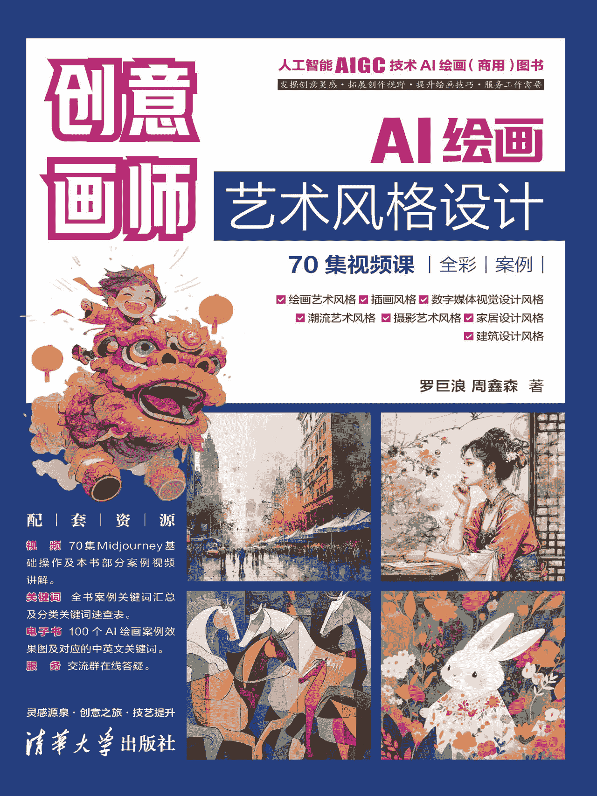
当当云阅读
# 版权信息

# 内容概览

过去两年里基于生成的视觉创作工具快速迭代，Midjourney、Stable Diffusion、文心一格等平台层出不穷。借助这些系统，即便没有绘画基础、不懂水彩水粉油画的技法，只要脑中有灵感，也能迅速产出接近预期的画面。生成绘图确实打开了设计表达的新通道，可工具本身只是载体。具体做何主题、选哪类题材、以何种视觉语汇呈现，最终由操作者决定。本书以艺术风格为线索，配合真实绘制案例进行系统归纳，涵盖绘画类风格、插画类风格、数字媒体视觉设计风格、潮流艺术风格、摄影艺术风格、家居设计风格、建筑设计风格等七大板块。把书中内容灵活运用到AI绘图实践中，就能打破同质化，让作品有气质、层次更丰富。

全书采用四色印刷，图文搭配，样例精美，适合对AI绘画感兴趣的传统画家、插画师、平面设计师以及家居、建筑设计从业者参考学习。

# 前言

只要稍微留意AI动向，大多人都经历过被AI绘图效果惊艳的时刻，也很难再怀疑其商业价值。如今的讨论早已不是要不要用、用得晚不晚，而是如何让这套强效工具发挥更大效能。

核心问题在于，如何令AI生成作品拥有灵魂。

自AI绘图诞生起，最常被诟病的一点就是“没灵魂”。作品虽精美，却易流于千篇一律，艺术辨识度偏弱。

这并不是技术缺陷，而是指导思路的局限。

各种AI绘画系统本质上是创作者的助手，**若觉得生成结果缺少灵魂，多半是操作方法尚未到位，需要对模型做必要的喂养与训练。**

本书致力于帮助读者完成风格训练，让AI绘画具备灵魂。**按照书中路径学习，就能掌握赋予作品灵魂的方法。**

**本书以风格为牵引、以商业实战为落点的专著，**聚焦七大艺术风格在AI绘画中的落地。对每种风格均梳理其典型特征、代表人物与经典作品，并提炼可直接用于提示词的核心关键词，同时标注最适合的商业使用场景。

## 本书特点
**第一，以风格为导向，直面“AI绘画缺少灵魂”的痛点。**以历史上知名艺术家与流派为样本，拆解风格特质并迁移到AI创作中，使作品具备鲜明辨识度。对不同风格做专项剖析，提炼的关键词具备专业性，涵盖造型、色彩、笔触等方面。

**第二，以商业实战为基准，实用性突出。**以真实商用场景串联内容，把风格学习与落地应用结合起来，避免空谈概念。

**第三，分类清晰，便于快速查找使用。**每种艺术风格的主要特征、核心关键词、最佳应用场景均一目了然，查阅即可上手。

**第四，适用范围广。**书中风格知识可覆盖现阶段主流AI绘画工具，例如Midjourney、Stable Diffusion、文心一格等均可参考。鉴于Midjourney的全球普及度，本书案例以其为主编写。

**第五，案例典型，便于举一反三。**以案例带动讲解，便于理解吸收，读者可按需借鉴。简单调整提示词即可生成符合个人意图的新作品。

**第六，配套资料丰厚，价值感高。**附带视频讲解、分类关键词速查表等资源，收获感远超预期。通过底部二维码即可获取。

**第七，社群支持到位，学习更安心。**本书搭建“AI绘画实战社群”，读者可在群内交流探讨，工作日作者在线答疑，相当于拥有一位私人导师；作者还会不定期开播，实现零距离沟通。

需说明的是，艺术史中不同风格与流派常互有交集，本书不涉及流派的学术辨析，重点是通过风格学习实现AI绘画的商业落地。

另外，书中案例关键词可迁移到其他AI绘画系统，但生成效果可能与书中示例存在差异。即使在Midjourney中使用，也未必完全一致，这正是AI绘画的特性所在。这种不确定性也赋予了创作无限可能性与独特魅力。

让AI绘画拥有灵魂，就从这本书起步！

# 第一章 绘画艺术样式
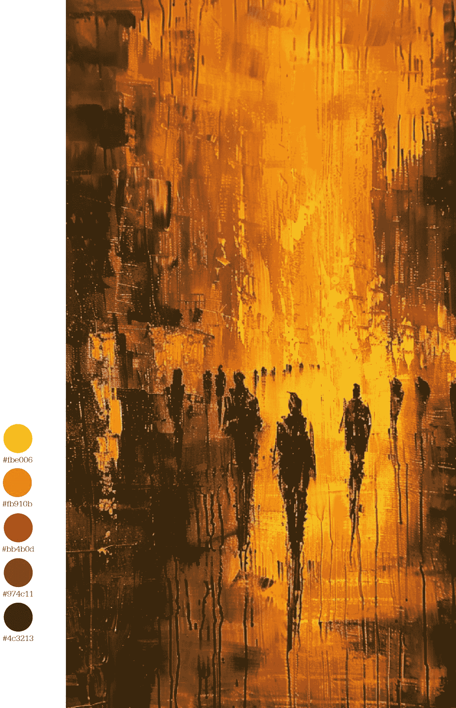
## 1.1　油画样式
### 1.1.1　文艺复兴绘画样式
#### AI作画欣赏
文艺复兴绘画主张复兴古典并弘扬人文精神，艺术家追求对现实与自然更真实的描摹。

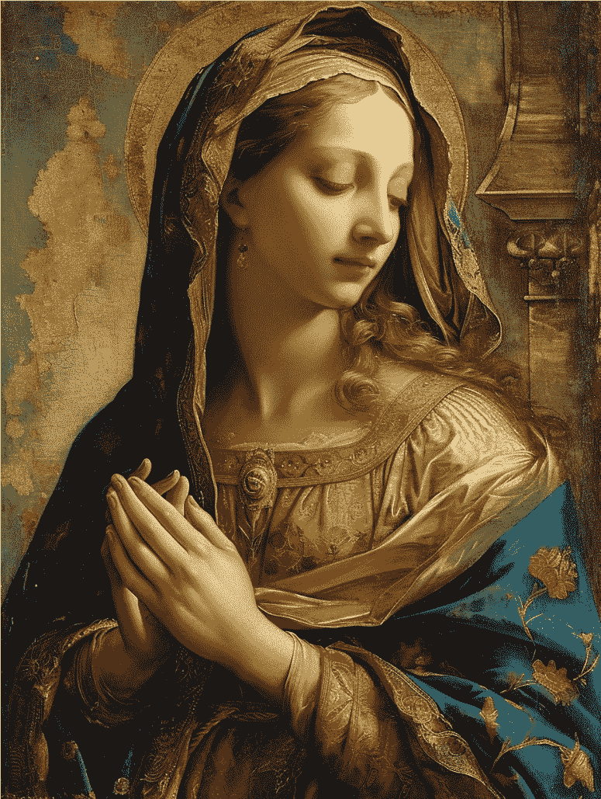
**提示:**
应用文艺复兴绘画风格时，选择历史题材更容易获得契合主题的AI成果。

#### 文艺复兴绘画样式的主要特点
**人体理想化：**受古希腊罗马雕塑启发，强调人体的理想化塑造，对比例的准确表现成为重点。
**透视运用：**大量采用线性透视，通过合理安排空间与深度，让画面更逼真立体，空间感与真实感增强。
**古典主题重现：**多取材于古典文学、神话与历史故事，体现对古典文化的推崇。
**色彩光影运用：**对色彩与光影进行深入研究，利用光影突出物体形态与质感。
**个体表达：**更重视个性化表达，通过肖像、风景与生活场景呈现个人情感与思想。
**经典元素复兴：**常使用古典建筑、柱廊、拱门等元素，营造古典氛围。
**自然主义追求：**追求对自然的真实表现，注意生活细节，使画面更具写实感。

#### 案例欣赏
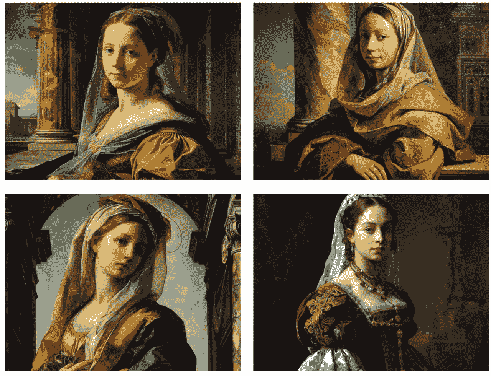

#### 提示词分享
**英文**
Maiden with veil on her head, Renaissance dress,aristocracy, ancient architecture, golden tones, ancient colonnades, religion, mythology, historical scenes,portraits of aristocrats, mythological heroes, golden proportions, stately balance, orthographic views,symmetrical compositions, sense of stability, muscular lines, idealized representations, ornate decorations,fashionable details, warm tones, golden yellows, reds,dark blues, contrasts of light and shadow, Renaissance architecture, colonnades, antique elements, symbolic objects, light and shadow effects, highlighting light and shadow, dramatic effects, three-dimensionality,highlighting important elements, solemnity, grandeur,mystery, figure expressions and gestures --ar 4:3--stylize 500 --v 6.0 --chaos 50

**中文**
头戴面纱的少女、文艺复兴时期的服饰、贵族、古代建筑、金色色调、古代柱廊、宗教、神话、历史场景、贵族肖像、神话英雄、黄金比例、庄重平衡、正视图、对称构图、稳定感、肌肉线条、理想化表现、华丽装饰、时尚细节、暖色调、金黄色、红色、深蓝色、光影对比、文艺复兴建筑、柱廊、古典元素、象征性物体、光影效果、突出光影、戏剧效果、三维性、突出重要元素、庄严、宏伟、神秘、人物表情和姿态--画面比例 4:3　--风格化 500　--版本 6. 0　--创意程度 50

#### 大师档案
► **莱昂纳多·达·芬奇**
意大利文艺复兴三杰之一，兼具艺术家与科学家身份，作品个人特色鲜明，善于融合艺术与科学。身兼画家、发明家、科学家、雕塑家，对人体解剖研究深入。代表作《蒙娜丽莎》《最后的晚餐》。

► **米开朗基罗**
意大利文艺复兴巨匠，集雕塑家、画家于一身，为三杰之一。对人体解剖理解深刻，雕塑与绘画造诣极高。代表作《大卫》《创世纪》。亦为建筑师，代表作有洛伦兹大教堂与圣彼得大教堂穹顶。

► **拉斐尔**
意大利艺术家，文艺复兴三杰之一，以构图优雅著称。代表作《雅典学院》等。

### 1.1.2　巴洛克艺术绘画样式
#### AI作画欣赏
巴洛克绘画盛行于17世纪初至18世纪初，起源意大利后传遍欧洲。多以富表现力的手法呈现宗教、历史与神话题材。

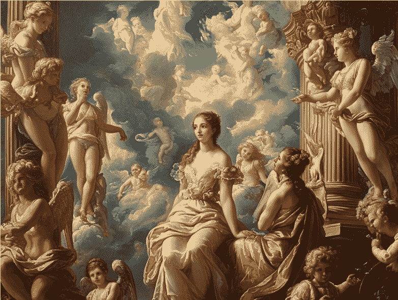
**提示:**
巴洛克艺术重视精细刻画与华丽装饰。生成巴洛克油画时应强化繁复纹样、曲线与奢华细节，以凸显其装饰性。

#### 巴洛克绘画样式的主要特点
**戏剧性与动感：**强调戏剧效果与强烈动感，场景充满活力，人物动作鲜明，视觉冲击力强。
**光影处理：**注重明暗对比技法，通过光影塑造物体形态、质感与立体感。
**构图复杂：**构图变化丰富，充斥对称、曲线与角度变化，带来动感与活力。
**强烈色彩对比：**常使用高对比色彩突出重点，增强戏剧张力。
**装饰性与细节：**重视细节刻画与装饰，用繁复元素让画面更奢华精致。

#### 案例欣赏
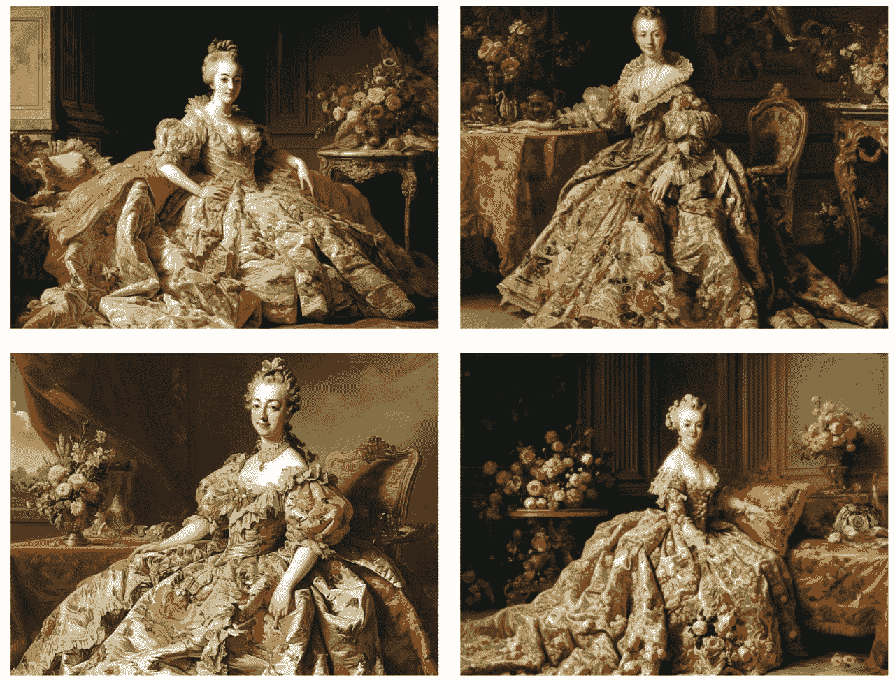

#### 提示词分享
**英文**
A painting of a woman wearing an expensive gown, in the style of Baroque elaborate detailing,in the style of luxurious fabrics, solarization,playfully intricate, lush detailing, floral still—lifes,in the style of Baroque-inspired art, dappled,large-scale portraits, Rembrandt, elaborate textiles, meticulous detailing, grandiose color schemes,dark beige and orange, meticulously detailed still life, elaborate costumes, Baroque--ar 4:3 --stylize 200 --chaos 30 --v 6.0

**中文**
一幅描绘着一位穿着昂贵礼服的女人的画、采用巴洛克风格的精致细节设计、采用奢华面料的风格、日光照射、俏皮复杂、丰富的细节、花卉静物、采用巴洛克风格的艺术风格、斑驳、大型肖像、伦勃朗、精致的纺织品、一丝不苟的细节、宏伟的配色方案、深米色和橙色、细致入微的静物、精致的服装、巴洛克风格--画面比例 4:3　--风格化 200　--创意程度 30--版本 6.0

#### 大师档案
► **伦勃朗·哈尔曼松·凡·莱茵**
荷兰艺术史巨匠，擅长肖像、历史、宗教、风景等多类题材。以独特风格与深刻表现力闻名，被誉为西方肖像画大家。代表作《自画像》《夜巡》《基督在埃玛乌斯路上》等。版画领域被视为巴洛克最伟大铜版画家之一，代表作《三个十字架》《三棵树》。

► **彼得·保罗·鲁本斯**
出生于德国的比利时艺术家，作品体现巴洛克强烈的情感表达与绘画技巧。代表作《卢西弗与战争女神》《狂欢》《克鲁索和赫拉克勒斯》等。

► **乔凡尼·洛伦佐·贝尼尼**
意大利艺术家，同时为画家、雕塑家、建筑师。作品富戏剧性、动感与表现力。代表作《大卫》《普鲁托和帕尔塞福涅》等。

### 1.1.3　洛可可绘画样式
#### AI作画欣赏
洛可可绘画在18世纪欧洲盛行，尤其法国，追求优雅、浪漫、精致，呈现华丽、轻松的审美，是巴洛克的演变形式。

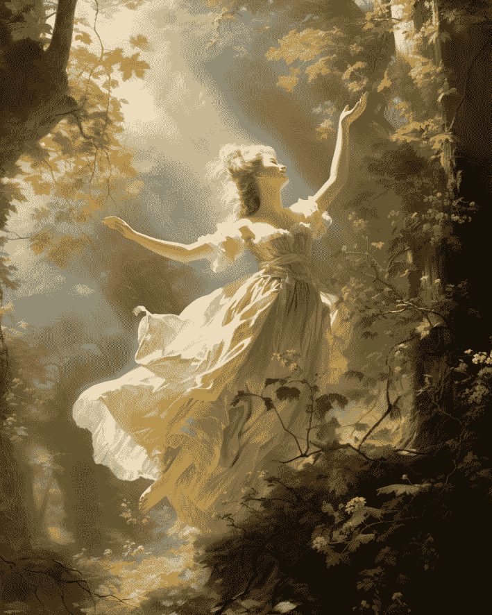
**提示:**
洛可可画作多用柔和暖色，如淡蓝、淡黄、淡粉。增加温馨色彩提示有助于营造典型氛围。

#### 洛可可绘画样式的主要特点
**轻松优雅：**强调轻松、优雅、愉悦，作品多含柔和曲线等装饰，氛围华丽。
**对称与曲线：**擅长用对称与曲线营造活力动感。
**装饰元素丰富：**画面充斥卷曲、花饰、羽毛、藤蔓等装饰，营造繁盛优雅氛围。
**绘画精致细腻：**对细节精雕细琢，画面精致复杂。
**浪漫主题：**多表现浪漫、爱情、宫廷生活，人物多为优雅贵族，场景多为花园、宫殿或室内。

#### 案例欣赏
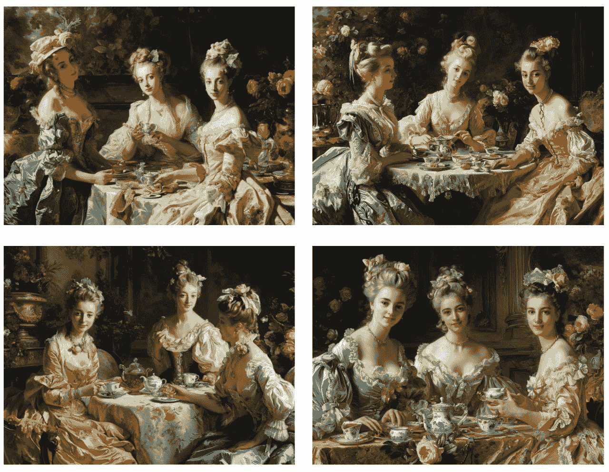

#### 提示词分享
**英文**
几位朋友在一起喝下午茶、正对着镜头、洛可可风格、高度细节、情感叙事、浪漫、弗朗索瓦·布歇、油画、17 世纪、奢华面料风格、日光下曝光、俏皮精致、丰富细节、静物、洛可可艺术风格、斑驳、大型肖像、精致纺织品、细致入微、宏伟的配色方案、深米色和橙色、细致入微的静物、精致服装、洛可可风格 `--画面比例 4:3 --风格化 500 --版本 6.0`

**中文**
几位朋友在一起喝下午茶、正对着镜头、洛可可风格、高度细节、情感叙事、浪漫、弗朗索瓦·布歇、油画、17 世纪、奢华面料风格、日光下曝光、俏皮精致、丰富细节、静物、洛可可艺术风格、斑驳、大型肖像、精致纺织品、细致入微、宏伟的配色方案、深米色和橙色、细致入微的静物、精致服装、洛可可风格 `--画面比例 4:3 --风格化 500 --版本 6.0`

### 大师档案
► **弗朗索瓦·布歇**
法国画家、版画家与设计师，将洛可可风格推向极致，曾任法国美术院院长、皇家首席画师。代表作《戴安娜的休息》《爱之目》《牧歌》《月亮女神的水浴》等。

► **让·安东尼·华托**
法国艺术家，被视为洛可可绘画奠基人之一。作品擅于描绘优雅场面与戏剧画面，形成“沸腾派”风格。代表作《舞者插图》《费腾博士的装饰画》等。

► **让·奥诺雷·弗拉戈纳尔**
法国画家，表现技巧多样，可精微细腻亦可写意粗犷，善于运用明暗变化，色彩淡雅。代表作《秋千》《读书女孩》《闩》《狄德罗》等。

### 1.1.4 印象主义绘画样式
#### AI作画欣赏

19 世纪 60 年代末至 70 年代初，印象主义在法国萌生，随后影响扩散至世界各地美术领域。本质上它是对学院派固有规则的反向突破。摄影技术在此时日渐成熟，画家对再现客观现实的执念松动，转而寻求更具个人情绪色彩的主观表达。

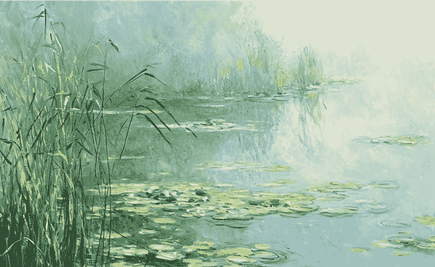

**提示：**
印象主义最直观的辨识点是轻快松弛的笔触。在编写提示时点出快速、宽松的笔感，有助于 AI 绘画工具捕捉到该风格的气质。

### 印象主义绘画风格的主要特点

**主观印象：**创作者把个人感受和直觉置于首位，以感性方式解读自然景象，不执着于精确复制客观物象。

**大胆而自由的笔触：**运笔洒脱节奏明快，远观时色块融合为整体氛围，近看才显斑驳肌理，降低对细节的依赖。

**色彩的纯净性：**偏好清亮饱满的色调，摒弃旧式阴郁基调，靠色彩的通透度记录瞬时光感与情绪波动。

**光影效果：**聚焦不同时段光线对物色与轮廓的塑造，凸显光本身带来的色彩转换。

**不完整的构图：**常以局部取景或留白收束，不求传统完整画面，强化瞬间感受的主导性。

**瞬间的捕捉：**追求稍纵即逝的视觉瞬间，体现时间推移下光影的流动与活泼感。

### 案例欣赏

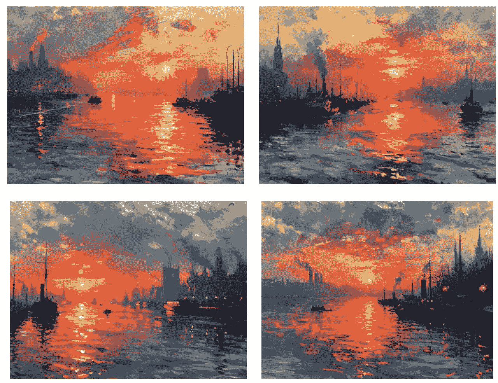

### 提示词分享

#### 英文
城市河畔、城市建筑的剪影、河中光影的变化、宁静、美丽、日落、印象派笔触、克劳德·莫奈、浅红色和浅灰色风格、多重视角、雄伟的港口、印象派灯光、霓虹印象派、印象派风景、浅灰色和浅绯红色 `--画面比例 4:3 --风格化 500 --版本 6.0`

#### 中文
城市河畔、城市建筑的剪影、河中光影的变化、宁静、美丽、日落、印象派笔触、克劳德·莫奈、浅红色和浅灰色风格、多重视角、雄伟的港口、印象派灯光、霓虹印象派、印象派风景、浅灰色和浅绯红色 `--画面比例 4:3 --风格化 500 --版本 6.0`

### 大师档案

► **克劳德·莫奈** 法国出身的画家，印象派的核心人物之一，以精妙的光色处理闻名于世，对后续艺术流派产生深远影响。常提及的作品有《印象·日出》《睡莲》。

► **爱德华·马奈** 法国创作者，其色彩与光的处理为印象派崛起提供先声。常提及的作品有《草地上的午餐》《奥林匹亚》。

► **奥古斯特·雷诺瓦** 法国画家，印象派重要代表，以明快轻盈的笔调著称，擅长描绘光影与日常温情。常提及的作品有《煎饼磨坊的舞会》《游艇上的午餐》。

### 1.1.5 后印象主义绘画风格

### AI 绘画鉴赏

后印象派大致出现在十九世纪末叶二十世纪开端，在印象派之上继续推进，涵盖多种新颖手法与语言。这一时期的创作者在色彩运用、造型语言与表现方式上做更具个人色彩的试验。

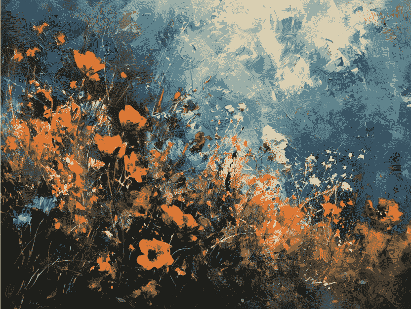

**提示：**
点彩、色块、形体的抽象化处理是后印象派的标志。提示词里强化这些元素，能让 AI 输出更贴近该风格。

### 后印象主义绘画风格的主要特点 后印象主义绘画风格的主要特点

**点彩主义：**部分创作者以细小点或斑块堆叠画面，远看统一，近看显现丰富的色彩层次。

**色彩的强调：**强调情感性的用色，选用更鲜艳、对比更强的色调来传达主观感受。

**形式的扭曲：**对物象形态进行改写，打破自然主义束缚，追求更抽象独特的表达。

**情感的表达：**注重借助色彩与形式抒发内在情绪与精神状态，突出艺术的个性与主观性。

**艺术家的独立性：**强调艺术家个人风格与独立性，拒绝传统规范束缚，鼓励创新与尝试。

### 案例欣赏 案例欣赏

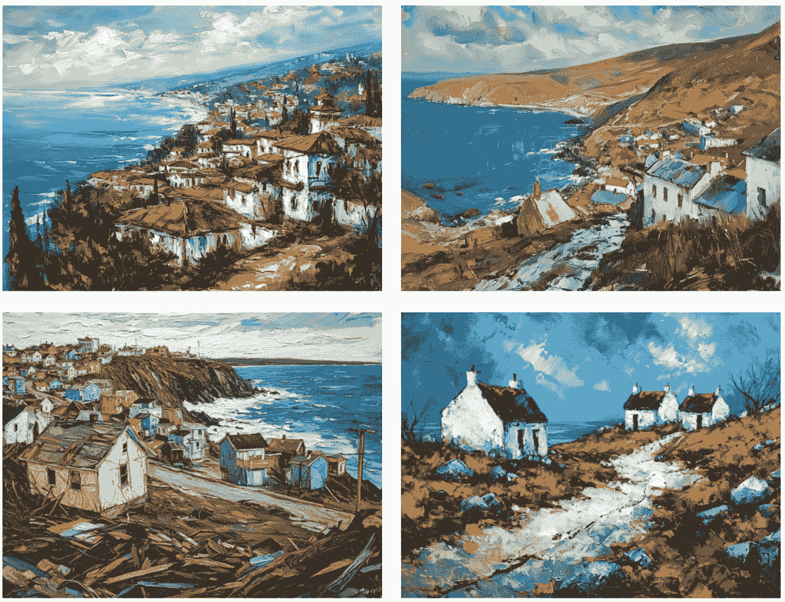

### 提示词分享

#### 英文
乡村房屋和土路、生锈的碎片、海洋和海岸、具有印象派风景的风格、天蓝色和白色、大型绘画、调色刀的广泛使用、日落、斑驳的光线、柔和的色调、温暖的色调、丰富的色彩、快速笔触、模糊边缘、宁静、浪漫、幻想、自然形式、印象派笔触 `--画面比例 4:3 --创意程度 50 --风格化 200 --版本 6.0`

#### 中文
乡村房屋和土路、生锈的碎片、海洋和海岸、具有印象派风景的风格、天蓝色和白色、大型绘画、调色刀的广泛使用、日落、斑驳的光线、柔和的色调、温暖的色调、丰富的色彩、快速笔触、模糊边缘、宁静、浪漫、幻想、自然形式、印象派笔触 `--画面比例 4:3 --创意程度 50 --风格化 200 --版本 6.0`

### 大师档案 大师档案

► **保罗·塞尚** 法国画家，衔接印象与后印象的关键人物，风格逐渐摆脱印象派框架，对现代艺术产生深远影响。常提及的作品有《蓝色山》《静物：苹果与橘子》。

► **文森特·梵高** 荷兰画家，后印象派代表，以强烈表现性与独特笔法著称，成为艺术史经典。常提及的作品有《星夜》《向日葵》系列。

► **保罗·高更** 法国创作者，活跃于印象与后印象之间，虽当时不被广泛接受，后来对现代艺术发展产生重大影响。常提及的作品有《黄色基督》《巴比松的午后》。

### 1.1.6 表现主义绘画风格

### AI 绘画鉴赏

表现主义诞生于二十世纪早期，涵盖绘画、戏剧与文学，强调内在情感与主观体验的表达。作品多以夸张、扭曲、简化与独特形式呈现艺术家对世界的强烈个人感受。

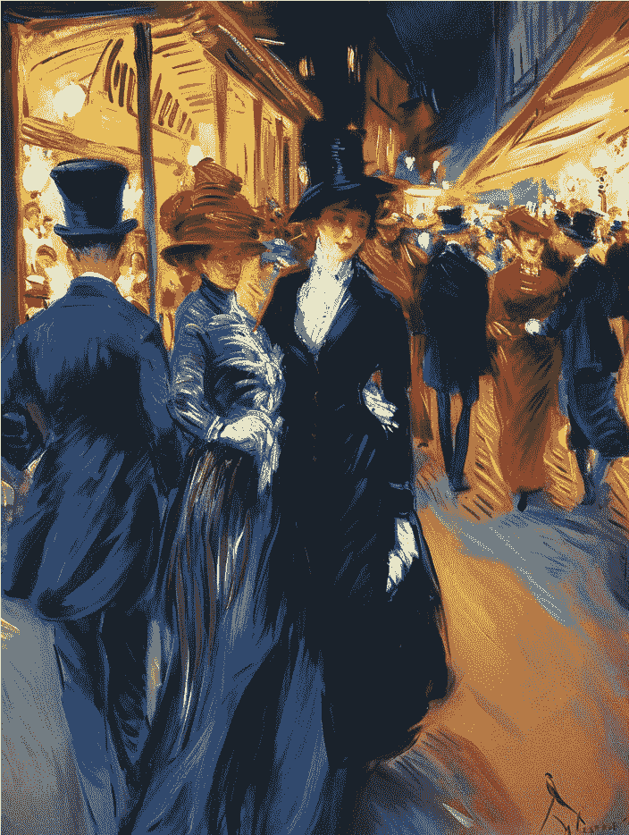

**提示：**
表现主义重视心理与情绪的呈现，常借助夸张变形的形象。在提示词中明确想要传递的情绪，如愤怒、恐惧、忧郁等，会更有效。

### 表现主义绘画风格的主要特点 表现主义绘画风格的主要特点

**夸张和扭曲：**人物、景物与物体的形态被刻意改变，脱离现实比例，以彰显内在心理状态。

**独特的色彩：**多用非自然、象征性的色彩来传达情绪，而非模仿视觉真实。

**笔触和纹理：**笔触粗犷有力、情感充沛，常使用刷子、刮刀等工具营造独特肌理，突出表现力。

**主观视角和情感表达：**强调个人视角与情感的投射，与传统客观描绘形成对照。

**社会批判：**关注社会议题，通过作品表达对现实的不满与关切。

**非传统构图：**打破常规构图与透视，画面结构错综，以强化情绪张力。

**异化和变形：**通过改变外观使形象显得陌生神秘，用来传递内在情感状态。

### 案例欣赏 案例欣赏

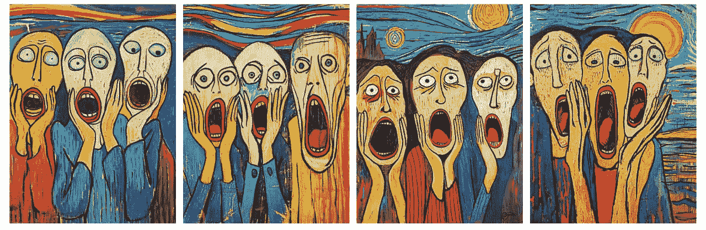

### 提示词分享

#### 英文
一群人对着镜头尖叫着并表现出夸张的表情，线条，笔触，手绘，扭曲，风格有浅橙蓝、深天蓝、浅深红、浅黄，动画表情，怀旧主题，鞭打线条，紫色和黄色，艺术史上的标志性作品，鼓舞人心的视觉，表现主义风格 `--画面比例 3:4 --创意程度 50 --版本 6.0`

#### 中文
一群人对着镜头尖叫着并表现出夸张的表情，线条，笔触，手绘，扭曲，风格有浅橙蓝、深天蓝、浅深红、浅黄，动画表情，怀旧主题，鞭打线条，紫色和黄色，艺术史上的标志性作品，鼓舞人心的视觉，表现主义风格 `--画面比例 3:4 --创意程度 50 --版本 6.0`

### 大师档案 大师档案

► **爱德华·蒙克** 挪威艺术家，表现主义先驱，以激进而富情感的风格著称，作品多围绕生死、孤独等主题展开。常提及的作品有《呐喊》《青少年》《夏夜》。

► **基希纳** 德国创作者，德国表现主义先驱，以强烈色彩与扭曲形式描绘都市生活。常提及的作品有《柏林街景》《市场与红塔》。

► **瓦西里·康定斯基** 俄罗斯艺术家，表现主义先驱之一，擅长以色彩的冷暖明暗表达强烈情感。常提及的作品有《秋》《冬》《乐曲》《即兴曲》《构图 2 号》。

► **埃贡·席勒** 奥地利画家，以扭曲人体与独特构图呈现强烈表现主义风格。常提及的作品有《斜卧的女人》《拥抱》《低着头的自画像》。

### 1.1.7 立体主义绘画风格

### AI 绘画鉴赏

立体主义源自法国，是二十世纪初的现代艺术运动，试图通过多视角与几何组合呈现对象整体理解。

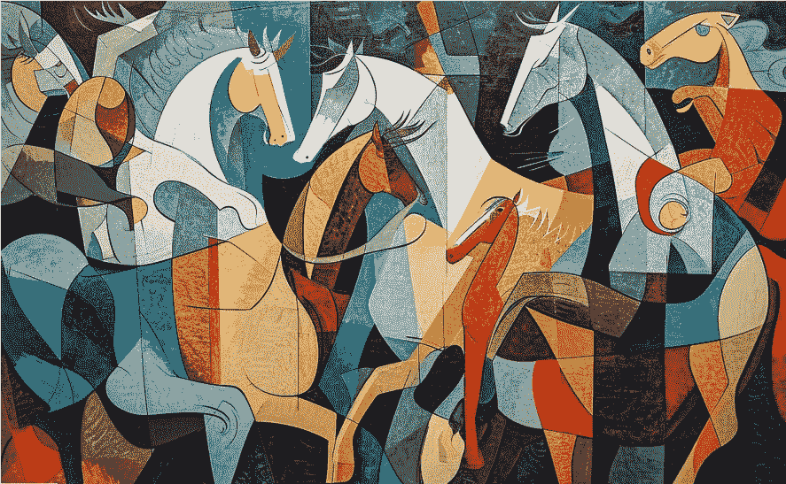

**提示：**
立体主义特征为几何化、视角分解与图像重组。提示时可具体指定色彩、主题、构图与排列方式。

### 立体主义绘画风格的主要特点 立体主义绘画风格的主要特点

**几何化：**将描绘对象拆解为基础几何单元，再重新组合，以呈现多重视角。

**多视角和同时性：**模拟人眼在不同时空观察的方式，使画面呈现对物体的全面理解。

**断裂和拼贴：**将不同视角与形状拼接，制造视觉错综效果，打破传统透视与平面性。

**有限的色彩：**采用简明明亮的色彩，强调几何与结构，而非光影渐变塑造深度。

**主观变形：**不拘泥于客观真实，形式经夸张变形，突出主观表达追求。

### 案例欣赏 案例欣赏

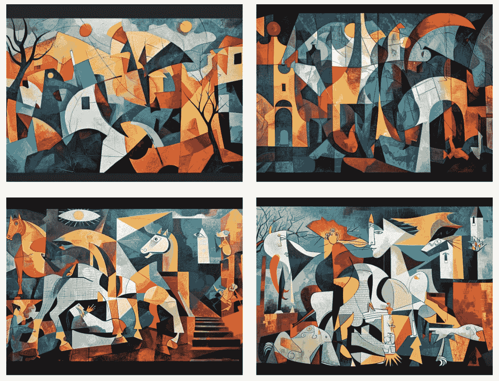

### 提示词分享

#### 英文
森林中的别墅、立体主义、毕加索风格、破碎的平面、强烈照明、大型壁画、视错觉细节、卡通暴力风格 `--画面比例 4:3 --风格化 200 --版本 6.0`

#### 中文
森林中的别墅、立体主义、毕加索风格、破碎的平面、强烈照明、大型壁画、视错觉细节、卡通暴力风格 `--画面比例 4:3 --风格化 200 --版本 6.0`

### 大师档案 大师档案

► **巴勃罗·毕加索** 西班牙艺术家，立体主义创始人之一，与乔治·布拉克共同推动该风格发展。常提及的作品有《格尔尼卡》《亚威农的少女》。

► **乔治·布拉克** 法国艺术家，与毕加索合作创立立体主义，强调绘画形式的几何化处理。常提及的作品有《玻璃杯和小提琴》。

► **胡安·格里斯** 西班牙艺术家，立体主义重要代表，作品以明亮色彩与严谨几何著称。常提及的作品有《向毕加索致意》。

### 1.1.8 超现实主义绘画风格

### AI 绘画鉴赏

超现实主义发源于法国，是二十世纪初的艺术与文学运动，核心是揭示无意识思想与梦幻元素，挑战现实逻辑。

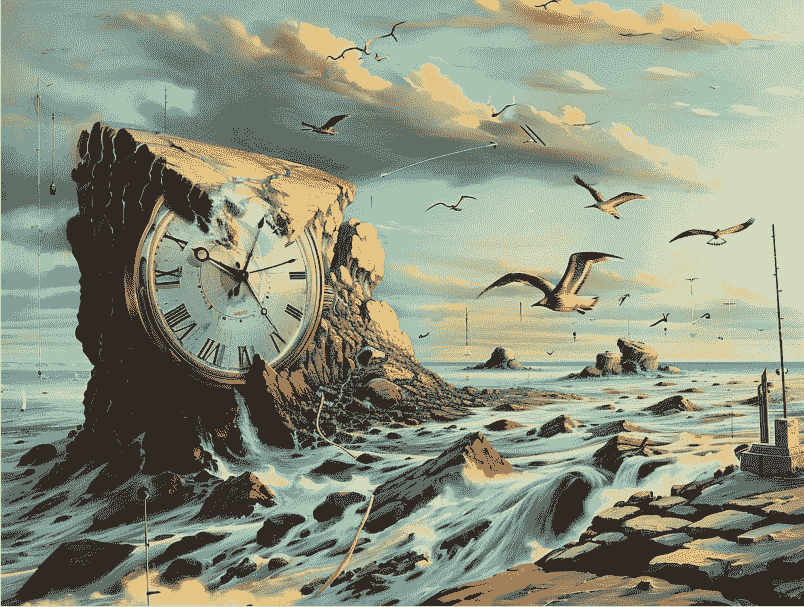

**提示：**
超现实主义强调梦幻场景与意象，可将现实元素与奇幻元素融合，创造既熟悉又陌生的视觉效果。

### 超现实主义绘画风格的主要特点 超现实主义绘画风格的主要特点

**幻想和梦境：**描绘充满梦幻的场景，探索潜在无意识与情感。

**非现实和变形：**包含扭曲形象、变形物体与非现实场景，挑战传统视觉规则。

**超感官体验：**借助奇异色彩、不寻常构图与光影制造超越常规感知的画面。

**意象的随机组合：**将看似无关的事物组合，引发观者联想与思考。

**细节和技艺：**常以精致细节与高超技法呈现强烈视觉冲击力。

**自由联想：**不受逻辑或合理性束缚，表达荒诞、梦幻的思想。

### 案例欣赏 案例欣赏

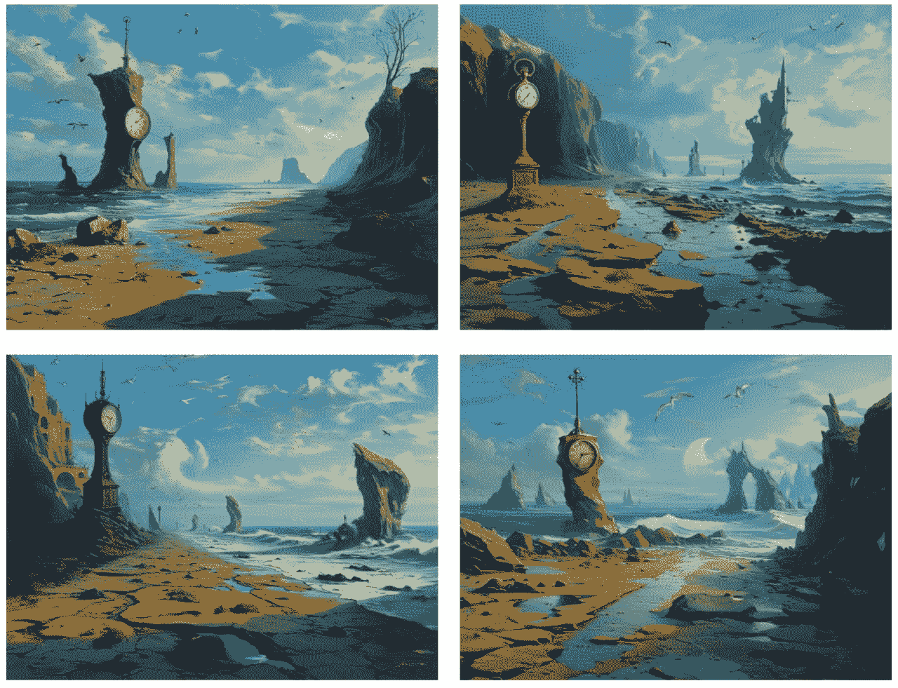

### 提示词分享

**英文**
海洋环绕的岛屿，融化的时钟，流动的计时器，流动的时间，飞鸟，荒凉景观风格，深青色和浅米色，萨尔瓦多·达利风格，超写实静物，超现实主义风景风格，人工环境风格，超现实主义梦境，广阔的风景，大量生产的物品，物体的并置，柔和的海景，超现实主义的愿景，理性主义构图，有组织的混乱，光学错觉的细节，写实的静物画，战后表现主义，微妙的表达，1918–1939 年（战间期） --ar 4:3 --v 6.0 --stylize 200 --chaos 30

**中文**
海洋环绕的岛屿、融化的时钟、流动的计时器、流动的时间、飞鸟、荒凉景观风格、深青色和浅米色、萨尔瓦多·达利风格、超现主义静物、超现实主义风景风格、人工环境风格、超现实主义梦境、广阔的风景、大量生产的物品、并置的物品、柔和的海景、空想的超现实主义、理性主义构图、有组织的混乱、视错觉细节、写实的静物画、战后表现主义、微妙的表达，1918—1939 年（战时）　--画面比例 4:3　--版本 6.0　--风格化 200　--创意程度 30

### 大师档案 大师档案

► **萨尔瓦多·达利** 西班牙艺术家，超现实主义杰出代表，以独特视觉与时间扭曲著称。常提及的作品有《记忆的永恒》《内战的预兆》。

► **勒内·马格利特** 比利时画家，超现实主义重要人物，画面带诙谐与深意。常提及的作品有《戴圆顶硬礼帽的男子》《夜的意味》。

### 1.1.9 抽象表现主义绘画风格

### AI 绘画鉴赏

抽象表现主义是二十世纪中期兴起于美国的潮流，五十年代达到高峰，强调强烈个性与情感表达，聚焦抽象形式与色彩探索。

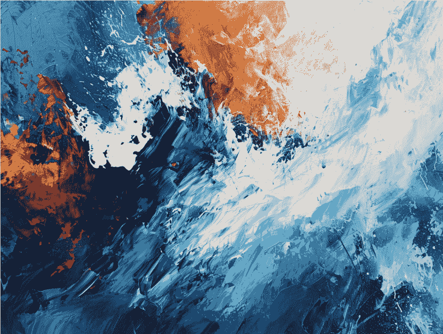

**提示：**
抽象表现主义旨在传递特定情绪或概念，注重形状、线条与色彩组合。保持开放与创造性思维，能让作品呈现独特视角与情感。

### 抽象表现主义绘画风格的主要特点 抽象表现主义绘画风格的主要特点

**抽象性：**拒绝具象描绘，通过抽象形线与色彩表达情感与内在经验。

**内在体验：**将个人情感、冲突与精神状态投射于画面，通过作品呈现内心感受。

**大胆的笔触和运动感：**多用大胆自由的笔触与工具，以强烈冲击力表现能量与动态。

# 美术风格灵感合集

## 抽象表现主义

**色彩的重要性：**在这一流派里，色彩几乎是情绪的直接载体。创作者习惯以高饱和的色块大面积铺陈，用鲜明的对比营造氛围、引导观看动线。

**涂鸦和滴漆技法：**部分实践者偏爱涂鸦式的书写、滴洒与随机笔触，借助看似失控的手法追求即兴与洒脱的视觉张力。

**注重过程：**对从业者而言，创作当下的体感往往优先于成品形态，强调在挥洒中释放直觉与情绪痕迹。

### 案例展示
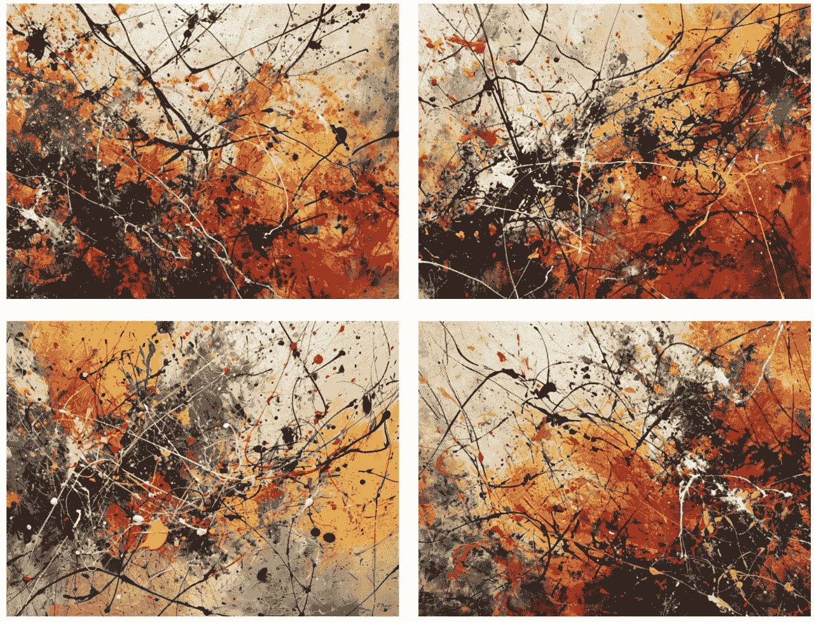

### 提示词参考
**英文**
想象冬日的氛围，杰克逊·波洛克，点染与泼溅，抽象形状，暖色调，线描，颜料飞溅，情感的抽象表达，层次与融合，动感与流动，自由表达，抽象表现主义绘画风格 --ar 4:3 --v 6.0

**中文**
想象冬日的氛围、杰克逊·波洛克、点染与泼溅、抽象形状、暖色调、线描、颜料泼溅、抽象情感表达、层次与混合、活力与流动、自由表达、抽象表现主义绘画风格　--画面比例 4:3　--版本 6.0

### 大师简介
► **杰克逊·波洛克**
美国画家，以开创性的滴流技法闻名，常把画布平铺地面，以滴洒方式作业。代表作品如《秋韵：第 30 号》《薰衣草之雾：第 1 号》《大教堂》《蓝杆：第 11 号》等。

► **威廉·德·库宁**
荷兰裔美国画家，作品多围绕抽象女体与律动展开。代表作品如《女人与自行车》《粉红色天使》等。

### 1.1.10 波普艺术绘画风格

### AI 创作赏析
波普艺术诞生于 50 年代的英国，60 年代在美国转向主流前卫。它聚焦消费与大众文化，用流行符号与日用品解构传统精英艺术观，把街头巷尾的图像搬进画室。

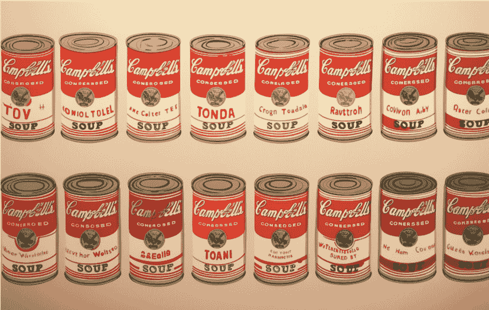

**提示：**
构思波普主题时，可把广告语、漫画形象、明星肖像、消费物件等元素写进提示，能更贴合风格气质。

### 波普艺术核心特征
**大众文化：**视角对准大众生活，把商品广告、娱乐影像等日常素材收进创作体系。

**图像复制：**大量借助丝网、喷漆等复制手段，复刻广告与流行图像的视觉语汇。

**明亮的色彩：**偏好高纯度亮色，增强画面冲击与辨识度。

**物件取材：**取材多来自日常用品，如汽车、零食、漫画格、电视机等。

**幽默和讽刺：**在挪用流行符号时常带戏谑与讽刺，用调侃姿态反思消费社会。

### 案例展示
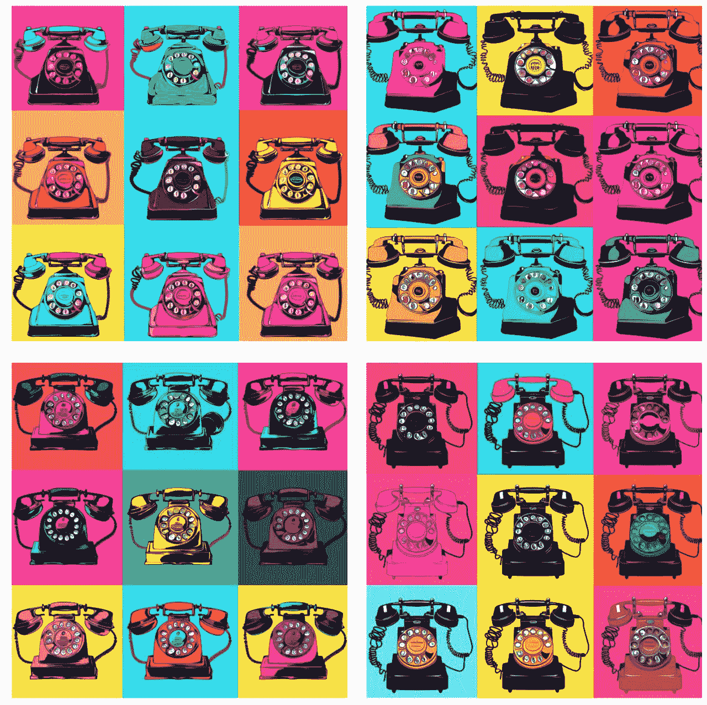

### 提示词参考
**英文**
电话，波普艺术，波普艺术配色方案，重复风格，丝网印刷，过度消费，虚荣和品牌崇拜，过度包装，社交媒体影响，广告侵入，大规模生产，可持续性，社交焦虑，人为需求创造，财富不平等，转瞬即逝的幸福 --ar 1:1 --niji 5

**中文**
电话、波普艺术、波普艺术配色方案、重复风格、丝网印刷、过度消费、虚荣和品牌崇拜、过度包装、社交媒体影响、广告入侵、大规模生产、可持续性、社交焦虑、人工需求创造、财富不平等、转瞬即逝的幸福　--画面比例 1:1　--版本 niji 5

### 大师简介
► **安迪·沃霍尔**
美国艺术界的关键人物，波普运动的核心推动者之一。沃霍尔大胆尝试多种复制工艺，涵盖凸版印刷、橡皮或木料拓印、金箔工艺及照片投影等。代表作有《汤罐》系列与《玛丽莲·梦露》等。他的创作主张通过重现大众符号打破精英艺术与流行文化的界线，常复制名人头像与商品标志并以丝网技法呈现，用以凸显媒体与消费对社会的影响。另有《块头》系列与《马丁·路德·金肖像》等。

► **理查德·汉密尔顿**
英国艺术家，波普的领军人物，被称作“波普之父”。代表作如《是什么使今天的家庭如此不同，如此有吸引力？》等。

► **罗伊·利希滕斯坦**
美国艺术家，波普代表人物，以漫画与广告美学结合的绘画著称。他借用大众传媒意象，以标志性的色调与大圆点点阵手法呈现“美国生活哲学”。代表作如《看呀米奇》《溺水之女》《M-Maybe》等。

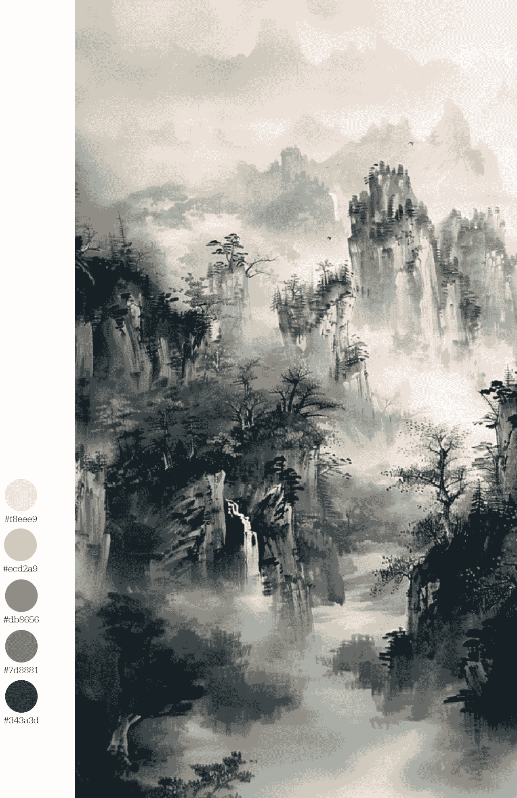

## 1.2 国画风格

### 1.2.1 中国山水画绘画风格

#### AI 创作赏析
中国山水画是中国画的重要分支，擅长描绘山川河岳、林木烟云等自然景象。它强调意境与主观感悟，而非精细写实，通过墨色与布局传递自然气息。

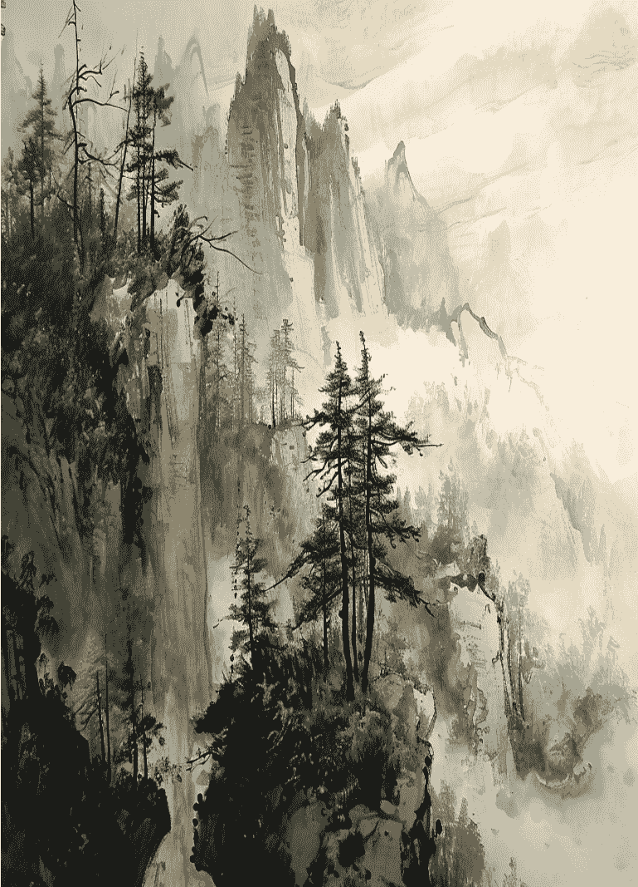

**提示：**
传统山水很看重空间布局，峰峦、水流、云雾的安置考究。提示中可具体描述高山、缓流、峭壁、松林等意象。

山水画追求的不仅是景物的再现，更是作者的心境表达。可在提示里强调想要的气氛，如宁静、幽深、壮阔等。

#### 中国山水画核心要点
**意境抽象：**侧重表达作者对景物的个人感悟与情绪体验，以抽象手法营造氛围。

**气韵生动：**气韵是山水画的关键。画家借墨色、线条与构图让景物呈现生动气息，使观者感受到自然的呼吸。

**留白和虚实结合：**常以留白表现辽远与深邃，虚实相生增强空间感。

**墨色运用：**多以墨为主，通过浓淡干湿表现远近、高低与光影。

**写意和工笔的灵活运用：**兼有写意与工笔，整体可用写意抒怀，局部以工笔刻细，使画面丰富多层。

#### 案例展示
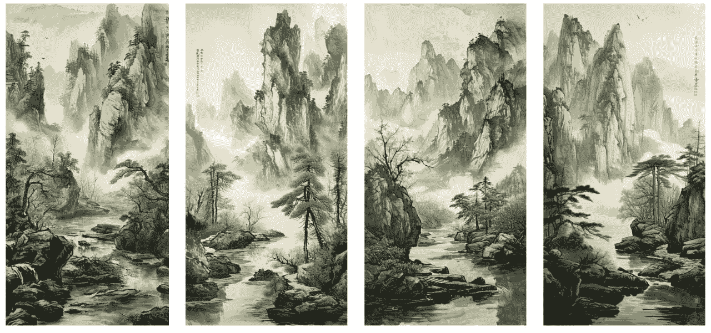

#### 提示词参考
**英文**
中国山水画，水墨画，浅灰色和深翠绿色，以大幅绘画的风格，平静的水面，高对比度阴影，浅橙色和深翠绿色，朦胧的气氛，高度详细的環境，浪漫的风景，水彩画家，田园风光，传统卷轴画，中国河流风景画，幻想的荒野 --ar 1:2

**中文**
中国山水画、水墨画、浅灰和深翠绿色、以大幅绘画的风格、平静的水面、高对比度阴影、浅橙色和深翠绿色、朦胧的气氛、高度详细的环境、浪漫的风景、水彩画家、田园风光、传统的卷轴画、中国画的河流风景、幻想的荒野　--画面比例 1:2

#### 大师简介
► **董源**
五代画家，南派山水创始人，与李成、范宽并称“北宋三大家”。擅山水，亦工人物、禽兽。代表作如《夏景山口待渡图》《潇湘图》《夏山图》《溪岸图》《平林霁色图卷》等。

► **范宽**
宋代画家，性情宽厚故号“宽”。作品峰峦浑厚端庄，气势阔大，具雄奇险峻感。代表作如《谿山行旅图》《雪山萧寺图》《雪景寒林图》等。

► **王希孟**
北宋晚期画家，擅山水，18 岁作《千里江山图》后早逝。代表作如《千里江山图》。

► **赵孟頫**
南宋末至元初书画家、文学家，提出“书画同源”，开元代新风，为元代画坛领袖，有“元人冠冕”之誉。代表作如《秋郊饮马图》《鹊华秋色图》等。

► **黄公望**
元代画家，工书法，通音律，善诗文，尤其擅山水。代表作如《富春山居图》《水阁清幽图》《天池石壁图》《九峰雪霁图》《富春大岭图》等。

► **董其昌**
明代画家、书法家，擅山水。代表作如《岩居图》《秋兴八景图》《昼锦堂图》《白居易琵琶行》《草书诗册》《烟江叠嶂图跋》等。

### 1.2.2 中国人物画绘画风格

#### AI 创作赏析
中国人物画以人物形象为核心，常表现神态、服饰与背景，折射社会、文化、历史与哲学层面。

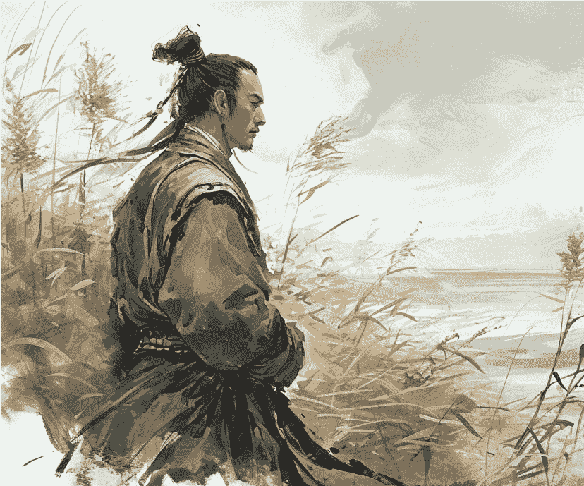

**提示：**
此类画多包含传统服饰、装饰与背景，如旗袍、长袍、中国风景等。提示中加入这些元素有助于生成具中国特色的画面。

### 中国人物画核心特征
**传统特色：**承载深厚文化传统，受儒释道思想影响，注重表现内在精神与文化修养。

**古代服饰：**人物多着历代服饰，风格细节强化历史与文化感。

**雅致风格：**追求画面的平和、静谧与内涵。

**意境表达：**通过表情、动作与环境传递作者的情感与思考。

**文人气息：**常描绘文人雅士，突出其文学、书法、音乐等才情与品位。

**传统技法：**多用线描、设色、水墨等，水墨尤重墨色的浓淡与笔墨运用。

**主题多样：**涵盖历史人物、仕女、山水人物等，表达对生活、自然与人性的理解。

### 案例展示
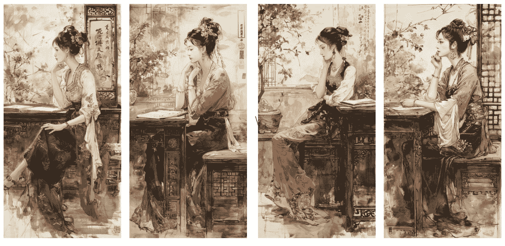

## 提示词参考
**中文**
这个女人坐在一张中国的书桌旁、穿着优美的人物、自然的主题、精致的花纹、淡化的、沉思的姿势、手绘的风格、传统服饰 `--画面比例 1:2 --版本 6.0`

## 大师简介
► **顾恺之**
东晋画家，精于人像、佛像、禽兽、山水，重传神，对传统绘画奠基。代表作如《洛神赋图》《女史箴图》等。

► **阎立本**
唐代画家，以肖像著称，被誉“丹青神化”。代表作如《步辇图》等。

► **吴道子**
唐代画家，史称“画圣”，擅佛道、神鬼、人物、山水等，尤精佛道人物。代表作如《送子天王图》《八十七神仙卷》等。

► **张择端**
北宋画家，《清明上河图》集各画种技艺于一身。代表作如《清明上河图》《金明池争标图》等。

### 1.2.3　中国花鸟画绘画风格

### AI 创作赏析
中国花鸟画以花、鸟、虫、草等为对象，分为工笔、写意与兼工带写三种做法。工笔严谨细致，写意简练概括，兼工带写居中。

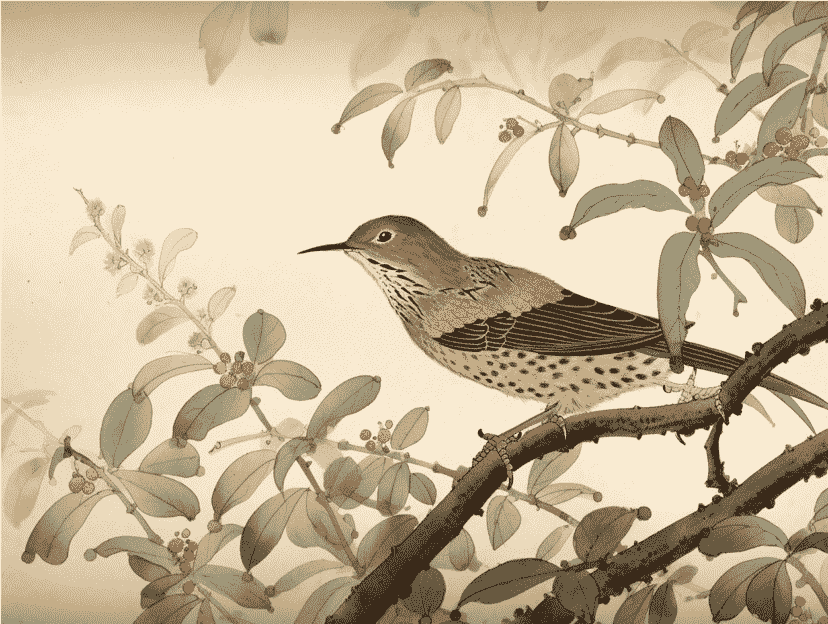

**提示：**
绘制时需给出清晰具体的提示，包含所愿花卉鸟类、构图、色彩等，信息越具体越易命中预期。

### 中国花鸟画核心特点
**写意和工笔灵活运用：**写意重形神兼备与意境抒发，工笔重细节与形态精准，常相融合。

**线条的运用：**以流畅有力的线描勾勒花叶、枝干与鸟的轮廓，传达形态与动势。

**意境追求：**借助构图、色彩与笔触让画面富于生气与诗意。

**色彩的运用：**多以淡雅清新为主，搭配和谐突出自然美感。

**传统意象：**常选梅兰竹菊等花与鹦鹉鸳鸯孔雀等鸟，蕴含深厚文化意涵。

**留白的运用：**以空白强化层次，使画面更具灵性。

**笔墨韵味：**注重墨色的层次变化，淡墨、浓墨、干墨、湿墨并用，形成独特韵致。

### 案例展示
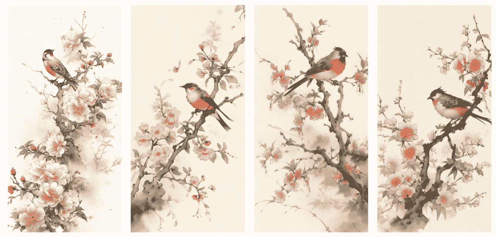

## 提示词参考
**中文**
宋代工笔画中的花卉、准确的鸟类标本、树木、宋代花鸟画、水墨画、工笔画、中国画、中国水墨画、中国风水墨画、写意画、白描画、诗意画、栩栩如生、历史画 `--画面比例 1:2--版本 niji 5`

## 大师简介
► **韩干**
唐代画家，少时为酒店雇工，经王维资助学画，擅肖像、人物、鬼神、花竹，尤善画马，常到马厩写生。代表作如《牧马图》《照夜白图》等。

► **黄筌**
五代画家，擅花鸟，禽鸟造型准确，骨肉兼备，形象丰满，赋色浓丽。代表作如《写生珍禽图》等。

► **崔白**
北宋画家，长于表现荒野秋冬花鸟神情，尤其擅败荷、芦雁，手法细腻，形象真实。代表作如《双喜图》《寒雀图》《竹鸥图》等。

► **赵昌**
北宋画家，宋代花鸟画坛杰出者。代表作如《四喜图》《粉花图》《写生蛱蝶图》等。

► **吴昌硕**
晚清至民国画家、书法家、篆刻家，与任伯年、蒲华、虚谷合称“清末海派四大家”。代表作如《瓜果》《灯下观书》《姑苏丝画图》等。

► **八大山人**
本名朱耷，明末清初画家，宗室出身，明亡后削发为僧，后改道。花鸟多用水墨写意，形象夸张奇特，笔墨凝练沉毅。代表作如《水木清华图》《荷花水鸟图》《松石图》等。

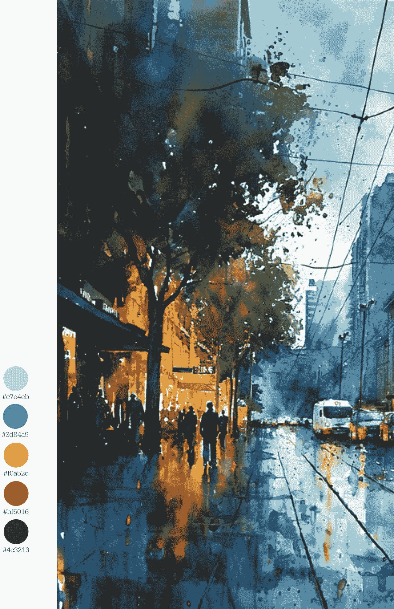

## 1.3　水彩风格

### 1.3.1　水彩风景画绘画风格

### AI 创作赏析
水彩风景画以水彩为媒介表现自然景色，具有通透、轻盈与柔和的特质。

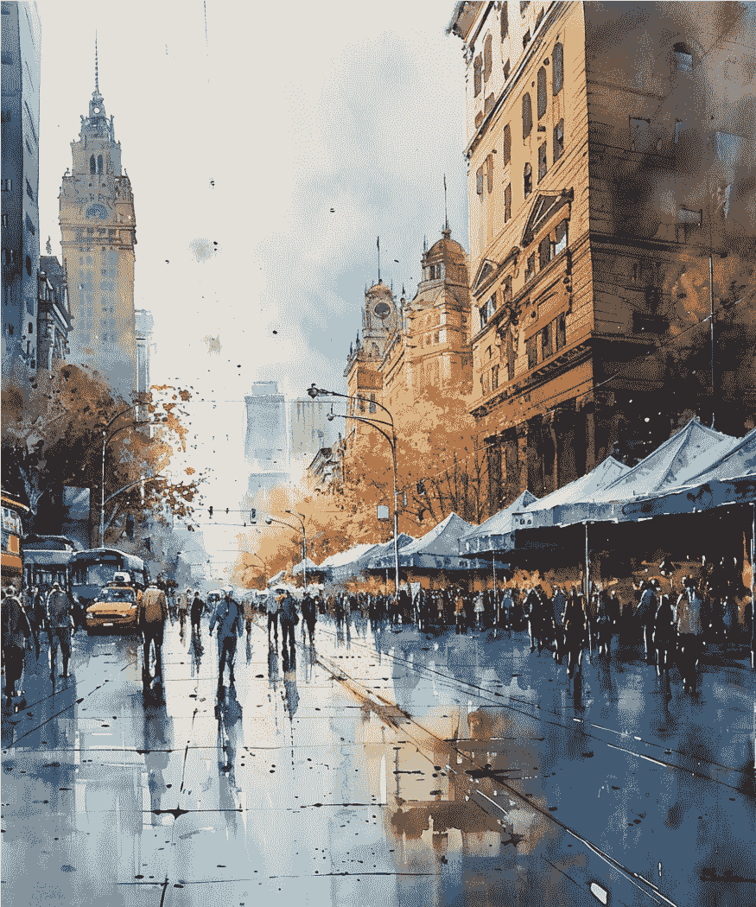

**提示：**
水彩对光影的处理细腻，尤其利用透明性表现光影变化。提示中可指定柔和的光影效果。

### 水彩风景画核心要点
**色彩丰富：**以透明颜料为主，通过叠加实现丰富的色效。

**湿画法：**在湿润纸面涂色，使颜料自然流动，形成流畅渐变，适合表现水面、天空等。

**负白技法：**保留纸面白色表现高光，增强层次与对比。

**干刷法：**颜料半干时刷涂，产生独特纹理，常用于树木、岩石细节。

**层次感：**多层叠加并以明暗对比营造立体与远近感。

**写意性：**强调主观抒情，常带写意色彩。

### 案例展示

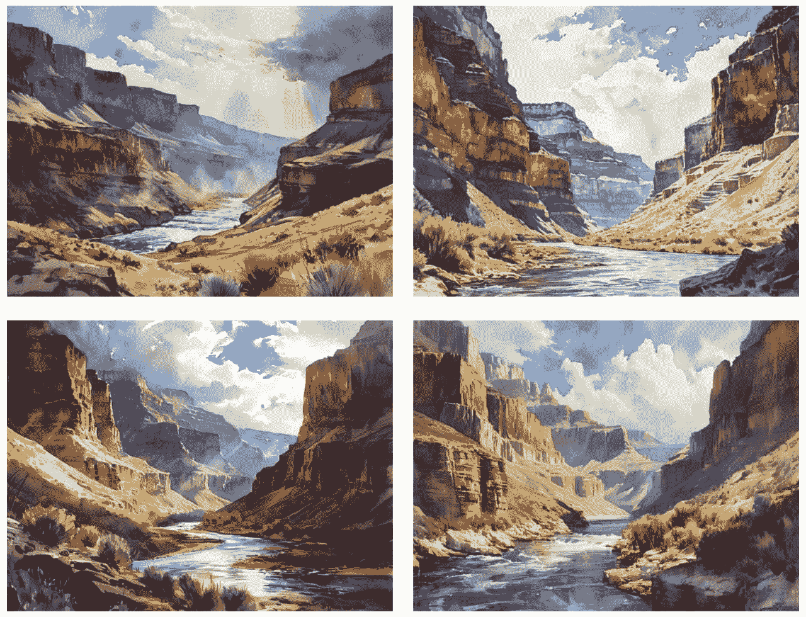

## 提示词参考

**中文**
阳光自云缝倾泻至峡谷中段的宽阔水道，河面闪烁粼光，峭壁岩层分明，谷内与岸边植被层次清晰，天空湛蓝白云交织，暖光与阴影对比强烈，天空色阶层层递进，色调和谐统一，明暗与高光并置，水彩通透感配合留白呈现高光，色彩过渡细腻，点线结合刻画细节，水彩媒介，安德鲁·怀斯式表现，戏剧张力的峡谷景观，写实笔触，湿中上色，西北辽阔山水，宏大气象，色彩融合 `--画面比例 4:3 --版本 6.0`

## 大师档案

► **阿尔布雷特·丢勒**
德国文艺复兴时期的代表性创作者，木刻与铜版造诣极高，水彩领域亦有重要成果。代表作有《启示录》《基督大难》《小受难》《祈祷之手》等。版画方面刻工精细，能将环境刻画得十分逼真。油画与壁画同样备受肯定，但版画在其艺术生涯中占据核心地位。另有《骑士、死亡、恶魔》《圣哲罗姆在他的书房里》《梅伦科利亚》等，彰显其在版画上的卓越技艺。

► **保罗·桑德比**
英国画家，被誉为英国水彩之父。大量运用水彩创作风景，多以透明薄涂直接上色，摆脱了对钢笔画底稿的依赖。代表作如《林区小景》《橡树下的小憩》等。

► **安德鲁·怀斯**
美国现实主义画家，以细腻入微的风景与人物见长，题材多贴近平民生活。代表作有《克里斯蒂娜的世界》《仔兔》《芝草》等。

► **温思格·荷马**
美国艺术史上的重要人物，创作跨越油画、水彩与版画。代表作如《回头浪》等。

► **卡罗尔·埃文斯**
加拿大风景画家，专注自然与野生动物，水彩细腻且充满生命力。代表作如《晨雾》等。

### 1.3.2　水彩人物画绘画风格

### AI 绘画欣赏
水彩人像借助颜料的透明与轻盈来塑造人物形象，往往以此传达形体、情绪与整体氛围。

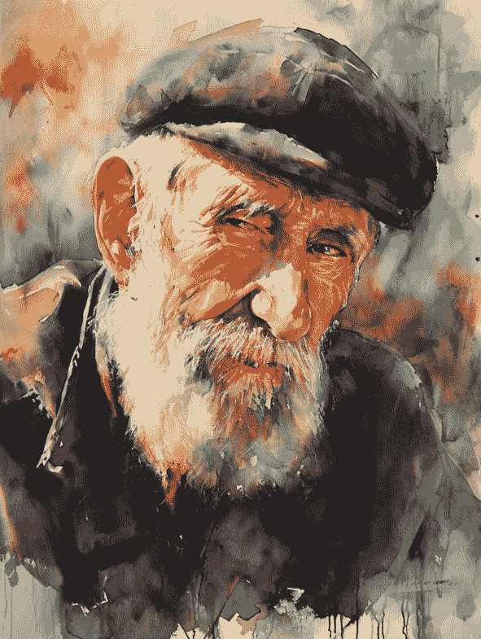

**提示：**
人像水彩对面部要求很高，建议在提示词中强调眼神、表情等细微之处，并借助水彩的晕染效果提升 AI 生成作品的立体感。

### 水彩人物画绘画风格的主要特点

**色彩丰富：**在用色上侧重情感与个性化，可通过饱满的色彩表达人物的心境、特质与气质。透明的水彩使色调柔和通透。

**湿画法：**创作时常采用湿纸技法，颜料于润湿纸面自由扩散，形成柔和的过渡与渐变，有助于表现光影与肌理。

**负白技法：**在水彩人像中常见，通过保留纸面白色区域来强调亮部与高光，使画面更具立体感。

**细节处理：**运用细小笔触与精细描摹来表现面部表情、服饰纹理等细节，增强人物形象的真实感。

**背景营造：**多以简约或虚化背景突出主体，也可通过巧妙的构景强化整体氛围。

**情感表达：**注重人物内心世界的呈现，艺术家常借助表情、动作与姿态传达情绪状态。

### 案例欣赏

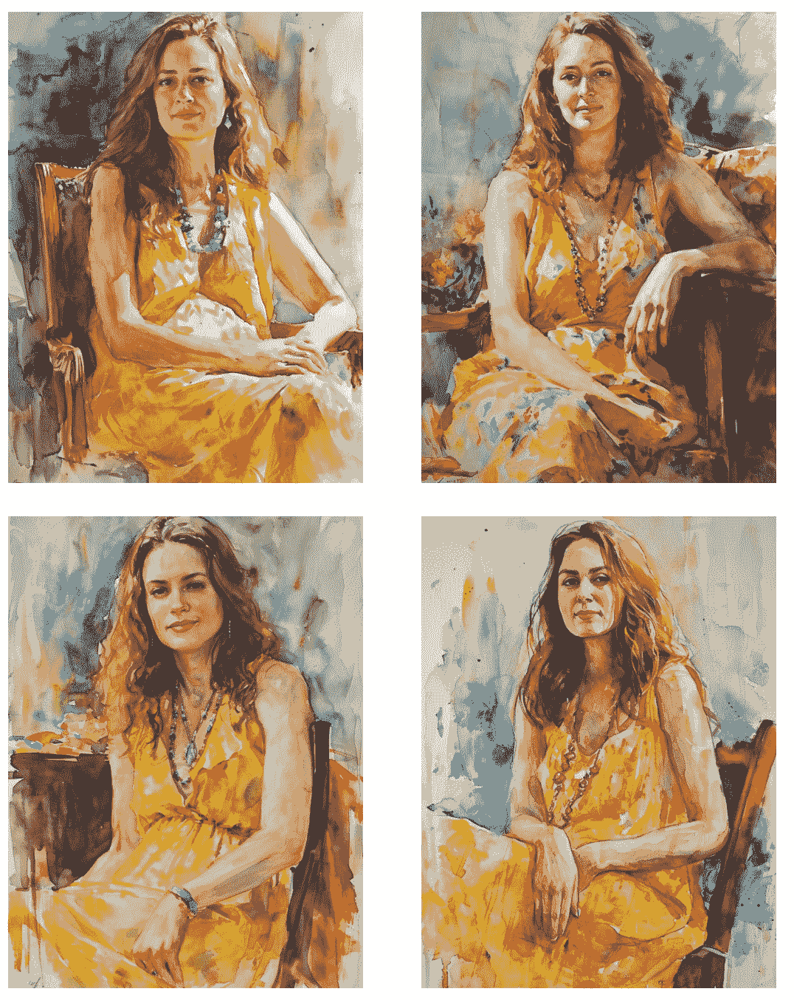

## 提示词分享

**中文**
坐在椅子上的女子、直视前方、棕色长发、优雅项链、明亮浅黄色连衣裙、笑意明亮的色彩调性、暖调氛围、水彩画、泰德·纳塔尔风格、透明水彩、湿润色彩融合 `--画面比例 3:4 --版本 6.0`

## 大师档案

► **泰德·纳塔尔**
美国水彩肖像画家，笔下人物生动活泼，色块叠加恰到好处，画面斑驳通透、清澈明亮、干净利落。代表作如《人物肖像》等。

► **查尔斯·雷德**
美国著名水彩与油画家，亦著有多本绘画技法书籍。构图鲜明，色彩感神秘，对主题的捕捉迅速巧妙，形神兼备。代表作如《查尔斯·雷德水彩大师课：画面协调的奥秘》等。

► **唐·安德鲁斯**
美国超写实主义代表，擅长水彩。作品继承写实传统又自成一派，颇具共鸣。代表作如《克里斯蒂娜的世界》《仔兔》《芝草》等。

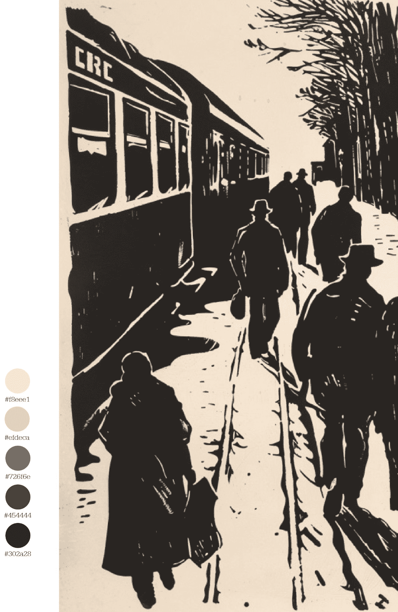

## 1.4　版画风格

### 1.4.1　木板版画绘画风格

### AI 绘画欣赏
木板版画是在木板上刻出反向图像再进行印刷的艺术形式。因具备复制性，古代常用于插图、年画、谱牒等，对图像传播作用极大。

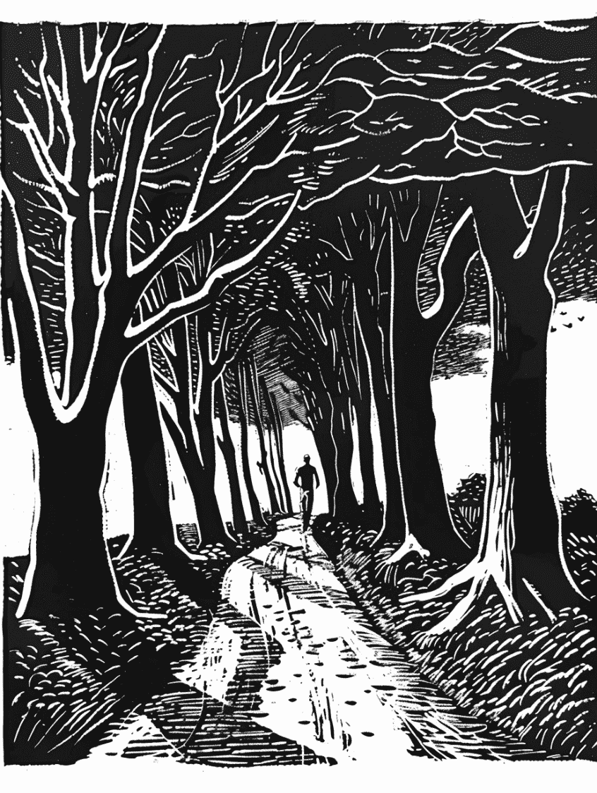

**提示：**
木板版画的一大特色是线条强烈、纹理粗犷。描述时可突出线条风格与木纹质感，并指定黑白或简约的双三色方案。

### 木板版画绘画风格的主要特点

**线条坚实：**木刻线条通常厚实清晰，雕刻形成的凹槽填色后边缘呈现明显的断裂感。

**明暗对比：**颜料施于雕刻凹部，画面明暗分明，光影效果突出。

**粗糙的纹理：**木质纹理常在作品中可见，赋予画面自然质朴感。

**简洁的颜色：**每种颜色需单独木板与印刷，多采用简约配色，形成独特美感。

**手工的痕迹：**作为手工艺，艺术家的个性与技巧通过刀压深浅、雕刻痕迹体现。

**逆向效果：**印刷时图案由版面传递至纸张，最终呈现与原稿相反，线条在版上为凹陷。

### 案例欣赏

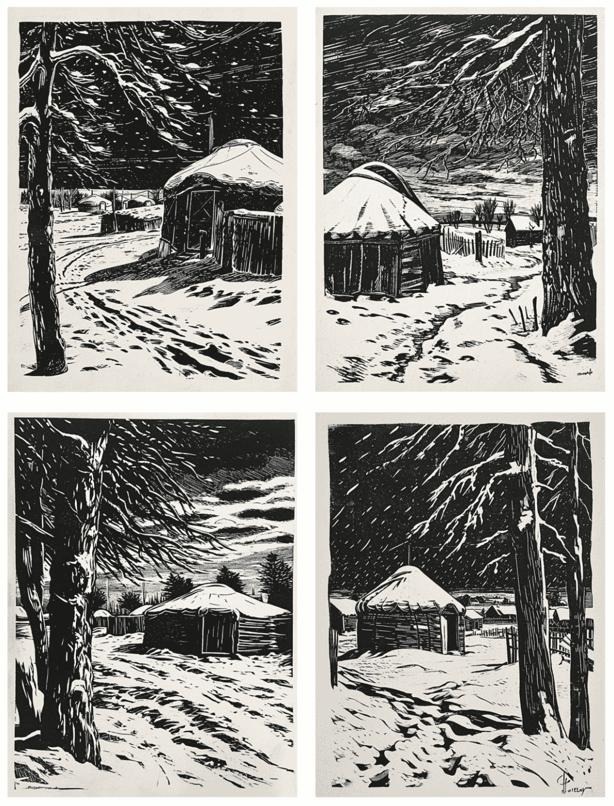

### 提示词分享

**英文**
`A yurt covered with snow, and the steppe covered with snow and wind, yurts, black and white woodcuts, woodcut prints, clean lines, bold woodcut lines, steppe landscapes, folk realism,panoramas --ar 3:4 --v 6.0`

**中文**
`白雪覆盖的蒙古包、风雪席卷的大草原、蒙古包群、黑白木刻、木刻版画、线条利落、木刻线条粗犷、草原景致、民间现实主义、全景视野 --画面比例 3:4 --版本 6.0`

## 大师档案

► **伍必端**
中国现代画家，曾为鲁迅《阿 Q 正传》《风波》《肥皂》《猫与兔》等绘制木板版画插图，也为苏联作家绥拉菲摩维支《铁流》、富尔曼诺夫《恰巴耶夫》等作插图。代表作如《钢厂生活·在转折处》等。

► **伦勃朗·哈尔曼松·凡·莱因**
详细介绍见 1.1.2 小节。

► **川濑巴水**
日本明治与大正时代的版画家，在美人画领域成就突出，是“新版画运动”的关键人物，对日本版画发展影响深远。代表作如《东京十二景》《寺岛村的晚雪时光》等。

### 1.4.2　铜版画绘画风格

### AI 绘画欣赏
铜版画起源于欧洲，于金属版上腐蚀或以针刀刻制，属于凹版。作品庄重典雅，被视为珍贵艺术品种。从丢勒、伦勃朗到毕加索、莫奈，历代大师均热衷创作。

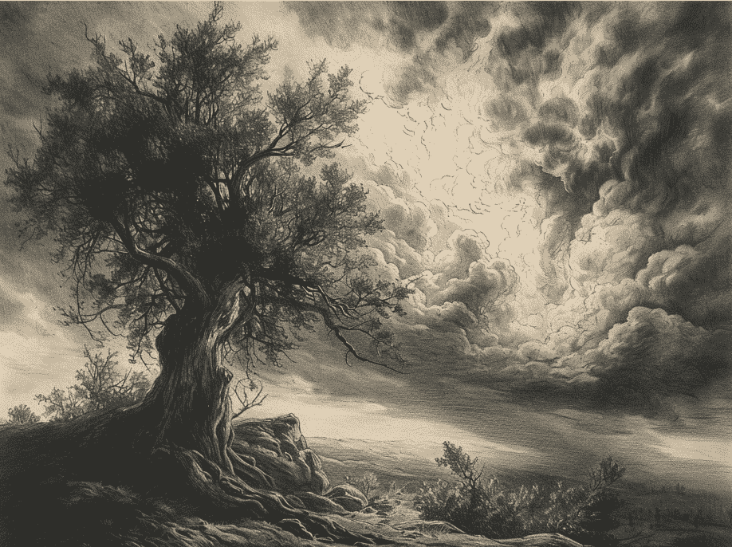

**提示：**
铜版画以细腻线条与丰富细节著称，使用 AI 时可在提示中强调精微线条与复杂细节。

### 铜版画绘画风格的主要特点

**线条的精细和清晰：**图案由凹槽雕刻而成，线条细腻清晰，对细节与纹理的呈现十分出色。

**光影效果：**通过线条的深浅、疏密与蚀刻程度控制，营造出丰富的明暗。

**质感和纹理：**铜板雕刻蚀刻可呈现多样质感，从细腻到粗犷皆可。

**多样的印刷效果：**可实现单色到多色、平面到立体的效果，反复印刷或多版配合能创造复杂变化。

**手工修饰的可能性：**印刷后常可手工润色，如加强色彩、调整线条、增补细节。

**可复制性：**印刷可制作多幅相似作品，便于传播且保持较高品质。

**技术挑战：**制作需雕刻、蚀刻、印刷等多步骤，技术要求较高。

### 案例欣赏

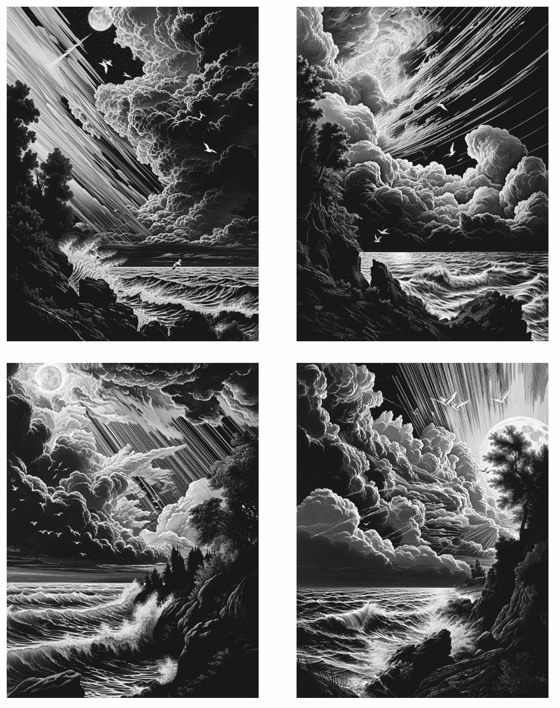

### 提示词分享

**英文**
`The waves hit the rocks, forming large splashes,The moon in the picture shines light on the splashes through the clouds, There are two or three seagulls flying in the sky. Copperplate brush strokes, copperplate texture, etching, mezzotint,thick outline, illustration, black and white, abstract art --ar 3:4 --v 6.0`

**中文**
`海浪拍击岩礁激起大片浪花，画面中的月亮透过云层照亮浪花，天空有两三只海鸥飞翔。铜版笔触、铜版质感、蚀刻技法、金属版效果、粗轮廓、插画风格、黑白调、抽象艺术 --画面比例 3:4 --版本 6.0`

## 大师档案

► **阿尔布雷特·丢勒**
详细介绍见 1.3.1 小节。

► **伦勃朗·哈尔曼松·凡·莱因**
详细介绍见 1.1.2 小节。

### 1.4.3　丝网版画绘画风格

### AI 绘画欣赏
丝网版画即丝网印刷，通过细密网孔进行印刷。制作简便高效，能呈现丰富色彩与图案，深受艺术家与工业界青睐。

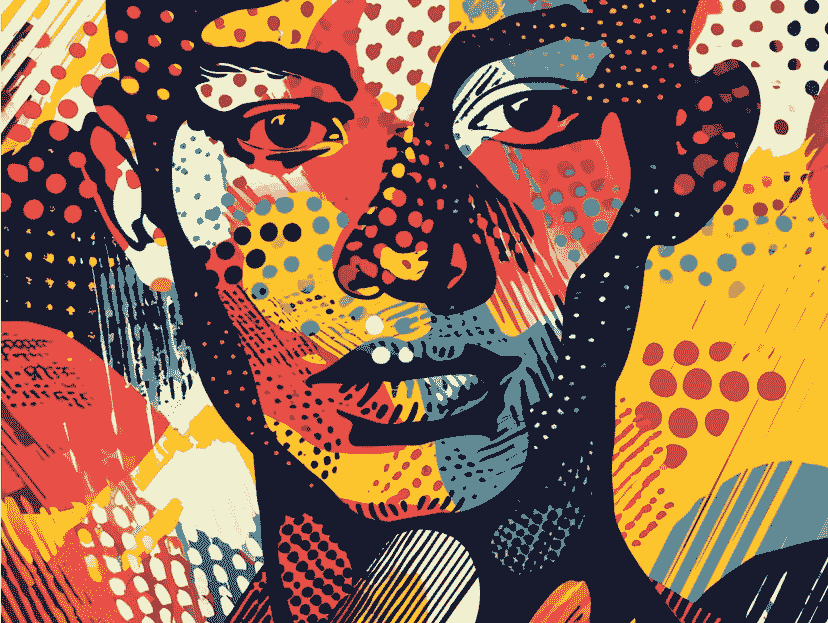

**提示：**
丝网版画以鲜艳色彩与平面视觉著称，常具强烈图形设计感，包括简化形状与清晰轮廓。可强调大胆色块与平涂处理，以及简洁图形线条。

### 丝网版画绘画风格的主要特点

**鲜艳而平滑的颜色：**每色需独立网版，易实现色彩分离与过渡，呈现鲜艳平滑效果。

**块状图案和平面效果：**制作过程便于形成块状图案与平面感，可为简单几何或复杂图像，设计灵活。

**细节的捕捉和表现：**虽以块面为主，仍能捕捉细节，细密网孔可呈现线条与纹理，使印刷品清晰。

**多层叠印的效果：**通过多次叠印不同墨层完成图案，增强画面丰富度与层次感。

**手工干预的效果：**制作中可手工添补细节、调整色彩，每件作品具独特性，体现艺术家个性。

**适用于多种材料：**除纸张外，可用于布料、陶瓷、金属等载体。

### 案例欣赏

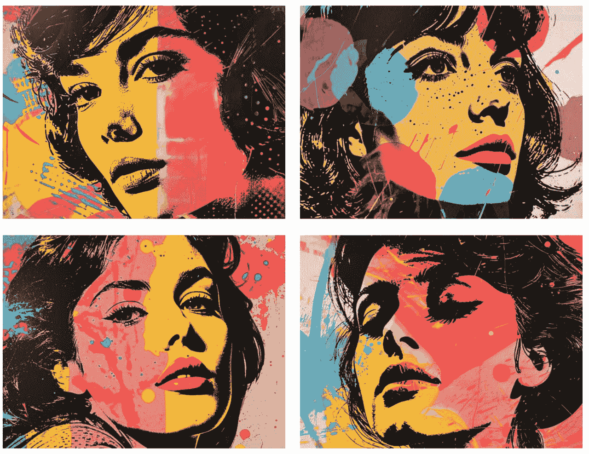

### 提示词分享

**英文**
`Female head portrait, Andy Warhol style, Yayoi Kusama style, polka dot color dots, silk screen printing style, lithographic dot strokes --ar 4:3 --v 6.0`

**中文**
`女性头像、安迪·沃霍尔风格、草间弥生风格、圆点色彩点、丝网印刷风格、平版印刷点画 --画面比例 4:3 --版本 6.0`

## 大师档案

► **安迪·沃霍尔**
详细介绍见 1.1.10 小节。

► **草间弥生**
日本当代艺术先锋，涵盖观念艺术、极简主义等流派，以心灵宇宙为主题。实践中运用丝网版画，创作出充满幻想、重复与极简元素的作品。代表作如《南瓜》系列、《无限镜屋》系列等。

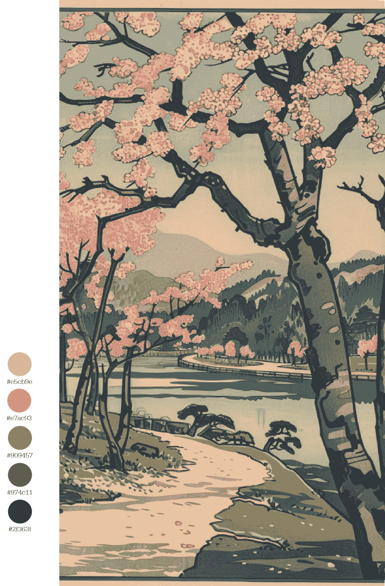

## 1.5　其他风格

### 浮世绘绘画风格

#### AI 绘画欣赏
浮世绘是日本传统绘画，17 世纪江户中期兴起，18 至 19 世纪达到高峰，是日本艺术史的重要组成部分。题材生动，色彩明亮，多描绘日常生活与戏剧场景。

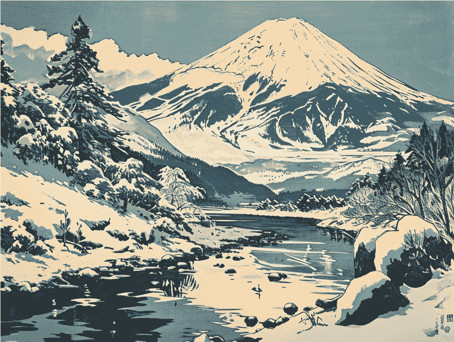

**提示：**
浮世绘使用鲜明对比的色彩，提示词中可强调色彩特点，以生成更符合预期的画面。

#### 浮世绘绘画风格的主要特点

**生动的描绘：**以细腻生动著称，艺术家依靠独特的线条与细节处理使人物景物栩栩如生。

**鲜艳的颜色：**多采用鲜明明快的色彩，使用日本传统颜料与西方引入颜料。

**强调线条和轮廓：**线条突出，注重轮廓表现，强化图像清晰度与形式感。

**扁平的透视：**多采用扁平透视，追求简化表现。

**多色木刻印刷：**制作采用多色木刻，每层颜色需独立木版，可实现层次效果。

**重复的模式：**常出现重复图案，尤其在服装、背景等装饰元素上，增加装饰性与艺术性。

**主题的多样性：**主题涵盖美人、戏剧、风景、历史事件等，体现对日本社会文化的深刻理解。

#### 案例欣赏

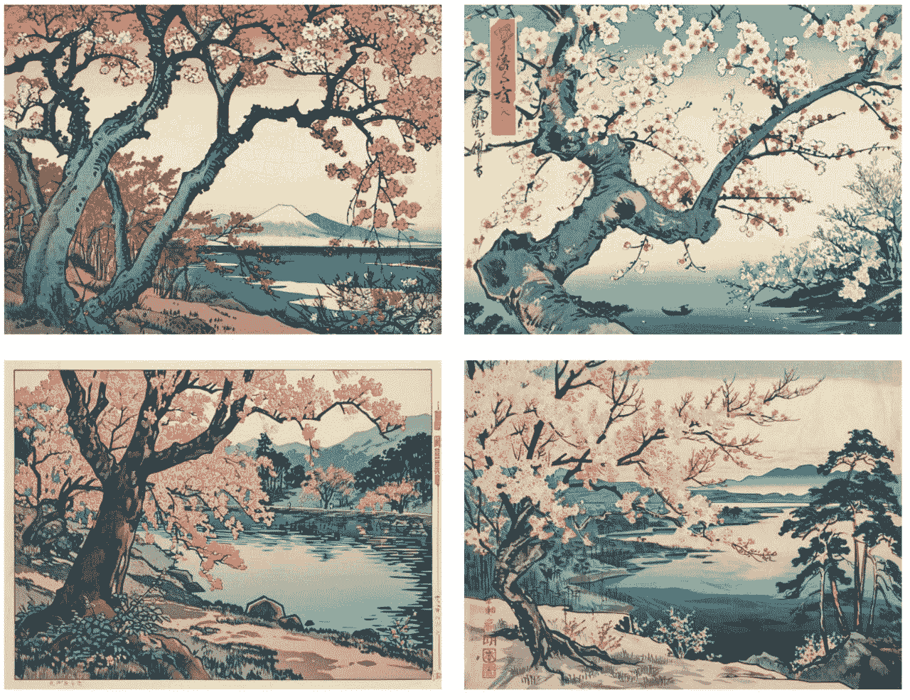

#### 提示词分享

**英文**
`In the spring, when the cherry blossoms are in full bloom, ukiyo-e style, simple colors, flat perspective, multi-color woodcut print --ar 4:3--v 6.0`

**中文**
`春季樱花盛放、浮世绘风格、简约色彩、平面透视、多色木刻版画 --画面比例 4:3 --版本 6.0`

#### 大师档案

► **葛饰北斋**
日本浮世绘代表人物，题材涵盖风景、人物、动物与神话，风格独特，影响后世广泛。代表作如《神奈川冲浪里》等。

► **安藤广重**
又名歌川广重，日本浮世绘画家，以风景自然描绘闻名。代表作如《东海道五十三次》系列等。

# 第 2 章　插画风格

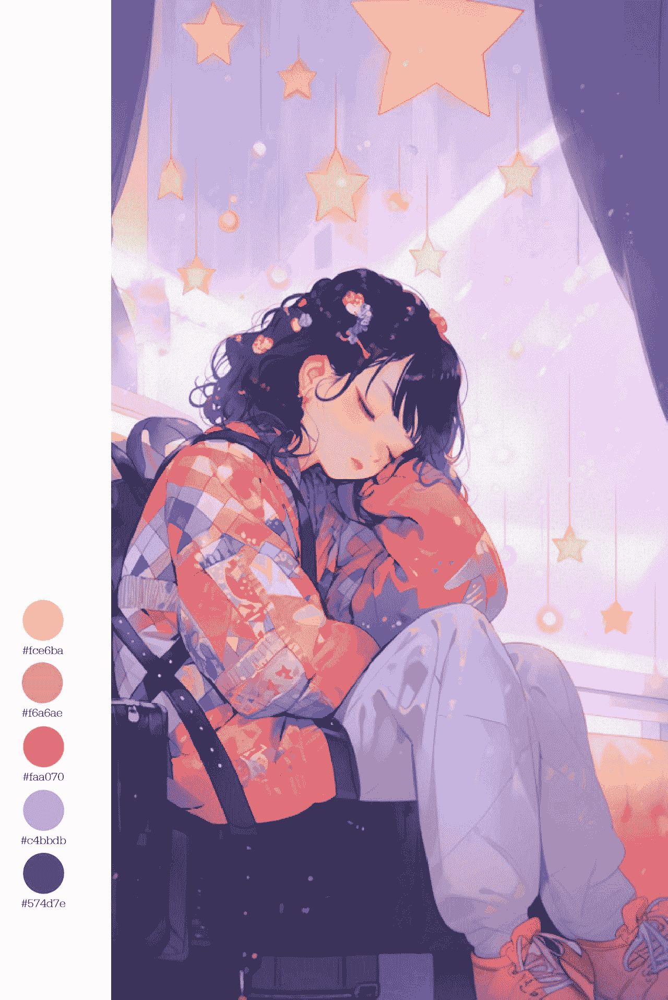

## 2.1 渐变柔光风

### AI 绘画赏析
这类插画依赖色块间的平滑推移来构建层次分明的柔和质感，色阶缓慢渗透，营造出宁静梦幻的氛围。在数字创作、平面排版以及插画表达里常见，能为作品赋予独特的温润吸引力。

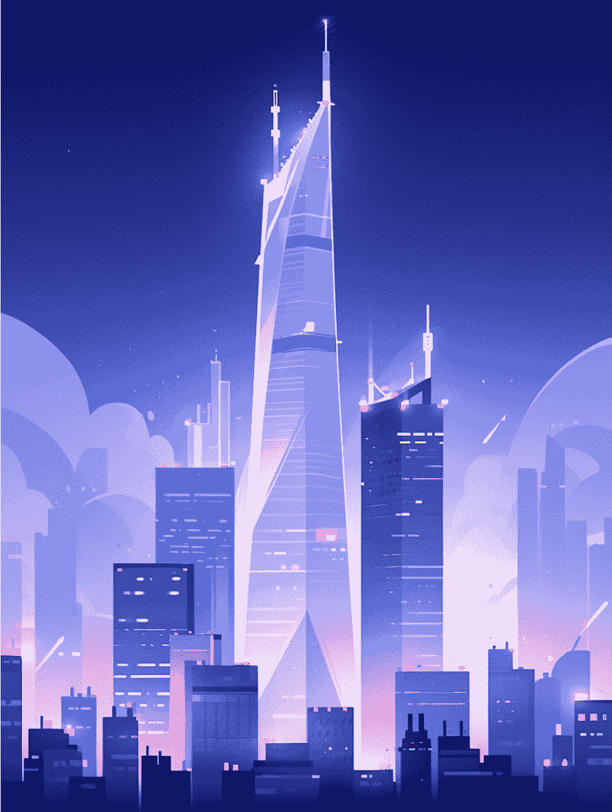

**提示：**
此风格的精髓在于借由渐进渲染制造丰富的视觉体感。撰写提示时可以明确想要的色系走向，比如由暖调向冷调的推演，亦或是对比色之间柔和的交叠。

### 风格要点
**柔和过渡：**画面整体的色彩衔接偏向圆润，刻意规避强烈对照与生硬分割，从而营造出梦幻、惬意或宁静的情绪。
**造型精简：**多以简约的形态呈现，剔除繁琐细节，强调大体轮廓与结构关系。
**光影渲染：**借助色彩推移表现明暗变化，用色调的拉伸凸显物体表面的亮区与阴影。
**数位便捷：**大量作品依赖数位工具完成，创作者可灵活调整色彩、渐变与图层，提升工作效率。
**奇幻抽象：**受科幻奇幻影响，部分作品呈现抽象或超现实倾向，通过别样的色彩与形体处理塑造出充满幻想的独特氛围。

### 案例欣赏
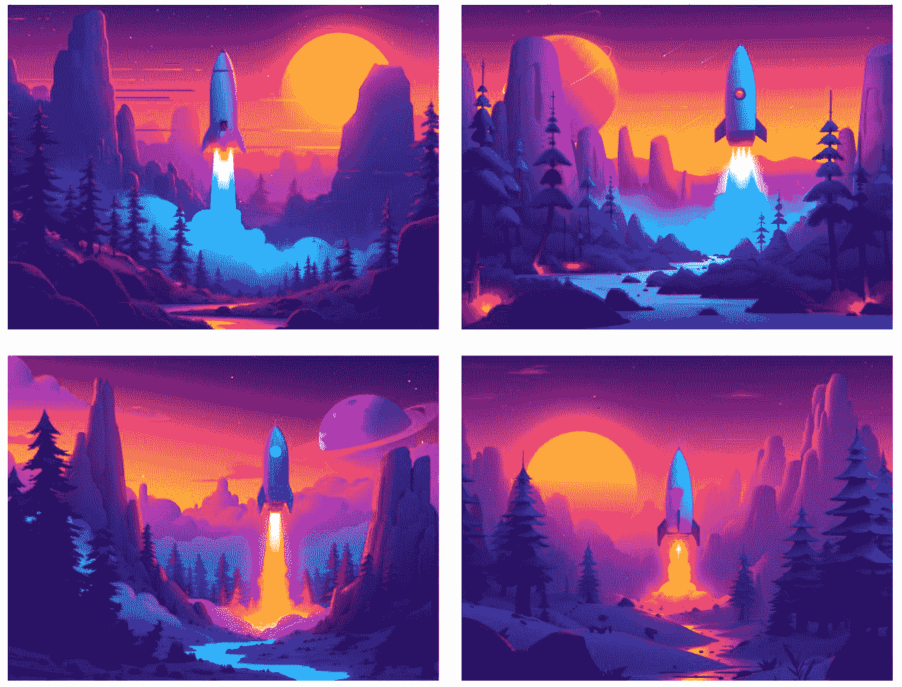

### 提示词分享
**英文**
`Illustration of a rocket flying around the galaxy in the style of flat gradients, subtle gradients,soft gradients, colorful skies, large murals,long shots, innovative, techy, futuristic, space backgrounds, digital art, Flat gradient style--ar 4:3 --stylize 700 --chaos 80 --v 6.0`
**中文**
`火箭环绕银河系飞行的插图，采用平渐变、微妙渐变、柔和渐变、多彩天空、大型壁画、长镜头、创新、科技、未来主义、太空背景、数字艺术、平渐变风格　--画面比例 4:3　--风格化 700　--创意程度 80　--版本 6.0`

## 2.2 描边轮廓风

### AI 绘画赏析
描边插画常以黑色或高饱和线条为骨架，通过精细的轮廓勾勒主体形态与细节，突出线条的清晰度，使整体呈现简洁明快的视觉感。

**提示：**
该画风的显著标志是清晰可辨的轮廓线，线条界定了物体的形体与结构。提示词中可着重说明线条粗细、风格如流畅或手绘质感，以及颜色选择。

### 风格要点
**线条分明：**以细腻明晰的线条为主，强化物体轮廓与形体表达。
**简洁明了：**一般减少繁复细节与复杂表现，画面干净易读。
**对比强烈：**惯用鲜明配色，让线条更突出，带来更强的视觉冲击。
**抽象扁平：**有时融入抽象元素，简化形体与色彩，增强设计感。
**应用广泛：**因简洁明快，常用于卡通、漫画、平面设计、动漫等领域，深受欢迎。

### 案例赏析
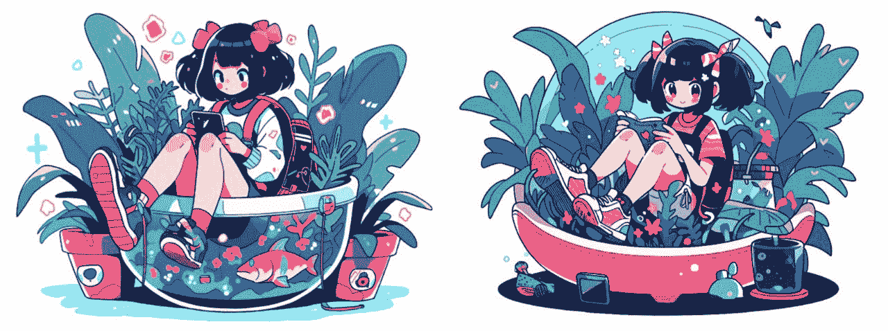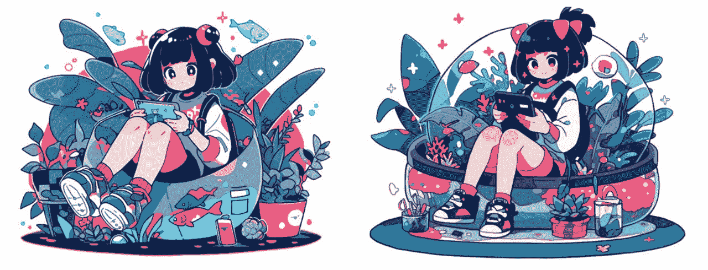

### 提示词分享
**英文**
A girl sitting inside a bowl of plants, in the style of coral punk, candy core, ocean academia,comic art, pool core, shiny, glossy, cute and colorful, Thick line border illustration --ar 4:3--niji 5
**中文**
女孩置身植物盆中，风格为珊瑚朋克、糖果芯、海洋学术、漫画艺术、池芯、闪亮、有光泽、可爱多彩、粗线边框插图 --画面比例 4:3 --版本 niji 5

## 2.3 扁平色块风

### AI 绘画赏析
扁平插画把物体与场景拆解为基本平面色块，去掉冗余细节与阴影，强调清晰简洁的设计语言，使信息直观易懂。

**提示：**
此风格特点是造型与元素的高度简化，剔除不必要细节以直观传达信息。提示中可强调使用基础几何形体与简化轮廓。

### 风格要点
**形状简化：**运用圆形、矩形、三角形等基础几何形体表现物体，营造干净利落的观感。
**轮廓清晰：**轮廓分明，无复杂渐变或过渡，便于快速识别。
**色彩鲜明：**多用鲜明生动的配色，提升亮度与清晰度，传递积极愉悦的情绪，抓住注意力。
**去阴影：**一般不使用阴影与光影，表面保持均一色块，强化平面质感。
**图标化倾向：**常以图标化形态呈现，便于识别与理解，在界面设计与图标制作中尤为受欢迎。
**数字设计适配：**广泛用于网页、移动应用与 UI 设计，因其适配小尺寸图标按钮并保持风格统一而备受青睐。

### 案例赏析
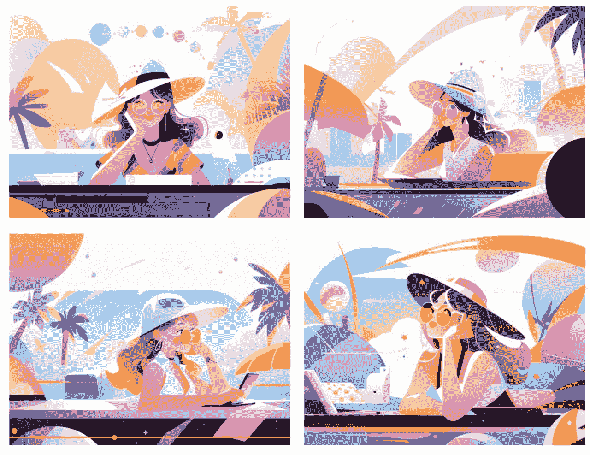

### 提示词分享
**英文**
A girl wearing a hat, front, wide angle, minimalist style, organic shapes and illustrations, lines,color blocks, Danish design, flat illustrations,Bright colors, bright tones, orange blue and yellow, 8K --ar 4:3 --stylize 300 --chaos 50--niji 5
**中文**
帽子女孩正面广角，简约风格，有机造型插图，线条与色块结合，丹麦设计，平面插图，鲜艳色彩，明亮色调，橙蓝黄配色，8K　--画面比例 4:3　--风格化 300　--创意程度 50　--版本 niji 5

## 2.4 矢量可扩风

### AI 绘画赏析
矢量插画依托矢量图形技术生成，与位图不同，它以数学公式描述线条、曲线、点与形状，而非像素网格。

**提示：**
矢量画风多走向简化与抽象，减少冗余细节以凸显主题与形式。提示中可说明期望的简化程度及重点元素。

### 风格要点
**无损缩放：**支持无限放大仍保持清晰。
**易于编辑：**基于数学描述，可轻松修改且不损失品质。
**文件轻量：**仅记录绘图元素与规则，体积小，加载与传输更高效。
**品质稳定：**数学公式定义图形，边缘锐利，印刷与屏幕显示均保持高质。
**平滑渐变：**支持丝滑的色彩渐变，无像素阶梯感。

### 案例赏析

### 提示词分享
**英文**
Teachers day, teacher and his students,abstract Memphis style, bright color scheme,gradient colors, transparent texture, minimalism,simple, colorful illustration, UI illustration, white background, website --niji 5 --stylize 250 --ar 3:2
**中文**
教师节、老师与学生，抽象孟菲斯风格，明亮配色方案，渐变色彩，透明纹理，极简主义，简单，彩色插图，UI 插图，白色背景，网站 --版本 niji 5 --风格化 250 --画面比例 3:2

## 2.5 MEB 粗线风

### AI 绘画赏析
MEB 插画采用比常规更粗更厚的描边，相较无描边的扁平画，它取消不必要的色块划分，画面更简洁通用且易辨识。粗线起到分隔界面的作用，突出内容，使表现更清晰。

**提示：**
该风格常搭配鲜明饱和的色彩与大胆对比来传达情绪。撰写提示时可着重强调色彩的鲜艳度与对比强度。

### 风格要点
**粗圆描线：**以粗圆线条勾勒轮廓，增添可爱感，转折圆润，几乎无直角。
**填色错位：**上色时略微偏离轮廓，用以营造高光与阴影。
**高饱和配色：**以简洁配色突出主体特征，必要时弱化部分色彩以表现层次。
**断线点缀：**多采用断线处理，并以圆点丰富线条质感。

### 案例赏析

### 提示词分享
**英文**
A boy standing behind the cash register surrounded by gifts, minimalist illustration,white background, green and yellow, doodle in the style of Keith Haring, sharpie illustration,MBE illustration, bold lines, in the style of grunge beauty, mixed patterns, text and emoji installations --ar 3:4 --stylize 150 --niji 5
**中文**
男孩立于收银机后周围环绕礼物，简约插图，白色背景，绿色与黄色，基思哈林风格涂鸦，夏普插图，MBE 插图，粗线条，垃圾美风格，混合图案，文字与表情符号装置　--画面比例 3:4　--风格化 150--版本 niji 5

## 2.6 2.5D 立体风

### AI 绘画赏析
2.5D 插画融合二维平面与三维立体元素，在平面设计与插画领域日益流行，因其兼具立体感与传统平面的简约清晰。

**提示：**
这类作品通常结合图形设计与立体视觉，提示中可说明如何借助特定角度与视角呈现立体效果，同时保留平面化特征。

### 风格要点
**空间深度：**巧妙融合二三维元素，营造出强烈的空间感与深度。
**透视表现：**常用透视手法让物体大小与位置更真实，透视投影是塑造深度的重要手段。
**保留平面：**即便加入三维元素，整体仍保留一定平面质感。
**互动动画：**多用于动画、游戏与虚拟现实，为用户带来更丰富的视觉体验，使画面在不同场景中呈现动态特性。

### 案例赏析

### 提示词分享
**英文**
Cute food shop, various snacks, beautiful signboard,isometric vector portrait, neat and organized store with wide variety of items, white background, bright warm colors, subtle gradients, minimalism, flat illustration, 2.5D illustration, Isometric perspective,architectural illustration, bright color scheme, fine gloss, 3D, C4d Blender, OC renderer, 4K, best quality, ultra detailed --niji 5 --stylize 450
**中文**
可爱食品店、各种小吃、漂亮招牌、等距矢量肖像、整齐有序商品种类丰富的商店、白色背景、明亮暖色、微妙渐变、极简主义、平面插画、2.5D 插图、等距透视、建筑插图、明亮配色方案、精细光泽、3D、C4d Blender、OC 渲染器、4K、最佳质量、超详细　--版本 niji 5　--风格化 450

## 2.7 绘本童话风

### AI 绘画赏析
绘本插画是儿童绘本中用于叙事与丰富情节的图画，不仅是视觉补充，更是故事的重要组成，与文字共同构建儿童文学世界。

**提示：**
此类插画常选用明亮且富表现力的色彩以吸引小读者，提示中可强调鲜艳色调与有趣的配色组合。

### 风格要点
**想象丰富：**具备强烈想象力与创造力，能吸引儿童注意力，激发好奇与想象。
**情节融合：**与文字相辅相成，通过情感、场景与角色特征帮助儿童更好地理解故事。
**色彩明亮：**多用明亮生动鲜艳的色彩，提升画面吸引力，契合儿童对世界的欢愉感。
**表情生动：**人物表情与姿态生动传神，有助于传递情绪，让儿童更投入。
**重复细节：**部分作品加入可重复寻找的小细节或角色，培养观察与记忆能力。
**互动设计：**有的绘本通过折页、拉动、弹跳等互动设计，增强亲子阅读体验。
**年龄适配：**风格与内容会根据目标年龄的认知水平与兴趣进行调整，确保适配读者。

### 案例赏析

### 提示词分享
**英文**

**中文**

The little white rabbit walked into the forest and was surrounded by colorful flowers, ancient trees and cheerful animals. Children’s picture book style,healing illustration, Studio Ghibli style, brightly colored children’s picture book, simple and bold composition,Color matching conveys positive and optimistic emotions, rich imagination and details --ar 4:3 --niji 5

**中文**

小白兔走进森林，周围都是五颜六色的鲜花、古树和欢快的动物。儿童绘本风格、治愈系插画、吉卜力工作室风格、色彩鲜艳的儿童绘本、构图简单大胆、配色传达积极乐观的情绪、丰富的想象力和细节　--画面比例 4:3　--版本 niji 5

### 大师档案　大师档案

► **李欧·李奥尼**
荷兰裔美国创作者，横跨插画、平面与童书领域，以富想象力的画面与寓意深远的故事著称。作品常围绕友情、自然与个体成长展开，语言简洁而画面张力强，深受各年龄层喜爱。经典之作为《一寸虫》《小黑鱼》《田鼠阿佛》《亚历山大与发条老鼠》等。

► **叶盈露**
中国本土青年插画人，毕业于中国美院后留校任教于插画与漫画系，多次斩获国内插画金奖。创作代表《洛神赋》《木兰辞》《忠信的鼓》等。

► **几米**
原名廖福彬，台湾绘本作者，主张将绘本拓展至成人阅读领域。代表作有《森林里的秘密》《微笑的鱼》等。

## 2.8　水彩插画风格

### AI 绘画欣赏　AI 绘画欣赏

## 水彩插画风格
水彩绘画借助可溶于水的颜料于纸面染色，形成独特的半透明质感与晕染韵味，广泛运用于图书插画、封面设计及艺术创作。

**提示：**
湿润作画是水彩的核心表现手段，能带来自然的色彩渗合与渐变。撰写提示词时可指定模仿湿画的状态，例如颜料沿纤维蔓延、色彩相互浸润的效果。

### 水彩插画风格的主要特点

**通透层次：** 颜料本身透光，画面显出柔和质感，层层叠加可衍生出丰富的色阶变化。

**流淌韵律：** 颜料遇水会在纸面自行移动，产生柔和的渐变与色块过渡，观感自然。

**轻盈温润：** 整体调性轻快柔和，特别适合表现清新、梦幻或温暖的主题。

**空间纵深：** 依托透明层的叠加，画面深度与层次易于呈现，使画面更为饱满生动。

**笔触多样：** 借助不同刷具与运笔，线条与肌理变化丰富，可营造精细细节。

**不确定美：** 颜料流动难以完全掌控，每件作品都带有机遇性差异，突出艺术家即兴特质。

### 案例欣赏

#### 提示词分享

**英文**

Watercolor flowers illustration, in the style of light red and light blue, delicate materials, eastern and western fusion, subtle shading, classical romanticism, loose composition, watercolor strokes --ar 3:4 --v 6.0

**中文**

水彩花卉插画、淡红淡蓝的风格、材质细腻、东西方融合、浓淡微妙、古典浪漫主义、构图宽松、水彩笔触 --画面比例 3:4　--版本 6.0

## 2.9 新国风插画风格

### AI 绘画欣赏
新国风插画将传统文化意象与当代视觉语言融合，既保留文化记忆，又注入现代审美，形成兼具传承与创新的表达。

**提示：**
强调传统与现代的对话。提示词可点出中式建筑、服饰、器物等经典元素，并与当代构图、色彩逻辑并置。

### 新国风插画风格的主要特点

**文化基因：** 大量融入传统纹样与器物，彰显对本土文化的热爱与尊重。

**现代品味：** 重视当代构图、配色与线条处理，使画面更贴合当下审美。

**造型混搭：** 人物与物件兼具古典韵味与现代简化，呈现时代感。

**饱满色调：** 常用和谐而浓烈的色彩，既突出传统之美，又体现现代活力。

**含蓄情绪：** 在传达传统意蕴的同时，通过画面传递细腻内敛的情感。

**线条复合：** 线条运用灵活，既可呈现写意国画笔意，也可吸收现代线条风格。

**文学气质：** 部分作品以精巧构思与细腻描绘蕴含深厚文学意味。

**题材多元：** 创作范围涵盖历史典故、古典诗词、戏曲以及节气等，文化内涵丰富。

### 案例欣赏

#### 提示词分享

**英文**

A little boy riding a lion in traditional Chinese clothing, exquisite clothing, simplicity, joy,happiness, design vector, vivid color scheme,sharp illustration, new national style illustration--ar 3:4 --niji 5

**中文**

穿着中国传统服装骑着狮子的小男孩、精致的服装、简约、欢乐、幸福、设计矢量、鲜艳的配色、锐利的插画、新国风插画　--画面比例 3:4　--版本 niji 5

#### 大师档案

► **倪传婧**
香港插画师，2014 年入选福布斯 30 Under 30 艺术榜，为当年最年轻入选者之一。代表作包括《一马当先》《风兽》《跃》《守护》等。

► **特浓 TN**
江西九江出身的插画家，专注新国风国潮题材。画风流畅细腻，色彩华丽，常以黄、橙、蓝绿为主调，同时兼具工笔的精致与扁平插画的利落。代表作有《西湖十景》《梦长安》等。

## 2.10 治愈系插画风格

### AI 绘画欣赏
治愈系插画以安抚情绪为目标，通过柔和的色彩、可爱的形象与安宁的场景，营造松弛愉悦的观看体验。

**提示：**
多采用暖调与柔和色系，构图简洁优雅，细节适度克制。提示词可突出温馨配色与清新简洁的画面感。

### 治愈系插画风格的主要特点

**柔和明亮：** 偏爱柔和明亮的色调，营造轻松愉悦、温暖的氛围。

**萌趣形象：** 角色多为小动物、孩童或童趣化人物，易引发亲近感。

**宁静场景：** 常见自然风光、街巷或温馨家居画面，构建舒适氛围。

**情感共鸣：** 角色眼神、动作与表情传递积极情绪，引发观者共情。

**简洁线条：** 轮廓清晰、细节克制，突出整体舒适感。

**愉悦基调：** 整体风格轻松愉快，让人观看时感到放松。

### 案例欣赏

#### 提示词分享

**英文**

A poster with a girl standing by and holding stars in the water. In the style of gouache, national geographic photo, trompe-details of optical illusions, animated film pioneer, installation-based, miniature illumination --ar 3:4 --v 6.0

**中文**

海报上有一个女孩站在水中，手里拿着星星。水粉画风格、国家地理照片、视错觉细节、动画电影先驱、装置、微型照明　--画面比例 3:4　--版本 6.0

## 2.11 暗黑系插画风格

### AI 绘画欣赏
暗黑系插画聚焦阴郁、惊悚、奇幻或神秘的叙事，以沉郁色调、异化形象与阴暗空间营造不安与悬疑感。

**提示：**
生成时可指定古堡、废弃地下室、深林等场景，以强化主题张力。

### 暗黑系插画风格的主要特点

**冷暗色调：** 多用黑色、暗蓝、紫等冷沉色彩，营造压抑阴郁氛围。

**异化造型：** 角色与元素常具畸形、超自然特征，强化神秘感。

**幽暗空间：** 场景多为荒芜、阴森或废墟，带来朦胧神秘气息。

**强烈对比：** 善用明暗对比，凸显光明与黑暗的冲突。

**心理冲击：** 借助怪诞不安的元素，在观者心理上产生冲击。

**超自然意象：** 常见幽灵、妖怪、魔法等意象，强调不可知的力量。

**叙事厚重：** 画面常涉及悬疑、惊悚元素，带来紧张不安感。

**概念深度：** 强调主题与情感的复杂性，使作品兼具思辨性。

### 案例欣赏

#### 提示词分享

**英文**

Haunted house poster art, Halloween elements --ar 3:4 --v 6.0

**中文**

鬼屋海报艺术、万圣节元素　--画面比例 4:3　--版本 6.0

# 第 3 章 数字媒体视觉设计风格

## 3.1 现代主义风格

### AI 绘画欣赏
现代主义在数字媒体视觉设计中广泛使用，源于 20 世纪初的艺术与建筑思潮，核心在于简洁、功能至上以及对工业技术的借鉴。

**提示：**
现代主义讲究抽象几何与干净线条，剔除冗余装饰。提示词可强调几何形态、清晰线条，聚焦形体、色彩与空间关系。

### 现代主义风格的主要特点

**功能优先：** 强调实用性，元素服务于特定用途，反对过度装饰。

**抽象表达：** 倾向抽象化，以形式、色彩与线条传递感受。

**工业精神：** 推崇科技进步与工业生产，在设计中体现新材料与新工艺。

**网格排版：** 重视简洁排列与几何图形，在印刷品与海报中尤为突出。

**实验精神：** 鼓励创新与实验性表达，在多领域探索新形式与语言。

**跨学科融合：** 强调艺术、建筑、设计、文学等领域的交叉互动。

**国际视野：** 是一种超越地域的国际运动，不同地区呈现多样形式但理念相通。

### 案例欣赏

#### 提示词分享

**英文**

Modern steel seat, Bauhaus style, realistic rendering, modernist style, minimalist furniture,surreal, cyberpunk, yellow and red, wooden,stainless steel, white background, studio lights,1920 --ar 3:4 --v 6.0

**中文**

现代钢制座椅、包豪斯风格、写实渲染、现代主义风格、简约家具、超现实、赛博朋克、黄色和红色、木质、不锈钢、白色背景、工作室灯光、1920　--画面比例 3:4　--版本 6.0

#### 大师档案

► **勒·柯布西耶**
法国建筑师，被视作现代主义与功能主义的奠基人之一，主张形式与功能统一，偏爱简约几何与开放空间。代表作有《朗香小教堂》《萨伏伊别墅》等，也被称作“功能主义之父”，作品包括 LC1 扶手椅与沃拉沃里耶别墅，对 20 世纪建筑产生深远影响。

► **路德维希密斯·凡德罗**
德国建筑师，现代主义代表人物，提出“少即是多”的设计理念，重视结构纯粹性与材料真实性。代表作有《巴塞罗那椅》《范斯沃斯住宅》等，作品体现极简主义、开放平面与玻璃幕墙，如巴塞罗那国际博览会德国馆与柏林新国家美术馆。

► **瓦尔特·格罗皮乌斯**
德国建筑师与设计师，主张艺术、工艺与工业结合，推动现代主义设计在各领域发展。代表作有《包豪斯校舍》等。

## 3.2 瑞士风格

### AI 绘画欣赏
瑞士风格又称国际主义平面设计，诞生于 20 世纪中期的瑞士，最初活跃于印刷与平面领域。

**提示：**
瑞士风格常以几何图案与简洁线条为基础，可通过提示词构建各类几何形状与线条作为构图骨架。

### 瑞士风格的主要特点

**秩序化排版：** 强调整洁、有序、对齐的布局。在数字媒体中体现为清晰网格系统、规整排版与明确视觉层级。

**视觉通透与可读性基础**

**留白运用：** 大幅保留未填充区域，使版面呈现开阔清爽之感，进而优化浏览体验。

**无衬线字形偏好：** 倾向选用笔画简洁的无衬线字形，呈现干净清晰的阅读效果，有助于突出信息重点。

### 3.2 瑞士国际主义风格

**图形语言：** 偏爱线条、几何形态与简约图标等构成手段，以提升现代感与清晰度。

**强烈对比：** 常以高反差配色呈现，黑白组合与鲜明色阶是典型做法，令内容更突出。

**模块化布局：** 将整体拆分为可独立操控的单元，便于重组与跨设备适配。

**信息优先：** 重视以直观方式传递内容，强调信息本身的价值。

**视觉均衡：** 多采用对称或近似对称的排布，维持整体稳定感。

**功能优先：** 关注设计元素的实际作用，规避多余装饰与复杂性。

**普世性：** 追求国际化与通用性，适应不同文化语境。

#### 案例欣赏

#### 提示词分享
**英文**
Subway minimalist design posters, bus flyers,Swiss design, in the style of bold outlines, flat colors, abstract minimalism appreciator, simplified colors, dotted, 1970–present --ar 3:4 --v 6.0

**中文**
地铁简约设计海报、公交车传单、瑞士设计、风格以粗体轮廓显示、平面色彩、抽象简约主义欣赏者、简化颜色、点线、1970 年至今　--画面比例 3:4　--版本 6.0

#### 大师档案
► **约瑟夫·穆勒·布鲁克曼**
瑞士平面设计与教学领域的代表人物，有“瑞士平面设计之父”之称。创作风格极简且清晰，既具备强效的视觉传达能力，又带有鲜明的时代色彩。代表著作有《视觉传达史》《海报史》。

► **阿尔明·霍夫曼**
瑞士极具影响力的设计师，瑞士国际主义风格的代表人物之一。其海报作品体现了统一、对比、和谐、平衡、美感等核心理念。1965年出版《Grapnic Design Manual: Principles and Practice》《平面设计手册：原则与实践》，系统阐述其方法，影响广泛。

### 3.3　构成主义风格

#### AI 绘画欣赏
构成主义萌芽于二十世纪上半叶，核心在于如何组织艺术要素，主张借助几何形体、简化的视觉符号与抽象表现来获得对现实更深层的理解。

**提示：**
构成主义虽侧重视觉与平面效果，对材质质感的探索亦是其特质。可在提示词里加入对材质的描述，如金属光泽、木纹或纸感等。

#### 构成主义风格的主要特点
**几何抽象：** 强调形状的纯粹与简约，借几何形体构建整体结构。

**平面构成：** 注重平面化处理，数字设计中常以清晰的面划分信息，突出各元素的独立性。

**高对比：** 多以黑白对比为主，数字作品里也常见强反差手法，以强化关系与信息传达。

**动态感：** 理念包含运动表达，数字媒体中可体现为动态图形、动画或交互效果，使画面更活跃。

**模块化：** 部分强调以模块与构件搭建，数字排版常将内容拆分为独立单元，利于灵活调整。

**字体排版：** 多采用大胆简洁的字形，排列常遵循几何逻辑，增强整体统一感。

**技术运用：** 强调借助技术实现，数字视觉常利用高分辨率、交互与动画凸显现代感。

**实验精神：** 倡导探索性，数字设计中可出现创新元素，打破常规以追求新颖体验。

#### 案例欣赏

#### 提示词分享
**英文**
The composition of points, lines and planes,Constructivism, Russian Constructivism, Tatlin,Kandinsky 1914, --ar 3:4 --v 6.0

**中文**
点、线、面的构成，构成主义，俄罗斯构成主义，塔特林，康定斯基 1914--画面比例 3:4 --版本 6.0

#### 大师档案
► **弗拉季米尔·塔特林**
俄罗斯艺术家、雕塑家与设计师，构成主义运动关键人物。代表作有《第三国际纪念碑》等。

► **卡济米尔·马列维奇·穆列维奇**
俄罗斯艺术家，构成主义先驱之一。代表作包括《黑方块》《白色上的白色》等。

### 3.4　艺术装饰风格

#### AI 绘画欣赏
艺术装饰风格起源于二十世纪初的法国，迅速在全球传播，涵盖建筑、室内、工艺、时尚、绘画、雕塑等多领域。

**提示：**
艺术装饰常出现浮雕与强烈的立体感。生成图像时可在提示词中强化阴影与高光，以凸显装饰的浮雕质感。

#### 艺术装饰风格的主要特点
**几何纹样与对称：** 偏爱大胆的几何图案，如阶梯形、直线与曲线，数字设计中用于构建版式、背景或图标。

**镜面与金属质感：** 常大量使用镜面与金属质感，数字设计可通过反射、金属色调或高光增强奢华与现代感。

**明艳色彩：** 倾向使用高饱和且对比强的色彩，如红、黄、绿、黑、白，以吸引视觉焦点。

**装饰字体：** 字形多华丽且具装饰性。

**流线运用：** 对流线型与动感的运用独具特色，数字设计中常以曲线与流畅线条塑造图形与排版。

**奢华精致：** 注重华丽精致的装饰元素，数字设计中可加入精美插画、图标等提升质感。

**自然元素：** 常见植物、花卉、动物等自然题材，数字设计中作为装饰点缀使用。

**科技加持：** 借助现代技术手段强化装饰表现。

#### 案例欣赏

#### 提示词分享
**英文**
Art Deco butterfly pendant, light aquamarine and gold, Golden Age illustration, Art Deco style,gemstones, Art Nouveau, enamel dragonfly brooch, gold and aquamarine, realistic use of light and color, gemstone art, dark background--ar 3:4 --v 6.0

**中文**
装饰艺术蝴蝶吊坠、浅海蓝宝石和黄金、黄金时代插图、装饰艺术风格、宝石、新艺术、珐琅蜻蜓胸针、黄金和海蓝宝石、光和颜色的现实运用、宝石艺术、深色背景　--画面比例 3:4　--版本 6.0

### 3.5　极简主义风格

#### AI 绘画欣赏
在数字媒体领域，极简主义设计备受青睐，强调简洁清晰的视觉语言，通过剔除冗余装饰聚焦核心信息，提供简洁直接的用户体验。

**提示：**
极简作品常采用有限色彩范围，有时为单色。可在提示词中说明期望的简约配色，突出中性色或少量亮色作为视觉焦点。

#### 极简主义风格的主要特点
**界面简化：** 注重简化用户界面，去除繁琐元素，使信息理解更轻松。

**清晰排版：** 使用大而易读的字形，配合简约版式，使信息直观呈现。

**极简图形：** 采用简洁图标与图形，避免细节堆积，突出形状本质。

**对比明显：** 多用清晰对比，确保文字与图像在背景上易辨。

**单双色调：** 多采用单色或双色配色，增强整体简洁感。

**负空间运用：** 合理利用页面空白，即负空间，以强化焦点与美感。

**功能强调：** 突出产品或服务核心功能，让用户迅速理解并使用。

**简约动画：** 如使用动画，多为简洁流畅的表现，以提升体验。

**内容为王：** 倡导以内容为主，强调关键信息直观传达。

#### 案例欣赏

#### 提示词分享
**英文**
Clack and white illustration of a female fashion icon, cartoon character, monochrome character, minimalism, minimal thick line logo,black and white monochrome, anime-inspired characters, subtle expressions, Asian-inspired,line art, flat illustration, base prompt only --niji 5--ar 3:4 --stylize 600 --chaos 60

**中文**
女性时尚偶像的黑白插图、卡通人物、单色人物、极简主义、最小粗线标志、黑白单色、动漫风格的人物、微妙的表达、亚洲风格、线条艺术、平面插图、仅基本提示　--版本 niji 5　--画面比例 3:4　--风格化 600　--创意程度 60

### 3.6　超现实主义风格

#### AI 绘画欣赏
超现实主义于二十世纪初在艺术与文学中兴起，核心理念是通过超越现实逻辑与理性，表达潜意识的梦幻意象。

**提示：**
超现实主义强调想象力与自由表达，不受现实束缚，可大胆融合不同元素，创造超日常场景。

#### 超现实主义风格的主要特点
**非现实元素：** 借助数字技术，将梦幻非现实成分融入设计，营造超越现实的视觉效果，呈现奇幻场景、奇异生物与异域色彩。

**沉浸交互：** 利用虚拟现实技术，打造身临其境的虚拟空间，增强交互体验。

**动画特效：** 通过动画与特效实现场景与角色的变形、漂移等非现实运动。

**混合媒介：** 创作者可结合图像、视频、音频等多媒体形式，创作出想象力强、超现实感足的作品。

**数字合成：** 运用数字合成技术融合不同数字素材。

**社交滤镜：** 超现实效果常用于社交平台与滤镜应用，用户可通过应用为照片与视频添加超现实元素。

#### 案例欣赏

#### 提示词分享
**英文**
A woman stands in the water next to pink jellyfish. Made from surreal photorealistic photography, surreal 3d landscape, natural landscape, made of plastic, orange and sky blue, suspended creature, ethereal creature--ar 16:9 --v 6.0

**中文**
一个女人站在水里，旁边是粉红色的水母。由超现实主义摄影、超现实 3D 景观、自然景观、塑料、橙色和天蓝色、悬浮生物、空灵生物制成　--画面比例 16:9　--版本 6.0

### 3.7　后现代主义风格

#### AI 绘画欣赏
后现代主义是二十世纪后半叶兴起的文化、哲学与艺术思潮，核心是对抗现代主义的理性、秩序与统一，强调多元、相对与跨界。其影响遍及艺术、文学、建筑、哲学、社会等领域。

**提示：**
后现代作品常鼓励多元解读，体现主观性与相对性。可通过提示词加入开放性元素，让不同观众产生各自理解。

#### 后现代主义风格的主要特点
**多元融合：** 提倡多种文化元素与风格混搭，采用多元视角，将不同文化、历史与艺术风格融合，打破传统边界。

**相对主义：** 拒绝绝对真理与客观性，强调观点的相对性，认为真理多元且主观，缺乏普适规范。

**超文本与超媒体：** 引入超文本与超媒体概念，即以非线性、多通道方式呈现信息，打破传统线性叙事结构。

**去中心化：** 对权威存疑，倾向去中心化思维，强调权力与权威的分散。

**反讽模仿：** 常使用反讽与模仿，通过戏仿、变异、转化传统元素表达对权威与传统的态度。

#### 案例欣赏

#### 提示词分享
**英文**
Memphis design, postmodernism, interior design, arches, secret gardens, desert plants,fantasy, minimalism, geometric shapes, science fiction art, bold compositions, psychedelic colors, colorful --stylize 550 --chaos 50 --niji 5

**中文**

孟菲斯设计、后现代主义、室内设计、拱门、秘密花园、沙漠植物、幻想、极简主义、几何形状、科幻艺术、大胆构图、迷幻色彩、多彩　--风格化 550　--创意程度 50　--版本 niji 5

### 3.8　材质表现方案

#### AI 作品赏析
材质类创作聚焦于物件表面的手感与物理属性，横跨视觉传达、工业产品、建筑空间等多类场景。创作者借助选材、肌理铺陈与色调组合，让成品既能传递可感知的触觉暗示，也具备鲜明的视觉张力。

**提示：**
该方向常借鉴真实环境的光影逻辑，借助光源位置、阴暗层次与折射细节来塑造景深。撰写提示时，可点明光线走向、暗部浓淡与反射变化，以逼近物理世界的观感。

#### 核心特征概览
**质感传达：** 借助画面线索唤起触觉联想，让观者仿佛摸到光泽、粗糙或柔软等表层差异。
**肌理与图样：** 纹理与图案构成材质语言的核心，创作者以精细的铺排赋予作品辨识度与个性化外表。
**配色策略：** 色调对质感呈现影响显著，合理的组合可强化或柔化材质特征，从而营造不同情绪氛围。
**体积与真实度：** 依靠光影对比、反射细节与阴影塑造，让物件呈现可信的实体体积与立体深度。
**贴图映射：** 利用材质映射技术把各类肌理与图样附着于模型表面，实现对真实世界的逼真复刻。
**功能协同：** 在产品语境里，材质挑选常与使用场景绑定，不同材料会直接影响性能表现与耐用年限。
**算法生成：** 随着计算机图形进步，材质效果可通过算法模拟与程序化生成，拓展出丰富的虚拟质感。
**手绘与抽象：** 部分艺术项目刻意采用手绘笔触或抽象化处理，以凸显创作的艺术表达与表现力。

#### 案例参考

#### 提示词合集
**英文**

White flannel material, short fleece design,straight fleece style, high-quality wool fabric,real fashion, 3D modeling (C4D) style, post-production (OC rendering) effect, high-definition visual experience, professional shooting techniques, excellent craftsmanship skills, warm design concept, organic line outline, bright gloss effect, fine detail expression --ar 3:4 --v 6.0

**中文**

白色绒布材质、短绒设计、直绒款式、优质羊毛面料、真实时尚、3D 建模（C4D）风格、后期制作（OC 渲染）效果、高清视觉体验、专业的拍摄技术、精湛的工艺技巧、温馨的设计理念、有机的线条轮廓、明亮的光泽效果、细腻的细节表达　--画面比例 3:4　--版本 6.0

### 3.9　复古怀旧美学

#### 作品赏析
该美学把旧时代符号与怀旧情绪融合，以复古的语言唤醒对往昔的记忆，营造温暖亲切、富有人文故事性的空间感。

**提示：**
此风格常参考特定年代的配色体系，例如中期高饱和的色调，或早期黑白、棕褐的影像质感。撰写提示时，可明确目标年代及其代表性色彩。

#### 核心特征概览
**经典符号：** 以波点、花卉、条纹等复古纹样为主，结合做旧处理与怀旧色系，增强年代感与历史厚重感。
**记忆色调：** 多选用深褐、古铜、宝石绿等与过去联结的色彩，强化时光流转的情绪。
**陈设道具：** 选用老式家具、泛黄相片或复古摆件等载体，进一步加强怀旧氛围。
**影像质感：** 模拟老照片的色偏与颗粒质感，让画面更贴近历史影像的氛围。
**字体选择：** 采用带旧时气息的衬线体或手写仿古字，重现早期印刷广告的韵味。
**叙事构建：** 借助场景、角色与物件搭建故事线，引发对往昔的情感共鸣，体现记忆沉淀。
**声效搭配：** 结合老唱片噪音或复古广播声等音效，进一步烘托时代氛围。
**手工痕迹：** 强调传统工艺与手工质感，让作品更显古朴精致。

#### 案例参考

#### 提示词合集
**英文**

Girl wearing flight jacket and jeans, retro hairstyle, flat illustration, 80s, retro tones, grainy texture, handmade brushstrokes, vintage pattern, faded effect, retro elements, old time sense, retro clothing --ar 3:4 --niji 5

**中文**

穿飞行夹克和牛仔裤的女孩、复古发型、平面插画、80 年代、复古色调、颗粒感、手工笔触、复古图案、褪色效果、复古元素、旧时光感、复古服装　--画面比例 3:4　--版本 niji 5

### 3.10　拟物界面风格

#### 作品赏析
拟物手法通过模仿现实物件的形态与材质，让数字界面更接近实体感受。该思路在早期界面设计中十分流行，如今多被简洁扁平的风格取代。

**提示：**
此风格的关键是复现真实材质的触感与细节，例如木纹、金属光泽、玻璃通透等。提示中可点明期望模拟的具体材质及其属性。

#### 核心特征
**现实映射：** 通过模仿真实物体的外观、触感与行为，让界面体验更贴近生活。
**材质纹理：** 常用木纹、皮革、金属光泽等元素，以呈现逼真的触感与视觉。
**光影模拟：** 注重阴影、反光与光影变化，增强真实感与空间深度。
**物理动画：** 动画常模仿物理运动，如按钮按压与回弹，营造真实交互感。
**尺度对应：** 元素尺寸与比例多参照实体，让使用者产生熟悉感。
**微细节：** 关注倒角、阴影、反射等细微之处，以呈现精致的实体特征。
**拟物图标：** 图标常以实体造型呈现，如日历页、实物垃圾桶等。

#### 案例参考

#### 提示词合集
**英文**

Clock illustration, off-white background conveys a warm feeling, reality, front view, minimalist design, 4K --ar 1:1 --v 6.0 --stylize 500 --chaos 60

**中文**

时钟插画、灰白色背景传达温暖的感觉、真实、正视图、简约设计、4K　--画面比例 1:1　--版本 6.0　--风格化 500　--创意程度 60

### 3.11　暗色模式风格

#### 作品赏析
暗色模式把界面配色转为深调，以降低整体亮度、减轻视觉负担。该趋势在移动应用、操作系统与网页中日益普及，利于低光环境下的夜间使用。

**提示：**
核心在于使用深灰、深蓝或纯黑等深底配合亮色文字，形成护眼的视觉体验。提示中可明确背景的深色基调。

#### 核心特征
**亮度调低：** 深底配亮文降低整体光输出，减少弱光环境下的刺激。
**对比增强：** 深色底与亮色文字的高对比提升可读性与清晰度。
**视觉舒适：** 夜间或弱光使用时，能提供更柔和的阅读体验。
**能耗优化：** 深色像素关闭可降低设备能耗。
**时尚语汇：** 通常被视为更现代、更具科技感的视觉语言。
**切换自由：** 多数系统与应用允许用户在深色与浅色间自由切换，提升个性化体验。
**生理适配：** 减少蓝光发射，有助于夜间使用时更符合自然昼夜节律。

#### 案例参考

#### 提示词合集
**英文**

Dark mode, UI design, front view, icon,night, dark, look mode --ar 3:4 --v 6.0

**中文**

深色模式、UI 设计、正视图、图标、夜晚、深色、外观模式　--画面比例 3:4 --版本 6.0

### 3.12　玻璃拟态风格

#### 作品赏析
玻璃拟态以玻璃材质的半透明与光泽为灵感，营造轻盈通透、极具现代感的图形与界面。广泛运用于平面设计、界面开发与数字艺术领域。

**提示：**
关键在于借助半透明玻璃模拟磨砂或光滑质感。提示中可指定背景色与主体玻璃材质，以强化通透效果。

#### 核心特征
**通透层次：** 元素呈半透明，后景若隐若现，形成深度与层次感。
**高光反射：** 借助阴影、高光与模糊模拟玻璃表面的光滑与反光特性。
**景深模糊：** 使用模糊突出主体，营造景深感，使玻璃元素与背景融合。
**渐变色调：** 运用透明度渐变模拟光线穿透时的色彩变化，增强通透质感。
**几何载体：** 常以简洁现代的几何形体为基础，配合半透明与光泽产生独特视觉。
**界面应用：** 在UI中常用于按钮、面板、卡片等，提升科技感与现代感。
**图形应用：** 在数字艺术与平面设计中增强插图、图标的视觉吸引力。
**平立结合：** 将平面简洁性与三维层次融合，呈现现代而立体的图形效果。

#### 案例参考

#### 提示词合集
**英文**

Camera logo, minimalist, 3D rendering of transparent camera, gradient translucent glass molten body, Orange-blue gradient background, Right-hand view of the complete model isometric, White background 8K, hd --ar 1:1 --stylize 750 --v 6.0

**中文**

相机标志、极简、透明相机 3D 渲染、渐变半透明玻璃熔体、橙蓝色渐变背景、完整模型右视图等轴测、白色背景 8K、高清　--画面比例 1:1　--风格化 750　--版本 6.0

### 3.13　卡片式信息架构

#### 作品赏析
卡片式布局以信息卡片为单元组织内容，便于快速浏览、筛选与理解。广泛应用于移动端、网页与用户体验设计中。

**提示：**
卡片内部宜保持简洁，避免过度装饰。提示中可强调克制配色、简洁图形与易读字体的使用，若能提供参考图样更有助理解需求。

#### 核心特性
**模块化信息：** 每张卡片承载一个信息单元，便于独立管理与按需获取。
**灵活排序：** 用户可拖动、滑动或重排卡片，自定义展示顺序，提升个性化体验。
**信息清晰：** 卡片通常包含主标题、摘要或图像，使用户能快速浏览与理解内容。
**交互丰富：** 点击卡片可进入详情，或执行点赞、分享、删除等操作。
**响应式布局：** 适配各类设备与屏幕尺寸，保持一致体验。
**导航便捷：** 通过排列与滑动浏览海量信息，导航直观。
**个性推荐：** 常用于基于用户兴趣与行为的推荐内容展示。
**多媒体承载：** 卡片可容纳文本、图像、视频等多媒体元素，使内容更生动。

#### 案例参考

#### 提示词合集
**英文**

购物应用、购物图标、UI 交互设计、移动应用、人机交互设计、卡片设计、图标、应用、简约、扁平风格、干净、应用于 iPhone 渲染、背景清晰 --画面比例 3:4 --风格化 300 --创意程度 60 --版本 niji 5

**中文**

购物软件、购物图标、UI 交互设计、手机软件、人机交互设计、卡片设计、图标、软件、简约、扁平风格、干净、应用于 iPhone 渲染、背景清晰　--画面比例 3: 4　--风格化 300　--创意程度 60　--版本 niji 5

### 3.14　产品包装设计风格

#### AI 绘画欣赏

包装设计是整合视觉、结构与体验的多维创作，目标是做出既吸睛又实用且与品牌调性统一的外包装，进而刺激消费者的购买冲动。

**提示：**

若追求高科技视觉，可突出镜面抛光的质感、模块化组装形态以及前沿材料的运用等科技语言。

### 产品包装设计风格的主要特点

**品牌调性统一：**整体视觉语言要与品牌形象同频，从配色、字库到图形符号都保持连贯，让用户一眼就能判定归属。

**洞察消费人群：**需要研判受众的文化背景、价值主张和购物习惯，据此调整包装策略。

**信息表达清晰：**须在有限面材上完整呈现商品名称、核心卖点、成分构成及使用方式，方便消费者快速决策。

**设计新意：**通过别致的形体、触感或开合方式等创意手段提升独特性，让产品在货架上更突出。

**使用便利：**要围绕开封、收纳、携带等实际动作展开设计，确保操作顺滑、体验友好。

**合规要求：**必须遵循相关法律法规与行业标准，标识、材质选用都要符合规范。

**卖点提炼：**把关键成分、技术或功能优势凸显出来，帮助目标用户迅速捕捉价值。

**体验贯通：**从挑选、拆封到日常使用，每个触点都要顺畅，例如说明文字易懂、握持符合人体工学。

### 案例欣赏

### 提示词分享

**英文**

一款设计精美、技术前沿、光学抛光、高度可定制、定制铝合金框架、模块化设计、演播室照明的未来投影机产品，凸显其高科技外观、简洁，强调功能性和美观性，展现精致的现代工业设计，质感光滑闪亮，细节丰富，反光效果突出。渲染器描绘出精致的金属和玻璃纹理，强调高科技感，背景为白色 --画面比例 1:1 --版本 6.0 --风格化 750 --创意程度 55

**中文**

一款设计精美、技术前沿、光学抛光、高度可定制、定制铝合金框架、模块化设计、演播室照明的未来投影机产品，凸显其高科技外观、简洁，强调功能性和美观性，展现精致的现代工业设计，质感光滑闪亮，细节丰富，反光效果突出。渲染器描绘出精致的金属和玻璃纹理，强调高科技感，背景为白色　--画面比例 1:1　--版本 6.0　--风格化 750　--创意程度 55

# 第 4 章　潮流艺术风格

## 4.1　衍生品潮玩风格

### AI 绘画欣赏

潮玩又称衍生品潮玩，源于影视、动漫、游戏、漫画等流行IP的延伸周边。因与粉丝钟爱的角色和故事紧密关联，在收藏圈和粉丝群体中热度很高。

**提示：**

潮玩创作通常围绕一个辨识度高且个性鲜明的角色展开，来源可能是流行IP、原创设定或艺术家签名款。提示中细化角色的外形、风格气质与情绪，能帮助AI更精准还原目标形象。

### 衍生品潮玩风格的主要特点

**独特的艺术性：**每款作品都承载设计师的审美与创意思考，风格鲜明，已从普通玩具升级为可赏可藏的艺术载体。

**限量发行：**许多潮玩采用限量策略，部分附带编号，成为藏品，可提升收藏价值与升值潜力。

**多元化的材质：**制作材料丰富，涵盖树脂、塑料、木质、金属乃至布料等，不同材质带来差异化手感与视觉。

**跨界合作：**圈内常与时尚品牌、流行文化或艺术家联名，产出独家设计，带来广泛关注。

**社区文化：**收藏、交易与分享构成强社群氛围，爱好者、创作者在社媒、展会、论坛中互动频繁。

**情感连接：**对不少藏家而言，潮玩不仅是物品，更是情感寄托和身份表达，映照兴趣与生活态度。

### 案例欣赏

#### 提示词分享

**英文**

盲盒兔子全身图、正视图、可爱、精致的外观、运动衫、裤子、水桶帽、旅行包、干净的背景、自然光、8K、最佳质量、超细节 3D、C4D、Blender、OC 渲染器、超高清、3D 渲染、泡泡玛特风格 --画面比例 3:4 --风格化 550 --创意程度 50 --版本 5.2

**中文**

盲盒兔子全身图、正视图、可爱、精致的外观、运动衫、裤子、水桶帽、旅行包、干净的背景、自然光、8K、最佳质量、超细节 3D、C4D、Blender、OC 渲染器、超高清、3D 渲染、泡泡玛特风格　--画面比例 3:4　--风格化 550　--创意程度 50　--版本 5.2

## 4.2　街头涂鸦艺术风格

### AI 绘画欣赏

街头涂鸦诞生于城市公共空间，常以墙面、建筑外立面、设施或交通工具为画布。与传统画室创作不同，它更强调即兴与自由表达。

**提示：**

可设定城市街景、砖墙、隧洞或街角作为背景，强化街头真实感。涂鸦风格多样，涵盖草图、标签、卡通或抽象喷绘，可根据需求挑选。

### 街头涂鸦艺术风格的主要特点

**多样性和创新：**形式极为丰富，鼓励实验精神，可运用喷漆、贴纸、海报、雕塑等多种手法。

**社会评论：**很多作品带有社会批判意味，艺术家借助画面表达观点，引发讨论。

**文化表达：**作品常融入嘻哈、街舞、潮流服饰与亚文化符号，用以传递身份与价值观。

**大胆的颜色和构图：**多采用高饱和色彩与冲击性构图，迅速抓住视线。

**持久性和短暂性：**因长期暴露在户外，保存状况不稳定，兼具短暂性与历史记录价值。

### 案例欣赏

#### 提示词分享

**英文**

可爱的猫涂鸦、街头涂鸦、砖墙、全身、让·米歇尔·巴斯奎特风格、涂鸦、黑白和金色、粉彩和粉笔、丰富的细节 --画面比例 3:4 --版本 6.0

**中文**

可爱的猫涂鸦、街头涂鸦、砖墙、全身、让·米歇尔·巴斯奎特风格、涂鸦、黑白和金色、粉彩和粉笔、丰富的细节--画面比例 3:4 --版本 6.0

## 4.3　GGAC 风格

### AI 绘画欣赏

GGAC源自 ARC System Works 的格斗游戏《Guilty Gear》系列，是一种融合2D手绘质感与3D建模的动画美术体系，后被广泛借鉴。

**提示：**

GGAC角色造型特征鲜明，提示中给出明确的设定，可确保生成的形象在服饰、发型与气质上符合预期。

### GGAC 风格的主要特点

**高对比度：**常运用强烈明暗与色彩对比，强化视觉冲击力。

**角色设计：**游戏角色外形夸张、个性十足，服装、发型、武器各具辨识度。

**动态效果：**注重动作张力与特效，如残影、粒子、火焰、电光，增强战斗感。

**背景环境：**场景设计艺术化，通过夸张构图与色彩营造沉浸世界。

**3D 元素：**整体保留手绘感，同时角色与部分场景融入3D建模，提升层次。

### 案例欣赏

#### 提示词分享

**英文**

嘻哈仿生男孩、漂亮的脸蛋、全身、正面、侧面、背面、金克斯风格、大胆的角色设计、软朋克、角色设计、虚幻引擎、Redshift 渲染器、3D 建模、皮克斯风格、IP、软边、卡通形象三视图、生成三视图（正视图、侧视图和后视图）、保持一致性和统一性、人物设计、人物细节设计、最佳品质、超级细节、8K --画面比例 4:3 --版本 6.0 --风格化 250 --创意程度 50

**中文**

嘻哈仿生男孩、漂亮的脸蛋、全身、正面、侧面、背面、金克斯风格、大胆的角色设计、软朋克、角色设计、虚幻引擎、Redshift 渲染器、3D 建模、皮克斯风格、IP、软边、卡通形象三视图、生成三视图（正视图、侧视图和后视图）、保持一致性和统一性、人物设计、人物细节设计、最佳品质、超级细节、8K　--画面比例 4:3　--版本 6.0　--风格化 250　--创意程度 50

## 4.4　卡通漫画艺术风格

### AI 绘画欣赏

卡通漫画风格以夸张、简洁、明亮为核心，能快速抓住眼球并传递情绪与故事，在影视、出版、网络内容中应用广泛。

**提示：**

清晰描述角色的外貌、服装、发型与表情，强调卡通化与夸张处理，配合明亮饱和色彩可增强趣味。

### 卡通漫画艺术风格的主要特点

**夸张的特征：**习惯放大眼睛、嘴巴、肢体等部位，以增强幽默与表现力。

**简化的形状：**多用几何简形构建形象，便于记忆与识别，形成高辨识度。

**明亮的颜色：**偏爱高饱和鲜艳配色，强化视觉吸引并传递情绪。

**简练的线条：**线条流畅简洁，保持画面清晰与可读。

**表情丰富：**通过眼神、嘴型与姿态细腻表现情感变化。

**幽默和夸张：**喜剧化与夸张是常见手法，有效吸引观众。

**虚构的世界：**故事常设定在奇幻背景，出现超能力、魔法或科幻元素。

**教育性：**常用于儿童读物、教学动画等，寓教于乐。

#### 案例欣赏　案例欣赏

#### 提示词分享

**英文**

穿着红色斑点衬衫的卡通女孩、直视镜头、头发被风吹散。布莱恩·凯辛格风格、童真和魅力、快乐和乐观、表情温柔、彩色　--画面比例 3:4　--版本 niji 5

**中文**

穿着红色斑点衬衫的卡通女孩、直视镜头、头发被风吹散。布莱恩·凯辛格风格、童真和魅力、快乐和乐观、表情温柔、彩色　--画面比例 3:4　--版本 niji 5

# 第五章 摄影艺术风格

## 5.1　纪实摄影风格

#### AI 绘画欣赏　AI 绘画欣赏

纪实摄影追求对现实的忠实记录，强调自然光影与生活细节，力求客观、无修饰地呈现真实世界。

**提示：**

挑选契合纪实精神的场景与主题，确保能反映社会现象、人文关怀或自然状态。提示中明确背景与想传达的情绪，AI可模拟高对比、自然光与景深，但需注意细节以接近摄影质感。

#### 纪实摄影风格的主要特点　纪实摄影风格的主要特点

**真实性和客观性：**捕捉真实场景，坚持客观表达，避免过度艺术化。

**自然光影运用：**注重自然光，减少人工补光，保持现场真实氛围。

**呈现日常生活：**聚焦平凡瞬间，记录工作、情感与互动，反映普通人生活状态。

**纪念性和历史性：**常记录历史事件、社会现象或文化风貌，具有存史价值。

**不加修饰的表现：**尽量避免过度后期，保持事物本真面貌。

#### 案例欣赏　案例欣赏

#### 提示词分享

**英文**

中国乡村风格、纪实风格、骑着自行车的街景、富士胶片 fujicolor c200 风格、阳光照射在上面、尼康 d850、john salminen、传统街景、自然光和真实场景、7680\*4320、HDR、4K　--画面比例 4:3　--版本 6. 0

**中文**

中国乡村风格、纪实风格、骑着自行车的街景、富士胶片 fujicolor c200 风格、阳光照射在上面、尼康 d850、john salminen、传统街景、自然光和真实场景、7680\*4320、HDR、4K　--画面比例 4:3　--版本 6. 0

#### 大师档案　大师档案

► **多罗西亚·兰格**

美国20世纪代表性纪实摄影师，以极具感染力的肖像著称，代表作有《移民母亲》《等待救济者》等。

► **沃克·埃文斯**

美国纪实摄影先驱，以大萧条时期的《美国人》系列闻名，代表作包括《佃农家庭》《广告牌与木框架房屋》等。

► **苏珊·梅塞拉斯**

美国纪实摄影师，长期聚焦社会议题并深度报道，代表作有《狂欢节上的脱衣舞娘》《尼加拉瓜》等。

## 5.2　肖像摄影风格

#### AI 绘画欣赏　AI 绘画欣赏

肖像摄影聚焦个体特征与情感表达，强调呈现被摄者的个性与内心，通过镜头传递细腻情绪与深度。

**提示：**

即使借助AI，捕捉人物个性与情绪仍是核心，可在提示中加入情绪、氛围或故事背景，提升真实感与感染力。

#### 肖像摄影风格的主要特点　肖像摄影风格的主要特点

**聚焦个体：**突出面部特征、表情与神态，展现独特性与内在世界。

**情感表达：**善于捕捉心理状态与生活经历，传递情感共鸣。

**光影运用：**精细控制光线，强调轮廓与质感，突出个体特征。

**背景和环境：**背景常简化以突出主体；有时亦刻意引入环境元素反映身份、兴趣或精神状态。

**构图技巧：**注重层次与艺术美感，凸显主体地位。

**个性化风格：**摄影师常通过后期或特殊拍摄手法赋予作品独特风格与艺术表达。

#### 案例欣赏　案例欣赏

#### 人像场景提示

**英文**
人像纪实构图，市街长椅上坐着一位年长的男性，面部沧桑却富态，手握厚重咖啡杯，自然光纪录片质感，背景行人匆忙、车流与脚步声交织，7680*4320、HDR、4K　--画面比例 4:3　--版本 6.0

**中文**
人像纪实构图，市街长椅上坐着一位年长的男性，面部沧桑却富态，手握厚重咖啡杯，自然光纪录片质感，背景行人匆忙、车流与脚步声交织，7680*4320、HDR、4K　--画面比例 4:3　--版本 6.0

#### 摄影名家

► **安妮·莱博维茨**
美国摄影人，以艺术张力著称。人像创作善用饱满色彩、充沛情绪与巧妙构图塑造人物，标志性影像有安吉丽娜·朱莉孕期肖像。时尚领域影响力同样突出，对潮流美学有独特解读，常以光影与构图呈现风格多样性，知名时尚大刊封面作品广受关注。

► **刘易斯·海因**
美国肖像摄影师，创作聚焦社会议题的揭露与改革呼吁。经典之作记录了美国东南部童工现象。

## 5.3　风光摄影风格

#### AI 作品鉴赏
风光生成倾向还原自然本真，核心在于光影、色彩与地貌的和谐统一，通过山水之美传递创作者对现实的感知。

**提示：**
撰写提示时可明确景深偏好，例如大景深让远景保持锐利，或小景深让前景突出背景虚化。

#### 风格要点
**自然景致：**侧重呈现山脉、水域、林区及日出日落等自然构成。
**光影表现：**善于捕捉不同时段的光线投射，用以塑造形态与层次感。
**色彩饱和：**借助自然光的丰富色阶，让画面生动吸睛。
**景深运用：**灵活调整景深，使近中远景相互呼应，强化空间立体感。
**季节气候：**依据四季与天气变化，展现自然的多样面貌。
**静动对比：**既可呈现宁静山水，也可捕捉流水、云移等动态瞬间。
**构图手法：**注重平衡与视觉引导，让观者沉浸自然氛围。

#### 案例欣赏

#### 提示词分享

**英文**
风景摄影构图、雾气笼罩的湖面木桥上两人同行、人物与动物共存、史诗感山景、田园生活赞美、获奖水准、7680*4320、HDR、4K --画面比例 4:3--版本 6.0

**中文**
风景摄影构图、雾气笼罩的湖面木桥上两人同行、人物与动物共存、史诗感山景、田园生活赞美、获奖水准、7680*4320、HDR、4K --画面比例 4:3--版本 6.0

#### 名家档案

► **安塞尔·亚当斯**
20世纪美国风光摄影代表，黑白影像先驱。作品以精湛技艺与敏锐光感著称，常描绘自然的宏大气象。对细节的追求赋予影像视觉冲击与艺术深度，经典包括《月亮上的哈尔夫岛》《冬天的风暴》。另有黑白作品聚焦自然风光，名作有《月升梦露》《照相机》等。

► **安娜·阿特金斯**
英国19世纪摄影先驱，擅长风光与植物题材，尤其藻类摄影。代表作有《英国藻类》《海藻印相》等。

## 5.4　街头摄影风格

#### AI 作品鉴赏
街头生成聚焦城市生活瞬间，依赖自然光与真实情绪，通过生动街景描绘呈现人文细节与城市多元面貌。

**提示：**
使用街头风格时，可善用自然光塑造主体与氛围。描述光线方向、质感如柔和或硬朗，以及光影对比如何提升视觉冲击，有助于得到更贴合需求的图像。

#### 风格要点
**日常纪实：**捕捉生活化真实瞬间，关注普通人事物，展现街头的多样与复杂。
**自然光与环境：**多采用自然光，保留真实环境与光影，少做过度后期，还原街景原貌。
**抓拍即时：**强调即时抓拍，记录瞬间情绪与表情，具有鲜明纪实性。
**人文关怀：**传递对人类、社会与文化的关注，呈现城市与人的多元性，体现人文视角。
**简洁构图：**常用简洁有力构图，借助巧妙视角与线条突出主题，增强艺术表现。

#### 案例欣赏

#### 提示词分享

**英文**
城市摄影、人们走在拥挤的城市街道上、日系风格、迷幻霓虹日系、碎片化广告、国家地理写真、索尼大光圈长焦摄影、扫街拍照、7680*4320、HDR、4K --画面比例 4:3 --版本 6.0

**中文**
城市摄影、人们走在拥挤的城市街道上、日系风格、迷幻霓虹日系、碎片化广告、国家地理写真、索尼大光圈长焦摄影、扫街拍照、7680*4320、HDR、4K --画面比例 4:3 --版本 6.0

#### 名家档案

► **威廉·克莱因**
美国摄影人，20世纪街头摄影代表，被誉为“街头摄影之父”。擅长在新闻与时尚摄影中运用非常规手法。代表作如《纽约》《罗马》等。

► **罗伯特·弗兰克**
瑞士裔美籍摄影人，街头与纪实摄影先驱之一。作品以敏锐的人性与社会观察著称，为后辈树立标杆。代表作如《美国人》《我的手的诗》等。

► **海伦·莱维特**
美国街头摄影先驱，以记录纽约街头儿童生活著称，展现城市童趣与真实。代表作如《在街上》、摄影集《一种观看方式》等。

## 5.5　抽象摄影风格

#### AI 作品鉴赏
抽象摄影关注图形、色彩、纹理与光影，而非对现实的直接复制。它摆脱纪实与再现初衷，转而探索主观与内在的视觉表达，创作出极具个人风格与情感的作品。

**提示：**
抽象摄影常抛弃具象，转而强调形状、线条与结构的美感。可在提示中突出几何组合或自然形态的抽象化处理。

#### 风格要点
**非具象表达：**不追求具象描绘，重视抽象元素、形式与结构，强调图像独特性。
**主观表达：**突出摄影师个人感受与创意，彰显摄影作为艺术媒介特质。
**几何图案：**关注几何形态、线条与图案，通过简化与抽象呈现主题。
**光影色彩：**借助光影与色彩营造情绪与氛围，带来更抽象艺术效果。
**实验技术：**探索不同拍摄手法与后期手段，以实验方式创造独特视觉。

#### 案例欣赏

#### 提示词分享

**英文**
抽象摄影、布艺、非具象表达、主观表达、光、影、色彩、实验技术、鲜艳的色彩、几何形状、抽象图案、运动与流动、纹理与层次、7680*4320、HDR、4K --画面比例 4:3--版本 6.0

**中文**
抽象摄影、布艺、非具象表达、主观表达、光、影、色彩、实验技术、鲜艳的色彩、几何形状、抽象图案、运动与流动、纹理与层次、7680*4320、HDR、4K --画面比例 4:3--版本 6.0

#### 名家档案

► **曼·雷**
美国达达与超现实主义艺术家，现代主义绘画、电影与摄影的开拓者，摄影史重要先驱。代表作如《一个女郎和她五颗眼泪》等。

► **拉兹洛·莫霍利·纳吉**
美国摄影师与艺术家，主张摄影的机械性与客观性，注重光线与构图运用。代表作如《物影照片》《柏林》等。

► **布雷特·韦斯顿**
美国摄影家，以黑白抒情的自然书写闻名，被称作“美国摄影的天才”。代表作如《鹦鹉螺》《青椒》等。

## 5.6　时尚摄影风格

#### AI 作品鉴赏
时尚摄影聚焦时尚、美感与个性的捕捉，追求独特构图与艺术化呈现。摄影师通过服装、场景与光影的精心搭配，将时尚作为艺术形式表达。

**提示：**
时尚摄影的核心是展现服饰、配饰与造型的魅力。提示中应明确想突出的时尚要素，包括版型、材质、色彩与细节；考虑模特姿态与构图以展现服装线条；描述模特神态、姿势及与环境的互动，以增强动感与情绪。

#### 风格要点
**艺术构图：**注重构图的原创性与艺术感，突出时尚元素并吸引眼球。
**服装配饰：**通过精挑服装、配饰与造型，体现时尚独特性。
**光影表现：**利用光影变化凸显服装与模特特征，营造独特时尚氛围。
**后期处理：**借助后期提升时尚感，通过色彩与对比度调整达到更艺术效果。
**情感表达：**在呈现时尚的同时捕捉模特情绪与个性，使照片更具生命力。

#### 案例欣赏

#### 提示词分享

**英文**
时尚杂志封面摄影、艺术家的广告、身穿维多利亚裙、风格优雅、法式风格、在 Cinema 4D 中渲染、以枫叶为主题、精心设计、柔焦肖像 --画面比例 4:3 --版本 6.0

**中文**
时尚杂志封面摄影、艺术家的广告、身穿维多利亚裙、风格优雅、法式风格、在 Cinema 4D 中渲染、以枫叶为主题、精心设计、柔焦肖像 --画面比例 4:3 --版本 6.0

#### 名家档案

► **安妮·莱博维茨**
详细介绍见 5.2 节。

► **马里奥·特斯蒂诺**
秘鲁时尚摄影师，以大胆构图与独特美学著称，合作众多时尚杂志与品牌。代表作如*Any Objections*等。

► **帕特里克·德马舍利耶**
法国时尚摄影师，以戴安娜王妃肖像系列闻名，21世纪时尚与美容界重要人物，合作多家国际品牌。代表作如摄影书*Photographs*等。

## 5.7　自然与野生动物摄影风格

#### AI 作品鉴赏
自然与野生动物摄影致力于捕捉大自然和野生动物的真实面貌，展现自然之美和生态平衡。摄影师通过细腻镜头呈现自然景致与动物行为，让观众感受到自然环境的美妙与生机。

**提示：**
选择自然与野生动物风格时，针对昆虫、花朵、食物等题材，可在提示中强调“微距镜头”，更容易生成符合需求的图像。

#### 风格要点
**呈现自然环境：**着重捕捉自然景观，强调广阔的自然背景，展现大自然的原生态美。
**展现野生动物：**注重捕捉野生动物在其自然环境中的真实行为，强调生态平衡和物种多样性。
**善用自然光：**善于利用自然光线，强调清晨、黄昏等光影交错时段，以增强画面的层次感。
**生命与自然的连接：**展现人类与自然、野生动物之间的和谐共生关系，强调生态保护和可持续发展观念。

#### 案例欣赏

#### 提示词分享

**英文**
超特写、飞行中的翠鸟在水面上溅起水花、墨绿色和橙色的风格、尼康 d850、微距镜头、索尼 FE 90mm f/2.8 Macro G OSS、4K　--画面比例 4:3　--版本 niji 5

**中文**
超特写、飞行中的翠鸟在水面上溅起水花、墨绿色和橙色的风格、尼康 d850、微距镜头、索尼 FE 90mm f/2.8 Macro G OSS、4K　--画面比例 4:3　--版本 niji 5

#### 名家档案

► **安妮·格里菲思**
美国自然与野生动物摄影师，其作品注重表现人与自然的关系。代表作品如摄影书籍《安妮·格里菲思（美国国家地理摄影大师）》等。

► **弗兰斯·兰廷**
美国野生动物摄影师，作品以细腻的观察力捕捉动物独特的瞬间，并通过独特的构图展示大自然的宏伟和奇迹。曾为《国家地理杂志》《户外摄影师》等刊物拍摄照片。

► **阿尔特·沃尔夫**
美国自然与野生动物摄影师，以多元的自然摄影风格而著称，其作品包括广阔的风景摄影和精细的野生动物摄影。代表作品如《地球是我的见证人》《自然摄影新艺术》《照片的艺术》等。

## 5.8　概念摄影风格

#### AI 作品鉴赏
概念摄影风格通过符号来表达思想、情感或概念，常常突破传统摄影技法，注重观念和象征性的呈现，从而传达深刻的主题和哲学内涵。

**提示：**
在开始创作之前，明确想要探索或表达的概念、思想或情感。同时，考虑如何通过视觉手段引发观众的情感反应。这涉及创造一种特定的氛围、使用特定的色彩情绪，或是通过人物表情和姿态来传达情感。在提示词中进行不同的尝试，使 AI 绘画工具更好地生成图像。

#### 风格要点
**思想表达：**通过影像表达深刻的思想、情感或概念，摄影作为一种媒介用于传递更加抽象和内在的主题。
**符号和象征：**使用符号、象征性的元素和构图手法，强调影像的意义和象征性，引发观者思考。
**创新技法：**常常采用非传统的摄影技法，包括后期处理、合成和数字艺术，以创造更具艺术性和独特性的影像效果。
**观念导向：**突破传统摄影的视觉限制，强调摄影作为一种概念的表达方式，追求通过形式和内容的结合传递更加深远的观念。

#### 案例欣赏

#### 提示词分享

**英文**
概念摄影、以光为主题、徕卡镜头、复古、柯达胶片、动态姿势、电影照明、柔光、ProPhoto RGB、4K --画面比例 4:3

**中文**
概念摄影、以光为主题、徕卡镜头、复古、柯达胶片、动态姿势、电影照明、柔光、ProPhoto RGB、4K --画面比例 4:3

#### 名家档案

► **辛迪·谢尔曼**
美国艺术家和摄影师，其作品偏好探讨身份、性别和社会问题。代表作品如《无题电影剧照》系列、《历史肖像》系列等。

► **安德烈亚斯·古尔斯基**
德国摄影师，以大规模的数字合成和高度概念性的影像著称，通过图像中的复杂场景传达对当代社会的观察和批判。代表作品如《莱茵河Ⅱ》《99 美分》等。

► **杜安·迈克尔斯**
美国摄影师，其作品偏好探讨情感和人生哲理，以多幅、带有叙事性的连续摄影作品和重复曝光作品等著称。代表作品如《小丑》《偶遇》等。

## 5.9　黑白摄影风格

#### AI 作品鉴赏
黑白摄影风格通过去色彩的手法，回归简约纯粹的表现方式，突显主体的线条和质感。这种摄影以其明暗对比、细腻的灰度层次，展现出对现实世界的深刻观察，呈现出独特的艺术美感。

# 黑白光影的叙事力

**提示：**
黑白影像的张力来自明暗的博弈。考量光线入射的角度与强弱，以及阴影的浓淡程度，用来塑形与营造纵深；同时借助灰阶的丰富变化来拉开空间层次，并通过景深的运用让明暗差异把前景与后景分离开来。

### 黑白摄影风格的主要特点

**明暗对比：** 借助强烈的高光与暗部交界凸显体块与结构，为画面注入更强的表现力。

**细腻灰度：** 依托多层次的灰阶来呈现细节密度，让光影之间的过渡更为细致入微。

**抽象表现：** 去除色彩干扰后画面趋于简净，强化构图秩序与线条节奏，使主体更集中并显现抽象韵味。

**情感表达：** 没有色彩的图像往往更易引发共鸣，能够更直接地传递拍摄者对题材的感受与立场。

### 案例欣赏

### 提示词分享

**英文**

两个人走在楼梯上、黑白摄影、包豪斯摄影风格、钢／铁框架结构、人物剪影、工业摄影、柔和梦幻的描绘、4K --画面比例 4:3 --版本 6.0

**中文**

两个人走在楼梯上、黑白摄影、包豪斯摄影风格、钢／铁框架结构、人物剪影、工业摄影、柔和梦幻的描绘、4K --画面比例 4:3 --版本 6.0

### 大师档案

► **塞巴斯提奥·萨尔加多**
来自巴西的摄影师，以深沉动人的纪实视角闻名，关注社会不公、生态议题与人类苦难。代表作有《劳动者》《创世纪》。

► **罗伯特·卡帕**
匈牙利出身后来成为美国摄影记者，二战时期的黑白报道奠定名声，作品直面战争残酷。代表作如《战士之死》。

► **安塞尔·亚当斯**
详细介绍见 5.3 节。

# 第 6 章　家居设计风格

## 6.1　现代风格

### 6.1.1　现代简约家居风格

#### AI 绘画欣赏
现代简约风格源于当代设计思维，强调利落、实用与清晰线条，追求开阔通透与充足光照。

**提示：**
靠材质质感与对比来提升视觉趣味，金属、玻璃、塑料等用词更贴合该风格，写进提示词有助于 AI 更准确生成。

#### 现代简约家居风格的主要特点

**简约设计：** 推崇干净利落，摒弃繁复装饰，家具与软装多采用简洁直线形态。

**中性色调：** 偏好白、灰、黑、米等中性配色，营造明快清爽的空间感。

**开放式空间：** 倾向一体化通透布局，减少隔断，厨居餐区可融为一体，形成连贯动线。

**大面积的玻璃窗：** 大尺度玻璃提升透光性，让自然光更易进入室内。

**先进的科技设备：** 常见智能家居系统与高端家电音响，提升便利与舒适度。

**功能性家具：** 造型简练、重视使用，材质上多选用金属、玻璃、塑料等现代材料。

**自然元素：** 在简约基调中加入绿植、石材或木质，带来温度感。

#### 案例欣赏

#### 提示词分享

**英文**

视线水平、室内设计、现代风格主义、客厅、简约设计、白色调、大地色调、开放空间、大面积玻璃、现代艺术装饰元素、木地板、彩绘墙壁、增加植物元素、4K --画面比例 4:3 --风格化 500--版本 6.0 --创意程度 50

**中文**

视线水平、室内设计、现代风格主义、客厅、简约设计、白色调、大地色调、开放空间、大面积玻璃、现代艺术装饰元素、木地板、彩绘墙壁、增加植物元素、4K --画面比例 4:3 --风格化 500--版本 6.0 --创意程度 50

#### 大师档案

► **查尔斯·埃姆斯和雷·埃姆斯**
美国设计师夫妇，现代设计的开创者之一，在建筑与家具领域贡献突出。代表作有《休闲椅》《摇摇椅》《查尔斯和雷的世界》。

► **艾琳·格雷**
爱尔兰女设计师，擅长将功能与美学结合，设计语言简练实用。涉足家具、建筑、室内与平面设计。代表作如 E-1027 小屋。

### 菲利普·斯塔克
法国设计领军人物，关注可持续与环保，主张“无废物设计”。作品涉及酒店、餐饮、公共空间及生活用品。代表作如日本 Nani Nani 大厦。

### 6.1.2 现代意式家居风格

#### AI 绘画欣赏
现代意式风格在当代家居中影响深远，既致敬文艺复兴精神，又保持现代主义特质，凭借简洁线条、豪华材质与精致细节彰显文化理解。

**提示：**
创作图像时应捕捉优雅线条、功能与美感的平衡，以及材质质感的精细呈现。

#### 现代意式家居风格的主要特点

**简洁而精致的线条：** 简洁带来现代感，精致呼应文艺复兴审美。

**豪华的材质：** 偏爱大理石、金属、玻璃，赋予空间奢华质感。

**精致的细节：** 重视雕刻、镶嵌等细部处理，体现考究。

**自然色调：** 多选用米色、灰色、米白等中性自然色，营造舒适氛围。

**现代家具：** 选用简约舒适的家具，兼顾功能与实用。

**开放空间：** 强调开放式布局，提升室内通透与通风。

**艺术品和装饰品：** 通过艺术品与独特装饰彰显品味与文化修养。

#### 案例欣赏

#### 提示词分享

**英文**

`Modern Italian style, elegant modern flat apartment, in the style of dark palette chiaroscuro, VRay tracing, dark beige and amber, post-minimalist structures, realistic details, formalist aesthetics, 7680\*4320, HDR,4K --ar 4:3 --v 6.0`

**中文**

`现代意式风格、优雅的现代公寓、深色调色板明暗对比、VRay 追踪、深米色和琥珀色、后极简主义结构、写实细节、形式主义美学、 7680\*4320、HDR、4K --画面比例 4:3 --版本 6.0`

#### 大师档案

##### 皮耶罗·利索尼
意大利建筑师与设计师，以精致现代风格闻名，擅长融合简约与功能，注重空间感与材料选择。代表作如上海镛舍酒店。

## 6.2 日式侘寂家居风格

### AI 绘画欣赏
侘寂源自日本室内哲学，强调朴素、自然与时间痕迹之美。

**提示：**
通过调整元素的简约程度、材质选用与色彩搭配，更容易生成符合侘寂风格的 AI 作品。

### 日式侘寂家居风格的主要特点

**简朴之美：** 追求质朴感，避免繁琐华丽。

**自然之美：** 多采用木材、竹子、石材、麻布等天然材质，呈现自然气息。

**不规则和不对称：** 偏好不规则形态与不对称布局，增加生活气息。

**柔和的色调：** 常用灰、白、米色、淡蓝等柔和淡雅色调，营造宁静温暖。

**手工艺品和艺术品：** 常出现陶艺、手绘、手工编织等，突出手作质感。

**植物和花卉：** 室内点缀绿植与花卉，增添生机。

**室内光线：** 强调柔和光线，以自然光与淡雅灯光营造温暖氛围。

### 案例欣赏

### 提示词分享

**英文**

`Front view, Wabi-Sabi style, impressive gray and wood master bedroom, lines, quiet and warm atmosphere, soft light, Wooden table,burlap, textile rug, textured surface, Irregular shape, asymmetrical layout handicrafts, dead flowers, 4K --ar 4:3 --stylize 500 --v 5.2--chaos 50`

**中文**

`正面视图、侘寂风格、令人印象深刻的灰色和木质主卧室、简单的线条、安静温暖的氛围、柔和的光线、木桌、粗麻布、纺织地毯、纹理表面、不规则形状、不对称布局手工艺品、枯花、4K　--画面比例 4:3　--风格化 500--版本 5.2　--创意程度 50`

### 大师档案

#### 阿塞尔·维伍德
比利时室内设计师，融合东方哲学与欧洲传统，注重自然材料、极简主义与宁静色彩。代表作如卡奈尔公寓。

#### 科林·金
美国室内设计师，以独特方式重新定义当代美国设计。代表作如现代别墅套房。

#### 谢柯
中国室内设计师，尚壹扬设计创始人，设计经验逾二十年，空间理念创新。代表作如“拾山房”酒店、“既下山·梅里”酒店。

## 6.3 工业家居风格

### AI 绘画欣赏
工业风格追求粗犷简约的美感，以未完全打磨的材料营造独特氛围，突出实用与坚固。

**提示：**
工业风格常保留原始结构元素，如横梁、柱子、管道与通风管，提示中描述这些元素有助于 AI 生成符合风格的图像。

### 工业家居风格的主要特点

**裸露的结构和管道：** 常展示裸露梁柱与管道，赋予空间粗犷坚固感。

**未经过度打磨的材料：** 偏爱砖墙、混凝土地板、金属、木材、玻璃等自然质感材料，灯具家具多用磨砂或粗糙金属表面。

**大型开放空间：** 倾向开放布局，减少隔断，体现工业建筑开阔感。

**简约而实用的家具：** 造型简洁、强调实用，金属框架、木质桌面与简易凳子为典型。

**暗色调：** 整体色调偏暗，如灰、黑、深褐，凸显材质质感。

**工业灯具：** 露顶灯、吊灯与工业风格灯具常为亮点，多用金属、玻璃与暗色元素。

**工业性装饰品和元素：** 常以齿轮、螺丝、铆钉等工业元素作装饰。

**艺术品和标识物：** 常引入复古广告牌、招牌等独特艺术品，强化工业氛围。

### 案例欣赏

### 提示词分享

**英文**

`Broad perspective, a loft with steel staircases and an orange carpet. A living room with couches and tables that look out on a wooden staircase. Industrial style, Le Corbusier armchair, exposed building structures, brick walls, concrete floors, metal light fixtures,rough surfaces, open space, simple furniture,multilayered dark tones, frosted glass, industrial element decoration, vintage logo, creative, 4K--ar 4:3 --stylize 500 --v 5.2 --chaos 50`

**中文**

`广阔的视野、带钢楼梯和橙色地毯的阁楼。带沙发和桌子的客厅、可望向木制楼梯。工业风格、勒·柯布西耶扶手椅、裸露的建筑结构、砖墙、混凝土地板、金属灯具、粗糙的表面、开放空间、简洁的家具、暗深色调、磨砂玻璃、工业元素装饰、复古标志、有创意的、4K --画面比例 4:3 --风格化 500　--版本 5.2 --创意程度 50`

### 大师档案

#### 勒·柯布西耶
详细介绍见 3.1 节。

#### 罗恩·阿拉德
英裔以色列工业设计师，以丰富色彩与前卫艺术著称，注重结构与材料运用。代表作如 Tom Vac Chair、Bookworm bookshelf 书架。

#### 汤姆·迪克森
英国设计师，对材料敏感，常以金属、玻璃等结合工业元素与现代美学。代表作如 Beat、Melt 系列。

## 6.4 北欧家居风格

### AI 绘画欣赏
北欧风格广受欢迎，主张简约、自然与功能性，带来轻松自然的居家感受。

**提示：**
绘制时可提及“北欧吊灯”“简约装饰画”等细节，有助于 AI 生成更符合风格的图像。

### 北欧家居风格的主要特点

**浅色和自然光：** 以白色为主导色调，最大化利用自然光，使空间明亮开阔。

**中性色调：** 除浅色外，还倾向灰色、米色、淡蓝色等中性色，空间清新宜人。

**自然材料：** 多用木材、石材、羊毛等天然材质，纹理质感提升轻松感。

**简约设计：** 强调干净简约，避免繁复装饰，家具与陈设简洁实用。

**功能性：** 注重实用需求，家具与布局兼顾美观与使用功能。

**木质家具：** 浅色橡木等木质家具是北欧风格常见元素。

**地毯与面料：**选用羊毛、棉麻等天然纤维打造的地毯和软装面料，能为空间增添温暖与惬意。

**通透大窗：**强调采光充足，宽大的窗面往往是典型的视觉符号。

**绿植点缀：**在北欧居家设计里，室内植物是高频出现的点缀手法，能让环境显得更有活力与清新。

**简约中见个性：**整体追求简洁的同时不忘现代气息与个人化表达，常借助造型别致的家具或饰品来凸显。

### 案例欣赏

### 提示词分享

**英文**

`Front view, danish design, interior design of a Scandinavian style, dining room, has a white desk, chair and small vase, in the style of earth tone color palette, folding chair by Peter Hein Ecker, oblique light, with the light coming in from a window and a wooden table and chairs, light oak table and chairs, fabric, azalea, in the style of light red and light beige, indoor green plants,pastel color schemes, in the style of soft, 4K,--ar 4:3 --stylize 500 --v 5.2 --chaos 50`

**中文**

`正面图，丹麦设计，斯堪的纳维亚风格的室内设计，餐厅，有白色的书桌、椅子和小花瓶，大地色调的风格，皮特·海因·埃克的折叠椅，倾斜的光，光线从窗户进来，以及一个木桌子和椅子，浅色橡木桌椅，布料，杜鹃花，浅红色和浅米色的风格，室内绿色植物，柔和的配色方案，柔和的风格，4K　--画面比例 4:3　--风格化 500--版本 5.2　--创意程度 50`

### 大师档案

#### 安恩·雅各布森

安恩·雅各布森是丹麦出身的建筑与设计师，作品以利落实用著称，灯具与餐具设计上亦有突出建树，在北欧设计发展脉络中占据关键位置。代表作包括蚂蚁椅、天鹅椅等。

#### 伊尔泽·克劳福德

伊尔泽·克劳福德来自英国，擅长将温暖的实用性与舒适感结合。她的设计思路偏向人本，依靠精心挑选的家具与材质营造出温润且带北欧气质的空间。代表项目有伦敦 DeanStreet Townhouse 酒店、东京 Aman Tokyo 酒店等。

#### 皮特·海因·埃克

皮特·海因·埃克是荷兰设计师，知名度来自对可持续材质的探索与原创表达，作品兼具手工质感与环保意识。代表系列包括使用回收木材打造的家具等。

## 6.5 乡村家居风格

### AI 绘画欣赏

乡村居家路线崇尚质朴与自然，核心元素以原木、手作物件和大地色系为主，致力于塑造温馨惬意的居住氛围，突出田园生活的独特感受。

**提示：** 在构建乡村风格的提示词时，加入柔软布艺和丰富软装的描述，比如“绒布沙发”“抱枕点缀”，更容易得到符合预期的乡村感画面。

### 乡村家居风格的主要特点

**天然材质：**大量采用木材、石材、麻布、棉布等自然质料，用以打造朴实温暖的整体感。

### 6.5 法式乡村家居风格

**柔和配色：**多选用米白、奶油白、淡蓝、淡黄等清淡的颜色，营造安宁舒适的视觉感受。

**质感粗犷：**偏爱表面略显粗糙的家具与饰品，突出材质本真的触感，彰显田园的质朴气质。

**花草点缀：**频繁引入鲜花、干花与绿叶植物，为空间注入自然气息与活力。

**经典纹样：**运用格纹、花卉、拼布等传统纹理，呼应乡村手工艺的文化底蕴。

**农具器物：**以旧式农具与古老工艺品作为装饰元素，突出手工制作的珍贵性。

**木作家具：**家具以实木为主，多选用经过处理的原木制品，凸显天然木纹与色泽。

**柔软布艺：**采用绒布、棉布、羊毛等触感舒适的面料，提升空间的温暖度。

**通透布局：**倾向开放式规划，增强空间的通透感，体现乡村的宽敞气质。

**旧物混搭：**适度加入古董或二手物件，为居所增添独特性与历史韵味。

#### 案例欣赏

#### 提示词分享

**英文**

`French country style, kitchen with flowers on the table, Bright sunlight, sunlight slanting in from the window, in the style of gossamer fabrics,maximalist, dark beige and green, intricate texture,cottagecore, in the style of romantic floral motifs,nature-inspired motifs, romantic chiaroscuro, fairy tale, 7680\*4320, HDR, 4K --ar 4:3 --v 6.0`

**中文**

`法式乡村风格、餐桌上摆着鲜花的厨房、明亮的阳光、阳光从窗户斜射进来、薄纱面料的风格、极繁主义、深米色和绿色、错综复杂的质感、乡村核心、浪漫花卉图案风格、自然灵感图案、浪漫的明暗对比、童话、7680\*4320、HDR、4K --画面比例 4:3 --版本 6.0`

#### 大师档案

► **尼娜·坎贝尔**

英国知名室内设计师，作品将传统经典与当代语汇融合，以优雅精致著称。她擅长在传统与现代之间找到平衡点，创造令人印象深刻的空间。于乡村风格方面，她精于运用天然材质、淡雅色调与传统纹样，通过巧妙手法营造温馨舒适的氛围，代表作包括 Bowood 花卉主题室内设计等。她在英式家居领域同样具有独特见解，作品色彩明亮、简约高雅，在英国设计界享有盛誉，体现了她对传统与现代融合的审美与技巧。除实践外，她也著有《魅力之家》等书籍，分享设计理念与经验。

► **艾米莉·亨德森**

美国室内设计师，因对复古与乡村风格的敏锐把握而备受肯定。她善于以色彩、家具与饰品的精妙搭配，打造舒适宜人的生活空间。代表作包括出版物《家的风格》等。

### 6.6　波希米亚家居风格

#### AI 绘画欣赏

波希米亚居家风格强调自由与原创，以丰富图案、手作物件与艺术感家具为标志，彰显对艺术与自由生活的热爱，营造充满灵感且不走常规的居住氛围。

**提示：** 创作波希米亚风格提示时，可突出色彩的丰富性，并明确点出该风格常见的宝蓝、深紫、橙红等色调，更易获得理想效果。

#### 波希米亚家居风格的主要特点

**绚丽配色：**偏爱深紫、猩红橙、宝蓝、翡翠绿等高饱和色彩，打破常规搭配，形成独具活力与个性的色彩组合。

**异域纹样：**引入印度纹饰、摩洛哥瓷砖、土耳其地毯等异国元素，为空间增添浓郁的文化韵味。

**多元材质：**大胆混搭丝绸、麻布、棉料、毛绒、羽毛等不同质感，营造层次丰富的触感体验。

**旧物混搭：**选用古董与二手家具，将不同风格物件拼贴，形成别具故事感的独特空间。

**夸张点缀：**运用挂毯、彩绘陶瓷、羽毛饰品、多样地毯等强视觉元素，塑造富有趣味与个性的氛围。

**手作装饰：**钟爱手工制品与自制饰品，例如手织抱枕、编织篮子、手绘壁画等，用以强调个性与独特性。

**低矮软垫：**床型多偏低矮，床头与沙发常堆叠大量软垫，营造松弛自在的氛围。

**随性布局：**不遵循传统格局，追求自由随性的空间组织，让居室更具动感与活力。

**艺术陈设：**摆放绘画、雕塑、手作陶瓷等艺术品，为空间注入独特的艺术气息。

#### 案例欣赏

#### 提示词分享

**英文**

`Bohemian style, living room, green plants,there are many photo frames and collage designs placed randomly on the wall, Indian patterns, Turkish carpets, handicrafts, Irregular layout, dark brown and dark amber styles,retro atmosphere, colorful colors, 4K --ar 4:3--stylize 500 --v 5.2 --chaos 50`

**中文**

`波希米亚风格、客厅、绿植、墙上随意摆放着许多相框和拼贴设计、印度花纹、土耳其地毯、手工艺品、不规则布局、深棕色和深琥珀色风格、复古气息、丰富多彩的色彩、4K --画面比例 4:3 --风格化 500 --版本 5.2 --创意程度 50`

#### 大师档案

► **贾斯蒂娜·布莱克尼**

美国室内设计师、作家及植物爱好者，擅长以多彩配色、丰富图案与手工艺品打造充满活力的波希米亚空间。代表作品包括“贾斯蒂娜·布莱肯尼”家居系列、《新波希米亚人：时尚且充满收藏品的家》等。

► **埃米莉·亨德森**

美国室内设计师，多次获奖，常借电视节目与出版物分享其设计见解与创意。代表项目包括*The Fig House*、*Cup of Jo Makeover*等。

### 6.7　中世纪现代家居风格

#### AI 绘画欣赏

中世纪现代风格名称看似矛盾，实则兼具古典韵味与现代气质，设计上既吸取历史元素，又强调当代美感。

**提示：** 构建中世纪现代风格提示时，点名知名设计师的名字，能显著提升生成结果的契合度。

#### 中世纪现代家居风格的主要特点

**简洁线条：**家具与饰品多以简练线条和几何形态呈现，摒弃繁复装饰，呈现现代时尚感。

**大胆用色：**常以红、蓝、黄等高饱和色彩点亮空间，提升环境的生动与活力。

**自然材质：**偏好木材、石材等天然材料，让空间更显自然舒适。

**功能至上：**家具与装饰高度重视实用性，尤其在厨房、餐厅等功能区表现明显。

**细节考究：**即便整体简洁，物件上的细节处理仍很讲究，如精致把手、细腻雕刻等。

**平衡对称：**吸取古典美学对均衡与对称的重视，使空间更显和谐统一。

#### 案例欣赏

#### 提示词分享

**英文**

`Mid-century modern style, vintage style, living room, the sun shines in slantingly, furniture red orange interior design, light amber and red,Designed by Kelly Wearstler, Robert Bechtle,outdoor scenes, mountainous vistas, in the style of fictional landscapes, 4K --ar 4:3 --stylize 500--v 5.2 --chaos 50`

**中文**

`中世纪现代风格、复古风格、客厅、阳光斜射进来、红橙色家具室内设计、浅琥珀色和红色、由凯莉·韦斯特勒、罗伯特·贝克特尔设计、户外场景、山景、虚构风景风格、4K --画面比例 4:3 --风格化 500 --版本 5.2 --创意程度 50`

#### 大师档案

► **凯莉·韦斯特勒**

美国知名设计师，被誉为“设计女王”，以独特风格与先锋时尚感著称。代表作包括 Bellagio 住宅等。她亦擅长以明亮色彩、天然材质与舒适家具营造轻松宜人的滨海居住氛围，代表项目如 Avalon Hotels 等。

► **乔治·尼尔森**

美国建筑师与设计师，作品强调简洁、功能与抽象几何形态，以独特的语言与创新家具手法成为现代主义运动的重要人物。代表作有“椰子椅”等。

### 6.8　中式传统家居风格

#### AI 绘画欣赏

中式传统居家风格注重传统元素运用，以古典家具与饰品为主，强调对称布局，呈现典雅含蓄的氛围。

**提示：** 用 AI 生成中式传统风格画面时，需抓住对称布局、精致木作家具、寓意丰富的饰品及和谐配色等核心要点。

#### 中式传统家居风格的主要特点

**传统家具：**常选用圈椅、靠背椅、博古架、罗汉床、翘头案等富有中国韵味的家具。

**细腻工艺：**家具与饰品多见精致雕刻与装饰，多体现在椅扶、桌腿、柜面等部位。

**复古纹样：**频繁使用花卉纹、条纹、拼花地板等复古纹理，多体现在家具、窗帘、地毯上。

**沉稳配色：**多选用深褐、红、绿、蓝等沉稳色系，营造古典雅致氛围。

**对称排布：**重视均衡与对称，家具与装饰多作镜像摆放，使空间井然有序。

**织物运用：**丝绸、绒布、刺绣面料等织物是重要元素，常用于窗帘、软垫、床品。

**古典灯饰：**灯具多选用中式吊灯、台灯、壁灯等传统造型。

**文化意蕴：**加入传统绘画、古董等具文化历史气息的物件，强化居室的传统韵味。

#### 案例欣赏

#### 提示词分享

**英文**

### 中式茶室 · AI 绘画关键词速览

Front view, Chinese style, Designed by Liang Kuan,sunny, Chinese tea room with a table and sitting area, drum stool, Chinese traditional furniture, tea culture ornaments, the style of elegant, blue and white porcelain, Chinese flowers that pay attention to artistic conception, Leave blank, simple and elegant style, in the style of exquisite craftsmanship,decorative arts, cinematic elegance, 4K --ar 4:3--stylize 500 --v 6.0 --chaos 50

**中文**

正面图、中国风、梁宽设计、阳光明媚、配有桌子和休息区的中式茶室、鼓凳、中国传统家具、茶文化摆件、优雅的风格、青花瓷、讲究意境的中国花卉、留白、简洁大方的风格、精致工艺、装饰艺术、电影般的优雅风格、4K --画面比例 4:3 --风格化 500 --版本 6.0 --创意程度 50

#### 大师档案

► **刘中辉**
国内室内设计师，擅长以当代手法转译东方传统，营造具有辨识度的空间氛围。作品追求简洁、时尚与舒适，代表项目为九号公馆、上海九州书院。

► **贾雅·伊布拉辛**
印尼室内设计师，设计强调文化在场，使建筑与周边环境相互呼应。代表作有北京颐和安缦酒店、杭州法云安缦酒店。

### 6.9　地中海家居风格

#### AI 绘画欣赏
地中海居家美学是对沿岸地域传统与文化的回望，设计师借用特定色彩、材质与陈设组合，并对空间布局做特别处理，塑造出浓郁的地方气质。

**提示：**
该路数偏爱原生材料，如未过度加工的木材、石材、陶瓷与编织物。写提示词时可凸显纹理与色泽，并说明它们如何带来朴实自然的感受。

#### 地中海家居风格的主要特点
**自然色调：** 常以淡蓝、土耳其蓝、纯白、浅黄与大地色为主，呼应阳光与海水的色彩记忆。
**陶瓷瓷砖：** 厨卫与地面多铺设色彩丰富、纹样精致的陶砖，体现当地手工传统。
**拱门和穹顶：** 拱形门廊与穹顶被引入室内，提升空间层次与独特性。
**手工艺品和装饰品：** 偏好手工制品与传统摆件，如手织地毯、瓷器、铁艺吊灯与刺绣织物。
**地中海式家具：** 多采用深色木料，强调实用与舒适，造型保留传统特质。
**大型窗户：** 常见大面积窗户引入日照与海景，窗饰常以帷幔点缀，增添柔和感。
**植物和花卉：** 多用橄榄树、葡萄藤等地域植栽，为室内带来自然气息。
**大理石和石材：** 地面、台面、壁炉常以大理石或石材装饰，营造高贵典雅氛围。
**海洋元素：** 海洋图案饰品与蓝调配饰是风格的重要点缀。
**阳台和露台：** 多设宽敞户外平台，提供休闲观景空间。

#### 案例欣赏

#### 提示词分享

**英文**

广阔的视野、地中海风格。客厅以白色和蓝色装饰，墙壁带有强调色。弧形拱门设计，以现实海景、希腊及罗马艺术和建筑的风格，木制家具，大理石瓷砖，自然光，梦幻般的氛围，整体结构，海岸场景的风格，海洋元素，葡萄藤元素，宽敞的露台，手工制作的灯，7680\*4320，HDR，4K --画面比例 4:3 --版本 6.0

**中文**

广阔的视野、地中海风格。客厅以白色和蓝色装饰，墙壁带有强调色。弧形拱门设计，以现实海景、希腊及罗马艺术和建筑的风格，木制家具，大理石瓷砖，自然光，梦幻般的氛围，整体结构，海岸场景的风格，海洋元素，葡萄藤元素，宽敞的露台，手工制作的灯，7680\*4320，HDR，4K --画面比例 4:3 --版本 6.0

### 6.10　海滨家居风格

#### AI 绘画欣赏
滨海居家风格聚焦海岸自然环境与文化传统，通过色彩、材质与陈设的搭配，以及空间布局的处理，营造轻松清新、与自然融合的居住氛围，带来度假般的愉悦。

**提示：**
该路数以明亮清新的配色为主，尤其偏爱蓝白组合以模拟海水与沙滩。撰写提示时请明确主要色调，如天蓝、海蓝、浅绿与白色。

#### 海滨家居风格的主要特点
**淡雅色调：** 多选蓝、白、米色及海洋绿，去模拟海洋、天空与沙滩的色彩。
**自然材料：** 偏爱滨海特色的天然材质，如棕榈制品，以营造自然舒适感。
**海洋元素：** 常运用贝壳、海星、海藻与船舶图案等，强化海洋氛围。
**宽敞明亮：** 强调开阔明亮的空间，让自然光充分进入，提升心情。
**轻便家具：** 多选轻盈简洁的家具，便于调整并增加通透感。
**蓬松的纺织品：** 棉麻沙发套、海洋图案抱枕、轻薄窗帘等柔软纺织品是重要组成部分。
**海景窗户：** 常采用大面积窗户或推拉门，引入室外海景。
**木地板：** 深色或白色木地板能呈现海滨的质朴与舒适。
**户外空间：** 常包含露台、阳台或花园，让居住者感受海风。
**海洋艺术品：** 船舶模型、海洋主题画作、灯塔等装饰常见。

#### 案例欣赏

#### 提示词分享

**英文**

由 Kelly Nutt 设计，海滨风格，客厅配有白色家具和植物，采用浅米色和浅海蓝宝石的风格，棉麻沙发套、海洋图案抱枕和光幕，藤编，贝壳、海星、海藻和船舶图案营造出浓郁的海洋气氛，大型海景窗或推拉门，木地板，船舶和海洋艺术，生机勃勃的海岸风光，vray 风格，通风又明亮，史蒂夫·汉克斯，细致入微，分层半透明，7680\*4320，HDR，4K --画面比例 16:9 --版本 6.0

**中文**

由 Kelly Nutt 设计，海滨风格，客厅配有白色家具和植物，采用浅米色和浅海蓝宝石的风格，棉麻沙发套、海洋图案抱枕和光幕，藤编，贝壳、海星、海藻和船舶图案营造出浓郁的海洋气氛，大型海景窗或推拉门，木地板，船舶和海洋艺术，生机勃勃的海岸风光，vray 风格，通风又明亮，史蒂夫·汉克斯，细致入微，分层半透明，7680\*4320，HDR，4K --画面比例 16:9 --版本 6.0

#### 大师档案

► **凯莉·韦斯特勒**
详细介绍见 6.7 节。

### 6.11　东南亚家居风格

#### AI 绘画欣赏
东南亚居家风格是对当地文化传统的回望，借助丰富的色彩、手工艺品与天然材质，营造出热带地域色彩浓郁的室内场景。

**提示：**
该路数常体现轻松的热带生活方式，强调开放空间、自然通风与内外衔接；重点使用竹、藤、硬木、石材与天然纤维等本土材质。提示词中描述材质质感、色彩与用法，以及由此带来的自然温馨感，有助于生成更贴合东南亚特色的图像。

#### 东南亚家居风格的主要特点
**自然材料：** 强调当地天然材质，如木材、竹子、藤编与石头，塑造自然质朴氛围。
**色彩丰富：** 鲜艳多彩是标志，常见绿、蓝、红、金等色，体现热带气候的活力。
**手工艺品：** 木雕、瓷器、纺织品等手工艺品是重要载体，展现独特工艺传统。
**低矮家具：** 倾向地垫、低咖啡桌、低床等，营造舒适放松感。
**纺织品装饰：** 地毯、窗帘、抱枕等丰富纺织品多采用东南亚传统图案。
**独特的灯具：** 多见手工制作，如竹编吊灯、丝绸灯罩。
**热带植物：** 棕榈、芭蕉等植物常被引入室内。
**开放式空间：** 提倡开敞布局，促进光线与空气流通，实现内外融合。
**水景元素：** 多雨多河的地域背景使小喷泉、鱼缸等水景常见。
**佛教文化：** 东南亚佛教氛围在空间布置中也常有体现。

#### 案例欣赏

#### 提示词分享

**英文**

泰式风格、丰富多彩的。客厅里有一个大书架和皮革家具，佛像恭敬地放置在房间的中央或高处。木制结构、带有雕刻或金属铜装饰的低矮家具、丰富的纺织品、绿色植物、木屏风、宽敞通风、微妙、朴实的色调、中美洲的影响、优雅、情绪化的面孔、功能美学、7680\*4320、HDR、4K --画面比例 4:3 --版本 6.0

**中文**

泰式风格、丰富多彩的。客厅里有一个大书架和皮革家具，佛像恭敬地放置在房间的中央或高处。木制结构、带有雕刻或金属铜装饰的低矮家具、丰富的纺织品、绿色植物、木屏风、宽敞通风、微妙、朴实的色调、中美洲的影响、优雅、情绪化的面孔、功能美学、7680\*4320、HDR、4K --画面比例 4:3 --版本 6.0

#### 大师档案

► **安诺思卡·亨佩尔**
英国设计师，擅长运用传统亚洲元素，如木质家具、瓷砖与丰富纺织品，打造富有东南亚情调的居室。代表作有“亨佩尔”酒店。

### 6.12　英式家居风格

#### AI 绘画欣赏
英式风格以传统、优雅与舒适著称，体现英国文化深厚的历史品味。设计师通过家具、色彩与装饰的选择，在空间中营造沉稳典雅的氛围。

**提示：**
英式风格常融合古典与现代，呈现温馨舒适且有格调的居住环境；偏爱花卉、条纹、格子等丰富色彩与图案，常用于壁纸、织物与地毯。描述提示词时注意色彩搭配与图案运用，用它们营造温馨感。

#### 英式家居风格的主要特点
**传统家具：** 选用古典家具，如复古椅与带有古董感的家具，重视传统工艺。
**暖色调：** 偏爱米色、暖褐色、深红色等暖色，带来温暖舒适氛围。
**花卉图案：** 布艺、墙纸与家居装饰中常出现花卉纹样。
**古董收藏：** 常展示瓷器、银器、古老艺术品等收藏品，体现历史与文化价值。
**丰富的织物：** 绒布等织物用于家具、窗帘或床品。
**暖炉和壁炉：** 客厅或起居室常设华丽古典的壁炉，强调家庭温暖。
**精致的壁纸：** 花卉、格子、条纹等图案壁纸为墙面增加层次。
**传统的灯具：** 吊灯、壁灯、台灯多选用传统样式，营造温馨光感。
**木质元素：** 重视木材自然质感，包括实木家具、复古木地板与木制装饰。
**细致的木工：** 注重木雕、镶嵌与装饰等木工艺术。

#### 案例欣赏

#### 提示词分享

**英文**

英伦古典风格，凯利·霍普金斯设计的书房，视野开阔，英式古典风格的椅子，精致的木雕、镶嵌和装饰，传统的工艺、布料，精致的花朵、格子或条纹等图案的壁纸，温暖的色彩，对称的布局，古董收藏，丰富的布料，传统风格的吊灯，壁灯或台灯，7680\*4320，HDR，4K --画面比例 16:9 --版本 6.0

**中文**

英伦古典风格，凯利·霍普金斯设计的书房，视野开阔，英式古典风格的椅子，精致的木雕、镶嵌和装饰，传统的工艺、布料，精致的花朵、格子或条纹等图案的壁纸，温暖的色彩，对称的布局，古董收藏，丰富的布料，传统风格的吊灯，壁灯或台灯，7680\*4320，HDR，4K --画面比例 16:9 --版本 6.0

#### 大师档案

► **尼娜·坎贝尔**
详细介绍见 6.5 节。

► **托马斯·齐彭戴尔**
著名英国家具工匠，18 世纪英国杰出家具设计与制作家，被誉为“欧洲家具之父”。代表作有书籍《家具指南》等。

# 第 7 章　建筑设计风格

## 7.1　古典主义建筑风格

#### AI 绘画欣赏
古典主义建筑通过对古典文化的回归与对人文主义理念的强调，追求具有古典韵味的审美。

**提示：**
古典主义建筑讲究对称与几何比例之美。描述时需强调建筑设计的对称性，以及空间布局中比例的和谐，可用 AI 工具创新探索古典建筑，创作出兼具历史感与美学价值的图像。

#### 古典主义建筑风格的主要特点

## 7.1　古典建筑风格
**对古典文化的回归：** 强调对古罗马与古希腊艺术的传承与复兴，并体现在建筑元素与装饰上。
**对称和比例：** 以对称形式与精准比例为基础，营造稳定和谐的结构。
**柱廊和柱式：** 使用经典柱廊，常见多立克柱式与科林斯柱式，增添庄严感。
**雕塑和浮雕：** 在建筑上加入雕塑与浮雕，展现古典艺术精湛工艺。
**圆顶和穹顶：** 引入圆顶或穹顶，凸显建筑壮丽气势，如巴洛克风格的穹顶。

**古典语汇点睛：**借用希腊花纹等古老装饰语言来润饰立面，塑造出细腻而富于艺术韵致的环境氛围。

### 案例鉴赏

#### 提示词分享

**英文**

巴洛克风格建筑、由克里斯托弗·雷恩设计的建筑、大胆的几何形状、外形自由、追求动感、富丽的装饰、雕刻和强烈的色彩、钟楼、穹顶、高大的建筑体积、大理石、庄重和雄伟感、广角视图、街道、烈阳、明亮、电影照片、7680\*4320、HDR、4K --画面比例 4:3 --版本 6.0

**中文**

巴洛克风格建筑、由克里斯托弗·雷恩设计的建筑、大胆的几何形状、外形自由、追求动感、富丽的装饰、雕刻和强烈的色彩、钟楼、穹顶、高大的建筑体积、大理石、庄重和雄伟感、广角视图、街道、烈阳、明亮、电影照片、7680\*4320、HDR、4K --画面比例 4:3 --版本 6.0

#### 大师档案
► **克里斯托弗·雷恩**
英国17世纪的代表建筑师，执掌了伦敦圣保罗大教堂的重建。代表作品涵盖伦敦圣保罗大教堂、伦敦皇家医院等。

► **菲狄亚斯**
古希腊兼具雕塑、绘画与建筑才华的艺术家，被视作古典雕塑的顶峰人物，参与过卢浮宫的改造。代表作品有帕特农神庙内部的雅典娜女神像等。

► **穆内西克莱斯**
古希腊建筑师之一，负责雅典卫城山门的建造。代表作如厄瑞克忒翁神庙等。

## 7.2　哥特式建筑风格

### AI 作品解析
哥特体系偏爱神秘与超自然的意象，创作者以尖拱、飞扶壁与繁复饰件来强化对神圣的敬畏以及对精神境界的追求。

**提示：**
尖拱门是哥特式辨识度极高的元素，常出现在教堂入口、窗洞及内部回廊。提示词里凸显这一要点，便于模型产出更典型的哥特视觉。

### 哥特式建筑风格的主要特点
**尖拱结构与穹顶：**以尖券形态搭建，突出纵向线条，带来向上延展的视觉感受。

**飞拱承托：**高耸尖顶需要额外受力，遂形成飞拱体系，提升整体稳固性。

**尖塔与纤细塔尖：**塔楼与尖顶是哥特建筑的重要识别标志，强化了垂直张力。

**繁复彩绘玻璃：**大面积彩色玻璃构成亮点，通过光影变化营造神秘而美妙的氛围。

**修长柱体：**纤长的垂直柱子加强向上动势，带来超脱尘世的意境。

### 案例鉴赏

#### 提示词分享

**英文**
哥特式风格建筑、由彼得·帕罗设计的建筑、尖顶和尖拱、飞扶壁和尖塔、玫瑰窗、尖顶的拱门、尖顶的拱廊和走廊、丰富的神话题材石雕和装饰、高大的建筑体积、大理石石头、庄重和雄伟感、主视图、湖畔、雾气、黄昏、电影照片、广角、7680\*4320、HDR、4K --画面比例 4:3 --版本 6.0

**中文**
哥特式风格建筑、由彼得·帕罗设计的建筑、尖顶和尖拱、飞扶壁和尖塔、玫瑰窗、尖顶的拱门、尖顶的拱廊和走廊、丰富的神话题材石雕和装饰、高大的建筑体积、大理石石头、庄重和雄伟感、主视图、湖畔、雾气、黄昏、电影照片、广角、7680\*4320、HDR、4K --画面比例 4:3 --版本 6.0

#### 大师档案
► **彼得·帕尔莱勒**
德国14世纪末至15世纪初的建筑师，哥特建构的代表人物。代表作有圣维特大教堂、查理大桥等。

► **纪尧姆·德·森斯**
以石雕与拱顶见长的英国建筑师，曾在诺曼底坎特伯雷大教堂承担重要建造工作。代表作包括坎特伯雷大教堂中殿、纽斯特朗教堂拱顶等。

► **尚·德·谢耶和皮耶·德·蒙特厄依**
两位法国建筑师，因共同修建巴黎圣母院而闻名。代表作如巴黎圣母大教堂等。

## 7.3　文艺复兴建筑风格

### AI 作品解析
文艺复兴取向主张复兴古典文化，凸显人文主义观念。艺术家借助穹顶、拱门与柱廊等形式传递人本价值、知识追求与审美理想。

**提示：**
绘制文艺复兴建筑时，应把握该时期核心特质，包括古典形式的回溯、对称与比例的严谨把握，以及细节装饰的精细处理。提示中突出这些要点，可生成更符合风格特性的画面。

### 文艺复兴建筑风格的主要特点
**古典语汇回归：**汲取古罗马与古希腊传统，采用柱廊、拱门、穹顶等古典语言。

**对称与比例：**重视整体对称与比例协调，追求和谐均衡的视觉效果。

**穹顶与圆顶：**运用穹顶与圆顶彰显建筑的宏大与精致。

**拱廊与柱列：**借助拱廊与柱廊营造通透空间，同时提升美感。

**细部工艺：**重视雕刻、浮雕与装饰性元素的精细处理，展现高超工艺。

**石材运用：**大量使用大理石与石材，赋予建筑永恒质感与高贵外观。

### 案例鉴赏

#### 提示词分享

**英文**
文艺复兴风格建筑、由弗朗切斯科·布鲁内莱斯基设计的建筑、对称性布局、圆顶形式、装饰简洁、拱门和柱廊、注重结构的清晰性、几何图案、方形、精美的浮雕和雕刻、穿插式窗户。三层结构、底层为柱廊、中层为窗户和装饰、顶层为屋顶和装饰性的元素鸟瞰视图、街道、清晨、自然灯光、柔和、平静、电影照片、柔焦镜头、7680\*4320、HDR、4K --画面比例 4:3 --版本 6.0

**中文**
文艺复兴风格建筑、由弗朗切斯科·布鲁内莱斯基设计的建筑、对称性布局、圆顶形式、装饰简洁、拱门和柱廊、注重结构的清晰性、几何图案、方形、精美的浮雕和雕刻、穿插式窗户。三层结构、底层为柱廊、中层为窗户和装饰、顶层为屋顶和装饰性的元素鸟瞰视图、街道、清晨、自然灯光、柔和、平静、电影照片、柔焦镜头、7680\*4320、HDR、4K --画面比例 4:3 --版本 6.0

#### 大师档案
► **弗朗切斯科·布鲁内莱斯基**
意大利文艺复兴建筑师与工程师，被视为文艺复兴建筑的开创者，作品强调比例与对称。代表作有佛罗伦萨圣母百花大教堂穹顶、佛罗伦萨圣老楞佐教堂匣子与钟楼等。

► **安德烈亚·帕拉第奥**
意大利文艺复兴重要建筑师，被誉为建筑学大师。其创作强调复兴古典罗马原则，并提出建筑比例与对称理论，影响深远。代表作如圆厅别墅、圆顶大教堂等。

► **米开朗基罗**
详细介绍见 1.1.1 小节。

## 7.4　巴洛克建筑风格

### AI 作品解析
巴洛克体系以繁复的外观、对称布局与富于动感的形式营造震撼效果，并借助丰富的雕塑、壁画与浮雕体现奢华气质。

**提示：**
巴洛克建筑主体多为宫殿与城堡，常置于园林景观中，特点是规整的对称布局、雕塑装饰与水景。提示词中融入这些元素，有助于模型生成更符合风格的图像。

### 巴洛克建筑风格的主要特点
**繁缛装饰：**立面富于雕塑、浮雕等装饰，细节精美，营造奢华感。

**对称构图：**结构多以对称为基础，正面与侧面呈镜像，强调整齐与平衡。

**曲线与动感：**偏爱曲线与圆弧，塑造流畅且富于动势的形态，与文艺复兴直线形成对比。

**雕塑与壁画：**大量运用雕塑、壁画与浮雕，表达艺术家的情感张力。

**宏大视觉：**追求壮阔感，通过大气空间布局营造庄严视觉。

### 案例鉴赏

#### 提示词分享

**英文**
巴洛克建筑风格，由弗朗索瓦·布朗斯设计的宫殿，对称和层次感，豪华的雕刻、浮雕、壁画装饰，立面上常有花卉、天使、人物雕像等装饰，曲线和圆形元素，拱门，弓形窗户，拱形顶部，圆顶和穹顶，圆顶上常常装饰有壁画和精致的镶嵌，大理石和黄铜装饰，壁柱和柱廊，庄重的门廊，雕刻的门框，弓形窗户，梯形窗户。独栋，前方有喷泉水景。轴测图，明亮的色彩，日落，自然灯光，宁静、温暖，电影照片，广角，7680\*4320，HDR、4K --画面比例 4:3 --版本 6.0

**中文**
巴洛克建筑风格，由弗朗索瓦·布朗斯设计的宫殿，对称和层次感，豪华的雕刻、浮雕、壁画装饰，立面上常有花卉、天使、人物雕像等装饰，曲线和圆形元素，拱门，弓形窗户，拱形顶部，圆顶和穹顶，圆顶上常常装饰有壁画和精致的镶嵌，大理石和黄铜装饰，壁柱和柱廊，庄重的门廊，雕刻的门框，弓形窗户，梯形窗户。独栋，前方有喷泉水景。轴测图，明亮的色彩，日落，自然灯光，宁静、温暖，电影照片，广角，7680\*4320，HDR、4K --画面比例 4:3 --版本 6.0

#### 大师档案
► **弗朗切斯科·博罗米尼**
意大利巴洛克风格建筑师。代表作如圣卡罗教堂等。

► **克里斯托弗·雷恩**
详细介绍见 7.1 节。

► **维尼奥拉和泡达**
意大利建筑师与建筑理论家，是16世纪风格主义建筑的代表人物，亦是当时罗马建筑界的领袖。代表作如罗马耶稣会教堂等。

## 7.5　洛可可建筑风格

### AI 作品解析
洛可可风格以精致装饰、优雅曲线与丰富的细部雕刻营造浪漫氛围，常采用轻盈结构与柔美线条，强调对称与对比，呈现极具艺术感的风格。

**提示：**
提示词中可描述建筑内的精细装饰，如浮雕、金箔装饰、细致木雕与镂空设计，以及装饰画与壁纸。同时强调自然光的作用，大窗户与镜面能提升空间明亮度与视觉开阔感。

### 洛可可建筑风格的主要特点
**优美曲线：**以曲线与弧线为主，流畅的折线赋予建筑优雅外观。

**精致点缀：**建筑遍布精致装饰，常见花卉纹样、雕花、繁复镂空与细腻雕塑，注重细节表现。

**对称协调：**对称性是重要原则，各部分在形式与结构上保持协调平衡。

**细腻雕塑：**内外常见精美雕塑与装饰，突出艺术性与工艺水平。

**高贵材质：**选用大理石、黄金等高贵材料，彰显建筑的尊贵气质。

**浪漫情调：**常传递浪漫情调，强调生活享受，色彩明快丰富。

### 案例鉴赏

#### 提示词分享

**英文**
# 洛可可建筑风格

洛可可建筑风格，宫殿由巴托洛梅奥·拉斐尔·罗尔德·德·佩拉戈设计，建筑外墙、门、窗、楼梯等常使用曲线造型，建筑立面常采用对称布局，中央有突出的主入口或中庭。对称与轴线、曲线屋顶、尖塔、多层次建筑结构如凸起、凹陷和露台、精致的雕刻和镂空、花卉、羽毛、藤蔓等是常见的装饰元素，独栋住宅、明亮色彩、日出、自然光、宁静温暖、电影照片、广角、7680\*4320、HDR、4K `--画面比例 4:3 --版本 6.0`

## 中文

洛可可建筑风格，由巴托洛梅奥·拉斐尔·罗尔德·德·佩拉戈设计的宫廷，建筑外墙，门窗、楼梯等地方常使用曲线造型，建筑的正面常常呈现对称布局，中央有突出的主入口或中庭。对称与轴线，曲线的屋顶，尖塔，凸起、凹陷、露台等多层次建筑结构，精致的雕刻和镂空，花卉、羽毛、藤蔓等都是常见的装饰元素，独栋，前方有花园景观，明亮的色彩，日出，自然灯光，宁静、温暖，电影照片，广角，7680\*4320、HDR、4K `--画面比例 4:3 --版本 6.0`

## 大师档案

### 雅克·加布里埃尔
法国18世纪建筑师，作品体现洛可可的优雅与对称。代表作如凡尔赛宫改建等。

### 约翰·卢卡斯·冯·希尔德布兰特
奥地利巴洛克风格建筑师，其作品对18世纪中欧与东南欧建筑产生深远影响，建筑理论亦传遍神圣罗马帝国及海外。代表作如贝尔维第宫、萨尔茨堡的米拉贝尔府邸等。

## 7.6 新古典主义建筑风格

## AI 作品解析
新古典主义倾向模仿古罗马与古希腊建筑，体现简洁对称的设计原则，注重古典装饰，同时兼顾时代气息。

### 提示
新古典主义建筑常用大理石、花岗岩等天然石材提升庄重感与永恒感，可在提示词中点明材料与表面处理。虽整体趋于简洁，也会通过壁炉、天花板装饰与门框等精细细节展现优雅。

## 新古典主义建筑风格的主要特点

**古典语汇：**借用古希腊与古罗马经典元素，如柱廊、圆顶、浮雕等，表达对古代文化的敬意。

**对称比例：**重视建筑的对称性与比例感，追求整体协调与平衡，体现古典的规整之美。

**简洁明晰：**造型简洁、线条分明，避免繁复装饰，突出结构与形式的纯粹。

**石材运用：**常选用大理石等珍贵石材，凸显建筑的尊贵。

**圆顶运用：**采用圆顶或穹顶设计，强化宏伟气势。

## 案例鉴赏

## 提示词分享

### 英文
新古典主义建筑风格，约翰·纳什设计的宫殿，对称，希腊和罗马古典建筑中的古典柱廊，圆顶，三角山墙，浮雕和雕塑，翼楼或回廊，大理石，拱门和门廊，独栋住宅，街道，仰视图，明亮色彩，烈日，眩光，庄重，严肃，电影照片，广角，7680\*4320、HDR、4K `--画面比例 4:3 --版本 6.0`

### 中文
新古典主义建筑风格、约翰·纳西设计的宫殿、对称、希腊和罗马古典建筑中的古典柱廊、圆顶、三角山墙、浮雕和雕塑、翼楼或回廊、大理石、拱门和门口、独栋、街道、仰视图、明亮的色彩、烈日、强光、庄重、严肃、电影照片、广角、7680\*4320、HDR、4K `--画面比例 4:3 --版本 6.0`

## 大师档案

### 约翰·纳西
英国19世纪建筑师，风格融合古典主义与新古典主义，注重对称、比例与装饰的精致平衡。代表作如海德公园改造、白金汉宫重建等。

### 爱德华·斯通
美国建筑师，现代典雅主义代表人物之一。设计手法独特，运用现代材料与结构排列表达理性美感，令人联想到古典或古代建筑形式。代表作如纽约现代艺术馆、华盛顿肯尼迪表演艺术中心等。

### 卡尔·弗里德里希·辛克尔
普鲁士建筑师，德国古典主义代表人物。作品多呈现古典主义或哥特复兴风格，以形式构成驾驭古代建筑语言，对后世城市风貌影响深远。代表作如水果女神庙等。

## 7.7 哥特复兴建筑风格

## AI 作品解析
哥特复兴在哥特式基础上吸取文艺复兴特点，形成新风格。与哥特式相比，复兴流派更简洁，飞扶壁较小，有时甚至省略。

### 提示
哥特式诞生于中世纪，强调宗教内涵与向上延伸；哥特复兴则是19世纪对该风格的再诠释，不仅用于宗教建筑，也广泛应用于世俗建筑，体现更广阔的文化与社会价值。绘制时需注意与哥特式的区别。

## 哥特复兴建筑的视觉密码

**尖拱与尖塔：** 用收束型拱券配合高耸塔形，强化通往天空的上升动感。

**繁复饰面：** 墙体布满细腻雕刻、浮雕与精致窗花，纹样密集而工艺精深。

**纵向强调：** 整体布局突出竖直伸展，使体量显得分外挺拔，呼应中世纪哥特的仰视传统。

**玫瑰花窗：** 大面积彩绘玻璃拼成放射状圆窗，融汇信仰内涵与艺术表现。

**拱形骨架：** 尖拱门廊与连廊构成结构框架，增添纵深与立体韵律。

## 图例赏析

## 提示词分享

### 英文
哥特复兴建筑风格，五层教堂由朱塞佩·萨尔维亚蒂设计，大理石，融合文艺复兴雕刻和古典元素，装饰更平衡对称，尖拱和尖顶，复杂的雕刻、浮雕和窗棂，垂直线条，玫瑰窗，拱形结构，街道上有零星行人，清晨，广角视图，明亮色彩，日出，神圣，柔和，电影照片，广角，7680\*4320，HDR，4K `--画面比例 3:4 --版本 6.0`

### 中文
哥特复兴建筑风格，由朱塞佩·萨尔维亚蒂设计的五层教堂，大理石，融合了文艺复兴时期的雕刻和古典元素，装饰更加平衡和对称，尖拱和尖顶，复杂的雕刻、浮雕和窗棂，垂直线条，玫瑰窗，拱形结构，街道上有零星的行人，清晨，广角视图，明亮色彩，日出，神圣，柔和，电影照片，广角，7680\*4320，HDR，4K `--画面比例 3:4 --版本 6.0`

## 代表人物

### 乔治·吉尔伯特·斯科特
十九世纪英国营造先驱，将中世纪哥特语汇带入复兴潮流。知名作品包括米德兰旅馆、圣尼古拉斯教堂等。

### 奥古斯都·威尔比·诺斯摩尔·普金
十九世纪英国设计师，哥特复兴运动的核心推动者，主张回归中世纪手法，偏爱尖券、尖塔等形制。知名作品包括英国议会大厦等。

### 卡尔·弗里德里希·辛克尔
详细介绍见 7.6 节。

## 7.8 现代主义建筑风格

## AI 视觉参考
现代主义强调摆脱历史包袱，聚焦功能本质；通过提炼形式、削减装饰、拥抱新技术与新材料来呈现当代性。

### 创作要点
创作现代主义建筑图时，可围绕简洁线条与几何体块、空间流动、材质逻辑、光影处理、功能至上、极简装饰、内外呼应等维度展开。

## 现代主义风格的本质特征

**摆脱传统桎梏：** 挣脱既有规范，摒弃陈旧模式，追求独创与时代感。

**功能至上：** 以使用需求为核心，去掉冗余装饰。

**形态简化：** 以几何体为基础，线条与结构精简，呈现明快清晰的面貌。

**开放空间：** 注重区域连通与流动，采用开放平面营造通透灵活的室内环境。

**新材料应用：** 积极探索玻璃、钢材、混凝土等新材质与工艺，拓展设计自由。

**自然光引入：** 利用大面积开窗与开放布局，让日光深入室内，模糊内外界限。

**水平线条：** 平屋顶搭配横向线条，形成典型语汇，强化简约现代氛围。

**抽象表达：** 以抽象几何元素传递建筑美感。

## 案例速览

## 提示词模板

### 英文
现代主义建筑风格，路德维希·密斯·凡德罗设计的图书馆，大理石，强调功能性，几何形状，简洁清晰的外观，开放空间，玻璃、钢铁和混凝土，反对传统风格，大面积窗户，平屋顶和水平线，简练形式，抽象几何元素，学校，阴天，漫射光，广角视图，宁静，电影照片，广角，7680\*4320，HDR，4K `--画面比例 4:3 --版本 6.0`

### 中文
现代主义建筑风格，由路德维希·密斯·凡德罗设计的图书馆，大理石，强调功能性，几何形状，简洁、清晰的外观，开放的空间，玻璃、钢铁和混凝土，反对传统风格，大面积的窗户，平屋顶和水平线，简练的形式，抽象的几何元素，学校，阴天，漫射光线广角视图，宁静，电影照片，广角，7680\*4320，HDR，4K `--画面比例 4:3 --版本 6.0`

## 代表人物

### 勒·柯布西耶
详细介绍见 3.1 节。

### 路德维希·密斯·凡德罗
详细介绍见 3.1 节。

### 弗兰克·劳埃德·赖特
美国二十世纪现代主义代表，有机建筑先驱，主张与自然共生，偏好横向线条与天然材质。知名作品包括流水别墅、罗比住宅等。

## 7.9 后现代主义建筑风格

## AI 视觉参考
后现代主义突破固有框架，强调多元与实验精神，拒绝单一规范。设计师借助拼贴式体量、非线性结构以及文化符号的重构，实现对传统形式的超越。

### 提示
后现代提倡形式创新与多样化，打破常规的立方体与矩形框架，采用更具表现力的复杂形态。提示词中需具体描述创新形态的特征与构思思路，帮助 AI 生成兼具创造性与准确性的画面。

## 后现代主义核心要点

**碎片化构图：** 强调非线性、拼贴式设计，抛弃连续规则，以错落元素打破结构单一性。

**多元实验：** 推崇设计多样性，鼓励大胆试验，摒弃统一风格，倡导独特语言。

**文化符号重释：** 将历史与文化元素重新诠释并组合，营造新语境并融合多元文化。

**技术驱动：** 结合前沿科技，采用新材料与建造技术，推动技术革新，塑造前所未见的形体。

**超现实象征：** 运用夸张与艺术化处理，借助超现实与象征手法传递深层意涵。

**生态可持续：** 关注生态与长效发展，倡导环保设计与节能策略。

## 案例速览

## 提示词模板

### 英文
后现代主义建筑风格，弗兰克·盖里设计的博物馆，特形结构，玻璃幕墙，不锈钢，铝合金，混凝土，碎片化形式，比例协调的元素，多样性和实验性，文化符号的重塑，新材料和建筑技术，超现实主义和象征主义，环境友好和可持续，博物馆，雨，左侧漫射光，神秘，雾，电影照片，鸟瞰图，7680\*4320，HDR，4K `--画面比例 4:3 --版本 6.0`

### 中文
后现代主义建筑风格，由弗兰克·盖里设计的博物馆，特形结构，玻璃幕墙，不锈钢，铝合金，混凝土，碎片化形式，比例协调的元素，多样性和实验性，文化符号的重塑，新材料和建筑技术，超现实主义和象征主义，环境友好和可持续，博物馆，雨，左侧漫射光，神秘，雾，电影照片，鸟瞰图，7680\*4320，HDR，4K `--画面比例 4:3 --版本 6.0`

后现代主义建筑风格、由弗兰克·盖里设计的博物馆、异型结构、玻璃幕墙、不锈钢、铝合金、混凝土、碎片化的形式、比例均匀的元素、多样性和实验性、文化符号的重塑、新材料和建筑技术、超现实主义和象征主义、环保和可持续性、博物馆、雨天、漫射光线左侧图、神秘、雾气、电影照片、鸟瞰、7680\*4320、HDR、4K --画面比例 4:3 --版本 6.0

## 代表人物

► **扎哈·哈迪德**
伊拉克裔英国建筑师，后现代主义代表人物，设计以流畅线条、抽象几何与创新结构著称。知名作品如广州大剧院、银河 SOHO 等。

► **弗兰克·盖里**
美国建筑师，以前卫后现代手法著称，常使用非传统材料与复杂曲线。知名作品如沃特·迪斯尼音乐厅、古根海姆艺术博物馆等。

► **彼得·艾森曼**
美国建筑师，设计注重理论与概念，常呈现抽象、非传统的结构形式。知名作品如大哥伦布会议中心等。

## 7.10　高科技建筑风格

## AI 视觉参考　AI 视觉参考
高科技建筑追求科技与建筑的深度融合，借助现代手段创造独特空间体验。注重创新材料与数字化系统，营造未来感强的建筑形态，体现科技与现实的交融。

**提示：**
高科技建筑常用大面积玻璃幕墙与通透结构，突出内外空间的连续性与穿透感。提示词中应强调通透玻璃引入自然光，并以透明元素强化空间开放感。

## 高科技建筑核心特征　高科技建筑核心特征

**前沿科技应用：** 强调先进科技与工程技术的运用，通过现代材料与结构创造全新形态。

**功能效率优先：** 设计注重实用性，追求空间效率与功能性，采用数字化、智能化系统，提升使用体验。

**材质与设计创新：** 运用先进材料与创新设计理念，打造未来感强烈的外观，彰显科技与建筑的融合。

## 案例速览　案例速览

## 提示词模板

**英文**
后现代主义建筑风格，由理查德·罗杰斯设计，几何形状和线条，金属结构，玻璃幕墙，动态和流线型设计，先进技术应用，现代材料和结构，功能性和效率，数字化、智能化系统，现代材料和创新设计，独特、未来感强烈的外观，晴天，强光，正视图，高大，科技感，电影照片，广角，7680\*4320，HDR，4K --画面比例 4:3 --版本 6.0

**中文**
后现代主义建筑风格，由理查德·罗杰斯设计，几何形状和线条，金属结构，玻璃幕墙，动态和流线型设计，先进技术应用，现代材料和结构，功能性和效率，数字化、智能化系统，现代材料和创新设计，独特、未来感强烈的外观，晴天，强光，正视图，高大，科技感，电影照片，广角，7680\*4320，HDR，4K --画面比例 4:3 --版本 6.0

## 代表人物　代表人物

► **理查德·罗杰斯**
英国建筑师，在高科技建筑领域贡献突出，风格强调科技创新与结构透明性。知名作品如巴黎蓬皮杜中心和文化中心等。

► **伦佐·皮亚诺**
意大利当代建筑师，注重建筑艺术与环境的协调，在传承基础上勇于创新。知名作品如法国蓬皮杜中心、伦敦碎片大厦等。

► **诺曼·福斯特**
英国建筑师，倡导可持续设计概念，作品兼顾功能性与美学，常采用先进材料。知名作品如德国新议会大厦、德意志商业银行总部等。

## 7.11　可持续绿色建筑风格

## AI 视觉参考　AI 视觉参考
可持续绿色建筑强调对环境的尊重与资源的高效利用，追求与自然和谐共生。通过环保材料、节能系统与创新设计实现可持续发展，回应社会对环保的诉求。

**提示：**
强调建筑设计中对能源效率的重视，如通过被动式太阳能设计、高效隔热材料和智能能源管理系统减少能源消耗。在提示词描述中，指出这些建筑如何利用自然光、自然通风和其他被动式策略来减少对人工照明和空调的依赖。这也是借助 AI 绘画工具生成符合需求的图像的关键。

## 可持续绿色建筑核心特征　可持续绿色建筑核心特征

**能源效率：** 推广可再生能源与高效系统，降低化石能源依赖，减少建筑能耗。

**环保建材：** 选择环保、可再生、可回收材料，减少资源消耗与环境影响。

**自然采光通风：** 注重自然通风与采光设计，降低人工照明与空调依赖，提升室内舒适度。

**水资源管理：** 采用节水技术，包括雨水收集、灌溉系统优化等，减少用水浪费。

**生态景观：** 融入自然景观，保护当地生态，提升绿地覆盖，促进生物多样性。

**循环再生：** 强调建筑与材料的可循环利用，延长寿命，减少废弃物产生。

## 案例速览　案例速览

## 提示词模板

**英文**
可持续、绿色建筑风格，由威廉·麦唐纳设计，几何形状和线条，可再生能源和高效能源系统，环保材料，如木材、竹子、再生玻璃、绿色屋顶、太阳能和风能设施，生态景观设计，智能系统，自然通风和采光,采用节水技术，循环利用和再生设计，环保认证，晴天，强光，正视图，公园中，电影照片，广角，7680\*4320，HDR，4K --画面比例 4:3 --版本 6.0

**中文**
可持续、绿色建筑风格，由威廉·麦唐纳设计，几何形状和线条，可再生能源和高效能源系统，环保材料，如木材、竹子、再生玻璃、绿色屋顶、太阳能和风能设施，生态景观设计，智能系统，自然通风和采光,采用节水技术，循环利用和再生设计，环保认证，晴天，强光，正视图，公园中，电影照片，广角，7680\*4320，HDR，4K --画面比例 4:3 --版本 6.0

## 代表人物　代表人物

► **威廉·麦唐纳**
美国生态建筑师，倡导“永续设计”理念，注重将人类活动与自然生态系统融合。知名作品如书籍《从摇篮到摇篮：重塑我们做事的方式》等。

► **诺曼·福斯特**
详细介绍见 7.10 节。

