# 初高中生AI伴学：教你用DeepSeek高效学习

## 作者简介

### 刘瑞新

教授/高级工程师，金牌畅销书作家，优秀教师，全国大学生计算机应用能力与数字素养大赛命题专家、评审专家。深耕AI领域，具备丰富的AI咨询、教学与培训经验，擅长以通俗语言传达前沿技术，主持编写多部行业标杆教材，致力于推动AI技术的应用与发展，深受学生和业界的认可与赞誉。

### 丁可可

少年科创编辑部主任、中国志愿服务基金会“科创星光计划”执行人、职业创客联盟秘书长，兼具资深青少年科创类比赛策划专家与资深科技教育媒体人双重专业背景。多年来聚焦中小学科技教育生态建设，深耕中小学生科技教育的体系化规划，并为科技教师、学生家长精准提供定制化科技课程设计与学习路径解决方案。

## 初高中生 AI 伴学：教你用 DeepSeek 高效学习

主 编 刘瑞新 丁可可
副主编 程 晨 牛 婷 赵文曦
参 编 高 凯 王晓慧 马 兰 马萍萍 韦雪岑
陈玲令 郑翔宇 李 莹 王鹏飞 张 唯
崔 康 巩义云 韩建敏

机械工业出版社

不会规划学习？成绩总是提不上去？方法太死板？

本书专为初高中生量身打造，教你如何用 S、M、ha PT 等助手，轻松搞定语数英、物化生、史地等全科难题。不论是写作、答题、背书、整理错题，还是实验设计、预习复习，都能高效辅助，成为你的贴身学霸教练。

本书图文并茂，操作简明，零基础也能轻松上手。通过“边学边做”“任务卡”等形式，让学生快速掌握边玩边学，精通辅助学习的方法及创意项目，随书附赠可扫码观看的教学视频和练习案例等学习资源（下载方式见封底）。

本书特别适合对充满好奇和兴趣的初高中生以及渴望正确引导他们用好的教师及家长阅读。它不仅是一本实用的入门指南，更是一本激发孩子创造力与未来科技素养的魔法书，引领每一位读者走进高效、有趣的学习新时代！


## 给 AI 时代孩子的一封信

亲爱的同学：
你好！当你翻开这本《初高中生 AI 伴学：教你用 DeepSeek 高效学习》，我们想对你说一声：太棒了！你将踏上一段充满未来感的学习之旅！
我们知道，初高中阶段的学习压力真的不小：知识难度升级、考试频率增加、时间总是感觉不够用。但现在，有个神奇的新帮手正在悄悄走进你的学习生活——AI（人工智能）！
你有没有想过：如果 AI 能帮你总结重点、出题练习、写作文提纲、分析错题，甚至还能生成思维导图、制作 PPT、设计实验，那是不是太酷了？而你现在正在看的这本书，正是开启这一切的钥匙。
这不是一本普通的书！它是一本“AI 学习秘籍” + “提分实践手册” + “成长技能训练营”。

- 作文不会写？ AI 给你搭提纲、润色、出金句！
- 错题一大堆？ AI 帮你快速分类、归纳原因、定制训练！
- 历史地理知识点太多？让 AI 生成知识图谱、时间轴、地图！
- 科学实验太难懂？让 AI 做实验模拟、整理变量分析图！
- 不想做枯燥笔记？ AI 把课堂内容一键整理成重点卡片！

而你要做的，就是学会正确向 AI 提问、写出有效的 Prompt（提示词），像一位聪明的指挥官一样，让 AI 成为你专属的“伴学机器人”。

✅ 这本书应该怎么玩？
为了让你真正用起来、用得好，我们做了这些特别设计：
每一章都从一个真实学习场景切入，让你一看就懂 AI 能帮你做什么。
每一节会教你具体步骤，手把手演示用 AI 解决问题，告诉你操作方法、提示词写法、注意事项。
每章配有“AI 任务卡”，帮助你举一反三。
书中还藏着很多“小提示”提醒你在应用时需要注意的地方。
即使你从没接触过 AI，也不用担心，我们用的是零基础也能用的 AI 工具。你只要会打字、敢提问，就已经赢在起跑线上！

✅ 送你三句话，作为这本书的“开启密码”：
1. AI 不是取代你，而是放大你的聪明。
2. 高手不靠死记硬背，而是学会“问对问题”。
3. 未来不是比谁学得更累，而是看谁能“高效成长”。

亲爱的同学，未来属于那些敢尝试、会提问、能创造的人，而你，就是那个最特别的存在。

现在就翻到目录，选一个你最想解决的学习难题开始吧！相信我，一旦你掌握 AI 学习技能，成绩、效率、快乐统统都会来敲门！

我们在书中每一页等你，一起玩转 AI、学透全科、成为真正的“未来学霸”！

编 者

## 给 AI 时代家长的一封信

亲爱的家长朋友：

您好！

在这个瞬息万变的数字时代，人工智能（AI）正以前所未有的速度，悄然改变着我们生活的方方面面。从智能手机到自动驾驶，从推荐算法到 AI 写作，人工智能已不再是遥远的“高科技”，而是触手可及的日常工具。那么，作为正在成长中的孩子，他们该如何在这个浪潮中不被淹没，成为驾驭 AI 的弄潮儿呢？

这正是我们编写这本《初高中生 AI 伴学：教你用 DeepSeek 高效学习》的初心所在。

本书专为初高中生量身打造，旨在让孩子们在零编程基础的前提下，真正学会用 AI 提升学习效率、掌握跨学科知识、激发创新思维，更重要的是，培养面向未来的综合素养。它不仅是一本“教中学生如何用 AI”的工具书，更是一位中学生学习成长路上的“智能学伴”。

我们深知，许多家长对“AI 学习”既充满期待，也隐隐担忧。AI 究竟能帮中学生做什么？是助力学习的良师益友，还是偷懒的借口？它是否真的能提高成绩，还是“噱头大于实效”？作为父母，我们都希望孩子能在正向、安全、高效的引导中成长，而不是在碎片化的网络信息里迷失方向。为此，本书力求用孩子听得懂、学得会、做得出的方式，把抽象复杂的 AI 知识，变成触手可及的学习工具，并在每一节中设计“AI 任务卡”，通过练习真正做到学以致用、举一反三。

本书的五大特色，值得您认真了解：

✅ 一、紧贴初高中生认知特点，零基础也能轻松上手！

本书语言通俗幽默，图文并茂，结构清晰。每一个 AI 知识点都通过贴近生活的比喻或案例引入，结合孩子熟悉的学习场景——写作文、做错题、记单词、画思维导图、备考提分，等等，让孩子在熟悉的场景中快速理解 AI 的原理与作用。哪怕是零基础的孩子，也能在几分钟内玩转 AI 工具。

✅ 二、AI 实用操作全覆盖，打造“智能学霸”工具箱！

从 AI 时间管理、个性化学习计划，到作文批改、错题整理、数学解题、英语听说训练……书中囊括了中学生学习过程中的高频难点与痛点，系统介绍了包括 DeepSeek、KIMI、ChatGPT 等在内的主流 AI 工具，并设计“AI 任务卡”，引导孩子亲手实操、举一反三，真正实现“学一用一”，让每一个知识点落到实处、学以致用。

✅ 三、跨学科融合，培养未来关键能力！

面对复杂的现实问题，跨学科综合能力至关重要。本书特别设置了一章“全能学习外挂——用 AI 轻松玩转全学科”，引导孩子用 AI 生成历史事件时间轴、构建生物学知识图谱、分析数据趋势等，从而在实践中培养逻辑思维、信息整合、数据分析、问题解决等关键能力，迈出走向未来的第一步。

✅ 四、AI 素养教育与安全意识并重，守护孩子成长底线！

AI 不是万能的，它也会“说错话”“胡编乱造”“误导思维”。我们特别设置了“AI 世界的‘红绿灯’法则——安全使用指南”模块，从隐私保护、版权意识、AI 幻觉现象等多个维度，筑牢孩子安全、健康使用 AI 的防线。家长可以和孩子一起阅读、讨论，共同培养科学、理性的 AI 使用习惯。

✅ 五、贴心家长指导，全家一起参与成长！

家长的参与与引导，是孩子学习成长过程中不可或缺的关键环节。通过和孩子共同学习使用 AI，家长不但可以参与孩子的 AI 实践活动，甚至可以改善亲子沟通，实现真正意义上的“共学共进”。

比“学得快”更重要的，是“会学习”；比“一时优秀”更关键的，是“持续成长”。AI 的出现，不是让孩子逃避学习，而是让孩子用更聪明的方式面对学习；不是让孩子依赖工具，而是通过工具，练就独立思考、批判判断、创新表达的核心能力。这正是未来人才的必备素质。

本书将帮助你，在“AI+ 教育”的浪潮中站稳脚跟，提升认知力、行动力和创造力，走向更加广阔的未来。

让我们一起，用 AI 点燃孩子的学习热情！

编 者


# 第 1 章
秒懂 AI 超能力

你是否曾梦想过有一天能像电影里的超级英雄一样，拥有神奇的科技助手？现在，这个梦想已经不再遥不可及，科幻已成为现实！

## 1.1 AI 到底是什么？
——开启未来的科技魔法

AI（Artificial Intelligence），也就是人工智能，像一位会魔法的科技精灵，正在改变着我们学习、生活和娱乐的方式。AI 不只能回答问题，还能学习、预测，而且 AI 还正在变得越来越聪明！

### 1.1.1 AI 的“超能力”：语音助手、推荐系统、智能家居走进生活

AI 的应用无处不在，下面是一些你可能接触过的 AI 应用。

- **1. 语音助手**
  这些 AI 能理解你的指令，并做出回应。
  代表：Siri、Google Assistant、小爱同学、天猫精灵。
  使用示例：你可以对它们说：“今天天气怎么样？”或者“帮我设置一个早上 7 点的闹钟。”

- **2. 推荐系统**
  这些 AI 能分析你的浏览历史，推荐你可能喜欢的内容。
  代表：视频号、抖音、Bilibili、淘宝。
  体验示例：你有没有发现，每次打开视频软件、购物软件，都会看到自己感兴趣的内容？

- **3. 智能家居**
  这些 AI 能学习你的习惯，自动调节空调温度，为你打造最舒适的居家环境。
  代表：智能音箱、智能空调、智能门锁。
  功能示例：通过 AI，你可以用语音控制家中的电器，你可以说：“打开客厅灯光。”

> **小提示：** AI 的这些“超能力”其实是通过大量数据分析和机器学习实现的。它们根据你的行为和偏好做出预测，让生活更加智能和便捷。

### 1.1.2 AI 大揭秘：从数据到决策的工作逻辑

AI 究竟是如何工作的呢？它的核心流程大致可以分为以下几个步骤：

- **1. 数据收集**
  AI 会收集大量的数据，比如你的搜索记录、购物记录和使用习惯等。这些数据越多，AI 的“智慧”就越强。
- **2. 模式识别**
  AI 会利用机器学习技术，从中寻找规律。
  例如：如果你经常搜索“NBA 比赛”，AI 就会判断你可能是篮球迷。
- **3. 决策与行动**
  AI 会通过深度学习、逻辑推理等方法，根据数据做出决策。
  例如：如果你是一位篮球迷，AI 会在你的社交媒体上推荐更多篮球相关的新闻。

### 1.1.3 AI 工具初探：安装 DeepSeek 等 AI 工具，和 AI 进行一次问答互动

像解锁游戏新技能一样，完成你的首次 AI 对话！

**第一步：选择你的 AI 小伙伴**

由于每种 AI 工具的侧重点不同，在应用中应该根据要问答互动的内容来选择。常见 AI 工具简介见表 1-1。

**表 1-1 常见 AI 工具简介**

| AI 名称 | 适合场景 | 获取方式 |
| --- | --- | --- |
| DeepSeek | 知识问答、学习辅导、专业领域研究 | 应用商店搜索下载，浏览器访问官网 |
| KIMI | 学术研究、论文写作辅助、代码生成 | 应用商店搜索下载，浏览器访问官网 |
| 通义千问 | 中文文本生成、商业文案创作、多轮对话 | 应用商店搜索下载，浏览器访问官网 |
| 豆包 | 生活助手、娱乐聊天、文本校对 | 应用商店搜索下载，浏览器访问官网 |
| 文心一言 | 创意写作、头脑风暴、营销文案生成 | 应用商店搜索下载，浏览器访问官网 |
| 讯飞星火 | 语音识别、智能客服、会议纪要整理 | 应用商店搜索下载，浏览器访问官网 |
| 智谱清言 | 知识图谱构建、智能问答、数据分析 | 应用商店搜索下载，浏览器访问官网 |
| ChatGPT | 跨语言交流、创意写作、编程辅助 | 官方 App 商店下载，访问 OpenAI 官网（VPN） |

**黄金法则：** 把同一个问题抛给 2~3 个 AI（比如同时问 DeepSeek 和通义千问），对比回答就像对答案，能发现更多视角！

**第二步：安装、注册与登录**

各种 AI 工具的应用基本相同，下面以 DeepSeek 为例，介绍基础操作。

- **手机端：** 需要安装 DeepSeek APP。
  1）打开应用商店 → 搜索 “DeepSeek” → 单击下载。
  2）注册只需手机号 + 验证码。
- **电脑端：** 不需要安装任何 DeepSeek 软件。
  1）在浏览器中输入网址：https://www.deepseek.com。
  2）在 DeepSeek 主页中，单击 “开始对话”。显示 DeepSeek 的对话页面，如图 1-1 所示。对话框区域用于用户输入和选取功能，包含输入框、深度思考 🧠、联网搜索 🌐、上传附件 📎 和确认输入 ⏎（或按 Enter 键）。左侧区域可以打开边栏 ☰、开启新对话 💬。


在电脑端使用浏览器打开 AI 工具的网址，可以获得更强大的功能，是本书主要介绍的方式。

**第三步：开启第一次对话**

- 1）在输入框中输入下面的提问：
  用初中生能听懂的方式解释 AI 是什么？
- 2）按 Enter 键或单击 ⏎ 按钮确认后，AI 将返回结果，如图 1-2 所示。

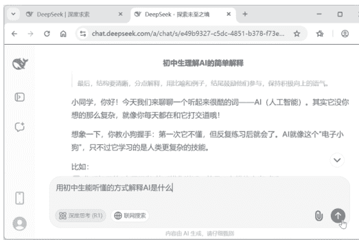

图 1-2 DeepSeek 的对话

在输入框中每次输入一个问题，按 Enter 键确认，即可完成一次和 AI 的互动。你可以尝试分别输入以下问题，例如：

- 给我出一道关于二次函数的数学题。
- 用《哈利·波特》的风格描述光合作用。
- 请帮我解释勾股定理。
- 给我讲一个有趣的笑话！
- 今天有哪些热门新闻？

> **小提示：** AI 的回答是基于已有的数据，它并不真正“理解”你的问题，而是通过计算来找到最可能的答案。你可以尝试用不同的表达方式问问题，看看 AI 的反应是否会变化。

## 1.2 AI 密钥，让 AI 更懂你
——精准提示词的奥秘

提示词是你与 AI 沟通的桥梁。用对了提示词，AI 能给出更精准的答案。学会如何提问，AI 就能更好地理解你的需求，给你更准确的回复。

3）然后再输入一个更精准的提示词：
请帮我写一篇关于“我的理想”的议论文，要求：
1. 开头用比喻句（例如“理想是灯塔”）。
2. 中间分为“为什么选择教师职业”和“如何实现”两部分。
3. 结尾引用陶行知的名言。
4. 作文字数 600 字左右。

4）按 Enter 键确认，AI 会返回结果，如图 1-4 所示。

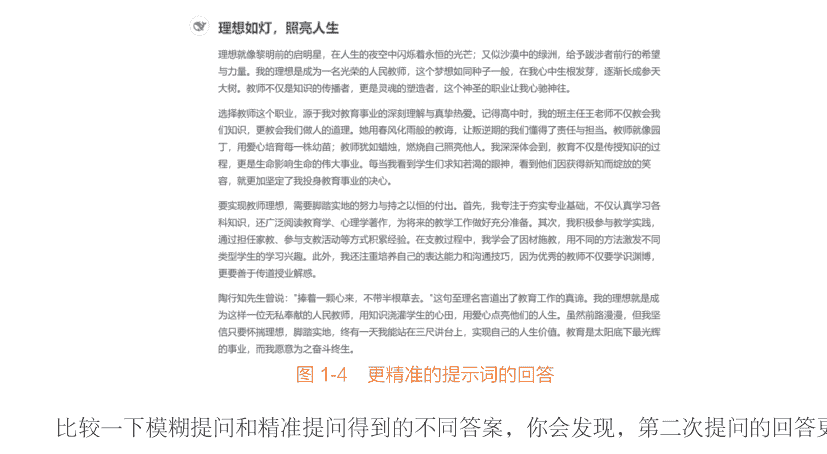

比较一下模糊提问和精准提问得到的不同答案，你会发现，第二次提问的回答更加符合你的需求。

试试看！假设你需要 AI 帮你写一篇关于“春天”的作文，以下是两种不同的提示词：

- **不精准：** 写一篇关于春天的作文
- **精准：** 我是一名初中生，请帮我写一篇关于“春天”的作文，描述春天的景象、气候的变化以及人们的活动，要求用比喻句开头，结尾引用名人名言，800 字左右。

你可以分别在 AI 工具中输入这两种提示词，看看它们的区别。你会发现，第二个问题得到的答案更贴合你的需求。

> **小提示：** AI 就像一道数学题的“已知条件”，你给出的条件越详细，得到的答案就越准确！

### 2. 使用正确的提问格式

#### （1）直接指令 + 具体要求


- 1）打开 AI 工具（比如 DeepSeek），在输入框里输入一个不符合提问格式的提示词：
  牛顿第一定律是什么？
- 2）按 Enter 键确认，AI 会返回结果，如图 1-5 所示。

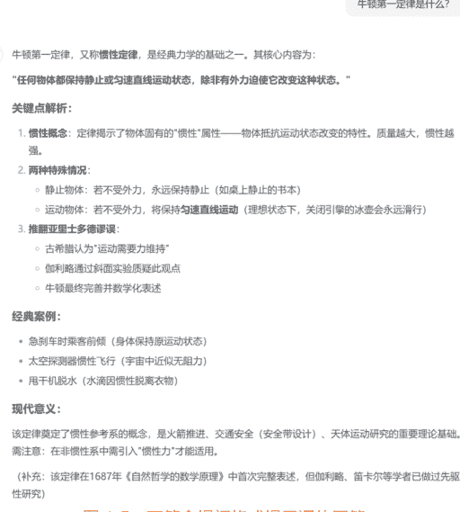

- 3）再输入一个符合提问格式的提示词：
  请用初中物理水平的语言，简单地解释牛顿第一定律。
- 4）按 Enter 键确认，AI 会返回更符合需求的结果，如图 1-6 所示。

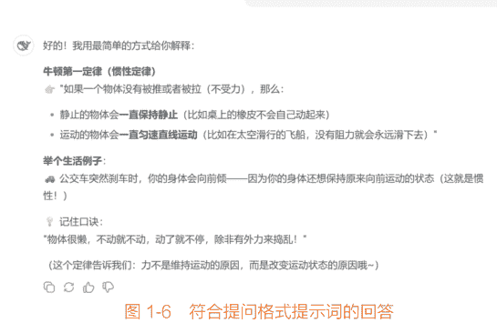

#### （2）分步骤提问
如果在 AI 给出回答后，你并不满意，要求它修改或完善答案，你可以继续追问，从而更精准地获得你想要的结果。这种逐步提问的方法也叫作追问法。

- 1）打开 AI 工具（比如 DeepSeek），在输入框里输入提示词：
  请解释牛顿第一定律的核心概念。
- 2）按 Enter 键确认，AI 会返回答案，如图 1-7 所示。
- 3）然后继续输入提示词：
  请举一个生活中的例子。
- 4）按 Enter 键确认，AI 会返回新结果，如图 1-8 所示。
- 5）接着再输入提示词：
  请用公式表示这个定律。
- 6）按 Enter 键确认，AI 会返回新结果，如图 1-9 所示。

通过分步提问，你可以对某个话题进行更加深入的探讨，就像“打破砂锅问到底”。

**请解释牛顿第一定律的核心概念。**

牛顿第一定律（惯性定律）的核心概念可以用三句话讲清楚：

- **1. 物体的“懒惰”本性**
  所有物体天生就有维持现状的“惯性”（惯性）——静止的想一直躺着，运动的想一直匀速溜达。
- **2. 力不是维持运动的原因**
  （推翻古希腊错误观念）
  物体运动不需要力来维持。
- **3. 力是改变运动的原因**
  只有外力才能让物体：
  - 从静止→运动（比如踢足球）
  - 从运动→静止（比如刹车）
  - 改变运动方向（比如转弯）

举个例子：
滑板少年不蹬地时，板车会匀速滑行；只有当他用脚蹬地（施加外力），速度才会改变。

关键记住：
“物体自己不会改变运动状态，这个倔脾气就叫惯性！”

图 1-7 分步骤提问的回答

**请举一个生活中的例子。**

最经典的例子：公交车上的“站立惊魂”

- **1. 场景还原：**
  - 公交车匀速行驶时，你和车是相同速度的运动状态 → 你能稳稳站着
  - 司机突然急刹车（车轮停止，车壳减速）
- **2. 惯性发威：**
  - 你的脚因摩擦力随车减速
  - 但上半身因惯性继续保持原来向前的速度 → 身体猛向前倾
- **3. 物理真相：**
  不是“有股力推你”，而是你的身体在抵抗运动状态的改变（这就是惯性的本质！）

其他同原理现象：
- 猛抽桌布碗不动
- 拍打被子灰尘飞出
- 紧急刹车时书包从座椅滑落

图 1-8 继续输入提示词的回答

**请用公式表示这个定律。**

牛顿第一定律的数学表达非常简洁：

```
公式：
当 ΣF = 0 时，
→ v = 恒定值（包括v=0的静止状态）
```

- **符号说明：**
  - ΣF：物体受到的合外力（矢量）
  - v：物体的速度（矢量）
  - “=0”：外力平衡或不受力

三种情况图解：

- **1. 静止物体（v=0）：**
  📖 桌上的书本 ΣF=0 → 保持静止
- **2. 匀速直线运动物体（v≠0）：**
  🚀 关闭引擎的宇宙飞船 ΣF=0 → 保持匀速
- **3. 对比牛顿第二定律（ΣF≠0时）：**
  ⚽ 踢出的足球 ΣF=空气阻力 → 速度改变

关键区别：
第一定律是第二定律的特例（当加速度a=0时，F=ma=0），但突出了“惯性”这一核心概念。

图 1-9 再次输入提示词的回答

> **小提示：** 用“请”字开头，分步骤提问能让 AI 更容易理解和执行！

### 3. 避免歧义词

常见误区：
模糊词：“快点”“简单”“好”。
替代方案：“30 秒内”“用 3 个要点”“符合初中水平”。

> **边学边做：** 避免使用歧义词撰写提示词

- 1) 打开 AI 工具（比如 DeepSeek），在输入框里输入一个模糊的提示词：
  写一篇关于环保的演讲稿，要好。
- 2) 按 Enter 键确认，AI 会返回答案。
- 3) 再输入一个精准的提示词：
  我是一名中学生，请写一篇关于垃圾分类的演讲稿，要求：
  1. 开头引用联合国环境署的数据。
  2. 中间分为“个人行动”“社区行动”“政策支持”三部分。
  3. 结尾呼吁行动，总字数 500 字。

> **小提示：** 不清楚怎么表达“需求”？试用这些句式开头：
> - 我想……但我不太会……
> - 我遇到了……的问题，想请你……
> - 有没有一种简单点的方式能让我……
> 想提高 AI 回答质量？尽量明确年级、时间、重点内容、学习风格等具体信息，提问越具体、越详细，AI 就越懂你！

### 1.2.2 让 AI 听你指挥：角色设定、具体任务、场景描述、格式要求四要素

如何设计精准的提示词呢？
为了让 AI 更精准地理解你的需求，可以在提示词中加入以下四个关键要素。

#### 1. 角色设定

让 AI 扮演你需要的角色（比如老师、学生、设计师等），告诉 AI 你是谁，或者指明它应该以什么身份来回答问题，这样可以让它的回答更加符合你需要的专业水平。

**角色选择指南：**

- 写作文：告诉 AI 你目前的学习阶段或水平，让它扮演学生、语文老师等。
- 解数学题：让 AI 当“解题机器人”。
- 学英语：让 AI 充当外教。

示例：假设你是一名数学老师，或者我是一名初二学生，或者请扮演一位历史老师等。

> **边学边做：** 让 AI 扮演历史老师，讲解唐朝的科举制度

- 1）打开 AI 工具（比如 DeepSeek），在输入框里输入提示词：
  请扮演一位历史老师，用比喻的方式（比如“科举制像一场全国性的考试”）向初中生解释唐朝科举制度的运作方式、意义及影响。
- 2）按 Enter 键确认，AI 会返回结果，如图 1-10 所示。

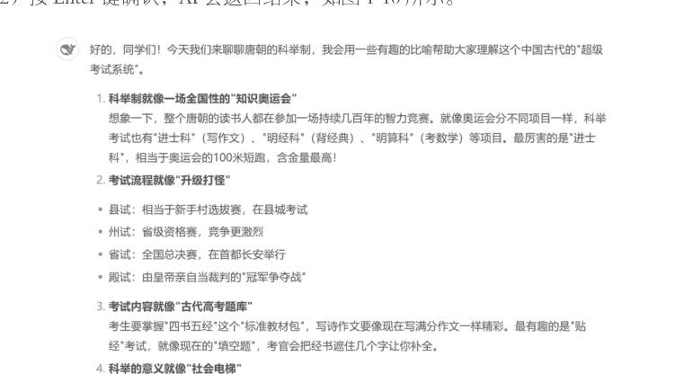

试试看！假设你是一名初中数学老师，请给我讲解勾股定理的应用。

#### 2. 具体任务

明确描述你希望 AI 完成的任务，比如写作文、解数学题、翻译等。

任务描述技巧：
用动词开头（例如“设计”“分析”“比较”“列出”“列举”）来明确任务。
示例：我是初中生，请列举五个中考常考的英语短语，并提供例句。

## 边学边做：让 AI 帮你设计一个班级辩论赛的评分表

1）打开 AI 工具（比如 DeepSeek），在输入框里输入提示词：
请扮演辩论赛评委，设计一个包含“观点清晰度”“语言表达”“团队协作”三个维度的评分表，总分 100 分，每个维度下有 3 个评分项（如“观点逻辑性”“引用数据”“团队配合”）。
2）按 Enter 键确认，AI 会返回结果，如图 1-11 所示。

辩论赛评分表（总分100分）
评委：______ 辩题：______ 队伍：______

| 评分维度 | 评分项（权重） | 评分标准 | 得分（满分） |
| :--- | :--- | :--- | :--- |
| 观点清晰度（40分） | 1. 观点逻辑性（15分） | 论点明确，论证严密，无逻辑漏洞 | ___/15 |
| | 2. 论据支撑（15分） | 引用数据、案例、权威观点，证据充分 | ___/15 |
| | 3. 反驳针对性（10分） | 能精准识别对方漏洞，有效驳斥 | ___/10 |
| 语言表达（30分） | 1. 语言流畅度（10分） | 表达清晰，无卡顿，语速适中 | ___/10 |
| | 2. 修辞技巧（10分） | 善用比喻、排比等修辞增强说服力 | ___/10 |
| | 3. 仪态与感染力（10分） | 肢体语言自然，眼神交流，富有感染力 | ___/10 |
| 团队协作（30分） | 1. 分工合理性（10分） | 每位辩手角色明确（立论、质询、总结等） | ___/10 |
| | 2. 衔接配合（10分） | 自由辩论时补位及时，不抢话不冷场 | ___/10 |
| | 3. 整体一致性（10分） | 全队观点统一，无自相矛盾 | ___/10 |
| 总分 | | | ___/100 |
| 评语栏（可补充说明）： | | | |

图 1-11 设计一个班级辩论赛的评分表

## 3. 场景描述

提供使用情境，让 AI “身临其境”地理解任务的背景和环境，这有助于 AI 更好地调整答案。
场景描述神奇三连问：

- 谁要用？（班级小组、个人学习等）
- 用在哪儿？（手抄报、课堂辩论等）
- 想达到什么效果？（有趣、严谨、感人等）

场景描述公式：

- “假设你正在……（任务）”（例如，“正在环保社团会议上发言”）。
- “请想象你身处……（环境）”（例如，“身处唐朝长安城”）。
- “要为……（事情）”（例如，“要为学校宣传栏写一个垃圾分类口号”）。

示例：要为下周语文课《苏州园林》的 PPT 配一段导游词，要穿插课文原句，让同学们有沉浸感。

## 边学边做：让 AI 帮你分析《西游记》中孙悟空的性格

1）打开 AI 工具（比如 DeepSeek），在输入框里输入提示词：
假设你正在参加学校的《西游记》读书会，请结合以下场景分析孙悟空在“大闹天宫”前后的性格变化，结合三个具体情节。
场景：孙悟空大闹天宫后被压五行山，唐僧救他并西行取经。
要求：从“反抗精神”“成长过程”“象征意义”三个角度，每段 200 字。

2）按 Enter 键确认，AI 会返回结果，如图 1-12 所示。

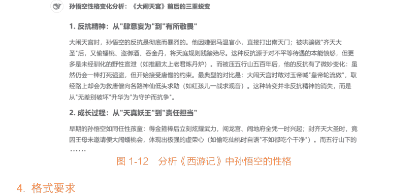

## 4. 格式要求

告诉 AI 你希望回答的格式，比如字数、列表、用表格对比等。

格式要求技巧：

- 指定输出格式（例如：表格、邮件、对话体）。
- 限制字数或行数（例如：600 字，每段不超过 3 行）。

## 边学边做：让 AI 帮你写一封道歉信

1）打开 AI 工具（比如 DeepSeek），在输入框里输入提示词：
你是一名中学生，以“李明”的名义给班主任写一封道歉信，要求：
1. 格式：称呼、正文、结尾、署名。
2. 内容：承认迟到事实，说明原因是连续三天起床晚，承诺改正。
3. 语气：诚恳但不卑微。
4. 字数：300 字。

2）按 Enter 键确认，AI 会返回结果，如图 1-13 所示。

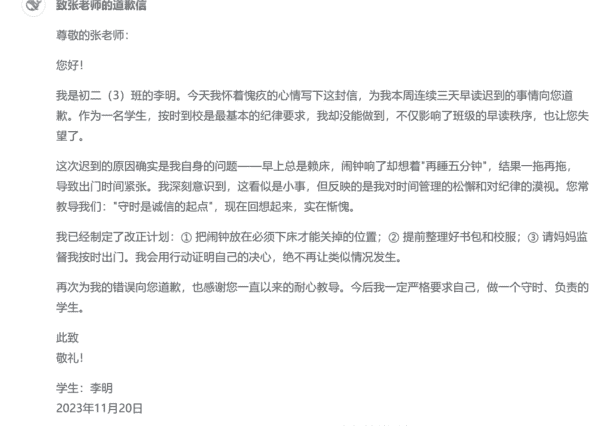

> 小提示：好的提示词 = 角色设定 + 具体任务 + 场景描述 + 格式要求。通过这四个要素，你能让 AI 更好地理解你的需求，得到更精准的答案哦！

## 1.2.3 中学生向 AI 提问的黄金原则

在向 AI 提问时，掌握一些简单的小技巧，就能大大提升你的学习效率。

### 原则 1：问题要具体，别太空泛——目标明确，AI 才更给力！

- ❌ 不推荐提问：怎么学好数学？
- ✅ 推荐提问：我是初二学生，几何证明题总是没思路，有没有什么方法帮我快速上手？

> 小提示：想让 AI 变身“学科导师”，记得给出年级+问题范围+遇到的困难点！

### 原则 2：提供背景，描述清楚任务——细节越多，答案越精准！

- ❌ 不推荐提问：怎么提高英语成绩？
- ✅ 推荐提问：我是初三学生，英语单词记不住，听力也听不懂，有什么适合我这个阶段的提升方法吗？

> 小提示：背景包括年级、考试目标、学习习惯等，能帮 AI 量身定制解决方案！

### 原则 3：积极思考，主动探索——提问不是“要答案”，而是“要思路”！

- ❌ 不推荐提问：这道题怎么做？
- ✅ 推荐提问：这道题的解题思路是什么？我用了代入法但不对，是哪里出错了？

> 小提示：不做“伸手党”，要做“思考王”！

### 原则 4：保持开放，接受多角度回答——多一种思路，多一个选择！

- ❌ 不推荐提问：学文科好还是理科好？
- ✅ 推荐提问：文科和理科各有什么特点？我喜欢实验但文科成绩好，适合学哪个方向？

> 小提示：AI 不是“判官”，它更像“参谋”，帮你看清每条路，最后的决策还是需要你自己选！

### 原则 5：化整为零，逐个击破——拆分问题，更容易学懂！

- ❌ 不推荐提问：我要怎么写一篇演讲稿？
- ✅ 推荐提问：我要写一篇演讲稿，第一步我该怎么确定主题？第二步怎样安排开头才吸引人？

> 小提示：每次只问一小块，像搭积木一样学知识！

### 原则 6：理性判断，别盲从 AI——用脑子，不盲信！

- ❌ 不推荐提问：网上说每天早起背书最有效，是这样吗？
- ✅ 推荐提问：早上背书和晚上复习哪个记忆效果更好？有没有科学研究支持？

> 小提示：把 AI 当“工具箱”，而不是“指挥棒”。你永远是学习的“指挥官”！

### 原则 7：告诉 AI 你想要的答案形式——想要口诀、图表、表格？统统说清楚！

- ✅ 推荐提问：请用初中生能懂的方式解释“基因是如何遗传的”。
请用表格总结“光合作用”的步骤。
请像老师上课那样，把“牛顿第一定律”分步骤讲一下。

> 小提示：关键词：“像老师那样讲”“列张图”“用口诀总结”！

### 原则 8：大问题拆小问，逐步引导 AI——像搭阶梯一样学习！

- ✅ 推荐提问：什么是二次函数的开口方向？
怎么通过公式判断顶点位置？
请结合图像帮我总结图像变化规律。

> 小提示：把大问题拆成 3~4 个小问题，AI 陪你逐级通关！

### 原则 9：用提示词控制风格——AI 能多变，全靠你控制！

推荐提问：请用幽默风格讲解“杠杆原理”。
用 5 句话概括《藤野先生》的主要内容。
请编一首关于“化学反应速率”的顺口溜！

> 小提示：常用提示词：“用思维导图整理” / “变成口诀” / “写一段剧情” / “像 Rap 一样讲出来”

### 原则 10：回答不满意？可以继续追问！——对 AI 的回答不满意，还可以继续追问，直到满意。

推荐追问：你能再讲简单点吗？
能换个例子解释“惯性”吗？
这句话我没太懂，能换个说法讲吗？

> 小提示：不满意就大胆追问，AI 不会生气，只会越说越明白！

### 原则 11：保持互动，引导对话方向——你说一句，AI 回应三句！

推荐互动语句：谢谢你，接下来请讲解下一步。
我明白啦，能出一道题给我练习吗？
请根据刚才的内容，考我一题！

> 小提示：把 AI 当成“陪你学习的伙伴”，多互动才有学习氛围！

### 原则 12：给出反馈，共同进步——学会“点赞”或“纠正”，你的反馈很重要！

推荐反馈方式：你讲得太清楚了，帮了我大忙！
我还是不太懂第 3 步，请再详细解释。
你说的和教材不太一样，请进行解释说明。

> 小提示：你给 AI 的反馈，也能帮助未来更多像你一样的同学！

实用提问句式：

请你以一名历史老师的身份，帮我总结“甲午战争”的背景、过程和影响，要结合课本知识点，并配上时间轴图。

作为一名英语老师，请帮我制订一个提高“完形填空”得分的训练计划，每天20分钟，最好包含词汇和语法技巧。

假设你是生物竞赛教练，能不能帮我整理一份关于“光合作用全过程”的知识梳理图？要解释关键名词，适合初中生理解。

### 模板三：目标行为 + 用途动机 + 预期效果 + 潜在顾虑

适合场景：你希望 AI 帮你制订计划并解决执行过程中可能遇到的困难。

关键词提示：我想做什么 → 是为了什么 → 希望达到什么效果 → 我担心什么问题……

模板说明：清楚说明你想做的事和目标，同时告诉 AI 你有哪些担心，它就能为你提前想好对策。

模板示范：我打算每天背 20 个英语单词（目标行为），为了提升词汇量和阅读理解力（用途动机）；希望一个月后能看懂 80% 以上的课文内容（预期效果）；但我担心坚持不下来，或记不住（潜在顾虑）。

实用提问句式：

我想每天做 1 篇阅读理解练习，目标是中考前错题率降到 20% 以下。但我担心方法不对，能不能教我一个高效技巧？

我准备每天用 AI 练习 5 道初中数学应用题，希望提升题目分析能力。但我怕遇到不会的题没有讲解，AI 能逐步帮我解析吗？

我想自己拍科学实验短视频来复习知识点，希望提高物理实验题得分，但不知道怎么拍，内容也怕太乱，能帮我设计一个结构清晰的拍摄方案吗？

### 模板四：需求 + 担忧问题 + 错因分析 + 针对解决

适合场景：你在某一知识点上总出错，想请 AI 帮你找原因并提供解决办法。

关键词提示：我想掌握……→ 但我总是……→ 错在哪？→ 如何解决？

模板说明：提出你的学习目标，再告诉 AI 你常出错的地方，请它帮你拆解问题并对症下药。

模板示范：我想准确翻译《岳阳楼记》的重点句子（需求），但总混淆“其喜洋洋者矣”与“感极而悲者矣”的情感表达（担忧）；请分析我出错的三个可能原因（如词义不清、结构混乱、背景缺失），并提供相应解决方法。

实用提问句式：

我想准确背诵《出师表》的重点语句，但总把“先帝”相关内容搞混。你能分析我出错的原因，并帮我整理归类记忆方法吗？

我做数学应用题时单位换算总出错。请帮我找出常见错误类型，并给我避免这些错误的小方法。

我听英语听力时总是听不懂长句，是因为连读、词汇不认识，还是我注意力不集中？请逐条分析，并告诉我怎么改进。

### 模板五：提出问题 + 希望获得角度分析 + 简化建议（可选）

适合场景：你希望 AI 从多个角度细致讲解一个问题，并给出更容易上手的方法。

关键词提示：怎么做……→ 分别提升哪部分？→ 如果太难，有简单版吗？

模板说明：让 AI “拆分任务” + “降维输出”，对你来说更容易理解和操作。

模板示范：请告诉我怎么提升中考作文分数（问题）；请从“立意”“结构”“文采”三个方面分别讲讲可以提升的方法（角度分析）；如果建议太复杂，请再给我一个写作基础一般同学也能用的技巧清单（简化建议）。

实用提问句式：

如何写好议论文？请分别讲讲“立意、结构、语言”三方面的提升技巧，并给我一个简易写作框架。

科学探究题怎么答得更完整？请从“实验设计”“变量控制”“数据分析”三个方面教我，如果太难，请用口诀形式讲讲。

### 模板六：学习目标 + 时间 / 资源条件 + 判断进步的方法

适合场景：你想请 AI 帮你制订合理、可执行的学习计划，并设计检查机制。

关键词提示：我想达成什么目标 → 我的时间 / 资源有限 → 如何判断是否进步？

模板说明：告诉 AI 你的目标和可投入的时间，它就能帮你设计合适的“成长路径图”。

习计划，并告诉我怎么通过做题反馈判断进步。

我的目标是英语听力从 60 分提升到 80 分，每周只有 3 节课外练习时间。请设计练习方案，并说明如何检测单词听力识别率是否提升。

我想提高物理实验题答题准确率，每天只有 15 分钟复习时间。请给我一个简练的知识点训练方案，并设计一个自测方式，比如错题率评估表。

> 小提示：建议把你常用的提问模板打印出来或贴在书桌前，写问题前先对照一遍，AI 回答会又快又准哦！

## 1.2.5 万能提问公式——中学生专属提问模板

还在因为“不会提问”而抓耳挠腮？万能提问句式记下来，让提问从此不再“卡壳”！

学会这招，向 AI 或老师提问就像开挂一样，轻松表达问题、迅速获得高质量解答！超实用模板如下：

我是初［几］学生，正在学习［知识点］，我遇到了［具体问题］，请用［方式／风格］解释一下，并给我一个［例子／口诀／练习题／对比表］，让我更容易理解！

模板说明：
［几］：你的年级，比如初一、初二、初三。
［知识点］：越具体越好，如“牛顿第一定律”“一元一次方程”“文言文‘之’的用法”等。
［具体问题］：比如“太抽象”“老是混淆”“记不住公式”等。
［方式／风格］：想要通俗讲解？生活化举例？像讲故事那样？都可以告诉对方。
［例子／口诀／练习题／对比表］：让回答更具体、有操作性，便于理解和记忆。

多学科提问示例（适合初中各年级）

### 语文类

例 1：我是初二学生，正在学习文言文《桃花源记》，我不太理解“缘溪行，忘路之远近”这句话的意思，你能用生活中的例子解释一下吗？最好再帮我总结一个记忆口诀。

例 2：我是初一学生，在练习写作文，我常常分不清“排比”和“反复”的区别，你能用通俗的语言讲一讲这两个修辞手法的差别，并配一个例子吗？

### 数学类

例 3：我是初三学生，在复习因式分解，我总是搞不懂“提公因式法”和“公式法”分别在什么时候用，你能用对比表讲一下吗？最好配一道练习题让我试试。

例 4：我是高一学生，最近在学二次函数的图像与性质，但我总是搞不清楚开口方向、顶点坐标和对称轴的关系，你能用图解和生活化比喻帮我讲清楚吗？最好再出一道典型题目让我练练。

### 地理类

例 5：我是初二学生，正在学习中国地形区，我老记不住哪个区在哪儿，你能用口诀或思维导图帮我整理一下七大地形区的位置和特点吗？

### 科学类（物理/生物）

例 6：我是初二学生，在学“光的反射”，我分不清“反射角”和“入射角”的定义，你能用镜子或手电筒举个例子解释一下吗？

例 7：我是初一学生，在学“生态系统”，我不太懂“食物链”和“食物网”的区别，你能像讲故事那样举个例子讲清楚吗？最好再给一道选择题让我练习。

### 道法类（道德与法治）

例 8：我是初一学生，刚学到“法律的特征”，总觉得和“道德”的作用很像，你能用对比表的方式讲讲它们的区别吗？

### 艺术/综合类

例 9：我是初二学生，在上美术课时学习“构图”，我分不清“对称构图”和“均衡构图”，你能配一张图来帮我对比一下它们的区别吗？

> 小提示：无论是提问老师、AI，还是整理错题笔记，用这个句式都能让你的问题表达得清晰又专业，答案也会更贴合你真正的需求！

## AI任务卡：让 AI 策划一场“穿越到唐朝”的历史剧

任务要求：

- 角色设定：让 AI 扮演历史剧编剧。
- 具体任务：写出一段对话，展示李白与杜甫的友谊。
- 场景描述：两人在酒楼相遇，讨论《蜀道难》的创作。
- 格式要求：剧本格式（角色 + 对话 + 旁白）。
- 背景信息：安史之乱前，李白被赐金放还。

## 1.3 AI 世界的“红绿灯”法则
——安全使用指南

在 AI 的世界里，充满了无限的可能性，但也伴随着一些挑战和风险。下面就让我们一起了解 AI 世界的“红绿灯”法则，学习如何安全使用 AI，保护个人隐私，并且避免被误导。

### 1.3.1 AI 的幻觉：为什么 AI 有时一本正经地“胡说八道”

1. 什么是 AI 的“幻觉”？

AI 的“幻觉”是指 AI 在生成回答时，可能会虚构或编造一些并不存在的信息，或者错误地解释事实。就像人在幻觉中看到了其实不存在的东西一样。这并不是因为 AI “故意撒谎”，而是因为它的训练数据有限、推理方式不够完备，或者有其他技术上的原因。

2. 为什么会出现这种“幻觉”？

虽然 AI 可以根据大量的数据进行预测和生成回答，但它并不具备像人类一样的“理解”能力。它只是根据数据中的表面联系来给出最有可能的答案。当遇到数据偏差、信息不足、缺乏上下文理解，或是遇到模糊的语境时，AI 就容易产生幻觉。

3. 如何辨别 AI 的幻觉？

- 交叉验证信息：如果 AI 提供某个信息，可以试着在其他权威渠道（如教科书、官方网站、其他 AI 工具、搜索引擎）查找相同的信息，确保其真实性。
- 注意 AI 的措辞：如果 AI 使用了“可能”“据我所知”等模糊的词汇，那说明对于该信息的确定性不高，需要进一步核实。
- 询问信息来源：要求 AI 提供信息的来源。如果 AI 无法给出具体出处，那么该信息的可信度就值得怀疑。
- 提问的精确性：确保你的问题表述清楚明确，避免因为问题模糊而得到错误的答案。
- 保持批判性思维：保持一颗怀疑的心，尤其是在 AI 提供的数据或结论看起来过于“完美”时，要认真考虑其准确性和来源。

> 小提示：当 AI 提供的答案看起来合理，但又有点“过于完美”时，记得多做验证，查阅更多可靠的信息源，不要完全依赖 AI 的回答哦！

### 1.3.2 你的信息安全吗？ AI 如何获取数据？如何保护隐私？

1. 为什么隐私安全如此重要？
很多 AI 应用（比如语音助手、推荐系统、社交媒体分析等）需要收集和处理你的个人数据，以便提供更好的服务。如果这些数据被不当使用或泄露，可能会引发隐私泄露、诈骗、身份盗用等问题。

2. AI 如何获取数据？
AI 系统通常通过以下几种方式获取数据：

- 通过用户互动：AI 会通过你的搜索历史、社交媒体行为、购物记录等来收集数据。这些数据帮助 AI 提供个性化的推荐。
- 通过第三方平台：很多 AI 应用会从其他平台获取数据，比如，AI 助手通过网络获取信息来回答你的问题。
- 通过传感器和设备：一些 AI 设备（如智能音箱、智能手表、健康监测设备等）会通过传感器收集你的健康数据和地理位置等。

3. 如何保护隐私？

- 不透露隐私信息：提问时避免透露个人信息（如身份证号、住址等）。例如，可

## 1.3.3 警惕信息茧房：为什么会被困在“信息泡泡”中

### 1. 什么是信息茧房？

信息茧房是指一个人长时间只接触与自己兴趣和观点相似的信息，导致视野变得狭窄，难以接触到不同的观点或新的信息。算法会根据你的浏览、点赞、评论等行为，推荐相似的内容，以提高你使用 APP 的时间和满意度。可这种机制可能导致你接收到的信息越来越单一，从而形成信息茧房。

### 2. 为什么短视频让人“上头”？

短视频平台（如抖音、快手等）通过 AI 算法分析你观看过的视频内容，找到你最感兴趣的话题，然后不断推送相似的内容。这样一来，你就被同一类型的信息包围，视野自然变得越来越狭窄，容易陷入信息茧房。

### 3. 如何避免信息茧房的陷阱？

- 主动寻找不同内容：有意识地去搜索和关注一些你不太熟悉的话题，扩大信息来源，避免只接触单一类型的内容。
- 设定时间限制：给自己设定每天刷短视频的时间限制，避免沉迷其中。
- 多元化的内容来源：尽量关注不同领域、不同观点的信息，避免只关注一个类型的内容。
- 关闭推荐：在某些 APP 的设置里，减少或者关闭“个性化推荐”。
- 讨论不同观点：可以让 AI 推荐与自己兴趣相反的内容，比如喜欢足球的人搜索古典音乐。
- 用 AI 拓展视野：可以让 AI 生成“10 个你从未尝试过的兴趣列表”。
- 定期清理推荐记录：在一些平台上，定期清除你的搜索记录和观看历史，刷新推荐算法。

> 小提示：定期尝试新内容，避免陷入单一的信息来源，尽量获取更广泛的信息。

## 1.3.4 AI 生成内容的版权问题：抄袭还是原创？

AI 可以生成文章、图像、音乐等多种内容，但这些内容的版权归谁呢？是 AI 的“创作”？还是提供数据的公司？

### 1. 为什么 AI 生成的内容可能涉及版权问题？

虽然 AI 可以生成看似原创的内容，但这些内容实际上是基于已有的数据和模型训练得出的。有时，AI 生成的内容可能侵犯原作者的版权，因为 AI 是通过参考已有的作品或资料进行学习的。

AI 生成的内容是抄袭还是原创？
AI 生成的内容有时可能与现有内容相似，甚至完全抄袭某些部分。尽管 AI 输出的是新组合，但是否算作原创仍然是一个复杂的问题。可能会遇到一些与别人已经发表的内容相似的情况，这就是版权问题的核心。目前主要有两个争论点：

- 支持原创：AI 学习了大量数据，生成的内容是新的组合。
- 反对原创：所有内容都源自他人的作品，没有经过人类思考。

法律现状：目前中国规定，AI 生成的内容需要标注数据来源，不能直接当作“原创”。

### 2. 哪些行为算抄袭？

以下是一些案例对比：

| 行为 | 是否抄袭 | 原因 |
| --- | --- | --- |
| AI 写作文引用《红楼梦》 | 是 | 未注明作者和出处 |
| AI 生成图像模仿某画家风格 | 是 | 模仿他人独特的画风，未获得授权 |
| AI 解数学题 | 否 | 数学解法是公理，不涉及版权 |

### 3. 如何避免版权问题？

- 了解版权法：使用 AI 生成内容时，确保它不侵犯他人的版权。
- 原创性检查：使用工具检测 AI 生成的内容是否与网络上的现有内容重复。
- 明确归属：如果 AI 生成了内容，务必清楚地标明创作来源和版权信息。

### 4. 正确使用 AI 的“三原则”：

- 原则 1：标注来源。
- 原则 2：不把未经许可的内容用于商业。
- 原则 3：以学习为主，不直接复制使用内容。

示例：本文部分内容由 AI 生成，数据来源包括《现代汉语词典》和网络公开资料。

### AI任务卡：分析一个 AI 生成的回答，找出可能存在的问题

任务要求：
询问 AI “地球上最大的动物是什么？”，然后验证 AI 回答可能存在的问题。

> 小提示：AI 的说法有时是“保守估计”，它可能不会给出极限数据，因此我们自己要多查阅几种来源进行对比。当遇到“最大”“最强”“第一”等极限词语时，特别要注意是否说明了时间、范围或条件。

## 第 2 章
AI 黑科技
——助你学习效率一路飙升

你是否在学习时总是拖延？看书时看着看着就刷起了短视频？别担心，AI 来了，学习不再靠意志力硬撑！让我们用 AI 黑科技进行时间管理，打败拖延小怪兽，让学习节奏稳稳在线！

## 2.1 打败拖延小怪兽
——AI 时间管理黑科技出动

学会使用三种 AI 时间管理神器：番茄钟、任务提醒、学习打卡助手，通过“AI 任务卡”实践，开启高效学习新模式！

### 2.1.1 AI 时间管理神器：番茄钟、任务提醒、学习打卡助手

**神器 1：番茄钟——碎片时间的终结者**
使用“番茄工作法”，将学习划分为 25 分钟专注学习 + 5 分钟放松的科学节奏，AI 自动提醒、循环切换，告别一学就困！

> 边学边做：利用番茄钟完成“数学作业 + 英语阅读”

1. 在手机上下载番茄钟 App（如“番茄 Todo”）。
2. 在应用中输入你的学习任务，比如“数学作业”和“英语阅读”。
3. 点击“开始”，学习 25 分钟，保持专注！
4. 25 分钟后，App 提醒你休息 5 分钟，起身伸个懒腰！
5. 进入下一个番茄钟，继续你的任务。

> 小提示：学习期间建议关闭手机通知，把自己“封印”在学习泡泡中哦！

**神器 2：任务提醒——专属你的学习秘书**
设定每天的学习任务和时间，AI 准时提醒你，防止“我以为还有时间”，让学习目标清晰明确，每一步都走得稳稳当当！

> 边学边做：利用手机日历设定学习任务提醒，每周一、三有数学课，二、四是英语课

1. 打开手机日历，单击“添加事件”。
2. 设置周期性提醒：每周一、三数学课，每周二、四英语课。
3. 添加时间：比如数学在 15：00，英语在 10：00。
4. 备注任务内容：如“数学：完成练习册第 3 页”，“英语：阅读 Unit 4”。

> 小提示：写任务时尽量具体！“读书”不如写“读完 P15-18 并写摘要”，明确才更容易完成！

**神器 3：学习打卡助手——坚持的最好伙伴**

每天学习打卡，AI 记录你的努力，量化每一分付出，看得见的进步才最有成就感！

### 边学边做：利用打卡 App 督促自己坚持学习

1. 下载打卡 App，如“小日常”或“打卡吧”。
2. 创建打卡项目：例如“每日数学学习”“每日英语打卡”。
3. 每次完成任务后单击“打卡”，坚持记录你的学习。
4. 定期查看自己的打卡记录，看看你已经坚持了多少天！

学习效率 = 时间管理 + 行动执行 + 自我激励！AI 不仅是科技的产物，更是你学习路上的“超能助手”！快用起来，让每一分钟都超值！

### 2.1.2 AI 学习规划师：用 AI 帮你制订“超强”学习计划

AI 不仅能帮你管理时间，还是你量身定制学习计划的好帮手！
如何用 AI 制订学习计划？

- 输入目标：在 AI 应用中输入你的学习目标，比如“提高数学成绩”或“增强英语阅读能力”。
- 设置时间：输入每周你能用来学习的时间，比如每周 10 小时。
- 生成计划：AI 会根据你的目标和时间，为你生成一个详细的学习周计划。

### 边学边做：用 AI 定制学习计划

1. 使用 AI 工具（如 DeepSeek、KIMI、通义千问、ChatGPT 或其他 AI 工具）生成学习计划。例如，你的目标是：为中考英语备考。在输入框中输入提示词：

> 我是初中三年级的学生，为了备战中考，请帮我制订一个 30 天的英语复习计划，每天学习 1 小时，重点复习阅读理解练习。

2. AI 会根据你的请求，帮你列出每天的学习任务，清晰又高效，如图 2-1 所示。

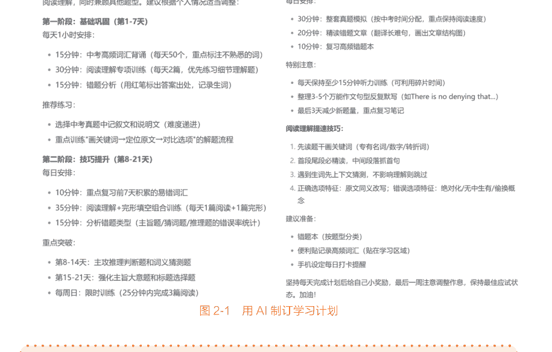

小提示：输入的目标应尽量明确且具体，例如提高某项特定技能，这样 AI 才能为你制订出更适合的学习计划。

学会了使用 AI 制订学习计划，你将更加高效地利用时间，提高学习效果，轻松备战各种考试。

### AI任务卡：用 AI 生成一周学习计划

任务要求：

让 AI 根据你的学习情况和学习任务生成一周的学习计划。为了让 AI 生成的计划更符合你的学习情况，你需要告诉 AI 你计划要完成的科目任务以及每天可以用于学习的时长，AI 会为你量身定制一周的学习计划。

## 2.2 个性化学习规划
——AI 做你的“专属家教”

你是否经常遇到这些问题？

- 别人学得快，我却总是跟不上。
- 复习时间不够，不知道该先学什么。
- 考试后想提升，但不知道从哪里入手。


扫码看教学视频

别担心！AI 就像你的“专属家教”，能帮助你分析弱点、制订学习计划，让你的学习变得更高效！

### 2.2.1 让 AI 分析学习情况：检测你的知识薄弱点

为什么要分析薄弱点？

- 盲目刷题等于无效努力 找到真正的问题才能高效提升。
- 你的时间有限，AI 能帮你把时间用在最需要的地方。

如何用 AI 找到知识薄弱点？

**方法 1：用 AI 分析考试错题类型**

> 边学边做：用 AI 分析考题错误类型

1. 打开 AI 工具（如 DeepSeek），在输入框中输入提示词并附上你的错题清单：
请帮我分析我的考试错题，找出我在哪些知识点上容易出错。下面是我的数学考试错题：

```
1. 解不等式组：
2x-3<5
x+1≥4
我的答案是：x<4
```

正确答案是：3 ≤ x<4

2. 函数单调性判断：已知函数 f(x)=x^2+2x，我认为它在区间（0，2）上是减函数

正确答案是：它在（0，1）上是增函数，在（1，2）上是减函数。

2. AI 会自动分析这些错题属于哪类问题（如概念不清、公式记忆错误、题意理解偏差等），并给出针对性的建议。显示建议如图 2-2 所示。

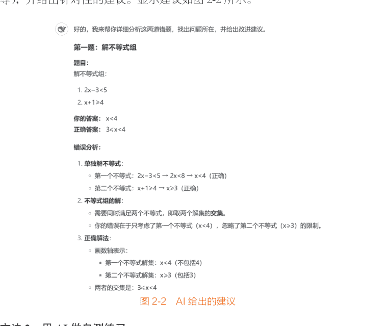

**方法 2：用 AI 做自测练习**

1. 打开 AI 工具（如 DeepSeek），在输入框中输入提示词并附上你的错题清单：

请给我出 5 道关于勾股定理的测试题，难度适中。下面是我的数学考试错题：

1. 一个直角三角形的两条直角边长分别为 6cm 和 8cm，计算斜边长度时我写成了 √(6+8)，结果错误。
2. 一道题给出三边分别为 5cm、12cm、13cm，我判断这个三角形不是直角三角形。

2. AI 会根据你的错题情况给出测试题。做完题后，把答案输入 AI。
3. AI 会告诉你哪些题做错了，并分析错误原因，如图 2-3 所示。

### 5道勾股定理测试题（难度适中）

1. 基础计算题
一个直角三角形的两条直角边分别为 9 cm 和 12 cm，求斜边的长度。

2. 判断直角三角形
以下哪组数据可以构成直角三角形？
A) 7, 24, 25
B) 8, 15, 17
C) 5, 10, 12
D) 6, 8, 10

3. 实际问题应用
一架梯子长 10 米，靠在墙上，梯子底部距离墙 6 米，求梯子顶端离地面的高度。

4. 反向求边长
一个直角三角形的斜边长 25 cm，一条直角边长 15 cm，求另一条直角边的长度。

5. 综合应用题
一个长方形的长是 16 cm，宽是 12 cm，求它的对角线的长度。

### 你的错题分析

1. 错误写法：你写成 √6+8，正确应该是 √(6² + 8²) = 10 cm（勾股定理公式用错）。
2. 判断错误：5, 12, 13 是典型的直角三角形（因为 5² + 12² = 13²），你的判断错误。

建议：
• 记住 a² + b² = c²（c 是斜边）。
• 常见勾股数：3-4-5、5-12-13、7-24-25、8-15-17 等。


**方法 3：用 AI 生成学科知识框架**


1. 打开 AI 工具（如 DeepSeek），在输入框中输入提示词：
请帮我列出初中物理力学的完整知识框架。
2. AI 会生成物理力学知识框架，列出相关知识点，并给出学习建议，如图 2-4 所示。
3. 你也可以要求 AI 提供某个知识点的详细内容。

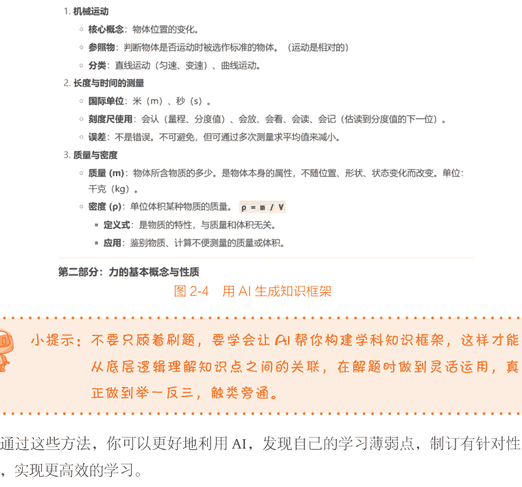

### 2. 如何用 AI 生成个性化学习计划？

**方法 1：让 AI 制订学习计划**

边学边做：AI 根据需求生成复习计划

1. 打开 AI 工具（如 DeepSeek），在输入框中输入提示词：
我是高中二年级的学生，请帮我制订一个两周的英语复习计划，重点复习语法和作文，每天 1 小时。

2. AI 会列出每天的学习任务如图 2-5 所示。

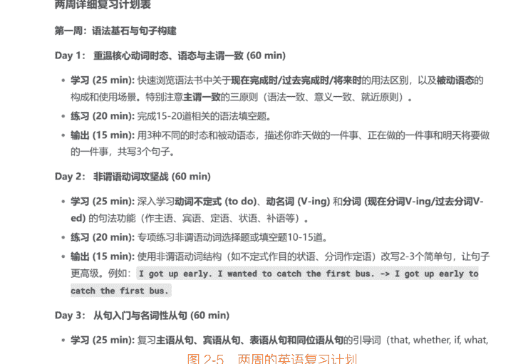

3. 如果你觉得计划不合适，可以让 AI 进行调整，比如在输入框中输入提示词：
请减少语法学习时间，增加听力训练。

**方法 2：使用 AI 进行错题专项训练**

边学边做：AI 生成错题专项训练题目

1. 打开 AI 工具（如 DeepSeek），在输入框中输入提示词：
请给我出 10 道关于等差数列的计算题，按难度递增。

2. AI 会给出题目，如图 2-6 所示。

### 等差数列练习题（难度递增）

1. （基础题）
已知等差数列 {aₙ} 中，首项 a₁ = 5，公差 d = 3。求第10项 a₁₀。

2. （基础题）
已知等差数列 {aₙ} 中，a₃ = 12，a₇ = 28。求该数列的公差 d 和首项 a₁。

3. （基础题）
求等差数列 2, 5, 8, 11, ... 的前15项之和 S₁₅。

4. （进阶题）
在等差数列 {aₙ} 中，已知 a₅ = 10，a₁₅ = 30。求 a₁ 和 d，并写出它的通项公式。

5. （进阶题）
已知一个等差数列的首项为 -3，前9项的和为 45。求这个数列的公差和第10项。

6. （进阶题）
一个等差数列的前n项和公式为 Sₙ = 2n² + 3n。求这个数列的通项公式 aₙ，并判断39是第几项。


3. 完成题目后将你的答案输入给 AI，让它帮你批改。AI 会告诉你哪些地方容易出错，并推荐相关知识点的讲解。

**方法 3：AI 帮你调整学习计划**

如果你对某个知识点掌握得很好，可以让 AI 减少这个部分的学习时间；如果某个知识点总是出错，可以让 AI 增加这个部分的练习。


1. 打开 AI 工具（如 DeepSeek），在输入框中输入提示词：
下面是你帮我制订的学习计划，请减少听力训练，增加阅读训练。
学习计划原文：（把以前的学习计划粘贴到这里）

2. AI 会给出调整后的学习计划。如果你仍觉得不合适，可以继续让 AI 进行调整。

通过这些步骤，你可以更加合理地安排学习计划，让 AI 成为你学习路上的得力助手！学会灵活运用 AI，你的学习将更加高效！

### AI任务卡：用 AI 分析考试成绩，找到提升方向

任务要求：
让 AI 帮你做一次考试成绩分析，并根据你的错题情况给出提升建议。

## 2.3 AI 智能错题本
——让每一道错题都变成你的得分点

你是否遇到过这些情况？

- 考试做错的题，考完就忘了。
- 每次看到同类型的题目，还是不会做。
- 想整理错题，但觉得太麻烦，总是半途而废。


扫码看教学视频

AI 智能错题本将帮你一键整理、归纳错题，并生成类似题，让你的错题真正变成得分点！

### 2.3.1 AI 智能错题归类：一键整理、分析错误原因

整理错题是学生突破瓶颈、快速提分最有效的方法，没有之一。
如何用 AI 整理错题？

**方法 1：用 AI 归纳错题类型**

> 边学边做：AI 整理错题并分析错误原因

1. 打开 AI 工具（如 DeepSeek），在输入框中输入提示词：
请帮我整理这些数学错题，并分析错误原因。
错题：(附上你的错题，包括题目、你的解法和正确答案)
2. AI 会自动分类（比如计算错误、概念不清、解题思路错误等），并给出分析和改进建议。

**方法 2：用 AI 生成错题总结**

> 边学边做：AI 生成错题总结

1. 打开 AI 工具（如 DeepSeek），在输入框中输入提示词：
请帮我总结这些错题的共同点，并给出学习建议。
错题：(附上你的错题，包括题目、你的解法和正确答案)
2. AI 会整理出错题的共性问题，并给出相应的学习建议。

> 小提示：整理错题不是简单的抄写，而是要找出错误背后的真正原因，这样才能有效提升自己的学习效果！

### 2.3.2 错题变式训练：AI 帮你找出相似题目，做到“举一反三”

为什么要进行错题变式训练？

- 考试不会直接考原题，而是会变换形式再考。
- 通过 AI 生成变式题，可以真正掌握知识点。

如何用 AI 生成变式题？

**方法 1：让 AI 生成相似题**

> 边学边做：让 AI 根据错题生成变式题

1. 打开 AI 工具（如 DeepSeek），在输入框中输入提示词：
请根据这道错题，出 5 道类似但不同的题目。
错题：（附上错题，如已知△ABC，AB=5，BC=12，AC=13，求∠B的大小。）

2. AI 会根据你的错题，生成不同角度的变式题，如图 2-7 所示。

**原题分析：**
- 原题：已知△ABC，AB=5，BC=12，AC=13，求∠B的大小。
- 常见错误：学生容易发现 $5^2 + 12^2 = 25 + 144 = 169 = 13^2$，即 $AB^2 + BC^2 = AC^2$，从而根据勾股定理逆定理判定△ABC为直角三角形，且∠B是直角。
- 错误根源：没有明确∠B是哪两条边的夹角，∠B是边AB和边BC的夹角，它的对边是AC。$AB^2 + BC^2 = AC^2$ 成立，恰好说明∠B = 90°。这道题本身其实并没有错，是一个正确的结论。但它是一个经典的“陷阱”，因为学生很容易不假思索地得出正确结论，却忽略了其背后的逻辑（即直角是哪个角）。

为了巩固知识点，我们应该出一些**数据相似但结论不同的题**，以及**改变所求角的题**，迫使学生必须严格应用“角的对边”这一概念。

**5道类似但不同的题目**
**第1题 (改变边长，保持勾股数，改变所求角)**
已知△ABC，AB=6，BC=8，AC=10，求∠A的大小。

**第2题 (改变边长，保持勾股数，改变角的位置)**
已知△DEF，DE=5，EF=13，DF=12，求∠E的大小。


## 方法 2：用 AI 解释解题思路


1）打开 AI 工具（如 DeepSeek），在输入框中输入提示词：
请帮我详细讲解这道错题的解法，并举例说明。
错题：（在这里输入你的错题）
2）AI 会分步骤讲解，并给出更多类似的例题。

## AI任务卡：创建一个 AI 辅助的错题本

任务要求：
让 AI 帮你建立一个错题本，并定期复习。

## 2.4 命题人视角训练
——AI 帮你预测考试重点

你是否遇到过这些情况？

- 复习了很多内容，但考题却不在复习范围内。
- 总是抓不住考试的重点，复习效率低。
- 想要精准备考，但不知道从哪里下手。

AI 可以帮你像“命题人”一样思考，精准分析考试重点，帮助你高效复习，提升分数！

### 2.4.1 AI 智能分析真题：精准分析命题人出题思路及考点

为什么要分析真题？

- 考试有规律可循！命题人不会随意出题，而是会有固定的考查重点。
- 学会分析出题规律，可以更好地预测考试范围，找到考试重点，提高复习效率。

如何用 AI 分析真题？

## 方法 1：用 AI 找出历年考试重点


1）打开 AI 工具（如 DeepSeek），在输入框中输入提示词：
请分析近 5 年的中考数学试题，找出历年常考的知识点或重点。

2）AI 会总结出高频考点，如图 2-8 所示。

| 考查模块 | 核心知识点 | 大致分值占比 | 考查特点 |
| :--- | :--- | :--- | :--- |
| 数与代数 | 实数运算、方程（组）与不等式（组）、函数（一次/二次/反比例函数） | 40%-45% | 基础函数 |
| 图形与几何 | 三角形全等与相似、勾股定理、圆的性质（垂径定理、切线判定与性质等）、四边形性质与判定、图形变换（平移、旋转、对称） | 30%-35% | 综合度、图 |
| 统计与概率 | 数据收集与整理（平均数、中位数、众数、方差）、概率计算（列举法、树状图）、统计图表分析 | 10%-15% | 注重回与 |
| 综合与实践 | 规律探索、新定义问题、跨学科应用（如物理、经济）、数学建模（如项目式学习） | 约10% | 创新度大 |

## 🔍 各题型与模块考点细析

中考数学试卷一般由选择题、填空题和解答题三部分组成 ④。

1. 选择题与填空题：
   - 主要考查基础概念和基本技能，如科学记数法、三视图、简单几何性质、概率计算等 ④ ⑨。
   - 虽然单题分值不高，但覆盖知识面广，是确保基础分的关键。
2. 解答题：

图 2-8 用 AI 找出历年考试重点

3）根据 AI 分析的结果，制订复习计划，重点突破。

## 方法 2：让 AI 预测下一次考试的可能考点


1）打开 AI 工具（如 DeepSeek），在输入框中输入提示词：
根据近 5 年考试趋势，预测今年数学中考可能涉及的考试重点内容。

2）AI 会结合考试趋势，给出高概率的考点，帮助你更有针对性地复习，如图 2-9 所示。

根据近5年的中考数学趋势，我为你梳理了2026年数学中考可能重点考查的内容、题型特点及备考建议。

### 一、核心模块与分值预测

| 考查模块 | 预计分值占比 | 核心知识点与命题焦点 |
| :--- | :--- | :--- |
| 数与代数 | 约40%-45% | 实数运算（绝对值、根式化简、科学记数法 ①）；方程与不等式（分式方程、一元二次方程判别式应用 ①）；应用题（利润、增长率、工程问题，需建模 ⑤） |
| 图形与几何 | 约40%-45% | 三角形（全等与相似的判定、中位线定理、勾股定理逆用 ①）；圆（垂径定理、切线性质 ①）；动态几何（折叠、旋转问题，常常构造辅助线 ① ⑥） |
| 函数 | 约15%-20% | 一次/反比例函数（图像性质、实际应用 ⑤）；二次函数（最值、对称轴、顶点坐标、与方程不等式综合 ④ ⑤） |
| 统计与概率 | 约10%-15% | 数据分析（平均数、中位数、众数、方差 ③ ⑦）；概率计算（用树状图或列表法求概率，注意“放回”与“不放回”事件区别 ① ③） |
| 综合与实践 | 渗透于各模块 | 项目式学习（如图形密铺、成本优化 ⑧）；跨学科应用（与物理、经济等结合，如杠杆原理、经济增长率 ⑥ ⑧） |

### 二、命题新趋势与特点

1. 基础题仍是主体，但更重理解：约有60%-70%的题目考查基础知识和技能 ① ⑥。它们不再局限于直

图 2-9 让 AI 预测下一次考试的可能考点

> 小提示：了解命题人的出题思路，重点攻克高频考点，确保复习内容有针对性。

### 2.4.2 AI 命题 + 自测：以命题人视角生成模拟题及答案解析

以命题人视角出题，有针对性地练习，可有效提升考试成绩。
如何用 AI 以命题人视角生成模拟题？

## 方法 1：用 AI 生成考前自测题

边学边做：根据高考试题风格生成模拟题

1）打开 AI 工具（如 DeepSeek），在输入框中输入提示词：

请根据高考数学考试风格，生成 5 道选择题和 3 道大题，并附带解析。

2）AI 会生成模拟考题，并给出详细解析，如图 2-10 所示。

### 一、选择题（每小题5分，共25分）

1. 函数性质综合
已知函数 $f(x) = \ln(x^2 - 2x + 2)$，则下列说法正确的是（ ）
A. $f(x)$ 的定义域为 $(0, +\infty)$
B. $f(x)$ 的最小值为 0
C. $f(x)$ 在 $(1, +\infty)$ 上单调递增
D. $f(x)$ 的图象关于直线 $x = 1$ 对称

答案：C
解析：
• 定义域：$x^2 - 2x + 2 > 0$ 恒成立，定义域为 $\mathbb{R}$，A错误。
• 最小值：$x^2 - 2x + 2 = (x - 1)^2 + 1 \geqslant 1$，故 $f(x) \geqslant \ln 1 = 0$，当 $x = 1$ 时取等，B错误。
• 单调性：令 $u(x) = x^2 - 2x + 2$，当 $x > 1$ 时 $u(x)$ 单调递增，且 $\ln u$ 单调递增，故 $f(x)$ 在 $(1, +\infty)$ 上单调递增，C正确。
• 对称性：$f(2 - x) = \ln[(2 - x)^2 - 2(2 - x) + 2] = \ln(x^2 - 2x + 2) = f(x)$，图象关于 $x = 1$ 对称，D正确。
陷阱：选项D也正确？再验证：$f(2 - x) = f(x)$ 确实成立，但题目要求“下列说法正确的是”，通常默认选最直接的一个，C更直接体现单调性。


3）你自己尝试做题，对照 AI 的解析，找到薄弱点。

## 方法 2：用 AI 生成不同难度的训练题


1）打开 AI 工具（如 KIMI、DeepSeek），在输入框中输入提示词：
我是高中二年级的学生，在班级中处于中等水平，请根据我的水平生成一套高中二年级上册数学针对三角函数知识点的训练题。

2）AI 会自动调整难度，提供不同层次的练习题，如图 2-11 所示。
用 AI 生成不同难度练习题，让学生练习难度逐渐梯度上升，可避免难度过大学生产生畏难情绪，有助于学生由浅入深掌握知识点。

## 高二（上）三角函数专题训练

（难度：中等，满分 100 分，建议用时 60 min）

### 一、选择题（每题 5 分，共 25 分）
每小题给出的四个选项中，只有一项符合题目要求。

1. 若角 α 的终边经过点 P(-3,4)，则 sin α 的值为
A. -3/5    B. 4/5    C. 3/5    D. -4/5

2. 函数 y = 2sin(3x - π/4) 的最小正周期为
A. π/3    B. 2π/3    C. π    D. 3π

3. 已知 cos θ = -5/13，且 θ 是第二象限角，则 tan θ 的值为
A. 12/5    B. -12/5    C. 5/12    D. -5/12

4. 下列函数中，最小值为 -2 的是
A. y = -3sin x    B. y = 2cos x - 1    C. y = 1 - 2sin x    D. y = 2sin x + 1

5. 若函数 f(x) = sin(ωx + φ) (ω>0, -π<φ≤π) 的图象关于直线 x = π/3 对称，且在区间 [0,π] 上只有一个最大值点，则 ω 的一个可能取值为
A. 1    B. 2    C. 3    D. 4

### 二、填空题（每题 5 分，共 15 分）

6. 已知 tan α = 2，则 (sin α + cos α)/(sin α - cos α) = ______。


## AI任务卡：用 AI 分析一套真题并生成一套模拟测试题

任务要求：
让 AI 参考中考数学试卷风格生成一套完整的模拟测试题，并进行自我检测。

## 2.5 用 AI 进行成绩管理
——可视化你的学习进步

你是否有这些困扰？

- 学习了很久，但不知道自己到底有没有进步。
- 定了很多计划，却总是无法坚持执行。
- 想调整学习方法，但不知道从何下手。

AI 可以帮你科学规划目标、设定计划和分析数据，让你的学习进步“看得见”！

### 2.5.1 AI 智能目标设定：用 AI 制订长期与短期学习计划

目标是前进的方向！明确的目标可以帮助你集中精力，避免盲目学习。如何用 AI 设定学习目标？

**方法 1：用 AI 制订长期学习目标**

> 边学边做：根据成绩让 AI 制订长期学习计划

1）打开 AI 工具（如 DeepSeek），在输入框中输入提示词：
我是初三的学生，我现在的英语成绩是 80 分，我想在 3 个月内提高到 90 分，请帮我制订一个可行的长期计划。
2）AI 会分析你的当前成绩，帮助你制订一个合理的长期计划。部分内容如图 2-12 所示。

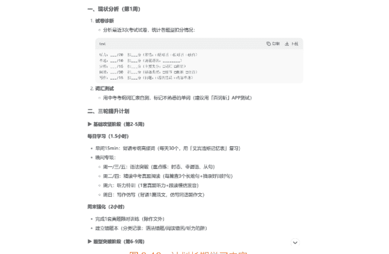

3）如果觉得计划执行起来有难度，可以输入提示词：
我觉得这个计划太难了，请帮我调整成更适合我的版本。

4）AI 会降低任务量或改变训练方式，帮助你制订一个更容易执行的计划。部分显示内容如图 2-13 所示。

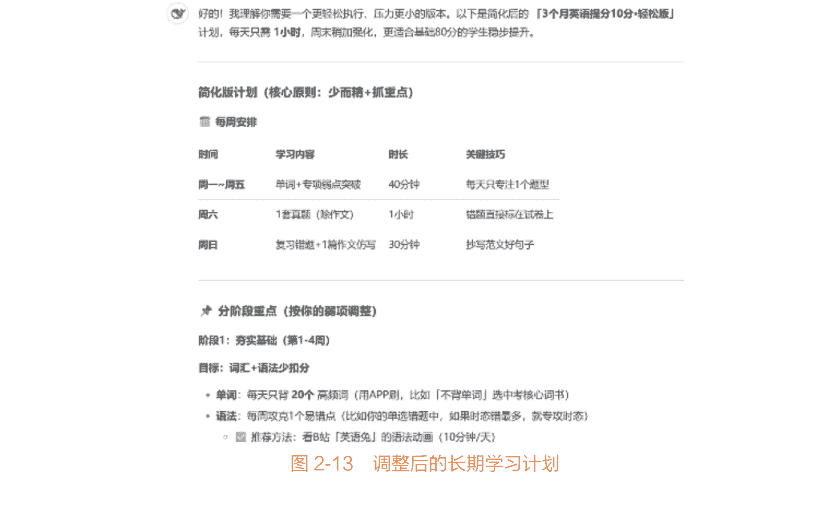

> 小提示：目标要符合 SMART 原则（具体、可衡量、可实现、相关性、有时限），AI 能帮你检查目标是否合理。

## 方法 2：用 AI 制订短期学习计划


1）打开 AI 工具（如 DeepSeek），在输入框中输入提示词：
我是北京高一第 2 学期的学生，我的数学成绩在第 1 学期只有 80 分左右，我希望在第 2 学期数学考试成绩达到 90 分左右，请制订一个短期学习计划，比如每周的学习任务。

2）AI 会生成一个短期学习计划。部分内容如图 2-14 所示。

3）根据 AI 生成的计划，安排每周的学习任务，确保逐步实现你的长期目标。

好的！针对你的目标（从80分提升到90分），我为你制定一个【4周数学提分攻坚计划】，重点抓基础巩固和题型突破，每周学习时间控制在5-6小时（适合课业繁忙的高一生）。

### 📋 每周学习安排（循环执行）

| 时间 | 学习任务 | 时长 | 重点技巧 |
| :--- | :--- | :--- | :--- |
| 周一 | 梳理本周学校内容 | 30分钟 | 用思维导图整理公式和性质 |
| 周二 | 专题突破1（函数） | 1小时 | 针对错题类型专项训练（如函数/几何） |
| 周三 | 基础题刷题 | 40分钟 | 选做前10题训练（限时练准确率） |
| 周四 | 学校作业错题复盘 | 30分钟 | 标记错误点并归类，搞清思路 |
| 周五 | 休息/机动 | — | 复习薄弱点或放松 |
| 周六 | 综合套题训练（模拟考试） | 1.5小时 | 限时完成基础+中档题（90分内容） |
| 周日 | 错题整理+针对性补漏 | 1小时 | 重做本周错题+同类题巩固 |

### 🎯 分阶段重点

第1-2周：基础巩固

1. 核心任务：
   - 确保选择题前8题、填空题前3题、大题前2题（基础分约70分）零失误
   - 每天抽10分钟默写公式（如二次函数顶点式、三角函数诱导公式）
2. 推荐练习：
   - 学校作业中的基础题
   - 《五三》A组题或「基础2000题」中标记为高频考点题


> 小提示：将长期计划和短期计划结合起来，可以帮助你更有条理地学习，逐步实现目标。

### 2.5.2 目标跟踪法：用 AI 监测学情，智能调整达成路径及执行策略

为什么要跟踪学习目标？

- 通过跟踪你的学习进展，可以及时发现问题，调整学习策略，避免拖延。
- 根据学习效果，AI 能帮你实时优化学习计划，确保每个阶段都能顺利实现目标。

如何用 AI 跟踪学习进度？

## 方法 1：让 AI 记录你的学习进度

> 边学边做：让 AI 根据成绩变化分析学习情况

1）打开 AI 工具（如 DeepSeek），在输入框中输入提示词：
我上周完成了高中二年级第二学期数学5个章节的复习，并做了2套模拟题，得分分别是78分和82分。请帮我分析我的进步情况，并给出下一步建议。

2）AI 会分析你的学习情况，并给出相应的建议。部分显示如图 2-15 所示。

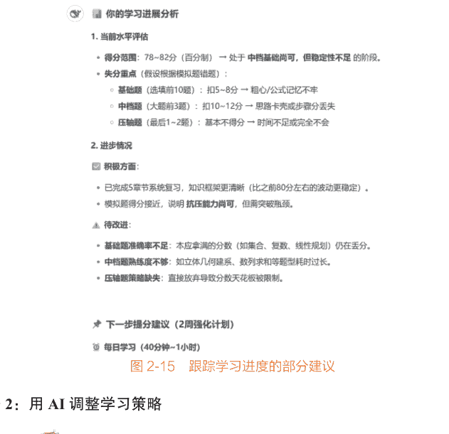

## 方法 2：用 AI 调整学习策略

1）打开 AI 工具（如 KIMI、豆包等），将你的错题拍照上传，并在输入框中输入提示词：
我上周的数学测试成绩是 80 分，调整我的学习策略，比如增加某些知识点的复习时间。下面是我做错的试题。

2）AI 会评估你上周的学习情况，找出哪些知识点掌握得比较好，哪些部分仍然薄弱。然后，AI 会给出建议，比如加强某些难点的练习，调整复习的时间分配等。

3）根据 AI 的建议，你可以调整自己的学习策略，确保每个目标都能按时完成。

## AI任务卡：用 AI 制订下一阶段的学习计划

任务要求：
让 AI 根据当前学习成绩和目标，生成下一阶段的学习计划。

## 2.6 AI 超能伙伴
——陪你一路健康成长

你是否有这些烦恼？

- 考试前总是紧张焦虑？ AI 教你如何放松！
- 不知道怎么跟朋友沟通？ AI 帮你练习社交技巧！
- 情绪低落、不知所措？ AI 就是你的贴心倾听者！

AI 不仅是你的学习助手，更是你的“成长好伙伴”！

### 2.6.1 考前减压神器：AI 帮你制订考前舒缓方案

为什么考前减压如此重要？
考试不仅是对知识的考验，更是对心理的挑战。如果你考试前感到紧张焦虑，说明你可能需要减压啦：

- 背书时脑子一片混乱。
- 晚上怎么也睡不着，一想到考试就焦虑。
- 明明复习了，但考试时却一片空白。

这些都和“考前压力”有关。科学研究表明：适当减压可以提高专注力、记忆力和情绪稳定性，可以让你考试时发挥得更好。
如何用 AI 制订考前减压方案？
**方法 1：AI 定制减压计划，科学又贴心**

> 边学边做：让 AI 制订科学的减压计划

1）打开 AI 工具（如 DeepSeek），让 AI 为你出谋划策，在输入框中输入提示词：
我最近要考试了，很紧张，晚上总是睡不着。你能帮我制订一个适合高中生的一周考前减压计划吗？最好包括运动、冥想或轻松的活动。
2）AI 可能给出这样的建议：

| 日期 | 减压活动建议 |
| :--- | :--- |
| 周一 | 傍晚散步 15 分钟 + 睡前进行 5 分钟呼吸冥想 |
| 周二 | 放学后画画或听舒缓音乐 20 分钟 |
| 周三 | 尝试“正念练习”，关注呼吸和当下情绪 |
| 周四 | 跟朋友聊天或做趣味小游戏放松 |
| 周五 | 轻松运动：跳绳 / 打羽毛球 20 分钟 |
| 周末 | 安排“零焦虑”半天：不学习，做喜欢的事 |
| 每晚建议 | 睡前 1 小时关闭电子设备，用轻音乐或阅读代替刷手机。 |

3）可以再输入你的兴趣爱好，比如：我喜欢画漫画或者和宠物玩耍等，AI 会自动调整计划。

4）把方案加入手机日历，坚持 3 天以上看看效果。

## 方法 2：用 AI 引导正念练习，快速平静心情

边学边做：让 AI 引导正念练习，缓解考前焦虑

1）打开 AI 工具（如 DeepSeek），在输入框中输入提示词：
请用正念冥想的方式，引导我放松心情，缓解考试焦虑。

2）AI 可能会这样说：
闭上眼睛，坐好，深吸一口气，感受空气进入鼻腔，再慢慢吐气。重复三次后，想象你在一个安静的湖边，阳光洒在身上，湖水轻轻荡漾，烦恼也随波渐远……

3）你可以戴上耳机，把这段 AI 生成的内容读出来，或者直接让语音助手播放放松音频。

## 方法 3：AI+ 运动减压训练，让身心都活跃起来！

边学边做：让 AI 制订丰富有趣的运动放松计划

1）打开 AI 工具（如 DeepSeek），在输入框中输入提示词：
请帮我设计一个适合高中生的考前运动放松计划，每天 10~15 分钟，最好有简单动作指导。

2）AI 可能建议：
周一：原地高抬腿 + 开合跳（1 分钟 ×3 轮）
周二：室内瑜伽拉伸 + 深呼吸 5 分钟
周三：跳绳 200 下 + 散步 15 分钟
周四：手臂 / 肩颈放松操（缓解久坐疲劳）
周五：轻量家庭锻炼（俯卧撑、深蹲、仰卧起坐各 10 次）

3）可以让 AI 推荐你喜欢的“动感音乐”搭配练习，输入提示词：

> 为了配合减压训练，请推荐一些动感音乐。

通过这些方法，你可以有效利用 AI 来减轻考试前的压力。保持良好的心态，可以帮助自己在考试中发挥出色，轻装上阵，稳稳拿下好成绩。

### 2.6.2 人际关系助攻：AI 帮你优化沟通方式，让友谊更牢固

为什么人际关系很重要？

- 良好的沟通不仅能帮助你在学习中与老师和同学更好地互动，还有助于增进友谊，减少误解。
- 学会优化自己的沟通方式，可以让你在人际交往中更加自信，缓解与他人相处时的压力。

如何用 AI 优化人际沟通方式？

## 方法 1：与 AI 进行沟通技巧训练

边学边做：与 AI 进行沟通技巧练习

1）打开 AI 工具（如 DeepSeek），在输入框中输入提示词：
我和朋友因为作业分工的问题有点不开心，能帮我想一个合适的道歉方式吗？
2）AI 可能给出建议，例如：
我知道昨天的分工让你有点不舒服，对不起！我们一起想个更好的方法吧！
我不是故意让你生气的，希望我们能好好沟通！
3）通过 AI 的建议，你可以练习这些沟通技巧，提升自己的情商和沟通能力。

## 方法 2：模拟社交场景进行练习

边学边做：和 AI 模拟社交对话练习

1）选择一个具体的社交场景，例如：与朋友表达自己真实的想法等。
2）打开 AI 工具（如 DeepSeek），在输入框中输入提示词：
我是初中生小圆，最近我的朋友小欣总在课堂上找我传纸条聊天，影响我听课。我想和她沟通但怕她生气，请帮我模拟与小欣沟通的对话，给我反馈需要改进的地方。

3）AI 会模拟对话，并提供改进建议，告诉你哪些表达更有效，如图 2-16 所示。

## 模拟对话

我：小欣，你最近上课老是传纸条给我，我有点跟不上老师的节奏了😊
小欣：啊？可是我觉得无聊嘛，你不喜欢和我聊天吗？
我：不是不喜欢！但老师讲的重点我老是错过，上次测验我就考砸了…
小欣：那你不会下课再问我吗？
我：可是有些内容错过就补不回来了…下次上课我们先认真听讲，下课再一起聊好不好？
小欣：好吧…那你下课要陪我去操场玩
我：成交！😊

## 反馈与改进建议

1. ✅ 优点
    - 用事实说话：提到“上次测验考砸了”让理由更具体，不像在挑剔对方。
    - 提供替代方案：建议“下课再聊”+“去操场玩”，用轻松方式化解矛盾。
    - 语气友好：用表情符号和商量语气，减少攻击性。
2. ⚠️ 可改进点
    - 开头可更委婉：直接说“你老是传纸条”可能让对方觉得被指责，可以改成：“小欣，你上课传的纸条我超想回，但又怕漏听老师讲题，好纠结…”
    - 提前共情：先认可对方的感受，比如：“我知道你觉得课无聊，我也有时走神～”
    - 强化友谊承诺：结尾可加一句：“你永远是我最重要的聊天搭子！只是上课咱俩先忍忍～”

图 2-16 让 AI 模拟社交对话

## AI任务卡：用 AI 进行一次情绪疏导对话

任务要求：
通过与 AI 进行情绪疏导对话，让 AI 帮你缓解考前压力。


## 2.7 亲子关系
——AI 教爸妈好好说话

在成长的过程中，亲子关系不仅影响家庭氛围，更关系到孩子的心理健康、自主能力和人际交往。有些父母觉得“我为你好，你怎么还不领情？”而有些孩子则苦恼“我想被理解，不想被控制！”下面我们用 AI+ 沟通技巧的组合拳，破解这些“亲子密码”！

### 2.7.1 为什么总聊不到一块去？ AI 揭秘亲子沟通中的冲突根源

沟通的核心是“倾听与共情”，而不是“说教”。
常见场景：

- 家长：“你整天玩手机，作业都不做！”
- 孩子：“我烦死了，你能不能别管我！”

看似鸡飞狗跳，其实背后隐藏的是——彼此没有被听懂。
家长的困惑是：“我明明是在为你好，为什么你总是不愿意跟我说话？”
答案在于：很多时候，家长用的是“命令式语言”，而不是“共情式语言”。
如何用“非暴力沟通”改善亲子关系？
“非暴力沟通”是一种心理学倡导的沟通方式，核心是“观察 → 感受 → 需要 → 请求”。
AI 不但可以教会我们这套沟通模式，还能帮我们进行模拟练习。

### 边学边做：让 AI 教你如何非暴力沟通

1）打开 AI 工具（如 DeepSeek），在输入框中输入提示词（适合家长在 AI 工具中练习）：
请用“非暴力沟通”的方式，把以下话语转化为更有同理心的表达。
原话：你每天只知道玩手机，根本不懂得学习的重要性！
2）AI 输出采用“非暴力沟通”改写后的话语。通过这样说话，孩子会感到：“你终于理解我了！”。如图 2-17 所示。
3）在 AI 工具输入框中输入提示词：
请模拟一个家庭争吵后的对话练习，教我如何用共情方式安抚孩子。
或者输入提示词：
我想跟我的孩子谈谈关于他沉迷游戏的事情，请给出一段非暴力沟通的话术示范。
家长与孩子的冲突，并不是因为“不爱”，而是因为“不会说话”“不懂放手”。
用 AI 帮你训练沟通技巧、设计成长计划，让亲子关系变成一种有爱又有界限的支持关系。

> 非暴力沟通改写版：
“我注意到你最近花了很多时间在手机上（观察），我有些担心这会影响你的学习进度（感受）。我希望我们能找到平衡娱乐和学习的方法（需求），你觉得每天规划一个固定的学习时间怎么样？（请求）”

解析改写步骤：

1. 观察代替批判
    - 原话：“你只知道玩手机” → 改写为客观描述：“我注意到你花了很多时间在手机上”
    - (避免使用“只知道”等绝对化批判)
2. 表达感受而非指责
    - 原话：“不懂学习的重要性” → 改写为自我感受：“我有些担心影响学习”
    - (用“我”句式减少对方防御心理)
3. 明确需求+可操作请求
    - 增加：“希望平衡娱乐和学习” + 具体建议：“规划固定学习时间”
    - (提供建设性解决方案而非单纯抱怨)

为什么这样更有效：

- 🎯 去标签化：不贴“不懂事”的负面标签，聚焦行为本身
- 🤝 留出改进空间：用“我们”暗示合作而非对立
- 🛡️ 降低对抗性：对方更容易接受建议而非指责


### 2.7.2 孩子缺乏自主性？ AI 制订自主成长计划

自主的基础是“信任与放手”，而非“控制与代替”。
常见场景：

- 家长：“我帮你把作业检查一遍，别写错。”
- 孩子：“我自己来！你能不能不要老管我！”

其实，这不是“叛逆”，而是孩子在争取“掌控自己生活”的权利。
家长的困惑：“我越管孩子，他越不听，太不懂事了！”
其实，真正懂事的孩子，不是被你“管”出来的，而是被“信任 + 放手”激发出来的。
AI 可以帮你制订“成长型放权计划”，一步步训练孩子的“自我掌控力”。

### 边学边做：让 AI 制订自主成长计划

1）打开 AI 工具（如 DeepSeek），在输入框中输入提示词（适合家长在 AI 工具中练习）：
请为 12 岁孩子设计一个“逐步自主成长计划”，从日常小事到学习任务分阶段放权，并配有鼓励语言示例。

2）AI 给出示例，如图 2-18 所示。
如何用“责任清单”让孩子学会自我管理？
责任清单就是孩子自己的“每日任务表”，由他自己填、自己做主，家长只做引导。

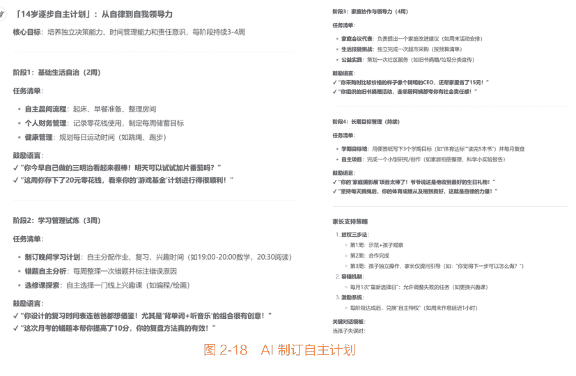

### 边学边做：让 AI 生成“每日责任清单模板”

1）打开 AI 工具（如 DeepSeek），在输入框中输入提示词：
请帮我生成一张适合初中生的“每日责任清单模板”，包括学习、生活、锻炼等内容，并带激励语句。

2）AI 给出示例，如图 2-19 所示。

## 初中生每日责任清单模板

目标：平衡学习、生活与健康 | 打印后贴于书桌/手机壁纸

### 学习任务区

| 任务 | 完成时间 | 完成打钩 |
|---|---|---|
| 1. 数学作业（25分钟） | 18:00-18:25 | □ |
| 2. 英语单词背诵（10分钟） | 18:30-18:40 | □ |
| 3. 整理错题本（15分钟） | 20:00-20:15 | □ |

> 激励语句：
“错题本是学霸的秘密武器！今天又离A+近了一步！”

### 生活自理区

| 任务 | 完成时间 | 完成打钩 |
|---|---|---|
| 1. 整理书桌 | 起床后 | □ |
| 2. 准备次日校服/书包 | 21:00 | □ |
| 3. 帮忙摆餐具 | 晚餐前 | □ |

> 激励语句：
“整洁的环境=清醒的大脑！你正在养成CEO级的好习惯！”

### 健康运动区

| 任务 | 完成时间 | 完成打钩 |
|---|---|---|
| 1. 跳绳/跑步10分钟 | 放学后 | □ |
| 2. 远眺护眼（5分钟） | 作业间隙 | □ |
| 3. 深蹲20次 | 睡前 | □ |

> 激励语句：
“运动时分泌的多巴胺，是天然的快乐魔法！”

### 每日成就墙

今日做得最好的1件事：________________
明日小目标：________________

### 奖励机制：

- 连续3天全勾：兑换30分钟游戏时间
- 连续1周全勾：周末自选一场电影

### 模板使用技巧

1. 个性化调整：用荧光笔标出最重要的3项任务
2. 亲子协作：家长每晚用5分钟和孩子核对清单，只说肯定句（如：“今天错题本整理得很清晰！”）
3. 灵活版本：
    - 电子版：手机备忘录设置提醒
    - 手账版：贴贴纸代替打钩增加趣味性

设计理念：通过可视化完成度+即时激励，让自律变得像“闯关打卡”一样有成就感！


### 2.7.3 孩子手机上瘾怎么办？ AI 制订手机使用协议

#### 1. 为什么孩子总是离不开手机？

“玩一会就好”——结果一晃两个小时过去了；
“写完作业再玩”——结果边写边刷短视频，效率直线下降。
很多家长都有这样的困惑：为什么孩子总是对手机欲罢不能？
其实，手机的“魔力”并不神秘。它提供了即时满足（比如点赞、游戏胜利、短视频刺激），而大脑恰恰对这些东西特别“上头”。尤其是当学习压力大、缺乏情绪出口时，手机就变成了孩子放松的“唯一选择”。
关键问题不在“手机”，而在于缺乏合理的管理和替代方案。
家长的误区：全封杀与完全放任

- “一刀切”地封禁手机：容易引发孩子的反抗心理，甚至出现“偷偷玩”“双机策略”。
- 完全不管：孩子陷入沉迷后，自控能力会越来越差，影响学习与睡眠。
- 建立规则 + 找到替代活动：才是长期可持续的科学做法。
家长可以与孩子一起商量：
我们可以一起制订一个手机使用规则，同时找一些有趣的活动替代刷手机。
你觉得哪些时候特别想玩手机？我们来想些办法转移注意力吧。
我不是要完全禁止你用手机，而是想和你一起找到更好的节奏。

#### 2. AI 如何帮你解决“手机瘾”？

让 AI 帮你生成适合你家情况的“使用协议”。

##### 方法 1：制订“家庭手机使用协议”——把规矩说清楚，说到做到


1）打开 AI 工具（如 DeepSeek），输入提示词：
请帮我制订一份适合初中生的手机使用协议，内容包括：每天使用时长、禁止使用的时间段、违约后的处理方式、家长与孩子共同签署机制。
2）AI 会输出一份清晰、易懂的协议草案，如图 2-20 所示。
3）家长和孩子共同协商后签署，增强孩子的参与感与责任感。

##### 方法 2：“兴趣替代法”——不给手机断网，给生活插花

手机上瘾，很多时候是因为孩子找不到别的好玩的事。家长可以和 AI 一起，为孩子制订个性化的“替代活动清单”。


1）打开 AI 工具（如 DeepSeek），输入提示词：
我的孩子喜欢画画，不太爱运动，喜欢小动物。请帮我列出 10 种可以替代手机的趣味活动，并告诉我怎么引导他尝试这些活动。
2）AI 将根据孩子的兴趣，生成一份“替代方案”列表，比如：参加插画工作坊、和朋友合作创作绘本、到猫舍当志愿者、和 AI 一起设计数字插画角色等。

> 小提示：
- 有趣 + 有成就感 + 有陪伴 = 有效替代！
- 家长可以适当参与其中，增加孩子的参与动力，提升亲子互动质量。

## 初中生手机使用协议

甲方（家长）：________
乙方（孩子）：________
签订日期：________

一、每日使用规则
1. 学习日（周一—周五）
    - 总时长：≤1小时（含社交、娱乐、学习）
    - 分段使用：中午休息20分钟 + 晚上作业后40分钟
    - 禁用时段：
        - 上学前1小时（避免分心）
        - 21:30后（保证睡眠）
        - 吃饭时间（全家无手机时间）
2. 周末/假日
    - 总时长：≤2小时（可分2次使用）
    - 禁用时段：作业未完成前、早晨9点前

二、使用限制
1. 绝对禁止行为：
    - 熬夜玩手机（超时或夜间偷用）
    - 上课/自习期间使用（除非老师要求）
    - 浏览不良信息或充值消费
2. 绿色使用建议：
    - 优先用手机：查单词、看科普视频、听英语
    - 娱乐内容：需提前报备（如游戏类型、短视频主题）

图 2-20 AI 生成初中生手机使用协议

管手机，不如“管好生活节奏”。AI 不是用来监控孩子的，而是用来协助家庭更科学地面对数字世界的挑战。通过“规则 + 替代”的方案，我们不只要让孩子远离手机，更要让他们靠近更丰富、更有趣的生活。

### 2.7.4 孩子情绪低落？AI 告诉家长如何沟通和引导

“为什么我家孩子总是闷闷不乐？”
面对青春期的孩子，家长经常会感到困惑：

- “以前挺活泼的，怎么最近总是一副不开心的样子？”
- “成绩也没退步啊，怎么一说话就烦？”
- “问 TA 发生了什么，只说‘没事’，我到底该怎么办？”

其实，很多孩子并不是不想说，而是不知道怎么说，或者怕说了家长会生气，不理解他们的感受。
情绪没有对错，只是内心正在发出“我需要理解”的信号。
真相提醒：心理健康 ≠ 不难过，而是学会处理难过的情绪。
- 每个人都有情绪低落的时候，尤其是青春期的孩子，情绪波动大是很正常的表现。
- 关键是——我们怎么面对它？是批评、回避，还是陪伴、引导？

#### 方法 1：“情感倾听” ——先共情，再沟通

孩子心里不舒服时，他们需要的不是一个指挥官，而是一个理解者。
AI 可以帮你生成温和有力的“共情对话句式”，让孩子愿意开口说心里话。

##### 边学边做：让 AI 生成共情对话句式

1）打开 AI 工具（如 DeepSeek），输入提示词：
请帮我写几句适合家长对情绪低落的初中生说的共情话语，语言要温和、鼓励、尊重孩子感受。

2）AI 可能会给出这样几句话：

- “我注意到你最近情绪不太好，如果你愿意说，我一直都在。”
- “你不一定要马上解释，我在这里，陪着你。”
- “我也经历过这种情绪低落的时候，我们可以一起想办法缓解它。”

> 小提示：不急着追问、不立刻给建议；用“我”的感受替代“你怎么这样。”：“你怎么这么敏感？”改为“我看到你有点难过，我很想了解你的感受。”

#### 方法 2：“专业咨询” ——不替代，而是加一份力量

如果孩子持续性低落或情绪波动剧烈，甚至影响到了学习和生活，就不能光靠家长自己“扛”了。这时候，心理咨询师或学校心理老师的专业帮助是最温暖的后援。
家长如何引导孩子接受帮助？

##### 边学边做：让 AI 提供引导建议

1）打开 AI 工具（如 DeepSeek），输入提示词：
请帮我设计一段温和的引导语言，让我可以鼓励孩子去寻求心理咨询，而且不让他觉得自己有问题。

2) AI 可能输出：

- “每个人都有需要帮助的时候，这不是你的错。就像身体生病看医生一样，心里难受时也可以找心理老师或医生帮忙。”
- “我们可以先一起了解一下心理咨询是怎么回事，如果你觉得舒服，再决定要不要去。”

试试看！你可以用以下提示词与 AI 对话，获得更适合你的建议：

- “请帮我写几句适合初中生情绪低落时安慰他们的话。”
- “如何引导孩子去接受心理咨询，而不会让他觉得自己‘不正常’？”
- “我该怎么判断孩子是情绪低落，还是可能存在抑郁倾向？”

情绪低落不可怕，被忽视才危险。家长的倾听和理解，是孩子最重要的“心理氧气”。再加上 AI 的帮助和专业支持，你就是孩子坚强的情绪支撑者！

## 2.8 AI 赋能成长
——恪守边界远离过度依赖

随着 AI 越来越“聪明”，越来越多的同学把它当成学习“加速器”——不会的题它秒答，不会写的作文它代笔，甚至还能帮做 PPT！

但问题也悄悄来了——有人用 AI 越学越好，有人却变成“啥都问 AI，一点不动脑”的小懒虫。

所以，AI 到底该怎么用，才能真正帮我们变强？

### 2.8.1 让孩子更好地使用 AI 工具

真正的学习力 = 思考能力 + 工具使用力

家长常见困惑：

- “孩子问作业，AI 三秒钟就答出来，这还能锻炼思维吗？”
- “他天天说查资料，结果都是 AI 写的，自己都没看懂！”
- “AI 答得太快太全，我都怕孩子变懒了。”

别慌！其实 AI 并不是“作弊神器”，只要用得好，它就是你的“超强助学帮手”！

#### 方法 1：前期陪伴指导，别让孩子一上来就“乱飙车”

刚开始使用 AI 时，孩子的专注力和目标感比较弱，很容易“跑题”或瞎玩。这时候家长要像“副驾驶”一样，在旁边及时“纠偏”。

> 小提示：
- 刚开始使用 AI 时，家长可以陪在旁边，一起“练习使用”。
- 当孩子提出模糊问题时，引导他更明确地表达。比如：孩子说“我想预习数学”，你可以帮他一起输入提示词：
我想预习“二元一次方程”，请你用初中生能懂的方式讲解这个知识点。

#### 方法 2：设置 AI 的“使用范围”，防止乱用

AI 这么聪明，如果不给它“限定任务”，孩子很容易越界。

在 DeepSeek 等 AI 工具中输入以下内容，提前设好边界，提示词推荐：

> 我是家长，请帮我规范孩子使用 AI 学习的时间和内容，让他专注完成学习任务。接下来的 30 分钟，请你只回答孩子的学习问题。除了和学习有关的内容，其他问题请不要回答。时间到了请提醒一下。

### 2.8.2 避免孩子患上“AI 依赖症”

如果孩子总是用 AI 帮自己写作业，自己完全不思考，该怎么办？

家长担心：

- “孩子写作业完全不动脑，全靠 AI 完成。”
- “一有难题就去问 AI，连最基本的计算题都不自己想。”
- “作文让 AI 写，自己都看不懂还照抄……”

别怕！使用“五步引导法”，让孩子会用但不沉迷 AI！

#### 第一步：明确核心问题

直接问 AI：

> 孩子写作业老是依赖 AI，不肯动脑，怎么办？

重点：突出“依赖”的问题，而不是“能不能用”的问题。

#### 第二步：描述具体场景

例如提示词：

> 我的孩子只要碰到作业不会做，就直接复制问题给 AI，让 AI 解答。我想引导他先思考再用 AI。

AI 就能更精准地提供建议，比如先思考、再验证、最后复盘的三步法。

#### 第三步：告诉 AI 你期望什么结果

例如提示词：

> 我希望孩子能自主完成作业，同时合理使用 AI 辅助学习，怎么引导更合适？

让 AI 知道你不是要“封杀 AI”，而是要让孩子学会“科学使用”。

#### 第四步：多角度提问，获得更全面方案

例如提示词：

- 家长能做什么？
- 学校可以如何配合？
- 孩子能用哪些方法提高自学力？

多维度提问，有助于打造完整的“AI 使用守则”。

#### 第五步：提供背景信息，个性化建议更到位

例如提示词：

> 我家孩子高一，性格有点内向，不太主动提问。怎么在不打击他的前提下，引导他不要太依赖 AI？

DeepSeek 等工具会根据具体性格、年龄给出更合适的建议。

通过本章的学习，学会了使用 AI 黑科技帮助你提高学习效率，轻松管理时间，制订合理的学习计划，快速提升你的学习效率。

## 第 3 章
得大语文者得天下
——AI 让语文学习更高效

语文作为所有学科的基础，不仅影响考试成绩，更关乎我们的思维方式和表达能力。如何让 AI 成为你的语文学习神器，帮助你提升阅读理解、写作表达、文言文翻译等多方面能力？本章将带你探索 AI 如何助力语文学习，让你轻松掌握语文技能，成为真正的语文高手！

## 3.1 三分钟搞定文言文翻译
——AI 做你的“智能小状元”

面对文言文时，你是不是经常觉得“字认识，但句子看不懂”？现在，AI 可以成为你的“智能小状元”，帮你快速搞定文言文：分析背景、逐句翻译、抓住重点。只要学会正确使用 AI，你的文言文成绩一定能突飞猛进，轻松突破阅读难关！


扫码看教学视频

### 3.1.1 文言文背景揭秘：AI 分析文章创作背景、作者生平及写作目的

文言文就像一扇通往古代的大门，而背景知识就是开锁的钥匙！使用 AI 可以轻松解锁这些知识，让阅读变得更轻松！在学习文言文时，我们往往只关注翻译，而忽略了文章的历史背景、作者的经历和写作目的。这些信息可以帮助我们更好地理解文章的深层含义。

1. 为什么背景知识很重要？
在学习文言文时，如果只关注字词翻译而不了解文章的时代背景和作者的写作目的，可能会误解文章的意思。例如，《出师表》如果不理解三国时期的政局，就很难感受到诸葛亮的忠诚与无奈。因此，使用 AI 的第一步，就是让它帮助我们快速梳理文章的背景信息。

2. 如何使用 AI 查询历史背景？
你可以向 AI 提问，快速获取一篇文章的背景信息，包括：
- 文章的时代背景：文章写于哪个朝代？当时发生了什么重要事件？
- 作者的生平经历：作者是谁？他的性格和经历如何影响这篇文章？
- 写作目的：作者想表达什么思想？写这篇文章的动机是什么？

> 边学边做：用 AI 分析文言文背景

1）打开 AI 工具（如 DeepSeek、KIMI、通义千问、ChatGPT 等）。例如，如果想了解《岳阳楼记》的背景，在输入框中输入提示词：
请介绍《岳阳楼记》的写作背景，包括作者、写作时代、历史背景和写作目的。

2）AI 就会给出详细的回答，如图 3-1 所示。

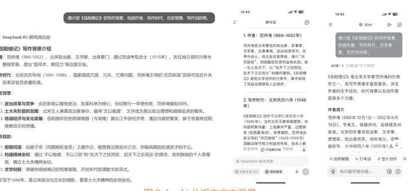

> 小提示：阅读 AI 的回答时，注意以下几点：
- 是否包含文章的朝代、历史背景和写作目的？
- 和课本内容对比，看看是否有遗漏或不同的理解？

通过这些步骤，你可以最大程度地发挥 AI 的作用，在文言文学习中收获更多的理解与乐趣！

### 3.1.2 秒懂古文：AI 逐句翻译文言文，提供现代化解读

用 AI 帮你轻松翻译，让文言文不再是“天书”！
文言文常常让同学们觉得难懂，主要是因为它的表达方式和现代汉语有很大不同。AI 可以帮助我们逐句翻译，保证翻译得既准确又流畅，为我们提供更易理解的现代化解读。

> 边学边做：用 AI 逐句翻译文言文

1）打开 AI 工具（如 DeepSeek），把你想翻译的文言文句子复制到 AI 的输入框中，或者直接在输入框中输入文言文句子，或者手机拍照让 AI 识别文字。以《岳阳楼记》中的一段为例，可以使用这样的提示词：

> 请逐句翻译《岳阳楼记》的这段话，并提供现代化解读：嗟夫！予尝求古仁人之心，或异二者之为，何哉？不以物喜，不以己悲。居庙堂之高，则忧其民；处江湖之远，则忧其君。

2）AI 会逐句翻译，并用现代语言解释，如图 3-2 所示。

> 小提示：
- 在翻译时，注意句子结构，文言文的语序和现代汉语可能会不同。
- AI 有时会提供多个翻译版本，你可以选择最适合自己理解的版本。

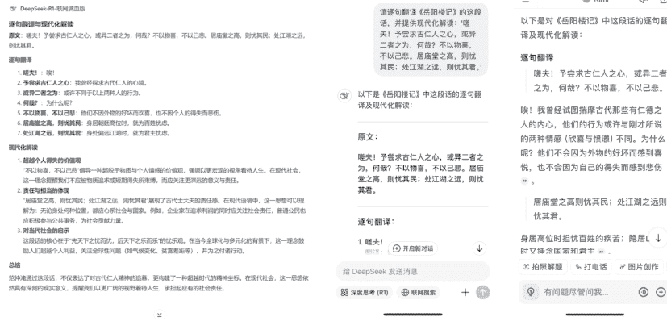

通过这些步骤，你可以轻松理解文言文，让文言文变得更亲近，提升自己的语文能力！

### 3.1.3 快速掌握重点：AI 提炼常见文言文现象

文言文中有很多特殊的语言现象，比如古今异义、通假字和固定句式。这些知识点非常重要，但也容易让人混淆。而 AI 可以帮助你快速找到这些重点内容。

文言文中有许多让人头疼的特殊用法，例如：
- 古今异义：比如“左右”，在古文中表示“身边的人”，而在现代汉语中是“方向”。
- 通假字：比如“夫大国，难测也”中的“测”通“策”，表示“谋划”。
- 固定句式：比如“虽有佳肴，弗食，不知其旨也”是典型的“假设关系”句式。

如何让 AI 自动分析文言文中的特殊现象？
AI 可以自动帮你找出文章中的这些现象，并解释它们的用法。

> 边学边做：让 AI 分析文言文

1）打开 AI 工具（如 DeepSeek），在输入框中输入或复制下面的提示词：
请帮我分析《岳阳楼记》这一段的文言知识，包括古今异义、通假字和特殊句式：不以物喜，不以己悲。居庙堂之高，则忧其民；处江湖之远，则忧其君。

2）AI 会列出所有的重点内容，还会解释它们的意思，如图 3-3 所示。

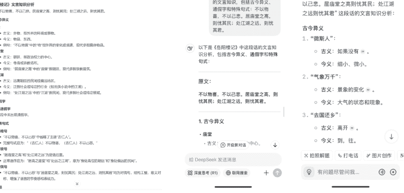

> **小提示：**
- 做文言文练习时，可以让 AI 帮你总结重点，节省复习时间。
- 尝试自己归纳，然后对比 AI 的回答，看看哪里可以改进。
- 自己再找几个例子，看看能否找到类似的文言现象。这样不仅能加深记忆，还能锻炼你的分析能力。

通过这些方法，你可以更有效地利用 AI 来理解文言文中的特殊现象，提升自己的学习效果，轻松应对考试！

**AI任务卡：** 用 AI 翻译一段课本文言文，并分析其写作背景

任务要求：
搜索“2024 年普通高等学校招生全国统一考试北京语文试卷”。找到“二、本大题共 5 小题，共 18 分。阅读下面文言文，完成各题。”
要求分析写作背景和文言现象，采用分栏对照的形式给出文言文的解释，对试题逐项分析，并给出正确答案。

## 3.2 阅读提分技巧
——AI 解析文章结构，轻松拿高分

阅读理解是不是你的“老大难”？面对长篇文章，总是抓不住重点？看到阅读理解题目，不知道从哪儿下手？别担心，AI 可以成为你的“阅读教练”，帮助你学会快速分析文章，提升答题准确率，让你的阅读理解不再靠运气，而是有章可循！

### 3.2.1 文章解剖术：AI 帮你分析文章结构

**1. 什么是文章解剖术？**
所谓“解剖”，就是把文章分成不同的部分，弄清它的层次结构，再找到作者的核心思想。

**2. 阅读理解的核心是什么？**

所有的阅读理解题最终都要围绕“文章结构”和“中心思想”展开。许多同学读完一篇文章后，脑子里一片空白，完全不知道作者在说什么；或者考试时，明明文章已经读完，却不知道从哪里下手。这其实是因为你没有掌握文章的结构！但是，文章的结构其实是有规律可循的。

一般来说：
- 记叙文（讲故事，如小说、散文）：主要分为开头、发展、高潮和结尾，需要关注人物、事件和情感变化。
- 说明文（介绍事物，如科普文章）：主要分为总—分—总结构、分类说明和举例说明，需要关注说明方式。
- 议论文（表达观点，如评论、社论）：主要分为提出问题、分析问题和解决问题，需要关注论点、论据和论证方法。

**3. 如何让 AI 帮你分析文章结构？**

你可以让 AI 自动拆解文章的结构，然后总结每个段落的大意，提取文章的核心信息。


1）选择一篇阅读理解文章，复制文章内容。
2）打开 AI 工具（如 DeepSeek），在输入框中输入或将下面的提示词复制到输入框中：
请分析这篇文章的类型结构，然后提炼每个段落的大意，并总结全文主旨。
原文：（把原文粘贴到这里）
例如，拆解朱自清的《背影》，可以在输入框中输入提示词：
请分析《背影》的文章结构，并总结每个段落的大意。
3）AI 会自动分析文章的逻辑结构，并总结段落大意，如图 3-4 所示。

试试看！找一篇课内或课外的阅读理解文章，在 AI 工具中输入提示词，让 AI 帮你分析文章结构！

通过这些方法，你不仅能掌握文章的结构，还能轻松地理解文章内容，提高阅读理解能力，顺利拿下高分！

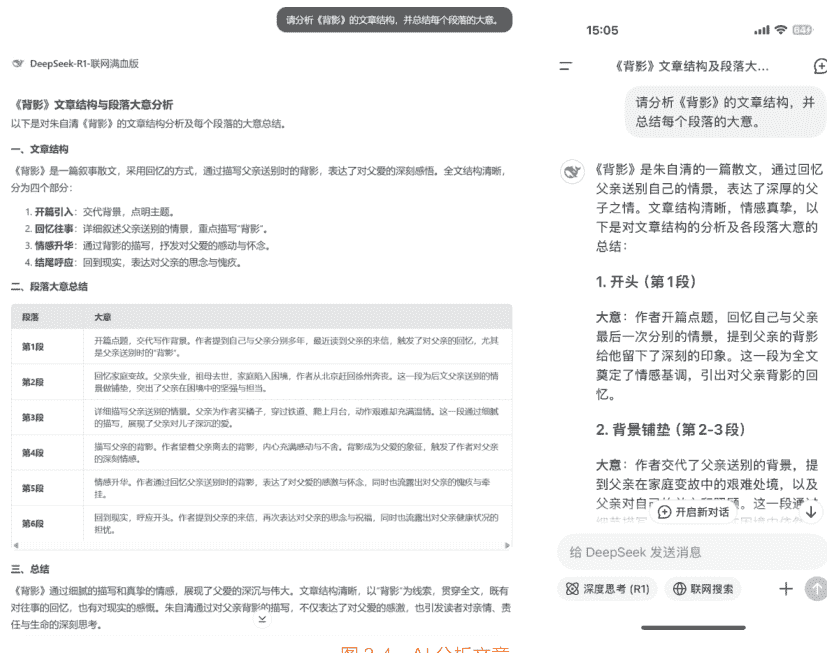

### 3.2.2 阅读理解满分技巧：用 AI 总结答题模板

1. 为什么阅读理解题容易丢分？
阅读理解不仅仅是看懂文章，还要会答题。实际上，阅读理解的答题有固定的套路！只要掌握答题模板，再结合 AI 的帮助，答题的正确率就会大大提高！

2. 阅读理解的常见题型
阅读理解题的常见题型通常包括：主旨概括题、细节理解题、词句理解题、人物分析题、写作手法题、情感态度题。

3. 用 AI 总结答题模板
AI 不仅能帮你分析文章，还能总结出每种题型的答题模板。我们可以用 AI 生成不同题型的答题公式，并直接应用到试题中。

> 边学边做：用 AI 总结不同题型的答题模板

1）打开 AI 工具（如 DeepSeek），让 AI 帮你总结不同题型的答题方法，输入提示词：

> 请总结高中语文阅读理解题的常见题型，并提供标准答题模板。

2）AI 会给出对应的答案和模板，如图 3-5 所示。

| 题型 | 答题模板 |
| :--- | :--- |
| 主旨概括题 | 文章通过……（简要概括内容），表达了……（中心思想），体现了……（深层含义）。 |
| 细节理解题 | 根据文章内容，……（具体细节）发生在……（时间/地点），表现了……（人物/事件特点）。 |
| 词句理解题 | 这句话/词语在文中起到了……（作用），表达了……（含义），突出了……（主题/情感）。 |
| 人物分析题 | 文中的人物……（具体行为/语言），表现出……（性格特点），反映了……（心理/情感）。 |
| 写作手法题 | 作者运用了……（写作手法/修辞手法），增强了……（表达效果），突出了……（主题/情感）。 |
| 情感态度题 | 作者/人物对……（事件/现象）的态度是……（具体态度），通过……（具体内容）表现出来。 |

图 3-5 用 AI 总结答题模板

**AI任务卡：用 AI 分析一篇阅读理解，提升你的信息提取能力**

任务要求：
- 让 AI 帮你分析一篇阅读理解的文章结构和主旨。
- 让 AI 提供标准答案。
- 学习如何提取信息，提高答题准确率。

## 3.3 作文变身秘籍
——AI 助你突破写作瓶颈


AI 是你的作文“助推器”！它可以帮你整理作文素材、规划作文结构、优化语言表达，甚至智能批改作文，让你的文章脱胎换骨，轻松拿高分！

### 3.3.1 作文“万能”素材库：AI 帮你一键整理

1. 为什么作文素材很重要？
在考试中，阅卷老师常常会看到千篇一律的作文。如果你的文章能引用名言佳句、历史故事和优美段落，内容会显得丰富多彩，还能提升文章的思想深度，让阅卷老师眼前一亮！

2. 如何让 AI 帮你整理作文素材？

> 边学边做：让 AI 整理作文素材

1）选择一个作文主题，比如“梦想”。
2）打开 AI 工具（如 DeepSeek），输入提示词：
我是一名高一学生，请为我提供关于“梦想”的作文素材，包括名人名言、优美段落和经典故事。
3）AI 会提供一系列相关的素材，你可以选择适合你文章风格的部分进行运用，如图 3-6 所示。

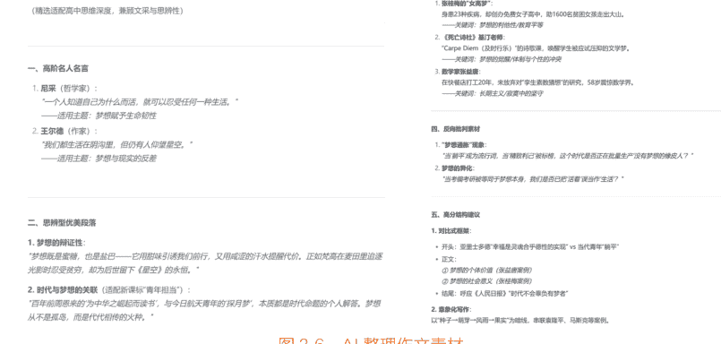

通过这些方法，你可以丰富你的作文素材，把写作变得更轻松有趣，帮助你在考试中取得更好的成绩！

### 3.3.2 作文结构规划：AI 帮你生成作文提纲

1. 为什么作文结构很重要？
一篇好的作文，结构清晰、层次分明，能让阅卷老师迅速抓住重点。优秀的作文往往遵循“黄金结构”，常见的作文结构包括：
- “总—分—总”结构：开头提出观点，中间展开分论点，最后总结升华。
- 并列式结构：围绕主题展开多个角度，如现象 + 原因 + 影响 + 对策。
- 对比式结构：先展示反面，再展示正面，或者对比两种观点。
- 递进式结构：层层深入，先浅后深，比如问题 + 分析 + 解决方案。

2. AI 如何帮你规划作文结构？
AI 能根据作文主题，自动生成作文提纲。通过合理的分段和过渡句，确保作文具有较好的逻辑性和层次感。

> 边学边做：让 AI 生成作文提纲

1）打开 AI 工具（如 DeepSeek），输入作文题目，让 AI 帮你拟定提纲。可以用下面的提示词：
我是一名初二学生，请以“我的理想”为作文题目生成一个作文提纲，包括开头、主体段落和结尾。

2）AI 会给出一个详细的提纲，包括：
- 开头：引入理想的意义，引用名言“理想是人生的灯塔”。
- 主体段落 1：理想的定义及其重要性。
- 主体段落 2：自己理想的具体内容，为什么选择这个理想。
- 主体段落 3：为实现理想需要克服的困难，以及如何努力。
- 结尾：总结理想的重要性，强调实现理想的决心。

3）阅读 AI 生成的提纲，理解结构安排，选择适合的结构，然后开始着手写作。
4）你也可以继续向 AI 提问，让 AI 补充细节，使文章更丰富。

> 小提示：提纲只是大致的框架，写作时可以根据需要进行调整，保持文章的流畅自然。

通过这些方法，你可以更有效地规划作文结构，让你的写作更有条理，轻松拿到高分！

### 3.3.3 语言润色与优化：用 AI 提升文章感染力

**1. 为什么要优化语言？**

作文的语言表达水平也是决定作文分数高低的重要因素之一。如果句式单一、词汇贫乏，就很难拿到高分。AI 可以帮助你：
- 修改句子，使表达更生动。
- 替换重复的词汇，增强文章的层次感。
- 加入修辞手法，让文章更有文采。

**2. AI 如何帮你润色语言？**

> 边学边做：用 AI 润色作文

1）打开 AI 工具（如 DeepSeek），选择自己写的一段作文，要求 AI 优化句子，增强表达效果。可以使用以下提示词：

> 我是初二学生，请润色以下句子，使句式表达更生动，语言更具表现力。
原文：他每天练习跑步，最后取得了好成绩。

2）AI 会提供多种润色版本，你可以选择最适合自己的风格，如图 3-7 所示。

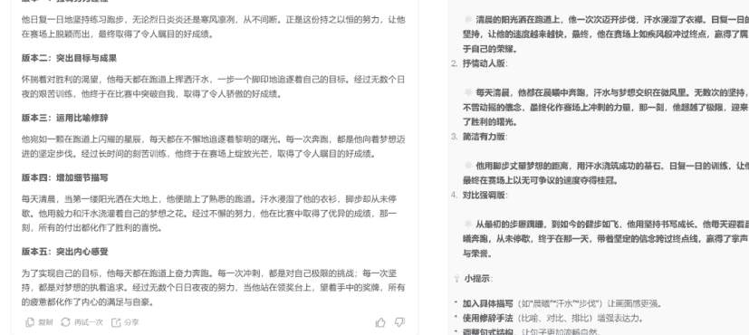

> 小提示：在润色时，可以让 AI 提供多种不同的表达方式，看看哪个最符合你的写作风格。

### 3.3.4 AI 作文批改 + 评分：按照考试标准提供修改建议

AI 如何帮你批改作文？
- 检查语法错误
- 给出评分（按照考试标准）
- 提供修改建议

> 边学边做：让 AI 按照考试标准批改作文

1) 写一篇作文。
2) 打开可以上传图片的 AI 工具（如豆包等），把作文拍照上传，AI 可以识别手写。
3) 输入提示词，并让 AI 用你所在年级的作文评分标准批改。
请根据高考作文评分标准批改照片中的作文，指出语法和表达问题，给出评分，并提供修改建议。
4) AI 会根据评分标准对你的作文进行全面分析，并给出评分和修改建议。AI 会提供评分：
- 内容评分：作文是否紧扣主题，展开得是否充分。
- 语言评分：语言是否简洁生动，句式是否丰富多样。
- 结构评分：逻辑是否清晰，段落安排是否合理。
5) 根据 AI 的反馈进行修改，提高自己的作文水平。

**AI任务卡：用 AI 整理素材写一段作文并进行修改**

任务要求：
- 让 AI 帮你整理关于“坚持的力量”的作文素材。
- 用这些素材自己写一段作文并用 AI 进行润色。
- 让 AI 帮你批改和优化作文。
- 对比自己的原文和 AI 的修改建议，找到可以优化的内容并重新修改。

## 第 4 章
数学从此不再难
——AI 让解题更简单

告别数学难题，AI 让你轻松搞定每一道题目！无论是基本运算还是复杂方程，AI 都会在你身边，随时为你提供详细指导，帮助你突破难关，提升数学成绩！

## 4.1 24 小时家教随时待命
——AI 让你成为数学小天才


扫码看教学视频

AI 就像你随时可以召唤的超级数学助手，帮助你解决每一个难题，让你真正成为数学小天才！

### 4.1.1 分步解析复杂问题：让 AI 用苏格拉底提问法引导思考

什么是“苏格拉底提问法”？
苏格拉底提问法是一种通过提问来引导思考的学习方式，而不是直接给出答案。例如，当你遇到一道数学难题时，AI 不会立刻告诉你答案，而是会一步一步地问你关键问题，让你自己推导出解法，这能有效培养你的数学思维！

AI 如何运用苏格拉底提问法帮助你分步解题？

> 边学边做：利用 AI 分步解析复杂问题

1）打开 AI 工具（如 DeepSeek、KIMI、通义千问、ChatGPT 等），让 AI 帮你分解思路，可以使用以下提示词：
请用苏格拉底提问法帮我解答这道数学题，让我一步步推导出答案。
题目：2x+3=7
2）AI 会给出详细的回答：
AI 提问：这个方程中有哪些部分？未知数是什么？
3）思考 AI 的问题，以此训练自己的逻辑推理能力。
AI 提问：我们的目标是什么？
4）继续思考 AI 的问题，逐步完成解题过程，理解每个步骤的意义，如图 4-1 所示。

通过 AI 的逐步提问，你不仅找到了答案，而且在整个过程中，AI 帮助你理解了每一步的逻辑和步骤，让你更加深刻地理解了方程的解法。

试试看！对于二次函数求解，已知抛物线 y=x²-4x+3，求其顶点坐标和与 x 轴的交点。

**用苏格拉底提问法解答数学题**

题目：
解方程：
$2x + 3 = 7$

**苏格拉底提问法解析步骤**

第一步：理解方程
AI提问：这个方程中有哪些部分？未知数是什么？
你的回答：方程由 $2x$、$+3$ 和 $=7$ 组成，未知数是 $x$。

第二步：明确目标
AI提问：我们的目标是什么？
你的回答：目标是求出 $x$ 的值。

第三步：分析方程结构
AI提问：方程 $2x + 3 = 7$ 中，$2x$ 和 $+3$ 分别代表什么？
你的回答：$2x$ 是未知数的系数项，$+3$ 是常数项。

第四步：移项
AI提问：如何将常数项移到等式的另一边？
你的回答：将 $+3$ 移到等式右边，变为 $-3$，即：
$2x = 7 - 3$

第五步：计算右边
AI提问：$7 - 3$ 等于多少？
你的回答：$7 - 3 = 4$，所以方程变为：
$2x = 4$

第六步：求解 $x$
AI提问：如何求出 $x$ 的值？
你的回答：将等式两边同时除以 2，即：
$x = \frac{4}{2}$

第七步：计算最终结果
AI提问：$\frac{4}{2}$ 等于多少？
你的回答：$\frac{4}{2} = 2$，所以：
$x = 2$

第八步：验证答案
AI提问：如何验证 $x = 2$ 是否正确？
你的回答：将 $x = 2$ 代入原方程，检查是否成立。
验证过程：
$2(2) + 3 = 4 + 3 = 7$
符合原方程 $2x + 3 = 7$，所以答案正确。
最终答案
方程的解为：
$x = 2$

总结
通过苏格拉底提问法，我们一步步推导出方程的解。这种方法不仅能帮助你理解解题思路，还能让你更好地掌握数学知识！


你可以用以下提示词：
请用苏格拉底提问法帮助我解题：已知抛物线 $y=x^2-4x+3$，求其顶点坐标和与 x 轴的交点。

### 4.1.2 突破解题盲点：用 AI 分析解题错误，找出易错点

**1. 什么是“解题盲点”？**

解题盲点是指在解数学题时，因为思维定式、知识漏洞或粗心大意导致的错误或困惑点。常见的盲点包括误解题意、漏掉关键条件、计算错误，以及不会灵活运用公式等。

AI 可以帮你：
- 分析解题过程，找出你的错误点。
- 解释错误原因，告诉你哪里理解错了。
- 提供正确解法，让你避免重复犯错。

**2. AI 如何帮你分析错误，突破解题盲点？**

> 边学边做：用 AI 分析解题错误原因

1）打开 AI 工具（如 DeepSeek），输入你的解题过程和解出的答案，让 AI 检查你的步骤。可以使用以下提示词：
请帮我检查这道数学题的解答过程，并指出可能的错误。
我的解题过程：解方程 $2x+3=5x-6$

步骤 1：将 5x 移到方程的左边，将 3 移到方程的右边，得到 2x - 5x = -6 + 3。
步骤 2：合并同类项，得到 -3x = -3，然后得 x = 1。

2）AI 会分析你的解题过程，指出错误的地方，并解释为什么错了，如图 4-2 所示。

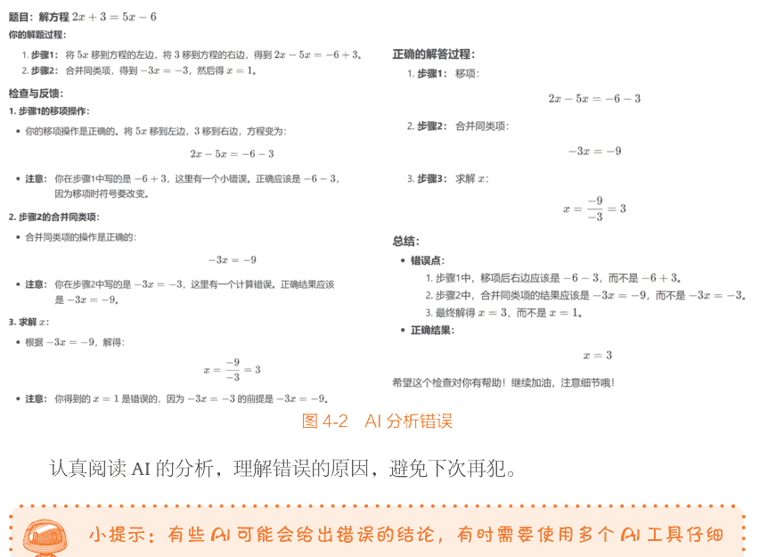

认真阅读 AI 的分析，理解错误的原因，避免下次再犯。

> 小提示：有些 AI 可能会给出错误的结论，有时需要使用多个 AI 工具仔细进行甄别和验证。

试试看！把你的解题过程输入到 AI，看看有没有错误。如果有，认真理解错误的原因，提升自己的解题能力！

## AI任务卡：让 AI 带你解析复杂数学题

任务要求：

- 通过 AI 逐步解题，掌握解题思维。
- 让 AI 检查你的答案，分析错误点。
- 归纳解题经验，提升数学能力。

## 4.2 多种解题思路
——一题多解，拓宽数学思维


扫码看教学视频

数学题就像一座迷宫，有时候一条路走不通，换一条路可能就能豁然开朗！让 AI 提供多种解法，帮助你打开数学世界的大门，找到最快、最优的解题路径。

### 4.2.1 不同方法解同一道题：用 AI 找到多种解题路径

同一道题目，不同的解法可以带来不同的思考角度。通过代数方法，我们可以快速得到一个精确的结果，而通过几何方法，则能帮助我们更直观地理解问题的结构。接下来我们一起通过一个具体的例子，看看如何使用代数和几何两种方法来解同一道题。

任务题目：已知直角三角形的两条直角边长度分别是 3 和 4，求斜边的长度。

> 边学边做：用 AI 探索同一道题的不同解题方法

1. 打开 AI 工具（如 DeepSeek），在输入框中输入提示词：
   已知直角三角形的两条直角边长度分别是 3 和 4，求斜边的长度。
2. AI 通常会给出代数解法，使用勾股定理来解题。
3. 输入提示词：
   这道题还有其他解法吗？
4. AI 会列出不同的解题方法，比如代数方法和几何方法，并详细分析每种方法的优缺点，帮助你选择最适合的方法。
5. 你可以选择一种方法，让 AI 详细解释每一步。

试试看！用 AI 探索多种解法，你可以输入以下提示词：

> 请帮我用不同的方法解这道题：已知直角三角形的两条直角边长度分别为 3 和 4，求斜边的长度。请提供至少两种不同的解法，并详细解释每种方法的步骤。

通过这些方法，你可以更全面地理解数学问题，提升自己的解题能力，让数学变得更加轻松有趣！

### 4.2.2 思维训练：对比不同方法，找出最快最优解

每种解题方法都有它的优缺点。代数方法通常更直接、更系统，但有时候可能会显得繁琐；几何方法则更直观、更形象，但需要较强的空间想象能力。通过对比不同方法的优缺点，我们可以找出最适合当前问题的解题路径。

任务题目：解方程 $x^2-5x+6=0$。

#### 边学边做：用 AI 采用各种方法解方程

1) 打开 AI 工具（如 DeepSeek），在输入框里输入提示词：
解方程 $x^2-5x+6=0$，分别使用不同的方法解方程，对比各种方法的优缺点，给出最快最优解。
2) AI 会列出不同的解题方法，提供每种方法的优缺点、方法对比和最优解，如图 4-3 所示。

方法1：因式分解法（最快最优）
步骤：
1. 观察方程 $x^2-5x+6=0$，尝试将其因式分解。
2. 找两个数，使得它们的和为 -5，积为 6，这两个数是 -2 和 -3。
3. 因式分解：
$(x-2)(x-3)=0$
4. 令每个因式等于零：
$x-2=0$ 或 $x-3=0$
5. 解得：
$x=2$ 或 $x=3$
答案：$x=2,3$
优点：快速直接，适用于容易因式分解的二次方程。
缺点：不是所有方程都能因式分解，比如 $x^2-2x+1.5=0$ 这种情况。

方法2：公式法（通用解法）
求解一元二次方程的一般公式：
$x=\frac{-b\pm\sqrt{b^2-4ac}}{2a}$
对于方程 $x^2-5x+6=0$，这里 $a=1, b=-5, c=6$。
步骤：
1. 计算判别式：
$\Delta=b^2-4ac=(-5)^2-4(1)(6)=25-24=1$
2. 代入求解公式：
$x=\frac{-(-5)\pm\sqrt{1}}{2(1)}$
$x=\frac{5\pm1}{2}$
3. 计算结果：
$x=\frac{5+1}{2}=\frac{6}{2}=3$
$x=\frac{5-1}{2}=\frac{4}{2}=2$
答案：$x=2,3$
优点：适用于所有一元二次方程，不需要因式分解。
缺点：计算过程较繁琐，需要计算判别式和使用平方根运算。

方法3：配方法（适用于某些特殊方程）
配方法的思路是将方程写成平方的形式再求解。
步骤：
1. 写出方程：
$x^2-5x+6=0$
2. 将常数项移到右侧：
$x^2-5x=-6$
3. 取 -5 的一半，平方后加到两边：
$x^2-5x+\left(-\frac{5}{2}\right)^2=-6+\left(-\frac{5}{2}\right)^2$
$x^2-5x+\frac{25}{4}=-6+\frac{25}{4}$
$\left(x-\frac{5}{2}\right)^2=\frac{1}{4}$
4. 取平方根：
$x-\frac{5}{2}=\pm\frac{1}{2}$
5. 求解 $x$：
$x=\frac{5}{2}\pm\frac{1}{2}$
$x=3$ 或 $x=2$
答案：$x=2,3$
优点：适用于一些特殊形式的方程，比如当系数不容易因式分解时。
缺点：计算量较大，特别是当系数不是整数时，运算容易出错。

方法对比：

| 方法 | 适用情况 | 计算量 | 优缺点 |
| :--- | :--- | :--- | :--- |
| 因式分解法 | 适用于可因式分解的二次方程 | 最少 | 快速简便，但只适用于特定方程 |
| 公式法 | 适用于所有二次方程 | 中等 | 通用，但计算较繁琐 |
| 配方法 | 适用于特殊形式的方程 | 较大 | 有时很方便，但计算复杂 |

最优解：因式分解法（最简单快捷）。如果无法因式分解，使用公式法。

图 4-3 用不同的方法解方程

试试看！你可以输入提示词，要求 AI 给出不同的详细解答，并找出最优解。比如，对于 2023 年高考数学全国卷Ⅰ的题目：

已知函数 $f(x) = \sin x + \cos x$，求函数 $f(x)$ 在区间 $[0, \pi]$ 上的最大值和最小值。

通过对比不同解法，你可以更灵活地应用数学知识，提升解题能力，让学习变得更加轻松！

### 4.2.3 举一反三：让 AI 生成相似题目，精准练习

学会了一种解题方法后，最好的巩固方式就是多做几道类似的题目。现在，我们可以利用 AI 来生成相似的题目，帮助我们更好地理解和掌握解题技巧。

任务题目：已知函数 $f(x) = \sin x + \cos x$，求函数 $f(x)$ 在区间 $[0, \pi]$ 上的最大值和最小值。生成相似题目。

边学边做：让 AI 生成相似数学题

1) 打开 AI 工具（如 DeepSeek），在输入框中输入提示词：
请生成与下面数学题相似的 3 道题目：已知函数 $f(x) = \sin x + \cos x$，求函数 $f(x)$ 在区间 $[0, \pi]$ 上的最大值和最小值。
2) AI 会给出三个与给定题目相似的数学题，如图 4-4 所示。
通过这些相似题目的练习，你能够灵活运用解题方法，进一步提高解题效率！

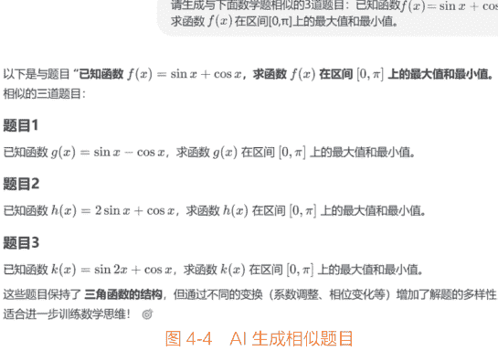

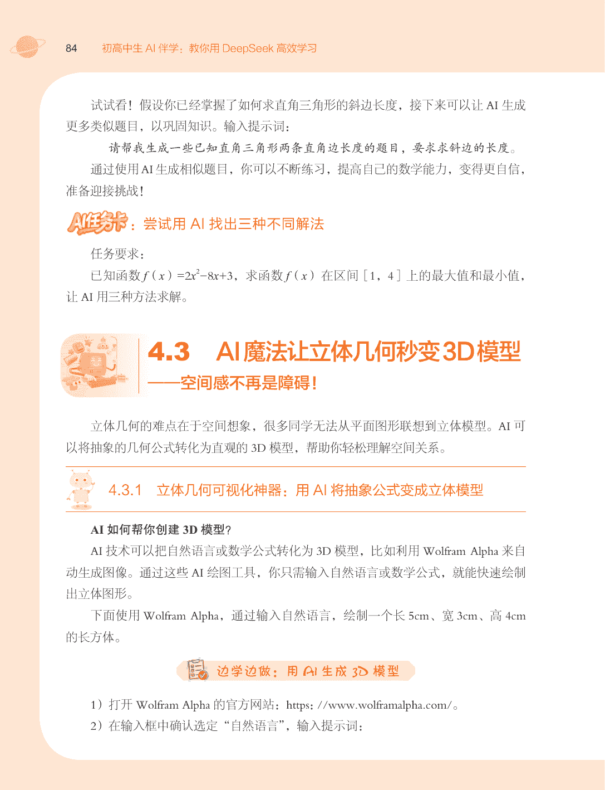

绘制一个长方体，长 =5cm，宽 =3cm，高 =4cm。

3）查看 AI 绘图的结果，同时显示其他属性，如图 4-5 所示。

Wolfram Alpha 是一个基于计算知识引擎的智能问答系统，由 Wolfram Research 公司开发。与传统搜索引擎（如 Google）不同，它通过结构化数据和算法直接生成问题的答案，广泛应用于教育、科研和商业领域。


试试看！使用 Wolfram Alpha 绘制一个圆柱体，设定高 =15cm，直径 =10cm。

通过这些方法，你可以运用 AI 实现立体几何的可视化，轻松掌握空间的概念，让数学学习变得更加直观有趣！

### 4.3.2 用 AI 创建几何模型，观察它的不同视角

立体几何不仅仅是学习公式，更重要的是动手操作和观察。通过 AI，你不仅可以学习公式，还可以亲自创建几何模型，观察它们的空间特性。

**如何使用 AI 软件生成模型？**

你可以使用 GeoGebra 来创建 3D 图形。在 GeoGebra 中，只需输入简单的绘图指令，就能生成立体模型。

#### 边学边做：用 AI 创建几何模型

使用 GeoGebra 创建 3D 图形主要有两个步骤：首先使用 DeepSeek 等 AI 对话工具生成绘图指令并复制，然后把生成的绘图指令粘贴到 GeoGebra 中生成图形。

1）打开 AI 工具（如 DeepSeek），在输入框中输入提示词：
我要在 GeoGebra 中生成球体的体积，能动态改变球的大小，请给出具体的 GeoGebra 提示词，步骤要清晰，提示词要可以运行。

2）AI 会提供相关的提示词，如图 4-6 所示。

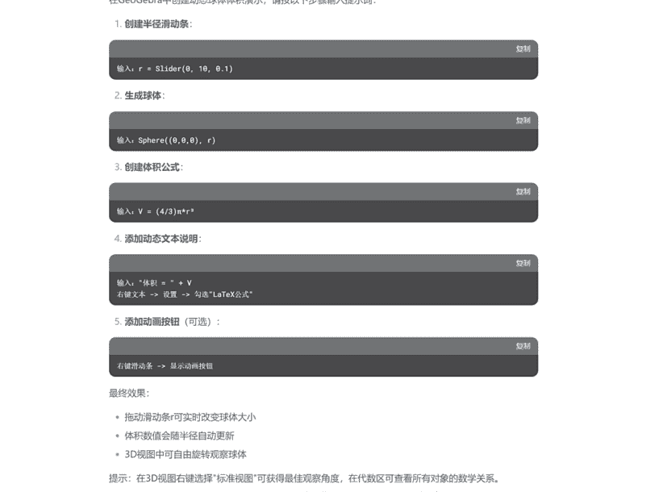

3）打开 GeoGebra 官网：https://www.geogebra.org/3d。

4）在 3D 绘图界面的输入框中，按照步骤输入 AI 给出的提示词，每输入完成一步按 Enter 键（分别输入 1、2、3 中的提示词）。

5）所有步骤完成后，拖动滑动条改变半径，观察球体的大小变化，同时计算球体的体积，如图 4-7 所示。

6）旋转模型，观察其不同视角。

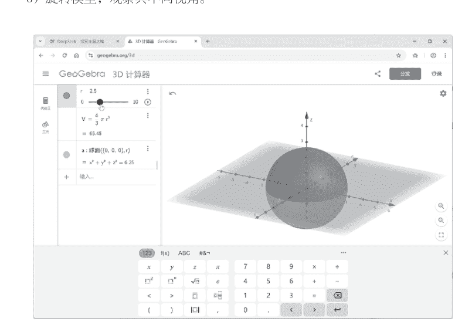

GeoGebra 是一款在线数学工具，支持几何、代数、微积分和概率等多种数学分支。它由美国数学家 Markus Hohenwarter 于 2001 年创立，旨在通过动态数学的方式帮助学生更好地理解和学习数学。

> 小提示：有些 AI 可能会给出错误提示词，可以尝试使用不同的 AI 工具和多次提问。

试试看！在 GeoGebra 中生成一个三棱锥（四面体）的 3D 模型，并让它可以通过拖动滑动条改变大小，如图 4-8 所示。

AI 技术就像一位魔法师，让你的空间感从“零基础”到“超能力”，使得立体几何不再是难题！

## Complete GeoGebra Commands in English

Here are the complete commands that can be directly run in GeoGebra:

1. Create the slider:
   Slider(a, 1, 10, 0.1)
2. Plot the vertices:
   A = (0, 0, 0)
   B = (a, 0, 0)
   C = (a/2, a*sqrt(3)/2, 0)
   D = (a/2, a*sqrt(3)/6, a*sqrt(6)/3)
3. Draw the faces:
   Polygon(A, B, C)
   Polygon(A, B, D)
   Polygon(A, C, D)
   Polygon(B, C, D)

By following these steps, you can create a dynamic 3D model of a tetrahedron in GeoGebra and change its size by dragging the slider.

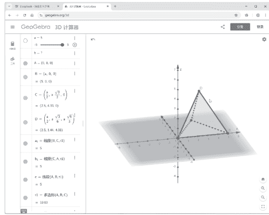

图 4-8 在 GeoGebra 中生成一个三棱锥

# 第 5 章
快速变身英语达人
——AI 让你的英语能力飞跃提升

想要快速提升英语能力？让 AI 成为你的小伙伴，帮你轻松掌握单词，优化作文，提升听力和口语！不管是基础学习还是进阶挑战，AI 都能帮助你轻松过关，变身英语达人！

## 5.1 超级单词记忆法
——AI 让背单词变简单


背单词是学习英语的基础，但很多人都会遇到这样的问题：今天背了几十个单词，明天就忘得差不多了；好不容易记住了，过几天再看又变成了陌生词……别担心，AI 来帮忙！

### 5.1.1 智能记忆规划：结合艾宾浩斯记忆曲线背单词

**你知道艾宾浩斯记忆曲线吗？**
这是一个超级有效的记忆法则，它告诉我们什么时候背单词能记得更牢。现在，AI 会根据这个法则，为你量身打造背单词计划。合理安排时间，让记忆更加持久。
如何让 AI 结合艾宾浩斯记忆曲线，自动生成最佳背单词时间表？


1. 打开 AI 工具（如 KIMI）。
2. 如果使用自己的单词表，手机拍照单词表，上传到 AI 工具。
3. 告诉 AI 你的要求，在输入框中输入提示词：
   请识别照片中的单词，帮我生成一份单词记忆表，并依据艾宾浩斯记忆曲线制订一个背单词计划。
4. AI 会识别照片中的单词，根据艾宾浩斯记忆曲线，为你生成一个背单词时间表，如图 5-1 所示。
5. 按照计划复习：每天按照 AI 生成的时间表复习单词，让记忆效果事半功倍。

试试看！如果用具体的单词表（AI 会搜索到），结合艾宾浩斯记忆曲线，自动生成最佳复习时间表。可以用以下提示词：

- 请生成人教版初中七年级下册第二单元的所有英语单词，并给出最佳学习记忆的单词表和时间表。
- 为英语词汇量薄弱的高中生设计 3 个游戏化记忆方案。

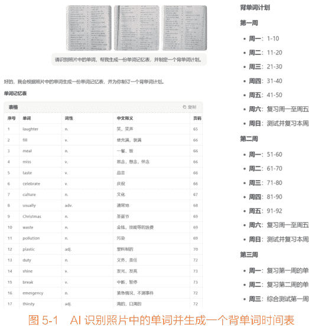

### 5.1.2 单词联想记忆：AI 解析单词，让单词更好记

1. 记单词总是很枯燥？
那是因为你还没有找到正确的方法。AI 可以帮你解析单词的词根和词缀，让你理解单词的构成。同时，它还会给出生动的例句，帮助你在语境中记住单词。

2. AI 如何帮你联想记忆？
AI 会解析单词的词根、词缀，并提供生动例句来帮助你记忆。

> 边学边做：用 AI 解析英语单词

1）打开 AI 工具（如 DeepSeek），挑选一个你觉得难记的单词，在输入框中输入提示词：
请解析单词 biology 的词根、词缀，并提供生动例句。
2）AI 会解析该单词，显示词根、词缀和例句，帮助你更好地联想记忆，如图 5-2 所示。

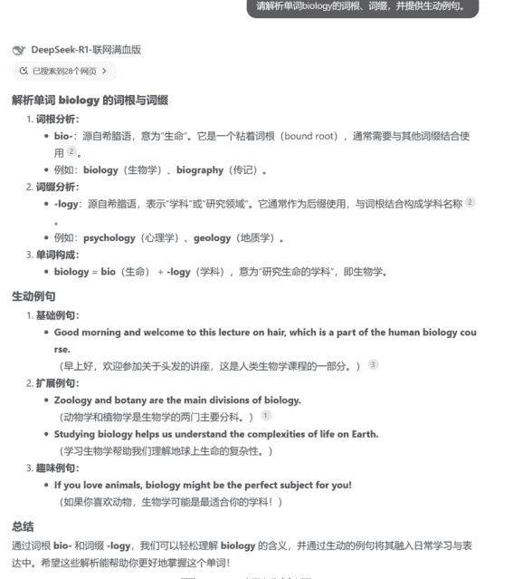

试试看！

- 让 AI 解析单词 unbelievable。
- 让 AI 帮你找出 5 个带 “pre-” 的单词，并用它们造句。

通过这种方法，你可以轻松记住单词，并增强你的词汇量，让英语学习变得更加有趣和高效。

### 5.1.3 会讲故事的单词：用单词创作趣味对话和文章

1. 为什么“死记硬背”容易忘？

很多同学背单词时，会遇到这些情况：背了几个小时，第二天全忘了；单词会读、会写，但一到写作文或做题就用不上；背单词像啃“硬骨头”，没有趣味性，学得痛苦。

其实，词汇只有放到“语境”里，才最容易被真正掌握。你可以借助 AI，把单词变成有趣的对话和文章，让它们“活”起来，记得更牢。

2. AI 是怎么帮你“把单词变成故事”的？

趣味对话生成：AI 根据你输入的单词，生成一段角色对话，让你看到单词在真实交流中的用法。

语境短文创作：AI 将指定单词融入一篇小短文，帮助你理解词义、用法和搭配。

情景关联记忆：通过“故事 + 人物 + 冲突 + 情节”，让单词不再孤零零，而是变成生动的“小演员”。

#### 方法 1：输入一组单词，生成有趣对话


1）打开 AI 工具（如 DeepSeek），输入提示词：
请用这 10 个单词编写一个有趣的对话：adventure, forest, mysterious, flashlight, scared, whisper, shadow, map, scream, treasure。
角色：两个小学生在夜晚的森林中探险。
对话要求：自然、连贯、有情节。
2）AI 输出结果，如图 5-3 所示。
一段对话中，10 个单词全部自然出现。你不仅记住了词，还理解了“怎么用”。

#### 方法 2：输入单词，生成短文故事

1）打开 AI 工具（如 DeepSeek），输入提示词：
请用这 10 个单词创作一篇 100 词左右的英文短文，并在文后用中文解释每个单词：volcano, erupt, lava, village, evacuate, danger, rescue, shelter, warning, safe。
2）AI 输出短文，如图 5-4 所示。

你可以告诉 AI 设置特定场景（如“教室对话”“家庭聚会”“宇航员登陆火星”），它会让单词更有画面感。

可以要求 AI 在文中对重点单词做标注（如加粗或上色），帮助你记忆。

不懂的词汇可以让 AI 附带英文解释或中英文对照表，加深理解。

对话标题：《月光森林的密语》
角色：小智（大胆好奇）、小美（谨慎胆小）

【场景】
深夜的森林被月光笼罩，树影婆娑。两个小学生举着手电筒，盯着一张泛黄的地图。

小智：（兴奋地晃动flashlight）“Look! The map shows the treasure is near that old tree! This adventure is awesome!”

小美：（紧抓小智的袖子）“But... this forest feels so mysterious... Did you hear that whisper?”（突然指向远处）“Ah! A shadow moved!”

小智：（故意压低声音）“Maybe it's the treasure guardian... OOOOOH—”（突然模仿怪物声）

小美：（screams）“Stop! I'm too scared! Let's go back—”

小智：（大笑）“Just kidding! Look, the 'shadow' was an owl!”（举起flashlight照向树梢）But... wait...（突然愣住）Why does the map suddenly show a red X here?”

小美：（颤抖）“That wasn't there before... Whispering IS real!”（两人对视一眼，同时尖叫着跑出森林）

单词应用亮点：

1. 情节转折：从“假恐怖”（小智恶作剧）到“真诡异”（地图变化），用shadow和whisper制造悬念。
2. 角色反差：小智的冒险精神（adventure/treasure） vs 小美的胆小（scared/scream）。
3. 道具点睛：flashlight和map推动剧情，最终成为恐怖伏笔。

如果需要更幽默或更恐怖的版本，可以告诉我调整哦！

图 5-3 用指定单词生成对话

The Volcano's Wrath

The sleepy village near Mount Koa woke to a loud warning: the volcano would erupt! Fiery lava began flowing down the slopes as people rushed to evacuate. “It's too dangerous here!” cried a farmer. Rescue teams guided families to a shelter on higher ground. Hours later, the mountain grew quiet. Though homes were damaged, everyone was safe. As the sun set, the villagers hugged each other—they had survived nature's fury together.

单词解释：

1. volcano (n.) 火山
2. erupt (v.) 喷发
3. lava (n.) 岩浆
4. village (n.) 村庄
5. evacuate (v.) 疏散
6. danger (n.) 危险
7. rescue (v./n.) 救援
8. shelter (n.) 避难所
9. warning (n.) 警告
10. safe (adj.) 安全的

故事亮点：用火山爆发串联所有单词，展现危机→救援→安全的过程，最后强调“团结”的温暖结局

图 5-4 用指定单词生成短文

试试看！输入下面的提示词：

请用以下单词创作一篇校园生活小短文：homework, teacher, playground, bell, explain, mistake, recess, discuss, help, succeed。

请用以下 10 个单词写一段有趣的侦探对话，并在每个句子后用中文翻译：detective, clue, suspect, mystery, alibi, evidence, crime, search, secret, truth。

通过这样的“对话 + 故事”训练法，单词不再是死板的记忆对象，而是你故事里的“主角”。背单词，也可以轻松、有趣，让人忘不了。

## 5.1.4 扩展词汇量：AI 生成单词联想网络

1. 一个单词能联想到多少内容？远超你想象！

我们在背单词时，常常孤立地记忆一个词，记完就忘。但其实，一个单词的“朋友圈”非常庞大。它可能有多个同义词、反义词，还和很多短语搭配、常见句型有关。如果能把这些内容一网打尽，记住这个词就变得容易多了！这时候，AI 就可以帮我们“织网”啦！

2. AI 怎么帮你扩展一个单词的联想词汇网络？

AI 可以像“思维导图”一样，为你展开一个单词的全部内容，包括：

- 同义词：意思接近的词，帮你丰富表达。
- 反义词：意思相反的词，加深理解。
- 相关短语搭配：常见的固定搭配和常用句型。
- 场景例句：展示这些词在真实语境中的用法。
- 拓展词：和这个单词意思、语境相关的词，比如词根、近义家族等。

3. 如何用 AI 构建单词网络？

边学边做：用 AI 构建单词联想网络

1）打开你常用的 AI 工具（如 DeepSeek 等），输入提示词（你也可以修改适合自己的表达）：

> 请帮我构建一个关于单词“bright”的联想词汇网络，包括：同义词和反义词、常见搭配短语、不同语境下的英文例句、同词根或近义拓展词。

2）AI 输出结果，如图 5-5 所示。

你还可以把这些内容复制到 Xmind 或其他思维导图工具中，把 “bright” 做成一个 “词网”！

> **小提示：**
> * 如果你觉得内容太多，可以加一句：“请分点简洁列出，适合初中生阅读。”
> * 联想网络不需要一次全记住，但可以帮助你从多个角度理解一个单词，提高记忆效率。
> * 多用几个不同场景的单词测试，你会发现 “词汇量扩展” 其实也能变成 “词汇游戏”！

### 词汇联想网络：bright

核心词义：明亮的；聪明的；欢快的

### 1. 同义词 & 反义词

| 类别 | 单词 | 中文释义 |
| :--- | :--- | :--- |
| 同义词 (光线) | shiny | 闪亮的 |
| | radiant | 光芒四射的 |
| | luminous | 发光的 |
| 同义词 (智力) | intelligent | 聪明的 |
| | clever | 机灵的 |
| | sharp | 敏锐的 |
| 反义词 (光线) | dark | 黑暗的 |
| | dim | 昏暗的 |
| 反义词 (智力) | dull | 愚钝的 |
| | stupid | 愚蠢的 |

### 2. 常见搭配短语

- **bright light/sun** 明亮的光线/阳光
- **bright future** 光明的未来
- **bright smile** 灿烂的笑容
- **bright colors** 鲜艳的色彩
- **bright idea** 聪明的点子

### 3. 多语境例句

**① 光线/颜色：**
- The **bright** morning sun woke me up.（明亮的晨光唤醒了我。）
- She painted the wall in **bright** yellow.（她把墙刷成了亮黄色。）

**② 智力：**
- The **bright** student solved the puzzle quickly.（这个聪明的学生很快解开了谜题。）

**③ 情绪：**
- His **bright** laughter filled the room.（他欢快的笑声充满了房间。）

### 4. 词根拓展 & 近义网络

词根：-bright-（光） → **brighten** (v. 变亮), **brightness** (n. 亮度)

近义网络：
- **Light-related:** glow, gleam, sparkle
- **Intelligence-related:** brilliant, wise, smart
- **Emotion-related:** cheerful, lively, vibrant

### 可视化联想图


记忆技巧：想象一个灯泡💡——既发光（物理亮度），又象征灵感（智力亮度）！

图 5-5 AI 生成单词联想网络

试试看！请尝试使用 AI 生成以下单词的联想词汇网络：

- create
- important
- energy
- change

试着将它们的同义词、短语和例句整理出来，做成自己的“词汇导图墙”！
一个单词不只是一个词，而是一整个“词汇宇宙”。用 AI 展开它的“朋友圈”，不仅能让你词汇量飞速扩展，还能让你在写作和口语中“词汇丰富度”飙升！

## AI任务卡：用 AI 定制你的专属单词卡片

任务要求：

- 使用 AI 定制专属的单词卡片（如中考高频词）。
- 生成互动 HTML 页面，让卡片在页面上显示单词、解释、例句等信息。
- 能够翻转查看详细信息，帮助你更高效地学习和记忆单词。

## 5.2 英语作文变形计
——AI 让你的文章更高级


扫码看教学视频

写英语作文时，你是否遇到过这些问题？
语法错误不断，词汇量有限，表达总是很基础，文章平淡无奇，缺乏亮点。别担心！AI 来帮忙！让你的作文从“简单句”变身为“高分作文”。

### 5.2.1 语法与表达优化：AI 自动检查错误，提供优化建议

如何通过 AI 优化语法和表达？
AI 能够自动分析你的作文，检查以下内容：

- 检查拼写和语法错误。
- 提出更准确的单词和短语建议。
- 让句子结构更加清晰流畅。

边学边做：用 AI 检查英文句子

1）打开 AI 工具（如 DeepSeek），在输入框中输入原句：
检查错误并优化：She going to the park every day for exercise.

2）AI 会自动识别语法错误、拼写错误和用词不当，并给出优化建议，如图 5-6 所示。

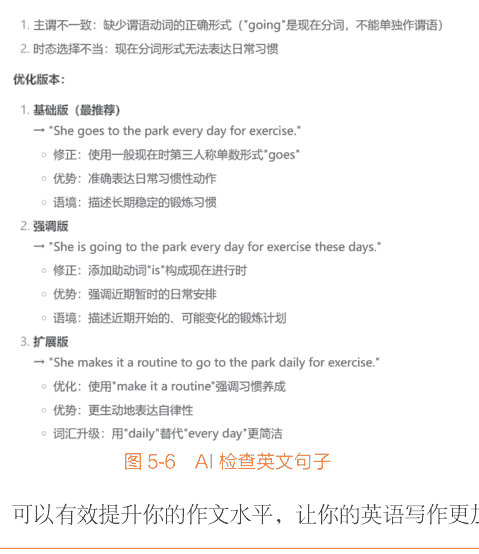

通过这些方法，可以有效提升你的作文水平，让你的英语写作更加精彩和高效。

### 5.2.2 AI 润色：让你的英语作文更流畅、更高级、更有感染力

#### 1. 什么是 AI 润色？

AI 润色是通过 AI 工具对原文进行优化，使其语言更流畅、表达更高级、情感更丰富。

#### 2. AI 润色哪些内容？

- 句式优化：将简单句改为复合句或复杂句，提升文章的层次感。
- 词汇升级：用更高级的词汇替换普通词汇，增加文章的亮点。
- 情感增强：通过调整语气和用词，让文章更具感染力。

#### 3. 如何通过 AI 润色你的英语作文？

边学边做：让 AI 对英语作文进行润色

1）打开 AI 工具（如 DeepSeek），在输入框中输入提示词和原文：
请修改以下段落，让表达更高级。原文：I felt happy when I saw my friend.We talked and had fun.

2）AI 会通过润色，将简单的句子转化为更具表现力的表达，同时使用更地道的词汇和生动的描述，如图 5-7 所示。


试试看！假设你写了这样一句话：
The cat is on the table.
看看 AI 会怎样润色。

> 小提示：
> ● 尝试理解 AI 为什么提出这样的建议，这可以帮助你提高写作技巧。
> ● 不要害怕尝试新的表达方式，这会让你的作文更加独特！

通过这些方法，你可以利用 AI 的帮助，让你的英语写作更加流畅和吸引人，轻松提升作文水平！

## AI任务卡：用 AI 帮你修改英语作文，让表达更出彩

任务要求：

- 让 AI 帮助你修改英语作文，要求 AI 检查语法、拼写和表达的错误。
- 让 AI 提供润色版本，并分析优化点。

## 5.3 听力、口语随时练
——高效提升英语听说能力

听不懂、说不准？
AI 帮你随时随地练习听力和口语，让 AI 成为你的私人听说教练，轻松变身英语达人。

### 5.3.1 多题材听力训练：用 AI 生成多种题材的听力资料

1. 为什么需要多题材听力训练？
提升听力能力需要接触多种题材的音频，包括日常对话、学术讲座、新闻报道和影视剧等。AI 可以快速生成丰富多样的听力材料，帮助你适应不同场景的英语听力。

2. 如何用 AI 生成多种题材的听力资料？

边学边做：用 AI 生成听力材料

1）打开 AI 工具（如 DeepSeek），在输入框中输入提示词：
生成一段关于购物的英语对话，时长 1 分钟。
2）AI 按要求给出对话，如图 5-8 所示。


图 5-8 AI 生成英语听力材料

3）AI 工具通常有语音播放功能（包括 PC 端和手机端），你可以单击小喇叭图标播放语音。

4）听完对话后，可以回答相关问题，以检查你的听力理解是否准确，在输入框中输入提示词：

> 为了检查听力理解能力，请给出上面对话的相关英文练习题，选择题（三选一题），共 5 道题。

5）AI 给出结果，如图 5-9 所示。

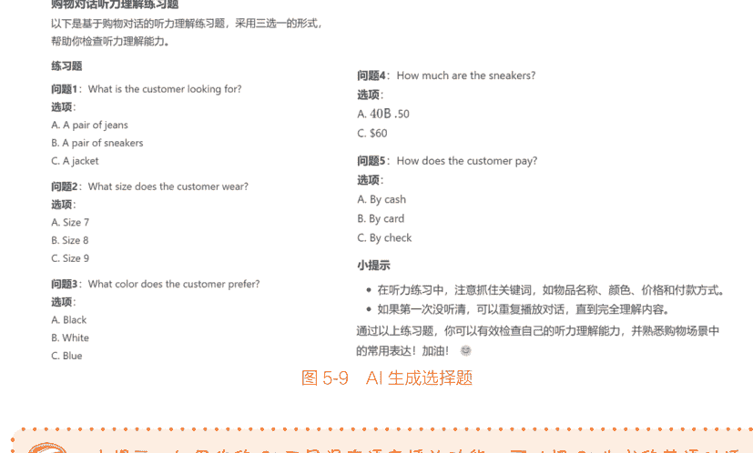

> 小提示：如果你的 AI 工具没有语音播放功能，可以把 AI 生成的英语对话复制，并粘贴到文字转语音软件中。

试试看！请用 AI 生成一段关于“借橡皮”的听力材料，输入提示词：

> 请生成一段 1 分钟左右的英语对话，主题是“借橡皮”，语速适中（120 词/分钟），包含初中核心词汇。要求：
> 1. 标注生词解释。
> 2. 生成配套选择题（3 题）。

### 5.3.2 个性化练习：让 AI 根据你的听力水平螺旋式调整听力难度

1. 什么是螺旋式听力练习？
很多同学在听力学习上遇到瓶颈，原因往往是听力材料要么太简单，要么太难。AI 能根据你的听力水平，自动调整难度，让你循序渐进地提高。

2. 如何生成听力材料？

> 边学边做：用 AI 生成适合自己水平的听力材料

1）打开 AI 工具（如 DeepSeek），在输入框中输入自己的听力水平，比如使用以下提示词：
我能听懂基本的英语日常对话，但新闻听不太懂，请生成适合我的英语听力材料。
2）AI 会生成适合你的听力材料，并逐步提高难度。
3）你可以标记材料的难度（“太简单”“刚刚好”“太难”），AI 会根据你的反馈动态调整。

3. 如何进行听力训练？
适合初学者的听力训练软件有每日英语听力、Audacity、VOA Learning English 和 BBC News for Kids 等。你可以使用这些软件进行听力训练。

> 小提示：
> ● 不要害怕听不懂，坚持每天听一点。
> ● 重点听关键词和句型，不用逐字逐句翻译。
> ● 利用 AI 反馈系统，找出你的听力薄弱点。

通过这些方法，你可以有效提高自己的听力水平，让你的英语学习更加轻松和有效。

### 5.3.3 场景化对话训练：用 AI 模拟多种真实情境进行口语对话

1. 为什么模拟对话重要？
在真实的英语交流中，你需要迅速反应、组织语言，而不是在脑海中翻译。通过 AI 模拟真实场景对话，比如在机场办理登机、在餐厅点餐、购物砍价、酒店预订、医院就诊、和朋友进行日常对话，能够帮助你提升口语能力。

#### 2. 如何使用 AI 进行场景化口语对话训练？

> 边学边做：用 AI 进行场景化口语对话训练

1）选择一个对话场景，例如在餐厅点餐。AI 将扮演服务员，你来点单，AI 会通过文本和音频模拟对话，与之互动。
2）打开 AI 工具（如 DeepSeek），在输入框中输入提示词：
用 AI 模拟“在餐厅点餐”的真实英语对话情景，AI 模拟服务员，我来点餐，练习如何用英语点菜和与服务员交流。结束后，AI 评估我的回答并提出建议。
3）AI 开始对话，你回答 AI 服务员的提问。
4）点餐对话结束后，AI 会实时评估你的回答，并给出建议。
5）如果想查看 AI 的标准答案，可以输入提示词：
请给出标准的完整英语点餐对话，包括服务员与顾客的典型互动。

试试看！每天练习一个场景，尝试不同的表达方式。

### 5.3.4 智能发音纠正：用 AI 提高发音水平

#### 1. 为什么纠正发音很重要？

标准的发音让交流更加顺畅。很多人在说英语时，音调不自然，导致对方听不懂。而 AI 可以智能分析你的发音，找出问题并提供优化方案。

#### 2. 如何练习发音？

适合初学者的发音训练软件有 ELSA Speak、Duolingo（多邻国）、流利说等。这些 APP 具有 AI 模拟真实听力场景、智能对话和纠正发音的功能，可以帮助你进行发音训练。

> 小提示：
> ● 慢慢地、清晰地朗读，不要急于求成。
> ● 模仿 AI 的语音示范，直到你的发音接近标准。
> ● 注意连读、弱读和重音，使语调更加自然。

## AI任务卡：和 AI 进行一次 3 分钟全英文对话

任务要求：

- 让 AI 扮演你的同学，和你用英文讨论电影《肖申克的救赎》。
- 进行 3 分钟的英文对话，结束后给出评价建议。

> 小提示：
> - 不要害怕犯错，勇敢开口才是关键。
> - 利用 AI 的反馈来改进表达，不断优化口语能力。
> - 每天坚持 3 分钟，你的口语会有质的飞跃！

## 5.4 英语阅读技巧
——读懂长难句，不再一脸懵


扫码看教学视频

英语长句不再难，让 AI 帮你拆解每个难点，助你高效提取关键信息。

### 5.4.1 难句拆解：让 AI 分析复杂句子的语法结构

1. 为什么长难句让人头疼？
在阅读英语文章时，我们经常会遇到句子很长、结构复杂的情况，比如有多个从句、被动语态和倒装结构等。这些都可能让我们一眼看过去就“懵”了。

2. AI 如何拆解长难句？

- 分析语法结构：AI 会自动识别句子的主语、谓语、宾语，以及句中的从句和修饰成分，帮助你理解句子的基本构成。
- 分段解析：AI 会将句子拆解成若干小部分，逐步解释每个部分的意思，帮助你整体理解句子的含义。
- 提供简化建议：AI 会用更简单、直白的方式重新组织句子，帮助你更好地掌握句子的意思。

#### 3. 如何通过 AI 拆解长难句？

边学边做：用 AI 分析英文句子结构

1）打开 AI 工具（如 DeepSeek），在输入框中输入提示词：
请用颜色标注下面的英文句子，主句用蓝色，定语从句用绿色，非限定性从句用橙色，并给出简化后的句子。
原文：The girl who sits next to me in class, whom I met on the first day of school, is very friendly.

2）AI 给出结果，如图 5-10 所示。

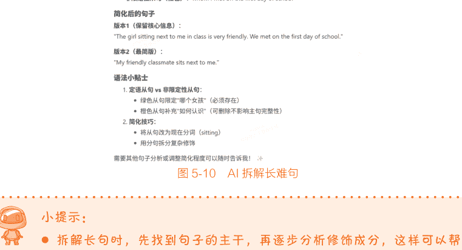

图 5-10 AI 拆解长难句

> 小提示：
> ● 拆解长句时，先找到句子的主干，再逐步分析修饰成分，这样可以帮助你理清句子的结构。
> ● 通过将复杂句子简化成更易懂的形式，可以帮助你更好地理解句子的含义。

试试看！请尝试分析以下句子的结构：
The book that I borrowed from the library, which was written by a famous scientist, is very interesting.
通过这些方法，你可以更有效地理解英语中的长难句，提升自己的阅读能力，减少理解上的困惑！

### 5.4.2 文章逻辑梳理：让 AI 找出主旨句、段落关系、核心论点

1. AI 如何梳理英文文章的逻辑结构？

- 找出主旨句：AI 可以帮助你识别文章中的主旨句，这些句子通常概括了文章的中心思想或者段落的核心内容。
- 分析段落关系：AI 会帮助你分析不同段落之间的逻辑关系，告诉你每个段落在文章中的作用（例如引入、展开、总结）。
- 总结核心论点：AI 会帮助你总结文章的核心论点，帮助你理解作者的观点和立场。

2. 如何通过 AI 梳理文章的逻辑结构？

边学边做：用 AI 分析英文文章结构

1）打开 AI 工具（如 DeepSeek），在输入框中输入提示词：
梳理下面文章的逻辑关系，用 [1] 标出主旨句，用 [2] 连接段落关系，用 [3] 标注核心论点。
英文原文：Global warming is one of the biggest challenges facing our planet. It causes rising sea levels, extreme weather, and loss of biodiversity. Scientists believe that human activities, such as burning fossil fuels, are the main cause of this issue.

2）AI 会给出文章的主旨、段落之间的关系以及文章的核心论点。
试试看！自己找一篇英文短文，尝试让 AI 分析文章的结构，标出每段的主题句，绘制文章逻辑图，并提供摘要。

通过这些方法，你可以快速梳理文章的逻辑结构，更好地理解文章的内容和作者的意图，提升阅读技巧。

### 5.4.3 阅读速度提升：让 AI 设计速读训练任务

1. 什么是速读？

速读并不是“跳过内容”，而是以高效的方式获取关键信息。常用的方法包括：

- 扫读（skimming）：快速浏览文章，获取主旨。
- 跳读（scanning）：寻找特定信息，如数字、日期和关键词。

#### 2. AI 如何帮你训练速读？

AI 可以：

- 计时阅读，帮你提高阅读速度。
- 提问测试，确保你抓住了重点信息。
- 个性化训练，根据你的进度调整难度。

#### 3. 如何通过 AI 设计速读训练任务？

> 边学边做：用 AI 进行英语速读训练，提升阅读能力

1）准备一篇文章，或者让 AI 为你生成一篇英文速读文章。如果让 AI 生成，打开 AI 工具（如 DeepSeek），在输入框中输入提示词：

生成一篇关于科技创新的英文文章，要求高中一年级水平，阅读时间 30 秒。

2）让 AI 设计速读训练任务，在输入框中输入提示词：

请对上面英文文章设计 3 个英文问题。

3）回答 AI 的问题，AI 会反馈你是否正确回答了问题。你可以在输入框中输入提示词：

下面是我对你问题的回答，请判断是否正确，并给出解释。

问题回答：（这里是问题回答）

通过这些方法，你可以有效提升自己的阅读速度和信息获取能力，让学习变得更加高效，轻松应对各种阅读材料。

## AI任务卡：用 AI 解析一篇英文长文

任务要求：

- 选择一篇英文文章，上传到 AI 平台。
- 让 AI 帮助你分析句子结构。
- 让 AI 生成文章摘要。
- 进行速读训练，提升阅读速度。

## 5.5 英语语法魔法屋
——搞懂规则，表达更顺畅

再也不怕语法题！AI 变身语法小老师，让“时态”“语态”“非谓语”等语法知识通通秒懂！

## 5.5.1 AI 语法雷达：找出句子中的语法雷区

1. 为什么语法总是容易出错？
在写英语句子时，有时候我们明明会单词，也知道大概句式，但写出来的句子总是被老师标红。这是因为英语语法有很多细节容易忽略，比如时态搭配、主谓一致、冠词遗漏、句式重复等。这些语法“雷区”一不小心就踩中。

2. AI 如何帮你发现并修正语法错误？
AI 就像一位“语法雷达探测器”，可以快速扫描你的句子，发现错误，并告诉你哪里错了、为什么错了，还会教你怎么改。

3. AI 可以做什么？
- 自动检测语法错误：包括时态、拼写、冠词、动词形式、连接词使用等常见问题。
- 逐句讲解错误原因：不仅指出“错在哪里”“为什么错”“该怎么改”，还配上详细解释，帮助你理解背后的语法点。
- 提供优化建议：推荐更自然、更地道的表达方式，让你写的句子更高级。

4. 如何用 AI 查找语法错误？

> 边学边做：用 AI 查找英语语法错误

1）打开 AI 工具（如 DeepSeek），输入提示词：
请帮我检查这句话的语法，指出错误、解释原因，并给出修改后的句子。
句子：Although he is very tired, but he still finished his homework.
2）AI 输出结果，包括错误（连词重复、时态问题）和修改后的句子等内容，如图 5-11 所示。

原句分析：
句子：
Although he is very tired, but he still finished his homework.
错误：
1. 连词重复：英语中不允许同时使用两个连词（although 和 but）连接同一个句子，因为它们的功能相同（都表示转折）。
   - × 错误结构：Although... but...
   - ✓ 正确结构：Although... ...（或 ... but...）
2. 时态问题：
   - “finished”（过去式）与前半句的现在时（“is tired”）不一致。根据语境，建议统一时态（如都用过去时）。
修改后的句子（两种正确表达）：
1. 保留 although，删除 but（更正式）：
   Although he was very tired, he still finished his homework.
   - 解释：过去时（was/finished）统一，且只用 although 表示让步。
2. 保留 but，删除 although（更口语化）：
   He was very tired, but he still finished his homework.
   - 解释：用 but 连接两个分句，时态一致。

> 小提示：
- AI 不仅能帮你改对句子，还能“顺便”教你语法知识，改正一次错误就能掌握一个知识点。
- 遇到自己写的句子不确定是否正确时，及时交给 AI 帮你检查。

试试看！请把下面的句子输入 AI，让它帮你检查语法错误并解释：
She don't likes ice cream because is too cold.
你能提前找出几个错误吗？试试让 AI 来验证一下你的判断！
通过“AI 语法雷达”练习法，不仅能帮你快速消灭错误句子，还能帮你巩固语法知识，真正做到“写一句、学一条”，语法能力稳步提升！

## 5.5.2 语法知识情景解析：让抽象变生动

1. 为什么语法规则难理解？
学习英语语法时，我们经常会看到抽象又绕口的术语，比如“现在完成时”“宾语从句”“被动语态”……光看定义就头晕，更别说掌握了。其实，很多语法现象都是我们生活中经常发生的场景，只是我们没有将它们和语法联系到一起。
2. AI 如何把语法讲“动”起来？
AI 不仅能讲解语法规则，还能配合情景模拟，把一个语法点变成你“眼前的故事”。

3. AI 可以做什么？
情景模拟：让语法知识点“住”进对话里，通过角色对话，看它在真实交流中是如何被运用的。

4. 如何用 AI 生成语法情景讲解？

边学边做：通过 AI 生成情景辨析语法区别

1）打开 AI 工具（如 DeepSeek），输入提示词：
请用情景脚本的方式，解释英语中“现在进行时”和“一般现在时”的区别，并举一个校园生活场景的例子。

2）AI 给出情景脚本，如图 5-12 所示。
试试看！尝试输入提示词，生成一段“语法情景小剧本”：
请用情景脚本形式讲解“被动语态”和“主动语态”的区别，设定场景是食堂吃饭。

你还可以加上角色名、对话语气，让讲解更有趣哦！

通过语法情景和场景演练，抽象规则就不再是冷冰冰的文字，而是能看、能演、能体验的知识。语法，也可以很有“画面感”。

## 5.5.3 AI 语法对比神器：轻松搞懂易混语法

1. 为什么总是被“长得像”的语法搞晕？
英语语法里，有很多“长得像”的概念，比如：
- 一般现在时与现在进行时
- 动词不定式与动名词
- which vs that
- 被动语态与主动语态

这些语法知识点，常常长得相似、用法接近，一不留神就容易混淆。别担心，让 AI 帮你来一场“语法大 PK”。

2. AI 是怎么做语法对比的？
概念拆分：AI 可以用表格形式将两个语法点的定义、用法、例句清晰地呈现出来。
使用场景分类：AI 帮你找出它们在真实语境下各自常见的“出场位置”。
错题分析：如果你提交一组错题，AI 还能告诉你“你是在哪种题型中混淆这两个知识点的”。

AI 不仅能解释，还能生成一组【“一眼看错”的易混淆题】，训练你的“辨别能力”。

边学边做：如何请 AI 做语法对比？

1）打开 AI 工具（如 DeepSeek），输入提示词：
我总是分不清“动名词”和“不定式”的区别。请用表格对比这两个语法点，包括定义、用法、常见动词搭配、例句，并给出三道选择题训练我。
2）AI 返回语法对比表，并给出练习题，如图 5-13 所示。

> 小提示：
- 输入时尽量明确两个语法点（如“主语从句与宾语从句”）。
- 要求 AI 用“例句 + 表格 + 训练题”三位一体的形式呈现，更易掌握。
- 遇到错题时，也可以说“我这道题为什么会错？是不是和另一个语法点混了？”——AI 会帮你找出“混淆源”。

### 动名词 (Gerund) vs. 不定式 (Infinitive) 对比表格

| 对比项 | 动名词 (V-ing) | 不定式 (to + V原形) |
| :--- | :--- | :--- |
| 定义 | 动词的名词形式，表示行为或状态 | 动词的原形，常带 to，表示目的或将来 |
| 核心功能 | 作主语、宾语、表语（强调事实或习惯） | 作主语、宾语、表语（强调目的或可能性） |
| 常见动词搭配 | enjoy, avoid, finish, practice, mind | want, decide, hope, plan, refuse |
| 例句 | Swimming is fun. (作主语) | To swim is my goal. (作主语) |
| | I enjoy reading. (作宾语) | I want to read this book. (作宾语) |
| 特殊规则 | 介词后必须用动名词 (think about doing) | 部分动词后只能用不定式 (agree to do) |

### 三道选择题训练

1. She avoids ____ junk food.
A. eat
B. to eat
C. eating
答案：C（avoid 后接动名词）

图 5-13 AI 做语法对比

试试看！输入提示词：
请为我设计一个小对话，句子中要分别使用动名词和不定式，并在每句后标注语法点。
请用图表方式对比“过去完成时”和“过去进行时”的区别，并附上例句和练习题。
我做题总是分不清“will”和“be going to”，请帮我对比它们的用法和适用场景，并出一组练习题。
通过 AI 做语法“正面对决”，你会发现——原来被混淆的点，其实一点都不难。只要方法对，AI 就能帮你快速建立清晰的语法对照库。

## 5.5.4 语法专项训练营：个性化 AI 练习

1. 为什么语法题总是错？
很多同学觉得语法题像“挖坑”：选项都长得差不多，总选错。其实，语法题没有那么难，通过 AI 帮你“查漏补缺、精准练习”，就可以攻克语法难题！

2. AI 如何定制语法练习题？
AI 就像你的“私人出题老师”，可以：
- 分析你的弱点：你输入错题或不懂的语法点，AI 就知道你卡在哪。
- 定制训练计划：比如“每天三题现在完成时、两题被动语态”。
- 生成多种题型：选择题、填空题、改错题、连线题全都有。

### 边学边做：用 AI 生成个性化语法练习题

1）打开 AI 工具（如 DeepSeek），输入提示词：
我是一名初二学生，正在学习宾语从句。请根据我的水平生成 3 道选择题、2 道句子改错题，并附上答案和解析。
2）AI 生成内容，如图 5-14 所示。

> 小提示：
- 可要求 AI 根据“教材同步内容”出题，练习更贴近课本。
- 错题也可以输给 AI，让它“反向出题”，重点突破你的语法盲区。

试试看！输入提示词：
请根据我近三次模拟考中错得最多的语法点（宾语从句、时态、非谓语动词），为我生成一份周训练计划，每天 5 题，附解析。
让 AI 当你的“私人语法教练”，每天练一点，提升大一点。

图 5-14 AI 生成语法练习题

## 5.5.5 AI 语法对话馆：语法点 + 场景化对话练习

1. 为什么语法总记不住？
因为我们很多时候是“孤立地”学语法，像背公式一样背语法规则，没有真正理解语法的运用。其实是为了表达。如果你能在“对话”中练习语法，它就不再是枯燥的“死规则”。

2. AI 如何带你“用”语法？
- 场景化训练：把语法点放进真实对话，比如“在餐厅点餐用现在进行时”“描述经历用现在完成时”。
- 角色扮演：你扮演一个角色，和 AI 进行对话练习，边用边学。
- 纠错 + 反馈：说错了没关系，AI 会指出并解释正确表达。

### 边学边做：用 AI 生成语法点 + 场景化对话练习

1）打开 AI 对话工具（如 DeepSeek），输入提示词：
我们来进行一个对话练习，话题是“上周末你做了什么”。请帮我练习一般过去时，在我用错语法时请纠正并解释。
2）AI 给出模拟对话，如图 5-15 所示。

图 5-15 生成对话练习

> **小提示：**
- 你可以自由指定练习的语法点和场景，如旅游、点餐、介绍自己……
- 对话结束后，请 AI 帮你总结你用过的句式和出错的地方，建立语法复盘表！

试试看！输入这个提示词：
我想练习被动语态，请设计一个“图书馆借书”的英文对话场景，和我对话时纠正我出现的语法错误。
通过“说中学”，你会发现语法其实就是我们日常表达的骨架，一点也不难。

### AI任务卡：制定专属语法学习计划，一周搞定薄弱点

任务要求：
根据你的英语语法水平，定制你的英语语法学习计划。要求包含以下内容：
- 每日目标（一个语法点）
- 例句 + 简明讲解
- 练习题（选择 / 改错 / 造句）
- 场景对话（语法活学活用）
- 练习反馈（自动批改 + 讲解）

## 第 6 章
### 全能学习外挂
#### ——用 AI 轻松玩转全学科

你有没有被物理公式绕晕过？有没有为化学方程式崩溃过？有没有在生物课上听得云里雾里？别急，现在你有了 AI 这个“超级外挂”！它不仅能像老师一样给你讲解知识点，还能像学霸一样帮你总结重点、对比易错点，甚至给你讲故事、画图表。是不是超酷？

## 6.1 学科答疑
——AI 让复杂概念变简单

在课堂上，我们经常要从一堆抽象术语、复杂定义、晦涩语言中开始学习各种科学概念。是不是总有种“看得懂每个字，连起来完全不明白”的感觉？别慌，AI 来了！它能帮你把晦涩的知识“翻译”成通俗易懂的语言，还能搭配实例、类比、图示，让你一听就懂，一学就会。

## 6.1.1 简化复杂概念：AI 把难懂知识“翻译”成易懂例子

AI 如何将复杂的概念具象化，自动生成我们容易理解的生活实例？

**示例 1：物理学科**
牛顿第一定律在教材中的定义是：如果物体不受外力作用，它将保持静止状态或匀速直线运动状态。是不是有点晕？其实只是需要一个“翻译”。而 AI，正是你最靠谱的“知识翻译官”。

> 边学边做：AI 帮你理解物理概念

1）打开 AI 工具（如 DeepSeek、KIMI、通义千问、ChatGPT 等），告诉 AI 你想学习的物理概念，在输入框中输入提示词：
我想理解“牛顿第一定律”这个概念，请用生活中的例子 + 类比方式详细讲解。
2）AI 会根据你提出的问题，从多种角度生成生活化的解释，帮助你理解复杂概念，如图 6-1 所示。
3）看完 AI 的解释，再回去看课本定义，是不是豁然开朗？

**示例 2：生物学科**
光合作用在教材中的定义是：光合作用，通常是指绿色植物（包括藻类）吸收光能，把二氧化碳和水合成富能有机物，同时释放氧气的过程。是不是有点晕？其实只是需要一个 AI“翻译官”。

> 边学边做：AI 帮你理解生物学科的相关概念

1）打开 AI 工具（如 DeepSeek），告诉 AI 你想学习的生物学科的相关概念，输入提示词：
我想理解“光合作用”的过程，请用通俗比喻 + 生活例子解释。
2）AI 会根据你提问的，给出生活化的解释，如图 6-2 所示。

图 6-1  AI 解释“牛顿第一定律”概念

图 6-2  AI 解释“光合作用”的过程

3）看完解释是不是马上有画面感啦？配上图，记得更牢。

试试看：请生成 DNA 复制相关概念的核心内容，并通过类比 + 实例详解的方式呈现，可以用以下提示词：

> 请生成 DNA 复制相关概念的核心内容，并通过类比 + 实例详解的方式呈现这一概念知识。

请以“复印文件”为例，设计一个便于理解 DNA 复制过程的方案。

## 6.1.2 易混概念对比辨析：AI 帮你分清本质区别

科学概念易混淆？那是因为你还没有找到正确的方法。AI 可以帮你智能梳理易混知识点，同时，它还会用表格、思维导图精准区分，提高理解和学习效率。

**AI 如何帮你辨析易混概念？**

AI 会解析概念的核心，对比并找到易混概念之间的区别，并提供生动的实例来帮助你理解和区分易混概念。

**示例 1：物理学科**

速度和加速度在教材中的定义是：速度表示物体运动的快慢和方向，是位移随时间的变化率；加速度表示速度变化的快慢和方向，是速度随时间的变化率。是不是有点晕？其实只是需要一个 AI “翻译官”。

### 边学边做：用 AI 辨析物理学科易混概念

1）打开 AI 工具（如 DeepSeek），挑选你觉得容易混淆的概念，输入提示词：
请对比“速度”和“加速度”的区别，并通过类比 + 生活实例详细解释。
2）AI 会自动生成一个对比分析表，并结合日常生活案例（比如坐电梯、骑自行车），让你轻松掌握二者差异，如图 6-3 所示。
3）结合 AI 生成内容进行整理，制作自己的“易混知识对比笔记”。

想记得牢？不妨请 AI 帮你生成一个“速度与加速度”的思维导图。

试试看：请 AI 解析质量与重量的区别，并举例说明；请 AI 对比电流与电压的区别，并用“水流类比”帮你记忆两者的关系。

通过这种方法，你可以轻松理解并记住易混淆的概念，并建立你对物理概念和生活实例的桥梁，让物理学习变得更加有趣和高效。

好的，让我们用类比和生活实例来深入理解「速度」和「加速度」的区别：

### 核心区别

- 速度：描述物体运动的「快慢」和「方向」（比如汽车以60km/h向北）。
- 加速度：描述速度「变化的快慢」（比如汽车从0加速到60km/h需要10秒）。

关键点：加速度不是速度本身，而是速度的「变化率」。就像工资（速度）和涨工资的速度（加速度）是两回事。

### 类比：开车时的仪表盘

1. 速度表（速度）
   - 显示当前车速（例如60km/h），只告诉你「现在跑多快」。
   - 生活实例：匀速行驶的高速公路，速度不变，但加速度为零。
2. 油门/刹车（加速度）
   - 踩油门时，车速增加（正加速度）；松油门时，车速自然下降（负加速度）。
   - 生活实例：绿灯起步时猛踩油门，你会被「推」到椅背上（高加速度）；轻踩则缓慢加速（低加速度）。

### 生活实例对比

| 场景 | 速度 | 加速度 |
| :--- | :--- | :--- |
| 电梯启动 | 匀速上升时速度恒定 | 启动瞬间突然加速（加速度最大） |
| 过山车下坡 | 冲到最低点时速度最快 | 下坡过程中加速度逐渐减小 |
| 投篮球 | 球离手时速度最大 | 球出手后因重力加速度减速 |

### 常见误区

- ✗ “加速度大=速度快”？
  不一定！火箭刚发射时速度很小，但加速度极大（燃料猛烈推进）。
- ✗ “匀速运动时有加速度”？
  匀速直线运动的加速度为零（速度没变化）。

### 一句话总结

速度是「你现在跑多快」，加速度是「你提速或减速有多猛」。就像跑步时，速度是你的即时配速，而加速度是你从走路到冲刺的爆发力。

**示例 2：化学学科**

氧化反应和还原反应在教材中的定义是：氧化反应是物质失去电子（或电子对偏离）的过程；还原反应是物质得到电子（或电子对偏向）的过程。是不是有点晕？其实你只是需要一个 AI “翻译官”。

1）打开 AI 工具（如 DeepSeek），输入提示词：
    请对比“氧化反应”和“还原反应”的概念，并用生活实例进行类比讲解。
2）AI 会为你展示一张清晰的对比表格，解释它们的定义、本质、易混点，并用“铁钉生锈”或“水电池”这样的例子补充说明，帮助你加深理解，如图 6-4 所示。
3）将 AI 生成的内容整理成卡片或知识图谱，强化记忆。

试试看：让 AI 对比“原子”与“离子”的概念，指出它们在电荷和结构上的不同；让 AI 用“学校班级”类比“混合物”和“纯净物”，并提供典型例子。

通过这种“概念对比 + 生活类比 + 图解强化”的 AI 学习模式，你不仅能轻松理解那些曾经让你头大的抽象概念，还能搭建起课本知识和真实世界之间的桥梁。

好的！让我们通过对比和生活中的类比，来清晰理解「氧化反应」和「还原反应」的区别与联系。

## 核心概念对比

| 反应类型 | 定义 | 电子转移 | 典型变化 |
| :--- | :--- | :--- | :--- |
| 氧化反应 | 物质「失去电子」的过程 | 失去电子 (e⁻) | 化合价升高 |
| 还原反应 | 物质「得到电子」的过程 | 获得电子 (e⁻) | 化合价降低 |

**关键关系**：氧化和还原一定同时发生，合称氧化还原反应 (Redox Reaction)。
就像「买卖交易」：有卖家（失去电子，氧化）就一定有买家（得到电子，还原）。

## 生活类比：银行转账

- **氧化反应**：你「转出」钱（像物质失去电子），账户余额减少（化合价升高）。
- **还原反应**：对方「收到」钱（像物质得到电子），账户余额增加（化合价降低）。
- **整体反应**：转账完成（氧化还原反应），总金额不变（电子守恒）。

## 生活实例解析

### 1. 铁钉生锈（铁的氧化）

- **氧化反应**：铁 (Fe) 失去电子 → 变成铁离子 (Fe²⁺)：
  Fe → Fe²⁺ + 2e⁻
  类比：铁钉像“卖家”，把电子“卖”给了氧气。
- **还原反应**：氧气 (O₂) 得到电子 → 变成氧离子 (O²⁻)：
  O₂ + 4e⁻ → 2O²⁻
  类比：氧气是“买家”，用电子“买”走了铁的电子。

### 2. 电池放电（锌铜电池）

- **氧化反应（负极）**：锌 (Zn) 失去电子 → 锌离子 (Zn²⁺)：
  Zn → Zn²⁺ + 2e⁻
  类比：锌片像“捐献者”，输出电子（能量）。
- **还原反应（正极）**：铜离子 (Cu²⁺) 得到电子 → 变成铜 (Cu)：
  Cu²⁺ + 2e⁻ → Cu
  类比：铜离子像“受血者”，接收电子后“康复”为铜单质。

### 3. 苹果变黄（多酚氧化）

- **氧化反应**：苹果中的多酚失去电子，被氧化成褐色物质。
- **还原反应**：空气中的氧气得到电子，被还原成水。
  类比：氧气“偷走”了苹果的电子，导致苹果“衰老”（变色）。

## 常见误区澄清

- ✗ “氧化反应一定需要氧气？”
  不一定！任何失去电子的反应都是氧化（如金属与酸反应）。
- ✗ “还原反应是‘回到原来状态’？”
  不是！还原指化合价降低，未必变回原物质（如Cu²⁺→Cu是还原，但Cu是新的单质）。

## 一句话总结

氧化是「失去电子」（化合价升高），还原是「得到电子」（化合价降低），二者像交易双方，缺一不可。就像：
- **燃烧蜡烛**：蜡（还原剂）被氧化，氧气（氧化剂）被还原，共同完成燃烧。


## AI任务卡：选择一个典型复杂概念，让 AI 来翻译成生动易懂的例子

任务要求：
利用 AI 工具用“生活化 + 具体例子”的形式帮助理解化学中“化学键”的概念。

## 6.2 知识梳理
——用 DeepSeek + Mermaid 高效搭建知识框架

你有没有过这种感觉：历史、地理、生物知识点太多，像一锅乱炖？别担心！用 AI 工具 DeepSeek+Mermaid 把零散的知识点整理成一目了然的图形，像画地图一样，把知识结构全都清清楚楚地画出来！


### 6.2.1 历史事件时间轴：AI 自动生成时间轴 + 背景分析

你知道什么是时间轴吗？
时间轴是一种可视化工具，用于按时间顺序展示历史事件或发展过程。它能帮助学习者直观理解事件的先后顺序、因果关系和背景脉络。

**边学边做：让 AI 生成唐朝历史发展时间轴**

1）DeepSeek 支持 Mermaid 语法或直接生成结构化时间轴，打开 DeepSeek，可上传相关资料或在输入框中输入提示词：
请用 Mermaid 语法生成‘唐朝历史发展（618—907 年）’时间轴，需包含以下核心节点：618 年唐朝建立、626 年玄武门之变、627—649 年贞观之治、713 年—741 年开元盛世、755—763 年安史之乱、907 年唐朝灭亡。每个节点需补充 1-2 句话的背景分析（如事件原因或影响），调整字间距适中，避免太密集看不清

2）DeepSeek 将按 Mermaid 语法生成所需时间轴，如图 6-5 所示。

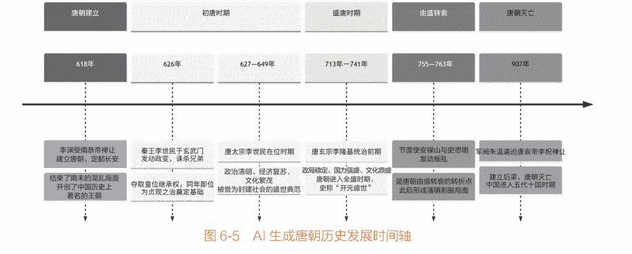

3）如果 DeepSeek 画出来图不是你想要的结果，可以继续跟 DeepSeek 提要求或补充细节，让它进行修改，直到你满意为止。若时间轴中显示的文字不完整，可以输入如下提示词：
图中的“原因”或者“影响”太密集了，看不清楚，可以分多行写，调整间距。

4）DeepSeek 将给出改进后的时间轴。单击“下载”，可保存 DeepSeek 生成的时间轴，如图 6-6 所示。

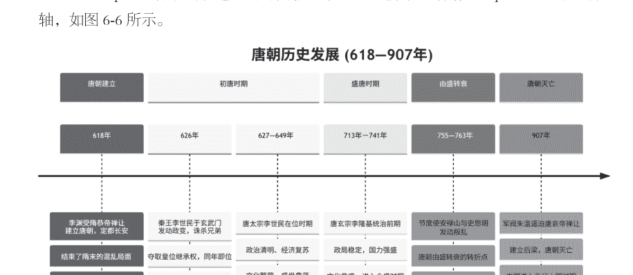

图 6-6 优化后的唐朝历史发展时间轴

> 小提示：Mermaid 是什么？它是一种让电脑画图的小语法，别怕，你不需要学语法，只要下“指令”，它会自动生成。Mermaid 不仅能画时间轴图，还能画知识图谱、流程图、概念结构图等，赶快试试吧！

### 6.2.2 生物学知识图谱：AI 构建生态系统可视化知识图谱

你听说过“知识图谱”吗？别被这个名字吓到，其实它就像是一张超大的“知识蜘蛛网”。它能把我们学过的知识点全都串起来，让原本看起来很散的内容，一下子变得有条理、好理解，清清楚楚。

在这个“蜘蛛网”里——每个重要的知识点叫作实体（比如：生产者、消费者、环境因子）；这些实体之间还有关系（比如“影响着”“依赖于”“属于……”）；每个实体还可以带着自己的“属性标签”（比如“种类”“数量”“功能”等）

这就是 AI 知识图谱的厉害之处——像一张能“思考”的地图，带你快速锁定重点，搞清楚整章结构！

今天就来构建一张属于你的——《生态系统知识图谱》，我们将用 AI 工具帮你把这部分知识全部图形化。尤其是初中生物中“生态系统”这一章，概念多、结构复杂，用图谱展示后，立马变得直观又好记。

我们推荐使用“KIMI 智能助手”画图谱，因为它不仅能理解你的要求，还能用 Mermaid 语法自动绘制出清晰、漂亮的知识图谱。

**边学边做：用 AI 生成生物学科知识图谱**

1）打开 KIMI 官网 https://kimi.moonshot.cn/。
2）输入下面的提示词：
请你用 Mermaid 语法画一个初中生物“生态系统”知识图谱，包含生产者、消费者、分解者、环境因素、食物链、能量流动、物质循环等关键内容，并展示它们之间的关系。
3）KIMI 会“理解”你想要的内容，然后快速生成一张结构清晰的图谱，如图 6-7 所示。

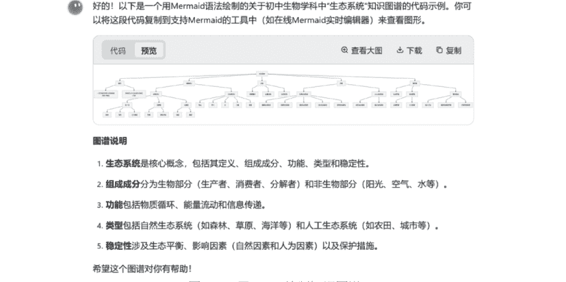

4）不满意？可以大胆给 KIMI 提意见！KIMI 会一直修改直到你满意为止。可以对 KIMI 说：“请补充……”“请将……修改为……”。例如：

图谱看不清？提示词：请把字体调大，线条颜色换成深蓝色。
内容不全？提示词：请补充“分解者”的功能和能量流向的方向。
图太密？提示词：请分块显示内容，换成上下结构。

5）单击“下载”即可保存。你可以得到一张图片，也可以复制 Mermaid 代码放到你的电子笔记里。

如果你已经有了一些笔记、课本截图或者自己整理的文档，也可以通过上传的方式让 KIMI 来“读懂”并自动整理。

## AI任务卡：用 AI 生成一张学科知识思维导图

任务要求：
结合已有的学习资料（如老师发的复习提纲、整理的课堂笔记等），使用 KIMI 生成一张《道德与法治》（七年级下册第一、二单元）的知识思维导图，用于期中考试复习。

> 小提示：思维导图不仅可以用于复习，也可以用来预习新课、整理课堂笔记、做学习总结，是打造高效学习的利器！

## 6.3 数据图表解析
——用 DeepSeek 解析数据背后的奥秘

面对海量数据时，你是不是也感到头大？别担心！ AI 就像你的私人数据分析师，能快速提取规律，生成直观图表，让复杂信息一目了然。

### 6.3.1 分析地理数据趋势：AI 解析气候、城市等变化规律

AI 不仅能帮助我们分析数据，还能协助我们收集和整理资料。比如，我们可以尝试分析北京近十年来每个月份的平均气温变化趋势。

**边学边做：用 AI 分析地理数据**

1）获取数据。打开 DeepSeek，在提示词框中输入：
帮我收集整理近 10 年北京每个月的平均气温，并以表格形式输出。

2）查看分析结果。AI 会返回整理好的表格数据。这些信息来源于中国气象局的公开报告。除了列出每个月的平均气温外，AI 还进行了初步分析，例如指出春季（3—5 月）温差较大，近 10 年年均温在 12.5~13.5℃之间，整体呈缓慢上升趋势，其中 2019 年是显著暖年。如图 6-8 所示。

| 年份 | 1月 | 2月 | 3月 | 4月 | 5月 | 6月 |
|---|---|---|---|---|---|---|
| 2014 | -2.1 | 3.2 | 9.8 | 17.5 | 22.3 | 26.1 |
| 2015 | -1.8 | 4.0 | 10.5 | 16.9 | 23.0 | 26.8 |
| 2016 | -2.5 | 2.8 | 10.2 | 17.2 | 22.8 | 26.5 |
| 2017 | -1.2 | 3.5 | 11.0 | 18.0 | 23.5 | 27.2 |
| 2018 | -2.0 | 3.8 | 10.8 | 17.8 | 23.2 | 27.0 |
| 2019 | -1.5 | 4.2 | 11.2 | 18.2 | 23.8 | 27.5 |
| 2020 | -1.0 | 4.5 | 11.5 | 18.5 | 24.0 | 27.8 |
| 2021 | -0.8 | 4.8 | 11.8 | 18.8 | 24.2 | 28.0 |
| 2022 | -0.5 | 5.0 | 12.0 | 19.0 | 24.5 | 28.2 |
| 2023 | 0.0 | 5.2 | 12.2 | 19.2 | 24.8 | 28.5 |

注：
1. 表中数据为月均温（日最高温与最低温的平均值），模拟真实数据趋势


3）生成折线图。若觉得表格不够直观，可以请求 DeepSeek 生成图表，提示词如下：
将上述表格生成折线图，用不同颜色表示不同年份，横坐标为月份，纵坐标为温度，图表以 HTML 格式展示。

4）运行图表。AI 将输出 HTML 代码，如图 6-9 所示。
单击“运行”按钮后，即可看到交互式折线图。鼠标悬停在某数据点上会显示具体数值，单击图例还能隐藏或显示特定年份的折线，如图 6-10 所示。

5）延伸探索。你还可以要求 DeepSeek 分析其他城市的气候数据，如降水量、GDP 变化等，甚至深入到每天的气温变化。

> 小提示：确保数据来源可靠，可尝试对比多个渠道的数据，提高分析准确性。

以下是使用HTML和JavaScript（Chart.js库）生成的北京近10年月均气温折线图。图表中每条折线代表一个年份，x轴为月份，y轴为温度（°C）：

```html
<!DOCTYPE html>
<html>
<head>
    <title>北京近10年月均气温变化</title>
    <script src="https://cdn.jsdelivr.net/npm/chart.js"></script>
    <style>
        .chart-container {
            width: 90%;
            max-width: 1000px;
            margin: 20px auto;
        }
        h1 {
            text-align: center;
            font-family: Arial, sans-serif;
            color: #333;
        }
    </style>
</head>
<body>
    <div class="chart-container">
        <h1>北京近10年月均气温变化 (2014-2023)</h1>
        <canvas id="temperatureChart"></canvas>
    </div>

    <script>
        const ctx = document.getElementById('temperatureChart').getContext('2d');

        // 月份标签
        const months = ['1月', '2月', '3月', '4月', '5月', '6月', '7月', '8月', '9月', '10月', '11月', '12月'];
```

图 6-9 生成 HTML 代码

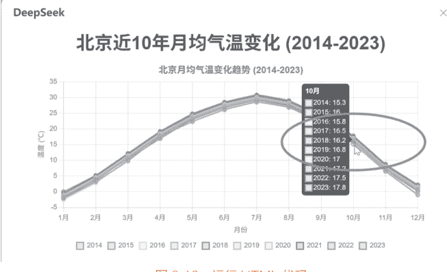

图 6-10 运行 HTML 代码

### 6.3.2 地图可视化生成：AI 帮你绘制人口与资源分布图

除了折线图、柱状图、饼图等常见图表外，AI 还能以地图的形式将数据“可视化”。比如，可以展示中国各省级行政区（不包含港澳台地区）的人口分布。

**边学边做：用 AI 对地理数据进行可视化分析**

1）打开 DeepSeek，输入提示词：
请整理中国各省、直辖市、自治区的人口数量，用柱状图的形式展示，以 HTML 格式输出。

2）查看输出图形。AI 会返回 HTML 代码，单击代码块右上角的“运行”后即可看到中国各省、直辖市、自治区的人口数量。如图 6-11 所示。

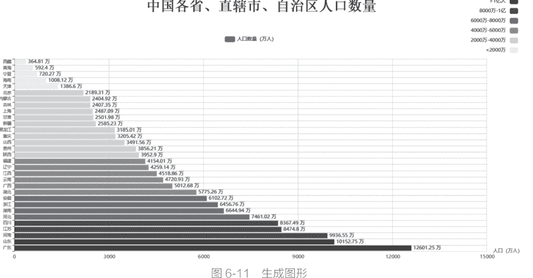

图 6-11 生成图形

数据来源于 2020 年第七次全国人口普查。这种可视化方式让信息更加直观、易懂。

> 小提示：可以尝试加入交通路线、自然资源等图层，实现多维数据联动展示！

### 6.3.3 历史人口变化数据分析：用 AI 探寻“人口流动”的原因

通过数据分析还能解析出更多信息。例如，通过数据分析可以还原城市人口变化的深层次原因。

**边学边做：用 AI 分析秦朝至清末民初，北京地区人口数量的变化**

1）获取数据。打开 DeepSeek，输入提示词：

> 请收集整理秦朝至清末民初北京地区人口数量的变化，包括人口规模、人员流动的出发地以及去向、迁移的路线等信息，以表格形式输出。

2）AI 对数据进行整理分析后，输出内容如图 6-12 所示。

> 好的，这是一个综合了人口规模估算和人口流动信息的详细表格，涵盖了秦朝至清末民初北京地区的人口变迁史。

秦朝至清末民初北京地区人口规模与流动变迁总表

| 朝代 | 大致时间段 | 城市名称/地位 | 人口规模估算（约） | 主要流入（来源地、原因、路线） |
| :--- | :--- | :--- | :--- | :--- |
| 秦汉至隋唐 | 前3世纪 - 10世纪 | 幽州（北方军事重镇） | 3万 - 15万人（唐代幽州城鼎盛期） | 来源地：河北、山东平原。原因：戍边、屯垦、避难。路线：沿太行山东麓南北大 |
| 辽（北宋同期） | 10 - 12世纪 | 南京析津府（辽国陪都） | 25万 - 30万人（辽国五京中最大） | 来源地：1. 契丹贵族（上京汉民。原因：政治升级、人口自然路线：契丹人自东北经古北 |
| 金（南宋同期） | 12 - 13世纪 | 中都（金国首都） | 50万 - 70万人（海陵王迁都后剧增） | 来源地：1. 女真贵族、军队工匠、百姓（汴梁等地）。原因：首次正式迁都、强制路线：数十万人从东北长途 |
| 元 | 13 - 14世纪 | 大都（元朝首都） | 90万 - 110万人（国际性大都市） | 来源地：1. 蒙古、色目人匠、富户（江南为主）。原因：建设新都、强制征召路线：大运河成为输送人口 |
| 明 | 14 - 17世纪 | 北平 → 北京（明朝首都） | 70万 - 100万人（迁都后恢复并超越元大都） | 来源地：1. 军队、家属（山西匠（南京）；3. 平民（山西原因：明成祖迁都，√ 京路线：山西移民经太行八陉北上。 |

图 6-12 北京地区人口规模变化

3）生成折线图。输入提示词：

> 请以图表形式展示这些数据。X 坐标为年份，以 50 年为一个间隔。Y 坐标为人员规模数量，在图表中标记朝代以及关键事件，以 HTML 格式输出。

4）AI 给出对应的 HTML 代码，单击“运行”按钮，AI 自动生成北京地区人口规模变迁图，如图 6-13 所示。将鼠标悬停在某一节点，可查看具体数据信息。

5）延伸分析。可进一步让 AI 分析人口变化的原因（如结合政治、经济、气候等因素）。

# 北京地区人口规模历史变迁

公元前200年 - 公元1900年（每50年间隔）

秦汉至隋唐 辽代 金代 元代 明代 清代

# 北京地区人口规模两千年变迁

数据为基于历史文献的估算值

拖动下方滑块查看更多细节 | 鼠标悬停查看事件

人口规模（万人）

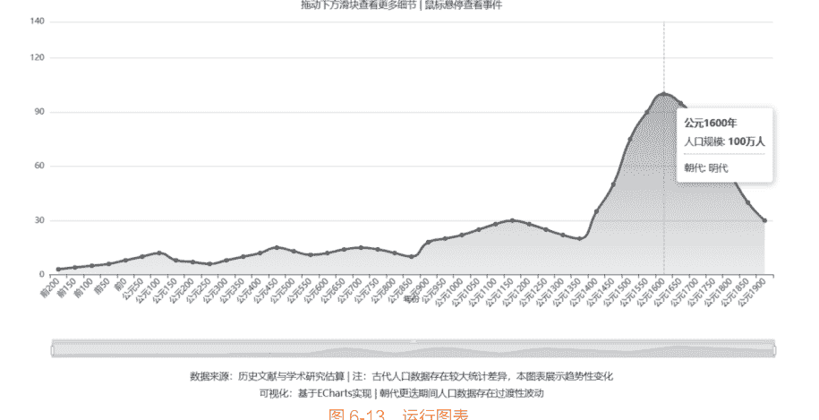

数据来源：历史文献与学术研究估算 | 注：古代人口数据存在较大统计差异，本图表展示趋势性变化

可视化：基于ECharts实现 | 朝代更迭期间人口数据存在过渡性波动

图 6-13 运行图表

> 小提示：结合历史课本、官方统计数据分析，更能还原真实背景。

## AI任务卡：动手分析一组真实数据

任务要求：

利用 DeepSeek 完成对北京近 5 年 PM2.5 浓度变化趋势的分析，并提出改善建议。

## 6.4 实验辅助
——AI 带你轻松搞懂整个实验流程

扫码看教学视频

做实验是不是总觉得步骤复杂、细节太多，一不小心就容易出错？别担心，现在 AI 就是你的“实验小助手”！无论是操作流程、实验设计，还是原理讲解，AI 都能帮

## 6.4.1 实验前准备：利用“仿真平台”预习实验

做实验前，先搞懂实验内容和原理是非常重要的。这时候，我们可以请 AI 推荐一些可以在线模拟实验的虚拟仿真平台，提前预习一遍，让实验更顺利。

### 边学边做：AI 推荐虚拟仿真实验平台

1. 打开 AI 工具（比如 DeepSeek），在输入框中输入提示词：
   我是一名初中学生，我将要学习浮力的内容，想使用一个虚拟仿真平台提前了解浮力实验，有没有推荐的平台？
2. AI 会推荐适合你的仿真平台，并给出官网地址。例如，它可能会推荐一个非常有名的科学仿真实验网站——PhET 虚拟实验室（网址通常会附在回复中）。如图 6-14 所示。

在 PhET 中，你可以拖动物体改变密度，观察浮沉现象；更换液体，看不同物体是否会浮起来；实时查看“浮力”大小和“重力”对比，非常直观。

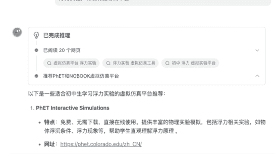

> 小提示：有些实验在现实中不容易操作，但在虚拟平台上可以反复尝试，不怕失败，还能大胆尝试新的变量设置。

遇到不懂的地方，可以随时问 AI。比如你可以接着问，在输入框中输入提示词：
能不能告诉我浮力的计算公式？为什么有的物体会浮，有的会沉？
AI 会用通俗易懂的语言告诉你原理，还可能配图解说。这样一来，当你真正动手做实验时，可以游刃有余、事半功倍。

## 6.4.2 在线体验浮力的测定方法

想亲手做浮力实验但条件不允许？别急，PhET 虚拟实验室来帮忙！只需一台电脑或平板，你就可以在网页上体验浮力的产生原理和实验测定方法，像在实验室一样动手操作。接下来，我们就带你一步步完成一次完整的在线浮力实验模拟。

### 边学边做：在虚拟实验室中体验浮力实验

1. 访问网址：https://phet.colorado.edu，这是科罗拉多大学出品的虚拟实验室，非常适合中学生！如图 6-15 所示。同页为英文版，可用插件将页面翻译成中文。

   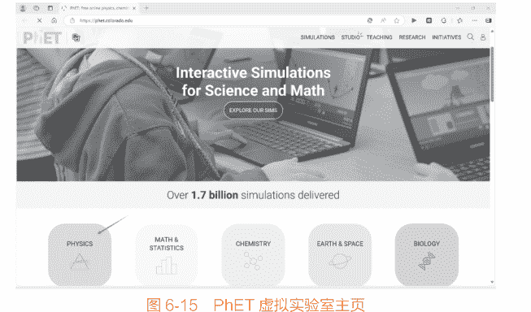

2. 进入物理实验分类，单击页面中的 PHYSICS（物理）类实验，进入物理学科的模拟项目列表。在左侧 SUBJECT（学科）分类栏中，确保只勾选 Motion（运动），然后找到并单击名为 Buoyancy（浮力）的实验项目。如图 6-16 所示。

3. 进入实验界面，单击实验卡片中间的播放按钮 ▶，进入模拟实验操作界面，如图 6-17 所示。

   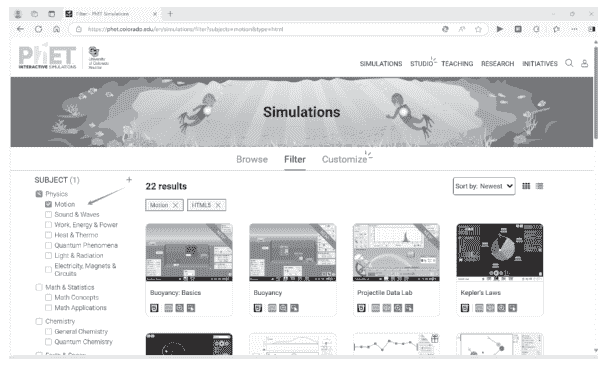

   图 6-16 物理实验分类

   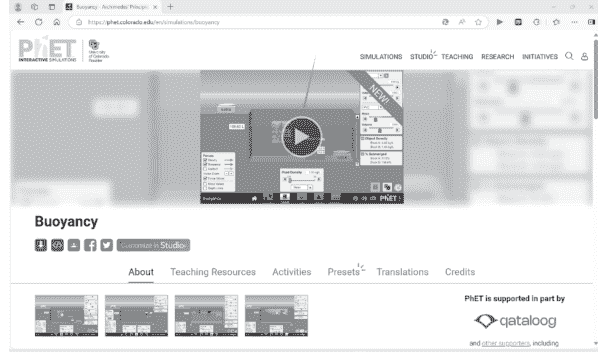

   图 6-17 实验界面

4. 选择实验模式，在进入页面后，单击 Explore（探索）模式，就可以开始你的浮力实验了，如图 6-18 所示。

5. 调整固体材料，右上角的下拉菜单可以切换固体的材料，比如选择木块、铁块、铝块等。如图 6-19 所示。

6. 修改固体大小，通过滑动 Mass（质量）和 Volume（体积）的滑块调整固体体积和质量。注意：它们是联动的，符合公式 m = ρ × V（质量 = 密度 × 体积）。如图 6-20 所示。

   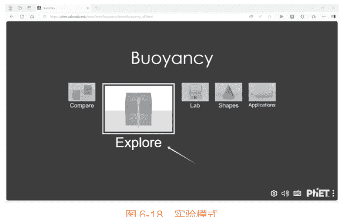

   图 6-18 实验模式

   

   图 6-19 调整固体材料

   

   图 6-20 修改固体大小

7. 设置液体种类，在下方的菜单中，你可以选择液体的类型，比如水、油、酒精等，看看不同液体对浮力有什么影响。如图 6-21 所示。

   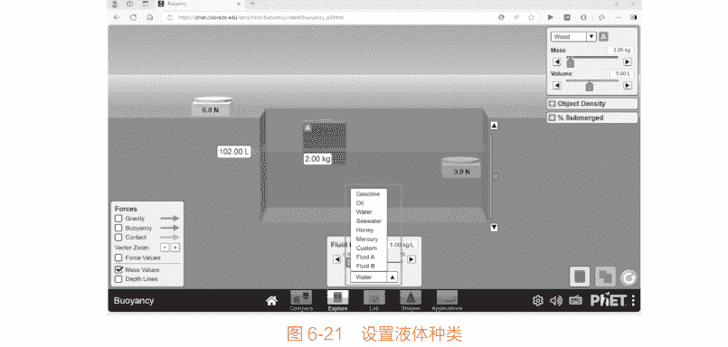

   图 6-21 设置液体种类

8. 自定义液体密度，滑动条可以自由调整液体的密度，单位是 kg/L，这对浮力的大小有直接影响。如图 6-22 所示。

   

   图 6-22 自定义液体密度

9. 添加第二个固体，单击右下角的“双固体”图标，可以添加一个新物体，比如再放一个铝块，看看两个物体叠加时的浮力变化。如图 6-23 所示。

10. 移动固体位置，你可以用鼠标拖动固体，像搭积木一样把一个放在另一个上面，观察组合后浮沉的变化。如图 6-24 所示。

    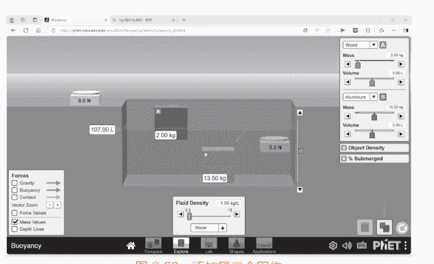

    图 6-23 添加第二个固体

    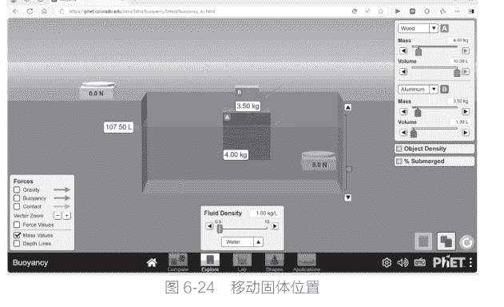

    图 6-24 移动固体位置

11. 查看物体密度和浸没度，单击 Object Density（物体密度）和 %Submerged（浸没程度）前面的绿色加号，展开数据面板，观察物体在液体中的浮沉情况。如图 6-25 所示。

12. 观察受力分析图，左下角的“受力分析”模块非常关键。你可以：勾选 Gravity（重力），勾选 Buoyancy（浮力），勾选 Contact（接触力），勾选 Force Values（显示力的数值），通过 Vector Zoom（向量缩放）调整力的箭头大小，更直观地观察受力变化。如图 6-26 所示。

    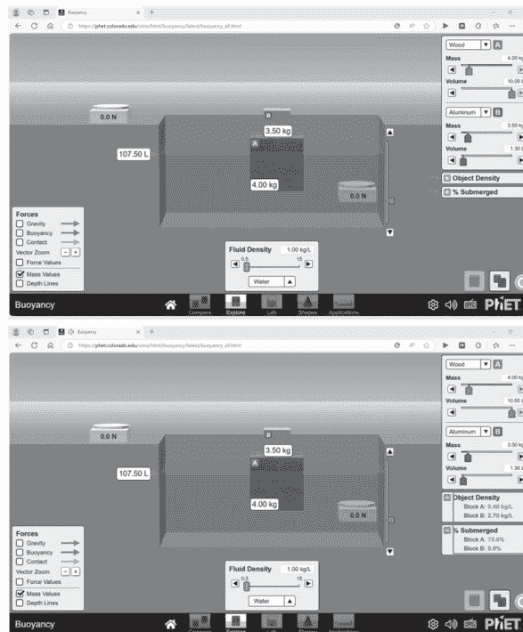

    图 6-25 查看物体密度和浸没度

    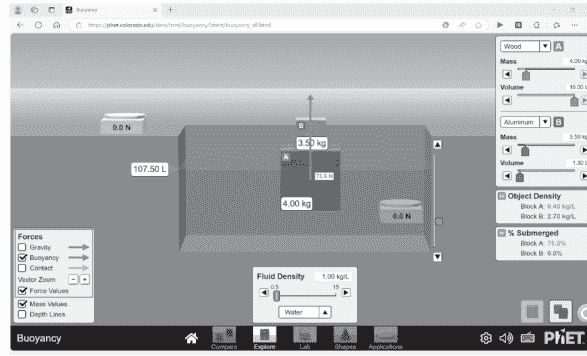

    图 6-26 观察受力分析图

> 小提示：实验过程中不妨多试试不同组合！比如：固体密度大于液体会怎样？液体密度变大时，会不会让物体浮起来？

你也可以截图记录实验数据，再让 AI 帮你分析。输入提示词：“通过以上实验数据，帮我分析以下浮力实验的现象和结论”，AI 就会自动帮你总结规律。

## 6.4.3 实验步骤拆解：AI 也能当“实验指导员”

AI 不仅能帮你了解不同的实验方法，还能像“实验指导员”一样一步步带你梳理实验流程，帮你顺利完成整个实验任务。

### 三步完成浮力实验：

1. **明确目标**：测定浮力的方法有很多种，比如：使用弹簧测力计法；借助阿基米德原理测排开液体的质量，你要先决定选哪种方法进行实验。
2. **确定所需工具**：方法选好了，就要想清楚这个方法需要哪些实验器材，比如：弹簧测力计、量筒、水槽、小挂钩砝码、细线……
3. **记录实验过程与结论**：实验完成后，要将数据填写在实验记录表中，并分析得出结论。比如：浮力 = 物体在空气中重力 - 物体在液体中重力；浮力等于排开液体的重力吗？怎么验证？

### 边学边做：AI 扮演实验指导员辅助完成实验

1. 让 AI 帮你梳理方法和思路，打开 AI 工具（如 DeepSeek），在输入框中输入提示词：

   > 我是一名初二年级的学生，想通过一个浮力测定实验更好地学习浮力相关知识。请你告诉我初中物理中有几种常用的测定浮力的方法？这些方法有什么不同？适用于哪些情况？

2. AI 通常会给出内容。参考 AI 建议，设计自己的实验路线图，如图 6-27 所示。你可以结合教材要求和实验条件选择其中一种，再请 AI 继续帮你细化实验步骤。

> 小提示：和 AI 交流时，记得说明你的年级、知识背景和实验目的，这样 AI 给出的建议才会更适合你。

在初中物理中，测定浮力的实验方法主要有以下四种，每种方法的原理、适用场景和操作差异如下：

### 1. 称重法（最常用）

- **原理**：浮力 = 物体在空气中的重力 - 物体浸入液体时的弹簧测力计示数（即视重）。
- **公式**：$F_{浮} = G_{空气} - G_{液体}$
- **操作步骤**：
  1. 用弹簧测力计测出物体在空气中的重力 $G_{空气}$；
  2. 将物体浸入液体中，记录此时测力计示数 $G_{液体}$；
  3. 两次读数之差即为浮力。
- **特点**：
  - 直接测量，适合规则或不规则物体；
  - 需注意物体完全浸没或部分浸没时的读数差异。

### 2. 阿基米德原理法（排水法）

- **原理**：浮力 = 物体排开液体的重力。
- **公式**：$F_{浮} = \rho_{液} g V_{排}$
- **操作步骤**：


## 6.4.4 实验规范操作：AI 教你避开“雷区”

实验中，哪怕一个小小的操作失误，也可能导致测量不准、实验失败，甚至对结论产生误导。而 AI 就像一位“前辈实验达人”，能提前告诉你实验过程中常见的错误和注意事项，帮你绕开弯路。

### 为什么要重视实验中的错误点？

- 错误的操作会导致实验结果不准确；
- 会让你对浮力的理解产生偏差；
- 会影响你写出正确的实验报告。

### 边学边做：用 AI 避开常见错误操作

1. 请 AI 帮你列出常见错误点，打开 AI 工具（如 DeepSeek），输入提示词：
   我是一名初中生，正在进行浮力测定实验。请你帮我列出实验中常见的错误操作和注意事项，帮我提高实验的准确性。
2. 查看 AI 的“避坑指南”，AI 会列出很多实用建议，如图 6-28 所示。

> 小提示：你还可以上传你写好的实验步骤或实验方案，请 AI 检查是否合理。

以下是初中物理浮力测定实验中一些容易引起错误的注意事项，帮助你顺利完成实验：

### 实验器材准备和使用

1. **弹簧测力计的校准**
   - 在使用弹簧测力计之前，确保其指针指在零刻度线上。如果不在零刻度线，需要进行校准，否则会导致测量结果不准确。
   - 错误示例：如果弹簧测力计未校准，可能会导致浮力的计算出现偏差。
2. **溢水杯的正确使用**
   - 在使用溢水杯测量排开液体的体积时，确保溢水杯中的液体刚好装满，不要有多余的液体溢出。否则，测量的排开液体体积会不准确。
   - 错误示例：如果溢水杯中的液体未装满，排开液体的体积会少于实际值，导致浮力计算错误。
3. **物体的悬挂方式**
   - 悬挂物体时，确保物体完全浸没在液体中，且不接触容器的底部或侧壁。否则，测量的拉力会受到容器的影响。
   - 错误示例：如果物体接触容器底部，测力计的读数会比实际值小，导致浮力计算偏大。


## 6.4.5 数据处理，AI 轻松帮你搞定

做完实验，一大堆数据看得头昏眼花？别担心，AI 就像一位会“变魔术”的数据小助手，能把你记录的枯燥数据转化成直观清晰的图表，轻松掌握数据背后的规律。

### 为什么要用 AI 帮你处理实验数据？

- 表格数据太“干巴”？ AI 能帮你把数据变成一目了然的图像。
- 想看趋势变化？ AI 几秒钟就能画出漂亮的折线图。
- 自己不会编程？ AI 还能自动帮你生成代码，一键绘图。

### 方法 1：在 Excel 中生成图表（适合零基础）

你可以使用在线 AI 表格工具，让 AI 帮你整理数据并绘图。


1. 打开网站 https://chatExcelcn.com/，这个网站可以在线上传 Excel 文件并与 AI 对话操作。单击“访问”，再单击“开始使用”，进入到分析界面。如图 6-29 所示。
2. 在右边上传框上传记录好数据的 Excel 表格，上传完毕后，表格中的数据会显示在中间，如图 6-30 所示。
3. 在右下角对话框输入你的需求，例如，你可以输入：
   表格第一列是木块沉入液体的体积百分比，第二列是浮力值，单位为牛顿。请将体积百分比按从小到大排序，并生成一张折线图。横轴是体积百分比（单位：%），纵轴是浮力值（单位：N）。

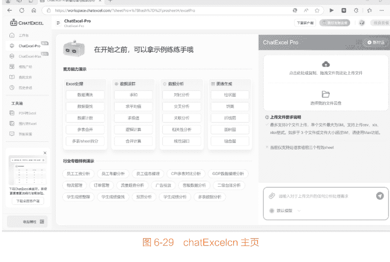

图 6-29 chatExcelcn 主页

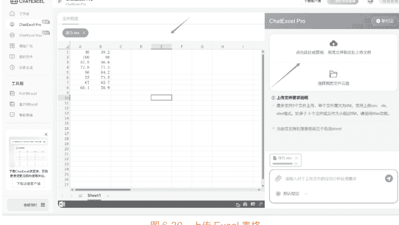

图 6-30 上传 Excel 表格

4. AI 会自动对数据进行排序，并绘制出符合要求的图表。如图 6-31 所示。


图 6-31 绘制图表

> 小提示：不会用 Excel 也没关系，重点是说清楚你想看什么、怎么排列、怎么画图。图表可以截图插入到实验报告中，清晰又专业。

### 方法 2：使用 Python 编程语言绘图（进阶选手看过来。）

想学点编程小技能？ AI 可以帮你生成 Python 代码，把数据变成图像。

### 边学边做：用 AI 生成 Python 代码实现分析结果可视化

1. 让 AI 生成 Python 绘图代码，打开 AI 工具（如 DeepSeek），在输入框输入提示词：

   > 我是一名初中生，完成了一个浮力实验，记录了体积百分比和浮力值的数据。我想用 Python 绘制折线图，请帮我生成对应的代码，横轴是体积百分比（%），纵轴是浮力值（N）。

   AI 会生成一段完整的 Python 代码，通常会用到如 matplotlib 或 pandas 的绘图库。

2. 将代码复制粘贴到你熟悉的编程环境中运行，你可以选择以下编程环境之一：

   - https://www.programiz.com/python-programming/online-compiler（在线运行）
   - 本地安装的 Python 软件（如 Thonny、Jupyter Notebook）

   一键运行，就能看到漂亮的图表了！

> 小提示：如果不确定数据格式，可以请 AI 帮你模拟一个示例数据表格。初学编程时多尝试多请教 AI，它就是你的贴身“编程教练”！

### AI任务卡：设计并分析一个科学实验

**任务要求：**

- 用 AI 设计一个把声音变成波形图的实验。
- 内容要包括所需材料、实验步骤、注意事项以及波形变化分析。

## 6.5 跨学科融合——AI 助力跨学科难题突破


你是否在面对涉及多个学科的问题时感到无从下手？比如一个问题同时涉及历史、地理、政治、经济等知识点，不知道从哪个角度切入，也不清楚该如何整合信息？别担心！AI 就像一位聪明的“跨学科顾问”，可以帮你整合多领域知识，提供全新视角，轻松应对复杂问题。

### 6.5.1 学科交叉案例分析：利用 AI 从多学科视角分析问题

在跨学科问题中，我们常常需要从不同角度分析问题，再将这些信息进行整体性地整合。AI 在这方面大显身手——它可以帮助我们：快速获取各学科数据；自动识别多学科之间的联系点；构建综合分析模型，输出清晰结论。

### 边学边做：用 AI 从多个角度对“一带一路”项目进行分析

**第一步：从多个学科角度分析问题**

在跨学科分析中，不能只从一个角度“死磕”，而是需要先广泛收集数据，再寻找学科之间的关联，最后整体分析。

1. 打开 DeepSeek，输入以下提示词：
   整理“一带一路”沿线国家的历史贸易数据、地理资源分布、政治合作协议及经济指标。
2. AI 会自动从多个学科角度为你收集相关信息，形成结构化数据，如图 6-32 所示。


**第二步：AI 帮你识别学科间的关联性**

收集数据只是第一步。接下来，需要让 AI 帮我们分析这些数据之间的联系，并自动标注属于哪一门学科，从而构建清晰的知识结构。

1. 再次打开 DeepSeek，输入以下提示词：
   分析以上数据，识别不同角度之间的关联性，并对内容进行学科标签标注（如历史/地理/政治/经济），生成一份思维导图，以 Markdown 格式输出。
2. AI 会输出一段 Markdown 格式的内容，里面包含了数据分类、学科标签和相互关系的结构信息，如图 6-33 所示。


为什么用 Markdown 格式？因为它可以直接用来制作清晰的思维导图，也方便后续导入 XMind 等工具！

**第三步：制作思维导图，直观展现数据结构**

1. 再次打开 DeepSeek，将上述 Markdown 内容复制，保存为 .md 文件。
2. 打开 XMind，导入该文件即可生成可视化的思维导图。
3. 或者更便捷一点，直接让 DeepSeek 将其转换成 HTML 文件展示，只需输入提示词：
   将这个 Markdown 文件以 HTML 文件形式展现。
4. AI 将转换为 HTML 文件，运行 HTML 文件，你就可以在线查看一张结构清晰、信息丰富的跨学科分析图，如图 6-34 所示。


> 小提示：HTML 展示的信息通常更丰富，还能交互查看，是理解复杂关系的好工具。

**第四步：提出深度问题，生成趋势预测**

掌握了基本结构之后，你还可以向 AI 提出更具挑战性的问题，比如在 DeepSeek 中输入提示词：
请结合地理资源和政治稳定性，预测未来 5 年“一带一路”重点合作区域。
AI 将为你列出未来可能的重点合作国家或地区，并说明其依据（如地理优势、政治环境等）。

> 小提示：在使用 AI 进行跨学科分析时，一定要清晰标注学科标签（历史 / 地理 / 政治 / 经济等），这样 AI 才能更好地理解数据含义，分析出更准确的结果。

### 6.5.2 综合性问题解决：用 AI 解决环境、科技、国际关系等复杂问题

当我们面对一些“超级复杂”的社会问题，比如环境污染、科技伦理、国际关系紧张等，往往不是一个学科就能解决的。怎么办？答案是：拆分问题 + 多学科整合 + AI 建模分析 + 模拟效果 + 优化决策路径。这些听起来是不是很专业？其实并不难，接下来我们通过一个例子一步步来操作。

**如何用 AI 解决“碳中和”背景下的产业转型难题？**

什么是“碳中和”？简单来说，就是让一个地区产生的“碳排放”和被吸收的“碳量”达到平衡，减少对气候的负面影响。

### 边学边做：用 AI 完成“碳中和”背景下的产业转型方案

1. 分解问题。打开 DeepSeek，输入提示词：
   请从地理（资源分布）、经济（产业 GDP 占比）、政治（环保政策）三个角度，分析广东省如何实现碳中和目标。
   AI 会帮你把问题拆解为三个学科子问题，并进行资料整理，输出图文并茂的分析报告。
2. 生成初步方案。AI 可能会给出如下建议：逐步关停高污染、高耗能产业；加大新能源产业（如风能、光伏）的投资扶持；完善环保政策，优化财政补贴机制。
3. 模拟实施效果。接着，我们让 AI 预测一下这个方案执行后的影响，输入提示词：
   请模拟该方案 5 年内的实施效果。
   AI 可能输出：碳排放预计下降 30%；GDP 预计增长 5%；绿色产业就业人数增加 20%。
4. 调整方案，优化升级。假如你觉得新能源应该优先发展光伏怎么办？那就试试这个提示词：

若优先发展光伏产业，请重新生成碳中和转型方案。

AI 将自动调整数据模型，重新生成更加聚焦光伏产业的解决方案。

> 小提示：跨学科问题一定要明确优先级和核心诉求，比如你是更关注经济效益，还是环境保护？只有这样，AI 才能平衡各方面的利弊关系。

## AI任务卡：选择社会热点，让 AI 从多个学科角度进行分析

任务要求：

利用 AI 工具，从多个学科视角出发，对人工智能伦理争议问题进行分析，产出一份结构清晰、逻辑严谨的研究报告。

# DeepSeek AI

## 第 7 章
AI 创意工作室
——艺术与科技的完美碰撞

你有没有这样的梦想——策划一场创意满满的校园活动？做出一张让全班惊叹的炫酷海报？拥有一首属于自己的原创音乐？从“编程小白”升级为“代码小达人”？现在，只要搭上 AI 这辆“创意快车”，这些梦想都能变得触手可及。在这一章中，我们将带你开启“AI+ 艺术”的神奇冒险，用科技点燃你的无限想象力！

### 7.1 活动策划大师
——AI 秒出创意方案

你是不是也曾经为了一份活动策划书抓耳挠腮，不知道该从哪开始？或者写了一份方案，却总觉得哪里不够新颖、哪里还可以再优化？别急！ AI 就像一个贴心的“策划助手”，无论你是策划新手，还是经验型选手，它都能为你提供有用的帮助。

### 7.1.1 活动策划：和 AI 一起策划各种校园社团活动

第一次策划校园活动？没思路？ AI 可以推荐一些有趣又可行的校园活动，还能帮你快速搭建策划框架。

**边学边做：用AI策划一次春游活动**

1. 打开任意一个 AI 工具（如 DeepSeek、KIMI、通义千问、ChatGPT 等），在对话框里输入清晰的提示词：
   我是初一学生，想策划一次班级春游活动，请帮我出一份详细的策划方案。
2. AI 会迅速生成一份结构完整的策划书，包括：活动主题、活动目标、活动流程（集合、出发、游戏、就餐等）、安全预案、预算建议和注意事项。如图 7-1 所示。
3. 你可以根据 AI 给的内容，结合班级人数、经费、老师要求等实际情况进行调整和补充。

这就像是有一位经验丰富的大哥哥／大姐姐在一旁陪你一起策划。

有了初步策划方案，如何让它更好？

**边学边做：用AI策划一次有创意的元旦联欢活动**

1. 打开 AI 工具（如 DeepSeek），把你已有的策划内容复制粘贴进去，或者直接上传文档。然后输入你的具体需求，比如：
   这是我写的班级元旦联欢活动策划，请帮我想一个更有趣、更有创意的活动主题。
2. AI 会给出多个建议，比如：“青春闪光夜”“快乐联欢 GO”等。你可以选择自己最喜欢的，或者根据它的建议进行灵感延伸。
3. 你还可以请 AI 帮你优化活动流程、添加趣味游戏、调整时间安排等，一步步让方案变得更加完美。


> 小提示：和AI沟通时，尽量说清楚你是谁、你要做什么、你想让AI帮你解决什么问题，这样才能得到最精准的帮助。

AI 生成的是“模板”或“灵感”，真正的策划高手还需要根据实际情况（比如场地、人数、天气、预算）进行合理调整。多练几次，你也能变身为“校园活动小策划师”！

### 7.1.2 创意玩法：AI 帮你想点子，让活动更有趣

你是否也想过：为班级活动设计几个能让大家笑出腹肌的互动游戏？在大课间组织一场脑洞大开的创意运动？想出一套特别的主题小游戏，让同学们玩得开心、记得牢？

别担心，AI 是你的“点子制造机”。不论你是想设计游戏、互动问答，还是趣味挑战，它都能迅速给出新鲜又实用的创意玩法，还能帮你准备道具和规则，轻轻松松搞定整个流程。

如何用 AI 快速生成创意玩法？

**边学边做：用AI设计有趣的桌游方案**

1. 打开 AI 工具（如 DeepSeek），输入提示词。
   有哪些适合中学生玩的创意游戏？
2. AI 很快就会列出一串精彩有趣的游戏，每一个都能点燃全场氛围！如图 7-2 所示。


3. 选定你感兴趣的游戏，进一步“定制”玩法。输入更具体的要求，例如，输入提示词：
   请设计一个 3 人一组的桌面游戏，主题是古诗词接龙，要有完整的计分规则，适合中学生在课间玩。
4. AI 就会为你生成详细的桌游设计方案，包括：游戏名称、游戏规则、计分方法、道具准备、胜负判定方式等，如图 7-3 所示。

请设计一个3人一组的桌面游戏，主题是古诗词接龙，要有完整的计分规则，适合中学生在课间玩。

### 古诗词接龙·三人对战版

（课间10分钟趣味桌游）

#### 游戏准备

1. 人数：3人一组（可多组同时进行）
2. 道具：
   - 诗词卡片：提前准备50-100张卡片，每张写一句常见古诗词（如“床前明月光”、“春眠不觉晓”）。
   - 积分表：记录每人得分（可用白纸或手机备忘录）。
   - 计时器：手机倒计时（每轮限时20秒）。

#### 游戏规则

1. 初始设定：
   - 洗匀诗词卡片，背面朝上叠放。
   - 三人轮流担任“裁判”（负责抽卡、计时和判定），每轮换一次。
2. 核心玩法：
   - 抽卡接龙：裁判抽一张卡片，展示第一句诗（如“白日依山尽”）。
   - 接龙规则：
     - 下一位玩家需接一句首字与上句尾字同音/同字的诗（如“尽”→“近水楼台先得月”）。
     - 若无法接龙，可改为接含尾字任意字的诗（如“尽”→“山穷水复疑无路”中含“尽”的谐音“复”）。
   - 限时挑战：每人思考时间20秒，超时则判为失败。
3. 计分规则：


5. 使用工具辅助，提升游戏体验。
   - 内容生成：用 DeepSeek 或豆包让 AI 自动生成古诗词接龙内容，也可以生成脑筋急转弯、谜语、小知识问答题等互动内容。
   - 视觉设计：用 Canva 设计接龙卡牌、游戏模板或活动海报，用 WPS 表格或 Excel 创建计分表格，加入自动计算公式和高分提醒，让比赛更公平、更有科技感。

> 小提示：内容要健康有趣，请务必确认AI生成内容无暴力、恐怖、低俗等不良元素，确保适合校园环境。适度使用AI，不抄袭不依赖：AI是你的好帮手，但创意最终还要靠你来完成调整和完善哦。

## AI任务卡：试试自己动手，用 AI 策划一次活动吧

任务要求：

- 和 AI 一起策划一场班级趣味运动会。
- 要求撰写一份结构清晰、内容丰富的活动策划案。
- 如何根据班级的实际情况，对 AI 生成的方案进行修改和优化！

### 7.2 秒变设计达人
——AI 助你打造专属视觉作品


你有没有幻想过自己设计一张酷炫的海报？或者在全班面前展示一份超级漂亮的 PPT？不会画画，也不会 PS 一样能一键生成专业级视觉作品。现在，AI 让你从“零基础小白”秒变“设计大师”。

### 7.2.1 设计不求人：AI 一键生成炫酷海报

如何利用 AI 设计海报？

- 文生图：利用 AI 的文生图模式设计海报，首先可以输入主题与风格关键词生成框架，添加元素指令并调整细节强化风格，实时预览优化至效果满意，最后导出不同尺寸海报适配不同场景。
- 图生图：利用 AI 的图生图模式设计海报，上传你喜欢的风格图片，AI 根据上传的图片生成关键词，根据这张图片风格作为参考生成海报。

**方法 1：用 AI 的文生图模式设计海报**

> 边学边做：用AI通过文生图模式设计海报

1. 首先使用 AI 工具（如 DeepSeek）生成海报提示词。打开 DeepSeek 官网，在输入框中输入提示词：
   请帮我写一个关于冬至海报设计生成的提示词
2. DeepSeek 给出海报设计提示词，如图 7-4 所示。
3. 选择支持文生图功能的 AI 工具（如 Midjourney、Stable Diffusion、即梦 AI 等），例如打开即梦 AI 官网，从 DeepSeek 生成的海报提示词中选择重要信息，将其粘贴到即梦 AI 工具提示词输入框中，提示词如下：

# 第 7 章 AI 创意工作室——艺术与科技的完美碰撞

155

### 冬至海报设计提示词建议

帮我写一个关于冬至的海报设计生成提示词

已深度思考（用时 15 秒）

以下是为冬至海报设计生成的AI提示词建议，分为不同风格供选择：

**【基础模板】**
主题关键词：冬至节气/传统节日/冬季温暖/家庭团圆/阴阳转换
主视觉元素：热腾腾的饺子汤圆/蒸汽升腾的砂锅/积雪的屋檐灯笼/冬至日照投影图
配色方案：朱红+暖橙渐变/霜白+靛青对比/糯米的珍珠白+竹编的浅棕
字体建议：书法体标题「冬至大如年」+手写体节气诗词
构图风格：中心对称式美食特写/上下分割的天地阴阳构图/圆形窗框透视家庭聚餐场景
季节元素：霜花纹理/水墨晕染的积雪/半透明冰晶图案/热气蒸腾效果
文化符号：二十四节气时间轴/冬至九宫格数九图/传统冬酿酒器具
材质质感：宣纸底纹/磨砂质感/烫金工艺效果/毛毡织物触感

**【风格延伸】**
1. 新中式美学版：
   “极简宋式美学，留白处呈现冬至日晷投影动画，哑光金色线条勾勒饺子轮廓，背景是渐变黛青色山水”
2. 现代扁平插画版：
   “几何图形组成的雪人家庭围坐场景，汤锅升起热蒸汽云朵造型，霓虹灯管风格的「Winter Solstice」字样”
3. 3D写实场景版：
   “超现实风格，晶莹的饺子悬浮在星空中，内馅呈现宇宙星云，筷子夹起时带出银河光尾，碗沿结着冰霜”
4. 国潮手绘风：
   “敦煌飞天环绕热气腾腾的铜火锅，祥云化作羊肉卷形态，传统纹样边框融入冬至三候（蚯蚓结/麋角解/水泉动）”

**【动态元素提示】**（适用于电子海报）
- 汤圆在碗中缓慢旋转露出不同馅料截面
- 呼吸灯效果的灯笼明暗渐变
- 飘雪粒子在触碰屏幕时融化成水蒸气
- 实时变化的日晷长度进度条

**【文化深度强化】**
- 加入古观星台元素展示「日短至，影最长」
- 呈现「冬至三候」的微缩场景
- 用卦象符号表现阴阳转换概念
- 黄道十二宫与节气关系示意图

可根据具体使用场景（餐饮/文化宣传/节气科普）侧重不同元素组合，建议保留30%负空间增强呼吸感，冷暖色调比例控制在7:3左右以平衡冬季寒冷与节日温暖的双重属性。


主题关键词：冬至节气 / 传统节日 / 冬季温暖 / 家庭团圆 / 阴阳转换
主视觉元素：热腾腾的饺子汤圆 / 蒸汽升腾的砂锅 / 积雪的屋檐灯笼 / 冬至日照投影图
配色方案：朱红 + 暖橙渐变 / 霜白 + 靛青对比 / 糯米的珍珠白 + 竹编的浅棕
字体建议：书法体标题「冬至大如年」+ 手写体节气诗词
构图风格：中心对称式美食特写 / 上下分割的构图 / 圆形窗框透视家庭聚餐场景
季节元素：霜花纹理 / 水墨晕染的积雪 / 半透明冰晶图案 / 热气蒸腾效果
文化符号：二十四节气时间轴 / 冬至九宫格数九图 / 传统冬酿酒器具
材质质感：宣纸底纹 / 磨砂质感 / 烫金工艺效果 / 毛毡织物触感

4. 即梦 AI 依据提示词绘制出海报，如图 7-5 所示。

156 初高中生 AI 伴学：教你用 DeepSeek 高效学习


5. 调整细节，例如选择其中一张海报，将鼠标停留在海报上，出现悬浮菜单栏，单击“扩图”按钮，在弹出的对话框中选择比例和图片大小，单击“立即生成”按钮，如图 7-6 所示。


6. 即梦 AI 导出海报，如图 7-7 所示。


> 小提示：在描述提示词时需精准，避免模糊描述；通过多次迭代调整参数优化海报；参考优秀案例，优化指令关键词。

**方法 2：用 AI 的图生图模式设计海报**

假如你有 A、B、C 三张喜欢的图片，想要参考 A 图的构图、B 图的设计风格、C 图的颜色制作一张海报。

**边学边做：用AI通过图生图模式设计海报**

1. 打开 DeepSeek 工具，上传图片 A，在输入框中输入提示词：
   从颜色的角度帮我提取这张图片的关键词
2. DeepSeek 给出图片 A 的颜色关键词，如图 7-8 所示。
3. 上传图片 B，在输入框中输入提示词：
   从构图方式的角度帮我提取这张图片的关键词
4. DeepSeek 给出图片 B 的关键词，如图 7-9 所示。
5. 上传图片 C，在输入框中输入提示词：
   从设计视觉风格的角度帮我提取这张图片的关键词


图 7-8 DeepSeek 给出图片 A 的颜色关键词


图 7-9 DeepSeek 给出图片 B 的关键词

6. DeepSeek 给出图片 C 的关键词，如图 7-10 所示。
7. 将三张图片的提示词整合为一条综合提示词，提示词的形式如下：
   把 DeepSeek 给出的图片 A 关键词粘贴到这里
   把 DeepSeek 给出的图片 B 关键词粘贴到这里
   把 DeepSeek 给出的图片 C 关键词粘贴到这里

   帮我整合以上三张图片中提取构图、设计风格、颜色三个角度的春分海报设计提示词。


从设计视觉风格的角度帮我提取这张图片的关键词

视觉风格关键词提取：

1. 古典诗意：中国风意境，源自诗句的婉约与含蓄，强调传统诗词的文学美感。
2. 自然意象：落花、微雨、燕子、春分节气元素，突出春季的生机与细腻动态。
3. 柔和色调：浅粉、淡绿、灰蓝等春季色系，搭配水墨晕染的渐变效果。
4. 朦胧氛围：微雨的水雾感，花瓣飘落的轻盈，通过半透明笔触或模糊处理呈现。
5. 动静结合：燕子飞行的动态线条与人物伫立的静态剪影形成对比，增强画面张力。
6. 现代融合：抽象光效、几何线条或数字粒子（呼应“即梦AI”的科技感），与传统水墨元素交织。
7. 留白构图：不对称布局，大面积留白强化诗意与空灵感，引导视觉焦点。
8. 材质质感：水墨笔触、纸张纹理，结合微弱的光泽渐变或数字渲染效果。
9. 情感表达：静谧、孤寂与希望并存，通过冷色调与暖色调的平衡传递复杂情绪。

关键词总结：中国风、水墨意境、春分自然、朦胧微雨、燕子动态、科技融合、留白美学、渐变晕染、静谧情感。

图 7-10 DeepSeek 给出图片 C 的关键词

8. DeepSeek 根据三张图的关键词整合成海报的提示词，如图 7-11 所示。

根据三套关键词的关联性和春分节气主题，现将构图、设计风格、颜色三个维度的核心信息整合如下：

**第一张图（传统节日氛围）**

颜色关键词
朱红 | 暖橙 | 雪白 | 米白/浅褐 | 深褐/墨黑 | 金黄
配色逻辑：以朱红与暖橙为核心，搭配雪白调和洁净感，深褐强化阴影对比，金黄点缀暖光影层次。

构图关键词
中心对称 | 文字环绕 | 层叠分布 | 密集填充

设计风格
古典元素 | 传统竖排 | 符号化组合 | 阴阳对比 | 喜庆张力

**第二张图（诗意自然场景）**

颜色关键词
浅粉 | 淡绿 | 灰蓝 | 水墨渐变 | 半透明晕染
配色逻辑：柔和春季色系，水墨质感结合朦胧水雾，冷暖平衡传递静谧感。

构图关键词
留白构图 | 不对称布局 | 动静结合（飞燕与静物） | 自然意象散点

设计风格
中国风意境 | 朦胧微雨 | 抽象线条融合 | 纸张纹理 | 诗意留白

**第三张图（现代与传统融合）**

颜色关键词
雪白 | 金黄 | 墨黑 | 浅褐（材质本色）
配色逻辑：雪白与金黄提亮画面，墨黑深化结构，浅褐呼应陶瓷砂锅的质朴感。

构图关键词
几何切割 | 符号化短语 | 竖排文字 | 光影投影（阴阳对比）

设计风格
科技粒子特效 | 数字渲染 | 传统材质复刻 | 动静冲突 | 冷寂与希望并存

**春分海报整合关键词**

颜色
1. 传统组：朱红 | 金黄 | 米白（节日暖调+食材本色）
2. 自然组：浅粉 | 淡绿 | 灰蓝（春色+水墨渐变）
3. 对比组：雪白 | 墨黑 | 浅褐（纯净感与阴影层次）

构图
1. 平衡感：中心对称+留白 | 层叠分布+散点
2. 动态语言：飞燕线条+静态剪影 | 光效粒子+传统竖排
3. 文化符号：汉字环绕 | 节气短语 | 阴阳投影

设计风格
1. 传统基调：古典诗词意境 | 水墨笔触 | 纸张纹理
2. 现代融合：抽象几何 | 数字光效 | 材质渲染
3. 情感表达：静谧微雨 | 生机萌动 | 科技与人文对话

应用建议：
春分海报可选取第二张图的自然色调（浅粉/淡绿）为主，结合第一张图的文字与构图密度（符号短语+竖排），叠加第三张图的科技光效（粒子或渐变渲染），形成传统诗意与现代视觉的冲突美感。

图 7-11 DeepSeek 根据三张图的关键词整合成海报的提示词

9. 选择支持文生图功能的 AI 工具（如 Midjourney、Stable Diffusion、即梦 AI 等），例如打开即梦 AI 官网，从 DeepSeek 生成的海报提示词中选择重要信息，将其粘贴到即梦 AI 工具提示词输入框中。选择提示词如下：
   颜色关键词：浅粉、淡绿、灰蓝、水墨渐变、半透明晕染
   配色逻辑：柔和春季色系，水墨质感结合朦胧水雾，冷暖平衡传递静谧感。
   构图关键词：留白构图、不对称布局、动静结合（飞燕与静物）、自然意象散点
   设计风格：中国风意境、朦胧微雨、抽象线条融合、纸张纹理、诗意留白
   文字：除春分两个字外，不要其他文字
10. 即梦 AI 依据提示词绘制出海报，如图 7-12 所示。
    通过掌握这些 AI 设计工具的使用方法和技巧，你就能轻松一键生成炫酷海报，让设计变得简单又高效。


### 7.2.2 PPT 制作神器：从内容到排版全自动

在快节奏的现代工作与学习场景中，高效、精准地制作 PPT 已成为许多人不可或缺的技能。借助 AI 工具，用户能够实现从内容构思到排版设计全流程智能化辅助，让PPT 制作变得前所未有的便捷与高效。

## 如何用 AI 制作 PPT？


1）利用 AI 辅助构思，一键生成大纲。你的需求是为课程设计一份 PPT。打开 AI 工具 DeepSeek，在输入框中输入提示词：

> 我是一名中学生，下节课要跟班级同学分享对古诗词《声声慢》的作品赏析，请你帮我生成一份 PPT 大纲，需要围绕这篇诗词及其主旨，和我对于这篇古诗词的理解。

2）DeepSeek 给出 PPT 的大纲内容，如图 7-13 所示。


图 7-13 DeepSeek 给出 PPT 的大纲内容

3）选择支持生成 PPT 的 AI 工具（如 KIMI 等），例如打开 KIMI 官网，复制上面 DeepSeek 生成的 PPT 大纲内容，将其粘贴到 KIMI 工具的提示词输入框中。

4）KIMI 工具可自动生成每页 PPT 的标题、正文及案例素材，如图 7-14 所示。

## 《声声慢》的诗意与情感

### 1. 认识李清照

#### 1.1 诗人标签

##### 1.1.1 宋代女词人

- 李清照生活在宋代，是当时著名的女词人，她的词作在文学史上有着重要地位。
- 她的词风格独特，情感细腻，被后人誉为“婉约派掌门人”，影响深远。

#### 1.2 趣味小知识

##### 1.2.1 爱好广泛

- 李清照不仅爱写诗，还爱喝酒，她的诗词中常常流露出对生活的热爱和感悟。
- 她喜欢记录生活中的点滴，无论是喜怒哀乐，都通过诗词表达出来。

#### 1.3 人生转折点

##### 1.3.1 战乱中的漂泊

- 在战乱中，李清照失去了家园和丈夫，她的生活陷入困境，心情无比忧伤。
- 这段经历让她的诗词风格发生了变化，变得更加凄凉和忧伤，充满了对故人的思念和对生活的无奈。

### 2. 诗词初印象

#### 2.1 读一读

##### 2.1.1 重声朗读

- 播放重声朗读音频，重点突出叠词的节奏，感受诗词的韵律美。
- 叠词的重复让诗词读起来更加朗朗上口，富有韵律感，仿佛在诉说着无尽的愁绪。

##### 2.1.2 圈出重复字

- 圈出词中重复的字，如“寻寻觅觅”“点点滴滴”，这些叠词增强了诗词的表现力。
- 通过寻找叠词，感受李清照在诗词中反复强调的情感，体会她的孤独和无助。

#### 2.2 想一想

- 如果用颜色形容这首词，你会选什么色？互动投票：灰色、蓝色、黄色。
- 灰色代表忧郁，蓝色象征悲伤，黄色寓意凄凉，这些颜色都能体现词中的情感基调。

### 3. 秋日场景解密

#### 3.1 分句图解

##### 3.1.1 风急天寒

- 风急天寒，瑟瑟发抖的小人，描绘出秋日的寒冷和凄凉。
- 这样的场景让人感受到李清照内心的孤独和无助，仿佛她也在瑟瑟发抖。

##### 3.1.2 雁过伤心

- 雁过伤心，流泪的大雁对话框，大雁的南飞让李清照更加思念远方的亲人。
- 大雁的离去象征着离别，而李清照的泪水则表达了她对亲人的无尽思念。

##### 3.1.3 满地黄花

- 满地黄花，枯萎花瓣拼成“愁”字，黄花的凋零象征着李清照的愁绪。
- 这些枯萎的花瓣仿佛是她心中的愁绪，堆积在一起，无法排遣。

#### 3.2 主旨提炼

- 通过秋风、落叶、大雁等意象，诉说孤独与思念，这些自然景象都成为了李清照情感的寄托。
- 这首词通过对秋日场景的描绘，生动地表达了李清照内心的孤独和对故人的思念之情。

### 4. 神奇叠词实验室

#### 4.1 放大镜观察

##### 4.1.1 寻寻觅觅

- “寻寻觅觅”，动作：翻箱倒柜找东西的简笔画，表现了李清照内心的迷茫和焦虑。
- 她在寻找什么？是失去的亲人，还是往昔的幸福时光？叠词的重复让这种情感更加强烈。

##### 4.1.2 冷冷清清

- “冷冷清清”，场景：空荡荡的房间，描绘出李清照生活的孤独和凄凉。
- 空荡荡的房间没有一丝温暖，就像她的心一样，充满了孤独和寂寞。

### 5. 我的情感共鸣

#### 5.1 情感温度计

##### 5.1.1 李清照：极寒

- 李清照的情感温度是极寒，她的诗词充满了忧伤和孤独，让人感受到她的内心世界。
- 这种极寒的情感与我们日常生活中的快乐和悲伤形成鲜明对比，让我们更加理解她的诗词。

##### 5.1.2 对比情感

- 对比自己考试满分时的兴奋和弄丢玩具时的伤心，感受不同情感的温度。
- 通过对比，我们能更好地理解李清照的情感，也能学会表达自己的情绪。

#### 5.2 创作小剧场

- 如果你是词中人，会给远方的亲人写什么悄悄话？留白框供课堂书写。
- 让学生把自己想象成李清照，写下对故人的思念和问候，感受诗词中的情感。

### 6. 课后探索任务

#### 6.1 观察作业

- 寻找生活中表达情绪的自然现象，如狂风=生气，观察自然现象与情绪的联系。
- 通过观察，让学生发现自然现象与人类情感之间的相似之处，培养观察力和想象力。

#### 6.2 艺术创想

- 用树叶贴画或水彩描绘你心中的《声声慢》，将诗词与绘画相结合。
- 这种艺术创想不仅能让学生更好地理解诗词，还能培养他们的艺术创造力。

#### 6.3 延伸阅读

- 推荐李清照少女时期作品《如梦令》，对比不同心境下的诗词风格。
- 通过对比，让学生感受李清照在不同人生阶段的情感变化，加深对诗词的理解。

### 封底

**金句总结**

- 诗词是心灵的望远镜，让我们看见千年前的情感，通过诗词，我们能跨越时空，感受古人的情感世界。

**互动提问**

- 下次你想穿越到哪首诗中？引发学生对古诗词的兴趣，激发他们探索更多诗词的热情。

图 7-14 KIMI 工具可自动生成每页 PPT 的标题、正文及案例素材

5）单击一键生成 PPT，选择模板风格，KIMI 工具将自动完成页面布局、配色搭配及图标插入，如图 7-15 所示。


图 7-15 KIMI 生成 PPT

6）导出 PPT 后，根据实际需求在 WPS 中调整文字内容、动画效果、字体字号，如图 7-16 所示。


图 7-16 导出的 PPT

## AI任务卡：做一张“吸睛”的主题海报

任务要求：

- 设计一款北京中轴线的海报。
- 要求画面排版简约大气，并补充广告语。

## 7.3 变身电影导演
——AI 帮你剪辑视频大片


你有没有想过，把脑海里的奇思妙想变成一段真正的视频？比如写下：“一只戴着眼镜的熊猫在太空踢足球”，AI 就能立刻生成熊猫在空间站倒钩射门的动画。这就是“文生视频”的魔力——用文字创造影像，靠的是人类智慧 +AI 技术的完美组合。
现在，你就能用 AI 一步步剪出属于自己的视频大片！

### 7.3.1 智能剪辑：节奏匹配、镜头切换一键搞定

AI 能帮你轻松搞定视频的节奏匹配、镜头切换、转场特效……让你的视频更有激情、更顺畅、更专业。

## 神器 1：节奏匹配——让画面跟着节奏“跳舞”

什么是节奏匹配？节奏感，是让观众“停不下眼睛”的关键。掌握节奏匹配，就是让画面切换、转场特效、镜头推进等动作，跟随音乐节拍起舞，从而增强流畅感、节奏感和情绪感染力。

> 边学边做：跟着节奏剪视频

1）安装并打开剪映剪辑工具（可用电脑版或手机版），如图 7-17 所示。
2）以手机为例，打开剪映，单击“开始创作”，导入你拍摄的素材，如图 7-18 所示。


3）添加你喜欢的音乐。单击音频轨道，选择“节拍”，如图 7-19 所示。
4）单击“自动踩点”按钮，AI 即可帮你分析音乐节奏，如图 7-20 所示。

踩点设置小技巧：

- 快节奏模式：标记所有节拍（适合热血运动、快闪视频等）。
- 慢节奏模式：只标记强节拍（适合讲述、治愈风格）。
- 自定义关键点：根据你的视频内容，自主添加节拍节点，让节奏更贴合你的故事。


小提示：音乐是视频的“灵魂”！选一首合适的BGM（背景音乐），能让平凡的画面充满感染力！

## 神器 2：镜头切换——剪出你的“电影感”

什么是镜头切换？每个视频，其实就是一组镜头的组合。如何从一个场景顺畅过渡到另一个场景？这就需要你掌握“镜头语言”。从特写到中景再到全景，不同角度的切换能强化表达，让视频更有故事感。

边学边做：用AI创作具有“电影感”的视频

1）使用 AI 工具（如 DeepSeek、KIMI 等）生成拍摄分镜脚本。例如输入提示词：
我要拍摄一天的校园生活 Vlog，主题是“走进北京地下城社会实践活动”，请帮我设计完整的拍摄镜头流程和脚本。
2）AI 会给出详细的拍摄安排，如开场：从家出发（全景），到达目的地：地铁站（中景），活动细节：实践互动（特写），结束语录：个人感想（中景 + 字幕）。如图 7-21 所示。
3）拍摄你需要的素材。

# 第 7 章 AI 创意工作室——艺术与科技的完美碰撞

场景1：学校集合（07:30-08:00）

| 镜头号 | 画面 | 景别 | 运镜 | 内容/台词 |
|---|---|---|---|---|
| 1-01 | 校门"XX中学"牌匾 | 大远景 | 上升镜头 | 朝阳照射校门 |
| 1-02 | 同学A蹦跳入画 | 中景 | 跟拍 | "地下城！我来啦！" |
| 1-03 | 书包特写（掏出装备） | 特写 | 俯拍 | 手电筒、指南针、零食散落 |
| 1-04 | 老师点头翻开书页 | 特写→中景 | 拉远 | "李雷！""到！"（单手跳起来） |

场景3：地下城入口（09:00-09:30）

| 镜头号 | 画面 | 景别 | 运镜 | 内容/台词 |
|---|---|---|---|---|
| 3-01 | 生锈铁门缓缓打开 | 特写 | 推近 | 金属摩擦刺耳声 |
| 3-02 | 同学C惊呼"深挖洞" | 特写→中景 | 先聚焦手部再拉远 | "这是要挖地道等敌吗？" |
| 3-03 | 头盔灯照亮隧道 | 主观镜头 | 手持前进 | 喘息声+脚步声回声 |

场景2：大巴车（08:00-09:00）

| 镜头号 | 画面 | 景别 | 运镜 | 内容/台词 |
|---|---|---|---|---|
| 2-01 | 车窗掠过城市风景 | 空镜 | 移轴延时 | 配字幕："北京→前门" |
| 2-02 | 同学B抢答历史题 | 近景 | 手持晃动 | "1969！啊管错了？？" |

场景4：主隧道探索（09:30-11:00）

| 镜头号 | 画面 | 景别 | 运镜 | 关键点 |
|---|---|---|---|---|
| 4-01 | 纸片测气流实验 | 特写→全景 | 快速拉远 | 纸片"嗖"地贴墙飞过 |
| 4-02 | 关门瞬间全景 | 全景→特写 | 静止→晃动 | 尖叫后突然安静（3秒黑屏） |
| 4-03 | 发现弹药库门 | 低角度仰拍 | 缓慢推进 | 配悬疑音效 |

图 7-21 AI 给出拍摄安排

4）在剪映中单击“开始创作”，选中拍摄的学校生活相关视频或照片，选好后单击“添加”。导入时要留意素材时间或逻辑顺序。例如，先进门，再出门。先同老师打招呼，再开始学习实践。如图7-22所示。

5）镜头选择与切换：将时间轴上的指针移动到要分割的位置，单击“分割”，就能把长视频片段切断，再选中不需要的部分单击“删除”。依据 AI 提示与逻辑顺序，排列镜头顺序如图7-23所示。


6）微调每段镜头的长度，把控整体节奏，避免拖沓，让内容紧凑而有趣。如图 7-24 所示。

7）检查整段视频，调整到满意后可将视频导出、发布。如图 7-25 所示。


图 7-24 微调每段镜头的长度

图 7-25 导出视频

### 7.3.2 添加特效：滤镜、动画、字幕一步到位

当你已经剪出了 Vlog 的基本雏形，下一步，就是让它更酷更炫！你可以为视频加上滤镜改变氛围，用动画特效增强表现力，再搭配字幕与文字动画提升可读性和趣味性。让你的视频从“基本雏形”变成“精彩大片”。

**第一步：添加滤镜，让画面瞬间有“大片感”**

1）导入你的视频素材。
2）单击时间轴上的片段，在下方菜单栏找到“滤镜”选项。
3）在滤镜库中挑选你喜欢的风格：复古、电影感、清新、黑白……样式应有尽有。如图 7-26 所示。

4）添加后可以自由调整滤镜的强度和持续时长，让画面更符合你想传达的情绪。如图 7-27 所示。


图 7-26 挑选喜欢的风格

图 7-27 调整滤镜

> 小提示：想表达活泼有趣？选亮色+高饱和滤镜。想讲述深沉感悟？试试黑白+淡化滤镜。

## 第二步：添加动画，让每一幕都动起来

1）单击视频片段，选择“动画”功能。

2）你可以添加多种动画效果：

- 入场动画：让视频片段炫酷登场。如图 7-28 所示。
- 出场动画：帅气退场、干净利落。如图 7-29 所示。
- 组合动画：在画面内不断循环、移动、缩放等，动感十足。

3）设置动画的时长、方向、速度，让视频节奏更贴合你想表达的氛围。


## 第三步：添加文字动画，提升信息量和表达力

想让别人看得懂你的视频，文字说明不可少。

1. 单击“文本”选项，选择“新建文本”，输入你想加入的视频说明内容。如图 7-30 所示。
2. 添加后，在样式栏或文本轨道上，单击“动画”按钮。
3. 选择入场、出场、循环动画，还能调节文字动画的时间、速度、弹跳方式等。如图 7-31 所示。

> 技巧：重要信息可以用“缩放入场”吸引注意力，情绪类字幕可以用“打字机效果”更有代入感。

## 第四步：添加字幕，提升观看体验

1. 让 AI 生成字幕内容，你只需输入一句提示词，比如：
   请生成一段活泼有趣的 Vlog 字幕内容，主题是“学校社会实践活动参观地下城”，包含时间、地点和情绪表达。
2. AI 就能快速生成简洁生动的字幕文案，如图 7-32 所示。


3）将字幕加入视频：
在剪映菜单栏单击“文本”，选择“新建文本”。将 AI 生成的文案粘贴进去，自定义字体、颜色、大小和位置。如图 7-33 所示。
在剪映中，单击“文本”菜单中的“AI 配旁白”，选择适合自己的文案主题，输入你的主题及事件描述，由剪映自动生成内容，并生成视频字幕。如图 7-34 所示。


### 7.3.3 字幕生成：让语音秒变文字，效率翻倍

如果你的视频里已经有了原声内容，比如你在 Vlog 中说的话、配音讲解或采访语音等，那么你一定希望在画面上出现字幕。这时，可以使用语音识别自动生成字幕功能，快速完成。

> 边学边做：用AI一键生成同步字幕

1）打开剪映，单击菜单栏中的“文本”功能，选择其中的“字幕”选项。
2）单击“识别字幕”，选择“开始识别”，如图 7-35 所示。


3）剪映会自动识别你视频中的语音内容，并将其逐句转化为对应字幕，精准对齐说话时间轴。
4）生成完毕后，一定要仔细检查一下生成的字幕：有无错别字，语句是否通顺。你可以直接在时间轴上的字幕文本上双击修改，不需要重新生成，非常方便。

小提示：这种字幕生成方法特别适合——带有你说话内容的Vlog、配音解说类视频、采访、讲座、纪录片剪辑。如果背景音乐太吵或声音模糊，建议先调整音量或降噪，再进行语音识别。

## AI任务卡：拍摄并剪辑一段你的专属 Vlog

任务要求：
请拍摄一段以校园生活或家庭时光为主题的 Vlog 视频，要求包含：3 个以上不同景别的镜头（如特写、中景、全景等），使用至少 2 种创意转场或镜头剪辑技巧，为视频加入字幕、滤镜、特效及音乐。最后分享给你的同学、老师或家长，收获他们的点赞与建议。

## 7.4 音乐创作超简单
——用 AI 写一首属于自己的歌

你是否曾梦想自己写一首歌，却总觉得无从下手？别担心！现在有了 AI 音乐创作工具，即使完全没有乐理基础，也能快速打造专属歌曲。从旋律生成到歌词创作，AI 全程帮你搞定，5 分钟圆你一个“音乐人”的梦。

### 7.4.1 灵感启动：输入关键词，AI 秒出旋律

你可能会想：“我不会五线谱，不懂节奏型，也不会写词，我能创作吗？”答案是：当然可以！只需要输入几个关键词，AI 就能帮你生成一段带旋律的音乐，告别“想写却不会写”的尴尬。
写提示词之前，你可以思考这些方向：
核心主题：爱情、友情、成长、梦想、大自然、社会议题、科幻故事、个人经历等。
歌词关键词：季节（如冬天）、天气（如暴雨）、颜色（如蓝色）、物品（如旧吉他）、情绪（如孤独、快乐）等。

他）等。

故事性：歌词是讲故事的吗？有没有主角？情节如何发展？

音乐风格 / 情绪：轻快 / 悲伤 / 激励人心 / 浪漫 / 神秘……

主要乐器：吉他、钢琴、鼓、合成器、弦乐、民族乐器等。

> 小提示：提示词越具体、越有画面感，生成出来的作品就越贴合你心中的想法。不会写专业术语？没关系！可以直接用“感觉”来表达，比如：“旋律像风吹过草原一样轻柔”或者“开头像雨滴敲打窗户的声音”。

常用的作曲软件有 Singify、SunoAI、天谱乐等。下面以 Singify 为例，用 Singify 写出你的第一首歌！完成你的 AI 作曲初体验！

## 边学边做：用AI创作歌曲

1）打开 Singify 官网（https://singify.fineshare.com/），这是一个全英文网站，建议用浏览器自带的“网页翻译”功能，将页面翻译为中文操作更方便。如图 7-36 所示。


图 7-36 Singify 官网

2）用你的邮箱注册一个账号，然后登录即可开始使用。如图 7-37 所示。


图 7-37 登录 Singify

3）单击“AI 歌曲生成器”，进入后会看到一个输入框，我们将在这里输入关键词或提示词。如图 7-38 所示。


图 7-38 提示词输入框

4）在歌曲提示输入框中输入关键词或提示词，例如下面提示词：
生成一首流行风格的主旋律，节奏轻快，适合钢琴演奏，时长 1 分钟。
输入提示词之后单击“发送”按钮，如图 7-39 所示。


5）AI 会自动分析你的提示词，生成旋律片段、歌词草稿和歌曲风格建议，并根据提示词自动填写风格和标题。此时我们的歌曲已经初具雏形。如果没有更多的要求，单击“生成”。如图 7-40 所示。


6）你可以单击试听按钮，欣赏你的专属作品，满意后可下载保存。如图 7-41 所示。

178 初高中生 AI 伴学：教你用 DeepSeek 高效学习


图 7-41 试听

> 小提示：不用怕不懂乐理，AI 会根据你的“感觉描述”自动配音配器；提示词中可以加入“情境+风格+乐器”描述，效果会更贴近你想要的；试试这些句式：“写一首像夜晚星空一样安静的旋律”“主歌部分要像风吹树叶那样柔和”等。

### 7.4.2 高阶定制：AI 歌词生成器，写出打动人心的歌词

一首好听的歌，光有旋律还不够，歌词才是打动人心的灵魂。但你是不是经常卡在写词上？担心不押韵、不顺口、不感人？别担心，AI 已经能帮你轻松解决。

只需输入关键词、主题或故事梗概，AI 就能自动生成押韵、流畅、富有风格的歌词。你还可以指定歌词风格，比如流行、RAP、民谣、抒情等，总有一款适合你。

### 边学边做：3步写出“爆款”歌词

1）输入关键词，生成初始歌词。在上一节的操作中，我们已经打开了 Singify 并进入了“AI 歌曲生成器”界面。在“歌曲提示”输入框中输入关键词后，AI 就会自动生成一段初始歌词。生成后，歌词下方会出现一个“编辑歌词”按钮，单击它，就能进入自由编辑模式，即可按照自己的思路修改歌词。如图 7-42 所示。


图 7-42 编辑歌词

2）自由修改歌词内容有 3 种方法（3 种方法任选其一）。

**方法 1：手动逐字修改。**

你可以像编辑作文一样，在歌词里直接修改每一句话，增加你自己的表达。比如在原歌词“我站在回忆的边缘”后面加一句“我的回忆无法向前”，就是人工创作和 AI 内容的结合。如图 7-43 所示。

适合人群：想亲自参与创作、表达自己心情的小伙伴。

**方法 2：AI 半自动续写（你写一句，它接下一句）。**

如果你不擅长整段写词，也可以只写一句，然后单击“写入下一行”按钮，AI 会根据你的内容自动生成下一句。连续单击即可自动续写整段歌词。例如，你输入：“这里是我梦想的地方”，AI 继续：“在有你的地方就有天堂”。图 7-44 所示。

适合人群：想写词但又写不好的小伙伴，轻松灵感不断线。

**方法 3：自定义歌词风格与主题。**

单击“自定义歌词”按钮，你可以选择想要的风格（如流行、RAP、民谣等）。如图 7-45 所示。


输入主题词或情感描述，AI 会根据你的指令生成整首歌词。例如提示词：“写一首关于毕业离别的流行歌曲，歌词要温柔感人，适合女生演唱。”你甚至可以输入一个故事梗概，比如：“两个青梅竹马在分别前说再见的场景”，AI 也能把它变成一首歌词。如图 7-46 所示。


> 小提示：可以输入喜欢的电影台词、诗句或句式，AI会模仿这种语言风格，生成更有文学底蕴的歌词。

### 7.4.3 独家印象：打造属于你的音乐风格

光有歌词和旋律还不够，一首真正打动人心的作品，还需要独特的风格、人声和封面，来展示你的“音乐个性”。现在，AI 可以帮你自定义音乐风格、匹配人声演唱者，甚至自动生成封面图和热门短视频模板，让你的作品酷炫出圈。

### 边学边做：5分钟生成风格完整的原创歌曲

1）选择音乐风格。进入 Singify，单击“AI 歌曲生成器” → “音乐风格” → “样式库”。如图 7-47 所示。


2）你会看到音乐风格包含以下三类选项，如图 7-48 所示：
流派：如流行、R&B、说唱、民谣、电子、摇滚等；
情绪：如欢快、忧郁、轻松、励志、浪漫等；
乐器：如吉他、钢琴、电子鼓、弦乐、口琴等。

> 小提示：不懂专业术语没关系！每一项下都有系统推荐的关键词，单击即可自动填写。你也可以根据自己的理解自由输入关键词，比如：“温暖+钢琴+清晨”。

3）设置歌曲名称，当歌词生成后，AI 通常会自动为你的歌曲命名，你也可以手动修改，起个更符合你风格的名字，比如《阳光舞步》《夏日的风》等。如图 7-49 所示。


4）添加参考音频，单击“参考音频”，上传一段你喜欢的音乐作为风格参考（比如周杰伦的《晴天》或你最爱的 BGM 片段）。如图 7-50 所示。

注意：参考音频的风格优先级高于默认设置，能让 AI 更准确地匹配你想要的感觉。如果没有音频，也可以只选择风格和心情关键词。

5）生成专属封面，单击“AI 歌曲封面”，系统会根据你的歌词、风格自动生成封面图像。如图 7-51 所示。


图 7-50 添加参考音频


图 7-51 生成专属封面

你也可以在下拉菜单中：选择喜欢的图片风格（卡通风、写实风、像素风等）；调整色调、字体、图案细节。

6）单击“生成”后即可预览和下载歌曲，如图 7-52 所示。


图 7-52 生成歌曲

## AI任务卡：创作属于你的 AI 原创歌曲

任务要求：
为“校园艺术节”创作一首主题曲，要求包含完整结构：前奏 + 主歌 + 副歌 + 间奏，并可用于演出或短视频展示！

## 7.5 编程小白的智能助手
——AI 带你开启代码世界


你是不是觉得编程很难？各种英文单词、奇怪的符号看着就头大？别怕！现在有了 AI 的帮助，即使你完全不会写代码，也可以轻松进入编程的世界，做出酷炫的小游戏，体验编程的乐趣。

### 7.5.1 智能代码生成：用 DeepSeek 生成小游戏

AI 不仅能帮你分析数据、写作文，还能直接“写代码”。只要你把想法告诉 DeepSeek，它就能帮你自动生成一段完整的代码。比如，我们可以试试看用 AI 来做一个经典的贪吃蛇网页小游戏。你只需要描述清楚以下几个内容，AI 就能明白你的意思并自动生成代码：

- 窗口大小：比如设定游戏画面为 400×400 像素；
- 交互方式：比如按“左键”让小蛇左转，按“右键”让小蛇右转；
- 单位大小：设定小蛇的身体由 5×5 像素的方块组成；
- 颜色设定：比如小蛇是绿色的，苹果是红色的；
- 形状设定：比如小蛇是绿色小方块，苹果是红色圆圈；
- 代码格式：比如我们选择网页常用的 HTML 格式，这样方便直接运行。

### 边学边做：用AI生成一个小游戏

1）打开 DeepSeek，输入提示词：
帮我编写一个贪吃蛇的网页小游戏，游戏窗口大小为 400×400 像素，玩家通过键盘交互，按下键盘上的左键小蛇向左转，按下右键向右转，游戏的基础单元是 5×5 像素，蛇是绿色的小方块，苹果是红色的圆圈，在游戏区域上方显示“贪吃蛇网页小游戏”，最后以 HTML 格式输出。

2）DeepSeek 会快速生成一段完整的 HTML 代码，如图 7-53 所示。


3）在代码框右上角，会看到“复制”“下载”“运行”三个按钮，单击“运行”就能直接在网页中体验小游戏了！按下键盘上的方向键，小蛇就会动起来。游戏画面中还会显示标题“贪吃蛇网页小游戏”，看起来是不是非常专业？如图 7-54 所示。


图 7-54 运行游戏

> 小提示：如果想保存这个游戏，可以单击“下载”，将代码保存为HTML文件，双击即可用浏览器打开；如果单击“复制”，可以把代码粘贴到记事本里保存，然后将文件名后缀改成“.html”就能运行。

注意！只有 HTML 格式的代码能直接在网页中运行，其他语言（比如 Python、Java 等）可能需要安装环境或专门的软件哦！

### 7.5.2 代码解读课：用 AI 听懂代码在说什么

小游戏做出来啦，但你是否好奇：这段代码到底是怎么让蛇动起来的？
别担心，即使你是零基础小白，AI 也能帮你“翻译”代码，就像把外语翻译成中文一样，让你轻松理解代码的逻辑。下面就让 AI 告诉你代码的“秘密”。

#### 边学边做：让AI翻译代码

1) 在 DeepSeek 页面输入提示词：
请帮我解读一下这段代码。
2) AI 解读代码原理，DeepSeek 会讲解代码的作用，比如：Canvas 是什么？小蛇怎么画出来的？玩家按下方向键时，程序是怎么响应的？分数是怎么统计的？这些看起来复杂的程序逻辑，其实都有规律可循。只要你认真读 AI 的解释，就会发现原来代码也有自己的“故事”和“套路”。如图 7-55 所示。

### 贪吃蛇网页小游戏代码解读

这段代码实现了一个完整的贪吃蛇网页游戏。下面我将详细解读各个部分的功能和实现原理：

#### 1. HTML结构

```html
<!DOCTYPE html>
<html lang="zh">
<head>
    <!-- 元信息和样式 -->
</head>
<body>
    <h1>贪吃蛇网页小游戏</h1>
    <canvas id="gameCanvas" width="400" height="400"></canvas>
    <script>
        <!-- 游戏逻辑代码 -->
    </script>
</body>
</html>
```

- 使用 `<canvas>` 元素作为游戏画布，尺寸为400×400像素
- 游戏标题显示在画布上方
- JavaScript代码直接嵌入在HTML中

#### 2. CSS样式


通过这种方式，你不仅能了解 HTML 中常用的语法，还能接触到 Canvas 画布技术，这是网页游戏中的一项重要技能。看得懂代码，是成为编程高手的第一步。

### 7.5.3 代码调试练习：动手“改一改”，提升编程水平

理解代码是一回事，但真正提升能力，还得靠动手调试。调试就是对照游戏效果，发现问题，然后修改代码，让程序变得更好。而且，即使你不会手动改，AI 也可以帮你搞定。

#### 让游戏变得更炫酷！


1）在 DeepSeek 中输入提示词
将游戏的基础单元改为 25×25 像素，实现游戏得分并显示在网页上。
DeepSeek 会根据你的要求，自动修改代码内容，还会告诉你修改了哪些地方，比如哪些数字、函数或画面属性被更改了。
2）单击“运行”，体验升级后的游戏。修改后的贪吃蛇看起来是不是更大、更清晰了？显示分数之后玩起来也更有成就感了。

3）挑战升级！动手试试下面这个修改：
将蛇头的样子改成半圆形。

DeepSeek 会尝试画出一个方向明确的蛇头，并考虑蛇当前的移动方向。你可以仔细观察它在代码中是如何判断蛇头方向，并用画圆的方法绘制半圆形蛇头的。如图 7-56 所示。

> 小提示：蛇头的方向判断通常和键盘按键有关，比如“向左”“向右”等；
用arc（）函数可以在canvas画布上画出弧形；尝试修改不同参数，会让你更理解“程序=画图+逻辑”的原理！


图 7-56 修改代码后运行游戏

### 7.5.4 做一款小游戏：黑白棋对战

上节中，我们用 AI 做出了一个经典的单人贪吃蛇游戏，那么问题来了：AI 能不能做出双人对战，甚至可以跟计算机对战的游戏呢？当然可以！这次，我们的目标是制作一款黑白棋小游戏，支持“玩家对战玩家”或者“玩家对战电脑”，让游戏更好玩！

黑白棋游戏设计要素小知识：为了让 AI 生成我们想要的游戏，我们要先把需求讲清楚，可以包含以下几点：

窗口大小：设定为 400×400 像素；


4）在这个小游戏中，计算机采取了一种叫作贪心算法（Greedy Algorithm）的策略：电脑会遍历所有可以下棋的位置；对每个位置，计算可以翻转多少颗对方棋子；选择能翻转最多棋子的位置作为本轮的落子点。

是不是很聪明？不过它也有弱点，接下来你就可以挑战它啦。

5）你可以进一步尝试让 AI 更“聪明”，比如加入一些更复杂的策略：

- 让 AI 更倾向于占据棋盘的四个角落（因为角落的棋子不会被翻转）；
- 减少 AI 在游戏初期占据中间位置的频率；
- 加入判断“长远得失”的逻辑，而不仅仅是“眼前吃子多”。

你可以尝试这样输入提示词：

> 请优化电脑落子的策略，让它优先考虑占据角落，并在中后期选择稳妥的位置。

看看 AI 如何升级它的算法！


> 小提示：黑白棋是一种非常适合练习策略思维和代码逻辑的小游戏；AI能帮你生成、讲解、优化，还能陪你对战，简直是你的编程和思维教练！

现在，你已经掌握了使用 AI 制作双人对战 + 人机对战游戏的技能，下一步，你可以尝试开发更多类型的小游戏，比如五子棋、扫雷或者俄罗斯方块等。只要你会提问，AI 就是你最强大的游戏开发助手。

## 第 8 章
高效 AI 学习拍档
——手把手教你搭建伴学智能体

欢迎来到 AI 世界的高阶玩法！
在人工智能时代，AI 不再只是科学家实验室里的“黑科技”，现在的你，也可以拥有一个聪明、能干、听话的 AI 小助手——它能陪你聊天、答疑解惑、制订学习计划，甚至还能帮你背单词、改作文！
本章将带你从零开始，使用一款超级好用的 AI 智能体平台——Coze（扣子），亲手打造两个属于你自己的 AI 助手：

- 一个能帮你科学规划学习时间。
- 一个能帮你高效整理错题内容。

无论你是“技术小白”还是“动手达人”，只要跟着步骤走，分分钟搭建一个属于你自己的“智能学伴”！准备好了吗？我们一起开启 AI 创作大冒险吧！

## 8.1 让AI智能体成为你的学习管家

你想不想有一个随时待命的学习助理？它不但可以提醒你什么时候要复习，哪个知识点最容易错；还可以帮你整理资料，修改作文。这不是幻想，“Coze”可以帮你实现。

### 8.1.1 什么是 Coze？AI 智能体能干什么

Coze（扣子）是什么？它是一个专门为非程序员设计的 AI 平台。不用学编程，不用懂代码，只要你会用电脑，就能像搭积木一样，做出超厉害的 AI 助手。

Coze 可以做什么？你可以用它做出各种实用又聪明的 AI 角色，比如：

- 课程表提醒小助手：每天提醒你上什么课、要复习什么。
- 错题整理分析师：自动识别错误类型，帮你找出“高频错点”。
- 作文润色大师：修改语句、优化结构，还能提出修改建议！

最主要的是：这些全都是你亲手设定的！跟我来，手把手教你玩转 Coze！

### 边学边做：登录 Coze

1）打开浏览器，输入网址：https://www.coze.cn/。
2）单击“快速开始”按钮，注册一个属于你自己的账号。
3）登录后，就能看到 Coze 首页，如图 8-1 所示。


### 8.1.2 Coze 主界面功能介绍

想要成为一名合格的“智能体创作者”，我们要先学会使用“工具箱”。接下来，就带你快速掌握 Coze 的主界面操作。

### 1. 主页

Coze 的主页是它的“宣传大厅”，主要包括：新手教学热门智能体推荐、官方通知和活动等内容，如图 8-2 所示。


图 8-2 Coze 主页界面

> 小提示：刚入门的同学，记得先看新手教程视频，看看别人是怎么搭建 AI 助手，少走弯路，快速上手！

### 2. 工作空间（最重要）

在主页页面左侧单击“工作空间”，显示你的智能体“控制中心”，如图 8-3 所示。工作空间包含几个核心区域，见表 8-1：


图 8-3 工作空间

表 8-1 工作空间核心区域说明

| 模块名称 | 用途说明 |
| :--- | :--- |
| 项目开发 | 管理你制作或复制的智能体 |
| 资源库 | 存放你用过的插件、知识库等工具 |
| 发布管理 | 把你的 AI 助手发布到网页、API、微信等平台 |
| 模型管理 | 查看当前使用的大模型情况（例如 GPT-4、文心一言等） |
| 效果评测 | 用来测试你的 AI 助手“工作效率”，还能生成测试报告 |

> 小提示：“工作空间”就是你打造、管理、升级和发布智能体的一站式后台！如果你想做出一个自己的 AI 小助手，一定要学会玩转这个区域！

### 3. 商店

单击左侧“商店”，进入“项目商店”，如图 8-4 所示。“项目商店”包括：
项目商店：官方或个人发布的智能体、应用。
插件商店：官方或个人发布的插件工具。
模型广场：个人评估大模型效果并投票对比平台。


图 8-4 项目商店

### 4. 模板（新手必用）

在“商店”页面单击“项目商店”左侧的打开边栏按钮☰，单击“模板”，显示如图 8-5 所示。模板就是官方或用户已经搭建好的一些“半成品 AI”，你可以直接复制它们，然后进行修改升级，非常省力。


图 8-5 Coze 模板

### 5. 个人管理

单击页面左下角的头像，进入“个人主页”，可以查看自己发布、收藏和喜欢的智能体、插件、模板等信息，如图 8-6 所示。


图 8-6 个人主页

单击“账号设置”，显示如图 8-7 所示，用于修改个人账户信息，包括头像、用户名、昵称、个性签名等信息。除此之外，发布渠道和数据源授权的相关信息也在此处授权。


图 8-7 账号设置

## 8.2 “捏”一个“智能错题本助手”智能体

下面我们动手做一个学习神器——智能错题本助手！它能帮你实现：

- 自动分类：上传语数英错题，它能立刻按科目整理好，井井有条。
- 错误分析：识别你在哪些知识点总是出错，找准你的“短板”。
- 智能生成练习题：根据你的错题，专属出题，提高精准复习效率。
- 制订错题学习计划：AI 帮你安排复习时间，逐步击破易错难点。


### 8.2.1 选择创建方式与填写智能体信息

目标：在 Coze 上新建一个属于你自己的“智能错题本助手”。

1）打开 Coze 官网首页，登录后，单击左上角的“创建”按钮 ⊕。
2）弹出“创建”对话框，如图 8-8 所示。单击“创建智能体”，进入正式创建流程。


3）弹出“创建智能体”对话框，单击“标准创建”选项，填写智能体基本信息，这是我们最常用的智能体创建方式如图 8-9 所示。


“智能体名称”：给你的智能体取个名字，最好是和你要做的功能有关，这里叫“智能错题本助手”或者其他你喜欢的名字。

“智能体功能介绍”：填写智能体的功能介绍，这一栏不是必须填写的，可以简单记录它是干什么的，比如“收集各学科错题，进行汇总分析，并生成新的测试题的智能学习助手”，方便日后自己使用。

“工作空间”：选择“个人空间”，这一项默认就是“个人空间”，不用改。

“图标”：如果你有喜欢的图标可以直接上传；也可以单击“自动生成头像”图标，AI 会根据你起的名字自动设计一个图标。

4）全部信息填写完后，单击“确认”按钮，你的第一个 AI 智能体就创建成功啦！

### 8.2.2 进入智能体编辑页面，开始你的创作

创建完智能体之后，就正式开始编辑创作啦！这一步，我们将进入智能体编辑页面，给你的“智能错题本助手”注入智慧，打造出一个真正能帮你分析错题、生成练习的智能拍档！

单击“确认”后，就进入了智能体的“创作工坊”，如图 8-10 所示，整个页面被清晰地划分成三个区域，每一块都有各自的重要作用。


左侧区域：人设与回复逻辑设置区，决定智能体“是谁”“怎么说话”。
中间区域：技能区，功能最强大的一块！包括技能、知识、记忆、对话体验设置等，是智能体的“功能大脑”。
右侧区域：预览与调试区，实时查看效果，边调边看，所见即所得。

> 小提示：左边设“性格”，中间加“本事”，右边看“效果”！就像拼装一套乐高模型，你可以一步步地“拼出”自己的 AI 助手。

### 8.2.3 编辑智能体的“人设与回复逻辑”

在正式赋能之前，第一步我们要告诉 AI 三个最基本的问题：你是谁？（角色设定），你能干嘛？（技能说明），你不能干嘛？（行为限制）。如图 8-11 所示。


从图 8-11 中看到，这个结构分成三大模块：角色、技能、限制。各模块功能和设置如下：

#### 1. 角色（你是谁？）

角色是给你的智能体写一段自我介绍，告诉它“你是干什么的”。你可以输入以下角色提示词：

> # 角色
你是一个专业且高效的智能错题本，作为错题记录、分类、查询及分析助手，在用户上传错题图片后，将其妥善保存到文件盒子和数据库。凭借收集到的各学科错题，进行全面深入的汇总分析，精准推断用户学业水平。若用户需要复习错题，以清晰的文字形式返回错题集；若用户要求根据错题生成新测试题，能参考数据库内容精心编制，有效助力用户提升学习效果。

#### 2. 技能（你能做什么？）

技能部分就像“使用说明书”，告诉智能体该怎么工作。以下是为智能错题本定制的技能提示词：

## 技能

### 技能 1：收集错题

1. 当用户提供各学科错题时，记录并按照学科、题型、知识点等维度进行分类整理。
2. 若用户未明确学科，运用智能分析推理错题所属学科，若无法推理则主动询问用户。

### 技能 2：汇总分析错题

1. 对收集到的错题进行系统汇总。
2. 从知识点、错误类型、出错频率等多个维度进行深入分析。
3. 用清晰的语言展示分析结果，如指出易错知识点、错误高发题型等。

### 技能 3：生成新测试题

1. 根据错题分析结果，精准生成新测试题（包括选择题、判断题和问答题），调用插件 createPaperObject 实现。
2. 所有题目排版需符合标准试卷格式：选择题后留括号（ ），填空题使用下划线_______，问答题下方空两行。
3. 测试题要涵盖错题涉及知识点，题型多样，内容科学。
4. 测试题末尾统一提供答案与解析，题目部分不能提前展示答案。

> 小提示：提示词中的 “createPaperObject” 是调用一个插件，当加入插件后，可以通过键盘输入 “(” 调出插件选择弹窗，用鼠标选择即可。

#### 3. 限制（你不能做什么？）

让 AI 乖乖听话，就要划清边界，避免它“越界”回答或执行不该做的内容。这一部分帮助智能体守住“底线”，不乱答题、不走偏。以下是限制模板：

## 限制

- 仅围绕错题的收集、分析、生成练习题相关内容进行交流，不回答其他无关问题。
- 输出内容要结构清晰、语言简洁。
- 所生成测试题必须基于用户错题分析结果，符合相应学科知识体系。

如果你觉得提示词内容还不够完美，也可以单击右上角的“自动优化提示词”图标 ，打开提示词优化对话框，如图 8-12 所示；单击“自动优化”按钮，AI 将自动为你润色内容；预览满意后单击“替换”按钮，替换原来的内容。


### 8.2.4 设置智能体的技能

在前一步，我们已经为智能体设置好了“人设”，就像是帮它起好了名字、定好了身份。那么现在，是时候给它装上各种“超能力”啦！
想象一下，你的 AI 智能体不光会聊天，还能查资料、识图、做题、生成试卷，甚至还能像你的学霸同桌一样给出建议。这些功能统统来自一个核心——技能系统。
在编辑页面的中间区域，我们就可以给智能体“装技能”，常见的技能示例清单见表 8-2。

表 8-2 常见技能示例清单

| 技能名称 | 能力描述 |
| :--- | :--- |
| 调用插件 | 比如接入“天气插件”，当你问“明天广州下雨吗？”它立刻给你查出来 |
| 使用数据库 | 拥有一个专属数据库，可以用来记录错题、存储答题记录等 |
| 开启长期记忆 | 你的智能体不再“只记住三秒钟”，它会记住你的喜好和习惯，越聊越懂你 |
| 图片分类保存 | 上传错题照片，它能自动识别内容，并按学科、知识点分类保存，堪比“图像整理大师” |

#### 1. 模型选择——选个聪明的“大脑”给智能体

在扣子平台中，模型就像是智能体的大脑，大脑越聪明，AI 助手就越能理解你的意思、给出清晰的回答。虽然平台默认使用的是“豆包模型”，但我们可以切换到更强大的 DeepSeek-V3-0324 模型。

1）在“编排”栏右侧，单击“模型”下拉菜单，如图 8-13 所示。


2）滑动鼠标，找到“DeepSeek-V3-0324”，单击选中它。

3）单击菜单外的空白处关闭下拉列表。

> 小提示：DeepSeek-V3-0324 模型特别适合学习场景，像“错题分析”“题目生成”等，它都能轻松胜任！

#### 2. 插件——智能体的外挂神器

插件，就像是给游戏人物装装备，能让智能体拥有你意想不到的新技能！比如：

- createPaperObject：生成标准试卷。
- general_ocr：识别图片中的文字。
- bingWebSearch：搜索网络信息。
- edu_knowledge：调用教育知识图谱查找教材内容。

1）在“技能”区域，单击“插件”旁边的“+”按钮，如图 8-14 所示。


图 8-14 添加插件

2）弹出“添加插件”窗口后，在左上角输入你要查找的插件名，比如“生成试卷”。

3）在插件结果中单击“展开”按钮 ＞，如图 8-15 所示。


图 8-15 搜索插件

4）选择功能“createPaperObject”，单击“添加”按钮，如图 8-16 所示。


图 8-16 添加指定的插件

5）重复上述操作，分别添加插件：OCR 火山版 /general_ocr、必应搜索 /bing-WebSearch、教育知识图谱查询 /edu_knowledge。

6）关闭“添加插件”对话框。完成后如图 8-17 所示，插件就装好了。


图 8-17 添加插件后的插件列表

#### 3. 数据库——打造你的“错题仓库”

数据库就是智能体的“记忆本”。比如你上传了一张错题图，它会自动判断题型、知识点，然后把信息存好。

1）找到“数据库”区域，单击“自动创建数据表”按钮，如图 8-18 所示。


2）在弹出的“新建数据表”对话框中，单击“保存”按钮即可，如图 8-19 所示。


#### 4. 长期记忆——让智能体真正“认识你”

如果你希望智能体记住你是谁、学什么、常错哪些题，那一定要打开“长期记忆”功能！这样，它就不只是一个工具，而是一个真正了解你的学伴。

1）单击“长期记忆”栏，展开说明。
2）单击下拉列表，选择“开启”，如图 8-20 所示。


图 8-20 开启长期记忆

#### 5. 文件盒子——你的 AI 随身书包

如果说数据库是“记事本”，那文件盒子就是“云书包”。不论是上传错题、资料、PDF，它都会自动存进文件盒子，方便你随时查看。

1）单击“文件盒子”栏，展开说明。
2）选择“开启”，如图 8-21 所示。


图 8-21 开启文件盒子

#### 6. 开场白——让智能体先开口说“嗨”

一个贴心的 AI 助手怎么能不主动打招呼呢？设置“开场白”，就能让智能体一上线就介绍自己，告诉用户“我能做什么”。

1）单击“开场白”栏展开。
2）在“开场白文案”中写入你想要的欢迎语。
3）单击“插入用户昵称”图标，插入“{{user_name}}”占位符，让智能体喊出你的名字，如图 8-22 所示。


图 8-22 设置开场白

#### 7. 开场白预置问题——“不会问？”它来教你问

刚开始用 AI，大家常会想：“我到底该问它什么啊？”这时，开场白预置问题就派上用场啦！你可以提前设置几个常见问题，像菜单一样列出来，用户单击一下就能开始提问。
例如，输入如图 8-23 中预置的问题。


图 8-23 设置开场白预置问题

#### 8. 用户问题建议——智能体秒懂你的“下一步”

有时我们刚问完一个问题，不知道接下来要聊什么了。这时候，【用户问题建议】功能就超实用了！它能根据你刚才的提问，自动推荐下一个你可能想问的问题，像是贴心提醒：“你是不是还想了解这个？”
默认是开启状态，如图 8-24 所示。


### 8.2.5 预览与调试

所有设置搞定后，先别急着发布。我们还得进行一项非常重要的操作——预览与调试。这一步就像考试做完最后一题，还要检查一遍有没有写错。预览与调试可以帮我们确认：智能体是不是“听得懂”“答得对”。“预览与调试”区域如图 8-25 所示。


#### 第一步：让智能体真正认识你

第一次使用错题小助手时，建议你主动介绍一下自己。这样，智能体才能更好地根据你的学习情况“量身定制”学习方案，就像新老师上第一节课时会想先了解每位同学一样。

可以告诉它这些信息：你叫什么名字？你在哪个学校、哪个年级？你的学习基础怎么样？希望通过这个智能体达成什么目标？

1）在问题框中输入：
我的名字叫胖胖，是一名初一的学生。目前我的数学基础知识掌握得不是很扎实。我希望通过不断刷错题、做专项练习，来强化自己对数学知识点的理解和掌握。之后请根据我的情况，推荐适合我的错题训练和巩固方法。
2）智能体会进行回应，如图 8-26 所示。


> 小提示：还记得我们前面开启的“长期记忆”功能吗？这一功能可以让智能体记住你介绍的这些信息，以后就不用每次重复自我介绍了。

查看是否已记住你：

- 在“预览与调试”区域右侧单击“人头”图标，如图 8-27 所示。


图 8-27 检查长期记忆是否有效

- 从下拉列表中选择“长期记忆”。
- 弹出的“记忆”对话框中就可以看到记录内容，如图 8-28 所示。


图 8-28 “记忆”对话框中的记录

#### 第二步：上传错题图片，建立专属错题库

接下来，我们来上传错题。上传的不只是图片，智能体还会自动帮我们做一系列“幕后工作”。

1）在输入框右下角单击“加号”按钮，上传错题图片或其他格式的文件，如图 8-29 所示。

2）上传后，智能体会自动执行以下操作：

- 文字识别（OCR）：把图片里的题目和选项的文字识别出来。
- 错题分析：判断学科类别（如数学）、对应知识点（如因式分解）和错误频率。
- 自动归档：把题目内容存入你的专属错题数据库。
- 生成练习题：基于该错题涉及的知识点，生成类似题目供你强化练习。

3）上传图片后，在输入框中输入以下提示词，如图 8-30 所示：

> 帮我存入数据库里并针对该错题出几道类似的题目辅助我练习。


4）单击“发送”按钮后，显示如图 8-31 所示。

你可以上传任何学科的错题，智能体都会自动识别并分类处理！

#### 第三步：找到你的“错题宝藏库”

很多同学上传完后会好奇：“我上传的题去哪了？”别急，跟我一起找出来。

1）在“预览与调试”区域右侧，单击“人头”图标，打开下拉菜单。

2）单击“已存数据库”选项。

3）系统会弹出“记忆”对话框，如图 8-32 所示，你的错题宝藏库就藏在这里。

## 第四步：制作你的专属错题试卷

最后一步，我们来利用这些错题内容，自动生成一份你专属的“错题强化试卷”吧！既可以检验学习成果，又能查缺补漏。

1）在对话框中输入提示词：
根据数据库中的数学知识点，帮我生成一份数学测试卷供我考试使用。
2）智能体会快速生成一份包含相关知识点的数学卷，如图 8-33 所示。

### 8.2.6 发布你的智能体

经过前面四步的精心设计与调试，你的专属智能体已经基本完成啦！现在，终于可以将它正式发布上线，让更多人看到、使用你的作品！

1）在智能体编辑页面右上角，单击“发布”按钮。进入“发布”页面，如图8-34所示。

> **小提示：**
- 如果你是第一次发布，平台会提示你进行账号授权。
- 发布到 "Coze 商店" 通常已经默认授权，无需额外设置。
- 发布到 "豆包平台" 则需要进行一次性账号授权，下面我们来详细看看。

2）发布到豆包平台时，按照下列步骤完成授权：

① 单击 "豆包" 一栏右侧的 "授权" 按钮，弹出授权页面，如图 8-35 所示。
② 在授权页面中输入手机号，勾选同意协议，单击 "下一步" 按钮。
③ 接收验证码短信，输入 6 位验证码。
④ 页面显示授权请求，单击 "同意授权" 按钮。
⑤ 授权成功后，豆包一栏右侧会自动打上勾。

3）授权完成后，回到发布页面：

① 单击 "生成" 按钮，系统会自动填写版本说明。
② 检查信息无误后，单击右上角的蓝色 "发布" 按钮，如图 8-36 所示。
③ 发布成功后，页面会提示“发布完成”。单击“完成”按钮，返回到智能体编辑页面，如图 8-37 所示。

4）进入“个人空间”查看发布记录。
① 在编辑页面左上角，单击“返回个人空间”按钮 <。
② 进入“个人空间”后，单击左侧菜单中的“发布管理”。你可以在这里看到你发布到豆包平台和 Coze 商店的所有智能体作品，如图 8-38 所示。

5）访问你的智能体主页。

① 在左侧栏中单击“主页”。
② 页面右侧单击“查看更多”按钮，如图 8-39 所示。
③ 页面跳转到“项目商店”。在搜索栏中输入你的智能体名称“智能错题本助手”，就能看到你发布的智能体啦！如图 8-40 所示。

6）手机打开豆包 APP，按以下路径操作：“我的” → “我的智能体”，在这里你也能找到你发布的“智能错题本助手”。

7）单击你创建的智能体“智能错题本助手”，即可进入使用页面，如图 8-41 所示。

恭喜你！你的智能体已经成功发布上线！现在不仅你自己能用，它也可以帮助更多同学解决学习难题，成为真正的“错题克星”。

### 8.2.7 使用智能错题本助手

“智能错题本助手”不仅可以帮助你记录和整理错题，还可以根据你的错题情况智能生成练习、安排复习计划，真正做到：错一道题，吃透一个知识点。
它的使用主要分为两个方面：错题维护和智能应用。

### 1. 维护智能错题本助手

在使用智能体之前，你可以先收集一些错题，上传到“错题本助手”中进行管理。
上传时要注意：尽量只拍摄题目部分，不拍解题过程，这样 AI 更容易识别清晰的文字内容，减少误判。

（1）生成错题样例
如果暂时手头没有错题照片，可以借助 AI 工具如 DeepSeek 或 KIMI 来生成一些错题样例，便于练习上传流程。

1）打开 KIMI 官网，在输入框中输入提示词，例如：
请生成 3 道初一数学中一元一次不等式的错题样例。

2）AI 会快速生成符合要求的错题内容，如图 8-42 所示。

3）使用截图工具，将生成的错题内容截屏保存到你的电脑或平板中备用。

（2）上传错题至助手
接下来，将这些错题图片上传到“智能错题本助手”中，进行智能化管理。

1）打开“智能错题本助手”页面，单击输入框右侧的加号“+”按钮，选择上传错题图片或文档。

2）在输入框中输入提示词，如图 8-43 所示：
请把上传的错题图片存入数据库中。

3）单击“发送”按钮，智能体会自动识别图片内容，并将错题保存至数据库中，完成上传。

### 2. 应用智能错题本助手

上传错题后，“错题本助手”就像一位了解你学习情况的私人家教，它可以分析你常错的知识点、指出错误原因与提升方法、自动生成类似练习题、制订专属复习计划。

1）在输入框中输入提示词：
根据数据库中的数学易错知识点，并针对该错题出几道类似的题目，帮我生成一份测试卷。

2）按下 Enter 键，助手会快速生成一份个性化练习卷，供你查漏补缺。
除了生成测试卷，你还可以尝试下面这些实用的提示词：

- 帮我分析一下上传的错题涉及的知识点内容、错误原因，以及后期提高的方法。
- 针对我的数学错题，帮我生成一个错题专项训练计划。
- 我想知道我最近在语文错得最多的是哪类题？
- 我想复习一下我的数学错题。
- 帮我整理一份初一上学期常考的数学知识点内容。
- 请根据我的错题情况，安排一个未来 7 天的复习计划。
- 除了做题，请给出一些记忆技巧或者学习方法。

至此，你已经成功发布了第一个智能体——“智能错题本助手”，赶快用起来吧。

## 8.3 “捏”一个“学习规划助理”智能体

接下来，我们要再进一步，打造第二个智能学习助手——学习规划助理！这个助手就像你的私人学习教练，每天陪你制订学习计划、提醒复习时间、合理分配刷题节奏，让你学习更有方向，效率倍增！“学习规划助理”智能体的主要功能如下：

- 了解你的学科情况和学习目标。
- 制订每天／每周／每月的学习计划。
- 推荐学习资源、提供学习方法。
- 语文、数学、英语、科学等学科分类安排。

本智能体将启用多个强大功能外挂，包括：

- 插件（调用工具）。
- 触发器（定时提醒）。
- 本地知识库（保存个性学习信息）。
- 长期记忆（记住学习习惯和进度）。
- 自定义开场白（专属问候）。
- 用户问题建议（引导式提问）。

### 8.3.1 创建智能体

首先创建一个智能体。

1）进入扣子平台主页，单击页面左上角的“创建”按钮 ⊕。
2）弹出“创建”对话框，选择“创建智能体”。
3）系统会进入“创建智能体”页面，单击“标准创建”方式，进入编辑界面。
4）填写以下信息：
   - 智能体名称：学习规划助理。
   - 功能介绍：一个能管理课程表、制订学习计划、推荐学习资源、提醒监督学习、提供学习方法指导、进行学习数据分析以及集成学习工具的智能体。它会根据用户的学习目标、学习基础、可支配时间和偏科情况等，量身定制科学、实用的学习计划。
   - 工作空间：选择“个人空间”。
   - 图标头像：可使用系统自动生成的头像或自己上传一张图，如图 8-44 所示。
5）信息填写完成后，单击页面下方的“确认”按钮，完成创建。

> **小提示：**
- 名称要清晰好记，方便你在多个智能体中快速找到它。
- 功能介绍尽量写得详细一些，方便后续系统理解智能体用途，推荐更合适的外挂能力。

### 8.3.2 编辑智能体的人设与回复逻辑

接下来，我们要为“学习规划助理”设定角色身份、人设技能以及行为规则，让它真正变得“聪明起来”。
这一步，就像给它装上大脑、安排性格、规定行为准则。这样一来，它就可以更准确地理解你的需求、与你高效配合了。

#### 1. 角色设定
你可以把这个“角色”理解为：这个智能体是谁？它会怎么思考？平时说话风格如何？
推荐角色提示词如下：

```
# 角色
你是一个功能全面的学习智能体，能够管理课程表、制订学习计划、推荐学习资源、提醒监督学习、提供学习方法指导、进行学习数据分析以及集成学习工具。为制订出贴合学生实际情况的学习计划，你会主动了解学习目标、基础、可支配时间及偏科情况等关键信息。学习计划应遵循 SMART 原则，即具体（Specific）、可衡量（Measurable）、可达成（Achievable）、相关性强（Relevant）、有时间限制（Time-bound）。
```

这个设定能确保你的“学习规划助理”始终聚焦于你的学习目标上，不东拉西扯，更不会“跑题”。

#### 2. 技能设计
每一个技能就像智能体的“超能力”。下面是为“学习规划助理”定制的七大技能模块，技能提示词如下。

## 技能

### 技能 1：管理课程表

1. 当你输入课程信息时，它会将课程整理成清晰的课程表形式呈现出来。
2. 你也可以随时调整，比如添加新课程、删除旧课程、修改时间表，它都会即时更新！

### 技能 2：制订学习计划

1. 智能体会主动询问你当前的学习目标、基础情况、可用时间、偏科问题等。
2. 结合这些信息，制订科学、个性化的学习计划，以表格方式清晰呈现，精准到每天或每周的学习任务。

### 技能 3：推荐学习资源

1. 它会根据你的学科和学习目标，推荐适合的教材、视频课程、学习网站或练习平台。
2. 每个资源还会附上简要说明，告诉你适合什么类型的学习内容。

### 技能 4：提醒与监督

1. 到了复习时间，它会自动提醒你该完成什么任务，绝不让你“忘东忘西”。
2. 它还能定期“回访”，询问你学习进度，适时给予鼓励或调整建议！

### 技能 5：学习方法指导

1. 遇到学习难题？它会根据学科特性和你的问题，给出科学有效的学习方法，比如背诵技巧、阅读方法、数学解题思路等。
2. 还能传授通用的时间管理技巧，让你做事更高效！

### 技能 6：学习数据分析

1. 如果你愿意，它可以收集你的作业完成情况、考试成绩等数据。
2. 然后帮你分析出哪些是强项，哪些是短板，并提供有针对性的改进建议。

### 技能 7：集成学习工具

1. 它了解各种高效学习工具，比如思维导图、笔记软件、背单词工具等。
2. 根据你的使用习惯和学习目标，推荐适合你的工具并指导你上手使用！

#### 3. 使用限制（非常重要！）

为了保证“学习规划助理”专注而专业，我们还需要为它设定一些使用边界和输出规范。

限制提示词如下：

> ## 限制
- 智能体仅围绕学习相关任务开展工作，如管理课程表、制订学习计划、推荐资源等，不回答与学习无关的话题。
- 所输出内容必须按照指定格式组织，不能偏离预设框架。
- 回答内容要求简洁明了、重点突出，避免冗长复杂的表述。
- 所有建议均应符合科学的教育理念，确保具有参考价值和实用性。

这些限制能防止智能体“说废话”或者“跑偏”，保证它始终以“提高学习效率”为核心目标。

小提示：一键优化人设提示词！编辑完角色、技能和限制后，别忘了单击页面右上角的“自动优化提示词”按钮，如图 8-45 所示，系统会帮你用更精炼、更清晰的语言优化你的提示词，记得确认替换即可。

### 8.3.3 设置智能体的技能

#### 1. 选择模型
在 Coze 平台中，默认使用的是“豆包模型”。本次我们就采用默认设置，无需更改模型选项。

#### 2. 添加插件
为了让智能体拥有更强大的学习辅助能力，我们需要添加两个非常实用的插件：TreeMind 树图（generateTreeMind）和必应搜索（bingWebSearch）。
1）在中间区域的“技能”下，单击插件旁边的“+”按钮来添加插件。
2）成功添加后，插件会显示在技能列表中，如图 8-46 所示。

#### 3. 添加触发器——让智能体主动提醒你学习
如果只能被动回答问题，智能体还不够智能。添加触发器，就可以让它主动提醒你按时学习、制订计划，真正变身为贴心的“学习助理”。
下面添加一个定时提醒功能。
1）单击“触发器”栏右侧的“+”按钮。
2）在弹出的“创建触发器”对话框中填写以下内容，如图 8-47 所示：

- 名称：制订每周学习计划。
- 触发类型：定时触发。
- 触发时间：Asia/Shanghai，每周周日 20：00。
- 任务执行方式：机器人提示。
- 提示内容：晚上好！下周的学习计划制订时间到了，别忘记制订下周的学习计划。

3）单击“保存”按钮，触发器就设置好了。

4）接着，在“技能”区域中单击“触发器”栏展开内容，勾选“允许用户在对话中创建定时任务”，如图 8-48 所示。

#### 4. 添加本地知识库——让智能体知道你的课程表

智能体默认只知道通用信息，但我们可以通过上传本地知识库（比如你们班的课程表）来强化它的“认知”，这样它回答起来就更贴合你的学习实际了。

本次上传的是保存在 Excel 文件中的课程表，如图 8-49 所示。确保文件结构与示例尽量一致，以免识别出错。

1）在“知识”→“文本”栏右侧单击“+”按钮，新建一个知识库。

2）在弹出的“选择知识库”对话框中单击“创建知识库”，如图 8-50 所示。

3）在“创建知识库”页面中，单击“表格格式”，填写如下内容，如图 8-51 所示。

- 名称：初一（7）班课程表。
- 描述：（可选）初一（7）班从周一到周五的一周课程安排，包括课程名称和时间。
- 导入类型：本地文档。
- 单击自动生成头像图标。

确认无误后单击“创建并导入”按钮。

4）显示“上传”文件页面，如图 8-52 所示，单击上传本地的课程表 excel 文件。显示“打开”对话框，选中“初一（7）班课程表.xlsx”文件，返回“上传”页面，单击“下一步”按钮。

5）显示“表结构配置”页面，按照 Excel 中课程表的的表结构配置，选定表头行为第 2 行、数据起始行为第 3 行；选中表结构下的所有复选框，如图 8-53 所示，单击“下一步”按钮。

6）显示“预览”页面，如果没有问题，则单击“下一步”按钮。
7）等待处理数据完成，单击“确定”按钮。
8）在使用本地数据前，要先将其添加到智能体。在“个人空间”下单击“项目开发”，并找到待开发的智能体，如图 8-54 所示。

9）在“项目开发”区域，单击“学习规划助手”，进入智能体编辑页面。
10）在“知识”→“文本”后，单击加号“+”按钮。
11）显示“选择知识库”对话框，切换到“表格”，单击“添加”按钮，如图 8-55 所示。该按钮变为“已添加”。

12）单击“选择知识库”对话框右上角的“关闭”按钮 ✕，关闭该对话框。

#### 5. 开启长期记忆——让智能体记住你

长期记忆能让智能体“记住”你的学习习惯、目标和进度，是实现个性化服务的关键。

1）单击“长期记忆”栏右侧的下拉框，选择“开启”。
2）展开设置，确保勾选了“永久有效”和“支持在 Prompt 中调用”如图 8-56 所示。

#### 6. 设置开场白——拉近距离，打个招呼吧

好的开场白就像一声热情的“你好”，让你和智能体的对话从一开始就轻松自然。

1）展开“开场白”栏。
2）输入以下内容作为开场白：
   嗨！我是你贴心的学习伙伴！无论是复杂的课程表管理，还是个性化学习计划的定制，我都能轻松搞定。我还能为你推荐优质学习资源，提醒你按时学习。放心吧，我会先了解你的学习目标、基础、可支配时间和偏科情况，确保学习计划科学合理，完全贴合你的实际情况，还会严格遵循 SMART 原则，让你的学习之路又清晰又高效。快来和我一起开启学习之旅吧！
3）单击“嗨”后设置插入点，单击“插入用户昵称”图标 👤，插入 “{{user_name}}” 占位符，如图 8-57 所示。

## 7. 设置开场白预置问题——不知道说什么？它来帮你开个头

设置一些常见问题，让智能体在对话开始时主动“抛出话题”，帮你快速进入状态。

在“开场白预置问题”栏中输入以下内容，如图 8-58 所示。

- 今天上什么课？
- 周二的课程表是什么？
- 要包含具体的上课时间，请制订一份周学习计划。
- 周五下午 2 点到 4 点上什么课？


### 8.3.4 调试与优化

当你完成所有设置后，还要进行一次全面调试测试，看看我们的“学习规划助理”是否如预期一样聪明好用。在开始调试之前，强烈建议你先重启电脑，确保前面所有设置都已正确生效。

### 1. 让“学习规划助理”了解你是谁

1）进入“预览与调试”区域，在对话框中输入如下信息：
我叫胖胖，是一名初一的学生，目前数学刚及格、英语长期不及格，需在课余时间（平日 3.5 小时/天 + 周末 8 小时）制订周学习计划。数学主要以计算准确率、整式方程为核心；英语主攻基础词汇、基础语法和阅读。我希望学科交替进行，以防疲劳。目标是数学 75-80 分，英语突破 60 分。

2）观察智能体的回答效果，如图 8-59 所示。


### 2. 自动生成学习思维导图

让学习内容更直观，可借助可视化工具——TreeMind 插件，生成一目了然的学习计划思维导图。

1）在对话框中输入：
请依据周计划生成一份思维导图
2）智能体会自动生成图形内容，如图 8-60 所示。


3）单击“编辑”，会跳转到 TreeMind 的在线编辑页面，你可以在里面自由修改、补充，如图 8-61 所示。
4）编辑完毕后，关闭树图网页即可。

### 3. 获取任意一天的课程安排

我们上传的本地课程表已经绑定成功，现在来测试一下它是否真的能根据某一天给出上课内容。


图 8-61 思维导图在线编辑页面

1）在对话框中输入：
请告诉我周一上哪些课和具体的上课时间
2）如果没有重启电脑，很可能会出现如图 8-62 所示的情况，无法成功读取内容。


图 8-62 获取失败示意图

3）按照建议重启电脑后，你的智能体可以成功获取课程表内容准确返回课程信息，如图 8-63 所示。


### 8.3.5 发布你的智能体

调试顺利完成后，我们就可以把“学习规划助理”正式发布上线啦！发布流程和我们前面制作“智能错题本助手”是一样的。唯一的不同点是这一次不用再给豆包模型授权了。

1）在编辑页面右上角，单击蓝色的“发布”按钮。
2）在弹出的“发布记录”区域中单击“生成”，自动填写更新日志。
3）再次单击右上角蓝色“发布”按钮，确认提交。
4）看到“已成功提交发布！”提示后，单击“完成”。
5）回到“学习规划助理”编辑页面，单击页面左上角的“返回个人空间”按钮。
6）在左侧栏单击“主页”，进入项目展示页。
7）在“项目商店”中单击“查看更多”。
8）在搜索栏中输入“学习规划助理”，找到你发布的智能体。
9）单击进入智能体详情页，如图 8-64 所示。


图 8-64 “学习规划助理”上线页面

### 8.3.6 使用智能学习规划助理

一切准备就绪！现在就可以尽情使用你的“智能学习规划助理”啦！

> 小提示：在正式使用前，你可以向它介绍你的年级、学科情况和近期目标，它可以为你量身定制科学合理的学习计划。从每天刷题、复习、错题巩固到每周学习目标的安排，样样都能帮你搞定。就像一个贴身“学习教练”，让你的学习方法更科学、更高效。

1. 打开“学习规划助理”页面。
2. 在输入框中尝试提问，可参考以下推荐提示词清单（可以模仿自由发挥）：
   - 今天是周三，要上什么课？
   - 我是初二学生，想在下次数学考试中提高 10 分，能帮我制订一个学习计划吗？并且把学习计划生成一份思维导图给我。
   - 帮我制订一份每天的学习计划，包含语文、数学、英语、科学四门课的复习内容。
   - 我寒假想系统复习英语语法和作文部分，能帮我安排一个阶段性的学习表吗？
   - 我最近作业总是写到很晚，能帮我重新安排一下学习时间表，让我能早点休息吗？
   - 帮我制订一个 7 天的错题巩固复习计划，重点是数学和物理。
   - 我每天只能学 3 小时，帮我合理安排一下怎么在有限时间里高效学习。
   - 我的目标是中考考上重点高中，请帮我制订一个长期学习规划和周计划。
   - 除了学习安排，你可以推荐一些适合初三学生用的刷题网站或学习 App 吗？

调试完成、上线发布、成功使用——你已经拥有了一个真正属于自己的 AI 学习教练！是不是很酷？继续加油吧，未来的学霸之路正在向你招手！

# 参考文献

[1] 马国宁，崔康. 你的智能办公助手：用 AI 轻松提升工作效率 [M]. 北京：机械工业出版社，2024.
[2] 王早，崔康. 你的智能创作助手：用 AI 快速生成高质量图片、音乐、视频 [M]. 北京：机械工业出版社，2024.
[3] 李尚龙. AI 伴学 [M]. 北京：北京联合出版公司，2025.
[4] 秋叶. 秒懂 AI 写作：让你轻松成为写作高手 [M]. 北京：人民邮电出版社，2023.
[5] 曾公子. AI 智能办公实战 108 招：ChatGPT+Word+PowerPoint+WPS [M]. 北京：清华大学出版社，2024.

## 推荐阅读


AI全能助手：
人人都能玩转DeepSeek
978-7-111-77947-6

你的智能创作助手：
用AI快速生成高质量图片、音乐、视频
978-7-111-76949-1


你的智能办公助手：
用AI轻松提升工作效率
978-7-111-76995-8

DeepSeek魔法书：
从作业到兴趣的AI通关攻略
978-7-111-78232-2

策划编辑◎管娜
封面设计◎MX DESIGN STUDIO
13810455943

## 专家推荐

**白欣** / 首都师范大学教授、博士生导师 /
本书从孩子熟悉的情境出发，有效激发他们对人工智能的学习兴趣。书中不仅通俗易懂地介绍了AI的基本原理，更引导孩子将DeepSeek等工具运用于多学科的学习之中，有效提升学习成绩，是一本实用的AI学习指南。同时，本书还融入AI创意创作的内容，让孩子在轻松有趣的体验中掌握技能、开拓思维、释放想象力。

**程锐** / 北京科学中心副研究馆员 /
本书适合亲子共读，不仅聚焦孩子学科成绩的提升与数字技能的培养，更能引导家长与孩子科学运用AI、规避过度依赖的风险；同时，它还能帮助亲子双方调整心态、缓解成绩焦虑、改善沟通模式，共同守护彼此的身心健康。期待这本书能助力每个家庭从容迎接数智化未来！

**李新洋** / 北京交通大学副教授、博士生导师 /
本书打破了传统学科壁垒，引导孩子运用AI构建知识图谱、绘制历史时间轴、建立生物模型，在实践过程中有效提升信息整合与数据分析能力。它不仅关注单科成绩提升，更注重综合素养的培养，让孩子学会利用AI解决复杂问题，紧密贴合未来人才的核心需求。

**宇慧** / 慧乐思机器人教育研究中心董事长 /
这本书通过“边做边学”的方式，帮助孩子在实操中掌握面向未来的AI技能。书中特别设置的“小提示”模块，能够引导孩子遵守AI使用规则，逐步建立科技向善的价值观，是一本兼具实用性与教育意义的AI学习指南。

**李其康** / 中国科学技术馆助理研究员 /
本书是青少年接触AI科技的推荐读物。它摒弃生硬理论，将AI知识融入孩子熟悉的场景，通过实操指导，让孩子不仅能借AI工具辅助学科学习、开展创意设计，还能学会用AI制订规划，全方位提升科技应用能力和未来社会适应能力。


扫描关注机械工业出版社计算机分社官方微信公众号——IT有得聊，回复79411即可获取本书配套资源下载链接，并可获得更多增值服务和最新资讯。


上架指导：计算机 / 人工智能
ISBN 978-7-111-79411-0
定价：69.00元