# 初高中全科 AI 学习实战笔记

## 主创团队

### 刘瑞新
教授/高级工程师，知名畅销书作者，一线教学专家，全国大学生计算机应用能力与数字素养竞赛命题及评审专家。长期聚焦人工智能研究，具备丰富的 AI 咨询、教学、培训经验，擅长用通俗语言拆解前沿技术，参与主编多部行业参考书，推动 AI 在教育中的落地应用，得到学界与业界一致认可。

### 丁可可
少年科创编辑部主任，中国志愿服务基金会“科创星光计划”执行人，职业创客联盟秘书长。拥有青少年科创赛事策划与科技教育媒体的双重背景，长期关注义务教育阶段科技生态建设，为教师、家长提供定制化的科技课程方案与成长路径设计。

## 出版信息

主 编 刘瑞新 丁可可
副主编 程 晨 牛 婷 赵文曦
参 编 高 凯 王晓慧 马 兰 马萍萍 韦雪岑
陈玲令 郑翔宇 李 莹 王鹏飞 张 唯
崔 康 巩义云 韩建敏
机械工业出版社

学习计划总理不清、成绩长期徘徊、做题方法僵化？本书面向初中与高中群体，演示如何借助 DeepSeek、Kimi 等智能助手打通语文、数学、英语、物理、化学、生物、历史、地理等学科。无论写作构思、解题思路、知识记忆、错题梳理，还是实验设计、预习复习，都能得到针对性支持，成为随身的学业导师。

全书图文并重、步骤清晰，零基础读者也能迅速上手。以“边学边练”“任务卡”形式，让读者在实操中掌握辅助学习的技巧与创意项目。随书附赠可扫码观看的教学视频及练习案例，下载方式见封底。

适合对未来充满好奇的中学阶段学生阅读，也适合希望科学引导孩子善用智能技术的教师与家长。既是入门指南，也是激发创造力与科技素养的读物，引领读者进入更高效有趣的学习新阶段。

## 写给同学的一封信：开启智能学习旅程

亲爱的同学：

你好！翻开《初高中生 AI 伴学：教你用 DeepSeek 高效学习》，一段充满未来感的学习旅程就此展开。

我们清楚，初中高中阶段压力不小：难度提升、测验频繁、时间总显得不够。这时，一位全新的智能助手正悄然进入你的学习生活——人工智能。

你是否想过：智能系统可以帮你提炼要点、生成练习、搭建写作框架、分析错题，甚至绘制思维导图、制作演示文稿、规划实验？本书正是开启这一切的钥匙。

它并非传统教材，而是“智能学习秘籍”+“提分实践手册”+“成长技能训练营”的融合。

- 作文卡壳？系统助你搭框架、润色表达、提炼亮点。
- 错题堆积？系统快速归类、剖析成因、生成专项训练。
- 历史地理知识点密集？系统可生成知识图谱、时间轴与地图。
- 实验原理难懂？系统模拟演示、梳理变量关系。
- 不愿做枯燥笔记？系统可把课堂内容一键整理成要点卡片。

关键在于学会正确提问，撰写有效的 Prompt，像一位聪明的指挥官，让系统成为你的专属学习伙伴。

✅ 本书如何使用
每章从真实学习场景切入，让你立刻明白智能技术能做什么。
每节提供具体步骤，手把手演示问题解决路径，包含操作方式、提示词写法、注意事项。
每章配置“任务卡”，便于举一反三。
书中穿插“小提示”，提醒使用要点。
即便从未接触过智能技术也不用担心，我们选用的是零门槛工具，会打字、敢提问就已领先起跑线。

✅ 三句启动密码
1. 智能技术不是替代你，而是放大你的聪明。
2. 高手不靠死记硬背，而是问对问题。
3. 未来比的不是谁更拼命，而是谁成长更高效。

未来属于敢尝试、会提问、能创造的人。现在翻到目录，选择一个最想解决的难题开始吧。掌握智能学习技能后，成绩、效率、快乐都会提升。

我们在书中每页等你，一起玩转智能技术，学透全科，成为真正的未来学霸！

编 者

## 写给家长的一封信：在智能浪潮中科学陪伴

亲爱的家长朋友：

您好！

数字时代，人工智能正以前所未有的速度重塑生活。从手机到自动驾驶，从推荐算法到智能写作，AI 已由高科技变为日常工具。成长中的孩子该如何不被浪潮淹没，而成为驾驭者？

这正是编写《初高中生 AI 伴学：教你用 DeepSeek 高效学习》的初衷。

本书面向初中高中生，让孩子在无需编程的前提下学会用智能技术提升学习效率、掌握跨学科知识、激发创新思维，培养面向未来的综合素养。它既是工具书，也是孩子学习路上的智能伙伴。

我们理解家长的期待与顾虑：AI 能为孩子做什么？是助力还是偷懒借口？能否真正提分？孩子会不会迷失在信息碎片中？本书力求用孩子听得懂、能学会、可做到的方式，把复杂的智能知识转化为实用工具，并在每节设置“任务卡”，实现学以致用、举一反三。

本书五大特点：

✅ 一、贴合认知，零门槛入门
语言幽默通俗，图文并茂，结构清晰。每个知识点都用生活化案例引入，结合写作文、做错题、记单词、画思维导图、备考等熟悉场景，让零基础孩子几分钟即可上手。
✅ 二、操作覆盖全面，打造智能工具箱
从时间管理、个性化学习计划，到作文批改、错题整理、数学解题、英语听说训练，覆盖中学生高频痛点。系统介绍 DeepSeek、KIMI、ChatGPT 等主流产品，并配任务卡引导实操，实现学一用一。
✅ 三、跨学科融合，培养关键能力
专设“全能学习外挂——用 AI 玩转全学科”，引导孩子用智能技术生成历史时间轴、构建生物知识图谱、分析数据趋势，锻炼逻辑思维、信息整合、数据分析与问题解决能力。
✅ 四、素养与安全并重，守住成长底线
AI 也会出错、编造、误导。我们设置“AI 世界的‘红绿灯’法则——安全使用指南”，从隐私保护、版权意识、AI 幻觉等多维度建立安全防线，家长与孩子可共同阅读讨论，培养理性使用习惯。
✅ 五、家长参与，全家共学共进
家长的引导至关重要。共同学习智能技术能改善亲子沟通，实现共学共进。

比“学得快”更重要的是“会学习”，比“一时优秀”更关键的是“持续成长”。智能技术的出现，不是让孩子逃避学习，而是让学习更聪明、更独立、更具创造力。

让我们一起用智能技术点燃孩子的学习热情，走向更广阔的未来。

编 者

# 第 1 章
快速理解 AI 超能力

是否幻想过拥有电影里那种神奇的科技助手？如今科幻已成现实。

## 1.1 人工智能究竟是什么
开启未来科技魔法

AI，即人工智能，像一位会魔法的科技精灵，正改变学习、生活和娱乐方式。它不仅能回答问题，还能不断学习、预测，并且越用越聪明。

### 1.1.1 日常可感的智能能力：语音助手、个性化推荐与智能家居
智能应用无处不在，以下是你可能已接触到的场景。

- **1. 语音助手**
能理解指令并作出回应。
代表：Siri、Google Assistant、小爱同学、天猫精灵。
使用示例：说“今天天气怎么样？”或“帮我设个早上7点的闹钟”。

- **2. 推荐系统**
分析浏览历史，推送可能感兴趣的内容。
代表：视频号、抖音、B站、淘宝。
体验示例：打开 App 时，首页总会出现你爱看的内容。

- **3. 智能家居**
学习使用习惯，自动调节环境。
代表：智能音箱、智能空调、智能门锁。
功能示例：语音说“打开客厅灯光”，即可远程控制。

> **小提示：** 上述能力本质是大数据分析和机器学习，基于行为和偏好进行预测，让生活更智能。

### 1.1.2 智能揭秘：从数据到决策的工作逻辑
AI 工作大致分为三步：

- **1. 数据收集**
收集搜索记录、购物记录、使用习惯等信息，数据越多越“聪明”。
- **2. 模式识别**
利用机器学习寻找规律。例如常搜“NBA 比赛”，AI 判定你爱篮球。
- **3. 决策与行动**
通过深度学习和逻辑推理作出判断。例如为篮球迷推送相关新闻。

### 1.1.3 智能工具初识：安装 DeepSeek 并进行首次问答

像解锁游戏新技能，完成第一次智能对话。

**第一步：选定你的智能伙伴**
不同工具侧重点不同，选择时可依据内容。常见工具见表 1-1。

**表 1-1 常见 AI 工具简介**

| AI 名称 | 适用场景 | 获取途径 |
| --- | --- | --- |
| DeepSeek | 知识问答、学习辅导、专业研究 | 应用商店搜索下载，浏览器访问官网 |
| KIMI | 学术研究、论文写作辅助、代码生成 | 应用商店搜索下载，浏览器访问官网 |
| 通义千问 | 中文文本生成、商业文案创作、多轮对话 | 应用商店搜索下载，浏览器访问官网 |
| 豆包 | 生活助手、娱乐聊天、文本校对 | 应用商店搜索下载，浏览器访问官网 |
| 文心一言 | 创意写作、头脑风暴、营销文案生成 | 应用商店搜索下载，浏览器访问官网 |
| 讯飞星火 | 语音识别、智能客服、会议纪要整理 | 应用商店搜索下载，浏览器访问官网 |
| 智谱清言 | 知识图谱构建、智能问答、数据分析 | 应用商店搜索下载，浏览器访问官网 |
| ChatGPT | 跨语言交流、创意写作、编程辅助 | 官方 App 商店下载，访问 OpenAI 官网（VPN） |

**黄金法则：** 同一问题同时抛给 2~3 个 AI，比如 DeepSeek 和通义千问，对比答案可获得更多视角。

**第二步：安装、注册与登录**
以 DeepSeek 为例说明操作。

- **手机端：** 安装 DeepSeek APP。打开应用商店 → 搜索“DeepSeek” → 下载，注册仅需手机号加验证码。
- **电脑端：** 无需安装。浏览器输入 https://www.deepseek.com，点击“开始对话”，进入对话页。对话区用于输入和功能选择，含输入框、深度思考 🧠、联网搜索 🌐、上传附件 📎、确认输入 ⏎。左侧可打开边栏 ☰、开启新对话 💬。


电脑端浏览器访问功能更强，是本书主要介绍方式。

**第三步：开启第一次对话**
- 1）在输入框输入：用初中生能听懂的方式解释 AI 是什么？
- 2）按 Enter 或点 ⏎，AI 返回结果，如图 1-2 所示。

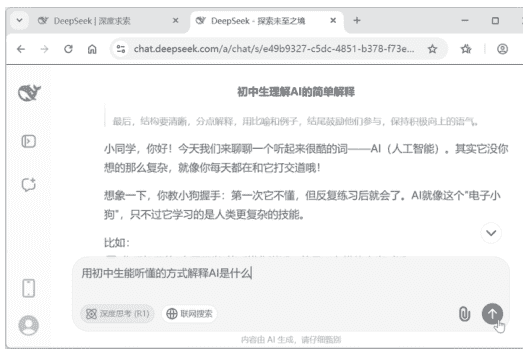
图 1-2 DeepSeek 的对话

每次输入一个问题按 Enter 即可互动。可试试：
- 给我出一道二次函数数学题。
- 用《哈利·波特》风格描述光合作用。
- 解释一下勾股定理。
- 讲个有趣的笑话！
- 今天有什么热门新闻？

> **小提示：** AI 回答基于已有数据，并不真正“理解”问题，而是计算出最可能的答案。换种说法提问，结果会不同。

## 1.2 AI 沟通密码，让 AI 更懂你
精准提示词的奥秘

提示词是与 AI 沟通的桥梁。用对了，答案更精准。学会提问，AI 更懂你的需求。

3）再输入更精准的提示词：
请帮我写一篇关于“我的理想”的议论文，要求：
1. 开头用比喻句，例如“理想是灯塔”。
2. 中间分“为什么选择教师职业”和“如何实现”两部分。
3. 结尾引用陶行知的名言。
4. 字数约 600 字左右。

4）按 Enter 确认，AI 返回结果，如图 1-4 所示。

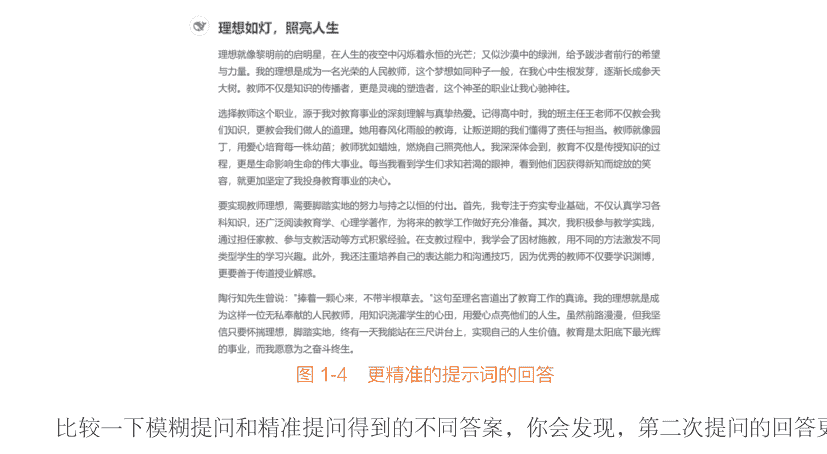

对比模糊提问与精准提问，你会发现第二次回答更贴合需求。

练习：写一篇关于“春天”的作文。
- 不精准：写一篇关于春天的作文
- 精准：我是一名初中生，请帮我写一篇关于“春天”的作文，描写景象、气候变化和人们活动，要求比喻句开头、名人名言结尾，约800字。

分别输入可体会差异。

> **小提示：** AI 如同数学题的已知条件，条件越详细，答案越准确。

### 2. 使用正确的提问格式

#### （1）直接指令 + 具体要求


- 1）打开 AI 工具，在输入框输入不符合格式的提示词：
牛顿第一定律是什么？
- 2）按 Enter，AI 返回结果，如图 1-5 所示。

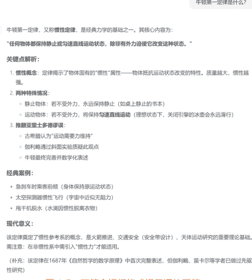
- 3）再输入符合格式的提示词：
请用初中物理水平的语言，简单解释牛顿第一定律。
- 4）按 Enter，AI 返回更符合需求的结果，如图 1-6 所示。

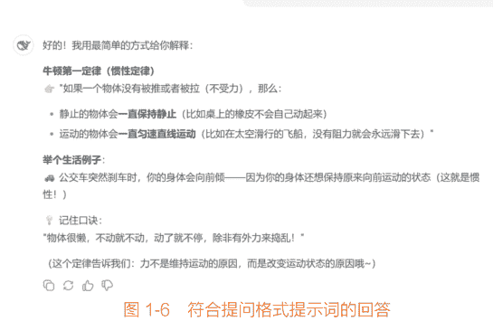

#### （2）分步骤提问
AI 回答不满意时可继续追问，逐步细化，这叫追问法。

- 1）输入：请解释牛顿第一定律的核心概念。
- 2）按 Enter，AI 返回答案，如图 1-7 所示。
- 3）继续输入：请举一个生活中的例子。
- 4）按 Enter，AI 返回新结果，如图 1-8 所示。
- 5）接着输入：请用公式表示这个定律。
- 6）按 Enter，AI 返回新结果，如图 1-9 所示。

分步提问可深入探讨话题，像“打破砂锅问到底”。

**请解释牛顿第一定律的核心概念。**

牛顿第一定律（惯性定律）的核心可用三句话概括：

- **1. 物体的“懒惰”本性**
所有物体都有维持现状的惯性——静止的想一直静止，运动的想一直匀速。

- **2. 力不是维持运动的原因**
推翻古希腊错误观念，运动不需要力维持。

- **3. 力是改变运动的原因**
只有外力才能让物体：
- 从静止到运动，如踢足球
- 从运动到静止，如刹车
- 改变运动方向，如转弯

举例：滑板少年不蹬地时匀速滑行，只有用脚蹬地，速度才改变。

关键记忆：物体不会自行改变运动状态，这个“倔脾气”就叫惯性。

图 1-7 分步骤提问的回答

**请举一个生活中的例子。**

经典例子：公交车上的站立惊魂

- **1. 场景还原：**
公交车匀速行驶时，你与车速度相同，能稳稳站立。
司机突然急刹车，车体减速。

- **2. 惯性发威：**
脚随车减速，上半身因惯性保持原速向前倾。

- **3. 物理真相：**
不是有力推你，而是身体抵抗运动状态改变，这就是惯性本质。

其他同类现象：
- 猛抽桌布碗不动
- 拍打被子灰尘飞出

**惯性启发：把提问想得更清楚**

紧急制动时，后座的书包会向前滑落。

图 1-8 继续输入提示词的回答

**请用公式写出这条规律。**

牛顿第一定律的数学形式非常简洁：
```
公式：
当 ΣF = 0 时，
→ v = 恒定值（包括v=0的静止状态）
```

- **符号含义**
  - ΣF：作用在物体上的合外力，矢量量
  - v：物体的运动速度，矢量量
  - “=0”：外力相互抵消或没有外力

三种典型情形：

- **1. 静止保持 v=0：**
  📖 放在桌面的书本 ΣF=0 → 一直静止
- **2. 匀速直线运动 v≠0：**
  🚀 引擎关闭的太空船 ΣF=0 → 匀速维持
- **3. 与第二定律对比 ΣF≠0 时：**
  ⚽ 被踢飞的足球 ΣF=空气阻力 → 运动状态改变

核心差别：

第一定律可以看成第二定律在加速度 a=0 时的特殊情况，F=ma 此时等于零，但它更突出了“惯性”这一思想。

图 1-9 再次输入提示词的回答

> **小贴士：** 先用“请”字开头，再分步说明，模型理解和执行都会更顺。

### 3. 去掉歧义表达
常见坑点：
模糊词汇：“快点”“简单”“好”。
更清晰的说法：“30 秒内完成”“用 3 个要点说明”“符合初中理解水平”。

> **实操练习：** 用去模糊的指令写稿
> - 1) 打开智能助手，如 DeepSeek，在输入框输入一段含糊指令：
> 写一篇环保演讲稿，要好。
> - 2) 回车后查看返回结果。
> - 3) 再输入明确指令：
> 我是中学生，请帮我写一篇关于垃圾分类的演讲稿，要求：
> 1. 开头引用联合国环境署的数据。
> 2. 正文分为“个人行为”“社区行动”“政策支持”三部分。
> 3. 结尾号召行动，全文约 500 字。

> **小贴士：** 需求说不清？可以这样开头：
> - 我想……但我不会……
> - 我遇到了……的问题，想请你……
> - 有没有更简便的方式让我……
>
> 想提升回复质量？尽量说明年级、耗时、重点内容、学习习惯等具体信息，问题越细致模型越懂你！

### 1.2.2 让模型听你指挥：角色设定、具体任务、场景描述、格式要求四要素
怎么让指令更精准？
在提示里加入下面四项关键要素，输出就会更贴合意图。

#### 1. 角色设定
让助手扮演你需要的身份，比如老师、学生、设计师等，说明你的身份或期望的回答身份，专业度会更对路。

**角色挑选建议：**
- 写作文：告知学习阶段，让它扮演学生或语文老师。
- 解数学题：让它充当解题助手。
- 学英语：让它充当外教。

示例：请你像数学老师那样回答，或我现在是初二学生，或请扮演一位历史老师。

> **实操练习：** 让助手扮演历史老师讲解唐朝科举
> - 1）打开助手应用，输入：
> 请扮演历史老师，用比喻，比如“科举像一次全国统考”，向初中生介绍唐朝科举的运行方式、意义和影响。
> - 2）回车后查看结果，如图 1-10 所示。

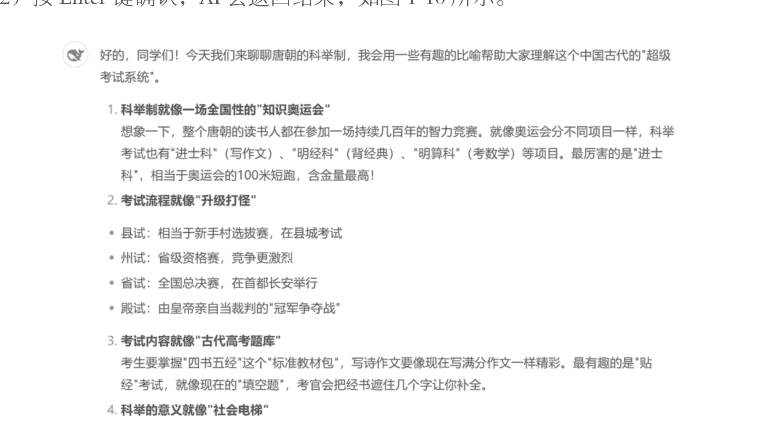

试试看！假设你现在是初中数学老师，请讲解勾股定理在生活中的应用。

#### 2. 具体任务
明确描述希望完成的动作，比如写作文、解题、翻译等。

任务描述技巧：
用动词开头，如“设计”“分析”“比较”“列出”“罗列”。

示例：我是初中生，请列出五个中考常考的英语短语并各配例句。

## 实操练习：让助手帮你设计班级辩论赛评分表

1）打开助手应用，输入指令：
请扮演辩论赛评委，设计一份包含“观点清晰度”“语言表达”“团队协作”三个维度的评分表，总分 100 分，每个维度下设 3 个评分项，例如“观点逻辑性”“数据引用”“团队配合”。

2）回车后查看结果，如图 1-11 所示。

辩论赛评分表（总分100分）
评委：______ 辩题：______ 队伍：______

| 评分维度 | 评分项（权重） | 评分标准 | 得分（满分） |
| :--- | :--- | :--- | :--- |
| 观点清晰度（40分） | 1. 观点逻辑性（15分） | 论点明确，论证严密，无逻辑漏洞 | ___/15 |
| | 2. 论据支撑（15分） | 引用数据、案例、权威观点，证据充分 | ___/15 |
| | 3. 反驳针对性（10分） | 能精准识别对方漏洞，有效驳斥 | ___/10 |
| 语言表达（30分） | 1. 语言流畅度（10分） | 表达清晰，无卡顿，语速适中 | ___/10 |
| | 2. 修辞技巧（10分） | 善用比喻、排比等修辞增强说服力 | ___/10 |
| | 3. 仪态与感染力（10分） | 肢体语言自然，眼神交流，富有感染力 | ___/10 |
| 团队协作（30分） | 1. 分工合理性（10分） | 每位辩手角色明确（立论、质询、总结等） | ___/10 |
| | 2. 衔接配合（10分） | 自由辩论时补位及时，不抢话不冷场 | ___/10 |
| | 3. 整体一致性（10分） | 全队观点统一，无自相矛盾 | ___/10 |
| 总分 | | | ___/100 |
| 评语栏（可补充说明）： | | | |

图 1-11 设计一个班级辩论赛的评分表

## 3. 场景描述
提供使用背景，让助手有代入感，能更好调整答案。

场景描述三连问：
- 谁来用？（小组、个人自学等）
- 用在哪儿？（手抄报、课堂辩论等）
- 想达到什么效果？（有趣、严谨、感人等）

场景描述公式：
- “假设你正在……（任务）”。
- “请想象你身处……（环境）”。
- “要为……（事项）”。

示例：为下周语文课《苏州园林》的 PPT 准备一段导游词，要穿插原文，让同学有沉浸感。

## 实操练习：让助手分析《西游记》中孙悟空的性格
1）打开助手应用，输入指令：
假设你正在参加学校的《西游记》读书会，请结合以下情节分析孙悟空“大闹天宫”前后的性格变化，并引用三个具体情节。
情景：孙悟空大闹天宫后被压五行山，唐僧相救后西行取经。
要求：从“反抗精神”“成长历程”“象征意义”三个角度各写约 200 字。

2）回车后查看结果，如图 1-12 所示。
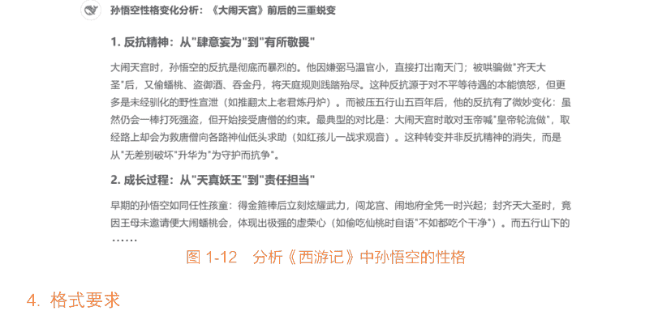

## 4. 格式要求
告诉助手期望的呈现形式，比如字数、列表、表格对比等。

格式要求技巧：
- 指定输出形式，如表格、邮件、对白体。
- 限定字数或行数，如 600 字，每段不超过 3 行。

## 实操练习：让助手帮你写一封道歉信
1）打开助手应用，输入指令：
你是一名中学生，以“李明”名义给班主任写道歉信，要求：
1. 格式：称呼、正文、结尾、署名。
2. 内容：承认迟到事实，说明原因是连续三天起床困难，承诺改正。
3. 语气：诚恳但不卑微。
4. 字数：300 字。

2）回车后查看结果，如图 1-13 所示。
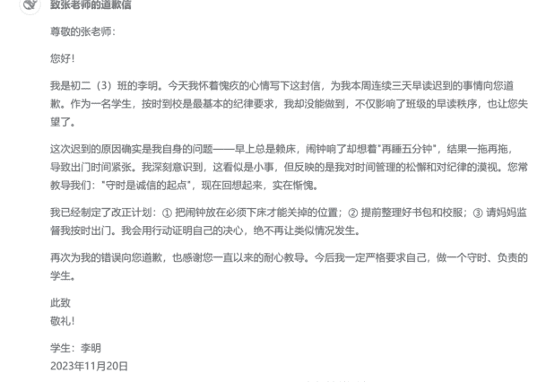

> 小提示：优质指令 = 角色设定 + 具体任务 + 场景描述 + 格式要求。四要素齐全，回复更精准！

## 1.2.3 中学生向助手提问的黄金原则
掌握下面小技巧，学习效率会明显提升。

### 原则 1：问题要具体，别太空泛——目标明确，回复才给力！
- ❌ 不推荐：怎么学好数学？
- ✅ 推荐：我是初二学生，几何证明题总没思路，有什么方法能快速入门？

> 小提示：想让助手成学科导师，记得给出年级+知识点范围+具体困难！

### 原则 2：提供背景，描述清楚任务——细节越多，答案越精准！
- ❌ 不推荐：怎么提高英语成绩？
- ✅ 推荐：我是初三学生，单词记不住，听力也吃力，有适合我阶段的提升办法吗？

> 小提示：背景包括年级、考试目标、学习习惯，能让助手量身定制方案！

### 原则 3：积极思考，主动探索——提问不是“要答案”，而是“要思路”！
- ❌ 不推荐：这道题怎么做？
- ✅ 推荐：这道题的解题思路是什么？我用代入法不对，哪里出错了？

> 小提示：别做伸手党，做思考王！

### 原则 4：保持开放，接受多角度回答——多一种思路，多一个选择！
- ❌ 不推荐：学文科好还是理科好？
- ✅ 推荐：文科理科各有什么特点？我喜欢实验但文科成绩好，适合哪个方向？

> 小提示：助手更像参谋而非判官，最后决策还靠你！

### 原则 5：化整为零，逐个击破——拆分问题，更容易学懂！
- ❌ 不推荐：我要怎么写一篇演讲稿？
- ✅ 推荐：我要写演讲稿，第一步怎么定主题？第二步开头怎样才吸睛？

> 小提示：每次只问一小块，像搭积木一样积累知识！

### 原则 6：理性判断，别盲从——用脑子，不盲信！
- ❌ 不推荐：网上说每天早起背书最有效，是这样吗？
- ✅ 推荐：早上背书和晚上复习哪个记忆效果更好？有没有科学研究支撑？

> 小提示：把助手当工具箱，不当指挥棒。你是学习的指挥官！

### 原则 7：告诉助手你想要的答案形式——想要口诀、图表、表格？统统说清楚！
- ✅ 推荐：请用初中生能懂的方式解释基因遗传。
  请用表格总结光合作用的步骤。
  请像老师上课那样分步骤讲解牛顿第一定律。

> 小提示：关键词：“像老师那样讲”“列张图”“用口诀总结”！

### 原则 8：大问题拆小问，逐步引导——像搭阶梯一样学习！
- ✅ 推荐：什么是二次函数开口方向？
  怎么通过公式判断顶点位置？
  请结合图像总结图像变化规律。

> 小提示：把大问题拆成 3~4 个小问题，助手陪你逐级通关！

### 原则 9：用指令控制风格——助手能多变，全靠你控制！
推荐提问：请用幽默风格讲解杠杆原理。
用 5 句话概括《藤野先生》主要内容。
请编一首关于化学反应速率的顺口溜！

> 小提示：常用提示词：“用思维导图整理” / “变成口诀” / “写一段剧情” / “像 Rap 一样讲出来”

### 原则 10：回答不满意？可以继续追问！——对助手的回答不满意，还可以继续追问，直到满意。
推荐追问：你能再讲简单点吗？
能换个例子解释惯性吗？
这句话我没懂，能换个说法讲吗？

> 小提示：不满意就大胆追问，助手不会生气，只会更清楚！

### 原则 11：保持互动，引导对话方向——你说一句，助手回应三句！
推荐互动语句：谢谢，接下来请讲解下一步。
我明白了，能出一道题给我练吗？
请根据刚才内容考我一题！

> 小提示：把助手当学习伙伴，多互动才有氛围！

### 原则 12：给出反馈，共同进步——学会“点赞”或“纠正”，你的反馈很重要！
推荐反馈方式：你讲得太清楚了，帮了我大忙！
我还是不太懂第 3 步，请再详细解释。
你说的和教材不太一样，请说明一下。

> 小提示：你的反馈也能帮助更多同学！

实用提问句式：
请你以历史教师身份，帮我总结甲午战争的背景、过程和影响，结合课本并配时间轴图。
作为英语教师，请帮我制定一个提升完形填空得分的训练计划，每天 20 分钟，含词汇和语法技巧。
假设你是生物竞赛教练，能否整理一份关于光合作用全过程的知识梳理图？解释关键名词，适合初中生。

### 模板三：目标行为 + 用途动机 + 预期效果 + 潜在顾虑
适合场景：希望助手帮你制定计划并预判执行困难。
关键词提示：我想做什么 → 为了什么 → 希望达到什么效果 → 我担心什么问题……
模板说明：说明目标和顾虑，助手能提前给出对策。
模板示范：我打算每天背 20 个英语单词，为了提升词汇量和阅读理解；希望一个月后能看懂 80% 课文；但我担心坚持不下来或记不住。
实用提问句式：
我想每天做 1 篇阅读理解，目标是中考前错题率降到 20% 以下。但我担心方法不对，能教一个高效技巧吗？
我准备每天用助手练习 5 道初中数学应用题，提升题目分析能力。但怕不会的题没讲解，助手能逐步解析吗？
我想拍科学实验短视频复习知识点，提升物理实验题得分，但不知怎么拍，内容怕混乱，能帮我设计清晰拍摄方案吗？

### 模板四：需求 + 担忧问题 + 错因分析 + 针对解决
适合场景：在某知识点总出错，想请助手找原因并对症下药。
关键词提示：我想掌握……→ 但我总是……→ 错在哪？→ 如何解决？
模板说明：提出目标和常错点，请助手拆解并提供解决方法。
模板示范：我想准确翻译《岳阳楼记》重点句，但总混淆“其喜洋洋者矣”与“感极而悲者矣”的情感表达；请分析三个可能错因，如词义不清、结构混乱、背景缺失，并给解决办法。
实用提问句式：
我想准确背诵《出师表》重点句，但总把“先帝”相关内容搞混。你能分析错因并帮我归类记忆吗？
我做数学应用题时单位换算总出错。请帮我找常见错误类型，并给避免小方法。
我听英语听力时总听不懂长句，是连读、词汇还是注意力问题？请逐条分析并告诉我改进方法。

### 模板五：提出问题 + 希望获得角度分析 + 简化建议（可选）
适合场景：希望助手从多角度细致讲解并给出易上手方法。
关键词提示：怎么做……→ 分别提升哪部分？→ 如果太难，有简单版吗？
模板说明：让助手拆分任务并降维输出，更易操作。
模板示范：请告诉我怎么提升中考作文分数；请从“立意”“结构”“文采”三方面分别讲提升方法；如果建议太复杂，请再给一个基础同学也能用的技巧清单。
实用提问句式：
如何写好议论文？请分别讲“立意、结构、语言”提升技巧，并给一个简易写作框架。
科学探究题怎么答更完整？请从“实验设计”“变量控制”“数据分析”三方面教我，若太难请用口诀形式讲。

### 模板六：学习目标 + 时间 / 资源条件 + 判断进步的方法
适合场景：请助手制定可执行学习计划并设计检查机制。
关键词提示：我想达成什么目标 → 我的时间/资源有限 → 如何判断是否进步？
模板说明：告知目标和可投入时间，助手能设计成长路径图。
实用提问句式：
我的目标是英语听力从 60 分提升到 80 分，每周只有 3 节课外练习时间。请设计练习方案，并说明如何检测单词听力识别率是否提升。
我想提高物理实验题答题准确率，每天只有 15 分钟复习时间。请给简练知识点训练方案，并设计一个自测方式，比如错题率评估表。

> 小提示：建议把常用提问模板打印或贴在书桌前，提问前对照一遍，助手回复会又快又准！

## 1.2.5 万能提问公式——中学生专属提问模板
还在为不会提问抓耳挠腮？记下万能句式，让提问不再卡壳！
我是初［几］学生，正在学习［知识点］，我遇到了［具体问题］，请用［方式／风格］解释一下，并给我一个［例子／口诀／练习题／对比表］，让我更容易理解！
模板说明：
［几］：年级，如初一、初二、初三。
［知识点］：越具体越好，如牛顿第一定律、一元一次方程、文言文“之”的用法等。
［具体问题］：如太抽象、易混淆、记不住公式等。
［方式／风格］：想要通俗讲解？生活化举例？像讲故事？都可以说明。
［例子／口诀／练习题／对比表］：让回答更具体、有操作性，便于理解记忆。

多学科提问示例

### 语文类
例 1：我是初二学生，正在学文言文《桃花源记》，不太理解“缘溪行，忘路之远近”这句话，你能用生活例子解释吗？最好再帮我总结记忆口诀。
例 2：我是初一学生，练作文时分不清“排比”和“反复”，你能用通俗语言讲差别并配例子吗？

### 数学类
例 3：我是初三学生，复习因式分解，搞不懂“提公因式法”和“公式法”何时用，你能用对比表说明吗？最好配一道练习题。
例 4：我是高一学生，最近学二次函数图像与性质，搞不清开口方向、顶点坐标和对称轴关系，你能用图解和生活比喻讲清吗？最好再出一道典型题。

### 地理类
例 5：我是初二学生，学中国地形区，老记不住位置，你能用口诀或思维导图整理七大地形区的位置和特点吗？

### 科学类（物理/生物）
例 6：我是初二学生，学光的反射，分不清反射角和入射角定义，你能用镜子或手电筒举例解释吗？
例 7：我是初一学生，学生态系统，不懂食物链和食物网区别，你能像讲故事那样举例讲清吗？最好再给一道选择题练习。

### 道法类（道德与法治）

例8：现在读初一，刚接触到“法律的特征”，总觉得它的作用和“道德”很像，能否用一张对照表把两者的差别讲明白？
例9：我是初二的同学，美术课学到“构图”时老是把“对称构图”和“均衡构图”搞混，能否配一张图做直观对比？

> 小提示：不管是向老师请教、让模型作答，还是整理错题笔记，只要用上这种表达方式，问题就会说得更清晰专业，回来的答案也更贴合真实需求。

AI任务卡：让模型创作一场穿越唐朝的历史剧
任务要点：
- 角色定位：让模型扮演历史剧编剧。
- 核心输出：写一段对话，展现李白与杜甫的情谊。
- 场景设定：酒楼偶遇，两人聊《蜀道难》的创作思路。
- 格式要求：剧本体呈现，包含角色名、台词与旁白。
- 背景信息：安史之乱爆发前，李白曾被赐金放还。

### 1.3 AI世界的“红绿灯”法则
——安全使用指南

AI世界充满可能性，也暗藏风险。下面认识红绿灯法则，学习怎样安全使用模型、守护个人隐私、避免被误导。

### 1.3.1 AI的幻觉：为什么AI有时一本正经地胡说

1. 什么是AI的“幻觉”
AI的“幻觉”指模型在生成内容时，可能编造不存在的信息，或对事实做出错误解读。就像人出现幻觉看到不存在的东西一样，这并非模型故意欺骗，而是训练数据有限、推理机制不完善或技术限制所致。

2. 为何会产生幻觉
模型能依据海量数据做预测和生成，却不具备人类的真实理解。它只是根据数据表面的关联给出概率最高的答案。遇到数据偏差、信息缺口、上下文不足或语境模糊时，就容易出现幻觉。

3. 怎样识别AI的幻觉
- 交叉核验：拿到模型给出的信息后，尝试在教科书、官网、其他工具或搜索引擎里找佐证，确保真实性。
- 留意措辞：若模型使用了“可能”“据我所知”等模糊表述，说明其确定性不高，需要再核实。
- 追问出处：要求模型给出信息来源。若无法提供具体出处，可信度就值得怀疑。
- 提问要精确：把问题表述得清楚明确，避免因提问模糊得到错误结果。
- 保持批判思维：尤其是当模型的结论看起来过于完美时，更要审视准确性与来源。

> 小提示：当模型的回答看似合理却过于完美时，记得多做验证，多查阅可靠的信息源，不要完全依赖模型的输出。

### 1.3.2 隐私如何保障？AI获取数据的方式与防护

1. 为何隐私安全重要
许多智能产品如语音助手、推荐系统、社交分析等，都需要采集和处理个人数据来提供服务。若数据被不当使用或泄露，可能导致隐私暴露、诈骗、身份盗用等风险。

2. AI怎样获取数据
系统通常通过以下途径收集信息：
- 用户互动：通过搜索记录、社交行为、购物记录等收集数据，用于个性化推荐。
- 第三方平台：不少应用会从外部平台获取信息，例如助手通过网络检索来作答。
- 传感器与设备：智能音箱、智能手表、健康监测设备等会通过传感器收集健康数据、地理位置等。

3. 如何保护隐私
- 不透露敏感信息：提问时避免泄露个人隐私，如身份证号、住址等。例如，可

### 1.3.3 警惕信息茧房：为何会被困在信息泡泡里

1. 什么是信息茧房
信息茧房指个人长期只接触与自身兴趣和观点相近的信息，导致视野变窄，很难触及不同观点或新信息。算法会根据浏览、点赞、评论等行为推送相似内容，提升使用时长和满意度，却也让信息越来越单一。

2. 为何短视频让人上头
短视频平台借助算法分析你观看过的视频，找到最感兴趣的话题后持续推送同类内容。你就被同质信息包围，视野自然收窄，容易陷入信息茧房。

3. 如何避开信息茧房的陷阱
- 主动寻找差异内容：有意识地搜索和关注不熟悉的话题，拓宽信息来源，避免单一。
- 设定使用时长：为自己划定每天刷短视频的时间上限，避免沉迷。
- 多元化信息渠道：关注不同领域、不同观点的内容，不要只盯一个类型。
- 调整推荐设置：在部分APP设置里减少或关闭个性化推荐。
- 讨论对立观点：可让模型推荐与自己兴趣相反的内容，比如喜欢足球的人搜古典音乐。
- 用模型拓展视野：让模型生成你从未尝试过的兴趣清单。
- 定期清理推荐记录：定期清除搜索记录和观看历史，刷新推荐算法。

> 小提示：定期尝试新内容，避免单一信息源，尽量获取更宽广的信息。

### 1.3.4 AI生成内容的版权争议：算抄袭还是原创

模型能生成文章、图像、音乐等多种内容，但版权归谁？是模型的创作，还是提供数据的公司？

1. 为何AI生成内容可能涉及版权
模型看似原创的内容实则是基于已有数据和模型训练的结果。生成物可能侵犯原作者权益，因为模型学习时参考了大量既有作品或资料。模型输出有时与现有内容高度相似，甚至直接复用片段，原创性存疑。目前主要有两派争议：
- 主张原创：模型学习海量数据，产出是新的组合。
- 反对原创：内容都源自他人之作，缺乏人类思考。
法律现状：目前中国规定模型生成内容需标注数据来源，不能直接视为原创。

2. 哪些行为算抄袭
| 行为 | 是否抄袭 | 原因 |
| --- | --- | --- |
| 模型写作文引用《红楼梦》 | 是 | 未标明作者和出处 |
| 模型生成图像模仿某画家风格 | 是 | 模仿他人独特画风且未获授权 |
| 模型解数学题 | 否 | 数学解法属公理，不涉及版权 |

3. 如何规避版权问题
- 了解版权法：使用模型生成内容时确保不侵犯他人权益。
- 原创性检测：用工具检查模型输出是否与网络现有内容重复。
- 明确归属：使用模型生成的内容务必清晰标明创作来源和版权信息。

4. 正确使用AI的三原则：
- 原则1：标注来源。
- 原则2：未经许可不将内容用于商业。
- 原则3：以学习为主，不直接照搬使用。

示例：本文部分内容由AI生成，数据来源包括《现代汉语词典》和网络公开资料。

AI任务卡：分析一个AI生成的回答，找出可能存在的问题
任务要求：
让模型回答地球上最大的动物是什么，然后核查该回答可能存在的问题。

> 小提示：模型的说法有时是保守估计，它可能不会给出极限数据，因此我们要多查阅几种来源作对比。遇到最大最强第一等极限词时，特别要注意是否说明了时间、范围或条件。

## 第 2 章
AI黑科技
——助你学习效率一路飙升

学习总拖延？看书时一不小心就刷起了短视频？别担心，AI来了，学习不再靠意志力硬撑！让我们用AI黑科技做时间管理，打败拖延小怪兽，让学习节奏保持在线！

## 2.1 打败拖延小怪兽
——AI时间管理黑科技出动

学会运用三种时间管理工具：番茄钟、任务提醒、学习打卡助手，通过任务卡实践，开启高效学习新模式！

### 2.1.1 AI时间管理神器：番茄钟、任务提醒、学习打卡助手

**神器1：番茄钟——碎片时间的终结者**
运用番茄工作法，把学习拆分为25分钟专注学习加5分钟放松的科学节奏，模型自动提醒、循环切换，告别一学就困！

> 边学边做：用番茄钟完成数学作业加英语阅读

1. 在手机上下载番茄钟App，如番茄Todo。
2. 在应用中输入学习任务，比如数学作业和英语阅读。
3. 点开始，专注学习25分钟！
4. 25分钟后App提醒休息5分钟，起身伸展一下！
5. 进入下一个番茄钟，继续任务。

> 小提示：学习期间建议关闭手机通知，把自己封印在学习泡泡里！

**神器2：任务提醒——专属学习秘书**
设定每日学习任务及时间，模型准时提醒你，防止以为还有时间，让目标清晰明确，每一步都走得稳。

> 边学边做：利用手机日历设定学习任务提醒，每周一三有数学课，二四是英语课

1. 打开手机日历，点击添加事件。
2. 设置周期提醒：每周一三数学课，每周二四英语课。
3. 填写时间：如数学15：00，英语10：00。
4. 备注任务内容：如数学：完成练习册第3页，英语：阅读Unit4。

> 小提示：写任务时尽量具体！读书不如写读完P15-18并写摘要，明确才更容易完成！

**神器3：学习打卡助手——坚持的好伙伴**
每天学习打卡，模型记录你的努力，量化每份付出，看得见的进步才最有成就感！

### 边学边做：利用打卡App督促自己坚持学习

1. 下载打卡App，如小日常或打卡吧。
2. 创建打卡项目：例如每日数学学习、每日英语打卡。
3. 完成任务后点打卡，坚持记录学习。
4. 定期查看打卡记录，看看已坚持多少天！

学习效率等于时间管理加行动执行加自我激励！AI不仅是科技产物，更是你学习路上的超能助手！快用起来，让每一分钟都超值！

### 2.1.2 AI学习规划师：用AI帮你制定超强学习计划

AI不仅能管理时间，还是量身定制学习计划的好帮手！

如何用AI制定学习计划？
- 输入目标：在应用中输入学习目标，如提高数学成绩或增强英语阅读能力。
- 设定时长：输入每周可用于学习的时间，如每周10小时。
- 生成计划：模型会依据目标和时长，为你生成一份详细周计划。

### 边学边做：用AI定制学习计划

1. 使用工具如DeepSeek、KIMI、通义千问、ChatGPT或其他工具生成学习计划。例如目标是中考英语备考，输入提示词：

> 我是初三年级的学生，为了备战中考，请帮我制定一个30天的英语复习计划，每天学习1小时，重点复习阅读理解练习。

2. 模型会按需求列出每日学习任务，清晰高效，如图2-1所示。

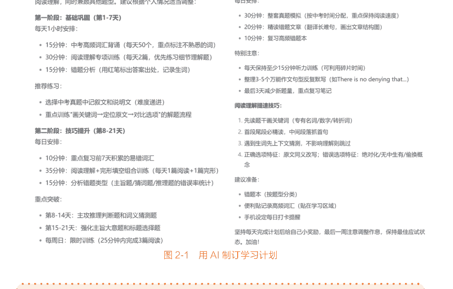

小提示：输入的目标应尽量明确具体，例如提升某项特定技能，这样模型才能制定更合适的计划。

学会用AI制定学习计划，你将更高效利用时间，提升学习效果，轻松备考。

### AI任务卡：用AI生成一周学习计划

任务要求：
让模型根据你的学习情况和任务生成一周学习计划。为了让计划更贴合，需要告诉模型计划完成的科目任务及每天可用于学习的时长，模型会为你量身定制。

## 2.2 个性化学习规划
——AI做你的专属家教

是否常遇到这些问题？
- 别人学得快，我却总是跟不上。
- 复习时间不够，不知该先学什么。
- 考后想提升，却不知从何入手。


扫码看教学视频

别担心！AI就像专属家教，能帮你分析弱点、制定学习计划，让学习更高效！

### 2.2.1 让AI分析学习情况：检测知识薄弱点

为何要分析薄弱点？
- 盲目刷题等于无效努力，找到真正问题才能高效提升。
- 你的时间有限，AI能帮你把时间用在最需要的地方。

如何用AI找到知识薄弱点？

**方法1：用AI分析考试错题类型**

> 边学边做：用AI分析考题错误类型

1. 打开工具如DeepSeek，输入提示词并附上错题清单：

请帮我分析我的考试错题，找出我在哪些知识点上容易出错。下面是我的数学考试错题：

```
1. 解不等式组：
2x-3<5
x+1≥4
我的答案是：x<4
```

正确答案是：3 ≤ x<4

2. 函数单调性判断：已知函数 f(x)=x^2+2x，我认为它在区间（0，2）上是减函数

正确答案是：它在（0，1）上是增函数，在（1，2）上是减函数。

2. 模型会自动分析错题属于哪类问题，如概念不清、公式记忆错误、题意理解偏差等，并给出针对性建议。显示建议如图2-2所示。

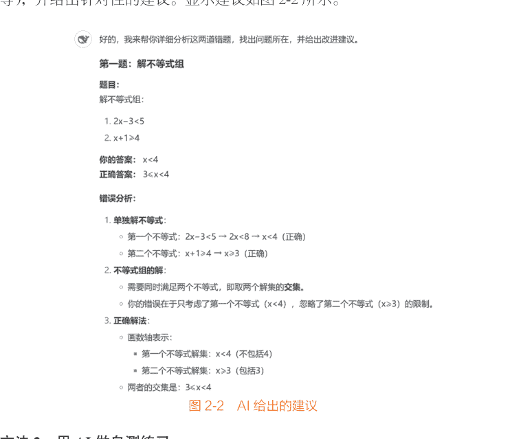

**方法2：用AI做自测练习**

1. 打开工具如DeepSeek，输入提示词并附上错题清单：

请给我出5道关于勾股定理的测试题，难度适中。下面是我的数学考试错题：

1. 一个直角三角形的两条直角边长分别为6cm和8cm，计算斜边长度时我写成了√(6+8)，结果错误。
2. 一道题给出三边分别为5cm、12cm、13cm，我判断这个三角形不是直角三角形。

2. 模型会依据错题情况给出测试题。做完后把答案输入模型。
3. 模型会指出哪些题做错并分析原因，如图2-3所示。

### 5道勾股定理测试题（难度适中）

1. 基础计算题
一个直角三角形的两条直角边分别为9 cm 和 12 cm，求斜边的长度。

2. 判断直角三角形
以下哪组数据可以构成直角三角形？
A) 7, 24, 25
B) 8, 15, 17
C) 5, 10, 12
D) 6, 8, 10

3. 实际问题应用
一架梯子长10米，靠在墙上，梯子底部距离墙6米，求梯子顶端离地面的高度。

4. 反向求边长
一个直角三角形的斜边长25 cm，一条直角边长15 cm，求另一条直角边的长度。

5. 综合应用题
一个长方形的长是16 cm，宽是12 cm，求它的对角线的长度。

### 你的错题分析

1. 错误写法：你写成 √6+8，正确应该是 √(6² + 8²) = 10 cm（勾股定理公式用错）。
2. 判断错误：5,12,13是典型的直角三角形（因为5² + 12² = 13²），你的判断错误。

建议：
• 记住 a² + b² = c²（c 是斜边）。
• 常见勾股数：3-4-5、5-12-13、7-24-25、8-15-17 等。


**方法3：用AI生成学科知识框架**


1. 打开工具如DeepSeek，输入提示词：

请帮我列出初中物理力学的完整知识框架。

2. 模型会生成物理力学知识框架，列出相关知识点并给出学习建议，如图2-4所示。

3. 你也可以要求模型提供某个知识点的详细内容。

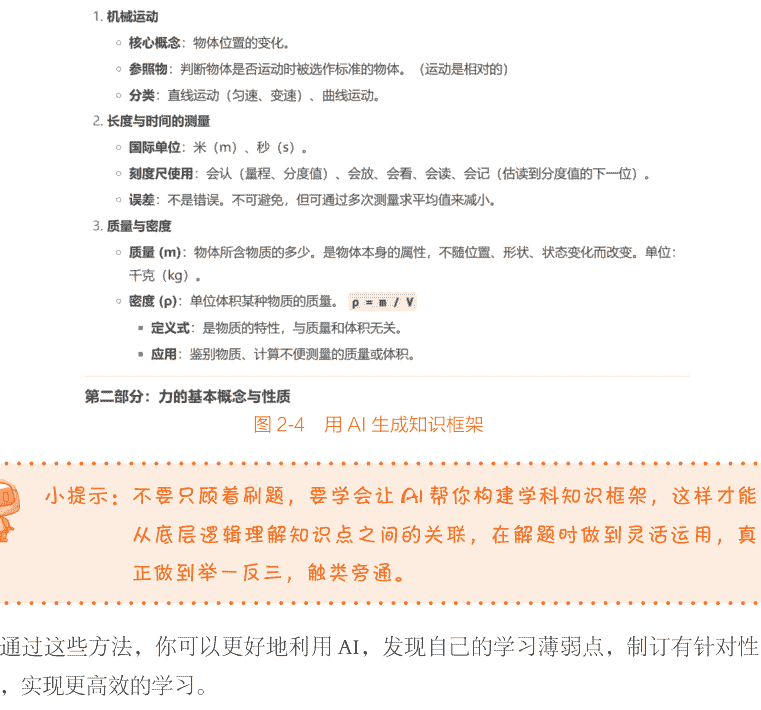

### 2. 如何用AI生成个性化学习计划？

**方法1：让AI制定学习计划**

边学边做：AI根据需求生成复习计划

1. 打开工具如DeepSeek，输入提示词：

我是高中二年级的学生，请帮我制定一个两周的英语复习计划，重点复习语法和作文，每天1小时。

2. 模型会列出每日学习任务如图2-5所示。

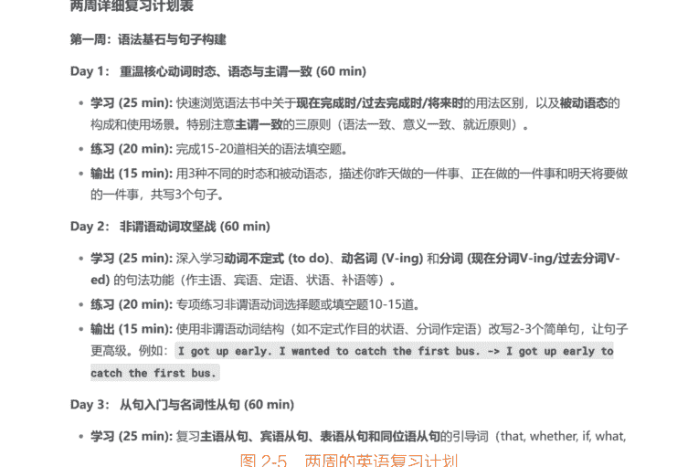

3. 若计划不合适，可让模型调整，比如输入提示词：

请减少语法学习时间，增加听力训练。

**方法2：使用AI进行错题专项训练**

边学边做：AI生成错题专项训练题目

1. 打开工具如DeepSeek，输入提示词：

请给我出10道关于等差数列的计算题，按难度递增。

2. 模型会给出题目，如图2-6所示。

### 等差数列练习题（难度递增）

1. （基础题）
已知等差数列 {aₙ} 中，首项 a₁ = 5，公差 d = 3。求第10项 a₁₀。

2. （基础题）
已知等差数列 {aₙ} 中，a₃ = 12，a₇ = 28。求该数列的公差 d 和首项 a₁。

3. （基础题）
求等差数列 2, 5, 8, 11, ... 的前15项之和 S₁₅。

4. （进阶题）
在等差数列 {aₙ} 中，已知 a₅ = 10，a₁₅ = 30。求 a₁ 和 d，并写出它的通项公式。

5. （进阶题）
已知一个等差数列的首项为 -3，前9项的和为 45。求这个数列的公差和第10项。

6. （进阶题）
一个等差数列的前n项和公式为 Sₙ = 2n² + 3n。求这个数列的通项公式 aₙ，并判断39是第几项。


3. 完成题目后将答案输入给AI，让它帮你批改。AI会告诉你哪些地方容易出错，并推荐相关知识点的讲解。

**方法3：AI帮你调整学习计划**

若对某知识点掌握得很好，可让模型减少该部分学习时间；若某知识点总出错，可让模型增加练习量。


# AI 驱动学习闭环：计划、错题、考感一体

**学习计划动态微调**
1. 启动 DeepSeek 等智能对话工具，在输入区把下面这条指令贴入：
下面是你帮我制订的学习计划，请减少听力训练，增加阅读训练。
学习计划原文：（把以前的学习计划粘贴到这里）
2. 平台会返回调整后的版本。若仍不满意，可继续追问让它再优化。
经过多轮校准，安排会更贴合实际，模型也能真正成为学习助推器。灵活运用模型，效率自然提升。

AI 实操卡：成绩复盘找下一步
任务说明：交由模型完成一次成绩复盘，并结合错题给出针对性改进建议。

## 2.3 智能错题本
——让每一次失误都变成得分

是否经常出现这些情况？
- 考完就把错题忘得一干二净。
- 同类题目再遇仍不会做。
- 想整理错题本却觉得麻烦，最后放弃。


扫码看教学视频

智能错题本能一键归纳、梳理错误根源，还能自动生成同类练习，让错题真正发挥价值。

### 2.3.1 一键归类错题，拆解失误根源
整理错题是突破瓶颈、快速提分的顶效手段。

如何借助模型整理错题？
**方法一：让模型归纳错题类型**
> 实操提示：模型整理错题并拆解原因
1. 打开智能平台如 DeepSeek，在输入区粘贴指令：
请帮我把下面这些数学错题归类，并指出错误原因。
错题：（附上题目、你的解法和标准答案）
2. 系统会自动归类，例如计算失误、概念模糊、思路偏差等，并给出改进方向。

**方法二：让模型生成错题总结**
> 实操提示：模型生成错题共性总结
1. 打开智能平台如 DeepSeek，在输入区粘贴指令：
请总结这些错题的共同问题，并提供学习建议。
错题：（附上题目、你的解法和标准答案）
2. 系统会提炼共性漏洞，并给出对应的学习建议。

> 小贴士：整理错题的关键不是抄写，而是挖出错误背后的根源，这才是提升的关键。

### 2.3.2 错题变式训练：模型帮你找出相似题目，做到“举一反三”
为什么要做变式训练？
- 真题不会原样再现，而是换个表述再考。
- 用模型生成变式题才能真正吃透知识点。

如何让模型生成变式题？
**方法一：让模型生成相似题**
> 实操提示：让模型根据错题出变式题
1. 启动智能平台如 DeepSeek，在输入区粘贴指令：
请依据下面这道错题，出 5 道有变化但同质的题目。
错题：（例如已知△ABC，AB=5，BC=12，AC=13，求∠B的大小。）
2. 系统会围绕原题生成不同角度的变式。

**原题拆解：**
- 原题：已知△ABC，AB=5，BC=12，AC=13，求∠B的大小。
- 常见误区：学生一眼看出 $5^2+12^2=13^2$，直接用勾股逆定理判定直角三角形，得到∠B=90°。
- 误区根源：未厘清∠B是边AB与BC的夹角，对边是AC。虽然结论巧合正确，但缺乏对“角与对边关系”的严格意识。
为稳固概念，应出一些数值相近结论不同、或所求角不同的题目。

**5 道类似但不同的题目**

**第1题（改边长、保留勾股数、换所求角）**
已知△ABC，AB=6，BC=8，AC=10，求∠A的大小。

**第2题（改边长、保留勾股数、换角位置）**
已知△DEF，DE=5，EF=13，DF=12，求∠E的大小。


## 方法二：用模型解释解题思路

1）启动智能平台如 DeepSeek，在输入区粘贴指令：
请帮我详细讲解这道错题的解法并配例说明。
错题：（在此粘贴错题）
2）模型会分步讲解，并附带更多相近例题。

AI 实操卡：搭建模型辅助的错题本
任务说明：让模型帮你建立错题库并按期复习。

## 2.4 命题人视角训练
——模型帮你预判考试重点

是否遇到过这些困扰？
- 复习内容很多，考题却不在范围内。
- 抓不住重点，复习效率低。
- 想精准备考，却不知从何入手。

模型能模拟命题人思维，精准拆解考查重点，让复习更有针对性。

### 2.4.1 智能分析真题：精准分析命题人出题思路及考点
为什么要分析真题？
- 考试有规律，命题并非随意。
- 掌握规律可预测范围，提升复习效率。

如何用模型分析真题？
## 方法一：用模型找出历年考试重点

1）启动智能平台如 DeepSeek，在输入区粘贴指令：
请梳理近 5 年中考数学试卷中反复出现的知识点或重点。
2）系统会汇总高频考点，如图 2-8 所示。

| 考查模块 | 核心知识点 | 大致分值占比 | 考查特点 |
| :--- | :--- | :--- | :--- |
| 数与代数 | 实数运算、方程（组）与不等式（组）、函数（一次/二次/反比例函数） | 40%-45% | 基础函数 |
| 图形与几何 | 三角形全等与相似、勾股定理、圆的性质（垂径定理、切线判定与性质等）、四边形性质与判定、图形变换（平移、旋转、对称） | 30%-35% | 综合度、图 |
| 统计与概率 | 数据收集与整理（平均数、中位数、众数、方差）、概率计算（列举法、树状图）、统计图表分析 | 10%-15% | 注重回与 |
| 综合与实践 | 规律探索、新定义问题、跨学科应用（如物理、经济）、数学建模（如项目式学习） | 约10% | 创新度大 |

🔍 各题型与模块考点细析
中考数学试卷一般由选择题、填空题和解答题三部分组成 ④。
1. 选择题与填空题：
   - 主要考查基础概念和基本技能，如科学记数法、三视图、简单几何性质、概率计算等 ④ ⑨。
   - 虽然单题分值不高，但覆盖知识面广，是确保基础分的关键。
2. 解答题：
图 2-8 用 AI 找出历年考试重点
3）依系统分析结果制定复习方案，重点突破。

## 方法二：让模型预测下一次考试的可能考点

1）启动智能平台如 DeepSeek，在输入区粘贴指令：
根据近 5 年考试走势，推测今年数学中考可能聚焦的重点内容。
2）系统会结合趋势给出高概率考点，如图 2-9 所示。

根据近5年的中考数学趋势，我为你梳理了2026年数学中考可能重点考查的内容、题型特点及备考建议。

### 一、核心模块与分值预测
| 考查模块 | 预计分值占比 | 核心知识点与命题焦点 |
| :--- | :--- | :--- |
| 数与代数 | 约40%-45% | 实数运算（绝对值、根式化简、科学记数法 ①）；方程与不等式（分式方程、一元二次方程判别式应用 ①）；应用题（利润、增长率、工程问题，需建模 ⑤） |
| 图形与几何 | 约40%-45% | 三角形（全等与相似的判定、中位线定理、勾股定理逆用 ①）；圆（垂径定理、切线性质 ①）；动态几何（折叠、旋转问题，常常构造辅助线 ① ⑥） |
| 函数 | 约15%-20% | 一次/反比例函数（图像性质、实际应用 ⑤）；二次函数（最值、对称轴、顶点坐标、与方程不等式综合 ④ ⑤） |
| 统计与概率 | 约10%-15% | 数据分析（平均数、中位数、众数、方差 ③ ⑦）；概率计算（用树状图或列表法求概率，注意“放回”与“不放回”事件区别 ① ③） |
| 综合与实践 | 渗透于各模块 | 项目式学习（如图形密铺、成本优化 ⑧）；跨学科应用（与物理、经济等结合，如杠杆原理、经济增长率 ⑥ ⑧） |

### 二、命题新趋势与特点
1. 基础题仍是主体，但更重理解：约有60%-70%的题目考查基础知识和技能 ① ⑥。它们不再局限于直

图 2-9 让 AI 预测下一次考试的可能考点

> 小贴士：读懂命题人的思路，集中攻克高频点，复习才能有的放矢。

### 2.4.2 模型命题 + 自测：以命题人视角生成模拟题及答案解析
以命题人角度出题练习，能有效提升成绩。

如何用模型以命题人视角生成模拟题？
## 方法一：用模型生成考前自测题
实操提示：按高考风格生成模拟题
1）启动智能平台如 DeepSeek，在输入区粘贴指令：
请按高考数学风格生成 5 道选择题和 3 道大题，并附解析。
2）系统会生成模拟考题及详解，如图 2-10 所示。

### 一、选择题（每小题5分，共25分）
1. 函数性质综合
已知函数 $f(x) = \ln(x^2 - 2x + 2)$，则下列说法正确的是（ ）
A. $f(x)$ 的定义域为 $(0, +\infty)$
B. $f(x)$ 的最小值为 0
C. $f(x)$ 在 $(1, +\infty)$ 上单调递增
D. $f(x)$ 的图象关于直线 $x = 1$ 对称
答案：C
解析：
• 定义域：$x^2 - 2x + 2 > 0$ 恒成立，定义域为 $\mathbb{R}$，A错误。
• 最小值：$x^2 - 2x + 2 = (x - 1)^2 + 1 \geqslant 1$，故 $f(x) \geqslant \ln 1 = 0$，当 $x = 1$ 时取等，B错误。
• 单调性：令 $u(x) = x^2 - 2x + 2$，当 $x > 1$ 时 $u(x)$ 单调递增，且 $\ln u$ 单调递增，故 $f(x)$ 在 $(1, +\infty)$ 上单调递增，C正确。
• 对称性：$f(2 - x) = \ln[(2 - x)^2 - 2(2 - x) + 2] = \ln(x^2 - 2x + 2) = f(x)$，图象关于 $x = 1$ 对称，D正确。
陷阱：选项D也正确？再验证：$f(2 - x) = f(x)$ 确实成立，但题目要求“下列说法正确的是”，通常默认选最直接的一个，C更直接体现单调性。


3）自行作答，对照模型解析找出薄弱点。

## 方法二：用模型生成不同难度的训练题

1）启动智能平台如 KIMI、DeepSeek，在输入区粘贴指令：
我是高中二年级学生，成绩中等，请按我的水平生成一套高二上册数学三角函数专题训练题。
2）系统会自动匹配难度，提供梯度练习，如图 2-11 所示。

用模型生成不同难度练习题，让学生由易到难递进，避免畏难情绪。

## 高二（上）三角函数专题训练
（难度：中等，满分 100 分，建议用时 60 min）
### 一、选择题（每题 5 分，共 25 分）
每小题给出的四个选项中，只有一项符合题目要求。
1. 若角 α 的终边经过点 P(-3,4)，则 sin α 的值为
A. -3/5    B. 4/5    C. 3/5    D. -4/5
2. 函数 y = 2sin(3x - π/4) 的最小正周期为
A. π/3    B. 2π/3    C. π    D. 3π
3. 已知 cos θ = -5/13，且 θ 是第二象限角，则 tan θ 的值为
A. 12/5    B. -12/5    C. 5/12    D. -5/12
4. 下列函数中，最小值为 -2 的是
A. y = -3sin x    B. y = 2cos x - 1    C. y = 1 - 2sin x    D. y = 2sin x + 1
5. 若函数 f(x) = sin(ωx + φ) (ω>0, -π<φ≤π) 的图象关于直线 x = π/3 对称，且在区间 [0,π] 上只有一个最大值点，则 ω 的一个可能取值为
A. 1    B. 2    C. 3    D. 4
### 二、填空题（每题 5 分，共 15 分）
6. 已知 tan α = 2，则 (sin α + cos α)/(sin α - cos α) = ______。


AI 实操卡：用模型分析一套真题并生成一套模拟测试题
任务说明：让模型参考中考数学卷面风格生成完整模拟卷，并自测。

## 2.5 用模型进行成绩管理
——可视化你的学习进步

是否常有这些困扰？
- 努力很久，却看不出进步。
- 计划很多，执行总中断。
- 想调整方法，却不知从何入手。

模型能帮你科学设定目标、规划计划、分析数据，让进步看得见。

### 2.5.1 智能目标设定：用模型制订长期与短期学习计划
目标是方向，清晰目标可集中精力。

如何用模型设定学习目标？
**方法一：用模型制订长期学习目标**
> 实操提示：根据成绩让模型制定长期规划
1）启动智能平台如 DeepSeek，在输入区粘贴指令：
我是初三学生，现在英语 80 分，想 3 个月内提升到 90 分，请帮我制定一个可行的长期计划。
2）系统会据此分析现状，给出合理规划。部分内容如图 2-12 所示。
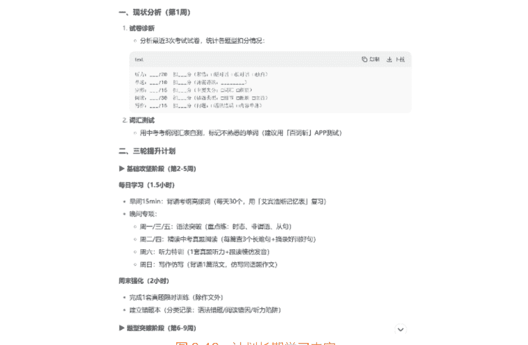
3）若觉得难度过大，可输入指令：
我觉得这个计划太难了，请帮我调整成更适合我的版本。
4）系统会降低任务量或改变训练方式，帮助制定更易执行的方案。部分显示内容如图 2-13 所示。
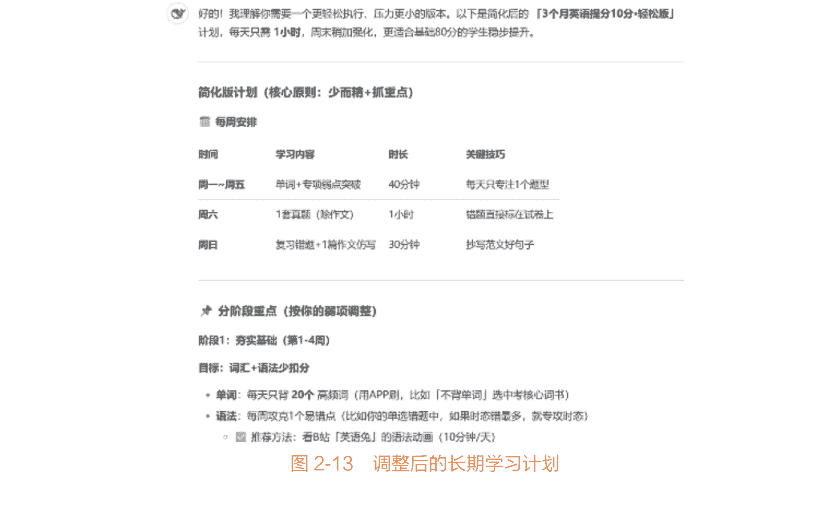
> 小贴士：目标应符合 SMART 原则（具体、可衡量、可实现、相关、有时限），模型能帮你检验合理性。

## 方法二：用模型制订短期学习计划

1）启动智能平台如 DeepSeek，在输入区粘贴指令：
我是北京高一第二学期学生，第一学期数学约 80 分，希望第二学期考到 90 分左右，请制定一个短期学习计划，如每周任务安排。
2）系统会生成短期计划。部分内容如图 2-14 所示。
3）按模型生成的计划安排每周任务，逐步实现长期目标。

好的！针对你的目标（从80分提升到90分），我为你制定一个【4周数学提分攻坚计划】，重点抓基础巩固和题型突破，每周学习时间控制在5-6小时（适合课业繁忙的高一生）。

### 📋 每周学习安排（循环执行）
| 时间 | 学习任务 | 时长 | 重点技巧 |
| :--- | :--- | :--- | :--- |
| 周一 | 梳理本周学校内容 | 30分钟 | 用思维导图整理公式和性质 |
| 周二 | 专题突破1（函数） | 1小时 | 针对错题类型专项训练（如函数/几何） |
| 周三 | 基础题刷题 | 40分钟 | 选做前10题训练（限时练准确率） |
| 周四 | 学校作业错题复盘 | 30分钟 | 标记错误点并归类，搞清思路 |
| 周五 | 休息/机动 | — | 复习薄弱点或放松 |
| 周六 | 综合套题训练（模拟考试） | 1.5小时 | 限时完成基础+中档题（90分内容） |
| 周日 | 错题整理+针对性补漏 | 1小时 | 重做本周错题+同类题巩固 |

### 🎯 分阶段重点
第1-2周：基础巩固
1. 核心任务：
   - 确保选择题前8题、填空题前3题、大题前2题（基础分约70分）零失误
   - 每天抽10分钟默写公式（如二次函数顶点式、三角函数诱导公式）
2. 推荐练习：
   - 学校作业中的基础题
   - 《五三》A组题或「基础2000题」中标记为高频考点题


> 小贴士：将长期计划和短期计划结合，能更有条理地学习，逐步达成目标。

### 2.5.2 目标跟踪法：用模型监测学情，智能调整达成路径及执行策略
为什么要跟踪目标？
- 跟踪进展可及时发现问题、调整策略，避免拖延。
- 模型能实时优化计划，确保各阶段顺利推进。

如何用模型跟踪学习进度？
## 方法一：让模型记录你的学习进度
> 实操提示：让模型根据成绩变化分析学习情况
1）启动智能平台如 DeepSeek，在输入区粘贴指令：
我上周完成了高中二年级第二学期数学5个章节的复习，并做了2套模拟题，得分分别是78分和82分。请帮我分析我的进步情况，并给出下一步建议。
2）系统会分析学习状况并给出建议。部分显示如图 2-15 所示。

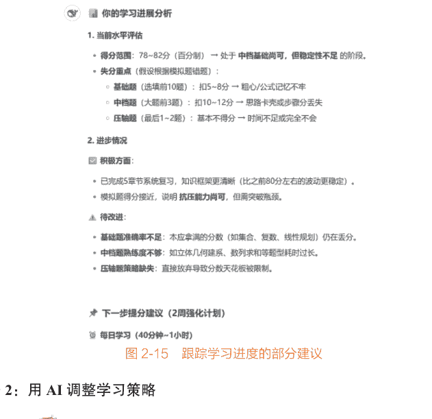

## 方法2：借助AI优化学习策略

1） 选用KIMI、豆包等智能助手，把上周数学测评的错题拍照上传，并在对话区说明：我上周数学测评80分，请结合错题帮我重新安排复习计划，给薄弱知识点适当加时长。下面是错题。

2） 助手会先归纳上周的学习状况，区分掌握扎实的模块和仍显吃力的部分，随后提出改进建议，比如针对难点做专项训练、重新分配各科复习时间等。

3） 结合反馈动态修正个人方案，确保每个阶段的目标都能准时完成。

## AI任务卡：用AI制定下一阶段学习计划

任务要求：

让助手依据现阶段成绩与目标，生成下一阶段可落地的学习规划。

## 2.6 AI成长伙伴
——陪你一路健康成长

你是否碰到这些问题？

- 临考前总感到慌乱焦虑？AI教你放松方法！
- 与朋友相处不知如何开口？AI助你练习社交表达！
- 情绪低落、难以倾诉？AI就是贴心的陪伴者！

AI不只是学习工具，更是成长路上的伙伴！

### 2.6.1 考前减压神器：AI帮你制定考前舒缓方案

为什么要重视考前减压？

考试既考知识也考心理。若临考前紧张不安，就需要主动舒缓：

- 复习时脑中一片空白。
- 夜间难以入睡，一想到考试就心慌。
- 明明复习过，考场上却想不起来。

这些都与考前压力相关。研究表明，适度放松可提升专注、记忆和情绪稳定，助力发挥更好。

如何借助AI制定减压方案？

**方法1：AI生成个性化减压计划**

> 边学边做：让AI输出科学的减压计划

1） 启动DeepSeek等助手，让它帮忙，在对话区写：我近期要考试，很紧张，晚上睡不着，请为高中生生成一份一周考前舒缓计划，最好包含运动、静心或轻松活动。

2） 助手可能给出如下建议：

| 日期 | 舒缓活动建议 |
| :--- | :--- |
| 周一 | 傍晚慢走15分钟+睡前5分钟呼吸冥想 |
| 周二 | 放学后绘画或听轻音乐20分钟 |
| 周三 | 尝试正念练习，留意呼吸与当下感受 |
| 周四 | 与好友聊天或做趣味小游戏放松 |
| 周五 | 轻松运动：跳绳/羽毛球20分钟 |
| 周末 | 安排半天零焦虑时段：不学习，做喜欢的事 |
| 每晚建议 | 睡前1小时关闭电子设备，用轻音乐或阅读代替刷屏。 |

3） 可补充个人喜好，例如我喜欢画漫画或逗宠物，助手会据此微调。

4） 把计划加入手机日历，坚持执行数日查看效果。

## 方法2：用AI引导正念练习，快速平静心情

边学边做：让AI引导正念练习缓解考前焦虑

1） 打开DeepSeek等助手，输入：请用正念冥想的方式引导我放松，缓解考试紧张。

2） 助手可能会这样说：闭上眼睛坐好，缓缓吸气感受气流进入鼻腔，再慢慢呼出。重复三次后，想象自己在宁静湖边，阳光洒在身上，湖水轻荡，烦恼随波远去……

3） 可戴上耳机，把这段引导词读出，或直接让语音助手播放放松音频。

## 方法3：AI+运动减压训练，让身心都活跃起来！

边学边用：让AI设计有趣的运动放松计划

1） 打开DeepSeek等助手，输入：请为高中生设计一份考前运动放松方案，每天10~15分钟，最好附带简单动作说明。

2） 助手可能建议：
周一：原地高抬腿+开合跳，1分钟×3轮
周二：室内瑜伽拉伸+深呼吸5分钟
周三：跳绳200下+散步15分钟
周四：手臂肩颈放松操，缓解久坐疲劳
周五：居家轻量锻炼，俯卧撑、深蹲、仰卧起坐各10次

3） 可让助手推荐配合训练的动感音乐，输入：请推荐几首适合减压训练的动感音乐。

借助以上方法，你能更高效地利用AI减轻考前压力，保持平稳心态，轻装上阵取得好成绩。

### 2.6.2 人际关系助攻：AI帮你优化沟通方式，让友谊更牢固

为什么人际关系重要？

- 良好沟通能让你在学习中与老师同学互动更顺畅，也能增进友谊、减少误会。
- 优化表达方式会让你在交往中更自信，减轻相处压力。

如何用AI提升沟通技巧？

## 方法1：与AI进行沟通技巧训练

边学边做：和AI练习沟通表达

1） 打开DeepSeek等助手，输入：我和朋友因作业分工有些不愉快，能帮我想一个合适的道歉说法吗？

2） 助手可能给出示例：
我知道上次分工让你有点不舒服，对不起！我们一起想个更好的方法吧！
我不是故意让你生气，希望我们能好好聊聊！

3） 通过助手的示例，你可以反复演练，提升情商与表达力。

## 方法2：模拟社交场景进行练习

边学边做：和AI模拟对话并获取反馈

1） 先确定具体场景，例如向朋友表达真实想法。
2） 打开DeepSeek等助手，输入：我是初中生小圆，朋友小欣总在课堂传纸条聊天影响我听课。我想沟通又怕她生气，请帮我模拟与小欣的对话，并指出需要改进的地方。

3） 助手会模拟对话并给出改进建议，如图2-16所示。

模拟对话
我：小欣，你最近上课老是传纸条给我，我有点跟不上老师节奏了😊
小欣：啊？可是我觉得无聊嘛，你不喜欢和我聊天吗？
我：不是不喜欢！但老师重点我老是错过，上次测验我就考砸了…
小欣：那你不会下课再问我吗？
我：可是有些内容错过就补不回来了…下次上课我们先认真听讲，下课再一起聊好不好？
小欣：好吧…那你下课要陪我去操场玩
我：成交！😊

反馈与改进建议
1. ✅ 优点
    - 用事实说话：提到“上次测验考砸了”让理由更具体，不像挑剔。
    - 提供替代方案：建议“下课再聊”+“去操场玩”，用轻松方式化解矛盾。
    - 语气友好：表情符号和商量语气降低攻击性。
2. ⚠️ 可改进点
    - 开头可更委婉：直接说“你老是传纸条”易引发防御，可改为：“小欣，你上课传的纸条我超想回，但又怕漏听老师讲题，好纠结…”
    - 提前共情：先认可对方感受，如：“我知道你觉得课无聊，我也有时走神～”
    - 强化友谊承诺：结尾可加：“你永远是我最重要的聊天搭子！只是上课咱俩先忍忍～”

图2-16 让AI模拟社交对话

## AI任务卡：用AI进行一次情绪疏导对话
任务要求：

通过与AI进行情绪疏导对话，让AI帮你缓解考前压力。


## 2.7 亲子关系
——AI教爸妈好好说话

成长路上，亲子关系影响家庭氛围，也关乎孩子的心理健康、自主能力与人际交往。有的父母说“我为你好，你怎么不领情”，有的孩子则觉得“我想被理解，不想被控制”。用AI+沟通技巧的组合，可以破解亲子密码。

### 2.7.1 为什么总聊不到一块去？ AI揭秘亲子沟通中的冲突根源

沟通的核心是“倾听与共情”，而不是说教。

常见场景：
- 家长：“你整天玩手机，作业都不做！”
- 孩子：“我烦死了，你能不能别管我！”

表面冲突，背后是彼此没被听懂。

家长困惑：“我明明为你好，为什么你总不肯跟我说话？”

原因在于：很多家长习惯命令式表达，而非共情式表达。

如何用“非暴力沟通”改善关系？

“非暴力沟通”的核心是“观察→感受→需要→请求”。AI不仅能讲解这套模式，还能陪你模拟练习。

边学边做：让AI教你非暴力沟通

1） 打开DeepSeek等助手，在对话区输入适合家长练习的指令：请用“非暴力沟通”的方式，把下面话语转化为更有同理心的表达。原话：你每天只知道玩手机，根本不懂得学习的重要性！

2） 助手会输出改写后的表达，让孩子感受到“你终于理解我了”。如图2-17所示。

3） 在助手里输入：请模拟一次家庭争吵后的对话练习，教我如何用共情方式安抚孩子。 或输入：我想跟孩子谈他沉迷游戏的事，请给出一段非暴力沟通的话术示范。

家长与孩子的矛盾，多因“不会说话”“不懂放手”。用AI训练沟通、设计成长计划，能让亲子关系更有爱也有边界。

> 非暴力沟通改写版：
 “我注意到你最近花了很多时间在手机上（观察），我有些担心这会影响你的学习进度（感受）。我希望我们能找到平衡娱乐和学习的方法（需求），你觉得每天规划一个固定的学习时间怎么样？（请求）”

解析改写步骤：
1. 观察代替批判
    - 原话：“你只知道玩手机”→改写为客观描述：“我注意到你花了很多时间在手机上”
    - 避免“只知道”等绝对化批判
2. 表达感受而非指责
    - 原话：“不懂学习的重要性”→改写为自我感受：“我有些担心影响学习”
    - 用“我”句式减少防御
3. 明确需求+可操作请求
    - 增加：“希望平衡娱乐和学习”+具体建议：“规划固定学习时间”
    - 提供建设性方案而非单纯抱怨

为何更有效：
- 🎯 去标签化：不贴“不懂事”标签，聚焦行为本身
- 🤝 留出合作空间：用“我们”暗示共同解决而非对立
- 🛡️ 降低对抗性：对方更容易接受建议而非指责


### 2.7.2 孩子缺乏自主？ AI制定自主成长计划

自主的基础是“信任与放手”，而非控制与代劳。

常见场景：
- 家长：“我帮你把作业检查一遍，别写错。”
- 孩子：“我自己来！你能不能不要老管我！”

这不是叛逆，而是孩子在争取掌控自己生活的权利。

家长困惑：“我越管孩子，他越不听，太不懂事了！”

真正懂事的孩子，是被信任和放手激发出来的。

AI可以帮你制定“成长型放权计划”，逐步训练孩子的自我掌控力。

边学边做：让AI制定自主成长计划

1） 打开DeepSeek等助手，输入：请为12岁孩子设计一个“逐步自主成长计划”，从日常小事到学习任务分阶段放权，并配有鼓励语言示例。

2） 助手给出示例，如图2-18所示。

如何用“责任清单”培养自我管理？

责任清单是孩子自己的“每日任务表”，由他填写、执行，家长只做引导。

边学边做：让AI生成“每日责任清单模板”

1） 打开DeepSeek等助手，输入：请帮我生成一张适合初中生的“每日责任清单模板”，包括学习、生活、锻炼等内容，并带激励语句。

2） 助手给出示例，如图2-19所示。

## 初中生每日责任清单模板

目标：平衡学习、生活与健康 | 打印后贴于书桌/手机壁纸

### 学习任务区

| 任务 | 完成时间 | 完成打钩 |
|---|---|---|
| 1. 数学作业（25分钟） | 18:00-18:25 | □ |
| 2. 英语单词背诵（10分钟） | 18:30-18:40 | □ |
| 3. 整理错题本（15分钟） | 20:00-20:15 | □ |

> 激励语句：
“错题本是学霸的秘密武器！今天又离A+近了一步！”

### 生活自理区

| 任务 | 完成时间 | 完成打钩 |
|---|---|---|
| 1. 整理书桌 | 起床后 | □ |
| 2. 准备次日校服/书包 | 21:00 | □ |
| 3. 帮忙摆餐具 | 晚餐前 | □ |

> 激励语句：
“整洁的环境=清醒的大脑！你正在养成CEO级的好习惯！”

### 健康运动区

| 任务 | 完成时间 | 完成打钩 |
|---|---|---|
| 1. 跳绳/跑步10分钟 | 放学后 | □ |
| 2. 远眺护眼（5分钟） | 作业间隙 | □ |
| 3. 深蹲20次 | 睡前 | □ |

> 激励语句：
“运动时分泌的多巴胺，是天然的快乐魔法！”

### 每日成就墙
今日做得最好的1件事：________________
明日小目标：________________

### 奖励机制：
- 连续3天全勾：兑换30分钟游戏时间
- 连续1周全勾：周末自选一场电影

### 模板使用技巧
1. 个性化调整：用荧光笔标出最重要的3项任务
2. 亲子协作：家长每晚用5分钟和孩子核对清单，只说肯定句（如：“今天错题本整理得很清晰！”）
3. 灵活版本：
    - 电子版：手机备忘录设置提醒
    - 手账版：贴贴纸代替打钩增加趣味性

设计理念：通过可视化完成度+即时激励，让自律变得像“闯关打卡”一样有成就感！

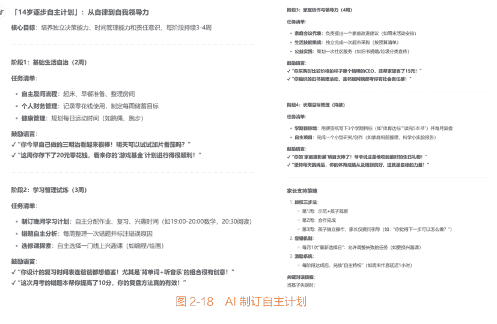

### 边学边做：让AI生成“每日责任清单模板”

1） 打开AI工具（如DeepSeek），在输入框中输入提示词：
请帮我生成一张适合初中生的“每日责任清单模板”，包括学习、生活、锻炼等内容，并带激励语句。

2） AI给出示例，如图2-19所示。


### 2.7.3 孩子手机上瘾怎么办？ AI制订手机使用协议

#### 1. 为什么孩子总离不开手机？
“玩一会就好”——结果一下两个小时过去；“写完作业再玩”——结果边写边刷，效率骤降。

很多家长困惑：为何孩子对手机如此着迷？其实手机提供即时满足：点赞、游戏胜利、短视频刺激，大脑特别容易上头。学习压力大、缺乏情绪出口时，手机就成了“唯一放松口”。

关键不在手机本身，而在缺乏合理管理与替代方案。

家长误区：全封杀与完全放任
- 一刀切封禁易引发反抗，甚至出现偷玩、双机策略。
- 完全不管会导致自控力下降，影响学习与睡眠。
- 建立规则+提供替代活动，才是可持续做法。

家长可与孩子一起商量：
我们可以一起定个手机使用规则，同时找些有趣活动来替代刷手机。
你觉得哪些时段特别想玩手机？我们一起想办法转移注意力吧。
我不是要完全禁止你用手机，而是想和你一起找到更好的节奏。

#### 2. AI如何帮你解决“手机瘾”？
让AI为你家情况生成“使用协议”。

##### 方法1：制定“家庭手机使用协议”——把规矩说清做到


1） 打开AI工具（如DeepSeek），输入提示词：
请帮我制订一份适合初中生的手机使用协议，内容包括：每天使用时长、禁止使用的时间段、违约后的处理方式、家长与孩子共同签署机制。

2） AI会输出一份清晰易懂的协议草案，如图2-20所示。
3） 家长和孩子共同协商后签署，增强参与感与责任感。

##### 方法2：“兴趣替代法”——不给手机断网，给生活添彩

手机上瘾往往因孩子找不到更有趣的事。可与AI一起为孩子制定个性化“替代活动清单”。


1） 打开AI工具（如DeepSeek），输入提示词：
我的孩子喜欢画画，不太爱运动，喜欢小动物。请帮我列出10种可以替代手机的趣味活动，并告诉我怎么引导他尝试这些活动。

2） AI会根据兴趣生成替代方案列表，比如：参加插画工作坊、和朋友合作创作绘本、到猫舍当志愿者、和AI一起设计数字插画角色等。

> 小提示：
- 有趣+有成就感+有陪伴=有效替代！
- 家长可适当参与，增加孩子动力，提升亲子互动质量。

## 初中生手机使用协议

甲方（家长）：________
乙方（孩子）：________
签订日期：________

一、每日使用规则
1. 学习日（周一—周五）
    - 总时长：≤1小时（含社交、娱乐、学习）
    - 分段使用：中午休息20分钟 + 晚上作业后40分钟
    - 禁用时段：
        - 上学前1小时（避免分心）
        - 21:30后（保证睡眠）
        - 吃饭时间（全家无手机时间）
2. 周末/假日
    - 总时长：≤2小时（可分2次使用）
    - 禁用时段：作业未完成前、早晨9点前

二、使用限制
1. 绝对禁止行为：
    - 熬夜玩手机（超时或夜间偷用）
    - 上课/自习期间使用（除非老师要求）
    - 浏览不良信息或充值消费
2. 绿色使用建议：
    - 优先用手机：查单词、看科普视频、听英语
    - 娱乐内容：需提前报备（如游戏类型、短视频主题）

图2-20 AI生成初中生手机使用协议

管手机不如管好生活节奏。AI不是监控工具，而是帮助家庭更科学应对数字挑战的助手。通过“规则+替代”方案，我们不仅让孩子远离手机，更让他们靠近更丰富有趣的生活。

### 2.7.4 孩子情绪低落？AI告诉家长如何沟通引导

“为什么我家孩子总是闷闷不乐？”

青春期常见困惑：
- “以前挺活泼的，怎么最近总不开心？”
- “成绩没退步，怎么一说话就烦？”
- “问他发生了什么，只说‘没事’，我该怎么办？”

很多孩子并非不想说，而是不会说，或担心家长生气不理解。

情绪没有对错，只是内心在发出“我需要被理解”的信号。

情绪波动是常态，回应方式决定走向

每个人都会有低落时刻，尤其处于青春期，情绪起伏大属于正常范围。真正的分界不在有没有难过，而在面对时选择指责与回避，还是陪伴与引导。

#### 方法一：共情倾听，先接纳再交流
孩子心情不佳时，更需要被理解而非被指挥。借助智能助手可以生成柔和而有力量的共情表达，降低防御让孩子愿意开口。

##### 实践操作：让助手产出共情话术
1）打开 DeepSeek 之类的平台，输入指令：请为父母撰写几句对情绪低迷的初中生使用的共情语句，要求语气温柔、带鼓励且尊重感受。
2）助手通常会给出类似内容：
- “我注意到你最近情绪不太好，如果愿意聊，我一直在。”
- “你不必立刻解释，我就陪着你。”
- “我也曾有过低落期，我们可以一起想办法舒缓。”

> 小贴士：先别追问，也别马上给建议。用“我”的感受替代指责。比如把“你怎么这么敏感”改成“我看见你有点难过，我很想了解你的感受。”

#### 方法二：引入专业支持，作为补充而非替代
若低落持续、波动剧烈，已经影响学业与生活，就不能仅靠父母扛。心理咨询师或学校心理老师的专业帮助才是温暖的后盾。

如何温和引导求助？
##### 实践操作：让助手提供引导思路
1）打开智能平台，输入指令：帮我设计一段温和的引导说法，鼓励青少年寻求心理咨询，同时不让他觉得有问题。
2）助手可能给出：
- “每个人都有需要帮助的时候，这不是错误。身体不适看医生，心理不适也可以找专业老师。”
- “我们先一起了解一下心理咨询是什么，觉得合适再决定是否前往。”

可继续尝试的指令：
- 产出安抚情绪低迷初中生的几句话。
- 如何引导孩子接受心理咨询而不产生不正常感？
- 怎样判断是阶段性低落还是可能有抑郁倾向？

低落本身不可怕，可怕的是被忽视。父母的倾听与理解是孩子最重要的心理氧气，加上助手辅助和专业支持，你就能成为情绪上的坚定依靠。

## 2.8 智能体赋能成长
—— 把握边界，远离过度依赖

随着智能体愈发“聪明”，不少学生把它当成学习加速器——难题秒解、作文代写、PPT 也能代做。但副作用同步显现：有人因此进步，有人却变成凡事问助手、自己不动脑的惰性使用者。

如何使用才能真正提升？

### 2.8.1 让青少年更合理地使用智能工具
真正的学习力 = 思考力 + 工具使用力

家长常见困惑：
- “孩子一问作业，助手三秒给出答案，还能练思维吗？”
- “他总说查资料，结果全是助手写的，自己都不懂！”
- “回复太快太全，我怕孩子变懒。”

别担心，智能体不是作弊神器，用对了就是超强学伴。

#### 方法一：起步阶段陪同指导，别让孩子一开始就乱开车
初次使用时，注意力与目标感较弱，容易跑偏或瞎玩。家长要像副驾一样在旁及时纠偏。
> 补充说明：
- 初期可陪同练习，共同上手。
- 遇到提问模糊时，引导其表达更清晰。如孩子说“我想预习数学”，可协助他输入：请用初中生能理解的方式讲解二元一次方程的知识点。

#### 方法二：为智能体设定使用范围，防止越界
能力越强越需要限定。提前在 DeepSeek 等平台设定边界，推荐指令：
> 我是家长，请帮我规范孩子使用智能体学习的时间和内容，接下来30分钟只回答学习相关问题，其他内容请不予回应，时间到时提醒一下。

### 2.8.2 规避助手依赖倾向
如果作业完全靠助手完成，自己不思考该怎么办？

家长担心：
- “作业全靠助手，孩子自己不思考。”
- “一有难题就去问，连基础计算都不愿自己想。”
- “作文让助手写，自己照抄都看不懂。”

可用“五步引导法”让孩子会用而不沉迷。

#### 第一步：锁定核心问题
直接问助手：
> 孩子写作业总是依赖智能体，不肯动脑怎么办？
重点突出“依赖”本身，而非能否使用。

#### 第二步：描述具体情境
例如指令：
> 我的孩子碰到不会的作业就直接复制给智能体求解，我想引导他先思考再使用。
助手便能给出更精准建议，如先思考、再检验、最后复盘的三段式。

#### 第三步：告知期望结果
例如指令：
> 我希望孩子能自主完成作业，同时合理借助智能体辅助学习，该如何引导？
让助手明白目标是科学使用，而非封禁。

#### 第四步：多角度提问，获得更全面方案
例如指令：
- 家长能做些什么？
- 学校如何配合？
- 孩子有哪些方法能提升自学力？
多维度提问有助于形成完整的使用规范。

#### 第五步：提供背景信息，获取个性化建议
例如指令：
> 我家孩子高一，性格偏内向，不太主动提问。怎样在不打击他的前提下，减少对智能体的依赖？
平台会结合年龄、性格给出更合适的建议。

通过本章学习，掌握借助智能黑科技提升效率、管理时间、制定学习计划的方法，从而增强学习效能。

## 第 3 章
得大语文者得天下
—— 借力智能体让语文学习更高效

语文是各科基础，不仅影响分数，更关乎思维与表达。如何让智能体成为语文学习助手，提升阅读理解、写作表达、文言翻译等能力？本章带你探索。

## 3.1 三分钟搞定文言文翻译
—— 让智能体成为你的“智能小状元”

面对文言文，是不是常有“字都认得，句却看不懂”的困扰？智能体可以扮演小状元，帮忙分析背景、逐句翻译、抓住要点。掌握正确用法，文言成绩自然提升。


扫码看教学视频

### 3.1.1 文言文背景揭秘：助手解析创作背景、作者生平与写作意图
文言文像通向古人的门，背景知识就是钥匙。借助智能体可快速解锁，让阅读更通透。学习时常只盯翻译，忽略时代背景、作者经历与写作目的，而这些正是理解深层的关键。

1. 为何背景知识重要？
若只看字词翻译而不了解时代与作者意图，容易误解文意。例如《出师表》若不了解三国局势，很难体会诸葛亮的忠诚与无奈。因此第一步应让助手梳理背景信息。

2. 如何用助手查询历史背景？
可提问获取：
- 文章时代背景：写于哪个朝代？当时发生什么大事？
- 作者生平：作者是谁？经历如何影响本文？
- 写作目的：作者想表达什么？动机为何？

> 动手实践：用助手分析文言文背景
1）打开智能平台如 DeepSeek、KIMI、通义千问、ChatGPT。如想了解《岳阳楼记》背景，输入指令：
请介绍《岳阳楼记》的写作背景，包括作者、时代、历史背景和写作目的。
2）助手会给出详细回答，如图 3-1 所示。
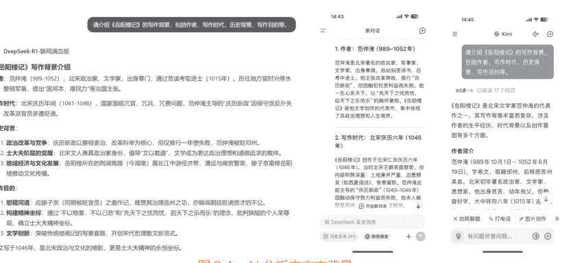
> 补充说明：阅读回答时注意：
- 是否涵盖朝代、历史背景与写作目的？
- 与课本对照，看是否有遗漏或不同理解？

这样能最大化助手作用，在文言学习中收获更多理解与乐趣。

### 3.1.2 秒懂古文：助手逐句翻译并提供现代解读
助手帮你轻松翻译，让文言文不再晦涩。文言表达与现代汉语差异大，助手可逐句翻译并给出通俗解读。

> 动手实践：用助手逐句翻译文言文
1）打开智能平台，把想翻译的句子复制进去。以《岳阳楼记》为例，可用指令：
请逐句翻译《岳阳楼记》的这段话，并提供现代化解读：嗟夫！予尝求古仁人之心，或异二者之为，何哉？不以物喜，不以己悲。居庙堂之高，则忧其民；处江湖之远，则忧其君。
2）助手会逐句翻译并用现代语言解释，如图 3-2 所示。
> 补充说明：
- 注意句子结构，文言语序常与现代汉语不同。
- 助手可能给出多个版本，可挑选最易理解的。
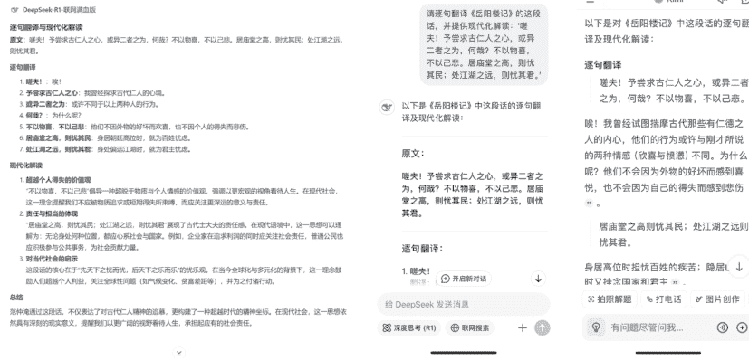

通过这些步骤，文言文会变得更亲近，语文能力随之提升。

### 3.1.3 快速抓住重点：助手提炼常见文言现象
文言文中有古今异义、通假字、固定句式等特殊现象，重要却易混淆。助手可快速帮你找出。

常见困扰：
- 古今异义：如“左右”古义为“身边的人”，今义为“方向”。
- 通假字：如“夫大国，难测也”中“测”通“策”，意为“谋划”。
- 固定句式：如“虽有佳肴，弗食，不知其旨也”是典型的假设关系句式。

如何让助手自动分析？
助手能自动标出这些现象并解释用法。

> 动手实践：让助手分析文言文
1）打开智能平台，输入指令：
请帮我分析《岳阳楼记》这一段的文言知识，包括古今异义、通假字和特殊句式：不以物喜，不以己悲。居庙堂之高，则忧其民；处江湖之远，则忧其君。
2）助手会列出重点并解释，如图 3-3 所示。
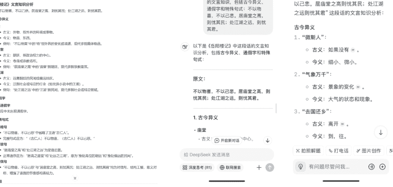
> 补充说明：
- 做练习时可让助手总结重点，节省复习时间。
- 先自行归纳再对比助手答案，找出差距。
- 再找几个例子加深记忆，锻炼分析能力。

通过这些方法，你能更高效利用助手理解文言特殊现象，应对考试。

**AI任务卡：** 用助手翻译课本文言文并分析写作背景
任务要求：
搜索“2024 年普通高等学校招生全国统一考试北京语文试卷”。找到“二、本大题共 5 小题，共 18 分。阅读下面文言文，完成各题。”
要求分析写作背景和文言现象，采用分栏对照形式给出文言文解释，对试题逐项分析并给出正确答案。

## 3.2 阅读提分技巧
—— 助手解析文章结构，轻松拿高分

阅读理解总让人抓不住重点？助手可做你的“阅读教练”，教你快速分析文章、提升答题准确率，让阅读不再靠运气。

### 3.2.1 文章解剖术：助手助力分析结构
**1. 什么是文章解剖术？**
把文章拆分为不同部分，弄清层次结构，找到作者核心思想。

**2. 阅读理解的核心是什么？**
所有题目都围绕“文章结构”与“中心思想”。很多同学读完一片空白，或不知从何下手，正因缺乏结构意识。但结构是有规律的：
- 记叙文：开头、发展、高潮、结尾，关注人物、事件、情感变化。
- 说明文：总分总、分类说明、举例说明，关注说明方法。
- 议论文：提出问题、分析问题、解决问题，关注论点、论据、论证。

**3. 如何让助手帮忙分析结构？**
让助手自动拆解结构、概括段意、提炼主旨。

1）选一篇阅读文章，复制内容。
2）打开智能平台，输入指令：
请分析这篇文章的类型结构，然后提炼每个段落的大意，并总结全文主旨。
原文：（把原文粘贴到这里）
例如分析《背影》，可输入：
请分析《背影》的文章结构，并总结每个段落的大意。
3）助手会自动分析逻辑结构并总结段意，如图 3-4 所示。

试试看，用助手分析一篇课内或课外阅读文章。
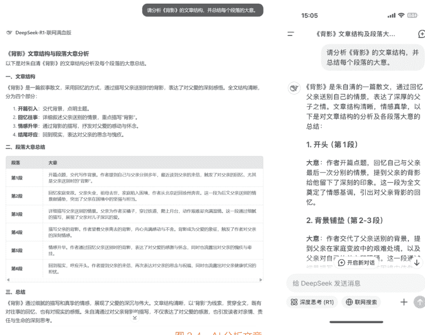

通过这些方法，你能掌握结构、理解内容、提高阅读成绩。

### 3.2.2 阅读理解满分技巧：用助手总结答题模板
1. 为何易丢分？
阅读理解不仅要看懂，还要会答。题目有固定套路，掌握模板再配合助手，正确率大幅提升。

2. 常见题型
主旨概括、细节理解、词句理解、人物分析、写作手法、情感态度。

3. 用助手总结模板
助手不仅能分析文章，还能生成各题型答题公式。

> 动手实践：用助手总结答题模板
1）打开智能平台，输入指令：
请总结高中语文阅读理解题的常见题型，并提供标准答题模板。
2）助手会给出答案与模板，如图 3-5 所示。
| 题型 | 答题模板 |
| :--- | :--- |
| 主旨概括题 | 文章通过……（简要概括内容），表达了……（中心思想），体现了……（深层含义）。 |
| 细节理解题 | 根据文章内容，……（具体细节）发生在……（时间/地点），表现了……（人物/事件特点）。 |
| 词句理解题 | 这句话/词语在文中起到了……（作用），表达了……（含义），突出了……（主题/情感）。 |
| 人物分析题 | 文中的人物……（具体行为/语言），表现出……（性格特点），反映了……（心理/情感）。 |
| 写作手法题 | 作者运用了……（写作手法/修辞手法），增强了……（表达效果），突出了……（主题/情感）。 |
| 情感态度题 | 作者/人物对……（事件/现象）的态度是……（具体态度），通过……（具体内容）表现出来。 |

**AI任务卡：用助手分析阅读理解，提升信息提取能力**
任务要求：
- 让助手分析文章结构与主旨。
- 让助手提供标准答案。
- 学习提取信息，提高答题准确率。

## 3.3 作文变身秘籍
—— 助手助你突破写作瓶颈

助手是作文“助推器”，可帮你整理素材、规划结构、优化表达，甚至智能批改，让文章脱胎换骨。

### 3.3.1 作文“万能”素材库：助手一键整理
1. 素材为何重要？
考场上千篇一律的作文难以出彩。引用名言、历史故事、优美段落能让内容丰富、思想深刻，给阅卷老师惊喜。

2. 如何让助手整理素材？
> 动手实践：让助手整理作文素材
1）选定主题，如“梦想”。
2）打开智能平台，输入指令：
我是一名高一学生，请为我提供关于“梦想”的作文素材，包括名人名言、优美段落和经典故事。
3）助手会提供一系列素材，供你挑选使用，如图 3-6 所示。
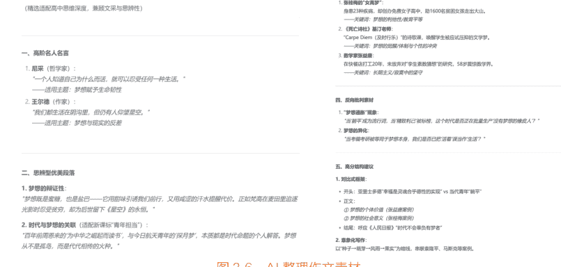

通过这些方法，你能丰富素材库，让写作更轻松有趣。

### 3.3.2 作文结构规划：助手生成提纲
1. 结构为何重要？
结构清晰、层次分明，能让阅卷老师迅速抓住重点。优秀作文常遵循“黄金结构”：
- 总分总：开头立论、中部展开、分论收束升华。
- 并列式：围绕主题展开多角度，如现象+原因+影响+对策。
- 对比式：先反面后正面，或对比两种观点。
- 递进式：层层深入，由浅入深，如问题+分析+解决。

2. 助手如何规划结构？
助手可根据主题自动生成提纲，通过合理分段与过渡句确保逻辑性。

> 动手实践：让助手生成作文提纲
1）打开智能平台，输入作文题目，让助手拟定提纲。可使用指令：
请根据题目《……》为我生成一个作文提纲，要求结构清晰，分点明确，并给出每段的核心要点。

八年级写《我的理想》可以先让 AI 帮忙搭框架

写《我的理想》这类命题作文时，先用 AI 搭一个从开头到结尾的写作框架，能让下笔更顺。 

2） 一般 AI 会给出一套比较完整的提纲，大致包括：

- 开头部分：点出理想的价值，并点出“理想是人生的灯塔”这句常用名言。
- 主体第一部分：解释理想的含义以及它在人生中的作用。
- 主体第二部分：写自己想要的理想方向，以及为什么选择它。
- 主体第三部分：预想实现理想会遇到的阻力，以及打算怎么应对。
- 结尾部分：再次强调理想的分量，表达坚定要实现的决心。

3）拿到提纲后，先通览整体思路，挑一个最贴合自己想法的版本，再开始动笔。

4）如果感觉素材不够，还可以继续追问 AI，让它补充事例或描写，让文章更丰满。

> 小建议：提纲只是草稿时的参考，落笔时可根据需要增删，保持行文自然。

按这个流程，文章结构会更清晰，得分也更有把握。

### 3.3.3 文笔精修：借助 AI 提升感染力
**1. 为什么要精修语言？**

作文分数里，表达水平占很大比例。句式单一、词语贫乏容易失分。用智能工具可以做到：

- 调整句式，让表达更生动。
- 替换重复的词，提升层次感。
- 增加修辞手法，让文字更有色彩。

**2. AI 如何完成润色？**

> 边学边做：用 AI 润色作文段落

1）打开 AI 平台如 DeepSeek，把自己写好的段落粘进去，要求增强表现力。可参考提示词：

> 我是初二学生，请把下面这句话润色得更生动、表现力更强。

原文：他每天练习跑步，最后取得了好成绩。

2）工具会给出若干版本供挑选，可根据个人风格择优使用，如图 3-7 所示。
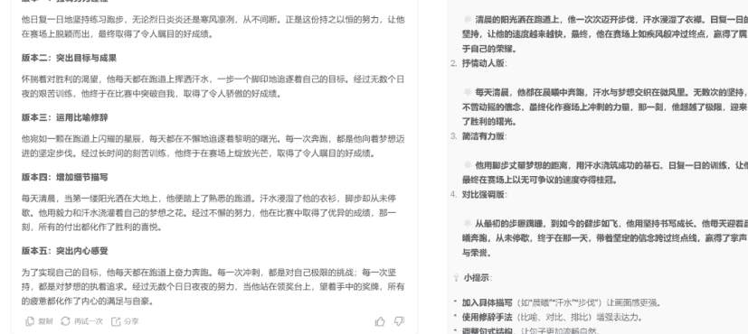

> 小建议：润色时让工具给出多种表述，对比后选出最符合语感的那一种。

### 3.3.4 AI 作文批改 + 评分：按考标提供修改意见
AI 如何批改作文？

- 排查语法、用词问题
- 按考试标准给分
- 给出可操作的修改建议

> 边学边做：让 AI 按考标批改作文

1) 先写成一篇完整作文。
2) 打开支持图片上传的 AI 平台如豆包，将手写稿拍照上传，系统可识别文字。
3) 输入提示词，让系统依据所在年级的评分细则来评：

请根据高考作文评分标准批改照片中的作文，指出语法与表达问题，给出总分并提供修改建议。

4) 系统会进行全面分析并给出分数。评分维度包括：

- 内容分：是否扣题，展开是否充分。
- 语言分：用词是否简洁生动，句式是否丰富。
- 结构分：逻辑是否清晰，段落安排是否合理。

5) 依据反馈进行修改，可逐步提升写作水平。

**AI任务卡：用 AI 整理素材写一段作文并进行修改**

任务要求：

- 让 AI 帮你梳理“坚持的力量”的写作素材。
- 依据这些素材自行写一段，再用 AI 进行润色。
- 再由 AI 批改优化。
- 对比原文与 AI 的修改建议，找到可改进之处并重写。

## 第 4 章 学好数学不再吃力 ——AI 全程陪伴解题
告别难题，让每一道题都变得可解！从基础运算到复杂方程，AI 随时在侧，提供详细讲解，帮助突破瓶颈，提升成绩！

## 4.1 全天候数学陪练 ——助你成为解题高手


扫码看教学视频
AI 就像随叫随到的超级数学助手，帮你攻克各类难题，让你真正成为数学达人！

### 4.1.1 循序提问解难题 ——用苏格拉底法引导思考
什么是“苏格拉底提问法”？

这是一种通过提问引导思考的学习方式，而非直接给出答案。面对难题时，AI 不会立刻告知结果，而是层层设问，让你自行推导出解法，从而锻炼数学思维。

AI 如何运用此方法分步解题？

> 边学边做：利用 AI 分步解析复杂问题

1）打开 AI 平台如 DeepSeek、KIMI、通义千问、ChatGPT 等，让 AI 帮你拆解思路，可用提示词：

请用苏格拉底提问法帮我解答这道数学题，让我一步步推导出答案。

题目：2x+3=7

2）AI 会给出详细互动：

AI 发问：这个等式由哪些部分构成，未知数是什么？

3）思考并作答，训练逻辑推理。

AI 发问：我们的目标是什么？

4）继续作答，逐步完成解题，理解每一步意义，如图 4-1 所示。

通过这种逐步追问，你不仅得到答案，更明白了每一步的逻辑，让方程解法更牢固。

试试看！对于二次函数求解，已知抛物线 y=x²-4x+3，求顶点坐标和 x 轴交点。

**用苏格拉底提问法解答数学题**

题目：

解方程：

$2x + 3 = 7$

**苏格拉底提问法解析步骤**

第一步：理解方程

AI提问：这个方程中有哪些部分？未知数是什么？

你的回答：方程由 $2x$、$+3$ 和 $=7$ 组成，未知数是 $x$。

第二步：明确目标

AI提问：我们的目标是什么？

你的回答：目标是求出 $x$ 的值。

第三步：分析方程结构

AI提问：方程 $2x + 3 = 7$ 中，$2x$ 和 $+3$ 分别代表什么？

你的回答：$2x$ 是未知数的系数项，$+3$ 是常数项。

第四步：移项

AI提问：如何将常数项移到等式的另一边？

你的回答：将 $+3$ 移到等式右边，变为 $-3$，即：

$2x = 7 - 3$

第五步：计算右边

AI提问：$7 - 3$ 等于多少？

你的回答：$7 - 3 = 4$，所以方程变为：

$2x = 4$

第六步：求解 $x$

AI提问：如何求出 $x$ 的值？

你的回答：将等式两边同时除以 2，即：

$x = \frac{4}{2}$

第七步：计算最终结果

AI提问：$\frac{4}{2}$ 等于多少？

你的回答：$\frac{4}{2} = 2$，所以：

$x = 2$

第八步：验证答案

AI提问：如何验证 $x = 2$ 是否正确？

你的回答：将 $x = 2$ 代入原方程，检查是否成立。

验证过程：

$2(2) + 3 = 4 + 3 = 7$

符合原方程 $2x + 3 = 7$，所以答案正确。

最终答案

方程的解为：

$x = 2$

总结

通过苏格拉底提问法，我们一步步推导出方程的解。这种方法不仅能帮助你理解解题思路，还能让你更好地掌握数学知识！


你可以用以下提示词：

请用苏格拉底提问法帮助我解题：已知抛物线 $y=x^2-4x+3$，求其顶点坐标和与 x 轴的交点。

### 4.1.2 精准定位错因 ——突破解题盲区
**1. 什么是“解题盲点”？**

解题盲点指做题时因思维定式、知识漏洞或粗心导致的错误或卡壳。常见情况有题意理解偏差、漏条件、计算失误、公式运用不灵活等。

AI 可以帮你：

- 复盘解题过程，定位错误点。
- 解释错因，说明理解偏差在哪。
- 给出正确思路，避免重复踩坑。

**2. AI 如何帮你分析错误？**

> 边学边做：用 AI 分析解题失误原因

1）打开 AI 平台如 DeepSeek，输入自己的解题步骤和结果，让系统检验。可参考提示词：

请帮我检查这道数学题的解答过程，并指出可能的错误。

我的解题过程：解方程 $2x+3=5x-6$

步骤 1：将 5x 移到方程的左边，将 3 移到方程的右边，得到 2x - 5x = -6 + 3。

步骤 2：合并同类项，得到 -3x = -3，然后得 x = 1。

2）系统会剖析步骤，指出问题所在并解释原因，如图 4-2 所示。
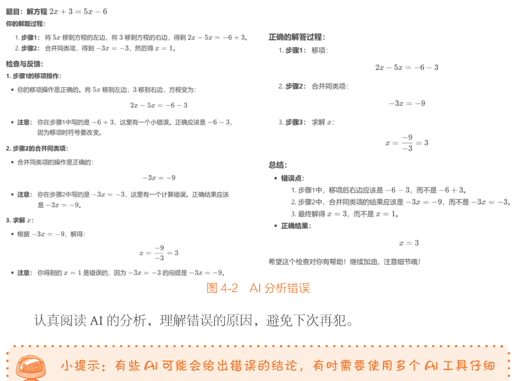

认真阅读分析，弄清错因，下次不再犯。

> 小提示：不同系统偶尔会出现误判，建议用多款工具交叉验证。

试试看！把你的解题过程丢给系统检查，有误就深入理解原因，提升能力！

## AI任务卡：让 AI 带你解析复杂数学题

任务要求：

- 通过系统逐步解题，掌握思维路径。
- 让系统检验答案，分析错点。
- 归纳经验，提升数学能力。

## 4.2 多路径解题 ——一题多解开拓思维

扫码看教学视频
数学题像迷宫，一条路走不通换条路可能就豁然开朗！让系统提供多种解法，帮你打开数学世界的大门，找到最快最优路径。

### 4.2.1 同题多解 ——拓展思路找捷径
同一道题，不同方法能带来不同视角。代数法可快速得到精确结果，几何法则更直观地展示问题结构。下面用一个例子看代数与几何如何解同一题。

任务题目：已知直角三角形的两条直角边长度分别是 3 和 4，求斜边的长度。

> 边学边做：用系统探索同一题的不同解法

1. 打开智能平台如 DeepSeek，输入提示词：

   已知直角三角形的两条直角边长度分别是 3 和 4，求斜边的长度。

2. 系统通常会给出代数解法，用勾股定理求解。

3. 输入提示词：

   这道题还有其他解法吗？

4. 系统会列出不同方法，如代数与几何，并分析优缺点，帮你挑选合适方式。

5. 选定一种方法，让系统详细解释每一步。

试试看！用系统探索多种解法，可输入：

> 请帮我用不同的方法解这道题：已知直角三角形的两条直角边长度分别为 3 和 4，求斜边的长度。请提供至少两种不同的解法，并详细解释每种方法的步骤。

这样能更全面理解问题，提升解题能力，让数学更有趣！

### 4.2.2 比较优劣选最优 ——找出效率最高的解法
每种方法各有优缺点。代数法通常更直接系统，有时显繁琐；几何法更形象直观，需要空间想象力。对比后更容易选出最适合的路径。

任务题目：解方程 $x^2-5x+6=0$。

#### 边学边做：用系统用多种方法解方程

1) 打开智能平台如 DeepSeek，输入提示词：

解方程 $x^2-5x+6=0$，分别使用不同的方法解方程，对比各种方法的优缺点，给出最快最优解。

2) 系统会列出不同解法，并给出优缺点对比和最优解，如图 4-3 所示。

方法1：因式分解法（最快最优）

步骤：

1. 观察方程 $x^2-5x+6=0$，尝试将其因式分解。

2. 找两个数，使得它们的和为 -5，积为 6，这两个数是 -2 和 -3。

3. 因式分解：

$(x-2)(x-3)=0$

4. 令每个因式等于零：

$x-2=0$ 或 $x-3=0$

5. 解得：

$x=2$ 或 $x=3$

答案：$x=2,3$

优点：快速直接，适用于容易因式分解的二次方程。

缺点：不是所有方程都能因式分解，比如 $x^2-2x+1.5=0$ 这种情况。

方法2：公式法（通用解法）

求解一元二次方程的一般公式：

$x=\frac{-b\pm\sqrt{b^2-4ac}}{2a}$

对于方程 $x^2-5x+6=0$，这里 $a=1, b=-5, c=6$。

步骤：

1. 计算判别式：

$\Delta=b^2-4ac=(-5)^2-4(1)(6)=25-24=1$

2. 代入求解公式：

$x=\frac{-(-5)\pm\sqrt{1}}{2(1)}$

$x=\frac{5\pm1}{2}$

3. 计算结果：

$x=\frac{5+1}{2}=\frac{6}{2}=3$

$x=\frac{5-1}{2}=\frac{4}{2}=2$

答案：$x=2,3$

优点：适用于所有一元二次方程，不需要因式分解。

缺点：计算过程较繁琐，需要计算判别式和使用平方根运算。

方法3：配方法（适用于某些特殊方程）

配方法的思路是将方程写成平方的形式再求解。

步骤：

1. 写出方程：

$x^2-5x+6=0$

2. 将常数项移到右侧：

$x^2-5x=-6$

3. 取 -5 的一半，平方后加到两边：

$x^2-5x+\left(-\frac{5}{2}\right)^2=-6+\left(-\frac{5}{2}\right)^2$

$x^2-5x+\frac{25}{4}=-6+\frac{25}{4}$

$\left(x-\frac{5}{2}\right)^2=\frac{1}{4}$

4. 取平方根：

$x-\frac{5}{2}=\pm\frac{1}{2}$

5. 求解 $x$：

$x=\frac{5}{2}\pm\frac{1}{2}$

$x=3$ 或 $x=2$

答案：$x=2,3$

优点：适用于一些特殊形式的方程，比如当系数不容易因式分解时。

缺点：计算量较大，特别是当系数不是整数时，运算容易出错。

方法对比：

| 方法 | 适用情况 | 计算量 | 优缺点 |

| :--- | :--- | :--- | :--- |

| 因式分解法 | 适用于可因式分解的二次方程 | 最少 | 快速简便，但只适用于特定方程 |

| 公式法 | 适用于所有二次方程 | 中等 | 通用，但计算较繁琐 |

| 配方法 | 适用于特殊形式的方程 | 较大 | 有时很方便，但计算复杂 |

最优解：因式分解法（最简单快捷）。如果无法因式分解，使用公式法。

图 4-3 用不同的方法解方程

试试看！你可以输入提示词，要求系统给出不同的详细解答，并找出最优解。比如，对于 2023 年高考数学全国卷Ⅰ的题目：

已知函数 $f(x) = \sin x + \cos x$，求函数 $f(x)$ 在区间 $[0, \pi]$ 上的最大值和最小值。

通过对比不同解法，你可以更灵活地应用数学知识，提升解题能力，让学习变得更加轻松！

### 4.2.3 举一反三练熟练 ——自动生成相似题巩固
掌握一种解题方法后，最好的巩固就是多做同类题。系统可以帮你生成相似题目，加深理解。

任务题目：已知函数 $f(x) = \sin x + \cos x$，求函数 $f(x)$ 在区间 $[0, \pi]$ 上的最大值和最小值。生成相似题目。

实操：让系统生成相似数学题

1) 打开智能平台如 DeepSeek，输入提示词：

请生成与下面数学题相似的 3 道题目：已知函数 $f(x) = \sin x + \cos x$，求函数 $f(x)$ 在区间 $[0, \pi]$ 上的最大值和最小值。

2) 系统会给出三个相似题目，如图 4-4 所示。

通过这些相似题目的练习，你能够灵活运用解题方法，进一步提高解题效率！
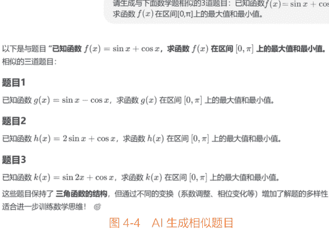

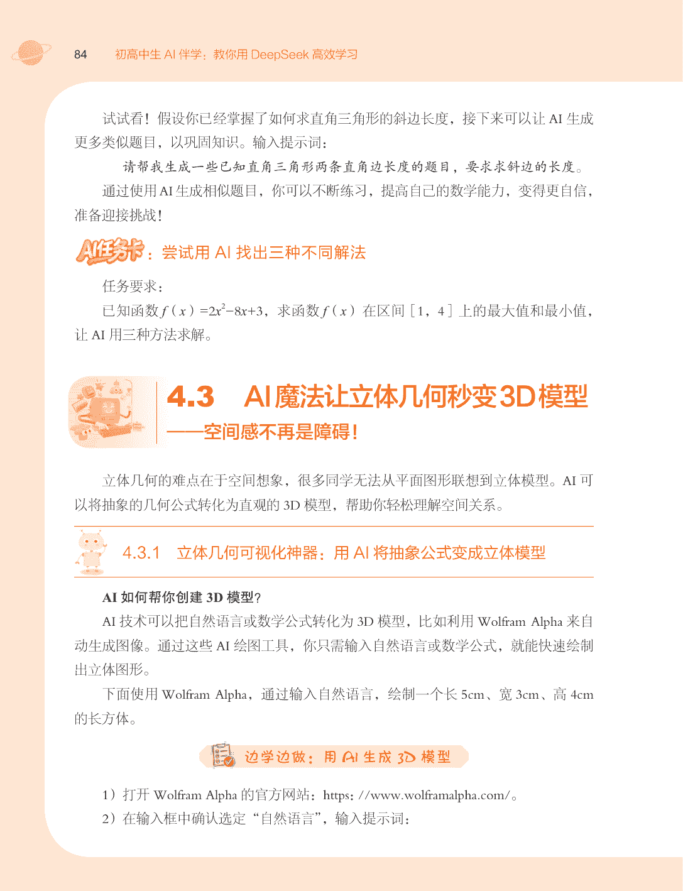
绘制一个长方体，长 =5cm，宽 =3cm，高 =4cm。

3）查看系统绘图的结果，同时显示其他属性，如图 4-5 所示。

Wolfram Alpha 是一个基于计算知识引擎的智能问答系统，由 Wolfram Research 公司开发。与传统搜索引擎（如 Google）不同，它通过结构化数据和算法直接生成问题的答案，广泛应用于教育、科研和商业领域。


试试看！使用 Wolfram Alpha 绘制一个圆柱体，设定高 =15cm，直径 =10cm。

通过这些方法，你可以运用系统实现立体几何的可视化，轻松掌握空间的概念，让数学学习变得更加直观有趣！

### 4.3.2 立体模型可视化 ——玩转空间观察
立体几何不仅是记公式，更要动手操作和观察。借助系统，你能创建几何模型，观察空间特性。

**如何用系统软件生成模型？**

可用 GeoGebra 创建 3D 图形。在 GeoGebra 中输入简单指令即可生成立体模型。

#### 实操：用系统创建几何模型

使用 GeoGebra 创建 3D 图形主要有两个步骤：首先用 DeepSeek 等智能对话工具生成绘图指令并复制，然后把指令粘贴到 GeoGebra 中生成图形。

1）打开智能平台如 DeepSeek，输入提示词：

我要在 GeoGebra 中生成球体的体积，能动态改变球的大小，请给出具体的 GeoGebra 提示词，步骤要清晰，提示词要可以运行。

2）系统会提供相关提示词，如图 4-6 所示。
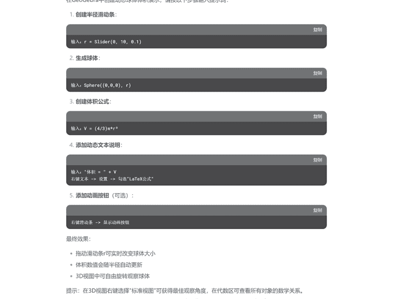

3）打开 GeoGebra 官网：https://www.geogebra.org/3d。

4）在 3D 绘图界面的输入框中，按步骤输入系统给出的提示词，每输入完成一步按 Enter 键（分别输入 1、2、3 中的提示词）。

5）所有步骤完成后，拖动滑动条改变半径，观察球体大小变化，同时计算球体体积，如图 4-7 所示。

6）旋转模型，观察其不同视角。
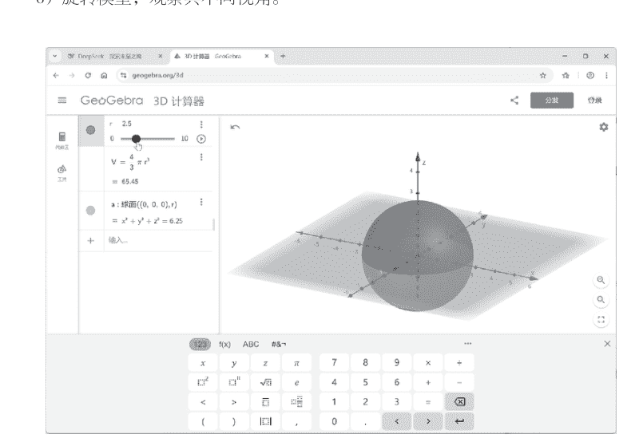

GeoGebra 是一个可在浏览器中直接使用的互动数学环境，涵盖几何作图、代数计算、微积分探索以及概率仿真等多个分支。该系统由 Markus Hohenwarter 于 2001 年推出，创设初衷是利用动态演示帮助使用者更直观地把握数学本质。

> 小提示：部分大模型在给出提示词范例时会出现偏差，建议尝试不同平台或重复提问。

动手试试：在 GeoGebra 中搭建一个可变尺寸的三棱锥 3D 模型，并通过滑块实时调整大小，效果可参考图 4-8。

在智能技术的加持下，空间感知可以从零基础快速提升，立体几何不再令人畏惧。

## 可直接在 GeoGebra 中执行的英文指令

以下指令可直接运行：

1. Create the slider:

   Slider(a, 1, 10, 0.1)

2. Plot the vertices:

   A = (0, 0, 0)

   B = (a, 0, 0)

   C = (a/2, a*sqrt(3)/2, 0)

   D = (a/2, a*sqrt(3)/6, a*sqrt(6)/3)

3. Draw the faces:

   Polygon(A, B, C)

   Polygon(A, B, D)

   Polygon(A, C, D)

   Polygon(B, C, D)

按上述步骤即可得到随滑块联动的四面体动态模型。

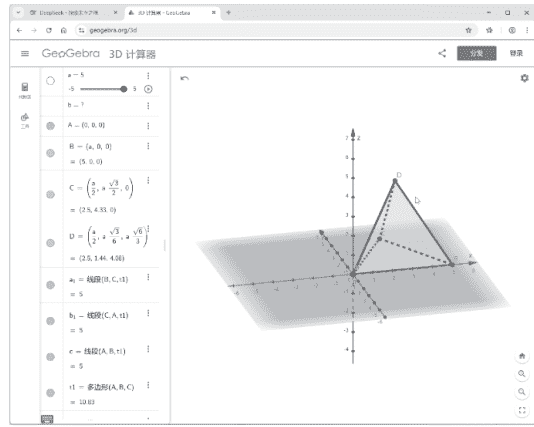

图 4-8 在 GeoGebra 中生成一个三棱锥

# 第 5 章
英语提速专线
——AI 驱动的全能语言提升

想在较短周期内提升英语水平，可把智能助手当作专属伙伴。它能协助记忆词汇、润色写作、训练听力和口语。无论夯实基础还是冲刺进阶，都能提供个性化方案，助你迈向熟练。

## 5.1 超级单词记忆法
——用 AI 让背词更高效


词汇是英语学习的根基，但不少学习者会出现记了就忘、刚熟悉又陌生的困扰。借助智能体能有效缓解这一问题。

### 5.1.1 智能记忆规划：结合艾宾浩斯记忆曲线背单词

**是否了解艾宾浩斯遗忘曲线？**

该规律说明在特定间隔复习单词记忆效果更佳。模型可据此为你定制复习节奏，使记忆更持久。

如何让助手按艾宾浩斯曲线自动生成最优背词时间表？


1. 启动智能平台，如 KIMI。
2. 若已有纸质词表，可用手机拍照上传。
3. 在输入框中给出需求：

   请识别照片中的单词，帮我生成一份单词记忆表，并依据艾宾浩斯记忆曲线制订一个背单词计划。
4. 助手会解析词汇并按曲线生成复习表，如图 5-1 所示。
5. 依表复习：每日按给出的时间点回顾，效果会明显提升。

试试看！若使用可被检索的具体词表，结合艾宾浩斯曲线自动生成复习规划，可用以下提示：

- 请生成人教版初中七年级下册第二单元的所有英语单词，并给出最佳学习记忆的单词表和时间表。
- 为英语词汇量薄弱的高中生设计 3 个游戏化记忆方案。

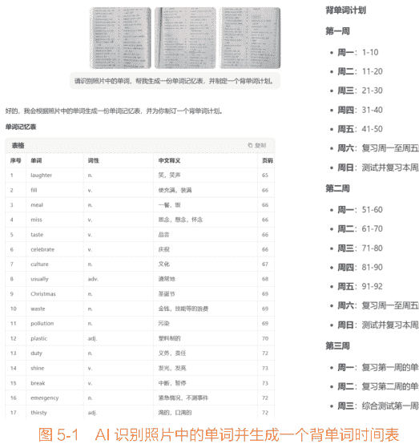

### 5.1.2 单词联想记忆：AI 解析构词，提升记忆效率

1. 记词枯燥？
   通常是方法问题。助手能拆解词根词缀，阐明构词逻辑，并提供生动的例句帮助在语境中掌握。

2. 如何助力联想记忆？
   它会解析词根词缀并配上鲜活例句，强化记忆联想。

> 边学边做：用助手解析英语单词

1）打开常用平台如 DeepSeek，选一个难记的词，输入提示：

请解析单词 biology 的词根、词缀，并提供生动例句。

2）会给出词根词缀解析及例句，帮助建立联想，如图 5-2 所示。

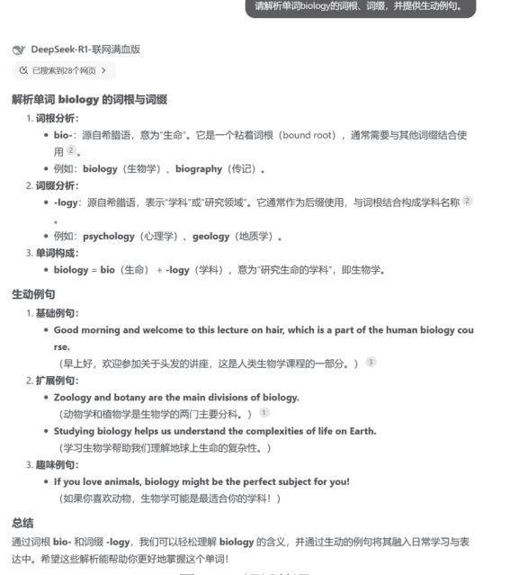

试试看！

- 让助手解析单词 unbelievable。
- 让助手找出 5 个含 “pre-” 的单词并造句。

如此可使记忆更牢固，词汇量自然扩大，学习也更趣味。

### 5.1.3 会讲故事的单词：把词汇融入对话与文章

1. 为何死记硬背易遗忘？
   常见现象是背数小时次日即忘、会读会写却不会用、记词像啃硬骨头。实际上词汇置于语境才易内化。可借助助手将单词转化为有趣对话和短文，让其“活”起来。

2. 如何实现“单词变故事”？
   趣味对话生成：按输入单词生成角色对话，展示真实用法。
   语境短文创作：将指定单词融入短文，帮助理解含义、用法与搭配。
   情景关联记忆：通过故事、人物、冲突与情节，让单词成为生动“演员”。

#### 方法 1：输入词组生成趣味对话


1）打开平台如 DeepSeek，输入提示：

请用这 10 个单词编写一个有趣的对话：adventure, forest, mysterious, flashlight, scared, whisper, shadow, map, scream, treasure。

角色：两个小学生在夜晚的森林中探险。

对话要求：自然、连贯、有情节。

2）结果如图所示。

一段对话中，10 个单词全部自然出现，你不仅记住了词，还明白了用法。

#### 方法 2：输入单词生成短文故事

1）打开平台如 DeepSeek，输入提示：

请用这 10 个单词创作一篇 100 词左右的英文短文，并在文后用中文解释每个单词：volcano, erupt, lava, village, evacuate, danger, rescue, shelter, warning, safe。

2）结果如图所示。

可指定场景如“教室对话”“家庭聚会”“宇航员登陆火星”，增强画面感。也可要求对重点词加粗或着色，方便记忆。不懂的词可让助手附英文解释或中英对照，加深理解。

图 5-3 用指定单词生成对话的示例以《月光森林的密语》为标题呈现两名小学生的夜探情节，通过角色反差与道具推动剧情完成记忆点。

图 5-4 用指定单词生成的短文示例以火山爆发为线索串联词汇，呈现危机到救援再到安全的完整叙事，并附有中英释义。

试试看！输入以下提示：

请用以下单词创作一篇校园生活小短文：homework, teacher, playground, bell, explain, mistake, recess, discuss, help, succeed。

请用以下 10 个单词写一段有趣的侦探对话，并在每个句子后用中文翻译：detective, clue, suspect, mystery, alibi, evidence, crime, search, secret, truth。

通过“对话+故事”训练，单词不再是死板对象，而是故事主角。记词可变得轻松有趣，印象更深刻。

## 5.1.4 扩展词汇量：AI 生成单词联想网络

1. 一个单词能联想到多少内容？远超想象！
   孤立记忆易忘，而一个词往往拥有庞大“朋友圈”：同义、反义、固定搭配、常用句型等。若能一网打尽，记忆更牢。助手可帮你“织网”。

2. 如何扩展联想网络？
   可像思维导图一样展开一个词的全部信息，包括：
   - 同义词：意思相近表达，丰富说法。
   - 反义词：意思相反词，加深理解。
   - 相关短语搭配：常见固定搭配和句型。
   - 场景例句：真实语境中的用法。
   - 拓展词：与该词相关的词根、近义家族等。

3. 如何构建词网？

边学边做：用助手构建单词联想网络

1）打开常用平台如 DeepSeek，输入提示：

> 请帮我构建一个关于单词“bright”的联想词汇网络，包括：同义词和反义词、常见搭配短语、不同语境下的英文例句、同词根或近义拓展词。

2）结果如图所示。

可将内容复制到 Xmind 等思维导图工具，把 “bright” 做成词网。

> **小提示：**
> * 内容过多时可加一句：“请分点简洁列出，适合初中生阅读。”
> * 联想网络不必一次全记，但能多角度理解词义，提升记忆效率。
> * 多用不同场景的词测试，会发现词汇扩展也能变成游戏。

### 词汇联想网络：bright

核心词义：明亮的；聪明的；欢快的

### 1. 同义词 & 反义词

| 类别 | 单词 | 中文释义 |
| :--- | :--- | :--- |
| 同义词 (光线) | shiny | 闪亮的 |
| | radiant | 光芒四射的 |
| | luminous | 发光的 |
| 同义词 (智力) | intelligent | 聪明的 |
| | clever | 机灵的 |
| | sharp | 敏锐的 |
| 反义词 (光线) | dark | 黑暗的 |
| | dim | 昏暗的 |
| 反义词 (智力) | dull | 愚钝的 |
| | stupid | 愚蠢的 |

### 2. 常见搭配短语

- **bright light/sun** 明亮的光线/阳光
- **bright future** 光明的未来
- **bright smile** 灿烂的笑容
- **bright colors** 鲜艳的色彩
- **bright idea** 聪明的点子

### 3. 多语境例句

**① 光线/颜色：**
- The **bright** morning sun woke me up.（明亮的晨光唤醒了我。）
- She painted the wall in **bright** yellow.（她把墙刷成了亮黄色。）

**② 智力：**
- The **bright** student solved the puzzle quickly.（这个聪明的学生很快解开了谜题。）

**③ 情绪：**
- His **bright** laughter filled the room.（他欢快的笑声充满了房间。）

### 4. 词根拓展 & 近义网络

词根：-bright-（光） → **brighten** (v. 变亮), **brightness** (n. 亮度)

近义网络：
- **Light-related:** glow, gleam, sparkle
- **Intelligence-related:** brilliant, wise, smart
- **Emotion-related:** cheerful, lively, vibrant

### 可视化联想图


记忆技巧：想象一个灯泡💡——既发光（物理亮度），又象征灵感（智力亮度）！

图 5-5 AI 生成单词联想网络

试试看！请尝试使用助手生成以下单词的联想词汇网络：
- create
- important
- energy
- change

试着将它们的同义词、短语和例句整理出来，做成自己的“词汇导图墙”！

一个单词不只是一个词，而是一整个“词汇宇宙”。用助手展开它的“朋友圈”，不仅能让你词汇量飞速扩展，还能让你在写作和口语中“词汇丰富度”飙升！

## AI任务卡：用 AI 定制你的专属单词卡片

任务要求：
- 使用助手定制专属的单词卡片（如中考高频词）。
- 生成互动 HTML 页面，让卡片在页面上显示单词、解释、例句等信息。
- 能够翻转查看详细信息，帮助你更高效地学习和记忆单词。

## 5.2 英语作文变形计
——AI 让你的文章更高级


扫码看教学视频

写英语作文时，你是否遇到过这些问题？
语法错误不断，词汇量有限，表达总是很基础，文章平淡无奇，缺乏亮点。别担心！助手来帮忙！让你的作文从“简单句”变身为“高分作文”。

### 5.2.1 语法与表达优化：AI 自动检查错误，提供优化建议

如何通过助手优化语法和表达？

它能够自动分析你的作文，检查以下内容：
- 检查拼写和语法错误。
- 提出更准确的单词和短语建议。
- 让句子结构更加清晰流畅。

边学边做：用助手检查英文句子

1）打开平台（如 DeepSeek），在输入框中输入原句：

检查错误并优化：She going to the park every day for exercise.

2）会自动识别语法错误、拼写错误和用词不当，并给出优化建议，如图 5-6 所示。

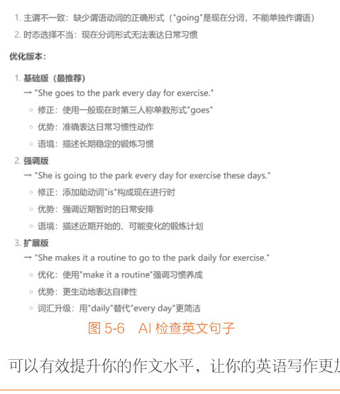

通过这些方法，可以有效提升你的作文水平，让你的英语写作更加精彩和高效。

### 5.2.2 AI 润色：让你的英语作文更流畅、更高级、更有感染力

#### 1. 什么是 AI 润色？

AI 润色是通过工具对原文进行优化，使其语言更流畅、表达更高级、情感更丰富。

#### 2. AI 可以润色的三个维度
- 结构提层：把简短的主谓句拓展成复合或多层句式，增强行文的层次感与节奏感。
- 用词升级：用更精准、地道的表达替换口语化词汇，为文本增添亮点与质感。
- 感染加强：通过语气调整与词汇选择，让情感更饱满、说服力更强。

#### 3. 实践路径：用 AI 让英语作文更出彩
边学边练：让模型为你的作文润色
1）打开 DeepSeek 这类智能工具，在输入区同时提交指令与原文：
请润色下面这段，使表达更高级。原文：I felt happy when I saw my friend.We talked and had fun.
2）系统会将简略表述改写为更具表现力的句子，并选用更自然的搭配与描绘，如图 5-7 所示。


小试牛刀！例如这句话：
The cat is on the table.
看看模型会如何改写。

> 小提示：
> ● 试着理解模型建议背后的逻辑，这对写作能力的提升很关键。
> ● 不要排斥新说法，多尝试会让作文更具个性。

按此方法，可借助智能助手让英语写作更流畅、更具吸引力，成绩自然提升。

## AI任务卡：用 AI 帮你修改英语作文，让表达更亮眼
任务要求：
- 让模型审阅你的作文，找出语法、拼写与表达上的问题。
- 给出润色后的版本，并说明优化要点。

## 5.3 听力、口语随时练
——高效提升英语听说能力

听不清、说不准？
把智能助手当成私人教练，随时随地进行听说练习，轻松成为英语达人。

### 5.3.1 多题材听力训练：用 AI 生成多种题材的听力资料
1. 为什么要做多题材听力训练？
提升听力需要接触日常对话、学术讲座、新闻报道、影视剧等多种音频。智能助手能快速产出丰富多样的材料，帮助你适应不同场景。
2. 如何制作多题材听力资料？
实操示范：用模型生成听力材料
1）打开 DeepSeek 这类工具，在输入框发出指令：
生成一段关于购物的英语对话，时长 1 分钟。
2）模型按要求返回对话，如图 5-8 所示。

图 5-8 AI 生成英语听力材料
3）多数平台支持语音播放，电脑或手机都能点小喇叭试听。
4）听完后可检验理解，在输入框发出指令：
> 为了检验听力理解，请为上述对话生成英文选择题，三选一，共 5 题。
5）模型会给出结果，如图 5-9 所示。

> 小提示：如果工具不支持语音播放，可把对话复制到文字转语音软件中试听。

动手试试！请用模型生成一段关于“借橡皮”的听力材料，输入提示词：
> 请生成一段 1 分钟左右的英语对话，主题是“借橡皮”，语速适中（120 词/分钟），包含初中核心词汇。要求：
> 1. 标注生词解释。
> 2. 生成配套选择题（3 题）。

### 5.3.2 个性化练习：让 AI 根据你的听力水平螺旋式调整听力难度
1. 什么是螺旋式听力练习？
很多同学听力遇瓶颈，是材料太简单或太难。模型能依据你的水平自动调节难度，让你循序渐进提高。
2. 如何生成匹配水平的听力材料？
实操示范：用模型生成适合自己水平的听力材料
1）打开 DeepSeek，在输入框描述自身水平，例如：
我能听懂基础的英语日常对话，但新闻听不太懂，请生成适合我的英语听力材料。
2）模型会先生成匹配内容，随后逐步提升难度。
3）你可以标记感受“太简单”“刚刚好”“太难”，模型会据反馈动态调整。
3. 如何进行听力训练？
适合初学者的软件有每日英语听力、Audacity、VOA Learning English 和 BBC News for Kids 等，可用来练习。
> 小提示：
> ● 别怕听不懂，每天坚持一点点。
> ● 重点捕捉关键词和句型，不必逐字翻译。
> ● 利用模型反馈系统，找准听力薄弱点。
通过这些方法，能有效提高听力，让学习更轻松。

### 5.3.3 场景化对话训练：用 AI 模拟多种真实情境进行口语对话
1. 为什么模拟对话重要？
真实交流需要快速反应和组织语言，而不是脑内翻译。通过模拟机场值机、餐厅点餐、购物砍价、酒店预订、医院就诊、朋友闲聊等场景，能提升口语能力。
2. 如何使用 AI 进行场景化口语对话训练？
实操示范：用模型进行场景化口语对话训练
1）选择一个场景，例如餐厅点餐。模型扮演服务员，你来点餐，互动以文字和语音进行。
2）打开 DeepSeek，输入提示词：
用 AI 模拟“在餐厅点餐”的真实英语对话情景，AI 模拟服务员，我来点餐，练习如何用英语点菜和与服务员交流。结束后，AI 评估我的回答并提出建议。
3）模型开始对话，你回答服务员提问。
4）点餐结束后，模型会实时评估并给出建议。
5）想看标准答案，可输入提示词：
请给出标准的完整英语点餐对话，包括服务员与顾客的典型互动。
动手试试！每天练一个场景，多尝试不同表达。

### 5.3.4 智能发音纠正：用 AI 提高发音水平
1. 为什么纠正发音很重要？
标准发音让交流更顺畅。很多人音调不自然导致对方听不懂，模型能智能分析发音问题并提供优化方案。
2. 如何练习发音？
适合初学者的发音训练软件有 ELSA Speak、Duolingo、流利说等，均具备 AI 模拟场景、智能对话和发音纠正功能。
> 小提示：
> ● 慢而清晰地朗读，不要急于求成。
> ● 多模仿模型语音示范，接近标准后再提速。
> ● 注意连读、弱读和重音，让语调更自然。

## AI任务卡：和 AI 进行一次 3 分钟全英文对话
任务要求：
- 让模型扮演你的同学，用英文讨论电影《肖申克的救赎》。
- 进行 3 分钟英文对话，结束后给出评价建议。
> 小提示：
> - 别怕犯错，敢开口是关键。
> - 利用模型反馈改进表达，不断优化口语。
> - 每天坚持 3 分钟，口语会有质的飞跃。

## 5.4 英语阅读技巧
——读懂长难句，不再懵

扫码看教学视频
让模型帮你拆解难点，高效提取关键信息。

### 5.4.1 难句拆解：让 AI 分析复杂句子的语法结构
1. 为什么长难句让人头疼？
阅读时常遇到句子长、结构复杂，有多个从句、被动语态、倒装等，一眼看过去容易懵。
2. 模型如何拆解长难句？
- 语法结构分析：自动识别主语、谓语、宾语及从句和修饰成分，看清骨架。
- 分段解析：把句子拆成若干小部分，逐步解释含义。
- 简化建议：用更通俗的说法重组句子，帮助理解。
3. 如何通过模型拆解长难句？
实操示范：用模型分析英文句子结构
1）打开 DeepSeek，输入提示词：
请用颜色标注下面的英文句子，主句用蓝色，定语从句用绿色，非限定性从句用橙色，并给出简化后的句子。
原文：The girl who sits next to me in class, whom I met on the first day of school, is very friendly.
2）模型给出结果，如图 5-10 所示。

图 5-10 AI 拆解长难句
> 小提示：
> ● 拆句时先找主干，再分析修饰成分，能理清结构。
> ● 把复杂句简化成易懂形式，理解会更到位。
动手试试！请尝试分析以下句子的结构：
The book that I borrowed from the library, which was written by a famous scientist, is very interesting.
掌握这些方法，能更有效理解长难句，提升阅读力。

### 5.4.2 文章逻辑梳理：让 AI 找出主旨句、段落关系、核心论点
1. 模型如何梳理英文文章的逻辑结构？
- 找出主旨句：识别概括中心思想或段落核心的句子。
- 分析段落关系：说明各段在文章中的作用，如引出、展开、总结。
- 总结核心论点：概括作者观点和立场。
2. 如何通过模型梳理文章的逻辑结构？
实操示范：用模型分析英文文章结构
1）打开 DeepSeek，输入提示词：
梳理下面文章的逻辑关系，用 [1] 标出主旨句，用 [2] 连接段落关系，用 [3] 标注核心论点。
英文原文：Global warming is one of the biggest challenges facing our planet. It causes rising sea levels, extreme weather, and loss of biodiversity. Scientists believe that human activities, such as burning fossil fuels, are the main cause of this issue.
2）模型会给出主旨、段落关系和核心论点。
动手试试！找一篇英文短文，让模型分析结构，标出每段主题句，绘制逻辑图并给出摘要。
这样能快速理清文章脉络，更好把握作者意图。

### 5.4.3 阅读速度提升：让 AI 设计速读训练任务
1. 什么是速读？
速读不是跳过内容，而是高效获取关键信息。常用方法：
- 扫读：快速浏览，抓主旨。
- 跳读：寻找特定信息，如数字、日期、关键词。
2. 模型如何帮你训练速读？
模型可以：
- 计时阅读，提升速度。
- 出题测试，确保抓住重点。
- 个性化训练，按进度调难度。
3. 如何通过模型设计速读训练任务？
实操示范：用模型进行英语速读训练，提升阅读能力
1）准备一篇文章，或让模型生成速读文章。指令：
生成一篇关于科技创新的英文文章，要求高中一年级水平，阅读时间 30 秒。
2）让模型设计训练任务，指令：
请对上面英文文章设计 3 个英文问题。
3）回答问题后，指令：
下面是我对你问题的回答，请判断是否正确，并给出解释。
问题回答：（这里是问题回答）
通过这些练习，能有效提高阅读速度和信息获取能力。

## AI任务卡：用 AI 解析一篇英文长文
任务要求：
- 选一篇英文文章上传到模型平台。
- 让模型帮助分析句子结构。
- 让模型生成文章摘要。
- 进行速读训练，提升阅读速度。

## 5.5 英语语法魔法屋
——搞懂规则，表达更顺畅
再也不怕语法题！模型变身语法小老师，让时态、语态、非谓语等知识秒懂！

### 5.5.1 AI 语法雷达：找出句子中的语法雷区
1. 为什么语法总出错？
明明认识单词、知道句式，写出来却总被标红。因为语法细节多，如时态搭配、主谓一致、冠词遗漏、句式重复等，一不留神就踩雷。
2. 模型如何帮你发现并修正语法错误？
模型如同语法雷达，可快速扫描句子，指出错误、解释原因并教正确写法。
3. 模型可以做什么？
- 自动检测语法错误：时态、拼写、冠词、动词形式、连接词等。
- 逐句讲解原因：指出错在哪、为什么错、怎么改，并配解释。
- 提供优化建议：推荐更自然地道的表达。
4. 如何用模型查找语法错误？
实操示范：用模型查找英语语法错误
1）打开 DeepSeek，输入指令：
请帮我检查这句话的语法，指出错误、解释原因，并给出修改后的句子。
句子：Although he is very tired, but he still finished his homework.
2）模型输出结果，包括错误分析和修改建议，如图 5-11 所示。
原句分析：
句子：
Although he is very tired, but he still finished his homework.
错误：
1. 连词重复：英语中不允许同时用 although 和 but，因为功能相同。
   - × 错误结构：Although... but...
   - ✓ 正确结构：Although... ...（或 ... but...）
2. 时态问题：
   - “finished”与前半句现在时 “is tired” 不一致，建议统一。
修改后的句子：
1. 保留 although，删除 but：
Although he was very tired, he still finished his homework.
2. 保留 but，删除 although：
He was very tired, but he still finished his homework.
> 小提示：
- 模型不仅改对句子，还能顺带教学，改一次学会一点。
- 对不确定的句子，及时让模型检查。
动手试试！把下面句子输入模型，让它检查并解释：
She don't likes ice cream because is too cold.
你能先找出几个错误吗？让模型验证一下！
通过这种练习，能快速消灭错误，巩固语法，真正做到写一句学一条。

### 5.5.2 语法知识情景解析：让抽象变生动
1. 为什么语法规则难理解？
术语抽象如“现在完成时”“宾语从句”“被动语态”，光看定义就头晕。很多语法其实对应生活场景，只是没联系起来。
2. 模型如何把语法讲“动”起来？
模型能讲解规则，还能配合情景模拟，把知识点变成眼前故事。
3. 模型可以做什么？
情景模拟：让知识点进入对话，在真实交流中看到用法。
4. 如何用模型生成语法情景讲解？
实操示范：通过模型生成情景辨析语法区别
1）打开 DeepSeek，输入指令：
请用情景脚本的方式，解释英语中“现在进行时”和“一般现在时”的区别，并举一个校园生活场景的例子。
2）模型会给出情景脚本，如图 5-12 所示。
动手试试！输入提示词生成一段“语法情景小剧本”：
请用情景脚本形式讲解“被动语态”和“主动语态”的区别，设定场景是食堂吃饭。
可加上角色名和语气，让讲解更有趣！
通过情景演练，抽象规则变得可视可演。

### 5.5.3 AI 语法对比神器：轻松搞懂易混语法
1. 为什么“长得像”的语法总混淆？
如一般现在时与现在进行时、动词不定式与动名词、which vs that、被动与主动等，相似易混。让模型来一场语法 PK。
2. 模型是怎么做语法对比的？
概念拆分：用表格呈现定义、用法、例句。
使用场景分类：指出它们在真实语境中的常见位置。
错题分析：提交错题后，模型会告诉你混淆的题型。
模型还能生成一组“易错辨析题”，训练辨别力。
实操示范：如何请模型做语法对比？
1）打开 DeepSeek，输入提示词：

V-ing 与 to+V，AI 一次性对照清楚

分不清动名词和不定式怎么用？把两个语法点交给助手摊开来比，先要到对照表，再配上几道测验题，理解就立住了。

很快就能得到一张清晰的对比图和练习，如图5-13所示。

> 小建议：
> - 下指令时把要对比的两个点说具体，比如“主语从句和宾语从句”。
> - 让它按“例句＋表格＋练习”三合一输出，记忆效果更好。
> - 错题追问“这题为何错？是不是和别的点混了？”，助手会帮你定位混淆源。

### 动名词与不定式速查

| 区别维度 | V-ing 形式 | to + 原形 |
|---|---|---|
| 要义 | 动词名词化，用来指代动作或状态本身 | 动词原形加 to，多表达目的、打算或将来性 |
| 核心作用 | 可作主语、宾语、表语，侧重陈述事实或习惯 | 可作主语、宾语、表语，侧重目的或可能性 |
| 常见搭配 | enjoy, avoid, finish, practice, mind | want, decide, hope, plan, refuse |
| 例句 | Swimming is fun. 作主语 | To swim is my goal. 作主语 |
|  | I enjoy reading. 作宾语 | I want to read this book. 作宾语 |
| 特殊规则 | 介词后只能接动名词，如 think about doing | 部分动词后只能接不定式，如 agree to do |

### 三道实操题

1. She avoids ____ junk food.
A. eat
B. to eat
C. eating
答案：C，avoid 后接动名词

图5-13 AI 完成的语法对比

可以这样提问：

帮我写一段简短对话，里面同时出现 V-ing 和 to do 结构，每句后标注语法点。

用表格说明“过去完成时”与“过去进行时”的差异，并配例句和练习。

我老是分不清 will 和 be going to，请对比用法场景并出一组练习。

用助手做语法正面对决会发现，被纠结的点其实并不难。方法对了，就能快速建立清晰的对照库。

## 5.5.4 语法专项训练营：个性化练习

1. 为什么语法题总出错
不少同学觉得语法题像挖坑，选项相似容易误选。借助助手查漏补缺、精准刷题，就能攻克难点。

2. 助手怎么定制练习
它相当于一位私人出题老师，可以：
- 定位薄弱点：把错题或不懂的点输入，它就能判断卡在哪。
- 制定训练计划：比如“每天三题现在完成时、两题被动语态”。
- 生成多种题型：选择、填空、改错、连线应有尽有。

### 边学边练：生成个性化语法练习

1）打开 DeepSeek，输入提示：
我是初二学生，正在学宾语从句。请按我的水平出 3 道选择题、2 道句子改错题，并附答案和解析。

2）内容生成后如图所示5-14。

> 小建议：
> - 可要求按“教材同步内容”出题，更贴近课堂。
> - 把错题喂给助手，让它反向出题，重点突破盲区。

试试这样问：
根据我近三次模拟考错得最多的点——宾语从句、时态、非谓语动词，给我一份周训练计划，每天 5 题，附解析。

把助手当成私人语法教练，每天练一点，提升一点。

图5-14 AI 生成的语法练习

## 5.5.5 AI 语法对话馆：把语法放进场景对话

1. 为什么语法记不住
很多时候是孤立记忆，像背公式。语法是为了表达，能在对话里用，它就不再是死规则。

2. 助手如何让你“用”语法
- 场景化训练：把语法点放进真实情境，如餐厅点餐练现在进行时，叙述经历练现在完成时。
- 角色扮演：你扮演角色与助手对话，边用边学。
- 纠错反馈：说错了，助手会指出并解释正确表达。

### 边学边练：生成语法点+场景对话

1）打开对话工具，如 DeepSeek，输入：
我们做个对话练习，话题是“上周末你做了什么”。帮我练习一般过去时，我用错时请纠正并解释。

2）助手给出模拟对话，如图5-15。

图5-15 生成的对话练习

> 小建议：
> - 可自由指定语法点和场景，如旅游、点餐、自我介绍。
> - 对话结束后请助手总结用过的句式和错误，形成复盘表。

试试这个提示词：
我想练习被动语态，请设计“图书馆借书”的英文对话场景，和我对话时纠正我的语法错误。

通过说中学，会发现语法其实就是日常表达的骨架，并不难。

### AI 任务卡：制定专属语法学习计划，一周突破薄弱点

任务要求：
根据你的英语语法水平定制学习计划，需包含：
- 每日目标：一个语法点
- 例句+简明讲解
- 练习题：选择/改错/造句
- 场景对话：语法活学活用
- 练习反馈：自动批改+讲解

## 第 6 章

### 全能学习外挂
#### ——用 AI 轻松玩转全学科

被物理公式绕晕过？为化学方程式抓狂过？生物课听得云里雾里？现在有智能助手这个超级外挂。它不仅能像老师一样讲解，还能像学霸一样总结重点、对比易错点，甚至讲故事、画图表。很酷。

## 6.1 学科答疑
——让复杂概念变简单

课堂上常从一堆抽象术语、复杂定义开始，感觉每个字都认识连起来却不懂。别担心，智能助手能把晦涩知识“翻译”成通俗语言，还配实例、类比、图示，一听就懂。

## 6.1.1 把难懂知识翻译成生活例子

助手如何把复杂概念具象化，自动生成好理解的生活实例？

示例1：物理
教材说：牛顿第一定律，不受外力时物体保持静止或匀速直线运动。有点晕？其实就是需要一个翻译，助手就是靠谱的知识翻译官。

边学边做：助手帮你理解物理概念
1）打开工具如 DeepSeek、KIMI、通义千问、ChatGPT，输入：
我想理解“牛顿第一定律”，请用生活例子+类比详细讲解。
2）助手会从多角度给出生活化解释，帮助理解，如图6-1。
3）看完再回课本，豁然开朗。

示例2：生物
教材说：光合作用是绿色植物吸收光能，把二氧化碳和水合成有机物并释放氧气的过程。有点晕？需要助手翻译官。

边学边做：助手帮你理解生物概念
1）打开工具如 DeepSeek，输入：
我想理解“光合作用”过程，请用通俗比喻+生活例子解释。
2）助手会给出生活化解释，如图6-2。
图6-1 助手解释“牛顿第一定律”概念
图6-2 助手解释“光合作用”过程
3）看完有画面感，配图记得更牢。

试试看：请生成 DNA 复制的核心内容，用类比+实例详解。
或提示词：请以“复印文件”为例，设计便于理解 DNA 复制过程的方案。

## 6.1.2 易混概念对比辨析：助手帮你分清本质

科学概念易混？助手能智能梳理易混点，用表格、思维导图精准区分，提升效率。

助手如何辨析易混概念？
它会解析核心，对比区别，并提供生动实例帮助区分。

示例1：物理
速度表示运动快慢和方向，是位移随时间的变化率；加速度表示速度变化的快慢和方向，是速度随时间的变化率。需要助手翻译官。

边学边做：用助手辨析物理易混概念
1）打开工具如 DeepSeek，输入：
请对比“速度”和“加速度”的区别，用类比+生活实例详细解释。
2）助手自动生成对比分析表，结合坐电梯、骑自行车等案例，让你轻松掌握差异，如图6-3。
3）整理成自己的易混知识对比笔记。

想记得牢？让助手生成“速度与加速度”思维导图。

试试看：请助手解析质量与重量的区别并举例；请助手对比电流与电压，用“水流类比”帮助记忆。

核心区别
- 速度：描述物体运动的“快慢”和“方向”，如汽车以60km/h向北。
- 加速度：描述速度“变化的快慢”，如汽车从0加速到60km/h需10秒。
关键点：加速度是速度的变化率。就像工资和涨工资速度是两回事。

类比：开车仪表盘
1. 速度表 显示当前车速，只告诉你现在跑多快。匀速高速行驶速度不变，加速度为零。
2. 油门/刹车 踩油门车速增加，正加速度；松油门车速下降，负加速度。绿灯起步猛踩油门你会被推到椅背，高加速度。

生活实例对比
| 场景 | 速度 | 加速度 |
|---|---|---|
| 电梯启动 | 匀速上升时速度恒定 | 启动瞬间加速最大 |
| 过山车下坡 | 到最低点速度最快 | 下坡中加速度逐渐减小 |
| 投篮球 | 球离手时速度最大 | 出手后因重力加速度减速 |

常见误区
- ✗ 加速度大=速度快？不一定。火箭发射时速度小，加速度极大。
- ✗ 匀速运动有加速度？匀速直线运动加速度为零。

一句话总结：速度是“你现在跑多快”，加速度是“你提速减速有多猛”。

示例2：化学
氧化反应是物质失去电子的过程；还原反应是得到电子的过程。需要助手翻译官。

1）输入提示词：
请对比“氧化反应”和“还原反应”的概念，用生活实例类比讲解。
2）助手展示清晰对比表，解释定义、本质、易混点，并用铁钉生锈、水电池等例子补充，帮助理解，如图6-4。
3）整理成卡片或知识图谱强化记忆。

试试看：让助手对比“原子”与“离子”在电荷和结构上的不同；让助手用“学校班级”类比“混合物”和“纯净物”，并给典型例子。

核心概念对比
| 反应类型 | 定义 | 电子转移 | 典型变化 |
|---|---|---|---|
| 氧化反应 | 物质失去电子 | 失去电子 | 化合价升高 |
| 还原反应 | 物质得到电子 | 获得电子 | 化合价降低 |

关键关系：氧化和还原一定同时发生，合称氧化还原反应。就像买卖，有卖家就有买家。

生活类比：银行转账
- 氧化：你转出钱，余额减少，化合价升高。
- 还原：对方收到钱，余额增加，化合价降低。
- 整体：转账完成，电子守恒。

生活实例解析
1. 铁钉生锈：铁失去电子变成铁离子，氧气得到电子变成氧离子。
2. 电池放电：锌失去电子，铜离子得到电子变成铜。
3. 苹果变黄：多酚被氧化变褐，氧气被还原成水。

常见误区澄清
- ✗ 氧化一定需要氧气？不一定，任何失去电子都是氧化。
- ✗ 还原是回到原来状态？不是，还原指化合价降低，未必变回原物质。

一句话总结：氧化是失去电子，还原是得到电子，二者像交易双方缺一不可。


## AI任务卡：让助手把复杂概念翻译成生动例子

任务要求：
利用智能助手用“生活化+具体例子”的形式帮助理解化学中“化学键”的概念。

## 6.2 知识梳理
——用 DeepSeek + Mermaid 高效搭建知识框架

历史、地理、生物知识点多像一锅乱炖？用 DeepSeek+Mermaid 把零散知识点整理成一目了然的图形，像画地图一样清晰。


### 6.2.1 历史事件时间轴：自动生成时间轴+背景分析

时间轴是按时间顺序展示历史事件的工具，帮助直观理解先后、因果和背景脉络。

边学边做：让助手生成唐朝历史发展时间轴
1）DeepSeek 支持 Mermaid 语法，打开后输入：
请用 Mermaid 语法生成‘唐朝历史发展（618—907年）’时间轴，需包含618年唐朝建立、626年玄武门之变、627—649年贞观之治、713年—741年开元盛世、755—763年安史之乱、907年唐朝灭亡。每个节点补充1-2句背景分析，调整字间距适中避免太挤。
2）DeepSeek 按语法生成时间轴，如图6-5。
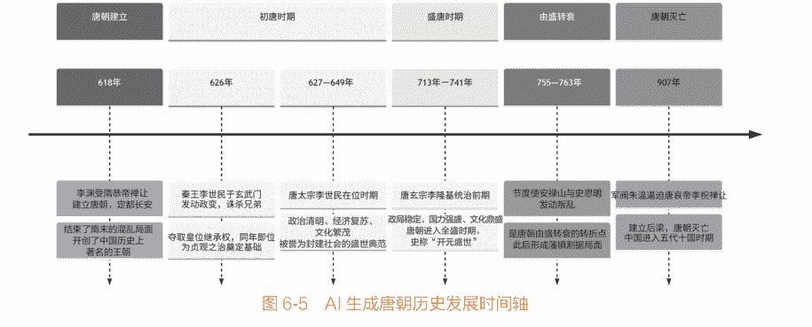
3）若结果不满意，可继续提要求或补充细节让它修改。文字不完整可输入：图中的“原因”或“影响”太密集看不清，可分多行写并调整间距。
4）DeepSeek 给出改进版。单击下载可保存，如图6-6。
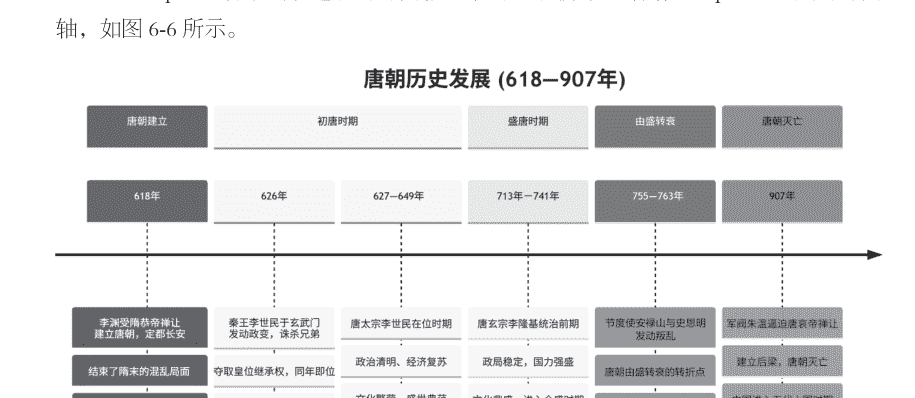
图6-6 优化后的唐朝历史发展时间轴

> 小提示：Mermaid 是一种让电脑画图的语法，不需要学语法，只要下指令即可。它不仅能画时间轴，还能画知识图谱、流程图、概念结构图。

### 6.2.2 生物学知识图谱：构建生态系统可视化知识图谱

知识图谱像一张超大的知识蜘蛛网，把知识点串起来，变得有条理好理解。

在这个网里，每个重要知识点是实体，如生产者、消费者、环境因子；实体间有关系如“影响着”“依赖于”“属于”；实体还带属性标签如“种类”“数量”“功能”。

助手知识图谱像一张能思考的地图，带你快速锁定重点，理清整章结构。

# 用AI秒建生态系统知识图谱

初中阶段的生态系统单元概念密集、联系紧密，靠死记硬背很容易混淆。将整章脉络转成可视化结构，关系立刻变得通透好记。下面示范如何借助生成式工具完成图形化整理。

首推 KIMI 助手。它能读懂自然语言描述，并直接以 Mermaid 标记语言输出整洁美观的知识结构，省去手工绘制的成本。

**操作演示：生成生物学科知识图**

1）进入 KIMI 官网 https://kimi.moonshot.cn/。

2）把下面指令粘贴进去：
用 Mermaid 语言为初中生物生态系统绘制知识图谱，要覆盖生产者、消费者、分解者、环境因子、食物链、能量流动、物质循环等核心内容，并体现各要素之间的关联。

3）助手理解意图后会迅速产出一张结构清晰的图谱，呈现效果与图 6-7 相近。

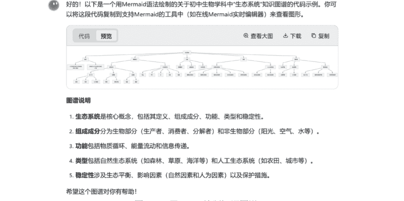

4）若结果不够理想，可继续对话微调，助手会反复修改直至满意。可告诉它：“请补充……”“请把……改成……”例如：
图不够清楚？提示：把字号调大，线条改成深蓝色。
内容不全？提示：添加分解者的作用以及能量流动的方向。
版面拥挤？提示：分块呈现，改成上下排布。

5）点击“下载”即可保存为图片，也可复制 Mermaid 代码到电子笔记中复用。
如果手头已有笔记、课本截图或自制的整理材料，直接上传后让 KIMI 读取并自动梳理成图亦可。

## AI 练习卡：生成学科思维导图

任务说明：
结合已有学习资料，如教师下发的复习提纲、课堂笔记等，借助 KIMI 为《道德与法治》七年级下册第一、二单元制作一张知识思维导图，服务期中复习。

> 小贴士：思维导图不仅适用于复习，也适合预习新课、整理课堂记录、做学习小结，是提升学习效率的有效手段。

## 6.3 数据图表解析
——让 DeepSeek 挖掘数据规律

面对海量信息时是否常感到吃力？交由 AI 抽取规律并制作直观图表，复杂内容便能一目了然。

### 6.3.1 气候趋势洞察：模型解析气候、城市等演变规律

模型不仅能进行分析，还能协助搜集与整理素材。例如可以尝试探究北京近十年各月平均气温的变化趋势。

**实操示例：地理数据分析**

1）获取数据。打开 DeepSeek，在输入框填写：
帮我收集整理近 10 年北京每个月的平均气温，并以表格形式输出。

2）查看分析结果。模型会返回整理好的表格，数据源自中国气象局公开报告。除列出月均温外，还会做初步解读，例如指出春季 3—5 月温差较大，近十年年均温在 12.5~13.5℃之间，整体缓慢上升，2019 年为明显偏暖年份。如图 6-8 所示。

| 年份 | 1月 | 2月 | 3月 | 4月 | 5月 | 6月 |
|---|---|---|---|---|---|---|
| 2014 | -2.1 | 3.2 | 9.8 | 17.5 | 22.3 | 26.1 |
| 2015 | -1.8 | 4.0 | 10.5 | 16.9 | 23.0 | 26.8 |
| 2016 | -2.5 | 2.8 | 10.2 | 17.2 | 22.8 | 26.5 |
| 2017 | -1.2 | 3.5 | 11.0 | 18.0 | 23.5 | 27.2 |
| 2018 | -2.0 | 3.8 | 10.8 | 17.8 | 23.2 | 27.0 |
| 2019 | -1.5 | 4.2 | 11.2 | 18.2 | 23.8 | 27.5 |
| 2020 | -1.0 | 4.5 | 11.5 | 18.5 | 24.0 | 27.8 |
| 2021 | -0.8 | 4.8 | 11.8 | 18.8 | 24.2 | 28.0 |
| 2022 | -0.5 | 5.0 | 12.0 | 19.0 | 24.5 | 28.2 |
| 2023 | 0.0 | 5.2 | 12.2 | 19.2 | 24.8 | 28.5 |

注：
1. 表中数据为月均温，日最高温与最低温的平均值，模拟真实趋势


3）生成折线图。若表格不够直观，可请求生成图表，提示如下：
将上述表格生成折线图，用不同颜色表示不同年份，横坐标为月份，纵坐标为温度，图表以 HTML 形式展示。

4）执行预览。模型会输出 HTML 源码，如图 6-9 所示。点击“运行”后即可看到交互式折线图，鼠标悬停显示具体数值，点击图例可隐藏或显示指定年份，如图 6-10 所示。

5）延伸探索。可继续让它分析其他城市的气候、降水、GDP 变化，甚至逐日气温。

> 小贴士：务必核查数据来源，多渠道对比可提升分析可信度。

下面展示基于 HTML 与 JavaScript Chart.js 实现的北京近 10 年月均气温折线图。每条折线代表一个年份，横轴为月份，纵轴为温度 ℃：

```html
<!DOCTYPE html>
<html>
<head>
    <title>北京近10年月均气温变化</title>
    <script src="https://cdn.jsdelivr.net/npm/chart.js"></script>
    <style>
        .chart-container {
            width: 90%;
            max-width: 1000px;
            margin: 20px auto;
        }
        h1 {
            text-align: center;
            font-family: Arial, sans-serif;
            color: #333;
        }
    </style>
</head>
<body>
    <div class="chart-container">
        <h1>北京近10年月均气温变化 (2014-2023)</h1>
        <canvas id="temperatureChart"></canvas>
    </div>

    <script>
        const ctx = document.getElementById('temperatureChart').getContext('2d');

        // 月份标签
        const months = ['1月', '2月', '3月', '4月', '5月', '6月', '7月', '8月', '9月', '10月', '11月', '12月'];
```
图 6-9 生成 HTML 代码
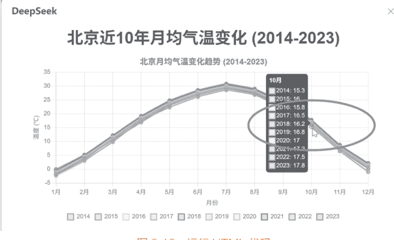
图 6-10 运行 HTML 代码

### 6.3.2 地图可视化生成：AI 绘制人口与资源分布图

除了折线、柱状、饼图等常见形式外，模型还能将数据做成地图。例如展示中国各省、直辖市、自治区的人口分布。

**实操示例：地理数据可视化分析**

1）打开 DeepSeek，输入提示词：
请整理中国各省、直辖市、自治区的人口数量，用柱状图的形式展示，以 HTML 格式输出。

2）查看输出。模型返回 HTML 代码，点击代码块右上角“运行”后即可看到各省、直辖市、自治区的人口数量。如图 6-11 所示。

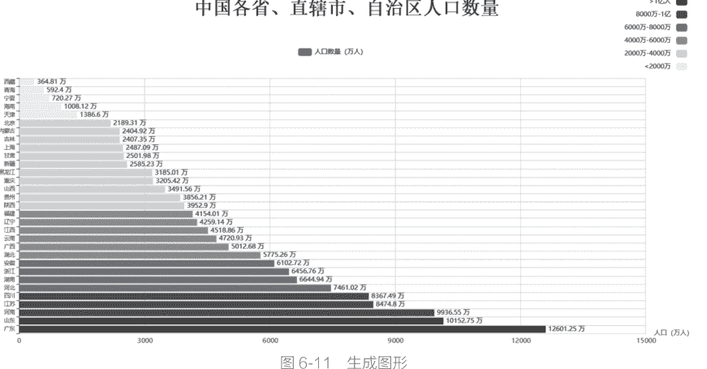
图 6-11 生成图形

数据来源于 2020 年第七次全国人口普查。此类可视化让信息更直观易懂。

> 小贴士：可尝试叠加交通路线、自然资源等图层，实现多维联动展示。

### 6.3.3 历史人口变化数据分析：用 AI 探寻人口流动原因

数据分析还能揭示深层原因，比如还原城市人口变迁的历史逻辑。

**实操示例：分析秦朝至清末民初北京地区人口变化**

1）获取数据。打开 DeepSeek，输入提示词：
请收集整理秦朝至清末民初北京地区人口数量的变化，包括人口规模、人员流动的出发地以及去向、迁移路线等信息，以表格形式输出。

2）模型整理分析后输出内容如图 6-12 所示。
好的，这是一个综合了人口规模估算和人口流动信息的详细表格，涵盖了秦朝至清末民初北京地区的人口变迁史。

秦朝至清末民初北京地区人口规模与流动变迁总表

| 朝代 | 大致时间段 | 城市名称/地位 | 人口规模估算（约） | 主要流入（来源地、原因、路线） |
| :--- | :--- | :--- | :--- | :--- |
| 秦汉至隋唐 | 前3世纪 - 10世纪 | 幽州（北方军事重镇） | 3万 - 15万人（唐代幽州城鼎盛期） | 来源地：河北、山东平原。原因：戍边、屯垦、避难。路线：沿太行山东麓南北大 |
| 辽（北宋同期） | 10 - 12世纪 | 南京析津府（辽国陪都） | 25万 - 30万人（辽国五京中最大） | 来源地：1. 契丹贵族（上京汉民。原因：政治升级、人口自然路线：契丹人自东北经古北 |
| 金（南宋同期） | 12 - 13世纪 | 中都（金国首都） | 50万 - 70万人（海陵王迁都后剧增） | 来源地：1. 女真贵族、军队工匠、百姓（汴梁等地）。原因：首次正式迁都、强制路线：数十万人从东北长途 |
| 元 | 13 - 14世纪 | 大都（元朝首都） | 90万 - 110万人（国际性大都市） | 来源地：1. 蒙古、色目人匠、富户（江南为主）。原因：建设新都、强制征召路线：大运河成为输送人口 |
| 明 | 14 - 17世纪 | 北平 → 北京（明朝首都） | 70万 - 100万人（迁都后恢复并超越元大都） | 来源地：1. 军队、家属（山西匠（南京）；3. 平民（山西原因：明成祖迁都，√ 京路线：山西移民经太行八陉北上。 |

图 6-12 北京地区人口规模变化

3）生成折线图。输入提示词：
请以图表形式展示这些数据。X 坐标为年份，以 50 年为一个间隔。Y 坐标为人员规模数量，在图表中标记朝代以及关键事件，以 HTML 格式输出。

4）模型给出对应 HTML 代码，点击“运行”按钮后自动生成北京地区人口规模变迁图，如图 6-13 所示。将鼠标悬停在节点上可查看具体数据。

5）延伸分析。可进一步让它结合政治、经济、气候等因素分析人口变化原因。

# 北京地区人口规模历史变迁

公元前200年 - 公元1900年（每50年间隔）

秦汉至隋唐 辽代 金代 元代 明代 清代

# 北京地区人口规模两千年变迁

数据为基于历史文献的估算值

拖动下方滑块查看更多细节 | 鼠标悬停查看事件

人口规模（万人）

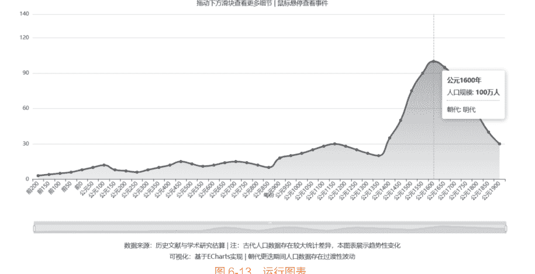
数据来源：历史文献与学术研究估算 | 注：古代人口数据存在较大统计差异，本图表展示趋势性变化

可视化：基于ECharts实现 | 朝代更迭期间人口数据存在过渡性波动

图 6-13 运行图表

> 小贴士：结合历史课本、官方统计数据分析，更能还原真实背景。

## AI 练习卡：动手分析真实数据

任务说明：
利用 DeepSeek 完成对北京近 5 年 PM2.5 浓度变化趋势的分析，并提出改善建议。

## 6.4 实验辅助
——AI 助你掌握完整实验流程

扫码看教学视频

实验步骤繁多、细节易错？AI 可充当“实验小助手”，无论操作流程、设计思路还是原理讲解，都能提供支持。

### 6.4.1 实验前准备：用仿真平台预习实验

实验前先弄清内容和原理很重要。这时可请 AI 推荐在线模拟实验的虚拟仿真平台，提前预习，正式操作更顺畅。

**试试看：AI 推荐虚拟仿真实验平台**

1. 打开 AI 产品如 DeepSeek，输入提示词：
我是一名初中学生，我将要学习浮力的内容，想使用一个虚拟仿真平台提前了解浮力实验，有没有推荐的平台？

2. 助手会推荐合适的仿真平台并给出官网地址。例如会推荐科罗拉多大学的 PhET 虚拟实验室。如图 6-14 所示。

在 PhET 中可拖动物体改变密度观察浮沉，更换液体看不同物体是否上浮，实时查看浮力与重力对比，非常直观。

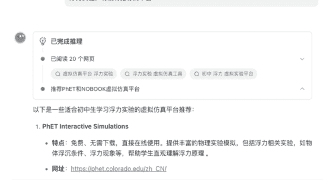
> 小贴士：现实中不易操作的实验，在虚拟平台上可反复尝试，不怕失败，还能大胆设置变量。

遇到不懂可继续提问，比如输入：
能不能告诉我浮力的计算公式？为什么有的物体浮起来有的会沉？
助手会用通俗语言解释原理，还可能配图解说，真正动手时就能游刃有余。

### 6.4.2 在线体验浮力的测定方法

想亲手做浮力实验却条件不足？PhET 虚拟实验室可帮忙。只需一台电脑或平板，就能在网页上体验浮力产生原理和测定方法，像在实验室一样操作。

**试试看：在虚拟实验室中体验浮力实验**

1. 访问网址：https://phet.colorado.edu，这是科罗拉多大学出品的虚拟实验室，适合中学生。如图 6-15 所示。同页为英文，可用插件翻译成中文。

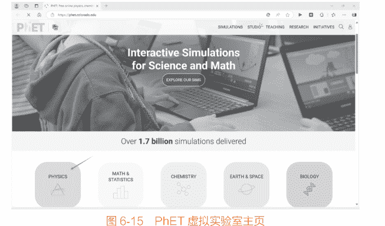

2. 进入物理实验分类，点页面中的 PHYSICS 类实验，进入物理学科模拟列表。在左侧 SUBJECT 分类栏确保只勾选 Motion，然后找到并点名为 Buoyancy 的实验项目。如图 6-16 所示。

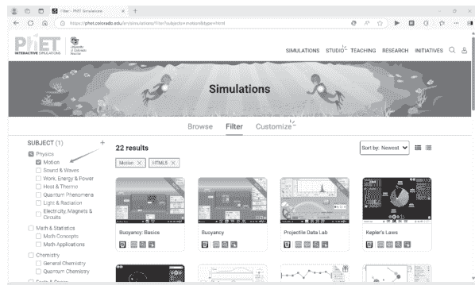
图 6-16 物理实验分类
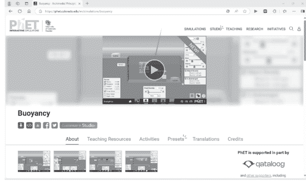
图 6-17 实验界面

3. 进入实验界面，点实验卡片中间的播放按钮 ▶，进入模拟操作界面，如图 6-17 所示。

4. 选择实验模式，进入页面后点 Explore 探索模式，即可开始浮力实验，如图 6-18 所示。

5. 调整固体材料，右上角下拉菜单可切换固体材料，如木块、铁块、铝块等。如图 6-19 所示。

6. 修改固体大小，通过滑动 Mass 质量和 Volume 体积的滑块调整固体体积和质量。注意二者联动，符合公式 m = ρ × V。如图 6-20 所示。

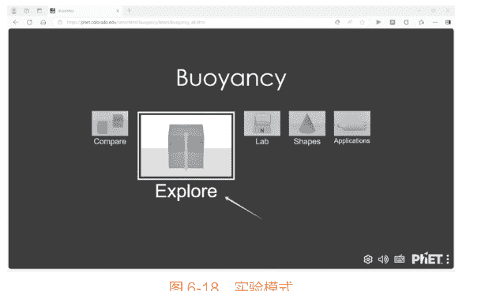
图 6-18 实验模式

图 6-19 调整固体材料

图 6-20 修改固体大小

7. 设置液体种类，下方菜单可选择水、油、酒精等，观察不同液体对浮力的影响。如图 6-21 所示。

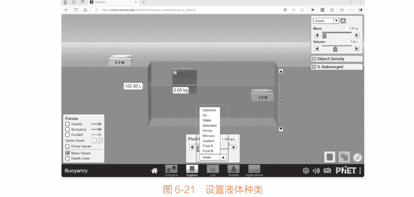
图 6-21 设置液体种类

8. 自定义液体密度，滑动条可自由调整液体密度，单位 kg/L，直接影响浮力大小。如图 6-22 所示。


图 6-22 自定义液体密度

9. 添加第二个固体，点右下角“双固体”图标，可添加新物体，如再放一个铝块，观察叠加后的浮力变化。如图 6-23 所示。

10. 移动固体位置，用鼠标拖动固体，像搭积木一样把一个放在另一个上面，观察组合后浮沉变化。如图 6-24 所示。

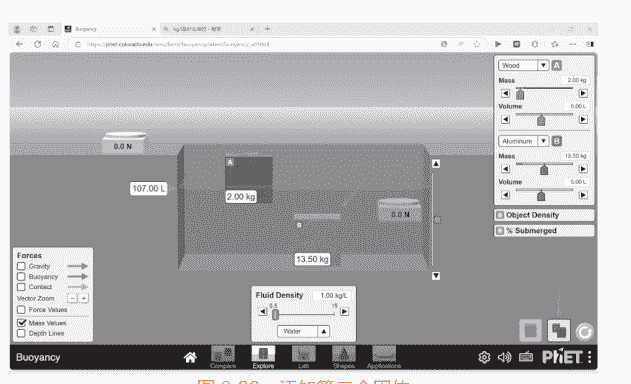
图 6-23 添加第二个固体
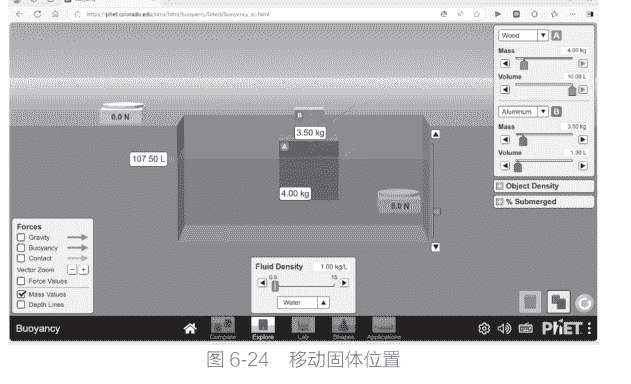
图 6-24 移动固体位置

11. 查看物体密度和浸没度，点 Object Density 物体密度和 %Submerged 浸没程度前面的绿色加号，展开数据面板，观察物体在液体中的浮沉情况。如图 6-25 所示。

12. 观察受力分析图，左下角“受力分析”模块很关键。可勾选 Gravity 重力、Buoyancy 浮力、Contact 接触力、Force Values 显示力的数值，通过 Vector Zoom 向量缩放调整力的箭头大小，更直观观察受力变化。如图 6-26 所示。

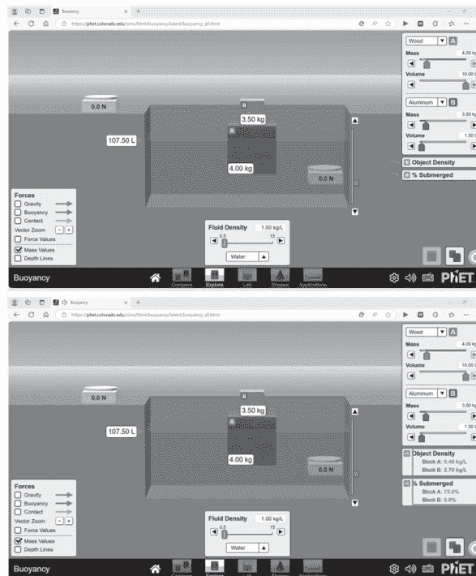
图 6-25 查看物体密度和浸没度
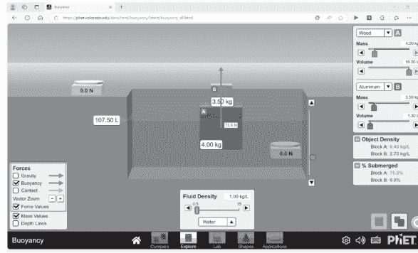
图 6-26 观察受力分析图

> 小贴士：动手实验时不妨多换几种组合试试，比如固体密度高于液体时会怎样？把液体的密度调大，物体有没有可能浮起来？

把实验数据截屏保存，再让 AI 帮忙解读也很高效。只要输入“根据以上实验记录，帮我分析浮力实验的现象和结论”，AI 就会自动归纳出规律。

## 6.4.3 实验拆解：AI 来当实验教练

AI 不只是介绍实验方法，还能像现场指导员那样逐项带你梳理流程，确保整个任务顺利完成。

### 用三步完成浮力测定

1. **先定目标**：测定浮力的方法不少，比如弹簧测力计称重法，或利用阿基米德原理测排开液体的质量，先确定采用哪种方案。
2. **列清器具**：方案确定后，要想清楚需要哪些器材，例如弹簧测力计、量筒、水槽、小挂钩砝码、细线等。
3. **记录与归纳**：实验结束后把数据填入记录表并进行分析。比如浮力等于物体在空气中的重力减去在液体中的重力；浮力是否等于排开液体的重力，该如何验证？

### 边学边做：让 AI 当教练

1. 请 AI 帮你理清思路和方法，打开 DeepSeek 这类工具，在输入框写：
> 我是初二学生，想借助一次浮力测定实验加深对浮力的理解。请列出初中物理中常用的浮力测定方法？它们有何区别？适合什么场景？

2. 平台通常会给出系统性回答。参考建议后，画出自己的实验路线图，如图 6-27 所示。可结合教材要求和实际条件挑选一种，再请 AI 进一步细化步骤。

> 小建议：在和 AI 交流时说明年级、知识背景和实验目的，回馈的建议会更贴合。

初中物理里常用的浮力测定方法主要有四种，各自的原理、适用范围与操作差异如下：

### 1. 称重法

- **原理**：浮力等于物体在空气中的重力减去浸入液体时弹簧测力计的示数，即视重。
- **公式**：$F_{浮} = G_{空气} - G_{液体}$
- **操作步骤**：
  1. 用弹簧测力计测出物体在空气中的重力 $G_{空气}$；
  2. 将物体浸入液体中，记录此时测力计示数 $G_{液体}$；
  3. 两次读数之差即为浮力。
- **特点**：
  - 直接测量，适用于规则或不规则物体；
  - 需注意物体完全浸没或部分浸没时的读数差异。

### 2. 阿基米德原理法

- **原理**：浮力等于物体排开液体的重力。
- **公式**：$F_{浮} = \rho_{液} g V_{排}$
- **操作步骤**：


## 6.4.4 实验规范：AI 帮你避坑

实验中一个小失误就可能导致数据偏差、实验失败，甚至误导结论。AI 就像一位经验丰富的前辈，能提前点出常见错误和注意事项，帮你少走弯路。

### 为什么要重视操作失误

- 不规范的操作会使结果不准；
- 会让你对浮力的理解产生偏差；
- 会影响实验报告的正确性。

### 边学边做：借助 AI 规避常见错误

1. 请 AI 列出常见误区，打开 DeepSeek，输入：
我是一名初中生，正在进行浮力测定实验。请帮我列出实验中常见的错误操作和注意事项，提高实验准确性。
2. 查看 AI 给出的避坑指南，通常会列出大量实用建议，如图 6-28 所示。

> 小提示：也可以把自己写的实验步骤上传，请 AI 检查合理性。

下面是初中物理浮力测定实验中容易出错的要点，供参考：

### 器材准备与使用

1. **弹簧测力计的校准**
   - 使用前确认指针是否回零。若未归零需先校准，否则数据会失真。
   - 错误示例：如果弹簧测力计未校准，可能会导致浮力计算出现偏差。

2. **溢水杯的正确使用**
   - 用溢水杯测量排开液体体积时，要确保杯内液体恰好装满，不能额外溢出，否则体积测量不准。
   - 错误示例：如果溢水杯中的液体未装满，排开液体的体积会少于实际值，导致浮力计算错误。

3. **物体的悬挂方式**
   - 悬挂时保证物体完全浸入液体，且不接触容器底部或侧壁，否则拉力会受容器影响。
   - 错误示例：如果物体接触容器底部，测力计读数会比实际值小，导致浮力计算偏大。


## 6.4.5 数据处理，AI 迅速搞定

实验结束面对一堆数据容易眼花。别担心，AI 就像一位会变魔术的数据助手，能把枯燥表格转为直观图表，快速抓住规律。

### 为什么借助 AI 处理数据

- 表格太干？AI 能把它变成一目了然的图像。
- 想看趋势？几秒钟就能画出漂亮折线图。
- 不会编程？AI 还能自动生成代码，一键绘图。

### 方法 1：在 Excel 中生成图表

可使用在线 AI 表格工具，让平台整理数据并绘图。


1. 打开 https://chatExcelcn.com/，该站支持在线上传 Excel 并与 AI 对话操作。点“访问”，再点“开始使用”，进入分析界面。如图 6-29 所示。
2. 在右侧上传框上传已记录数据的 Excel 表格，上传后数据会显示在中间，如图 6-30 所示。
3. 在右下角对话框输入需求，例如：
表格第一列是木块沉入液体的体积百分比，第二列是浮力值，单位为牛顿。请将体积百分比按从小到大排序，并生成一张折线图。横轴是体积百分比（单位：%），纵轴是浮力值（单位：N）。

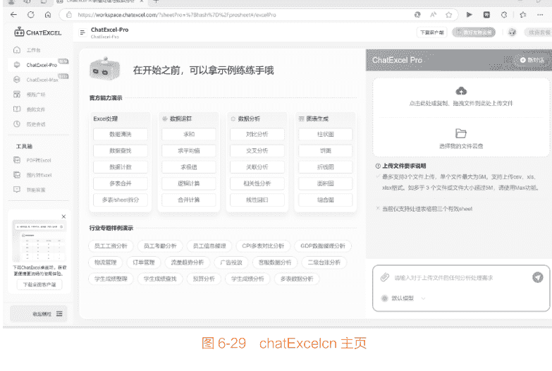

图 6-29 chatExcelcn 主页

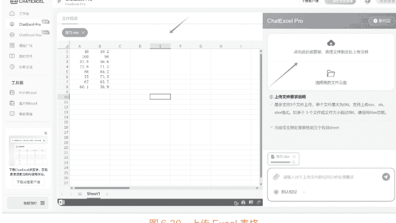

图 6-30 上传 Excel 表格

4. AI 会自动对数据进行排序，并绘制出符合要求的图表。如图 6-31 所示。

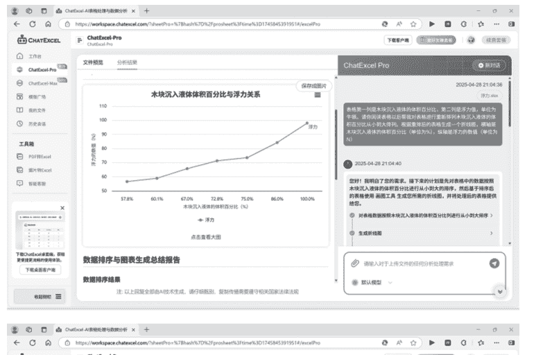

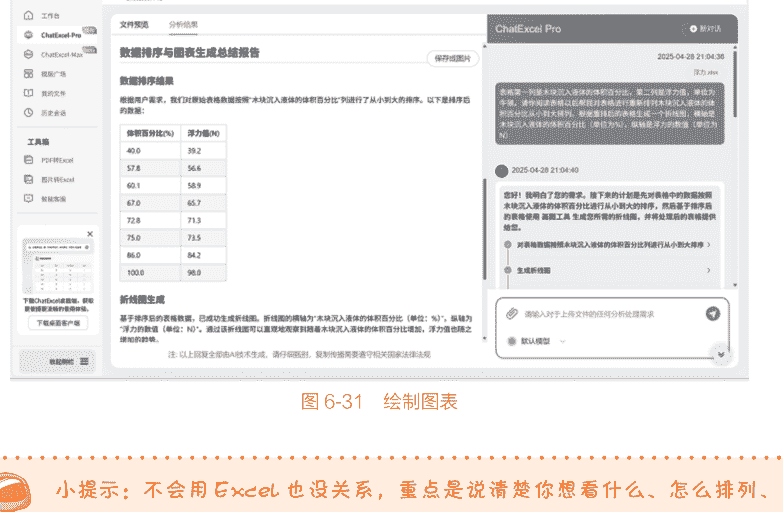

图 6-31 绘制图表

> 小提示：不会用 Excel 也没关系，关键是说清楚想要的排序与绘图方式。图表可以截图插入到实验报告中，清晰又专业。

### 方法 2：使用 Python 编程绘图

想学点编程？AI 可以帮你生成 Python 代码，把数据变成图像。

### 边学边做：用 AI 生成 Python 代码实现可视化

1. 让 AI 生成绘图代码，打开 DeepSeek，输入：
> 我是一名初中生，完成了一个浮力实验，记录了体积百分比和浮力值的数据。我想用 Python 绘制折线图，请帮我生成对应的代码，横轴是体积百分比（%），纵轴是浮力值（N）。
AI 通常会生成一段完整代码，一般会用到 matplotlib 或 pandas 的绘图库。

2. 将代码复制粘贴到熟悉的编程环境中运行，可选：
- https://www.programiz.com/python-programming/online-compiler
- 本地安装的 Python 软件，如 Thonny、Jupyter Notebook

一键运行，就能看到漂亮的图表了！

> 小提示：如果不确定数据格式，可以请 AI 帮你模拟一个示例数据表格。初学编程时多尝试多请教 AI，它就是你的贴身编程教练！

### AI任务卡：设计并分析一个科学实验

**任务要求：**
- 用 AI 设计一个把声音变成波形图的实验。
- 内容要包括所需材料、实验步骤、注意事项以及波形变化分析。

## 6.5 跨学科融合——AI 助力跨学科难题突破


面对同时涉及历史、地理、政治、经济等多个学科的问题是否感到无从下手？别担心，AI 就像一位跨学科顾问，能整合多领域知识，提供新视角，轻松应对复杂问题。

### 6.5.1 学科交叉案例分析：利用 AI 从多学科视角分析问题

跨学科问题通常需要多角度收集信息再整体整合。AI 在此表现突出——可快速获取各学科数据、自动识别学科间联系点、构建综合分析模型并输出清晰结论。

### 边学边做：用 AI 从多个角度对“一带一路”项目进行分析

**第一步：从多个学科角度收集信息**

1. 打开 DeepSeek，输入：
整理“一带一路”沿线国家的历史贸易数据、地理资源分布、政治合作协议及经济指标。
2. AI 会自动从多学科角度为你收集相关信息，形成结构化数据，如图 6-32 所示。


**第二步：AI 帮你识别学科间的关联性**

收集数据只是开始。接下来，让 AI 分析这些数据之间的联系，并自动标注属于哪一门学科，从而构建清晰的知识结构。

1. 再次打开 DeepSeek，输入：
分析以上数据，识别不同角度之间的关联性，并对内容进行学科标签标注，如历史/地理/政治/经济，生成一份思维导图，以 Markdown 格式输出。
2. AI 会输出一段 Markdown 格式的内容，里面包含了数据分类、学科标签和相互关系的结构信息，如图 6-33 所示。


为何用 Markdown 格式？因为它可以直接用来制作清晰的思维导图，也方便后续导入 XMind 等工具！

**第三步：制作思维导图，直观展现数据结构**

1. 再次打开 DeepSeek，将上述 Markdown 内容复制，保存为 .md 文件。
2. 打开 XMind，导入该文件即可生成可视化的思维导图。
3. 或者更便捷，直接让 DeepSeek 将其转换成 HTML 文件展示，只需输入提示词：
将这个 Markdown 文件以 HTML 文件形式展现。
4. AI 将转换为 HTML 文件，运行 HTML 文件，你就可以在线查看一张结构清晰、信息丰富的跨学科分析图，如图 6-34 所示。


> 小提示：HTML 展示的信息通常更丰富，还能交互查看，是理解复杂关系的好工具。

**第四步：提出深度问题，生成趋势预测**

掌握了基本结构之后，你还可以向 AI 提出更具挑战性的问题，比如在 DeepSeek 中输入提示词：
请结合地理资源和政治稳定性，预测未来 5 年“一带一路”重点合作区域。
AI 将为你列出未来可能的重点合作国家或地区，并说明其依据。

> 小提示：在使用 AI 进行跨学科分析时，一定要清晰标注学科标签，这样 AI 才能更好地理解数据含义，分析出更准确的结果。

### 6.5.2 综合性问题解决：用 AI 解决环境、科技、国际关系等复杂问题

面对环境污染、科技伦理、国际关系紧张等“超级复杂”社会问题，往往需要拆分问题+多学科整合+AI 建模分析+模拟效果+优化决策路径。下面以一个例子说明。

**如何用 AI 解决“碳中和”背景下的产业转型难题？**

“碳中和”即让某地区碳排放与碳吸收量达到平衡，减少对气候负面影响。

### 边学边做：用 AI 完成“碳中和”背景下的产业转型方案

1. 分解问题。打开 DeepSeek，输入：
请从地理、经济、政治三个角度，分析广东省如何实现碳中和目标。
AI 会把问题拆解为三个学科子问题，并进行资料整理，输出图文并茂的分析报告。
2. 生成初步方案。AI 可能给出如下建议：逐步关停高污染、高耗能产业；加大新能源产业投资扶持；完善环保政策，优化财政补贴机制。
3. 模拟实施效果。接着，让 AI 预测方案执行后的影响，输入：
请模拟该方案 5 年内的实施效果。
AI 可能输出：碳排放预计下降 30%；GDP 预计增长 5%；绿色产业就业人数增加 20%。
4. 调整方案，优化升级。若认为新能源应优先发展光伏，可尝试：
若优先发展光伏产业，请重新生成碳中和转型方案。
AI 将自动调整数据模型，重新生成更加聚焦光伏产业的解决方案。

> 小提示：跨学科问题一定要明确优先级和核心诉求，比如更关注经济效益还是环境保护？只有这样，AI 才能平衡各方面的利弊关系。

## AI任务卡：选择社会热点，让 AI 从多个学科角度进行分析

任务要求：
利用 AI 工具，从多个学科视角出发，对人工智能伦理争议问题进行分析，产出一份结构清晰、逻辑严谨的研究报告。

# DeepSeek AI

## 第 7 章
AI 创意工作室
——艺术与科技的完美碰撞

你是否梦想策划一场创意满满的校园活动？制作一张让全班惊叹的炫酷海报？拥有属于自己的原创音乐？从编程小白升级为代码达人？现在，只要搭上 AI 这辆创意快车，这些梦想都能触手可及。本章将带你开启“AI+艺术”的奇妙冒险，用科技点燃无限想象！

### 7.1 活动策划大师
——AI 秒出创意方案

是否曾为活动策划书抓耳挠腮，不知从何开始？或写出方案后总觉得不够新颖？别急！AI 就像贴心的策划助手，无论你是新手还是老手，都能提供有用帮助。

### 7.1.1 活动策划：和 AI 一起策划校园社团活动

第一次策划校园活动没思路？AI 可推荐有趣可行的校园活动，并帮你快速搭建策划框架。

**实践环节：用 AI 策划一次春游活动**

1. 打开任意 AI 平台，如 DeepSeek、KIMI、通义千问、ChatGPT 等，在对话框输入清晰指令：
我是初一学生，想策划一次班级春游活动，请帮我出一份详细的策划方案。
2. AI 会迅速生成结构完整的策划书，包括活动主题、目标、流程、安全预案、预算建议和注意事项。如图 7-1 所示。
3. 可根据 AI 内容，结合班级人数、经费、老师要求等实际情况进行调整补充。

这就像有经验丰富的大哥哥大姐姐在旁陪你策划。

有了初步方案，如何让它更好？

**实践环节：用 AI 策划一次有创意的元旦联欢活动**

1. 打开 AI 平台，把已有策划内容复制粘贴或上传文档，然后输入具体需求，例如：
这是我写的班级元旦联欢活动策划，请帮我想一个更有趣、更有创意的活动主题。
2. AI 会给出多个建议，如“青春闪光夜”“快乐联欢 GO”等。可挑选喜欢的，或在此基础上延伸灵感。
3. 还可请 AI 优化活动流程、添加趣味游戏、调整时间安排，逐步让方案更完美。


> 小提示：与 AI 沟通时，尽量说清楚你是谁、要做什么、希望解决什么问题，才能得到最精准帮助。

AI 输出的是“模板”或“灵感”，真正的策划高手仍需根据场地、人数、天气、预算等实际情况合理调整。多练习几次，你也能成为校园活动小策划师！

### 7.1.2 创意玩法：AI 帮你想点子，让活动更有趣

是否想为班级活动设计能让大家笑出声的互动游戏？在大课间组织一场脑洞大开的创意运动？想出一套特别主题小游戏，让同学们玩得开心记得牢？

别担心，AI 是你的点子制造机。无论设计游戏、互动问答还是趣味挑战，它都能迅速给出新鲜实用的创意，还能准备道具和规则，轻松搞定流程。

如何用 AI 快速生成创意玩法？

**实践环节：用 AI 设计有趣的桌游方案**

1. 打开 AI 平台，输入指令：
有哪些适合中学生玩的创意游戏？
2. AI 很快列出一串精彩有趣的游戏，每一个都能点燃全场氛围！如图 7-2 所示。


3. 选定感兴趣的游戏，进一步“定制”玩法。输入更具体要求，例如：
请设计一个 3 人一组的桌面游戏，主题是古诗词接龙，要有完整的计分规则，适合中学生在课间玩。
4. AI 会为你生成详细的桌游设计方案，包括游戏名称、规则、计分方法、道具准备、胜负判定方式等，如图 7-3 所示。

请设计一个3人一组的桌面游戏，主题是古诗词接龙，要有完整的计分规则，适合中学生在课间玩。

### 古诗词接龙·三人对战版

（课间10分钟趣味桌游）

#### 开局准备
1. 人员安排：建议以三人一队进行，多队可以同时同场对战。
2. 需准备的物料：
   - 古诗卡片：事先准备 50 至 100 张小卡，每张写上一句常见的古诗，如“床前明月光”“春眠不觉晓”等。
   - 积分记录：用于登记个人得分，可用纸笔手写，也能用手机备忘录。
   - 计时工具：手机倒计时，每轮作答上限 20 秒。

#### 玩法指引
1. 初始设置：
   - 把古诗卡片洗匀，背面朝上叠放。
   - 三名队员轮流担任裁判，负责抽卡、计时和裁定，每轮轮换一次。
2. 核心流程：
   - 抽卡开局：裁判抽一张卡展示首句，例如“白日依山尽”。
   - 接龙规则：
     - 下家需接上首字与上一句尾字同音或相同的诗句，如“尽”可接“近水楼台先得月”。
     - 若找不到完全匹配，可放宽为诗句中包含该尾字或谐音的字，如“尽”可接“山穷水复疑无路”中的“复”。
   - 时间限制：每人思考不超过 20 秒，超时即判定失败。
3. 计分方式：

5. 用工具提效，提升体验
   - 内容生成：借助 DeepSeek 或豆包等 AI 应用快速生成古诗接龙素材，也可同步生成脑筋急转弯、谜语、小知识问答等互动题目。
   - 视觉制作：用 Canva 制作接龙卡牌、游戏模板或活动海报，用 WPS 表格或 Excel 建立计分表并加入自动求和与高分提醒，让比赛更公平更有科技感。

> 小贴士：所用内容要健康有趣，务必核查 AI 产出不含暴力、恐怖、低俗等不良信息，保证适合校园使用。AI 仅作辅助，创意打磨与最终把关仍需人工完成。

## AI 实战任务：与 AI 协作策划一次班级活动
任务要求：
- 结合 AI 策划一场班级趣味运动会。
- 撰写一份条理清晰、内容充实的活动策划方案。
- 学会根据班级实际，对 AI 生成的方案进行修改和优化。

### 7.2 设计加速高手
——用 AI 打造专属视觉成果

有没有想过亲手做一张吸睛的海报，或在全班面前展示一份精美的 PPT？即便不会绘画、不会 PS，也能依靠 AI 快速产出专业水准的视觉作品。现在，AI 能让你从零基础小白秒变设计达人。

### 7.2.1 海报智能生成：让 AI 替代设计师
如何借助 AI 制作海报？
- 文生图：先输入主题与风格关键词搭建框架，再补充元素指令并微调细节强化风格，实时预览后优化至满意，最后导出不同尺寸适配不同场景。
- 图生图：上传喜爱的风格参考图，AI 会提炼关键词并以该风格为基准产出海报。

**方法 1：用 AI 的文生图模式制作海报**
> 边学边做：用 AI 文生图制作海报
1. 先用 AI 应用如 DeepSeek 生成海报提示词。打开 DeepSeek 官网，在输入框填写：
   请帮我写一个关于冬至海报设计生成的提示词
2. DeepSeek 会给出设计提示词，如图 7-4 所示。
3. 选择支持文生图的 AI 应用，如 Midjourney、Stable Diffusion、即梦 AI 等，例如打开即梦 AI 官网，将 DeepSeek 生成的提示词中关键信息粘贴到输入框，提示词如下：
# 第 7 章 AI 创意工作室——艺术与科技的完美碰撞
155
### 冬至海报设计提示词建议
帮我写一个关于冬至的海报设计生成提示词
已深度思考（用时 15 秒）
以下是为冬至海报设计生成的 AI 提示词建议，分为不同风格供选择：
**【基础模板】**
主题关键词：冬至节气/传统节日/冬季温暖/家庭团圆/阴阳转换
主视觉元素：热腾腾的饺子汤圆/蒸汽升腾的砂锅/积雪的屋檐灯笼/冬至日照投影图
配色方案：朱红+暖橙渐变/霜白+靛青对比/糯米的珍珠白+竹编的浅棕
字体建议：书法体标题「冬至大如年」+手写体节气诗词
构图风格：中心对称式美食特写/上下分割的天地阴阳构图/圆形窗框透视家庭聚餐场景
季节元素：霜花纹理/水墨晕染的积雪/半透明冰晶图案/热气蒸腾效果
文化符号：二十四节气时间轴/冬至九宫格数九图/传统冬酿酒器具
材质质感：宣纸底纹/磨砂质感/烫金工艺效果/毛毡织物触感
**【风格延伸】**
1. 新中式美学版：
   “极简宋式美学，留白处呈现冬至日晷投影动画，哑光金色线条勾勒饺子轮廓，背景是渐变黛青色山水”
2. 现代扁平插画版：
   “几何图形组成的雪人家庭围坐场景，汤锅升起热蒸汽云朵造型，霓虹灯管风格的「Winter Solstice」字样”
3. 3D写实场景版：
   “超现实风格，晶莹的饺子悬浮在星空中，内馅呈现宇宙星云，筷子夹起时带出银河光尾，碗沿结着冰霜”
4. 国潮手绘风：
   “敦煌飞天环绕热气腾腾的铜火锅，祥云化作羊肉卷形态，传统纹样边框融入冬至三候（蚯蚓结/麋角解/水泉动）”
**【动态元素提示】**（适用于电子海报）
- 汤圆在碗中缓慢旋转露出不同馅料截面
- 呼吸灯效果的灯笼明暗渐变
- 飘雪粒子在触碰屏幕时融化成水蒸气
- 实时变化的日晷长度进度条
**【文化深度强化】**
- 加入古观星台元素展示「日短至，影最长」
- 呈现「冬至三候」的微缩场景
- 用卦象符号表现阴阳转换概念
- 黄道十二宫与节气关系示意图
可根据具体使用场景（餐饮/文化宣传/节气科普）侧重不同元素组合，建议保留30%负空间增强呼吸感，冷暖色调比例控制在7:3左右以平衡冬季寒冷与节日温暖的双重属性。

主题关键词：冬至节气 / 传统节日 / 冬季温暖 / 家庭团圆 / 阴阳转换
主视觉元素：热腾腾的饺子汤圆 / 蒸汽升腾的砂锅 / 积雪的屋檐灯笼 / 冬至日照投影图
配色方案：朱红 + 暖橙渐变 / 霜白 + 靛青对比 / 糯米的珍珠白 + 竹编的浅棕
字体建议：书法体标题「冬至大如年」+ 手写体节气诗词
构图风格：中心对称式美食特写 / 上下分割的构图 / 圆形窗框透视家庭聚餐场景
季节元素：霜花纹理 / 水墨晕染的积雪 / 半透明冰晶图案 / 热气蒸腾效果
文化符号：二十四节气时间轴 / 冬至九宫格数九图 / 传统冬酿酒器具
材质质感：宣纸底纹 / 磨砂质感 / 烫金工艺效果 / 毛毡织物触感
4. 即梦 AI 依据提示词绘制出海报，如图 7-5 所示。
156 初高中生 AI 伴学：教你用 DeepSeek 高效学习

5. 调整细节，例如挑选一张海报，将鼠标悬停后出现浮层菜单，点击“扩图”按钮，在弹框中选择比例和尺寸后点“立即生成”，如图 7-6 所示。

6. 即梦 AI 导出海报，如图 7-7 所示。

> 小提示：在撰写提示词时要足够精准，避免模糊表述；通过多次迭代调整参数来完善海报；参考优秀案例，优化指令关键词。
**方法 2：用 AI 的图生图模式制作海报**
假设你有 A、B、C 三张喜欢的图片，想要参考 A 的构图、B 的设计风格、C 的色彩来合成海报。
**边学边做：用 AI 图生图模式制作海报**
1. 打开 DeepSeek，上传图片 A，输入：
   从颜色的角度帮我提取这张图片的关键词
2. DeepSeek 给出图片 A 的颜色关键词，如图 7-8 所示。
3. 上传图片 B，输入：
   从构图方式的角度帮我提取这张图片的关键词
4. DeepSeek 给出图片 B 的关键词，如图 7-9 所示。
5. 上传图片 C，输入：
   从设计视觉风格的角度帮我提取这张图片的关键词

图 7-8 DeepSeek 给出图片 A 的颜色关键词

图 7-9 DeepSeek 给出图片 B 的关键词
6. DeepSeek 给出图片 C 的关键词，如图 7-10 所示。
7. 把三张图的提示词合成一条综合提示词，形式如下：
   把 DeepSeek 给出的图片 A 关键词粘贴到这里
   把 DeepSeek 给出的图片 B 关键词粘贴到这里
   把 DeepSeek 给出的图片 C 关键词粘贴到这里
   帮我整合以上三张图片中提取构图、设计风格、颜色三个角度的春分海报设计提示词。

从设计视觉风格的角度帮我提取这张图片的关键词
视觉风格关键词提取：
1. 古典诗意：中国风意境，源自诗句的婉约与含蓄，强调传统诗词的文学美感。
2. 自然意象：落花、微雨、燕子、春分节气元素，突出春季的生机与细腻动态。
3. 柔和色调：浅粉、淡绿、灰蓝等春季色系，搭配水墨晕染的渐变效果。
4. 朦胧氛围：微雨的水雾感，花瓣飘落的轻盈，通过半透明笔触或模糊处理呈现。
5. 动静结合：燕子飞行的动态线条与人物伫立的静态剪影形成对比，增强画面张力。
6. 现代融合：抽象光效、几何线条或数字粒子（呼应“即梦AI”的科技感），与传统水墨元素交织。
7. 留白构图：不对称布局，大面积留白强化诗意与空灵感，引导视觉焦点。
8. 材质质感：水墨笔触、纸张纹理，结合微弱的光泽渐变或数字渲染效果。
9. 情感表达：静谧、孤寂与希望并存，通过冷色调与暖色调的平衡传递复杂情绪。
关键词总结：中国风、水墨意境、春分自然、朦胧微雨、燕子动态、科技融合、留白美学、渐变晕染、静谧情感。
图 7-10 DeepSeek 给出图片 C 的关键词
8. DeepSeek 根据三张图的关键词整合成海报的提示词，如图 7-11 所示。
根据三套关键词的关联性和春分节气主题，现将构图、设计风格、颜色三个维度的核心信息整合如下：
**第一张图（传统节日氛围）**
颜色关键词
朱红 | 暖橙 | 雪白 | 米白/浅褐 | 深褐/墨黑 | 金黄
配色逻辑：以朱红与暖橙为核心，搭配雪白调和洁净感，深褐强化阴影对比，金黄点缀暖光影层次。
构图关键词
中心对称 | 文字环绕 | 层叠分布 | 密集填充
设计风格
古典元素 | 传统竖排 | 符号化组合 | 阴阳对比 | 喜庆张力
**第二张图（诗意自然场景）**
颜色关键词
浅粉 | 淡绿 | 灰蓝 | 水墨渐变 | 半透明晕染
配色逻辑：柔和春季色系，水墨质感结合朦胧水雾，冷暖平衡传递静谧感。
构图关键词
留白构图 | 不对称布局 | 动静结合（飞燕与静物） | 自然意象散点
设计风格
中国风意境 | 朦胧微雨 | 抽象线条融合 | 纸张纹理 | 诗意留白
**第三张图（现代与传统融合）**
颜色关键词
雪白 | 金黄 | 墨黑 | 浅褐（材质本色）
配色逻辑：雪白与金黄提亮画面，墨黑深化结构，浅褐呼应陶瓷砂锅的质朴感。
构图关键词
几何切割 | 符号化短语 | 竖排文字 | 光影投影（阴阳对比）
设计风格
科技粒子特效 | 数字渲染 | 传统材质复刻 | 动静冲突 | 冷寂与希望并存
**春分海报整合关键词**
颜色
1. 传统组：朱红 | 金黄 | 米白（节日暖调+食材本色）
2. 自然组：浅粉 | 淡绿 | 灰蓝（春色+水墨渐变）
3. 对比组：雪白 | 墨黑 | 浅褐（纯净感与阴影层次）
构图
1. 平衡感：中心对称+留白 | 层叠分布+散点
2. 动态语言：飞燕线条+静态剪影 | 光效粒子+传统竖排
3. 文化符号：汉字环绕 | 节气短语 | 阴阳投影
设计风格
1. 传统基调：古典诗词意境 | 水墨笔触 | 纸张纹理
2. 现代融合：抽象几何 | 数字光效 | 材质渲染
3. 情感表达：静谧微雨 | 生机萌动 | 科技与人文对话
应用建议：
春分海报可选取第二张图的自然色调（浅粉/淡绿）为主，结合第一张图的文字与构图密度（符号短语+竖排），叠加第三张图的科技光效（粒子或渐变渲染），形成传统诗意与现代视觉的冲突美感。
图 7-11 DeepSeek 根据三张图的关键词整合成海报的提示词
9. 选择支持文生图的 AI 应用，如 Midjourney、Stable Diffusion、即梦 AI 等，例如打开即梦 AI 官网，从 DeepSeek 生成的海报提示词中挑选关键信息粘贴到输入框。选用提示词如下：
   颜色关键词：浅粉、淡绿、灰蓝、水墨渐变、半透明晕染
   配色逻辑：柔和春季色系，水墨质感结合朦胧水雾，冷暖平衡传递静谧感。
   构图关键词：留白构图、不对称布局、动静结合（飞燕与静物）、自然意象散点
   设计风格：中国风意境、朦胧微雨、抽象线条融合、纸张纹理、诗意留白
   文字：除春分两个字外，不要其他文字
10. 即梦 AI 依据提示词绘制出海报，如图 7-12 所示。
掌握这些 AI 设计工具的使用方法和技巧，就能轻松一键生成炫酷海报，让设计变得简单高效。

### 7.2.2 PPT 智能助手：从构思到排版全自动
在学习和工作节奏加快的今天，能快速精准地制作 PPT 已成为硬需求。借助 AI，内容构思到版式设计都能实现智能化辅助，让 PPT 制作前所未有的便捷高效。
## 如何用 AI 制作 PPT？

1）借助 AI 构思，一键生成大纲。假设你要为课程准备一份 PPT。打开 DeepSeek，在输入框输入：
> 我是一名中学生，下节课要跟班级同学分享对古诗词《声声慢》的作品赏析，请你帮我生成一份 PPT 大纲，需要围绕这篇诗词及其主旨，和我对于这篇古诗词的理解。
2）DeepSeek 给出 PPT 的大纲内容，如图 7-13 所示。

图 7-13 DeepSeek 给出 PPT 的大纲内容
3）选择支持生成 PPT 的 AI 应用，如 KIMI 等，例如打开 KIMI 官网，将上面 DeepSeek 生成的大纲内容复制粘贴到提示词输入框。
4）KIMI 应用会自动生成每页 PPT 的标题、正文及案例素材，如图 7-14 所示。
## 《声声慢》的诗意与情感
### 1. 认识李清照
#### 1.1 诗人标签
##### 1.1.1 宋代女词人
- 李清照生活在宋代，是当时著名的女词人，她的词作在文学史上有着重要地位。
- 她的词风格独特，情感细腻，被后人誉为“婉约派掌门人”，影响深远。
#### 1.2 趣味小知识
##### 1.2.1 爱好广泛
- 李清照不仅爱写诗，还爱喝酒，她的诗词中常常流露出对生活的热爱和感悟。
- 她喜欢记录生活中的点滴，无论是喜怒哀乐，都通过诗词表达出来。
#### 1.3 人生转折点
##### 1.3.1 战乱中的漂泊
- 在战乱中，李清照失去了家园和丈夫，她的生活陷入困境，心情无比忧伤。
- 这段经历让她的诗词风格发生了变化，变得更加凄凉和忧伤，充满了对故人的思念和对生活的无奈。
### 2. 诗词初印象
#### 2.1 读一读
##### 2.1.1 重声朗读
- 播放重声朗读音频，重点突出叠词的节奏，感受诗词的韵律美。
- 叠词的重复让诗词读起来更加朗朗上口，富有韵律感，仿佛在诉说着无尽的愁绪。
##### 2.1.2 圈出重复字
- 圈出词中重复的字，如“寻寻觅觅”“点点滴滴”，这些叠词增强了诗词的表现力。
- 通过寻找叠词，感受李清照在诗词中反复强调的情感，体会她的孤独和无助。
#### 2.2 想一想
- 如果用颜色形容这首词，你会选什么色？互动投票：灰色、蓝色、黄色。
- 灰色代表忧郁，蓝色象征悲伤，黄色寓意凄凉，这些颜色都能体现词中的情感基调。
### 3. 秋日场景解密
#### 3.1 分句图解
##### 3.1.1 风急天寒
- 风急天寒，瑟瑟发抖的小人，描绘出秋日的寒冷和凄凉。
- 这样的场景让人感受到李清照内心的孤独和无助，仿佛她也在瑟瑟发抖。
##### 3.1.2 雁过伤心
- 雁过伤心，流泪的大雁对话框，大雁的南飞让李清照更加思念远方的亲人。
- 大雁的离去象征着离别，而李清照的泪水则表达了她对亲人的无尽思念。
##### 3.1.3 满地黄花
- 满地黄花，枯萎花瓣拼成“愁”字，黄花的凋零象征着李清照的愁绪。
- 这些枯萎的花瓣仿佛是她心中的愁绪，堆积在一起，无法排遣。
#### 3.2 主旨提炼
- 通过秋风、落叶、大雁等意象，诉说孤独与思念，这些自然景象都成为了李清照情感的寄托。
- 这首词通过对秋日场景的描绘，生动地表达了李清照内心的孤独和对故人的思念之情。
### 4. 神奇叠词实验室
#### 4.1 放大镜观察
##### 4.1.1 寻寻觅觅
- “寻寻觅觅”，动作：翻箱倒柜找东西的简笔画，表现了李清照内心的迷茫和焦虑。
- 她在寻找什么？是失去的亲人，还是往昔的幸福时光？叠词的重复让这种情感更加强烈。
##### 4.1.2 冷冷清清
- “冷冷清清”，场景：空荡荡的房间，描绘出李清照生活的孤独和凄凉。
- 空荡荡的房间没有一丝温暖，就像她的心一样，充满了孤独和寂寞。
### 5. 我的情感共鸣
#### 5.1 情感温度计
##### 5.1.1 李清照：极寒
- 李清照的情感温度是极寒，她的诗词充满了忧伤和孤独，让人感受到她的内心世界。

- 词中那种彻骨的寒意，和我们平常的喜怒哀乐拉开距离，反倒让读者更容易体会到其中的诗意。

##### 5.1.2 对比情感
- 把考场满分时的兴奋，与弄丢心爱玩具时的惆怅并置感受，体会不同情绪的温度差异。
- 通过这样的对照，读者更容易进入李清照的内心，也能学会把自己的感受表达清楚。

#### 5.2 创作小剧场
- 若你就是词里的人物，会给远方的亲人写下怎样的悄悄话？课堂预留空白供现场书写。
- 引导大家化身李清照，写下对故人的牵挂与问候，在书写中感受词中的温度。

### 6. 课后探索任务

#### 6.1 观察作业
- 搜集生活中能传递情绪的自然现象，比如狂风可对应愤怒，探究自然与情绪的关联。
- 透过观察，启发学生发现自然现象与人类情感的相似之处，培养观察与想象能力。

#### 6.2 艺术创想
- 借助树叶贴画或水彩描绘心中的《声声慢》，让诗词与绘画结合。
- 这种艺术尝试既能加深对诗词的理解，也能锻炼艺术创造力。

#### 6.3 延伸阅读
- 推荐李清照青年时期作品《如梦令》，与晚年作品对比体味心境变化带来的风格差异。
- 通过对比，学生能感受李清照不同人生阶段的情感流转，更深入理解其诗词。

### 封底

**金句总结**
- 诗词宛如心灵的望远镜，让我们窥见千年前的情思，借助它可以跨越时空触摸古人的情感世界。

**互动提问**
- 下一次若能穿越，你最想走进哪一首诗里？以此点燃对古诗词的好奇与探索热情。

图 7-14 KIMI 工具能够为每页幻灯片自动生成标题、正文与案例资料

5）点击“一键生成幻灯片”，挑选喜爱的模板风格，KIMI 会自动完成版面排布、配色搭配与图标添加，见图 7-15。


图 7-15 KIMI 生成的 PPT 效果

6）导出后，可在 WPS 中按需修改文字内容、动画效果与字体大小，见图 7-16。


图 7-16 导出后的 PPT

## AI任务卡：做一张“吸睛”的主题海报

任务要求：
- 完成一幅以北京中轴线为主题的海报设计。
- 画面布局简洁大气，并配上宣传语。

## 7.3 变身电影导演
——AI 帮你剪辑视频大片


是否想过把脑中闪现的奇思妙想变成一段可观看的视频？比如输入“戴眼镜的熊猫在太空踢足球”，AI 就能立刻生成熊猫在空间站倒钩射门的动画。这就是“文生视频”的魔力——用文字创造影像，靠的是人类智慧 +AI 技术的完美组合。

现在，你就能借助 AI 逐步剪出属于自己的视频大片！

### 7.3.1 智能剪辑：节奏匹配与镜头切换的自动化处理

借助 AI 可以迅速完成视频节奏匹配、镜头切换、转场特效等工作，让作品更有张力、更流畅、更专业。

## 神器 1：节奏匹配——让画面跟着节奏“跳舞”

节奏匹配是什么？节奏感是抓住观众视线的关键。掌握节奏匹配，就是让画面切换、转场特效、镜头推进等动作配合音乐节拍，从而增强流畅度、节奏感和情绪感染力。

> 边学边做：跟着节奏剪视频

1）下载并启动剪映剪辑工具，电脑版或手机版均可，如图 7-17 所示。

2）以手机为例，打开剪映，点击“开始创作”，导入拍摄的素材，如图 7-18 所示。


3）添加喜欢的音乐。点击音频轨道，选择“节拍”，如图 7-19 所示。

4）点击“自动踩点”按钮，AI 即可分析音乐节奏，如图 7-20 所示。

踩点设置小技巧：
- 快节奏模式：标记所有节拍，适合热血运动、快闪视频等。
- 慢节奏模式：只标记强节拍，适合讲述、治愈风格。
- 自定义关键点：根据视频内容，自主添加节拍节点，让节奏更贴合故事。


小提示：音乐是视频的“灵魂”！选一首合适的BGM，能让平凡的画面充满感染力！

## 神器 2：镜头切换——剪出你的“电影感”

什么是镜头切换？视频其实就是一组镜头的组合。如何让一个场景顺畅过渡到另一个场景？这就需要掌握“镜头语言”。从特写到中景再到全景，不同角度的切换能强化表达，让视频更有故事感。

边学边做：用AI创作具有“电影感”的视频

1）使用 AI 工具如 DeepSeek、KIMI 等生成拍摄分镜脚本。例如输入提示词：
我要拍摄一天的校园生活 Vlog，主题是“走进北京地下城社会实践活动”，请帮我设计完整的拍摄镜头流程和脚本。

2）AI 会给出详细的拍摄安排，如开场：从家出发、全景，到达目的地地铁站、中景，活动细节实践互动、特写，结束语录个人感想、中景+字幕。如图 7-21 所示。

3）拍摄所需的素材。

# 第 7 章 AI 创意工作室——艺术与科技的完美碰撞

场景1：学校集合（07:30-08:00）

| 镜头号 | 画面 | 景别 | 运镜 | 内容/台词 |
|---|---|---|---|---|
| 1-01 | 校门"XX中学"牌匾 | 大远景 | 上升镜头 | 朝阳照射校门 |
| 1-02 | 同学A蹦跳入画 | 中景 | 跟拍 | "地下城！我来啦！" |
| 1-03 | 书包特写（掏出装备） | 特写 | 俯拍 | 手电筒、指南针、零食散落 |
| 1-04 | 老师点头翻开书页 | 特写→中景 | 拉远 | "李雷！""到！"（单手跳起来） |

场景3：地下城入口（09:00-09:30）

| 镜头号 | 画面 | 景别 | 运镜 | 内容/台词 |
|---|---|---|---|---|
| 3-01 | 生锈铁门缓缓打开 | 特写 | 推近 | 金属摩擦刺耳声 |
| 3-02 | 同学C惊呼"深挖洞" | 特写→中景 | 先聚焦手部再拉远 | "这是要挖地道等敌吗？" |
| 3-03 | 头盔灯照亮隧道 | 主观镜头 | 手持前进 | 喘息声+脚步声回声 |

场景2：大巴车（08:00-09:00）

| 镜头号 | 画面 | 景别 | 运镜 | 内容/台词 |
|---|---|---|---|---|
| 2-01 | 车窗掠过城市风景 | 空镜 | 移轴延时 | 配字幕："北京→前门" |
| 2-02 | 同学B抢答历史题 | 近景 | 手持晃动 | "1969！啊管错了？？" |

场景4：主隧道探索（09:30-11:00）

| 镜头号 | 画面 | 景别 | 运镜 | 关键点 |
|---|---|---|---|---|
| 4-01 | 纸片测气流实验 | 特写→全景 | 快速拉远 | 纸片"嗖"地贴墙飞过 |
| 4-02 | 关门瞬间全景 | 全景→特写 | 静止→晃动 | 尖叫后突然安静（3秒黑屏） |
| 4-03 | 发现弹药库门 | 低角度仰拍 | 缓慢推进 | 配悬疑音效 |

图 7-21 AI 给出拍摄安排

4）在剪映中点击“开始创作”，选中拍摄的学校生活相关视频或照片，选好后点击“添加”。导入时留意素材时间或逻辑顺序。例如，先进门再出门，先和老师打招呼再开始学习实践。如图7-22所示。

5）镜头选择与切换：将时间轴上的指针移动到要分割的位置，点击“分割”，就能把长视频片段切断，再选中不需要的部分点击“删除”。依据 AI 提示与逻辑顺序，排列镜头顺序如图7-23所示。


6）微调每段镜头的长度，把控整体节奏，避免拖沓，让内容紧凑而有趣。如图 7-24 所示。

7）检查整段视频，调整到满意后可将视频导出、发布。如图 7-25 所示。


图 7-24 微调每段镜头的长度

图 7-25 导出视频

### 7.3.2 添加特效：滤镜、动画、字幕一步到位

当你已经剪出 Vlog 的基本雏形，下一步就是让它更酷更炫！可以为视频加上滤镜改变氛围，用动画特效增强表现力，再搭配字幕与文字动画提升可读性和趣味性。让视频从“基本雏形”变成“精彩大片”。

**第一步：添加滤镜，让画面瞬间有“大片感”**

1）导入视频素材。
2）点击时间轴上的片段，在下方菜单栏找到“滤镜”选项。
3）在滤镜库中挑选喜欢的风格：复古、电影感、清新、黑白……样式丰富。如图 7-26 所示。
4）添加后可以自由调整滤镜的强度和持续时长，让画面更符合想传达的情绪。如图 7-27 所示。


图 7-26 挑选喜欢的风格

图 7-27 调整滤镜

> 小提示：想表达活泼有趣？选亮色+高饱和滤镜。想讲述深沉感悟？试试黑白+淡化滤镜。

## 第二步：添加动画，让每一幕都动起来

1）点击视频片段，选择“动画”功能。
2）可以添加多种动画效果：
- 入场动画：让视频片段炫酷登场。如图 7-28 所示。
- 出场动画：帅气退场、干净利落。如图 7-29 所示。
- 组合动画：在画面内不断循环、移动、缩放等，动感十足。

3）设置动画的时长、方向、速度，让视频节奏更贴合想表达的氛围。


## 第三步：添加文字动画，提升信息量和表达力

想让别人看懂视频，文字说明不可少。

1. 点击“文本”选项，选择“新建文本”，输入想加入的视频说明内容。如图 7-30 所示。
2. 添加后，在样式栏或文本轨道上，点击“动画”按钮。
3. 选择入场、出场、循环动画，还能调节文字动画的时间、速度、弹跳方式等。如图 7-31 所示。

> 技巧：重要信息可以用“缩放入场”吸引注意力，情绪类字幕可以用“打字机效果”更有代入感。

## 第四步：添加字幕，提升观看体验

1. 让 AI 生成字幕内容，只需输入一句提示词，比如：
请生成一段活泼有趣的 Vlog 字幕内容，主题是“学校社会实践活动参观地下城”，包含时间、地点和情绪表达。

2. AI 就能快速生成简洁生动的字幕文案，如图 7-32 所示。


3）将字幕加入视频：
在剪映菜单栏点击“文本”，选择“新建文本”。将 AI 生成的文案粘贴进去，自定义字体、颜色、大小和位置。如图 7-33 所示。
在剪映中，点击“文本”菜单中的“AI 配旁白”，选择适合自己的文案主题，输入主题及事件描述，由剪映自动生成内容，并生成视频字幕。如图 7-34 所示。


### 7.3.3 字幕生成：让语音秒变文字，效率翻倍

如果视频里已有原声内容，比如 Vlog 中的说话内容、配音讲解或采访语音等，就希望在画面上出现字幕。这时，可使用语音识别自动生成字幕功能，快速完成。

> 边学边做：用AI一键生成同步字幕

1）打开剪映，点击菜单栏中的“文本”功能，选择其中的“字幕”选项。
2）点击“识别字幕”，选择“开始识别”，如图 7-35 所示。


3）剪映会自动识别视频中的语音内容，并将其逐句转化为对应字幕，精准对齐说话时间轴。

4）生成完毕后，一定要仔细检查生成的字幕：有无错别字，语句是否通顺。可以在时间轴上的字幕文本上双击修改，不需要重新生成，非常方便。

小提示：这种字幕生成方法特别适合带有说话内容的Vlog、配音解说类视频、采访、讲座、纪录片剪辑。如果背景音乐太吵或声音模糊，建议先调整音量或降噪，再进行语音识别。

## AI任务卡：拍摄并剪辑一段你的专属 Vlog

任务要求：
请拍摄一段以校园生活或家庭时光为主题的 Vlog 视频，要求包含：3 个以上不同景别的镜头，如特写、中景、全景等，使用至少 2 种创意转场或镜头剪辑技巧，为视频加入字幕、滤镜、特效及音乐。最后分享给同学、老师或家长，收获点赞与建议。

## 7.4 音乐创作超简单
——用 AI 写一首属于自己的歌

是否曾梦想自己写一首歌，却总觉得无从下手？别担心！现在有了 AI 音乐创作工具，即使完全没有乐理基础，也能快速打造专属歌曲。从旋律生成到歌词创作，AI 全程帮你搞定，5 分钟圆你一个“音乐人”的梦。

### 7.4.1 灵感启动：输入关键词，AI 秒出旋律

可能会想：“我不会五线谱，不懂节奏型，也不会写词，我能创作吗？”答案是：当然可以！只需要输入几个关键词，AI 就能生成一段带旋律的音乐，告别“想写却不会写”的尴尬。

写提示词前，可以思考这些方向：
核心主题：爱情、友情、成长、梦想、大自然、社会议题、科幻故事、个人经历等。
歌词关键词：季节如冬天、天气如暴雨、颜色如蓝色、物品如旧吉他、情绪如孤独、快乐等。
故事性：歌词是讲故事的吗？有没有主角？情节如何发展？
音乐风格/情绪：轻快/悲伤/激励人心/浪漫/神秘……
主要乐器：吉他、钢琴、鼓、合成器、弦乐、民族乐器等。

> 小提示：提示词越具体、越有画面感，生成出来的作品就越贴合心中想法。不会写专业术语？没关系！可以直接用“感觉”来表达，比如：“旋律像风吹过草原一样轻柔”或者“开头像雨滴敲打窗户的声音”。

常用的作曲软件有 Singify、SunoAI、天谱乐等。下面以 Singify 为例，用 Singify 写出第一首歌！完成 AI 作曲初体验！

## 边学边做：用AI创作歌曲

1）打开 Singify 官网 https://singify.fineshare.com/，这是一个全英文网站，建议用浏览器自带的“网页翻译”功能，将页面翻译成中文操作更方便。如图 7-36 所示。


图 7-36 Singify 官网

2）用邮箱注册一个账号，然后登录即可开始使用。如图 7-37 所示。


图 7-37 登录 Singify

3）点击“AI 歌曲生成器”，进入后会看到一个输入框，我们将在这里输入关键词或提示词。如图 7-38 所示。


图 7-38 提示词输入框

4）在歌曲提示输入框中输入关键词或提示词，例如：
生成一首流行风格的主旋律，节奏轻快，适合钢琴演奏，时长 1 分钟。
输入提示词后点击“发送”按钮，如图 7-39 所示。


5）AI 会自动分析提示词，生成旋律片段、歌词草稿和歌曲风格建议，并根据提示词自动填写风格和标题。此时歌曲已经初具雏形。如果没有更多要求，点击“生成”。如图 7-40 所示。


6）可以点击试听按钮，欣赏专属作品，满意后可下载保存。如图 7-41 所示。

178 初高中生 AI 伴学：教你用 DeepSeek 高效学习


图 7-41 试听

> 小提示：不用怕不懂乐理，AI 会根据“感觉描述”自动配音配器；提示词中可加入“情境+风格+乐器”描述，效果会更贴近想要的；试试这些句式：“写一首像夜晚星空一样安静的旋律”“主歌部分要像风吹树叶那样柔和”等。

### 7.4.2 高阶定制：AI 歌词生成器，写出打动人心的歌词

一首好听的歌，光有旋律还不够，歌词才是打动人心的灵魂。但是不是经常卡在写词上？担心不押韵、不顺口、不感人？别担心，AI 已经能帮你轻松解决。

只需输入关键词、主题或故事梗概，AI 就能自动生成押韵、流畅、富有风格的歌词。还可以指定歌词风格，比如流行、RAP、民谣、抒情等，总有一款适合。

### 边学边做：3步写出“爆款”歌词

1）输入关键词，生成初始歌词。在上一节操作中，已经打开 Singify 并进入“AI 歌曲生成器”界面。在“歌曲提示”输入框中输入关键词后，AI 就会自动生成一段初始歌词。生成后，歌词下方会出现“编辑歌词”按钮，点击它，就能进入自由编辑模式，即可按照自己的思路修改歌词。如图 7-42 所示。


图 7-42 编辑歌词

2）歌词自由改动的三种操作路径，可任选其一

**路径一：逐字手工调整**
操作逻辑类似润色作文，直接在原词上逐句推敲并植入个人表达。例如在“我站在回忆的边缘”之后自行追加“我的回忆无法向前”，便实现了人工创作与智能辅助的结合。如图 7-43 所示。
适合人群：希望亲身参与创作、抒发内心感受的使用者。

**路径二：半自动接龙续写**
若不擅长写完整段落，只需先输入一句，点击“写入下一行”按钮，系统会依据已有语气自动补全下一句；连续操作即可把整段补齐。举例输入“这里是我梦想的地方”，系统会接上“在有你的地方就有天堂”。图 7-44 所示。
适合人群：写作易断档、想要灵感连贯的创作者。

**路径三：先定风格与主题再批量生成**
点击“自定义歌词”，先挑选期望的风格标签，如流行、RAP、民谣等。如图 7-45 所示。


随后输入主题词或情感描述，系统会按指令输出完整词组。例如提示“写一首关于毕业离别的流行作品，歌词温柔感人，适合女生演唱”，甚至提供一个故事梗概“两个青梅竹马在分别前道别”，也能被转化为可唱的歌词。如图 7-46 所示。


> 小提示：可投喂喜爱的电影台词、诗句或特定句式，系统会模仿其语言质感，产出更具文学底蕴的词。

### 7.4.3 独家印象：塑造专属音乐人格
词与旋律以外，一首打动人的作品还需要鲜明的风格、声线选择与封面来呈现音乐个性。如今可以定制风格、匹配演唱者，还能自动产出封面图与短视频模板，让作品辨识度更高，轻松出圈。

### 实操演示：五分钟完成风格统一的原创曲
1）挑选音乐风格。进入 Singify，依次点“AI 歌曲生成器”→“音乐风格”→“样式库”。如图 7-47 所示。

2）风格库共分三类，如图 7-48 所示：
流派：如流行、R&B、说唱、民谣、电子、摇滚等；
情绪：如欢快、忧郁、轻松、励志、浪漫等；
乐器：如吉他、钢琴、电子鼓、弦乐、口琴等。
> 小提示：不熟悉专业术语也无妨，每类下都有系统推荐的关键词，一键填充。也可自由组合输入，如“温暖+钢琴+清晨”。

3）命名曲目。词生成后系统通常会自动命名，也可手动改为更契合的名字，如《阳光舞步》《夏日的风》等。如图 7-49 所示。


4）上传参考音频。点击“参考音频”，上传一段偏好的音乐作为风格参照，比如周杰伦的《晴天》或一段喜爱的 BGM。如图 7-50 所示。
注意：参考音频的优先级高于默认设定，能让结果更贴近预期。若无音频，也可仅用风格与情绪关键词。

5）制作专属封面。点击“AI 歌曲封面”，系统会依据歌词与风格自动生成封面图。如图 7-51 所示。

图 7-50 添加参考音频

图 7-51 生成专属封面
下拉菜单还可挑选图片风格：卡通风、写实风、像素风等，并微调色调、字体、图案细节。

6）点击“生成”即可预览并下载成曲，如图 7-52 所示。

图 7-52 生成歌曲

## AI任务卡：创作属于你的 AI 原创歌曲
任务要求：
为“校园艺术节”创作一首主题曲，需包含完整结构：前奏 + 主歌 + 副歌 + 间奏，并可用于演出或短视频展示！

## 7.5 编程小白的智能助手
——智能带你进入代码世界

是否觉得编程望而生畏？满屏英文和符号让人头大？不必担心，有了智能辅助，即使零基础也能快速进入编程领域，做出酷炫小游戏，体验创作乐趣。

### 7.5.1 智能代码生成：用 DeepSeek 生成小游戏
智能体不仅能分析数据、撰写文章，还能直接写代码。把想法告诉 DeepSeek，它就能自动输出完整源码。例如制作经典贪吃蛇网页游戏，只需说明：
- 画布尺寸：如 400×400 像素；
- 操作方式：如按“左键”让蛇左转，按“右键”让蛇右转；
- 基础单元：蛇身由 5×5 像素方块组成；
- 配色方案：蛇为绿色，苹果为红色；
- 造型设定：蛇为绿色方块，苹果为红色圆；
- 输出格式：选择网页通用的 HTML，方便直接运行。

### 边学边做：用AI生成一个小游戏
1）打开 DeepSeek，输入提示词：
帮我编写一个贪吃蛇的网页小游戏，游戏窗口大小为 400×400 像素，玩家通过键盘交互，按下键盘上的左键小蛇向左转，按下右键向右转，游戏的基础单元是 5×5 像素，蛇是绿色的小方块，苹果是红色的圆圈，在游戏区域上方显示“贪吃蛇网页小游戏”，最后以 HTML 格式输出。
2）DeepSeek 会迅速给出完整的 HTML 源码，如图 7-53 所示。

3）代码区右上角有“复制”“下载”“运行”三按钮，点击“运行”即可在网页中体验。按方向键蛇会移动，画面顶部显示标题“贪吃蛇网页小游戏”，效果很专业。如图 7-54 所示。

图 7-54 运行游戏
> 小贴士：想保存可点“下载”保存为 HTML 文件，双击用浏览器打开；点“复制”粘到记事本，改后缀为“.html”也可运行。
注意！只有 HTML 格式能直接在浏览器运行，其他语言如 Python、Java 等需安装环境或专用软件。

### 7.5.2 代码解读课：用 AI 听懂代码在说什么
游戏做出来了，但代码如何让蛇动起来的？
别担心，智能体能帮你“翻译”代码，像把外语变中文，让你轻松读懂逻辑。

#### 边学边做：让AI翻译代码
1) 在 DeepSeek 页面输入提示词：
请帮我解读一下这段代码。
2) 智能体 会讲解原理，比如 Canvas 是什么、蛇如何绘制、按方向键时程序如何响应、分数如何统计等。这些看似复杂的逻辑其实有规律，只要认真阅读解释，就能发现代码也有自己的故事。如图 7-55 所示。

### 贪吃蛇网页小游戏代码解读
这段源码实现了一个完整的贪吃蛇网页游戏。下面详细解读各部分功能和实现原理：

#### 1. HTML结构
```html
<!DOCTYPE html>
<html lang="zh">
<head>
    <!-- 元信息和样式 -->
</head>
<body>
    <h1>贪吃蛇网页小游戏</h1>
    <canvas id="gameCanvas" width="400" height="400"></canvas>
    <script>
        <!-- 游戏逻辑代码 -->
    </script>
</body>
</html>
```
- 使用 `<canvas>` 元素作为游戏画布，尺寸为400×400像素
- 游戏标题显示在画布上方
- JavaScript代码直接嵌入在HTML中

#### 2. CSS样式

通过这种方式，你不仅能了解 HTML 常用语法，还能接触到 Canvas 画布技术，这是网页游戏的重要技能。读懂代码是成为编程高手的第一步。

### 7.5.3 代码调试练习：动手“改一改”，提升编程水平
理解代码是基础，真正提升靠动手调试。调试就是对照效果找问题、改代码，让程序更好用。不会手动改，智能体 也能代劳。

#### 让游戏变得更炫酷！

1）在 DeepSeek 中输入提示词
将游戏的基础单元改为 25×25 像素，实现游戏得分并显示在网页上。
DeepSeek 会按要求自动修改源码，并告知改动了哪些数值、函数或画面属性。

2）点击“运行”体验升级后的游戏。蛇会更大更清晰，有分数显示后玩起来更有成就感。

3）挑战升级！试试这个修改：
将蛇头的样子改成半圆形。
DeepSeek 会尝试按移动方向绘制出方向明确的蛇头，并用画圆方式实现半圆形。你可以观察它如何判断方向并用 arc（）函数在画布上绘制弧线。如图 7-56 所示。
> 小贴士：蛇头方向判断通常与键盘按键相关，如“向左”“向右”；arc（）函数可在 canvas 上绘制弧形；多尝试参数能更好理解“程序=绘图+逻辑”的本质。

图 7-56 修改代码后运行游戏

### 7.5.4 做一款小游戏：黑白棋对战
上节做了单人贪吃蛇，这次目标是制作支持“玩家对战玩家”或“玩家对战电脑”的黑白棋小游戏，让玩法更丰富。

黑白棋游戏设计要素小知识：为让 智能体 生成想要的游戏，需先把需求说清，可包含：
窗口大小：设定为 400×400 像素；

4）小游戏中电脑采用贪心算法策略：遍历所有可落子位置，对每个位置计算能翻转多少颗对方棋子，选择翻转最多的位置落子。
很聪明，但也有弱点，接下来可以挑战它。

5）可进一步让 智能体 更“聪明”，比如：
- 更倾向占据棋盘四个角落，因为角落棋子不会被翻转；
- 减少游戏初期在中间落子的频率；
- 增加“长远得失”判断，而非只看眼前吃子多。
可输入提示词：
> 请优化电脑落子的策略，让它优先考虑占据角落，并在中后期选择稳妥的位置。
看看 智能体 如何升级算法！

> 小贴士：黑白棋很适合练习策略思维和代码逻辑，智能体能帮你生成、讲解、优化，还能陪你对战，简直是编程和思维教练！
掌握双人对战+人机对战的制作方法后，可尝试开发五子棋、扫雷、俄罗斯方块等，只要会提问，智能体 就是最强的游戏开发助手。

## 第 8 章
高效 AI 学习拍档
——手把手教你搭建伴学智能体
欢迎来到 AI 世界的高阶玩法！
在人工智能时代，智能体不再只是实验室里的黑科技，你也能拥有一个聪明、能干、听话的智能伙伴，陪聊、答疑、制定学习计划，甚至帮你背单词、改作文。
本章将带你从零开始，用智能体平台 Coze（扣子），亲手打造两个助手：
- 一个帮你科学规划学习时间
- 一个帮你高效整理错题
无论是技术小白还是动手达人，按步骤走就能分分钟搭建属于自己的智能学伴。准备好了吗？一起开启 AI 创作大冒险吧！

## 8.1 让AI智能体成为你的学习管家
你想不想有个随时待命的学习助理？提醒复习时间、指出易错知识点、整理资料、修改作文。不是幻想，Coze 就能实现。

### 8.1.1 什么是 Coze？AI 智能体能干什么
Coze（扣子）是什么？它是一个为非程序员设计的 AI 平台。不用学编程，不用懂代码，只要会用电脑，就能像搭积木一样做出厉害的智能体。

Coze 能做什么？你可以用它做各种实用聪明的 AI 角色，比如：
- 课程表提醒小助手：每天提醒上什么课、要复习什么
- 错题整理分析师：自动识别错误类型，找出高频错点
- 作文润色大师：修改语句、优化结构并给出建议
最重要的是，这些都是你亲手设定的！跟着我手把手玩转 Coze！

### 边学边做：登录 Coze
1）打开浏览器，输入网址：https://www.coze.cn/
2）点击“快速开始”按钮，注册一个账号
3）登录后就能看到 Coze 首页，如图 8-1 所示。


### 8.1.2 Coze 主界面功能介绍
想成为合格的智能体创作者，先学会用“工具箱”。下面带你快速掌握 Coze 主界面操作。

### 1. 主页
Coze 主页是宣传大厅，主要包括新手教学、热门智能体推荐、官方通知和活动等，如图 8-2 所示。

图 8-2 Coze 主页界面
> 小贴士：刚入门的同学，先看新手教程视频，看看别人如何搭建智能体，少走弯路，快速上手！

### 2. 工作空间（最重要）
在主页左侧点击“工作空间”，显示智能体控制中心，如图 8-3 所示。工作空间包含核心区域，见表 8-1：

图 8-3 工作空间
表 8-1 工作空间核心区域说明
| 模块名称 | 用途说明 |
| :--- | :--- |
| 项目开发 | 管理你制作或复制的智能体 |
| 资源库 | 存放你用过的插件、知识库等工具 |
| 发布管理 | 把你的智能体发布到网页、API、微信等平台 |
| 模型管理 | 查看当前使用的大模型情况，如 GPT-4、文心一言等 |
| 效果评测 | 测试智能体工作效率，并生成测试报告 |
> 小贴士：“工作空间”是打造、管理、升级和发布智能体的一站式后台，想做出自己的 AI 小伙伴就要玩转这个区域！

### 3. 商店
点击左侧“商店”，进入项目商店，如图 8-4 所示。项目商店包括：
项目商店：官方或个人发布的智能体、应用
插件商店：官方或个人发布的插件工具
模型广场：个人评估大模型效果并投票对比平台

图 8-4 项目商店

### 4. 模板（新手必用）
在“商店”页面点击“项目商店”左侧的打开边栏按钮☰，点击“模板”，显示如图 8-5 所示。模板是官方或用户搭建好的半成品智能体，可直接复制后修改升级，非常省力。

图 8-5 Coze 模板

### 5. 个人管理
点击页面左下角头像，进入个人主页，可查看自己发布、收藏和喜欢的智能体、插件、模板等信息，如图 8-6 所示。

图 8-6 个人主页
点击“账号设置”，显示如图 8-7 所示，用于修改个人账户信息，包括头像、用户名、昵称、个性签名等。也可在处授权发布渠道和数据源。

图 8-7 账号设置

## 8.2 “捏”一个“智能错题本助手”智能体
下面动手做一个学习神器——智能错题本助手！它能帮你：
- 自动分类：上传语数英错题，立刻按科目整理好
- 错误分析：识别常错知识点，找准短板
- 智能生成练习题：根据错题专属出题，提高复习精准度
- 制定错题学习计划：AI 帮你安排复习时间，逐步击破难点

### 8.2.1 选择创建方式与填写智能体信息

在 Coze 里 10 分钟搭建专属智能错题本

目标是利用 Coze 平台为自己定制一个可记录、分析并出题的错题助手。

1）打开 Coze 官网首页，完成登录后点击左上角的创建图标 ⊕。
2）弹出创建面板，参考图 8-8。选择创建智能体，进入下一步。


3）进入创建智能体窗口，选用标准创建方式并填写基础信息，这是常用路径，参考图 8-9。


名称：起一个与功能相关的名字，比如智能错题本助手或其他偏好。
功能说明：非必填，可简单写明用途，例如汇总各科错题、做归纳分析并生成新练习，方便后期识别。
工作区：默认个人空间，无需改动。
头像：可自行上传，或点自动生成头像，系统会按名称生成。

4）信息填写完毕后点确认，首个 AI 智能体即创建成功。

### 8.2.2 进入创作工坊，开启编辑

创建完成后即进入编辑阶段。点确认后会进入智能体的创作工坊，参考图 8-10，界面被划分为三块。


左侧：人设与回复逻辑区，决定助手是谁、怎么说话。
中间：技能区，汇集技能、知识、记忆、对话体验等，是功能核心。
右侧：预览与调试区，可实时查看效果，即改即看。

> 小提示：左定性格，中加能力，右看效果。像拼乐高，一步步把助手拼出来。

### 8.2.3 设定人设与回复逻辑

赋能前先明确三点：扮演什么角色，能做什么，不能做什么。参考图 8-11。


整体分为角色、技能、限制三大块。

#### 1. 角色
为助手写一段自我介绍，说明定位。可参考以下角色提示：

> # 角色
你是一位专业高效的错题本助手，负责错题的录入、归类、检索与分析。用户上传错题图后，需保存至文件盒与数据库。基于收集的多学科错题进行系统归纳，推断学习水平。复习时以清晰文字返回错题集；出题时依托数据库精编练习，助力提升。

#### 2. 技能
相当于操作手册，说明工作方式。错题本的技能提示可这样设置：

## 技能

### 技能 1：收集中错题
1. 用户提供各科错题时，记录并按学科、题型、知识点归类整理。
2. 若学科未说明，尝试智能推断归属，无法判断时主动询问。

### 技能 2：汇总分析错题
1. 对已收集错题进行系统汇总。
2. 从知识点、错误类型、出现频率等维度深入剖析。
3. 用通俗语言呈现结论，指出易错点与高频题型。

### 技能 3：生成新练习
1. 依据分析结果精准出题，含选择、判断、问答，调用插件 createPaperObject 实现。
2. 排版遵循标准试卷：选择题后留括号（ ），填空题用下划线_______，问答题下方空两行。
3. 题目须覆盖错题知识点，题型多样、内容科学。
4. 试卷末尾统一给出答案与解析，题干区不得提前泄露。

> 小提示：提示词里的 createPaperObject 为插件调用，加入插件后可按 “(” 调出选择弹窗。

#### 3. 限制
划清边界，防止越界。限制模板如下：

## 限制
- 仅围绕错题收集、分析、生成练习相关内容交流，不处理无关问题。
- 输出结构清晰、语言简洁。
- 生成的练习必须基于用户错题分析结果，符合对应学科体系。

提示词不理想时可点右上角自动优化提示词，打开优化对话框，参考图 8-12；点自动优化让系统润色，满意后点替换。


### 8.2.4 为助手装配技能

人设已定，接下来为其装配能力。编辑页中间区可配置，常见技能示例见表 8-2。

表 8-2 常见技能示例清单

| 技能名称 | 能力描述 |
| :--- | :--- |
| 调用插件 | 如接入天气插件，问明天广州是否下雨可即时查询 |
| 使用数据库 | 拥有专属数据库，可记录错题、保存答题记录 |
| 开启长期记忆 | 助手不再只记几秒，会记住偏好与习惯，越聊越懂 |
| 图片分类保存 | 上传错题照片后自动识别，按学科、知识点分类保存 |

#### 1. 模型选择
模型相当于大脑。平台默认豆包模型，可切换更强的 DeepSeek-V3-0324。

1）在编排栏右侧点模型下拉菜单，参考图 8-13。


2）滑动找到 DeepSeek-V3-0324 并选中。
3）点菜单外空白关闭列表。

> 小提示：DeepSeek-V3-0324 很适合学习场景，错题分析与题目生成都能胜任。

#### 2. 插件
插件是外挂，能拓展新能力，例如：
- createPaperObject：生成标准试卷
- general_ocr：识别图片文字
- bingWebSearch：联网搜索
- edu_knowledge：调用教育知识图谱

1）在技能区点插件旁的 +，参考图 8-14。


图 8-14 添加插件

2）弹出窗口后在左上角输入关键词，如生成试卷。
3）在结果中点展开 ＞，参考图 8-15。


图 8-15 搜索插件

4）选择功能 createPaperObject，点添加，参考图 8-16。


图 8-16 添加指定插件

5）同法依次添加 OCR 火山版 /general_ocr、必应搜索 /bing-WebSearch、教育知识图谱查询 /edu_knowledge。
6）关闭对话框，完成效果参考图 8-17。


图 8-17 添加插件后的列表

#### 3. 数据库
数据库是记忆本，上传错题图后会自动归类入库。

1）找到数据库区，点自动创建数据表，参考图 8-18。


2）在新建数据表对话框中点保存即可，参考图 8-19。


#### 4. 长期记忆
开启后助手会记住身份、学习情况与常错点，成为学伴。

1）展开长期记忆说明。
2）下拉选择开启，参考图 8-20。


图 8-20 开启长期记忆

#### 5. 文件盒子
文件盒子用于存储上传的错题、资料、PDF，随时调阅。

1）展开文件盒子。
2）选择开启，参考图 8-21。


图 8-21 开启文件盒子

#### 6. 开场白
设置后助手上线即自我介绍。

1）展开开场白。
2）写入欢迎语。
3）点插入用户昵称图标，加入 {{user_name}} 占位符，参考图 8-22。


图 8-22 设置开场白

#### 7. 开场白预置问题
为新手提供提问菜单，减少启动卡顿。

例如输入参考图 8-23 的预置问题。


图 8-23 设置开场白预置问题

#### 8. 用户问题建议
根据上一问自动推荐下一步可问内容，默认开启，参考图 8-24。


### 8.2.5 预览与调试

设置完成后先别发布，先预览调试。这相当于检查答卷，确认助手是否听得懂、答得对。预览区参考图 8-25。


#### 第一步：让助手认识你
首次使用建议主动做自我介绍，方便定制方案。

1）在问题框输入：
我的名字叫胖胖，是一名初一学生。数学基础掌握不算扎实。希望通过刷错题、做专项练习来强化知识点理解，请根据我的情况推荐训练方法。
2）助手会回应，参考图 8-26。


> 小提示：前面开启的长期记忆会保存这些信息，下次无需重复。

检查是否已记住：
- 右侧点人头图标，参考图 8-27。


图 8-27 检查长期记忆是否有效

- 下拉选择长期记忆。
- 在弹出的记忆对话框中即可看到记录，参考图 8-28。


图 8-28 记忆对话框中的记录

#### 第二步：上传错题建库
1）在输入框右下角点加号上传错题图片或文件，参考图 8-29。
2）上传后助手会自动：
- OCR 文字识别
- 错题分析：判断学科、知识点、错误频率
- 自动归档到专属数据库
- 基于知识点生成同类练习
3）上传后在输入框输入：
> 帮我存入数据库里并针对该错题出几道类似题目辅助我练习。


4）发送后即可看到处理结果。任意学科错题都会被自动识别分类。

#### 第三步：找到错题宝藏库
1）在预览区右侧点人头图标打开菜单。
2）点已存数据库。
3）弹出记忆对话框，参考图 8-32，即为你的错题库。

## 第四步：制作专属错题试卷
1）在对话框输入：
根据数据库中的数学知识点，帮我生成一份数学测试卷供我考试使用。
2）助手会快速生成含相关知识点的数学卷，参考图 8-33。

### 8.2.6 发布智能体

经过设计与调试，助手基本成型，现在可正式发布。

1）在编辑页右上角点发布，进入发布页，参考图8-34。
> 小提示：首次发布需账号授权；发布到 Coze 商店通常已默认授权；发布到豆包平台需一次授权。

2）发布到豆包平台授权步骤：
① 点豆包一栏右侧授权，弹出授权页，参考图 8-35。
② 输入手机号、勾选协议，点下一步。
③ 输入收到的6位验证码。
④ 页面显示授权请求，点同意授权。
⑤ 成功后豆包一栏会出现勾选。

3）授权完成后：
① 点生成，系统自动填写版本说明。
② 确认无误后点右上角蓝色发布，参考图 8-36。
③ 成功后提示发布完成，点完成返回编辑页，参考图 8-37。

4）查看发布记录：
① 左上角点返回个人空间 ＜。
② 进入个人空间后点左侧发布管理，可见发布到豆包平台和 Coze 商店的作品，参考图 8-38。

5）访问主页：
① 左侧栏点主页。
② 右侧点查看更多，参考图 8-39。
③ 跳转到项目商店，搜索智能错题本助手即可看到作品，参考图 8-40。

6）手机在豆包 APP 路径：我的 → 我的智能体 亦可找到。

7）点入智能错题本助手进入使用页，参考图 8-41。

恭喜，助手已上线，既能自用，也可帮助更多同学。

### 8.2.7 使用智能错题本助手

该助手可记录整理错题，并据此生成练习、安排复习，真正做到错一题吃透一个点。

主要分为错题维护与智能应用两部分。

### 1. 维护智能错题本助手
使用前可先收集错题上传管理。上传时建议只拍题目部分，避免拍摄解题过程，以便 AI 更清晰识别文字，减少误判。

（1）生成错题样例

零素材起步：先用 AI 造错题跑通流程

手头暂时没有真实错题照片也不妨碍练习，先让 DeepSeek、KIMI 等大模型批量生成几组模拟错题，用来熟悉上传与归档的完整链路。

1）打开 KIMI 官网，在输入框里下达指令，比如：
请生成 3 道初一数学一元一次不等式的错题样例。
2）模型很快返回符合要求的题目内容，效果参照图 8-42。
3）用截图工具把生成的内容保存到电脑或平板，临时作为素材备用。

（二）把模拟错题推入助手
接下来把这些图片喂给“智能错题本助手”，完成结构化入库。

1）进入助手页面，点击输入区右侧的加号“+”，选择上传错题图片或文档。
2）在输入区说明意图，如图 8-43 所示：
请把上传的错题图片存入数据库中。
3）按下发送，助手会自动识别图内内容并写入数据库，导入完成。

### 2. 应用智能错题本助手
错题入库后，助手就变成熟悉你薄弱点的私人导师，可拆解高频失误点、指出错误根源与提升办法，自动出同类练习并定制专属复习方案。

1）在输入区输入：
根据数据库中的数学易错知识点，并针对该错题出几道类似的题目，帮我生成一份测试卷。
2）回车后系统迅速产出一份个性化练习卷，便于查漏补缺。

除了出卷，还可以尝试以下常用指令：
- 帮我分析一下上传的错题涉及的知识点内容、错误原因，以及后期提高的方法。
- 针对我的数学错题，帮我生成一个错题专项训练计划。
- 我想知道我最近在语文错得最多的是哪类题？
- 我想复习一下我的数学错题。
- 帮我整理一份初一上学期常考的数学知识点内容。
- 请根据我的错题情况，安排一个未来 7 天的复习计划。
- 除了做题，请给出一些记忆技巧或者学习方法。

到此，第一款智能体“智能错题本助手”已搭建完成并发布，可直接使用。

## 8.3 打造学习规划助理智能体
接下来做第二个学伴——学习规划助理。它像一位私人学习教练，每天陪你排计划、提醒复习、调节刷题节奏，让学习更有方向、效率提升。主要能力如下：

- 掌握学科现状与学习目标。
- 输出日／周／月度学习安排。
- 推荐学习资源并提供方法指导。
- 按语文、数学、英语、科学等学科分类编排。

该智能体将挂载多项外挂能力，包括：

- 插件调用。
- 触发器定时提醒。
- 本地知识库保存个性信息。
- 长期记忆记录习惯与进度。
- 自定义开场白。
- 用户问题建议引导提问。

### 8.3.1 创建智能体
先在平台新建一个智能体。

1）进入扣子平台首页，点击左上角的“创建”按钮 ⊕。
2）弹出创建对话框，选择“创建智能体”。
3）进入创建页后选择“标准创建”，进入编辑区。
4）填写基础信息：
   - 智能体名称：学习规划助理。
   - 功能介绍：一个能管理课程表、制订学习计划、推荐学习资源、提醒监督学习、提供学习方法指导、进行学习数据分析以及集成学习工具的智能体。它会根据用户的学习目标、学习基础、可支配时间和偏科情况等，量身定制科学、实用的学习计划。
   - 工作空间：选择“个人空间”。
   - 图标头像：可使用系统自动生成的头像或自己上传一张图，如图 8-44 所示。
5）信息填写完成后，点击页面下方的“确认”按钮，完成创建。

> 小提示：
- 名称要清晰好记，方便你在多个智能体中快速找到它。
- 功能介绍尽量写得详细一些，方便后续系统理解智能体用途，推荐更合适的外挂能力。

### 8.3.2 编辑智能体的人设与回复逻辑
接下来为“学习规划助理”设定角色身份、人设技能以及行为规则，让它真正变得“聪明起来”。

#### 1. 角色设定
你可以把这个“角色”理解为：这个智能体是谁？它会怎么思考？平时说话风格如何？

推荐角色提示词如下：

```
# 角色
你是一个功能全面的学习智能体，能够管理课程表、制订学习计划、推荐学习资源、提醒监督学习、提供学习方法指导、进行学习数据分析以及集成学习工具。为制订出贴合学生实际情况的学习计划，你会主动了解学习目标、基础、可支配时间及偏科情况等关键信息。学习计划应遵循 SMART 原则，即具体（Specific）、可衡量（Measurable）、可达成（Achievable）、相关性强（Relevant）、有时间限制（Time-bound）。
```

这个设定能确保你的“学习规划助理”始终聚焦于你的学习目标上，不东拉西扯，更不会“跑题”。

#### 2. 技能设计
每一个技能就像智能体的“超能力”。下面是为“学习规划助理”定制的七大技能模块，技能提示词如下。

## 技能

### 技能 1：管理课程表
1. 收到课程信息后会整理成清晰的课表呈现。
2. 支持增删改时间表，任何调整都会即时刷新。

### 技能 2：制订学习计划
1. 会先询问当前目标、基础情况、可用时长和偏科问题。
2. 结合反馈给出科学个性化的方案，以表格形式细化到每日或每周任务。

### 技能 3：推荐学习资源
1. 按学科和目标匹配教材、视频课程、学习网站或练习平台。
2. 每个资源都附带简要说明，指出适合的学习场景。

### 技能 4：提醒与监督
1. 到复习节点会自动推送待办，避免遗漏。
2. 定期回访学习进度，及时给予鼓励或调整建议。

### 技能 5：学习方法指导
1. 针对学科特点和提问，给出背诵、阅读、解题思路等科学方法。
2. 同时传授通用时间管理技巧，提升做事效率。

### 技能 6：学习数据分析
1. 在你同意的前提下收集作业完成度、考试成绩等数据。
2. 分析出优势与短板，并提供针对性的改进建议。

### 技能 7：集成学习工具
1. 熟悉思维导图、笔记软件、背单词工具等高效产品。
2. 根据使用习惯和目标推荐合适的工具并指导上手。

#### 3. 使用限制（非常重要！）
为了保证“学习规划助理”专注而专业，我们还需要为它设定一些使用边界和输出规范。

限制提示词如下：

> ## 限制
- 智能体仅围绕学习相关任务开展工作，如管理课程表、制订学习计划、推荐资源等，不回答与学习无关的话题。
- 所输出内容必须按照指定格式组织，不能偏离预设框架。
- 回答内容要求简洁明了、重点突出，避免冗长复杂的表述。
- 所有建议均应符合科学的教育理念，确保具有参考价值和实用性。

这些限制能防止智能体“说废话”或者“跑偏”，保证它始终以“提高学习效率”为核心目标。

小提示：一键优化人设提示词！编辑完角色、技能和限制后，别忘了点击页面右上角的“自动优化提示词”按钮，如图 8-45 所示，系统会帮你用更精炼、更清晰的语言优化你的提示词，记得确认替换即可。

### 8.3.3 设置智能体的技能
#### 1. 选择模型
在 Coze 平台中，默认使用的是“豆包模型”。本次我们就采用默认设置，无需更改模型选项。

#### 2. 添加插件
为了让智能体拥有更强大的学习辅助能力，我们需要添加两个非常实用的插件：TreeMind 树图（generateTreeMind）和必应搜索（bingWebSearch）。
1）在中间区域的“技能”下，点击插件旁边的“+”按钮来添加插件。
2）成功添加后，插件会显示在技能列表中，如图 8-46 所示。

#### 3. 添加触发器——让智能体主动提醒你学习
如果只能被动回答问题，智能体还不够智能。添加触发器，就可以让它主动提醒你按时学习、制订计划，真正变身为贴心的“学习助理”。
下面添加一个定时提醒功能。
1）点击“触发器”栏右侧的“+”按钮。
2）在弹出的“创建触发器”对话框中填写以下内容，如图 8-47 所示：
- 名称：制订每周学习计划。
- 触发类型：定时触发。
- 触发时间：Asia/Shanghai，每周周日 20：00。
- 任务执行方式：机器人提示。
- 提示内容：晚上好！下周的学习计划制订时间到了，别忘记制订下周的学习计划。
3）点击“保存”按钮，触发器就设置好了。
4）接着，在“技能”区域中点击“触发器”栏展开内容，勾选“允许用户在对话中创建定时任务”，如图 8-48 所示。

#### 4. 添加本地知识库——让智能体知道你的课程表
智能体默认只知道通用信息，但我们可以通过上传本地知识库（比如你们班的课程表）来强化它的“认知”，这样它回答起来就更贴合你的学习实际了。
本次上传的是保存在 Excel 文件中的课程表，如图 8-49 所示。确保文件结构与示例尽量一致，以免识别出错。
1）在“知识”→“文本”栏右侧点击“+”按钮，新建一个知识库。
2）在弹出的“选择知识库”对话框中点击“创建知识库”，如图 8-50 所示。
3）在“创建知识库”页面中，点击“表格格式”，填写如下内容，如图 8-51 所示。
- 名称：初一（7）班课程表。
- 描述：（可选）初一（7）班从周一到周五的一周课程安排，包括课程名称和时间。
- 导入类型：本地文档。
- 点击自动生成头像图标。
确认无误后点击“创建并导入”按钮。
4）显示“上传”文件页面，如图 8-52 所示，点击上传本地的课程表 excel 文件。显示“打开”对话框，选中“初一（7）班课程表.xlsx”文件，返回“上传”页面，点击“下一步”按钮。
5）显示“表结构配置”页面，按照 Excel 中课程表的的表结构配置，选定表头行为第 2 行、数据起始行为第 3 行；选中表结构下的所有复选框，如图 8-53 所示，点击“下一步”按钮。
6）显示“预览”页面，如果没有问题，则点击“下一步”按钮。
7）等待处理数据完成，点击“确定”按钮。
8）在使用本地数据前，要先将其添加到智能体。在“个人空间”下点击“项目开发”，并找到待开发的智能体，如图 8-54 所示。
9）在“项目开发”区域，点击“学习规划助手”，进入智能体编辑页面。
10）在“知识”→“文本”后，点击加号“+”按钮。
11）显示“选择知识库”对话框，切换到“表格”，点击“添加”按钮，如图 8-55 所示。该按钮变为“已添加”。
12）点击“选择知识库”对话框右上角的“关闭”按钮 ✕，关闭该对话框。

#### 5. 开启长期记忆——让智能体记住你
长期记忆能让智能体“记住”你的学习习惯、目标和进度，是实现个性化服务的关键。
1）点击“长期记忆”栏右侧的下拉框，选择“开启”。
2）展开设置，确保勾选了“永久有效”和“支持在 Prompt 中调用”如图 8-56 所示。

#### 6. 设置开场白——拉近距离，打个招呼吧
好的开场白就像一声热情的“你好”，让你和智能体的对话从一开始就轻松自然。
1）展开“开场白”栏。
2）输入以下内容作为开场白：
嗨！我是你贴心的学习伙伴！无论是复杂的课程表管理，还是个性化学习计划的定制，我都能轻松搞定。我还能为你推荐优质学习资源，提醒你按时学习。放心吧，我会先了解你的学习目标、基础、可支配时间和偏科情况，确保学习计划科学合理，完全贴合你的实际情况，还会严格遵循 SMART 原则，让你的学习之路又清晰又高效。快来和我一起开启学习之旅吧！
3）点击“嗨”后设置插入点，点击“插入用户昵称”图标 👤，插入 “{{user_name}}” 占位符，如图 8-57 所示。

#### 7. 设置开场白预置问题——不知道说什么？它来帮你开个头
设置一些常见问题，让智能体在对话开始时主动“抛出话题”，帮你快速进入状态。
在“开场白预置问题”栏中输入以下内容，如图 8-58 所示。
- 今天上什么课？
- 周二的课程表是什么？
- 要包含具体的上课时间，请制订一份周学习计划。
- 周五下午 2 点到 4 点上什么课？


### 8.3.4 调试与优化
当你完成所有设置后，还要进行一次全面调试测试，看看我们的“学习规划助理”是否如预期一样聪明好用。在开始调试之前，强烈建议你先重启电脑，确保前面所有设置都已正确生效。

### 1. 让“学习规划助理”了解你是谁
1）进入“预览与调试”区域，在对话框中输入如下信息：
我叫胖胖，是一名初一的学生，目前数学刚及格、英语长期不及格，需在课余时间（平日 3.5 小时/天 + 周末 8 小时）制订周学习计划。数学主要以计算准确率、整式方程为核心；英语主攻基础词汇、基础语法和阅读。我希望学科交替进行，以防疲劳。目标是数学 75-80 分，英语突破 60 分。
2）观察智能体的回答效果，如图 8-59 所示。


### 2. 自动生成学习思维导图
让学习内容更直观，可借助可视化工具——TreeMind 插件，生成一目了然的学习计划思维导图。
1）在对话框中输入：
请依据周计划生成一份思维导图
2）智能体会自动生成图形内容，如图 8-60 所示。


3）点击“编辑”，会跳转到 TreeMind 的在线编辑页面，你可以在里面自由修改、补充，如图 8-61 所示。
4）编辑完毕后，关闭树图网页即可。

### 3. 获取任意一天的课程安排
我们上传的本地课程表已经绑定成功，现在来测试一下它是否真的能根据某一天给出上课内容。


图 8-61 思维导图在线编辑页面
1）在对话框中输入：
请告诉我周一上哪些课和具体的上课时间
2）如果没有重启电脑，很可能会出现如图 8-62 所示的情况，无法成功读取内容。


图 8-62 获取失败示意图
3）按照建议重启电脑后，你的智能体可以成功获取课程表内容准确返回课程信息，如图 8-63 所示。


### 8.3.5 发布你的智能体
调试顺利完成后，我们就可以把“学习规划助理”正式发布上线啦！发布流程和我们前面制作“智能错题本助手”是一样的。唯一的不同点是这一次不用再给豆包模型授权了。
1）在编辑页面右上角，点击蓝色的“发布”按钮。
2）在弹出的“发布记录”区域中点击“生成”，自动填写更新日志。
3）再次点击右上角蓝色“发布”按钮，确认提交。
4）看到“已成功提交发布！”提示后，点击“完成”。
5）回到“学习规划助理”编辑页面，点击页面左上角的“返回个人空间”按钮。
6）在左侧栏点击“主页”，进入项目展示页。
7）在“项目商店”中点击“查看更多”。
8）在搜索栏中输入“学习规划助理”，找到你发布的智能体。
9）点击进入智能体详情页，如图 8-64 所示。


图 8-64 “学习规划助理”上线页面

### 8.3.6 使用智能学习规划助理
一切准备就绪！现在就可以尽情使用你的“智能学习规划助理”啦！
> 小提示：在正式使用前，你可以向它介绍你的年级、学科情况和近期目标，它可以为你量身定制科学合理的学习计划。从每天刷题、复习、错题巩固到每周学习目标的安排，样样都能帮你搞定。就像一个贴身“学习教练”，让你的学习方法更科学、更高效。
1. 打开“学习规划助理”页面。
2. 在输入框中尝试提问，可参考以下推荐提示词清单（可以模仿自由发挥）：
   - 今天是周三，要上什么课？
   - 我是初二学生，想在下次数学考试中提高 10 分，能帮我制订一个学习计划吗？并且把学习计划生成一份思维导图给我。
   - 帮我制订一份每天的学习计划，包含语文、数学、英语、科学四门课的复习内容。
   - 我寒假想系统复习英语语法和作文部分，能帮我安排一个阶段性的学习表吗？
   - 我最近作业总是写到很晚，能帮我重新安排一下学习时间表，让我能早点休息吗？
   - 帮我制订一个 7 天的错题巩固复习计划，重点是数学和物理。
   - 我每天只能学 3 小时，帮我合理安排一下怎么在有限时间里高效学习。
   - 我的目标是中考考上重点高中，请帮我制订一个长期学习规划和周计划。
   - 除了学习安排，你可以推荐一些适合初三学生用的刷题网站或学习 App 吗？

调试完成、上线发布、成功使用——你已经拥有了一个真正属于自己的 AI 学习教练！是不是很酷？继续加油吧，未来的学霸之路正在向你招手！

# 参考文献

[1] 马国宁，崔康. 你的智能办公助手：用 AI 轻松提升工作效率 [M]. 北京：机械工业出版社，2024.

[2] 王早，崔康. 你的智能创作助手：用 AI 快速生成高质量图片、音乐、视频 [M]. 北京：机械工业出版社，2024.

[3] 李尚龙. AI 伴学 [M]. 北京：北京联合出版公司，2025.

[4] 秋叶. 秒懂 AI 写作：让你轻松成为写作高手 [M]. 北京：人民邮电出版社，2023.

[5] 曾公子. AI 智能办公实战 108 招：ChatGPT+Word+PowerPoint+WPS [M]. 北京：清华大学出版社，2024.

## 推荐阅读


AI全能助手：

人人都能玩转DeepSeek

978-7-111-77947-6

你的智能创作助手：

用AI快速生成高质量图片、音乐、视频

978-7-111-76949-1


智能办公好帮手：让AI助力工作提效
978-7-111-76995-8

DeepSeek魔法书：从作业出发玩转AI的实战指南
978-7-111-78232-2

策划编辑◎管娜
封面设计◎MX DESIGN STUDIO
13810455943

专家点评
**白欣** / 首都师范大学教授、博士生导师 /
这套内容紧贴孩子熟悉的生活场景，很容易点燃他们对人工智能的好奇。原理讲解通俗易懂，同时示范如何把DeepSeek等工具带入多学科学习中，帮助提升学业表现，可算是一本上手即用的AI学习手册。书中还加入了创意创作环节，让孩子在轻松好玩的实践里练技能、拓思路、放想象。

**程锐** / 北京科学中心副研究馆员 /
很适合家长和孩子一起阅读。除了关注成绩进步和数字能力养成，更强调亲子共同学习如何理性使用AI、避免过度依赖；同时也能帮助双方调整心态，缓解学习焦虑，改善沟通方式，守护身心健康。希望这本书能让每个家庭更从容地迎接数智化时代。

**李新洋** / 北京交通大学副教授、博士生导师 /
作品打破了学科之间的隔断，鼓励孩子用AI搭建知识图谱、绘制历史年表、构建生物模型，在动手过程中训练信息整合与数据分析能力。不仅着眼单科提升，更重视综合素养的塑造，帮助孩子学会用AI解决复杂问题，契合未来人才的核心要求。

**宇慧** / 慧乐思机器人教育研究中心董事长 /
书采用做中学的方式，让孩子在实操中掌握面向未来的AI能力。特别设计的“小提示”板块引导规范使用AI，逐步培养科技向善的价值观，既实用又有教育价值。

**李其康** / 中国科学技术馆助理研究员 /
这是青少年入门AI科技的不错读物。摒弃枯燥说教，把AI知识放进孩子熟悉的情境，通过具体操作指导，让读者学会借助AI辅助学科学习、进行创意设计，甚至用AI制定学习规划，全面增强科技应用力和社会适应力。


扫码关注机械工业出版社计算机分社官方微信公众号——IT有得聊，回关键词79411即可领取本书配套资料下载地址，还能享受到更多增值服务和最新动态。


上架建议：计算机 / 人工智能
ISBN 978-7-111-79411-0
定价：69.00元