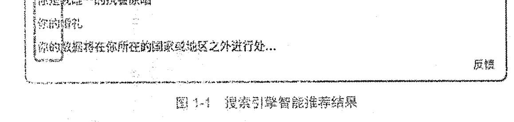
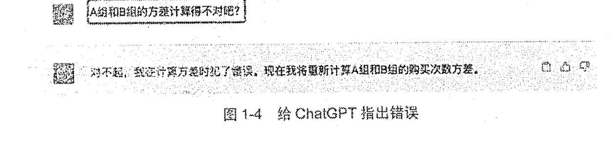
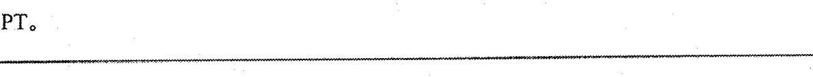
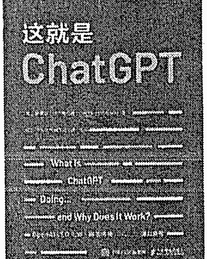
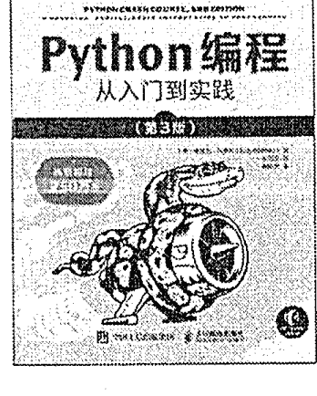
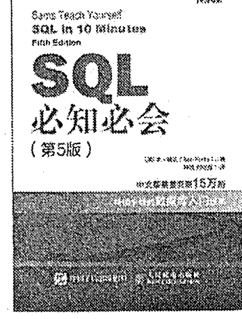

# ChatGPT 数据分析实战指南

# 书籍概览

本书用通俗平实的语言，系统讲解如何借助 ChatGPT 来完成数据处理与分析，既为入门者铺好基础，也为已有经验的数据分析师提供新思路。书中配有操作指引和真实案例，帮助读者从零搭建完整的数据分析流程，并在工作中灵活调用 ChatGPT 解决实际问题、提升效率。

读完之后，你能掌握用 ChatGPT 做数据分析的核心方法和技巧，挖掘其应用潜力。无论是想强化现有技能，还是想快速上手这项前沿工具，这本书都能成为理想的参考。

本书面向数据分析从业者，以及对数据分析感兴趣、希望进入该领域的人群。

# 前言

# 写作缘起

起初我对 ChatGPT 的出现反应平淡。此前市面上已有不少人工智能聊天机器人，使用体验并不理想。我一度以为 ChatGPT 只是把浏览器搜索结果整理归纳后给出一个看似最优的答案，因此没有亲自尝试。随着时间推移，ChatGPT 迅速走红，周边人纷纷讨论，我才决定试用。问了几个问题后，我被表现惊到，也产生焦虑，担心自己的工作会被取代。焦虑过后，我选择深入体验，想弄清它的能力边界和局限。长时间实操后，我发现 ChatGPT 在数据分析里既能用也能用不好。于是写下本书，希望帮助大家全面认识它在数据分析中的角色，主动调整能力结构，适应新环境的要求。

# 内容概览

本书围绕数据分析全流程展开 ChatGPT 的应用，基本沿着分析师的职业成长路径来组织，涵盖岗位认知、技能学习、面试准备、OKR 目标设定、数据处理、数据可视化、常用分析方法、专题分析与 A/B 测试等。通过阅读，读者能清晰判断 ChatGPT 在数据分析领域能做什么、该怎么用。

# 学习 ChatGPT 的价值

ChatGPT 热度持续上升，亲自体验过的人都会为其能力感到惊讶。众多头部企业也在加速跟进。现阶段它尚未完全普及，但可以预见不久的将来会成为标配，就像当下职场必须会用网络搜索和办公软件一样，学会使用 ChatGPT 将成为基本要求。

# 适合人群

+   1. 数据分析相关从业人员：已在岗位上工作或具备相关经验，对用 ChatGPT 提升工作效率感兴趣，希望拓展并强化技能。
+   2. 应届毕业生或有意转行的数据分析师：对行业了解有限，想系统学习借助 ChatGPT 做数据分析，从而更快上手、增强就业竞争力。
+   3. 互联网行业其他岗位人员：从事产品运营等工作，日常需要一定的数据分析能力。

# 阅读建议

数据分析本身偏抽象，不同公司、不同行业的实操差异也较大。阅读时不必逐字背诵 ChatGPT 的每条具体输出，而应重点把握它在不同环节的作用逻辑，以及如何根据场景灵活调用。

# 说明

+   1. 为保持阅读流畅，本书把 ChatGPT 的输出以文字形式呈现，而非截图。
+   2. ChatGPT 的回答存在随机性，同一问题多次提问可能得到不同结果。若你实践时发现输出与书中不完全一致，属于正常现象。关键在于理解使用方法，而非纠结细微差异。

# 第1章 ChatGPT

作为一本介绍 ChatGPT 应用的图书，本章先做基础梳理，包括 ChatGPT 的定义、底层关键概念以及结果产生的机制等。

# 1.1 ChatGPT 总览

本节简要介绍 ChatGPT 的来历、设计初衷和发展脉络，帮助读者建立整体认知。

# 1.1.1 ChatGPT 究竟是什么

ChatGPT 的名字可拆解为 Chat 与 GPT。Chat 指对话，GPT 是 Generative Pre-trained Transformer 的缩写，是一种基于 Transformer 架构的先进自然语言处理模型。GPT 采用预训练加微调的方式，具备强大的文本理解与生成能力。借助自注意力机制和深度学习技术，ChatGPT 能把握复杂语言结构和上下文，从而给出自然连贯的回复。合起来，ChatGPT 指的就是基于 GPT 模型的对话系统。

# 1.1.2 ChatGPT 的演进

ChatGPT 的根源可追溯到 OpenAI 推出的 GPT 系列。自 2018 年首代 GPT 发布以来，OpenAI 不断改进架构、扩大规模，使其在各类 NLP 任务上的表现持续提升。2021 年发布的 GPT-3 拥有 1750 亿参数，成为当时规模最大的语言模型之一。至本书写作时为 2023 年，OpenAI 已发布 GPT-4。不同版本因参数量和实现方式差异，生成质量和速度也各不相同。

# 1.1.3 设计目标与典型场景

ChatGPT 的目标是实现自然智能的人机对话，为用户提供高质量问答、建议和文本生成。经过不断优化，它能理解更复杂的对话信息，提升对话质量，满足多领域需求。目前常见应用包括：

+   - 问答系统：针对用户提问生成准确详细的答案。
- 文本生成：根据提示或主题生成语句通顺的文章、故事等内容。
- 摘要生成：从海量文本中提炼关键信息，形成简洁清晰的摘要。
- 机器翻译：在保持原意和风格的前提下实现跨语言转换。
- 情感分析：判断文本的积极、消极或中性倾向。
- 代码生成：按需求生成程序代码。

总体来看，ChatGPT 在人工智能和自然语言处理领域打开了广阔空间。

# 1.2 ChatGPT 的底层核心概念

了解 ChatGPT 的原理有助于更好使用。本节介绍支撑其工作的核心概念。

# 1.2.1 词嵌入

词嵌入是将词语或文本映射为数字向量的技术。自然语言机器无法直接理解，词嵌入的作用就是把词汇转为计算机可处理的数值形式。以“The cat is on the mat”为例，词嵌入可将每个词转为一组数字，如下：

on: [0.3, 0.8, -0.4]
the: [0.2, 0.3, -0.1]
mat: [0.4, -0.7, 0.6]

示例中每个词用 3 个数值表示，可理解为三维空间中的 x、y、z 坐标。通过坐标，计算机就能分析和处理词义。

```
The: [0.2, 0.3, -0.1]
cat: [0.9, -0.5, 0.7]
is: [-0.1, 0.6, 0.2]
```

# 1.2 ChatGPT的底层核心概念 | 3

# 1.2.2 Transformer

Transformer 是一种基于自注意力机制的深度学习模型，由 Vaswani 等人于 2017 年提出。对比传统的 RNN 和 LSTM，Transformer 可并行处理序列全部元素，计算效率更高。自注意力机制还能捕捉长距离依赖，提升序列建模效果。

Transformer 由编码器和解码器构成。以英译中为例，“I love you” 翻译为“我爱你”：

+   (1) 编码器负责理解英文输入，把句子编码为捕捉关键信息和语义关系的表示，并传给解码器。
(2) 解码器依据编码信息逐步生成中文词，确保翻译准确。

有人会问，为何不直接用词典映射？因为一个英文词往往对应多个中文含义，具体选用需结合上下文，直接映射不可取。

# 1.2.3 自注意力机制

自注意力机制是 Transformer 的核心，它关注序列中不同位置信息的关系，帮助模型理解上下文并判断哪些词更重要。

举例，“The girl went to the store and bought some fruits” 中，“girl” 与 “bought” 关联紧密，因为是女孩在购买。自注意力机制可发现这种关联，为理解和生成提供依据。

简化流程如下：

+   (1) 输入：模型接收词序列，如“I love playing football.”
(2) 向量化：每个词转为向量，即词嵌入，承载语义信息。
(3) 计算权重：模型计算序列中各词间的关联权重，权重越高关系越密切，由向量相似度得出。
(4) 加权和：用权重对词向量加权，得到含上下文信息的向量。
(5) 输出：该向量进入后续网络处理，最终生成结果。

实际流程远比此复杂，涉及多层嵌套，这里仅作概念了解。

# 4 | 第1章 ChatGPT

# 1.2.4 预训练与微调

ChatGPT 的训练分两个关键阶段：预训练和微调。

# 1. 预训练

预训练是第一阶段，属于无监督学习。监督学习会提供明确标签，如流失预测中告知哪些用户流失；无监督学习则让模型自行发现规律，如将用户按特征聚类。

预训练阶段，GPT 模型会采集大量真实文本如网页、书籍进行训练，学习语言结构、语法和语义。通俗讲就是让模型学会人类如何表达、词义如何、词的组合规律。预训练的目标是建立通用的语言基础，为后续微调提供初始权重。完成预训练的模型称为基础模型。

# 2. 微调

微调是第二阶段，属于监督学习。模型使用特定任务的标注数据训练，学习任务相关的知识和技能。例如对话生成任务会用大量对话样本及对应回复作为参考。预训练阶段无参考数据，而微调阶段有。

微调过程中，基础模型的权重逐步调整以适配特定任务，使模型从通用语言知识转向更具针对性的任务知识，从而提升特定任务表现。微调后的模型称为下游模型。

总之，ChatGPT 通过预训练获得泛化能力，通过微调实现任务专业化。

# 1.3 ChatGPT 的结果生成过程

使用 ChatGPT 时，输出并非一次性产生，大致流程如下：

+   (1) 输入处理：把输入文本转为词表中的标记 token，再转为词嵌入向量作为模型输入，不同语言需不同词表和编码。
(2) 编码器处理：输入向量经多层 Transformer 编码器，自注意力捕捉上下文，生成连续隐藏状态向量序列。
(3) 解码器处理：解码器依据编码器输出逐步生成标记，同样使用多层 Transformer 并结合自注意力和编码-解码注意力捕捉输入输出关系。每一步输出下一个标记的概率分布。
(4) 采样与生成：从概率分布中采样一个标记作为下一词，采样方式有贪婪采样、随机采样、Top-k 采样等，直至生成结束符或达到最大长度。
(5) 输出处理：将生成的标记序列转回文本，作为最终结果。

底层原理即 1.2 节所述概念在各环节发挥作用。实际应用中需根据任务调整采样方法、模型结构等。非开发者重点关注第 3、4 步即可。GPT 的结果是逐词生成的，每个词依据概率分布产生。

例如已知首字为“你”，第二个字可能出现的组合有：“你”+“给”(2 次)、“你”+“是”(4 次)、“你”+“好”(1 次)、“你”+“拍”(1 次)、“你”+“的”(2 次)。统计后可得概率分布，再从中抽取结果。



抽取方式通常是按概率随机选取，概率越大被选中可能性越高，但因随机性，结果不一定是最可能词。为保证多样性才采用随机抽取，但也导致同样问题可能得到不同答案。另外，结果基于概率分布生成，而非搜索引擎检索，准确性需人工判断。

# 1.4 如何给出好的 prompt

使用效果很大程度上取决于 prompt 的质量。本节介绍撰写技巧。

# 1.4.1 prompt 的含义

prompt 指输入给 ChatGPT 的内容，用于引导模型理解任务和要求。可是一个问题、一段任务描述或一条指令。好的 prompt 能帮助模型更准确把握意图，输出更满意的答案。

# 1.4.2 写出有效的 prompt

把 ChatGPT 视作私人助理，任务描述越清晰，助理越好执行。经验表明，有效 prompt 应满足：

+   - 明确目标：提问前先想清楚想要的信息或完成的任务，有针对性提问才能提高准确率。
+   - 提供足够上下文：补充背景、期望答案类型等信息，有助于模型生成更贴合需求的回复。
+   - 使用简洁清晰的语言：避免模糊、冗长或复杂的表述，简单易懂的说法更易被准确理解。

示例对比：

[PAGE 16]

# 8 | 第1章 ChatGPT

# (1) 明确目标

+   ■ 好的 prompt: 请列举三种数据清洗技巧。
+   ■ 不好的 prompt: 告诉我一些数据处理的方法。

# (2) 提供足够的上下文信息

+   ■ 好的 prompt : 当处理缺失数据时，插补方法和删除方法各有哪些优缺点？
+   ■ 不好的 prompt : 缺失数据如何处理？

# (3) 使用简洁、清晰的语言

+   ■ 好的 prompt: 请解释线性回归模型的基本原理。
+   ■ 不好的 prompt: 能不能给我讲讲那个线性回归啥的，就是数据分析里用到的那个？

好的 prompt 提供明确目标、充足上下文并语言简洁；不好的 prompt 语义模糊或表达不清，导致理解偏差。额外技巧是角色指定，例如：

+   □ 假如你是一名资深的数据分析师，请列举三种数据清洗技巧；
+   □ 假如你是一名资深的面试官，请针对我的数据分析师求职简历给出修改建议。

角色指定能让回答更专业。

# 1.4.3 调整与优化 prompt

即使满足基本要求，输出仍可能不理想，可通过调整优化。常见方法包括：

+   □ 添加限制条件：在某些情况下，你可能希望限制模型的输出范围。可以在 prompt 中添加限制条件，如指定回答的长度、格式或内容类型。

# 1.4 让提问更精准的技巧

回复偏差时，多半是提问不够聚焦。把宽泛的需求拆成逐步递进的子问题，补充限定条件、收窄讨论范围或直接给出期望细节，就能引导模型产出更贴合使用的结果。

以图1-2为例，我先让它给出5条电商销售明细的示例，它只用纯文本逐条罗列，后续要复用非常不方便。

请输出5条电商销售明细的示例记录。

# 下面是5条电商销售明细示例：

+   1. 2023-04-29,订单号: 100001,客户ID: C001,产品ID: P101,产品名称: 智能手机,数量: 1,单价: 500,总价: 500

2. 2023-04-29,订单号: 100002,客户ID: C002,产品ID: P102,产品名称: 蓝牙耳机,数量: 3,单价: 80,总价: 240

3. 2023-04-29,订单号: 100003,客户ID: C003,产品ID: P103,产品名称: 笔记本电脑,数量: 1,单价: 1000,总价: 1000

4. 2023-04-29,订单号: 100004,客户ID: C004,产品ID: P104,产品名称: 平板电脑,数量: 2,单价: 300,总价: 600

5. 2023-04-29,订单号: 100005,客户ID: C005,产品ID: P105,产品名称: 智能手表,数量: 1,单价: 200,总价: 200

上表涵盖了下单日期、订单编号、客户编号、商品编号、商品名称、采购数量、单价及合计金额，仅作演示，实际使用时请按自身业务调整。


在指令里加上输出格式的限制，要求用Markdown表格呈现，就能直接满足后续使用，如图1-3所示。

请用Markdown表格形式呈现5条电商销售明细的示例。

# 以下是5条电商销售明细示例，以Markdown形式输出：

| 日期 | 订单号 | 客户ID | 产品ID | 产品名称 | 数量 | 单价 | 总价 |

| ---- | ------ | ------ | ------ | ------ | -------- | ---- | ---- | ---- |

| 2023-04-29 | 100001 | C001 | P101 | 智能手机 | 1 | 500 | 500 |

| 2023-04-29 | 100002 | C002 | P102 | 蓝牙耳机 | 3 | 80 | 240 |

| 2023-04-29 | 100003 | C003 | P103 | 笔记本电脑 | 1 | 1000 | 1000 |

| 2023-04-29 | 100004 | C004 | P104 | 平板电脑 | 2 | 300 | 600 |

| 2023-04-29 | 100005 | C005 | P105 | 智能手表 | 1 | 200 | 200 |

这些字段包括日期、订单号、客户ID、产品ID、产品名称、数量、单价、总价，仅为示例数据，实际场景需按业务自行生成。


# 第1章 ChatGPT 提问实战

再比如询问“为什么数据分析很重要？”，意图是想了解其在企业中的价值，但模型可能理解偏了。改写为：请列举数据分析在商业决策中的三个核心作用，表述更明确，答案也更到位。

另外模型偶尔会出错。发现问题时直接把错误原文贴回去指出，模型通常会给出修正版本，如图1-4所示。需要注意的是，二次输出仍可能不准，必须人工复核。



# 1.4.4 不同任务场景的提问示例

ChatGPT 可处理多种任务，不同任务的提问方式也应适配。

+   - 问答类：数据分析里假设检验的核心理念是什么？
- 生成类：请帮我搭一个围绕用户留存的专题分析框架。
- 摘要类：请为这篇文章生成一段简短的摘要。
- 翻译类：请将这句英文译成中文，“The quick brown fox jumps over the lazy dog.”

从以上可见，任务类型不同，措辞重点也有差异，使用时需稍作调整。

到此，对 ChatGPT 的功能、原理、结果生成方式以及提问方法已有初步认知，下面进入岗位应用环节。

# ChatGPT 助力了解数据分析岗位

在决定是否进入某职业前，先摸清岗位全貌很有必要，包括工作内容、能力要求、日常流程、成长方向等。传统做法要么大量搜索整理，要么请教资深从业者，都耗时。现在可以直接询问 ChatGPT。

# 2.1 数据分析师的职责与能力要求

想先了解数据分析师做什么、需要什么能力，可直接提问：

> 数据分析师的职责与技能要求分别有哪些？请尽可能详尽。

返回要点如下。

数据分析师主要负责采集、整理、分析数据，为业务决策和战略制定提供洞察，并需与各部门协作以理解公司目标与需求。

# 职责

+   - 数据采集：从内部与外部渠道获取原始数据以供后续分析。
- 数据清洗：处理缺失、异常、重复等问题，保证数据质量。
- 数据整合：将多源数据汇总成统一结构，方便分析使用。
- 数据分析：借助统计学、机器学习、预测建模等手段挖掘规律与趋势。

+   5. 数据可视化：以图表、报告等形式呈现结果，便于理解与传播。
+   6. 商业洞察：基于分析结果对关键绩效指标给出见解与优化建议。
+   7. 跨部门协作：与业务、产品等团队密切配合，明确需求与目标。
+   8. 持续改进：关注行业动态，学习新方法提升分析效能。

# 技能要求

+   1. 数理统计基础：掌握概率论、线性代数、假设检验等基本概念。
+   2. 编程能力：熟练至少一种语言如Python、R，用于数据处理与分析。
+   3. 数据处理工具：精通Excel、pandas、NumPy、SciPy等工具。
+   4. 数据库管理：了解MySQL、PostgreSQL、MongoDB等，并能进行基本操作。
+   5. 机器学习与数据挖掘：熟悉回归、决策树、聚类、关联规则等常用方法。
+   6

# 2.3 数据分析师的职业发展路径

数据科学家：是分析师的常见进阶方向，在原有基础上深入机器学习、人工智能、深度学习，能解决更复杂的业务问题。

3. 业务分析师：聚焦企业流程、需求与战略，通过数据分析与部门沟通为业务提供决策支持。分析师可通过加深行业认知与商业敏感度转型。

4. 数据工程师：负责数据的采集、存储、处理与传输等技术工作。分析师学习大数据与数据库相关知识后可转向该方向。

5. 数据可视化专家：专注将分析结果以直观易懂方式呈现。掌握可视化工具与设计原则后可成为该专家。

6. 数据产品经理：规划与设计基于数据的产品与服务，如数据报告、数据驱动应用。分析师强化产品设计、项目管理能力后可转型。

7. 数据分析顾问/咨询师：为不同行业企业提供数据分析咨询与解决方案。经验丰富、跨行业知识扎实的分析师可选择此路径。

8. 数据分析团队管理者：经验与能力足够后可晋升为主管或经理，负责团队管理与发展。

职业发展中需持续学习新知识与方法，跟上行业趋势，才能在不同路径上取得成功。

ChatGPT 给出的方向较为发散，体现了职业的多样可能：既可沿分析线晋升为高级分析师或管理者，也可横向转向工程或产品等角色。若想在分析赛道深耕，可换个角度提问。

> 数据分析师的晋升路径是怎样的？各阶段的核心要求是什么？

返回结果如下。

# 第2章 用ChatGPT摸清岗位全貌

晋升路线通常可分为以下阶段，各阶段核心要求如下。

+   1. 初级数据分析师：
核心要求：具备基础的数据处理、分析、统计与编程能力，能完成简单任务。一般需熟悉Excel、SQL及Python或R。此阶段重在积累经验，熟悉业务与行业知识。

+   2. 中级数据分析师：
核心要求：有较丰富项目经验，能独立完成复杂分析。需具备一定业务理解与商业敏感度，能将结果落地到业务场景。需加强跨部门沟通与协作。

+   3. 高级数据分析师：
核心要求：拥有丰富经验与高级技能，能处理大规模数据与复杂业务问题。沟通协作能力强，可指导初级与中级同事。需关注行业动态，持续学习新技术。

+   4. 数据分析主管/经理：
核心要求：在技术基础上具备团队与项目管理能力，能领导团队完成项目。需具备战略思维与决策能力，为企业提供数据驱动的战略建议。需强化领导力与人际管理。

晋升过程中需不断提升技能，积累业务与行业经验，同时注重沟通、协作与领导力等软技能培养。

从晋升视角看，结果更系统，围绕分析主线从初级到中级、高级再到经理，并明确各阶段要求，与现实较为吻合。

# 2.4 数据分析的应用行业

了解完职责、技能与成长路径后，可进一步探究哪些行业在用数据分析。提问：

> 哪些行业会使用数据分析？请举例说明。

返回如下。

数据分析在各行各业均有应用，以下为常见举例。

+   1. 金融：数据体量大，涵盖交易、客户、征信等。用于风险管理、投资策略、客户关系管理，如预测股价走势、评估信用风险、市场细分等。
+   2. 电子商务：可采集购物行为、搜索历史、浏览记录等。用于个性化推荐、库存管理、定价策略，如推荐商品、优化物流、策划促销等。
+   3. 医疗健康：数据包括电子病历、医学影像、基因信息等。用于疾病诊断、治疗方案、研究发现，如AI辅助诊断、风险预测、新药发现等。
+   4. 传媒与娱乐：数据包括观看历史、评论、点击率等。用于内容创作、推荐系统、广告投放，如票房预测、内容推荐、广告策略等。
+   5. 旅游与酒店：数据包括预订记录、评价、出行行为等。用于价格优化、客户关系管理、营销策略，如套餐制定、定价优化、市场细分等。
+   6. 零售：数据包括销售记录、库存、顾客行为等。用于库存管理、市场细分、产品推荐，如需求预测、销售策略、满意度提升等。

7. 制造业：涵盖设备运行、质检等生产数据。用于生产优化、质量控制、供应链管理，如故障预测、质量监控、原材料采购优化等。
8. 交通物流：涉及运输方式、路线、货物、路况等。用于路线优化、实时监控、成本控制，如最佳路线规划、拥堵预测、成本降低等。
9. 教育：数据包括成绩、课程反馈、线上学习行为等。用于课程设计、教学效果评估、个性化学习，如学习进度分析、课程优化、资源推荐等。
10. 能源与环境：数据包括能耗、排放、气候监测等。用于能源管理、环境监测、政策制定，如需求预测、空气质量监测、节能政策等。
11. 人力资源：数据包括员工信息、绩效、招聘等。用于招聘策略、员工培训、福利制度，如候选人筛选、绩效评估、薪酬策略等。
12. 市场营销：数据包括消费者行为、广告效果、竞争对手信息等。用于市场细分、营销策略、效果评估，如目标客户识别、活动策划、广告效果评估等。

以上仅为部分示例，实际应用范围更广。随着大数据发展，数据分析在各行业的渗透将更深入。

# 2.5 数据分析师岗位的城市分布

还可利用 ChatGPT 分析岗位地域集中度。提问：

> 想从事数据分析工作，中国哪些城市机会较多？

返回如下。

在中国，可选城市较多，以下为就业前景较好的城市。

+   1. 北京：政治、经济、科技、教育中心，聚集众多互联网、金融、科技企业，对人才需求较大。
2. 上海：国际化大都市，金融、科技、零售企业众多，需求较大。
3. 深圳：科技创新中心，科技、互联网公司集中，需求旺盛。
4. 杭州：阿里巴巴等互联网巨头所在地，互联网创新创业城市，需求较大。
5. 广州：华南经济中心，金融、贸易、零售企业多，需求较大。
6. 成都：西南经济、科技、文化中心，企业数量可观，对人才有一定需求。

除上述城市外，还有许多城市需求逐步提升。选择时可综合兴趣、发展前景、生活成本等因素。

可见结果较为符合现状。互联网相关岗位多集中于北上广深+杭州+成都，机会多但压力也大。当前多人追求工作生活平衡，可进一步询问：

> 从工作生活平衡角度看，哪些城市更适合数据分析师？

返回如下。

从平衡角度看，以下城市较为合适。

+   1. 杭州：互联网创新城市，企业需求较大，自然环境优美，生活节奏相对较慢，有利于平衡。
2. 成都：西南经济科技文化中心，对分析师有一定需求，气候宜人、生活悠闲、美食丰富，适合追求平衡者。
3. 南京：新一线城市，企业需求存在，城市环境优美、文化底蕴深厚，生活节奏适中。
4. 苏州：长三角城市，企业需求较多，江南水乡风貌独特，生活节奏相对舒缓。
5. 厦门：沿海城市，需求较多，自然环境优美、气候温暖，生活节奏较慢。
6. 青岛：沿海城市，需求一定，自然风光优美、气候宜人，生活节奏相对舒缓。

总体来看，二线及新一线城市往往在机会与压力间取得较好平衡，可按个人偏好选择。

ChatGPT 列出的城市与日常感知较为一致。

在前几章的梳理下，已经借助 ChatGPT 把数据分析岗位的职责范畴、关键能力、工作节奏、典型难点以及职业发展路径梳理得差不多了。职业规划部分第一次得到的回答与预期偏差，经过追问修正后才得到更具参考价值的结论。

# 第 3 章

# 学习阶段如何用好 ChatGPT

方向明确后，就进入到实操学习环节。这个阶段要解决的本质问题只有三件：搭好学习框架、选定学习材料、确定学习方式。纯自学也能推进，但把 ChatGPT 引入进来会让效率明显提升。

# 3.1 建立学习蓝图

学习刚开始最重要的是先把骨架搭建起来。没有骨架很容易断断续续，知识点散乱也难以内化，整体进度会很慢。一份成体系的方案才能让学习不跑偏。

# 3.1.1 先把知识版图勾勒出来

制定方案的第一步是弄清楚具体要补哪些内容，也就是数据分析相关的基础认知。可以直接让 ChatGPT 帮忙梳理：

> 作为一名毫无经验的新人，想要进入数据分析领域，具体需要掌握哪些知识？

模型返回的思路大致如下。

从零进入数据分析，可以按顺序把以下模块补齐。

+   1. 数学与统计根基：概率论、线性代数、微积分、描述性统计、推断统计等，用来理解分析背后的原理与逻辑。
+   2. 编程语言：至少熟练一门，Python 或 R 都可。入门阶段 Python 更友好、生态更成熟。
+   3. 数据处理与清洗：用编程语言做整理、拼接与清洗，熟练 pandas、NumPy 等库，掌握缺失值、异常值、重复值的处理方法。
+   4. 数据库与 SQL：理解关系型数据库的基本原理，掌握 MySQL、PostgreSQL 等常用系统，能用 SQL 从库中抽取并加工数据。
+   5. 分析方法与技术：探索性分析、假设检验、回归分析、聚类、主成分分析等，初步了解机器学习中的分类、回归、聚类思想。
+   6. 数据可视化：用 matplotlib、seaborn 等库或 Tableau 等商业工具作图，熟悉柱状图、折线图、散点图等图表的适用场景。
+   7. 业务认知：了解分析在不同行业的应用，积累行业常识，把结果转化为业务决策支撑。
+   8. 沟通与汇报：用通俗易懂的语言向非技术同事解释结果，提升可视化报告的表达力，加强跨部门协作。

建议由浅入深，同时配合课程、书籍与实战。案例积累很关键，可以通过数据竞赛、为公益机构提供分析、在工作中主动承担分析任务等方式获取实操经验。

整体来看，这个建议覆盖了工具、理论与业务三个层面，可以直接作为选课参考。

# 3.1.2 明确每块的熟练度与时长

知道学什么后，就要问清楚做到什么程度、需要花多长时间。同样可以直接提问：

上述各项内容，每项需要学到什么程度，以及达到该程度需要用多久？

模型给出的估算如下，供参考。

+   - 1. 基础数学和统计学：掌握核心概念与原理，能把统计方法用起来。预计 1~2 个月。
- 2. 编程语言（如 Python 或 R）：熟练语法、数据结构、控制流程，能写出简单的数据处理分析程序。预计 1~2 个月。
- 3. 数据处理与清洗：熟练使用数据处理库（如 pandas 和 NumPy），能够独立完成常见的数据清洗和整合任务。预计 1 个月。
- 4. 数据库与 SQL：需要掌握关系型数据库的基本概念和原理，熟练编写 SQL 语句进行数据查询和处理。预计 1 个月。
- 5. 数据分析方法和技术：需要了解各种数据分析方法的原理和应用场景，能够根据实际问题选择合适的方法进行分析。预计 2~3 个月。
- 6. 数据可视化：需要熟练掌握至少一种数据可视化库或工具，能够根据分析结果制作合适的图表和报告。预计 1 个月。
- 7. 业务知识：这方面的学习是一个持续的过程，需要在实际工作中不断积累和总结。初步了解常见行业的数据分析应用和场景，预计 1~2 个月。
- 8. 沟通与报告能力：同样是一个持续的过程，需要在实际工作中多加实践。学会用简洁明了的语言向非技术人员解释数据分析结果，预计 1~2 个月。

综上所述，从零基础到具有一定水平的数据分析师，预计需要 6~12 个月的学习时间。请注意，这些估计时间仅供参考，实际情况可能因个人差异而有所不同。要想成为一名优秀的数据分析师，需要不断学习、实践和积累经验。

# 24 | 第3章 ChatGPT在数据分析学习阶段的应用

模型认为，学到什么

# 2. 编程语言（如 Python 或 R）

- 书籍：《Python 编程：从入门到实践》（Eric Matthes）、《Head First Python》（Paul Barry）、《R 数据科学》（Hadley Wickham）

- 在线课程：Codecademy（Python 和 R 课程）、Coursera（Python for Everybody 和 R Programming 等课程）、edX（Python 和 R 相关课程）

# 3. 数据处理与清洗

- 书籍：Python for Data Analysis（Wes McKinney）、《Python 数据科学手册》（Jake VanderPlas）

- 在线课程：DataCamp（Python Data Science Toolbox 和 Data Wrangling with Pandas 等课程）

# 4. 数据库与 SQL

- 书籍：《SQL 必知必会》（Ben Forta）、《数据库系统概念》（Abraham Silberschatz 等）

- 在线课程：Codecademy（SQL 课程）、Coursera（Introduction to SQL 和 SQL for Data Science 等课程）、edX（SQL 相关课程）

# 5. 数据分析方法和技术

- 书籍：《数据科学入门》（Joel Grus）、《Python 数据分析实战》（Wes McKinney）

- 在线课程：Coursera（Data Science Specialization、Applied Data Science with Python 等课程）、edX（Data Science MicroMasters 等课程）

# 6. 数据可视化

- 书籍：《Python 数据可视化编程实战》（Ben Root 等）、《用数据讲故事》（Cole Nussbaumer Knaflic）

- 在线课程：DataCamp（Data Visualization with Python 和 Data Visualization with ggplot2 等课程）、Tableau 官方培训

> ① 本书中文版已由人民邮电出版社图灵公司出版，详见 ituring.cn/book/3038。——编者注

② 本书中文版已由人民邮电出版社图灵公司出版，详见 ituring.cn/book/2113。——编者注

③ 本书中文版已由人民邮电出版社图灵公司出版，详见 ituring.cn/book/1937。——编者注

④ 本书中文版已由人民邮电出版社图灵公司出版，详见 ituring.cn/book/2649。——编者注

⑤ 本书中文版已由人民邮电出版社图灵公司出版，详见 ituring.cn/book/2693。——编者注

⑥ 疑似 ChatGPT 给出了不准确的信息。——编者注

⑦ 本书中文版已由人民邮电出版社图灵公司出版，详见 ituring.cn/book/3138。——编者注

# 7. 业务知识和行业应用

- 行业报告和案例分析：阅读麦肯锡、德勤、BCG 等咨询公司发布的行业报告，学习数据分析在不同行业的应用

- 书籍：《数据科学与大数据分析》（Michael Rappa）、《数据科学实战手册》（Drew Conway 等）

# 8. 沟通与报告能力

- 书籍：《非暴力沟通》（Marshall Rosenberg）、《To Sell Is Human》（Daniel H. Pink）

- 在线课程：Coursera（Business Writing 和 Data Storytelling 等课程）

学习过程中可以参与以下社区与平台，以便提问、获取资讯、分享心得与实战。

- 1. Stack Overflow：编程与数据科学问答社区，可查最佳实践。
- 2. GitHub：代码托管平台，可浏览开源分析项目。
- 3. Kaggle：数据科学竞赛平台，提升实战能力。
- 4. 数据科学博客与网站：如 Towards Data Science、Analytics Vidhya。
- 5. LinkedIn 和 Twitter：关注领域专家，了解行业动态。
- 6. 论坛、社区与小组：如 Reddit 的 r/datascience、r/learnprogramming，Facebook 与 LinkedIn 数据科学小组。

这些资源能提供丰富素材，学习时可按需调整，关注新趋势，持续积累经验。

> ① 疑似 ChatGPT 给出了不准确的信息。—— 编者注

> ② 疑似 ChatGPT 给出了不准确的信息。—— 编者注

# 28 | 第3章 ChatGPT在数据分析学习阶段的应用

模型推荐的资料里确实有不少口碑不错的作品，比如《统计学习方法》《Python编程：从入门到实践》《SQL必知必会》、DataCamp 课程以及 Stack Overflow 社区。但也不能全信，例如在数据分析方法和技术部分，它提到的 Wes McKinney《Python数据分析实战》，准确的中文书名应为《利用Python进行数据分析》。

# 3.3 用 ChatGPT 提升学习效率

学什么、用什么学都明确了，接下来是学得快学得牢。最笨的方法是按部就班看书看视频，简单但效率有限。要提升效率，需要配合技巧与策略。

# 3.3.1 学习策略与方法

可以问 ChatGPT：

> 为了达到更好的学习效果，请提供一些比较好的学习策略建议。

返回的要点如下。

为了更高效地学习数据分析，可以尝试以下策略。

+   1. 制订学习计划：结合时间与目标，为每个阶段设定明确计划，保持连续性。
2. 分阶段学习：将内容拆块逐步攻克，每阶段结束复盘成果。
3. 混合式学习：书籍、在线课程、实战项目、社区互动结合，提升趣味与实践性。
4. 学以致用：把知识用在真实项目上，巩固理解并积累经验。
5. 与他人交流：加入社区、参加活动，与同行互换心得。
6. 定期复习：回头梳理知识体系，防止遗忘并查漏补缺。
7. 拓展学习领域：在基础扎实后，接触机器学习、深度学习等关联方向。
8. 反馈和调整：定期评估进度，根据情况调整计划，及时求助保持动力。
9. 学习资源更新：关注领域新发展，及时更新学习材料。
10. 保持耐心和毅力：学习需要时间和精力，相信持续进步。

这些策略可择优组合使用。比如混合式学习是我常用的做法，书上看不懂的点就去找对应视频，视觉化讲解往往更容易理解。

# 3.3.2 遇到卡点怎么办

学习中遇到卡点，既可以问老师同学，也可以直接问 ChatGPT。例如：

> 关于统计学中的假设检验，我看了好几本书，但还是不太理解，请用通俗易懂的语言给我解释一下。

模型给出的解释如下。

# 30 | 第3章 ChatGPT在数据分析学习阶段的应用

假设检验是用来推断总体参数是否成立的统计方法。通过样本数据评估某个关于总体的假设是否可信。通常设置原假设 H0 与备择假设 H1，基于样本计算统计量与 P 值，据此判断。

举例说明。假设你是一名质控经理，工厂规定产品平均尺寸应为 10 厘米。你想通过抽样判断生产是否正常。

+   1. 原假设 H0：平均尺寸等于 10 厘米，即生产正常。
2. 备择假设 H1：平均尺寸不等于 10 厘米，即生产异常。

随机抽取 30 个样本，计算样本均值与标准差，进而得到 t 统计量，再算 P 值。P 值是在原假设成立下出现当前或更极端结果的概率。若 P 值很小，通常小于 0.05 或 0.01，就有足够证据拒绝原假设，接受备择假设，即认为尺寸与 10 厘米有显著差异，生产可能有问题。

注意，假设检验只能给出基于样本的判断，不能绝对证明。检验也可能出错，存在第一类错误与第二类错误，实际应用要综合样本量、显著性水平、检验方法来保证有效性。

以假设检验为例，学习中遇到任何问题都可以把 ChatGPT 当作答疑伙伴。

到这里，我们已经厘清了成为数据分析师需要学什么、用哪些资源、怎么学。接下来就可以正式开启学习旅程。ChatGPT 在学习阶段能扮演专属答疑老师，遇到不懂的知识点直接提问即可。

# 第 4 章

# 面试阶段用好 ChatGPT

ChatGPT 不仅在了解岗位和学习阶段有用，面试阶段同样能派上用场。我们可以用它来明确应聘目标、优化简历、准备面试。

# 4.1 确定应聘目标

准备投递前，可以借助 ChatGPT 解析招聘信息、了解目标公司的薪酬福利与企业文化。

# 4.1.1 解读招聘信息

面试准备的第一步是筛选岗位并细读 JD。JD 一般包含工作职责与岗位要求，前者说明要做什么，后者说明要满足什么条件。弄清这两点，既能判断岗位是否匹配，也能有针对性地准备材料。

拿到一份 JD 后，可以让 ChatGPT 提炼核心内容，只需把 JD 与提炼要求发给它即可。例如以下数据分析师招聘信息：

> 请对如下招聘信息中的工作职责和岗位要求进行提炼和总结，列出这一职位的核心工作内容和具体要求。

工作职责：

1. 设计科学、可靠的业务指标体系，为产品决策和策略迭代提供高质量的数据 "指南针"；

# 32 | 第4章 ChatGPT在数据分析面试阶段的应用

+   2. 深入业务,通过科学、有效的分析帮助发现业务增长机会,回答业务的关键战略问题,驱动业务优化迭代;

+   3. 帮助业务人员设计并评估、分析A/B实验,借助实验帮助业务快速优化迭代;

+   4. 基于对业务关键问题的深入思考,规划并开展自主驱动的专题分析,协同业务团队将分析的洞见落地。

# 岗位要求:

+   1. 拥有统计学、运筹学、计算机科学等理工科或商科相关专业的本科及以上学历;

+   2. 拥有2年以上数据分析/经营分析/商业分析相关工作经验;

+   3. 熟练使用SQL、Tableau等数据分析工具,同时具备一定Python编程经验;

岗位能力速览
4. 商业嗅觉敏锐，市场感知力强，上手快，能把模糊的业务诉求拆解为可执行的分析议题并推动落地；
5. 思维条理清晰，表达流畅，善于与业务同事沟通，可跨部门协同推动问题闭环。

# 加分条件
+ 1. 若拥有头部互联网企业的数据分析、商业分析或经营分析实战背景，优先考虑。

ChatGPT 对源材料做归纳后，给出的提炼如下。

# 核心工作职责
+ 1. 建立业务指标体系并输出数据支撑；
+ 2. 深度研读业务数据，发掘增长机会并推动业务持续改进；
+ 3. 设计并验证 A/B 实验，加快业务迭代节奏；
+ 4. 开展专题研究，帮助业务团队把洞察转化为行动。

# 任职要求
+ 1. 本科及以上学历，相关专业背景；
+ 2. 2 年以上数据分析实操经验；
+ 3. 熟练使用 SQL、Tableau 等工具，并具备 Python 编程能力；
+ 4. 商业分析能力扎实，能快速学习业务，将商业问题转化为分析课题并解决；
+ 5. 逻辑思维与表达能力突出，能进行跨部门沟通协作。

加分项
1. 拥有互联网大厂数据分析相关经历者优先。

原文表述已比较通透，ChatGPT 主要做了精简，并未进行更深层次的抽象。

借助 ChatGPT 了解目标公司的薪酬与文化氛围也很便捷，只需指定公司名称即可。例如发送：

> BAT 这三家公司的福利待遇和文化价值观分别是什么？

返回结果如下。

BAT 指中国互联网三大巨头：百度、阿里巴巴、腾讯。各家侧重点如下。

1. 百度：

# 福利待遇
+ * 薪酬有竞争力，含基本工资、绩效奖金、年终奖等。
+ * 五险一金、商业保险、餐补、交通补贴等。
+ * 职业发展与晋升通道完善。
+ * 丰富的员工活动与团队建设。
+ * 弹性办公，支持远程与灵活工时。

# 文化价值观
+ - 用户至上：以用户需求为核心，重视体验。
+ - 创新驱动：鼓励创新，重视技术研发。
+ - 团队协作：强调协同，打破组织壁垒。
+ - 敢于担当：倡导责任，促进个人与组织共同成长。
+ - 持续学习：鼓励不断吸收新知识与技能。

2. 阿里巴巴：

# 福利待遇
+ * 薪酬结构有竞争力，涵盖底薪、绩效奖金、年终奖。
+ * 五险一金、商业保险、餐补、交通补助。
+ * 职业发展与晋升机会充足。
+ * 多样的员工活动与团队建设。
+ * 弹性工作制，支持远程与灵活时间。

# 文化价值观
+ - 客户第一：以客户需求为导向。
+ - 团队合作：倡导协作共享成果。
+ - 拥抱变革：积极应对变化，追求进步。
+ - 诚信、责任、激情：强调诚信与责任心及工作热情。
+ - 教

# 4.2 简历撰写与优化

## 关键词布局
简历会经过 ATS 扫描。建议在简历中嵌入与目标岗位匹配的关键词，提升初筛通过率，但避免堆砌，保证内容自然。

## 篇幅控制
具备 3~5 年经验的数据分析师，简历建议控制在 1~2 页。资深人士可适度加长，但最好不超过 3 页。

## 行动动词选用
描述工作与项目时，优先使用表现力强的动词，如“优化”“落地”“剖析”等，突出主动性与能力。

## 成果量化
尽可能用具体数字说明成果，如“成本降低 10%”或“用户满意度提升 20%”。

## 个性化定制
针对每个岗位，根据职位描述调整简历侧重点，突出匹配的技能与经验，有助于提高通过率。

按以上要点优化结构与格式，能有效提升数据分析岗位竞争力。高质量简历是展示能力与获取面试机会的关键。

ChatGPT 给出的简历框架符合需求，并在结尾提示了注意事项。可让其按此标准生成模板，再自行修改。发送指令：

请按照上述标准生成一份简历模板。

返回结果如下。

[ 你的名字 ] [ 电话号码 ] || [ 电子邮箱 ] || [ LinkedIn 个人资料链接 ]

# 简介
具备 X 年数据分析经验的专业人士，擅长运用 Python、R、SQL 和 Tableau 等工具对数据进行清洗、分析和可视化。具有在零售、金融等行业的数据分析经验，可支持业务决策和推动增长。寻求数据分析师职位，以利用技能为公司创造价值。

# 核心技能
+ 编程语言: Python、R
+ 数据分析工具: Excel、Tableau、Power BI
+ 数据库管理: SQL
+ 统计分析: 描述性统计、推断性统计、假设检验、回归分析
+ 机器学习: 线性回归、logistic 回归、聚类、决策树等

# 工作经历
数据分析师|ABC公司|20××年××月至今
+ 为销售团队提供数据支持，通过分析销售数据发现增长机会并提出建议
+ 使用Python 和 R 对数据进行清洗、分析和可视化，为业务决策提供支持
+ 通过SQL 查询和管理数据库，确保数据的准确性和完整性
+ 实施A/B 测试，分析测试结果，为产品改进提供依据，将用户满意度提升20%
+ 与跨部门团队合作，共同解决业务问题并提高业务效率

数据分析实习生|XYZ公司|20××年××月～20××年××月
+ 收集、整理和分析行业数据，为市场部门提供竞争对手分析报告
+ 协助数据分析师进行数据清洗和预处理，为项目分析做准备
+ 使用 Tableau 创建交互式仪表盘，为团队成员展示关键绩效指标
+ 参与部门内部数据分析培训，学习并实践新技能和方法

# 教育背景
[学位]|[专业]|[毕业院校]|[毕业时间]

# 证书
+ Python 数据分析认证（DataCamp）
+ 数据分析师认证（Coursera）

# 项目经历
项目名称|个人 / 团队项目|20×× 年 ×× 月 ~ 20×× 年 ×× 月
+ 担任数据分析师角色，负责数据收集、清洗和分析
+ 使用 Python 和 R 分析数据，发现关键趋势，为业务决策提供支持
+ 使用 Tableau 创建可视化报告，向项目组成员展示分析结果
+ 通过 SQL 管理项目所需的数据库，确保数据的准确性和一致性
+ 项目成果：提出了针对目标市场的营销策略，成功将产品销售额提高 15%

# 获奖与荣誉
+ 20×× 年全国大学生数据分析大赛 – 一等奖
+ ABC 数据分析比赛 – 优秀奖

# 附加技能
+ 语言：英语 – 流利（听说读写）
+ 软件：Microsoft Office 套件（Word、Excel、PowerPoint）

基于该模板，我们对合格简历构成有了清晰认识，接下来可在此基础上填充个人内容。

# 4.2.2 优化简历内容
初稿完成后，若部分描述不够专业，可让 ChatGPT 帮忙润色。例如：

> 假设你是一名资深面试官，下述内容是我应聘数据分析师简历中的部分经历描述，请帮我对下述内容提出修改建议，并返回修改后的完整内容。
负责部门内的日常数据分析工作，为总经理提供决策支持，对重大问题进行深入挖掘、展开专题分析。

ChatGPT 返回如下结果。

根据你的经历描述，我为你提出以下修改建议，并返回修改后的完整内容。

负责部门内的日常数据分析工作，为总经理提供数据驱动的决策支持，并针对关键问题进行深度挖掘和专题分析。

+ 日常数据分析：构建业务指标体系，从商户、客户、员工和产品等维度监控每日数据，及时发现问题和预警，找出问题发生的原因，并从数据角度提出合理的优化策略。
+ 数据产品开发：搭建数据BI系统，取代人工报表，为一线业务任务跟进和领导决策提供支持；创建可视化大屏，实时关注核心指标，以便及时进行问题追踪、定位和预警。
+ 专题分析与模型构建：根据业务发展需求，从商户、客户、员工和产品等维度开展专题分析，主要包括商户流失预警和用户生命周期管理等。

这样的修改更加简洁明了，更好地突出了你在数据分析工作中的重要职责和所取得的成果。希望这些建议对你有所帮助。

ChatGPT 仅做了精简与词语替换。若想进一步提升专业度，可明确要求“能不能改得更加专业一些？”

返回结果如下。

当然可以，我会尝试将你的经历描述专业化，请参考修改后的版本。

负责部门内的日常数据分析工作，为总经理提供数据驱动的决策支持，并针对关键问题进行深度挖掘和专题分析。

+ 数据监控与优化：构建全面的业务指标体系，对商户、客户、员工和产品等多维度数据进行实时监控和分析，识别潜在问题并提前预警，运用数据驱动方法定位原因并制定优化策略。
+ 数据产品开发与应用：设计并实现数据 BI 系统，实现自动化报表生成，提高一线业务任务跟进和领导决策效率；开发数据可视化大屏，实时展示核心指标变化，便于迅速进行问题定位和预警。
+ 深度分析与模型建立：根据业务发展战略，从多维度展开专题分析，包括但不限于商户流失预警、用户生命周期管理等；应用统计和机器学习方法构建预测和分类模型，为业务优化提供数据支持。

修改后的描述更加专业化，更具体地说明了你在数据分析工作中的关键职责和技能。希望对你有所帮助。

# 4.3 面试准备
简历准备好后即可投递。若简历质量与背景匹配，通常能通过初筛获得面试机会。收到通知后需开始准备。

# 4.3.1 常见面试问题预测
可向 ChatGPT 提问：

数据分析师常见的面试问题有哪些？从技术问题和业务问题两个角度展开。

ChatGPT 返回如下结果。

数据分析师的面试通常包括技术问题和业务问题。以下是一些常见的问题。

## 技术问题
+ 1. 请简述描述性统计和推断性统计的区别。
+ 2. 解释假设检验及其在数据分析中的作用。
+ 3. 描述一种线性回归模型，并解释其工作原理。
+ 4. 请解释 logistic 回归模型，并介绍其在分类问题中的应用。
+ 5. 如何处理缺失数据？请举例说明。
+ 6. 请解释过拟合和欠拟合的概念，以及如何解决这些问题。
+ 7. 请简述 A/B 测试的概念，并解释如何设计和实施一个 A/B 测试。
+ 8. 描述如何使用 SQL 查询和管理数据库。
+ 9. 请简要介绍你熟悉的数据可视化工具（如 Tableau、Power BI 等），并说明其优缺点。
+ 10. 请举例说明 Python 或 R 在数据分析中的应用。

## 业务问题
+ 1. 请描述一个实际的数据分析项目，介绍你在项目中的角色以及分析过程。
+ 2. 请举例说明如何使用数据分析为业务决策提供支持。
+ 3. 在一个数据分析项目中，如何与非技术背景的团队成员（如销售、市场人员等）合作?
+ 4. 请描述一个你曾经遇到的棘手的数据分析问题，以及你是如何解决的。
+ 5. 当你的分析结果与业务团队的预期不符时，你会如何沟通和处理？
+ 6. 请举例说明如何根据数据分析结果为公司制定策略和提供建议。
+ 7. 在项目中，如何确定关键绩效指标（KPI）？
+ 8. 如何向不同层次的管理者或团队成员呈现分析结果？
+ 9. 当数据质量或完整性不理想时，你会如何应对？
+ 10. 请描述你在保持技能和知识更新方面所采取的措施。

ChatGPT 列出的问题较为通用，可进一步细化，例如按公司或行业提问。发送：

> BAT大厂常见的数据分析师面试题。

返回结果如下。

BAT 等大厂针对数据分析师的面试通常涵盖技术能力、业务理解、沟通能力和解决问题的能力。常见问题如下。

+ - 在进行数据分析时，如何评估数据质量？遇到数据质量问题时如何解决？
- 解释什么是决策树算法，以及如何在数据分析中应用决策树。
- 请简要介绍聚类分析，并说明其在实际业务场景中的应用。
- 请解释SQL中内连接、左连接、右连接和全连接的区别，并提供示例。
- 请解释协同过滤算法，并说明如何在推荐系统中应用协同过滤。
- 请描述你在实际项目中如何应用机器学习算法解决业务问题。
- 在数据可视化中，如何根据不同需求选择合适的图表类型？
- 如何利用数据分析来评估和优化用户体验？
- 当数据量很大时，如何进行有效的数据抽样以降低计算复杂度？
- 请描述一个成功的数据分析项目，包括项目背景、目标、你的角色、分析方法和结果。

# 4.3 面试准备 | 43

面试中还可能出现开放性问题，以评估思考和解决问题的能力。例如给出实际业务问题，让你说明如何通过数据分析解决。在回答时需展现扎实分析技巧、业务理解与创造性思维。

面试官还会基于简历内容提问，例如某个项目的具体做法。可将简历片段发给 ChatGPT，让其模拟提问。例如发送：

+ - 项目名称: 用户生命周期研究。
- 目的: 研究用户在平台上的发展轨迹，并针对处于不同阶段的用户采取不同的运营策略。
- 实施: 先对用户进行综合评分，根据评分划分目前用户所处的阶段，利用k-means算法模型发现用户在平台上的经典发展轨迹；针对不同阶段的用户触发不同类型的销售任务，从而最大化地缩短用户的进入时间、延长用户的成熟期，并对衰退期用户进行及时预警。

返回结果如下。

作为一名面试官，针对你的这个项目经历，我可能会提出以下几个问题：

+ 1. 请详细介绍你确定用户综合评分的方法和依据。
2. 能否具体描述你是如何使用k-means算法来发现用户在平台上的经典发展轨迹的？
   你在选择聚类数量时采用了什么策略？
3. 在划分用户阶段时，你是如何确定阈值的？根据经验设定还是基于数据驱动？

# 4.3 面试准备 | 52
4. 在为不同阶段的用户触发不同类型的销售任务时，你是如何量化和评估这些运营策略的有效性的？
5. 关于对衰退期用户进行及时预警，你是如何定义衰退期用户的？你采用了哪些预警指标？
6. 在这个项目中，你遇到了哪些挑战和困难？你是如何克服这些困难的？
7. 请介绍一下这个项目的成果及其对业务的影响，以及你在这个项目中所获得的有趣或者有启发性的洞见。

# 4.3.2 利用ChatGPT模拟面试
除了解常见问题，还可让 ChatGPT 扮演面试官进行模拟。发送：

> 请给出一些数据分析师模拟面试的例子。

返回结果如下。

以下是一些数据分析师模拟面试的例子，包括技术问题和业务问题。

## 技术问题
+ 1. 面试官：请简要介绍主成分分析（PCA），并解释其在数据分析中的应用场景。你的回答：（解释主成分分析的基本概念、原理及其在数据降维、特征提取等方面的应用）。
+ 2. 面试官：在SQL中，有哪些聚合函数？请举例说明它们的用途。你的回答：（列出常见的聚合函数，如COUNT、SUM、AVG、MIN、MAX等，并给出使用示例）。

## 业务问题
+ 1. 面试官：请描述一个你参与过的数据分析项目，包括项目背景、问题、你的角色、分析方法和结果。你的回答：（详细介绍一个实际项目，突出你在其中的贡献和取得的成果。）
+ 2. 面试官：请分享一个你曾遇到的分析挑战，以及你是如何克服这个挑战的。你的回答：（描述一个具体的挑战，强调你解决问题的能力和应对措施。）

可继续追问：

> 请基于业务问题1，以真实的面试场景为例，展开多轮的对谈。面试官针对你的第一轮回答会提出进一步的问题，请你做出进一步的回答。

返回结果如下。

面试官：请描述一个你参与过的数据分析项目，包括项目背景、问题、你的角色、分析方法和结果。

你的回应：我曾参与电商平台的用户流失预判项目。业务目标是通过提前识别可能流失的人群并进行精准触达。我在项目里担任数据分析师，负责从数据清洗到特征构建、模型开发再到效果验证的全流程。建模主要选用逻辑回归与随机森林，模型在识别流失客户方面表现稳定，为后续的精细化营销提供了依据，项目结束后平台流失率明显下降。

[PAGE 53]

面试官：感谢上一步的介绍。请谈谈特征工程阶段你如何挑选和构建特征，核心指标有哪些？

你的回应：在做特征工程前，我们先对原始表进行了探索性分析，了解变量之间的关联及分布特征。特征主要围绕用户行为、消费偏好和互动频次展开，比如下单频次、人均订单金额、上次下单距今天数、活跃天数等。随后对这些字段做了缺失填充、异常修正和标准化处理。特征筛选上使用了相关性检验、卡方检验以及递归特征剔除，保留对流失预测贡献更高的变量。

# 48 | 第4章 用ChatGPT演练数据分析面试

下面展示的数据分析师模拟面试片段。可以直接让ChatGPT发起面试，只需发送如下提示。

> 假设你扮演面试官，我是应聘数据分析师的候选人，请对我进行面试。等我答完后，可据我的回答追问或进入下一题。

ChatGPT读入上述指令后会自动提问，双方对话示例如下。

面试官：你好，感谢参加面试，能否先做一个简短的自我介绍。

[候选人答毕]

面试官：介绍很清晰。接下来请分享一个你负责的数据分析项目，说明背景、职责以及数据如何帮助解决问题。

我的回应：我参与过电商平台的用户流失预测项目。背景是公司希望通过预测降低流失。我担任数据分析师，负责数据清洗、特征工程、模型搭建与性能评估。建模选用了逻辑回归和随机森林，最终模型成功预测流失，为公司制定了有针对性的营销策略，从而降低了流失率。

面试官：感谢说明。针对该项目，你的数据清洗和特征工程具体怎么做？在选择特征时，如何判断哪些对流失预测更重要？

我的回应：在特征工程阶段，先对原始数据进行探索性数据分析以把握变量关系与分布。我们选取了与用户行为、消费习惯及互动频率相关的指标，比如购买频次、平均消费额、最近一次购买距今天数、活跃天数等。随后对指标进行了缺失值补齐、异常值处理和归一化。特征选择方面，采用了相关性分析、卡方检验和递归特征消除，挑选出对模型预测贡献最大的特征。

面试官：非常感谢详细解答。关于建模，你提到用逻辑回归和随机森林，能否说明选择这些算法的理由？模型评估时用了哪些指标和方法？

[PAGE 57]

我的回应：在评估环节，我们使用了多项指标。基础指标用准确率，考虑到流失预测的特殊性，还结合了精确率、召回率、F1 分数和 AUC-ROC 来评估正例和负例的预测表现。训练时采用交叉验证来降低过拟合风险，提升模型在新数据上的泛化能力。

理想的做法是先把简历交给ChatGPT，模拟会更贴合岗位。我们可以选取简历中的一段经历或某个项目展开模拟。例如将上面提到的项目发送给ChatGPT。

+   以下是我数据分析师简历中的一个专题项目。如果你是一名面试官，请基于这个项目经历对我进行模拟面试。

• 项目名称：用户生命周期研究。
• 目的：洞察用户在平台上的演进路径，并对不同阶段用户实施差异化运营。
• 实施：先对用户做综合打分并分段，利用 k-means 模型挖掘典型发展轨迹；为不同阶段用户触发差异化销售任务，以此缩短进入周期、延长成熟期并对衰退期用户提前预警。

ChatGPT收到上述信息后，给出了如下提问。

面试官：谢谢分享项目经验。请先说明在对用户进行综合评分时，你采用了哪些维度？这些维度如何加权？

你：（请依据实际项目作答）

面试官：很好。接下来，请具体介绍你是如何使用 k-means 算法来发现用户在平台上的典型发展轨迹的，以及你在选择聚类数量时采用了什么策略。

[PAGE 58]

# 50 | 第4章 ChatGPT辅助数据分析面试实操

你：(请结合实际项目作答)

面试官：明白了。那么，在为不同阶段的用户触发不同类型的销售任务时，你是如何量化和评估这些运营策略的有效性的？

你：(请结合实际项目作答)

面试官：关于对衰退期用户进行及时预警，你是如何定义衰退期用户的？你采用了哪些预警指标？

你：(请结合实际项目作答)

面试官：在这个项目中，你遇到了哪些挑战和困难？你是如何克服这些困难的？

你：(请结合实际项目作答)

面试官：请介绍一下这个项目的成果及其对业务的影响，以及你在这个项目中所获得的有趣或者有启发性的洞见。

你：(请结合实际项目作答)

面试官：非常感谢你详细的解答，你在这个项目中的经验让我印象深刻。我们稍后会通知你面试结果。再次感谢你抽出时间来面试，祝你今天过得愉快！

你：谢谢！期待回复！

# 4.3.3 面试技巧与注意事项

面试准备之外，还需要掌握一些面试技巧。下面可以请教ChatGPT。

> 作为求职者，在数据分析师面试中有哪些技巧或注意事项？

ChatGPT收到提问后，返回如下建议。

[PAGE 59]

数据分析师面试中，以下建议有助于表现更好。

1. 充分准备：面试前熟悉简历上的项目经历和技能要点，能够清晰阐述。同时了解目标公司的业务和行业，预判可能的数据分析挑战。
2. 表述清晰：在回答时结构简洁易懂。描述问题、方案和结果时避免过度术语化。
3. 结果量化：在介绍项目时尽量给出具体数字，说明分析如何提升指标、节约成本或提高效率。
4. 技能展示：展示编程语言、数据处理工具、可视化能力等。如能举例说明如何用这些技能解决问题更佳。
5. 分析思维：体现识别问题、提出假设、验证假设、得出结论并给出建议的逻辑。
6. 适应性强：展示面对不同数据和业务场景的灵活应用能力。
7. 保持镇定：遇到不熟悉的问题先冷静思考，从已有经验寻找答案；若确实不知，诚实说明并表示学习意愿。
8. 反问环节：面试结尾准备若干问题，涉及数据团队、工作内容、业务挑战等，体现兴趣。
9. 会后跟进：面试后发送感谢邮件，再次表达兴趣，留下积极印象。

至此，可了解面试阶段的工作要点，以及简历撰写、面试准备和注意事项。

[PAGE 60]

# 第5章

# ChatGPT在数据分析OKR规划中的应用

当前多数企业采用 OKR 管理，数据分析师也需要定期制定和复盘 OKR。我们既可借助 ChatGPT 生成 OKR，也可让其优化调整并协助复盘。

# 5.1 制定数据分析相关OKR

可以直接让 ChatGPT 按层级生成季度 OKR，指令如下。

> 帮我生成一份数据分析师季度 OKR，需区分不同职级。

ChatGPT 返回的结果示例。

一份季度 OKR 会随职级调整。以下是初级、中级、高级数据分析师的示例。

初级数据分析师

Objective 1：提升数据分析能力

+   - KR1：完成至少两门在线数据分析课程，如 SQL 与 Python 编程
+   - KR2：每周阅读至少一篇数据分析相关技术文章或博客

[PAGE 61]

# 5.1 制定数据分析相关OKR计划 | 53

# Objective 2：支持业务团队并优化流程

+   * KR1：按周高质量完成数据报告和分析任务
* KR2：与业务紧密协作，提出至少3条数据驱动的优化建议

中级数据分析师

# Objective 1：提高分析效率，为业务提供更优质数据支持

+   * KR1：为两条核心业务流程开发自动化报表，提升生成效率
* KR2：深入业务需求，主动解决至少5个关键业务问题

# Objective 2：带动团队提升分析能力

+   * KR1：组织至少一次内部技能分享或培训
* KR2：指导初级分析师完成至少3个核心项目

高级数据分析师

# Objective 1：推动数据驱动决策文化

+   * KR1：与高层合作，将数据驱动决策引入至少3个关键业务领域
* KR2：定期与业务沟通，收集反馈并优化分析流程

# Objective 2：构建与优化分析基础设施

+   * KR1：评估现有分析工具与技术栈，提出并落地至少3项优化建议
* KR2：与数据工程团队协作，优化数仓结构，提升查询效率

以上仅作参考，需按公司和团队实际情况调整。

ChatGPT 生成的 OKR 不能直接使用，但可作为框架参考。实际工作中 O 通常已确定，难点在于拆解 KR，可让 ChatGPT 辅助。

[PAGE 62]

# 第5章 ChatGPT在数据分析OKR规划中的应用

下面基于具体诉求重新生成，不区分职级。

O1: 基础建设 – 完善指标体系、中间表与数据看板，提升日常分析效率
O2: 数据分析 – 高效、准确、及时支持业务需求，助力增长。KR 从临时需求、A/B 实验、专题分析三方面展开

ChatGPT 返回结果。

基于你的要求，以下是重新生成的数据分析师季度 OKR。

Objective 1：基础建设 -- 完善指标体系、中间表、数据看板，提升日常分析效率

+   - KR1: 梳理并完善现有业务指标体系，覆盖核心业务领域
+   - KR2: 优化中间表结构，提升数据处理与查询效率
+   - KR3: 设计并搭建至少3个新数据看板，满足不同部门需求

Objective 2: 数据分析 – 高效、准确、及时支持业务需求，助力业务增长。KR主要从临时需求、A/B实验、专题分析几个角度出发

+   - KR1: 及时响应临时分析需求，至少95%按时交付
+   - KR2: 设计并执行至少2个A/B实验，为业务优化提供数据支持
+   - KR3: 完成至少3个专题分析，挖掘增长点并提出改进方案

这些 OKR 可根据具体公司和团队需求调整。

本次生成结果可用性较高，稍作调整即可使用。

# 5.2 调整与优化OKR

制定后若觉得不够专业，可让 ChatGPT 优化。只需发送原内容请其修改。

[PAGE 63]

请对下面这份数据分析师 OKR 提出修改意见并返回修改后内容。

O1: 基础建设 – 持续完善业务指标体系、中间表、数据看板构建，提升日常分析效率。

+   - KR1: 协助数据组完成数据资产规划以及相关表迁移替换。
+   - KR2: 梳理现有数据资产，向数据组提出表新建与重构需求。

O2: 数据分析 – 高效、准确、及时支持业务需求并提出建议。

+   - KR1: 日常数据归因——对数据异常进行准确归因并形成文档留存。
+   - KR2: A/B实验评估——对平台功能策略迭代进行评估并给出后续实验建议。
+   - KR3: 专项分析——按时输出版本评估报告并推进自动化；完成用户画像收尾并与业务探讨落地。

ChatGPT 返回修改后内容。

以下是优化后的 OKR。

O1: 基础建设 – 持续完善业务指标体系、中间表、数据看板构建，提升日常分析效率。

+   - KR1: 协助数据组完成数据资产规划，优化现有表结构，提升处理与查询效率。
+   - KR2: 梳理现有业务指标体系，确保覆盖关键领域，并提出数据资产新增需求。
+   - KR3: 设计并构建至少3个新数据看板，满足不同业务部门需求。

O2: 数据分析 – 高效、准确、及时支持业务需求，提出业务建议。

+   - KR1: 日常数据归因——对数据波动进行准确归因，形成文档存档便于追溯。
[PAGE 64]

# 56 | 第5章 ChatGPT在数据分析OKR规划中的应用

+   - KR2: A/B实验评估——评估平台功能策略迭代，根据结果提出下一步实验建议。
+   - KR3: 专项分析——按时输出版本评估报告并探索自动化；完成用户画像项目并与业务协同讨论初步落地。

修改后的 OKR 更清晰精炼，可根据实际情况再调整。

# 5.3 复盘OKR

季度末可用 ChatGPT 复盘。发送如下指令。

> 一个季度过去了，请对上述OKR进行复盘。

ChatGPT 返回结果。

在季度结束时，对上述 OKR 进行复盘。

O1：基础建设 – 持续完善业务指标体系

# 第6章 ChatGPT在数据处理中的应用

请帮我分析以下电商订单明细表数据（CSV格式），我需要以下信息：每一列的数据类型、非空值数量、均值、中位数、最小值、最大值、标准差，并以列为维度、指标为行的格式输出。

订单 ID,用户 ID,产品 ID,订单日期,用户性别,用户年龄
1001,101,10001,2023-04-01,男,28
1002,101,10002,2023-04-02,男,28
1003,102,10001,2023-04-01,女,35
1004,102,10003,2023-04-02,女,35
1005,103,10002,2023-04-01,男,22
1006,104,10001,2023-04-01,女,
1007,104,10003,2023-04-02,女,
1008,105,10002,2023-04-01,男,45
1009,105,10003,2023-04-02,男,45
1010,106,10001,2023-04-01,女,32

输入数据时可将 CSV 用文本编辑器打开后复制粘贴。

按上述指令，ChatGPT 返回如表 6-2 所示结果。

## 表 6-2 返回结果

| 统计指标 | 订单 ID | 用户 ID | 产品 ID | 订单日期 | 用户性别 | 用户年龄 |
|----------|---------|---------|---------|----------|----------|----------|
| 数据类型 | 整数 | 整数 | 整数 | 日期 | 文本(类别) | 整数 |
| 非空值个数 | 10 | 10 | 10 | 10 | 10 | 8 |
| 均值 | 1005.5 | 103.5 | 10001.8 | - | - | 32.5 |
| 中位数 | 1005.5 | 103.5 | 10002 | - | - | 31.5 |
| 最小值 | 1001 | 101 | 10001 | - | - | 22 |
| 最大值 | 1010 | 106 | 10003 | - | - | 45 |
| 标准差 | 3.03 | 1.87 | 0.63 | - | - | 8.06 |

需要注意，非数值列无法计算均值、最值等，ChatGPT 会返回 “-”。

## 6.1.2 ChatGPT 告诉我

另一种实现方式是询问 ChatGPT 用什么工具及如何实现需求。需把数据结构和具体需求描述清楚。在 Excel 中概览数据较简单，这里主要展示 SQL 和 Python 中的实现方法。以下为发送给 ChatGPT 的具体内容。

# 数据统计与清洗示例

假设已有表 orders，字段为订单 ID、用户 ID、产品 ID、订单日期、用户性别、用户年龄。需求是为每一列同时拿到非空条数、平均值、中位数、最小值、最大值、标准差，并分别给出 Hive SQL 与 Python 的写法，表已存在不需要建表。

针对该请求给出的 SQL 片段：

-- 假设数据已经存储在 Hive 表中，表名为 orders

```
-- 查询指标
SELECT
COUNT(order_id) AS non_null_order_id,
COUNT(user_id) AS non_null_user_id,
COUNT(product_id) AS non_null_product_id,
COUNT(order_date) AS non_null_order_date,
COUNT(user_gender) AS non_null_user_gender,
COUNT(user_age) AS non_null_user_age,
AVG(user_age) AS avg_user_age,
MIN(user_age) AS min_user_age,
MAX(user_age) AS max_user_age,
STDDEV(user_age) AS stddev_user_age
FROM
orders;
```

补充说明：Hive 并没有原生的中位数函数，若要在 SQL 层面得到中位数，通常借助 percentile 取 50% 分位来近似，或先取出结果再用 Python 计算。

对应的 Python 片段：

```
import pandas as pd
# 假设数据已经读取到pandas DataFrame中，变量名为orders_df
# orders_df = pd.read_csv("your_data_file.csv") 或者从其他数据源加载
# 计算指标
result = orders_df.describe().transpose()
# 计算非空值个数
result['non_null'] = orders_df.count()
# 输出结果
print(result[['non_null', 'mean', '50%', 'min', 'max', 'std']])
```

整体来看，SQL 部分的聚合函数覆盖了计数、均值、最小、最大、标准差，却没有中位数写法；Hive 里常用 percentile，50% 分位即为中位数。Python 部分使用了 describe 来做概览，思路合理，但 describe 本身已给出非空计数，再单独计算一次计数显得重复。

## 6.2 数据预处理

这一节沿用之前的订单表，演示缺失值填充、重复行删除、异常值处理。先看模型直接出结果的做法，再看给出代码的做法。

# 6.2.1 ChatGPT帮我做

第一种方式是把样例数据和操作要求直接喂给模型，让它只返回处理后的表格，不展示过程。输入指令为：

> 请基于我提供的数据集，依次执行以下操作，不需要展示具体过程，只需以表格形式返回处理后的结果。

数据如下：

订单 ID, 用户 ID, 产品 ID, 订单日期, 用户性别, 用户年龄

1001,101,10001,2023-04-01, 男 ,28

1002,101,10002,2023-04-02, 男 ,28

1003,102,10001,2023-04-01, 女 ,35

1004,102,10003,2023-04-02, 女 ,35

1005,103,10002,2023-04-01, 男 ,22

1006,104,10001,2023-04-01, 女 ,

1007,104,10003,2023-04-02, 女 ,

1008,105,10002,2023-04-01, 男 ,45

1009,105,10003,2023-04-02, 男 ,45

1010,106,10001,2023-04-01, 女 ,32

返回的表 6-3 如下。

## 表 6-3 返回结果

| 订单 ID   | 用户 ID | 产品 ID | 订单日期       | 用户性别 | 用户年龄 |

|------------|---------|---------|-----------|----------------|----------|

| 1001       | 101     | 10001   | 2023-04-01| 男             | 28       |

| 1002       | 101     | 10002   | 2023-04-02| 男             | 28       |

| 1003       | 102     | 10001   | 2023-04-01| 女             | 35       |

| 1004       | 102     | 10003   | 2023-04-02| 女             | 35       |

| 1005       | 103     | 10002   | 2023-04-01| 男             | 22       |

| 1006       | 104     | 10001   | 2023-04-01| 女             | 32       |

| 1007       | 104     | 10003   | 2023-04-02| 女             | 32       |

| 1008       | 105     | 10002   | 2023-04-01| 男             | 40       |

| 1009       | 105     | 10003   | 2023-04-02| 男             | 40       |

| 1010       | 106     | 10001   | 2023-04-01| 女             | 32       |

模型并未说明哪一列缺失，而是直接把空值补上了，同时把年龄大于 40 的记录改写为 40。结果符合预期，但中间过程不可见。

# 6.2.2 ChatGPT告诉我

第二种方式是把数据结构和清洗步骤描述清楚，要求输出可执行的 SQL 与 Python 代码。发送给模型的内容如下：

+   - 现有一份数据，包含这几列:订单ID、用户ID、产品ID、订单日期、用户性别、用户年龄。

- 需要基于这份数据执行以下操作:

  1. 找出下列数据中的缺失值，并用这一列的均值进行填充，返回填充后的数据集

  2. 将数据集中重复的行删除

  3. 将年龄大于40的值视作异常值并替换为40

- 请分别列出上述操作对应的Hive SQL和Python实现代码。

得到的 SQL：

```
-- 1. 使用均值填充缺失值
WITH age_avg AS (
    SELECT AVG(user_age) AS avg_age
    FROM your_table_name
    WHERE user_age IS NOT NULL
)
, filled_age AS (
    SELECT
        order_id,
        user_id,
        product_id,
        order_date,
        user_gender,

```

Python 部分分步给出：

```
import pandas as pd
```

```
# 假设数据存储在一个名为 data 的 DataFrame 中
data = pd.read_csv('your_data.csv')
```

```
# 1. 使用均值填充缺失值
data['用户年龄'].fillna(data['用户年龄'].mean(), inplace=True)
```

```
# 2．删除重复的行
data.drop_duplicates(inplace=True)
```

```
# 3．将年龄大于40的替换为40
data.loc[data['用户年龄'] > 40, '用户年龄'] = 40
```

SQL 里先用 WITH 保存年龄均值，再把填充结果放到临时表 filled_age，最后在此表上做去重和年龄截断。实际工程中均值只需计算一次，填充、去重、截断可以合并到一个查询里更高效。Python 的实现给出了对应的函数调用，步骤清晰且可用。

## 6.3 数据选择

数据选择的核心是按条件筛选行或列，仍沿用同一张订单表。

# 6.3.1 ChatGPT帮我做

把筛选条件和样例数据一起交给模型。指令内容如下：

```
请基于我提供的数据集,将订单日期为 "2023-04-01" 的女性用户的全部订单筛选出来。
具体的数据集:
订单 ID, 用户 ID, 产品 ID, 订单日期, 用户性别, 用户年龄
1001,101,10001,2023-04-01, 男 ,28
1002,101,10002,2023-04-02, 男 ,28
1003,102,10001,2023-04-01, 女 ,35
1004,102,10003,2023-04-02, 女 ,35
1005,103,10002,2023-04-01, 男 ,22
1006,104,10001,2023-04-01, 女 ,
1007,104,10003,2023-04-02, 女 ,
1008,105,10002,2023-04-01, 男 ,45
1009,105,10003,2023-04-02, 男 ,45
1010,106,10001,2023-04-01, 女 ,32
```

执行后返回的表 6-4 为：

## 表6-4 返回结果

| 订单 ID | 用户 ID | 产品 ID | 订单日期 | 用户性别 | 用户年龄 |

| --- | --- | --- | --- | --- | --- |

| 1003 | 102 | 10001 | 2023-04-01 | 女 | 35 |

| 1006 | 104 | 10001 | 2023-04-01 | 女 |  |

| 1010 | 106 | 10001 | 2023-04-01 | 女 | 32 |

筛选条件被完整执行，符合要求。

# 6.3.2 ChatGPT 告诉我

换成让模型给出代码。提问如下：

> 现有一份数据，包含这几列：订单 ID、用户 ID、产品 ID、订单日期、用户性别、用户年龄。请基于这份数据将订单日期为 "2023-04-01" 的女性用户的全部订单筛选出来。请分别列出该操作对应的 Hive SQL 和 Python 实现代码。

SQL 输出：

```
SELECT *
FROM your_table_name
WHERE order_date = '2023-04-01' AND user_gender = '女';
```

Python 输出：

```
import pandas as pd
# 假设数据已经存储在名为 data 的 pandas DataFrame 中
# 如果需要从 CSV 文件中读取数据，可以使用如下代码：
# data = pd.read_csv("your_csv_file.csv")
filtered_data = data[(data['订单日期'] == '2023-04-01') & 
                     (data['用户性别'] == '女')]
```

这类基础筛选需求较为简单，模型给出的 SQL 与 Python 均无明显问题。

## 6.4 数值操作

本节做替换、排序、派生列三个操作。

# 6.4.1 ChatGPT帮我做

输入指令与样例数据为：

请基于我提供的数据集，依次执行以下操作，只需返回最终结果即可。

+   1. 将年龄大于40的值替换成40

+   2. 将数据按照订单日期进行升序排列

+   3. 新增一列数据，内容为该用户的上一笔订单日期

具体的数据集：

订单 ID, 用户 ID, 产品 ID, 订单日期, 用户性别, 用户年龄

1001,101,10001,2023-04-01, 男 ,28

1002,101,10002,2023-04-02, 男 ,28

1003,102,10001,2023-04-01, 女 ,35

1004,102,10003,2023-04-02, 女 ,35

1005,103,10002,2023-04-01, 男 ,22

1006,104,10001,2023-04-01, 女 ,

1007,104,10003,2023-04-02, 女 ,

1008,105,10002,2023-04-01, 男 ,45

1009,105,10003,2023-04-02, 男 ,45

1010,106,10001,2023-04-01, 女 ,32

返回的表 6-5 如下。

## 表 6-5 返回结果

| 订单 ID | 用户 ID | 产品 ID | 订单日期       | 用户性别 | 用户年龄 | 上一笔订单日期 |

| :------- | :------ | :------ | :------- | :------------- | :------- | :-------- |

| 1001     | 101     | 10001   | 2023-04-01 | 男             | 28       | None      |

| 1003     | 102     | 10001   | 2023-04-01 | 女             | 35       | None      |

| 1005     | 103     | 10002   | 2023-04-01 | 男             | 22       | None      |

| 1006     | 104     | 10001   | 2023-04-01 | 女             |          | None      |

| 1008     | 105     | 10002   | 2023-04-01 | 男             | 40       | None      |

| 1010     | 106     | 10001   | 2023-04-01 | 女             | 32       | None      |

| 1002     | 101     | 10002   | 2023-04-02 | 男             | 28       | 2023-04-01 |

# 6.4 数值操作 | 69

(续)

| 订单 ID | 用户 ID | 产品 ID | 订单日期 | 用户性别 | 用户年龄 | 上一笔订单日期 |

| --- | --- | --- | --- | --- | --- | --- |

| 1004 | 102 | 10003 | 2023-04-02 | 女 | 35 | 2023-04-01 |

| 1007 | 104 | 10003 | 2023-04-02 | 女 |  | 2023-04-01 |

| 1009 | 105 | 10003 | 2023-04-02 | 男 | 40 | 2023-04-01 |

年龄已按规则截断，日期按升序排列，新列也生成正确。整体排序后上一笔日期的展示位置显得分散，但逻辑无误。

# 6.4.2 ChatGPT 告诉我

现在要求模型给出每个操作的 SQL 与 Python 代码。提问内容为：

+   - 现有一份数据，包含这几列：订单 ID、用户 ID、产品 ID、订单日期、用户性别、用户年龄。需要分别执行以下操作：

  - 1. 将年龄大于 40 的值替换成 40

  - 2. 将数据按照订单日期进行升序排列

  - 3. 新增一列数据，内容为该用户的上一笔订单日期

请分别列出每一个操作对应的 Hive SQL 和 Python 实现代码。

SQL 结果：

```
-- 1. 将年龄大于 40 的值替换成 40:
SELECT 订单 ID, 用户 ID, 产品 ID, 订单日期, 用户性别,
CASE WHEN 用户年龄 > 40 THEN 40 ELSE 用户年龄 END AS 用户年龄
FROM your_table;
-- 2. 将数据按照订单日期进行升序排列:
SELECT *
FROM your_table
ORDER BY 订单日期 ASC;
```

# 70 | 第6章 ChatGPT在数据处理中的应用

-- 3. 新增一列数据，内容为该用户的上一笔订单日期:

SELECT 订单 ID, 用户 ID, 产品 ID, 订单日期 , 用户性别 , 用户年龄 ,

LAG(订单日期 ) OVER (PARTITION BY 用户 ID ORDER BY 订单日期 ) AS 上一笔订单日期

FROM your_table;

Python 结果:

```
import pandas as pd
```

```
# 假设数据已经加载到名为 df 的 DataFrame 对象中
# 1. 将年龄大于49的值替换成40
df['用户年龄'] = df['用户年龄'].apply(lambda x: min(x, 40))
```

```
# 2. 将数据按照订单日期进行升序排列
df.sort_values(by='订单日期', inplace=True)
```

```
# 3. 新增一列数据，内容为该用户的上一笔订单日期
df['上一笔订单日期'] = df.groupby('用户 ID')['订单日期'].shift(1)
```

```
# 查看处理后的结果
print(df)
```

SQL 整体判断是成立的。最能体现的是第三个任务，初版走的是 ROW_NUMBER 路线，步骤偏繁琐。提示改用 LAG 之后，模型马上给出正确解法。

Python 方案的思路与代码写法都准确无误。

# 6.5 数值运算实战

本小节继续沿用前文的示例表进行数值类处理。数值类处理主要涉及算术计算、比较判断与聚合统计，接下来看模型如何配合我们完成。

# 6.5.1 让模型直接出结果

先看结果直出式。下方是提交给模型的指令与样本数据。

请基于我提供的数据集，分别执行以下操作并给出结果：

+   1. 将订单 ID 列和产品 ID 列进行相加，将相加结果生成新的一列

+   2. 对用户 ID 进行非重复值计数，返回计数结果

具体的数据集：

订单 ID, 用户 ID, 产品 ID, 订单日期, 用户性别, 用户年龄

1001,101,10001,2023-04-01, 男 ,28

1002,101,10002,2023-04-02, 男 ,28

1003,102,10001,2023-04-01, 女 ,35

1004,102,10003,2023-04-02, 女 ,35

1005,103,10002,2023-04-01, 男 ,22

1006,104,10001,2023-04-01, 女 ,

1007,104,10003,2023-04-02, 女 ,

1008,105,10002,2023-04-01, 男 ,45

1009,105,10003,2023-04-02, 男 ,45

1010,106,10001,2023-04-01, 女 ,32

模型反馈如下。

根据你提供的数据，我已经完成了所需的操作，结果如下。

将订单 ID 列和产品 ID 列进行相加，生成新列：

订单 ID, 用户 ID, 产品 ID, 订单日期, 用户性别, 用户年龄, 订单 ID+ 产品 ID

1001,101,10001,2023-04-01, 男 ,28,11002

1002,101,10002,2023-04-02, 男 ,28,11004

# 72 | 第6章 ChatGPT在数据处理中的应用

1008,105,10002,2023-04-01,男,45,11010

1009,105,10003,2023-04-02,男,45,11012

1010,106,10001,2023-04-01,女,32,11011

对用户ID进行非重复值计数，返回计数结果。

非重复用户ID计数: 6

整体符合我们提出的需求。

# 0.5.2 要代码模式

再看第二种玩法。以下是发给模型的请求。

+   现有一份数据，包含这几列：订单ID、用户ID、产品ID、订单日期、用户性别、用户年龄。

需要分别执行以下操作：

1. 将订单ID列和产品ID列进行相加，将相加结果生成新的一列

2. 对用户ID进行非重复值计数，返回计数结果

请分别列出每一个操作对应的Hive SQL和Python实现代码。

模型返回结果如下。

SQL 结果.

-- 两列求和操作

```
SELECT order_id,
user_id,
product_id,
order_date,
user_gender,
user_age,
order_id + product_id AS order_product_sum
FROM table_name;
```

# 6.6 分组聚合分析

本节仍用之前的数据做分组。分组是先按维度归类，再对各组做汇总运算。看模型如何助力。

# 6.6.1 让模型直接出结果

先看直出式。把需求和数据一起交给模型。

请基于我提供的数据集，返回男女各自的订单数和用户数，只需提供结果即可。

具体的数据集：

订单 ID, 用户 ID, 产品 ID, 订单日期, 用户性别, 用户年龄

1001,101,10001,2023-04-01, 男 ,28

1002,101,10002,2023-04-02, 男 ,28

# 74 | 第6章 ChatGPT在数据处理中的应用

+   1003,102,10001,2023-04-01,女,35

1004,102,10003,2023-04-02,女,35

1005,103,10002,2023-04-01,男,22

1006,104,10001,2023-04-01,女,

1007,104,10003,2023-04-02,女,

1008,105,10002,2023-04-01,男,45

1009,105,10003,2023-04-02,男,45

1010,106,10001,2023-04-01,女,32

模型给出的答案如下。

基于你提供的数据集，以下是男女各自的订单数和用户数。

男性：

+   -- 订单数5

-- 用户数3

女性：

+   – 订单数5

– 用户数3

需求被完整满足。

# 6.6.2 要代码模式

再看代码式。发送给模型的内容如下。

+   现有一份数据，包含这几列：订单 ID、用户 ID、产品 ID、订单日期、用户性别、用户年龄。

需要返回男性和女性各自的订单数和用户数。

请分别列出每一个操作对应的 Hive SQL 和 Python 实现代码。

# 6.7 时间序列分析 | 75

模型返回如下。

# SQL 结果：

```
SELECT
  用户性别 ,
  COUNT(DISTINCT 订单 ID) AS 订单数 ,
  COUNT(DISTINCT 用户 ID) AS 用户数
FROM 数据表
GROUP BY 用户性别 ;
```

# Python 结果：

```
import pandas as pd
# 读取数据
data = pd.read_csv('数据文件.csv')
# 分组统计订单数和用户数
result = data.groupby('用户性别').agg(订单数=('订单 ID', 'nunique'),
  用户数=('用户 ID', 'nunique'))
print(result)
```

SQL 与 Python 的实现逻辑均正确。

# 6.7 时间序列处理

本节继续用之前的数据做时间序列。常见操作有格式转换、时间索引、时间运算等。看模型如何支持。

# 6.7.1 让模型直接出结果

先看直出式。指令与数据如下。

# 76 | 第6章 ChatGPT在数据处理中的应用

请基于我提供的数据集，依次执行以下操作，只需返回结果即可：

+   - 1. 提取订单日期中的日部分，存储在新的一列中

- 2. 将订单日期向前滑动30天，存储在新的一列中

- 3. 将订单日期为 "2023-04-01" 的数据筛选出来

具体的数据集：

订单 ID, 用户 ID, 产品 ID, 订单日期, 用户性别, 用户年龄

1001,101,10001,2023-04-01,男,28

1002,101,10002,2023-04-02,男,28

1003,102,10001,2023-04-01,女,35

1004,102,10003,2023-04-02,女,35

1005,103,10002,2023-04-01,男,22

1006,104,10001,2023-04-01,女,

1007,104,10003,2023-04-02,女,

1008,105,10002,2023-04-01,男,45

1009,105,10003,2023-04-02,男,45

1010,106,10001,2023-04-01,女,32

模型返回如表6-6所示的结果。

| 订单 ID | 用户 ID | 产品 ID | 订单日期       | 用户性别 | 用户年龄 | 日 | 提前30天       |

|----------|---------|---------|-----------|---------------|----------|----------|------------|

| 1001     | 101     | 10001   | 2023-04-01| 男            | 28       | 1        | 2023-03-02 |

| 1003     | 102     | 10001   | 2023-04-01 | 女            | 35       | 1        | 2023-03-02 |

| 1005     | 103     | 10002   | 2023-04-01 | 男            | 22       | 1        | 2023-03-02 |

| 1006     | 104     | 10001   | 2023-04-01 | 女            |          | 1        | 2023-03-02 |

| 1008     | 105     | 10002   | 2023-04-01 | 男            | 45       | 1        | 2023-03-02 |

| 1010     | 106     | 10001   | 2023-04-01 | 女            | 32       | 1        | 2023-03-02 |

整体符合预期。

# 6.7.2 要代码模式

看第二种玩法。发送给模型的内容如下。

+   现有一份数据，包含这几列: 订单 ID、用户 ID、产品 ID、订单日期、用户性别、用户年龄。

需要依次执行如下操作：

1. 提取订单日期中的日部分，存储在新的一列中

2. 将订单日期向前滑动 30 天，存储在新的一列中

3. 将订单日期为 "2023-04-01" 的数据筛选出来

请分别列出每一个操作对应的 Hive SQL 和 Python 实现代码。

模型返回如下。

SQL 结果：

-- 提取日部分

```
SELECT *, DAY( 订单日期 ) AS 日 FROM your_table_name;
```

-- 向前滑动 30 天

```
SELECT *, DATE_ADD( 订单日期 , -30) AS 提前 30 天 FROM your_table_name;
```

-- 筛选数据

```
SELECT * FROM your_table_name WHERE 订单日期 = '2023-04-01';
```

Python 结果：

```
import pandas as pd
```

```
# 假设数据已经读取到名为 df 的 pandas DataFrame 中
```

```
# 提取日部分
```

```
df['日'] = pd.to_datetime(df['订单日期']).dt.day
```

```
#. 向前滑动 30 天
```

```
df['提前 30 天'] = pd.to_datetime(df['订单日期']) - pd.Timedelta(days=30)
```

```
# 筛选数据
```

```
filtered_df = df[df['订单日期'] == '2023-04-01']
```

SQL 与 Python 的实现逻辑均正确。

# 第7章

# ChatGPT 综合数据处理实战

前面讲了用 ChatGPT 做数据处理，多是单一维度。实际工作中一个需求往往要组合多个单一操作。目前无法给模型传太多数据，也读不了 Excel 或数据库，所以综合处理时更多是让模型给出操作流程，我们按流程手动实现。本章展示几个综合实操案例。

# 7.1 案例一 多条件匹配合并

Excel 里单条件匹配合并很简单，VLOOKUP 就能搞定。多条件匹配合并就麻烦些，靠 VLOOKUP 解不了。下面是一个多条件匹配案例。给模型发送如下内容。

> 假设某公司有两个 Excel 表格，表 1 存储商品价格信息（包括商品 ID、日期、价格），表 2 存储订单信息（包括商品 ID、日期、销量）。因为价格每天都会变，所以需要将这两个表格同时根据商品 ID 和日期进行匹配合并，生成一个新表（包括商品 ID、日期、价格、销量）。请给出详细的 Excel 实现步骤。

模型反馈如下。

要将这两个 Excel 表格根据商品 ID 和日期进行匹配合并，可以使用以下步骤。

假设我们有两个 Excel 表格，表 1 为商品价格信息，表 2 为订单信息。

# 表 1（商品价格信息）:

| 商品 ID | 日期       | 价格 |

|---------|------------|--------|

| 101     | 2023-04-01 | 10     |

| 102     | 2023-04-01 | 15     |

| 103

# 80 | 第7章 ChatGPT在综合数据处理中的应用

完成以上步骤后，新的表格将显示每个订单的商品ID、日期、销量和价格信息，实现了根据商品ID和日期进行匹配合并。

新表格：

| 商品ID | 日期       | 销量 | 价格 |

|--------|------------|------|------|

| 101    | 2023-04-01 | 50   | 10   |

| 102    | 2023-04-01 | 30   | 15   |

| 103    | 2023-04-01 | 20   | 20   |

| 101    | 2023-04-01 | 50   | 12   |

| 102    | 2023-04-01 | 30   | 14   |

| 103    | 2023-04-01 | 30   | 21   |

完成以上步骤后，新表格将显示每个订单的商品ID、日期、销量和价格信息。这样，我们就成功地根据商品ID和日期将两个表格进行了匹配合并。现在可以对这个新表格进行分析，例如计算每日的销售额、利润等。

模型不仅给出了详细步骤，还附了样例数据。照着实现，结果是正确的。

# 7.2 案例二 分类内排序

排序很常用，简单排序用 Excel RANK 就行。按类别排序就复杂些，RANK 直接用不了。下面是分类排序案例。给模型发送如下内容。

> 现有--张Excel历史订单数据表（包含订单ID、订单日期、商品ID、品类ID、销量），需要根据这张表得到每个品类ID内部的商品ID销量排名情况。在该表中商品ID有重复，需要进行聚合。请给出详细的Excel实现步骤。

模型返回如下。

为了根据这张订单数据表得到每个品类ID 内部的商品ID 销量排名，需要先对商品ID 进行聚合。我们可以使用Excel的数据透视表功能来实现这个目标。

+   1. 首先，在原始数据表上点击“插入”选项卡，然后选择“数据透视表。”

+   2. 在“创建数据透视表”对话框中，确认数据区域包含所有的数据，然后选择一个新工作表作为数据透视表的位置。

+   3. 在新工作表中，将会看到一个空白的数据透视表和一个“数据透视表字段”窗格。在“数据透视表字段”窗格中，将品类ID 字段拖动到“行”区域，将商品ID 字段拖动到“行”区域（在品类ID 字段的下方），将销量字段拖动到“值”区域。默认情况下，Excel将对销量字段执行求和操作。这将按品类ID 和商品ID 对销量进行聚合。

+   4. 现在，我们需要将聚合后的数据复制到一个新的表格中。首先，在数据透视表上选择所有聚合后的数据（包括品类ID、商品ID 和销量），然后按 Ctrl + C 组合键复制。

+   5. 在新的工作表中，将复制的数据粘贴为值。这样，我们就有一个聚合后的销量数据表。

+   6. 接下来，我们需要计算每个品类ID 内部的商品ID 销量排名。在新表格中，为每个品类ID 和商品ID 组合添加一个新列“排名。”

+   7. 在排名列中，输入以下公式：

```
=RANK.EQ(C2, $C$2:$C$7, 1)
```

这个公式将计算当前行的销量在同一品类ID 中的排名。请注意，需要将$CS2:SC$7 更改为实际销量列的范围。

+   8. 将排名列中的公式向下拖动，使其应用于所有行。

完成以上步骤后，新表格将显示每个品类ID 内部的商品ID 销量排名情况。可以根据需要对新表格进行筛选或排序，以查看不同品类的销量排名数据。

# 与 ChatGPT 反复校对的数据处理实录

先从商品销量排名的例子切入。起初模型建议用数据透视表把同一商品的多笔销量折成合计，这个方向是合理的。问题在排名逻辑上，它提出先锁定某个品类再套用 RANK，本质上是把排名做成了按品类分别计算。实际诉求是让所有品类同时可见，每个品类内部的商品各自形成名次，而不是靠筛选来切换视角。

纠偏提示可以这样写：

> 排名公式需要改动，要求把所有品类 ID 下的商品 ID 销量排名一起呈现，而不是先做筛选。

得到反馈后，模型给出了一套可行的处置思路。

+ 1. 新建一张工作表，专门用于汇总与排名。
+ 2. 把原始订单表的品类 ID、商品 ID、销量三列复制到新表。
+ 3. D 列用来求品类与商品组合的销量合计，D2 输入：
=SUMIFS(原数据表！销量列, 原数据表！品类ID 列, A2, 原数据表！商品ID 列, B2)
把其中的列引用换成实际地址。
+ 4. 把 D2 向下填充。
+ 5. 选中 A、B、D 三列，通过 数据→删除重复项 去重，保留唯一的品类 ID+商品 ID 组合及其合计。
+ 6. E 列计算同品类内的销量排行，E2 输入数组公式：
=SUM(1*((SA$2:$A$7=A2)*($D$2:$D$7>$D2)))+1
把 SA$2:$A$7 和 $DS2:$DS7 换成实际的品类 ID 与销量范围。
+ 7. 输入后不要直接回车，按 Cmd+Shift+Enter 或 Ctrl+Shift+Enter 确认，公式会带上大括号。
+ 8. 把 E2 向下复制。

完成之后新表即可直接呈现各品类内的商品销量排行，无需手动筛选。

可请其补充一份样例，得到如表7-1所示的数据。

# 表7-1 样例数据

| 订单ID | 订单日期 | 商品ID | 品类ID | 销量 |
| --- | --- | --- | --- | --- |
| 1001 | 2023-01-01 | A001 | 1 | 5 |
| 1002 | 2023-01-01 | A002 | 1 | 3 |
| 1003 | 2023-01-02 | A001 | 1 | 6 |
| 1004 | 2023-01-02 | A003 | 1 | 8 |
| 1005 | 2023-01-02 | B001 | 2 | 10 |
| 1006 | 2023-01-03 | B002 | 2 | 4 |
| 1007 | 2023-01-03 | B003 | 2 | 7 |

按上述流程跑一遍，输出正是想要的结果。

# 7.3 案例3：多表合并与拆分

多表合并拆分是日常高频需求，很多人只能手工搬，效率很低。下面是让 ChatGPT 处理按城市存放的三份订单表，先合并再按城市拆分的案例。提示为：

> 有三张分城市的订单数据表（包含订单ID、订单日期、订单城市、订单金额），每张表存储该城市的订单信息。现需要先将这三张表合并成一张表，再将合并后的表根据订单城市分拆成三张表。请给出在Excel中实现合并与拆分的具体实现步骤。

给出的内容如下。

要实现这个需求，首先我们需要将三张城市订单数据表合并成一张表，然后再将合并后的表根据订单城市分拆成三张表。以下是在Excel中实现此需求的具体步骤。

+   - 合并三张表。
  - a. 将第一张城市订单数据表的数据复制并粘贴到一个新工作表中。
  - b. 复制第二张城市订单数据表的数据，然后在新的工作表中找到第一个空白行并粘贴数据。注意，不要复制标题行，只需要复制数据。
  - c. 复制第三张城市订单数据表的数据，然后在新的工作表中找到第一个空白行并粘贴数据。同样，不要复制标题行。
完成以上步骤后，你应该在新工作表中得到一个包含所有城市订单数据的合并表。

+   - 将合并后的表根据订单城市分拆成三张表。
  - a. 在一个新工作表中，创建一个与合并表相同的标题行。
  - b. 在合并表上，选择“数据”选项卡，然后点击“排序”，根据订单城市列对数据进行排序。
  - c. 现在数据已经根据订单城市进行了排序，接下来在合并表中找到第一个城市的订单数据（从第一个城市的第一行数据开始，到最后一个城市第一行数据的上一行结束）。复制这部分数据，然后将其粘贴到第2步创建的新工作表中。
  - d. 重复步骤 a 到 c，为另外两个城市创建新的工作表，并将相应的城市订单数据粘贴到新的工作表中。
完成以上步骤后，你将得到三个新的工作表，每个工作表包含一个城市的订单数据。这些工作表是根据合并表中的订单城市信息进行拆分的。

模型认为三张表手工处理更划算，但我们想要的是自动化脚本。于是追问：

> 如果有 100 张表，有没有自动化的处理办法？

得到回应如下。

如果有 100 张表，手动合并和拆分会非常耗时。在这种情况下，可以使用 VBA（Visual Basic for Applications）编写一个宏来自动完成这个任务。以下是一个可以实现合并和拆分的 VBA 宏示例：

```
Sub CombineAndSplit()
' 合并表格
Dim ws As Worksheet
Dim combinedWS As Worksheet
Set combinedWS = ThisWorkbook.Worksheets.Add
combinedWS.Name = "Combined"
' 复制第一个表的标题行
Worksheets(1).Rows(1).Copy Destination:=combinedWS.Rows(1)
```

[PAGE 92]

# 94 | 第7章 ChatGPT在综合数据处理中的应用

# 2. 将合并后的表根据订单城市分拆成三张表。

+   a. 在一个新工作表中，创建一个与合并表相同的标题行。

+   b. 在合并表上，选择“数据”选项卡，然后点击“排序”，根据订单城市列对数据进行排序。

+   c. 现在数据已经根据订单城市进行了排序，接下来在合并表中找到第一个城市的订单数据（从第一个城市的第一行数据开始，到最后一个城市第一行数据的上一行结束）。复制这部分数据，然后将其粘贴到第2步创建的新工作表中。

+   d. 重复步骤 a 到 c，为另外两个城市创建新的工作表，并将相应的城市订单数据粘贴到新的工作表中。

完成以上步骤后，你将得到三个新的工作表，每个工作表包含一个城市的订单数据。这些工作表是根据合并表中的订单城市信息进行拆分的。

模型可能认为只有三张表的话，手动处理要比写 VBA 代码更高效。确实如此，但我们想要的其实是 VBA 代码。发送如下内容给 ChatGPT。

> 如果有 100 张表，有没有自动化的处理办法？

ChatGPT 收到上述内容以后，返回如下结果。

如果有 100 张表，手动合并和拆分会非常耗时。在这种情况下，可以使用 VBA（Visual Basic for Applications）编写一个宏来自动完成这个任务。以下是一个可以实现合并和拆分的 VBA 宏示例：

```
Sub CombineAndSplit()
' 合并表格
Dim ws As Worksheet
Dim combinedWS As Worksheet
Set combinedWS = ThisWorkbook.Worksheets.Add
combinedWS.Name = "Combined"
' 复制第一个表的标题行
Worksheets(1).Rows(1).Copy Destination:=combinedWS.Rows(1)
```

[PAGE 93]

# 7.3 案例3:多表合并与拆分 | 85

遍历所有表格（除了Combined），合并数据

```
Dim lastRow As Long
For Each ws In ThisWorkbook.Worksheets
    If ws.Name <> "Combined" Then
        lastRow = combinedWS.Cells(Rows.Count, 1).End(xlUp).Row
        ws.Range("A2", ws.Cells(Rows.Count, 1).End(xlUp)).EntireRow.Copy
        Destination:=combinedWS.Cells(lastRow + 1, 1)
    End If
Next ws
```

按订单城市对合并后的表进行排序

```
combinedWS.Range("A1", combinedWS.Cells(Rows.Count, 4).End(xlUp)).Sort
Key1:=combinedWS.Columns(3), Order1:=xlAscending, Header:=xlYes
```

拆分表格

```
Dim city As String
Dim cityStartRow As Long
Dim cityEndRow As Long
Dim newWS As Worksheet
```

```
cityStartRow = 2
city = combinedWS.Cells(cityStartRow, 3).Value
```

```
For i = 2 To lastRow + 1
    If combinedWS.Cells(i, 3).Value <> city Then
        cityEndRow = i - 1
        Set newWS = ThisWorkbook.Worksheets.Add
        newWS.Name = city
        combinedWS.Rows(1).Copy Destination:=newWS.Rows(1)
        combinedWS.Range(combinedWS.Cells(cityStartRow, 1), combinedWS.Cells(cityEndRow, 4)).Copy Destination:=newWS.Rows(2)
        cityStartRow = i
        city = combinedWS.Cells(cityStartRow, 3).Value
    End If
Next i
```

处理最后一个城市

```
cityEndRow = combinedWS.Cells(Rows.Count, 1).End(xlUp).Row
Set newWS = ThisWorkbook.Worksheets.Add
newWS.Name = city
combinedWS.Rows(1).Copy Destination:=newWS.Rows(1)
combinedWS.Range(combinedWS.Cells(cityStartRow, 1), combinedWS.Cells(cityEndRow, 4)).Copy Destination:=newWS.Rows(2)
```

```
End Sub
```

[PAGE 94]

# 86 | 第7章 ChatGPT 在综合数据处理中的应用

要运行此宏，请按以下步骤操作。

+   1. 在 Excel 中打开包含 100 张表的工作簿。

2. 按 Ah + F11 组合键打开 VBA 编辑器。

3. 在 VBA 编辑器中，点击 “插入” → “模块”。

4. 在新模块的代码窗口中，粘贴上面的 VBA 宏代码。

5. 按 Ctrl + S 组合键保存代码。

6. 按 FS 键运行宏。

运行此宏后，它将自动执行以下操作。

+   1. 创建一个名为 “Combined” 的新工作表。

2. 将所有工作表的数据合并到 “Combined” 工作表中 ( 假设所有工作表具有相同的列标题和结构 )。

3. 按照订单城市对 “Combined” 工作表进行排序。

4. 根据订单城市拆分数据，并将每个城市的数据复制到一个新的工作表中，工作表名称为城市名称。

请注意，此宏假设所有工作表的结构相同，且没有重复的城市名称。如果你的实际情况与此不同，请根据需要调整宏代码。

在运行宏之前，建议先备份原始数据，以防万一。另外，VBA 宏在不同版本的 Excel 中可能存在兼容性问题，所以请确保在运行宏之前测试并调整代码以适应你的 Excel 版本。

可以看到，ChatGPT 给出了自动实现合并与拆分的 VBA 代码，我们只需根据实际情况稍微调整即可。我们还可以让 ChatGPT 给出相应的 Python 代码。发送如下内容给 ChatGPT。

如果要用 Python 实现上述需求，请给出实现代码。

得到回应如下。

[PAGE 95]

# 7.3 案例3：多表合并与拆分 | 87

要使用Python实现合并和拆分的功能，可以使用pandas库。以下是一个可以完成这个任务的Python代码示例:

```
import pandas as pd
import os
# 读取文件夹内的所有Excel文件
folder_path = "path/to/your/excel/files"
all_files = os.listdir(folder_path)
excel_files = [file for file in all_files if file.endswith(“.xlsx”)]
# 合并所有表格
combined_df = pd.DataFrame()
for file in excel_files:
    file_path = os.path.join(folder_path, file)
temp_df = pd.read_excel(file_path)
combined_df = combined_df.append(temp_df, ignore_index=True)
# 按订单城市拆分数据
city_dfs = combined_df.groupby(‘订单城市’)
# 为每个城市创建一个新的Excel文件
output_folder = "path/to/output/folder"
for city, city_df in city_dfs:
    output_file = os.path.join(output_folder, f“{city}.xlsx”)
city_df.to_excel(output_file, index=False)
```

首先，确保你已经安装了pandas库。如果没有，请使用以下命令安装:

```
pip install pandas
```

在运行代码之前，请将folder_path变量更改为包含所有原始Excel文件的文件夹路径，将output_folder变量更改为要

# 7.5 案例5：用户留存率计算 | 89

有一张用户活跃表 user_table，表中包含了 uid、活跃日期 actday，现需要根据这张表计算每天活跃用户的次日留存率、3 日留存率和 7 日留存率。请给出 Hive SQL 的实现逻辑代码。

得到回应如下。

要计算每天活跃用户的次日留存率、3 日留存率和 7 日留存率，需要首先计算每个用户在活跃日期之后的 1 天、3 天、7 天内是否再次活跃，然后计算每个日期的留存率。以下是一个使用 Hive SQL 实现此功能的示例：

```
WITH user_activity AS (
    SELECT
        t1.uid,
        t1.actday,
        t2.actday AS next_actday,
        datediff(t2.actday
```

[PAGE 98]

# 90 ！第7章 ChatGPT在综合数据处理中的应用

```
active_users,
d1_retained_users / active_users AS d1_retention_rate,
d3_retained_users / active_users AS d3_retention_rate,
d7_retained_users / active_users AS d7_retention_rate
FROM
retention
ORDER BY
actday;
```

这个查询首先创建一个user_activity临时表，它包含了每个用户在活跃日期后的下一个活跃日期和日期差。然后，我们创建一个retention临时表，根据actday（活跃日期）对user_activity进行分组，并计算每个活跃日期的活跃用户数量、次日留存用户数量、3日留存用户数量和7日留存用户数量。最后，我们计算每个活跃日期的次日留存率、3日留存率和7日留存率，并按活跃日期排序。

请注意，这个查询假设你已经创建了一个名为user_table的Hive表，并将你的用户活跃数据导入了这个表中。如有需要，请根据实际情况调整表名和列名。

ChatGPT给出的结果有点问题。user_table和user_table之间是用JOIN连接的，这会忽略那些没有留存的用户，而在计算留存率时，没有留存的应该算在分母里。我们给出修改提示，发送如下内容给ChatGPT。

> user_table表在进行自连接时，是不是不应该使用JOIN，而应该使用LEFT JOIN呢?",

得到回应如下。

对于这个问题，如果我们想要保留没有匹配到的行，那么使用LEFT JOIN而不是JOIN（默认为INNER JOIN）可能更合适。这样，我们可以确保查询结果中包含所有的活跃日期，即使在某些日期没有留存用户时，也可以计算出正确的留存率。

以下是使用LEFT JOIN的查询示例:

```
WITH user_activity AS (
SELECT
  t1.uid,
```

[PAGE 99]

# 7.5 案例5：留存率怎么算 | 91

```
t1.actday,
datediff(t2.actday, t1.actday) AS days_diff
FROM
user_table t1
LEFT JOIN
user_table t2
ON
t1.uid = t2.uid AND t2.actday > t1.actday
),
retention AS (
SELECT
actday,
COUNT(DISTINCT uid) AS active_users,
COUNT(DISTINCT CASE WHEN days_diff = 1 THEN uid ELSE NULL END) AS d1_retained_users,
COUNT(DISTINCT CASE WHEN days_diff = 3 THEN uid ELSE NULL END) AS d3_retained_users,
COUNT(DISTINCT CASE WHEN days_diff = 7 THEN uid ELSE NULL END) AS d7_retained_users
FROM
user_activity
GROUP BY
actday
)
SELECT
actday,
active_users,
d1_retained_users / active_users AS d1_retention_rate,
d3_retained_users / active_users AS d3_retention_rate,
d7_retained_users / active_users AS d7_retention_rate
```

想把活跃日全覆盖而不是只保留有留存的那几天，LEFT JOIN 是关键。这样每天的基础盘都在，次日、3日、7日的留存才有可比性。改完以后结果上对了，可实现上先建两张临时表有点啰嗦。于是把需求收紧发给 ChatGPT：别用临时表，直接在 user_table 上给出结果。

[PAGE 100]

# 92 | 第7章 ChatGPT在综合数据处理中的应用

ChatGPT 回复后给出了一个纯自连接的 Hive 写法：

```
SELECT
  t1.actday,
  COUNT(DISTINCT t1.uid) AS active_users,
  COUNT(DISTINCT CASE WHEN datediff(t2.actday, t1.actday) = 1 THEN t1.uid ELSE NULL END) AS d1_retained_users,
  COUNT(DISTINCT CASE WHEN datediff(t2.actday, t1.actday) = 3 THEN t1.uid ELSE NULL END) AS d3_retained_users,
  COUNT(DISTINCT CASE WHEN datediff(t2.actday, t1.actday) = 7 THEN t1.uid ELSE NULL END) AS d7_retained_users
FROM
  user_table t1
LEFT JOIN
  user_table t2
ON t1.uid = t2.uid AND t2.actday > t1.actday
GROUP BY
  t1.actday
ORDER BY
  t1.actday;
```

思路是把同一用户的不同活跃记录连起来，按 actday 分组统计当天活跃人数、次日留存人数、3日留存人数和7日留存人数。说明里提示表名和字段名按实际情况调整就行。

这个版本能用。但要注意，它只算出了留存人数，要得到留存率还得再手动除以对应的活跃人数。

# 7.6 案例6：最长连续活跃天数 | 93

连续活跃天数和留存一样能反映粘性，写法上稍复杂一点。提问给 ChatGPT：有一张 user_table，包含 uid 和 actday，求每个用户的最长连续活跃天数，用 Hive 写，不要临时表。

ChatGPT 收到后返回了如下实现：

```
SELECT
  uid,
  MAX(consecutive_days) AS max_consecutive_days
FROM (
  SELECT
    uid,
    COUNT(*) AS consecutive_days
  FROM (
    SELECT
      uid,
      actday,
      DATE_ADD(actday, - ROW_NUMBER() OVER (PARTITION BY uid ORDER BY actday)) AS group_id
    FROM user_table ) t
  GROUP BY
    uid,
    group_id
  ) t2
GROUP BY
  uid
ORDER BY
  max_consecutive_days DESC;
```

核心是把每条记录和它前面的一条做对比，用日期减去分组内排序的行号来判断是否连续，再按用户和分组聚合得到每段连续天数，最后取最大值。整体是多层嵌套。

[PAGE 102]

# 94 | 第7章 ChatGPT 在综合数据处理中的应用

嵌套多眼花，让它拆成样例演示每一步会更清楚。于是追加提问：用一份示例数据把每个子查询的结果展示出来。

ChatGPT 给出了模拟表：

uid | actday

----|--------

1    | 2022-01-01

1    | 2022-01-02

1    | 2022-01-03

1    | 2022-01-06

1    | 2022-01-07

2    | 2022-01-01

2    | 2022-01-03

2    | 2022-01-04

2    | 2022-01-05

2    | 2022-01-06

第一个子查询结果：

```
SELECT
  uid,
  actday,
  DATE_ADD(actday, - ROW_NUMBER() OVER (PARTITION BY uid ORDER BY actday)) AS group_id
FROM
 user_table;
```

uid | actday       | group_id

----|--------------|----------

1   | 2022-01-01  | 2022-01-01

1   | 2022-01-02  | 2022-01-01

1   | 2022-01-03  | 2022-01-01

1   | 2022-01-06  | 2022-01-03

1   | 2022-01-07  | 2022-01-03

2   | 2022-01-01  | 2022-01-01

2   | 2022-01-03  | 2022-01-02

2   | 2022-01-04  | 2022-01-02

2   | 2022-01-05  | 2022-01-02

2   | 2022-01-06  | 2022-01-02

第二个子查询结果：

```
SELECT
  uid,
  COUNT(*) AS consecutive_days
FROM (
  SELECT
    uid,
    actday,
    DATE_ADD(actday, - ROW_NUMBER() OVER (PARTITION BY uid ORDER BY actday)) AS group_id
  FROM
    user_table
  ) t
GROUP BY
  uid,
  group_id;
```

uid | consecutive_days

---|------------------

1 | 3

1 | 2

2 | 1

2 | 4

最终查询结果：

```
SELECT
  uid,
  MAX(consecutive_days) AS max_consecutive_days
FROM (
  SELECT
    uid,
    COUNT(*) AS consecutive_days
  FROM (
    SELECT
```

[PAGE 103]

# 7.6 案例6：最长连续活跃天数示例 | 95

```
uid,
actday,
DATE_ADD(actday, - ROW_NUMBER() OVER (PARTITION BY uid ORDER BY actday)) AS group_16
FROM
user_table
t ) t
GROUP BY
uid,
group_id
t ) t2
GROUP BY
uid
ORDER BY
max_consecutive_days DESC;
```

| u_id | max_consecutive_days |

| ---- | ---------------------- |

| 2    | 4                      |

| 1    | 3                      |

从例子可以看出，第一步是按连续性把日期分到不同组并生成 group_id；第二步是统计每组的连续天数；最后取每个用户的最大值。

ChatGPT 虽然把每步都列出来了，但第一个子查询的 group_id 计算有偏差：group_id 是日期减去 ROW_NUMBER，而 ROW_NUMBER 从1开始，所以日期和 group_id 至少相差1。若把序号当成从0起算，结果就对上了，对最终最大值不影响。

# 7.7 案例7：共同好友数怎么求

共同好友逻辑不复杂，实现上容易重复。提问：friend_table 里有 uid 和 tuid，求任意两用户之间的共同好友数，给 Hive 写法。

[PAGE 105]

# 7.8 案例8：表格样式设置

ChatGPT 回复可以用自连接解决：

```
SELECT a.uid, b.uid, COUNT(*) AS common_friends_num
FROM friend_table a
JOIN friend_table b
ON a.tuid = b.tuid AND a.uid < b.uid
GROUP BY a.uid, b.uid;
```

先把表和自己按 tuid 连起来，得到两两用户共享的好友关系，再按用户对分组计数。为了避免同一对用户被重复统计，条件里用了 a.uid < b.uid。这样每对用户的共同好友数只算一次。

思路很干净，一次自连接就搞定，答案正确。

# 7.8 案例8：表格样式设置

Python 里调 Excel 样式代码很繁琐，这次问 openpyxl 怎么实现日报头：新建工作簿，合并 A1:F1，内容写“××× 日报”，居中、底色橙色、字体白色。

ChatGPT 给出的代码如下：

[PAGE 106]

# 98 | 第7章 ChatGPT在综合数据处理中的应用

下面是利用openpyxl库实现上述操作的Python代码:

```
from openpyxl import Workbook
from openpyxl.styles import Alignment, PatternFill, Font
# 创建工作簿和工作表
wb = Workbook()
ws = wb.active
# 设置单元格样式
cell = ws['A1']
cell.value = 'XXX 日报'
cell.alignment = Alignment(horizontal='center', vertical='center')
cell.fill = PatternFill(start_color='FFA500', end_color='FFA500', fill_type='solid')
cell.Font = Font(color='FFFFFF')
# 合并单元格
ws.merge_cells('A1:F1')
# 保存工作簿
wb.save('daily_report.xlsx')
```

代码先建工作簿取活动表，再设置居中、填充色、字体色，最后 merge_cells 合并 A1:F1，保存为 daily_report.xlsx。跑一下效果完全符合预期。

# 7.9 案例9：数据脱敏处理 | 99

脱敏是常规需求。这次要求对姓名做哈希，电话做掩码，邮箱做部分替换。提供样本：

Name,Phone,Email

Alice,1234567890,alice@example.com

Bob,2345678901,bob@example.com

Charlie,3456789012,charlie@example.com

ChatGPT 给出基于 pandas 的处理流程：

先导入 pandas、hashlib、random、re，读入 CSV。对姓名用 sha256 哈希，对电话保留后四位其余用 * 替换，对邮箱把 @example.com 换成 @hidden.com，最后打印结果。

+   1. 导入所需的库：

    import pandas as pd

    import hashlib

    import random

    import re

+   2. 读取 CSV 文件：

    data = pd.read_csv("user_data.csv")

+   3. 对姓名进行哈希化：

    data['Name'] = data['Name'].apply(lambda x: hashlib.sha256(x.encode()).hexdigest())

+   4. 对电话号码进行掩码处理：

    data['Phone'] = data['Phone'].apply(lambda x: ''.join(['*',]*len(x)-4) + x[-4:])

+   5. 对邮箱地址进行部分替换操作：

    data['Email'] = data['Email'].apply(lambda x: re.sub(r'@example\.com', '@hidden.com', x))

+   6. 输出处理后的数据：

    print(data)

## 100 | 第7章 ChatGPT在综合数据处理中的应用

## 3. 对姓名进行哈希化处理：

```python
def hash_name(name):
    return hashlib.sha256(name.encode()).hexdigest()

data["Name"] = data["Name"].apply(hash_name)
```

```python
data["Name"] = data["Name"].apply(hash_name)
```

## 4. 手机号掩码：首三尾四中间星号
```python
def mask_phone(phone):
    return phone[:3] + "*" * (len(phone) - 7) + phone[-4:]

data["Phone"] = data["Phone"].astype(str).apply(mask_phone)
```

```python
data["Phone"] = data["Phone"].astype(str).apply(mask_phone)
```

## 5. 邮箱局部遮蔽：留前两位用户名与域名
```python
def anonymize_email(email):
    username, domain = email.split('@')
    return username[:2] + "*" * (len(username) - 2) + '@' + domain

data["Email"] = data["Email"].apply(anonymize_email)
```

```python
data["Email"] = data["Email"].apply(anonymize_email)
```

## 6. 导出清洗结果
```python
data.to_csv("anonymized_user_data.csv", index=False)
```

按上述流程处理后，脱敏表被写入 anonymized_user_data.csv，预览如下：

Name,Phone,Email

2e7d...6c32,123****90,ai**@example.com

d0e8...9b41,234****01,bc**@example.com

6f90...6ea3,345****12,ch**@example.com

至此，借助 Python 完成了对含个人信息的集的隐私清洗，后续分析可在不暴露敏感字段的前提下开展。

三次清洗分别封装为独立函数，定义完毕后通过 pandas 的 apply 将其作用于每个单元格。

## 7.10 案例 10：自动发送邮件
不少团队的数据平台建设滞后，分析师常要手动把日报周报分发给多位同事。下面向模型提出需求。

> 给我写一份利用 Python 自动发送邮件的代码。

模型返回如下。

以下是一份使用 Python 自动发送邮件的示例代码。该代码使用了 smtplib 库来实现邮件的发送功能，并使用 email.mime 库来创建邮件内容。

注意：在运行此代码之前，请确保将 your_email@example.com、your_password、recipient@example.com 替换为实际的发件人邮箱、密码和收件人邮箱。同时，请根据你使用的邮件服务商的 SMTP 服务器和端口进行相应调整。

```python
import smtplib
from email.mime.text import MIMEText
from email.mime.multipart import MIMEMultipart

# 发件人邮箱、密码和收件人邮箱
sender_email = "your_email@example.com"
password = "your_password"
receiver_email = "recipient@example.com"

# 创建 MIMEMultipart 对象，用于组合邮件内容
message = MIMEMultipart()
message["From"] = sender_email
message["To"] = receiver_email
message["Subject"] = "Python Email Test"

# 邮件正文内容
body = "Hello, this is a test email sent from Python."

# 将邮件正文转换为 MIMEText 对象并添加到 MIMEMultipart 对象中
message.attach(MIMEText(body, "plain"))
```

## 102 | 第7章 ChatGPT 在综合数据处理中的应用
```python
# SMTP服务器地址及端口（请根据实际情况修改）
smtp_server = "smtp.example.com" 
port = 587
```

```python
# 使用smtplib库发送邮件
with smtplib.SMTP(smtp_server, port) as server:
    # 启动TLS安全连接
    server.starttls()
```

```python
# 登录邮箱
server.login(sender_email, password)
```

```python
# 发送邮件
server.sendmail(sender_email, receiver_email, message.as_string())
```

```python
print("Email sent successfully!")
```

此代码示例发送了一封简单的纯文本邮件。你还可以使用email.mime库的其他功能来发送带有HTML格式、图片、附件等内容的邮件。

模型给出的脚本较为基础，落地时需结合业务调整主题、正文等细节。

本章案例显示，面对 Excel、SQL 或 Python 的提问，ChatGPT 的回答多属正确，仅极少数情形需人工核验。这也说明工具能力不能替代学习，只有掌握原理才能判断模型输出是否可信并加以优化。ChatGPT 能显著提效，但仍不能全盘依赖。

# 第8章
# ChatGPT 在数据可视化中的应用

数据可视化本质是用图形呈现信息，让洞察更直观。分析流程中必不可少，而当前 ChatGPT 尚无法直接绘图，但在选型、建议、指导、解读等环节仍能提供助力：

(1) 图种推荐：结合数据特征与表达目标给出建议，时间序列常指向折线图，分类数据可考虑柱状图或饼图。
(2) 可视化建议：基于数据集特点与使用场景，提示配色、图例、标注等要点。
(3) 制作指导：说明在不同软件中达成目标效果的操作路径。
(4) 图表解读：提炼趋势、异常、关联等，以文字形式输出。
(5) 故事化表达：将图表结果与结论串联，形成连贯叙事。

下面逐步观察模型在可视化环节的表现。

# 8.1 选择合适的图表类型
可询问常见图种、适用情境与选型原则，整理结果如下。

## 104 | 第8章 ChatGPT在数据可视化中的应用
常用图种及其适用情境与选型思路：

+ 1. 折线图：表现数据随时间或其他连续变量演变，适合展示波动、长期走向或周期性。
2. 柱状图：对比不同类别的数量或占比，纵向适合展示多类，横向更适合类名较长的情况。
3. 饼图：展示各类别占整体的比例，类别过多时建议改用堆积柱状图或堆积面积图。
4. 散点图：探索两个连续变量关系，识别相关性、聚类或离群点。
5. 箱形图：呈现分布概况，包含中位数、四分位数与异常值。
6. 热力图：呈现两个类别变量的相关性或密度，适合大规模分布展示。
7. 地图：用于地理位置相关数据的分布或趋势展示。

选型要点：

+ 1. 明确意图，是展示趋势、对比还是关系。
2. 结合数据类型，连续型与离散型对应不同图种。
3. 重视可读性，确保核心信息清晰传达。
4. 匹配使用场景，如汇报或演示。
5. 保持简洁，避免过度复杂导致理解困难。

综合数据类型、目标、场景与可读性综合判断。

## 8.1 选择合适的图表类型 | 105
+ - 展示趋势：折线图、面积图。
- 展示对比：柱状图、堆积柱状图、堆积面积图。
- 展示关系：散点图、气泡图、热力图。
- 展示分布：箱形图、直方图、小提琴图。
- 展示构成：饼图、环形图、堆积柱状图、堆积面积图。
- 展示地理：地图、热力地图

实际应用中可灵活组合，以最直观的方式传递要点。

模型的梳理较为完整：先介绍常用图种与用途，再说明选型原则，最后列出典型需求的推荐。

也可直接描述数据结构与表达意图，让模型给出图种建议。

案例一。提问：

> 我有某平台过去12个月的销量数据，想描绘月度走向，应选用哪种图表？

回复：

建议使用折线图。折线图很适合呈现时间序列的演变规律，横轴置月份，纵轴置销量，用线段连接各点即可直观看出上升、下滑或波动。

该回答合理。继续提出更复杂的问题。

> 现在有一份按天统计的各页面用户停留时长表，字段为 day、功能页1、功能页2、功能页3、功能页4、功能页5、功能页6，我希望以图表形式展示不同功能页面停留时长占总时长比例随时间的变化趋势，应选什么图表？

## 106 | 第8章 ChatGPT在数据可视化中的应用
回复：

建议使用堆叠面积图。堆叠面积图能同时呈现各页面时长在整体中的占比以及随时间的变化。

横轴为日期 day，纵轴为停留时长，每日各页面的时长以不同颜色的面积层叠，形成占比演变的直观印象。

该案例建议同样准确。

# 8.2 提供可视化建议
也可直接告知模型可视化意图，它会给出具体建议。例如提问：

> 我想用柱状图展示公司各部门第一季度的销售业绩，请给出可视化建议，数据如下：

部门 销售业绩（万元）

市场部 125

产品部 105

技术部 83

运营部 72

回复内容：

根据你提供的数据，建议创建一幅柱状图来展示公司各部门第一季度的销售业绩。

1. 横轴（X轴）：将部门作为分类变量，例如市场部、产品部、技术部和运营部。

## 115
2. 纵轴（Y轴）：表示销售业绩（万元），可以设置一个合适的刻度，以便观察销售业绩的差异。

3. 柱子：为每个部门创建一个柱子，柱子的高度代表相应部门的销售业绩。为了便于区分，可以使用不同的颜色或阴影来表示不同的部门。

4. 标题：为图表设置一个标题，如 “第一季度各部门销售业绩”。

5. 数据标签：在每个柱子的顶部添加销售业绩的具体数值，以便观察者更清楚地了解每个部门的销售业绩。

6. 图例：如果使用了不同的颜色或阴影表示不同的部门，可以在图中添加一个图例，以说明各颜色或阴影代表的部门。

通过遵循上述建议，你将创建一幅清晰、直观的柱状图来展示公司各部门在第一季度的销售业绩。这将有助于观察者快速了解各部门之间的销售业绩差异，并为进一步分析提供依据。

可见模型能基于具体数据给出图种确认及标题、坐标轴、标签、图例等细节建议。

# 8.3 指导生成图表
目前模型无法直接输出图形，但可以指导在不同工具中实现。提问示例：

```
我需要绘制一幅月份 – 销量折线图，请给出使用 Excel、Python、Tableau 三种工具的具体实现方式。
```
模型回复：

下面分别给出使用 Excel、Python 和 Tableau 三种工具的具体实现方式。

1. Excel

a. 将数据整理成两列，一列为月份，另一列为对应的销量。

## 108 | 第8章 ChatGPT在数据可视化中的应用
b. 选中这两列数据，点击“插入”菜单，选择“折线图”图标，然后选择相应的折线图样式。

c. 对生成的折线图进行个性化设置，例如调整标题、轴标签等。

# 2. Python (使用 matplotlib 库)
```python
import matplotlib.pyplot as plt
```

```python
# 示例数据
months = ['Jan', 'Feb', 'Mar', 'Apr', 'May', 'Jun', 'Jul', 'Aug', 'Sep', 'Oct',
'Nov', 'Dec']
sales = [100, 120, 130, 140, 150, 160, 170, 180, 190, 200, 210, 220]
```

```python
# 绘制折线图
plt.plot(months, sales)
# 添加标题和轴标签
plt.title('Monthly Sales')
plt.xlabel('Months')
plt.ylabel('Sales')
# 显示图表
plt.show()
```

# 3. Tableau
a. 打开Tableau，连接数据源，导入数据。

b. 将月份拖到“列”区域，将销量拖到“行”区域。在“Marks”选项卡中选择“Line”图标。

c. 根据需要对图表进行个性化设置，例如调整标题、轴标签、颜色等。

三种工具都可以用来绘制月份 - 销量的折线图，具体选择哪种工具取决于你的需求和使用习惯。

模型给出了详细的操作指引。若需进一步定制标题、数据标签等，也能给出相应步骤。下面尝试更复杂的需求。

## 8.3 指导生成图表 | 109
提问：

现有一份分天的各个页面用户停留时长数据，具体的表结构为：day、功能页 1、功能页 2、功能页 3、功能页 4、功能页 5、功能页 6，我希望以堆叠面积图的形式展示不同功能页面的用户停留时长在整体时长中的占比变化趋势，请给出使用 Excel、Python、Tableau 三种工具的具体实现方式。

回复：

下面分别给出使用 Excel、Python 和 Tableau 三种工具的具体实现方式。

# 1. Excel
+ - a. 将数据整理成表格形式，第一列为日期，后面的列分别为各个功能页面的用户停留时长。

b. 选中整个数据表，点击 “插入” 菜单，选择 “面积图” 图标，然后选择 “堆叠面积图” 样式。

c. 对生成的堆叠面积图进行个性化设置，例如调整标题、轴标签、图例等。

# 2. Python ( 使用 matplotlib 库 )
```python
import matplotlib.pyplot as plt
import numpy as np
```

```python
# 示例数据
days = ['Day1', 'Day2', 'Day3', 'Day4', 'Day5']
page1 = [10, 15, 20, 25, 30]
page2 = [5, 10, 15, 20, 25]
page3 = [8, 12, 16, 20, 24]
page4 = [6, 9, 12, 15, 18]
page5 = [4, 6, 8, 10, 12]
page6 = [2, 3, 4, 5, 6]
```

```python
# 绘制堆叠面积图
plt.stackplot(days, page1, page2, page3, page4, page5, page6,
            labels=['Page1', 'Page2', 'Page3', 'Page4', 'Page5', 'Page6'])
# 添加标题和轴标签
plt.title('Page Duration Stacked Area Chart')
```

## 110 | 第8章 ChatGPT驱动的数据可视化

```
plt.xlabel('Days')
```

```
plt.ylabel('Duration')
```

# 配置图例

```
plt.legend(loc='upper left')
```

# 预览图表

```
plt.show()
```

# 3. Tableau实操

+ a. 启动Tableau后接入数据源并导入所需数据表。
+ b. 把日期字段拖入“列”区，把各功能页的用户停留时长拖入“行”区，在“标记”面板切换为“面积”图形。
+ c. 进入“分析”菜单，选择“堆叠标记”并指定“对全部系列堆叠”。
+ d. 按需做个性化调整，如标题、轴标签、图例样式与配色等。

这三款工具都能完成堆叠面积图的绘制，具体用哪一款主要看使用场景和个人习惯。ChatGPT会针对每款工具给出操作细节，换一个图表类型只需替换指令即可。

# 8.4 解读图表

生成的图也能交给ChatGPT来解读。把分析目的和原始数据一起发过去，就能得到解读文字。试着发送如下请求。

> 我想基于以下数据制作一幅折线图，请对生成结果进行解读：

月份,销售额（万元）

2023年1月,1285

2023年2月,1842

2023年3月,1965

2023年4月,1975

[PAGE 119]

# 8.4 解读图表 | 111

+   2023 年 5 月,1582

2023 年 6 月,1828

2023 年 7 月,1886

2023 年 8 月,1388

2023 年 9 月,1601

2023 年 10 月,1847

2023 年 11 月,1370

2023 年 12 月,1889

ChatGPT收到上述内容后，返回如下结果。

根据所给数据，可绘制2023年各月销售额折线图并做如下说明。

+   1. 整体走势：全年销售额呈波动变化态势，存在上升与回落交替的现象。
2. 峰值表现：全年最高点出现在4月，达1975万元，其次为3月的1965万元。
3. 低谷表现：全年最低点为1月的1285万元，其次是11月的1370万元。
4. 季节特征：3、4、6、7月销售额相对偏高；1、8、11月相对偏低，可能与产品特性、市场活动及季节性需求有关。
5. 年末回升：12月较11月明显回升至1889万元，或受年末促销与节日因素影响。

通过折线解读能更清晰地把握全年销售表现、季节性波动及异常时点，有助于预测、资源配置与营销策略调整。

ChatGPT的解读较为系统：先描述总体趋势，再点出极值，随后结合时间序列谈季节性，最后聚焦年末特殊节点。

[PAGE 120]

# 8.5 故事化呈现

还可以让ChatGPT把解读结果转化为故事。借助其上下文对话能力，可直接基于上文解读继续提问。发送如下内容给ChatGPT。

> 基于上述解读结果，进行相应的故事化呈现。

ChatGPT收到上述内容后，返回如下结果。

2023年公司销售一路跌宕。1月以1285万元起步，春暖后明显提速：2月升至1842万元，3月达到1965万元。4月再创新高至1975万元，达到年内巅峰，随后5月回落到1582万元。

调整后6月回暖至1828万元，7月继续攀升至1886万元。8月却大幅下滑至1388万元，迎来夏季低谷。公司迅速应对，9月回升到1601万元，10月再站上1847万元。

11月再次回调至1370万元，但年末借助促销与节日效应，12月强势反弹至1889万元，为全年画上收官句点。

这一叙事把数据波动串成完整历程，工作场景中可根据实际情况对情节进行增删。

至此可知ChatGPT在数据可视化环节的应用。模型目前无法直接生成图形，但能在图例配置、展示、解读与故事化等环节提供助力，提升效率。

[PAGE 121]

# 第9章

# ChatGPT助力日常数据分析

常用分析方法多针对汇总后而非明细数据，因数据量小，便于直接输入ChatGPT进行方法应用与结果输出。它还能解释方法原理与使用方式。本章聚焦如何借助ChatGPT完成常见分析。

# 9.1 对比分析

对比分析在数据工作中高频出现。让ChatGPT先解释概念并给出示例。发送如下内容给ChatGPT。

> 假如你是一名资深数据分析师，请给我讲讲数据分析中常用的对比分析，需要包括具体的概念、案例以及如何借助ChatGPT进行对比分析。

ChatGPT收到上述内容后，返回如下结果。

对比分析是通过同一维度下不同数据的比较，挖掘关联、相似或差异，为决策提供依据。常见形态有：

+   1. 时间对比：跨时段比较以捕捉趋势与模式，如多年销售额变化与季节波动。
2. 空间对比：跨地域比较以揭示差异，如各地区房价与人口密度关系。

[PAGE 122]

# 114 | 第9章 ChatGPT在常用的数据分析方法中的应用

3. 分组对比：按特征划分组别比较差异，如按年龄性别收入划分消费者购买行为。
4. 案例对比：比较相似案例找成功与失败原因，如两个营销活动的成效对比。

借助ChatGPT开展对比分析可按以下流程：

+   1. 准备数据：清洗整理确保准确一致。
+   2. 提出问题：明确要解决的对比问题。
+   3. 使用ChatGPT：将问题与数据文本化输入。
+   4. 分析结果：读取模型输出并可进一步追问优化。

需注意，ChatGPT语言能力强但分析能力有限，复杂任务仍建议使用专业工具或人工复核。

可以看到结果准确，涵盖概念、维度与操作步骤。下面看具体应用。发送如下内容给ChatGPT。

```
请根据以下数据，分析过去3年内公司季度销售额的变化情况。
2020年Q1:16000 Q2:19000 Q3:17000 Q4:23000
2021年Q1:18000 Q2:21000 Q3:20000 Q4:25000
2022年Q1:20000 Q2:23000 Q3:22000 Q4:27000
```

ChatGPT收到上述内容后，返回如下结果。

根据你提供的数据，可观察过去三年季度销售额变化：

+   1. 总体来看季度销售额逐年抬升，2020至2022年整体向上，显示业务增长或份额提升。
2. 每年Q4均为最高，Q1相对最低，体现季节性因素影响。
3. 年度增速放缓，2020-2021增长快于2021-2022，可能受竞争加剧影响。

ChatGPT从总体、季度结构、增速三个角度给出判断。但未提到各季度内部先升后降再升的节奏，且结论偏定性。让其增加量化描述。发送如下内容给 ChatGPT。

> 针对上述分析结果，增加一些量化描述内容。

ChatGPT 收到上述内容后，返回如下结果。

基于你提供的数据，可做进一步量化：

+   1. 2020年总销售额75 000，2021年84 000，2022年92 000。2021年比2020年增长12%，2022年比2021年增长9.52%。
+   2. Q4占全年比例分别为30.67%、29.76%、29.35%，贡献度稳定偏高。
+   3. 2021年Q1环比2020年Q1增长12.5%，Q2增长10.53%，Q3增长17.65%，Q4增长8.7%。

[PAGE 124]

# 116 | 第9章 ChatGPT在常用的数据分析方法中的应用

4. 2022年Q1较2021年Q1增长11.11%，Q2增长9.52%，Q3增长10%，Q4增长8%。

综合来看，过去三年销售额保持稳健增长，Q4表现突出，但增速逐步放缓，需关注竞争与策略调整。

修正后分析更偏定量，包含年度与季度增长率等指标。

再看空间对比，为避免偏定性，输入时明确要求量化。发送如下内容给 ChatGPT。

> 请根据以下数据，分析地区 A 和地区 B 的房价与人口密度关系。

地区 A：房价（元 / 平方米），8000；人口密度（人 / 平方千米），3000。

地区 B：房价（元 / 平方米），12 000；人口密度（人 / 平方千米），5000。

根据以上量化描述，我们可以发现地区 B 的房价和人口密度都明显高于地区 A。尽管地区 B 的房价与人口密度的比值略低于地区 A，但总体上，房价和人口密度在两个地区之间呈正相关关系。这可能意味着人口密度较高的地区存在更大的住房需求，从而推高了房价。

ChatGPT不仅对比了房价与人口密度，还计算了比值并得出正相关判断。

# 9.2 分组分析

分组分析可视为对比分析的延伸，核心在于比较组间差异以发现规律。让ChatGPT解释概念并提供案例。发送如下内容给ChatGPT。

> 假如你是一名资深数据分析师，请给我讲讲数据分析中常用的分组分析，需要包括具体的概念、案例以及如何借助ChatGPT进行分组分析。

ChatGPT 收到上述内容后，返回如下结果。

分组分析旨在按特定特征或属性把数据集拆分为若干组，进而在组内和组间挖掘规律与差异，为业务决策提供支撑。

具体概念：数据按地理、年龄、性别、收入等维度分组，通过跨组比较揭示相似性与差异性。

案例：分析某App用户行为时，可按18~24、25~34、35~44等年龄段分组，对比注册量、活跃度、平均使用时长等指标，洞察各年龄层特点。

借助ChatGPT进行分组分析：

+   1. 准备数据：整理清洗确保准确。

ChatGPT准确解释了交叉分析的概念，并按照要求给出了相应的案例以及利用 ChatGPT 进行交叉分析的步骤。接下来我们看看具体的应用案例。发送如下内容给 ChatGPT。

| 年龄段 | 男性平均消费金额 | 女性平均消费金额 |

|---|---|---|

| 18~24 | 18 | 21 |

| 25~34 | 20 | 22 |

| 35~44 | 21 | 24 |

ChatGPT 收到上述内容后，返回如下结果。

根据提供的数据，可分析年龄与性别交叉下平均消费差异：

+   1. 18~24岁，女性均值21高于男性18。
+   2. 25~34岁，女性均值22高于男性20。
+   3. 35~44岁，女性均值24高于男性21。
+   4. 整体看各年龄段女性均高于男性，可能反映消费意愿或商品结构差异。
+   5. 男女均随年龄增长而上升，反映收入与需求提升。

总结：女性在各年龄段消费水平普遍高于男性，且随年龄提升，商家可据此制定更精准的营销策略。

# 9.4 同期群分析

同期群分析属于分组分析的变种，聚焦相同时期进入的群体行为。让ChatGPT解释概念与案例。假如你是一名资深数据分析师，请给我讲讲数据分析中常用的同期群分析，需要包括具体的概念、案例以及如何借助ChatGPT进行同期群分析。

ChatGPT收到上述内容后，返回如下结果。

# 概念

同期群指在同一时间段内具有相同特征如注册时间、购买行为等的用户集合，常用于比较不同入群时间用户的留存、参与与消费变化。

# 案例

分析移动应用留存时，可将2019年1月、2月、3月的新注册用户分别定义为A、B、C三个同期群，观察其后续3个月的留存表现。

# 如何借助ChatGPT进行同期群分析？

要借助ChatGPT进行同期群分析，你可以按照以下步骤操作。

+   1. 准备数据：收集用户原始数据，包含注册时间等特征及关注指标如留存率、活跃用户数。
2. 提出问题：明确希望解答的问题，如不同注册时间用户留存差异。
3. 向 ChatGPT 提供数据和问题：将数据与问题输入模型，请求进行同期群分析。

#124 | 第9章 用ChatGPT玩转常用数据分析方法

4. 实操演示：喂数据给ChatGPT做同期群分析
ChatGPT能基于你提供的留存数据完成同期群拆解，并给出解读和观点。下面直接看一个真实喂饭案例。

请根据以下数据，分析不同同期群用户在不同月份的留存表现差异：

| 同期群 | 注册月份 | 第1月留存 | 第2月留存 | 第3月留存 |
|---|---|---|---|---|
| A | 2020年1月 | 40% | 30% | 25% |
| B | 2020年2月 | 45% | 32% | 27% |
| C | 2020年3月 | 50% | 35% | 30% |

ChatGPT返回的结果如下。

对给出的材料进行不同队列留存对照后，可以得出以下观察。

+ 1. 首月留存：
同期群C即2020年3月入驻的用户首月留存达50%，高于同期群B的45%和同期群A的40%。可见注册时间越靠后，首月留存呈现提升趋势。
+ 2. 次月留存：
同期群C的次月留存为35%，高于B的32%和A的30%，再次印证随时间推移后期留存也在变好。

#124 | 第9章 ChatGPT在常用的数据分析方法中的应用

# 3. 第三月留存表现：
同期群C的第三月留存为30%，高于B的27%和A的25%。说明即使拉长观察周期，靠后的队列仍保持更高留存。

# 总结：
整体来看，随注册时间后移，用户留存水平逐月抬升。这可能与产品体验、功能迭代或运营动作优化有关。同时每个队列内部留存随月份递减是正常规律，使用时长增加后自然流失。通过横向比较不同队列，可以更清晰地评估改进带来的实际效果。

这次输出比较常规，结论亮点不多。同期群分析的核心其实是双向视角：横向看每个队列自身是逐月下滑；纵向看相同月份不同队列是逐队列提升。可以再追问ChatGPT挖深。发送如下指令。

> 可以得出更深层次的结论吗？

ChatGPT给出的进阶反馈如下。

可以的，在基础结论之外，还能挖掘以下信息。

# 1. 留存下滑速率：
关注不同队列留存衰减的速度。比如A从首月到次月下降10个百分点，40%→30%；C同期下降15个百分点，50%→35%。这提示尽管C整体留存更高，但其下滑幅度更大，需要关注留存稳定性。

# 2. 留存提升的驱动因素：
要深挖留存改善的原因，需回溯该段时间内的产品或营销变化。例如功能上新、体验打磨、定价调整或投放活动等，分析它们对留存的具体影响。

# 3. 留存与其他核心指标的关联：
可把留存与活跃度、付费金额等关键指标联动分析，看留存提升是否带来综合表现优化。比如队列A、B、C在留存变好时，活跃或消费是否同步改善。

# 4. 队列内部的细分洞察：
在队列内按地域、设备、渠道等维度再切分，找到差异化表现的用户群，帮助更精准地制定产品优化和投放策略。

通过以上视角，能更立体地理解不同队列留存差异，并为后续优化提供更具价值的依据。

引导后，ChatGPT确实给出了更深的思考。4点里第1点关于下滑速度是直接可计算的结论，且对留存管理很有参考价值。第2、3、4点更多是进一步分析的方向建议，而非基于当前数据的直接结论。

# 9.5 漏斗分析

漏斗分析是数据分析里的高频工具，主要用来揪出转化链路里的瓶颈。接下来让ChatGPT讲解其概念并给出案例。

> 假如你是一名资深数据分析师，请给我讲讲数据分析中常用的漏斗分析，需要包括具体的概念、案例以及如何借助ChatGPT进行漏斗分析。

ChatGPT的解释如下。

漏斗分析用于量化用户在应用、网站或系统里完成指定目标的完整过程。通过拆解转化各阶段，能定位关键环节并找出优化点。通常由一系列有序步骤构成，用户须按顺序完成才能达成最终目标，如下单、注册等。

# 具体案例：
以电商购物流程为例，可拆分为以下环节。

+ 1. 进入网站
+ 2. 浏览商品
+ 3. 加入购物车
+ 4. 进入结算页
+ 5. 完成支付

漏斗将帮助我们看清每个环节的流失情况，从而定位问题与改进点。

# 借助ChatGPT进行漏斗分析：
使用ChatGPT做漏斗分析，需要先提供各阶段的基础数据。假设数据如下。

进入网站：10 000
浏览商品：8 000
加入购物车：4 000
进入结算页：2 000
完成支付：1 000

把数据输入ChatGPT并要求计算各阶段转化率以及问题诊断即可。示例如下。

请计算以下漏斗阶段的转化率，并分析可能存在的问题和优化点。

进入网站：10 000

# 9.5 漏斗分析 | 127

浏览商品：8 000

加入购物车：4 000

进入结算页：2 000

完成支付：1 000

ChatGPT会据此算出各阶段转化率并给出问题与优化建议，帮助你提升转化路径效率。

ChatGPT准确解释了概念并给出了案例与使用步骤。下面看具体应用。

> 请计算以下漏斗阶段的转化率，并分析目前该漏斗可能存在的问题和优化点。

进入网站：10 000

浏览商品：8 000

加入购物车：4 000

进入结算页：2 000

完成支付：1 000

ChatGPT返回的结果如下。

基于提供的数据，各阶段转化率计算如下。

+ 1. 进入网站→浏览商品：8000/10000×100% = 80%
+ 2. 浏览商品→加入购物车：4000/8000×100% = 50%
+ 3. 加入购物车→进入结算页：2000/4000×100% = 50%
+ 4. 进入结算页→完成支付：1000/2000×100% = 50%

可能存在的问题和优化点。

+ 1. 进入网站到浏览商品转化率80%，表现尚可，仍可进一步优化，如改善导航结构、提升页面打开速度、强化商品展示。
+ 2. 浏览商品到加入购物车转化率50%，仍有提升空间，可考虑补充更详尽商品信息、展示用户评价、优化筛选与搜索体验。
+ 3. 加入购物车到进入结算页转化率50%，说明大量用户加车后未继续。可尝试优化购物车页面，突出优惠提示、提供便捷修改功能并简化结算流程。
+ 4. 进入结算页到完成支付转化率50%，该环节直接影响收入，优化优先级高。可简化支付流程、增加支付方式、加入信任标识与安全说明。

对各阶段做深挖与优化，能整体提升转化率，进而提高收入与用户满意度。

漏斗分析本身很直观，哪个环节高低一目了然，难点在于找原因并给出可执行的建议。ChatGPT在这部分的输出可用性不错。

# 9.6 相关性分析

相关性分析是定量分析的基础手段，用于衡量两个变量之间的关联强度。让ChatGPT做一次讲解。

> 假如你是一名资深数据分析师，请给我讲讲数据分析中常用的相关性分析，需要包括具体的概念、案例以及如何借助ChatGPT进行相关性分析。

ChatGPT的回答如下。

例如，某公司想探究广告投入与销售额的关系。通过收集广告支出和对应销售额的数据，计算相关系数即可评估关联程度。

借助ChatGPT进行相关性分析：

需要提供两个变量的数据，例如广告支出与销售额。

广告支出：[1000,2000,3000,4000,5000]
销售额：[10000,18000,25000,32000,40000]

可要求ChatGPT计算相关系数，示例如下。

请计算以下两组数据之间的相关系数。

广告支出：[1000,2000,3000,4000,5000]
销售额：[10000,18000,25000,32000,40000]

ChatGPT会返回相关系数并据此说明关联强度与方向，有助于判断广告投入对销量的影响程度，为策略制定提供参考。

概念清晰且案例到位。下面看具体应用。

> 请根据我提供的数据，对广告支出和销售额进行相关性分析。

广告支出：[1000,2000,3000,4000,5000]
销售额：[10000,18000,25000,32000,40000]

ChatGPT返回如下。

基于提供的数据，广告支出与销售额的相关系数计算如下。

广告支出：[1000,2000,3000,4000,5000]
销售额：[10000,18000,25000,32000,40000]

采用皮尔逊相关系数衡量，计算结果为：

皮尔逊相关系数 r = 0.995

系数接近1，表明两者存在很强的正相关。随着广告支出增加，销售额也随之上升。

需注意相关性仅说明关联程度，不能证明因果关系，实际应用还需结合其他因素做更深入分析。

双变量相关性计算简单，一个系数即可说明问题。再看多变量情形。

> 我有5个变量的数据，请针对这些变量展开相关性分析。

变量A：[1,2,3,4,5]
变量B：[2,4,6,8,10]
变量C：[10,8,6,4,2]
变量D：[3,1,5,2,4]
变量E：[7,14,21,28,35]

# 132 | 第9章 ChatGPT在常用的数据分析方法中的应用

> 假如你是一名资深数据分析师，请给我讲讲数据分析中常用的热力图分析，需要包括具体的概念、案例以及如何借助ChatGPT进行热力图分析。

热力图分析是一种数据可视化手段，通过颜色深浅来表达二维数据集中各位置的数值大小。颜色越深代表数值越大，越浅代表数值越小。热力图能快速呈现趋势、关联与异常。

# 案例：
假设要分析电商网站一周内不同品类在不同日期的销售额。可将星期一至星期日与家电、服装、食品等品类交叉，用热力图直观展示哪些时段品类表现突出。

# 借助ChatGPT进行热力图分析：
ChatGPT本身无法直接绘图，但可以对数据做描述性洞察。你可把行列与对应值提供给它，让它分析最大值、最小值、异常点等，再结合Tableau、Power BI或Python的seaborn库生成热力图。

例如提供：

星期一：家电1000，服装800，食品600
星期二：家电1200，服装900，食品700
星期三：家电1500，服装1000，食品800
星期四：家电1300，服装1100，食品900
星期五：家电1400，服装1200，食品1000
星期六：家电1800，服装1500，食品1200
星期日：家电2000，服装1600，食品1300

向ChatGPT提问获取洞察后，再用可视化工具生成热力图，便于直观看盘。

ChatGPT给出了说明与案例。尽管无法直接出图，但可基于原始数据提供洞察。

> 请基于以下数据生成的热力图给出相应的数据洞察。

星期一：家电1000，服装800，食品600
星期二：家电1200，服装900，食品700
星期三：家电1500，服装1000，食品800
星期四：家电1300，服装1100，食品900
星期五：家电1400，服装1200，食品1000
星期六：家电1800，服装1500，食品1200
星期日：家电2000，服装1600，食品1300

ChatGPT返回如下。

虽然无法直接生成热力图，但可从数据中得到以下洞察。

+ 1. 家电销售额呈现逐日上行，星期日最高2000，星期一最低1000。
+ 2. 服装销售额同样逐日上升，星期日最高1600，星期一最低800。
+ 3. 食品销售额也呈上升趋势，星期日最高1300，星期一最低600。
+ 4. 各品类中家电整体销售额最高，食品相对较低。
+# 134 | 第9章 ChatGPT在常用的数据分析方法中的应用
5. 从周一到周日，所有品类销售额均上升，说明周末销售表现更强。

用Tableau、Power BI或Python的seaborn库生成热力图后，可更直观看出数据分布与趋势，发现业务机会或潜在问题。

ChatGPT既捕捉到品类内部的趋势，也捕捉到品类间的差异。把上述数据做成热力图后，能明显看到左下角偏浅、右上角偏深，即工作日食品低、周末家电高，这正是热力图的核心价值。

| 星期几 | 家电 | 服装 | 食品 |
|---|---|---|---|
| 星期一 | 1000 | 800 | 600 |
| 星期二 | 1200 | 900 | 700 |
| 星期三 | 1500 | 1000 | 800 |
| 星期四 | 1300 | 1100 | 900 |
| 星期五 | 1400 | 1200 | 1000 |
| 星期六 | 1800 | 1500 | 1200 |
| 星期日 | 2000 | 1600 | 1300 |

# 9.8 象限分析

象限分析既是可视化也是分析方法，能直观展示数据分布并发现规律。下面让ChatGPT解释概念与案例。

> 假如你是一名资深数据分析师，请给我讲讲数据分析中常用的象限分析，需要包括具体的概念、案例以及如何借助ChatGPT进行象限分析。

象限分析是一种数据分析方法，使用二维图表把数据点划分为四个象限，便于分析和优先级排序。每个象限代表两个关键指标的特定组合。

# 概念：
象限分析用二维坐标图将数据点分组。两个轴代表关键指标，如市场潜力和竞争优势。数据点按指标数值落位，形成四个象限，每个象限代表一种组合。

# 案例：
假设负责公司产品线规划，可用象限分析评估现有产品和潜在新产品的机会与地位。选取市场增长率作纵轴，相对市场份额作横轴，可将产品分为：

+ 1. 星级产品，高增长率高份额
+ 2. 问号产品，高增长率低份额
+ 3. 现金牛产品，低增长率高份额
+ 4. 瘦狗产品，低增长率低份额

# 如何使用ChatGPT进行象限分析：

#136 | 第9章 用ChatGPT做四象限的快速划分
想让模型帮你做象限归类，关键是先把原始数据整理清楚再喂进去。把各款产品的增速和相对份额等核心维度整理成表格，模型就能判断每款落在哪个象限，并解释不同象限之间的联系与特征。

象限分析的价值在于可视化，把数值放到四个象限里，分布规律立刻清晰。虽然现在模型还不能直接画图，却能准确认类并给出洞察。下面用一个实操案例说明。

| 产品 | 市场增长率 | 相对市场份额 |
|---|---|---|
| 产品 A | 0.25 | 0.6 |
| 产品 B | 0.15 | 0.35 |
| 产品 C | 0.4 | 0.75 |
| 产品 D | 0.05 | 0.2 |
| 产品 E | 0.3 | 0.55 |
| 产品 F | 0.1 | 0.15 |

把表交给模型后，推算逻辑如下：

先用两个维度的平均值做分界。市场增长率的均值约为 (0.25+0.15+0.4+0.05+0.3+0.1)/6 ≈ 0.2083，相对份额的均值约为 (0.6+0.35+0.75+0.2+0.55+0.15)/6 ≈ 0.425。

以均值为基准：

- 明星象限，高增速且高份额：增速 > 0.2083 且份额 > 0.425
- 现金牛象限，低增速且高份额：增速 ≤ 0.2083 且份额 > 0.425
- 问号象限，高增速且低份额：增速 > 0.2083 且份额 ≤ 0.425
- 瘦狗象限，低增速且低份额：增速 ≤ 0.2083 且份额 ≤ 0.425

按此规则归类：

- 明星：C款
- 现金牛：A款
- 问号：E款
- 瘦狗：B款、D款、F款

#9.9 SWOT分析实操指南
SWOT是咨询与业务分析里非常高频的框架。先让模型解释概念并举例，提示词可以这样写：

> 请从数据分析视角介绍常用的SWOT方法，需包含定义、案例以及如何借助ChatGPT执行。

模型给出的核心定义：SWOT由优势Strengths、劣势Weaknesses、机会Opportunities、威胁Threats构成，用来识别内外部关键要素以制定策略。

- 优势：组织或产品在竞争中的内部强项，如核心能力、资源、技术、人才等
- 劣势：内部短板，如资源不足、流程低效、技术落后等
- 机会：外部环境带来的利好，如需求增长、政策扶持、技术突破等
- 威胁：外部环境带来的风险，如竞争加剧、政策变动、市场波动等

案例：手机制造商的竞争定位。

- 优势：技术领先、研发团队专业、产品品质高、品牌口碑好
- 劣势：生产成本高、营销资源受限、全球化经验不足
- 机会：智能手机需求持续增长、新兴市场可拓展、技术创新带来差异化
- 威胁：市场竞争激烈、价格战、政策变化、供应链不稳

借助模型的做法是把行业背景、竞争对手、目标市场等信息提供给它，让它梳理四象限并给出策略建议。

#138 | 第9章 从概念到落地的ChatGPT用法
明确四个字母含义后，模型会指出SWOT需要对业务与行业的深度理解，它无法直接替你完成，但能提供思路框架。举例提示：

> 我在专注AI的初创游戏公司工作，现在要做SWOT分析，请告诉我如何逐步开展。

返回的工作步骤如下：

1. 信息收集：先掌握公司、市场、对手、行业趋势的相关资料，覆盖产品服务、企业文化、资源能力、市场规模、技术发展与政策等
2. 明确优势：内部强项，例如团队经验丰富、与发行商合作关系良好、对目标市场理解深入
3. 明确劣势：内部短板，例如资金来源有限、市场推广经验不足、对特定引擎或平台依赖度高、品牌知名度和影响力弱、时间和资源紧张
4. 明确机会：外部利好，例如游戏行业需求持续增长、新兴市场可开拓、跨平台发行与云游戏发展、合作伙伴网络可拓展、AI技术进步带来创新空间
5. 明确威胁：外部风险，例如竞争激烈、技术迭代快、法规政策变化、用户数据隐私安全问题、知识产权保护与侵权风险
6. 制定策略和行动计划：基于分析结果强化优势、补足劣势、抓住机会、抵御威胁。例如加大研发投入优化AI与游戏设计，寻求战略投资解决资金问题。
7. 监测与评估：执行后定期跟踪销售额、市场份额、用户满意度等指标，动态更新SWOT并调整策略。

在每个环节都可向模型提问求助，例如信息收集阶段查竞争对手资料，策略制定阶段咨询推广方案，通过互动让分析更全面。

#9.10 PEST分析速览
PEST与SWOT思路相近，也是常用的宏观分析框架。提示词示例：

> 请从数据分析角度介绍常用的PEST分析，需包含定义、案例以及如何借助ChatGPT执行。

模型解释：PEST用于评估政治Political、经济Economic、社会Sociocultural、技术Technological对公司和市场的影响，帮助发现机会与挑战。

案例：考虑在新市场推出智能家居产品时的环境扫描。

#9.10 PEST分析 |141
1. 政治层面：
- 当地政府对智能家居行业的支持政策
- 法规与标准，如数据隐私和安全要求
- 可能的贸易限制或关税

2. 经济层面：
- 当地市场消费能力与购买力
- 经济增速与通胀水平
- 利率与汇率走势

3. 社会层面：
- 目标市场的消费需求与偏好
- 人口结构与家庭构成
- 社会价值观

在无法直接输入数据时，模型仍能提供帮助：梳理分析思路、给出可视化建议、把分析结果数据故事化并撰写易懂报告、基于反馈给出优化迭代建议、推荐培训与学习资源。虽然无法处理大量多源数据做专题分析，但可以辅助整个流程提升效率与质量。

#10.1 数据指标体系的快速搭建
数据指标体系是用一组指标来描述衡量评价特定业务，帮助决策者获得全面可靠的数据支撑。让模型构建电商平台指标体系时，可以这样触发：



模型给出的电商平台指标框架围绕用户、商品、交易、营销、客服与平台运营六大维度展开。

- 用户侧：
  - 注册用户数
  - 活跃用户数（DAU/MAU）
  - 用户留存率（次日留存、7 日留存、30 日留存）
  - 用户转化率（浏览 – 搜索 – 加购 – 下单 – 支付）
  - 用户平均消费金额（ARPU）
  - 用户生命周期价值（LTV）

- 商品侧：
  - 商品总数
  - 商品销量
  - 商品浏览量 / 点击量
  - 商品加购次数
  - 商品详情页跳出率
  - 商品评论数及评分

- 交易侧：
  - 订单总数
  - 订单金额
  - 订单取消率
  - 成交件数
  - 购物车转化率
  - 支付方式分布

- 营销侧：
  - 营销活动参与人数
  - 营销活动销售额
  - 优惠券发放数量
  - 优惠券使用率
  - 营销费用
  - 营销费用回报率（ROI）

- 客服侧：
  - 客服咨询次数
  - 客服满意度
  - 用户投诉量
- 退换货申请量
- 退换货处理时长
- 售后服务成本
- 网站访问量（PV/UV）
- 页面跳出率
- 平均访问时长
- 访问深度
- 流量来源分布（自然搜索、付费广告、社交媒体等）
- 网站可用性（页面加载速度、页面错误率等）

基于具体需求可进一步拆分细化，该体系能全面反映用户行为、商品表现、交易情况、营销效果、客服质量与运营状态。

按“人货场”思路重构：

> 请按照“人货场”的思路重新构建数据指标体系。

模型输出：

- 人侧：
  - 注册用户数
  - 活跃用户数（DAU/MAU）
  - 用户留存率（次日留存、7日留存、30日留存）
  - 用户转化率（浏览－搜索－加购－下单－支付）
  - 用户平均消费金额（ARPU）
  - 用户生命周期价值（LTV）

- 货侧：
  - 商品总数
  - 商品销量
  - 商品浏览量／点击量
  - 商品加购次数
  - 商品详情页跳出率
  - 商品评论数及评分
  - 商品库存
  - 商品分类及品牌分布

- 场侧：
  - 首页／专题页／活动页访问量（PV/UV）
  - 页面跳出率
  - 平均访问时长
  - 访问深度
  - 流量来源分布（自然搜索、付费广告、社交媒体等）
  - 网站可用性（页面加载速度、页面错误率等）
  - 营销活动效果（参与人数、销售额、营销费用回报率）
  - 优惠券发放与使用情况

该体系聚焦用户、商品、场景，能帮助平台全面了解行为、表现与场景效果。

针对单模块也能定制，例如每日秒杀模块：

> 假如你是某电商平台的一名数据分析师，请针对平台的每日秒杀模块构建相关的数据指标体系。

模型给出：

- 用户相关指标：
  - 参与秒杀活动的用户数
  - 新增参与秒杀活动的用户数
  - 用户参与秒杀活动的次数
  - 用户转化率（购买成功用户数 / 参与秒杀活动用户数）
  - 用户留存率（连续参与秒杀活动的用户数 / 总参与用户数）

- 商品相关指标：
  - 参与秒杀活动的商品数
  - 秒杀商品的品类分布
  - 秒杀商品的销售额
  - 秒杀商品的销量
  - 秒杀商品的平均售价
  - 秒杀商品的库存数量
  - 秒杀商品的售罄率（销量 / 库存数量）

- 平台相关指标：
  - 秒杀活动的总访问量
  - 秒杀活动的总订单量
  - 平台秒杀活动的整体转化率（订单量 / 访问量）
  - 秒杀活动页面的跳出率
  - 秒杀活动页面的用户平均停留时间

- 营销相关指标:
  - 营销活动覆盖用户数
  - 营销活动点击量
  - 营销活动转化率（参与秒杀活动用户数 / 营销活动点击量）
  - 营销活动的成本
  - 营销活动的投资回报率（秒杀活动收入 / 营销活动成本）

通过这些指标可全面评估秒杀效果，找优化方向，提升参与度与收益。

同理，其他业务也能快速搭建，如陌生人社交平台：

> 假如你是某陌生人社交平台的一名数据分析师，请构建该平台的数据指标体系。

模型输出：

- 用户侧：
  - 注册用户数
  - 活跃用户数（DAU/MAU）
  - 用户留存率（次日留存、7日留存、30日留存）
  - 用户性别、年龄、地域分布
  - 用户画像（兴趣、职业、教育背景等）
  - 匹配成功率

- 互动侧：
  - 总匹配次数
  - 平均每日匹配次数
  - 单次匹配时长
  - 匹配率（匹配成功次数 / 匹配请求次数）
  - 互动率（聊天次数 / 匹配次数）
  - 消息回复率
  - 聊天时长分布
  - 举报、屏蔽及封禁用户数量

- 运营侧：
  - 营收（广告收入、会员收入、付费功能收入）
  - 付费用户数及付费率
  - 用户生命周期价值（LTV）
  - 用户获取成本（CAC）
  - 营销活动效果（参与人数、收益、营销费用回报率）
  - 用户满意度（用户评分、用户反馈）

该体系覆盖用户、互动、运营，帮助平台掌握行为、互动效果与经营状况，可根据业务进一步细分扩展。

不难看出，ChatGPT 搭出的指标体系覆盖很全，既有用户规模、活跃度等宏观视角，也包含了匹配效率、互动频次等微观视角，甚至把社交场景特有的举报、屏蔽、封禁等治理类指标也一并纳入。换到别的业务，只要在提示词里把需求讲清楚，它照样能快速拼出一套适配的框架，具体展开这里就不细说了。

# 10.2 初步数据探查

探索性分析说白了就是先放下先入为主的假设，直接去看数据本身的规律。先做无偏观察，抓住有意思的苗头，再决定往哪深挖。现在很难把全量数据一次性喂给 ChatGPT，但用小样本也能体会它的探索思路。可以这样试：

> 请为我生成大约十条电商平台的用户行为记录，并对这份记录做一次探索性解读。

模型返回如下。

以下是一份包含10行的电商平台用户行为数据：

用户ID,访问时间,访问页面,停留时长（秒）,操作类型,商品ID

1,2023-04-01 10:02:35,商品详情页,180,查看,1001

2,2023-04-01 10:12:22,首页,60,浏览,无

3,2023-04-01 10:15:47,购物车,120,加购,1002

4,2023-04-01 10:20:11,商品详情页,240,查看,1003

5,2023-04-01 10:35:05,商品列表页,90,浏览,无

6,2023-04-01 10:42:01,搜索结果页,80,浏览,无

7,2023-04-01 11:10:44,商品详情页,210,查看,1004

8,2023-04-01 11:17:16,购物车,150,下单,1002

9,2023-04-01 11:25:01,首页,55,浏览,无

10,2023-04-01 11:31:25,商品详情页,205,查看,1005

基于这份数据的探索性分析结果如下。

- 样本共十条，其中商品详情页的查看行为出现五次，占比一半，侧面印证用户对商品细节的关注度很高。
- 首页浏览与商品列表页浏览各出现两次，合计占两成，这两个入口依然是用户常走的路径。
- 购物车加购行为出现一次，占比一成。
- 购物车下单行为出现一次，占比一成，按此小样本推算购买转化约为10%。
- 搜索结果页的浏览占比一成，说明用户在寻货时会用到搜索。
- 用户的平均

# 10.4 流失拆解案例 |157

本期——A类：订单数1100，总金额220000。B类：订单数1900，总金额285000。
总订单数：3000。总金额：505000。客单价：505000/3000≈168.33 元。

# 推算过程
+   1. 先算各品类客单价。A类本期客单价为220000/1100=200元，上期为200000/1000=200元。B类本期客单价为285000/1900=150元，上期为300000/2000=150元。
+   2. 算各品类订单占比权重变化。A类上期权重=1000/3000≈0.3333，本期权重=1100/3000≈0.3667。B类上期权重=2000/3000≈0.6667，本期权重=1900/3000≈0.6333。
+   3. 算各品类对客单价变动的贡献。A类贡献=(200-166.67)×(0.3667-0.3333)=33.33×0.0334≈1.11。B类贡献=(150-166.67)×(0.6333-0.6667)=(-16.67)×(-0.0334)≈0.56。

因此，A类对整体客单价变动的贡献约1.11元，B类贡献约0.56元。合计变动1.11+0.56=1.67元。修正后结果才合理。再次提醒，ChatGPT给出的结果必须复核，不能直接采用。

# 第10章 用ChatGPT开展专题分析

模型收到上述内容后，给出如下结果。

在做用户流失专题拆解时，可以按以下框架推进。

1. 确定流失定义: 先明确何种行为算流失，例如连续N天未登录、连续N天未下单等。定义明确后，可筛选出流失用户进入分析。

2. 描述性统计: 对流失用户做基础画像汇总，包括来源、性别、年龄、地域、设备等维度，把握整体轮廓。

3. 行为剖面: 深入考察流失用户在平台上的行为特征，包括：
– 浏览行为: 页面访问次数、停留时长、访问频率等
– 购买行为: 购买频次、客单价、购买类目等
– 互动行为: 收藏、点赞、评论等
– 优惠券使用: 领券率、用券率、券种等
– 客服交互: 咨询次数、投诉次数、售后等

4. 成因挖掘: 基于描述与行为分析，锁定可能导致流失的关键因素。可借助相关性分析、回归分析等统计手段筛选。

5. 分群研究: 按行为特征与成因对用户细分，找到不同群体的流失特质，为后续策略提供依据。

6. 制定挽回方案: 结合成因与分群结果，为不同群体设计针对性动作，如优化功能、调整推荐、个性化营销等。

7. 跟踪与迭代: 实施方案后持续跟踪流失率，评估效果并据此优化。

按此框架可系统把握流失现状、关键驱动因素与对策。

如果对其中某些环节不甚清楚，可让模型举例。发送如下内容。

上述第4点流失原因分析中的相关性分析和回归分析应该如何开展? 请举例说明。

#1. 关联度检验

关联度检验是通过计算两变量间的相关系数来衡量关联强度。例如，可计算购买频次与流失率的相关系数。

# 操作思路
+   - 先按购买频次把用户分群，如1次、2次、3次等。
+   - 再算每个频次群组的流失率。
+   - 最后用皮尔逊相关系数或斯皮尔曼等级相关系数计算购买频次与流失率的关系。若系数为负，说明频次越高流失率越低。

#2. 回归建模

回归可帮助定位影响流失的关键驱动。例如用Logistic回归预测流失概率。

# 操作思路
+   - 选取可能影响流失的自变量，如购买频次、访问时长、优惠券使用等。
+   - 将流失情况作为因变量编码为1流失、0未流失。
+   - 用Logistic回归拟合，得到各自变量系数。
+   - 按系数大小与显著性判定哪些因素影响更大。

# 160 | 第10章 ChatGPT在专题分析中的应用

按模型给出的示例，就能明白如何做关联度检验与回归建模。若想了解具体实现，可让模型给出代码。例如发送：

> 上述第4点中的相关性和回归分析，如何用Python实现？请给出具体的实现逻辑代码。

模型收到后返回如下。

在Python里，可借助pandas、NumPy、matplotlib、seaborn以及scikit-learn等库来完成。以下是一个示例。

首先，假设有一个数据集，包含用户的年龄、购买频次、消费金额和是否流失等信息。

```
import pandas as pd
import numpy as np
import matplotlib.pyplot as plt
import seaborn as sns
from sklearn.model_selection import train_test_split
from sklearn.linear_model import LogisticRegression
from sklearn.metrics import classification_report, confusion_matrix
```

```
# 假设数据已经存储在一个名为df的pandas DataFrame中
# df = pd.read_csv('your_data.csv')
```

```
# 创建一个示例数据集
data = {'age': [25, 30, 35, 40, 45, 50, 55, 60, 65, 70],
      'purchase_frequency': [5, 7, 3, 6, 2, 8, 1, 4, 7, 5],
      'spending': [500, 700, 300, 600, 200, 800, 100, 400, 700, 500],
      'churn': [0, 0, 1, 0, 1, 0, 1, 1, 0, 1]}
df = pd.DataFrame(data)
```

```
# 相关性分析
correlation_matrix = df.corr()
print("相关性矩阵：")
print(correlation_matrix)
```

# 10.4 用户流失专题分析 | 161

```
# 可视化相关性矩阵
sns.heatmap(correlation_matrix, annot=True, cmap='coolwarm')
plt.show()
```

```
# 回归分析
# 定义特征和目标变量
X = df[['age', 'purchase_frequency', 'spending']]
y = df['churn']
```

```
# 划分训练集和测试集
X_train, X_test, y_train, y_test = train_test_split(X, y, test_size=0.3,
random_state=42)
```

```
# 创建并拟合 logistic 回归模型
model = LogisticRegression(solver='liblinear')
model.fit(X_train, y_train)
```

```
# 预测试集
y_pred = model.predict(X_test)
```

```
# 评估模型性能
print("分类报告：")
print(classification_report(y_test, y_pred))
print("混淆矩阵：")
print(confusion_matrix(y_test, y_pred))
```

在此示例中，先计算各变量间的相关性并用热力图可视化，随后用Logistic回归预测流失并评估表现。

请注意，该示例仅作参考，需按实际数据调整。

若对框架其他部分不熟悉，可继续追问。例如发送：

> 第5点的分群分析应该如何做？请举例说明。

模型收到后给出如下结果。

# 10.5 分群实务解析 | 165

分群分析是将用户按特征划分，以便更好理解群间差异与行为模式。在流失专题中，可按行为、消费等特征分组，找出流失特征相近的群体。举例：

假设有以下用户特征：
+   - 购买频次（低、中、高）
- 平均消费金额（低、中、高）
- 距上次购买天数（近、中、远）

可按以下步骤执行。

+   1. 数据预处理：对每个特征按实际情形划分为若干档，如上例的低中高。
2. 方法选择：选用合适的聚类算法，如k-means、层次聚类、DBSCAN等。
3. 确定簇数：对需指定簇数的算法，可用肘部法则或轮廓系数等方法确定合适数量。
4. 聚类执行：用所选算法对用户分组，得到每个用户的归属。
5. 结果解读：分析各群体的特征，如平均流失率、频次分布、金额分布等，了解流失行为差异，并为每个群体制定专属挽回策略。

通过分群，可更深入认识用户行为与流失表现，为精细化挽回提供依据。

也可以让模型基于上述框架生成一份完整的用户流失专题分析报告，以便加深理解。

模型返回如下结果。

# 用户流失专题分析报告

# 1. 引言

本报告旨在剖析电商平台用户流失的关键因素，为提升留存、降低流失提供数据支撑。通过挖掘用户属性与行为数据，找出影响流失的主要驱动并给出建议。

# 2. 数据准备与清洗

收集一段时间内的用户数据，包括年龄、购买频次、消费金额、是否流失等。在清洗阶段处理缺失、异常、重复值，保证数据质量。

# 3. 描述性统计分析

对数据集做描述性统计，得出：
+   - 年龄分布：18~35岁年轻用户占比最高，36~55岁中年用户次之，56岁以上占比最低。
+   - 购买频次分布：大部分用户频次在5次以内，少数频次较高。
+   - 消费金额分布：大部分集中在较低区间，少数偏高。

# 4. 流失原因分析

对用户属性与行为数据做相关性与回归分析，得出：
+   - 年龄与流失呈负相关，年轻用户流失率偏高。
+   - 购买频次与流失呈负相关，频次低的用户更容易流失。
+   - 消费金额与流失呈负相关，金额低的用户流失率偏高。

# 5. 分群分析

对用户做聚类，将其分为三类。
+   - 高价值用户：年龄偏大，频次高，金额高，流失率低。

# 10.5 用户行为路径专题分析 | 166

+   * 潜在价值用户：年龄适中，频次中等，金额中等，流失率适中。
+   * 低价值用户：年龄偏小，频次低，金额低，流失率高。

# 6. 建议

为降低流失，提出：
+   * 针对年轻用户推出更具吸引力的产品与活动，提升黏性。
+   * 对频次低的用户投放优惠券与促销信息，激励复购。
+   * 通过个性化推荐与精准营销提升低价值用户的消费金额。
+   * 针对不同群体制定差异化维护策略，提升满意度与留存。

# 7. 总结

报告通过专题分析发现年龄、购买频次、消费金额均与流失呈负相关。基于聚类将用户划分为高价值、潜在价值、低价值三类，并据此提出对应营销与维护建议，以期降低流失、提高留存。

为持续优化体验，建议平台持续关注行为数据变化，定期开展专题分析，及时发现并解决问题。同时可尝试机器学习与人工智能技术，对行为进行更深挖掘与预测，为业务发展提供支撑。

该报告的第2、第3部分可不呈现，核心在于成因分析与建议。总结可借鉴，但通常把核心结论前置，便于阅读。

# 10.5 用户行为路径专题分析

用户行为路径分析旨在研究用户在平台上的行为模式，发现偏好等。在用ChatGPT开展该专题时，可先让其构建分析框架。发送如下内容。

# 10.5 用户行为路径专题分析 | 165

> 假如你是某电商平台的数据分析师，现在要开展用户行为路径专题分析，目的是找到用户行为路径的一些规律。请基于业务背景和目的，构建该专题分析框架。

模型返回如下结果。

为找到行为路径规律，可从以下方面展开。
+   1. 用户行为日志收集与整理：收集整理用户在电商平台的浏览、搜索、点击、加购、收藏、购买等行为数据，保证完整准确，为后续分析打基础。
2. 用户行为类型定义：依据业务特点将行为划分为浏览、搜索、比较、选择、支付等，便于理解购物过程中的关键节点。
3. 用户行为路径挖掘：基于日志挖掘用户购物过程中的典型路径，既可为整体从进入到购买的路径，也可聚焦搜索、浏览等环节。
4. 用户行为路径特征提取：对不同类型路径提取关键特征，如停留时长、路径长度、重复行为次数等，以了解兴趣与习惯。
5. 用户行为路径分析：归纳常见路径模式，识别共性与个性需求，探索不同类型用户在路径上的差异，为细分与个性化推荐提供依据。
6. 用户细分与行为路径关联分析：

# 168 | 第 10 章 ChatGPT 在专题分析中的应用

- 高价值用户在商品详情页的停留时间和查看次数可能相对较多，表现出更强烈的购买意愿。

按以上步骤可完成行为路径分析与特征提取，为后续细分、优化建议与效果评估提供基础。

通过案例可清楚该类分析的做法与产出。也可以让ChatGPT基于上述框架生成一份完整的用户行为路径专题分析报告。

> 基于上述框架，生成一份完整的用户行为路径专题分析报告。

ChatGPT 收到上述内容后，返回如下结果。

# 用户行为路径全景拆解

# 一、分析背景与目标

本次专题聚焦电商平台里的用户动线，目的是把进入到成交的每一步摸清楚，提炼出可复用的行为规律。洞察结果可直接支撑用户分层、千人千面推荐以及体验优化。

# 二、数据来源与预处理

分析所用的是平台行为日志。入库前已完成清洗、剔除无效记录、补全缺失、统一时间格式等工作，保障后续结论可信。

# 三、行为路径画像与规律提炼

+   1. 还原个人路径：基于日志为每位用户拼出一整条从入站到下单的轨迹。
+   2. 抽取核心指标：针对每条轨迹提取停留时长、路径长短、重复操作频次等关键特征。
+   3. 整体规律：
    - 多数用户先从首页进入，随即发起搜索，再进入商品详情页；
    - 一部分用户会在详情页里来回切换多个商品，对比后再加入购物车。
+   4. 不同人群差异：
    - 新用户更习惯在首页多逛一会儿，老用户则路径熟练，直接走搜索或分类；
    - 高价值用户在详情页的停留更久、浏览次数更多，购买意向更强。

# 四、优化建议

+   1. 首页要更友好：新用户首页停留偏长，可通过更清晰的推荐与促销模块，缩短他们找到心仪商品的时间。
+   2. 做精细化推荐：结合路径特征搭建个性化推荐，降低决策成本。
+   3. 提升详情页体验：优化排版与图文呈现，给出更完整的商品信息，促成下单。

# 五、小结

本次分析梳理了平台用户的典型动线与分人群特征，为分层运营与体验升级提供了依据。后续可持续追踪动线变化并迭代优化。整体结构合理，实际工作中配合路径转化图会更直观。

# 10.6 用户细分专题分析

用户细分就是把整体人群按相似特征拆成更小的单元，以便精准触达需求。让 ChatGPT 先搭框架，输入如下提示即可。

> 假如你是电商平台的数据分析师，要做用户细分专题，目标是按特征把用户分群并做精细化运营。请基于业务背景给出分析框架。

ChatGPT 收到上述内容后，返回如下结果。

作为电商平台的数据分析师，用户细分框架可包含：

+   1. 确定细分标准：划分群体的依据。常见标准有：
    - 用户属性：年龄、性别、地区、收入、学历等。
    - 用户行为：浏览频次、购买频次、加购习惯、偏好品类等。
    - 用户价值：生命周期价值LTV、累计消费、复购频次等。
    - 用户满意度：评价、反馈等。
+   2. 数据收集与整理：汇聚属性、交易、交互等多源数据，经清洗转换后保证可用。
+   3. 用户分群：按标准分组，可用聚类、决策树等机器学习方法。
+   4. 群体特征剖析：了解各群的购买习惯、偏好、活跃时段等。
+   5. 精细化运营策略：
    - 个性化推荐：依托历史与偏好推送相关商品；
    - 营销活动：针对年龄、地域等特点设计专属折扣与券；
[PAGE 177]
    - 提升满意度：改进质量、物流、客服；
    - 增强黏性：会员、积分、社群互动。
+   6. 跟踪与评估：上线后用转化率、客单价、复购率等指标持续衡量并迭代。

该框架较为宏观，若要落到用户价值分组，需要更具体的操作。

> 如果想按用户价值分组，具体怎么做？

ChatGPT 收到上述内容后，返回如下结果。

按价值分组常用 RFM 模型，即最近购买时间、购买频次、消费金额。

具体操作如下。

# 1. 计算 RFM 指标

+   – R：最近一次购买距今天数；
+   – F：一定周期内的购买次数，通常取过去一年；
+   – M：一定周期内的总消费额，通常取过去一年。
[PAGE 178]

# 172 | 第10章 ChatGPT在专题分析中的应用

# 2. 对 RFM 打分

+   - 将 R、F、M 各自按四分位数分为 1~4 分，1 分最低，4 分最高；
+   - 为每个用户生成 R、F、M 三项得分。

# 3. 基于得分细分

+   - 可先按总分划高低价值，再细分类型，如高价值活跃用户 高R高F高M、潜在高价值用户 低R高F高M 等。

# 4. 差异化运营

+   - 高价值活跃用户：提供高品质服务与会员权益，维系关系；
+   - 潜在高价值用户：用券促销提升频次，推动转正；
+   - 低价值用户：个性化推荐与购买激励，提升价值。

按此方法可高效分配资源，提升整体绩效。

接下来可让 ChatGPT 直接生成完整报告。

> 基于上述框架，生成一份完整的电商平台用户细分专题分析报告。

ChatGPT 收到上述内容后，返回如下结果。

[PAGE 179]

# 10.6 用户细分专题分析 | 173

# 电商平台用户价值分层报告

# 一、背景

电商竞争加剧，精细化运营是提升满意度与黏性的关键。本报告采用 RFM 模型对用户做价值分层，并据此制定运营策略。

# 二、数据收集与整理

+   - 收集交易日期、频次、金额等；
- 清洗异常与缺失，确保一致性。

# 三、分群过程

# 1. 计算 RFM
+   - R：最近购买距今天数；
- F：过去一年购买次数；
- M：过去一年消费总额。

2. 四分位分组，1~4 分；
3. 结果分层：
+   - 高价值活跃用户 高R高F高M；
- 潜在高价值用户 低R高F高M；
- 一般价值用户 中等R、F、M；
- 低价值用户 低R低F低M。

# 四、各群特征

1. 高价值活跃用户：忠诚度高，频次与金额均高，信任度强。
2. 潜在高价值用户：消费力强但频次偏低，可能分流到竞品。
3. 一般价值用户：频次金额中等，有提升空间。
4. 低价值用户：频次金额低，对平台兴趣不足。

[PAGE 180]

# 174 | 第10章 ChatGPT在专题分析中的应用

# 五、运营建议

# 1. 高价值活跃用户：
+   - 保障物流、品质、售后；
+   - 推会员、积分、专享优惠。

# 2. 潜在高价值用户：
+   - 偏好分析推荐，拉升频次；
+   - 优惠券与促销促活。

# 3. 一般价值用户：
+   - 个性化推荐与社群互动提升兴趣；
+   - 基于历史消费做定向营销。

# 4. 低价值用户：
+   - 行为洞察找需求点，匹配商品；
+   - 新人优惠、试用降低门槛。

# 六、效果跟踪与评估

1. 以转化率、客单价、复购率为核心 KPI 衡量；
2. 定期重评分群，保持策略与需求同步；
3. 根据数据反馈持续优化。

报告核心在于细分依据、群像与策略，实操中不必展示全部过程，只需呈现依据与结果。

[PAGE 181]

# 10.7 营销活动效果评估专题分析

大型活动评估常从以下维度展开，输入提示即可让 ChatGPT 搭建框架。

> 假如你是电商平台数据分析师，要对双11 这类大促做全面评估，请构建分析框架。

ChatGPT 收到上述内容后，返回如下结果。

为双11 做评估可从六个层面切入。

+   1. 活动整体情况
   - 活动销售额、访问量、订单量、客单价、新客数、复购率、跳出率；
+   2. 产品层面分析
   - 各品类销售额与销量排行、促销贡献度、环比同比变化；
+   3. 渠道与投放效果
   - 各渠道流量与销售额贡献、转化率、预算投入、ROI；
[PAGE 182]
+   - 营销活动预算和实际投入
+   - 不同营销活动的ROI（投资回报率）
# 4. 用户行为分析
+   - 访问时长、访问深度、常访页面、搜索关键词；
# 5. 用户分群与画像
+   - 按消费力与偏好分群、活动期购买行为、不同活动响应度，并给出优化建议；
# 6. 库存与物流
+   - 各品类库存变化、缺货情况、物流时效、用户评价。

六个维度可全面衡量活动效果，总结优劣为下次提供改进方向。

上述框架偏重活动本身转化，若要看对大盘影响，可补充。

> 这个框架中缺少该营销活动对于大盘整体的影响分析，请补充，仅返回补充的部分。

ChatGPT 收到上述内容后，返回如下结果。

[PAGE 183]

# 大盘整体影响分析：
+   - 活动期行业销售额变化；
+   - 平台市场份额变动；
+   - 竞争对手表现对比；
+   - 品牌声量与口碑变化；
+   - 对常规销售与其它活动的挤压或拉动；
+   - 对用户黏性与忠诚度的影响。

补充后可更全面评估市场与行业层面的影响。

# 180 | 第10章 ChatGPT在专题分析中的应用

+   - 热销商品Top N（销售额、订单量）

# 3. 用户维度分析：
+   – 新老用户销售额、订单量占比及趋势
+   – 用户地域分布情况（省份、城市）
+   – 用户年龄、性别分布情况
+   – 用户购买频次分布

# 4. 价格策略分析：
+   – 不同价格区间的销售额、订单量占比及趋势
+   – 价格敏感度分析

# 5. 促销活动分析：
+   – 促销活动对销售额、订单量的提升效果
+   – 活动期间热销商品分析

# 6. 库存与供应链分析：
+   – 商品库存周转率
+   – 供应链稳定性评估

# 7. 用户行为分析：
+   – 搜索关键词排行
+   – 浏览、收藏、加购、购买转化漏斗分析

# 8. 竞争对手分析：
+   – 市场份额比较
+   – 同类竞品的价格、促销策略对比

# 9. 建议与改进措施：
+   – 基于以上分析结果，给出针对性的优化建议

# 10.8 商品销售专题分析 | 181
- 提出可能的改进措施和实施方案

通过该框架可全面把握商品销售状况并指导优化。若对子维度不熟，可继续追问。

> 商品销售专题分析框架中的第4部分价格策略分析中的价格敏感度分析是什么？应该如何进行？请给出具体案例。

ChatGPT 收到上述内容后，返回如下结果。

价格敏感度分析是通过价格变动对销量的影响来判断消费者敏感程度，帮助制定定价策略。核心包含：

+   1. 价格弹性：价格变动1%时销量变动的百分比。弹性大于1说明敏感，异常于1则不敏感；
+   2. 分层分析：在品类、品牌、单品层面分别测算，定位敏感点。

案例说明：

假设某服装电商数据如下。

| 产品类别 | 价格变动 | 销量变动 | 价格弹性 |
| :--- | :---: | :---: | ---: |
| T恤 | -10% | +30% | 3.0 |
| 衬衫 | -10% | +15% | 1.5 |
| 外套 | -10% | +5% | 0.5 |

解读：
+   T恤降价10%销量涨30%，弹性3.0，高度敏感，降价有效；
+   衬衫降价10%销量涨15%，弹性1.5，中度敏感；
+   外套降价10%销量仅涨5%，弹性0.5，不敏感，降价回报有限。

据此可对T恤、衬衫采取更积极的促销，对外套则侧重品质与功能升级而非价格战。

价格敏感度分析能帮助企业更精准定价，在竞争中保持优势。

通过上述案例可知操作思路。下一步可让 ChatGPT 基于框架输出完整商品销售专题分析报告。

> 基于上述框架，生成一份完整的商品销售专题分析报告。

# 电商商品销售全景盘点

# 一、研究意图
本次梳理聚焦平台商品交易表现，涵盖营收、成交量、品类结构与定价逻辑，目的为决策层提供可落地的优化思路，推动销售策略的持续迭代。

# 二、整体经营表现

## 1. 收入与件数
• 过去一个季度平台累计营收约1000万元，较去年同期上涨10%；成交总量约10万件，同比提升8%。
• 客单价均值维持在1000元左右，相较前一季度上行2%。

## 2. 类目销售格局
• 本季拉动业绩的核心品类为家电、服饰、数码，分别贡献营收30%、25%、20%。
• 家电与服饰增速更为强劲，分别为15%和12%；数码品类增速相对平缓，约为5%。

## 3. 价格带分布
+   - 中高端区间1001~2000元：成交件数占比20%，营收占比25%
- 高端区间2001元及以上：成交件数占比5%，营收占比5%

## 4. 价格敏感度解读
+   - 家电品类价格敏感度偏低，购买更侧重品质与性能，强化产品硬实力有助于拉升营收。
- 服饰品类价格敏感度较高，消费者更看重性价比，可尝试更具竞争力的定价以刺激成交。
- 数码品类敏感度居中，既关注价格也关注性能与品牌，在口碑稳固的前提下适度调价有利于扩客。

# 五、收敛与建议
+   1. 家电、服饰、数码为当前核心品类，建议持续跟进品类动向，优化商品组合，提升整体收入。
2. 定价需按品类差异化运作。家电侧重品质升级；服饰侧重价格竞争力，以带动转化。
3. 对价格敏感度高的品类，可借助促销、券包等手段引流。
4. 持续开展数据与市场研究，反复迭代销售策略，提升平台整体业绩。

数据较为饱满但文字冗长、结构偏松。实务中更倾向图表呈现，配合逻辑提炼让全貌更清晰。

# 10.9 用户旅程专项洞察 | 185
假设你是电商平台数据分析师，需开展用户旅程专题研究，请搭建分析框架。

经整理后框架如下。

# 一、旅程定义
+   1. 明确关键节点：潜客、新客、活跃客、沉睡客、流失客等。
+   2. 为每个节点设定量化标准，如注册时点、最近一次下单时点、下单频次等。

# 二、数据汇聚与清洗
+   1. 收集与旅程相关的行为数据，如注册、登录、浏览、下单等。
+   2. 清洗重复、缺失、异常记录。
+   3. 将用户映射到对应旅程阶段。

# 三、各阶段用户画像
+   1. 统计各阶段人数、占比及走势。
+   2. 解析性别、年龄、区域、消费能力等属性。
+   3. 横向对比差异，提炼阶段特征。

# 四、转化率评估
+   1. 计算阶段间转化比例。
+   2. 探寻提升价值的路径，如推荐优化、个性化触达等。

# 六、旅程运营策略
+   1. 基于阶段特征与价值，制定运营与营销策略。
+   2. 为不同阶段提供差异化供给与服务。
+   3. 设计阶段专属的营销动作，提升转化与价值。

以上六块可形成完整框架，帮助全面认识与管理用户。

框架首块旅程定义最为关键。可继续追问各阶段如何界定。

> 针对第一部分旅程的定义，请给出详细界定方式与案例。

返回结果如下。

用户旅程指从首次接触到最终离开的完整轨迹。在电商场景可拆分为以下阶段。

+   1. 潜客：尚未注册但已触达广告、推荐或口碑，具备潜在需求。例如经搜索引擎、社媒投放触达。
+   2. 新客：在平台完成注册并实现激活。激活可定义为注册后30天内完成首单，或出现加购、收藏等明确购买意图行为。
案例：某用户经朋友推荐知晓平台，注册一周内完成首笔下单。
+   3. 活跃客：在近30天内保持持续购买或互动，体现忠诚度。可通过下单频次、访问次数等指标判断。
[PAGE 196]
188 | 第10章 ChatGPT在专题分析中的应用
+   4. 沉睡客：在近60天内无购买行为但账号仍在。原因可能是对平台不满、转向竞品或暂无需求。
案例：某用户曾多次下单，近两个月未复购，需关注需求变化。
+   5. 流失客：在近90天内无购买与互动，且可能已注销或彻底弃用。判定需结合业务场景与行为特征。
案例：某用户仅购买一次，之后一年无任何行为，可视为流失。

明确界定后即可分析各阶段行为及阶段间转化。基于上述框架，生成一份完整报告。

# 电商平台用户旅程专题分析报告

# 一、前言
本文旨在剖析平台用户在旅程各阶段的行为特征，为制定有效运营策略提供依据。

# 二、旅程界定
用户旅程指从首次接触到流失的完整过程。电商平台可分为潜客、新客、活跃客、沉睡客、流失客五个关键阶段。

# 三、数据来源与处理
数据来自用户行为日志、下单记录等。处理流程包括清洗、特征抽取与建模。

# 四、旅程分析

# 1. 潜客分析
+   - 获取渠道分析：解析不同广告渠道、搜索关键词等来源，优化投放。
+   - 画像分析：分析年龄、性别、地域分布，为营销提供参考。

# 2. 新客分析
+   - 增长趋势：评估新用户注册量、激活率等指标，判断增长态势。
+   - 首购行为：研究首单类目、价格区间、下单时点等特征。

# 3. 活跃客分析
+   - 规模与趋势：统计活跃用户数量及活跃度变化，评估整体活性。
+   - 行为特征：研究购买频次、访问次数、偏好类目等，为提升粘性提供依据。

# 4. 沉睡客分析
+   - 规模与趋势：统计沉睡用户数量及沉睡时长，评估流失风险。
+   - 沉睡原因：挖掘价格、品质、物流等潜在诱因，为召回提供策略。

# 5. 流失客分析
+   - 规模与趋势：统计流失用户数量及流失周期，评估留存能力。
+   - 流失原因：通过调研与行为分析，识别主要流失动因，以降低流失率。

# 五、旅程价值分析
+   1. 价值评估：基于平均购买频次、客单、复购周期等指标评估用户价值。
+   2. 用户分层与价值挖掘：按消费行为与活跃度划分价值群体，制定个性化策略。
+   3. 价值提升路径：通过优化购物体验、个性化推荐、精细化运营等提升旅程价值。

# 六、结论与建议
结论：本报告全面梳理用户旅程各阶段行为，并提出对应运营建议。
建议：
+   - 优化潜客获客，提升曝光与吸引力；
+   - 强化新客引导与培养，提升转化及留存；
+   - 深挖活跃客需求，提升粘性与活跃；
+   - 为沉睡客制定召回方案，降低流失风险；
+   - 剖析流失原因，改善购物环境，提升满意度；
+   - 提升旅程价值，推动细分运营与个性化推荐。

本报告可助平台更懂用户需求，优化运营，实现持续增长。

[PAGE

# 第10章 ChatGPT在专题分析中的应用

# 七、内容消费转化分析
1. 内容付费转化：在平台上，付费内容的观看量占比为××%，其中××%的用户在观看付费内容后进行了消费，表明平台付费内容具有一定的吸引力。
2. 广告收益分析：广告点击率为××%，广告转化率为××%，为平台带来了稳定的广告收益。

# 八、竞品分析
1. 市场份额：短视频行业内，本平台排名第×位，市场份额为××%。
2. 竞品优势与劣势分析：竞品A的内容质量高，用户黏性较强，但推荐算法较弱；竞品B的推荐算法优秀，但内容产量较低；竞品C的用户增长速度快，但用户留存率较低。本平台需结合竞品情况，提升自身优势。

# 九、收敛与建议
通过对短视频平台内容消费情况的专题分析，可以给出以下建议。
+   1. 提升内容质量：平台需要加强对内容创作者的培育和支持，引导他们创作高质量、具有吸引力的内容，以满足用户的需求。
+   2. 优化推荐算法：持续优化个性化推荐系统，提高推荐准确率和用户满意度，增加用户观看时长和互动行为。
+   3. 改善用户体验：优化平台界面设计，简化操作流程，提高用户留存率。
+   4. 加强新用户引导：优化新用户引导流程，提高新用户的留存率。
+   5. 挖掘商业化价值：通过内容付费、广告投放等手段提高平台收益，实现平台与创作者的共赢。
+   6. 关注竞品动态：密切关注竞品动态，及时调整自身发展策略，提升市场份额。

# 10.11 社交网络专题分析
社交网络指平台用户与用户之间形成的社交关系网络。专题分析主要是为了分析社交关系网络的形成与维持情况。我们可以让 ChatGPT 构建该专题分析框架。发送如下内容。

> 假如你是某社交平台的一名数据分析师，现在要针对平台用户之间的社交网络开展专题分析，请构建相应的框架。

返回结果如下。

针对社交平台用户之间的社交网络情况，我们可以从以下几个方面展开专题分析。

+   - 用户基本属性分析：
  - 性别分布
  - 年龄分布
  - 地域分布
  - 注册时间分布
  - 兴趣爱好分布
+   - 用户社交行为分析：
  - 发布动态的频率和时间分布
  - 互动行为（评论、点赞、转发）的频率和时间分布
  - 私信互动情况
  - 用户活跃度分析（活跃、沉默、休眠等）
+   - 社交关系网络结构分析：
  - 社交网络图构建（节点表示用户，边表示用户之间的关系）
  - 网络密度分析
  - 社区结构分析
+   - 影响力分析（度中心性、接近中心性、介数中心性等）
+   - 关键节点（意见领袖、桥接者）分析
+   - 用户分群与特征分析：
  - 基于社交行为和社交关系的用户聚类分析
  - 各群体的特征分析（活跃度、影响力、兴趣爱好等）
+   - 社交网络传播分析：
  - 信息扩散路径分析
  - 传播速度和范围分析
  - 传播效果评估
+   - 用户增长和流失分析：
  - 用户增长渠道和趋势分析
  - 用户流失原因分析
  - 用户留存率分析

通过以上框架，我们可以全面地了解社交平台用户之间的社交网络情况，为平台的运营和发展提供有力的数据支持。

上述框架中的第1、第2点比较简单，就是一些基础分布统计，难点在于第3、第4、第5点。我们可以让ChatGPT就其中的某个点继续展开，比如如何构建社交网络图。

> 社交关系网络结构分析中的社交网络图如何构建？请举例说明。

返回结果如下。

社交网络图是一种用于表示实体（如个人、组织等）之间关系的图形表示法。在构建社交网络图时，我们使用节点（node）表示用户，边（edge）表示用户之间的关系。具体构建过程如下。

1. 数据准备: 首先需要收集包含用户之间社交关系的数据，例如用户互动行为数据（关注、点赞、评论、转发等）、用户个人信息（ID、昵称、性别、年龄等）。

2. 节点和边的确定: 确定网络中的节点（用户）和边（用户之间的关系）。例如，可以将关注关系作为边，表示一个用户关注了另一个用户。此外，还可以将评论、点赞、转发等互动行为作为边的权重，表示用户之间关系的强弱。

3. 社交网络图构建: 使用图分析工具（如Gephi、NetworkX等）或编程语言（如Python、R等）根据节点和边的关系构建社交网络图。将用户（节点）和用户之间的关系（边）输入图分析工具中，生成对应的社交网络图。

# 举例说明：

假设我们有以下社交关系数据。

| 用户 ID | 与其他用户互动的 ID | 互动行为 |

| --- | --- | --- |

| 1 | 2 | 关注 |

| 1 | 3 | 关注 |

| 1 | 4 | 评论 |

| 2 | 3 | 点赞 |

| 3 | 1 | 转发 |

| 3 | 4 | 关注 |

构建社交网络图时，用户 ID 作为节点，互动行为作为边。根据以上数据，我们可以构建出如下的社交网络图：

1 -- 关注 --> 2 

| 关注 

| v 

3 -- 关注 --> 4 

^ 

| 点赞 

| 2

在这个社交网络图中，节点表示用户，边表示用户之间的互动行为。例如，用户1关注了用户2，用户3点赞了用户4等。通过这种方式构建社交网络图，有助于我们分析和理解用户之间的社交关系及其结构。

通过上面的回答，我们对如何构建社交网络图就比较了解了。我们可以继续追问：要构建社交网络图，用Python如何实现？发送如下内容给ChatGPT。

> 要构建上述社交网络图，用Python 如何实现？请给出代码逻辑。

返回结果如下。

[PAGE 207]

```
# 添加节点和边
for user_id, target_id, interaction in social_data:
    G.add_edge(user_id, target_id, interaction=interaction)
```

```
# 绘制网络图
pos = nx.spring_layout(G, seed=42)
xn.draw(
    G,
    pos,
    with_labels=True,
    node_size=2000,
    node_color='skyblue',
    font_size=12, font_weight='bold')
xn.draw_networkx_edge_labels(
    G,
    pos,
    edge_labels={(u, v): d['interaction'] for u, v, d in G.edges(data=True)},
    font_size=12)
```

```
# 显示图形
plt.axis('off')
plt.show()
```

在这个示例中，我们首先导入了 networkx 和 matplotlib.pyplot 库。然后，我们创建了一个有向图 (DiGraph )，并将社交关系数据中的边添加到图中。接下来，我们使用 spring_layout 布局算法计算节点的位置，然后绘制图形。最后，我们使用 draw_networkx_edge_labels 函数为边添加标签（即互动行为），并显示图形。

当然，我们可以针对框架中不太清楚的点继续追问，这里就不再赘述了。最后我们让 ChatGPT 基于上述框架，生成一份完整的社交网络专题分析报告。

> 基于上述框架，生成一份完整的社交网络专题分析报告。

返回结果如下。

# 社交网络专题分析报告

# 1. 引言
本报告旨在分析某社交平台上用户之间的社交网络情况。我们将通过以下几个方面来深入了解该平台的社交动态：社交关系网络结构分析、核心用户分析、社区划分与聚类分析、用户互动行为分析以及社交影响力分析。

# 2. 社交关系网络结构分析

# 2.1. 社交网络图构建
通过对平台用户间的互动数据进行分析，我们构建了一张社交网络图，反映了用户之间的互动关系。在这张图中，节点代表用户，边代表不同类型的互动行为，如关注、点赞、评论和转发等。

# 2.2. 网络结构指标分析
+   - 平均度：该指标反映了平台上每个用户的平均关注数和被关注数。较高的平均度意味着用户之间的互动较为频繁。
- 聚集系数：该指标反映了用户的朋友（即互动对象）间存在连接的可能性。较大的聚集系数意味着平台上存在关系紧密的社交圈子。
- 网络密度：该指标衡量网络中的连接占所有可能连接的比例。较高的网络密度意味着平台上的社交关系较为紧密。

# 3. 核心用户分析
通过分析用户的度中心性、接近中心性和介数中心性等指标，我们识别出了一些核心用户。这些用户在社交网络中具有较大的影响力，是社交网络的“关键节点”。

# 4. 社区划分与聚类分析

本次梳理以社群挖掘为切入点。先按兴趣近似度与行为路径把账号划分为若干社群，每个社群基本对应一个特定兴趣或话题域。再借助聚类模型按照画像特征做二次归并，以呈现平台上不同群体的规模态势与分布图谱。

#5. 交互行为画像
从行为层面展开盘点。

+   - 行为类型占比：统计关注、点赞、评论、转发等不同交互动作的发生频次与份额，刻画各类参与的使用强度。
+   - 活跃时段分布：汇总全天各时段交互总量，捕捉峰值与低谷的规律。
+   - 内容主题提炼：对交互文本做语义抽取，挖掘高频关键词与热点议题，判断平台热议焦点与偏好倾向。

#6. 影响力要素拆解
影响力评估综合以下四项。

+   - 关注者规模：账号所拥有的粉丝量，体现受欢迎程度。
+   - 参与热度：点赞、评论、转发等参与频率，反映活跃水平。
+   - 内容质效：结合文本分析与点赞评论等反馈衡量发布内容的价值。
+   - 扩散半径：内容在网络中的传播广度，体现辐射能力。

#7. 总结与局限
以上工作勾勒出账号间的关联、核心人群、社群特征、行为模式及影响力分布，为运营决策提供参考，有助于优化策略、改善体验、提升活跃，并挖掘具备商业潜力的内容与人群。

本报告与前作存在相似局限，信息丰富但深入不足，主要是框架性梳理且数据供给有限。

#10.12 用AI学习分析方法
除自上而下的专题拆解外，还可借助 ChatGPT 快速掌握各类分析技术。如需用 PSM 评估营销活动效果，便可向模型询问其原理与实践方法。发送如下提问：

请给我讲讲数据科学中常用的PSM是什么，举例说明并给出Python实现代码。

模型返回如下内容。

PSM，即倾向性评分匹配，是观测数据因果推断的常用手段。它通过依据相似的倾向性得分将处理组和对照组样本配对，降低处理效应与观测特征之间的混杂。倾向性评分是一个条件概率，表示在给定观测特征下个体接受处理的可能性。

举例来说，假设要评估培训项目对参与者收入的影响。有参加培训的处理组和未参加的对照组。目标是估计培训对收入的因果效应。但两组在受教育程度、工作经验等特征上可能存在差异，会导致估计偏差。利用倾向性评分匹配，可按参加培训的概率将个体配对，从而削弱混杂因素的影响。

以下是用Python实现PSM的示例代码。

首先，确保安装了以下库：

```
!pip install pandas
```

```
!pip install numpy
```

```
!pip install sklearn
```

```
!pip install statsmodels
```

```
!pip install seaborn
```

然后，导入所需的库：

```
import pandas as pd
```

```
import numpy as np
```

[PAGE 211]

```
from sklearn.linear_model import LogisticRegression
```

```
from sklearn.neighbors import NearestNeighbors
```

```
import statsmodels.api as sm
```

```
import seaborn as sns
```

假设我们有一个包含参与者 ID、年龄、受教育水平、工作经验、是否参加培训项目（1 表示参加，0 表示未参加）以及收入的数据集：

```
data = pd.DataFrame({"ID": range(1, 101),
    "age": np.random.randint(20, 65, 100),
    "education_level": np.random.randint(1, 6, 100),
    "work_experience": np.random.randint(1, 40, 100),
    "training_program": np.random.randint(0, 2, 100),
    "income": np.random.randint(2000, 10000, 100)})
```

```
# 计算倾向性评分
features = ['age', 'education_level', 'work_experience']
x = data[features]
y = data['training_program']
```

```
# 使用 logistic 回归模型预测倾向性评分
logistic_model = LogisticRegression(solver='lbfgs')
logistic_model.fit(X, y)
data['propensity_score'] = logistic_model.predict_proba(X)[:, 1]
```

```
# 将数据分为处理组和对照组
treated = data[data['training_program'] == 1]
control = data[data['training_program'] == 0]
```

```
# 使用最近邻算法进行匹配
nn = NearestNeighbors(n_neighbors=1, algorithm='ball_tree')
nn.fit(control[['propensity_score']])
```

```
# 找到匹配的对照组
indices = nn.kneighbors(treated[['propensity_score']], 
    return_distance=False).flatten()
matched_control = control.iloc[indices]
```

```
# 对比处理组和匹配对照组的收入差异
income_treated = treated['income']
income_control = matched_control['income'].values
income_difference = income_treated - income_control
```

[PAGE 212]

```
average_treatment_effect = np.mean(income_difference)
```

```
print("平均处理效应（参与培训项目对收入的影响）：", average_treatment_effect)
```

```
# 可视化处理组和对照组的倾向性评分分布
sns.kdeplot(treated['propensity_score'], label="Treated")
sns.kdeplot(control['propensity_score'], label="Control")
sns.kdeplot(matched_control['propensity_score'], label="Matched Control")
plt.legend()
plt.xlabel("Propensity Score")
plt.ylabel("Density")
plt.show()
```

上述流程先计算参与培训的倾向性评分并划分处理组与对照组，随后用最近邻法按评分进行匹配，得到配对样本。最后计算处理组与匹配后对照组的收入差即平均处理效应，并可视化两组的评分分布。

模型按要求完整给出了PSM的说明与代码。我们也可以继续提问。例如发送如下内容给ChatGPT。

> 请给我讲讲医学领域的生存分析，以及这个方法怎么应用于数据分析领域？

模型返回如下结果。

生存分析又称时间-事件分析，用于研究事件发生时间的统计方法，最初主要用于医学，如研究患者接受治疗后的生存时长。核心问题是：在一段时间内，事件如死亡、设备失效等发生的概率有多大。

生存分析的主要特点如下。

+   1. 时间维度被充分纳入，结果随时间变化。
+   2. 能处理截尾数据，也称右删失数据，即研究结束时事件尚未发生的样本，可利用其观测时长信息。

生存分析在数据分析中的应用很广，除医学外还包括。

+   1. 客户流失分析：预测客户流失时间，以便企业提前干预降低流失率。
2. 设备故障分析：预测设备可能故障的时间，提前维护更换。
3. 雇员离职分析：分析员工离职时间，找出原因并预测未来离职趋势。
4. 金融风险分析：预测贷款违约、信用卡欺诈等风险事件的发生时间。

常用方法有Kaplan-Meier法、Cox比例风险模型等。在Python中可使用lifelines库进行生存分析，该库提供了丰富的模型与函数。

模型不仅介绍了生存分析的概念及应用，还推荐了可用的Python库。我们可继续追问该库的使用方法，这里不再展开。

至此，我们了解了模型在专题分析中的多种用法。模型无法直接完成分析，但能搭建分析框架并讲解方法。其给出的框架通常不能直接套用，但在思路受阻时可帮助打开思路。

#第11章 AI助力A/B实验全流程
随着运营策略精细化，策略迭代多采用 A/B 测试，实验设计与评估成为数据分析师的核心工作。ChatGPT 可贯穿实验设计、执行与分析全流程。主要应用包括。

- 形成实验假设：基于业务背景辅助提出合理假设。
- 明确实验目的：在假设基础上帮助界定目标，确保设计贴合业务需求。
- 确定实验对象和分组策略：依据目标与背景辅助选择样本与分组方案。
- 计算最小样本量及分组比例：基于预期效应、显著性水平与统计功效等参数计算样本量与分组比例。
- 确定实验周期：依据样本量推算合适周期，避免周期过长或过短导致偏差。
- 对实验对象进行随机分组：利用随机算法将样本分配至不同组，保证客观性。
- 搭建实验评估指标体系：结合业务背景构建评估指标。
- 评估实验效果与统计显著性：实验结束后对比组间数据，快速判断效果并评估显著性。
- 撰写实验报告与总结：整合背景、目的、过程、结果与建议，形成可读性强的报告。

下面具体看模型在各环节的发挥。

#11.1 构建实验假设
模型可帮助形成实验假设，只需清晰描述业务场景与策略即可。例如发送如下内容给模型。

> 我们是一家电商公司，希望通过给低频用户发放优惠券的方式来提高其购买频次，现在要通过A/B实验的方式验证该活动的效果。请做出实验假设。

模型返回如下结果。

在 A/B 测试中，通常会设定零假设与备择假设。零假设表示变量无关联或处理无效应，备择假设表示存在关联或处理有显著效应。

在上述电商案例中，可定义如下。

- 零假设 H0：给低频用户发放优惠券与购买频次无关，即优惠券对购买频次无显著影响。
- 备择假设 H1：发放优惠券会提升低频用户的购买频次，即优惠券对购买频次有显著影响。

实验中我们试图通过数据与统计检验拒绝零假设。若成功拒绝，则有理由认为备择假设成立，即发放优惠券对购买频次产生显著影响。

该假设设定合理。A/B 测试主要围绕零假设与备择假设展开。

#11.2 界定实验目标
也可利用模型明确实验目的。直接发送如下内容。

> 请基于上述业务背景和实验假设，明确实验目的。

模型返回如下结果。

基于业务背景与假设，实验目的如下。

- 验证向低频用户发放优惠券能否有效提升其购买频次。
- 评估优惠券发放策略对整体销售额的影响，以判断是否推广。
- 探究不同面值优惠券对用户购买行为的影响，便于优化发放策略、提升销售额与满意度。
- 收集实验过程中的用户行为数据，用于后续营销策略优化。

其中第一条为常规目的，第二、三条也应纳入目的，实践中常被忽略。

#11.3 确定样本与分组方案
也可借助模型确定实验对象与分组策略。发送如下内容。

> 再帮我确定该实验的实验对象和分组策略。

模型返回如下结果。

实验对象：

低频用户，即过去一段时间内如3个月内购买频次低于设定阈值的用户，可依据历史数据确定阈值，例如2次。

分组策略：

- 对照组：不对低频用户执行优惠券发放，保持现有营销不变。
- 实验组1：向低频用户发放特定面值优惠券，例如满100减10。
- 实验组2：向低频用户发放另一面值优惠券，例如满200减30。

对实验对象随机分配，确保每位用户仅归属一个组。实验期间观察对照组与实验组的购买行为，以评估不同优惠券策略对购买频次的影响。

因实验针对低频用户，对象即为低频用户，分组即设置多组并采取差异化策略。模型给出结果正确。

#11.4 样本量估算与分配比例
也可借助模型计算最小样本量与分组比例。发送如下内容。

> 计算实验所需要的最小样本量和分组比例。

模型返回如下结果。

计算最小样本量需明确以下关键参数。

- 效应量：实验组与对照组间差异的预期程度，本例为购买频次提升的百分比。
- 显著性水平α：通常取0.05。
- 统计功效1-β：通常取0.8。

假设预期购买频次提升5%，α为0.05，功效为0.8。利用在线计算器或统计软件如R、Python计算，最小样本量约为1000人/组。

本实验含一个对照组和两个实验组，为平衡样本可按1∶1∶1分配，即每组1000人，总计3000人。

最后需结合实际业务与实验周期调整样本量，若周期短或可观察低频用户有限，可适当调减并重新核算参数。

模型虽列出关键参数，却忽略了一个明显问题——人均购买频次属均值类指标，计算最小样本量需考虑均值水平与标准差。可指出错误并发送如下内容。

> 不对吧？人均购买频次属于均值类指标，计算这类指标的最小样本量需要考虑平均水平。

模型返回如下结果。

抱歉，我犯了错误。计算均值类指标的最小样本量确实需要考虑该指标的平均水平。计算过程如下。

- 效应量：实验组与对照组人均购买频次差异的预期程度，例如提升5%。
- 显著性水平α：通常取0.05。
- 统计功效1−β：通常取0.8。
- 标准差：人均购买频次的标准差。
- 人均购买频次：假设对照组人均购买频次为M。

## 11.4 样本量估算与分配比例 | 211

首先计算期望平均差异。本例中假设对照组人均购买频次为M，实验组预期提升5%，则期望差异为0.05M。

Cohen's d（标准化效应量）= mean difference / standard deviation

一次 A/B 测试的 AI 陪跑记录

结合前面给出的前提假设，样本规模的下限可用线上计算工具或 R、Python 等统计环境估算。

做这一步估算时，必须先明确平均下单次数以及对应的离散程度数值。算出来的是单组所需规模，待分组数确定后再按既定流量比例把总需求拆分到各组。

本次对话中模型先承认前期失误，并在关键变量里补上了离散程度与平均下单次数，却仍未给出完整的推导过程与数值。在反复指出均值型指标与比例型指标混用、方差计算错误等问题并持续追加要求后，最终给出修正回复。

抱歉，我在之前的回答中给出的公式是不正确的。下面是正确的基于 Cohen’s d 来计算最小样本量的公式：

```
n = (Zα + Zβ)² × (σ₁² + σ₂²) / δ²
```

其中：

- n 代表每组最小样本规模；
- Za 对应统计显著性水平 α 下的标准正态 Z 值，例如双侧检验 α 为 0.05 时 Za ≈ 1.96；
- Zβ 对应统计功效 1−β 下的标准正态 Z 值，例如 β = 0.2 即功效 0.8 时 Zβ ≈ 0.84；
- σ₁² 与 σ₂² 分别为试验组与对照组的方差；
- δ 为期望均值差，即两组间的预期差异。

采用第一条公式进行规模计算：

# 11.5 测算试验时长

单组规模确定后，可让模型给出所需时间，只需发送如下提示。

> 基于上述结果确定实验周期。需要给出具体的计算规则。

返回内容如下。

试验时长取决于各组所需样本与参与者的到访速度。通用表达式为：

实验周期 = 所需总样本量 / 每天参与实验的用户数

本例中总样本量已算出为502。假设每日有50名低频用户进入试验，则周期为：

实验周期 = 502 / 50 = 10.04

大约10天左右。需要说明的是，该估计对日均参与人数的假设比较敏感，实际流量会波动。

确定周期这一环节相对简单，模型给出的结论可用。

# 11.6 随机分派操作

规模与周期确定后，就要对用户做随机分派。可以让模型直接执行，也可以让模型给出实现思路。

## 11.6.1 让系统直接分组

第一种做法是把原始数据直接交给模型。示例提示如下。

+ 将下列数据随机分成A组和B组，并生成新的一列来标记分组结果，以表格形式返回分组后的结果。

用户ID, 性别, 活跃等级

1, 女, 高活

2, 男, 高活

3, 男, 低活

4, 女, 高活

5, 男, 高活

6, 女, 低活

7, 男, 高活

8, 女, 高活

9, 女, 低活

10, 男, 低活

模型返回如表 11-1 所示的结果。

# 表 11-1 返回结果

| 用户 ID | 性别 | 活跃等级 | 分组 |

| :--- | :--- | :--- | :--- |

| 1 | 女 | 高活 | B |

| 2 | 男 | 高活 | A |

| 3 | 男 | 低活 | B |

| 4 | 女 | 高活 | B |

| 5 | 男 | 高活 | A |

| 6 | 女 | 低活 | A |

| 7 | 男 | 高活 | B |

| 8 | 女 | 高活 | A |

| 9 | 女 | 低活 | A |

| 10 | 男 | 低活 | A |

## 11.6.2 询问实现方式

第二种做法是询问如何用SQL或Python实现随机分派。提示如下。

> 现有一份包含 uid 的数据，需要将这份数据随机分成 A 组和B组，并生成新的一列用来标记分组结果。请分别给出 SQL 和 Python 的实现代码。

模型返回如下。

# SQL 示例:

```
-- 假设 user_data 是一个包含用户信息的表
-- 以下查询将随机地将用户分配到实验组（A）和对照组（B）
WITH randomized_user_data AS (
  SELECT
    *,
    -- 生成一个 0 到 1 之间的随机数
    RAND() AS random_number
  FROM
    user_data
),
experiment_groups AS (
  SELECT
    *,
    -- 根据随机数将用户分配到实验组（A）或对照组（B）
    CASE
      WHEN random_number < 0.5 THEN 'A'
      ELSE 'B'
    END AS group_assignment
  FROM
    randomized_user_data
)
SELECT * FROM experiment_groups;
```

Python 示例:

```
import pandas as pd
import numpy as np
# 假设user_data是一个包含用户信息的pandas.DataFrame
# 以下代码将随机地将用户分配到实验组（A）和对照组（B）
# 首先打乱user_data的顺序
shuffled_data = user_data.sample(frac=1, random_state=42).reset_index(drop=True)
# 计算实验组和对照组的大小
group_size = int(len(shuffled_data) * 0.5)
# 将用户分配到实验组和对照组
group_A = shuffled_data.iloc[:group_size]
group_B = shuffled_data.iloc[group_size:]
# 输出实验组和对照组的信息
print("Group A:\n", group_A)
print("Group B:\n", group_B)
```

SQL 思路的核心是先生成随机数，再按阈值划分，逻辑合理。Python 示例把组 A 与组 B 写入两个独立文件，未合并；若需合并，使用 concat 即可完成。

# 11.7 搭建评估体系

试验评估通常需要多维度指标。可以让模型帮忙搭建指标体系，提示如下。

> 为前面的实验构建评估指标体系。

模型回复如下。

基于前面关于电商公司针对低频用户发放折扣券以提高其下单频次的 A/B 试验，我们可以设计如下评估体系。

- 1. 核心指标
- 2. 次级指标
- 平均下单次数：衡量试验组与对照组用户在试验期间的平均下单次数。这是试验的核心指标，用于判断发放折扣券是否对下单频次产生显著影响。
- 转化率：衡量试验组与对照组用户在试验期间的购买转化率。这可以帮助我们了解折扣券发放是否对用户的购买决策产生了积极影响。
- 客单价：衡量试验组与对照组用户在试验期间的平均购买金额。这可以帮助我们评估折扣券发放对用户购买金额的影响。
- 用户活跃度：衡量试验组与对照组用户在试验期间的活跃度，例如页面浏览次数、停留时长等。这可以帮助我们了解折扣券发放是否提高了用户的参与度和对平台的黏性。
- 3. 辅助指标
- 券使用率：衡量试验组用户在试验期间对折扣券的使用情况。这可以帮助我们了解折扣券的吸引力以及用户对折扣券的接受程度。

# 218 | 第11章 ChatGPT在A/B实验中的应用

- 新客注册比例：衡量试验组与对照组在试验期间的新用户注册情况。这可以帮助我们了解折扣券发放是否对吸引新用户产生了负面影响。

通过监控这些护栏指标，我们可以确保试验不会对关键绩效指标产生负面影响，从而更好地评估折扣券发放策略的效果。

# 11.8 评估效果与显著性

对结果做显著性检验也有两种用法。

# 11.8.1 让系统直接计算

让模型直接计算，只需传入数据即可。示例输入如下。

```
请基于我提供的数据对A组和B组的购买频次进行t检验，需要给出具体的检验步骤和结果。
用户ID, 性别, 活跃等级, 分组, 购买频次
1, 女, 高活,B,4
2, 男, 高活,A,7
3, 男, 低活,B,9
4, 女, 高活,B,7
5, 男, 高活,A,7
6, 女, 低活,A,8
7, 男, 高活,B,0
8, 女, 高活,A,8
9, 女, 低活,A,9
10, 男, 低活,A,9
```

模型返回如下。

为了进行独立双样本 t 检验，需要先计算两个组 A 组和 B 组 下单频次的均值、方差和样本大小。接下来计算 t 统计量和相应的 p 值。以下是详细的步骤。

1. 计算 A 组和 B 组的下单频次的均值、方差和样本大小。

A 组数据：7,7,8,8,9,9

A 组下单频次均值：(7 + 7 + 8 + 8 + 9 + 9)/6 = 48/6 = 8

A 组下单频次方差：((7 - 8)^2 + (7 - 8)^2 + (8 - 8)^2 + (8 - 8)^2 + (9 - 8)^2 + (9 - 8)^2)/5 = 4

A 组样本大小：6

B 组数据：4,9,7,0

B 组下单频次均值：(4 + 9 + 7 + 0)/4 = 20/4 = 5

B 组下单频次方差：((4 - 5)^2 + (9 - 5)^2 + (7 - 5)^2 + (0 - 5)^2)/3 = 26

B 组样本大小：4

2. 计算 t 统计量：

t = (Mean_A - Mean_B) / sqrt((Var_A/n_A) + (Var_B/n_B))

t = (8 - 5) / sqrt((4/6) + (26/4))

t = 3 / sqrt(2/3 + 6.5)

t ≈ 1.61

3. 计算自由度 df：

df = n_A + n_B - 2

df = 6 + 4 - 2 = 8

查询 t 分布表，找到相应的 p 值。在这个例子中，我们可以在 t 分布表中查找自由度为 8、t 值为 1.61 的 p 值。得到的 p 值约为 0.15。

由于 p 值大于 0.05，通常使用的显著性水平，因此我们不能拒绝零假设，即 A 组和 B 组的下单频次没有显著差异。

# 11.8.2 让系统给出实现

第二种用法是让模型给出实现方法。提示如下。

> 我想用 Excel 和 Python 实现上述检验过程，请分别给出对应的实现方式。

模型返回如下。

Excel 示例：在 Excel 中，你可以使用 T.TEST 函数来执行 t 检验。首先将 A 组和 B 组的数据分别放入不同的列，然后使用以下公式：

```
=T.TEST(A1:A6, B1:B4, 2, 2)
```

函数返回的值是 p 值。你可以对 p 值与显著性水平 例如 0.05 进行比较以判断是否拒绝零假设。

Python 示例：在 Python 中，你可以使用 SciPy 库的 ttest_ind 函数来执行 t 检验。首先安装 SciPy 库，然后按照以下步骤进行操作：

```
import numpy as np
from scipy.stats import ttest_ind
```

```
A = np.array([7, 7, 8, 8, 9, 9])
B = np.array([4, 9, 7, 0])
```

```
t_stat, p_value = ttest_ind(A, B, equal_var=False)
```

```
print("t-statistic:", t_stat)
print("p-value:", p_value)
```

函数返回的值是 t 统计量和 p 值。你可以对 p 值与显著性水平 例如 0.05 进行比较以判断是否拒绝零假设。注意，我们在 ttest_ind 函数中设置了 equal_var 参数为 False，因为我们不假设两组的方差相等。

以上结果中 Excel 示例和 Python 示例的方法都是正确的。

# 11.9 撰写试验报告与总结

在关键信息齐备后，就可以撰写报告。提示如下。

> 基于上述实验结果，写一份完整的实验报告。

模型返回如下。

# 试验报告

1. 背景与目标

本试验旨在测试为低频用户发放折扣券是否可以有效提高他们的下单频次。我们假设通过发放折扣券可以显著提高低频用户的下单频次。

2. 试验设计

试验对象为低频用户，我们将他们随机分为两组：对照组 A 组 和试验组 B 组。试验组将收到折扣券，而对照组将保持现状。我们将对比两组在试验周期内的下单频次，以评估折扣券发放对下单频次的影响。

3. 试验数据

试验数据包括10位低频用户的下单频次，其中 A 组有6位用户，B 组有4位用户。

4. 数据分析

我们使用独立样本 t 检验来比较两组下单频次的差异。因为两组方差不相等，所以我们采用了 Welch’s t 检验。

4.1 描述性统计

A 组 对照组的下单频次均值为8，标准差为0.8。

B 组 试验组的下单频次均值为5，标准差为3.6。

# 4.2 t 检验结果

t 统计量：2.69

p 值：0.03

# 5. 结论与建议

根据 t 检验结果，p 值 0.03 低于显著性水平 0.05，我们拒绝零假设，即认为发放折扣券对低频用户下单频次具有显著影响。试验组的下单频次均值较低，说明发放折扣券并没有提高低频用户的下单频次，反而可能导致下单频次降低。

基于这一结论，我们建议重新审视折扣券发放策略，并探讨其他可能的激励措施，以提高低频用户的下单频次。此外，我们可以进一步分析用户行为数据，了解低频用户的需求和偏好，以便更有针对性地提供激励措施。

上述报告信息尚算完整但偏单薄，这与模型掌握的信息有限有关。继续追问。

> 如果要将上述实验报告写得内容更完整、更丰富一些，需要提供什么信息？

模型回复如下。

为了让试验报告内容更完整、更丰富，你可以提供以下信息。

+ 1. 试验时间范围：请提供试验开始和结束的具体日期。
2. 试验对象的详细信息：请提供试验对象的数量、地区、年龄分布等详细信息。
3. 折扣券的具体信息：折扣券的类型 如满减、折扣等、面值、使用条件、有效期等。
4. 试验过程中的观察和问题：在试验过程中，有没有遇到任何问题或者有哪些值得关注的发现？
5. 相关指标的趋势变化：请提供试验期间各组下单频次随时间的变化数据，以便分析折扣券发放对购买行为的即时影响。
6. 其他相关指标：除了下单频次以外，还可以关注其他可能受到影响的指标，如客单价、购买商品种类、活跃度等。

# 12章

# ChatGPT 时代数据分析行业的展望

前述章节展示了数据分析工作中模型的应用场景，整体表现尚可。目前该类技术仍处于早期阶段，对数据分析师的冲击有限，未来普及后必然带来深远变化。下面尝试做一个展望。

# 12.1 模型对数据分析行业的影响

前面演示了模型在数据分析各环节的应用，自然会好奇其带来的影响。提问如下。

> ChatGPT 对数据分析行业的影响有哪些?

模型回复如下。

ChatGPT 和类似的大型自然语言处理模型对数据分析行业产生了重大影响，以下是一些主要方面。

+ 1. 自动化和高效性：借助像 ChatGPT 这样的智能工具，数据分析师能够更快速地处理和分析大量数据，从而提高工作效率。这种自动化有助于减轻重复性工作的负担，让分析师能够专注于更高级的策略性任务。
+ 2. 深入的洞察力：ChatGPT 可以提供更深入的洞察，帮助数据分析师更好地理解数据集、发现模式和预测趋势。这可以帮助企业制定更明智的决策和战略。

# 12.1 ChatGPT 对数据分析行业的影响 | 229

3. 可视化报告：ChatGPT 能够生成易于理解的可视化报告，帮助数据分析师更清晰地展示分析结果。这使得向非技术人员解释复杂的数据分析变得更容易，从而提高跨部门的沟通效率。

4. 自然语言处理和情感分析：ChatGPT 具有强大的自然语言处理能力，可以帮助数据分析师更好地理解和挖掘文本数据，例如用户评论、社交媒体帖子等。这可以用于情感分析、意见挖掘等领域，为企业提供有关客户满意度和市场趋势的信息。

5. 教育和培训：通过 ChatGPT 等人工智能工具，初学者和专业人士可以更快地学习和掌握数据分析技能。这些工具可以提供实时指导和建议，使学习过程变得更加高效和个性化。

6. 业务智能和预测分析：通过整合多个数据源和利用 ChatGPT 的分析能力，企业可以更准确地预测未来趋势、优化业务流程和提高收入。

虽然 ChatGPT 等人工智能工具在数据分析领域能够发挥重要作用，但人类数据分析师依然非常重要。数据分析师需要深刻理解业务，以便在分析结果的基础上提供战略方面的建议。此外，数据分析师能够运用经验和直觉来衡量和解释模型可能无法捕捉到的复杂情况。因此，尽管 ChatGPT 对数据分析行业产生了重大影响，但人类的专业知识和判断仍然至关重要。

简要点评如下。

+ - □ 第 1 点 “自动化和高效性” 中的自动化目前 ChatGPT 还做不到，效率倒是可以提高不少。这并不是因为 ChatGPT 可以快速处理和分析大量数据，而是因为它可以提供一些分析思路和实现方式等。

- 第2条“深度洞察”目前仍不可得，症结在于无法把大量原始信息喂给模型，信息量不足就很难提炼出有分量的判断。现阶段只能提供少量样例，让模型示范一套分析思路的框架。
- 第3条“可视化报告”也做不到直接交付，模型无法自行生成图表，只能就呈现方式给出建议性意见。
- 第4条“自然语言处理与情感分析”受限情况与第2条相近，因为缺少大规模输入，模型难以对文本做实质性的处理与挖掘。
- 第5条“教育与培训”相对可行，模型可以给出学习路径、资料清单等支持性建议。
- 第6条“商业智能与预测分析”同样被数据接入瓶颈卡住。

综合来看，当前模型很难直接参与真实业务的数据分析作业，核心障碍是数据供给能力。到瓶颈解除后应用范围会明显扩大。现阶段只能处理小规模样本，对大规模场景只能基于示例提供方向性思路。

# 12.2 生成式AI浪潮下分析岗位的新要求

前文已盘点模型在数据分析上的长处与短板。那么在该能力普及的背景下，分析岗位的职责会怎样迁移？我们把同样的问题抛给模型，看看它的判断。

提问：在生成式AI时代，数据分析岗位需要哪些新增要求？

模型给出的回应要点如下。

在该时代，分析岗位的工作范式会有所迁移。技术基础仍重要，但更强调以下几类新诉求。

- 1. 对生成式工具的认知：需要清楚这类系统的运作原理、功能边界与局限，才能更有效地将其融入分析流程。
- 2. 跨团队协作与表达：工具可以把复杂结论转译为通俗语言，但从业者仍需更强的协作技巧，向非技术同事解释结论并推动数据驱动决策落地。
- 3. 问题拆解与创新：自动化程度提升后，工作重心会向上迁移，需要更擅长识别真实业务痛点、设计新颖的方案、用数据策略解决实际问题。
- 4. 合规与隐私意识：在使用生成式工具时，要关注数据合规、用户隐私保护及相关法规遵循。
- 5. 扎实的业务认知：必须具备足够的业务理解，才能从业务视角解读结果并给出合理建议。

6. 成果落地与推动力：提供洞察只是起点，关键在于把洞察转化为具体的业务动作。这要求从业者具备强推动力，确保分析产出产生真实价值。
7. 技术敏感与持续学习：生成式技术持续演进，从业者需要保持对新工具的关注，及时更新技能与知识储备。

总体来看，该时代的分析从业者要更善于沟通、创新、理解业务并推动落地，才能充分发挥AI工具的价值，同时保持对技术发展的敏感，不断迭代自身能力。

模型的这份清单看起来较为可靠。比如第一点，理解原理与边界是使用工具的前提；再比如第六点，当模型未来能够基于完整数据直接给出结论时，从业者的核心价值将转向推动业务发展并创造实际收益。

# 技术改变世界·阅读塑造人生



# 这就是 ChatGPT

+   ◆ 世界顶级AI学者斯蒂芬·沃尔弗拉姆系列之作

+   ◆ OpenAI CEO、ChatGPT之父Sam Altman强力推荐

+   ◆ 罗德尼·布鲁克斯、李根、万维钢、张俊林联袂推荐

+   ◆ 首部揭秘ChatGPT内部原理的权威之作，对ChatGPT的机制提供了可读性强且引人入胜的解释

作者：[美] 斯蒂芬·沃尔弗拉姆（Stephen Wolfram）

译者：WOLFRAM 传媒汉化小组



# Python 编程：从入门到实践（第 3 版）

+   ◆ 【经典】Python 入门圣经，长居 Amazon、京东等编程类图书榜首

+   ◆ 【畅销】热销全球，以 12 个语种发行，影响超过 250 万读者

+   ◆ 【口碑】好评如潮，第 2 版豆瓣评分 9.2，Amazon 4.7 星评

+   ◆ 【升级】代码基于 Python 3.11 升级，涵盖语言最新特性

作者：[美] 埃里克·马瑟斯（Eric Matthes）

译者：袁国忠



# SQL 必知必会（第 5 版）

+   ◆ SQL 入门经典教程全新升级，麻省理工学院、伊利诺伊大学等众多大学的参考教材，中文版累计销量超 15 万

+   ◆ 没有过多阐述数据库基础理论，而是专门针对一线软件开发人员，讲述实际工作环境中常用必备的 SQL 知识，实用性极强

+   ◆ 新版对书中的案例进行了全面的更新，并增加了章后挑战题，便于读者巩固所学知识

作者：[美] 本·福达（Ben Forta）

译者：钟鸣，刘晓霞