# 剪映+DeepSeek 短视频剪辑通关全书

# 内容概览

本书以剪映 App 为基础，结合大量实操演示与案例讲解，并融入 DeepSeek 等 AI 工具在剪辑环节的应用，助力读者快速提升短视频智能化创作能力。

全书共 14 章。第 1～4 章侧重剪映 App 与剪映专业版的界面与功能认知，以及素材收集整理、字幕制作、音频基础编辑等基础操作；第 5～13 章围绕画面、动效、转场、声音、调色、特效、合成等创作维度，结合专业版功能与 AI 自动化剪辑，帮助读者建立系统化的剪辑思维；第 14 章聚焦 DeepSeek 与 AI 工具的实战案例，手把手教学，助读者掌握打造爆款短视频的方法。第 2～13 章均设有“1 分钟剪辑实战”板块，第 2～11 章增设“创作技法”板块，旨在强化技巧内化，培养剪辑高手。本书适合短视频爱好者、自媒体运营者、新媒体从业人员及高校影视剪辑相关专业作为学习参考。

# 前言

大家好，我是影像账号 @Jack的影像世界 的主理人 Jack，本名代杰。该账号运营一年余，全网粉丝累计 18 万，在影像图书领域位列头部。此前我在短视频行业深耕 5 年，电影行业工作 2 年。担任国内千万级 MCN 内容导师期间，多次产出百万播放爆款，深知短视频传播的核心逻辑。剪辑是我大学起的热爱，至今已有 8 年技术沉淀，我清楚剪辑实力对爆款创作的重要性。

正因对剪辑与爆款的双重理解，@Jack的影像世界 在多个赛道取得突破：

- ① 带货：单条短视频实现 80 万元成交，并多次成为品类单品销量冠军。
- ② 口播：多条作品播放破 100 万。
- ③ Vlog：受邀前往酒泉卫星发射中心拍摄火箭。
- ④ 广告：与华硕、大疆、佳能等品牌达成广告合作。
- ⑤ 课程：自研“短视频·爆款剪辑必修课”获得学员一致好评。
- ⑥ 培训：为上市公司提供短视频剪辑企业内训。

以上成绩都源于对每条视频剪辑的精细打磨，赢得品牌与观众认可。账号证明，内容过硬即可跨界发展。翻开本书，正是我将多年剪辑经验系统化输出的新尝试。

## 内容框架

本书遵循从入门到精通的递进逻辑，由浅入深逐步展开。无论是新手还是有经验的剪辑师，都能获得全面实用的指导。

各章要点如下。

第1章 剪映初识 讲解剪映 App 与剪映专业版的下载安装、操作界面、DeepSeek 相关知识，以及短视频剪辑的目标与基本流程。

第2章 素材收集与整理 介绍剪映 App 中素材的基础操作、画面初步调整、视频管理与设置等。

第3章 短视频字幕制作 讲解字幕的添加与美化、字幕动画的制作方法等。

第4章 音频基础编辑 讲解背景音乐与音效的添加、音频素材处理、音乐踩点等操作。

第5章 画面设计：提升影像质感 介绍人像精修的美颜美型等功能，以及超清画质、画面防抖等提升质感的方法。

第6章 运动设计：让画面动起来 讲解动画效果的添加、关键帧的运用及常用关键帧效果。

第7章 转场设计：实现无感衔接 介绍常用转场思路、剪映自带转场及创意转场的制作。

第8章 声音设计：视频的灵魂 讲解声音设置要点、背景音乐选择、音效运用及声音设计的艺术。

第9章 调色设计：构建色彩美学 介绍色彩对视觉的影响，剪映的调节、滤镜等调色功能。

第10章 特效设计：增强创意与高级感 介绍特效作用及剪映特效功能的应用。

第11章 画面合成设计：打造炫酷效果 讲解抠像、合成、混合模式的使用。

第12章 剪映专业版 详细介绍专业版的各项功能及使用方法。

第13章 AI 自动化剪辑 介绍智能剪口播、智能剪 Vlog、智能视频/图片编辑等 AI 技术及应用场景。

第14章 剪映+AI 工具实战 以可灵、即梦生成素材，结合 DeepSeek 生成文案，再用剪映专业版完成成片，让 AI 全程参与剪辑。

## 本书特色

本书的差异化优势体现在三方面。

“DeepSeek+剪辑”构建自动化剪辑体系：新增 DeepSeek 剪辑专题，系统讲解自动化实现方法，并附赠 DeepSeek 实操小册，方便查阅，帮助读者精准提问，获得更理想的剪辑结果。

“180 分钟以上实战视频教学”加速技能提升：第 2 至 13 章均布置“1 分钟剪辑实战”作业，通过扫码即可学习。

“28 种爆款创作技法”培养网感思维：除基础知识外，还提炼 28 种网感剪辑技法，助力读者快速提升剪辑感觉。

代杰

2025年2月

# 第1章 剪映入门基础

不少人看到我的剪辑作品精致，以为是用 Final Cut Pro 或达芬奇完成的，实则全部出自剪映 App。剪映 App 功能足够强大，完全能产出精良作品。

本章先帮助大家认识剪映 App 的功能与运行逻辑，建立剪辑基础认知。

## 1.1 认识剪映 App

最早的剪映是面向移动端的剪映 App。作为首发版本，其功能更齐全、操作更便捷，下面介绍其概况、安装方法。

### 1.1.1 剪映 App 简介

剪映 App 由抖音官方于 2019 年 5 月推出，如图1-1 所示。它集合了完整的剪辑功能、丰富的曲库、多种滤镜特效贴纸，上线 4 个月即登顶 App Store，海外也广受欢迎。截至 2024 年 1 月，其在 App Store 的评分已超 1492 万。剪辑因此变得轻巧便捷。

图1-1

### 1.1.2 安装剪映 App 的方法

剪映 App 与剪映专业版的安装方式不同。剪映 App 只需在手机应用商店搜索“剪映”安装即可；剪映专业版需在电脑浏览器搜索官网后下载安装，具体如下。

#### 1. Android 系统

（1）打开手机桌面，点击“应用市场”，在搜索栏输入“剪映”，如图1-2 所示。

图1-2

（2）找到应用后点击“安装”，如图1-3 所示。安装完成后桌面会出现剪映图标，如图1-4 所示。

图1-3

图1-4

> 提示

不同品牌的 Android 手机安装流程略有差异，以上仅作参考，请以实际操作为准。

#### 2. iOS 系统

（1）打开手机桌面，点击“App Store”图标，如图1-5 所示。进入商店后切换到搜索页，如图1-6 所示，在搜索栏输入“剪映”，如图1-7 所示。

图1-5

### 1.1.2 安装剪映 App 的方法

图1-6

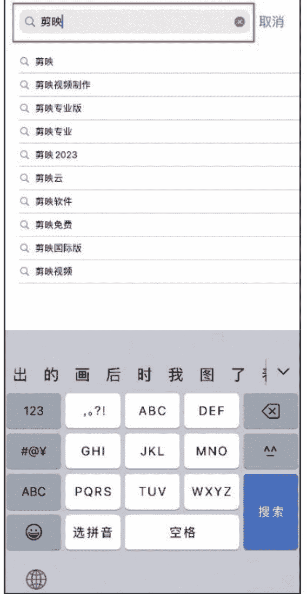

图1-7

（2）搜索到应用后，可直接点击右侧“获取”进行下载安装，如图1-8 所示。也可进入详情页后点击“获取”安装，如图1-9 所示。安装完成后剪映图标会出现在桌面，如图1-10 所示。

图1-8

图1-9

图1-10

### 1.1.3 剪映 App 的操作界面

剪映 App 界面简洁，各按钮下方配有文字说明，便于管理与创作。本节将界面分为主界面与编辑界面介绍。

#### 1. 主界面

启动剪映 App，默认进入剪辑主界面，如图1-11 所示。

底部导航的“剪辑”✂️、“剪同款”🎬、“消息”🔔、“我的”👤 可切换功能，各说明如下：

- 剪辑：包含创作工具、辅助工具及草稿箱。
- 剪同款：提供海量模板，可按分类套用或搜索使用。
- 消息：接收官方通知、粉丝评论点赞提醒等。
- 我的：展示个人资料及收藏模板。

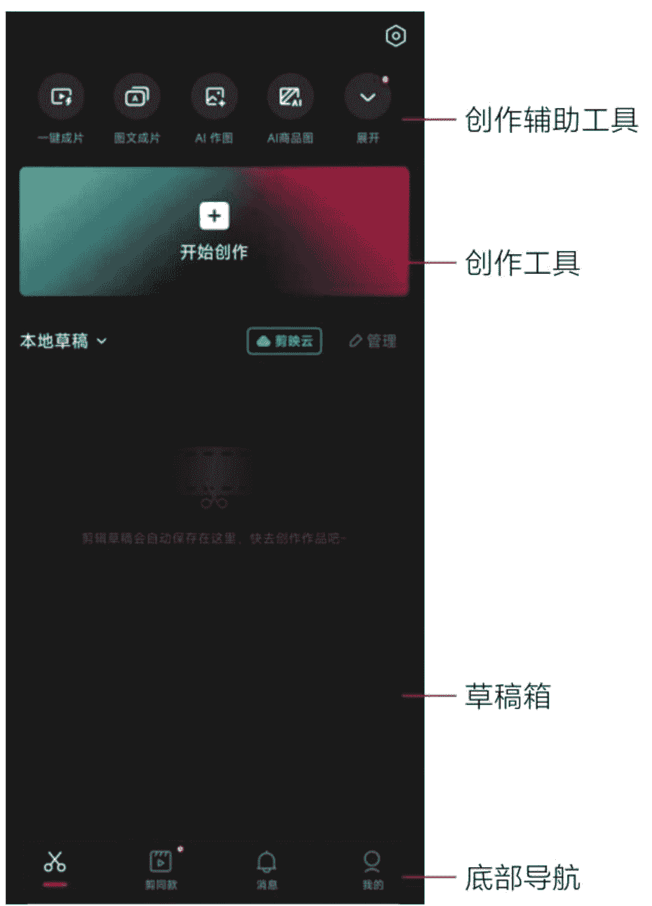

#### 2. 视频编辑界面

在主界面点击“开始创作”[+] 选择素材并点击“添加”后进入编辑界面，如图1-12 所示。该界面由预览区、时间轴、工具栏三部分构成。

- 预览区：实时显示当前时间线帧画面，任何操作效果均需在此确认。图1-12 中左下角 00:00/00:03 表示当前时间点与总时长。

点击底部“播放”▶ 可从当前位置播放；“撤销”↩ 撤回上一步；“恢复”↪ 恢复撤销操作；“全屏”⛶ 进入全屏预览。

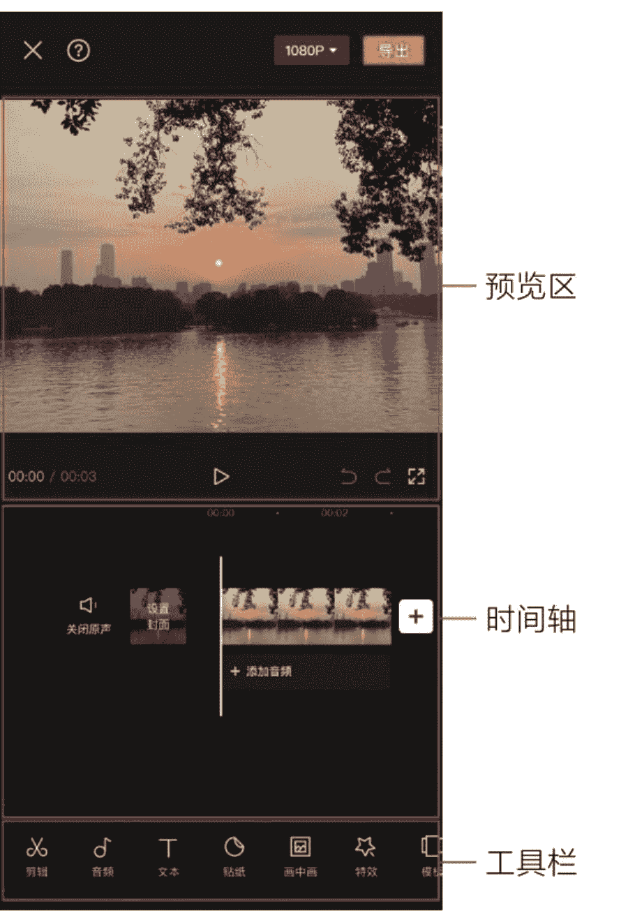

图1-12

- 时间轴：后期操作的核心区域，包含轨道、时间线、时间刻度三大要素，用于精确裁剪与效果添加。

- 工具栏：位于编辑界面底部，汇集剪映主要功能。未选中素材时显示一级工具栏，点击后进入二级工具栏。选中素材后工具栏会随之变化。

### 1.1.4 剪映 App 的核心功能

进入编辑界面后，底部工具栏提供丰富功能，如图1-13 所示。

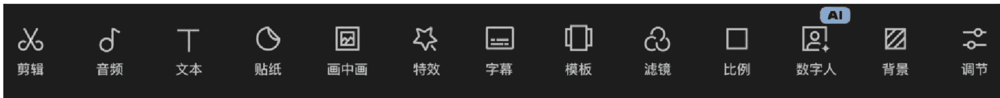

主要功能如下：

- 剪辑✂️：含分割、变速、动画等常用编辑工具。
- 音频🎵：处理音频素材，内置曲库提供音乐音效。
- 文本T：添加描述文字，支持多种样式字体模板，还能识别字幕、AI 配音。
- 贴纸😊：上百种贴纸提升美感与趣味。
- 画中画🖼️：实现多素材叠加效果。
- 特效⭐：一键套用多种特效模板。
- 字幕📝：语音识别生成字幕、双语字幕，支持智能划重点与标记无效片段。
- 模板：提供大量创作模板，快速成片。
- 滤镜：丰富滤镜烘托氛围，提升质感。
- 比例：常用视频比例可选。
- 数字人：添加逼真数字人模拟出镜。
- 背景：设置画布颜色、样式与模糊度。
- 调节：调节画面各项参数优化细节。

此外还有剪同款、创作课堂、抖音链接下载等特色功能，让新手也能快速上手制作精美短视频。

## 1.2 认识剪映专业版

使用剪映专业版前先了解其概况及安装界面。

### 1.2.1 剪映专业版简介

剪映专业版是抖音继 App 后推出的电脑端剪辑软件。界面更清晰、布局更适合桌面操作，适合专业场景制作高阶作品。图1-14 为官方宣传界面。

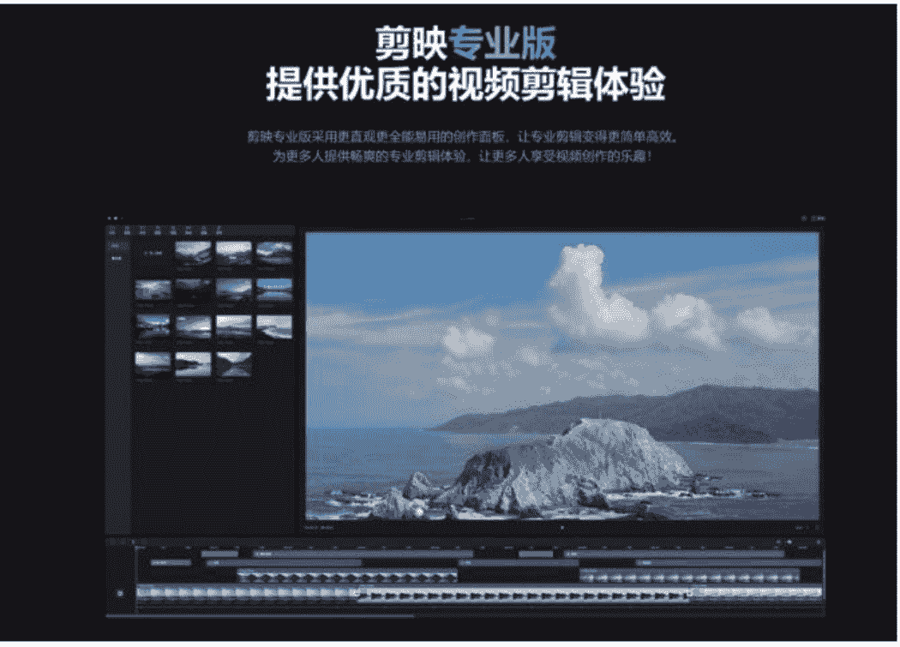

图1-14

> 提示

剪映专业版现有 Mac 与 Windows 版本，统称剪映专业版。

App 与专业版用户端不同，界面布局有差异但核心功能一致。专业版借助大屏优势呈现更直观的编辑画面，是 App 无法比拟的。图1-15、图1-16 分别展示两者工作界面。

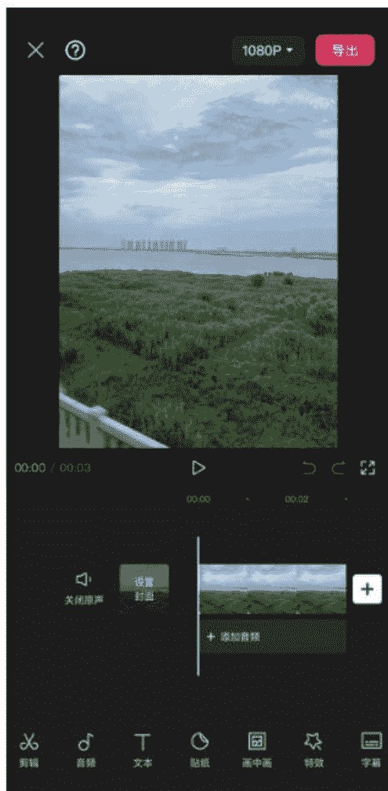

图1-15

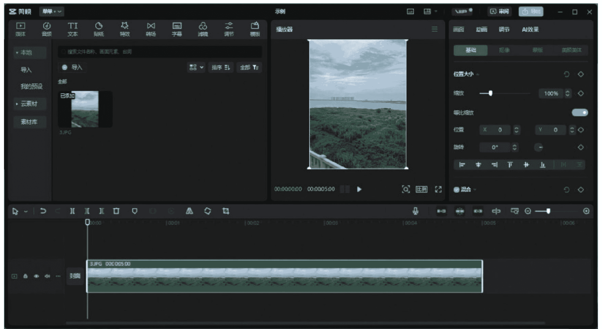

图1-16

App 推出较早功能已趋完善，专业版推出较晚，部分特色功能如 AI 作图、AI 特效仅在专业版可用。

### 1.2.2 安装剪映专业版

以 Windows 版为例，安装步骤如下。

（1）在电脑浏览器搜索“剪映专业版”进入官网，如图1-17 所示。

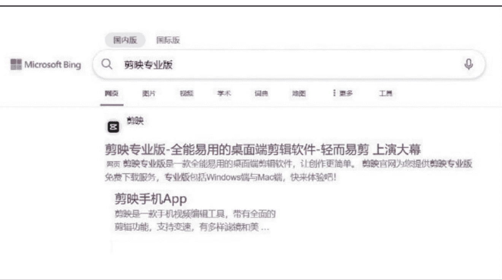

图1-17

（2）进入官网后点击主页“立即下载”按钮，如图1-18 所示。

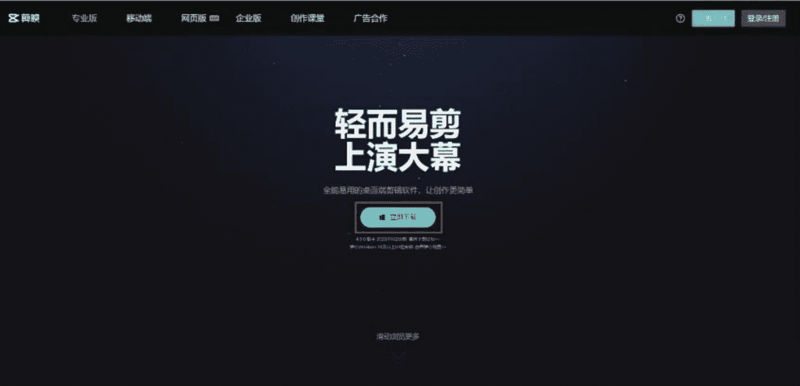

图1-18

（3）浏览器弹出下载框，可自定义路径后点击“下载”，如图1-19 所示。

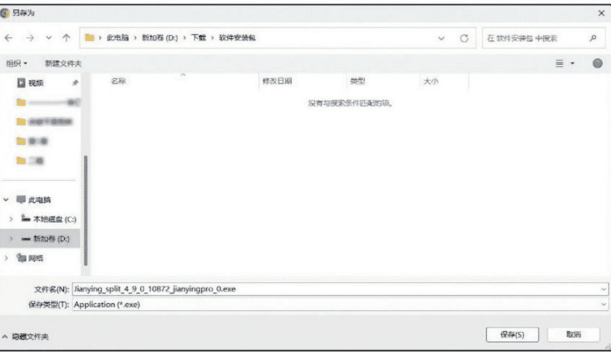

图1-19

（4）下载完成后双击安装包即可自动安装，如图1-20 所示。

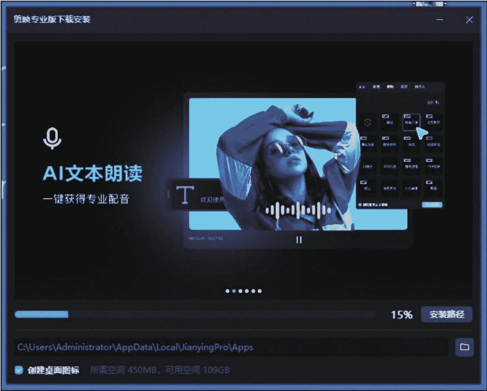

图1-20

> 提示

Windows 版步骤如上，Mac 版更简便，直接在 App Store 搜索下载即可。

### 1.2.3 剪映专业版的操作界面

双击桌面“剪映”图标，点击“开始创作”即可进入操作界面。与 App 操作逻辑基本一致，但因屏幕更大，布局有所区别。熟悉 App 后即可快速上手。界面如图1-21 所示，主要包含工具栏、素材区、预览区、素材调整区、常用功能区、时间轴六大区域，时间轴是剪辑核心，主要工作在此完成。

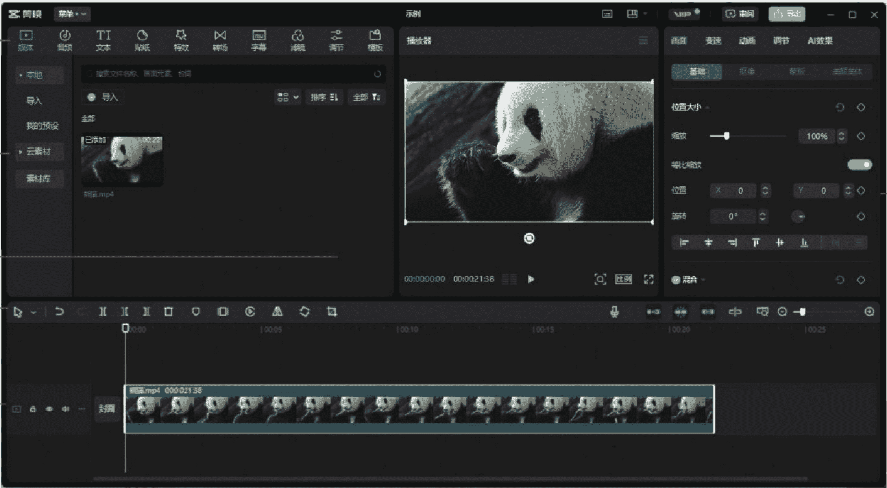

图1-21

各区域说明如下：

- 工具栏：含“媒体”“音频”“文本”“贴纸”“特效”“转场”“滤镜”“调节”“素材包”9 项。其中“媒体”仅专业版有。选中后可从本地或素材库导入素材至素材区。
- 素材区：显示贴纸、特效、转场等可用资源。
- 预览区：实时查看效果，点击右下角“全屏”可全屏预览；点击“比例”可调整画面比例。

素材调整区：当你在时间轴上点选某条轨道后，右侧的素材调整面板会智能切换，展示该轨道专属的效果参数。视频、音频、文字三类轨道各自对应不同的调节项。比如点中音频轨道，面板里就会出现音量、均衡等设置，如图1-22所示。

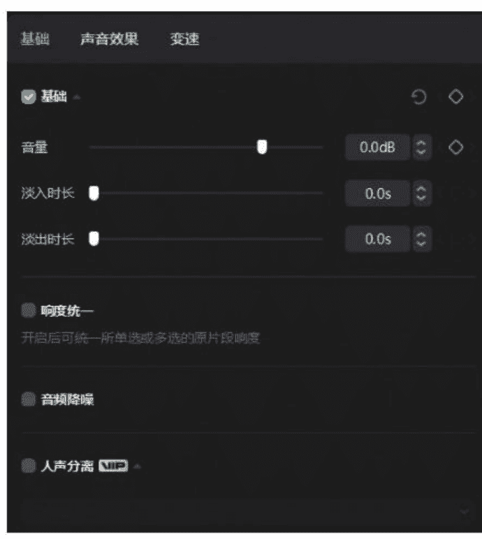

图1-22

常用功能区：这里集中了剪辑常用的七大快捷操作，分别是分割、删除、定格、倒放、镜像、旋转和裁剪。操作走偏时点一下“撤销”就能回退一步；“选择”按钮可以切换鼠标模式，在选择模式和分割模式之间切换。切换到分割模式后，直接在时间轴上点击就能在该位置切开片段。

时间轴：时间轴由轨道、时间线、时间刻度三部分组成。剪映专业版界面空间充足，视频、音频、文字等不同类型的轨道可以同时排布在时间轴区域内，如图1-23所示。

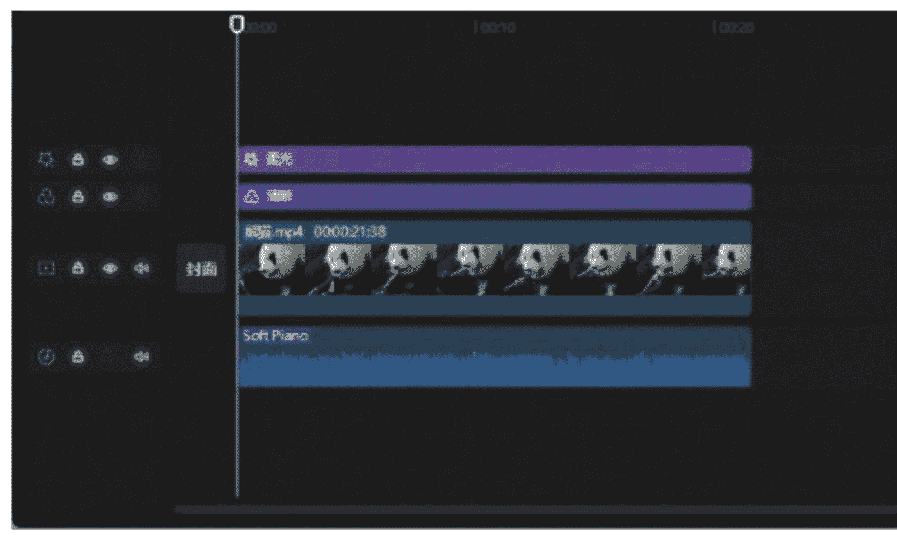

图1-23

### 1.2.4 剪映专业版首页功能速览
启动剪映专业版后映入眼帘的就是首页，双击桌面上的“剪映”图标即可进入，如图1-24所示。

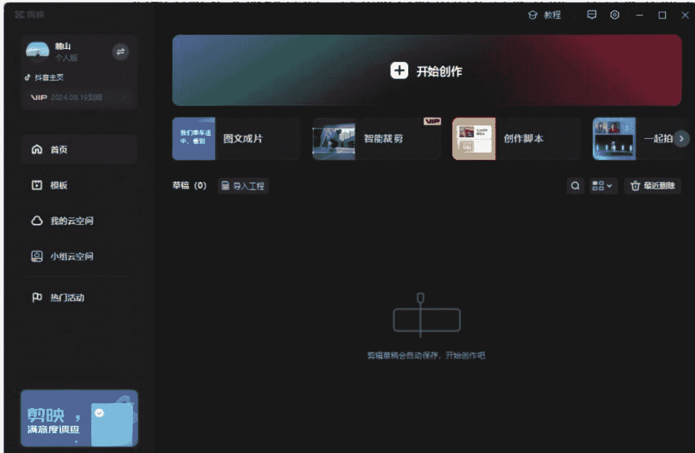

图1-24

首页上能看到开始创作、图文成片、智能转比例、创作脚本、一起拍等多个入口，具体如下。

- 开始创作：点击后会自动生成一个剪辑草稿，直接进入编辑界面开始工作。
- 图文成片：先确定主题，输入文案并选择时长，系统就能按文案自动合成对应时长的成片。
- 智能转比例：导入素材后可一键调整画面比例，同时还能优化画面稳定性。
- 创作脚本：提供大纲、分镜描述、已拍片段、台词文案、备注五大板块，完成后可上传云空间保存，如图1-25所示。

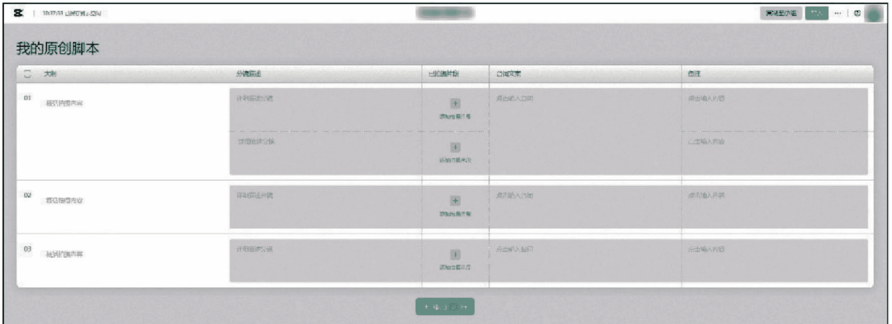

图1-25

- 一起拍：可邀请好友共同观看视频并拍摄观看画面，为后续剪辑提供素材，如图1-26所示。

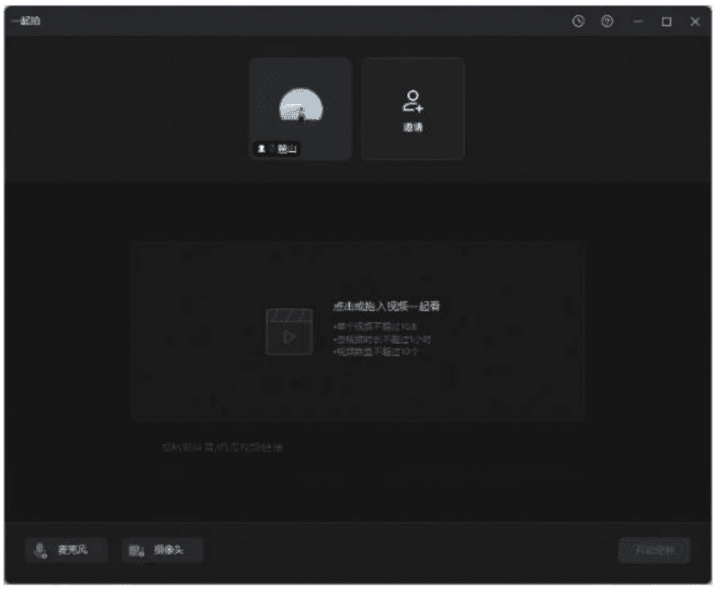

图1-26

- 草稿箱：占据首页大部分区域，用来导入工程、管理草稿、切换显示样式、查看最近删除的草稿以及搜索草稿名称，如图1-27所示。

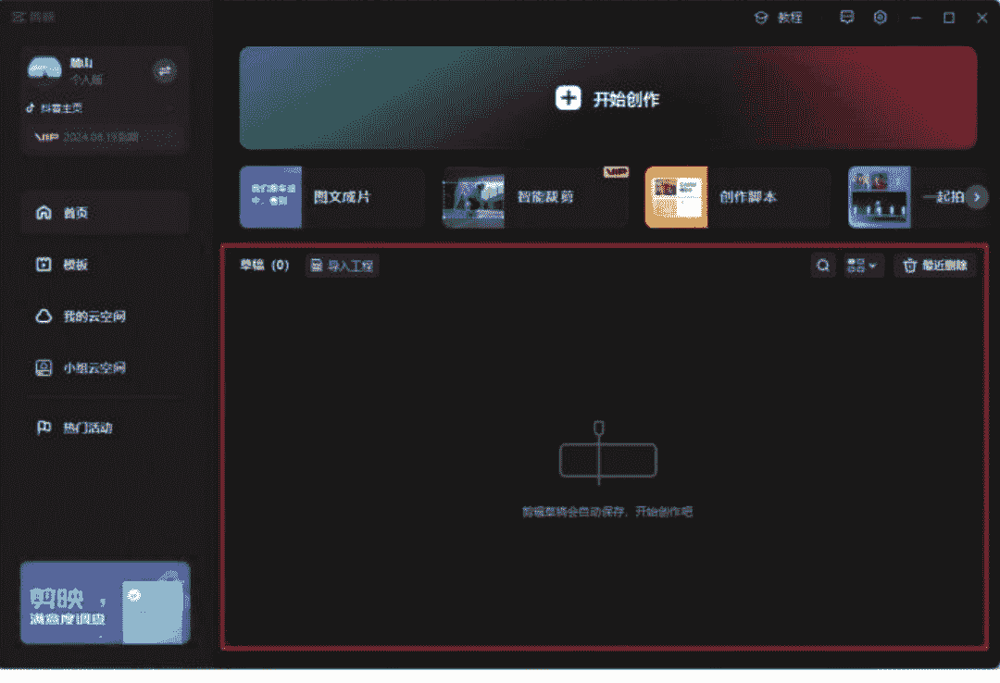

图1-27

## 1.3 DeepSeek助力剪映创作
在短视频赛道，高效智能的剪辑工具已成为创作者的核心刚需。DeepSeek凭借强大的算法和智能化能力，为短视频从策划到成片注入了新可能。下面系统介绍它的操作界面以及与剪映的协同价值。

### 1.3.1 DeepSeek工作界面速览
DeepSeek的界面简洁直观。开始使用前需要先注册账号。

注册流程只需几分钟，电脑浏览器或手机App均可操作。进入官网或下载App后按引导填写手机号接收验证码，或用邮箱登录并设置密码，邮箱登录后需绑定手机号完成实名认证，勾选协议即可完成。

登录后，交互界面与常见AI语言工具类似，主要由历史对话记录区和输入框组成。

作为新手，先掌握输入框的基础用法。

#### 1. 向DeepSeek提问
（1）登录后最先看到的就是输入框，如图1-28所示。

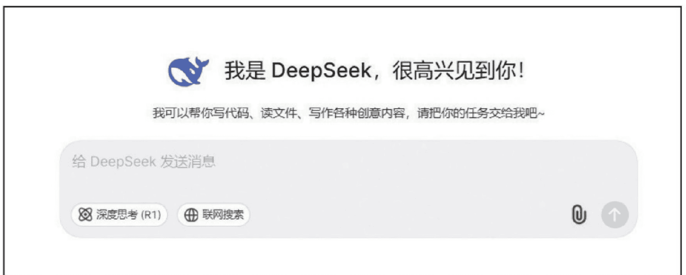

（2）输入区占据最大面积，直接打字或粘贴内容，发送时点击发送按钮⬆️或按Enter键即可，如图1-29所示。

#### 2. 上传附件
当文本过长不便直接输入时，可以上传附件让系统识别文字后作答。

（1）点击输入框中的“上传附件”按钮📎，如图1-30所示。

图1-30

（2）打开文件选择对话框，选中需要上传的文件后点“打开”。如图1-31所示。

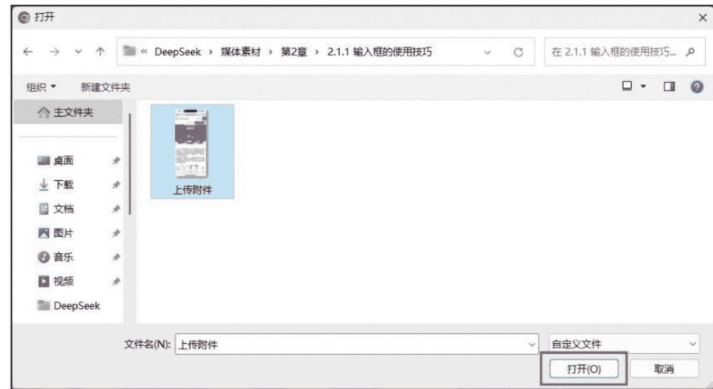

图1-31

（3）上传过程中输入框会提示正在上传，如图1-32所示。

图1-32

（4）上传完成后会显示附件名称和大小，可在此输入问题，点击发送按钮⬆或按Enter提问，如图1-33所示。

图1-33

> 提示
上传附件提问时，联网搜索功能将无法使用。

#### 3. 模型切换
DeepSeek提供DeepSeek-V3与DeepSeek-R1两款模型，前者像“实习生”般快速处理日常问题，后者像“行业专家”般深挖复杂难题。

（1）未勾选输入框下方“深度思考（R1）”时，如图1-34所示，默认使用V3模型。

图1-34

（2）V3生成的回答通常较简短，如图1-35所示。

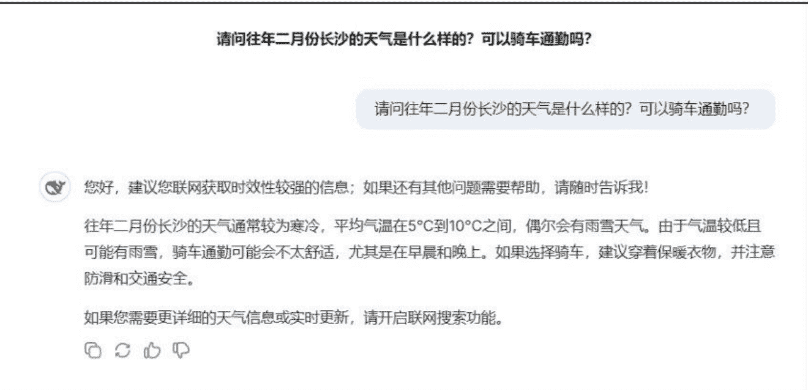

图1-35

（3）勾选“深度思考（R1）”即可切换到R1模型，如图1-36所示。

图1-36

（4）同一问题下，R1的回答更为细致，并会展示思考过程，如图1-37所示。

### 1.3.1 DeepSeek的工作界面

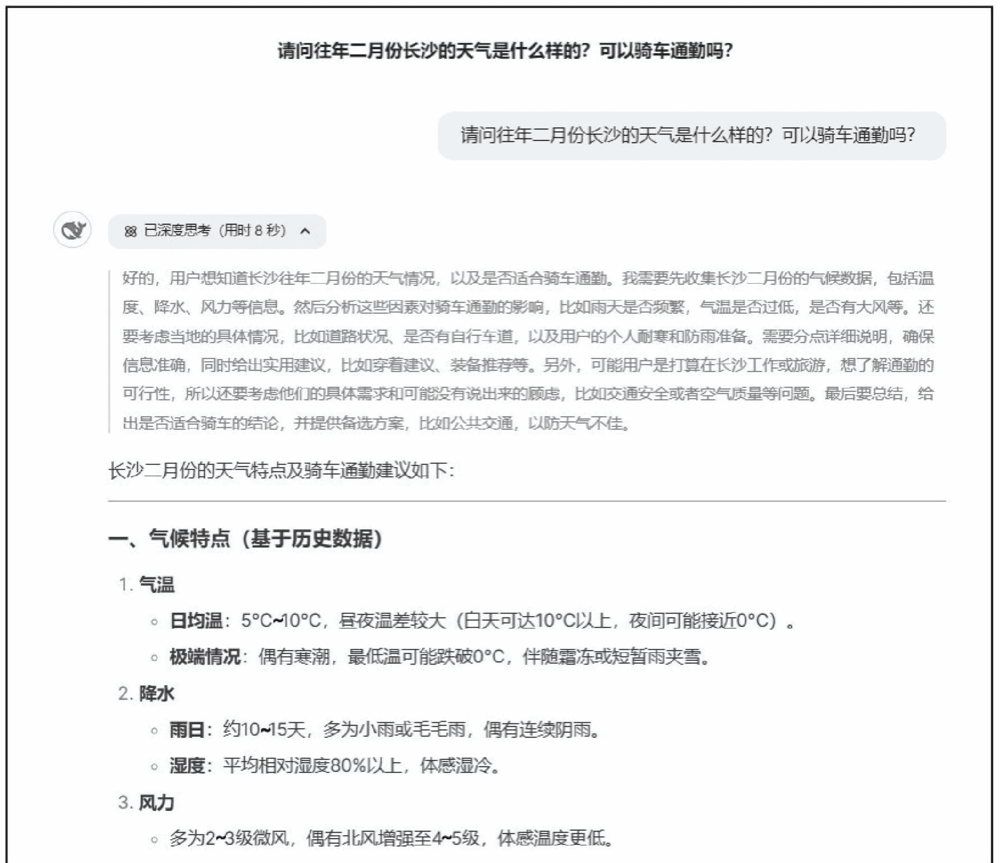

图1-37

#### 4. 使用联网搜索
DeepSeek内置知识截止2023年12月，若需更新信息可开启联网搜索。

（1）勾选输入框下方的“联网搜索”即可启用，如图1-38所示。

图1-38

（2）开启后生成回答时会实时检索，并在结果中标注网页来源，方便核查，如图1-39所示。

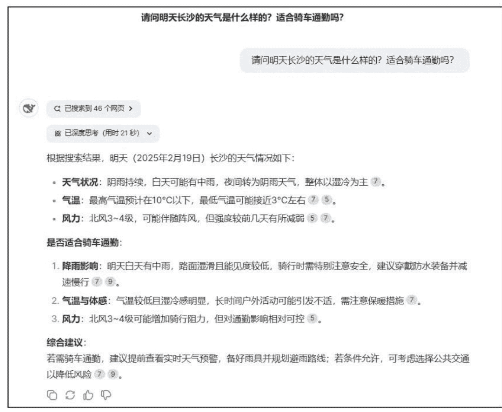

图1-39

#### 5. 结果展示区域
结果区遵循极简主义，分为深度思考区和最终回答区。

使用R1处理复杂任务时，提问后会先进入深度思考，如图1-40所示。

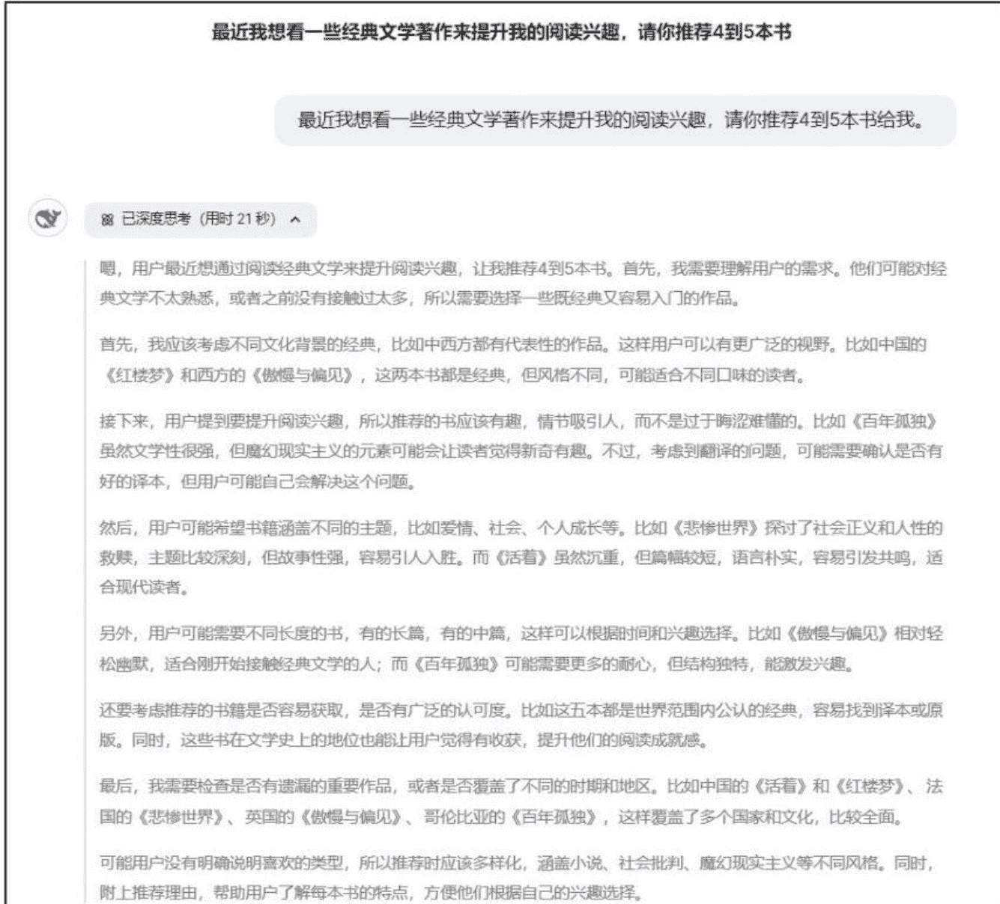

图1-40

深度思考区会呈现分步推理，如问题拆解、数据关联、假设验证等，便于检验可靠性。需要优化时可针对某一步追问。例如图1-40中，若不想看爱情主题的书，可追问重新推荐。

若只想看结论或节省空间，可点击深度思考区旁的小三角折叠，如图1-41所示。折叠后界面如图1-42所示。

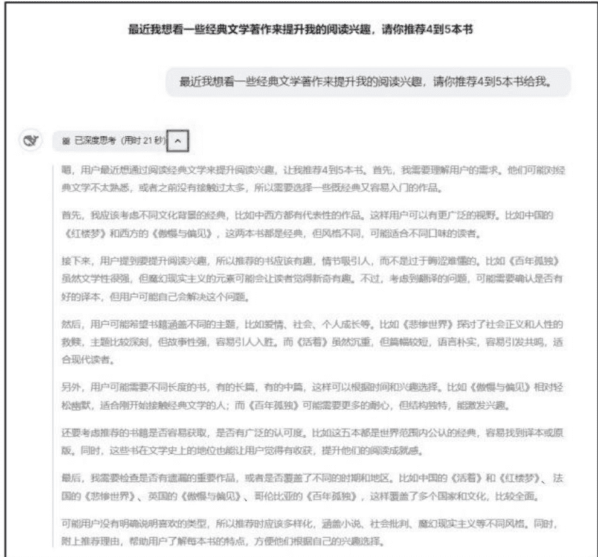

图1-41

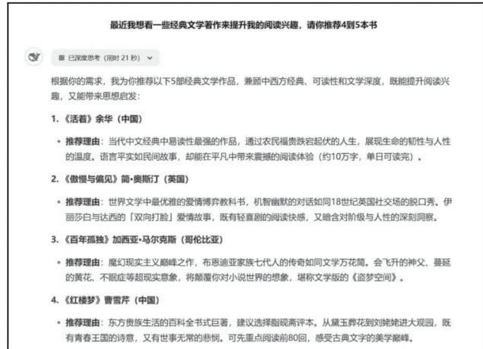

图1-42

回答区采用降噪设计，分层清晰。思考结束后会生成结构化结果，如图1-43所示。

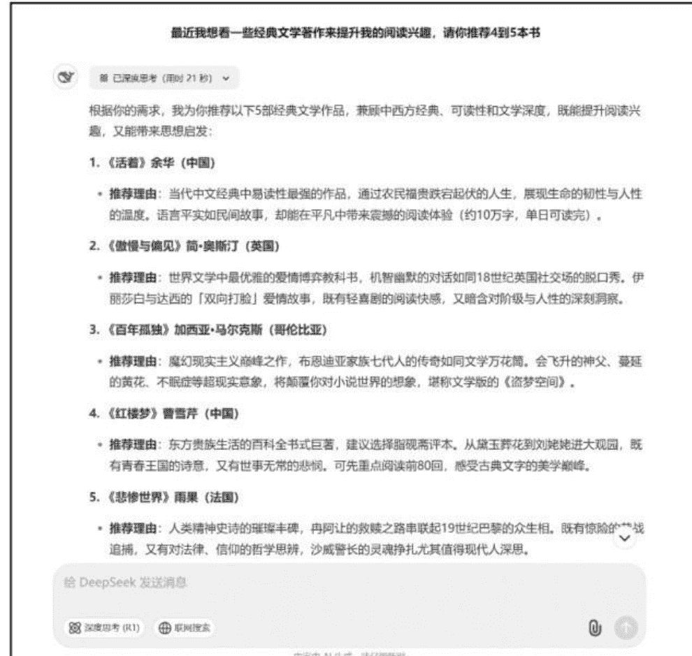

图1-43

为提升可读性，回答会使用多级标题、重点标注、表格等形式，如图1-44所示。

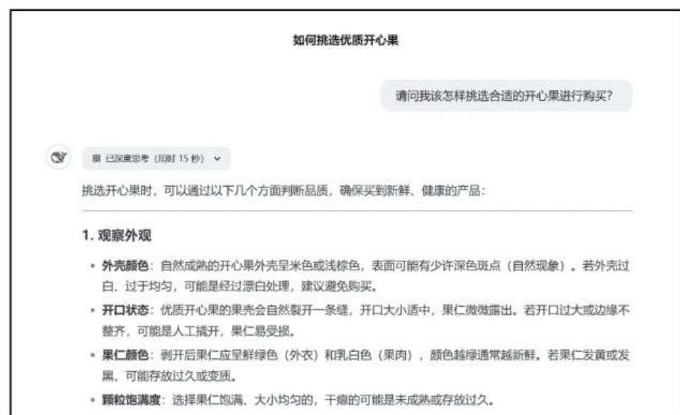

图1-44

整体呈现“核心结论—关键论据—行动建议”的层次，有助于快速抓取重点，同时适配不同用户的场景需求。

### 1.3.2 DeepSeek在短视频中的典型用法
DeepSeek可覆盖短视频从策划到传播的全链路。

#### 1. 创意灵感激发
问“如何拍好旅行Vlog”，会得到分步建议：先拍机场出发，延时拍云海，最后加美食特写。多位创作者反馈采纳后点赞提升约30%。

输入“近期什么题材易火”，系统结合实时数据推荐，例如沉浸式开箱体验，并给出拍摄要点：聚焦产品细节，使用ASMR收音等。

#### 2. 拍摄问题解决
新手常问“手机怎么拍出电影感”，会得到实用技巧：开启网格线构图，长按锁定曝光，优先用后置摄像头。实测拍摄效率提升约40%。

问“拍美食需要什么器材”，会按预算分档推荐：500元内选手机补光灯，1000元左右考虑桌面三脚架，并说明适用场景。

#### 3. 后期制作指导
问“如何让转场更自然”，建议在动作瞬间切换、用同色场景过渡、加入胶片烧焦特效。采用后完播率提升约25%。

咨询“如何添加动态字幕”，会分步说明：先自动语音转文字，再选跳动字幕样式，最后调整出现时间与语音同步，新手也能做出专业感。

#### 4. 智能素材协作
问“赛博朋克场景怎么描述”，会生成提示词：霓虹灯下雨夜街道、全息广告牌紫蓝闪烁、机器人穿梭玻璃大厦。提示词可直接输入Stable Diffusion生成背景，再导入剪映加动态模糊。

想做动画版美食教程，会建议先用“卡通画风+冒热气的拉面+Q版厨师”提示词生成MidJourney图片，再用LeiaPix转3D动态图，最后用剪映智能抠图叠加到实拍。

DeepSeek正成为创作者的智能搭档，可快速解答200余类从创意到发布的问题。

### 1.3.3 DeepSeek+剪映快速成片流程
两者配合可大幅缩短制作周期。

#### 1. 内容规划
在DeepSeek输入具体需求，例如“生成3分钟旅行Vlog脚本框架，含场景过渡词与情绪引导”。输出包含开场白、故事节点如00:45插入延时摄影提示、结束语设计，帮助快速把握框架。知识科普类也可追加追问，如“用生活化比喻解释量子力学”，提升回答质量。

#### 2. 内容制作
规划后可让DeepSeek生成文案。例如要求“帮我写一则轻乳茶广告短视频文案”，即可直接获得成片文案，如图1-45所示。

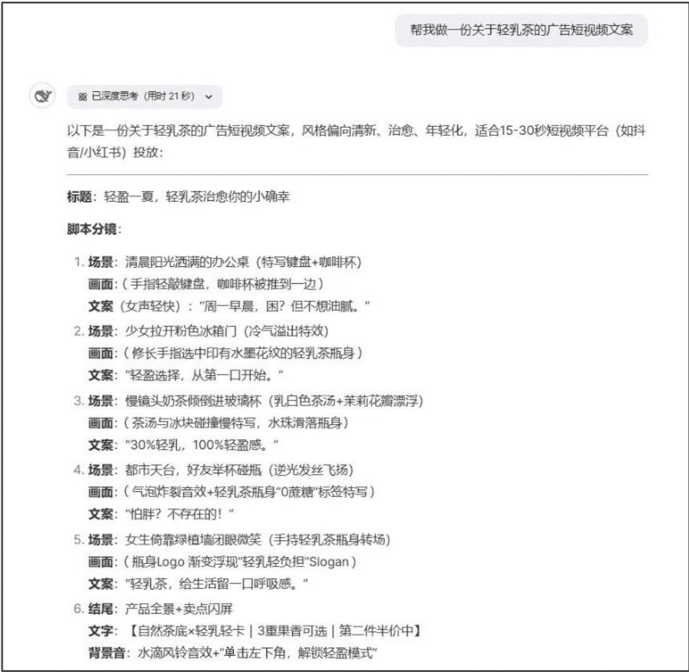

图1-45

#### 3. 素材匹配
剪映提供“图文成片”功能。将DeepSeek生成的文案复制到剪映，如图1-46所示，选择网络素材或本地素材即可快速合成短视频。

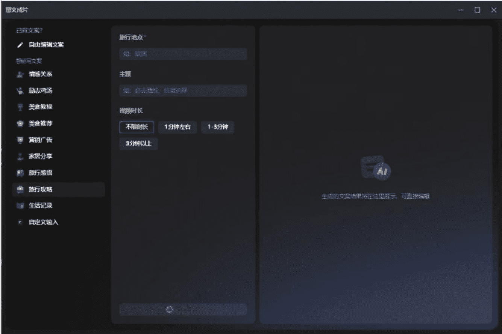

图1-46

把DeepSeek的创意能力与剪映的制作能力结合，内容生产效率明显提升。

## 1.4 剪辑的核心作用与流程
### 1.4.1 剪辑的目的
剪辑是视频制作的关键环节。仅靠拍摄会出现大量冗余素材，很难把控节奏和衔接。通过剪辑重新排序、删减片段，能让画面更紧凑、结构更严密。

主要作用有以下几点。

1. 去掉多余内容
删除无实质表达的开头结尾、拍摄瑕疵片段，以及与主题偏离或难以衔接的部分，保留创作者需要的精华，提升观看体验。

2. 把控视频节奏
通过调整片段顺序、时长、播放速度及加入背景音乐音效，营造不同节奏。快速切换带来紧迫感，长镜头则营造沉静思考氛围。

3. 视频二次创作
同一素材经不同剪辑手法可形成画面、风格、情感迥异的作品。

4. 常见名词解析
视频编辑大致分为前期策划、中期拍摄、后期制作三阶段，具体如下表1-1所示。

表1-1

| 工作阶段 | 工作内容概述 | 核心技能要求 |
| :--- | :--- | :--- |
| 前期策划 | 确定题材定位、策划内容、设计脚本、团队沟通、拍摄准备 | 策划与资源整合能力 |
| 中期拍摄 | 依脚本拍摄，调控场景、手法、光线、机位 | 沟通与执行能力 |
| 后期制作 | 剪接、音效、技术合成，剪辑需有思想有目的 | 导演思维 |

#### 5. 视频名词术语
- 时长：视频总长度，常用格式00:00:00:00（时：分：秒：帧）。
- 帧：视频最小单位，相当于一帧静态图片。
- 关键帧：控制动画特性的特定帧。
- 帧速率：每秒播放帧数，单位f/s，越高越流畅。
- 画面尺寸：显示画面的宽和高。
- 画面比例：宽高比值，如16:9、4:3。
- 画面深度：色彩深度，常见为8bit。
- 声道：单声道、立体声、多声道等。
- 声音深度：音频位深，如16bit、24bit。
- 素材：视频、音频、图片或字幕等片段。
- 转场：两个剪辑点间的视觉或听觉衔接效果。
- 还原：撤销上一步操作。
- 变速：片段播放时加速或倒转。
- 合成：将多张图像合成一帧。
- 渲染：源文件生成最终视频的过程。
- 场景：拍摄片段，即镜头。
- 字幕：以文字呈现对话等非影像内容。

- 剪辑：对原始片段进行删减与重组。
- 特效：为视频增添的视觉变形与动态效果。
- 素材库：用来存放媒体资源的位置。

### 1.4.2 短视频剪辑标准流程

喜欢记录日常的创作者，剪辑往往是把平淡素材化成吸睛大片的关键。无论拍摄的是哪种题材，经过后期处理都能焕然一新。下面把常用的剪辑环节做个梳理，新手和资深剪辑师都可以参照这个顺序来操作。

#### 1. 素材采集与整理
采集与归类是剪辑工作的基础。拍完后先粗略预览，对每条素材形成初步印象，再做初筛和分类。

分类时建议建立独立的项目文件夹，比如旅拍素材，就按天建立子文件夹，命名以日期、地点或主题为依据，如图1-47所示。这样在剪辑时能快速定位到想要的片段。

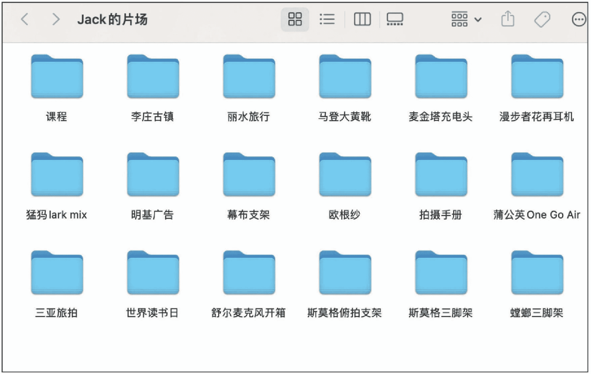

图1-47

#### 2. 视频粗剪
粗剪主要包含三件事：剪气口、上字幕、加配乐。完成这一步，原始素材就能变成可发布的初版。

#### 3. 视频精剪
精剪是在粗剪基础上做细节打磨。常见操作有画面修剪与拼接、音乐剪切、加入音效等。建议不要直接在粗剪稿上改动，最好新建一个精剪稿，方便在两个版本间对比，反复衡量画面效果。

#### 4. 输出成片
以上环节完成后，检查素材无误即可导出母版。导出时要关注视频格式、编码、分辨率等参数，如有不合适的地方再返回修改。

以上就是短视频的常规流程。若要做更高规格的内容，后期还可能加入特效、3D动画、调色等包装手段。

# 第2章 素材收纳与剪辑入门

本章正式切入粗剪的第一步，即素材采集、整理与智能剪气口，涵盖如何将拍摄视频导入剪辑、画面如何调整、素材如何高效管理等内容。

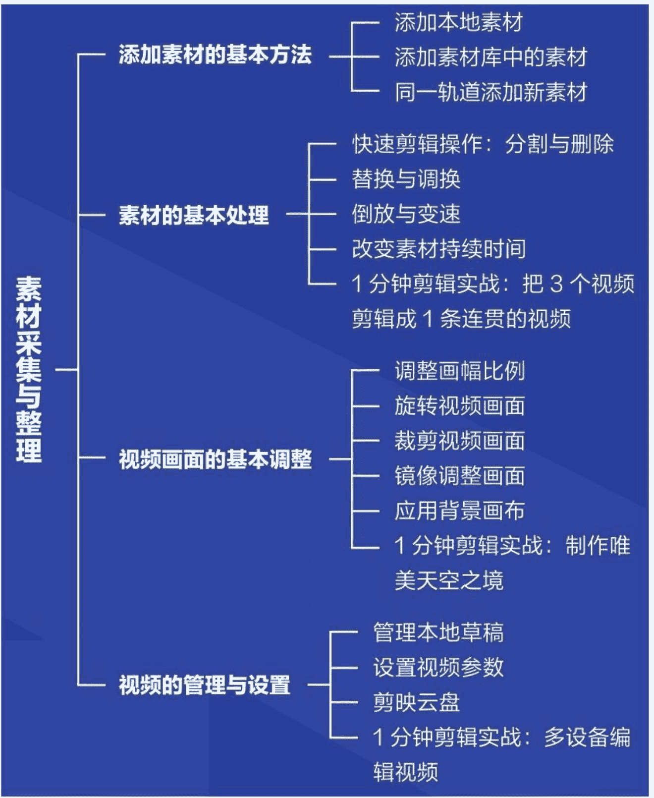

## 2.1 添加素材的基本方法
把拍摄好的素材导入软件是编辑环节的基础操作。

### 2.1.1 添加本地素材
启动剪映App，在首页点按“开始创作”按钮，如图2-1所示。进入素材选择页后，可在“最近项目”中挑选一条或多条视频、图片素材，选好后点按底部的“添加”按钮，如图2-2所示。进入编辑页即可看到所选素材已按顺序排列在同一轨道上，如图2-3所示。

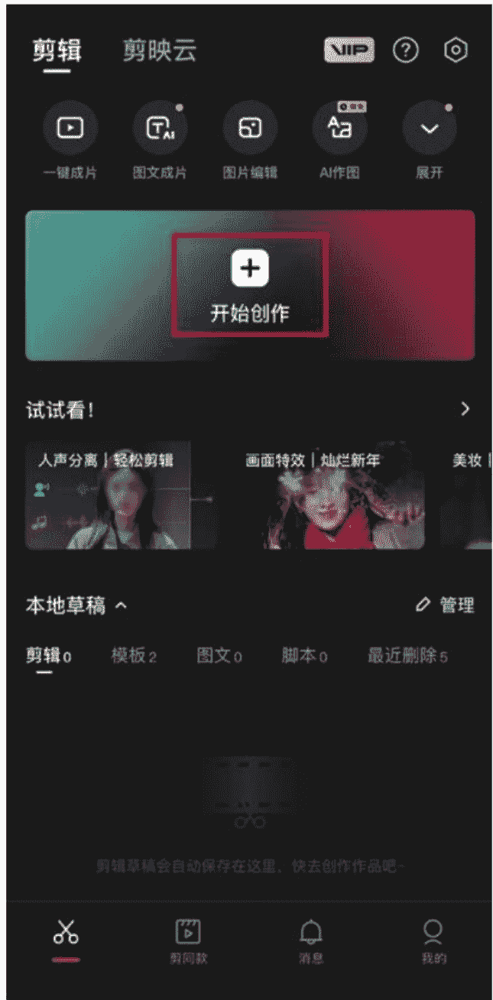

图2-1

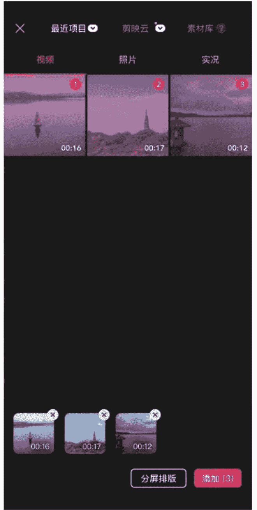

图2-2

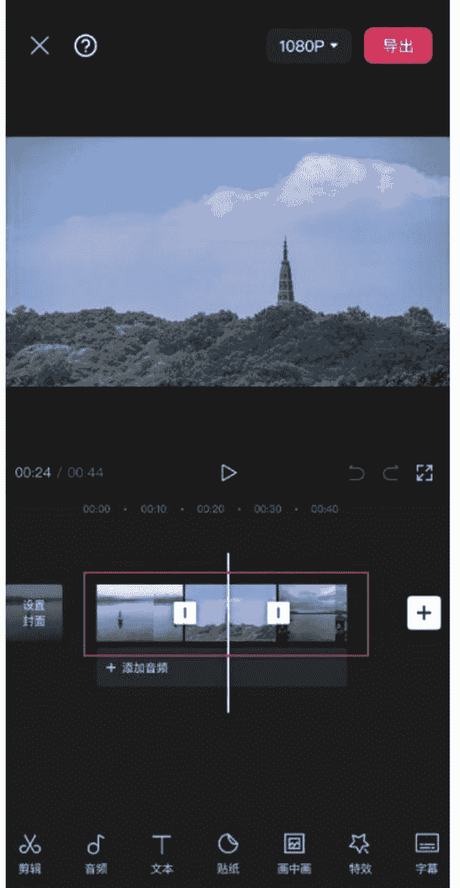

图2-3

### 2.1.2 添加素材库中的素材
剪映自带素材库，提供大量可直接使用的优质资源。

打开剪映App，首页点击“开始创作”进入素材选择页，选择“素材库”标签挑选合适资源，选完后点按底部的“添加”按钮，如图2-4所示。进入编辑页后，所选素材会出现在同一轨道上，如图2-5所示。

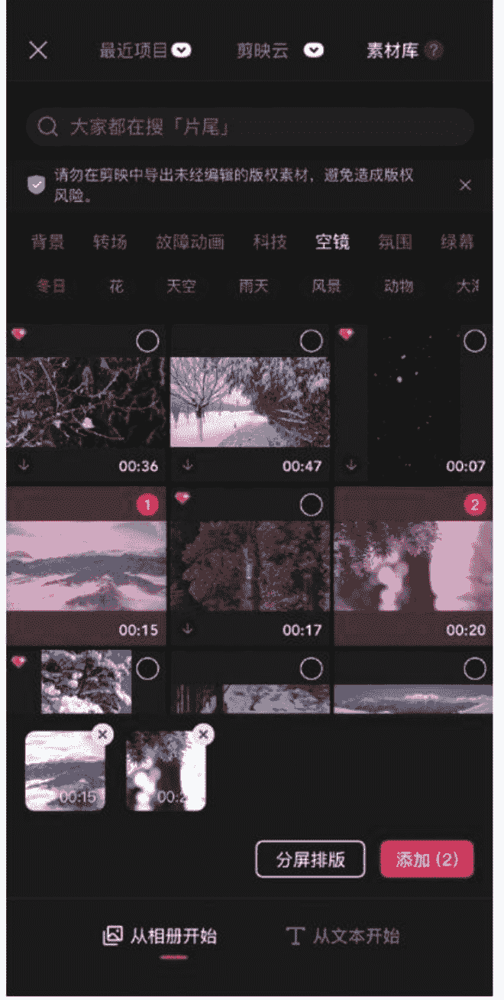

图2-4

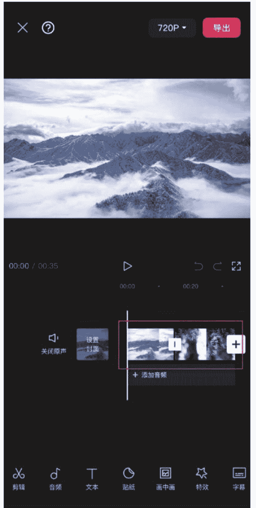

图2-5

### 2.1.3 同一轨道添加新素材
除了新建草稿时导入素材，也可在剪辑过程中随时在同一轨道补充素材。

打开剪映App，点击轨道右侧的“添加”按钮➕，如图2-6所示。进入素材选择页后挑选素材并点按底部“添加”按钮，如图2-7所示。

### 2.1.3 同一轨道添加新素材

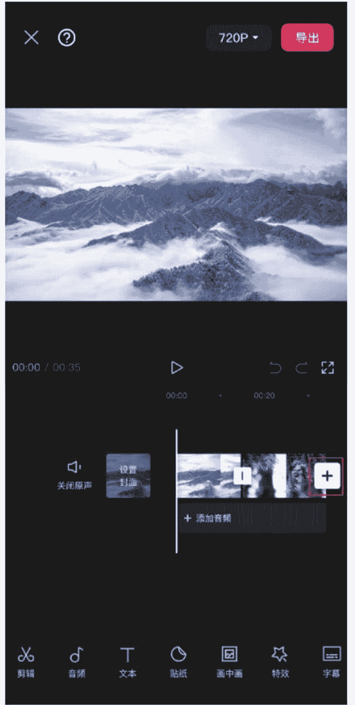

图2-6

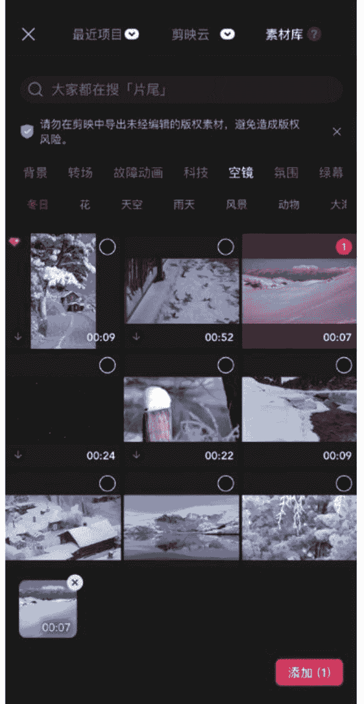

图2-7

进入编辑页即可看到新素材已追加到同一轨道上，如图2-8所示。

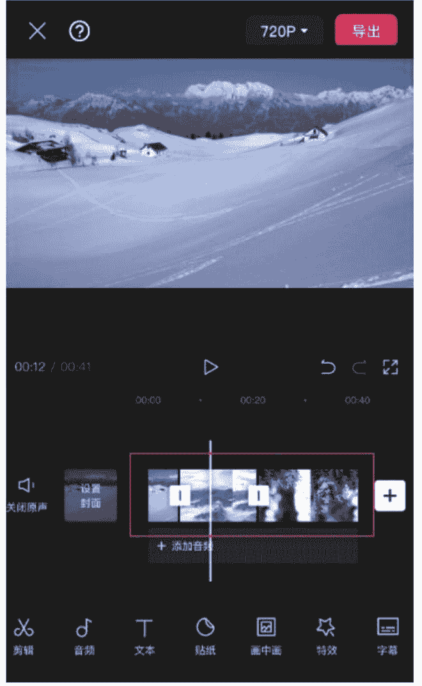

图2-8

## 2.2 素材的基本处理
素材的基础处理指调用、分割、组合等操作，是剪辑的核心环节。在剪映中可自由编辑素材并按构思重组，最终达成想要的呈现效果。

### 2.2.1 快速剪辑操作：分割与删除

#### 1. 分割素材
分割即“剪”的动作，把不需要的片段切开后再删掉。把视频导入时间轴后，选中素材并点按二级工具栏的“分割”按钮，如图2-9所示，即可在时间线位置切分素材，如图2-10所示。

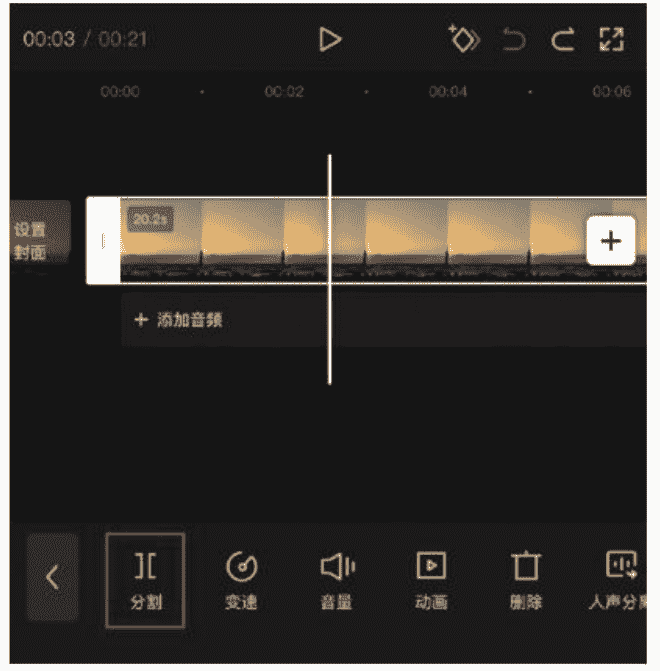

图2-9

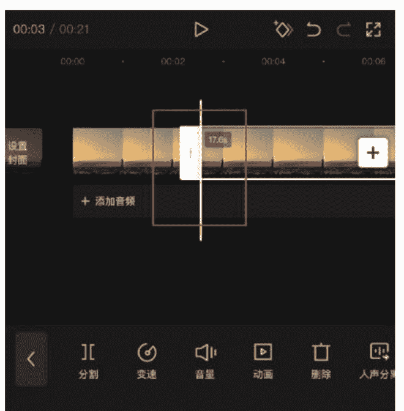

图2-10

#### 2. 删除素材
删除操作很直接，选中时间轴内需要移除的素材或效果，点按二级工具栏的“删除”按钮🗑️，如图2-11所示，即可移除选中内容，如图2-12所示。

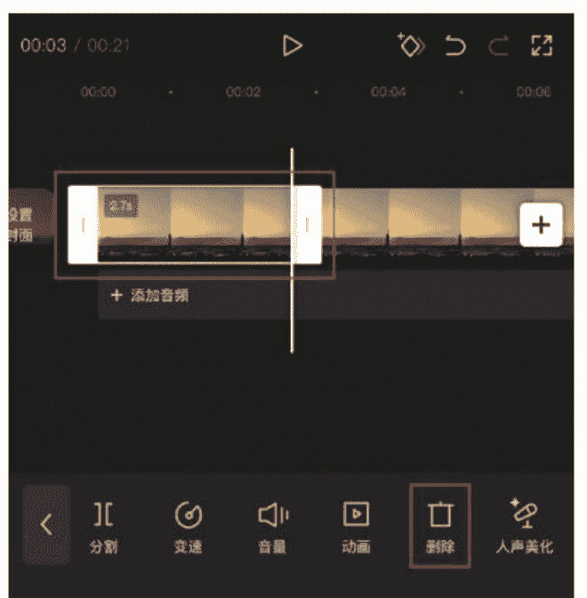

图2-11

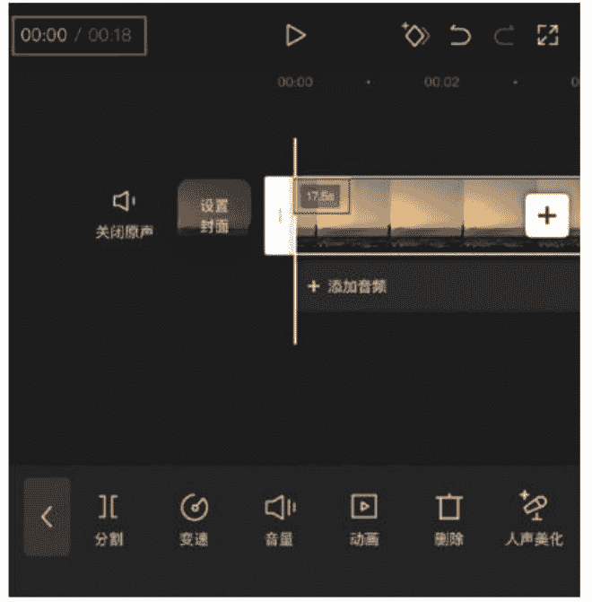

图2-12

### 2.2.2 替换与调换
剪辑中对某段素材不满意，可选中该片段，在底部工具栏点按“替换”按钮，如图2-13所示。进入素材选取页选择新素材，如图2-14所示，即可完成替换，如图2-15所示。

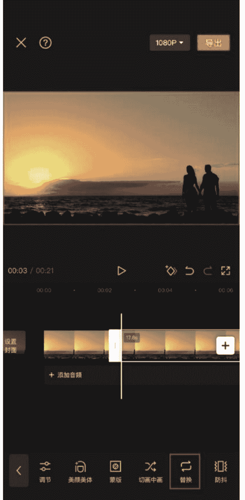

图2-13

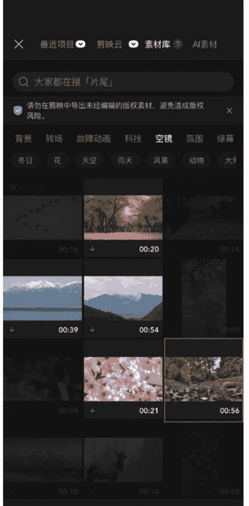

图2-14

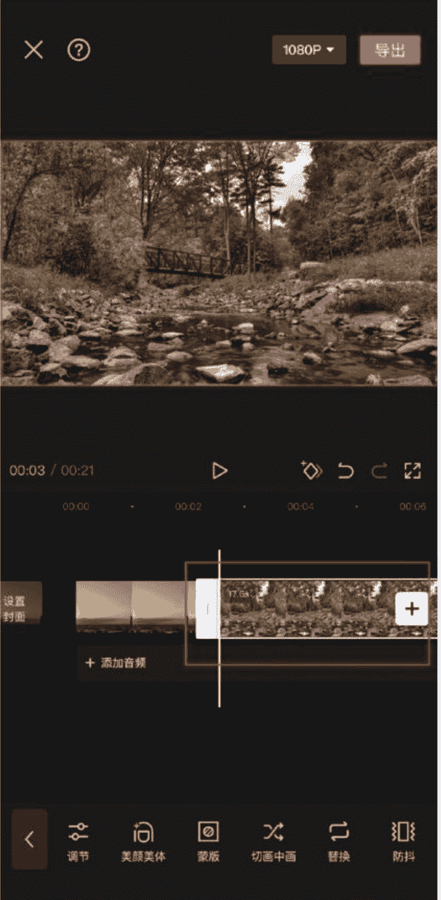

图2-15

如需调整片段顺序，只需长按素材后前后拖动位置即可，见图2-16，调整后如图2-17所示。

> 提示
> 想重复使用某段素材，可用下方工具栏的“复制”按钮，该素材会再次出现在同一轨道区。

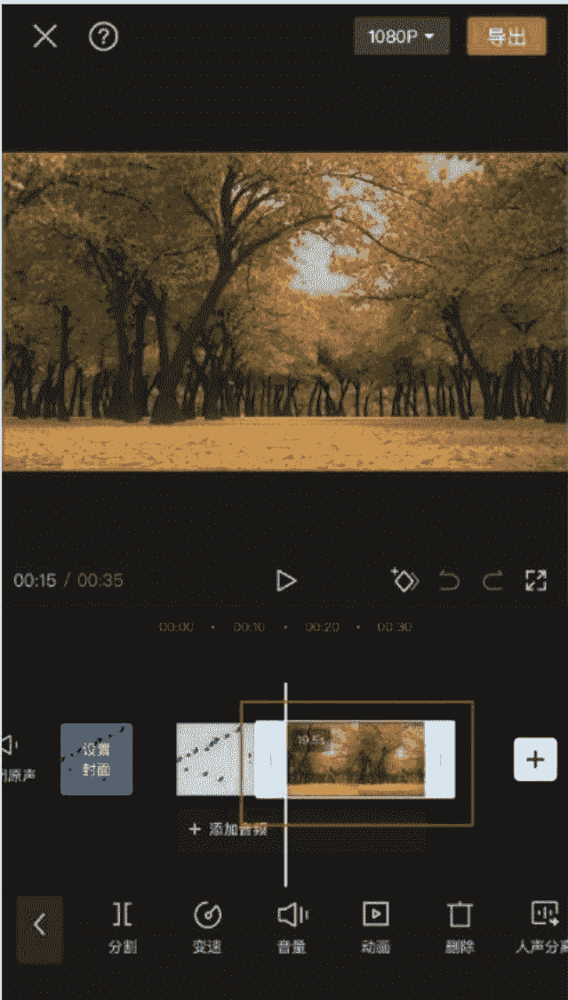

图2-16

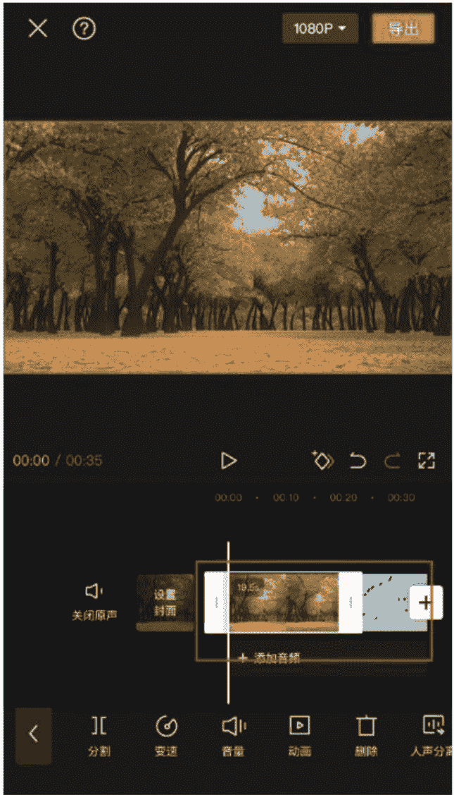

图2-17

### 2.2.3 倒放与变速

#### 1. 视频倒放
倒放是常用技巧，例如日出素材倒放可做成日落。导入小溪视频后，进入编辑页点按底部工具栏的“剪辑”按钮，如图2-18所示。向左滑动下方工具栏，找到并点按“倒放”按钮，如图2-19所示。播放预览即可看到倒放效果。

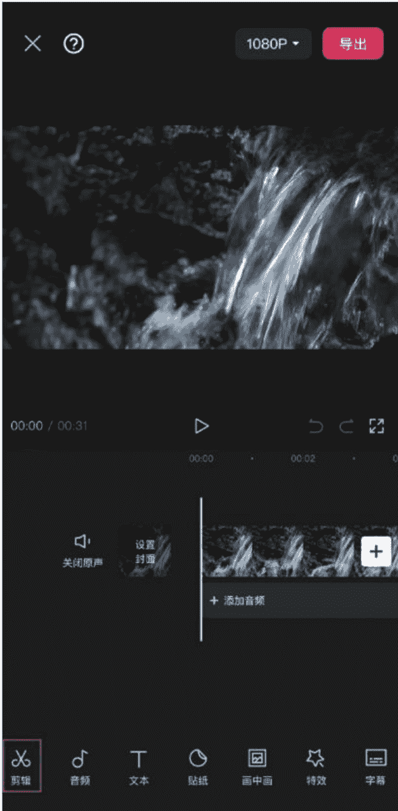

图2-18

图2-19

#### 2. 视频变速
觉得节奏过快或过慢，可用变速功能调节。选中时间轴上的片段，点按底部工具栏的“变速”按钮，如图2-20所示。此时底部会出现两个变速选项，如图2-21所示。

图2-20

图2-21

##### （1）常规变速
点按“常规变速”打开调节面板，如图2-22所示。原始倍速为1x，拖动滑块可改变播放速度，大于1x变快，小于1x变慢。拖动时上方会显示当前倍速，素材左上角也会标注，如图2-23所示。调整完毕点按右下角“保存”即可。

图2-22

图2-23
需要注意，常规变速会改变素材时长。倍速升高，速度变快时长变短；倍速降低，速度变慢时长变长。

##### 创作技法
###### 如何用变速获得电影级观感？
电影院标准为每秒24帧，而手机拍摄多为30帧或60帧。高帧率很流畅但缺少电影感。可将30帧素材调至0.8倍，60帧素材调至0.4倍，逼近24帧，观感会明显不同。

##### （2）曲线变速
曲线变速可对视频不同片段单独加速或减速，幅度可自由控制。

在变速面板点按“曲线变速”，可看到原始、自定、蒙太奇、英雄时刻、子弹时间、跳接等预设，如图2-24所示。点选除“原始”外的任意曲线即可实时预览，以“蒙太奇”为例，首次点击后预览区自动展示效果，按钮变红，如图2-25所示。再点一次可进入曲线编辑面板，如图2-26所示，可拖动锚点调节速度，左上角显示时长变化。

图2-24

图2-25

图2-26

### 2.2.4 改变素材持续时间
拖动素材片段左右两端的滑块即可改变时长，如图2-27所示。向右拖动右端滑块可延长时长，如图2-28所示。选中片段后左上角会显示当前持续时长，便于调整，如图2-29所示。

> 提示
> 视频和音频只能在其原始时长范围内裁剪，例如20s素材可缩至10s或15s，不能直接拉长到25s，除非配合变速。图片、贴纸、特效等可通过拖动滑块设定任意时长。

图2-27

图2-28

图2-29

### 2.2.5 1分钟剪辑实战：把3个视频剪辑成1条连贯的视频

##### 创作技法
##### 口播视频高效剪辑技巧
- ①把素材拖入剪映，先做“字幕识别”。
- ②观察轨道，有字幕的位置为有声段，无字幕为停顿无效段，可直接删除。
- ③从后往前剪。录制时同一句话常重复多次，从末尾往前保留最终版本更稳妥。

实战目标：练习添加素材、分割、删除三项操作，扫码观看详细演示，1分钟即可掌握。

视频二维码

## 2.3 视频画面的基本调整
仅做基础处理会显得单调，有质感的视频往往构图优美、画面丰富。下面介绍几种画面调整方法。

### 2.3.1 调整画幅比例
剪映提供多种画幅比例，可根据习惯和内容挑选。在未选中素材时点按底部工具栏的“比例”按钮，如图2-30所示，打开选项面板，如图2-31所示。

选择任意比例即可在预览区看到效果。无特殊要求时推荐9:16或16:9，这两种是最常见的视频比例，如图2-32和图2-33所示。

图2-30

图2-31

图2-32

图2-33

##### 创作技法
##### 如何选横屏或竖屏提升清晰度？
从清晰度看，优先横屏。竖屏为9:16，而多数全面屏手机为约2:1，竖屏上传后会被拉伸，清晰度下降。横屏16:9居中显示，不会被拉伸，且更适合电视投屏。

### 2.3.2 旋转视频画面
剪映可手动旋转画面，常用在横转竖。在时间轴选中素材，点按二级工具栏的“编辑”按钮，如图2-34所示。展开后点按“旋转”即可，每次点击画面旋转90°，如图2-35所示。

图2-34

图2-35

### 2.3.3 裁剪视频画面
画面构图不理想时可二次构图。在时间轴选中素材，点按二级工具栏的“编辑”按钮，如图2-36所示。展开后点按“裁剪”按钮，如图2-37所示，进入裁剪界面。

裁剪界面会显示九宫格辅助线，如图2-38所示。也可选择预设比例或自由裁剪，如图2-39所示。

图2-36

图2-37

图2-38

图2-39

### 2.3.4 镜像调整画面
“镜像”功能可对画面做水平翻转，制造空间倒置效果。

在时间轴选中素材，点按二级工具栏的“编辑”按钮 ，如图2-40所示。展开编辑栏后点按“镜像”按钮 ，如图2-41所示。

点按后预览画面即完成镜像，前后对比见图2-42和图2-43。

图2-40

图2-41

图2-42

图2-43

### 2.3.5 应用背景画布

剪映在设置纯色背景的同时，还额外提供画布样式来打造更个性化的观感。想要启用样式功能，首先保证时间线上没有选中任何片段，然后打开底部菜单的背景入口，进入画布样式列表挑选任意一款即可生效。

图2-44

图2-45

图2-46

画布模糊的开启流程与样式一致。同样在时间线空闲的状态下打开底部背景面板，切到画布模糊选项，即可从预设的模糊效果里挑选适合的。

图2-47

图2-48

> 提示
> 不需要样式效果时，可在画布样式面板左侧点击关闭按钮进行撤销。

### 2.3.6 1分钟实战：打造唯美天空之境

实战目标：学会在剪映手机版中使用比例、旋转、镜像三项功能制作梦幻天空之境，扫码查看完整步骤。

视频二维码

## 2.4 视频管理与参数设置

剪辑过程中既要会整理草稿，也要懂得调整输出参数。本节说明本地草稿的管理方式和视频参数的设置方法。

### 2.4.1 管理本地草稿

在剪映手机版点击开始创作并导入素材后，系统会自动生成一个编辑草稿。退出编辑后回到首页即可看到草稿列表，见图2-49。点按草稿名称右侧的展开控件即可调出操作菜单，见图2-50。

图2-49

## 2.4 视频管理与参数设置

展开后的菜单支持将草稿上传到云端、改名、复制、通过剪映快传面对面传输以及删除。

### 2.4.2 设置视频参数

素材导入草稿后，要输出完整成片就需要掌握参数调节。进入编辑界面后点按右上角的1080P，打开参数面板，见图2-51；展开后的界面见图2-52。

面板里可以调整分辨率、帧率、码率，开关智能HDR，也可将成片导出为GIF动图。

> 提示
> 常见分辨率有480P、720P、1080P、2K、4K，分辨率越高画面越清晰。常见帧率有24帧、25帧、30帧、60帧，帧率越高画面越流畅。码率即单位时间内的数据量，码率越大画质越好。HDR是提升亮度和对比度的影像处理技术，能让高光更亮、暗部更深、色彩更丰富。

##### 创作技法
##### 如何让发布的视频更清晰？参数怎么设置？
导出时建议选择1080P配合60帧，不要选4K——抖音会压缩回1080p，也不要选30帧——60帧更顺滑。手机端上传和电脑端上传效果相同。

抖音目前不支持4K播放，但小红书和B站支持4K切换。若主要面向小红书或B站，可用4K拍摄并4K发布。

### 2.4.3 剪映云盘

剪映会自动把编辑好的内容保存在本地草稿箱，但草稿一旦删除就无法恢复。建议把重要作品备份到云空间，既能防止丢失也能多设备协同。

启动剪映专业版并登录抖音账号，在草稿区将鼠标悬停到需要备份的视频缩略图上，点击右下角的小三角，见图2-53。即可展开操作菜单，见图2-54。

点按菜单中的上传打开上传对话框，选择目标位置，见图2-55。上传完成后可在剪映云盘中查看已上传的草稿，见图2-56。

### 2.4.4 1分钟剪辑实战：多设备编辑视频

##### 创作技法
##### 如何轻量化管理大量视频素材？
方案一是开通剪映云盘会员，年费约300元，提供约1000GB容量，方便云端存储和多人协作，但成本较高且空间有限。

更推荐方案二是使用外接移动硬盘，例如三星T7，体积小巧传输快。将所有素材集中存放，外出拍摄也能携带，使用时连接电脑即可直接拖拽到时间线。

### 2.4.4 1分钟剪辑实战：多设备编辑视频

实战目标：学习借助剪映云盘实现手机和电脑同条视频的协同剪辑，扫码1分钟掌握。

# 第3章 短视频字幕制作全攻略

在影视作品里，字幕就是把口述内容以文字形式呈现在画面上。对观众而言，看视频是被动接收信息，注意力容易分散，字幕能帮助理解。字幕同时也是排版元素，通过字体、字号、动画等设计，能让画面更高级。

## 3.1 添加视频字幕

剪映既支持手动输入，也能用内置功能将语音自动转文字。

### 3.1.1 手动字幕

创建草稿后，在时间线未选中片段时点击底部菜单的文本T，见图3-1。进入二级菜单后点击新建文本A+，见图3-2。

底部会弹出键盘，输入文字后点击保存✔，时间轴就会生成一段可调节时长的文字素材，见图3-4。

### 3.1.2 智能字幕

剪映内置识别字幕和识别歌词功能，可自动将视频中的语言或背景音乐歌词转为字幕，大幅节省时间。

#### 1. 识别字幕
创建草稿后时间线空闲时点击底部文本T，见图3-5。进入二级菜单点击识别字幕A，见图3-6。

展开选项后点击开始识别，见图3-7。稍等片刻，识别完成后时间轴会自动生成文字素材，见图3-8。

> 提示
> 若素材包含多段语音，识别会生成多段字幕。修改其中一段样式后，其余片段会同步更新，无需逐段操作。

#### 2. 识别歌词
在项目中加入背景音乐后，可用识别歌词功能自动匹配歌词并生成对应字幕，适合制作MV或KTV效果。

添加素材后时间线空闲时点击底部文本T，见图3-9。进入二级菜单后点击识别歌词，见图3-10。

底部弹窗中点击开始匹配，见图3-11。识别完成后时间轴会自动生成多段文字素材并对齐时间点，见图3-12。

### 3.1.3 涂鸦笔

在草稿中添加素材后，不选中任何片段点按文本T，见图3-13。进入二级菜单后点击涂鸦笔，见图3-14。

在涂鸦笔面板中选择笔刷，调整粗细、不透明度和颜色，并在预览区自由绘制，见图3-15。保存后时间轴会生成一段可调节时长的涂鸦素材，见图3-16。

### 3.1.4 1分钟剪辑实战：为口播视频制作字幕

实战目标：学习用剪映手机版的手动字幕和识别字幕功能为口播配字，扫码1分钟学会。

## 3.2 美化视频字幕

字幕添加后需要对字体、颜色、描边、阴影等样式进行调整，提升视觉观感。

### 3.2.1 字体与样式

#### 1. 字体
字幕创建后可在字幕面板点击样式切换到样式面板，再点击字体即可浏览各类字体分类，见图3-17。选定后预览区会实时显示效果，见图3-18。

#### 2. 样式
字幕样式有两种设置入口。一种是在创建时点击文本二级菜单下方的样式切换到样式面板，见图3-19。

另一种是在草稿中已创建字幕时，在时间轴选中文字素材，见图3-20，然后点击底部菜单的编辑Aa打开样式面板，见图3-21。

打开后可调整字体、颜色、描边、背景、阴影等属性。

##### 创作技法
###### 如何设置字幕参数让字体更有质感？
第一，字号不要过大。横屏一般6~7号，竖屏一般11~12号。
第二，字体不要太花哨。字幕宜选易读字体，避免艺术字，也尽量不加描边。
第三，一定要加阴影，让字幕脱离背景。阴影不透明度建议调到60%，其余参数保持默认。

#### 3. 花字效果
剪映内置大量花字模板，可一键生成艺术字。

导入素材后点击底部菜单文本T，见图3-22。进入二级菜单后点击新建文本A+，见图3-23。

在输入框填写与主题相关的文字，预览区拖动调整位置，见图3-24。

点击输入框下方的花字切换到花字面板，选择样式即可快速应用，见图3-25。

### 3.2.2 文字模板

剪映还提供多种文字模板供选择并调整参数。

创建草稿后时间线空闲时点击底部菜单文本T，见图3-26。进入二级菜单后点击文字模板A，见图3-27。

打开后展开模板面板，见图3-28，包含新闻、带货、情绪、综艺感、旅行等分类，并会按时间推送不同类别。选择后预览区显示效果，见图3-29，仅可修改文字内容及缩放和位置。

### 3.2.3 添加贴纸

文本二级菜单提供贴纸功能，可辅助提升字幕质感。

新建草稿导入素材后不选中片段点击文本T，见图3-30。进入二级菜单后点击添加贴纸，见图3-31。

即可进入贴纸面板，见图3-32，包含热门、收藏、春节、情绪等分类。选中后可在预览区调整大小、旋转角度与位置，见图3-33。

##### 创作技法
##### 如何用剪映贴纸提升视频质感？
在我的频道@Jack的影像世界中，很多人以为画面元素是AI特效，实际是剪映贴纸。挑选要点如下。

一是主动搜索需要的动态贴纸，比如虚线指引、科技效果、箭头运动，搜索结果多为运动贴纸，静态图易有塑料感，动态贴纸更高级。
二是选颜色干净、元素少的运动贴纸。画面颜色尽量控制在3种以内，贴纸颜色需与画面协调，避免过于跳脱导致廉价感。

### 3.2.4 1分钟剪辑实战：应用智能包装一键生成视频

实战目标：学习用剪映的编辑字幕等功能设计字幕，扫码1分钟学会。

## 3.3 制作字幕动画

完成基础字幕后，可在编辑界面右侧调整区设置动画，让字幕更生动。

### 3.3.1 动画效果
新建文本后选中字幕素材，点击动画按钮，见图3-34。

打开动画面板，可看到入场、出场、循环三个选项。入场和出场常配合使用，让字幕出现和消失更自然。选中入场后下方会出现时长滑动条，见图3-35。

选择出场后滑动条会出现红色线段，通过调节长度控制出场时长，见图3-36。

循环动画适合字幕需长时间停留并呈现动态的场景，设置后下方滑动条变为速度调节，见图3-37。

添加动画后，字幕素材上会以箭头形式体现动画时长，见图3-38。

### 3.3.1 动画效果

图3-37

图3-38

##### 创作技法
##### 如何在上百个字幕动画中挑选合适效果？
若字幕仅作屏幕下方的信息说明，避免使用动作幅度大的效果如故障、吸入，会干扰内容吸收，建议用渐显、渐隐等无感动画。

若字幕用于版式强调，需要刻意引起注意，则可用跃进、弹入跳动、打字机等明显效果。

### 3.3.2 跟踪效果

剪映的跟踪功能可让字幕自动跟随画面中物体移动。

新建字幕并设置参数后选中字幕素材，点击跟踪按钮，见图3-39。

在预览区用黄色圆框圈选跟踪对象，确认后点击开始跟踪，见图3-40。

图3-39

图3-40

完成跟踪后的效果对比见图3-41和图3-42。

图3-41

图3-42

> 提示
> 跟踪效果是基于字幕当前位置生成与所选物体的相同运动轨迹，并非把字幕直接移动到物体位置。

### 3.3.3 添加关键帧

字幕也可以添加关键帧制作自定义动画。

新建草稿后添加视频素材并新建字幕，选中新建的字幕素材，点击预览区右下角的添加关键帧按钮，见图3-43。移动时间线到字幕结尾处再次点击添加关键帧，见图3-44。

图3-43

图3-44

点击结尾处关键帧，见图3-45。在预览区调整字幕位置与大小，见图3-46。

图3-45

图3-46

操作完成后预览效果见图3-47和图3-48。

图3-47

图3-48

##### 创作技法
##### 如何DIY文字动画效果？
剪映内置动画很多，若找不到满意的，可用关键帧自建运动路径。动画本质是关键帧预设，比如跟随物体只需不断累加关键帧。关键帧数量无上限，按需持续叠加即可。

### 3.3.4 1分钟剪辑实战：制作电影片尾滚动字幕效果

本案例介绍电影片尾滚动字幕的制作方法，主要使用关键帧和动画功能，扫码1分钟掌握。

视频二维码

# 第4章 音频基础剪辑

完整短视频由画面和音频组成。音频可以是原声、后期旁白，也可以是音效或背景音乐。音频编辑是粗剪的必要环节，本书第8章声音设计会专门讲高阶运用。

## 4.1 背景音乐

剪映手机版内置音频素材库，提供多种类型的背景音乐供调用，支持轨道叠加BGM，也能通过链接下载功能把抖音等平台的音乐加入项目。

### 4.1.1 剪映音乐素材库

剪映自带的音乐库储备很充足，而且按情绪和风格做了很细的归类，例如舒缓、轻快、可爱、伤感等标签。做剪辑时只要对照视频的整体调性，进入对应的分类就能迅速找到契合的背景音乐。

把时间轴拖到想要铺音乐的位置，确保当前没有选中任何素材，然后点上方菜单的“添加音频”，或者直接点底部工具栏的“音频”图标，如图4-1所示，再在弹出的二级栏里点“音乐”，如图4-2所示。

图4-1

图4-2

按以上步骤操作后就会进入剪映的音乐素材库，如图4-3所示。

在库里点任意一首就能即时试听。 每首曲目右侧都有操作键，可进一步收藏、下载或直接使用，如图4-4所示。

音乐素材旁边的功能键说明如下。

- 收藏音乐 ⭐：点一下就能把曲目加入音乐库的“收藏”列表，下次找起来更方便。
- 下载音乐 ⬇️：点一下开始下载，下载完成后会自动播放。
- 使用音乐 🟥：下载完成后该按钮才会出现，点它即可把音乐导入当前剪辑草稿。

图4-3

图4-4

### 4.1.2 导入抖音收藏的音乐
剪映与抖音是联动的，App里也能直接调用抖音收藏的原声。操作前先在剪映主界面切换到“我的”，用自己的抖音账号登录一下，建立连接后，抖音里收藏的音乐就会同步到剪映的“抖音收藏”列表。下面是具体流程。

打开抖音App，进入某条视频播放页，点击右下角的CD样式按钮，如图4-5所示，进入“拍同款”页后点“收藏原声”按钮⭐，即可把该视频的背景音乐存下来，如图4-6所示。

图4-5

图4-6

再回到剪映App，打开要加音乐的剪辑草稿，进入编辑页，在不选素材的状态下把时间线拉到视频开头，然后点底部工具栏的“音频”按钮🎵，如图4-7所示。在二级栏里点“抖音收藏”按钮🎵，如图4-8所示。

进入音乐库后，页面下方的“抖音收藏”列表里就能看到刚存的音乐，如图4-9所示，先点“下载音乐”按钮⬇️，再点“使用”，就能把音乐加进草稿，如图4-10所示。

图4-7

图4-8

图4-9

图4-10

> 提示
如果想在剪映里删除“抖音收藏”中的音乐素材，只需回到抖音取消对该音乐的收藏即可。

### 4.1.3 通过链接拉取音乐
当音乐库里的曲目不够用时，可以用视频链接把其他平台的音乐提取进来。

以抖音为例，在视频播放页点右侧的分享按钮，如图4-11所示，再在底部弹窗里点“复制链接”按钮，如图4-12所示。

图4-11

图4-12

复制好链接后，进入剪映音乐素材库，切到“导入音乐”，在选项栏里点“链接下载”按钮🔗，在下方文本框粘贴刚才复制的链接，再点右侧的“下载”按钮⬇️，如图4-13所示。等待解析完成，就能点“使用”把音乐加进项目，如图4-14所示。

图4-13

图4-14

> 提示
想靠作品变现的朋友注意，拿别的平台短视频里的音乐当素材前，最好先和平台或原作者沟通，避免版权纠纷。

### 4.1.4 从本地视频提取原声
剪映还能把手机相册里视频自带的音频拆出来单独使用。

打开音乐素材库，切换到“导入音乐”，点“提取音乐”，再点“去提取视频中的音乐”按钮，如图4-15所示。在弹出的素材选择页挑选带声音的视频，然后点屏幕下方的“仅导入视频的声音”按钮，如图4-16所示。

图4-15

图4-16

完成提取后，背景音乐会被导入音乐库，如图4-17所示。如果想删除库里的提取音频，长按该素材向左滑动，就会出现“删除”选项，如图4-18所示。

图4-17

图4-18

除了在音乐库里提取，也可以在编辑页操作。在不选素材的情况下点底部工具栏的“音频”按钮🔊，如图4-19所示，再在二级栏点“提取音乐”按钮📁，如图4-20所示，即可开始提取。

图4-19

图4-20

## 4.2 音效怎么用
音效是让视频更立体的关键，合适的音效能衔接镜头、提升真实感、烘托氛围、刻画人物。

### 4.2.1 音效类型一览
先了解常用分类。音效大致分为动作音效、自然音效、背景音效、机械音效和特殊音效。

- 动作音效：人类行为产生的声，比如走路、打斗声。
- 自然音效：自然界非人发出的声，比如鸟鸣虫叫、风雨雷电等。
- 背景音效：环境杂声的总称，比如街头的交谈声。
- 机械音效：设备运行的声音，比如汽车、火车、电话铃声。
- 特殊音效：经过处理的非自然音，比如电影预告片里的特效音。

剪映的音效库也做了细分，分类比上面更细，查找起来更顺手，如图4-21所示。

图4-21

### 4.2.2 添加音效素材
添加音效的流程和加音乐类似。把时间轴移到需要放音效的位置，不选素材时点“添加音频”或底部工具栏的“音频”按钮，如图4-22所示，再在二级栏点“音效”按钮，如图4-23所示。

图4-22

图4-23

打开音效面板，如图4-24所示，里面有综艺、笑声、机械、游戏等多个子类。选定一个音效后点右侧的“使用”按钮，就能把它加进草稿，添加后的效果如图4-25所示。

图4-24

图4-25

## 4.3 音频后期处理
剪映提供了比较完整的音频处理手段，支持淡化、变声、变速等操作，让声音效果更丰富。

### 4.3.1 调节音量
在时间轴选中目标音频，点底部二级工具栏的“音量”按钮🔊，如图4-26所示。拖动圆形滑块就能调节大小，如图4-27所示。

图4-26

图4-27

> 提示
音频原始音量是100。滑块低于100声音变小，高于100声音变大。也可点“视频封面”左侧的“关闭原声”把原声静音。

### 4.3.2 音频分离
点音频二级工具栏的“音频分离”按钮，如图4-28所示，把视频原声分离出来后，选中分离出的原声再点工具栏的“删除”按钮，如图4-29所示，就能达到静音效果。

图4-28

图4-29

### 4.3.3 淡化效果
没有前奏尾奏的音频，可以加淡入淡出让进出更顺滑。淡入是音量缓缓变大，淡出是音量渐渐变小直至消失。

选中时间轴上的音频，点底部工具栏的“淡化”按钮，如图4-30所示。在浮窗里滑动“淡入时长”滑块，比如调到0.6s，再点右下角“保存”，如图4-31所示。

图4-30

图4-31

### 4.3.4 音频变速
给音频做合适的速度处理能提升视频节奏感。

在时间轴选中音频后点底部工具栏的“变速”按钮，如图4-32所示，在弹出的选项里自由调节播放速度，如图4-33所示。

图4-32

图4-33

左右拖动速度滑块可实现减速或加速，1x为正常速度。向左拖动会减速，时长变长；向右拖动会加速，时长变短。变速时还能点右上角的“声音变调”调整音高。

##### 创作技法
##### 如何通过音频变速增强视频的节奏感？
口播视频语速慢时可用变速提速。
从听感上，最舒服的是1.0倍速，其次是1.1倍速，声音略快但基本听不出失真；1.2倍速是口播提速的安全上限，超过1.2倍就会明显失真。

### 4.3.4 音频变速
保持最佳听感，语速不调整时用1.0倍速；想微微加快选1.1倍速，细节保留较好；最大可用提速是1.2倍速，再快声音会严重失真。

### 4.3.5 变声
很多搞笑短视频会用变声制造效果，剪映也支持。选中时间轴上的视频素材，点底部工具栏的“声音效果”按钮，如图4-34所示。在变声面板里按需选择音色，如图4-35所示。

图4-34

图4-35

### 4.3.6 录音与朗读
剪映支持在草稿里直接录音配音，也能输入文字自动朗读，提高创作效率。

#### 1. 声音录制
把素材导入时间轴后，点底部工具栏的“音频”按钮，再点二级栏的“录音”按钮，如图4-36所示，即可开始录音，如图4-37所示。录音页还能选声音效果做变音。

图4-36

图4-37

##### 创作技法
###### 如何快速剪辑录音？
做配音+分镜内容时，建议先在剪映里录音。录完拖到轨道后，音频不像视频那样会自动吸附，剪掉无效段后需要手动拖拽，效率低。
可以在视频轨道放任意素材，同时选中视频和音频，右键选择“新建复合片段”。这样音视频绑定，剪音频时下一段会自动吸附，效率明显提升。

#### 2. 文本朗读
输入文字就能自动生成配音，常用于旅行类爆款。

导入素材后点底部工具栏的“文本”按钮 T，再点二级栏的“新建文本”按钮 A+，如图4-38所示。新建一段文字并改成“来九寨沟看风景啦”，调整后如图4-39所示。

图4-38

图4-39

选中时间轴上的文本素材，点文本二级工具栏的“文本朗读”按钮，如图4-40所示，展开选项后选择合适的音色，如图4-41所示。

图4-40

选择音色后再次点击该音色确认，如图4-42所示，确认后点“保存”按钮，时间轴上就会自动生成一段配音音频，如图4-43所示。

图4-41

图4-42

图4-43

### 4.3.7 Vlog实战：配乐+AI读稿
实战目标：学会用“文本朗读”和“音频”功能做Vlog，扫码看1分钟教程就能学会。

视频二维码

## 4.4 节奏卡点技巧
卡点视频很受欢迎，后期把画面切换和音乐节拍对齐，能让整体更有节奏感。

### 4.4.1 手动卡点
以前做卡点要边听边标，费时费力。剪映的手动卡点功能可以快速标记节奏点。

在时间轴添加音乐后选中该音乐，点底部工具栏的“节拍”按钮，如图4-44所示。在节拍面板里把时间线移到需要标记的位置，点“添加点”按钮，如图4-45所示。

图4-44

图4-45

标记完成后该位置会出现黄色标记，如图4-46所示。若标记不理想，点“删除点”即可移除，如图4-47所示。

图4-46

图4-47

点位标完后直接按保存，图4-48展示的正是保存瞬间。保存后回看音轨区，就能找到刚画的点位，见图4-49。依托这些点位去裁剪画面，卡点类视频就能快速成型。

图4-48

图4-49

### 4.4.2 自动卡点

纯手动点节奏对听感依赖很大，拍点不准成品就会掉线。针对这个痛点，剪映上线了自动踩点，并提供多档由快到慢的节奏密度供挑选。

音乐放进时间线并选中后，点下方菜单里的节拍入口，音乐下方会立刻出现黄点，见图4-50。进入节拍面板打开自动踩点开关，再通过滑块调节点位数量来匹配想要的节奏，调好后按下保存确认，参考图4-51。

图4-50

图4-51

### 4.4.3 抽帧卡点

抽帧本质是把一段画面抹掉。在推进或拉远的镜头里删掉中间一段，画面就会出现骤然放大或缩小的跳变，配合音乐点位出现，就成了抽帧卡点。下面是具体做法。

先把一段视频导入剪映，点下方菜单的音频入口🎵，见图4-52，进入二级菜单后点抖音收藏🎵，见图4-53。

在收藏列表里挑一段配乐，点使用，见图4-54。把这段音乐在时间线上选中，再点下方菜单的节拍入口，见图4-55。

节拍面板里打开自动踩点，选好节奏后右下角保存，见图4-56。把播放头移到第3个点位，选中视频，点下方菜单的分割，见图4-57。

再把播放头挪到第4个点位，再次点分割，见图4-58。选中中间那段素材，点下方菜单的删除🗑，见图4-59。

中间段去掉后前后直接接上，见图4-60，抽帧卡点就完成了。

图4-52

图4-53

图4-54

图4-55

图4-56

图4-57

图4-58

图4-59

图4-60

### 4.4.4 1分钟实战：粗剪带货口播

目标说明：拿到一条产品口播后，用剪气口、上字幕、加配乐三步就能成片。本次练习帮助快速完成带货口播剪辑，扫码可看完整教程。

视频二维码

# 第5章 画面质感强化

手机拍的口播常因感光不足导致肤色暗沉不亮；风景或生活片段因布景随意显得模糊缺质感，难以直接用。这时可以从人像精修、清晰度提升、画面稳定三方面入手，把素材救回来。

## 5.1 人像精修

手机像素提升后，人像瑕疵更明显，加上布光不专业容易出现阴阳脸，后期几乎都要做些美化，让出镜者肤况更舒服。

### 5.1.1 美颜调节

美颜美体里分美颜、美型、美妆、手动精修，先从美颜说起。

把素材放进剪映，时间线上选中后点下方菜单的美颜美体，见图5-1。进入面板后点美颜，见图5-2。

默认面板里有磨皮、去黑眼圈、去法令纹、美白、白牙等调节项，见图5-3、图5-4。选定一项后拖动下方圆滑块就能控制强度。

图5-1

图5-2

图5-3

图5-4

##### 创作心得

##### 想提亮肤况又不假脸？「常用美颜数值」

美颜不是追求无瑕，是在保留原本特色的基础上提气质，让皮肤更舒服。参数越拉越高越容易假脸，所以要克制。多数情况调三项就够：匀肤+20、丰盈+20、磨皮+15。匀肤让色斑更匀，丰盈淡化细纹，磨皮弱化毛孔。普通肤质调这三项就能遮瑕提气色。

### 5.1.2 美型调节

美颜管肤质，美型管轮廓，提供面部、眼、鼻、嘴、眉等细分调节，如抬鼻、放大眼、瘦脸等，见图5-5。建议控制在10%~30%，过度会变形。

图5-5

### 5.1.3 美妆效果

美妆用算法给人物加妆，例如裸妆、学姐妆等套妆，以及口红、腮红、卧蚕、睫毛等细节，见图5-6。未化妆的人物适当加一点会更在线。

美妆右侧还有手动精修，只有手动瘦脸一项，拖动白色滑块调节强度即可。

图5-6

### 5.1.4 美体塑形

美体能精细调整身体部位，如大长腿、瘦手臂等。

把素材导入剪映，时间线上选中后点下方菜单的美颜美体，见图5-7。进入面板点美体，见图5-8。展开后可见智能美体选项，如瘦身、长腿、瘦腰、小头等，见图5-9、图5-10。

手动美体提供拉长、瘦身瘦腿、放大缩小三项，选定后在预览画面里框选区域，再拖动白色滑块调节强度，见图5-11。

图5-7

图5-8

图5-9

图5-10

图5-11

##### 创作心得

##### 用美体不露馅的小技巧

美体本质是拉伸画面，背景复杂时拉长腿会连带变形同高物体，很容易穿帮。建议在背景简洁或纯色场景下操作，即便周边跟着变也难被察觉。

### 5.1.5 1分钟练习：给口播做精修

目标：学会用美颜、美型、美体精修人像。扫码看完整步骤，一分钟就能上手。

## 5.2 画面质感提升

### 5.2.1 清晰度提升

素材导入后选中，点下方菜单的画质提升，见图5-12，即可开启功能。提供去闪烁、视频降噪、超清画质三项，见图5-13。超清下再分高清和超清两档，按需选用。

三项都提供强度档位，建议30%~50%之间，去闪烁与降噪面板见图5-14、图5-15。

开启后画面变化明显，前后对比见图5-16、图5-17。

图5-14

图5-15

图5-16

图5-17

##### 创作心得

##### 手动精调清晰度的两招

智能画质提升不够精准时可手动微调：
- 锐化20~30。在调节面板里找到锐化，把滑块拉到最多30，画面更利，见图5-18。超过30会出现颗粒塑料感，下方的清晰选项别动，否则画面发脏。
- 高光+暗角各+20。在调节面板里提升高光+20、暗角+20，会形成明暗层次与焦点，视觉上更清晰，见图5-19。这也是救废片的常用办法。

图5-18

### 5.2.2 画面防抖

拍摄难免抖动，重拍成本高。剪映的防抖能让素材更稳。

打开剪映导入素材后选中，点下方菜单的防抖，见图5-20，进入面板见图5-21。防抖本质是通过裁剪来稳定画面，所以提供裁切最少、推荐、最稳定三档，自行选择。

##### 创作心得

##### 如何让剧烈抖动的片段既稳又柔美

单独用防抖要么裁太多要么不稳，建议三步组合：
1. 防抖选推荐，在裁切与抖动间平衡。
2. 变速把素材调到0.2~0.5倍，放慢降低抖动感，过慢会掉帧卡顿。
3. 智能补帧勾选并选光流法，见图5-22，补齐帧数后画面稳定且柔。

图5-22

### 5.2.3 1分钟实战：三步打磨防抖与柔美

目标：学习用防抖、变速、智能补帧制作视频。扫码看完整步骤，一分钟即可掌握。

视频二维码

# 第6章 运动设计

常看短视频会发现，动画、关键帧等让画面更丰富。本章介绍如何制作动画与特效提升质感。

为什么运动重要？因为动起来才能抓住眼球。美妆博主常做大量分镜、字幕动画，背后轨道很复杂。只有视频有动感，才能留住人提升流量。

## 6.1 动画功能

特效、转场、动画常被混淆。虽然都能增加动感，但动画只管素材的出现与消失，不改变画面也不做片段衔接。

### 6.1.1 入场动画

动画分入场、出场、组合。入场是指素材开始时的动态效果。

时间线上选中视频，点下方菜单的动画，见图6-1，展开面板见图6-2。点入场动画里的效果，见图6-3，即可添加，效果参考图6-4。

图6-1

图6-2

图6-3

图6-4

### 6.1.2 出场动画

出场是素材结束时的动态，添加方式同入场。

在动画面板点出场动画，见图6-5，列表见图6-6。

图6-5

图6-6

### 6.1.3 组合动画

入场出场只能用在开头结尾且不连续，组合动画是持续重复、有规律的动态。

时间线上选中素材点动画 ，见图6-7，进入面板后点组合动画，见图6-8。选好效果后，见图6-9，底部可调持续时长，见图6-10。时长短节奏快冲击强，时长长则舒缓悠然。

图6-7

图6-8

图6-9

图6-10

> 提示

在剪映里为片段设定动画时长后，轨道上对应的动画区间会浮现一层淡绿色遮罩，这层遮罩的覆盖长度直观反映动画占整段素材的比例。

> 创作技法

#### 如何选出契合片子调性的动画？

动画挑选与整体节奏挂钩，节奏多由配乐决定。节奏明快有力的音乐适合选用幅度夸张的入场，像“甩入”“闪现”这类冲击感强的表现；若是温情叙事、背景音乐轻柔，则应搭配存在感弱的过渡，例如“淡入”“淡出”更能保持氛围一致。

### 6.1.4 1分钟剪辑实战：为视频添加入场和出场动画

实战目的：熟悉剪映中入场动画与出场动画的操作方式，扫码观看完整演示，一分钟即可掌握。

视频二维码

## 6.2 关键帧概述

给素材的运动参数加上关键帧，就能得到位置、缩放、旋转、不透明度等基础动画；也可以给已经套上的视频特效属性打关键帧，做出更丰富的视觉变化。

### 6.2.1 关键帧动画原理

关键帧动画的核心，是在不同时间点为素材赋予不同的属性值，时间推进时软件会自动补齐中间变化，形成连贯的变换。

影像作品是由大量连续画面构成，每一帧都是动画的最小单位，相当于胶片上的一格画面，在时间轴上表现为一格或一个标记，图6-11展示。

常说的60帧即每秒播放60张画面，24帧即每秒24张画面，所以60帧比24帧更顺滑，因为画面数量更多。

所谓关键帧，就是动画中具有决定意义的节点，任何运动或变化至少需要前后两个不同的状态作为关键帧，中间的衔接和演变由剪辑软件自动生成，称作过渡帧或中间帧。

用户可通过设定动作、特效、音频及各类属性参数，制作出连贯自然的动画。比如在视频开头设置一个关键帧，往后拖动时间线再加一个关键帧并调整缩放，缩放前后图6-12展示，两帧之间就会出现从小变大的画面效果。

### 6.2.2 关键帧制作方法

在同一轨道上设定两个关键帧，并在后一个关键帧处修改显示效果，例如放大缩小、移动贴纸或蒙版、调整滤镜等，播放时画面会从第一个关键帧的效果平滑过渡到第二个关键帧的效果。

关键帧能让原本静止的元素动起来，也能让后期添加的效果随时间渐变。下面以运镜为例说明使用方式。

在时间轴选中要编辑的素材，在预览区双指背向滑动放大画面，图6-13展示。将时间线拉到视频起点，点按界面中的“添加关键帧”按钮生成一个关键帧，图6-14展示。

图6-14

操作完成后轨道上会出现关键帧标记，图6-15展示。把时间线移到素材结尾，在预览区双指相向滑动缩小，此时剪映会在当前位置自动生成关键帧，图6-16展示。这样就完成了一个简单的推拉运镜。

图6-15

图6-16

> 创作技法

#### 如何在短视频中发挥关键帧的威力？

关键帧是操控画面元素的万能工具，可用在视频、字幕、音乐素材上。

视频：能实现大小、位置、色彩、透明度、元素运动的变化。
字幕：找不到合适的预设动画时，可用关键帧调节字号、透明度、颜色。
音乐：可配合视频节奏，用关键帧实现音量的渐强或渐弱。

我的作品几乎每期都会用关键帧，建议剪辑时多尝试。

### 6.2.3 1分钟剪辑实战：用关键帧制作“飞机贴纸”飞过天空效果

实战目的：学会用剪映的贴纸功能配合关键帧做出飞机飞越天空的效果，扫码看完整教程，一分钟掌握。

## 6.3 常用的关键帧效果

关键帧能模拟多种动画形式，6.2节演示的是缩放，下面介绍几种常用效果。

### 6.3.1 旋转关键帧

旋转关键帧是指利用关键帧让素材在播放时发生旋转。

在剪映导入素材后，把时间线移到素材开始，点按预览界面右下角的“添加关键帧”按钮，图6-17展示。添加后在预览区旋转画面，上方会实时显示旋转角度，图6-18展示。

图6-17

图6-18

把时间线后移至素材结尾，图6-19展示。再次旋转素材到合适角度，结尾处会自动生成一个关键帧，图6-20展示。

完成设置后预览效果，图6-21和图6-22展示。

图6-19

图6-20

图6-21

图6-22

### 6.3.2 位置关键帧

结合关键帧调整素材位置，可实现移动、入画、出画等动画。

打开剪映，选中时间轴里的素材，将时间线移到开头，点按预览界面右下角的“添加关键帧”按钮，图6-23展示。添加后在预览区调整素材大小，调整后图6-24展示。

图6-23

图6-24

把时间线向后移动，图6-25展示。在预览区调整素材轨道大小，可看到轨道上自动新增一个关键帧，图6-26展示。

预览画面效果图6-27和图6-28展示。

图6-25

图6-26

图6-27

图6-28

### 6.3.3 透明度关键帧

剪映自带的淡入淡出有时不够灵活，用透明度关键帧可以更自由地控制。

打开剪映，选中时间轴素材，把时间线移到开始，点按预览界面右下角的“添加关键帧”按钮，图6-29展示。添加后点按“不透明度”按钮，图6-30展示。

图6-29

图6-30

展开不透明度调节栏，调整该关键帧的不透明度，图6-31展示。将数值调为0，图6-32展示。

图6-31

图6-32

把时间线后移，点按“不透明度”按钮，图6-33展示。展开调节栏把不透明度调为50，可看到素材轨道自动生成一个关键帧，图6-34展示。

图6-33

图6-34

再次后移时间线，点按“不透明度”按钮，图6-35展示。展开调节栏把不透明度调为100，图6-36展示。

图6-35

图6-36

完成设置后预览画面，图6-37和图6-38展示。

图6-37

图6-38

### 6.3.4 1分钟剪辑实战：用关键帧设计画面颜色变化

实战目的：学习结合关键帧与颜色功能实现画面色彩渐变，扫码查看详细制作方法，一分钟即可学会。

视频二维码

# 第7章 转场设计：打造自然连贯的切换

在短视频里，转场承担着划分段落、连接场景、转换时空、承上启下的作用。

合理运用转场手法，既能满足观众视觉连贯的需求，又能让段落分明、层次清晰。本章介绍常见转场思路、剪映自带转场特效及实战制作方法。

## 7.1 常用的转场思路

创作时保持转场意识，利用镜头间逻辑衔接，使段落过渡自然流畅、不留痕迹。扫码观看用iPhone12拍摄的徒步短片，里面运用了大量转场设计，先感受一下转场的魅力。

短视频中常用的转场思路有以下几种。

视频二维码

### 7.1.1 特写转场

特写镜头能突出画面细节、集中注意力，也能在时空或段落切换时削弱视觉跳动。编辑时特写常被用作补救不顺转场的手段，前一段无论如何收尾，后一段都可以从特写开始，特写镜头图7-1展示。

图7-1

### 7.1.2 空镜头转场

空镜头转场借助景物镜头作为段落间隔。大致分两类。

一类以景为主、物为陪衬，如群山、山村全景、田野、天空等，图7-2展示。这类镜头既能展现地理环境与景物风貌，也能暗示时间季节变化。

例如在传统文化宣传类短视频中，用四季更替的农作物与环境变化暗示段落转换，并作为结构性元素串联内容。

景物镜头也是借景抒情的重要手段，能弥补叙事素材在情绪表达上的不足，为情绪发展提供空间，并在高潮后缓和情绪进入下一段。

另一类以物为主、景为陪衬，如飞驰的火车见图7-3、街道车辆、室内陈设、建筑雕塑等静物。一般选择这些镜头挡住画面或进入特写时作为转场点。例如旅行Vlog中，前段是女孩收拾行李准备出发，后段是她前往车站，中间可用盖上行李箱或开合房门的镜头过渡。

图7-2

图7-3

> 提示

剪辑中常用景物镜头做转场，选择时需与前后镜头的内容、情绪相呼应，同时注意画面是否匹配。

### 7.1.3 主观镜头转场

主观镜头即按人物视线拍摄，通过前后镜头间的逻辑关系处理场面转换，常用于大时空转换。如前段结尾是人物抬头凝望，图7-4展示，下段开头就是所见的场景，图7-5展示，后续画面也可能完全不同。

图7-4

图7-5

### 7.1.4 匹配转场

匹配转场利用上下镜头在造型、内容、动作或情节上的呼应，使过渡自然顺畅，有时还能制造错觉增强戏剧性。

找匹配元素是剪辑常用手法。比如旅行Vlog里，前段结尾是主角在手机上观看海边游玩视频，图7-6展示，下一段直接切到海边外景，图7-7展示，通过情节匹配实现场景转换。

图7-6

图7-7

### 7.1.5 遮挡转场

遮挡是指画面内形象暂时挡住镜头。根据方式可分为两类：一是主体迎面而来挡黑镜头，例如冲浪女孩带起浪花，图7-8展示，浪花拍到镜头形成瞬间黑场；二是画面内前景暂时遮挡其他形象，例如草原上的牛向前移动，图7-9展示，逐渐占据画面成为唯一形象。

图7-8

图7-9

如街头镜头中前景驶过的汽车会在某一瞬间遮挡背景。当画面被挡黑或完全遮挡时，常作为切换点，表示时间或地点的变化。主体挡黑在视觉上冲击强、能制造悬念，且省略过场加快叙事节奏。典型例子是前段在甲地的主体迎面挡黑，下一段主体背对镜头已出现在乙地。

##### 创作技法

##### 如何根据画面逻辑设计转场效果，让观看体验更丝滑？

若两画面存在逻辑关系，例如同方向运动或同场景分镜，可依据运动方向选择“向左”“向右”“推近”“拉远”，保持连贯。

若两画面无逻辑关系，硬切会突兀，可使用剪映的“抽象前景”效果，图7-10展示，该效果我在多期Vlog中常用，与遮挡转场类似但操作更简便，适合无缝衔接不同场景。

图7-10

### 7.1.6 1分钟剪辑实战：使用主观镜头转场制作情绪短片

实战目的：学习用剪映的分割、变速、转场功能制作情绪短片，扫码查看详细步骤，一分钟学会。

视频二维码

## 7.2 剪映自带转场效果

剪映自带转场种类丰富，包括渐隐、渐显、叠入、叠出、划入、划出、甩切、虚实转换等，均通过特效实现，剪辑痕迹较明显。添加方法很简单。

在剪映导入素材后，点击两段素材衔接处的白色小方块，图7-11展示，即可展开转场选项。列表上方可选择转场种类，选中后拖动下方滑块设置时长，设置完成后点击“保存”按钮 ✅ 保存效果，图7-12展示。

添加转场前后的对比如图7-13和图7-14展示，可看到衔接处白色小方块明显变化。

图7-11

图7-12

图7-13

图7-14

剪映转场与音效处理的实操笔记

先挑定一个转场样式后，按时间轴左下角的全局应用，整条序列就能一次性套用，界面会上提示已完成，参考图7-15。生效后的时间轴长这样，见图7-16。

图7-15

图7-16

转场库按视觉逻辑被拆成了若干小组，像叠化、幻灯片、运镜模糊等，下面把这些分组做个概括。

### 7.2.1 叠化转场

叠化又称化入化出，前一镜头收尾与后一镜头开头在一段时间内重合，见图7-17至图7-19。画面由清晰转为半透明再回到清晰，两段影像渐进融合，衔接很顺滑。剪辑里常借助它来暗示梦境、回忆或虚幻抽象的情境。

图7-17

图7-18

图7-19

白黑屏转场是在切换瞬间加入一段纯白或纯黑，见图7-20至图7-22。硬性插入能让时空或场景的断点更明确，也给观看者一个短暂的缓冲。风格转换时用得较多，例如激烈打斗后想收敛情绪，就会切入更柔和的基调。

图7-20

图7-21

图7-22

### 7.2.2 幻灯片转场

幻灯片类收录了翻页、立方体、倒影、百叶窗、风车、万花筒等样式，基本靠画面位移和图形变换完成交接。比如图7-23至图7-25展示的向右擦除。

图7-23

图7-24

图7-25

### 7.2.3 运镜转场

运镜类包含推近、拉远、顺时针旋转、逆时针旋转等，切换时会有回弹感与运动模糊。比如图7-26至图7-28的推近演示。

图7-26

图7-27

图7-28

### 7.2.4 拍摄转场

拍摄类包含眨眼、快门、拍摄器、热成像、抽象前景、旧胶片等，通过模拟相机拍摄和特殊成像来衔接。比如图7-29至图7-31的拍摄器演示。

图7-29

图7-30

图7-31

除此之外，剪映还内置不少有趣的转场，可自行打开软件体验。

### 7.2.5 1分钟剪辑实战：用不同转场效果，制作1条快闪短视频

实战目的：综合使用各类转场制作短视频，扫码查看完整步骤，1分钟掌握。

视频二维码

## 7.3 制作创意转场效果

学会基础转场的添加后，就能按场景挑选合适的衔接，让素材过渡更自然。下面介绍几种特殊转场的实现思路，帮助提升视觉冲击。

### 7.3.1 抠像转场

抠像转场主要依赖智能抠像与定格，具体做法如下。

在时间轴放入两段素材后，把游标移到第二段开头，选中它点定格，见图7-32。定格后会生成一段静止画面，见图7-33。

图7-32

图7-33

选中定格画面，点切画中画按钮 ，见图7-34。把它搬到画中画轨道，见图7-35。

图7-34

图7-35

选中画中画上的定格素材，把时长调成0.5s并移动，使尾部与第二段视频头部对齐，见图7-36。随后点底部工具栏的抠像，再点二级栏的智能抠像抠出人像，效果见图7-37。

图7-36

图7-37

选中定格素材，点动画按钮 ，见图7-38。选入场动画里的向右下甩入，并把出场时长设为0.5s，见图7-39。

完成设置后预览，效果见图7-40。

图7-38

图7-39

图7-40

### 7.3.2 蒙版辅助转场

本节演示蒙版与关键帧配合的转场做法。

在剪映导入两条素材后，选中第一条，点切画中画按钮 ，见图7-41。切换到画中画轨道，见图7-42。

图7-41

图7-42

把时间线后移，选中画中画素材点添加关键帧，见图7-43。再点蒙版按钮，选圆形蒙版，见图7-44。

图7-43

图7-44

在预览区调整蒙版位置，见图7-45。点圆形选项改大小，见图7-46。

图7-45

图7-46

把时间线前移，再点添加关键帧，见图7-47。添加后调整圆形蒙版的大小与位置，见图7-48。

让画中画轨道素材时长与主轨道素材保持一致，见图7-49。

完成设置后预览，效果见图7-50。

图7-47

图7-48

图7-49

图7-50

### 7.3.3 素材叠加转场

画中画素材与主轨道不连通，无法直接加转场。下面用关键帧实现叠加转场。

在剪映导入一段素材后，点画中画按钮，见图7-51。点新增画中画按钮，添加两段视频，调整在画中画轨道的位置，并在预览中调缩放，见图7-52。

选中画中画轨道上名为风景2的视频，点添加关键帧按钮，见图7-53。添加后点不透明度按钮，展开调节栏，把该关键帧的不透明度调为0，见图7-54。

图7-51

图7-52

图7-53

图7-54

把时间线后移，点添加关键帧，见图7-55。添加后点不透明度按钮，展开调节栏，把该关键帧的不透明度调为100，见图7-56。

图7-55

图7-56

选中名为春天3的视频，把时间线移到该素材开头，点添加关键帧，见图7-57。添加后点不透明度按钮，展开调节栏，把不透明度调为0，见图7-58。

图7-57

图7-58

把时间线稍后移，点添加关键帧，见图7-59。添加后点不透明度按钮，展开调节栏，把不透明度调为100。

### 7.3.3 素材叠加转场

不透明度按钮，展开不透明度调节栏，把该关键帧的不透明度调为100，见图7-60。

图7-59

图7-60

最终画面效果见图7-61。

图7-61

### 7.3.4 1分钟剪辑实战：制作火爆的瞳孔转场效果视频

实战目的：学习用蒙版、关键帧、分割制作瞳孔转场，扫码查看完整步骤，1分钟学会。

视频二维码

# 第8章 声音设计：声入人心的视频灵魂

人声、背景音乐、音效、环境音是电影的四类基础声音，奥斯卡也有大量声音类奖项。经典之所以长久，除了故事，更在于声音设计的穿透力，直达内心。

短视频亦同。抖音起初就靠声音驱动记录生活，如今审美提升，声音设计愈发多元专业。有时配乐选对，流量就会爆发。不会运用声音技术，内容会黯淡。让我们一起看看如何为短视频注入声音灵魂。

## 8.1 声音的必要设置

### 8.1.1 响度统一

录制口播后，首先要做音量统一，避免忽大忽小。在剪映点击音量-响度统一，见图8-1和图8-2，将响度调至默认目标值-23。

图8-1

图8-2

麦克风录出的声音常过大甚至过爆，音频线会见红。若不做响度统一，人声的低频高频会丢失，听感变差，见图8-3。

图8-3

点响度统一后，所有轨道和音频会落到音频线以下，见图8-4，状态更舒适，也更能还原声质。

图8-4

这是首要调试点。若使用2000元以上带自动电平的专业麦克风，音量和细节已被控制，音频线保持在红区以下，则无需调整。

### 8.1.2 音频降噪

音频降噪用于消除底噪且不影响音色。选中音频素材后，点击音频二级栏的音频降噪按钮，进入降噪界面，打开降噪开关即可，见图8-5。

图8-5

若收音环境和麦克风都很理想，基本听不到底噪，就无需降噪，因为降噪会在一定程度上损失细节。

若在室外或家庭环境音较大，录音中混入装修声、鸟鸣等，就很有必要降噪，用少量细节损失换取更干净的声音，非常值得。

**创作技法**

**麦克风自带降噪按钮与剪映后期降噪功能，区别是什么？应该如何选择使用？**

尽量避免前期物理降噪，因为它会牺牲音质。录音时加与不加降噪效果可能截然不同，不建议使用麦克风自带的降噪功能，而在后期处理。平台级软件降噪的优化远好于几百元麦克风的物理降噪。

### 8.1.3 人声美化

人声美化后会更通透明亮。通过去除混响、喷麦、口水声等噪音并增强音质，可把人声提升至录音棚水准。

录音时常出现声音沉闷，需后期调整。如使用千元级麦克风在封闭室内录制，因嘴麦距离导致收音不充分，声音偏沉闷，见图8-6。

此时可用人声美化功能改善，见图8-7。该功能默认强度为75，处理需较长时间。

若使用两三千元的高品质麦克风如罗德，本身通透度已高，是否美化可按需求决定。

图8-6

图8-7

以上是音频处理的三个方面。人声美化和音频降噪应视情况使用，避免对每段音频都过度处理。有时声音已足够通透，麦克风靠近嘴部时无需额外操作。

## 8.2 如何选择理想的背景音乐

### 8.2.1 6条乐器法则

视频二维码

选背景音乐本质是选情绪。因为视频氛围由BGM塑造。若音乐与内容不匹配，观众会出戏。有些音乐前奏一响就能激发观看欲望。

挑选BGM时可参考六种配乐法则。之前我做过一条视频，分享了两年短视频经验总结的黄金规律和6条乐器法则，能教你根据脚本10秒内确定配乐。

看完后请牢记以下6条乐器法则。

- 1. 钢琴曲

【6种乐器决定视频情绪】
做叙事抒情的文案和空镜Vlog时，背景音乐选不对全盘崩。对于短视频，不确定用什么BGM时，钢琴基本不会错。

2. 小提琴
能兼容多变和跳脱的画面，整体调性不偏向悲伤也不至于过度欢快，适合带点轻快感又有黑色幽默的段落。

3. 大提琴
音色偏沉郁内敛，拿来凸显心里独白很合适，也常用在讲述人生起伏、情感沉淀的故事里。

4. 手风琴
调性轻盈活泼，很适合快节奏剪辑的开场以及嬉笑打闹的生活片段。

5. 口琴
一下子就能点出时代感，播放即把人拉回上世纪八九十年代的氛围。

6. 管弦乐
声势宏大，航拍、大场面试听效果极佳，能制造气吞山河的压迫感。

掌握这六条乐器使用法则后，以后找音乐就先定乐器。直接在音乐软件里搜对应乐器的歌单，出的结果基本就是你要的情绪，基本不会翻车。比如要钢琴氛围，就直接搜钢琴歌单，如图8-8所示。挑一个收藏量高的歌单，里面的曲目大概率符合预期。

图8-8

### 8.2.2 人声与BGM该怎么配

视频二维码

视频里是否有人声，会直接决定背景音乐能不能用。视频里有口播时，最好别选带人声演唱的BGM，两者叠加容易糊成一团听不清。而纯氛围、纯情绪的片段，没有解说时，反而可以大胆用带歌声的音乐来强化感觉。

拿我的三亚旅拍Vlog举例。
需要我说话的那一段，我用了纯器乐、无人声的曲子，如图8-9所示。纯音乐能给讲解加情绪，不会抢戏。
另一段我不需要出声，就用了带轻柔人声的配乐，节奏和画面里缓慢游动的水母很搭，看起来更舒服、更放松，如图8-10所示。

图8-9

图8-10

总的来说，选BGM要结合视频内容、是否有口播、想传递的情绪和氛围来定。配得准，短视频的感染力会明显提升，观看体验也会更好。

### 8.2.3 多首BGM也得保持统一感
视频时间一长，难免要用十几二十首不同的BGM。那就要控好整体调性。上期旅拍Vlog我用了约20首音乐，风格就一直收在同一范围内。口琴、复古大提琴这类情绪跳脱的元素就不适合混进去，否则观众情绪会被带跑。

像电影《菊次郎的夏天》，全片大量用大提琴，是为了反复强调导演对母亲的愧疚，把观众稳稳放在悲伤的气场里。

所以精挑细选并保持乐风统一，对视频质感和记忆点都很关键。反复试听调整，找到最能代表自己调性又适配度高的音乐，会让成片更出彩。

### 8.2.4 找BGM常用的3个渠道
**第一种：剪映App**
剪映自带的音频库素材不少，分类也细，如图8-11所示。直接拖到轨道就行，上手快。还有抖音热门卡点推荐，做日常剪辑足够用。缺点是曲库规模有限，做精细化项目会稍显单薄。

图8-11

**创作技法**
**试听别伤耳朵怎么操作**
剪映里的音乐原始音量偏大，戴耳机前先把系统音量调小，或先把音频拖到轨道上，和其他素材音量统一后再听。

**第二种：网易云音乐App**
想做高质感的内容，比如旅拍，就去网易云找。我在里面整理过配乐作品，搜频道名“Jack的影像世界”就能看到我用过的所有音乐，如图8-12所示，直接抄作业就行。

同理，喜欢哪个博主的音乐风格，搜他的名字也能扒到他用过的配乐。

**创作技法**
**用外部音乐怎么避坑版权**
在网易云或QQ音乐下载的mp3一般是可商用的，能拖进剪辑软件，用“音频-版权校验”看是否可商用。
ncm格式是版权被平台锁定，不可商用也无法导入。做商业用途如带货、品牌广告时千万别用，容易被判定侵权并消音。

**第三种：新片场素材网**
需要正版可商用音源时，可以上新片场素材网。网页搜索新片场素材网，进入官网，点素材-会员免费区，如图8-13所示。能按风格如古风搜索，下载的是已筛选的高质量音源，比网易云更贴合精准需求。

图8-13

新片场除了音乐，还有上千万商用素材免费下载。搜索框输入“Jack”可领一个月会员，具体用法看下方视频。

视频二维码

> 提示
免费下载仅限个人授权，个人使用或个人商用可行，企业商用需付费。

## 8.3 让音效重塑视听
### 8.3.1 开场先用音效抓住人
视频开头决定留不留人。不仅要抓眼球，还要定下整体氛围。还是以三亚旅拍Vlog开场为例，我叠加了多层音效。

开头用了自然声，清澈的落水声和飞机掠过的声响，如图8-14和图8-15所示，有画面感的同时也让人有身临其境的代入。
画面切到三亚时，我加了一段风铃声，如图8-16所示，相当于用声音告诉观众主题到了，比单纯上字幕更直接。

图8-14

图8-15

图8-16

刷短视频时，大家也常被一个开头的水滴声、开门声等抓住，这就是声音的停留力。

**创作技法**
**音效去哪找，要不要额外下载**
不用。剪映音频库里就有海量音效，我多年视频的音效基本都在剪映里解决，量大分类全，无需导入。

我常用的高频音效组合如图8-17所示，是5年剪映使用经验的沉淀。

图8-17

### 8.3.2 转场靠音效更顺滑

视频二维码

转场做得好，观感才连贯。画面切换配合声音，能让场景无缝衔接。

我做过浦东美术馆看展Vlog，分镜很多，转场设计就很重。
开头用一个突兀的“呼”声配合画面快速切换，直接把人拉进美术馆，情绪一下子立住。
讲旅行路线规划时，我用鼠标点击声做桥梁，如图8-18所示，每一次点击都接上新画面，出租车镜头顺滑过渡到行车镜头。还加入了同向旋转的视觉效果，如图8-19所示，音画同向，转场更自然。
另外碰杯声也用来衔接场景，从小火车画面见图8-20过渡到下一段，细节上更流畅。

图8-18

图8-19

总的来说，视觉不够顺时，音效能补位。听觉上的衔接让叙事更连贯，更有沉浸感。

图8-20

### 8.3.3 小动作配小声音更有趣
动作转场看似简单，配上对的声音立刻活起来。比如开灯、按快门这种日常动作。

开灯的瞬间如图8-21所示，视觉本身平淡，加一个恰当的电音效，马上吸睛且更生动。
按快门时如图8-22所示，配一个清脆的快门声，不仅记录了动作，也自然带到下一镜头。

图8-21

图8-22

无论大事小事，合理设计动作音效，都能让视频更有表现力，信息传递也更高效。

### 8.3.4 用音效做强调

视频二维码

强调是提升观看体验的重要手段。以一期带货广告为例，原片开头其实是静音的。为了营造情绪，我叠加了飞鸟鸣叫见图8-23、行走脚步声见图8-24、踩自行车声，让空旷的画面瞬间有了生活感，质感直接提升。

图8-23

图8-24

再比如想突出“听见声音”这个点，我在画面里放了风铃声，同时底层叠加了火焰燃烧声，如图8-25所示。双重音效让视觉点更抢眼，主题也被牢牢记住。

图8-25

音效的合理布局，能把关键信息点出来，是高质量短视频必备的手法。

## 8.4 声音设计的丝滑技巧
### 8.4.1 高潮靠音乐推上去
短视频要出圈，就得有让人上头的高光瞬间，而高潮往往需要一首偏激进的配乐来拉情绪。

B站UP主何同学测5G速度的那期，在测速结果出数的瞬间切到激昂BGM，如图8-26和图8-27所示，情绪直接拉满，成为全片记忆点。

图8-26

图8-27

不管是产品测试还是成果展示，给观众一个音乐点燃的高潮，记忆度会大幅提升。

### 8.4.2 卡点转场更丝滑

视频二维码

卡点不只是舞蹈，剪辑里是让画面落在音乐节奏点上。
我剪苹果15发布会解说，开头10秒就找了高度贴合的音乐。Pro系列7个焦段光学变焦部分，用快节奏BGM配合连续快切，冲击力十足。
还有一种做法，在没有口播的视频里，完全靠BGM带情绪，再用色彩调整强化观感。比如一期露营视频，我用几个分镜配合跳切表现焦躁情绪，加摇摄和仰拍镜头，剧情和音乐咬得很紧，最后呈现出奔放释放的感觉。

视频二维码

关键在于找到音乐的连续节奏点和段落转折点，把画面切进去，视听才合一。

### 8.4.3 BGM音量要跟人声走
这就是关键帧的应用，让BGM随人声起伏。低潮时压小，高潮时推大，推动情绪。

三亚旅拍Vlog结尾我就用了这招。轨道末尾设了两个关键帧，人声在节奏点上由弱渐强，黑场后让BGM把全片推向最高潮，如图8-28所示。

图8-28

音量动态匹配，能让成片更专业、更有张力。

### 8.4.4 声音先行做转场

图8-29

《爆裂鼓手》是教科书级的声音设计。开场全黑，节奏声慢慢增强，制造好奇和紧张，鼓声响起才出现画面，声音先入画面后入。门关声先响，画面再跟随转移，转场逻辑清晰流畅。

看完能明显感受到电影级声音设计的魅力。

##### 创作技法
##### 怎么快速提升声音鉴赏力
推荐纪录片《制作音效：电影声音的艺术》，如图8-30所示。采访了多位奥斯卡得主，讲配乐和音效的底层逻辑，在B站能看完整版，对提升审美很有帮助。

### 8.4.5 多首BGM怎么无缝衔接
视频变长，BGM必然多首衔接。先保证风格统一，再用技术过渡。

#### 1. 同一首音乐：淡入淡出
时长不够就循环。切换时做1~3秒淡出，再1~3秒淡入，听感就很连贯，不会卡顿。波形如图8-31所示。

#### 2. 不同音乐：匹配波形
换曲时找情绪和节奏的交接点。前一首渐出同时下一首渐入，形成音量上的重叠，如图8-32所示，观众基本感知不到断层。

图8-32

掌握这两招，多首BGM也能听起来像一首。

### 8.4.6 1分钟剪辑实战：为口播视频做一套声音设计

实战目的：借助剪映的音乐、音频、音效以及淡入淡出等功能完成视频制作，扫描二维码查看完整教程，1分钟轻松上手。

视频二维码

# 第9章 色彩掌控：用调色讲情绪

调色在视频剪辑里是必不可少的环节，画面色彩的好坏直接影响成片质感。正如电影的色调永远与故事紧密绑定，合理调色既能赋予画面艺术感，也能注入情绪暗示，黑调传递压抑恐惧，蓝调营造宁静神秘，红调则传递热情温暖。唯有与主题相契合的色彩，才能把创作者想表达的核心思想清晰传递出来。

## 9.1 色彩如何赋予画面情绪

先来看两组示例图（见图9-1和图9-2）。

图9-1

图9-2

图9-1是黑白版本，第一印象是压抑幽闭。图9-2换成彩色后，观感立刻变为炽热强烈。

同理的黑白与饱满色彩对比，被张艺谋在两部作品里运用。电影《英雄》整体铺陈红色，观感是豪情与浪漫，如图9-3所示；而武侠片《影》则采用黑白水墨调，如图9-4所示，观众感受到的是江湖仇恨与阴暗。

图9-3

图9-4

可见，色彩自带情绪引导力，这也是电影在后期上花费大量精力调色的原因。每部作品的主题、风格、基调和情绪都各不相同，独一无二的色彩美学正是传递情感的关键，因此每部电影的调色方案都独具特色。

短视频同样避免千篇一律，若想让作品自带情绪价值，打造有辨识度的IP调性，就必须学会调动色彩的力量。

下面推荐5部色彩极具美感的影片，帮助建立个人调色审美。

第一部《雪莉：现实的愿景》，由13幅名画与影像融合而成，以低饱和绿为主色调，细腻敏感，如图9-5所示。适合做知识型、信息输出类博主，能让观众保持平静聆听。

图9-5

第二部《布达佩斯大饭店》，以粉、黄、紫的浓烈组合为主，如图9-6所示，让人联想到Romantic & Legendary。

图9-6

这套配色既提升视觉质感，又塑造个人调性，特别适合艺术、时尚、美妆类创作者。

第三部《银翼杀手2049》，拥有类似镭射的色盘，浓郁赛博朋克未来感，如图9-7所示，能自然把观众拉进科幻视角，是科技类博主营造场景和配色的首选。像何同学每期视频都兼具科技美感与人文浪漫。

图9-7

第四部《天使爱美丽》，调校精致的复古色调，如图9-8所示，还原爱情本源，文艺气息深入骨髓，是情侣Vlog最理想的配色。

图9-8

第五部《法兰西特派》，在灰蓝与黑白之间游走，深邃沉稳又不失幽默与抽象哲思，如图9-9所示。若内容涉及深度观点或冷幽默讽刺，这类灰度风格再合适不过。

图9-9

以上5部仅为抛砖引玉，用以展示色彩对影片氛围的多样塑造，接下来进入剪映调色操作的讲解。

## 9.2 调节面板概览

剪映的调节模块包含基础参数、曲线、HSL、色轮四个工具。其中色轮仅在专业版提供，后续第12章会专门讲解。本节聚焦剪映App里前三种工具的使用。

### 9.2.1 基础参数微调

除了使用滤镜一键优化色调，还能通过手动调节亮度、对比度、饱和度等参数进一步塑造画面。

在剪映App导入素材后，点击“调节”，如图9-10所示。在二级工具栏点击“新增调节”，如图9-11所示，即可展开调节选项，如图9-12至图9-15所示。

图9-10

图9-11

图9-12

图9-13

图9-14

图9-15

调节面板包含亮度、对比度、饱和度、色温等选项，具体如下：

- 亮度：控制画面整体明亮程度，数值越高越亮。
- 对比度：调节黑白对比范围，数值越大层次越丰富，色彩也更饱满。
- 饱和度：掌控色彩鲜艳度，数值越高颜色越浓。
- 光感：基于画面本身明暗范围调整，明暗过渡更自然。
- 锐化：增强画面细节清晰度，数值越大细节越突出。
- HSL：针对特定颜色单独调整色相、饱和度、亮度。
- 曲线：含亮度通道及红绿蓝三通道，亮度用于明暗对比，三通道用于色彩校正。
- 高光/阴影：优化画面高光或阴影细节。
- 色温：偏暖偏冷的倾向，数值越大越暖，越小越冷。
- 色调：改变整体色彩倾向。
- 褪色：调整颜色的沉着程度。
- 暗角：控制四角明暗衰减。
- 颗粒：增加胶片颗粒质感，数值越高颗粒越明显。

### 9.2.2 曲线调色技巧

点击调节面板中的“曲线”，即可打开曲线界面，如图9-16所示。

白色曲线负责亮度，红绿蓝曲线负责色彩，每条曲线从左到右分为四个区域：黑场、阴影、高光、白场，如图9-17所示。

操作方式是在曲线上放置锚点并拖动，如图9-18所示。

图9-16

图9-17

图9-18

曲线调色的原理基于色彩互补，互补色关系如图9-19所示。

图9-19

以红色曲线为例，向上拉锚点画面偏红，如图9-20所示；向下拉锚点则偏蓝，如图9-21所示。借助互补关系即可实现精准调色。

图9-20

图9-21

> 提示
绿色曲线锚点上移画面偏绿，下移偏品红；蓝色曲线锚点上移偏蓝，下移偏黄。

### 9.2.3 HSL精准校色

HSL是基于色相、饱和度、亮度三通道的色彩标准，剪映中的HSL面板如图9-22所示。

通过HSL可以实现精确调色，例如只保留画面红色部分，前后对比见图9-23和图9-24。

图9-22

图9-23

图9-24

##### 创作技法

##### 手机拍摄如何拥有电影感？

电影画面普遍偏暗，常带有蓝或绿底色，且光影氛围强烈。参照这一思路，后期调手机素材可按以下步骤：

1. 降低整体亮度，压暗高光，形成暗调氛围。
2. 提高对比度，让明暗更分明。
3. 将色调向蓝或绿偏移，营造电影底色。

### 9.2.4 1分钟剪辑实战：打造电影感青橙色调

视频二维码

实战目标：掌握剪映基础调色、HSL、曲线、色轮功能，快速做出电影感效果，扫码查看详细步骤，1分钟即可学会。

## 9.3 滤镜运用

滤镜是各大剪辑与修图App的常用功能，能遮盖拍摄瑕疵，让画面更生动绚丽。剪映提供数十种滤镜特效，合理搭配可模拟多种艺术风格，提升作品吸引力。

### 9.3.1 单个滤镜应用

在时间轴选中一段素材，点击底部工具栏“滤镜”，如图9-25所示，进入滤镜面板，选择效果后拖动强度滑块调整，如图9-26所示。

图9-25

图9-26

点击右下角保存，滤镜仅作用于当前素材。如需应用到其他片段，可点击“全局应用”。

### 9.3.2 多滤镜叠加

不选中素材时点击“滤镜”按钮，如图9-27所示，选择滤镜后，如图9-28所示。

图9-27

保存后时间轴会生成一段可调节的滤镜素材，如图9-29所示。若想继续添加，点击二级工具栏的“新增滤镜”，如图9-30所示。

再次选择滤镜，如图9-31所示，保存后时间轴会新增一段滤镜素材，如图9-32所示。

滤镜素材可像普通素材一样调整顺序和时长，拖动前后可改变排列，如图9-33所示；选中拖动可改变持续时间，如图9-34所示。

##### 创作技法

##### 如何在众多滤镜中挑出优质款？

推荐6个实用滤镜：

- ●男生口播彰显硬汉气质，用「硬朗」。
- ●女生口播突出肤色通透，用「晶透」。
- ●营造电影感，用「青橙」。
- ●营造暗调氛围，用「影部」。
- ●营造户外阳光氛围，用「自由」。
- ●营造生活相机质感，用「徕卡II」。

### 9.3.3 1分钟剪辑实战：为三段视频匹配最合适的滤镜

实战目标：学会用剪映滤镜实现精准调色，锻炼审美判断力，扫码查看详细操作，1分钟掌握。

## 9.4 辅助调色手段

除调节和滤镜外，剪映还可结合其他方法调色，获得更独特的色彩风格。

### 9.4.1 色卡叠加调色

色卡是预设底色工具，配合混合模式可创造新颖画面。色卡即底色预设，能快速确定画面基调，图9-35和图9-36为两种不同色卡示例。

导入图片后，在画中画轨道新增色卡素材，如图9-37所示。缩放色卡确保覆盖主轨道画面，如图9-38所示。

选中色卡，点击“混合模式”，如图9-39所示。选择“叠加”模式并将强度调至45，如图9-40所示。

预览效果，调色前后对比见图9-41和图9-42，画面会偏向蓝色，形成冷调。

> 提示
选色卡时应依据画面主体基调，避免使用与主体互补的色卡，防止调出怪异色彩。

##### 创作技法

##### 如何用手机精准还原白平衡？

手机原生相机会自动校正白平衡，无论暖光冷光都会回归中性。若想保留氛围暖光，需借助第三方相机。苹果用户可用Final Cut Camera，安卓用户可用Promovie等专业App，均可手动锁定白平衡，还原真实太阳光和氛围光。

### 9.4.2 蒙版局部调色

调色后若发现局部色彩变差，可复制原素材至画中画轨道，用蒙版遮蔽不理想区域。

以滤镜为例，复制素材至画中画并添加滤镜，如图9-43所示。选中画中画素材，点击“蒙版”，选择线性蒙版并调整角度、位置与羽化，如图9-44所示。

蒙版前后对比见图9-45和图9-46。

### 9.4.3 关键帧色彩过渡

利用关键帧可制作色彩渐变效果。

导入素材后添加滤镜素材，选中后将时间线后移，点击“添加关键帧”，如图9-47所示。再次后移时间线添加关键帧，并调整滤镜强度，如图9-48所示。

更改关键帧参数即可实现色彩动态变化。

### 9.4.4 1分钟剪辑实战：蒙版+关键帧制作季节变换

实战目标：学习蒙版、关键帧、颜色调整功能制作季节色彩变化效果，扫码查看详细教程，1分钟学会。

# 第10章 特效打造：提升创意与高级感

前几章已学习基础剪辑、调色、转场、音频等操作，足以完成完整短视频。要让作品更具吸引力，可在画面中加入特效，提升艺术表现力。

## 10.1 特效的价值

剪映自带丰富特效，许多人仅用其增加炫酷感，实则特效用途更广，为画面带来更多可能性，主要体现在：

### 1. 突出重点画面

视频中常有需要强化的片段，如混剪高潮或产品卖点。通过为重点画面添加特效，可与周边形成视觉对比，起到强调作用。

### 2. 营造氛围感

情绪类视频需要匹配的氛围。若拍摄时无法营造理想环境，可后期通过特效叠加调色，强化情绪表达。

### 3. 强化节奏感

短促有爆发力的特效能让画面节奏更鲜明，也能在转场时提升观赏性。

## 10.2 特效功能概览

剪映提供多样炫酷特效，能让画面脱颖而出。

### 10.2.1 画面特效添加

添加画面特效非常简单。创建草稿并导入视频后，将时间线拖到需要特效的节点，未选中素材时点击底部工具栏“特效”，如图10-1所示，进入特效二级面板，如图10-2所示。

在面板中选择特效类型，点击“画面特效”，如图10-3所示，即可进入画面特效列表，如图10-4所示。

在剪映的画面特效面板里，左右滑动就能即时看到每个特效的缩略预览。刚导入的视频素材默认是素面状态，想加效果直接在面板里点选任意一种就能套用；不再需要时点一下“无”🚫按钮即可清空。面板内的特效按用途做了细分类目，挑选起来更直观。剪映的画面特效整体界面可参考图10-5。

> **提示**
在视频轨道上给素材加上特效后，切换到别的轨道编辑时特效会被暂时隐藏。若后续还要调整，点底部工具栏的“特效”按钮就能再次进入编辑。

##### 创作技法
##### 如何让画面特效用得更到位，提升成片质感？
- 想做电影感的窄边框，选用“电影感画幅”特效。
- 想让画面更柔和通透，加入“柔光”特效。
- 想营造光束穿透感，试试“丁达尔光线”特效。
- 需要局部虚化、类似马赛克的氛围，可加“模糊”特效。
- 视频观感偏糊时，快速提质可先上“边框”特效。
- 制作回忆合集调性时，“纸质抽帧”特效很适配。

### 10.2.2 人物特效
人物特效的作用对象与画面特效不同，启用后会自动锁定画面中的人脸/人形并跟随。剪映里的人物特效种类丰富，涵盖情绪、头饰、身体、挡脸、环绕、手部等，合理搭配能做出很有记忆点的短视频。

在剪映中导入素材后，点底部工具栏的“特效”，再点二级工具栏里的“人物特效”，即可进入人物特效面板，如图10-6所示，选项界面如图10-7所示。

在人物特效面板里可以挑选不同效果，剪映的人物特效预览展示见图10-8。

> **提示**
使用人物特效时，建议选用人物清晰的视频或图片素材，画面越清晰，追踪与呈现效果越好。

### 10.2.3 图片玩法
图片玩法是剪映的特色功能，只需导入一张静态图片，就能为其添加多种动态特效，自动生成一段小视频。

打开剪映App导入一张图片，在素材未被选中的状态下点底部工具栏的“特效”，再点二级工具栏的“图片玩法”，如图10-9所示，即可展开图片玩法面板，如图10-10所示。

图10-11和图10-12展示了图片玩法面板中“3D运镜”效果的实际呈现。

> **提示**
图片玩法的不少效果仅对VIP用户开放，比如古风穿越、时空穿越等。这类玩法很特别，能够基于一张图片借助AI生成穿越类动态。

### 10.2.4 AI特效
AI特效是剪映的另一项特色，导入素材后输入关键词就能为画面自动生成风格特效。

在素材库选好素材导入后，在未选中素材的状态下点“特效”，再点二级工具栏的“AI特效”，如图10-13所示，即可进入AI特效界面，系统会根据导入画面智能推荐合适效果，如图10-14所示。

如果缺乏创作灵感，可点输入框右上角的“灵感”，如图10-15所示，进入剪映提供的灵感列表，感兴趣的灵感点“试一试”，如图10-16所示，即可基于该灵感进行AI创作。

点输入框右下角的“随机”按钮，可以依据画面自动生成AI文案，如图10-17和图10-18所示。

点“创作”按钮即可启动AI创作，完成后会给出若干创作方案，如图10-19所示。选择其中一个方案后开始生成AI特效视频，如图10-20所示，最终成片效果见图10-21。

### 10.2.5 1分钟剪辑实战：为照片制作精致相框特效
实战目的：掌握剪映中“特效”“边框”“裁剪”等功能的配合使用，扫码观看详细制作流程，1分钟即可学会。

## 10.3 特效应用
剪映对特效做了精细分类，本节介绍几种常见应用。

若想使用边框特效，需在画面特效面板的“边框”分类下查找。套用边框特效后，剪映会自动缩放或裁切素材以适配边框，如图10-22所示。

剪映提供的边框特效样式丰富，如图10-23和图10-24所示。

### 10.3.2 投影特效
投影特效的特点是可以模拟真实光线在场景中的投射。导入素材后，在画面特效面板的“投影”分类下挑选效果即可应用，如图10-25所示。

剪映的投影特效种类多样，如图10-26和图10-27所示。

### 10.3.3 画幅特效
通过画幅特效可以轻松把视频调成电影画幅，提升画面表现。剪映里常用的有“电影感”和“电影感画幅”两种，均在画面特效的“电影”分类下可找到，其中“电影感”特效的应用示例见图10-28。

### 10.3.4 1分钟剪辑实战：为画面增加唯美柔光特效
实战目的：学习剪映中“特效”“柔光”“基础调整”的组合用法，扫码观看详细制作流程，1分钟即可学会。

视频二维码

# 第11章 画面合成：用多元功能打造吸睛效果
给平淡的素材加上动态元素，或是脑洞大开地叠加新奇背景，都能让视频更抓眼。短视频平台上大量受喜爱的作品都运用了合成手法，观察即可发现合成类内容的占比很高。

## 11.1 视频抠像
剪映内置多种抠像能力，支持背景替换或利用抠图实现特殊视觉。本节介绍“智能抠像”“自定义抠像”“色度抠图”的使用方法。

### 11.1.1 智能抠像
“智能抠像”借助AI自动把视频中的人像抠出，再放到新的背景视频中，形成置换效果。使用很简单：在未选中素材的状态下点底部工具栏的“画中画”，再点“新增画中画”导入待抠人像素材。选中后点抠像二级工具栏的“抠像”，再点“智能抠像”，人像即可从原背景中分离。图11-1和图11-2展示了借助“智能抠像”和“画中画”完成的背景替换效果。

> **提示**
智能抠像功能目前仅对剪映VIP会员开放。

### 11.1.2 自定义抠像
当智能抠像无法满足需求时，可用自定义抠像手动勾勒区域。

在剪映中添加两张图片素材后，将需要抠像的图片放到画中画轨道，点“抠像”按钮，如图11-3所示。展开抠像二级工具栏，点“自定义抠像”按钮，如图11-4所示。

进入自定义抠像面板，如图11-5所示。选择“快速画笔”进行抠取，系统会自动识别并以粉红色标识出抠取范围，如图11-6所示。

用户也可自行绘制，绘制的区域会以玫红色标识，如图11-7所示。绘制时预览区左上角会出现放大框，方便查看笔触，如图11-8所示。点预览区右下角的“预览”按钮👁即可查看效果，如图11-9所示。

点“快速擦除”可清除误抠区域，擦除痕迹以绿色标识，擦除时预览区右上角会出现放大框便于核对，如图11-10所示。

点“保存”后即可预览最终抠像结果，如图11-11所示。在预览区继续微调后效果如图11-12所示。

### 11.1.3 色度抠图
“色度抠图”本质是比较像素间颜色差异，把前景抠出以便替换背景。与智能抠像不同，智能抠像会自动识别人像，而色度抠图需要用户自行指定颜色。待抠颜色与周围差异越大，效果越干净。图11-13为剪映App的色度抠图界面，图11-14为使用该功能替换背景的效果。

选中待抠素材后点“抠像”，再点抠像二级工具栏的“色度抠图”，进入色度抠图面板，面板包含以下控制：

- ● 取色器：对应预览区中的选取器圆环，可在预览区拖动圆环选取需要去除的颜色。
- ● 强度：调节取色器所选颜色的透明度，数值越高颜色去除越彻底。
- ● 阴影：调节抠除后图像的阴影，适当调整可让边缘更平滑。
- ● 重置：一键恢复抠图前的状态。

> 提示
> 色度抠图通常配合绿幕或蓝幕素材使用，这样能得到边缘清晰的抠图结果，画面更干净。

### 11.1.4 1分钟剪辑实战：用抠像制作超级月亮效果
实战目的：学习剪映中“抠像”“裁剪”“删除”的配合使用，扫码观看详细制作流程，1分钟即可学会。

视频二维码

## 11.2 视频合成
视频合成中“画中画”与“蒙版”经常配合使用。“画中画”可在一个画面呈现多画面，层级高的素材会覆盖层级低的素材，此时用“蒙版”调节遮挡区域即可达到理想呈现。本节介绍两项功能的使用方法。

### 11.2.1 画中画
“画中画”最直观的效果是单屏多画面，更重要的是能形成多轨道，让多个素材同框出现。教学分析、游戏讲解类视频里常能看到画面被分割或局部展示其他画面，图11-15便是灵活应用的例子。

添加方法很简单：先添加一个视频素材，然后在未选中素材的状态下点底部工具栏的“画中画”按钮，如图11-16所示。点画中画二级工具栏的“新增画中画”按钮，如图11-17所示，选择素材后点下方的“添加”即可完成。

### 11.2.2 蒙版
蒙版也叫遮罩，可遮挡部分画面或只显示部分画面，是编辑中的常用手段。剪映中默认下方素材会遮挡上方素材，此时用蒙版就能让两个素材同时可见。

选中素材后点底部工具栏的“蒙版”按钮，如图11-18所示。打开的蒙版面板里提供多种形状选项，如图11-19所示。

点选一种形状后点右下角的“保存”按钮✅，即可将该蒙版应用到当前素材，图11-20为圆形蒙版的呈现效果。

选定形状后，可在预览区对蒙版进行移动、缩放、旋转、羽化、圆角化等基础调整。以“矩形”蒙版为例：

在蒙版面板选择“矩形”后，预览区会显示蒙版效果，并环绕出功能按钮，如图11-21所示。

在预览区按住蒙版拖动即可调整位置，作用区域随之变化，如图11-22所示。

两指在预览区反向滑动可放大蒙版作用区域，如图11-23所示；两指聚拢则可缩小，如图11-24所示。

矩形和圆形蒙版支持水平、垂直方向的独立缩放。按住蒙版旁的⬆️按钮可做垂直缩放，如图11-25所示；按住↔️按钮则可做水平缩放，如图11-26所示。

所有蒙版都支持羽化，让边缘更柔和。在预览区按住对应按钮向下滑动即可提升羽化值，羽化效果见图11-27。

只有矩形蒙版支持圆角化，向外滑动对应按钮即可让四角变圆，效果见图11-28。

此外，点蒙版面板左下角的“反转”按钮，可将蒙版作用区隐藏、显示其余区域，如图11-29所示。

##### 创作技法
##### 如何用蒙版设计视频创意？
蒙版可实现以下8种玩法：
1. 改变局部画面颜色。
2. 让画面产生渐变效果。
3. 单人模拟双人对话。
4. 视频进度条。
5. 三分屏效果。
6. 电影开幕效果。
7. 大小头特效。
8. 圆润矩形。

### 11.2.3 1分钟剪辑实战：用蒙版制作短视频进度条
实战目的：学习剪映中“蒙版”“字幕”的配合使用，扫码观看详细制作流程，1分钟即可学会。

视频二维码

## 11.3 混合模式详解
混合模式通过不同的颜色混合方式让两个图层产生新的画面效果。剪映提供了多种混合模式，可对素材做自然而漂亮的融合。

图11-30为背景层，图11-31为混合层，下面以此为例演示。

### 11.3.1 变暗
使用混合模式前，先把素材切换到画中画轨道。选中画中画轨道上的素材，点“混合模式”按钮，如图11-32所示，进入混合模式面板，如图11-33所示。

变暗模式会比较两图层的RGB值，取较低值组合，整体灰度下降呈现变暗效果。应用后效果见图11-34。

### 11.3.2 滤色
滤色模式把基色与混合色结合，生成比两者更浅的颜色。应用后画面偏亮，效果见图11-35。该模式保留亮色，常用于丝薄婚纱处理，也有提亮作用，可改善曝光不足的问题。

### 11.3.3 叠加
叠加模式根据背景层颜色，对混合层像素进行相乘或覆盖，不会替换原色，而是反映原色的明暗。中间调变化明显，高光和暗部影响较小。效果见图11-36。

### 11.3.4 其他混合模式
除上述常用模式外，面板里还有多种可选，不同模式带来不同画面风格。

#### 1. 正片叠底
正片叠底会把基色与混合色的像素值相乘再除以255，结果偏暗。与黑色叠加会变黑，与白色叠加保持不变。效果见图11-37。

#### 2. 变亮
变亮与变暗相反，比较基色与混合色，将比混合色暗的像素替换，亮的保留，整体提亮。效果见图11-38。

#### 3. 强光
强光是正片叠底与滤色的组合，能产生强光照射感。混合色比基色亮时结果变亮，反之变暗，效果比柔光更强烈。当前图层中大于50%灰色的像素提亮，小于50%的变暗，纯黑白不变。效果见图11-39。

#### 4. 柔光
柔光类似发散聚光灯照射，根据混合色明暗决定最终亮暗，使亮暗对比增强。效果见图11-40。

#### 5. 线性加深
线性加深通过降低亮度让基色变暗体现混合色，白色的混合色不会改变画面。效果见图11-41。

#### 6. 颜色加深
颜色加深通过增加对比度让基色变暗，叠加后暗部更深，白色混合色无变化。效果见图11-42。

#### 7. 颜色减淡
颜色减淡通过降低对比度让基色变亮体现混合色，黑色混合色无变化，效果与滤色相近。

图11-43

##### 创作技法
###### 如何通过混合模式，让过曝素材恢复正常？
在过曝素材上方叠加一层“黑场”素材并铺满全屏，选择“柔光”混合模式，不透明度调至20%~30%，过曝区域会产生暗调底色，观感上即被压回正常范围，如图11-44所示。

图11-44

### 11.3.5 1分钟剪辑实战：制作水墨古风短片

实操目标：掌握剪映里的“混合模式”“特效”用法来完成视频制作，扫码查看详细教程，1分钟就能上手。

视频二维码

# 第12章 剪映专业版实战

我的全部短视频都出自剪映专业版。对比剪映App版，专业版的版面更清晰，明显更适合电脑操作，也能覆盖更多专业剪辑场景，输出更高级的成片效果。本章会把前11章在App版讲过的常用功能，全部搬到专业版上来实操一遍，帮助你快速吃透专业版的工作逻辑。

## 12.1 剪映专业版剪辑上手

专业版和App版在操作思路上高度重合，熟悉App版的用户上手会非常快。

### 12.1.1 素材分割

专业版里分割素材有三种常用做法。

第一种，把素材拖到时间轴后，把时间线拉到需要切分的位置，直接点时间轴上方的“分割”按钮，就能在当前位置切开素材，如图12-1所示。

图12-1

第二种，按快捷键Ctrl+B呼出分割工具，把光标停在想要切分的地方点一下鼠标左键即可完成分割，如图12-2所示。

图12-2

第三种，先把时间线定位到分割点，再按下Ctrl+B组合键，也能沿当前帧切开素材，分割后的效果如图12-3所示。

图12-3

### 12.1.2 视频变速

专业版可以自由调节素材播放速度，支持提速、降速，也能实现先快后慢、由慢到快的曲线变化。

导入视频后，在预览区右侧点“变速”，可选择常规变速或曲线变速。常规变速面板如图12-4所示，这里能直接改倍速，也能通过拖动素材时长来间接调速。

切到曲线变速后，能看到多个预设曲线，比如点选“蒙太奇”后下方就会出现可调的曲线框，如图12-5所示。

图12-4

图12-5

### 12.1.3 关键帧动画制作

关键帧在专业版里用途很广。配合滤镜能做渐变色，配合蒙版能让蒙版慢慢移动，甚至可以和音频轨道联动实现音量渐变。下面以移动贴纸为例讲解关键帧使用。

先在预览区把贴纸放到画面右下角，然后把时间线拖到视频开头，在素材调整区点“位置大小”旁边的“添加关键帧”，在当前帧创建关键帧，如图12-6所示。

图12-6

把时间线拖到12s处，再把贴纸拖到画面正中央，参数变化后软件会自动在该位置再生成一个关键帧，如图12-7所示。

图12-7

### 12.1.4 转场效果添加

专业版添加转场的入口在顶部工具栏，点击“转场”后左侧会弹出分类列表，方便在不同类别里挑选，如图12-8所示。

图12-8

转场有两种加法。一种是鼠标左键按住某个转场效果拖到两个素材之间，如图12-9所示。

图12-9

另一种是把时间线停在两个素材的交界处，点击效果右下角的“添加”按钮，如图12-10所示。添加前点一下效果就能先试看。

图12-10

转场添加成功后，在轨道区选中它，就可以在素材调整区修改持续时长，点击“应用全部”可以批量套用到整条轨道，如图12-11所示。

图12-11

> 小贴士
当时间轴上有3个及以上的素材需要转场时，时间线停在中间素材前半段，预览的是与前一个素材的转场；停在后半段，预览的就是与后一个素材的转场。

### 12.1.5 音频素材添加

顶部工具栏的“音频”按钮里包含音乐素材、音效素材、音频提取、抖音收藏、链接下载共5个入口。

#### 1. 音乐素材
启动软件并把视频导入时间轴后，点顶部“音频”，默认会打开音乐素材列表，如图12-12所示。可在列表里试听不同风格的音乐，如图12-13所示。

图12-12

图12-13

想用某段音乐，直接按住鼠标左键把它拖进时间轴即可完成调用，如图12-14所示。

图12-14

> 小贴士
音效素材的添加方式与音乐完全一致：点“音效素材”切换到音效列表后拖拽进时间轴即可。

#### 2. 音频提取
导入视频到时间轴后，点顶部“音频”再点“音频提取”，在弹出的界面里点“导入”，如图12-15所示。

图12-15

在“请选择媒体资源”对话框中定位到素材文件夹，选择需要的图或视频后点“导入”，如图12-16所示。返回提取界面后点音频素材中的“添加到轨道”按钮，如图12-17所示，就能把提取的音频加入项目。

图12-16

图12-17

#### 3. 抖音收藏
在抖音App里播放视频，点击右下角CD形按钮进入拍同款界面，再点“收藏原声” ☆ 收藏原声 ，如图12-18、图12-19所示，即可收藏背景音乐，如图12-20所示。

图12-18

图12-19

图12-20

在专业版中登录抖音账号，导入视频到时间轴后点顶部“音频”→“抖音收藏”，在列表中把光标移到目标音乐上点“添加到轨道”，如图12-21所示，就能导入到项目里。

图12-21

### 12.1.6 贴纸与文本添加

通过工具栏能快速给画面加贴纸和字幕，提升视觉质感。

#### 1. 添加贴纸
新建项目导入视频后，点击工具栏“贴纸”即可展开贴纸库，如图12-22所示。

图12-22

贴纸有两种加法：一种是点贴纸缩略图右下角的“添加”➕直接加入轨道；另一种是直接拖拽贴纸到时间轴，如图12-23所示。

在预览区右侧可调节贴纸参数并添加关键帧，也能直接在预览画面里拖动调整，如图12-24所示。

图12-23

图12-24

#### 2. 添加文本
工具栏的“文本”按钮下包含新建文本、花字、文字模板、识别歌词、智能字幕、本地字幕等8个功能。

导入视频到时间轴后点“文本”TI，在“新建文本”里点“默认文本”的“添加到轨道”，时间轴就会多一条文字轨道，右上角素材调整区也会切到文本面板，如图12-25所示。

图12-25

在文本面板里可以输入内容，并自由设定字体、颜色、描边、边框、阴影、排列方式等。图12-26就是使用了“软熊奶糖”字体和预设样式的例子。

图12-26

点工具栏“文本”按钮，在选项栏里点“花字”，选好样式后按住鼠标左键拖到字幕素材上即可套用，如图12-27所示。

图12-27

生成文本轨道后，仍可在文本框里修改内容并调整字体大小，图12-28为修改字体后的效果。

图12-28

> 小贴士
文字模板的使用逻辑和花字一样：在文本选项栏点“文字模板”，选好模板后拖到字幕素材上即可。

文本面板里的“智能字幕”包含“识别字幕”和“文稿匹配”两个功能，其中识别字幕在口播视频中用得最多。

导入视频到时间轴后点“文本”→“智能字幕”，打开智能字幕面板，如图12-29所示。

图12-29

点“识别字幕”里的“开始识别”，等待片刻后时间轴会自动生成字幕轨道。选中字幕后可以在文本面板里调整字体、颜色、描边、边框、阴影和排列等。

> 小贴士
识别歌词的操作与识别字幕一致，此处不再展开。

### 12.1.7 视频特效添加

点击工具栏的“特效”按钮，左侧会弹出画面特效和人物特效两个分类，如图12-30所示。

图12-30

添加特效有两种做法：一是按住某个特效拖到时间轴需要处理的视频上，如图12-31所示。

图12-31

二是把时间线定位到目标素材上，点击该特效右下角的“添加”按钮，如图12-32所示。添加前点一下就能预览效果。

图12-32

特效加好后可在预览区查看效果，素材调整区无法对特效参数做精细调节，如图12-33所示。

图12-33

> 小贴士
不同特效可调的参数不同，比如变焦特效就能调反向变焦、光斑亮度、光斑大小、速度等。

### 12.1.8 1分钟剪辑实战：休闲零食广告视频
实操目标：用剪映的“分割”“文字”“动画”“音频”等功能制作广告视频，扫码看完整流程，1分钟看懂。

视频二维码

## 12.2 视频后期调色

对比App版，专业版多了“色轮调色”和“预设”功能，下面详细讲解不同调色手法。

### 12.2.1 基础调节
专业版既能用滤镜一键改善色调，也能手动调节亮度、对比度、饱和度等参数来塑造想要的画面。

有两种调节方式。一种是时间轴上选中视频或图片后点顶部工具栏的“调节”，在右侧素材调整区修改各项参数，如图12-34所示。这种方式只作用于当前选中的素材。

图12-34

另一种是点顶部“调节”后，在弹出的“调节”列表里点“自定义调节”右下角的“添加”，为时间轴新增一个调节轨道，并在右侧显示色彩参数，如图12-35所示。

图12-35

第二种方法可以作用于多段素材，作用范围可自由设定，一段视频还能叠加多个自定义调节轨道，如图12-36所示。

图12-36

### 12.2.2 HSL调节
前面提到HSL能实现精准调色。图12-37的画面偏暗，颜色对比不明显，下面用HSL处理。

图12-37

选中图片后点“调节”，在右侧素材调整区点“HSL”进入调色界面，可分别调节红、橙、黄、绿、青、蓝、紫、玫红8种颜色的色相、饱和度和亮度。这里先选黄色并调整参数，让画面里的黄色向绿色靠拢，从而恢复部分细节，如图12-38所示。

图12-38

接着调节橙色的参数，使其与黄色在色相上趋于统一，为画面做色彩减法，为后续绿色调整做铺垫，调整后效果如图12-39所示。

### 12.2.2 HSL调节

图12-39

最后调整绿色的参数，让画面绿色更鲜艳，效果如图12-40所示。

图12-40

调节前后对比见图12-41和图12-42。

图12-41

图12-42

### 12.2.3 曲线调节

进入剪映专业版的曲线面板，画面里会同时出现四条45°的斜线。白色曲线负责整体亮度，红绿蓝三条则分别掌控画面色彩。每一根曲线都被划分成四个片段，从左向右依次是从暗到亮的区域。想修改时，只要在曲线上点出锚点再拖动即可，如图12-43所示。

在亮度曲线中间位置点出锚点往上拉，整段素材就会变亮，如图12-44所示；往下拉则整段变暗。把曲线顶端往下拽，高光部分的亮度会被压低；把底端往上提，阴影区域的亮度则会被提亮。

图12-43

图12-44

除了亮度之外，还有红绿蓝三条色彩曲线。调色的逻辑建立在互补色关系上，比如在红色曲线上打点上提，画面整体会偏红，向下拉则画面会偏蓝。

> 提示

同理，绿色曲线上提画面偏绿，下移画面偏玫红；蓝色曲线上提画面偏蓝，下移画面偏黄。进行调色前，先用曲线把色相统一，画面会更清爽干净。

### 12.2.4 色轮调节

剪映专业版提供了四个色轮，前三个分别对应暗部、中灰、亮部的色彩，最后一个“偏移”色轮可以对三个区域做整体调整，如图12-45所示。

每个色轮都能修改色彩、亮度与饱和度三项。移动白点到想要的方向，色调就会往那个方向偏移，色轮下方的数据会实时联动，也可以直接手动输入数值。色轮左侧的小三角上下拖动控制饱和度，右侧的小三角上下拖动控制亮度，如图12-46和图12-47所示。

图12-45

图12-46

图12-47

### 12.2.5 滤镜玩法

后期给短视频定调时，既要突出主体，又要营造契合主题的氛围感，这时滤镜就能快速起到作用。

在时间轴上放好视频或图片素材，把时间线拖到需要加滤镜的节点，点击顶部工具栏的“滤镜”按钮，即可打开滤镜列表，如图12-48所示。

图12-48

滤镜库里收纳了“精选”“风景”“人像”“美食”“夜景”“风格化”“复古胶片”“影视级”“基础”“露营”“室内”“黑白”等十几种风格。取用方式很简单，点击滤镜右下角的“添加”即可，或直接把滤镜拖到时间轴上，如图12-49所示。

图12-49

图12-50是给“室内”分类下的“布朗”滤镜应用后的效果，图12-51是同类下的“淡奶油”滤镜效果，加入滤镜后画面风格变化明显。

图12-50

图12-51

滤镜添加后，可在右侧素材调整区修改滤镜强度，如图12-52所示。强度数值越小效果越淡，数值越大效果越重。

图12-52

> 提示

点一下重置按钮，就能把滤镜强度快速恢复到初始值。

剪映专业版支持把滤镜作用于单个素材，也能作用于时间轴上的某一段。滤镜在时间轴上的左右拖动决定作用范围，例如把滤镜卡在两段素材之间，过渡区就会被滤镜覆盖，如图12-53所示。

图12-53

拖动滤镜素材的首尾端点，也能自由改变滤镜的时长，如图12-54所示。

图12-54

### 12.2.6 美颜美体

剪映专业版的美颜美体分类比手机版更简洁，只有“智能美颜”和“智能美体”两项，但功能十分齐全，美白、瘦脸、瘦腰、长腿等效果都有。

在时间轴选中需要处理的素材，切换到美颜美体面板，勾选“美颜”，预览画面会自动框出人脸，右侧会出现“匀肤”“丰盈”“磨皮”“祛法令纹”“祛黑眼圈”“美白”“白牙”“肤色”等选项，通过拖拽滑块调节强度，如图12-55所示。

图12-55

勾选“美体”后，右侧同样会出现多项可调参数，拖动滑块即可控制效果强弱，如图12-56所示。

图12-56

另外还能勾选“美型”和“美妆”。勾选“美型”后可调的项目如图12-57所示；勾选“美妆”后可调的项目如图12-58所示。

图12-57

图12-58

### 12.2.7 1分钟剪辑实战：用剪映专业版做电影感调色

实战目标：掌握剪映专业版中“滤镜”“基础调节”等功能制作视频，扫码查看详细流程，1分钟就能学会。

视频二维码

## 12.3 视频抠像与合成

做短视频时，用画中画、蒙版、色度抠图等工具可以做出合成特效，让片子更吸睛，比如人物分身、穿越等。本节介绍剪映专业版常用的合成技巧。

### 12.3.1 画中画

剪映专业版添加画中画的方式和手机版不同。导入素材后，点击素材并按住拖到画中画轨道，就能实现画中画，比如图12-59里“枫叶1”在主轨，“枫叶2”在画中画轨。未使用蒙版时，画中画轨道会覆盖在主轨上方。

图12-59

### 12.3.2 蒙版

给画中画轨道的素材加上蒙版，主轨内容就会透出来。选中素材，在素材调整区点“画面”再选“蒙版”，即可添加多种蒙版，如图12-60所示。

添加蒙版后，可在预览区拖动位置，也能在调整区修改位置、旋转角度和羽化，如图12-61所示。点“重置”可恢复蒙版设置，点“反转”可反转蒙版覆盖区，点“添加关键帧”可做动态变化。

图12-60

图12-61

### 12.3.3 色度抠图

色度抠图比智能抠像更复杂，通常配合绿幕、蓝幕使用。下面是剪映专业版色度抠图的界面，如图12-62所示。

“强度”值越大，被选中的颜色抠得越干净；“阴影”值越大，抠出后边缘越柔和。

图12-62

### 12.3.4 混合模式

剪映专业版也支持混合模式，可做出丰富画面效果。

导入素材后选中画中画轨道的素材，进入素材调整区，勾选“混合模式”，展开菜单即可看到各种混合选项，如图12-63所示。

图12-63

### 12.3.5 1分钟剪辑实战：制作镂空文字片头

实战目标：学会用剪映的“混合”“动画”“分割”功能做视频，扫码查看详细做法，1分钟掌握。

视频二维码

# 第13章 AI自动化剪辑

AI剪辑发展迅猛，剪映也上线了不少AI创作能力，这些功能真正能提升短视频的效率和质量。为此专门用一章详细介绍剪映的AI能力。剪映会根据App和专业版的使用场景做差异化设计，本章会结合手机版和电脑版来展示。

## 13.1 智能剪口播

### 13.1.1 智能剪气口

口播是目前主流的短视频形态，但录制时难免出现重复、说错、停顿，为了保证观看流畅，创作者需要把这些地方剪掉，业内称“剪气口”。剪映最新的“智能剪口播”可以一键完成。

导入口播素材，点击“智能剪口播”，软件会自动把文案和停顿点提取到左侧屏幕，如图13-1和图13-2所示。

图13-2

在左侧文本区点击，即可标记无效片段并删除，如图13-3所示。随后所有停顿、语气词、重复内容都会被自动剔除，得到一条流畅成片，如图13-4所示。

图13-3

图13-4

“智能剪口播”大幅节省了剪气口的时间，之后只需做少量微调即可。

### 13.1.2 智能添加字幕效果

剪完气口后就要上字幕。剪映App设计了“智能包装”功能，会根据视频内容自动加上字幕、重点花字、动画和音效，如图13-5和图13-6所示。

图13-5

图13-6

字幕、花字、动画、音效加好后，再做微调导出，就能快速产出符合平台要求的口播短视频。

### 13.1.3 1分钟剪辑实战：使用智能剪口播和智能包装功能，快速剪出1条口播短视频

实战目标：学习用剪映的“智能剪口播”“智能包装”快速制作口播短视频，扫码看详细教程，1分钟学会。

视频二维码

## 13.2 智能剪Vlog

### 13.2.1 一键成片

旅行时素材很多，想当天剪好发布却又累不想花1-2小时，这时“一键成片”就派上用场。勾选多条素材，剪映会自动排序、裁剪、调色、加字幕、配音乐，生成一条高质量快剪。

打开剪映App版，首个菜单就是“一键成片”，如图13-7所示。点击进入后选择素材，如图13-8所示。点“下一步”，系统开始识别类型并匹配效果。

图13-7

图13-8

识别完成后，可在下方切换不同效果组合挑选喜欢的风格，如图13-9所示。满意后直接导出，如图13-10所示。

图13-9

图13-10

若想替换素材或修改音乐、字幕，可点“编辑”进入素材编辑页，替换单个素材或做裁剪、调色、美颜等，如图13-11所示。

想更精细调节，点右下角“解锁草稿”，如图13-12所示。进入后可看到完整轨道，如图13-13所示，在轨道上直接调整即可。

图13-11

图13-12

图13-13

注意，这些效果组合多为其他创作者的模板，部分解锁草稿需付费。我旅行时常先用“一键成片”，10分钟就能出一条朋友圈视频。评论区有人说高级，其实就是这个功能，简单高效且成片质量高，推荐多用。

### 13.2.2 图文成片

做账号需要批量生产图文内容，比如科普、历史、情感类，剪映的“图文成片”非常好用，可实现智能写文案、配音、配图、配字幕，几乎零输入就能自动生成。

打开剪映App主页，点击“图文成片”，如图13-14所示。进入后可自行编辑文案，也可选择智能写文案，如图13-15所示。

这里选择智能写文案，让AI写一篇唐朝历史科普短视频文案。点击右下角“自定义主题”，在文本框输入需求，如图13-16所示。

图13-14

### 13.2.2 图文成片

图13-15

图13-16

点击右上角“生成”，等待约1分钟，AI会输出3篇约200字的文案，如图13-17所示。不满意可点编辑修改，确认后点“生成视频”，选择“智能匹配素材”，如图13-18所示，AI会自动配图。

图13-17

得到一条已配图、加字幕、配乐、系统配音的完整视频，可在此基础上微调，如图13-19所示。

“图文成片”完成度很高，几乎可直接发布。要用好它，关键在于提问，问得好AI输出的流量体质内容就更好。

图13-18

图13-19

### 13.2.3 1分钟剪辑实战：用一键成片，剪1期旅行Vlog

实战目标：学习用剪映“一键成片”全自动生产短视频，扫码看详细做法，1分钟学会。

视频二维码

## 13.3 智能视频编辑

### 13.3.1 AI影像美学

拍出来的画面不够美观时，剪映有丰富的AI功能提升画质，本节介绍其中最强的三种：超清画质、智能打光、色彩克隆。

#### 1. 超清画质

当源素材本身很糊，比如在暗环境下拍的、或者很久以前的老视频，光靠剪映的调色是救不回来的。这个时候可以打开剪映里的“超清画质”，它会用算法对画面进行解析，挖掘隐藏的细节，让整段视频或照片变得更清晰，效果见图13-20。

比如图13-21是我六年前用 iPhone 6 拍的夜景，原片偏暗又模糊。经过超清画质处理后就变成图13-22的样子，对比很明显，细节更清楚，质感也上来了。

图13-22

#### 2. 智能打光
智能打光是我这类做数码影像口播时最常用的功能，其实它对任何短视频都适用，只不过很多人还没发现剪映的补光已经做得这么全了，下面拆开说。

先点开智能打光，能看到基础面光、氛围彩光、创意光效三类，每一类都能细调光源类型、色彩、强弱、半径、距离等参数。

比如图13-23这条在阴天拍的，画面比较平，没层次。我想把它做成电影感，就用后期智能打光来塑造。

图13-23

我选了基础面光里的清晨阳光预设，光源形式用平行光，色调调成橙黄，强度 35、半径 60、距离 60，如图13-24，整幅画面立刻有了暖阳的感觉。

右边有一扇百叶窗，我把光源位置放在右上方，模拟光线透过窗帘洒进来。于是脸部右上出现高光，左下形成阴影，轮廓更立体，电影人像感就出来了，见图13-25。

图13-24

图13-25

除了基础面光，还有氛围彩光和创意光效，分别见图13-26、图13-27。用法和基础面光一样，建议直接打开剪映上手试试。

图13-26

图13-27

#### 3. 色彩克隆
剪映的智能调色我就不单独展开了，目前效果偏单一，颜色不够丰富，不太推荐用。如果后续优化到位，我会在补充内容里再说。

色彩克隆是另一个值得用的调色工具，刚出来不久。个人觉得它最适合模仿电影海报的色调。原理是剪映先解析参考图的配色，再把这套色彩移植到目标画面上，见图13-28。

图13-28

举个例子，图13-29是我在酒泉卫星发射中心拍的火箭照片，现在想给它换个味道。

我想要富士胶片那种味道，像图13-30我之前用富士机拍的效果。

图13-29

图13-30

把两张图放到同一轨道，打开色彩克隆，指定目标图并确认，就像图13-31、图13-32那样操作。

图13-31

图13-32

处理完后，照片就有了富士相机的色彩，见图13-33。

图13-33

还原度相当高。喜欢某个博主的调色风格，也可以照着这个方法克隆过来用在自己的作品上。

### 13.3.2 AI数字人&音色克隆
本节聚焦数字人和音色克隆怎么用。现在 AI 越来越成熟，普通人也能做出自己的数字分身，克隆自己的声音来配口播。

#### 1. 数字人
数字人分两种：现成的形象库和私人定制。现成的可以直接在剪映里选；定制自己的需要额外付费，且有使用时长限制。

打开剪映 App，在时间轴里放上任意素材并加上字幕，数字人功能就会被激活，见图13-34、图13-35。

点底部工具栏的数字人按钮，就能进入设置面板，选择形象、音色、镜头距离和背景。在文案输入框里填入字幕内容，数字人就会跟着念出来，见图13-36。

如果想用自己的脸，可以点形象定制来做专属数字人，替代自己出镜。不过这项功能资源消耗大，需要持续付费，见图13-37。做矩阵号的同学可以多用它提效。

图13-36

图13-37

#### 2. 克隆音色
克隆音色同样很强，能高度还原你的声音来生成口播。做图文或视频配音时，只需输入文字，就能自动合成语音，免去录音，见图13-38。

图13-38

在轨道放一段文案后，打开朗读功能，选择克隆音色。系统会给出示范句，按开始录制读一遍，就能生成专属音色长期使用，见图13-39。

图13-39

为了让还原更准，录制时尽量避免背景噪音，并带点情绪去读，AI 才能更好地学习你的声线。

### 13.3.3 1分钟剪辑实战：录制1段声音，让AI生成口播
实战目标是学会用克隆音色生成配音，扫码看详细教程，一分钟就能掌握。

视频二维码

## 13.4 智能图片编辑
剪映的图片 AI 编辑也很强，包含 AI 扩图、AI 商品图、AI 抠图描边等创意工具，全都免费，能大幅拓宽创作边界。

### 13.4.1 AI扩图
AI 扩图是剪映的热门功能，能把图片画面自然扩展，几乎看不出拼接痕迹。照片不够满意或需要改画幅时特别好用。打开剪映专业版，把照片导入时间轴，见图13-40。

图13-40

导入后就能用 AI 扩图，先选画布比例和缩放幅度，最多可延伸 70%。比如把横图改成竖图，补上上下空白，缩放 32%，点开始生成，见图13-41。

生成后得到一张自然扩充的图片，见图13-42。上下空间被自动补齐，构图和元素都很协调，看起来很真实。

我常拿它来做横竖屏转换，得到画质清晰、元素丰富的成品。

图13-41

图13-42

### 13.4.2 AI商品图
做产品图时可以试试 AI 商品图，只需拍一张纯色背景的商品照，剪映就能自动生成高级感的生动效果图。

打开剪映 App，下拉菜单找到 AI 商品图，见图13-43，然后选定要处理的商品图，见图13-44。

图13-43

图13-44

把商品图拖进时间轴，就会自动生成多种效果图，见图13-45。种类很多，直接挑喜欢的就行。

图13-45

### 13.4.3 AI抠图描边
现在抖音、小红书、B站的封面经常带人物描边，过去要用 PS 抠图再手动描线很麻烦。剪映的 AI 抠图描边能一键完成漂亮的轮廓线。

比如图13-46这张情绪感强的照片，我想当封面，还要加花字，但画面太满没空间。于是用 AI 抠图描边把人物抠出来腾出位置。

图13-46

把图片放进时间轴，点底部工具栏的抠像，再进智能抠像选抠像描边，可调颜色、粗细和透明度，见图13-47。

图13-47

调好参数后，人物就能被完整抠出并加上清晰描边，见图13-48。

图13-48

接下来加花字就能做成精致封面。剪映还提供虚线描边、偏移描边、折线描边等多种样式，多试试就能找到适合的。

### 13.4.4 AI创意设计
上面三种是最常用也是优化最好的，其他还有 AI 特效绘画、AI 写真、AI 贴纸，使用频率相对低、精度也一般，这里一并介绍。

#### 1. AI特效绘画
当某个素材拍不到或做起来困难，可以先用 AI 特效绘画确定风格，再输入描述词，见图13-49。

输入描述后系统会生成一张参考图，见图13-50。质量不算顶尖，但当素材用足够了。我这里选了油画风格，还有漫画、超现实 3D 等可选。

图13-49

图13-50

#### 2. AI写真
AI 写真很有趣，导入一张自己的照片就能自动生成多风格写真，还原度很高。

比如在剪映专业版里导入一张证件照，见图13-51，点玩法选 AI 写真，见图13-52。

换不同场景设定，就能得到风格各异的写真，人脸神态和身形复刻都很准确，见图13-53 至图13-56。自己试试不同场景下的样子很有趣。

图13-51

图13-52

图13-53

图13-54

图13-55

图13-56

#### 3. AI贴纸
当自带贴纸不够用时，可以输入提示词让 AI 自动生成贴纸。

打开剪映专业版，点贴纸菜单选 AI 生成，进入主界面，见图13-57。

图13-57

比如在口播照片右上角想放一个卡通人物扛相机的小贴纸，就在文本框里输入对应描述，见图13-58，系统会给出几个贴纸，见图13-59。

选第一个贴纸放到照片上，就能作为标题装饰，见图13-60。

图13-58

图13-59

图13-60

总的来说，用好 AI 核心在于写提示词。描述越精准，输出越贴合需求，多实战就能越熟练。

### 13.4.5 1分钟剪辑实战：选取自己1张旅行照，进行AI扩图
本次实战是练习用 AI 扩图处理旅行照，难度低且很个性化，大家自选照片练手就行。

视频二维码

# 第14章 剪映协同AI实战案例
本章会用 DeepSeek 配合各工具玩转短视频，先让 DeepSeek 产出脚本和素材，再用剪映做剪辑加工，通过科普视频、音乐短片等案例一步步教学，从文字到成片一条龙搞定。

## 14.1 DeepSeek+剪映一键成片
本节演示 DeepSeek + 剪映快速成片。先用 DeepSeek 写好文案，再打开剪映图文成片粘贴进去，系统会自动匹配画面和配音，只需微调细节就能出成片。

视频二维码

### 14.1.1 DeepSeek生成文案
用剪映图文成片时，输入关键词也能自动生成文案，看似不需要 DeepSeek。其实可以用 DeepSeek 来找关键词或润色剪映的文案，让内容更匹配。

使用技巧
提问前先限定类型，比如加上“30秒短视频”“旅行文案”，给 DeepSeek 明确范围。

（1）先打开剪映专业版，点首页的图文成片按钮，见图14-1。

图14-1

（2）进入图文成片界面，点旅行感悟分类，看这类视频常用的关键词，见图14-2。

图14-2

（3）向DeepSeek提问。

提示词：帮我写一份地点在成都的宽窄巷子，时长40秒左右的旅行感悟文案，并推荐话题。

生成结果：旅行感悟文案（40秒版）。

青石板路蜿蜒向前，宽窄巷子的时光在砖瓦间流转。这里是成都的缩影，三条古巷交织着三百年历史的沉淀——宽巷子的烟火、窄巷子的雅韵、井巷子的市井，每一步都能触摸到清朝古街的肌理。

白昼里，捧一杯盖碗茶，听川剧锣鼓敲响变脸的传奇；夜幕下，灯光点亮黛瓦，街头艺人用琵琶声勾勒出老成都的轮廓。巷子里藏着手工糖画的甜蜜、三大炮的糯香，还有拴马石旁那句未说完的历史。

若你停下脚步，会遇见穿汉服的少女与四合院同框，或是转角处砖墙上的诗词与繁花相映——这是宽窄巷子的浪漫：一半是岁月的低语，另一半是年轻的炽热。

推荐话题：

- #成都慢生活哲学 #宽窄巷子烟火人间

- #古巷新成都 #汉服旅拍遇见历史

- #舌尖上的巴蜀记忆 #夜游宽窄时光隧道

文案亮点解析：

（1）历史与烟火气结合：突出宽窄巷子作为清朝古街的文化底蕴（青黛砖瓦、拴马石）与市井生活（盖碗茶、小吃），引用多篇内容强化真实感。

（2）昼夜双面体验：白昼的川剧、茶馆与夜晚的灯光、街头艺术形成对比，呼应网页中提到的“古今交融”。

（3）年轻化元素：加入汉服旅拍、砖墙诗词等新潮玩法，吸引不同年龄层的游客。

使用场景建议：

这类脚本比较适合做短视频旁白、朋友圈图文或旅行Vlog的开场。可以通过镜头切换来增强画面感，例如从青石板特写切到川剧变脸，搭配轻快的民乐或琵琶曲来烘托氛围。

（4）在剪映的“图文成片”界面里输入关键词，即可生成文案参考，如图14-3所示。

图14-3

（5）把剪映生成的初稿复制出来，再向DeepSeek发起追问。

提示词：请帮我优化以下这段文案，并缩短它的长度，控制视频时长在40秒左右。

成都的慢生活哲学，大概都藏在了宽窄巷子里。这里不仅是老成都的缩影，更是充满人间烟火气的存在。

古色古香的青砖灰瓦，一砖一瓦间诉说着过往的故事；斑驳的墙面，透露着岁月的痕迹。走在古巷里，仿佛能触摸到时间的味道。

在这里，你可以尽情地放空自己，享受这份宁静与美好；也可以漫步街头，感受这里的热闹繁华。

无论是坐在茶馆里品茗聊天，还是走进特色小吃街大快朵颐，抑或体验一把变装拍照，都能让你感受到这座城市的闲适与惬意。

这里是历史长河中的一颗璀璨明珠，是无数人魂牵梦萦的地方。它就是古巷里的新成都——宽窄巷子。

生成结果：优化精简版（40秒文案）。

青砖黛瓦折叠着三百年岁月，宽是烟火，窄见风雅——这里装着老成都的骨相。📸

晨起一碗盖碗茶沏开川剧鼓点，暮色中灯笼点亮拴马石的旧时光。舌尖滚过三大炮的糯响，转角撞见汉服与古墙同框。

不必追赶时间，慵懒发呆是正经事。古树年轮里藏着糖画甜香，砖缝青苔间漫出琵琶浅唱。左手是千年古韵，右手是青春心跳——这里叫宽窄巷子，成都的时光切片。⏳

优化策略说明：

- 视觉化叙事：用“折叠岁月/沏开鼓点/滚过糯响”等通感表达替代平铺直叙，每句自带镜头感
- 时空折叠结构：将昼夜、古今元素交织呈现，强化张力
- 节奏控制：短句加破折号制造呼吸感，字数从380压缩到256，更贴合短视频语速
- 符号化记忆点：加入📸⏳等符号，便于字幕特效配合

推荐新增话题：

- #宽窄十二时辰 #古巷折叠术 #成都骨相美学 #发呆系旅行攻略

（6）如果还想继续打磨，可以再次向DeepSeek提问。

提示词：请帮我优化以下这段文案，并缩短它的长度，控制视频时长在40秒左右。写作风格介于书面语和口语描述之间，确保所有的句子都要有主语，不要使用复杂的长难句，尽量用短句输出，替换掉所有的非日常词汇。将所有句子的过渡词和连接词替换为最基础、最常用的词语。尽量使用简单、直接的表达方式，避免使用复杂或生僻的词汇，确保句子之间的逻辑关系清晰，删掉文末总结的部分。

生成结果：优化版文案（40秒）。

成都的慢生活藏在宽窄巷子。这里是老成都的缩影，也是烟火气最浓的地方。

青砖灰瓦讲着三百年前的故事，斑驳的墙面留着清朝的脚印。你摸到的每块砖，都是活着的日历。

白天坐在茶馆听川剧锣鼓，晚上看灯笼点亮拴马石。吃一碗三大炮的软糯，拍一张汉服和古墙的合影。

你可以坐在竹椅上发呆，也可以挤进小吃街找麻辣香味。成都的悠闲不需要计划，拐个弯就能撞见。

老巷子装着新日子，这里叫宽窄巷子。

（7）把修改后的文案放回剪映，略作调整后挑选文本朗读音色与素材匹配模式，如图14-4所示。

图14-4

（8）生成完成后，剪映会自动新建剪辑工程并打开，如图14-5所示。

图14-5

### 14.1.2 剪映图文成片

将DeepSeek撰写的文案粘贴到剪映，系统会自动拆分文字、从素材库匹配画面并生成AI配音。用户可以手动替换不合适的素材、调整段落顺序或时长，最后导出成片。本小节为追求更好呈现效果，需要选用适配的本地素材。

> 提示词技巧

直接列出核心词，比如“旅行感悟”，再补充“慢生活”“生活节奏”等延伸词，模型更容易把握需求，同时可指令模型用“轻松活泼的语气”“加入互动提问句式”等来控制风格。

（1）把“素材1”～“素材8”导入当前剪辑工程，如图14-6所示。

图14-6

（2）把素材拖到时间轴并修改时长，调整后如图14-7所示。

图14-7

> 提示

把素材拖进时间轴修改时，注意素材间的关联情况，可按需调整关联，如图14-8所示。

图14-8

（3）选中时间轴里的所有字幕，适度修改字幕参数，如图14-9和图14-10所示。

图14-9

图14-10

（4）删除时间轴原有音频，从剪映音乐库添加合适的背景音乐，并把音乐时长与视频素材时长保持一致，如图14-11所示。

图14-13

（7）完成以上操作后，预览画面效果，如图14-14所示。

图14-14

## 14.2 DeepSeek+剪映制作科普视频

本节演示如何用DeepSeek快速完成科普视频。先由DeepSeek产出通俗易懂的科普文案；再用剪映的“AI数字人”挑选虚拟主播，把文字导入后自动生成讲解视频，口型也能同步；最后在剪映里添加动画、图片和背景音乐，即可得到成片。

视频二维码

### 14.2.1 DeepSeek生成文案

打开DeepSeek输入具体需求，模型会产出包含专业知识点和通俗例子的文案。遇到难懂术语时，可加上“把专业词换成比喻说明”的要求，快速改变风格。

> **提示词技巧**

提问时补充受众信息，如“写给小学生听的”“需要高中知识基础”，来控制难度。要求模型“用日常例子解释专业词”，能进一步降低理解门槛。

1. 登录后，向模型提问。

提示词：请为我撰写一份时长大约30秒的急性冠周炎科普文案。写作风格应介于书面写作和口语描述之间，将所有句子的过渡词和连接词替换为最基础、常用的词语，尽量使用简单直接的表达方式，避免使用复杂或生僻的词汇，确保句子之间的逻辑关系清晰，删掉文末总结的部分。

生成结果：急性冠周炎是智齿周围软组织的感染性炎症，常见于18~25岁年轻人。当智齿没有完全长出时，牙龈与牙齿之间容易残留食物残渣，细菌大量繁殖就会引发红肿、疼痛等症状。主要症状包括牙龈肿胀、咀嚼困难、张口受限，严重时可能出现面部肿胀或发烧。

发病初期可用淡盐水漱口来缓解症状，但出现剧烈疼痛或发热症状时必须及时就医。医生通常会冲洗局部牙齿内部并开具消炎止痛药物，感染严重时需配合抗生素治疗。日常需特别注意智齿区域清洁，饭后使用牙线清除食物残渣。若智齿反复发炎或位置不正，建议炎症消退后尽早拔除。

（2）若文案略显平淡，可继续追问做优化。

提示词：请优化一下上面的回答，使用更活泼的风格，时长依然保持在30秒左右。

生成结果：【智齿发炎警报！】你智齿周围的小恶魔又开始发威啦！这个叫作急性冠周炎的捣蛋鬼专挑18~25岁的小年轻下手！当智齿卡在牙龈里偷偷残留食物残渣时，细菌大军就会让你牙龈肿成小馒头，疼得张不开嘴吃饭，腮帮子鼓得像包子，严重时还会发烧打冷颤！

别慌！刚发现时可用温盐水当盾牌多漱口，但要是疼到飙泪/体温飙升，请立刻冲向医院！医生会用水枪冲走脏东西，配上止疼消炎药。记住：牙刷+牙线给智齿搞大扫除！要是这颗牙总作妖还长歪了，等消炎后赶紧和它说拜拜吧！

### 14.2.2 使用剪映制作数字人

拿到文案后即可开始剪辑。在剪映里用文稿匹配、AI数字人等功能，可快速完成制作。

（1）启动剪映专业版，新建工程后导入名为“纹理”的图片素材，添加到时间轴，如图14-15所示。

图14-15

（2）把时间线移到00:00:01:00处，添加一段字幕并调整内容与参数，如图14-16和图14-17所示。

图14-16

图14-17

（3）修改字幕的花字效果，让字幕更突出，如图14-18所示。调整字幕动画及动画快慢，如图14-19所示。

图14-18

图14-19

（4）调整时间轴素材时长，并把时间线移到00:00:04:00处，如图14-20所示。

图14-20

（5）切换到“数字人”模块，选择合适的数字人效果，如图14-21所示。

（6）粘贴DeepSeek产出的文案，进行分段并选择音色，如图14-22所示。

图14-21

图14-22

（7）生成完成后，时间轴会自动添加数字人，再调整背景素材，如图14-23所示。

图14-23

### 14.2.3 使用剪映进行剪辑

数字人做好后，就可以用剪映继续剪辑。

（1）切换到“特效”界面，选择合适特效加到时间轴，并把时长调为4秒，如图14-24所示。

图14-24

（2）再添加一个效果到时间轴，并调整时长，如图14-25所示。

图14-25

（3）选中时间轴里的数字人素材，调整其位置，如图14-26所示。

图14-26

（4）框选时间轴里所有字幕素材，修改字幕参数。

（5）把名为“素材1”～“素材4”的图片素材导入工程，添加到时间轴并调整位置与时长，如图14-29所示。

图14-27

图14-28

图14-29

（6）切换到剪映音乐库，添加合适的背景音乐到时间轴，并把音频时长与视频时长保持一致，如图14-30所示。

图14-30

（7）完成以上操作后，预览视频画面效果，如图14-31所示。

图14-31

## 14.3 DeepSeek+可灵+剪映制作音乐短片

本节以“音乐短片创作”为目标，讲解DeepSeek负责创意、可灵负责多模态素材、剪映负责精剪的协同流程，实现从构思到输出的全流程智能化。

视频二维码

### 14.3.1 可灵生成素材

引入可灵后，非专业设计师也能产出高质量素材，结合DeepSeek生成与人工微调，可兼顾创意自由与制作效率。

（1）打开可灵官网登录后，点击右上角“用户头像”，展开菜单后点“我的素材”，如图14-32所示。

图14-32

（2）在“我的喜欢”区查看喜欢的素材效果，选好后点击“一键同款”，如图14-33所示。

图14-33

（3）进入生成界面后，适当调整参数以获得更好视频素材，如图14-34和图14-35所示。

图14-34

图14-35

（4）点击“立即生成”开始生成，完成后点“下载”保存到本地，如图14-36所示。

图14-36

### 14.3.2 DeepSeek生成文案

通过DeepSeek生成与人工优化配合，既能保留创作者的核心表达，又能降低创意试错成本。DeepSeek可快速生成各类文案。

（1）打开DeepSeek官网，向其提问。

提示词：请为我的视频创作一段文案，画面是一群毛茸茸的小羊在清晨的草原上努力工作，文案要简短一点，时长在10秒。

生成结果：【晨光微露，绒球开工！】

（画面：小羊踩着露珠搬运草叶）

“认真生活的人，都是自己的英雄”

（特写：沾着晨露的羊毛逆光发亮）

#毛茸茸的梦想 #治愈式奋斗

（10秒分镜建议：0~2s全景晨曦羊群，3~5s中景推草垛，6~8s蹄子特写，9~10s逆光收尾+字幕）

（2）对生成结果不满意时，可追问并要求简化。

提示词：再次生成一份文案，不需要分镜建议。画面是固定镜头，撰写文案时要考虑更符合固定运镜的写作内容。

生成结果：【晨光定格，毛团上工！】

（固定画面：羊群列队推草垛匀速移动）

“日子滚烫，用绒毛丈量远方”

（同一镜头内草叶从羊毛间隙匀速滑落）

#早安打工人 #温柔自有千钧力

（注：文案设计适配固定镜头——全景中羊群规律劳作，草叶滑落制造动态细节，晨光随时间渐强烘托氛围）

### 14.3.3 素材导入剪映中剪辑

把DeepSeek生成的脚本、可灵创作的动态素材与剪映结合，能快速输出完整视频。

（1）启动剪映专业版新建工程后，导入一段视频素材，如图14-37所示。

图14-37

（2）在剪映音乐库里找合适的背景音乐，添加到时间轴并把时长与视频素材保持一致，如图14-38所示。

图14-38

（3）使用剪映“文稿匹配”功能自动添加字幕，如图14-39所示。

（4）点击“开始使用”后，在“输入文稿”对话框里输入DeepSeek生成的文案，如图14-40所示，输入完点“开始匹配”。

图14-39

图14-40

（5）匹配完成后，剪映会在时间轴自动添加字幕，如图14-41所示。

图14-41

（6）调整时间轴字幕素材位置，调整后框选所有字幕，如图14-42所示。

图14-42

（7）修改字幕参数，让表现效果更好，如图14-43和图14-44所示。

图14-43

图14-44

（8）完成以上操作后，预览视频画面效果，如图14-45所示。

图14-45

## 14.4 DeepSeek+即梦+剪映制作氛围感短视频

DeepSeek可生成诗意文案脚本，即梦AI能生成极具氛围感的素材，最后用剪映剪辑即可把文字转化为电影感画面。

视频二维码

### 14.4.1 即梦生成素材

即梦快速出片操作要点

借助即梦，输入描述就能迅速得到想要的视频素材，后续的修改也只需要改写提示语，流程简洁上手快。

（1）先进入即梦网页版完成登录，在主页面挑选一个参考样例，将指针停留在对应预览上，点击创作同款进入编辑界面，参考图14-46。

图14-46

（2）进入编辑界面后更换生成模型并微调相关参数，参考图14-47。

图14-47

（3）渲染完成后把文件导出保存到本地设备，参考图14-48。

图14-48

### 14.4.2 DeepSeek生成文案
DeepSeek基于多模态大模型，把用户提供的画面描述转化为风格契合的文字，实现文案与动态画面的智能配合。

（1）访问DeepSeek平台登录后向模型提问。

提示词：文字在飘动，一个小小的人。浅蓝色的纱幔写满金色的毛笔字。满屏书法字充满神秘氛围，巨大的纱幔飞舞飘逸。立体感，强烈的立体感，浅金色，白色渐变梦幻意境。浪漫飘逸生物学发光体，仰视浪漫古风，星汉灿烂新工笔。宏大场面震撼感，立体3D文字在飘动。

以上内容是我在即梦中生成视频素材的提示词，请根据我提供的提示词想象画面，并为想象的画面撰写10秒左右的短视频文案，不需要脚本，只需要文案，总共需要一到两句话进行概括。

生成结果：【画面渐入】漫天浅金纱幔裹挟立体书法翻涌成海，渺小人影悬立其间，发光的古篆如星子环绕升腾，穹顶倾泻的银河与新工笔绘制的生物光脉在仰视视角中融成漩涡，最后一片鎏金墨迹随纱浪卷向浩瀚星汉。【渐隐】

（2）首次输出偏长，可通过追问让模型压缩。

提示词：句子太长了，可以再简短一点，要有意境，能够与画面相匹配。

生成结果：【画面起】流金篆字随纱浪倾泻成瀑，渺小身影仰入星河，发光的墨痕与星子一同坠入光的褶皱。【渐暗】

（3）若仍不满意，可转换提问角度继续优化。

提示词：请以上面的内容为我写一个故事的简介，用一到两句话概括。

生成结果：【故事简介】在流金篆字与纱浪交织的幻境中，孤影追逐坠入星河的墨痕，揭开古篆与天光共生的秘语。

### 14.4.3 使用剪映进行剪辑
素材与文案准备好后，可用剪映完成后期合成。

（1）启动剪映专业版，新建项目并导入即梦导出的视频，参考图14-49。

图14-49

（2）在剪映自带音库挑选背景音乐，拖入时间轴并把音频时长与视频素材对齐，参考图14-50。

图14-50

（3）调用剪映中的文稿匹配功能，点击开始使用按钮，参考图14-51。

（4）在输入文稿对话框中粘贴生成的文案，参考图14-52，然后点击开始匹配即可自动生成字幕。

图14-51

图14-52

（5）字幕生成后框选时间轴上的全部字幕素材，统一调整字幕参数，参考图14-53和图14-54。

图14-53

图14-54

（6）设置完成后预览整体画面效果，参考图14-55。

图14-55

扫码添加企业微信

回复关键词166978

免费领取

“视频资料、素材文件、免费试听课”等资源