# 剪映AI+即梦Seedance赚钱手册

# 内容提要

本书旨在帮助读者从零开始掌握AI视频剪辑技巧，开启内容变现之路。本书以“实战案例+步骤拆解”的方式，通过多个真实变现场景，手把手教读者构建一套从剪辑实操能力应用到商业变现的赚钱体系。

本书共12章。第1章介绍AI剪辑工具组合与入门路径，教读者快速上手剪映、豆包、Seedance 2.0，几个小时就能产出第一条可变现视频；第2~4章聚焦内容策划与素材生成，通过豆包生成爆款选题、分镜脚本、口播文案，用即梦AI和Seedance 2.0打造无版权风险的专属素材库，以及介绍AI配音、字幕与声音克隆等内容；第5~9章深入剪辑实战，详解智能字幕、AI调色、数字人出镜、智能包装、懒人一键成片等核心技巧，实现30分钟从创意到成片；第10~12章指导商业变现，覆盖带货口播、知识付费、Vlog、本地探店等赛道，以及自由接单、内容创业、产品开发、培训与顾问、团队赋能等变现路径，帮助读者把剪辑技能变成可持续应用的赚钱体系。

本书适合想发展副业的职场人士、自媒体创作者、学生、实体店店主、小商家，以及希望用AI工具提效的剪辑师等阅读与使用。

# 前言 2026

年初春，当我看到Seedance 2.0生成的AI视频在社交媒体上“刷屏”时，我知道，属于普通人的视频变现时代来了。作为深耕知识IP领域15年、见证过很多内容创作者从零起步到月入过万元的创业者，我在剪映的迭代和AI技术的爆发中，嗅到了普通人创富的新机遇。

在过去15年的创业生涯里，我见过太多人陷在“想做视频却不会剪辑”的困境中：职场人想靠副业增收却苦于学习Premiere Pro、After Effects的时间成本太高，创业者想搭建短视频矩阵却被高昂的制作费用劝退，宝妈、学生想入局内容创作却卡在技术门槛上。大家缺的不是创意和勤奋，而是能快速上手和变现的“傻瓜式”工具。

剪映+豆包+Seedance 2.0这套“组合拳”的出现，彻底打破了这种僵局——它们不是冰冷的专业工具，而是普通人能轻松上手的内容变现抓手。

写本书的初衷，从来不是做一本枯燥的操作手册。我们团队反复打磨AI剪辑在真实变现场景中的实战技巧，就是想告诉大家：视频时代的赚钱逻辑已经变了，不仅可以“靠设备和技术吃饭”，还可以“靠AI工具放大个人产能”。

你不需要买昂贵的相机，不需要学复杂的调色技巧，甚至不需要出镜，只要掌握本书介绍的AI剪辑工作流，就能把零散的灵感变成爆款视频、用碎片时间赚取稳定收入，甚至把只有一个人的工作室变成如同拥有成熟流水线的内容工厂。

真正的财富机遇是普通人也能低成本入局的风口，行动快的人才能吃到红利。而剪映以其几乎零门槛、AI功能强大的特性，让所有人站在了同一起跑线上。

本书不会空谈理论，而是把每一个变现场景拆解得明明白白：从用豆包3秒生成100个选题、用Seedance 2.0生成无版权风险的电影级素材，到剪映AI自动剪辑、数字人出镜带货，再到四大热门赛道的标准化变现SOP（Standard Operating Procedure，标准操作程序），每一步都有具体的提示词模板、参数设置和避坑指南。

需要提醒的是，剪映和AI工具再强大，也只是你手中的“武器”，真正的核心永远是你的商业嗅觉和执行力。书中的所有案例、报价方案和变现路径，都需要你结合自身情况灵活调整。在面临对接客户、签订合同、应对版权风险等关键问题时，务必保持独立思考和提高风险意识——AI只是你的“赚钱加速器”，而你才是自己事业的最终决策者。

随书附赠的电子版资源包是我们团队精选的实战工具箱，包含新媒体实战提示词模板、可商用字体包、爆款视频模板、Seedance极速上手实操手册、AI剪辑变现指南等，希望能帮你少走弯路、快速接单。

15年前，我怀揣着“让学习简单有趣”的理念创业，帮助很多人实现了技能变现。

如今，AI视频浪潮席卷而来，我依然坚信：普通人的逆袭，从来都不是靠专业的出身或昂贵的设备，而是凭借抓住时代工具的勇气和立刻行动的执行力。

AI视频时代的财富大门就在面前，愿你能以剪映+豆包+Seedance 2.0为钥匙，开启属于自己的内容变现之路。

秋叶

2026年4月

# 第1章 会AI剪辑的人，正在偷偷赚第二份收入

你可能刷到过：有人靠剪短视频，每月多赚几千元；有人用AI工具，3分钟出一条能接单的视频；还有人从零基础开始学习AI剪映，72小时后就收到了第一笔剪辑费。

这不是运气，而是AI时代的新机会。会AI剪辑的人，正在用更低的成本、更少的时间，悄悄赚第二份收入。

## 1.1 为什么2026年学AI剪辑，比2020年学Premiere Pro更划算

2020年学Premiere Pro是抢占先机，但2026年再“死磕”Premiere Pro，效率低，投资回报比不高。大多数普通人学剪辑，就3个需求：上手快、能出片、能赚钱。没人愿意花几个月时间学软件，却连15秒短视频都剪不好。

而剪映+豆包+Seedance 2.0这套AI剪辑组合工具，正好解决了费时、费力、门槛高的痛点，比以前学Premiere Pro划算得多。

### 1.1.1 剪映、豆包、Seedance 2.0基础介绍

零基础朋友需先搞懂这3个工具的用途、核心功能等，为后续学习打好基础。这3个工具均为字节跳动旗下产品，其操作互通、衔接简单，无专业门槛。表1-1所示为3个工具的基础情况介绍。

表1-1 3个工具的基础情况介绍

| 工具 | 基础情况介绍 |
| :--- | :--- |
| 剪映 | 剪映是字节跳动推出的全平台视频剪辑工具，是兼顾新手友好与专业需求的主流剪辑软件，无须专业剪辑基础，新手通过简单熟悉软件功能即可快速上手。其核心亮点是全面且强大的 AI 功能，包括 AI 字幕自动识别、智能抠像、AI 图文成片、智能文案生成、AI 消除杂物、AI 补帧、数字人播报、音色克隆等，能大幅节省剪辑时间、提升创作效率。同时，剪映内置海量免费音乐库、贴纸、特效、滤镜等素材，支持多轨道编辑、关键帧动画、音频降噪、蒙版、多机位切换等专业功能，可满足日常生活记录、自媒体推广、职场汇报、带货宣传等各种场景的剪辑出片需求，可导出无水印视频，商业使用无压力，基础核心功能全部免费 |
| 豆包 | 豆包是字节跳动研发的免费 AI 助手，核心定位是内容创作者的全能辅助工具，可深度赋能视频创作全流程，能有效解决创作者文字创作耗时、思路匮乏的难题。它不仅能自动生成短视频脚本、口播文案、视频标题、解说词，还能根据创作需求提供精准的剪辑思路与创意灵感，甚至可生成结构化分镜脚本，包含分镜号、景别、画面、台词、时长等专业内容，创作者无须反复琢磨。除视频创作相关功能，豆包还具备图片生成、文档处理、录音转文字、数据分析、代码辅助等多种功能，适配场景广泛。在视频创作链路中，它与 Seedance 2.0 无缝衔接，可直接调用其视频生成功能，同时能为剪映提供文案、脚本支持，打通从创意到剪辑的全流程 |
| Seedance 2.0 | Seedance 2.0 是字节跳动旗下的专业 AI 视频生成搭档，解决了传统 AI 视频音画割裂的痛点，是快速创作视频、提升作品质感的核心工具。它支持文本、图片、视频、音频 4 种信息的混合输入，最多可同时参考 9 张图片、3 段视频、3 段音频；通过专属 @提及系统，能精准学习素材的风格、动作、运镜技巧等要素，实现“所想即所得”。Seedance 2.0 可自动为视频匹配画面音乐，生成多镜头叙事片段，支持推、拉、摇、移等专业运镜效果，能保持角色与风格的一致性；输出分辨率最高可达 8K，默认输出 1080P 高清视频，单次生成视频的时长为 4～15 秒；支持视频延长与编辑功能。它与豆包深度协同，无须额外下载，可直接在豆包内调用，生成的视频片段能无缝导入剪映进行二次剪辑，实现从创意构思、素材生成到后期剪辑的高效闭环，大幅节省视频制作时间，让普通人也能快速产出高质量的视频内容 |

图1-1所示为Seedance 2.0在豆包上的专属入口。

图1-1 Seedance 2.0在豆包上的专属入口

简单概括，豆包负责“想文案、出思路”，Seedance 2.0负责“做画面、调配乐”，剪映负责“精剪辑、出成片”。这3个工具组合使用，新手也能3分钟完成一条可用于接单的爆款短视频。

### 1.1.2 2026年学AI剪辑的三大核心优势

如果说传统剪辑是靠“蛮力”赚钱，那么AI剪辑就是靠“巧劲”赚钱。

1. 零门槛、上手快，3天就能学会，比学Premiere Pro省时

AI剪辑的核心是让AI替你干活，你只需要说清需求，剩下的交给剪映、豆包和Seedance 2.0即可，完全不用研究复杂的专业操作。

2. 省时省力，效率翻倍，而且成本几乎为零

剪映+豆包+Seedance 2.0就像24小时在线的剪辑助理，能批量处理剪辑中的烦琐工作，你只需要专注于要拍什么、写什么就行。

3. 变现简单、渠道多

大多数人学剪辑，最终目的都是赚钱，而用剪映+豆包+Seedance 2.0进行AI剪辑，变现门槛低，普通人也能轻松赚取第二份收入，具体有副业接单、做自媒体涨粉带货、制作模板赚被动收入等变现方法。

## 1.2 没资源、没背景、没时间，凭什么现在进场还能分一杯羹

很多人看到别人靠AI剪辑赚钱，第一反应都是“我什么都不会，现在学太晚了”。其实不然，2026年做AI剪辑，有剪映、豆包、Seedance 2.0这3个工具就够了，不用拼专业资源、不用靠关系，每天抽点碎片时间，就能轻松分一杯羹。

### 1.2.1 赛道机会：普通人的“刚需单”，根本不愁没活干

现在的剪辑赛道就像餐饮行业，星级酒店做高端宴席，街边餐馆做家常饭菜，各有各的客户群，互不冲突。

- (1) 专业团队：接品牌方、大博主的高价单，主打特效精美、质量高，需反复打磨，投入大、耗时久。
- (2) 普通人：接小店主、小博主的刚需单，客户要的是“出片快、性价比高”，这正是豆包和Seedance 2.0能轻松实现的。

目前刚需单缺口极大，小区水果店、楼下美甲店、创业者等，都需要靠短视频引流，可大多数人既不会剪视频，又舍不得花大价钱找专业团队——这就是普通人的机会，线下逛一圈，你就会发现随处都是商机。

### 1.2.2 普通人入场：Seedance 2.0解锁零门槛创作红利

对没资源、没专业设备、没时间的普通人来说，Seedance 2.0就是最大的“靠山”，其所具有的3个优势能打破剪辑壁垒。

- (1) 不用高端设备，一部手机就够用。过去剪视频，需要配置计算机、专业相机等，成本较高。现在使用手机拍素材就足以满足需求，用剪映搭配Seedance 2.0，可轻松搞定字幕、调色、配乐等，简单又快捷。
- (2) 不用费劲涨粉，也能直接接单变现。涨粉需要长期运营、持续投入，对普通人来说时间成本太高。而用Seedance 2.0做视频剪辑，可在闲鱼、小红书等平台接单，在线下对接本地商家，新手也能轻松接到单。
- (3) 碎片时间就能做，每月收入超过3000元很轻松。Seedance 2.0上手快，普通人每天花30分钟练习，几天就能掌握其核心操作。要出一条15秒的视频，可用Seedance 2.0自动生成素材、调整节奏，再手动微调（通常只要5分钟）即可。每天工作2小时，每月收入超过3000元完全可行。

### 1.2.3 新手避坑：两个坑别踩，避免白费工夫

- (1) 追求“完美”。客户要的是“能用、出片快”，不是“特效精、零瑕疵”，先用Seedance 2.0剪辑再微调即可，别为一个细节耗时太久，因为效率低就赚得少。
- (2) 接超出能力的单。建议新手只接15～60秒的短视频，别接长视频、特效单，免得做不好，砸了口碑。

普通人赚钱主要是靠“找对工具、肯动手”。Seedance 2.0就像免费的“剪辑助理”，帮普通人完成复杂、烦琐的工作，使其不用拼设备、不用拼时间、不用拼资源。只要你愿意花点碎片时间练一练，现在进场，也能轻松赚取第二份收入。

## 1.3 专业剪辑师还在“卷”技术，聪明人已经在接单变现

现在剪辑赛道主要分为两条：一条是专业剪辑师“死磕”Premiere Pro、After Effects，钻研特效，逐帧调色，卷到极致；另一条是用剪映+豆包+Seedance 2.0，5分钟即可出一条成片，一天轻松接几十单，靠效率快速变现。对想做副业的普通人来说，变现永远比炫技重要。2026年，客户要的就是“能用、出片快、高性价比”。Seedance 2.0刚好可以帮我们绕开内卷，精准命中赚钱核心。

### 1.3.1 专业剪辑师的内卷，普通人没必要参与

这就像珠宝制作师需要追求极致的工艺，而街边银饰店只要款式好看、保证质量就能稳定赚钱，两者本就不是同一赛道。专业剪辑师的内卷，全是普通人的“死穴”：要学多款专业软件、花几天时间打磨一条视频，还要凭借高端资源才能接大单，时间、精力、门槛都让人耗不起。

更关键的是，专业人士一般不接15秒小店宣传视频、家庭视频剪辑这类刚需小单，而这正是普通人的机会。不用拼技术，用豆包和Seedance 2.0就能提升效率，主打高性价比，把小单做快、做好，积少成多，收入也会很可观。

### 1.3.2 聪明人用Seedance 2.0节省时间，把精力放在赚钱上

普通人学AI剪辑，核心不是学技术，而是学会如何让AI替你干活：让Seedance 2.0+剪映+豆包搞定80%的剪辑工作，你只需要微调、找客户，就像外卖员不用研究电动机，会骑车、送得快就能赚钱，工具的作用就是帮你高效变现。

抓准以下3点，你就能轻松避开无效内卷，走在自己的节奏里。

- 1. 放弃完美主义。AI剪辑的视频只要字幕准、画面清、节奏对，客户就会满意。
- 2. 靠Seedance 2.0批量出片。用Seedance 2.0自动生成视频素材、调节奏、配乐，再搭配剪映（批量导出）与豆包（批量写文案），一小时能剪10条短视频，大大提高了接单能力。
- 3. 只做15～60秒的刚需小单，不碰高端长视频、特效单，刚需小单需求量大、回款快，做不好砸口碑的风险较小。

## 1.4 巧用三大工具，普通人也能做出“高级感”的视频

同样用手机剪视频，别人剪辑出来的视频画面干净、色调高级、细节精致，像专业团队花大价钱做的；而你剪辑出来的视频画面杂乱、单调，效果不佳。不是你没天赋、设备差，而是你没用对工具。

### 1.4.1 “高级感”的视频高级在哪里

“高级感”不靠设备，而是靠3个核心细节实现。

- 1. 画面干净、流畅：无杂物，无模糊、晃动现象，镜头切换自然，给人以整洁、舒适的感觉。
- 2. 色调统一，有质感：没有亮暗不一、色彩杂乱，如美食用暖色调表现、风景用冷色调表现。
- 3. 细节到位，不粗糙：字幕清晰、配乐精准、特效简洁。

### 1.4.2 三大工具分工协作，新手也能快速出片

不用所有功能都精通，搞懂三大工具的分工，新手也能快速上手。

**分工1：Seedance 2.0搞定“最专业”的音画工作**

输入简单指令就能出片。零基础模板式操作示例：打开豆包网页版→找到Seedance 2.0入口→上传图片/输入文字需求（见图1-2）→发送并等待其生成结果。

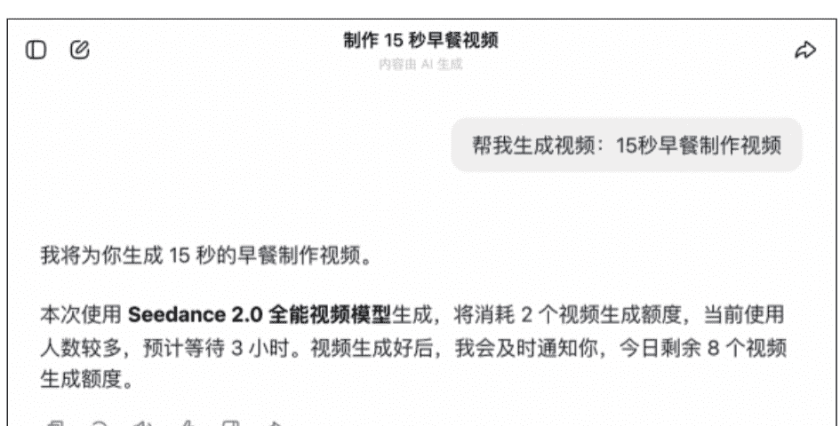

图1-2 使用Seedance 2.0生成视频

- (1) 多镜头切换和运镜：做推、拉、摇、移等专业运镜，镜头连贯、衔接自然。
- (2) 原生音画同步：若生成有交流场景的视频，可实现口型、表情与配音的精准匹配，告别“声画游离”。
- (3) 多模态参考：可上传图片/视频/音频作为参考，生成的视频会参考上传素材的构图、动作、音效等，还原度高。
- (4) 视频编辑+延长：生成后可直接在界面中删减、修改片段，也可单击“延长时长”延长视频，大幅降低废片率。

**分工2：豆包搞定“最费脑子”的前期工作**

在豆包中直接输入精准指令即可解决“不知道剪辑什么、怎么说”的痛点。零基础模板式操作示例如下。

- (1) 写精准文案：在豆包对话框中输入“15秒早餐短视频，温柔治愈风格，适配小红书平台”，一键生成适配的文案。
- (2) 专业配音：将豆包生成的文案复制到剪映，在“朗读”板块中选择音色，然后单击“开始朗读”，如图1-3所示，以生成音频（可直接导出）。用户也可以用Seedance 2.0直接生成配好音的视频。

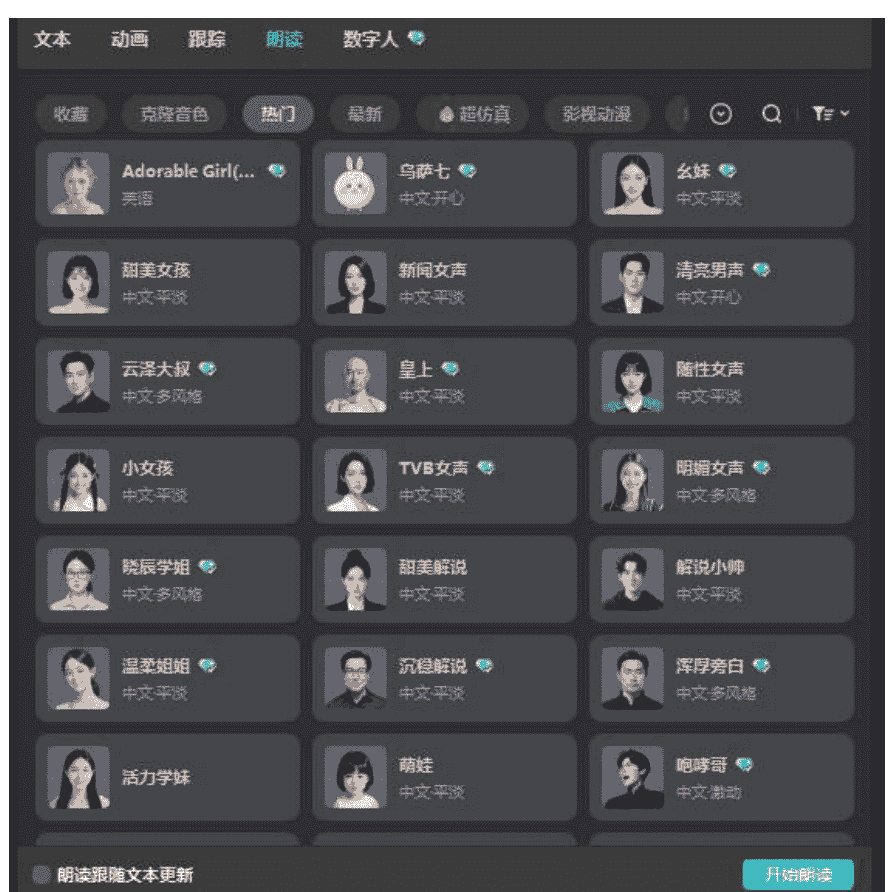

图1-3 剪映“朗读”板块

- (3) 选核心素材：在豆包上传并输入“手机里有10段有关制作早餐的素材，帮我挑3个核心片段（备料、制作、成品）并说明理由”，得到素材筛选建议，不用手动翻找、筛选。

**分工3：剪映搞定“最费时间”的后期工作**

将Seedance 2.0生成的视频片段、豆包生成的文案导入剪映，用AI工具快速优化细节。零基础模板式操作示例如下。

- (1) 防抖+画面优化：选中视频，依次单击剪映工具栏中的“防抖”“画面增强”按钮，解决手机拍摄素材的晃动、模糊问题。
- (2) 调色：选中视频，单击“滤镜”按钮，可直接套用“电影感”“美食暖调”等滤镜，无须手动调节参数，保证全片色调统一。
- (3) 生成字幕：单击剪映工具栏中的“字幕”按钮，选择“自动识别字幕”，识别视频中的声音并生成对应字幕，可直接修改字幕文本的字体、颜色、大小，实现字幕与声音的精准对齐。

### 1.4.3 3个关键技巧：让视频质感翻倍

掌握以下3个关键技巧，不用花很多时间就能轻松提升视频质感。

**1. 色调统一是核心**

- (1) 使用Seedance 2.0生成视频时，在提示词中加上“统一暖色调/冷色调”等相关描述，比如“15秒美食视频，统一暖色调，电影质感”，可以在一开始就定好视频的色调。
- (2) 在剪映中套用对应滤镜，不用手动调节参数，适合新手使用。

**2. 字幕准确、可商用，细节决定质感**

用剪映自动生成字幕后，检查3点：字幕和配音是否一致、字体是否可商用、是否有错别字。

**3. 合适的背景音乐很重要**

- (1) 使用Seedance 2.0生成视频时，在提示词中加上“轻柔的背景音乐”等相关描述，可获得贴合画面节奏的背景音乐。

（2）在剪映中，将背景音乐音量调至20%～30%，人声音量调至70%～80%，确保能听清人声且有氛围感。

（3）优先用剪映中的可商用音乐，避免版权问题。

Seedance 2.0+豆包+剪映，不是让你“精通剪辑”，而是让你能快速出好片、高效变现。普通人不用学专业知识、不用花大量时间练习，用好这3个工具，就能做出“看起来很贵”的视频。AI时代，会用工具比精通技能更重要。

## 1.5 从下载软件到收到第一笔钱，有人只用了72小时

看到这里，你可能还在犯嘀咕：我没有基础，连软件都没打开过，真能靠AI剪辑快速赚钱吗？答案：能！

剪映+豆包+Seedance 2.0可以帮你完成最难的部分，不用学专业剪辑技巧、不用熬夜想文案，跟着步骤走，72小时，你也能从新手变成能接单的“AI剪辑师”。下面结合真实的案例，为你介绍可复刻的流程与关键技巧。

### 1.5.1 新手小刘的变现日记

小刘是一名职场人士，每天只有1～2小时空闲，零基础、无任何剪辑经验，抱着“试试不亏”的心态，靠剪映+豆包+Seedance 2.0，3天赚了200元（接了两单本地美甲店的15秒宣传视频，每单100元），全程仅用手机操作，实际总耗时不到5小时。他的时间规划和具体操作步骤清晰可复刻，零基础读者照做即可。

小刘AI剪辑变现全流程（纯手机操作，无专业设备）

第一天（总耗时1.5小时）：工具下载与熟悉+基础练习

(1) 0.5小时：在手机应用商店下载剪映、豆包App，在豆包内找到并解锁Seedance 2.0，快速熟悉3个工具的核心功能入口（如豆包的文案生成/配音入口、剪映的字幕/滤镜入口、Seedance 2.0的入口）。

(2) 1小时：先用豆包生成简单文案，再在Seedance 2.0中输入“30秒风景视频”生成视频片段，在剪映内完成后期剪辑、调色，练习1～2次，快速掌握“豆包写文案→Seedance 2.0生成画面→剪映出成片”的基础流程。

第二天（总耗时2小时）：线上线下找单+试剪样片

(1) 0.5小时：线上在闲鱼发布接单信息“AI剪辑15～60秒短视频，100元/单，出片快、性价比高，适合小店引流”；线下则在小区楼下的水果店、美甲店、便利店询问商家是否有短视频引流需求，最终接到两家美甲店的15秒美甲款式宣传视频单。

(2) 1.5小时：根据美甲店的需求，用豆包分别写两版宣传文案，用Seedance 2.0结合美甲店提供的美甲款式图片生成视频片段，然后在剪映内完成调色、加字幕、配音等，做出两版样片发给客户确认，均一次性通过。

第三天（总耗时1小时）：轻微调整+交付收款

(1) 0.5小时：根据客户的轻微调整需求（如调整字幕颜色、更换更轻快的背景音乐），在剪映内进行一键修改，快速完成最终版视频。

(2) 0.5小时：将最终版视频通过微信发送给两位客户，客户确认无误后收款200元，完成零基础AI剪辑的首次变现。

### 1.5.2 变现的3个关键点

小刘能快速变现，不是有天赋，而是抓住了3个关键点，你做到了也能成功。

#### 1. 不纠结，先行动

很多人卡在“想”的阶段，纠结“做不好”“接不到单”，可如果连软件都没下载，那么永远也赚不到这份钱。就像做菜，不拿起锅铲就永远学不会。新手不用追求完美，先下载软件，再练习、找单，哪怕第一单不赚钱，也是进步。

#### 2. 找对切口，不贪多

新手别接长视频、复杂特效单，优先选15～60秒的短视频、字幕添加、口播切片等单子，这些单子需求量大、难度低、交付周期短，借助Seedance 2.0的一键生成功能便可快速完成，积累经验和口碑后再接高价单。

#### 3. 借助工具，不硬扛

别只靠自己想文案、手动剪辑、手动加字幕，耗费时间还不一定能做好。把写文案、配音交给豆包完成，把画面优化、快速生成素材交给Seedance 2.0完成，把剪辑、调色、加字幕交给剪映完成，你只负责下达指令+简单微调+交付，效率翻倍，快速变现。

最后提醒，不用严格卡几个小时的时间节点，可以给自己5～10天的适应、练习时间，重点是勇敢迈出第一步。

# 第2章 内容策划不用愁：用豆包搞定选题和脚本

前面讲了AI剪辑的时代红利与变现逻辑，有没有激发出你的赚钱动力？但想让这份动力落地，生成可用于接单的视频，还需要一套高效的内容策划系统。本章就从选题、脚本、优化3个维度，帮你搭建一套用豆包驱动的内容策划流程，彻底摆脱“想不出拍什么、写不出脚本”的困境，让你从“不知道拍什么”到“源源不断地产出内容”。

## 2.1 3秒生成100个爆款选题：打造高点击率选题库

要想短视频成为爆款，选题占70%、剪辑占30%，选对选题就成功了一大半。很多人对着手机发呆一下午，好不容易想出一两个选题但又不确定能不能“火”。其实选题根本不用费心硬想，豆包就是现成的选题“供应商”，只要说清赛道和受众，3秒就能让它生成100个贴合需求、易出爆款的选题，挑一挑、改一改就能直接用。基于此，你还能慢慢建立起自己的专属选题库，再也不愁拍什么。

### 2.1.1 新手需避开的三大“致命坑”

#### 1. 贪多求全，什么都想拍

不要跨赛道，锁定一个细分赛道，只围绕这个赛道做视频。这样不仅能让平台记住你，也能让观众记住你。今天拍美食、明天拍美妆、后天拍搞笑内容，看似选题丰富，实则会让平台不知道该将你推给谁，即平台没法给你精准定位，最后只能给你很少的流量。

#### 2. 选择自我娱乐式选题，只拍自己喜欢的

选题不是拍给自己看的，而是拍给目标观众看的。他们喜欢什么，你就拍什么，这样才能收获更多的流量。所以，选题要以目标观众的喜好为核心，而非自身兴趣；自我娱乐，只发自己喜欢的内容换不来播放量。

#### 3. 盲目追热点，偏离自己的赛道

追热点可以，但一定不要偏离自己的赛道。比如你专注于美食赛道，就拍“用热点背景音乐（BGM）做一道家常菜”，既“蹭”了热点，又没偏离自己的赛道。如果平台上某首歌火了、某个挑战火了，你不管自己的赛道，也跟着拍，看似能“蹭”到一点流量，但拍完之后，观众可能还是记不住你，也不会关注你。所以，追热点需贴合自身赛道内容，不可偏离。

### 2.1.2 用豆包3步生成爆款选题

豆包基础操作提示：打开豆包App/网页版，在首页对话框中直接输入具体需求内容并发送，豆包会自动生成对应内容，无须进行其他复杂操作，所有选题、脚本生成均在对话框中完成。

#### 1. 定规矩，明确需求

用万能指令模板，清晰告知豆包你的细分赛道、目标人群，要求其从痛点解决、实操教程、案例拆解、热点关联4个角度生成100个选题。指令越具体，生成的选题质量越高。

万能指令模板如下：

我是做[你的细分赛道]的，目标观众是[你的目标人群]。

请你围绕我的赛道，从痛点解决、实操教程、案例拆解、热点关联这4个角度，生成100个高点击率选题，要求选题接地气、通俗易懂，适合零基础新手拍摄，不用太复杂，每一个选题都能直接用来拍短视频（15～60秒），避免冷门、自我娱乐式选题。

#### 2. 发指令，生成选题

将指令发给豆包，3～5秒后就能获得分好类、可直接拍摄的100个选题。

#### 3. 筛选和微调，提升点击率

豆包生成的选题已经很不错了，但也可以稍微优化一下，让视频的点击率再提升一个档次，毕竟细节决定成败。这一步很简单，主要做两件事：筛选和微调。

首先，筛选选题。可以从100个选题里，挑出30～50个你觉得最贴合自己赛道、最容易拍摄、目标人群最感兴趣的选题，删掉那些复杂、偏离赛道的选题。比如你要做新手家常菜内容，就删掉那些需要复杂食材、耗时很久的选题，只留简单、接地气的选题——因为你是新手，拍复杂的选题既费时间，又容易失败。

其次，微调标题。给筛选出来的选题加一点“吸睛”小元素，以提升观众的点击欲望。比如在标题里加上“零失败”“30秒”“新手必看”“避坑”这些词，能快速吸引观众的注意力，从而大大提升视频的点击率。

短视频选题优化示例如表2-1所示。

表2-1 短视频选题优化示例

| 豆包生成 | 优化后 |
| --- | --- |
| 做好番茄炒蛋的技巧 | 新手“零失败”番茄炒蛋，30秒学会，再也不“翻车” |
| 快手菜教程 | 10分钟快手菜，不用炒、不用炖，好吃又省事 |

### 2.1.3 进阶技巧：打造专属选题库，再也不用担心没有合适的选题

用上面的方法，你每次都能获得100个选题，筛选和微调后，能得到30～50个可用选题。但如果每次用完就丢，下次再想找选题，又要重新生成，这样既麻烦又浪费时间。所以你可以打造一个“专属选题库”，把好的选题保存起来，需要的时候直接取用，避免“临时抱佛脚”。

打造选题库的方法很简单，步骤如下。

(1) 新建文件夹，命名为“我的爆款选题库”，再按赛道新建子文件夹，比如“新手家常菜-教程类”“新手家常菜-热点类”“新手家常菜-痛点类”，分类存放，方便查找，如图2-1所示。

图2-1 “我的爆款选题库”文件夹

(2) 把优化好的选题以文本文件的形式保存到对应文件夹，并在每个选题后面备注拍摄难度，比如“简单，10分钟拍完”，以便安排拍摄。

(3) 定期更新。建议每周用豆包再生成100个选题，筛选后补充入库。已拍过的选题标注“已拍摄”，避免重复使用。

这里要注意，选题不在多，而在精。平时刷到别人的爆款选题，如果适合自己就对标修改入库，学习借鉴优质的灵感，提升自己账号的质量。

## 2.2 抓住黄金3秒：解析并套用全网高打开率开场模板

现在大家都是利用碎片化时间刷短视频，注意力易分散，平均1～2秒就会划走。平台算法会根据前3秒的留存率，决定是否继续推送流量。所以，视频开场无须铺垫太多或追求完美，核心目的是留住观众；用一句话、一个画面，精准戳中观众的痛点、好奇心或真实需求。爆款开场都有可复制的模板，新手只要学会拆解与套用，再结合自身选题进行修改，也能做出高留存率的视频开场。

### 2.2.1 6个高打开率开场模板

下面介绍的6个模板几乎覆盖了所有短视频赛道，是全网爆款视频最常用的开场形式，每个模板都遵循“简单、直接、有吸引力”的原则。有了这6个模板，你不用设计台词、不用找复杂背景，结合自己的选题稍作修改，就能直接用。

(1) 痛点直击式模板，如表2-2所示。

表2-2 痛点直击式模板

| 模板类型 | 核心句式 | 关键要求 |
| :--- | :--- | :--- |
| 痛点直击式 | 你是不是也 \_\_\_\_\_\_？ 为什么总是做不好 \_\_\_\_\_\_？ 别再 \_\_\_\_\_\_ 了，越做越错 | 仅抓一个核心痛点， 语气亲切、表情真诚 |

这种开场方式的核心逻辑是一开口就说出观众的“烦心事”，让观众觉得“你懂我”，使其产生共鸣，忍不住留下来看你是怎么解决这个问题的。

详细的套用步骤如下，可以一一对照执行：①从你的选题里提炼出目标观众的一个核心痛点；②选一个模板句式，把痛点内容填进去；开场画面与台词匹配，不用复杂背景，对着镜头说话即可，表情真诚一点，语速稍快。

新手在运用时要注意以下问题：①痛点不要太多，一个就够了，多了反而无法突出重点；②语气要亲切，就像在跟朋友对话一样，不要太生硬。

（2）反差惊喜式模板，如表2-3所示。

表2-3 反差惊喜式模板

| 模板类型 | 核心句式 | 关键要求 |
| :--- | :--- | :--- |
| 反差惊喜式 | 我以为____，结果只花____钱，做出____的效果！ 没做之前____，做完之后直接____ | 前后对比以营造反差，引起观众好奇 |

这种开场方式的核心逻辑是用“前后对比”营造反差，打破观众的固有认知，让观众产生“哇，这么神奇？”的好奇心，忍不住留下来看完所有内容。

详细的套用步骤如下，可以一一对照执行：①确定你的内容核心亮点，找到对应的前后反差点；②选一个模板句式，把反差内容填进去；③3秒内说完台词；开场画面很关键，一定要有对比画面，前两秒拍差的一面，后一秒拍好的一面，然后在剪映里直接拼接起来。

新手在运用时要注意以下问题：反差一定要明显，语速要稍快，结尾可以带一点惊讶的语气，以吸引观众。

(3) 福利引诱式模板，如表2-4所示。

表2-4 福利引诱式模板

| 模板类型 | 核心句式 | 关键要求 |
| :--- | :--- | :--- |
| 福利引诱式 | 免费分享 ______，看完就能用！ 不用花钱，就能 ______！ 最后有福利，______ 免费送 | 福利真实、与赛道内容相关， 不“画大饼” |

这种开场方式的核心逻辑是一开口就给告诉观众看完这个视频能得到什么，比如免费教程、避坑技巧、省钱方法，让观众觉得留下来有好处，从而主动看完视频。

详细的套用步骤如下，可以一一对照执行：①从你的选题里提炼出能给观众的福利（如教程、技巧、资料、省钱方法等），福利要和赛道内容相关；②选一个模板句式，把福利内容填进去，3秒内说完台词，直接告诉观众“能得到什么”；③开场画面很关键，对着镜头展示福利相关物品/画面（如教做菜就展示成品、教技巧就展示实操画面），不用复杂背景，让观众直观看到福利内容。

新手在运用时要注意以下问题：①福利一定要真实，不“画大饼”（比如承诺“免费分享教程”，就一定要分享）；②福利要和赛道内容高度相关，不要为了引流而放无关福利，避免丢失目标观众；③语速稍快，语气亲切，像给朋友分享好东西一样。

(4) 疑问悬念式模板，如表2-5所示。

表2-5 疑问悬念式模板

| 模板类型 | 核心句式 | 关键要求 |
| :--- | :--- | :--- |
| 疑问悬念式 | 为什么____的人，都能______？ 你知道____吗？90%的人都不知道！ 如果______，你会怎么做 | 提出问题，制造悬念 |

这种开场方式的核心逻辑是一开口就提出一个让观众好奇的问题，制造悬念，让观众觉得“我想知道答案是什么”，进而忍不住留下来看你解答。

详细的套用步骤如下，可以一一对照执行：①结合你的选题，提出一个观众好奇、想知道答案的问题，不要提太冷门、太专业的问题；②选一个模板句式，把问题填进去，3秒内说完，语气中可以带一点神秘感，以引起观众好奇；③在开场画面中，可以对着镜头皱眉或做出疑惑的表情，或者拍一个和问题相关的画面，增强观众的代入感。

新手在运用时要注意以下问题：①问题不要太复杂，一句话说清楚最好；②后续内容一定要解答这个问题，不要只制造悬念，不给出答案，这样会让观众反感。

（5）指令行动式模板，如表2-6所示。

表2-6 指令行动式模板

| 模板类型 | 核心句式 | 关键要求 |
| :--- | :--- | :--- |
| 指令行动式 | 立刻暂停视频，跟着我做，先点赞收藏，不然______ | 给出明确指令，引导观众参与 |

这种开场方式的核心逻辑是一开口就给观众明确的指令，让观众跟着你的指令走，比如暂停视频、点赞收藏、跟着做，让观众主动参与进来，从而提高视频打开率。

详细的套用步骤如下，可以一一对照执行：①确定你的内容核心，明确你想让观众做什么，是收藏、点赞还是跟着做；②选一个模板句式，把指令填进去，3秒内说完，语气要坚定、亲切，不要太生硬；③在开场画面中对着镜头，用手势配合指令内容，让观众更有代入感，愿意跟着你做。

新手在运用时要注意以下问题：①指令不要太多，一个指令就够了，多了会让观众感到混乱；②语气不要太强势，就像提醒朋友一样，这样更易被接受。

（6）热点联动式模板，如表2-7所示。

表2-7 热点联动式模板

| 模板类型 | 核心句式 | 关键要求 |
| :--- | :--- | :--- |
| 热点联动式 | 最近很火的___，我也来试试！ 用___（热点背景音乐），做一道___ 别人都在___，我偏要___ | 结合相关热点， 贴合潮流 |

这种开场方式的核心逻辑是结合当下热门的背景音乐或热门话题，让观众觉得“这个视频很新潮”，从而主动点开观看。

详细的套用步骤如下，可以一一对照执行：①打开短视频平台，找到当下和你的赛道内容相关的热门背景音乐、热门话题；②选一个模板句式，把热点填进去，结合自己的选题3秒内说完；③拍一个和热点相关的简单画面，比如热门挑战的标志性动作。

新手在运用时要注意以下问题：①不要盲目蹭热点，一定要结合自己的赛道，如你做美食就蹭美食相关的热点，不要蹭美妆、游戏的热点，不然会吸引非目标观众；②蹭热点要及时，不要等热点过了再蹭，这样效果会不尽如人意。

### 2.2.2 新手必看：实用开场技巧

6个模板不用全部掌握，结合自己的赛道和选题，每个模板试拍1～2个视频，根据前3秒留存率选出1～2个模板，然后固定使用以稳步提升留存率。

查看视频前3秒留存率的方法很简单，跟着以下步骤操作，能快速看懂数据并改进。

(1) 将试拍的视频发布到短视频平台（如抖音、小红书等），发布后等待1～2小时（确保有基础播放量）。
(2) 打开平台创作者后台（抖音为“创作者中心→数据中心→视频数据”，小红书为“创作者中心→作品分析”）。
(3) 找到对应视频的数据详情，查看“前3秒留存率”指标，留存率越高（一般≥40%为合格），说明开场越吸引观众。
(4) 优先选择留存率最高的1～2个开场模板，后续可以持续套用。

只要套用这6个模板，结合自己的选题稍作修改，就能做出有吸引力的开场，轻松留住观众，让视频的播放量不断增加。

## 2.3 从文字到画面：快速生成保姆级分镜脚本

很多新手觉得分镜脚本是专业导演的专属，复杂难学，其实新手做短视频，根本不用追求专业分镜脚本，只要实用、好懂、能直接照着拍就行了。分镜脚本就像做饭的菜谱，写清每一步的操作和要求，跟着拍就能拍出条理清晰的视频，节省剪辑时间，助力实现3分钟出片。

### 2.3.1 分镜脚本不用太复杂，有4个核心要素就行

新手做15～60秒的短视频时，不用画图、不用专业的镜头术语，只要包含4个核心要素，明确拍什么、怎么拍、说什么、拍多久，就能写出好用的分镜脚本。分镜脚本核心要素及说明如表2-8所示。

表2-8 分镜脚本核心要素及说明

| 核心要素 | 具体说明 |
| :--- | :--- |
| 镜头序号 | 用 1、2、3、4 等数字标注拍摄顺序，避免混乱，同时能保证剪辑素材有序排列。示例：番茄炒蛋教程的拍摄可分为镜头 1 开场、镜头 2 备料、镜头 3 操作、镜头 4 成品展示 |
| 画面内容 | 最核心的要素，用大白话进行具体描述，杜绝笼统表述。错误示例：拍食材。正确示例：镜头对准桌面，拍整齐摆放的两个番茄、两个鸡蛋，描述越具体，拍摄越省心 |
| 台词音效 | 明确镜头内的台词及适配的音效（如水流声、翻炒声、热门背景音乐等），避免忘词、冷场；台词自然、流畅，音效贴合画面，可全程配上背景音乐以提升氛围感 |
| 镜头时长 | 单个镜头控制在 1～10 秒，其中开场镜头≤3 秒，核心操作镜头 5～8 秒，结尾镜头 2～3 秒，视频总时长不超过 60 秒。示例：镜头 1（3 秒）+镜头 2（5 秒）+镜头 3（4 秒）+镜头 4（8 秒）+镜头 5（3 秒），总时长 23 秒，符合短视频节奏 |

### 2.3.2 用豆包3分钟生成保姆级分镜脚本

把选题、开场台词、视频时长告诉豆包，让它按4个核心要素自动生成分镜脚本，再对生成结果稍作修改即可使用。以“美食赛道，新手、‘零失败’番茄炒蛋”为案例，步骤如下。

（1）准备3个核心信息，如表2-9所示。

表2-9 分镜脚本的3个核心信息

### 2.3.3 进阶技巧：分镜脚本套用+避坑指南

在脚本创作中，你可以采用“同赛道脚本结构复用”的高效技巧：保持爆款脚本的整体框架不变，仅替换画面内容与台词，一分钟就能生成全新脚本。同时要注意避坑：应全程使用大白话，避免使用专业术语；画面描述要具体、可执行；开场必须控制在3秒内；按镜头序号拍摄，确保流程清晰；不过分追求完美，只要画面清晰、台词自然即可。此外，还可以通过3个小技巧提升效率：在脚本中标明有关道具的备注信息，开拍前备齐所有道具；开拍前通读台词，避免拍摄时忘词；将脚本存在手机里，边拍边看，防止错拍、漏拍。

## 2.4 告别平铺直叙：优化脚本详略与情绪起伏

就像讲故事，绘声绘色才能吸引人，而平淡无味就会让人犯困。本节将找准脚本平淡的根源，教大家详略优化、烘托情绪的实操技巧，让零基础的读者能直接上手操作。

### 2.4.1 脚本平铺直叙的两个核心原因

在脚本创作中，造成脚本平铺直叙的核心原因有两个。

#### 1. 详略不分，没有重点

有些创作者往往在无关紧要的铺垫和细节上耗费过多时间，忽略了核心信息、钩子和关键剧情的呈现，导致观众在关键节点流失，整体节奏拖沓，影响视频的吸引力与传播效果。

把每个环节都当重点，拍得一样长。比如拍番茄炒蛋教程时，洗番茄、磕鸡蛋和翻炒步骤均拍5秒，导致没能突出观众最关心的零失败技巧，不重要的操作却占了大部分时间，自然留不住观众。短视频的最佳时长是15～60秒，必须把时间优先留给核心干货，简单环节用1～2秒带过即可。

#### 2. 情绪扁平、没有波澜

全程语气平淡，或情绪与内容不符，比如拍痛点问题时用表达开心的情绪，让观众没有代入感。短视频的情绪起伏不用太多，遵循“开场勾情绪→中间传干货→结尾升情绪”的逻辑就能抓住观众。

### 2.4.2 详略优化，把时间留给核心内容

首先，要分清视频中的核心内容与非核心内容，突出重点、精简次要信息，让脚本节奏更清晰。

- （1）核心内容必详拍：观众最关心的干货必须详细拍摄，比如美妆教程中的上妆步骤和前后对比。
- （2）非核心内容简拍：辅助环节，比如洗食材、打开App、整理桌面等，尽量简拍，不影响核心内容的呈现。

其次，要明确详拍与简拍的标准。

- （1）核心内容：5～10秒，拍清细节画面，台词是明确的干货信息。
- （2）非核心内容：1～2秒，快速带过，台词可省略或用一句话带过。

最后，借助豆包进行快速优化，让脚本节奏更合理、表达更精准。

豆包详略优化完整指令示例如下。

我有一个美食赛道的有关“新手零失败番茄炒蛋”的分镜脚本（复制原25秒的脚本）。

请优化详略：

核心内容（鸡蛋翻炒定型、番茄炒出汁）详拍，占总时长的60%～70%，5～10秒，画面台词详细；

非核心内容（食材摆放、成品展示）简拍，1～2秒，快速带过；

总时长25秒，不改变核心步骤，不用专业术语，适合新手。

番茄炒蛋脚本详略优化前后对比如表2-11所示。

#### 表2-11 番茄炒蛋脚本详略优化前后对比

| 优化维度 | 优化前（镜头 4/5/2/6） | 优化后（镜头 4/5/2/6） |
| :--- | :--- | :--- |
| 核心内容——鸡蛋翻炒定型 | 镜头 4，5 秒，台词简单 | 镜头 4，7 秒，台词：油六成热下鸡蛋，快速划散，翻炒定型后立马盛出，这是不糊的关键 |
| 核心内容——番茄炒出汁 | 镜头 5，5 秒，台词简单 | 镜头 5，8 秒，台词：锅中留底油炒番茄，用铲子压一压，炒出浓郁的番茄汁，再加鸡蛋翻匀，加盐调味 |
| 非核心内容——食材摆放 | 镜头 2，5 秒 | 镜头 2，2 秒，无台词 |
| 非核心内容——成品展示 | 镜头 6，3 秒 | 镜头 6，1 秒，台词：搞定 |
| 优化后总时长：3+2+4+7+8+1=25（秒）（核心内容占 15 秒，达 60%，符合要求） | | |

### 2.4.3 三段式情绪模板，让观众跟着节奏走

下面介绍的这套三段式情绪模板，是零基础创作者也能直接套用的短视频表达框架。开场以勾住情绪为核心，可采用引起共鸣、制造惊讶或设置悬念的方式，搭配稍快且富有起伏的语速，快速抓住观众注意力；中间部分聚焦传递干货内容，保持认真、真诚的情绪状态，讲到重点内容时放慢语速、加重语气，强化观众记忆点；结尾负责拉升情绪，通过暖心鼓励、发放福利或留下悬念的方式，用亲切且富有感染力的语气，加深观众印象并引导互动。

使用这个模板并放入自己的脚本，就能快速生成情绪饱满、节奏流畅、更易留住观众的优质脚本。

请优化美食赛道“新手零失败番茄炒蛋”的分镜脚本（复制详略优化后的25秒脚本），遵循“开场勾情绪→中间传干货→结尾升情绪”的原则：

- 1. 开场情绪“引起共鸣”，语气亲切，语速稍快；
- 2. 中间情绪“认真、真诚”，重点内容加重语气；
- 3. 结尾情绪“鼓励”，语气亲切且富有感染力；
- 4. 不改变详略和核心结构，台词通俗易懂。

番茄炒蛋脚本情绪优化后的核心台词如表2-12所示。

#### 表2-12 番茄炒蛋脚本情绪优化后的核心台词

| 镜头序号 | 优化后的情绪化台词 | 情绪/语气要求 |
| :--- | :--- | :--- |
| 1 | 宝子们，做番茄炒蛋是不是总踩坑？要么蛋糊成渣，要么煮出一大锅汤，真是太气人了 | 开场：吐槽以引起共鸣，语速稍快，就像在和朋友吐槽一样 |
| 4 | 重点来了！油六成热下鸡蛋，快速划散，翻炒定型后立马盛出，这是鸡蛋不糊的关键，一定要记牢 | 中间：认真、真诚，“重点来了”“一定要记牢”加重语气 |
| 5 | 锅中留底油炒番茄，用铲子压一压，炒出浓郁的番茄汁，再加鸡蛋翻匀，盐加一点就好，新手也能一次成 | 中间：认真、真诚，“盐加一点就好”轻声提醒 |
| 6 | 超简单的零失败番茄炒蛋就做好了，学会的宝子赶紧点赞收藏，快去试试，并在评论区告诉我你的成果 | 结尾：鼓励互动，语气亲切，带邀请感 |

# 第3章 建立智能素材库：独家视听元素与文案

素材是短视频的核心，优质的素材能让剪辑工作事半功倍。而传统素材积累模式存在三大痛点：优质无版权风险素材难找、素材分类混乱且难以复用、文案与素材适配度低。借助豆包+剪映+Seedance 2.0，你可以打造一套“智能生成+精准筛选+高效管理”的素材库体系，从此告别素材焦虑，实现快速调用、高效创作。

## 3.1 一键生成精准文案：口播/带货/情感三大场景实战

文案是短视频的灵魂，无论是口播视频的台词、带货视频的卖点提炼，还是情感视频的氛围感文案，都将直接影响观众的停留时间与视频的转化率。但普通人写文案时易陷入“词穷”“抓不住重点”“风格不统一”的困境，豆包可针对不同场景快速生成精准文案，且完美适配Seedance 2.0生成视频的节奏与叙事逻辑，实现文案与画面的高度契合。

### 3.1.1 口播类文案：自然流畅，贴合表达习惯

口播类文案的核心在于“口语化、有逻辑、不生硬”，尤其适合知识科普与个人分享类短视频。口播类文案关键是要避免书面表达，让台词如聊天般自然，同时兼顾信息密度与节奏，以便完美适配Seedance 2.0的多镜头叙事要求。

#### 1. 核心生成逻辑

要想利用豆包生成高质量口播类文案，需遵循以下三大核心生成逻辑。

- (1) 明确人设与场景：告知豆包你的人设（如“职场资深导师”“搞笑博主”）、视频主题与时长，确保文案风格统一。
- (2) 强化逻辑结构：采用“痛点引入→核心观点阐述→案例支撑→总结升华”的结构，每30秒设置一个小亮点，避免观众划走，同时适配Seedance 2.0的镜头切换频率。
- (3) 预留停顿与互动时间：在关键信息后标注停顿与互动时间，适当加入反问、设问，增强与观众的互动感，为Seedance 2.0生成运镜和情绪镜头预留空间。

#### 2. 提示词模板

结合口播类文案的核心生成逻辑，打造标准化的提示词模板，能让豆包精准捕捉你的创作需求。以下为适配多场景的口播类文案提示词模板，可根据实际创作主题与人设灵活调整。

我是一名[职场资深导师]，要做一条3分钟的口播短视频，主题是“职场新人高效汇报工作的3个技巧”。请生成口语化文案，要求：1.开头3秒用痛点引入主题内容；2.每个技巧配一个具体案例；3.表述简洁、直白，避免使用专业术语；4.在需要停顿的地方进行标注，如“[停顿2秒]”，结尾加入互动提问；5.适配Seedance 2.0的多镜头生成逻辑，每段文案对应一个独立镜头场景。

#### 3. 实战案例

按照上述核心生成逻辑与提示词模板，向豆包中发送创作需求后，可获得贴合短视频传播节奏的口播类文案。以下为职场干货类口播文案的节选内容，能清晰看出文案的结构设计与细节处理。

> 有没有职场新人跟我一样，第一次给领导汇报工作时紧张到语无伦次，说了10分钟还没讲到重点？[停顿2秒]
>
> 其实汇报工作不用慌，掌握3个技巧就能让领导对你刮目相看！
>
> 第一个技巧：结论先行。很多人汇报工作喜欢铺垫很久，导致领导没耐心听下去。上次我带的实习生，汇报时先直接说“这次项目提前3天完成，成本节省15%”，领导一下子就来了兴趣。[停顿1秒]记住，领导最关心的是结果，再补充过程细节会让汇报工作更高效……
>
> 最后想问大家，你汇报工作时最头疼的是什么？评论区告诉我！

### 3.1.2 带货类文案：直击痛点，激发购买欲望

带货类文案的核心是戳中痛点、突出卖点、降低决策门槛。不管是卖美妆护肤品、家居好物还是食品，都得让观众快速感知产品价值，再用优惠和“手慢无”等词引导他们即时下单。同时，文案需要明确产品核心卖点与使用场景，为Seedance 2.0生成产品展示镜头提供清晰指令。

#### 1. 核心生成逻辑

想让豆包写出高转化率的带货类文案，记住以下3个核心生成逻辑即可。

- (1) 痛点具象化：把观众痛点转化为具体的场景描述，让观众有代入感，为Seedance 2.0生成场景化镜头提供依据。
- (2) 卖点可视化：不用抽象形容词（如“好用”“划算”），而是用数据、效果、具象化的使用场景等，方便Seedance 2.0精准还原产品优势。
- (3) 营造紧迫感：加入限时福利、名额有限等信息，推动观众立即行动，同时适配短视频的快节奏转化逻辑。

#### 2. 提示词模板

结合带货类文案的核心生成逻辑，明确产品信息、目标人群、创作要求与视频适配性，打造标准化的提示词模板，能让豆包精准生成具有高转化率的带货类文案。模板示例如下。

为一款[家用迷你破壁机]生成带货文案，时长控制在1分钟内。核心卖点：体积小不占地、功能多（打豆浆/米糊/果汁/辅食）、噪声小、易清洗。目标人群：租房住的年轻人、宝妈。要求：1.开头用场景痛点引入主题内容；2.为每个卖点配上具体使用场景；3.结尾给出限时优惠以引导下单；4.表述活泼、有感染力；5.标注产品展示重点，以适配Seedance 2.0产品特写镜头生成需求。

#### 3. 实战案例

以家用迷你破壁机为创作主题，按照上述核心生成逻辑与提示词模板向豆包发送需求后，可获得极具吸引力的带货文案。以下为节选内容，能清晰看到文案如何戳中观众痛点、展现卖点并引导转化。

> 租房党哭死！厨房太小，大破壁机根本放不下，想喝杯豆浆都要跑到楼下买！[停顿1秒]
>
> 这款迷你破壁机简直是小户型“救星”！放在橱柜里不占地。[停顿1秒] (Seedance 2.0重点：产品与橱柜的对比特写，突出其小巧)
>
> 有了它，早上用7分钟就能打出细腻的豆浆，不用过滤；晚上给宝宝做辅食，米糊、果泥一键搞定；周末还能做鲜榨果汁，直接省了买辅食机、榨汁机的钱。[停顿1秒] (Seedance 2.0重点：分镜头展示不同功能的操作过程)
>
> 关键是噪声很小，早上用也完全不用担心会吵醒室友；用完冲一冲就干净了，方便又省事！
>
> 今天直播间专属价99元，前50名下单观众送定制杯刷+食谱，库存不多，点击小黄车链接直接购买！

### 3.1.3 情感类文案：营造氛围，引发情感共鸣

要想让豆包生成的情感类文案具备足够强的感染力，需遵循聚焦细节与情绪核心生成逻辑，用文字营造画面、传递真情。

#### 1. 核心生成逻辑

想让豆包写出引发共鸣的文案，记住以下3个核心生成逻辑。

- 1. 聚焦具体场景：用“时间+地点+动作”的细节描述营造画面感，为Seedance 2.0生成场景镜头提供明确依据。
- 2. 传递真实情绪：不刻意煽情，通过朴素的语言表达真挚情感（如喜悦、遗憾、感动），适配Seedance 2.0的氛围营造等能力。
- 3. 结尾升华主题：结合场景提炼核心观点，引发观众思考与分享，让Seedance 2.0的收尾镜头更有深度。

#### 2. 提示词模板

结合情感类文案的核心生成逻辑，围绕创作主题、氛围要求与视频适配性设计提示词模板，能让豆包精准捕捉情感表达需求，从而生成高质量的文案。以下为怀旧类情感Vlog文案的提示词模板，可根据创作主题灵活调整。

生成一条1分钟情感Vlog的文案，主题是“毕业3年后重回校园”。要求：1.用细节描述（如对食堂、操场、教室等场景的描述）营造怀旧氛围；2.表述温柔、细腻，避免使用华丽辞藻；3.结尾升华到“青春不散场，初心不改变”的主题；4.适配慢节奏镜头切换需求，预留画面描述空间；5.标注情绪重点，适配Seedance 2.0光影氛围与运镜生成需求。

#### 3. 实战案例

以“毕业3年后重回校园”为创作主题，按照上述核心生成逻辑与提示词模板向豆包发送需求后，可获得充满氛围感的情感Vlog文案。以下为节选内容，能清晰看到文案的细节描写与情绪表达。

> 毕业3年，终于回到了熟悉的校园。[停顿1秒]（Seedance 2.0重点：慢镜头展示校园大门，暖调光影）
>
> 食堂的阿姨还记得我爱吃少辣的麻辣香锅，操场的跑道还是原来的红色，就连教室后排靠窗位置的桌子还是缺了一个小角。[停顿2秒]（Seedance 2.0重点：依次特写食堂窗口、跑道、教室后排靠窗位置的桌子）
>
> 曾经在这里熬夜复习、和朋友嬉笑打闹的回忆，一下子涌入脑海。原来最怀念的不是校园本身，而是那些度过的时光。[停顿1秒]（Seedance 2.0重点：叠加模糊回忆镜头，缓慢运镜）
>
> 青春或许会落幕，但那些温暖的回忆、并肩前行的勇气，会一直陪伴我们。愿我们都能带着在校园里的那份初心，在各自的人生里闪闪发光。

### 3.1.4 文案优化技巧：让AI生成的文案更有“温度”

让AI生成的文案更有“温度”的核心优化逻辑是，从内容、表达与视频适配3个维度进行调整，具体包括加入个人经历、调整语气词以及适配视频节奏。这样做既能保证文案的信息密度与转化效率，又能融入个人情感特色，同时完美契合视频的呈现节奏。

#### 1. 加入个人经历

在文案中融入自己的真实故事或感受，让内容更独特，为 Seedance 2.0生成个性化镜头提供依据。

#### 2. 调整语气词

根据人设加入“呀”“呢”“啦”“哦”等语气词，同时搭配“说实话”“讲真话”等口语化表达，增强亲近感，让Seedance 2.0生成的人物互动更自然。

#### 3. 适配视频节奏

根据Seedance 2.0的镜头切换特性，删减或补充文案，确保台词与画面同步，为重点场景标注镜头需求。

此优化逻辑适用于口播、带货、情感类的文案，灵活运用这些技巧，能让文案摆脱“AI感”，更生动且更贴合短视频的创作与传播需求。

## 3.2 无版权风险素材智造：豆包+即梦AI生成专属背景图

在短视频创作中，精美的视觉素材是提升视频质感的关键，仅凭单一图片素材难以满足多元化的创作需求。借助豆包的精准拆解需求+即梦AI的图片生成功能，可一站式打造无版权风险、高适配的全品类图片素材，为视频创作提供丰富的视觉支持。

### 3.2.1 即梦AI背景图生成：精准匹配主题与风格，筑牢静态视觉底座

背景图常用于视频封面、口播背景、转场画面、字幕配图等，核心要求是风格统一、不喧宾夺主、贴合主题。根据豆包撰写的精准提示词，即梦AI可快速生成高清、合规、风格匹配的背景图，有效解决传统找图方式中的画质差、版权受限和不符合主题等问题。

#### 1. 背景图的核心生成逻辑

即梦AI背景图的核心生成逻辑有以下3个。

- （1）明确使用属性：告知豆包背景图的用途、尺寸、使用平台，确保其适配短视频创作与发布需求，如竖屏9：16的抖音口播背景、3：4的小红书封面图。
- （2）细化视觉要素：指定风格、核心元素、主题色、画面质感等，避免生成结果偏离预期，如“莫兰迪色系简约风”“赛博朋克科技风”；明确核心元素的摆放位置与画面占比。
- （3）强调版权与画质：在提示词中明确要求生成1080P以上的高清画质，并标注“无版权可商用”。

#### 2. 提示词模板

结合背景图的核心生成逻辑，针对不同创作场景设计提示词模板，能清晰传递创作要求，让即梦AI生成的背景图精准匹配视频主题与风格。以下为两大高频场景的模板示例，可根据实际需求灵活调整。

**模板1：职场干货视频口播背景图**

生成一张短视频口播背景图。用途：职场干货视频口播背景。比例：竖屏9：16。风格：简约商务风。核心元素：银色笔记本电脑、金属材质的钢笔、浅蓝色文件夹、简约线条图表。主题色：浅蓝色+白色+浅灰色。要求：画面干净不杂乱，左侧留白60%（人物出镜区域），高清2K，无版权可商用，低饱和度不刺眼。

**模板2：家电带货视频封面图**

生成一张短视频封面图。用途：家用小电器带货视频封面。比例：3：4。使用平台：小红书。风格：清新治愈生活风。核心元素：白色迷你破壁机、装了豆浆的玻璃杯、黄色小雏菊、木质桌面。主题色：米白色+浅黄色+淡绿色。要求：画面层次感强，产品居中突出，高清2K，无版权可商用，符合小红书平台用户的视觉审美要求。

## 3.实战案例

结合上述核心生成逻辑与提示词模板，在即梦AI中生成背景图的操作流程如下，按流程操作可高效获得符合需求的无版权风险背景图。

（1）打开即梦AI网页版，登录后选择“灵感”→“图片生成”，将豆包生成的提示词复制至输入框，如图3-1所示。

（2）在即梦AI中选择分辨率（高清2K）、生成数量（2～4张），发送提示词，等待10～20秒即可获得多张背景图，如图3-2所示。

筛选最优图片，单击“下载”按钮将其保存至本地，如图3-3所示。若对结果不满意，可通过豆包微调提示词（如修改主题色、增减元素），然后让即梦AI重新生成背景图，直至符合需求。

图3-2 即梦AI生成背景图

图3-3 筛选最优图片并下载保存

这一操作流程能快速解决传统找图过程中的各类痛点问题，让AI工具按需生成专属背景图，为短视频筑牢贴合内容场景的静态视觉底座。

### 3.2.2 即梦AI场景图生成：打造沉浸式静态画面，适配多元化的创作场景

场景图适用于情感Vlog、故事插帧、产品展示及字幕背景等，核心在于营造故事感、丰富细节并契合文案氛围。借助豆包对细节的精准描述，即梦AI能生成极具画面感的场景图，将观众快速代入情境，并与Seedance 2.0的动态视频形成互补，丰富素材表现。

### 1.场景图的核心生成逻辑

即梦AI场景图的核心生成逻辑围绕画面适配、风格统一、提升效率展开，具体包括画面留白适配、风格参数复用以及多版筛选优化。遵循这3个要点能让生成的场景图贴合创作与使用需求，同时保证账号视觉风格的一致性，缩短素材生成时间。

- 1. 画面留白适配：生成口播、字幕用图时，在提示词中标注“留白区域”，避免后续添加人物、文字时遮挡核心元素。
- 2. 风格参数复用：将符合账号定位的风格参数（如“莫兰迪色系+低饱和度”“清新治愈生活风+暖调光影”）固定并保存，后续生成素材时直接复用，保证账号视觉风格统一。
- 3. 多版筛选优化：每次生成2～4版素材，筛选出画面构图、元素呈现效果最优的版本。若单版素材有局部瑕疵，可通过即梦AI的“局部重绘”功能进行修改，无须重新生成，如图3-4所示。

图3-4 对图片进行局部重绘

### 2.提示词模板

结合场景图核心生成逻辑，针对不同创作场景设计提示词模板，能让豆包精准描述场景细节，从而让即梦AI生成的画面完美契合文案氛围。以下为两大高频场景的模板示例，可灵活调整。

**模板1：情感Vlog怀旧场景图**

生成一张情感Vlog怀旧场景图。主题：毕业多年后重回校园的教室场景。风格：暖调怀旧风。核心元素：木质课桌椅、摊开的语文课本、窗台上的多肉植物、阳光斜射投下的光斑、黑板上的粉笔字。色调：暖黄色+浅棕色+米白色。要求：画面细腻且有颗粒感，质感像老照片，高清1080P，无版权可商用，竖屏9：16。

**模板2：家居好物使用场景图**

生成一张家居好物使用场景图。主题：小户型厨房中的早餐制作场景。风格：清新治愈生活风。核心元素：白色迷你破壁机、吐司、煎蛋、牛奶杯、厨房窗台上的绿植、晨光。色调：奶白色+浅橙色+淡绿色。要求：画面温馨、有生活气息，突出产品与场景的融合，高清1080P，可商用，竖屏9：16。

### 3.2.3 Seedance 2.0+即梦AI素材联动：打造完整视听素材体系

单一图片难以支撑短视频的动态叙事需求，而将Seedance 2.0的视频生成功能与即梦AI的图片生成功能结合，可实现“静态做基底、动态讲故事”的高效联动。这种模式让素材库兼具“静态视觉”与“动态视听”双重属性，完美适配口播、带货及情感类等多种创作场景。

### 1.核心联动逻辑

Seedance 2.0与即梦AI的核心联动逻辑包括同提示词跨工具生成、场景互补使用以及素材二次融合，3个要点层层递进，实现静态素材与动态素材的无缝衔接，让短视频的画面层次更丰富、叙事能力更强。

- （1）同提示词跨工具生成：用豆包生成统一的核心提示词，稍作调整后分别适配即梦AI和Seedance 2.0，实现同一主题、同一风格的图片和视频素材生成，保证视频视觉风格的高度统一。
- （2）场景互补使用：即梦AI生成的静态图片用于封面、口播背景、转场插帧，Seedance 2.0生成的动态视频用于场景叙事、产品展示、氛围营造，二者结合可丰富视频画面的层次。
- （3）素材二次融合：将即梦AI生成的图片导入剪映，作为Seedance 2.0生成视频的画中画背景、片头/片尾底图等，实现静态素材与动态素材的无缝融合。

### 2.豆包统一提示词模板

以“雨天居家阅读”的情感Vlog场景为例，结合核心联动逻辑打造跨工具统一提示词模板，能保证生成的静态图片与动态视频的风格、核心元素高度统一。模板内容如下。

**（1）静态场景图**

生成一张情感Vlog场景图。主题：雨天居家阅读。风格：温暖治愈风。核心元素：窗边的米色沙发、暖光灯、打开的图书、冒着热气的咖啡、雨滴打在玻璃窗上的痕迹。色调：暖黄色+浅灰色+奶白色。要求：画面细腻有质感，高清1080P，无版权可商用，竖屏9：16，左侧留白充足。

**（2）动态场景视频**

生成情感Vlog场景视频素材。主题：雨天居家阅读。风格：温暖治愈风。核心元素：窗边的米色沙发、暖光灯、打开的图书、冒着热气的咖啡、雨滴打在玻璃窗上的痕迹。运镜要求：慢镜头拍摄雨滴滑落、推镜头聚焦图书、轻微环绕镜头展示整体场景。色调：暖黄色+浅灰色+奶白色。参数：1080P高清，无版权可商用，时长为20秒，音频包含轻柔的雨声与翻书声，竖屏9：16。

### 3.操作步骤

有了统一的提示词模板后，进行简单操作，即可完成静态图片与动态视频的联动生成与使用，实现两大素材的完美融合，为短视频打造完整的视听体系。具体操作步骤如下。

- 1. 打开豆包，输入核心主题需求，生成上述适配提示词。
- 2. 打开即梦AI，复制图片版提示词，生成并下载静态场景图，作为视频封面/口播背景。
- 3. 找到豆包内的Seedance 2.0功能入口（见图3-5），复制视频版提示词，生成并下载动态场景视频，作为视频核心叙事素材。
- 4. 打开剪映，将Seedance 2.0生成的动态场景视频导入（见图3-6），将即梦AI生成的静态场景图设置为视频封面或口播片段的画中画背景，实现静态素材与动态素材的联动使用。

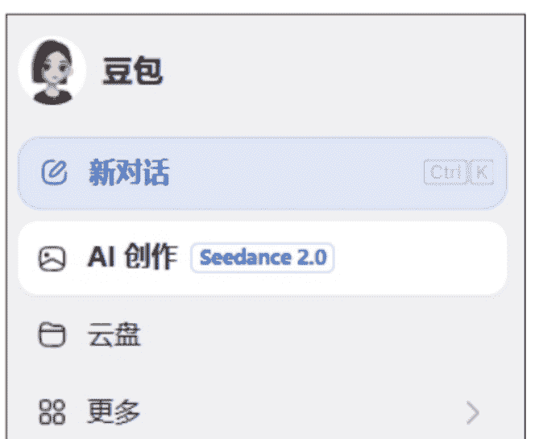

图3-5 豆包内的Seedance 2.0功能入口

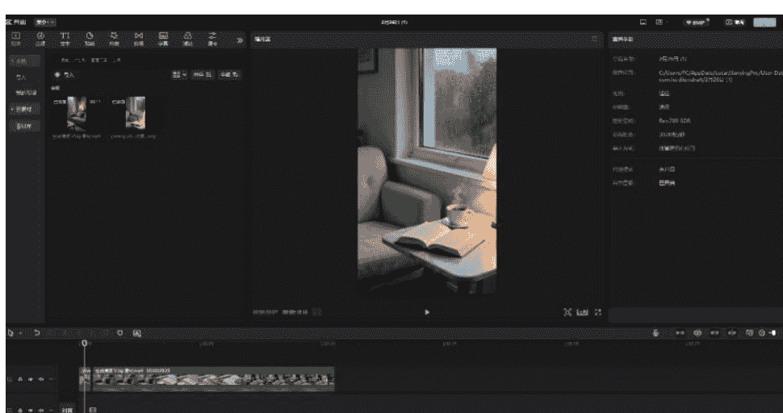

图3-6 导入素材

这一操作流程实现了“描述一次创作需求，高效生成两种素材”，大幅提升了短视频的创作效率与画面质感。

## 3.3 AI智能初筛口播素材：剪映“AI剪口播”剔除无效片段

口播类视频（如知识分享、带货讲解、职场干货分享）的素材筛选，核心痛点在于存在大量无效片段——语气词、重复句、空白停顿、口误等，手动逐段剪辑耗时耗力。而剪映的“AI剪口播”功能可自动识别并标记这些无效片段，快速完成初筛，大幅提升剪辑效率。

图3-7 剪映“AI剪口播”功能入口

### 1.功能入口

剪映的“AI剪口播”功能入口清晰易找，创作者可通过两种方式进入，操作简单快捷，具体如下。

打开剪映App，在首页“热门工具”板块中单击“AI剪口播”（见图3-7）；或者单击“开始创作”导入口播素材（部分版本需选中音频片段）后，在“智能工具”中找到该功能入口。

按照标准化的操作步骤进行操作，即可快速完成口播素材的智能初筛，全程不需要专业的剪辑技巧，新手也能轻松上手。

### 2.操作步骤

剪映“AI剪口播”功能的操作步骤简单清晰，分为导入素材、智能分析、一键删除、二次优化四大环节，按流程操作可高效剔除无效片段，打造节奏紧凑的口播素材，具体步骤如下。

- （1）导入素材。进入“AI剪口播”界面后，选择“导入素材”，在相册中选择口播视频或音频，单击“添加”，如图3-8所示。
- （2）智能分析。AI自动识别语音、生成字幕文稿，并且会自动分析素材，标记出语气词（如“嗯”“啊”）、重复内容、空白停顿、口误等无效片段，如图3-9所示。
- （3）一键删除。确认需要删除的片段后，单击“删除×个无效片段”，系统会自动删除所有标记为无效的内容，生成节奏紧凑的口播素材初剪版本。
- （4）二次优化。可使用“AI改口误”“智能去水词”“眼神修正”等功能对初剪结果进行微调，如图3-10所示，也可以结合剪映的其他功能（如“智能降噪”“人声增强”）进一步提升口播素材的质量。

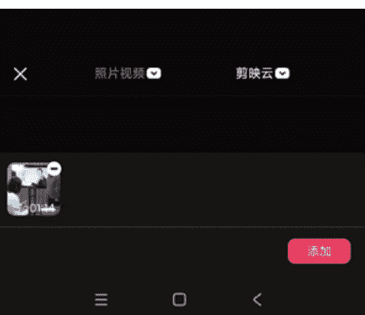

图3-8 导入素材

图3-9 AI自动分析素材

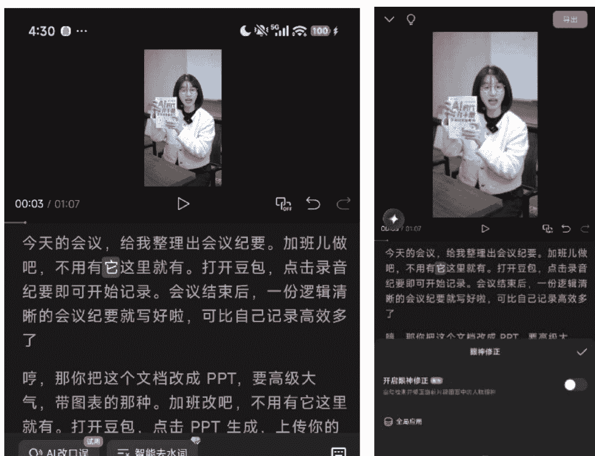

图3-10 对初剪结果进行微调

这一操作流程能大幅缩短口播素材的剪辑时间，让创作者从烦琐的无效片段剔除工作中解放出来，将更多精力放在内容优化上。

### 3. “AI剪口播”能识别的无效片段类型

剪映的“AI剪口播”功能能精准识别口播素材中的无效片段，覆盖录制过程中常见的问题内容，筛选全面且精准，实现全方位的无效内容识别。其具体可识别的无效片段类型如下。

- (1) 语气词与填充词：如“嗯”“啊”“然后”“就是说”等。
- (2) 空白停顿：长时间的沉默片段。
- (3) 重复内容：口播中重复的句子、短语。
- (4) 口误与修正：说错话后重新表述的片段。
- (5) 无效画面：模糊、晃动、无人脸的无效画面。

在此基础上，结合豆包的辅助优化功能，能让口播素材的质量更上一层楼，实现“AI初筛+精准优化”的效果，让口播视频的呈现更专业。

### 4.豆包辅助优化

借助豆包进行辅助优化，能更有效地减少无效片段、精准把控剪辑方向、优化文案表达，让口播素材的质量与专业度大幅提升，具体的辅助优化方式如下。

- (1) 让豆包根据口播主题生成优化后的口播脚本，提前剔除冗余内容，减少无效片段。
- (2) 让豆包生成剪辑关键词（如“职场干货：优先保留干货输出片段，删除停顿和语气词”），以便在剪映中实现快速定位和调整。
- (3) 让豆包对初剪后的口播文案进行润色，生成更流畅的文案，提升视频专业度。

将剪映的AI剪辑能力与豆包的内容优化能力相结合，能实现口播素材的高效创作与打磨，提升口播类视频的创作效率与内容质量。

## 3.4 建立个人素材库：背景音乐、文字、转场等素材的分类管理方法

素材库建设的核心在于科学的分类逻辑。在传统分类基础上，增设 Seedance 2.0专属分类，将显著提升AI生成素材的管理效率与检索度，让创作过程更加顺畅。

### 3.4.1 素材分类逻辑：新增Seedance 2.0专属分类

素材分类的核心目标是让素材“易查找、易复用”。为了适配AI生成素材的存储与使用需求，在原有分类基础上，新增Seedance 2.0专属分类，建议按“一级分类、二级分类、三级分类”的维度建立本地文件夹（计算机/手机均适用），让所有素材各归其位。具体分类维度与示例如表3-1所示。

表3-1 具体分类维度与示例

| 一级分类 | 二级分类 | 三级分类（场景/风格） | 部分分类示例 |
| :--- | :--- | :--- | :--- |
| 音频素材 | 背景音乐 | 欢快类、治愈类、激昂类、伤感类 | 欢快类 - 短视频爆款背景音乐、治愈类 - 钢琴纯音乐 |
| 文字素材 | 花字模板 | 标题类、强调类、装饰类 | 标题类 - 加粗醒目花字、强调类 - 高亮关键词花字 |
| | 字幕模板 | 口播类、带货类、情感类 | 口播类 - 简洁字幕、带货类 - 卖点字幕 |
| 转场素材 | 基础转场 | 渐显渐隐、滑动、旋转 | 渐显渐隐 - 片头/片尾、滑动 - 场景切换 |
| | 特效转场 | 科技风、复古风、可爱风 | 科技风 - 数据流转场、复古风 - 胶片转场 |
| 特效素材 | 贴纸 | 装饰类、引导类、节日类 | 引导类 - 箭头贴纸、节日类 - 春节贴纸 |
| | 滤镜 | 日常类、电影类、复古类 | 日常类 - 自然滤镜、电影类 - 青橙滤镜 |
| Seedance 2.0 素材 | 产品展示 | 家电类、美妆类、食品类 | 家电类 - 破壁机 - 特写.mp4 |
| | 场景氛围 | 治愈类、励志类、节日类 | 治愈类 - 雨天阅读 - 20秒.mp4 |
| | 口播背景 | 商务类、生活类、知识类 | 知识类 - 职场干货 - 15秒.mp4 |

### 3.4.2 剪映内的素材管理技巧

剪映内置了丰富的创作素材，涵盖背景音乐、文本、转场、贴纸、滤镜等多个类别。掌握剪映内的素材管理技巧，能让这些内置素材的使用更符合创作节奏，减少查找时间，提升剪辑效率。

#### 1.收藏优质素材

在剪映素材库中找到合适的背景音乐、文本、转场等素材，单击右上角的“☆”进行收藏。

#### 2.标记常用素材

对高频使用的素材，单击素材分类，剪映会自动标记常用素材，将其添加到“收藏”类别中（见图3-11）。后续在素材库中会优先展示常用素材，减少查找时间。

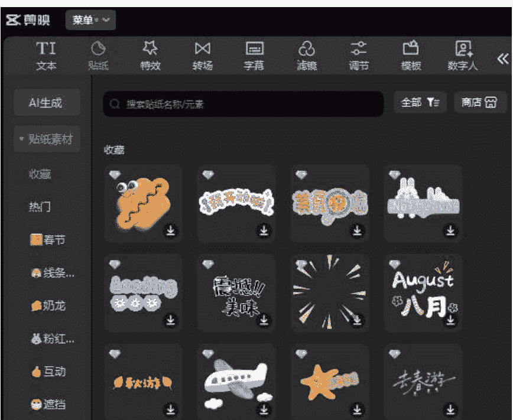

图3-11 标记常用素材

### 3.4.3 本地素材备份与同步

本地素材是创作者的核心创作资源，做好备份与同步工作不仅可以有效规避素材丢失风险，还可以实现多设备的无缝创作，让创作者能随时随地开展剪辑工作。结合剪映的云空间与云草稿功能，可实现本地素材的安全存储与跨设备同步。

#### 1.云端备份

将本地素材文件夹上传至剪映云空间。操作路径：打开剪映→单击“我的云空间”/“小组云空间”→开始上传。剪映云空间界面如图3-12所示。

#### 2.命名规范

素材文件的命名建议采用“类型—场景—核心内容—日期”格式（如“Seedance 2.0-破壁机-外观展示-20260225.mp4”），以便通过文件名快速搜索素材。

#### 3.跨设备同步

开启剪映的云草稿功能（路径：剪映App→我的→设置→云草稿备份→开启），剪映云草稿界面如图3-13所示。将包含Seedance 2.0素材的剪辑工程文件同步至云端，在其他设备登录同一剪映账号即可继续编辑，实现多设备无缝创作。

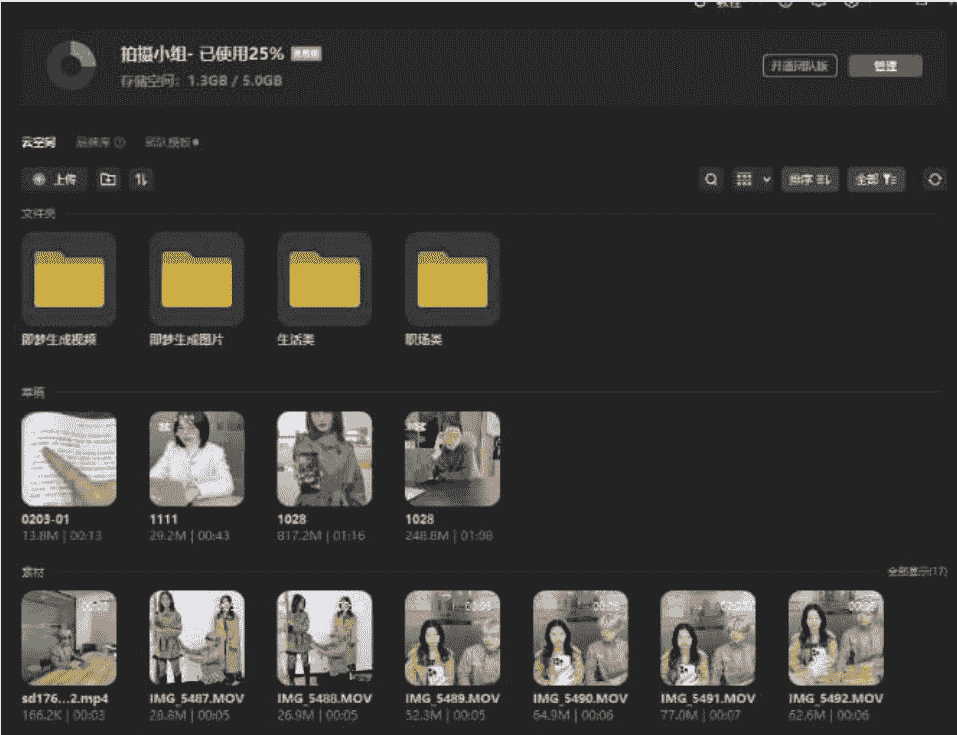

图3-12 剪映云空间界面

图3-13 剪映云草稿界面

做好本地素材的备份与同步，能让素材库的安全性与实用性大幅提升，为长期的短视频创作提供坚实的资源保障。

# 第4章 让视频说话：AI配音、字幕与声音克隆

短视频的“听觉体验”直接决定观众的停留时长。很多人明明画面拍得精致，却因字幕错漏、配音生硬、背景音乐违和，导致观众停留率低。本章聚焦剪映的核心音频功能，结合豆包的智能优化能力，从字幕精准度、专属声音库打造、配音情绪调节到背景音乐自动匹配，手把手教你搞定视频的“听觉包装”。

## 4.1 高准确率的字幕：剪映AI生成，豆包智能纠错与优化

字幕不是可有可无的点缀，而是观众看懂内容、信任账号的基础。以前，批量做系列视频时，准确添加字幕就是一个复杂且耗时的任务。现在，有了“剪映生成+豆包纠错”的组合，你可以快速解决这个痛点。

### 4.1.1 AI识别字幕

为避免多次返工，字幕的创作一般在完成视频画面制作后进行。

- （1）打开PC端剪映创作界面，在时间轴面板选中待添加字幕的视频内容，依次单击“文本”→“智能文本”→“智能字幕”，打开对应功能面板，如图4-1所示，时间指针默认停在视频内容的开始帧，单击智能字幕功能面板右下角的“开始识别”。

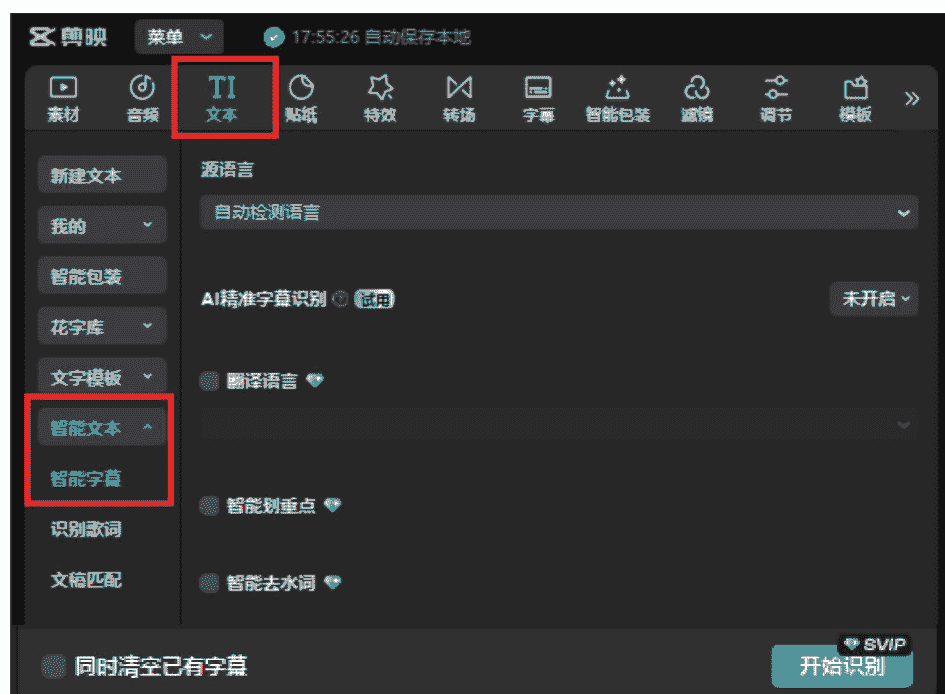

图4-1 智能字幕功能面板

（2）等待识别完成后，单击界面右侧属性面板中的“字幕”，即可对识别出的多个字幕文字进行编辑。单击界面右侧属性面板中的“文本”，则可以调整字幕文字的样式、颜色、字间距等，如图4-2所示。

### 4.1.2 导出字幕文件

现在有了基础的字幕，如果逐一手动校对，会花费大量时间。因此，你可以先将此时的字幕导出为SRT格式的文件，再导入豆包中进行批量纠错与优化。这一流程兼具AI识别的高效率及字幕的准确率与同步精度。

在PC端剪映创作界面右上角单击“导出”，在弹出的导出功能面板中，下滑至最下方。勾选“字幕导出”，格式默认为SRT，单击“立即体验并导出”，如图4-3所示，即可导出字幕文件。

图4-3 导出字幕文件

### 4.1.3 豆包批量纠错

在本地文件夹中将字幕文件扩展名改成“.txt”，打开豆包官网，单击上传附件按钮，选择“上传文件或图片”，如图4-4所示，上传TXT格式的字幕文件。

图4-4 选择“上传文件或图片”

在豆包对话框中输入以下提示词。

我需要你帮我完成一份字幕的校对工作，我将会给你提供一份字幕文件。要求：

1. 不要改变格式；
2. 不要省略或新增内容；
3. 只进行字幕校对工作（包括修改错别字、优化断句、删减语气词、纠正语序错误等）；
4. 输出成TXT格式的文档给我。

等待豆包完成字幕校对后，单击豆包生成的“校对后字幕文档.txt”，如图4-5所示，把文件下载到本地文件夹，再将下载文件的扩展名改成“.srt”。

### 4.1.4 导入剪映

（1）进入PC端剪映创作界面，依次单击“文本”→“新建文本”→“导入本地字幕”，如图4-6所示。将豆包校对过的字幕文件导入剪映中，时间轴面板上会出现相应的字幕内容。

（2）在保留原版字幕的基础上，做了改动的字幕会单独成一行，如图4-7所示。这样你就可以快速定位到豆包校对过的文本，并逐一复核，确保字幕的准确性。

图4-6 单击“导入本地字幕” 图4-7 时间轴面板

## 4.2 打造你的专属声音库：剪映“克隆音色”1分钟生成专属音色

专属音色能增强账号的辨识度，让观众一听到声音就知道是你，提升亲切感，从而慢慢积累信任感。剪映的“声音克隆”功能可以快速生成你的专属音色并为你配音。新手不用露脸、不用反复录制，也能快速产出高质量的口播视频。

### 4.2.1 录制或上传音频，生成专属音色

（1）进入PC端剪映创作界面，选中时间轴面板上已经确认的文本内容。在界面右上角的属性面板中依次单击“朗读”→“克隆音色”，如图4-8所示。

图4-8 单击“克隆音色”

（2）单击“点击克隆”，在弹出的“克隆音色”面板中阅读对应提示，如图4-9所示，勾选“我确认并同意《‘剪映’AI功能使用规范》”，随后单击“去克隆”。此时会弹出两种音频克隆方式，如图4-10所示，任选一种即可。

图4-9 阅读提示 图4-10 音频克隆方式选择界面

方式一：录制音频。单击“去克隆”，然后单击“点按开始录制”，按照剪映提供的文本及提示完成朗读。等待音频分析完成后，即可生成你的专属音色，如图4-11所示。

图4-11 录制音频以生成专属音色

单击“保存音色”，你的专属音色就会出现在朗读功能面板中，如图4-12所示。

图4-12 朗读功能面板

方式二：导入音频文件。单击“导入”，上传相应的音频或视频文件（音频时长控制在10～30秒效果最佳）。与方式一相同，保存音色后，对应音色将出现在朗读功能面板中。

### 4.2.2 朗读文本，生成音频素材

生成专属音色后，你可以在朗读功能面板下方选中此次配音需要用到的音色，记得勾选左下角的“朗读跟随文本更新”（这样即使后期文本有所调整，音频文件也会同步更新，无须二次操作），再单击右下角的“开始朗读”，如图4-13所示。朗读文本。

时间轴面板中会呈现相应的音频素材，如图4-14所示。

字幕 文本 动画 跟踪 朗读 数字人

收藏 克隆音色 热门 最新 春节

克隆音色

+ 点击克隆

▶ 欣眉02

欣眉

热门

曼波讲故事 中文:开心

猴哥 中文:平淡

台湾腔甜妹 中文:开心

娱乐扒妹 中文:平淡

小姐姐 中文:平淡

咆哮哥 中文:激动

直率英子 中文:平淡

真人播客女 中文:激动

新闻男声 中文:平淡

解说小帅 中文:平淡

激昂旁白 中文:稳重

电视广告 中文:平淡

新闻女声 中文:平淡

台湾女生 中文:平淡

试用可减免150积分，超出后需额外消耗积分 >

☑ 朗读跟随文本更新

开始朗读

图4-13 单击“开始朗读” 图4-14 生成的音频素材

## 4.3 AI配音的情绪开关：调出温柔讲解或激情带货氛围

很多人放弃AI配音的原因是AI配音太生硬，像机器人在读稿，与特殊场景下所需要的语气、语调不符。剪映的AI文本朗读功能设置了多个音频场景，可以有效地解决这一痛点。不同风格的AI配音适配不同的需求场景，如表4-1所示。

表4-1 配音风格与场景适配表

| 情绪风格 | 核心特点 | 适配场景 | 案例 |
| :--- | :--- | :--- | :--- |
| 温柔讲解 | 语速慢、语调平缓、尾音柔和 | 知识科普、绘本解读、情感语录分享、育儿分享 | 育儿博主小敏，用温柔的 AI 配音讲解绘本，粉丝留言“声音太治愈，宝宝每天睡觉前都要听” |
| 激情带货 | 语速快、语调上扬、重音突出 | 直播切片、商品推荐、促销活动、美妆产品测评 | 美妆博主阿美，用激情的 AI 配音推荐口红，带货转化率比之前提升 30%，粉丝留言“被声音感染，忍不住下单” |
| 亲切聊天 | 语速适中、语调自然，带轻微口语化特征 | 生活分享、Vlog 解说、本地探店 | 探店博主小杨，用亲切的 AI 配音分享美食，粉丝留言“像朋友在推荐，很真实” |
| 沉稳专业 | 语速慢（0.9 ～ 1.0 倍）、语调严肃，无多余起伏 | 行业报告、企业宣传、新闻解读、法律知识科普 | 法律博主老周，用沉稳的 AI 配音解读法条，粉丝留言“解说专业，内容可信度高” |

进入剪映创作界面，选中时间轴面板上已经确认的文本内容。在界面右上角单击“朗读”，单击下拉按钮，如图4-15所示，就可以展开所有的分类选项，如“克隆音色”“热门”“最新”“影视动漫”“童声”“方言”“新闻”等。

图4-15 展开所有分类选项

以营销视频的配音为例，选择“营销”分类，再选择对应情绪的音色，如“宣传男声”或“癫狂女声”，如图4-16所示。试听没有问题后，单击“开始朗读”即可。

图4-16 选择音色

## 4.4 自动匹配背景音乐：剪映“AI音乐”根据视频内容智能推荐背景音乐

手动找背景音乐要翻遍音乐库，试听几十首，耗时耗力；随便选一首又会拉低视频质量，影响观众体验。更麻烦的是，很多免费的背景音乐有版权风险，用了可能导致视频被限流。

剪映的“AI音乐”功能可以解决这些痛点：输入视频的内容、风格、时长后，剪映会自动推荐合适的背景音乐，不用手动筛选，省时省力；生成的背景音乐都是合规的，不用担心侵权。

（1）进入剪映创作界面，依次单击“音频”→“AI音乐”，进入AI音乐功能面板，如图4-17所示。一般来说，短视频的背景音乐通常是纯音乐。

图4-17 AI音乐功能面板

（2）“音乐类型”选择“纯音乐”，在下面的文本框中输入“视频大概内容+音乐风格+视频赛道”等提示词。

（3）如果不确定想选什么音乐风格，可以单击文本框下方的耳机按钮进行试听，单击刷新按钮可以试听更多风格的音乐。可以在对话框中输入以下提示词。

Vlog，舒缓的，适合知识科普类、分享类视频的音乐

（4）确认提示词后，单击功能面板右下角的“开始生成”，如图4-18所示，等待AI生成结果即可。

图4-18 单击“开始生成”

（5）单击AI音乐功能面板中的“生成记录”，可看到根据上述提示词所生成的音乐，如图4-19所示。

（6）单击音乐列表右侧的下载按钮，可以下载音乐。在试听筛选出一个符合要求的背景音乐后，可以单击被选中音乐条目最右侧的“添加到轨道”按钮，如图4-20所示，将生成的背景音乐与视频画面进行匹配。

输入要求

生成记录

# 生成记录（保留近 30 天）

- 舒缓Vlog音乐
  00:59 · 纯音乐 | Vlog，舒缓的，适合知识科普类分享...
- 舒缓Vlog音乐
  00:59 · 纯音乐 | Vlog，舒缓的，适合知识科普类分享...
- 舒缓Vlog配乐
  01:00 · 纯音乐 | Vlog，舒缓的，适合知识科普类分享...
- 舒缓Vlog配乐
  01:00 · 纯音乐 | Vlog，舒缓的，适合知识科普类分享...
- 舒缓Vlog之音
  01:00 · 纯音乐 | Vlog，舒缓的，适合知识科普类分享...
- 舒缓Vlog音乐
  01:00 · 纯音乐 | Vlog，舒缓的，适合知识科普类分享...

图4-19 “生成记录”界面

# 生成记录（保留近 30 天）

- 舒缓Vlog音乐
  01:00 · 纯音乐 | Vlog，舒缓的，适合知识科普类分享...

图4-20 单击“添加到轨道”按钮

# 第5章 高级感的秘密：智能包装与视觉统一

一套固定的视觉风格，能让账号具有较高的可辨识度，让观众一刷到就能立刻认出你的账号。本章不讲复杂理论，只用剪映（PC端）+Seedance 2.0，以最简单的方式，做出干净、高级、有记忆点的视频画面。

## 5.1 避开字体“雷区”：剪映可商用字体推荐

字体选得好，视频画面清晰又高级；字体选不对，视频不仅观感杂乱，还可能面临版权风险。想要既“安全”又好看，最简单的方法就是：只使用剪映内标注了可商用的字体，并搭配Seedance 2.0生成的背景素材等。

在剪映中使用可商用字体不需要进行额外下载与安装，也不需要付费购买，只需要进行简单筛选，就能快速找到全部合规字体。打开PC端剪映，导入视频后，依次单击“文本”→“新建文本”，如图5-1所示。

在字体列表的右上角找到“可商用”筛选项，如图5-2所示。单击后，系统会自动过滤掉有版权限制的字体，只显示可以免费商用、可放心发布、无版权风险的字体。

图5-1 单击“新建文本”

图5-2 “可商用”筛选选项

标题字体推荐（醒目、大气、不花哨）：优设标题黑、站酷高端黑体、抖音美好体、思源黑体。

字幕字体推荐（清晰、易读、久看不累）：思源黑体、阿里巴巴普惠体、庞门正道标题体。

图5-3 纯色渐变、带简约纹理的背景+可商用字体

配合Seedance 2.0的背景生成能力，能让文字的呈现更专业：用Seedance 2.0生成纯色渐变、带简约纹理等的背景图，导入剪映后，再搭配可商用字体，避免文字和背景“打架”，可使整体视觉效果更协调，如图5-3所示。

除了剪映，如果还要在视频号、公众号、封面图、海报里使用，可以优先选择思源黑体、思源宋体、阿里巴巴普惠体。这3款字体是全平台通用、永久免费的开源字体，兼容性强、风格稳重，非常适合知识类内容的传播。

### 5.1.1 字体搭配技巧，可直接使用

你可以记住这两个最简单的字体搭配技巧，直接使用：一条视频里，只使用两种字体——标题用一种粗体，字幕用一种常规体；字幕统一用白字加黑色阴影，清晰度不受背景亮暗的影响。通过剪映“预设样式”可一键同步所有字幕的字体、颜色、阴影参数，不用逐段调整，效率翻倍。

### 5.1.2 一定要避开：字体商用侵权风险

对你来说，最稳妥、最省心的做法依然是：只在剪映“可商用”字体列表中选择字体。这是目前对短视频创作者来说成本最低、风险最小的字体解决方案，不用记复杂的版权规则，不用额外付费，也不用到处找字体包。

### 5.1.3 3个细节，让普通字体立刻变高级

如果你想让视频质感再上一个档次，可以注意以下3个细节。

1. 字幕字号不要太小，手机竖屏中的字幕字号建议为12～20，以保证老人和近视观众也能轻松看清，如图5-4所示。
2. 字幕行高不要太小，适当拉开间距给观众的观感会好很多。
3. 标题可以适当加粗、字间距可以大一些，提升美观度。

如果你打算长期做账号，那么建议你确定一套自己的字体规范：标题用什么字体、字幕用什么字体、封面用什么字体，统一之后，观众刷到你的视频时就会产生熟悉感，更容易记住你的账号风格，形成“品牌记忆”。

图5-4 字号调整选项

可能你会问：如果想做差异化内容、想让视频更有辨识度，难道只能用这几种普通字体吗？当然不是。差异化是靠规范和细节实现的。

同样是思源黑体、阿里巴巴普惠体，有的人用起来效果平淡，有的人用起来却令人惊艳。差别就在于对字重、字间距、行间距、位置、颜色、透明度、阴影的控制。只要参数调得合适，普通字体也能具有高级感。

### 5.1.4 字体要匹配内容情绪

还有一个很多人容易忽略的点：字体与内容情绪的匹配。字体和内容情绪匹配，观众会在不知不觉中觉得你的视频“很专业、很舒服”。内容与相应的字体类型推荐如表5-1所示。

表5-1 内容与相应的字体类型推荐

| 你做的内容类型 | 推荐的字体类型 |
| --- | --- |
| 干货科普、知识讲解 | 清晰、稳重的无衬线体 |
| 美食、日常生活记录 | 圆润、温和的字体 |
| 国风、传统文化 | 有书法感、力量感的字体 |
| 科技、数码、职场技巧 | 纤细利落、现代感强的字体 |

### 5.1.5 封面字体：少即是多

封面中的字体尽量不要超过3种，最好控制在2种或1种。封面中的主次信息一目了然，比堆效果、加特效、叠纹理有用得多。封面字体和视频内容字体保持风格统一，账号视觉体系就会逐渐成形，更容易被观众记住。

记住，版权第一，可读性第二，美观第三。

## 5.2 将字幕变好看：剪映“智能字幕”+Seedance 2.0背景优化，一键出精品

对知识类视频来说，字幕比画面更重要。观众能不能听清、看懂、跟上你的节奏，全靠字幕。很多人手动加字幕、调颜色、调大小，不仅慢，还容易调得乱七八糟。其实使用PC端剪映的智能字幕+Seedance 2.0的背景生成功能，可以轻松让字幕变好看，不用额外费心。

### 5.2.1 剪映“智能字幕”+Seedance 2.0背景优化实操

第一步，导入视频，依次单击“文本”→“智能文本”→“智能字幕”，然后单击“开始识别”，如图5-5所示。

系统会自动把语音转换成文字，速度非常快，一般几十秒就能完成。生成后简单检查一遍，修改错字、漏字。

第二步，选中生成的字幕条，单击上方的“样式”。剪映官方提供了成套模板，如图5-6所示，包括字体、字号、颜色、描边等，可一次性设置完成。做知识类视频，不用选花里胡哨的样式，直接单击简约、清晰、白字黑边或白字黑阴影的模板，整段视频的字幕便会全部同步更新。

图5-5 单击“开始识别”

基础

气泡

花字

默认文本

文案推荐 限免

AI 写旁白 深度思考

字体

系统

字号

15

样式

B

U

I

颜色

字间距

0

行间距

0

对齐方式

预设样式

位置大小

缩放

100%

等比缩放

位置

X

0

Y

0

平面旋转

0.00°

混合

不透明度

100%

描边

背景

发光

阴影

弯曲

保存预设

添加到品牌库

图5-6 剪映官方提供的成套模板

第三步，用Seedance 2.0优化字幕背景。如果视频背景杂乱，可用Seedance 2.0生成“半透明渐变黑条”“简约色块”等背景素材并导入剪映，然后放在字幕下层，这样既能突出字幕，又不会遮挡画面主体，还能生成和账号风格一致的字幕模板，以便后续一键套用，快速提升账号的可辨识度。

如果视频背景比较亮，不易看清字幕，可以在剪映样式设置面板里勾选“阴影”或“描边”。如果勾选后还是觉得差点意思，可以选择一种合适的花字，再搭配Seedance 2.0生成的深色字幕条，示例如图5-7所示。

图5-7 Seedance 2.0生成的深色字幕条+花字

### 5.2.2 字幕标准化方法

做视频的你一定有过这样的困扰：费心拍摄素材画面后，却因为字幕杂乱、背景不协调，让视频质感大打折扣，使得观众看几秒就划走了。其实对全品类视频来说，字幕和背景的标准化，远比复杂的特效更重要——它不仅能提升视频专业度，更能帮你打造账号专属记忆点，让观众记住你。下面介绍通用的字幕标准化方法，掌握后直接使用就行。

#### 1. 风格统一的字幕就是账号的隐形Logo

把字幕的字体、颜色、位置、背景固定下来，让观众不用看头像和昵称，也能一眼认出你。只需一次调好字幕模板，后续所有视频直接套用，可复制、可批量应用，省下大量时间打磨内容，不用再为每条视频重复设计字幕、调整背景。

#### 2. 必须掌握的字幕应用规则

用AI智能识别字幕后，一定要人工校对，修改错字、漏字，保证信息传递准确；要把长句拆短，一行控制在12～18字，不要让字幕铺满整个屏幕；别让字幕遮挡画面主体，断句合理、节奏舒服。观众的眼睛不累，才愿意把视频看完；字幕越明确、清晰，信息传递越高效，账号数据也会越好。

#### 3. 各品类视频适配方案

各品类视频适配方案如表5-2所示。

表5-2 各品类视频适配方案

| 视频类型 | 应该怎么做（字幕+背景） | 能实现的效果 |
| :--- | :--- | :--- |
| 生活 Vlog | 柔和字体，不花哨；搭配淡色简约背景（可通过 Seedance 2.0 生成） | 治愈、舒服，观众看完全程不疲劳，视频完播率高 |
| 美食探店 | 字幕突出店名、菜品、价格、评价信息，背景简洁不喧宾夺主 | 关键信息一目了然，方便观众快速获取核心内容，提升互动率 |
| 好物测评 | 统一字幕样式，强化专业感；搭配 Seedance 2.0 生成的简约色块背景 | 专业度高，产品卖点清晰；增强观众信任感，助力转化 |
| 剧情短视频 | 人物对话字幕用短句、快切，保持风格统一；背景贴合情绪，不杂乱 | 情绪到位，观众容易入戏，提升视频沉浸感 |
| 带货 | 字幕重点信息突出、可读性强；背景简约，不干扰产品展示 | 提升转化率，助力变现 |

#### 4. 所有内容都通用的底层逻辑

无论你做什么类型的视频，字幕和背景的底层逻辑都相通，具体为以下3点。

- （1）要保证：字幕清晰易读，让观众快速获取信息。
- （2）要做到：背景干净不“抢戏”，突出视频主体和字幕。
- （3）要坚持：整体风格高度统一，形成账号专属记忆点。

#### 5. 坚持下去，你会收获这些结果

- （1）视频的完播率明显变高，观众愿意花更多时间看完你的视频。
- （2）评论区“看着舒服”“专业”的评价变多，提升观众好感度。
- （3）账号专业感、可信任感更强，拉近与观众的距离。
- （4）拥有长期、稳定、别人难复制的账号竞争力，为长期做账号打下基础。

## 5.3 动效参数不求人：向豆包描述效果+用Seedance 2.0生成素材，零门槛做专业动效

合理的动效可以让视频更有层次感和节奏感。你不用背参数，只要把想要的效果用大白话说出来，让豆包生成可以直接使用的剪映关键帧参数，再用Seedance 2.0生成静态素材，就能做出专业又美观的动效。

### 5.3.1 向豆包描述效果，获取剪映关键帧参数

你只需要用大白话描述需求，就能得到可直接使用的剪映关键帧参数，不用理解复杂原理。比如你可以像下面这样描述。

我需要为知识类视频设计一个标题动画，标题从左边慢慢滑到中间，速度平稳，不晃、不跳。字幕不要突然出现，要慢慢渐显，停留一会儿再慢慢渐隐。

发给豆包，就能得到精准的剪映关键帧参数，如下所示。

标题滑入：关键帧1（位置X=0，时间0.5秒）→关键帧2（位置X=360，时间2秒，速度曲线选线性）。

字幕渐显渐隐：渐显时间1秒，渐隐时间0.5秒，透明度从0%到100%再回到0%。

你只需要在剪映里照着设置参数即可，不用手动摸索。

### 5.3.2 用Seedance 2.0生成素材，让动效更专业

在剪映中设置好关键帧后，再用Seedance 2.0生成搭配使用的静态素材，能让动效更流畅、更专业。

#### 1. 让标题缓慢滑入

（1）用Seedance 2.0生成一张背景图，提示词如下。

文艺治愈风、模糊晕染、色彩渐变、流动笔触质感。元素组合：暖橙—浅黄—蓝调渐变背景（带模糊晕染效果）和一张漂亮的艺术字图片。

（2）把背景图导入剪映。

（3）只给标题文本添加“向下滑动”。背景不动，让文字慢慢滑进来，画面简约又美观，如图5-8所示。

#### 2. 让字幕“渐显渐隐”

（1）用Seedance 2.0生成一张文本框图片，提示词如下。

采用古风结合现代新中式游戏风格，飘逸，精美的细节，边缘有图案和装饰元素，不应受到阴影或光线的影响。大师杰作，黑色背景。

（2）将生成的图片导入剪映并放在字幕下层，配合文字动画，让字幕出现时，文本框同步渐显，过渡柔和、不刺眼，如图5-9所示。

#### 3. 转场动效

用Seedance 2.0生成一张纯色渐变图（如“从画面主色到黑色的渐变”）。

把这张图片导入剪映作为转场素材，设置“叠加”效果（这比手动设置更高效，过渡也更自然），如图5-10所示。

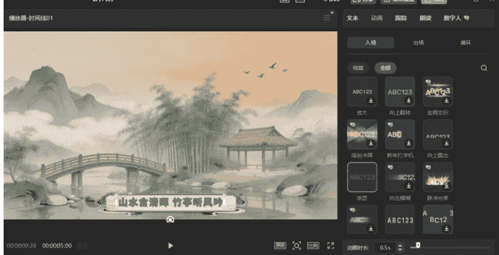

图5-9 Seedance 2.0生成的文本框图片+文字动画

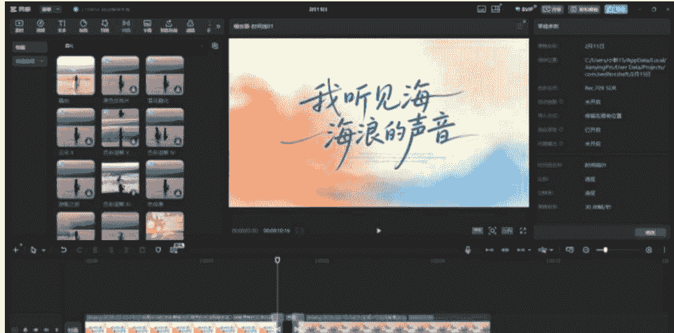

图5-10 将Seedance 2.0生成的纯色渐变图作为转场素材

### 5.3.3 动效方案推荐

对于知识类视频，动效不宜太复杂，简单、稳定即可。下面推荐一些“豆包字幕关键帧动画+Seedance 2.0素材”的组合方案。

#### 1. 标题动效

先用豆包获取字幕关键帧动画：开场渐显1秒+出场闭幕。再用Seedance 2.0生成底图，开场利落，如图5-11所示。提示词如下。

现代科技感风格，AI工具介绍海报。画面中央是一支精致的金属钢笔，钢笔表面有蓝色的科技光效流动，笔尖处散发着蓝色的数字粒子效果，象征AI的智能光芒。钢笔周围环绕着各种AI工具的图标和符号，如齿轮等，这些元素以半透明的蓝色呈现。背景是从深蓝色到黑色的渐变，营造科技感氛围，点缀着星光般的光点和数据流线条。

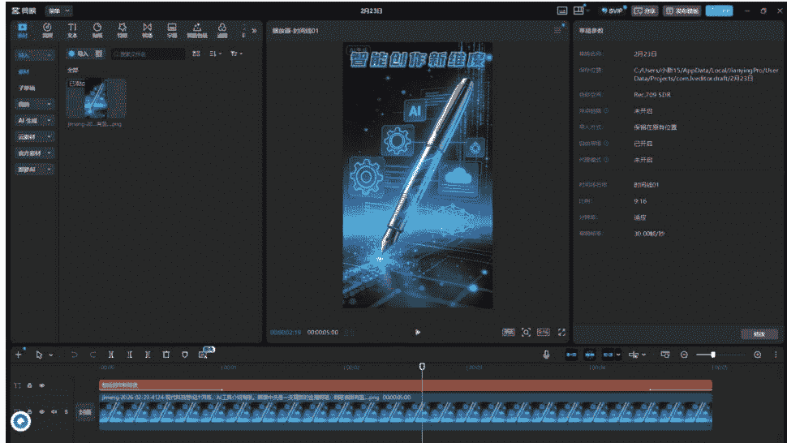

图5-11 标题动效

#### 2. 字幕动效

先用豆包获取字幕关键帧动画：入场放大+出场缩小（入场1秒、出场0.5秒）。再用Seedance 2.0生成底图，放在字幕下层，过渡柔和、不刺眼，如图5-12所示。提示词如下。

立体3D图标元素边框设计；磨砂玻璃质感，清透渐变质感图标；纯色背景。

#### 3. 其他类型短视频

除了知识类视频，这套组合方案同样适用于日常Vlog、好物开箱、剧情短片、美食探店、情感口播、美妆教程、影视解说、电商短视频等多种类型，只需要稍微调整描述方式，就能快速适配不同风格。

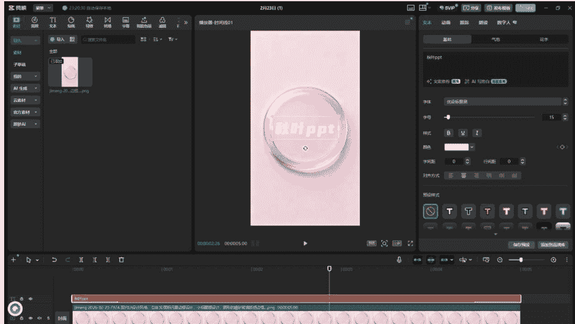

图5-12 字幕动效

- （1）日常Vlog通常需要温馨自然。直接告诉豆包“字幕轻轻出现、轻轻消失，节奏柔和不突兀”，即可获得柔和的渐显渐隐关键帧动画；再用Seedance 2.0生成图片素材（提示词如下：浅色系柔光渐变、窗边自然光、咖啡热气、书桌小灯这类治愈的生活素材，或暖色调、电影质感、柔和模糊的素材），将其导入剪映后搭配画面缓慢放大，让随手拍的片段也能充满生活温度与故事感，如图5-13所示。

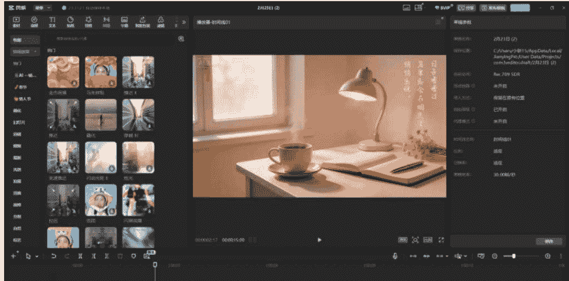

图5-13 日常Vlog

- （2）好物开箱视频需要突出产品。让豆包生成“产品图片从小放大到正常大小，平稳不抖动”的关键帧动画；用Seedance 2.0生成干净简约的光影底图作为产品入场背景，使重点一目了然。
- （3）美食视频强调食欲与质感。通过“文字缓慢落下，沉稳有质感”在豆包中获得对应关键帧动画；再用Seedance 2.0生成暖色调美食氛围图、暖光渐变遮罩素材，配合美食画面渐显渐隐，让画面更有食欲，节奏也更舒服。
- （4）剧情短片、情感口播视频追求氛围感。只需一句“字幕低调出现，不抢眼、不干扰情绪”，豆包就能给出克制又高级的关键帧动画；搭配Seedance 2.0生成的暗调氛围感画面、情绪光影背景，能快速营造相应氛围，让情绪表达更到位。
- （5）美妆教程需突出步骤与细节。在豆包中输入“步骤字幕从下方轻推上来，清晰不晃眼”，获得相应关键帧动画；用Seedance 2.0生成低饱和度的干净底图，放在字幕下方，既突出文字，又不遮挡妆容细节，让观众看得清楚，学习得更快。
- （6）影视解说视频需要利落、高级。让豆包生成“人名、片名快速渐显、停留后平稳渐隐”的关键帧动画；再用Seedance 2.0生成深色渐变遮罩、电影感暗角画面素材，压暗画面边角，突出中间字幕与画面内容，提升解说的专业感。
- （7）电商短视频强调转化与吸睛。通过“价格标签、卖点文字轻轻弹入，有力度但不夸张”在豆包中获得节奏明快的关键帧动画；搭配Seedance 2.0生成的亮色渐变小卡片、突出卖点的简约背景，可迅速抓住观众眼球，提升视频留存率与转化效果。

不难发现，Seedance 2.0的优势就是：对于不同视频类型，能生成对应风格的画面素材。

不管是什么类型、什么风格的视频，核心制作逻辑都一样：不用死记参数，不用苦练剪辑，不用到处找素材，用豆包生成关键帧动画，用Seedance 2.0生成对应画面素材。熟练掌握相关技巧后，新手也能轻松做出风格统一、流畅、专业、极具氛围感的视频。

## 5.4 画面美学诊断：AI分析+用Seedance 2.0生成素材，一键提升视频视觉层次

很多时候我们拍完视频，总觉得画面不够精致但又说不出具体问题在哪里。可能是亮度不足、对比度偏低、背景杂乱、主体不突出，很多细节都会影响视频质感。自己手动调节效率低，也很难把握尺度，而让AI进行智能诊断和用Seedance 2.0生成素材，是高效优化画面的方式。PC端剪映自带的智能调色功能，能一键完成画面基础美化。

- （1）打开PC端剪映，导入视频素材并将其拖曳到时间轴面板，选中需要优化的视频片段（选中后会显示白色边框），如图5-14所示。

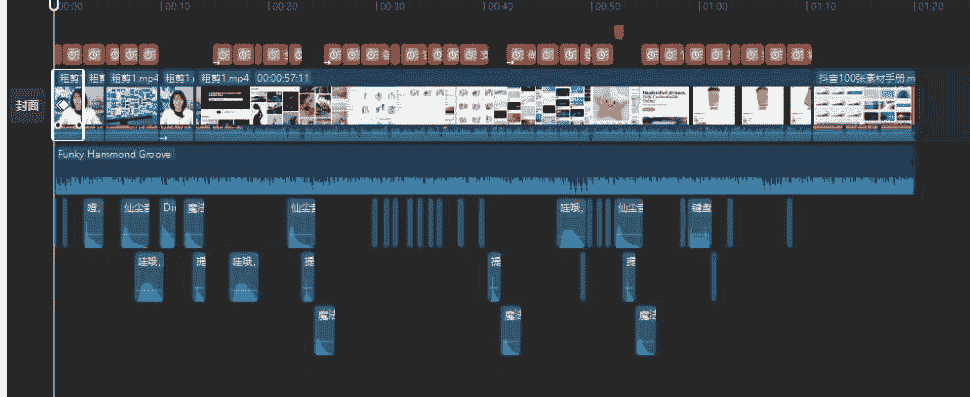

图5-14 选中需要优化的片段

- （2）在右侧弹出的调整面板中勾选“智能调色”，如图5-15所示。

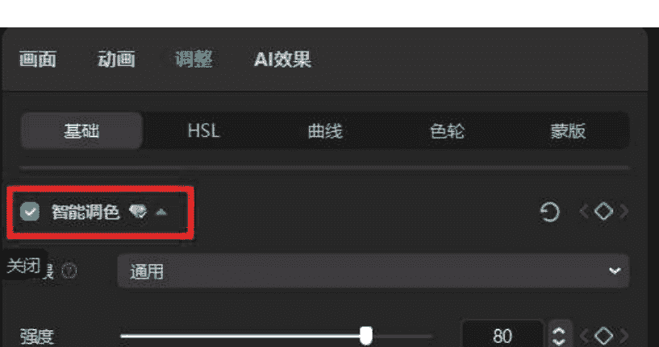

图5-15 勾选“智能调色”

- （3）勾选后系统会自动分析画面的亮度、对比度、锐度、饱和度等核心参数，并将画面调整到合适的状态，用户无须手动探索参数值。
- （4）若想快速统一全片风格，可在对一个片段完成智能调色后，右键单击该片段，选择“复制属性”，再选中其他需要统一风格的片段，右键单击并选择“粘贴属性”，如图5-16所示。

图5-16 复制属性与粘贴属性

绝大多数日常拍摄的视频，仅靠这一步就能明显提升质感。在此基础上，可根据画面情况做精细优化，再搭配Seedance 2.0生成的素材，有针对性地解决问题。

### 5.4.1 基础参数微调（智能调色后补充）

- 亮度：拖动亮度滑块（建议±10～30），保证人物面部清晰明亮，画面不过亮（刺眼）也不过暗（模糊）。
- 对比度：适当向右拖动对比度滑块（+10～20），让主体与背景的区分更明显，画面也会更立体，避免出现灰蒙蒙的质感。
- 清晰：略微提高清晰度（+5～15），让文字、人物轮廓更清晰，提升画面精致感。剪映基础参数微调示例如图5-17所示。

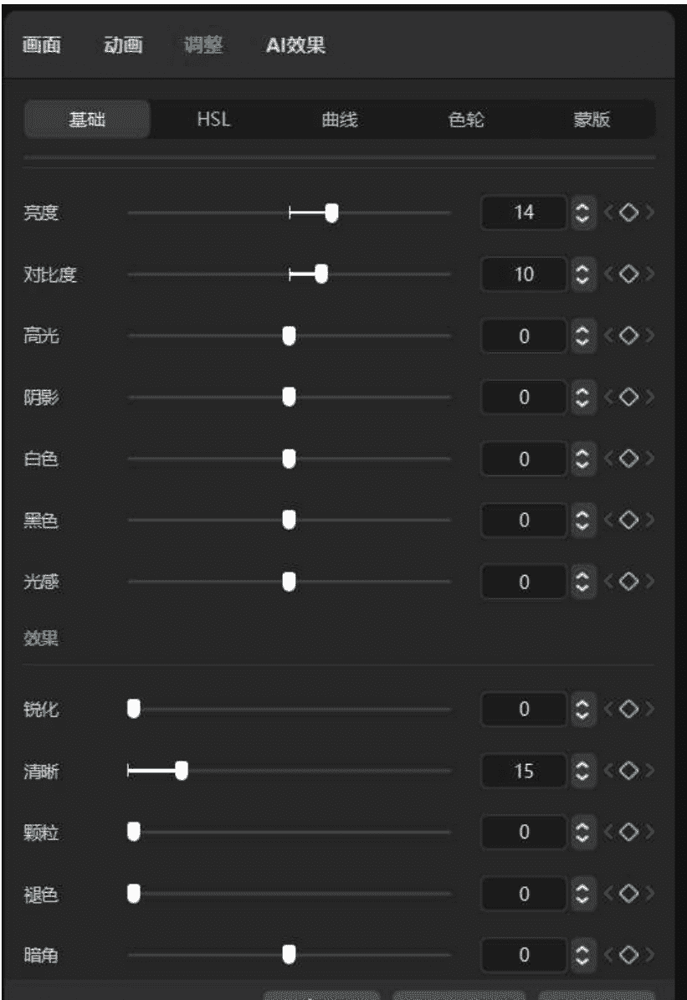

图5-17 剪映基础参数微调示例

### 5.4.2 背景优化（解决杂乱问题）

若拍摄环境杂乱，不用重新拍摄，可采用以下两种高效处理方式。

#### 1. PC端剪映——快速虚化背景

- （1）导入视频，复制一份并拖到上层轨道。选中上层轨道的视频，单击“特效”，选择模糊特效，将“模糊度”调至30～50，如图5-18所示。

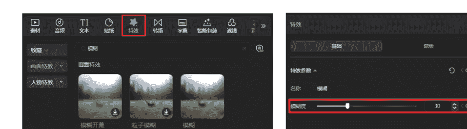

- （2）选中下层轨道的视频，依次单击“画面”→“抠像”，勾选“智能抠像”，如图5-19所示。
- （3）将主轨道的视频放大一点，画面主体清晰、背景柔和，调整完成。

#### 2. 用Seedance 2.0生成背景图+抠图替换（极简版）

- （1）用Seedance 2.0生成简约纯色背景或低饱和度的渐变背景（保存为图片）。
- （2）在剪映中导入视频，依次单击“画面”→“抠像”，勾选“智能抠像”。
- （3）把生成的纯色背景图拖到视频所在轨道下方，长度保持一致。
- （4）调整主体大小与位置，杂乱背景直接消失了，画面变得干净又高级。

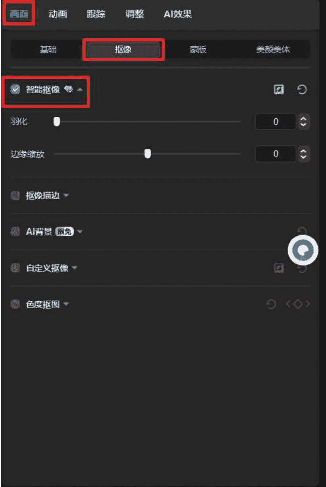

图5-19 勾选“智能抠像”

### 5.4.3 色彩统一与主体突出

如果你的视频是多场景、多镜头拼接而成的，就很容易出现前后色调不一致的问题：有的偏亮、有的偏暗，有的偏黄、有的偏蓝，整体看上去杂乱、不专业。对知识类、测评类、口播类账号来说，统一的色调就是专业感的“底色”。

借助Seedream 4.5生成风格统一的纯色/渐变素材后，不用逐段调色，就能快速统一全片风格，让视频看起来像是由专业团队统一拍摄、统一校色的。

#### 1. 全片色彩统一实操步骤

- （1）用Seedream 4.5生成色调统一的素材。
  - 口播：低饱和灰、莫兰迪蓝、高级灰渐变。
  - 生活Vlog：奶油色、柔粉色、浅杏色渐变。
  - 美食/探店：暖白色、暖黄色、低饱和度的大地色。
  - 科技/职场：冷灰色、深蓝色、银灰色渐变。

  生成尺寸建议：1920像素×1080像素（适合绝大多数短视频）。

- （2）导入剪映，叠加统一色调。将生成的纯色/渐变图片导入素材库；拖动到画中画轨道，放在原视频下方；调整时长，覆盖整条视频。

  接着将“不透明度”调到10%～30%，此时画面会蒙上一层统一又柔和的色调，不同片段的色差立刻被“中和”，如图5-20所示。

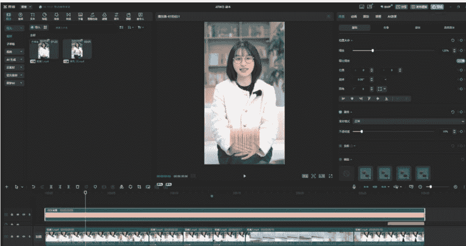

图5-20 叠加统一色调

#### 2. 主体突出：让人物/产品变得吸睛

很多人的视频画面普通，不是拍得差，而是主体不突出：人物融在背景里、产品看不清、被杂乱环境抢走视线。用Seedream 4.5生成光影素材，不用布光、不用打灯，就能让主体突出，画面层次分明。不同光影素材类型的应用如表5-3所示。

表5-3 不同光影素材类型的应用

| 光影素材类型 | 适用场景 | 视觉效果 | 推荐使用人群 / 账号 |
| :--- | :--- | :--- | :--- |
| 柔和光晕 | 知识分享、生活 Vlog | 画面柔和、氛围感强，人物面部通透自然 | 知识 IP、治愈系、生活分享类 |
| 柔和侧光 | 人物访谈、好物展示、口播视频 | 人物面部立体感强，画面更有层次 | 颜值博主、测评类、职场 IP |
| 简约圆形聚光 | 产品特写、干货讲解 | 让观众视线自动聚焦于画面主体，突出核心内容 | 好物测评、知识教学、带货视频 |
| 光斑 | 片头、片尾、转场过渡 | 提升精致感，画面不单调，高级不抢戏 | 全品类通用，尤其适合简约风账号 |
| 暗角渐变 | 口播视频、剧情片段、重点画面 | 压暗四周，强化中间主体，让观众视线更集中 | 知识口播、剧情短视频、人物特写 |

# 第6章 电影级画面：AI调色与智能抠像实战

本章聚焦剪映的调色与智能抠像功能，搭配豆包的场景化指导与问题诊断，从一键套用合适滤镜、无绿幕智能抠像，到多素材色调统一、废片评估与拯救，手把手教你用AI制作出电影级画面，让每一段普通素材都变身为质感大片，解决做短视频时的“画面质感难表现”痛点。

## 6.1 一键拥有电影色调：剪映滤镜套用与自定义调色技巧

剪映提供滤镜功能和调节功能，新手可以一键套用现成滤镜，10秒搞定高级色调；有基础的创作者可以通过精细调整参数，精准匹配视频风格；再加上豆包的场景化调色建议，所有创作者都能调出统一、高级的电影感色调，让美食更诱人、风景更治愈、人物更上镜。

### 6.1.1 滤镜功能

- （1）进入剪映创作界面，单击“滤镜”，可以看到剪映官方提供的滤镜类型非常丰富，涵盖人像、风景、美食等，如图6-1所示。

图6-1 剪映官方提供的滤镜

以美食滤镜为例，在剪映创作界面下面的时间轴面板中选中素材，在滤镜库中切换至“美食”分类，可看到多种跟美食相关的滤镜，如图6-2所示。

- （2）选择合适的滤镜后，单击右下角的添加按钮即可将其添加至轨道上，如图6-3所示。此时还需要对滤镜的强度做微调，让画面效果更真实、更有质感。在时间轴面板上选中滤镜效果，在滤镜功能面板中直接调整滤镜强度，如图6-4所示。

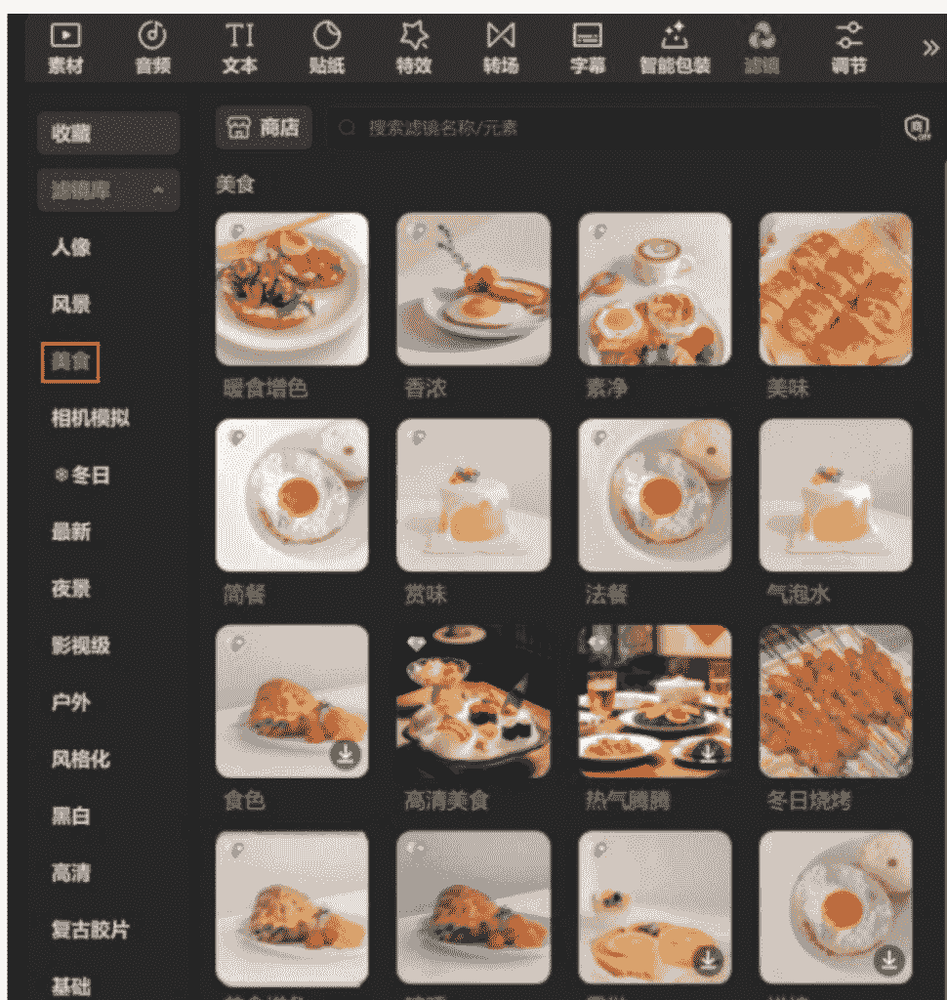

图6-2 美食滤镜

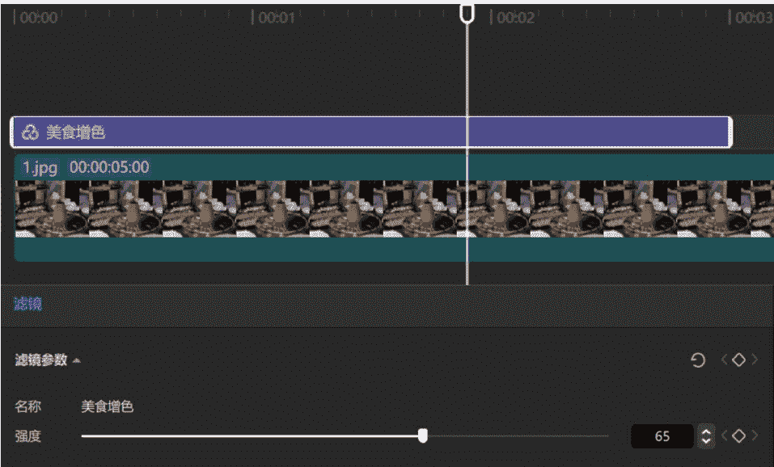

图6-3 将滤镜添加到轨道

图6-4 调整滤镜强度

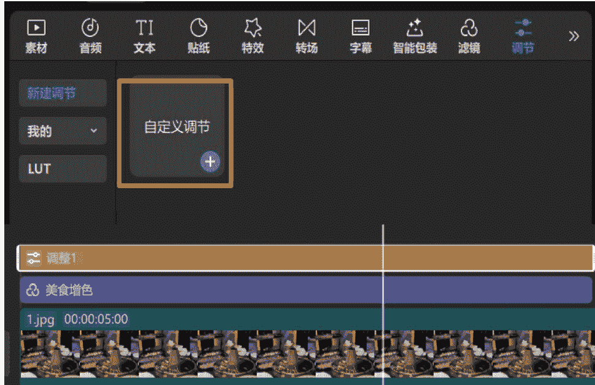

图6-5 单击“自定义调节”

### 6.1.2 调节功能

套用滤镜可以大幅提升调色效率，但如果希望更精确地对素材效果进行调整，就需要用到调节功能。

- （1）进入剪映创作界面，依次单击“调节” → “新建调节” → “自定义调节”，如图6-5所示，创建名为“调整1”的调节效果，如图6-6所示。

### 6.1 调整

（2）选中刚刚创建的“调整1”，在界面右上角的属性面板中可以对其参数进行精细化调整，如图6-7所示。

这些参数可以分为调整色彩和调整明暗两个板块，如图6-8所示。一般来说，更高效的调色流程是先调整明暗再调整色彩。调整明暗的目的是让整个画面该亮的地方亮，该暗的地方暗。明暗确定了，再调整画面的色彩倾向。不同类型的视频对应不同的明暗效果和色彩倾向，比如美食视频适合调整为暖色调、科普视频适合调整为冷色调。

#### 调整参数面板

- 基础
- HSL
- 曲线
- 色轮
- 蒙版

智能调色

场景: 通用

强度: 80

色彩克隆

色彩校正

LUT

名称: 无

强度: 100

肤色保护: 0

图6-8 调整色彩和调整明暗的参数

## 6.2 智能抠像：穿越、悬浮、分身，不用绿幕也能完成

传统抠像需要用到绿幕、专业软件和复杂技巧，普通人很难操作；手动抠像不仅耗时耗力，还容易遗漏边缘细节，影响视频质感。而剪映的“智能抠像”功能可以自动识别人物或其他物体，实现精准抠像。

（1）进入剪映创作界面，选中需要抠像的素材，如图6-9所示。在界面右上角依次单击“画面”→“抠像”，勾选“智能抠像”，如图6-10所示。

图6-9 选中需要抠像的素材

图6-10 勾选“智能抠像”

（2）剪映会智能识别画面主体并完成抠像。即便没有用绿幕拍摄，抠图效果也很好，如图6-11所示。

图6-11 智能抠像前后效果对比

（3）此时，在抠出的人像下方添加不同的背景素材，即可替换背景，如图6-12所示。

图6-12 替换背景

（4）至于分身效果，只需要复制出多个人物素材，改变它们出现的位置、大小、方向、透明度就能实现，如图6-13所示。

图6-13 分身效果

## 6.3 拯救碎片化素材：统一多段素材的色调与光影

剪映的“色彩克隆”功能可以一键帮你调好参数，统一多段素材的色调与光影，让碎片化素材看起来像同一次拍摄的，风格统一、过渡自然。

（1）进入剪映创作界面，导入多段素材。在时间轴面板上选中需要调色的素材，依次单击“调整”→“基础”，勾选“色彩克隆”，如图6-14所示。

图6-14 勾选“色彩克隆”

（2）有两种找到目标图的方式：“视频帧”方式和“本地”方式。选择“视频帧”方式，上传你想要参考的视频后，滑动画面可以在当前时间轴面板中拖动时间指针选择用于统一调色的目标画面，如图6-15所示。

（3）切换至“本地”方式后，可以直接上传目标图，如图6-16所示。上传图片后，单击“确认”，等待操作完成。

图6-15 “视频帧”方式

图6-16 上传目标图

（4）画面匹配效果如图6-17所示，可以看到二者的色调、明暗程度都非常相似。

图6-17 画面匹配效果

## 6.4 废片评估与拯救：修复抖动、模糊与杂物等问题

很多时候，你以为的废片其实通过AI修复就能变废为宝。剪映的“视频防抖”“超清画质”“AI消除”功能，能精准修复抖动、模糊、杂物等问题，让废片变成可为素材，从而使每一段素材都能发挥价值。

（1）进入剪映创作界面，导入需要处理的废片。在时间轴面板上选中素材，在界面右上角依次单击“画面”→“基础”，往下滑动就可以看见“视频防抖”“超清画质”“AI消除”功能，如图6-18所示。

图6-18 画面功能面板

（2）拍摄前期轻微的抖动可以直接通过“视频防抖”功能修复，剪映为用户提供了不同的防抖等级，如图6-19所示。

图6-19 防抖等级

（3）当素材画质没有那么清晰时，可以通过勾选“超清画质”来一键修复，图6-20所示为原素材与超清画质素材的对比。

图6-20 原素材与超清画质素材的对比

（4）画面中的杂物可以通过“AI消除”功能去除，如图6-21所示。

图6-21 “AI消除”功能

例如，想去画面中的引流信息，选择“涂抹选区”，用画笔圈定需要去除的信息，单击“消除”，等待AI处理完成即可。效果对比如图6-22所示。

图6-22 AI消除前后效果对比

# 第7章 不出镜也能做视频：数字人与AI前沿技术应用

现在短视频、直播盛行，很多人都想打造个人IP，不管是做副业、涨粉，还是分享干货、兴趣爱好，都是很好的方向。零基础、没设备、不会拍摄也没关系，本章就用剪映和Seedance 2.0两款工具，手把手教你制作数字人形象。

## 7.1 打造数字人主播：从选形象到出视频，一步到位

数字人最大的优势就是不用真人在镜头前24小时不间断输出，它随时都能帮你涨粉、引流、带货。不管你想分享职场干货、育儿知识，还是推广自家产品，数字人都能完美胜任。这一节就从选形象开始，手把手教你制作两种最简单的数字人：剪映数字人（一站式快速出片）+Seedance 2.0数字人（高精度数字分身）。全程不绕弯、不啰嗦，新手跟着步骤操作，就能直接做出能发抖音的视频。

### 7.1.1 剪映数字人视频制作

制作剪映数字人视频的操作步骤如下。

#### 1. 剪映数字人形象选择

做数字人，第一步就是选形象，这一步将直接决定你账号的辨识度。选对形象，粉丝才更容易记住你，后续涨粉、变现都会更顺利。

（1）两个入口。你可以从以下两个入口开始操作。

① 剪映创作界面右上角“数字人”。打开剪映创作界面，新建一个文本字幕。如图7-1所示。

图7-1 新建一个文本字幕

单击右上角的“数字人”，图7-2所示。

图7-2 剪映数字人入口1

② 剪映创作界面顶部“数字人”。如果你已经导入素材，可以单击顶部的“数字人”，如图7-3所示。

图7-3 剪映数字人入口2

剪映数字人形象选择界面如图7-4所示。

官方模板形象：包含商务、甜美、国风、新闻播报等类型，可直接选择。

定制形象：上传照片或录视频，克隆你自己的专属数字人。

图7-4 剪映数字人形象选择界面

（2）选择官方模板形象（最快、最稳，可商用）。在数字人界面，顶部有分类标签，如热门、绿幕、最新、超仿真、情感、知识、营销等，如图7-5所示。

图7-5 剪映数字人分类标签

每个数字人都有名字和风格标签，比如“刘晚—精致太太”“唐欣—知性”“徐静—知性”“天意—财经主播”，如图7-6所示。

图7-6 剪映数字人的名字和风格标签

选形象时，优先选择可商用形象。剪映官方提供了“可商用”筛选项，单击则可筛选可商用形象，如图7-7所示。

图7-7 “可商用”筛选项

注意别选太夸张的形象。形象要简单大方，观众看着舒服，这样才会更容易被记住。选中形象后，单击右下角的下载按钮，如图7-8所示。

图7-8 下载剪映数字人

然后，单击“下一步”，如图7-9所示。

图7-9 单击“下一步”

（3）定制专属数字人（更有辨识度）。不想用模板，想做“像你自己”的数字人也很简单。在数字人界面单击“定制形象”后，选择具体的生成方式。

方式一：录制视频。单击“克隆视频形象”，对着镜头录30秒以上的视频并上传，系统会提取你的面部特征来生成专属数字人，如图7-10所示。

图7-10 克隆视频形象

生成数字人后，你可以微调发型、服饰、背景等。满意后保存，以后做视频时能重复使用。

方式二：上传照片。单击“上传相册照片”，上传一张清晰的正面照，尽量保证光线好、无遮挡、表情自然。剪映会根据照片生成和你高度相似的数字人，如图7-11所示。

图7-11 上传相册照片

#### 2. 用剪映数字人直接做口播视频

选好数字人形象后，接下来就在剪映里一站式做视频。

（1）输入口播文案。在文本框里输入写好的口播文案，如图7-12所示。文案建议如下。

时长：10～30秒。

风格：口语化，像在跟朋友聊天一样，不要太正式。

重点：一句话讲清核心内容，不啰唆。

图7-12 输入口播文案

（2）关键设置（新手一定要看）。想后期自由换背景，一定要选“绿幕”类型，如图7-13所示。

图7-13 “绿幕”类型

系统会自动给数字人形象匹配专属音色，知性风偏沉稳，甜美风偏温柔，如图7-14所示。新手保持默认设置即可，默认设置下口型和语气贴合度较高。你也可以在音色库里挑选自己喜欢的风格。

（3）一键生成视频。单击“生成视频”。等待1～3分钟，系统将自动完成数字人播报、口型匹配和视频渲染。

图7-14 匹配专属音色

视频生成后会被放入时间轴轨道，如图7-15所示。

图7-15 生成的数字人口播视频

#### 3. 4步后期优化：让数字人视频更逼真

生成的视频已经能直接发了，但简单优化一下可以提升不少质感。

**第一步：换背景（“绿幕”类型专用）。** 在数字人视频所在轨道下方添加背景图/背景视频（简约办公场景、直播间背景、生活场景都可以），调整数字人大小和位置，使其看起来自然不突兀。

**第二步：加字幕。** 依次单击“文本”→“智能字幕”，剪映能很快地识别语音，并生成完整字幕，醒目又清晰，如图7-16所示。

图7-16 加字幕

**第三步：配背景音乐。** 依次单击“音频”→“音乐”，在音乐库里选歌，进行背景音乐的添加如图7-17所示。

图7-17 配背景音乐

干货分享：轻柔钢琴乐、轻音乐。

产品带货：活泼、有节奏的背景音乐。

情感内容：温柔治愈系音乐。

音乐音量调到30%～40%，不盖过人声即可。

**第四步：导出，直接发抖音。** 优化完成后单击右上角的“导出”即可进行导出视频操作，导出视频界面如图7-18所示。其中，将分辨率设置为2K，帧率设置为30fps。最后打开抖音，上传视频写标题、加话题，然后直接发布。

图7-18 导出视频

打开抖音，上传视频，写标题、加话题，然后直接发布。

### 7.1.2 Seedance 2.0数字人制作

如果你想要动作更逼真、更自然的数字人，可以用Seedance 2.0制作。

Seedance 2.0有3个入口，新手建议优先用豆包App入口，操作步骤最简单。

#### 1. 豆包App入口（最简单）

更新豆包App到最新版，直接点“Seedance 2.0”如图7-19所示。

图7-19 豆包App中的Seedance 2.0入口

#### 2. 即梦AI网页入口（更稳定）

浏览器中访问即梦AI官网，用剪映/抖音账号进行登录，单击“视频生成”，选择Seedance 2.0，如图7-20所示。

图7-20 即梦AI官网中的Seedance 2.0入口

#### 3. 剪映（PC端）

打开PC端剪映，在左侧单击“AI生成”，→“视频生成”，在右侧的“模型设置”中选择“Seedance 2.0”，如图7-21所示。

图7-21 剪映中的Seedance 2.0入口

## 7.2 让静态照片“开口说话”：老照片修复与照片动态化

不想用数字人，又不想真人出镜怎么办？有一种辨识度较高、竞争较小的方法——让静态照片“开口说话”。

不管是自己的童年旧照、父母的老照片，还是插画、动漫形象等，都能做成自然口播的短视频，制作方法很简单，还能用来做IP、做情感号，甚至接单赚钱。

这节就用豆包+Seedance 2.0+剪映，通过手机轻松搞定“老照片修复→照片开口说话→快速包装成片”。

### 7.2.1 把老照片修清晰：豆包一键修复

老照片大多发黄、模糊、有划痕，直接用来做动态视频会很不自然。不用Photoshop，不用复杂修图知识，使用豆包一键就能将其变清晰。打开豆包App，上传要修复的老照片，输入以下提示词并发送所示。

> 帮我修复这张老照片，去除划痕和泛黄的部分，提高清晰度，还原自然色彩，面部细节清晰。

等待5～10秒，豆包就会返回一张干净、清晰、色彩自然的照片。长按照片，保存到手机相册，以备后续使用。如果你用的是清晰的照片，可以直接跳过这一步。

### 7.2.2 Seedance 2.0：让照片真正开口说话

照片修好后，可用豆包里的Seedance 2.0实现自然说话，口型准确、动作柔和。打开豆包App，找到并进入Seedance 2.0。选择视频生成，把刚才保存的清晰照片传上去，输入以下提示词并发送。

照片人物自然开口说话，口型精准贴合文案，头部微动，表情自然，画面清晰稳定。

[你准备好的口播内容]，时长为10～15秒，分辨率为1080P。

等待10～30秒，可得到生成的视频。预览并确认后，保存视频到相册。

## 7.3 音色克隆进阶：录制专属音色，接商单更轻松

很多人做口播视频、配音类内容，效果不好、接不到商单，问题大多出在声音上——用默认的AI播音腔，虽然能用，但千篇一律，没有记忆点，听起来还很机械，观众记不住，客户也不愿意买单。使用剪映的音色克隆功能能很好地解决声音问题。

### 7.3.1 前期准备：3个细节，决定音色克隆质量

准备工作看似简单，却直接影响克隆音色的还原度和清晰度，新手一定要注意以下3个细节，避免反复重录。

#### 1. 环境准备

找一个安静、无回声的空间（比如卧室、书房），关闭门窗，关闭空调、风扇等会产生杂音的设备，避免环境音干扰；可以通过在地面铺地毯、墙上挂毛巾等方法尽量减少回声，让录制的声音“更干净”。

#### 2. 设备准备

优先用有线耳机，无线耳机容易出现延迟、杂音，影响录制效果；将耳机的麦克风对准嘴巴，距离保持在5～10厘米。这样既能录清楚声音，又能避免喷麦（说话时气流冲击麦克风产生的刺耳声）。剪映的音色克隆功能对录音的清晰度要求不高，但高质量的录音能大幅提升还原度。

#### 3. 状态准备

录制前喝点水、清一清嗓子，避免嗓子干涩；保持情绪平和，别紧张、别刻意改变语气，就像平时和朋友聊天一样，这样克隆出来的音色才会贴近你的真实音色，甚至能还原你本身的发音特点。

### 7.3.2 剪映声音克隆

剪映的音色克隆操作十分简单，主要步骤就是“录制自己的声音→生成专属音色→用克隆音色直接朗读文本”，全程不用进行额外设置，是新手的首选方案。

#### 1. 剪映音色克隆操作步骤

**第一步：** 打开PC端剪映（务必更新到最新版，以免功能不全），进入主界面后，找到“克隆音色”。

**第二步：** 依次单击“文本”→“新建文本”，如图7-22所示，输入你想要朗读的文本（可先输入简单短句，以测试音色效果）。

##### 第三步：选中添加好的文本，单击文本右侧的“朗读”按钮，此时会弹出音色列表，里面有剪映提供的默认AI播音腔，直接单击音色列表顶部的“克隆音色”，如图7-23所示。

系统会弹出明确提示，提醒你佩戴有线耳机（确保录音清晰），确认佩戴好后单击“开始录制”，此时屏幕上会出现一段示范文本（随机生成，约30秒，不用自己控制时长），照着文本匀速朗读即可。剪映仅需5～10秒的录音就能完成基础克隆，但30秒的录音能明显提升还原度。

**第四步：试听确认没问题后，保存音色。** 保存音色，你的专属音色会保存在音色列表里，如图7-24所示。以后要用的时候，选中文本，单击“朗读”，在音色列表里找到克隆的音色就可使用，不用再重新克隆。

#### 2. 进阶技巧：克隆音色优化+多场景复用，轻松接商单

很多新手克隆完音色后，只会用于简单朗读文本，其实掌握两个进阶技巧，就能让你的专属音色适配更多商单风格，从而提高报价。

核心技巧：优化克隆音色+多场景复用。没有复杂操作，贴合剪映实际功能逻辑，在剪映内可一站式完成，新手也能快速上手，不会遇到找不到入口的问题。

##### （1）克隆音色精准优化（解决音色发闷、有杂音的问题，提升商单交付质感）

- ① 用克隆音色朗读文本后，选中音频轨道（朗读完成后生成的声音轨道）。
- ② 单击“声音效果”。
- ③ 单击“场景音”，选择合适的场景音，如图7-25所示。
- ④ 根据商单需求调整朗读速度（倍数，见图7-26）——带货口播视频可稍快（1.1～1.2倍），情感配音、科普类视频可稍慢（0.9～1.0倍），以适配不同商单风格。

##### （2）克隆音色多场景复用（高效接商单，不用反复克隆）

- ① 将克隆好的音色保存到音色列表中，后续新建项目、添加任何文本等后，只要单击“朗读”就能在音色列表中找到并直接使用克隆好的音色，无须重复克隆，节省时间。
- ② 若需适配不同商单风格（比如一个商单要温柔语气、另一个商单要干练语气），无须寻找不存在的“情绪设置”，直接重新克隆两种不同语气的音色即可——录制时带入对应情绪（温柔语气就轻柔地朗读，干练语气就果断地朗读），剪映会同步采集情绪特点，生成不同风格的专属音色。
- ③ 对克隆好的音色进行规范命名（比如“温柔音色”“干练音色”），以便接到商单后快速找到对应音色，提升交付效率。

##### （3）商单适配小技巧（真实可用，提升竞争力）

- ① 情感、母婴类商单：克隆音色时语气温柔，搭配“纯净人声”音效，语速稍慢，贴合场景需求。
- ② 带货、广告类商单：克隆音色时语气有活力，搭配“清晰人声”音效，语速稍快，以带动听众情绪。
- ③ 企业宣传、科普类商单：克隆音色时语气沉稳，不刻意夸张，搭配“清晰人声”音效，提升专业感，符合商单调性。

#### 3. 声音优化：剪映一键提升质感，交付时更有底气

克隆好专属音色、用其朗读文本后，在剪映里简单优化一下，可以大幅提升声音质感，使其杂音更少、语调更平稳。这样既能在交付商单时更显专业，也能让听众听得更舒服。注意，全程在剪映内完成，不需要额外工具。

具体优化步骤如下（无数字人，仅针对用克隆音色朗读的音频）。

- （1）打开剪映，导入用克隆音色朗读的音频。
- （2）选中音频轨道，单击底部的“音频”选项，找到两个核心优化功能，按需操作即可。
    - ① 降噪：单击“降噪”，剪映会自动清除音频里的轻微杂音、电流声、喷麦声，让克隆音色的朗读更清晰，解决录制时出现的环境杂音问题。
    - ② 人声美化：单击“人声美化”，剪映会自动调整音频音量，避免出现声音忽大忽小的情况，适配抖音、视频号等平台的播放需求，也符合商单交付标准。
- （3）优化完成后，单击右上角“导出”。若需单独导出音频，选择“仅导出音频”；若需与视频配合使用，导入对应视频素材后再导出即可。设置分辨率为1080P（视频）、音频比特率为192kbps（1kbps=0.000125MB/s）以上。

## 7.4 减少“机器感”：让数字人更像真人，增强观众信任感

很多人做数字人视频时，即便用了专属克隆音色，还是会有明显的“机器感”：表情僵硬、动作机械、口型不符、文案生硬。你可以用剪映解决前3个痛点（实操优化），用豆包辅助优化文案（贴合真人语气），两者结合，低成本减少“机器感”，让数字人更自然、更有“温度”。

### 7.4.1 前期准备：两个基础设置，减少“机器感”

在优化之前，做好两个基础设置能大幅降低后续优化难度，避免出现“越优化越僵硬”的问题（全程在剪映内操作）。

- （1）选择合适的数字人形象：打开剪映，进入“数字人”界面，优先选择“写实风格”数字人（不建议选择卡通、夸张风格的数字人，这类数字人本身“机器感”极强，难以优化）。剪映官方的“写实商务”“日常休闲”类数字人，面部细节更丰富，优化后更贴近真人形象。
- （2）绑定专属克隆音色：将克隆好的专属音色绑定到选中的数字人上（在数字人界面，选中数字人，单击“音色”，选择自己克隆的专属音色），避免使用默认的AI播音腔，从声音层面减少“机器感”。

### 7.4.2 豆包辅助：优化文案，减少“机器感”

很多时候，数字人的“机器感”不仅来自画面，还来自文案。对于生硬、刻板、无语气变化的文案，即便数字人表情、动作再自然，观众听起来也会觉得“机器感”很强。可用豆包快速优化文案，使语气更贴近真人。

具体操作如下。

- （1）打开豆包App，在对话框中输入你要用于数字人口播的文案（比如带货文案），同时发送优化指令（直接复制即可）“帮我优化这段口播文案，语气自然、口语化，避免生硬长句，加入适当的口语化词语（比如“其实”“咱们”“大家都知道”），贴合真人聊天节奏，适合数字人口播，减少机器感”。
- （2）等待10秒左右，豆包会生成优化后的文案，通常会删除复杂长句、添加口语化词语，避免“书面化”表达，更贴近真人日常说话习惯（比如原文案为“本产品具有高效便捷的特点”，优化后为“咱们这款产品，用起来特别高效、特别方便”）。
- （3）将优化后的文案复制到剪映的文本框中，用克隆音色朗读。

掌握以上技巧后，你的数字人会更像真人，而非“读稿的机器人”，从而增强观众的信任感。

进阶技巧：若想让文案更贴合数字人情绪，可在豆包指令中添加情绪要求（比如“文案语气温柔，适合情感类口播视频”“文案语气干练，适合干货类口播视频”），豆包会同步优化文案语气，进一步减少“机器感”，让数字人更具感染力。

### 7.4.3 剪映收尾优化：让数字人更逼真

完成以上两步后，在剪映中做两个收尾优化，进一步减少“机器感”，提升整体质感。音频与画面同步微调：选中音频轨道，依次单击“音频”→“对齐”，选择“画面与音频对齐”，剪映会自动校准音频与数字人动作、口型的同步性，避免出现“声画错位”。再次检查克隆音色的音量，确保无声音忽大忽小的情况，且贴合真人说话的音量节奏。

### 7.4.4 新手必须避开的4个坑

- （1）选择不合适的数字人。避开卡通、夸张风格的数字人，这类数字人面部细节少，再怎么优化“机器感”也难以消除，优先选写实风格的数字人。
- （2）动作贪多。动作只选1～2种循环，循环间隔控制在5～8秒，动作幅度不宜过大，过多、过于夸张的动作会使画面显得杂乱。
- （3）忽略文案优化。文案生硬、书面化会加强数字人“机器感”，一定要用豆包优化文案，加入口语化词语，贴合真人聊天节奏。
- （4）依赖虚构功能。不盲目寻找剪映、豆包中不存在的“一键去机器感”功能，本节所有操作均为两款工具中真实、可实现的操作，按步骤操作就能实现相应效果。

# 第8章 豆包+Seedance 2.0+剪映极速上手：30分钟从创意到成片

豆包的创意支持+Seedance 2.0的素材生成能力+剪映的AI剪辑功能，可实现“5步无缝衔接”，从创意构思到成片导出仅需30分钟，完全适配新手的极速创作需求，并且还能保证视频质量。

## 8.1 三核引擎工作流：豆包+Seedance 2.0+剪映的5步无缝衔接

素材的选择与拼接是剪辑基础，直接决定精剪效率。剪映的AI剪辑功能可以高效处理Seedance 2.0生成的素材，成为工作流中“快速剪辑与优化”环节的核心支撑，下面将详解实操方法。

### 8.1.1 5步核心流程

5步核心流程如表8-1所示。

**表8-1 5步核心流程**

| 步骤 | 核心任务 | 工具 | 时间分配 | 关键操作 |
| :--- | :--- | :--- | :--- | :--- |
| 1 | 创意构思与选题确定 | 豆包 | 5 分钟 | 输入核心需求（“如做一条美食探店短视频”），让豆包推荐 3 个具体选题，确定最终创作方向 |
| 2 | 脚本与文案生成 | 豆包 | 10 分钟 | 基于选题生成分镜脚本、口播/字幕文案，明确每个镜头的内容、时长、文案，标注 Seedance 2.0 素材生成要求 |
| 3 | 素材生成 | 豆包 + Seedance 2.0 + 剪映 | 5 分钟 | 用 Seedance 2.0 生成关键场景素材 |
| 4 | 快速剪辑与优化 | 剪映 | 7 分钟 | 按脚本拼接素材、添加背景音乐与字幕、应用滤镜与转场效果，使用 AI 功能辅助调整节奏 |
| 5 | 质检与导出 | 剪映 + 豆包 + Seedance 2.0 | 3 分钟 | 用剪映质检成片，导出适配短视频发布平台的视频版本 |

### 8.1.2 步骤1：创意构思与选题确定（5分钟）

本小节将详细讲解如何在豆包中输入精准提示词，快速获取符合创作需求的选题并确定最终创作方向，操作简单易上手，新手可直接照搬提示词格式使用。操作步骤如下。

（1）打开豆包App，进入主界面后激活底部输入框，准备输入创作需求提示词。提示词中需明确视频发布平台、创作领域、目标人群、素材制作方式及选题具体要求，确保豆包生成的选题精准匹配创作需求。提示词示例如下。

> 我想做一条抖音短视频，领域是“美食探店”，目标人群是同城年轻人，预算有限（无须实拍，用Seedance 2.0生成核心素材）。请推荐3个高流量选题，要求：（1）突出“性价比”“特色”；（2）包含具体场景（适配Seedance 2.0生成要求）；（3）标题有吸引力。

（2）单击发送按钮，等待豆包生成3个符合要求的选题，然后结合自身创作需求、平台传播特点，从3个选题中选择最优的选题作为最终创作方向。

选题确定示例：选定“同城隐藏宝藏小店！30元吃到撑，这3道特色菜闭眼点”作为最终创作方向。

### 8.1.3 步骤2：脚本与文案生成（10分钟）

确定选题后，创作者需要将选题转化为具体的分镜脚本。分镜脚本是视频创作的“施工蓝图”，在其中明确每个镜头的内容、时长、文案、音效及素材来源，能让后续的素材生成和剪辑操作有章可循。豆包可基于选定的选题快速生成标准化的分镜脚本，同时精准标注Seedance 2.0的素材生成要求，让素材生成环节更具针对性。操作步骤如下。

（1）打开豆包App，输入以下提示词。

> 基于选题“同城隐藏宝藏小店！30元吃到撑，这3道特色菜闭眼点”，生成1分钟抖音短视频的分镜脚本，要求：（1）分镜数量6～8个；（2）每个分镜包含镜头内容、时长、文案、音效、素材来源（Seedance 2.0/剪映素材库）；（3）开头3秒引人注意，结尾引导关注；（4）Seedance 2.0生成镜头需标注核心元素、风格、运镜要求。

（2）单击发送按钮，等待豆包生成分镜脚本，然后长按脚本内容，选择“复制”，将完整的脚本内容复制到剪贴板。

开头3秒用欢快的背景音乐，快速切换复古店铺门头与店内热闹用餐场景，暖调烟火气风格，1080P高清快速特写运镜，配文“在同城挖到一家宝藏小店，30元吃到撑”。

10秒环绕特写香辣烤鱼，搭配嗞嗞冒油音效，用暖黄色调与红棕色调突出热气与菜品的诱人感，配文“必点香辣烤鱼，外焦里嫩，配菜吸满汤汁”。

8秒跟随筷子夹取动作特写鱼肉，突出菜品的鲜嫩质感与大分量，筷子碰撞音效，配文“分量超大，完全够两个人吃，性价比极高”。

10秒特写蒜蓉娃娃菜，搭配热油余温产生的嗞嗞声，展现蒜蓉的金黄油润，以及娃娃菜莹白透亮、夹起时汁水欲滴的状态，配文“蒜蓉娃娃菜咸香入味，解腻又下饭”。

8秒慢镜头拍摄红糖糍粑，搭配酥脆音效，突出其外皮酥脆、内里软糯的特点，糖浆滴落，配文“必点饭后甜点，外酥里糯，不齁甜”。

5秒从菜品全景快速切到账单特写，搭配惊讶音效，数字“60”“30”动态放大，字幕加粗突出“人均30”，背景虚化，配文“3道菜才60元，人均30元吃到撑”。

最后10秒博主比心推荐，背景音乐渐强，配上统一风格的店铺地址动态字幕，配文“地址放在评论区，赶紧约上朋友来尝尝！关注我，解锁更多同城美食”。

（3）将脚本整理成表格形式（便于后续剪辑参考），示例如表8-2所示。

**表8-2 分镜脚本表格示例**

| 分镜号 | 镜头内容 | 时长 | 文案 | 音效 | Seedance 2.0 素材生成要求 |
| :--- | :--- | :--- | :--- | :--- | :--- |
| 1 | 快速切换店铺门头、店内热闹用餐场景 | 3 秒 | 在同城挖到一家宝藏小店，30 元吃到撑 | 欢快的背景音乐 | 复古门头、食客用餐场景。风格：暖调烟火气。运镜：快速切换特写。画质：1080P 高清 |
| 2 | 特写第一道菜品：香辣烤鱼 | 10 秒 | 必点香辣烤鱼，外焦里嫩，配菜吸满汤汁 | 嗞嗞冒油音效 | 烤鱼、配菜、热气。风格：烟火气食欲氛围感。运镜：环绕特写。色调：暖黄 + 红棕 |
| 3 | 展示菜品分量，用筷子夹起鱼肉 | 8 秒 | 分量超大，完全够两个人吃，性价比极高 | 筷子碰撞音效 | 鱼肉、筷子、餐盘。运镜：跟随夹取动作。细节：突出鱼肉鲜嫩质感 |
| 4 | 特写第二道菜品：蒜蓉娃娃菜 | 10 秒 | 蒜蓉娃娃菜咸香入味，解腻又下饭 | 热油余温产生的嗞嗞声 | 蒜蓉金黄油润，娃娃菜吸饱汤汁，莹白透亮，筷子夹起时菜叶轻颤，汁水欲滴 |
| 5 | 特写第三道菜品：红糖糍粑 | 8 秒 | 必点饭后甜点，外酥里糯，不齁甜 | 酥脆音效 | 红糖糍粑、糖浆滴落。运镜：慢镜头。细节：展示外皮酥脆、内里软糯的特点 |
| 6 | 展示账单，人均 30 元 | 5 秒 | 3 道菜才 60 元，人均 30 元吃到撑 | 惊讶音效 | 从菜品全景快速切到账单特写，数字“60”“30”做动态放大处理，字幕加粗突出“人均 30 元”，背景虚化以突出账单主体 |
| 7 | 博主比心推荐，出现店铺地址 | 10 秒 | 地址放在评论区，赶紧约上朋友来尝尝！关注我，解锁更多同城美食 | 背景音乐渐强 | 生成店铺地址动态字幕，风格与整体视频统一 |

### 8.1.4 步骤3：素材生成（5分钟）

完成分镜脚本的整理后，接下来的核心工作是使用脚本中的“Seedance 2.0素材生成要求”生成对应的视频素材。Seedance 2.0对生成指令的精准度有一定要求，直接复制脚本中的要求可能导致生成的素材与期望存在偏差，因此需要借助豆包将生成要求优化为Seedance 2.0能更精准生成素材的指令，再在豆包中调用Seedance 2.0批量生成素材。整个环节可在5分钟内完成。

（1）打开豆包App，先将整理好的分镜脚本表格中的“分镜号”和“Seedance 2.0素材生成要求”两列内容复制到输入框中，再输入指令优化提示词，确保优化后的指令语言简洁、核心要素完整、适配Seedance 2.0识别规则。提示词示例如下。

> 帮我将每个分镜的Seedance 2.0素材生成要求优化为Seedance 2.0能更好识别的生成指令，要求每条指令对应一个分镜、标注分镜号，语言简洁、核心要素（场景、风格、运镜、细节）不遗漏，适配短视频素材生成要求，无须多余修饰，便于复制粘贴。

（2）单击发送按钮，等待15～20秒，豆包将自动完成生成指令的优化整理，长按优化后的指令内容，选择“复制”，将指令复制到剪贴板。优化后的指令示例如下。

分镜1：1080P高清，复古店铺门头+店内食客热闹用餐场景，暖调烟火气，快速切换特写运镜。视频比例为16：9。

分镜2：1080P高清，香辣烤鱼+配菜+热气，暖黄色调+红棕色调，烟火气食欲氛围感，环绕特写，突出嗞嗞冒油细节。

分镜3：1080P高清，鱼肉+筷子+餐盘，跟随夹取动作运镜，突出鱼肉鲜嫩质感。

分镜4：1080P高清，蒜蓉娃娃菜（蒜蓉金黄油润、菜叶莹白吸汁），筷子夹起时菜叶轻颤，汁水欲滴。

分镜5：1080P高清，红糖糍粑+糖浆滴落，慢镜头，突出其外皮酥脆、内里软糯。

分镜6：1080P高清，从菜品全景切到账单特写，数字“60”“30”动态放大、字幕加粗，背景虚化，突出“人均30元”。

分镜7：1080P高清，店铺地址动态字幕，风格与前6个分镜统一。

（3）将豆包优化后的指令复制到Seedance 2.0的对话框中，如图8-1所示。

（4）素材生成完成后，会自动弹出“你的视频生成好啦。”提示（见图8-2）。单击视频，快速浏览7个视频素材，确认每个视频素材均符合对应分镜的生成要求（重点检查场景、风格、运镜是否与脚本中的一致），确认无误后单击“下载”导出素材。

### 8.1.5 步骤4：快速剪辑与优化（7分钟）

完成素材的生成与导出后，就进入剪映的快速剪辑与优化环节，这是将零散的素材转化为完整视频的核心步骤。剪映的全链路AI剪辑功能可以精准适配Seedance 2.0生成的素材，从素材拼接、字幕生成到配乐、滤镜、转场效果添加，全程可借助AI高效完成，将原本耗时的剪辑工作压缩至7分钟完成。本小节将按素材拼接→自动生成字幕→智能配乐→一键应用滤镜→快速添加转场效果的顺序，拆解每一步的详细实操流程，搭配对应操作界面配图，让新手也能一步步跟着操作，轻松完成视频基础剪辑与风格优化。

#### 1. 素材拼接

（1）打开剪映App，进入首页后单击界面中间的“开始创作”，如图8-3所示。

##### 8.1.5 素材导入与剪辑

（2）在手机相册中找到生成的所有素材，按分镜脚本的序号依次选择素材（选择后素材右上角将出现序号），单击“添加”以导入素材，如图8-4所示。

（3）在剪映主剪辑界面，素材按选择顺序排列在底部。选中任意一段素材，拖动素材的左右白色边缘，可精准调整素材时长，使其与分镜脚本中标注的时长一致，如图8-5所示。

（4）所有素材调整完成后，拖动时间线进行快速预览，确认素材顺序、时长与分镜脚本中的一致，无缺失或冗余画面。

##### 2. 自动生成字幕

（1）单击底部的“文本”，然后单击“识别字幕”，如图8-6所示。

（2）确认识别范围为“仅视频”，单击“开始识别”，剪映将自动扫描视频内容，生成与画面同步的字幕，字幕将自动显示在视频预览区并匹配时间，如图8-7所示。

（3）单击字幕轨道上方的编辑按钮，进入字幕编辑界面，如图8-8所示。在此界面可逐行检查字幕，修改错误文字，修改完成后单击“样式”，可统一设置字幕的字体、颜色、大小、描边（美食类视频推荐选择圆润字体、暖色调）。

（4）样式调整完成后，单击“√”，保存字幕设置并返回主剪辑界面。

##### 3. 智能配乐

（1）单击底部的“音频”，然后单击“AI音乐”，如图8-9所示。

（2）在输入框中输入与视频匹配的关键词（如“美食探店，轻快，温馨”），单击“开始生成”，如图8-10所示。剪映将自动生成3～5首符合要求的背景音乐，并标注相应的风格、时长。

（3）单击背景音乐右侧的试听按钮，选择最合适的一首，单击使用按钮，该背景音乐将自动添加至音频轨道。

（4）选中音频轨道中的背景音乐，单击底部的“音量”，如图8-11所示，拖动音量调节滑块，确保背景音乐不盖过人声或视频自带音效。

##### 4. 一键应用滤镜

（1）单击底部的“滤镜”，进入滤镜选择界面，在分类栏中滑动，选择“美食”分类，在美食滤镜列表中找到合适的滤镜并单击“√”，如图8-12所示。

（2）应用滤镜后，将出现滤镜强度调节滑块，拖动滑块将强度调整至50%（数值会实时显示），让画面质感提升且不显得过于夸张，如图8-13所示。

##### 5. 快速添加转场效果

（1）选中视频，单击底部的“特效”，再单击“画面特效”，进入转场效果选择界面，在分类栏中选择“基础”分类，在基础转场列表中选择转场效果（美食类视频建议选择“渐显”“渐隐”，效果更柔和），单击转场效果缩略图即可预览效果，如图8-14所示。

（2）选中转场效果，在下方拖动时长滑块，将转场效果时长设置为0.5秒，如图8-15所示。

### 8.1.6 质检与导出（3分钟）

#### 1. 字幕处理

生成字幕后，依次单击“文本”→“智能包装”，单击“开始匹配”，如图8-16所示，剪映将自动扫描并优化字幕排版，避免出现字幕重叠、遮挡核心画面内容等问题。

#### 2. 音频杂音处理

选中音频，单击底部的“音频降噪”，开启“降噪开关”，如图8-17所示，剪映将自动识别并去除音频中的背景杂音，提升人声和音效的清晰度。降噪完成后可试听音频效果，确保无杂音、音量均衡。

#### 3. 全片预览

将时间线拖动至视频开头，单击播放按钮，完整预览一遍视频，重点检查画面衔接、字幕与画面匹配度、音频音量、滤镜和转场效果等，若发现问题则及时暂停并进行微调，确保成片无瑕疵。

#### 4. 最终导出

确认视频无问题后，单击界面右上角的“导出”，进入导出参数设置界面，按短视频平台发布要求，设置分辨率为1080P、帧率为30帧/秒、视频比例为9：16，所有参数设置完成后再次单击“导出”，等待视频导出完成，如图8-18所示。

#### 5. 素材备份

视频导出完成后，将成品视频与Seedance 2.0生成的原始素材、剪映剪辑工程文件一同上传至云端存储工具（如剪映云、百度网盘、阿里云盘等），创建专属文件夹进行分类保存，方便后续复用、二次创作，同时避免本地文件丢失导致创作成果受损。

## 8.2 智能粗剪实战：利用“AI故事成片”功能快速完成素材粗剪

粗剪是视频剪辑的基础环节，核心目标是按脚本拼接素材、去除废片、调整视频整体节奏。剪映的“AI故事成片”功能依托大模型能力，打造了脚本驱动型智能剪辑模式，能自动完成素材排序、时长控制、转场效果添加等操作，结合Seedance 2.0生成的素材的高可用特性，新手无须手动逐段调整，即可轻松实现利用脚本1分钟直出粗剪视频，大幅节省剪辑时间。

### 8.2.1 “AI故事成片”功能的核心价值与入口

剪映的“AI故事成片”功能是针对专业视频创作打造的智能剪辑功能，区别于普通的一键成片功能，它实现了“文字脚本→AI匹配素材→自动成片”的一站式创作，更贴合专业的“创意脚本→视频成片”创作逻辑。该功能对Seedance 2.0生成的素材有极高的适配性，能精准识别素材的画面内容和镜头风格，按脚本要求完成素材的筛选和拼接，特别适合创作有明确分镜脚本的探店视频等，能有效提升粗剪的效率和质量。

#### 1. 核心价值

（1）脚本直连剪辑：无须手动拖曳素材，直接将豆包生成的分镜脚本/文案导入，AI便可自动完成素材匹配、排序、时长调整，完全贴合创作构思。

（2）Seedance 2.0素材高度适配：可精准识别Seedance 2.0生成的素材的画面内容、镜头风格，并按脚本要求筛选合适片段，避免素材与脚本脱节。

（3）节奏智能把控：支持自定义视频节奏、时长，自动匹配转场效果，适配抖音等短视频平台的紧凑传播需求。

（4）多素材兼容：可同时导入Seedance 2.0生成的素材、剪映素材库的素材，AI将按脚本要求进行混合拼接，提升素材丰富度。

#### 2. 入口（手机端/PC端通用）

“AI故事成片”功能在手机端和PC端均有，操作逻辑基本一致，仅功能入口位置略有不同，部分版本会将该功能与“图文成片”功能整合，新手只需按以下步骤查找，即可快速找到功能入口并开始智能粗剪创作。

（1）手机端剪映。打开剪映App，在首页“热门工具”区域找到“AI故事成片”（若未显示，则单击“更多工具”），如图8-19所示，单击进入创作界面。

（2）PC端剪映。打开PC端剪映，单击“AI文字成片”，如图8-20所示（该功能在2026版中已独立出来，其他版本可在“图文成片”中开启“脚本匹配”功能），进入创作界面。

### 8.2.2 “AI故事成片”功能的具体操作流程与步骤

“AI故事成片”功能的具体操作流程与步骤如下。

#### 1. 具体操作流程

本流程完全适配豆包+Seedance 2.0+剪映的创作闭环要求，基于豆包生成的分镜脚本和Seedance 2.0生成的素材，可在剪映中实现1分钟直出粗剪视频，整个流程分为5个环节。

（1）前期准备。提前完成豆包分镜脚本生成（标注Seedance 2.0素材生成要求）、Seedance 2.0素材生成（素材按“分镜号-镜头内容-素材来源”的格式命名），将所有Seedance 2.0素材保存至手机相册或计算机的指定文件夹中。

（2）导入脚本与素材。进入“AI故事成片”创作界面，选择“脚本导入”（区别于纯文字导入），复制豆包生成的分镜脚本（建议以表格形式输入，标注清楚分镜号、镜头内容、时长、文案）。

单击“素材匹配”，选择“本地素材导入”，选择所有Seedance 2.0生成的素材（可同时选择剪映素材库的素材），AI将自动完成脚本镜头与本地素材的精准匹配，并标注匹配结果。

（3）设置成片核心参数。在参数设置界面，按短视频创作需求设置参数，重点适配Seedance 2.0素材特性，推荐设置如表8-3所示。

##### 表8-3 核心参数推荐设置

| 参数名称 | 推荐设置（美食探店类） | 适配原因 |
| :--- | :--- | :--- |
| 视频总时长 | 1分钟 | 贴合抖音算法偏好的50～60秒黄金时长，既保证信息完整（烤鱼制作+探店亮点），又避免观众流失，适配豆包脚本的分镜节奏 |
| 视频节奏 | 快速 | 以2～3秒/镜的快剪推进剧情，在烤鱼嗞嗞声、汤汁冒泡等关键画面做0.5～1秒慢放，强化视觉冲击与食欲感，适配短视频“前3秒抓眼、中间留客、结尾转化”的传播逻辑 |
| 原声保留 | 开启 | 保留Seedance 2.0素材自带的嗞嗞声、环境音等能加强食欲感的音效 |
| 自动配乐 | 美食类/轻快类 | AI自动匹配背景音乐 |
| 字幕生成 | 自动识别脚本文案 | 直接基于脚本生成字幕，无须后期识别 |
| 画质适配 | 1080P | 匹配Seedance 2.0素材的高清画质，避免压缩 |

（4）智能生成故事成片。单击“开始生成”，剪映将完成以下操作，全程无须手动干预。

- 按脚本顺序筛选Seedance 2.0素材的高光片段，剔除无效画面。
- 按脚本标注时长调整素材片段，精准匹配每个镜头的时间要求。
- 自动添加基础转场效果（如渐隐/渐显/闪切），实现镜头之间的流畅衔接。
- 按脚本文案生成字幕，自动匹配时间轴。
- 调整背景音乐节奏，平衡素材原声与背景音乐音量。

（5）保存文件。单击“保存草稿”，将工程文件保存至剪映草稿箱（支持同步至云端）。之后可直接在草稿箱中打开，以便进行后续精剪（添加滤镜、特效、店铺地址文字等）。

#### 2. 操作步骤

为让新手更直观地掌握“AI故事成片”功能的实操方法，下面按“导入素材与脚本→AI自动完成粗剪处理→手动微调→保存粗剪版本”的顺序，说明更细致的操作步骤，确保每一步都能轻松落地。

（1）导入素材与脚本。打开剪映App，单击“开始创作”，依次单击“AI故事成片”→“视频画面”→“相册上传”，导入素材，将豆包生成的分镜脚本复制到输入框，设置视频比例为9：16，如图8-21所示。

（2）AI自动完成粗剪处理。剪映将自动根据分镜脚本，智能匹配对应素材画面，完成画面与文案生成，识别内容类型后匹配“美食探店类”背景音乐并加载至轨道，如图8-22所示。

（3）手动微调。查看粗剪后的视频，对个别时长不符的素材进行微调（如将Seedance 2.0生成的“红糖糍粑”片段从8秒调整为10秒），突出核心看点。

（4）保存粗剪版本。单击“保存草稿”，将工程文件保存，避免创作成果丢失。

#### 3. “AI故事成片”功能与Seedance 2.0素材适配技巧

要让“AI故事成片”功能与Seedance 2.0素材实现完美适配，使生成的粗剪视频更贴合创作需求，需要掌握一些核心操作技巧，这些技巧围绕脚本格式、素材命名、素材标记等方面展开，能有效提升AI的素材匹配准确率和粗剪效率，让智能粗剪的结果更专业。

（1）脚本格式标准化。使用豆包生成脚本时，让它按“分镜号+镜头内容+时长+核心文案”的格式生成，避免多余符号和冗余排版，让剪映能精准识别关键信息（示例：1-店铺门头特写-3秒-同城挖到宝藏小店！），提升素材匹配准确率。

（2）Seedance 2.0素材命名精准化。将Seedance 2.0素材按“分镜号-镜头内容-素材来源”命名，让剪映可按名称直接匹配脚本的分镜内容，避免素材混乱，同时提升匹配效率。

（3）核心素材单独标记。对于Seedance 2.0生成的核心看点素材（如菜品特写、性价比展示），在脚本中标注“‘重点镜头’”，剪映将优先保留该素材的完整高光片段，突出创作重点。

（4）冗余素材保留原则。导入素材时无须筛选，直接选择所有Seedance 2.0生成的素材，剪映会自动剔除废片。原始素材保留至本地，若对成片不满意，可重新选择不同的素材片段并再次生成。

（5）多版本对比。若对生成的视频节奏不满意，可调整“视频节奏”（如快速、中等、舒缓）后再次生成，对比多个版本后选择效果最好的粗剪视频，以提升成片质量。

#### 4. 避坑指南

虽“AI故事成片”功能操作便捷，但新手在使用过程中，若忽略一些细节问题，就容易出现粗剪视频与脚本不符、画质质量参差不齐、字幕错误等问题。这里总结新手使用该功能时避坑的方法，帮助新手避开雷区，确保智能粗剪流程顺利完成、结果符合预期。

（1）避免脚本信息缺失。脚本中必须标注镜头时长，否则剪映的“AI故事成片”功能将默认分配时长，导致结果与创作构思不符。

（2）避免素材画质不统一。Seedance 2.0统一生成的1080P高清素材应避免与其他低清素材混合，防止成片画质参差不齐。

（3）避免导入超长脚本。“AI故事成片”功能适配1分钟内的短视频脚本（6～8个分镜），对于超长脚本建议拆分后分段生成，再手动拼接。

（4）手动修正字幕。AI自动生成的字幕可能存在个别错字，生成成片后需按质检步骤对字幕进行快速检查和修正，确保文本准确无误。

## 8.3 一稿多发：视频多版本生成与多平台适配

剪映的智能比例适配功能，可基于已剪辑完成的核心版本视频生成不同比例的视频版本，无须重新剪辑，大幅提升多平台发布的适配效率，实现“一稿多发”。

### 8.3.1 多版本生成操作步骤

多版本视频的生成以核心版本视频为基础，优先完成主要发布平台的视频剪辑，再通过剪映的智能比例适配功能即可一键生成其他比例版本，最后按平台要求导出与保存。整个流程操作简单，无须重新调整字幕、配乐、滤镜等内容，仅需对个别镜头的构图进行微调。

#### 1. 完成核心版本视频剪辑

先按主要发布平台（如抖音）的要求，完成竖屏9：16版本的视频剪辑，确保素材的画面、字幕、特效均适配该比例。

#### 2. 生成横版（16：9）视频

单击“比例”，选择“16：9”，如图8-23所示，剪映将自动调整画面构图，保留核心内容（如菜品、文字、人物）。对于Seedance 2.0生成的全景镜头，可手动拖动画面以调整构图，避免关键视觉元素被裁掉。

#### 3. 导出

按不同平台的发布要求，导出并命名视频（如“美食探店-抖音9：16.mp4”“美食探店-B站16：9.mp4”）。

### 8.3.2 多平台适配技巧

要让不同比例版本的视频在对应平台达到最佳展示效果，不仅需要借助剪映的智能比例适配功能，还需要在素材生成、核心版本视频剪辑、包装配乐等环节做好适配准备。本小节从Seedance 2.0素材生成多比例预设、核心内容居中、画面智能包装、AI音乐生成与配乐、背景音乐适配5个方面，讲解多平台适配的核心技巧，让每个版本的视频都能贴合对应平台的传播特点，提升传播效果。

#### 1. Seedance 2.0素材生成多比例预设技巧

生成素材前，在豆包的提示词中明确“支持横屏16：9、竖屏9：16、方形1：1，多比例适配”，让Seedance 2.0生成素材时在画面四周预留足够的构图空间，减少后续调整比例时的画面裁剪损失，确保不同比例版本的视频都能保留完整的核心视觉元素。

#### 2. 核心内容居中技巧

剪辑核心竖屏版本时，将视频中的关键信息（如产品、文字、人物主体）放在画面中间的“安全区域”内，该区域是所有比例版本都会保留的区域，以确保其调整为16：9或1：1的比例时，关键信息不会被裁掉，从而保证信息完整传递。

#### 3. 画面智能包装技巧

剪映的智能包装功能可一键自动美化视频，如图8-24所示，它可以自动识别视频语音并生成字幕，根据视频类型智能匹配花字、动画、贴纸和音效等，快速完成视频的整体美化包装。该功能适配营销带货、科技科普、生活Vlog等多种视频类型，不同比例版本的视频可使用同一套包装风格，保证视觉统一性。

#### 4. AI音乐生成与配乐技巧

借助剪映的AI音乐功能，如图8-25所示，可直接生成与视频风格、情绪及时长完全匹配的原创背景音乐，无版权风险。具体操作：依次单击“音频”→“AI音乐”，进入音乐生成界面后选择“人声歌曲”或“纯音乐”，输入风格关键词（如“美食、轻快”），并开启“匹配视频时长”功能，单击“开始生成”。生成的音乐将被添加至音频轨道，配合自动踩点功能，可实现节奏的精准适配。

#### 5. 背景音乐适配技巧

不同比例版本的视频时长可能略有差异，可在选中视频后依次单击“节拍”→“自动踩点”，让剪映根据视频时长重新调整背景音乐的卡点位置，确保背景音乐与视频节奏始终匹配。自动踩点操作界面如图8-26所示。

##### 图8-24 智能包装功能

##### 图8-25 AI音乐功能

##### 图8-26 自动踩点操作界面

## 8.4 永不丢失的进度：剪映云端协作与豆包进程管理

剪映的云端协作功能可自动备份剪辑工程文件，包括Seedance 2.0素材的引用路径，实现编辑工作的多设备无缝衔接；豆包则可辅助记录创作进度，生成详细的后续步骤清单，解答创作过程中的问题。二者配合，能确保创作过程不中断，让创作者随时随地继续创作，实现创作进度全程可控、永不丢失。

### 8.4.1 剪映云端备份与恢复

剪映的云端备份功能是保障创作进度不丢失的核心，开启后可及时备份所有的剪辑工程文件、草稿，支持手机、计算机等多设备同步。即使本地文件丢失，也能从云端快速恢复，确保剪辑工作不中断。

#### 1. 开启云端备份

打开剪映App，依次单击“我的”→“设置”→“通用设置”→“开启自动备份”→“多设备草稿自动备份”，开启云端备份，如图8-27所示，此后剪映将及时备份所有剪辑工程文件。

#### 2. 跨设备同步编辑

在另一台手机/计算机上登录同一剪映账号，依次单击“草稿箱”→“云端草稿”，找到对应的剪辑工程文件，云端草稿列表展示界面如图8-28所示，单击即可继续编辑，Seedance 2.0生成的素材将随工程文件同步加载，让创作者可直接继续剪辑。

开启自动备份
多设备草稿自动备份
备份设备 iPhone 16 Pro、ThinkCentre M6500s-N...
保存位置 我的云空间
网络传输设置 wifi或有线网络
文件大小限制 500MB
备份范围 从今天起开始备份

##### 图8-27 开启云端备份

##### 图8-28 云端草稿列表展示界面

#### 3. 本地草稿恢复

若本地设备的草稿文件丢失，打开剪映App，依次单击“我的”→“云草稿”，找到对应的历史工程文件版本，单击“恢复”，即可将云端的草稿文件恢复至本地。

### 8.4.2 豆包进程管理：记录关键创作节点

剪映的云端备份保障了工程文件的安全，而豆包的进程管理则能让创作流程更清晰，避免因创作环节烦琐而遗漏关键步骤。豆包可生成详细的创作进度清单，并标注每个步骤的关键操作、预估时间和素材优化要点；创作过程中遇到问题时，也可随时向豆包提问，获取精准的解决方案和实操步骤，提升创作效率。

#### 1. 操作步骤

（1）生成创作进度清单。打开豆包App，输入以下提示词。

> 我正在剪辑一条3分钟的美食探店视频，目前已完成“Seedance 2.0素材生成”“素材筛选”“粗剪拼接”，接下来需要完成“字幕添加”“特效优化”“音频调整”“导出适配”。请帮我列出后续步骤的详细清单，包括每个步骤的关键操作与预估时间，重点标注Seedance 2.0素材的优化要点。

（2）按清单推进创作。将豆包生成的创作进度清单保存至手机备忘录，按清单中的步骤、时间和操作要点逐步完成创作，避免遗漏关键环节。

（3）问题实时解答。创作过程中若遇到具体问题（如“Seedance 2.0生成的素材色调偏暗如何调整？”“如何在剪映中批量修改字幕样式？”），将问题输入豆包，获取精准的解决方案和操作步骤，提升创作效率。

#### 2. 创作进度清单示例

豆包生成的创作进度清单将清晰标注后续步骤、关键操作、素材优化要点和预估时间，让创作流程更有条理。表8-4所示为美食探店视频的创作进度清单，可作为参考。

表8-4 美食探店视频的创作进度清单

| 后续步骤 | 关键操作 | 素材优化要点 | 预估时间 |
| :--- | :--- | :--- | :--- |
| 字幕添加 | 1. 自动识别字幕；2. 修正字幕错误；3. 调整字幕样式（如字体、颜色、动画） | 确保字幕不遮挡 Seedance 2.0 生成的产品特写细节 | 8 分钟 |
| 特效优化 | 1. 给菜品特写添加“高亮”特效；2. 转场效果统一为“渐显渐隐”；3. 添加美食类滤镜 | 用剪映滤镜统一 Seedance 2.0 素材与其他素材的色调 | 5 分钟 |
| 音频调整 | 1. 调整背景音乐音量（不超过人声的 70%）；2. 保留菜品视频原声，增强食欲；3. 结尾添加关注引导音效 | 平衡 Seedance 2.0 素材自带的音效与后期添加的背景音乐的音量 | 3 分钟 |
| 导出适配 | 1. 1080P 分辨率、30 帧/秒；2. 生成竖屏 9:16（抖音）、横屏 16:9（B 站）两个版本 | 按比例裁剪 Seedance 2.0 全景素材，保留核心视觉元素 | 4 分钟 |

# 第9章 懒人剪辑法：导入素材，AI自动出片

剪映的AI剪辑功能，搭配豆包的内容创作与脚本拆解功能，再结合Seedance 2.0的文生视频与画面精细化功能，可以实现“懒人剪辑”——你无须精通剪辑技巧，只需导入素材、复制文案，AI工具就能全自动完成剪辑、配音、字幕添加、画面匹配全流程。本章将拆解四大核心“懒人剪辑”方法，从实操落地到商业化变现，一步步教你用AI工具实现短视频变现。

## 9.1 文章变视频：复制文案，全自动匹配画面、配音、添加字幕

把图文内容转换为短视频，是自媒体人、中小型商家最常见的需求之一。无论是公众号干货文、知乎回答、小红书种草文案，还是商家的产品介绍、品牌故事，都能通过AI一键将文章转换为可直接发布的短视频，彻底解决自媒体人、商家“有内容但不会做视频”的核心痛点。

### 9.1.1 文章转视频的核心痛点与商业机会

#### 1. 普通人将文章转换为视频的三大核心痛点

（1）内容适配难：书面化的文案不适合短视频节奏，直接朗读会导致内容拖沓、完播率低，新手很难把长文拆解成合适的短视频脚本结构。

（2）制作效率低：手动找画面素材、配音、对齐字幕，对于一篇1000字的文案，新手至少要花2个小时才能完成，反复修改更是费时费力。

（3）质感提升难：免费素材同质化严重，画面和文案匹配度低，做出来的视频像在记流水账，没有爆款潜质，也无法满足商家的商用需求。

#### 2. 隐藏的变现商机

每年有超千万新手入局短视频，数百万中小型商家需要把产品文案、品牌内容转换为短视频，还有中视频伙伴计划、各平台流量分成政策等，这些让优质图文转视频内容有了稳定的变现渠道与机会。

真实案例：职场文员小夏，平时喜欢看职场干货类公众号文章，她利用下班时间，用豆包把公众号长文优化成短视频脚本，再通过剪映一键生成视频，发布到西瓜视频、抖音，参与中视频伙伴计划。单条10万播放量的视频能带来200～500元的流量分成，她每月稳定更新20条视频，就能轻松增收3000～6000元。后续她还在闲鱼、小红书接单，帮博主、商家把图文内容转为短视频，单条视频收费50～200元，实现了副业收入翻倍。

### 9.1.2 剪映+豆包实现文章转视频实操全流程，零基础5步搞定

不需要任何剪辑基础，只要会复制、粘贴文案，就能通过剪映的“图文成片”功能实现全自动匹配画面、声音、字幕，全程最快1分钟完成初稿制作。

#### 1. 前期准备：用豆包完成文案预处理与优化

书面化的长文无法直接用于短视频制作，需要先通过豆包拆解和优化，使其适配短视频的节奏和表达逻辑，核心提示词模板如下。

请你把这篇公众号文章[复制原文内容]拆解成适合3分钟短视频的口播文案，要求：

1. 开头3秒设置“钩子”，用痛点/反常识观点吸引观众的注意力；
2. 将全文拆解为3个核心知识点，每段文案控制在100字左右，口语化表达，避免书面语和长难句；
3. 为每段文案标注对应的画面场景描述，方便后续匹配素材；
4. 结尾设置互动引导，提高视频评论率；
5. 总字数控制在600～800字，适配3分钟左右的短视频。

经过豆包优化后的文案，既能贴合短视频的传播逻辑，也能让AI画面匹配更精准，避免出现图文不符的问题。

#### 2. 进入剪映的“图文成片”界面

打开剪映，单击首页的“图文成片”（手机端的该功能在首页核心位置），如图9-1所示，进入功能界面后，选择“自定义输入”。

##### 图9-1 单击“图文成片”

#### 3. 复制文案，一键生成视频

复制豆包优化后的口播文案并粘贴到输入框中，确认文案无误后，单击右上角的“生成视频”。剪映会自动完成以下5项核心操作：

1. 根据文案内容智能拆分段落，匹配符合语义的高清画面素材；
2. 生成自然的AI人声配音；
3. 自动生成字幕，精准对齐配音的时间轴，实现声音、画面与字幕的同步；
4. 匹配符合视频调性的背景音乐，自动调整背景音乐音量（不盖过人声）；
5. 智能添加转场效果，让画面切换更自然。

等待10～30秒，视频初稿就生成好了，如图9-2所示。

##### 图9-2 生成的视频初稿

#### 4. 手动微调视频初稿

剪映生成的视频初稿可直接使用，也可根据需求做简单微调，具体如下。

（1）配音调整：可更换配音音色、调整语速；对于个别读错的字词，可用字幕编辑功能进行修正。

（2）画面替换：若对AI匹配的素材不满意，可选中相应片段，从剪映素材库中选择其他素材，或导入自己拍摄的素材。

（3）字幕优化：可修改字幕的字体、颜色、大小，添加花字、贴纸，提升视频的视觉效果。

（4）细节调整：调整背景音乐的音量、添加片头/片尾、调整视频时长，以适配不同平台的发布要求。

#### 5. 导出与发布视频

调整完成后，单击右上角的“导出”。导出的视频可直接发布到抖音、视频号、西瓜视频等平台。

### 9.1.3 豆包+Seedance 2.0的进阶玩法，让成片质感翻倍

剪映“图文成片”功能的素材多来自公共素材库，容易出现同质化问题，而搭配Seedance 2.0的文生视频功能，在创作者主导下生成定制化专属画面，核心创意与风格由创作者定义，AI工具仅实现视觉落地，既能提升视频质感与独特性，也能遵循原创创作逻辑，完美解决商用素材同质化痛点。

#### 1. 用豆包生成分镜脚本

把优化后的口播文案发给豆包，用以下提示词生成精准的分镜脚本。

> 请你将这篇短视频口播文案拆解成分镜脚本，以表格形式呈现，包含序号、文案内容、画面描述、镜头运镜、时长这5列，画面描述要具体、可落地，适合用AI文生视频工具生成，避免抽象描述。

#### 2. 用Seedance 2.0生成定制化视频片段

在Seedance 2.0的对话框中输入豆包生成的分镜脚本，生成对应时长的高清视频片段，提示词示例如下。

生成一个[时长5秒]的短视频，画面内容为[职场人高效整理工作、快速完成任务，桌面整洁，计算机显示完成的成果报表，光线明亮]，对应文案为[真正厉害的人，从不靠时长取胜，靠的是效率和结果]，镜头运镜为[平稳平移，中景]，画面风格为[写实高清，暖色调，电影感光影]，帧率为25帧/秒，画面清晰无水印，无多余人物和元素。

Seedance 2.0支持精准控制视频时长、运镜、风格，还能实现画面细节优化等，生成的视频片段原创度高，非常适配商用需求。Seedance 2.0生成定制化视频片段界面与效果如图9-3所示。

##### 图9-3 Seedance 2.0生成定制化视频片段界面与效果

#### 3. 导入剪映，一键对齐字幕与配音

把生成的视频片段，按分镜顺序导入剪映，再使用剪映的识别字幕功能（见图9-4）一键对齐配音和字幕，保留AI生成的配音、背景音乐、转场效果，1分钟就能完成高质感视频的二次优化。

##### 图9-4 剪映的识别字幕功能

#### 4. 打磨细节，提升视频完整度与专业度

用豆包生成视频的标题、话题标签，优化视频封面文案；用Seedance 2.0生成视频的片头/片尾、动态转场效果，让视频的完整度和专业度大幅提升，更具有成为爆款视频的潜质。

### 9.1.4 增收攻略：把图文转视频变成稳定变现技巧

掌握了图文转视频的核心方法，不仅能自己做账号赚平台流量分成，还能把这种能力变成标准化服务，实现多渠道变现。

#### 1. 矩阵账号运营，赚平台流量分成

（1）核心操作：聚焦垂直赛道（如职场、育儿、历史、科普、家居等），用豆包批量拆解该赛道的优质图文内容，每天用剪映生成3～5条视频，发布到西瓜视频、抖音、视频号等平台，赚取流量分成。

（2）变现逻辑：一条5万播放量的视频，平均能带来100～300元的收益，再用矩阵账号批量产出，能大幅提高视频成为爆款的概率，实现稳定的被动收入。

#### 2. 标准化接单服务，按条或按套餐收费

针对博主、中小型商家的图文转视频需求，可设置标准化服务套餐，精准获客变现，定价参考如表9-1所示。

表9-1 定价参考

| 服务套餐 | 包含内容 | 定价 | 目标客户 |
| :--- | :--- | :--- | :--- |
| 基础快剪包 | 文案优化+图文成片+基础字幕校准 | 50元/条 | 新手博主、个体商家 |
| 深度定制包 | 豆包脚本拆解+Seedance 2.0定制画面+全片精修+封面标题优化 | 199元/条 | 品牌商家、垂类博主 |
| 包月更新包 | 每周5条视频+月度选题规划+多平台适配 | 800元/月 | 中小型企业、长期更新的博主 |

获客渠道：闲鱼、小红书、本地商家社群、博主交流群。接单攻略：用“前后对比案例+免费诊断”的方式建立信任，实现转化。

#### 3. 售卖模板+教程，实现被动收入

把不同赛道的图文转视频模板、豆包提示词、操作教程整理成标准化资料包，比如“职场干货文转视频模板包”“带货文案转视频SOP”，在闲鱼、小红书售卖，定价9.9～29.9元，一次制作，无限次售卖。

## 9.2 口播视频一键精剪：自动删除停顿、添加笑点、匹配音效

口播类视频是短视频赛道中主流的内容类型，泛指以真人出镜、口头讲述为核心表达形式的视频，涵盖知识分享、好物带货、生活记录等多个细分方向，是普通创作者最易上手的内容形态。但口播视频的剪辑痛点极其突出：一段10分钟的口播素材，往往需要1～2小时进行后期处理——不仅要手动删除停顿、口误、语气词等冗余内容，还要逐句添加字幕、匹配音效、插入花字等视觉元素，大量新手因剪辑流程繁琐、耗时过长，最终放弃了账号内容更新。

剪映的AI口播精剪功能，能一键完成90%的剪辑工作量，搭配豆包的文案优化功能和Seedance 2.0的画面补充功能，可真正实现“拍完素材，AI自动精剪成片”，大幅降低口播视频的创作门槛。

### 9.2.1 口播视频剪辑的四大核心痛点与变现商机

#### 1. 口播视频剪辑的四大核心痛点

（1）基础剪辑耗时长：手动删除停顿、口误、重复的口语化词语（如嗯、啊、然后）的操作占据了大部分的剪辑时间，新手处理10分钟的口播素材，至少需要1小时。

（2）画面单调、无吸引力：纯口播视频只有固定机位的人物画面，难以吸引观众留下看完视频，需要补充辅助画面、动态特效，新手很难快速完成。

## 2.变现商机

口播博主、带货主播、个体商家都有高频的剪辑需求，尤其是小博主、实体店老板，他们没有专业团队，急需高性价比的口播视频精剪服务。

真实案例：大学生小宇，播音专业学生，熟悉口播视频的创作逻辑。他利用剪映的AI口播精剪功能，在小红书、闲鱼接单，帮职场类、育儿类口播博主完成视频精剪，基础版视频每条收费30元，深度精剪版视频每条收费80元，每天利用课余时间处理5～10条视频，每月稳定增收400～800元。后续他还推出了包月剪辑套餐，服务5个长期合作的博主，每月固定收入超过3000元。

### 9.2.2 剪映一键精剪口播视频实操全流程

剪映的AI口播精剪功能能实现口播视频的全自动精剪，零基础创作者也能5分钟完成一条口播视频的精剪，具体操作步骤如下。

### 1.素材导入与基础识别

(1) 打开剪映，单击“开始创作”，导入拍摄好的口播视频素材，选中时间轴面板上的视频片段，单击“剪辑”→“智能剪口播”，如图9-5所示。

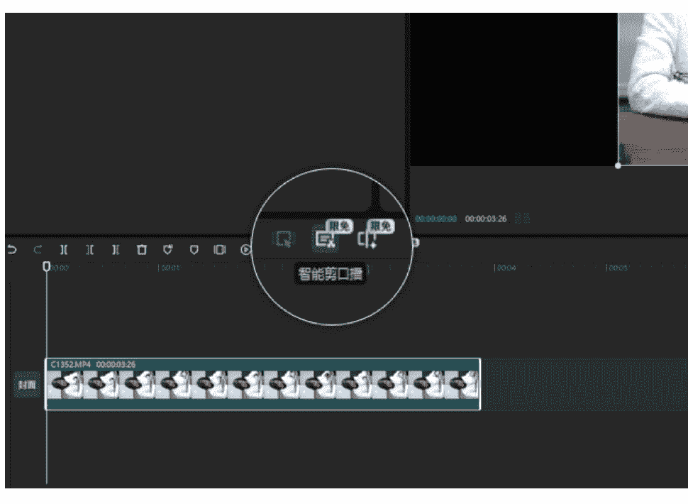

图9-5 单击“智能剪口播”

(2) 此时剪映会自动识别视频中的人声，分析停顿、口误、重复语气词、无效片段，10秒内完成全片扫描，并标记所有需要删减的片段，如图9-6所示。

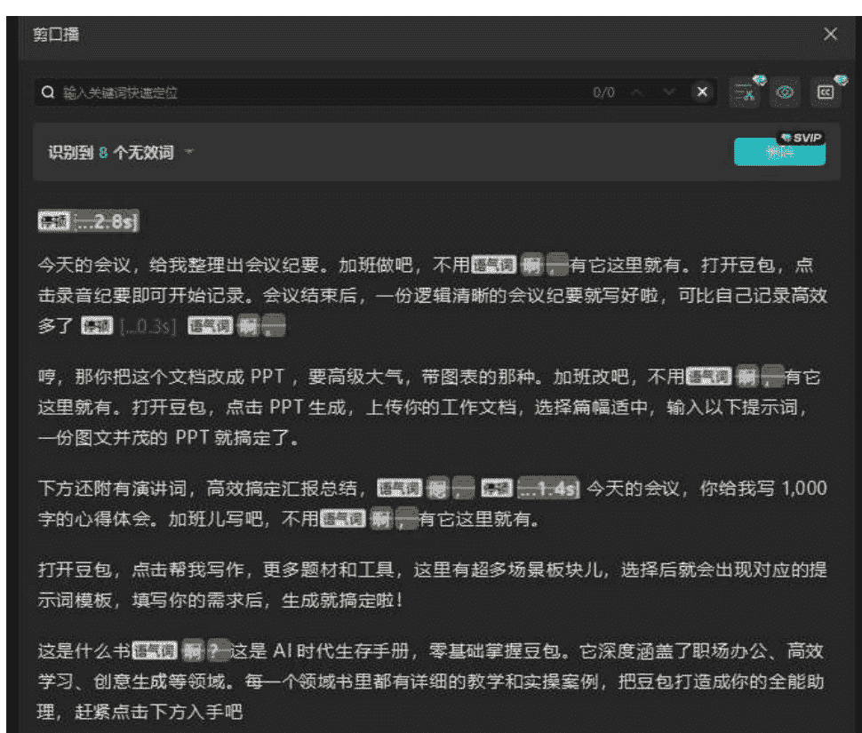

图9-6 需要删减的片段

### 2.智能添加笑点和音效

识别完无效片段后，单击“音频”→“音效库”→“AI音效”，如图9-7所示，剪映会根据口播的内容、语气、节奏，自动匹配对应的音效（比如在笑点处配笑声、在重点内容处配强调音、在提问处配悬念音）。

### 3.画面优化与成片导出

针对口播视频画面单调的问题，可使用剪映的“智能抠像”功能一键更换背景，也可使用“抠像描边”功能突出重点人物，丰富视频内容，如图9-8所示。全部调整完成后即可导出口播视频。

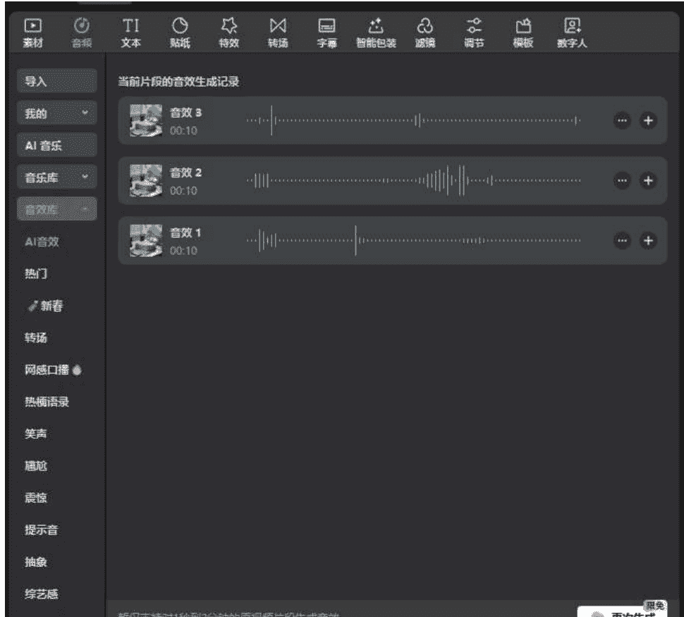

图9-7 单击“AI音效”

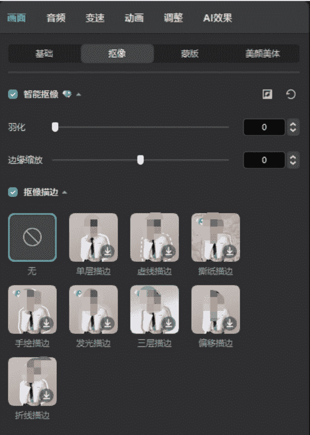

图9-8 “抠像描边”功能

### 9.2.3 豆包+Seedance 2.0进阶优化，打造爆款口播视频

纯口播视频的核心竞争力除了内容本身，还有画面的丰富度和对节奏的把控，可通过豆包+Seedance 2.0进一步优化视频内容，大幅提高其成为爆款的概率，具体方法如下。

### 1.用豆包优化口播文案，补充爆款“钩子”与金句

把原始文案发给豆包，用以下提示词进行优化，提升视频内容的吸引力。

请你优化这篇口播文案，要求：

1. 开头增加3秒的爆款“钩子”，用痛点/反差观点吸引观众的注意力；
2. 为每一个核心知识点补充一个好记的金句，以便剪辑高光片段；
3. 在合适的位置增加笑点、互动提问，提升视频的完播率和评论率；
4. 保留口语化表达，删除冗余的语气词，让内容更紧凑，适配短视频传播节奏。

优化文案能从根源上提升视频的内容质量，再配合AI剪辑，视频的节奏会更好，吸引力也会大幅提升。

### 2.用Seedance 2.0生成辅助画面，解决画面单调的问题

口播视频中，纯人物画面容易让观众产生视觉疲劳，需要补充与文案匹配的辅助画面，可通过Seedance 2.0快速生成。

(1) 根据口播文案的内容，用豆包拆解出需要补充的画面场景，比如讲职场干货时，需要办公室里人们工作的画面。
(2) 在Seedance 2.0中输入提示词，生成对应时长的高清视频片段，如图9-9所示，提示词模板如下。

生成一个8秒的高清短视频，画面内容为[职场人用四象限法则整理工作清单，高效处理日常工作]，画面风格为写实明亮，职场氛围感，镜头缓慢推进，帧率为25帧/秒，无水印，画面清晰自然。

(3) 把生成的视频片段以画中画的形式导入剪映，对齐对应的口播文案，就能让视频画面更丰富，观众的停留时长也会大幅增加。

### 3.用豆包生成音效、特效匹配建议，精准贴合内容

针对口播视频的节奏，让豆包生成专业的音效、特效匹配建议，比如“在重点内容处加重音特效，在转折处加转场音效，在笑点处加轻快的笑声”，再在剪映中添加对应音效，让视频的节奏更专业。

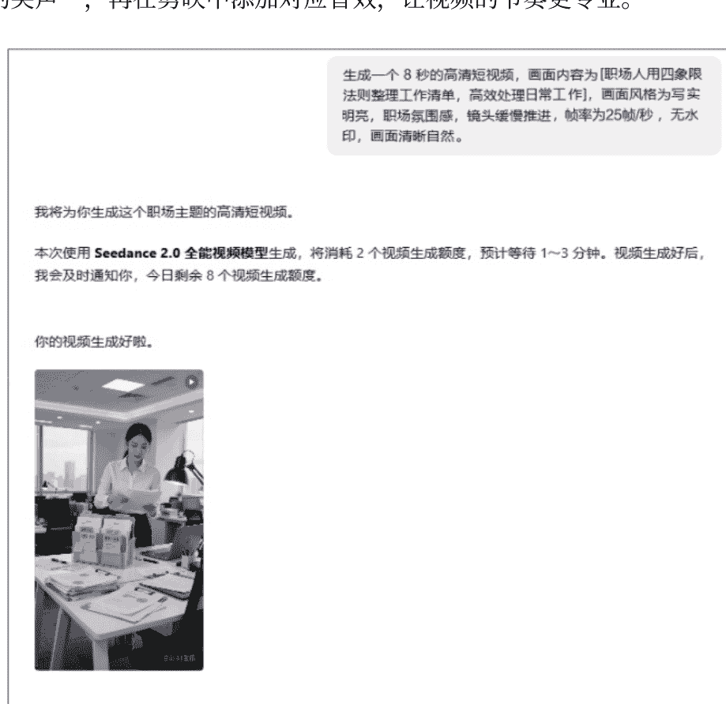

图9-9 用Seedance 2.0生成高清视频片段

### 9.2.4 增收攻略：口播视频精剪的规模化变现路径

口播视频精剪是高频、刚需的服务，通过标准化的服务设计，能实现从单次接单到规模化变现，核心增收攻略如下。

### 1.设计阶梯化服务套餐，提高客单价

根据客户的需求，设置不同档位的服务，让客户按需选择，定价参考如表9-2所示。

表9-2 定价参考

| 服务套餐 | 包含内容 | 定价 | 目标客户 |
| :--- | :--- | :--- | :--- |
| 基础精简版 | AI一键删除冗余片段+添加字幕+校准错别字 | 30元/条（5分钟内） | 新手博主 |
| 深度精剪版 | 基础精简版所有服务+音效与花字匹配+画面优化+节奏调整 | 80元/条 | 垂类博主、带货主播 |
| 全案定制版 | 豆包文案优化+Seedance 2.0辅助优化画面+全片精修+封面标题 | 199元/条 | 知识IP博主、品牌商家 |
| 包月服务包 | 每周5条精剪视频+节奏优化+批量处理 | 800～1500元/月 | 长期更新的博主、实体店店主 |

### 2.扩宽获客渠道，低成本触达目标客户

(1) 内容引流：在小红书、抖音发布“口播视频剪辑前后对比”“3分钟搞定口播视频精剪”教程，展示剪辑效果，引导观众发送私信咨询。

(2) 精准社群：加入博主交流群、带货商家群、本地实体店社群，先分享口播视频剪辑干货，再推出免费快剪体验，建立信任后实现转化。

(3) 平台挂单：在闲鱼、淘宝发布口播视频精剪服务，服务标题中包含核心关键词（如口播视频精剪、短视频剪辑、停顿删除、字幕校准等），获取搜索流量。

### 3.发展兼职团队，突破个人产能天花板

当订单量超过个人承接能力时，可招募兼职剪辑人员，你负责接单、质检、对接客户，兼职人员负责完成剪辑。比如你接单报价80元/条，分给兼职人员40元/条，赚取差价，从“卖时间”升级为“卖管理”，实现规模化变现。

## 9.3 量产快闪视频：AI自动踩点，替换模板实现批量产出

快闪视频凭借节奏快、视觉冲击力强、信息密度高的特点，成为商家促销、品牌宣传、活动预热、节日祝福等场景下的刚需内容。无论是本地餐饮店、教培商家，还是企业、品牌方，都有高频的快闪视频制作需求。

### 9.3.1 快闪视频的核心应用场景与创作痛点

### 1.核心应用场景

快闪视频的应用场景极其广泛，商业需求旺盛，核心应用场景有以下几个。

(1) 本地商家促销：餐饮、美容业、零售门店的节日促销、新品上市推广、优惠活动宣传。
(2) 企业/品牌宣传：品牌介绍、产品卖点说明、招商加盟、活动预热。
(3) 个人/场景应用：节日祝福、婚礼开场、生日祝福、毕业纪念、求职简历。
(4) 自媒体引流：爆款预告、干货合集、账号人设宣传，提升视频的视觉冲击力。

### 2.创作痛点

(1) 手动卡点效率极低：手动逐帧对齐画面、文字和音乐节拍，费时费力，新手很容易出现节奏错位的问题。
(2) 模板同质化严重：网上的快闪模板千篇一律，没有辨识度，要实现商家想要的定制化效果，时间成本极高。
(3) 批量制作难度大：给不同商家做同类型的促销视频，需要反复修改文案、画面、音乐，无法实现快速批量产出。

### 9.3.2 剪映+豆包量产快闪视频实操全流程

通过剪映的AI自动踩点、模板一键替换功能，搭配豆包的文案创作功能，可以实现快闪视频的快速制作和批量产出，具体操作步骤如下。

### 1.用豆包生成适配快闪视频的文案

快闪视频的核心是短、平、快的文案和清晰的节奏，可通过豆包生成适配快闪视频的文案，核心提示词模板如下。

请你为[奶茶店情人节促销活动]生成15秒快闪视频的文案，要求：

1. 文案拆分成10个片段，每个片段1～8个字，信息密度高，直击核心卖点；
2. 开头用“钩子”吸引观众的注意力，中间讲核心优惠，结尾讲行动指令；
3. 标注每个文案片段对应的节奏或节拍，适配快闪视频的卡点节奏；
4. 风格活泼有冲击力，适合本地商家促销使用。

豆包生成的文案能完美适配快闪视频的节奏，避免出现文案过长、信息不清晰的问题，为后续的AI自动踩点打好基础。

### 2.剪映AI自动踩点，搭建快闪视频模板

(1) 打开剪映，导入提前选好的快闪视频背景音乐（优先选择节奏感强、鼓点清晰的音乐），选中时间轴面板上的音频，单击“添加标记”，选择“踩节拍Ⅱ”（适合快闪视频的强节奏踩点），剪映会自动在音乐的每个鼓点上生成褐色的踩点标记，完成自动踩点，如图9-10所示。

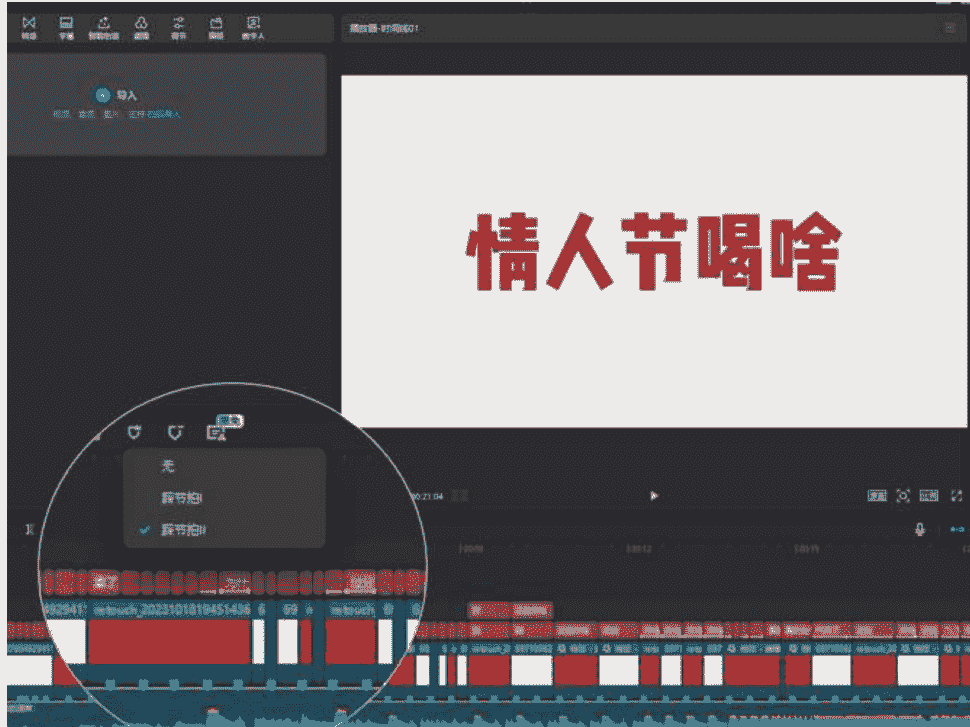

图9-10 自动踩点

(2) 根据豆包生成的文案，在每个标记的踩点位置添加对应的文本、画面素材，设置文本的动画效果（入场、出场动画），让文字出现和消失的节奏完美匹配音乐的鼓点，搭建出完整的快闪视频模板。

(3) 单击“特效”→“AI推荐特效”，剪映会根据音乐节奏和快闪视频风格自动匹配对应的转场效果、画面特效，一键添加这些特效后可让视频的视觉冲击力更强。

### 3.一键替换模板内容，批量产出视频

模板搭建完成后，后续制作同类型的快闪视频就不用重新搭建结构了，只需一键替换文案、画面、音乐，就能快速生成新的视频，实现批量产出视频。

(1) 文案替换：直接修改文本内容，无须调整动画、时长、踩点位置，10秒就能替换完所有文案，如图9-11所示。

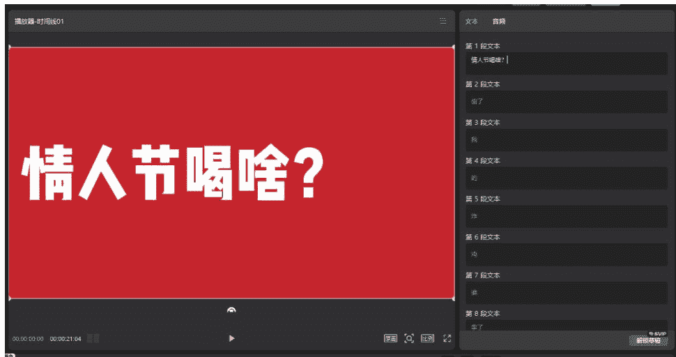

图9-11 快闪视频模板批量替换文案示意图

(2) 画面素材替换：单击画中画的素材片段，选择“替换”，导入新的素材，素材将自动适配原有的时长、动画、特效。

(3) 音乐替换：更换背景音乐后，单击“自动踩点”，AI会自动对齐新的音乐节拍，无须手动调整，如图9-11所示。

用这个方法，原本只能制作1条视频的时间，现在能批量制作10条视频，完美适配多商家、多场景的批量制作需求。

### 4.多比例适配与导出视频

剪映支持一键调整视频比例，单击“比例”，可选择9：16（抖音、小红书竖屏）、16：9（视频号横屏）、1：1（朋友圈正方形）等不同比例，剪映会自动调整画面和文字的位置，无须手动调整。调整完成后，导出高清视频即可直接使用。

### 9.3.3 豆包+Seedance 2.0进阶玩法，打造差异化快闪视频

使用通用模板容易出现同质化问题，通过豆包+Seedance 2.0，可以打造专属的定制化快闪视频，提升视频的辨识度和商业价值。

### 1.用豆包拆解爆款快闪视频，生成脚本

在抖音、视频号找到同赛道的爆款快闪视频，把视频链接发给豆包，用以下提示词拆解其结构。

> 请你拆解这条爆款快闪视频的结构，包括文案节奏、画面切换逻辑、音乐踩点规律、动画特效类型，然后基于这个爆款结构，为[餐饮门店“6·18”促销活动]生成一个快闪视频脚本，包含文案、画面描述、时长、节拍4个维度。

基于爆款视频结构生成的脚本能大幅提升视频的引流效果。

### 2.用Seedance 2.0生成定制化视觉元素，解决同质化问题

(1) 用Seedance 2.0生成快闪视频的专属动态背景、3D片头片尾或转场特效，如图9-12所示，生成动态背景的提示词模板如下。

> 生成一个15秒的循环动态背景视频，画面风格为[赛博朋克风]，奶茶店促销主题，画面元素有[奶茶杯、冰块、粉色霓虹灯、爱心气泡]，节奏快，视觉冲击力强，适配快闪视频鼓点，帧率为25帧/秒，高清无水印。

(2) 用Seedance 2.0生成商家产品的动态展示视频，比如餐饮门店的菜品特写、美容业门店的服务场景，并用它替换掉静态的图片素材，让快闪视频的画面更生动，定制化程度更高。

### 3.一模板多风格，实现差异化批量产出视频

用豆包生成不同行业、不同风格的文案、画面描述，通过Seedance 2.0生成对应的视觉素材，分别导入同一个快闪视频模板中，就能快速生成餐饮、美容业、教培、零售等不同行业的快闪视频，实现“一个模板，批量产出差异化内容”，大幅提升接单效率。

### 9.3.4 增收攻略：快闪视频的批量变现技巧

快闪视频的需求量大且分散，通过节日节点营销、包月服务、模板售卖，能实现多渠道变现。

### 1.节日节点营销，批量制作模板售卖

每个节日（如情人节、中秋节、国庆节、春节）都是商家办促销活动的重点时期，提前用豆包+剪映+Seedance 2.0制作不同行业的节日快闪视频模板，比如“情人节奶茶店促销快闪视频模板”“春节餐饮门店拜年模板”，在闲鱼、小红书上售卖，每套模板定价19.9～49.9元，通常节日前期单套模板能卖出上百份。

### 2.本地商家包月服务，锁定稳定收入

针对本地餐饮、美容业、零售门店，推出快闪视频包月服务，每月收费200～500元，包含4条促销快闪视频，适配门店的日常活动、节日促销、新品上市等推广需求。这类服务的复购率极高，只要服务好10～20家门店，就能拥有可观、稳定的收入。

### 3.行业模板库搭建，实现规模化变现

按行业分类搭建快闪视频模板库，比如餐饮、美容业、教培、婚庆等，每个行业包含10套不同风格的模板，搭配豆包提示词、操作教程，打包售卖，每套定价99～199元。同时可推出“模板定制服务”，单套定制收费200～500元，进一步提高客单价。

## 9.4 智能包装：一键匹配字幕、花字、音效与特效，提升成片质感

剪映的智能包装功能可以根据视频类型或风格自动匹配字幕、花字、音效和特效，无须手动逐个添加，即使是零基础创作者也能让普通视频快速具有专业质感，解决“不会加特效、不会做字幕排版、不会加音效”的痛点。

### 9.4.1 智能包装功能覆盖的视频类型

智能包装功能覆盖6种主流视频类型，可完美适配不同创作需求。

- 智能推荐：自动识别视频内容，匹配最合适的包装风格，通用性好。
- 科技风：适合数码测评、科技科普、职场干货等类型的视频，偏冷色调、科技感强。
- 生活Vlog：适合记录日常、旅行和分享美食，提供偏清新、活泼的花字和音效。
- 营销带货：适合产品推广、促销宣传，突出利益点的醒目花字，音效具有节奏感。
- 知识分享：适合干货讲解、职场教学，提供清晰规整的字幕排版、简洁特效。
- 综艺娱乐：适合搞笑、访谈、娱乐等类型内容，提供综艺感花字、趣味音效和转场。

### 9.4.2 智能包装功能实操全流程

利用智能包装功能，零基础创作者也能3分钟完成视频包装，具体步骤如下。

### 1.进入智能包装功能界面

打开剪映，导入剪辑好的视频，单击顶部的“智能包装”，进入智能包装功能界面，左侧默认选中了“画面包装”，右侧展示了所有可用风格模板，如图9-13所示。

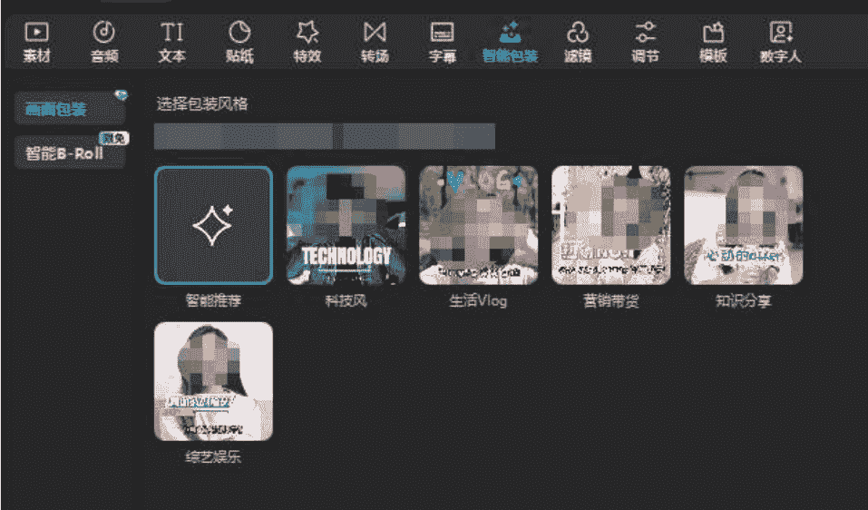

图9-13 智能包装功能界面

### 2.选择适配的包装风格

根据视频类型，选择相应的风格。

- 知识类、职场类视频：优先选择“知识分享”“智能推荐”。
- 带货、促销类视频：选择“营销带货”。
- 日常记录、旅行类视频：选择“生活Vlog”。
- 数码、科技类视频：选择“科技风”。
- 搞笑、娱乐类视频：选择“综艺娱乐”。

选择风格后，剪映会提供包装效果预览，实时生成对应的字幕、花字、音效和特效，无须手动操作，如图9-14所示。

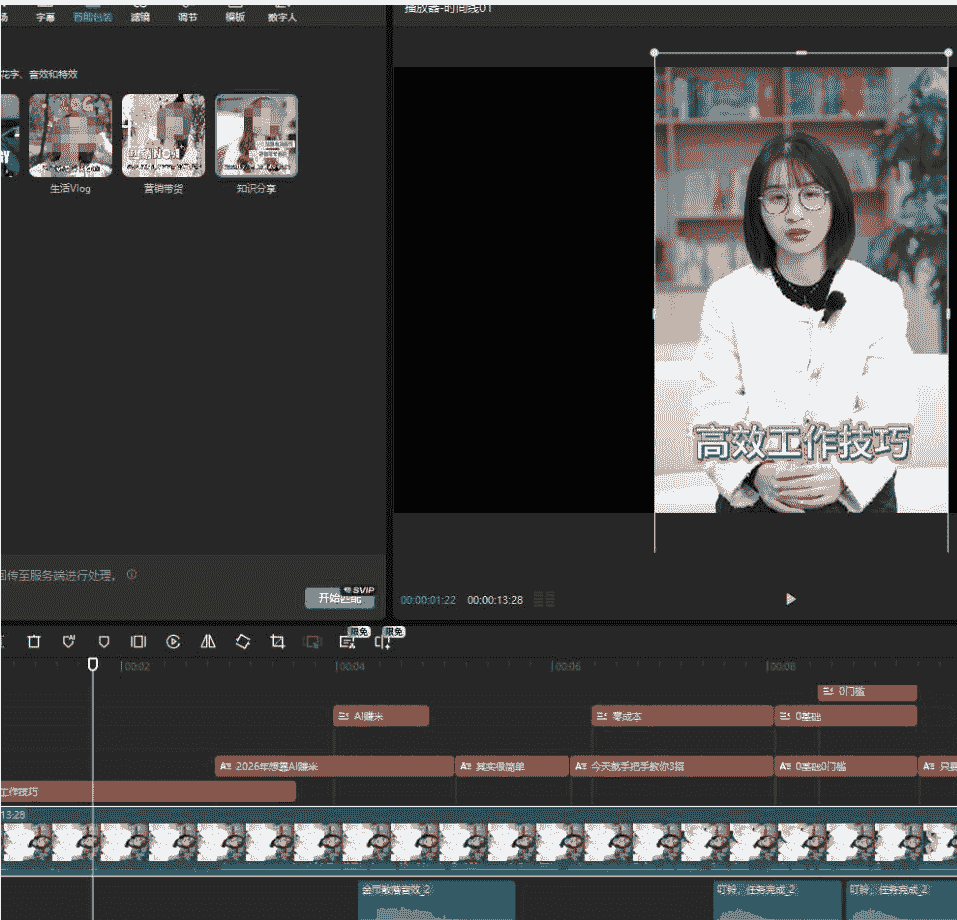

图9-14 包装效果实时预览

### 3.微调包装细节，贴合视频内容

可对剪映自动生成的包装做简单微调，让效果更精致。

(1) 字幕/花字调整：选中字幕片段，可修改文字内容、字体、颜色、大小，调整花字的入场/出场动画，让重点内容更突出。

(2) 音效/特效替换：单击底部的“音频”“特效”，可替换AI匹配的音效、特效，比如把营销类视频的快节奏音效换成更舒缓的音效。

(3) 风格切换：如果对当前风格不满意，可直接单击其他风格的模板，一键重新生成包装，无须重新调整。

### 4.用“智能B-Roll”（限免）功能补充画面

单击左侧的“智能B-Roll”，如图9-15所示，剪映会自动识别视频中的口播内容，并匹配对应的辅助画面素材（比如讲职场干货时匹配办公室场景、讲美食时匹配烹饪画面），可将它们一键补充到视频中，解决纯口播画面单调的问题，让视频内容更丰富。

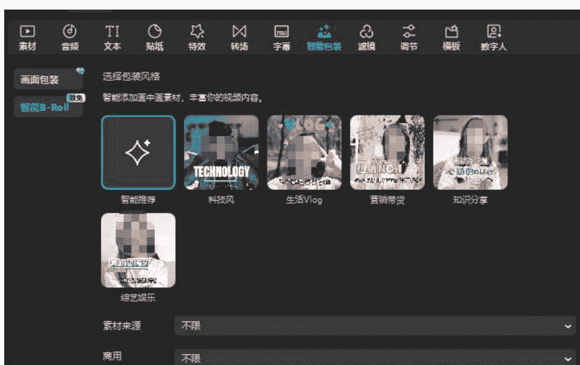

图9-15 单击“智能B-Roll”

### 5.导出与发布视频

微调完成后，单击右上角的“导出”，导出的视频已完成全套包装，可直接发布到抖音、视频号等平台。

### 9.4.3 豆包+Seedance 2.0进阶玩法，打造差异化包装效果

剪映的智能包装功能实现了“快速、有质感”的包装，搭配豆包和Seedance 2.0，能进一步提升内容适配度，打造更具辨识度的包装效果。

### 1.用豆包优化包装文案，突出核心信息

AI自动生成的字幕、花字可能不够精准，可把视频核心内容发给豆包，用以下提示词进行优化。

请你为这条[职场高效工作]的知识分享视频，优化智能包装生成的字幕文案，要求：

1. 每段字幕控制在15字以内，简单易懂；
2. 重点内容用加粗/醒目文字说明，突出核心技巧；
3. 结尾添加互动引导字幕，比如“在评论区分享你的高效技巧”。

把优化后的文案替换到剪映字幕中，让包装更贴合视频核心卖点，提高信息传递效率。

### 2.用Seedance 2.0定制专属花字/特效，避免同质化

使用剪映的风格模板容易出现同质化问题，可用Seedance 2.0生成定制化的花字、动态特效，并导入剪映替换原有模板。

(1) 根据视频主题，让豆包描述花字/特效需求，比如“知识分享类短视频，花字风格为简洁商务风，蓝色调，带适当科技感的动画”。

（2）在Seedance 2.0中输入提示词，生成高清动态花字/特效素材，提示词模板如下。

生成一个5秒的动态花字素材，文字内容为[高效工作技巧]，风格为简洁商务风，蓝色渐变，带适当科技感的扫光动画，适配知识分享类短视频，无水印，高清透明背景。

（3）把生成的素材导入剪映，替换掉AI自动生成的花字，打造专属包装效果，如图9-16所示。

图9-16 Seedance 2.0定制花字与剪映智能包装的结合效果

### 9.4.4 增收攻略：智能包装的商业化变现路径

智能包装是“低成本、高效率”的短视频增值服务，适合新手快速变现，核心攻略如下。

### 1.视频风格化包装服务，按单收费

针对博主、商家的包装需求，推出标准化服务，定价参考如表9-3所示。

表9-3 定价参考

| 服务套餐 | 包含内容 | 定价 | 目标客户 |
| :--- | :--- | :--- | :--- |
| 基础包装包 | 智能包装风格匹配+字幕/花字微调+智能B-Roll补充 | 20元/条 | 新手博主、个体商家 |
| 定制包装包 | 豆包文案优化+Seedance 2.0定制花字/特效+全片包装精修 | 60元/条 | 垂类博主、品牌商家 |
| 包月包装包 | 每周5条视频包装+风格适配建议+批量导出 | 300元/月 | 长期更新的博主、实体店店主 |

获客渠道及方式：在闲鱼挂单，在小红书发布“包装前后对比”案例，在本地商家社群用“免费风格适配建议”吸引客户。

### 2.风格模板定制服务

按行业/应用场景，定制专属的智能包装风格模板（比如“餐饮促销风”“育儿干货风”），搭配豆包优化后的文案、Seedance 2.0定制素材，打包成模板包，在闲鱼、小红书上售卖，定价19.9~39.9元，一次制作，无限次售卖。

### 3.包装技巧教程售卖，知识变现

把智能包装的实操技巧、风格选择逻辑、豆包优化提示词等整理成教程（比如“剪映智能包装：3分钟让视频变高级”），在知识付费平台、闲鱼售卖，定价29.9～59.9元。

# 第10章 四大热门赛道：AI剪辑的标准化变现方案

短视频变现的核心是“标准化流程+高适配赛道”，无须专业剪辑功底，无须复杂运营技巧，依托豆包的文案生成能力+剪映的AI剪辑功能，能实现“3分钟出片、批量交付、稳定变现”。本章聚焦4个低门槛、高需求、易落地的热门赛道，拆解每一个赛道的AI剪辑全流程、变现逻辑和优化技巧，让零基础新手也能快速找准方向，实现从“会剪辑”到“能赚钱”的跨越。

## 10.1 带货口播流水线：从AI提炼卖点到3分钟快速出片

带货口播是最易落地、变现最快的短视频赛道，借助豆包提炼卖点、生成口播脚本，搭配剪映的AI剪辑功能，可实现“10分钟产出3条合格带货视频”，适合新手起步变现。

### 10.1.1 前期准备：3分钟搞定口播脚本（豆包主导）

带货口播的核心是“卖点精准+文案接地气”，可让豆包快速完成前期准备，重点做以下3件事。

#### 1.明确产品关键信息

整理产品关键信息，包括产品名称、核心卖点（3～5个，如平价、防水、省时）、目标人群（如学生、宝妈、职场人士）、优惠活动（如买一送一、限时折扣），无须复杂描述，简单罗列即可。

示例：面膜，平价（9.9元3片）、敏感肌可用、深层补水、熬夜急救，适合学生、熬夜人士，买2送1。

#### 2.用豆包提炼核心卖点（规避无效信息）

提示词模板（直接复制并替换）如下。

帮我写一款[产品名称]的带货口播文案，产品关键信息：[复制整理的产品关键信息]。请帮我提炼3个最吸引目标人群的核心卖点，每个卖点配一句口语化解释，避免使用专业术语，适配15～30秒的口播视频，贴合新手语气，不用太正式。

输入提示词并提交后，豆包会快速筛选无效信息，精准提炼卖点。例如对于上述补水面膜，豆包会输出“①平价友好：9.9元3片，学生党无压力，每天敷也不心疼。②敏感肌可用：温和配方，泛红皮肤、干敏肌也能放心用。③熬夜急救：睡前敷10分钟，熬夜后也能容光焕发”。

#### 3.用豆包生成完整口播脚本

基于提炼的卖点，让豆包生成完整口播脚本，提示词模板如下。

基于刚才提炼的[产品名称]卖点，帮我生成15～30秒的口播脚本，开头3秒抓住观众注意力，中间讲3个卖点，结尾引导下单（如“单击小黄车”“私信我”），口语化、接地气，像朋友在推荐，避免生硬推销，提供分镜头标注（如“镜头1：手持产品”“镜头2：展示使用效果”）。

豆包生成的口播脚本示例见表10-1。

表10-1 豆包生成的口播脚本示例

| 镜头 | 位置 | 画面 | 台词 |
| :--- | :--- | :--- | :--- |
| 镜头 1 | 第 0 ～ 3 秒 | 手持面膜 | 学生党、熬夜党快看过来，9.9 元 3 片的补水面膜被我找到了（语气惊喜） |
| 镜头 2 | 第 3 ～ 15 秒 | 展示面膜质地 | 敏感肌也能放心用，温和不刺激，睡前敷 10 分钟，熬夜后的干脸直接救回来，深层补水（语速稍快） |
| 镜头 3 | 第 15 ～ 28 秒 | 手持面膜指向小黄车 | 现在买 2 送 1，9.9 元就能实现“面膜自由”，学生党闭眼冲，单击小黄车直接拍 |
| 镜头 4 | 第 28 ～ 30 秒 | 微笑比心 | 拍过的姐妹，评论区告诉我你们的使用感受 |

### 10.1.2 剪映AI剪辑：3分钟自动出片（无须手动操作）

口播脚本确定后，用剪映的AI剪辑功能快速拼接素材、添加字幕与背景音乐等，全程3分钟完成，步骤如下。

#### 1.素材准备

收集产品相关素材（如产品特写、使用过程、使用效果对比图/视频），无须剪辑，直接保存到手机相册（剪映可自动识别）；若没有素材，可用豆包生成产品示意图，如图10-1所示（提示词：“帮我生成[产品名称]的高清实拍图，贴合真实使用场景，无水印，适合短视频使用”）。

图10-1 使用豆包生成产品示意图

#### 2.剪映AI剪口播（核心步骤）

（1）打开剪映，单击“AI剪口播”，上传视频后即可获得文字稿，要删哪个片段就直接划掉文字。“AI剪口播”界面如图10-2所示。

（2）单击“加字幕”，剪映将自动识别字幕，还可以批量划重点、改词。

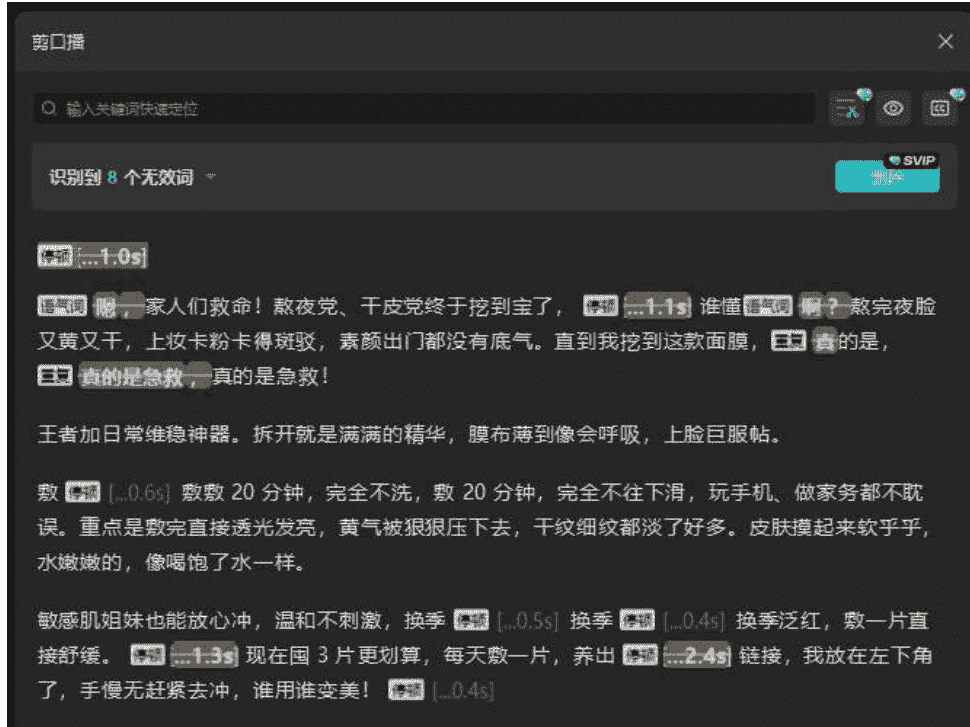

图10-2 “AI剪口播”界面

#### 3.细节优化（1分钟完成）

（1）智能去水词：依次单击“编辑”→“智能去水词”，剪映将自动标记无效话术，可一键去除口语化词语。
（2）AI改口误：若临时要改脚本，可依次单击“编辑”→“AI改口误”，无须重拍。
（3）智能包装：单击“AI剪口播”中的“智能包装”，剪映将自动加字幕、选花字做动画，还能十分灵活地在一些位置配上相应的画中画内容和表情包。

#### 4.导出与发布

单击右上角的“导出”导出视频，导出的视频可发布到抖音、视频号等平台。

### 10.1.3 变现路径与优化技巧

#### 1.变现路径（新手优先选择）

（1）带货佣金：在抖音、视频号开通橱窗功能，如图10-3所示，挂载商品链接，用户通过视频下单后，你即可赚取佣金（佣金比例为5%～50%，新手优先选择平价、高佣金商品，如9.9元、19.9元的刚需品）。

图10-3 抖音带货账号的橱窗

（2）接单变现：在小红书、闲鱼挂单，承接“带货口播剪辑”业务，如图10-4所示。定价参考：15～30秒视频30～50元/条，30～60秒视频50～80元/条，批量接单（10条以上）可优惠。依托标准化流程，每天可接5～10单。

图10-4 小红书、闲鱼带货口播剪辑业务截图

#### 2.优化技巧（提升转化率）

- 开头3秒必须抓住观众注意力。用“惊喜语气+痛点/福利”吸引观众，如“9.9元就能买3片补水面膜，学生党闭眼冲！”“熬夜脸救星来了，不用贵价护肤品，平价面膜也能养出细腻水润的好皮肤”。
- 卖点不超过3个。新手容易堆砌卖点，反而让观众记不住；聚焦3个核心卖点，每个卖点配1个简单场景，更易让观众接受。
- 口播语气自然。若自己口播不好，可用剪映AI配音。将豆包生成的口播脚本复制到剪映的“文本朗读”界面，选择亲切女声/男声，适配口播节奏，比自己口播效果更好。

## 10.2 知识付费赛道轻资产起号：动态大字报+AI文案驱动的引流视频

知识付费赛道门槛低、变现持久，适合新手轻资产起号，核心是“用低成本内容引流，后续转化知识付费产品（如资料包、训练营、课程）”。动态大字报视频是知识付费内容引流的最佳形式——无须真人出镜、无须复杂素材，依托豆包生成干货文案、剪映制作动态大字报视频，3分钟出片，批量引流效果极佳。

### 10.2.1 核心逻辑：动态大字报视频的引流优势

动态大字报视频，即“文字动态展示+干货文案+合适的背景音乐”，无须真人出镜，无须拍摄素材，核心优势是“制作速度快、成本低、价值感强”，适合知识付费赛道（如职场技巧、育儿知识、学习方法、AI工具使用等）。动态大字报视频示例见图10-5。

示例如下。

职场赛道的动态大字报视频，文案为“3个职场‘摸鱼’式成长技巧，每天10分钟，悄悄超越同事！①利用碎片时间学AI工具，提升效率；②每天总结1个工作难点，快速成长；③学习行业知识，拓宽认知”，搭配动态文字和轻快的背景音乐，简单直接，吸引职场人士关注。

### 10.2.2 实操流程：豆包写文案+剪映做动态大字报视频

豆包负责文案产出，剪映负责视频制作，零基础创作者可直接上手，步骤如下。

#### 1.用豆包生成知识干货文案（适配动态大字报视频）

知识付费内容的引流文案的核心是“痛点+干货+引导”，无须长篇大论，每条文案聚焦1个知识点，适配15～25秒的视频，提示词模板如下。

> 帮我写[赛道名称，如职场技巧、育儿知识]的动态大字报引流文案，目标人群是[如职场新人、宝妈]，请帮我生成15～25秒的干货文案，结构为开头痛点引入+3个核心干货+结尾引导（引导关注/私信领资料），语言简洁、有价值，适合用动态大字报视频展示，每句话不超过15字，分点清晰。

文案示例（职场新人赛道）如下。

职场新人必看！避免踩坑+快速成长。①不盲目加班，聚焦核心工作；②主动请教前辈，少走弯路；③每天复盘，积累经验。关注我，私信领职场新人避坑手册。

若想批量产出文案，可添加提示词“请批量生成10条同风格、不同知识点的文案，避免重复，每条均符合上述结构”，豆包将快速产出10条可直接使用的文案。

#### 2.用剪映制作动态大字报视频

剪映提供了动态文字功能，可快速生成动态大字报视频，让创作者无须手动制作动画。

（1）打开剪映，单击“开始创作”，选择“黑色背景”（动态大字报首选黑色背景，文字显示更清晰），单击“添加”。

（2）添加文字。单击“文字”，选择“新建文本”，将豆包生成的文案逐句复制，每句话单独创建为一份文本（方便设置动态效果），调整文字大小、颜色（首选白色、黄色，对比明显），居中对齐。

（3）设置动态效果。选中每段文字，单击“动画”，选择“入场动画”，推荐“打字机”“渐显”“滑动”效果（贴合视频调性），设置动画时长（每段文字动画时长为2～3秒，适配文案语速），逐段设置，让文字依次出现。

（4）添加背景音乐和音效。单击“音频”，选择“AI配乐”，搜索“干货、励志”，选择轻快、舒缓的纯音乐，调整音量（30%～40%）；可添加“打字机”音效，增强视频质感。

（5）细节优化。单击“画面”，选择“比例”，设置为9：16（竖屏，适配抖音、视频号）。可添加贴纸，搜索“干货、知识点”，添加简单贴纸（如笔记本、钢笔），点缀画面。

（6）导出与发布。单击右上角的“导出”，发布时添加赛道相关话题（如“#职场新人技巧”“#育儿干货”），引导观众关注和私信。

### 10.2.3 起号与变现：从引流到知识付费转化

#### 1.起号技巧（新手零门槛）

（1）聚焦垂直赛道：不要做“大杂烩”，优先选择一个垂直赛道（如职场、育儿、AI工具、学习方法），批量产出同风格的动态大字报视频，快速打造账号记忆点。

（2）批量发布：每天发布3～5条视频，用豆包批量生成文案+剪映批量制作，无须花费太多时间，坚持7～15天，即可获得精准流量。

（3）引流钩子：结尾引导语统一，如“关注我，私信领[资料名称，如职场避坑手册、育儿资料包]”。资料包可由豆包生成（提示词：帮我生成[资料名称]的完整内容，适合知识付费引流，内容实用、简洁，可直接保存为文档）。

#### 2.变现路径（轻资产，低风险）

（1）初级变现：售卖轻量级知识产品，如思维导图（19.9元/份）、资料包（9.9元/份），如图10-6所示。产品内容可用豆包快速生成，无须自己整理。

图10-6 小红书售卖的思维导图和资料包

（2）中级变现：推出低价训练营（99～199元/期），如“职场新人7天成长营”“AI工具使用训练营”。用豆包生成训练营课程大纲（见图10-7）、每日打卡内容，用剪映制作训练营宣传视频，批量引流与转化。

图10-7 使用豆包生成的训练营课程大纲

（3）高级变现：推出付费课程（299～999元），如图10-8所示。聚焦赛道核心需求，用豆包辅助撰写课程文案、制作课程PPT，用剪映制作课程宣传视频。

图10-8 小红书售卖的付费课程

## 10.3 高黏性Vlog制作：“黄金3秒”抓人结构与情绪剪辑法

Vlog赛道受众广、内容灵活，适合普通人记录生活（如旅行、美食、日常、职场），变现路径清晰（如广告植入、带货）。新手做Vlog的核心痛点是“剪辑杂乱、内容无逻辑、流量低”，而依托剪映和豆包，遵循“前3秒抓人+中段信息展示+结尾钩子”的标准化结构，可实现3分钟出片，快速提高流量并变现。

普通Vlog难涨粉、难变现，核心问题是“缺乏情绪共鸣、粉丝黏性低”。高黏性Vlog的核心是“情绪驱动+节奏把控”，依托剪映的AI情绪剪辑功能，搭配豆包生成的情绪引导文案，优化“黄金3秒”钩子，可让观众产生共鸣、主动关注，进而促进变现。

### 10.3.1 “黄金3秒”钩子优化：3种高停留模板（适配所有Vlog）

“黄金3秒”是Vlog内容能否留住观众的关键，而普通钩子难以吸引观众停留，优化后的钩子需具备“情绪感+画面感+关联性”，下面介绍的3种模板可直接套用。

#### 1.情绪共鸣型钩子（最易涨粉）

核心逻辑：贴合观众情绪（如焦虑、快乐、感动），用口语化文案和对应画面让观众产生共鸣。

示例：画面——治愈的海边日落，文案——长大后才发现，治愈焦虑的最好方式就是去看一次海🌊；画面——自己做饭的场景，文案——打工人下班回家，做一顿热饭就是最简单的幸福。

豆包提示词如下。

帮我生成Vlog黄金3秒情绪钩子文案，主题[如治愈类旅行、打工人日常]，情绪[如治愈、快乐、感动]，口语化、有画面感，不超过15字，贴合Vlog语气。

#### 2.反差对比型钩子（提升好奇心）

核心逻辑：用“前后对比”制造反差，吸引观众停留。

示例：画面——自己素颜和化妆后的对比，文案——普通女生化妆前后，差距有多大；画面——旅行踩坑情景和宝藏景点对比，文案——青岛旅行避坑，别再去“网红”景点了。

#### 3.价值前置型钩子（精准吸引观众）

核心逻辑：开头直接传递价值，让观众知道“看完这条视频能得到什么”，适合知识类、攻略类Vlog。

示例：画面——旅行攻略截图，文案——青岛旅行3天2晚攻略，人均500元搞定；画面——职场技巧文本，文案——打工人必看！3个成长技巧。

提示：钩子画面需与文案匹配，避免“文案与画面脱节”，可通过剪映AI自动匹配画面风格。

### 10.3.2 标准化结构拆解：3步打造高流量Vlog

Vlog的关键是“有逻辑、有情绪、有记忆点”，无论是旅行Vlog还是日常Vlog，“前3秒抓人+中段信息展示+结尾钩子”的结构均适用，每一部分都可借助AI快速完成。

#### 1.前3秒抓人（核心：吸引停留，避免划走）

核心逻辑：用“视觉冲击+情绪引导”让观众在3秒内停留。有3种常见的钩子模板（可使用豆包辅助生成文案），可直接套用。

- 开头钩子：“谁懂啊！第一次来海边，直接被治愈了😊”“打工人周末出逃，这一天也太快乐了！”
- 视觉钩子：开头放最惊艳的画面（如旅行中的美景、美食特写），搭配文案“这才是周末该有的样子✨”。
- 悬念钩子：“花100元逛遍小吃街，最后吃到了宝藏美食！”“旅行中踩过的坑，看完这篇少走弯路。”

#### 2.中段信息展示（核心：传递价值，丰富内容）

核心逻辑：围绕主题传递有用信息（如旅行攻略、美食推荐、日常感悟），避免内容杂乱无章，分成2～3个小片段，每个片段聚焦1个信息点。

这里有一个旅行Vlog中段的示例。

片段1（3～10秒）：展示景点画面，文案“来青岛必去的小麦岛，免费开放，海边日落超美”。片段2（10～20秒）：展示美食，文案“路边的海鲜大排档，人均50元，新鲜又实惠”。片段3（20～30秒）：展示打卡姿势，文案“拍照小技巧——站在海边侧身拍，氛围感十足”。

若不知道中段写什么信息，可在豆包对话框中输入以下提示词。

帮我写[主题，如青岛旅行、周末日常]的Vlog中段文案，时长为15～25秒，分3个小片段，每个片段配1句口语化文案，传递实用信息（如攻略、技巧），贴合Vlog语气，自然不生硬。

#### 3.结尾钩子（核心：引导互动，提升黏性）

核心逻辑：结尾引导观众互动（如点赞、评论、关注），或留下悬念，为下一条视频做铺垫。有3种常见的结尾模板。

- 互动钩子：“你们周末去哪里玩？评论区告诉我～”“喜欢海边的宝子，点赞收藏，下次一起去！”
- 悬念钩子：“下一期分享青岛旅行避坑攻略，记得关注我哦！”
- 价值钩子：“我整理了青岛旅行攻略，关注我，私信领完整版！”

### 10.3.3 豆包+剪映实操：3分钟剪出合格Vlog

## 10.3.3 Vlog制作全流程：从素材到成片

新手做Vlog，无须手动剪辑片段、调整节奏，可通过剪映的AI剪辑功能自动完成。此外，还可使用豆包辅助生成文案和字幕。

##### 1. 素材准备

拍摄日常/旅行素材（不需要使用专业设备拍摄，手机即可），可按“前3秒抓人+中段信息展示+结尾钩子”拍摄相关内容，无须排序，剪映可自动识别。

##### 2. 用豆包生成Vlog文案（口语化）

提示词模板如下。

我要做[主题，如周末海边Vlog、日常美食Vlog]，素材是[简单描述素材内容，如海边美景、小吃街美食、拍照片段]，请帮我生成完整的Vlog文案，遵循“前3秒抓人+中段信息展示+结尾钩子”的结构，口语化、自然，像和朋友分享日常，适配30～60秒的视频，分镜头标注文案。

##### 3. 用剪映剪辑Vlog（核心步骤）

- (1) 打开剪映App，单击首页中的“AI剪视频”，上传手机相册中的素材，单击“下一步”。
- (2) 剪映会自动筛选优质素材，并基于素材生成成片思路，提供合适的模板、视频色调。如果对生成的思路不满意还可以修改。生成思路和生成效果如图10-9所示。
- (3) 添加文案和字幕。将豆包生成的文案复制到剪映“文本”板块；若想添加字幕动画，可选中字幕，设置入场/出场动画，注意贴合Vlog调性。

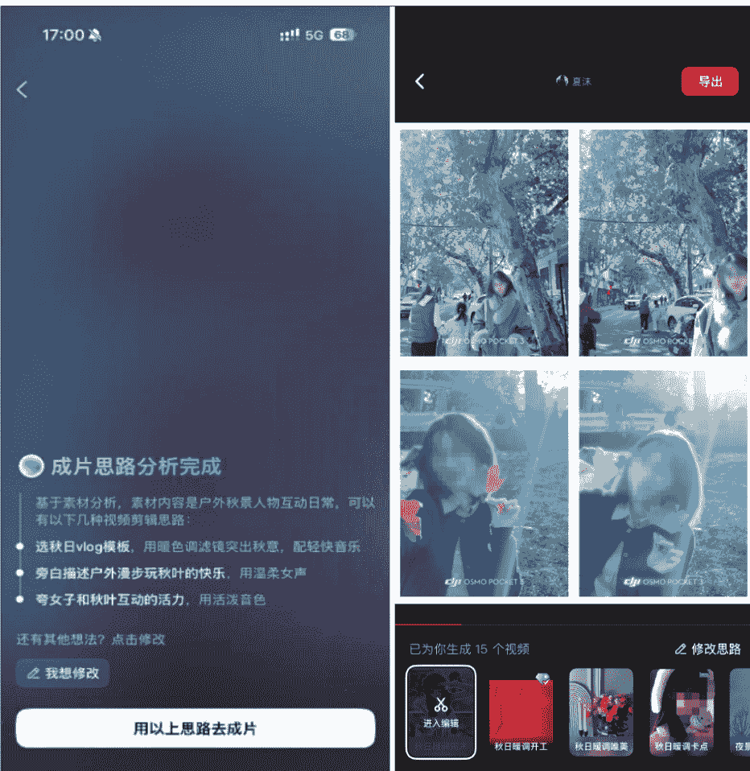

图10-9 生成思路和生成效果

- (4) 添加背景音乐和音效。剪映会自动推荐适配Vlog的背景音乐，单击“音频”，可替换为自己喜欢的背景音乐；添加“环境音效”（如海边风声、美食咀嚼声），以增强代入感。
- (5) 导出视频，发布时添加话题（如“#旅行Vlog”“#日常分享”），提升曝光量。

### 10.3.4 高黏性技巧：提升留存率与互动率

高黏性Vlog不仅要吸引观众停留，还要引导观众互动、关注，可通过以下3个技巧实现。

#### 1. 节奏把控

避免剪辑节奏杂乱，用剪映的自动调速功能，根据情绪基调调整节奏（如治愈Vlog节奏放缓，快乐Vlog节奏加快），每5～10秒设置一个小亮点（如美景、干货知识、情绪转折），避免观众划走。

#### 2. 互动设计

在视频中段或结尾添加互动式提问，可用豆包生成互动文案（如“你们有没有过这类治愈的时刻？评论区分享一下～”“你们喜欢海边吗？下次想去哪里？”），引导观众评论。

#### 3. 人设强化

在Vlog中加入个人特色（如固定的口头禅、标志性动作），用豆包生成贴合个人人设的文案，让观众更好地记住你；定期发布同风格、同基调的Vlog，强化账号标签，提升账号粉丝黏性。

### 10.3.5 Vlog变现路径（普通人可落地）

Vlog变现的核心是“积累粉丝+精准变现”，新手可从低门槛变现开始，逐步提升收益。

#### 1. 初级变现：平台流量分成+带货变现

- (1) 平台流量分成：在抖音、视频号、哔哩哔哩开通创作者激励，发布Vlog视频，根据播放量赚取分成（新手初期可能每月几百元，粉丝增长后可提升至几千元）。抖音创作者伙伴计划如图10-10所示。

##### 抖音创作者伙伴计划

创作优质内容·获得现金激励

###### 加入伙伴计划·得现金收益

加入创作者伙伴计划后，在抖音APP或抖音精选APP发布的投稿作品，平台会根据作品的内容质量、获利播放、有效互动、用户价值等因素计算收益。

###### 伙伴计划·加入条件

请持续保持创作，满足以下抖音创作者伙伴计划加入条件。

- 加入创作者伙伴计划
- 发作品

图10-10 抖音创作者伙伴计划

- (2) 带货变现：挂载与Vlog主题相关的产品，如图10-11所示。例如，旅行Vlog挂载旅行装备（如防晒霜、行李箱）、美食Vlog挂载零食、日常Vlog挂载家居好物，赚取佣金。

图10-11 带货变现

#### 2. 中级变现：广告植入+本地商单

- (1) 广告植入：粉丝量达到1万以上，可接品牌广告，如旅行Vlog接酒店、景区广告，美食Vlog接餐饮、零食广告，报价参考——1万粉丝单条广告500～1000元。
- (2) 本地商单：聚焦本地内容（如本地美食、本地景点），接本地商家（如餐饮店、景区、民宿）的订单，报价参考——单条视频300～800元，依托标准化剪辑流程，每天可接2～3单。

#### 3. 高级变现：打造个人IP+多元化变现

- (1) 打造个人IP：聚焦垂直赛道（如旅行、美食、职场日常），形成个人Vlog风格，积累精准粉丝，提升账号价值。
- (2) 多元化变现：推出个人周边（如旅行攻略手册、美食推荐清单）、开通付费社群、承接品牌代言。

## 10.4 本地探店商单SOP：快速交付与客户满意度管理

本地探店商单是新手变现的“黄金赛道”，需求量大、交付速度快、利润高。对于“交付效率低、客户不满意、复购率低”等问题，依托剪映+豆包，可大幅提升交付效率，客户满意度普遍较高，复购率有明显提升，快速积累本地商家资源，实现稳定变现。

### 10.4.1 快速交付本地探店商单

本地探店商单的关键是“满足商家需求（如展示店铺特色、吸引顾客到店）+快速交付”，无须进行复杂剪辑，遵循“对接客户→素材拍摄→AI剪辑→交付与修改”的流程即可，如图10-12所示，且全程可借助AI提升效率。

图10-12 本地探店商单标准化交付流程

#### 1. 第一步：客户对接（明确需求，避免后续反复修改）

核心动作：与商家沟通，明确3个核心需求，可用豆包生成“客户需求表”，让商家填写，避免口头沟通产生误差。

核心需求：①店铺核心卖点（如“平价美食”“环境有特色”“独家菜品”）；②视频时长（如30～60秒、1分钟以上）；③交付要求（如“突出菜品特色”“展示店铺环境”“引导顾客到店”）。

豆包提示词模板如下。

帮我生成本地探店商单客户需求表，包含店铺名称、核心卖点、视频时长、交付要求、联系方式、交付时间，要求简洁明了，可直接发给商家填写。

报价参考（新手友好）：30～60秒视频300～500元/条，1～3分钟视频500～1000元/条，批量接单（5条以上）可优惠，明确报价和交付时间（如“24小时内交付，支持1次免费修改”）。

#### 2. 第二步：素材拍摄（快速高效，无须专业设备）

拍摄核心：聚焦商家卖点拍摄3类核心素材，无须专业拍摄设备，手机即可，每类素材拍摄2～3个镜头，避免冗余。

必拍素材：①店铺环境（如门头、店内装修，突出特色）；②核心产品与服务（如菜品、服务，特写镜头，展示质感）；③引导镜头（如店铺地址、优惠活动）。

用豆包生成“本地探店视频拍摄脚本”，提示词模板如下。

帮我生成[店铺类型，如餐饮店、民宿、花店]的探店视频拍摄脚本，时长为30～60秒，分镜头标注拍摄内容、拍摄角度，无须专业设备，手机可拍，聚焦店铺核心卖点。

#### 3. 第三步：AI剪辑（1小时完成，标准化出片）

依托剪映+豆包可快速出片。

用豆包生成探店文案，提示词模板如下。

帮我生成[店铺名称]的探店视频文案，店铺卖点[复制商家填写的卖点]，视频时长为30～60秒，结构为“开头钩子+中段卖点展示+结尾引导到店”，口语化、有吸引力，贴合本地探店视频调性，分镜头标注文案内容。

这里有一个餐饮店探店视频文案的示例。钩子（0～3秒）：本地人必冲！这家藏在巷子里的美食店，人均50元吃到撑😊。中段（3～40秒）：门头简约有格调，店内环境干净舒适，招牌菜水煮鱼鲜嫩入味，毛血旺分量超足，每一口都让人很满足。结尾（40～55秒）：地址放在评论区，喜欢吃川菜的宝子赶紧来打卡，到店提我的名字可享8折优惠哦。

用剪映完成剪辑。①打开剪映，上传拍摄的素材，添加豆包生成的文案；②剪映会自动筛选优质素材并按“钩子+中段+结尾”的结构进行拼接，自动添加字幕、背景音乐（适配探店视频调性的轻快音乐）；③细节优化，添加店铺地址贴纸、优惠信息贴纸，调整画面清晰度。

#### 4. 第四步：交付与修改（提升客户满意度）

交付：将剪辑好的视频发给商家，附带“交付说明”（如“视频可直接发布，字幕已优化，支持1次免费修改”）。可用豆包生成简洁明了的交付说明。

修改：若商家有修改需求，让商家明确修改点（如“突出某道菜品”“调整字幕颜色”），用剪映实现快速修改，无须重新剪辑，10分钟内完成，避免反复修改。

### 10.4.2 客户满意度管理：提升复购率与促进转介绍

本地探店商单的核心竞争力是“效率+服务”，做好客户满意度管理，可实现“老客户复购+转介绍”，快速积累本地商家资源。

#### 1. 交付前：提前检查，避免出错

剪辑完成后，检查3个核心点：①卖点是否突出（贴合商家需求）；②字幕是否准确（无错别字、信息无误）；③画面是否清晰（无模糊、冗余片段）。

用剪映的AI审核功能一键检查视频问题（如字幕错误、画面模糊），快速修正，避免交付的视频有问题，降低客户满意度。

#### 2. 交付后：主动跟进，维护客户关系

交付后24小时内主动私信商家，询问视频使用情况（如“视频发布后效果怎么样？”“有没有需要调整的地方？”），体现贴心的服务态度。

商家发布视频后，主动点赞、评论、转发，帮助商家提升曝光量，增强商家好感度。

定期维护：每周给老客户发1条问候消息，分享本地探店视频案例，提醒商家“需要更新视频可随时找我”，促进复购。

#### 3. 转介绍激励：引导老客户转介绍

制定转介绍政策：如“老客户转介绍1个新客户，可享受8折优惠或免费剪辑1条短视频”。可用豆包生成转介绍文案后发给老客户。

及时兑现激励：老客户成功转介绍后，第一时间兑现承诺，提升老客户转介绍的积极性。

### 10.4.3 批量接单技巧：快速积累本地商家资源

新手初期可通过以下3个渠道快速承接本地探店商单，依托标准工作流程实现批量接单，提升收益。

#### 1. 线上渠道：闲鱼、小红书

- (1) 闲鱼：标题关键词全覆盖（如“本地探店视频剪辑”“商家短视频制作”“30分钟快速交付”），在宝贝描述中展示案例、报价、交付流程，吸引本地商家咨询，如图10-13所示。
- (2) 小红书：发布本地探店视频案例，文案标注“承接本地探店视频商单”“30分钟快速交付”“价格优惠”，添加本地话题（如“#××城市探店”“#本地商家短视频”），吸引本地商家关注，如图10-14所示。

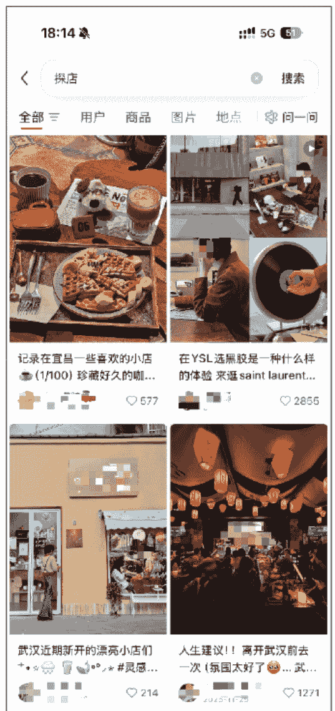

图10-13 闲鱼挂单

图10-14 小红书挂单

#### 2. 线下渠道：主动对接本地商家

聚焦本地商圈（如美食街、步行街、写字楼周边），主动上门对接商家，展示探店视频案例，介绍服务和报价。该方法适合新手积累初始客户。

#### 3. 合作渠道：与本地达人、探店博主合作

对接本地探店达人、博主，承接他们的视频剪辑业务，达人负责拍摄素材，你负责剪辑视频，按条收费（如30～60秒视频50～100元/条），批量接单，快速提升收益。

# 第11章 五大变现路径：从副业到创业的完整变现地图

本章将从自由接单、内容创业、产品开发、培训与顾问和团队赋能这5个维度，搭建一套从副业到创业的完整变现地图，彻底摆脱“只会剪视频、赚辛苦钱”的困境，让你既能快速上手赚零花钱，也能稳步进阶做事业。

## 11.1 自由接单：利用效率优势拓展客源与提价

自由接单是AI剪辑新手最容易起步的变现路径，几乎没有门槛、不用投入过多成本，只要有手机，会用剪映、豆包和Seedance 2.0，就能靠剪辑赚钱。

### 11.1.1 善用招聘软件：新手最快接单的“捷径”

其实招聘软件上面藏着大量兼职剪辑订单，而且大多是刚需单，且不用进行复杂沟通，是新手练手、快速接单的首选。这里的核心技巧是“找对定位、找对单子、找对话术”，不用跑线下，线上就能对接。

#### 1. 怎么找：定位选对，单量翻倍

打开BOSS直聘这类招聘软件，直接搜索“剪辑兼职”“短视频剪辑”，可以把定位切换到杭州、上海、广州、深圳这些电商产业发达的城市，因为这些城市的兼职单量大，优质单多。当然，其他城市的单子也别忽略，随手打个招呼，说不定就有意外收获。图11-1所示为招聘平台剪辑相关需求展示。

图11-1 招聘平台剪辑相关需求展示

#### 2. 怎么选：新手只接“无脑单”

零基础新手别接调色、加特效等复杂单，只选加字幕+加贴纸+配背景音乐的简单，用剪映的AI功能+Seedance 2.0就能轻松完成。

#### 3. 怎么谈：话术直接，主动试剪

直接发“你好老板，你们还招剪辑兼职吗？我可以提供试剪”，用试剪代替作品集，更快获取客户信任。

可参考下面的远程合作核心沟通3问，确认清楚再试剪，避免后续纠纷。

- ①合作形式：是否纯线上远程剪辑？无须到岗？
- ②素材交付：如何接收剪辑素材（如微信/网盘/邮箱）？素材是否会统一整理？
- ③交付要求：视频交付格式（如1080P/竖屏9：16）？交付渠道是什么？

这里有两个细节要注意：

首先，如果客户问你有作品吗，你要是没有，就如实回答暂时还没有。

其次，试剪前，一定要问清楚单子怎么结算？是日结还是周结？剪一条多少钱？有没有样片？

#### 4. 试剪避坑：参考样片、问清楚，不做无用功

试剪的时候，先向客户索要完整的样片（含视频、图片、背景音乐），如果客户给了样片，你就照着样片的节奏、特效、字幕样式一步一步地制作，别自己瞎加特效、乱改节奏。新手最忌讳“还没学会复刻，就想着创新”，画蛇添足反而会丢单。另外，如果客户拒绝提前说清单价，非要你试剪完再谈价，可以直接拒绝，接着找下一个订单。

### 11.1.2 对接自媒体博主：精准对接，复购率高

除了招聘软件，对接自媒体博主也是一条很不错的路径，很多博主需要快速更新短视频，但自己没时间剪辑，而且他们的需求往往和AI剪辑的优势相匹配——高效、快捷、贴合账号风格，只要你敢主动询问，就有可能拿到稳定的复购单。

#### 1. 找对博主：聚焦5万～10万粉丝数的，成功率更高

不要找粉丝太多的大博主（因为他们通常有专业的剪辑团队），也别找粉丝太少的小博主（因为他们需求少、预算低），重点找粉丝数在5万～10万的博主，这类博主大多处于关键期，需要大量更新内容，但又没能力请全职剪辑师，缺的就是你这样高效、性价比高的AI剪辑师，合作成功率高。

#### 2. 对接方式：主动发邮件，诚意比技巧重要

很多博主会在个人首页放上自己的商务对接邮箱，你可以准备好精心制作的作品集，哪怕只有3～5条样片（用剪映+Seedance 2.0制作的就行），主动给他们发邮件。这里要提醒一句：这个过程需要坚持，我当初发了无数封邮件，最终收到回复的也只有个位数，但只要有一个合作成功，后续就能靠口碑接到更多单子。

#### 3. 邮件模板：直接套用，不用自己写

这里提供一个邮件模板，稍作修改就能用，重点突出“你的优势、能提供的服务、免费试剪的诚意”，降低博主的决策门槛。

诚意合作|高效剪辑+免费试剪（24小时出片）

尊敬的××博主：

您好！一直关注您的账号，特别喜欢您的[美妆/生活/时尚]类内容，风格新颖、干货满满，每次看都有收获～

目前我专注为[美妆/生活/时尚]类博主提供定向剪辑服务，熟练运用剪映、豆包、Seedance 2.0，能高效完成以下工作。

- ①高点击率封面设计（AI一键生成，贴合账号风格）。
- ②口播类视频节奏优化（AI卡点，不拖沓）。
- ③短视频故事线重构（AI梳理素材，快速出片）。

附近期作品供参考（均为AI全流程制作），作品在附件图片/我的小红书账号“收藏”里，可直接扫码查看。

①我为其他博主剪辑的短视频，②创意短视频，③美妆口播类视频。

特别邀请合作：

如果您近期有视频剪辑需求，我愿意免费为您制作1条视频（24小时内交付），严格贴合您账号的风格，您只需提供原始素材和需求方向。我希望通过实际作品证明我的专业度，后续合作由您自行决定，期待能与您共同打造更多爆款内容！

顺祝账号涨粉不停、爆款不断！

联系方式（微信）：×××

邮件沟通是比较正式的方式，当然也可以灵活一点，在平台上看到图11-2所示的需求时主动发私信。这个时候切记保持谨慎，不要轻易透露自己的关键信息，避免财产损失。

图11-2 自媒体平台评论区关于剪辑的需求

### 11.1.3 接单平台派单：被动接单，省心省力

一品威客、猪八戒网这类综合服务平台就像一个“接单集市”，平台汇集了大量有剪辑需求的客户，而且这些客户以中小型企业、个人为主，你只要入驻平台、包装好账号，就能接到单子。该方法适合没有太多时间找单的新手。

#### 1. 入驻平台：包装账号，突出AI效率优势

入驻后，重点做好以下两件事，让客户一眼看到你的价值，主动找你合作。

- (1) 精准定位：个人简介里一定要突出AI剪辑、剪映+豆包、Seedance 2.0、高效出片这些关键词，明确你的服务范围，比如短视频剪辑、口播视频优化、Vlog重构等，别写得太笼统，要让客户看一眼就知道你能做什么。
- (2) 作品展示：上传3～5条用AI工具制作的样片，标注清楚10分钟出片、AI一键添加字幕/转场效果、批量交付等亮点，样片不用太复杂，重点体现你的效率优势——客户找AI剪辑，图的就是快。

接单平台关于剪辑的需求如图11-3所示。

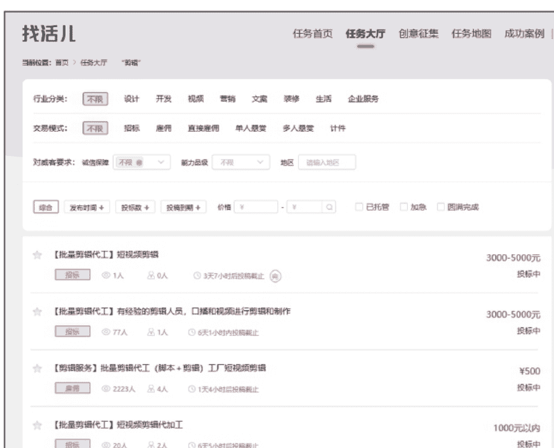

图11-3 接单平台关于剪辑的需求

#### 2. 接单技巧：主动出击，用试剪破冰

在平台任务大厅搜索“短视频剪辑”“AI剪辑”“口播视频”“批量剪辑”等，优先选择对交付时间有要求的订单，比如“当天交付”“1小时出片”等，主动出击，因为这些正是你的优势。

看到合适的订单后，主动联系发布需求的客户，直接用“免费试剪1个片段，1小时内交付”等话术。免费试剪能降低客户的决策门槛，让客户快速信任你，比只说“我剪得好”有用多了。

初期不用追求高价，以效率价切入，比如传统剪辑师50元/条，你可以定价为30元/条，但一定要强调1小时出片、可批量交付，让客户觉得不是你技术不行，而是你效率高，物超所值，避免陷入低价内卷。

### 11.1.4 从平台到私域：靠效率赢口碑，靠口碑提价格

#### 1. 服务留客：把一次性客户变成长期合作客户

- 标准化交付：制作口播视频、Vlog等的固定剪辑模板，风格统一、效率高、质量稳定。
- 超预期响应：客户改需求后，用AI快速修改视频，10分钟内出新版，打造高效、可靠形象。
- 私域沉淀：完工后引导加微信，备注“AI剪辑合作”，定期发新作品与高效率案例，为后续提价铺路。

#### 2. 合理提价：从零花钱到稳定收入

- 阶梯提价：有10个以上的稳定复购客户后，单价从30元/条涨到50元/条，推出包月套餐保证长期收入。

### 11.1.5 通用包月剪辑套餐模板

- (1) 基础包月套餐（200元/月）：每月剪辑30条15～30秒的短视频，含字幕+背景音乐+简单转场效果，支持3次免费修改，24小时内交付。
- (2) 进阶包月套餐（400元/月）：每月剪辑60条15～60秒的短视频，含字幕+背景音乐+调色+封面设计，支持5次免费修改，12小时内交付。付。

（3）加急包月套餐（600元/月）：每月剪辑50条任意时长的短视频，含上述所有服务，支持无限次免费修改，6小时内加急交付。

价值包装：提价时突出AI升级服务，如AI脚本、AI封面等增值内容，让客户觉得物有所值。

筛选客户：放弃只图低价的低质订单，专注于愿意为效率和专业付费的高价值客户。

## 11.2 内容创业：搭建AI驱动的多平台账号矩阵

如果说自由接单是靠技术赚辛苦钱，那么内容创业就是靠流量赚复利钱——无须每天反复接单，搭建自己的账号矩阵，用剪映+豆包批量产出优质内容，靠流量带货、接广告、赚补贴，实现一次创作、多次收益，还能打造个人品牌，为后续创业铺路。

### 11.2.1 AI批量起号，多平台放大流量优势

传统内容创业难在持续产出，而AI驱动模式的核心是让AI替你干活：豆包想选题、写文案，Seedance 2.0生成素材，剪映快速剪辑、优化。你只需专注于选赛道、控质量、做运营。

多平台矩阵如同开连锁门店，在抖音、视频号、小红书同步发布内容，一份付出、多份回报，既能放大流量优势，又能避免单一平台限流，保证收入稳定。注意，关键是“小而美”，聚焦细分赛道，吸引精准粉丝，变现效率才会提高。

### 1.新手优选3个低门槛赛道

选对赛道等于成功一半，优先选“低门槛、高需求、易变现”的细分赛道，无须专业知识，通过AI工具即可快速产出内容。表11-1所示为适合新手的优选赛道。

##### 表11-1 适合新手的优选赛道

| 赛道名称 | 核心内容 | 素材来源 | 变现方式 | 核心优势 |
| :--- | :--- | :--- | :--- | :--- |
| 好物分享 | 平价好物、家用神器 | 淘宝、拼多多 | 带货佣金 | AI高效产出，适合日更 |
| 本地探店 | 本地小店、美食 | 手机拍摄、商家提供 | 商家广告等 | 流量精准，复购率高 |
| 干货剪辑 | 育儿、职场、AI工具使用技巧 | 无版权风险素材 | 广告、带货、培训 | 无须出镜，适合“社恐”人士 |

### 2.AI批量产出内容，日更10条不费力

AI批量产出的核心是“批量创作、高效产出”，全程用豆包+剪映完成，零门槛、易上手。

（1）豆包批量生成选题+文案。将准备好的提示词发送给豆包，如“批量生成10条宝妈好物分享选题+文案，每条15～20秒，接地气，聚焦宝宝辅食工具，突出性价比”，获得选题和文案，如图11-4所示。

批量生成10条宝妈好物分享选题+文案，每条15～20秒，接地气，聚焦宝宝辅食工具，突出性价比

这里给你10条宝妈辅食工具爆款选题 + 15-20秒口播文案，全接地气、高性价比、直接能用，适合短视频口播。

- 1. 选题：宝宝辅食碗别乱买！这只十几块够用一整年
文案：
宝妈们别再花大价钱买辅食碗了！就这种带吸盘的，十几块一个，宝宝怎么扒拉都不掉。耐高温、能蒸煮、好清洗，从吃米糊用到吃面条，性价比真的绝了，闭眼入不亏！

- 2. 选题：辅食剪刀才是带娃神器，便宜又好用
文案：
做辅食最费妈的就是剪食物！这把辅食剪刀十几块，锋利又不生锈，肉类、蔬菜、面条一剪就碎，出门随身带，不用再用手掰，干净又方便，性价比直接拉满！

- 3. 选题：辅食研磨碗一套搞定，不用买一堆机器

（2）剪映批量剪辑。剪辑中的具体操作步骤如表11-2所示。

##### 表11-2 剪辑中的具体操作步骤

| 步骤 | 核心操作 | 关键要点 |
| :--- | :--- | :--- |
| ① 素材准备 | 实拍、找无版权风险素材、用 Seedance 2.0 生成素材 | 多源取材，快速备片 |
| ② 导入素材 | 批量导入 10 ～ 20 个素材片段 | 一次性上传，高效起剪 |
| ③ 生成智能字幕 | 批量复制豆包生成的文案，调用剪映智能字幕功能 | AI 自动同步字幕 + 样式 |
| ④ AI 成片 | 套用赛道模板 | 自动匹配转场效果、添加背景音乐等 |
| ⑤ 批量微调 | 每条 30 秒，删除不必要的素材片段、改字幕 | 快速校准，保证质量 |
| ⑥ 批量导出 | 设置导出参数 | 成片适配发布要求 |

宝妈好物分享视频批量剪辑实操案例。

- 1. 素材准备：用Seedance 2.0生成10个辅食工具（如辅食碗、辅食剪刀）实拍片段，用豆包写好10条口播文案。
- 2. 导入素材：在剪映中一次性导入10个视频片段和10条文案。
- 3. 生成智能字幕：将豆包文案批量复制到剪映，一键生成智能字幕，统一设置“卡通字体+黄色字幕”，贴合宝妈好物分享赛道风格。
- 4. AI成片：套用剪映官方的“宝妈好物”模板，剪映将自动匹配轻柔的背景音乐+可爱的转场效果（如奶瓶、星星转场效果）。
- 5. 批量微调：每条视频仅需30秒，删除多余片段、确保字幕正确。
- 6. 批量导出：按要求导出视频。

### 3.多平台同步发布

搭建“抖音+视频号+小红书”三大平台账号矩阵，同步发布内容，实操时需要注意以下事项。

- 账号统一：3个平台的账号名称、头像、简介保持一致，突出赛道定位，比如“宝妈好物AI剪辑 | 平价实用”，让粉丝记住你。
- 内容适配：同一批视频，稍做适配后发布，比如小红书发布15秒短视频+图文文案，抖音发布30秒短视频+话题标签，视频号发布20秒短视频+本地定位，不用从头开始剪辑。
- 发布技巧：每天固定时间发布，比如中午12点、晚上7点是流量高峰期，每个平台每天发布2～3条视频，发布时加上对应赛道的话题标签，比如宝妈好物分享赛道加“#宝妈好物推荐”“#宝宝辅食工具”，提高曝光率。
- 简单运营：每天花30分钟回复粉丝评论等，提升账号权重，吸引更多流量。

### 11.2.2 变现方式：4种流量变现方式，粉丝破万就能赚钱

内容创业变现的核心是“靠粉丝、靠流量”，不用等粉丝数破10万，只要粉丝破万，就能实现稳定变现。4种流量变现方式如表11-3所示，可按需选择和叠加使用。

##### 表11-3 4种流量变现方式

| 变现方式 | 核心操作 | 关键收益 |
| :--- | :--- | :--- |
| 带货变现 | 多平台挂小黄车，带货对应赛道的产品 | 佣金是产品价格的 10% ～ 30% |
| 广告变现 | 粉丝破万接商家广告 | 1 万～ 5 万粉：500 ～ 2000 元 / 条 |
| 平台补贴 | 凭借高播放量、高互动量内容拿奖励 | 额外收入，积少成多 |
| 私域变现 | 将粉丝引流至微信，群内运营 | 变现效率高、复购多 |

### 1.带货变现

在抖音、小红书、视频号挂小黄车，带货对应赛道的产品，比如宝妈好物分享赛道带货辅食工具、探店赛道带货本地商家套餐，粉丝购买后你就能获得佣金，佣金一般是产品价格的10%～30%，粉丝越多、销量越高，佣金越高。

### 2.广告变现

粉丝破万后，通常会有商家主动找你合作，即接广告（比如好物商家让你剪辑推广视频、本地商家让你剪探店广告）。广告费按粉丝量、视频曝光量计算，粉丝量在1万～5万的账号，一条广告费用为500～2000元。

### 3.平台补贴

抖音、视频号、小红书等平台对优质内容有流量补贴，只要你的视频播放量高、点赞数多，就能获得补贴。虽然单笔金额不高，但可以积少成多。

### 4.私域变现

把平台粉丝引流到微信，建立粉丝群，定期分享干货、推荐好物，靠私域带货、接定制剪辑单，变现效率更高，而且粉丝黏性强，复购率高。

### 11.2.3 避坑提醒：内容创业，新手要避的4个坑

- （1）赛道太杂，没有聚焦。一会儿推荐好物，一会儿探店，一会儿分享干货，会导致账号权重低，粉丝不精准，很难变现；一定要聚焦一个细分赛道深耕。
- （2）素材侵权，账号被限流。不要随便“搬运”别人的视频，好物分享赛道可找商家要授权素材，探店赛道可以自己拍素材，干货赛道找无版权风险素材，避免侵权，否则账号会被限流、封禁。
- （3）只发内容，不做运营。以为只要发视频就会有流量、能变现，其实不然，一定要做好运营，要回复评论、加话题、引流，否则很难变现。
- （4）急于求成，半途而废。内容创业需要积累，不是一两天就能赚钱的，很多人坚持1～2周没看到收益就放弃了；但只要坚持1～2个月，持续产出优质内容，粉丝数和收益都会逐步提升。

## 11.3 产品开发：制作并销售AI视频模板与素材包

如果说自由接单是“主动赚钱”，内容创业是“流量赚钱”，那么产品开发就是“被动赚钱”，一次性制作AI视频模板、素材包，上架销售，客户购买后你就能获得收益，不用反复投入时间和精力，实现“一次创作，终身赚钱”。

### 11.3.1 两种核心产品：AI视频模板+素材包

对于零基础新手，建议优先开发AI视频模板，因为其制作简单、需求量大、销量高，后期再拓展素材包，两种产品可叠加销售，进一步提升收益。

### 1.核心产品：AI视频模板

用剪映制作好视频模板，并设置好可替换的素材位、字幕位、背景音乐位，客户购买后，只需替换成自己的素材（比如自己的产品图、门店视频），便可快速生成专属短视频，不用自己剪辑，省时省力。三大模板类型如表11-4所示。

##### 表11-4 三大模板类型

| 模板类型 | 核心特点 | 热门示例 |
| --- | --- | --- |
| 节日模板 | 节点性需求 | 国庆节出游好物分享、春节好物分享 |
| 刚需赛道模板 | 长期、稳定 | 小店引流、宝妈好物分享 |
| 热门风格模板 | 适配不同客户的审美需求 | 潮流好物分享、接地气探店 |

（1）节日模板：春节、国庆节、七夕节等节日的前夕需求会暴增，适配所有本地小店、探店博主。

（2）刚需赛道模板：探店、生活好物分享、育儿、职场干货等，长期、稳定，易制作、易销售。

（3）热门风格模板：时尚风、接地气风、简约风等，适配不同客户的审美需求，可叠加赛道制作。

### 2.辅助产品：素材包

素材包可以叠加销售，提升收益。整理好短视频素材集合，包括图片素材、视频片段、背景音乐、字幕模板等，客户购买后可直接用于剪辑视频，不用自己找素材，节省时间。

优选素材包类型如下。

（1）好物素材包：平价好物实拍图片、视频片段，适配好物模板。

（2）探店素材包：门店实拍片段、美食图片、引流文案模板，适配探店模板。

（3）通用素材包：热门背景音乐、字幕模板、转场特效，适配所有类型的短视频剪辑。

### 11.3.2 实操干货：用AI批量制作模板和素材包

不用花大量时间制作，结合使用剪映+豆包，就能批量开发产品，简单易上手。下面以“新春迎财神模板”为例讲解实操步骤。

### 1.制作素材包

打开剪映，单击“开始创作”，导入准备好的素材（比如用Seedance 2.0生成的新春迎财神视频素材）。

- （1）设置模板框架：剪辑15秒的视频，添加用Seedance 2.0生成的新春迎财神相关转场效果、热门背景音乐，调整画面色调，让模板更美观。
- （2）设置可替换元素：设置可替换的配乐位、字幕位、视频素材位等，方便客户替换为自己的素材。
- （3）发布模板：单击“发布模板”（见图11-5），在“模板发布”界面（见图11-6）进行发布设置，设置好之后即可发布。这样一个模板就制作完成了，全程不超过10分钟。

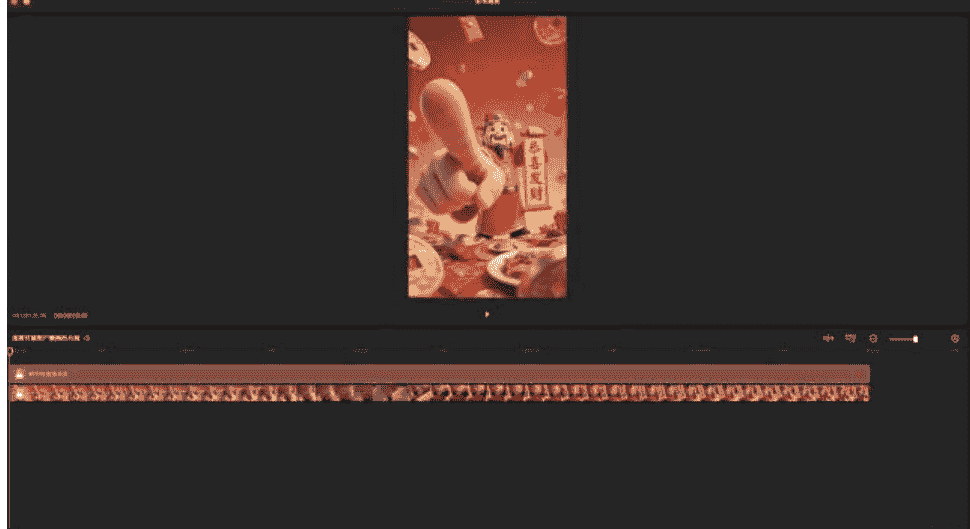

##### 图11-5 发布模板

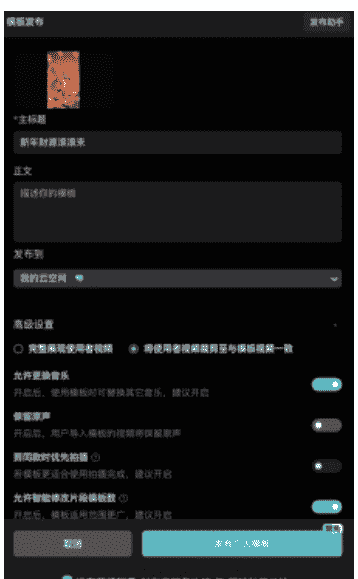

##### 图11-6 “模板发布”界面

批量制作技巧：制作完一个模板后，复制模板，替换其中的元素，比如把新春迎财神元素换成国庆节相关元素，就能快速制作出国庆节模板，1天就能制作10个以上优质模板。

### 2.用AI整理素材包

- （1）确定素材包内容和规格：比如50张好物实拍图片、20个好物视频片段、10首热门背景音乐、5个字幕模板。
- （2）AI辅助找素材：通过豆包找相应素材（如使用提示词“帮我找50张平价好物实拍图片，聚焦宝宝辅食工具，高清无水印，可商用”），豆包会推荐无版权风险素材获取渠道，不用自己手动找。
- （3）整理素材：把找到的图片、视频、背景音乐，按类别整理，统一分辨率（尽量高清），再次确认素材清晰、无水印、可商用。
- （4）添加使用说明：用豆包生成素材包使用说明，方便客户使用。
- （5）打包保存：把所有素材、使用说明等打包成压缩包，便于上架销售。

### 3.上架销售，实现稳定收入

将产品制作完成后，上架到合适的渠道，吸引客户购买，这里推荐4个适合新手的销售渠道，低成本、流量大、易成交，如表11-5所示。

##### 表11-5 四大销售渠道

| 渠道 | 核心操作 | 特点 |
| --- | --- | --- |
| 剪映模板中心 | 上传模板，定价1～5元，自动结算 | 无须运营，获取被动收益 |
| 闲鱼 | 发布商品，展示成品效果，设置自动发货 | 省心高效，流量稳定 |
| 小红书 | 发布笔记，给出教程，引导发私信、加微信 | 曝光量高，易出单 |
| 私域销售 | 推给老客户/粉丝，提升复购率 | 信任度高，成交快 |

###### 闲鱼——新春迎财神探店模板商品发布示例

[闲鱼商品标题]剪映AI新春探店模板 迎财神引流15秒 小店通用可替换

[闲鱼商品描述]

适用人群：本地小店老板、探店博主。

模板内容：15秒剪映新春迎财神探店模板，含喜庆背景音乐+财神转场+引流字幕位，可替换门店素材/店名/地址。

使用方法：购买后发剪映模板链接，一键套用，替换为自己的素材后即可出片。

附赠：探店引流文案3条+热门背景音乐5首。

价格：2元/个，买2送1，搭配探店素材包仅8元。

###### 小红书——宝妈好物素材包商品发布示例

[小红书标题]宝妈好物素材包｜50张高清图+20个视频可商用

[小红书正文核心]

专为宝妈好物分享博主整理的可商用素材包，不用自己拍、不用找素材，直接剪辑出片！

素材包含：50张辅食工具高清实拍图+20个辅食工具使用视频+10首宝妈赛道热门背景音乐+5个字幕模板。

适用：剪映/其他剪辑软件，可商用、无水印、1080P。

福利：购买即送宝妈好物分享爆款选题20条。

价格：9.9元/个；搭配宝妈好物分享视频模板，仅15元。

[配图]3张素材包预览图（如辅食工具图片、视频片段截图、字幕模板截图）。

### 11.3.3 提升销量技巧：7个方法，让被动收入翻倍

（1）定价合理，薄利多销。新手初期，模板定价为1～3元/个，素材包定价为5～10元/个，价格合理，吸引更多客户购买，靠销量赚钱，后期可根据销量、口碑适当提价。

（2）商品标题吸睛，贴合搜索习惯。上架时标题包含核心关键词，如“剪映新春模板”“宝妈好物素材包”“探店引流模板”，客户搜索时更易找到。

（3）做好产品预览，直观展示。发布时附上模板/素材包的预览图/短视频，让客户直接看到产品效果，提升其购买意愿。

（4）及时回复咨询，提升体验感。客户咨询产品使用方法、适配场景时，10分钟内回复，耐心解答，打造良好口碑。

（5）推出老客户福利，促进复购。老客户再次购买时，给出8折优惠或买3送2福利，提升老客户复购率。

（6）聚焦热门内容，及时更新。紧跟节日、热门赛道内容，及时更新模板和素材包。

（7）搭配销售，提升客单价。推出“模板+素材包”组合套餐，比如“新春迎财神探店模板2个+探店素材包1个，共8元”，比单独购买划算，吸引客户购买套餐，提升客单价和整体收入。

收入会受到多方面因素的影响，这里罗列的数据仅作参考：1个热门模板，每月可销售100～500份，按2元/份算，每月收入200～1000元；制作10个热门模板，每月收入2000～10000元；搭配素材包销售，收入可翻倍，而且是被动收入，不用每天投入大量时间。

### 11.3.4 避坑提醒：产品开发，这3个坑千万别踩

### 1.素材侵权，得不偿失

一定要用无版权风险、可商用的素材，不要随便“搬运”别人的模板、素材，否则会被投诉，不仅赚不到钱，还会影响账号流量；剪映中的“发布助手”可以高效地检测使用的素材是否支持商用，如图11-7所示。如果不支持商用，可以单击“去复核”进行替换。

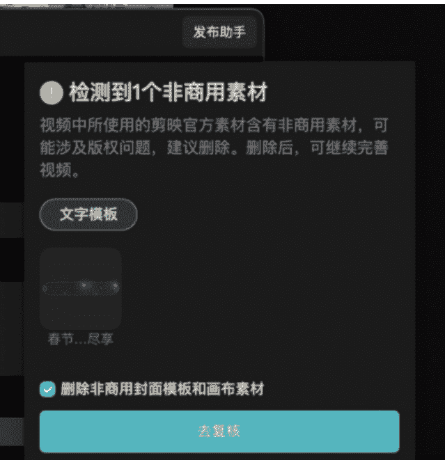

图11-7 发布助手

### 2.模板太复杂，客户不会用

模板一定要简单、易懂，可替换元素应清晰明确，可附上使用说明，避免模板太复杂使得客户不会替换素材，从而导致退款、差评。

### 3.一次性制作，不更新

客户对模板、素材包的需求是动态的，一定要定期更新产品，否则销量会越来越低，被动收入会越来越少。

## 11.4 培训与顾问：从技能输出到方法论赋能

当你熟练掌握剪映+豆包的AI剪辑技巧，并且在自由接单、内容创业、产品开发中积累了足够的经验和案例，就可以进阶到“培训与顾问”的变现路径——不再靠自己剪视频、卖产品赚钱，而是靠“输出技能、分享方法论”赚钱，把自己的经验转换成课程、转换成顾问服务，实现“个人价值的放大”，收入也可能会从月入几千元变为月入几万元，实现收入的飞跃。

### 11.4.1 两种核心模式

如果有一定经验，建议优先从培训课程入手（门槛低、易落地），后期再拓展一对一顾问服务（高单价、高收益）。两种核心模式叠加，可提升整体收入。

### 1.培训课程：批量输出经验，实现规模化变现

把自己掌握的AI剪辑技巧、变现方法，整理成一套系统化的课程，卖给想学习AI剪辑的新手，批量赋能、批量赚钱，不用一对一教学，省时省力。

建议做接地气、易学习的课程，不做复杂课程。三大培训课程类型如表11-6所示。

##### 表11-6 三大培训课程类型

| 课程 | 价格 | 内容 | 适合人群 |
| :--- | :--- | :--- | :--- |
| 基础实操课 | 99～199元 | 剪映+豆包AI剪辑基础 | 零基础人群 |
| 变现实操课 | 199～399元 | AI剪辑变现实操 | 想变现的人群 |
| 进阶提升课 | 399～999元 | AI剪辑进阶技巧+个人品牌打造 | 有基础、想增收的人群 |

（1）基础实操课（99～199元）：聚焦“剪映+豆包AI剪辑基础”，教新手快速入门，3天学会AI剪辑，适合完全零基础、想入门的人群。

（2）变现实操课（199～399元）：聚焦“AI剪辑变现实操”，教新手如何接单、如何做内容创业、如何开发产品，可以搭配自己的真实案例，适合想靠AI剪辑赚钱的人群。

（3）进阶提升课（399～999元）：聚焦“AI剪辑进阶技巧+个人品牌打造”，教如何提价、如何做账号变现矩阵、如何打造个人品牌，适合有一定基础、想提升收入的人群。

### 2.顾问服务：一对一赋能，实现高单价变现

为有需求的客户（例如新手剪辑师、小店店主、自媒体博主等）提供一对一顾问服务，帮助他们解决AI剪辑、变现过程中的具体问题，收取顾问费。此模式单价高、收益高。不同顾问类型的价格及服务内容如表11-7所示。

##### 表11-7 不同顾问类型的价格及服务内容

| 顾问类型 | 价格 | 服务内容 |
| :--- | :--- | :--- |
| 新手剪辑顾问 | 500～1000元/（人·周） | 一对一AI剪辑教学 |
| 变现顾问 | 1000～2000元/（人·周） | 定制变现方案，助力首单变现 |
| 商家剪辑顾问 | 1000～2000元/月 | 内容规划+剪辑优化+提升引流效果和变现效率 |

（1）新手剪辑顾问[500～1000元/（人·周）]：一对一指导新手学习AI剪辑，帮助他们解决剪辑过程中的问题，督促他们练习，确保他们能学会。

（2）变现顾问[1000～2000元/（人·周）]：为想靠AI剪辑赚钱的新手制订变现方案（比如如何接单、如何做账号），帮助他们解决变现过程中的问题。程中的问题，直到他们实现首单变现。

（3）商家剪辑顾问（1000～2000元/月）：为小店店主、自媒体博主提供长期的AI剪辑顾问服务，帮助他们规划短视频内容、优化剪辑效果，提升引流效果和变现效率。

### 11.4.2 实操干货：快速打造培训产品+开展顾问服务

新手不需要具备专业培训经验、不需要学习复杂课程，按照下面的步骤就可实际操作。

#### 1. AI辅助打造实操课程

- （1）定主题。比如“3天学会AI剪辑，新手也能日赚100元”，主题明确、有吸引力，直击新手的痛点（零基础、想赚钱）。
- （2）出大纲。在豆包中发送提示词（比如“帮我整理一套AI剪辑变现实操课的大纲，针对零基础新手，聚焦剪映+豆包，包含基础剪辑、接单方法、避坑技巧，分3天，每天1小时，内容接地气、重实操”），豆包会快速生成大纲，如图11-8所示，你再根据自己的经验进行微调优化。
- （3）做录播。优先做录播课，因为省时省力，可反复销售。用手机拍摄，对着屏幕实操或讲解，比如“今天教大家用剪映的智能字幕功能一键生成字幕，全程只需3分钟”，讲解时注意用语通俗、步骤清晰，不过分追求专业，新手能听懂、能跟着做就行。
- （4）配资料。用豆包生成课程配套资料，比如剪辑步骤手册、接单话术、避坑清单，方便学员课后复习、落地执行，提升课程价值。

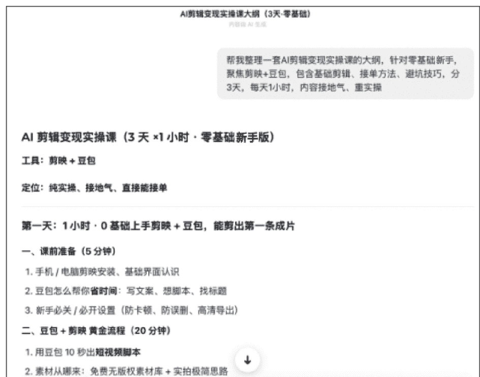

图11-8 使用豆包生成大纲

#### 2. 三大零成本推广渠道

课程制作完成后，重点是推广，以吸引客户购买。这里推荐3个零成本、易落地的推广渠道。

- （1）私域推广：把自己的课程推荐给之前合作过的老客户、进行内容创业的粉丝，在微信朋友圈、粉丝群分享自己的AI剪辑变现案例，比如“我靠AI剪辑，从零基础做到月入3000元，现在把方法整理成了课程，新手也能学会”。此外，还可以附上课程大纲、试听链接，引导客户购买。
- （2）小红书/抖音推广：在小红书、抖音发布AI剪辑实操干货、变现案例、课程试听片段，起一个吸睛的标题，比如“新手必看｜3天学会AI剪辑，日赚100元不是梦”，引导客户私信咨询，然后促成成交。

制作课程试听片段时可以使用以下核心技巧。时长控制在15～30秒，符合短视频观看习惯，快速抓住客户注意力；内容聚焦于某一个核心干货技巧，比如“30秒用豆包生成短视频脚本”或“剪映一键生成智能字幕”，让客户看到实际价值；讲解通俗、口语化，像在和朋友聊天，尽量少使用专业术语，比如“这个功能很简单，点一下这里，字幕就自动出来了”；结尾进行引导，试听片段最后加一句引导语，比如“如果想学更多AI剪辑技巧，私信我获取完整课程”；画面要清晰，重点操作步骤可加圈注/箭头，让客户看清楚。

- （3）设置客户裂变激励：比如“老客户推荐1个新客户，双方各得50元优惠；推荐3个及以上新客户，老客户可免费获得进阶课程”，激励老客户主动推广，扩大课程影响力，吸引更多新客户。

#### 3. 高效开展顾问服务

顾问服务的核心是“解决客户问题、实现价值赋能”，不用花大量时间，可按表11-8高效开展顾问服务。

表11-8 顾问服务开展细则

| 要点 | 核心内容 |
|---|---|
| 明确服务和收费 | 提前写明服务内容、收费标准、服务周期，避免纠纷 |
| 高效沟通 | 微信一对一，固定时段回复，兼顾服务质量与时间管理 |
| 聚焦落地 | 帮客户落地执行：如新手接单，商家提升流量 |
| 积累案例 | 整理成功案例，用于吸引客户 |

## 11.5 团队赋能：为中小型企业提供AI代运营

中小型企业是短视频代运营的核心客户群体，尤其是本地实体店、小工厂、美容行业门店等，他们想通过短视频获客，但普遍缺乏剪辑人员，不懂工具使用技巧和内容创作方法。而你只需掌握剪映+豆包的基础操作，就能搭建一套低成本、可复制、零基础也能落地的AI代运营流程。把个人的AI剪辑技能变成2～3人的小团队生意，从副业轻松过渡到轻创业，全程不用租办公室、不用买专业设备，靠工具和标准化流程就能赚钱。

### 11.5.1 为什么中小型企业愿意为AI辅助运营付费

绝大多数中小型企业（尤其是本地中小型商家）做短视频时都存在表11-9所示的3个痛点，而AI代运营能精准解决这些痛点，这是客户愿意付费的核心原因。

表11-9 中小型企业做短视频时存在的3个痛点

| 痛点 | 核心问题 | AI 代运营的解决方式 |
| :--- | :--- | :--- |
| 没人会剪 | 无专业剪辑人员，员工拍的素材杂乱且不会用，自己学又没时间 | 用剪映 + 豆包，零基础新手也能剪，小团队就能承接服务，不用客户自己动手 |
| 效率太低 | 传统剪辑方式下，1人1天剪1～2条视频，跟不上短视频日更/隔日更的频率 | AI批量剪辑，1人1天能剪50～100条视频，轻松满足客户的更新需求，成本低 |
| 没效果 | 不懂短视频爆款逻辑，剪的视频没流量，没人咨询，接不到订单 | 用豆包生成贴合行业需求的爆款脚本，用剪映做标准化模板，内容聚焦于“获客”，不做无用的技巧型剪辑 |

简单来说，中小型企业要的不是“剪得好看的视频”，而是“能带来咨询和订单的短视频”，AI代运营则能以低成本、高产出、高获客的优势满足这个需求。

### 11.5.2 AI代运营的核心：把剪辑变成流水线

AI代运营不是靠一个人硬剪，而是通过剪映+豆包的基础操作+标准化流程，让完全零基础的2～3人小团队也能服务10～20家企业，核心是“工具代替人工、流程代替经验”。以下是能直接落地的工具操作和交付流程。

#### 1. 用豆包做“文案+脚本生产线”

不用精通文案创作，只需按模板输入提示词，豆包就能快速生成适配相应行业的爆款脚本、口播文案、标题等。

通用提示词模板如下。

> 帮我生成10条[××行业]的短视频口播脚本，每条15～20秒，聚焦[产品/卖点]，口语化、接地气，适合抖音/视频号发布，开头有钩子（吸引观众停留），结尾有引导（促进咨询/到店）。

示例如下。

> 帮我生成10条[火锅餐饮]的短视频口播脚本，每条15～20秒，聚焦[98元双人餐、锅底免费]，口语化、接地气，适合抖音/视频号发布，开头有钩子，结尾有引导到店的话术。

生成脚本后，可继续输入“帮我为这10条脚本各配3个标题和封面文案”，豆包会快速生成可直接使用的标题和文案。

不同行业需使用不同的话术风格，如餐饮/美容行业偏口语化、福利导向，装修/工厂偏专业、案例导向。

#### 2. 用剪映做“批量剪辑工厂”

剪映的自动字幕、文本朗读、批量剪辑是零基础新手能直接使用的功能，不用学复杂的剪辑技巧，只需做好1个行业固定模板，后续所有视频直接套模板，1人1天能剪50～100条视频。

- （1）自动字幕。导入视频后，依次单击“文本”→“自动字幕”，剪映会自动识别语音并生成字幕。该功能还支持批量修改字体、颜色。
- （2）文本朗读。若客户无真人口播，依次单击“文本”→“文本朗读”，选择合适的音色，剪映会自动生成相应的语音，替代真人拍摄。
- （3）批量剪辑。在PC端剪映中单击“批量剪辑”，导入素材和豆包生成的脚本/字幕，然后套用模板即可；手机版可通过“剪同款”功能实现批量剪辑。

同时，还可以为每个行业做一个标准化模板，包含片头+字幕样式+转场效果+背景音乐+片尾联系方式，后续制作视频时直接替换素材即可。模板要求：简单、统一，不用复杂特效，重点突出产品/福利/门店信息。

- 片头（3秒）：门店Logo+文字“××火锅，98元双人餐吃到撑”。
- 字幕：黄色粗体，位于视频画面下方1/3处，清晰可见。
- 转场效果：用剪映自带的“叠化”功能实现，自然不突兀。
- 背景音乐：选轻快的美食类背景音乐，音量调至20%（不盖过人声）。
- 片尾（2秒）：门店地址+电话+文字“到店提××（主播文字）粉丝，送酸梅汤1扎”。

把企业提供的实拍素材（如门店Logo/产品/员工）导入剪映；套用已做好的行业模板，替换片头/片尾的企业信息；用“自动字幕”功能匹配豆包生成的口播脚本，或用“文本朗读”功能生成语音；调整素材时长，匹配15～20秒的短视频时长，删除无用片段；一键导出，设置分辨率为1080P，帧速率为30帧/秒（所有视频统一规格）。

#### 3. 流程化交付，稳定出片

搭建5步标准化交付流程，明确每一步的实操细节、时间节点、交付标准，确保团队服务不混乱，客户体验好。全程按流程走，不用靠经验。

- （1）每周标准化收集素材：每周一跟客户对接，明确素材要求（如竖屏9：16、时长5～30秒、无模糊画面），让客户用微信/百度网盘发送素材，统一命名为“××企业-202×.×.×-素材×”，避免素材杂乱。
- （2）用豆包批量生成脚本：每周一当天，通过提示词模板生成本周的脚本（数量根据客户套餐而定，如基础套餐为20条/月，则每周5条），发送给客户确认，确认后再剪辑，避免返工。
- （3）在剪映中套模板进行批量剪辑：每周二、周三，按确认后的脚本进行批量剪辑，1人负责1个行业，确保风格统一，剪辑完成后统一保存至网盘，命名为“××企业-202×.×.×-视频×”。
- （4）审核、修改、交付：每周四发给客户审核，明确修改次数（如基础套餐每月免费修改3次，超出按50元/条收费），修改完成后，将视频原文件和发布版（带字幕/背景音乐）一起交付给客户。
- （5）协助发布+简单数据反馈：每周五协助客户将视频发布至抖音/视频号/小红书，教客户添加本地定位、行业话题（如“#本地火锅”“#同城美食”），每月底用剪映的“数据中心”或平台后台统计视频的播放量、完播率、咨询量，做成简单的表格发给客户，让客户看到效果。

### 11.5.3 3个适合新手的代运营套餐

给中小型企业的报价不用太复杂，设计3个阶梯式套餐，价格清晰、服务内容明确、标准化交付，不用做复杂的内容策划，重点聚焦“视频制作+基础发布”，阶梯式套餐标准如表11-10所示。

表11-10 阶梯式套餐标准

| 套餐类型 | 价格（元/月） | 核心服务 | 交付标准 | 适配客户 |
| :--- | :--- | :--- | :--- | :--- |
| 基础套餐 | 2000～5000 | 15～20条短视频（豆包生成文案+剪映剪辑+自动字幕+配乐）+基础网盘交付+1次免费修改/周 | 1080P竖屏视频，每周5条，周四交付，无发布服务 | 本地小实体店（如面馆、水果店、便利店）、初创小微企业 |
| 进阶套餐 | 5000～12000 | 20～30条高质量视频（脚本创作+拍摄指导+精剪+字幕优化）+多平台发布（抖音/视频号）+2次免费修改/周+月度数据报表 | 每周7～8条，每日交付1条，协助客户绑定账号发布，月底发数据表格 | 美容行业（如美甲、美容）门店、装修公司、本地批发公司、小型加工厂 |
| 全案套餐 | 12000～20000 | 账号定位+月度内容规划+40～50条短视频+直播切片+多平台运营+3次免费修改/周+每周数据反馈+获客引导优化 | 每周10～12条，隔日交付，专人负责账号运营，每周发数据反馈 | 本地品牌店、连锁门店、招商型企业、中型工厂 |

前期为了吸引客户，可推出1个月的试运营套餐，价格为基础套餐的50%（如1000～2000元/月），明确试运营的服务内容和预期效果（如“每月20条视频，播放量不低于500/条”），试运营做出口碑和效果后，客户自然会有意愿续费长期套餐，避免前期因无案例导致客户不信任。

### 11.5.4 零基础起步：从个人到小团队的三步走

不用一开始就组建团队，先从个人单干开始，积累案例和客户后，再慢慢扩展为2～3人的小团队，全程低成本、低风险，每一步都有具体的操作方法，新手直接跟着做即可。

#### 1. 先做样板，免费帮1～2家本地门店做代运营

- （1）找客户的方法。从身边的本地门店入手（如楼下的餐馆、理发店、水果店），或在美团/大众点评搜索本地门店，直接到店找老板沟通，使用简单、直接的话术，如“老板，我是做AI短视频代运营的，现在想积累本地案例，免费帮您做1个月的短视频剪辑和发布，每月20条视频，只需要您提供简单的素材，不用您花一分钱，您看可以吗”。
- （2）明确服务边界。免费服务不等于无底线服务，提前跟老板说清服务边界，如“免费代运营每月只做20条基础视频，免费修改3次，超出部分按50元/条收费，素材需要您按我的要求提供，我负责剪辑和发布，不负责拍摄”，避免浪费时间。
- （3）做出效果。按前文介绍的AI剪辑流程和交付标准，认真做好1个月的服务，确保视频有播放量、能带来少量咨询/到店客人，把服务过程中产生的资源、数据等整理成案例，这是后续接单的核心资本。

#### 2. 打包服务，制作宣传页，开始正式接单

- （1）制作宣传页：用剪映/美图秀秀制作简单的宣传页（不用专门设计），内容包含你的案例（门店名称+视频数据）、3个套餐的价格和服务内容、你的联系方式、售后保障（如不满意可退款），重点突出“AI批量剪辑、低成本、高产出、本地案例”。
- （2）接单渠道：线下渠道，可以继续找美团/大众点评的本地门店，带上宣传页和案例进行沟通，成功率会比无案例的更高；线上渠道，可以在小红书/抖音发布本地代运营案例，标题如“××本地火锅门店，做AI短视频1个月，客流量增加30%”，引导客户私信咨询；私域渠道，可以把案例发到微信群、朋友圈，让朋友推荐，积累口碑，提升转化率。

#### 3. 小团队扩量，2～3人分工，承接10～20个客户

当你有5～8个稳定客户后，可以开始搭建2～3人的小团队，不用租办公室，线上远程合作即可，分工清晰，每人负责一个环节，不用每个人都会所有技能，新手也能加入。团队构成及分工如表11-11所示。

表11-11 团队构成及分工

| 岗位 | 人数 | 核心工作 |
| :--- | :--- | :--- |
| 客户对接岗 | 1人 | 负责找客户、沟通需求、收集素材、交付视频、售后反馈，不用会剪辑，只需会沟通，按流程走即可 |
| 文案脚本岗 | 1人 | 负责用豆包的提示词模板生成脚本，发给客户确认，不用懂文案，只需会替换行业/产品信息 |
| 剪辑运营岗 | 1人 | 负责在剪映中套模板进行批量剪辑、协助发布视频、统计数据，只需掌握剪映的3个核心功能 |

同时也需要注意团队的沟通技巧。在微信中为每个客户单独建群，群内包含客户、客户对接岗人员、剪辑运营岗人员，所有沟通和文件发送都在群内进行，避免信息混乱；每周开1次10分钟的线上会议，同步客户情况和工作进度，确保团队高效运转。

### 11.5.5 必看：3条核心避坑铁律

做企业代运营最核心的是“明确规则、避免纠纷”，这里提供3条核心避坑铁律，每条都有能直接落地的方法，确保你不会被客户坑、不会因纠纷损失时间和金钱。

#### 1. 合同写清楚，所有细节白纸黑字，避免口头约定

不用找律师，用网上的通用服务合同模板即可，重点补充以下4个核心条款，打印出来让客户签字盖章，也可以签订电子合同（用腾讯电子签/法大大）。

- （1）交付数量、时间、方式：明确每月剪辑的视频数量、交付时间、交付方式（如“每月20条，每周四网盘交付”）。
- （2）修改次数：明确每月免费修改次数（如“基础套餐每月3次免费修改，超出按50元/条收费”）。
- （3）版权归属：明确“视频素材归客户所有，我方仅享有剪辑作品的著作权，客户可无限制使用视频进行商业宣传”。
- （4）数据指标：量化效果，如“视频平均播放量不低于500/条，若连续2周未达到，客户可申请退款50%”，避免客户以“没效果”为由拒付费用。

#### 2. 素材归客户，你只负责剪辑与运营，不盗用、不乱发

- （1）所有素材都让客户提供，并让客户确认“素材为企业合法所有，无版权问题”，避免因素材侵权导致你被投诉。
- （2）未经客户同意，不得将客户的视频发布到非约定平台，不得将客户的素材用于其他客户的剪辑，避免泄露客户信息。

#### 3. 用数据说话，每月给客户看真实数据，客户才愿意续费

- （1）数据统计工具：用抖音/视频号的后台（创作者中心）、剪映的“数据中心”或简单的Excel表格统计核心数据，如播放量、完播率、点赞量、咨询量、到店量等。
- （2）数据呈现方式：每月底将数据做成简单的可视化表格/图片，发给客户，标注“本月共发布××条视频，平均播放量××，带来××条咨询，有××位到店客户”，并附上视频截图和客户反馈，让客户直观看到效果，提升其续费意愿。

本地中小型企业的核心需求是“获客”，不要跟客户谈“粉丝量、点赞量”，重点谈“咨询量、到店客户量、订单量”，用实际的商业效果打动客户，这是长期合作的关键。

# 第12章 建立你的赚钱系统：定价、运营与未来竞争力

本章将从科学定价策略、高效运营工作台、客户沟通与展示、赚钱系统的维护与进化、从剪辑师到视觉导演5个维度出发，帮你搭建一套可复制、能扩展的AI剪辑赚钱系统，彻底摆脱“零散接单、辛苦赚小钱”的困境。

## 12.1 科学定价策略：如何根据AI增效计算溢价与套餐价格

很多新手最头疼的问题：定价凭感觉，报高了客户跑了，报低了自己累着了还不赚钱。其实定价的核心方法很简单。价格的设定，不是看“剪辑本身值多少钱”，而是看“AI帮客户省了多少钱、赚了多少钱”。

手动剪辑和AI剪辑的差距就是你定价的底气。下面不用复杂公式，而用最直白的方法教你定出“客户愿意付、你也有赚”的价格。

### 12.1.1 先算AI增效账：你的定价底气在这里

以前手动剪1条短视频，写文案、剪素材、加字幕、配音乐，至少要1小时，按兼职剪辑师市场价30～50元/条算，1天剪8条，最多赚400元，还非常累。

用剪映+豆包可省30%～40%的时间：豆包快速生成文案+脚本，剪映套模板进行批量剪辑，1小时能剪20条，轻松实现1天剪20～50条，AI剪辑的效率是手动剪辑的20倍以上。

对客户来说，以前找兼职剪辑师，100条视频要花3000～5000元，还得等3～5天；找你做AI剪辑，100条视频只需要2000～3000元，1天就能交付——你帮客户“省了钱、省了时间”，这就是你定价的核心价值，不是“剪得好”，而是“高效、低成本、快交付”。手动剪辑与AI剪辑的对比如表12-1所示。

表12-1 手动剪辑与AI剪辑的对比

| 对比维度 | 手动剪辑 | AI 剪辑 | AI 剪辑的核心优势 |
| :--- | :--- | :--- | :--- |
| 效率 | 1小时1条，1天最多8条 | 1小时20条，1天轻松160条（效率为手动剪辑20倍以上） | 高效、快交付 |
| 客户成本 | 3000～5000元/100条 | 2000～3000元/100条 | 帮客户省成本 |
| 交付周期 | 3～5天/批 | 1天/批 | 帮客户省时间 |

### 12.1.2 定价的两个核心原则

不用纠结复杂的定价逻辑，记住两个核心原则就能避免踩坑。

- （1）AI剪辑不等于低价内卷。别觉得AI剪辑“省时间”就报低价，比如10元/条，这样只会让自己很累，还会拉低整个行业的价格。你的价值是“高效+稳定+效果”，不是“廉价劳动力”。
- （2）定价=成本+增效溢价+服务溢价。成本就是你的时间，占30%；增效溢价就是帮客户省的时间、钱，占40%；服务溢价就是你的交付速度、售后修改、附加服务，占30%。

### 12.1.3 3种套餐类型定价

不管你是接单、做代运营还是卖模板，都可以用“阶梯式套餐”定价，低价引流、中价赚利润、高价冲收益，客户好理解，你也好交。付。3种套餐类型的具体信息如表12-2所示。

##### 表12-2 3种套餐类型的具体信息

| 套餐类型 | 核心定位 | 适用场景 | 定价参考 | 核心服务摘要 |
| :--- | :--- | :--- | :--- | :--- |
| 基础套餐 | 引流款 | 零散接单、新手练手、客户试错 | 800～2000元/月或15～30元/条 | AI文案+基础剪辑+1天交付+3次免费改稿 |
| 进阶套餐 | 利润款 | 长期接单、企业代运营、本地商家 | 3000～8000元/月或40～80元/条 | 脚本策划+精剪+多平台周更+5次免费改稿+数据反馈 |
| 高阶套餐 | 溢价款 | 品牌客户、全套方案、爆款定制、切片 | 10000+元/月或100～200元/条 | 账号定位+专属模板+高阶剪辑+直播切片+全套方案+无限次改稿 |

在实际操作中，可根据单量规模与交付形式做灵活调整。

- （1）批量阶梯优惠：鼓励客户多签。例如，50条以内按标准价（如30/80/200元），50～100条可享9折左右优惠，100条以上可进一步降至20/60/150元，以量换价。
- （2）代运营打包：按月交付条数分级，如基础包（30～50条/月）、进阶包（60～100条/月+多平台分发）、高阶包（100条+定制/切片/数据深度优化）。
- （3）模板销售：支持单模板与组合包售卖。单模板定价1～100元不等（视复杂度而定）；组合包更具性价比，如“10个基础款15元”“20个行业定制包200元”，满足不同层级客户的需求。

基础套餐负责获客，不追求高利润；进阶套餐是营收主力，需保证服务质量与利润之间的平衡；高阶套餐则通过稀缺性与定制化实现高溢价，服务少数高价值客户。

### 12.1.4 新手定价避坑的3个关键点

新手定价避坑的3个关键点如图12-1所示。

新手在报价时不要报一口价，建议按照套餐加附加服务的方式收费，例如加急交付可加收20%的费用，修改超出约定次数，每次加收10元；前期可采用试运营定价的方式，比如进阶套餐打8折试运营1个月，做得好再恢复至原价；同时定价一定要做到透明，将每个套餐包含的服务内容、交付时间、修改次数等信息写清楚，有效避免后续产生纠纷。

图12-1 新手定价避坑的3个关键点

## 12.2 高效运营工作台：构建选题、素材、成片的自动化管理流

很多新手做了一段时间后会发现：接单越来越多，素材堆得乱七八糟，选题记不住，成片找不到，每天花大量时间找素材、整理文件，反而没精力做剪辑。

高效运营的核心不是“忙”，而是“懒”——把重复、烦琐的工作（比如整理素材、记录选题、归档成片等）交给工具自动化完成，你只专注于“剪辑”和“接单”这两个赚钱的核心环节。下面介绍如何用“免费工具+简单流程”搭建一个新手也能上手的自动化管理工作台。

### 12.2.1 必备的3类免费工具

### 1.文档管理工具（如飞书文档/腾讯文档）

这类工具用来管理选题、脚本、客户需求，相当于你的“大脑记事本”，支持多人协作，客户可以直接在上面修改意见，不用来回发微信。飞书文档如图12-2所示。

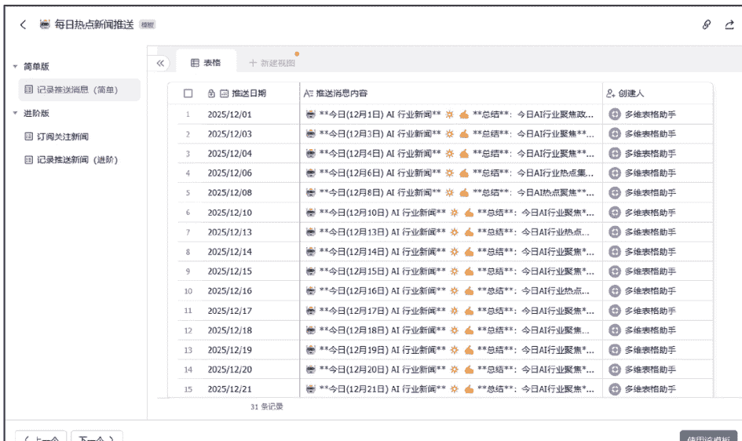

图12-2 飞书文档

### 2.云存储工具（如百度网盘/阿里云盘）

这类工具用来存储素材、成片、模板，相当于你的“数字仓库”，分类归档后，不管过多久都能快速找到需要的内容。百度网盘如图12-3所示。

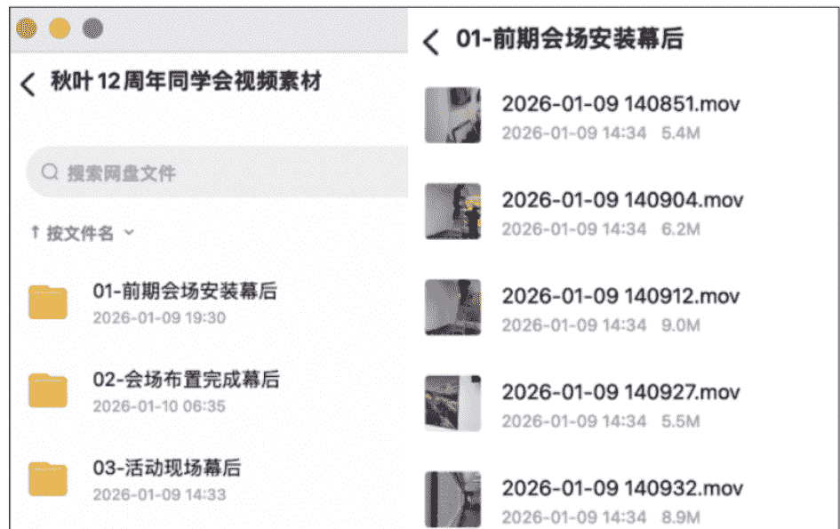

图12-3 百度网盘

### 3.剪映云空间

该工具用来同步剪映模板、草稿，相当于你的“剪辑工作台”，可在不同设备的剪映中剪辑同一个视频，不用来回复制文件。剪映云空间如图12-4所示。

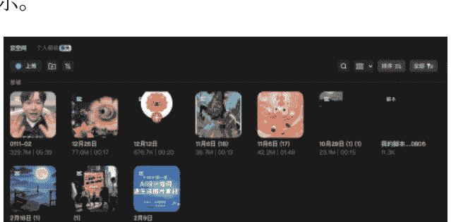

图12-4 剪映云空间

### 12.2.2 3个自动化管理流

### 1.选题自动化管理

选题自动化管理就是把豆包生成的选题、能满足客户需求的选题、同行爆款选题汇总归档，以便后续直接调用、修改，不用反复想创意。选题库通用模板如表12-3所示。

表12-3 选题库通用模板

| 选题标题 | 行业 | 适配平台 | 脚本状态 | 使用情况 | 备注 |
|---|---|---|---|---|---|
| 新手零失败番茄炒蛋教程，30秒学会 | 餐饮-家常菜 | 抖音/视频号 | 已生成 | 未使用 | 适合上班人群，AI剪辑5分钟可完成1条 |
| 奶茶店新品引流小技巧，日销量翻一倍 | 餐饮-奶茶 | 小红书/抖音 | 未生成 | 未使用 | 适合做本地探店，需搭配门店实拍素材 |
| 工作日5分钟上手早餐，不用开火 | 职场-好物 | 视频号/小红书 | 已生成 | 已使用 | 可修改为不同的季节，重复利用 |
| 美容行业店9.9元体验卡引流方法 | 美容行业-美甲 | 抖音/本地生活 | 未生成 | 未使用 | 适合本地商家代运营，需加门店地址 |

具体的实操步骤如下。

- （1）在腾讯文档/飞书文档中新建上述选题库，规范设置表头。
- （2）每天花10分钟，在豆包中输入提示词“××行业爆款选题10条”（比如“餐饮行业爆款选题10条”），将筛选后的选题复制到选题库。
- （3）接到客户订单后，根据客户行业，在选题库中找到合适的选题，修改后直接用，不用重新想。
- （4）用过的选题标记“已使用”，后续可以修改细节重复利用（比如把“夏天喝奶茶”改成“冬天喝热奶茶”）。

### 2.素材自动化管理

素材自动化管理可解决素材乱堆、找片费力的问题。给素材“分类贴标签”，不管是客户发的素材，还是自己找的素材，都按统一规则归档。

- （1）新建一个总文件夹，命名为“AI剪辑素材库”，如图12-5所示。

图12-5 新建总文件夹并命名

- （2）在总文件夹里，按行业新建子文件夹（比如“餐饮”“美容行业”“装修”“教培”）。在每个行业文件夹里新建3个子文件夹，分别命名为“成品素材”“客户素材”“通用素材”，如图12-6所示。

图12-6 新建行业子文件夹

- 客户素材：按“客户名称+日期”格式命名（比如“××奶茶店-2026.02.20”），里面存放客户发的实拍素材、Logo、文案等，如图12-7所示。

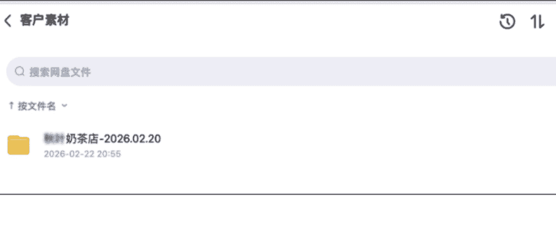

图12-7 “客户”素材文件夹

- 通用素材：存放收集的免费背景音乐、字幕模板、转场特效等素材（比如“欢快背景音乐”“字幕模板-简约风”），方便重复使用。
- 成品素材：存放剪辑好的成片，按“客户名+视频主题”格式命名（比如“××奶茶店-新品推广-01”），方便后续交付、复盘。
- 关键技巧：给每个文件夹、每个文件“贴标签”（比如“餐饮”“奶茶”“新品”），后续搜索标签就能快速找到对应的素材。

### 3.成片自动化交付

成片自动化交付就是不用手动发文件，省时间还专业。从剪映导出成片后，自动同步到百度网盘对应文件夹，然后通过网盘链接将成片分享给客户，不用来回发微信、QQ，还能随时查看客户是否已下载。

在剪映中导出成片时，勾选“成片自动备份至云空间”，如图12-8所示。

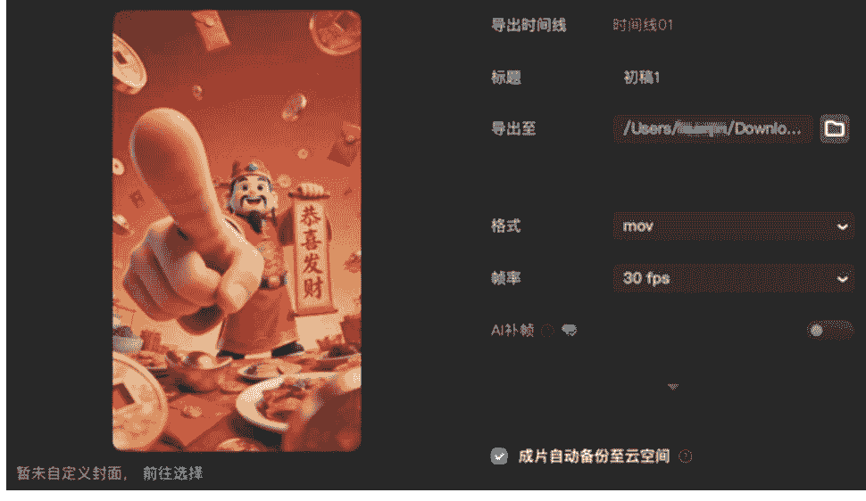

图12-8 勾选“成片自动备份至云空间”

剪映云空间成片同步至百度网盘的实操方法如下。

- （1）手机端（剪映App→百度网盘App）。
  - ①剪映导出视频。在剪映App中完成视频编辑后，单击页面右上角的“导出”按钮，等待视频渲染完成。导出视频成功后，视频将自动保存至手机相册或本地文件夹。
  - ②打开百度网盘并选择上传。打开百度网盘App，单击页面底部的“+”，在弹出的功能菜单中选择上传文件选项。
  - ③选择并上传导出的视频。进入手机相册或视频文件夹，找到刚从剪映App中导出的视频文件，勾选该视频后，单击右上角的“上传”。
  - ④等待上传完成。耐心等待视频上传至百度网盘，上传进度完成后，即可在网盘内查看该视频。

- （2）计算机端（剪映PC→百度网盘PC/网页版）。
  - ①剪映导出并保存视频。在PC端剪映中完成编辑后，单击右上角的“导出”。在弹出的窗口中选择视频保存位置（如桌面、文档文件夹），确认设置后等待视频导出完成。
  - ②上传至百度网盘（两种方式）。
    - 拖曳上传：打开百度网盘客户端或网页版，直接将导出的视频文件拖曳至网盘页面内，即可自动开始上传。
    - 按钮上传：单击百度网盘顶部的“上传”，选择上传文件。在文件夹中找到导出的视频并选中，单击“打开”开始上传。
  - ③完成上传。等待上传进度条加载完毕，视频即成功保存至百度网盘。

成片同步到网盘后，打开对应客户的“成品素材”文件夹，选中成片，生成提取链接，设置“永久有效、无须提取码”。把链接发给客户，同时备注“成片已交付，如有修改意见，直接在腾讯文档的需求表中填写，我会及时修改”。后续客户需要重新获取成片时，直接单击链接就能获得，不用你再手动发送，节省大量沟通时间。

### 12.2.3 新手高效运营小技巧

每天可以花10分钟左右整理好当天的素材、成片与选题，做到内容日清日结，避免出现大量堆积的情况；同时把常用的剪映模板、豆包提示词统一整理存放在腾讯文档中，方便后续直接调用，大幅提升效率；还可以借助日历软件标注客户要求的交付与修改截止日期，提前做好规划，有效避免订单遗漏、交付延误。

## 12.3 客户沟通与展示：用AI协同工作流获取客户信任

很多新手技术不差，剪辑速度也快，但就是留不住客户、接不到长期订单。核心问题不是剪得不好，而是不会沟通、不会展示。客户找你做剪辑，不光是要一条视频，更是要放心、省心、有效果。通过AI协同工作流，能让客户看到你的专业度、感受到你的高效，从而建立信任，愿意长期和你合作。

### 12.3.1 客户沟通的核心：轻松搞定需求

新手沟通容易踩的坑：客户说“我要一条好看的视频”，你就开始剪，剪完客户说“这不是我想要的”，反复修改，浪费时间。此外，还可制作需求收集表（见表12-4）让客户填写，避免口头沟通产生误解。

##### 表12-4 AI视频剪辑需求收集表

| 需求项 | 客户填写内容 | 示例 |
| :--- | :--- | :--- |
| 视频核心目的 | 引流 / 卖产品 / 品牌宣传 / 记录 | 本地奶茶店新品引流，吸引同城观众到店 |
| 视频风格要求 | 简约 / 活泼 / 专业 / 接地气 + 参考视频 | 欢快活泼，参考视频“抖音 × × × 链接” |
| 必加元素 | Logo / 口号 / 地址 / 产品卖点 | 必加门店 Logo + 地址（× × 市 × × 路）+ 新品奶茶图 |
| 禁用元素 | 音乐 / 画面 / 文案 | 不要用悲伤的音乐，不要出现其他奶茶品牌 |
| 交付时间要求 | 具体日期 / 加急 | 2026 年 2 月 25 日前交付，无须加急 |
| 适配平台 | 抖音 / 视频号 / 小红书 / 其他平台 | 抖音 + 本地生活平台 |

### 12.3.2 用AI协同工作流展示专业度

不用刻意炫耀技术，只要让客户看到你的“流程化、高效化”，就能建立信任。这里分享一套新手可直接用的AI协同工作流，全程可视。

### 1.需求确认

客户填写需求收集表后，用豆包生成需求确认函，明确双方约定内容，避免后续产生纠纷。以下为生成需求确认函的提示词模板。

请根据以下客户视频需求，生成一份正式的AI剪辑需求确认函，内容包括需求总结、交付时间、修改次数、套餐包含服务、付款方式，语言简洁正式，适合零基础剪辑师与客户沟通，无须复杂术语。

1. 客户需求：[复制客户填写的需求收集表内容]。
2. 套餐类型：[基础/进阶/高阶]。
3. 约定交付时间：[具体日期]。
4. 免费修改次数：[3次/5次/无限次]。
5. 付款方式：[预付50%，交付后付剩余50%/全款预付/月结]。

### 2.需求确认函生成。

对豆包生成的需求确认函进行审核后发给客户确认。

##### AI视频剪辑需求确认函

致：××奶茶店

您好，已收到您的视频剪辑需求，现做如下确认，若确认无误请回复“确认”，我将立即开始创作。

1. 需求总结：为××奶茶店制作同城新品引流视频，欢快活泼风格，必加门店Logo+地址+新品奶茶图，适配抖音+本地生活平台。
2. 套餐类型：进阶剪辑套餐。
3. 交付时间：2026.02.25前完成成片交付。
4. 服务包含：AI脚本策划+精剪+多平台适配+5次免费修改+简单数据反馈。
5. 免费修改次数：5次（超过次数每次加收10元）。
6. 付款方式：预付50%（400元），成片交付后付清尾款（400元）。

本确认函一经确认，双方按此执行，避免后续需求变更而产生纠纷。

确认人（客户）：

日期：

把确认函发给客户，客户回复“确认”后，再开始创作。

### 3.脚本共创，让客户参与，同时减少分歧

用豆包生成本次视频的脚本（包含文案、镜头建议），然后复制到腾讯文档的“脚本共创表”，分享给客户；客户可以直接在文档上修改脚本（比如修改某句话、调整镜头顺序），你能够实时看到修改意见，不用来回发微信、打电话，高效又透明。

### 4.剪辑进度展示，让客户不用催

剪辑过程中，不用等剪完再发给客户，在合适时候花1分钟左右用剪映导出半成品（比如前10秒、关键镜头），同步到百度网盘的“进度展示”文件夹，分享链接给客户；客户可以随时查看进度，及时提出问题，避免剪完后大幅度修改，节省双方时间。

### 5.成片交付和反馈，为复购做铺垫

成片交付后，用豆包生成反馈收集表（见表12-5），让客户填写，收集意见并挖掘后续需求。

##### 表12-5 AI剪辑成片反馈收集表

| 反馈项 | 客户填写内容 | 示例 |
|---|---|---|
| 成片满意度 | 1～10分 | 9分 |
| 需修改的具体内容 | 镜头/字幕/配乐/卖点 | 字幕字体太小，需放大；背景音乐稍微调大 |
| 修改完成时间要求 | 具体时间 | 2026.2.26中午12点前 |
| 后续是否有新需求 | 是/否/暂不确定 | 是，下周需剪辑5条门店日常视频 |
| 其他建议 | 无/具体建议 | 希望后续视频能加同城热门话题标签 |

修改完成后，把最终成片交付给客户，同时说一句“后续如果有新的视频需求，直接发我需求表就好，我会优先安排”。

### 12.3.3 展示的两个关键：让客户愿意找你、推荐你

在案例展示上可以通过前后对比直观体现AI剪辑的优势，无须制作复杂案例册，只需将客户原始素材与你剪辑完成的成片做成对比图或对比视频，并标注“手动剪辑需要1小时，AI剪辑只要5分钟”“原素材杂乱，成片简洁吸睛”等信息。例如客户提供的是无字幕、无配乐、镜头混乱的门店实拍素材，而你输出的成片配有字幕、有合适的背景音乐、镜头衔接流畅且能突出门店卖点，这样的对比能让客户清晰感知你的服务价值。

在口碑展示方面，可以将客户好评、复购记录等做成可视化素材，把类似“剪得很快，很满意，下次还找你”“已经合作3个月了，省了很多时间”这类好评与复购消息截图保存并整理到腾讯文档中，后续对接新客户时直接展示，他人的真实认可远比自己反复强调更有说服力。

## 12.4 赚钱系统的维护与进化：风险规避、效能评估与迭代清单

本节讲解赚钱系统维护与进化的3个核心——风险规避：避免赔钱、产生纠纷。效能评估：知道自己赚了多少、省了多少时间。迭代清单：让系统越来越高效、越来越赚钱。

### 12.4.1 风险规避：重点规避3个风险

用AI剪辑变现看似简单，但如果不注意风险，很可能辛苦赚的钱最后全部赔进去。

### 1.版权风险最“致命”，必须重视

切勿随意使用网络素材，如背景音乐请仅选用剪映中标注了“免费可商用”的，图片与视频素材优先使用豆包生成的AI内容或剪映中可商用的。对于客户提供的实拍素材、Logo或文案，务必在合同中明确版权归属及侵权责任，避免因客户素材侵权而牵连自身。

### 2.客户纠纷风险，尽量避免纠纷、赔钱

为防客户临时改变想法、不停修改或拒付尾款，合作前必须签订简易电子合同。明确约定服务范围、交付时间、免费修改上限（如5次）及付款方式（如预付50%）。同时，妥善保存微信沟通记录、需求确认单等资料。遇到恶意拖延或提出无理要求的客户，要敢于及时止损，将精力留给优质客户。

### 3.自身效能风险，避免“忙而不赚”

忙碌不等于赚钱。若时薪远低于预期，往往是陷入了低价单和反复修改的“泥潭”。建议每周复盘，果断淘汰低质订单客户，转而深耕单量稳、利润高的长期代运营客户。此外，应将脚本生成、素材查找等重复工作标准化、模板化，用工具换时间，切实提升单位产出收益。

### 12.4.2 效能评估：用一张表知道自己赚了多少、省了多少

不用复杂的财务计算，新建一个“效能评估表”（腾讯文档/Excel），如表12-6所示，每周填写一次，就能清晰知道自己的赚钱效率，并及时调整方向。

表12-6 效能评估表

| 本周接单量 | 本周总收入 | 本周总耗时 | 时薪 | 修改次数 | 复购客户数 |
| :--- | :--- | :--- | :--- | :--- | :--- |
| 进阶套餐2个+零散单30个 | 3900元 | 60小时 | 65元 | 平均每条/每个套餐2次 | 3个 |

表格主要包含5项关键数据统计，本周接单量为代运营套餐数量与零散剪辑单数之和，本周总收入是所有套餐及零散订单的实际到账金额，时薪由本周总收入除以包含剪辑、沟通、整理素材在内的本周总耗时计算得出，修改次数需统计本周所有订单的平均修改次数，复购客户数则是本周有复购需求的老客户数量。

达标标准方面，时薪达到或超过50元代表定价合理、效率达标，低于50元则需要淘汰低价单并提升定价，修改次数没有超过3次说明需求沟通到位，超过3次则需优化需求收集流程，复购率达到或超过30%代表客户信任度高，低于30%则要提升服务质量，复购率通过复购客户数除以总客户数得出。

上述表格中时薪65元、平均修改次数2次，均达到标准，说明当前赚钱系统运行状况良好，可尝试拓展高阶套餐客户来进一步提升收入。

### 12.4.3 迭代清单：每周10分钟，让你的赚钱系统越来越高效

迭代不是大改大动，而是小步慢调，就能让你的赚钱系统越来越高效。

### 1.流程迭代

优化1个烦琐环节。例如，发现每次生成脚本时都要重新撰写豆包提示词，那么就把常用的提示词存起来，下次直接复制粘贴使用；发现找素材太费时间，那么就优化素材分类标签，让搜索更快捷。

### 2.工具迭代

学习1个新的AI功能。剪映和豆包会不断更新功能，比如剪映的AI画面修复、豆包的Seedance 2.0等，学习1个新功能并用到自己的工作中，就能提升效率。

## 3.服务迭代

新增1个小的附加服务。例如，给客户交付成片时，额外赠送1张“视频封面图”（用豆包AI生成，1分钟就能搞定）；给长期客户每月免费做1次数据复盘，给出简单的优化建议。这些小的附加服务不用花太多时间，但能大幅提升客户好感，提高复购率和增加溢价空间。

## 12.5 从剪辑师到视觉导演：掌握AI工具生态的进化路径

很多新手容易陷入一个误区，觉得做AI剪辑就是注定一辈子当“剪辑工”，每天重复机械劳动，只能赚点辛苦钱。其实，AI剪辑只是你的起点，绝非终点。

当你能熟练驾驭剪映、豆包等工具后，下一步进化将使你的身份发生质的变化：从只会执行指令的剪辑师进化为能把控整体视觉效果、为客户创造巨大价值的“视觉导演”。这不仅意味着你的收入可能翻10倍甚至20倍，更意味着你将从“卖时间”转向“卖能力”，甚至实现被动收入。

这条从剪辑师到视觉导演的进化之路，可以清晰地划分为以下4个阶段。

### 12.5.1 第一阶段：夯实基础，先做高效的“执行者”

第一阶段的核心任务很简单：把“剪映+豆包”这两个“武器”用透。

你不需要学一堆复杂的技巧，而是要死磕核心功能——利用剪映的批量剪辑、AI配音和自动字幕功能，结合豆包的脚本生成与文案优化能力，快速应对餐饮、美容行业、职场等各类基础行业的需求。

怎么算过关？当你建立起一套标准的接单流程（定价、沟通、交付），每月能稳定承接5～10个零散单或2～3个长期客户，且月收入达到3000～8000元、时薪稳定在50元以上时，你的基础就打牢了。记住，这一阶段切忌贪多求杂，跑通流程比学新工具更重要。

### 12.5.2 第二阶段：提升认知，转型成懂需求的“顾问”

有了基础后，千万别让自己沦为“客户让剪什么就剪什么”的工具人。这一阶段的跃迁关键在于从“执行者”变为“建议者”。

你需要主动去拆解抖音、视频号上的爆款视频，摸清它们的脚本逻辑、镜头语言和字幕规律，并把这些经验用到自己的作品中。更重要的是，在接到需求时，你要能给出专业建议，比如告诉客户“这个卖点放在开头更吸睛”或“这种风格更适合引流”。

通过提供脚本策划、封面设计等增值服务，你可以顺势将单价从30元/条提升到60元/条以上。同时，通过优化沟通流程，把平均修改次数控制在3次以内。当客户开始愿意为你的“专业建议”买单，而不仅是为“剪辑动作”付费时，你就成功转型成懂客户需求的“顾问”。

### 12.5.3 第三阶段：打造标签，成为细分领域的“专家”

想要进一步溢价，就不能再做“万金油”。这一阶段的核心策略是做减法：选定1～2个你熟悉且有市场的细分领域（如餐饮或美容行业），深耕下去。

你要在这些领域里形成极具辨识度的个人风格——让客户一看视频就知道“这是你剪的”。接着，着重积累10～20个该领域的优质案例，整理成案例册或对比视频，在社交平台上打造如“××AI剪辑-专注餐饮短视频”这样的个人IP。

一旦你在细分领域建立了信任标签，客户就会主动找上门。这时候，你不用再到处找客户、找订单，而是拥有了挑选客户和报高价的底气。

### 12.5.4 第四阶段：扩大规模，进阶成统筹全局的“导演”

到了这个阶段，你将彻底脱离单纯剪辑师的角色，转变为团队管理者和全案策划人。

此时，你可以组建一个2～3人的小团队，通过制定标准化手册（涵盖流程、话术、交付标准），让团队成员分别负责脚本、剪辑和沟通，无须高薪聘请专家也能保障质量。你的业务重心将转向对接连锁餐饮、知名教培等高端客户，推出万元级的全案代运营套餐，服务内容涵盖账号定位、内容规划、营销策划及数据优化。

更进一步，你还可以将自身能力产品化，推出专属模板、AI工具包或新手培训课程。这时，你不仅能赚取代运营的服务费，更能通过可复制的产品实现“被动收入”。

建立赚钱系统，本质上是从零散接单向长期盈利的蜕变。而从剪辑师到视觉导演，则是从“靠时间赚钱”向“靠能力、靠品牌赚钱”的升级。

不必急于求成，只要跟着节奏夯实基础、提升认知、打造特色、扩大规模，哪怕每天只进步一点点，长期坚持下来，也能凭借AI工具实现“逆袭”。请记住，AI工具只是你的“武器”，而你构建的“赚钱系统”和不断进化的“专业能力”，才是别人永远无法复制的核心竞争力。

扫描下方二维码，回复“赚钱”，即可领取

- 1. 新媒体实战提示词模板
- 2. 剪映快捷键（macOS-Windows）
- 3. 2026主流视频平台规格与最佳发布实战指南
- 4. 可商用字体包
- 5. 爆款视频模板
- 6. Seedance极速上手实操手册
- 7. AI剪辑变现指南

