# 剪映·豆包·Seedance变现实操手册

# 内容速览

本书为零基础人群设计一套从学习智能视频剪辑到实现商业化落地的完整方法论。以实战案例配合步骤拆解，通过真实变现场景，手把手帮助读者建立从操作能力到持续盈利的体系。

全书共12章。第1章梳理智能剪辑工具组合与入门路径，演示数小时内掌握剪映、豆包、Seedance 2.0并产出首条可收费作品；第2至4章聚焦选题策划与素材生产，讲解借助豆包挖掘爆款选题、分镜脚本与口播稿，并结合即梦AI与Seedance 2.0搭建规避版权风险的专属素材库，同时涵盖智能配音、自动字幕、声纹复刻等内容；第5至9章进入剪辑实操，细化智能字幕、AI调色、数字人出镜、智能包装、一键成片等核心手法，实现半小时内从灵感到成品；第10至12章聚焦商业化路径，覆盖带货讲解、知识付费、Vlog、本地探店等赛道，以及自由接单、内容创业、产品研发、培训顾问、团队赋能等变现方式，帮助读者将剪辑技能沉淀为可复用的盈利体系。

适合有副业诉求的职场人群、自媒体从业者、在校学生、实体商家、小微商户，以及希望借助AI提升效率的剪辑从业者阅读使用。

# 前言 2026

2026年早春，我在社媒上看到由Seedance 2.0生成的作品迅速走红，当时便意识到面向大众的视频变现窗口已经打开。作为在知识IP赛道深耕十五年、见证众多创作者从零起步到月入上万的从业者，我在剪映迭代与AI爆发的节点捕捉到新的创富信号。

过去十五年里，我见过太多人卡在“想做内容却不会剪辑”的困境。职场人想用副业增收，却耗不起学习Premiere Pro、After Effects的时间成本；创业者想搭建短视频矩阵，却被制作费用劝退；宝妈与学生想进入内容赛道，却被技术门槛阻挡。大家并不缺少创意与坚持，缺少的是一套上手迅速、即刻变现的傻瓜化工具。

剪映、豆包、Seedance 2.0的组合恰好打破了僵局。它们并非面向专家的冷门软件，而是普通用户可用的内容变现抓手。

撰写本书并非制作枯燥的操作手册。团队在真实变现场景中反复打磨智能剪辑技巧，就是想说明：视频时代的盈利逻辑已经迁移，不再单纯依赖设备与手艺，而是依赖AI放大个人产能。

无需购置昂贵相机，无需钻研复杂调色，甚至可以不露脸。掌握书中介绍的智能剪辑工作流，就能把零散灵感转化为爆款内容，用碎片时间获取稳定现金流，甚至让单人工作室运转如成熟产线。

真正的风口，是大众以低成本入场的时刻。行动迅速的人先吃到红利。剪映凭借近乎零门槛与强大的智能能力，让所有人站在同一起跑线。

本书不空谈理论，每个变现场景都拆解到可执行：从用豆包数秒产出上百个选题、用Seedance 2.0生成无版权风险的电影级素材，到剪映AI自动剪辑、数字人带货，再到四大热门赛道的标准化变现SOP，每一步都配有提示词模板、参数建议与避坑要点。

需要提醒，工具再强也只是武器，核心仍是商业嗅觉与执行力。案例、报价、路径需结合自身情况灵活调整。面对客户对接、合同签署、版权风险等关键环节，请保持独立思考与风险意识。AI是加速器，决策者永远是你。

随书赠送的电子资源包是团队整理的实战工具箱，包含新媒体提示词模板、可商用字体包、爆款视频模板、Seedance快速上手手册、AI剪辑变现指南等，助你少走弯路、更快接单。

十五年前我以“让学习更简单有趣”为理念创业，帮助很多人实现技能变现。如今AI视频浪潮席卷，我依然相信：大众的逆袭，靠的不是出身或昂贵设备，而是抓住时代工具的勇气与立刻行动的执行力。

AI视频时代的大门已敞开，愿你以剪映+豆包+Seedance 2.0为钥匙，开启自己的内容变现之路。

秋叶
2026年4月

# 第1章 智能剪辑正在悄悄成为第二份收入

你可能已经看到：有人靠剪短视频月入数千，有人用智能工具三分钟产出一支可接单作品，还有人零基础学剪映，72小时内收到第一笔剪辑费。这不是运气，而是智能时代的新机会。会用智能剪辑的人，正以更低成本、更短时间，悄悄增加副业收入。

## 1.1 为何2026年学智能剪辑比2020年学Premiere Pro更划算

2020年学习Premiere Pro是抢占先机，但2026年再死磕PR，效率低、回报比不高。大多数普通人的诉求只有三点：上手快、能成片、能赚钱。没人愿意花几个月啃软件，最后连15秒短视频都做不好。

剪映+豆包+Seedance 2.0这套智能剪辑组合，正好解决费时、费力、门槛高的痛点，比过去学PR划算得多。

### 1.1.1 三款工具的基础分工

零基础同学先弄清楚这三款产品的定位与核心能力，为后续学习打底。三者均为字节跳动旗下，操作互通衔接顺畅，无专业门槛。表1-1为其基础情况概览。

表1-1 三款工具的基础情况概览

| 工具 | 基础情况介绍 |
| :--- | :--- |
| 剪映 | 字节跳动推出的全平台剪辑应用，主打新手友好并兼顾专业需求，无需剪辑基础即可快速上手。核心亮点是全套智能能力，含AI字幕识别、智能抠像、图文成片、文案生成、AI消除杂物、AI补帧、数字人播报、音色克隆等，能大幅缩短制作时长。内置海量免费音乐、贴纸、特效、滤镜，支持多轨道剪辑、关键帧动画、音频降噪、蒙版、多机位等专业功能，适配日常记录、自媒体推广、职场汇报、带货宣传等场景，可导出无水印视频，商业使用无压力，基础功能全免费 |
| 豆包 | 字节跳动研发的免费AI助手，定位是创作者的全流程辅助工具，能深度赋能视频制作。擅长自动生成短视频脚本、口播文案、标题、解说词，并给出剪辑思路与创意灵感，可输出带分镜号、景别、画面、台词、时长的结构化分镜脚本。除此之外还支持图片生成、文档处理、录音转文字、数据分析、代码辅助等。创作链路上可与Seedance 2.0无缝调用，也为剪映提供文案脚本支持，打通创意到剪辑 |
| Seedance 2.0 | 字节跳动旗下的专业AI视频生成工具，解决传统AI视频音画脱节的问题。支持文本、图片、视频、音频四种混合输入，最多可同时参考9张图、3段视频、3段音频；通过@提及系统精准学习风格、动作、运镜，实现“想即得”。可自动为视频匹配音乐、生成多镜头叙事，支持推拉摇移等专业运镜，保持角色与风格一致。最高输出8K，默认1080P高清，单次生成4～15秒，支持延长与编辑。与豆包深度协同，无需额外下载，直接在豆包内调用，生成片段可无缝导入剪映二次剪辑，形成创意-素材-后期的高效闭环 |

图1-1所示为Seedance 2.0在豆包上的专属入口。

图1-1 Seedance 2.0在豆包上的专属入口

简单说，豆包负责“想文案、出思路”，Seedance 2.0负责“做画面、配音乐”，剪映负责“精剪辑、出成片”。组合使用，新手也能三分钟完成一条可接单的爆款短视频。

### 1.1.2 2026年学智能剪辑的三大核心优势

传统剪辑靠蛮力，智能剪辑靠巧劲。

1. 零门槛上手快，三天可入门，比学Premiere Pro节省时间。智能剪辑的核心是让AI干活，你只需说清需求，剪映、豆包、Seedance 2.0会完成大部分专业操作。
2. 省时省力，效率翻倍，成本接近零。工具组像24小时在线的剪辑助理，批量处理繁琐环节，你只需关注拍什么、写什么。
3. 变现路径多、门槛低。智能剪辑的最终目的都是赚钱，可通过副业接单、自媒体涨粉带货、模板售卖实现被动收入，普通人也能轻松获得第二份收入。

## 1.2 没有资源没有背景没有时间，现在进场依然能分一杯羹

很多人看到别人靠智能剪辑赚钱，第一反应是“我不会，已经晚了”。其实不然，2026年只要掌握剪映、豆包、Seedance 2.0这三件工具，就能不用拼资源、不用靠关系，用碎片时间吃到红利。

### 1.2.1 赛道机会：大众的刚需单，根本不缺活

剪辑赛道像餐饮，星级酒店做高端宴席，街边小店做家常菜，各取所需。

- 专业团队：承接品牌、大主播的高价单，主打精美特效、反复打磨，投入大、耗时长。
- 普通人：接小店主、小博主的刚需单，客户要的是“出片快、性价比高”，恰好是豆包与Seedance 2.0的强项。

刚需单缺口很大，小区水果店、楼下美甲店、创业者等都需要短视频引流，却不会剪也不愿付大价钱给专业团队——这就是普通人的机会，线下走一圈就能看到商机。

### 1.2.2 普通人入场：Seedance 2.0提供零门槛创作红利

对设备、资源、时间都匮乏的人，Seedance 2.0是最好的依托，具备三大优势。

- 不用高端设备，一部手机搞定。过去需要高配电脑、专业相机，现在手机拍素材就够，剪映配合Seedance 2.0轻松完成字幕、调色、配乐。
- 不用费劲涨粉也能直接变现。涨粉需要长期运营，而Seedance 2.0做的视频可直接在闲鱼、小红书接单，或线下对接本地商家，新手也能接到单。
- 碎片时间可操作，月入3000元很轻松。上手快，每天练30分钟几天就能掌握。15秒视频用Seedance 2.0自动生成素材并调整节奏，再手动微调约5分钟即可。每天工作2小时，月入超3000元完全可行。

### 1.2.3 新手避坑：两件事别做

- 别追求完美。客户要的是“能用、出片快”，不是“特效精、零瑕疵”。先生成再微调，不要为一个细节耗太久，效率低就赚得少。
- 别接超出能力范围的单。建议新手只做15～60秒短视频，不碰长视频、重特效单，避免做砸口碑。

普通人赚钱靠“选对工具、肯动手”。Seedance 2.0像免费的剪辑助理，帮你完成复杂繁琐的工作，无需拼设备、拼时间、拼资源。愿意花碎片时间练习，现在入场也能轻松拿到第二份收入。

## 1.3 专业剪辑师还在内卷技术，聪明人已经在接单赚钱

当前剪辑赛道分两条路：一是专业剪辑师死磕Premiere Pro、After Effects，钻研特效逐帧调色；二是借助剪映+豆包+Seedance 2.0，五分钟出片，一天接几十单靠效率变现。对想做副业的普通人，变现远比炫技重要。2026年客户要的是“能用、出片快、高性价比”，Seedance 2.0正好帮你绕开内卷，直击赚钱核心。

### 1.3.1 专业人士的内卷，普通人没必要参与

这就像珠宝工艺师追求极致，而街边银饰店只要款式好看、品质过关就能稳定盈利，两者不在同一赛道。专业内卷的痛点是学多款软件、耗时数天打磨一条视频，还需高端资源接大单，时间、精力、门槛都吃不消。

更关键的是，专业人士一般不接15秒小店宣传、家庭视频这类刚需小单，而这正是普通人的机会。用豆包和Seedance 2.0提升效率，主打高性价比，把小单做快做好，积少成多。

### 1.3.2 用Seedance 2.0省时间，把精力放在变现上

普通人学智能剪辑的核心不是学技术，而是学会让AI干活：让Seedance 2.0+剪映+豆包完成80%的剪辑，你只负责微调和找客户，就像外卖员不用研究发动机，会骑车送得快就能赚钱。

把握三点即可避开无效内卷：

- 放弃完美主义。只要字幕准、画面清、节奏对，客户就满意。
- 靠Seedance 2.0批量出片。自动生成素材、调节奏、配乐，再搭配剪映批量导出、豆包批量写文案，一小时可出10条短视频，提升接单能力。
- 只做15～60秒刚需小单，不碰高端长视频、特效单。刚需单需求量大、回款快，砸口碑风险小。

## 1.4 巧用三大工具，普通人也能做出高级感视频

同样用手机剪辑，有人做出的画面干净、色调高级、细节精致，像专业团队作品；有人画面杂乱、单调平庸。区别不在天赋或设备，而在工具用得对不对。

### 1.4.1 “高级感”在哪里

高级感不靠设备，靠三个细节：

1. 画面干净流畅：无杂物、无模糊晃动，镜头切换自然，给人整洁舒适感。
2. 色调统一有质感：避免亮暗不一、色彩混乱，如美食用暖调、风景用冷调。
3. 细节到位不粗糙：字幕清晰、配乐精准、特效简洁。

### 1.4.2 三件工具分工，新手也能快速出片

不用精通全部功能，搞懂分工即可上手。

**分工1：Seedance 2.0负责最专业的音画**
零基础模板操作：打开豆包网页版→找到Seedance 2.0入口→上传图片或输入文字需求→发送等待结果。

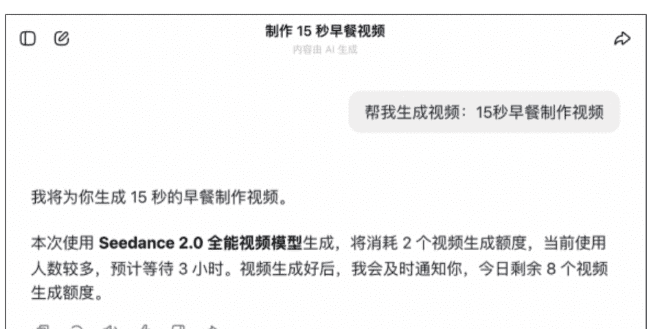

图1-2 使用Seedance 2.0生成视频

- 多镜头切换与运镜：做推拉摇移等专业运镜，衔接连贯自然。
- 原生音画同步：交流场景中口型、表情与配音精准匹配，告别声画分离。
- 多模态参考：可上传图片/视频/音频作为参考，还原构图、动作、音效。
- 编辑与延长：生成后可直接删减修改片段，或一键延长时长，降低废片率。

**分工2：豆包负责最费脑的前期**
在对话框输入精准指令即可解决“剪什么、怎么说”的痛点。

- 写精准文案：输入“15秒早餐短视频，温柔治愈风格，适配小红书”，一键生成适配文案。
- 专业配音：把豆包生成的文案复制到剪映“朗读”板块选择音色，开始朗读生成音频，也可直接用Seedance 2.0生成带音视频。

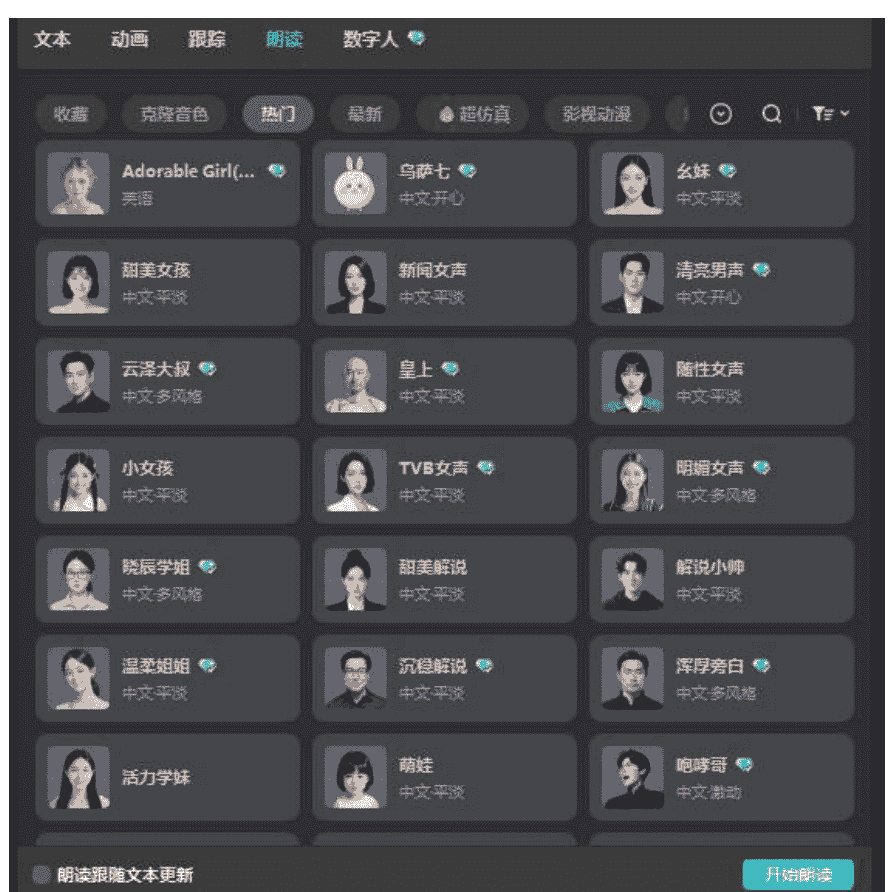

图1-3 剪映“朗读”板块

- 选核心素材：上传10段制作早餐素材，指令“帮我挑3个核心片段并说明理由”，快速得到筛选建议。

**分工3：剪映负责最费时的后期**
将Seedance生成的片段、豆包文案导入剪映，用AI快速优化细节。

- 防抖与画面优化：选中视频依次点“防抖”“画面增强”，解决手机拍摄的晃动模糊。
- 调色：一键套用“电影感”“美食暖调”等滤镜，无需手动调参，保证色调统一。
- 生成字幕：点“字幕”-“自动识别字幕”，识别声音生成字幕，可修改字体颜色大小，实现字幕与声音对齐。

### 1.4.3 三个关键技巧让质感翻倍

1. 色调统一是核心。生成时在提示词中加入“统一暖色调/冷色调，电影质感”等描述；剪映中套用对应滤镜即可。
2. 字幕准确可商用。自动生成后检查字幕与配音一致性、字体是否可商用、有无错别字。
3. 背景音乐要合适。提示词中加入“轻柔背景音乐”；剪映中背景音乐音量调至20%-30%，人声70%-80%，保证听清人声且有氛围；优先使用剪映可商用音乐，避免版权风险。

Seedance 2.0+豆包+剪映不是让你精通剪辑，而是让你能快速出好片、高效变现。普通人无需学专业知识、无需长时间练习，用好这三件工具就能做出“看起来很贵”的视频。AI时代，会用工具比精通技能更重要。

## 1.5 从下载软件到收到第一笔钱，有人只用了72小时

读到这里，你大概还在心里嘀咕：我零基础，软件都没开过，靠AI真的能快速赚钱吗？能。

剪映搭配豆包再用上 Seedance 2.0，可以把最难啃的部分都包办，不需要去学专业的剪辑手法，也不用熬夜琢磨文案，按步骤执行，72小时内就能从完全的小白变成可以接单的AI剪辑从业者。下面用一个真实可复刻的案例，把全过程和关键动作拆开说明。

### 1.5.1 新手小刘的变现日记

小刘是职场上班族，每天最多空出1到2小时，零基础、从未碰过剪辑，出于“试试无妨”的心态，用剪映+豆包+Seedance 2.0，3天拿下200元，接了两单本地美甲店的15秒宣传短片，每单100元，全程手机搞定，实际花的时间不到5小时。他的安排和操作路径清晰，新手照着做就能跑通。

小刘的AI剪辑变现全路径，纯手机、无专业设备

第一天，约1.5小时：装工具、熟悉、练手
(1) 0.5小时：在手机应用商店装好剪映、豆包，并在豆包里激活Seedance 2.0，快速摸清三个工具的核心入口，比如豆包的文案生成与配音入口、剪映的字幕与滤镜入口、Seedance 2.0的画面生成入口。
(2) 1小时：先让豆包写一段简短文案，再在Seedance 2.0里输入“30秒风景视频”生成素材，最后在剪映里完成剪辑调色，重复练习1到2次，掌握“豆包出文案→Seedance 2.0出画面→剪映出成片”的基础闭环。

第二天，约2小时：找单并出样片
(1) 0.5小时：线上在闲鱼发布接单信息“AI剪辑15到60秒短视频，100元/单，出片快、性价比高，适合小店引流”；线下到小区楼下的水果店、美甲店、便利店打听是否有短视频引流需求，最终拿到两家美甲店的15秒美甲款式宣传需求。
(2) 1.5小时：按商家要求，用豆包分别撰写两版宣传文案，结合店家提供的美甲款式图在Seedance 2.0里生成片段，再用剪映做调色、加字幕、配音，做出两版样片发给客户确认，均一次通过。

第三天，约1小时：微调交付收款
(1) 0.5小时：根据客户的小调整需求，比如修改字幕颜色、换一个更轻快的背景音乐，在剪映里一键修改，快速定稿。
(2) 0.5小时：把成片通过微信发给两位客户，确认无误后收到200元，完成零基础AI剪辑的首笔变现。

### 1.5.2 变现的3个关键点

小刘能这么快变现不是靠天赋，而是抓住了三点，照做也能成。

#### 1. 不纠结，先行动
很多人卡在“怕做不好”“接不到单”的想法里，可软件都没装，钱永远赚不到。做菜不拿起锅铲永远学不会。新手不必追求完美，先装软件再练手、找单，哪怕第一单不赚钱，也是积累。

#### 2. 找对切口，不贪多
新手不要碰长视频、复杂特效，优先做15到60秒的短视频、字幕添加、口播切片，这类需求多、难度低、交付快，借助Seedance 2.0的一键生成就能快速交付。积累经验和口碑后再接高价单。

#### 3. 借助工具，不硬扛
别自己扛文案、手动剪辑、手动配字幕，费时还不一定好。用豆包负责文案和配音，用Seedance 2.0负责画面优化和素材生成，用剪映负责剪辑、调色、加字幕，自己只负责下指令、简单微调和交付，效率翻倍，变现加速。

最后提醒，时间节点不用死抠，给自己5到10天适应和练习期，关键是迈出第一步。

# 第2章 选题脚本不用愁：让豆包驱动内容生产

前面讲了AI剪辑的红利和变现思路，是不是有点动力了？想把动力落地成可接单的视频，还需要一套高效的内容策划体系。本章从选题、脚本、优化三个维度，帮你搭起一套由豆包驱动的策划流程，摆脱“不知道拍什么、写不出脚本”的困境，从迷茫到持续产出。

## 2.1 快速刷出上百选题：搭建高点击选题库

短视频爆款，选题占七成，剪辑占三成。选对方向就赢了一半。很多人对着手机发呆半天，想出两条选题还不敢确定能不能火。其实选题不用硬想，豆包就是现成的选题供应商，说清赛道和人群，几秒就能生成上百条贴合需求、易出爆款的选题，挑改就能用，还能慢慢沉淀成自己的专属库。

### 2.1.1 新手要避开的三大坑

#### 1. 贪多求全，什么都想拍
不要跨赛道，锁定一个细分赛道深耕。这样平台和观众才知道你是谁。今天美食明天美妆后天搞笑，看似丰富，实则让平台无法精准分发，流量被稀释。

#### 2. 只拍自己喜欢的自我娱乐式选题
选题是给目标观众看的，不是给自己看的。要围绕目标用户的喜好来定，而非个人兴趣。只发自己喜欢的内容，换不来播放。

#### 3. 盲目追热点，偏离赛道
追热点可以，但别跑偏。比如做美食赛道，就拍“用当红BGM做一道家常菜”，既蹭热度又不丢定位。若不管赛道盲跟热点，看似有流量，观众记不住你，也不会关注。

### 2.1.2 用豆包三步拿到爆款选题

豆包基础操作提示：打开豆包App或网页版，在首页对话框里直接输入需求并发送，豆包会自动生成内容，选题脚本均在对话框完成，无需复杂操作。

#### 1. 定规则，明确需求
用万能指令模板，把细分赛道和目标人群讲清楚，要求从痛点解决、实操教程、案例拆解、热点关联四个角度生成100个选题。指令越具体，质量越高。

万能指令模板：
我是做[你的细分赛道]的，目标观众是[你的目标人群]。请围绕我的赛道，从痛点解决、实操教程、案例拆解、热点关联这4个角度，生成100个高点击率选题，要求选题接地气、通俗易懂，适合零基础新手拍摄，不用太复杂，每条都能直接拍短视频15到60秒，避免冷门、自我娱乐式选题。

#### 2. 发指令，生成选题
把指令发给豆包，3到5秒就能拿到分类好的、可直接拍摄的100条选题。

#### 3. 筛选和微调，提升点击率
豆包的选题已经可用，再优化一下点击率。做两件事：筛选和微调。

先筛选：从100条里挑出30到50条最贴合赛道、好拍、目标人群感兴趣的，删掉复杂或偏离赛道的。比如做新手家常菜，就删掉需复杂食材、耗时长的选题。

再微调标题：给筛选后的选题加吸睛元素，提升点击欲。比如加上“零失败”“30秒”“新手必看”“避坑”等词。

短视频选题优化示例如表2-1所示。

表2-1 短视频选题优化示例

| 豆包生成 | 优化后 |
| --- | --- |
| 做好番茄炒蛋的技巧 | 零失误版番茄炒蛋，新手30秒上手，不再翻车 |
| 快手菜教程 | 10分钟快手菜，不用炒不用炖，好吃又省事 |

### 2.1.3 进阶做法：建立专属选题库，告别临时抱佛脚

用上面方法每次都能拿到100条，筛选后剩30到50条可用。若每次用完即弃，下次又要重来，既费时又浪费。建议建一个专属选题库，随取随用。

打造选题库的方法很简单，步骤如下。

(1) 新建文件夹，命名为“我的爆款选题库”，再按赛道新建子文件夹，比如“新手家常菜-教程类”“新手家常菜-热点类”“新手家常菜-痛点类”，分类存放，方便查找，如图2-1所示。

图2-1 “我的爆款选题库”文件夹

(2) 把优化好的选题以文本文件的形式保存到对应文件夹，并在每个选题后面备注拍摄难度，比如“简单，10分钟拍完”，以便安排拍摄。

(3) 定期更新。建议每周用豆包再生成100个选题，筛选后补充入库。已拍过的选题标注“已拍摄”，避免重复使用。

这里要注意，选题不在多，而在精。平时刷到别人的爆款选题，如果适合自己就对标修改入库，学习借鉴优质的灵感，提升自己账号的质量。

## 2.2 抓住黄金3秒：拆解并套用高打开率开场模板

现在大家都是利用碎片化时间刷短视频，注意力易分散，平均1～2秒就会划走。平台算法会根据前3秒的留存率，决定是否继续推送流量。所以，视频开场无须铺垫太多或追求完美，核心目的是留住观众；用一句话、一个画面，精准戳中观众的痛点、好奇心或真实需求。爆款开场都有可复制的模板，新手只要学会拆解与套用，再结合自身选题进行修改，也能做出高留存率的视频开场。

### 2.2.1 6个高打开率开场模板

下面介绍的6个模板几乎覆盖了所有短视频赛道，是全网爆款视频最常用的开场形式，每个模板都遵循“简单、直接、有吸引力”的原则。有了这6个模板，你不用设计台词、不用找复杂背景，结合自己的选题稍作修改，就能直接用。

(1) 痛点直击式模板，如表2-2所示。

表2-2 痛点直击式模板

| 模板类型 | 核心句式 | 关键要求 |
| :--- | :--- | :--- |
| 痛点直击式 | 你是不是也 ______？ 为什么总是做不好 ______？ 别再 ______ 了，越做越错 | 仅抓一个核心痛点， 语气亲切、表情真诚 |

这种开场方式的核心逻辑是一开口就说出观众的“烦心事”，让观众觉得“你懂我”，使其产生共鸣，忍不住留下来看你是怎么解决这个问题的。

详细的套用步骤如下，可以一一对照执行：①从你的选题里提炼出目标观众的一个核心痛点；②选一个模板句式，把痛点内容填进去；开场画面与台词匹配，不用复杂背景，对着镜头说话即可，表情真诚一点，语速稍快。

新手在运用时要注意以下问题：①痛点不要太多，一个就够了，多了反而无法突出重点；②语气要亲切，就像在跟朋友对话一样，不要太生硬。

(2) 反差惊喜式模板，如表2-3所示。

表2-3 反差惊喜式模板

| 模板类型 | 核心句式 | 关键要求 |
| :--- | :--- | :--- |
| 反差惊喜式 | 我以为____，结果只花____钱，做出____的效果！ 没做之前____，做完之后直接____ | 前后对比以营造反差，引起观众好奇 |

这种开场方式的核心逻辑是用“前后对比”营造反差，打破观众的固有认知，让观众产生“哇，这么神奇？”的好奇心，忍不住留下来看完所有内容。

详细的套用步骤如下，可以一一对照执行：①确定你的内容核心亮点，找到对应的前后反差点；②选一个模板句式，把反差内容填进去；③3秒内说完台词；开场画面很关键，一定要有对比画面，前两秒拍差的一面，后一秒拍好的一面，然后在剪映里直接拼接起来。

新手在运用时要注意以下问题：反差一定要明显，语速要稍快，结尾可以带一点惊讶的语气，以吸引观众。

(3) 福利引诱式模板，如表2-4所示。

表2-4 福利引诱式模板

| 模板类型 | 核心句式 | 关键要求 |
| :--- | :--- | :--- |
| 福利引诱式 | 免费分享 ______，看完就能用！ 不用花钱，就能 ______！ 最后有福利，______ 免费送 | 福利真实、与赛道内容相关， 不“画大饼” |

这种开场方式的核心逻辑是一开口就给告诉观众看完这个视频能得到什么，比如免费教程、避坑技巧、省钱方法，让观众觉得留下来有好处，从而主动看完视频。

详细的套用步骤如下，可以一一对照执行：①从你的选题里提炼出能给观众的福利（如教程、技巧、资料、省钱方法等），福利要和赛道内容相关；②选一个模板句式，把福利内容填进去，3秒内说完台词，直接告诉观众“能得到什么”；③开场画面很关键，对着镜头展示福利相关物品/画面（如教做菜就展示成品、教技巧就展示实操画面），不用复杂背景，让观众直观看到福利内容。

新手在运用时要注意以下问题：①福利一定要真实，不“画大饼”（比如承诺“免费分享教程”，就一定要分享）；②福利要和赛道内容高度相关，不要为了引流而放无关福利，避免丢失目标观众；③语速稍快，语气亲切，像给朋友分享好东西一样。

(4) 疑问悬念式模板，如表2-5所示。

表2-5 疑问悬念式模板

| 模板类型 | 核心句式 | 关键要求 |
| :--- | :--- | :--- |
| 疑问悬念式 | 为什么____的人，都能______？ 你知道____吗？90%的人都不知道！ 如果______，你会怎么做 | 提出问题，制造悬念 |

这种开场方式的核心逻辑是一开口就提出一个让观众好奇的问题，制造悬念，让观众觉得“我想知道答案是什么”，进而忍不住留下来看你解答。

详细的套用步骤如下，可以一一对照执行：①结合你的选题，提出一个观众好奇、想知道答案的问题，不要提太冷门、太专业的问题；②选一个模板句式，把问题填进去，3秒内说完，语气中可以带一点神秘感，以引起观众好奇；③在开场画面中，可以对着镜头皱眉或做出疑惑的表情，或者拍一个和问题相关的画面，增强观众的代入感。

新手在运用时要注意以下问题：①问题不要太复杂，一句话说清楚最好；②后续内容一定要解答这个问题，不要只制造悬念，不给出答案，这样会让观众反感。

(5) 指令行动式模板，如表2-6所示。

表2-6 指令行动式模板

| 模板类型 | 核心句式 | 关键要求 |
| :--- | :--- | :--- |
| 指令行动式 | 立刻暂停视频，跟着我做，先点赞收藏，不然______ | 给出明确指令，引导观众参与 |

这种开场方式的核心逻辑是一开口就给观众明确的指令，让观众跟着你的指令走，比如暂停视频、点赞收藏、跟着做，让观众主动参与进来，从而提高视频打开率。

详细的套用步骤如下，可以一一对照执行：①确定你的内容核心，明确你想让观众做什么，是收藏、点赞还是跟着做；②选一个模板句式，把指令填进去，3秒内说完，语气要坚定、亲切，不要太生硬；③在开场画面中对着镜头，用手势配合指令内容，让观众更有代入感，愿意跟着你做。

新手在运用时要注意以下问题：①指令不要太多，一个指令就够了，多了会让观众感到混乱；②语气不要太强势，就像提醒朋友一样，这样更易被接受。

(6) 热点联动式模板，如表2-7所示。

表2-7 热点联动式模板

| 模板类型 | 核心句式 | 关键要求 |
| :--- | :--- | :--- |
| 热点联动式 | 最近很火的___，我也来试试！ 用___（热点背景音乐），做一道___ 别人都在___，我偏要___ | 结合相关热点， 贴合潮流 |

这种开场方式的核心逻辑是结合当下热门的背景音乐或热门话题，让观众觉得“这个视频很新潮”，从而主动点开观看。

详细的套用步骤如下，可以一一对照执行：①打开短视频平台，找到当下和你的赛道内容相关的热门背景音乐、热门话题；②选一个模板句式，把热点填进去，结合自己的选题3秒内说完；③拍一个和热点相关的简单画面，比如热门挑战的标志性动作。

新手在运用时要注意以下问题：①不要盲目蹭热点，一定要结合自己的赛道，如你做美食就蹭美食相关的热点，不要蹭美妆、游戏的热点，不然会吸引非目标观众；②蹭热点要及时，不要等热点过了再蹭，这样效果会不尽如人意。

### 2.2.2 新手必看：实用开场技巧

6个模板不用全部掌握，结合自己的赛道和选题，每个模板试拍1～2个视频，根据前3秒留存率选出1～2个模板，然后固定使用以稳步提升留存率。

查看视频前3秒留存率的方法很简单，跟着以下步骤操作，能快速看懂数据并改进。

(1) 将试拍的视频发布到短视频平台（如抖音、小红书等），发布后等待1～2小时（确保有基础播放量）。

(2) 打开平台创作者后台（抖音为“创作者中心→数据中心→视频数据”，小红书为“创作者中心→作品分析”）。

(3) 找到对应视频的数据详情，查看“前3秒留存率”指标，留存率越高（一般≥40%为合格），说明开场越吸引观众。

(4) 优先选择留存率最高的1～2个开场模板，后续可以持续套用。

只要套用这6个模板，结合自己的选题稍作修改，就能做出有吸引力的开场，轻松留住观众，让视频的播放量不断增加。

## 2.3 从文字到画面：快速生成保姆级分镜脚本

很多新手觉得分镜脚本是专业导演的专属，复杂难学，其实新手做短视频，根本不用追求专业分镜脚本，只要实用、好懂、能直接照着拍就行了。分镜脚本就像做饭的菜谱，写清每一步的操作和要求，跟着拍就能拍出条理清晰的视频，节省剪辑时间，助力实现3分钟出片。

### 2.3.1 分镜脚本不用太复杂，有4个核心要素就行

新手做15～60秒的短视频时，不用画图、不用专业的镜头术语，只要包含4个核心要素，明确拍什么、怎么拍、说什么、拍多久，就能写出好用的分镜脚本。分镜脚本核心要素及说明如表2-8所示。

表2-8 分镜脚本核心要素及说明

| 核心要素 | 具体说明 |
| :--- | :--- |
| 镜头序号 | 用 1、2、3、4 等数字标注拍摄顺序，避免混乱，同时能保证剪辑素材有序排列。示例：番茄炒蛋教程的拍摄可分为镜头 1 开场、镜头 2 备料、镜头 3 操作、镜头 4 成品展示 |
| 画面内容 | 最核心的要素，用大白话进行具体描述，杜绝笼统表述。错误示例：拍食材。正确示例：镜头对准桌面，拍整齐摆放的两个番茄、两个鸡蛋，描述越具体，拍摄越省心 |
| 台词音效 | 明确镜头内的台词及适配的音效（如水流声、翻炒声、热门背景音乐等），避免忘词、冷场；台词自然、流畅，音效贴合画面，可全程配上背景音乐以提升氛围感 |
| 镜头时长 | 单个镜头控制在 1～10 秒，其中开场镜头≤3 秒，核心操作镜头 5～8 秒，结尾镜头 2～3 秒，视频总时长不超过 60 秒。示例：镜头 1（3 秒）+镜头 2（5 秒）+镜头 3（4 秒）+镜头 4（8 秒）+镜头 5（3 秒），总时长 23 秒，符合短视频节奏 |

### 2.3.2 用豆包三分钟生成保姆级分镜脚本

把赛道定位、开场话术、目标时长告诉豆包，它会依据四个关键要素自动拼出分镜，微调后就能直接开拍。下面以美食赛道、新手向的“零失败番茄炒蛋”为案例说明操作路径。

（1）先准备三条关键输入，具体对照表2-9。

表2-9 分镜脚本的3个核心信息

### 2.3.3 进阶技巧：分镜脚本套用+避坑指南

创作分镜时可以借鉴“同赛道结构迁移”的提速做法：保留爆款的整体骨架，只把画面与口播替换掉，很快就能得到新脚本。需要留意几个易踩的点：全篇用口语化表达，杜绝专业术语；画面描述要具体到可直接执行；开头务必压在三秒以内；严格按镜头序号拍摄，保持流程清晰；不必追求完美，画面清楚、表达自然即可。效率还能再提三招：脚本里标注道具清单，拍摄前一次性备齐；拍摄前先完整读一遍台词，避免现场卡壳；把脚本存到手机里边拍边对照，防止漏拍错拍。

## 2.4 让脚本有张力：详略分配与情绪起伏

讲故事才有人看，平铺直叙很快就被划走。本节拆解脚本单调的根源，并给出详略处理与情绪铺陈的可操作办法，零基础也能照做。

### 2.4.1 脚本单调的两个主要原因

#### 1. 详略失衡，重点被稀释
很多创作者把时间花在铺垫和次要细节上，反而削弱了钩子、核心信息和关键情节，导致观众在重要节点流失，整体节奏拖沓，影响吸睛与传播。

把每个环节都同等对待、时长给满。比如做番茄炒蛋教程，洗番茄、打蛋、翻炒都给5秒，就无法突出观众最在意的零失败要点，次要操作反而占据大头，留不住人。短视频理想时长15～60秒，要把时间优先给干货，简单环节用1～2秒带过即可。

#### 2. 情绪太平，缺乏波澜
全程语气单调，或情绪与内容不匹配，比如讲痛点时却用欢快语气，观众难以共情。短视频不需要太多起伏，遵循“开场抓情绪→中段递干货→结尾推情绪”的思路就能抓住人。

### 2.4.2 详略取舍，把时长留给核心

先区分核心与非核心，突出重点、压缩次要，让节奏更清晰。

- （1）核心内容要细拍：观众最关心的干货必须拍透，比如美妆教程的上妆手法与前后对比。
- （2）非核心内容要快拍：辅助环节，如洗食材、打开App、整理桌面等，尽量压缩，不影响核心呈现。

明确细拍与快拍的标准。

- （1）核心内容：5～10秒，拍清细节画面，台词是直白的干货。
- （2）非核心内容：1～2秒，迅速带过，台词可省略或用一句话概括。

最后借助豆包做快速优化，让节奏更合理、表达更精准。

豆包详略优化指令示例：

我手上有份美食赛道的“新手零失败番茄炒蛋”分镜稿，原时长25秒，请帮我调整详略。

要求：把鸡蛋划散定型、番茄炒出汁作为重点，时长占比60%到70%，每段5到10秒，画面与台词都要具体；食材摆放、成品展示作为次要，1到2秒带过；总时长保持25秒，步骤不改，禁用专业词汇，适合新手。

番茄炒蛋详略优化前后对照见表2-11。

#### 表2-11 番茄炒蛋脚本详略优化前后对比

| 优化维度 | 优化前（镜头4/5/2/6） | 优化后（镜头4/5/2/6） |
| :--- | :--- | :--- |
| 核心环节-鸡蛋翻炒定型 | 镜头4约5秒，台词简略 | 镜头4约7秒，台词：油温六成热下蛋，迅速划散，炒至定型立刻盛出，这是防止粘锅的关键 |
| 核心环节-番茄炒出汁 | 镜头5约5秒，台词简略 | 镜头5约8秒，台词：锅留底油炒番茄，用铲压一压，炒出浓郁番茄汁，再倒回鸡蛋翻匀，加盐调味 |
| 非核心-食材摆放 | 镜头2约5秒 | 镜头2约2秒，无台词 |
| 非核心-成品展示 | 镜头6约3秒 | 镜头6约1秒，台词：搞定 |
| 优化后总时长：3+2+4+7+8+1=25秒，核心内容占15秒，达60%，符合要求 | | |

### 2.4.3 三步情绪框架，带着观众走

下面这套情绪框架零基础也能直接套用。开场以抓住情绪为目标，可用共鸣、惊讶或悬念切入，配合稍快且有起伏的语速，快速吸睛；中段聚焦传递干货，保持认真真诚的状态，说到重点时放慢语速、加重语气，强化记忆点；结尾负责拔高情绪，通过暖心鼓励、发放福利或留下悬念，用亲切有感染力的语气加深印象并引导互动。

套用后即可生成情绪饱满、节奏顺滑、更易留存的脚本。

请对美食赛道“新手零失败番茄炒蛋”的分镜脚本进行情绪优化，遵循“开场勾情绪→中间传干货→结尾升情绪”：

- 1. 开场情绪“引起共鸣”，语气亲切，语速偏快；
- 2. 中间情绪“认真、真诚”，重点处加重语气；
- 3. 结尾情绪“鼓励”，语气亲切且有感染力；
- 4. 不改变详略与核心结构，台词通俗易懂。

番茄炒蛋脚本情绪优化后的核心台词见表2-12。

#### 表2-12 番茄炒蛋脚本情绪优化后的核心台词

| 镜头序号 | 优化后的情绪化台词 | 情绪/语气要求 |
| :--- | :--- | :--- |
| 1 | 宝子们，做番茄炒蛋是不是总踩坑？要么蛋糊成渣，要么煮出一大锅汤，真是太气人了 | 开场：吐槽式共鸣，语速稍快，像跟朋友聊天 |
| 4 | 重点来了！油六成热下鸡蛋，快速划散，翻炒定型后立马盛出，这是鸡蛋不糊的关键，一定要记牢 | 中间：认真真诚，“重点来了”“一定要记牢”加重语气 |
| 5 | 锅中留底油炒番茄，用铲子压一压，炒出浓郁的番茄汁，再加鸡蛋翻匀，盐加一点就好，新手也能一次成 | 中间：认真真诚，“盐加一点就好”轻声提醒 |
| 6 | 超简单的零失败番茄炒蛋就做好了，学会的宝子赶紧点赞收藏，快去试试，并在评论区告诉我你的成果 | 结尾：鼓励互动，语气亲切，带邀请感 |

# 第3章 建立智能素材库：独家视听元素与文案

素材是短视频的底座，优质素材能让剪辑事半功倍。传统积累方式存在三大痛点：无版权优质素材难找、分类混乱难以复用、文案与素材匹配度低。借助豆包+剪映+Seedance 2.0，可以搭建“智能生成+精准筛选+高效管理”的素材库体系，告别素材焦虑，实现快速调用、高效创作。

## 3.1 一键生成精准文案：口播/带货/情感三大场景实战

文案是短视频的灵魂，无论是口播台词、带货卖点还是情感氛围文案，都直接影响停留与转化。但很多人写文案容易词穷、抓不住重点、风格不统一。豆包可针对不同场景快速生成精准文案，且适配Seedance 2.0的节奏与叙事逻辑，实现文案与画面的高度契合。

### 3.1.1 口播类文案：自然流畅，贴合表达习惯

口播文案的核心是“口语化、有逻辑、不生硬”，尤其适合科普和个人分享。关键是避开书面表达，让台词像聊天一样自然，同时兼顾信息密度与节奏，以便适配Seedance 2.0的多镜头叙事。

#### 1. 核心生成逻辑

用豆包生成高质量口播文案，需遵循三点。

- (1) 明确人设与场景：告知人设如“职场资深导师”“搞笑博主”、主题与时长，确保风格统一。
- (2) 强化逻辑结构：采用“痛点引入→核心观点阐述→案例支撑→总结升华”，每30秒设一个小亮点，避免划走，同时适配镜头切换频率。
- (3) 预留停顿与互动时间：在关键信息后标注停顿与互动，适当加入反问、设问，增强互动，为Seedance 2.0的运镜和情绪镜头预留空间。

#### 2. 提示词模板

结合口播逻辑，标准化提示词能让豆包精准捕捉需求。示例：

我是一名[职场资深导师]，要做一条3分钟口播短视频，主题是“职场新人高效汇报工作的3个技巧”。请生成口语化文案，要求：1.开头3秒用痛点引入；2.每个技巧配一个具体案例；3.表述简洁直白，避免专业术语；4.在需停顿处标注如“[停顿2秒]”，结尾加入互动提问；5.适配Seedance 2.0多镜头生成，每段文案对应一个独立镜头场景。

#### 3. 实战案例

按上述逻辑与模板向豆包发送需求，可得到贴合传播节奏的口播文案。节选：

> 有没有职场新人跟我一样，第一次给领导汇报工作时紧张到语无伦次，说了10分钟还没讲到重点？[停顿2秒]
>
> 其实汇报工作不用慌，掌握3个技巧就能让领导对你刮目相看！
>
> 第一个技巧：结论先行。很多人汇报喜欢铺垫很久，导致领导没耐心听下去。上次我带的实习生，汇报时先直接说“这次项目提前3天完成，成本节省15%”，领导一下子就来了兴趣。[停顿1秒]记住，领导最关心的是结果，再补充过程细节会让汇报工作更高效……
>
> 最后想问大家，你汇报工作时最头疼的是什么？评论区告诉我！

### 3.1.2 带货类文案：直击痛点，激发购买欲望

带货文案的核心是戳痛点、显卖点、降决策门槛。让观众快速感知价值，再用优惠和“手慢无”等话术促单。同时文案需明确核心卖点与使用场景，为Seedance 2.0生成产品展示镜头提供指令。

#### 1. 核心生成逻辑

- (1) 痛点具象化：把痛点转化为具体场景描述，增强代入感，为Seedance 2.0提供场景化镜头依据。
- (2) 卖点可视化：不用抽象形容词，用数据、效果、具象场景，方便Seedance 2.0精准还原优势。
- (3) 营造紧迫感：加入限时福利、名额有限等信息，推动即时行动，适配短视频快节奏转化。

#### 2. 提示词模板

为一款[家用迷你破壁机]生成带货文案，时长1分钟内。核心卖点：体积小不占地、功能多（打豆浆/米糊/果汁/辅食）、噪声小、易清洗。目标人群：租房年轻人、宝妈。要求：1.开头用场景痛点引入；2.每个卖点配具体使用场景；3.结尾给出限时优惠引导下单；4.表述活泼有感染力；5.标注产品展示重点，适配Seedance 2.0特写镜头。

#### 3. 实战案例

节选：

> 租房党哭死！厨房太小，大破壁机根本放不下，想喝杯豆浆都要跑到楼下买！[停顿1秒]
>
> 这款迷你破壁机简直是小户型“救星”！放在橱柜里不占地。[停顿1秒] (Seedance 2.0重点：产品与橱柜对比特写，突出小巧)
>
> 有了它，早上用7分钟就能打出细腻豆浆，不用过滤；晚上给宝宝做辅食，米糊、果泥一键搞定；周末还能做鲜榨果汁，直接省了买辅食机、榨汁机的钱。[停顿1秒] (Seedance 2.0重点：分镜头展示不同功能操作)
>
> 关键是噪声很小，早上用也完全不用担心吵醒室友；用完冲一冲就干净了，方便又省事！
>
> 今天直播间专属价99元，前50名下单送定制杯刷+食谱，库存不多，点击小黄车链接直接购买！

### 3.1.3 情感类文案：营造氛围，引发情感共鸣

让情感文案有感染力，需聚焦细节与情绪核心，用文字营造画面、传递真情。

#### 1. 核心生成逻辑

- 1. 聚焦具体场景：用“时间+地点+动作”细节描写营造画面感，为Seedance 2.0提供镜头依据。
- 2. 传递真实情绪：不刻意煽情，通过朴素语言表达真挚情感，适配氛围营造。
- 3. 结尾升华主题：结合场景提炼核心观点，引发思考与分享，让收尾镜头更有深度。

#### 2. 提示词模板

生成一条1分钟情感Vlog文案，主题“毕业3年后重回校园”。要求：1.用细节描述食堂、操场、教室营造怀旧氛围；2.表述温柔细腻，避免华丽辞藻；3.结尾升华到“青春不散场，初心不改变”；4.适配慢节奏镜头切换，预留画面描述空间；5.标注情绪重点，适配Seedance 2.0光影氛围与运镜。

#### 3. 实战案例

节选：

> 毕业3年，终于回到了熟悉的校园。[停顿1秒]（Seedance 2.0重点：慢镜头展示校园大门，暖调光影）
>
> 食堂的阿姨还记得我爱吃少辣的麻辣香锅，操场的跑道还是原来的红色，就连教室后排靠窗位置的桌子还是缺了一个小角。[停顿2秒]（Seedance 2.0重点：依次特写食堂窗口、跑道、教室后排靠窗桌子）
>
> 曾经在这里熬夜复习、和朋友嬉笑打闹的回忆，一下子涌入脑海。原来最怀念的不是校园本身，而是那些度过的时光。[停顿1秒]（Seedance 2.0重点：叠加模糊回忆镜头，缓慢运镜）
>
> 青春或许会落幕，但那些温暖的回忆、并肩前行的勇气，会一直陪伴我们。愿我们都能带着在校园里的那份初心，在各自的人生里闪闪发光。

### 3.1.4 文案优化技巧：让AI生成的文案更有“温度”

让AI文案更有温度的核心是从内容、表达与视频适配三维度调整，加入个人经历、调整语气词、适配视频节奏。既保证信息密度与转化，又融入个人情感，契合呈现节奏。

#### 1. 加入个人经历

融入真实故事或感受，让内容更独特，为Seedance 2.0生成个性化镜头提供依据。

#### 2. 调整语气词

根据人设加入“呀”“呢”“啦”“哦”等语气词，搭配“说实话”“讲真话”等口语表达，增强亲近感，让人物互动更自然。

#### 3. 适配视频节奏

根据Seedance 2.0镜头切换特性，删减或补充文案，确保台词与画面同步，为重点场景标注镜头需求。

该优化逻辑适用于口播、带货、情感文案，灵活运用可摆脱AI感，更生动贴合创作传播需求。

## 3.2 无版权风险素材智造：豆包+即梦AI生成专属背景图

精美视觉素材是提升质感的关键，单一图片难以满足多元需求。借助豆包精准拆解需求+即梦AI图片生成，可一站式打造无版权风险、高适配的全品类图片素材。

### 3.2.1 即梦AI背景图生成：精准匹配主题与风格，筑牢静态视觉底座

背景图用于封面、口播背景、转场、字幕配图，核心要求是风格统一、不抢戏、贴合主题。按豆包撰写的精准提示词，即梦AI可快速生成高清合规且风格匹配的背景图，解决找图画质差、版权受限、主题不符等问题。

#### 1. 背景图的核心生成逻辑

- （1）明确使用属性：告知用途、尺寸、使用平台，确保适配创作与发布，如竖屏9：16抖音口播背景、3：4小红书封面。
- （2）细化视觉要素：指定风格、核心元素、主题色、画面质感，避免偏离，如“莫兰迪色系简约风”“赛博朋克科技风”；明确元素摆放位置与画面占比。
- （3）强调版权与画质：提示词中要求1080P以上高清，并标注“无版权可商用”。

#### 2. 提示词模板

**模板1：职场干货视频口播背景图**

生成一张短视频口播背景图。用途：职场干货视频口播背景。比例：竖屏9：16。风格：简约商务风。核心元素：银色笔记本电脑、金属钢笔、浅蓝色文件夹、简约线条图表。主题色：浅蓝+白+浅灰。要求：画面干净不杂乱，左侧留白60%（人物出镜区），高清2K，无版权可商用，低饱和度不刺眼。

**模板2：家电带货视频封面图**

生成一张短视频封面图。用途：家用小电器带货封面。比例：3：4。使用平台：小红书。风格：清新治愈生活风。核心元素：白色迷你破壁机、装豆浆的玻璃杯、黄色小雏菊、木质桌面。主题色：米白+浅黄+淡绿。要求：画面层次感强，产品居中突出，高清2K，无版权可商用，符合小红书用户审美。

## 3.实战案例

结合核心逻辑与模板，即梦AI生成背景图的操作流程如下：

（1）打开即梦AI网页版，登录后选择“灵感”→“图片生成”，将豆包生成的提示词复制至输入框，如图3-1所示。

（2）在即梦AI中选择分辨率（高清2K）、生成数量（2～4张），发送提示词，等待10～20秒即可获得多张背景图，如图3-2所示。

筛选最优图片，单击“下载”按钮保存至本地，如图3-3所示。若结果不满意，可通过豆包微调提示词（如修改主题色、增减元素），然后让即梦AI重新生成，直至符合需求。

图3-2 即梦AI生成背景图

图3-3 筛选最优图片并下载保存

这样的工作流把传统素材搜集的麻烦一并化解，让模型按需定制专属底图，为短视频搭建契合内容氛围的静态视觉基础。

### 3.2.2 即梦AI构建沉浸场景图：适配多种创作需求
场景图常被用在情感Vlog、故事分镜、商品展示以及字幕衬底上，关键是营造氛围、细化细节并与文案气质统一。借助豆包对细节的精准描述，即梦可以产出画面感极强的场景图，让观众迅速进入情境，并与Seedance 2.0的动态视频互补，丰富整体素材表现。

### 1.场景图制作的核心思路
即梦产出场景图的思路围绕画面适配、风格统一和效率提升，包含预留留白、复用风格参数、多版筛选优化三点。掌握这三点既能保证画面符合使用场景，又能保持账号视觉一致，还能压缩制作周期。

- 1. 留白适配：在需要口播或加字幕的画面提示词里明确标注留白区，避免后期叠加人物或文字遮挡重点。
- 2. 风格参数复用：把符合账号调性的风格参数比如“莫兰迪色系+低饱和”“清新治愈+暖调光影”保存下来，后续直接调用，确保视觉统一。
- 3. 多版筛选优化：每次出2到4张，挑选构图和元素呈现最好的那张。若单张局部有瑕疵，可用即梦的局部重绘功能修补，不必整张重来，如图3-4所示。

图3-4 对图片进行局部重绘

### 2.提示词参考模板
结合上述逻辑，为不同场景准备提示词，能让豆包描述更精准，即梦输出也更贴合文案。下方给出两个高频场景的示例，可自行调整。

**模板1：情感Vlog怀旧画面**
生成一张情感Vlog怀旧风格场景图，主题是毕业多年后重返校园教室。风格走暖调怀旧，包含木质课桌椅、摊开的语文课本、窗台多肉、斜射光斑、黑板粉笔字。色调以暖黄、浅棕、米白为主。画面细腻带颗粒感，像老照片质感，1080P高清，可商用无版权，竖屏9:16。

**模板2：家居好物使用场景**
生成一张家居好物使用场景图，主题为小户型厨房早餐制作。风格清新治愈生活风，元素包括白色迷你破壁机、吐司、煎蛋、牛奶杯、窗台绿植与晨光。色调奶白、浅橙、淡绿。画面温馨有生活气息，突出产品与场景融合，1080P高清，可商用，竖屏9:16。

### 3.2.3 Seedance 2.0与即梦AI联动：搭建完整的视听素材体系
单张静态图片撑不起短视频的动态叙事，把Seedance 2.0的视频能力与即梦的图片能力结合，就能实现“静态打底、动态讲故事”的高效配合。素材库于是兼具静态视觉和动态视听，更适合口播、带货、情感类创作。

### 1.联动的核心逻辑
两者联动围绕同提示词跨工具生成、场景互补、素材二次融合展开，层层递进，实现静动态无缝衔接，提升画面层次与叙事力。

- （1）同提示词跨工具生成：先用豆包生成统一的核心提示词，稍作调整后分别供给即梦和Seedance 2.0，产出同主题同风格的图文，保证视觉高度一致。
- （2）场景互补使用：即梦的静态图用于封面、口播背景、转场插帧；Seedance 2.0的动态视频用于场景叙事、产品展示、氛围营造，结合使用能丰富画面层次。
- （3）素材二次融合：把即梦的图片导入剪映，作为Seedance 2.0视频的画中画背景或片头片尾底图，实现静动态融合。

### 2.豆包统一提示词参考
以“雨天居家阅读”情感Vlog为例，基于联动逻辑制作跨工具统一模板，可保证静态图与动态视频在风格、元素上保持一致。

**（1）静态场景图**
生成一张情感Vlog场景图，主题雨天居家阅读。风格温暖治愈，元素包括窗边米色沙发、暖光灯、打开的图书、冒热气的咖啡、雨滴在玻璃上的痕迹。色调暖黄+浅灰+奶白。要求画面细腻有质感，1080P高清，可商用无版权，竖屏9:16，左侧留白充足。

**（2）动态场景视频**
生成情感Vlog场景视频素材，主题雨天居家阅读，风格温暖治愈，元素同上。运镜要求慢镜头拍雨滴滑落、推镜头聚焦图书、轻微环绕展示整体场景。色调暖黄+浅灰+奶白。参数1080P高清，可商用，时长20秒，音频含轻柔雨声与翻书声，竖屏9:16。

### 3.操作流程
有了统一模板后，可快速完成图文素材的联动产出与使用。

- 1. 打开豆包，输入核心主题，生成适配图片与视频的提示词。
- 2. 打开即梦AI，复制图片提示词，生成并下载静态场景图，用于封面或口播背景。
- 3. 在豆包内找到Seedance 2.0入口（见图3-5），复制视频提示词，生成并下载动态场景视频，作为核心叙事素材。
- 4. 打开剪映，将Seedance 2.0的动态视频导入（见图3-6），把即梦的静态图设为封面或口播片段的画中画背景，实现联动使用。

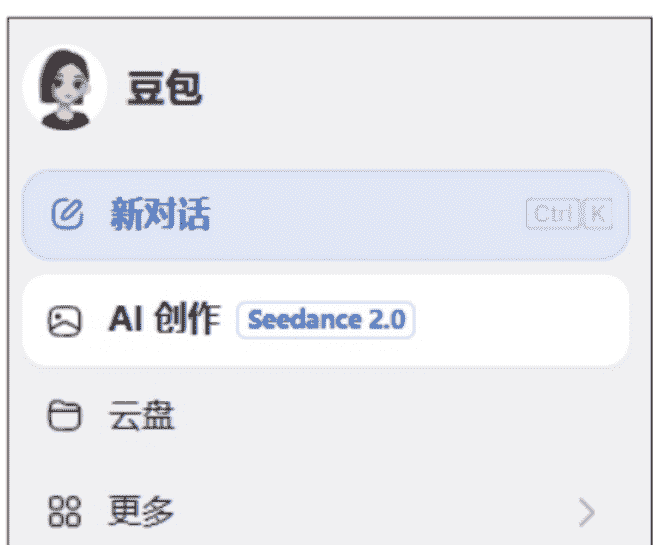

图3-5 豆包内的Seedance 2.0功能入口

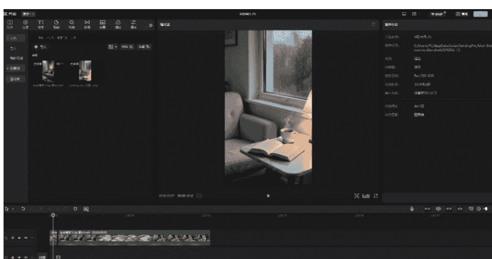

图3-6 导入素材

上述流程实现“一句话描述需求，高效产出两种素材”，明显提升创作效率与画面质感。

## 3.3 AI智能初筛口播素材：剪映“AI剪口播”剔除无效片段
口播类内容如知识分享、带货讲解、职场干货，常夹杂语气词、重复句、空白停顿、口误等无效片段，手工剪辑费时。剪映的AI剪口播功能可自动识别并标记这些片段，完成初筛，显著提升效率。

### 1.功能入口
AI剪口播入口清晰，支持两种进入方式。
打开剪映App首页热门工具板块点击AI剪口播（见图3-7）；或先通过开始创作导入口播素材，部分版本需选中音频片段后，在智能工具中找到该功能。按标准流程操作即可完成智能初筛，无需专业剪辑经验。

图3-7 剪映“AI剪口播”功能入口

### 2.操作步骤
功能操作分为导入素材、智能分析、一键删除、二次优化四个环节。

- （1）导入素材。进入AI剪口播界面后选择导入素材，从相册挑选口播视频或音频，点击添加，如图3-8所示。
- （2）智能分析。AI自动识别语音、生成字幕文稿，并标记语气词如嗯啊、重复内容、空白停顿、口误等无效片段，如图3-9所示。
- （3）一键删除。确认删除项后点击删除×个无效片段，系统自动剔除标记内容，生成节奏紧凑的初剪版本。
- （4）二次优化。可使用AI改口误、智能去水词、眼神修正等功能微调初剪结果，如图3-10所示，也可结合剪映的智能降噪、人声增强进一步提升质量。

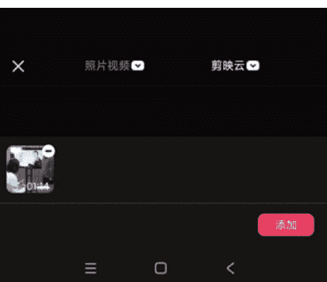

图3-8 导入素材

图3-9 AI自动分析素材

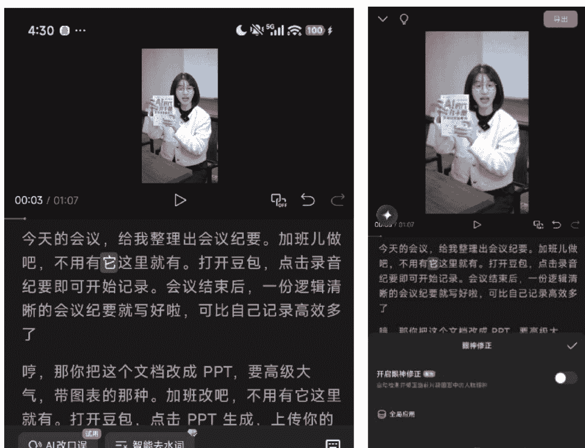

图3-10 对初剪结果进行微调

该流程能大幅压缩口播剪辑时间，让创作者从繁琐的片段剔除中解脱，聚焦内容打磨。

### 3. “AI剪口播”可识别的无效片段类型
功能能精准覆盖口播常见问题，实现全方位识别。

- (1) 语气词与填充词：如嗯啊然后就是说等。
- (2) 空白停顿：长时间沉默的片段。
- (3) 重复内容：重复的句子或短语。
- (4) 口误与修正：说错后重新表述的部分。
- (5) 无效画面：模糊、晃动、无人脸的画面。

结合豆包的辅助优化，可实现AI初筛加精准优化，让呈现更专业。

### 4.豆包辅助优化
借助豆包可进一步减少无效片段、把控剪辑方向、优化表达。

- (1) 让豆包依据口播主题生成优化脚本，提前剔除冗余，降低无效片段产生。
- (2) 让豆包生成剪辑关键词，如职场干货：保留干货输出，删除停顿和语气词，便于在剪映中快速定位调整。
- (3) 让豆包对初剪后的文案进行润色，提升流畅度与专业度。

剪映的AI剪辑能力与豆包的内容优化能力结合，可高效打磨口播素材。

## 3.4 建立个人素材库：背景音乐、文字、转场等素材分类管理方法
素材库建设的关键在于科学分类。在原有分类上新增Seedance 2.0专属分类，能明显提升AI生成素材的管理效率与检索速度。

### 3.4.1 素材分类逻辑：新增Seedance 2.0专属分类
分类目标是让素材易查找、易复用。建议按一级、二级、三级分类的维度建立本地文件夹，适用于电脑或手机。具体维度与示例见表3-1。

### 3.4.2 剪映内的素材管理技巧
剪映内置丰富创作素材，掌握管理技巧可减少查找时间，提升效率。

1. 收藏优质素材
在剪映素材库中找到合适的背景音乐、文本、转场等，点击右上角☆收藏。

2. 标记常用素材
对高频使用的素材点击分类，剪映会自动标记为常用并归入收藏类别（见图3-11），后续优先展示。

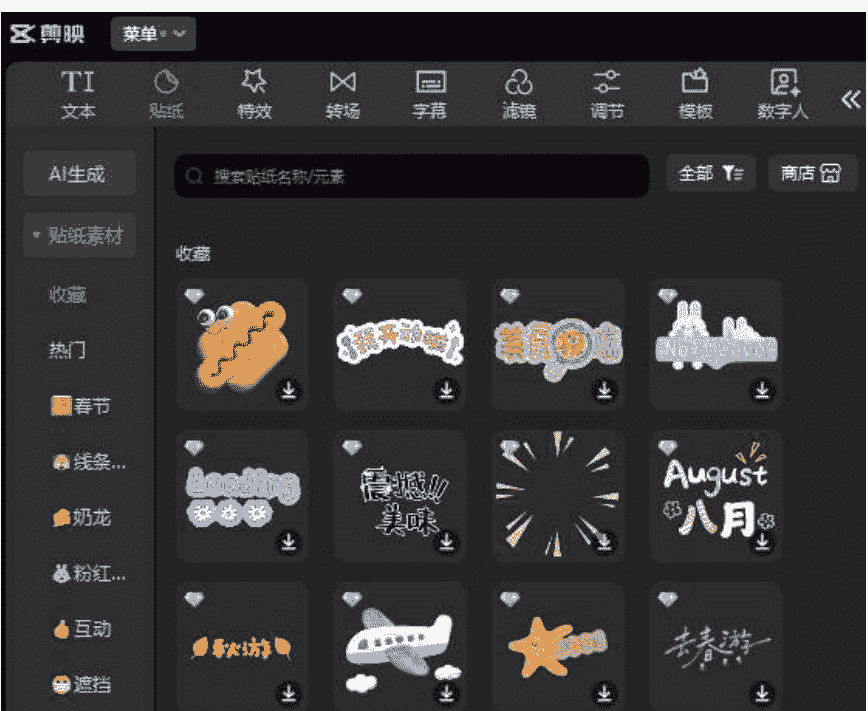

图3-11 标记常用素材

### 3.4.3 本地素材备份与同步
本地素材是核心创作资源，做好备份与同步可规避丢失风险，实现多设备无缝创作。

1. 云端备份
将本地素材文件夹上传至剪映云空间。路径：打开剪映→点击我的云空间/小组云空间→开始上传。界面如图3-12所示。

2. 命名规范
建议采用类型—场景—核心内容—日期格式，如Seedance 2.0-破壁机-外观展示-20260225.mp4，便于通过文件名快速检索。

3. 跨设备同步
开启剪映云草稿备份：剪映App→我的→设置→云草稿备份→开启。剪映云草稿界面如图3-13所示。将含Seedance 2.0素材的工程同步到云端，其他设备登录同一账号即可继续编辑。

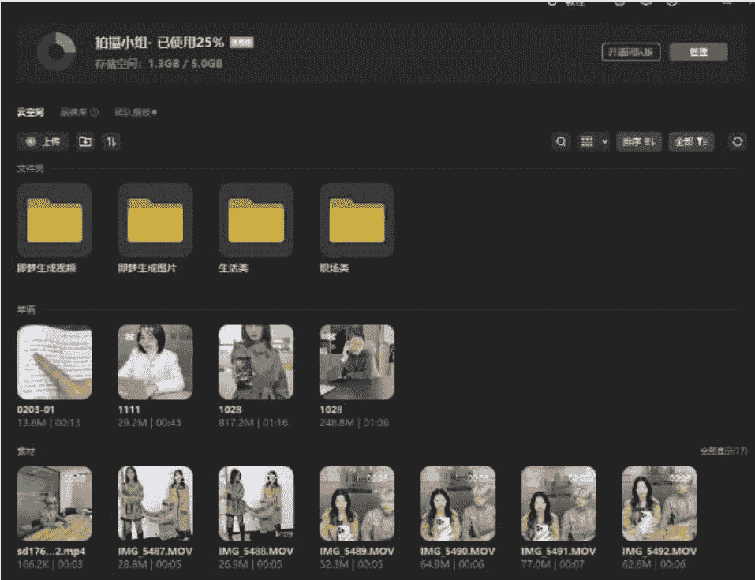

图3-12 剪映云空间界面

图3-13 剪映云草稿界面

做好备份与同步，素材库的安全性与实用性大幅提升，为长期创作提供资源保障。

# 第4章 让视频说话：AI配音、字幕与声音克隆
短视频的听觉体验直接影响停留时长。画面精致却因字幕错误、配音生硬、音乐违和而流失观众。本章聚焦剪映核心音频功能，结合豆包智能优化，从字幕准确度、专属声音库打造、配音情绪调节到音乐自动匹配，手把手解决听觉包装问题。

## 4.1 高准确率的字幕：剪映AI生成，豆包智能纠错与优化
字幕是观众理解内容、建立信任的基础。批量制作系列视频时，手动校对字幕耗时费力。剪映生成加豆包纠错的组合可快速解决痛点。

### 4.1.1 AI识别字幕
为避免返工，建议在画面制作完成后制作字幕。

- （1）打开PC端剪映创作界面，选中时间轴中需加字幕的视频，依次点击文本→智能文本→智能字幕，打开功能面板，如图4-1所示，时间指针默认在视频起始帧，点击面板右下角开始识别。
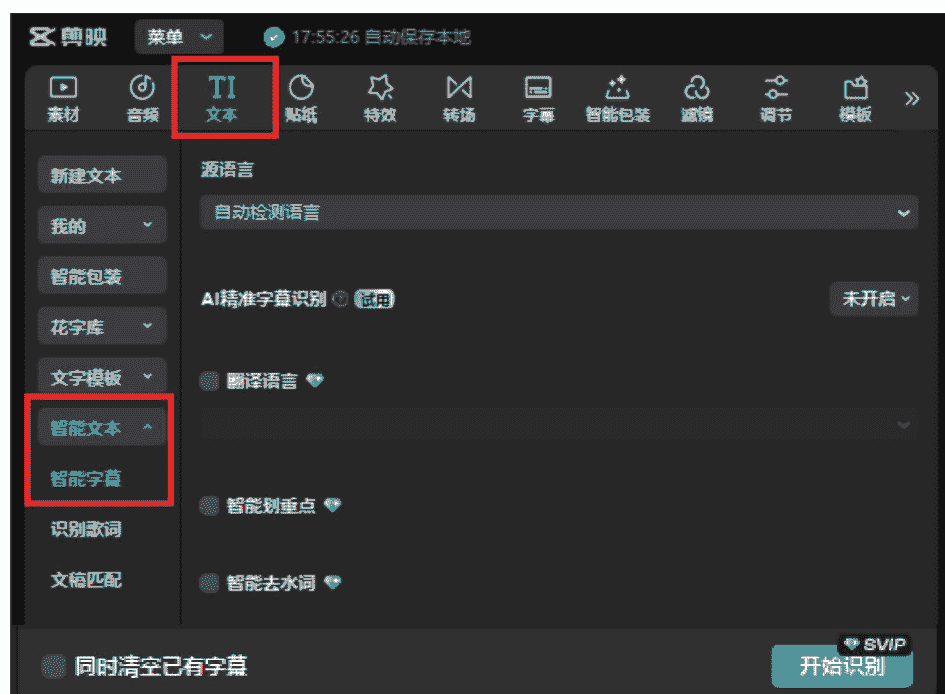

图4-1 智能字幕功能面板
- （2）识别完成后，点击右侧属性面板字幕，可编辑识别文字；点击文本可调整样式、颜色、字间距等，如图4-2所示。

### 4.1.2 导出字幕文件
完成基础字幕后，若逐条手动校对耗时，可先导出SRT文件再导入豆包批量纠错兼顾效率与精度。

在PC端剪映创作界面右上角点击导出，在导出面板中下滑至底部，勾选字幕导出，格式默认SRT，点击立即体验并导出，如图4-3所示。

### 4.1.3 豆包批量纠错
将本地的字幕文件扩展名改为.txt，打开豆包官网，点击上传附件按钮，选择上传文件或图片，如图4-4所示，上传TXT字幕文件。

在豆包对话框输入提示词：
我需要你校对一份字幕文件，要求：
1. 不改变格式；
2. 不省略或新增内容；
3. 仅做校对，包括错别字修正、断句优化、语气词删减、语序纠正；
4. 输出TXT格式。

豆包完成后点击校对后字幕文档.txt下载到本地，再将扩展名改回.srt。

### 4.1.4 导入剪映
（1）进入PC端剪映创作界面，依次点击文本→新建文本→导入本地字幕，如图4-6所示，导入校对后的字幕文件，时间轴会出现对应字幕。
（2）保留原版字幕的同时，被修改的字幕会单独成行，如图4-7所示，便于快速定位复核。

## 4.2 打造你的专属声音库：剪映“克隆音色”1分钟生成专属音色
专属音色能提升账号辨识度，让观众听声即知，增强亲切感与信任。剪映声音克隆可快速生成专属音色并配音，无需露脸或反复录制。

### 4.2.1 录制或上传音频，生成专属音色
（1）进入PC端剪映创作界面，选中时间轴已确认的文本，在右上角属性面板依次点击朗读→克隆音色，如图4-8所示。

### 4.2.2 自有音色制作朗读音频
音色克隆完成后回到朗读面板，在下方挑选本次要使用的声音，并把左下角的“朗读跟随文本更新”勾上，这样后续改文案时音频会自动刷新，不用重复导出。确认无误后点右下角的启动按钮，时间轴就会出现对应的音轨。

方式一：录制生成。先点“去克隆”进入克隆页，再点“点按开始录制”，按照界面给出的示范文案朗读，等待分析结束即可获得个人音色。点“保存音色”后，该音色会进入朗读功能面板。

方式二：文件导入。点“导入”上传一段音频或视频素材，建议时长控制在10到30秒效果最佳。保存流程与录制方式一致，保存后音色同样会出现在朗读面板中。

## 4.3 调节配音情绪，营造温柔讲解或带货氛围
很多创作者嫌弃智能配音生硬，像机器念稿。剪映的文本朗读提供了多种声学场景，能有效缓解这个问题。不同情绪适配不同内容方向，详见表4-1。

表4-1 配音风格与场景适配表

| 情绪风格 | 核心特点 | 适配场景 | 案例 |
| :--- | :--- | :--- | :--- |
| 温柔讲解 | 语速慢、语调平缓、尾音柔和 | 知识科普、绘本解读、情感语录分享、育儿分享 | 育儿博主小敏，用温柔的 AI 配音讲解绘本，粉丝留言“声音太治愈，宝宝每天睡觉前都要听” |
| 激情带货 | 语速快、语调上扬、重音突出 | 直播切片、商品推荐、促销活动、美妆产品测评 | 美妆博主阿美，用激情的 AI 配音推荐口红，带货转化率比之前提升 30%，粉丝留言“被声音感染，忍不住下单” |
| 亲切聊天 | 语速适中、语调自然，带轻微口语化特征 | 生活分享、Vlog 解说、本地探店 | 探店博主小杨，用亲切的 AI 配音分享美食，粉丝留言“像朋友在推荐，很真实” |
| 沉稳专业 | 语速慢（0.9 ～ 1.0 倍）、语调严肃，无多余起伏 | 行业报告、企业宣传、新闻解读、法律知识科普 | 法律博主老周，用沉稳的 AI 配音解读法条，粉丝留言“解说专业，内容可信度高” |

操作时在创作界面选中时间轴上已确定的文字，点右上角的“朗读”，打开下拉菜单，可看到“克隆音色”“热门”“最新”“影视动漫”“童声”“方言”“新闻”等分类。以营销视频为例，先选“营销”分类，再挑选对应情绪的音色，比如“宣传男声”或“癫狂女声”。试听确认后点启动即可。

## 4.4 用智能音乐匹配背景，降低版权风险
手工翻库找配乐要试听几十首，既费时又容易拉低质感，随便选用还存在版权隐患，可能导致限流。剪映的“AI音乐”功能可解决以上痛点：输入主题、风格与时长后系统自动推荐合规配乐，无需手动筛选，生成结果均可安全使用。

① 进入创作界面，依次点“音频”→“AI音乐”，打开功能面板。短视频多选用纯音乐。
② 在“音乐类型”里选“纯音乐”，在下方输入框填写“视频大概内容+音乐风格+视频赛道”等关键词。
③ 不确定风格时，可点输入框下方的耳机图标试听，点刷新可听更多风格。示例提示词：Vlog，舒缓的，适合知识科普类、分享类视频的音乐
④ 确认提示词后点面板右下角的“开始生成”，等待结果。
⑤ 点“生成记录”，可查看基于提示词生成的音乐。
⑥ 点列表右侧的下载按钮保存音乐。筛选后点选中条目最右侧的“添加到轨道”按钮，即可把背景音乐与画面匹配。

# 第5章 高级感的核心：视觉统一与智能包装
一套固定的视觉体系能大幅提升账号辨识度，观众一眼就能认出。这一章用剪映PC端+Seedance 2.0，以最简方式做出干净、高级、有记忆点的画面。

## 5.1 字体选择：安全又好看
字体选对，画面更清晰高级；选错，观感杂乱还有版权风险。最省心的做法是只用剪映内标注可商用的字体，并配合Seedance 2.0生成的背景素材。

在剪映中使用可商用字体无需下载安装也不用付费。打开PC端剪映，导入视频后依次点“文本”→“新建文本”。在字体列表右上角找到“可商用”筛选项，打开后系统会过滤掉有版权限制的字体，只留下可免费商用、安心发布的字体。

标题字体推荐（醒目、大气、不花哨）：优设标题黑、站酷高端黑体、抖音美好体、思源黑体。
字幕字体推荐（清晰、易读、久看不累）：思源黑体、阿里巴巴普惠体、庞门正道标题体。

图5-3 纯色渐变、带简约纹理的背景+可商用字体
借助Seedance 2.0生成纯色渐变、简约纹理等背景图，导入剪映后配可商用字体，避免文字与背景冲突，整体更协调。若要在视频号、公众号、封面、海报中使用，可优先选用思源黑体、思源宋体、阿里巴巴普惠体。这三款是全平台通用的永久免费开源字体，兼容性强、风格稳重，特别适合知识类内容。

### 5.1.1 字体搭配技巧，可直接使用
记住两个最简单的搭配法，直接套用：一支视频只用两种字体，标题用粗体，字幕用常规体；字幕统一用白字加黑色阴影，清晰度不受背景明暗影响。通过剪映“预设样式”可一键同步所有字幕的字体、颜色、阴影参数，不用逐段调整，效率翻倍。

### 5.1.2 一定要避开：字体商用侵权风险
最稳妥的做法是只在剪映“可商用”字体列表中挑选。这是目前对短视频创作者成本最低、风险最小的方案，不用记版权规则，不用额外付费，也不用找字体包。

### 5.1.3 3个细节，让普通字体立刻变高级
想提升质感，注意这三点。
1. 字幕字号不要过小，手机竖屏建议12～20，保证老人和近视观众也能轻松看清。
2. 字幕行高不要过小，适当拉开间距观感更好。
3. 标题可适当加粗、字间距放宽，提升美观度。

长期做账号建议定一套字体规范：标题用什么、字幕用什么、封面用什么，统一后观众会产生熟悉感，更容易记住账号风格，形成品牌记忆。

同样是思源黑体、阿里巴巴普惠体，效果不同在于字重、字间距、行间距、位置、颜色、透明度、阴影的把控。参数调对了，普通字体也能有高级感。

### 5.1.4 字体要匹配内容情绪
很多人忽略了字体与情绪的匹配。匹配后观众会觉得视频更专业、更舒服。内容与字体推荐如表5-1所示。

表5-1 内容与相应的字体类型推荐

| 你做的内容类型 | 推荐的字体类型 |
| --- | --- |
| 干货科普、知识讲解 | 清晰、稳重的无衬线体 |
| 美食、日常生活记录 | 圆润、温和的字体 |
| 国风、传统文化 | 有书法感、力量感的字体 |
| 科技、数码、职场技巧 | 纤细利落、现代感强的字体 |

### 5.1.5 封面字体：少即是多
封面字体尽量不超过3种，最好控制在2种或1种。主次信息一目了然，比堆特效更有用。封面字体与视频内字体风格统一，账号视觉体系会逐渐成形，更容易被记住。

记住，版权第一，可读性第二，美观第三。

## 5.2 让字幕更出彩：智能字幕加背景优化
对知识类视频来说，字幕比画面更重要。很多人手动加字、调色、调大小又慢又乱。用PC端剪映的智能字幕+Seedance 2.0背景生成功能，能轻松让字幕变好看。

### 5.2.1 剪映“智能字幕”+Seedance 2.0背景优化实操
第一步，导入视频，依次点“文本”→“智能文本”→“智能字幕”，点“开始识别”。
系统会自动把语音转成文字，几十秒即可完成。生成后简单校对，修改错字漏字。
第二步，选中字幕条，点上方“样式”。剪映提供成套模板，涵盖字体、字号、颜色、描边等，可一次性设置。做知识类视频，直接选简约清晰、白字黑边或白字黑阴影的模板，整段字幕会同步更新。
第三步，用Seedance 2.0优化字幕背景。若视频背景杂乱，可用Seedance 2.0生成“半透明渐变黑条”“简约色块”等素材导入剪映，放在字幕下层，既突出字幕又不遮挡主体，还能生成与账号风格一致的字幕模板，后续一键套用。
若背景较亮，字幕不易看清，可在样式面板勾选“阴影”或“描边”。仍觉得不够，可搭配合适的花字，再配Seedance 2.0生成的深色字幕条，示例如图5-7所示。

### 5.2.2 字幕标准化方法
费心拍好画面，却因字幕杂乱、背景不协调导致质感下降，观众几秒就划走。对所有品类来说，字幕与背景的标准化比复杂特效更重要，它能提升专业度并打造账号记忆点。下面方法通用，可直接用。

#### 1. 风格统一的字幕就是账号的隐形Logo
把字体、颜色、位置、背景固定下来，观众不用看头像昵称也能认出你。一次调好模板，后续视频直接套用，可复制批量应用，省下大量时间。

#### 2. 必须掌握的字幕应用规则
AI识别后一定要人工校对，改错字漏字，保证信息准确；长句拆短，一行控制在12～18字，不要铺满屏幕；避免遮挡画面主体，断句合理、节奏舒服。观众眼睛不累才愿意看完，字幕越清晰信息传递越高效。

#### 3. 各品类视频适配方案
各品类视频适配方案如表5-2所示。

表5-2 各品类视频适配方案

| 视频类型 | 应该怎么做（字幕+背景） | 能实现的效果 |
| :--- | :--- | :--- |
| 生活 Vlog | 柔和字体，不花哨；搭配淡色简约背景（可通过 Seedance 2.0 生成） | 治愈、舒服，观众看完全程不疲劳，视频完播率高 |
| 美食探店 | 字幕突出店名、菜品、价格、评价信息，背景简洁不喧宾夺主 | 关键信息一目了然，方便观众快速获取核心内容，提升互动率 |
| 好物测评 | 统一字幕样式，强化专业感；搭配 Seedance 2.0 生成的简约色块背景 | 专业度高，产品卖点清晰；增强观众信任感，助力转化 |
| 剧情短视频 | 人物对话字幕用短句、快切，保持风格统一；背景贴合情绪，不杂乱 | 情绪到位，观众容易入戏，提升视频沉浸感 |
| 带货 | 字幕重点信息突出、可读性强；背景简约，不干扰产品展示 | 提升转化率，助力变现 |

#### 4. 所有内容都通用的底层逻辑
无论什么类型，字幕与背景的底层逻辑相通：
- （1）要保证：字幕清晰易读，让观众快速获取信息。
- （2）要做到：背景干净不“抢戏”，突出视频主体和字幕。
- （3）要坚持：整体风格高度统一，形成账号专属记忆点。

#### 5. 坚持下去，你会收获这些结果
- （1）视频完播率明显变高，观众愿意看完。
- （2）评论区“看着舒服”“专业”的评价变多，好感度提升。
- （3）账号专业感、可信任感增强，拉近与观众距离。
- （4）拥有长期稳定、难以复制的账号竞争力，为长期运营打基础。

## 5.3 动效轻松做：描述给AI生成参数
合理的动效能让视频更有层次和节奏。不用背参数，把想要的效果用大白话描述，让豆包生成可直接用的剪映关键帧参数，再用Seedance 2.0生成静态素材，即可做出专业动效。

### 5.3.1 向豆包描述效果，获取剪映关键帧参数
用大白话描述需求即可得到可用参数。例如：
我需要为知识类视频设计一个标题动画，标题从左边慢慢滑到中间，速度平稳，不晃、不跳。字幕不要突然出现，要慢慢渐显，停留一会儿再慢慢渐隐。
发给豆包后可得到如下参数：
标题滑入：关键帧1（位置X=0，时间0.5秒）→关键帧2（位置X=360，时间2秒，速度曲线选线性）。
字幕渐显渐隐：渐显时间1秒，渐隐时间0.5秒，透明度从0%到100%再回到0%。
在剪映里照着设置即可，无需手动摸索。

### 5.3.2 用Seedance 2.0生成素材，让动效更专业
设置好关键帧后，再用Seedance 2.0生成搭配素材，动效会更流畅专业。

#### 1. 让标题缓慢滑入
（1）用Seedance 2.0生成一张背景图，提示词如下。
文艺治愈风、模糊晕染、色彩渐变、流动笔触质感。元素组合：暖橙—浅黄—蓝调渐变背景（带模糊晕染效果）和一张漂亮的艺术字图片。
（2）把背景图导入剪映。
（3）只给标题文本添加“向下滑动”。背景不动，让文字慢慢滑进来，画面简约又美观，如图5-8所示。
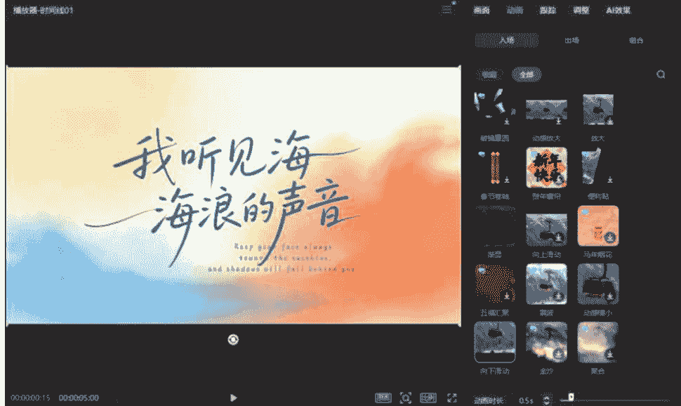

#### 2. 让字幕“渐显渐隐”
（1）用Seedance 2.0生成一张文本框图片，提示词如下。
采用古风结合现代新中式游戏风格，飘逸，精美的细节，边缘有图案和装饰元素，不应受到阴影或光线的影响。大师杰作，黑色背景。
（2）将生成的图片导入剪映并放在字幕下层，配合文字动画，让字幕出现时文本框同步渐显，过渡柔和、不刺眼，如图5-9所示。
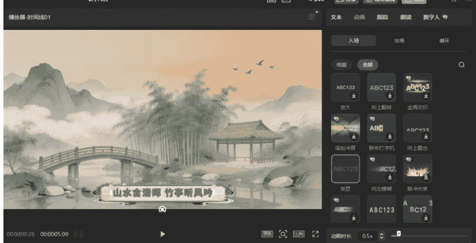

图5-9 Seedance 2.0生成的文本框图片+文字动画
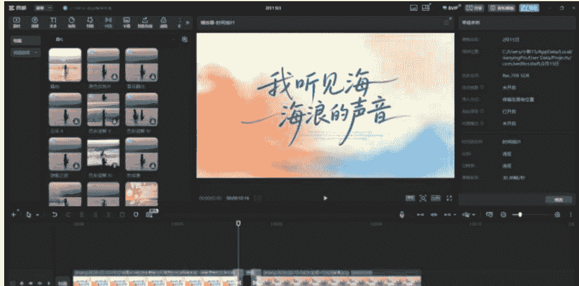

图5-10 将Seedance 2.0生成的纯色渐变图作为转场素材

#### 3. 转场动效
用Seedance 2.0生成一张纯色渐变图（如“从画面主色到黑色的渐变”）。
把这张图片导入剪映作为转场素材，设置“叠加”效果，过渡更自然高效，如图5-10所示。

### 5.3.3 动效方案推荐

短视频字幕与视觉质感全流程指南

知识类内容以信息传递为主，字幕动效应保持克制与稳定。豆包用于规划字幕关键帧的节奏感，Seedance 2.0 用于生成底图与氛围画面，两者配合即可快速得到统一且专业的观感。

#### 1. 标题动效
先让豆包输出标题进场与收尾的关键帧：开场约 1 秒淡入，结尾做收束。随后用 Seedance 2.0 绘制开场底图，画面利落干净，参考图5-11。可参考的生成指令如下。

现代科技感风格，AI工具介绍海报。画面中央是一支精致的金属钢笔，钢笔表面有蓝色的科技光效流动，笔尖处散发着蓝色的数字粒子效果，象征AI的智能光芒。钢笔周围环绕着各种AI工具的图标和符号，如齿轮等，这些元素以半透明的蓝色呈现。背景是从深蓝色到黑色的渐变，营造科技感氛围，点缀着星光般的光点和数据流线条。

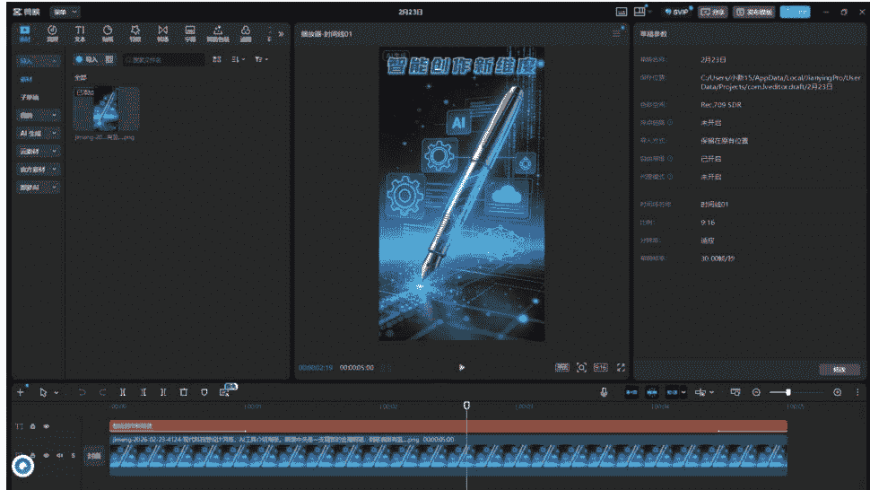

图5-11 标题动效

#### 2. 字幕动效
字幕节奏先由豆包生成：进场时放大，撤场时缩小，进场约 1 秒，出场约 0.5 秒。底图由 Seedance 2.0 输出并置于字幕下方，过渡柔和不易刺眼，效果见图5-12。参考指令：

立体3D图标元素边框设计；磨砂玻璃质感，清透渐变质感图标；纯色背景。

#### 3. 其他类型短视频
豆包与 Seedance 2.0 的组合不仅适用于知识类，日常 Vlog、好物开箱、剧情短片、美食探店、情感口播、美妆教学、影视解说、电商短视频均可复用，只需微调描述语气即可匹配不同调性。

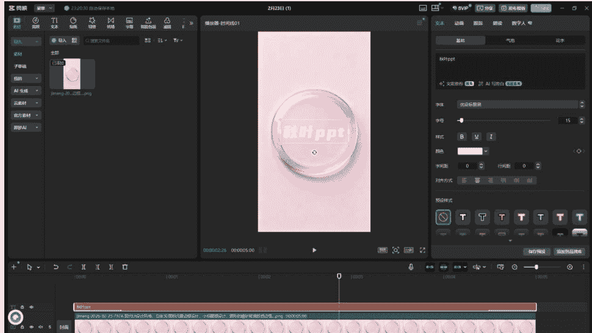

图5-12 字幕动效

- （1）日常 Vlog 追求温馨自然。提示豆包“字幕轻柔进出、节奏柔和不抢戏”，即可获得渐显渐隐类的关键帧；再用 Seedance 2.0 产出浅色柔光渐变、窗边自然光、咖啡热气、书桌小夜灯等治愈生活素材，或暖调电影感、柔和虚化画面。导入剪映后让画面缓慢放大，随手片段也能带上生活温度与叙事感，如图5-13 所示。

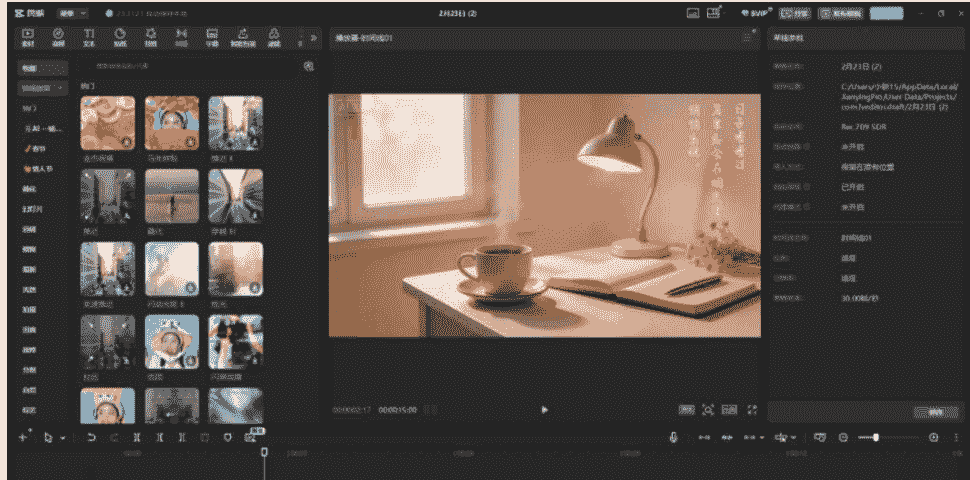

图5-13 日常Vlog

- （2）好物开箱需突出商品。让豆包生成“商品图像由小到正常尺寸平稳放大、无抖动”的关键帧；用 Seedance 2.0 制作简洁干净的光影背景作为入场底，焦点更清晰。
- （3）美食类强调食欲与质感。豆包获取“文字缓缓落下、沉稳有质感”的关键帧；配合 Seedance 2.0 生成暖色调美食氛围图与暖光渐变遮罩，与画面做渐显渐隐，观感更有食欲、节奏更舒服。
- （4）剧情短片与情感口播侧重氛围。只需告知豆包“字幕低调出现、不抢戏、不干扰情绪”，即可得到克制高级的关键帧；搭配 Seedance 2.0 的暗调氛围画面与情绪光影背景，氛围感迅速提升，情绪表达更到位。
- （5）美妆教程要步骤清晰。向豆包输入“步骤字幕自下方轻推上来、清晰不晃眼”，获得对应关键帧；用 Seedance 2.0 生成低饱和干净底图置于字幕下，既突出文字又不遮挡妆容细节，学习更顺畅。
- （6）影视解说要求利落高级。让豆包生成“人名、片名快显、停留后平稳淡出”的关键帧；再用 Seedance 2.0 生成深色渐变遮罩与电影感暗角素材，压暗边角突出中间内容，专业感增强。
- （7）电商短视频追求转化吸睛。豆包生成“价格标签、卖点文字轻弹入场、有力度不夸张”的关键帧；配合 Seedance 2.0 的亮色渐变小卡片与简约卖点背景，能快速抓住视线，提升留存与转化。

由此可见 Seedance 2.0 的核心优势是能按类型输出匹配风格的画面。无论题材如何，制作逻辑一致：不必死记参数、不必苦练剪辑、不必到处搜图，用豆包生成关键帧动画，用 Seedance 2.0 生成对应画面素材。熟练后新手也能做出风格统一、流畅专业、氛围感强的成品。

## 5.4 画面美学诊断：AI分析+用Seedance 2.0生成素材，一键提升视觉层次

视频拍完常觉得质感不足却说不清原因，常见问题是亮度不够、对比偏低、背景杂乱、主体不突出。手动调参效率低且难把握，用智能诊断配合 Seedance 2.0 补充素材是高效提质路径。PC 端剪映自带的智能调色可完成基础美化。

- （1）打开 PC 端剪映，将素材拖入时间轴，选中需优化的片段，选中后出现白色边框，如图5-14 所示。

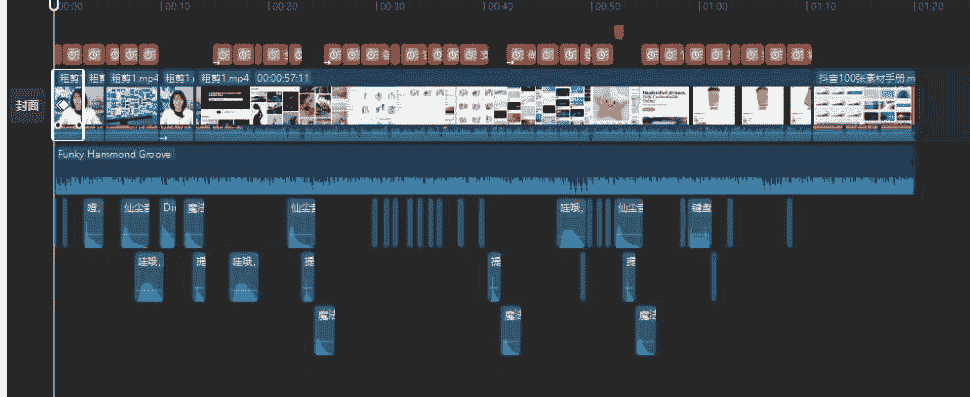

图5-14 选中需要优化的片段

- （2）在右侧调整面板勾选“智能调色”，如图5-15 所示。

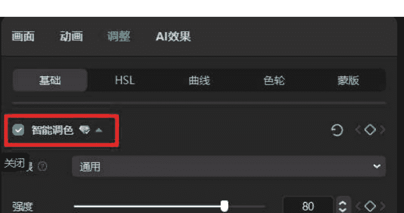

图5-15 勾选“智能调色”

- （3）勾选后系统会自动分析亮度、对比度、锐度、饱和度等核心指标，并将画面调整至合适状态，无需手动试探。
- （4）若想全片风格统一，可在完成智能调色的片段上右键“复制属性”，再选中其它片段右键“粘贴属性”，如图5-16 所示。

图5-16 复制属性与粘贴属性

多数日常拍摄仅此一步质感即可明显提升。之后可按需精细优化，再搭配 Seedance 2.0 素材针对性解决问题。

### 5.4.1 基础参数微调（智能调色后补充）

- 亮度：拖动亮度滑块，建议 ±10～30，保证人物面部清晰明亮，画面不刺眼也不过暗。
- 对比度：适当右移，建议 +10～20，让主体与背景区分更明显，画面更立体，避免灰蒙蒙。
- 清晰度：略微提升，建议 +5～15，使文字、人物轮廓更清晰，精致感增强。剪映基础参数微调示例见图5-17 所示。

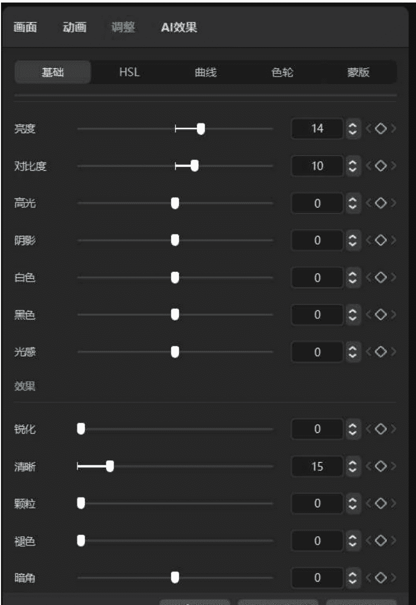

图5-17 剪映基础参数微调示例

### 5.4.2 背景优化（解决杂乱问题）

拍摄环境杂乱不必重拍，有两种高效处理方式。

#### 1. PC端剪映——快速虚化背景
- （1）导入视频，复制一层至上层轨道。选中上层视频，点击“特效”，选择模糊特效，将模糊度调至 30～50，如图5-18 所示。

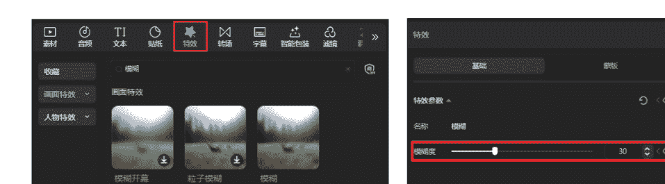
- （2）选中下层视频，依次点“画面”→“抠像”，勾选“智能抠像”，如图5-19 所示。
- （3）将主轨道视频略微放大，主体清晰、背景柔和，调整完成。

#### 2. 用Seedance 2.0生成背景图+抠图替换（极简版）
- （1）用 Seedance 2.0 生成简约纯色背景或低饱和渐变背景，保存为图片。
- （2）在剪映中导入视频，依次点“画面”→“抠像”，勾选“智能抠像”。
- （3）把生成的纯色背景图拖到视频轨道下方，时长保持一致。
- （4）调整主体大小与位置，杂乱背景消失，画面干净高级。

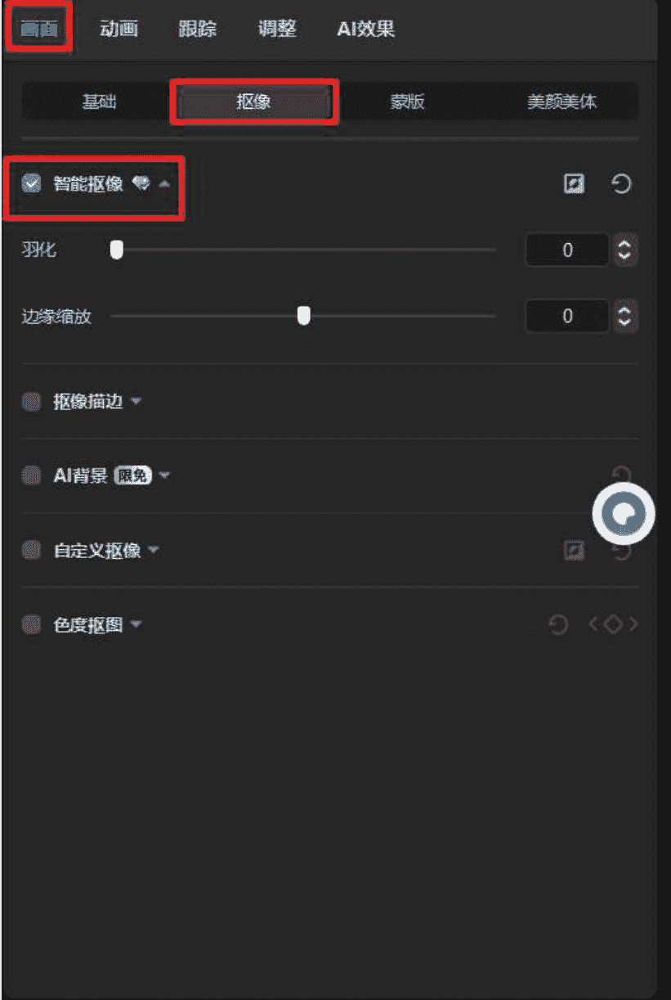

图5-19 勾选“智能抠像”

### 5.4.3 色彩统一与主体突出

多场景拼接易出现色调不一，有的偏亮、有的偏暗，有的偏黄、有的偏蓝，整体杂乱不专业。对知识、测评、口播账号而言，统一色调是专业感的底色。

借助 Seedream 4.5 生成风格统一的纯色/渐变素材，无需逐段调色即可快速统一全片，看起来像专业团队统一拍摄校色。

#### 1. 全片色彩统一实操步骤
- （1）用 Seedream 4.5 生成色调统一素材。
  - 口播：低饱和灰、莫兰迪蓝、高级灰渐变。
  - 生活Vlog：奶油色、柔粉色、浅杏色渐变。
  - 美食/探店：暖白色、暖黄色、低饱和度大地色。
  - 科技/职场：冷灰色、深蓝色、银灰色渐变。
  建议尺寸：1920像素×1080像素，适配大多数短视频。
- （2）导入剪映叠加统一色调。将生成的纯色/渐变图导入素材库，拖到画中画轨道置于原视频下方，调整时长覆盖整条视频。再将不透明度调至 10%～30%，画面蒙上一层柔和统一色调，色差被中和，如图5-20 所示。

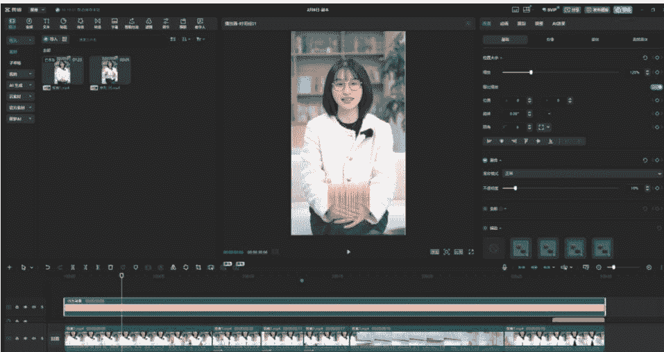

图5-20 叠加统一色调

#### 2. 主体突出：让人物/产品更吸睛
很多视频平淡是因为主体不突出，人物被背景吞没、产品看不清。用 Seedream 4.5 生成光影素材，无需布光即可让主体突出、层次分明。不同光影素材类型的应用如表5-3 所示。

表5-3 不同光影素材类型的应用

| 光影素材类型 | 适用场景 | 视觉效果 | 推荐使用人群 / 账号 |
| :--- | :--- | :--- | :--- |
| 柔和光晕 | 知识分享、生活 Vlog | 画面柔和、氛围感强，人物面部通透自然 | 知识 IP、治愈系、生活分享类 |
| 柔和侧光 | 人物访谈、好物展示、口播视频 | 人物面部立体感强，画面更有层次 | 颜值博主、测评类、职场 IP |
| 简约圆形聚光 | 产品特写、干货讲解 | 让观众视线自动聚焦于画面主体，突出核心内容 | 好物测评、知识教学、带货视频 |
| 光斑 | 片头、片尾、转场过渡 | 提升精致感，画面不单调，高级不抢戏 | 全品类通用，尤其适合简约风账号 |
| 暗角渐变 | 口播视频、剧情片段、重点画面 | 压暗四周，强化中间主体，让观众视线更集中 | 知识口播、剧情短视频、人物特写 |

# 第6章 电影级画面：AI调色与智能抠像实战

本章聚焦剪映的调色与智能抠像功能，结合场景化指导与问题诊断，从一键套滤镜、无绿幕智能抠像到多素材色调统一、废片评估与拯救，手把手教你用 AI 把普通素材做成质感大片，解决“画面质感难表现”的痛点。

## 6.1 一键拥有电影色调：剪映滤镜套用与自定义调色技巧

剪映提供滤镜和调节功能，新手可一键套用现成滤镜，10 秒搞定高级色调；进阶创作者可精细调参匹配风格；再加上场景化调色建议，所有人都能调出统一高级的电影感，让美食更诱人、风景更治愈、人物更上镜。

### 6.1.1 滤镜功能
- （1）进入剪映创作界面，点击“滤镜”，可看到官方提供的丰富滤镜，涵盖人像、风景、美食等，如图6-1 所示。

图6-1 剪映官方提供的滤镜

以美食滤镜为例，在时间轴选中素材，切换滤镜库到“美食”分类，可看到多种相关滤镜，如图6-2 所示。
- （2）选好滤镜后点右下角添加即可加入轨道，如图6-3 所示。随后需微调滤镜强度让画面更真实有质感。选中轨道上的滤镜，在滤镜面板里调整强度，如图6-4 所示。

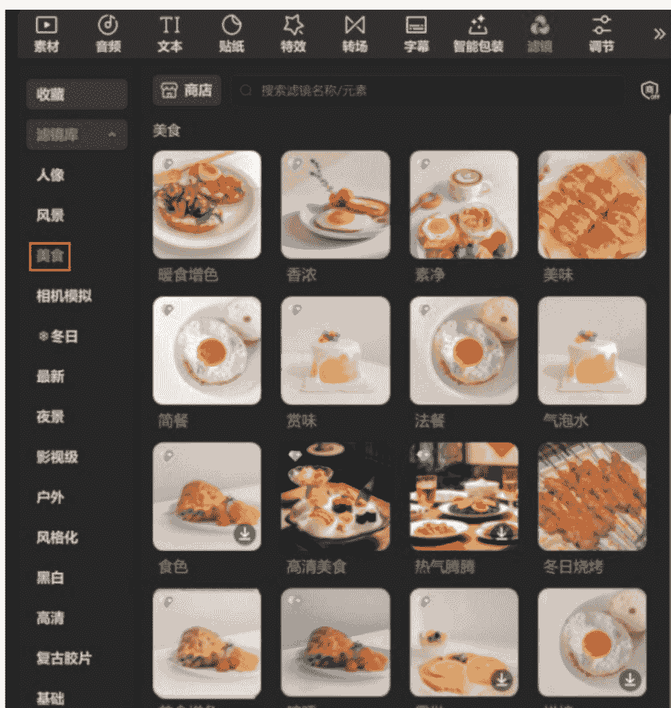

图6-2 美食滤镜

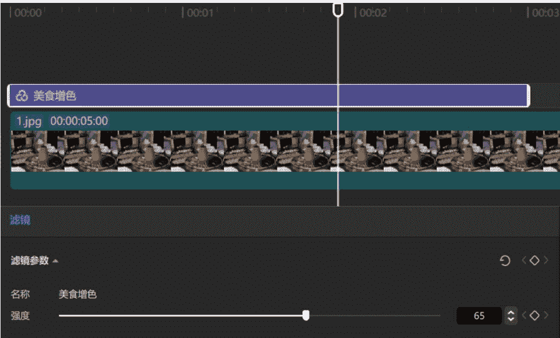

图6-3 将滤镜添加到轨道

图6-4 调整滤镜强度

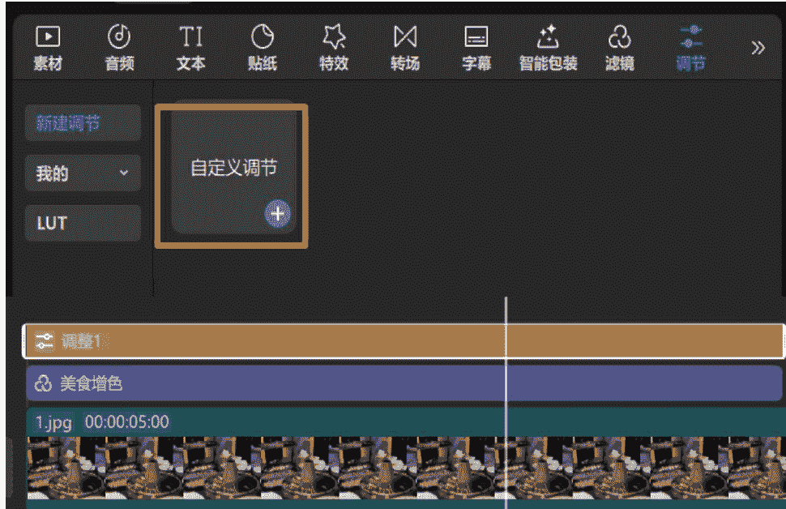

图6-5 单击“自定义调节”

### 6.1.2 调节功能
套滤镜提升效率，若想更精确调整，就要用调节功能。
- （1）进入剪映创作界面，依次点“调节” → “新建调节” → “自定义调节”，如图6-5 所示，创建名为“调整1”的调节效果，如图6-6 所示。

### 6.1 调整
（2）选中“调整1”，在右上角属性面板可精细调整参数，如图6-7 所示。

这些参数分为调整色彩和调整明暗两块，如图6-8 所示。一般流程是先调明暗再调色彩。明暗确定画面该亮的地方亮、该暗的地方暗，再调整色彩倾向。不同类型视频对应不同明暗和色彩倾向，比如美食适合暖色调、科普适合冷色调。

#### 调整参数面板

- 基础

- HSL

- 曲线

- 色轮

- 蒙版

智能调色

场景: 通用

强度: 80

色彩克隆

色彩校正

LUT

名称: 无

强度: 100

肤色保护: 0

图6-8 调整色彩和调整明暗的参数

## 6.2 智能抠像：穿越、悬浮、分身，不用绿幕也能完成

传统抠像需要绿幕和专业软件，普通人难操作；手动抠像耗时易漏边缘。剪映的“智能抠像”可自动识别人物或其他物体，实现精准抠像。

（1）进入剪映创作界面，选中需要抠像的素材，如图6-9 所示。右上角依次点“画面”→“抠像”，勾选“智能抠像”，如图6-10 所示。

图6-9 选中需要抠像的素材

图6-10 勾选“智能抠像”

（2）剪映会智能识别主体并完成抠像，即便没用绿幕拍摄效果也好，如图6-11 所示。

图6-11 智能抠像前后效果对比

（3）此时在抠出的人像下方添加不同背景素材即可替换背景，如图6-12 所示。

图6-12 替换背景

（4）分身效果只需复制多个人物素材，改变它们的位置、大小、方向、透明度即可实现，如图6-13 所示。

图6-13 分身效果

## 6.3 拯救碎片化素材：统一多段素材的色调与光影

剪映的“色彩克隆”功能能一键调好参数，统一多段素材的色调与光影，让碎片素材看起来像同一次拍摄，风格统一过渡自然。

（1）进入剪映创作界面导入多段素材。时间轴上选中要调色的素材，依次点“调整”→“基础”，勾选“色彩克隆”，如图6-14 所示。

图6-14 勾选“色彩克隆”

（2）有两种找目标图的方式：“视频帧”方式和“本地”方式。选“视频帧”方式，上传参考视频后，可滑动时间轴选择用于统一调色的目标画面，如图6-15 所示。

（3）切换到“本地”方式，可直接上传目标图，如图6-16 所示。上传后点“确认”，等待完成。

图6-15 “视频帧”方式

图6-16 上传目标图

（4）画面匹配效果如图6-17 所示，色调、明暗程度非常接近。

图6-17 画面匹配效果

## 6.4 废片评估与拯救：修复抖动、模糊与杂物等问题

很多以为的废片通过 AI 处理就能变废为宝。剪映的“视频防抖”“超清画质”“AI消除”功能能精准修复抖动、模糊、杂物问题，让每段素材都能发挥价值。

（1）进入剪映创作界面导入废片。时间轴选中素材，右上角依次点“画面”→“基础”，往下拉可见“视频防抖”“超清画质”“AI消除”功能，如图6-18 所示。

图6-18 画面功能面板

（2）拍摄轻微抖动可用“视频防抖”修复，剪映提供不同防抖等级，如图6-19 所示。

图6-19 防抖等级

（3）素材不清晰时可勾选“超清画质”一键修复，图6-20 为原素材与超清画质对比。

图6-20 原素材与超清画质素材的对比

（4）画面杂物可用“AI消除”去除，如图6-21 所示。

图6-21 “AI消除”功能

例如想去画面中的引流信息，选“涂抹选区”，用画笔圈定需去除信息，点“消除”，等待 AI 处理完成即可。效果对比见图6-22 所示。

图6-22 AI消除前后效果对比

# 第7章 不出镜也能做视频：数字人与AI前沿技术应用

短视频、直播盛行，很多人想打造个人 IP 做副业涨粉或分享干货。零基础、没设备、不会拍摄也没关系，本章用剪映和 Seedance 2.0 手把手教你制作数字人形象。

## 7.1 打造数字人主播：从选形象到出视频，一步到位

数字人最大的优势是不用真人在镜头前持续输出，随时能帮你涨粉、引流、带货。无论分享职场干货、育儿知识还是推广自家产品，数字人都能胜任。本节从选形象开始，手把手教你制作两种简单数字人：剪映数字人（一站式快速出片）+ Seedance 2.0 数字人（高精度数字分身）。全程不绕弯，新手按步骤就能做出可发抖音的视频。

### 7.1.1 剪映数字人视频制作
制作剪映数字人视频的操作步骤如下。

#### 1. 剪映数字人形象选择
做数字人第一步是选形象，这一步直接决定账号辨识度。形象选对，粉丝更容易记住，后续涨粉变现更顺利。

（1）两个入口。可从以下两个入口开始操作。

① 剪映创作界面右上角“数字人”。打开剪映创作界面，新建一个文本字幕。如图7-1 所示。

图7-1 新建一个文本字幕

点击右上角的“数字人”，图7-2 所示。

图7-2 剪映数字人入口1

② 剪映创作界面顶部“数字人”。如果已导入素材，可点击顶部“数字人”，如图7-3 所示。

图7-3 剪映数字人入口2

剪映数字人形象选择界面如图7-4 所示。

官方模板形象：包含商务、甜美、国风、新闻播报等类型，可直接选择。

定制形象：上传照片或录视频，克隆你自己的专属数字人。

图7-4 剪映数字人形象选择界面

（2）先用官方提供的人设模板，效率高且能用于商业项目
打开数字人工作区后，上方是分类导航，热门、绿布、最新、超写实、情感、知识、营销等标签一目了然，如图7-5所示。

图7-5 剪映数字人分类标签

每个模型都带有名称与风格描述，例如“刘晚—精致太太”“唐欣—知性”“徐静—知性”“天意—财经主播”，如图7-6所示。

图7-6 剪映数字人的名字和风格标签

筛选时建议先打开商业授权筛选，把允许投放的人物先挑出来，如图7-7所示。

图7-7 “可商用”筛选项

人设上要避免夸张，保持简洁大方、看着舒服更容易被记住。确认后点右下角的获取按键，如图7-8所示。

图7-8 下载剪映数字人

随后点继续，如图7-9所示。

图7-9 单击“下一步”

（3）做专属形象，辨识度更高
不想用现成模板，也可以生成神似自己的形象。在数字人页面进入“定制形象”，按需选择生成方式。

方式一：基于视频克隆。点“克隆视频形象”，对着镜头录制30秒以上的片段上传，系统会提取面部特征生成专属形象，如图7-10所示。

图7-10 克隆视频形象

生成后可以微调发型、服装、背景，满意后保存，后续项目可直接复用。

方式二：基于照片生成。点“上传相册照片”，传一张正面清晰照，光线充足、无遮挡、表情自然为佳。剪映会据此生成高度相似的数字人，如图7-11所示。

图7-11 上传相册照片

#### 2. 在剪映内一站式完成口播片
形象确定后，可在剪映里完成口播制作。

（1）填入口播稿
在文案区粘贴准备好的稿子，如图7-12所示。建议时长控制在10～30秒，语言口语化，像与朋友聊天；核心内容用简短表达讲透，避免啰嗦。

图7-12 输入口播文案

（2）关键设置新手必看
若后期想更换背景，务必选用“绿幕”类型，如图7-13所示。

图7-13 “绿幕”类型

系统会自动为形象匹配音色，知性风格偏稳重，甜美风格偏温柔，如图7-14所示。新手建议保留默认，默认下口型与语气贴合度高，也可自行在音色库挑选。

（3）点击生成
点“生成视频”，等待1～3分钟，系统会自动完成播报、口型同步与渲染。

图7-14 匹配专属音色

生成后视频会直接落在时间轴上，如图7-15所示。

图7-15 生成的数字人口播视频

#### 3. 四步后期打磨，让成片更精致
视频可以直接发布，稍微打磨一下质感提升明显。

第一步：更换背景，绿幕专用。在数字人轨道下方叠加背景图或视频，办公、直播间、生活场景皆可，适当缩放与定位，保证融合自然。

第二步：添加字幕。依次点“文本”→“智能字幕”，剪映可快速识别语音生成字幕，清晰醒目，如图7-16所示。

图7-16 加字幕

第三步：配乐。依次点“音频”→“音乐”，在音乐库挑选。干货分享选轻柔钢琴或轻音乐；带货选活泼有节奏的；情感类选温柔治愈系。音量控制在30%～40%，不抢人声，如图7-17所示。

图7-17 配背景音乐

第四步：导出发布。点右上角“导出”，如图7-18所示。分辨率建议2K，帧率30fps。导出后打开抖音，上传、写标题、加话题即可发布。

图7-18 导出视频

打开抖音，上传视频，写标题、加话题，然后直接发布。

### 7.1.2 Seedance 2.0数字人制作
需要动作更自然的数字人，可用Seedance 2.0。新手建议从豆包应用开始，流程最简。

#### 1. 豆包应用，最省事
将豆包应用升级到最新版，直接点“Seedance 2.0”即可，如图7-19所示。

图7-19 豆包App中的Seedance 2.0入口

#### 2. 即梦AI网页，更稳
浏览器打开即梦AI官网，用剪映或抖音账号登录，点击“视频生成”，选择Seedance 2.0，如图7-20所示。

图7-20 即梦AI官网中的Seedance 2.0入口

#### 3. 剪映PC端
打开电脑版剪映，左侧点“AI生成”→“视频生成”，在右侧“模型设置”中选择“Seedance 2.0”，如图7-21所示。

图7-21 剪映中的Seedance 2.0入口

## 7.2 让静止照片开口：老照片修复与照片动起来
不想用数字人也不想真人出镜？让静态照片开口说话是辨识度高、竞争小的玩法。童年旧照、亲友老照片、插画动漫都能做成口播短片，还能做IP、做情感号、接单变现。

本节用豆包+Seedance 2.0+剪映，手机就能完成“修复→开口→包装”。

### 7.2.1 豆包一键修复老照片
老照片常泛黄、模糊、有划痕，直接做动态会不自然。用豆包修复即可。打开豆包应用，上传照片，发送提示词：

> 帮我修复这张老照片，去除划痕和泛黄，提升清晰度，还原自然色彩，面部细节更清晰。

约5～10秒即可得到干净清晰的版本，长按保存到相册。照片本身清晰的可跳过此步。

### 7.2.2 Seedance 2.0让照片开口
修复好的照片用豆包里的Seedance 2.0就能实现自然说话。打开Seedance 2.0，选视频生成，上传清晰照片，输入提示词并发送：

照片人物自然开口说话，口型精准贴合文案，头部微动，表情自然，画面清晰稳定。

[你的口播内容]，时长10～15秒，分辨率1080P。

10～30秒后得到视频，预览确认后保存。

## 7.3 音色克隆进阶：录制专属声音，接单更顺
口播和配音类内容做得差，多半是声音问题。默认AI播音腔千篇一律、机械感强。剪映的音色克隆能解决这个问题。

### 7.3.1 前期准备，三处细节决定成败
#### 1. 环境
选安静不回声的房间，关门窗，关空调风扇等杂音源。地面可铺地毯、墙上挂布，减少回声，录音更干净。

#### 2. 设备
优先用有线耳机录，无线易延迟杂音。麦克风距嘴5～10厘米，避免喷麦。剪映对音质要求不高，好设备能显著提升还原。

#### 3. 状态
录前喝水润喉，保持平和情绪，别刻意改变语气，像平时聊天一样，克隆结果更贴近真实音色。

### 7.3.2 剪映音色克隆实操
流程就是录自己的声音→生成专属音色→用它朗读，全程在剪映完成。

#### 1. 操作步骤
第一步：打开最新版PC端剪映，进入“克隆音色”。

第二步：依次点“文本”→“新建文本”，输入想测试的短句，如图7-22所示。

第三步：选中文本点右侧“朗读”，弹出音色列表，点顶部“克隆音色”，如图7-23所示。系统会提示佩戴有线耳机，确认后点“开始录制”。屏幕会给出约30秒的示范文本，按节奏读即可。5～10秒可完成基础克隆，30秒还原度更高。

第四步：试听没问题后保存，专属音色会存在音色列表里，如图7-24所示。以后选中文本点“朗读”即可调用。

#### 2. 进阶技巧：优化与复用
##### （1）克隆音色精准优化
① 用克隆音色朗读后，选中音频轨道。
② 点“声音效果”。
③ 点“场景音”，挑选合适的场景音，如图7-25所示。
④ 调整朗读速度，带货可稍快1.1～1.2倍，情感科普可稍慢0.9～1.0倍，如图7-26所示。

##### （2）多场景复用
① 保存到音色库后，新项目直接调用，无需重复克隆。
② 需要不同情绪，可重新录制不同语气的版本，剪映会记录情绪特征，生成不同风格音色。
③ 规范命名如“温柔音色”“干练音色”，方便快速交付。

##### （3）商单适配小技巧
① 情感母婴类：语气温柔+纯净人声音效，语速偏慢。
② 带货广告类：语气有活力+清晰人声，语速偏快。
③ 企业宣传科普类：语气沉稳+清晰人声，提升专业感。

#### 3. 声音质感一键提升
克隆音色朗读后可在剪映内优化：选中音频→点“音频”→降噪，自动清除杂音电流喷麦；再点“人声美化”，自动平衡音量，避免忽大忽小。导出时视频选1080P，音频比特率不低于192kbps。

## 7.4 减少机器感，让数字人更像真人
即便用了克隆音色，仍可能表情僵硬、动作机械、口型不准、文案生硬。用剪映处理画面问题，用豆包优化文案，机器感会明显降低。

### 7.4.1 前期基础设置
（1）选形象。优先选写实风格数字人，如写实商务、日常休闲，面部细节丰富，优化后更像真人，避免卡通夸张。
（2）绑定音色。在数字人界面选中形象，点“音色”，换成自己的克隆音色，避免默认播音腔。

### 7.4.2 豆包辅助优化文案
机器感也来自文案。把口播稿丢给豆包优化，语气更自然。

操作：打开豆包应用，粘贴文案并发送指令“帮我优化这段口播文案，语气自然口语化，避免生硬长句，加入口语词如其实、咱们、大家都知道，贴合真人聊天节奏，适合数字人口播，减少机器感”。

十秒左右会返回优化稿，去掉书面表达，更像日常说话。再复制到剪映朗读即可。进阶可在指令里加情绪要求，如“温柔”“干练”，文案会更贴合。

### 7.4.3 剪映收尾优化
选中音频轨道，点“音频”→“对齐”→“画面与音频对齐”，自动校准口型动作与声音。再检查音量节奏是否贴近真人说话。

### 7.4.4 新手常踩的4个坑
（1）形象选错。卡通夸张形象细节少，机器感难消除。
（2）动作太多。1～2种动作循环，间隔5～8秒，幅度别过大。
（3）文案不改。书面化文案会强化机器感，必须口语化处理。
（4）追求不存在功能。没有“一键去机器感”，按上述真实可操作步骤执行即可。

# 第8章 豆包+Seedance 2.0+剪映30分钟极速成片
豆包负责创意，Seedance 2.0负责素材，剪映负责剪辑，三者串联可实现从创意到导出的5步流程，新手也能30分钟完成。

## 8.1 三核工作流：5步无缝衔接
剪映的AI剪辑能高效处理Seedance生成的素材，是工作流中的核心环节。

### 8.1.1 五步核心流程
表8-1 5步核心流程

| 步骤 | 核心任务 | 工具 | 时间 | 关键操作 |
| :--- | :--- | :--- | :--- | :--- |
| 1 | 创意构思与选题确定 | 豆包 | 5分钟 | 输入核心需求，让豆包推荐3个选题，选定方向 |
| 2 | 脚本与文案生成 | 豆包 | 10分钟 | 基于选题生成分镜脚本、口播字幕，标注素材生成要求 |
| 3 | 素材生成 | 豆包+Seedance 2.0+剪映 | 5分钟 | 用Seedance生成关键场景素材 |
| 4 | 快速剪辑与优化 | 剪映 | 7分钟 | 按脚本拼接、加音乐字幕、滤镜转场，AI辅助调节奏 |
| 5 | 质检与导出 | 剪映+豆包+Seedance 2.0 | 3分钟 | 质检成片，导出适配平台版本 |

### 8.1.2 步骤1：创意构思与选题确定，5分钟
（1）打开豆包应用，在底部输入框输入需求，明确平台、领域、目标人群、制作方式和选题要求。示例提示词：

> 我想做一条抖音短视频，领域美食探店，目标同城年轻人，预算有限无实拍用Seedance 2.0生成素材。请推荐3个高流量选题，要求突出性价比和特色，包含具体场景，标题有吸引力。

（2）发送后挑选最符合的选题作为创作方向。示例：确定“同城隐藏宝藏小店！30元吃到撑，这3道特色菜闭眼点”。

### 8.1.3 步骤2：脚本与文案生成，10分钟

# 短视频全流程AI化实操，从策划到上线

主题敲定后，下一步是把概念拆解成可执行的画面计划。镜头拆分表相当于拍摄与剪辑的施工蓝图，会明确每一镜的画面内容、停留时长、口播文案、伴随声效以及素材来源，让后续的画面生成与剪接有迹可循。豆包能够基于选定主题迅速产出标准化的镜头拆分表，并对 Seedance 2.0 的画面制作规范做出精准标注，提升素材准备的针对性。操作思路如下。

（1）打开豆包 App，复制下方提示词。

> 基于选题“同城隐藏宝藏小店！30元吃到撑，这3道特色菜闭眼点”，生成1分钟抖音短视频的分镜脚本，要求：（1）分镜数量6～8个；（2）每个分镜包含镜头内容、时长、文案、音效、素材来源（Seedance 2.0/剪映素材库）；（3）开头3秒引人注意，结尾引导关注；（4）Seedance 2.0生成镜头需标注核心元素、风格、运镜要求。

（2）点击发送，等待豆包生成脚本后长按复制，将完整内容拷贝到剪贴板。

开局3秒搭配欢快背景乐，店铺招牌与店内用餐热闹画面快速切换，整体暖调烟火气，1080P 高清快切特写运镜，字幕“在本地挖到一家宝藏小店，30元吃到撑”。

10秒环绕特写香辣烤鱼，配上滋滋冒油声效，暖黄加红棕色调突出热气与食欲，字幕“必点香辣烤鱼，外焦里嫩，配菜吸满汤汁”。

8秒跟随筷子夹起鱼肉的动作特写，呈现肉质鲜嫩与大份量，加入筷子碰撞声，字幕“分量超大，完全够两个人吃，性价比极高”。

10秒特写蒜蓉娃娃菜，配热油余温的滋滋声，展现蒜蓉金黄油润、菜叶莹白透亮、夹起时汁水欲滴的状态，字幕“蒜蓉娃娃菜咸香入味，解腻又下饭”。

8秒慢镜头拍摄红糖糍粑，搭配酥脆声效，突出外皮酥脆内里软糯，糖浆滴落细节，字幕“必点饭后甜点，外酥里糯，不齁甜”。

5秒从菜品全景快速切到账单特写，配惊讶音效，数字“60”“30”做动态放大，字幕加粗突出“人均30”，背景虚化，字幕“3道菜才60元，人均30元吃到撑”。

最后10秒博主比心推荐，背景乐渐强，叠加统一风格的店铺地址动态字幕，字幕“地址放在评论区，赶紧约上朋友来尝尝！关注我，解锁更多同城美食”。

（3）将拆分整理成表格便于后期参考，示例见表8-2。

**表8-2 分镜脚本表格示例**

| 分镜号 | 镜头内容 | 时长 | 文案 | 音效 | Seedance 2.0 素材生成要求 |
| :--- | :--- | :--- | :--- | :--- | :--- |
| 1 | 快速切换店铺门头、店内热闹用餐场景 | 3 秒 | 在同城挖到一家宝藏小店，30 元吃到撑 | 欢快的背景音乐 | 复古门头、食客用餐场景。风格：暖调烟火气。运镜：快速切换特写。画质：1080P 高清 |
| 2 | 特写第一道菜品：香辣烤鱼 | 10 秒 | 必点香辣烤鱼，外焦里嫩，配菜吸满汤汁 | 嗞嗞冒油音效 | 烤鱼、配菜、热气。风格：烟火气食欲氛围感。运镜：环绕特写。色调：暖黄 + 红棕 |
| 3 | 展示菜品分量，用筷子夹起鱼肉 | 8 秒 | 分量超大，完全够两个人吃，性价比极高 | 筷子碰撞音效 | 鱼肉、筷子、餐盘。运镜：跟随夹取动作。细节：突出鱼肉鲜嫩质感 |
| 4 | 特写第二道菜品：蒜蓉娃娃菜 | 10 秒 | 蒜蓉娃娃菜咸香入味，解腻又下饭 | 热油余温产生的嗞嗞声 | 蒜蓉金黄油润，娃娃菜吸饱汤汁，莹白透亮，筷子夹起时菜叶轻颤，汁水欲滴 |
| 5 | 特写第三道菜品：红糖糍粑 | 8 秒 | 必点饭后甜点，外酥里糯，不齁甜 | 酥脆音效 | 红糖糍粑、糖浆滴落。运镜：慢镜头。细节：展示外皮酥脆、内里软糯的特点 |
| 6 | 展示账单，人均 30 元 | 5 秒 | 3 道菜才 60 元，人均 30 元吃到撑 | 惊讶音效 | 从菜品全景快速切到账单特写，数字“60”“30”做动态放大处理，字幕加粗突出“人均 30 元”，背景虚化以突出账单主体 |
| 7 | 博主比心推荐，出现店铺地址 | 10 秒 | 地址放在评论区，赶紧约上朋友来尝尝！关注我，解锁更多同城美食 | 背景音乐渐强 | 生成店铺地址动态字幕，风格与整体视频统一 |

### 8.1.4 步骤3：素材生成（5分钟）

分镜整理完成后，核心是依据脚本中的 Seedance 2.0 生成要求制作对应素材。直接复制原文说明容易产生偏差，建议先让豆包把要求优化为更易被 Seedance 2.0 识别的指令，再批量生成。整体可在5分钟内完成。

（1）打开豆包 App，将整理好的分镜表格中“分镜号”和“Seedance 2.0 素材生成要求”两列复制到输入框，再输入优化提示词，要求语言精简、要素完整、适配识别规则。提示词示例：

> 帮我将每个分镜的Seedance 2.0素材生成要求优化为Seedance 2.0能更好识别的生成指令，要求每条指令对应一个分镜、标注分镜号，语言简洁、核心要素（场景、风格、运镜、细节）不遗漏，适配短视频素材生成要求，无须多余修饰，便于复制粘贴。

（2）点击发送，等待15～20秒，豆包会整理好优化指令，长按复制。优化后示例：

分镜1：1080P高清，复古店铺门头+店内食客热闹用餐场景，暖调烟火气，快速切换特写运镜。视频比例为16：9。
分镜2：1080P高清，香辣烤鱼+配菜+热气，暖黄色调+红棕色调，烟火气食欲氛围感，环绕特写，突出嗞嗞冒油细节。
分镜3：1080P高清，鱼肉+筷子+餐盘，跟随夹取动作运镜，突出鱼肉鲜嫩质感。
分镜4：1080P高清，蒜蓉娃娃菜（蒜蓉金黄油润、菜叶莹白吸汁），筷子夹起时菜叶轻颤，汁水欲滴。
分镜5：1080P高清，红糖糍粑+糖浆滴落，慢镜头，突出其外皮酥脆、内里软糯。
分镜6：1080P高清，从菜品全景切到账单特写，数字“60”“30”动态放大、字幕加粗，背景虚化，突出“人均30元”。
分镜7：1080P高清，店铺地址动态字幕，风格与前6个分镜统一。

（3）把优化指令粘贴到 Seedance 2.0 对话框执行生成。
（4）生成完成后会弹出提示，依次点开7个素材，核对场景、风格、运镜是否符合脚本，确认无误后导出下载。

### 8.1.5 步骤4：快速剪辑与优化（7分钟）

素材导出后进入剪映进行快速剪辑。剪映的全链路AI剪辑可适配 Seedance 2.0 素材，实现拼接、字幕、配乐、滤镜、转场的一体化，约7分钟完成。顺序为素材拼接→自动字幕→智能配乐→一键滤镜→快速转场。

#### 1. 素材拼接
（1）打开剪映，点击“开始创作”。
（2）在相册中按分镜序号依次选中素材，点击“添加”导入。
（3）在主界面拖动素材左右边缘微调时长，使其与脚本时长一致。
（4）拖动时间线预览，确认顺序与时长匹配，无漏缺。

#### 2. 自动生成字幕
（1）点击底部“文本”→“识别字幕”。
（2）选择识别范围为“仅视频”，点击“开始识别”。
（3）进入字幕编辑，逐行修正错误，点击“样式”统一字体、颜色、大小、描边，美食类建议圆润字体暖色调。
（4）保存返回主界面。

#### 3. 智能配乐
（1）点击“音频”→“AI音乐”。
（2）输入关键词如“美食探店，轻快，温馨”，点击“开始生成”。
（3）试听后选用最贴合的曲目，自动加入音频轨道。
（4）选中音频，点击“音量”调节，确保不压过人声与声效。

#### 4. 一键应用滤镜
（1）点击“滤镜”，选择“美食”分类，挑选合适滤镜并确认。
（2）将滤镜强度调至50%左右，保持质感不夸张。

#### 5. 快速添加转场效果
（1）选中片段，点击“特效”→“画面特效”，选择“基础”分类。
（2）美食视频建议选“渐显”“渐隐”，点击缩略图预览。
（3）将转场时长设为0.5秒。

### 8.1.6 质检与导出（3分钟）

#### 1. 字幕处理
依次点击“文本”→“智能包装”，点击“开始匹配”，自动优化字幕排版，避免遮挡核心画面。

#### 2. 音频杂音处理
选中音频，点击“音频降噪”，开启降噪开关，去除背景杂音，试听确认音量均衡。

#### 3. 全片预览
从开头播放一遍，重点检查画面衔接、字幕匹配、音量、滤镜与转场，发现问题即时微调。

#### 4. 最终导出
点击右上角“导出”，设置分辨率为1080P、帧率30帧/秒、比例9：16，确认后导出。

#### 5. 素材备份
将成品视频、原始 Seedance 素材、剪映工程一并上传至云端存储，按文件夹分类保存，便于复用与二次创作。

## 8.2 智能粗剪实战：利用“AI故事成片”功能快速完成素材粗剪

粗剪目标是按脚本拼接素材、剔除废片、把控节奏。剪映的“AI故事成片”实现脚本驱动的智能剪辑，可自动完成排序、时长控制、转场添加，与 Seedance 2.0 素材契合度高，新手也能1分钟直出粗剪版。

### 8.2.1 “AI故事成片”功能的核心价值与入口

该功能区别于普通一键成片，实现“文字脚本→AI匹配素材→自动成片”的闭环，对 Seedance 2.0 素材识别精准，适合有明确镜头规划的探店类内容。

#### 1. 核心价值
（1）脚本直连剪辑：导入豆包生成的镜头或文案，AI自动匹配、排序、调时长，贴合创作意图。
（2）Seedance 2.0素材高度适配：精准识别画面内容与镜头风格，按脚本筛选拼接。
（3）节奏智能把控：可自定义总时长与节奏，自动匹配转场，适配抖音传播规律。
（4）多素材兼容：可混合 Seedance 素材与剪映素材库素材，提升丰富度。

#### 2. 入口
手机端：剪映首页“热门工具”找到“AI故事成片”，无则点“更多工具”。
PC端：剪映点击“AI文字成片”，2026版已独立，其他版本在“图文成片”中开启“脚本匹配”。

### 8.2.2 “AI故事成片”功能的具体操作流程与步骤

#### 1. 具体操作流程
（1）前期准备。完成豆包镜头生成并标注 Seedance 素材说明，用 Seedance 生成素材并按“镜头序号-画面描述-素材来源”命名，保存至相册或指定文件夹。
（2）导入脚本与素材。进入创作界面选“脚本导入”，复制豆包镜头表格。点“素材匹配”→“本地素材导入”，选中所有 Seedance 素材，AI自动匹配并标注结果。
（3）设置成片核心参数。推荐美食探店设置如表8-3。

##### 表8-3 核心参数推荐设置

| 参数名称 | 推荐设置（美食探店类） | 适配原因 |
| :--- | :--- | :--- |
| 视频总时长 | 1分钟 | 契合抖音50～60秒黄金时长，保证信息完整且不易流失 |
| 视频节奏 | 快速 | 2～3秒/镜推进，关键画面0.5～1秒慢放，强化食欲感 |
| 原声保留 | 开启 | 保留滋滋声、环境音等增强食欲的原声 |
| 自动配乐 | 美食类/轻快类 | AI自动匹配背景音乐 |
| 字幕生成 | 自动识别脚本文案 | 基于脚本直接生成，无需后期识别 |
| 画质适配 | 1080P | 匹配 Seedance 素材高清画质 |

（4）智能生成故事成片。点击“开始生成”，AI按脚本筛选高光片段、按时长裁切、自动添加转场、生成字幕、平衡音乐与原声。
（5）保存文件。点击“保存草稿”，工程存入剪映草稿箱，方便后续精剪。

#### 2. 操作步骤
（1）导入素材与脚本。剪映→“开始创作”→“AI故事成片”→“视频画面”→“相册上传”，导入素材，将镜头脚本粘贴到输入框，设置比例9：16。
（2）AI自动粗剪。系统按脚本智能匹配画面与文案，自动加载美食探店类配乐。
（3）手动微调。对时长不符的片段做微调，如把红糖糍粑从8秒调至10秒，突出看点。
（4）保存粗剪版本。点“保存草稿”。

#### 3. “AI故事成片”功能与Seedance 2.0素材适配技巧
（1）脚本格式标准化。让豆包按“镜头序号+画面描述+时长+核心文案”生成，避免多余符号，提升识别率。
（2）Seedance 2.0素材命名精准化。按“镜头序号-画面描述-素材来源”命名，便于AI直接匹配。
（3）核心素材单独标记。对菜品特写、性价比展示等关键镜头在脚本中标注“重点镜头”，AI会优先保留高光。
（4）冗余素材保留原则。导入时全量上传，AI会自动剔除废片，保留原始素材可重新生成。

（5）节奏复选。若对首次生成的节奏感不满意，可把“视频节奏”切换为快速、中等、舒缓等档位重新生成，将多组结果并列审阅后，挑选最贴合预期的粗剪作为后续精修的底稿，有助于提升成片品质。

#### 4. 避坑指南
“AI故事成片”上手很快，但新手若忽视细节，容易出现粗剪与脚本脱节、画面清晰度不均、字幕出错等状况。下面汇总高频雷区，帮助平稳完成智能粗剪并拿到预期效果。

（1）避免脚本信息缺失。镜头时长需要在脚本里明确标注，系统才能按此分配；缺少标注时平台会自动补齐时长，很容易偏离创作初衷。

（2）避免素材质感参差。Seedance 2.0 统一输出的1080P高清素材不宜混入低分辨率素材，否则成片清晰度会忽高忽低。

（3）避免导入超长脚本。当前功能更适配1分钟以内的短视频，约6～8个分镜。超长脚本建议先拆段分别生成，再手动拼接。

（4）人工复核字幕。AI生成的字幕偶发错字漏字，成片后需按质检流程快速过一遍并修正，保证文字准确。

## 8.3 一稿多推：多版本制作与跨平台适配
剪映的智能比例适配可以在主版本剪辑完成后，一键衍生出不同比例的版本，无需重剪，大幅提升分发效率，实现一稿多推。

### 8.3.1 多版本制作的具体流程
多版本以主版本为基准，先完成主发布平台的剪辑，再用智能比例适配生成其它比例，最后按平台规范导出命名。整个过程无需重调字幕、配乐、滤镜，只需微调构图。

#### 1. 完成核心版本视频剪辑
先按主要平台要求，例如抖音的竖屏9:16，完成画面、字幕、特效的适配，确保主版本可用。

#### 2. 生成横版（16：9）视频
点开“比例”，选择“16：9”，剪映会自动重构画面并保留核心主体，如菜品、文字、人物。对Seedance 2.0生成的全景镜头，可手动拖动画面，避免关键元素被裁切。

#### 3. 导出
依据各平台要求导出并命名，例如“美食探店-抖音9:16.mp4”“美食探店-B站16:9.mp4”。

### 8.3.2 跨平台适配要点
要让不同比例的版本在各平台都发挥最佳效果，除了智能比例适配，还需要在素材生成、主版本剪辑、包装配乐等环节提前预留适配空间。下面从素材预设、内容居中、智能包装、AI配乐、音乐适配五方面展开。

#### 1. Seedance 2.0 素材生成多比例预设技巧
在豆包提示词里提前说明“需兼容横屏16:9、竖屏9:16、方形1:1”，让Seedance 2.0在画面四周预留构图空间，减少比例转换时的裁剪损失，核心视觉元素得以完整保留。

#### 2. 核心内容居中技巧
剪辑竖屏主版本时，把关键信息如产品、文字、人物主体放在画面的安全中央区域，该区域在切换到16:9或1:1时仍会被保留，避免重要内容被裁掉。

#### 3. 画面智能包装技巧
剪映的智能包装可一键美化视频，自动识别语音生成字幕，并根据视频类型匹配花字、动画、贴纸和音效，完成整体包装。同一套包装风格可应用在不同比例版本，保持视觉统一。

#### 4. AI 音乐生成与配乐技巧
通过剪映的AI音乐功能，可生成与视频调性、情绪和时长匹配的原创背景音乐，无版权风险。操作路径为“音频→AI音乐”，选择人声或纯音乐，输入风格关键词如“美食、轻快”，并开启“匹配视频时长”，生成后自动加入音频轨道，结合自动踩点实现节奏对齐。

#### 5. 背景音乐适配技巧
不同比例版本时长可能有细微差别，选中视频后使用“节拍→自动踩点”，让剪映依据实际时长重新调整音乐卡点，保持音乐与画面节奏同步。

##### 图8-24 智能包装功能
##### 图8-25 AI音乐功能
##### 图8-26 自动踩点操作界面

## 8.4 永不丢失的进度：剪映云端协作与豆包进程管理
剪映云端协作可自动备份工程文件并记录Seedance 2.0素材引用路径，实现多设备无缝衔接；豆包则能记录创作进度并生成后续清单，解答创作问题。两者配合让创作不断线、随时可续。

### 8.4.1 剪映云端备份与恢复
云端备份是保障进度不丢失的关键，开启后可同步工程文件和草稿到多设备，本地丢失也能快速恢复。

#### 1. 开启云端备份
打开剪映App，进入“我的→设置→通用设置→开启自动备份→多设备草稿自动备份”，开启后剪映会及时备份所有工程。

#### 2. 跨设备同步编辑
在另一台设备登录同一账号，进入“草稿箱→云端草稿”，找到对应工程，素材会随文件同步加载，直接继续剪辑。

#### 3. 本地草稿恢复
本地草稿丢失时，进入“我的→云草稿”，选择历史版本点击“恢复”，即可把云端文件拉回本地。

开启自动备份
多设备草稿自动备份
备份设备 iPhone 16 Pro、ThinkCentre M6500s-N...
保存位置 我的云空间
网络传输设置 wifi或有线网络
文件大小限制 500MB
备份范围 从今天起开始备份

##### 图8-27 开启云端备份
##### 图8-28 云端草稿列表展示界面

### 8.4.2 豆包进程管理：记录关键创作节点
云端备份保障文件安全，豆包进程管理让流程更清晰，避免遗漏关键步骤。它能生成带操作要点、预估时间和优化提示的进度清单，并在创作中实时解答问题。

#### 1. 操作步骤
（1）生成创作进度清单。打开豆包App，输入提示词：
> 我正在剪辑一条3分钟的美食探店视频，目前已完成“Seedance 2.0素材生成”“素材筛选”“粗剪拼接”，接下来需要完成“字幕添加”“特效优化”“音频调整”“导出适配”。请帮我列出后续步骤的详细清单，包括每个步骤的关键操作与预估时间，重点标注Seedance 2.0素材的优化要点。
（2）按清单推进创作。将生成的清单保存到备忘录，按步骤、时间和要点逐步执行。
（3）问题实时解答。遇到具体问题时直接提问豆包，获取解决方案和操作步骤。

#### 2. 创作进度清单示例
豆包生成的清单会清晰标注步骤、操作、优化要点和时间。表8-4 为美食探店视频的参考清单。

表8-4 美食探店视频的创作进度清单

| 后续步骤 | 关键操作 | 素材优化要点 | 预估时间 |
| :--- | :--- | :--- | :--- |
| 字幕添加 | 1. 自动识别字幕；2. 修正字幕错误；3. 调整字幕样式（如字体、颜色、动画） | 确保字幕不遮挡 Seedance 2.0 生成的产品特写细节 | 8 分钟 |
| 特效优化 | 1. 给菜品特写添加“高亮”特效；2. 转场效果统一为“渐显渐隐”；3. 添加美食类滤镜 | 用剪映滤镜统一 Seedance 2.0 素材与其他素材的色调 | 5 分钟 |
| 音频调整 | 1. 调整背景音乐音量（不超过人声的 70%）；2. 保留菜品视频原声，增强食欲；3. 结尾添加关注引导音效 | 平衡 Seedance 2.0 素材自带的音效与后期添加的背景音乐的音量 | 3 分钟 |
| 导出适配 | 1. 1080P 分辨率、30 帧/秒；2. 生成竖屏 9:16（抖音）、横屏 16:9（B 站）两个版本 | 按比例裁剪 Seedance 2.0 全景素材，保留核心视觉元素 | 4 分钟 |

# 第9章 懒人剪辑法：导入素材，AI自动出片
剪映的AI剪辑配合豆包的内容创作与脚本拆解，再加上Seedance 2.0的文生视频能力，可以实现懒人剪辑：无需精通剪辑，只需导入素材、粘贴文案，AI即可自动完成剪辑、配音、字幕、画面匹配。本章拆解四大懒人方法，从实操到变现。

## 9.1 文章变视频：复制文案，全自动匹配画面、配音、添加字幕
把图文内容转为短视频是自媒体人和中小商家的高频需求。公众号干货、知乎回答、小红书种草文、产品介绍等，都能通过AI一键转成可发布的短视频，解决有内容不会做视频的痛点。

### 9.1.1 文章转视频的核心痛点与商业机会
#### 1. 普通人将文章转换为视频的三大核心痛点
（1）内容适配难：书面文案不适合短视频节奏，直接朗读会拖沓，完播率低，新手难以把长文拆成合适的脚本结构。
（2）制作效率低：手动找素材、配音、对齐字幕，一篇1000字文案新手至少要花2小时，反复修改更耗时。
（3）质感提升难：免费素材同质化严重，画面与文案匹配度低，视频像流水账，缺乏爆款潜质，也难满足商用需求。

#### 2. 隐藏的变现商机
每年超千万新手入局短视频，数百万中小商家需要将产品文案转为视频，中视频伙伴计划和平台流量分成也为优质图文转视频提供了稳定变现渠道。

真实案例：职场文员小夏常看职场干货公众号，她用豆包把长文优化成短视频脚本，再用剪映一键生成视频发布到西瓜视频和抖音，参与中视频伙伴计划。单条10万播放可带来200～500元分成，每月更新20条可增收3000～6000元。后来她在闲鱼、小红书接单帮博主商家做图文转视频，单条收费50～200元，副业收入翻倍。

### 9.1.2 剪映+豆包实现文章转视频实操全流程，零基础5步搞定
无需剪辑基础，会复制粘贴即可通过剪映的“图文成片”实现全自动匹配画面、声音、字幕，10分钟内可出初稿。

#### 1. 前期准备：用豆包完成文案预处理与优化
书面长文需先拆解优化，适配短视频节奏。核心提示词模板：
请你把这篇公众号文章[复制原文内容]拆解成适合3分钟短视频的口播文案，要求：
1. 开头3秒设置“钩子”，用痛点/反常识观点吸引注意力；
2. 将全文拆解为3个核心知识点，每段约100字，口语化表达，避免书面语和长难句；
3. 为每段文案标注画面场景描述，方便匹配素材；
4. 结尾设置互动引导，提高评论率；
5. 总字数控制在600～800字，适配3分钟左右。

优化后的文案更贴合传播逻辑，也利于AI精准匹配画面。

#### 2. 进入剪映的“图文成片”界面
打开剪映，点击首页的“图文成片”，进入后选择“自定义输入”。

##### 图9-1 单击“图文成片”

#### 3. 复制文案，一键生成视频
把豆包优化后的口播文案粘贴到输入框，确认无误后点“生成视频”。剪映会自动：
1. 按文案智能拆分段落并匹配高清画面；
2. 生成自然AI人声配音；
3. 自动生成字幕并与配音时间轴对齐；
4. 匹配调性相符的背景音乐并自动降音量；
5. 智能添加转场效果。

10～30秒即可得到初稿。

##### 图9-2 生成的视频初稿

#### 4. 手动微调视频初稿
初稿可直接使用，也可做简单调整：
（1）配音调整：更换音色、调整语速，错读字词可用字幕编辑修正。
（2）画面替换：不满意的片段可从剪映素材库挑选或导入自拍素材。
（3）字幕优化：修改字体、颜色、大小，添加花字贴纸提升视觉。
（4）细节调整：调节背景音乐音量、加片头片尾、调整时长以适配平台。

#### 5. 导出与发布视频
调整完成后点右上角“导出”，可直接发布到抖音、视频号、西瓜视频等平台。

### 9.1.3 豆包+Seedance 2.0的进阶玩法，让成片质感翻倍
剪映“图文成片”素材多来自公共库，易同质化。结合Seedance 2.0文生视频，可在创作者主导下生成定制化画面，提升独特性与商用价值。

#### 1. 用豆包生成分镜脚本
把优化后的口播文案发给豆包，用提示词生成分镜表，包含序号、文案、画面描述、运镜、时长五列，描述需具体可落地。

#### 2. 用Seedance 2.0生成定制化视频片段
在Seedance 2.0输入分镜脚本生成对应片段，提示词示例：
生成一个[时长5秒]的短视频，画面内容为[职场人高效整理工作、快速完成任务，桌面整洁，计算机显示完成的成果报表，光线明亮]，对应文案为[真正厉害的人，从不靠时长取胜，靠的是效率和结果]，镜头运镜为[平稳平移，中景]，画面风格为[写实高清，暖色调，电影感光影]，帧率为25帧/秒，画面清晰无水印，无多余人物和元素。

Seedance 2.0可精控时长、运镜、风格，原创度高，适配商用。

##### 图9-3 Seedance 2.0生成定制化视频片段界面与效果

#### 3. 导入剪映，一键对齐字幕与配音
按分镜顺序导入生成的片段，使用剪映识别字幕功能对齐配音和字幕，保留原有配音、音乐、转场，1分钟完成二次优化。

##### 图9-4 剪映的识别字幕功能

#### 4. 打磨细节，提升视频完整度与专业度
用豆包生成标题、话题标签，优化封面文案；用Seedance 2.0生成片头片尾和动态转场，提升完整度和爆款潜质。

### 9.1.4 增收攻略：把图文转视频变成稳定变现技巧
掌握方法后既可自运营账号赚分成，也可将能力标准化变现。

#### 1. 矩阵账号运营，赚平台流量分成
（1）核心操作：聚焦垂直赛道，如职场、育儿、历史、科普、家居，用豆包批量拆解优质图文，每天用剪映生成3～5条视频，发布到西瓜视频、抖音、视频号。
（2）变现逻辑：单条5万播放约带来100～300元收益，矩阵批量产出提高爆款概率，形成稳定被动收入。

#### 2. 标准化接单服务，按条或按套餐收费
针对博主和中小商家需求，设置标准化套餐，定价参考如下。

表9-1 定价参考

| 服务套餐 | 包含内容 | 定价 | 目标客户 |
| :--- | :--- | :--- | :--- |
| 基础快剪包 | 文案优化+图文成片+基础字幕校准 | 50元/条 | 新手博主、个体商家 |
| 深度定制包 | 豆包脚本拆解+Seedance 2.0定制画面+全片精修+封面标题优化 | 199元/条 | 品牌商家、垂类博主 |
| 包月更新包 | 每周5条视频+月度选题规划+多平台适配 | 800元/月 | 中小型企业、长期更新的博主 |

获客渠道：闲鱼、小红书、本地商家社群、博主交流群。用前后对比案例加免费诊断建立信任。

#### 3. 售卖模板+教程，实现被动收入
把各赛道的图文转视频模板、豆包提示词、操作教程整理成资料包，如“职场干货文转视频模板包”“带货文案转视频SOP”，在闲鱼、小红书售卖，定价9.9～29.9元，一次制作无限售卖。

## 9.2 口播视频一键精剪：自动删除停顿、添加笑点、匹配音效
口播类视频是短视频主流形态，涵盖知识分享、好物带货、生活记录等。但剪辑痛点明显：10分钟口播素材往往需1～2小时后期，手动删停顿、口误、语气词，逐句加字幕、匹配音效、插入花字，新手常因流程繁琐放弃更新。

剪映的AI口播精剪可一键完成90%剪辑工作量，结合豆包文案优化和Seedance 2.0画面补充，可实现拍完即精剪成片，大幅降低创作门槛。

### 9.2.1 口播精剪的痛点与变现机会

#### 1. 口播视频剪辑的四大核心痛点

（1）人工剪辑耗时过长：把停顿、口误、嗯啊然后之类的口头语手动剪掉，往往占据了整条片子的工作时间。对零基础的人来说，十几分钟的口播素材，通常要耗费一小时以上才能收尾。

（2）画面单一缺乏吸引力：纯口播基本就是固定机位的近景说话，长看容易疲劳。要想提升留存就得补辅助画面、加动态特效，对新手而言上手门槛较高。

## 2.变现商机

口播博主、带货主播、线下个体商户都存在高频的精修需求，尤其是中小创作者和实体店主，没有专属剪辑团队，更倾向于选择性价比高的外包精修服务。

真实案例：播音专业的大学生小宇，对口播的创作逻辑很熟悉。他借助剪映的AI口播精修功能，在小红书、闲鱼上承接单子，为职场、育儿类博主做视频精修。基础版单条30元，深度版单条80元。利用课余时间每天处理5～10条，每月稳定额外赚400～800元。后来推出包月套餐，长期服务5位博主，月收入稳定超过3000元。

### 9.2.2 剪映自动精修口播的实操流程

剪映的AI口播精修可把一条口播全自动处理，零基础用户5分钟左右就能出成片，具体步骤如下。

### 1.素材导入与基础识别

(1) 打开剪映点“开始创作”，把拍好的口播片段导入。选中时间轴上的视频，点击“剪辑”→“智能剪口播”，如图9-5所示。
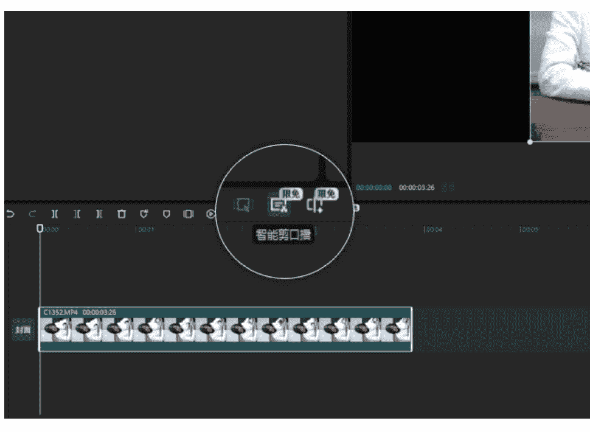
图9-5 单击“智能剪口播”

(2) 此时剪映会捕捉语音，判断停顿、口误、重复语气词以及无效段落，十秒内完成全片扫描并标记出需要剪掉的部分，如图9-6所示。
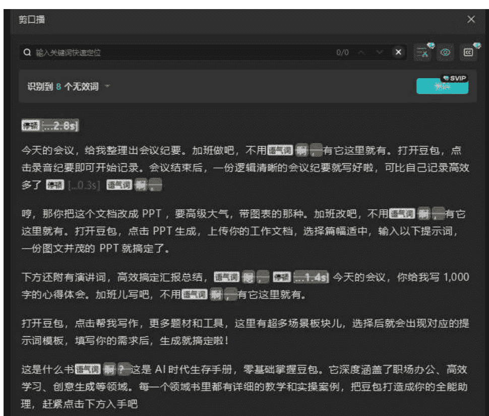
图9-6 需要删减的片段

### 2.智能添加笑点和音效

把无效段落清理后，点击“音频”→“音效库”→“AI音效”，如图9-7所示。剪映会结合内容、语气和节奏，自动匹配音效，比如笑点配笑声、重点配强调音、提问配悬念音。

### 3.画面优化与导出成片

针对画面呆板的问题，可用“智能抠像”一键换背景，也可用“抠像描边”突出人物，让画面更丰富，如图9-8所示。调整完毕后即可导出成品。
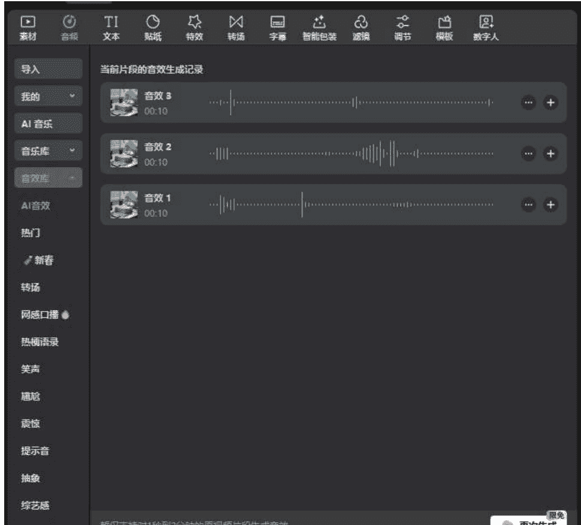
图9-7 单击“AI音效”
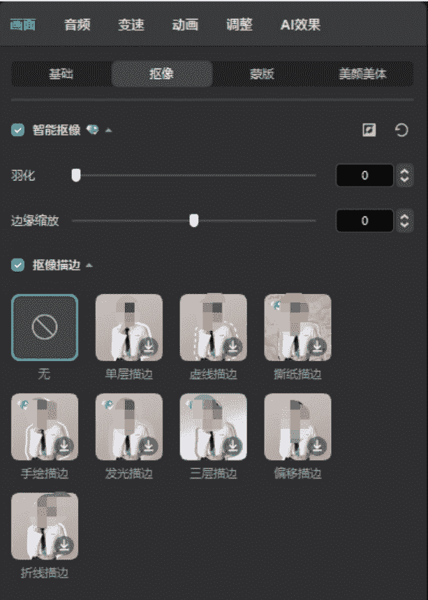
图9-8 “抠像描边”功能

### 9.2.3 豆包+Seedance 2.0进阶玩法，打造爆款口播

口播的竞争力不仅是内容，还有画面丰富度和节奏掌控。借助豆包和Seedance 2.0能大幅提升出圈概率，具体做法如下。

### 1.用豆包优化口播文案，补充爆款“钩子”与金句

把原始文案发给豆包，用下方提示词优化，吸引力会明显提升。

请你优化这篇口播文案，要求：

1. 开头增加3秒的爆款“钩子”，用痛点/反差观点吸引观众注意力；
2. 为每个核心知识点配一句好记的金句，便于剪出高光片段；
3. 在合适位置增加笑点、互动提问，提升完播率和评论率；
4. 保留口语化表达，删除冗余语气词，让内容更紧凑，适配短视频节奏。

文案从源头变好，再配合AI剪辑，节奏和吸引力都会上一个台阶。

### 2.用Seedance 2.0生成辅助画面，解决画面单调的问题

纯人物画面容易视觉疲劳，需要补充与文案匹配的辅助画面，可通过Seedance 2.0快速生成。
(1) 先用豆包把口播文案拆解成需要补充的画面场景，比如讲职场干货就需要办公室工作画面。
(2) 在Seedance 2.0输入提示词生成对应时长的视频片段，如图9-9所示，提示词模板如下。
生成一个8秒的高清短视频，画面内容为[职场人用四象限法则整理工作清单，高效处理日常工作]，画面风格为写实明亮，职场氛围感，镜头缓慢推进，帧率为25帧/秒，无水印，画面清晰自然。
(3) 把生成的片段以画中画形式导入剪映，对齐口播文案，就能让画面更饱满，停留时长明显增加。

### 3.用豆包生成音效、特效匹配建议，精准贴合内容

让豆包给出专业的音效、特效搭配建议，例如重点内容加重音特效，转折处加转场音效，笑点处加轻快笑声，再在剪映里实装，节奏会更专业。
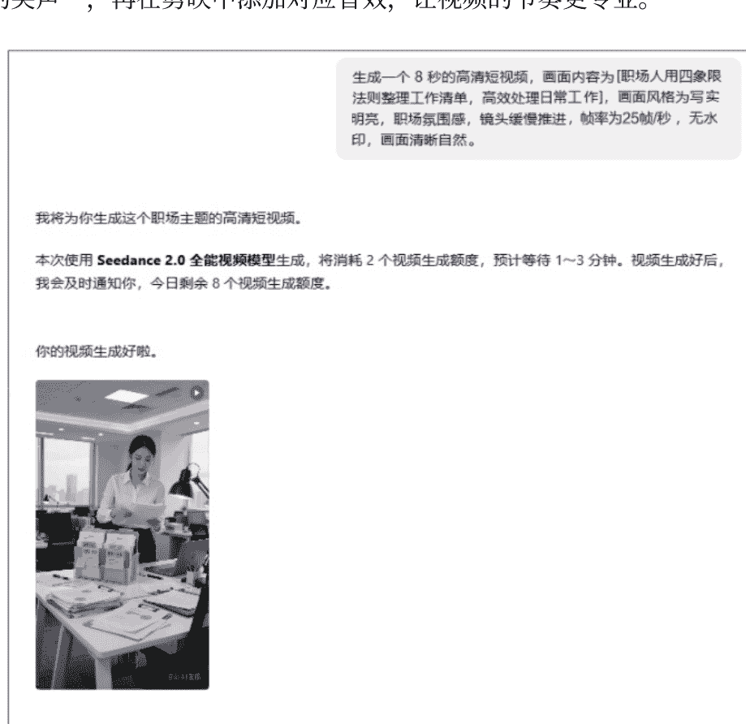
图9-9 用Seedance 2.0生成高清视频片段

### 9.2.4 增收攻略：口播精剪的规模化变现路径

口播精剪是高频刚需，通过标准化服务设计，能从单次接单升级到规模化变现。

### 1.设计阶梯化服务套餐，提高客单价

按需求设置不同档位，定价参考如表9-2所示。

表9-2 定价参考

| 服务套餐 | 包含内容 | 定价 | 目标客户 |
| :--- | :--- | :--- | :--- |
| 基础精简版 | AI一键删除冗余片段+添加字幕+校准错别字 | 30元/条（5分钟内） | 新手博主 |
| 深度精剪版 | 基础精简版所有服务+音效与花字匹配+画面优化+节奏调整 | 80元/条 | 垂类博主、带货主播 |
| 全案定制版 | 豆包文案优化+Seedance 2.0辅助优化画面+全片精修+封面标题 | 199元/条 | 知识IP博主、品牌商家 |
| 包月服务包 | 每周5条精剪视频+节奏优化+批量处理 | 800～1500元/月 | 长期更新的博主、实体店店主 |

### 2.扩宽获客渠道，低成本触达目标客户

(1) 内容引流：在小红书、抖音发布“口播视频剪辑前后对比”“3分钟搞定口播精剪”教程，展示效果后引导私信咨询。
(2) 精准社群：加入博主交流群、带货商家群、本地实体店群，先输出干货，再提供免费快剪体验，建立信任后转化。
(3) 平台挂单：在闲鱼、淘宝上架口播视频精剪服务，标题里带上口播视频精剪、短视频剪辑、停顿删除、字幕校准等关键词，获取搜索流量。

### 3.发展兼职团队，突破个人产能天花板

订单超过个人处理能力时，可招募兼职剪辑。你负责接单、质检和客户对接，兼职负责执行。比如80元一条的订单分给兼职40元，从卖时间转向卖管理，实现规模化。

## 9.3 量产快闪视频：AI自动踩点，模板替换批量产出

快闪视频节奏快、视觉冲击强，是商家促销、品牌宣传、活动预热等场景的刚需。餐饮、教培、企业和品牌方都有稳定需求。

### 9.3.1 快闪视频的核心应用场景与创作痛点

### 1.核心应用场景

(1) 本地商家促销：餐饮、美容、零售门店的节日促销、新品推广、优惠宣传。
(2) 企业品牌宣传：品牌介绍、产品卖点、招商加盟、活动预热。
(3) 个人场景应用：节日祝福、婚礼开场、生日祝福、毕业纪念、求职简历。
(4) 自媒体引流：爆款预告、干货合集、人设宣传，提升视觉冲击。

### 2.创作痛点

(1) 手动卡点效率低：逐帧对齐画面、文字和音乐节拍费时费力，新手容易节奏错位。
(2) 模板同质化严重：网上模板雷同，辨识度低，想要定制化成本很高。
(3) 批量制作难：给不同商家做同类型促销视频，需要反复改文案画面音乐，难以快速批量。

### 9.3.2 剪映+豆包量产快闪视频实操全流程

借助剪映的AI自动踩点和模板一键替换，加上豆包的文案创作，能实现快速制作和批量产出。

### 1.用豆包生成适配快闪视频的文案

快闪的核心是短平快的文案和清晰节奏，可用豆包生成，提示词模板如下。
请你为[奶茶店情人节促销活动]生成15秒快闪视频的文案，要求：
1. 文案拆成10个片段，每个1～8个字，信息密度高，直击卖点；
2. 开头用钩子抓人，中间讲核心优惠，结尾给行动指令；
3. 标注每个片段对应的节奏或节拍，适配卡点；
4. 风格活泼有冲击力，适合本地商家促销。
生成的文案能完美适配节奏，避免文案过长信息不清，为AI自动踩点打基础。

### 2.剪映AI自动踩点，搭建快闪模板

(1) 打开剪映，导入节奏感强、鼓点清晰的背景音乐，选中音频后点击“添加标记”，选择“踩节拍Ⅱ”，剪映会自动在每个鼓点生成褐色标记，完成自动踩点，如图9-10所示。
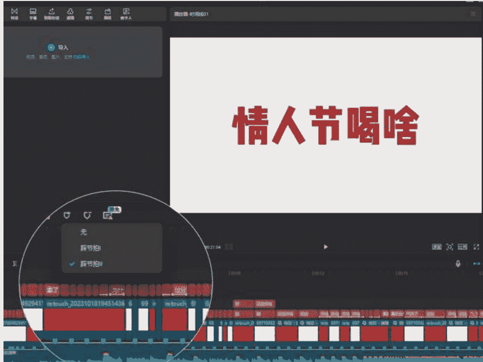
图9-10 自动踩点
(2) 按豆包生成的文案，在每个标记位置添加对应文本和画面素材，设置入场出场动画，让文字节奏与鼓点完美匹配，搭建完整模板。
(3) 点击“特效”→“AI推荐特效”，剪映会根据音乐和风格自动匹配转场和画面特效，一键添加后视觉冲击更强。

### 3.一键替换模板内容，批量产出视频

模板搭建好后，后续只需替换内容即可快速生成新片。
(1) 文案替换：直接修改文本内容，无需调整动画、时长、踩点，10秒就能换完，如图9-11所示。
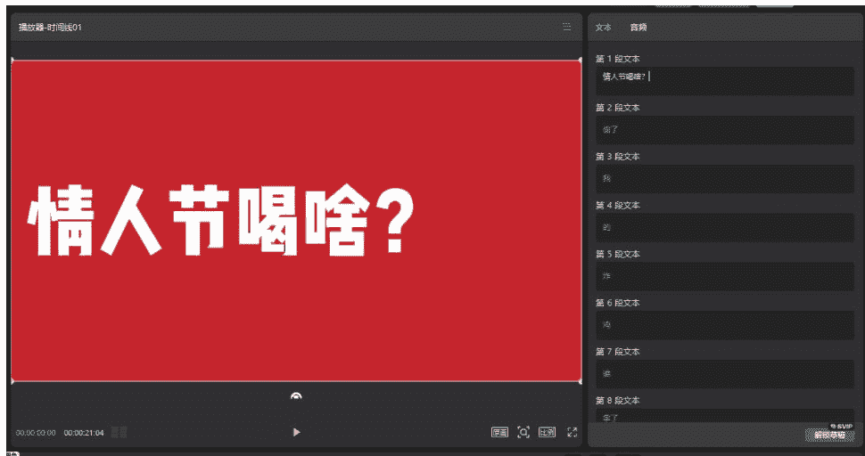
图9-11 快闪视频模板批量替换文案示意图
(2) 画面素材替换：点画中画素材选“替换”，导入新素材，素材会自动适配原有时长、动画、特效。
(3) 音乐替换：更换背景音乐后点“自动踩点”，AI会自动对齐新节拍，无需手动调整，如图9-11所示。
这样原本做1条的时间，现在能批量做10条，完美适配多商家多场景需求。

### 4.多比例适配与导出视频

剪映支持一键调比例，点击“比例”可选择9:16竖屏、16:9横屏、1:1方形等，剪映会自动调整画面和文字位置。调整完导出高清即可发布。

### 9.3.3 豆包+Seedance 2.0进阶玩法，打造差异化快闪

### 1.用豆包拆解爆款快闪视频，生成脚本

找到同赛道的爆款快闪视频，把链接发给豆包，用提示词拆解结构。
> 请你拆解这条爆款快闪视频的结构，包括文案节奏、画面切换逻辑、音乐踩点规律、动画特效类型，然后基于这个爆款结构，为[餐饮门店“6·18”促销活动]生成一个快闪视频脚本，包含文案、画面描述、时长、节拍4个维度。
基于爆款结构的脚本能大幅提升引流效果。

### 2.用Seedance 2.0生成定制化视觉元素，解决同质化问题

(1) 用Seedance 2.0生成快闪视频的专属动态背景、3D片头片尾或转场特效，如图9-12所示，生成动态背景提示词模板如下。
> 生成一个15秒的循环动态背景视频，画面风格为[赛博朋克风]，奶茶店促销主题，画面元素有[奶茶杯、冰块、粉色霓虹灯、爱心气泡]，节奏快，视觉冲击力强，适配快闪视频鼓点，帧率为25帧/秒，高清无水印。
(2) 用Seedance 2.0生成商家产品的动态展示视频，如餐饮菜品特写、美容服务场景，用它替换静态图片，让画面更生动，定制化更高。

### 3.一模板多风格，实现差异化批量产出

用豆包生成不同行业不同风格的文案和画面描述，通过Seedance 2.0生成对应视觉素材，再导入同一个快闪模板，就能快速生成餐饮、美容、教培、零售等不同行业内容，实现一个模板批量产出差异化内容，大幅提升接单效率。

### 9.3.4 增收攻略：快闪视频批量变现技巧

### 1.节日节点营销，批量制作模板售卖

情人节、中秋、国庆、春节等节日都是商家促销高峰期，提前用豆包+剪映+Seedance 2.0制作各行业节日快闪模板，如“情人节奶茶店促销快闪模板”“春节餐饮拜年模板”，在闲鱼、小红书售卖，每套19.9～49.9元，节日前夕单套常卖上百份。

### 2.本地商家包月服务，锁定稳定收入

针对本地餐饮、美容、零售门店推出快闪包月服务，每月200～500元，包含4条促销快闪视频，适配日常活动、节日促销、新品上市。复购率高，服务好10～20家门店即可拥有稳定收入。

### 3.行业模板库搭建，实现规模化变现

按行业分类搭建快闪模板库，如餐饮、美容、教培、婚庆，每个行业10套不同风格模板，搭配豆包提示词和操作教程打包售卖，每套99～199元。同时推出模板定制服务，单套定制200～500元，进一步提高客单价。

## 9.4 智能包装：一键匹配字幕、花字、音效与特效，提升成片质感

剪映的智能包装能根据视频类型或风格自动匹配字幕、花字、音效和特效，无需手动添加，零基础也能让普通视频快速出专业感，解决不会做字幕排版、不会加特效、不会配音效的痛点。

### 9.4.1 智能包装功能覆盖的视频类型

智能包装覆盖6种主流类型：
- 智能推荐：自动识别内容匹配最合适包装风格，通用性强。
- 科技风：适合数码测评、科技科普、职场干货，冷色调科技感强。
- 生活Vlog：适合日常记录、旅行美食，清新活泼的花字音效。
- 营销带货：适合产品推广促销，醒目花字突出利益点，节奏感音效。
- 知识分享：适合干货讲解教学，清晰字幕排版简洁特效。
- 综艺娱乐：适合搞笑访谈娱乐，综艺感花字趣味音效转场。

### 9.4.2 智能包装功能实操全流程

### 1.进入智能包装功能界面

打开剪映，导入剪辑好的视频，点击顶部“智能包装”，进入功能界面，左侧默认“画面包装”，右侧展示可用风格模板，如图9-13所示。
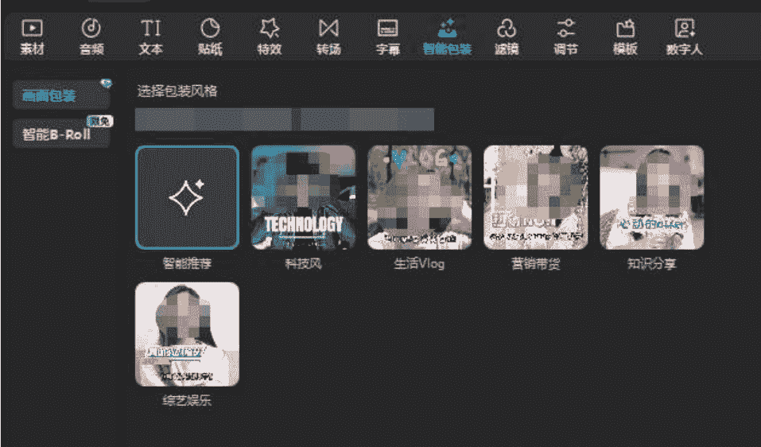
图9-13 智能包装功能界面

### 2.选择适配的包装风格

根据视频类型选择风格：
- 知识职场类：优先选“知识分享”“智能推荐”。
- 带货促销类：选“营销带货”。
- 日常旅行类：选“生活Vlog”。
- 数码科技类：选“科技风”。
- 搞笑娱乐类：选“综艺娱乐”。
选定后剪映提供实时预览，自动生成字幕、花字、音效和特效，无需手动操作，如图9-14所示。
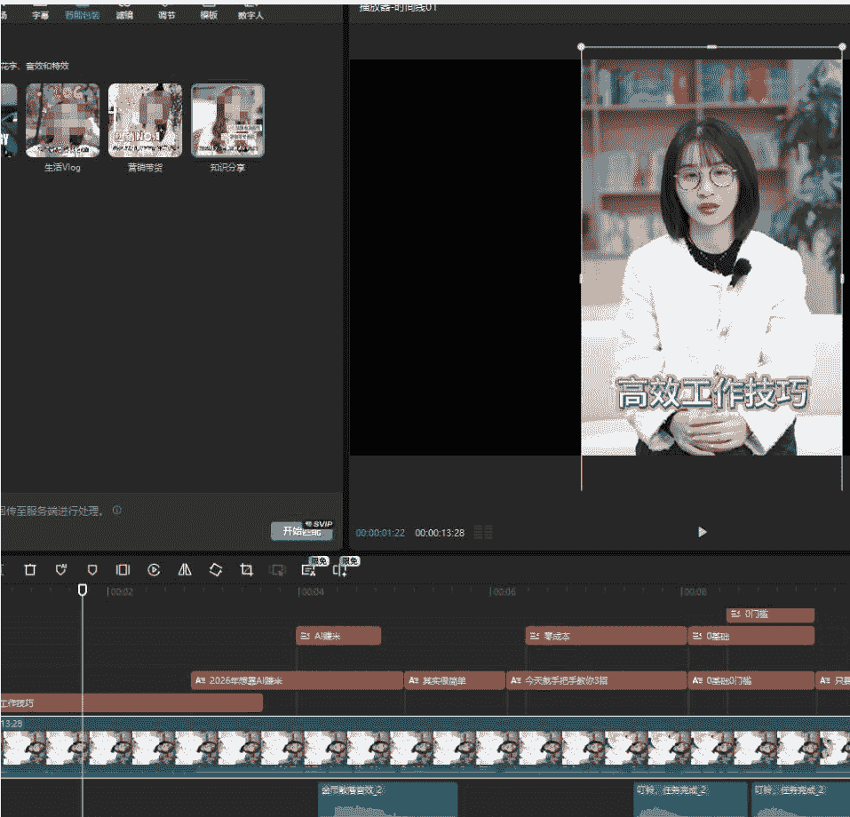
图9-14 包装效果实时预览

### 3.微调包装细节，贴合视频内容

(1) 字幕花字调整：选中字幕片段可改文字、字体、颜色、大小，调整花字入场出场动画，让重点更突出。
(2) 音效特效替换：点击底部“音频”“特效”可替换AI匹配的音效特效，比如把营销类快节奏音效换成更舒缓的。
(3) 风格切换：不满意当前风格可直接点其他模板，一键重新生成包装，无需重新调整。

### 4.用“智能B-Roll”（限免）功能补充画面

点击左侧“智能B-Roll”，如图9-15所示，剪映会自动识别口播内容并匹配对应辅助画面素材，如讲职场干货匹配办公室场景，讲美食匹配烹饪画面，一键补充，解决纯口播画面单调问题。
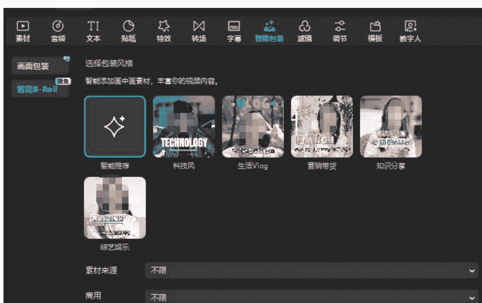
图9-15 单击“智能B-Roll”

### 5.导出与发布视频

微调完成后点右上角“导出”，视频已完成全套包装，可直接发抖音、视频号等平台。

### 9.4.3 豆包+Seedance 2.0进阶玩法，打造差异化包装效果

### 1.用豆包优化包装文案，突出核心信息

AI自动生成的字幕花字可能不够精准，可把视频核心内容发给豆包优化。
请你为这条[职场高效工作]的知识分享视频，优化智能包装生成的字幕文案，要求：
1. 每段字幕控制在15字以内，简单易懂；
2. 重点内容用加粗醒目文字说明，突出核心技巧；
3. 结尾添加互动引导字幕，比如“在评论区分享你的高效技巧”。
把优化后文案替换到剪映字幕中，包装更贴合卖点，提高信息传递效率。

### 2.用Seedance 2.0定制专属花字/特效，避免同质化

告别千篇一律，用定制花字塑造专属质感

剪映自带的包装套装上手快，但使用的人太多，很容易出现审美疲劳。若想建立辨识度，可以先借助 Seedance 2.0 生成专属的动态字幕与特效素材，再导入剪映替换掉系统默认的包装，整体风格立刻更高级。

1. 先用豆包把需求讲清楚。结合视频定位，让豆包输出风格说明，例如知识分享类短片，花字走简洁商务路线，冷色系为主，点缀轻度科技感的扫光动效。
2. 在 Seedance 2.0 里按提示词生成高清动态素材。参考写法：生成一个5秒的动态花字素材，文字内容为[高效工作技巧]，风格为简洁商务风，蓝色渐变，带适当科技感的扫光动画，适配知识分享类短视频，无水印，高清透明背景。
3. 将生成好的素材导入剪映，替换原片的自动花字，完成专属包装，呈现效果如图所示。

图9-16 Seedance 2.0定制花字与剪映智能包装的结合效果

### 9.4.4 增收攻略：智能包装的商业化变现路径

智能包装属于低投入高效率的短视频增值服务，对新手很友好，变现思路如下。

### 1.视频风格化包装服务，按单收费
面向博主和商家提供标准化包装，按套餐报价，参考表9-3。

表9-3 定价参考

| 服务套餐 | 包含内容 | 定价 | 目标客户 |
| :--- | :--- | :--- | :--- |
| 基础包装包 | 智能包装风格匹配+字幕/花字微调+智能B-Roll补充 | 20元/条 | 新手博主、个体商家 |
| 定制包装包 | 豆包文案优化+Seedance 2.0定制花字/特效+全片包装精修 | 60元/条 | 垂类博主、品牌商家 |
| 包月包装包 | 每周5条视频包装+风格适配建议+批量导出 | 300元/月 | 长期更新的博主、实体店店主 |

获客方式：在闲鱼挂单上架，在小红书发布包装前后对比案例，在本地商家群用免费风格诊断吸引需求。

### 2.风格模板定制服务
按行业或使用场景定制专属智能包装风格模板，如“餐饮促销风”“育儿干货风”，配合豆包优化后的文案和 Seedance 2.0 定制素材打包成模板包，在闲鱼、小红书售卖，售价19.9~39.9元，一次制作可重复售卖。

### 3.包装技巧教程售卖，知识变现
把智能包装的操作流程、风格挑选思路、豆包优化提示词整理成课程，例如“剪映智能包装：3分钟让视频变高级”，在知识付费平台、闲鱼销售，定价29.9～59.9元。

# 第10章 四大热门赛道：AI剪辑的标准化变现方案

短视频变现的关键在于标准化流程配合高匹配赛道，不需要专业剪辑功底，也不需要复杂运营。依托豆包的文案能力加上剪映的智能剪辑，可以实现3分钟成片、批量交付、稳定收入。本章拆解4个门槛低、需求大、落地快的热门赛道，覆盖全流程、变现逻辑与优化要点，帮助零基础新手从会剪辑走向能赚钱。

## 10.1 带货口播流水线：从AI提炼卖点到3分钟快速出片

带货口播上手快、回本快。用豆包提炼卖点生成口播稿，再配合剪映智能剪辑，能实现10分钟产出3条合格带货视频，很适合新手起步。

### 10.1.1 前期准备：3分钟搞定口播脚本（豆包主导）
带货口播的核心是卖点准确、文案口语化，豆包可快速完成三件事。

#### 1.明确产品关键信息
整理产品名、核心卖点3～5条，如平价、防水、省时，目标人群如学生、宝妈、职场人士，优惠信息如买一送一、限时折扣，用条目罗列即可。
示例：面膜，平价9.9元3片，敏感肌可用，深层补水，熬夜急救，适合学生、熬夜人群，买2送1。

#### 2.用豆包提炼核心卖点，过滤无效信息
提示词模板直接复制替换：
帮我写一款[产品名称]的带货口播文案，产品关键信息：[复制整理的产品关键信息]。请帮我提炼3个最吸引目标人群的核心卖点，每个卖点配一句口语化解释，避免使用专业术语，适配15～30秒的口播视频，贴合新手语气，不用太正式。
生成示例：对补水面膜，豆包会输出“①平价友好：9.9元3片，学生党无压力，每天敷也不心疼。②敏感肌可用：温和配方，泛红皮肤、干敏肌也能放心用。③熬夜急救：睡前敷10分钟，熬夜后也能容光焕发”。

#### 3.用豆包生成完整口播脚本
提示词模板：
基于刚才提炼的[产品名称]卖点，帮我生成15～30秒的口播脚本，开头3秒抓住观众注意力，中间讲3个卖点，结尾引导下单（如“单击小黄车”“私信我”），口语化、接地气，像朋友在推荐，避免生硬推销，提供分镜头标注（如“镜头1：手持产品”“镜头2：展示使用效果”）。
豆包生成的口播脚本示例见表10-1。

表10-1 豆包生成的口播脚本示例

| 镜头 | 位置 | 画面 | 台词 |
| :--- | :--- | :--- | :--- |
| 镜头 1 | 第 0 ～ 3 秒 | 手持面膜 | 学生党、熬夜党快看过来，9.9 元 3 片的补水面膜被我找到了（语气惊喜） |
| 镜头 2 | 第 3 ～ 15 秒 | 展示面膜质地 | 敏感肌也能放心用，温和不刺激，睡前敷 10 分钟，熬夜后的干脸直接救回来，深层补水（语速稍快） |
| 镜头 3 | 第 15 ～ 28 秒 | 手持面膜指向小黄车 | 现在买 2 送 1，9.9 元就能实现“面膜自由”，学生党闭眼冲，单击小黄车直接拍 |
| 镜头 4 | 第 28 ～ 30 秒 | 微笑比心 | 拍过的姐妹，评论区告诉我你们的使用感受 |

### 10.1.2 剪映AI剪辑：3分钟自动出片，无需手动操作
脚本确定后，用剪映智能剪辑拼接素材、加字幕配乐，全程约3分钟。

#### 1.素材准备
收集产品特写、使用过程、使用前后对比图或视频，直接存到手机相册供剪映识别；若无素材，可用豆包生成示意图，如图10-1所示，提示词：“帮我生成[产品名称]的高清实拍图，贴合真实使用场景，无水印，适合短视频使用”。

图10-1 使用豆包生成产品示意图

#### 2.剪映AI剪口播，核心步骤
（1）打开剪映，点击“AI剪口播”，上传视频后自动生成文字稿，想删片段直接划掉对应文字。“AI剪口播”界面如图10-2所示。
（2）点击“加字幕”，剪映自动识别字幕，可批量划重点、改词。

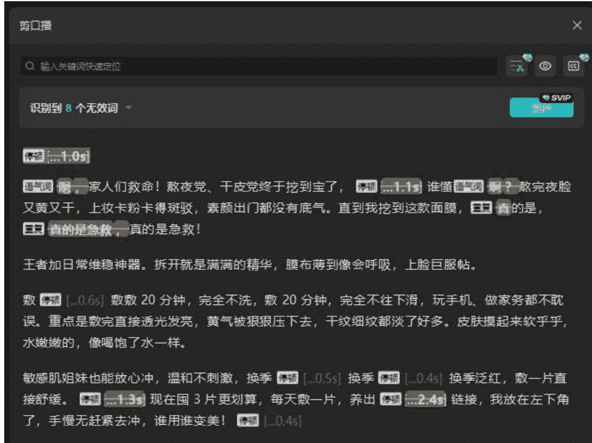
图10-2 “AI剪口播”界面

#### 3.细节优化，1分钟完成
（1）智能去水词：依次点击“编辑”→“智能去水词”，自动标记无效口语，可一键去除。
（2）AI改口误：如需改脚本，点击“编辑”→“AI改口误”，无需重拍。
（3）智能包装：点击“AI剪口播”中的“智能包装”，自动加字幕、匹配花字动画，并灵活添加画中画和表情包。

#### 4.导出与发布
点击右上角“导出”，即可发布到抖音、视频号等平台。

### 10.1.3 变现路径与优化技巧

#### 1.变现路径，新手优先
（1）带货佣金：在抖音、视频号开通橱窗，如图10-3所示，挂载商品链接，用户下单后赚取佣金，比例5%～50%，新手优先选平价高佣金刚需品，如9.9元、19.9元商品。

图10-3 抖音带货账号的橱窗

（2）接单变现：在小红书、闲鱼挂单承接“带货口播剪辑”业务，如图10-4所示。定价参考：15～30秒视频30～50元/条，30～60秒视频50～80元/条，批量10条以上可优惠，标准化流程下每天可接5～10单。

图10-4 小红书、闲鱼带货口播剪辑业务截图

#### 2.优化技巧，提升转化
- 开头3秒必须抓人。用惊喜语气加痛点或福利，例如“9.9元就能买3片补水面膜，学生党闭眼冲！”、“熬夜脸救星来了，不用贵价护肤品，平价面膜也能养出细腻水润的好皮肤”。
- 卖点控制在3个以内。新手容易堆砌，观众记不住。聚焦3个核心卖点，每个配一个简单场景，更易接受。
- 口播语气自然。若自己口播不佳，可用剪映AI配音。将豆包脚本复制到“文本朗读”，选择亲切女声/男声，节奏更稳。

## 10.2 知识付费赛道轻资产起号：动态大字报+AI文案引流

知识付费门槛低、变现持久，适合轻资产起号。核心是用低成本内容引流，后续转化为资料包、训练营、课程。动态大字报是最佳引流形式，无需真人出镜、无需拍摄素材，依托豆包写文案、剪映做成大字报，3分钟出片，批量引流效率高。

### 10.2.1 核心逻辑：动态大字报的引流优势
动态大字报即文字动态展示加干货文案加背景音乐，无需出镜，优势是制作快、成本低、价值感强，适合职场技巧、育儿知识、学习方法、AI工具使用等赛道。示例见图10-5。

例如职场赛道大字报文案：“3个职场‘摸鱼’式成长技巧，每天10分钟，悄悄超越同事！①利用碎片时间学AI工具，提升效率；②每天总结1个工作难点，快速成长；③学习行业知识，拓宽认知”，配合动态文字和轻快BGM，直观吸引职场人群。

### 10.2.2 实操流程：豆包写文案，剪映做大字报

#### 1.用豆包生成知识干货文案，适配大字报
引流文案核心是痛点+干货+引导，每条聚焦1个知识点，适配15～25秒视频，提示词模板：
> 帮我写[赛道名称，如职场技巧、育儿知识]的动态大字报引流文案，目标人群是[如职场新人、宝妈]，请帮我生成15～25秒的干货文案，结构为开头痛点引入+3个核心干货+结尾引导（引导关注/私信领资料），语言简洁、有价值，适合用动态大字报视频展示，每句话不超过15字，分点清晰。
示例（职场新人）：
职场新人必看！避免踩坑+快速成长。①不盲目加班，聚焦核心工作；②主动请教前辈，少走弯路；③每天复盘，积累经验。关注我，私信领职场新人避坑手册。
批量产出可加提示词“请批量生成10条同风格、不同知识点的文案，避免重复，每条均符合上述结构”。

#### 2.用剪映制作动态大字报视频
（1）打开剪映，点击“开始创作”，选黑色背景，文字更清晰，点击“添加”。
（2）添加文字。点击“文字”→“新建文本”，将豆包文案逐句复制，每句单独建一层，调整大小、颜色，首选白、黄，居中对齐。
（3）设置动态效果。选中文字，点击“动画”→“入场动画”，推荐“打字机”“渐显”“滑动”，每段时长2～3秒，依次出现。
（4）添加音乐音效。点击“音频”→“AI配乐”，搜“干货、励志”，选轻快纯音乐，音量30%～40%，可加打字机音效增强质感。
（5）细节优化。点击“画面”→“比例”，设为9:16竖屏。可添加贴纸，搜“干货、知识点”，如笔记本、钢笔点缀。
（6）导出发布。导出后加赛道话题，如“#职场新人技巧”“#育儿干货”，引导关注和私信。

### 10.2.3 起号与变现：从引流到转化

#### 1.起号技巧，零门槛
（1）聚焦垂直赛道。不要大杂烩，选一个垂直方向如职场、育儿、AI工具、学习方法，批量产出同风格视频，快速建立记忆点。
（2）批量发布。每天发3～5条，用豆包批量出文案+剪映批量制作，坚持7～15天可获精准流量。
（3）引流钩子。结尾统一引导，如“关注我，私信领[资料名称]”。资料包可用豆包生成，提示词：帮我生成[资料名称]的完整内容，适合知识付费引流，内容实用、简洁，可直接保存为文档。

#### 2.变现路径，轻资产低风险
（1）初级变现：售卖轻量知识产品，如思维导图19.9元/份、资料包9.9元/份，如图10-6所示。内容可用豆包快速生成。

图10-6 小红书售卖的思维导图和资料包

（2）中级变现：推出低价训练营99～199元/期，如“职场新人7天成长营”“AI工具使用训练营”。用豆包生成课程大纲如图10-7、每日打卡内容，用剪映制作宣传视频，批量引流转化。

图10-7 使用豆包生成的训练营课程大纲

（3）高级变现：推出付费课程299～999元，如图10-8所示。聚焦赛道核心需求，用豆包协助撰写文案、制作PPT，用剪映做宣传片。

图10-8 小红书售卖的付费课程

## 10.3 高黏性Vlog制作：黄金3秒抓人结构与情绪剪辑法

Vlog受众广、内容灵活，变现路径清晰如广告植入、带货。新手痛点是剪辑杂乱、逻辑差、流量低。遵循“前3秒抓人+中段展示+结尾钩子”的标准化结构，结合剪映AI情绪剪辑和豆包情绪文案，可3分钟出片，提升流量与变现。

高黏性Vlog核心是情绪驱动加节奏把控，优化黄金3秒钩子，让观众产生共鸣并主动关注。

### 10.3.1 黄金3秒钩子优化：3种高留存模板

钩子需具备情绪感、画面感、关联性，可直接套用。

#### 1.情绪共鸣型钩子，最易涨粉
贴合观众情绪，用口语化文案加对应画面引发共鸣。
示例：画面治愈海边日落，文案“长大后才发现，治愈焦虑的最好方式就是去看一次海🌊”；画面自己做饭，文案“打工人下班回家，做一顿热饭就是最简单的幸福”。
豆包提示词：帮我生成Vlog黄金3秒情绪钩子文案，主题[如治愈类旅行、打工人日常]，情绪[如治愈、快乐、感动]，口语化、有画面感，不超过15字，贴合Vlog语气。

#### 2.反差对比型钩子，提升好奇心
用前后对比制造反差，吸引停留。
示例：素颜与化妆对比，文案“普通女生化妆前后，差距有多大”；旅行踩坑与宝藏景点对比，文案“青岛旅行避坑，别再去‘网红’景点了”。

#### 3.价值前置型钩子，精准吸粉
开头直接给价值，让观众知道能得到什么，适合攻略类Vlog。
示例：画面旅行攻略截图，文案“青岛旅行3天2晚攻略，人均500元搞定”；画面职场技巧文本，文案“打工人必看！3个成长技巧”。
提示：钩子画面要与文案匹配，避免脱节，可用剪映AI自动匹配风格。

### 10.3.2 标准化结构拆解：3步打造高流量Vlog
无论旅行还是日常，结构通用，可AI快速完成。

#### 1.前3秒抓人，核心是留存
用视觉冲击加情绪引导，常见模板：
- 开头钩子：“谁懂啊！第一次来海边，直接被治愈了😊”“打工人周末出逃，这一天也太快乐了！”
- 视觉钩子：放最惊艳画面，如美景或美食特写，配文“这才是周末该有的样子✨”。
- 悬念钩子：“花100元逛遍小吃街，最后吃到了宝藏美食！”“旅行中踩过的坑，看完少走弯路。”

#### 2.中段信息展示，核心是传递价值
围绕主题传递有用信息，避免杂乱，分2～3个片段，每个片段1个信息点。
旅行Vlog示例：
片段1 3～10秒，景点画面，文案“来青岛必去的小麦岛，免费开放，海边日落超美”。
片段2 10～20秒，美食画面，文案“路边海鲜大排档，人均50元，新鲜又实惠”。
片段3 20～30秒，打卡姿势，文案“拍照小技巧——站在海边侧身拍，氛围感十足”。
不知写什么时，可用豆包提示词：帮我写[主题，如青岛旅行、周末日常]的Vlog中段文案，时长15～25秒，分3个小片段，每个片段配1句口语化文案，传递实用信息，如攻略、技巧，贴合Vlog语气，自然不生硬。

#### 3.结尾钩子，核心是引导互动
引导点赞、评论、关注，或留悬念。
- 互动钩子：“你们周末去哪里玩？评论区告诉我～”“喜欢海边的宝子，点赞收藏，下次一起去！”
- 悬念钩子：“下一期分享青岛旅行避坑攻略，记得关注我哦！”
- 价值钩子：“我整理了青岛旅行攻略，关注我，私信领完整版！”

### 10.3.3 快速成片实操：豆包配合剪映三分钟做出可用Vlog
## 10.3.3 Vlog全流程拆解：素材采集到最终成片

对零基础创作者而言，Vlog不必手工拼接片段、反复调节奏。剪映的智能剪切能承担粗活，豆包则负责口播稿和字幕的撰写。

##### 1. 素材准备
用手机拍摄日常或旅拍片段即可。拍摄时遵循“前三秒抓眼球、中段递信息、结尾留钩子”的思路，不必提前排序，剪映后期会自动挑选和归类。

##### 2. 用豆包生成口语化Vlog脚本
提示词模板如下。

我要做[主题，如周末海边Vlog、日常美食Vlog]，素材是[简单描述素材内容，如海边美景、小吃街美食、拍照片段]，请帮我生成完整的Vlog文案，遵循“前3秒抓人+中段信息展示+结尾钩子”的结构，口语化、自然，像和朋友分享日常，适配30～60秒的视频，分镜头标注文案。

##### 3. 剪映完成Vlog剪辑的核心操作
- (1) 打开剪映App，点击首页的“AI剪视频”，把手机相册中的素材导入，点击“下一步”。
- (2) 系统会自动筛选可用镜头，并给出成片思路，推荐模板与色调。若思路不满意可手动调整。生成思路和生成效果如图10-9所示。
- (3) 导入文案与字幕。将豆包生成的稿子复制到剪映“文本”区；如需字幕动画，选中字幕设置入场出场效果，保持Vlog调性一致。
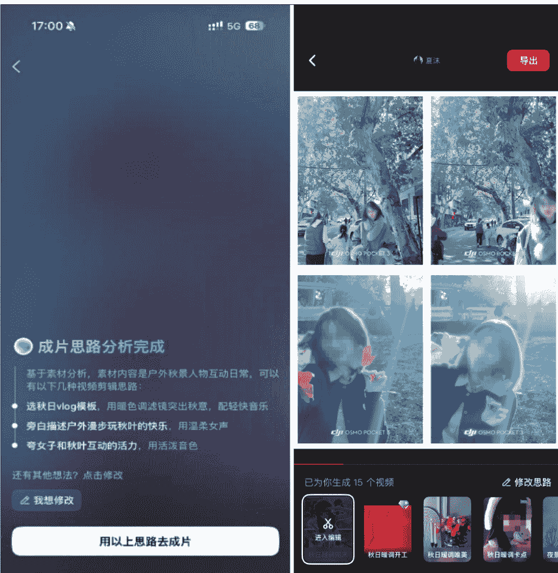

图10-9 生成思路和生成效果

- (4) 配乐与音效。剪映会推荐适配的BGM，在“音频”中可替换为自选音乐；叠加环境音如海风、咀嚼声，提升沉浸感。
- (5) 导出并发布。导出后发布时加上话题如“#旅行Vlog”“#日常分享”，有助于提升曝光。

### 10.3.4 提升粘性的操作要点：完播与互动双提升
高粘性Vlog既要留住观看，也要促成互动，可从下面三点入手。

#### 1. 节奏把控
避免剪辑杂乱，使用剪映自动调速功能按情绪调节快慢，例如治愈向放缓、欢快向加快。每5～10秒安排一个小高潮，如美景、干货、情绪转折，防止观众滑走。

#### 2. 互动设计
在中段或结尾抛出提问，可让豆包辅助撰写互动话术，如“你们有没有过这种治愈瞬间？评论区聊聊～”“你们爱海边吗？下次想去哪？”引导评论。

#### 3. 人设强化
在片中植入个人标签，如固定口头禅、标志动作，用豆包生成契合人设的文案，帮助观众记住你；保持同风格同基调的规律更新，强化账号标签，提升粉丝粘性。

### 10.3.5 普通人可落地的Vlog变现方案
变现核心是先积累粉丝再做转化，新手可从门槛低的方式起步，逐步提升收益。

#### 1. 初级变现：平台分成+带货
- (1) 平台流量分成：在抖音、视频号、B站开通创作者激励，按播放量获得分成。起步月入可能数百，粉丝增长后可达数千。抖音创作者伙伴计划如图10-10所示。

##### 抖音创作者伙伴计划
创作优质内容·获得现金激励

###### 加入伙伴计划·得现金收益
加入创作者伙伴计划后，在抖音APP或抖音精选APP发布的投稿作品，平台会根据作品的内容质量、获利播放、有效互动、用户价值等因素计算收益。

###### 伙伴计划·加入条件
请持续保持创作，满足以下抖音创作者伙伴计划加入条件。
- 加入创作者伙伴计划
- 发作品

图10-10 抖音创作者伙伴计划
- (2) 带货变现：挂载与主题相关的商品，如图10-11所示。例如旅行Vlog挂旅行装备如防晒霜、行李箱，美食Vlog挂零食，日常Vlog挂家居好物，赚取佣金。

图10-11 带货变现

#### 2. 中级变现：广告植入+本地商单
- (1) 广告植入：粉丝达到1万以上可接品牌广告，如旅行Vlog接酒店景区广告，美食Vlog接餐饮零食广告，参考报价1万粉丝单条500～1000元。
- (2) 本地商单：聚焦本地内容如本地美食、景点，接本地商家订单，参考报价单条300～800元，流程标准化后日接2～3单可行。

#### 3. 高级变现：IP打造+多元化
- (1) 打造个人IP：聚焦垂直赛道如旅行、美食、职场日常，形成固定风格，吸纳精准粉丝，提升账号价值。
- (2) 多元化变现：推出个人周边如旅行攻略手册、美食推荐清单，开通付费社群，承接品牌代言。

## 10.4 本地探店商单SOP：提效交付与客户满意度管理

本地探店是新手变现的黄金方向，需求大、交付快、利润可观。针对交付慢、满意度低、复购弱的问题，借助剪映+豆包可大幅提升效率，满意度高、复购明显提升，快速积累商家资源，实现稳定变现。

### 10.4.1 快速交付本地探店商单

探店单的核心是“满足商家诉求+迅速交付”，无需复杂剪辑，按“对接客户→拍摄素材→AI剪辑→交付修改”流程即可，如图10-12所示，全程可借助AI提速。

图10-12 本地探店商单标准化交付流程

#### 1. 第一步：客户对接，明确需求避免反复
核心动作：与商家沟通，明确三项核心需求，可用豆包生成“客户需求表”让商家填写，避免口头误差。
核心需求：①店铺核心卖点如平价美食、环境有特色、独家菜品；②视频时长如30～60秒、1分钟以上；③交付要求如突出菜品特色、展示店铺环境、引导顾客到店。
豆包提示词模板如下。
帮我生成本地探店商单客户需求表，包含店铺名称、核心卖点、视频时长、交付要求、联系方式、交付时间，要求简洁明了，可直接发给商家填写。
报价参考新手友好：30～60秒视频300～500元/条，1～3分钟视频500～1000元/条，批量5条以上可优惠，明确报价和交付时间如“24小时内交付，支持1次免费修改”。

#### 2. 第二步：素材拍摄，快速高效无需专业设备
拍摄要点：聚焦商家卖点拍摄三类核心素材，手机即可，每类拍2～3个镜头，避免冗余。
必拍素材：①店铺环境如门头、店内装修，突出特色；②核心产品与服务如菜品、服务，特写镜头，展示质感；③引导镜头如店铺地址、优惠活动。
用豆包生成“本地探店视频拍摄脚本”，提示词模板如下。
帮我生成[店铺类型，如餐饮店、民宿、花店]的探店视频拍摄脚本，时长为30～60秒，分镜头标注拍摄内容、拍摄角度，无须专业设备，手机可拍，聚焦店铺核心卖点。

#### 3. 第三步：AI剪辑，约1小时完成标准化出片
依托剪映+豆包可快速出片。
用豆包生成探店文案，提示词模板如下。
帮我生成[店铺名称]的探店视频文案，店铺卖点[复制商家填写的卖点]，视频时长为30～60秒，结构为“开头钩子+中段卖点展示+结尾引导到店”，口语化、有吸引力，贴合本地探店视频调性，分镜头标注文案内容。
示例餐饮店探店视频文案。钩子0～3秒：本地人必冲！这家藏在巷子里的美食店，人均50元吃到撑😊。中段3～40秒：门头简约有格调，店内环境干净舒适，招牌菜水煮鱼鲜嫩入味，毛血旺分量超足，每一口都让人很满足。结尾40～55秒：地址放在评论区，喜欢吃川菜的宝子赶紧来打卡，到店提我的名字可享8折优惠哦。
用剪映完成剪辑。①打开剪映，上传拍摄素材，添加豆包生成的文案；②剪映会自动筛选优质素材并按“钩子+中段+结尾”结构拼接，自动添加字幕、背景音乐适配探店视频调性的轻快音乐；③细节优化，添加店铺地址贴纸、优惠信息贴纸，调整画面清晰度。

#### 4. 第四步：交付与修改，提升满意度
交付：将剪辑好的视频发给商家，附带“交付说明”如“视频可直接发布，字幕已优化，支持1次免费修改”。可用豆包生成简洁明了的交付说明。
修改：若商家有修改需求，让商家明确修改点如“突出某道菜品”“调整字幕颜色”，用剪映快速修改，无需重剪，10分钟内完成，避免反复修改。

### 10.4.2 客户满意度管理：提升复购与转介绍

本地探店商单的核心竞争力是“效率+服务”，做好满意度管理，可实现老客户复购+转介绍，快速积累本地商家资源。

#### 1. 交付前：提前检查避免出错
剪辑完成后，检查三点：①卖点是否突出贴合商家需求；②字幕是否准确无错别字、信息无误；③画面是否清晰无模糊、冗余片段。
用剪映的AI审核功能一键检查视频问题如字幕错误、画面模糊，快速修正，避免交付问题降低满意度。

#### 2. 交付后：主动跟进维护关系
交付后24小时内主动私信商家，询问视频使用情况如“视频发布后效果怎么样？”“有没有需要调整的地方？”，体现贴心服务。
商家发布视频后，主动点赞、评论、转发，帮助商家提升曝光，增强好感度。
定期维护：每周给老客户发1条问候消息，分享本地探店视频案例，提醒商家“需要更新视频可随时找我”，促进复购。

#### 3. 转介绍激励：引导老客户转介绍
制定转介绍政策：如“老客户转介绍1个新客户，可享受8折优惠或免费剪辑1条短视频”。可用豆包生成转介绍文案后发给老客户。
及时兑现激励：老客户成功转介绍后，第一时间兑现承诺，提升转介绍积极性。

### 10.4.3 批量接单技巧：快速积累本地商家资源

新手初期可通过以下三渠道快速承接本地探店商单，依托标准工作流程实现批量接单，提升收益。

#### 1. 线上渠道：闲鱼、小红书
- (1) 闲鱼：标题关键词全覆盖如“本地探店视频剪辑”“商家短视频制作”“30分钟快速交付”，在宝贝描述中展示案例、报价、交付流程，吸引本地商家咨询，如图10-13所示。
- (2) 小红书：发布本地探店视频案例，文案标注“承接本地探店视频商单”“30分钟快速交付”“价格优惠”，添加本地话题如“#××城市探店”“#本地商家短视频”，吸引本地商家关注，如图10-14所示。

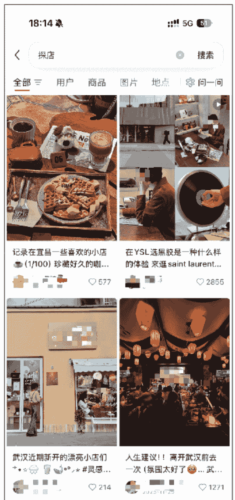
图10-13 闲鱼挂单
图10-14 小红书挂单

#### 2. 线下渠道：主动对接本地商家
聚焦本地商圈如美食街、步行街、写字楼周边，主动上门对接商家，展示探店视频案例，介绍服务和报价。该方法适合新手积累初始客户。

#### 3. 合作渠道：与本地达人、探店博主合作
对接本地探店达人、博主，承接他们的视频剪辑业务，达人负责拍摄素材，你负责剪辑视频，按条收费如30～60秒视频50～100元/条，批量接单，快速提升收益。

# 第11章 五大变现路径：从副业到创业的完整变现地图

本章将从自由接单、内容创业、产品开发、培训与顾问和团队赋能这5个维度，搭建一套从副业到创业的完整变现地图，彻底摆脱“只会剪视频、赚辛苦钱”的困境，让你既能快速上手赚零花钱，也能稳步进阶做事业。

## 11.1 自由接单：利用效率优势拓展客源与提价

自由接单是AI剪辑新手最容易起步的变现路径，几乎没有门槛、不用投入过多成本，只要有手机，会用剪映、豆包和Seedance 2.0，就能靠剪辑赚钱。

### 11.1.1 善用招聘软件：新手最快接单的“捷径”

招聘软件上面藏着大量兼职剪辑订单，而且大多是刚需单，且不用进行复杂沟通，是新手练手、快速接单的首选。这里的核心技巧是“找对定位、找对单子、找对话术”，不用跑线下，线上就能对接。

#### 1. 怎么找：定位选对，单量翻倍
打开BOSS直聘这类招聘软件，直接搜索“剪辑兼职”“短视频剪辑”，可以把定位切换到杭州、上海、广州、深圳这些电商产业发达的城市，因为这些城市的兼职单量大，优质单多。当然，其他城市的单子也别忽略，随手打个招呼，说不定就有意外收获。图11-1所示为招聘平台剪辑相关需求展示。

图11-1 招聘平台剪辑相关需求展示

#### 2. 怎么选：新手只接“无脑单”
零基础新手别接调色、加特效等复杂单，只选加字幕+加贴纸+配背景音乐的简单，用剪映的AI功能+Seedance 2.0就能轻松完成。

#### 3. 怎么谈：话术直接，主动试剪
直接发“你好老板，你们还招剪辑兼职吗？我可以提供试剪”，用试剪代替作品集，更快获取客户信任。
可参考下面的远程合作核心沟通3问，确认清楚再试剪，避免后续纠纷。
- ①合作形式：是否纯线上远程剪辑？无须到岗？
- ②素材交付：如何接收剪辑素材 如微信/网盘/邮箱？素材是否会统一整理？
- ③交付要求：视频交付格式 如1080P/竖屏9：16？交付渠道是什么？
这里有两个细节要注意：
首先，如果客户问你有作品吗，你要是没有，就如实回答暂时还没有。
其次，试剪前，一定要问清楚单子怎么结算？是日结还是周结？剪一条多少钱？有没有样片？

#### 4. 试剪避坑：参考样片、问清楚，不做无用功
试剪的时候，先向客户索要完整的样片 含视频、图片、背景音乐，如果客户给了样片，你就照着样片的节奏、特效、字幕样式一步一步地制作，别自己瞎加特效、乱改节奏。新手最忌讳“还没学会复刻，就想着创新”，画蛇添足反而会丢单。另外，如果客户拒绝提前说清单价，非要你试剪完再谈价，可以直接拒绝，接着找下一个订单。

### 11.1.2 对接自媒体博主：精准对接，复购率高

除了招聘软件，对接自媒体博主也是一条很不错的路径，很多博主需要快速更新短视频，但自己没时间剪辑，而且他们的需求往往和AI剪辑的优势相匹配——高效、快捷、贴合账号风格，只要你敢主动询问，就有可能拿到稳定的复购单。

#### 1. 找对博主：聚焦5万～10万粉丝数的，成功率更高
不要找粉丝太多的大博主 因为他们通常有专业的剪辑团队，也别找粉丝太少的小博主 因为他们需求少、预算低，重点找粉丝数在5万～10万的博主，这类博主大多处于关键期，需要大量更新内容，但又没能力请全职剪辑师，缺的就是你这样高效、性价比高的AI剪辑师，合作成功率高。

#### 2. 对接方式：主动发邮件，诚意比技巧重要
很多博主会在个人首页放上自己的商务对接邮箱，你可以准备好精心制作的作品集，哪怕只有3～5条样片 用剪映+Seedance 2.0制作的就行，主动给他们发邮件。这里要提醒一句：这个过程需要坚持，我当初发了无数封邮件，最终收到回复的也只有个位数，但只要有一个合作成功，后续就能靠口碑接到更多单子。

#### 3. 邮件模板：直接套用，不用自己写
这里提供一个邮件模板，稍作修改就能用，重点突出“你的优势、能提供的服务、免费试剪的诚意”，降低博主的决策门槛。
诚意合作|高效剪辑+免费试剪（24小时出片）
尊敬的××博主：
您好！一直关注您的账号，特别喜欢您的[美妆/生活/时尚]类内容，风格新颖、干货满满，每次看都有收获～
目前我专注为[美妆/生活/时尚]类博主提供定向剪辑服务，熟练运用剪映、豆包、Seedance 2.0，能高效完成以下工作。
- ①高点击率封面设计 AI一键生成，贴合账号风格。
- ②口播类视频节奏优化 AI卡点，不拖沓。
- ③短视频故事线重构 AI梳理素材，快速出片。
附近期作品供参考 均为AI全流程制作，作品在附件图片/我的小红书账号“收藏”里，可直接扫码查看。
①我为其他博主剪辑的短视频，②创意短视频，③美妆口播类视频。
特别邀请合作：
如果您近期有视频剪辑需求，我愿意免费为您制作1条视频 24小时内交付，严格贴合您账号的风格，您只需提供原始素材和需求方向。我希望通过实际作品证明我的专业度，后续合作由您自行决定，期待能与您共同打造更多爆款内容！
顺祝账号涨粉不停、爆款不断！
联系方式 微信：×××
邮件沟通是比较正式的方式，当然也可以灵活一点，在平台上看到图11-2所示的需求时主动发私信。这个时候切记保持谨慎，不要轻易透露自己的关键信息，避免财产损失。

图11-2 自媒体平台评论区关于剪辑的需求

### 11.1.3 接单平台派单：被动接单，省心省力

一品威客、猪八戒网这类综合服务平台就像一个“接单集市”，平台汇集了大量有剪辑需求的客户，而且这些客户以中小型企业、个人为主，你只要入驻平台、包装好账号，就能接到单子。该方法适合没有太多时间找单的新手。

#### 1. 入驻平台：包装账号，突出AI效率优势
入驻后，重点做好以下两件事，让客户一眼看到你的价值，主动找你合作。
- (1) 精准定位：个人简介里一定要突出AI剪辑、剪映+豆包、Seedance 2.0、高效出片这些关键词，明确你的服务范围，比如短视频剪辑、口播视频优化、Vlog重构等，别写得太笼统，要让客户看一眼就知道你能做什么。
- (2) 作品展示：上传3～5条用AI工具制作的样片，标注清楚10分钟出片、AI一键添加字幕/转场效果、批量交付等亮点，样片不用太复杂，重点体现你的效率优势——客户找AI剪辑，图的就是快。
接单平台关于剪辑的需求如图11-3所示。
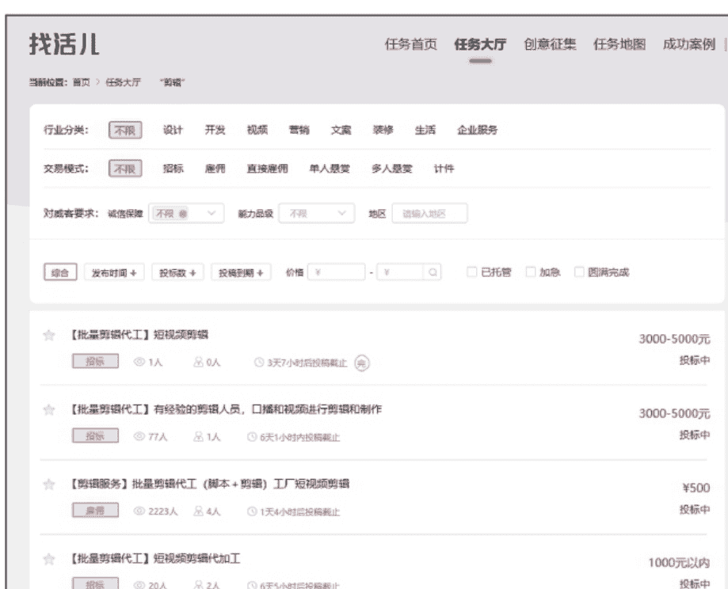
图11-3 接单平台关于剪辑的需求

#### 2. 接单技巧：主动出击，用试剪破冰
在平台任务大厅搜索“短视频剪辑”“AI剪辑”“口播视频”“批量剪辑”等，优先选择对交付时间有要求的订单，比如“当天交付”“1小时出片”等，主动出击，因为这些正是你的优势。
看到合适的订单后，主动联系发布需求的客户，直接用“免费试剪1个片段，1小时内交付”等话术。免费试剪能降低客户的决策门槛，让客户快速信任你，比只说“我剪得好”有用多了。

起步不要一味追求高单价，先用交付效率切入市场。行业里普通剪辑师多在50元/条左右报价，你可以先报30元/条，核心卖点放在一小时内交片、支持批量交付，让客户感受到的是产能和性价比，而非技术短板，这样既能体现物超所值，也能避开低价内卷。

### 11.1.4 公域引流私域留存：用速度建立口碑，用口碑支撑涨价

#### 1. 服务沉淀复购，把单次订单变成长期合作
- 模板化交付：为口播、Vlog等高频形式沉淀固定的剪辑模版，保证风格统一、成片稳定、交付可控。
- 超预期响应：客户提出修改后借助智能工具快速调整，10分钟内推送新版，塑造高效可靠的专业形象。
- 私域沉淀：项目完成后引导客户加微信，备注“AI剪辑合作”，定期推送新作品与效率案例，为后续提价蓄力。

#### 2. 合理提价：从零花钱到稳定现金流
- 阶梯式涨价：积累10个以上稳定复购客户后，单条价格从30元提升至50元，并推出包月套餐锁定长期收入。

### 11.1.5 通用包月剪辑套餐模板
- （1）基础包月套餐 200元/月：每月交付30条15~30秒短视频，含字幕、背景音乐、基础转场，支持3次免费修改，24小时内交付。
- （2）进阶包月套餐 400元/月：每月交付60条15~60秒短视频，含字幕、背景音乐、调色、封面设计，支持5次免费修改，12小时内交付。
- （3）加急包月套餐 600元/月：每月交付50条不限时长短视频，包含全部服务，支持无限次免费修改，6小时加急交付。

价值包装：提价时突出智能增值服务，例如自动脚本、智能封面，让客户认可溢价理由。
客户筛选：放弃只看价格的低质订单，聚焦愿意为效率与专业付费的高价值客户。

## 11.2 内容创业：搭建智能驱动的多平台账号矩阵

自由接单是卖技术赚时薪，内容创业是用流量赚复利。无需每日接单，通过剪映+豆包批量生产优质内容，依靠带货、广告、平台补贴实现一次创作多次变现，同时沉淀个人品牌。

### 11.2.1 智能批量起号，多平台放大流量

传统创业卡在持续产出，智能模式的核心是让工具干活：豆包负责选题和文案，Seedance 2.0制作素材，剪映完成剪辑优化。创作者只需把控赛道、质量和运营。

多平台矩阵相当于开连锁店，抖音、视频号、小红书同步投放，投入一份产出多份回报，有效分散单平台限流风险。关键是小而美，聚焦细分赛道吸引精准粉丝，变现效率才高。

### 1. 新手可优先的3个低门槛赛道

选对赛道等于成功一半，建议优先低门槛高需求易变现的细分领域。表11-1所示为适合新手的优选赛道。

##### 表11-1 适合新手的优选赛道

| 赛道名称 | 核心内容 | 素材来源 | 变现方式 | 核心优势 |
| :--- | :--- | :--- | :--- | :--- |
| 好物分享 | 平价好物、家用神器 | 淘宝、拼多多 | 带货佣金 | 智能化快速产出，适合日更 |
| 本地探店 | 本地小店、美食 | 手机拍摄、商家提供 | 商家广告等 | 流量精准，复购率高 |
| 干货剪辑 | 育儿、职场、智能工具使用技巧 | 无版权风险素材 | 广告、带货、培训 | 无须出镜，适合“社恐”人士 |

### 2. 智能批量产出内容，日更10条不费力

批量创作的高效闭环由豆包+剪映完成。

（1）豆包批量生成选题+文案。将提示词发送给豆包，例如“批量生成10条宝妈好物分享选题+文案，每条15~20秒，接地气，聚焦宝宝辅食工具，突出性价比”，即可获得可直接使用的选题和口播稿。

这里给你10条宝妈辅食工具爆款选题 + 15-20秒口播文案，全接地气、高性价比、直接能用，适合短视频口播。

- 1. 选题：宝宝辅食碗别乱买！这只十几块够用一整年

文案：

宝妈们别再花大价钱买辅食碗了！就这种带吸盘的，十几块一个，宝宝怎么扒拉都不掉。耐高温、能蒸煮、好清洗，从吃米糊用到吃面条，性价比真的绝了，闭眼入不亏！

- 2. 选题：辅食剪刀才是带娃神器，便宜又好用

文案：

做辅食最费妈的就是剪食物！这把辅食剪刀十几块，锋利又不生锈，肉类、蔬菜、面条一剪就碎，出门随身带，不用再用手掰，干净又方便，性价比直接拉满！

- 3. 选题：辅食研磨碗一套搞定，不用买一堆机器

（2）剪映批量剪辑。具体操作步骤如表11-2所示。

##### 表11-2 剪辑中的具体操作步骤

| 步骤 | 核心操作 | 关键要点 |
| :--- | :--- | :--- |
| ① 素材准备 | 实拍、找无版权风险素材、用 Seedance 2.0 制作素材 | 多源取材，快速备片 |
| ② 导入素材 | 批量导入 10 ~ 20 个素材片段 | 一次性上传，高效起剪 |
| ③ 生成智能字幕 | 批量复制豆包生成的文案，调用剪映智能字幕功能 | AI 自动同步字幕 + 样式 |
| ④ AI 成片 | 套用赛道模板 | 自动匹配转场效果、添加背景音乐等 |
| ⑤ 批量微调 | 每条 30 秒，删除不必要的素材片段、改字幕 | 快速校准，保证质量 |
| ⑥ 批量导出 | 设置导出参数 | 成片适配发布要求 |

宝妈好物分享视频批量剪辑实操案例。

- 1. 素材准备：用Seedance 2.0生成10个辅食工具实拍片段，用豆包写好10条口播文案。
- 2. 导入素材：在剪映中一次性导入10个视频片段和10条文案。
- 3. 生成智能字幕：将豆包文案批量复制到剪映，一键生成智能字幕，统一设置“卡通字体+黄色字幕”。
- 4. AI成片：套用剪映官方的“宝妈好物”模板，自动匹配轻柔背景音乐和可爱转场。
- 5. 批量微调：每条视频仅需30秒，删除多余片段、确保字幕正确。
- 6. 批量导出：按要求导出视频。

### 3. 多平台同步发布

搭建抖音+视频号+小红书矩阵，注意：

- 账号统一：三平台名称、头像、简介保持一致，突出定位，如“宝妈好物AI剪辑 | 平价实用”。
- 内容适配：同一素材稍作调整发布，小红书15秒+图文，抖音30秒+话题标签，视频号20秒+本地定位。
- 发布技巧：固定在中午12点、晚上7点等高峰时段发布，每平台每日2~3条，配合赛道话题标签提升曝光。
- 简单运营：每日花30分钟回复评论，提升账号权重。

### 11.2.2 变现方式：4种流量变现路径，粉丝过万即可启动

内容变现核心是粉丝与流量，粉丝破万即可稳定变现。4种方式如表11-3所示。

##### 表11-3 4种流量变现方式

| 变现方式 | 核心操作 | 关键收益 |
| :--- | :--- | :--- |
| 带货变现 | 多平台挂小黄车，带货对应赛道产品 | 佣金为产品价格的10%~30% |
| 广告变现 | 粉丝破万接商家广告 | 1万~5万粉：500~2000元/条 |
| 平台补贴 | 凭借高播放量、高互动量内容拿奖励 | 额外收入，积少成多 |
| 私域变现 | 将粉丝引流至微信，群内运营 | 变现效率高、复购多 |

### 1. 带货变现
在抖音、小红书、视频号挂小黄车，带货对应赛道产品，如宝妈辅食工具、本地商家套餐，粉丝下单后获得10%~30%佣金。

### 2. 广告变现
粉丝过万后商家会主动合作，按粉丝量和曝光计费，1万~5万粉账号单条广告约500~2000元。

### 3. 平台补贴
抖音、视频号、小红书对优质内容给予流量奖励，播放和互动越高补贴越多。

### 4. 私域变现
将平台粉丝导流到微信建群，通过干货分享和好物推荐做私域带货和定制剪辑，粘性和复购更强。

### 11.2.3 避坑提醒：内容创业新手的4个常见坑

- （1）赛道太杂没有聚焦。频繁切换好物、探店、干货会导致权重低、粉丝不精准，难以变现。
- （2）素材侵权导致限流。不要搬运他人视频，好物可向商家索取授权，探店自行拍摄，干货使用无版权素材。
- （3）只发内容不做运营。发视频不等于有流量，必须回复评论、加话题、做引流。
- （4）急于求成半途而废。内容创业需1~2个月积累，坚持持续产出，粉丝和收益才会逐步提升。

## 11.3 产品开发：制作并销售AI视频模板与素材包

自由接单是主动赚钱，内容创业是流量赚钱，产品开发则是被动赚钱。一次性制作模板和素材包上架销售，实现一次创作终身收益。

### 11.3.1 两种核心产品：AI视频模板+素材包

零基础建议先做AI视频模板，制作门槛低、需求大，后期再扩展素材包。

### 1. 核心产品：AI视频模板

在剪映中制作好模板并预留可替换的素材位、字幕位、音乐位，客户购买后替换自己的素材即可快速出片。

三大模板类型如表11-4所示。

##### 表11-4 三大模板类型

| 模板类型 | 核心特点 | 热门示例 |
| --- | --- | --- |
| 节日模板 | 节点性需求 | 国庆节出游好物分享、春节好物分享 |
| 刚需赛道模板 | 长期、稳定 | 小店引流、宝妈好物分享 |
| 热门风格模板 | 适配不同客户审美 | 潮流好物分享、接地气探店 |

节日模板在春节、国庆等节点前需求暴增；刚需赛道模板如探店、育儿、职场干货长期稳定；风格模板可按时尚、简约等审美叠加赛道制作。

### 2. 辅助产品：素材包

素材包可叠加销售，提升客单价。包含图片、视频片段、背景音乐、字幕模板等。

优选类型：
（1）好物素材包：平价好物实拍图视频，适配好物模板。
（2）探店素材包：门店实拍、美食图、引流文案模板。
（3）通用素材包：热门BGM、字幕模板、转场特效。

### 11.3.2 实操干货：用AI批量制作模板和素材包

以“新春迎财神模板”为例。

### 1. 制作模板
打开剪映，点击“开始创作”，导入Seedance 2.0生成的新春素材。

- （1）搭建模板框架：剪辑15秒视频，添加转场、热门音乐，调整色调。
- （2）设置可替换元素：预留配乐、字幕、视频素材位。
- （3）发布模板：点击“发布模板”，在模板发布界面完成设置即可上线。全程不超过10分钟。

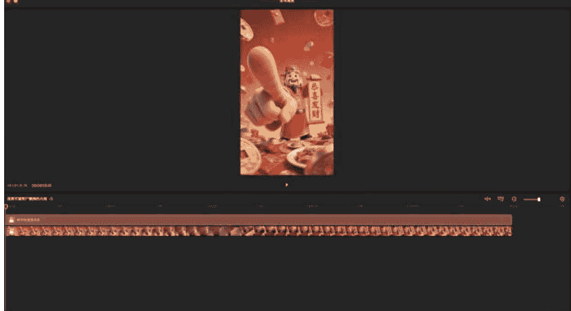

##### 图11-5 发布模板

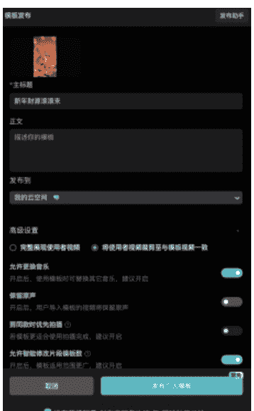

##### 图11-6 “模板发布”界面

批量技巧：制作完一个模板后复制，替换核心元素即可快速生成新版本，1天可产出10个以上优质模板。

### 2. 用AI整理素材包

- （1）确定规格：例如50张好物实拍图、20个视频片段、10首BGM、5个字幕模板。
- （2）AI辅助搜集：用豆包提示词“帮我找50张平价好物实拍图片，聚焦宝宝辅食工具，高清无水印，可商用”获取渠道。
- （3）整理素材：分类归档，统一分辨率，确认无水印可商用。
- （4）生成说明：用豆包写使用说明。
- （5）打包保存：压缩包便于上架。

### 3. 上架销售，实现稳定收入

推荐4个新手渠道，如表11-5所示。

##### 表11-5 四大销售渠道

| 渠道 | 核心操作 | 特点 |
| --- | --- | --- |
| 剪映模板中心 | 上传模板，定价1~5元，自动结算 | 无须运营，被动收益 |
| 闲鱼 | 发布商品，展示成品效果，设置自动发货 | 省心高效，流量稳定 |
| 小红书 | 发布笔记教程，引导私信加微信 | 曝光高，易出单 |
| 私域销售 | 推给老客户/粉丝，提升复购 | 信任度高，成交快 |

闲鱼示例标题：剪映AI新春探店模板 迎财神引流15秒 小店通用可替换
描述：适配本地小店老板、探店博主，含喜庆音乐、财神转场、引流字幕位，可替换门店素材/店名/地址。附赠探店文案3条+BGM5首。价格2元/个，买2送1，搭配素材包仅8元。

小红书示例：宝妈好物素材包｜50张高清图+20个视频可商用
正文：专为宝妈好物博主整理的可商用素材包，直接剪辑出片。含50张辅食工具高清图+20个使用视频+10首热门BGM+5个字幕模板。剪映通用，可商用无水印。赠爆款选题20条。价格9.9元，搭配模板15元。

### 11.3.3 提升销量技巧：7个方法让被动收入翻倍

（1）定价合理薄利多销。新手模板1~3元/个，素材包5~10元/个，后期根据口碑提价。
（2）标题吸睛贴合搜索。包含“剪映新春模板”“宝妈好物素材包”等核心词。
（3）做好预览，直观展示效果。
（4）及时回复咨询，10分钟内响应，打造好口碑。
（5）老客户福利，8折或买3送2提升复购。
（6）紧跟热点及时更新模板和素材包。
（7）搭配销售提升客单价，如模板+素材包组合套餐。

参考数据：热门模板月销100~500份，按2元计月入200~1000元；10个模板月入2000~10000元，搭配素材包收入可翻倍，且为被动收入。

### 11.3.4 避坑提醒：产品开发的3个红线

### 1. 素材侵权，得不偿失
必须使用无版权可商用素材。剪映“发布助手”可检测素材商用权限，如图11-7所示。不支持商用需点击“去复核”替换。

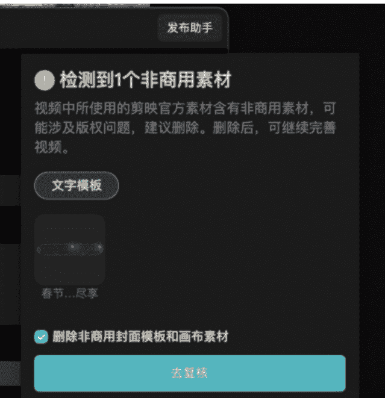

图11-7 发布助手

### 2. 模板太复杂，客户不会用
模板要简洁易懂，可替换元素清晰，并附使用说明，避免退款差评。

### 3. 一次性制作不更新
客户需求动态变化，需定期更新产品，否则销量和被动收入会递减。

## 11.4 培训与顾问：从技能输出到方法论赋能

熟练掌握剪映+豆包的AI剪辑，并在接单、内容、产品中积累案例后，可进阶到培训与顾问路径，靠输出技能和方法论赚钱，实现个人价值放大，月入从数千跃升至数万。

### 11.4.1 两种核心模式

建议优先从培训课程入手，门槛低易落地，后期扩展一对一顾问服务，单价更高。两种模式叠加可提升整体收入。

### 1. 培训课程：批量输出经验，实现规模化变现

把已掌握的智能剪片手法与获利路径整理成成体系的教学产品，面向想入门的新人出售，就能实现规模化赋能与规模化收益，无需反复单独带教，省时省力。

建议走接地气、易上手的路线，不做高难度课程。常见的培训形态如下。

##### 表11-6 三大培训课程类型

| 课程 | 价格 | 内容 | 适合人群 |

| :--- | :--- | :--- | :--- |

| 基础实操课 | 99～199元 | 剪映配合豆包的入门操作 | 零基础人群 |

| 盈利实操课 | 199～399元 | 智能剪片盈利实操 | 想盈利的人群 |

| 进阶提升课 | 399～999元 | 智能剪片进阶技巧+个人品牌打造 | 有基础、想增收的人群 |

（1）基础实操课（99～199元）：围绕剪映与豆包的基础操作展开，带零基础学员迅速上道，承诺3天入门智能剪片，最适合完全没接触过、想先试水的人。

（2）盈利实操课（199～399元）：聚焦智能剪片如何产生收益，讲解接单路径、内容创业思路和轻量产品打造，可结合自身实战案例讲解，适合希望靠剪片赚钱的新手。

（3）进阶提升课（399～999元）：讲解智能剪片的高阶手法与个人品牌搭建，包含如何提价、如何做账号矩阵盈利、如何塑造个人IP，适合已有基础、希望提升收入的学员。

### 2.顾问服务：单独赋能，实现高客单盈利

针对有具体需求的客户，如新手剪辑师、小店店主、自媒体博主，提供单独顾问，帮助其解决智能剪片与盈利过程中的实际问题，按次或按周收取顾问费，客单价与收益都更高。不同顾问形态的价格与服务范围如表11-7所示。

##### 表11-7 不同顾问类型的价格及服务内容

| 顾问类型 | 价格 | 服务内容 |

| :--- | :--- | :--- |

| 新手剪辑顾问 | 500～1000元/（人·周） | 单独AI剪辑教学 |

| 盈利顾问 | 1000～2000元/（人·周） | 定制盈利方案，助力首单盈利 |

| 商家剪辑顾问 | 1000～2000元/月 | 内容规划+剪辑优化+提升引流效果和盈利效率 |

（1）新手剪辑顾问[500～1000元/（人·周）]：单独指导新手学习智能剪片，帮助他们解决剪辑过程中的问题，督促他们练习，确保他们能学会。

（2）盈利顾问[1000～2000元/（人·周）]：为想靠智能剪片赚钱的新手制订盈利方案，比如如何接单、如何做账号，帮助他们解决盈利过程中的问题，直到他们实现首单盈利。

（3）商家剪辑顾问（1000～2000元/月）：为小店店主、自媒体博主提供长期的智能剪辑顾问服务，帮助他们规划短视频内容、优化剪辑效果，提升引流效果和盈利效率。

### 11.4.2 实操干货：快速打造培训产品+开展顾问服务

新手不需要具备专业培训经验、不需要学习复杂课程，按照下面的步骤就可实际操作。

#### 1. AI辅助打造实操课程

- （1）定主题。比如“3天学会智能剪片，新手也能日赚100元”，主题明确、有吸引力，直击新手的痛点。

- （2）出大纲。在豆包中发送提示词，比如“帮我整理一套智能剪片盈利实操课的大纲，针对零基础新手，聚焦剪映+豆包，包含基础剪辑、接单方法、避坑技巧，分3天，每天1小时，内容接地气、重实操”，豆包会快速生成大纲，如图11-8所示，你再根据自己的经验进行微调优化。

- （3）做录播。优先做录播课，因为省时省力，可反复销售。用手机拍摄，对着屏幕实操或讲解，比如“今天教大家用剪映的智能字幕功能一键生成字幕，全程只需3分钟”，讲解时注意用语通俗、步骤清晰，不过分追求专业，新手能听懂、能跟着做就行。

- （4）配资料。用豆包生成课程配套资料，比如剪辑步骤手册、接单话术、避坑清单，方便学员课后复习、落地执行，提升课程价值。

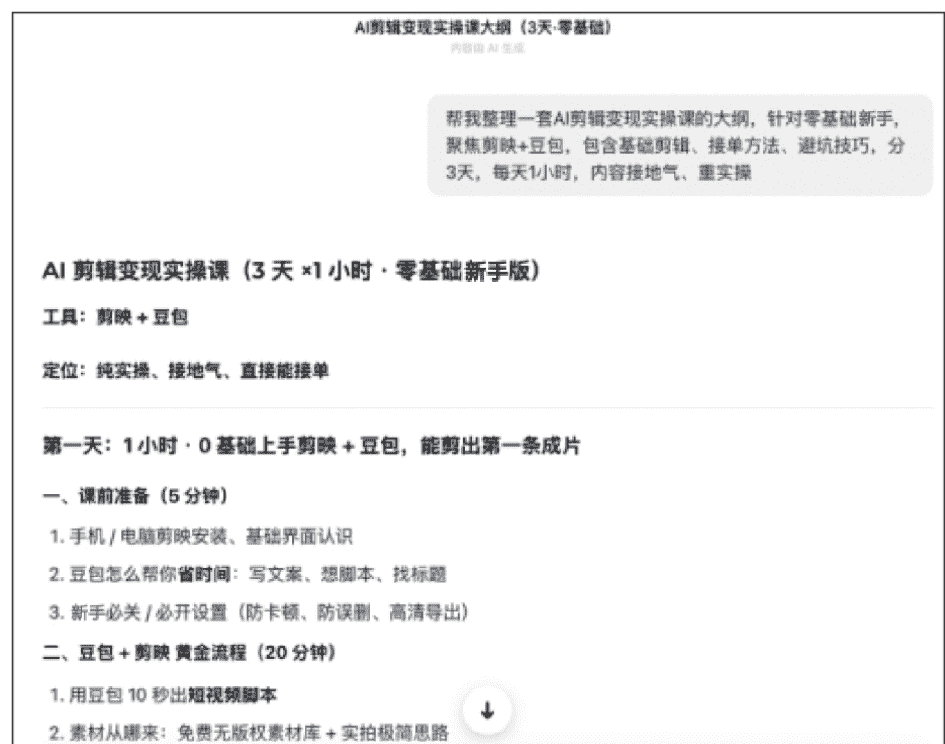

图11-8 使用豆包生成大纲

#### 2. 三个无费用推广渠道

课程制作完成后，重点是推广，以吸引客户购买。这里推荐3个无费用、易落地的推广渠道。

- （1）私域推广：把自己的课程推荐给之前合作过的老客户、进行内容创业的粉丝，在微信朋友圈、粉丝群分享自己的智能剪片盈利案例，比如“我靠智能剪片，从零基础做到月入3000元，现在把方法整理成了课程，新手也能学会”。此外，还可以附上课程大纲、试听链接，引导客户购买。

- （2）小红书/抖音推广：在小红书、抖音发布智能剪片实操干货、盈利案例、课程试听片段，起一个吸睛的标题，比如“新手必看｜3天学会智能剪片，日赚100元不是梦”，引导客户私信咨询，然后促成成交。

制作课程试听片段时可以使用以下核心技巧。时长控制在15～30秒，符合短视频观看习惯，快速抓住客户注意力；内容聚焦于某一个核心干货技巧，比如“30秒用豆包生成短视频脚本”或“剪映一键生成智能字幕”，让客户看到实际价值；讲解通俗、口语化，像在和朋友聊天，尽量少使用专业术语；结尾进行引导，试听片段最后加一句引导语，比如“如果想学更多智能剪片技巧，私信我获取完整课程”；画面要清晰，重点操作步骤可加圈注/箭头，让客户看清楚。

- （3）设置客户裂变激励：比如“老客户推荐1个新客户，双方各得50元优惠；推荐3个及以上新客户，老客户可免费获得进阶课程”，激励老客户主动推广，扩大课程影响力，吸引更多新客户。

#### 3. 高效开展顾问服务

顾问服务的核心是“解决客户问题、实现价值赋能”，不用花大量时间，可按表11-8高效开展顾问服务。

表11-8 顾问服务开展细则

| 要点 | 核心内容 |

|---|---|

| 明确服务和收费 | 提前写明服务内容、收费标准、服务周期，避免纠纷 |

| 高效沟通 | 微信单独沟通，固定时段回复，兼顾服务质量与时间管理 |

| 聚焦落地 | 帮客户落地执行：如新手接单，商家提升流量 |

| 积累案例 | 整理成功案例，用于吸引客户 |

## 11.5 团队赋能：为中小型企业提供智能代运营

中小型企业是短视频代运营的核心客户群体，尤其是本地实体店、小工厂、美容行业门店等，他们想通过短视频获客，但普遍缺乏剪辑人员，不懂工具使用技巧和内容创作方法。而你只需掌握剪映配合豆包的基础操作，就能搭建一套低成本、可复制、零基础也能落地的智能代运营流程。把个人的智能剪片技能变成2～3人的小团队生意，从副业轻松过渡到轻创业，全程不用租办公室、不用买专业设备，靠工具和标准化流程就能赚钱。

### 11.5.1 为什么中小型企业愿意为智能辅助运营付费

绝大多数中小型企业做短视频时都存在表11-9所示的3个痛点，而智能代运营能精准解决这些痛点，这是客户愿意付费的核心原因。

表11-9 中小型企业做短视频时存在的3个痛点

| 痛点 | 核心问题 | 智能 代运营的解决方式 |

| :--- | :--- | :--- |

| 没人会剪 | 无专业剪辑人员，员工拍的素材杂乱且不会用，自己学又没时间 | 用剪映 + 豆包，零基础新人也能剪，小团队就能承接服务，不用客户自己动手 |

| 效率太低 | 传统剪辑方式下，1人1天剪1～2条视频，跟不上短视频日更/隔日更的频率 | 智能批量剪辑，1人1天能剪50～100条视频，轻松满足客户的更新需求，成本低 |

| 没效果 | 不懂短视频爆款逻辑，剪的视频没流量，没人咨询，接不到订单 | 用豆包生成贴合行业需求的爆款脚本，用剪映做标准化模板，内容聚焦于“获客”，不做无用的技巧型剪辑 |

简单来说，中小型企业要的不是“剪得好看的视频”，而是“能带来咨询和订单的短视频”，智能代运营则能以低成本、高产出、高获客的优势满足这个需求。

### 11.5.2 智能代运营的核心：把剪辑变成流水线

智能代运营不是靠一个人硬剪，而是通过剪映+豆包的基础操作+标准化流程，让完全零基础的2～3人小团队也能服务10～20家企业，核心是“工具代替人工、流程代替经验”。以下是能直接落地的工具操作和交付流程。

#### 1. 用豆包做“文案+脚本生产线”

不用精通文案创作，只需按模板输入提示词，豆包就能快速生成适配相应行业的爆款脚本、口播文案、标题等。

通用提示词模板如下。

> 帮我生成10条[××行业]的短视频口播脚本，每条15～20秒，聚焦[产品/卖点]，口语化、接地气，适合抖音/视频号发布，开头有钩子，结尾有引导。

示例如下。

> 帮我生成10条[火锅餐饮]的短视频口播脚本，每条15～20秒，聚焦[98元双人餐、锅底免费]，口语化、接地气，适合抖音/视频号发布，开头有钩子，结尾有引导到店的话术。

生成脚本后，可继续输入“帮我为这10条脚本各配3个标题和封面文案”，豆包会快速生成可直接使用的标题和文案。

不同行业需使用不同的话术风格，如餐饮/美容行业偏口语化、福利导向，装修/工厂偏专业、案例导向。

#### 2. 用剪映做“批量剪辑工厂”

剪映的自动字幕、文本朗读、批量剪辑是零基础新人能直接使用的功能，不用学复杂的剪辑技巧，只需做好1个行业固定模板，后续所有视频直接套模板，1人1天能剪50～100条视频。

- （1）自动字幕。导入视频后，依次单击“文本”→“自动字幕”，剪映会自动识别语音并生成字幕。该功能还支持批量修改字体、颜色。
- （2）文本朗读。若客户无真人口播，依次单击“文本”→“文本朗读”，选择合适的音色，剪映会自动生成相应的语音，替代真人拍摄。
- （3）批量剪辑。在PC端剪映中单击“批量剪辑”，导入素材和豆包生成的脚本/字幕，然后套用模板即可；手机版可通过“剪同款”功能实现批量剪辑。

同时，还可以为每个行业做一个标准化模板，包含片头+字幕样式+转场效果+背景音乐+片尾联系方式，后续制作视频时直接替换素材即可。模板要求：简单、统一，不用复杂特效，重点突出产品/福利/门店信息。

#### 3. 流程化交付，稳定出片

搭建5步标准化交付流程，明确每一步的实操细节、时间节点、交付标准，确保团队服务不混乱，客户体验好。全程按流程走，不用靠经验。

- （1）每周标准化收集素材：每周一跟客户对接，明确素材要求，让客户用微信/百度网盘发送素材，统一命名，避免素材杂乱。
- （2）用豆包批量生成脚本：每周一当天，通过提示词模板生成本周的脚本，发送给客户确认，确认后再剪辑，避免返工。
- （3）在剪映中套模板进行批量剪辑：每周二、周三，按确认后的脚本进行批量剪辑，1人负责1个行业，确保风格统一，剪辑完成后统一保存至网盘。
- （4）审核、修改、交付：每周四发给客户审核，明确修改次数，修改完成后，将视频原文件和发布版一起交付给客户。
- （5）协助发布+简单数据反馈：每周五协助客户将视频发布至抖音/视频号/小红书，教客户添加本地定位、行业话题，每月底用剪映的“数据中心”或平台后台统计视频的播放量、完播率、咨询量，做成简单的表格发给客户，让客户看到效果。

### 11.5.3 3个适合新手的代运营套餐

给中小型企业的报价不用太复杂，设计3个阶梯式套餐，价格清晰、服务内容明确、标准化交付，不用做复杂的内容策划，重点聚焦“视频制作+基础发布”，阶梯式套餐标准如表11-10所示。

表11-10 阶梯式套餐标准

| 套餐类型 | 价格（元/月） | 核心服务 | 交付标准 | 适配客户 |

| :--- | :--- | :--- | :--- | :--- |

| 基础套餐 | 2000～5000 | 15～20条短视频+基础网盘交付+1次免费修改/周 | 1080P竖屏视频，每周5条，周四交付，无发布服务 | 本地小实体店、初创小微企业 |

| 进阶套餐 | 5000～12000 | 20～30条高质量视频+多平台发布+2次免费修改/周+月度数据报表 | 每周7～8条，每日交付1条，协助客户绑定账号发布，月底发数据表格 | 美容行业门店、装修公司、本地批发公司、小型加工厂 |

| 全案套餐 | 12000～20000 | 账号定位+月度内容规划+40～50条短视频+直播切片+多平台运营+3次免费修改/周+每周数据反馈+获客引导优化 | 每周10～12条，隔日交付，专人负责账号运营，每周发数据反馈 | 本地品牌店、连锁门店、招商型企业、中型工厂 |

前期为了吸引客户，可推出1个月的试运营套餐，价格为基础套餐的50%，明确试运营的服务内容和预期效果，试运营做出口碑和效果后，客户自然会有意愿续费长期套餐，避免前期因无案例导致客户不信任。

### 11.5.4 零基础起步：从个人到小团队的三步走

不用一开始就组建团队，先从个人单干开始，积累案例和客户后，再慢慢扩展为2～3人的小团队，全程低成本、低风险，每一步都有具体的操作方法，新手直接跟着做即可。

#### 1. 先做样板，免费帮1～2家本地门店做代运营

- （1）找客户的方法。从身边的本地门店入手，或在美团/大众点评搜索本地门店，直接到店找老板沟通，使用简单、直接的话术。
- （2）明确服务边界。免费服务不等于无底线服务，提前跟老板说清服务边界，如“免费代运营每月只做20条基础视频，免费修改3次，超出部分按50元/条收费”，避免浪费时间。
- （3）做出效果。按前文介绍的智能剪辑流程和交付标准，认真做好1个月的服务，确保视频有播放量、能带来少量咨询/到店客人，把服务过程中产生的资源、数据等整理成案例，这是后续接单的核心资本。

#### 2. 打包服务，制作宣传页，开始正式接单

- （1）制作宣传页：用剪映/美图秀秀制作简单的宣传页，内容包含你的案例、3个套餐的价格和服务内容、你的联系方式、售后保障，重点突出“智能批量剪辑、低成本、高产出、本地案例”。
- （2）接单渠道：线下渠道，可以继续找美团/大众点评的本地门店，带上宣传页和案例进行沟通；线上渠道，可以在小红书/抖音发布本地代运营案例，引导客户私信咨询；私域渠道，可以把案例发到微信群、朋友圈，让朋友推荐，积累口碑，提升转化率。

#### 3. 小团队扩量，2～3人分工，承接10～20个客户

当你有5～8个稳定客户后，可以开始搭建2～3人的小团队，不用租办公室，线上远程合作即可，分工清晰，每人负责一个环节，不用每个人都会所有技能，新手也能加入。团队构成及分工如表11-11所示。

表11-11 团队构成及分工

| 岗位 | 人数 | 核心工作 |

| :--- | :--- | :--- |

| 客户对接岗 | 1人 | 负责找客户、沟通需求、收集素材、交付视频、售后反馈，不用会剪辑，只需会沟通，按流程走即可 |

| 文案脚本岗 | 1人 | 负责用豆包的提示词模板生成脚本，发给客户确认，不用懂文案，只需会替换行业/产品信息 |

| 剪辑运营岗 | 1人 | 负责在剪映中套模板进行批量剪辑、协助发布视频、统计数据，只需掌握剪映的3个核心功能 |

同时也需要注意团队的沟通技巧。在微信中为每个客户单独建群，群内包含客户、客户对接岗人员、剪辑运营岗人员，所有沟通和文件发送都在群内进行，避免信息混乱；每周开1次10分钟的线上会议，同步客户情况和工作进度，确保团队高效运转。

### 11.5.5 必看：3条核心避坑铁律

做企业代运营最核心的是“明确规则、避免纠纷”，这里提供3条核心避坑铁律，每条都有能直接落地的方法，确保你不会被客户坑、不会因纠纷损失时间和金钱。

#### 1. 合同写清楚，所有细节白纸黑字，避免口头约定

不用找律师，用网上的通用服务合同模板即可，重点补充以下4个核心条款，打印出来让客户签字盖章，也可以签订电子合同。

- （1）交付数量、时间、方式：明确每月剪辑的视频数量、交付时间、交付方式。
- （2）修改次数：明确每月免费修改次数，超出按50元/条收费。
- （3）版权归属：明确“视频素材归客户所有，我方仅享有剪辑作品的著作权，客户可无限制使用视频进行商业宣传”。
- （4）数据指标：量化效果，如“视频平均播放量不低于500/条，若连续2周未达到，客户可申请退款50%”，避免客户以“没效果”为由拒付费用。

#### 2. 素材归客户，你只负责剪辑与运营，不盗用、不乱发

- （1）所有素材都让客户提供，并让客户确认“素材为企业合法所有，无版权问题”，避免因素材侵权导致你被投诉。
- （2）未经客户同意，不得将客户的视频发布到非约定平台，不得将客户的素材用于其他客户的剪辑，避免泄露客户信息。

#### 3. 用数据说话，每月给客户看真实数据，客户才愿意续费

- （1）数据统计工具：用抖音/视频号的后台、剪映的“数据中心”或简单的Excel表格统计核心数据，如播放量、完播率、点赞量、咨询量、到店量等。

- （2）效果可视化汇报：每月底把当月运营数据汇总成简易图表推送给甲方，标注“本月共上线××条短视频，平均播放××，产生××条咨询，到店××人”，并附代表作截图与用户回响，让成果直观可感，从而提高续约意愿。

中小本地商家的核心诉求是获客，不要围绕粉丝量、点赞量展开，而是聚焦咨询量、到店量、成交量，用真实的生意结果打动对方，这才是长期合作的基础。

# 第12章 搭建可持续的盈利体系

本章围绕科学报价、高效运营中台、甲方沟通与呈现、体系维护与进化、从剪辑执行者跃升为视觉导演这五大维度，帮你搭建一套可复制、可扩展的智能视频制作盈利体系，摆脱零散接单、辛苦赚小钱的困境。

## 12.1 科学定价策略：依托智能增效测算溢价与服务包价格

新手最常卡在报价上，报高丢单，报低累死不赚钱。定价的本质不是剪辑本身值多少，而是人工智能为甲方节省了多少成本、创造了多少价值。

手工制作与智能制作的差距，就是你敢开口的底气。以下用最直白的方式说明如何定出甲方愿意付、你也赚得过的价格。

### 12.1.1 先算效率账：定价底气所在

过去纯人工做一条短视频，从撰写文案到剪素材加字幕配音乐，至少要1小时。按兼职剪辑师市场价30～50元/条算，1天最多8条，上限400元，还很累。

借助剪映+豆包可节约30%～40%耗时：豆包快速产出文案脚本，剪映套模板批量生产，1小时可完成20条，日均可做到20～50条，智能制作效率是手工的20倍以上。

对甲方而言，以前找兼职做100条要花3000～5000元，且需等3～5天；用智能制作，100条只需2000～3000元，1天即可交付。你帮甲方省钱又省时，这才是定价的核心价值，在于高效、低成本、快交付，而非单纯“做得好看”。手工制作与智能制作的对比如表12-1所示。

表12-1 手动剪辑与AI剪辑的对比

| 对比维度 | 手动剪辑 | AI 剪辑 | AI 剪辑的核心优势 |
| :--- | :--- | :--- | :--- |
| 效率 | 1小时1条，1天最多8条 | 1小时20条，1天轻松160条（效率为手动剪辑20倍以上） | 高效、快交付 |
| 客户成本 | 3000～5000元/100条 | 2000～3000元/100条 | 帮客户省成本 |
| 交付周期 | 3～5天/批 | 1天/批 | 帮客户省时间 |

### 12.1.2 定价的两条核心原则

不必纠结复杂模型，记住两点即可避坑。

- （1）智能制作不等于低价内卷。别因为省时间就报10元/条的低价，这只会累死自己，还会拉低行业水位。你的价值在于高效、稳定与结果，而非廉价劳动力。
- （2）定价=成本+增效溢价+服务溢价。成本即你的时间，约占30%；增效溢价是为甲方省时省钱的部分，约占40%；服务溢价是交付速度、售后修改、增值服务，约占30%。

### 12.1.3 三档服务包的定价思路

无论是接单、代运营还是售模板，都可以用阶梯式服务包，低价引流、中档盈利、高档冲单，甲方好理解，你也好交付。三种包型详情如表12-2所示。

##### 表12-2 3种套餐类型的具体信息

| 套餐类型 | 核心定位 | 适用场景 | 定价参考 | 核心服务摘要 |
| :--- | :--- | :--- | :--- | :--- |
| 基础套餐 | 引流款 | 零散接单、新手练手、客户试错 | 800～2000元/月或15～30元/条 | AI文案+基础剪辑+1天交付+3次免费改稿 |
| 进阶套餐 | 利润款 | 长期接单、企业代运营、本地商家 | 3000～8000元/月或40～80元/条 | 脚本策划+精剪+多平台周更+5次免费改稿+数据反馈 |
| 高阶套餐 | 溢价款 | 品牌客户、全套方案、爆款定制、切片 | 10000+元/月或100～200元/条 | 账号定位+专属模板+高阶剪辑+直播切片+全套方案+无限次改稿 |

实际执行时可按单量与交付形式灵活调整。

- （1）批量阶梯优惠：鼓励甲方签量。例如50条以内按标准价，如30/80/200元；50～100条可享约9折；100条以上可降至20/60/150元，以量换价。
- （2）代运营打包：按月交付条数分级，如基础包30～50条/月，进阶包60～100条/月+多平台分发，高阶包100条+定制/切片/数据深度优化。
- （3）模板售卖：支持单模板与组合包。单模板1～100元不等；组合包更划算，如“10个基础款15元”“20个行业定制包200元”。

基础包负责获客，不求高利润；进阶包是营收主力，需平衡质量与利润；高阶包靠稀缺性与定制化实现高溢价，服务少数高价值甲方。

### 12.1.4 新手指价要避开的3点

新手报价时不要一口价，建议服务包+附加服务，例如加急交付加收20%，修改超次数每次加收10元；前期可试运营定价，如进阶包打8折试1个月，效果好再恢复原价；定价必须透明，写清每个包包含的服务、交付周期、修改次数，避免后续纠纷。

图12-1 新手定价避坑的3个关键点

## 12.2 高效运营工作台：把选题、素材、成片管理自动化

做一段时间后常发现：订单增多，素材堆成山，选题记不住，成片找不到。每天找文件的时间比剪辑还长。

高效运营的逻辑是用“懒”打败“忙”，把整理素材、记录选题、归档成片等重复工作交给工具自动化，你只需专注剪辑与接单。下面介绍一套用免费工具+简单流程搭建的管理台。

### 12.2.1 必备的三类免费工具

### 1.文档管理工具（如飞书文档/腾讯文档）

用于管理选题、脚本、甲方需求，相当于你的“大脑备忘录”，支持多人协同，甲方可直接在文档里提意见，不用反复微信沟通。飞书文档如图12-2所示。

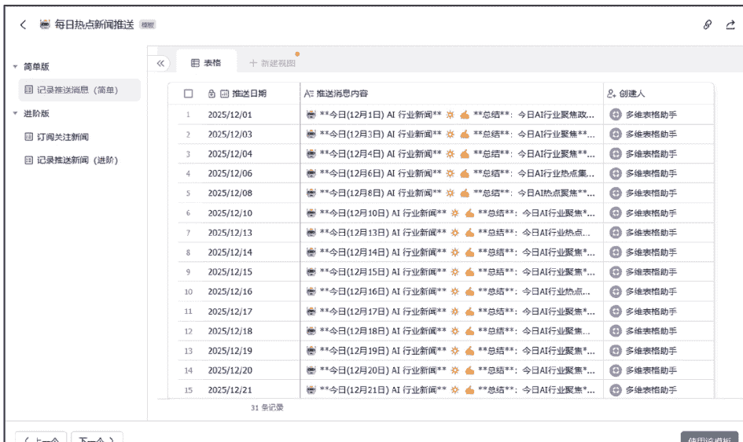

图12-2 飞书文档

### 2.云存储工具（如百度网盘/阿里云盘）

用于存放素材、成片、模板，相当于“数字仓库”。分类归档后，随时能快速调取。百度网盘如图12-3所示。

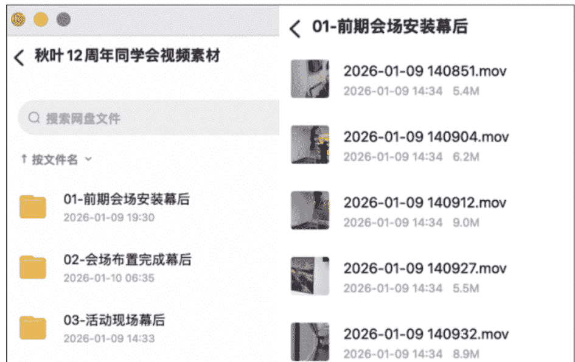

图12-3 百度网盘

### 3.剪映云空间

用于同步模板与草稿，相当于“剪辑工作台”，可在不同设备无缝继续同一视频，不用反复拷贝。剪映云空间如图12-4所示。

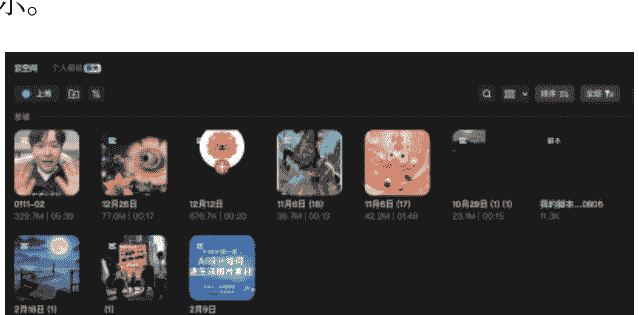

图12-4 剪映云空间

### 12.2.2 三个自动化流程

### 1.选题自动化管理

把豆包生成的选题、甲方需求匹配选题、同行爆款汇总归档，后续直接调用修改，不用重复想创意。选题库通用模板如表12-3所示。

表12-3 选题库通用模板

| 选题标题 | 行业 | 适配平台 | 脚本状态 | 使用情况 | 备注 |
|---|---|---|---|---|---|
| 新手零失败番茄炒蛋教程，30秒学会 | 餐饮-家常菜 | 抖音/视频号 | 已生成 | 未使用 | 适合上班人群，AI剪辑5分钟可完成1条 |
| 奶茶店新品引流小技巧，日销量翻一倍 | 餐饮-奶茶 | 小红书/抖音 | 未生成 | 未使用 | 适合做本地探店，需搭配门店实拍素材 |
| 工作日5分钟上手早餐，不用开火 | 职场-好物 | 视频号/小红书 | 已生成 | 已使用 | 可修改为不同的季节，重复利用 |
| 美容行业店9.9元体验卡引流方法 | 美容行业-美甲 | 抖音/本地生活 | 未生成 | 未使用 | 适合本地商家代运营，需加门店地址 |

实操步骤：

- （1）在腾讯文档/飞书文档新建选题库，规范表头。
- （2）每天花10分钟，让豆包按“××行业爆款选题10条”生成，筛选后复制入库。
- （3）接到订单后，按行业在库中挑选、微调即可使用。
- （4）已用选题标记“已使用”，后续可改细节复用。

### 2.素材自动化管理

给素材分类贴标签，避免混乱与查找耗时。

- （1）新建总文件夹命名为“AI剪辑素材库”，如图12-5所示。

图12-5 新建总文件夹并命名

- （2）在总文件夹下按行业建子文件夹，如“餐饮”“美容”“装修”“教培”，每个行业下再建“成品素材”“客户素材”“通用素材”三个子文件夹，如图12-6所示。

图12-6 新建行业子文件夹

- 客户素材：按“客户名称+日期”命名，如“××奶茶店-2026.02.20”，存放实拍、Logo、文案等，如图12-7所示。

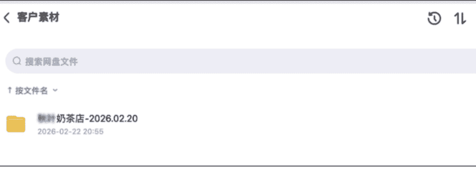

图12-7 “客户”素材文件夹

- 通用素材：存放免费背景音乐、字幕模板、转场特效等，便于复用。
- 成品素材：按“客户名+视频主题”命名，如“××奶茶店-新品推广-01”，方便交付与复盘。
- 关键技巧：给文件夹与文件打标签，如“餐饮”“奶茶”“新品”，后续按标签检索即可。

### 3.成片自动化交付

导出后自动同步到网盘，通过链接分享，避免反复发文件。

在剪映导出时勾选“成片自动备份至云空间”，如图12-8所示。

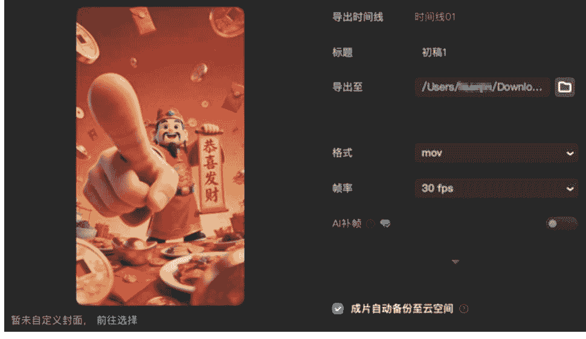

图12-8 勾选“成片自动备份至云空间”

剪映云空间同步到百度网盘的方法如下。

- （1）手机端：剪映导出后保存至相册，通过百度网盘App上传至对应文件夹。
- （2）电脑端：PC剪映导出后，直接拖拽或点击上传按钮传至百度网盘网页/客户端。

上传完成后，在客户的“成品素材”文件夹生成永久有效、无提取码的分享链接，发给客户并备注“成片已交付，修改意见请在腾讯文档需求表填写”，客户可随时自取。

### 12.2.3 运营小技巧

每天花10分钟做当日素材、成片、选题的日清日结；把常用剪映模板、豆包提示词统一存放在腾讯文档，方便调用；用日历标注交付与修改截止，提前规划，避免遗漏与延期。

## 12.3 客户沟通与展示：用AI协同工作流建立信任

技术不差、速度不慢，却留不住客户，核心是沟通与展示不到位。客户要的不仅是视频，更是放心、省心、有结果。通过AI协同工作流，让客户看到你的专业与高效。

### 12.3.1 沟通的核心是精准锁定需求

新手易踩的坑：客户说“要一条好看的视频”，就开剪，剪完被否，反复修改。为此可制作需求收集表让客户填写，减少口误。

##### 表12-4 AI视频剪辑需求收集表

| 需求项 | 客户填写内容 | 示例 |
| :--- | :--- | :--- |
| 视频核心目的 | 引流 / 卖产品 / 品牌宣传 / 记录 | 本地奶茶店新品引流，吸引同城观众到店 |
| 视频风格要求 | 简约 / 活泼 / 专业 / 接地气 + 参考视频 | 欢快活泼，参考视频“抖音 × × × 链接” |
| 必加元素 | Logo / 口号 / 地址 / 产品卖点 | 必加门店 Logo + 地址（× × 市 × × 路）+ 新品奶茶图 |
| 禁用元素 | 音乐 / 画面 / 文案 | 不要用悲伤的音乐，不要出现其他奶茶品牌 |
| 交付时间要求 | 具体日期 / 加急 | 2026 年 2 月 25 日前交付，无须加急 |
| 适配平台 | 抖音 / 视频号 / 小红书 / 其他平台 | 抖音 + 本地生活平台 |

### 12.3.2 AI协同工作流展示专业度

### 1.需求确认

客户填完表后，用豆包生成需求确认函，明确约定，避免纠纷。提示词模板：

请根据以下客户视频需求，生成一份正式的AI剪辑需求确认函，内容包括需求总结、交付时间、修改次数、套餐包含服务、付款方式，语言简洁正式，适合零基础剪辑师与客户沟通，无须复杂术语。

1. 客户需求：[复制客户填写的需求收集表内容]。
2. 套餐类型：[基础/进阶/高阶]。
3. 约定交付时间：[具体日期]。
4. 免费修改次数：[3次/5次/无限次]。
5. 付款方式：[预付50%，交付后付剩余50%/全款预付/月结]。

审核后发送客户确认，回复“确认”后再开工。

##### AI视频剪辑需求确认函

致：××奶茶店

您好，已收到您的视频剪辑需求，现做如下确认，若确认无误请回复“确认”，我将立即开始创作。

1. 需求总结：为××奶茶店制作同城新品引流视频，欢快活泼风格，必加门店Logo+地址+新品奶茶图，适配抖音+本地生活平台。
2. 套餐类型：进阶剪辑套餐。
3. 交付时间：2026.02.25前完成成片交付。
4. 服务包含：AI脚本策划+精剪+多平台适配+5次免费修改+简单数据反馈。
5. 免费修改次数：5次（超过次数每次加收10元）。
6. 付款方式：预付50%（400元），成片交付后付清尾款（400元）。

本确认函一经确认，双方按此执行，避免后续需求变更而产生纠纷。

确认人（客户）：

日期：

### 2.脚本共创

用豆包生成脚本后复制到腾讯文档的“脚本共创表”，分享给客户。客户可在文档内直接修改文案或镜头顺序，你能实时看到，减少来回沟通。

### 3.进度展示

剪辑中不必等完稿才展示。导出前10秒或关键镜头，通过百度网盘“进度展示”文件夹分享链接，客户可随时查看并提前反馈，避免大改。

### 4.成片交付与反馈

交付后用豆包生成反馈收集表，让客户填写，为复购埋点。

##### 表12-5 AI剪辑成片反馈收集表

| 反馈项 | 客户填写内容 | 示例 |
|---|---|---|
| 成片满意度 | 1～10分 | 9分 |
| 需修改的具体内容 | 镜头/字幕/配乐/卖点 | 字幕字体太小，需放大；背景音乐稍微调大 |
| 修改完成时间要求 | 具体时间 | 2026.2.26中午12点前 |
| 后续是否有新需求 | 是/否/暂不确定 | 是，下周需剪辑5条门店日常视频 |
| 其他建议 | 无/具体建议 | 希望后续视频能加同城热门话题标签 |

修改完成后交付最终成片，并提示“后续有新需求直接填需求表，我会优先安排”。

### 12.3.3 展示的两个关键点：让客户主动找你、愿意推荐你

用对照方式呈现交付效果是最直接的说服手段，不用做成厚重的案例集。把客户原始片段与最终成片并置，做成对照图或短视频，在画面上直接标注效率差别，比如传统手工处理约需一小时，借助智能流程五分钟内完成；源材料杂乱，成品干净有吸引力。以门店实拍为例，初稿往往是无字幕、无音乐、镜头跳跃，你的版本补齐了字幕、加入了契合的背景音、衔接流畅且把卖点凸显出来，客户立刻能体会到价值。

口碑最好做成可即时调取的视觉资料。将“剪得很快很满意，下次还会找你”“合作三个月了省下不少时间”这类原话截图保存，汇总到腾讯文档里。对接新客户时直接调阅，来自第三方的真实认可比自我介绍更有穿透力。

## 12.4 赚钱系统的维护与进化：风险规避、效能评估与迭代清单

本部分围绕系统运转讲清三件事：防风险避免亏损和纠纷、算效率明确赚了多少钱省了多少时间、做小迭代让系统越用越顺越赚越多。

### 12.4.1 风险规避：重点规避3个风险

智能剪辑变现门槛不高，若风控不到位，辛苦赚来的收益可能全赔回去。

### 1.版权风险最“致命”，必须重视
不要随意搬运网络资源。背景音乐只挑选剪映平台明确标注免费可商用的资源，图文素材优先采用豆包生成的原创内容或平台可商用的资源。客户提供的实拍、Logo、文案，也要在合同中写清版权归属与侵权责任，避免因客户素材侵权而牵连自身。

### 2.客户纠纷风险，尽量避免纠纷、赔钱
为防需求临时变动、反复修改、拖欠尾款，合作前先签一份简易电子合同。写清服务范围、交付节点、免费修改次数上限例如5次、付款方式例如预付50%。妥善留存微信沟通记录、需求确认单等资料。遇到恶意拖延或提出无理要求的客户，要敢于及时止损，把精力留给优质客户。

### 3.自身效能风险，避免“忙而不赚”
忙碌不代表有钱。每小时收入长期偏低通常是低价单和反复打磨的陷阱。建议每周复盘一次，果断剔除低质订单客户，聚焦单量稳定、利润可观的长期代运营客户。同时把脚本撰写、素材检索等重复环节标准化、模板化，用工具换时间，提升单产收益。

### 12.4.2 效能评估：用一份表格知道自己赚了多少、省了多少

无需复杂的财务模型，新建一份“效能评估表”放在腾讯文档或Excel里，每周填写一次，就能掌握赚钱效率并及时调整方向。

表12-6 效能评估表

| 本周接单量 | 本周总收入 | 本周总耗时 | 时薪 | 修改次数 | 复购客户数 |
| :--- | :--- | :--- | :--- | :--- | :--- |
| 进阶套餐2个+零散单30个 | 3900元 | 60小时 | 65元 | 平均每条/每个套餐2次 | 3个 |

表单共统计5项核心数据。本周接单量为代运营套餐与零散剪辑单之和，本周总收入是实际到账金额，时薪按总收入除以包含剪辑、沟通、整理素材在内的总工时计算，修改次数统计本周所有订单的平均修改次数，复购客户数为本周产生复购的老客户数量。

达标参考：时薪达到或超过50元说明定价与效率合格，低于50元需淘汰低价单并提升报价；平均修改次数不超过3次说明需求沟通到位，超过3次需优化需求收集流程；复购率达到或超过30%说明客户信任度高，低于30%要提升服务质量，复购率等于复购客户数除以总客户数。

上例中时薪65元、平均修改2次均达标，说明当前赚钱系统运行良好，可考虑拓展高阶套餐客户进一步增收。

### 12.4.3 迭代清单：每周10分钟，让你的赚钱系统越来越高效

迭代不是推倒重来，而是小步快调就能让系统更高效。

### 1.流程迭代
优化一个繁琐环节。例如每次生成脚本都重写豆包提示词，就把常用提示词保存下来下次直接复制使用；找素材耗时，就给素材打上分类标签提升检索速度。

### 2.工具迭代
每周学习一个新的人工智能功能。剪映与豆包持续更新，例如剪映的画面修复、豆包的Seedance 2.0，学会一个就落地到工作中，效率立刻提升。

### 3.服务迭代
增加一个小附加服务。例如交付成片时附赠一张用豆包生成的视频封面图，1分钟就能完成；对长期客户每月免费做一次简单数据复盘并给出优化建议。这些小动作成本不高，却能大幅提升好感度、复购率和溢价空间。

## 12.5 从剪辑师到视觉导演：掌握AI工具生态的进化路径

很多新手误以为做智能剪辑就是长期当“剪辑工”，每天重复机械劳动赚辛苦钱。实际上，智能剪辑只是起点。

当你能熟练使用剪映、豆包后，身份会发生质变：从只会执行指令的剪辑师进化为能把控整体视觉效果、为客户创造高价值的视觉导演。这不仅意味着收入可能翻10倍甚至20倍，更意味着从卖时间转向卖能力，甚至实现被动收入。

这条进化路径可分为四个阶段。

### 12.5.1 第一阶段：夯实基础，先做高效的“执行者”

核心任务是把“剪映+豆包”这两个工具用透。不必学一堆花哨技巧，死磕核心功能即可：剪映的批量剪辑、智能配音、自动字幕，结合豆包的脚本生成与文案优化能力，快速承接餐饮、美容、职场等基础行业需求。

过关标准是建立起标准化的接单、沟通、交付流程，每月稳定拿下5～10个零散单或2～3个长期客户，月收入达到3000～8000元，时薪稳定在50元以上。这一阶段切忌贪多求杂，先跑通流程最重要。

### 12.5.2 第二阶段：提升认知，转型成懂需求的“顾问”

别把自己做成“客户让剪什么就剪什么”的工具人。关键是从执行者变为建议者。

主动拆解抖音、视频号上的爆款作品，搞懂脚本逻辑、镜头语言和字幕规律并应用到自己的作品中。在接需求时给出专业判断，比如“把这个卖点放在开头更抓眼”“这种风格更适合引流”。

通过脚本策划、封面设计等增值服务，把单价从30元/条提升到60元/条以上，同时优化沟通把平均修改次数控制在3次以内。当客户为你的专业建议买单，而不只是为剪辑动作付费时，你就完成了顾问转型。

### 12.5.3 第三阶段：打造标签，成为细分领域的“专家”

想要溢价就不能做样样通。策略是做减法：选定1～2个熟悉且有市场的细分领域，如餐饮或美容，深耕下去。

形成极具辨识度的个人风格，让客户一看就知道“这是你剪的”。积累10～20个该领域的优质案例，整理成案例册或对比视频，在社交平台打造“××智能剪辑-专注餐饮短视频”之类的个人IP。

有了细分领域的信任标签，客户会主动找上门，你才有挑选客户和报高价的底气。

### 12.5.4 第四阶段：扩大规模，进阶成统筹全局的“导演”

这一阶段你将彻底告别纯剪辑师身份，变成团队管理者和全案策划人。

可以组建2～3人的小团队，制定标准手册涵盖流程、话术、交付标准，让成员分别负责脚本、剪辑、沟通，无需高薪也能保证质量。业务重心转向连锁餐饮、知名教培等高端客户，推出上万元的全案代运营套餐，内容包括账号定位、内容规划、营销策划及数据优化。

更进一步，把个人能力产品化，推出专属模板、人工智能工具包或新手培训课程。这样你不仅赚服务费，还能通过可复制的产品获得被动收入。

搭建赚钱系统的本质，是从零散接单走向长期盈利；从剪辑师到视觉导演的升级，是从靠时间赚钱转向靠能力、靠品牌赚钱。按节奏夯实基础、提升认知、打造特色、扩大规模，哪怕每天只进步一点，长期坚持就能用智能工具实现逆袭。记住，工具只是武器，你构建的赚钱系统和不断进化的专业能力，才是别人复制不了的核心竞争力。

扫描下方二维码，回复“赚钱”，即可领取

- 1. 新媒体实战提示词模板
- 2. 剪映快捷键（macOS-Windows）
- 3. 2026主流视频平台规格与最佳发布实战指南
- 4. 可商用字体包
- 5. 爆款视频模板
- 6. Seedance极速上手实操手册
- 7. AI剪辑变现指南

