# 剪映：短视频剪辑从入门到精通

# 作者简介

郭绍义 ，毕业于鲁迅美术学院视觉传达设计系装饰专业，获文学硕士学位。沈阳建筑大学设计艺术学院视觉传达设计系主任、副教授、硕士研究生导师，连续 6 年被沈阳建筑大学评为优秀教师。全国计算机设计大赛评比委员会专家，辽宁省视觉传达设计专业评估委员会委员，全国大学生广告艺术大赛辽宁分赛区组委会专家。2018 年创立晨曦印象视觉传达工作室，承揽影视拍摄、剪辑、策划、教育与科研等工作。

杜利明 ，江苏省宿迁学院人工智能系副教授中国计算机学会会员，辽宁省人工智能学会会员，沈阳建筑大学计算机科学与技术、软件工程、图书情报学科方向硕士研究生导师。主要从事机器学习、大数据分析与精准营销、图书情报分析与应用等教学工作，曾参与并完成国家自然科学基金、辽宁省自然科学基金、辽宁省教育厅基金等基金项目。发表论文 40 余篇，其中 SCI 检索 1 篇，EI 检索 20 余篇；参编教材及编著图书共 10 余部。

# 序

随着生活节奏的加快，人们的时间越来越碎片化。与此同时，随着生活水平的提高，人们在休闲娱乐活动中的快乐阈值也在不断提高，传统的娱乐形式无法在短时间内带给人们持续性的刺激，自媒体行业应运而生。其中，短视频运营由于具有入门门槛低、操作简单、投入产出比高、工作时间弹性大等众多优势，因而占据了自媒体领域的半壁江山。短视频运营无论被作为主业还是副业，都可以为用户提供财富自由的机会。

本书从抖音短视频的策划和制作入手，以实操图片搭配详尽的讲解文字，帮助读者快速掌握短视频拍摄、剪辑技巧，轻松应对短视频拍摄中常见的问题，帮助读者成为爆款短视频剪辑高手。

本书共分八章，从短视频运营变现到常用的拍摄技巧，从热门滤镜参数搭配到剪映创意剪辑实操案例，内容涵盖广，技法新颖实用。本书内容具体包括：短视频剪辑基础了解、运镜方法、15 种时尚调色方法、8 种音频创意玩法、关键帧及画中画综合应用实战等。

本书适合拍摄与剪辑短视频的初学者，特别是想要学习热门短视频制作，以及想要利用短视频热度提升自身知名度并获取收益的读者，同时也可以作为读者提升拍摄水平及修养的入门书籍。

最后，特别感谢巴图蒙赫、刘冯实、王锦涵、王亚贤、王凤英、朱怡品、吕芷萱、蒋文强、陈朝旭对本书创作和出版做出的贡献。

# 第一章
短视频剪辑基础了解及运营变现

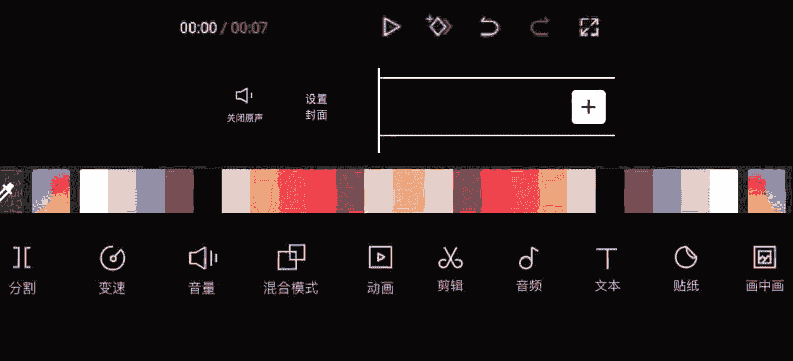

## 1.1 短视频创作的流程

无论是影视剪辑、好物推荐还是生活分享，短视频创作基本遵循一套统一的流程，如图 1-1 所示。不同风格或内容的短视频会在其中某几个环节进行强化或深入，但总体不会脱离这一套流程。

图 1-1 短视频的创作流程

### 1.1.1 确定选题

每次创作之前，都要先确定短视频内容的大致方向，这样不仅可以减少查找资料的工作量，还可以防止短视频的内容偏离主题。确定选题时可以将时下热点与自身内容进行强绑定，比如，时下的热点是“情侣公共场所同喝奶茶”，美食类视频创作者可将选题定为“最值得两人同喝的奶茶评测”；科普视频创作者可将选题定为“两个人同喝一杯奶茶后身体竟有这样的变化”；财经视频创作者可将选题定为“如何理财才能摆脱两人同喝一杯奶茶的局面”；情感类视频创作者可将选题定为“还记得那个和你喝一杯奶茶的人吗？”

### 1.1.2 查找资料

查找资料是极为重要的步骤，查找资料的质量直接影响后续的文案、配音内容等质量。举一个简单的例子，如果作为一个影视解说短视频创作者，连解说的视频素材的清晰度都无法保证，那么，即使文案再引人入胜，也很难吸引观众。

查找的资料包括制作视频时要用到的插图、视频等素材。科普短视频创作者在撰写文案时常需要查找一些文献或资料，选择资料时应注意资料的来源以及版权问题，以免在后续变现时与版权方发生纠纷。这里推荐几个视频图片素材网站供大家参考。

### 1.1.3 撰写文案

撰写文案，主要是将自己搜集、查找的文献、资料等消化整理后，根据自己的理解并结合短视频的创作特点进行原创。如果创作者在该领域的专业度不足，文案可能会出现错误或漏洞，影响短视频质量。即便如此，也不可投机取巧，将其他创作者的作品用于自己的短视频内容。比如，将其他创作者的文案进行同义改写（包括长句变短句、把字句变被字句等），调整语序或叙述方式，但内容总体上没有大的改变。这样的行为是严重的侵权行为，每一个短视频创作者都有责任和义务从自身做起，保护短视频行业的知识产权。

撰写文案时还要将文案的关键词放在短视频的开篇，直接引出爆点，例如“带你了解 21 世纪最伟大的生物学成就——基因工程”“你一定不知道的三个知识，关键时刻能救你的命”等等。因为短视频的收益是从视频播放 10 秒后开始算起，因此将关键词放在短视频的开篇处，有助于提高观看者在该短视频停留的时长。

### 1.1.4 开始配音

完成文案撰写工作后，下一步要进行的是配音工作。切记：配音要先于视频剪辑环节。因为文案是固定的，所以每段语音的长度也是固定的。若先进行视频剪辑，再对着剪辑后的视频进行配音，有可能导致声音与画面时长不匹配。因此，要先进行配音工作，这样才能使文案、配音、视频三者统一。

配音有以下两种途径。

① 真人配音： 真人配音具有真实性、自然性等优点，常被用于产品评测、美食探店、生活纪实等领域。真人配音要尽量做到吐字清晰、语速适中。如果创作者本人的配音能力有限，可以在网络平台寻找付费的配音服务。

② 机器配音： 机器配音是通过智能语音技术将文字转换成语音的一种方式。这种配音方式不仅效率高，还可以转换各种音色，而且输出的语音质量稳定，尤其适用于科普视频或影视解说等理性且工作量大的领域。另外，如今智能语音的发展已逐渐完善，即便是机器配音也可以演绎出一定的情绪感，不会让观众感觉“僵硬”。

配音结束后，我们要对录制好的音频进行处理。首先要检查是否有发音不准或读错字的情况，并去除一些诸如“嗯”“啊”“那个”等语气词，然后要检查是否有“炸麦”、声音忽大忽小等情况，最后要适当缩减语句之间的留白，以增加语句间的连贯性。一些科普视频给人十分紧凑的感觉，原因就在于这些视频创作者除了适当调快了语速外，还减少了语句之间的留白。

### 1.1.5 剪辑视频

剪辑视频时，要根据作品的类型选择相应的剪辑方法。熟练运用剪辑软件的各种功能是制作出吸引他人的高质量视频的必要条件之一。没有良好的剪辑习惯和剪辑方法，多么天马行空的想法也无法具化为完整的作品。

### 1.1.6 制作封面、标题

封面和标题是决定短视频观看者在面对海量的视频时能否停留、观看作品的最为重要的因素。因此，如何通过封面和标题对自己的视频进行有效“叫卖”是需要每一个创作者花费大量心思的。甚至在某种程度上，封面与标题的重要性要高于作品本身，因为即使作品再优秀，如果别人看不到也就失去了意义。

通常情况下，短视频封面应选用视频正片中的某一情景作为主体，再配以占据画面四分之一以上的文字标题。另外，如果是横版视频，为了填补屏幕上下的空白区域，需要用纯色背景进行填补。

### 1.1.7 发布上传

发布短视频时，为视频添加关键词标签，可以更好地与平台上的其他相关内容进行关联推送，也是一种巧妙借助流量推广机制来提高作品播放量的手段。

在作品的上传界面点击“#添加话题”选项，点选下方展示的热门话题，重复操作即可添加多个话题，完成后如图 1-2 所示。之后点击“高级设置”，勾选“高清发布”，如图 1-3 所示，这样可以保证作品发布后的画面质量。另外，还可以对下载、合拍、转发等权限加以设置。

图 1-2 添加话题

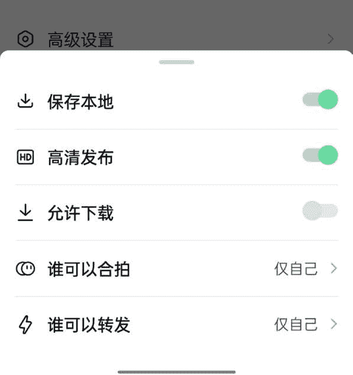

图 1-3 设置高清发布

## 1.2 如何打造爆款短视频

本节将为初入短视频领域的新人讲解如何打造爆款短视频。优质的内容是打造爆款短视频的前提，内容质量不过硬，即便拥有超强的运营技巧也是徒劳。

本节将介绍三种内容类型，能够让新手制作的短视频更大可能地受到用户的喜爱。这三种内容类型分别为对比创作、好奇心引导和三农。

### 1.2.1 对比创作

对比创作就是运用对比手法，在视频中呈现出一个或两个拍摄对象前后的变化，使短视频观看者受到强烈的心理或视觉冲击。这种方式在其他艺术形式中也十分常见，比如诗词歌赋中的动态与静态的对比，绘画作品中的冷暖对比（如图 1-4、图 1-5 所示），影视作品中的喧嚣与安静的对比等。因为事物间产生的强烈对比使其更容易被大脑记忆，所以，人往往会对突出的、反常的事物产生强烈的“兴趣”，而这种“兴趣”在现代社会中演变成一种“看热闹”的心理。因此，对比创作这种方式尤其适用于时长较短的短视频内容，它可以使短视频观看者在极短的时间内抓取到对其有吸引力的信息，进而增加观看者在该作品上的停留概率，便于创作者后续提升作品的各项参数。

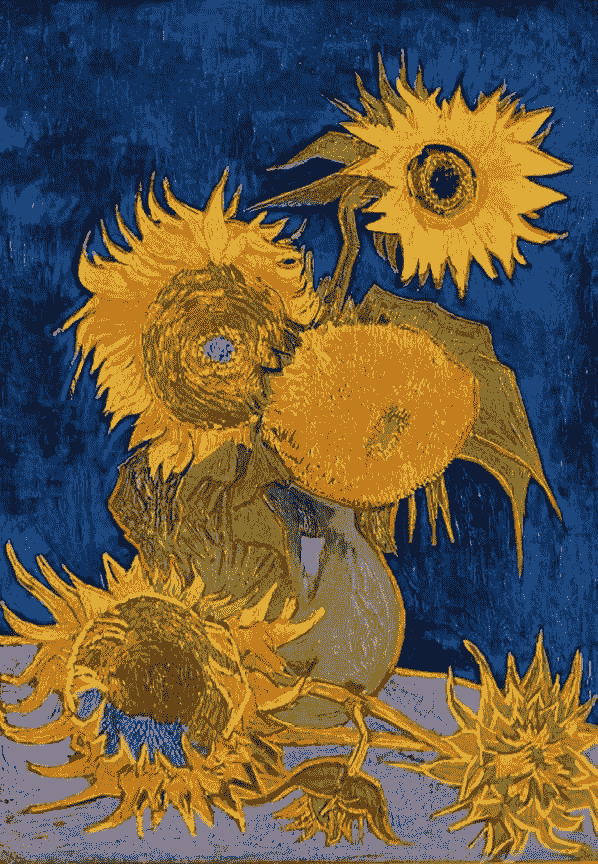

图 1-4 向日葵

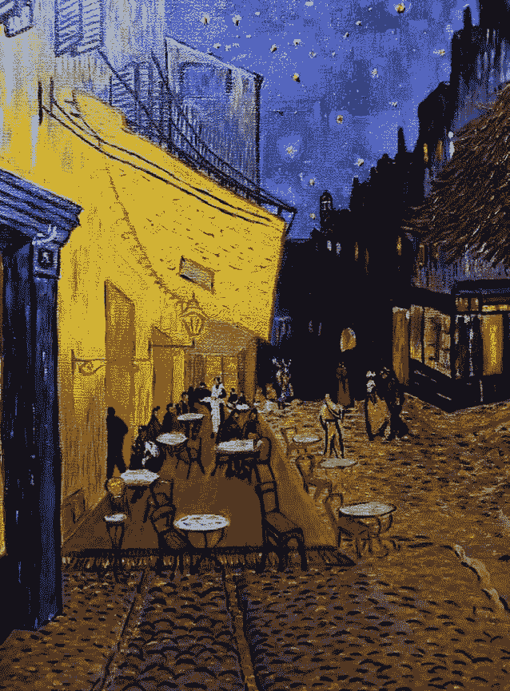

图 1-5 夜间咖啡馆

在短视频作品的创作中，对比创作的具体表现形式有许多种，比如变装视频、效果变化视频、打破刻板印象视频、剧情反转视频等。

变装视频往往是前半段中人物的衣着朴素、素颜出镜，配以合适的背景音乐，在适当的时间点利用突然的转场完成妆容、服饰、背景以及特效上的变化，给人以强烈的视觉刺激，如图 1-6、1-7 所示。

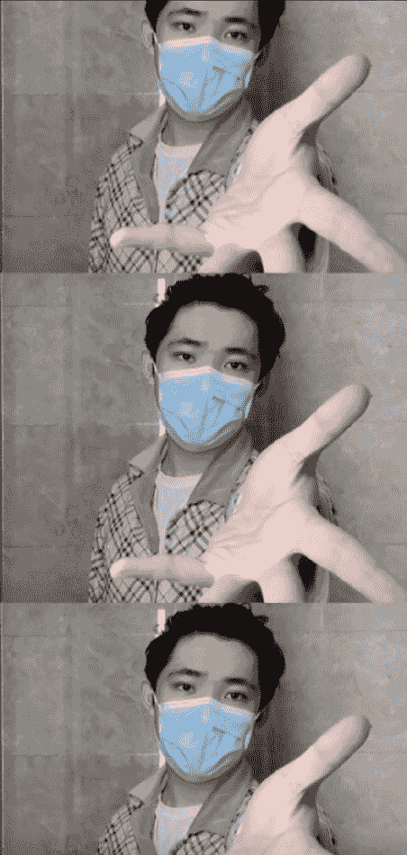

图 1-6 变装前

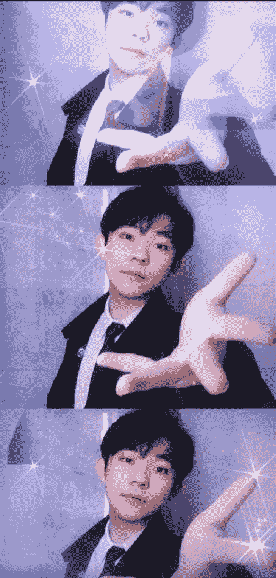

图 1-7 变装后

对比创作常用于产品推广类视频。例如一款声卡的介绍视频，通过使用者使用产品前不忍卒听的歌声与使用后宛如歌唱家般的歌声作对比，不需要过多的营销语言就能够向观看者直观展示产品的效果，强烈地刺激观看者的购买欲望。

打破刻板印象视频是通过打破观看者对某些特定情况或特定行业的刻板印象来吸引观看者的短视频表现形式。例如：平时兢兢业业执勤的保安大叔下班后脱下制服，坐上自己的豪车回家；平日外表光鲜亮丽的空姐回到家中，穿着围裙干琐碎的家务；在工作时沉稳、平和的医生在空闲之余练习街舞；作为理性代名词的程序员充满激情地弹钢琴（如图 1-8 所示）。这些展现某些行业的从业人员生活中鲜为人知的另一面的视频，不仅在一定程度上消除了观看者对他们的刻板印象，还使人物的形象更加生动和丰满，引起观看者情绪共鸣。

图 1-8 弹钢琴的程序员

相声技巧中有一个词语叫“三翻四抖”，意思是说经过前面的再三铺垫、衬托，对人物或故事进行渲染，营造出足够的气氛，然后将“包袱”抖开，产生笑料，这样的剧情反转也是一种典型的对比创作。在进行短视频创作时，我们也可以使用这种方式，但是不要刻意铺垫得太多，只需要来一个出乎意料的结果就可以达到吸引人的效果。

### 1.2.2 好奇心引导

在人类漫长的进化史中，好奇心是驱动人类进步的一大动力，它已经深深地刻印在人类的基因中。利用并调动观看者的好奇心是打造爆款短视频的重要手段。

比如某美食博主以拍摄印度的特色小吃而出名，这是因为异国的食物是大部分视频观看者日常接触不到的，自然会对其产生浓厚的好奇心。

制作这类视频要建立在不违背公序良俗和法律法规的基础之上，不可以为了吸引观看者的好奇心而制作低俗内容甚至做出违法行为。曾经有一个美食类视频创作者因食用国家二级保护动物，触碰法律红线而受到法律制裁，我们要引以为戒。

### 1.2.3 三农

“三农”指的是农业、农村和农民。2022 年，我国的农业人口约占总人口的 40%，因此从受众群体来说，三农类短视频受众有着极大的数量优势。在视频质量相同的情况下，观看者越多，作品爆火的概率越高。

三农类短视频的重点在于淳朴，不需要哗众取宠的内容，只需要呈现农村生活最为真实的一面就可以引起很多人的共鸣，毕竟对于大多数人来说，虽然现在居住在城市之中，但是对农村生活有着怀念或向往之情。

三农视频主要有两种：一种是以真实的农村生活为主，通过短视频还原农村的劳动、习俗等场景，比如图 1-9 所示的短视频呈现的是在农村下水摸鱼这一活动。另一种是将农村作为事情发生的背景，结合时下热点拍摄一些情景短剧。但短剧的内容不能脱离农村生活，否则很难获得观看者的认同。

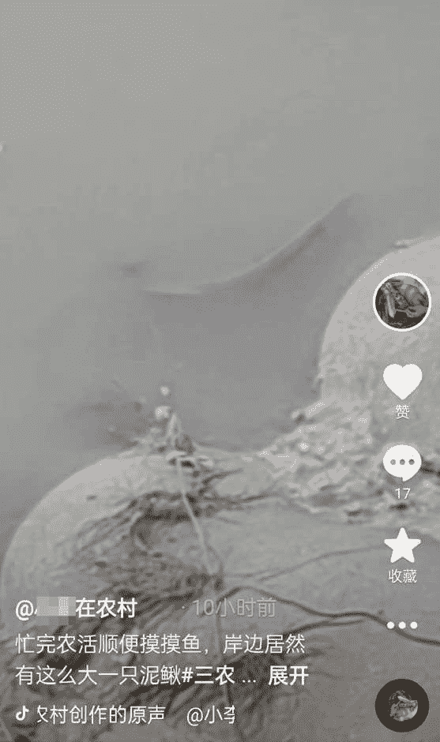

图 1-9 摸鱼视频

## 1.3 如何选择短视频封面

在各种短视频平台上，除了在主页中平台推荐的视频会自动播放外，通过搜索或查看收藏列表寻找的短视频展现出来的都是封面。因此，能有效吸引观看者的封面是短视频获得高播放量的重要因素。接下来将介绍几种常见的短视频封面形式，创作者在创作的过程中可以根据自己的视频内容精准地找到适合的封面形式。

### 1.3.1 预设悬念型封面

预设悬念型封面指的是在短视频的封面上只呈现所拍摄事件的一部分，同时该事件伴有走向某种结局的趋势。以图 1-10 为例，图中的文字“盘点上学时的那些生死瞬间”将观看者代入自己的回忆中，封面中展示的是一个学生在用手机打游戏，而老师就站在其身后的场景，让人很想看看这个老师会如何处理以及学生会作何反应。再例如图 1-11 中一个口香糖粘在桌子上，旁边放了一个完整的椰子，标题以疑问句“口香糖也能开椰子？”作为开头，在下面又点出“看到最后恍然大悟”，勾起观看者强烈的好奇心，想看看口香糖究竟如何开椰子，原理又是什么。

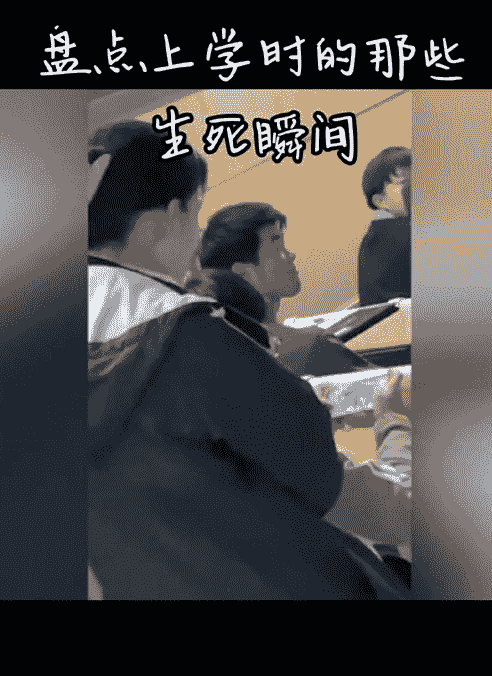

图 1-10 盘点上学时的那些生死瞬间

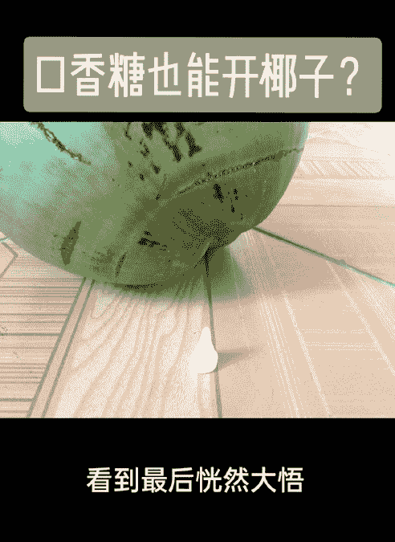

图 1-11 口香糖也能开椰子

通过上面两个示例，可以看出预设悬念型封面就是通过画面和文字的诱导，激发观看者的好奇心，使其想要迫切知道事情的结果是否与自己的预期相同。相同的话，会使观看者心里感到愉悦，觉得猜中结局的自己有“两把刷子”；不同的话，也会因为反差而让观看者为之一笑。无论是哪种结果，对该视频的创作者都有正面的作用。但也要注意视频的内容要与封面引导的走向相同，不能铺垫了很多，最后却无事发生或与趋势相反，这样就成了“封面党”。这样做的话，不仅会快速流失粉丝，还会被平台限制推送，为了短时间的播放量上涨而做“封面党”，可谓得不偿失。

### 1.3.2 效果展示型封面

效果展示型封面，我们可以理解为将某事物经过加工、美化、修饰、改造后呈现的最佳效果作为该短视频的封面。这种封面的重点在于直接将有冲击性或吸引性的内容在第一时间展示出来，让观看者眼前一亮。这类封面常用于美食、美妆、手工等领域的短视频，呈现最终的完美效果。如图 1-12 和图 1-13 所示。

需要注意的是，切记不可将半成品作为封面，更不能编造在视频中从头到尾都未出现的内容，即便观看者已成为粉丝，也会因创作者的欺骗行为而“脱粉”。

图 1-12 神奇小玩具

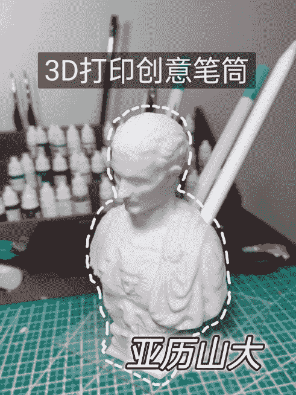

图 1-13 创意笔筒

### 1.3.3 猎奇型封面

猎奇型封面，顾名思义，就是通过现实中人们难以接触或见识到的一些新鲜事物来弥补认知空白。较为典型的是荒岛求生类和探险类短视频，如图 1-14 所示。这种封面可以将观看者带入特定的情境内，激起观看者发现并揭秘未知事物的好奇心理。

猎奇型封面内容也可以源于日常生活，例如“一次性放飞一千个气球是种什么体验”“1888 元的龙虾吃到撑是种什么体验”等。气球和龙虾都是日常生活中人们可以接触到的，但很少有人会去放飞一千个气球，也很少有人会吃龙虾吃到撑。由此可见，如果为寻常的事物加上一个巨大的数量级别，也可以快速产生一个猎奇型短视频封面。但要注意，猎奇型封面不能引起观看者心理上的不适，更不能使用含有恐怖、血腥元素的图片作为封面。

图 1-14 荒岛求生

### 1.3.4 高光时刻定格型封面

高光时刻定格型封面指的是定格短视频内容中最精彩的瞬间作为视频的封面。这个“精彩”一定是大多数人认可的，而不是创作者本人认可的、可望而不可即的一个画面场景。这类封面多用于体育、艺术类及变装类短视频等。以图 1-15 为例，这是一个舞蹈生的舞蹈展示视频，选择视频里最为舒展、最具美感的一帧作为封面，让观看者产生想点开视频欣赏的念头。高光时刻定格型封面要把视频中最为震撼、美丽的一个画面呈现出来，才能充分体现该视频的价值与优势。

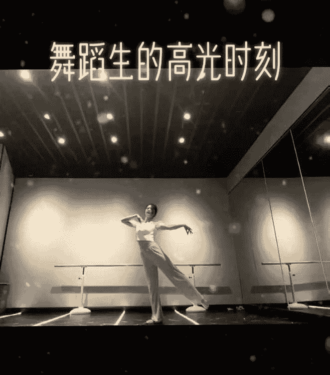

图 1-15 舞蹈生的高光时刻

## 1.4 如何编写标题

一个优秀的标题可以补充封面图未能传达的信息，能快速吸引观看者的注意力。

随着互联网与智能手机的普及，短视频内容越来越多样化。观看者每天面对大量推送的信息，会在有限时间里选择自己感兴趣的话题进行关注。因此，吸引人眼球的标题就显得格外重要。

要想编写具有爆款潜质的标题，就要从吸引能力和表达能力两个维度着手。吸引能力指的是短视频封面的标题要能够吸引观看者，使作品在众多同质化内容中被观看者点开浏览并停留。表达能力指的是将短视频的内容高度整合与凝练，让观看者仅通过标题就能快速获取创作者想要传达的信息，使观看者产生想要点开短视频观看的欲望。

### 1.4.1 数字式标题

数字式标题就是将短视频内容中重要的数据或内容以数字的形式呈现并整合进标题中。人们天生就对数字敏感，数字式标题正是利用这一点来达到快速吸引观看者注意的目的。数字式标题还可以有效地提高观看者阅读标题的效率。下面以两个数字式标题为例。

例一如图 1-16 所示。该短视频的封面标题是“一千块钱改造阳台 在家享受日光浴！”这个短视频传达的是如何用较少的钱来改造阳台。该标题将钱数限制在了一千元，就立刻产生了吸引力，让观看者想赶紧点开看看只需要一千块钱就可以改造阳台还能享受日光浴的方法到底是什么。该数字式标题也非常精准地区分了喜欢省钱与不喜欢省钱、喜欢日光浴和不喜欢日光浴的观看群体，可以让短视频被平台精准推送给目标人群。

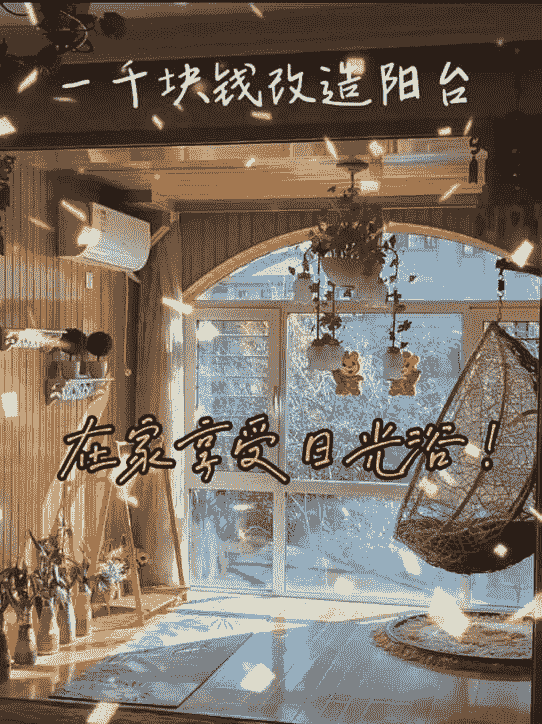

图 1-16 挑战一千块钱改造阳台

例二如图 1-17 所示。该短视频的封面标题是“这五本书 穷人从不看 富人偷偷看”，给观看者一种好像看了这五本书就能变有钱的错觉。姑且不讨论这五本书是否真的有富人偷偷看，单从标题来讲，它非常巧妙地吸引了喜欢阅读且渴望变得富有的人群。下方的文案“总是觉得自己抓不住机会，犹犹豫豫，患得患失，推荐这五本书”对标题进行补充，将目标人群的定位进一步缩小，让符合以上条件的视频观看者产生“这个视频就是为我量身定制的”的感觉，在一定程度上能够增加粉丝的黏性。

由以上两个例子可以看出，数字式标题具有快速吸引观看者注意力，将内容精准传递给观看者的优势。数字式标题往往适用于知识分享、美食教程等内容的短视频。

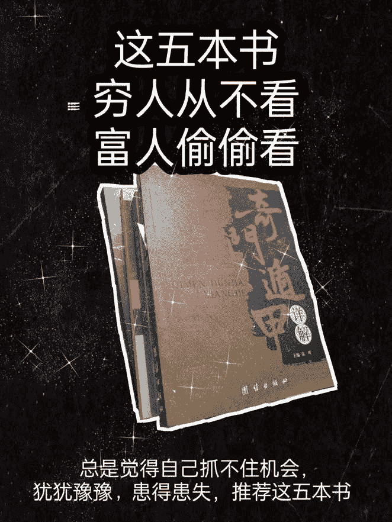

图 1-17 五本书推荐

### 1.4.2 代入式标题

代入式标题就是将观看者快速带入某一特定内容场景中，目的也是为了吸引用户关注短视频的内容。以图 1-18 为例，视频以第一视角拍摄的方法将观看者带入钓手的视角，喜欢钓鱼的人想在视频中找寻共鸣，没有尝试过钓鱼的人也会好奇钓鱼是一种什么体验，从而进行观看。

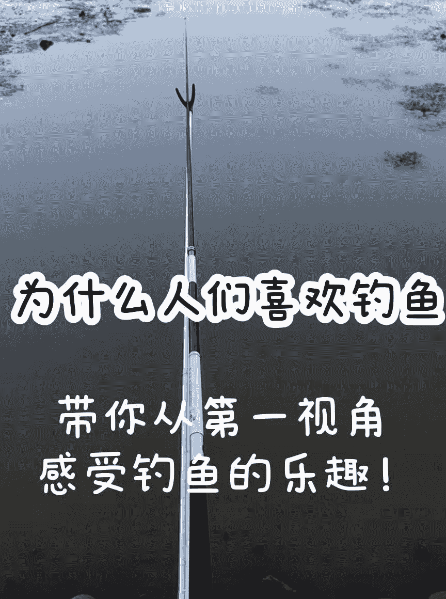

图 1-18 第一视角垂钓

### 1.4.3 恐惧式标题

恐惧式标题就是利用人们在日常生活中容易忽视的某些细节，通过强调忽视这些细节而产生的不良后果来提醒观看者进行观看的一种标题形式。恐惧式标题有很多，例如“这五种食物混搭，每种都有致癌风险”“显微镜下的过期食物，看完了你还敢吃吗？”等等，给观看者营造一种压力感与惊慌感，使观看者想尽快点开，了解其中所讲的内容。

在使用恐惧式标题时需注意一个问题：短视频的内容与用户的连接点是什么，可以带给用户什么样的价值？若采用的是恐惧式标题，但内容对于用户来说与自身利益无关，那么使用这样的标题就没有任何意义。

### 1.4.4 神秘式标题

神秘式标题利用人们对未知事物的好奇心，在短视频封面以文字的形式引出事物发生的前因，但是不提结果。中央电视台《走近科学》栏目的各期节目标题就是最好的例子，如“鱼塘里的金块”“麻烦的石头”“天价鸟之谜”等。这些标题都是利用事物与人们的正常认知相背离产生的神秘感，让人们迫切想要知道最后的结果，从而观看视频。

以上介绍了四种常用的标题类型，创作者可以根据自己的视频内容进行合理的选择，但无论选择哪种，都要明确：标题的目的是通过不同的方式吸引观看者观看我们的作品。因此，短视频的标题一定要与内容相呼应，不能做“标题党”。如果哗众取宠、博噱头或扭曲事实，不仅会严重影响自身短视频的流量和品牌形象，甚至会触及法律的底线。

## 1.5 账号如何获取关注

要想得到更多人的关注，就要提高观看者观看短视频的时长，以此来加强粉丝的黏性，拉近粉丝与短视频创作者之间的距离，提高变现转化率。当我们衡量一个短视频作品是否受欢迎时，除了点击率、点赞数、收藏量以外，还要衡量观看者观看一部短视频作品的时长，防止一些“标题党”通过虚假的封面或文案来骗取流量数据。

观看者停留在一部作品上的时间越长，忠诚度就越高，短视频的商业变现能力就越强。如果短视频中有广告投入或展示，忠实粉丝为创作者带来的收益要远远超过普通用户。因此，如何取得关注，如何获得粉丝，也是创作者要重点考虑的问题。

要想获取关注、收获粉丝，就要满足四个基本的要求：内容具有垂直性、稳定性、创新性与互动性。

### 1.5.1 内容的垂直性

内容的垂直性指的是作品的风格和内容要长时间保持一致。比如，如果做的是幽默风格的影视解说作品，就不要在作品中穿插硬核的影视解说作品或者美食分享作品。保持内容的垂直性，就是要一个账号只创作一种类型的作品，并力求将这类作品做到极致。这样做，对于观看者而言，当他们看到创作者保持不断输出垂直内容时，就会增加其作为粉丝的黏性；对于短视频创作者而言，这样做不仅帮观看者降低了选择的成本，也为自己的创作提高了容错率，因为对于大多数观众、粉丝而言，一旦习惯了某位短视频创作者的视频风格，便不会轻易因为其作品质量偶尔下滑就取消关注。如果作品没有垂直性，即使某个作品因为运气好而成了爆款视频，也很难将这个作品的优势辐射给其他作品。

### 1.5.2 内容的稳定性

内容的稳定性是指在创作短视频作品时要始终围绕一个风格、一种受众或一个人设对内容进行输出，不可为了获取短暂的流量而哗众取宠，否则不仅难以吸引新的粉丝，甚至可能会让原本的粉丝感到失望而脱粉。

例如专门分析武侠类影视的短视频创作者，就应该在作品中对武侠类影视中的武术招式进行详细的拆解与讲解，从而让观看者更加理解经典武侠影视的魅力，而不能将重点放在搞笑或剧情解读上。

图 1-19 是一位游戏类短视频创作者的主页，该作者的视频内容全部为展示某款游戏中的顶尖操作，获得了大量游戏粉丝的关注。从这个例子可以看出，无论是哪个领域，只有保持内容的稳定性，才能获得相应受众的青睐。

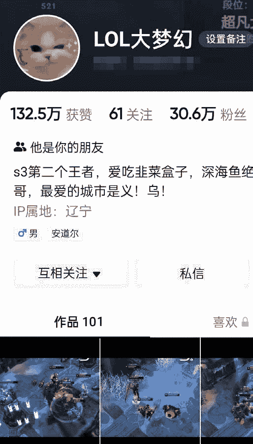

图 1-19

### 1.5.3 内容的创新性

在保证作品内容的垂直性与稳定性的基础上，还要保证作品有一定的创新性。

上述武侠影视解说视频可以通过剪辑不同的影视作品带给观看者新鲜感，游戏操作视频也由于游戏战场上的瞬息万变而变得惊喜不断，这些靠素材本身就可以不断产出新鲜内容的视频天生自带创新属性。但还有一些视频，内容较为单一，比如带货视频。某带货视频创作者通过短视频贩卖各式各样的雨具。他的视频以干练、纯粹的产品功能演示为主，曾受到许多人的关注，甚至平台还因为他的视频而推出了“没有一个动作是多余的”这样一个视频标签，作品的垂直性与稳定性也保持得很好。但最近一些作品的点赞量却大幅下滑，原因就在于缺乏创新性。因此，内容保持持续的创新性，是作品获得用户关注与认可所必不可少的条件。

### 1.5.4 内容的互动性

创作者要与自己账号内容的观看者、粉丝保持互动，并根据这些忠实用户的反馈，调整自己的创作思路，改进不足，从而获得更多精准目标受众的认同。而对于观看者、粉丝来讲，通过与创作者的互动，他们会觉得受到了重视，这种感觉会拉近创作者与观看者之间的距离，慢慢地会增强粉丝的黏性，增加观看者在短视频上的停留时长。互动的方式有很多种，包括回复观看者在视频下的评论（如图 1-20 所示）、在私信中回答对方的困惑、征求对方对作品的意见等。

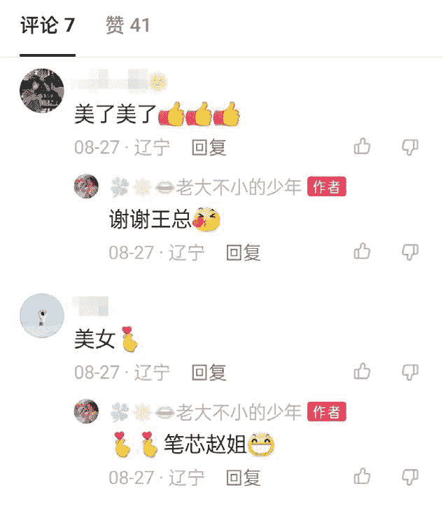

图 1-20 创作者回复观看者的评论

## 1.6 如何引导用户评论

短视频创作者可以通过积极地与观看者、粉丝进行互动来使自己的账号、作品获得更多关注。但与观看者互动的前提必须是有大量的观看者在主观意愿上愿意与创作者进行互动，而在短视频作品下进行评论是门槛最低且最为直观的互动方式。因此，本节将介绍几种引导方法来增加用户的评论量。

##### ● 倾诉型引导方法

倾诉型引导方法是指创作者在创作短视频作品时，将观看者当作倾诉对象或是将作品中的某个人物进行剧情上的设置，采用提问或询问的方式将观看者带入创作者预设的情境之中，由此引导观看者针对该情境下发生的问题发表自己的看法。该引导方法常用于对社会新闻的报道。比如，某地一位父亲因为孩子不愿意学习，便带着孩子去工地进行劳动。结束报道后，在结尾处抛出疑问：“如果你是这个孩子的父亲，你会怎么做呢？”以提问的方式引导观看者进行留言或评论。

##### ● 争议型引导方法

争议型引导方法是指将作品的内容围绕具有争议性的话题展开，但这种话题往往没有绝对的对与错。比如：“是否应该鼓励大学生在读书期间从事兼职活动”“外卖超时是否一定要给差评”等这种由于每个人的生长环境不同而导致出现认知分歧的话题，或是因地域文化不同而产生的不同习惯，如“豆腐脑是甜的好吃还是咸的好吃”“粽子是要肉馅还是枣泥馅”这种经典问题，通过抛出话题引导持不同观点的观看者进行自发讨论。

##### ● “引战”型引导方法

该方法与争议型引导方法相似，区别在于使用“引战”型引导方法时，创作者在视频中直接表达某一观点，例如在作品中抛出“豆腐脑还是甜的好吃”这样一种观点，引导持相反意见的人群进行评论，与此同时，与自己观点相同的人便会自然地加入讨论。但使用这种方法时一定要注意表达的方式和语气，否则会导致持相反意见的人群产生心理上的不适，结果，适得其反。

## 1.7 短视频的变现模式

### 1.7.1 平台补贴变现

平台补贴变现，通俗地讲就是平台自掏腰包，根据创作者创作的短视频的播放量、点赞量等进行金钱上的回馈，从而激发创作者的创作热情，也叫创作激励。

短视频本质上属于一种商品；创作者属于商贩，在平台上兜售自己的商品；平台属于提供给商贩摊位的“商场”。但创作者与平台的关系与现实中商贩与商场之间的关系不同，创作者不需要向平台缴纳“摊位”的“租金”，平台反而会给创作者一定的经济补贴，这也就是短视频入门门槛低的原因之一，创作者不需要大量的启动资金，同时也不必过于担心因经营不善所造成的损失。平台补贴给创作者的钱多数来源于其优质内容吸引的广告商的广告投放费用，这也是流量时代最基本的盈利方式，各种 APP（应用软件）的开屏广告就是最好的例子。短视频创作者生产优质视频，广告商看重短视频平台的流量，短视频平台给予创作者经济回馈，三者结合在一起，形成一种良性循环，其关系如图 1-21 所示。

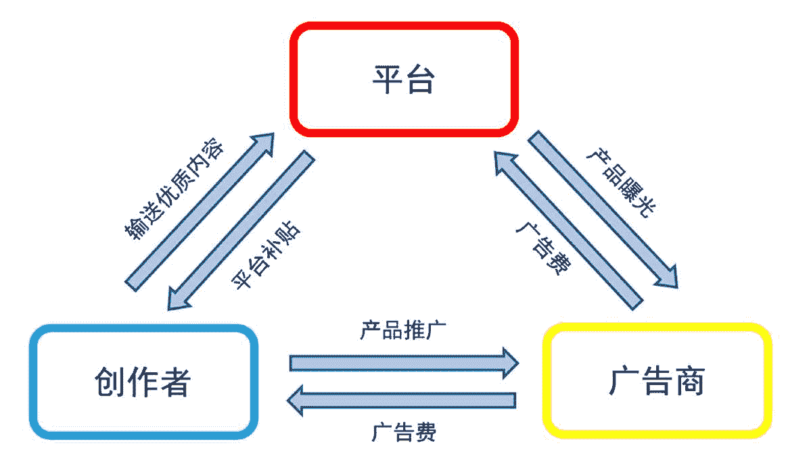

图 1-21 创作者、平台、广告商关系图

### 1.7.2 广告变现

广告变现是创作者直接与品牌方进行合作，使观看者在短视频中可看到品牌的广告，从而使短视频创作者获得收入的一种方式，也是大部分短视频创作者获得收益的主要方式。广告变现往往收益较高，收益量与创作者的粉丝数量、短视频的播放数据等密切相关。广告变现主要有两种形式：广告植入与广告话题分成。

##### ● 广告植入

广告植入是指在视频中融入品牌的相关信息，或对品牌进行推荐并讲解，达到宣传品牌的目的。广告植入会在一定程度上削弱视频的观感，因此植入的方式及质量会影响账号之后的发展。同时，植入广告的视频的各项数据，包括播放量、点赞数、收藏数等也会影响下次接广告时品牌方的报价。可以说，在视频中植入广告的方式对视频创作者的创作水平有很高的要求，是一种高风险、高回报的方式。

为了避免视频质量下降，创作者通常会选择和自己视频风格与内容关联性较强的产品进行植入，例如游戏视频创作者选择电子产品，美妆视频创作者选择化妆产品，宠物视频创作者选择宠物用品，等等。创作者还可以通过评测、探店、开箱等方法隐晦地植入广告，如图 1-22 所示即为直接推荐加评测相结合的品牌植入。图 1-23 所示为该创作者的视频主页，可以看出该创作者专门做各种饮品评测与推荐，因此选择冲调饮料进行广告植入既符合视频的定位，又不会改变其视频风格。

图 1-22 冲调饮料的植入

图 1-23 创作者主页

##### ● 广告话题分成

广告话题分成是短视频创作者通过参加各个品牌方在短视频平台上发布的任务来赢取现金奖励或其他回报的变现方式。

以抖音平台为例，如图 1-24 所示，在抖音主界面上方的搜索栏中搜索“全民任务”，点击列表中的“全民任务”选项，进入全民任务界面，如图 1-25 所示。每一个任务会介绍创作者获得收益的方式，包括观看直播、拍摄视频、参与互动等。作为内容创作者，拍摄符合要求的相关视频是首选方案，同时也是收益相对较多的方案。点击图 1-25 中的“拍摄任务”选项即可筛选出仅通过拍摄视频即可获得分成的任务。

图 1-24 搜索“全民任务”

图 1-25 “全民任务”界面

部分任务会有示例视频，创作者拍摄时参考该视频的创作方式和创作风格，更容易获得流量扶持以及更多的奖励金额。部分任务存在可选项，在完成必选要求后，若能完成可选项可能会有额外的奖励。每个视频拍摄任务一天只可参加一次，容错率较低，因此要珍惜机会，尽量拿出高质量的拍摄作品。

上传视频后，该视频不会被马上发布，平台方会对视频进行审核。若审核失败，创作者则需要根据平台下发的反馈原因对视频内容进行调整，再重新上传。

任务视频的收益会根据真实播放量、评论数量、收藏数量、内容质量等指标进行综合计算，因此不能一味地追求播放量，还要综合考虑互动性等因素。

### 1.7.3 线下店变现

如果说广告植入是所有短视频创作者都可以选择的变现模式，那么线下店变现则专属于拥有线下实体店的创作者。创作者通过制作有自家产品的视频来吸引观看者去其线下门店购买商品，从而增加盈利。如图 1-26 所示为一西餐厅店主的短视频主页，通过短视频向观看者呈现了自家的菜品，降低了观众对未知产品的抵触情绪，有利于产品的销售；并且在主页的简介中插入了店铺地址，方便观看者前往寻找。

图 1-26 西餐厅店主的短视频主页

线下店变现的优点在于可以降低产品的宣传成本，且对于新产品的宣传有很好的即时性，这一优势是传统的宣传方式所不具备的。但此变现方式的缺点也很明显，由于短视频的主要内容为介绍产品，作品的娱乐性较低，因此很难产生足够的吸引力。要想解决这个问题，一是要着重于精美、细致的拍摄手法；二是要尽量与时下热点进行绑定；三是要形成自己独特的品牌风格。其中，独特的品牌风格更是重中之重。

### 1.7.4 其他平台导流变现

在刷短视频的时候，我们经常会看到一些视频中出现“点击下方评论区链接即可参与活动”或“点击我的头像，添加主页联系方式”等内容。这就是作者利用短视频平台的优势，通过嵌入外部链接，将获得的流量以及曝光度导流至其他更好变现的平台。常见的导流平台有微信公众号、淘宝、美团等。不同平台之间相互导流也是短视频创作者不可忽视的重要运营方式，不仅可以将利益最大化，还有利于构建独有的风格和体系。

# 第二章
拍摄工具的选择

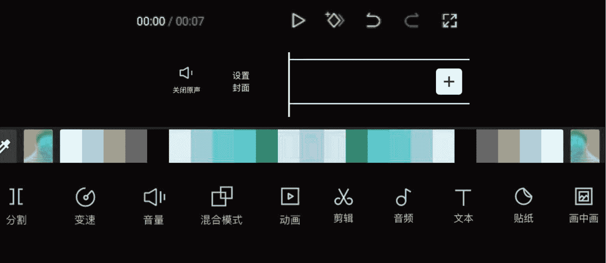

## 2.1 选择合适的拍摄设备

高质量的视频作品通常需要借助一些专业器材来完成，拍摄设备往往决定了最终成片的质量如何。另外，面对多样的拍摄环境，也需要用到不同的拍摄设备。

短视频创作是一条需要多练习、多尝试才能不断进步的道路。随着自身拍摄水平的提高，我们可以选择更专业的拍摄工具，但要知道：只有得心应手的才是最好的。

## 2.2 苹果手机拍摄功能介绍

手机作为拍摄设备有很多优点：操作简单，容易上手，而且体积小，方便携带。我们在拍摄时，利用手机相机自带的网格辅助线调整画面结构，也可以拍摄出不错的视频。但是手机拍摄的画面不如单反相机拍摄的效果好，如果拍摄微电影风格的视频，手机只能望而却步。

下面介绍用苹果手机拍摄短视频时的一些方法和技巧。

### 2.2.1 拍摄慢动作视频

慢动作视频就是将拍摄的视频以慢放的感觉来呈现。这种视频可以显现我们肉眼难以观察到的细微景象，比如：滂沱大雨时，水滴落在地面上的瞬间；篮球比赛时，运动员扣篮动作的细微变化。

下面介绍慢动作视频的拍摄方法。

##### ●选择慢动作模式

打开手机相机，滑动拍摄界面，选择“慢动作”模式，点击红色按钮即可进行拍摄，再次点击则可以结束录制。

##### ●选择慢动作帧率

手机相机的慢动作拍摄模式内置两种选择（Pro 版本除外），分别是 120fps 及 240fps（如图 2-1 所示），意思是 1 秒可拍摄 120 帧画面或 240 帧画面（240 帧要慢于 120 帧）。120 帧适合拍摄人物表情、活动表演等；240 帧则适合拍摄运动得更快的物体，如雨滴、奔跑的人物等。慢动作帧率可以在“设置—相机—录制慢动作视频”中选择；也可以打开相机，滑动至“慢动作”模式，在手机右上角直接修改。

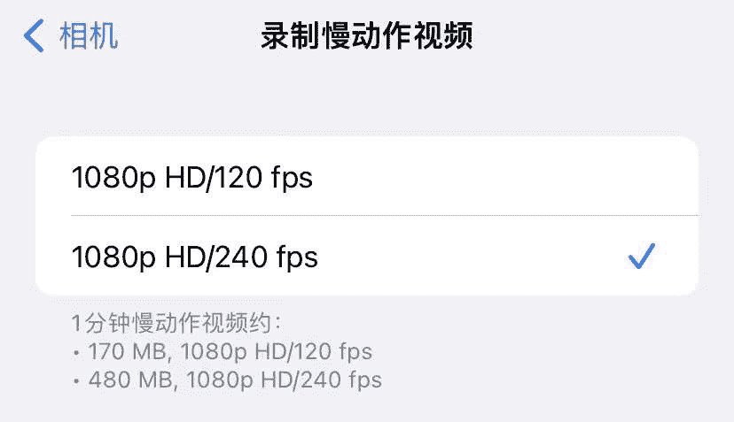

图 2-1 帧数选择

### 2.2.2 延时摄影

延时摄影就是压缩时间帧，将每 6 秒的拍摄内容压缩至 1 秒播放（拍摄的视频时长是 6 秒，但手机上只用 1 秒就播完了）。延时摄影常用来拍摄反映时间如流水、岁月如梭等感觉。比如，我们把手机固定后对准马路拍摄一个小时的视频，拍完后回看，会发现几分钟就播完了。

要想拍摄出快速移动的云、车流、盛开的花朵等，就需要用到延时摄影功能。我们打开相机，向右滑动界面即可切换为延时摄影模式，如图 2-2 所示，轻点录制按钮即可开始录制（延时摄影红按钮的圈每转 1 圈就是 1 秒，所以它通过持续的录制拍出快速的画面）。我们可以选择一个合适的固定机位，尽量选择一处背景干净，避免逆光拍摄的地点。拍摄前我们可以提前定好脚本，做到一气呵成最好。此外，延时摄影对内存要求较高，我们可以提前清理手机的内存，为摄像留出空间。延时摄影要求拍摄稳定，对此我们可以使用三脚架或将手机放置于平稳处使其保持静止。要提前查看手机电量情况，如果电量不足可以将手机接入电源或提前充电，以防止录制时手机突然没电。

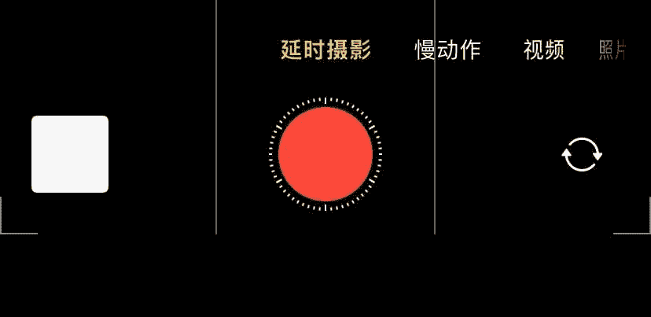

图 2-2 延时摄影界面

## 2.3 安卓手机拍摄功能介绍

摄像功能的不断提升一直是安卓手机的特点，安卓手机在拍摄方面，对每种拍摄功能都有所兼顾，并在吸收多数优点之上进行创新。

##### ● 特点一：自带修图功能

安卓手机的原生相机，提供了方便好用的色彩调整方案，可以满足绝大多数普通手机用户的要求。安卓手机拍摄功能的优点在于自带修图功能，没有过度美颜，这就省去了后续利用剪辑软件修饰的时间，使视频拍摄者的工作效率大大提升。原生相机的滤镜往往是精挑细选出来的，厂商通常还会起一些特别好听的名字，比如“西柚”“马卡龙”“海岛”等，使用时可以直接套用，只需要根据自己的要求调节强度即可。我们可以在拍摄模式中选择自己喜欢的风格，其中的滤镜、美颜选项能够满足绝大多数场景的拍摄需求。

##### ● 特点二：可以模拟单反相机，打造超广角效果

有些安卓手机搭配大底主摄像头，拍摄夜景十分清晰，此外还具有变焦功能。有些安卓手机的相机有专业模式，能模拟单反相机的参数效果，如感光度、快门速度等，如图 2-3 所示。调节为专业模式后，我们可以模拟单反相机的参数，再搭配超广角镜头，拍摄某些场景时效果十分出众。

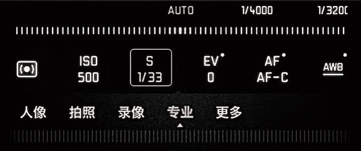

图 2-3 安卓手机的专业模式

##### ● 特点三：视频优化和超级防抖

这里所说的视频优化多指相机功能中的趣味玩法。手机有许多型号的图像传感器，手机厂商尽可能将传感器成像调到最佳状态，无论是专业模式还是防抖功能，使用手机原生相机和第三方编辑软件，可以获得理想、稳定的画面和有趣的玩法。

## 2.4 单反相机拍摄功能介绍

单反相机具有更高清的画质，搭配高速、大容量存储卡可以录制很多长视频，这是手机相机无法相比的。此外，单反相机可以选择很多镜头，如人像、静物等都有专门的镜头可供使用。但是单反相机的价格高、体积大，而且拍摄视频时往往需要搭配三脚架等才能更好地拍摄。另外，单反相机中有很多模式，需要提前了解一些专业拍摄技巧才能更好地使用。

单反相机可以拍摄出更为清晰的视频，关注视频参数、录音、白平衡、网格线、正确录制这五个部分，可以让视频拍摄事半功倍。

首先，我们应该调整画面质量，建议不要使用自动挡模式，可以打开相机模式，设置到 M 档，如图 2-4 所示。然后切换至视频模式，在菜单中选择视频制式，短片记录尺寸选择“25 帧—all”模式。

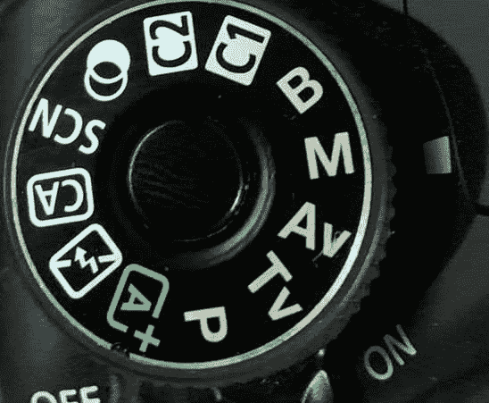

图 2-4 相机模式调至 M 档

如果需要在视频中出现同期声，尽量不要使用单反相机的自动录音功能，因为单反相机的内置麦克风质量不高，录制的声音混杂、不清晰。我们可以使用外置麦克风，比如便携式麦克风等。

白平衡模式能够解决在不同光源下照片偏色的问题，能够还原拍摄主体的真实色彩。

如果拍摄静物视频，想要确定构图位置，我们可以在设置中打开“3×3”网格线，如图 2-5 所示。

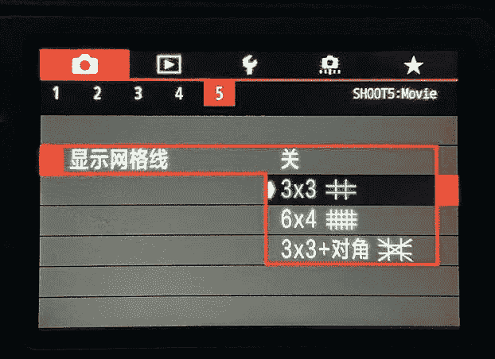

图 2-5 选择合适的网格线

## 2.5 三脚架

用单反相机或手机在固定位置拍摄视频时，为了防止设备抖动使画面拍摄得更顺畅，常常要用到支撑工具——三脚架。

### 2.5.1 三脚架的作用

##### ●精准构图

用单反相机拍摄时虽然可以调节快门等参数，但容易晃动，所以，无论拍视频还是照片，都可以用三脚架固定设备，从而实现精准构图，如图 2-6 所示。

##### ●严格控制景深

在拍摄微距作品时，我们会对着拍摄主体进行对焦，使得拍摄主体在景深范围内，并清晰呈现，同时将杂乱的元素放在景深范围之外，并使其虚化模糊，从而使画面更加简洁、干净。景深需要调得相当精确，如果不借助于三脚架产生稳定效果，是不可能完成有质量的拍摄的。

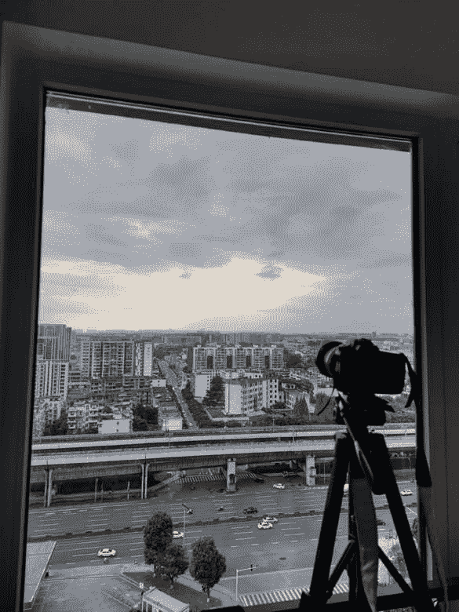

图 2-6 用三脚架固定相机拍摄风景

### 2.5.2 三脚架的使用

三脚架通常分为手机三脚架和相机三脚架，使用方法和功能也有所不同。

##### ●手机三脚架

手机三脚架适合日常拍摄，轻便易携带，适用多种场景拍摄需求，性价比极高。下面介绍常见的落地式三脚架。

落地式三脚架多用于拍摄测评视频。落地式三脚架的长度和高度都非常适合远距离拍照，它拥有宽大的支脚，可稳固置于地上，如图 2-7 所示。它收缩后还可充当自拍杆，满足广阔场景的自拍需求，因此也多用于户外直播。

有些落地式三脚架还可通过蓝牙链接手机，远程控制调整高度。

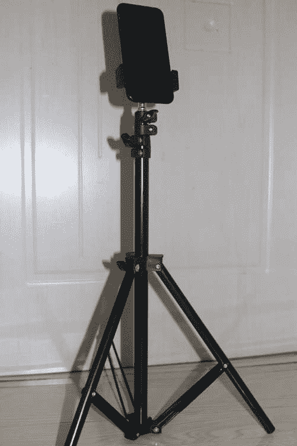

图 2-7 落地式三脚架

手机三脚架的工作原理与相机三脚架类似，我们把手机嵌入固定框中，点击录制按钮即可开始录制视频。

##### ●相机三脚架

使用相机三脚架需要注意以下几点。

第一，相机的重量不能超过三脚架的最大承重，否则会影响其稳定性。

第二，使用三脚架时一定要保持脚架分布均匀，让三脚架重心保持稳定。如果三脚架重心偏移，有可能损坏相机及三脚架。

第三，在低机位拍摄时，如果不需要完全打开脚架，就优先打开脚架管径最粗的脚管，这样脚架的承重是最适宜的。

第四，三脚架中的紧固部件不能有滑动现象，每次拍摄前必须检查。

第五，很多人喜欢把摄影包挂在三脚架的承重挂钩上当配重，但在风速较大的情况下，要尽量避免此行为，因为摄影包会随风晃动，加剧相机的抖动。

第六，使用长焦镜头拍摄时，一定要把快装板装在镜头的脚架环上，这样重心最稳。竖拍的时候直接将脚架环固定旋钮拧松，旋转相机即可。

第七，一定要定期检查云台的锁紧装置。拧紧云台的固定螺丝，以防云台松动甚至脱落。

第八，如果经常爬楼或登山拍摄，可以选择重量较轻的三脚架。

第九，尽量不要在车辆往来较多的区域支放三脚架，因为车辆来来往往会造成三脚架抖动，影响拍摄效果。

## 2.6 稳定器

稳定器可以使画面效果更加流畅，人物转场的效果更自然。下面将详细介绍关于稳定器的一些知识。

### 2.6.1 稳定器的作用

稳定器可以有效地稳定手机和相机，即使在运动状态下拍摄，也能保证画面的流畅度和稳定性。

手机稳定器比相机稳定器更轻便，可以直接手持拍摄，在拍摄短视频运镜转场的画面时使拍摄更方便。如果不太擅长使用相机稳定器，那么可以选择手机稳定器。手机稳定器有以下作用。

①稳定手机，防止或减轻手机在拍摄过程中颠簸或抖动，尽可能保证拍摄画面的清晰。

②内置延长杆，对于拍摄一些特殊场景或角度可以起到很大的帮助。

③续航时间更长。

总之，手机稳定器作为手机拍摄的辅助工具，除了有防抖的作用，还能简化运镜难度，拍出一些纯手持难以拍出的镜头。

如果想要获得更好的拍摄效果和画面质量，可以用单反相机拍摄，这就要选择合适的相机稳定器，如图 2-8 所示。

相机稳定器的承重能力更强，各方面达到的效果也更好。但它有一个缺点就是不能缓解稳定器上面 Z 轴的稳定，如果我们手持稳定器时出现上下颠簸的情况，它起不到缓解作用，这就要求我们在拍摄的过程中必须注意 Z 轴的稳定。

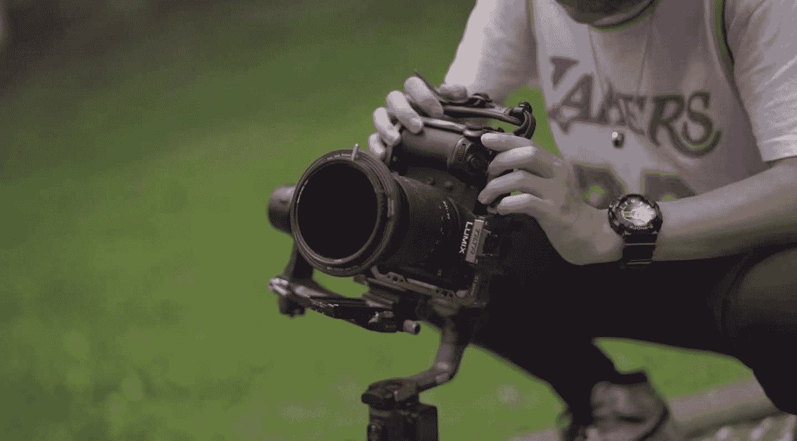

图 2-8 单反安装稳定器

### 2.6.2 稳定器的创意玩法

##### ●跟拍

人物向前走进镜头，拍摄者跟在人物后面同时移动……这样拍摄出的画面可以作为视频的开头。此外的做法是，我们可以在镜头前增加遮挡物，拍摄时从遮挡物处快速通过，可以让画面更有冲击力。

##### ●通过镜头将人物推近与拉远

我们可以从空中降下画面并向后移动，被摄者向前走，这样拍摄可以使人物画面衔接得更自然。镜头推近可以强调被摄主体；拉远可以展现大的场景。

##### ●升降

在拍摄人物走动的脚步画面时，可以将镜头慢慢上升，由低视角至高视角，可以呈现出近景变远景的过程。有时还可以把相机倒置，让相机从低角度慢慢升至高角度。升降镜头也可以配合跟拍。

##### ●环绕

拍摄者围绕着人物拍摄，后续使用剪辑软件做出加速效果，画面会更有冲击力。为了防止出现失焦问题，可以让拍摄对象始终处于画面中间，镜头与拍摄对象的距离能保证画面清晰即可。如果使用长焦镜头，将背景和拍摄主体的距离拉近，画面会更有视觉冲击力。

##### ●低角度环绕

将稳定器倒置，镜头扬起。这种拍摄手法非常适合展现拍摄主体的高大宏伟。

##### ●升起并俯拍

在拍摄产品时，操控稳定器以上升的角度拍摄，然后俯拍，模拟出摇臂的镜头效果。

##### ●俯视旋转

拍摄近景时旋转镜头，然后向后移动，后期剪辑时调整速度，能让画面更有视觉冲击力。

## 2.7 灯光设备的选择

光所表现出的强弱冷暖或明暗变化，可以给人带来不同的心理联想。例如，光较强烈时给人一种充满朝气和希望的联想；而当光较弱甚至消失时，会给人一种沉闷、失望的感觉。光线的冷暖同样带给人们不同的心理感受：暖光使人产生温暖、祥和、友爱的感受；冷光使人产生寒冷、阴森、冷漠的感受。光的明暗反差同样也会产生不同的氛围：明暗强对比给人以厚重、有力感；弱对比则给人一种柔和、妩媚的感觉。

所以，光对拍摄的影响很大。

### 2.7.1 灯光设备的作用

拍摄视频时使用灯光设备往往具有三方面的作用：一是改善被摄主体的亮度，改善阴暗的环境，使画面效果不冷清；二是突出被摄主体的明暗关系，将人物或物体的立体感清晰地展示出来，如图 2-9；三是通过不同的灯光选择，对拍摄主体进行各种艺术风格的描绘，表现出特定的艺术效果。

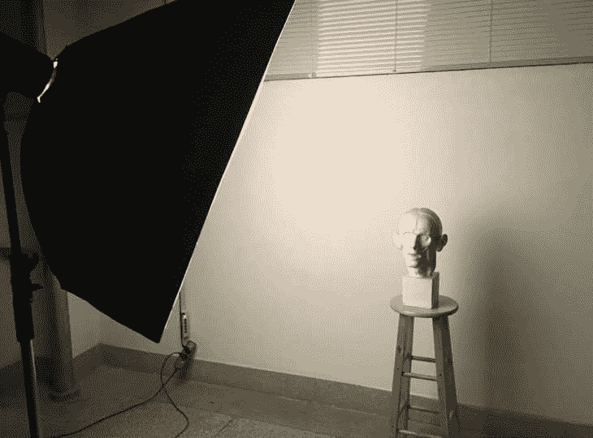

图 2-9 灯光与明暗关系

### 2.7.2 灯光设备的种类

一般来说，灯光设备有以下几种。

##### ●补光灯

补光灯是用来为缺乏光照度的设备进行灯光补偿的工具，是短视频拍摄中常用的补光工具。比较热门的是 LED 补光灯和常亮灯。

LED 补光灯的作用是将灯源置于拍摄主体的侧面，以弥补其他灯光的照射范围不足以及减轻生硬感。如图 2-10 所示。我们还可以给补光灯添加色板，营造出不同的拍摄氛围。

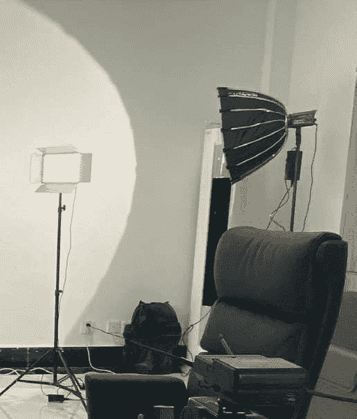

图 2-10 图中左侧为补光灯

常亮灯是影棚中常用的灯光，常与反光板等设备搭配使用。常亮灯光线充足，打在被摄主体上效果很好，如图 2-11 所示。但使用常亮灯需要使用者具备一定的专业度，所以它更适合具备摄影知识的专业人士使用。常亮灯可以利用自身配件调整角度，可以把光打在需要的位置上。在拍摄时，常亮灯常与闪光灯配合使用。

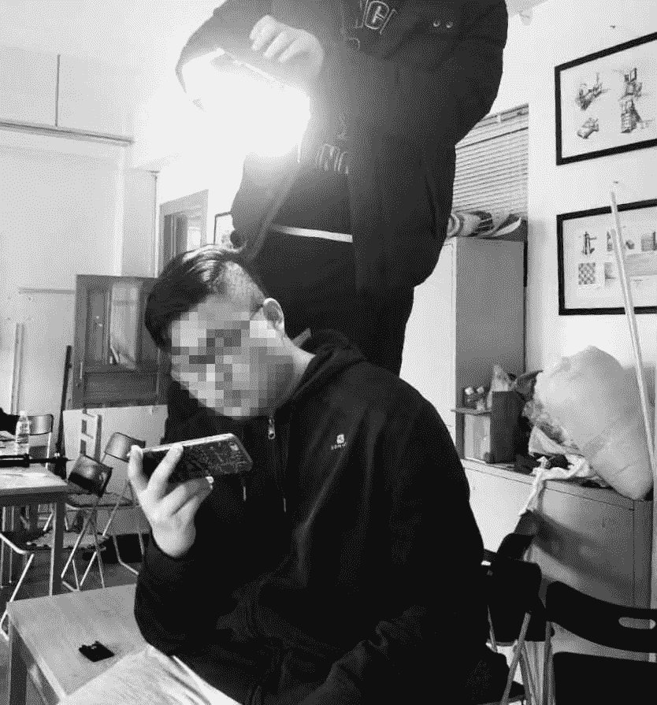

图 2-11 常亮灯的使用

##### ●小闪光灯

小闪光灯最大的特点就是外形小巧，使用方便，而且不需要装电池，直接用相机供电。

##### ●落日灯

落日灯的英文名为 HaloEdition，是一种营造光晕效果的氛围灯。人们之所以称其为落日灯，是因为其打出的光酷似落日的光线和氛围。落日灯呈现出黄、橙、红三种颜色的渐变效果，从而产生夕阳的氛围感。它主要利用透镜折射的方式产生装饰性照明效果，从根本上来说，它是投影灯具。

##### ●棒灯

棒灯即棒形补光灯，由灯组、控制模块两大部分组成。灯组是由不同数量的 LED 灯珠组成，占据了棒灯的一大部分体积。相较于环形补光灯，棒灯的打光面不均匀，多用于侧位辅助，用在侧面或局部效果更好。部分棒灯还有彩色模式和特效模式。在彩色模式下，用户可设置不同的灯光颜色；在特效模式下，用户可以选择不同的灯光感，从而达到逼真的布光效果，如雷电的光效、警车灯的效果等。

## 2.8 收音设备

用手机录制视频时会伴随环境音，而且，如果拍摄主体距离录制设备较远，声音会发散，这会大大影响视频的质量，所以需要通过外部设备来降低噪音，提升音质。麦克风就是这样的外部设备，在拍摄短视频时能起到很好的收音效果好。

在录制讲解类、测评类短视频时，我们可以搭配无线领夹式麦克风，它主要由发射器和接收机组成，收音范围广，也可以把它插在手机或相机上使用，讲话的人可自如活动，不受线的牵制，且不会影响人声的收取。而且，如果是自己单独拍摄，没有拍摄团队运营，那么更适合使用无线领夹式麦克风。

## 2.9 反光板

反光板的主要作用就是利用光线的折射，给我们想要表现的物体暗部补充光线，让物体暗部更明亮，画面光线也更和谐，图 2-12 为反光板的使用方法。

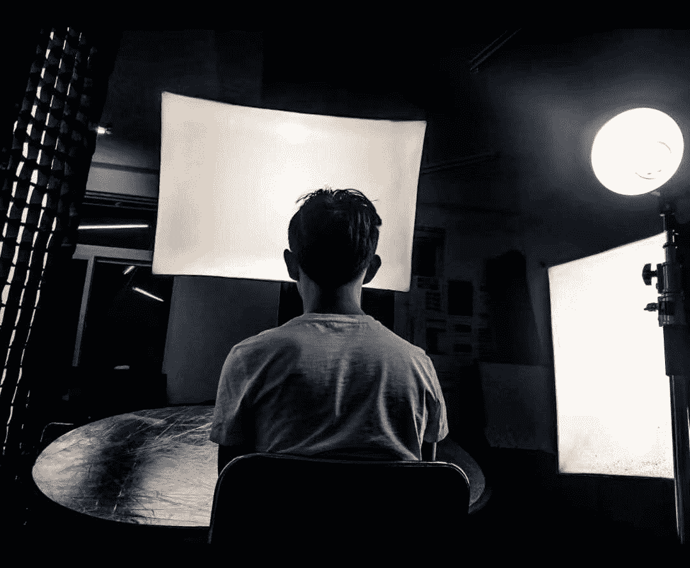

图 2-12 反光板的使用方法

如果是拍摄人像，反光板的主要作用是补充人物眼神的光，让眼睛更具神采，其次是让人物的面部更加明亮、清晰，同时，还能起到柔化人物面部的作用。此外，适当运用反光板还能减轻人物脸部的黑眼圈和法令纹。因此，在无灯拍摄的条件下，请至少使用一块反光板；在人手充足的条件下，可以使用两块反光板。反光板的颜色有很多，不同颜色的反光板作用不同。

##### ●白色反光板

白色反光板的光线效果会使拍摄主体显得柔和自然，并可以对阴影部位进行补光，从而淡化阴影部位。

##### ●银色反光板

银色反光板能产生更为明亮的光，在弱光下补光效果最好，并且很容易从被摄者的眼睛里映现出来，从而使被摄者的眼神更明亮。在阴天且光线主要从被摄者头顶向下射过来时使用这种反光板，直接将其放在被摄者脸的下方，使顶光反射到被摄者脸上。

##### ●金色反光板

金色反光板产生的光线色调较暖，主要在日照条件下使用进行补光，更常被用作主光。在明亮的阳光下拍摄逆光人像时，可以使用金色反光板从侧面和稍高处把光线反射到被摄者的脸上，这样既可以得到照射到被摄者脸上的定向光线，又可以使被摄者脸部的曝光增加，还可以减少背景和前景的曝光差别，不会使背景曝光过度。

##### ●黑色反光板

使用其他反光板的目的都是为景物增加光量，而使用黑色反光板则是用来减少光量。使用黑色反光板可以强调人物面部立体感和人物面部的轮廓。

## 2.10 手机外接镜头

我们的手机镜头是定焦镜头，由于焦距固定，当我们希望将更多的元素拍进画面中，或是想强化近大远小的透视感，手机自带的镜头就无法满足这样的需求了，此时就需要外接镜头上场了。下面将介绍手机的常规外接镜头及它们各自的一些特点。

##### ●微距镜头

微距镜头就像放大镜一样能拍到很多我们平时看不到的细节，微距镜头能拍出漂亮的背景虚化效果，如图 2-13 所示。建议选择拍摄距离较远的长焦微距。

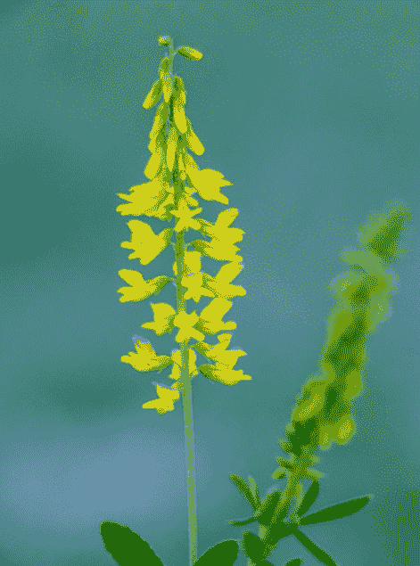

图 2-13 微距镜头的拍摄效果

##### ●电影镜头

电影镜头能够拍出拉丝的光晕和超宽的视角，如图 2-14 所示。使用电影镜头时，需要搭配专业软件来达到窄画幅的效果。但在拍摄快速移动的物体时会产生“果冻效应”，即画面中被拍摄物体出现颤抖式的弯曲。

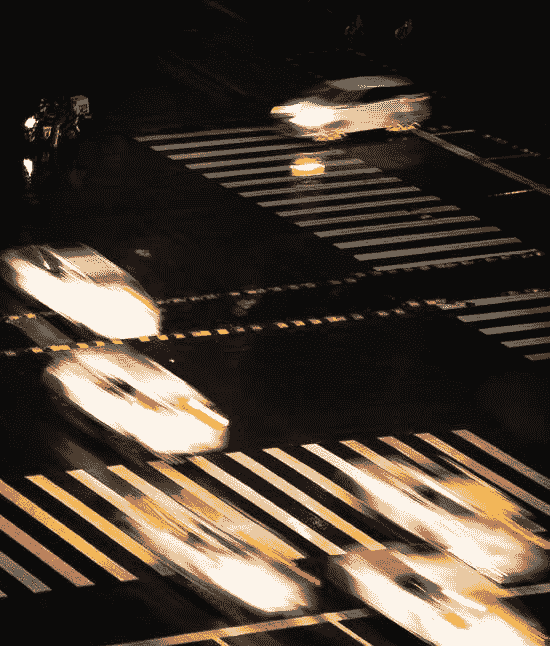

图 2-14 电影镜头拍摄效果

##### ●鱼眼镜头

通过鱼眼镜头拍摄的画面特征很明显：视角广、变形夸张。鱼眼镜头在动感和空间感方面也有自己独特的一面。一般而言，视角越广的镜头，产生的抖动越不明显，用鱼眼镜头拍摄视频，即使被摄物移动速度非常快，画面可用程度仍比较高。鱼眼镜头的空间感主要体现在它能把很小的空间以更具冲击力的形式呈现出来，如图 2-15 所示。

图 2-15 鱼眼镜头拍摄效果

##### ●长焦镜头

手机最大的缺点在于对于距离较远的事物拍不清楚，于是手机外接长焦镜头应运而生。受镜头重量的影响，手持手机和长焦镜头时很难稳定拍摄，因此，在使用长焦镜头时必须搭配三脚架，安装后，调整焦距，然后对准被摄物体就可以进行拍摄了，拍摄效果如图 2-16 所示。

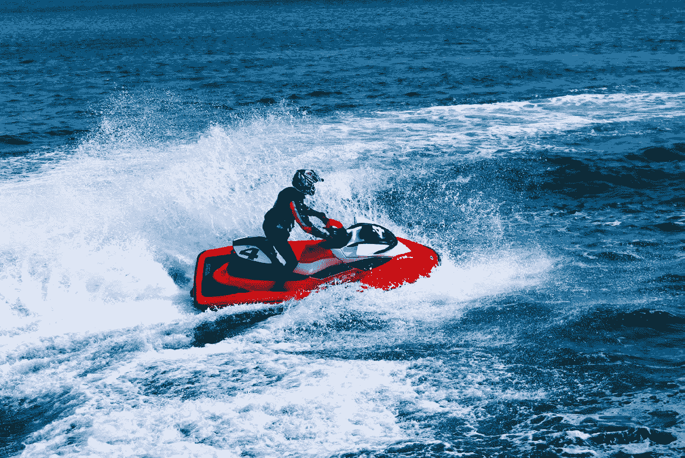

图 2-16 长焦镜头拍摄效果

## 2.11 无人机

无人机航拍影像具有高清晰、大比例尺、小面积、高现势性的优点，特别适合大全景效果的拍摄（比如学校、公路、景点、水库、海岸线等），如图 2-17 所示。且无人机航拍操作方便，遥感平台操作灵敏，不生硬，易于转场。由于无人机体积小，航拍结束后的降落地点也很好选择，在较开阔的地面均可起降，且其稳定性、安全性好，因此越来越多的人加入了使用无人机航拍的行列。

图 2-17 航拍图片

许多使用无人机航拍的新人往往会在航拍时因忽略常识导致出现一些错误。以下是无人机航拍时的注意事项。

①作为航拍新手，要熟记操作教程，选择开阔的场地进行试飞，保证无人机在自己的视线范围内。操作熟练后选择拍摄距离较近的起飞点，避免因碰到障碍物而造成无人机损坏。

②日常维护。起飞前、起飞后都要检查，确保无人机工作状态正常。要检查螺丝是否牢固、螺旋桨是否完好、电机运转是否正常、电压是否稳定，还要检查遥控器的电量是否充足。

③注意信号问题。如果在“网红”航拍点，可能同时有多个无人机航拍，相互之间会产生信号干扰，所以要尽量选择信号干扰小的最佳起飞点。

④注意拍摄时长。在电池满电的情况下可以支持 20 分钟左右航拍，我们要提前做好拍摄规划，留出足够电量支撑无人机返航。

⑤关注天气变化。大风天气会导致无人机失控，大雾天气也会导致无人机的避障功能失去作用。航拍新手要尽可能地把无人机控制在近距离并调低飞行速度，以免发生危险。

⑥遵守航拍规定。确保航拍的区域不违反相关规定。拍摄者要具备航拍人员资质，在限制飞行高度的区域飞行时要在规定的空域内拍摄。

⑦及时转存数据。如果无人机发生无法避免的故障，那么辛苦拍摄的素材很可能就损坏了。要带上充足的储存设备，无人机每次降落后随时更换，以确保每一段航拍素材都能被妥善保留。

# 第三章
短视频中常用的拍摄技巧

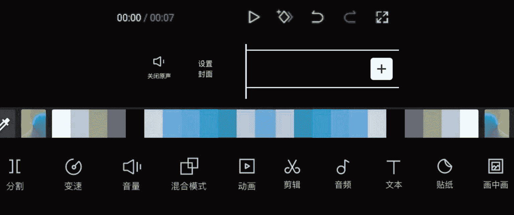

## 3.1 运镜

简单来说，运镜就是指通过自身的运动来拍摄物体动态的一种拍摄手法，是为视频注入情绪与氛围的重要手段之一。无论是拍摄商业级别的影视，还是记录日常生活，运镜都是极为重要的拍摄手法。专业拍摄者与业余拍摄者的区别之一就是能否在拍摄不同场景时使用合理的运镜手法。虽然精通运镜较难，但上手较为简单，即便是初学者，只要掌握几种简单的运镜方法，再将其排列组合，进行运用，便足以应对绝大部分的拍摄。

新手在拍摄时，往往会在运镜的过程中出现抖动。抖动产生的原因大致有以下三种。

①选用的拍摄器材过于沉重，且没有使用稳定器或外接支架。

②运镜过程中移动速度较快、移动幅度过大。

③位于移动的交通工具上。

为了尽量减少以上三种可能出现镜头抖动的情况，我们在拍摄时要尽量做到以下三点。

①选择重量合适的设备。如果是小型摄像设备，比如手机，则要双手握持保持平稳；如果是大型摄像设备，则要为其配备稳定器或支架。

②降低镜头的移动速度和人体的运动速度，同时尽量保持匀速运动（某些特殊拍摄手法除外）。

③在条件允许的情况下选择在平坦稳定的路面进行拍摄。

### 3.1.1 推镜与拉镜

推镜是在拍摄过程中，将镜头向被拍摄对象移动，慢慢缩短与被拍摄对象间的距离的运镜手法。用推镜拍出的画面可以起到突出主体、聚焦视线的作用，多用于展示或强调拍摄主体。

拉镜则与推镜相反，是一种使镜头逐渐远离被拍摄对象，慢慢增加拍摄对象其他信息的运镜手法。拉镜可以弱化中心事物，将观看者的注意力分散，通过展现周围的环境从而营造出特定的氛围，常用在视频结尾或转场处。推镜与拉镜的示意图如图 3-1 所示。

变焦功能也可以实现与推拉镜类似的效果，但会导致画质降低。因此在拍摄时，还是要更多地使用推镜和拉镜的手法。

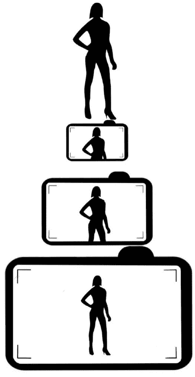

图 3-1 推镜与拉镜示意图

### 3.1.2 移镜

推镜与拉镜是在镜头与拍摄对象的连线上进行镜头前后方向的移动，而移镜的镜头移动方向往往与推镜与拉镜方向相垂直。在此平面内移动镜头，被拍摄对象的大小不会发生明显的变化。

使用移镜手法拍摄的事物大多不存在绝对的主次关系，有点儿像“流水账”，目的是向观看者传递更多信息。

要注意，移镜时镜头的运动方向要成直线，要做到镜头位置虽然移动，但拍摄角度不变以防止由于透视的改变导致拍摄对象发生形变。移镜的示意图如图 3-2 所示。

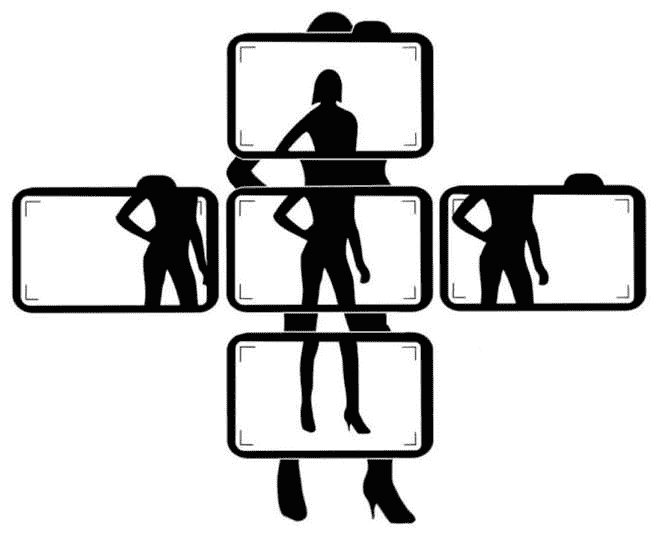

图 3-2 移镜示意图

### 3.1.3 摇镜

摇镜是在虚拟球面内以弧形轨迹旋转镜头的运镜手法。

摇镜时，机位尽量保持不变，通过旋转镜头改变拍摄角度。要注意的是，在运用摇镜时，近距处的影像会产生较为严重的变形，因此摇镜多用于拍摄中距或远距的对象。摇镜的示意图如图 3-3 所示。

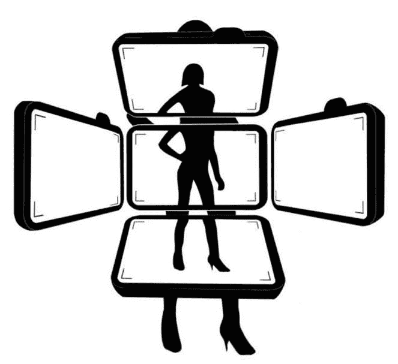

图 3-3 摇镜示意图

### 3.1.4 转镜

转镜与摇镜相似，都是通过转动镜头来拍摄事物，但区别在于：摇镜是以拍摄者为旋转中心，转镜则是以拍摄对象或镜头为旋转中心，如图 3-4、图 3-5 所示。以拍摄对象为旋转中心的转镜手法常用于展现拍摄对象多维度的信息。以镜头为旋转中心的转镜手法多用于航拍或进行俯视角的拍摄。

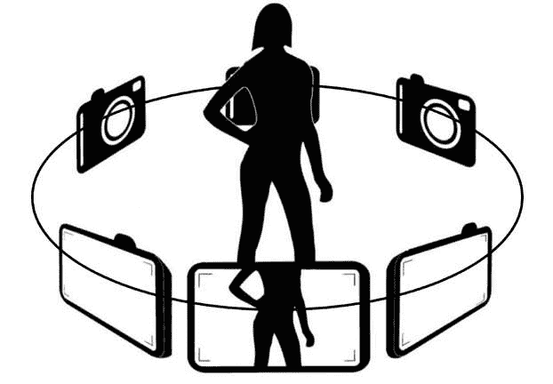

图 3-4 以拍摄对象为中心的转镜示意图

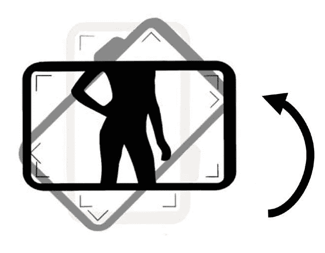

图 3-5 以镜头为中心的转镜示意图

### 3.1.5 跟镜

跟镜与移镜相似，是一种镜头跟随拍摄对象同步移动的拍摄手法，其示意图如图 3-6 所示。跟镜兼具移镜和转镜的特点，在保证拍到更多信息的同时，还能够保证拍摄对象在画面中的主导地位。由于跟镜拍摄出的画面具有固定的视觉中心，符合日常生活中的视觉感受，能够使观看者产生更加强烈的沉浸感。

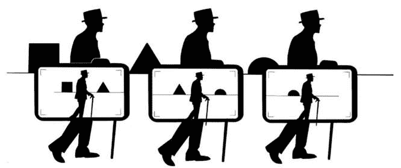

图 3-6 跟镜示意图

## 3.2 景别

景别指的是在焦距一定的情况下，由于镜头与拍摄对象之间的距离不同，拍摄对象在拍摄画面中呈现、占据范围大小不同。不同的景别下拍摄的视频呈现出的视觉效果有很大区别。常用的景别有大特写、特写、近景、中景、远景、全景等。

### 3.2.1 大特写与特写

大特写与特写是几乎将被拍摄物体充满整个画面的拍摄方法，用于强调、突出拍摄对象。大特写与特写的区别在于：特写的主体往往为拍摄对象本身的物理轮廓，而大特写则更加注重强调拍摄对象的某一具体细节。以拍摄同样的电影胶片为例，特写如图 3-7 所示，意在展现电影胶片的形态，大特写如图 3-8 所示，着重展现电影胶片磨损的痕迹与胶片呈现的场景。由于焦距的原因，大特写与特写常常虚化背景，从而使主体更加明确，视觉中心更加突出。

图 3-7 特写示例

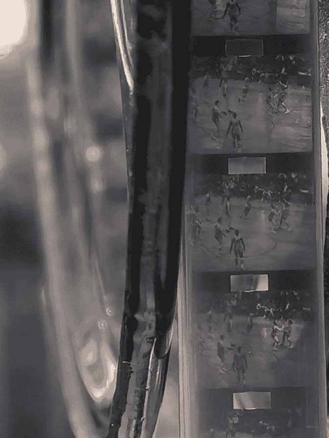

图 3-8 大特写示例

### 3.2.2 近景

相较于特写，近景虽然弱化了拍摄主体的信息，但是能更好地渲染气氛，并能展现出更多环境信息，包括光影、装饰布局等。如图 3-9 所示，作为拍摄主体的蝴蝶与作为环境的花朵都获得了表达。近景也同样虚化背景。

图 3-9 近景示例

### 3.2.3 中景

中景是拍摄人物时最为常用的景别，如图 3-10 所示。中景可以很好地表现出人物的神态、情绪、动作，并且在一定程度上交代人物所处的时空信息。是表达综合信息最多的拍摄方式。

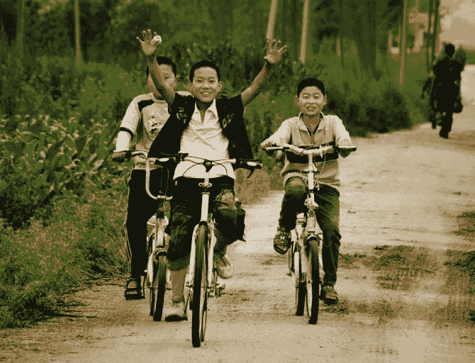

图 3-10 中景示例

### 3.2.4 远景

远景常用于拍摄大体积物体。在远景中，主体被弱化，取而代之的是交代周围环境，如图 3-11 所示。远景常用于在影视作品中某一片段的开始或结尾，对事件发生的时空进行说明，或作为下一片段的开场。

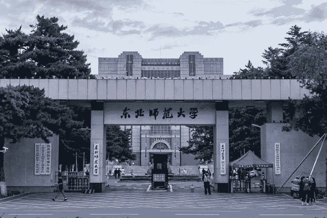

图 3-11 远景示例

### 3.2.5 全景

全景与其他景别不同，在全景中几乎没有主体存在，或者说一切目光所及之物皆为主体。全景主要用于表现一些宏大的场景，多以广角拍摄为主。常用于商业宣传以及地方宣传，以此提升画面整体的气势与基调，如图 3-12 所示。

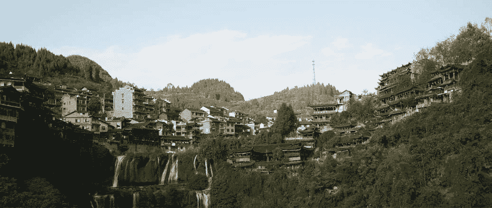

图 3-12 全景示例

## 3.3 视角

多变的拍摄视角可以使视频更具表现力，画面更丰富，还可以使观看者获得新鲜感，更愿意深入了解视频的内容。要想让视频获得高播放量，就需要尝试以不同的视角进行拍摄，下面介绍几个拍摄视频常用的视角。

### 3.3.1 平角度

平角度指的是镜头与拍摄主体保持水平的角度。这个拍摄角度与我们平时观察事物的角度相似，在这个角度下拍摄的主体形变量最小，可以很好地还原拍摄对象的形态。当在环境信息量大或杂乱的情况下使用平角度拍摄易造成主体与背景的重叠感。以图 3-13 为例，可以调高作为拍摄主体的小熊猫的色彩的对比度，从而使其在繁杂的环境中得以突出。也可以采取虚化背景的方式来突出主体，如图 3-14 中所示。

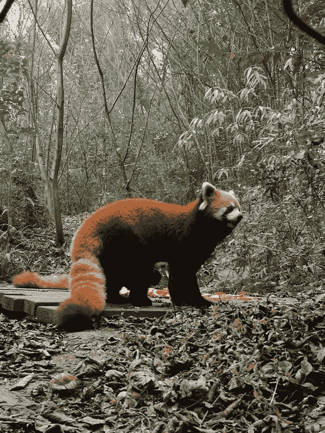

图 3-13 平角度示例 1

图 3-14 平角度示例 2

平角度拍摄的画面中容易出现天然的线条，如图 3-15 中的地平线、海浪的波纹、田地的分割线等，这些线条具有稳定画面的作用。

此外我们还可以摄入更多的元素使画面变得丰富。在图 3-15 中，拍摄者还特意在画面中加入了气球、停车场等，不仅丰富了画面，还加深了画面的空间层次。这样的角度及内容的设计使人产生身临其境的感觉，从而达到吸引观看者的目的。

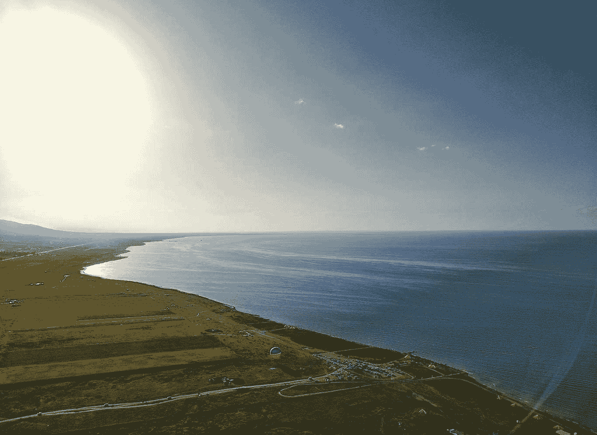

图 3-15 平角度示例 3

### 3.3.2 俯视角度

俯视角度是指镜头位于被拍摄主体上方这一角度。当我们需要拍摄事物的全貌时，俯视角度拍摄是一个不错的选择。从高处向下进行俯视拍摄，可以拍摄到更为广阔的画面，形成居高临下的效果，如图 3-16 所示。以俯视角度拍摄时需要注意以下几点。

##### ●位置的选择

选择较高的位置，形成自上而下的拍摄角度，更有利于我们拍摄。

##### ●突出主体

由于拍摄者在较高的位置拍摄，画面中可能会存在较多元素，所以一定要突出拍摄主体。

##### ●设备器械的选择

俯视角度拍摄需要用到三脚架等固定工具，也可以用无人机航拍，以获得更宽广的视野画面。

图 3-16 俯视角度示例

### 3.3.3 仰视角度

仰视角度是指镜头低于拍摄主体的角度。仰视角度是在日常拍摄中用得最多的角度，这种拍摄角度可以使拍摄主体在画面中表现出宏伟的形态。对主体进行仰视角度拍摄可以去除杂乱的元素，更好地突出主体。采用仰视的角度进行拍摄时，可以将天空作为背景，如图 3-17 所示，这样可以更好地突出主体的形态轮廓，并且可以使画面干净漂亮，更加吸引观众。

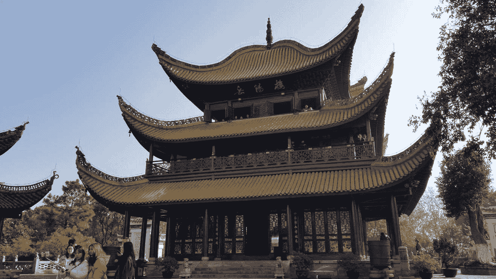

图 3-17 仰视视角示例 1

仰视角度也是拍摄现代建筑物时常用的拍摄角度，如图 3-18 所示。由于现代建筑特有的外形，通过仰视角度拍摄的画面会产生极致的透视美感，给人以建筑物高耸入云，自身渺小的感觉，极具视觉冲击力。

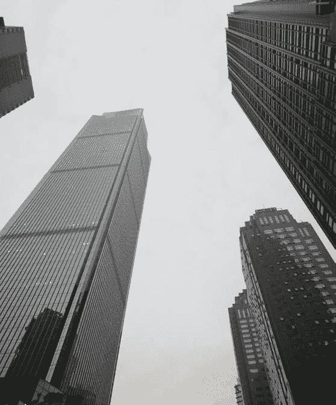

图 3-18 仰视视角示例 2

### 3.3.4 人像的拍摄视角

拍摄人像时，拍摄视角对表达人物的表情、形体等有着重要的影响。拍摄角度的巧妙转换，可以使人物形象丰满，并可借助环境烘托氛围，对视频整体风格的形成颇有益处。

##### ●从正面拍摄

从正面拍摄可以真实地反映人物的特点，但需要丰富画面的内容，适当增加其他元素以避免无趣和呆板。如图 3-19 所示，人物神态和动作自然，并有甜点对环境进行装饰，画面十分和谐。

图 3-19 人像正面镜头示例

##### ●从背面拍摄

背面镜头无法看到人物的表情神态，因此周围环境对画面的渲染就变得十分重要，画面不仅要有意境，还要给观看者留出想象的空间。如图 3-20 所示，公交站牌下的少女在灯光下有落寞之感，却又不失美感。

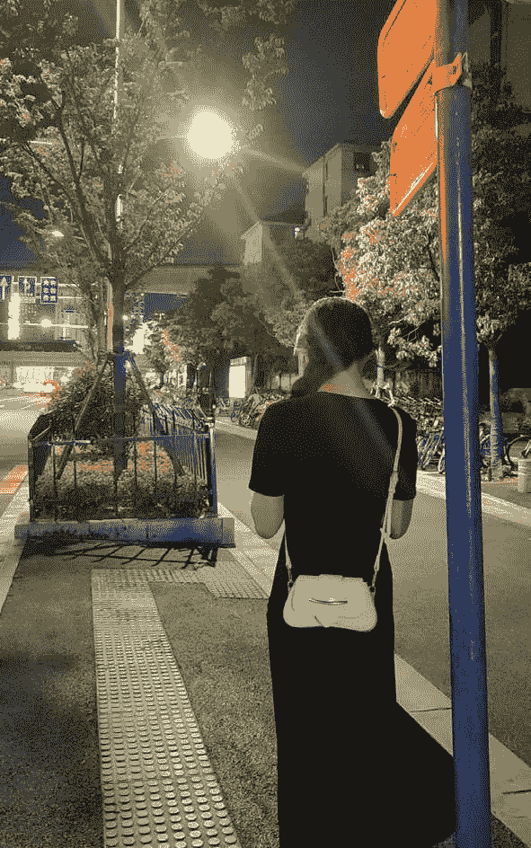

图 3-20 人像背面镜头示例

##### ●从斜侧面拍摄

从斜面拍摄能够更好地凸显人物的立体感，使人物轮廓更加清晰，如图 3-21 所示。

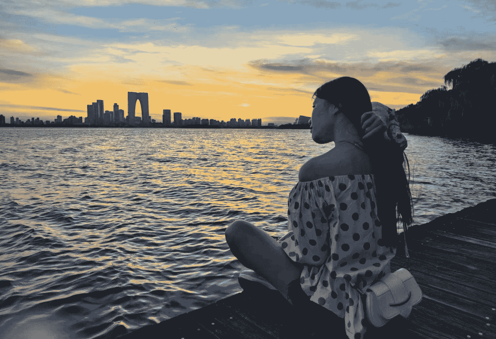

图 3-21 人像斜侧镜头示例

## 3.4 构图

构图指的是将画面中的人物、景色、物品以一定的规则或逻辑进行排列，从而使画面产生美感的方法。构图从大方向上可以分为横构图与竖构图，其中又可以细分为中心构图、对角线构图、九宫格构图等。

构图不同于其他拍摄手法，不但要将光影、景别、视角相结合，而且没有公式化的构图方法。面对同样的场景，由于拍摄者自身的拍摄水平及拍摄风格不同，最终可能呈现出截然不同的拍摄画面或作品。因此，在掌握基本的构图原理后，要勤加练习，同时多欣赏其他人拍摄的作品，取长补短。

### 3.4.1 横构图

我们日常观看的电影、电视节目等传统媒体，通常以横构图为主。这是因为，在观看时，视线距离荧幕或屏幕有较大的距离，而横构图符合人们视角上水平视角范围大于竖直视角范围的特点，会使观看者产生身临其境的感觉。同时，横构图也是拍摄宏大场景或多人合影时的主要构图方法，如图 3-22 所示。

图 3-22 横构图示例

### 3.4.2 竖构图

随着科技的不断发展，人们使用影像载体的重心逐渐从大屏幕转向方便携带的手机与平板电脑。竖构图不仅仅是因为拍摄出的画面适配手机等移动设备，更在于使用手机时人眼与手机屏幕的距离相较于人眼与影院荧幕、电视屏幕的距离更短，因此可以忽略视角范围所带来的构图限制。此外，随着近几年短视频领域的持续爆火，以突出个人为重点的构图成为短视频时代的主流，无论是歌舞、脱口秀还是短剧等，竖构图都可以很好地突出画面中的人物，如图 3-23 所示。

图 3-23 竖构图示例 1

除了人物之外，竖构图还可以用来表现空间的深邃感，如图 3-24 所示。在观看竖构图的影像时，由于左右视角范围变窄，观看时会有一种压迫感，这种压迫感在观看视频时体现出的是空间感与深邃感，例如古旧城区中的小巷、高耸入云的山峰、宏伟的建筑等。

图 3-24 竖构图示例 2

### 3.4.3 中心构图

中心构图就是将拍摄对象置于画面中心，能很好地突出主体的最常见的构图方法，常用于拍摄单一主体或移速较慢的物体。如图 3-25 所示，使用中心构图法时，主体不能过于偏离画面正中心，否则会引起画面重心不稳，导致结构失衡。

图 3-25 中心构图示例 1

此外，拍摄对称结构的物体时，使用中心构图会使画面体现出和谐、庄重、正式的美感，如图 3-26 所示。

图 3-26 中心构图示例 2

### 3.4.4 对称构图

对称构图可以通过水面或者镜子的反射实现。这种构图法可以同时展示多个空间，并揭示它们间的内在联系。对称轴无论横竖往往都位于画面的中间，这样的构图可以增加画面的层次感。如图 3-27 所示，利用水面倒影实现对称构图，倒影中的虚化影像又与现实中的景象形成虚实对比。

图 3-27 对称构图示例 1

图 3-28 对称构图示例 2

对称构图并不严格要求对称。如图 3-28 所示，图中小巷两侧的建筑与牌匾并非完全对称，但在数量和布局上基本保持平衡，这样的场景同样可以达到对称构图的效果。

### 3.4.5 辅助线构图

辅助线构图是指利用四条辅助线将画面平分为九部分进行构图的方式，如图 3-29 所示。辅助线构图利用了黄金分割比这一理论。黄金分割比约为 1∶0.618，是构图时常用的比例，也是世界上公认的最美比例。四条辅助线将画面纵向、横向进行了三等分，因此，四个焦点在每条线上的分割比例约等于黄金分割比。在使用辅助线构图时，要尽可能地将拍摄主体置于焦点处。

图 3-29 辅助线示意图

如图 3-30 所示，画面中的塔位于右下角的辅助线交点，画面看起来十分和谐，这就是典型的辅助线构图。

图 3-30 辅助线构图示例 1

辅助线构图除了可以将拍摄主体置于焦点处，还可以将其置于某一条辅助线上。如图 3-31 所示，画面中男子身体的重心位于左侧的辅助线上，使画面显得稳定。

图 3-31 辅助线构图示例 2

在画面中出现多个元素时，可以将不同的元素分别置于辅助线的焦点上。如图 3-32 所示，画面中两个少女分别位于下方辅助线的两个焦点处，环境中的树木、小桥、岸边石台等也在一定程度上遵循辅助线构图原则。

图 3-32 辅助线构图示例 3

### 3.4.6 引导线构图

引导线构图是利用环境中的物体所产生的线条来引导视线聚焦的构图方式，有种画面给人以“往这里看”的感觉。这是因现实中的物体由透视原理形成空间感，从而还原画面中物体的空间状态，增强了观看者的代入感，同时，画面中产生的放射性线条也极具冲击力。

如图 3-33 与图 3-34 所示，利用环境中物体的结构线条构建成的引导线进行构图。

图 3-33 引导线构图示例 1

图 3-34 引导线构图示例 2

除了结构线之外，光线也可以用作构图的引导线。如图 3-35 所示，利用车流灯光产生的动势线作为引导线进行构图。除此之外，清晨森林中的一缕缕阳光也是借助引导线构图的极佳场景。

图 3-35 引导线构图示例 3

构图的引导线未必是直线。如图 3-36 所示，可以看出河两侧的山峦并不是作为直线延伸出去的，但它们有着向远处延伸并汇集的趋势，这种趋势线条也可以作为构图的引导线使用。

图 3-36 引导线构图示例 4

### 3.4.7 框架构图

我们仔细观察日常的装饰不难发现：无论是挂在墙上，还是摆放在桌上的照片，大多会镶嵌在相框里，这是因为相框不仅起到支撑作用，还有美观、增加层次、与周围事物加以区分的作用。那么，在构图时，在画面中寻找可以当作框架的物体，利用其突出呈现拍摄主体，就可以得到加了相框的效果。如图 3-37 所示，地铁车厢中各式各样的扶手将空间分割开来，每个空间看似独立却又紧密联系，空间中的每一个人都可以是主体，所有人又一起构成了这幅作品。

图 3-37 框架构图示例 1

框架的选取并不局限于规整的、定型的空间。如图 3-38 所示，近处的各类植物组合起来形成一个天然“相框”，这种利用无定型框架进行构图，拍摄出的画面不仅虚实结合，还突出了空间感，令人回味无穷。

图 3-38 框架构图示例 2

### 3.4.8 三角形构图

三角形构图就是指将画面中的若干景物按照三角形的结构进行构图的方式。三角形可以是正三角形、斜三角形或倒三角形。通常我们可以将三角形构图方式分为两种：一种是画面中只有一个拍摄主体，而且这个主体的三个点恰好可以形成一个稳定的三角形，我们便可以利用拍摄主体本身拥有的三角形元素进行构图；另一种是画面中有多个拍摄主体，利用不同的拍摄角度或不同的拍摄位置，将这些拍摄主体以三角形的形态呈现在画面中，达到三角形构图的效果。三角形是最稳定的几何图形，画面中的元素形成三角形，稳定而不失灵活。此外，也可以让人物以动势呈现出三角形，比起站立更加灵动。如图 3-39 所示，此画面中的三角形构图打破了视觉上的平面感，使画面更具立体效果。

图 3-39 三角形构图示例

### 3.4.9 留白构图

摄影中，在画面中留出一片空白的构图方法就是留白构图法。留白部分可以是天空、绿地或大海等，也可以是在人物视线的方向留出一定的空白，这样的画面可以给观看者留下想象的空间，赋予作品更多的内涵，如图 3-40 所示。

图 3-40 留白构图示例

### 3.4.10 对角线构图

对角线构图也叫斜线构图，是指将被摄主体置于画面对角线上的构图方法，同时，该主体本身也存在“线条”的属性，这个线条可以是直线，也可以是曲线。如图 3-41 所示，将拍摄主体——桥安排在画面的对角线上，使整个画面更有立体感、延伸感和运动感。

相较于横平竖直、规规矩矩的构图法，对角线构图可以打破常规、增强画面美感与视觉冲击力。

图 3-41 对角线构图示例

# 第四章
剪映软件快速上手

## 4.1 认识主界面

磨刀不误砍柴工。要想制作出精美吸睛的短视频作品，就需要熟练使用适合自己的剪辑软件。

市面上的剪辑软件数不胜数，新人往往会在选择上犯难，但其实剪辑方法大同小异，只是操作方式有所不同。本书以抖音官方出品的短视频剪辑软件“剪映”为例，带领读者从零开始了解短视频剪辑的基本思路与操作方法。掌握基本的剪辑概念以及剪辑思路也便于日后深入学习更多剪辑方法。由于剪映软件经常更新，文中有些具体步骤可能与最新版本有所不同，请灵活运用。

### 4.1.1 “剪辑”界面

打开软件后，点击屏幕左下角剪刀形状的剪辑图标即可进入“剪辑”界面，如图 4-1 所示。该界面主要分为创作区与草稿区两个部分。

创作区：界面的上方为创作区，有一系列功能单元，可以进行创作前的一些准备工作。

草稿区：界面的下方为草稿区。草稿区用于存储短视频项目在剪辑过程中的绝大多数文件，例如未剪辑完成的视频片段、导入的音频资料、创建的字幕脚本等。在草稿区可以对未完成的文件进行多次编辑。但要注意的是不可在手机中移动或更改该短视频项目所用到的文件，因为剪映的运行逻辑是调用手机中存储的文件，而非将文件拷贝至剪映软件自身。因此，如果用于某短视频项目中的视频、图片或音频遭到删除或移动，会使该短视频项目中相对应的片段无法打开，甚至有可能造成整个短视频项目的损坏。

图 4-1 “剪辑”界面

### 4.1.2 “剪同款”界面

点击下方的“剪同款”图标进入“剪同款”界面，如图 4-2 所示。顾名思义，剪同款是利用剪映官方或他人编辑好的模板来实现快速剪辑的手段之一。其优点在于在快速出片的同时还可以在一定程度上保证短视频的质量，对于没有视频剪辑经验的人来说是一种很好的选择。但其缺陷也十分明显：一是模板的质量良莠不齐且价格不一，筛选费时费力；二是无法更好地体现个人风格，不利于自身风格的形成，也就自然不利于变现。

总体来说，如果你平时以看短视频为主，偶尔发视频分享生活，或看到某一视频观感很好，想快速制作同款短视频的话，“剪同款”功能是你的不二选择。但如果你想将短视频作为一份可以赚钱的职业，那么仅仅掌握此功能是远远不够的。

我们先来了解一下如何使用“剪同款”的功能。

图 4-2 “剪同款”界面

在上方的搜索框内，可以直接搜索已知的模板，这个操作只适用于知道模板名称情况下的搜索。

在搜索框下方的分类中，可以按照类别快速找到一系列风格相似的模板，同时还会有抖音官方的火爆标签推荐。常用于仅有视频大纲，对具体内容和剪辑手法没有特定要求的情况。

以卡点类视频为例，点击“卡点”选项，可以发现下方模板全部切换为卡点视频的模板，如图 4-3 所示。

图 4-3 “卡点”界面

以《再见莫妮卡》模板为例，进入模板后如图 4-4 所示。此时会播放模板的效果预览，下方会显示该模板所需的素材。可以看到：此模板需要 8 个视频片段，总时长 11 秒。点击右下角“剪同款”进入图 4-5 所示界面，显示可以选择手机中已有的素材，或直接拍摄。我们可以选择“相册导入”，从手机相册中选择素材后对素材进行编辑，裁剪出符合模板时长要求的片段，然后点击右下角“确认”，完成单一片段的选取。重复上述操作，至全部 8 个片段导入完成后，点击右下角的“下一步”选项，进入预览界面，如图 4-6 所示。此时点击播放键即可播放成片，如果不满意，可以对素材进行编辑，包括裁剪、替换等。编辑完成后点击右上角的“导出”，导出完成后如图 4-7 所示。这时可以点击右上角的“完成”结束编辑，也可以在下方选择分享到各个平台。

图 4-4 《再见莫妮卡》模板

图 4-5 素材选择界面

图 4-6 预览界面

图 4-7 导出完成界面

### 4.1.3 “创作课堂”界面

创作课堂是剪映自带的教学模块，界面如图 4-8 所示，里面包含许多付费与免费的教学内容，包括剪辑步骤、变现方法、基础功能教学等，我们可以根据自己的水平选择相对应的课程。对于已经购买或观看过的课程，点击右上角的“学习中心”即可找到。

图 4-8 “创作课堂”界面

## 4.2 素材的选取及导入

在剪映首页点击左下角的“剪辑”图标，点击上方的“开始创作”，进入素材选取界面，如图 4-9 所示，可以选择视频或照片素材。以视频素材为例，点击视频可以进行预览。在预览的过程中我们可以对视频进行裁剪，裁剪完成后点击右下角的“添加”即可完成添加。之后，直接跳转至剪辑界面，如图 4-10 所示。

若想一次添加多个视频素材，只需在素材选取界面点击视频素材右上角的“⚪”标志，该标志则会变为有序号的红色标志，序号代表此素材被选中的顺序。以选取 5 个视频片段为例，选取后如图 4-11 所示。选择视频素材后，如果还要选择照片素材，可以点击上方的“照片”选项，进入照片选取界面。之后，按照与选取视频素材相同的操作方法选择照片，可以看到，照片素材的序号是接着视频素材的序号排的，从 6 号开始，如图 4-12 所示。点击右下角的“添加”选项即可完成多个素材的添加工作。

图 4-9 视频选取界面

图 4-10 剪辑界面

图 4-11 多个视频选取示例

图 4-12 多个照片选取示例

此外，还可以点击右上角的“素材库”，进入官方推荐的素材库界面，如图 4-13 所示。在此界面中可以添加一些短视频作品常用的素材，比如“Nice 大爷”及老式显像管电视的花屏效果等。

选取素材后可以点击左下角的“高清”，这样导入素材时就不会对视频素材进行压缩，不会损失画质，但是会导致手机的负荷加重，可能会导致剪辑视频时载入缓慢或卡顿，严重时甚至会导致软件崩溃，所以请根据自己使用的手机性能谨慎选择此选项。

图 4-13 素材库界面

## 4.3 认识剪辑界面

选取素材后，进入剪辑界面，如图 4-14 所示。界面的上半部分用于预览短视频剪辑后的效果，下半部分用于对短视频进行各式各样的操作，界面中的几个主要选项功能如图所示。

图 4-14 剪辑界面

## 4.4 通过简单示例初步了解基础功能

制作短视频时，一些基础功能是经常被用到的，我们必须要了解并熟练使用。

### 4.4.1 通过制作卡点视频了解“音频”功能

卡点视频是指利用节奏感较强的音乐，将音乐节奏与视频画面的节奏相匹配，实现视频片段转场的一种视频形式，可以使画面节奏与音乐节奏、视觉与听觉保持统一。制作卡点视频的步骤可以大致分为：导入要剪辑的几个片段，导入一段音乐，标定节奏点，以及根据节奏点位置调整素材。

先按照 4.2 节的方法导入视频素材，然后导入音频素材，方法如下。

首先点击剪辑界面下方选项栏中的“音频”，之后，手机下方出现如图 4-15 所示操作选项。在此简单介绍一下该界面中各个选项的功能，详细使用方法见第六章。

图 4-15 剪辑界面的音频操作选项

导入视频后开始制作卡点视频。首先点击剪辑界面中的“音频—音乐”选项，进入图 4-16 所示“添加音乐”界面。在该界面中点击“卡点”选项，然后任意选择一首卡点歌曲。之后点击音乐右侧的红色“使用”选项。回到剪辑界面后可以发现该歌曲已经被添加进了剪辑界面，并以蓝色波形音频轨道显示，如图 4-17 所示。点击并拖动界面下方的音频轨道即可对其进行任意移动。轨道上方数字代表时间点，拖动后按下播放键即可从白色竖线处开始播放。

图 4-16 添加音乐界面

图 4-17 音频导入成功的剪辑界面

点击任意音频轨道，该轨道则被选中，被选中的标志为该轨道的上下出现白色边框，如图 4-18 所示。此时进行的操作仅对该轨道有效。点击音频轨道，点击右下角的“踩点”选项，进入添加点界面，如图 4-19 所示。点击中间的“+添加点”即可在轨道上添加一个黄色标记点。点击播放音乐，在歌曲节奏重音或强拍的位置暂停并添加数个标记点，如图 4-20 所示。之后，返回剪辑界面，会发现黄色标记点出现在音频轨道上。之后点击视频轨道，拖动各个视频片段，使每个视频片段的首尾与下方音频轨道中的黄色标记点对齐，如图 4-21 所示。拖动视频时，剪映会使视频自动吸附在标志点位置，从而达到视频与标记点完全吻合的状态，至此，简单的卡点视频制作完成。

在设置标记点时，若无法准确找到合适的标记点，可以尝试使用“自动踩点”功能。该功能可以自动识别音频的节奏，可以在一定程度上简化剪辑流程。

图 4-18 音频轨道被选中效果图

图 4-19 添加点界面

图 4-20 添加黄色标记点

图 4-21 视频与音频首尾对齐

### 4.4.2 通过横版视频变竖版了解“背景”功能

由于短视频大多在手机上竖屏播放，因此若导入横向拍摄的视频，剪映软件会自动在横版视频的上下方添加背景色块，使其变为竖版视频，如图 4-22 所示，视频的上下方均被添加了黑色背景色块。若想改变此背景，可以拖动下方工具栏，找到“背景”并点击，进入图 4-23 所示背景编辑界面。下面将依次介绍下方三个选项的功能。

图 4-22 横板视频变竖版效果图

图 4-23 背景编辑界面

##### ●画布颜色设置界面

如图 4-24 所示，该功能用于编辑横向视频上下方两个色块的颜色。进入该界面后，点击下方色卡中想要的颜色，即可实现该视频片段上下方色块颜色的改变。若点击“全局应用”，该背景颜色则被用于整个视频所有片段中。

##### ●画布样式设置界面

如图 4-25 所示，该功能用于编辑横向视频上下方两个色块的图像。除了官方预置的免费与付费的模板外，还可以选择自己手机中的照片作为背景使用。

##### ●画布模糊设置界面

如图 4-26 所示，该功能用于模糊横向视频上下方两个色块的图像，共有四种不同程度的模糊效果，根据需要选择最合适的即可。

图 4-24 画布颜色设置界面

图 4-25 画布样式设置界面

图 4-26 画布模糊设置界面

### 4.4.3 通过制作马赛克效果了解“贴纸”功能

马赛克是一种图像处理手段，用于掩盖画面的某些部分。

以为图 4-27 所示视频中的人像添加马赛克为例。在导入视频后，点击下方选项栏中的“贴纸”选项。之后在下方选项栏中选择“添加贴纸”，进入图 4-28 所示界面。在屏幕中间的搜索栏中输入“马赛克”，点击“搜索”，会出现各种马赛克的效果样式，如图 4-29 所示。根据自己的喜好选择一款，点击后该款马赛克会出现在画面上，如图 4-30 所示。按住并拖动视频中马赛克右下角的标志，可对其大小进行调节。按住马赛克中间的部位，可将其拖动至合适的位置，如图 4-31 所示。由于视频中大部分人物的面部是活动着的，因此马赛克图案也要随着人物活动，否则会导致遮挡不充分。点击右下角的“跟踪”，马赛克图案会出现一个黄色圆圈，如图 4-32 所示。该圆圈调整至适当大小后将移至人物面部，点击下方的“开始跟踪”，等待处理完成即可。

图 4-27 人像示例图

图 4-28 贴纸添加界面

图 4-29 马赛克效果样式

图 4-30 马赛克应用效果

图 4-31 调整马赛克

图 4-32 设置马赛克动态跟踪

### 4.4.4 通过给人物添加美颜了解“人像”功能

对视频中的人物进行美颜是短视频剪辑中常用的一种操作。导入人像视频后，选中该视频，拖动下方的选项栏，找到“美颜美体”按钮，如图 4-33 所示。点击该按钮，在图下方的三个选项中选择最左侧的“智能美颜”，如图 4-34 所示。共有五种效果可以选择。选择效果之后横向拖动下方的白色圆点即可调节美颜程度。

图 4-33 美颜美体选项

图 4-34 智能美颜选项

“磨皮”效果可以减少面部的皱纹、雀斑等，但会失去一些面部细节，如图 4-35 所示。

“瘦脸”效果可以使人物下颚变窄，脸型变尖，但过度使用会使面部线条变得不自然，如图 4-36 所示。

图 4-35 磨皮效果对比

图 4-36 瘦脸效果对比

“大眼”效果会使人物眼睛变大，显得有神，但过度使用会导致眼距变窄，五官比例失调，如图 4-37 所示。

“瘦鼻”效果会减小人物鼻梁、鼻翼的宽度，但过度使用会使人物鼻孔变小，出现明显的不和谐感，如图 4-38 所示。

图 4-37 大眼效果对比

图 4-38 瘦鼻效果对比

“美白”效果会使人物面部变白，但过度使用会使面部暗处与亮处的对比减弱，降低人物面部的立体感，如图 4-39 所示。

图 4-39 美白效果对比

# 第五章
剪映软件快速上手

## 5.1 剪映滤镜界面及操作介绍

滤镜，主要是使图像、视频实现一些特殊效果，可以将其理解为已经预先设置过的一些效果的固定参数，直接添加使用即可。一般的滤镜效果都可以在滤镜界面中进行调整。具体操作如下。

①打开手机上的剪映 APP，选择主界面中的“开始创作”。

②在素材库或者手机相簿中，选择需要加滤镜的视频，点击右下角“添加”按钮。

③在剪映 APP 下方工具栏中，选择“滤镜”。

④在滤镜列表中，选择适合视频的滤镜，然后拖动下方的白色圆点进行调整，之后，点击右下角的“√”按钮，如图 5-1 所示。为视频添加滤镜后，点击右上角“导出”，即完成操作。

图 5-1 滤镜选择界面

##### ●滤镜的选择与搭配

用剪映中的滤镜功能调整画面色调非常方便。滤镜功能中有很多色调效果，可以直接点击使用。也可以在“滤镜商店”中选择其他滤镜，如图 5-2 所示。

图 5-2 滤镜商店界面

##### ●灵活调节滤镜参数

剪映的调色教程，从简单的预设参数滤镜调色到高阶调色方法，用户可以循序渐进掌握手机短视频的调色方法。

调色时，需要根据不同的画面对有关数据进行细微调节，不必拘泥于固定的参数，而要根据自己的视频画面，将其调整到自己满意的感觉。之后，需要添加对应的音乐和必要的文字，一个完整的视频才算最终完成。

## 5.2 实例：可使夜景显高级的黑金色调

黑金色调是许多人喜欢的滤镜效果，夜景视频比较适用于黑金色调，可以使画面更具高级感，但使用这个滤镜的视频最好是黄颜色偏多的夜景，接下来开始具体操作。

①打开剪映，导入夜景视频，然后点击“滤镜”，选择“黑白”滤镜中的“黑金”，如图 5-3 所示。

②点击“调节”，点击“HSL”，然后依次分别点击粉色、紫色、蓝色、青色、绿色、黄色及红色圆点，将它们的饱和度都设为-100，只在点击橙色圆点后，将其饱和度设为-42，画面最终效果如图 5-4 所示。然后配上自己喜欢的音乐，使视频更有感觉。

图 5-3 选择黑金滤镜

图 5-4 HSL 调色

## 5.3 实例：VLOG 青睐的青橙色调

“青橙色调”顾名思义，就是视频的画面主要呈现青色和橙色，这两个颜色是互补色。一冷一暖的色彩搭配使人产生视觉舒适感，给人以视觉冲击力却不显突兀，这也是这个色调受到青睐的原因。青橙色调具有以下几个特点：色调整体偏暗，高光部分很少，阴影部分较多，整体效果统一，对比强，清晰度高，细节突出。但使用青橙滤镜时也要注意调节亮度，黑色不要过度。

一般来说，高光区域保持原色调或者加橙色调，暗部可添加青色调（但这只适用于一般调色，可以根据自己的喜好改变）；青橙滤镜应用广泛，白天夜景都可以适用，但一般阳光充足时用得比较少。具体操作如下。

①打开剪映，添加视频素材，点击“滤镜”，选择“影视级”滤镜中的“青橙”，如图 5-5 所示，然后点击右下角的“√”。

②返回，点击“新增调节”，将亮度的数值调整为 10，对比度的数值调整为 10，饱和度的数值调整为 20，光感的数值调整为 20，锐化的数值调整为 20，色温的数值调整为 10，暗角的数值调整为 20，如图 5-6 所示，然后点击右下角的“√”。

③返回首页，点击“特效”，选择“画面特效—基础—开幕”，如图 5-7 所示。

④将特效时长与上述视频对齐，青橙色调视频即制作完成。

图 5-5 选择青橙图

图 5-6 调整暗角数值

图 5-7 选择特效

## 5.4 实例：新手可学的万能调色法

万能调色参数适合新手对视频进行调色，可应用于各种场景，操作步骤如下。

①导入【天空与海】视频，点击视频轨道里的【天空与海】视频，选中素材。（提示：素材选中时，轨道预览画面上下会出现白色边框）。

②向左滑动下方的工具栏，找到“调节”并点击。

③点击“亮度”，将数值调整为-3，如图 5-8 所示。

④点击“对比度”，将数值调整为 10，如图 5-9 所示。

图 5-8 调整亮度

图 5-9 调整对比度

⑤点击“饱和度”，将数值调整为 30，如图 5-10 所示。

⑥点击“色温”，将数值调整为-20，如图 5-11 所示。

⑦点击右下角的“√”，完成调色。

万能调色参数：亮度-3（画面过亮时使用），亮度 3（画面过暗时使用），对比度 10，饱和度 30，色温-20。可根据画面的具体情况，上下浮动数值，使画面看起来令人舒服即可。万能调色法适合对调色参数细节不了解的初学者使用。

图 5-10 调整饱和度

图 5-11 调整色温

## 5.5 实例：冷色质感色调调色法

雾霭蓝色调显得画面轻盈高级，有着天然的安稳感，介于清新和优雅之间，令人舒适。具体调色操作示例如下。

①导入【天空与海】视频，点击视频轨道里的【天空与海】视频，选中素材。

②向左滑动轨道下方的工具栏，找到“调节”并点击。

③点击“亮度”，将数值调为-20，如图 5-12 所示。

④点击“对比度”，将数值调整为 50，如图 5-13 所示。

图 5-12 调节亮度

图 5-13 调节对比度

⑤点击“饱和度”，将数值调整为-25，如图 5-14 所示。

⑥点击“锐化”，将数值调整为 30，如图 5-15 所示。

⑦点击“色温”，将数值调整为-10，如图 5-16 所示。

⑧点击“色调”，将数值调整为 15，如图 5-17 所示。

⑨之后，点击右下角的“√”，完成调色。之后，返回有工具栏的状态。

⑩向左滑动工具栏，找到“滤镜”并点击。选择“黑白—江浙沪”滤镜，点击右下角“√”完成调色。

冷色质感色调调色参数：亮度-20，对比度 50，饱和度-25，锐化 30，色温-10，色调 15。滤镜选择“江浙沪”。所有参数可根据画面的具体情况上下浮动数值，直至调出自己满意的效果。

图 5-14 调节饱和度

图 5-15 调节锐化

图 5-16 调节色温

图 5-17 调节色调

## 5.6 实例：清新动漫感色调调色法

清新动漫感色调给人的感觉是：天很蓝、风很轻、云很白，绿树成荫……也是最适合夏季的颜色。清新动漫感色调调色法具体操作如下。

①导入【云朵】视频，点击视频轨道里的【云朵】视频，选中素材。

②向左滑动工具栏，找到“调节”并点击。点击“亮度”，将数值调整为 20，如图 5-18 所示。

③点击“对比度”，将数值调整为 50；点击“饱和度”，将数值调整为 30；点击“锐化”，将数值调整为 20；点击“色温”，将数值调整为 10；此时的效果如图 5-19。

图 5-18 调节亮度图

5-19 调节对比度、饱和度、锐化和色温后的效果

④点击“色调”，将数值调整为 50，如图 5-20。

⑤点击右下角的“√”，完成调色。然后点击“滤镜”工具。选择“风格化—私语”滤镜，将数值调整为 10，完成后点击右下角的“√”，如图 5-21 所示。

清新动漫感色调调色参数：亮度 20，对比度 50，饱和度 30，锐化 20，色温 10，色调 50。滤镜选择“私语”，数值为 10。所有参数可根据画面的具体情况，上下浮动，直至调出自己满意的效果。

图 5-20 调节色调

图 5-21 调节滤镜

## 5.7 实例：焦糖色质感短视频调色法

焦糖色的明度深浅适中，给人以浓郁深沉的高级感，彰显不俗的质感。焦糖色质感短视频的调色方法具体操作如下。

①导入【建筑】视频，向左滑动工具栏，点击“滤镜”，然后点击“复古胶片—VHSⅢ”，点击右下角“√”，如图 5-22 所示。

②点击任意空白处，再点击“新增滤镜—影视级—闻香识人”，将数值调整为 85，然后点击右下角“√”，如图 5-23。

图 5-22 设置滤镜

图 5-23 调节“新增滤镜”的参数

③滤镜确定好之后，要对参数进行细致的调节。点击“新增调节”，然后点击“亮度”，将数值调整为 10；点击“对比度”，将数值调整为-10；点击“饱和度”，将数值调整为-10；点击“高光”，将数值调整为 35；点击“阴影”，将数值调整为 10；点击“色温”，将数值调整为 10。完成后，点击右下角的“√”，最终效果如图 5-24 所示。

焦糖色质感短视频的调色参数：亮度 10，对比度-10，饱和度-10，高光 35，阴影 10，色温 10。本例中使用的滤镜为“VHSⅢ”和“闻香识人（强度 85）”。实操中可以增加多个滤镜，效果会相互叠加。所有参数可根据画面的具体情况，上下浮动数值，直至调出自己满意的效果。

图 5-24 调节后的最终效果

## 5.8 实例：为食物调色的三种方法

为食物调色，要体现美食的美感，增强观看者的食欲。如果食物是摆放在浅色环境中，需要为其调出明亮淡雅的色调；如果食物是偏暖色的，如橙汁、火锅等，就需要调出浓郁的色调。具体操作示例如下。

①导入【美食】视频，向左滑动工具栏，找到“滤镜”并点击。

②选择“复古胶片滤镜—港风”滤镜，点击右下角“√”，如图 5-25 所示。

③然后点击轨道区域外空白处，点击“新增调节”。

④点击“对比度”，将数值调整为-10.

⑤点击“饱和度”，将数值调整为 10。

⑥点击“锐化”，将数值调整为 20。

⑦点击“色温”，将数值调整为 10，并点击右下角的“√”最终效果如图 5-26 所示。

这种食物调色方法的参数：对比度 -10，饱和度 10，锐化 20，色温 10。滤镜使用“复古胶片—港风”，所有参数可根据画面的具体情况，上下浮动调整数值，直至调出自己满意的效果。

其他两种食物调色方法如下。

方法 1：“晴空”滤镜+“德古拉”滤镜（强度 65％）。

方法 2：亮度 15，对比度 10，饱和度 20，锐化 15，使用“暗夜”滤镜。

图 5-25 选择滤镜

图 5-26 调节后的最终效果

## 5.9 实例：视频转场调色

视频转场调色是利用剪映中的转场效果来完成视频调色的制作，关键在于分割、删除调色渐变过程的冗余部分，也可以根据制作需要保留部分没有变化的视频，效果应符合自己视频的风格，要随机应变。接下来讲解具体操作。

①导入【海鸥飞翔】视频，向左滑动工具栏，点击“滤镜”。选择“影视级—月升之国”滤镜，然后点击右下角“√”。

②点击右上角的“导出”，稍等片刻，导出刚加了滤镜的视频后，点击下方的“完成”。

③点击“开始创作”。导入原视频，然后点击主视频轨道右边的加号，导入刚才加了滤镜的视频。向左滑动主视频轨道，看到两段视频连接处的白色正方形后，点击此正方形。

④点击“幻灯片”，向左滑，找到“向右擦除”转场效果，然后向右滑动下方的滑条，把转场时间调整为 4 秒，完成后点击右下角“√”，如图 5-27 所示。

图 5-27 导入两段视频

⑤点击右上角的“导出”。

⑥点击“开始创作”，导入上步完成的视频。向左滑动主视频轨道，使白线处于视频开始变色的地方。点击视频轨道，点击下方的分割工具，把视频分成两段。

⑦选中刚刚分割的第一段视频。点击下方的删除工具，删除选中的第一段视频。滑动主视频轨道，把白线移动到变色已经完成的地方。

⑧选中视频，再次点击下方的分割工具，把视频分成两段，如图 5-28 所示。选中刚刚分割的第二段视频，点击下方的删除工具，删除第二段视频。最后点击播放按钮，预览最终效果，如图 5-29 所示。

如果想看到视频更详细的结构框架或整体效果，可以双指向外扩展或者向内收缩，这样可以使时间轴上的时间数值显示更详细或者简略。当需要更精准操作时，双指可以向外扩展，让时间轴显示得更详细，最大可以放大到的时间值是 2.5f，也就是在视频常规帧率 25 帧的情况下，操作可以精细到 0.1 秒。

图 5-28 分割视频

图 5-29 最终效果

## 5.10 实例：剪映蒙版调色

在剪映制作视频时可以利用蒙版进行调色，会用到蒙版工具，剪映中蒙版类型多样，选择适合个人视频的样式即可。具体操作如下。

①打开剪映，导入【建筑】视频，点击工具栏中的“滤镜”。

②选择“风格化—流光金属”滤镜，然后点击右下角的“√”。

③点击右上角的“导出”，导出添加了滤镜的视频。

④点击“开始创作”。再次导入第一步中的【建筑】视频。

⑤点击“画中画—新增画中画”，导入添加了滤镜的视频。在视频预览界面，双指在对角线上向外滑动，把两段视频的尺寸调整一致，如图 5-30、图 5-31 所示。

图 5-30 尺寸调整前

图 5-31 尺寸调整后

⑥在时间轴区域，将两段视频的开头均与白线对齐。向左滑动工具栏，点击“蒙版—线性”，如图 5-32 所示。然后将预览区域中的黄线逆时针旋转 90°（双指向左扭动，屏幕上方会有角度显示）如图 5-33 所示。

图 5-32 选择线性蒙版

图 5-33 将黄线逆时针旋转 90°

⑦手指按住黄色竖线中间的空心圆点，向左拖动黄线，直到原本未添加滤镜的视频画面全部显露。然后点击右下角的“√”。

⑧点击关键帧目标，在视频开头处打上一个关键帧。

⑨手指在时间轴区域向左滑动视频（画中画轨道中的视频保持选中状态），将视频移动至 4 秒处。然后点击下方工具栏中的“蒙版”，此时线性蒙版呈自动选中状态如图 5-34 所示。

⑩手指按住黄色竖线中间的空心圆点，向右拖动，使原本添加过滤镜的视频画面全部显现，如图 5-35 所示。点击右下角的“√”，此时在时间轴区域 4 秒处自动添加了另外一个关键帧（这是关键帧的效果，在第七章会进行详细讲解）。

图 5-34 选择线性蒙版

图 5-35 向右拖动黄色竖线

⑪在时间轴区域向左滑动视频至结尾，然后点击播放按钮，预览最终效果。

此外，还可以添加喜欢的音乐，让视频更有节奏感。4 秒后的画面是没有色彩变化的，可以根据个人的需要选择是否使用分割工具来删除多余的视频片段，或继续重复上述操作来使视频产生连续色彩变化。我们可以把蒙版理解为遮挡原本时间轴（轨道）素材的一块板。制作短视频时要明确对哪个轨道上的视频使用蒙版效果。蒙版不会损伤原有视频或图片的效果。

## 5.11 实例：高级电影感色调调色法

电影感色调有很强的氛围感，配上合适的视频，可以使观者产生独特的体验。高级电影感短视频的调色方法具体操作如下。

①打开剪映，导入【建筑】视频，在时间轴区域点击视频，然后点击下方工具栏的“变速—曲线变速—自定”，把第三个圆点移到最下方，剩余的两个圆点与第三个圆点基本保持平行，这样，就可以调出流水型变速曲线，如图 5-36 所示。视频产生慢放效果，可以增加氛围感。

图 5-36 自定义变速曲线

②为视频结尾处添加一个关键帧（具体操作方法见 7.1 节），如图 5-37 所示。在时间轴区域向右滑动视频，回到视频的起点处，然后为视频添加“影视级—蓝灰”滤镜，在此基础上再添加一个“黑白—蓝调”滤镜，并把参数调到 30，点击“新增调节”，将“锐化”调为 30，“色温”调为 15，视频制作完成，最终效果如图 5-38 所示。

图 5-37 结尾添加关键帧

图 5-38 最终效果

## 5.12 实例：港风色调视频调色法

港风色调有偏暖色的，也有偏青、偏冷色的，还有加白色柔光的，要视具体情况进行调色。总之，色调往往让人产生一种回忆感，接下来开始具体操作。

①打开剪映，导入一段视频，点击“滤镜—影视级—即刻春光”，将参数设为 60，如图 5-39 所示。

图 5-39 “即刻时光”滤镜参数 60

②点击“新增调节”，将亮度调为-10，对比度调为 10，饱和度调为 15，光感调为 6，锐化调为 25，色温调为-20，色调调为 10，暗角调为 30，如图 5-40 所示。点击右下角的“√”后返回，点击“特效—画面特效—电影”，添加“电影感画幅”效果，如图 5-41 所示，导出视频即可。每个视频的光线并不相同，可以根据具体视频来做一些调整，方法步骤都是一样的，因为示例素材光线偏暗，所以将各参数调整为以上数值，在实践时要根据具体视频进行调整。

图 5-40 调整暗角参数图

5-41 添加电影画幅

## 5.13 实例：暗黑色调风格调色法

不同于青橙色调那种强烈的冷暖对比，不同于清新动漫感的色调，也不同于赛博朋克的科幻风，暗黑色调给人以严肃感，沉稳而不张扬，非常有个性。接下来讲解具体操作。

①导入【高层建筑】视频，向左滑动工具栏，点击“滤镜”，找到“黑金”滤镜，点击右下角的“√”。

②点击时间轴区域下方的空白处，点击“新增调节”后，将对比度的参数调整为 10，如图 5-42 所示。

③将饱和度的参数调整为-10；将色温的参数调整为-15；将色调的参数调整为-25，如图 5-43 所示。

④点击右下角的“√”，完成调色步骤。

暗黑色调调色参数：对比度 10，饱和度-10，色温-15，色调-25，滤镜使用“黑金”。根据画面的具体情况，参数可上下浮动 5 个数值。选中视频的情况下使用调节工具不会生成一条调节轨道，各参数会作用于整段视频。不选中视频的情况下，左滑工具栏找到滤镜工具，添加滤镜后，会出现“新增滤镜”和“新增调节”，点击“新增调节”，可以调节相关参数。

图 5-42 调节对比度

图 5-43 调节色调

## 5.14 实例：HSL 调色法

调色是短视频剪辑重要的环节，直接影响视频的观感和质感。HSL 调色法，即针对视频画面的色调、饱和度以及亮度进行调整，HSL 调色法可以改变视频本身的颜色。色调是色彩的第一个特征，是区分各种不同色彩的最准确的标准；饱和度是指颜色的纯度，是色彩的构成要素之一，饱和度越高色彩越鲜明，饱和度越低色彩越暗淡；亮度是指颜色的明暗程度，亮度越高颜色越白，亮度越低颜色越暗。接下来根据示例讲解具体操作。

①在剪映中导入需要调色的视频，在工具栏中找到“调节—HSL 调色功能”并单击，出现 HSL 面板可以看到红、橙、黄、绿、青、蓝、紫等圆点，圆点下方的色调、饱和度、亮度右侧的滑块就是控制这些色块色彩属性的工具，如图 5-44 所示。

②如果想要调节视频中的蓝色部分，就点击蓝色圆点，下方的色调、饱和度、亮度就是蓝色可呈现出来的面貌，色调的滑块向左拖动会接近绿色的感觉，向右拖动就会接近紫色的感觉，如图 5-45 所示。

图 5-44 HSL 面板

图 5-45 色调右移

## 5.15 实例：制作滤镜卡点视频

卡点视频的意思就是把录制的视频的节奏与音乐的节奏搭配在一起，让视频的节奏卡上音乐的节奏，这就是卡点视频。做卡点视频要先熟悉音乐，把握好音乐的节奏。卡点视频多以长视频或者照片作为素材，尽量选择长一点儿、清晰度高一点儿的视频，这样方便后期剪辑，观看效果也会更好，接下来讲解具体操作示例。

①打开剪映，导入视频素材，再导入音乐素材，然后点击音频轨道，在下方的工具栏中点击“踩点—自动踩点”，根据音乐的节拍，音频轨道出现黄点，如图 5-46 所示，然后点击右下角的“√”。

②选择滤镜。在每处音乐素材黄点位置进行分割，以三段为例，分别使用“樱粉”“黑金”“熔金”三种滤镜，如图 5-47 所示。

③以此类推用同样的方法继续添加素材和滤镜，也可以添加字幕或加入画幅特效增加美感，最后导出即可。

卡点音乐可以在“音频—音乐”中选择。卡点有自动卡点和手动卡点两种选项，本小节使用的是自动卡点功能。自动卡点的优点是软件自动操作，比较方便，节省时间，快节奏音乐自动卡点较准，缺点是轻音乐之类的自动卡点不是很准。所以，有时需要根据音乐的节奏，来手动选择合适的卡点位置，但相对来说更费时间。我们可以根据音乐和需求进行选择。

图 5-46 选择自动卡点

图 5-47 在节奏点处分割并添加滤镜

## 5.16 实例：复古胶片风格视频制作

胶片风格的视频就是模仿电影胶片风格拍出的视频，或对我们所拍的视频进行处理，使调出的视频有一种特有的年代感以及怀旧的氛围感。接下来讲解具体操作示例。

①在剪映中导入适合此风格的素材，最好选择夜景或偏暗的视频素材，这样调出来会更有效果。并为视频添加音乐，建议使用慢歌，会更有氛围感。

②对音乐踩点，并把后续素材调整到踩点位置，也可以使用自动踩点功能。

③开始调色，需要用到黄色和蓝色的纯色色卡，接下来添加画中画，把黄色色卡添加进去，选择“混合模式—叠加”，如图 5-48 所示。并调整不透明度值为 20，如图 5-49 所示。

图 5-48 选择叠加

图 5-49 调节“混合模式—叠加”的不透明度

④导入蓝色色卡，不透明度同上述操作。将色卡拖动至覆盖整个视频条。

⑤点击“滤镜”，为视频添加“1980”滤镜，将不透明度调至 50，如图 5-50 所示。

⑥选择画面特效，使用“胶片框”特效，如图 5-51 所示。然后可以给视频打上字幕，选择适合此视频氛围的字体及格式，之后，导出视频即可。

图 5-50 调节“1980”不透明度

图 5-51 添加“胶片框”相框特效

# 第六章
配音及音频处理

## 6.1 为短视频添加音乐

具体操作如下。

①点击“开始创作”导入视频，视频可以是自己拍摄的，也可以用剪映提供的视频素材。

②点击“关闭原声”。

③在下方的工具栏点击“音频—音乐—添加音乐”，如图 6-1 所示，从中选择，点击“使用”。然后点击创作页面右上角的“导出”按钮就完成了。

图 6-1 选择、添加音乐

## 6.2 制作 Siri 声音

很多视频中的 Siri 声音为模仿苹果手机的智能互动音效，多在片头使用，博主经常用其直接表达主题内容。具体操作示例如下。

①打开剪映，点击“开始创作—素材库”，选择白色素材进行添加。

②点击工具栏中的“文本”。

③点击“新建文本”，输入文字“大家好啊”，并在“样式”中将文字设为黑色。此时主视频下方会生成字幕轨道，如图 6-2 所示。

④选择工具栏中的“文本朗读”。

⑤从中选择“女生音色—小姐姐”声音，如图 6-3 所示。

⑥音效选择完成后，点击返回。

⑦播放视频，预览效果，之后导出即可。除了模仿 Siri 的声音外，“文本朗读—音色选择”中还有很多声音，可供选择。

图 6-2 生成字幕轨道

图 6-3 选择音色

## 6.3 实例：音频自动生成字幕

对于讲解类视频，手动添加字幕非常不方便，剪映可以根据音频自动生成字幕。具体操作示例如下。

①打开剪映，点击“开始创作—素材库”，选择白色视频素材进行添加。

②在工具栏中点击“音频—录音”。长按麦克风录制一段要转换为字幕的音频，如图 6-4 所示，为了保证声音质量，选择安静的环境，完成录音后，点击右下角的“√”。

③返回上一级，点击工具栏中的“文本—识别字幕”，然后选择“仅录音”开始匹配，如图 6-5 所示。

④匹配完成后，视频下方会生成字幕轨道。但是通过音频识别的字幕，也可能会出现文字错误的情况，对于这一问题，可以通过下方工具栏中的“批量编辑”修改错字。如果想把音频中的歌词转换成字幕，可以直接点击音频轨道，选择“识别字幕”即可达到效果。通过“识别字幕”的功能生成的字幕，可能有很多段，当我们选中其中一段调整字体的大小、颜色等时，其余的字幕也会随之改变，这在制作讲解字幕的时候非常方便。

图 6-4 点击录音

图 6-5 点击识别字幕

## 6.4 实例：剪映智能配音

为视频加配音，可以通过“文本朗读”这一功能来实现。具体操作示例如下。

①打开剪映，导入视频。

②选择工具栏中的“文字—新建文本”，我们可以输入长段文字，或者一个句子，如图 6-6 所示。

③在工具栏中选择“文本朗读”功能，在“音效选择”库中选择喜欢的音色，点击右下角的“√”，智能配音就自动生成了。

如果想让配音有停顿感，不呆板，要做到两点：第一，文本内容要完整，不要戛然而止；第二，要有标点符号。

图 6-6 智能配音

## 6.5 实例：音频曲线变速

搞笑类视频中，常出现人物在说话时因语速变慢而产生喜剧效果，这类视频需要用到曲线变速。具体操作示例如下。

①打开剪映，导入视频素材，关闭原声。

②点击“音频—音乐”，添加自己喜欢的音频，完成后导出视频。

③在剪映中导入刚刚完成的视频，点击时间轨道，然后点击工具栏中的“变速—曲线变速—自定”。

④找到音频需要变速的圆点位置，将其下拉或上移，如图 6-7 所示，然后点击播放，可预览最终变速效果。

图 6-7 自定义变速

## 6.6 实例：音频踩点变速

①打开剪映，导入拍摄好的视频素材及节奏感较强的音乐，并关闭视频原声。

②点击音频，点击“踩点”，可以根据音乐节奏来手动添加卡点，这里建议使用自动踩点，以保留音乐重要的节奏点，在音乐第一个标记卡点处将其分割，分割处选择“变速—常规变速”，将后半段设为 0.3 倍变速，如图 6-8 所示。

③前半段设为 3 倍变速，如图 6-9 所示。

④在第二个卡点位置进行分割，选择“变速—常规变速”，重复上述变速方法，将点位处的前半段设为 3 倍变速，后半段设为 0.3 倍变速，给每个 0.3 倍变速的视频添加有趣特效，或选择喜欢的滤镜，制作完成后导出观看效果即可。

图 6-8 变速 0.3 倍

图 6-9 变速 3 倍

## 6.7 实例：利用音频制作文字快闪

所谓文字快闪就是不同文字视频以多样化的动画效果快速呈现在画面中，给人耳目一新的感觉，音频与文字搭配，在视频开头令人眼前一亮。下面为具体操作示例。

①打开剪映，点击“开始创作”，从素材库中选择白色素材，点击“添加”。

②点击“添加音频”，选择“音乐”选项，可在上方搜索框中搜索喜欢的音乐。

③选择音乐，然后点击右侧的“使用”，点击主视频轨道（出现白框），将视频长度调整为 5 秒。

④点击音频轨道，5 秒处稍前的地方和时间轴白线处对齐，然后删除多余的音频素材。

⑤点击音频轨道，点击下方工具栏中的“踩点”。

⑥根据音乐节奏，在合适的位置点击“添加点”，添加卡点标记，这是手动卡点的方法。建议使用自动卡点，效果更好。自动卡点完成后点击“√”

⑦返回点击工具栏中的“文本”，选择“新建文本”，在文本框中输入文字“跟我一起做”，调节为喜欢的字体及字体颜色，完成后点击“√”。

⑧在画面预览界面，调整文字大小，以适应画面。接着点击文字视频轨道（出现白框），文字结束处和音频轨道上的第 4 个小黄点对齐，如图 6-10 所示。

⑨点击界面空白区域，回到工具栏，继续点击“新建文本”。继续输入文字“放轻松”，完成后点击右上角“√”。此时在画面预览界面，文字是混杂在一起的，可以适当调整文字的位置与大小。

⑩点击第二条文字素材轨道，使起始处和音频轨道上的第二个小黄点对齐，结尾处和音频轨道上的第四个小黄点对齐，如图 6-11 所示。

图 6-10 文字结尾与第四个黄点对齐

图 6-11 对齐黄点

⑪点击界面空白区域处，点击工具栏中的“添加”贴纸选项，选择自己喜欢的贴纸图案。

⑫点击贴纸轨道（出现白框），使其起始处和音频轨道上的第二个小黄点对齐，结尾处和音频轨道上的第四个小黄点对齐，如图 6-12 所示。

⑬点击“新建文本”，输入文字“加油”。把“加油”这个字幕拖到“跟我一起做”字幕的后面，结尾处和音频轨道上的第七个小黄点对齐，如图 6-13 所示。

图 6-12 对齐黄点图

图 6-13 结尾处和音频轨道上的第七个小黄点对齐

⑭点击界面区域空白位置，点击“新建文本”，输入文字“你可以的”。把“你可以的”这个字幕拖到“放轻松”字幕的后面，结尾处和音频轨道上的第七个小黄点对齐，如图 6-14 所示。

⑮继续点击“新建文本”，输入文字“我相信你”。把“我相信你”这个字幕移动到贴纸轨道的后面，使其起始处和音频轨道上的第六个小黄点对齐，结尾处和音频轨道上的第九个小黄点对齐，如图 6-15 所示。

图 6-14 对齐黄点

图 6-15 结尾处和音频轨道上的第九个小黄点对齐

⑯在画面预览界面，调整三段字幕位置如图 6-16 所示。

⑰点击“跟我一起做”字幕轨道，滑动工具栏，找到“动画”选项并点击。

⑱使用“入场动画”中的“收拢”，并将速度调整为 0.8 秒，如图 6-17 所示。完成后点击“√”。

⑲运用相同方法，点击“放轻松”字幕，给其添加动画效果。这里添加的是“动画—入场动画—向左滑动”效果，速度默认，如图 6-18 所示。

图 6-16 调整三段字幕位置与大小

图 6-17 选择收拢效果

图 6-18 选择向左滑动

⑳点击贴纸轨道，为其添加“入场动画—向下滑动”效果，如图 6-19 所示。

㉑点击“加油”字幕，为其添加“入场动画—逐字翻转”效果，如图 6-20 所示；点击“你可以的”字幕，为其添加“入场动画—向上弹入”效果，如图 6-21 所示。

图 6-19 选择“向下滑动”

图 6-20 添加“入场动画—逐字体翻转”

图 6-21 添加“入场动画—向上弹入”

㉒点击“我相信你”字幕，为其添加“入场动画—向右滑动”效果。添加后的最后结构如图 6-22 所示。

图 6-22 最后结构

最后点击播放，预览最终效果。这样的开场效果颇受短视频用户喜爱，可以多多尝试，多做几次类似的视频，这样效果才会越来越好。

上述示例中使用了较为简易的快闪效果。自己练习时，可以加入更多要素以及更多效果。制作快闪所需的时间较长，要有耐心。

## 6.8 实例：巧妙使用音频制作灯光卡点

视频中的灯光卡点主要是利用蒙版工具，先把视频或图片根据踩点后的黄点进行分割，然后改变每一段的视频或图片中的蒙版位置。接下来讲解具体操作步骤。

①打开剪映，导入视频素材【夜景】。

②点击视频轨道（出现白框），滑动工具栏找到“滤镜”并点击。

③选择“黑白”滤镜中的“默片”效果，点击“√”。

④返回工具栏，点击“音频—音乐”，进入音乐分类，选择“卡点”。在该类音乐中挑选一首喜欢的音乐，完成后点击“使用”。

⑤点击音频轨道，点击工具栏中的“踩点”，选择“自动踩点—踩节拍Ⅱ”，完成后点击“√”。之后返回主页工具栏，点击“画中画—新增画中画”。再次导入之前的视频素材【夜景】。

⑥在画面预览界面，双指放大画中画视频到扩满画面。继续选中画中画轨道，每隔一个小黄点，就把画中画轨道视频中的画面分割一段。

⑦选中画中画轨道中的第一段视频（出现白框），点击工具栏中的“蒙版—矩形”。在画面预览界面，调整蒙版位置及大小如图 6-23 所示。完成后点击“√”。

⑧点击画中画轨道中的第二段，选择“蒙版—矩形”。在画面预览界面，调整蒙版位置及大小如图 6-24 所示。完成后点击“√”。

⑨重复上述步骤，分别对画中画轨道中的第三段及后面各段均使用同样的操作方法调整蒙版的位置和大小，把蒙版的范围分别调整至画面中其他位置，然后点击播放，预览最终效果。

图 6-23 调整蒙版位置

图 6-24 调整蒙版位置

## 6.9 实例：在短视频中插入自己喜欢的音乐

如果在剪映中找不到自己喜欢的音乐怎么办？下面介绍两种方法。

##### ●方法一

①在抖音 APP 的首页中点击右下角的碟片图标，点击“收藏音乐”，如图 6-25 所示。

图 6-25 粘贴至导入框

②回到剪映，导入之前制作的视频。

③点击“音频—音乐—抖音收藏”。

我们刚刚收藏的音乐会出现在第一栏位置，下载使用即可，如图 6-26 所示。

图 6-26

由于版权问题，音乐播放软件中的一些音乐可能无法被解析使用。遇到此类情况，可以使用方法二。

##### ●方法二

①将喜欢的音乐进行录屏，录屏结束后打开剪映。

②点击“画中画—新增画中画”，选择之前制作完成的视频。

③在工具栏中选择“混合模式—正常”，将不透明度调整至 0 即可，如图 6-27 所示。为尊重音乐版权，如果只是娱乐不涉及商用，则可以使用；但若涉及商用，则需要考虑有关音频的版权问题。

图 6-27 不透明度值 0

# 第七章
关键帧用法轻松掌握

## 7.1 通过剪映了解关键帧

关键帧是指素材在运动变化中关键动作所处的那一帧，关键帧与关键帧之间的动画效果可以由软件创建添加。接下来讲解具体操作。

①打开剪映进入视频编辑界面，点击视频轨道，点击菱形图标就是添加或删除关键帧，如图 7-1 所示。出现加号就表示可以在时间轴处添加一个关键帧。

②点击添加关键帧后，就可以在视频轨道看到时间轴处已经出现一个关键帧符号，可以看到加号已经变为减号，如图 7-2 所示。

③再次点击就是把时间轴处的关键帧删除，这是关键帧的基本原理。

图 7-1 关键帧选项

图 7-2 关键帧符号出现

##### ●剪映关键帧的主要功能

控制素材的大小变化

在素材的开头添加一个关键帧，结尾也添加一个，在结尾的关键帧处双指捏合或放大视频画面可调节素材的大小。

返回素材开头处点击播放，观察效果，可以看到两个关键帧之间素材的大小是均匀变化过渡的，如图 7-3 所示。

位置的移动变化

关键帧可以控制素材图片的移动，把素材图片向左移出画面。

在开头添加一个关键帧，在结尾处也添加一个关键帧，拖动视频素材把视频尾部关键帧处位置拉向右边至画面之外。

回到开头处点击播放，可以看到视频素材是匀速由开始位置移动到结束位置的，如图 7-4 所示。

角度旋转变化

在素材轨道开头处添加一个关键帧，结尾处也添加一个关键帧。

旋转结尾关键帧素材，可以发现在预览窗口上方是能够看到旋转度数的，如图 7-5 所示，回到素材开头处点击播放预览效果。

图 7-3 素材匀速缩小

图 7-4 素材匀速右移动

图 7-5 旋转度数显现

## 7.2 实例：运用关键帧渐变颜色

渐变效果的实现在于开头到结尾两个关键帧，这段滤镜在此时间内强度从 100%变为 0，颜色逐渐变化。接下来讲解具体操作步骤。

①打开剪映，导入视频素材，在不进行其他操作的情况下，最下方显示的功能区为主工具栏。

②在主工具栏找到并点击滤镜，在“风格化”滤镜中找到并选择“空谷”滤镜，将其强度值调整为 100，如图 7-6 所示。随着剪映版本不断升级，滤镜效果已整合进视频轨道，剪辑视频更加便捷。

③将进度条移至最前边，添加一个关键帧，此处关键帧记录了空谷滤镜强度为 100。

④手指左滑主视频时间线来到视频的结尾，点击工具栏中的滤镜，把“空谷”滤镜的强度调为 0，如图 7-7 所示，并点击确认。此外，还可以添加喜欢的音乐并导出，查看最终效果。

图 7-6 “空谷”滤镜的强度调为 100

图 7-7 “空谷”滤镜的强度调整为 0

## 7.3 实例：运用关键帧制作拍照定格转场

①在剪映中导入两段视频素材，把时间轴放到需要定格照片的位置，点击素材并给它添加菜单栏最右侧的“定格”选项，这样这一帧的视频就变为照片了。

②把定格好的照片切换到画中画图层，用画中画图层中的图片挡住上面的视频，这样初始结构就做好了，如图 7-8 所示。

③把时间线轴移至画中画图层开头的位置，添加一个关键帧，把时间轴往后移动，再用双指捏合把照片缩小，这样随着图片大小变化会自动生成新的关键帧，再往后移动时间轴并主动添加一个关键帧，这一帧的参数与上一帧的一致，它会先缩小并停顿。

④往后移动时间轴，把照片旋转一点儿再把它放至屏幕外，“缩小—停顿—下落”的动画效果就制作完成了，如图 7-9 所示。

⑤处理细节，先给视频加一个滤镜效果，使前后颜色有所变化，然后在“音乐—音效”中添加快门声效，在“特效—画面特效—边框”中添加一款适合的边框特效，转场制作完成。导出视频查看最终效果。

图 7-8 照片切画中画图层

图 7-9 旋转照片向屏幕外移动

## 7.4 实例：运用关键帧制作视频滚动转场

①在剪映中导入视频素材【古堡】，把素材调小一点儿，在主菜单点击“背景—画布颜色—白色”，把视频后面的背景改为白色，如图 7-10 所示。

②把时间轴放到 1 秒的位置，给视频添加一个关键帧，添加以后把时间线往后移动 2 秒，再把视频向上拖拽，使古堡画面离开预览画面，只留出白色背景布，这样一段动画随关键帧的加入而完成，如图 7-11 所示。

③通过画中画导入另一段视频，两个视频应大小一致，调整好视频的大小后，在 3 秒处先添加一个关键帧来确定最后的位置，然后使时间轴处于 1 秒处，再把视频往下拖，让古堡视频出现于白色画布中间，视频滚动转场的画面效果的动画制作完成，如图 7-12、图 7-13 所示。重复上述步骤，还可以再加帧再做动画，效果可以一直滚动。为了美观可以添加相片框特效以丰富画面。

图 7-10 白色背景

图 7-11 视频向上拖拽

图 7-12 下拖视频

图 7-13 最终效果

## 7.5 实例：制作抽帧卡点视频

根据音乐节奏的不同，抽帧方法可以分为 2 种。

##### ●音乐节奏匀速规律的抽帧方法

①选择音乐，在工具栏中选择踩点工具，添加自动踩点形成黄点来找到节奏，如图 7-14 所示。

②在节奏处把视频分割，完成上述操作再往后移动时间轴再次进行分割，把中间的片段删掉，时间会自动整合。这样两个视频直接衔接就有了抽帧的效果，如图 7-15 所示。此外，也可以直接分割，把后半段视频的前面删掉一点，操作起来会更方便，抽帧效果也更明显。要根据素材来决定删减多少。

图 7-14 使用自动踩点功能图

图 7-15 删除中间片段制作抽帧效果

##### ●音乐节奏不规律的抽帧方法

①这种音乐需要手动添加踩点，音量高的位置则波形浮动也会越高，可以根据波形的高低长短进行手动添加踩点即可，如图 7-16 所示。

②再根据节奏点，按照之前的操作去分割。

图 7-16 手动添加节奏点

## 7.6 实例：运用关键帧制作表情包动画效果

①在主菜单点击“贴纸”，添加表情和手势的贴纸，如图 7-17 所示。

②调整好贴纸的位置后，根据音乐节奏来给贴纸添加关键帧，可以先添加两个关键帧，然后把时间轴的白线移到两个帧中间，把表情贴纸稍微放大，再旋转角度，让表情贴纸在预览画面中位置合理。表情贴纸动画制作完成，如图 7-18 所示。手势贴纸的动画也是同样的操作，在制作时要让关键帧的位置与表情贴纸处于相同的位置。因为动画是重复的，所以可以把贴纸多复制几份放到后面，让它们重复播放，这样表情和手势的动画可以持续到主视频结束为止。

图 7-17 导入贴纸

图 7-18 放大旋转贴纸

## 7.7 实例：利用关键帧制作跟踪运镜效果

为跳舞类视频添加跟踪运镜，可以随着节奏进行卡点。下面是具体操作步骤。

①导入拍摄的视频素材到剪映，需要稍微放大视频，为之后的剪辑操作留出足够的空间，然后在视频中人物动作开始的位置打上一个关键帧，如图 7-19 所示。

②接下来要观察一下这个动作的下一个方向，并在动作终点处将视频素材向反方向移动并生成一个关键帧，例如视频中人物向右运动，需要在视频终点处将画面向左移动。

③后续的移动也是同样的操作，向人物运动的相反方向移动画面，如图 7-20 所示，这样可以保证人物始终处于画面中心。以此类推，把之后的动作也打上对应的关键帧即可，同时还可以穿插旋转或移动的关键帧，使节奏更加丰富。

图 7-19 起点处打上关键帧

图 7-20 反方向移动关键帧

## 7.8 实例：运用关键帧控制视频音量

在视频剪辑中可以把音乐分为背景音乐、旁白、视频音效等，其中视频背景音乐的音量是需要时常调整的，比如在解说视频时，需要在说话时将背景音乐的音量缓缓调小，当说完时，再将背景音乐的音量缓缓提高，这个时候就会用到关键帧。接下来讲解具体操作步骤。

①点击界面中的音频轨道，在需要调节音量的位置打上关键帧，如图 7-21 所示。

②如果想让音乐的音量先小后大，就可以在这一关键帧处把音量调低，如图 7-22 所示。然后把时间轴往后拖动到需要提高音量的地方，再把音量提高，形成关键帧即可。

因为之前添加了关键帧，所以当数值变化时，会自动生成新的关键帧，这样，音量变化的关键帧效果就制作完成了。

图 7-21 在需要调节的位置打上关键帧

图 7-22 降低音量

## 7.9 实例：运用关键帧控制视频不透明度

在热门短视频中，出现被摄者若隐若现的效果是怎么制作的？这就需要使用关键帧工具。接下来讲解具体操作步骤。

①在同一环境拍摄两段视频素材（可以使用三脚架固定拍摄），一段有被摄者一段无被摄者。导入无被摄者的视频，在画中画中再添加有被摄者的视频，双指放大使视频对齐，如图 7-23 所示。

②在开头稍后点的位置添加一个关键帧，移动时间轴白线到中间位置，点击不透明度将数值调到 0，系统会自动生成关键帧，这样两个关键帧之间就会产生一个渐隐效果，如图 7-24 所示。

③向右移动时间轴白线位置，再添加一个关键帧，不要改变视频参数，这叫作停顿帧，即上一帧到此帧之间没有任何变化。

④结尾处再次点击不透明度，将数值调至 100，也会生成关键帧，上一个关键帧到此关键帧之间就会有一个渐显的效果，渐隐渐显的视频效果制作完成。最后加入喜欢的音乐并导出，即完成视频制作。

图 7-23 对齐视频

图 7-24 渐隐效果出现

## 7.10 实例：运用关键帧制作向上滚动字幕

①打开剪映，点击“开始创作—素材库”选择黑色素材，点击添加，选中黑色素材并拖动轨道中的白色边框，将其调整为 18 秒左右，把时间轴移动到最前面，返回主菜单。

②点击“文本—新建文本”，输入文字，例如“关键帧”，双指调整文本大小，如图 7-25 所示。

③点击“样式”，选择字体，选中并按住文字框的白色边框，向右面拖动，调整到和上面的黑色图片轨道一样的长度，最后点击“导出”，留作备用。

④重新点击“开始创作”，导入视频素材，点击主菜单中的“画中画”选项，导入刚才的文字素材，点击“添加”，并调整轨道长度使两个视频轨道对齐，如图 7-26 所示。

图 7-25 调整字幕大小

图 7-26 对齐视频轨道

⑤双指放大文字画面并扩满全屏，再点击工具栏中的“混合模式—滤色”，如图 7-27 所示。

⑥在文字轨道的开头位置添加关键帧，用手按住文字框并下拉至看不到文字为止，再把时间轴移动到结尾处，在预览画面把文字框往上推动，使文字完全出现在画面中，形成关键帧，如图 7-28 所示。

⑦使时间轴移至最前面，点击返回，点击工具栏中的“音频”选项，选择一段音乐，如果音乐过长，可以把时间轴移动到主视频末尾处，选中音乐轨道，使用分割工具把后面多余的部分删除，最后导出视频即可。

图 7-27 混合模式点击滤色

图 7-28 文字出现在画面上

## 7.11 实例：关键帧三连帧及闪黑效果制作

①打开剪映导入视频素材，给视频素材添加 3 个关键帧，视频开头与结尾两边的关键帧是定位帧，作用是始终维持视频的初始状态不变，如图 7-29 所示。

图 7-29 在开头与结尾添加关键帧

②移动时间轴到中间关键帧处，如果此时双指将视频在预览窗口放大，那么画面就形成了先推近后拉远的运镜效果，如图 7-30 所示。这样 3 个关键帧搭配的组合称之为“三连帧”。

③打开剪映导入视频素材和音乐，音乐调至自动踩点，之后选中视频，在音乐节奏点（黄点）的位置打上关键帧，移动时间轴到两个关键帧中间处，将不透明度数值调为 0，关键帧会自动打上，后面都可以重复这样的步骤，这样闪黑效果就制作出来了，如图 7-31 所示。

图 7-30 双指放大视频

图 7-31 闪黑效果出现

## 7.12 实例：表情跟随字幕跳动开场

①打开剪映，点击“开始创作—素材库”，选择白色素材。点击右下角的“添加”按钮。点击“文本—新建文本”，输入文字“我回来啦”，选择喜欢的字体，颜色选择黑色，点击下方的“排列”，可以稍微调整字间距，完成后点击右上角的“√”，如图 7-32 所示。

②在预览画面也可以适当调整文字的大小。再次点击下方的“新建文本”，输入“笑脸”，在输入法中选择笑脸表情，完成后点击右上角的“√”。

③在视频预览窗口，调整笑脸的大小和位置，使其位于文字左上方。选中笑脸表情轨道，点击关键帧工具，在轨道最开始的地方打上关键帧。

④移动笑脸表情轨道至结尾，在视频预览窗口，移动笑脸表情，和文字轨道的最右端部分对齐，此时会自动打上一个关键帧。

⑤左滑下方工具栏，找到“动画”工具，并选择。

⑥点击“循环动画”选项，选择“跳动”效果，在下方频率滑条选择 0.2 秒的频率，如图 7-33 所示，完成后点击右上角的“√”。

图 7-32

图 7-33

⑦点击音频工具，选择适合跳动节奏的音乐或音效，点击使用即可。点击播放按钮，预览最终效果。

示例中利用了关键帧和动画工具的配合，来做出表情跳动字幕的开场效果，实际中还可以替换为其他动画效果。示例中的表情是利用输入法自带的表情打出来的，实操中可以换成其他想替换的表情。

## 7.13 实例：文字遮挡

①点击“开始创作—素材库”，选择透明素材。点击右下角的“添加”按钮。点击“文本—新建文本”。输入大写英文字母“PHOTO”，选择喜欢的字体，下方排列选项选择竖直排列，也可以增加一些字间距使其看起来更具有美感，完成后点击项目栏右上角“√”。点击右上角的“导出”按钮。

②导出后，点击下方“完成”按钮。点击“开始创作”，导入视频素材【古堡】。点击“画中画—新增画中画”。导入刚才做好的文字素材视频。

③点击画中画视频轨道，选择“混合模式—变亮”，点击右上角“√”。选中文字轨道，在视频预览窗口移动文字位置，字母 P 应和画面的古堡围墙对齐。向右滑动视频轨道，视频开始部分应和时间轴白线对齐。

④点击“蒙版—线性”，在视频预览窗口，选中黄色圆点，上移黄线，使其和画面中的古堡围墙对齐。调整蒙版的范围，使文字内容完全看不见，如图 7-34 所示。

⑤完成后点击右下角的“√”。点击关键帧选项，在视频开始部分打上关键帧。移动画中画轨道视频画面到 3 秒处和时间轴白线对齐。在视频预览窗口，把文字的画面向上移动（由于使用了蒙版，画面被遮挡住，所以文字内容暂时看不到，并非无内容），此时会自动生成一个关键帧，如图 7-35 所示。

⑥点击“蒙版”工具，在视频预览窗口，选中黄色圆点，下移黄线使文字内容完全可见，如图 7-36 所示。

⑦点击“蒙版”工具右下角“√”。点击播放按钮，最终效果如图 7-37 所示。

图 7-34 调整蒙版作用范围

图 7-35 文字画面向上移动

图 7-36 下移使文字内容可见

图 7-37 最终效果及结

## 7.14 实例：关键帧制作神奇转场

①导入视频素材【握拳】，点击“画中画—新增画中画”，导入视频素材【海鸥飞翔】。选中画中画视频轨道，放大视频至扩满画面（边缘呈现红线即可）。

②选中画中画视频轨道，左滑最下方工具栏，点击“蒙版—圆形”，调整蒙版的范围，使其和圆洞部分差不多大小，此外也可以加一点羽化效果，不至于突兀。

③调整完成后点击右下角的“√”。点击关键帧工具，在画中画轨道视频的开头处添加一个关键帧，如图 7-38 所示。画中画轨道视频保持选中状态，移动视频 1 秒处和时间轴白线对齐。

图 7-38 在开头处添加关键帧

④点击最下方蒙版工具。圆形蒙版保持不变，在视频预览窗口，继续放大蒙版范围至完全遮挡画面中的圆洞部分。

⑤完成后点击右下角“√”。此时在 1 秒处会自动生成一个关键帧。继续保持选中画中画轨道视频，移动到主视频轨道手握拳视频结束处和时间轴白线对齐。

⑥点击下方蒙版。圆形蒙版不改变，在画面预览窗口，将蒙版范围扩展到画面的全部。完成后点击右下角“√”。此时视频会自动打上一个关键帧，如图 7-39 所示。最后点击播放按钮，预览最终效果。

图 7-39 扩大蒙版范围形成关键帧

## 7.15 实例：制作文字卡点视频

①打开剪映，点击“开始创作—素材库”，选择白色素材。点击右下角的“添加”按钮。点击“音频—音乐”，挑选一个喜欢的使用。选中主视频轨道，调整其时长，使其和音频轨道的时长一致，如图 7-40 所示。

图 7-40 调整时长一致

②选中音频轨道，点击“踩点—自动踩点”，右边选择踩节拍 2，完成后点击右下角“√”。可以稍微放大轨道的时间轴显示，观察时更清晰。

③点击“文本—新建文本”，输入想要填写的文字，在示例中输入的文字为“哈喽”，颜色为黑色，如图 7-41 所示。记得字体颜色修改成区别于白色的色调，否则背景是白色，默认字体颜色也是白色，在预览窗口就无法看到文字效果。

④点击最右边的动画，添加喜欢的动画效果，如入场动画、出场动画、循环动画。可以根据需求来选择。示例中选择的是入场动画下的旋转效果。完成后点击右上角的“√”。

⑤调整这段文字轨道的位置，文字素材开头部分和音频轨道上的第二个黄点对齐，如图 7-42 所示。之后可以每隔两个黄点，添加一段新的文字，这样文字就会跟随音乐节奏卡点出现。文字的内容可以自定义输入，动画也是一样。点击播放按钮，预览最终效果。

图 7-41 调节字体图

图 7-42 与第二个黄点对齐

## 7.16 实例：运用关键帧制作运镜效果

①打开剪映，导入视频素材。此时并不能看到关键帧选项的存在。

②选中视频，关键帧选项就会出现。

③在视频开头点击关键帧选项，添加一个关键帧，向右移动几秒后再放大视频，此时会自动生成一个新的关键帧，两个帧之间产生推镜头的效果，如图 7-43、图 7-44 所示。

④以此类推，在片尾添加一个关键帧，回到开头将视频放大一些，这样就产生拉镜头的效果，如果是平移素材视频，就产生移动的效果，如果是旋转素材视频，就产生旋转的效果。可以将手机拍摄的视频通过添加关键帧模拟多样化运镜，剪辑一下，观看最终效果。

图 7-43 开头打上关键帧

图 7-44 放大视频形成关键

## 7.17 实例：照片变视频

本视频制作的核心是利用关键帧工具，在时间轴的不同位置移动和缩放图片，使图片动起来。也可以添加贴纸等特效，但要注意素材的清晰度，否则放大后图片可能会模糊。接下来讲解具体操作步骤。

①打开剪映，点击“开始创作—素材库”，选择透明素材。点击下方工具栏中的“画中画—新增画中画”。

②导入图片素材【天空建筑】。在画面预览窗口，放大图片并向左移动。将主视频轨道图片持续时长调整为 15 秒，如图 7-45 所示。

③图片轨道开头处和时间轴白线对齐，点击关键帧工具，为其打上关键帧，如图 7-46 所示。

图 7-45 持续时长 15 秒

图 7-46 开头打上关键帧

④主视频轨道 6 秒处和时间轴白线对齐。在画面预览界面，把画面向右拖动，此时会自动打上一个关键帧，如图 7-47 所示。

⑤在图片视频画面 10 秒处和时间轴白线对齐。在画面预览界面，向上拖动素材，此处会自动打上一个关键帧，如图 7-48 所示。

图 7-47 素材向右拖动形成关键帧

图 7-48 素材向上拖动形成关键帧

⑥在图片视频画面 15 秒处和时间轴白线对齐。在画面预览界面，缩小图片，在此处会自动添加一个关键帧。最后选择音频工具，添加收藏的音乐，调整音乐时长，使其和视频时长一致，点击播放按钮，预览最终效果。

## 7.18 实例：制作镂空文字开场

①打开剪映，点击“开始创作—素材库”，选择黑色素材。点击“添加”按钮。选择“文本—新建文本”，输入大写英文“PHOTO”，选择自己喜欢的字体，也可以保持系统默认，样式选择粗斜体，点击第一个粗体图标，完成后点击“√”，持续时间为 15 秒。在画面预览界面，双指可调整文字大小。

②将黑底白色文字视频的时长调整为 4 秒。然后点击右上角的“导出”按钮。等待加载，点击完成。

③回到初始界面再次点击“开始创作”，导入视频素材【高楼建筑】，再点击“画中画—新增画中画”。导入刚刚完成的文字视频，如图 7-49 所示。

④选中画中画视频轨道，放大文字视频，使其扩满整个画面。选中画中画轨道，选择“混合模式—正片叠底”，如图 7-50 所示。完成后点击右下角的“√”。文字视频开始部分和时间轴白线对齐，点击关键帧选项，在视频开头处打上一个关键帧。

⑤移动视频在 2 秒处和时间轴白线对齐。在画面预览界面，用双指放大画中画轨道中的文字视频，如图 7-51 所示。在这个位置会自动添加一个关键帧。

⑥移动视频在 4 秒处和时间轴白线对齐。在画面预览界面，继续用双指放大画中画中的文字视频，放大至建筑视频画面完全露出，看不见黑色背景为止。除了放大文字视频，也可以适当移动画面，让黑色背景弱化或消失，如图 7-52 所示。完成上述步骤后，时间轴白线处会自动添加一个关键帧。最后点击播放按钮，预览效果。此外，还可以添加喜欢的音乐，让视频效果更丰富。

图 7-49 导入文字视频

图 7-50 正片叠底

图 7-51 放大文字视频

图 7-52 文字放大至建筑完全露出

# 第八章
画中画

## 8.1 了解剪映中的画中画功能

在剪映中导入一段视频素材后，如果想在这个视频中再展现另外的一个或多个视频画面时，就可以使用剪映的画中画功能。

①打开剪映，导入一段视频，此处以建筑视频为例进行说明。上传视频后，可以在下方工具栏中看到“画中画”图标。

②点击“画中画”，会出现“新增画中画”字样，点击并上传另一个拍摄好的视频素材，这样在原视频的基础上，在画中画轨道又添加了一个视频，如图 8-1 所示。画中画最常用的功能是让两个视频叠加，可以把画中画视频移动到主视频靠后的位置，这是抖音中视频搭配讲解画面的常用方法。

图 8-1 画中画结构

## 8.2 实例：制作分身合体效果

分身合体的视频原理就是主体向照片方向移动，移动到照片中的主体位置后，视频开始正常播放，也就是和这个照片重合并变成下一段视频。接下来讲解具体操作步骤。

①在剪映中导入一段海鸥飞翔的视频素材，把时间轴白线移动到需要出现分身的位置，然后框选海鸥素材视频，添加菜单栏中最右侧的定格选项，如图 8-2 所示，这样照片效果就会添加进视频轨道并呈选中状态，如图 8-3 所示。

图 8-2 时间轴白线移至分身位置并框选视频

图 8-3 定格效果呈现于视频轨道

②点击照片切换到画中画图层，让照片图层的开头处与 0 秒对齐，结尾处与主视频的分割线处对齐，这样画中画图层的照片就可以盖住视频，如图 8-4 所示。

③点击照片图层，选择“智能抠像”效果抠出海鸥，如图 8-5 所示。如果智能抠像抠出的效果不完全，也可以选择手动抠像。后续其他类型的分身也是一样的操作，先定格再切画中画，调整图片时长，再添加智能抠像效果，这样来回操作即可；本节分身合体的视频效果如图 8-6 所示。

图 8-4 切换画中画图层并对齐

图 8-5 点击智能抠像

图 8-6 最后效果

## 8.3 实例：制作黑白反转片头

①从剪映的素材库导入一张黑底素材，点击“新建文本”，输入要添加的文字“大家好啊”，调整好文字大小并将文字颜色设为白色，如图 8-7 所示。

②操作完成后导出视频。接下来返回初始界面重新点击创作，新建一个白底黑字视频，步骤与上述操作相同，如图 8-8 所示，完成后导出视频，这样所需要的素材就准备好了。

③新建一个项目先导入黑底白字素材视频，然后通过画中画导入白底黑字素材视频，这里可以先把画中画视频轨道右移，再分割一下，把分割的视频多复制几份，再将复制的几份留有间隙，这样黑白闪烁的效果就做好了，如图 8-9 所示。

图 8-7 制作黑底白字视频

图 8-8 替换字体颜色

图 8-9 制作闪烁效果

④选择画中画图层分割后的最后一段视频，在该视频轨道开头处，添加关键帧，再给视频添加一个线性蒙版。这里可以先把蒙版中的黄线上移，如图 8-10 所示。

⑤往后移动时间轴，再把蒙版中的黄线向下移动，如图 8-11。这样一个动画效果就做好了，之后我们重复上述操作即可，可以多复制几个图层，多换几个文字做一些效果，这样黑白反转片头就完成了。

图 8-10 向上拖动黄线

图 8-11 向下拖拽黄线

## 8.4 实例：画中画模拟翻页转场

①打开剪映，点击“开始创作”，导入两张需要做翻页效果的素材（照片或视频均可）。在此示例中，把第一张图片【水面】双指放大扩满画面。

②把第二张图片【高楼建筑】通过切画中画选项移动到下面一层，并保持【高楼建筑】与【水面】开头、结尾位置对齐，即两段视频时长一致，如图 8-12 所示。

图 8-12 两段视频片时长一致

③点击“蒙版—线性”，把蒙版中的黄色线顺时针旋转 90°，【高楼建筑】画面露出，如图 8-13 所示。

④选中画中画轨道【高楼建筑】图层并复制，把复制出的【高楼建筑】图片长按拖动到画中画轨道第二层使两张图片长短对齐，再次点击“蒙版—线性”，选择左下角“反转”，如图 8-14 所示。

图 8-13 黄线顺时针旋转 90°

图 8-14 蒙版反转

⑤复制主轨道的水面图片素材，通过切画中画并长按拖动到画中画轨道中的第三层。选中水面图片素材，点击“蒙版—线性蒙版”，逆时针旋转黄线到-90°，如图 8-15 所示。

⑥选择画中画轨道第一层的【高楼建筑】图片，点击“动画”，添加出场动画里的镜像翻转效果，如图 8-16 所示。

图 8-15 黄线逆时针旋转 90°

图 8-16 出场动画镜像翻转

⑦选择画中画轨道中的水面图片素材，长按并拖动至画中画轨道第一层高楼建筑素材的后面，并调整高楼建筑持续时长为 1.5 秒，使两段素材衔接，并与其他轨道素材长度对齐，如图 8-17 所示，并给水面图片素材添加入场动画中的镜像翻转即可，如图 8-18 所示。在选择时要注意分清入场动画与出场动画，里面的特效名字虽然一样，但一个是入场一个是出场，要仔细分辨。

图 8-17 轨道素材长度对齐

图 8-18 镜像翻转

## 8.5 实例：制作图片立方体效果

①打开剪映，导入图片素材【灯光】，点击主菜单的“比例”。比例选择第二个 9∶16，如图 8-19 所示，完成后返回主菜单。

②选中主视频轨道，点击“蒙版—矩形”，黄边矩形出现在预览画面，点击反转，如图 8-20 所示。在视频预览窗口，放大蒙版的作用范围，框选出想展示的区域，完成后点击“√”。

图 8-19 选择比例

图 8-20 矩形蒙版并反转

③点击视频轨道，滑动工具栏菜单，找到“复制”图标并点击，复制素材图片，点击“切画中画”。

点击最开始导入的主视频素材图片，滑动工具栏，找到“切画中画”选项并点击。选中画中画轨道，出现白框。在画面预览界面，双指捏合，缩小画面的大小，如图 8-21 所示。

④滑动工具栏，点击“蒙版”选项。在画面预览界面，双指旋转矩形蒙版，如图 8-22 所示。完成后点击“√”。

图 8-21 切画中画

图 8-22 旋转蒙版成菱形

⑤点击复制工具。选中刚才复制后的第二段画中画轨道上的视频。按住向下拖动，拖至第二个画中画视频轨道。保持第二个画中画轨道选中状态，点击下方蒙版工具选择星形蒙版，并点击反转。

⑥在画面预览界面，调整星形角度，星形大小如图 8-23 所示，完成后点击“√”。选中主视频轨道，点击工具栏中的“动画”选项，点击“组合动画”。选择“立方体”效果，如图 8-24 所示，完成后点击“√”。

⑦点击第一个画中画轨道，选择工具栏中的“动画”选项，点击“组合动画”。选择“立方体”效果，完成后点击“√”。选中第二个画中画视频轨道，点击“动画—组合动画—立方体”，这时立方体效果已经在画面中出现，完成后点击“√”。点击播放，预览最终效果。

视频在制作的时候，建议选择方形素材，如果素材过长可以提前进行裁剪。此外也可以调节背景颜色，让视频更美观，一切以实际素材为基准。

图 8-23 调整星形蒙版大小

图 8-24 立方体效果

## 8.6 实例：制作主体穿越文字效果

①打开剪映，从素材库导入黑底素材，接下来点击“文本—新建文本”，输入“海鸥飞翔”，如图 8-25 所示，导出文字素材视频备用。

②点击“开始创作”，导入拍摄好的海鸥视频素材，放大素材扩满屏幕。找到“新增画中画”图标，导入之前的文字素材视频，混合模式选择“滤色”，这时文字就在海鸥的前面，如图 8-26 所示。

③选中主视频轨道，点击“复制—切画中画”，选择“智能抠像”，抠出海鸥，与主视频长度对齐，这样抠出的海鸥就显示在文字前面，如图 8-27 所示。主体穿越文字效果完成。

图 8-25 制作文字素材视频图

图 8-26 使用滤色去掉黑底

图 8-27 智能抠像对齐主视频

## 8.7 实例：画中画三分屏开场

①打开剪映，导入第一段视频，时长调整为 3 秒，点击“蒙版—镜面”，顺时针旋转蒙版黄线 90°来框住素材里的建筑物，如图 8-28 所示。

②拖动此视频到预览画面最左边，点击“复制”，复制两段同样的视频均切入画中画轨道，拖动第一段画中画，使其开头部分位于主视频轨道 1.5 秒处，点击“替换”，用另一段拍摄好的素材替换复制视频并拖动到预览窗口的中间位置，如图 8-29 所示。

③第二个画中画轨道也采取同样的操作，拖动视频到预览画面最右边，并放于主视频轨道 3 秒处的位置，画面中可以看到三分屏效果初显，然后给三个视频轨道均添加“入场动画—向下甩入”，如图 8-30 所示。3 分屏开场制作完成。可以继续导入视频，切画中画，运用上述方法制作喜欢的三分屏视频。

图 8-28 旋转蒙版，抠出建筑

图 8-29 替换视频并拖至中间

图 8-30 选择向下甩入效果

## 8.8 实例：画中画淡进淡出的无缝转场

无缝转场就是随着节奏，让两个视频的原有运动画面通过剪辑连贯起来，从而实现转场，这样的剪辑可以使视频更有节奏感，画面运动更随意，镜头衔接也更连贯，让观看者更有代入感。接下来讲解具体操作步骤。

①打开剪映，点击“开始创作”，添加两段拍摄好的视频素材，关闭原声，选中第二段视频，切画中画，如图 8-31 所示。

②将画中画视频移动到主视频的中间位置，如图 8-32 所示。

③在画中画开头及与主视频结尾对应的画中画位置，分别添加关键帧，再把时间轴移动到开头关键帧的位置，在最下方向左移动工具条，找到不透明度选项，调整不透明度为 0，如图 8-33 所示。最后播放预览，淡进淡出的无缝转场制作完成。最终效果如图 8-34 所示。

图 8-31 切画中画

图 8-32 移至中间位置

图 8-33 调整画中画不透明度

图 8-34 最终效果

## 8.9 实例：制作漫画效果

①打开剪映，导入图片素材【路灯】，在最下方工具栏中点击“比例”，选择 9∶16 选项，如图 8-35 所示，然后点击左边返回按钮。

②回到主菜单，点击“背景—画布模糊”，选择一款适合自己视频效果的模糊强度，如图 8-36 所示，完成后点击“√”。

图 8-35 调整比例

图 8-36 选择模糊强度

③点击主视频轨道（出现白框），修改持续时间为 1.7 秒，再点击工具栏中的“复制”。选中主视频素材轨道，左滑工具栏，切画中画。

④选中主视频素材轨道，在下方工具栏中点击“抖音玩法—港漫”，如图 8-37 所示。点击“动画—入场动画向右滑动”。

⑤点击画中画轨道（出现白框）。选择“混合模式—滤色”，呈现效果如图 8-38 所示，完成后点击“√”。

图 8-37 选择港漫风格

图 8-38 选择滤色

⑥接下来返回主菜单点击“特效—画面特效—动感—抖动”，如图 8-39 所示，完成后点击“√”。拖动特效持续时间和素材图片持续时长一致，如图 8-40 所示。

图 8-39 选择抖动特效

图 8-40 特效与素材持续时间一致

⑦点击下方“作用对象”，选择“画中画”。点击界面空白处，点击“画面特效—金粉—金粉闪闪”，完成后点击“√”。在特效轨道栏选中金粉特效，点击“作用对象”。点击左边的“全局”，完成后点击“√”。点击主视频轨道，视频结尾处和时间轴白线对齐，点击右侧正方形方块。再次导入图片素材【路灯】。将第二段素材的时长调节为 3 秒。

⑧返回，展开特效轨道。拖动金粉特效轨道，调整金粉特效的开头位置和主视频轨道上的第二段视频开始位置对齐，如图 8-41 所示。

图 8-41 对齐位置

⑨移动时间轴白线与视频结尾处对齐，点击右边的白色正方形，导入想添加的其他图片素材。按照上述步骤运用同样的方法，对后续的图片素材进行同样的操作。点击“音频—音乐”，添加喜欢的音乐，最后点击播放，预览最终效果。

对于动画的选择，入场动画里除了可以选择向左滑动、向右滑动，还可以选择对应的向上滑动、向下滑动、向上甩入、向下甩入、向左甩入、向右甩入、动感缩小、动感放大等。特效也可以根据视频类型及个人喜好进行添加。制作的时候，如果配合音乐的自动踩点，效果会更好。

## 8.10 实例：制作朋友圈动态九宫格

①把朋友圈封面用纯黑色图片进行替换，然后发布一条动态，动态中为九张纯黑色图片。发布后截取图片，如图 8-42 所示。

②打开剪映，导入第一步中截取的图片素材，点击工具栏中的“画中画—新增画中画”，导入拍摄好的素材视频。

③点击最下方工具栏中的“混合模式—滤色”，如图 8-43 所示，完成后点击“√”。

图 8-42

图 8-43

④点击画中画视频轨道（出现白框），在画面预览界面，放大画中画视频直到完全覆盖九宫格黑色图片，如图 8-44 所示。

⑤点击工具栏中的“复制”，把画中画轨道视频再复制一份。并把刚刚复制好的视频以长按的方式拖到第二层画中画轨道并保持选中状态。

⑥在画面预览界面，把视频移动到截图素材中的背景位置，放大画中画视频直到完全覆盖背景部分，如图 8-45 所示。

⑦点击主视频轨道，拖动素材时长和画中画轨道视频的持续时间长度一致。最后点击播放，预览最终效果。

除了九宫格玩法外，也可以把头像设置为黑色后截图，用相同的方法替换成视频。

图 8-44

图 8-45

## 8.11 实例：制作叠化转场效果

所谓叠化，就是前面一个视频素材渐渐隐去，然后过渡到新的素材上面。

①打开剪映，点击“开始创作”，选择拍摄好的素材视频点击“添加”，把时间轴移到想要出现转场的位置，选择“画中画—新增画中画”，选择另一段视频素材点击“添加”，在画面预览界面放大视频至全屏。

②把时间轴移到画中画开头部分，同时给两段视频添加关键帧，在画中画开头部分添加关键帧，点亮主视频轨道在时间轴白线处也添加关键帧，如图 8-46、图 8-47 所示。

图 8-46 画中画开头打上关键帧

图 8-47 主视频白线处关键帧

③把时间轴白线移至主视频结尾位置，添加一个关键帧，点亮画中画轨道，在白线处也添加关键帧。移动时间轴到画中画轨道开头的关键帧位置，点击工具栏中的“不透明度”，调整不透明度为 0，如图 8-48 所示。

④选中主视频（出现白框），移动时间轴白线到结尾关键帧位置，将不透明度也调为 0，如图 8-49 所示。这样画中画叠化转场的效果就做好了，点击播放，预览最终效果。

图 8-48 画中画开头不透明度

图 8-49 主视频结尾不透明度

## 8.12 实例：制作局部马赛克

①打开剪映，导入视频素材【彩霞建筑】，点击工具栏中的“画中画—新增画中画”。再次导入视频素材【彩霞建筑】，如图 8-50 所示。点击画中画视频轨道（出现白框）。在画面预览界面，调整画中画视频大小，双指放大扩满画面。

②选择“特效—画面特效—基础特效—马赛克”，如图 8-51 所示，完成后点击“√”。

③选择工具栏的“作用对象”，选择最右侧的“画中画”，完成后点击“√”。选中特效轨道，把特效持续长度调整至和视频时间一致。

图 8-50 画中画再次导入素材

图 8-51 添加马赛克特效

④点击返回，选中画中画视频轨道，选择最下方的“蒙版—矩形”，如图 8-52 所示。蒙版的形状应选择与马赛克形状相近的图形，这是静态局部马赛克的制作方法。在画面预览界面，调节矩形蒙版的范围到需要局部添加马赛克的地方，也可以给马赛克效果做一些羽化，点击白色箭头即可，如图 8-53 所示。

图 8-52 选择矩形蒙版

图 8-53 调整蒙版位置

## 8.13 实例：替换云彩背景

①打开剪映，导入视频素材【海景】，再点击下方工具栏的“画中画—新增画中画”，导入另一段视频素材【天空】。

②选中画中画轨道。在画面预览界面，调整画面大小，与画面大小一致。在画面预览界面向上移动视频，把天空素材拖动至海边高楼底部附近，如图 8-54 所示。

③滑动最下方工具栏，找到并点击“蒙版—线性”。在画面预览界面，按住上方蒙版黄线的圆点向下拖拽，到视频中最高的楼的顶点附近，如图 8-55 所示。

图 8-54 移动天空素材

图 8-55 向下拖动空心圆点

④在画面预览界面，再次按住下方的白色双箭头，稍微向下拖动来增加一些羽化，让天空和高楼之间过渡更自然，如图 8-56 所示。

⑤选中主视频轨道（出现白框），滑动工具栏，找到“调节”选项并点击。选择“色温”，将数值调整为-42 左右。返回后，点击工具栏中的滤镜工具。

⑥选择“滤镜—影视级—敦刻尔克”，如图 8-57 所示，完成后点击“√”。最后点击播放，预览最终效果。

视频制作的关键是运用画中画工具，配合羽化效果使过渡变得更自然。天空素材的颜色和原本的视频素材色差过大时，可以使用调节工具调一下细节参数。

图 8-56 增加羽化

图 8-57 选择滤镜效果

## 8.14 实例：制作火焰绽放效果视频

①打开剪映，导入两张图片素材【高楼】【夜景】。拖动素材调整这两张图片的持续时长均为 1.5 秒（界面会有时间显示）。时长调整后如图 8-58 所示。

②选择“画中画—新增画中画”。导入视频素材【火焰绽放】。选中火焰绽放素材，拖动素材 1.5 秒处和时间轴白线对齐，然后点击下方分割工具，删除多余素材视频，效果如图 8-59 所示。

③选中火焰绽放素材，在画面预览界面放大视频，扩满整个画面的同时把素材画面效果挪到想要突出的具体位置。选中火焰绽放素材，点击工具栏中的“抠图”，使用手动抠图抠出主要素材区域，如图 8-60 所示，完成后点击“√”。

④可以继续导入图片，将抠出的视频素材运用到后续的图片素材中，处理之后的火焰绽放视频素材。

⑤点击“音频”添加喜欢的音乐或音效，播放预览最终效果。

本节是利用动态素材搭配视频制作绽放效果的示例，大家可以找一些其他有意思的素材，制作出好玩的效果，方法都是相同的。

图 8-58 将素材的时长调为一致

图 8-59 素材时长对齐

图 8-60 抠出素材区域

## 8.15 实例：制作彩色光束蒙版

##### ●第一种方法

①打开剪映，点击“开始创作”，选择素材库中的黑色素材。选中主视频轨道（出现白框），时长调整为 15 秒。在最下方工具栏中点击“背景”，选择画布颜色，如图 8-61 所示。从色彩中选择一种喜欢的背景颜色。

②选中主视频轨道（出现白框），在画面预览界面把黑色图层向下拖，露出刚刚选择好的画布颜色，如图 8-62 所示，然后导出视频，画布背景视频就制作好了。

图 8-61 选择画布颜色

图 8-62 露出画布颜色

③在初始界面点击“开始创作”，导入视频素材【高塔】。点击最下方工具栏中的“画中画—新增画中画”，导入刚刚制作好的画布背景视频，如图 8-63 所示。

④在画面预览界面，把纯色背景放大扩满画面。工具栏界面点击“蒙版—镜面”。在画面预览界面旋转蒙版的角度，调整蒙版的作用范围，也可以增加蒙版的羽化效果，如图 8-64 所示。

图 8-63 再次导入纯色背景

图 8-64 调整蒙版范围及位置

##### ●第二种方法

①打开剪映，点击“开始创作”，导入视频素材【高塔】，再点击最下方工具栏中的“画中画—新增画中画”。导入同样的视频（即【高塔】素材）。在画面预览界面，放大或缩小画面以调整画中画轨道的画面和主视频画面的大小一致，如图 8-65 所示。

②画中画轨道保持选中（出现白框），点击最下方“滤镜”。选择“黑白—褪色”。

③再次点击下方“蒙版”，选择“镜面”。在画面预览界面旋转蒙版，调整蒙版的作用范围，也可以增加蒙版羽化效果，如图 8-66 所示。

图 8-65 调整画中画大小

图 8-66 调整蒙版范围及位置

## 8.16 实例：制作发光文字

①打开剪映，点击“开始创作”，选择“素材库”中的黑色素材。点击工具栏中的“文本—新建文本”，输入想要使其变成发光效果的文字，选择喜欢的字体和颜色，在画面预览界面调整字体大小，如图 8-67 所示。

②点击“导出”按钮，导出视频。等待加载，点击最下方“完成”。回到初始界面，点击“开始创作”，导入视频素材【夜景】。点击工具栏中的“画中画—新增画中画”，导入刚制作好的文字素材视频。点击工具栏下方的“混合模式—滤色”，如图 8-68 所示。

图 8-67 调节字体

图 8-68 选择滤色效果

③操作完成后返回，选择“特效—画面特效—动感—碎闪描边”，如图 8-69 所示。

④特效选择后，选择“作用对象—画中画”。点击滤镜轨道，选择下方“复制”，再复制一份滤镜。把刚复制好的滤镜拖动到下一个画中画轨道，如图 8-70 所示。

⑤选择滤镜中的“边缘发光”滤镜，点击“作用对象—画中画”。效果制作完成后，还可以给文字添加动画，发光文字的颜色也可以选择喜欢的颜色。

图 8-69 选择碎闪描边效果

图 8-70 复制滤镜移到下个轨道

## 8.17 实例：视频结尾头像效果

①打开剪映，导入白色图片素材，然后选择蒙版中的圆形效果，调节蒙版大小及位置，如图 8-71 所示。

②点击最下方工具栏中的“画中画—新增画中画”，导入拍摄好的图片素材，再次选择圆形蒙版，双指捏合图片将其放至圆圈中，调整位置后，使蒙版可以留出白边，如图 8-72 所示。

图 8-71 选择圆形蒙版并调节大小

图 8-72 继续调节大小

③点击“贴纸”，在搜索栏查找“关注”，选择其中的对钩变红心的贴纸，调整好贴纸的大小及位置，如图 8-73 所示。可以在新建文本中输入“求关注”之类的文字，将文字的大小及位置调整好，如图 8-74 所示。

④点击“音频—音效”，在搜索栏查找“叮”音效，将音效移动到对号变换完成后的位置，视频即制作完成。结尾的头像可以是图片，也可以替换为视频，还可以对头像中的图片或视频添加动画效果及滤镜。

图 8-73 调节贴纸位置

图 8-74 调整文字