# 剪映短视频剪辑全攻略，从零到爆款

# 主创介绍

郭绍义，鲁迅美术学院视觉传达设计系装饰专业毕业，获文学硕士学位。现任沈阳建筑大学设计艺术学院视觉传达设计系主任、副教授、硕士研究生导师，连续六年被评为校级优秀教师。兼任全国计算机设计大赛评委会专家、辽宁省视觉传达设计专业评估委员会委员、全国大学生广告艺术大赛辽宁分赛区组委会专家。2018年创立晨曦印象视觉传达工作室，业务覆盖影视拍摄、剪辑、策划以及教育与科研。

杜利明，江苏省宿迁学院人工智能系副教授，中国计算机学会会员、辽宁省人工智能学会会员，沈阳建筑大学计算机科学与技术、软件工程、图书情报学科方向硕士研究生导师。教学与研究方向为机器学习、大数据分析与精准营销、图书情报分析与应用，曾参与国家自然科学基金、辽宁省自然科学基金、辽宁省教育厅基金等项目。发表论文40余篇，其中国际SCI检索1篇、EI检索20余篇；参编教材及著作10余部。

# 前言
生活节奏愈发加快，注意力被切成碎片，同时休闲娱乐的满足门槛也在抬升，传统方式难以在短时间内持续带来刺激，自媒体因此迎来爆发。短视频凭借上手门槛低、操作便捷、投入产出比高、工作时间自由等优势，牢牢占据自媒体半壁江山。无论是做主业还是副业，都能为创作者打开财富自由的可能。

本书以抖音短视频的策划与制作为主线，用实拍图例配合细致讲解，帮助读者迅速掌握拍摄与剪辑要领，快速解决创作中常见难题，成长为爆款剪辑高手。

全书共八章，覆盖从账号变现逻辑到拍摄实操技巧，从热门滤镜参数搭配到剪映创意案例实战，内容面广且方法新颖。核心涵盖短视频剪辑基础认知、运镜手法、15种流行调色方案、8种音频创意玩法、关键帧与画中画综合实战等。

适合短视频拍摄与剪辑的入门者，尤其想学习当下热门制作手法、借势提升个人影响力并实现收益的读者，也可作为提升拍摄素养的入门参考。

最后感谢巴图蒙赫、刘冯实、王锦涵、王亚贤、王凤英、朱怡品、吕芷萱、蒋文强、陈朝旭对本书创作与出版的帮助。

# 第一章
短视频底层逻辑与变现路径
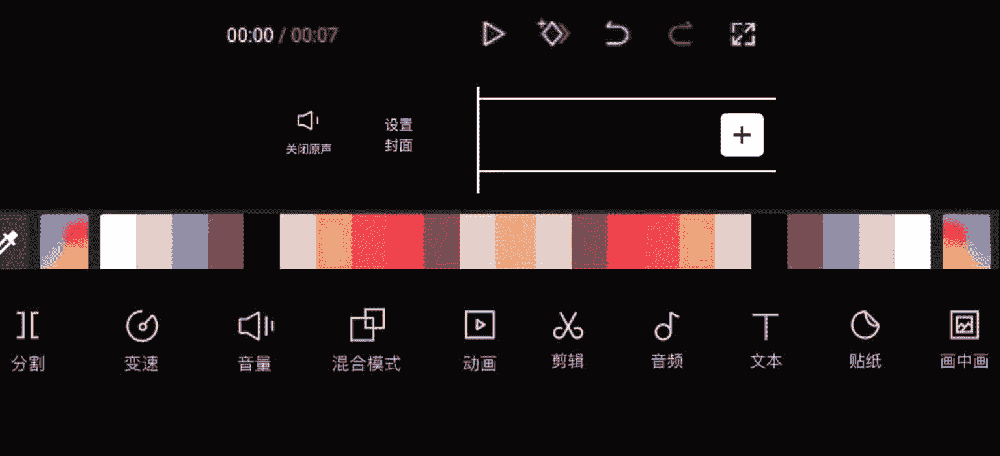

## 1.1 短视频制作全流程拆解
影视解说、种草推荐或是日常分享，看似题材各异，制作背后都遵循同一套流程，如图1-1所示。不同风格会在某个环节加深打磨，但整体框架不会脱离。

图 1-1 短视频的创作流程

### 1.1.1 选题锁定
每一次创作前都要先明确内容的大致方向，既能减少资料搜集成本，也能避免后期跑题。选题时建议把当下热点与自身赛道做强关联。例如热点是“情侣公共场所共饮奶茶”，美食号可定为“情侣一起喝最值得点的奶茶盘点”；科普号可定为“两人同喝一杯奶茶，身体会发生什么变化”；财经号可定为“怎样理财才能摆脱两人抢一杯奶茶的窘境”；情感号可定为“还记得曾与你共饮一杯奶茶的那个人吗”。

### 1.1.2 资料搜集
资料质量直接决定文案、配音的上限。举例来说，影视解说若素材清晰度不足，再精彩的文案也难留住人。需要准备的素材包括配图、视频等。科普类创作常需查阅文献，注意来源可靠与版权合规，避免后续变现时产生纠纷。书中推荐了几类常用视频图片素材网站供参考。

### 1.1.3 文案撰写
文案实质是对搜集资料的提炼消化，再结合短视频表达特点进行原创。专业度不足容易出现硬伤，即便如此也不能抄袭他人。把别人的文案换句式、调整语序或长短句转换，内容大体不变，属于严重侵权，每个创作者都应自律维护行业知识产权。

文案写作要把核心关键词前置，直接点燃爆点，比如“带你认识21世纪最伟大的生物学成果——基因工程”“这三个冷知识关键时刻能救命”等。平台收益通常从播放10秒后开始计算，开头即放关键词有助于提升完播与停留时长。

### 1.1.4 配音制作
文案完成后优先完成配音，切勿先剪辑再配音。因为文案时长固定，先配音才能保证声音与画面节奏统一。

配音方式主要有两种。

① 真人配音：真实自然，常用于产品测评、探店、生活记录。要求吐字清晰、语速适中，若自身条件有限可通过网络平台购买专业配音服务。

② 机器配音：依托语音合成技术把文字转为语音，效率高、可换音色、质量稳定，适合科普、解说等理性且工作量大的题材。如今合成语音已能带出情绪，不会显得僵硬。

录音后要做后期处理：检查错读、口误，删掉“嗯”“啊”“那个”等语气词，排查爆音、音量忽大忽小问题，并适当压缩句间空白，提升连贯感。科普视频之所以紧凑，通常也是在加快语速的同时压缩了停顿。

### 1.1.5 视频剪辑
剪辑要依据作品类型选用对应手法。熟练掌握剪辑软件的基础功能是做出高质量作品的前提。没有规范的剪辑习惯，再丰富的创意也难以落地。

### 1.1.6 封面与标题制作
封面和标题是决定用户是否点开作品的第一道门槛，投入的时间甚至要高于正片本身，因为再好的内容被忽略就等于零。

通常封面选用正片中的关键画面作主体，叠加占画面四分之一以上的文字标题。横版视频需用纯色背景填补上下黑边，保持视觉完整。

### 1.1.7 发布上传
发布时添加关键词话题可实现内容关联分发，提升自然流量。进入上传页点击“#添加话题”，从推荐热榜中选取多个相关话题，完成后如图1-2所示。再点“高级设置”，勾选“高清发布”，如图1-3所示，保证画质；同时可自定义下载、合拍、转发权限。

图 1-2 添加话题
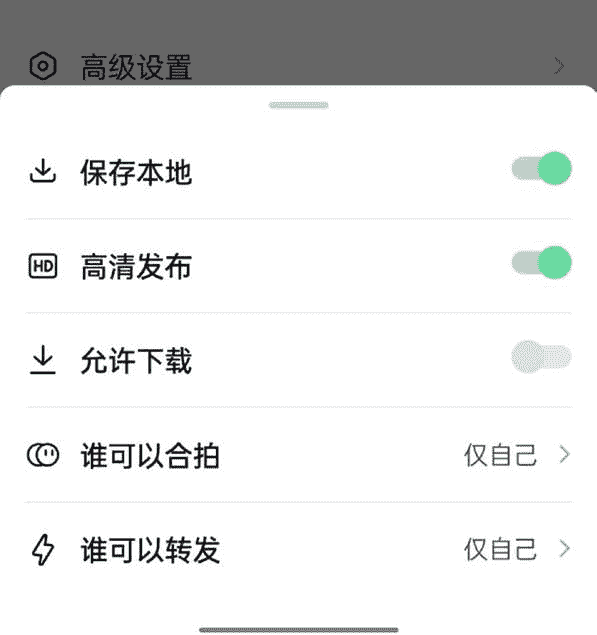
图 1-3 设置高清发布

## 1.2 爆款内容的类型密码
本节面向新手拆解爆款逻辑。优质内容是前提，技巧再多也弥补不了内容短板。以下三种内容形态更易被用户接受：对比创作、好奇心驱动、三农。

### 1.2.1 对比创作
对比创作通过呈现前后或两者的差异制造强烈的心理与视觉冲击。这种手法在传统艺术中也常见，如诗歌的动静对比、绘画的冷暖对比【如图1-4、图1-5】、影视的喧嚣与安静对立等。反差更容易被大脑记住，所以人对突出、反常的事物更感兴趣，在短视频里就演化为“看热闹”的心理，非常适合短时内容快速抓人。
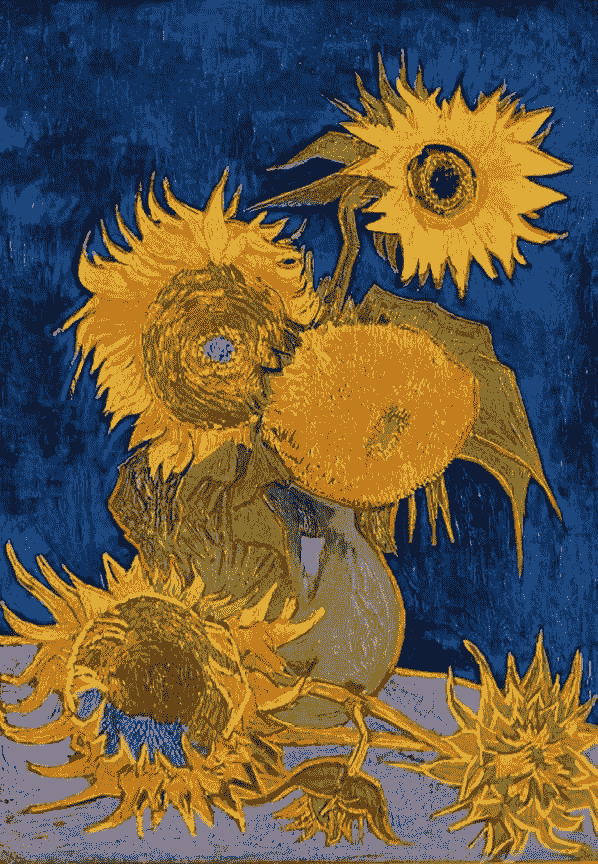
图 1-4 向日葵
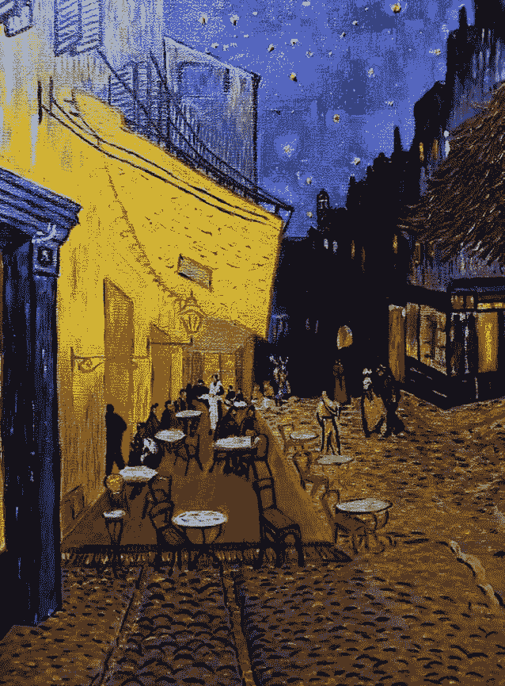
图 1-5 夜间咖啡馆

具体形式包括变装、效果前后对比、打破刻板印象、剧情反转等。变装类视频前半段素颜素衣，配乐铺垫后通过转场瞬间切换妆容、服饰、场景与特效，形成强烈视觉冲击，如图1-6、1-7。
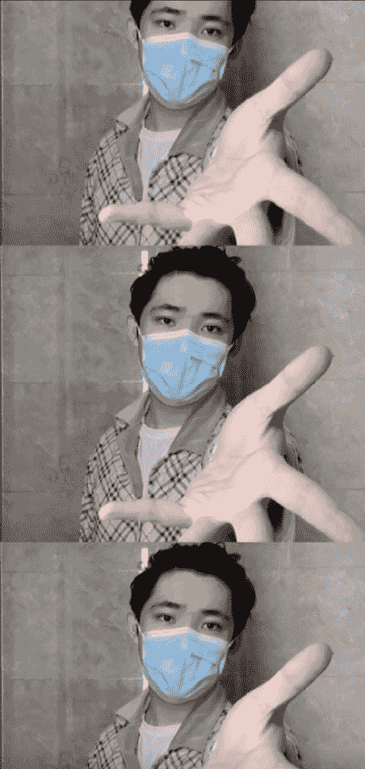
图 1-6 变装前
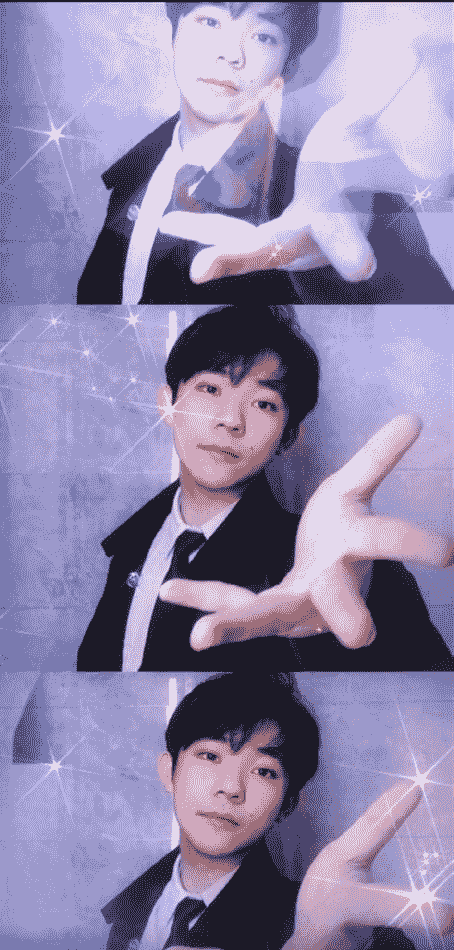
图 1-7 变装后

产品推广也常借此手法，如声卡介绍用使用前难听的演唱与使用后专业级的演唱对比，直观展示效果，刺激购买欲。

打破刻板印象类通过颠覆观众对行业的固有认知吸引注意，比如兢兢业业的保安下班开豪车回家、光鲜空姐在家围裙做家务、沉稳医生业余练街舞、理性程序员激情弹钢琴【如图1-8】，让人物更立体，引发共鸣。

图 1-8 弹钢琴的程序员

相声里的“三翻四抖”讲求铺垫后抖包袱，短视频也可借鉴：少铺垫、多出乎意料，一次反转即可。

### 1.2.2 好奇心驱动
好奇心是人类进化的核心驱动力，善于调动它就能提升完播。美食博主靠拍摄印度小吃出圈，正因异国饮食对大众而言充满未知。

前提是遵循公序良俗与法律法规，不能为博眼球制作低俗或违法内容。曾有美食创作者因食用国家二级保护动物被追究法律责任，值得警惕。

### 1.2.3 三农赛道
三农指农业、农村、农民。2022年我国农业人口约占总人口40%，受众基数庞大。同等质量下，覆盖人群越多爆火概率越高。

三农内容核心是质朴真实，不必刻意猎奇。呈现真实的劳作、习俗即可引发共鸣，因多数城市人对乡村生活怀念或向往。

主要分为两类：一是记录真实乡村生活，如图1-9所示的下水摸鱼场景；二是把乡村作为背景，结合热点拍情景短剧，但剧情需紧扣乡村生活才易获认同。
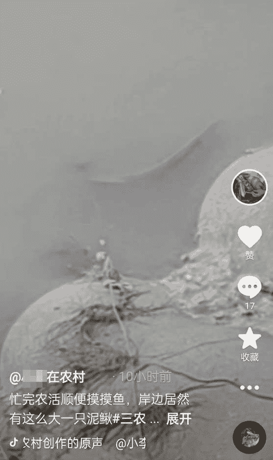
图 1-9 摸鱼视频

## 1.3 封面设计的常见打法
除首页推荐自动播放外，搜索或收藏列表展示的都是封面。一个吸睛的封面直接关系播放量。

### 1.3.1 预设悬念型封面
只展示事件片段并暗示走向，引导用户追问结果。如图1-10，文案“盘点上学时的那些生死瞬间”配合学生打游戏老师站在身后画面，让人好奇后续处理。再如【图1-11】口香糖粘桌上旁放整颗椰子，标题问“口香糖也能开椰子？”并提示“看到最后恍然大悟”，极强好奇牵引。
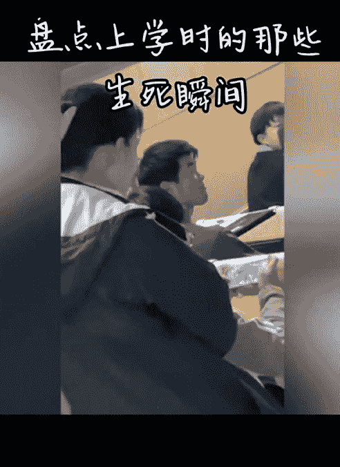
图 1-10 盘点上学时的那些生死瞬间
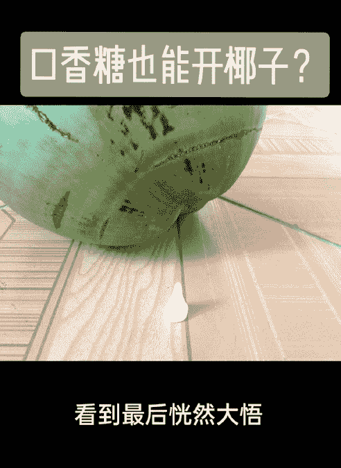
图 1-11 口香糖也能开椰子

这类封面通过画面与文字诱导观众去验证预期，猜对有满足感，猜错有反差感，都能形成正反馈。但内容必须与封面承诺一致，否则会被判定为“封面党”，导致掉粉与限流。

### 1.3.2 效果展示型封面
直接呈现经过加工后的最佳成果作为吸睛点，常用于美食、美妆、手工，展示最终完美状态，如图1-12、图1-13。切忌用半成品或视频中从未出现的内容做封面，否则会因欺骗感失粉。

图 1-12 神奇小玩具
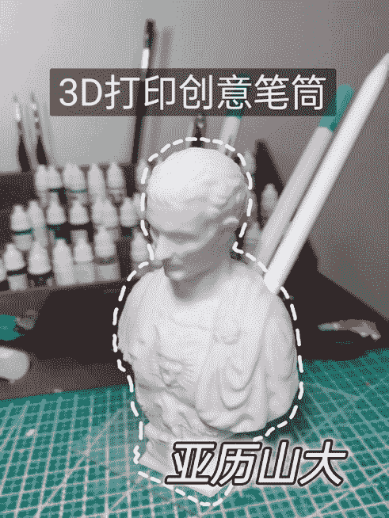
图 1-13 创意笔筒

### 1.3.3 猎奇型封面
用大众少见的新鲜事物填补认知空白，典型如荒岛求生、探险【如图1-14】。也能从日常出发放大数量级，如“一次性放飞一千个气球是什么体验”“1888元龙虾吃到撑是什么体验”。注意避免引发不适，严禁使用恐怖血腥素材。

图 1-14 荒岛求生

### 1.3.4 高光定格型封面
截取视频中最精彩的一帧作为封面，需是大众认可的高光而非个人偏好。多用于体育、艺术、变装等。以【图1-15】为例，舞蹈视频选择最舒展美感的一帧作封面，激发点击欲望。
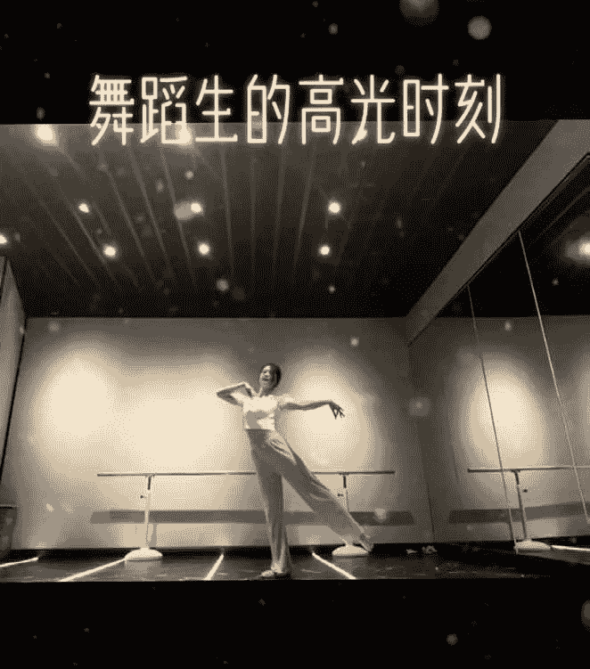
图 1-15 舞蹈生的高光时刻

## 1.4 标题编写方法论
好标题能补全封面未传达的信息，快速抓住注意力。在信息过载环境下，用户会在有限时间内筛选兴趣点，标题的重要性凸显。

编写爆款标题需兼顾吸引力与表达力。吸引力让作品在同质内容中被点开并停留；表达力把内容凝练成一句话，让用户瞬间明白核心价值并产生观看欲望。

### 1.4.1 数字式标题

数字型标题的核心做法，是把短视频里最打眼的数据或要点直接放进封面文案里，用数字把信息打包呈现。人在接收信息时对数字格外敏感，这种写法正是借用数字的跳脱感来快速抓住眼球，同时也能让观众在信息过载的流里更快读懂标题在讲什么。接下来用两个典型案例来说明。

例一如图所示，封面写着“一千块钱改造阳台 在家享受日光浴！”。视频本质上是在讲用有限预算打造阳台的思路。标题把预算上限死死钉在“一千元”，瞬间就有了钩子，让人忍不住想点进去看究竟怎样花一千块就能改造阳台还能晒日光浴。数字的限定也起到了筛选作用，喜欢省钱、热爱晒太阳的人会被精准锁定，不感兴趣的人自然会被过滤，有助于平台把内容推送给更匹配的群体。

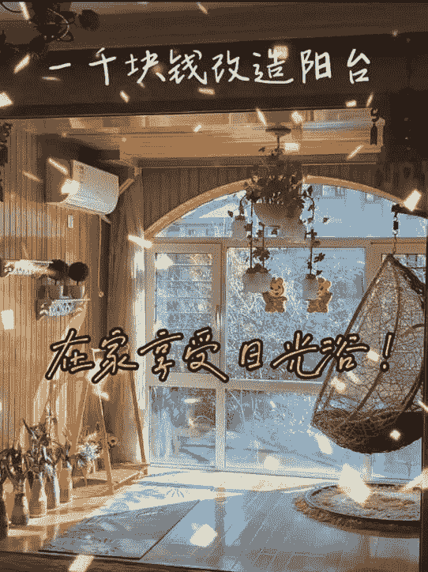

图 1-16 挑战一千块钱改造阳台

例二如图所示，封面写的是“这五本书 穷人从不看 富人偷偷看”。给人一种只要看完这五本就能变富的错觉。先不论书单是否属实，仅就标题而言，它精准勾住了爱读书且渴望提升财富的人。下方的补充文案“总是觉得自己抓不住机会，犹犹豫豫，患得患失，推荐这五本书”进一步收窄人群，让符合描述的观众产生“这条视频就是冲着我来的”错觉，从而提升粉丝的留存度。

结合以上两例可以看出，数字型标题擅长快速聚拢注意力，并把内容意图迅速传达给合适的人群。这类标题在知识科普、美食教程等偏教程型的短视频里尤为好用。

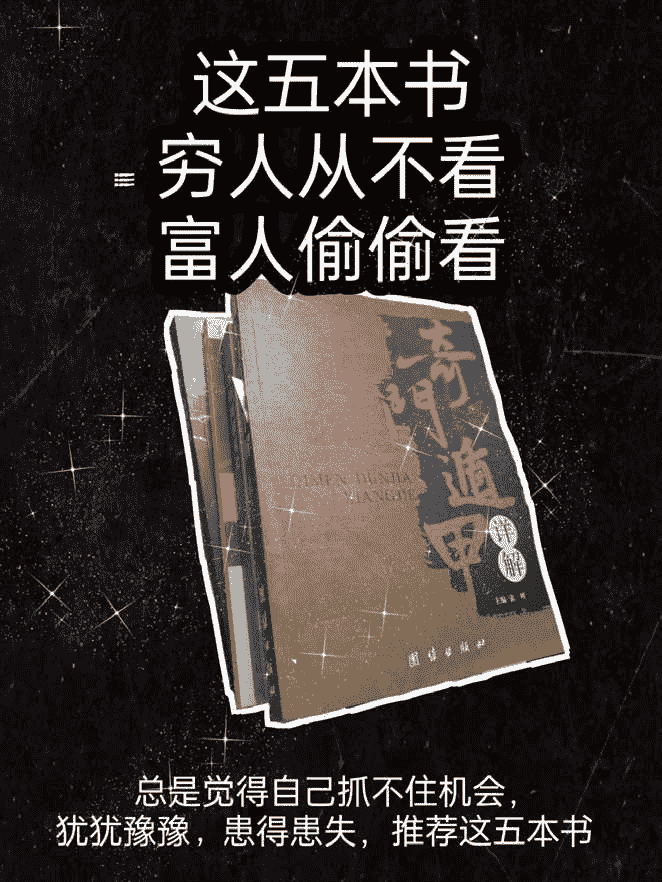

图 1-17 五本书推荐

### 1.4.2 代入式标题
代入式标题的玩法是先把观众拽进一个具体的情境里，眼球被拉进内容后，兴趣自然就来了。比如用第一视角拍摄钓鱼，画面等于是把观众直接放到了钓手的位子上。喜欢钓鱼的人会在细节里找共鸣，没钓过的人也会好奇钓鱼到底是什么体验，于是更愿意停留观看。

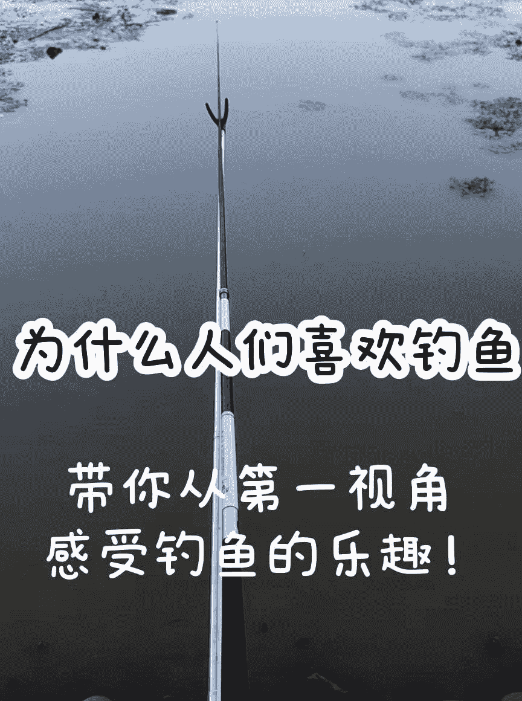

图 1-18 第一视角垂钓

### 1.4.3 恐惧式标题
恐惧式标题捕捉的是人们日常容易忽略的细节，并把忽视这些细节可能带来的坏结果放大，借此制造紧迫感，促使人点开。比如“这五种食物混搭，每种都有致癌风险”“显微镜下的过期食物，看完了你还敢吃吗？”这类表达，都在给观众施加压力和惊慌，让人想立刻弄清楚是怎么回事。

使用这类标题要把握前提：视频内容和用户的切身利益是否相关，能否提供实际价值。如果恐惧的钩子后面接的是一堆无关内容，标题的刺激就毫无意义。

### 1.4.4 神秘式标题
神秘式标题依赖的是人对未知的好奇心。封面只交代事情的前因，刻意隐去结果，诱导观众追问答案。央视《走近科学》系列标题就是典型，如“鱼塘里的金块”“麻烦的石头”“天价鸟之谜”。这些标题都把事件和常识拉开了距离，形成反差感，让人急于知道真相。

以上四类是常用的标题打法，创作者可结合视频属性挑选。无论选哪种，核心原则始终一致：标题只是让作品被看见的入口，必须和内容高度呼应，避免标题党。一旦为博眼球扭曲事实，不仅流量会受损，品牌形象也会受损，甚至可能触碰法律红线。

## 1.5 账号如何获取关注
想要更多人持续关注，核心在于拉长单条视频的观看时长。用时长来强化粉丝粘性，拉近创作者与观众的距离，最终提升商业转化。评价一支作品是否受欢迎，不能只看点击、点赞、收藏，还要看平均观看时长。防的是那种靠夸张封面骗来的虚假数据。

用户在一个视频上停留的时间越久，忠诚度越高，变现能力也就越强。带广告的账号更是如此，铁粉带来的收益远高于泛流量。所以怎么涨粉、怎么留粉，是创作者必须反复思考的问题。

要实现持续涨粉，内容基本要满足垂直、稳定、创新、互动四个维度。

### 1.5.1 内容的垂直性
垂直性指账号在长周期内保持风格和主题的一致。做搞笑影视解说，就不要突然夹杂硬核解析或美食分享。坚持一个赛道并不断深耕，对观众来说是降低选择成本，对创作者来说是提高容错率。观众一旦习惯了你的内容调性，不会因为偶尔一两条质量波动就取关。反之，没有垂直度，就算某条视频运气好爆了，也很难把流量效益扩散到账号整体。

### 1.5.2 内容的稳定性
稳定性是围绕同一风格、同一受众或同一人设持续输出，抵御短期流量的诱惑。不能为了博眼球就随意跑题，不然不仅拉不到新粉，还可能让老粉失望取关。

比如专注武侠影视拆解的号，就应把招式拆解讲透，让观众更懂武侠魅力，而不是跑去搞笑演绎或纯剧情复述。

图 1-19 是一位游戏类创作者的主页，所有内容都是展示某款游戏的顶尖操作，因此吸引了大量游戏核心粉。可见保持稳定输出，是获得目标受众认可的基础。

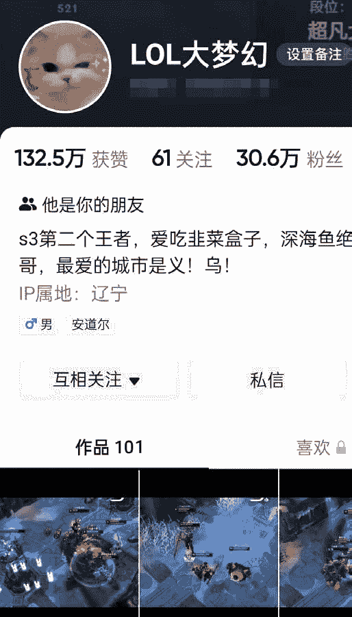

图 1-19

### 1.5.3 内容的创新性
在垂直和稳定的基础上，必须保持新鲜感。有些选题自带创新属性，比如武侠剪辑换着不同片源就能带来新感，游戏实操本身就充满随机惊喜。但也有内容本身偏单一，比如带货。某位雨具带货创作者，视频干练纯粹，以功能演示为主，曾获平台“没有一个动作是多余的”标签，垂直稳定都做得不错，但后期点赞明显下滑，根因就是创新不足。可持续的创新是账号长期被认可的必要条件。

### 1.5.4 内容的互动性
创作者要主动和观众互动，并根据粉丝反馈调整创作方向。互动会让观众感受到被重视，缩短心理距离，提升停留时长。常见方式包括回复评论如图 1-20 所示、私信解答困惑、征求对作品的建议等。

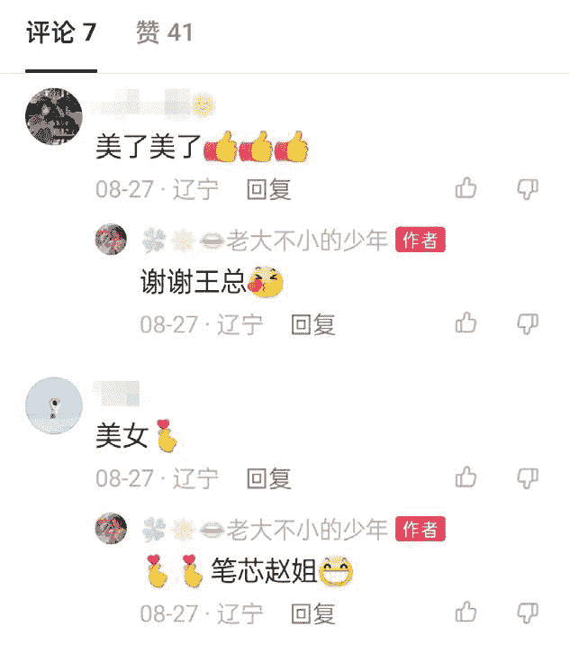

图 1-20 创作者回复观看者的评论

## 1.6 如何引导用户评论
互动的前提是观众愿意开口，而评论是门槛最低的互动形式。下面介绍几种常用的引导技巧。

##### ● 倾诉型引导方法
把观众当成倾听对象，或在剧情里设置一个询问点，用提问把观众拉进预设情境，从而激发表达欲。常用于社会新闻类内容。例如报道一位父亲因孩子不爱学习而带孩子去工地劳动，结尾抛出“如果你是这个孩子的父亲，你会怎么做呢？”，用提问推着观众留言。

##### ● 争议型引导方法
围绕有争议但没有绝对对错的话题展开，让不同立场的人自然发声。比如“大学生在校是否应该兼职”“外卖超时一定要差评吗”“豆腐脑甜的好吃还是咸的好吃”“粽子选肉馅还是枣泥馅”等，因为成长环境、地域习惯不同而产生的分歧，正好能引发讨论。

##### ● “引战”型引导方法
和争议引导相似，但创作者会先亮明自己的立场，例如直接说“豆腐脑还是甜的好吃”。这种表态会吸引持相反意见的人来反驳，同时认同者也会加入讨论。需要注意语气和表达方式，避免让对立方感到被冒犯，否则会适得其反。

## 1.7 短视频的变现模式

### 1.7.1 平台补贴变现
平台补贴俗称创作激励，平台根据播放、点赞等数据直接给创作者现金回馈，目的是激发创作。

短视频是商品，创作者是商贩，平台是提供摊位的商场。与线下不同，创作者不用交摊位费，平台反而给钱，这也是短视频门槛低的原因之一。平台的补贴资金主要来自吸引来的广告主投放费用。创作者做出优质内容，平台获得广告收入再回馈创作者，形成良性循环，关系如图 1-21 所示。

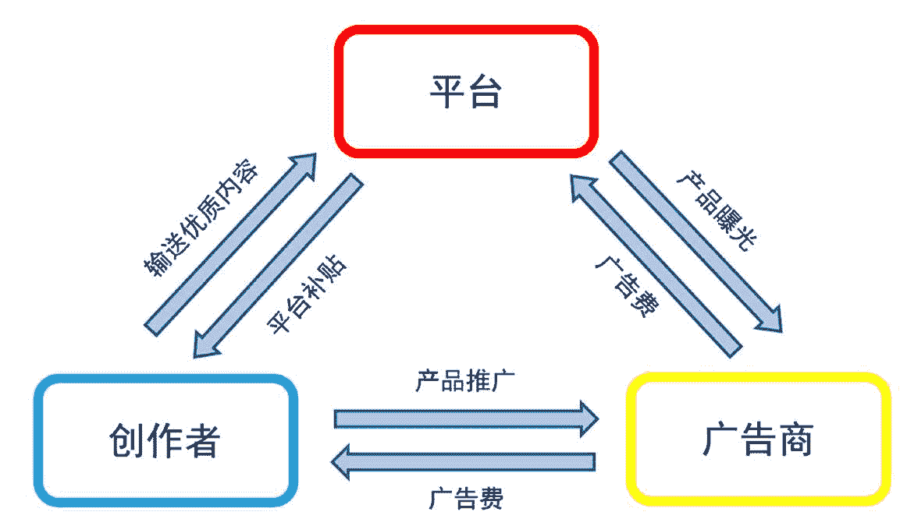

图 1-21 创作者、平台、广告商关系图

### 1.7.2 广告变现
广告变现是创作者与品牌直接合作，通过在视频里曝光品牌来获取收益，是多数创作者的主要收入来源。收益与粉丝量和数据表现密切相关。主要分为广告植入和广告话题分成两种。

##### ● 广告植入
在视频中自然融入品牌信息或进行推荐，从而实现宣传。植入会一定程度影响观感，植入的质量和方式会影响账号后续发展，也会影响下次报价。高风险高回报，要求创作者有较强整合能力。

为了减少违和感，通常会选择与内容关联强的产品，比如游戏号选电子产品，美妆号选护肤品，宠物号选宠物用品。可以通过评测、探店、开箱等形式软性植入。如图 1-22 所示就是推荐加评测结合的饮品植入，图 1-23 显示该创作者长期做饮品评测，因此植入冲调饮料既符合定位又不破坏风格。

图 1-22 冲调饮料的植入

图 1-23 创作者主页

##### ● 广告话题分成
创作者参与品牌方在平台发布的任务，完成要求后获得现金或其他回报。抖音的“全民任务”就是典型。

在抖音首页搜索栏搜索“全民任务”，点击进入列表，如图 1-24 所示，进入任务界面如图 1-25 所示。每个任务会说明收益方式，如直播观看、拍摄视频、互动等。对创作者而言，拍摄视频收益相对更高。可筛选“拍摄任务”只看拍摄类。

部分任务提供示例视频，可参考其风格提高通过率。部分任务有必选和可选，完成可选可额外加分。同一任务每天只能参加一次，容错低，需谨慎制作。

上传后需平台审核，通过后才发布。收益综合计算真实播放、评论、收藏以及内容质量，不能只看播放量。

图 1-24 搜索“全民任务”

图 1-25 “全民任务”界面

### 1.7.3 线下店变现
广告植入适合所有创作者，而线下店变现则专属于有实体门店的人。创作者用自家产品做内容，吸引观众到店消费。如图 1-26 所示为一家西餐厅店主的主页，视频展示菜品，降低观众对新产品的抗拒，简介里附上门店地址，方便到访。

优点是宣传成本低，新品推广及时。缺点是内容偏介绍，娱乐性不足，容易乏味。解决方法是提升拍摄精细度、绑定热点、塑造独特的品牌调性，其中品牌调性最关键。

图 1-26 西餐厅店主的短视频主页

### 1.7.4 其他平台导流变现
刷视频时常会看到“评论区链接参与活动”或“点进主页加联系方式”。这就是把短视频的流量导到微信公众号、淘宝、美团等变现效率更高的平台。跨平台导流不仅能放大收益，也有助于构建自己的内容体系和品牌风格。

# 第二章

拍摄工具的选择

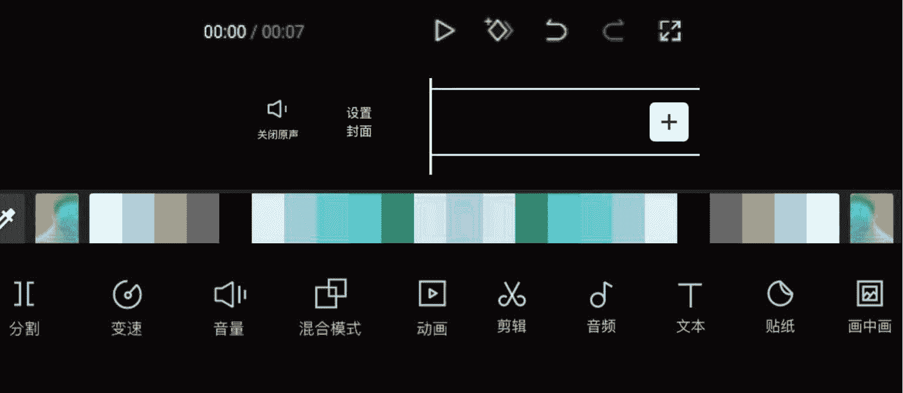

## 2.1 选择合适的拍摄设备
高质量成片往往需要专业器材加持，设备直接决定画面上限。不同拍摄场景也需要不同设备。

短视频创作需要不断练习和尝试，随着水平提升可以逐步升级工具，但核心原则是得心应手才是最好的。

## 2.2 苹果手机拍摄功能介绍
手机拍摄的优势是上手快、便携。利用相机自带的网格辅助线也能拍出结构不错的画面，但相比单反，手机在画质和电影感上仍有限，拍微电影风格就难以胜任。

下面介绍苹果手机拍摄短视频的一些技巧。

### 2.2.1 拍摄慢动作视频
慢动作把画面放慢，能呈现肉眼难捕捉的细节，比如雨滴落地瞬间、扣篮动作的细微变化。

##### ●选择慢动作模式
打开相机，滑动界面选择“慢动作”，点击红色按钮开始录制，再次点击结束。

##### ●选择慢动作帧率
苹果手机慢动作模式提供120fps和240fps两种可选，Pro版本除外，分别代表每秒120帧或240帧，240帧更慢。120帧适合拍人物表情、表演等；240帧适合拍雨滴、奔跑等更快物体。可在“设置—相机—录制慢动作视频”中调整，也可在相机慢动作界面右上角直接修改。

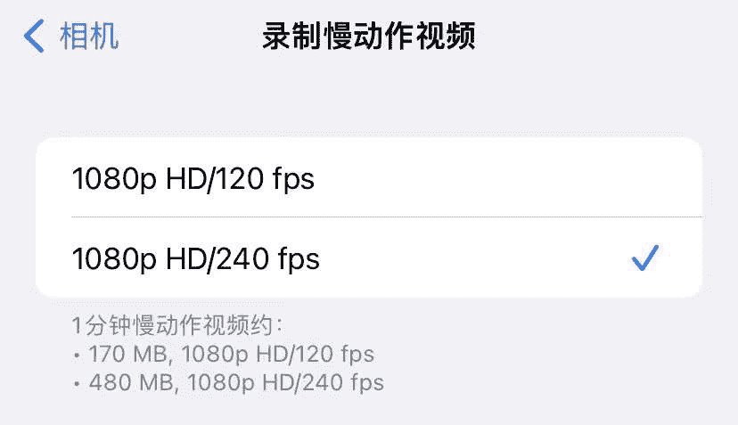

图 2-1 帧数选择

### 2.2.2 延时摄影
延时摄影是把时间压缩，6秒的拍摄压缩成1秒播放，常用于表现时间流逝，比如路边一小时的车流几分钟就看完。

要拍云层快速移动、车流、盛开的花朵等，需要打开延时摄影功能。打开相机向右滑动切换到延时摄影模式，如图 2-2 所示，点按录制即可开始。延时录制中红圈每转一圈计一秒。

建议选干净背景、避逆光的固定机位，提前写好脚本争取一镜完成。延时对存储要求高，拍摄前清理内存。画面需要稳定，可用三脚架或把手机固定在平稳处。注意电量，电量不足时及时充电或接电源，防止录制中途断电。

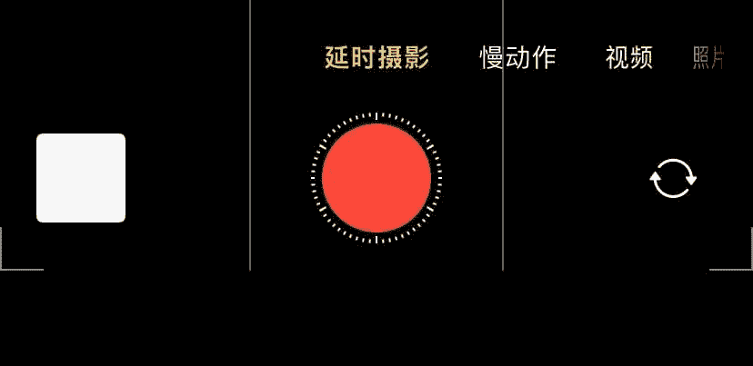

图 2-2 延时摄影界面

## 2.3 安卓手机拍摄亮点

安卓机在影像上的进化一直很明显，对各种拍摄场景都有兼顾，并在吸收优点后做出了自己的创新。

##### ● 特点一：自带修图功能
原生相机自带一套好用的色彩调节方案，覆盖了大部分普通用户的需求。最大的便利在于修图就在机内完成，没有过度美颜，后期剪辑的负担直接降低，拍摄效率随之提升。系统滤镜都是经过筛选的，名字也起得很讨喜，比如“西柚”“马卡龙”“海岛”之类，直接套用后只需微调强度即可。进入拍摄模式就能挑选喜欢的风格，滤镜和美颜组合基本能应对日常大多数拍摄场景。

##### ● 特点二：可模拟单反，打造超广角效果
部分机型搭载大底主摄，夜景表现清晰，还自带变焦。相机里还提供了专业模式，能调节感光度、快门速度等参数，模拟单反的拍摄逻辑，如图 2-3 所示。开启专业模式后配合超广角镜头，特定场景下的出片会更具冲击力。

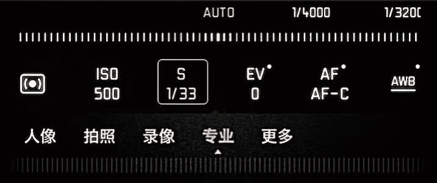
图 2-3 安卓手机的专业模式

##### ● 特点三：视频优化与超级防抖
这里的视频优化主要指相机里有趣的玩法。不同传感器的表现各异，厂商会把成像尽量调到最佳。无论是专业模式还是防抖功能，结合原生相机与第三方剪辑软件，都能得到稳定流畅的画面，玩法也更丰富。

## 2.4 单反相机拍摄能力介绍

单反的画质上限更高，配合高速大容量存储卡可以连录很长的视频，这是手机做不到的。镜头群也非常丰富，人像、静物都有专用镜头可选。缺点也很明显，价格贵、机身重，拍视频时基本离不开三脚架等配件，而且机内模式繁多，需要提前学习专业技巧才能发挥。

想让视频更省心，可以重点关注视频参数、收音、白平衡、网格线、规范录制这五点。

先从画质入手，建议别用自动挡，切换到相机模式并调至 M 档，如图 2-4 所示。再切到视频模式，在菜单里选择视频制式，短片记录尺寸设为“25 帧—all”模式。

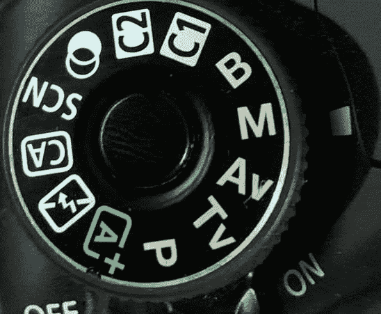
图 2-4 相机模式调至 M 档

涉及同期声时，最好别依赖机内麦克风，内置麦拾音混杂不清。建议外接便携麦克风来保证清晰度。

白平衡能修正不同光源下的偏色，让主体色彩更真实。

拍静物需要精确构图，可在设置里打开“3×3”网格线，如图 2-5 所示。

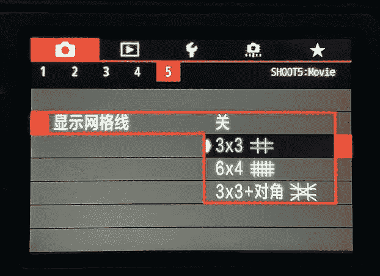
图 2-5 选择合适的网格线

## 2.5 三脚架

手机或单反在固定机位拍摄时，为避免抖动影响观感，支撑工具三脚架几乎必备。

### 2.5.1 三脚架的作用
##### ●精准构图
单反可以调节快门等参数，但手持易晃。用三脚架把设备固定住，就能实现稳定精准的构图，如图 2-6 所示。
##### ●严格控制景深
微距拍摄时，要让主体落在清晰的景深范围内，同时把杂乱元素虚化在景深之外，画面会更干净利落。景深调校要求很高，离了稳定的三脚架很难拍出高质量作品。

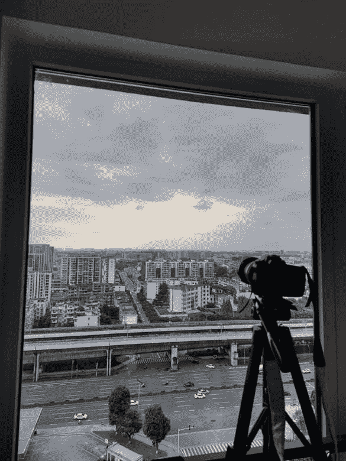
图 2-6 用三脚架固定相机拍摄风景

### 2.5.2 三脚架的使用
三脚架通常分为手机款和相机款，用法和功能不同。

##### ●手机三脚架
适合日常创作，体积小便携，性价比高。下面介绍常见落地式。

落地式多用于测评类视频，高度和长度合适远距离取景，支脚宽大可以稳稳放在地面上，如图 2-7 所示。收起后还能当自拍杆用，户外直播也很方便。部分机型支持蓝牙连手机，远程调高调低。

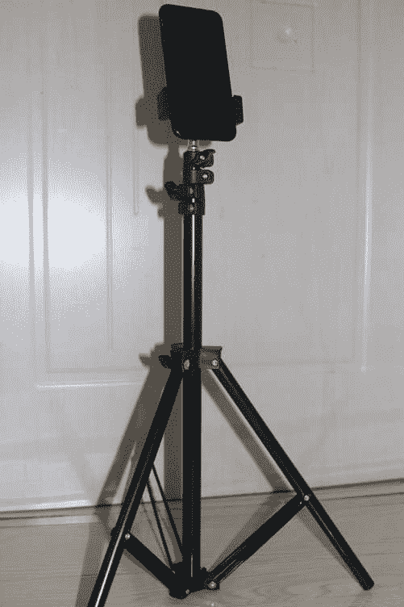
图 2-7 落地式三脚架

手机三脚架的工作原理和相机款类似，把手机卡进固定框，按下录制键即可开拍。

##### ●相机三脚架
使用时注意以下要点。
第一，相机重量不能超过脚架最大承重，否则稳定性会下降。
第二，展开时保持三脚分布均匀，重心稳才安全，偏移可能损坏器材。
第三，低机位拍摄不需要完全展开时，优先打开管径最粗的脚管，承重更合适。
第四，紧固件不能有滑动感，每次拍摄前都要检查。
第五，很多人会把摄影包挂在承重挂钩上做配重，风大的环境下最好别挂，否则包会晃动加剧抖动。
第六，用长焦镜头时，要把快装板装在镜头的脚架环上，重心最稳。竖拍时拧松脚架环固定旋钮旋转相机即可。
第七，定期检查云台锁紧装置，拧紧固定螺丝防止松动脱落。
第八，经常爬楼或登山取景，可选更轻量的三脚架。
第九，尽量别在车辆频繁经过的区域架设，震动会干扰拍摄。

## 2.6 稳定器

稳定器能让画面更顺滑，人物的转场也更自然。

### 2.6.1 稳定器的作用
稳定器可有效抑制手机和相机的抖动，即使在运动中拍摄也能保持流畅。

手机稳定器比相机款更轻便，可手持拍摄，短视频的运镜转场更方便。若对相机稳定器不熟，手机款是更友好的选择。其主要作用有：
①稳定机身，减少颠簸抖动，保证画面清晰。
②内置延长杆，能拍到一些特殊角度。
③续航更持久。
总之，手机稳定器除了防抖，还能降低运镜难度，拍出手持难以实现的镜头。

想要更高画质，可以搭配单反使用合适的相机稳定器，如图 2-8 所示。相机稳定器承重能力强，综合表现更好。但它无法缓解 Z 轴的上下颠簸，手持时仍需自行控制上下稳定。

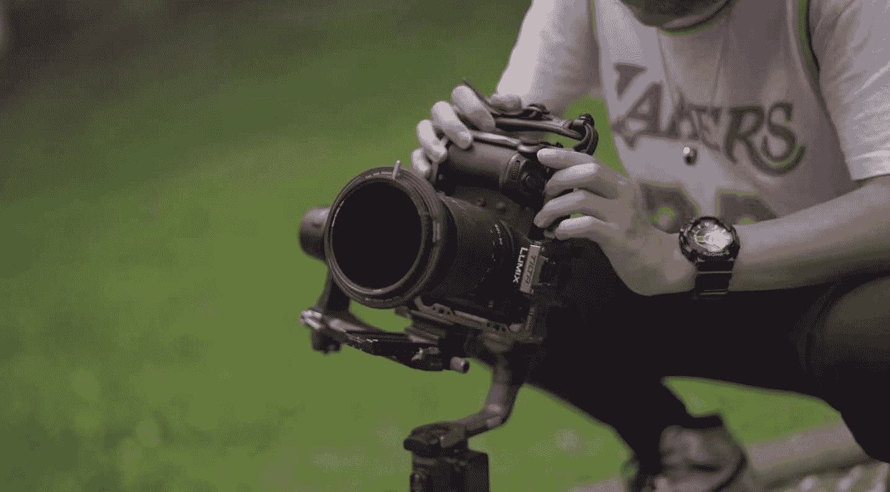
图 2-8 单反安装稳定器

### 2.6.2 稳定器的创意玩法
##### ●跟拍
让人物向前走入镜头，拍摄者跟在后方移动，适合作为片头。也可以在镜头前加一个遮挡物，快速穿过，画面冲击力更强。
##### ●推近与拉远
画面从空中降下并后退，被摄者向前走，衔接会更自然。推近可突出主体，拉远能展现更大场景。
##### ●升降
拍人物走路的脚步时，镜头慢慢上移，由低角度变为高角度，呈现近景到远景的变化。也可以倒置相机由低向高升起，升降可配合跟拍使用。
##### ●环绕
围绕人物拍摄，后期加速，视觉冲击更强。为避免失焦，让主体始终在画面中央，保持合适距离即可。用长焦镜头拉近主体与背景的距离，效果更突出。
##### ●低角度环绕
把稳定器倒置，镜头向上扬，适合表现主体的高大宏伟。
##### ●升起并俯拍
拍摄产品时先以上升角度推近，再俯拍，模拟摇臂效果。
##### ●俯视旋转
近景时旋转镜头再向后拉，后期调节速度，能让镜头更有张力。

## 2.7 灯光设备的选择

光的强弱、冷暖和明暗变化会带来不同的心理暗示。光感强时人会觉得朝气蓬勃，光感弱甚至消失时则显得沉闷失望。暖光带来温暖祥和，冷光则偏寒冷阴森。明暗对比强烈时画面厚重有力，对比弱时则柔和妩媚。所以光对成片影响非常大。

### 2.7.1 灯光设备的作用
拍摄时使用灯光主要有三点作用：一是提升主体亮度，改善暗环境，避免画面阴冷；二是塑造明暗关系，突出立体感，如图 2-9；三是通过不同灯光风格为主体赋予艺术效果。

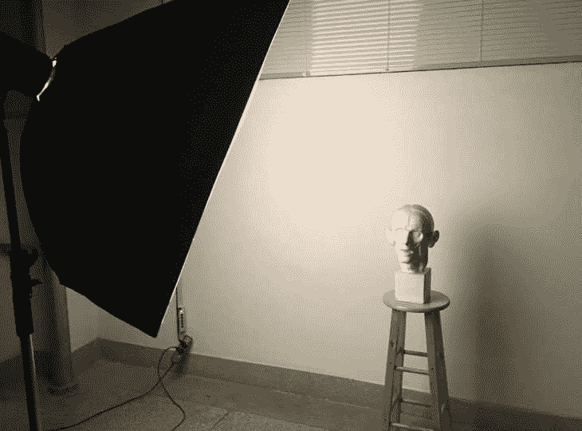
图 2-9 灯光与明暗关系

### 2.7.2 灯光设备的种类
##### ●补光灯
为光线不足的场景补充光源，短视频拍摄常用。热门的有 LED 补光灯和常亮灯。
LED 补光灯常放在主体侧面，弥补其他光源覆盖不足并减少生硬感，如图 2-10 所示。还能加色板营造氛围。
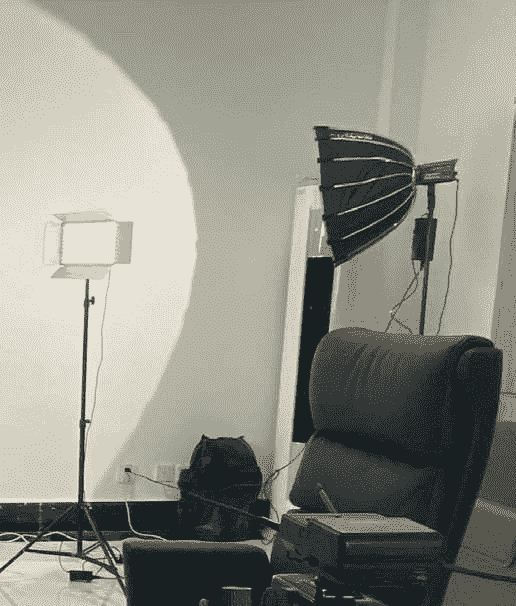
图 2-10 图中左侧为补光灯

常亮灯是棚拍常用灯，常与反光板搭配使用，光线充足，效果明显，如图 2-11 所示。但操作门槛较高，更适合有摄影基础的人使用。可通过配件调节角度，常与闪光灯配合。
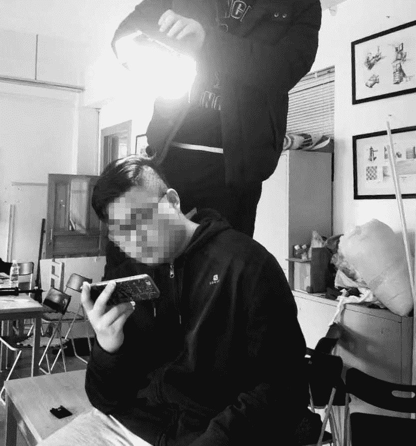
图 2-11 常亮灯的使用

##### ●小闪光灯
体积小便携，不用外接电池，直接由相机供电。
##### ●落日灯
英文名 HaloEdition，是一种制造光晕氛围的灯。光线类似落日黄橙红渐变，形成夕阳氛围感，通过透镜折射产生装饰性照明，本质是投影灯具。
##### ●棒灯
棒形补光灯由灯组和控制模块组成，灯组多为 LED 灯珠。与环形灯相比打光面不均匀，更适合侧位局部补光。部分机型有彩色模式和特效模式，可自定义颜色或模拟雷电、警车灯等特效。

## 2.8 收音设备

手机录音容易带环境噪音，且主体离设备远时声音会发散，严重影响成片质量。通过外接设备降噪提音是关键。麦克风是常用解决方案，能明显提升短视频收音效果。

讲解类、测评类视频可搭配无线领夹麦，主要由发射器和接收机组成，收音范围广，可插在手机或相机上使用。说话人活动自由不受线缆限制，人声采集更清晰。单人拍摄、无团队支持时尤其合适。

## 2.9 反光板

反光板利用光线折射为暗部补光，让画面更明亮和谐，图 2-12 为典型使用方式。

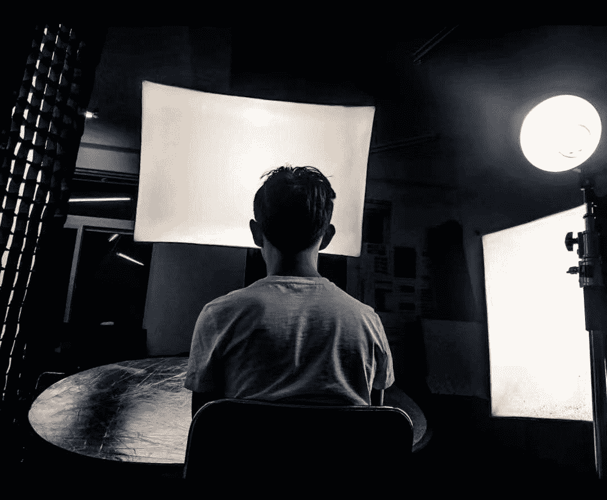
图 2-12 反光板的使用方法

拍人像时，主要用于补眼神光，让眼睛更有神，同时提亮面部、柔化肤质，还能减轻黑眼圈和法令纹。光线不足时至少备一块，人员充足可用两块。不同颜色反光板效果不同。
##### ●白色反光板
光线柔和自然，可为阴影处补光，淡化阴影。
##### ●银色反光板
光线更亮，弱光下补光效果好，容易在眼睛里形成高光。阴天顶光时可放在脸下方，将顶光反射到面部。
##### ●金色反光板
色温偏暖，适合日照条件下补光，常作主光。逆光人像时从侧上方反射光线到脸上，可提升面部曝光，减少前景背景曝光差距，避免背景过曝。
##### ●黑色反光板
不增加光量而是减少光量，可强化面部立体感和轮廓。

## 2.10 手机外接镜头

手机镜头为定焦，焦距固定，无法兼顾大场景和近距离透视。当需要容纳更多元素或强化近大远小效果时，外接镜头就派上用场。

##### ●微距镜头
像放大镜一样捕捉肉眼难见的细节，还能拍出漂亮的背景虚化，如图 2-13 所示。建议选拍摄距离较远的长焦微距。
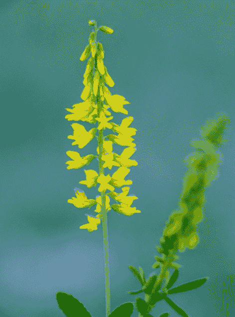
图 2-13 微距镜头的拍摄效果

##### ●电影镜头
可拍出拉丝光晕和超广视角，如图 2-14 所示。需配合专业软件实现窄画幅效果，但拍摄高速移动物体时会出现“果冻效应”，画面弯曲抖动。
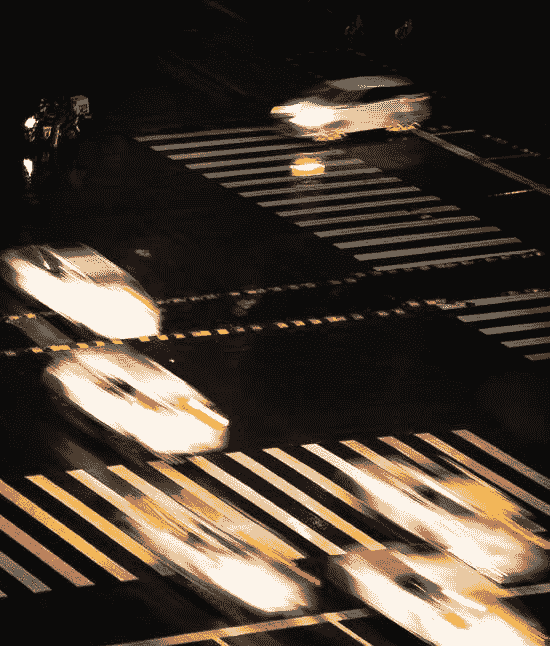
图 2-14 电影镜头拍摄效果

##### ●鱼眼镜头
视角极广，变形夸张，动感和空间感突出。一般来说视角越广抖动越不明显，即使被摄物移动很快画面也可用。能把小空间呈现得更具冲击力，如图 2-15 所示。
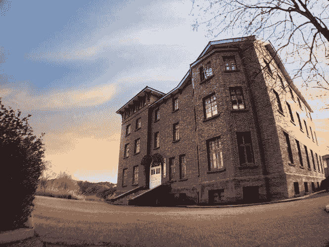
图 2-15 鱼眼镜头拍摄效果

##### ●长焦镜头
手机在远距离取景上弱势，外接长焦可弥补。受重量影响，手持稳定性差，使用时必须搭配三脚架，装好后调焦对准主体拍摄，效果如图 2-16 所示。
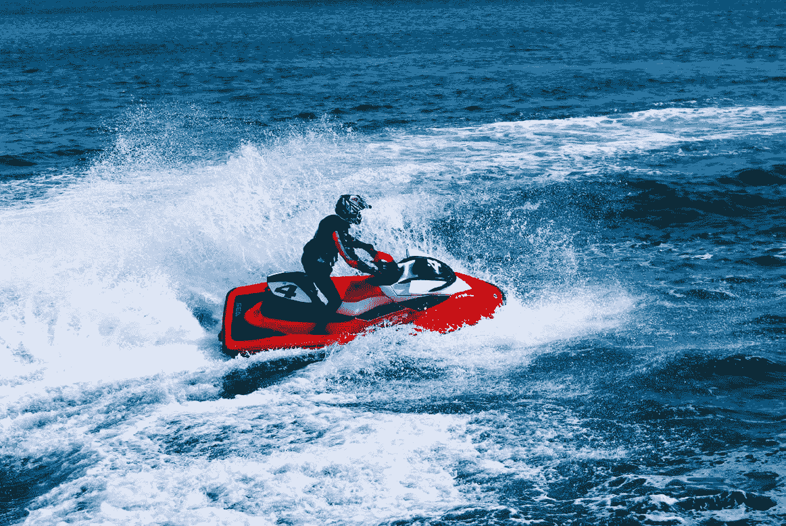
图 2-16 长焦镜头拍摄效果

## 2.11 无人机

无人机航拍画面清晰、比例尺大、覆盖面积小且现势性高，特别适合学校、公路、景点、水库、海岸线等大场景的全景拍摄，如图 2-17 所示。操作方便，遥感灵敏，转场顺畅。体积小降落点好选，稳定性安全性高，使用人群持续增长。

图 2-17 航拍图片

航拍新手常犯的错误可归纳为以下几点：
①熟记操作教程，先在开阔场地试飞，保证在视线范围内。熟练后再选近距离起飞点，避免撞到障碍物。
②日常维护要做好，起飞前后检查螺丝是否牢固、桨叶是否完好、电机是否正常、电压是否稳定，遥控器电量也要充足。
③注意信号干扰，热门航拍点多机作业易互相干扰，应选择干扰小的起飞点。
④注意续航，满电约支撑 20 分钟，要提前规划拍摄内容，留足返航电量。
⑤关注天气，大风易失控，大雾会丧失避障能力。新手尽量近距离飞行并降低速度。
⑥遵守规定，确保航拍区域合法，持证飞行，限制高度区域内按规定空域作业。
⑦及时转存数据，故障可能导致素材丢失，每次降落后及时更换存储卡并备份。

# 第三章
短视频中常用的拍摄技巧

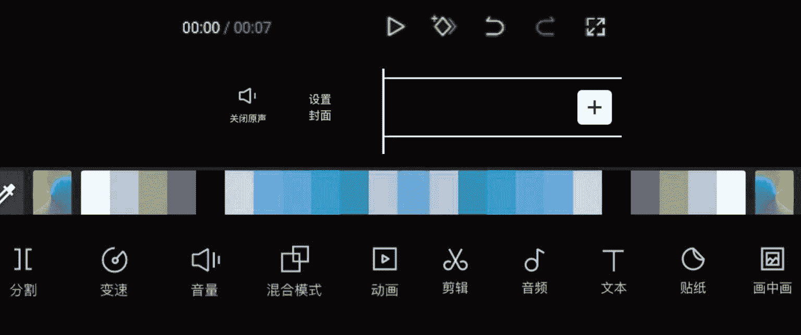

## 3.1 镜头运动诀窍

镜头运动，通俗地讲就是让相机自身移动来记录被摄物体的变化，是为画面注入情绪与氛围的核心手段之一。无论是商业影视还是日常记录，运镜水平的高低往往能看出专业与业余的差别。虽然要吃透运镜并不容易，但入门门槛很低，掌握几种基础手法并灵活组合，就能应对绝大多数拍摄场景。

新手容易遇到抖动，常见诱因有三类。

① 设备过重且未搭配稳定器或支架。

② 移动时速度过快、幅度过大。

③ 在行驶的交通工具上拍摄。

想把抖动降到最低，可从三方面入手。

① 选对重量。手机等轻型设备双手稳握；大机身则配稳定器或三脚架。

② 慢下来匀速走。尽量降低镜头与身体的移动速率，保持匀速，特殊创意除外。

③ 挑平稳场地。条件允许时优先在平坦稳定的地面拍摄。

### 3.1.1 推拉镜头

推镜是让镜头沿拍摄轴线缓慢靠近主体，压缩与主体的距离。画面因此更聚焦、主体更突出，常用来展示或强调重点。

拉镜则是反向操作，镜头逐步远离主体，带入更多环境信息。主体感会被削弱，视线被引导向四周，适合营造氛围或作为段落转场。

变焦也能模拟推拉效果，但画质会受损，所以更推荐物理推拉。

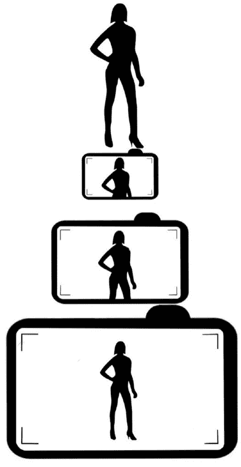

图 3-1 推镜与拉镜示意图

### 3.1.2 平移镜头

推拉是在镜头连线上前后移动，而平移的运动方向与之近乎垂直。同一平面内滑动时，被摄物的大小基本保持不变。

平移多用于信息铺陈，呈现出一种流水账式的叙述节奏，给观众更多内容。

操作要点是轨迹要走直线，保持机位角度不变，避免透视变化导致形变。

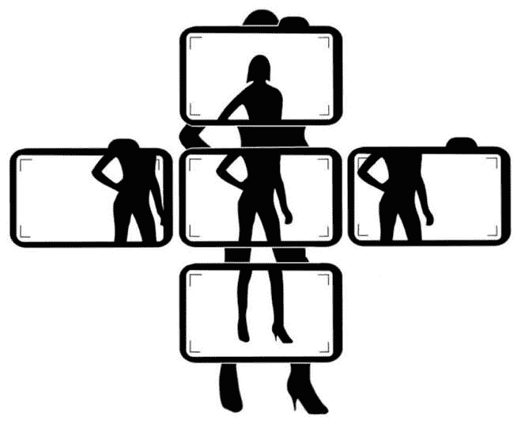

图 3-2 移镜示意图

### 3.1.3 摇镜

摇镜是在虚拟球面上做弧形旋转，让镜头转向。机位本身尽量固定，通过转动改变视线。

近距离摇镜易产生变形，所以更适合中远距离对象。

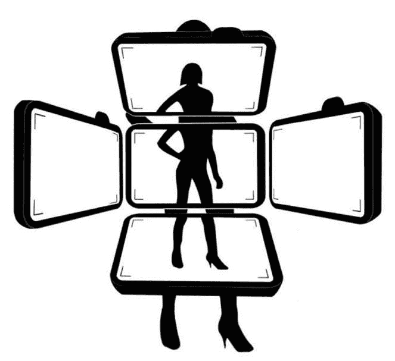

图 3-3 摇镜示意图

### 3.1.4 转镜

转镜与摇镜都靠转动实现，但旋转中心不同。摇镜以摄影者为轴，转镜则是围着被摄主体或镜头本身转，如图 3-4、图 3-5 所示。以主体为中心的转镜能呈现多维度外观；以镜头为中心的转镜常见于航拍或俯拍。

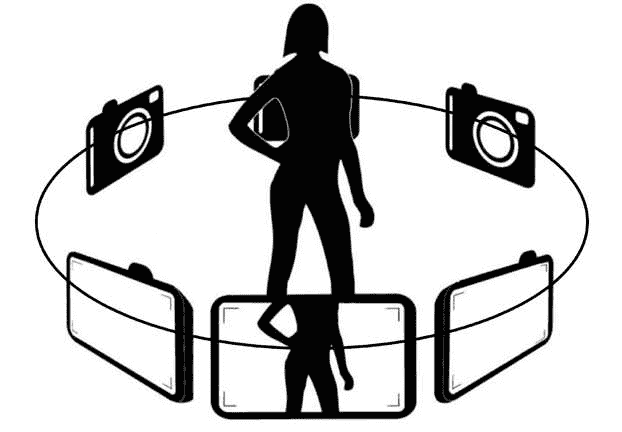

图 3-4 以拍摄对象为中心的转镜示意图

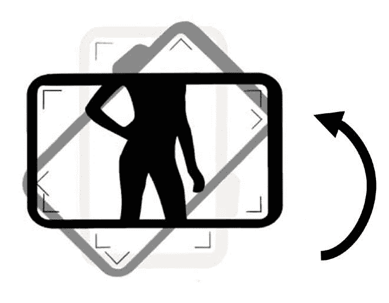

图 3-5 以镜头为中心的转镜示意图

### 3.1.5 跟随镜头

跟镜让镜头与被摄主体同步移动，示意图如图 3-6 所示。它融合了平移与转动的特质，既能扩大信息量，又能保持画面主导权。因为视觉中心稳定，观感贴近真实生活，能带来强烈沉浸感。

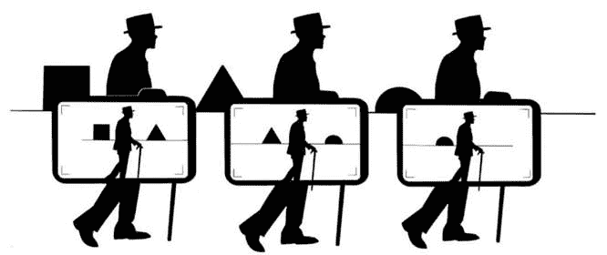

图 3-6 跟镜示意图

## 3.2 景别选择

景别由镜头与被摄物距离决定，在固定焦距下决定主体在画面中的占比。不同景别带来截然不同的视觉感受。常用分为大特写、特写、近景、中景、远景、全景。

### 3.2.1 大特写与特写

大特写和特写都让物体几乎填满画面，用来强化和突出。区别在于，特写更偏向整体轮廓，展现电影胶片的形态；大特写则聚焦于细节，着重展现电影胶片磨损的痕迹与胶片呈现的场景。两者因焦距关系常虚化背景，主体更加醒目。

图 3-7 特写示例

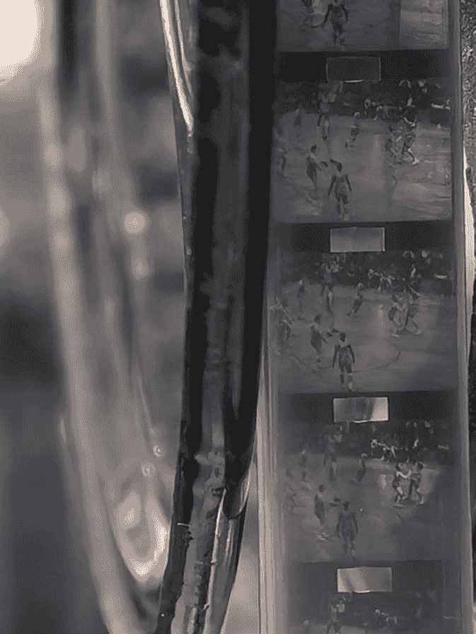

图 3-8 大特写示例

### 3.2.2 近景

相比特写，近景对主体信息的压缩更弱，但能更好地渲染氛围并带入环境，光影、布景都能被呈现。如图 3-9 所示，蝴蝶与花朵同时被表达。背景同样会虚化。

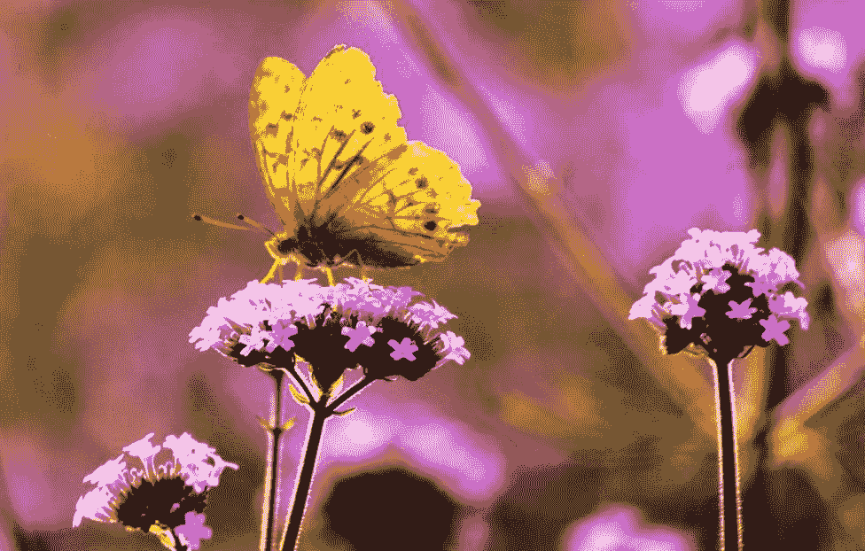

图 3-9 近景示例

### 3.2.3 中景

中景是人物拍摄的主力景别，如图 3-10 所示。它兼顾神态、动作与所在时空交代，是信息量最均衡的选择。

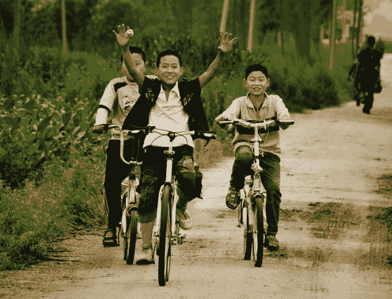

图 3-10 中景示例

### 3.2.4 远景

远景偏向大体量物体，主体的存在感被弱化，重点在于交代环境，如图 3-11 所示。影视中常用于段落开端或收尾，为事件定场或衔接下一幕。

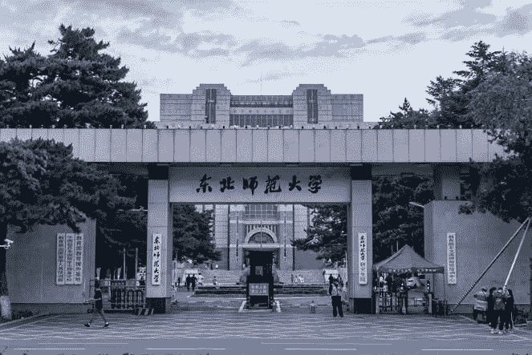

图 3-11 远景示例

### 3.2.5 全景

全景里主体几乎消失，或说整个画面皆为主体。主要用于宏大场景，多用广角拍摄，常用于商业宣传与地域推广，提升气势，如图 3-12 所示。

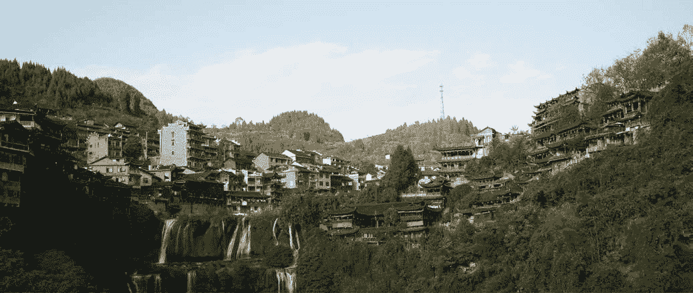

图 3-12 全景示例

## 3.3 拍摄视角

多变的视角能让视频更具表现力与新鲜感，更容易获得高播放。下面介绍常用视角。

### 3.3.1 平视角度

平视指镜头与主体保持水平，接近人眼自然观察角度，形变最小，还原度高。环境杂乱时易出现主体与背景重叠。如图 3-13，可提升主体色彩对比突出；如图 3-14，也可通过虚化背景分离主体。

平视画面常出现地平线、波纹、分割线等天然稳定线，如图 3-15 中的地平线、海浪纹、田垄。这些线条能稳定构图。

同时可加入气球、停车场等元素丰富画面层次，营造临场感。

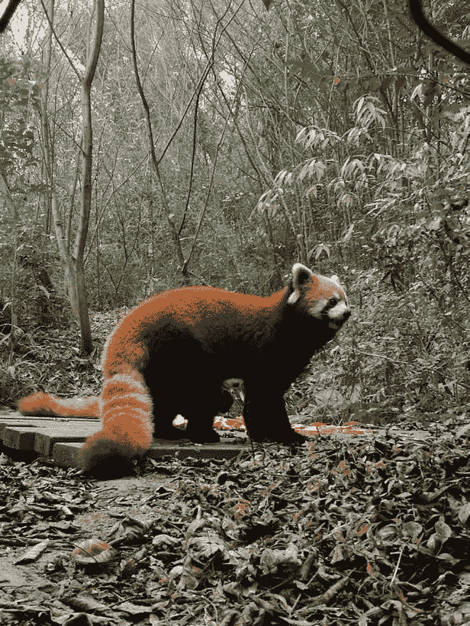

图 3-13 平角度示例 1

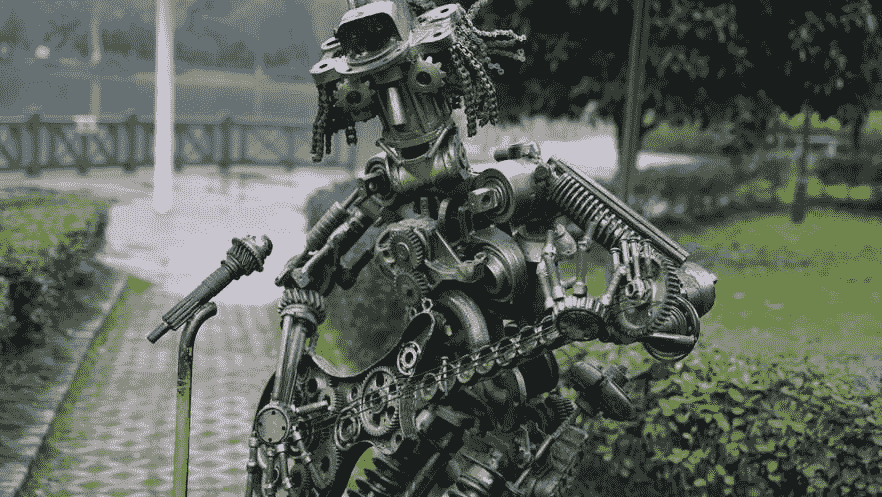

图 3-14 平角度示例 2

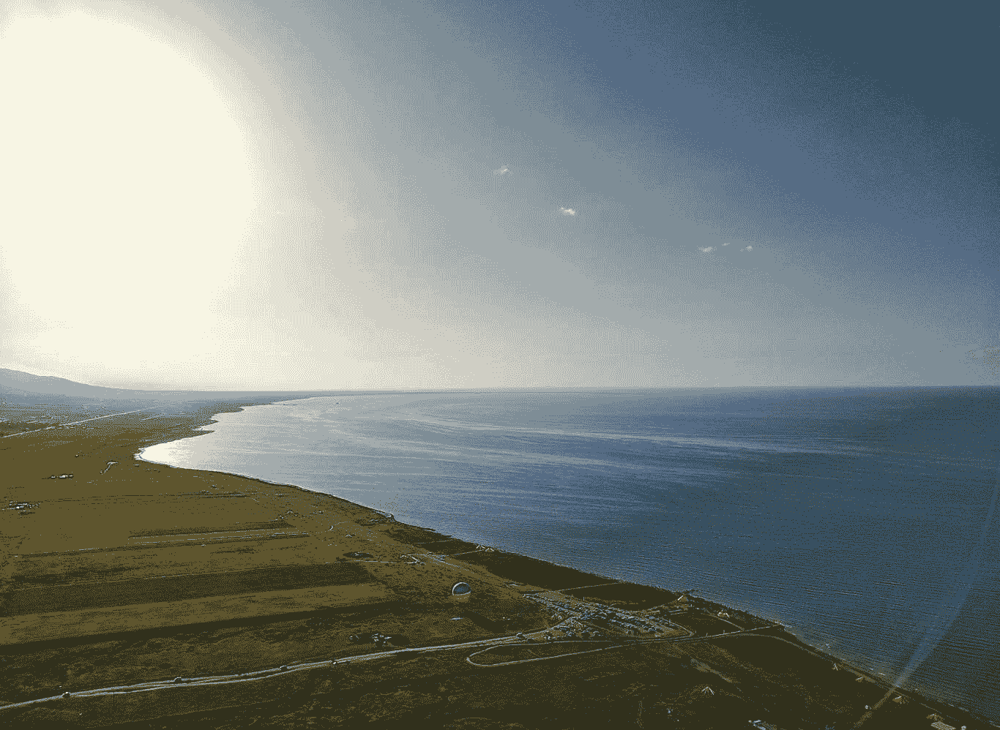

图 3-15 平角度示例 3

### 3.3.2 俯视角度

俯视指镜头位于主体上方。需要呈现全貌时效果好，居高临下视野更广，如图 3-16 所示。注意三点：

##### ●位置的选择

越高位置越能形成自上而下的视角。

##### ●突出主体

高位拍摄易元素繁多，需强化主体。

##### ●设备器械的选择

常用三脚架固定，或无人机航拍获取更广视野。

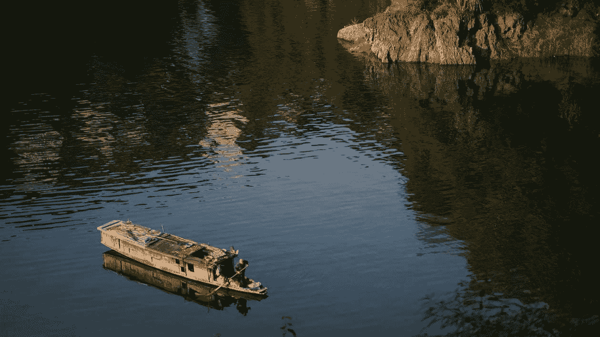

图 3-16 俯视角度示例

### 3.3.3 仰视角度

仰视指镜头低于主体。能让主体显得宏伟，常用于去除杂乱信息。如图 3-17，以天空作背景能勾出轮廓并保持画面干净。

现代建筑仰拍应用广泛，如图 3-18 所示，透视被拉伸，产生高耸入云的冲击感。

图 3-17 仰视视角示例 1

图 3-18 仰视视角示例 2

### 3.3.4 人像的拍摄视角

视角决定人物表情与形体的表现力。

##### ●从正面拍摄

能真实还原人物特点，但画面易单调，需加入甜点等装饰丰富，如图 3-19，人物的神态和动作自然。

图 3-19 人像正面镜头示例

##### ●从背面拍摄

看不到表情，环境与氛围承担叙事，如图 3-20，公交站牌下的少女在灯光下有落寞之感却不失美感。

图 3-20 人像背面镜头示例

##### ●从斜侧面拍摄

斜侧能凸显立体感，轮廓更清晰，如图 3-21 所示。

图 3-21 人像斜侧镜头示例

## 3.4 画面构图

构图是把人物、景物按规则排列以产生美感的方法。大方向分横构图与竖构图，可细分为中心构图、对称构图、九宫格等。

构图需结合光影、景别、视角，且没有固定公式。同一场景因拍摄者水平与风格不同而呈现差异，需多练习、多借鉴。

### 3.4.1 横构图

传统影视以横构图为主，契合人眼水平视角大于垂直视角的特性，观感更沉浸。拍摄宏大场景或多人合影时也常用，如图 3-22 所示。

图 3-22 横构图示例

### 3.4.2 竖构图

影像载体从大屏转向手机平板后，竖构图兴起。手机近距离观看时视角限制减弱，且短视频时代以突出个人为核心，竖构图更利于表现人物，如图 3-23 所示。

竖构图也能表现纵深，如图 3-24 所示。小巷、山峰、高楼在收窄的左右视角下产生压迫感与通透感。

图 3-23 竖构图示例 1

图 3-24 竖构图示例 2

### 3.4.3 中心构图

把主体置于画面中央，是最直观的突出手法，常用于单一主体或移速较慢的物体。如图 3-25 所示，主体偏离中心会失衡。

对称结构物体用中心构图能体现庄重与和谐，如图 3-26 所示。

图 3-25 中心构图示例 1

图 3-26 中心构图示例 2

### 3.4.4 对称构图

对称构图常借助水面或镜面反射，同时呈现现实与倒影，揭示联系。对称轴多在画面中央，提升层次感。如图 3-27 所示，水面倒影形成虚实对比。

对称并不要求完全一致，如图 3-28，图中小巷两侧的建筑与牌匾并非完全对称，但在数量和布局上基本保持平衡，也能达成对称效果。

图 3-27 对称构图示例 1

图 3-28 对称构图示例 2

### 3.4.5 辅助线构图

辅助线构图即用四条线把画面分为九部分，利用黄金分割约1∶0.618的比例。焦点位于线条交点，主体尽量落于焦点或线上。

如图 3-30，画面中的塔位于右下角的辅助线交点，画面看起来十分和谐。主体也可在辅助线上，如图 3-31，画面中男子身体的重心位于左侧的辅助线上，使画面显得稳定。

多个元素时可分别落点，如图 3-32，画面中两个少女分别位于下方辅助线的两个焦点处，环境中的树木、小桥、岸边石台等也在一定程度上遵循辅助线构图原则。

图 3-29 辅助线示意图

图 3-30 辅助线构图示例 1

图 3-31 辅助线构图示例 2

图 3-32 辅助线构图示例 3

### 3.4.6 引导线构图

引导线构图利用场景中线条引导视线，形成“往这里看”的指向感。透视带来的空间感增强代入感，放射线条更具冲击。

如图 3-33 与图 3-34 所示，利用环境中物体的结构线条构建成的引导线进行构图。

图 3-33 引导线构图示例 1

图 3-34 引导线构图示例 2

除了线条结构之外，光线本身也能承担引导视线的功能。比方说借助车灯流串形成的动感轨迹来组织画面，如图 3-35 所示。清晨林间漏下的光束也是这类运用的典型场景。

图 3-35 引导线构图示例 3

引导线不一定非得是笔直的。如图 3-36 所示，河岸两侧的山体并未直线延伸，而是呈现出向远方推移并逐渐收拢的走向，这种趋势感的线条同样可以发挥引导作用。

图 3-36 引导线构图示例 4

### 3.4.7 框架构图

观察身边的陈设会发现，墙上或桌上的照片大多装在相框里，相框不仅提供支撑，还带来美感、分层以及与环境的区分。摄影构图时也可以寻找画面中可充当框体的元素，让主体更突出，相当于给画面加框。如图 3-37 所示，地铁路厢里形形色色的扶手把空间切割开来，每个小块既相对独立又相互关联，车厢内的任何一位乘客都能成为焦点，合在一起又构成整幅画面。

图 3-37 框架构图示例 1

框体不必是规整固定的形态。如图 3-38 所示，前方杂乱的植被组合起来便构成了一个自然相框。运用这种不规则的框来构图，画面能在虚实之间切换，空间层次更清晰，看起来也更有韵味。

图 3-38 框架构图示例 2

### 3.4.8 三角形构图

三角形构图即把画面元素按照三角形的骨架来安排。三角形态可以是正的、斜的或倒置的。一般可归为两类：一类是单主体构图，主体本身的三个关键点自然构成一个稳固的三角形，借助主体自带的三角特征来组织画面；另一类是多主体构图，通过变换机位或角度，让若干主体在画面中呈现出三角分布。三角形是几何上最稳的形态，能带来安定又不失变化的感受。人物若以动态姿态形成三角，也会比静态站姿更富生命力。如图 3-39 所示，借助三角形的布局，画面摆脱了平面感，立体感明显增强。

图 3-39 三角形构图示例

### 3.4.9 留白构图

摄影里特意在画面保留空白区域的作法就叫留白。空白可能是天空、草地或海面，也可能是在人物注视方向预留一段空地。这样的留空为观者提供想象余地，让作品的意蕴更丰富，如图 3-40 所示。

图 3-40 留白构图示例

### 3.4.10 对角线构图

对角线构图又称斜线构图，核心是把主体放置在画面对角线上，且主体本身带有线条特质，这个线条可以是直的也可弯曲。如图 3-41 所示，将桥放在对角线上，画面立刻有了纵深、延伸和动势。

与横平竖直的常规排布相比，斜线构图更能打破呆板，提升美感与冲击力。

图 4-41 对角线构图示例

# 第四章

剪映软件快速上手

## 4.1 认识主界面

工欲善其事必先利其器，想要做出好看吸睛的短视频，熟悉一款顺手的剪辑工具是关键。

市面上剪辑软件种类繁多，新手选型容易犹豫，其实核心思路都大同小异，只是上手方式差异。以下以抖音自家的剪映作为示例，从零讲解短视频剪辑的思路与操作。打好基础后，再学其他软件会更轻松。需要注意的是剪映会持续更新，部分操作细节可能与最新版有出入，请自行灵活调整。

### 4.1.1 “剪辑”界面

启动应用后，点击左下角剪刀图标即可进入剪辑页面，如图 4-1 所示。页面整体分为上方的创作区和下方的草稿区。

创作区：位于界面上部，集中了拍摄前的准备功能。

草稿区：位于界面下部，用于存放项目过程中的各项素材，比如未完成的片段、导入的音轨、生成的字幕稿等，支持反复修改。须注意，剪映采用调用手机本地文件的机制，并不复制文件到应用内部，所以不要在手机里随意移动或删除项目所用到的视频、图片、音频，一经变更对应片段会无法显示，严重时会导致整个项目损坏。

图 4-1 “剪辑”界面

### 4.1.2 “剪同款”界面

点开底部的“剪同款”即可进入对应页面，如图 4-2 所示。简单说就是借助官方或用户制作好的模板来快速完成剪辑。好处是出片快、质量有基本保障，适合零基础的创作者。不足也很明显：模板质量参差不齐、价格差异大，挑模板要花时间；而且依赖模板难以形成个人特色，长期来看不利于打造个人品牌和变现。

因此，若你只是平时刷视频，偶尔分享生活，或看到某个作品很喜欢想快速复刻，“剪同款”就很合适。假如你打算把短视频当成职业来做，仅靠它是不够的。

下面先介绍一下具体使用方法。

图 4-2 “剪同款”界面

顶部搜索栏可直接输入模板名称进行查找，适合已知名称的情况。

搜索栏下方是分类入口，可按风格快速浏览同类模板，并会有抖音官方推荐的热门标签，适合有大致想法但对具体手法没有明确需求时使用。

举例卡点类，点击“卡点”后下方列表会全部变成卡点相关的模板，如图 4-3 所示。

图 4-3 “卡点”界面

以《再见莫妮卡》为例，进入后如图 4-4 所示，会先播放预览效果，下方会列出所需素材。此模板共需8段视频，合计11秒。点右下角“剪同款”进入素材选择页，如图 4-5 所示，可选相册已有素材或直接拍摄。选择“相册导入”后，从相册挑选片段并裁剪到模板要求的时长，确认后完成一段的选取。重复操作直至8段全部导入，再点“下一步”进入预览页，如图 4-6 所示。播放查看成片，不满意可随时裁剪或替换素材。确认后点右上角“导出”，导出结束会显示如图 4-7 的界面，可点“完成”退出，或在下方直接分享到各平台。

图 4-4 《再见莫妮卡》模板

图 4-5 素材选择界面

图 4-6 预览界面

图 4-7 导出完成界面

### 4.1.3 “创作课堂”界面

创作课堂是剪映内置的学习区，界面如图 4-8 所示，汇集了付费和免费的教程，涵盖剪辑流程、变现技巧、基础操作等，可按自身水平挑选。已学或已购的课程可在右上角“学习中心”里查到。

图 4-8 “创作课堂”界面

## 4.2 素材的选取及导入

在首页点左下角“剪辑”，再点上方“开始创作”，进入素材选择页，如图 4-9 所示，可选视频或照片。以视频为例，点击即可预览，预览时还能裁剪，裁好后点右下角“添加”即可导入，随后自动进入剪辑页，如图 4-10 所示。

若要批量添加，只需在选择页点击视频右上角的空白圆点，它会变成带序号的红色标记，序号表示导入顺序。以选5段为例，效果如图 4-11 所示。选完视频后若还需照片，可点上方“照片”标签进入照片页，按同样方式挑选，会看到照片序号紧接视频之后，从6开始，如图 4-12 所示。最后点右下角“添加”完成批量导入。

图 4-9 视频选取界面

图 4-10 剪辑界面

图 4-11 多个视频选取示例

图 4-12 多个照片选取示例

另外，点右上角“素材库”可进入官方推荐库，如图 4-13 所示，里面收录了不少常用元素，比如“Nice大爷”贴纸、老式显像管花屏等。

导入前可点左下角“高清”，开启后素材不会被压缩，画质得以保留，但会增加手机负担，可能出现加载慢、卡顿甚至崩溃，建议根据设备性能谨慎开启。

图 4-13 素材库界面

## 4.3 认识剪辑界面

导入素材后进入剪辑页，如图 4-14 所示。上半区是预览窗口，用于查看剪辑效果；下半区是操作区，集中了各项编辑功能，具体说明见图示。

图 4-14 剪辑界面

## 4.4 通过简单示例初步了解基础功能

做短视频时以下基础功能使用频率很高，需要多加练习。

### 4.4.1 通过制作卡点视频了解“音频”功能

卡点视频的核心是让视频切换与音乐节奏同步，通过音乐节拍来控制画面转场，实现视听统一。基本流程是：导入多段视频、导入背景音乐、标记节拍点、按点调整片段位置。

先按4.2节导入视频，再导入音频。具体做法是点剪辑页下方“音频”选项，底部会弹出操作面板，如图 4-15 所示。下面简单说明各功能，后续详细内容见第六章。

图 4-15 剪辑界面的音频操作选项

导入视频后开始制作。首先点“音频-音乐”，进入添加音乐页，如图 4-16 所示。点“卡点”分类，任选一首节奏感强的歌曲，再点右侧红色“使用”。返回剪辑页后，音乐已以蓝色波形轨道形式加入，如图 4-17 所示。可拖动轨道任意移动位置，轨道上方的数字为时间轴，拖动后播放会从白色竖线处开始。

图 4-16 添加音乐界面

图 4-17 音频导入成功的剪辑界面

点一下音频轨道即可选中，选中时轨道上下会出现白色边框，如图 4-18 所示，后续操作仅作用于该轨道。点右下角“踩点”，进入加点界面，如图 4-19 所示，中间“+添加点”可生成黄色标记。播放音乐，在重音或强拍处暂停并逐个添加标记，如图 4-20 所示。回到剪辑页，黄色标记会显示在音频轨道上。随后点视频轨道，拖动各片段，使其开头结尾对齐标记点，如图 4-21 所示。拖动时剪映会自动吸附到最近的标记，确保画面与节拍吻合，简单的卡点视频就完成了。

若手动找点困难，可使用“自动踩点”，它能自动识别音乐节奏，省去不少手动工作。

图 4-18 音频轨道被选中效果图

图 4-19 添加点界面

图 4-20 添加黄色标记点

图 4-21 视频与音频首尾对齐

### 4.4.2 通过横版视频变竖版了解“背景”功能

大多数短视频在手机上竖屏观看，导入横拍素材时剪映会自动在上下补上色块形成竖版，如图 4-22 所示，默认是黑色。若想修改，可在下方工具栏找到“背景”并点开，进入背景编辑页，如图 4-23 所示。下面依次介绍三个子功能。

图 4-22 横板视频变竖版效果图

图 4-23 背景编辑界面

##### ●画布颜色设置界面

如图 4-24 所示，用于修改横视频上下填充区的颜色。进入后点选下方色卡即可更换当前片段的填充色；点“全局应用”则把该颜色应用到整段视频。

##### ●画布样式设置界面

如图 4-25 所示，用于把上下填充区替换成图片。除了官方提供的免费/付费模板，也可直接选用手机本地照片作为背景。

##### ●画布模糊设置界面

如图 4-26 所示，用于对上下填充区图片进行模糊处理，共提供四档模糊程度，按需选择即可。

图 4-24 画布颜色设置界面

图 4-25 画布样式设置界面

图 4-26 画布模糊设置界面

### 4.4.3 通过制作马赛克效果了解“贴纸”功能

马赛克是用来遮挡画面局部信息的处理方式。

以给图 4-27 视频中的人脸加马赛克为例。导入视频后点下方“贴纸”，再点“添加贴纸”，进入选择页。在中间搜索框输入“马赛克”并搜索，会出现多种样式。选一件后它会覆盖在画面上。拖动右下角手柄可调整大小，拖动中间可移动位置。因为人物面部会动，马赛克也需要跟随。点右下角“跟踪”，马赛克会出现黄色圈。将圈大小调合适并移到面部位置，再点下方“开始跟踪”，等待处理完成即可。

图 4-27 人像示例图

图 4-28 贴纸添加界面

图 4-29 马赛克效果样式

图 4-30 马赛克应用效果

图 4-31 调整马赛克

图 4-32 设置马赛克动态跟踪

### 4.4.4 人像美颜功能实操与认知

给视频里的角色做美颜是短视频里非常常见的处理。把人像素材导入进来选中后，下滑底部功能栏就能找到“美颜美体”入口，如图 4-33 所示。点进去后下方会出现三个选项，取最左侧的“智能美颜”，如图 4-34 所示，一共提供五种细分效果。选定一种后，横向拖动下方的白点即可决定强度。

图 4-33 美颜美体选项

图 4-34 智能美颜选项

磨皮会淡化面部细纹、雀斑等瑕疵，但同时也会带走部分皮肤纹理，如图 4-35 所示。

瘦脸会让下颌线变窄、脸型更尖，过度使用则线条会显得僵硬不自然，如图 4-36 所示。

图 4-35 磨皮效果对比

图 4-36 瘦脸效果对比

大眼会放大双眼更有神采，若调过头容易拉近眼距，五官比例失衡，如图 4-37 所示。

瘦鼻会收窄鼻梁与鼻翼，使用过度时鼻孔会显得过小，整体和谐感受损，如图 4-38 所示。

图 4-37 大眼效果对比

图 4-38 瘦鼻效果对比

美白能提亮肤色，过度加亮后明暗差别被抹平，立体感会下降，如图 4-39 所示。

图 4-39 美白效果对比

# 第五章 剪映短视频调色速成

## 5.1 滤镜面板使用全解

滤镜本质上是一组预设好的画面参数，能快速赋予视频特定风格。实际操作流程如下。

① 手机打开剪映，点击首页的“开始创作”。
② 在本地或相册里挑选要上滤镜的视频，按右下角“添加”。
③ 底部工具栏点“滤镜”。
④ 在滤镜列表里选定合适的款式，拖动下面的白点微调强度，点击右下角“√”确认，完成后点右上角“导出”即可。

图 5-1 滤镜选择界面

##### ● 滤镜挑选与组合
剪映的滤镜库能直接改变画面氛围，想用别的风格可以去“滤镜商店”里下载，如图 5-2 所示。

图 5-2 滤镜商店界面

##### ● 参数微调才是关键
从预设滤镜到进阶调色，可以循序渐进掌握手机调色的思路。调色时要根据画面实际情况做细微修正，不要死守固定数值，调到自己喜欢的感觉后再配乐加字幕，视频才算完整。

## 5.2 夜景黑金高级感实战

黑金色调自带高级气质，特别适合黄光较多的夜景。操作步骤如下。

① 剪映导入夜景素材，点击“滤镜”，在“黑白”分类下选“黑金”，如图 5-3 所示。
② 进入“调节”-“HSL”，依次把粉色、紫色、蓝色、青色、绿色、黄色、红色的饱和度拉到-100，仅把橙色的饱和度调到-42，最终画面如图 5-4 所示，最后配上喜欢的音乐即可。

图 5-3 选择黑金滤镜

图 5-4 HSL 调色

## 5.3 VLOG热爱青橙色调打造指南

青橙顾名思义以青与橙为主，两者互补带来舒适又有冲击力的视觉。整体偏暗、高光少阴影多，对比强烈、细节清晰。调色时注意别让黑色过死，亮部可保持原色或偏橙，暗部加入青色，同时适当控制亮度。

① 打开剪映导入素材，点击“滤镜”，选择“影视级”里的“青橙”，点右下角“√”。
② 回到主界面点“新增调节”，亮度+10、对比度+10、饱和度+20、光感+20、锐化+20、色温+10、暗角+20，如图 5-6 所示，确认。
③ 点“特效”，选择“画面特效—基础—开幕”，如图 5-7 所示，将特效时长与视频对齐即可完成。

图 5-5 选择青橙图

图 5-6 调整暗角数值

图 5-7 选择特效

## 5.4 新手万能调色参数模板

这套参数通用性强，适合各种场景，步骤如下。

① 导入【天空与海】素材，轨道中选中它。
② 左滑底部工具栏点“调节”。
③ 亮度调至-3，如图 5-8 所示。
④ 对比度调至10，如图 5-9 所示。

图 5-8 调整亮度

图 5-9 调整对比度

⑤ 饱和度调至30，如图 5-10 所示。
⑥ 色温调至-20，如图 5-11 所示。
⑦ 点右下角“√”完成。

万能参数：亮度-3 画面过亮时用，画面过暗可用亮度+3；对比度10；饱和度30；色温-20。数值可上下浮动，调到顺眼即可，特别适合调色新手。

图 5-10 调整饱和度

图 5-11 调整色温

## 5.5 雾霭蓝冷色质感调色

雾霭蓝轻盈高级，安稳又不失优雅。示例操作如下。

① 导入【天空与海】素材，选中后点“调节”。
② 亮度-20，如图 5-12 所示。
③ 对比度50，如图 5-13 所示。

图 5-12 调节亮度

图 5-13 调节对比度

④ 饱和度-25，如图 5-14 所示。
⑤ 锐化30，如图 5-15 所示。
⑥ 色温-10，如图 5-16 所示。
⑦ 色调15，如图 5-17 所示。
⑧ 右下角“√”确认。
⑨ 左滑工具栏点“滤镜”，选“黑白—江浙沪”，确认。

冷色质感参数：亮度-20，对比度50，饱和度-25，锐化30，色温-10，色调15，滤镜江浙沪。均可根据画面微调。

图 5-14 调节饱和度

图 5-15 调节锐化

图 5-16 调节色温

图 5-17 调节色调

## 5.6 夏季清新动漫风调色

这种风格给人天蓝风轻云白的夏日感。操作如下。

① 导入【云朵】素材，选中后点“调节”。
② 亮度20，如图 5-18 所示。
③ 对比度50、饱和度30、锐化20、色温10，效果如图 5-19。

图 5-18 调节亮度图

5-19 调节对比度、饱和度、锐化和色温后的效果

④ 色调50，如图 5-20 所示。
⑤ 右下角“√”确认，再点“滤镜”，选“风格化—私语”，强度10，确认，如图 5-21 所示。

参数汇总：亮度20，对比度50，饱和度30，锐化20，色温10，色调50，滤镜私语10，可适度浮动。

图 5-20 调节色调

图 5-21 调节滤镜

## 5.7 焦糖质感复古调色

焦糖色明度适中，质感浓郁高级。操作如下。

① 导入【建筑】素材，左滑工具栏点“滤镜”，选“复古胶片—VHSⅢ”，确认，如图 5-22 所示。
② 点空白处后点“新增滤镜—影视级—闻香识人”，强度85，确认，如图 5-23 所示。

图 5-22 设置滤镜

图 5-23 调节“新增滤镜”的参数

③ 点“新增调节”，亮度10、对比度-10、饱和度-10、高光35、阴影10、色温10，确认，最终效果如图 5-24 所示。

焦糖参数：亮度10，对比度-10，饱和度-10，高光35，阴影10，色温10，滤镜VHSⅢ+闻香识人85。可叠加多滤镜，数值随画面微调。

图 5-24 调节后的最终效果

## 5.8 美食视频三种调色方案

美食调色要点在于提升食欲，浅色环境用明亮淡雅，暖色食物用浓郁色调。示例方法一如下。

① 导入【美食】素材，左滑工具栏点“滤镜”。
② 选“复古胶片滤镜—港风”，确认，如图 5-25 所示。
③ 点轨道外空白处，点“新增调节”。
④ 对比度-10。
⑤ 饱和度10。
⑥ 锐化20。
⑦ 色温10，确认，最终效果如图 5-26 所示。

此方案参数：对比度-10，饱和度10，锐化20，色温10，滤镜港风。

其他两套方案：
方法1：晴空滤镜+德古拉滤镜强度65%。
方法2：亮度15、对比度10、饱和度20、锐化15，使用暗夜滤镜。

图 5-25 选择滤镜

图 5-26 调节后的最终效果

## 5.9 用转场实现渐进调色

通过转场把调色过程做成渐变，裁掉过渡冗余即可。操作如下。

① 导入【海鸥飞翔】素材，点“滤镜”，选“影视级—月升之国”，确认。
② 点右上角“导出”，完成导出后点“完成”。
③ 点“开始创作”，导入原视频，在主轨道右侧加号处导入刚导出的调色视频，左滑轨道找到连接处的白色方块点击。
④ 选“幻灯片”里的“向右擦除”，把转场时长拖到4秒，确认，如图 5-27 所示。

图 5-27 导入两段视频

⑤ 右上角“导出”。
⑥ 再次“开始创作”，导入上一步的视频，左滑轨道让白线停在开始变色的位置，点分割工具把视频切成两段，删除第一段。
⑦ 把白线移到变色完成的处，再次分割，删除第二段，播放预览最终效果即可。

想让时间轴呈现更宏观的概览或更细致的刻度，直接用双指在屏幕上做张开或捏合的手势即可。张开会把刻度拉大，捏合会让刻度收拢。做精细化操作时推荐把时间轴放大，极限放大可达 2.5f，按 25fps 的常规帧率来算，切分精度能到约 0.1 秒。

图 5-28 分割视频

图 5-29 最终效果

## 5.10 蒙版渐变调色技巧
剪映里用蒙版做局部调色很灵活，可选的蒙版样式不少，按片子的调性挑选即可。具体打法如下。

① 启动剪映，把【建筑】片段加进工程，进入滤镜入口。
② 滤镜库里挑选风格化—流光金属，确认后按下右下角的勾。
③ 顶部导出，把已套滤镜的版本先保存下来。
④ 再次点开始创作，把第一步的【建筑】原片重新载入。
⑤ 进入画中画—新增画中画，把刚刚导出的滤镜片段放进去。预览画面时用双指向外拉对角线，让上下两层画面尺寸一致，见图 5-30、图 5-31。

图 5-30 尺寸调整前

图 5-31 尺寸调整后

⑥ 时间轴上让两段素材的起点都对齐白线。向左滑菜单打开蒙版—线性，如图 5-32。随后在预览区把黄线逆时针转 90°，双指向左拧，顶部会显示角度，如图 5-33。

图 5-32 选择线性蒙版

图 5-33 将黄线逆时针旋转 90°

⑦ 抓住黄线中间的空心圆点往左拖，直到未加滤镜的画面完全显露，按右下角确认。
⑧ 打开关键帧功能，在片段开头打一个关键帧。
⑨ 在时间轴上把画中画轨道的片段拖到 4 秒处，下方菜单点蒙版，线性蒙版会自动处于选中状态如图 5-34。
⑩ 再次抓住空心圆点往右拖，让带滤镜的画面完全显示，如图 5-35。点确认后，时间轴 4 秒处会自动生成第二个关键帧，原理在第七章会展开。

图 5-34 选择线性蒙版

图 5-35 向右拖动黄色竖线

⑪ 把时间轴滑到结尾，按播放检查最终呈现。
可以额外配一段喜欢的背景音乐增强节奏感。4 秒之后画面色彩保持不变，想去掉冗余片段可用分割工具，也可重复上述流程实现连续的色彩过渡。蒙版本质上是一块遮挡轨道素材的挡板，做短视频时要明确作用在哪一层。蒙版不会破坏原素材。

## 5.11 电影质感高级调色
电影感色调氛围感强，配合合适的画面会有很独特的观感。具体做法如下。

① 打开剪映载入建筑片段，选中后进入下方变速—曲线变速—自定，把第三个节点拉到最底，另外两个节点大致与它平行，形成流水型曲线，如图 5-36。画面会慢放，氛围更足。

图 5-36 自定义变速曲线

② 先在结尾处打一个关键帧，如图 5-37，做法见 7.1 节。把时间轴拉回起点，给片段叠加影视级—蓝灰滤镜，再叠加黑白—蓝调并把强度调到 30。点新增调节，把锐化调到 30，色温调到 15，调整完成，最终效果如图 5-38。

图 5-37 结尾添加关键帧

图 5-38 最终效果

## 5.12 港风调色实操
港风有时偏暖，有时偏青冷，有时带白柔光，需要按素材具体情况来调。色调容易带来回忆感，具体步骤如下。

① 启动剪映载入一段素材，进入滤镜—影视级—即刻春光，把强度设为 60，如图 5-39。

图 5-39 “即刻时光”滤镜参数 60

② 点新增调节，亮度 -10，对比度 10，饱和度 15，光感 6，锐化 25，色温 -20，色调 10，暗角 30，如图 5-40。确认后返回，进入特效—画面特效—电影，添加电影感画幅，如图 5-41，导出即可。不同素材光线差异大，参数需微调，示例因光线偏暗才这样设，实操请按画面调整。

图 5-40 调整暗角参数图

5-41 添加电影画幅

## 5.13 暗黑沉稳调色法
不同于青橙的强冷暖对比，也不同于清新动漫或赛博朋克，暗黑色调给人严肃沉稳感，很有个性。具体做法如下。

① 载入【高层建筑】视频，左滑菜单点滤镜，选择黑金，按右下角确认。
② 点时间轴下方空白处，新建调节，把对比度调到 10，如图 5-42。
③ 随后饱和度 -10，色温 -15，色调 -25，如图 5-43。
④ 右下角确认，完成调色。

暗黑常用参数：对比度 10，饱和度 -10，色温 -15，色调 -25，滤镜用黑金。画面不同可上下浮动约 5。选中视频时调节不会生成独立轨道，参数作用于整段。未选中视频时左滑找到滤镜工具，添加滤镜后会出现新增滤镜和新增调节，点新增调节即可微调。

图 5-42 调节对比度

图 5-43 调节色调

## 5.14 HSL 精准色彩控制
调色直接影响观感和质感。HSL 即对色相、饱和度、明度进行调整，可改变画面本身颜色。色相是区分色彩最准确的标准；饱和度即纯度，越高越鲜明，越低越暗淡；明度即亮暗，越高越白，越低越暗。下面以示例说明操作。

① 在剪映中载入待调色视频，菜单找到调节—HSL 调色功能并打开，面板会出现红、橙、黄、绿、青、蓝、紫等圆点，下方色相、饱和度、明度滑块控制这些色块的属性，如图 5-44。
② 想调蓝色部分就点蓝色圆点，下方三滑块即为蓝色表现。色相滑块左拉会偏绿，右拉会偏紫，如图 5-45。

图 5-44 HSL 面板

图 5-45 色调右移

## 5.15 节奏滤镜卡点制作
卡点视频即让画面节奏与音乐节奏同步。制作前需熟悉音乐节奏。素材建议选长且清晰的，方便后期剪辑。具体示例如下。

① 打开剪映，载入视频素材，再载入音乐素材，然后点音频轨道，下方菜单点踩点—自动踩点，按节拍音频轨道会出现黄点，如图 5-46，然后点右下角确认。
② 在每个黄点位置分割，以三段为例，分别套上樱粉、黑金、熔金三种滤镜，如图 5-47。
③ 按同样方法继续添加素材和滤镜，也可加字幕或画幅特效提升美感，最后导出即可。

卡点音乐可在音频—音乐中挑选。卡点有自动和手动两种，本节用自动。自动操作省时，快节奏较准，轻音乐可能不准，需手动微调，按需求选择。

图 5-46 选择自动卡点

图 5-47 在节奏点处分割并添加滤镜

## 5.16 复古胶片风格打造
胶片风格即模仿电影胶片的年代感和怀旧氛围。具体示例如下。

① 在剪映中载入合适素材，建议选夜景或偏暗视频，效果更好，并为视频配音乐，建议慢歌，氛围更足。
② 对音乐踩点，把后续素材对齐到点位，也可用自动踩点。
③ 开始调色，需用到黄色和蓝色的纯色色卡。添加画中画，把黄色色卡放进去，选混合模式—叠加，如图 5-48。并把不透明度调到 20，如图 5-49。

图 5-48 选择叠加

图 5-49 调节“混合模式—叠加”的不透明度

④ 载入蓝色色卡，不透明度同上。把色卡拖动至覆盖整个视频条。
⑤ 点滤镜，为视频添加 1980 滤镜，把不透明度调至 50，如图 5-50。
⑥ 选画面特效，使用胶片框特效，如图 5-51。然后可加字幕，挑选符合氛围的字体格式，之后导出即可。

图 5-50 调节“1980”不透明度

图 5-51 添加“胶片框”相框特效

# 第六章

配音及音频处理

## 6.1 短视频添加背景音乐
具体操作如下。

① 点开始创作载入视频，视频可以是自拍或剪映提供的素材。
② 点关闭原声。
③ 下方菜单点音频—音乐—添加音乐，如图 6-1 所示，挑选后点使用。再点创作页右上角导出完成。

图 6-1 选择、添加音乐

## 6.2 Siri风格配音制作
很多视频片头会模仿苹果 Siri 的互动音效，用来点题。具体如下。

① 打开剪映，点开始创作—素材库，选白色素材添加。
② 点菜单中的文本。
③ 点新建文本，输入文字“大家好啊”，在样式里把文字设为黑色。此时主视频下方会生成字幕轨道，如图 6-2。
④ 选菜单中的文本朗读。
⑤ 从中选女生音色—小姐姐，如图 6-3。
⑥ 音效选好后点返回。
⑦ 播放预览效果后导出。除了 Siri 音外，文本朗读—音色选择里还有很多声音可供挑选。

图 6-2 生成字幕轨道

图 6-3 选择音色

## 6.3 音频自动生成字幕
讲解类视频手动打字幕很费事，剪映可根据音频自动生成字幕。具体如下。

① 打开剪映，点开始创作—素材库，选白色视频素材添加。
② 菜单点音频—录音。长按麦克风录一段待转字幕的音频，如图 6-4，选安静环境保证质量，录完点右下角确认。
③ 返回上一级，点菜单文本—识别字幕，选仅录音开始匹配，如图 6-5。
④ 匹配后视频下方会生成字幕轨道。自动识别可能有错字，可用下方菜单批量编辑修改。若要把音频歌词转字幕，直接点音频轨道选识别字幕即可。识别出的字幕可能分段很多，选中一段调整字体大小颜色，其余会同步，讲解字幕制作很方便。

图 6-4 点击录音

图 6-5 点击识别字幕

## 6.4 智能文本配音
为视频加配音可通过文本朗读实现。具体如下。

① 打开剪映，载入视频。
② 选菜单文字—新建文本，可输入长段文字或一句话，如图 6-6。
③ 菜单选文本朗读功能，在音效选择库里挑喜欢的音色，点右下角确认，智能配音自动生成。

想让配音有停顿感不呆板，注意两点：文本要完整，不要戛然而止；要有标点符号。

图 6-6 智能配音

## 6.5 音频曲线变速
搞笑视频里常出现语速变慢制造喜剧效果，需要曲线变速。具体如下。

① 打开剪映，载入视频素材，关闭原声。
② 点音频—音乐，添加喜欢的音频，完成后再导出视频。
③ 在剪映中载入刚导出的视频，点时间轨道，然后点菜单变速—曲线变速—自定。
④ 找到需要变速的节点，把它下拉或上移，如图 6-7，然后播放预览最终效果。

图 6-7 自定义变速

## 6.6 踩点式音频变速
① 打开剪映，载入拍摄好的视频素材及节奏感强的音乐，并关闭视频原声。
② 点音频，点踩点，可手动添加卡点，建议用自动踩点保留重要节奏点。在音乐第一个标记处分割，分割处选变速—常规变速，把后半段设为 0.3 倍变速，如图 6-8。
③ 前半段设为 3 倍变速，如图 6-9。
④ 在第二个卡点处分割，选变速—常规变速，重复上述方法，前半段 3 倍，后半段 0.3 倍，给 0.3 倍片段加有趣特效或滤镜，完成后导出查看效果。

图 6-8 变速 0.3 倍

图 6-9 变速 3 倍

## 6.7 音频驱动文字快闪
文字快闪即让不同文字以多样动画快速呈现，配合音频在开头很有冲击力。具体操作如下。

① 打开剪映，点开始创作，从素材库选白色素材，点添加。
② 点添加音频，选音乐选项，可在上方搜索框搜索喜欢的音乐。

③ 在音乐库里挑一段配乐，点击右侧的使用。随后选中主视频轨道使其高亮，把片长裁到 5 秒。

④ 选中声音轨道，把音频起点稍微往前挪，让 5 秒附近与时间轴白线平齐，再把超出部分剪掉。

⑤ 在声音轨道被选中的情况下，打开底部工具栏里的踩点。

⑥ 按节拍在合适位置点按添加点来生成标记，这是手工打点。更推荐使用自动卡点，呈现更稳。自动完成后点对勾确认。

⑦ 切换回工具栏打开文字，新增文字轨道，输入“跟我一起做”，自行修改字形与颜色，确认后点 √。

⑧ 在预览区把字号调到合适。接着选中文字轨道使其高亮，把文字尾端拖到与音轨第 4 个黄点同一位置，如图 6-10 所示。

⑨ 点空白处回到主工具栏，再次新建文字，输入“放轻松”，点右上角确认。此时预览中文字会叠在一起，可适当调整位置和尺寸。

⑩ 选中第二条文字轨道，让开头与音轨第 2 个黄点重合，结尾与第 4 个黄点重合，如图 6-11 所示。

图 6-10 文字结尾与第四个黄点对齐

图 6-11 对齐黄点

⑪ 点空白区域回到工具栏，选择添加里的贴纸，挑一个喜欢的图案。

⑫ 选中贴纸轨道，使其起始与音轨第 2 个黄点对齐，结束与第 4 个黄点对齐，如图 6-12 所示。

⑬ 新建文字输入“加油”，把这条字幕拖到“跟我一起做”之后，让其结束点与音轨第 7 个黄点对齐，如图 6-13 所示。

图 6-12 对齐黄点图

图 6-13 结尾处和音频轨道上的第七个小黄点对齐

⑭ 点空白处新建文字，填入“你可以的”，并置于“放轻松”之后，结尾与音轨第 7 个黄点对齐，如图 6-14 所示。

⑮ 再新建一条文字写“我相信你”，放到贴纸轨道之后，使起点对齐音轨第 6 个黄点，终点对齐第 9 个黄点，如图 6-15 所示。

图 6-14 对齐黄点

图 6-15 结尾处和音频轨道上的第九个小黄点对齐

⑯ 在预览窗口里把三段字幕的位置和大小微调，参考图 6-16 所示。

⑰ 选中“跟我一起做”轨道，在工具栏里找到动画并点开。

⑱ 选择入场动画里的收拢，把时长设为 0.8 秒，如图 6-17 所示，确认后点对号。

⑲ 用同样方式为“放轻松”添加动画，选用入场里的向左滑动，速度保持默认，如图 6-18 所示。

图 6-16 调整三段字幕位置与大小

图 6-17 选择收拢效果

图 6-18 选择向左滑动

⑳ 为贴纸轨道加上入场动画向下滑动，如图 6-19 所示。

㉑ 给“加油”加上入场动画逐字翻转，如图 6-20 所示；给“你可以的”加上入场动画向上弹入，如图 6-21 所示。

图 6-19 选择“向下滑动”

图 6-20 添加“入场动画—逐字体翻转”

图 6-21 添加“入场动画—向上弹入”

㉒ 为“我相信你”设置入场动画向右滑动。最终轨道结构参考图 6-22 所示。

图 6-22 最后结构

最后点播放预览成片，这种开场在短视频里很受欢迎，多练习几次会越来越熟练。

示例用的是基础的快闪手法，实际操作可叠加更多元素与特效，快闪制作耗时，需保持耐心。

## 6.8 实例：利用音频实现灯光闪烁卡点

灯光卡点的思路是先用蒙版把画面切分，再逐段改变蒙版位置。操作如下。

① 启动剪映导入素材【夜景】。

② 选中主视频轨道高亮后，在工具栏打开滤镜。

③ 在黑白分类里选择默片效果并确认。

④ 回到工具栏点音频-音乐，进入卡点分类，选一首曲目后点使用。

⑤ 点音轨打开踩点，选择自动踩点-踩节拍Ⅱ后确认。随后在主工具栏点画中画-新增画中画，再导入同一段【夜景】素材。

⑥ 在预览区用双指把画中画放大至充满画面。再选中画中画轨道，按每个黄点间隔把视频逐段切割。

⑦ 选中画中画第一段并高亮，打开工具栏蒙版-矩形，在预览中调整蒙版位置和大小，参考图 6-23 所示，确认后点对号。

⑧ 选中第二段同样使用矩形蒙版，调整位置大小见图 6-24 所示，确认。

⑨ 依此方法为后续各段分别设置矩形蒙版并分散到画面不同区域，最后播放检查效果。

图 6-23 调整蒙版位置

图 6-24 调整蒙版位置

## 6.9 实例：为视频添加个人收藏音乐

剪映里找不到心仪曲目时，有两种做法。

●方法一
① 打开抖音首页，点右下角唱片图标，进入收藏音乐页面，如图 6-25 所示。

图 6-25 粘贴至导入框

② 返回剪映并导入已完成的视频。

③ 点音频-音乐-抖音收藏。

刚刚收藏的音乐会出现在第一栏位置，下载使用即可，如图 6-26 所示。

图 6-26

因版权限制，部分平台音乐可能无法解析，此时可采用方法二。

●方法二
① 先对喜欢的音乐进行录屏，录完后打开剪映。

② 点画中画-新增画中画，导入之前的成品视频。

③ 在工具栏里把混合模式设为正常，并将不透明度调到 0，如图 6-27 所示。为尊重音乐版权，娱乐不商用可使用；商用时需考虑音频版权问题。

图 6-27 不透明度值 0

# 第七章
关键帧操作进阶指南

## 7.1 认识剪映中的关键帧

关键帧记录素材在变化过程中的关键动作，帧与帧之间的过渡由软件生成。下面讲解操作。

① 进入剪映编辑页，选中视频轨道，点击菱形按钮即可增删关键帧，如图 7-1 所示。出现加号说明此处可新增。

② 添加后，时间轴上会显示关键帧标记，加号会变成减号，如图 7-2 所示。

③ 再次点按则会移除该关键帧，这就是关键帧的基本用法。

图 7-1 关键帧选项

图 7-2 关键帧符号出现

●剪映关键帧的主要功能
控制素材大小变化
开头和结尾各放一个关键帧，在结尾处用双指缩放画面即可改变大小。回开头播放，可看到大小在两帧间平滑过渡，如图 7-3 所示。

位置移动变化
关键帧能让素材移动，例如把图片移出画面左侧。开头结尾各加一帧，把结尾处的素材拖到右侧移出画面。播放后可看到素材匀速从起点移动到终点，如图 7-4 所示。

角度旋转变化
开头和结尾分别添加关键帧后，旋转结尾处的素材，预览区上方会显示旋转数值，如图 7-5 所示，回开头播放可看旋转效果。

图 7-3 素材匀速缩小

图 7-4 素材匀速右移动

图 7-5 旋转度数显现

## 7.2 实例：用关键帧实现滤镜渐变

渐变依赖开头到结尾两个关键帧，滤镜强度在此期间从 100% 降到 0，颜色随之变化。操作步骤如下。

① 启动剪映导入视频素材，未做其他操作时底部即为主工具栏。

② 在主工具栏点滤镜，进入风格化分类选择空谷，把强度调至 100，如图 7-6 所示。随着版本升级，滤镜已整合进视频轨，剪辑更便捷。

③ 把进度条拉到最前端添加关键帧，记录强度 100 的状态。

④ 滑动时间线到结尾，打开滤镜把空谷强度降为 0，如图 7-7 所示并确认。此外，还可以添加喜欢的音乐并导出，查看最终效果。

图 7-6 “空谷”滤镜的强度调为 100

图 7-7 “空谷”滤镜的强度调整为 0

## 7.3 实例：用关键帧制作定格转场

① 导入两段视频，把时间轴移到想要定格的帧，点击素材后在菜单最右侧点定格，该帧即变为照片。

② 把定格照片放到画中画层，用它遮挡上方视频，基础结构完成，如图 7-8 所示。

③ 把时间轴移到画中画开头添加关键帧，向后移动后双指捏合缩小照片，会自动生成新关键帧，再往后手动加一个相同参数的关键帧，实现先缩小再停顿。

④ 继续向后移动时间轴，略微旋转照片并移出屏幕，即完成缩小-停顿-移出的动画，如图 7-9 所示。

⑤ 细节处理：给视频加滤镜改变前后色调，在音乐-音效里加快门音，在特效-画面特效-边框里加合适边框，转场完成。导出视频查看最终效果。

图 7-8 照片切画中画图层

图 7-9 旋转照片向屏幕外移动

## 7.4 实例：用关键帧做滚动转场

① 导入视频素材【古堡】，稍微缩小后点主菜单背景-画布颜色-白色，把背景设为白色，如图 7-10 所示。

② 把时间轴移到 1 秒处加关键帧，再往后移 2 秒把视频向上拖出预览区，只剩白底，完成一段动画，如图 7-11 所示。

③ 用画中画导入另一段视频并保持大小一致，3 秒处先加关键帧固定终点，再回到 1 秒处把视频向下拖让画面从白底中出现，完成滚动转场动画，如图 7-12、图 7-13 所示。重复上述步骤，还可以再加帧再做动画，效果可以一直滚动。为了美观可以添加相片框特效以丰富画面。

图 7-10 白色背景

图 7-11 视频向上拖拽

图 7-12 下拖视频

图 7-13 最终效果

## 7.5 实例：制作抽帧卡点视频

抽帧方法随节奏而分两种。

●音乐节奏匀速规律的抽帧方法
① 选音乐后在工具栏打开踩点，用自动踩点生成黄点定位节奏，如图 7-14 所示。

图 7-14 使用自动踩点功能图

② 在节奏点处分割视频，分割后删除中间片段，时间会自行合并，形成抽帧衔接，如图 7-15 所示。此外，也可以直接分割，把后半段视频的前面删掉一点，操作起来会更方便，抽帧效果也更明显。要根据素材来决定删减多少。

图 7-15 删除中间片段制作抽帧效果

●音乐节奏不规律的抽帧方法
① 不规律节奏需手动打点，音量高的地方波形起伏大，按波形高低手动添加踩点即可，如图 7-16 所示。

图 7-16 手动添加节奏点

② 按踩点位置分割视频，做法同前。

## 7.6 实例：用关键帧做表情包动画

① 点主菜单贴纸，添加表情和手势贴纸，如图 7-17 所示。

图 7-17 导入贴纸

② 定位贴纸后按节奏加关键帧，先设两帧，移动白线到中间放大并旋转贴纸，使其位置合适，动画完成，如图 7-18 所示。手势贴纸同理，关键帧位置与表情保持一致。可复制贴纸延后放置，实现循环播放直至视频结束。

图 7-18 放大旋转贴纸

## 7.7 实例：利用关键帧实现跟随运镜

为舞蹈视频添加跟踪运镜，可随节奏卡点。下面是具体步骤。

① 导入舞蹈素材，稍作放大预留操作空间，在人物动作开始处打关键帧，如图 7-19 所示。

图 7-19 起点处打上关键帧

② 观察下一个动作方向，在动作终点把画面向相反方向移动并生成关键帧，例如视频中人物向右运动，需要在视频终点处将画面向左移动。

③ 后续操作同理，始终反向移动画面以保持人物居中，如图 7-20 所示，这样可以保证人物始终处于画面中心。以此类推，把之后的动作也打上对应的关键帧即可，同时还可以穿插旋转或移动的关键帧，使节奏更加丰富。

图 7-20 反方向移动关键帧

## 7.8 实例：用关键帧实现音量自动变化
剪辑里音频通常分为背景乐、旁白和音效，背景乐的响度最常需要跟着画面走。譬如讲解类内容，讲话时要把音乐慢慢压小，说完后再慢慢拉回来，这类动态调节就依赖关键帧。下面是操作思路。

① 先点中音频轨道，在需要起伏的时刻插入关键帧，参考图 7-21。
② 若要做到先弱后强，可在该点把音量调低，如图 7-22。然后把时间轴拖到需要提声的节点，再把音量调高，系统会自动补上新关键帧。

因为已有起始关键帧，后续只要修改数值就会自动生成衔接点，最终得到平滑的音量曲线。

图 7-21 在需要调节的位置打上关键帧

图 7-22 降低音量

## 7.9 实例：用关键帧控制画面透明度
短视频里人物若隐若现的穿插感是如何做出来的？核心就是关键帧配合透明度。下面示范流程。

① 在同一场景下用三脚架拍两段素材，一段带人物一段空镜。先导入空镜，再通过画中画叠加带人物的片段，用双指放大使其完全对齐，如图 7-23。
② 在开头稍后处打一个关键帧，再把播放头移到中间，点击不透明度拉到 0，软件会自动生成第二点，两点之间形成渐隐，如图 7-24。
③ 再往右移动播放头新增一个关键帧，且不改动参数，这就是停顿帧，两帧之间保持不变。
④ 到结尾再次打开不透明度，把数值拉回 100，又会生成新的关键帧，前后形成渐显。渐隐停顿再渐显的效果就完成了，最后配上音乐导出即可。

图 7-23 对齐视频

图 7-24 渐隐效果出现

## 7.10 实例：关键帧制作向上滚动字幕
① 打开剪映，进入开始创作—素材库挑选黑色底图，点击添加后拖动轨道白色边框把时长调到约 18 秒，播放头回到最前，返回主界面。
② 点文本—新建文本，输入例如“关键帧”，双指缩放字号，如图 7-25。
③ 进入样式选字体，抓住文字框的白色边框向右拖动，使其长度与上方的黑图轨道一致，最后导出备用。
④ 再次开始创作导入视频素材，用主菜单的画中画导入刚才的文字视频，点击添加并把两条轨道时长对齐，如图 7-26。

图 7-25 调整字幕大小

图 7-26 对齐视频轨道

⑤ 双指把文字画面放大填满全屏，再打开工具栏的混合模式—滤色，如图 7-27。
⑥ 在文字轨道开头打关键帧，手动把文字框向下拖到完全看不见，再把播放头移到结尾，在预览里把文字框向上推至完全露出，形成第二个关键帧，如图 7-28。
⑦ 把播放头拉回最前，返回后打开音频选项选一段音乐，若音乐过长，可把播放头移到主视频末尾，用分割工具剪掉多余部分，最后导出。

图 7-27 混合模式点击滤色

图 7-28 文字出现在画面上

## 7.11 实例：三连帧与闪黑效果
① 导入视频后在素材上添加三个关键帧，首尾两点为定位帧，用来锁定初始状态不变，如图 7-29。
② 把播放头移到中间关键帧，双指在预览里放大画面，就会出现先推近后拉远的运镜，这三个点配合叫“三连帧”，如图 7-30。
③ 另起一个项目同时导入视频和音乐，先把音乐设为自动踩点。随后在每个节奏黄点处为视频打关键帧，再把播放头移到两点之间把不透明度调为 0，系统会自动补点，重复操作即可得到闪黑效果，如图 7-31。

图 7-29 在开头与结尾添加关键帧

图 7-30 双指放大视频

图 7-31 闪黑效果出现

## 7.12 实例：表情跟随字幕跳动开场
① 打开剪映，开始创作—素材库选白色底图，点击右下角添加。点文本—新建文本输入“我回来啦”，选喜欢字体与黑色，排列里微调字间距，确认。
② 预览里可再调字号。再次新建文本输入“笑脸”，选用表情符号后确认。
③ 在预览窗口把笑脸大小位置调好，让它落在文字左上方。选中笑脸轨道，用关键帧工具在轨道最起点打点。
④ 把笑脸轨道拖到结尾，在预览里移动笑脸使其与文字轨道最右端对齐，会自动生成末尾关键帧。
⑤ 左滑工具栏打开动画，选择循环动画里的跳动，下方频率设为 0.2 秒，确认。
⑥ 打开音频工具挑选一段与跳动节奏匹配的音乐或音效，使用后播放预览。示例借助关键帧与动画配合实现跳动开场，动画与表情均可替换。

图 7-32

图 7-33

## 7.13 实例：文字遮挡蒙版
① 开始创作—素材库选透明素材，点击添加。文本—新建文本输入大写英文“PHOTO”，选字体，下方排列选竖直排列并适当加字间距，确认后导出。
② 导出完成后点完成，再次开始创作导入视频素材【古堡】。画中画—新增画中画，导入刚导出的文字视频。
③ 选中画中画轨道，混合模式选变亮，确认。把文字在预览里移动，让字母 P 与古堡围墙对齐，并把轨道起点与时间轴白线对齐。
④ 打开蒙版—线性，在预览里选中黄色圆点上移黄线，使其贴合围墙边缘，调整范围让文字内容完全被遮住，如图 7-34。
⑤ 确认后在视频起点打关键帧。把画中画轨道平移到 3 秒处与白线对齐，在预览里把文字画面向上移动，会自动生成关键帧，如图 7-35。
⑥ 再次打开蒙版工具，选中黄色圆点下移黄线让文字完全可见，如图 7-36。
⑦ 确认蒙版后播放，最终呈现文字随画面移动而显现的效果，如图 7-37。

图 7-34 调整蒙版作用范围

图 7-35 文字画面向上移动

图 7-36 下移使文字内容可见

图 7-37 最终效果及结

## 7.14 实例：关键帧实现转场
① 导入视频素材【握拳】，画中画新增画中画导入【海鸥飞翔】。选中画中画轨道放大至边缘出现红线。
② 选中画中画轨道左滑打开蒙版—圆形，调整范围与圆洞相近，可加一点羽化避免生硬，确认。
③ 在画中画轨道开头添加关键帧，如图 7-38。保持选中状态，把片段平移到 1 秒处与白线对齐。
④ 打开蒙版工具，保持圆形不变，在预览里继续放大蒙版至完全遮住圆洞，确认后会在 1 秒处自动生成关键帧。
⑤ 保持选中，继续把片段平移到主视频握拳结束处与白线对齐。
⑥ 打开蒙版，把圆形范围扩展到整个画面，确认后自动打点，如图 7-39。播放即可看到转场效果。

图 7-38 在开头处添加关键帧

图 7-39 扩大蒙版范围形成关键帧

## 7.15 实例：文字卡点视频
① 打开剪映，开始创作—素材库选白色素材，点击添加。音频—音乐挑选一段喜欢的伴奏。选中主视频轨道，调整时长与音频轨道一致，如图 7-40。
② 选中音频轨道，点击踩点—自动踩点，右侧选踩节拍 2，确认后可放大时间轴便于观察。
③ 文本—新建文本输入“哈喽”等文字，颜色选与白底区分的色调，如图 7-41。
④ 点最右侧动画，选择入场、循环等效果，示例选入场里的旋转，确认。
⑤ 把文字轨道起点与音频轨道第二个黄点对齐，如图 7-42。之后每隔两个黄点新增一段文字，配合相同动画即可跟拍节奏出现。播放预览。

图 7-40 调整时长一致

图 7-41 调节字体图

图 7-42 与第二个黄点对齐

## 7.16 实例：关键帧制作运镜
① 打开剪映导入视频素材，选中视频后关键帧选项才会出现。
② 选中视频后在开头点关键帧添加起点，向右移动数秒后放大画面，系统会自动生成新点，两点之间产生推镜效果，如图 7-43、图 7-44。
③ 类似方法在片尾再加一个关键帧并把画面放回初始大小，就能得到拉镜；平移或旋转素材则分别实现移动或旋转运镜。用手机拍的素材通过关键帧即可模拟多样化镜头。

图 7-43 开头打上关键帧

图 7-44 放大视频形成关键

## 7.17 实例：照片动态化
核心是借助关键帧在不同时间点移动缩放图片，让静态图产生运动。可加贴纸等特效，注意素材清晰度。
① 打开剪映，开始创作—素材库选透明素材。工具栏画中画—新增画中画，导入图片素材【天空建筑】。在预览里放大并左移图片，把主视频轨道时长调为 15 秒，如图 7-45。
② 轨道起点与白线对齐，点击关键帧为其打点，如图 7-46。
③ 把播放头移到 6 秒处与白线对齐，在预览里把画面向右拖，会自动生成关键帧，如图 7-47。
④ 把播放头移到 10 秒处与白线对齐，在预览里向上拖素材，会自动生成关键帧，如图 7-48。
⑤ 把播放头移到 15 秒处与白线对齐，在预览里缩小图片，会自动添加终点关键帧。最后添加音乐并把音乐时长与视频一致，播放预览。

图 7-45 持续时长 15 秒

图 7-46 开头打上关键帧

图 7-47 素材向右拖动形成关键帧

图 7-48 素材向上拖动形成关键帧

## 7.18 实例：镂空文字开场
① 打开剪映，素材库选黑色素材，点击添加。文本—新建文本输入“PHOTO”，选喜欢字体与粗斜体，保持 15 秒时长，预览里双指调大小。
② 把黑底白字视频时长压缩到 4 秒，点击右上角导出，完成后点完成。
③ 再次开始创作导入视频素材【高楼建筑】，画中画—新增画中画导入刚导出的文字视频，如图 7-49。
④ 选中画中画轨道放大文字至满屏，混合模式选正片叠底，如图 7-50，确认。把文字视频起点与白线对齐，在开头打关键帧。
⑤ 把视频平移到 2 秒处与白线对齐，在预览里双指放大文字，会自动添加关键帧，如图 7-51。
⑥ 再把视频平移到 4 秒处与白线对齐，继续放大文字直至建筑画面完全露出、黑色背景消失，也可适当微移，如图 7-52。此时会自动生成终点关键帧，播放预览即可。可再配音乐。

图 7-49 导入文字视频

图 7-50 正片叠底

图 7-51 放大文字视频

图 7-52 文字放大至建筑完全露出

# 第八章

画中画

## 8.1 认识剪映画中画功能
在剪映里导入一段主视频后，若想在其上再呈现一到多个小画面，就可以使用画中画功能。
① 打开剪映导入一段视频，以建筑视频为例说明。上传后下方工具栏会出现“画中画”图标。

开启画中画功能后，工具条会多出新增画中画的入口，上传一段已剪辑完成的素材，就能在主画面之上再叠加一层小窗，如图 8-1 所示。这种双层叠加的用法很常见，比如把上层小窗拖到主视频后半段，正是抖音解说配画面的惯用手法。

图 8-1 画中画结构

## 8.2 分身合体特效演示
分身合体的原理是让主体先朝向定格画面移动，等身位完全贴合照片中的位置时恢复正常播放，看起来就像从照片里走出来并自然衔接到下一段。

① 在剪映里导入一段海鸥飞翔的片段，把播放指示线拖到想要分身出现的瞬间，圈选海鸥所在的那段后按下工具栏最右侧的定格键，如图 8-2 所示。定格完成后轨道上会出现一帧静止画面并处于选中状态，如图 8-3 所示。

图 8-2 时间轴白线移至分身位置并框选视频

图 8-3 定格效果呈现于视频轨道

② 将那张定格画面切换到画中画图层，让画中画层的开头与 0 秒对齐，结尾与主视频的分割点对齐，这样照片就能完全盖住原视频，如图 8-4 所示。

③ 点选照片图层，使用智能抠像把海鸥抠出来，如图 8-5 所示。若智能抠像不够完整，也可以改用手动抠像。其它类型的分身操作思路相同，先定格再切到画中画，调整照片时长后加上智能抠像，反复进行即可；最终的分身合体呈现如图 8-6 所示。

图 8-4 切换画中画图层并对齐

图 8-5 点击智能抠像

图 8-6 最后效果

## 8.3 黑白反转片头制作
① 从剪映素材库调入一张纯黑底图，新建文本，输入“大家好啊”，调整字号并把文字颜色改成白色，如图 8-7 所示。

② 导出后回到首页重新开始创作，再做一个白底黑字的版本，操作与上面一致，如图 8-8 所示，导出后两段素材就准备好了。

③ 新建项目先导入黑底白字视频，再通过画中画导入白底黑字视频。先把画中画轨道整体右移，再进行分割，分割后的片段多复制几份并适当留白，就能得到黑白闪烁的节奏感，如图 8-9 所示。

图 8-7 制作黑底白字视频

图 8-8 替换字体颜色

图 8-9 制作闪烁效果

④ 选中画中画分割后的最后一段，在轨道开头添加关键帧，再为它加上线性蒙版，可先把蒙版里的黄线往上提，如图 8-10 所示。

⑤ 把时间轴往后推动，再把黄线往下压，如图 8-11 所示。这样一个擦拭动画就完成了，之后可以重复操作，多复制几层、换几个文字即可完成黑白反转片头。

图 8-10 向上拖动黄线

图 8-11 向下拖拽黄线

## 8.4 翻页转场模拟
① 打开剪映，点击开始创作，导入两张做翻页的素材，照片或视频均可。本例将第一张【水面】用双指放大填满画面。

② 把第二张【高楼建筑】通过画中画放到下方一层，并让【高楼建筑】与【水面】的起止点保持一致，时长相同，如图 8-12 所示。

图 8-12 两段视频片时长一致

③ 点开蒙版—线性，把蒙版里的黄色线顺时针转 90°，【高楼建筑】就会逐渐露出，如图 8-13 所示。

④ 选中画中画轨道的【高楼建筑】图层复制一份，长按拖动到画中画第二层并对齐长度，再次打开蒙版—线性，选择左下角的反转，如图 8-14 所示。

图 8-13 黄线顺时针旋转 90°

图 8-14 蒙版反转

⑤ 复制主轨道的【水面】素材，通过画中画拖到第三层。选中水面图层，点击蒙版—线性蒙版，逆时针把黄线转到 -90°，如图 8-15 所示。

⑥ 选中画中画第一层的【高楼建筑】图片，点击动画，为其添加出场动画里的镜像翻转，如图 8-16 所示。

图 8-15 黄线逆时针旋转 90°

图 8-16 出场动画镜像翻转

⑦ 把画中画轨道中的水面素材拖到高楼建筑图层的后面，并把高楼建筑的持续时间调为 1.5 秒，使两者衔接并与其它轨道长度一致，如图 8-17 所示，再为水面添加入场动画里的镜像翻转，如图 8-18 所示。注意区分入场与出场，虽然特效名称相同，但作用时机不同。

图 8-17 轨道素材长度对齐

图 8-18 镜像翻转

## 8.5 图片立方体呈现
① 打开剪映，导入图片【灯光】，点击主菜单的比例，选择第二个 9∶16，如图 8-19 所示，完成后返回主菜单。

② 选中主视频轨道，点击蒙版—矩形，预览画面会出现黄边矩形，点击反转。随后在预览窗口放大蒙版范围，框住想要展示的区域，确认后点√。

图 8-19 选择比例

图 8-20 矩形蒙版并反转

③ 点击视频轨道滑动工具栏找到复制并点击，复制素材后点切画中画。再点开最初导入的主视频素材，在工具栏找到切画中画并点击。选中画中画轨道后，在预览界面双指捏合缩小画面，如图 8-21 所示。

④ 滑动工具栏点击蒙版，在预览界面双指旋转矩形蒙版，如图 8-22 所示，完成后点√。

图 8-21 切画中画

图 8-22 旋转蒙版成菱形

⑤ 点复制工具，选中复制后的第二段画中画视频，向下拖至第二个画中画轨道。保持选中状态，点击下方蒙版工具选择星形蒙版并点反转。

⑥ 在预览界面调整星形角度和大小，如图 8-23 所示，完成点√。选中主视频轨道，点击工具栏动画，进入组合动画，选择立方体效果，如图 8-24 所示，完成点√。

⑦ 点击第一个画中画轨道，打开动画—组合动画选择立方体，完成点√。选中第二个画中画轨道同样应用动画—组合动画—立方体，画面中即可出现立方体效果，点√。播放预览最终成片。

制作时建议选用方形素材，过长的素材可提前裁剪，也可调节背景色提升观感，一切以实际素材为准。

图 8-23 调整星形蒙版大小

图 8-24 立方体效果

## 8.6 主体穿越文字
① 打开剪映，从素材库导入黑底素材，点击文本—新建文本，输入“海鸥飞翔”，如图 8-25 所示，导出作为文字素材备用。

② 点击开始创作，导入拍摄好的海鸥视频并放大填满屏幕。点新增画中画，导入之前的文字素材视频，混合模式选滤色，文字就会覆盖在海鸥前方，如图 8-26 所示。

③ 选中主视频轨道，点击复制—切画中画，选择智能抠像把海鸥抠出，并与主视频长度对齐，这样抠出的主体就会呈现于文字前方，完成穿越效果。

图 8-25 制作文字素材视频图

图 8-26 使用滤色去掉黑底

图 8-27 智能抠像对齐主视频

## 8.7 三分屏开场
① 打开剪映，导入第一段视频，时长设为 3 秒，点击蒙版—镜面，顺时针旋转蒙版黄线 90°，框出素材中的建筑物，如图 8-28 所示。

② 把该视频拖到预览画面最左侧，点击复制，复制两份均切入画中画轨道。把第一段画中画的开头放在主视频轨道 1.5 秒处，点击替换，用另一段素材替换复制视频并拖到预览窗口中间位置，如图 8-29 所示。

③ 第二个画中画轨道同样操作，把视频拖到预览画面最右侧，放在主视频轨道 3 秒处的位置，画面初显三分屏。再为三个轨道均添加入场动画—向下甩入，如图 8-30 所示，三分屏开场即成。可继续导入视频、切画中画，按此方法制作喜欢的布局。

图 8-28 旋转蒙版，抠出建筑

图 8-29 替换视频并拖至中间

图 8-30 选择向下甩入效果

## 8.8 淡进淡出无缝转场
无缝转场的思路是让两个视频的运动画面通过剪辑衔接起来，实现节奏感强、镜头连贯的效果。具体步骤如下。

① 打开剪映，点击开始创作，添加两段素材，关闭原声，选中第二段视频，切画中画，如图 8-31 所示。

② 把画中画视频移动到主视频中间位置，如图 8-32 所示。

③ 在画中画开头及与主视频结尾对应的位置分别添加关键帧，再把时间轴移到开头关键帧，在最下方找到不透明度选项调为 0，如图 8-33 所示。播放预览即可得到淡进淡出的无缝转场，最终效果如图 8-34 所示。

图 8-31 切画中画

图 8-32 移至中间位置

图 8-33 调整画中画不透明度

图 8-34 最终效果

## 8.9 漫画风格呈现
① 打开剪映，导入图片【路灯】，在下方工具栏点比例，选择 9∶16，如图 8-35 所示，然后返回。

② 回到主菜单，点击背景—画布模糊，挑选合适的模糊强度，如图 8-36 所示，完成点√。

图 8-35 调整比例

图 8-36 选择模糊强度

③ 选中主视频轨道，把持续时间改为 1.7 秒，再点工具栏的复制。左滑工具栏切画中画。

④ 选中主视频素材轨道，在下方点抖音玩法—港漫，如图 8-37 所示。再点动画—入场动画向右滑动。

⑤ 选中画中画轨道，选择混合模式—滤色，呈现效果如图 8-38 所示，完成点√。

图 8-37 选择港漫风格

图 8-38 选择滤色

⑥ 返回主菜单点特效—画面特效—动感—抖动，如图 8-39 所示，完成点√。把特效持续时间与素材图片时长保持一致，如图 8-40 所示。

图 8-39 选择抖动特效

图 8-40 特效与素材持续时间一致

⑦ 点击下方作用对象，选择画中画。点空白处，再点画面特效—金粉—金粉闪闪，完成点√。选中金粉特效轨道，点作用对象改为全局，完成点√。点击主视频轨道，把视频结尾与时间轴白线对齐，点右侧白色方形再次导入图片【路灯】，把第二段素材时长调为 3 秒。

⑧ 展开特效轨道，拖动金粉特效轨道，让其开头与主视频轨道第二段视频开始位置对齐，如图 8-41 所示。

图 8-41 对齐位置

⑨ 把时间轴白线移至视频结尾，点右边白色方形导入其他图片素材，按上述方法依次处理。最后点音频—音乐添加喜欢的音乐，播放预览效果。入场动画除向右滑动外还可选择向上、向下、甩入、动感缩放等，特效可根据类型和喜好增减，配合音乐踩点效果更佳。

## 8.10 朋友圈动态九宫格
① 把朋友圈封面换成纯黑图片，发布一条九张纯黑图的动态，发布后截屏，如图 8-42 所示。

② 打开剪映，导入截屏素材，点击工具栏画中画—新增画中画，导入拍摄好的视频素材。

③ 点击最下方工具栏的混合模式—滤色，如图 8-43 所示，完成点√。

图 8-42

图 8-43

④ 选中画中画视频轨道，在预览界面放大画中画视频，直至完全覆盖九宫格黑图，如图 8-44 所示。

⑤ 点击工具栏复制，把画中画轨道视频再复制一份，长按拖到第二层画中画轨道并保持选中。

⑥ 在预览界面把视频移至截图素材中的背景位置，放大直至完全覆盖背景部分，如图 8-45 所示。

⑦ 选中主视频轨道，把素材时长与画中画轨道视频的持续时间调成一致。播放预览即可看到最终动态效果。同样的方法也可把头像设为黑色后截图，再替换成视频。

图 8-44

图 8-45

## 8.11 叠化转场实操
叠化转场的核心是让前一段画面慢慢淡出并自然地交接到下一段画面上。

① 启动剪映进入开始创作，导入第一段拍摄素材并添加到时间线，拖动进度条到需要转场的时点，点击下方画中画新增画中画，导入第二段素材，回到预览区把这段画面放大铺满整个画面。

② 把时间轴定位到画中画的起点，先为画中画轨道打上关键帧，再点亮主线轨道在同一位置打上关键帧。具体位置可参考图 8-46、图 8-47。

图 8-46 画中画开头打上关键帧

图 8-47 主视频白线处关键帧

③ 将游标拖到主视频结束点，为主线轨道添加关键帧，接着点亮画中画轨道在同一处再添一个关键帧。然后把游标回到画中画起点的关键帧上，打开工具栏的不透明度，将数值改为0，如图 8-48 所示。

图 8-48 画中画开头不透明度

④ 选中主视频轨道使其高亮，将时间轴移到结尾的关键帧处，同样把不透明度调至0，如图 8-49 所示。至此叠化转场就完成了，播放预览即可检查效果。

图 8-49 主视频结尾不透明度

## 8.12 局部马赛克制作
① 启动剪映导入【彩霞建筑】素材，点击画中画新增画中画，再次导入同一段【彩霞建筑】，如图 8-50 所示。点亮画中画轨道，在预览窗口里把画面放大拖满全屏。

② 进入特效菜单，依次选择画面特效、基础特效里的马赛克，如图 8-51 所示，确认后点√。

图 8-50 画中画再次导入素材

图 8-51 添加马赛克特效

③ 在工具栏找到作用对象，切换到最右侧的画中画轨道并确认。选中特效轨道，把时长拉伸至与视频总长保持一致。

④ 返回上一层，点亮画中画轨道，在底部选择蒙版里的矩形，如图 8-52 所示。蒙版形状最好与马赛克贴合，这是实现局部静态马赛克的关键。在预览区拖动矩形蒙版框定需要遮挡的区域，还可点击白色箭头增加羽化让边缘更柔和，如图 8-53 所示。

图 8-52 选择矩形蒙版

图 8-53 调整蒙版位置

## 8.13 云彩背景替换
① 打开剪映先导入【海景】，再点下方工具栏的画中画新增画中画，导入【天空】素材。

② 点亮画中画轨道，在预览里把天空画面调至与主画面同宽高，再向上拖动，让天空层正好落在海边高楼底部附近，如图 8-54 所示。

③ 在底部工具栏找到蒙版并选择线性，在预览区抓住上方黄线的圆点向下拖拽，位置停在最高楼的顶部附近，如图 8-55 所示。

图 8-54 移动天空素材

图 8-55 向下拖动空心圆点

④ 在预览界面抓住下方的白色双箭头略微向下移动，提升羽化程度，使天空与高楼衔接更自然，如图 8-56 所示。

⑤ 选中主轨道，在工具栏打开调节，选择色温并调至-42左右。返回后点开滤镜。

⑥ 在滤镜里进入影视级选择敦刻尔克，如图 8-57 所示，确认后点√。播放查看最终效果。

核心思路是用画中画叠加再配合蒙版羽化，让过渡更柔和。如果新旧素材色差明显，可用调节工具微调细节参数。

图 8-56 增加羽化

图 8-57 选择滤镜效果

## 8.14 火焰绽放特效
① 启动剪映依次导入【高楼】和【夜景】两张图片，把它们的时间都拉到1.5秒，界面会实时显示时长，调整完成后如图 8-58 所示。

② 点画中画新增画中画，导入【火焰绽放】视频。把火焰素材拖动，使其1.5秒的点与时间线游标对齐，用分割工具剪掉多余部分，如图 8-59 所示。

③ 选中火焰素材，在预览区放大铺满画面，并把画面位置挪到想强调的地方。点开工具栏的抠图，用手动方式勾出火焰主体区域，如图 8-60 所示，完成后点√。

④ 后续可以再导入其他图片，把已抠好的火焰素材叠加到新图片上，继续进行创作。

⑤ 进入音频面板添加喜欢的背景音乐或音效，播放检查最终效果。

这里演示的是用动态素材做绽放转场的思路，换成其他有趣素材也能套用同样流程做出新效果。

图 8-58 将素材的时长调为一致

图 8-59 素材时长对齐

图 8-60 抠出素材区域

## 8.15 彩色光束蒙版
##### ●第一种方法
① 进入剪映开始创作，从素材库选一张黑色素材作为底，选中主轨道把时长设为15秒。点击底部背景，选择画布颜色并挑选喜欢的色调，如图 8-61 所示。

② 选中主轨道，在预览区把黑色图层向下拖动，露出底下的画布颜色，如图 8-62 所示，导出即可得到纯色画布视频。

图 8-61 选择画布颜色

图 8-62 露出画布颜色

③ 回到开始创作界面导入【高塔】，点画中画新增画中画，把刚才制作的纯色背景视频导入，如图 8-63 所示。

④ 在预览区把纯色背景放大填满画面，点击工具栏蒙版选择镜面，旋转角度并调节作用范围，可适当增加羽化，如图 8-64 所示。

图 8-63 再次导入纯色背景

图 8-64 调整蒙版范围及位置

##### ●第二种方法
① 打开剪映开始创作导入【高塔】，再点画中画新增画中画导入同一段【高塔】。在预览里缩放画中画画面，使其与主画面尺寸一致，如图 8-65 所示。

② 保持画中画轨道选中，点击底部滤镜，选择黑白里的褪色。

③ 再点下方蒙版选择镜面，在预览区旋转蒙版并调整范围，可增加羽化让边缘更柔和，如图 8-66 所示。

图 8-65 调整画中画大小

图 8-66 调整蒙版范围及位置

## 8.16 发光文字制作
① 启动剪映开始创作，先从素材库选一张黑色底图。点工具栏文本新建文本，输入想要发光的字，挑选字体和颜色并在预览区调整字号，如图 8-67 所示。

② 点击导出完成文字视频，返回首页再开始创作导入【夜景】。点画中画新增画中画导入刚才的文字视频，在底部选择混合模式里的滤色，如图 8-68 所示。

图 8-67 调节字体

图 8-68 选择滤色效果

③ 返回后进入特效，选择画面特效里的动感—碎闪描边，如图 8-69 所示。

④ 设定特效的作用对象为画中画。点开滤镜轨道点击复制，再把复制的滤镜拖到下一个画中画轨道，如图 8-70 所示。

⑤ 在滤镜里选用边缘发光，并把作用对象设为画中画。完成后可为文字添加入场动画，也能更换喜爱的发光色调。

图 8-69 选择碎闪描边效果

图 8-70 复制滤镜移到下个轨道

## 8.17 结尾头像效果
① 打开剪映导入一张白色图片，选择蒙版里的圆形，调整大小和位置，如图 8-71 所示。

② 点底部画中画新增画中画，导入拍摄的图片素材，再次套用圆形蒙版，用双指缩放图片让其填满圆圈并留出白边，调整好位置，如图 8-72 所示。

图 8-71 选择圆形蒙版并调节大小

图 8-72 继续调节大小

③ 点贴纸搜索关注，选择对钩变红心的样式，调整大小和位置，如图 8-73 所示。也可在新建文本里输入求关注等文字并调好排版，如图 8-74 所示。

④ 进入音频音效搜索叮声，把音效拖到对钩完成的那一刻。至此结尾头像做好了。头像支持图片或视频，也能叠加动画和滤镜丰富效果。

图 8-73 调节贴纸位置

图 8-74 调整文字