# PyTorch实战指南：从入门到大模型部署

# 内容速览

本书是从零开始掌握深度学习与大模型PyTorch实战的入门教程。全书共11章。第1章围绕深度学习的基本概念、典型应用以及开发环境的搭建展开。第2章系统讲解PyTorch所需的数学基础，涵盖函数、微分、数理统计、矩阵等核心知识点并配以案例。第3章聚焦数据预处理与常用库，介绍NumPy、Pandas、Matplotlib的使用方法，以及数据清洗、特征工程和深度学习问题求解的通用流程。第4章讲解PyTorch核心语法，包括张量创建、激活函数、损失函数、优化器等。第5章介绍深度神经网络体系，包含网络总览、卷积神经网络与循环神经网络。第6章讲解基于PyTorch的数据建模方法，如回归、聚类、主成分分析及模型评估与调优。第7至10章分别覆盖图像建模、文本建模、音频建模和模型可视化。第11章转向大语言模型，阐述其原理、主流模型、本地化部署以及预训练与微调技术。全书配套50余个动手案例与练习，代码均附详细注释，并提供数据集与资源文件辅助学习。

本书讲解通俗易懂，重在实操，适合希望进入AI领域的初学者、具备深度学习兴趣的学生与从业者，也可作为培训机构和高校相关课程的参考用书。

# 写在前面

人工智能浪潮下，机器学习技术迭代加速，深度学习作为其中的核心分支，已成为实现人工智能的关键路径。它推动了机器学习的进步，也重塑了人工智能的应用格局，已在语音识别、图像分类、自然语言处理、大语言模型等领域取得广泛应用，发展前景广阔。

本书旨在帮助读者快速学会PyTorch并将其应用于深度学习建模，重点覆盖图像建模、文本建模、音频建模、模型可视化与大语言模型。核心理念是动手学习，每章均设计实践案例与上机训练，上机题附带完整代码与操作步骤，读者按步骤演练即可在实践中理解概念、发现问题并解决问题。全书代码均提供详尽注释，降低阅读门槛。

# 目录详解

全书十一章，概要如下：

第1章为深度学习与PyTorch入门，包含深度学习总览、开发环境搭建及主要应用场景。

第2章为PyTorch数学基础，包含函数、微分、数理统计、矩阵等基础及案例。

第3章为数据预处理与常用工具，包含NumPy、Pandas、Matplotlib、数据清洗、特征工程及深度学习通用解决步骤。

第4章为PyTorch基础知识，包含张量创建、激活函数、损失函数、优化器等。

第5章为PyTorch深度神经网络，包含神经网络总览、卷积神经网络、循环神经网络等。

第6章为PyTorch数据建模，包含回归分析、聚类分析、主成分分析、模型评估与调优等。

第7章为PyTorch图像建模，包含图像分类、图像识别、图像分割技术及案例。

第8章为PyTorch文本建模，包含Word2Vec、Seq2Seq、Attention模型及案例。

第9章为PyTorch音频建模，包含音频处理与应用、音频特征提取、建模案例。

第10章为PyTorch模型可视化，包含Visdom、TensorBoard、Pytorchviz和Netron。

第11章为从深度学习到大语言模型，包含大语言模型原理、主流模型及预训练与微调常用技术。

# 核心亮点

- 1) 由浅入深、循序渐进，便于新手入门
从PyTorch开发环境起步，逐步展开数学基础、深度学习原理、PyTorch核心语法与常用工具，并辅以示例演示与操作说明，图文结合，帮助初学者快速建立认知。
- 2) 边学边练，注重实操，体验感强
各章配备动手练习案例，帮助读者提升深度学习算法综合应用能力，理解项目实施流程，案例贴近实际工作，强调学以致用。
- 3) 上机题丰富，提升应用技能
共设计19个动手练习和31个上机练习题，上机题提供详细代码与步骤，读者可通过演练加深理论理解，及时发现并解决实际问题。
- 4) 技术前沿，注释详尽
基于PyTorch 2.2编写，所有示例代码均附详细注释与说明，降低理解难度。末章还引入大模型热点知识，包括本地化部署、预训练与微调，帮助读者跟上技术进展。

# 读者画像

本书读者可通过学习掌握PyTorch使用方法与深度学习概念，主要面向：

- 深度学习、数据分析与数据挖掘的初学者
- 程序员与人工智能行业从业者
- 对深度学习感兴趣的各类人群
- 培训机构与高校相关专业的学生

# 资源获取

为便于使用，本书提供数据集、源代码与PPT，扫描二维码即可下载。

学习过程中如有疑问，可发送邮件至booksaga@126.com，邮件主题请注明“动手学PyTorch建模与应用:从深度学习到大模型”。

因编者水平有限，书中难免有疏漏之处，欢迎读者与业界专家批评指正。

编者

2024年3月

# 第1章 深度学习与PyTorch入门


深度学习是人工智能的重要分支，相较传统机器学习，在部分场景下展现出更接近人类智能的分析能力，逐步渗透到日常生活中，如人脸支付、语音识别、智能驾驶等。本章先介绍深度学习的历史脉络、主流框架及其应用场景，再说明深度学习开发环境的搭建方法。

### 1.1 初识深度学习

深度学习让计算机能从经验中归纳知识，通过层级化的概念表示来理解世界，减少对人工形式化规则的依赖。本节介绍深度学习发展历程、主要框架及关键应用领域。

#### 1.1.1 深度学习的发展历史

深度学习诞生的初衷是解决难以用显式规则描述的任务。传统机器学习依赖人工特征提取与模型设计，面对复杂问题时效率低下。深度学习通过构建多层神经网络实现特征自动学习，从而突破这一瓶颈，在图像识别、语音识别等领域取得突破。

深度学习还能处理人类直觉易解但机器难解的问题。人类可轻易识别猫的图片，而机器要实现同样能力需大量数据与复杂模型。深度学习模拟大脑工作方式，为这类问题提供了解决路径。

该领域可追溯至上世纪50年代，当时研究者开始尝试模拟神经元工作，但受限于算力与数据，进展缓慢。

2006年被视为深度学习的元年，多伦多大学的Geoffrey Hinton在《科学》发表论文，提出深层网络训练中梯度消失的缓解思路，其核心是先用自学习方法学习数据结构，如自动编码器，再进行有监督微调。

Hinton被誉为人工智能教父，在机器学习普及前便持续深耕。他参与发明反向传播算法，推动玻尔兹曼机发展，并将通用人工智能的未来与车轮发明相类比，在业界影响深远。

2011年，Hinton与Nair提出ReLU激活函数，有效缓解梯度消失，随后在深度模型中得到广泛采用。

2012年，Hinton团队的AlexNet基于卷积神经网络在ImageNet图像识别竞赛中胜出，标志深度神经网络进入实用阶段。

2015年，微软研究院何凯明团队提出深度残差网络ResNet，网络深度达152层并夺得权威计算机视觉竞赛冠军。

深度学习发展脉络如图1-1所示。

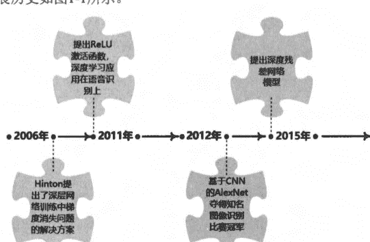
图1-1 深度学习的发展历史

毫无疑问，深度学习将持续推动人工智能发展，为人类带来更多便利与可能。

#### 1.1.2 深度学习框架 PyTorch

深度学习框架通过模块化封装算法，实现模型训练、测试与调优的便捷化，为预测与决策提供支撑。框架的蓬勃发展与人工智能生态相互促进。

框架的模块化设计让开发者聚焦算法本身，减少底层实现负担，提升效率与可移植性。同时，框架提供丰富工具，使训练、测试与调优流程更加高效。

主流框架包括Facebook的PyTorch、谷歌的TensorFlow、Theano、MXNet、微软的CNTK等。从GitHub热度与顶会采用情况看，PyTorch与TensorFlow最受关注。本书选用PyTorch。

PyTorch由Facebook人工智能研究团队开发的开源框架，具备强大的GPU加速与自动求导能力。

其历史可追溯至2016年公开发布，是Torch的Python实现，目标是提供快速、灵活、动态的深度学习平台。其设计哲学强调可读性与简洁性，底层用Python编写，易于学习。

相较TensorFlow等框架，PyTorch的计算图是动态即时的，可根据需求实时调整，为研究与实验带来更大灵活性。其优势包括：

- 易用性：设计直观，支持高效研究与开发
- 生态支持：活跃社区、丰富教程与第三方库
- 应用广度：覆盖计算机视觉、自然语言处理、生成对抗网络等场景

截至本书撰写时，PyTorch已迭代至2.2版本，本书基于该版本展开。更多版本信息可查阅官方网站。

总体而言，PyTorch凭借动态计算图、易学易用的接口与强大的社区支持，成为学术研究与工业部署的热门选择。

#### 1.1.3 深度学习的应用领域

通过多层学习，计算机能以简洁形式表达复杂抽象概念，解决了深度学习的核心难题。目前成果已广泛应用于推荐系统、语音识别、模式识别、目标检测、智慧城市等，如图1-2所示。

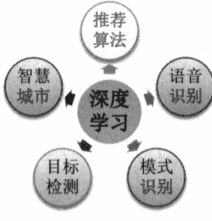
图 1-2 深度学习的应用领域

##### 1. 推荐算法
互联网发展带来信息过载，个性化推荐成为关键。电商基于购物历史推荐商品，门户网站基于阅读习惯定制内容，娱乐平台基于观看偏好挖掘兴趣，提升用户体验与内容匹配度。

##### 2. 语音识别
语音识别系统需提取语音特征以量化信号信息。深度学习通过逐层映射从原始数据中挖掘本质特征，提升传统语音识别性能。

##### 3. 模式识别
传统模式识别依赖专家手工选取特征，耗时费力。基于深度学习的方法可自动从数据中学习本质特征表示，省去复杂人工提取环节。

##### 4. 目标检测
目标检测是计算机视觉热点，近年来算法发展迅速，已广泛用于人脸检测、行人检测、无人驾驶等。随着数据与算力的提升，基于深度学习的目标检测成为主流。

##### 5. 智慧城市
机器视觉技术推动智慧城市人流统计发展，实现公共场所实时密度监测与追踪，有助于景区、公园等高密度区域的人数掌控，降低踩踏、盗窃等风险。

深度学习作为人工智能重要分支，已在计算机科学与工程领域取得显著成效。未来将在医疗诊断、金融风控、农业智能化等方向发挥更大作用。

### 1.2 搭建开发环境

掌握理论需配合动手实践，搭建合适的开发环境至关重要。本节介绍基于PyTorch 2.2的深度学习环境配置，包括Python 3.12、Jupyter Lab等工具的安装。

#### 1.2.1 安装 Python 3.12

本书使用截至2024年2月的Python 3.12.1版本，以下以Windows 11家庭中文版64位为例说明安装流程。注意安装路径需使用磁盘根目录或英文路径，避免中文。

01 首先从官网下载Python 3.12.1，下载页面如图 1-3所示。


图 1-3 下载 Python 软件

02 右键点击python-3.12.1-amd64.exe，选择“以管理员身份运行”，如图 1-4所示。


图 1-4 运行安装程序

03 勾选 Add python.exe to PATH 复选框，点击 Customize installation 按钮，如图 1-5所示。

04 根据需要勾选可选功能，其中pip必须勾选，然后点击 Next，如图 1-6所示。


图 1-5 自定义安装


图 1-6 功能选项

05 选择安装位置，默认安装在C盘，也可通过Browse更改目录后点击Install，如图1-7所示。


图 1-7 高级选项

06 等待片刻，弹出 Setup was successful 对话框，点击 Close 完成安装，如图1-8所示。


图 1-8 安装结束

07 在命令提示符窗口输入 python，若显示版本信息则说明安装成功，可正常使用，如图1-9所示。

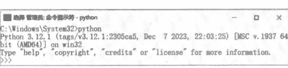

图 1-9 查看版本信息

08 在Python中可通过pip或conda安装第三方库如NumPy、Pandas等，命令如下：

```
pip install 库的名称
conda install 库的名称
```

09 当网络环境不允许在线拉取第三方包时，可改用最新版本的离线安装包完成本地部署，该方案面向 Windows 平台的 Python 扩展非官方二进制发行，具体下载位置如图 1-10 所示。


图 1-10 非官方扩展程序包

#### 1.2.2 Jupyter Lab 快速搭建

Jupyter Lab 作为 Jupyter Notebook 的迭代版本，集成度更高，特别适合用于 Python 代码演示、数据分析与可视化，本书后续实验均以它作为默认的开发环境。

该平台提供统一的交互式工作区，支持在同一浏览器页面同时打开多个 Notebook、IPython 控制台与终端，同时可对代码文件、Markdown 文档、JSON 文件及各类图片进行预览与编辑，整体工作效率显著提升。

部署步骤非常简便，打开命令行终端执行 pip install jupyter lab 即可完成安装。

启动方式也十分直接，终端中输入 jupyter lab 即可运行服务。

运行后浏览器会自动跳转至编程界面，默认地址为 http://localhost:8888，如图 1-11 所示。可观察到界面左侧展示当前笔记本的工作目录，右侧列出可新建的类型，例如 Notebook、Console 等。

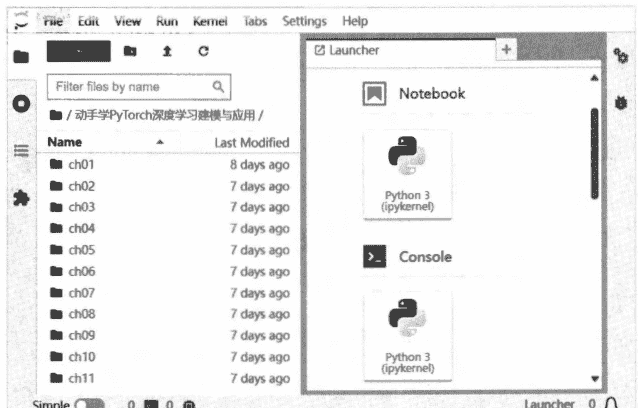

图1-11 Jupyter Lab 的界面

Jupyter Lab 的运行行为可以通过配置文件进行个性化设置，如允许远程访问、修改工作目录等。配置文件存放于 C 盘当前用户目录下的 .jupyter 文件夹中，文件名是 jupyter_notebook_config.py。

若该文件尚未存在，可自行创建。在命令行中运行 Jupyter Notebook --generate -config 即可生成配置文件，并提示其完整路径与名称。

若需要设置访问密码，可在命令行执行 Jupyter Notebook password，生成的密码哈希会写入 jupyter_notebook_config.json 文件中。

若需开启远程登录，打开 jupyter_notebook_config.py，找到相关代码段，去掉注释后按项目实际情况修改，修改示例如下：

```
c.NotebookApp.ip = '*'
c.NotebookApp.open_browser = False
c.NotebookApp.port = 8888
```

若需更改默认工作路径，找到对应代码段，去掉注释后按实际需求调整，修改示例如下：

```
c.NotebookApp.notebook_dir = u'D:\动手学PyTorch建模与应用：从深度学习到大模型'
```

完成上述参数修改后，关闭服务并重新启动 Jupyter Lab 即可使配置生效。

#### 1.2.3 PyTorch 2.2 安装指南

可前往 PyTorch 官网 https://pytorch.org/ 获取安装包，站点提供 CPU 版与 GPU 版两种选择。若主机配备 NVIDIA GPU 或 AMD ROCm，推荐选用 GPU 版，因其在大规模计算场景下的效率明显更优。

根据自身硬件与系统选择对应版本，下文分别说明两种安装路径。

##### 1. 安装CPU版本

CPU 环境下模型训练速度较慢，但为降低入门门槛，当前主流笔记本均可安装 PyTorch 框架。

PyTorch 支持 Windows、Linux、Mac 等操作系统，可通过 conda、pip 等包管理工具安装，运行环境涵盖 Python、C++、Java 等。

基于 pip 的安装语句如下：

```
pip3 install torch torchvision torchaudio
```

该语句借助 Python 包管理器 pip3 同时安装 PyTorch、Torchvision、Torchaudio 三个组件。

- PyTorch Torch：核心机器学习框架。
- Torchvision：基于 PyTorch 的计算机视觉库，提供预训练模型与常用数据集。
- Torchaudio：基于 PyTorch 的音频处理库，提供音频信号处理的工具与功能。

> 提示 PyTorch 安装包体积较大，网络不稳定时建议先从官网下载对应版本的离线包。另外，PyTorch 生态工具如 Torchaudio、Torchvision 等对版本有一定兼容要求。

##### 2. 安装GPU版本

部署 GPU 版前需先确认显卡是否支持 CUDA，随后依次安装显卡驱动、CUDA、cuDNN，最后安装 PyTorch。

###### 1) 安装显卡驱动程序

前往 NVIDIA 官网 https://www.nvidia.com/drivers 下载与本机显卡相匹配的驱动程序并完成安装，如图 1-12 所示。


图1-12 下载显卡驱动程序

###### 2) 安装 CUDA

CUDA 是 NVIDIA 推出的并行计算平台，仅能在 NVIDIA GPU 上运行，且仅在计算任务具备大规模并行特征时才能发挥作用。

在 CUDA 架构下，程序分为运行于 CPU 的 Host 端与运行于 GPU 芯片的 Device 端。Device 端程序通常称为 Kernel，一般由 Host 端准备数据、复制到显卡内存、调用 GPU 执行后再取回结果。

登录 CUDA 官网 https://developer.nvidia.com/cuda-downloads 下载适配版本，如图 1-13 所示。

依次点击 Windows、x86_64、10、exe local 按钮下载 Windows 系统的 CUDA 安装包，随后点击 Download 按钮，如图 1-14 所示。


图 1-13 CUDA 下载页面

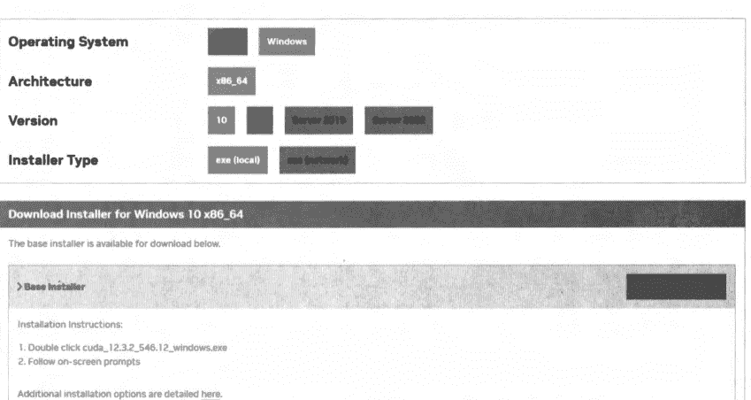

图 1-14 下载 CUDA 安装包

CUDA 安装流程较为直观，默认一直点击下一步，最后完成即可。安装路径建议保持默认，修改可能导致后续开发出现错误。

###### 3）安装 cuDNN

cuDNN 是 NVIDIA 面向深度神经网络的 GPU 加速库，并非强制要求，但通常会使用以提升训练效率。

需选择与 CUDA 版本对应的 cuDNN，本例 CUDA 为 11.8。登录 cuDNN 官网 https://developer.nvidia.com/rdp/cudnn-download 下载 cuDNN 9.0.0 的 Windows 版本，如图 1-15 所示。


依次点击 Windows、x86_64、10、exe local 按钮下载 Windows 系统的 cuDNN 安装包，随后点击 Download 按钮，如图 1-16 所示。

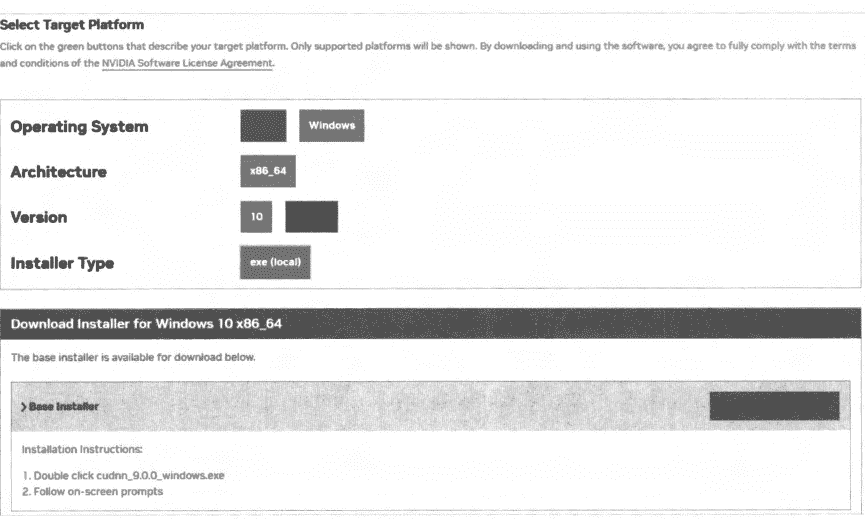

解压后将 bin、include、lib 三个目录下的文件覆盖到 CUDA 安装目录对应的位置。

###### 4）安装 PyTorch GPU 版的软件包

```
pip3 install torch torchvision torchaudio --index-url
https://download.pytorch.org/whl/cu118
```

### 1.3 PyTorch 的应用场景

PyTorch 已在多个领域得到广泛应用，涵盖计算机视觉、自然语言处理、语音识别等。下面概括其典型用途。

#### 1. 在计算机视觉领域的应用

得益于灵活易用的特点，研究人员与工程师常选用 PyTorch 构建图像分类、目标检测、图像分割等模型。ResNet、VGG、DenseNet 等主流网络均可在 PyTorch 中找到实现，且其提供丰富的数据加载与处理工具，能高效处理图像数据。

#### 2. 在自然语言处理领域的应用

PyTorch 的动态计算图在处理文本时具有明显优势，常用于文本分类、命名实体识别、机器翻译等任务。BERT、GPT 等预训练语言模型在 PyTorch 均有对应实现，并内置词嵌入、文本编码器等文本处理工具，便于高效处理文本。

#### 3. 在语音识别、推荐系统等领域的应用

PyTorch 的通用性使其被用于多类深度学习任务。语音识别领域可构建语音识别与语音合成模型；推荐系统领域可构建商品推荐、音乐推荐模型；在强化学习领域可用于智能游戏、自动驾驶等模型开发。

总体而言，PyTorch 因其灵活性和易用性已成为众多研究者和工程师的首选框架，随着深度学习发展，其应用范围将进一步扩大。

### 1.4 上机练习题

练习：结合自身系统配置搭建 PyTorch 开发环境。

参考步骤如下：

- 01 硬件配置检查：确认 CPU 与 GPU 是否满足要求。若计划使用 GPU 加速，需确保拥有兼容的 NVIDIA GPU 并核查其 CUDA 版本，可通过运行 nvidia-smi 命令查看。
- 02 安装 Python：从 Python 官网下载并安装适配操作系统的版本。
- 03 安装 Anaconda：可从清华大学开源软件镜像站下载 Anaconda 科学计算发行版，支持 Linux、Mac、Windows 并预装常用科学计算包。地址为 https://mirrors.tuna.tsinghua.edu.cn/anaconda/archive/。
- 04 安装 Python 第三方库：为提升安装速度，可使用清华源。例如安装 Pandas 时使用命令 `pip install -i https://pypi.tuna.tsinghua.edu.cn/simple pandas`。
- 05 创建和管理虚拟环境：使用 Anaconda Navigator 或 Anaconda Prompt 创建虚拟环境。例如创建名为 py3_12 的 Python 3.12 环境，命令为 `conda create -n py3_12 python=3.12`。
- 06 安装 CUDA 和 CUDNN：若使用 GPU 加速，需按 GPU 型号与 PyTorch 版本安装对应 CUDA Toolkit 与 cuDNN，并配置环境变量。
- 07 安装 PyTorch：访问 https://pytorch.org/get-started/locally/，根据系统、语言、CUDA 版本选择后复制安装命令。为加快下载，可使用清华源。
- 08 安装 IDE：可选择 PyCharm 或 VS Code 等。若使用 VS Code，需配置 Python 插件与 Anaconda 环境路径。
- 09 验证安装：安装完成后编写简单测试代码验证 PyTorch 是否正常运行。

尝试以下测试代码验证安装是否成功：

```python
# 导入Torch库
import torch

# 打印PyTorch版本信息
print("PyTorch version:", torch.__version__)

# 创建一个张量并打印其形状和数据类型
x = torch.randn(3, 4)
print("Tensor shape:", x.shape)
print("Tensor data type:", x.dtype)

# 执行一个矩阵乘法操作并打印结果
y = torch.randn(4, 5)
z = torch.matmul(x, y)
print("矩阵相乘结果:\n", z)
```

将代码保存为 test_pytorch.py，在命令行运行 python test_pytorch.py。若输出 PyTorch 版本信息、张量形状与数据类型以及矩阵乘法结果，则说明安装正确。

# 第2章 PyTorch数学基础


机器学习与深度学习需要一定的数学基础，虽然多数知识在校期间已接触，但为便于后续学习，本章对相关要点进行梳理总结。

### 2.1 PyTorch 中的函数

函数是数学的核心概念，历经数百年发展，数学家从几何、代数、集合等视角不断丰富其内涵，推动数学进步。本节介绍函数基础及 PyTorch 中主要函数与案例。

#### 2.1.1 函数的基础知识

函数是两个非空集合间的一种对应关系，下文先介绍集合的概念。

##### 1. 集合

研究对象统称为元素，由若干元素构成的整体称为集合。集合具有确定性和互异性，例如“身高较高的人”因元素不确定而不能构成集合。

常用大写拉丁字母 $A 、 B 、 C 、 \cdots$ 表示集合，小写拉丁字母 $a 、 b 、 c 、 \cdots$ 表示元素。若 $a$ 属于集合 $A$，记作：$a \in A$。

在观察现象时，部分量在过程中保持不变，称为常量；另一些量会随过程变化，可取不同数值，称为变量。

##### 2. 函数

若变量变化是连续的，常常用区间表示其取值范围，在数轴上区间指介于两点之间的线段所含点的全体，主要类型有：

- $(a, b)$: 表示大于 a 小于 b 的实数全体，也可记为：$a<x<b$.
- $[a, b)$: 表示大于或等于 a 小于 b 的实数全体，也可记为：$a \leq x < b$.

# 数学底座与 PyTorch 关键概念

**实数区间的常用写法**
- $(a, b]$ 包含满足 $a < x \le b$ 的全部实数，左端开右端闭。
- $[a, b]$ 包含满足 $a \le x \le b$ 的全部实数，两端都闭。
- $[a, +\infty)$ 对应 $a \le x < +\infty$，即不小于 $a$ 的实数集合。
- $(-\infty, b)$ 对应 $-\infty < x < b$，即严格小于 $b$ 的实数集合。
- $(-\infty, +\infty)$ 对应 $-\infty < x < +\infty$，即全体实数。

**函数的基本认识**
取两个非空实数集 $D,B$，若存在映射 $f$ 使得 $D$ 中每个 $x$ 都能唯一对应 $B$ 中的 $y$，则称 $f$ 是定义在 $D$ 上的函数，记为 $f:x\mapsto y$ 或 $f:D\to B$。结果写成 $y=f(x),\,x\in D$，其中 $x$ 为自变量，$y$ 为因变量。

从定义可看出，函数的实质是映射法则。记号 $y=f(x)$ 中，$f$ 本身是法则，$f(x)$ 是 $x$ 处的取值。习惯上用 $y=f(x)$ 描述关系，但本质是法则 $f$。定义域 $D$ 决定自变量的可取范围，函数值的产生依赖法则 $f$，因此函数由定义域与法则两要素决定。若两个函数的定义域和法则完全相同，则视为同一函数，与符号无关，例如 $y=|x|$ 与 $z=\sqrt{v^{2}}$ 实质相等。

在实际应用中，奇偶、单调、有界、周期等基本属性常有决定性作用。

##### 3. 极限
当自变量趋向无穷或逼近某定点时，若函数值逼近某个常数 $A$，就称该函数在此处存在极限。

###### 1) 自变量趋向无穷大时极限的描述
设 $y=f(x)$，若对任意正数 $\varepsilon>0$，总能找到正数 $X$，使得只要 $|x|>X$ 就有 $|f(x)-A|<\varepsilon$，则称 $A$ 为 $x\to\infty$ 时的极限，记作 $\lim_{x\to\infty}f(x)=A$。

极限的四则运算法则，设 $x\to x_{0}$ 或 $x\to\infty$ 时 $f(x)\to A,\;g(x)\to B$，则
$\lim_{x\to x_{0}}(f(x)+g(x))=A+B$，$\lim_{x\to x_{0}}f(x)g(x)=A B$。

###### 1) 奇偶性
设 $y=f(x)$ 的定义域 $D$ 关于原点对称，若对任意 $x\in D$ 满足 $f(-x)=f(x)$，则称 $f(x)$ 在 $D$ 上为偶函数；若满足 $f(-x)=-f(x)$，则称其为奇函数。偶函数的图像关于 $y$ 轴对称，奇函数的图像关于原点对称。

###### 2) 单调性
在区间 $(a,b)$ 内取 $x_{1},x_{2}$，若 $x_{1}<x_{2}$ 时恒有 $f(x_{1})<f(x_{2})$，则称 $y=f(x)$ 在该区间单调递增；若恒有 $f(x_{1})>f(x_{2})$，则称单调递减。两者统称单调函数，具有单调性的区间称为单调区间。递增图像自左向右上升，递减图像自左向右下降。

###### 3) 有界性
若存在 $M>0$ 使对所有 $x\in D$ 均有 $|f(x)|\le M$，则称 $y=f(x)$ 有界，其图像被直线 $y=-M$ 与 $y=M$ 夹住。$\sin x,\cos x,\arcsin x,\arccos x,\arctan x,\operatorname{arccot}x$ 都是典型有界函数。

###### 4) 周期性
若存在常数 $T$，对任意 $x\in D$ 都有 $x+T\in D$ 且 $f(x+T)=f(x)$，则称 $y=f(x)$ 为周期函数，通常指最小正周期。周期函数在相邻周期内的图像完全重复。

# PyTorch 从基础到大模型实战

**极限的常见补充形式**
$\lim_{x\to x_{0}}\frac{f(x)}{g(x)}=\frac{A}{B}\;(B\neq0)$
$\lim_{x\to x_{0}}k f(x)=kA\;(k\text{为常数})$
$\lim_{x\to x_{0}}[f(x)]^{m}=A^{m}\;(m\text{为正整数})$
借助这些规则可把复杂极限拆解为若干简单极限求解。

###### 2) 无穷小量与无穷大量
在自变量的某变化过程中，若变量以零为极限，则称为该过程的无穷小量。例如 $\lim_{x\to x_{0}}f(x)=0$ 时，$x\to x_{0}$ 时 $f(x)$ 为无穷小。无穷小刻画的是变化趋势而非大小，只有常数 $0$ 可作为无穷小。

若变量的绝对值可无限增大，则称为无穷大量，这是极限不存在的一种情形。例如 $\lim_{x\to x_{0}}f(x)=\infty$ 时 $f(x)$ 为无穷大量。无穷大量的倒数是无穷小，非零无穷小量的倒数是无穷大量。

#### 2.1.2 PyTorch 中的主要接口
PyTorch 的常用接口可归为张量创建、随机抽样、索引切片、拼接、数学运算、逐点操作、比较操作等。以随机抽样为例，共 5 个相关函数。

##### 1. torch.seed()
用于产生不可预测的随机数，返回 64 位数值。无需参数。
例如生成一个 64 位随机数，代码如下：
```python
torch.seed()
```
输出如下：
```
105502436695500
```

##### 2. torch.manual_seed(seed)
为随机生成器设定种子并返回 torch.Generator 对象。
**参数：** seed 为 int 或 long。
例如为保证随机数可复现，代码如下：
```python
torch.manual_seed(12)
```
输出如下：
```python
<torch._C.Generator at 0x179345f5bd0>
```

##### 3. torch.initial_seed()
返回随机数生成器的原始种子值。
例如获取原始种子，代码如下：
```python
torch.initial_seed()
```
输出如下所示：
```python
12
```

##### 4. torch.get_rng_state()
返回随机生成器的状态，以字节张量形式给出。
例如获取当前状态，代码如下：
```python
torch.get_rng_state()
```
输出如下：
```python
tensor([12, 0, 0, ..., 0, 0, 0], dtype=torch.uint8)
```

##### 5. torch.set_rng_state(new_state)
设定随机生成器的状态。
**参数：** new_state 为期望的状态。
例如恢复指定状态，代码如下：
```python
rng_state1 = torch.get_rng_state()
print(rng_state1)
torch.set_rng_state(rng_state1*2)
```
```python
rng_state2 = torch.get_rng_state()
print(rng_state2)
```
输出如下:
```python
tensor([12, 0, 0, ..., 0, 0, 0], dtype=torch.uint8)
tensor([24, 0, 0, ..., 0, 0, 0], dtype=torch.uint8)
```

### 2.2 微分基础
微分是对函数局部变化率的线性逼近。本节介绍微分概念及 PyTorch 自动微分技术。

#### 2.2.1 微分及其公式
1. 微分基础
若 $y=f(x)$ 在点 $x$ 处的改变量 $\Delta y=f(x+\Delta x)-f(x)$ 可写成
$\Delta y=A\Delta x+o(\Delta x)$
其中 $o(\Delta x)$ 是比 $\Delta x$ 高阶的无穷小，则称 $f(x)$ 在 $x$ 处可微，$A\Delta x$ 为 $\Delta y$ 的线性主部，即该点的微分，记为 $dy$ 或 $df(x)$，即 $dy=A\Delta x$。

基本初等函数的导数与微分公式如表 2-1。

表 2-1 求导与微分公式

|   | 求导公式 |   | 微分公式 |
|---|---|---|---|
| 基本初等函数求导公式 | $c'=0\;(c\text为常数})$ | 基本初等函数微分公式 | $dc=0\;(c\text为常数})$ |
|   | $(x^{\mu})'=\mu x^{\mu-1}\;(\mu\text为实数})$ |   | $d(x^{\mu})=\mu x^{\mu-1}dx\;(\mu\text为实数})$ |
|   | $(a^{x})'=a^{x}\ln a$ |   | $d(a^{x})=a^{x}\ln a\,dx$ |
|   | $(e^{x})'=e^{x}$ |   | $d(e^{x})=e^{x}dx$ |
|   | $(\log_{a}x)'=1/(x\ln a)$ |   | $d(\log_{a}x)=1/(x\ln a)dx$ |
|   | $(\ln x)'=1/x$ |   | $d(\ln x)=1/x\,dx$ |
|   | $(\sin x)'=\cos x$ |   | $d(\sin x)=\cos x\,dx$ |
|   | $(\cos x)'=-\sin x$ |   | $d(\cos x)=-\sin x\,dx$ |
|   | $\lim_{x\to x_{0}}g(x)=0$ |   | $d(\tan x)=\sec^{2}x\,dx$ |
|   | $(\cot x)'=-\csc^{2}x$ |   | $d(\cot x)=-\csc^{2}x\,dx$ |
|   | $(\sec x)'=\sec x\tan x$ |   | $d(\sec x)=\sec x\tan x\,dx$ |
|   | $(\csc x)'=-\csc x\cot x$ |   | $d(\csc x)=-\csc x\cot x\,dx$ |
|   | $(\arcsin x)'=1/\sqrt{1-x^{2}}$ |   | $d(\arcsin x)=1/\sqrt{1-x^{2}}\,dx$ |
|   | $(\arccos x)'=-1/\sqrt{1-x^{2}}$ |   | $d(\arccos x)=-1/\sqrt{1-x^{2}}\,dx$ |
|   | $(\arctan x)'=1/(1+x^{2})$ |   | $d(\arctan x)=1/(1+x^{2})\,dx$ |
|   | $(\text{arccot }x)'=-1/(1+x^{2})$ |   | $d(\text{arccot }x)=-1/(1+x^{2})\,dx$ |

一般函数的导数与微分法则如表 2-2。

表 2-2 求导与微分法则表

| 求导法则 | 微分法则 |
| :--- | :--- |
| $[u(x)\pm v(x)]'=u'(x)\pm v'(x)$ | $d[u(x)\pm v(x)]=du(x)\pm dv(x)$ |
| $[u(x)v(x)]'=u'(x)v(x)+u(x)v'(x)$ | $d[u(x)v(x)]=v(x)du(x)+u(x)dv(x)$ |
| $[c\cdot u(x)]'=c\cdot u'(x)\;(c\text为常数})$ | $d[cu(x)]=c\,du(x)\;(c\text为常数})$ |
| $\left[\dfrac{u(x)}{v(x)}\right]'=\dfrac{u'(x)v(x)-u(x)v'(x)}{v^{2}(x)}\;(v(x)\neq0)$ | $d\left[\dfrac{u(x)}{v(x)}\right]=\dfrac{v(x)du(x)-u(x)dv(x)}{v^{2}(x)}\;(v(x)\neq0)$ |
| $\left[\dfrac{1}{v(x)}\right]'=-\dfrac{v'(x)}{v^{2}(x)}\;(v(x)\neq0)$ | $d\left[\dfrac{1}{v(x)}\right]=-\dfrac{dv(x)}{v^{2}(x)}\;(v(x)\neq0)$ |
| 设 $y=f(u)$、$u=\phi(x)$, 则复合函数 $y=f[\phi(x)]$ 的导数为 $\dfrac{dy}{dx}=\dfrac{dy}{du}\cdot\dfrac{du}{dx}$ | 设 $y=f(u)$、$u=\phi(x)$, 则 $dy=f'(u)du$, 具有一阶微分形式不变性 |

2. 极值与最值
若 $f(x)$ 在 $x_{0}$ 的某邻域有定义，且对邻域内任意 $x\neq x_{0}$ 都有 $f(x)<f(x_{0})$，则 $f(x_{0})$ 为极大值；若恒有 $f(x)>f(x_{0})$，则 $f(x_{0})$ 为极小值。极大值与极小值统称极值，使其取得的点称为极值点。

单变量情形，极值点常出现在边界或驻点。满足 $f'(x)=0$ 的点称为驻点。
多变量情形，极值点只能出现在不可导点或梯度为零的点上，如图 2-1 所示。
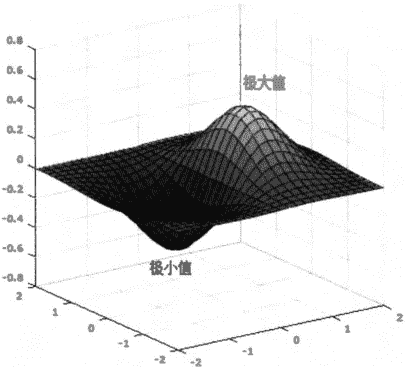
图 2-1 多变量函数的极值

此外，闭区间上连续函数必存在最大值与最小值，其位置只可能在驻点、不可导点或区间端点处。

#### 2.2.2 PyTorch 自动微分
机器学习训练本质是求解最优化问题，可导时即寻找一阶导数为零的驻点。自动微分是反向传播的一般化，能在指定点计算可导函数的导数值。

在深度学习库中自动微分是训练核心。模型训练即不断更新权重，而权重更新依赖梯度，PyTorch 提供自动求导系统，只要搭建好前向计算图即可获得所有张量的梯度。

PyTorch 自动求导模块常用接口为 torch.autograd.backward() 与 torch.autograd.grad()，现逐一说明。

1. torch.autograd.backward()
该函数负责自动求取梯度，参数如下：
```python
torch.autograd.backward(tensors,
    grad_tensors=None,
    retain_graph=None,
    create_graph=False)
```
**【代码说明】**
- tensors: 需要求导的张量，如 loss。
- grad_tensors: 多梯度权重，当存在多个 loss 时需给出各自权重。
- retain_graph: 是否保留计算图，PyTorch 采用动态图，反向传播后默认释放，若需继续使用则设为 True。
- create_graph: 是否构建导数计算图，用于高阶求导。
例如线性一阶导数的代码如下：

```python
import torch

# 创建一个需要梯度的张量w
w = torch.tensor([1.], requires_grad=True)
# 创建一个需要梯度的张量x
x = torch.tensor([2.], requires_grad=True)
# 将x和w相加, 结果存储在a中
a = torch.add(x, w)
# 将w和1相加, 结果存储在b中
b = torch.add(w, 1)
# 将a和b相乘, 结果存储在y中
y = torch.mul(a, b)

# 对y进行反向传播计算梯度
y.backward()
# 打印w的梯度
print(w.grad)
```

运行结果如下：

```python
tensor([5.])
```

下面通过实例演示 grad_tensors 参数的具体用法。

```python
import torch

# 创建一个需要梯度的张量w
w = torch.tensor([1.], requires_grad=True)
# 创建一个需要梯度的张量x
x = torch.tensor([2.], requires_grad=True)
# 将x和w相加, 结果存储在a中
a = torch.add(x, w)
# 将w和1相加, 结果存储在b中
b = torch.add(w, 1)
# 将a和b相乘, 结果存储在y0中
y0 = torch.mul(a, b)
# 将a和b相加, 结果存储在y1中
y1 = torch.add(a, b)
```

```python
# 将y0和y1拼接起来，形成一个新的张量loss
loss = torch.cat([y0, y1], dim=0)
# 定义一个梯度张量grad_t
grad_t = torch.tensor([1., 2.])
# 对loss进行反向传播计算梯度
loss.backward(gradient=grad_t)
# 打印w的梯度
print(w.grad)
```

结果如下：

```python
tensor([9.])
```

说明如下：

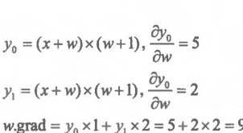

2. torch.autograd.grad()

该方法用于计算梯度，其参数说明如下：

```python
torch.autograd.grad(outputs,
                    inputs,
                    grad_outputs=None,
                    retain_graph=None,
                    create_graph=False)
```

**【参数解读】**

- outputs：作为求导对象的张量，例如示例里的 loss。
- inputs：想要获得梯度的张量，例如示例里的 w。
- retain_graph：是否保留计算图以便后续反向。
- grad_outputs：用于加权多个梯度输出。
- create_graph：是否构建导数的计算图，支持高阶求导。

举例来说，求 $y=x^2$ 的二阶导数的实现如下：

```python
import torch
# 创建一个张量x，值为3.0，并设置requires_grad=True以计算梯度
x = torch.tensor([3.], requires_grad=True)
# 计算x的平方，得到y
y = torch.pow(x, 2)

# 计算y关于x的梯度，create_graph=True表示同时计算二阶导数
grad1 = torch.autograd.grad(y, x, create_graph=True)
print(grad1) # 输出一阶导数: [6.]

# 计算一阶导数关于x的梯度
grad2 = torch.autograd.grad(grad1[0], x)
print(grad2) # 输出二阶导数: [2.]
```

运行结果如下：

```python
(tensor([6.], grad_fn=<MulBackward0>),)
(tensor([2.]),)
```

3. 注意事项

（1）反向传播不会自动清空梯度，多次调用会累加，演示代码如下：

```python
import torch

# 创建一个需要梯度的张量w
w = torch.tensor([1.], requires_grad=True)
# 创建一个需要梯度的张量x
x = torch.tensor([2.], requires_grad=True)

# 循环3次
for i in range(3):
    # 将x和w相加，结果存储在a中
    a = torch.add(x, w)
    # 将w和1相加，结果存储在b中
    b = torch.add(w, 1)
    # 将a和b相乘，结果存储在y中
    y = torch.mul(a, b)
    # 计算梯度
    y.backward()
    # 打印w的梯度
    print(w.grad)
```

运行结果如下：

```python
tensor([5.])
tensor([10.])
tensor([15.])
```

梯度累加会导致结果偏差，必须手动归零，示例代码如下：

```python
# 创建一个需要梯度的张量w
w = torch.tensor([1.], requires_grad=True)
# 创建一个需要梯度的张量x
x = torch.tensor([2.], requires_grad=True)
# 循环3次
for i in range(3):
    # 将x和w相加,结果存储在a中
    a = torch.add(x, w)
    # 将w和1相加,结果存储在b中
    b = torch.add(w, 1)
    # 将a和b相乘,结果存储在y中
    y = torch.mul(a, b)
    # 计算梯度
    y.backward()
    # 打印w的梯度
    print(w.grad)
    # 梯度清零
    w.grad.zero_()
```

输出如下：

```python
tensor([5.])
tensor([5.])
tensor([5.])
```

（2）由叶子节点衍生的张量，其 requires_grad 默认保持为 True，代码示例如下：

```python
# 创建一个需要梯度的张量w
w = torch.tensor([1.], requires_grad=True)
# 创建一个需要梯度的张量x
x = torch.tensor([2.], requires_grad=True)
# 将x和w相加,结果存储在a中
a = torch.add(x, w)
# 将w和1相加,结果存储在b中
b = torch.add(w, 1)
# 将a和b相乘,结果存储在y中
y = torch.mul(a, b)
# 打印a、b、y是否需要梯度
print(a.requires_grad, b.requires_grad, y.requires_grad)
```

结果如下：

```python
True True True
```

（3）要求梯度的叶子节点禁止原位修改，因为前向过程记录了其内存地址，反向时需要依据地址读取原始数据，原位修改会破坏数据导致梯度报错，示例报错如下：> > RuntimeError: a leaf Variable that requires grad has been used in an in-place operation.

原位操作指的是直接在原内存修改数值，相关代码如下：

```python
a = torch.tensor([1])
print(id(a), a)
# 开辟新的内存地址
a = a + torch.tensor([1])
print(id(a), a)
# in-place操作，地址不变
a += torch.tensor([1])
print(id(a), a)
```

运行结果如下：

```text
2638883967360 tensor([1])
2638883954112 tensor([2])
2638883954112 tensor([3])
```

### 2.3 数理统计基础

数理统计属于数学分支，以概率论为理论支撑，研究大量随机现象的内在规律。本部分会梳理数理统计的核心概念，并结合 PyTorch 的常用统计函数进行演示。

#### 2.3.1 数理统计及其指标

概率论与数理统计都是从量化视角探讨现实世界中不确定现象规律的应用数学学科。以下先分别梳理两者的基础。

##### 1. 概率论基础

1) 必然现象与随机现象

在日常观察中，现象大致可分为两类：

一类结果可以预先确定，即在条件不变时重复试验结果始终一致，这类现象称为必然现象或确定性现象。

另一类结果事先无法确定，即在相同条件下重复试验结果可能不同，单次试验呈现偶然性，这类现象称为随机现象或不确定现象。

2) 概率

仅知道随机试验可能出现的事件还不够，还需要量化各类事件出现的可能性大小，以挖掘其内在的统计规律。

因此需要一个固有且客观的数值指标来衡量事件发生的可能性，称之为概率，事件 $A$ 的概率记作 $P(A)$。

3) 统计概率

在相同条件下进行 $n$ 次重复试验，若事件 $A$ 出现了 $m$ 次，则 $m/n$ 称为事件 $A$ 的频率。当 $n$ 逐渐增大时，频率会趋于稳定并接近某个常数 $p$，该常数即为事件 $A$ 的概率。这种基于频率的定义称为统计概率。

4) 正态分布

若连续型随机变量 $x$ 的概率密度函数为：

$$f(x)=\frac{1}{\sigma \sqrt{2 \pi}} \mathrm{e}^{\frac{(x-\mu)^{2}}{2 \sigma^{2}}}$$

其中 $\mu$ 表示均值，$\sigma^{2}$ 表示方差，则称 $x$ 服从正态分布，记为 $x \sim N\left(\mu, \sigma^{2}\right)$。其对应的分布函数为：

$$F(x)=\frac{1}{\sigma \sqrt{2 \pi}} \int_{-\infty}^{x} \mathrm{e}^{\frac{(x-\mu)^{2}}{2 \sigma^{2}}} \mathrm{~d} x$$

5) 标准正态分布

当 $\mu=0 、 \sigma^{2}=1$ 时的正态分布称为标准正态分布，其概率密度函数与分布函数为：

$$\phi(u)=\frac{1}{\sqrt{2 \pi}} \mathrm{e}^{-\frac{u^{2}}{2}}$$

$$\varphi(u)=\frac{1}{\sqrt{2 \pi}} \int_{-\infty}^{u} e^{-\frac{1}{2} u^{2}} \mathrm{~d} u$$

6) 卡方分布

设 $n$ 个相互独立的随机变量 $X_{1}, X_{2}, \cdots, X_{n}$ 都服从标准正态分布，则它们的平方和构成的新变量服从卡方分布。

$$\chi^{2}=X_{1}^{2}+X_{2}^{2}+\cdots+X_{n}^{2}$$

7) $T$ 分布

$t$ 分布用于小样本下估计正态总体且方差未知的均值。设 $X$ 服从标准正态分布，$Y$ 服从卡方分布且与 $X$ 独立，则：

$$T=X / \sqrt{Y / n}$$

服从自由度为 $n$ 的 $t$ 分布。

8) $F$ 分布

若 $X$ 与 $Y$ 分别服从自由度为 $n_{1}$ 和 $n_{2}$ 的卡方分布，则统计量 $F$ 服从 $F$ 分布。

自由度 $df$ 表示计算统计量时不受限制的变量个数，通常 $df=n-k$，其中 $n$ 为样本量，$k$ 为约束条件数。

$$F=\frac{X / n_{1}}{Y / n_{2}}$$

9) 显著性水平

抽样指标会随样本变化而波动，因而抽样误差本身也是随机的，无法保证误差一定在范围内，只能以一定的置信度来保证。

对于总体指标 $X$，寻找样本估计量 $x_{1}$ 与 $x_{2}$，使得 $X$ 落在区间 $\left(x_{1}, x_{2}\right)$ 内的概率为 $1-\alpha$，其中 $0<\alpha<1$。区间 $\left(x_{1}, x_{2}\right)$ 称为置信区间，置信度为 $1-\alpha$，$\alpha$ 称为显著性水平，$x_{1}$ 为下限，$x_{2}$ 为上限。

##### 2. 数理统计指标

1) 平均值

均值是集中趋势最常用的度量，依据数据形式可分为简单平均和加权平均。

简单平均是将总体各单位数值相加后除以单位总数，公式为：

$$\bar{X}=\frac{X_{1}+X_{2}+\cdots+X_{n}}{n}=\frac{\sum X}{n}$$

适用于未分组的小样本数据。若数据已分组，则采用加权平均：

$$\bar{X}=\frac{f_{1} X_{1}+f_{2} X_{2}+\cdots+f_{n} X_{n}}{f_{1}+f_{2}+\cdots+f_{n}}=\frac{\sum f X}{\sum f}$$

其中 $f$ 表示各组的频数或权数。

例如，某企业三次进货：100 吨单价 1.5 元，120 吨单价 1.4 元，150 吨单价 1.2 元。

简单平均：$(1.5+1.4+1.2)/3=1.37$ 元
加权平均：$(100×1.5+120×1.4+150×1.2)/(100+120+150)=1.35$ 元

2) 中位数

中位数是将总体变量值按大小排序后位于中间位置的值。

位置可用 $(n+1)/2$ 确定，$n$ 为项数。$n$ 为奇数时取中间值，$n$ 为偶数时取中间两个值的平均。

例如，3、1、2、5、4 的中位数是 3；3、1、2、4 的中位数是 2.5。

3) 众数

众数是出现频率最高的值，反映最常见水平。在单项数列中出现次数最多的组即为众数，若出现两次并列则为双众数。

例如，9、18、15、7、4、6、9、9、6 的众数是 9。

4) 百分位数

将数据排序后按累计百比分位，可得到对应百分位的值。常用的四分位数将数据分为 25%、50% 和 75%。百分位数不受极端值影响，但不适用于定类数据。

例如，9、1、5、7、4、6、8、3、2、10 的 25% 百分位数是 2.5，50% 百分位数是 5。

5) 方差与标准差

方差 $\sigma^{2}$ 是各变量值与均值的离差平方的平均，标准差 $\sigma$ 为方差的平方根。标准差具有量纲，实际意义更直观。

未分组数据采用简单平均式：

$$\sigma^{2}=\frac{\sum(X-\bar{X})^{2}}{n}$$

例如，1 至 10 的方差为 8.25，标准差为 2.87。

分组数据采用加权平均式：

$$\sigma^{2}=\frac{\sum f(X-\bar{X})^{2}}{\sum f}$$

例如，前述三次进货单价的方差为 0.016426426，标准差为 0.128165621。

6) 极差

极差即最大值与最小值之差，用 $R$ 表示，公式为：

$$R=X_{\max }-X_{\min }$$

极差仅利用两端信息，无法反映中间离散情况，易受极值影响。

7) 最大值

样本中数值的最大值。

8) 最小值

样本中数值的最小值。

9) 变异系数

变异系数是标准差与均值的比值，也称离散系数，公式为：

$$V=\frac{\sigma}{\bar{X}}$$

当均值相同时可直接用标准差比较离散程度，均值不同时需用变异系数作相对比较。

10) 偏度

分布形态指标与 PyTorch 常用统计操作

偏度用来刻画一组数据整体向左或向右倾斜的方向和幅度。实际计算时常借助偏态系数，最通用的形式是用第三阶中心矩除以标准差的立方来衡量相对倾斜。公式呈现如下：

$$a_{3}=\frac{\sum f(X-\bar{X})^{3}}{\sigma^{3} \sum f}$$

系数 a3 为正，说明右尾拖得更长，属于右偏；系数为负，则左尾更长，属于左偏。

11) 峰度

峰度关注频数曲线的尖锐与平缓，相对于正态曲线的形态差异。工程上多采用第四阶中心矩来刻画，表达形式为：

$$a_{4}=\frac{\sum f(X-\bar{X})^{4}}{\sigma^{4} \sum f}$$

若 a4 等于 3，形态与标准正态一致；若 a4 小于 3，曲线相对平坦，称作平峰；若 a4 大于 3，曲线较尖，称作尖峰。

12) Z 标准化得分

Z 分数把单个观测点与均值的偏离换算成标准差的倍数。计算式如下：

$$Z_{i}=\frac{X_{i}-\bar{X}}{\sigma}$$

式中 Zi 代表 Xi 的标准化结果。|Z| 越大，说明该观测离均值越远。经过标准化后，数值能在同一样本内部体现相对位置，也能在不同分布之间进行横向比较，因此在统计分析里应用广泛。

#### 2.3.2 PyTorch 统计函数

PyTorch 提供了与专业统计软件相当的运算接口，下面围绕求积、求和、求均、求方差、求标准差、中位数等常规任务做案例演示。

##### 1. 求所有元素的积

`torch.prod()` 负责把张量里全部元素连乘，调用格式为：

```python
torch.prod(input, dim=None, keepdim=False)
```

该接口接收一个张量作为输入，返回一个标量，即所有元素的乘积。

**参数要点**

- `input`：待处理的张量。
- `dim`：指定沿哪条轴做连乘，默认 None 表示对整个张量运算；指定后结果会降维。
- `keepdim`：是否保留原始维度，默认 False；设为 True 时对应轴大小保持为 1。

示范代码如下：

```python
import torch

# 创建一个2×2的张量a
a = torch.tensor([[1, 2], [3, 4]])

# 计算张量a中所有元素的乘积，并将结果赋值给result
result = torch.prod(a)
print(result) # 输出: 24

# 沿着第0维(行)计算张量a中元素的乘积，并将结果赋值给result_dim
result_dim = torch.prod(a, dim=0)
print(result_dim) # 输出: tensor([3, 8])

# 沿着第0维(行)计算张量a中元素的乘积，并保持原始维度，将结果赋值给result_keepdim
result_keepdim = torch.prod(a, dim=0, keepdim=True)
print(result_keepdim) # 输出: tensor([[3, 8]])
```

##### 2. 求和

`torch.sum()` 可对张量进行累加，支持两种写法。

**写法一：**

```python
torch.sum(input, dtype=None)
```

对 `input` 中全部元素求和，得到标量。

**写法二：**

```python
torch.sum(input, dim, keepdim=False, dtype=None)
```

按指定轴 `dim` 累加，返回新的张量。

**参数要点**

- `input`：输入张量。
- `dim`：累加的轴，可为列表；`dim=0` 时把行方向压缩，相当于列求和；`dim=1` 时相当于行求和。
- `keepdim`：累加后该轴长度变为 1，默认会被剔除；设为 True 则保留该维度。

演示如下。

先准备初始数据，代码如下：

```python
# 导入torch库
import torch

# 创建一个2×2的张量a，元素为随机数
a = torch.rand(2,2)
print(a)
```

输出如下：

```text
tensor([[0.0528, 0.3420],
        [0.5011, 0.4264]])
```

指定 `input` 与 `dim`，代码如下：

```python
a1 = torch.sum(a)                  # 计算张量a所有元素的和
a2 = torch.sum(a, dim=(0, 1))      # 沿着第0维和第1维计算张量a的元素和
a3 = torch.sum(a, dim=0)           # 沿着第0维计算张量a的元素和
a4 = torch.sum(a, dim=1)           # 沿着第1维计算张量a的元素和
print(a1)
print(a2)
print(a3)
print(a4)
```

输出如下：

```text
tensor(1.3223)
tensor(1.3223)
tensor([[0.5539, 0.7684]])
tensor([[0.3948, 0.9275]])
```

开启 `keepdim`，代码如下：

```python
a5 = torch.sum(a, dim=(0, 1), keepdim=True) # 沿着第0维和第1维计算张量a的元素和，
# 保持原始维度
a6 = torch.sum(a, dim=(0, ), keepdim=True) # 沿着第0维计算张量a的元素和，
# 保持原始维度
a7 = torch.sum(a, dim=(1, ), keepdim=True) # 沿着第1维计算张量a的元素和，
# 保持原始维度

print(a5)
print(a6)
print(a7)
```

输出如下：

```text
tensor([[1.3223]])
tensor([[0.5539, 0.7684]])
tensor([[0.3948],
        [0.9275]])
```

##### 3. 平均值

`torch.mean()` 用于求均值，调用方式与求和相似，同样有两种形式：

```python
torch.mean(input, dtype=None)
torch.mean(input, dim, keepdim=False, dtype=None)
```

示例。

设定 `input` 与 `dim`，代码如下：

```python
# 导入torch库
import torch

# 创建一个张量a
a = torch.tensor([[1, 2], [3, 4]])

# 计算张量a所有元素的平均值，并将结果赋值给a8
a8 = torch.mean(a)

# 沿着第0维和第1维计算张量a的元素平均值，并将结果赋值给a9
a9 = torch.mean(a, dim=(0, 1))

# 沿着第0维计算张量a的元素平均值，并将结果赋值给a10
a10 = torch.mean(a, dim=0)

# 沿着第1维计算张量a的元素平均值，并将结果赋值给a11
```

all = torch.mean(a, dim=1)

# 打印a8、a9、a10和all的值

print(a8)

print(a9)

print(a10)

print(all)

输出结果如下：

tensor(0.3306)

tensor(0.3306)

tensor([0.2770, 0.3842])

tensor([0.1974, 0.4638])

设置参数keepdim，代码如下：

# 导入torch库

import torch

# 创建一个张量a

a = torch.tensor([[1, 2], [3, 4]])

# 沿着第0维和第1维计算张量a的元素平均值，并保持原始维度，将结果赋值给a12

a12 = torch.mean(a, dim=(0, 1), keepdim=True)

# 沿着第0维计算张量a的元素平均值，并保持原始维度，将结果赋值给a13

a13 = torch.mean(a, dim=(0, ), keepdim=True)

# 沿着第1维计算张量a的元素平均值，并保持原始维度，将结果赋值给a14

a14 = torch.mean(a, dim=(1, ), keepdim=True)

# 打印a12、a13和a14的值

print(a12)

print(a13)

print(a14)

输出结果如下：

tensor([[0.3306]])

tensor([[0.2770, 0.3842]])

tensor([[0.1974],

        [0.4638]])

##### 4. 最大值

`torch.max()` 负责求最大值，参数风格接近求和，但 `dim` 必须是整数，形式有两种：

torch.max(input, dtype=None)

torch.max(input, dim, keepdim=False, dtype=None)

示例。

设定参数input和dim，代码如下：

# 导入torch库

import torch

# 创建一个张量a

a = torch.tensor([[1, 2], [3, 4]])

# 计算张量a所有元素的最大值，并将结果赋值给a15

a15 = torch.max(a)

# 沿着第0维计算张量a的元素最大值，并将结果赋值给a16

a16 = torch.max(a, dim=0)

# 沿着第1维计算张量a的元素最大值，并将结果赋值给a17

a17 = torch.max(a, dim=1)

# 打印a15、a16和a17的值

print(a15)

print(a16)

print(a17)

输出结果如下：

tensor(0.5011)

torch.return_types.max(

  values=tensor([0.5011, 0.4264]),

  indices=tensor([1, 1]))

torch.return_types.max(

  values=tensor([0.3420, 0.5011]),

  indices=tensor([1, 0]))

设置参数keepdim，代码如下：

# 导入torch库

import torch

# 创建一个张量a

a = torch.tensor([[1, 2], [3, 4]])

# 沿着第0维计算张量a的元素最大值，并保持原始维度，将结果赋值给a18

a18 = torch.max(a, 0, keepdim=True)

# 沿着第1维计算张量a的元素最大值，并保持原始维度，将结果赋值给a19

a19 = torch.max(a, 1, keepdim=True)

# 打印a18和a19的值

print (a18)

print (a19)

输出结果如下:

torch.return_types.max(

values= tensor ( [[0.5011, 0.4264]]),

indices= tensor ( [[1, 1]]))

torch.return_types.max(

values= tensor ( [[0.3420], [0.5011]]),

indices= tensor ( [[1], [0]]))

##### 5. 最小值

`torch.min()` 用于求最小值，参数与最大值函数一致，形式同样两种：

torch.min(input, dtype=None)

torch.min(input, dim, keepdim=False, dtype=None)

示例。

设定参数input和dim,代码如下:

# 导入torch库

import torch

# 创建一个张量a

a = torch.tensor([[1, 2], [3, 4]])

# 计算张量a所有元素中的最小值,并将结果赋值给a20

a20 = torch.min(a)

# 沿着第0维计算张量a的元素最小值,并将结果赋值给a21

a21 = torch.min(a, dim=0)

# 沿着第1维计算张量a的元素最小值,并将结果赋值给a22

a22 = torch.min(a, dim=1)

# 打印a20、a21和a22的值

print(a20)

print(a21)

print(a22)

输出结果如下:

tensor(0.0528)

torch.return_types.min(

values= tensor ( [[0.0528, 0.3420]]),

indices= tensor ( [[0, 0]]))

torch.return_types.min(

values= tensor ( [[0.0528, 0.4264]]),

indices=tensor([0, 1]))

设置参数keepdim，代码如下：

# 导入torch库

import torch

# 创建一个张量a

a = torch.tensor([[1, 2], [3, 4]])

# 沿着第0维计算张量a的元素最小值，并保持原始维度，将结果赋值给a23

a23 = torch.min(a, 0, keepdim=True)

# 沿着第1维计算张量a的元素最小值，并保持原始维度，将结果赋值给a24

a24 = torch.min(a, 1, keepdim=True)

# 打印a23和a24的值

print(a23)

print(a24)

输出结果如下：

torch.return_types.min(

values=tensor([[0.0528, 0.3420]]),

indices=tensor([[0, 0]]))

torch.return_types.min(

values=tensor([[0.0528],

[0.4264]]),

indices=tensor([[0],

[1]]))

##### 6. 中位数

`torch.median()` 用来获取中位数，参数与最大值类似，形式为两种：

torch.median(input, dtype=None)

torch.median(input, dim, keepdim=False, dtype=None)

示例。

设定参数input和dim，代码如下：

# 导入torch库

import torch

# 创建一个张量a

a = torch.tensor([[1, 2], [3, 4]])

# 计算张量a所有元素的中位数，并将结果打印出来

print(torch.median(a))

# 沿着第1维计算张量a的元素中位数，并将结果打印出来

print(torch.median(a, 1))

输出结果如下：

tensor(0.3420)

torch.return_types.median(

    values=tensor([[0.0528, 0.4264]]),

    indices=tensor([[0, 1]]))

设置参数keepdim，代码如下：

# 导入torch库

import torch

# 创建一个张量a

a = torch.tensor([[1, 2], [3, 4]])

# 沿着第1维计算张量a的元素中位数，并保持原始维度，将结果赋值给变量median_result

median_result = torch.median(a, 1, keepdim=True)

# 打印median_result的值

print(median_result)

输出结果如下：

torch.return_types.median(

    values=tensor([[0.0528],

                   [0.4264]]),

    indices=tensor([[0],

                   [1]]))

##### 7. 众数

`torch.mode()` 用来求众数，参数与最大值类似，形式为两种：

torch.mode(input, dtype=None)

torch.mode(input, dim, keepdim=False, dtype=None)

示例。

设定参数input和dim，代码如下：

# 导入torch库

import torch

# 创建一个张量a

a = torch.tensor([[1, 2], [3, 4]])

# 计算张量a所有元素的众数,并将结果打印出来

print(torch.mode(a))

# 沿着第0维计算张量a的元素众数,并将结果打印出来

print(torch.mode(a, 0))

输出结果如下:

torch.return_types.mode(

    values=tensor([0.0528, 0.4264]),

    indices=tensor([0, 1]))

torch.return_types.mode(

    values=tensor([0.0528, 0.3420]),

    indices=tensor([0, 0]))

设置参数keepdim,代码如下:

# PyTorch 统计与矩阵操作实战

载入计算环境
import torch

生成 2×2 示例张量
a = torch.tensor([[1, 2], [3, 4]])

在 dim=1 上求众数并保留维度
mode_result = torch.mode(a, 1, keepdim=True)

展示结果
print(mode_result)

运行后得到:

torch.return_types.mode(

    values=tensor([[0.0528],

                   [0.4264]]),

    indices=tensor([[0],

                   [1]]))

##### 8. 方差

torch.var 用于求方差，常见两种调用形式：
torch.var(input, unbiased=True)
torch.var(input, dim, unbiased=True, keepdim=False, *, out=None)

【参数解读】
- input：输入的张量。
- dim：聚合轴，可传列表。dim=0 时压缩行，相当于按列聚合；dim=1 时压缩列，相当于按行聚合。
- unbiased：是否使用无偏估计，布尔值。False 时用有偏估计，True 时启用贝塞尔校正。
- keepdim：聚合后是否保留该轴，默认会降维。设为 True 则保留维度。

不同参数组合的演示：

###### 1) 设置参数 input 和 dim
# 导入torch库
import torch
# 创建一个张量a
a = torch.tensor([[1, 2], [3, 4]])
# 沿着第1维计算张量a的元素方差, 并将结果赋值给变量var_result
var_result = torch.var(a, 1)
# 打印var_result的值
print(var_result)

得到:

tensor([0.0418, 0.0028])

###### 2) 设置参数 unbiased
torch.var(a, 1, unbiased=False)

得到:

tensor([0.0209, 0.0014])

###### 3) 设置参数 keepdim
torch.var(a, 1, unbiased=False, keepdim=True)

得到:

tensor([[0.0209],

        [0.0014]])

##### 9. 标准差

torch.std 用来求标准差，接口与 torch.var 一致，两种形式：
torch.std(input, unbiased=True)
torch.std(input, dim, unbiased=True, keepdim=False, *, out=None)

参数用法示例。

###### 1) 设置参数 input 和 dim
# 导入torch库
import torch
# 创建一个张量a
a = torch.tensor([[1, 2], [3, 4]])
# 沿着第1维计算张量a的元素标准差，并将结果赋值给变量std_result
std_result = torch.std(a, 1)
# 打印std_result的值
print(std_result)

得到：

tensor([0.2045, 0.0529])

###### 2) 设置参数 unbiased
torch.std(a, 1, unbiased=False)

得到:

tensor([0.1446, 0.0374])

###### 3) 设置参数 keepdim
torch.std(a, 1, unbiased=False, keepdim=True)

得到:

tensor([[0.1446],[0.0374]])

### 2.4 矩阵基础

矩阵本质上是实数或复数按行列排布的集合，最早源自线性方程组的系数与常数构成的方阵。它既是高等数学的核心工具，也常出现在统计分析等应用数学场景。本节梳理矩阵基础概念并结合 PyTorch 演示运算。

#### 2.4.1 矩阵及其运算
##### 1. 矩阵基础

由 $m \times n$ 个数 $a_{ij} (i=1,2,\cdots,m; j=1,2,\cdots,n)$ 组成的 $m$ 行 $n$ 列矩形块，如下所示：

$A=\left(\begin{array}{llll} a_{11} & a_{12} & \cdots & a_{1 n} \\ a_{21} & a_{22} & \cdots & a_{2 n} \\ \cdots & \cdots & \cdots & \cdots \\ a_{m 1} & a_{m 2} & \cdots & a_{m n} \end{array}\right)$

称为 $m \times n$ 矩阵, 记为 $A=\left(a_{i j}\right)_{m \times n}$ 。

常见的特殊矩阵：

- (1) 方阵: 行数与列数相等的矩阵。

- (2) 上 (下) 三角阵: 主对角线以下 (上) 的元素全为零的方阵。

- (3) 对角阵: 主对角线以外的元素全为零的方阵。

- (4) 数量矩阵: 主对角线上元素相同的对角阵。

- (5) 单位矩阵: 主对角线上元素全是 1 的对角阵, 记为 $E$ 。

- (6) 零矩阵: 元素全为零的矩阵。

##### 2. 矩阵的运算
###### 1) 矩阵的加法

如果 $A=\left(A_{i j}\right)_{m n}, B=\left(b_{i j}\right)_{m n}$, 则 $C=A+B=\left(a_{i j}+b_{i j}\right)_{m n}$ 。

矩阵加法的运算规律:

- (1) $A+B=B+A$

- (2) $(A+B)+C=A+(B+C)$

- (3) $A+O=A$

- (4) $A+(-A)=O$

###### 2) 矩阵的减法

如果 $A=\left(A_{i j}\right)_{m n}, B=\left(b_{i j}\right)_{m n}$, 则 $C=A-B=\left(a_{i j}-b_{i j}\right)_{m n}$ 。

###### 3) 矩阵的乘法

如果 $A=\left(a_{i j}\right)_{m n}, B=\left(b_{i j}\right)_{n p}$, 那么:

$A B=C=\left(C_{i j}\right)_{m p}$

其中, $C_{i j}=\sum_{k=1}^{n} a_{i k} \times b_{k j}$ 。

矩阵乘法的运算规律:

- 1. $(A B) C=A(B C)$

- 2. $A\left(B+C^{\prime}\right)=A B+A C^{\prime}$

- 3. $(B+C) A=B A+C A$

###### 4) 矩阵的除法

如果 $A=\left(a_{i j}\right)_{m n}, B=\left(b_{i j}\right)_{n p}$, 那么:

$A B=C=\left(C_{i j}\right)_{m p}$

其中, $C_{i j}=\sum_{k=1}^{n} a_{i k} / b_{k j}$ 。

###### 5) 矩阵的转置

设矩阵 $A=\left(a_{i j}\right)_{m n}$, 将 $A$ 的行与列的元素位置交换, 称为矩阵 $A$ 的转置, 记为 $A^{\mathrm{T}}=\left(a_{j i}\right)_{n m}$,矩阵转置的运算规律:

- 1. $\left(A^{\mathrm{T}}\right)^{\mathrm{T}}=A$

- 2. $(A+B)^{\mathrm{T}}=A^{\mathrm{T}}+B^{\mathrm{T}}$

- 3. $(K A)^{\mathrm{T}}=K A^{\mathrm{T}}$

- 4. $(A B)^{\mathrm{T}}=B^{\mathrm{T}} A^{\mathrm{T}}$ 。

###### 6) 矩阵的特征值与特征向量

设 $A$ 为 $n$ 阶矩阵, 若存在常数 $\lambda$ 和非零 $n$ 维向量 $\alpha$, 使 $A \alpha=\lambda \alpha$, 则称 $\lambda$ 为 $A$ 的特征值, $\alpha$ 是 $A$ 的属于特征值 $\lambda$ 的特征向量。称 $|\lambda E-A|=f_{A}(\lambda)$ 为 $A$ 的特征多项式, $|\lambda E-A|=0$ 为 $A$ 的特征方程, $E$ 是单位矩阵, 即主对角线上全是 1 , 其余元素都是 0 。

矩阵特征值与特征向量的求解步骤如下:

- 1. 计算 $A$ 的特征多项式 $f(\lambda)=|\lambda E-A|$ 。

- 2. 求出特征方程 $f(\lambda)=|\lambda E-A|=0$ 的全部根 $\lambda_{1}, \cdots, \lambda_{n}$, 即为 $A$ 的全部特征值。

- 3. 对每个 $\lambda_{i}$, 求出齐次线性方程组 $\left(\lambda_{i} E-A\right) X=0$ 的基础解系 $\alpha_{1}, \alpha_{2}, \cdots, \alpha_{s}$, 则 $\alpha_{1}, \alpha_{2}, \cdots, \alpha_{s}$ 即为矩阵 $A$ 的属于特征值 $\lambda_{i}$ 的特征向量。

### 2.4.2 PyTorch 矩阵运算

张量的基本运算包括逐元素四则运算 add、sub、mul、div，以及幂运算、平方根、对数等。

##### 1. 矩阵的加法

PyTorch 中矩阵加法有 4 种实现方式，下面用案例说明。

先准备两个张量，代码如下：

```python
# 导入torch库
import torch

# 创建一个3行4列的随机张量a, 元素值在0和1之间
a = torch.rand(3, 4)

# 创建一个长度为4的随机张量b, 元素值在0和1之间
b = torch.rand(4)

# 打印张量a的值
print(a)

# 打印张量b的值
print(b)
```

输出结果如下：

```python
tensor([[0.5675, 0.7567, 0.4230, 0.5616],
        [0.7795, 0.4334, 0.3138, 0.7730],
        [0.4122, 0.7436, 0.1173, 0.9017]])
tensor([0.3944, 0.3240, 0.4609, 0.7860])
```

从打印结果看，张量 a 和张量 b 的形状不同，运算时会隐式把其中一个张量的维度调整到与另一个匹配以实现广播。

这里的张量 b 被调整为如下形式，维度与张量 a 相同。

```python
tensor([[0.3944, 0.3240, 0.4609, 0.7860],
        [0.3944, 0.3240, 0.4609, 0.7860],
        [0.3944, 0.3240, 0.4609, 0.7860]])
```

下面进行加法。

方法1：使用 + 运算符。

```python
print(a+b)
```

输出结果如下：

```python
tensor([[0.9619, 1.0807, 0.8839, 1.3476],
        [1.1739, 0.7574, 0.7747, 1.5590],
        [0.8066, 1.0675, 0.5781, 1.6877]])
```

方法2：使用函数 torch.add()。

```python
print(torch.add(a,b))
```

输出结果如下：

```python
tensor([[0.9619, 1.0807, 0.8839, 1.3476],
        [1.1739, 0.7574, 0.7747, 1.5590],
        [0.8066, 1.0675, 0.5781, 1.6877]])
```

方法3：将结果存入一个张量。

```python
# 导入torch库
import torch

# 创建一个3行4列的张量a, 元素值在0和1之间
a = torch.rand(3, 4)

# 创建一个长度为4的随机张量b, 元素值在0和1之间
b = torch.rand(4)

# 创建一个3行4列的空张量c, 用于存储结果
c = torch.Tensor(3, 4)

# 将张量a和b逐元素相加, 并将结果存储在张量c中
result = torch.add(a, b, out=c)

# 打印张量c的值
print(c)
```

输出结果如下：

```python
tensor([[0.9619, 1.0807, 0.8839, 1.3476],
        [1.1739, 0.7574, 0.7747, 1.5590],
        [0.8066, 1.0675, 0.5781, 1.6877]])
```

方法4：把一个张量加到另一个张量上。

```python
# 导入torch库
import torch

# 创建一个3行4列的张量a, 元素值在0和1之间
a = torch.rand(3, 4)

# 创建一个长度为4的随机张量b, 元素值在0和1之间
b = torch.rand(4)

# 将张量a和b逐元素相加, 并将结果存储在张量b中
result = b.add(a)

# 打印张量b的值
print(b)
```

输出结果如下：

```python
tensor([[0.9619, 1.0807, 0.8839, 1.3476],
        [1.1739, 0.7574, 0.7747, 1.5590],
        [0.8066, 1.0675, 0.5781, 1.6877]])
```

##### 2. 矩阵的减法

PyTorch 中矩阵减法与加法类似，代码如下：

```python
# 导入torch库
import torch

# 创建一个3行4列的张量a，元素值在0和1之间
a = torch.rand(3, 4)

# 创建一个长度为4的随机张量b，元素值在0和1之间
b = torch.rand(4)

# 将张量a和b逐元素相减，并将结果打印出来
print(a - b)

# 使用torch.sub函数将张量a和b逐元素相减，并将结果打印出来
print(torch.sub(a, b))

# 创建一个3行4列的空张量c，用于存储结果
c = torch.Tensor(3, 4)

# 使用torch.sub函数将张量a和b逐元素相减，并将结果存储在张量c中
result = torch.sub(a, b, out=c)

# 打印张量c的值
print(c)

# 将张量a和b逐元素相减，并将结果存储在张量b中
result = b.sub(a)

# 打印张量b的值
print(b)
```

输出结果如下：

```python
tensor([[ 0.1731,  0.4328, -0.0378, -0.2245],
        [ 0.3851,  0.1095, -0.1470, -0.0130],
        [ 0.0178,  0.4196, -0.3436,  0.1157]])
```

##### 3. 矩阵的乘法

PyTorch 中矩阵乘法与加法类似，示例如下：

```python
# 导入torch库
import torch

# 创建一个3行4列的张量a，元素值在0和1之间
a = torch.rand(3, 4)

# 创建一个长度为4的随机张量b，元素值在0和1之间
b = torch.rand(4)

# 将张量a和b逐元素相乘，并将结果打印出来
print(a * b)

# 使用torch.mul函数将张量a和b逐元素相乘，并将结果打印出来
print(torch.mul(a, b))

# 创建一个3行4列的空张量c，用于存储结果
c = torch.Tensor(3, 4)

# 使用torch.mul函数将张量a和b逐元素相乘，并将结果存储在张量c中
result = torch.mul(a, b, out=c)

# 打印张量c的值
print(c)

# 将张量a和b逐元素相乘，并将结果存储在张量b中
result = b.mul(a)

# 打印张量b的值
print(b)
```

输出如下：

```python
tensor([[0.2238, 0.2451, 0.1949, 0.4414],
        [0.3074, 0.1404, 0.1446, 0.6076],
        [0.1626, 0.2409, 0.0540, 0.7088]])
```

##### 4. 矩阵的除法

PyTorch 中矩阵除法与加法类似，示例如下：

```python
# 导入torch库
import torch

# 创建一个3行4列的张量a，元素值在0和1之间
a = torch.rand(3, 4)

# 创建一个长度为4的随机张量b，元素值在0和1之间
b = torch.rand(4)

# 将张量a和b逐元素相除，并将结果打印出来
print(a / b)

# 使用torch.div函数将张量a和b逐元素相除，并将结果打印出来
print(torch.div(a, b))

# 创建一个3行4列的空张量c，用于存储结果
c = torch.Tensor(3, 4)

# 使用torch.div函数将张量a和b逐元素相除，并将结果存储在张量c中
result = torch.div(a, b, out=c)

# 打印张量c的值
print(c)

# 将张量a和b逐元素相除，并将结果存储在张量a中
result = a.div(b)

# 打印张量a的值
print(a)
```

运行结果如下：

```python
tensor([[0.8324, 2.0054, 0.4202, 5.6673],
        [0.3516, 0.6091, 1.3338, 3.8286],
        [0.1119, 3.9072, 1.1240, 3.8202]])
```

##### 5. 矩阵幂次计算
PyTorch同样支持对矩阵进行幂次运算，下面给出演示：
```python
# 导入torch库
import torch

# 创建一个3行4列的张量a，元素值在0和1之间
a = torch.rand(3, 4)

# 将张量a中的每个元素进行平方运算，并将结果打印出来
print(a.pow(2))

# 使用**运算符将张量a中的每个元素进行平方运算，并将结果打印出来
print(a**2)
```
输出结果如下：
```python
tensor([[0.3221, 0.5726, 0.1789, 0.3154],
        [0.6077, 0.1879, 0.0985, 0.5975],
        [0.1699, 0.5529, 0.0138, 0.8131]])
tensor([[0.3221, 0.5726, 0.1789, 0.3154],
        [0.6077, 0.1879, 0.0985, 0.5975],
        [0.1699, 0.5529, 0.0138, 0.8131]])
```

##### 6. 矩阵开方操作
在PyTorch中也可以求取矩阵的平方根，具体演示为：
```python
# 导入torch库
import torch

# 创建一个3行4列的张量a，元素值在0和1之间
a = torch.rand(3, 4)

# 将张量a中的每个元素进行平方根运算，并将结果打印出来
print(a.sqrt())

# 将张量a中的每个元素的倒数进行平方根运算，并将结果打印出来
print(a.rsqrt())
```
输出结果如下：
```python
tensor([[0.7533, 0.8699, 0.6504, 0.7494],
        [0.8829, 0.6584, 0.5602, 0.8792],
        [0.6420, 0.8623, 0.3425, 0.9496]])
tensor([[1.3274, 1.1496, 1.5375, 1.3344],
        [1.1326, 1.5189, 1.7851, 1.1374],
        [1.5576, 1.1597, 2.9201, 1.0531]])
```

##### 7. 矩阵对数运算
PyTorch对矩阵的对数运算也有支持，下面示例展示：
```python
# 导入torch库
import torch

# 创建一个3行4列的张量a，元素值在0和1之间
a = torch.rand(3, 4)

# 将张量a中的每个元素进行以2为底的对数运算，并将结果打印出来
print(torch.log2(a))

# 将张量a中的每个元素进行以10为底的对数运算，并将结果打印出来
print(torch.log10(a))
```
输出结果如下：
```python
tensor([[-0.8173, -0.4022, -1.2412, -0.8325],
        [-0.3593, -1.2061, -1.6719, -0.3715],
        [-1.2787, -0.4274, -3.0920, -0.1493]])
tensor([[-0.2460, -0.1211, -0.3736, -0.2506],
        [-0.1082, -0.3631, -0.5033, -0.1118],
        [-0.3849, -0.1287, -0.9308, -0.0449]])
```

##### 8. 其他常用张量运算
除此之外，PyTorch还提供了向下取整、向上取整以及四舍五入等常见的张量处理，示例如下：
```python
# 导入torch库
import torch

# 创建一个张量a，元素值为3.1415926
a = torch.tensor(3.1415926)

# 将张量a中的元素向下取整，并将结果打印出来
print(a.floor())

# 将张量a中的元素向上取整，并将结果打印出来
print(a.ceil())

# 将张量a中的元素四舍五入取整，并将结果打印出来
print(a.round())
```
输出结果如下：
```python
tensor(3.)
tensor(4.)
tensor(3.)
```

若需提取张量的整数部分，可调用trunc()函数；若想分离小数部分则使用frac()函数，该函数默认保留四位小数并做四舍五入，下面示范：
```python
# 导入torch库
import torch

# 创建一个张量a，元素值为3.1415926
a = torch.tensor(3.1415926)

# 将张量a中的元素进行截断取整，即将小数部分去掉，并将结果打印出来
print(a.trunc())

# 将张量a中的元素的小数部分提取出来，并将结果打印出来
print(a.frac())
```
输出结果如下：
```python
tensor(3.)
tensor(0.1415)
```

### 2.5 实战演练：用 PyTorch 拟合余弦曲线
为帮助读者更熟悉PyTorch里的数学函数，本节将以实际应用为例进行讲解。

##### 1. 案例概述
本案例借助PyTorch对余弦函数曲线进行拟合，并以折线图对比预测值与真实值。

##### 2. 操作步骤
01 引入所需第三方库，代码见下：
```python
#导入相关库
# 导入torch库
import torch

# 导入torch.nn模块，用于构建神经网络模型
import torch.nn as nn

# 导入torch.utils.data中的DataLoader和TensorDataset，用于加载数据
from torch.utils.data import DataLoader
from torch.utils.data import TensorDataset

# 导入numpy库，用于进行数值计算
import numpy as np

# 导入matplotlib库，用于绘制图形
import matplotlib

# 导入matplotlib.pyplot模块，用于绘制图形
import matplotlib.pyplot as plt

# 设置matplotlib的字体为SimHei，以支持中文显示
matplotlib.rcParams['font.sans-serif'] = ['SimHei']

# 设置matplotlib的坐标轴负号显示为正常字符，避免乱码问题
matplotlib.rcParams['axes.unicode_minus'] = False
```
02 构造拟合数据，代码见下：
```python
# 生成一个在-2π和2π之间等间距的 400 个点的数列 x
x = np.linspace(-2*np.pi, 2*np.pi, 400)
# 计算数列x的余弦值 y
y = np.cos(x)
# 将 x 扩展为一维数组X，即在列方向上增加一个维度
X = np.expand_dims(x, axis=1)
# 将y整形为 400 行 1 列的矩阵Y
Y = y.reshape(400, -1)
# 将 x 和 y 转换为 torch.Tensor 类型，并组成数据集 dataset
dataset = TensorDataset(torch.tensor(X, dtype=torch.float), torch.tensor(Y, dtype=torch.float))
# 创建数据加载器 dataloader，批次大小为 10，数据打乱
dataloader = DataLoader(dataset, batch_size=10, shuffle=True)
```
通过自行生成数据集并搭配数据加载器，可实现数据的分批处理与模型训练。数据加载器在深度学习里常被用来把数据按批次送入模型。

03 搭建神经网络，本例采用简洁的线性结构，代码见下：
```python
# 定义一个名为 Net 的神经网络模块
class Net(nn.Module):
    def __init__(self):  # 构造函数
        super(Net, self).__init__()  # 调用父类的构造函数
        self.net = nn.Sequential(
            nn.Linear(in_features=1, out_features=10), # 输入特征数为 1、输出特征数为 10 的线性层
            nn.ReLU(), # ReLU 激活函数
            nn.Linear(10, 100), # 输入特征数为 10、输出特征数为 100 的线性层
            nn.ReLU(), # ReLU 激活函数
            nn.Linear(100, 10), # 输入特征数为 100、输出特征数为 10 的线性层
            nn.ReLU(), # ReLU 激活函数
            nn.Linear(10, 1) # 输入特征数为 10、输出特征数为 1 的线性层
        )

    def forward(self, input: torch.FloatTensor): # 前向传播函数
        return self.net(input) # 通过神经网络传递输入数据

net = Net() # 创建 Net 类的实例
```
该片段定义了一个名为Net的简易神经网络模型，基于nn.Module与nn.Sequential构建。
- __init__里借助nn.Sequential串联了若干线性层与ReLU激活，组成序列式网络。
- forward方法描述了前向传播的流程，将输入送入网络进行处理。
- 最后实例化了Net类得到net。
此种结构可用于搭建并使用神经网络对输入进行处理与预测，具体层数与参数可按需调整。

04 配置优化器与损失函数，代码见下：
```python
# 使用 Adam 优化器对 Net 网络的参数进行优化，学习率为0.001
optim = torch.optim.Adam(net.parameters(), lr=0.001)
# 创建均方误差损失函数
Loss = nn.MSELoss()
```
该部分主要定义了深度学习训练所需的优化器和损失函数。
优化器的作用是依据损失函数不断调整模型参数；损失函数则衡量预测值与真实值的差距。训练过程中二者配合，使模型参数逐步优化，提升预测精度。

05 启动训练并生成预测，共迭代100轮，代码见下：
```python
# 遍历 100 个训练轮次
for epoch in range(100):
    loss = None
    for batch_x, batch_y in dataloader: # 遍历数据加载器中每个批次的数据
        y_predict = net(batch_x) # 将批次数据输入网络进行预测
```
loss = Loss(y_predict, batch_y)  # 计算预测结果与真实标签的损失

optim.zero_grad()                # 清空优化器的梯度

loss.backward()                  # 反向传播计算梯度

optim.step()                     # 根据梯度更新模型参数

if (epoch + 1) % 10 == 0:       # 每 10 个轮次打印一次训练信息

    # 打印当前轮次和损失值

    print("训练步骤: {0}, 模型损失: {1}".format(epoch + 1, loss.item()))

# 使用网络对输入数据 X 进行预测，并将预测结果存储在predict变量中

predict = net(torch.tensor(X, dtype=torch.float))
上述片段实现了训练循环与预测，主要作用是在多轮迭代中计算损失并据此更新参数。
这种迭代优化的方式是深度学习训练的常规做法，通过持续调整参数减小损失来提升模型表现。

##### 06 绘制预测值与真实值的折线对比图，代码见下：
```
# 创建一个图形，设置图形大小为(12, 7)，分辨率为 160 dpi
plt.figure(figsize=(12, 7), dpi=160)
# 绘制实际值的曲线，标记为"实际值"，标记形状为"x"
plt.plot(x, y, label="实际值", marker="x")
# 绘制预测值的曲线，标记为"预测值"，标记形状为"o"
plt.plot(x, predict.detach().numpy(), label="预测值", marker='o')
# 设置 x 轴标签为"x"，字体大小为 15
plt.xlabel("x", size=15)
# 设置 y 轴标签为"cos(x)"，字体大小为 15
plt.ylabel("cos(x)", size=15)
# 设置 x 轴刻度的字体大小为 15
plt.xticks(size=15)
# 设置 y 轴刻度的字体大小为 15
plt.yticks(size=15)
# 添加图例，字体大小为 15
plt.legend(fontsize=15)

# 显示图形
plt.show()
```
该代码借助Matplotlib绘制图形，生成包含真实值与预测值曲线的图表，并对坐标轴标签、刻度与图例的字体大小进行了设置。
此类代码常用于数据可视化，直观呈现真实值与预测值之间的关系。

##### 3. 案例小结
本例使用PyTorch完成了余弦函数曲线的拟合，效果较为理想。训练过程中各轮次的损失记录如下：
- 训练步骤: 10, 模型损失: 0.016479406505823135
- 训练步骤: 20, 模型损失: 0.0010833421256393194
- 训练步骤: 30, 模型损失: 0.0020331249106675386
- 训练步骤: 40, 模型损失: 0.010721233673393726
- 训练步骤: 50, 模型损失: 0.0038663491141051054
- 训练步骤: 60, 模型损失: 0.007655820343643427
- 训练步骤: 70, 模型损失: 0.0019679348915815353
- 训练步骤: 80, 模型损失: 0.0017576295649632812
- 训练步骤: 90, 模型损失: 0.0006092540570534766
- 训练步骤: 100, 模型损失: 0.004498030990362167

预测值与实际值的折线图如图2-2所示。
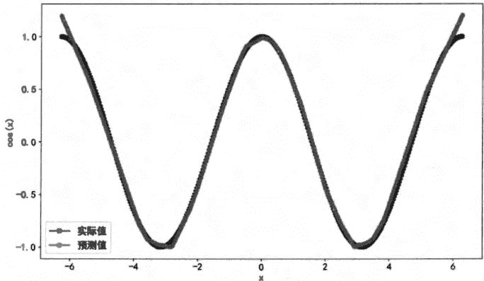
图2-2 余弦函数折线图

### 2.6 上机练习题
练习1: PyTorch内置了加法、减法、乘法等多种张量操作函数，请自行编写一个简易程序演示这些操作。
#### 练习参考代码:
```
# 导入Torch库
import torch

# 创建两个张量
x = torch.tensor([1, 2, 3])
y = torch.tensor([4, 5, 6])

# 执行加法操作
z = torch.add(x, y)
print("加法结果:", z)

# 执行减法操作
z = torch.subtract(x, y)
print("减法结果:", z)

# 执行乘法操作
z = torch.multiply(x, y)
print("乘法结果:", z)
```
#### 输出结果为:
```
加法结果: tensor([5, 7, 9])
减法结果: tensor([-3, -3, -3])
乘法结果: tensor([ 4, 10, 18])
```
练习2: PyTorch的自动微分由autograd模块实现。创建张量时可设置requires_grad=True，PyTorch便会自动记录该张量上的运算；调用.backward()后，相关张量的梯度会计算并保存至.grad属性中。请编写一个简短程序，利用自动微分求函数 $f(x)=x^2+2x+1$ 在 $x=3$ 处的导数值。
#### 练习参考代码:

```
# 导入Torch库
import torch

# 定义一个张量x, 并设置requires_grad=True以跟踪其梯度
x = torch.tensor([3.0], requires_grad=True)

# 定义函数f(x) = x^2 + 2x + 1
y = x**2 + 2*x + 1

# 使用自动微分计算y关于x的导数
y.backward()

# 输出导数值
print("导数值:", x.grad.item())
```

输出结果为:

导数值: 8.0

练习3: 数理统计中常用的统计量有均值、中位数、众数、方差、标准差等，用来刻画数据的集中趋势与分布形态。请用 PyTorch 编写一段简短程序，生成包含 10 个随机数的张量，并计算其均值、中位数、众数、方差和标准差。

#### 练习参考代码:

```
# 导入Torch库
import torch

# 生成一个包含10个随机数的张量
x = torch.randn(10)

# 计算均值
mean = x.mean()
print("均值: ", mean.item())

# 计算中位数
median = x.median()
print("中位数: ", median.item())

# 计算众数
mode = torch.mode(x)
print("众数: ", mode.values.item(), mode.indices.item())

# 计算方差
var = x.var()
print("方差: ", var.item())

# 计算标准差
std = x.std()
print("标准差: ", std.item())
```

输出结果为:

均值: -0.7022029161453247

中位数: -0.7682544589042664

众数: -2.352609872817993 8

方差: 0.6179051399230957

标准差: 0.7860694527626038

练习4: 请用 PyTorch 新建两个形状不同的张量，演示广播机制在加法、减法、乘法、除法运算中的作用。

#### 练习参考代码:

```
# 导入Torch库
import torch

# 创建两个形状不同的张量
x = torch.tensor([[1, 2], [3, 4]])
y = torch.tensor([5, 6])

# 使用矩阵广播机制进行加法、减法、乘法和除法运算
add_result = x + y
subtract_result = x - y
multiply_result = x * y
divide_result = x / y

# 输出结果
print("加法结果:", add_result)
print("减法结果:", subtract_result)
print("乘法结果:", multiply_result)
print("除法结果:", divide_result)
```

#### 输出结果为:

```
加法结果: tensor([[ 6, 8],
         [ 8, 10]])
减法结果: tensor([[-4, -4],
         [-2, -2]])
乘法结果: tensor([[ 5, 12],
         [15, 24]])
除法结果: tensor([[0.2000, 0.3333],
         [0.6000, 0.6667]])
```

# 第3章 数据预处理与工具实操


在深度学习落地时，数据准备和预处理至关重要，只有规范统一的数据才能为后续建模提供可靠保障。本章梳理 NumPy、Pandas、Scikit-learn 等常用预处理工具，并简要概括深度学习解决实际问题的典型流程，帮助读者打牢基础。

### 3.1 NumPy 科学计算库

NumPy，即 Numerical Python，是 Python 生态中常用的科学计算包，提供了丰富的函数与数据结构，使得处理大型多维数组和矩阵更高效。下面介绍其核心概念与上手方法。

#### 3.1.1 安装与导入

使用 NumPy 前需先安装，可通过 pip 命令完成部署：

```
pip install numpy
```

安装完成后，在解释器中执行 import numpy as np，若无报错即表示模块正常。

在代码中通常写作 import numpy as np，为其取别名 np，便于后续调用。例如：

```
import numpy as np
```

#### 3.1.2 核心数据结构 ndarray

ndarray 是 NumPy 的核心容器，用于表示多维数组，也是科学计算的重要基石。主要特征如下：

- **维度**：可从一维向量到高维张量，轴的数量由数据结构决定。
- **形状**：用元组描述各维大小，如 (3,4) 表示 3 行 4 列。
- **数据类型**：数组内元素类型统一，可为整型、浮点型、复数等。
- **内存布局**：数据在内存中连续存放，访问效率高。
- **索引和切片**：支持 [] 访问与切片，可精准定位或修改局部数据。
- **广播**：可在不同形状数组间自动对齐执行运算。
- **数学运算**：支持逐元素加减乘除等。
- **函数**：内置求和、均值、最大值、最小值等操作。
- **通用函数**：ufunc 能对数组每个元素直接执行运算，无需显式循环。

#### 3.1.3 基本使用

##### 1. 数组的创建
可利用 np.array() 从列表、元组等结构构建数组。该函数用法灵活：

- **参数object**：输入数据，可为标量、列表、元组等。
- **可选参数dtype**：指定输出数据类型，未指定时自动推断。
- **返回值**：返回新 ndarray，可为一维或多维。

np.array() 既能把列表转成同序数组，也能把单个数字包成一维数组，还支持多维构造，对科学计算很实用。下面示例展示常用创建方式。

```
# 从列表创建NumPy数组
arr1 = np.array([1, 2, 3])
print(arr1) # 输出: [1 2 3]
# 从元组创建NumPy数组
arr2 = np.array((1, 2, 3))
print(arr2) # 输出: [1 2 3]
```

##### 2. 数组属性一览
数组自带常用属性，如 shape、dtype、size 分别反映形状、类型、元素总数。例如：

```
arr = np.array([[1, 2], [3, 4]])
print(arr.shape) # 输出: (2, 2)
print(arr.dtype) # 输出: int64
print(arr.size) # 输出: 4
```

##### 3. 基础运算
NumPy 提供丰富的数组运算接口，加减乘除等可直接使用。例如：

```
a = np.array([1, 2, 3])
b = np.array([4, 5, 6])
# 加法
c = np.add(a, b)
print(c) # 输出: [5 7 9]
# 减法
d = np.subtract(a, b)
print(d) # 输出: [-3 -3 -3]
# 乘法
e = np.multiply(a, b)
print(e) # 输出: [ 4, 10, 18]
```

##### 4. 广播
NumPy 支持广播，运算时会自动把形状较小的数组扩展以匹配较大数组。例如：

```
a = np.array([1, 2, 3])
b = np.array([2, 2, 2])
```

```
# 广播加法
c = a + b
print(c) # 输出: [3 4 5]
```

##### 5. 切片与索引操作
用 [] 可完成切片与索引，方便读取或修改特定元素。例如：

```
arr = np.array([[1, 2], [3, 4]])
# 获取第一行
row1 = arr[0]
print(row1) # 输出: [1 2]
# 获取第二列
col2 = arr[:, 1]
print(col2) # 输出: [2 4]
```

以上介绍了 NumPy 的安装、导入、创建、属性、运算、广播及切片等内容，初学者可据此快速上手。

### 3.2 Matplotlib 可视化库

Matplotlib 是 Python 事实上的绘图库，用于数据可视化，功能全面，能快速生成各类图表。以下介绍安装与基础用法。

#### 3.2.1 安装与导入

##### 1. 安装步骤
先通过 pip 安装：

```
pip install matplotlib
```

安装后可采用三种方式校验：
- pip list 查看是否列出 matplotlib
- 在 Python 中导入 matplotlib，无报错即成功
- 执行 import matplotlib; print(matplotlib.__version__) 能打印版本号即表示正常。若出现错误，建议重装或检查环境。

##### 2. 导入方式
常用导入语句为：

```
import matplotlib.pyplot as plt
```

为库起别名 plt，方便后续绘图。

#### 3.2.2 典型绘图示例

##### 1. 简单折线图
plot() 可绘制折线图，传入 x、y 两个列表即可。

```
# 导入Matplotlib库中的pyplot模块
import matplotlib.pyplot as plt

# 定义x和y的值
x = [1, 2, 3, 4, 5]
y = [2, 4, 6, 8, 10]

# 使用折线图展示x和y的关系
plt.plot(x, y)

# 显示图表
plt.show()
```

在 Jupyter Lab 运行，效果如图3-1。

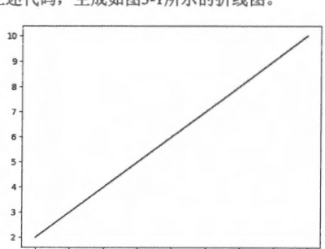

图3-1 折线图1

##### 2. 标题与轴标签设置
用 title()、xlabel()、ylabel() 分别设定标题与轴标签。

```python
# 导入Matplotlib库中的pyplot模块
import matplotlib.pyplot as plt

# 设置matplotlib的字体为SimHei，以支持中文显示
matplotlib.rcParams['font.sans-serif'] = ['SimHei']

# 设置matplotlib的坐标轴负号显示为正常字符，避免乱码问题
matplotlib.rcParams['axes.unicode_minus'] = False

# 创建一个简单的折线图
plt.plot(x, y)

# 设置图表标题
plt.title("简单折线图")

# 设置x轴标签
plt.xlabel("x轴")

# 设置y轴标签
plt.ylabel("y轴")

# 显示图表
plt.show()
```

运行后得到如图3-2 的折线图。

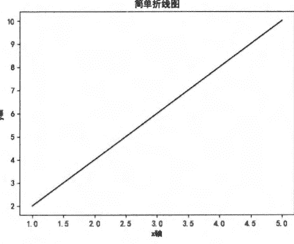

图3-2 折线图2

##### 3. 散点图绘制
scatter() 用于散点图，同样传入 x、y。

```python
# 导入Matplotlib库中的pyplot模块
import matplotlib.pyplot as plt

# 定义x和y的值
x = [1, 2, 3, 4, 5]
y = [2, 4, 6, 8, 10]

# 使用散点图展示x和y的关系
plt.scatter(x, y)

# 显示图表
plt.show()
```

运行生成如图3-3 的散点图。

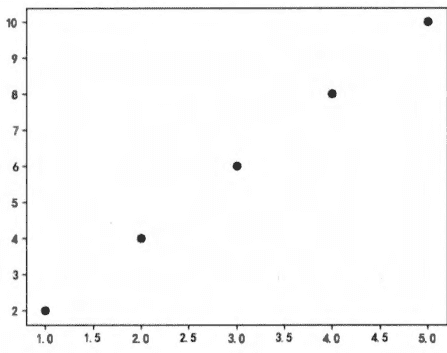

##### 4. 柱状图绘制
bar() 可绘制柱状图，输入类别与高度。

```python
# 导入Matplotlib库中的pyplot模块
import matplotlib.pyplot as plt

# x轴的数据
x = [1, 2, 3, 4, 5]

# y轴的数据（高度）
heights = [2, 4, 6, 8, 10]

# 使用bar()函数绘制柱状图，x和heights分别为x轴和y轴的数据
plt.bar(x, heights)

# 显示图形
plt.show()
```

运行后如图3-4。

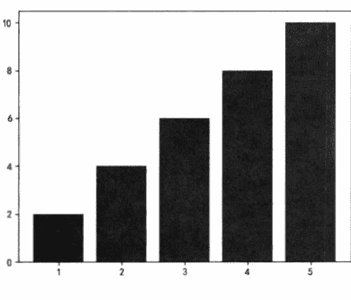

图3-4 柱状图

##### 5. 图例设置
先为数据系列添加标签，再调用 legend() 添加图例。

```python
# 导入Matplotlib库中的pyplot模块
import matplotlib.pyplot as plt

# 定义x的值
x = [1, 2, 3, 4, 5]
# 定义y1和y2的值
y1 = [2, 4, 6, 8, 10]
y2 = [1, 3, 5, 7, 9]

# 使用折线图展示y1和y2的关系，并添加标签
plt.plot(x, y1, label="数据系列1")
plt.plot(x, y2, label="数据系列2")

# 显示图例
plt.legend()
# 显示图表
plt.show()
```

运行后如图3-5。

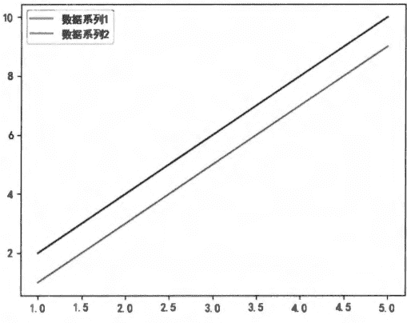

图 3-5 设置图例

以上对 Matplotlib 进行了简要介绍，包括安装、导入、折线图、散点图、柱状图以及标题、轴标签、图例等内容，初学者可据此掌握。

### 3.3 数据清洗

数据清洗属于预处理环节，核心是对数据进行检查与校正，保证准确、完整、一致、可信。本节阐述清洗的意义，并给出基于 Pandas 的实践示例。

#### 3.3.1 数据清洗的作用

清洗对模型表现影响很大。常见问题如下：

- **降低模型性能**：脏数据包含错误、重复或缺失，会让模型学到错误规律。
- **增加误差**：噪声数据会抬高预测误差，掩盖真实分布。
- **影响泛化能力**：训练时接触未处理数据，模型在真实场景中易失效。

深度神经网络虽有一定容错性，但不能替代清洗。良好的预处理能加速收敛、提升效率并降低过拟合风险。

通常，数据清洗主要包括以下内容。

数据变现的第一步，是先把数据弄干净

真正能用上的数据很少是原封不动就能分析的。清洗的核心动作可以归纳为六件事：先找出并剔除重复记录，这类问题多半来自录入失误或系统重复写入；再核查并修正明显的错误，比如小数点偏移、拼写错位等；然后统一表达规范，让日期、大小写、单位等在全表保持一致，才方便对比；接着处理空缺或无效条目，决定是直接丢弃还是用合理值填补；随后筛掉偏离正常分布的异常点，避免测量噪声带偏结果；最后做必要的格式转换与数值标准化，让数据适配后续分析需求。

落地时往往要把统计思维和工具结合起来用。量小的数据表用 Excel 就能应付，规模或结构复杂时更推荐 Python 或 R，再配合 NumPy、Pandas、Scikit-learn 等库来完成。

#### 3.3.2 Pandas 实战：把数据清洗做扎实

Pandas 是 Python 生态里做分析的利器，提供了直观又高效的结构来处理关系型或标记型数据。

它有几个显著优势。

- **数据结构**：提供了 Series 和 DataFrame 两种核心载体。Series 相当于带标签的一维数组，DataFrame 则像一张可计算的电子表格或数据库表。
- **数据处理**：内置大量函数和方法，筛选、排序、分组、合并、时间序列操作都能快速完成。
- **数据可视化**：与 Matplotlib 等绘图库无缝衔接，自带简易绘图接口。
- **性能优化**：基于 NumPy 构建，能利用底层矩阵运算提升速度。
- **广泛的应用**：在金融、统计、社会科学等领域都被大量采用。

##### 1. Pandas 的两大核心结构

###### 1) Series：一维带标签序列

Series 不只是存数，还自带丰富的操作能力。

- **创建方式**：可从列表、字典或 NumPy 数组等多种形式生成。
- **索引和切片**：每个元素都挂着标签，通过标签定位、修改或删除，并支持切片取子集。
- **基本操作**：支持算术、逻辑、比较运算，可对整体或指定标签生效。
- **缺失值检测**：能识别空缺并提供专门的处理接口。
- **自动对齐**：运算时按索引自动对齐，跨 Series 操作更省心。
- **name属性**：可为 Series 命名，提升多变量场景的可读性。

以下是一个简单的 Series 示例:

```python
import pandas as pd
# 创建一个包含整数的Series
s = pd.Series([1, 2, 3, 4, 5])
# 打印Series的内容
print(s)
```

输出结果如下:

```
0    1
1    2
2    3
3    4
4    5
dtype: int64
```

这个例子先导入 Pandas 并用整数列表创建 Series，打印后可以看到一维带标签的呈现方式。除了列表，还能用字典或数组建 Series，并且支持各类算术、逻辑运算。

###### 2）DataFrame：二维表格型容器

DataFrame 是 Pandas 的核心，它像表格一样容纳多类型数据。

- **二维标签化数据结构**：由行列构成，每个格子是一个数据点。
- **潜在的异质性**：不同列可以是数值、文本或布尔类型。
- **行索引和列索引**：双重索引便于精准定位。
- **数据处理**：提供探索、清洗、转换、可视化的一整套方法。
- **数据分析**：是数据科学和机器学习工作流的基础。
- **数据存储**：可读写多种文件格式。
- **查询便捷性**：查询接口友好，提升处理效率。

下面用一个常见例子来感受 DataFrame。

```python
import pandas as pd

# 创建一个包含姓名、年龄和城市的数据字典
data = {
    'Name': ['Alice', 'Bob', 'Charlie'],
    'Age': [25, 30, 35],
    'City': ['New York', 'London', 'Paris']
}

# 将数据字典转换为DataFrame
df = pd.DataFrame(data)

# 打印DataFrame的内容
print(df)
```

##### 2. 用 Pandas 跑一遍清洗流程

输出结果如下:

|   | Name | Age | City |
|---|---|---|---|
| 0 | Alice | 25 | New York |
| 1 | Bob | 30 | London |
| 2 | Charlie | 35 | Paris |

这里先导入 Pandas，用姓名、年龄、城市的字典构建数据，再用 pd.DataFrame() 转成表格对象，最后打印。

代码中的 df = pd.DataFrame(data) 表示用 Pandas 创建名为 df 的 DataFrame。

- **pd** 是 Pandas 的常用别名，import pandas as pd 即可定义。
- **DataFrame** 是用于生成二维表格的类。
- **data** 可以是字典或列表，字典的键作列名，值作列数据；列表则每项代表一行。

生成后即可做筛选、排序、统计等操作。

###### 1) 读取数据

先把数据读进 DataFrame。CSV 用 pd.read_csv()，Excel 用 pd.read_excel()。例如:

```python
import pandas as pd
# 从CSV文件读取数据
data = pd.read_csv('data.csv')
# 从Excel文件读取数据
data = pd.read_excel('data.xlsx')
```

###### 2) 查看数据

用 head() 快速瞥前几行，了解结构和内容。例如:

```python
# 查看前5行数据
print(data.head())
```

###### 3）处理缺失值

Pandas 支持多种缺失值策略：删除含空的行列，或用均值、中位数、众数、前后填充等方式补齐。

```python
# 删除含有缺失值的行
data.dropna(inplace=True)
```

```python
# 使用平均值填充缺失值
data.fillna(data.mean(), inplace=True)
```

###### 4）处理重复值

用 duplicated() 标记重复行，用 drop_duplicates() 去掉重复。

```python
# 检测重复行
duplicates = data.duplicated()
```

```python
# 删除重复行
data.drop_duplicates(inplace=True)
```

###### 5）去除异常值

借助条件筛选剔除异常点。比如剔除超过 3 个标准差的数值：

```python
data = data[(np.abs(stats.zscore(data['column_to_clean'])) < 3)]
```

###### 6）纠正错误

replace() 可把错误值批量替换，例如修正错误的日期格式：

```python
data['date'] = pd.to_datetime(data['date'], format='%Y-%m-%d')
```

###### 7）数据类型转换

astype() 能把列转成目标类型，比如把字符串日期转成日期类型：

```python
# 将字符串类型的日期转换为日期类型
data['date'] = pd.to_datetime(data['date'])
```

###### 8）数据筛选和排序

先按条件筛选，再按列排序，例如筛出年龄 ≥18 岁的记录并按年龄升序排列：

```python
# 筛选年龄大于或等于18岁的记录
filtered_data = data[data['age'] >= 18]
```

```python
# 按年龄升序排列
sorted_data = filtered_data.sort_values(by='age', ascending=True)
```

###### 9) 数据合并和连接

Pandas 提供 merge、join、concat 实现数据拼接。

- **merge**: 按一个或多个键连接两个 DataFrame。
- **join**: 按键拼接两个 DataFrame。
- **concat**: 按指定轴叠加多个 DataFrame。

下面以 merge 为例，按客户 ID 合并两个表：

```python
# 假设有两个数据集: data1和data2
merged_data = pd.merge(data1, data2, on='customer_id')
```

以上只是 Pandas 清洗的基础用法，实际还能组合出更复杂的流程。

### 3.4 特征工程的关键逻辑

在机器学习里，特征工程是决定模型上限的重要环节。它通过清洗、选择、转换和构造新特征，让模型更好理解数据。

#### 3.4.1 特征工程是什么，为什么重要

特征工程是对原始数据做预处理、筛选、改造和新建特征的过程，涵盖清洗、选择、转换、降维等。

其价值体现在：

1. **提高模型性能**：合适的特征能显著提升准确率和泛化能力。
2. **减少过拟合**：降维和正则化降低过拟合风险。
3. **提高训练速度**：特征更少，训练更快。

具体包括：

1. **数据清洗**：处理缺失、异常、重复，保证质量与一致性。
2. **特征选择**：挑出最相关的变量，可用相关性分析、卡方检验等。
3. **特征转换**：把原始特征映射为更有意义的形式，如对数、归一化、标准化。
4. **特征构造**：创造新变量捕捉模式，如词频、滞后特征等。
5. **降维**：用 PCA、LDA 等方法减少维度，降低复杂度。

##### ① 主成分分析

PCA 是一种降维技术，目标是找到数据变异最大的方向，即主成分。

想象数据是一张照片，PCA 就像旋转镜头，捕捉最能代表整体特征的方向作为第一主成分。它并不是简单挑选原始子集，而是重构出一组正交且互相独立的新特征，每个主成分都承载独特信息。

PCA 更倾向保留方差大的部分，因为方差越大信息越丰富。保留前几个主成分，就能在损失少量信息的前提下实现降维。

##### ② 线性判别分析

线性判别分析用于寻找最大化类别间差异、最小化类内差异的方向，常用于降维和分类。

以苹果和橙子为例：

(1) 计算每个类别的均值；
(2) 评估类内散度，看同类内部的分散程度；
(3) 评估类间散度，看两类之间的分离度；
(4) 寻找最佳投影方向，使类间距离最大、类内紧凑，再把数据投影到该方向上，用一维表示仍能有效区分。

线性判别分析能简化数据同时保留区分性，在人脸识别、生物信息等领域很常见。

特征工程是数据科学不可或缺的一环，好的特征能让模型事半功倍。

#### 3.4.2 Scikit-learn 预处理工具箱

Scikit-learn 是开源机器学习库，提供回归、聚类、降维等算法，也支持预处理、评估和调参。

安装可通过 pip：

```
pip install scikit-learn
```

安装后即可导入内置数据集做实验。下面以标准化为例。

##### 1. 数据标准化及其作用

数据标准化把数值缩放到特定区间，消除量纲和数量级差异。

常见方法包括...
# 第3章 数据预处理与常用工具实战

让特征先对齐，模型才好学

模型对输入的大小很敏感，尺度不一致会干扰学习。下面三种常用的缩放思路侧重点各不相同。

- 极差法，也常叫做 Min-Max 缩放：把原始数值借助线性变换挤进一个预设区间，最常见是 0 到 1 之间。做法直观，实现简单，在分布比较均匀时很稳。
- 标准差法，通称 Z-score 变换：以均值和离散程度为基准做平移伸缩，变换后均值靠近 0，方差变成 1。适合近似正态的情形，能很好抹平量纲差异带来的干扰。
- 比值缩放：用一个参考基数去除原始值，让所有点落在同一相对基准上。适用于必须保留原始比例关系的场景。

示例代码如下：

```
# 导入相关库
import numpy as np
from sklearn.preprocessing import StandardScaler

# 创建一个示例数据集
data = np.array([[1, 2], [3, 4], [5, 6]])

# 初始化StandardScaler对象
scaler = StandardScaler()

# 使用fit_transform方法对数据进行标准化
normalized_data = scaler.fit_transform(data)

print("原始数据:")
print(data)
print("标准化后的数据:")
print(normalized_data)
```

运行上述程序，得到以下结果。

```
原始数据:
[[1 2]
 [3 4]
 [5 6]]
标准化后的数据:
[[-1.22474487 -1.22474487]
 [ 0. 0. ]
 [ 1.22474487 1.22474487]]
```

演示先捏了 3 条记录、每条 2 个指标的小表，接着借助 StandardScaler 工具完成变换，目标是让每个指标的平均值靠近 0、离散程度调到 1。以第一指标为例，三数之和除以三得到 3，离散程度为 sqrt((1-3)²/3 + (3-3)²/3 + (5-3)²/3) = sqrt(4/3)。于是变换后的值为 (1-3)/sqrt(4/3) = -1.22474487。第二指标的变换结果同样是 -1.22474487，第三条记录的对应值是 1.22474487，与第一指标保持一致。

##### 2. 尺度统一的方法与演示

把来源各异、量级不一的指标搬到同一基准上，通常的目标区间是 0 到 1 或 -1 到 1。统一基准可以削弱量纲差异，加快收敛并提升精度，是分析建模前的关键准备，尤其在多指标混合的任务里作用明显。合理选用方式，有助于提升结果的可靠性与稳定性。

常见做法可以归纳为。

- 极差映射：经线性变换把数值压缩到 0 到 1 区间。
- 标准差中心化：依据均值和离散程度做变换，让分布趋向标准正态。

示例代码如下：

```
# 导入所需的库
from sklearn.preprocessing import MinMaxScaler
import numpy as np

# 创建一个示例数据集
data = np.array([[10, 2], [5, 6], [3, 8]])

# 初始化MinMaxScaler
scaler = MinMaxScaler()

# 对数据进行归一化处理
normalized_data = scaler.fit_transform(data)

print("原始数据：")
print(data)
print("归一化后的数据：")
print(normalized_data)
```

运行上述代码后，输出结果如下：

```
原始数据:
[[10  2]
 [ 5  6]
 [ 3  8]]
归一化后的数据:
[[1.         0.2        ]
 [0.41666667 0.66666667]
 [0.16666667 1.        ]]
```

这个片段里，MinMaxScaler 对每一列单独做压缩，默认范围是 0 到 1。第一列的下界为 3、上界为 10，处理后该列全部落在 0 到 1 之间。第二列的下界为 2、上界为 8，处理后同样被压到 0 到 1 的范围内。

完成压缩后，所有指标处于同一量级，更利于学习算法捕捉规律。

#### 3.4.3 Pandas 里的特征构造流程

本节用一个具体案例演示如何用 Pandas 完成特征筛选、特征提炼与尺度调整。

先导入 Pandas 并创建示例表，随后依次执行特征工程操作。代码如下：

```
import pandas as pd
from sklearn.preprocessing import StandardScaler

# 创建数据集
data = pd.DataFrame({'A': [1, 2, 3], 'B': [4, 5, 6], 'C': [7, 8, 9]})

# 特征选择（以相关系数为例）
correlations = data.corr().abs()
features = correlations[correlations['C'] > 0.5].index.tolist()

# 特征提取（以PCA为例）
from sklearn.decomposition import PCA
pca = PCA(n_components=2)
data_pca = pca.fit_transform(data)

# 特征缩放
scaler = StandardScaler()
data_scaled = scaler.fit_transform(data)

# 显示处理后的数据
print("特征选择结果: ", features)
print("特征提取结果: ", data_pca)
print("特征缩放结果: ", data_scaled)
```

程序运行结果如下：

```
特征选择结果: ['A', 'B']
特征提取结果:
[[-1.73205081  0.          0.        ]
 [ 0.          0.          0.        ]
 [ 1.73205081  0.          0.        ]]
特征缩放结果:
[[-1.34164079 -1.34164079 -1.34164079]
 [-0.4472136  0.4472136 -0.4472136 ]
 [ 1.34164079  1.34164079  1.34164079]]
```

整体流程可归纳为四个环节。

1. 建表：借助 Pandas 快速搭一个包含列 'A'、'B'、'C' 的表格。
2. 挑选特征：计算各列之间的相关性，挑选与 'C' 列相关系数大于 0.5 的列作为输入。
3. 提炼特征：采用 PCA 主成分分析把维度从 3 降至 2。
4. 尺度调整：使用 StandardScaler 做中心化伸缩，使每一列的均值接近 0、方差接近 1，符合标准正态。

### 3.5 深度学习落地通用流程

深度网络的应用边界在持续扩展，能应对大量复杂任务，具体包括但不限于：

- 视觉分类：在医疗影像、自动驾驶、人脸辨识等领域实现物体检测与分类。
- 语音转写：把语音指令转成文字，广泛用于智能助手与语音控制。
- 自然语言：支持机器翻译、情感分析、文本生成等语言任务。
- 游戏与决策：如 AlphaGo 以深度网络实现围棋策略性决策并战胜人类高手。
- 机械异常检测：分析设备运行数据识别潜在故障模式，助力预测性维护。
- 医学辅助诊断：帮助医生分析病例，发现常规检查易忽略的疾病迹象。
- 合成药物筛选：通过化合物数据预测成药潜力，加速研发周期。
- 艺术生成：生成音乐、绘画等新型艺术作品。
- 个性化推荐：基于用户行为偏好推送电影、音乐、新闻等内容。

深度网络的优势在于从海量数据中学习复杂模式，因而应用前景广阔。

落地实际问题时，通常遵循以下流程。

1. 问题界定：明确任务类型，如图像分类、语音转写、自然语言等。
2. 数据获取：从公开集、网络爬取或实验设备获取训练测试数据。
3. 数据清洗整理：去噪、补全缺失、标准化、数据增强等。
4. 特征构造：从原始数据中提取有效特征，或设计自定义提取方法。
5. 模型挑选：依据任务与数据特点挑选结构，如 CNN 用于视觉、RNN 用于序列。
6. 模型搭建：使用 TensorFlow、PyTorch 等框架搭建结构并设定参数。
7. 模型学习：用训练集优化参数，最小化损失函数。
8. 模型校验：用验证集评估表现并调整结构与参数。
9. 模型测试：用测试集检验泛化能力。
10. 模型完善：根据结果调整结构、扩充数据或使用预训练模型。
11. 模型上线：将模型部署到实际应用场景。
12. 模型监控与维护：持续跟踪线上表现并按需更新。

上述步骤并非严格线性，实践中常需迭代。以预测某地区未来一周最高气温为例，流程可具体化为：

1. 问题界定：预测目标地区未来 7 天每日最高温度。
2. 数据获取：收集历史气象数据，包括日期、最高最低温、湿度、风速、气压等，来源可为国家气象信息中心、Weather Underground 等。
3. 数据清洗整理：清洗异常记录，处理缺失值，做标准化或归一化，并把时间序列转为监督学习格式。
4. 特征构造：构造相关特征，如历史温度、季节、节假日、滞后特征、年内天数、是否周末等。
5. 模型挑选：针对序列数据可选用 RNN、LSTM 或 GRU。
6. 模型搭建：在 TensorFlow/PyTorch 中定义层数、神经元数，选择 MSE 作为损失、Adam 或 SGD 作为优化器。
7. 模型学习：划分训练集与验证集，调参如批次大小、学习率、迭代次数。
8. 模型校验：在验证集上评估并优化超参数。
9. 模型测试：在测试集上检查过拟合。
10. 模型完善：尝试新特征或不同结构。
11. 模型上线：上线进行实时预测。
12. 模型监控与维护：定期更新以适应新的气候模式。

整个过程需要多次迭代，并考虑季节性与趋势性时间因素。

### 3.6 实操练习：逐日最高气温预测

为帮助读者理解深度网络及 PyTorch 的实操，本节以每日最高气温预测为例演示完整思路。

##### 1. 案例说明

案例数据源自“天气预报”网的空气质量数据，采集 2024 年 1 月上海市天气，共 31 条记录，如图 3-6 所示。

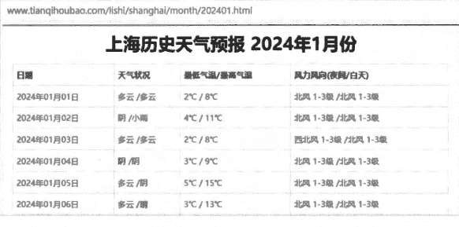

图 3-6 数据来源

原始数据经处理后保存为 temps.csv，主要字段见表 3-1。

表3-1 数据集字段

| 字段名 | 说明 |

|---|---|

| year | 年份 |

| month | 月份 |

| day | 日期 |

| temp_2 | 前天的最高温度值 |

| temp_1 | 昨天的最高温度值 |

| average | 三年这一天的平均最高温度 |

| actual | 当天的真实最高温度 |

##### 2. 实现步骤

具体实现分步说明如下。

1. 导入 Python 中相关的第三方库，代码如下：

```
#导入相关库
import torch # 导入PyTorch库，用于深度学习和神经网络计算
import numpy as np # 导入NumPy库，用于进行数值计算
import pandas as pd # 导入Pandas库，用于数据处理和分析
import datetime # 导入datetime库，用于处理日期和时间
import matplotlib # 导入Matplotlib库，用于绘制图表和可视化数据
import matplotlib.pyplot as plt # 导入Matplotlib的子模块pyplot，用于绘制各种图形
# 从matplotlib.pyplot导入MultipleLocator，用于设置坐标轴刻度间隔
from matplotlib.pyplot import MultipleLocator
# 从scikit-learn库导入preprocessing模块，用于数据预处理
from sklearn import preprocessing
```

2. 读取本地离线文件数据源数据，代码如下：

```
# 读取'./temps.csv'文件中的数据，并将其存储在DataFrame对象features中
features = pd.read_csv('./temps.csv')
# 将数据框 features 中的 'actual' 列转换为NumPy数组，并将其存储在labels变量中
labels = np.array(features['actual'])
# 从 features 中删除 'actual' 列。axis=1表示删除列，而不是行
features = features.drop('actual', axis=1)
# 将 features 的列名转换为列表，并将其存储在feature_list变量中
feature_list = list(features.columns)
```

为提升准确率，对数据做格式转换与标准化，代码如下：

```python
# 将 features 转换为 NumPy 数组
features = np.array(features)
# 使用 StandardScaler 进行特征标准化
input_features = preprocessing.StandardScaler().fit_transform(features)
```

经过特征标准化，不同特征的量级差异被消除，有助于算法更公平地学习，避免数值大小主导训练过程。

下面设置神经网络结构，代码如下：

```python
# 获取输入特征的维度数
input_size = input_features.shape[1]
# 设置隐藏层大小
hidden_size = 128
# 设置输出大小
output_size = 1
# 设置批次大小
batch_size = 16
# 使用 torch.nn.Sequential 按顺序构建神经网络
my_nn = torch.nn.Sequential(
    # 线性层，将输入特征映射到隐藏层
    torch.nn.Linear(input_size, hidden_size),
    # Sigmoid 激活函数
    torch.nn.Sigmoid(),
    # 线性层，将隐藏层映射到输出
    torch.nn.Linear(hidden_size, output_size),
)
```

第一个线性层 `torch.nn.Linear(input_size, hidden_size)` 把输入映射到隐藏层，Sigmoid 激活函数作用于隐藏层输出，最后一个线性层 `torch.nn.Linear(hidden_size, output_size)` 把隐藏层输出映射到最终结果。

至此构建了一个包含输入、隐藏、输出三层的简单网络，可用于后续训练与预测。

定义神经网络模型的损失函数与优化器，代码如下：

```python
# 定义损失函数为均方误差损失。reduction='mean' 表示对每个样本的损失进行平均，得到总体的平均损失
cost = torch.nn.MSELoss(reduction='mean')
# 定义优化器为 Adam 优化器，并传入神经网络的参数，学习率为0.001
optimizer = torch.optim.Adam(my_nn.parameters(), lr=0.001)
```

迭代中优化器会依据损失反馈微调权重，目标是让损失逐步收敛，循环更新带来整体表现的提升。

神经网络训练实现
```python
# 用于存储损失值的列表
losses = []
# 循环 500 次
for i in range(500):
    # 用于存储每批数据的损失值的列表
    batch_loss = []
    # 遍历输入特征，按照批次大小进行分割
    for start in range(0, len(input_features), batch_size):
        # 计算批次的结束位置，如果超过特征长度，则取特征长度
        end = start + batch_size if start + batch_size < len(input_features) else len(input_features)
        # 将输入特征转换为 torch.Tensor，并设置数据类型为 torch.float，需要计算梯度
        xx = torch.tensor(input_features[start:end], dtype=torch.float, requires_grad=True)
        # 将标签转换为 torch.Tensor，并设置数据类型为 torch.float，需要计算梯度
        yy = torch.tensor(labels[start:end], dtype=torch.float, requires_grad=True)
        # 使用构建的神经网络进行预测
        prediction = my_nn(xx)
        # 计算损失
        loss = cost(prediction, yy)
        # 清空梯度
        optimizer.zero_grad()
        # 反向传播损失
        loss.backward(retain_graph=True)
        # 更新模型参数
        optimizer.step()
        # 将当前批次的损失值添加到 batch_loss 列表中
        batch_loss.append(loss.data.numpy())

# 每隔 100 次迭代，将批次平均损失添加到 losses 列表中，并打印相关信息
if i % 100 == 0:
    losses.append(np.mean(batch_loss))
    print(i, np.mean(batch_loss), batch_loss)

# 将输入特征转换为 torch.Tensor，并设置数据类型为 torch.float
x = torch.tensor(input_features, dtype=torch.float)
# 使用神经网络对 x 进行预测，并将结果转换为NumPy数组
predict = my_nn(x).data.numpy()
```

该结构利于在迭代中保存损失曲线，便于观察收敛态势，训练完成后可直接用学得的参数做推理。

日期格式转换示例
```python
# 获取特征矩阵中 'month' 特征的列
months = features[:, feature_list.index('month')]
# 获取特征矩阵中 'day' 特征的列
days = features[:, feature_list.index('day')]
# 获取特征矩阵中 'year' 特征的列
years = features[:, feature_list.index('year')]

# 遍历年份、月份和日期，将它们组合成日期字符串格式
dates = [str(int(year)) + '-' + str(int(month)) + '-' + str(int(day)) for year, month, day in zip(years, months, days)]
# 遍历日期字符串列表，将它们解析为 datetime 对象
dates = [datetime.datetime.strptime(date, '%Y-%m-%d') for date in dates]

# 创建一个包含日期和实际标签的 DataFrame
true_data = pd.DataFrame(data={'date': dates, 'actual': labels})

# 遍历年份、月份和日期，将它们组合成测试日期的字符串格式
test_dates = [str(int(year)) + '-' + str(int(month)) + '-' + str(int(day)) for year, month, day in zip(years, months, days)]
# 遍历测试日期字符串列表，将它们解析为 datetime 对象
test_dates = [datetime.datetime.strptime(date, '%Y-%m-%d') for date in test_dates]

# 创建一个包含测试日期和预测值的 DataFrame
predictions_data = pd.DataFrame(data={'date': test_dates, 'prediction': predict.reshape(-1)})
```

此段负责特征预处理，从特征矩阵拆出年、月、日三列，拼接为标准日期文本后解析为 datetime 并生成表格。

散点可视化示例
```python
# 设置matplotlib 的字体为SimHei
matplotlib.rc("font", family='SimHei')

# 创建一个图形，大小为 12×7 英寸，分辨率为 160 dpi
plt.figure(figsize=(12, 7), dpi=160)

# 绘制真实值的曲线，颜色为蓝色，标记为+
plt.plot(true_data['date'], true_data['actual'], 'b+', label='真实值')

# 绘制预测值的曲线，颜色为红色，标记为 o，并添加标签
plt.plot(predictions_data['date'], predictions_data['prediction'], 'r+',
label='预测值',marker='o')

# 设置 x 轴刻度的旋转角度为 30 度，大小为 15
plt.xticks(rotation=30,size=15)

# 设置 y 轴的范围为 0~25
plt.ylim(0,25)

# 设置 y 轴刻度的大小为 15
plt.yticks(size=15)

# 设置 x 轴的主要刻度间隔为 3
x_major_locator=MultipleLocator(3)

# 设置 y 轴的主要刻度间隔为 5
y_major_locator=MultipleLocator(5)

# 获取当前图形的坐标轴
ax=plt.gca()

# 设置 x 轴的主要刻度定位器
ax.xaxis.set_major_locator(x_major_locator)

# 设置 y 轴的主要刻度定位器
ax.yaxis.set_major_locator(y_major_locator)

# 添加图例，字体大小为 15
plt.legend(fontsize=15)

# 设置 y 轴标签为'日最高温度'，字体大小为 15
plt.ylabel('日最高温度',size=15)

# 显示图形
plt.show()
```

以 Matplotlib 为底绘制对比图，叠加真实曲线与预测曲线，并对刻度、图例、文本标注等样式做了设定，参数可按需灵活调整。

按此流程即可得到包含真实值与预测值的对比图并完成美化。

##### 3. 案例小结

本案例基于 PyTorch 模型，以散点图形式对 2024 年 1 月上海日最高气温进行预测。

运行上述每日温度预测程序后可得到真实与预测散点，如图 3-7 所示。

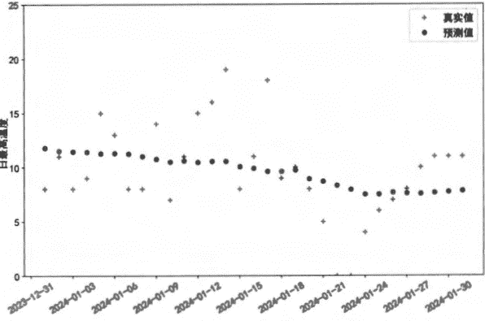

图 3-7 气温真实值和预测值的散点图

### 3.7 实操练习

#### 练习 1: NumPy 构造 5 元素序列并做加减乘

操作要点
载入 NumPy，用 array 生成长度为 5 的序列，内容为 1 至 5，随后分别执行加、减、乘。

代码片段
```python
import numpy as np
arr = np.array([1, 2, 3, 4, 5])
print("原始数组:", arr)
# 加法
arr_add = arr + 2
print("加法结果:", arr_add)
# 减法
arr_sub = arr - 1
print("减法结果:", arr_sub)
# 乘法
arr_mul = arr * 3
print("乘法结果:", arr_mul)
```

#### 练习 2: NumPy 构造 3×4 矩阵并做加减乘

操作要点
引入 NumPy，用 array 生成 3 行 4 列的矩阵，随后执行加、减、乘三类运算。

代码片段
```python
import numpy as np

arr = np.array([[1, 2, 3, 4], [5, 6, 7, 8], [9, 10, 11, 12]])
print("原始数组:", arr)

# 加法
arr_add = arr + 2
print("加法结果:", arr_add)

# 减法
arr_sub = arr - 1
print("减法结果:", arr_sub)

# 乘法
arr_mul = arr * 3
print("乘法结果:", arr_mul)
```

#### 练习 3: Matplotlib 绘制折线展示序列变化

操作要点
载入 Matplotlib，准备数据序列，用 plot 画出折线，随后用 show 呈现图形。

代码片段
```python
import numpy as np
import matplotlib.pyplot as plt

# 创建数组
x = np.arange(0, 10, 1)
y = x ** 2

# 绘制折线图
plt.plot(x, y)

# 显示图像
plt.show()
```

#### 练习 4: Matplotlib 绘制柱状图比较类别

操作要点
载入 Matplotlib，准备类别标签与对应数值两个序列，用 bar 绘制柱状图，随后用 show 显示。

代码片段
```python
import numpy as np
import matplotlib.pyplot as plt

# 创建类别和数值数组
categories = ['A', 'B', 'C', 'D', 'E']
values = [3, 7, 2, 5, 8]

# 绘制柱状图
plt.bar(categories, values)

# 显示图像
plt.show()
```

#### 练习 5: Matplotlib 绘制饼图展示占比

操作要点
载入 Matplotlib，准备各部分数值序列，用 pie 绘制饼图，随后用 show 显示。

代码片段
```python
import numpy as np
import matplotlib.pyplot as plt

# 创建数值数组
sizes = [15, 20, 30, 35]

# 绘制饼图
plt.pie(sizes, labels=['A', 'B', 'C', 'D'], autopct='%1.1f%%')

# 显示图像
plt.show()
```

#### 练习 6: Pandas 读取 CSV 并清洗数据

操作要点
载入 Pandas，用 read_csv 读取 CSV 文件，随后处理缺失、重复与异常记录完成清洗。

代码片段
```python
import pandas as pd

# 加载CSV文件
data = pd.read_csv('data.csv')

# 处理缺失值
data.fillna(method='ffill', inplace=True)

# 处理重复值
data.drop_duplicates(inplace=True)

# 处理异常值（以数值列为例）
numerical_cols = data.select_dtypes(include=[np.number]).columns
for col in numerical_cols:
    data[col] = data[col].apply(lambda x: np.nan if x < 0 else x)

# 显示处理后的数据
print(data)
```

#### 练习 7: Scikit-learn 做归一化

操作要点
载入 Scikit-learn，构造示例集，用 MinMaxScaler 实现归一化。

代码片段
```python
from sklearn.preprocessing import MinMaxScaler
import numpy as np

# 创建数据集
data = np.array([[1, 2, 3], [4, 5, 6], [7, 8, 9]])

# 数据归一化
scaler = MinMaxScaler()
data_normalized = scaler.fit_transform(data)

# 显示处理后的数据
print(data_normalized)
```

#### 练习 8: Scikit-learn 做标准化

操作要点
载入 Scikit-learn，准备数据集，用 StandardScaler 完成标准化。

代码片段
```python
from sklearn.preprocessing import StandardScaler
import numpy as np

# 创建数据集
data = np.array([[1, 2, 3], [4, 5, 6], [7, 8, 9]])

# 数据标准化
scaler = StandardScaler()
data_standardized = scaler.fit_transform(data)

# 显示处理后的数据
print(data_standardized)
```

## 第 4 章 PyTorch 基础


PyTorch 源自 Torch，底层思路相近但大量代码以 Python 重写，带来更强的灵活性、动态图支持与原生的 Python 接口。它是一款以 Python 为主的深度学习框架，兼具高效 GPU 加速与动态网络构建能力。本章介绍上手所需的核心概念。

### 4.1 张量及创建

数学上张量可视作多维数组的推广，包含标量、向量、矩阵等特例。本节阐释张量概念并介绍 PyTorch 中常见的创建方式。

#### 4.1.1 张量与数据类型

张量研究近年持续升温，因其比矩阵更能自然表征自然现象。张量本质是多维数组，每个方向常称为模。阶数即维数，一阶为向量，二阶为矩阵，三阶及以上为高阶。

Tensor 是 PyTorch 的核心结构，使用时体现为 torch.Tensor 形式，共有 8 个主要属性，具体如下。

- data: 被包装的张量。
- dtype: 张量的数据类型。
- shape: 张量的形状与维度。
- device: 张量所在设备，CPU 或 GPU，加速计算的关键。
- grad: data 的梯度。
- grad_fn: 创建张量的 Function，是自动求导的关键。
- requires_grad: 是否需要计算梯度。
- is_leaf: 是否为叶子节点。

前 4 项与数据相关，后 4 项与梯度求导相关。

torch.dtype 用来标记 torch.Tensor 的数据类型，PyTorch 提供 9 种常见类型，具体如表 4-1 所示。

| Data Type | dtype | CPU Tensor | GPU Tensor |

|---|---|---|---|

| 32-bit floating point | torch.float32 or torch.float | torch.FloatTensor | torch.cuda.FloatTensor |

| 64-bit floating point | torch.float64 or torch.double | torch.DoubleTensor | torch.cuda.DoubleTensor |

| 16-bit floating point | torch.float16 or torch.half | torch.HalfTensor | torch.cuda.HalfTensor |

| 8-bit integer(unsigned) | torch.uint8 | torch.ByteTensor | torch.cuda.ByteTensor |

| 8-bit integer(signed) | torch.int8 | torch.CharTensor | torch.cuda.CharTensor |

| 16-bit integer(signed) | torch.int16 or torch.short | torch.ShortTensor | torch.cuda.ShortTensor |

| 32-bit integer(signed) | torch.int32 or torch.int | torch.IntTensor | torch.cuda.IntTensor |

| 64-bit integer(signed) | torch.int64 or torch.long | torch.LongTensor | torch.cuda.LongTensor |

| Boolean | torch.bool | torch.BoolTensor | torch.cuda.BoolTensor |

#### 4.1.2 直接基于数组创建张量
在认识了张量是什么之后，紧接着的问题就是怎么把它造出来。造张量的路子不少，最常用也最直观的一种，就是拿现成的数组来做原料。下面这两种做法是最典型的。

做法1：调用 torch.tensor() 把数组转成张量，并观察类型。示例如下：

```python
import torch
import numpy as np

# 创建一个3×3的全1数组
arr = np.ones((3, 3))
# 打印数组的数据类型
print("ndarray的数据类型:", arr.dtype)
# 将NumPy数组转换为PyTorch张量
t1 = torch.tensor(arr)
# 将NumPy数组转换为PyTorch张量，并指定设备为CPU
t2 = torch.tensor(arr, device='cpu')
# 打印t1张量
print(t1)
# 打印t2张量
print(t2)
```

运行后得到：

```
ndarray的数据类型: float64
tensor([[1., 1., 1.],
      [1., 1., 1.],
      [1., 1., 1.]], dtype=torch.float64)
tensor([[1., 1., 1.],
      [1., 1., 1.],
      [1., 1., 1.]], dtype=torch.float64)
```

从这个例子可以看出，arr 数组被用来生成了一个全新的张量实例。

做法2：借助 torch.from_numpy() 从 NumPy 数组创建张量。

由 torch.from_numpy 得到的张量会与源 ndarray 共享同一块内存，所以一方改动另一方也会同步变化。比如把张量中 [0,2] 的值改写为 -1，代码如下：

```python
import torch
import numpy as np

# 创建一个2×3的数组
arr = np.array([[1, 2, 3], [4, 5, 6]])
# 将NumPy数组转换为PyTorch张量
t = torch.from_numpy(arr)
# 打印原始数组和张量
print("原始数组和张量")
print(arr)
print(t)

# 修改张量的数值
print("\n修改张量的数值")
t[0, 2] = -1
# 打印修改后的数组和张量
print(arr)
print(t)
```

执行后的输出为：

```
原始数组和张量
[[1 2 3]
 [4 5 6]]
tensor([[1, 2, 3],
        [4, 5, 6]], dtype=torch.int32)
修改张量的数值
[[ 1  2 -1]
 [ 4  5  6]]
tensor([[ 1,  2, -1],
        [ 4,  5,  6]], dtype=torch.int32)
```

#### 4.1.3 借助概率分布生成张量
1. 从正态分布采样生成张量

torch.normal() 可以基于给定的参数从离散正态分布中抽样。共有四种用法，均值和标准差可以是标量也可以是张量。当其中一个是张量另一个是标量时，会触发广播机制把标量扩展成匹配的形状。

torch.normal() 的调用格式如下：

```python
torch.normal(mean, std, size, out=None)
```

【参数说明】

- mean：均值。
- std：标准差。
- size：仅当 mean 与 std 均为标量时生效，用于指定输出张量的形状。
- out：可选的输出张量，若提供则结果写回该张量，默认 None。

例如 mean 和 std 都是张量，会一一对应地取作每个分布的均值和标准差，从各自的正态分布里各抽一个数。

示例代码如下：

```python
import torch

# 创建一个从1到4的等差数列，数据类型为float
mean = torch.arange(1, 5, dtype=torch.float)
# 创建一个从1到4的等差数列，数据类型为float
std = torch.arange(1, 5, dtype=torch.float)
# 生成一个服从正态分布的张量，均值为mean，标准差为std
t = torch.normal(mean, std)
# 打印均值、标准差和生成的张量
print("mean:{}\nstd:{}\n{}".format(mean, std, t))
```

输出结果如下：

```
mean:tensor([1., 2., 3., 4.])
std:tensor([1., 2., 3., 4.])
tensor([ 0.0653,  3.8435, -2.2774,  8.5908])
```

2. 从标准正态分布采样生成张量

标准正态分布即均值 0、标准差 1。可以用 torch.randn() 和 torch.randn_like() 来实现。

torch.randn() 的格式如下:

```python
torch.randn(size, out=None, dtype=None, layout=torch.strided, device=None, requires_grad=False)
```

torch.randn_like() 的格式如下:

```python
torch.randn_like(input, dtype=None, layout=None, device=None, requires_grad=False)
```

3. 从均匀分布采样生成张量

区间 [0, 1) 上的均匀分布可用 torch.rand() 和 torch.rand_like() 获取。

torch.rand() 的格式如下:

```python
torch.rand(size, out=None, dtype=None, layout=torch.strided, device=None, requires_grad=False)
```

torch.rand_like() 的格式如下:

```python
torch.rand_like(input, dtype=None, layout=torch.strided, device=None, requires_grad=False)
```

### 4.2 激活函数
激活函数就是作用在神经元上的变换，它把神经元的输入映射成输出。本节梳理激活函数的意义，并介绍 PyTorch 里常见的几种实现。

#### 4.2.1 激活函数的作用与必要性
在深度学习里，信息从一层传到下一层先做线性叠加，随后必须经过非线性激活再继续传递，如此反复。正是因为非线性反复叠加，网络才具备捕捉复杂特征的能力。

如果去掉非线性，每一层的输出只是上一层输入的线性组合。无论叠加多少层，最终结果都等价于输入的线性函数，效果跟单层一样，这就退化成了多层感知机 MLP。MLP 是一种经典的前馈人工神经网络，常用于分类和回归任务。

激活函数的发展脉络大致是 Sigmoid → Tanh → ReLU → Leaky ReLU 等，并在不断改进。其中 Softmax 比较特殊，通常只放在网络最后一层，用来做分类和归一化。

#### 4.2.2 Sigmoid 激活函数
Sigmoid 的名字来源于生物学里的 S 型生长曲线。常作为阈值函数使用，因其单调递增且反函数也单调递增，能把数值压缩到 0~1 之间，公式如下：

$$f(x) = \frac{1}{1 + e^{-x}}$$

Sigmoid 是历史最久的激活函数之一，值域在 0 到 1 之间，输出可被解释为二分类事件为 1 的概率。它在定义域的大部分区域会饱和，只有输入接近 0 时才对变化敏感，能有效控制数值幅度并保持深层网络的数值稳定。

绘制曲线的代码如下：

```python
import numpy as np
import matplotlib.pyplot as plt

# 定义sigmoid函数，用于计算输入x的sigmoid值
def sigmoid(x):
    return 1. / (1. + np.exp(-x))

# 定义plot_sigmoid函数，用于绘制sigmoid函数图像
def plot_sigmoid():
    # 生成x轴数据，范围为-10~10，步长为0.1
    x = np.arange(-10, 10, 0.1)
    # 计算对应的y轴数据，即sigmoid值
    y = sigmoid(x)
    # 绘制图像
    plt.plot(x, y)
    # 显示图像
    plt.show()

# 程序入口
if __name__ == '__main__':
    plot_sigmoid()
```

得到的 Sigmoid 图像如图4-1 所示。

Sigmoid 的优势在于输出范围限定在 0~1，在需要概率解释的场景很方便。同时当损失函数使用交叉熵时，配合 Sigmoid 能提升迭代效率。

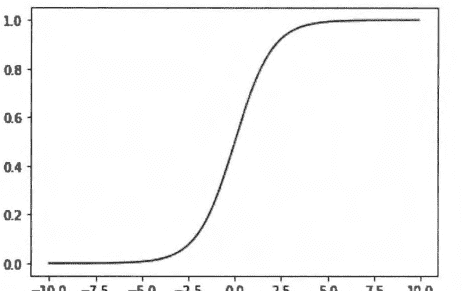

图 4-1 Sigmoid 激活函数图形

#### 4.2.3 Tanh 激活函数
Tanh 属于双曲函数家族，即双曲正切，由双曲正弦和双曲余弦推导而来，公式如下：

$$ \operatorname{Tanh}(x)=\frac{\sinh (x)}{\cosh (x)}=\frac{e^{x}-e^{-x}}{e^{x}+e^{-x}} $$

在分类任务中，Tanh 正在逐步替代 Sigmoid。从图像看它关于原点对称，解决了 Sigmoid 输出恒为正的问题，其他特性如连续可微都与 Sigmoid 相似。

绘制曲线的代码如下：

```python
import numpy as np
import matplotlib.pyplot as plt

# 定义tanh函数，用于计算输入x的双曲正切值
def tanh(x):
    return (np.exp(x)-np.exp(-x))/(np.exp(x)+np.exp(-x))

# 定义plot_tanh函数，用于绘制tanh函数图像
def plot_tanh():
    # 生成x轴数据，范围为-10~10，步长为0.1
    x = np.arange(-10, 10, 0.1)
    # 计算对应的y轴数据，即tanh值
    y = tanh(x)
    # 绘制图像
    plt.plot(x, y)
    # 显示图像
    plt.show()

# 程序入口
if __name__ == '__main__':
    plot_tanh()
```

绘制的 Tanh 图像如图4-2 所示。

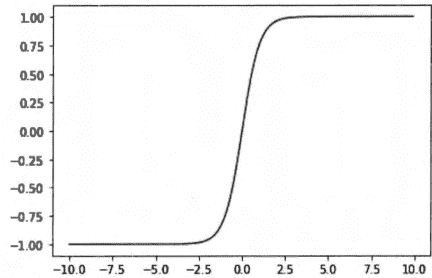

图4-2 Tanh 激活函数图形

Tanh 关于原点对称，是零均值函数，这一点比 Sigmoid 有改进。Sigmoid 的输出整体偏正，而 Tanh 的输出分布在 y 轴两侧，更接近生物神经元的稀疏激活特性，从而让人工网络更贴近自然。

#### 4.2.4 ReLU 激活函数
2001 年提出的线性分段激活函数 ReLU，公式为：

$f(x) = \max(0, x)$

直观上它会压制所有小于 0 的输入，只保留正部分的净激活。因此 x<0 时导数为 0，ReLU 只在右侧饱和。相比 Sigmoid 和 Tanh 的双侧饱和，单侧饱和让陷入饱和的概率大幅降低。虽然是非零均值激活，但其稀疏激活特性可以在一定程度上抵消均值偏移带来的影响。

绘制曲线的代码如下:

```python
import numpy as np
import matplotlib.pyplot as plt

def relu(x):
    return np.maximum(0,x)

def plot_relu():
    x=np.arange(-10,10,0.1)
    y=relu(x)
    plt.plot(x,y)
    plt.show()

if __name__ == '__main__':
    plot_relu()
```

绘制的 ReLU 图像如图4-3 所示。

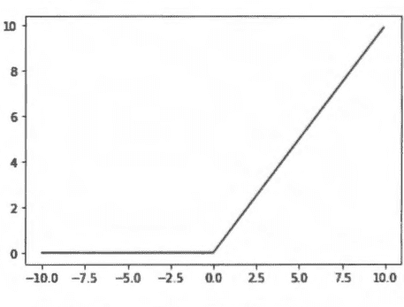

图4-3 ReLU 激活函数图形

ReLU 近年来被广泛使用，相对于 Sigmoid 和 Tanh，它有效缓解了梯度弥散问题。正无穷处的梯度保持常数，不会趋向于 0，且计算只涉及比较，速度远快于含指数运算的 Sigmoid 和 Tanh。

#### 4.2.5 Leaky ReLU 激活函数
ReLU 在输入为负时输出恒为 0，一阶导数也恒为 0，导致参数无法更新，神经元“坏死”。

为此在负半轴引入一个很小的泄漏斜率，形成 Leaky ReLU，公式如下：

$f(x) = \max(0.01x, x)$

该变体对负值输入保留微小的斜率，导数永远不为零，减少了静默神经元的出现，让基于梯度的学习得以继续，虽然收敛会变慢，但避免了神经元完全不学习的问题。

绘制曲线的代码如下：

```python
import numpy as np
import matplotlib.pyplot as plt

# 定义leaky_relu函数，用于计算输入x的Leaky ReLU值
def leaky_relu(x):
    return np.array([i if i > 0 else 0.01*i for i in x ])

# 定义lea_relu_diff函数，用于计算输入x的Leaky ReLU导数值
def lea_relu_diff(x):
    return np.where(x > 0, 1, 0.01)

# 生成x轴数据，范围为-10~10，步长为0.01
x = np.arange(-10, 10, step=0.01)
# 计算对应的y轴数据，即Leaky ReLU值
y_sigma = leaky_relu(x)
# 计算对应的y轴数据，即Leaky ReLU导数值
y_sigma_diff = lea_relu_diff(x)
# 创建一个子图
axes = plt.subplot(111)
# 绘制Leaky ReLU曲线
axes.plot(x, y_sigma, label='leakly_relu')
# 添加图例
axes.legend()
# 显示图像
plt.show()
```

绘制的 Leaky ReLU 图像如图4-4 所示。

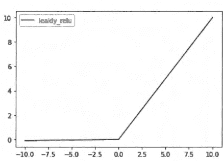

图4-4 Leaky ReLU 激活函数图形

#### 4.2.6 其他类型的激活函数

PyTorch 2.2 激活与损失一览

在前文已介绍的四类激活之外，PyTorch 2.2 还内置了二十四种额外的激活算子，汇总在表 4-2 中，具体参数与用法以官方文档为准。
| 编号 | 激活函数 | 调用方法 |

|---|---|---|

| 1 | nn.ELU | torch.nn.ELU(alpha=1.0, inplace=False) |

| 2 | nn.Hardshrink | torch.nn.Hardshrink(lambd=0.5) |

| 3 | nn.Hardsigmoid | torch.nn.Hardsigmoid(inplace=False) |

| 4 | nn.Hardtanh | torch.nn.Hardtanh(min_val=-1.0, max_val=1.0, ...) |

| 5 | nn.Hardswish | torch.nn.Hardswish(inplace=False) |

| 6 | nn.LogSigmoid | torch.nn.LogSigmoid() |

| 7 | nn.MultiheadAttention | torch.nn.MultiheadAttention(embed_dim, num_heads, ...) |

| 8 | nn.PReLU | torch.nn.PReLU(num_parameters=1, init=0.25) |

| 9 | nn.ReLU6 | torch.nn.ReLU6(inplace=True) |

| 10 | nn.RReLU | torch.nn.RReLU(lower=0.125, upper=0.33, inplace=False) |

| 11 | nn.SELU | torch.nn.SELU(inplace=False) |

| 12 | nn.CELU | torch.nn.CELU(alpha=1.0, inplace=False) |

| 13 | nn.GELU | torch.nn.GELU() |

| 14 | nn.SiLU | torch.nn.SiLU(inplace=False) |

| 15 | nn.Softplus | torch.nn.Softplus(beta=1, threshold=20) |

| 16 | nn.Softshrink | torch.nn.Softshrink(lambd=0.5) |

| 17 | nn.Softsign | torch.nn.Softsign() |

| 18 | nn.Tanhshrink | torch.nn.Tanhshrink |

| 19 | nn.Threshold | torch.nn.Threshold(threshold, value, inplace=False) |

| 20 | nn.Softmin | torch.nn.Softmin(dim=None) |

| 21 | nn.Softmax | torch.nn.Softmax(dim=None) |

| 22 | nn.Softmax2d | torch.nn.Softmax2d() |

| 23 | nn.LogSoftmax | torch.nn.LogSoftmax(dim=None) |

| 24 | nn.AdaptiveLogSoftmaxWithLoss | torch.nn.AdaptiveLogSoftmaxWithLoss(...) |

### 4.3 损失函数

损失函数在统计学和机器学习里承担度量风险的角色，把随机事件或相关随机变量的取值映射为非负实数。下面介绍 PyTorch 中常用的几种实现。

#### 4.3.1 损失函数及其选取

监督学习里，损失常用来刻画单个样本的真实标签与模型预测之间的脱节，从而指导参数估计。受任务类型、数据特征、求解目标等因素制约，可选的损失种类很多，各自的偏好也不同，选出最匹配的损失并不容易。

在监督场景下，损失反映了单条样本的偏差，常被用作模型好坏的度量。不同算法会搭配不同的损失，即便场景相同，不同损失对同一批样本的评价也可能分歧。因此损失是否恰当，直接影响预测表现。

实际选型要兼顾算法本身、出入异常值、梯度计算成本、求导便利性以及预测置信度等约束。并不存在普适的损失能覆盖所有数据形态。在条件一致时，越能拉大类间距离、压缩类内距离的损失往往带来更高精度。实践中，损失与数据的契合度常是提升能力的关键。吃透各类损失的特点、明确适用边界、针对问题定制，就能进一步提高精度。

损失的数学表达形式丰富，标准形式上又衍生出大量变体。0-1 损失是最简表达，在此基础上加入参数调节惩罚范围得到感知机损失，再引入安全裕度则演化为铰链损失。可见损失的发展伴随应用研究的演进。PyTorch 中所有损失均通过 torch.nn 包调用。

#### 4.3.2 L1 范数损失函数

L1 范数损失也就是 L1Loss，思路很直观：先算预测与真实的绝对偏差，再求平均。它衡量 output 与 target 的绝对差，可返回逐元素张量或单一数值，公式如下：

$$ \operatorname { l o s s } ( x , y ) = { \frac { 1 } { N } } \sum _ { i = 1 } ^ { N } | x - y | $$

模型调用方式如下：

```python
torch.nn.L1Loss(size_average=None, reduce=None, reduction='mean')
```

【代码说明】

- size_average 仅在 reduce 为 True 时生效。取 True 得到平均值，取 False 得到各样本损失之和。
- reduce 控制是否汇总为标量，默认值 True。

示例代码如下：

```python
import torch #导入PyTorch库

#定义一个L1损失函数,计算输入和目标之间的平均绝对误差
loss = torch.nn.L1Loss(reduction='mean')
input = torch.tensor([1.0, 2.0, 3.0, 4.0]) #创建一个张量作为输入数据
target = torch.tensor([4.0, 5.0, 6.0, 7.0]) #创建一个张量作为目标数据
output = loss(input, target) #计算输入和目标之间的平均绝对误差
print(output) #打印输出结果
```

输出结果如下：

```python
tensor(3.)
```

两种输入的类型要一致，reduction 有三种模式：'none' 输出长度为 batch_size 的向量，'sum' 输出总和，'mean' 输出均值。上例中不同设置分别得到 tensor([3., 3., 3., 3.])、tensor(3.) 与 tensor(12.)。

#### 4.3.3 均方误差损失函数

均方误差损失即 MSELoss，公式为预测与真实差值的平方再平均。计算 output 与 target 差值的平方，可选逐元素或汇总输出，公式如下：

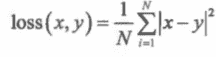

模型调用方式如下：

```python
torch.nn.MSELoss(reduce=True, size_average=True, reduction='mean')
```

【代码说明】

- reduce 决定是否返回标量，默认 True。
- size_average 在 reduce 为 True 时起作用。True 返回均值，False 返回总和。

示例代码如下：

```python
import torch #导入PyTorch库

#定义一个L1损失函数,计算输入和目标之间的平均绝对误差
loss = torch.nn.L1Loss(reduction='mean')
input = torch.tensor([1.0, 2.0, 3.0, 4.0]) #创建一个张量作为输入数据
target = torch.tensor([4.0, 5.0, 6.0, 7.0]) #创建一个张量作为目标数据
#定义一个均方误差损失函数,计算输入和目标之间的平均平方误差
loss_fn = torch.nn.MSELoss(reduction='mean')

loss = loss_fn(input, target)  # 计算输入和目标之间的平均平方误差
print(loss)                    # 打印输出结果
```

输出结果如下：

```python
tensor(9.)
```

需注意两参数的含义：reduce=False 时得到向量形式，reduce=True 时得到标量。size_average=True 返回 loss.mean()，size_average=False 返回 loss.sum()。默认两者皆为 True。

#### 4.3.4 交叉熵损失函数

交叉熵损失整合了 nn.LogSoftmax() 与 nn.NLLLoss()，在分类训练中很常用。

先说明概念：它用于评估实际输出与期望输出的接近程度。若某样本属于第 K 类，理想输出应为 [0,0,1,0,…,0]，即标签。它量化网络输出与标签的差异，并通过反向传播更新参数。

交叉熵本质上度量两个概率分布的距离，数值越小分布越相近。设期望分布为 p，实际分布为 q，公式如下：

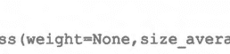

模型调用方式如下：

```python
torch.nn.CrossEntropyLoss(weight=None, size_average=None, ignore_index=-100,
reduce=None, reduction='mean')
```

【代码说明】

- weight 为一维张量，包含各类别权重，在类别不均衡时很有用，默认 None。
- size_average 在 reduce=True 时生效。True 返回均值，False 返回总和。
- ignore_index 指定忽略的类别，该类不参与计算且在做平均时也不计入。
- reduce 决定是否返回标量，默认 True。

示例代码如下：

```python
import torch # 导入PyTorch库
entroy = torch.nn.CrossEntropyLoss() # 定义一个交叉熵损失函数
# 创建一个张量作为输入数据
input = torch.Tensor([[-0.1181, -0.3682, -0.2209]])
target = torch.tensor([0]) # 创建一个张量作为目标数据
output = entroy(input, target) # 计算输入和目标之间的交叉熵损失
print(output) # 打印输出结果
```

输出结果如下：

```python
tensor(0.9862)
```

#### 4.3.5 余弦相似度损失

余弦相似度损失常用来衡量两个向量的相似程度，通过最大化相似度进行优化。两个向量均需可求导，计算公式如下：

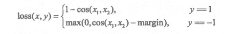

其中 margin 的取值范围为 [-1,1]，实践中建议 0~0.5。

模型调用方式如下：

```python
torch.nn.CosineEmbeddingLoss(margin=0.0, reduction='mean')
```

示例代码如下：

```python
import torch # 导入PyTorch库
a = torch.tensor([1.0, 2.0, 3.0, 4.0]) # 创建一个张量作为输入数据
b = torch.tensor([4.1, 6.1, 7.1, 8.1]) # 创建一个张量作为目标数据
# 计算两个张量的余弦相似度，dim=0表示按列计算
similarity = torch.cosine_similarity(a, b, dim=0)
loss = 1 - similarity # 计算损失值，即1减去相似度
print(loss) # 打印输出结果
```

输出结果如下：

```python
tensor(0.0199)
```

#### 4.3.6 其他损失函数

除前述四类外，PyTorch 2.2 还提供十六类损失，见表 4-3，细节请参考官方文档。

| 编号 | 损失函数 | 函数说明 |

|---|---|---|

| 1 | nn.CTCLoss | 连接时序分类损失 |

| 2 | nn.NLLLoss | 负对数似然损失 |

| 3 | nn.PoissonNLLLoss | 泊松负对数似然损失 |

| 4 | nn.GaussianNLLLoss | 高斯负对数似然损失 |

| 5 | nn.KLDivLoss | KL 散度损失 |

| 6 | nn.BCELoss | 二进制交叉熵损失 |

| 7 | nn.BCEWithLogitsLoss | 逻辑二进制交叉熵损失 |

| 8 | nn.MarginRankingLoss | 间隔排序损失 |

| 9 | nn.HingeEmbeddingLoss | 铰链嵌入损失 |

| 10 | nn.MultiLabelMarginLoss | 多标签分类损失 |

| 11 | nn.SoftMarginLoss | 两分类逻辑损失 |

| 12 | nn.MultiLabelSoftMarginLoss | 多标签逻辑损失 |

| 13 | nn.SmoothL1Loss | 平滑 L1 损失 |

| 14 | nn.MultiMarginLoss | 多类别分类损失 |

| 15 | nn.TripletMarginLoss | 三元组损失 |

| 16 | nn.TripletMarginWithDistanceLoss | 距离三元组损失 |

### 4.4 优化器

本节介绍 PyTorch 中常见的优化器。优化器依据损失指标调整模型参数，寻找最优配置。

典型流程如下。
1. 计算损失：模型对输入预测并与真实值对比得到损失。
2. 反向传播：借助链式法则与自动求导框架如 PyTorch 的 .backward() 计算梯度。
3. 更新权重：利用梯度信息调整参数。

常见类型包括梯度下降、随机梯度下降 SGD、带动量的优化方法，以及 AdaGrad、RMSprop、Adam 等自适应学习率算法。

#### 4.4.1 梯度及梯度下降算法

梯度是微积分的核心概念。单变量函数中梯度即导数，表示某点的切线斜率；多变量函数中梯度是向量，其方向指向函数值上升最快的方向。

类比下山：从山顶下来需要根据地形选择路径。可借助梯度下降，每一步都朝当前点最陡的方向向下走，反复迭代逐步逼近低点，如图 4-5 所示。

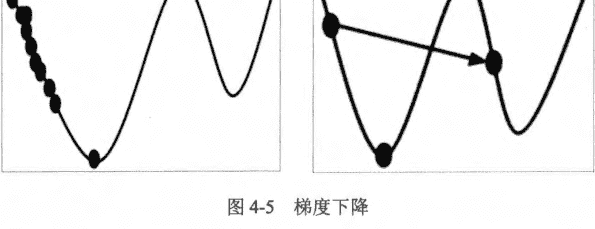

图4-5 梯度下降

梯度下降的核心思想与下山类似。先有一个可微函数代表地形，目标是找到最小值。做法是求取当前点的梯度，沿梯度相反方向移动，可使函数值下降最快。不断迭代求梯度，最终可到达局部最小值。

梯度下降公式如下：

$$\theta_{i}=\theta_{i}-\alpha \frac{\partial}{\partial \theta_{i}} J(\theta)$$

$\alpha$ 表示学习率或步长，用以控制步幅。过小收敛缓慢，过大可能越过最优点。

梯度前带负号意味着朝梯度反方向前进。因为梯度指向上升最快的方向，而我们希望下降最快，自然取负方向。

在深度学习训练里，经常被提及的梯度下降变体包括全量梯度下降、随机梯度下降、随机平均梯度下降以及小批量梯度下降。

#### 4.4.2 随机梯度下降算法

随机梯度下降的思路最早可追溯到1951年Robbins和Monro提出的随机逼近，最初用于模式识别和神经网络研究。该方法在迭代时用一小部分样本的梯度来近似整体梯度，从而大幅降低了计算开销。1958年Rosenblatt等人提出的感知机就采用了这一思想，每轮随机挑一个被误分的样本，计算其损失梯度后按设定步长更新参数。1986年Rumelhart等人提出的误差反向传播，每次按顺序或随机取一个样本更新参数，本质上可视作小批量梯度下降的特例。

全量梯度下降每次迭代都要遍历全部训练数据求梯度，面对大规模数据时资源消耗很大且数据往往存在冗余。随机梯度下降把数据拆分成小批次，每次只抽取一个样本去更新网络参数。

实践表明，使用小批量样本虽然不能完全代表整体分布，却能显著加快参数学习速度，且准确率损失有限。

与批量梯度下降对照，设训练样本总数为 $n$，随机抽取样本 $i_s$。模型参数记为 $W$，代价函数为 $J(W)$，梯度为 $\Delta J(W)$，学习率记为 $\eta$，则随机梯度下降的参数更新可写为：

$$W_{t+1} = W_t - \eta_t g_t$$

其中 $g_t = \Delta J_{i_s}(W_t; X^{(i_s)}; X^{(i_s)})$，$i_s \in 1, 2, \cdots, n$ 表示本次随机抽取的梯度方向，$W_t$ 为第 $t$ 步的参数。$E(g_t) = \Delta J(W_t)$，即在引入随机噪声的前提下，其期望仍然等于真实梯度。

优点在于，虽然该方法往往需要更多的迭代步数，但单次梯度计算成本很低。大量理论与实践表明，只要噪声幅度可控，收敛性仍然可靠。在超大规模数据上训练效率很高，比如从百万级样本中每次取几百个点算一次梯度并更新参数，要远快于标准梯度下降遍历全部样本后再更新一次。

缺点是，随机抽样带来的噪声会让权值更新方向偶尔偏离最优方向，另外该方法本身并不能单独解决陷入局部最优的问题。

#### 4.4.3 标准动量优化算法

标准动量优化把动量机制引入神经网络优化，用梯度的加权移动平均来指导参数更新方向，而非直接使用瞬时梯度。其更新表达式为：

$$\Delta \theta_t = \rho \Delta \theta_{t-1} - \alpha g_t$$

其中 $\rho$ 为动量系数，常见取值0.9，$\alpha$ 为学习率。

这样实际的更新量取决于近期梯度的加权平均：若参数在一段时间内梯度方向反复变化，有效更新幅度会被压低；若方向持续一致，则更新幅度会被放大，起到加速效果，相较纯随机梯度下降能更快逼近最优。

动量的作用主要体现在两方面：一是平滑随机梯度带来的噪声，二是缓解Hessian矩阵病态导致的震荡，即收敛时相对真实梯度的来回摆动。通俗地讲，当前权值的变化会受到前一步变化的影响，像带惯性的小球滚下山坡，速度会更快。

#### 4.4.4 AdaGrad 算法

标准梯度下降对所有参数使用统一的学习率，而AdaGrad认为不同维度收敛速度不同，因而为每个参数自适应设置学习率。该方法借鉴正则化思想，在迭代中动态调整学习率。第 $t$ 次迭代时，先累积各参数梯度平方和，其表达式为：

$$G_t = \sum_{i=1}^{t} g_i \odot g_i$$

其中 $\odot$ 表示逐元素相乘，$g_i$ 为第 $t$ 次迭代的梯度。随后计算参数的更新量：

$$\Delta \theta_t = -\frac{\alpha}{\sqrt{G_t + \varepsilon}} \odot g_t$$

其中 $\alpha$ 为初始学习率，$\varepsilon$ 为防止除零的极小常数。

在AdaGrad中，某个参数的梯度累积越大，其学习率就会越小；梯度累积越小，学习率相对越大。但随着迭代次数增加，学习率整体呈递减趋势。

#### 4.4.5 RMSProp 算法

RMSProp是对AdaGrad的改进，解决了后者学习率单调递减、在未找到最优点前就难以继续优化的问题。

该方法先计算梯度平方的指数衰减移动平均：

$$G_t = \beta G_{t-1} + (1 - \beta) g_t \odot g_t$$

其中 $\beta$ 为衰减系数，随后用与AdaGrad相同的方式计算更新量。从公式可见，RMSProp中每个参数的学习率衰减既可能变小，也可能变大。

经验上，RMSProp是深度神经网络中有效且实用的优化器，目前仍是业界常用的选择之一。

#### 4.4.6 Adam 算法

Adam即自适应动量估计算法，融合了Momentum和RMSProp的优点，既用动量确定更新方向，又能自适应调整学习率。它一方面计算梯度平方的指数加权平均，另一方面计算梯度的指数加权平均，表达式分别为：

$$ M_t = \beta M_{t-1} + (1 - \beta_1) g_t $$

$$ G_t = \beta G_{t-1} + (1 - \beta_2) g_t \odot g_t $$

其中 $\beta_1$ 和 $\beta_2$ 分别是两个移动平均的衰减率。参数更新量为：

$$ \Delta \theta_t = - \frac{\alpha}{\sqrt{G_t} + \varepsilon} \odot M_t $$

Adam集合了动量加速和自适应学习率两大优势，因而在很多场景下能更快、更稳地找到最优解，收敛速度更快。

以上介绍了几种常用优化器，实际应用中挑选合适的优化器对模型训练至关重要，需要结合模型复杂度、数据特性及训练效率综合考量，并通过实验调参学习率等超参数以获得最佳效果。

### 4.5 动手练习：PyTorch 优化器比较

为了帮助读者更好地理解和应用深度学习优化器，本节给出一个PyTorch实战案例。

##### 1. 案例说明

PyTorch内置了多种优化器，初学者常难以取舍。本案例通过对比SGD、Momentum、AdaGrad、RMSProp、Adam 五种主流优化器的表现，帮助读者快速选型。

#### 2. 操作步骤

###### 01 导入相关第三方库，代码如下：

```python
# 导入相关库
import torch # 导入PyTorch库，用于深度学习和神经网络模型的构建和训练
import torch.nn # 导入PyTorch的神经网络模块，用于定义神经网络模型的结构
# 导入PyTorch的数据加载和处理模块，用于加载数据集和进行数据预处理
import torch.utils.data as Data
import matplotlib # 导入Matplotlib库，用于绘制图表和可视化结果
import matplotlib.pyplot as plt # 导入Matplotlib的绘图模块，用于绘制图表
# 设置Matplotlib的字体为黑体，以便支持中文显示
matplotlib.rcParams['font.sans-serif'] = ['SimHei']
```

##### 02 准备建模数据，代码如下：

```python
# 使用 torch.linspace 函数在范围-1~1上生成500个数据点，并使用torch.unsqueeze函数在维度1上进行扩展
x = torch.unsqueeze(torch.linspace(-1, 1, 500), dim=1)
# 对 x 进行立方运算
y = x.pow(3)
```

上述代码生成了一个一维张量 $x$，并对其做立方运算，结果存入 $y$。这类操作在深度学习中常用于数据预处理、模型输入或其它数据处理环节。

##### 03 设置超参数，代码如下：

```python
# 学习率，决定了模型在每次更新参数时的调整幅度
LR = 0.01
# 批次大小，表示每次训练时同时处理的数据样本数量
batch_size = 15
# 训练轮数，指定了模型进行训练的轮次
epochs = 5
# 设置 torch 的随机数种子，可以使得每次运行代码时得到的结果具有可重复性，有利于实验的比较和重现
torch.manual_seed(10)
```

上述代码定义了若干变量，用来控制模型训练过程。

##### 04 设置数据加载器，代码如下：

```python
# 创建一个数据集对象
dataset = Data.TensorDataset(x, y)
# 创建数据加载器
loader = Data.DataLoader(
    dataset=dataset,
    # 批次大小
    batch_size=batch_size,
    # 是否打乱数据顺序
    shuffle=True,
    # 使用的工作进程数量
    num_workers=2
)
```

上述代码用于创建数据集和数据加载器。通过数据加载器可以在训练时按批次加载数据，并进行打乱、预处理等操作，从而提升训练效率和灵活性。后续训练代码可通过迭代加载器获取每批次数据进行训练。

##### 05 搭建神经网络框架, 代码如下:

```python
# 定义一个名为Net的torch.nn.Module子类
class Net(torch.nn.Module):
    def __init__(self, n_input, n_hidden, n_output): # 构造函数
        super(Net, self).__init__() # 调用父类的构造函数
        # 定义隐藏层, 使用线性变换
        self.hidden_layer = torch.nn.Linear(n_input, n_hidden)
        # 定义输出层, 使用线性变换
        self.output_layer = torch.nn.Linear(n_hidden, n_output)

    def forward(self, input): # 前向传播方法
        # 通过隐藏层进行线性变换, 并应用ReLU激活函数
        x = torch.relu(self.hidden_layer(input))
        output = self.output_layer(x) # 通过输出层进行线性变换
        return output # 返回输出结果
```

上述代码定义了一个神经网络模型类Net，继承自torch.nn.Module，结构包含一个隐藏层和一个输出层。

- 在 $\_\_init\_\_$ 方法中，通过torch.nn.Linear定义了隐藏层和输出层的线性变换。
- 在forward方法中，定义了前向传播流程。输入先经隐藏层线性变换后接ReLU激活，再经输出层线性变换得到最终结果。

该结构可用于分类、回归等多种任务。实际使用时，可将输入数据传入Net对象的forward方法得到输出，再进行训练、评估或预测。

##### 06 训练模型并输出折线图, 代码如下：

```python
# 定义训练函数
def train():
    """
    训练多个不同优化器的神经网络模型, 并绘制损失曲线
    """
    # 创建不同的神经网络模型
    net_SGD = Net(1, 10, 1)
    net_Momentum = Net(1, 10, 1)
    net_AdaGrad = Net(1, 10, 1)
    net_RMSprop = Net(1, 10, 1)
    net_Adam = Net(1, 10, 1)
    # 将模型存储在列表中
    nets = [net_SGD, net_Momentum, net_AdaGrad, net_RMSprop, net_Adam]

    # 定义不同的优化器
    optimizer_SGD = torch.optim.SGD(net_SGD.parameters(), lr=LR)  # 随机梯度下降
    optimizer_Momentum = torch.optim.SGD(net_Momentum.parameters(), lr=LR,
                                         momentum=0.6)  # 带有动量的随机梯度下降优化器
    optimizer_AdaGrad = torch.optim.Adagrad(net_AdaGrad.parameters(), lr=LR,
                                            lr_decay=0)  # AdaGrad优化器
    optimizer_RMSprop = torch.optim.RMSprop(net_RMSprop.parameters(), lr=LR,
                                            alpha=0.9)  # RMSProp优化器
    optimizer_Adam = torch.optim.Adam(net_Adam.parameters(), lr=LR, betas=(0.9,
                                                                          0.99))  # Adam优化器
    # 将优化器存储在列表中
    optimizers = [optimizer_SGD, optimizer_Momentum, optimizer_AdaGrad,
                  optimizer_RMSprop, optimizer_Adam]

    # 定义损失函数
    loss_function = torch.nn.MSELoss()  # 均方误差损失函数
    losses = [[], [], [], [], []]  # 用于存储每个模型的损失值的列表

    for epoch in range(epochs):  # 遍历训练轮数
        for step, (batch_x, batch_y) in enumerate(loader):  # 遍历每个批次的数据
            # 按模型、优化器和损失值列表的顺序循环
            for net, optimizer, loss_list in zip(nets, optimizers, losses):
                # 前向传播得到预测值
                pred_y = net(batch_x)
                # 计算损失
                loss = loss_function(pred_y, batch_y)
                # 清空梯度
                optimizer.zero_grad()
                # 反向传播计算梯度
                loss.backward()
                # 更新参数
                optimizer.step()
                # 将当前损失值添加到损失值列表中
                loss_list.append(loss.data.numpy())

    # 创建图像
    plt.figure(figsize=(12, 7))
    # 定义标签
    labels = ['SGD', 'Momentum', 'AdaGrad', 'RMSprop', 'Adam']
    for i, loss in enumerate(losses):  # 按模型顺序循环
        # 绘制每个模型的损失曲线
        plt.plot(loss, label=labels[i])

    # 添加图例
    plt.legend(loc='upper right', fontsize=15)
    # 设置刻度标签的大小
    plt.tick_params(labelsize=13)
    # 设置 x 轴标签
    plt.xlabel('训练步骤', size=15)
    # 设置 y 轴标签
    plt.ylabel('模型损失', size=15)
    # 设置 y 轴范围
    plt.ylim((0, 0.3))
    # 显示图像
    plt.show()

if __name__ == "__main__":
    # 调用训练函数
    train()
```

这段示例想做的事非常明确，就是让同一个任务下多套网络分别用不同的优化策略去训练，并把各自的损失走势可视化出来方便横向对比。

实现上先搭了五套同构的网络，名字分别是 net_SGD、net_Momentum、net_AdaGrad、net_RMSprop 和 net_Adam。紧接着为它们分别绑定优化器，分别是普通 SGD、带动量的 SGD、AdaGrad、RMSprop 以及 Adam。损失计算统一使用 torch.nn.MSELoss。

进入训练阶段时，会按轮次和批次循环，对每套网络完成一次前向推理、损失求值、反向梯度回传以及参数更新，同时把当步的损失数值存进对应的记录列表里。全部跑完后借助 Matplotlib 绘制五条损失曲线，并补上图例、坐标名称和轴标注。

这样一来，不同优化器在训练过程中的收敛快慢和稳定性就能一目了然，便于挑选合适的优化方案或做进一步的性能分析。执行前请确认相关库已正确导入，并根据自己的环境做必要的参数微调。

##### 3. 案例小结

这次实验把 PyTorch 里常用的优化器集中做了对比。结果来看 RMSProp 与 Momentum 这两类策略的损失下降更平稳、最终数值也更低，表现更为优异。运行对应脚本后，会得到训练日志以及如图4-6所示的损失折线图。

### 4.6 上机练习题

练习1：基础张量创建。

任务：调用 torch.tensor() 新建一个形状为 3 行 4 列的张量，并用随机整数填充，随后输出该张量。

参考练习代码：

```python
import torch

# 创建一个随机整数填充的3×4张量
random_tensor = torch.tensor([[1, 2, 3, 4], [5, 6, 7, 8], [9, 10, 11, 12]])
print("随机整数填充的3×4张量：")
print(random_tensor)
```

练习2：特定值张量创建。

任务：分别用 torch.zeros() 与 torch.ones() 生成两个 3×3 的张量，一个全为 0，另一个全为 1，然后打印出来。

参考练习代码：

```python
# 创建一个3×3的全0张量
zeros_tensor = torch.zeros(3, 3)
print("3×3全0张量：")
print(zeros_tensor)

# 创建一个3×3的全1张量
ones_tensor = torch.ones(3, 3)
print("3×3全1张量: ")
print(ones_tensor)
```

练习3：随机值张量创建。

任务：借助 torch.randn() 生成一个 2×2 的随机张量并打印其内容。

参考练习代码：

```python
# 创建一个2×2的随机值张量
randn_tensor = torch.randn(2, 2)
print("2×2随机值张量: ")
print(randn_tensor)
```

练习4：从NumPy数组创建张量。

任务：先用 NumPy 创建一个数组，再通过 torch.from_numpy() 将其转为 PyTorch 张量。

参考练习代码：

```python
import numpy as np

# 创建一个NumPy数组
np_array = np.array([1, 2, 3, 4, 5])

# 将NumPy数组转换为PyTorch张量
tensor_from_np = torch.from_numpy(np_array)

print("从NumPy数组转换得到的张量: ")
print(tensor_from_np)
```

练习5：基于已有张量的形状创建新张量。

任务：新建一个与练习1 中 random_tensor 形状完全相同、元素全为 0 的张量并打印。

参考练习代码：

```python
# 基于已有张量的形状创建一个新的全零张量
zeros_like_tensor = torch.zeros_like(random_tensor)
print("与原张量形状相同的全零张量: ")
print(zeros_like_tensor)
```

练习6：激活函数的应用。

任务：针对不同的激活函数，分别生成一个随机张量作为输入，作用后打印结果。

参考练习代码：

```python
import torch

# 创建一个随机张量
random_tensor = torch.randn(10)

# 应用ReLU激活函数
relu_tensor = torch.relu(random_tensor)
print("ReLU激活函数的结果:")
print(relu_tensor)

# 应用Sigmoid激活函数
sigmoid_tensor = torch.sigmoid(random_tensor)
print("Sigmoid激活函数的结果:")
print(sigmoid_tensor)

# 应用Tanh激活函数
tanh_tensor = torch.tanh(random_tensor)
print("Tanh激活函数的结果:")
print(tanh_tensor)

# 应用LeakyReLU激活函数 (假设斜率为0.2)
leaky_relu_tensor = torch.nn.LeakyReLU()(random_tensor)
print("LeakyReLU激活函数的结果:")
print(leaky_relu_tensor)
```

完成这组练习后，你能掌握在 PyTorch 中调用各类激活函数的流程，并直观感受它们对同一组输入的变换效果。

练习7：损失函数的应用。

任务：对每种损失函数，先创建两个随机张量分别作为模型预测值和真实目标值，计算损失并输出。

参考练习代码：

```python
import torch
import torch.nn as nn

# 创建随机预测输出和真实目标值
predictions = torch.randn(10, 10) # 假设有10个样本，每个样本有10个类别
targets = torch.randint(0, 10, (10,)) # 假设是分类任务

# 计算均方误差损失
mse_loss = nn.MSELoss()
print("MSE Loss:", mse_loss(predictions, targets))

# 计算交叉熵损失
cross_entropy_loss = nn.CrossEntropyLoss()
print("Cross Entropy Loss:", cross_entropy_loss(predictions, targets))

# 计算余弦相似度损失 (注意：这里我们需要一个额外的目标向量)
cosine_similarity_loss = nn.CosineSimilarity(dim=1, eps=1e-6)
print("Cosine Similarity Loss:", cosine_similarity_loss(predictions, targets))

# 计算L1损失
l1_loss = nn.L1Loss()
print("L1 Loss:", l1_loss(predictions, targets))
```

通过练习可以熟悉 PyTorch 中损失函数的调用方式，并理解其在不同任务类型中的适用场景。

练习8：优化器的使用与比较。

任务：搭建一个包含数层的简易神经网络，分别用不同优化器训练，对比训练表现。

参考练习代码：

```python
import torch
import torch.nn as nn
import torch.optim as optim

# 定义一个简单的神经网络
class SimpleNet(nn.Module):
    def __init__(self):
        super(SimpleNet, self).__init__()
        self.fc1 = nn.Linear(10, 50)
        self.fc2 = nn.Linear(50, 1)

    def forward(self, x):
        x = torch.relu(self.fc1(x))
        x = self.fc2(x)
        return x

# 实例化网络和不同的优化器
net = SimpleNet()
optimizers = {
    'SGD': optim.SGD(net.parameters(), lr=0.01),
    'Adam': optim.Adam(net.parameters(), lr=0.001),
    'RMSprop': optim.RMSprop(net.parameters(), lr=0.01),
    'Adagrad': optim.Adagrad(net.parameters(), lr=0.01),
    # 可以添加更多优化器进行比较
}

# 定义损失函数
criterion = nn.MSELoss()

# 生成一些假数据进行训练
inputs = torch.randn(100, 10)
targets = torch.randn(100, 1)

# 训练网络，记录不同优化器的性能
for name, optimizer in optimizers.items():
    net.train()                 # 将网络设置为训练模式
    for i in range(100):        # 假设迭代100次
        inputs.requires_grad = True  # 否则不会有梯度计算
        outputs = net(inputs)
        loss = criterion(outputs, targets)
        loss.backward()              # 计算梯度
        optimizer.step()             # 更新权重
        optimizer.zero_grad()        # 清零梯度
        if i % 10 == 0:
            print(f"{name} Loss after {i} iterations: {loss.item()}")
```

这样既能学会如何选用 PyTorch 的不同优化器，也能直观看出优化器对训练过程的影响，后续还可以深入分析差异原因。

## 第 5 章

## PyTorch深度神经网络

深度学习本质上是在模仿人脑神经网络的工作方式，依靠海量数据训练模型，使其具备识别、分类和预测复杂模式的能力。该方法在图像识别、语音识别、自然语言处理等方向取得了突破性进展。而神经网络则是深度学习的基石，由多层神经元堆叠而成，每层都负责抽取数据上的特定特征。

深度学习与神经网络已成为人工智能的核心支柱，作为主流深度学习框架的 PyTorch 在此领域拥有广阔的应用空间。本章将系统介绍神经网络的基础概念以及 PyTorch 在其上的实践用法。

### 5.1 神经网络概述

神经网络这一概念源于生物学家对大脑神经系统的研究。人们在观察神经元工作机理的基础上，从数学上提出了感知器模型并进行了抽象化。本节将梳理相关基础知识。

#### 5.1.1 神经元模型

人工神经元的数学模型最早由心理学家 Warren McCulloch 与数理逻辑学家 Walter Pitts 于 1943 年在论文 *a logical calculus of the ideas immanent in nervous activity* 中提出，首次给出人工神经网络的定义与人工神经元的计算模型，为该领域的研究奠定了开端。

在神经网络中，处理单元可以代表特征、字母、概念或更抽象的模式。整体的单元可分为三类：输入单元、输出单元和隐单元。输入单元负责接收外部信号与数据；输出单元呈现系统的处理结果；隐单元位于输入与输出之间，外部无法直接观测。神经元之间的连接权值体现了连接的强弱，信息的表达与处理主要体现在单元间的连接关系上。

神经网络是一种模拟生物神经网络结构与功能的数学或计算模型，由众多节点即神经元及它们之间的连接构成。每个节点对应一个特定的输出函数，通常称为激活函数，而连接则承载信号传输时的加权系数，即权重。神经元正是构成网络的基本单元，如图5-1所示。

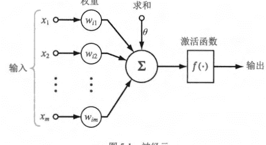

其中 $x_1,\cdots,x_m$ 代表来自上游神经元的输入信号，$w_{ij}$ 刻画了由神经元 $j$ 指向神经元 $i$ 的连接强度，$\theta$ 为阈值也即偏置，在这样的设定下神经元 $i$ 的输出与输入之间的关系可以写成：

$$

\begin{aligned}

& \mathbf{n e t}_{i}=\sum_{j=1}^{n} w_{i j} x_{j}-\theta \\

& y_{i}=f\left(\mathbf{n e t}_{i}\right)

\end{aligned}

$$

这里 $y_i$ 是神经元 $i$ 的输出，$f$ 就是激活函数，$\mathbf{net}_i$ 称为净激活。若把阈值看作一个额外输入 $x_0$ 的权重 $w_{i0}$，式子就能进一步简化为：

$$

\begin{aligned}

& \mathbf{n e t}_{i}=\sum_{j=0}^{n} w_{i j} x_{j} \\

& y_{i}=f\left(\mathbf{n e t}_{i}\right)

\end{aligned}

$$

把所有输入归并为向量 $X$、所有权重归并为向量 $W$ 时，表达可写成：

$$

X=\left[x_{0}, x_{1}, \cdots, x_{n}\right]

$$

#### 5.1.2 多层感知机

多层感知机，Multi-Layer Perceptron，是一种采用前向连接的人工神经网络，用来把一组输入向量映射到一组输出向量。它本质上是一个有向图，由多层节点构成，每层与下一层全连接，除了输入单元外，其余节点都是带非线性激活的处理单元。

多层感知机通常包含以下几个要素：

- **输入层**：负责接收外部信息并原样传导到内部。输入层的单元不做计算，只负责把数据分发给下一层神经元。
- **隐藏层**：夹在输入层和输出层之间，可包含一层或多层。每个隐藏单元都使用非线性激活，比如 Sigmoid 或 Tanh，并与前一层所有单元全连接，其输出再向后传递。
- **输出层**：生成网络的最终结果，用于预测或分类。输出单元的个数由任务决定，二分类往往只需一个，多分类则需要多个。
- **权重和偏置**：权重体现两个神经元间联系的强弱，偏置则调节单元被激活的难易程度。
- **激活函数**：引入非线性，使网络能够学习复杂的关联。没有非线性，堆叠再深的网络也只能等价于线性模型。

如图5-2所示的是一个典型的多层感知机结构。

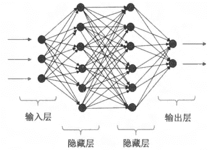

训练时，网络通过不断调整连接权重和偏置来捕捉数据规律，最常用的手段是反向传播，利用输出误差逐层回传更新参数以降低预测偏差。

此时神经元的输出也可以写成向量点乘的形式：

$$

\begin{aligned}

& \text { net }_{i}=X W \\

& y_{i}=f\left(\text { net }_{i}\right)=f(X W)

\end{aligned}

$$

净激活为正时神经元被视为激活或兴奋，为负时则处于抑制状态。

$$

W=\left[\begin{array}{c}

w_{i 0} \\

w_{i 1} \\

w_{i 2} \\

\vdots \\

w_{i n}

\end{array}\right]

$$

MLP 是传统感知机的扩展，克服了后者对线性不可分数据的局限。若所有激活函数都取线性，那么无论叠加多少层，整个网络都能折叠成一个等价的单层感知机。

MLP 在实践中可以使用阶梯函数、逻辑 S 形函数等多种激活，但若要配合反向传播有效学习，激活必须可微。兼顾可微性和数值稳定性的 S 形族，尤其是双曲正切和 Logistic Sigmoid，常被选用。

反向传播已成为模式识别领域的标准监督学习方法，也在计算神经科学与并行分布式处理中得到广泛研究。MLP 被证明是通用的函数逼近器，可拟合复杂函数或完成分类任务。

隐藏层神经元的核心作用是从样本中提炼内在模式并保存下来。每个隐藏单元都与输入层相连，对输入加权求和后经非线性映射，再作为输出层的输入。这一组合加权与映射的过程由误差反向传播自动完成。

隐藏单元过少时，可提取的模式有限，难以概括样本的有效信息，学习与泛化能力都会受限。

隐藏单元过多时，训练耗时增加，网络拟合能力增强，容易把与输出无关的噪声模式也学进去，即过拟合。表现上训练误差很小而测试误差偏大，泛化能力下降。

隐藏层规模的确定取决于样本所蕴含规律的数量与复杂度，而规律的数量往往与样本量相关。一种做法是把层数或单元数作为超参数，用验证集挑选误差最小的配置。经验公式也常被使用：

$$

l = \sqrt{m + n} + \alpha

$$

式中 $l$ 为隐藏层单元数，$m$ 为输入层节点数，$n$ 为输出层节点数，$\alpha$ 通常取 $1\sim10$。

MLP 在上世纪 80 年代曾是主流的机器学习方法，广泛应用于语音识别、图像识别、机器翻译等。90 年代起受支持向量机的冲击而式微，随着深度学习的复兴又重新受到关注。

#### 5.1.3 前馈神经网络

不同的人工神经网络在连接拓扑上各不相同，最直接的就是前馈结构，它是最早提出的多层网络形态。在这类网络中，神经元按层排列，每层的单元接收前一层信号并向后一层传递。第 0 层为输入层，最末层为输出层，中间为隐藏层。

前馈神经网络 Feedforward Neural Network, FNN 中信息只沿一个方向单向流动，网络内无反馈，信号从输入层一路传播到输出层。

信息传递可概括为：

$$

z^{(l)} = W^{(l)} \cdot a^{(l-1)} + b^{(l)}

$$

$$

a^{(l)} = f_l(z^{(l)})

$$

其中：

- $l$ 表示层索引。
- $m^{(l)}$ 为第 $l$ 层的神经元个数。
- $f_l(\cdot)$ 为第 $l$ 层的激活函数。
- $W^{(l)}\in R^{m^{(l)}\times m^{(l-1)}}$ 为第 $l-1$ 层到第 $l$ 层的权重矩阵。
- $b^{(l)}\in R^{m^{(l)}}$ 为第 $l$ 层的偏置向量。
- $z^{(l)}\in R^{m^{(l)}}$ 为第 $l$ 层的净输入。
- $a^{(l)}\in R^{m^{(l)}}$ 为第 $l$ 层的输出。

通过逐层计算，最终得到网络的输出。整个系统等价于一个复合函数，以向量 $X$ 作为第 0 层的输入 $a^{(0)}$，以第 $L$ 层的输出 $a^{(L)}$ 作为整体输出。

$$

a^{(L)} = \varphi(X, W, b)

$$

### 5.2 卷积神经网络

卷积神经网络 Convolutional Neural Networks, CNN 是一类包含卷积运算并具有深度结构的前馈网络，是深度学习框架中的代表性模型。

#### 5.2.1 卷积神经网络的历史

CNN 的思想可追溯至 1943 年，心理学家 Warren 与数理逻辑学家 Walter 在论文中首次提出神经元的概念，用输入、求和、线性激活、输出的数学模型简化神经反应，具有开创意义；1958 年神经学家 Frank 用机器模拟人类感知能力，形成早期的感知机，并在 IBM 704 上完成仿真，能区分三角形与四边形，这是神经元概念首次得到实验验证。这一阶段网络结构单一，仅能处理线性问题，研究也因此停滞。

第二阶段起于 1985 年。Geoffrey Hinton 在网络中引入多隐含层权重变换并提出误差反向传播 BP 算法，用以求解各层参数，理论通用但收敛慢易陷入局部最优。1988 年 Wei Zhang 提出平移不变人工神经网络 SIANN 并用于医学图像检测。1989 年 LeCun 构建面向计算机视觉的卷积网络，即 LeNet 的早期版本，含两个卷积层和两个全连接层，参数约 6 万，和现代 CNN 结构相近，并首次提出“卷积”概念。1998 年 LeCun 完善为 LeNet-5，加入池化层，在 MNIST 上准确率超过 98%，但受当时硬件限制未能广泛推广。

第三阶段始于 2006 年，被统称为深度学习。2006-2012 为快速发展期，2012 至今为爆发期。随着数据规模扩大和 GPU 计算普及，训练效率大幅提升。2006 年 Hinton 提出深度置信网络 DBN，取得良好训练效果，拉开深度 CNN 的发展序幕。2012 年 AlexNet 赢得 ImageNet 大赛冠军后，ZFNet、VGGNet、GoogLeNet、ResNet 等模型相继出现并取得优异表现。

#### 5.2.2 卷积神经网络的结构

CNN 的浅层由卷积层与池化层交替构成，深层则以全连接层收尾。

##### 1. 卷积层
卷积层负责提取输入特征，由多个卷积单元组成，参数通过反向传播学习。每个单元以感受野在图像上滑动并与局部区域做卷积运算。浅层通常提取边缘、线条等低级特征，深层则捕捉更抽象的高级特征。

关键超参数包括感受野大小、步长 Stride 和边界填充 Padding，三者共同决定输出特征图的尺寸。感受野小于输入图，尺寸越大可提取的模式越复杂；步长决定每次滑动的距离；Padding 通过在周边填充避免边缘信息过度丢失。

##### 2. 激活函数层
卷积得到的特征是线性的，而真实样本多为非线性的，因此需要激活函数引入非线性。激活函数允许像素取值在 0-1 之间连续变化，以刻画更细微差异。常用函数需满足非线性、可微、单调等性质，典型代表有 Sigmoid、Tanh 和 ReLU。

##### 3. 池化层
池化用于压缩特征图、保留主要信息并降低计算复杂度。常见做法有均值池化和最大池化，如图5-3所示。

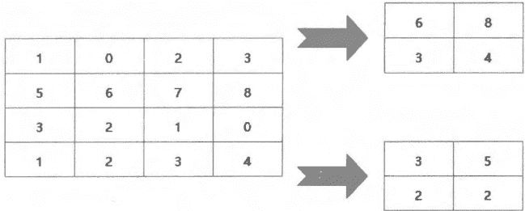

图5-3展示了 2×2 感受野、步长 2、填充 0 的情形。最大池化取局部最大值，均值池化取局部平均。常用感受野 2、步长 2 的设置会缩小特征图，虽可能损失精度，但可通过加深网络弥补。

##### 4. 全连接层
全连接层位于网络尾部，负责最终分类。特征在此失去空间结构，被展平成向量，再经非线性组合得到输出，可表示为：

```
$f(x) = W * x + b$
```

其中 $x$ 为输入，$W$ 为权重，$b$ 为偏置。全连接层把前面提取的特征映射到输出空间。对于图像分类，常使用逻辑函数或 Softmax 输出类别标签；在目标检测中输出物体的中心坐标、尺寸和类别；在语义分割中则逐像素输出类别。

#### 5.2.3 卷积神经网络的类型

##### 1. AlexNet
AlexNet 由 Alex Krizhevsky、Ilya Sutskever 和 Geoffrey Hinton 于 2012 年提出，是里程碑式的深度 CNN。

在 2012 年 ImageNet 大规模视觉识别挑战赛 ILSVRC 上夺冠，标志着深度学习时代开启，并确立了 CNN 在计算机视觉的主导地位。

- **技术创新**：引入 ReLU 激活、Dropout 正则化和 GPU 加速训练，显著提升性能并影响后续模型设计。
- **网络结构**：包含 5 个卷积层和 3 个全连接层，输入尺寸约 227×227×3。首层使用 96 个 11×11 卷积核，步长 4，无填充。
- **影响**：推动了 VGG、GoogLeNet 等更深模型的出现，在传统机器学习方法上实现大幅提升。

AlexNet 的结构如图5-4所示。

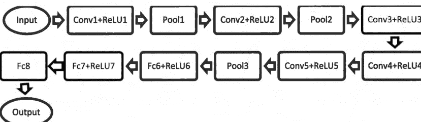

图 5-4 AlexNet 的网络结构

除深层结构外，AlexNet 的成功还得益于 ReLU 避免梯度消失、加速训练；通过平移、翻转等数据增强缓解过拟合；采用局部响应归一化 LRN 对邻近通道做归一化提升精度；并借助 GPU 处理大规模矩阵运算提升效率。

##### 2. VGGNet
VGGNet 由牛津大学与 Google DeepMind 团队合作开发，2014 年在 ILSVRC 上获分类亚军、定位冠军。该网络系统研究了深度与性能的关系，使用 16~19 层的结构，Top5 错误率约 7.5%，全网统一采用 3×3 卷积核和 2×2 池化核，结构如图5-5所示。

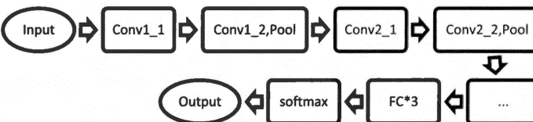

图 5-5 VGGNet 网络结构

VGGNet 包含多个变体，最常用的是 VGG-16 和 VGG-19。网络被划分为 5 段，每段由若干 3×3 卷积堆叠后接最大池化，最后接 3 个全连接层和 Softmax。

主要创新有两点：
1. 用多层小卷积替代单层大卷积。两个 3×3 卷积等价于 5×5 感受野，三个等价于 7×7。优势是增加 ReLU 非线性次数，提升表达能力，同时减少参数，例如三个 3×3 卷积需 $27n$ 个参数，而一个 7×7 需 $49n$。
2. 训练时采用多尺度与交替训练，并在部分层做预训练，加快收敛。不足是全连接层参数过多，内存与计算开销较大。VGGNet 强调了网络加深对性能提升的关键作用。

##### 3. GoogLeNet

深度网络突破：GoogLeNet、ResNet 与循环网络全解

GoogLeNet 来自 Google 研究团队，是 2014 年 ILSVRC 分类赛的冠军，Top5 误判率低至 6.656%。网络整体共 22 层，参数量却只有约 700 万，相较于前代模型明显更轻。一般提升性能最直接的方式是加深网络，深度增加带来参数激增，容易过拟合且计算负担加重。GoogLeNet 用稀疏连接来规避这一困境，并提出了 Inception 结构，如图 5-6 所示。

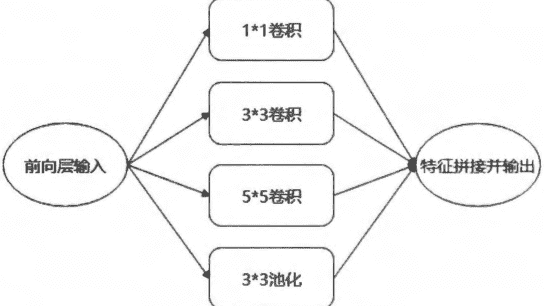

图 5-6 GoogLeNet 网络结构

Inception 内部并行使用 $1 \times 1 、 3 \times 3 、 5 \times 5$ 卷积核的用意是让不同分支的输出特征图维度统一，便于后续融合，stride 均取 1，padding 分别设为 $0 、 1 、 2$，卷积后得到同等维度的表征再进行拼接，将多尺度信息融合起来，从而增强特征提取能力。

随着网络层级加深，后层的特征越抽象，对应感受野也越大，为此 $3 \times 3 、 5 \times 5$ 核的占比会不断提升，参数计算量随之膨胀。基于此，GoogLeNet 演化出多个改进版：Inception V2、V3、V4，主要手段包括引入 Batch Normalization、在大核卷积前先用 $1 \times 1$ 卷积降维、把 $n \times n$ 核拆分为 $1 \times n$ 与 $n \times 1$ 串联等，以压缩参数并进一步提升性能。

##### 4. ResNet

ResNet 于 2015 年推出并夺得 ILSVRC 冠军，其 152 层结构 Top5 错误率仅 3.57%，而此前的网络极少突破 25 层。原因在于深度增长初期准确率上升，随后趋于饱和，继续加深反而下降；层数增多导致梯度在连乘过程中不稳定，出现爆炸或衰减，模型难以有效训练。ResNet 通过残差结构解决该问题，残差网络结构如图 5-7 所示。

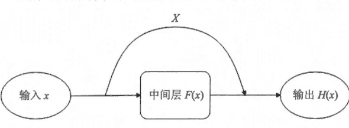

图5-7 残差网络结构

残差网络本质是跳跃连接，原本的残差项带权重，ResNet 改用恒等映射。输入为 x，期望输出 H(x)，经捷径将 x 直接传递到输出端作为基准，最终输出为 H(x)=F(x)+x，当 F(x)=0 时 H(x)=x。于是学习目标被转换为 H(x) 与 x 的差异，即残差 F(x)=H(x)-x，训练时只需逼近零。ResNet 以残差学习为核心，把残差模块作为基本单元，借助恒等映射缓解深层带来的梯度爆炸或衰减，能够大幅加深网络并获得优异分类效果。

### 5.3 循环神经网络

循环神经网络 Recurrent Neural Network，RNN 也称递归神经网络，是前馈神经网络 Feedforward Neural Network 的延伸，本节介绍几种常见形式。

#### 5.3.1 简单的循环神经网络

传统神经网络从输入层到隐藏层再到输出层，各层节点间没有连接，也不保存状态信息。RNN 则逐个遍历序列元素，每一步的输出都依赖前序输出，层间存在连接并保留先前状态信息。理论上 RNN 可处理任意长度序列，实践中通常只保留最近数步的状态。下面先介绍 RNN 的基本原理，如图 5-8 所示。

# 图 5-8 简单的 RNN

图 5-8 由一个神经元构成，$x$ 为输入，$y$ 为输出，隐藏层通过箭头实现信息的循环回传，从而获得时间记忆能力。网络接收 $x$ 生成 $y$ 并把结果反馈自身。设在时刻 $t$，网络输入除当前 $x(t)$ 外还包含上一时刻的输出 $y(t-1)$，两者共同决定当前输出 $y(t)$。将该网络按时间展开可得如图 5-9 所示的结构。

# 图 5-9 循环神经元

每个神经元的输出由当前输入 $x(t)$ 与上一时刻输出 $y(t-1)$ 共同决定，对应权重为 $W_{x}$ 与 $W_{y}$，单个神经元计算如下：

```
$y_{t}=\varnothing\left(x_{t}^{\mathrm{T}} \cdot W_{x}+y_{t-1}^{\mathrm{T}} \cdot W_{y}+b\right)$
```

展开隐藏层后得到如图 5-10 的结构。

# 图 5-10 将隐藏层的层级展开

通常记 RNN 在时刻 $t$ 的状态为 $h_{t}$。$U$ 为输入权重，$W$ 为前一步状态权重，$V$ 为输出权重。在 $t=1$ 时 $h_{0}$ 一般取 0，$U、W、V$ 随机初始化，按如下公式计算：

$h_{1}=f\left(U x_{1}+W h_{0}+b_{h}\right)$

$O_{1}=g\left(V h_{1}+b_{o}\right)$

其中 $f$ 与 $g$ 均为激活函数，$f$ 可选 Sigmoid、ReLU、Tanh 等，$g$ 常为 Softmax，$b_{h}$ 与 $b_{o}$ 分别为隐藏层与输出层偏置。前向传播按时间推进，得到的状态 $h_{1}$ 会参与下一步预测：

$h_{2}=f\left(U x_{2}+W h_{1}+b_{h}\right)$

$O_{2}=g\left(V h_{2}+b_{o}\right)$

类推可得通用形式：

$h_{t}=f\left(U x_{t}+W h_{t-1}+b_{h}\right)$

$O_{t}=g\left(V h_{t}+b_{o}\right)$

权重共享减少计算量并提升泛化，能处理连续序列且不限制长度，可捕捉特征间的连续性并减少规则学习。图中出现的 $W、U、V$ 及偏置在不同时刻保持一致。简单 RNN 在处理时序问题时表现不错，但存在记忆受限的问题，理论上可记住更久远信息并处理任意长度序列，实际却难以形成长期记忆，这即为梯度消失。梯度消失与反向传播算法及长期依赖相关，RNN 还会出现梯度爆炸，即随时间增加梯度指数级放大导致不稳定。激活函数导数小于 1 时梯度随层数指数衰减，导数大于 1 时梯度指数放大。为此提出长短期记忆网络 LSTM 和门控循环单元 GRU 等改进方案。

#### 5.3.2 长短期记忆网络

为解决标准 RNN 处理长序列时的梯度消失等问题，Sepp Hochreiter 等提出长短期记忆网络 Long Short-Term Memory，LSTM，后经 Alex Graves、Haim Sak、Wojciech Zaremba 等改进。一个基本 LSTM 单元如图 5-11 所示。

图 5-11 LSTM 单元结构

图 5-11 中间为 4 个矩形构成的隐藏层结构，其中第 1、3、4 个激活为 Logistic，第 2 个为 Tanh。LSTM 包含长时记忆 $c(t)$ 与短时记忆 $h(t)$，并设有遗忘门、输入门、输出门三个控制器。遗忘门由 $f(t)$ 控制长时记忆的丢弃与保留，也称遗忘门。

输入门由 $i(t)$ 与 $g(t)$ 组成，$i(t)$ 决定 $g(t)$ 中哪些部分用于增加记忆。输出门由 $o(t)$ 控制长时记忆在当前时刻的读取与输出。三个门均使用输出范围 0~1 的 Logistic 函数，输出 1 表示打开，0 表示关闭。主层 $g(t)$ 用来分析当前输入 $x(t)$ 与前一时刻状态 $h(t-1)$。

基本流程为：短时记忆 $c(t-1)$ 从左向右流动，先经遗忘门丢弃部分信息，再经输入门挑选新增记忆，最后输出 $c(t)$。新增记忆先经 Tanh 处理后被输出门筛选得到短时记忆 $h(t)$。LSTM 能识别重要输入并在长时记忆中保存，通过遗忘门保留所需部分并在需要时提取，适合处理文本、语音等时序数据。

以下公式汇总门控、两种状态与输出：

$$

i_{(t)} = \sigma(w_{xi}^T \cdot x_{(t)} + w_{hi}^T \cdot h_{(t-1)} + b_i)

$$

$$

f_{(t)} = \sigma(w_{xf}^T \cdot x_{(t)} + w_{hf}^T \cdot h_{(t-1)} + b_f)

$$

$$

o_{(t)} = \sigma(w_{xo}^T \cdot x_{(t)} + w_{ho}^T \cdot h_{(t-1)} + b_o)

$$

$$

g_{(t)} = \text{Tanh}(w_{xg}^T \cdot x_{(t)} + w_{hg}^T \cdot h_{(t-1)} + b_g)

$$

$$

c_{(t)} = f_{(t)} \otimes c_{(t-1)} + i_{(t)} \otimes g_{(t)}

$$

$$

y_{(t)} = h_{(t)} = o_{(t)} \otimes \text{Tanh}(c_{(t)})

$$

其中 $w_{xi}、w_{xf}、w_{xo}、w_{xg}$ 为各层连向输入 $x_{(t)}$ 的权重，$w_{hi}、w_{hf}、w_{ho}、w_{hg}$ 为连向前一短时记忆 $h_{(t-1)}$ 的权重，$b_i、b_f、b_o、b_g$ 为各层偏置。

#### 5.3.3 门控循环单元

门控循环单元 Gate Recurrent Unit，GRU 是 RNN 的一种变体，目标是解决标准 RNN 的梯度消失问题。其原理与 LSTM 接近，均采用门控机制控制信息流动，但结构更简洁，效果良好，使用广泛。

GRU 的设计初衷是缓解长期依赖，即标准 RNN 难以捕捉序列早期信息的问题。通过更新门与重置门，GRU 学会何时更新或忽略信息，更好地处理长序列。相比 LSTM，GRU 参数更少、计算更轻，在资源受限场景下训练更快，性能通常与 LSTM 相当，有时更优。

GRU 已广泛应用于语言模型、机器翻译、语音识别等序列建模任务。循环结构如图 5-12 所示。

图 5-12 中激活函数由 LSTM 的 4 个减为 3 个，两个状态向量合并为 $h_{(t)}$。LSTM 有输入门、遗忘门、输出门三控，GRU 则只有重置门与更新门两个门。重置门由 $r_{(t)}$ 负责，控制前一时刻状态信息有多少能进入主层，取值越小写入越少。更新门由 $z_{(t)}$ 负责，控制前一状态被带入当前状态的比例，取值越大保留越多。基本流程先由前一隐藏状态 $h_{(t-1)}$ 与当前输入 $x_{(t)}$ 计算重置门 $r_{(t)}$ 与更新门 $z_{(t)}$，两者常用 Logistic 或 Sigmoid，输出 0~1 作为门控信号。

得到门控信号后，用 $r_{(t)}$ 重置数据，再与输入拼接，经 Tanh 缩放到 $[-1,1]$。随后进入更新记忆阶段，相当于 LSTM 的遗忘与输入，更新门 $z_{(t)}$ 越接近 1 记忆越多，越接近 0 越遗忘。通过 $z_{(t)}$ 与 $1-z_{(t)}$ 的联动实现选择性遗忘与补偿，保持状态稳定。计算过程如下：

$$

\begin{aligned}

& z_{(t)}=\sigma\left(w_{x z}^{\mathrm{T}} \cdot x_{(t)}+w_{h z}^{\mathrm{T}} \cdot h_{(t-1)}\right) \\

& r_{(t)}=\sigma\left(w_{x r}^{\mathrm{T}} \cdot x_{(t)}+w_{h r}^{\mathrm{T}} \cdot h_{(t-1)}\right) \\

& g_{(t)}=\operatorname{Tanh}\left(w_{x g}^{\mathrm{T}} \cdot x_{(t)}+w_{h g}^{\mathrm{T}} \cdot\left(r_{(t)} \otimes h_{(t-1)}\right)\right) \\

& h_{(t)}=\left(1-z_{(t)}\right) \otimes \operatorname{Tanh}\left(w_{x g}^{\mathrm{T}} \cdot h_{(t-1)}+z_{(t)} \otimes g_{(t)}\right)

\end{aligned}

$$

其中 $w_{xx}、w_{xr}、w_{xg}$ 为各层连向输入 $x_{(t)}$ 的权重，$w_{hx}、w_{hr}、w_{hg}$ 为连向前一短时记忆 $h_{(t-1)}$ 的权重。

### 5.4 动手练习: 股票成交量趋势预测

为帮助读者更好地理解 PyTorch 在深度神经网络中的应用，本节以实际案例说明。

##### 1. 案例说明

本例利用长短期记忆网络对上交所工商银行的股票成交量进行趋势预测，以掌握买卖时机，从而提升收益。

#### 2. 操作步骤

01 导入相关第三方库，代码如下：

```python
#导入相关库
import torch # 导入PyTorch库
import torch.nn as nn # 导入神经网络模块
import torch.optim as optim # 导入优化器模块
import numpy as np # 导入NumPy库
import tushare as ts # 导入tushare库，用于获取股票数据
from tqdm import tqdm # 导入tqdm库，用于显示进度条
import matplotlib.pyplot as plt # 导入matplotlib库，用于绘制图表
from copy import deepcopy as copy # 导入deepcopy函数，用于深拷贝对象
from torch.utils.data import DataLoader, TensorDataset # 导入DataLoader和TensorDataset类，用于加载数据
```

02 获取数据，这里通过 tushare 库获取股票数据。这里使用了开盘价、收盘价、最高价、最低价、成交量这 5 个特征，使用每天的收盘价作为学习目标，每个样本都包含连续几天的数据作为一个序列样本。随后，将这些数据划分为训练集和测试集以供后续使用。代码如下：

LSTM股票预测实战流水线

```python
class GetData:
    """ GetData 类，用于获取和处理数据 """
    def __init__(self, stock_id, save_path):
        """ 初始化方法
        :param stock_id: 股票 ID
        :param save_path: 数据保存路径
        """
        self.stock_id = stock_id
        self.save_path = save_path
        self.data = None

    def getData(self):
        """ 获取数据
        将数据进行一些处理，并保存到文件中
        :return: 处理后的数据
        """
        # 获取股票历史数据
        self.data = ts.get_hist_data(self.stock_id).iloc[::-1]
        # 选择特定列作为数据
        self.data = self.data[["open", "close", "high", "low", "volume"]]
```

```python
# 计算数据列的最小值和最大值
self.close_min = self.data['volume'].min()
self.close_max = self.data["volume"].max()
# 对数据进行归一化处理
self.data = self.data.apply(lambda x: (x - min(x)) / (max(x) - min(x)))
# 将处理后的数据保存到文件
self.data.to_csv(self.save_path)

return self.data

def process_data(self, n):
    """ 处理数据
    将数据分为特征和标签，并划分为训练集和测试集
    :param n: 滑动窗口的大小
    :return: 训练集的特征、测试集的特征、训练集的标签、测试集的标签
    """
    if self.data is None:
        self.getData()
    # 提取特征和标签数据
    feature = [
        self.data.iloc[i: i + n].values.tolist()
        for i in range(len(self.data) - n + 2)
        if i + n < len(self.data)
    ]
    label = [
        self.data.close.values[i + n]
        for i in range(len(self.data) - n + 2)
        if i + n < len(self.data)
    ]
    # 划分训练集和测试集
    train_x = feature[:500]
    test_x = feature[500:]
    train_y = label[:500]
    test_y = label[500:]

    return train_x, test_x, train_y, test_y
```

一开始负责数据采集与清洗的 GetData 类，集中了三项常用接口。

- `__init__(self, stock_id, save_path)`：构造时接收股票代码和存储路径两个入参，并把它们存成对象的属性。
- `getData(self)`：拉取该股票的历史行情，执行必要的清洗与整理后写入本地文件，同时把整理好的结果返回给调用方。
- `process_data(self, n)`：把已整理的数据切成输入特征和目标标签，再按训练/测试划分出来。入参 n 控制滑动窗口长度，若内部数据为空会自动先调用 getData 补齐数据。最终会输出训练特征、测试特征、训练标签、测试标签四组结果。

##### 03 搭建 LSTM 模型。单层单向 LSTM 叠加全连接输出，代码如下：

```python
# 定义一个名为 Model 的神经网络模块
class Model(nn.Module):
    def __init__(self, n): # 初始化方法，接收一个参数 n
        super(Model, self).__init__() # 调用父类的初始化方法
        # 创建一个 LSTM 层，输入大小为 n，隐藏大小为 256，批次优先为 True
        self.lstm_layer = nn.LSTM(input_size=n, hidden_size=256,
                                  batch_first=True)

        # 创建一个线性层，输入特征数为 256，输出特征数为 1，有偏差
        self.linear_layer = nn.Linear(in_features=256, out_features=1, bias=True)

    def forward(self, x): # 前向传播方法，接收一个输入 x
        # 通过 LSTM 层处理 x，得到输出 out1 和隐藏状态 h_n、h_c
        out1, (h_n, h_c) = self.lstm_layer(x)
        a, b, c = h_n.shape # 获取 h_n 的形状信息
        # 将 h_n 重塑为(a*b, c)的形状后，通过线性层处理，得到输出 out2
        out2 = self.linear_layer(h_n.reshape(a * b, c))
        return out2 # 返回最终的输出 out2
```

这里实现的 Model 模块由一个 LSTM 层和一个线性层组成。构造方法接收维度参数 n，用它创建 LSTM 和后续的线性映射。

前向计算时，输入张量 x 先进入 LSTM，得到序列输出 out1 以及最后一步的隐藏状态 h_n 和单元状态 h_c。随后仅取 h_n 送入线性层得到出out2，并以 out2 作为整网的最终预测返回。

##### 04 训练模型。完成损失计算、反向传播与优化器迭代，代码如下：

```python
def train_model(epoch, train_dataLoader, test_dataLoader):
    """
    训练模型的函数

    参数:
    epoch (int): 训练的轮数
    train_dataLoader (DataLoader): 训练数据加载器
    test_dataLoader (DataLoader): 测试数据加载器
    """
    # 最佳模型
    best_model = None
    # 训练损失
    train_loss = 0
    # 测试损失
    test_loss = 0
    # 最佳损失
    best_loss = 100
```

```python
# 轮数计数器
epoch_cnt = 0

for _ in range(epoch):
    # 训练总损失
    total_train_loss = 0
    # 训练样本总数
    total_train_num = 0
    # 测试总损失
    total_test_loss = 0
    # 测试样本总数
    total_test_num = 0

    for x, y in tqdm(train_dataLoader, desc='Epoch: {}| Train Loss: {}| Test Loss: {}'.format(_, train_loss, test_loss)):
        # x 的数量
        x_num = len(x)
        # 模型预测
        p = model(x)
        # 打印预测长度
        # print(len(p[0]))
        # 计算损失
        loss = loss_func(p, y)
        # 梯度清零
        optimizer.zero_grad()
        # 反向传播
        loss.backward()
        # 更新参数
        optimizer.step()
        # 累计训练损失
        total_train_loss += loss.item()
        # 累计训练样本数
        total_train_num += x_num

# 计算平均训练损失
train_loss = total_train_loss / total_train_num

for x, y in test_dataLoader:
    # x 的数量
    x_num = len(x)
    # 模型预测
    p = model(x)
    # 计算损失
    loss = loss_func(p, y)
    # 梯度清零
    optimizer.zero_grad()
    # 反向传播
    loss.backward()
```

# 参数更新

```python
optimizer.step()
# 累计测试损失
total_test_loss += loss.item()
# 累计测试样本数
total_test_num += x_num

# 计算平均测试损失
test_loss = total_test_loss / total_test_num

# 如果当前测试损失小于最佳损失
if best_loss > test_loss:
    # 更新最佳损失
    best_loss = test_loss
    # 复制当前模型
    best_model = copy(model)
    # 轮数计数器清零
    epoch_cnt = 0
else:
    # 轮数计数器加 1
    epoch_cnt += 1

# 如果轮数计数器大于提前停止的轮数
if epoch_cnt > early_stop:
    # 保存最佳模型的状态字典
    torch.save(best_model.state_dict(), './lstm_.pth')
    # 中断训练
    break
```

整体实现了一个包含训练、验证、损失记录与模型保存的简易训练闭环。核心训练函数接受训练轮数 epoch、训练 DataLoader 与测试 DataLoader 三个参数。

函数内部先初始化最佳模型 best_model、累计训练损失 train_loss、累计测试损失 test_loss、当前最优损失 best_loss 以及早停计数器 epoch_cnt。

随后进入轮次循环，外层遍历 epoch，内层分别跑训练和验证。训练阶段逐批读取数据、产生预测并执行反向传播更新权重，同时累加损失与样本数；验证阶段同样逐批读取，仅做前向推理累加损失与样本数。

每轮结束后算出平均训练损失和平均测试损失。若本轮测试损失优于历史最佳，则更新 best_loss、复制当前模型权重并将早停计数清零；否则计数器自增。

当计数器超过设定的早停阈值 early_stop 时，把最佳模型的状态字典保存下来并终止后续训练。

##### 05 测试模型

使用保存好的权重在测试集上评估表现，代码如下：

```python
# 定义测试模型的函数
def test_model(test_dataLoader_):
    """
    该函数用于测试模型，并返回预测值、真实标签和测试损失
    参数:
    test_dataLoader_ (DataLoader): 测试数据加载器
    """
    # 预测值列表
    pred = []
    # 真实标签列表
    label = []
    # 创建一个模型对象
    model_ = Model(5)
    # 加载模型的状态字典
    model_.load_state_dict(torch.load("./lstm_.pth"))
    # 将模型设置为评估模式
    model_.eval()
    # 测试总损失
    total_test_loss = 0
    # 测试样本总数
    total_test_num = 0

    for x, y in test_dataLoader_:
        # x 的数量
        x_num = len(x)
        # 进行模型预测
        p = model_(x)
        # 计算损失
        loss = loss_func(p, y)
        # 累计测试损失
        total_test_loss += loss.item()
        # 累计测试样本数
        total_test_num += x_num
        # 将预测值添加到列表中
        pred.extend(p.data.squeeze(1).tolist())
        # 将真实标签添加到列表中
        label.extend(y.tolist())

    # 计算平均测试损失
    test_loss = total_test_loss / total_test_num

    return pred, label, test_loss
```

这段实现的核心是 test_model 函数，接收一个名为 test_dataLoader_ 的测试数据加载器，返回预测序列、真实标签以及平均测试损失。

函数内部先准备两个空列表 pred 用来收集预测值，label 用来收集真实值。随后实例化 model_，载入事先保存的 ./lstm_.pth 权重并切换到评估模式。

遍历测试加载器中的每一批样本 x，模型输出预测 p，累加批次损失到 total_test_loss，同时把 p 与对应的真实标签追加到 pred 和 label 列表中。全部遍历结束后计算平均测试损失 test_loss，最终一起返回 pred、label、test_loss。

##### 06 绘制折线图

可视化股票日成交量走势并展示测试集损失，代码如下：

```python
def plot_img(data, pred):
    """
    绘制图像的函数
    
    参数:
        data (list): 数据
        pred (list): 预测值
    """
    # 设置字体为黑体
    plt.rcParams['font.sans-serif'] = ['SimHei']
    # 创建图像，大小为12×7
    plt.figure(figsize=(12, 7))
    # 绘制预测值的曲线，颜色为绿色
    plt.plot(range(len(pred)), pred, color='green')
    # 绘制数据的曲线，颜色为蓝色
    plt.plot(range(len(data)), data, color='blue')
    
    # 每隔5个数据点绘制一条红色的参考线
    for i in range(0, len(pred) - 3, 5):
        price = [data[i] + pred[j] - pred[i] for j in range(i, i + 3)]
        plt.plot(range(i, i + 3), price, color='red')
    
    # 设置x轴刻度的字体属性为Times New Roman，大小为15
    plt.xticks(fontproperties='Times New Roman', size=15)
    # 设置y轴刻度的字体属性为Times New Roman，大小为15
    plt.yticks(fontproperties='Times New Roman', size=15)
    
    # 设置x轴标签为"日期"，字体大小为18
    plt.xlabel('日期', fontsize=18)
    # 设置y轴标签为"成交量"，字体大小为18
    plt.ylabel('成交量', fontsize=18)
    
    # 显示图像
    plt.show()
```

```python
if __name__ == '__main__':
    # 超参数
    days_num = 5
    epoch = 20
    fea = 5
    batch_size = 20
    early_stop = 5

    # 初始化模型
    model = Model(fea)

    # 数据处理
    GD = GetData(stock_id='601398', save_path='./data.csv')
    x_train, x_test, y_train, y_test = GD.process_data(days_num)
    x_train = torch.tensor(x_train).float()
    x_test = torch.tensor(x_test).float()
    y_train = torch.tensor(y_train).float()
    y_test = torch.tensor(y_test).float()

    # 构建训练数据集和测试数据集
    train_data = TensorDataset(x_train, y_train)
    train_dataLoader = DataLoader(train_data, batch_size=batch_size)
    test_data = TensorDataset(x_test, y_test)
    test_dataLoader = DataLoader(test_data, batch_size=batch_size)

    # 损失函数和优化器
    loss_func = nn.MSELoss()
    optimizer = optim.Adam(model.parameters(), lr=0.001)

    # 训练模型
    train_model(epoch, train_dataLoader, test_dataLoader)
    p, y, test_loss = test_model(test_dataLoader)

    # 对预测值进行处理
    pred = [ele * (GD.close_max - GD.close_min) + GD.close_min for ele in p]
    data = [ele * (GD.close_max - GD.close_min) + GD.close_min for ele in y]

    # 绘制折线图
    plot_img(data, pred)

    # 输出模型损失
    print('模型损失:', test_loss)
```

这段实现的核心思路是先训练一个模型学习股价规律，再把预测结果与实际值并排可视化对比。

绘图函数 plot_img(data, pred) 负责生成对比图。它把字体设为黑体，画布宽高设为 12×7，同时绘制真实数据曲线和预测曲线，并在每隔 5 个点的位置插入一条红色参考线，最后对坐标轴刻度、标签进行设定并展示图像。

主流程主要完成超参数的配置：初始化模型、处理数据流，包括获取原始数据、清洗整理、组建数据集并创建数据加载器，随后定义损失函数与优化器，执行训练与测试阶段，对预测值和真实值做后处理，最后调用 plot_img 画出折线图并打印出模型损失。

##### 3. 案例归纳

本例以上海证券交易所工商银行 2021 年成交量为对象，图示结果见图5-13，整体走势表现为先攀升后回落再反弹的波动形态。

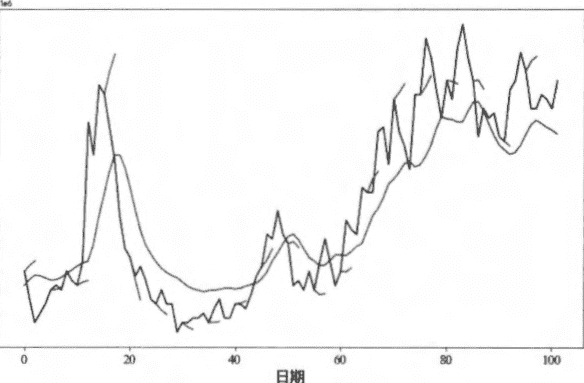

图 5-13 成交量趋势分析

LSTM 模型最终输出的损失数值很低，说明拟合精度较好，已基本达到成交量预测的预期效果。

模型损失：0.0008264706451811042。

### 5.5 实操练习

任务：基于 PyTorch 搭建一个简易神经网络完成手写数字识别，并在数据上进行训练与测试。按下面步骤逐步演练。

# 1. 载入依赖库

```python
# 导入PyTorch及相关模块
import torch
import torch.nn as nn
# 导入PyTorch库
# 导入神经网络模块
```

# 2. 数据预处理

```python
import torch.optim as optim
import torchvision
import torchvision.transforms as transforms
```

设定预处理流程，把图像转成张量格式并做标准化。

```python
transform = transforms.Compose([
    transforms.ToTensor(),
    transforms.Normalize((0.5,), (0.5,))
])
```

实例化训练集，指定数据目录、是否使用训练集、是否自动下载以及预处理操作。

```python
train_set = torchvision.datasets.MNIST(root='./data', train=True, download=True,
    transform=transform)
```

构建训练数据加载器 train_loader，批量大小设为 100，开启打乱，工作线程数设为 2。

```python
train_loader = torch.utils.data.DataLoader(train_set, batch_size=100,
    shuffle=True, num_workers=2)
```

实例化测试集，数据目录设为 './data'，训练集标志关闭，是否下载与预处理 transform 均按需指定。

```python
test_set = torchvision.datasets.MNIST(root='./data', train=False, download=True,
    transform=transform)
```

构建测试数据加载器 test_loader，批量大小设为 100，关闭打乱，工作线程数设为 2。

```python
test_loader = torch.utils.data.DataLoader(test_set, batch_size=100,
    shuffle=False, num_workers=2)
```

# 3. 搭建神经网络

定义名为 Net 的网络结构，包含两层卷积、两层全连接以及一个池化层。

```python
class Net(nn.Module):
    def __init__(self):
        super(Net, self).__init__()

        # 定义卷积层1，输入通道数为1，输出通道数为6，卷积核大小为5×5
        self.conv1 = nn.Conv2d(1, 6, 5)

        # 定义最大池化层，池化核大小为2×2，步长为2
        self.pool = nn.MaxPool2d(2, 2)

        # 定义卷积层2，输入通道数为6，输出通道数为16，卷积核大小为5×5
        self.conv2 = nn.Conv2d(6, 16, 5)

        # 定义全连接层1，输入节点数为16×4×4，输出节点数为120
        self.fc1 = nn.Linear(16 * 4 * 4, 120)

        # 定义全连接层2，输入节点数为120，输出节点数为84
        self.fc2 = nn.Linear(120, 84)
```

```python
# 定义全连接层3,输入节点数为84,输出节点数为10
self.fc3 = nn.Linear(84, 10)

def forward(self, x):
    # 进行第一次卷积操作,然后应用ReLU激活函数进行最大池化操作
    x = self.pool(F.relu(self.conv1(x)))
    # 进行第二次卷积操作,然后应用ReLU激活函数进行最大池化操作
    x = self.pool(F.relu(self.conv2(x)))
    # 将特征图展开为一维向量
    x = x.view(-1, 16 * 4 * 4)
    # 进行第一次全连接操作,然后应用ReLU激活函数
    x = F.relu(self.fc1(x))
    # 进行第二次全连接操作,然后应用ReLU激活函数
    x = F.relu(self.fc2(x))
    # 进行第三次全连接操作,得到最终的输出结果
    x = self.fc3(x)
    return x

# 创建神经网络实例
net = Net()
```

##### 4. 损失与优化器设定

```python
# 创建交叉熵损失函数的实例
criterion = nn.CrossEntropyLoss()

# 创建随机梯度下降优化器的实例,将神经网络参数和学习率等超参数传入
optimizer = optim.SGD(net.parameters(), lr=0.001, momentum=0.9)
```

【代码说明】

- 构造优化器时，使用 net.parameters() 把网络参数传入，以便优化器获取需要更新的参数集合。
- 学习率 lr 是优化器的关键超参，控制每次更新的步长，本文取 0.001。
- 动量 Momentum 是 SGD 的超参，用来加快收敛，它会保留历史梯度信息，结合当前梯度与历史梯度的加权平均进行参数更新，本文取 0.9。

# 5. 训练网络

```python
# 设置总共的训练轮数为10
for epoch in range(10):
    running_loss = 0.0 # 初始化每轮的损失函数值为0
```

```python
# 遍历训练集中的数据
for i, data in enumerate(train_loader, 0):
    inputs, labels = data  # 从train_loader中获取输入数据和对应的标签
    optimizer.zero_grad()  # 将模型参数的梯度置零，以便进行下一次反向传播

    # 前向传播计算模型输出
    outputs = net(inputs)

    # 计算损失函数
    loss = criterion(outputs, labels)

    # 反向传播计算损失函数关于模型参数的梯度
    loss.backward()

    # 更新模型参数
    optimizer.step()

    # 累加每个batch的损失函数值
    running_loss += loss.item()

# 每轮训练结束后打印平均损失
print('Epoch %d loss: %.3f' % (epoch + 1, running_loss / (i + 1)))
```

# 6. 测试网络

```python
# 初始化正确预测数量和总数为0
correct = 0
total = 0

# 关闭梯度计算，不更新参数
with torch.no_grad():
    # 遍历测试数据集
    for data in test_loader:
        # 获取图像和标签数据
        images, labels = data

        # 使用神经网络进行预测
        outputs = net(images)

        # 选取每个预测结果中的最大值作为最终预测结果
        _, predicted = torch.max(outputs.data, 1)

        # 更新总数（累加图像的数量）
        total += labels.size(0)

        # 更新正确预测数量（累加预测结果与真实标签相同的数量）
        correct += (predicted == labels).sum().item()

# 打印网络在10000个测试图像上的准确率
print('Accuracy of the network on the 10000 test images: %d %%' % (100 * correct / total))
```

## 第6章 PyTorch数据建模

数据建模即数据挖掘，本质是从海量数值数据中提炼规律。通常分为三步：数据准备、规律挖掘、规律表达。数据准备是从数据源抽取所需信息并整合成挖掘所用数据集；规律挖掘是用方法从数据集中发现内在模式；规律表达是以用户可读的形式呈现结果。本章聚焦 PyTorch 在数据建模中的实践。

### 6.1 回归分析及案例

回归分析研究被解释变量与一个或多个解释变量之间依赖关系的计算与理论，本节介绍 PyTorch 下的回归实践。

#### 6.1.1 回归分析概览

回归分析从样本出发建立变量间的数学关系，并对关系式的可信度做统计检验，判断哪些影响因子显著、哪些不显著。借助得到的式子，可以根据自变量取值预测或控制因变量，并给出精度评估。

线性回归主要处理连续数值预测，在经济、金融、社会、医疗等领域应用广泛。

例如，吸烟对死亡率和发病率的早期证据就来源于回归分析的观察性研究。为降低伪相关，除了核心变量外，研究者常加入控制变量。假设模型中吸烟行为是核心自变量，因变量为多年观察得到的吸烟者寿命。研究者可能加入社会经济地位作为额外自变量，以排除教育或收入差异带来的干扰。但不可能穷尽所有混杂因素，如某种未知的基因既增加死亡风险又增加吸烟量。因此随机对照试验比观察性回归更能提供因果证据。

回归分析还广泛用于：

- 客户需求预测：基于买卖交易等海量数据预测商品未来需求。
- 电影票房预测：结合历史票房、影评等公开数据预测票房。
- 湖泊面积预测：研究多因素对湖泊面积变化的影响并建模预测。
- 房地产价格预测：利用历史数据分析影响房价的因素并做预测。
- 股价波动预测：搜索引擎搜索量反映股票关注度，可用于波动预测。
- 人口增长预测：基于历史数据分析影响人口增长的因素并预测未来人口。

#### 6.1.2 回归建模方法

线性回归是用回归方程刻画一个或多个自变量与因变量关系的建模手段，用直线近似描述数据关系，从而对新数据给出预测值。单自变量为一元回归，多自变量为多元回归，房屋面积与房价预测是典型例子。

多元线性回归模型常用形式如下：

```
$y=\beta_{0}+\beta_{1} x_{1}+\beta_{2} x_{2}+\cdots+\beta_{k} x_{k}+\varepsilon$
```

式中 $x_{1}, \cdots, x_{k}$ 为自变量，$y$ 为因变量，$\beta_{0}$ 为截距，$\beta_{1}, \cdots, \beta_{k}$ 为回归系数，$\varepsilon$ 为随机误差。

误差项通常做如下假设：

- $\varepsilon$ 期望为 0 的随机变量。
- 在所有自变量取值下，$\varepsilon$ 方差相同。
- $\varepsilon$ 服从正态分布且相互独立。

要提高预测精度，需最小化真实值与预测值的差距，即最小化误差平方和，其表达式如下，推导详见相关资料。

```
$J(\beta)=\sum(y-X \beta)^{2}$
```

损失函数提供优化目标，求解线性回归即求出对应自变量的回归系数与截距，得到参数后即可实现输入 x 输出 y 的预测。

误差平方和的求解方法多样，典型为最小二乘法与梯度下降。总结如下。

最小二乘法的特点：

- 一次性求得全局最优解，步骤简洁直接。
- 其优越性依赖线性回归模型假设，否则最小二乘不一定是最优无偏估计。

梯度下降法的特点：

- 采用迭代方式得到局部最优解。
- 适用于线性与非线性模型，无特殊假设限制。

在回归分析中还需进行诊断，主要检验模型假设与数据质量，常用指标为判定系数与估计标准误差。

##### 1. 判定系数

回归直线与观测点的贴合程度称为拟合优度，判定系数是常用评判指标。

因变量 y 的变化来自两部分：

- 由 x 解释的部分，即预测依据。
- 由不可预测干扰项 $\varepsilon$ 带来的部分。

预测准确时，x 的解释占比应尽可能大，干扰占比尽可能小。衡量这种占比关系就涉及总平方和 SSD、回归平方和 SSR 与残差平方和 SSE 的概念。

```
SST = ∑(y_i - ȳ)²
SSR = ∑(y_i - ȳ)²
SSE = ∑(y_i - ŷ)²
```

- SST 总平方和：汇总全部误差的平方值，用来衡量总体变异大小。
- SSR 回归平方和：源于自变量与因变量线性关联所带来的因变量变化，体现回归值自身的离散程度。
- SSE 残差平方和：剔除自变量影响后其余因素导致的因变量波动，体现观测值偏离回归直线的幅度。

三者之间的关联可参考图6-1。

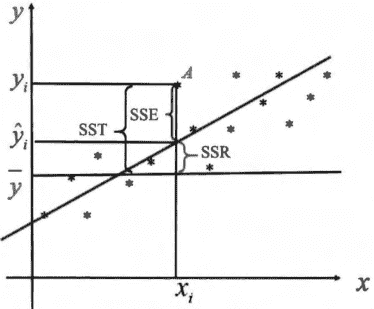

核心关系在于 SSR 越大，说明模型解释力越强，样本点越贴近回归线，拟合质量越好。由此自然引出判定系数，习惯记作 $R^2$。

```
$R^2 = \frac{SSR}{SST} = 1 - \frac{SSE}{SST}$
```
##### 2. 估计标准误差

判定系数 $R^2$ 的含义是自变量所能解释的影响占总体影响的比例，用来评判拟合好坏。换个角度也可以从误差出发，通过残差平方和 SSE 来评估。估计标准误差 $S_e$ 为均方残差的平方根，可用来刻画实际观测点在回归线周围的散布程度。

```
$S_e = \sqrt{\frac{SSE}{n-2}} = \sqrt{MSE}$
```

估计标准误差与判定系数方向相反。$S_e$ 直接反映预测值与真实值之间的误差水平，误差越小说明拟合越好，误差越大则拟合越差。

#### 6.1.3 动手练习: 住房价格回归预测

##### 1. 案例说明

本例采用深度学习方法对某区域房价进行预测，买家可据此挑选合适的房屋。

研究范围聚焦于影响房价的部分因素，如房屋面积、户型、类型、配套设施、地理位置等，具体字段见表6-1。

| 字段名称 | 字段说明 |
|---|---|
| Id | 住房编号 |
| Area | 房屋面积 |
| Shape | 房屋户型 |
| Style | 房屋类型 |
| Utilities | 配套设施，如通不通水电气 |
| Neighborhood | 地理位置 |
| Price | 销售价格 |

#### 2. 操作步骤

**01 导入相关第三方库，代码如下：**

```python
#导入相关库
import torch
import numpy as np
import pandas as pd
from torch.utils.data import DataLoader,TensorDataset
import time
strat = time.perf_counter()
```

**02 读取训练数据和测试数据，代码如下：**

```python
# 读取'./回归分析/train.csv'文件的数据，并赋值给变量 o_train
o_train = pd.read_csv('./回归分析/train.csv')
# 读取'./回归分析/test.csv'文件的数据，并赋值给变量 o_test
o_test = pd.read_csv('./回归分析/test.csv')
```

该段代码读取 train.csv 与 test.csv 两个文件的内容，分别存入 o_train 与 o_test 变量，为后续分析与回归建模做准备。

**03 合并数据集，代码如下：**

```python
# 合并 o_train 和 o_test 数据的'Area'到'Neighborhood'列
all_features = pd.concat((o_train.loc[:, 'Area':'Neighborhood'], o_test.loc[:, 'Area':'Neighborhood']))
# 合并 o_train 和 o_test 数据的'Price'列
all_labels = pd.concat((o_train.loc[:, 'Price'], o_test.loc[:, 'Price']))
```

此处借助 pd.concat() 将 o_train 与 o_test 的指定列拼接，loc[:] 取全部行，'Area':'Neighborhood' 或 'Price' 限定了参与合并的列区间。

**04 数据预处理，代码如下：**

```python
# 提取所有特征中数值类型的特征索引
numeric_feats = all_features.dtypes[all_features.dtypes!= "object"].index
# 提取所有特征中对象类型的特征索引
object_feats = all_features.dtypes[all_features.dtypes == "object"].index
# 对数值类型的特征进行标准化处理
all_features[numeric_feats] = all_features[numeric_feats].apply(lambda x: (x - x.mean()) / (x.std()))
# 对对象类型的特征进行独热编码
all_features = pd.get_dummies(all_features, prefix=object_feats, dummy_na=True)
# 用所有特征的均值填充缺失值
all_features = all_features.fillna(all_features.mean())
```

该部分完成数据清洗与转换的处理。预处理有助于模型更好理解数据，提升准确性与泛化能力。

**05 数据类型转换，数组转换成张量，代码如下：**

```python
# 将NumPy数组转换为 Torch 张量
train_features = torch.from_numpy(train_features)
# 在第 1 个维度上对张量进行 unsqueeze 操作，增加一维
train_labels = torch.from_numpy(train_labels).unsqueeze(1)
# 将NumPy数组转换为 Torch 张量
test_features = torch.from_numpy(test_features)
# 在第 1 个维度上对张量进行 unsqueeze 操作，增加一维
test_labels = torch.from_numpy(test_labels).unsqueeze(1)
# 创建一个包含训练特征和标签的张量数据集
train_set = TensorDataset(train_features, train_labels)
# 创建一个包含测试特征和标签的张量数据集
test_set = TensorDataset(test_features, test_labels)
```

将 NumPy 数组转为 Torch 张量，并在第一维使用 unsqueeze 增加维度，随后构建包含训练特征与标签的张量数据集 train_set，以及包含测试特征与标签的张量数据集 test_set。

**06 设置数据迭代器，代码如下：**

```python
#创建一个数据加载器train_data，用于加载训练数据。数据集使用train_set，批大小设置为 64，并且数据会被打乱 (shuffle=True)
train_data = DataLoader(dataset=train_set, batch_size=64, shuffle=True)
```

```python
#创建另一个数据加载器test_data，用于加载测试数据。数据集使用test_set，批大小同样为 64，但数据不会被打乱（shuffle=False）
test_data = DataLoader(dataset=test_set, batch_size=64, shuffle=False)
```

DataLoader 是 PyTorch 的数据加载器，可把数据集切分为小批量并在训练时循环供给。训练时 train_data 每次返回 64 个样本的批次；测试时 test_data 按顺序加载，不打乱样本顺序，方便模型训练与评估时按批获取数据。

**07 设置网络结构，代码如下：**

```python
class Net(torch.nn.Module): # 定义一个名为 Net 的 torch.nn.Module 子类
    def __init__(self, n_feature, n_output): # 构造函数
        super(Net, self).__init__() # 调用父类的构造函数
        # 定义第一层全连接层，输入特征数为 n_feature，输出维度为 600
        self.layer1 = torch.nn.Linear(n_feature, 600)
        # 定义第二层全连接层，输入维度为 600，输出维度为 1200
        self.layer2 = torch.nn.Linear(600, 1200)
        # 定义第三层全连接层，输入维度为 1200，输出目标数为 n_output
        self.layer3 = torch.nn.Linear(1200, n_output)

    def forward(self, x): # 前向传播方法
        x = self.layer1(x) # 输入 x 经过第一层全连接层
        x = torch.relu(x) # 经过 ReLU 激活函数
        x = self.layer2(x) # 经过第二层全连接层
        x = torch.relu(x) # 经过 ReLU 激活函数
        x = self.layer3(x) # 经过第三层全连接层
        return x # 返回输出 x

# 创建 Net 类的实例，输入特征数为 44，输出目标数为 1
net = Net(44, 1)

# 优化器，使用 Adam 算法，学习率为 1e-4
optimizer = torch.optim.Adam(net.parameters(), lr=1e-4)
criterion = torch.nn.MSELoss() # 损失函数，均方误差

losses = [] # 用于存储训练损失的列表
eval_losses = [] # 用于存储评估损失的列表

for i in range(100): # 进行 100 次训练迭代
    train_loss = 0 # 训练损失的累计值
    # train_acc = 0 # 训练准确率的累计值
    net.train() # 将模型设置为训练模式
    for tdata, tlabel in train_data: # 遍历训练数据
        y_ = net(tdata) # 前向传播得到预测值
        loss = criterion(y_, tlabel) # 计算损失
        optimizer.zero_grad()          # 梯度清零
        loss.backward()                # 反向传播计算梯度
        optimizer.step()               # 根据梯度更新参数
        train_loss = train_loss + loss.item()  # 累计训练损失

        # 将当前训练损失添加到 losses 列表中
        losses.append(train_loss / len(train_data))

    eval_loss = 0                  # 评估损失的累计值
    net.eval()                     # 将模型设置为评估模式
    for edata, elabel in test_data:    # 遍历测试数据
        y_ = net(edata)            # 前向传播得到预测值
        loss = criterion(y_, elabel)   # 计算损失
        eval_loss = eval_loss + loss.item()  # 累计评估损失
    eval_losses.append(eval_loss / len(test_data))  # 将当前评估损失添加到 eval_losses列表中

    # 打印训练次数、训练集损失和测试集损失
    print('训练次数: {}, 训练集损失: {}, 测试集损失: {}'.format(i, train_loss / len(train_data), eval_loss / len(test_data)))
```

本段定义神经网络模型 Net，并用训练集与测试集进行训练和评估，同时打印每轮迭代的训练损失与测试损失。

先在 __init__ 中搭建各层结构，再在 forward 中实现前向计算。训练循环里遍历训练数据做前向、算损失、反向传播与参数更新并累加训练损失；评估循环里用测试数据计算评估损失并累加。最后输出每轮的训练集损失与测试集损失。

###### 08 模型评估与预测，代码如下：

```python
y_ = net(test_features)          # 对测试特征进行网络前向传播
y_pre = y_ * std + mean          # 对预测值进行标准化处理
print('测试集预测值:', y_pre.squeeze().detach().cpu().numpy())  # 打印测试集预测值
# 计算并打印模型的平均误差
print('模型平均误差:', abs(y_pre - (test_labels*std + mean)).mean().cpu().item())
end = time.perf_counter()        # 获取当前时间
print('模型运行时间:', end - strat)  # 打印模型运行时间
```

该段对模型的预测结果进行整理与评估，并输出相关信息。

##### 3. 案例小结

本次实验通过回归分析对某城市房价进行了预测。

执行建模流程后模型输出如下。

```
测试集预测值: [12131.775 17357.338 20287.695 18685.883 18266.16 12643.363 13423.217 10104.598 27613.428]。
模型平均误差: 4383.65234375。
模型运行时间: 19.38353670000015。
```

结果显示模型平均误差约为 4384 元。数据量不大，即使使用 CPU 建模，运行时间也很快，约 19.38 秒。

### 6.2 聚类分析及案例

聚类分析属于探索性分析，分类时无需事先给出标准，可从样本数据出发自动归类。

#### 6.2.1 聚类分析简介

聚类分析是依据事物自身属性对个体进行研究的方法，目的是把相似的事物归为一类。其原则是类内相似度高、类间差异大。该方法具有以下特点：

- 适用于缺乏先验知识的分类。若缺少经验或行业标准，分类容易主观。设定完善的分类变量后，聚类分析可得到较为客观合理的类别。
- 可处理多变量共同决定的分类。例如按单一购买量分类较易，多指标如购买量、家庭收入、支出、年龄等联合分类则较复杂，聚类分析可以胜任。
- 是一种探索性分析手段，可挖掘事物内在规律，按相似性原则分组，是数据挖掘中常用的技术。

应用场景广泛。商业上用于发现不同客户群体并描绘其购买模式；在生物学上用于动植物与基因分类，帮助认识种群结构；在保险业中用于识别高消费车险客户群体，并按住宅类型、价值、地理位置划分房产；在互联网上用于文档归类与信息修复。

#### 6.2.2 聚类分析建模

聚类建模一般包含以下步骤。

##### 1) 数据预处理

数据预处理涉及变量数量、类型与尺度的选择，依赖特征选择与特征抽取。特征选择用于挑选关键特征，特征抽取则将原始特征映射为新的显著特征，二者常用于构建合适特征集以避免维度灾难。预处理还需剔除孤立点，因孤立点不遵循整体数据行为，易导致聚类偏差。

##### 2) 为衡量数据点间的相似度定义一个距离函数

相似性是聚类的基础，如何在同一特征空间衡量不同数据间的相似度至关重要，受特征类型与尺度影响，距离度量需谨慎选择，通常依据具体应用。常见距离度量有海明距离、欧氏距离、马氏距离等，公式如下。

海明距离:


欧氏距离:

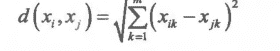

马氏距离:

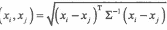

##### 3) 聚类或分组

将数据对象划入不同类别是关键步骤，可依据不同方法分组。划分法与层次法是两大主要思路。划分法通常从初始划分开始并优化聚类准则，主要方法包括：

- Crisp Clustering，每个数据点只属于单一类别。

聚类与降维核心思路速览

模糊聚类打破了样本必须唯一归属的限制，同一个数据点可以在多个分组中同时拥有不同程度的隶属。硬划分与模糊划分是划分式聚类最常见的两种实现路径，划分式聚类会依据预设准则生成一组层级嵌套的划分结果，用来衡量类间差异或类内紧密度，进而完成合并与拆分。除划分式之外，实际应用中还常见到密度驱动、模型驱动、网格驱动等聚类范式。

##### 4) 评估输出

对聚类结果进行质量判断是不可缺少的环节，因为聚类属于无监督任务，并不存在普适的客观判据，工程上多借助类有效性指标来衡量。通常从几何角度切入，即类间分离越明显、类内凝聚越紧密，结果质量越高。

K-Means是最为广泛使用的聚类方法，概念直观且实现门槛低。K-Means聚类如图6-2所示。

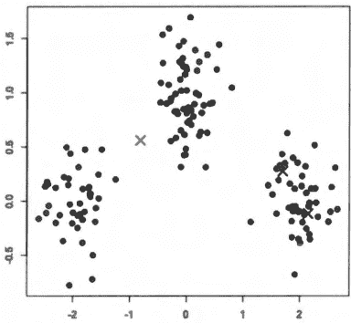

图6-2 K-Means聚类

首先需要事先确定分组个数，并对各组中心进行随机初始化，如图6-2中的“x”。随后进入迭代优化阶段，具体流程为：

- 计算每个数据点到各组中心的距离，将其划分到最近的组；
- 根据本次划分，重新求每组内所有点坐标的平均值，作为新的中心；
- 重复上述两步，直至中心位置前后变化极小。

K-Means运行效率较高，其本质是距离计算，时间复杂度为线性 O(n)。其局限在于两点：一是分组数必须提前指定；二是初始中心随机选取，会对结果产生影响。

#### 6.2.3 动手练习：植物花卉特征聚类

##### 1. 案例说明

本例选取花瓣长、花瓣宽、花萼长、花萼宽共 4 个形态指标做分组。数据集中包含 3 个类别共 150 条记录，每类 50 条。

实现选用 kmeans_pytorch 包里的 K-Means 算法，故需先安装该第三方包。

##### 2. 操作步骤

01 导入所需第三方库，参考实现：

```python
#导入相关库
import torch
import numpy as np
import pandas as pd
import matplotlib.pyplot as plt
from kmeans_pytorch import kmeans
from torch.autograd import Variable
import torch.nn.functional as F
```

02 配置运行环境，参考实现：

```python
if torch.cuda.is_available():
    device = torch.device('cuda:0')
else:
    device = torch.device('cpu')
```

该片段会根据 CUDA 可用性自动选择设备，有 GPU 时使用 cuda:0，否则使用 cpu，实现自适应。

03 读取数据源，参考实现：

```python
# 读取文件并存储为DataFrame
plant = pd.read_csv("./聚类分析/plant.csv")
# 选择需要的列
plant_d = plant[['Sepal_Length', 'Sepal_Width', 'Petal_Length', 'Petal_Width']]
# 将 Species 列重命名为 target
plant['target'] = plant['Species']
# 将数据转换为NumPy数组，然后通过torch.from_numpy将其转换为Torch张量，并将结果存储在x中
x = torch.from_numpy(np.array(plant_d))
# 将目标值转换为 Torch 张量，并将结果存储在y中
y = torch.from_numpy(np.array(plant.target))
```

片段完成抽取指定列并把数据转为 Torch 张量，供后续处理使用，具体细节取决于整体流程。

04 构建聚类模型，参考实现：

```python
# 设置聚类数
num_clusters = 3
```

```python
# 设置聚类模型
cluster_ids_x, cluster_centers = kmeans(
    # 输入数据
    X=x,
    # 聚类数
    num_clusters=num_clusters,
    # 距离度量方式, 这里使用欧几里得距离
    distance='euclidean',
    # 设备, 例如 'cuda' 或 'cpu'
    device=device
)

# 输出聚类 ID 和聚类中心点
print(cluster_ids_x)
print(cluster_centers)
```

上述代码执行聚类并输出类别编号与中心位置，具体数值随输入与参数变化。

05 绘制聚类散点图，参考实现：

```python
#创建一个图形, 设置图形大小为4×3英寸, 分辨率为160dpi
plt.figure(figsize=(4, 3), dpi=160)

# 在图形上绘制散点图, x轴和y轴的数据分别为x矩阵的第0列和第1列, 颜色根据cluster_ids_x进行映射, 使用'cool'颜色映射, 标记为"D"
plt.scatter(x[:, 0], x[:, 1], c=cluster_ids_x, cmap='cool', marker="D")

# 在图形上绘制聚类中心点的散点图, x 轴和 y 轴的数据分别为 cluster_centers 矩阵的第 0 列和第 1 列, 颜色为白色, 透明度为 0.6, 边缘颜色为黑色, 线宽为 2
plt.scatter(
    cluster_centers[:, 0], cluster_centers[:, 1],
    c='white',
    alpha=0.6,
    edgecolors='black',
    linewidths=2
)

# 自动调整图形布局, 使图形元素适当地排列
plt.tight_layout()

# 显示图形
plt.show()
```

该代码用于可视化，可得到带颜色映射的散点图并标出中心点，最终呈现与数据及参数相关。

##### 3. 案例小结

本实验借助四个花部特征对植物花卉进行分组。

运行建模代码后，得到的分组结果为：

```
tensor([[2,2,2,2,2,2,2,2,2,2,2,2,2,2,2,2,2,2,2,2,2,2,
2,2,2,2,2,2,2,2,2,2,2,2,2,2,2,2,2,2,2,2,2,2,
2,2,1,1,0,1,1,1,1,1,1,1,1,1,1,1,1,1,1,1,1,1,
1,1,1,1,1,0,1,1,1,1,1,1,1,1,1,1,1,1,1,1,1,1,
1,1,1,1,0,1,0,0,0,1,0,0,0,0,0,1,1,0,0,0,0,1,
0,1,0,1,0,0,1,1,0,0,0,0,1,0,0,0,0,1,0,0,0,1,0,
0,0,1,0,0,1]])
```

各组的中心位置如下：

```
tensor([[[6.8500, 3.0737, 5.7421, 2.0711],
[5.9016, 2.7484, 4.3339],
[5.0060, 3.4280, 1.4620, 0.2460]]])
```

叠加中心点的散点图如图6-3所示。

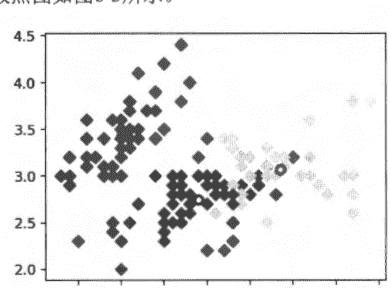

### 6.3 主成分分析及案例

主成分分析 Principal Component Analysis, PCA 是一种线性映射，把数据投影到新坐标系，使得第一主成分上的投影方差最大，第二主成分次之，以此类推。前文已有简述，本节聚焦 PyTorch 中的落地方式与建模案例。

#### 6.3.1 主成分分析简介

统计分析中往往需要同时处理大量影响因子，这些因子即指标或变量。每个变量都携带信息，且变量间通常存在相关，导致信息冗余。变量过多会增加计算量与分析难度，人们希望用更少的变量保留更多信息，PCA 正是为此产生，是处理此类问题的常用手段。

PCA 常用于降维，目标是保留对总体方差贡献最大的特征，通过保留低阶主成分、舍弃高阶成分实现。低阶成分通常反映数据的核心结构。

例如在科普图书开发利用评估中，涉及创作人数、发行量、科普产业化基地数等多个指标。对数据做主成分分析后可提炼少数综合指标，在压缩变量数的同时保持较高可信度，便于效果评估。

#### 6.3.2 主成分分析建模

主成分分析是通过线性变换从多个变量中提取少量重要变量的统计方法。其思想是将一组存在相关性的原始变量重构为彼此无关的综合指标，用正交变换把相关随机向量转为不相关的新随机向量。代数上体现为协方差矩阵对角化，几何上体现为坐标系转向样本点最分散的正交方向，再进行降维。方差较大的新变量既能概括原信息，又具自身解释。数学模型为：

$$

\begin{aligned}

& z_{1}=u_{11} X_{1}+u_{12} X_{2}+\cdots+u_{1 p} X_{p} \\

& z_{2}=u_{21} X_{1}+u_{22} X_{2}+\cdots+u_{2 p} X_{p} \\

& \cdots \\

& z_{p}=u_{p 1} X_{1}+u_{p 2} X_{2}+\cdots+u_{p p} X_{p}

\end{aligned}

$$

其中，$z_{1}, z_{2}, \cdots, z_{p}$ 为 $p$ 个主成分。

建模流程如下：

(1) 对原始变量做坐标变换，可得：

$$

\begin{aligned}

z_1 &= u_{11}x_1 + u_{21}x_2 + \cdots + u_{p1}x_p \\

z_2 &= u_{12}x_1 + u_{22}x_2 + \cdots + u_{p2}x_p \\

&\cdots \\

z_p &= u_{1p}x_1 + u_{2p}x_2 + \cdots + u_{pp}x_p

\end{aligned}

$$

其中参数需满足如下条件：

$$

u_{1k}^2 + u_{2k}^2 + \cdots + u_{pk}^2 = 1

$$

$$

\text{var}(z_i) = U_i^2 D(x) = U_i' D(x) U_i

$$

$$

\text{cov}(z_i, z_j) = U_i' D(x) U_j

$$

(2) 提取主成分。

$z_1$ 称为第一主成分，满足条件如下：

$$

u_1' u_1 = 1

$$

$$

\text{var}(z_1) = \max \text{var}(u'x)

$$

$z_2$ 称为第二主成分，满足条件如下：

$$

\text{cov}(z_1, z_2) = 0

$$

$$

u_2' u_2 = 1

$$

$$

\text{var}(z_2) = \max \text{var}(U'X)

$$

其余主成分依次类推。

#### 6.3.3 动手练习：地区竞争力指标降维

##### 1. 案例说明

衡量我国各省市综合发展水平的数据来自《中国统计年鉴》。表中选取 6 个指标，包括人均 GDP、固定资产投资、社会消费品零售总额、农村人均纯收入等，后续将借助因子分析思路提取公共因子，探究发展因子。本例原始数据如表6-2所示。

表 6-2 地区竞争力数据

| id | x1 | x2 | x3 | x4 | y |

|---|---|---|---|---|---|

| 1 | 10265 | 30.81 | 6235 | 3223 | 2 |

| 2 | 8164 | 49.13 | 4929 | 2406 | 2 |

| 3 | 3376 | 77.76 | 3921 | 1668 | 0 |

| 4 | 2819 | 33.97 | 3305 | 1206 | 0 |

| 5 | 3013 | 54.51 | 2863 | 1208 | 1 |

| 6 | 6103 | 124.02 | 3706 | 1756 | 1 |

| 7 | 3703 | 28.65 | 3174 | 1609 | 1 |

| 8 | 4427 | 48.51 | 3375 | 1766 | 1 |

| ... | ... | ... | ... | ... | ... |

##### 2. 操作步骤

01 导入相关库，参考实现：

```python
#导入相关库
import torch
import numpy as np
import pandas as pd
import matplotlib.pyplot as plt
from sklearn.decomposition import PCA
from torch.autograd import Variable
import torch.nn.functional as F
```

02 读取数据，参考实现：

```python
# 读取文件并将数据存储在 DataFrame 中
region = pd.read_csv("./主成分分析/region.csv")
# 从 region 数据框中选择'x1'、'x2'、'x3'和'x4'列
region_d = region[['x1', 'x2', 'x3', 'x4']]
# 将 region 数据框中的'y'列数据赋值给'target'列
region['target'] = region['y']
```

该代码用于数据处理，根据需求挑选特定列并重组数据，请结合实际使用。

03 变量特征降维，参考实现：

```python
# 创建一个主成分分析 (PCA) 对象，指定保留的主成分数量为 2
transfer_1 = PCA(n_components=2)
# 使用拟合和转换方法对 region_d 进行主成分分析
region_d = transfer_1.fit_transform(region_d)
# 将 region_d 转换为 Torch 中的 NumPy 数组
x = torch.from_numpy(region_d)
# 将 region 中的 'target' 列转换为 Torch 中的 NumPy 数组
y = torch.from_numpy(np.array(region['target']))
# 将 x 和 y 转换为 Variable 对象
x, y = Variable(x), Variable(y)
```该片段用于把数据转为适合深度学习框架如 Torch 使用的格式，为后续处理与分析做准备。具体场景与后续操作取决于整体项目需求与数据流程。

###### 04 设置网络结构，参考实现：

```python
# 使用 torch.nn.Sequential 构建神经网络
net = torch.nn.Sequential(
    # 第一个线性层，输入维度为 2，输出维度为10
    torch.nn.Linear(2, 10),
    # ReLU 激活函数
    torch.nn.ReLU(),
    # 第二个线性层，输入维度为 10，输出维度为3
    torch.nn.Linear(10, 3),
)
# 打印神经网络结构
print(net)
```

该代码定义了一个简易神经网络并打印结构。

代码中使用 `torch.nn.Sequential` 按顺序堆叠各层，每个线性层由 `torch.nn.Linear` 定义，其中首层把输入维度从 2 映射到 10，第二层从 10 映射到 3。

线性层后接 `torch.nn.ReLU` 引入非线性。

最后通过 `print(net)` 输出网络结构，方便查看层与连接。

此类结构可用于分类、回归等任务，具体应用与训练过程取决于数据与任务要求。实际使用还需数据加载、损失函数定义、优化器选择与训练循环等。

###### 05 设置优化器，随机梯度下降，参考实现：

```python
# 定义优化器，优化器使用随机梯度下降 (SGD)，学习率为 0.00001
optimizer = torch.optim.SGD(net.parameters(), lr=0.00001)  # 定义损失函数
loss_func = torch.nn.CrossEntropyLoss()  # 损失函数使用交叉熵损失
```

该代码定义了神经网络的优化器与损失函数。

训练时优化器依据损失反馈更新参数以最小化损失，损失函数衡量预测结果与真实标签的差异。

具体使用方式会随网络结构与任务需求而变化，训练过程中

在神经网络训练里，反向传播和参数迭代通常要靠优化器配合损失函数来驱动，不断把模型往更好的方向拉。

###### 06 实战训练与可视化流程
```python
for t in range(100): # 遍历 100 次
    # 前向传播，计算网络输出
    out = net(x.float())
    # 计算损失
    loss = loss_func(out, y.long())
    
    # 清空梯度
    optimizer.zero_grad()
    # 反向传播计算梯度
    loss.backward()
    # 根据梯度更新参数
    optimizer.step()
    
    if t % 25 == 0: # 每 25 次迭代
        # 清空图形
        plt.cla()
        # 获取预测结果
        prediction = torch.max(out, 1)[1]
        # 将预测结果转换为 NumPy 数组
        pred_y = prediction.data.numpy()
        # 将真实标签转换为 NumPy 数组
        target_y = y.data.numpy()
        # 在图上绘制预测结果，颜色代表类别
        plt.scatter(x.data.numpy()[:, 0], x.data.numpy()[:, 1], c=pred_y, s=100, lw=5, cmap='coolwarm')
        # 计算准确率
        accuracy = float((pred_y == target_y).astype(int).sum()) / float(target_y.size)
        # 打印准确率
        print('Accuracy=%.2f' % accuracy)
        # 暂停 0.1 秒显示图形
        plt.pause(0.1)
        
    # 显示图形
    plt.show()
```

以上代码展示了一个完整的训练循环，涵盖了前向推理、损失计算、反向求导、参数更新，以及按步数触发的可视化和准确率统计。

循环会重复多次，每轮先用网络做前向传播得到输出，再用损失函数量化误差，随后清零梯度执行反向传播算出梯度，最后按梯度完成一次参数更新。

每运行 25 步会做：
- 清空画布。
- 取模型预测并转成 NumPy 数组。
- 取真实标签并转成 NumPy 数组。
- 按类别用不同颜色在图上绘制预测结果。
- 计算并打印当前准确率。
- 暂停 0.1 秒让图形显示。
- 刷新图形。

这种写法在训练时很常见，用来周期性地观察模型在数据上的表现并用准确率来衡量效果。具体落地细节会随任务和数据而变化。

###### 07 模型持久化保存
```python
# 将网络模型保存到文件'./主成分分析/net.pkl'中，这将保存网络的结构和参数
torch.save(net,'./主成分分析/net.pkl')
# 将网络的状态字典保存到文件'./主成分分析/net_params.pkl'中，状态字典包含了网络的参数
torch.save(net.state_dict(),'./主成分分析/net_params.pkl')
```

该片段通过 `torch.save` 分别把网络整体和网络的状态字典写到指定文件里。

保存的目的是让训练好的模型可以被持久化，后续在别的程序或环境中直接加载使用，复用成本很低。

注意运行前确认目标路径 `'./主成分分析'` 存在且可写，否则保存会失败。读取时需要用对应的 `torch.load` 把文件恢复成模型。

##### 3. 案例小结

输出的网络结构如下：
```python
Sequential(
    (0): Linear(in_features=2, out_features=10, bias=True) # 线性层，输入特征数为 2，
    输出特征数为 10，启用偏置
    (1): ReLU() # ReLU 激活函数
    (2): Linear(in_features=10, out_features=3, bias=True) # 线性层，输入特征数为 10，
    输出特征数为 3，启用偏置
)
```

这里定义了一个 Sequential 模型，共三层：
- 首层是线性层 Linear，输入特征 2 维映射到 10 维，偏置开启。
- 中间是 ReLU 激活，引入非线性。
- 末层是线性层 Linear，10 维映射到 3 维，偏置同样开启。

Sequential 是 PyTorch 里常用的叠层容器，各层按顺序堆叠，每层以元组形式给出类型和参数。示例构建了一个简洁的前馈网络，包含两段线性变换和一次激活，可用于分类、回归等多种任务。实际效果取决于数据、训练策略等，往往还需要继续调整结构、超参和训练过程。

当准确率为 0.17 时，如图 6-4 所示。
当准确率为 0.48 时，如图 6-5 所示。
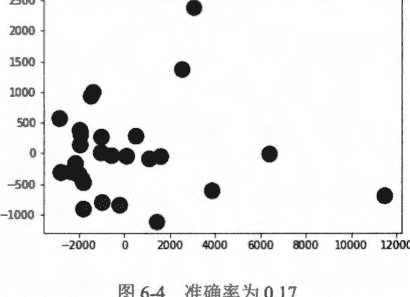
图6-4 准确率为0.17
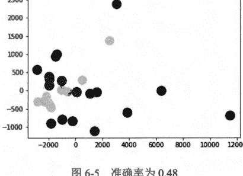
图6-5 准确率为0.48

当准确率为 0.62 时，如图 6-6 所示。
当准确率为 0.69 时，如图 6-7 所示。
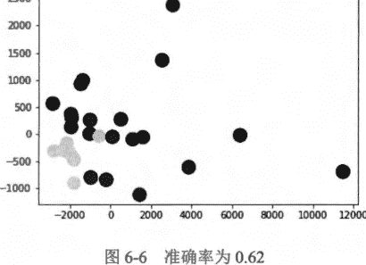
图6-6 准确率为0.62
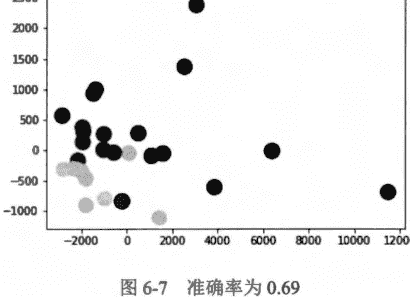
图6-7 准确率为0.69

### 6.4 模型评估与调优
模型搭好之后，怎么判断好坏、怎么优化？本节介绍机器学习中常用的评估指标和超参数调优方法。

#### 6.4.1 模型评估方法

##### 1. 混淆矩阵
在分类任务里，正样本指能让模型得出正确结论的例子，负样本则相反。以猫狗识别为例，检测狗时狗为正类猫为负类，反过来检测猫时猫为正类狗为负类。

混淆矩阵是用表格汇总真实类别与预测类别的统计结果，行是真实值，列是预测值。

举例：宠物店有 10 只动物，6 只狗 4 只猫，某分类器输出 5 只狗 5 只猫。以狗为正类得到的混淆矩阵如表 6-3。

表 6-3 混淆矩阵

| 混淆矩阵 | 预测值 |

| :--- | :--- |

| | 正（狗） | 负（猫） |

| 真实值 | 正（狗） | 5 | 1 |

| | 负（猫） | 0 | 4 |

由此可得真实狗数 6（5+1），真实猫数 4（0+4），预测狗数 5（5+0），预测猫数 5（1+4）。

常用四项指标：
- TP 真阳性：判为正且实际为正。
- FN 假阴性：判为负但实际为正。
- FP 假阳性：判为正但实际为负。
- TN 真阴性：判为负且实际为负。

映射到矩阵：

| 混淆矩阵 | 预测值<br>正（狗） | 预测值<br>负（猫） |

| :--- | :---: | :---: |

| **真实值**<br>正（狗） | TP | FN |

| **真实值**<br>负（猫） | FP | TN |

##### 2. ROC曲线
ROC 全称受试者工作特征，常用于衡量二分类学习器的能力。若一个学习器的 ROC 完全包住另一个，则前者更优。ROC 的好处是正负样本分布变化时曲线基本保持稳定。

横轴是 FPR，误判为正的概率；纵轴是 TPR，正确判为正的概率。计算式如下：
$$FPR = \frac{FP}{FP + TN}$$
$$TPR = \frac{TP}{TP + FN}$$

##### 3. AUC
AUC 是 ROC 曲线与坐标轴围成的面积。TPR 越大、FPR 越小，曲线越靠近左上角，模型越好，AUC 越高，理想值为 1。实际中 AUC 通常在 0.5 到 1 之间。

AUC 的优势是不需要预先设定阈值就能比较模型，且值越大说明正样本越容易排在负样本前面。

- AUC = 1，完美分类，存在阈值可做到零误差，极少出现。
- 0.5 < AUC < 1，优于随机猜测，调好阈值有预测价值。
- AUC = 0.5，等同随机猜测，无价值。
- AUC < 0.5，比随机还差。

##### 4. R平方
判定系数 R² 也称决定系数，表示回归模型能解释的因变量变异比例，等价于相关系数 R 的平方。它衡量模型对 y 变化的解释程度。

取值 0~1，常以百分比表达。如 R²=0.7 表示可解释 70%。通常认为 R²>0.75 拟合很好，可解释性高；R²<0.5 拟合存疑，不宜回归。

缺陷是自变量增多时 R² 会单调上升。为避免高估，需做调整：
$$ 1 - \left(1 - R^2\right) \frac{(n - 1)}{(n - k - 1)} $$
调整后的 R² 引入样本量 n 和自变量个数 k，值恒小于 R²，且不会因变量增多而趋近 1。

在多元回归中常用调整后 R² 评估拟合。经验上调整后 R² 的临界值约 0.5，若低于此需审视变量选择；若调整后 R² 与 R² 差距明显，说明变量对因变量解释不足或遗漏重要变量，差距越大拟合越差。

##### 5. 残差
残差是观测值与拟合值的差，蕴含模型假设信息。若模型正确，残差可视为误差的观测。

常用三项指标：

###### 1) 均方误差
MSE 是预测值与观测值残差平方的平均：
$$\mathrm{MSE}=\frac{1}{m} \sum_{i=1}^{m}\left(y_{i}-y_{i}\right)^{2}$$
即先求差、平方、求和再平均，是线性回归常见的损失。

###### 2) 均方根误差
RMSE 是 MSE 的平方根：
$$\mathrm{RMSE}=\sqrt{\mathrm{MSE}}$$
带有与原始数据相同的单位，可直观反映误差大小。

###### 3) 平均绝对误差
MAE 是绝对误差的平均：
$$\mathrm{MAE}=\frac{1}{m} \sum_{i=1}^{m}\left|y_{i}-y_{i}\right|$$
MAE 对误差线性加权，而 RMSE 对大误差惩罚更重。

#### 6.4.2 模型调优方法

##### 1. 交叉验证
交叉验证又称循环估计，把样本划分成若干子集用于训练和验证，目的是得到稳定可靠的模型。

###### 1) Holdout 验证
随机把数据分成训练集和验证集，用训练集训练，用验证集评估，记录准确率作为性能指标。

###### 2) K 折交叉验证
把数据分成 K 份，轮流拿 1 份验证，其余 K-1 份训练，重复 K 次后取平均。能充分利用数据，每次都验证一次。

###### 3) 留一验证
特例 K=N，每次只留一个样本验证，其余训练。计算量大，多用于小样本。

###### 4) 十折交叉验证
K=10 的常用做法。把数据集均分 10 份，9 份训练 1 份测试，轮换 10 次取平均，通常会做多次 10 折取均值作为最终估计。

##### 2. GridSearchCV
部分算法的超参数如 k 近邻的 K 需要手动指定。网格搜索会穷举指定范围内的参数组合，配合交叉验证评估，最后选出验证集上最优的组合。

GridSearchCV = 网格搜索 + 交叉验证。在限定范围内遍历所有组合，保证找到局部最优，但组合数爆炸时耗时严重，适合 3-4 个以内超参数且取值范围较小的场景。

##### 3. 随机搜索
当超参数较多时，网格搜索成本指数增长。随机搜索则在超参数空间随机采样数十上百个点，有一定概率命中较优解，效率更高。

#### 6.4.3 动手练习: PyTorch 实现交叉验证
本例以十折交叉验证为例，把数据分成 10 组轮流训练测试，每次测试集为总条数的 1/10，抽取随机。

这段代码主要做张量生成与操作，用来构建数据集或准备模型输入标签。具体的应用会随上下文和后续步骤变化，例如 x、y 可能表示图像数据与类别标签。这样的结构常见于深度学习的数据预处理或训练阶段。

## Net 模块骨架拆解

```python
#导入相关库
import torch
import numpy as np
import pandas as pd
from torch.utils.data import DataLoader,TensorDataset
import time
strat = time.perf_counter()
```

```python
# 生成形状为(100, 28, 28)的随机张量 x
x = torch.rand(100, 28, 28)
# 生成形状为(100, 28, 28)的随机张量 y
y = torch.randn(100, 28, 28)
# 在维度 0 上连接 x 和 y
x = torch.cat((x, y), dim=0)
# 生成长度为 200 的标签列表,前 100 个元素为 1,后 100 个元素为 0
label = [1] * 100 + [0] * 100
# 将标签列表转换为 torch.long 类型的张量
label = torch.tensor(label, dtype=torch.long)
```

```python
# 定义一个名为 Net 的神经网络模块
class Net(nn.Module):
    def __init__(self): # 构造函数
        super (Net, self).__init__() #调用父类的构造函数
        self.fc1 = nn.Linear(28*28, 120) #定义全连接层,输入维度为28×28,输出维度为120
        self.fc2 = nn.Linear(120, 84) #定义全连接层,输入维度为120,输出维度为84
        self.fc3 = nn.Linear(84, 2) #定义全连接层,输入维度为84,输出维度为2

    def forward(self, x): #前向传播函数
        x = x.view(-1, self.num_flat_features(x)) #将输入x展平为一维张量,并根据输入特征数量进行调整
        x = F.relu(self.fc1(x)) #通过ReLU激活函数应用第一全连接层
        x = F.relu(self.fc2(x)) #通过ReLU激活函数应用第二全连接层
        x = self.fc3(x) #应用第三全连接层
        return x

    def num_flat_features(self, x): #计算输入x的展平特征数量的函数
        size = x.size()[1:] #获取输入x的除第一个维度外的尺寸
        num_features = 1 #初始化特征数量为1
        for s in size: #遍历尺寸
            num_features *= s #计算总的特征数量
        return num_features #返回特征数量
```

这里给出了一个名为 Net 的神经网络类实现。
初始化里创建了 fc1、fc2、fc3 这三层全连接结构；
前向方法会先把输入拉平成一维，再依次经过全连接与激活函数完成特征变换；
num_flat_features 这类辅助函数的作用是算出展平后特征的总数目。

这种三层全连接的骨架在实际建模中很常见，落地效果会受网络设计、数据本身以及任务目标的共同影响，通常还需要配合训练、调优和评估才能发挥更稳定表现。

###### 04 训练数据封装
```python
#定义一个名为TraindataSet的数据集类,继承自Dataset
class TraindataSet(Dataset):
    def __init__(self, train_features, train_labels): #构造函数,接受训练特征和训练标签作为参数
        self.x_data = train_features #保存训练特征
        self.y_data = train_labels #保存训练标签
        self.len = len(train_labels) #记录标签的长度

    def __getitem__(self, index): #定义获取数据的方法,根据索引返回对应的数据项
        return self.x_data[index], self.y_data[index] #返回索引为index的特征和标签

    def __len__(self): #定义获取数据集长度的方法
        return self.len #返回数据集的长度
```

这段实现定义了 TraindataSet 类并继承自 Dataset，用来管理训练用的特征和标签。
构造方法接收特征和标签，将其分别存入 x_data 与 y_data，同时把样本总数记下来；
取样方法根据传入的索引返回对应的一组特征与标签；
长度方法返回数据集的样本数量。

整体目的是让训练数据拥有统一的组织方式和便捷的访问接口，便于后续在机器学习或深度学习流程中直接加载使用，比如送入模型进行训练等操作。

###### 05 损失函数设定
```python
# 定义损失函数为 nn.CrossEntropyLoss
loss_func = nn.CrossEntropyLoss()
```

这里引入了神经网络训练所需的损失计算。nn.CrossEntropyLoss 是 PyTorch 里常用的分类损失，能够衡量模型输出的概率分布与真实标签之间的偏离程度。

在分类场景下，该损失会先对每个样本计算预测概率与真实类别的交叉熵，再对所有样本求和或求均值得到整批数据的损失数值。

把 loss_func 指定为 nn.CrossEntropyLoss，就能在训练阶段基于此指标反向优化参数，不断拉近预测结果与真实标签的差距。

具体使用细节会随模型结构和训练策略变化，一般在训练循环里把网络输出和真实标签一起喂给损失函数得到数值，再借助优化器如随机梯度下降更新参数以减小损失。

###### 06 K 折交叉验证划分
```python
def get_k_fold_data(k, i, X, y):
    """
    获取 k 折交叉验证数据

    参数:
    k (int): 折数
    i (int): 当前折的索引
    X (torch.Tensor): 输入数据
    y (torch.Tensor): 标签

    返回:
    X_train (torch.Tensor): 训练集数据
    y_train (torch.Tensor): 训练集标签
    X_valid (torch.Tensor): 验证集数据
    y_valid (torch.Tensor): 验证集标签
    """
    assert k > 1 # 断言 k 必须大于 1
    fold_size = X.shape[0] // k # 计算每折的大小
    X_train, y_train = None, None
    for j in range(k):
        # 使用 slice 函数生成当前折的索引范围
        idx = slice(j * fold_size, (j + 1) * fold_size)
        X_part, y_part = X[idx, :], y[idx]
        if j == i:
            X_valid, y_valid = X_part, y_part
        elif X_train is None:
            X_train, y_train = X_part, y_part
        else:
            # 将当前折的数据与已有训练集数据在维度 0 上连接
            X_train = torch.cat((X_train, X_part), dim=0)
            y_train = torch.cat((y_train, y_part), dim=0)
    return X_train, y_train, X_valid, y_valid

def k_fold(k, X_train, y_train, num_epochs=3, learning_rate=0.001,
weight_decay=0.1, batch_size=5):
    """
    进行 k 折交叉验证

    参数:
    k (int): 折数
    X_train (torch.Tensor): 训练数据
    y_train (torch.Tensor): 训练标签
    num_epochs (int, optional): 训练轮数，默认值为 3
    learning_rate (float, optional): 学习率，默认值为 0.001
    weight_decay (float, optional): 权重衰减，默认值为 0.1
    batch_size (int, optional): 批次大小，默认值为 5

    返回:
    train_loss_sum (float): 训练集损失总和
    valid_loss_sum (float): 验证集损失总和
    train_acc_sum (float): 训练集准确度总和
    valid_acc_sum (float): 验证集准确度总和
    """

    train_loss_sum, valid_loss_sum = 0, 0
    train_acc_sum, valid_acc_sum = 0, 0

    for i in range(k):
        # 获取当前折的数据
        data = get_k_fold_data(k, i, X_train, y_train)
        net = Net() # 创建神经网络模型
        # 训练模型并返回训练集和验证集的损失与准确度
        train_ls, valid_ls = train(net, *data, num_epochs, learning_rate,
weight_decay, batch_size)

        print('*'*10, '第', i+1, '折', '*'*10)
        print('训练集损失: %.6f'%train_ls[-1][0], '训练集准确度: %.4f'%train_ls[-1][1],\n      '测试集损失: %.6f'%valid_ls[-1][0], '测试集准确度: %.4f'%valid_ls[-1][1])

        # 累积各折的训练集和验证集损失与准确度
        train_loss_sum += train_ls[-1][0]
        valid_loss_sum += valid_ls[-1][0]
        train_acc_sum += train_ls[-1][1]
        valid_acc_sum += valid_ls[-1][1]

    print('#'*5, '最终 k 折交叉验证结果', '#'*5)
    print('训练集累积损失: %.4f'%(train_loss_sum/k), '训练集累积准确度: %.4f'%(train_acc_sum/k),\n      '测试集累积损失: %.4f'%(valid_loss_sum/k), '测试集累积准确度: %.4f'%(valid_acc_sum/k))
```

这部分定义了两个关键函数 get_k_fold_data 与 k_fold。
前者负责把整体数据集切分为 K 份，并返回当前轮次的训练集数据、训练标签以及验证集数据、验证标签；
后者在 K 折交叉验证流程中循环执行训练，并汇总每折的训练损失、验证损失以及对应的准确率。

K 折交叉验证是检验模型泛化能力、进行超参数调优的常用手段，能得到更可靠的性能估计。

###### 07 训练函数定义

```python
def train(net,                  # 神经网络模型
          train_features,       # 训练数据特征
          train_labels,         # 训练数据标签
          test_features,        # 测试数据特征
          test_labels,          # 测试数据标签
          num_epochs,           # 训练轮数
          learning_rate,        # 学习率
          weight_decay,         # 权重衰减
          batch_size):          # 批次大小
    """
    训练模型的函数
    参数:
        net (神经网络模型): 要训练的模型
        train_features (张量): 训练数据的特征
        train_labels (张量): 训练数据的标签
        test_features (张量): 测试数据的特征
        test_labels (张量): 测试数据的标签
        num_epochs (整数): 训练的轮数
        learning_rate (浮点数): 学习率
        weight_decay (浮点数): 权重衰减
        batch_size (整数): 批次大小
    返回:
        train_ls (列表): 训练集的损失和准确度列表
        test_ls (列表): 测试集的损失和准确度列表
    """
    # 初始化训练集和测试集的损失和准确度列表
    train_ls, test_ls = [], []
    # 创建训练数据集
    dataset = TrainDataSet(train_features, train_labels)
    # 创建数据加载器
    train_iter = DataLoader(dataset, batch_size, shuffle=True)

    # 创建优化器
    optimizer = torch.optim.Adam(params=net.parameters(), lr=learning_rate,
weight_decay=weight_decay)

    # 遍历每个训练轮数
    for epoch in range(num_epochs):
        # 遍历每个批次
        for X, y in train_iter:
            # 前向传播得到输出
            output = net(X)
            # 计算损失
            loss = loss_func(output, y)
            # 梯度清零
            optimizer.zero_grad()
            # 反向传播
            loss.backward()
            # 更新参数
            optimizer.step()

        # 将当前轮数的训练集损失和准确度添加到列表中
        train_ls.append(log_rmse(0, net, train_features, train_labels))
        # 如果有测试集
        if test_labels is not None:
            # 将当前轮数的测试集损失和准确度添加到列表中
            test_ls.append(log_rmse(1, net, test_features, test_labels))

    # 返回训练集和测试集的损失和准确度列表
    return train_ls, test_ls

def log_rmse(flag,
             # 标志, 0 表示训练集, 1 表示测试集
             net,          # 神经网络模型
             x,            # 数据特征
             y):           # 数据标签
    """
    计算对数均方根误差和准确度的函数
    参数:
        flag (整数): 0 表示训练集, 1 表示测试集
        net (神经网络模型): 要评估的模型
        x (张量): 数据特征
        y (张量): 数据标签
    返回:
        (损失值, 准确度): 包含损失值和准确度的元组
    """
    # 如果是测试集, 将模型设置为评估模式
    if flag == 1:
        net.eval()
    # 进行前向传播得到输出
    output = net(x)
    # 获取预测结果
    result = torch.max(output, 1)[1].view(y.size())
    # 计算正确预测的数量
    corrects = (result.data == y.data).sum().item()
    # 计算准确度
    accuracy = corrects * 100.0 / len(y)
    # 计算损失
    loss = loss_func(output, y)
    # 将模型设置回训练模式
    net.train()

    # 返回损失值和准确度
    return (loss.data.item(), accuracy)
```

下面是关于上述实现逻辑的通俗拆解。

####### 1) train 函数

- `train_features` 与 `train_labels` 分别对应训练样本的输入特征和真实标签。
- `test_features` 与 `test_labels` 分别对应用于验证的样本特征和标签。
- `num_epochs` 控制整体训练的循环次数。
- `learning_rate` 决定参数每次更新的步长大小。
- `weight_decay` 起到正则化作用，帮助抑制过拟合。
- `batch_size` 设定一次前向计算所涉及的样本数量。

函数内部的执行顺序：

先实例化一个 TraindataSet 对象，把训练特征与标签传入。

随后借助 DataLoader 构建数据迭代器，指定批次大小并打开随机打乱。

再以 Adam 算法创建优化器 Optimizer，把学习率和权重衰减传入。

进入 epoch 循环：

- 依次取出一批数据。
- 输入网络完成前向推理得到输出。
- 用 loss_func 计算当前批次的损失。
- 清空梯度后执行反向传播，并按梯度更新参数。
- 把本轮训练集的损失与准确率写入 train_ls。
- 若提供了测试集，则同步把测试集的损失与准确率写入 test_ls。

结束时返回训练集和测试集的损失与准确率列表。

####### log_rmse 函数

- flag 用来区分是训练集还是测试集的评估。
- net 为待评测的神经网络。
- x、y 分别是输入特征和对应标签。

内部实现：

- 遇到测试集时先切换模型到评估模式，避免参数被更新。
- 执行前向得到预测结果。
- 统计预测正确的样本数，与真实标签对比。
- 计算得出准确率与损失值。
- 随后把模型切回训练模式。
- 最终输出损失和准确率。

整体来看，这段实现的核心是搭建完整的训练闭环，并在每轮记录训练与测试的损失和准确率，通过优化器迭代提升性能。log_rmse 负责在不同阶段计算对数均方根误差与准确率，依据 flag 判定具体作用的对象。

###### 调用交叉验证函数，代码如下:

```python
k_fold(10, x, label)
"""
执行 K 折交叉验证的函数
参数:
    n_folds (int): 交叉验证的折数，这里为10
    x (数据): 输入数据
    label (标签): 数据的标签
返回:
    交叉验证的结果
"""
```

在该注释模板里，k_fold 需要 n_folds、x、label 三个输入，n_folds 代表折数，x 是特征，label 是标签，输出为交叉验证的结果。

实际注释的详细程度取决于 k_fold 的具体实现。比如内部完成了数据切分、模型训练与评估，就可以在注释里对应展开说明。

##### 3. 案例小结

本案例借助 PyTorch 完成了十折交叉验证，为后续调参提供了依据。

训练集与测试集的损失、准确率输出如下：

```text
********** 第 1 折 **********
训练集损失:0.039198 训练集准确度:100.0000 测试集损失:0.026498 测试集准确度:100.0000
********** 第 2 折 **********
训练集损失:0.039630 训练集准确度:100.0000 测试集损失:0.022030 测试集准确度:100.0000
********** 第 3 折 **********
训练集损失:0.040065 训练集准确度:100.0000 测试集损失:0.038300 测试集准确度:100.0000
********** 第 4 折 **********
训练集损失:0.042192 训练集准确度:100.0000 测试集损失:0.026042 测试集准确度:100.0000
********** 第 5 折 **********
训练集损失:0.039414 训练集准确度:100.0000 测试集损失:0.030804 测试集准确度:100.0000
********** 第 6 折 **********
训练集损失:0.035939 训练集准确度:100.0000 测试集损失:0.350404 测试集准确度:100.0000
********** 第 7 折 **********
训练集损失:0.040390 训练集准确度:100.0000 测试集损失:0.334803 测试集准确度:100.0000
********** 第 8 折 **********
训练集损失:0.041971 训练集准确度:95.0000 测试集损失:0.390596 测试集准确度:95.0000
********** 第 9 折 **********
训练集损失:0.039858 训练集准确度:100.0000 测试集损失:0.380169 测试集准确度:100.0000
********** 第 10 折 **********
训练集损失:0.035709 训练集准确度:100.0000 测试集损失:0.368736 测试集准确度:100.0000
```

K 折交叉验证的最终汇总结果为：

训练集累积损失:0.0394 训练集累积准确度:100.0000 测试集累积损失:0.1968 测试集累积准确度:99.5000

### 6.5 上机练习题

#### 练习1: 在 PyTorch 中, 使用 Torch 库来实现主成分分析。

参考下述代码上机演练:

```python
# 导入相关库
import torch
from torch import tensor
from torch.linalg import svd

# 假设有一组数据X, 每行代表一个样本, 每列代表一个特征
X = tensor([[1, 2],
            [3, 4],
            [5, 6]])

# 对数据进行中心化
X_centered = X - X.mean(dim=0)

# 计算数据的协方差矩阵
cov_matrix = torch.matmul(X_centered.T, X_centered) / (X_centered.shape[0]-1)

# 对协方差矩阵进行特征值分解
_, _, V = svd(cov_matrix)

# 选择前k个特征向量作为主成分
k = 1
principal_components = V[:, :k]

# 将数据投影到主成分上
projected_data = torch.matmul(X_centered, principal_components)

print(projected_data)
```

该示例流程为：先对原始数据做中心化处理，再求协方差矩阵并做特征值分解；依据降维维数 k 挑选前 k 个特征向量作为主成分；最后用中心化数据乘以主成分矩阵得到降维结果。

需要提醒的是，此代码仅用于演示 PyTorch 下的 PCA 思路，落地时往往需要更细致的预处理与参数调节。

#### 练习2：使用 PyTorch 库实现模型的调优。

参考下述代码上机演练：

```python
# 导入相关库
import torch
import torch.nn as nn
import torch.optim as optim

# 定义模型结构
class MyModel(nn.Module):
    def __init__(self):
        super(MyModel, self).__init__()
        # 这里定义模型结构，可以使用各种 PyTorch 提供的层
        self.fc1 = nn.Linear(10, 50)
        self.relu = nn.ReLU()
        self.fc2 = nn.Linear(50, 10)

    def forward(self, x):
        # 这里定义模型的前向传播过程
        out = self.fc1(x)
        out = self.relu(out)
        out = self.fc2(out)
        return out

# 定义损失函数和优化器
model = MyModel()
criterion = nn.CrossEntropyLoss()  # 分类任务一般使用交叉熵损失函数
optimizer = optim.SGD(model.parameters(), lr=0.001)  # 使用随机梯度下降优化器

# 数据加载
num_epochs = 10
train_dataloader = torch.utils.data.DataLoader(
    torch.tensor([i for i in range(100)]),
    torch.tensor([i for i in range(10)])
)
test_dataloader = torch.utils.data.DataLoader(
    torch.tensor([i for i in range(10)]),
    torch.tensor([i for i in range(10)])
)

# 进行模型训练
for epoch in range(num_epochs):
    for inputs, labels in train_dataloader:
        optimizer.zero_grad()          # 清零梯度
        outputs = model(inputs)
        loss = criterion(outputs, labels)
        loss.backward()                # 反向传播计算梯度
        optimizer.step()               # 更新模型参数
```

```python
# 进行模型评估
model.eval()
with torch.no_grad():
    correct = 0
    total = 0
    for inputs, labels in test_dataloader:
        outputs = model(inputs)
        _, predicted = torch.max(outputs.data, 1)
        total += labels.size(0)
        correct += (predicted == labels).sum().item()
    accuracy = correct / total
print("Accuracy: {:.2f}%".format(accuracy * 100))
```

示例展示了 PyTorch 调优的标准步骤：先导入所需库并加载数据集，定义网络结构，再设定损失函数与优化器。训练阶段循环执行前向传播、损失计算、反向传播更新参数；评估阶段将模型切换为评估模式，通过准确率等指标衡量效果。

# 第 7 章

# PyTorch 图像建模


深度学习作为一种层次化机器学习方法，能够从图像中抽取出目标轮廓以及更深层次的语义信息。本章将围绕 PyTorch 介绍图像建模的相关技术与实践案例。

### 7.1 图像建模概述

图像分类是人工智能的重要分支，本质是对图像中的物体进行识别，区分出不同类型的模式与目标。本节将介绍几类关键的图像建模方法。

#### 7.1.1 图像分类技术

图像分类的应用场景十分广泛，例如人像照片归类、社交平台的人脸与物体识别、自动驾驶中的道路场景检测与识别等。其应用范围持续扩大，与日常生活的融合日益紧密，这也意味着图像分类技术在社会中的作用会越来越突出。

传统图像分类方案建立在数字图像处理与识别之上，融合了机器视觉、机器学习乃至系统科学等多个分支，核心做法是人工设计特征来描绘图像语义，再依据这些特征进行匹配与归类。其短板在于自适应能力弱，一旦目标被强噪声污染或出现大面积缺失，判别结果就会明显走样。进入大数据时代，海量样本让传统算法的计算压力急剧上升，人工神经网络被视作一种解法。然而早期的全连接神经网络分析图像成本极高：参数规模庞大、扩展性差、没有利用像素位置信息，而图像的空间邻近关系与梯度关系恰恰是关键信息；同时网络层数受限，层数越多表达力越强，可反向传播的误差却很难传到3层之外，限制非常明显。正是在这种背景下，卷积神经网络应运而生，用结构化的方式破解了上述瓶颈，并迅速成为计算机视觉的主流范式。

图像的一个本质属性是局部相关性高，每个像素都与其邻域保持紧密联系，相关性极强。若能合理利用这种关联，就能大幅削减神经网络的无效计算，而卷积神经网络正是做到了这一点。

#### 7.1.2 图像识别技术
图像识别本质上是借助信息处理与计算技术，以数学方法对图像进行处理、分析和理解的流程，这是一门近二十年才迅速成型的交叉学科。随着计算与信息技术的推进，其落地场景不断扩展，涵盖指纹识别、虹膜识别、手写汉字识别、交通标志识别、手势识别、人脸识别、机器人视觉等。随着社会实践需求的丰富，需要区分的事物种类越来越多，待识别对象的复杂度也在提升。例如交通管理中借助车牌自动识别记录违法行为；医学影像里通过细胞形态与色彩判断是否病变；农业中依据作物的颜色与长势决定浇水施肥时机；气象则借助观测数据或卫星影像进行预报。总之，图像识别已在农业、工业、医疗、高科技等领域发挥关键作用，并日益渗透到日常生活中。

##### 1. 图像识别过程
整体流程可概括为两部分。样本训练阶段，对海量样本图像做预处理、提取特征、进行模式划分，从而构建图像特征库。识别阶段，对输入图像先做预处理，再进行图像分析、分割并提取关注区域的特征，随后用模式识别方法把特征与特征库中的模板进行关联判断，确定是否匹配。若匹配失败，则把该特征作为新模式归类并入库。

##### 2. 图像预处理
预处理的目的是让图像更适合识别。在实践中，常将彩色图转为灰度图以简化分析；为抑制成像噪声，会采用直方图归一化、低通滤波、均值滤波、中值滤波等平滑手段；为凸显细节如边缘轮廓，则使用高通滤波、梯度算子、拉普拉斯算子等增强处理；为定位关注区域，还会借助边缘检测、边界检测、区域连通与阈值等技术完成分割。

##### 3. 图像特征提取
特征提取的核心在于保持对尺度、平移、旋转的不敏感性，从而得到能唯一标识图像本质的描述子。实质上这是一个图像表征问题，目标是降低识别负担。原始图像维度极高，经特征提取降维后，可提升识别效率与准确率，同时为资源节约和分类器设计提供便利。

#### 7.1.3 图像分割技术
图像分割是将整幅图像划分为若干具有特定性质的区域并提取感兴趣目标的过程，是从图像处理向图像分析过渡的关键环节。目前主流方法可分为四类：基于阈值的分割、基于区域的分割、基于边缘的分割以及基于特定理论的分割。

##### 1. 基于阈值的分割方法
阈值法是最常用的并行区域技术，也是应用最广的一类。基本思路是将输入图像映射为输出图像，关键在于选取合适的阈值。阈值确定后，可逐像素并行比较灰度值，直接得到区域划分结果。

##### 2. 基于区域的分割方法
区域生长与分裂合并是两种典型的串行区域技术，后续步骤依赖于前序结果。区域生长从种子像素出发不断扩展，直至形成完整区域以提取目标。分裂合并与之相反，从整幅图像开始逐步分裂为子区域，再将前景区域合并，实现目标提取。

##### 3. 基于边缘的分割方法
另一种重要思路是边缘检测，即寻找灰度或结构发生突变的位置，该位置往往标志着区域的结束与另一个区域的开始。这种不连续性即为边缘。不同区域灰度差异明显，边界处边缘显著，可据此完成分割。

##### 4. 基于特定理论的分割方法
目前尚无通用的图像分割自有理论。随着新理论涌现，出现了大量结合特定方法的分割技术。例如模糊集理论擅长描述不确定性，非常适合图像分割。1998年后，模糊分割技术大量涌现，在该领域的应用日益广泛。模糊

### 7.2 动手练习: 创建图像自动分类器
图像分类是指利用计算机图像处理设备对图像中的各类地物信息进行自动分类并判定其属性的工作。为加深理解，本节通过案例演示基于PyTorch的图像自动分类器构建流程。

#### 7.2.1 加载数据集
本例采用CIFAR10数据集，由Alex Krizhevsky与Ilya Sutskever整理，面向通用物体识别的小型数据集。共含10类RGB彩色图，类别为飞机 airplane、汽车 automobile、鸟 bird、猫 cat、鹿 deer、狗 dog、蛙 frog、马 horse、船 ship、卡车 truck。图像分辨率为32×32，训练集5万张，测试集1万张。

torchvision的数据基于PIL Image，取值范围[0,1]，需转成[-1,1]的张量，具体如下：

```python
transform = transforms.Compose([
    # 将数据转换为张量格式
    transforms.ToTensor(),
    # 对数据进行归一化处理, 使其均值为 0.5, 标准差为 0.5
    transforms.Normalize((0.5, 0.5, 0.5), (0.5, 0.5, 0.5))
])
```

上述代码构建了数据预处理流程 transform。它通过 torchvision.transforms.Compose 串联多步操作。

- 首步 transforms.ToTensor 会把原始数据转为张量格式，便于深度学习框架计算。
- 随后 transforms.Normalize 对各通道做归一化，将均值设为0.5、标准差设为0.5，有助于加速收敛并改善泛化。

组合后，transform 可对输入统一完成张量转换与归一化处理，在训练时直接套用。

#### 7.2.2 搭建网络模型
数据加载完成后进入模型搭建，具体步骤如下。

##### 1. 设置网络结构
```python
# 定义一个名为 Net 的神经网络模块
class Net(nn.Module):
    def __init__(self):
        super(Net, self).__init__() # 继承 nn.Module 的初始化方法
        self.conv1 = nn.Conv2d(3, 6, 5) # 定义卷积层,输入通道数为3,输出通道数为6,
        # 卷积核大小为5
        self.pool = nn.MaxPool2d(2, 2) # 定义最大池化层,池化窗口大小为2×2
        self.conv2 = nn.Conv2d(6, 16, 5) # 定义卷积层,输入通道数为6,输出通道数为16,
        # 卷积核大小为5
        self.fc1 = nn.Linear(16 * 5 * 5, 120) # 定义全连接层,输入维度为16×5×5,输出维度为120
        self.fc2 = nn.Linear(120, 84) # 定义全连接层,输入维度为120,输出维度为84
        self.fc3 = nn.Linear(84, 10) # 定义全连接层,输入维度为84,输出维度为10

    def forward(self, x): # 前向传播方法
        x = self.pool(F.relu(self.conv1(x))) # 对输入数据进行卷积和激活操作，并进行池化
        x = self.pool(F.relu(self.conv2(x))) # 对池化后的结果进行卷积和激活操作
        x = x.view(-1, 16 * 5 * 5)          # 将数据展平为一维
        x = F.relu(self.fc1(x))              # 对展平后的数据进行全连接和激活操作
        x = F.relu(self.fc2(x))              # 对上一层的输出进行全连接和激活操作
        x = self.fc3(x)                      # 对上一层的输出进行全连接操作
        return x                             # 返回最终的输出

# 创建 Net 类的实例
net = Net()
```

###### 导入训练集和测试集数据
定义CIFAR-10训练集。root='./'指定根目录；train=True表示训练集；download=False表示不自动下载；transform=transform应用预处理。

```python
trainset = torchvision.datasets.CIFAR10(root='./', train=True, download=False,
transform=transform)
```

定义数据加载器加载训练集

```python
trainloader = torch.utils.data.DataLoader(trainset, batch_size=4, shuffle=False,
num_workers=4)
```

定义CIFAR-10测试集

```python
testset = torchvision.datasets.CIFAR10(root='./', train=False, download=True,
transform=transform)
```

为测试集创建数据加载器，batch_size=4表示每批4个样本；shuffle=True表示打乱顺序；num_workers=4使用4进程加速加载

```python
testloader = torch.utils.data.DataLoader(testset, batch_size=4, shuffle=True,
num_workers=4)
```

定义类别名称列表

```python
classes = ('plane', 'car', 'bird', 'cat', 'deer', 'dog', 'frog', 'horse', 'ship',
'truck')
```

以上代码完成了CIFAR10训练集与测试集的加载、加载参数设置以及类别名称的定义，是深度学习训练测试的常规准备。

##### 2. 设置损失函数和优化器
```python
# 定义交叉熵损失函数
criterion = nn.CrossEntropyLoss()
# 定义随机梯度下降优化器，学习率为 0.001，动量为 0.9
optimizer = optim.SGD(net.parameters(), lr=0.001, momentum=0.9)
```

代码先实例化 nn.CrossEntropyLoss() 作为 criterion 计算交叉熵损失，再实例化 optim.SGD() 作为 optimizer 对参数进行随机梯度下降优化。其中 net.parameters() 获取可训练参数，lr=0.001设学习率，momentum=0.9设动量。

训练时，优化器依据损失反馈更新参数，逐步降低损失值。

#### 7.2.3 训练网络模型
对网络进行训练，参考代码如下。

```python
# 训练的轮数
nums_epoch = 2

# 遍历每一轮训练
for epoch in range(nums_epoch):
    # 累计每一轮的损失
    _loss = 0.0

    # 遍历训练数据集的每一个批次
    for i, (inputs, labels) in enumerate(trainloader, 0):
        # 将输入和标签转换到指定的设备上
        inputs, labels = inputs.to(device), labels.to(device)
        # 清空优化器的梯度
        optimizer.zero_grad()

        # 前向传播得到模型的输出
        outputs = net(inputs)
```

```python
# 根据输出和标签计算损失
loss = criterion(outputs, labels)
# 反向传播计算梯度
loss.backward()
# 根据梯度更新模型参数
optimizer.step()

# 累计当前批次的损失
_loss += loss.item()
# 每 3000 个批次打印一次损失
if i % 3000 == 2999:
    print('[%d, %5d] 损失: %.3f' %
          (epoch + 1, i + 1, _loss / 3000))
    _loss = 0.0

# 打印训练结束的消息
print('训练结束')
```

这段训练循环在指定轮次内迭代模型，每批计算损失并更新参数以优化性能。每批结束后会打印当前损失，便于监控训练状态。

输出如下：

```text
[1, 3000] 损失: 1.224
[1, 6000] 损失: 1.216
[1, 9000] 损失: 1.190
[1, 12000] 损失: 1.165
[2, 3000] 损失: 1.130
[2, 6000] 损失: 1.124
[2, 9000] 损失: 1.095
[2, 12000] 损失: 1.084
训练结束
```

#### 7.2.4 应用网络模型
用测试集验证模型，先抽取4张测试图像：

```python
def imshow(img):
    """
    显示图像
    参数:
    img (Tensor): 要显示的图像
    """
    # 对图像进行归一化处理
    img = img / 2 + 0.5
    # 将 Tensor 转换为 NumPy 数组
    npimg = img.numpy()
    # 以正确的通道顺序显示图像
    plt.imshow(np.transpose(npimg, (1, 2, 0)))
    # 显示图像
    plt.show()

# 迭代测试集加载器
dataiter = iter(testloader)
# 获取一批图像和标签
images, labels = next(dataiter)
# 使用 torchvision 中的 make_grid 函数将图像拼接成网格形式
imshow(torchvision.utils.make_grid(images))
# 打印图像的真实分类
print('图像真实分类:', ' '.join(['%5s' % classes[labels[j]] for j in range(4)]))
```

该代码用于展示测试集中一批图像及其真实标签。

首先定义 imshow 函数显示图像，对张量做归一化并转NumPy后用plt.imshow呈现。

随后遍历 testloader，取出图像与标签，用 torchvision.utils.make_grid 将一批图拼成网格，通过 imshow 显示，最后以5字符宽度打印真实类别。

原始图像如图7-1所示。

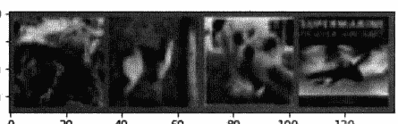

图 7-1 原始图像

图像真实分类如下：

图像真实分类: frog deer dog plane

随后利用已训练模型对这4张图片的类别进行预测：

```python
#将输入的图像images输入到模型net中，得到模型的输出
outputs = net(images)
# 在输出的第一维（即每个图像）上找到最大值及其索引。这里的1表示在第一维上进行最大值搜索
_, predicted = torch.max(outputs, 1)
#通过遍历predicted，根据类别索引在classes中获取对应的类别名称，并按照指定的格式打印出来
print('图像预测分类:', ' '.join(['%5s' % classes[predicted[j]] for j in range(4)]))
```

这段代码的核心作用是让模型输出对图像的分类结果并显示出来。

以图7-1为例，模型给出的预测类别为：

图像预测分类：frog deer horse plane

接下来我们来看如何统计测试集的准确率，对应的代码如下：

```python
# 正确预测的数量和总预测数量初始化为 0
correct, total = 0, 0
# 禁用梯度计算，以进行测试
with torch.no_grad():
    #遍历测试集的数据images和对应的标签labels
    for images, labels in testloader:
        #计算模型对图像的输出
        outputs = net(images)
        #在输出的第一维（每个图像）上找到最大值及其索引，得到预测的类别predicted
        _, predicted = torch.max(outputs, 1)
        #累计总预测数量total，通过labels.size(0)获取标签的数量
        total += labels.size(0)
        #累计正确预测的数量correct，通过比较标签和预测结果，使用.sum().item()将张量转换为整数
        correct += (labels == predicted).sum().item()

# 打印测试集准确率，即正确预测的数量与总预测数量的百分比
print('测试集准确率: %d %%' % (100 * correct / total))
```

上面的实现专门用来求出测试集的正确率。

运行后得到的表现是：

测试集准确率：56 %

### 7.3 动手实战：搭建图像自动识别模型

图像识别本质上是借助计算机完成图像的处理、分析和理解，从而分辨出不同模式的目标与物体，属于深度学习在实际场景中的落地应用。为了帮助大家更好地掌握图像自动识别的原理与用法，本节会以一个具体的案例演示如何用 PyTorch 构建图像自动识别模型。

#### 7.3.1 加载数据集

本次实操选用的是 MNIST 数据集，它由美国国家标准与技术研究所 NIST 提供。数据划分为训练集和测试集两部分，训练样本来自 250 位不同书写者的手写数字，其中一半出自高中生，一半来自人口普查局员工，测试集的来源构成与训练集保持一致。

MNIST 数据集包含如下4个文件:

| 文件名 | 描述 |

| :--- | :--- |

| train-images-idx3-ubyte.gz | training set images (9912422 bytes) |

| train-labels-idx1-ubyte.gz | training set labels (28881 bytes) |

| t10k-images-idx3-ubyte.gz | test set images (1648877 bytes) |

| t10k-labels-idx1-ubyte.gz | test set labels (4542 bytes) |

加载训练数据的代码如下:

```python
# 定义 MNIST 数据集的训练数据
train_data = torchvision.datasets.MNIST(
    # 数据集的根目录
    root = './',
    # 选择训练集
    train = True,
    # 将数据转换为张量
    transform = torchvision.transforms.ToTensor(),
    # 不下载数据
    download = False
)

# 定义 MNIST 数据集的测试数据
test_data = torchvision.datasets.MNIST(
    # 数据集的根目录
    root = './',
    # 选择测试集
    train = False
)
```

这段代码负责把 MNIST 的训练集和测试集读入内存。

测试集的读取方式与训练集类似，只需把参数 train 设为 False 即可切换。这样就能得到 train_data 和 test_data 两个对象，供后续训练和验证使用。

对测试集做预处理时使用的代码如下:

```python
# 将测试数据的数据部分增加一个维度，并将数据类型转换为浮点数张量，然后除以255
test_x= torch.unsqueeze(test_data.data,dim=1).type(torch.FloatTensor)/255
# 测试数据的目标（标签）
test_y= test_data.targets
```

这里主要是对测试集进行简单整理。test_y = test_data.targets 的含义是将测试集的真实标签提取出来赋给 test_y。经过这一步，test_x 作为处理好的输入特征，test_y 作为对应的标签，常用于后面的模型训练或效果评估。

#### 7.3.2 搭建与训练网络

设置神经网络的结构，代码如下：

```python
# 定义一个名为 CNN 的神经网络模块
class CNN(nn.Module):
    def __init__(self):
        super(CNN, self).__init__()
        # 定义第一层卷积层和相关操作
        self.conv1 = nn.Sequential(
            nn.Conv2d(
                in_channels=1,
                out_channels=16,
                kernel_size=3,
                stride=1,
                padding=1
            ),
            nn.ReLU(),
            nn.MaxPool2d(kernel_size=2)
        )
        # 定义第二层卷积层和相关操作
        self.conv2 = nn.Sequential(
            nn.Conv2d(
                in_channels=16,
                out_channels=32,
                kernel_size=3,
                stride=1,
                padding=1
            ),
            nn.ReLU(),
            nn.MaxPool2d(kernel_size=2)
        )
        # 定义全连接层
        self.output = nn.Linear(32*7*7, 10)  # 输入维度为 32×7×7，输出维度为 10

    def forward(self, x):
        # 对输入数据进行第一层卷积和池化操作
        out = self.conv1(x)
        # 对上一步的结果进行第二层卷积和池化操作
        out = self.conv2(out)
        # 将输出展平为一维
        out = out.view(out.size(0), -1)
        # 通过全连接层进行分类
        out = self.output(out)
        # 返回最终的输出结果
        return out

# 创建 CNN 实例
cnn = CNN()
```

这段实现构建了一个卷积神经网络，整体由两层卷积和一层全连接构成。

- 在 `__init__` 中，定义了卷积层 `conv1` 和 `conv2`，以及全连接层 `output`，每层卷积后都接有激活函数与池化操作。
- 在 `forward` 方法里描述了数据的正向流程：输入先经过第一层卷积和池化，再经过第二层卷积和池化，最后由全连接层给出输出。
- 最后实例化 CNN 得到对象 `cnn`，该实例可用于后续的前向推理、训练等操作。

设置优化器和损失函数，并训练模型：

```python
# 优化器，使用 Adam 算法来更新模型参数
optimizer = torch.optim.Adam(cnn.parameters(), lr=LR,)
# 损失函数，用于计算预测结果和真实标签之间的交叉熵
loss_func = nn.CrossEntropyLoss()
# 遍历训练轮数
for epoch in range(EPOCH):
    # 遍历训练数据的批次
    for step, (b_x, b_y) in enumerate(train_loader):
        # 前向传播得到模型的输出
        output = cnn(b_x)
        # 计算损失
        loss = loss_func(output, b_y)

        # 清空梯度
        optimizer.zero_grad()
        # 反向传播计算梯度
        loss.backward()
        # 根据梯度更新模型参数
        optimizer.step()

    # 每 50 步进行一次测试
    if step % 50 == 0:
        # 在测试数据上进行前向传播
        test_output = cnn(test_x)
        # 获取预测的类别索引
        pred_y = torch.max(test_output, 1)[1].data.numpy()
        # 计算准确率
        accuracy = float((pred_y == test_y.data.numpy()).astype(int).sum()) / float(test_y.size(0))

# 保存模型
torch.save(cnn, 'cnn_mnist.pkl')
```

以上代码展示了一个标准的神经网络训练流程，主要包含四部分：

1. 初始化优化器并选定损失函数。
2. 在多个 epoch 中遍历训练批次，完成前向计算和反向更新。
3. 按固定间隔在测试集上验证，并统计准确率。
4. 训练结束后把模型权重持久化保存。

#### 7.3.3 预测图像数据

对测试集数据进行预测，并输出准确率，编写代码如下：

```python
# 加载已保存的模型
cnn = torch.load('cnn_mnist.pkl')

# 在测试数据的前 20 个样本上进行预测
test_output = cnn(test_x[:20])
# 获取预测的类别索引
pred_y = torch.max(test_output, 1)[1].data.numpy()

# 打印预测值
print('预测值', pred_y)
# 打印实际值
print('实际值', test_y[:20].numpy())

# 在整个测试数据上进行预测
test_output1 = cnn(test_x)
# 获取预测的类别索引
pred_y1 = torch.max(test_output1, 1)[1].data.numpy()
# 计算准确率
accuracy = float((pred_y1 == test_y.data.numpy()).astype(int).sum()) / float(test_y.size(0))

# 打印准确率
print('准确率', accuracy)
```

这段实现的核心是读取已保存的模型权重，在测试集上做推理并统计预测准确率。

#### 7.3.4 图像识别模型的判断
下面给出了图像自动识别模型的完整实现代码：

```python
#导入相关库
import torch
import torchvision
import torch.utils.data as Data
import torch.nn as nn
import torch.nn.functional as F

train_data = torchvision.datasets.MNIST(
    root = './',
    train = True,
    transform = torchvision.transforms.ToTensor(),
    download = False)

test_data = torchvision.datasets.MNIST(
    root='./',
    train=False)

test_x = torch.unsqueeze(test_data.data, dim=1).type(torch.FloatTensor)/255
test_y = test_data.targets

class CNN(nn.Module):
    def __init__(self):
        super(CNN,self).__init__()
        self.conv1 = nn.Sequential(
            nn.Conv2d(
                in_channels=1,
                out_channels=16,
                kernel_size=3,
                stride=1,
                padding=1
            ),
            nn.ReLU(),
            nn.MaxPool2d(kernel_size=2)
        )
        self.conv2 = nn.Sequential(
            nn.Conv2d(
                in_channels=16,
                out_channels=32,
                kernel_size=3,
                stride=1,
                padding=1
            ),
            nn.ReLU(),
            nn.MaxPool2d(kernel_size=2)
        )
        self.output = nn.Linear(32*7*7,10)

    def forward(self, x):
        out = self.conv1(x)
        out = self.conv2(out)
        out = out.view(out.size(0),-1)
        out = self.output(out)
        return out

cnn = CNN()
optimizer = torch.optim.Adam(cnn.parameters(),lr=LR,)
loss_func = nn.CrossEntropyLoss()

for epoch in range(EPOCH):
    for step, (b_x, b_y) in enumerate(train_loader):
        output = cnn(b_x)
        loss = loss_func(output, b_y)

        optimizer.zero_grad()
        loss.backward()
        optimizer.step()

        if step % 50 == 0:
            test_output = cnn(test_x)
            pred_y = torch.max(test_output, 1)[1].data.numpy()
            accuracy = float((pred_y == test_y.data.numpy()).astype(int).sum()) / float(test_y.size(0))
            torch.save(cnn, 'cnn_mnist.pkl')
            cnn = torch.load('cnn_mnist.pkl')

            test_output = cnn(test_x[:20])
            pred_y = torch.max(test_output, 1)[1].data.numpy()
            print('预测值', pred_y)
            print('实际值', test_y[:20].numpy())

            test_output1 = cnn(test_x)
            pred_y1 = torch.max(test_output1, 1)[1].data.numpy()
            accuracy = float((pred_y1 == test_y.data.numpy()).astype(int).sum()) / float(test_y.size(0))
            print('准确率', accuracy)
```

执行上面那段模型代码后，可以得到预测结果、真实标签以及整体准确率，具体如下：

预测值 [7 2 1 0 4 1 4 9 5 9 0 6 9 0 1 5 9 7 8 4]

实际值 [7 2 1 0 4 1 4 9 5 9 0 6 9 0 1 5 9 7 3 4]

准确率 0.9872

从结果来看，该图像识别模型的表现相当不错，准确率已经来到 0.9872。

### 7.4 实战搭建图像自动分割模型

图像分割的核心目标，是把整张图拆分成若干具有明确属性的区域，并把关注的目标从背景中剥离出来。为了让大家更直观地掌握自动分割的思路，本节会结合实战案例，演示如何使用 PyTorch 搭建一个可用的分割模型。

#### 7.4.1 数据集加载与预处理

导入相关第三方包：

```python
#导入相关库
import os
import cv2
import numpy as np
import torch
from torch import nn
import torch.optim as optim
from torch.utils.data import Dataset, DataLoader
from torchvision import transforms
```

定义加载数据集的类：

```python
class MyDataset(Dataset):
    """MyDataset 类，继承自 Dataset"""
    def __init__(self, train_path, transform=None):
        """初始化方法
        Args:
            train_path (str): 训练数据的路径
            transform (callable, optional): 数据预处理函数
        """
        self.images = os.listdir(train_path + '/last')  # 列出'last'目录下的所有图像文件
        self.labels = os.listdir(train_path + '/last_msk')  # 列出'last_msk'目录下的所有标签文件
        assert len(self.images) == len(self.labels), '数量不匹配'  # 断言图像和标签的数量相等
        self.transform = transform
        self.images_and_labels = []  # 用于存储图像路径和标签路径的列表
        for i in range(len(self.images)):
            # 添加每个图像和其对应的标签路径到列表中
            self.images_and_labels.append((train_path + '/last/' + self.images[i],
                                           train_path + '/last_msk/' + self.labels[i]))

    def __getitem__(self, item):
        """根据索引获取数据项
        Args:
            item (int): 数据项的索引
        Returns:
            tuple: 包含图像和标签的元组
        """
        img_path, lab_path = self.images_and_labels[item]  # 获取对应索引的图像路径和标签路径
        img = cv2.imread(img_path)  # 使用 OpenCV 读取图像
        img = cv2.resize(img, (224, 224))    # 调整图像大小
        lab = cv2.imread(lab_path, 0)        # 使用 OpenCV 读取标签
        lab = cv2.resize(lab, (224, 224))    # 调整标签大小
        lab = lab / 255                      # 归一化标签值到 [0, 1] 范围
        lab = lab.astype('uint8')            # 将标签转换为无符号 8 位整数类型
        lab = np.eye(2)[lab]                 # 将标签转换为 one-hot 编码形式
        # 对 one-hot 编码进行处理
        lab = np.array(list(map(lambda x: abs(x-1), lab))).astype('float32')
        lab = lab.transpose(2, 0, 1)         # 调整 one-hot 编码的形状
        if self.transform is not None:        # 如果有数据预处理函数，应用到图像上
            img = self.transform(img)
        return img, lab                      # 返回图像和标签

    def __len__(self):
        """返回数据集的长度
        Returns:
            int: 数据集的长度
        """
        return len(self.images)            # 返回图像的数量

if __name__ == '__main__':
    # 读取图像
    img = cv2.imread('data/train/last_msk/50.jpg', 0)
    img = cv2.resize(img, (16, 16))    # 调整图像大小
    img2 = img / 255
    img3 = img2.astype('uint8')        # 数据类型转换
    # 对标签进行 one-hot 编码
    hot1 = np.eye(2)[img3]
    hot2 = np.array(list(map(lambda x: abs(x-1), hot1))) # 对one-hot编码进行处理
    # 打印处理后的 one-hot 编码的形状
    print(hot2.shape)
```

下面的实现创建了一个 MyDataset 类来管理图像数据。该类继承自 PyTorch 的 Dataset，并在内部完成图像路径与标签的读取、预处理流程以及按索引返回样本的功能。

- `__init__` 负责在初始化时读取图片和标签的清单，并校验两者数量是否一致。
- `__getitem__` 依据传入的索引取出对应的一张图和其标签，完成必要的格式转换和编码。
- `__len__` 直接返回整个数据集包含的图像总数。
- 在 `__main__` 测试区，读取样例图像后执行预处理流程，最终得到 one-hot 格式的标签并输出其维度信息。

#### 7.4.2 网络结构设计

我们先采用一个相对简洁的结构作为起点。输入为 3×224×224 的彩色图，编码器选用 VGG11，并在第五次最大池化后切换到解码阶段，通过五层转置卷积逐步把特征图恢复到原图尺寸。相关实现如下：

```python
class Net(nn.Module):
    def __init__(self):
        super(Net, self).__init__()  # 调用父类的初始化方法
        # 定义第一层编码块,由卷积层、批归一化层和激活函数组成
        self.encode1 = nn.Sequential(
            nn.Conv2d(3, 64, kernel_size=3, stride=1, padding=1),
            nn.BatchNorm2d(64),
            nn.ReLU(True),
            nn.MaxPool2d(2, 2)
        )
        # 定义第二层编码块
        self.encode2 = nn.Sequential(
            nn.Conv2d(64, 128, kernel_size=3, stride=1, padding=1),
            nn.BatchNorm2d(128),
            nn.ReLU(True),
            nn.MaxPool2d(2, 2)
        )
        # 定义第三层编码块
        self.encode3 = nn.Sequential(
            nn.Conv2d(128, 256, kernel_size=3, stride=1, padding=1),
            nn.BatchNorm2d(256),
            nn.ReLU(True),
            nn.Conv2d(256, 256, 3, 1, 1),
            nn.BatchNorm2d(256),
            nn.ReLU(True),
            nn.MaxPool2d(2, 2)
        )
        # 定义第四层编码块
        self.encode4 = nn.Sequential(
            nn.Conv2d(256, 512, kernel_size=3, stride=1, padding=1),
            nn.BatchNorm2d(512),
            nn.ReLU(True),
            nn.Conv2d(512, 512, 3, 1, 1),
            nn.BatchNorm2d(512),
            nn.ReLU(True),
            nn.MaxPool2d(2, 2)
        )
        # 定义第五层编码块
        self.encode5 = nn.Sequential(
            nn.Conv2d(512, 512, kernel_size=3, stride=1, padding=1),
            nn.BatchNorm2d(512),
            nn.ReLU(True),
            nn.Conv2d(512, 512, 3, 1, 1),
            nn.BatchNorm2d(512),
        )
```
nn.ReLU(True),
nn.MaxPool2d(2, 2)
)

# 定义第一层解码模块，由卷积转置层、批归一化层和激活函数组成
self.decode1 = nn.Sequential(
    nn.ConvTranspose2d(in_channels=512, out_channels=256, kernel_size=3,
    stride=2, padding=1, output_padding=1),
    nn.BatchNorm2d(256),
    nn.ReLU(True)
)

# 定义第二层解码模块
self.decode2 = nn.Sequential(
    nn.ConvTranspose2d(256, 128, 3, 2, 1, 1),
    nn.BatchNorm2d(128),
    nn.ReLU(True)
)

# 定义第三层解码模块
self.decode3 = nn.Sequential(
    nn.ConvTranspose2d(128, 64, 3, 2, 1, 1),
    nn.BatchNorm2d(64),
    nn.ReLU(True)
)

# 定义第四层解码模块
self.decode4 = nn.Sequential(
    nn.ConvTranspose2d(64, 32, 3, 2, 1, 1),
    nn.BatchNorm2d(32),
    nn.ReLU(True)
)

# 定义第五层解码模块
self.decode5 = nn.Sequential(

nn.ConvTranspose2d(32, 16, 3, 2, 1, 1),

    nn.BatchNorm2d(16),

    nn.ReLU(True)

)

# 定义分类器，用于生成最终的输出

self.classifier = nn.Conv2d(16, 2, kernel_size=1)

def forward(self, x): # 前向传播方法

    # 对输入数据进行编码块的处理

    out = self.encode1(x)

    out = self.encode2(out)

    out = self.encode3(out)

    out = self.encode4(out)

    out = self.encode5(out)

    # 对编码后的数据进行解码块的处理

    out = self.decode1(out)

    out = self.decode2(out)

    out = self.decode3(out)

    out = self.decode4(out)

    out = self.decode5(out)

    # 通过分类器生成最终的输出

    out = self.classifier(out)

    return out

if __name__ == '__main__': # 主程序

    # 生成一个随机的图像张量

    img = torch.randn(2, 3, 224, 224)

    # 创建 Net 类的实例

    net = Net()

    # 对随机图像进行前向传播

    sample = net(img)

    # 打印输出的形状

    print(sample.shape)

#### 7.4.3 训练网络模型
接下来进入模型训练阶段，具体实现见下方片段：

```python
# 批次大小
batchsize = 8
# 训练轮数
epochs = 20
# 训练数据路径
train_data_path = 'data/train'

# 数据预处理
transform = transforms.Compose([transforms.ToTensor(),
transforms.Normalize(mean=[0.485, 0.456, 0.406], std=[0.229, 0.224, 0.225])])
# 构建自定义数据集
bag = MyDataset(train_data_path, transform)
# 数据加载器
dataloader = DataLoader(bag, batch_size=batchsize, shuffle=True)

# 设备选择
device = torch.device('cpu')
# 神经网络
net = Net().to(device)
# 损失函数
criterion = nn.BCELoss()
# 优化器
optimizer = optim.SGD(net.parameters(), lr=1e-2, momentum=0.7)

# 如果检查点文件夹不存在，则创建它
if not os.path.exists('checkpoints'):
    os.mkdir('checkpoints')
```

```python
# 遍历每个训练轮数
for epoch in range(1, epochs+1):
    # 遍历每个批次
    for batch_idx, (img, lab) in enumerate(dataloader):
        # 将数据移动到设备上
        img, lab = img.to(device), lab.to(device)
        # 前向传播得到输出
        output = torch.sigmoid(net(img))
        # 计算损失
        loss = criterion(output, lab)

        # 将输出转换为 NumPy 格式并复制
        output_np = output.cpu().data.numpy().copy()
        # 在每一维上找到输出的最小值的索引
        output_np = np.argmin(output_np, axis=1)
        # 复制标签的 NumPy 格式
        y_np = lab.cpu().data.numpy().copy()
        y_np = np.argmin(y_np, axis=1)

        # 每 20 个批次打印一次损失
        if batch_idx % 20 == 0:
            print('Epoch:[{} / {}]\tStep:[{} / {}]\tLoss:{:.6f}'.format(
                epoch, epochs, (batch_idx+1)*len(img), len(dataloader.dataset),
                loss.item()))

        # 梯度清零
        optimizer.zero_grad()
        # 反向传播计算梯度
        loss.backward()
        # 优化器更新参数
        optimizer.step()

    # 每10个轮数保存一次模型
    if epoch % 10 == 0:
        torch.save(net, './model/model_epoch_{}.pth'.format(epoch))
        print('./model/model_epoch_{}.pth saved!'.format(epoch))
```

#### 7.4.4 应用网络模型
借助上述搭建的网络对测试集进行验证，测试目录中存放着5张样例图，其原始视觉效果见图7-2。

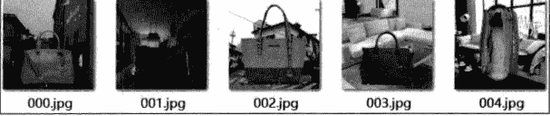

图 7-2 原始图像

随后对这些图像执行分割操作，相关实现如下：

```python
# 定义一个名为 TestDataset 的数据集类，继承自 Dataset
class TestDataset(Dataset):
    def __init__(self, test_img_path, transform=None): # 构造函数，接受测试图像路径
        self.test_img = os.listdir(test_img_path) # 获取测试图像路径下的所有文件名
        self.transform = transform # 保存变换
        self.images = [] # 用于存储处理后的图像路径
        for i in range(len(self.test_img)):
            # 将文件名和路径组合成完整的图像路径并添加到列表中
            self.images.append(os.path.join(test_img_path, self.test_img[i]))

    def __getitem__(self, item): # 定义获取数据集中指定项的方法
        img_path = self.images[item] # 获取指定项的图像路径
        img = cv2.imread(img_path) # 读取图像
        img = cv2.resize(img, (224, 224)) # 调整图像大小
        if self.transform is not None: # 如果有变换，则应用变换
            img = self.transform(img)
        return img # 返回处理后的图像

    def __len__(self): # 定义数据集长度的方法
        return len(self.test_img) # 返回文件名的数量，即数据集的长度

# 测试图像路径
test_img_path = './data/test/last'
# 检查点路径
checkpoint_path = './model/model_epoch_20.pth'
# 结果保存目录
save_dir = 'data/test/result'
if not os.path.exists(save_dir): # 如果保存目录不存在，则创建它
    os.mkdir(save_dir)

# 构建变换
transform = transforms.Compose([transforms.ToTensor(),
                               transforms.Normalize(mean=[0.485, 0.456, 0.406], std=[0.229, 0.224, 0.225])])
# 创建 TestDataset 实例
bag = TestDataset(test_img_path, transform)
# 创建数据加载器
dataloader = DataLoader(bag, batch_size=1, shuffle=None)

# 加载检查点模型
net = torch.load(checkpoint_path)

# 遍历数据加载器中的每个图像
for idx, img in enumerate(dataloader):
    # 前向传播得到输出
    output = torch.sigmoid(net(img))
```

```python
# 将输出转换为 NumPy 格式并复制
output_np = output.cpu().data.numpy().copy()
# 在每一维上找到输出的最小值的索引
output_np = np.argmin(output_np, axis=1)

# 压缩输出并乘以255
img_arr = np.squeeze(output_np)
img_arr = img_arr * 255

# 保存图像
cv2.imwrite('%s/%03d.png' % (save_dir, idx), img_arr)
# 打印保存的图像路径
print('%s/%03d.png' % (save_dir, idx))
```

运行后得到的结果展示在图7-3中，能够明显观察到原图的细节被成功分离。

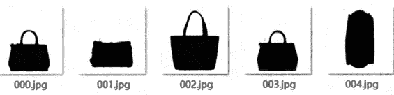

图 7-3 特征图像

需要留意的是，训练轮次过少时分割质量往往会受限。

### 7.5 上机练习题
练习1：使用PyTorch实现图像分类任务。

> 提示 完成图像分类可围绕卷积神经网络展开，实现对图像的识别与归类。

可按照下面流程开展实践操作。

#### 1. 导入所需的库和模块

```python
import torch
import torch.nn as nn
import torch.optim as optim
from torch.utils.data import DataLoader
import torchvision.transforms as transforms
from torchvision.datasets import CIFAR10
```

#### 2. 定义数据预处理的转换

```python
transform = transforms.Compose([
transforms.ToTensor(),
transforms.Normalize((0.5, 0.5, 0.5), (0.5, 0.5, 0.5))
])
```

此步借助ToTensor把图像转成张量格式，再通过Normalize完成标准化处理。

#### 3. 加载和预处理数据集

```python
trainset = CIFAR10(root='./data', train=True, download=True,
transform=transform)
trainloader = DataLoader(trainset, batch_size=4, shuffle=True, num_workers=2)
testset = CIFAR10(root='./data', train=False, download=True,
transform=transform)
testloader = DataLoader(testset, batch_size=4, shuffle=False, num_workers=2)
```

选用CIFAR10作为实验数据，将其拆分为训练集与测试集，并借助DataLoader实现批式加载。

#### 4. 定义卷积神经网络模型

```python
class Net(nn.Module):
    def __init__(self):
        super(Net, self).__init__()
        self.conv1 = nn.Conv2d(3, 6, 5)
        self.pool = nn.MaxPool2d(2, 2)
        self.conv2 = nn.Conv2d(6, 16, 5)
        self.fc1 = nn.Linear(16 * 5 * 5, 120)
        self.fc2 = nn.Linear(120, 84)
        self.fc3 = nn.Linear(84, 10)

    def forward(self, x):
        x = self.pool(F.relu(self.conv1(x)))
        x = self.pool(F.relu(self.conv2(x)))
        x = x.view(-1, 16 * 5 * 5)
        x = F.relu(self.fc1(x))
        x = F.relu(self.fc2(x))
        x = self.fc3(x)
        return x

net = Net()
```

此处搭建了一个基础的CNN结构，涵盖卷积层、池化层及全连接层。

#### 5. 定义损失函数和优化器

```python
criterion = nn.CrossEntropyLoss()
optimizer = optim.SGD(net.parameters(), lr=0.001, momentum=0.9)
```

损失函数采用交叉熵，优化策略选用随机梯度下降。

#### 6. 进行训练和测试

```python
for epoch in range(10):  # 训练10个周期
    running_loss = 0.0
    for i, data in enumerate(trainloader, 0):
        inputs, labels = data
        optimizer.zero_grad()
        outputs = net(inputs)
        loss = criterion(outputs, labels)
        loss.backward()
        optimizer.step()
        running_loss += loss.item()
        if i % 2000 == 1999:
            print('[%d, %5d] loss: %.3f' %
                  (epoch + 1, i + 1, running_loss / 2000))
            running_loss = 0.0

print('Finished Training')

correct = 0
total = 0
with torch.no_grad():
    for data in testloader:
        images, labels = data
        outputs = net(images)
        _, predicted = torch.max(outputs.data, 1)
        total += labels.size(0)
        correct += (predicted == labels).sum().item()

print('Accuracy of the network on the 10000 test images: %.2f %%' % (100 * correct / total))
```

训练环节通过反向传播更新权重并记录损失，测试环节则统计模型在测试集上的正确率。

练习2：在PyTorch中实现图像识别任务。

> 提示 PyTorch下实现图像识别通常涵盖数据准备、网络搭建、训练与评估四个环节。

下面给出具体操作建议。

##### 1. 数据准备

数据读取一般依赖 torchvision.datasets.ImageFolder，或自行继承 torch.utils.data.Dataset 设计。

预处理环节可调用 torchvision.transforms 提供的工具，例如尺寸缩放、灰度转换、归一化处理等。

##### 2. 模型构建

网络结构以 torch.nn.Module 为基类进行定义。

内部组合卷积层、池化层、全连接层等组件以抽取特征，并搭配ReLU、Softmax等激活函数提升非线性表达。

##### 3. 训练

- 01 确定损失函数，交叉熵是常见选择。
- 02 选用优化器，例如SGD或Adam。
- 03 将数据划分为训练集与验证集，通过 torch.utils.data.DataLoader 实现批量读取。
- 04 每个迭代先正向计算预测值，再与真实标签对比得出损失。
- 05 借助反向传播调整参数，使损失逐步下降。

6. 循环执行上述流程，直到达到预设的训练轮次或触发停止条件。

##### 4. 测试
把已经训练好的模型放到测试集上进行推理，拿到预测结果后，用准确率、召回率等指标来衡量模型表现。

参考练习代码:

```python
# 导入相关库
import torch
import torch.nn as nn
import torch.optim as optim
import torchvision.datasets as datasets
import torchvision.transforms as transforms
from torch.utils.data import DataLoader

# 定义网络模型
class Net(nn.Module):
    def __init__(self):
        super(Net, self).__init__()
        # 添加网络层
        self.conv1 = nn.Conv2d(3, 16, kernel_size=5, stride=1, padding=2)
        self.relu = nn.ReLU()
        self.maxpool = nn.MaxPool2d(kernel_size=2, stride=2)
        self.fc = nn.Linear(16*14*14, 10)  # 假设10个类别

    def forward(self, x):
        x = self.conv1(x)
        x = self.relu(x)
        x = self.maxpool(x)
        x = x.view(x.size(0), -1)
        x = self.fc(x)
        return x

# 加载训练数据集和测试数据集
train_dataset = datasets.CIFAR10(root='data/', train=True,
    transform=transforms.ToTensor(), download=True)
test_dataset = datasets.CIFAR10(root='data/', train=False,
    transform=transforms.ToTensor(), download=True)

# 定义数据加载器
train_loader = DataLoader(dataset=train_dataset, batch_size=64, shuffle=True)
test_loader = DataLoader(dataset=test_dataset, batch_size=64, shuffle=False)

# 定义模型、损失函数和优化器
model = Net()
criterion = nn.CrossEntropyLoss()
optimizer = optim.SGD(model.parameters(), lr=0.001, momentum=0.9)

# 训练模型
num_epochs = 10
device = torch.device("cuda" if torch.cuda.is_available() else "cpu")
model.to(device)
for epoch in range(num_epochs):
    for batch_idx, (data, targets) in enumerate(train_loader):
        data = data.to(device)
        targets = targets.to(device)

        # 前向传播
        scores = model(data)
        loss = criterion(scores, targets)

        # 反向传播与优化
        optimizer.zero_grad()
        loss.backward()
        optimizer.step()

        # 输出训练信息
        if (batch_idx+1) % 100 == 0:
            print(f'Epoch [{epoch+1}/{num_epochs}], Step [{batch_idx+1}/{len(train_loader)}], Loss: {loss.item():.4f}')

# 测试模型
model.eval()
with torch.no_grad():
    correct = 0
    total = 0
    for data, targets in test_loader:
        data = data.to(device)
        targets = targets.to(device)

        scores = model(data)
        _, predicted = torch.max(scores.data, 1)
        total += targets.size(0)
        correct += (predicted == targets).sum().item()

print(f'Accuracy on test set: {(correct/total)*100:.2f}%')
```

以上代码演示了在 PyTorch 里完成图像分类任务的典型步骤，后续可根据具体数据集和模型需求灵活调整。

#### 练习3：设计一个图像分割任务，要求使用PyTorch实现。
要求：
- (1) 挑选一个合适的分割方向，比如语义分割、实例分割或物体检测等。
- (2) 选用适配的数据集来支撑模型的训练与验证。
- (3) 借助 PyTorch 提供的库和 API，实现图像分割模型的构建、训练以及推理全流程。
- (4) 给出可运行的示例代码，并对每一步的作用与原理进行说明。

参考练习代码：

```python
#导入相关库
import torch
import torchvision
from torchvision.transforms import ToTensor
from torch.utils.data import DataLoader
from torch import nn, optim
```
#加载数据集：使用PyTorch内置的Cityscapes数据集作为示例，其中包含城市街景图像和相应的语义分割标签

train_dataset = torchvision.datasets.Cityscapes(root='./data', split='train', mode='fine', target_type='semantic', transform=ToTensor())

```python
test_dataset = torchvision.datasets.Cityscapes(root='./data', split='val',
mode='fine', target_type='semantic', transform=ToTensor())
#创建数据加载器：使用DataLoader将数据集划分为批次进行训练和测试
train_loader = DataLoader(train_dataset, batch_size=32, shuffle=True)
test_loader = DataLoader(test_dataset, batch_size=32, shuffle=False)
```
#定义模型：使用自定义的SegmentationModel类作为图像分割模型，该模型包含了卷积层和ReLU激活函数

```python
class SegmentationModel(nn.Module):
    def __init__(self, num_classes):
        super(SegmentationModel, self).__init__()
        self.conv1 = nn.Conv2d(3, 64, kernel_size=3, stride=1, padding=1)
        self.relu1 = nn.ReLU(inplace=True)
        self.conv2 = nn.Conv2d(64, 64, kernel_size=3, stride=1, padding=1)
        self.relu2 = nn.ReLU(inplace=True)
        self.conv3 = nn.Conv2d(64, num_classes, kernel_size=3, stride=1, padding=1)

    def forward(self, x):
        x = self.conv1(x)
        x = self.relu1(x)
        x = self.conv2(x)
        x = self.relu2(x)
        x = self.conv3(x)
        return x

model = SegmentationModel(num_classes=20)  # 这里假设目标类别数为20
```
#定义损失函数和优化器：使用交叉熵损失函数和Adam优化器

```python
criterion = nn.CrossEntropyLoss()
optimizer = optim.Adam(model.parameters(), lr=0.001)
```
#训练模型：迭代训练模型，计算损失并更新参数

```python
num_epochs = 10
device = torch.device("cuda" if torch.cuda.is_available() else "cpu")
model.to(device)
for epoch in range(num_epochs):
    model.train()
    for images, labels in train_loader:
        images, labels = images.to(device), labels.to(device)
        optimizer.zero_grad()
        outputs = model(images)
        loss = criterion(outputs, labels)
        loss.backward()
        optimizer.step()
```

```python
#测试模型：使用训练好的模型对测试集进行推断，并计算准确率
model.eval()
total_correct = 0
total_samples = 0
with torch.no_grad():
    for images, labels in test_loader:
        images, labels = images.to(device), labels.to(device)
        outputs = model(images)
        _, predicted = torch.max(outputs.data, 1)
        total_samples += labels.size(0)
        total_correct += (predicted == labels).sum().item()

accuracy = total_correct / total_samples
print('准确率: {:.2f}%'.format(100 * accuracy))
```
提醒一下，这仅为入门级示范，实际的图像分割任务往往需要更深更复杂的网络结构才能取得理想效果。任务类型和数据集的选择也应依据实际场景来定制。

## 第 8 章 PyTorch文本建模
自然语言处理是计算机科学与语言学交叉的领域，核心是让机器理解和处理文本，常见方向包括语义解析、机器翻译等。PyTorch 作为主流深度学习框架，在文本处理上同样表现强劲。本章将聚焦 PyTorch 下的文本建模方法，并配以实践案例。

### 8.1 自然语言处理核心模型介绍
预训练对 NLP 任务的提升非常明显，相关模型层出不穷，从早期的 Word2Vec 到 Seq2Seq 再到 Attention，本节会对这几类代表性模型做深入梳理。

#### 8.1.1 Word2Vec 模型
Word2Vec 通过一个单层神经网络，把独热编码的稀疏词向量投射成稠密的分布式表示，训练时借助层级 Softmax、负采样等手段来加速收敛。

人类日常使用的自然语言机器无法直接读懂，处理前需要先做分析和预处理。one-hot 编码虽然能把词变成向量，却会导致极度稀疏。Word2Vec 正好弥补这一缺陷，生成 Word Embedding，把词之间的关联映射出来，比如北京 与 中国、伦敦 与 英国 的语义邻近关系。

Word2Vec 主要有两方面价值：一是为下游复杂神经网络提供预训练的词向量初始化，二是借助词相似度作为模型特征参与分析。

#### 8.1.2 Seq2Seq 模型
当目标序列长度不固定时常选用 Seq2Seq，例如机器翻译，一句话从中文到英文可能变长也可能变短。举例来说，输入 Hello 得到输出 你好；对话场景里问“你是谁”，模型会回“我是某某”。

Seq2Seq 属于 Encoder-Decoder 家族，通常由两个 RNN 构成：一个负责编码，一个负责解码。Encoder 的任务是把整段输入压缩成固定长度的语义向量 C，图8-1展示了编码过程。最简做法是直接取最后一个隐状态作为 C，也可以对它做线性变换，或对全部隐状态进行聚合得到语义表示。

Decoder 利用语义向量生成目标序列，图8-2 为基础解码方式。最常见做法是把 C 当作 Decoder RNN 的初始隐状态，之后每个时间步的输出会反馈为下一个时间步的输入，而 C 仅在启动时起作用，后续不再参与。

另一种改进是让 C 在整个解码过程中持续发挥作用，如图8-3 所示，输出仍自回归，但每个时刻的计算都会融合语义向量 C。

算法流程如下：
- (1) 将 one-hot 形式的词向量送入单层神经网络，输入层神经元数量需与 one-hot 维数一致。
- (2) 经映射层激活函数计算目标词与其他词的关联概率，训练中引入负采样以提升速度与准确率。
- (3) 采用随机梯度下降 SGD 优化损失。
- (4) 通过反向传播更新各神经元的权重和偏置。

因此 Word2Vec 本质上是一种降维操作，即把 one-hot 词向量转化为稠密的 Word2Vec 表示。

图 8-2 Decoder 解码过程

图 8-3 语义向量参与解码

#### 8.1.3 Attention 模型
Attention 最早在图像识别中出现，灵感来自人眼扫视时焦点会不断移动。神经网络处理图像或文本时，也会聚焦于局部特征以提高精度。特征重要性如何量化？直接用权重即可。Attention 的核心就是先为每个特征计算权重，再做加权求和，权重越高说明对当前任务贡献越大。

在机器翻译里 Attention 最直观，每生成一个目标词都需要定位源句中对应的信息，这正是 Encoder-Decoder 结构的典型应用，下面以此为例说明原理。

Encoder-Decoder 由编码器和解码器组成。编码器把输入的图像或文本转成一系列特征表示，解码器则以这些特征为依据生成目标输出。两者可以是神经网络，也可以是其他类型的模型，且通常相互独立。

Attention 夹在编码器和解码器之间，根据双方的特征动态计算权重，对编码器特征做加权汇总后提供给解码器使用，本质上是让解码器更有效地利用编码器的信息。

### 8.2 动手练习：Word2Vec 提取相似文本
为了更好地理解和应用 Word2Vec，本节通过实际案例介绍如何利用该模型提取相似文本。

#### 8.2.1 加载数据集
本案例选用《哈利·波特与魔法石》英文原版电子书作为训练语料。

该书由英国作家 J.K. 罗琳创作，是《哈利·波特》系列的首部作品。英文版于 1997 年 6 月 26 日在英国首发，繁体中文版 2000 年 6 月 23 日推出，简体中文版同年 9 月出版。故事围绕孤儿哈利·波特展开，他在父母早逝后收到霍格沃茨的入学邀请，进入魔法世界并经历连串冒险。作品情节曲折，语言诙谐，兼具现实隐喻和人文思考。

加载数据使用的代码如下：

```python
# 以只读模式打开文件'HarryPotter.txt'
with open('HarryPotter.txt', 'r') as f:
    # 读取文件中的每一行，并将其存储在一个列表中
    lines = f.readlines()
    # 对于列表中的每一行，使用split()方法将其分割成单词，并将这些单词存储在一个新的列表中
    raw_dataset = [st.split() for st in lines]
```

为了降低计算开销，我们先进行一次词频过滤，只保留在整个语料中出现次数不少于5次的词条，再把这些词统一映射成整数编号，具体实现如下：

```python
# 使用 collections.Counter 计算单词出现的次数
counter = collections.Counter([tk for st in raw_dataset for tk in st])

# 过滤出现次数大于或等于 5 的单词
counter = dict(filter(lambda x: x[1] >= 5, counter.items()))

# 提取所有出现次数大于或等于 5 的单词
idx_to_token = [tk for tk, _ in counter.items()]

# 建立单词到索引的映射
token_to_idx = {tk: idx for idx, tk in enumerate(idx_to_token)}

# 将原始数据集转换为索引数据集
```dataset = [[token_to_idx[tk] for tk in st if tk in token_to_idx] for st in

raw_dataset]

# 计算数据集中的总单词数

num_tokens = sum([len(st) for st in dataset])

实际文本里总会存在一批高频词，像英文中的 the、a、in 等。经验上看，在同一个上下文窗口内，目标词与低频词共现所带来的信息价值，往往高于与高频词共现。因此在训练词嵌入时常会对词频进行二次抽样以降低高频词的影响，相关代码如下：

```python
def discard(idx):
    """
    定义一个名为 discard 的函数, 接受一个参数 idx, 返回一个随机数
    """
    return random.uniform(0, 1) < 1 - math.sqrt(
        1e-4 / counter[idx_to_token[idx]] * num_tokens)

# 对数据集进行子采样
subsampled_dataset = [[tk for tk in st if not discard(tk)] for st in dataset]
```

中心词与上下文词的提取规则是：只要落在中心词左右且距离不超过窗口大小的词都视为背景词。下面给出一个能够遍历出所有中心词及其对应背景词的函数，它每次会在 1 到 max_window_size 之间均匀随机抽取一个窗口大小作为本次采样依据，代码如下：

```python
def get_centers_and_contexts(dataset, max_window_size):
    """
    定义一个名为get_centers_and_contexts的函数, 它接受两个参数: dataset和max_window_size
    这个函数的目的是从给定的数据集 dataset 中获取中心和上下文
    返回: 一个包含中心和上下文的元组 (centers, contexts)
    """
    # 初始化两个空列表, 用于存储中心和上下文
    centers = []
    contexts = []
    # 遍历数据集中的每个字符串 st
    for st in dataset:
        # 如果字符串长度小于 2, 则跳过
        if len(st) < 2:
            continue
        # 将当前字符串添加到中心列表
        centers.append(st)
        # 对于每个中心
        for center_i in range(len(st)):
            # 生成一个随机的窗口大小, 范围为1~max_window_size
            window_size = random.randint(1, max_window_size)
            # 生成一个包含中心索引和周围索引的列表中
            indices = list(range(max(0, center_i - window_size),
                                 min(len(st), center_i + 1 + window_size)))
            # 从列表中移除中心索引
            indices.remove(center_i)
            # 将周围的字符串添加到上下文列表中
            contexts.append([st[idx] for idx in indices])
    # 返回中心和上下文列表
    return centers, contexts
```

这里我们把最大背景窗口固定为 5。随后即可在语料上一次性获取全部中心词及其对应的背景词：

```python
# 存储通过 get_centers_and_contexts 函数获取到的结果
all_centers, all_contexts = get_centers_and_contexts(subsampled_dataset, 5)
```

为了实现近似训练，我们采用负采样。对每一个中心-背景词对，额外随机抽取 K 个噪声词作为负例，本实验取 K=5。按照 Word2Vec 原文的建议，噪声词的抽样概率 P(w) 与该词相对词频的 0.75 次幂成正比，代码如下：

```python
def get_negatives(all_contexts, sampling_weights, K):
    """
    函数用于获取负样本

    参数:
    all_contexts (列表): 所有上下文的列表
    sampling_weights (列表): 采样权重的列表
    K (整数): 所需的负样本数量

    返回:
    all_negatives (列表): 包含负样本的列表
    """
    all_negatives, neg_candidates, i = [], [], 0
    # 生成一个包含采样权重对应索引的列表
    population = list(range(len(sampling_weights)))
    for contexts in all_contexts:
        # 初始化一个空列表用于存储负样本
        negatives = []
        # 当负样本数量小于上下文数量与 K 的乘积时，继续循环
        while len(negatives) < len(contexts) * K:
            # 如果 i 等于 neg_candidates 的长度
            if i == len(neg_candidates):
                # i 和 neg_candidates 重新初始化
                i, neg_candidates = 0, random.choices(
                    population, sampling_weights, k=int(1e5))
            # 获取下一个负样本和更新 i
            neg, i = neg_candidates[i], i + 1
            # 如果负样本不在上下文集合中
            if neg not in set(contexts):
                # 将负样本添加到 negatives 列表中
                negatives.append(neg)
        # 将当前上下文的负样本添加到 all_negatives 列表中
        all_negatives.append(negatives)
    # 返回所有的负样本
    return all_negatives

# 计算采样权重，这里使用计数器中每个元素的 0.75 次方
sampling_weights = [counter[w]**0.75 for w in idx_to_token]
# 调用 get_negatives 函数获取负样本，并将结果存储在 all_negatives 变量中
all_negatives = get_negatives(all_contexts, sampling_weights, 5)
```

至此可以把语料中所有的中心词 all_centers、对应的背景词 all_contexts 以及对应的负采样词 all_negatives 全部收集起来，并借助随机小批量方式进行读取。

下面给出 batchify 的实现思路。输入 data 是一个列表，每个元素由中心词 center、背景词 context、噪声词 negative 三部分组成，函数会把它们整理成模型可用的格式，并生成相应的掩码变量，代码如下：

```python
def batchify(data):
    """
    对数据进行批处理

    参数:
    data (列表): 包含中心、上下文和负样本的数据

    返回:
    批处理后的数据，包括中心、上下文和负样本、掩码和标签
    """
    # 计算数据中最长的中心和负样本长度
    max_len = max(len(c) + len(n) for _, c, n in data)
    # 初始化列表用于存储批处理后的数据
    centers, contexts_negatives, masks, labels = [], [], [], []
    # 遍历数据中的每个中心、上下文和负样本
    for center, context, negative in data:
        # 获取当前中心、上下文和负样本的长度
        cur_len = len(context) + len(negative)
        # 将中心添加到中心列表中
        centers += [center]
        # 在上下文和负样本后面添加零，使其长度达到最大长度
        contexts_negatives += [context + negative + [0] * (max_len - cur_len)]
        # 创建掩码，长度为最大长度，前 cur_len 个位置为 1，其余位置为 0
        masks += [[1] * cur_len + [0] * (max_len - cur_len)]
        # 创建标签，长度为最大长度，前 len(context) 个位置为 1，其余位置为 0
        labels += [[1] * len(context) + [0] * (max_len - len(context))]
    # 将当前中心、上下文和负样本、掩码和标签转换为 Torch 张量，并进行视图转换
    batch = (torch.tensor(centers).view(-1, 1),
             torch.tensor(contexts_negatives),
             torch.tensor(masks), torch.tensor(labels))
    # 返回批处理后的数据
    return batch
```

使用前面定义的 batchify 来指定 DataLoader 的批读取逻辑，并打印出第一批数据中各张量的形状以便核对，代码如下：

```python
# 定义批次大小
batch_size = 256
# 根据操作系统平台设置 num_workers
num_workers = 0 if sys.platform.startswith('win32') else -1

# 创建数据集对象
dataset = MyDataset(all_centers, all_contexts, all_negatives)

# 实例化 DataLoader
data_iter = Data.DataLoader(dataset, batch_size, shuffle=True,
                            collate_fn=batchify, num_workers=num_workers)

# 遍历数据迭代器
for batch in data_iter:
    # 遍历批次中的数据
    for name, data in zip(['centers', 'contexts_negatives', 'masks', 'labels'],
                          batch):
        # 打印数据的名称和形状
        print(name, 'shape:', data.shape)
    # 跳出循环
    break
```

#### 8.2.2 搭建网络模型

前一小节已经完成了《哈利·波特与魔法石》语料的预处理，下面进入模型构建阶段。

先设定训练所用的损失函数，具体代码如下：

```python
# 定义一个名为 SigmoidBinaryCrossEntropyLoss 的神经网络模块
class SigmoidBinaryCrossEntropyLoss(nn.Module):
    def __init__(self): # 构造函数
        super(SigmoidBinaryCrossEntropyLoss, self).__init__() # 调用父类构造函数

    def forward(self, inputs, targets, mask=None): # 前向传播函数，计算损失
        # 将输入、目标和掩码转换为浮点型
        inputs, targets, mask = inputs.float(), targets.float(), mask.float()
        res = nn.functional.binary_cross_entropy_with_logits(inputs, targets,
                                                             reduction="none", weight=mask) # 使用函数binary_cross_entropy_with_logits计算二进制交叉熵损失
        res = res.sum(dim=1) / mask.float().sum(dim=1)  # 对每个样本的损失进行求和，并除以掩码的和
        return res  # 返回计算得到的损失

loss = SigmoidBinaryCrossEntropyLoss()  # 创建SigmoidBinaryCrossEntropyLoss的实例

# 定义sigmoid函数
def sigmoid(x):
    return - math.log(1 / (1 + math.exp(-x)))  # 返回 sigmoid 函数的值
```

再对模型参数进行初始化：

```python
# 设置嵌入向量的大小为 200
embed_size = 200

# 创建一个神经网络
net = nn.Sequential(
    # 嵌入层，将输入的索引映射到嵌入向量，嵌入向量的维度为embed_size
    nn.Embedding(num_embeddings=len(idx_to_token), embedding_dim=embed_size),
    # 另一个嵌入层，与上一个嵌入层相同
    nn.Embedding(num_embeddings=len(idx_to_token), embedding_dim=embed_size)
)
```

上面这段代码构造了一个名为 net 的神经网络，内部串联了两个嵌入层。嵌入层的作用是将离散的词索引 idx_to_token 映射为稠密向量，其向量维度由 embed_size 控制。

本例中 embed_size 设为 200。模型通过 nn.Sequential 按序堆叠两个 nn.Embedding 层，每个层的 num_embeddings 取决于词表大小即 idx_to_token 的长度，embedding_dim 则对应 embed_size。

这种双嵌入结构在 NLP 中很常见：idx_to_token 代表词表到编号的映射，嵌入层把词或标记投射到低维空间，得到的向量可供后续分类、生成等任务使用，具体解释仍需结合整体任务上下文。

#### 8.2.3 训练网络模型

模型结构已搭建完成，本节开始对其进行训练，为后续应用打下基础。

在前向传播中，Skip-gram 的输入由中心词索引 center 和合并后的背景词与负采样词索引 contexts_and_negatives 组成。center 的形状为 批量大小×1，contexts_and_negatives 的形状为 批量大小×max_len。两者先分别经嵌入层转为词向量，再借助批量点乘得到 批量大小×1×max_len 的结果。该结果的每个元素即中心词向量与对应背景或噪声词向量的内积。

```python
# 定义一个名为skip_gram的函数
def skip_gram(center, contexts_and_negatives, embed_v, embed_u):
    """
    该函数用于计算skip-gram模型的预测
    参数:
        center (object): 中心词
        contexts_and_negatives (object): 上下文词和负样本
        embed_v (function): 将输入映射到嵌入向量的函数
        embed_u (function): 将输入映射到嵌入向量的函数
    返回:
        pred (torch.Tensor): 预测结果
    """
    # 使用 embed_v 函数将中心词映射到嵌入向量 v
    v = embed_v(center)
    # 使用 embed_u 函数将上下文词和负样本映射到嵌入向量 u, 并对其进行转置
    u = embed_u(contexts_and_negatives).permute(0, 2, 1)
    # 计算 v 和转置后的 u 的批量矩阵乘法
    pred = torch.bmm(v, u)
    # 返回预测结果
    return pred
```

接下来给出训练流程的实现。因为本次任务引入了填充机制，损失的计算方式会与前文有所差异，具体实现如下：

```python
def train(net, lr, num_epochs): # 定义一个名为 train 的函数，用于训练模型
    """
    该函数用于训练神经网络模型
    参数:
        net (nn.Module): 要训练的神经网络模型
        lr (float): 学习率
        num_epochs (int): 训练的轮数
    """
    # 判断是否可以使用 GPU，如果可以，则使用GPU，否则使用CPU
    device = torch.device('cuda' if torch.cuda.is_available() else 'cpu')
    print("在", device, "上训练")
    # 将模型转移到指定的设备上
    net = net.to(device)
    # 使用 Adam 优化器
    optimizer = torch.optim.Adam(net.parameters(), lr=lr)
    # 遍历每个训练轮数
    for epoch in range(num_epochs):
        # 记录每轮训练的开始时间、损失总和以及样本数量
        start, l_sum, n = time.time(), 0.0, 0
        # 遍历每个批次的数据
```

for batch in data_iter:

    # 将数据转换到指定的设备上

    center, context_negative, mask, label = [d.to(device) for d in batch]

    # 计算 skip-gram 的预测结果

    pred = skip_gram(center, context_negative, net[0], net[1])

    # 计算损失

    l = loss(pred.view(label.shape), label, mask).mean()

    # 清空梯度

    optimizer.zero_grad()

    # 反向传播计算梯度

    l.backward()

    # 更新参数

    optimizer.step()

    # 累加本轮的损失

    l_sum += l.cpu().item()

    # 增加样本数量

    n += 1

    # 打印每轮训练的结果

    print('epoch %d, loss %.2f, time %.2fs' % (epoch + 1, l_sum / n, time.time() - start))

    # 调用 train 函数进行训练

    train(net, 0.01, 5)

#### 8.2.4 应用网络模型

完成词向量训练后，可借助余弦相似度衡量不同词嵌入之间的语义接近程度。以 chip 为例，模型检索出的邻近词汇多集中在芯片相关领域，相关实现如下：

```python
# 定义一个函数，用于获取与给定查询令牌相似的令牌
def get_similar_tokens(query_token, k, embed):
    """
    该函数用于根据给定的查询令牌和嵌入矩阵获取k个最相似的令牌
    参数:
    query_token (str): 要查询的令牌
    k (int): 要获取的相似令牌数量
    embed (nn.Embedding): 嵌入矩阵
    """
    # 获取嵌入矩阵的数据
    W = embed.weight.data
    # 获取查询令牌在嵌入矩阵中的索引
    x = W[token_to_idx[query_token]]
    # 计算余弦相似度
    cos = torch.matmul(W, x) / (torch.sum(W * W, dim=1) * torch.sum(x * x) + 1e-9).sqrt()
    # 获取 k+1 个最相似的令牌的索引和值
    _, topk = torch.topk(cos, k=k+1)
    # 将索引转换为 CPU 数组并保存
    topk = topk.cpu().numpy()
    # 打印出相似令牌的余弦相似度和令牌本身
    for i in topk[1:]:
        print('余弦相似度=%.3f: %s' % (cos[i], (idx_to_token[i])))

# 调用函数获取与'Dursley'相似的 5 个令牌
get_similar_tokens('Dursley', 5, net[0])
```

上文实现了一个名为 get_similar_tokens 的函数，输入为查询词 query_token、期望相似词数量 k 以及嵌入矩阵 embed。该函数基于嵌入矩阵计算查询词与其他词的余弦相似度，并返回最相关的 k 个词。

内部流程先取出嵌入矩阵的权重 W，并通过 token_to_idx 定位查询词的索引 x，随后得到查询词与全部词向量的余弦相似度 cos，再用 torch.topk 取出 k+1 个最接近的索引与分数。最后把索引转到 CPU 并遍历打印每个相似词及其相似度。

在示例调用中，将 'Dursley' 作为查询词、5 作为返回数量，并以 net[0] 作为嵌入矩阵，函数会输出与 'Dursley' 最相似的 5 个词。

输出如下：

```
余弦相似度 = 0.265: boys
余弦相似度 = 0.252: fire
余弦相似度 = 0.249: ahead
余弦相似度 = 0.232: underneath
余弦相似度 = 0.220: owls
```

### 8.3 动手练习：Seq2Seq 实现机器翻译

为了加深对 Seq2Seq 架构在自然语言处理中的理解，本节以机器翻译为案例进行实操演示。

#### 8.3.1 加载数据集

本案例的数据由成对的英文原文与中文译文组成，整体划分为训练文件与开发文件，详见图8-4。


先导入本次建模所需的基础库，具体代码如下：

```python
#导入相关库
import os
import sys
import math
from collections import Counter
import numpy as np
import random
import torch
import torch.nn as nn
import torch.nn.functional as F
import nltk
```

随后定义一个用于读取本地数据的函数：

```python
def load_data(in_file): # 定义一个函数用于加载数据
    """
    该函数从指定的文件中加载数据，并将数据分为英文和中文部分

    参数:
    in_file (str): 输入文件的路径

    返回:
    en (list): 英文数据列表
    cn (list): 中文数据列表
    """
    cn = [] # 初始化中文数据列表
    en = [] # 初始化英文数据列表
    num_examples = 0 # 记录数据样本数量
    with open(in_file, 'r', encoding='utf8') as f:  # 以'utf8'编码打开文件
        for line in f:  # 遍历文件中的每一行
            line = line.strip().split('\t')  # 去除行首尾的空格，并按制表符分割

            # 将英文添加到 en 列表中
            en.append(['BOS'] + nltk.word_tokenize(line[0].lower()) + ['EOS'])
            # 将中文添加到 cn 列表中
            cn.append(['BOS'] + [c for c in line[1]] + ['EOS'])

    return en, cn  # 返回英文数据和中文数据

train_file = './data/train.txt'  # 训练数据文件路径
dev_file = './data/test.txt'  # 开发数据文件路径
train_en, train_cn = load_data(train_file)  # 加载训练数据
dev_en, dev_cn = load_data(dev_file)  # 加载开发数据
```

该函数名为 load_data，职责是从指定文件读取内容并拆分为英文部分和中文部分。调用时分别加载训练集与验证集，并把结果保存到 train_en、train_cn、dev_en、dev_cn 四个变量中。

接着给出构建词表的函数实现，代码如下：

```python
# 定义常量
UNK_IDX = 0
PAD_IDX = 1

# 构建字典的函数
def build_dict(sentences, max_words = 50000):
    """
    该函数用于构建单词字典

    参数:
        sentences (list): 句子列表
        max_words (int, 可选): 最大单词数量

    返回:
        word_dict (dict): 单词到索引的映射字典
        total_words (int): 总单词数量
    """
    word_count = Counter()  # 用于统计单词出现次数的计数器
    for sentence in sentences:  # 遍历句子列表中的每个句子
        for word in sentence:  # 遍历句子中的每个单词
            word_count[word] += 1  # 增加单词的计数

    ls = word_count.most_common(max_words)  # 获取出现次数最多的 max_words 个单词
    total_words = len(ls) + 2  # 总单词数量为常见单词数量加 2 (包括 UNK 和 PAD)

    # 构建单词到索引的映射字典，索引从 2 开始 (1 留给 PAD, 0 留给 UNK)
    word_dict = {w[0]: index + 2 for index, w in enumerate(ls)}
    word_dict['UNK'] = UNK_IDX  # 设置 UNK 的索引为 0
    word_dict['PAD'] = PAD_IDX  # 设置 PAD 的索引为 1
    return word_dict, total_words

# 调用函数并创建逆字典
en_dict, en_total_words = build_dict(train_en)
cn_dict, cn_total_words = build_dict(train_cn)
inv_en_dict = {v: k for k, v in en_dict.items()}  # 构建索引到单词的逆映射字典
inv_cn_dict = {v: k for k, v in cn_dict.items()}  # 构建索引到单词的逆映射字典
```

代码先声明 UNK_IDX 与 PAD_IDX 两个常量，分别对应未知词和填充词的编号。随后定义 build_dict 函数负责生成词典。内部先用词频计数器统计所有词的出现次数，取频次最高的 max_words 个词并统计总数，再据此构造词到索引的映射并为特殊词分配索引，最终返回词典与词表大小。

调用该函数分别生成英文词典 en_dict 和中文词典 cn_dict，同时构建对应的逆映射 inv_en_dict 与 inv_cn_dict，以便实现索引到词的反查。

为了便于批处理，接下来把文本全部映射为数字序列，并开启 sort_by_len 为 True，使同批句子长度相近，排序相关代码如下：

```python
# 定义一个名为 encode 的函数，用于对输入的英文句子和中文句子进行编码
def encode(en_sentences, cn_sentences, en_dict, cn_dict, sort_by_len=True):
    """
    该函数将英文句子和中文句子编码为索引序列

    参数:
        en_sentences (list): 英文句子列表
        cn_sentences (list): 中文句子列表
        en_dict (dict): 英文单词到索引的映射字典
        cn_dict (dict): 中文字符到索引的映射字典
        sort_by_len (bool, 可选): 是否根据长度对句子进行排序

    返回:
        out_en_sentences (list): 编码后的英文句子列表
        out_cn_sentences (list): 编码后的中文句子列表
    """
    length = len(en_sentences)  # 计算英文句子列表的长度
    # 对每个英文句子进行编码，使用 en_dict 获取单词的索引
    out_en_sentences = [[en_dict.get(w, 0) for w in sent] for sent in en_sentences]
    # 对每个中文句子进行编码，使用 cn_dict 获取字符的索引
    out_cn_sentences = [[cn_dict.get(w, 0) for w in sent] for sent in cn_sentences]

    def len_argsort(seq):  # 定义一个内部函数 len_argsort，用于根据长度对序列进行排序
        # 根据元素长度对序列进行排序
        return sorted(range(len(seq)), key=lambda x: len(seq[x]))

    # 根据长度排序
    if sort_by_len: # 如果 sort_by_len 为 True
        sorted_index = len_argsort(out_en_sentences) # 对编码后的英文句子进行排序
        # 根据排序后的索引重新排列英文句子
        out_en_sentences = [out_en_sentences[i] for i in sorted_index]
        # 根据排序后的索引重新排列中文句子
        out_cn_sentences = [out_cn_sentences[i] for i in sorted_index]
    return out_en_sentences, out_cn_sentences # 返回编码后的英文句子和中文句子

# 调用encode函数对训练数据进行编码
train_en, train_cn = encode(train_en, train_cn, en_dict, cn_dict)
# 调用encode函数对开发数据进行编码
dev_en, dev_cn = encode(dev_en, dev_cn, en_dict, cn_dict)
```

encode 函数接收英文句列表、中文句列表、对应的双向映射以及是否按长度排序的开关。其作用是将文本转为索引序列，并在必要时进行长度排序。内部先获取句子总数，再遍历完成词到索引的转换，接着定义 len_argsort 辅助函数按长度排序；当 sort_by_len 开启时，英文编码序列会按长度重排并同步调整中文序列，最终输出编码后的两套序列。

最后分别对训练集和验证集调用 encode，完成编码后将结果重新赋给 train_en、train_cn、dev_en、dev_cn。

小批量切分与Seq2Seq搭建

把整段语料切成小批量并封装成可复用的示例生成器，具体实现见下：

```python
# 定义一个函数，用于获取最小批次
def get_minibatches(n, minibatch_size, shuffle=True):
    """
    该函数将数据分成指定大小的最小批次

    参数:
    n (int): 数据的总数
    minibatch_size (int): 每个最小批次的大小
    shuffle (bool, 可选): 是否打乱数据的顺序

    返回:
    idx_list (list): 包含每个最小批次起始索引的列表
    minibatches (list): 每个最小批次的索引范围列表
    """
    # 创建一个包含数据索引的列表，每个索引之间的间隔为 minibatch_size
    idx_list = np.arange(0, n, minibatch_size)
    if shuffle: # 如果需要打乱数据顺序
        np.random.shuffle(idx_list)  # 使用 NumPy 的随机打乱函数
    minibatches = []             # 创建一个空列表来存储最小批次的索引范围
    for idx in idx_list:         # 遍历每个索引
        # 获取每个最小批次的索引范围并添加到列表中
        minibatches.append(np.arange(idx, min(idx + minibatch_size, n)))
    return minibatches             # 返回最小批次的列表

# 定义一个函数，用于准备数据
def prepare_data(seqs):
    """
    该函数将序列数据转换为适合模型输入的格式

    参数:
    seqs (list): 序列数据列表

    返回:
    x (ndarray): 输入数据矩阵，每个序列按长度填充到最大长度
    x_lengths (ndarray): 每个序列的长度
    """
    lengths = [len(seq) for seq in seqs]  # 计算每个序列的长度
    n_samples = len(seqs)                 # 序列的总数
    max_len = np.max(lengths)             # 找到最长序列的长度

    # 创建一个全零矩阵，形状为 (n_samples, max_len)，数据类型为 int32
    x = np.zeros((n_samples, max_len)).astype('int32')
    x_lengths = np.array(lengths).astype('int32')  # 将序列长度转换为ndarray

    for idx, seq in enumerate(seqs):  # 遍历每个序列
        x[idx, :lengths[idx]] = seq   # 将序列填充到 x 矩阵中

    return x, x_lengths               # 返回填充后的 x 矩阵和序列长度

# 定义一个函数，用于生成示例
def gen_examples(en_sentences, cn_sentences, batch_size):
    """
    该函数将输入的句子分成最小批次，并准备数据

    参数:
    en_sentences (list): 英文句子列表
    cn_sentences (list): 中文句子列表
    batch_size (int): 每个批次的大小

    返回:
    all_ex (list): 包含所有批次数据的列表
    """
    minibatches = get_minibatches(len(en_sentences), batch_size)  # 获取最小批次
    all_ex = []                                                   # 创建一个空列表来存储所有批次的数据

    for minibatch in minibatches:  # 遍历每个最小批次
        # 获取该批次的英文句子
        mb_en_sentences = [en_sentences[t] for t in minibatch]
```

先抽取本轮索引对应的中文原文

mb_cn_sentences = [cn_sentences[t] for t in minibatch]

mb_x, mb_x_len = prepare_data(mb_en_sentences) # 构造本轮源端输入
mb_y, mb_y_len = prepare_data(mb_cn_sentences) # 构造本轮目标序列
all_ex.append((mb_x, mb_x_len, mb_y, mb_y_len)) # 将本轮样本推入收集列表
return all_ex # 返回全部示例

batch_size = 64 # mini-batch 规模
train_data = gen_examples(train_en, train_cn, batch_size) # 为训练集产出批次
dev_data = gen_examples(dev_en, dev_cn, batch_size) # 为验证集产出批次

语料的切分与封装到此收尾。

#### 8.3.2 搭建网络模型

数据就绪后进入网络构建阶段，整体可拆分为以下步骤。

先给出负责计算训练损失的实现，参考代码如下：

```python
# 定义一个名为 LanguageModelCriterion 的神经网络模块
class LanguageModelCriterion(nn.Module):
    def __init__(self): # 构造函数
        # 调用父类 nn.Module 的构造函数
        super(LanguageModelCriterion, self).__init__()

    def forward(self, input, target, mask): # 前向传播方法
        # 将输入转换为连续的形式，并调整其形状
        input = input.contiguous().view(-1, input.size(2))
        # 将目标和掩码转换为连续的形式，并调整其形状
        target = target.contiguous().view(-1, 1)
        mask = mask.contiguous().view(-1, 1)
        # 根据目标在输入中的位置进行索引获取，并乘以掩码
        output = -input.gather(1, target) * mask
        # 对输出进行求和，并除以掩码的总和
        output = torch.sum(output) / torch.sum(mask)
        return output
```

编码器把源端文本先做词嵌入再送入GRU，压缩成一组隐向量以供解码时作为 Context Vectors 使用，具体实现如下：

```python
# 定义一个名为 PlainEncoder 的神经网络模块
class PlainEncoder(nn.Module):
    def __init__(self, vocab_size, hidden_size, dropout=0.2): # 初始化函数
        super(PlainEncoder, self).__init__() # 调用父类 nn.Module 的初始化函数
        # 嵌入层，将词汇表大小的输入映射到隐藏大小的嵌入向量
        self.embed = nn.Embedding(vocab_size, hidden_size)
        # 循环神经网络 (GRU)，隐藏大小与嵌入大小相同，批次优先
        self.rnn = nn.GRU(hidden_size, hidden_size, batch_first=True)
        self.dropout = nn.Dropout(dropout) # 创建Dropout层，用于防止过拟合

    def forward(self, x, lengths): # 前向传播方法
        # 按长度降序对输入进行排序
        sorted_len, sorted_idx = lengths.sort(0, descending=True)
        # 根据排序后的索引重新排列输入
        x_sorted = x[sorted_idx.long()]
        # 对重新排列后的输入进行嵌入并应用到Dropout层
        embedded = self.dropout(self.embed(x_sorted))
        # 将嵌入向量打包成填充的序列
        packed_embedded = nn.utils.rnn.pack_padded_sequence(embedded,
        sorted_len.long().cpu().data.numpy(), batch_first=True)
        # 运行循环神经网络
        packed_out, hidden = self.rnn(packed_embedded)
        # 解包填充的序列
        out, _ = nn.utils.rnn.pad_packed_sequence(packed_out, batch_first=True)
        # 按原始顺序重新排列输出和隐藏状态
        _, original_idx = sorted_idx.sort(0, descending=False)
        # 确保输出连续
        out = out[original_idx.long()].contiguous()
        # 取最后一个时间步的隐藏状态
        hidden = hidden[:, original_idx.long()].contiguous()
        # 返回输出和最后一个时间步的隐藏状态
        return out, hidden[[-1]]
```

解码器结合已生成的译文片段与 Context Vectors 来推测后续词元，相关实现如下：

```python
# 定义一个名为 PlainDecoder 的神经网络模块
class PlainDecoder(nn.Module):
    def __init__(self, vocab_size, hidden_size, dropout=0.2): # 初始化函数
        super(PlainDecoder, self).__init__() # 调用父类 nn.Module 的初始化函数
        # 嵌入层，将词汇表大小的输入映射到隐藏大小的嵌入向量
        self.embed = nn.Embedding(vocab_size, hidden_size)
        # 循环神经网络 (GRU)，隐藏大小与嵌入大小相同，批次优先
        self.rnn = nn.GRU(hidden_size, hidden_size, batch_first=True)
        # 全连接层，将隐藏状态映射到词汇表大小的输出
        self.fc = nn.Linear(hidden_size, vocab_size)
        self.dropout = nn.Dropout(dropout) # 创建Dropout层，用于防止过拟合

    def forward(self, y, y_lengths, hid): # 前向传播方法
        # 按长度降序对输入进行排序
        sorted_len, sorted_idx = y_lengths.sort(0, descending=True)
        # 根据排序后的索引重新排列输入
        y_sorted = y[sorted_idx.long()]
        hid = hid[:, sorted_idx.long()]  # 按排序后的索引重新排列隐藏状态

        # 对重新排列后的输入应用嵌入并添加Dropout层
        y_sorted = self.dropout(self.embed(y_sorted))

        # 将输入打包成填充的序列
        packed_seq = nn.utils.rnn.pack_padded_sequence(y_sorted,
        sorted_len.long().cpu().data.numpy(), batch_first=True)

        # 运行循环神经网络并更新隐藏状态
        out, hid = self.rnn(packed_seq, hid)

        # 解包填充的序列
        unpacked, _ = nn.utils.rnn.pad_packed_sequence(out, batch_first=True)

        # 按原始顺序重新排列输出和隐藏状态
        _, original_idx = sorted_idx.sort(0, descending=False)
        output_seq = unpacked[original_idx.long()].contiguous()
        hid = hid[:, original_idx.long()].contiguous()

        # 通过全连接层并应用对数Softmax函数得到输出
        output = F.log_softmax(self.fc(output_seq), -1)

        return output, hid  # 返回输出和更新后的隐藏状态
```

## 将编码器、注意力与解码器串联成Seq2Seq
```python
# 定义一个名为 PlainSeq2Seq 的神经网络模块
class PlainSeq2Seq(nn.Module):
    # 初始化函数，接受两个参数：encoder和decoder
    def __init__(self, encoder, decoder):
        super(PlainSeq2Seq, self).__init__()  # 调用父类 nn.Module 的初始化函数
        self.encoder = encoder  # 编码器
        self.decoder = decoder  # 解码器

    # 前向传播方法，处理输入 x、x_lengths、y 和 y_lengths
    def forward(self, x, x_lengths, y, y_lengths):
        # 运行编码器，得到编码器的输出和隐藏状态
        encoder_cut, hid = self.encoder(x, x_lengths)
        # 运行解码器，得到解码器的输出和隐藏状态
        output, hid = self.decoder(y, y_lengths, hid)
        return output, None  # 返回解码器的输出和 None

    # 翻译方法，用于生成翻译结果
    def translate(self, x, x_lengths, y, max_length=10):
        encoder_cut, hid = self.encoder(x, x_lengths)  # 运行编码器
        preds = []  # 用于存储生成的翻译结果
        batch_size = x.shape[0]  # 批次大小
        attns = []  # 用于存储注意力权重
        for i in range(max_length): # 循环生成 max_length 个翻译结果
            output, hid = self.decoder(y=y, y_lengths=torch.ones(batch_size).long().to(device), hid=hid) # 运行解码器
            # 从输出中获取最大值所在的位置作为下一个单词的预测
            y = output.max(2)[1].view(batch_size, 1)
            preds.append(y) # 将预测结果添加到 preds 列表中
        # 将预测结果沿着维度 1 拼接成一个张量，并返回
        return torch.cat(preds, 1), None
```

## 实例化模型、损失函数与优化器

```python
# 辍学率，用于防止过拟合
dropout = 0.2
# 隐藏状态大小
hidden_size = 100
# 实例化一个PlainEncoder对象，设置词汇表大小为 en_total_words，隐藏状态大小为 hidden_size，辍学率为 dropout
encode = PlainEncoder(vocab_size=en_total_words, hidden_size=hidden_size, dropout=dropout)
# 实例化一个PlainDecoder对象，设置词汇表大小为 cn_total_words，隐藏状态大小为 hidden_size，辍学率为 dropout
decoder = PlainDecoder(vocab_size=cn_total_words, hidden_size=hidden_size, dropout=dropout)

# 实例化一个 PlainSeq2Seq 对象，将 encode 和 decoder 作为参数传入
model = PlainSeq2Seq(encode, decoder)
# 将模型移动到指定的设备上 (例如 GPU)
model = model.to(device)
# 实例化一个 LanguageModelCriterion 对象，并移动到指定的设备上
loss_fn = LanguageModelCriterion().to(device)
# 使用 Adam 优化器来优化模型的参数
optimizer = torch.optim.Adam(model.parameters())
```

网络架构的搭建已经完成。

#### 8.3.3 模型训练阶段
架构搭好之后，就要进入训练环节了。

以下是训练相关的代码示例：

```python
# 定义训练函数，接受模型和数据作为参数，默认训练轮数为 20
def train(model, data, num_epochs=20):
    for epoch in range(num_epochs): # 遍历每个训练轮数
        model.train() # 将模型设置为训练模式
        total_num_words = total_loss = 0. # 初始化总单词数和总损失
        # 遍历数据集
        for it, (mb_x, mb_x_len, mb_y, mb_y_len) in enumerate(data):
            # 将输入数据转换为 Torch 张量并移动到设备上
            mb_x = torch.from_numpy(mb_x).to(device).long()
            mb_x_len = torch.from_numpy(mb_x_len).to(device).long()

            mb_input = torch.from_numpy(mb_y[:, :-1]).to(device).long()
            mb_output = torch.from_numpy(mb_y[:, 1:]).to(device).long()
            mb_y_len = torch.from_numpy(mb_y_len - 1).to(device).long()
            mb_y_len[mb_y_len <= 0] = 1
            # 前向传播
            mb_pred, attn = model(mb_x, mb_x_len, mb_input, mb_y_len)

            mb_out_mask = torch.arange(mb_y_len.max().item(),
                                        device=device)[None, :] < mb_y_len[:, None]
            mb_out_mask = mb_out_mask.float()

            loss = loss_fn(mb_pred, mb_output, mb_out_mask)  # 计算损失

            num_words = torch.sum(mb_y_len).item()  # 计算单词总数
            total_loss += loss.item() * num_words  # 累计总损失
            total_num_words += num_words

            # 更新模型
            optimizer.zero_grad()  # 清空梯度
            loss.backward()  # 反向传播
            torch.nn.utils.clip_grad_norm_(model.parameters(), 5.)  # 裁剪梯度
            optimizer.step()  # 更新参数

            if it % 100 == 0:  # 每 100 次迭代打印信息
                print("Epoch:", epoch, 'iteration', it, 'loss:', loss.item())
        # 打印当前轮数的训练损失
        print("Iteration ", epoch, "Training Loss ", total_loss / total_num_words)

        if epoch % 5 == 0:  # 每 5 轮进行评估
            evaluate(model, dev_data)

    torch.save(model.state_dict(), 'model.pt')  # 保存模型参数
```

构建用于衡量损失的评估函数：

```python
# 定义评估函数
def evaluate(model, data):
    """
    该函数用于评估模型的性能

    参数:
    model (对象): 要评估的模型
    data (可迭代对象): 评估数据
    """
    model.eval() # 将模型设置为评估模式
    total_num_words = total_loss = 0. # 初始化总单词数和总损失
    with torch.no_grad(): # 禁用梯度计算
        # 遍历评估数据
        for it, (mb_x, mb_x_len, mb_y, mb_y_len) in enumerate(data):
            # 将数据转换为 Torch 张量并移动到设备上
            mb_x = torch.from_numpy(mb_x).to(device).long()
            mb_x_len = torch.from_numpy(mb_x_len).to(device).long()
            
            mb_input = torch.from_numpy(mb_y[:, :-1]).to(device).long()
            mb_output = torch.from_numpy(mb_y[:, 1:]).to(device).long()
            mb_y_len = torch.from_numpy(mb_y_len - 1).to(device).long()
            mb_y_len[mb_y_len <= 0] = 1
            # 进行前向传播
            mb_pred, attn = model(mb_x, mb_x_len, mb_input, mb_y_len)
            
            mb_out_mask = torch.arange(mb_y_len.max().item(), device=device)[None, :] < mb_y_len[:, None]
            mb_out_mask = mb_out_mask.float()
            
            loss = loss_fn(mb_pred, mb_output, mb_out_mask) # 计算损失
            num_words = torch.sum(mb_y_len).item() # 计算单词总数
            total_loss += loss.item() * num_words # 累计总损失
            total_num_words += num_words
            
    print("损失评估", total_loss / total_num_words) # 打印评估的平均损失
```

随后执行训练函数的调用：

```python
train(model, train_data, num_epochs=10) # 调用训练函数
```

#### 8.3.4 模型应用演示
下面演示如何使用已训练好的模型，代码如下：

```python
# 定义翻译函数
def translate_dev(i):
    """
    该函数用于对开发集的句子进行翻译
    
    参数:
    i (整数): 开发集句子的索引
    """
    # 将单词列表连接成一个句子
    en_sent = " ".join([inv_en_dict[w] for w in dev_en[i]])
    print("英文句子:", en_sent)
    # 将单词列表连接成一个句子
    cn_sent = " ".join([inv_cn_dict[w] for w in dev_cn[i]])
    print("中文句子:", "".join(cn_sent))
```

### 8.4 实操练习：用 Attention 实现文本自动分类
想更透彻地掌握 NLP 中的 Attention 机制？本节将通过真实案例，手把手带你完成基于 Attention 的文本自动分类。

#### 8.4.1 数据集加载
首先引入本次建模会用到的 Python 依赖，代码片段如下：

```python
# 导入相关库
import math
import time
import numpy as np
import torch
import torch.nn.functional as F
import torchtext
```

接着完成数据的读取、词向量的构建以及迭代器的创建，代码如下：

```python
BATCH_SIZE = 128 # 批次大小
LEARNING_RATE = 1e-3 # 学习率
EMBEDDING_DIM = 100 # 嵌入维度
torch.manual_seed(99) # 设置随机种子

# 文本文段,使用空格拆分文本并转换为小写
TEXT = torchtext.legacy.data.Field(tokenize=lambda x: x.split(), lower=True)
# 标签字段,数据类型为浮点型
LABEL = torchtext.legacy.data.LabelField(dtype=torch.float)

def get_dataset(corpus_path, text_field, label_field): # 获取数据集的函数
    """
    该函数从给定的corpus_path 文件中读取数据,并将其转换为 torchtext 数据集
    参数:
    corpus_path (字符串): 数据文件的路径
    text_field (torchtext Field 对象): 文本文段
    label_field (torchtext Field 对象): 标签字段
    返回:
    examples (列表): 数据集示例
    fields (元组): 字段
    """
    fields = [('text', text_field), ('label', label_field)] # 定义字段
    examples = []
    with open(corpus_path) as f:
        li = []
        while True:
            content = f.readline().replace('\n', '')
            if not content:
                if not li:
                    break
                label = li[0][10]  # 获取第一个元素的第 11 个字符作为标签
                text = li[1][6:-7]  # 获取第二个元素的第 7 到倒数第 2 个字符作为文本
                examples.append(torchtext.legacy.data.Example.fromlist([text, label], fields))
                li = []
            else:
                li.append(content)
    return examples, fields

# 获取训练集示例和字段
train_examples, train_fields = get_dataset("corpus/trains.txt", TEXT, LABEL)
# 获取开发集示例和字段
dev_examples, dev_fields = get_dataset("corpus/dev.txt", TEXT, LABEL)
# 获取测试集示例和字段
test_examples, test_fields = get_dataset("corpus/tests.txt", TEXT, LABEL)

# 构建训练数据集
train_data = torchtext.legacy.data.Dataset(train_examples, train_fields)
# 构建开发数据集
dev_data = torchtext.legacy.data.Dataset(dev_examples, dev_fields)
# 构建测试数据集
test_data = torchtext.legacy.data.Dataset(test_examples, test_fields)

print('训练数据集的长度:', len(train_data))  # 打印训练数据集的长度
print('开发数据集的长度:', len(dev_data))  # 打印开发数据集的长度
print('测试数据集的长度:', len(test_data))  # 打印测试数据集的长度

# 创建词向量
# 在训练数据上构建词向量
TEXT.build_vocab(train_data, max_size=5000, vectors='glove.6B.100d')
LABEL.build_vocab(train_data)  # 在训练数据上构建标签词汇
print(len(TEXT.vocab))  # 打印词向量的数量

# 创建迭代器
train_iterator, dev_iterator, test_iterator = torchtext.legacy.data.BucketIterator.splits((train_data, dev_data, test_data), batch_size=BATCH_SIZE, sort=False)
# 根据数据集创建迭代器
```

数据集加载到此告一段落，接下来进入网络架构的搭建。

#### 8.4.2 网络架构搭建
以下是构建网络结构的代码实现：

```python
# 定义 BiLSTM_Attention 类, 继承自 torch.nn.Module
class BiLSTM_Attention(torch.nn.Module):
    # 初始化方法
    def __init__(self, vocab_size, embedding_dim, hidden_dim, n_layers):
        """
        初始化 BiLSTM_Attention 类的参数
        参数:
        vocab_size (int): 词汇表大小
        embedding_dim (int): 嵌入维度
        hidden_dim (int): 隐藏层维度
        n_layers (int): LSTM 层的数量
        """
        super(BiLSTM_Attention, self).__init__() # 调用父类的初始化方法
        self.hidden_dim = hidden_dim # 隐藏层维度
        self.n_layers = n_layers # LSTM 层的数量
        self.embedding = torch.nn.Embedding(vocab_size, embedding_dim) # 嵌入层
        self.rnn = torch.nn.LSTM(embedding_dim, hidden_dim, num_layers=n_layers,
                                 bidirectional=True, dropout=0.5) # 双向 LSTM
        self.fc = torch.nn.Linear(hidden_dim * 2, 1) # 全连接层
        self.dropout = torch.nn.Dropout(0.5) # Dropout层
        self.w_omega = torch.nn.Parameter(torch.Tensor(hidden_dim * 2, hidden_dim * 2)) # 注意力权重矩阵
        # 注意力偏差向量
        self.u_omega = torch.nn.Parameter(torch.Tensor(hidden_dim * 2, 1))
        torch.nn.init.uniform_(self.w_omega, -0.1, 0.1) # 初始化注意力权重矩阵
        torch.nn.init.uniform_(self.u_omega, -0.1, 0.1) # 初始化注意力偏差向量

    def attention_net(self, x): # 定义注意力网络
        """
        计算注意力机制的输出
        参数:
        x (torch.Tensor): 输入张量
        返回:
        context (torch.Tensor): 注意力机制的输出
        """
        u = torch.tanh(torch.matmul(x, self.w_omega)) # 计算tanh激活后的注意力得分
        att = torch.matmul(u, self.u_omega) # 计算注意力得分
        att_score = F.softmax(att, dim=1) # 在最后一维上进行 Softmax 操作
        scored_x = x * att_score # 乘以注意力得分
        context = torch.sum(scored_x, dim=1) # 在第一维上求和
        return context

    def forward(self, x): # 前向传播方法
        """
        执行前向传播计算
        参数:
        x (torch.Tensor): 输入张量
        返回:
        logit (torch.Tensor): 输出的对数概率
        """
        embedding = self.dropout(self.embedding(x)) # 应用到Dropout层并进行嵌入
        # 运行 LSTM
        output, (final_hidden_state, final_cell_state) = self.rnn(embedding)
        output = output.permute(1, 0, 2) # 交换维度
        attn_output = self.attention_net(output) # 计算注意力机制的输出
        logit = self.fc(attn_output) # 全连接层的输出
        return logit
```

先上网络搭建的代码示例：
```python
# 创建一个BiLSTM_Attention实例，参数为词汇表的长度、嵌入维度、隐藏层维度和LSTM层数
rnn = BiLSTM_Attention(len(TEXT.vocab), EMBEDDING_DIM, hidden_dim=64, n_layers=2)

# 预训练的嵌入向量
pretrained_embedding = TEXT.vocab.vectors
print('预训练嵌入向量:', pretrained_embedding.shape)
# 将预训练的嵌入向量复制到 rnn 的嵌入层权重中
rnn.embedding.weight.data.copy_(pretrained_embedding)
print('嵌入层已初始化。')

# 优化器，使用 Adam 算法
optimizer = optim.Adam(rnn.parameters(), lr=LEARNING_RATE)
# 损失函数，使用BCEWithLogitsLoss
criterion = torch.nn.BCEWithLogitsLoss()
```

模型结构已经搭建完毕，接下来进入训练阶段。

#### 8.4.3 模型训练环节
先给出计算准确率等指标的辅助函数定义，代码如下：
```python
# 计算准确率
def binary_acc(preds, y):
    """
    计算二分类准确率
    参数:
    preds (torch.Tensor): 预测值
    y (torch.Tensor): 真实值
    返回:
    acc (float): 准确率
    """
    preds = torch.round(torch.sigmoid(preds))
    correct = torch.eq(preds, y).float()
    acc = correct.sum() / len(correct)
    return acc
```

#### 开始训练
```python
def train(rnn, iterator, optimizer, criteon):
    """
    训练模型
    参数:
        rnn (对象): 模型
        iterator (可迭代对象): 数据迭代器
        optimizer (优化器): 优化器
        criteon (损失函数): 损失函数
    返回:
        avg_loss (float): 平均损失
        avg_acc (float): 平均准确率
    """
    avg_loss = []
    avg_acc = []
    rnn.train() # 设置模型为训练模式
    for i, batch in enumerate(iterator):
        # 预测
        pred = rnn(batch.text).squeeze()
        # 计算损失
        loss = criteon(pred, batch.label)
        # 计算准确率
        acc = binary_acc(pred, batch.label).item()
        # 记录平均损失和准确率
        avg_loss.append(loss.item())
        avg_acc.append(acc)
        # 梯度清零
        optimizer.zero_grad()
        # 反向传播
        loss.backward()
        # 优化
        optimizer.step()
    # 计算平均准确率
    avg_acc = np.array(avg_acc).mean()
    # 计算平均损失
    avg_loss = np.array(avg_loss).mean()
    return avg_loss, avg_acc
```

模型评估函数的定义如下：
```python
# 评估函数
def evaluate(rnn, iterator, criteon):
    """
    评估模型的性能

    参数:
    rnn (对象): 模型
    iterator (可选迭代对象): 数据迭代器
    criteon (损失函数): 损失函数

    返回:
    avg_loss (float): 平均损失
    avg_acc (float): 平均准确率
    """
    # 平均损失和准确率列表
    avg_loss = []
    avg_acc = []
    # 设置模型为评估模式
    rnn.eval()

    # 禁用梯度计算
    with torch.no_grad():
        for batch in iterator:
            # 进行预测
            pred = rnn(batch.text).squeeze()
            # 计算损失
            loss = criteon(pred, batch.label)
            # 计算准确率
            acc = binary_acc(pred, batch.label).item()
            # 记录平均损失和准确率
            avg_loss.append(loss.item())
            avg_acc.append(acc)

    # 计算平均损失
    avg_loss = np.array(avg_loss).mean()
    # 计算平均准确率
    avg_acc = np.array(avg_acc).mean()
    # 返回平均损失和准确率
    return avg_loss, avg_acc
```

具体的训练执行代码如下：
```python
# 训练模型，并打印模型的表现
# 定义最佳验证准确率为负无穷
best_valid_acc = float('-inf')

# 遍历 30 个 epoch
for epoch in range(30):
    # 记录训练开始时间
    start_time = time.time()
    # 训练模型
    train_loss, train_acc = train(rnn, train_iterator, optimizer, criteon)
    # 评估模型在验证集上的表现
    dev_loss, dev_acc = evaluate(rnn, dev_iterator, criteon)
    # 记录训练结束时间
    end_time = time.time()
    # 计算 epoch 花费的时间（分钟和秒）
    epoch_mins, epoch_secs = divmod(end_time - start_time, 60)

    # 如果验证准确率优于之前的最佳准确率
    if dev_acc > best_valid_acc:
        # 更新最佳准确率
        best_valid_acc = dev_acc
        # 保存模型状态
        torch.save(rnn.state_dict(), 'wordavg-model.pt')

    # 打印 epoch 信息
    print(f'迭代次数: {epoch+1:02} | 迭代时间: {epoch_mins}m {epoch_secs:.2f}s')
    # 打印训练集损失和准确率
    print(f'\t训练集损失: {train_loss:.3f} | 训练集准确率: {train_acc*100:.2f}%')
    # 打印验证集损失和准确率
    print(f'\t验证集损失: {dev_loss:.3f} | 验证集准确率: {dev_acc*100:.2f}%')
```

随着迭代次数的增加，训练集与验证集的损失逐渐下降，准确率逐步提升，输出结果为：
```text
迭代次数: 01 | 迭代时间: 0.0m 1.94s
    训练集损失: 0.122 | 训练集准确率: 95.67%
    验证集损失: 0.836 | 验证集准确率: 72.66%
迭代次数: 02 | 迭代时间: 0.0m 1.89s
    训练集损失: 0.103 | 训练集准确率: 96.32%
    验证集损失: 0.754 | 验证集准确率: 77.08%
...
迭代次数: 30 | 迭代时间: 0.0m 2.34s
    训练集损失: 0.017 | 训练集准确率: 99.51%
    验证集损失: 1.441 | 验证集准确率: 69.10%
```

#### 8.4.4 模型预测应用
下面加载之前保存好的模型对测试集进行推理，代码如下：
```python
# 加载模型的状态字典
rnn.load_state_dict(torch.load("wordavg-model.pt"))
# 评估模型在测试集上的表现
test_loss, test_acc = evaluate(rnn, test_iterator, criteon)
# 打印测试集的损失和准确率
print(f'测试集损失: {test_loss:.3f} | 测试集准确率: {test_acc*100:.2f}%')
```

输出如下：

测试集损失: 0.625 | 测试集准确率: 82.22%

可见测试集上的准确率达到 82.22%。

### 8.5 上机练习题

#### 练习1：PyTorch 实现 Word2Vec
练习要求是给出完整的实现思路和可运行的代码片段。

按下面流程完成。

##### 1. 数据准备
- 01 手头准备一段多句文本作为语料 corpus，例如['I like apple', 'He likes orange', 'She loves banana']。
- 02 将语料拆分为词的序列，得到 token 列表 corpus_tokens，例如[['I', 'like', 'apple'], ['He', 'likes', 'orange'], ['She', 'loves', 'banana']]。
- 03 构建词表 vocab 并为每个词分配编号，生成词汇索引序列 corpus_indices。
- 04 基于 skip-gram 构造训练样本 train_data，对每个中心词取窗口内词作为正样本，同时随机抽取窗口外的词作为负样本。

##### 2. 模型构建
- 01 创建词嵌入矩阵 embeddings，每一行代表一个词的向量表示。
- 02 从嵌入矩阵中抽取输入层 input_layer 和输出层 output_layer，两者均为嵌入矩阵的子集。

##### 3. 定义损失函数
- 借助负采样 negative sampling 近似 Softmax 损失的计算。
- 构建 loss 函数，将正样本与负样本的损失相加后取平均。

##### 4. 训练模型
- 先对模型参数进行初始化。
- 循环遍历 train_data，依据前向传播和反向传播更新参数。
- 可选用 SGD、Adam 等优化器自动调节学习率并完成参数更新。

##### 5. 应用模型
训练好的嵌入矩阵可用于计算词间相似度或进行文本分类等下游任务，能够为给定词检索最相似的其他词。示例代码如下：
```python
# 导入相关库
import torch
import torch.nn as nn
import torch.optim as optim
from torch.autograd import Variable
import numpy as np

# 数据准备
corpus = ['I like apple', 'He likes orange', 'She loves banana']

# 将文本语料转换为词汇列表
corpus_tokens = [sentence.split() for sentence in corpus]

# 构建词表并对词汇表中的每个词进行编号
vocab = list(set([word for sentence in corpus_tokens for word in sentence]))
word_to_idx = {word: i for i, word in enumerate(vocab)}
corpus_indices = [[word_to_idx[word] for word in sentence] for sentence in corpus_tokens]

# 定义超参数
embedding_dim = 100
learning_rate = 0.01
window_size = 2
negative_samples = 5

# 定义模型
```

```python
class SkipGram(nn.Module):
    def __init__(self, vocab_size, embedding_dim):
        super(SkipGram, self).__init__()
        self.vocab_size = vocab_size
        self.embedding_dim = embedding_dim
        self.embedding = nn.Embedding(self.vocab_size, self.embedding_dim)
        self.linear = nn.Linear(self.embedding_dim, self.vocab_size)

    def forward(self, center_word):
        embeds = self.embedding(center_word)
        output = self.linear(embeds)
        return output

# 初始化模型和优化器
vocab_size = len(vocab)
model = SkipGram(vocab_size, embedding_dim)
optimizer = optim.SGD(model.parameters(), lr=learning_rate)

# 定义损失函数
loss_fn = nn.CrossEntropyLoss()

# 训练模型
for i, sentence in enumerate(corpus_indices):
    for j, center_word in enumerate(sentence):
        context_words = sentence[max(0, j - window_size):j] + sentence[j + 1:min(len(sentence), j + window_size + 1)]
        for context_word in context_words:
            # 正样本
            optimizer.zero_grad()
            center_word_var = Variable(torch.LongTensor([center_word]))
            context_word_var = Variable(torch.LongTensor([context_word]))
            output = model(center_word_var)
            loss = loss_fn(output, context_word_var)
            loss.backward()
            optimizer.step()

            # 负样本
            for _ in range(negative_samples):
                optimizer.zero_grad()
                random_word = np.random.randint(vocab_size)
                while random_word in context_words: # 确保负样本不是正样本
                    random_word = np.random.randint(vocab_size)
                random_word_var = Variable(torch.LongTensor([random_word]))
                output = model(center_word_var)
                loss = loss_fn(output, random_word_var)
                loss.backward()
                optimizer.step()

# 应用模型
```

```python
embeddings = model.embedding.weight.data.numpy()

# 计算词语之间的相似度
def similarity(word1, word2):
    idx1 = word_to_idx[word1]
    idx2 = word_to_idx[word2]
    vector1 = embeddings[idx1]
    vector2 = embeddings[idx2]
    dot_product = np.dot(vector1, vector2)
    norm1 = np.linalg.norm(vector1)
    norm2 = np.linalg.norm(vector2)
    cosine_similarity = dot_product / (norm1 * norm2)
    return cosine_similarity

# 找到与给定词最相似的其他词
def find_similar_words(word, k):
    similarities = {}
    for w in vocab:
        if w != word:
            similarities[w] = similarity(word, w)
    similar_words = sorted(similarities, key=lambda x: similarities[x], reverse=True)[:k]
    return similar_words

# 示例应用
word = 'apple'
top_k = 5
similar_words = find_similar_words(word, top_k)
print(f"The top {top_k} words most similar to '{word}':")
for i, similar_word in enumerate(similar_words):
    print(f"{i+1}. {similar_word}")
```

该代码示例演示了如何用 PyTorch 搭建 Word2Vec 的 Skip-Gram 架构。先基于提供的语料生成词表并完成词到编号的映射，随后创建 SkipGram 类并实现其前向与反向计算流程。损失采用负采样策略计算，配合优化器完成梯度更新。训练结束后，可借助得到的词向量矩阵衡量词间相似性，并检索与指定词最接近的候选词。

提醒一下，落地使用时要结合具体任务调整超参数、做好数据清洗与预处理，同时要考虑模型的保存与加载机制。

#### 练习2：用PyTorch构建Seq2Vec模型并演示代码

> 提示 本次练习将借助循环神经网络在 PyTorch 里实现 Seq2Vec。

##### 1. 引入所需库与模块
```python
import torch
import torch.nn as nn
```

##### 2. 定义Seq2Vec模型结构
```python
class Seq2Vec(nn.Module):
    def __init__(self, input_size, hidden_size, output_size):
        super(Seq2Vec, self).__init__()
        self.hidden_size = hidden_size
        self.embedding = nn.Embedding(input_size, hidden_size)
        self.rnn = nn.GRU(hidden_size, hidden_size)
        self.fc = nn.Linear(hidden_size, output_size)

    def forward(self, input_seq):
        embedded = self.embedding(input_seq)
        output, hidden = self.rnn(embedded)
        output = self.fc(hidden[-1])
        return output
```

这里 input_size 对应词表规模，hidden_size 为隐藏层维度，output_size 则为最终输出的向量维度。

##### 3. 实例化Seq2Vec模型
```python
input_size = 10000 # 假设输入序列的词汇表大小为10000
hidden_size = 256 # 隐藏层大小
output_size = 2 # 输出结果的维度(假设为二分类)
model = Seq2Vec(input_size, hidden_size, output_size)
```

##### 4. 配置损失函数与优化器
```python
criterion = nn.CrossEntropyLoss()
optimizer = torch.optim.Adam(model.parameters(), lr=0.001)
```

##### 5. 执行模型训练
```python
num_epochs = 10
for epoch in range(num_epochs):
    for input_seq, target in train_data: # 假设train_data包含训练样本和对应的标签
        optimizer.zero_grad()
        output = model(input_seq)
        loss = criterion(output, target)
        loss.backward()
        optimizer.step()
```

上述示例中，Seq2Vec 先借助 Embedding 把序列转成向量，再用 RNN 这里选用 GRU 对整段序列做编码，并以最终时刻的隐藏状态作为定长表征，随后经全连接层投影到目标输出空间。

注意，上述实现仅给出 Seq2Vec 的基础框架，实际任务中需按需修改与调优。

#### 练习3：PyTorch简单Attention模型实现

要求：基于 PyTorch 完成一个简易注意力模块，并在指定输入序列上验证效果。

参考以下代码进行练习：

```python
import torch
import torch.nn as nn

# 创建注意力模型类
class AttentionModel(nn.Module):
    def __init__(self, input_size, hidden_size):
        super(AttentionModel, self).__init__()
        self.hidden_size = hidden_size

        # 定义编码器和解码器的线性层
        self.encoder = nn.Linear(input_size, hidden_size)
        self.decoder = nn.Linear(hidden_size, 1)

        # 定义Softmax函数作为注意力权重的激活函数
        self.softmax = nn.Softmax(dim=1)

    def forward(self, inputs):
        # 编码器：将输入序列映射到隐藏空间
        encoded = self.encoder(inputs)

        # 计算注意力权重
        weights = self.decoder(encoded)
        weights = self.softmax(weights)

        # 对输入序列进行加权平均，得到加权后的特征向量
        output = torch.matmul(weights.transpose(1, 2), encoded).squeeze(1)

        return output

# 创建输入序列
input_size = 10
hidden_size = 5
# 输入序列的维度为(batch_size, sequence_length, input_size)
```

```python
input_sequence = torch.randn(3, 5, input_size)

# 创建Attention模型实例
attention_model = AttentionModel(input_size, hidden_size)

# 在输入序列上进行前向传播
output = attention_model(input_sequence)
print(output.shape)  # 输出特征向量的形状
```

该实现提供了一个基础版注意力机制。流程上，先把输入投射到隐空间，再经线性层得到注意力分数并用 Softmax 归一化，最后按权重对编码后的序列做加权求和得到综合特征向量。

PyTorch 里可用 nn.Linear 搭建线性变换，nn.Softmax 完成归一化，torch.matmul 负责矩阵相乘。调用 forward 即可对输入序列做前向推理并返回特征表示。

## 第 9 章 PyTorch 音频建模指南


移动端算力持续提升，音频类应用大量涌现，相关的音频处理算法始终是研究热点。本章将围绕 PyTorch 介绍音频建模方法及典型案例。

### 9.1 音频处理技术及应用场景
相对图像，音频采集设备更简便，存储与计算开销也更低。本节概览音频处理技术及常见用途。

#### 9.1.1 音频处理技术
2021 年 4 月 12 日，微软以约 197 亿美元现金完成对语音科技公司 Nuance 的并购。主因是 Nuance 在医疗健康场景提供的对话式 AI 与云端医疗方案极具竞争力。其代表产品 Dragon 语音转录凭借深度学习不断提升识别准确率，该技术已授权给多款服务，最典型的是苹果 Siri 语音助手。

嵌入式和移动计算设备普及，加上多媒体处理技术的演进，智能手机等设备普遍搭载麦克风与强劲 CPU，音频采集与分析已十分便捷。音频信息正被广泛融入各类产品，催生检索、环境感知、自适应调节等功能，音频处理既可单独运行，也可与视频等模态融合。

相比视觉，在遮挡或弱光环境下声音能提供独特补充。采集门槛低、资源占用小，推动了音频技术的普及。为满足应用需求，研究者持续挖掘音频语义，在摘要生成、场景识别、音乐风格分类等方向取得进展，涌现出不少实用高效的方法。

从音频中提取环境类别等关键信息是音频处理的重要方向，它推动新设备与软件的诞生，也完善现有功能。例如手机可通过声学分析判断所处环境并自动切换模式或推送定制信息，在特定场景下价值明显。对听力受损者而言，助听器整合听觉线索的环境识别与自动切换能力，能显著提升周边感知。

改进算法可从音频自动提取关键信息如环境类别，模拟人类对声音上下文与语义的理解。举例来说，包含对话、笑声、音乐和餐具碰撞的片段，场景感知系统会判断更可能来自餐厅而非行驶车辆。这种推理与看照片后推测场景的逻辑类似。随着算力和算法提升，基于音频的环境感知将更广泛落地。

自动识别音频所属场景涉及两方面：一是对餐馆、汽车站、会议室等场所的音频建模；二是对场景中出现的对象与事件检测。音频场景由多种声音事件构成，是场景中特定对象或事件产生的短时声片段，如笑声、鸣笛、枪声等。

经过数十年积累，信号与音频处理领域涌现大量分析与识别成果，提出了多种时域频域特征与模型，如经典的梅尔频率倒谱系数 MFCC。不过此前工作多聚焦语音、音乐等结构化声音，而环境声属于非结构化声音，频谱宽、分解方式多样，建模难度更大。

#### 9.1.2 音视频摘要技术及其应用
音频和视频摘要旨在压缩原始素材、提炼核心内容，帮助用户快速把握重点。音频摘要通过捕捉长音频中的关键转折，生成时间大幅缩短但保留关注点的版本。视频摘要则是将长视频浓缩为精华片段，无需通看即可了解主旨。这在监控等时长长且内容单调的视频中尤为实用，因为感兴趣的时刻往往很少。把精华片段整理成摘要，能让用户迅速掌握视频核心信息。

让画面和声音在视频里更好地配合捕捉场景切换，学者们开始探索音频“兴趣度”的量化方式。借鉴视频兴趣曲线的思路，目标是在声轨里建立一套可量化的兴趣指标。一种基于特征值的做法是把音频切成等长且不重叠的片段，用 MFCC 来刻画每个片段。先算出全部特征的均值，对原始片段做均值归零得到特征矩阵 X，再求 X 的协方差矩阵 C，提取特征值和特征向量并映射到特征空间。同时挑一段安静无人的背景音，提取其 MFCC 均值，用来与前面特征矩阵计算距离，作为声音兴趣度的衡量。实验在《生活大爆炸》音频上做了验证，能准确揪出笑声区段，不过背景音的精确界定还需继续研究。

把声音信息融进视频摘要提取很有启发，因为很多时候场景切换或异常事件都会伴随声学变化。比如足球、篮球比赛进球后观众会齐声欢呼，这类声学线索正好用来锁定比赛高光时刻，生成摘要。

### 9.1.3 音频识别与检索应用
音频识别的核心是方便检索，从海量音档里找出情感或流派相同的素材。随着多媒体数据爆发，研究重点转向高效利用，改善浏览与检索效果，流派分类被广泛研究。

针对音频轨段，人们提出区分音类和音乐流派的方法；对视频内容，则通过多特征实现电影流派、电视节目的自动分类。这些内容分析手段都依赖从音频、视频、文字中提取特征来支撑使用与检索。

音频大致可划为语音、音乐、环境音和静音四类。先提取特征，再用 K 近邻分类结合线性谱对一向量量化 XSP-VQ 技术做初筛：先把音频划为语音与非语音。若是语音类，就要做说话人分割，找不同说话人的分界点；若是非语音类，则继续细化为音乐、环境音、静音。流程上先做静音检测，丢弃 Hamming 能量低于各帧平均值的部分；再提 MFCC 特征，用基于最小描述长度 MDL 的高斯建模把音频切成特征一致的子段；最后用基于阈值的分层分类器把每个子段归类，阈值分类器涉及语音、音乐、环境音或噪声三类，实现分割与分类。

音乐分类与识别相关工作很多，研究音乐视频剪辑的情感内容分析，目的是在爆炸式增长的多媒体里找到契合用户当下情绪的内容。为此需要有效索引来标注内容，方便后续检索。一种索引做法是判定倾向，即类型与强度，可在用户使用时感知到。情感模型大致两类：类别模型和维度模型。类别模型的合理性在于存在离散的基元情感，其他情感可由其组合得到，例如 Ekman 提出的害怕、生气、伤心、高兴、厌恶、惊喜等基本情绪。维度模型则描述情感构成，常以二维或三维空间表示，情感是一个空间点。

### 9.1.4 音频监控与实战应用
传统视频监控受镜头与安装角度限制，很难实现无死角覆盖，多机位也难以做到全覆盖；图像采集还受光照、强光干扰等环境因素影响。音频监控因其技术特性基本不存在死角，能更有效地掌握现场实时情况，因而成为视频监控的有力补充。

经过多年发展，音频监控已能通过声音判断说话人情绪、所处环境等，其中声纹识别提供关键支撑。声纹识别属于生物识别的一种，根据语音波形反映的生理与行为特征参数自动识别说话人身份。需要区分的是，声纹识别利用的是说话人信息，不关心词义，强调个性；语音识别则是识别语音中的语言内容，不关心说话人是谁，强调共性。

人常借助听觉判断声源位置。独行时听到响声，会迅速判断声音性质、威胁性与来源方向。方向与距离的判定依赖信息对比，过程虽快但涉及听觉系统的复杂整合，定位依赖强度差、时间差、频率差、相位差等。

声音还具备不受昼夜影响、不易遮挡、具方向性等独有属性。在球机上加装拾音器定位声源方向，一旦检测到异常声即可驱动球机转到对应位置，第一时间呈现异常位置的实时视频，为研判提供多维信息。

### 9.1.5 听觉场景感知与应用
场景感知即依据声音特征判断其所属场景。音频或听觉场景分析的流程是从特定场合的复杂声环境，例如鸡尾酒会效应中，提取单个声源及其语义信息。该方向在感知科学与工程中价值突出，吸引工程学、人工智能、神经科学等多学科关注。

早期研究多采用自底向上 Bottom-Up 方法，利用共同起始 Common Onsets 或调制 Modulations 等简单规则对基础感知信号分类，依赖音频中显著的声音激励元素，在简单可控场景中表现不错。近年来方法更复杂，开始深入建模说话者声音特征及其时间演变。

实战 PyTorch 音频建模：从深度学习到大模型
分析复杂声场景时，要考虑自下而上处理与场景显著刺激的相互作用。显著刺激包括自上而下、目标导向的注意机制，以及把注意力投向场景特定部分的能力。显著性指突出或重要的信息。已有听觉显著性 Auditory Saliency 模型多直接迁移自视觉显著性，而视觉模型因眼动追踪数据验证而成功，听觉显著性目前仍缺乏类似验证指标。

Malcolm Slaney 等提出一种注意力驱动 Attention-driven 的听觉场景分析模型，展示了模拟鸡尾酒会背景下两类处理过程的交互框架。该模型提升了多说话人环境下数字识别能力，目标是追踪说出最大数字的说话人。

在内容检索与管理中，音频语义层面的分析很关键。为此算法建模时间序列中多种声效的统计特性，分两阶段进行：声效建模与语义场景建模或检测。这种分层设计架起了低级物理音频特征与高级语义概念之间的桥梁。语义层面使用生成式模型如隐马尔可夫模型和判别式模型如支持向量机，对声效特性及其关系建模，从而实现枪战、追车等场景的检测。

### 9.2 MFCC 音频特征详解
在语音识别和说话者识别领域，最常用的语音特征是梅尔频率倒谱系数 MFCC。本节介绍 MFCC 及其参数提取过程。

#### 9.2.1 MFCC 原理与提取流程
MFCC 是音频处理中广泛使用的听觉特性描述符。计算时考虑人耳对不同频率灵敏度差异，低频临界带宽小于高频，因此在低到高频范围内按临界带宽设置一系列三角滤波器。信号经滤波器后能量作为基础特征，再经进一步处理即可作为音频特征使用。得到的特征对输入信号本身特性不敏感，同时贴合听觉特性，在噪声环境下仍能保持较好表征。MFCC 参数的提取过程如图 9-1 所示。


#### 9.2.2 声学预处理
声音信号先做预加重、分帧、加窗。预加重用高通滤波器提升高频，语音信号 s(n) 经 H(z)=1-a×(z-1) 后得到 s₂(n)=s(n)-a×s(n-1)，系数 a 在 0.9 到 1.0 之间，目的是补偿被掩蔽的高频并凸显共振峰。

分帧把若干采样点作为观测单元，一般 10~30 ms 的语音相对稳定，例如 44.1 kHz 采样下 20 ms 约为 882 个点。为避免帧间突变，相邻帧常设重叠，重叠长度多为帧长的一半或三分之一。

加窗是对每帧做加窗处理。实际信号长度常无法一次性处理，加窗函数在处理区间非零、其余为零。汉明窗即此类函数，信号与窗相乘后仅保留窗口内非零部分，窗口移动步长通常为帧长的一半或三分之一以产生重叠。

汉明窗函数形式如下所示：

$$w(n, a)=(1-a)-a \times \cos \left(2 \pi \times \frac{n}{N-1}\right) \quad 0 \leqslant n \leqslant N-1$$

其中 N 为处理点数即帧长，分帧靠窗函数截取信号，一般 a 取 0.46，故汉明窗也可写成：

$$w(n)=\left\{\begin{array}{cc} 0.54-0.46 \times \cos \left(2 \pi \times \frac{n}{N-1}\right) & 0 \leqslant n \leqslant N \ 0 & \text { 其他 } \end{array}\right.$$

加窗后信号为 s(n)=s(n)×w(n)，n=0,1,…,N-1。

#### 9.2.3 快速傅里叶变换
快速傅里叶变换 FFT 是高效计算离散傅里叶变换 DFT 的算法，在音频处理中应用广泛。预处理后信号在时域特征不易显现，需转到频域以能量分布表征语音特性，对加窗后的每帧做 FFT 可得到频谱能量分布。

FFT 通过分治与对称性减少 DFT 的冗余计算，降低乘加次数。语音信号的离散傅里叶变换为：

Sₐ(k)=∑ s(n)·e^{-j2πk/N}，0≤k≤N

式中 s(n) 为加窗后语音信号，N 为变换点数。FFT 特别适合频谱分析，能快速从时域提取频域信息。

#### 9.2.4 能量谱处理
预处理后计算能量谱即频谱幅度的平方。能量谱送入一组 Mel 频率三角带通滤波器组，中心频率 f(m)，m=1,2,…,M，随 m 减小中心频率变窄，随 m 增大变宽。Mel 频率反映人耳对频率的感知，关系为：

mel(f)=2595·lg(1+f/700)

也可写作 mel(f)=1125·lg(1+f/700)。人耳感知近似对数，高频粗糙、低频敏感。三角滤波器用于平滑频谱、削弱谐波并突出共振峰，因此 MFCC 不携带原始语音的音调或音高，对音高不敏感。三角滤波器频率响应定义如下所示，其中

$$\sum_{m=0}^{M-1} H_{m}(k)=1$$

$$H_{m}(k)=\left\{\begin{array}{cc} 0 & k<f(m-1) \\ \frac{2(k-f(m-1))}{(f(m+1)-f(m-1))(f(m)-f(m-1))} & f(m-1) \leqslant k \leqslant f(m) \\ \frac{2(f(m+1)-k)}{(f(m+1)-f(m-1))(f(m+1)-f(m))} & f(m) \leqslant k \leqslant f(m+1) \\ 0 & k \geqslant f(m+1) \end{array}\right.$$

再计算各滤波器输出能量并取对数，如下所示。

$$S(m)=\ln\left(\sum_{k=0}^{N-1}\left|S_{a}(k)\right|^{2} H_{m}(k)\right) \quad 0 \leqslant m<M$$

#### 9.2.5 离散余弦变换
离散余弦变换 DCT 在数字信号处理中用途广泛，可将信号转到频域表示，尤其在图像与音频编码中重要。对对数能量做 DCT 得到 C(n)，即 M 阶 Mel 倒谱参数，通常取前 12 个作为最终 MFCC。计算公式如下：

$$C(n)=\sum_{m=0}^{N-1} S(m) \cos \left(\frac{\pi n(m-0.5)}{M}\right) \quad 0 \leqslant n<M$$

该倒谱参数仅反映静态特性，若需动态特性则用差分谱补充，结合静态与动态可提升识别性能。差分参数计算公式如下：

$$d_{t}=\left\{\begin{array}{cc} C_{t+1}-C_{t} & t<K \\ \frac{\sum_{k=1}^{K} k\left(C_{t+k}-C_{t-k}\right)}{\sqrt{2 \sum_{k=1}^{K} k^{2}}} & \text { 其他 } \\ C_{t}-C_{t-1} & t \geqslant Q-K \end{array}\right.$$

其中 Q 为倒谱系数阶数，dₜ 为第 t 个一阶差分，Cₜ 为第 t 个倒谱系数，K 为一阶导数的时间差，取 1 或 2。

### 9.3 PyTorch 音频建模技术
随着音频技术进步，人们对高质量音频需求增强，多声道音频可满足该需求。本节介绍基于 PyTorch 的音频建模技术。

#### 9.3.1 加载音频数据源
加载音频需安装 PyTorch 的 torchaudio 库和 soundfile 库。torchaudio 加载文件时可指定后端，通过 torchaudio.set_audio_backend 使用 sox_io 或 SoundFile，Windows 推荐 SoundFile，Linux/macOS 推荐 sox_io。

导入相关库，代码如下：

```python
# 导入相关库
import torch
import torchaudio
import soundfile
import matplotlib.pyplot as plt

torchaudio.set_audio_backend("soundfile")
```

torchaudio 支持 WAV 和 MP3 格式加载，波形即原始音频信号。代码如下：

```python
# 定义文件名
filename = "恭喜发财.mp3"
# 加载音频文件并获取波形和采样率
waveform, sample_rate = torchaudio.load(filename)
# 打印波形的形状
print("波形形状:{}".format(waveform.size()))
# 打印波形的采样率
print("波形采样率:{}".format(sample_rate))
# 创建一个图形
plt.figure()
# 绘制波形的时间序列
plt.plot(waveform.t().numpy())
# 显示图形
plt.show()
```

音频加载与波形可视化
整段示例的核心是把音频文件读入内存并直观地呈现波形。先声明一个文件名变量 filename 来定位待处理的音频，随后调用 torchaudio.load 读取文件，得到波形张量 waveform 与采样率 sample_rate。紧接着用 print 把 waveform.size，即数据的维度信息，和采样率打印出来。绘图部分先用 plt.figure 新建画布，再用 plt.plot 绘制时间序列，绘图数据通过 waveform.t().numpy() 转换得到，最后 plt.show 将图形展示出来，就能看到音频的波形形态。

输出的原始音频信号的参数如下:

```text
波形形状:torch.Size([2, 8935836])
波形采样率:44100
```

输出的原始音频信号如图9-2所示。

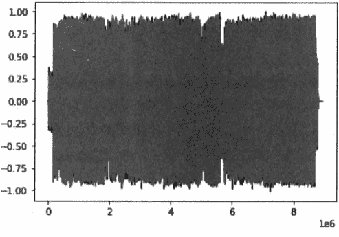

图 9-2 原始音频信号

#### 9.3.2 波形变换的类型
目前 torchaudio 所提供的波形转换主要有以下几种。

- 重采样: 把波形转到目标采样率。
- 频谱图: 由波形生成频谱图。
- GriffinLim: 基于线性尺度幅度谱图用 Griffin-Lim 重建波形。
- ComputeDeltas: 求取张量，通常是声谱图 的增量系数。
- ComplexNorm: 计算复数张量的范数。
- MelScale: 借助转换矩阵把常规 STFT 转为 Mel 频率 STFT。
- AmplitudeToDB: 将功率或振幅尺度的谱图转为分贝尺度。
- MFCC: 由波形抽取梅尔频率倒谱系数。
- MelSpectrogram: 利用 PyTorch 的 STFT 功能由波形生成 MEL 频谱图。
- MuLawEncoding: 基于 mu-law 压扩对波形编码。
- MuLawDecoding: 对 mu-law 编码的波形解码。
- TimeStretch: 在不改变音高的前提下对谱图做时间拉伸。
- FrequencyMasking: 在频域对谱图做屏蔽。
- TimeMasking: 在时域对谱图做屏蔽。

所有这些变换都是 nn.Module 或 jit.ScriptModule，因而可以嵌入神经网络中使用。

#### 9.3.3 绘制波形频谱图
先以对数尺度观察频谱图的对数值，代码如下:

```python
# 使用 Spectrogram 函数对波形数据进行处理, 得到频谱图数据
specgram = torchaudio.transforms.Spectrogram()(waveform)
# 打印频谱图的形状, 即频谱图的尺寸
print("频谱图形状:{}".format(specgram.size()))
# 创建一个新的图形窗口
plt.figure()
# 显示频谱图的对数变换结果。specgram.log2() [0,:,:].numpy()表示取频谱图的对数变换结果,
并将其转换为 NumPy 数组; cmap='gray' 用于指定颜色映射为灰度色; aspect="auto" 表示自动调整图
像的纵横比
plt.imshow(specgram.log2()[0,:,:].numpy(), cmap='gray', aspect="auto")
#显示绘制的图形窗口
plt.show()
```

这段代码用 torchaudio 的 Spectrogram 把波形转成谱图，打印谱图形状并用 Matplotlib 绘图展示。通过谱图可以看出信号在各频率上的能量分布。

运行后效果如图9-3所示。

再以对数尺度查看梅尔频谱图，代码如下:

```python
# 使用 torchaudio.transforms.MelSpectrogram() 函数对波形进行梅尔频谱图变换
specgram = torchaudio.transforms.MelSpectrogram()(waveform)
# 打印梅尔频谱图的形状
print("梅尔频谱图形状:{}".format(specgram.size()))
# 创建一个新的图形
plt.figure()
# 显示梅尔频谱图的对数变换结果
p = plt.imshow(specgram.log2()[0,:,:].detach().numpy(), cmap='viridis', aspect="auto")
# 显示图形
plt.show()
```

目的同样是把波形转成梅尔谱图并可视化，以便在梅尔频率尺度上观察能量分布。实现思路与前面相似，只是把 Spectrogram 换成了 MelSpectrogram。梅尔谱图是基于梅尔尺度的频谱表达，常用于语音相关任务。

运行后效果如图9-4所示。

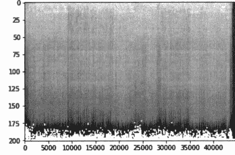

图 9-3 以对数刻度查看频谱图

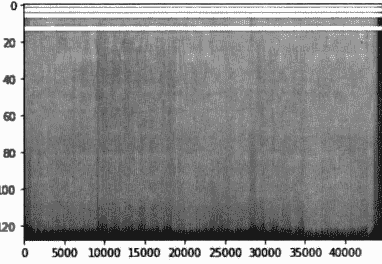

图 9-4 以对数刻度查看梅尔频谱图

也可以逐通道对波形做重采样，代码如下：

```python
# 计算新的采样率，将原始采样率除以15
new_sample_rate = sample_rate / 15
#选择要处理的通道，这里设置为 0
channel = 0
#使用 Resample 函数对波形进行重新采样。将原始采样率和新的采样率作为参数传递给函数，并将波形数据的指定通道转换为一维张量
transformed = torchaudio.transforms.Resample(sample_rate, new_sample_rate)(waveform[channel, :].view(1, -1))
# 打印变换后波形的形状，即尺寸信息
print("变换后波形形状:{}".format(transformed.size()))
# 创建一个新的图形窗口
plt.figure()
#绘制变换后的波形。transformed[0, :] 表示取变换后波形的第一个样本，并将其转换为 NumPy 数组进行绘图
plt.plot(transformed[0, :].numpy())
#显示绘制的图形
plt.show()
```

可以从中看到重采样前后波形形状的变化。重采样的作用就是调整采样率，使其满足不同处理或播放需求。

运行后效果如图9-5所示。

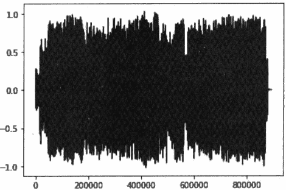

图 9-5 重新采样波形

#### 9.3.4 波形 Mu-Law 编码
下面介绍 Mu-Law 编码与反编码。Mu-Law 编码要求信号落在 -1 到 1 区间内。因为张量是普通的 PyTorch 张量，所以可以直接使用标准算子，代码如下:

```python
print ("波形最小值:{}\n波形最大值:{}\n波形平均值:{}".format(waveform.min(), waveform.max(),waveform.mean()))
```

输出如下:

```text
波形最小值:-1.0179462432861328
波形最大值:0.9967185854911804
波形平均值:-1.855347363743931e-05
```

由于当前波形不在 -1 到 1 之间，因此无需额外归一化，代码如下:

```python
# 定义一个名为 normalize 的函数, 接受一个张量作为参数
def normalize(tensor):
    """
    对输入的张量进行归一化处理
    参数:
    tensor (Tensor): 需要进行归一化的张量
    返回:
    normalized_tensor (Tensor): 归一化后的张量
    """
    tensor_minusmean = tensor - tensor.mean() # 从张量中减去其均值
    # 将减去均值后的张量除以其绝对值的最大值
    return tensor_minusmean / tensor_minusmean.abs().max()
```

```python
# 对 waveform 进行归一化处理，并将结果存储在 waveform_ 中
waveform_ = normalize(waveform)
```

进行编码，代码如下：

```python
#使用torchaudio库中的MuLawEncoding变换函数对waveform_进行处理
transformed = torchaudio.transforms.MuLawEncoding()(waveform_)
#打印变换后波形的形状，即尺寸信息
print("变换后波形形状: {}".format(transformed.size()))

#创建一个新的图形对象
plt.figure()
#使用 plot 函数绘制变换后波形的曲线，这里取了第一个样本
plt.plot(transformed[0,:].numpy())
#显示绘制的图形
plt.show()
```

从结果可以看出 Mu-Law 编码后波形的形态特征，绘图有助于直观理解变换效果。运行后如图9-6所示。

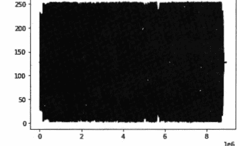

图 9-6 波形 Mu-Law 编码

接下来做解码，代码如下：

```python
#使用torchaudio库中的MuLawDecoding解码函数对变换后的波形 transformed进行解码操作
reconstructed = torchaudio.transforms.MuLawDecoding()(transformed)
#打印解码后新波形的形状，即尺寸信息
print("新波形形状: {}".format(reconstructed.size()))

#创建一个新的图形对象
plt.figure()
#使用 plot 函数绘制解码后的新波形曲线，这里取了第一个样本
plt.plot(reconstructed[0,:].numpy())
#显示绘制的图形
plt.show()
```

解码能够观察到还原后波形的形态与特征。Mu-Law 解码是编码的逆过程，用来把编码后的波形近似还原为原始波形，绘图可帮助理解解码后的样子。

运行后如图9-7所示。

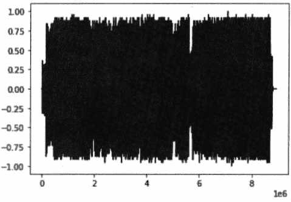

图 9-7 波形 Mu-Law 解码

#### 9.3.5 变换前后波形的比较
为判断变换是否带来明显变化，可把原始波形与归一化后经 Mu-Law 处理的波形对比，代码如下：

```python
# 计算原始波形和重构波形之间的差异
err = ((waveform - reconstructed).abs() / waveform.abs()).mean()

# 打印原始信号和重构信号之间的差异，保留两位小数
print("原始信号和重构信号之间的差异: {:.2%}".format(err))
```

这段代码评估原始波形与重建波形之间的差异，先计算绝对值再求差值并以百分比形式呈现，更直观。

具体流程是先用 abs 取绝对值求差，再用原始绝对值做归一化得到相对差异，随后求均值得到平均差异，最后用格式化字符串 :.2% 以两位小数的百分比打印。

运行输出如下：

```text
原始信号和重构信号之间的差异：41.18%
```

结果显示经归一化与 Mu-Law 处理后的波形与原始波形差异较大，平均差异约为 41.18%。

### 9.4 动手练习：音频相似度分析
为加深对音频建模的理解，本节给出一个基于 PyTorch 的音频相似度案例。

##### 1. 案例说明
本例借助 torchaudio 与余弦相似度衡量两段音频的相似程度，可为用户喜好的音频做音乐等推荐。

#### 2. 操作步骤
01 导入第三方库，代码如下：

```python
#导入相关库
import torch
import torchaudio
import soundfile
import matplotlib.pyplot as plt
torchaudio.set_audio_backend("soundfile")
```

02 加载第一段音频，代码如下：

```python
# 定义音频文件名
filename1 = "教程 1.wav"

# 加载音频文件并获取波形和采样率
waveform1, sample_rate1 = torchaudio.load(filename1)

# 打印波形的大小
print("波形的形状: {}".format(waveform1.size()))  # 音频大小

# 打印波形的采样率
print("波形的采样率: {}".format(sample_rate1))  # 采样率

# 创建一个图形
plt.figure()

# 绘制波形，并将波形的时间轴数据转换为 NumPy 数组
plt.plot(waveform1.t().numpy())

# 显示图形
plt.show()
```

运行后输出如图9-8所示。


图9-8 第一个音频频谱图

03 加载第二段音频，代码如下：

```python
# 定义文件名
filename2 = "教程 2.wav"
# 加载音频文件，获取波形和采样率
waveform2, sample_rate2 = torchaudio.load(filename2)
# 打印波形的形状
print("波形的形状：{}".format(waveform2.size())) # 音频大小
# 打印波形的采样率
print("波形的采样率：{}".format(sample_rate2)) # 采样率
# 创建一个图形
plt.figure()
# 绘制波形
plt.plot(waveform2.t().numpy())
# 显示图形
plt.show()
```

代码可查看加载音频的波形形状与采样率，并以图形展示波形变化，便于分析与可视化。运行前请把 filename2 替换为实际音频路径。

运行后输出如图9-9所示。
04 输出余弦相似度，代码如下：

```python
# 计算波形 1 和波形 2 之间的余弦相似度。dim=0 表示在第一个维度上进行相似度计算
similarity = torch.cosine_similarity(waveform1, waveform2, dim=0)

# 打印相似度
print('相似度:', similarity)
```

图 9-9 第二个音频频谱图

余弦相似度是衡量两个向量相似性的常用指标，这里用于比较两段波形的相似度，计算结果会打印展示。

输出的余弦相似度张量如下：

```
similarity tensor([0.0000, 0.0000, 0.0000, ..., 0.9701, 1.0000, 0.9487])
```

05 输出平均差异值，代码如下：

```
# 计算相似度矩阵的均值
similarity.mean()
```

这里已算出两波形间的余弦相似度并存入 similarity，调用 similarity.mean() 可得到相似度矩阵的均值。均值能把整体相似信息聚合为一个数值，便于比较。

以二维矩阵为例，similarity.mean() 即求所有元素的平均。结果意义取决于具体内容与场景，均值提供了一种简洁的整体描述。

输出如下：

```
tensor(-8.0169e-05)
```

##### 3. 案例小结
可看出两段音频的平均相似度接近 0，说明两者并不相似。

案例完整代码如下:

```
import torch
import torchaudio
import soundfile
import matplotlib.pyplot as plt

torchaudio.set_audio_backend("soundfile")

filename1 = "教程1.wav"
filename2 = "教程2.wav"
waveform1, sample_rate1 = torchaudio.load(filename1)
waveform2, sample_rate2 = torchaudio.load(filename2)

similarity = torch.cosine_similarity(waveform1, waveform2, dim=0)
similarity.mean()
```

### 9.5 上机练习题
练习：请在 PyTorch 中实现音频建模。

提示 在 PyTorch 中实现音频建模的主要步骤如下。

- 数据准备：将音频数据转为模型可接受的格式，可能包括预处理与特征提取。
- 构建模型：依据任务选择合适的结构，常用 CNN、RNN、Transformer 等。
- 定义损失函数：根据任务选择合适的损失，如 MSE 损失、交叉熵损失等。

训练环节：把已整理好的样本送入网络进行学习，通常会借助 Adam、随机梯度下降这类优化器来不断修正参数，让模型对训练集的拟合程度逐步提升。

评估环节：借助准确率、F1 值等评测指标，来判断模型在未曾见过的数据上的泛化情况。

下面给出一个基于 PyTorch 的音频分类入门示例，可直接拿来练习：

```
# 导入相关库
import torch
import torch.nn as nn
import torch.optim as optim
import torch.utils.data as data
import torchaudio
from torchvision import datasets, transforms
```

```
# 数据准备
# 假设数据集已经准备好，可以使用Torchaudio库加载音频文件
dataset = datasets.DatasetFromFolder('/path/to/dataset',
    loader=torchaudio.load)
dataloader = data.DataLoader(dataset, batch_size=64, shuffle=True)

# 构建模型
class AudioModel(nn.Module):
    def __init__(self):
        super(AudioModel, self).__init__()
        self.conv1 = nn.Conv2d(1, 16, kernel_size=3, stride=1, padding=1)
        self.relu = nn.ReLU()
        self.pool = nn.MaxPool2d(kernel_size=2, stride=2)
        self.fc = nn.Linear(16 * 32 * 32, 10) # 假设输出类别数为10

    def forward(self, x):
        x = self.conv1(x)
        x = self.relu(x)
        x = self.pool(x)
        x = x.view(x.size(0), -1)
        x = self.fc(x)
        return x

model = AudioModel()

# 定义损失函数和优化器
criterion = nn.CrossEntropyLoss()
optimizer = optim.Adam(model.parameters(), lr=0.001)

# 训练模型
num_epochs = 10
for epoch in range(num_epochs):
    running_loss = 0.0
    for inputs, labels in dataloader:
        optimizer.zero_grad()
        outputs = model(inputs)
        loss = criterion(outputs, labels)
        loss.backward()
        optimizer.step()
        running_loss += loss.item()

    epoch_loss = running_loss / len(dataloader)
    print(f'Epoch {epoch+1}/{num_epochs}, Loss: {epoch_loss}')
```

示例可按照具体的建模任务与数据特点进行相应的调整与完善。

## 第 10 章 PyTorch模型可视化

当深度神经网络规模变大时，仅靠数值很难把握训练细节，需要借助可视化手段。本章介绍 PyTorch 下常用的可视化方案，涉及 Visdom、TensorBoard、Pytorchviz、Netron，重点展开 Visdom 的使用方法与案例。

### 10.1 Visdom

在 PyTorch 生态里，Meta 公司开源的 Visdom 是使用最广的绘图工具，本节以案例形式说明其用法。

#### 10.1.1 Visdom 简介

Visdom 能直接接收 PyTorch 张量，无需先转成 NumPy 数组，运行效率很高。数据读取在内存中完成，刷新速度可达毫秒级。

安装很便捷，执行命令即可：

```
pip install visdom
```

启动服务时，Visdom 本质上是一个类似 Jupyter Notebook 的网页服务，使用前需在终端先打开：

```
python -m visdom.server
```

启动成功后，按提示在浏览器打开对应地址，默认网址是：

```
http://localhost:8097/
```

页面呈现蓝色背景的空白页且顶部出现若干条形色块，即表示安装正常，如图10-1所示。

图10-1 Visdom 服务器页面

目前支持的图形接口如下。

- vis.scatter: 2D或3D散点图。
- vis.line: 线图。
- vis.updateTrace: 更新现有的线/散点图。
- vis.stem: 茎叶图。
- vis.heatmap: 热图地块。
- vis.bar: 条形图。
- vis.histogram: 直方图。
- vis.boxplot: 盒子。
- vis.surf: 表面重复。
- vis.contour: 等高线图。
- vis.quiver: 颤抖的情节。
- vis.mesh: 网格图。

各接口的输入要求不完全相同，但多数接口都包含一个保存数据的张量 X，以及可选的保存标签或时间戳的张量 Y。所有绘图函数都接受可选参数 win，用来指定绘制的画布，并会返回当前绘图的 win。还可以指定图所在的分区。

Visdom 同时兼容 PyTorch tensor 与 NumPy ndarray，不支持 Python 原生的 int、float 等类型，传入前需先转换。不同操作的详细参数各异，但有两项参数较为通用。

- win: 指定画布名称，若不指定则自动分配新画布。若重复使用同一名称，后续操作会覆盖原内容，建议每次明确指定。
- opts: 选项字典，常用来设置 title、xlabel、ylabel、width 等显示样式。

默认操作会覆盖旧数值，但在训练过程中往往需要持续更新如损失值等信息，此时可设置 update='append' 来追加而不是覆盖。

除 update 参数外，还可用 vis.updateTrace 方法更新图表。该方法既能在指定画布中新增一条独立的轨迹，也能像 update='append' 一样在同一轨迹上追加数据。

#### 10.1.2 Visdom 可视化操作

Visdom 提供了丰富的绘图函数，便于实现数据可视化。

##### 1. 散点图plot.scatter()

该函数用于绘制二维或三维散点图，需要 N×2 或 N×3 的张量 X 指定 N 个点的位置。可选地提供长度为 N 的向量作为点对应的类别标签 1 到 K，标签会通过颜色体现。

scatter() 支持的配置项包括标记符号、标记大小、标记颜色、图例、文本标签、布局选项、追踪选项、是否使用 WebGL 等。其中 markercolor 可以是 N 或 N×3、K 或 K×3 形状的张量，分别表示逐点颜色或逐类颜色。

绘制基础散点图，代码如下:

```
# 导入相关库
import visdom
import numpy as np

# 创建 Visdom 可视化对象
vis = visdom.Visdom()

# 生成一个包含100个随机数的数组Y
Y = np.random.rand(100)

# 使用Visdom的scatter函数绘制散点图。传入X轴和Y轴的数据, 并设置了一些配置选项, 如图例、坐标
# 轴范围和刻度步长等
old_scatter = vis.scatter(
    X=np.random.rand(100, 2),
    Y=(Y[Y > 0] + 1.5).astype(int),
    opts=dict(
        legend=['Didnt', 'Update'],
        xtickmin=-50,
        xtickmax=50,
        xtickstep=0.5,
        ytickmin=-50,
        ytickmax=50,
        ytickstep=0.5,
        markersymbol='cross-thin-open',
    ),
)

# 使用update_window_opts 函数更新之前绘制的散点图的配置选项。这里更新了图例、坐标轴范围和
# 刻度步长等
vis.update_window_opts(
    win=old_scatter,
    opts=dict(
        legend=['2019 年', '2020 年'],
        xtickmin=0,
        xtickmax=1,
        xtickstep=0.5,
        ytickmin=0,
        ytickmax=1,
    ),
)
```

```
python
ytickstep=0.5, # 更新后的 Y 轴刻度的步长
markersymbol='cross-thin-open', # 更新后的标记符号
),
)
```

上述代码演示了如何借助 Visdom 完成数据可视化。可以画出散点图并按需调整配置，以实现实时观察与交互。

输出如图10-2所示。

图 10-2 普通散点图

绘制带文本标签的散点图，代码如下:

```
python
# 导入相关库
import visdom
import numpy as np

# 使用 visdom 库绘制散点图
vis.scatter(
    # 定义X 轴数据, 随机生成 6 行 2 列的数据
    X=np.random.rand(6, 2),
    #定义配置选项, 这里使用字典来指定一些配置
    opts=dict(
        # 设置每个散点的文本标签, 标签内容为'Label %d' % (i + 1), 其中%d 表示数字, i的取值范围为0~5
        textlabels=['Label %d' % (i + 1) for i in range(6)]
    )
)
```

运行后，Visdom 页面会显示带文本标签的散点图，每个点旁都会出现对应的文字标识，便于区分。

输出如图10-3所示。

图10-3 带着文本标签的散点图

绘制三维散点图，代码如下:

```
# 导入相关库
import visdom
import numpy as np

#调用 visdom 的 scatter 方法来绘制散点图
vis.scatter(
    # X 轴数据, 随机生成 100 行 3 列的数据
    X=np.random.rand(100, 3),
    # Y 轴数据, 对 Y 加 1.5 后转换为整数
    Y=(Y + 1.5).astype(int),
    # 配置选项
    opts=dict(
        # 图例标签
        legend=['男性', '女性'],
        # 标记大小
        markersize=5,
        # X 轴刻度的最小值
        xtickmin=0,
        # X 轴刻度的最大值
        xtickmax=2,
        # X 轴标签
        xlabel='数量',
```

```
# X 轴刻度值
xtickvals=[0, 0.75, 1.6, 2],
# Y 轴刻度的最小值
ytickmin=0,
# Y 轴刻度的最大值
ytickmax=2,
# Y 轴刻度的步长
ytickstep=0.5,
# Z 轴刻度的最小值
ztickmin=0,
# Z 轴刻度的最大值
ztickmax=1,
# Z 轴刻度的步长
ztickstep=0.5,
)
```

该示例利用 Visdom 绘制了具备特定配置的散点图，可定制外观与显示细节。执行后页面中会出现带图例、标记尺寸、坐标轴标签与刻度的散点图，便于后续分析。

输出如图10-4所示。

图 10-4 三维散点图

##### 2. 线型图vis.line()

该函数用于绘制折线。输入为 N 或 N×M 的张量 Y，用来指定连接 N 个点的 M 条线的值。可选的 X 张量用于指定 X 轴坐标，X 可以是长度为 N 的张量，或与 Y 尺寸相同。

支持的配置项包括是否填充下方区域、是否显示标记、标记符号、标记大小、线颜色、虚线样式、图例、布局选项、追踪选项、是否使用 WebGL 等。当点数很大时开启 WebGL 可加快渲染，但同一页面不宜同时存在多个 WebGL 上下文，需谨慎使用。

绘制线型图的示例代码如下：

```python
# 导入相关库
import visdom
import numpy as np

# 生成一个在 -5~5 等间距的数组，包含 100 个元素
Y = np.linspace(-5, 5, 100)

# 使用 Visdom 库的line方法来绘制线型图
vis.line(
    # Y 轴数据，将 Y 的平方和 Y+5 的平方根组合成一个 2 列的矩阵
    Y=np.column_stack((Y * Y, np.sqrt(Y + 5))),
    # X 轴数据，将 Y 自身重复两次组成一个 2 列的矩阵
    X=np.column_stack((Y, Y)),
    # 配置选项，设置不显示标记
    opts=dict(markers=False),
)
```

运行后，Visdom 页面中会出现线型图，X 轴与 Y 轴的数据由上述设置决定，可直观观察线型特征。

输出如图 10-5 所示。


图 10-5 线型图

实现实线、虚线等不同线的代码如下:

```python
# 导入相关库
import visdom
import numpy as np

# 创建一个Visdom窗口, 并使用vis.line绘制线条
win = vis.line(
    # X 轴数据, 将三个在0和10之间的等差数列组合成一个3列的矩阵
    X=np.column_stack((
        np.arange(0, 10),
        np.arange(0, 10),
        np.arange(0, 10),
    )),
    # Y 轴数据, 将三个在5和10之间的线性插值数列分别加上5、10后组合成一个3列的矩阵
    Y=np.column_stack((
        np.linspace(5, 10, 10),
        np.linspace(5, 10, 10) + 5,
        np.linspace(5, 10, 10) + 10,
    )),
    # 配置选项
    opts={
        # 线条样式, 一个包含'solid'、'dash'、'dashdot'的NumPy数组
        'dash': np.array(['solid', 'dash', 'dashdot']),
        # 线条颜色, 一个包含三种颜色值的NumPy数组
        'linecolor': np.array([
            [0, 191, 255],
            [0, 191, 255],
            [255, 0, 0],
        ]),
        # 窗口标题
        'title': '不同类型的线'
    }
)

# 在之前创建的窗口 win 上继续绘制线条
vis.line(
    # X 轴数据，在0和10之间的等差数列
    X=np.arange(0, 10),
    # Y 轴数据，在5和10之间的线性插值数列加上 15
    Y=np.linspace(5, 10, 10) + 15,
    # 使用之前创建的窗口 win
    win=win,
    # 线条名称
    name='4',
    # 更新方式为插入
    update='insert',
    # 配置选项
    opts={
        # 线条颜色，只包含红色的NumPy数组
        'linecolor': np.array([
            [255, 0, 0],
        ]),
        # 线条样式，只包含点的NumPy数组
        'dash': np.array(['dot']),
    }
)
```

借助前文的代码片段，就能在 Visdom 界面中同时展示多条线型与配色各不相同的曲线，并对相关属性进行调整。呈现效果见图 10-6。


图 10-6 实线与虚线

堆叠区域示例，代码如下：

```python
# 导入相关库
import visdom
import numpy as np

# 生成一个在0和4之间等间距的200个点的数列
Y = np.linspace(0, 4, 200)

# 使用 Visdom 库绘制堆积面积图
win = vis.line(
    # Y 轴数据，将 Y 数列分别进行平方根运算和加 2 运算，并堆叠在一起
    Y=np.column_stack((np.sqrt(Y), np.sqrt(Y) + 2)),
    # X 轴数据，与 Y 数列相同
    X=np.column_stack((Y, Y)),
    # 图表选项
    opts=dict(
        # 填充区域
        fillarea=True,
        # 不显示图例
        showlegend=False,
        # 宽度
        width=380,
        # 高度
        height=330,
        # Y 轴类型为对数
        ytype='log',
        # 图表标题
        title='堆积面积图',
        # 左边距
        marginleft=30,
        # 右边距
        marginright=30,
        # 底部边距
        marginbottom=80,
        # 顶部边距
        margintop=30,
    ),
)
```

渲染结果如图 10-7 所示。


图 10-7 堆叠区域展示

###### 3. 其他图形

####### 1) 茎叶图 vis.stem()

该方法用于绘制茎叶图。输入参数 X 为 N 维或 N×M 维张量，表示 M 条时间序列各自的 N 个取值。可额外传入时间戳张量 Y，Y 也可以是 N 维或 N×M 维；若 Y 为一维，则所有序列共享同一时间轴。

支持的配置项如下：

- **opts.colormap**: 用于选择配色方案的字符串，默认值为 'Viridis'。
- **opts.legend**: 图例名称列表。
- **opts.layoutopts**: 传递给可视化后端布局的额外参数字典，例如 `layoutopts={'plotly': {'legend': {'x':0, 'y':0}}}`。

下面是一个茎叶图的绘制示例：

```python
# 导入相关库
import math
import visdom
import numpy as np

# 生成一个在0和2π之间等间距的 70 个点的数列
Y = np.linspace(0, 2 * math.pi, 70)

# 将正弦函数和余弦函数的对应值堆叠在一起
X = np.column_stack((np.sin(Y), np.cos(Y)))

# 使用Visdom库绘制茎叶图
vis.stem(
    # X 轴数据
    X=X,
    # Y 轴数据
    Y=Y,
    # 图表选项
    opts=dict(legend=['正弦函数', '余弦函数'])
)
```

结果呈现如图 10-8。


图 10-8 茎叶图示例

####### 2）热力图 vis.heatmap()

此接口可生成热力图。输入 X 为 N×M 张量，代表每个网格位置的数值。

可用的选项包括：

- **opts.colormap**: 配色方案，字符串，默认 'Viridis'。
- **opts.xmin**: 数值裁剪下界，数值类型，默认取 X 的最小值。
- **opts.xmax**: 数值裁剪上界，数值类型，默认取 X 的最大值。
- **opts.columnnames**: x 轴标签列表。
- **opts.rownames**: y 轴标签列表。
- **opts.layoutopts**: 布局后端额外选项的字典，如 `layoutopts = {'plotly': {'legend': {'x':0, 'y':0}}}`。

下面给出热力图实现的示例代码。

```python
# 导入相关库
import visdom
import numpy as np

# 使用Visdom库绘制热力图
vis.heatmap(
    # 矩阵数据
    X=np.outer(np.arange(1, 6), np.arange(1, 11)),
    # 图表选项
    opts=dict(
        # 列名
        columnnames=['a', 'b', 'c', 'd', 'e', 'f', 'g', 'h', 'i', 'j'],
        # 行名
        rownames=['y1', 'y2', 'y3', 'y4', 'y5'],
        # 颜色映射
        colormap='Viridis',
    )
)
```

输出示意图 10-9。


图 10-9 热力图示例

####### 3) 条形图 vis.bar()

该函数支持绘制常规、堆叠或分组条形图。输入 X 为 N 维或 N×M 维张量，决定每个条形的高度。若 X 有 M 列，则每一行的数值会根据 opts.stacked 的设定进行堆叠或分组。可选的 Y 张量为 N 维，提供 x 轴对应的位置。

当前支持的选项：

- **opts.rownames**: x 轴标签表。
- **opts.stacked**: 是否对 X 的多列进行堆叠。
- **opts.legend**: 图例名称表。
- **opts.layoutopts**: 布局后端额外参数字典，如 `layoutopts={'plotly': {'legend': {'x':0, 'y':0}}}`。

下面是条形图的实现示例：

```python
# 导入相关库
import visdom
import numpy as np

# 使用 Visdom 库绘制条形图
vis.bar(
    # 条形图的数据,这里使用了随机数
    X=np.abs(np.random.rand(4, 3)),
    # 图表选项
    opts=dict(
        # 条形图堆叠
        stacked=True,
        # 图例
        legend=['低价值客户', '一般价值客户', '高价值客户'],
        # 行名
        rownames=['2017', '2018', '2019', '2020']
    )
)
```

生成的图形如图 10-10。


图 10-10 条形图展示

####### 4) 箱形图 vis.boxplot()

该方法用于绘制箱线图。输入 X 为 N 维或 N×M 维张量，表示用于构造 M 个箱形的 N 个数据点。

支持的选项：

- **opts.legend**: X 各列的标签。
- **opts.layoutopts**: 布局后端额外参数字典，如 `layoutopts = {'plotly': {'legend': {'x':0, 'y':0}}}`。

下面展示绘制箱形图的示例代码：

```python
# 导入相关库
import visdom
import numpy as np

# 生成一个 100 行 2 列的随机数矩阵
X = np.random.rand(100, 2)
# 对第二列的每个元素加 2
X[:, 1] += 2

# 使用 Visdom 库绘制箱形图
vis.boxplot(
    # 要绘制箱形图的数据
    X=X,
    # 图例
    opts=dict(legend=['男性', '女性'])
)
```

结果如图 10-11 所示。


图 10-11 箱形图示例

####### 5) 曲面图 vis.surf()

该函数可绘制曲面图。输入 X 为 N×M 张量，指定曲面每个位置的高度值。

支持的选项：

- **opts.colormap**: 配色方案，字符串，默认 'Viridis'。
- **opts.xmin**: 裁剪最小值，数值，默认 X 的最小值。
- **opts.xmax**: 裁剪最大值，数值，默认 X 的最大值。
- **opts.layoutopts**: 布局后端额外参数字典，如 `layoutopts={'plotly': {'legend': {'x':0, 'y':0}}}`。

下面是一个曲面图实现的示例代码：

```python
# 导入相关库
import visdom
import numpy as np

# 生成一个 50 行 2 列的随机数矩阵
X = np.random.rand(50, 2)
# 对第二列的每个元素加 1
X[:, 1] += 1

# 使用Visdom库绘制曲面图。X是要绘制的矩阵，opts是一些选项，其中colormap='Viridis'表示使用Viridis颜色映射
vis.surf(X=X, opts=dict(colormap='Viridis'))
```

该示例先生成一个随机矩阵并对其部分元素做处理，随后借助 Visdom 绘制出带颜色映射的曲面，可用于数据可视化等场景。

输出见图 10-12。


图 10-12 曲面图示例

####### 6) 等高线 vis.contour()

该函数用于绘制等高线图。输入 X 为 N×M 张量，表示每个位置的数值。

支持的选项：

- **opts.colormap**: 配色方案，字符串，默认 'Viridis'。
- **opts.xmin**: 裁剪最小值，数值，默认 X 的最小值。
- **opts.xmax**: 裁剪最大值，数值，默认 X 的最大值。
- **opts.layoutopts**: 布局后端额外参数字典，如 `layoutopts = {'plotly': {'legend': {'x':0, 'y':0}}}`。

下面是等高线绘制的示例代码：

```python
# 导入相关库
import visdom
import numpy as np

#使用 np.tile 函数将一个从 1 到 80 的一维数组 np.arange(1, 81) 重复 80 次, 形成一个 80
行 1 列的二维数组 x
x = np.tile(np.arange(1, 81), (80, 1))
#对 x 进行转置, 得到一个 1 行 80 列的数组 y
y = x.transpose()
# 计算数组 X, 其值为 e ^ ((x - 40) ** 2 + (y - 40) ** 2) / -20 ** 2
X = np.exp((((x - 40) ** 2) + ((y - 40) ** 2)) / -(20.0 ** 2))
#使用Visdom的contour函数绘制等高线图。X是要绘制的数组, colormap='Viridis'表示使用
Viridis颜色映射
vis.contour(X=X, opts=dict(colormap='Viridis'))
```

代码先对二维数组每个位置计算指数值，再用 Visdom 渲染等高线图，便于直观看出数据分布特征。

结果如图 10-13。


图 10-13 等高线示例

#### 10.1.3 动手练习: 识别手写数字

##### 1. 案例说明

本案例演示如何借助 PyTorch 的可视化工具 Visdom 对手写数字数据集进行建模。

##### 2. 实现步骤

###### 01 先导入模型需要的包,代码如下:

```python
# 导入相关库
import torch
import torch.nn as nn
import torch.nn.functional as F
import torch.optim as optim
from torchvision import datasets, transforms
from visdom import Visdom
```

###### 02 定义训练参数,代码如下:

```python
# 批大小
batch_size = 200
# 学习率
learning_rate = 0.01
# 训练轮数
epochs = 10
```

该代码创建了三个超参数：batch_size、learning_rate 和 epochs。

- batch_size 决定每次参数更新时使用的样本数。
- learning_rate 控制模型学习的速度。
- epochs 表示完整的训练轮数。

这三项在深度学习训练中十分常见，其取值会影响收敛效果和模型性能，需要结合数据集规模与模型复杂度进行选择，通常通过实验调参确定最优值。

###### 03 获取训练和测试数据,代码如下:

```python
# 获取训练和测试数据
train_loader = torch.utils.data.DataLoader(
    # MNIST数据集,指定训练集,若数据不存在,则自动下载,应用数据转换
    datasets.MNIST('../data', train=True, download=True,
        transform=transforms.Compose([
            transforms.ToTensor(),
            # transforms.Normalize((0.1307,), (0.3081,))
        ])),
    # 批次大小
    batch_size=batch_size,
    # 每次迭代时打乱数据
    shuffle=True
)
# 定义测试数据加载器
test_loader = torch.utils.data.DataLoader(
    # MNIST 数据集, 指定测试集, 应用数据转换
    datasets.MNIST('../data', train=False, transform=transforms.Compose([
        transforms.ToTensor(),
        # transforms.Normalize((0.1307,), (0.3081,))
    ])),
    # 批次大小
    batch_size=batch_size,
    # 每次迭代时打乱数据
    shuffle=True
)
```
这段实现借助 PyTorch 以及 MNIST 手写数字集，分别构造了训练用和测试用的数据加载器。借助这两个加载器，就能很方便地读取、预处理 MNIST 数据，为后续的模型训练和验证提供统一的输入管道。

###### 04 构建全连接多层感知机，代码示例如下：
```python
# 定义一个名为 MLP 的神经网络模块
class MLP(nn.Module):
    def __init__(self): # 初始化方法
        super(MLP, self).__init__() # 继承nn.Module的初始化方法
        self.model = nn.Sequential( # 创建一个神经网络序列
            nn.Linear(784, 200), # 全连接层, 输入维度为784, 输出维度为200
            # 激活函数LeakyReLU, 参数inplace=True表示原地更新
            nn.LeakyReLU(inplace=True),
            nn.Linear(200, 200), # 全连接层, 输入维度为200, 输出维度为200
            nn.LeakyReLU(inplace=True), # 激活函数 LeakyReLU
            nn.Linear(200, 10), # 全连接层, 输入维度为200, 输出维度为10
            nn.LeakyReLU(inplace=True) # 激活函数 LeakyReLU
        )
    def forward(self, x): # 前向传播方法
        x = self.model(x) # 通过模型进行前向传播
        return x # 返回传播后的结果

# 定义训练过程
device = torch.device('cuda:0') # 设备选择, 这里选择 CUDA 设备 0

net = MLP().to(device) # 创建 MLP 模型并将其移动到指定设备上
# 优化器选择,这里使用随机梯度下降(SGD),并设置学习率
optimizer = optim.SGD(net.parameters(), lr=learning_rate)
criterion = nn.CrossEntropyLoss().to(device) # 损失函数选择,这里使用交叉熵损失函数
```
该片段定义了一个简化的 MLP 神经网络，并为训练预设了一批参数。

- MLP 类：继承自 nn.Module，用来封装网络结构。在 __init__ 里利用 nn.Sequential 串联起若干线性层与激活函数，形成完整的网络骨架。
- forward 方法：描述数据在网络中的正向流动方式，将输入 x 逐层送入模型得到输出。
- 训练相关配置：指定运行设备为 CUDA 0，将模型迁移到该设备；选用随机梯度下降作为优化器、交叉熵作为损失函数，并把优化器与损失也搬到同一设备上。

如此一来，模型和配套配置就准备就绪，可以进入后续训练阶段。在训练中，模型会依据输入数据不断调整参数以降低损失。

###### 05 创建两个 Visdom 实时监控窗口，代码如下：
```python
# 创建 Visdom 可视化对象
viz = Visdom()

# 在窗口'train_loss'中绘制线条,起始点为(0.,0.),并设置窗口标题为“训练损失”
viz.line([0.], [0.], win='train_loss', opts=dict(title='训练损失'))

# 在窗口 'test' 中绘制线条,起始点为(0.0,0.0),并设置窗口标题为“测试损失和准确率”,同时
# 设置图例为“损失”和“准确率”
viz.line([[0.0, 0.0]], [0.], win='test', opts=dict(title='测试损失和准确率',
legend=['损失', '准确率']))

# 全局步骤计数器
global_step = 0
```
这里调用 Visdom 库完成可视化。先实例化一个 viz 对象，再用 line 方法在独立的窗口里绘制折线，分别对应训练与测试。随后定义了一个全局步长计数器 global_step，用来记录训练推进的步数，后续可据此刷新图表或执行其他步长相关的操作。

运行后打开 Visdom 提供的网页，能看到两个已声明的 win，即两幅暂时没有任何数据点的空图，如图 10-14 所示。


图 10-14 没有显示数据

###### 06 启动训练并实时向图表写入数据，代码如下：
```python
# 开始训练，并给图送入实时更新的数据，以可视化训练过程
for epoch in range(epochs):  # 遍历训练轮数
    for batch_idx, (data, target) in enumerate(train_loader):  # 遍历训练数据批次
        data = data.view(-1, 28 * 28)  # 将数据调整为一维，长度为 28×28
        # 将数据和目标发送到指定设备（如 GPU）
        data, target = data.to(device), target.cuda()

        logits = net(data)  # 通过网络计算输出
        loss = criterion(logits, target)  # 计算损失

        optimizer.zero_grad()  # 清空梯度
        loss.backward()  # 反向传播损失
        optimizer.step()  # 更新参数

        global_step += 1  # 全局步骤增加 1
        # 将损失和当前步骤发送到 'train_loss' 窗口，并以追加的方式更新
        viz.line([loss.item()], [global_step], win='train_loss', update='append')

        if batch_idx % 100 == 0:  # 每隔 100 个批次
            print('训练轮次: {} [{}/{} ({:.0f}%)\t损失: {:.6f}'.format(
                epoch, batch_idx * len(data), len(train_loader.dataset),
                # 打印训练进度和损失
                100. * batch_idx / len(train_loader), loss.item()))

test_loss = 0  # 测试损失清零
correct = 0
for data, target in test_loader:
    data = data.view(-1, 28 * 28)
    data, target = data.to(device), target.cuda()

    logits = net(data)
    test_loss += criterion(logits, target).item()

    pred = logits.argmax(dim=1)
    correct += pred.eq(target).float().sum().item()

# 将测试损失和准确率发送到 'test' 窗口，并以追加的方式更新
viz.line([[test_loss, correct / len(test_loader.dataset)]],
         [global_step], win='test', update='append')
# 可视化当前测试的数字图片
viz.images(data.view(-1, 1, 28, 28), win='x')
# 可视化测试结果
viz.text(str(pred.detach().cpu().numpy()), win='pred',
         opts=dict(title='预测'))

test_loss /= len(test_loader.dataset)
print('\n测试集: 平均损失: {:.4f}, 准确率: {}/{} ({:.0f}%)\n'.format(
    test_loss, correct, len(test_loader.dataset),
    100. * correct / len(test_loader.dataset)))
```
这是一个标准的深度学习训练循环，整体流程如下：

- 按轮次遍历训练集 epochs。
- 在每个 batch 中：
  - 调整数据的形状使其适配模型；
  - 把数据和标签搬到指定设备；
  - 前向计算得到预测结果与损失值；
  - 清空梯度、反向传播、更新参数；
  - 步长自增，并把当前损失连同步长写入可视化窗口。
- 进入测试阶段：
  - 计算测试集的损失以及正确预测的样本数；
  - 将测试损失与准确率推送到可视化窗口；
  - 对测试样本与预测结果进行可视化展示。
- 最后输出平均测试损失与平均准确率。

该代码实现了数据处理、模型训练和结果展示的闭环。通过不断迭代训练集与测试集，参数逐步优化，模型性能随之提升。Visdom 则帮助直观观察训练动态。

训练成功后，在 Visdom 页面上可以观察到数据实时变化，测试指标每完成一个 epoch 更新一次，如图 10-15 所示。


图10-15 实时更新的训练图

##### 3. 案例小结
本案例借助 Visdom 对 MNIST 手写数字识别的全过程进行了可视化建模。

### 10.2 TensorBoard
TensorBoard 是 TensorFlow 的配套工具，可记录训练过程中的数值、图像等信息，便于研究人员跟踪神经网络的训练态势。本节通过实例介绍该可视化工具的用法。

#### 10.2.1 TensorBoard 简介
TensorBoard 既是功能强大的可视化手段，也是一个 Web 应用集合。

对于 PyTorch 等框架，目前尚缺乏同等完备的工具，现有方案要么功能受限、要么上手困难。

TensorBoard 为机器学习实验提供了一整套可视化能力：

- 监控并绘制损失、准确率等指标曲线。
- 展示模型结构图，呈现操作与层级关系。
- 查看权重、偏置等张量随训练的直方图变化。
- 将嵌入向量映射到低维空间。
- 呈现图片、文本、音频等多种数据类型。
- 分析 TensorFlow 程序的性能剖析。

TensorBoard 与 TensorFlow 程序在不同进程中运行，它会自动读取最新的 TensorFlow 日志文件并呈现程序的当前状态。

使用前需安装 tensorflow、tensorboard、tensorboardX 等依赖，代码如下：

```bash
pip install tensorflow
pip install tensorboard
pip install tensorboardX
```
其中 TensorBoardX 让非 TensorFlow 的框架也能享用 TensorBoard 的便利。TensorBoard 目前支持 7 种可视化类型：Scalars、Images、Audio、Graphs、Distributions、Histograms、Embeddings，各自的主要作用如下。

- Scalars：呈现训练过程中准确率、损失值、权重/偏置等标量的演变。
- Images：展示训练期间记录的图像样本。
- Audio：展示训练期间记录的音频样本。
- Graphs：展示模型的数据流图，以及各设备上的内存与时间消耗。
- Distributions：展示训练数据在各阶段的分布情况。
- Histograms：以柱状图形式展示训练数据的分布。
- Embeddings：展示词向量等嵌入的投影分布。

下面演示如何用 TensorBoard 搭建可视化。核心是创建 SummaryWriter 实例，该类负责把模型指标、损失、图像等信息写入 TensorBoard 日志，方便可视化与分析。通过它可以在训练过程中实时监控性能，并对比不同超参数与模型结构的效果。

在实践中，先实例化 SummaryWriter，再调用 add_scalar、add_graph、add_image 等方法写入各类数据，随后启动 TensorBoard 服务器即可在浏览器中查看。

SummaryWriter 的构造参数说明如下：

```python
torch.utils.tensorboard.writer.SummaryWriter(
    log_dir=None,
    comment='',
    purge_step=None,
    max_queue=10,
    flush_secs=120,
    filename_suffix=''
)
```
导入 SummaryWriter 的代码如下：

```python
# 从 tensorboardX 模块导入SummaryWriter类
from tensorboardX import SummaryWriter
```
共有三种常见的初始化方式。

- 方式一：指定保存路径，例如 ./runs/test1，日志会写入该目录，代码如下：

```python
    writer1 = SummaryWriter('./runs/test1')
    ```
- 方式二：不传参数，系统默认使用 runs/日期时间 作为日志目录，代码如下：

```python
    writer2 = SummaryWriter()
    ```
- 方式三：传入 comment 参数，路径变为 runs/日期时间-comment，代码如下：

```python
    writer3 = SummaryWriter(comment='test2')
    ```
执行后，run 目录下会生成三个不同的日志文件夹，如图 10-16 所示。


通常每次实验都要新建一个路径独立的 SummaryWriter，也称之为一个 run。之后即可调用该实例的各类 add_something 方法向日志中写入不同类型的数据。

启动 TensorBoard，服务器会监听 6006 端口，代码如下：

```bash
tensorboard --logdir=D:/动手学PyTorch深度学习建模与应用/ch09/runs/
```
随后浏览器发出请求时，TensorBoard 会解析训练记录并绘制图表。

#### 10.2.2 TensorBoard 基础操作
##### 1. 可视化数值
使用 add_scalar 方法记录标量，常用来绘制训练过程中的 loss、accuracy、learning rate 等变化，直观把握训练进展。代码原型如下：

add_scalar(tag, scalar_value, global_step=None, walltime=None)

###### 代码说明
- tag (string)：数据标识，不同标识的数据会以不同曲线展示。
- scalar_value (float)：待记录的数值。
- global_step (int, optional)：训练步数。
- walltime (float, optional)：记录时刻，默认取 time.time()。

请注意，写入的 scalar_value 必须保证是 float 类型。若手头是 PyTorch 的标量张量，就需要先调用 .item() 把数值提取出来再使用。

示例代码如下：

```python
# 导入 SummaryWriter 类
from tensorboardX import SummaryWriter

# 创建一个 SummaryWriter 对象，指定日志保存的路径为 'runs/scalar'
writer = SummaryWriter('runs/scalar')

for i in range(10): # 遍历 0~9 的整数
    # 使用 add_scalar 方法记录数据，'指数' 为标量的名称，3 ** i 为标量的值，global_step
    # 为全局步数
    writer.add_scalar('指数', 3 ** i, global_step=i)
```

运行后的效果见下图。


图 10-17 可视化数值

##### 2. 可视化图片
add_image 用来记录单张图像，依赖 Pillow 库的支持。日常里它常被用来实时跟踪生成式模型的产出，或检查分割、目标检测的结果，便于调试。调用方式如下：

```python
add_image(tag, img_tensor, global_step=None, walltime=None, dataformats='CHW')
```

###### 代码说明
- tag (string): 用来标识这条记录的名称。
- img_tensor (torch.Tensor / numpy.array): 承载像素的张量或数组。
- global_step (int, optional): 对应训练的步数。
- walltime (float, optional): 记录时间戳，默认取 time.time()。
- dataformats (string, optional): 图像排布方式，默认 'CHW' 即通道×高×宽，也支持 'HWC'、'HW' 等。

示例代码如下：

```python
# 导入相关库
from tensorboardX import SummaryWriter
import cv2 as cv

# 创建一个 SummaryWriter 对象，指定日志保存的路径为 'runs/image'
writer = SummaryWriter('runs/image')

for i in range(1, 4): # 遍历 1 到 3 的整数
    # 添加图像到 SummaryWriter
    writer.add_image('countdown', cv.cvtColor(cv.imread
    ('./image/{}.jpg'.format(i)), cv.COLOR_BGR2RGB), global_step=i, dataformats='HWC')
```

这里把图像命名为 'countdown'，先把 BGR 转成 RGB 再写入，global_step 表示当前训练步，dataformats 指定为 HWC。

使用时务必确认输入格式与声明一致，PyTorch Tensor 默认就是 CHW。浏览器里拖动滑块就能对比不同步的图片，结果如图 10-18 所示。

##### 3. 可视化统计图
add_histogram 用于记录一组数据的直方图。通过观察权重、激活值等分布的形态，能帮助判断训练是否正常。代码如下：

```python
add_histogram(tag, values, global_step=None, bins='tensorflow', walltime=None, max_bins=None)
```


图 10-18 可视化图片

###### 代码说明
- tag (string): 数据标签名称。
- values (torch.Tensor, numpy.array, or string/blobname): 用来生成直方图的数据源。
- global_step (int, optional): 训练步数。
- bins (string, optional): 分桶策略，可选 tensorflow、auto、fd 等。
- walltime (float, optional): 记录时间戳，默认 time.time()。
- max_bins (int, optional): 允许的最大分桶数。

示例代码如下：

```python
# 导入相关库
from tensorboardX import SummaryWriter
import numpy as np

# 创建一个 SummaryWriter 对象，指定日志保存的路径为 'runs/embedding_example'
writer = SummaryWriter('runs/embedding_example')

# 向 SummaryWriter 中添加正态分布的直方图数据，global_step 分别为 1、50、100
writer.add_histogram('正态分布中心化', np.random.normal(0, 1, 1000),
global_step=1)
writer.add_histogram('正态分布中心化', np.random.normal(0, 2, 1000),
global_step=50)
writer.add_histogram('正态分布中心化', np.random.normal(0, 3, 1000),
global_step=100)
```

用 NumPy 从方差各异的正态分布抽样。打开 TensorBoard 后会多出 DISTRIBUTIONS 和 HISTOGRAMS 两个面板，都用于观察分布。HISTOGRAMS 支持 OFFSET 错位排列或 OVERLAY 重叠排列。图 10-19 左为 DISTRIBUTIONS，右为 HISTOGRAMS。


图 10-19 可视化统计图

##### 4. 可视化网络图
add_graph 能把神经网络的结构图画出来。代码如下：

```python
add_graph(model, input_to_model=None, verbose=False, **kwargs)
```

###### 代码说明
- model (torch.nn.Module): 待绘制的 nn.Module。
- input_to_model (torch.Tensor or list of torch.Tensor, optional): 送入网络的示例输入。

TensorBoardX 官方提供了一个示范，可直接试验，代码如下：

```python
# 导入相关库
import torch
import numpy as np
from torchvision import models, transforms
from PIL import Image
from tensorboardX import SummaryWriter

vgg16 = models.vgg16()  # 这里下载预训练好的模型
print(vgg16)            # 打印这个模型
```

```python
transform_2 = transforms.Compose([
    transforms.Resize(224),
    transforms.CenterCrop(224),
    transforms.ToTensor(),
    # convert RGB to BGR
    # from <https://github.com/mrzhhu-cool/pix2pix-pytorch/blob/master/util.py>
    transforms.Lambda(lambda x: torch.index_select(x, 0, torch.LongTensor([2, 1, 0]))),
    transforms.Lambda(lambda x: x*255),
    transforms.Normalize(mean = [103.939, 116.779, 123.68],
                         std = [ 1, 1, 1 ]),
])

cat_img = Image.open('./1.jpg')
# 因为 PyTorch 是分批次进行训练的，所以这里建立一个批次为 1 的数据集
vgg16_input = transform_2(cat_img)[np.newaxis]
print(vgg16_input.shape)

# 开始前向传播，打印输出值
raw_score = vgg16(vgg16_input)
raw_score_numpy = raw_score.data.numpy()
print(raw_score_numpy.shape, np.argmax(raw_score_numpy.ravel()))

# 将结构图在 TensorBoard 中展示
with SummaryWriter(log_dir='./runs/graph', comment='vgg16') as writer:
    writer.add_graph(vgg16, (vgg16_input,))
```

运行结果见下图。


图 10-20 可视化网络图

##### 5. 可视化向量
add_embedding 可把嵌入向量投射到二维或三维空间。代码如下：

```python
add_embedding(mat, metadata=None, label_img=None, global_step=None,
tag='default', metadata_header=None)
```

###### 代码说明
- mat (torch.Tensor or numpy.array): 一个矩阵，每行对应特征空间的一个数据点。
- metadata (list or torch.Tensor or numpy.array, optional): 一维标签列表，长度与矩阵行数一致。
- label_img (torch.Tensor, optional): 形如 N×C×H×W 的张量，用于在点旁显示对应图像，N 与矩阵行数相同。
- global_step (int, optional): 训练步长。
- tag (string, optional): 数据名称，不同名称的数据将分别展示。

该方法不仅能用 PCA、T-SNE 等把高维特征降到平面或空间，还能查看降维前原始空间的 K 近邻。下面以 MNIST 训练集的 100 张图为例，直接把展平后的像素当作 embedding 投进去。

示例代码如下：

```python
# 导入相关库
import torchvision
from tensorboardX import SummaryWriter

# 创建一个 SummaryWriter 对象，指定日志保存的路径为 'runs/vector'
writer = SummaryWriter('runs/vector')

# 从 torchvision 中加载 MNIST 数据集，下载选项设置为 False
mnist = torchvision.datasets.MNIST('./', download=False)

# 添加嵌入向量
writer.add_embedding(
    # 将 MNIST 数据集的图像数据转换为嵌入向量，并取前 30 个样本
    mnist.data.reshape((-1, 28 * 28))[:30,:],
    metadata=mnist.targets[:30], # 对应的标签
    # 图像数据，用于显示每个嵌入向量对应的图像
    label_img = mnist.data[:30,:,:].reshape((-1, 1, 28, 28)).float() / 255,
    global_step=0 # 全局步骤
)
```

代码把 MNIST 部分图像转成嵌入向量，并连同元数据和原图写入 SummaryWriter，后续用 TensorBoard 分析特征表示。

即使未做特征提取，数字点仍自然聚类，相同数字更靠近，类似 KNN 的思路。点击左下 T-SNE 还可切换降维方式。使用时注意：

- (1) mat 是二维的 M×N，metadata 是一维的 N，label_img 是四维的 N×C×H×W。
- (2) label_img 记得归一化为 0~1 的 float 值。

采用 PCA 降维后，在三维空间的可视化结果如图 10-21 所示。


图 10-21 可视化向量

##### 6. 可视化 P-R 曲线
add_pr_curve 用于绘制 Precision-Recall 曲线。代码如下：

```python
add_pr_curve(classes[class_index], tensorboard_preds, tensorboard_probs, global_step=global_step)
```

###### 代码说明
- tensorboard_preds (float): 模型的预测值。
- tensorboard_probs (float): 模型预测值的概率。
- global_step (int, optional): 训练的 step。

P-R 曲线以召回率为横轴、精确率为纵轴。先解释两项指标：把正例正确判为正例为 TP，正例误判为负例为 FN，负例正确判为负例为 TN，负例误判为正例为 FP。Precision = TP/(TP + FP)，Recall = TP/(TP + FN)。

曲线生成思路是按置信度排序样本，逐个选取阈值，把阈值前面的样本视作正例，后面的视作负例，每个阈值下计算一次 Precision 和 Recall，串联即得曲线。

示例代码如下：

```python
# 导入相关库
import numpy as np
from torch.utils.tensorboard import SummaryWriter

# 设置随机数种子，以便每次运行代码时得到相同的随机数序列
np.random.seed(20200910)

# 生成 100 个随机整数，范围为 2 到上限，并将其存储在 labels 变量中
labels = np.random.randint(2, size=100)

# 生成 100 个随机浮点数，范围为 0~1，并将其存储在 predictions 变量中
predictions = np.random.rand(100)

# 创建 SummaryWriter 对象，用于记录和可视化数据
writer = SummaryWriter()

# 添加 P-R 曲线，用于评估二分类问题的性能
writer.add_pr_curve('P-R 曲线', labels, predictions, 0)

# 关闭 SummaryWriter，释放相关资源
writer.close()
```

代码会生成随机标签与预测概率并写入 SummaryWriter，方便在 TensorBoard 中查看。

可视化效果如图 10-22 所示。


图 10-22 可视化 P-R 曲线

#### 10.2.3 动手练习：可视化模型参数
##### 1. 案例说明
本练习旨在用 TensorBoard 直观呈现模型训练过程中准确率与损失值的变化趋势及相互关系。

##### 2. 实现步骤
01 先导入所需依赖，代码如下：

```python
# 导入相关库
import numpy as np
from torch.utils.tensorboard import SummaryWriter
```

02 把 Loss 写入 Loss_Accuracy 目录，参考代码如下：

```python
# 设置随机数种子，确保每次运行代码时得到的随机数序列是相同的。这样可以使结果具有可重复性
np.random.seed(10)

# 创建 SummaryWriter 对象，指定日志保存路径为 'runs/Loss_Accuracy'，用于将模型的相关信息（如损失、准确率等）记录到指定的路径，以便后续使用 TensorBoard 等工具进行可视化和分析
writer = SummaryWriter('runs/Loss_Accuracy')
```

该片段主要完成了随机种子固定与 SummaryWriter 实例的创建。

03 接着向 writer 中写入损失，其中 add_scalars() 支持把多条曲线合并到一张图里，示例如下：for n_iter in range(100):  # 遍历 100 次迭代

    # 在 SummaryWriter 中添加标量数据, 标签为'Loss/train', 值为随机数, 索引为 n_iter

    writer.add_scalar('Loss/train', np.random.random(), n_iter)

    # 在 SummaryWriter 中添加标量数据, 标签为'Loss/test', 值为随机数, 索引为 n_iter

    writer.add_scalar('Loss/test', np.random.random(), n_iter)

    # 在 SummaryWriter 中添加标量数据, 标签为'Accuracy/train', 值为随机数, 索引为 n_iter

    writer.add_scalar('Accuracy/train', np.random.random(), n_iter)

    # 在 SummaryWriter 中添加标量数据, 标签为'Accuracy/test', 值为随机数, 索引为 n_iter

    writer.add_scalar('Accuracy/test', np.random.random(), n_iter)

整体循环跑了 100 次，每轮通过 writer.add_scalar 向 SummaryWriter 写入 4 条标量，分别对应 Loss/train、Loss/test、Accuracy/train 和 Accuracy/test。数值均由 np.random.random() 随机产生，并以 n_iter 作为步进索引。

这样就能把随机生成的标量导入 SummaryWriter，后续可用 TensorBoard 等工具进行可视化追踪，用来观察训练过程中的损失与准确率变化。需注意这里的随机数仅作演示，实际项目中这些数值会随真实训练过程和模型输出动态更新。

##### 3. 案例小结

此例探究了深度学习里损失与准确率的关联。

模型在训练集和测试集上的损失变化如图 10-23 所示。


图 10-23 损失曲线

模型在训练集和测试集上的准确率变化如图 10-24 所示。


### 10.3 Pytorchviz

Pytorchviz 用于生成 PyTorch 执行图与轨迹的可视化，本节以案例形式介绍该可视化工具。

#### 10.3.1 Pytorchviz 简介

可视化前先安装 graphviz 与 torchviz 两个第三方库，代码如下：

```
pip install graphviz
pip install torchviz
```

Graphviz 是 AT&T 实验室发起的开源图形绘制工具包，专用于解析 DOT 描述语言，DOT 用简洁的语法定义图结构，学习成本低，对开发者很友好。

在 Windows 环境下安装 Graphviz 需要下载官方 Release 包并手动配置环境变量，否则会抛出相关错误：

```
graphviz.backend.ExecutableNotFound: failed to execute ['dot', '-Tpng', '-O', 'tmp'],
make sure the Graphviz executables are on your systems' PATH
```

#### 10.3.2 动手练习：Pytorchviz 建模可视化

##### 1. 案例说明

本例借助 Pytorchviz 实现 PyTorch 模型的可视化。

##### 2. 实现步骤

###### 01 导入第三方库，代码如下：

```python
# 导入相关库
import torch
from torch import nn
from torchviz import make_dot, make_dot_from_trace
```

###### 02 随机生成数据集，代码如下：

```python
# 生成一个形状为(1, 8)的随机张量 x
x = torch.randn(1,8)
```

###### 03 设置网络模型，代码如下：

```python
# 创建一个顺序模型
model = nn.Sequential()
# 在模型中添加一个线性层，输入维度为 8，输出维度为 16
model.add_module('W0', nn.Linear(8, 16))
# 添加 tanh 激活函数
model.add_module('tanh', nn.Tanh())
# 添加一个线性层，输入维度为 16，输出维度为 1
model.add_module('W1', nn.Linear(16, 1))
```

###### 04 可视化网络结构，代码如下：

```python
# 使用 make_dot 函数将模型对 x 的计算过程生成图
vis_graph = make_dot(model(x), params=dict(model.named_parameters()))
# 查看生成的图
vis_graph.view()

# 选择 onnx 导出模式
with torch.onnx.select_model_mode_for_export(model, False):
    # 使用 jit.trace 记录模型的计算过程
    trace = torch.jit.trace(model, (x,))
# 查看记录的计算过程
# torch.trace  # 注意：此处原文代码可能有误，通常不直接调用此函数查看，而是保存或继续处理
```

以上四步涵盖了模型搭建、可视化与导出的主要流程。

首先用 torch.randn(1, 8) 生成形状为 (1, 8) 的随机张量 x 作为输入。

随后构建一个 nn.Sequential 序列模型，通过 add_module 依次加入线性层 W0、tanh 激活以及线性层 W1。

再用 make_dot 把模型对 x 的前向计算过程转为图形表示，并通过 vis_graph.view() 打开查看。

之后调用 torch.onnx.select_model_mode_for_export 进入 ONNX 导出模式，并用 torch.jit.trace 记录计算轨迹。

最后借助 torch.trace 查看已记录的计算过程。

这些操作有助于理解模型结构与计算逻辑，也便于模型调试、分析和格式转换等后续工作。

##### 3. 案例小结

本例演示了如何用 Pytorchviz 可视化 PyTorch 模型。

执行后会在当前目录生成 Digraph.gv.pdf 并自动在浏览器中打开，如图 10-25 所示。


图 10-25 模型可视化

### 10.4 Netron

Netron 是支持 PyTorch 的模型可视化工具，由微软 Lutz Roeder 开发，使用方式接近常规的文件保存与打开，十分便捷。本节通过案例介绍该工具。

#### 10.4.1 Netron 简介

Netron 跨平台支持良好，可在 Linux、macOS、Windows 上像普通软件一样运行。

复现他人模型时常需要确认输入输出名称，若作者未说明，可借助 Netron 清晰查看网络的输入输出名及整体结构。相较 TensorBoard，Netron 体积更轻，且兼容框架更多。Netron 支持的框架包括 ONNX、Keras、CoreML、Caffe2、MXNet、TensorFlowLite、Caffe、Torch、CNTK、PaddlePaddle、Darknet、scikit-learn、TensorFlow.js、TensorFlow 等。

其优势主要体现在：

- (1) 框架覆盖面广，主流深度学习框架基本都能打开。
- (2) 操作直观便捷，无需编写代码，下载安装后直接打开目标文件即可，也支持代码调用。
- (3) 导出保存方便，可像保存普通文件一样一步完成。

安装 Netron 可通过以下命令进行：

```
pip install netron
```

需要注意的是，Netron 不直接支持 PyTorch 默认的 .pth 格式，需先导出为 onnx 格式。

#### 10.4.2 动手练习：Netron 建模可视化

##### 1. 案例说明

本例使用 Netron 可视化 PyTorch 模型，数据集选用 CIFAR10。

##### 2. 实现步骤

###### 01 导入相关第三方库，代码如下：

```python
# 导入相关库
import math
import netron
import torch
import torch.onnx
import torch.nn as nn
from torch.autograd import Variable
```

###### 02 初始化参数配置，代码如下：

```python
defaultcfg = {
    # 键 11 对应的值是一个列表，包含多个元素
    11 : [64, 'M', 128, 'M', 256, 256, 'M', 512, 512, 'M', 512, 512],
    # 键 13 对应的值也是一个列表
    13 : [64, 64, 'M', 128, 128, 'M', 256, 256, 'M', 512, 512, 'M', 512, 512],
    # 键 16 对应的值是一个更长的列表
    16 : [64, 64, 'M', 128, 128, 'M', 256, 256, 256, 'M', 512, 512, 512, 'M', 512, 512, 512],
    # 键 19 对应的值是一个更长的列表
    19 : [64, 64, 'M', 128, 128, 'M', 256, 256, 256, 256, 'M', 512, 512, 512, 512, 'M', 512, 512, 512, 512],
}
```

上述代码定义了一个名为 defaultcfg 的字典，键对应值列表，列表元素代表不同配置下的参数，其中 M 作为占位符使用。

该字典结构便于集中管理多组参数配置，通过键即可取回对应的参数列表。

具体语义需结合上下文与文档判断，通常用于在不同场景下灵活调整模型或算法的超参数。

###### 03 设置网络结构，代码如下：

```python
# 定义一个名为 vgg 的神经网络模块
class vgg(nn.Module):
    # 初始化函数
    def __init__(self, dataset='cifar10', depth=19, init_weights=True, cfg=None):
        """
        :param dataset: 数据集的名称，默认为 'cifar10'
        :param depth: vgg 网络的深度，默认为 19
        :param init_weights: 是否初始化权重，默认为 True
        :param cfg: 配置参数，如果为 None，则使用默认配置
        """
        super(vgg, self).__init__() # 继承 nn.Module
        if cfg is None:
            cfg = defaultcfg[depth] # 如果 cfg 为 None，使用默认的配置
```

```python
self.feature = self.make_layers(cfg, True)  # 生成特征提取部分
if dataset == 'cifar10':  # 根据数据集设置类别数量
    num_classes = 10
elif dataset == 'cifar100':
    num_classes = 100
self.classifier = nn.Linear(cfg[-1], num_classes) # 生成分类器
if init_weights:
    self._initialize_weights()  # 如果需要，则初始化权重

def make_layers(self, cfg, batch_norm=False):  # 生成网络层的函数
    """
    :param cfg: 网络层配置
    :param batch_norm: 是否使用批量归一化
    :return: 生成的网络层
    """
    layers = []  # 存储网络层的列表
    in_channels = 3  # 输入通道数
    for v in cfg:
        if v == 'M':  # 如果 v 为 'M'，则加最大池化层
            layers += [nn.MaxPool2d(kernel_size=2, stride=2)]
        else:
            conv2d = nn.Conv2d(in_channels, v, kernel_size=3, padding=1,
                             bias=False)  # 添加卷积层
            if batch_norm:  # 如果需要，则添加批量归一化和 ReLU 激活函数
                layers += [conv2d, nn.BatchNorm2d(v), nn.ReLU(inplace=True)]
            else:
                layers += [conv2d, nn.ReLU(inplace=True)]
            in_channels = v  # 更新输入通道数
    return nn.Sequential(*layers)  # 将网络层组合成顺序结构

def forward(self, x):  # 前向传播函数
    """
    :param x: 输入数据
    :return: 输出数据
    """
    x = self.feature(x)  # 进行特征提取
    x = nn.AvgPool2d(2)(x)  # 平均池化
    x = x.view(x.size(0), -1)  # 展平
    y = self.classifier(x)  # 分类
    return y

def _initialize_weights(self):  # 权重初始化函数
    for m in self.modules():  # 遍历模块
        if isinstance(m, nn.Conv2d):  # 如果是卷积层
            # 计算卷积核的数量
            n = m.kernel_size[0] * m.kernel_size[1] * m.out_channels
            m.weight.data.normal_(0, math.sqrt(2. / n))  # 初始化权重为正态分布
            if m.bias is not None:
                m.bias.data.zero_()  # 如果有偏置
                                     # 初始化偏置为 0
        elif isinstance(m, nn.BatchNorm2d):
            m.weight.data.fill_(0.5)  # 如果是批量归一化层
            m.bias.data.zero_()       # 初始化权重为 0.5
                                      # 初始化偏置为 0
        elif isinstance(m, nn.Linear):
            m.weight.data.normal_(0, 0.01)  # 如果是全连接层
            m.bias.data.zero_()             # 初始化权重为正态分布
                                            # 初始化偏置为 0
```

###### 04 可视化结果输出示例

```python
# 如果当前模块作为主模块运行
if __name__ == '__main__':
    net = vgg()  # 创建 vgg 网络实例
    # 定义输入数据，类型为 torch.FloatTensor，形状为 (16, 3, 40, 40)
    x = Variable(torch.FloatTensor(16, 3, 40, 40))
    y = net(x)  # 通过网络进行前向传播
    print(y.data.shape)  # 打印输出数据的形状
    onnx_path = "onnx_model_name.onnx"  # 设定 ONNX 模型的保存路径
    torch.onnx.export(net, x, onnx_path)  # 将网络导出为 ONNX 模型并保存到指定路径
    netron.start(onnx_path)  # 启动 Netron 可视化工具并加载 ONNX 模型
```

##### 3. 案例要点回顾

本案例采用 Netron 对 CIFAR-10 数据集的模型进行可视化展示。

执行前面给出的模型代码后，可得到如下输出：

```text
torch.Size([16, 10])
Serving 'onnx_model_name.onnx' at http://localhost:8080
```

在浏览器里打开 http://localhost:8080 地址，会出现如图 10-26 所示的起始界面。


图 10-26 为初始页面。点击 Accept 按钮后，界面跳转为如图 10-27 所示的状态。


### 10.5 上机练习题

练习要求：自行搭建 Visdom 可视化环境，并概括说明其主要的操作流程。

可参照下面步骤完成：

- 01 安装 Visdom。
在终端里执行下方命令完成 Visdom 的安装：
```bash
  pip install visdom
  ```

- 02 启动 Visdom 服务器。
在终端里执行下方命令启动 Visdom 服务：
```bash
  python -m visdom.server
  ```
启动成功后，终端会打印出类似下面的提示信息：
```text
  INFO:root:Starting server at http://localhost:8097
  ```

#### 03 编写 Python 脚本。
在 Python 脚本中引入 Visdom 库并完成可视化相关操作。下面给出一份简易示例：
```python
# 导入相关库
import visdom

# 连接Visdom服务器
vis = visdom.Visdom()

# 创建一个散点图并更新数据
x = [1, 2, 3, 4, 5]
y = [2, 4, 6, 8, 10]
scatter = vis.scatter(
    X=x,
    Y=y,
    opts=dict(title='散点图', xlabel='X轴', ylabel='Y轴')
)

# 更新散点图数据
x = [1, 2, 3, 4, 5]
y = [3, 6, 9, 12, 15]
vis.updateTrace(
    X=x,
    Y=y,
    win=scatter,
    opts=dict(title='散点图更新', xlabel='X轴', ylabel='Y轴')
)
```

#### 04 运行 Python 脚本。
通过终端运行上述 Python 脚本，观察 Visdom 页面中的可视化呈现。也可以在浏览器中输入 “http://localhost:8097” 进入 Visdom 服务的 Web 界面。

#### 05 观察和调整可视化结果。
进入 Visdom 界面后，可通过修改参数、增添标签等方式改变呈现效果。比如调整散点图的图名、坐标轴名称等。

小结：Visdom 是功能强大的可视化工具，支持散点图、折线图、柱状图、图片等多类数据的展示。搭建好 Visdom 环境后，能便捷地实现数据可视化，并通过参数调节实时观察数据变化。

# 第 11 章

# 深度学习迈向大语言模型


得益于深度学习的高速演进，大语言模型应运而生，ChatGPT、ChatGLM 等代表性产品凭借强大的自然语言处理能力和广阔的应用前景成为 AI 领域焦点。大模型的出现推动了 NLP 技术升级，也让信息处理变得更高效便捷。本章聚焦大语言模型的工作原理与典型应用。

### 11.1 大语言模型的原理

大语言模型，又称大规模语言模型或大型语言模型，通常由拥有上百亿参数的深度神经网络构成，采用自监督方式在海量未标注文本上训练。本节将围绕 Transformer 架构与注意力机制展开介绍。

#### 11.1.1 大语言模型简介

自 2018 年起，Google、OpenAI、Meta、百度、华为等机构陆续发布 BERT、GPT 等模型，在几乎所有 NLP 任务上取得优异表现。2019 年大模型进入加速期，尤其 2022 年 11 月 ChatGPT 发布后引发全球热议。

GPT，即生成式预训练 Transformer，是生成式 AI 的核心框架之一。首个 GPT 于 2018 年由 OpenAI 推出。它基于 Transformer 架构，在大规模无标签文本上完成预训练，能够产出类人化、富有新意的内容。

大语言模型的应用非常广泛，包含机器翻译、摘要生成、对话系统、文本自动生成等。在机器翻译场景中，模型可依据源语言输入生成符合目标语言表达习惯和语法规范的译文；在摘要生成中，能从长文本抽取关键信息并输出精炼内容；在对话系统中，可理解用户输入并给出自然流畅的回复；在文本自动生成中，能按指定主题或要求创作多样化的段落。

不过大模型也存在局限。首先，尽管生成文本连贯自然，但模型缺乏自我意识和真正理解，因此使用时需人工校验和修正，确保准确可靠。其次，训练数据规模庞大导致模型结构复杂，对算力需求很高，训练与部署成本不低。

大语言模型的发展可追溯至早期的统计语言模型和规则语言模型。随着深度学习崛起，神经网络语言模型逐渐受到重视。其演进大致经历四个关键阶段：

- （1）早期神经网络语言模型：受限于算力与数据，规模偏小，效果有限。
- （2）迁移学习与预训练模型：利用大规模语料库预训练，为下游 NLP 任务提供更优起点。
- （3）GPT 系列模型：OpenAI 推出 GPT、GPT-2、GPT-3 等基于 Transformer 的大模型，在生成与理解能力上取得明显突破。
- （4）规模持续扩大：算力提升后，研究者尝试构建更大规模模型，如 GPT-4.0，以进一步提高性能。

总体来看，大语言模型从传统统计模型到神经网络模型，再到迁移学习与预训练，最终走向更大规模、更高效果的发展路径。

#### 11.1.2 Transformer 架构

NLP 技术的发展始终在迭代优化。Transformer 出现前，领域经历了从人工规则与知识库到统计学与深度学习的转变。Transformer 的提出标志 NLP 进入新阶段，BERT、GPT 等模型的落地大幅提升了语言理解与生成能力。

当前基于 Transformer 的应用正迎来爆发。Transformer 是一种基于注意力机制的深度学习模型，由谷歌团队在 2017 年提出，已广泛应用于机器翻译、文本分类、情感分析等任务。

##### 1. Transformer 架构简介

我们日常使用的 ChatGPT 这类对话模型即基于 Transformer 构建。其后端采用 GPT，GPT 通过在海量文本上的无监督预训练学习语言统计特征与语义，并以自回归方式基于已生成词预测下一个词，从而掌握词间语义、语法关系及整体上下文。GPT 本身建立在 Transformer 之上，因此理解生成式大模型需先了解 Transformer。

Transformer 由编码器 Encoder 和解码器 Decoder 组成，编码器负责学习输入序列的表征，解码器负责生成输出序列。GPT 主要使用 Transformer 的解码器部分来构建语言模型，其结构如图 11-1 所示。


下面说明输入文本在 Transformer 内部的流转过程。

在 Transformer 中，输入文本首先会被转换为合适的表征形式。为何需要转换？

比如输入“AI+编程 同心协力”，计算机能否直接理解？与 ChatGPT 交互时，它是否真的“听见”每个词？

ChatGPT 并非直接处理自然语言，而是把输入映射为可计算的数据形式，简单说就是把每个词或字符编码成特定向量。

编码包含以下步骤：

- 词嵌入 Word Embedding：每个单词映射为高维向量，通常借助 Word2Vec、GloVe 等预训练词嵌入模型完成。
- 位置嵌入 Positional Embedding：标准 Transformer 不具备序列顺序感知能力，需额外加入位置信息。位置嵌入与词嵌入维度一致并进行相加。
以句子“AI+编程 同心协力”为例，若没有位置嵌入，句子可能被错误解析为“编AI+程, 同力协心”等，导致语序与语义错乱。位置嵌入的意义在于让编码后的词向量保留词语在序列中的先后顺序，从而维持整句原意。
相加 Addition：词嵌入与位置嵌入相加，得到融合文本信息与位置信息的嵌入表示，最终形成 Transformer 输入 x。经过此处理，模型既知每个词的含义，也知其位置，从而正确识别“AI+编程 同心协力”。

关于输入处理，架构图中编码器和解码器似乎都有输入，这如何理解？在 Transformer 中，编码器与解码器的输入是独立的。通常在有监督场景下，编码器处理输入样本，解码器处理对应的标签，标签进入解码器前同样需要预处理，这种设计让模型能在特定任务上进行针对性训练。

##### 2. Encoder 编码器部分

编码器的任务是学习输入序列的表征，处理流程如下：

- 输入数据，如一段文字，先进入注意力 Attention 机制进行处理，机制会对各元素打分以判断重要性，处理后会生成新的数据。
- 执行 Add 操作，注意力机制的输出与原始输入通过残差连接相加，即简单的加法。这能保证经过注意力处理后的结果不劣于原始输入。

##### 3. Decoder 解码器部分

解码器的任务是生成输出序列，处理流程如下：

- 01 进入带掩码的 Masked Attention 机制，掩码确保解码器只能关注已生成的词，不能窥视未来词。
- 02 该层输出会与编码器输出融合，具体是通过一次注意力机制将两者信息结合，综合编码与解码内容。
- 03 解码器整体操作与编码器类似。数据依次经过层归一化、前馈神经网络、再次层归一化，最终输出词向量表征。
- 04 输出的词向量先经线性层 Linear 处理，将向量映射到预设词表大小，以便进行词预测。

解码器在生成环节如何选词

在生成阶段，模型会先用 Softmax 为每个候选词算出概率分布，然后直接挑出概率最大的词作为本时刻的输出。因为解码器既会参考前面已经生成的词序列，也会融合编码器传来的上下文表征，所以预测下一个词的准确度会明显提升。

#### 11.1.3 注意力机制

注意力到底关注了什么？日常做事时我们会把焦点放在关键信息上，忽略次要干扰。类比到计算，Transformer 是怎样拆解上下文、捕捉不同语义之间的关联的？

图 11-2 常被用来说明注意力如何判断代词 it 指向何处。


图 11-2 注意力机制案例

原句：The Animal didn't cross the street because it was too tired。意为因为动物太累所以没过马路，这里 it 指代 The Animal。若把 tired 改成 narrow，变成 The Animal didn't cross the street because it was too narrow，意思是街道太窄动物没过马路，此时 it 就指向 the street。

可见输入稍有变动，词义指代也会随之改变。Transformer 正是具备这种灵活性与精确性，而更早的模型做不到这一点。

注意力可以这样理解：模型先把每个词变成向量，再送入网络。每个词都像在向别的词发问“我们关系近吗？”关系近就走一条路径，关系远就走另一条。每个词既提问也作答，通过这种双向互动，模型就能测出词对之间的亲疏。一旦关系确定，模型就会把相关性强的词的信息吸收过来，与自身融合。比如翻译时，it 能正确对应到 animal，正是因为它的向量已经融合了与 animal 紧密相关的信息。

所以注意力的本质是重构词向量。形象化描述中可以提炼出三要素：

- $Q$：Query，可看作某个词向其他词发起询问。
- $K$：Key，可看作某个词对其他词提问的回应。
- $V$：Value，可看作词的实际内容，表示依据亲疏关系抽取多少信息归并到自身。

在 Transformer 里，$Q$、$K$、$V$ 都是通过输入向量 $x$ 与权重矩阵 $W_q$、$W_k$、$W_v$ 做矩阵运算得到。权重矩阵起初用数学方法初始化，随后在多轮训练中不断更新，目标是让 $x$ 与权重相乘后得到最优的 $Q$、$K$、$V$。以 $Q$ 为例，其第一元素是 $x$ 的第一行与 $W_q$ 的第一列点乘求和。

因此 $Q$ 的第一行记录了第一个词在查询他人时所需的关键线索；同理 $K$、$V$ 的计算逻辑一致。$K$ 的第一行保存第一个词在被问时提供的线索，$V$ 的第一行保存第一个词自身的语义内容。经 $Q$ 与 $K$ 衡量关系后，$V$ 中的信息被用来重构该词的表征。

得到 $Q$、$K$、$V$ 后，注意力执行如下操作：

$$\text { Attention }(Q, K, V)=\operatorname{Softmax}\left(\frac{Q K^{\mathrm{T}}}{\sqrt{d_{k}}}\right) * V$$

这个式子体现了问答过程，其计算流程如图 11-3。


图 11-3 计算词的紧密程度

整体仍是矩阵相乘再求和，得到的 $QK^T$ 就表示词与词之间的亲疏。为什么能衡量亲疏？矩阵乘法里用到向量元素的乘积，即内积。几何上内积越大向量越趋于平行，说明越相似；内积为 0 则正交，表示无关。

Attention 中的 $Q$ 与 $K$ 互问互答，本质是问亲疏程度，用内积来度量相似性是合理的。

这里有个细节：模型也会自问自答。拿 The Animal didn't cross the street because it was too tired 为例，it 本是代词，但模型希望它指向 The Animal。若让 it 过度强调自身，信息就不会被重构，原本的“它”含义就难以转变为指向 The Animal。正是这种自我包含的操作，让 Transformer 的注意力被称为 Self-Attention，自注意力。

衡量出亲疏后，如何重构 $V$？计算过程如图 11-4。


图 11-4 归一化处理

算出 $QK^T$ 后，假设第一行数值是 100、80、20、12，关键问题是如何量化每个词的贡献。为此对每一行做 Softmax 归一化，使行内元素之和为 1。

比如归一化后变成 0.4、0.2、0.2、0.1，就意味着新表示由第一个词贡献 40%、第二个词 20% 等组成。Softmax 的作用就是给出可量化的贡献权重。

公式里除以 $\sqrt{d_k}$ 的目的是防止向量维度过大导致内积数值膨胀，干扰亲疏判断。

获得贡献概率后，重构 $V$ 的过程如图 11-5。


图 11-5 自注意力机制

即每个词拿出部分信息，最终得到 $Z$，$Z$ 的每个位置都融合了与之相关的信息。这就是 Transformer 自注意力机制的计算全貌。

### 11.2 主要的大语言模型

本部分介绍当前主流的大语言模型，主要包括 ChatGPT、文心一言与 ChatGLM。

#### 11.2.1 ChatGPT 及其 API 调用

ChatGPT 是一款基于神经网络与自然语言处理的实时对话系统，其核心能力是根据文本或语音输入生成连贯的回应，从而提升人机交互体验，为用户提供精准及时的咨询服务。

##### 1. ChatGPT简介

长期以来，计算机科学家致力于让机器理解并使用类人语言。ChatGPT 把自然语言处理的水平推向了新阶段。

OpenAI 于 2018 年 6 月在 Improving Language Understanding by Generative Pre-Training 中提出首个 GPT 模型 GPT-1。核心结论是 Transformer 架构配合无监督预训练能取得不错效果。GPT-1 采用无监督预训练加监督微调的方式在特定任务上训练，实现强大的自然语言理解。

2019 年 2 月，OpenAI 发表 Language Models are Unsupervised Multitask Learners，推出从 GPT-1 演化而来的 GPT-2。GPT-2 参数规模提升了一个量级，其余设计与 GPT-1 接近，主要差别在于具备多任务能力。OpenAI 证明半监督语言模型无需针对具体任务训练，也能在多项任务上表现良好，在零样本迁移设定下效果显著。

2020 年 5 月，OpenAI 发布 Language Models are Few-Shot Learners，展示 GPT-3。GPT-3 比 GPT-2 大约 100 倍，拥有 1750 亿参数。整体思路与前代保持一致，但性能远超预期。

2022 年 11 月围绕 ChatGPT 进行了两次更新。2022 年 11 月 29 日 OpenAI 发布 text-davinci-003；2022 年 11 月 30 日上线基于 GPT-3.5 的“对话”模式，能进行问答、承认错误、质疑错误前提并拒绝不恰当请求。

2023 年 3 月 14 日，OpenAI 发布 ChatGPT-4.0，依托更强的 GPT-4 文本生成技术。在 GPT-3.5 基础上使用更多数据与算力训练，在专业与学术基准上达到接近人类水平。

##### 2. 如何调用ChatGPT API

开发中经常需要调用 ChatGPT 完成任务，网页手动交互效率低。借助代码调用模型，可实现本地与网页一致的效果。

Python 调用 ChatGPT 的主要步骤如下：

- 01 获取 API Key，登录 OpenAI 官网，用注册的账号密码获取专属 API Key。
- 02 安装 OpenAI 官方库，执行 pip install openai。
- 03 编写调用程序，在 Python 环境中接入模型。

调用示例：

###### 1）智能搜索

ChatGPT 可帮助企业构建智能搜索，提升客户搜索体验。

提问后得到的回复，代码如下：

```python
import openai
openai.api_key = "填入自己的API密钥"
def askChatGPT(question):
    prompt = question
    model_engine = "text-davinci-003"
    
    completions = openai.Completion.create(
        engine=model_engine,
        prompt=prompt,
        max_tokens=2048,
        n=1,
        stop=None,
        temperature=0.5,
    )
    
    message = completions.choices[0].text
    print(message)
askChatGPT("2022年上海市常住人口总数")
```

很快返回：

2022年上海市常住人口总数为2475.89万人。

###### 2）语言翻译

可实现中英及多语种互译，更好服务国际客户。

将中文译为德文的调用代码如下：

```python
askChatGPT("翻译德文：人工智能是一个以计算机科学为基础的交叉学科。")
```

返回结果如下：

(Künstliche Intelligenz ist ein interdisziplinäres Fachgebiet, das auf der Informatik basiert.)

###### 3）自动写作

能够自动生成高质量文章，节省撰写时间并提升内容质量。

要写一个小故事，调用代码如下：

```python
askChatGPT("以"我放弃了我爱的职业"开头，写一个故事，要求不少于500字")
```

ChatGPT 给出的内容大致讲述一位年轻大学生热爱音乐、大学期间勤学演奏并组建乐队，毕业后进入音乐制作公司，后因行业压力转向跨国公司市场营销，最终在新领域找到归属感的故事。

###### 4）自动编程

过去用户需熟练掌握 Python 语法与环境才能写程序调用 API 或爬取数据。有了 ChatGPT 后，只需用自然语言描述需求，模型即可直接给出源码，复制到实验环境即可获取数据。

例如了解“帕累托法则”并用 Python 演示，代码如下：

```python
askChatGPT("用Python解释帕累托法则")
```

返回说明如下：

帕累托法则是一种描述资源分配不均的经济学原理。Python 实现示例：

```python
def pareto_principle(data):
    sorted_data = sorted(data, reverse=True)  # 对数据进行排序
    total = sum(data)                         # 计算总和
    cum_percentage = 0                        # 累积百分比
    pareto_index = 0                          # 帕累托指数

    for i, value in enumerate(sorted_data):
        percentage = value / total * 100      # 计算百分比
        cum_percentage += percentage          # 更新累积百分比
        if cum_percentage > 80:               # 当累积百分比超过80%时，记录下当前索引
            pareto_index = i + 1
            break

    pareto_data = sorted_data[:pareto_index]  # 获取帕累托数据
    pareto_percentage = sum(pareto_data) / total * 100  # 计算帕累托百分比

    return pareto_data, pareto_percentage

# 示例数据
data = [20, 30, 40, 50, 60, 70, 80, 90, 100]

# 调用函数并输出结果
pareto_data, pareto_percentage = pareto_principle(data)
print("帕累托数据:", pareto_data)
print("帕累托百分比:", pareto_percentage)
```

代码中定义 pareto_principle 函数，先对数据排序，再计算累积百分比，累积超过 80% 时记录索引并提取帕累托数据，最后计算帕累托占比并返回。最后用示例数据调用函数并输出结果。

#### 11.2.2 文心一言及其插件开发

百度将大模型与国产深度学习框架融合，构建自主创新的 AI 底座，降低 AI 开发门槛，满足真实场景需求，发挥大模型驱动 AI 规模化应用的产业价值。文心大模型的特点是“知识增强”，引入知识图谱融合数据与知识，提升学习效率与可解释性。

##### 1. 文心一言简介

文心一言，英文名 ERNIE Bot，是百度全新一代知识增强大语言模型，属于文心大模型家族成员。能够进行对话互动、回答问题、辅助创作，高效便捷地帮助人们获取信息、知识与灵感，其官网如图 11-6 所示。


文心一言被定义为一种面向行业的AI底座赋能平台，核心目标是推动金融、能源、媒体、政务等领域的智能化升级。在商业文案实战里，它已经能独立完成企业命名、宣传文案撰写等工作。生成环节里，模型既能读懂人类的真实意图，也能用条理清晰的语言输出，这种表现被归因为海量数据训练带来的智能涌现现象。

训练素材覆盖万亿级网页、十亿级搜索与图像数据，以及日均百亿次的语音调用数据，因此中文理解与表达更为熟练。整体能力体系相当丰富，概括如下：

- 对话式交互：具备类似ChatGPT的自然语言理解与生成能力，实现流畅的人机对话。
- 定制化图像创作：依据用户偏好与兴趣生成专属图片，内容贴合度更高。
- 文艺表达生成：ERNIE Bot可产出优美句式与格言，适合社交分享或作为歌词灵感。
- 中文文本处理：中文读写与分析效率突出，文本加工更高效。
- 生态实用工具：百度开放平台后，社区创作者贡献了大量实用插件，如QQ群助手、弹幕过滤器、AI辅助写作等，场景覆盖面广。
- 语音识别功能：支持语音转文字，可实现听故事配图等使用体验。
- 语义理解能力：可深入捕捉用户意图，甚至支持猜词接龙等互动玩法。
- 多语种适配：兼容多种语言，满足不同语言背景用户的需求。

公开信息显示，自2023年2月官宣以来，接入文心一言生态的企业已超650家。已加入的机构涵盖影视、媒体、软件信息服务、金融等多个行业。对双方而言都是正向协同，数据与资源可实现共享。合作伙伴需要百度的技术与产品，百度则需要行业数据与应用场景的回流。

对新上手的用户如何用好模型，文心一言由百度研发，任何人都能通过“指令中心”与模型互动，提出问题或需求，模型会迅速提供信息、知识与灵感。“指令中心”内置了大量可直接套用的指令模板。熟练后能明显提升工作、学习与生活的效率，例如撰写报告、制定计划、生成图像、编写代码等。建议新用户多探索生活化使用场景，同时逐步学会撰写高质量指令，页面右上角的“指令中心”按钮是很好的入口。

##### 2. 文心一言插件开发全景

插件机制让文心一言能够获取实时资讯与专业知识，或调用第三方服务与工具，从而获得更强的体验。与ChatGPT不同，文心一言在同一应用内即可直接生成图片。

###### 1) 文心一言插件是什么
如果把文心一言看作智能中枢大脑，插件就是它的耳目与双手。插件把大模型的AI能力与外部应用连接，既扩展模型能力与应用边界，也能借助模型的生成力完成过去难以实现的任务。

百度文心一言插件的主要价值体现在三方面。

- 信息增强类：帮助获取更及时、更专业的资讯，例如接入百度搜索的插件可实现全网实时检索；还有面向找房、找车、找法条、查股票等专业领域的检索插件。
- 交互增强类：提升多模态输入输出能力，支持理解PDF、图片、语音等输入，生成思维导图、视频等多模态输出，例如上传文档后基于文档问答。
- 服务增强类：自动化完成订机票、发邮件、管理日程、创建问卷等常见任务；也能借助模型能力升级现有服务体验，比如基于用户简历和身份信息生成面试题目，结合TTS/ASR打造真实模拟面试。

###### 2) 插件运行机制概述
文心一言插件属于基于大模型的文本生成工具，整体流程可归纳为以下环节。

- 插件注册：开发者将插件的manifest文件提交到文心一言插件库，校验通过后模型即可调用该插件处理用户问题。
- 插件触发：解析调度模块触发时，会通过生成的API与插件服务通信。插件服务处理完任务后返回JSON数据，再由汇总结果模块整理，形成一致准确的回复。
- 插件解析：触发调度模块识别用户query，并依据manifest中插件API接口与参数的自然语言描述，选择合适的插件并生成调用API。

例如用户选择天气插件并输入“今天北京的天气怎么样？”。模型会先识别意图并调用天气插件，解析出时间“今天”、地点“北京”，以JSON结构传入开发者提供的天气API，获取结果后再经大模型润色生成面向用户的回答。

###### 3) 如何加入插件开发者行列
想要成为文心一言插件开发者，可参考《申请插件开发者权限》，按页面提示填写信息并提交相关权限申请。


提交后会通过短信或邮件反馈结果，请耐心等待。

文心一言插件商店汇聚了大量高质量插件，覆盖办公提效、多模态内容理解生成、专业信息查询等场景。用户只需发出简单指令，就能实现PPT生成、音视频提取、思维导图制作等多种多模态需求，体现“指令即服务”的便捷。

目前主流插件包括：

- 览卷文档：原ChatFile，可对文档进行摘要、问答、创作。上传文件后即可阅读PDF、Word摘要，并支持英文识别。
- 说图解画：基于图片进行文字创作与问答，帮用户写文案、编故事。上传图片后可让AI描述画面、回答问题，并据此生成文章或故事。
- E言易图：基于Apache Echarts提供数据洞察与图表制作，支持柱状图、折线图、饼图、雷达图、散点图、漏斗图、思维导图等。

文心一言的插件商城如图11-8所示。


#### 11.2.3 ChatGLM 及其本地部署
ChatGLM源于清华技术成果转化，由智谱AI研发，具备中英双语对话能力。模型基于GLM130B千亿基座训练，拥有多领域知识、代码能力、常识推理与应用能力，支持自然语言交互与多种任务处理。

##### 1. ChatGLM 快速认识
2023年3月，智谱AI开源了中英双语对话模型ChatGLM-6B，它是通用语言模型系列的新成员，可在单张消费级显卡上推理。这是继GLM-130B千亿基座开源后又一重要成果，同时基于千亿基座的ChatGLM也同步发布。

ChatGLM-6B是开源的中英双语问答对话模型，经过中文优化。模型基于GLM架构，参数约62亿，结合量化技术即可在消费级显卡本地部署。

最新基座大模型GLM-4在性能上大幅提升，支持更长的上下文与更快的推理速度，从而降低推理成本。GLM-4还显著增强了智能体能力，可自主理解用户意图、规划复杂指令，并自由调用网页浏览器、代码解释器和多模态文生图模型完成复杂任务。具体而言，GLM-4支持128k上下文窗口，单次提示可处理约300页文本。你可以提供问题或对话上下文，从模型获得续写或回答。模型具备广泛的知识与理解能力，可应对各领域问题。

开发者可基于ChatGLM构建多种应用，包括但不限于智能客服、聊天机器人、虚拟助手、文本摘要、自动翻译等。

- 智能客服：将ChatGLM3-6B嵌入网站或应用，作为智能客服系统，用户提问后模型给出相关回答与解决方案。
- 聊天机器人：打造对话机器人，提供天气查询、新闻摘要、旅游建议等服务。
- 虚拟助手：作为个人助理，通过语音指令发送邮件、提醒日程、查找信息等。
- 文本摘要：构建摘要工具，用户输入长文本后模型生成精简摘要，帮助快速把握要点。
- 自动翻译：构建翻译系统，用户输入句子或文本，模型将其转为目标语言。

这些仅是示例，可根据具体需求开发更多应用，发挥模型能力。

##### 2. ChatGLM2-6B 本地部署实战
ChatGLM采用预训练语言模型，通过微调生成有逻辑连贯的对话回复。该项目开源，可在GitHub ChatGLM仓库查看与使用。本地部署需先了解硬件与软件环境。

硬件环境：
- CPU: i7-9700F
- 内存: DDR4 32GB
- 显卡: 2070S 8GB

软件环境：
- Ubuntu 22.04 TLS

下面介绍本地部署ChatGLM2-6B的具体步骤。

###### 1) 环境准备
正式安装前需准备三大块组件。

- 英伟达显卡驱动：Linux默认未安装，需自行部署。
- CUDA：NVIDIA提供的并行计算平台，包含编程语言扩展、库与工具。
- CuDNN：NVIDIA深度学习加速库，加速神经网络训练与推理。

先检查显卡驱动是否已安装，执行命令如下：

```bash
nvidia-smi
```
结果如图11-9所示。


图11-9 驱动查询结果

显示报错说明未安装，刚装系统通常没有。再检查CUDA驱动，命令如下：

```bash
nvcc -V
```
结果如图11-10所示。


图11-10 CUDA 驱动检查

可见相关驱动也未安装。接下来开始安装。

####### (1) NVIDIA 驱动安装
先更新软件源，命令如下：

```bash
sudo apt-get update
```
查询显卡支持的驱动类型，命令如下：

```bash
ubuntu-drivers devices
```
结果如图11-11所示。

```bash
root@koala9527-MS-7B23:~# ubuntu-drivers devices
== /sys/devices/pci0000:00/0000:00:01.0/0000:01:00.0 ==
modalias : pci:v000010DEd00001E84sv000010DEsd00001E84bc03sc00i00
vendor : NVIDIA Corporation
model : TU104 [GeForce RTX 2070 SUPER]
driver : nvidia-driver-535 - distro non-free recommended
driver : nvidia-driver-535-server-open - distro non-free
driver : nvidia-driver-535-open - distro non-free
driver : nvidia-driver-525-server - distro non-free
driver : nvidia-driver-470-server - distro non-free
driver : nvidia-driver-470 - distro non-free
driver : nvidia-driver-535-server.- distro non-free
driver : nvidia-driver-525-open - distro non-free
driver : nvidia-driver-525 - distro non-free
driver : nvidia-driver-450-server - distro non-free
```
图 11-11 驱动类型查询

选择推荐驱动进行安装，如图11-12所示。

```bash
root@koala9527-MS-7B23:~# ubuntu-drivers devices
== /sys/devices/pci0000:00/0000:00:01.0/0000:01:00.0 ==
modalias : pci:v000010DEd00001E84sv000010DEsd00001E84bc03sc00i00
vendor : NVIDIA Corporation
model : TU104 [GeForce RTX 2070 SUPER]
driver : nvidia-driver-525 - distro non-free
driver : nvidia-driver-525-open - distro non-free
driver : nvidia-driver-535-server - distro non-free
driver : nvidia-driver-535-server-open - distro non-free
driver : nvidia-driver-470-server - distro non-free
driver : nvidia-driver-470 - distro non-free
driver : nvidia-driver-535-open - distro non-free
driver : nvidia-driver-450-server - distro non-free
driver : nvidia-driver-535 - distro non-free recommended
driver : nvidia-driver-525-server - distro non-free
```
图 11-12 推荐驱动

可自动安装推荐版本，命令如下：

```bash
sudo ubuntu-drivers autinstall
```
出现报错时需修改DNS，命令如下：

```bash
sudo vim /etc/systemd/resolved.conf
```
重启相关服务，命令如下：

```bash
systemctl restart systemd-resolved
systemctl enable systemd-resolved
```
若仍报错，可执行apt-get update更新软件，随后重启系统，命令为sudo reboot。重启后查看驱动，如图11-13所示。

安装成功时会提示CUDA Version: 12.2，表示显卡最高支持CUDA 12.2。


图 11-13 驱动安装验证

####### (2) CUDA 环境搭建
首先安装CUDA Toolkit，下载地址为https://developer.nvidia.com/cuda-toolkit-archive，下载页如图11-14所示。


图 11-14 CUDA Toolkit 下载页

按官网提示在线安装，命令如下：

```bash
wget https://developer.download.nvidia.com/compute/cuda/12.2.0/local_installers/cuda_12.2.0_535.54.03_linux.run
sudo sh cuda_12.2.0_535.54.03_linux.run
```
可能出现报错：

> Failed to verify gcc version. See log at /var/log/cuda-installer.log for details.

可尝试忽略，命令如下：

```bash
sudo sh cuda_12.2.0_535.54.03_linux.run --override
```
输入accept确认许可，如图11-15所示。


图 11-15 许可协议

仅安装CUDA相关选项，选择Install后回车，如图11-16所示。


图 11-16 CUDA Toolkit 安装

安装完成后需添加环境变量，命令如下：

```bash
vim ~/.bashrc
```
在文件末尾写入如图11-17所示内容。


图 11-17 环境变量配置

保存退出后使环境变量生效，命令如下：

```bash
source ~/.bashrc
```
最后验证安装，命令如下：

```bash
nvcc -V
```
结果如图11-18所示。


图 11-18 安装校验结果

####### (3) 部署 cuDNN 环境

下面进入 cuDNN 的部署环节，前提是 PyTorch 需要在 2.0 及以上。

先确认 cuDNN 与 CUDA 的对应表，CUDA 12.2 能用的 cuDNN 版本在图 11-19 里有说明。


图 11-19 cuDNN 与 CUDA 版本对照

官方获取地址是 https://developer.nvidia.com/rdp/cudnn-archive，下载要先通过 NVIDIA 账号校验，这边用 Windows 搭 SSH 再通过 FTP 传上去，过程如图 11-20。


图 11-20 NVIDIA 账号校验过程

直接开始安装，执行命令如下：

```bash
sudo dpkg -i cudnn-local-repo-ubuntu2204-8.9.5.30_1.0-1_amd64.deb
```

安装示例先把软件源的 key 复制下来，命令如下：

```bash
sudo cp /var/cudnn-local-repo-ubuntu2204-8.9.5.30/cudnn-local-FB167084-keyring.gpg /usr/share/keyrings/
```

刷新软件源，命令如下：

```bash
sudo apt-get update
```

随后还要装运行时库、开发库以及示例相关的组件。

这里要指定具体的 CUDA 与 cuDNN 版本，当前使用的就是 CUDA 12.2.0 和 cuDNN 8.9.5.30，所以命令如下：

```bash
sudo apt-get install libcudnn8=8.9.5.30-1+cuda12.2
sudo apt-get install libcudnn8-dev=8.9.5.30-1+cuda12.2
sudo apt-get install libcudnn8-samples=8.9.5.30-1+cuda12.2
```

执行完毕后做安装校验，命令如下：

```bash
cp -r /usr/src/cudnn_samples_v8/ $HOME
cd $HOME/cudnn_samples_v8/mnistCUDNN
make clean && make
./mnistCUDNN
```

若执行 make 时提示命令不存在，说明 make 工具未装，先安装：

```bash
apt install make
```

然后又出现报错，具体如下：

```bash
rm -rf *orm -rf mnistCUDNN
CUDA_VERSION is 12020
Linking agains cublasLt = true
CUDA VERSION: 12020
TARGET ARCH: x86_64
HOST_ARCH: x86_64
TARGET OS: linux
SMS: 50 53 60 61 62 70 72 75 80 86 87 90
g++: No such file or directory
nvcc fatal   : Failed to preprocess host compiler properties.
>>> WARNING - FreeImage is not set up correctly. Please ensure FreeImage is set up correctly. <<<
[@] /usr/local/cuda/bin/nvcc -I/usr/local/cuda/include -I/usr/local/cuda/include -IFreeImage/include -ccbin g++ -m64 -gencode arch=compute_50,code=sm_50 -gencode arch=compute_53,code=sm_53 -gencode arch=compute_60,code=sm_60 -gencode arch=compute_61,code=sm_61 -gencode arch=compute_62,code=sm_62 -gencode arch=compute_70,code=sm_70 -gencode arch=compute_72,code=sm_72 -gencode arch=compute_75,code=sm_75 -gencode arch=compute_80,code=sm_80 -gencode arch=compute_86,code=sm_86 -gencode arch=compute_87,code=sm_87 -gencode arch=compute_90,code=sm_90 -gencode arch=compute_90,code=compute_90 -o fp16_dev.o -c fp16_dev.cu
[@] g++ -I/usr/local/cuda/include -I/usr/local/cuda/include -IFreeImage/include -o fp16_emu.o -c fp16_emu.cpp
[@] g++ -I/usr/local/cuda/include -I/usr/local/cuda/include -IFreeImage/include -o mnistCUDNN.o -c mnistCUDNN.cpp
[@] /usr/local/cuda/bin/nvcc -ccbin g++ -m64 -gencode arch=compute_50,code=sm_50 -gencode arch=compute_53,code=sm_53 -gencode arch=compute_60,code=sm_60 -gencode arch=compute_61,code=sm_61 -gencode arch=compute_62,code=sm_62 -gencode arch=compute_70,code=sm_70 -gencode arch=compute_72,code=sm_72 -gencode arch=compute_75,code=sm_75 -gencode arch=compute_80,code=sm_80 -gencode arch=compute_86,code=sm_86 -gencode arch=compute_87,code=sm_87 -gencode arch=compute_90,code=sm_90 -gencode arch=compute_90,code=compute_90 -o mnistCUDNN fp16_dev.o fp16_emu.o mnistCUDNN.o -I/usr/local/cuda/include -L/usr/local/cuda/lib64 -IFreeImage/include -L/usr/local/cuda/lib64 -lcublasLt -lfreeimage -lstdc++ -lm
```

继续补装依赖，命令如下：

```bash
sudo apt-get install libfreeimage3 libfreeimage-dev
```

依旧报错，看起来是缺少 g++ 编译环境，在 NVIDIA 论坛找到可行解法，命令如下：

```bash
sudo apt-get install g++ freeglut3-dev build-essential libx11-dev libxmu-dev libxi-dev libglu1-mesa libglu1-mesa-dev
```

最终安装通过，如图 11-21 所示。

##### 11.2 ChatGLM2-6B 上线实战

###### 1）校验部署结果

图 11-21 安装验证截图

###### 2）拉取项目

从官方 Git 仓库进行拉取，命令如下：

```bash
git clone https://github.com/THUDM/ChatGLM2-6B
cd ChatGLM2-6B
```

提前准备好相关工具，命令如下：

```bash
apt install python3-pip git curl
```

这里不走 conda，直接装依赖：

```bash
pip install -r requirements.txt -i https://mirrors.aliyun.com/pypi/simple/
```

安装 Git LFS，用来管理大文件版本。

在项目根目录编辑 `.gitattributes` 指定 LFS 管理的文件，命令如下：

```bash
curl -s https://packagecloud.io/install/repositories/github/git-lfs/script.deb.sh | sudo bash
sudo apt-get install git-lfs
```

换到指定目录执行大模型相关脚本，命令如下：

```bash
git clone https://huggingface.co/THUDM/chatglm2-6b
```

运行结果如图 11-22。

图 11-22 大模型脚本执行情况

没有进度条，查看一下源码体量，如图 11-23。

图 11-23 源码大小概览

检查下载速率和带宽占用，命令如下：

```bash
sudo apt install nethogs
nethogs -d 5
```

理论上大概 10 分钟能完成，实际耗时更长。下载结束进入模型目录，命令如下：

```bash
cd chatglm2-6b
```

###### 3）命令行试跑

先用 python3 进入交互式命令行，命令如下：

```python
from transformers import AutoTokenizer, AutoModel
tokenizer = AutoTokenizer.from_pretrained("THUDM/chatglm2-6b-int4",
trust_remote_code=True)
model = AutoModel.from_pretrained("THUDM/chatglm2-6b-int4",
trust_remote_code=True, device='cuda')
response, history = model.chat(tokenizer, "你好", history=[])
print(response)
```

`AutoModel.from_pretrained` 加载模型花了很长时间。

随后报错提示：

> Make sure to double-check they do not contain any added malicious code. To avoid downloading new versions of the code file, you can pin a revision.

参考 issue 调整量化命令，只需把量化模型名改一下：

需要把：

```python
model = AutoModel.from_pretrained("THUDM/chatglm2-6b-int4",
trust_remote_code=True, device='cuda')
```

改成：

```python
model = AutoModel.from_pretrained("THUDM/chatglm2-6b-int4",
trust_remote_code=True).quantize(4).cuda()
```

原因在于如果在 `from_pretrained` 中传入 `device='cuda'`，量化前的模型会被直接建在 GPU 上，8GB 显存吃不下。

调整后正常运行，连续问了两个问题，显存上涨超过 200MB，均摊下来每个问题约 100MB，回答质量超出预期，比想象中好。

###### 4）Web 端测试

官方项目地址是 https://github.com/THUDM/ChatGLM2-6B，因从 Hugging Face 下载缺少 Web 测试文件，需找到 `web_demo2.py` 并按显卡显存调整量化等级：

```python
...
@st.cache_resource
def get_model():
    tokenizer = AutoTokenizer.from_pretrained("THUDM/chatglm2-6b-int4",
    trust_remote_code=True)
    model = AutoModel.from_pretrained("THUDM/chatglm2-6b-int4",
    trust_remote_code=True).quantize(4).cuda()
    # 多显卡支持，使用下面两行代替上面一行，将num_gpus改为你实际的显卡数量
    # from utils import load_model_on_gpus
    # model = load_model_on_gpus("THUDM/chatglm2-6b", num_gpus=2)
    model = model.eval()
    return tokenizer, model
...
```

启动命令如下：

```bash
streamlit run web.py
```

界面如图 11-24。

图 11-24 Web 测试界面

访问对应地址后，大模型的生成结果可通过 streamlit 流式输出，无需像命令行那样等完整结果返回，如图 11-25。

图 11-25 模型访问页面

###### 5）部署小结

整体环境搭建比较顺畅，没有长时间卡住，大模型问答的质量比预期高不少，感觉与 ChatGPT 3.5 相差不大，关键是响应极快，这是第三方在线部署体验不到的，后续可以尝试找数据做微调。

### 11.3 预训练与微调实战

当前大模型成为各行业关注焦点，企业都在探索如何落地以及如何提升自身业务。多数公司没条件自建基础大模型，但没有自建基础模型不代表无法使用大模型。在众多开源基础模型出现后，企业可通过微调训练出贴合行业和特定场景的模型与应用。本节介绍预训练与微调技术。

#### 11.3.1 大模型预训练概览

##### 1. 预训练核心概念

预训练属于迁移学习范畴。传统神经网络训练先随机初始化参数，再用反向传播配合随机梯度下降等优化器不断调优。预训练则先用一些任务对参数进行预先训练得到初始参数，再用该参数初始化模型继续训练。

预训练把大量低成本获取的无标注数据集中起来学习共性，再把共性迁移到特定任务模型中，最后用少量领域标注数据做微调。因此模型只需学习特定任务的差异部分。

举例来说，让一个完全不懂英文的人做英文法律文书关键词抽取几乎无法完成，需要极长时间学习。而让一个英语母语者做同样任务，只需短时间学习法律文书关键词抽取方法即可上手。这里英文知识属于共性知识，可通过小说、书籍、自媒体等大量英文语料学习。完全不懂英文直接训练对应传统方法，先系统学习英文再做任务则对应预训练加微调的思路。

大语言模型预训练即构建大型神经网络并输入海量数据进行训练。核心特点是数据量庞大、模型规模巨大。

##### 2. 预训练的需求

预训练被广泛使用，主要解决以下痛点。

- **数据稀缺**：很多任务标注数据成本高且难获取。利用预训练可借助未标注数据训练，提升性能与泛化。
- **先验知识**：模型需要具备语言结构、常识等先验知识。预训练让模型在未标注数据上学习这些知识，任务表现更好。
- **迁移能力**：不同任务间存在共性。预训练可将模型从一个任务迁移到另一个任务，提升新任务效果。
- **可解释性**：预训练帮助模型学习抽象特征，提升可解释性，如学习词和短语表示。

综上，预训练可缓解数据稀缺、先验知识不足和迁移难题，提升性能与可解释性，降低训练成本。

##### 3. 预训练的基本原理

大语言模型预训练采用 Transformer 解码器结构，去掉了与编码器交互的多头注意力层。如图 11-26 所示，左侧为 Transformer 解码器，右侧为大语言模型预训练架构。

下面对批量训练、学习率、优化器和训练稳定性等要点说明。

- **批量训练**：语言模型预训练通常使用较大 batch_size 以保证稳定性。最新大模型训练采用动态调整策略，训练期间 batch_size 最终可达百万量级，动态调度有助于稳定训练。

图 11-26 预训练原理示意

# 大模型训练与微调：一套可落地的核心思路

### 学习率
大语言模型在训练时通常会采用先升后降的调度方式。起步阶段会做预热，把学习率从零缓慢抬升到峰值，预热窗口一般覆盖总步数的 0.1% 到 0.5%。进入稳定训练后则逐步衰减，让数值向峰值的约 10% 靠拢，或在模型收敛时自然停下来。

### 优化器
Adam 与 AdamW 是目前最主流的两类训练器，都属于基于一阶梯度矩自适应估计的方法。实践里超参常用 β1=0.9、β2=0.95 这一组合。

### 训练稳定性
预训练阶段容易出现崩溃或震荡。常规的稳定手段是正则化和梯度裁剪，裁剪阈值多设为 1.0，正则化系数常取 0.1。随着模型体量增大，损失函数更容易出现突变。一种应对策略是当检测到异常跳变时，回滚到最近的检查点 Checkpoint，并跳过导致问题的那段训练数据再继续。

### 4. 预训练的价值在哪里
预训练先用海量语料打底，再针对下游任务做调优，核心目标是提效与提能。

- **泛化更强**：大规模语料让模型学到更丰富的知识和模式，对未见数据更鲁棒。
- **省时省数据**：已有预训练结果可复用，避免每个任务从零开始堆数据和算力。
- **效率更高**：预训练权重作为起点，能大幅减少收敛时间和计算浪费。
- **任务更通用**：一套底座可覆盖文本分类、情感分析、机器翻译等多种自然语言处理场景。
- **精度更好**：在大规模预训练加持下，模型在各类任务上的表现都有明显提升。

### 5. 预训练之后怎么走
ChatGPT 之后的主流范式是先预训练，再用 RLHF 做人类对齐，整体分为三步：

1. **监督微调 SFT**：引入人工标注数据训练策略模型，让模型学会人类期望的输出格式和内容。
2. **奖励模型训练**：基于标注者的偏好数据训练奖励模型，为策略提供评价标准。
3. **PPO 强化学习训练**：用近端策略优化把监督策略进一步优化，最优结果回写迭代 PPO 参数。

#### 11.3.2 大模型微调技术

##### 1. 什么是大模型微调
微调就是在已有预训练大模型的基础上，用特定领域或任务的数据继续训练，让模型贴合特定需求。其本质是模型只能理解它见过的数据分布，面对专业场景或机构私域信息时必须补充学习。

举例来说，通用模型可以流畅对话，但要回答医药类专业问题，比如布洛芬能否与感冒药同服，就需要用医疗数据对基础模型进行微调。

##### 2. 为什么需要微调
基础模型具备问答、摘要、编程等通用能力，但无法覆盖所有行业问答和组织内部知识。在专业问答、垂直领域应用等场景，必须通过微调来注入新知识。

##### 3. 微调的主要类型
按数据标注情况可分为两类。

- **监督微调**：使用带标签的任务数据，标签直接指导模型输出方向，常用于分类、回归等有明确目标的任务。
- **无监督微调**：使用无标签数据，仅依靠输入本身的信息学习内在结构或生成模式，侧重特征提炼和表征增强。

两者可单独使用，也可结合，取决于任务需求和数据条件。

##### 4. 微调的主要步骤
通用流程大致包括：

1. 准备数据集：收集清洗与预处理，保障质量和标注准确。
2. 选择预训练模型：依据任务性质和数据特点挑选底座。
3. 设定微调策略：决定全量微调还是参数高效微调，明确层级范围。
4. 设置超参数：学习率、batch size、训练轮数等影响收敛与效果。
5. 初始化参数：以预训练权重为起点，全量则全部可调，部分则只放开顶层或少数层。
6. 进行微调训练：按优化器逐步更新参数最小化损失。
7. 模型评估与调优：用验证集定期评估，调整超参或策略。
8. 测试模型性能：用测试集确认最终指标。
9. 模型部署与应用：上线后持续优化以满足实际需求。

##### 5. 微调的主要方法

###### 1) Instruction Tuning
指令微调用 指令-输出 对的数据集训练，让模型更贴合人类指令。相当于把原本的下一词预测目标拉近到“按指令执行”的目标，属于监督微调的一种特化形式，核心在于数据对的形式。

> 相关研究论文: Instruction Tuning for Large Language Models: A Survey。

###### 2) BitFit
BitFit 是一种稀疏微调，只训练偏置参数。Transformer 微调时可冻结绝大部分编码器，仅更新偏置和任务分类层。涉及注意力模块的 Q/K/V 偏置、注意力结果合并偏置、FFN 偏置、层归一化偏置等。

在 BERT-Base/BERT-Large 中偏置占比仅 0.08%~0.09%。GLUE 上的实验显示，BitFit 在 BERT-Large 上与 Adapter、Diff-Pruning 性能相当，部分任务甚至更好。参数变化最明显的是 Query 偏置和 FFN 中间层偏置，固定它们性能会明显下降。

> 相关研究论文: BitFit: Simple Parameter-efficient Fine-tuning or Transformer-based Masked Language-models。

###### 3) Prefix Tuning
在预训练模型前插入可训练的任务前缀，即可微分的软提示 Soft Prompt。不同任务保存各自前缀，降低微调成本。训练时只更新前缀参数，模型主体固定。为稳定训练，通常在前缀后加 MLP。

消融实验表明仅在 embedding 层加提示效果不足，需要在各层都加入。

> 相关研究论文: Prefix-Tuning: Optimizing Continuous Prompts for Generation。

###### 4) Prompt Tuning
Prompt Tuning 是 Prefix Tuning 的简化版，只在输入层加入可学习 Prompt Token，不加 MLP。随着模型规模增大，其效果会逼近全量微调，还提出了 Prompt Ensembling，在一个 batch 中同时训练多种提问方式。

经验规律：模型足够大时，Prompt 长度 1 就能起效，20 左右效果很好；初始化方式差异随规模增大而消失；LM Adaptation 有帮助但大模型下差距缩小；小模型步数敏感，大模型接近零样本也能表现不错。

> 相关研究论文: The Power of Scale for Parameter-Efficient Prompt Tuning。

###### 5) P-Tuning
为解决人工设计 Prompt 敏感、搜索成本高的问题，P-Tuning 把 Prompt 转为可学习嵌入。直接优化嵌入面临离散性和关联性两大难题，方法引入连续可微的虚拟 Token，并用 LSTM+MLP 编码器处理。

结果可达全量微调水平，部分任务超越。规模一致时，P-Tuning 下 GPT 能超过 BERT。

> 相关研究论文: GPT Understands, Too。

###### 6) P-Tuning v2
Prompt Tuning 和 P-Tuning 缺乏规模通用性和任务通用性，且提示只插在第一层。P-Tuning v2 借鉴 Prefix Tuning 做深度提示优化，在每一层都加入 Prompt Token。

好处是可调参数从约 0.1% 提升到 0.1%~3%，且对预测影响更直接。在 330M 到 10B 的模型上表现稳定，在序列标注等困难任务上显著优于前作。

> 相关研究论文: ...

356 动手学 PyTorch 建模与应用:从深度学习到大模型

大模型轻量精调与人类反馈机制速览

> 相关研究论文：P-Tuning v2: Prompt Tuning Can Be Comparable to Fine-tuning Universally Across Scales and Tasks。

###### 7）适配器精调：只动插件不动主干
随着基座规模越滚越大，对整体网络进行端到端重训的算力与时间成本已难以承受。Adapter Tuning 的思路是在保持主网络被冻结的前提下，为 Transformer 的每一层挂载少量任务专属的增量单元。单个应用带来的额外权重大约只占整体的 3.6%。

实现上把 Adapter 设计成可插拔的小模块塞进 Transformer 内部。每层结构里，自注意力投影之后以及第二个前馈网络之后各接一个 Adapter。训练时源网络的权重完全锁定，仅对新加的 Adapter 以及对应的 LayerNorm 进行更新，效率因此被保障。

新场景出现时，只需再叠加一套 Adapter 就能得到可扩展的专用版本，避免了整体重训的高开销与灾难式遗忘风险。

> 相关研究论文：Parameter-Efficient Transfer Learning for NLP。

###### 8）多适配器融合
AdapterFusion 是在 Adapter 基础上做多任务知识整合的进阶做法，采用两阶段学习来提升目标应用表现。

- 知识抽取阶段：面向不同任务分别引入专属 Adapter，用来捕捉任务特有的表征。
- 知识组合阶段：把预训练体与各任务 Adapter 全部固化，再引入 AdapterFusion 结构学习如何把多个适配器的知识组合起来服务目标任务。

第一阶段存在两种训练范式：
- Single-Task Adapters（ST-A）：N 个任务各自独立优化，彼此互不干扰。
- Multi-Task Adapters（MT-A）：N 个任务通过联合多任务方式同步优化。

第二阶段的核心是避免引入任务特定权重后出现灾难式遗忘。AdapterFusion 采用共享多任务信息的结构，对指定任务 m，将第一阶段得到的 N 个 Adapter 的信息进行整合。此过程中语言模型本体与 N 个 Adapter 均被冻结，唯有新引入的 AdapterFusion 权重参与训练，它们负责学习如何为任务 m 筛选性组合已有的适配知识，从而在保持记忆的前提下提升性能。

> 相关研究论文：AdapterFusion:Non-Destructive Task Composition for Transfer Learning。

###### 9）适配器裁剪加速
Adapter 已被验证可用于机器翻译、跨语言迁移、社区问答以及多任务组合，但在参数效率之外，其运行效率的潜力尚未充分挖掘。

分析显示，相较全量重训，Adapter 训练可快约 60%，推理却慢 4%～6%。基于此提出了 AdapterDrop，用动态裁剪的方式在不损害任务效果的前提下削减参数负担，提升反向与正向传播效率。

实验表明，移除 Transformer 低层部分的 Adapter 对多任务推理提速明显。例如在 8 个任务上推理时，舍弃前 5 层的 Adapter，速度提升约 39%。即便裁剪层数增多，模型仍能保持较好结果。

> 相关研究论文：AdapterDrop: On the Efficiency of Adapters in Transformers。

###### 10）人类反馈强化学习
RLHF，即 Reinforcement Learning from Human Feedback，核心理念是在强化学习框架下直接优化带有人类偏好的语言系统，让在通用语料上训练的系统也能贴合复杂的人类价值观。

整体流程涉及多模型与多阶段，通常拆为三步。

1. 监督微调：借助标注语料对预训练语言系统进行精调，使其更擅长理解并生成与特定任务相关的文本。
2. 奖励模型训练：训练一个奖励模型 RM。模型通过人工对同一 prompt 的不同输出排序，学习评估输出优劣，为后续强化学习提供信号。
3. 强化学习精调：利用策略梯度或近端策略优化 PPO 等算法，对语言系统的部分或全部权重进行精调，使其依据奖励模型的反馈生成更高质量文本。

过去普遍认为用强化学习训练大语言系统不可行，主要受限于工程与算法。但现已有多个团队用策略梯度或 PPO 成功精调初始系统。尽管全量精调 10B～100B+ 权重成本极高，PPO 因历史久、资料丰富，仍是 RLHF 的主流选择。

> 相关研究论文：Learning to summarize from human feedback。

### 11.4 上机练习题
练习：详细阐述大模型精调技术中指令调优方法 Instruction Tuning 的主要步骤，以及如何对一个小型语言系统进行精调。

指令调优是面向大语言系统的一种精调范式，主要流程如下。

1. 数据采集：先准备与目标任务相关的语料，数据需包含自然语言指令与对应的期望输出。
2. 指令构建：基于语料整理出一批清晰的自然语言指令，力求覆盖多样化场景与表达方式。
3. 系统训练：用构建好的指令-输出对对大系统进行精调，训练中系统依据指令调整权重，提升理解与执行能力。
4. 系统评估：训练结束后检验系统在新任务上的表现，可借助交叉验证等手段衡量泛化能力。
5. 系统优化：根据评估结果调整超参数、扩充数据或重设计指令等，以进一步提升效果。
6. 系统部署：将调优后的系统上线应用，部署时需兼顾性能、可扩展性与安全性。

示例代码如下：

```python
# 导入相关库
import torch
import transformers

# 加载预训练的语言模型
model = transformers.AutoTokenizer.from_pretrained('bert-base-uncased')

# 构建指令和数据集
instructions = ["这是一个关于动物的故事。", "故事中出现了一只猫和一只狗。"]

data = [{"text": "一只猫正在追逐老鼠。", "answer": "猫"}, {"text": "一只狗正在啃骨头。", "answer": "狗"}]

# 微调模型
model.fit(instructions, data, epochs=10)

# 测试模型
test_instruction = "故事中出现了什么动物?"
test_input = "一只猫正在睡觉。"
prediction = model.predict(test_instruction, test_input)
print(prediction)
```

上述示例使用 Hugging Face transformers 加载预训练系统并以指令调优方式进行精调，随后用于生成新文本。实际项目中往往需要更复杂的系统与数据，以及更多迭代优化。指令调优也存在局限，对部分复杂任务效果有限，且可能消耗大量计算资源。

## 参考文献

- [1] 李炳臻, 刘克, 顾佼佼, 等. 卷积神经网络研究综述[J]. 计算机时代, 2021(04):8-12+17.

- [2] 宾燚. 视觉数据的智能语义生成方法研究[D].电子科技大学, 2020.

- [3] 邓建国, 张素兰, 张继福, 等. 监督学习中的损失函数及应用研究[J]. 大数据, 2020, 6(01):60-80.

- [4] 许峰. 基于深度学习的网络舆情识别研究[D]. 北京邮电大学, 2019.

- [5] 杨丽, 吴雨茜, 王俊丽, 等. 循环神经网络研究综述[J]. 计算机应用, 2018, 38(S2):1-6+26.

- [6] 周畅, 米红娟. 深度学习中三种常用激活函数的性能对比研究[J]. 北京电子科技学院学报, 2017(04):27-32.

- [7] 杨丽. 音频场景分析与识别方法研究[D]. 南京大学, 2013.

- [8] 张敏. PyTorch深度学习实战: 从新手小白到数据科学家[M]. 北京: 电子工业出版社, 2020.

- [9] 孙玉林, 余本国. PyTorch深度学习入门与实战（案例视频精讲）[M]. 北京: 中国水利水电出版社, 2020.

- [10] 张校捷. 深入浅出PyTorch——从模型到源码[M]. 北京: 电子工业出版社, 2020.

- [11] 吴茂贵, 郁明敏, 杨本法, 等. Python深度学习: 基于PyTorch[M]. 北京: 机械工业出版社, 2019.

- [12] 唐进民. 深度学习之PyTorch实战计算机视觉[M]. 北京: 电子工业出版社, 2018.

- [13] 谢林·托马斯, 苏丹舒·帕西著, 马恩驰 陆健 译. PyTorch深度学习实战[M]. 北京: 机械工业出版社, 2020.

- [14] [美] 伊莱·史蒂文斯, [意] 卢卡·安蒂加等著, 牟大恩 译. PyTorch深度学习实战[M].北京: 人民邮电出版社, 2022.

- [15] [印] V·基肖尔·阿耶德拉瓦, [印]耶什万斯·雷迪 著 汪雄飞, 汪荣贵译, PyTorch计算机视觉实战: 目标检测、图像处理与深度学习[M]. 北京: 机械工业出版社, 2023.

- [16] 阿斯顿·张、李沐等. 动手学深度学习PyTorch版[M]. 北京: 人民邮电出版社, 2024.

# 零基础也能轻松上手深度学习与大模型

在动手操练和解决问题中掌握实用技能

本书是一本强调动手实践的PyTorch深度学习建模指南，旨在帮助初学者快速掌握PyTorch的应用技能。

本书共11章，从基础知识讲起，逐步深入到高级应用，易学易用，深入浅出。

第1章介绍深度学习的基本概念、应用场景和如何搭建开发环境，为后续的学习打下坚实的基础。

第2章详细讲述PyTorch数学基础，包括函数、微分、数理统计、矩阵等，为读者揭示了深度学习背后的数学原理。

第3~6章分别介绍数据预处理及常用工具、PyTorch相关基础知识（张量、激活函数、损失函数、优化器），以及神经网络、卷积神经网络、循环神经网络等深度学习的核心内容，读者将学习到如何使用NumPy、Pandas、Matplotlib等工具进行数据处理，如何进行特征工程，以及如何构建和优化深度学习模型。

第7~10章介绍PyTorch在图像建模、文本建模、音频建模和模型可视化等领域的应用，这些内容不仅具有实用价值，还可以让读者了解到深度学习在各个领域的应用前景。

第11章着重介绍大语言模型的原理、主要的大语言模型，以及模型本地化部署、预训练与微调技术，这些内容是当前深度学习领域的前沿话题，对于想要了解和掌握最新技术趋势的读者来说，具有较高的参考价值。

为了帮助读者更好地将所学知识应用于实践，本书精心设计了50个动手练习，并提供了详尽的代码注释和说明，这些实践内容将极大地增强读者的动手能力，在实际操作中巩固所学知识。

本书不仅适合对深度学习感兴趣的初学者、在校学生和从业者阅读，也非常适合作为培训机构和高校相关专业的教学用书。通过阅读本书，读者将能够全面掌握深度学习和PyTorch的实战技能，开启自己的人工智能之旅。

清华大学出版社

ISBN 978-7-302-66659-2

9787302666592

定价：99.00元

官方微信号