# 区块链技术与应用全景

## 内容简介

INTRODUCTION

本书辑录了国内外最新文献与作者自有的研究成果，以区块链信息管理系统为核心议题，探究在区块链环境下信息管理系统的构建逻辑与实践路径。内容涵盖区块链的技术原理与理论架构，并结合真实案例讨论其在生活场景中的落地形态，辅以模型分析和最新案例解读，给出具有操作性的实践指引。

本书适合对区块链信息管理系统有兴趣的行业从业者，也适合关注区块链与信息管理交叉议题的商业人士，同时可作为计算机应用相关专业的教学参考资料。

## 前言

PREFACE

区块链技术在金融、征信、物联网、资产管理等诸多领域展现出广阔的商业前景。随着技术不断成熟、应用生态持续扩大、用户规模与场景边界不断延伸，围绕数字货币的基础设施与应用也在日益完善，市场整体保持健康向上的发展态势。

进入信息爆炸时代，如何把握区块链技术演进方向，如何将其有效融合到不同应用领域，如何建立合理的监管框架，已成为研究热点。本书尝试回应这些问题，介绍技术基础，探讨大数据与人工智能加速背景下区块链的演进，并梳理其多元应用。

本书从区块链的本质属性出发，系统阐释相关技术，并在不同场景下展开应用分析，并结合当前落地的真实案例进行说明。书中将区块链与信息管理系统进行整合，重点聚焦供应链与电子商务两大融合方向，帮助读者清晰把握区块链特征与实践形态。同时，本书讨论了区块链监管议题，指出区块链沙盒对创新的重要价值，并探讨区块链信息系统在隐私保护与运行效率方面的挑战。通过与传统信息系统的对比，有助于深入理解区块链信息系统的构建方式。

本书与作者此前出版的 14 本著作《网络金融》《数据挖掘算法与应用》《互联网金融信息系统的设计与实现》《电子商务理论与实践》《网络金融信息挖掘导论》《网络金融系统设计与实现案例集》《互联网金融信息智能挖掘基础》《支持向量机算法及其金融应用》《金融数据挖掘——基于大数据视角的展望》《面向社会化媒体大数据的社会计算》《社会化商务理论与实践》《社会网络大数据下企业舆情建模和管理》《大数据物联网复杂信息系统》《社交网络大数据融合》之间的关联见图 0-1。

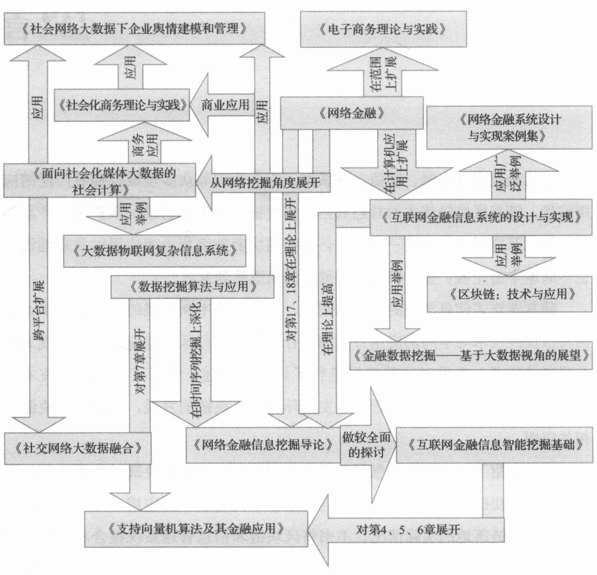
图 0-1 本书与《网络金融》《数据挖掘算法与应用》《互联网金融信息系统的设计与实现》《电子商务理论与实践》《网络金融信息挖掘导论》《网络金融系统设计与实现案例集》《互联网金融信息智能挖掘基础》《支持向量机算法及其金融应用》《金融数据挖掘——基于大数据视角的展望》《面向社会化媒体大数据的社会计算》《社会化商务理论与实践》《社会网络大数据下企业舆情建模和管理》《大数据物联网复杂信息系统》《社交网络大数据融合》之间的关系

本书的研究得到国家社会科学基金（18ZDA309）、国家自然科学基金（71531012）、北京市自然科学基金（4172032）的资助。黄伟兰、邵晓晔、李孔博、赵晓磊、王梦婷、杨子力、何忠恒、张树森、程恒超等作者的学生参与了编写工作。

限于作者水平与时间，书中难免存在不足与错误，敬请读者批评指正。

编者 梁循
2020 年 1 月

# 第1篇

## 概述

## 第1章

区块链的诞生与发展

### 本章学习目标

- 掌握数字货币产生的背景与演进脉络
- 了解比特币的形成历程
- 梳理区块链起源与发展轨迹

### 1.1 数字货币的起源与账本的发展

文字与货币并列为人类文明史上最根本的两次发明。最早的文字文明诞生于今伊拉克南部美索不达米亚平原，约三千多年前的古巴比伦王国在城市化进程中发展出楔形文字，用以管理大规模生产与交易。与此同时，苏美尔人创造了已知最早的货币形式——大麦货币，以固定数量的大麦作为通用计价单位。

中国是使用货币历史最悠久的国家之一，长达五千年。古代货币经历了五次重大转变：从实物到人工货币、从杂形到统一形态、从地方铸造到中央铸造、从重量计价到通宝元宝、从金属货币到纸币交子。总体来看，货币形态依次演进为实物货币、金属货币、代用货币、信用货币、电子货币、数字货币。货币的价值依托也由实物价值、发行主体信用价值，转向对信息系统即算法、数学、密码学、软件等的技术信任。货币的核心职能包括价值尺度、流通手段、储藏手段、支付手段。“互联网+”深入经济社会后，数字货币进入公众视野。它不同于虚拟货币，是可真实用于商品与服务交易的货币形态，是电子货币的替代形式，包含数字金币与密码货币。数字货币以 P2P 对等网络技术进行发行、管理与流通，理论上人人可参与发行，如比特币、莱特币、比特股等。

文字承载信息，货币承载信用。司马迁记载“得黄金百，不如得季布一诺”，约翰·穆勒认为信任能弥合生活的裂隙。现代市场经济本质上是信用经济，信用是商品交换的前提。尤瓦尔·赫拉利指出，金钱是最普遍有效的互信系统。

最初货币需要内在价值来建立信任，如苏美尔大麦货币。随着信任机制建立，货币向信用本位演进，脱离实物价值。信用货币不再锚定贵金属，其面值远大于自身材质价值，已与商品属性脱钩。但无论实物或信用货币，信用始终是其本质属性。

宋代纸币提升了金融可转让性，信息时代的数字货币则让数字化经济活动更精准便捷地度量成为可能。学界对数字货币定义尚无完全统一，有人认为其已具备部分货币职能，有人视其为货币替代品。数字货币简写为 DIGICCY，源自 Digital Currency，是电子货币形式的替代货币。

需明确数字货币与电子货币的区别。二者皆为记账货币，但机理不同。电子货币分储值型与非储值型，发行主体主要是银行，如银行卡。记账与交易基本同步但存在时滞，资金出入账由银行后台安排。举例而言，微信支付到账提示即时，但银行扣款信息往往延迟数十秒。数字货币则是点对点账户同步记账，无前后台间隔、无外部记账机构，出入账即时完成，支付即结算。两者均无现金参与，均需网络支持，根本差异在于是否存在第三方记账机构与时间差。

下表比较数字货币与主流货币。

#### 表 1-1 数字货币与现存主流货币的比较

| 属性 | 分析 | 优势方 |
|---|---|---|
| 便携性 | 小额时纸币仍便携，大额时数字货币便携性显著更强 | 数字货币 |
| 防伪性 | 纸币防伪依赖纸张、油墨、暗纹等工艺设计；数字货币防伪依赖密码学。现实中纸币伪造时有发生，数字货币伪造尚未公开出现 | 数字货币 |
| 辨伪性 | 纸币需验钞机辅助，数字货币依赖密码学验证。验钞机偶有误判，密码学迄今未现错误 | 数字货币 |
| 匿名性 | 两者皆可实现匿名，均存在被恶意追踪的风险 | 平局 |
| 交易方式 | 纸币持有即所有权转移，操作直观。数字货币因可复制需额外机制保障结算安全，便捷性上纸币占优 | 纸币 |
| 资源成本 | 纸币成本为材料、设备与人工，较低。数字货币运行耗电量巨大，摩根士丹利曾预测2018年比特币电力需求将增长三倍，用电量或相当于阿根廷全国年用电量 | 纸币 |
| 发行方式 | 纸币发行依赖第三方机构，不当发行常导致通胀通缩。数字货币由分布式算法发行，因流通时间短、范围有限，长期影响尚待观察 | 平局 |

电子货币相比纸币看似更便捷，但集中式体系的匿名性较差，且易受系统故障、断网、设备故障影响。纸币与电子货币均需银行等额外系统支持生产、分发和管理，带来成本与伪造、盗刷等风险。若能保留传统货币优势并消除缺陷，将产生巨大社会效益，数字货币因此出现。

综合比较显示，数字货币并非全面优于现有货币。盲目夸大或贬低均不合理。目前尚无一种数字货币完整承担货币职能。实验性成果虽大，但分布式账本技术尚未经大规模场景检验，资源消耗高、性能待提升等问题仍在。

比特币等数字货币虽已进入多个领域，暂时难以完全替代现有货币。性能、能耗等瓶颈仍需改进，发展还需金融市场检验。

区块链本质可理解为分布式账本，其诞生具有必然性。从账本演变看，最早的账本思想出现于语言之后、文字之前，结绳记事即为雏形。文字出现后，账本形式多样化，约公元前3000年苏美尔人用芦苇杆在泥板上刻写楔形文字并烘干保存，记账转为按时间顺序的流水账。公元前5世纪，古希腊罗马经济繁荣推动记账分化出日记账与现金出纳账，进入单式记账时期。复式记账法随后出现，中国明末清初的龙门账可追溯其源，既记交易又核算成本利润。19世纪会计职业化，计算机普及后实现电子化记账。

1986年美国国家科学基金会建成基于TCP/IP的主干网，1987年9月14日中国首封电子邮件发出，1990年万维网协议完成，互联网走向大众，为账本数字化奠基。信息传输数据化后账本不断革新，但信息不对称导致的信用问题依然存在。比特币出现打破僵局，为数字时代提供新选择，即本书所述的区块链技术，亦可视为分布式共享账本。

### 1.2 比特币的诞生

2008年10月，以中本聪为化名的研究者提出比特币，即一种分布式存储、非许可的全球可支付电子加密货币。2009年公开初始代码，并于2009年1月3日18时15分05秒生成首枚比特币。比特币在2010年后才逐步流行。其概念首次在论文《比特币：一种点对点的电子现金系统》中提出，论文以区块链作为数据结构与交易体系基础，利用加密技术实现点对点资金转移，不依赖中央银行。交易使用公钥地址，记录公开，身份匿名。确认交易需用户贡献算力达成共识，写入全网公开账本。用户可通过电脑、手机收发比特币并自主设定手续费。

从技术视角看，比特币是数字货币领域的重要创新。近三十年间历经B-money、e-Cash、HashCash等多代尝试。

密码学家戴维·乔姆在20世纪80年代发明扩展RSA算法的加密公式，后创立Digicash公司并推出匿名数字加密货币e-Cash，基于盲签名技术，曾用于部分银行小额支付，但依赖集中中介，隐私问题未根本解决。

英国密码学家亚当·贝克1997年提出哈希现金，首次引入工作量证明机制，用以缓解垃圾邮件等网络滥用。该机制后来成为比特币核心。

哈伯与斯托尼塔1997年提出时间戳协议，用时间顺序固化数字文件，后成为区块链协议原型。

1998年密码学专家戴伟提出B-money并引入PoW生成数字货币，强调点对点交易与不可篡改记录，但各节点账本各自为政，易产生不一致，设计未实现。

这些早期方案多依赖第三方信用背书，成败受限。2008年比特币将工作量证明、分布式存储、密码学、博弈论结合，首次在实践中实现可运行的分布式数字货币系统。自2009年上线以来，比特币网络7×24小时运行近11年，处理过单笔1.5亿美元交易，由数千节点构成，无运维参与，交易量稳步上升。其吸引力在于首次以足够安全可靠的方式实现了分布式数字货币机制。

比特币源代码开源，后续数字货币多在其基础上改进。截至2018年，市场上已有数百种数字货币，总市值约27,846亿元，比特币占比约41%，主导市场并引发货币体系、金融服务、经济学、分布式系统、投票、联合监管、智能合约等领域的创新热潮。加密数字货币数量持续增长，比特币仍居主导。

学界认为比特币价值由其背后的算力支撑，这引发了对数字世界价值衡量与货币发行方式的思考。目前主流模式有两种：一种如PayPal与现有体系合作做代理，另一种如比特币完全抛弃旧体系采用分布式技术。未来主流尚不确定，或将出现更先进方案，但对比特币类设计的研究仍具价值。

区块链被不少观察者类比为电灯、汽车、铁路、航空这类改变生活的底层基础设施。它会像水电一样逐步渗透到各行各业，只是任何社会性技术变革都需要漫长的适应期，账本技术带来的秩序重塑也不会例外。

### 1.3 比特币孵化出的分布式账本
2009年初链式账本随比特币创世区块诞生而登场，作为比特币的底层构造。2013年比特币行情大涨后在媒体热度推动下，链式账本才第一次进入大众视野。实质上它是一种分散账本，凭借分散保存与无需信任的思路，具备公开共识、难篡改、可回溯等特性，为传统系统高成本、低效率、低安全的问题提供另一种解法。2016年中国区块链研究联盟的组建进一步推动了国内研究进程。麦肯锡报告将其视作继蒸汽机、电力、信息、互联网之后，有望开启第五轮颠覆性浪潮的关键技术。

比特币自2009年上线以来，几乎全天候稳定运行了十余年，累计处理数百万笔转账，其中单笔最大交易曾接近1.5亿美元，且从未出现过大规模系统宕机。如今网络上活跃着数千个节点，P2P架构支撑着交易量持续攀升。从数字货币史看，比特币是一次极具意义的社会实验，首次实现了真正安全可靠的分散存储数字货币机制。它打破了传统货币被少数机构掌控的局面，也为匿名化交易提供了可能。

2014年后链式账本作为底层方案逐渐走入公众视线，分散账本的探索随之加速。链式账本可视作一个可无限延展的共享账本：交易被打包进区块，区块随交易增长而不断累加，没有上限；信息在写入时经密码学加密，并按时间顺序串联；没有权威第三方维护，账本由全体用户共同记账，真正实现分散，这对多维开放的商业模式意义重大。

2009至2013年链式账本仍处起步试验期，应用多集中在比特币范畴，多个国家也逐步承认比特币的货币地位。2014年起资本投入加大，全球金融机构和企业纷纷布局研发与落地。2017年后应用进入爆发期，各行业启动落地计划。作为价值传输协议，链式账本在任何与价值相关场景都能发挥独特优势，未来应用面会更宽、形态更丰富。

实践层面已初见成效。R3CEV发起的R3联盟已聚集全球42家顶级银行，共享试验数据并联合开发金融科技应用。国内招商银行、邮政储蓄银行等将链式账本用于支付结算、电子票据、资产管理；腾讯、京东、蚂蚁金服等则将其延伸至公益、医疗、溯源、物流、电商等领域。

链式账本的出现也催生了智能合约技术。韩秋明和王革2018年的梳理指出，智能合约是在无第三方介入下自动执行数字承诺的计算机协议。目前该技术尚不成熟，张健2016年指出的诸多问题仍待解决。其发展依赖链上资产的数字化，乔海曙和谢姗姗2017年认为当前数字化程度远不足以支撑大规模应用，且必须建立在分散存储之上，否则触发条件不一致会削弱效率。2015年8月面世的以太坊采用近乎图灵完备的语言实现智能合约功能；RootStock作为比特币侧链，在主链上构建兼容以太坊智能合约的分散平台。

保险业也在探索中。2017年9月1日上海保交所推出底层平台“保交链”，意图重塑保险价值链、缓解传统交易痛点。2018年上海保监局牵头多家直保、再保及金融机构完成国内首个再保险链式账本应用试点，防篡改、共存证及智能合约有望带来更深变革。

目前链式账本整体仍处早期，基础设施尚未规模化，何峰和耿欣2016年指出的服务、模式受限问题依然存在。尽管如此，张荣2017年及邵奇峰等2018年的研究均强调其与价值的天然亲和性，加上分散存储与无需信任特质，使其在电商、医疗、政务、能源等领域具备广阔前景。不同场景需求不同，未来的方案会在功能强化同时走向多样化、多元化。

从演进路径看，比特币的出现标志链式账本1.0时代开启。该阶段实现分散存储下的虚拟货币转移，为货币交易提供了P2P解法。大量虚拟货币和交易平台涌现，至今仍有700多种在运行。这一时代描绘了全球化货币统一的蓝图，但因缺乏国家法币背书，普及仍受限制。总体而言，1.0是数字货币分散存储实现的时代，引发了金融市场的关注。

链式账本2.0时代则是将智能合约引入金融市场的阶段。智能合约是以信息化方式传播、验证或执行合约的计算机协议。以太坊是典型代表，开源的智能合约公共平台让用户可创建链上资产、部署合约，进而孵化更多商业与非商业应用。发展不再局限于数字货币，股票、债券、期货、众筹、基金等场景均出现链式账本与智能合约的身影。当前智能合约应用仍处于起步期，多数设想停留在理论层面，故整体仍属2.0早期，但智能合约本身正处于爆发式成长阶段。

链式账本3.0时代将P2P信任机制扩展至全社会，不再局限于金融的简单使用，而是在政府、医疗、能源、法律等领域实现复杂商业逻辑的场景化应用。届时技术可渗透到生活各面。

简言之，三阶段分别是：萌芽期解决虚拟货币分散存储问题；高速发展期推动金融领域广泛应用并启动智能合约研究；社会融合期以P2P理念解决各行业信任难题。目前技术已走出比特币体系，在金融、物联网、征信、能源、共享经济等领域持续探索，当下处于2.0时代，前景可期。

### 1.4 本章小结
链式账本作为比特币的底层技术随比特币的发展进入公众视野，以其独特属性备受关注。它源于比特币，可理解为分散账本，本章从货币切入，梳理了数字货币的起源与演化，对比纸币，分析其特质，并从账本视角论证分散账本出现的必然性。

比特币是数字货币史上里程碑式创新，吸取了前人的失败经验，整合多学科技术。其背后技术同样吸引学界与产业目光，诸多优秀特性推动企业将其应用于不同行业。当前发展仍处早期，应用探索持续进行，但技术融入金融、科技乃至社会的趋势已不可逆。

思考题
- 1. 试论述数字货币的特点。
- 2. 请简述对区块链的理解。
- 3. 请列举有关区块链的应用。
- 4. 请结合当下的区块链发展现状，谈谈区块链未来的发展趋势。

# 第2篇
## 区块链技术
## 第2章 区块链的密码学技术原理

### 本章学习目标
- 理解区块链的概念
- 了解区块链的分类以及各类区块链的特征及应用范围
- 了解区块链的基本特征
- 理解区块链的密码学技术原理

### 2.1 区块链的定义与三大类型
超市宣称果蔬刚从产地采摘，如何证明采摘时间与运输卫生？合同签署后如何确保对方履约？在多家医院就诊时，如何在保障隐私完整前提下共享病历？链式账本技术对这些难题已有初步答案。

概念首次出现在中本聪2008年论文《比特币：一种点对点电子现金系统》中，文中将其作为比特币数据结构与交易底层。维基百科将其定义为一种分布式数据库技术，通过维护数据块链式结构，实现持续增长且难以篡改的记录。

链式账本是以比特币为代表的数字加密货币体系的核心支撑。其诞生确保了互联网价值交换的唯一性、可信性与安全性。作为比特币背后的分散记账平台，它在无集中监管的情况下稳定运行逾八年，支撑海量交易，社会信任不断增强。伴随比特币的普及，链式账本研究与应用呈爆发式增长，被认为是继大型机、个人电脑、互联网、移动社交网络之后的计算范式第五次颠覆式创新，也是继血亲信用、贵金属信用、央行纸币信用之后的第四个信用里程碑。

核心优势在于分散保存，借助数据加密、时间戳、分散共识与经济激励，在节点互不信任的网络中实现基于信用的点对点交易。可视作一台制造信任的机器，让缺乏中立中央机构的参与者仍能协作。

链式账本综合了数字加密密码学、共识机制、P2P分散网络、区块成链、默克尔树等基础技术，并非全新发明，而是巧妙组合。1976年Whitfield Diffie与Martin Hellman发表《密码学的新方向》，奠定现代密码学基础。1977年Rivest、Shamir、Adleman提出RSA算法，为链上数据安全提供保障。1980年Ralph Merkle创造默克尔树，解决可信认证问题，其结构被用于分散网络数据同步校验。1982年Lamport提出拜占庭将军问题，推动点对点一致性研究。1997年Hashcash算法问世，最初用于反垃圾邮件，后被用于比特币工作量证明。1999至2001年Napster、eDonkey2000、BitTorrent等P2P服务兴起，为链式账本所需网络计算打下基础。至此，链式账本诞生的技术基础在理论与实践上均已成熟。

随比特币发展，诸多加密货币效仿其共享价值体系。2011年11月莱特币诞生，采用Scrypt替代SHA-256改进工作量证明。2013年首次代币发行ICO提出，将使用权与加密货币结合为项目融资。同年11月Vitalik Buterin发起以太坊，以太坊是开源智能合约公共链式账本平台，通过以太币提供分散虚拟机处理点对点合约。2015年7月后相继发布Frontier、Homestead、Metropolis版本，普通用户可使用。2015年Linux基金会发起企业级开源项目超级账本Hyperledger，成员包括多家银行与咨询机构，目标共建跨行业商业链式账本开放平台。2016年4月R3CEV推出面向金融的分散账本平台Corda，借鉴UTXO模型与智能合约等特性，但数据仅对交易双方与监管可见，本质上异于链式账本。

由此可见，链式账本是加密数字货币构造与流通的基础技术，但数字货币只是链式账本在特定领域的变体，其概念更为广义、形态更多、用途更广。

实质上链式账本的核心是区块与链。它是一个由密码学方法产生的区块按序链接而成的分散数据库，包含一段时间内难以篡改的数据记录。按准入机制可分为公有链、联盟链、私有链三类。

表 2-1 公有链、联盟链和私有链的比较

|  | 公有链 | 联盟链 | 私有链 |
|---|---|---|---|
| 定义 | 全世界任何人可读取、发送交易并获得确认，任何人可参与共识的链式账本 | 对特定组织开放，共识由预选节点控制的链式账本 | 对单独个人或实体开放，共识受限的链式账本 |
| 分散存储程度 | 完全分散 | 部分分散 | 分散程度极低 |
| 共识过程参与者 | 所有节点 | 授权节点 | 内部控制 |
| 主要特点 | 存储高度分散，可信度高，效率低，门槛低 | 效率较高，隐私有保障，监管可控 | 节点有限可控，效率极高，抗攻击强，成本低 |
| 典型代表 | 比特币、以太坊 | Ripple、Corda、Hyperledger | 机构自建企业上链系统 |

传统社会信用依赖规定、制度、法律与契约，核心机构如金融中介提供权威背书，但存在高成本、低效率、数据不安全等问题。2015年杭州萧山光缆被挖断导致多地支付宝故障即是集中化风险的例证。过度集中还导致信息不对称与权力滥用。分散存储的颠覆性在于消除层级控制，通过节点微观交互与博弈实现系统运行，保证公开透明，使大规模高效信息交互成为可能。

狭义上链式账本是分散存储、可信、可共享、难以篡改的分散数据库系统，由多个独立节点构成类似公开账本，各节点均可记账查账，无单一节点可控制账本，按公开协议共同更新。与传统分散存储不同，链式账本账本是同步而非备份。数据以密码学方式防篡改、防伪造，并分散存放在区块中，按时间顺序串联成链。广义上，链式账本技术是利用加密链式区块结构验证存储数据、利用分散共识生成更新数据、利用自动化脚本代码即智能合约编程操作数据的一种全新P2P基础架构与分散计算范式。

### 2.2 区块链三大核心特征
#### 1. 去中心化存储
这是最本质特征。没有主导核心节点，各节点地位平等，数据由全体共同维护。规则非特定节点制定，而是由密码学原理与共识算法决定。数据操作无需核心机构或第三方背书，完成从对机构信任到对体系信任的转变。

#### 2. 抗攻击安全性
传统网络核心节点受攻击会导致整体崩溃。链式账本网络中节点平等，攻击单个节点无法控制或破坏整体。修改数据需掌控超过50%节点，成本极高。因此数据具备永久存储、难以篡改属性，显著提升系统安全与可靠性。

#### 3. 全程透明可追溯
链式账本的数据与操作对所有节点公开。节点可通过公开接口查询与操作，数据与操作可追溯查询，进一步强化安全与可信度。

### 2.3 密码学支撑体系
从技术角度看，链式账本是按时间顺序将数据区块式组合而成的结构，由密码学技术、共识机制、P2P分散网络等多项基础技术共同保障其不可篡改与不可伪造。

#### 1. 加密算法

区块链密码学与分布式存储要点

当代密码学要解决的核心议题，可以归纳为能否保密、能否证明数据未被篡改、发送方是否可否认，以及在分布式协作环境下如何抵御内外攻击。按密钥使用方式划分，主流做法分为对称式加密和非对称式加密两大类。

对称式加密即秘密密钥加密，加解密共用同一密钥。优点在于运算迅速、效率高；缺点是所有参与方都必须掌握该密钥，一旦泄露风险会扩散。密钥分发渠道的安全程度，直接决定了整体方案的安全水位。

区块链实践中选用的是非对称式加密。与必须预先交换密钥的对称方案不同，非对称方案生成一对密钥：可公开的公钥与必须保密的私钥，且私钥无法从公钥推导。用公钥加密的数据只能以对应私钥解密，用私钥签名的信息只能以公钥验签，从而省去密钥交换环节，通信可信度更高。

非对称方案的安全性建立在离散对数、整数大数因子分解、椭圆曲线等计算难题之上。代表性方案有RSA、椭圆曲线、ElGamal等，其中区块链应用最广的是椭圆曲线方案。

椭圆曲线方案在有限域上运算。相较RSA，在同等安全等级下它的计算开销更小、存储占用更省、对带宽需求也更低。比特币采用基于secp256k1曲线的公钥体系。每笔交易由发起方用私钥签名后连同交易内容广播，网络中其他节点用公钥校验签名，以确认交易确实来自宣称的主体，从而保证可信与准确。

对称加密也称秘密密钥加密，双方必须共享同一密钥。非对称加密也称公开密钥加密，依赖一对互补密钥。任一密钥加密后的密文，只能由配对的另一密钥还原，且加密用的密钥不能反用于解密。以下从安全表现、处理速度、适用数据规模、典型算法等维度做对比。

#### 表 2-2 对称加密算法与非对称加密算法的对比

|  | 对称加密算法 | 非对称加密算法 |
|---|---|---|
| 安全性性能 | 密钥管理流程繁琐，安全水平高度依赖管理 | 依托数学难题保障可靠性，在很大程度上缓解了密钥管理难题 |
| 速度性能 | 密钥长度较短，处理速度快 | 密钥长度较长，处理速度相对慢 |
| 适用数据量大小 | 适合大批量数据 | 适合小规模数据 |
| 常见典型算法 | AES（advanced encryption standard） DES（data encryption standard） 3DES（triple DES） | ECC（elliptic curve cryptography） DSA（digital signature algorithm） RSA |

数字签名是区块链中常用的身份鉴别手段，原理类似纸质签名但借助非对称加密。一套签名机制包含签名与验证两步互补运算。签名时发送方用私钥对数据摘要加密，再与原文一并发出；验证时接收方用发送方的公钥解密摘要，并与本地重新计算的摘要对比，一致即表示内容未被改动。常用方案有DSA及安全性更高的ECDSA。

#### 2. 哈希算法

哈希也称散列或杂凑，本质是从任意文件提炼出固定长度的数字指纹。它把目标文本映射为不可逆的固定长度摘要，而加密产生的密文长度可变且可逆。哈希能把任意长度二进制明文映射为较短固定长度哈希值，且不同明文极难产生相同哈希。对给定函数 f，输入 x 映射为固定长度输出 f(x)，通常具备：

+   1. 强抗冲突性：不同输入应产生不同输出，找到碰撞在计算上极难。
+   2. 不可逆性：已知 f(x) 反推 x 在计算上不可行。
+   3. 在现有数学理论下，只能靠穷举来逼近 f(x) 的取值范围（截至 2018 年）。

常见哈希方案包括 MD5、SHA-1 和 SHA-2。

MD5 是 Ronald Rivest 1991 年在 MD4 基础上改进的方案，输出 128 位哈希，例如 Hello Blockchain World 的 MD5 为 2cd5dc883bf3cd3c767901262cfed7df。该方案已被证实不具备强抗冲突性。

安全哈希算法 SHA 由美国国家安全局设计、国家标准与技术研究院发布。1993 年首版，后出现 SHA-1、SHA-224、SHA-256、SHA-384、SHA-512，其中后四者合称 SHA-2。SHA-1 于 1995 年发布，输出 160 位，2005 年被破解，同样失去强抗冲突性。SHA-2 目前未被攻破，安全性较高。比特币采用 SHA-256，可接受任意长度输入并输出 256 位。当前普遍认为 MD5 和 SHA-1 不够安全，实际应用至少使用 SHA-256。

哈希与加密都能保护数据。若数据仅需比对校验且日后无需恢复明文，可用哈希；若日后需要还原成明文，则需加密。

区块链中还用到 Base58、DER 等编码。Base58 是比特币钱包地址的常用编码，为避免 0 与 O、l 与 I 等视觉混淆，去掉了这些字符，也去掉了 +、/ 等易引起误用的符号，没有标点，利于复制选择。

#### 3. 区块链的数据结构

分布式数据库是通过网络把若干离散数据库统一管理，形成逻辑上统一的整体。每个节点保存完整数据，通过共识保持一致。区块链的分布式实质是：每个节点都保存完整的链式结构，并以共识保证存储一致。

区块链使用哈希指针。与普通指针只指向位置不同，哈希指针同时指向数据的存储位置和该数据在某时间戳下的哈希值，可用于校验是否被篡改。区块链可视作由哈希指针串起的链表。

这就解释了不可篡改性。改动某一区块会导致其前驱区块的哈希不匹配，必须连锁修改直至创世区块，而创世区块不可改。一旦交易区块被确认并纳入最长链，就无法再篡改伪造。

哈希指针还能构建梅克尔树。二叉树中，每层把数据两两分组，父节点保存子节点的指针，层层向上直至根节点。只要根哈希被记住，任何底层数据的改动都会导致指针链式失效而被发现。

以比特币为例，地址标识交易双方，交易信息写入区块，每个区块装载一段时间的交易。新区块生成后打上时间戳，连接在已有的最长链上，形成按时间顺序的交易证明。点对点网络构成分布式时间戳服务器。

时间戳把区块按时间串起来，给每条记录加上唯一的时间标签，便于定位和追溯，也为其他校验机制提供确定性。后来的交易建立在已有的交易之上，形成环环相扣。若要篡改，需改动该区块之后的所有区块。即使出现分叉，系统默认最长链为正确链，要伪造就需要造出更长的链，随着时间推移成本呈指数增长。每个节点既是客户端也是服务器，难以像攻击中心化节点那样造成重大冲击，这保证了系统的安全与可信。

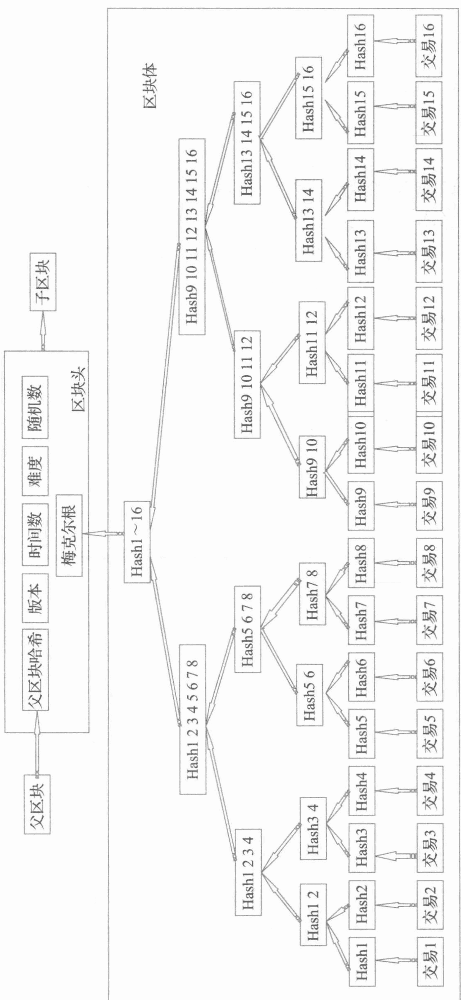

图 2-1 区块链的数据结构

### 2.4 本章小结

本章围绕区块链的密码学基础展开，首先介绍了区块链的基本概念和在分布式存储程度的标准下区块链的分类，并详细解释了不同种类的区块链的特征与适用范围，同时还以当下不同区块链的应用作为例子进行说明。

然后，本章介绍了区块链的基本特征，即分布式存储（最主要特征）、安全性以及公开性。对密码学技术原理的介绍分为三个部分，分别从区块链的加密算法、哈希（散列）算法以及数据结构三个方面介绍了区块链在密码学基础中应用的技术。通过对这三个方面的详细解释，我们可以发现，正是这些精密的技术使得区块链具有较高的安全性与可信任性。

### 思考题

+   1. 请简述区块链的概念。
+   2. 请举例说明区块链的分类情况。
+   3. 请结合自己的理解，具体解释区块链具有的特征。
+   4. 请说明区块链的密码学技术对其特征的影响。

## 第3章 区块链的分布式存储特性

### 本章学习目标

- 了解拜占庭将军问题的主要内容
- 了解区块链的网络架构
- 理解区块链的多种共识算法以及不同共识算法的应用

区块链的共识机制为其分布式存储特性提供了技术基础。作为区块链的特性，分布式存储并不是绝对的，例如在比特币体系中，虽然系统是分布式的，但某些帮助用户管理比特币的平台或者软件既可以是分布式的，也可以是集中的。

### 3.1 拜占庭将军问题

拜占庭将军问题是莱斯利·兰波特提出的点对点通信中的基本协议问题。拜占庭作为东罗马帝国的首都，幅员辽阔，拥有巨大的财富，每个军队都相隔很远，将军与将军之间只能依靠信差传递消息。在战争发生的时候，军队中可能存在叛徒，假设在所有部队中需要有超过半数的将军共同攻打敌军才能取得胜利，但若同意攻打的部队中存在叛徒，则可能会导致该部队只口头同意攻打而不付诸实践，从而可能会战败。也就是说，叛徒的存在会使得各个部队达成的共识结果并不能代表大多数人的意见，由此就形成了拜占庭将军问题。简单来说，拜占庭将军问题是指在已知有叛徒存在的情况下，其余忠诚的将军如何不受叛徒的影响而达成一致的问题。

拜占庭将军问题的解决方案主要有两种，即通过口头协议的方法和通过消息签名的方法。

通过口头协议的方法默认了每个被发送的消息都能够被正确投递，并且消息的接收者能够知道消息的发送者和缺少的消息。这种方法在叛徒数目少于将军总数的 1/3 时解决了拜占庭将军问题，但是，这种方法不能对消息进行溯源。而通过书面协议对消息进行签名则解决了这一问题。这种方法除了要满足口头协议中的需求以外，还要求签名不可伪造，一旦被篡改即可被发现，并且任何人都可以验证签名的可靠性。这种算法虽然解决了消息的溯源问题，但是对于信息的传输延迟问题、签名的分布式问题等依旧没有给出完美的解决方案。

而在区块链中，可以根据体系中的共识算法对这个问题予以解决。例如，在比特币体系中，发送信息需要一定成本，这个成本被定义为“工作量”，节点需要完成一定的哈希计算工作量才可以向其他节点发送消息。当用户将交易信息发送到网络上时，需要利用公钥对消息进行加密签名，这可以类比拜占庭将军问题中通过书面协议进行签名的解决方案。哈希计算速率的限制与公钥加密的限制使得由区块链构成的网络成为一个可信的网络，所有用户都可以在此网络上达成共识。

### 3.2 区块链网络

区块链采用了基于 P2P 的网络架构，在 P2P 网络中，每一个节点都是相互对等的，各个节点共同提供网络服务，在整个网络中不存在任何特殊的核心节点。P2P 网络除了在区块链体系中使用外，早在文献共享领域已经有了广泛的应用。

区块链的主要工作流程如下：

+   1. 在新的交易产生时，消息的发送方将交易信息在全网进行广播。
+   2. 接收节点对收到的数据记录进行检验，通过检验后将数据记录组装成区块。
+   3. 当且仅当包含在该区块中的交易都是有效的，并且通过了该区块链中共识算法的验证，其他节点才会认同该区块的有效性。
+   4. 其他节点在表示接收该区块后，会将该区块纳入区块链中进行存储，并在该区块的末尾制造新的区块来延长整个区块的链条。

在区块链体系中，交易和区块信息的广播是通过洪水算法（flooding algorithm）进行的。在交易信息传播的过程中，每一个收到信息的节点均会向与它相连的全部节点发送信息，下一个收到信息的节点也会进行同样的操作，由此，指数增长的传播速度会使得信息很快覆盖整个网络，就像洪水泛滥一般，通常在一两秒内信息就可以传遍整个网络。每次将信息在全网进行广播时，其实并不需要将信息传达至全部节点，只需要将数据信息传到足够多的节点即可保证交易信息被整合进区块中，而且在对区块进行广播时，区块链具有很好的容错能力。假若一个节点没有收到某区块，那么该节点将会发现自己缺少了该区块的内容，并会向其他节点提出下载该区块的请求。

在区块链体系中，始终将最长的链认定为正确的链，并不断在它的基础上持续延长，每次接收新的区块时，都会将区块连接到最长的链中。假若同时有两个节点广播不同的区块，那么其他节点接收这两个区块的时间会有先后的差异，在这种情况下，它们会在先接收到的区块上进行工作，但也会保留另外一个链条，直到共识算法进一步运行使得其中一条链被证明是较长的一条，而在另一条分支链上工作的节点将转换阵营，开始在较长的链上工作。

区块链之所以具有安全性、不可篡改性以及公开性，是因为具有两大方面的关键技术：一方面是上一章中解释的加密机制，另一方面则是共识算法。共识算法是区块链中节点保持数据一致、准确的基础。在实践中，要在尽可能少的时间内保证分布式数据记录的安全性以及不可逆性，需要做到两方面：一是选择一个节点来生成区块，二是使分布式数据记录不可逆，而实现这个流程的核心技术就是共识机制。共识机制可以保证新的区块能够被准确地添加到区块链上，并且保证节点存储的区块链信息一致且不分叉，甚至能够抵御恶意攻击。本章的剩余内容将介绍当前主流的共识机制。

### 3.3 区块链的共识算法

共识算法用于一个时间段内，对事物的前后顺序达成共识，以保证分布式系统的一致性。共识机制是指区块链事务达成分布式共识的算法。共识算法是区块链里每个节点必须遵守的规则，规则的最终体现就是比特币的最长链。共识算法保证区块链在最长链上运转（最长链法则），从而保证整个系统的一致性和可靠性。共识算法是区块链的灵魂，维系着区块链世界的正常运转。如果分布式系统中各个节点都能保证以十分强大的性能无故障地持续运行，则可以通过简单投票实现共识过程。然而，现实中，响应请求往往存在时延、网络会发生中断、节点会发生故障，甚至存在恶意节点故意破坏系统。

1982 年莱斯利·兰波特提出拜占庭将军问题，分布式对等网络中需要按照共同一致策略协作的各节点即为问题中的将军，而各节点赖以进行通信的网络链路即为信使。拜占庭将军问题描述了节点或网络链路出现错误，甚至被蓄意破坏者控制的情况。一般地，普通故障称为“非拜占庭错误”，恶意响应称为“拜占庭错误”。对于非拜占庭错误，主要共识算法包括 Paxos、RAFT 及其变种。对于拜占庭错误，主要共识算法包括 PoW（proof of work，工作量证明）、PoS（proof of stake，权益证明）、PBFT（practical Byzantine fault tolerance，实用拜占庭容错）等。表 3-1 介绍了 PoW、PoS、PBFT 等共识算法的核心概念、主要优劣势等。

#### 表 3-1 PoW、PoS、PBFT 等共识算法的比较

|  | PoW | PoS | PBFT |
|---|---|---|---|

| 核心概念 | 工作量证明让使用者完成一段计算量适中且耗时的运算，验证方却能在极短时间内复核结果，以消耗的时间、算力与电能作为使用凭证，防止服务被滥用，确保资源落到真正有需求的参与者手中 | 权益证明引入了币龄这一指标，币龄反映了在某笔交易时点用户所持有的货币存续状况，系统借助伪随机的方式依据各节点的币龄高低来分配出块权益 | 在 PBFT 模型里，一次客户端请求要经历请求、编号、交互、编号确认、应答共五轮交互，且系统需拥有 3f+1 个节点才能容忍 f 个拜占庭节点，通过多轮协商达成一致，当出错节点不超过三分之一时链仍能正常运行 |

| 代表应用 | 比特币 | 点点币 | Hyperledger |

| 主要优势 | 思路简明，网络高度去中心化 | 共识达成更快，对电力消耗几乎没有门槛 | 抗攻击能力强，记账效率高 |

| 主要劣势 | 电力消耗巨大、达成共识慢、算力浪费、分叉风险存在 | 权益易向少数大户集中，导致话语权失衡 | 主节点出错会引发视图切换和全网状态重置，对性能有一定拖累 |

#### 1. 工作量证明
工作量证明是为证明节点确实投入了相应劳动而设计的机制，其本质是通过让区块发起者消耗算力完成指定运算来抵御拒绝服务与资源滥用。

典型流程大致如下：
- 节点持续监听全网数据，校验合法后暂存。
- 用自身算力遍历不同随机数执行哈希运算，直至得到符合规则的结果。
- 按照区块头在前、数据在后的方式组装区块。
- 广播给全网，其他节点校验通过后才并入主链并在此基础上继续延伸。

在 PoW 系统中，客户端要付出计算成本，而验证方只需做轻量检查。比特币是典型代表，想出块的节点必须解开网络设定的谜题，谜题由工作量证明函数、区块内容和难度值三要素构成。函数决定解题方法，区块决定输入，难度值决定计算量大小。

比特币采用 SHA-256 作为证明函数，区块头作为输入被反复重构，不断变更其中的随机数并做两次 SHA-256，得到的哈希需小于当下网络目标值才算成功。难度并非固定，区块目标间隔约十分钟，系统每产生 2016 个区块就会根据实际耗时与理想时长的偏差统一调节难度，保证出块频率稳定。

具体挖矿步骤为：先用默克尔树把交易列表压缩成根哈希；再组装 80 字节的区块头作为输入；随后不断改动随机数做双重哈希并与目标对比，直至满足条件。

这一过程常被称为挖矿，执行者为矿工。随着难度指数级攀升，个人难以获利，于是出现矿池。矿池把分散算力集中起来，按贡献分配奖励，大幅降低了参与门槛，但也带来风险：一旦矿池算力超过全网一半，就能操控记账与分配。此外 PoW 出块约需十分钟，共识速度慢，难以直接用于商业场景。

#### 2. 权益证明
权益证明不依赖算力竞争，只需证明人持有一定数量的加密货币即可参与共识，因而能大幅减少资源消耗。

新块产生时，系统会依据节点持币比例与持有时长，等比降低其“挖矿”难度，整体节奏比 PoW 更快。核心在于币龄，币龄等于币的数量乘以在链上存续的天数，例如持有 10 枚并沉淀 10 天，币龄为 100。产生 PoS 区块后币龄会清零，每累积 365 币龄可获得一次利息激励，公式为 stakereward = (0.01 × coinage/365) × coin，coin 为常量。

这种设计既避免了资源浪费，也压缩了共识时间。币龄消耗最多的链被视为正确链，要发动攻击必须掌控大量币龄，成本极高，且攻击过程中币龄本身也在流失，难度进一步加大。

权益证明常与工作量证明搭配，点点币即是实践。早期用 PoW 发行新币，后期以 PoS 维护安全，网络中同时存在 PoS 区块与 PoW 区块。随着难度上升，安全主要由 PoS 承担。PoS 会产生利息币，造币初期保留 PoW 以便更顺畅启动，每个区块都有所有者签名以防复制攻击。若出现虚假区块，节点会核对时间戳与交易记录是否重复，重复则丢弃。点点币允许任何持币者出块，避免了 PoW 中矿池导致算力集中的问题，用币龄消耗替代算力消耗，优化了单一 PoW 的弊端。

#### 3. 股份授权证明
权益证明仍需挖矿运算，速度受限。股份授权证明即 DPoS，通过授权代表来把交易速度提升到与现行电子支付可比的水平。

DPoS 避免了币龄高者垄断出块的问题，运行分为两部分：全体持币者投票选出票数靠前的数个代表，代表拥有广播区块的权限，持币者可随时改选或罢免；代表按既定时间表轮流打包，收集交易并用私钥签名。若代表发布无效区块或长期不生产，将被系统换掉。

网络以最长链为正确链，分叉时由最长链胜出。若代表中存在恶意节点，只要诚实节点出块数超过一半，诚实链仍会胜出。

DPoS 实现了秒级确认，在速度上远超 PoW，但仍依赖代币，许多不需要代币的商业应用难以直接采用。

#### 4. RAFT 算法
RAFT 是面向分布式系统的强一致性协议，通过选举出 leader 由其负责日志复制来保证系统一致。

节点状态有三种：leader、candidate、follower。共识分选举与记账两阶段。选举开始时所有节点为 follower，各自持有 150~300ms 的超时计时器。若计时器超时仍未收到候选人的投票请求，则自行转为 candidate 发起拉票；若在超时前收到请求则投票并重置计时器。获得半数以上选票的 candidate 成为 leader，其余转为 follower。leader 出问题后 follower 会重新选举。

记账阶段 leader 先收到交易并写入本地日志，再分发给 follower。follower 写入后回传确认，leader 确认后通知提交。若部分节点因网络失联未收到信息，会另行选举新的 leader，网络恢复后旧 leader 退为 follower 并回滚其期间的操作。

RAFT 通过 leader 简化了管理，但仅能容忍宕机故障，无法抵御主动发送错误信息的恶意节点。

#### 5. 实用拜占庭容错算法
PBFT 解决了拜占庭将军难题，不仅能容错宕机，还能容错恶意行为。

核心是三阶段协议：预准备、准备、确认。发起节点先向全体发送 pre-prepare，接收方校验有效后进入准备阶段；随后节点向全体发送 prepare，每个节点收集到 pre-prepare 与足够 prepare 后进入确认阶段；进入确认阶段的节点广播 commit，节点累计收到超过三分之二的 commit，即 3f 节点中至少 2f+1 个，即可向客户端反馈并落盘。确认阶段确保超过三分之二节点已验证。

PBFT 是静态共识，适用于节点集合已知且有限的场景，不适合节点数量庞大、频繁进出的动态网络，效率会下降。

#### 6. 瑞波共识算法
瑞波共识算法即 RPCA，在保持较高拜占庭容错的同时提供较快处理速度。

网络中存在由现有特殊节点投票加入的独有节点列表 UNL，普通节点需获投票才能进入，长期不活跃节点会被移除。

共识时验证节点从网络收集待确认消息，校验后放入本地候选集，再向其他节点广播。接收方对信任节点与自身候选集的交集进行投票，达到半数信任节点支持的交易进入下一轮，未达标的本轮不确认。随后对达标交易进行多轮再投票，不断更新认可列表，直至支持率提升到 80% 左右方可写入账本。每一轮结束后继续处理遗留与新交易。

该机制无需代币，确认在秒级，适用于商业场景。

#### 7. Pool 验证池机制
Pool 验证池机制基于分布式一致性与数据校验，提供秒级以上的确认速度。

其借用池结构提升效率，降低对象频繁创建销毁带来的开销，原理与服务器端开发中的对象池类似。该机制也不依赖代币，在当前区块链实践中较为常见。

### 3.4 本章小结
本章从拜占庭将军问题切入，说明了点对点网络中不诚实节点带来的风险，并介绍了共识算法如何解决这一问题。先概述区块链运行流程，再对可用于区块链的七类共识算法分别阐述了原理、适用边界、优势与不足。区块链的分布式程度并非非黑即白，不同场景对分布度的需求也不同，没有绝对优劣，各算法各有其最佳应用环境，未来仍需探索。

### 思考题
- 1. 请用自己的话解释区块链的分布式存储特性。
- 2. 试归纳区块链体系的工作流程。
- 3. 试比较工作量证明与权益证明的异同。
- 4. 请简述实用拜占庭容错算法的运行机制。
- 5. 试说明区块链的共识机制对区块链整体的影响。

## 第4章 区块链的安全性

### 本章学习目标
- 了解区块链在安全层面面临的主要挑战
- 掌握区块链的数据、技术与网络层面的安全要点
- 了解当前区块链安全现状与演进趋势

区块链技术正逐步渗透金融、征信、物联网、贸易结算、资产管理等领域。随着应用生态扩大、用户与场景增多，围绕数字货币的基础设施日益丰富。2018 年被视为区块链元年，截至 2018 年 1 月 7 日加密数字货币总市值一度逼近 8000 亿美元。大企业开始探索用区块链精简流程，部分项目已落地，如 WePower 用以太坊购买可再生能源，Verisart 用区块链生成艺术品溯源证书。德勤调研显示，金融等传统行业正把区块链用于现有业务改造，74% 的传统企业仍停留在设想阶段，但超 40% 认为未来会采用。可以说区块链认可度在提升，实际效率也正被验证。

### 4.1 区块链安全概述
区块链价值提升的同时，盗窃、勒索、签名攻击等安全事件也增多。区块链作为新兴技术，整体生态仍在完善，安全形势日益复杂。自诞生以来，安全事故逐年上升，损失金额不断攀升，2018 年尤为集中。

区块链安全涵盖应用层安全、智能合约安全、共识机制安全、网络安全、数据安全、密码学安全等，任一环节出现漏洞都可能造成重大损失。鉴于数据一旦上链即难篡改，后果难以逆转，即便修复也要付出巨大代价，以太坊的硬分叉即为例证。

传统安全攻防与区块链攻防存在差异，区块链强调代码即法律。技术安全包括基础建设、红蓝对抗、安全治理、算力保护、智能合约审计、交易所安全评估等。进入区块链 3.0 时代，链上链下结合的开放系统将更普及，也要求解决界面不友好、安全隐患突出、体验不佳、性能低下等问题。

需要强调的是，区块链并不能解决所有数据安全问题，但能让数据共享与利用更可控。例如患者的病历数据属于隐私，存储于不同医院后，需要对医院、保险公司、监管机构等有限共享，同时避免被医药公司等不当使用。

跨机构调用数据时，传统做法通常只有两极——全部公开或仅对少数机构做简单封锁。如此粗放的管控难以实现分层分维的访问权限，整个数据控制链条在复杂度上升时容易失控。借助许可链或联盟链的运行机制，再叠加加密算法，就能把数据的支配权归还给患者本人，由其自主设定谁有权查看、查看的范围和深度。

数据风险贯穿全生命周期，涵盖存储、访问、再利用及在途传输。仅靠链上技术不足以覆盖全部安全面，但其密码学本征特性已在传输路径上化解了绝大部分隐患。

### 4.2 区块链数据安全性
链上数据搬运受制于算力、带宽与存储三重瓶颈。主流共识多以算力为依托，传输受限于网络带宽，存储方式与传统库截然不同。传统库以表结构存取，遵循创建、更新、读取、删除的操作范式；链式账本本质上是只增不删的结构，每次修正都表现为追加一条新块对历史记录进行说明，因而账本持续膨胀、成本随之抬高，这也是落地前必须做最小化裁剪的关键决策。反过来，链对输入进行严格校验，拒绝无法核验的可疑数据，使得诸如零售行业的分析人员只能基于完全透明的信息工作，行为模式的识别精度因此提升。

在传输层面，安全需满足三项要求：发送方需确保只有预期接收方可解密；接收方需能确认信息的发信人；接收方需能确认信息在传递过程中未被篡改。首项主要靠加密实现。对称加密使用同一密钥加解密，非对称加密使用一对公钥与私钥配对。公钥加密的内容只有对应私钥可解，私钥加密的内容只有对应公钥可解。

在非对称体系中，双方各持私钥并互换公钥。认证模式下，发送方用自有私钥签名，接收方用公钥验签即可确认身份，从而满足来源可鉴别。完整性则依赖数字签名，数字签名类似纸质签名，利用公钥技术实现。其核心运算包括签名与验签，可保证内容未被改动、发信人可信、交易不可抵赖。

隐蔽地址用于切断输入输出的关联。付款时，发送方依据收款方每次新生成的地址，通过椭圆曲线算法生成一次性公钥，并将该公钥连同附属信息上链。收款方可用自己的私钥扫描交易块确认到账，使用时再用私钥派生签名私钥对交易签名。

隐蔽地址可让收款地址每次变化，隐藏关联，但无法彻底匿名发送方。环签名将多个地址组成一个环，成员地位对等，外界难以判断真实发起者，从而大幅提升匿名性与安全性。

比特币的实践更直接体现了健壮性。它依靠 P2P 协议维护网络，无需中心协调。各节点可自由加入或退出，只要通过验证，网络即可自愈。每个节点保存全量账本，更新时若与多数节点不一致则自动同步，这种自驱动修复机制保证了网络活力。

区块链不可渗透的构建方式使其可承载各类数据，在安全领域应用价值突出。物联网设备激增与云计算普及扩大了网络边界的攻击面，勒索软件与国家级黑客也提供了新的盈利路径，网络安全形势严峻，区块链作为一种新型安全设计模式应运而生。

### 4.3 区块链技术安全性
区块链带有共享协作的公共属性，应用规模放大后业务逻辑与技术迭代的复杂性随之上升，数字钱包、恶意程序、应用漏洞等问题愈发凸显。共识不完善引发的双花、硬分叉、智能合约缺陷等事件频发。电子钱包普及推动芯片安全、硬件非对称加密、硬件分布式账本的探索加速，若安全问题不解决，行业落地无从谈起。

应用层是攻击者首选，常见问题有交易所服务器未授权访问、分布式拒绝服务攻击、员工终端失陷、恶意程序感染等。智能合约层是防线的核心，一旦部署就难以修改，合约安全性决定项目生死。The DAO 事件因重入攻击导致数千万美元损失是典型案例。钱包、众筹、代币发行、区块链游戏等均受影响，未授权访问与编程隐患是高发点。

底层与基础设施层需关注实现层隐患、社区 DoS 攻击、EVM 隐患等。安全意识同样关键，包括社会工程学、内部攻击、第三方风控失效、钓鱼等。

从密码学与不可篡改性看，直接改写链上数据几乎不可能，但当前算法效率有限、合约结构单一且缺乏统一规范，导致共识与合约处理阶段漏洞频出，隐私泄露与资产丢失时有发生。攻击者多从合约层与应用层入手。

数字货币钱包的本质是明文私钥。冷钱包私钥离线保存，如断网电脑、手机、手写记录本，避免黑客窃取但面临物理损坏风险。热钱包在线使用，建议多平台不同密码并开启二次验证。

目前智能合约仍处初级阶段，规范性与严谨性不足，审计策略与安全规范仍在完善。

### 4.4 区块链网络安全性
常见共识算法如 PoW、PoS、DPoS、拜占庭容错各有缺陷，难以全场景适用，切换机制也不成熟，如何融合多种算法并动态切换是未来探索方向。

区块链常用的 P2P 网络有全分布式非结构化、分布式结构化、半分布式三种。典型攻击包括 DDoS、女巫攻击、日食攻击。

DDoS 借客户服务器技术控制大量主机协同攻击，攻击者通过被盗账号植入主控程序，指令代理程序发动拒绝服务，攻击力成倍放大。

为维持稳定，P2P 网络常对同一数据做冗余备份，女巫攻击正是利用身份伪造冲击冗余机制。日食攻击针对节点，让用户向已付款地址重复转账而接收方无法核实。

向网络注入大量恶意节点、伪造数据可破坏账本真实性。智能合约可加强准入控制，但合约智能度有限，仍难完全阻止恶意节点接入。区块链数据一旦写入，难以更正，恶意数据后果深远。

### 4.5 区块链安全现状
区块链技术快速扩张的同时安全事件急剧恶化。据区块链律动发布的《2018 年度区块链安全报告》，2018 年安全事件达 138 起，较 2017 年增长 820%。损失金额持续攀升，盗币、勒索频发。截至 2018 年 9 月，全球加密货币超 1 600 种，是国家数量的 8 倍以上，高峰市值约 6 000 亿美元，其中前十名占 90%，比特币和以太币分别占 46.66% 和 20.12%。

市场上千家区块链相关企业大致分为数字货币与技术应用两类。数字货币体现通证经济，技术应用则依托不可篡改、智能合约与共识算法降本提效，两者安全诉求不同。

交易所盗窃屡见不鲜。2016 年 8 月 1 日，Bitfinex 约 12 万枚代币被盗，价值约 18 亿美元；2017 年 7 月 1 日，BTC-e 交易所 6.6 万枚代币被盗，价值约 9.9 亿美元。网络安全公司 Carbon Black 调查显示，2018 年上半年约 11 亿美元加密货币被盗。

安全问题源于技术机制、生态与使用者。技术机制包括 51% 攻击、交易延展攻击、垃圾交易、扣块攻击等；生态问题包括交易所被盗、钱包 DNS 劫持、地址篡改、信息泄露、数据篡改、DDoS 等；使用者问题包括账号失窃、钱包失窃、钓鱼、私钥保管不当等。

2018 年 3 月，币安交易所被黑，大量用户账户被盗，黑客将比特币卖出并高价买入维尔币，导致比特币大跌、维尔币暴涨超 110 倍。个人钱包风险同样突出，2017 年 7 月 1 日，中原油田某小区居民 188.31 枚比特币被盗，价值 280 万美元。

数字货币匿名性是亮点，但比特币勒索事件也使其受累，勒索病毒要求向指定钱包转账，危害持续扩大。

建议企业与专业安全研究机构合作，及时修复漏洞，从源头统一标准规范；鼓励智能合约审计、安全测评、抗攻击能力等服务发展，推动行业标准制定；交易者应了解风险，使用端点安全软件，谨慎使用钱包，避免资产损失。

### 4.6 本章小结
区块链技术成熟度提升，应用生态不断扩大，用户与场景持续增长，安全性问题备受关注，有学者认为安全与隐私是下一阶段核心议题。

本章梳理了区块链在数据、技术、网络层面的安全挑战，指出其可作为数据安全新设计模式，同时也暴露出智能合约尚不成熟、恶意节点难以根除等脆弱性。

最后结合现状提出建议，认为区块链安全仍需深入探索。

思考题
- 1. 请分析目前区块链面临哪些安全问题。
- 2. 请根据自身对区块链技术的理解，分析区块链如何解决安全问题。
- 3. 试分析区块链安全性在未来的研究方向。

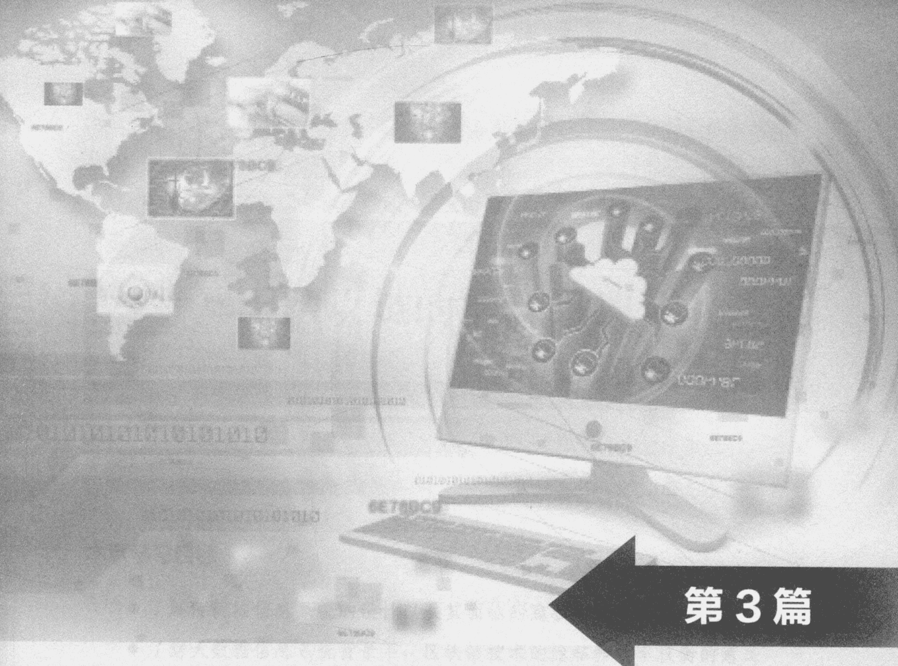
# 第3篇
## 区块链与信息系统
## 第5章 基于区块链的信息系统及其隐私和效率权衡
### 本章学习目标
- 了解传统的信息系统的设计以及其面临的隐私和效率问题
- 了解大数据信息系统背景下，区块链技术的隐私和效率权衡的意义
- 了解区块链为人工智能带来的推动意义

大数据为用户带来便利的同时，隐私保护的关注度也在上升。面对庞大的信息系统，隐私安全与效率成本难以兼顾。区块链作为分布式数据库存储技术，为大数据信息系统的隐私与效率平衡提供了新思路。其分布式存储、网络健壮、灵活可信等特性为信息系统分析设计提供了启发，也为数据融合时的权限划分带来新思路。区块链可通过加密技术与人工智能信息系统结合，推动跟踪理解人工智能，并以分布式存储促进共享。

2018 年 3 月 26 日，百度董事长李彦宏在中国发展高层论坛上表示，“中国人对隐私问题的态度更加开放，相对来说也没那么敏感。如果他们可以用隐私换取便利、安全或者效率，在很多情况下他们就愿意这么做。”① 这引起了轩然大波。

① 资料来源：https://www.sohu.com/a/238046420_827422.

抛开媒体对李彦宏隐私态度的炒作，我们同样关注其整体认知是辩证且合理的：“当然我们也要遵循一些原则，如果这个数据能让用户受益，他们又愿意给我们用，我们才会去使用它。我想这就是我们能做什么和不能做什么的基本标准。”其中，“一些原则”“基本标准”尖锐地指出一个权衡问题，“隐私、安全”与“效率、便利”是信息系统开发与设计，乃至信息技术发展史上始终需要权衡的选择。

区块链是安全与效率权衡的典型技术实例，具有分布式存储和去信任化特点，能在陌生节点间建立点对点可信价值传递，有助于降低交易成本、提升交互效率，被认为是推动信息互联网向价值互联网转变的关键技术（袁勇和王飞跃，2016）。

有趣的是，针对以互联网为基础的区块链，人们评价不一。有人认为它牺牲效率换取数据更安全可靠、用户参与匿名（方滨兴等，2016）；也有人认为它让数据更公开透明，在提升效率、降低成本的同时面临严重隐私泄露（袁勇和王飞跃，2016）。为何同一技术得到看似矛盾的评价？区块链在安全与效率之间如何平衡？它是否打破了隐私与效率此消彼长的格局，并为信息系统产品与服务的开发设计提供新的启示？

### 5.1 传统信息系统设计
信息系统包含关联人员、业务驱动力、技术驱动力和系统开发过程四个视角。关联人员包括所有者、用户、设计人员和建设人员；业务驱动力目标是改进业务知识、流程和通信；技术驱动力涉及数据库、软件、接口、网络等技术；开发过程经历启动、分析、设计、实现（Lonnie and Jeffrey，2008）。

在四个视角下，传统信息系统的设计与开发每个环节都面临多目标决策，需在时间、计算、存储、人力、财务成本限制下实现可靠性最大化和收益最大化。任何信息系统都需要找到安全与成本的平衡点，方能实现业务并推动发展。

数据库是支撑信息系统的底层基石。大数据时代到来后，个人行为更容易被持续记录与追踪，隐私边界被不断拉薄，甚至可能波及人身安全（Zwitter，2014）。在这种语境下，因果推理让位于相关推理，人们更关心“发生了什么”而非“为何发生”。当样本被整体数据取代后，掌握全量信息就能描绘出完整的相关图谱。正如舍恩伯格和库克耶（2013）所说，我们能够以更低成本、更快速度、更清晰视角审视事物，因为相关性既能捕捉现状也能推演未来。正是如此，隐私保护在大数据的讨论中被放大，信息系统的研发不能只盯着系统本身，必须先审视数据对系统的反作用，才能避免安全崩塌或成本失控而难以为继。

### 5.2 隐私与效率：区块链如何重估大数据系统
对信息系统设计中隐私和效率的张力做过回顾，也认识到大数据时代该矛盾的尖锐性后，本节尝试借助区块链的技术视角重新审视这一问题。

在信息系统语境里，隐私大致指数据主体不愿公开的敏感信息或被信息代表的属性（周水庚等，2009）。

为让分散节点保持数据一致并就交易达成共识，区块链不得不公开部分信息，比如交易内容；与此同时，为降低泄露风险，又要对敏感字段做处理。借此，祝烈煌等（2017）把区块链隐私拆为身份隐私与交易隐私两类。

沈鑫等（2016）把区块链描述为以时间顺序串联数据块、类似链表的结构，并以密码学固化不可篡改、不可伪造的分布式账本，可用于安全存放系统内可验证的、有序的简单数据（袁勇和王飞跃，2016）。区块链诞生解决了数字货币的双重支付与拜占庭将军两大难题。双重支付即同一资金被重复使用，在传统纸币体系中天然被规避，而区块链出现前，数字货币多依赖银行、支付宝、微信等可信第三方背书。

本章采用类比研究与文献梳理的方法。既然信息系统开发与区块链框架在若干属性上相似，就推测其余属性也可能相近。这种特殊到特殊的推理结论不一定成立，却能打开新视角，为隐私与效率的权衡提供启发。

#### 1. 以区块链的特质为参照
共识机制与分布式账本让区块链无需可信第三方即可解决双重支付，成为数字货币的重要突破。

拜占庭将军问题是分布式网络缺乏核心可信机构时如何达成共识、建立信任的抽象模型。区块链借助工作量证明、权益证明等共识机制叠加加密技术，把不可信网络转化为可信网络，参与方能在部分事项上达成一致，而不必信任单个节点。整体上呈现分布式存储、网络强韧、高度灵活、安全可信的特点。

- （1）分布式存储。
区块链用纯数学方式在节点间建立信任，形成可信的分布式存储体系，交易产生、校验、记录与同步均在分布式网络中完成。对信息系统而言，将服务器、管理端、用户端分布式部署，而非在单节点上追求强制高可用，已在现代大数据系统中被广泛采用。

#### （2）网络健壮。
独特的经济激励机制吸引节点贡献算力或其他资源，确保网络运转。节点规模越大，系统越稳健，除非超过半数节点同时失效，否则网络持续安全。

#### （3）灵活。
可编程脚本系统大幅提升应用弹性。比特币脚本相对初级，主要用于交易；以太坊提供更完备的智能合约，支撑更复杂的高级分布式应用。

#### （4）安全可信。
安全性由加密技术兜底。分布式网络的算力惊人，篡改账本在理论上可行，实际需付出天量电力与设备成本，得不偿失。

#### 2. 效率、成本与安全的关系
区块链与传统互联网思维近乎两极：前者让社区走向完全取决于全网算力持有者的投票，后者让数据集中于少数或单一核心机构统筹。

篡改成本随节点数量上升而攀升，难度达到阈值后几乎不可能。比特币的安全性由此而来；反之节点越少，决策门槛越低。

按管理难度与分布程度可分为私有链、联盟链与公有链。因此区块链并未从根本上消解效率与安全之间的矛盾，而是借助技术与业务尤其是金融业务的融合，重塑了人们对这一问题的认知与切入角度。

技术上区块链并无颠覆性创新，但模式开启了新可能，有望缓解人类在生产生活中依赖中介的问题。如找房需经中介承担信任与信息不对称成本，若一个程序能充当可信第三方，成本与效率将显著改善。该思路可借鉴至房产、招聘、消费、货币流通、金融等信息系统，若能智能替代中介、减少流转环节，就能大幅降低成本并提升效率。

#### 3. 数据权限的重构
以金融信息系统为例，蚂蚁花呗、京东白条等新金融系统掌握大量客户数据与结构特征，风控能力很强。但把不同机构的数据融合以提供更低成本、更高质量服务是否可行？技术上可行，互联网数据沉淀成本低。问题在于数据被困在各平台孤岛，无法发挥最大价值。

让个人收回数据所有权，授权后在需要场景中使用，就能获得更低成本的金融服务。区块链能做什么？它可把数据使用权、查看权与执行权分离，技术上实现“部分可见、授权可见”，从而让所有权、查看权、执行权各自处理，使用方与用户均无需担忧权限泄露。

### 5.3 区块链与人工智能信息系统
人工智能是构建可智能执行任务机器的理论与实践集合，核心技术包括机器学习、神经网络与深度学习。

区块链本质上是新型数字归档系统，以加密的分布式记账格式存储数据。数据经加密后分布于多台计算机，形成防篡改、高度可靠的数据库，仅授权用户可读写。

学界已有不少前沿探索，现实应用仍少，但未来几年有望加速落地。

#### 1. 人工智能与加密的天然契合
区块链存储多采用 SHA-256 加密，数据本身具备较强安全性。它很适合存放经过处理的高度敏感个人数据，释放生活便利与价值。例如接入智能医疗系统后，基于影像与病历的机器诊断更精准；电商也在用大数据推荐商品。

系统记录源自浏览等私密行为，企业面临严格安全审查。即便如此，大规模泄密与隐私侵犯仍频发。区块链以加密方式存储，私钥安全成为整体安全的关键。人工智能在安全强化上有挖掘空间，机器学习的一个新兴方向是让算法在加密状态下完成处理与加工，降低未加密数据暴露风险。

#### 2. 区块链助力追踪与理解人工智能
人工智能决策对人而言常不透明，因其能独立评估大量变量并学习对目标重要的因素。举例来说，AI 可用于判断金融交易是否欺诈并决定拦截或调查，但仍需人工复核以保准确，数据量大时审查繁重。如沃尔玛把全门店月度交易交给 AI 以确定补货与位置。

若把 AI 的每一次决策在数据点层面记录于区块链，哈希指针保证记录不可篡改，审计就变得简单。目前 AI 应用潜力巨大，但公众信任偏低制约发展。区块链上留存决策全过程可大幅提升透明度与可信度。

在机器学习模型交易市场，区块链可保障参与者匿名身份，通过机制设计让需求方以一定价格从多位模型提供方购得最优模型，无需第三方认证机构监督。训练集发布、测试集发布、模型测试、结果排名、付费等环节均可在线完成，无需主办方介入。

#### 3. 智能合约促进共享
人工智能虽先进，发展模式却相对封闭。企业多自给自足，自产自需，重复造轮子，成果共享意愿低。人才稀缺且昂贵，封闭导致行业效率低下、资源浪费。核心问题是算法与数据模型的共享如何获利、如何便利、如何安全。

区块链分布式存储为此提供可能：

(1) 有偿共享。模型交易遵循计价原则，功能模块可独立定价，经由代币体系这一内置市场完成计价与流通。
(2) 标准化。将 AI 作为服务 API 调用，企业制定标准并提供实用接口实现共享。
(3) 共享安全。API 方式共享可降低数据、代码泄露风险。

回顾本章起点：为何同一技术会得到看似矛盾的评价？区块链在安全与效率间如何取舍？是否打破了隐私与效率此消彼长的格局？技术层面看，区块链局部低效，数据透明或带来隐私担忧，不同链型仍受安全效率两难制约。但其分布式存储、网络健壮、灵活、安全可信的特质，能在具体业务场景中解决传统技术棘手问题。从系统结构层面重构了便捷与效率问题，把纯技术难题转化为技术成本与业务结构共同承担，为分布式存储、数据权限、人工智能信息系统等提供新思路。

### 5.4 本章小结
传统信息系统中，隐私与效率的权衡是设计者的必修课。区块链技术或能为此提供新思路，其优良特性与传统信息系统结合或带来惊喜。

目前区块链应用仍处初级阶段，需完善基础设施与生态。假以时日，它可能削减人与人之间的大量中介，把权力归还大众，重构关系，将数据权限与责任、业务流程与成本分散到每个节点，为信息系统相关领域带来变革。

### 思考题
- 1. 结合自身理解，谈谈区块链能为传统信息系统带来哪些改变。
- 2. 讨论区块链如何缓解大数据信息系统的隐私与效率权衡问题。
- 3. 试谈谈区块链如何与人工智能信息系统结合。

## 第6章 区块链与供应链
区块链与供应链管理

### 本章学习目标
- 了解基于区块链的供应链管理系统的设计思路与技术实现
- 根据具体案例，了解基于区块链的供应链管理流程

随着区块链技术演进，“区块链＋”正成为社会经济发展的抓手。如将其加密算法、时间戳、共识算法与侧链技术融入大米供应链，在上下游构建生产商、供应商、销售商参与的联盟链，打造安全高效体系。加密与不可伪造、不可篡改、分布式存储的特性帮助供应链打破瓶颈，解决信息安全，实现商品可溯源，同时为供应链金融开拓空间，带来本质改变。

“区块链＋”源于 2015 年政府工作报告提出的“互联网＋”概念，二者均将深刻影响世界经济。“互联网＋”标志着工业与信息化深度融合，“区块链＋”则是其上的新形态。区块链起于数字货币，现已走向金融、社会系统等更广场景。梅兰妮·斯万（2015）提出区块链金融概念，认为其或成数据库第三阶段，融合金融后可实现数字资产交易管控。袁勇和王飞跃（2016）指出其在存储、鉴证、金融交易、资产管理、选举投票等领域前景广阔，并演化出公有链、联盟链、私有链。鲍京宸（2017）认为其在互联网金融有广阔前景，但技术优化、法律监管、资源消耗仍存挑战。郭永珍（2017）指出体系建设、技术瓶颈、安全监管仍待突破。张健（2016）认为除金融外，在保险、数据安全、医疗等领域也有颠覆性意义。

传统供应链上下游信息不对称严重，导致信息对接滞后、需求传递不畅，整体呈现高成本、低效率。

借助区块链，可在上下游构建生产商、供应商、销售商与消费者共同参与的区块链，搭建分布式共享信息平台（马小峰等，2018；鲁维维，2017）。平台企业共享数据，大幅降低信息不对称，并在交流中保护隐私。打通数据孤岛后，企业可实时互通，行业协调性提升，整体效率显著改善。

此外，数据集成提升数据质量，区块链不可篡改特性保证数据可信，数据体量更大、更可靠，为智能合约体系与供应链金融活动提供数字化基础（李晓和刘正刚，2017）。

### 6.1 供应链的安全性及侧链实现
区块链体系采用多种加密算法，包括安全哈希、梅克尔树、椭圆曲线数字签名等（邵奇峰等，2018），凭借良好随机性实现不可伪造。“区块链＋供应链”基于非对称加密。与对称加密需交换密钥不同，非对称加密使用一对密钥，公钥可公开，私钥保密且不可推算。用公钥加密的数据需私钥解密，反之亦然，避免了密钥交换风险，建立更安全通信环境。在不同场景下的使用如图 6-1 与图 6-2 所示。

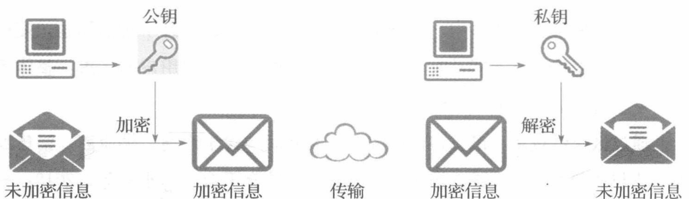
图 6-1 信息加密场景

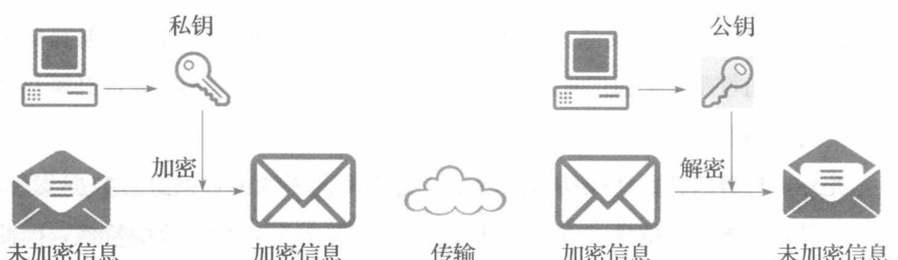
图 6-2 数字签名场景

梅克尔树大幅降低交易算法复杂度，对含 N 笔交易的区块，确认单笔交易复杂度仅为 log₂ N，为手机等移动端轻量级节点提供可能，实现供应链交易与信息查询。

下面讨论基于区块链的供应链时间戳服务器设计。时间戳服务器对每条供应链交易区块做哈希后在区块头加盖时间戳并广播。每个时间戳把前一区块时间戳纳入其随机哈希，形成不可篡改链条。一旦某区块被修改，其前序哈希将不匹配，需连锁修改，最终追溯至创世区块。由于创世区块不可改，确认并进入最长链的交易区块便无法篡改伪造。图 6-3 为基于区块链构建的供应链体系中的区块设计。

传统供应链因共享与透明不足，出现问题时难以追责，非法活动举证困难，监督审查弱。信息闭塞也为欺诈、数据盗取提供机会，安全性难以保障。

引入区块链为信息共享提供路径，上下游可快速建立信任。时间戳服务器保证数据不可篡改，企业间可互相监督，审计更易开展，运作效率得以提升。数据透明公开降低传播中的欺诈可能，特殊加密措施使数据难以破解，进一步保障流转安全。

供应链里引入区块链侧链是个非常实用的思路。所谓楔入式侧链技术，本质上是让资产能在不同链之间做到可验证、安全转移的桥梁。侧链就是一条与主链平行的独立账本，可以和主链实现价值的双向流动，但彼此是隔离的，侧链即使被攻破，主链的安全依然稳固。主链与侧链之间做转移主要靠两种做法，一种是双向楔入，通过简化支付验证证明 SPV 按固定汇率把资产从主链搬到侧链再搬回去；另一种是联合楔入，依赖多方公证人共管的多重签名地址来锁定和解锁资产。侧链的出现极大扩展了区块链的想象空间，让传统链能承载股票、债券等更多资产类型，也为智能合约的大规模使用提供了更轻量的技术底座。

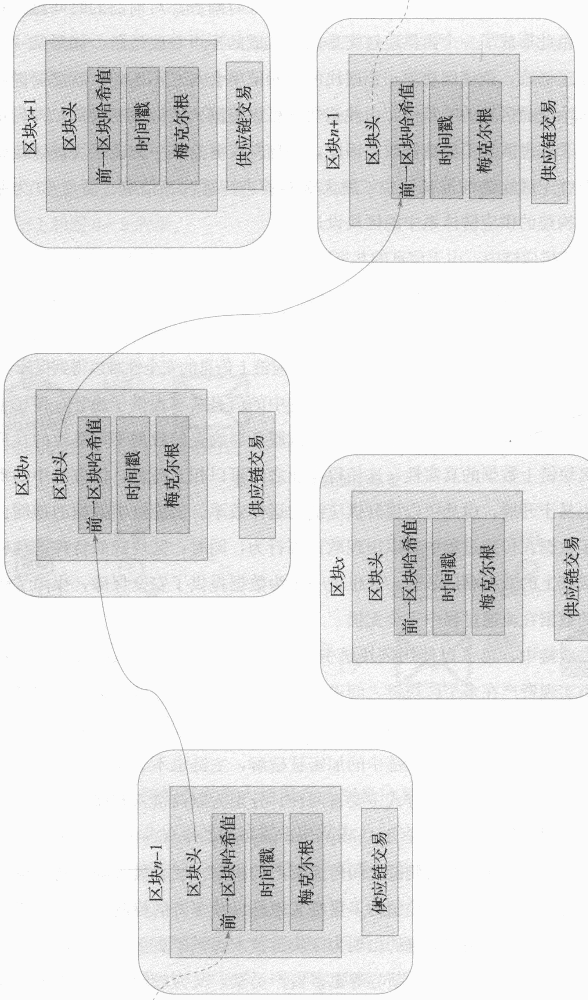

图 6-3 基于区块链的供应链交易区块

正因为侧链既能与主链互通资产，又保持隔离，在“区块链+供应链”里可以用联合楔入的方式先搭一条侧链，给主链做新功能和新业务的试验场，并在侧链上部署智能合约体系，覆盖生产商、供货商、销售商、消费者在采购、付款、运输、融资、税务等多个流通环节的多方协同与监督。图6-4从采购、配送到销售三个环节展示了该体系里可落地的智能合约场景。

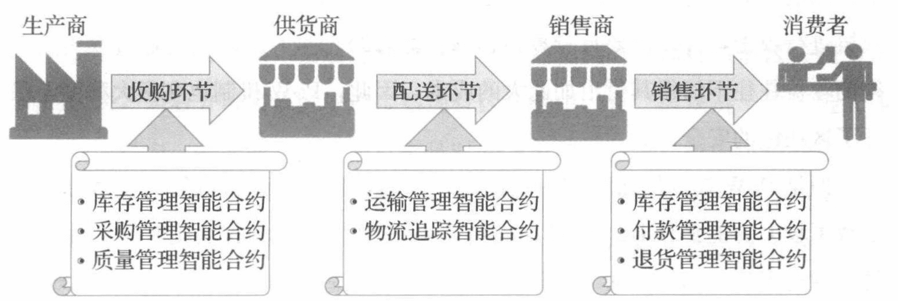

图6-4 基于区块链的供应链智能合约

### 6.2 供应链区块链共识机制怎么选

按分布式程度，区块链大致分公有链、联盟链、私有链三类。公有链没有授权机制，所有节点平等读写，比特币就是典型代表。联盟链的分布程度相对弱一些，但吞吐更快，只面向特定组织开放，记账权由部分节点掌握，并非人人可读写，企业间协作常选它。私有链分布程度最弱，仅对单一机构开放，处理速度极快，适合企业内部使用。

所以“区块链+供应链”体系一般会选择联盟链来搭建平台。下面谈共识机制的设计。

比特币早期用的是工作量证明 PoW，本质是为抵御拒绝服务等滥用而设计的算力竞赛，让客户端做一定量的运算，节点靠算力竞争出块。挖矿就是不断做双重 SHA-256 求解谜题，算力占比决定资源分配，实现分布式存储。51%算力才能攻击，成本极高，也保障了安全。

PoW 的问题也很明显，计算量大耗电高，比特币出块约10分钟，对多数交易场景太慢。于是权益证明 PoS 出现，用持有权益来替代算力竞争。PoW 里算力强信任高，PoS 里持币量大且币龄长的节点权益更大、信任度更高。

另外还有股份授权证明 DPoS 和实用拜占庭容错 PBFT。DPoS 先由权益选出受托人，只有他们能记账，交易发生时受托人轮流记账。PBFT 则允许少量节点出错，通过投票达成共识，票数过阈值就把区块挂上链，实现少数服从多数。

实际落地会按分布式需求和场景选机制。比如企业内部建私有链，可以在分布程度上让步，选用运算快、能耗低的机制来追求效率和成本。

PBFT 在联盟链里比较成熟。“区块链+供应链”采用的是改进版拜占庭容错，即授权拜占庭容错 DBFT。先按供应链各企业持有的权益比例选出共识节点，再投票记账，只有共识节点有权写账。该机制容错性好，适合供应链联盟链。

核心企业在链上通常持有更大股份，自然成为共识节点。新交易发生时，共识节点生成区块，经全体共识节点投票，票数超过设定比例才认定为有效并挂链。链上信息并非全部公开，除信任度高的核心企业外，只有该笔交易的相关参与方能读到细节，既保证了协同共享，又保护了交易隐私。

现实供应链里商品来源分散，跨产地、多手交易让溯源难，一旦出问题消费者难以追根溯源，即便没问题也难实时获得出库反馈，给假货可乘之机。

区块链给商品实时追踪提供了可靠方案。给每件商品一个唯一身份编码，把运输、流通、所有权变更都视作一次交易。全链路从原材料采购到最终营销都可上链留痕，配合加密和时间戳，记录防破解、防篡改，数据可信。一旦出现问题，能迅速回溯全链环节，定位责任，实现高效防伪和可追责，倒逼商家竞争、提升质量，推动良性发展。

### 6.3 大米全链路区块链落地案例拆解

本章以黑龙江某品牌大米为例，构建大米行业的区块链供应链。该大米由总供应商从各厂家收购后，通过铁路或陆海联运发往京津、上海、江浙、广东等区域分销商，再由当地零售商送到消费者。

在该体系里，供应商把上下游股份占比大的核心企业设为共识节点，拥有记账权。若其他节点想成为共识节点，需现有共识节点投票通过，权限与原节点一致。每完成一笔大米交易，大企业可把信息写入区块，其他共识节点用数字签名投票确认，加密技术确保签名不可伪造，投票通过后区块追加到链尾并盖时间戳。这里的交易指大米在供应链每个环节发生的流转。

目前扫码或条形码溯源常被质疑信息被篡改，区块链则不同。链上区块带时间戳，不可篡改伪造，记录的大米流转信息具备可信性与准确性。消费者可凭大米身份编码查询真实流通路径，清楚产品如何层层流转到自己手中。

智能合约还能实现精细化管控，减少人力。例如收购环节，智能合约帮助供应商实时掌握库存，及时向生产商补货，并监控仓储条件与质量，确保源头品质。运输环节，智能合约可实时监测温湿度，异常即告警。销售环节，可搭建线上支付平台，实现货到付款、违约自动退款等智能服务。

把区块链用于供应链管理，构建“区块链+供应链”生态，本质上改变了管理方式。伴随供应链金融发展，信用风险仍突出。信息不对称让中小微企业信用难获完整呈现，抗风险能力弱，融资更难。

区块链打通了上下游数据孤岛，扩大了可用数据来源；不可篡改、不可伪造的特性保证数据真实；分布式记账让每笔交易都可作为授信依据，为融资提供数据基础。

授信时可先用智能合约搭建信用评估模型做初步风险判断，反馈后通过多方数字签名在线完成授信并动态调整额度，再用智能合约自动执行还款与清算，简化流程，提升风控与安全性，为中小微融资开辟新路径。

### 6.4 本章要点回顾

本章从技术视角介绍了区块链在供应链中的应用，如何搭建基于区块链的供应链管理系统，从安全、共识、智能合约多维度给出设计思路。区块链与供应链结合解决了安全与溯源难题，也为供应链金融提供了新解，特别是中小微企业融资问题得到改善。

目前区块链落地仍处早期，基础设施不足、应用不确定性多，企业多在观望。但其在价值与资产处理上的能力已显现，探索与实践不断推进，有望推动行业从封闭系统转向开放分布式系统。

### 思考题

- 1. 试说明为什么区块链可以应用于供应链领域。
- 2. 试说明区块链会给供应链行业带来哪些改变。
- 3. 请简述区块链侧链的意义。
- 4. 请谈谈区块链在供应链行业的发展前景。

## 第7章 区块链如何重塑电商生态

### 本章学习要点

- 了解电子商务的定义及当前痛点
- 清楚区块链对电子商务可能产生的冲击
- 认识社交电商的内涵及区块链带来的革新
- 掌握电商公有链的建设现状

### 7.1 电商的红利与隐痛

电子商务指在互联网上买卖商品和服务的活动，最早可追溯到1972年斯坦福和麻省理工的学生通过阿帕网交易。不同于线下“一手交钱一手交货”，电商存在先付后发还是先发后付的矛盾，双方都有风险。

为降低风险出现两类做法：一是做大型2C商城，如亚马逊、京东、天猫，以平台信用作担保；二是借助第三方支付担保，如支付宝、PayPal。两者本质都是以信任为基础降低风险，这类平台以方便、便宜、选择多为卖点，对传统零售形成冲击，是上一轮变革者。

市场规模持续扩大，据预测美国零售电商市场2020年达1.2万亿美元。2018年11月11日淘宝天猫单日销售额达2135亿元，峰值每秒9.2万笔。

随规模增长，问题也显现：平台初期免费，抢占市场后向商家收取高额铺位费或交易费；用户享受优惠却付出隐私泄露代价，安全隐患增加；集中交易系统易受攻击；假货泛滥、恶意差评、虚假交易等也困扰行业。

### 7.2 区块链1.0：支付层面的去中介尝试

区块链1.0代表比特币，部分解决了电商支付层的问题。比特币诞生的场景就是电商。电商繁荣依赖第三方处理电子转账，虽然已做得不错，但本质是信任模型，带来中间商费用、最小交易限制、临时交易受阻，以及不可撤销服务的支付不可撤销等问题，不可避免一定比例欺诈损失。

比特币的点对点不可逆支付为电商提供了新选择，不需要任何一方担保，靠算法保证安全。

本质上用比特币交易就是消灭中间商。传统电商平台向零售商收取10%到50%的销售额作为使用费，区块链P2P交易网络中买家卖家直连，平台佣金自然消失。

缺点也很明显，工作量证明机制下比特币每秒约7笔交易，面对电商峰值每秒10万笔的需求完全不够用，不具备零售级实践价值。

### 7.3 区块链2.0：从支付到重构电商逻辑

以太坊的到来标志区块链2.0，电商才真正迎来变革。以下从智能合约、供应链管理、数据安全、市场透明度四个维度展开。

**1. 智能合约**

以太坊不仅提升了效率，还提供图灵完备语言，可为各类交易创建任意合约，即智能合约。传统合约需第三方公证担保，智能合约一旦条件满足就全网自动执行，合约运行在每个节点上，节点同步更新，执行可信且不可逆。

举例A、B打赌100元。传统方式需找第三方C托管，存在C卷款风险。用智能合约，A、B买币订立合约，100元被冻结在合约中，待结果出来后全网同步扣减输家、增加赢家，无需信任第三方。

套用到电商，以淘宝为例，传统流程是买家付款给支付宝，卖家发货，确认收货后支付宝放款，退换货需人工审核。用智能合约后，买家资金冻结，卖家用物流密钥签名作为发货凭证，物流与买家双签名作为收货凭证，设定退货时限，超时或确认收货后资金自动划转给卖家，中间商被算法替代。

**2. 供应链管理**

供应链是电商体验与效率的核心。区块链的透明与不可篡改是供应链的理想组合。传统供应链常出现牛鞭效应，需求变化被放大，导致库存与物流成本激增，根源在于各系统数据孤立缺乏透明。

区块链让参与方随时查询库存情况，从源头解决信息孤岛。已有众多企业在实践，供应链应用带来效率提升，也提高库存匹配与履约的可预期性。

伴随电商的持续升温，消费者对购物体验的透明度要求越来越高，也更在意商品的来路与原料溯源。买到的有机食品是否真来自无污染产地？手上的耐克鞋到底是莆田货还是越南工厂出品？区块链一旦上链就难以篡改的特性，为物流与供应链带来了根本性变化。正因为链上数据几乎不可损毁，把区块链引入供应链管理，已成为电商破解当前供应链难题的关键路径。区块链加入后，买卖双方能看到一条贯通的透明链路，商品流转轨迹一目了然，信任感因此提升，也能遏制平台上假货泛滥的乱象。

只要把供应链的每个环节都写入链上，从生产到流通的全部节点都具备可追溯且不可更改的属性，任何人都能在线核验。这样制假售假的空间被大幅压缩，从源头上堵住不法分子借助网络销假的通道。京东就曾用区块链完成澳洲羊绒产品的原产地溯源，在链的支持下，消费者可查询羊绒来自澳洲哪座牧场甚至具体哪只羊、搭乘何航班、各个物流时间点、派送员信息、报关报检编号等，整个流程清晰可查。

**3. 数据安全**

近年来数据安全与用户隐私关注度持续攀升。2018年5月25日，欧盟《通用数据保护条例》GDPR正式生效，这是迄今为止欧洲最严的隐私法规，对电商平台冲击巨大。目前电商运营中，用户的身份信息和支付信息一旦交出，均被集中沉淀在中心化数据库里，这类集中库极易成为攻击目标，泄露风险显著升高。因此转型方向是转向分布式存储，企业不再需要囤积数千万用户的个人和支付资料，而是由用户在点对点网络中自行保管和掌控数据，从根源上降低泄露可能。

电商长期位居数据泄露高发行业。2017年7月27日，阿里巴巴在网络安全生态峰会上发布《电子商务生态安全白皮书》，称泄漏源头主要集中在商家和物流环节，占比分别为36%和35%。泄漏原因中，内部人员作恶占49%，账号失管占16%，木马侵入占14%。部分账号风险同样源于内鬼，例如电商或物流员工私下出租账号。聚焦商家端，情况更为严峻，内部人员风险占比高达56%，账号被盗占22%。

内鬼引发的泄漏几乎防不胜防，与其事后追责，不如从机制上让内鬼无从获取信息，这才是治本之策。零售洞察机构One Click Retail的报告显示，亚马逊对单个用户平均记录约80个隐私标签。电商确实需要数据做分析与广告投放，但海量数据往往缺乏充分加密，且接触面极广。借助区块链加密，平台可以在使用数据的同时对核心隐私进行隐匿。例如姓名、电话、身份证号、邮箱等敏感字段写入时即可用特定公钥加密，私钥由指定服务器保管，从而切断数据被贩卖的链路。

**4. 市场透明度**

相较于线下实体零售，电商商品看起来价廉物美，主要是实体门店要承担高额租金与人力成本。但当电商走向寡头化，诸多隐忧浮现。如前所述，平台存在大量消费者看不见的隐性成本，最终由购方买单。若商家不遵守平台规则，随时可能被踢出局。不少传统平台常无理由关闭普通商家店铺且不作说明。更关键的是，商家为促销上传的照片、视频等素材使用权也归平台所有。

一旦掌控渠道，就容易衍生不公平竞争。以亚马逊为例，用户在站内搜索时，自营商品常被优先展示，算法也会倾向推荐利润更高的自营SKU，第三方商家难以抗衡。为冲排名，不良商家会刷单抬销量，或刷恶意差评拉低对手声誉，部分商家甚至与平台合谋造假数据伪造热销。正是市场信息不透明，销量和评价真假难辨，消费者成了混乱秩序的最终受害者。

传统电商的纠偏权掌握在平台自己手里，奖惩规则不公开，导致刷单、恶意差评屡禁不止。区块链的账本公开属性，让整条供应链的交易信息一览无余。若某用户的差评率远高于常人，或习惯先拍后弃再给好评，便容易被识别为恶意节点。此时纠错职能不再由单一平台独享，而是由全网参与者共同监督。

### 7.4 区块链与社交电子商务

淘宝、京东等巨头占据了传统电商主要流量，导致中小商家获客与运营成本攀升，流量红利快速消退。商家不得不寻找低成本获客路径，于是社交电商应运而生并高速扩张，拼多多上市更印证了这一赛道的阶段性爆发。而现在，区块链又为社交电商从业者带来了新的技术驱动想象，甚至某种形式上的诱惑。

社交电商即社会化电商，以微信、今日头条、微博等社交媒体为传播载体，借助用户分享、点赞等自传播行为影响他人决策，是社交与电商融合的形态。拼多多、蘑菇街、小红书皆属此类，而有赞、微盟、点点客则是为其提供系统研发的技术服务商。

2018年9月，点点客联合人人蜂发布公有链白皮书，计划以区块链搭建社交电商网络，在实现产品溯源的同时，用RRV Token激励优化生态。据链得得报道，除点点客外，聚焦农产品精准扶贫的社交电商“本来味道”也在探索区块链驱动的内部改革。

有别于传统电商的中心化权威模式，社交电商本身就呈现分布式组织特征，用户归属具体店铺而非平台。当前社交电商对区块链的应用主要集中于产品溯源、物流监管和社区激励三个维度，分别对应区块链的可追溯、不可篡改和通证属性。

当下社交电商存在三个突出痛点。

- (1) 参与度不足。潜在市场庞大但从业者有限，当前社交电商从业者约8000万，年交易规模约1万亿元。对比2017年全国零售总额约40万亿元，社交电商仅占2.5%。
- (2) 供应链监管薄弱。具备品牌影响力的项目不多，可持续能力偏弱，靠社交建立的信任难以长久。社交电商大致分平台型和导购型。平台型如小红书、本来味道，能同时把控流量与供应链；导购型仅掌控流量，对上游采购与质量缺乏控制，制约发展并侵蚀信任，最终流失稳定流量。
- (3) 激励机制低效。一方面，社交电商依赖用户互动传播口碑，如何引导用户产出更有参考价值的内容以刺激购买是关键，现有激励多靠条款繁复的积分和低价，手段单一。另一方面，组织形态相对封闭低效。相比天猫、京东等内部组织化程度高的传统电商，平台型社交电商更像松散的联盟聚合体，由众多小店组成，从业者多靠碎片时间经营。不同于淘宝沉淀多年的网红店拥有稳定客群与品牌力，社交电商多以价格战竞争，店铺缺乏固定客户。如何提升内部凝聚力与协作，让用户真正成为店铺核心消费群体，是亟待破解的问题。

基于区块链的革新或许能缓解上述痛点。目前社交电商需要海量人员参与并需要新型组织来达成内部高效协作，区块链特性与之契合。点点客试图通过Token激励激发消费者的分享、推荐与购买意愿，提升公有链上各店铺协同效率。据了解，点点客设想的Token与积分不同，核心在于通证属性。以往积分只能在本店铺或平台内兑换，对用户吸引力有限，尤其对品类有限的中小平台而言更为明显。而Token的进阶性在于，用户在一个店铺节点获得的Token可用于购买整条公有链上任意店铺节点中的商品，大幅扩展使用范围，提升流通性。未来Token在二级市场的流通也能提高商家和消费者的收益预期。

本来味道也在考虑引入区块链实现供应链溯源，但要保证数据真实还需硬件、物联网及第三方权威检测机构共同支撑。社交电商存在从业者分散、门槛低、商品质量参差不齐的特点，不像京东自营拥有稳定供应商，这导致溯源难度更大。商品上链前的核实工作需耗费大量人力，非技术 alone 可解。

从溯源利益相关方看，存在明显矛盾。区块链系统要吸引商家，首先要保证商家加入后能卖出更多货并获得更多利益。目前若点点客未加大溯源监管投入，披露商品来源更多依赖卖家自觉，而披露源头的直接收益对卖家有限。

### 7.5 电子商务公有链

阿里巴巴和京东面对区块链，首要关注的是其可追溯、不可篡改特性，意在打击假货。以京东为例，其开发的智臻链在供应链、公益、防伪溯源等多场景落地，搭建起覆盖制造商、供应商、分销商、零售商、物流企业及终端用户的网络，将物流、资金流等信息上链，并通过密码学保护用户隐私。京东与阿里均具备强大的研发实力，倾向于以联盟链和BaaS平台方式串联产业B端与C端，为企业和用户提供服务保障。

目前社交电商尚缺公有链，且建设难度不小。不同于传统电商的平台化运作与雄厚技术实力，社交电商流量来自各大社交媒体，呈碎片化，且受制于社交平台，尤其依托单一社交媒介的项目依赖性更强。此外，社交电商规模普遍较小，研发能力不足。

从流量看，有赞、微盟、点点客均依托微信。腾讯数据显示，微信月活用户已超十亿，小程序数量超58万，日活超1.7亿。微信生态的流量红利使其成为社交电商最大的带货渠道。以微信为基础构建公有链，可为点点客等提供良好用户基础，所有微信用户都可能成为潜在用户与社区成员，且微信本身是相对成熟且信任度较高的社交社区，对区块链生态建设大有裨益。

无论如何运用区块链，最终目的一致，即提升效率、降低成本，并借助存证功能验明真伪、追根溯源。但统一公有链建设仍难度较大，区块链电商应用之路任重道远。

### 7.6 本章小结

本章围绕区块链与电商展开，从传统电商痛点切入，讨论了虚假交易与安全性等普遍问题，并探讨了区块链可为智能合约、供应链管理、数据安全及市场透明度带来的改变。

此外，本章还探讨了电商新形态——社交电商。该模式打破传统电商桎梏，使电商社交化、社会化。当前社交电商也面临监管缺失、激励机制低效等问题，而与区块链的结合或许能提供解法。但就目前看，电商公有链建设难度仍大，区块链在电商行业的应用仍需时日。

思考题

- 1. 请根据理解简述社交电子商务的概念。
- 2. 试分析区块链能够在哪些方面与电子商务结合。
- 3. 试分析区块链电子商务的发展前景。

## 第8章 区块链与沙盒

### 本章学习目标

- 结合具体例子，了解沙盒的概念及其意义
- 了解区块链沙盒的含义及其影响
- 了解在泰山沙盒测试下区块链的分类

### 8.1 沙盒的概念与应用举例

沙盒是计算机领域广泛使用的技术，指将应用置于受限安全环境中运行，为来源不可信、具破坏性或意图不明程序提供试验空间。沙盒如同物理沙盘，操作不会写入真实系统，结束后只需抹除记录即可。沙盒技术是虚拟化理念在安全领域的集中体现，尤其在反病毒场景中常被用来观察病毒行为，可接管其调用接口，确认恶意后回滚系统，避免伤害。原理上通过重定向技术，将程序生成与修改的文件导向自身目录，安全软件先在沙盒中试运行，发现恶意行为即阻断，不影响主机。沙盒还提供严格资源管控，通过限制内存、系统文件与访问权限，在不影响主机的前提下执行可疑代码并识别其意图。沙盒本质是保护伞，让软件在安全环境运行并降低修改成本，修改代码时无需动操作系统，只需在沙盒内调整即可，对兼容性要求高的应用尤为便利。

区块链研究因耗时长、见效慢，导致众多机构难以承担巨额成本。若在监管沙盒中开展研究，不仅可获得更多政策支持，也能降低意外发生时对社会经济的冲击。

沙盒概念最早由英国金融行为监管局FCA提出，旨在协助政府有效监管，鼓励产业在受控模拟环境中尝试新技术，在监管条件下创新，使金融科技公司聚焦新技术研发。

随着区块链对金融的冲击，各国愈发重视监管沙盒并付诸实施。英国是首个建立监管沙盒制度的国家，其监管实验区体现了容错试错精神，减轻创新产品服务的监管负担。自2016年7月起，中国首批24家企业参与监管沙盒实验，涵盖汇丰银行等传统金融机构和Bit X等新兴企业。引入监管沙盒一方面扩大区块链应用研究空间，另一方面可控风险，实现创新推进与金融稳健双目标。

区块链下互联网消费金融资产证券化交易存在较大不确定性。英国金融行为监管局提出三种沙盒模型：

- (1) 监管沙盒（regulatory sandbox）。
这种模式为金融科技公司技术实验提供环境，软件在模拟受控系统下运行，数据仅记录于沙盒内，不影响真实系统。每个沙盒设置与测试都是一事一议，因不同公司创新服务各异，监管部门需对新技术有一定认知并明确测试需求。沙盒为金融服务创新提供更好监管平台，既助政府监管，也惠及消费者。并非所有金融公司都能随意进入，入选需具备创新、资金、技术与风险控制能力，并承担保护消费者责任。英国率先使用该模式，现加、星、马、中国香港等多个国家和地区已跟进。

#### (2) 产业沙盒（industry sandbox）
该模式由同一行业多家公司自发组建虚拟测试环境，设置行业通用测试场景，多家企业可在同一环境下验证新技术。环境统一便于客观比较，且无需监管单位指导。

#### (3) 保护伞沙盒（umbrella sandbox）
该模式指由非营利公司运营的沙盒保护伞，由金融监管单位授权。与产业沙盒类似，它为全行业服务，同时也为监管单位服务，需监管指导。

目前英国已发布较为完整的沙盒报告，但主要涉及监管沙盒设计，对产业沙盒与保护伞沙盒未作涉及。

本节以主流沙盒Sandboxie和影子系统为例介绍沙盒系统。Sandboxie与多数沙盒产品一样无虚拟桌面，可在浏览器中运行沙盒，操作均在沙盒内进行，移除保护后浏览记录、下载文件与插件不会残留，也能阻隔病毒木马入侵。目前Sandboxie除IE外已支持谷歌、火狐、Opera等主流浏览器。安装或解压程序时可在Sandboxie保护下运行，系统恢复后沙盒内程序与木马即消失。此外，Sandboxie还可为整机提供保护，保护期间的格式化、分区、删除操作均可恢复，不会造成系统危害。

图 8-1 为 Sandboxie 的网页界面，用户可在此网页下载 Sandboxie 软件，在图中可以看到该沙盒系统目前支持的系统和浏览器等信息。图 8-2 为 Sandboxie 的使用界面。

## (1) 监管沙盒（regulatory sandbox）

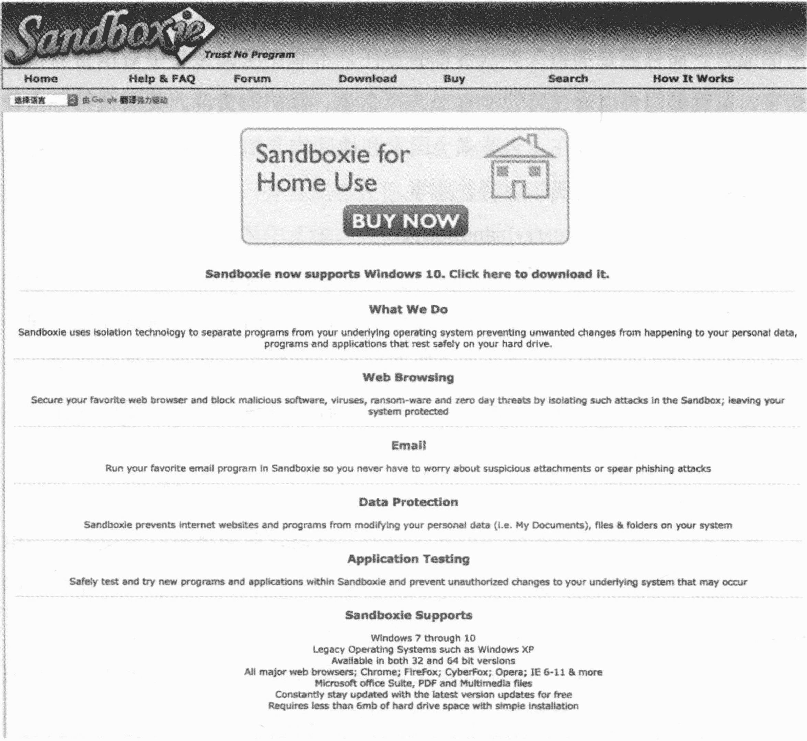

#### 图 8 - 1 Sandboxie 网页界面

资料来源：https://www.sandboxie.com.

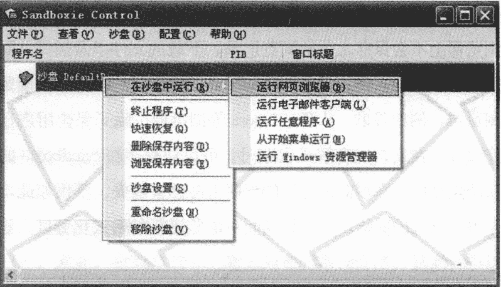

#### 图 8 - 2 Sandboxie 使用界面

资料来源：https://image.baidu.com.

影子系统把沙盒思路抬升到整机维度，为 Windows 构建一套随时可丢弃的虚拟镜像。进入影子状态后，读写操作先落在虚拟层，真实磁盘始终保持原貌。装机尝鲜、软件测评、临时卸载等场景下尤为好用，操作结束一键回滚即可，主机上不会留下安装垃圾。和 Sandboxie 的差异在于覆盖范围：影子系统把完整操作系统罩进虚拟壳，壳内的一切变动都不落盘；Sandboxie 只把指定程序单独隔离，防止程序伤及系统。图 8-3 为官方站点截图，页面对产品逻辑做了概括。

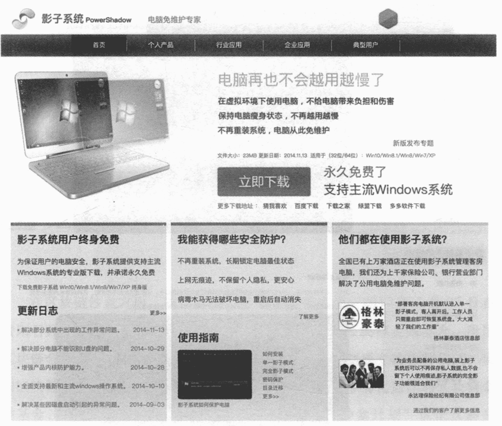

典型用户

#### 图 8-3 影子系统网页界面

资料来源：http://www.yingzixitong.cn.

参照官网《影子系统使用指南》，如图 8-4 所示，可用状态归纳为三种：单一影子、完全影子、正常。单一影子只给系统盘造镜像，非系统盘的修改永久保留，系统盘的写入在退出后自动还原。病毒多集中攻击系统盘，日常防护开启单一模式即可达标。完全影子把所有硬盘分区都纳入虚拟，保护期间的磁盘变动都会被清空，这时建议把临时文件放到 U 盘或移动硬盘。正常模式即关闭保护后的常规运行状态。

### 影子系统使用指南

- 01 简要介绍

- 02 单一影子模式

- 03 完全影子模式

- 04 正常模式

- 05 进入影子模式

- 06 退出影子模式

- 07 开机启动

- 08 提醒设置

- 09 目录迁移

### 单一影子模式

单一影子模式只守护 Windows 本身，仅为系统所在分区创建虚拟镜像，其他分区仍保持常规读写。安全与便利兼顾，既能保护系统，又允许在影子环境下生成的文件落到非系统盘。借助文件夹迁移，可把桌面、我的文档、收藏夹、Outlook 邮件等默认存于系统盘的数据迁移到其他盘，在不变动使用习惯的前提下进入更安全的虚拟工作环境。

### 影子系统使用指南

- 01 简要介绍

- 02 单一影子模式

- 03 完全影子模式

- 04 正常模式

- 05 进入影子模式

- 06 退出影子模式

- 07 开机启动

- 08 提醒设置

- 09 目录迁移

### 完全影子模式

相比单一模式，完全影子会为本机全部硬盘分区同步建镜像。退出后，分区内一切改动将被清除。在完全影子状态下，需要保存的资料可通过闪存或移动磁盘导出。

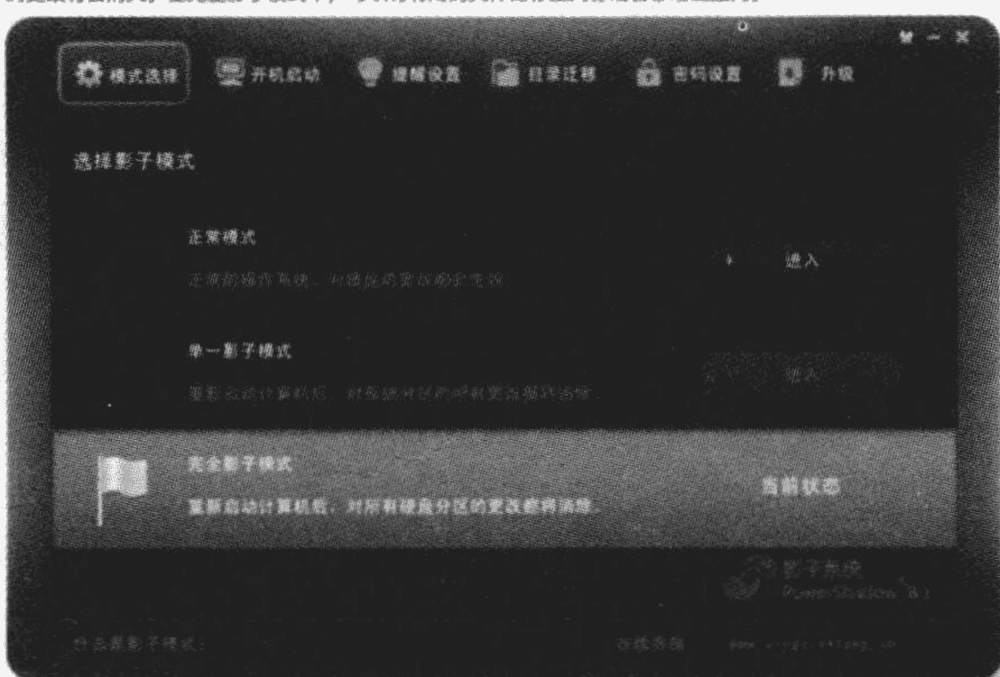

图 8-4 影子系统使用指南

### 影子系统使用指南

- 01 简要介绍

- 02 单一影子模式

- 03 完全影子模式

- 04 正常模式

- 05 进入影子模式

- 06 退出影子模式

- 07 开机启动

- 08 提醒设置

- 09 目录迁移

### 正常模式

影子保护关闭后即回到正常模式，也就是真实的日常系统。诸如修改系统设置、安装新软件这类需落盘的操作，建议在正常模式下进行。

图 8-4 影子系统使用指南（续）

资料来源：http://www.yingzixitong.cn/guide01.html.

### 8.2 区块链监管沙盒

中国在区块链监管沙盒的实践已出现多个案例。2017 年 5 月 27 日，贵阳召开区块链金融国际高峰论坛①，现场为贵阳区块链金融基金、金融孵化器以及国内首个区块链金融沙盒监管计划授牌。贵阳沙盒由政府引导、社会参与、市场化运作，同时金融沙盒计划正式落地。

贵阳是全国首个政府主导的沙盒运营试点，主要面向金融与科技金融。沙盒的核心价值在于为区块链在金融场景与商业模式中的试验提供可控空间，将技术与大数据结合并与法规政策对接，推动贵阳及全国的区块链金融建设。贵州贵山基金规模超百亿，永安金控金融资源丰富，为技术融合提供了厚实基础。

2017 年 7 月 25 日，贵阳国际生态会议期间，阿希链创始人单青峰签署《区块链 ICO 沙盒共建共享合约》，阿希链成为贵阳监管沙盒首批项目，也是全球首个进入监管沙盒的区块链项目，标志着技术服务实体经济迈出关键一步。

2017 年 9 月 23 日，中国电子商务协会等主办的“2017 中国创新产业监管沙盒高峰论坛”在深圳举行②，会上揭牌深圳市监管沙盒产业园，国盾区块链等企业加入园区。该园区聚焦金融科技，在可控监管下鼓励创新，提升监管对创新的适应度。

图 8-5 深圳区块链产业园

资料来源：http://ori.hangzhou.com.cn/ornews/content/2018-09/19/content_7070466.htm.

2018 年 9 月 19 日，我国首个区块链监管沙盒实体应用产业园——杭州大湾区区块链产业园成立（见图 8-6）③，主要面向大健康和食品行业，由中国区块链监管沙盒委员会、中国电子商务协会批准的首个产业园。协会已推介 30 余家实体企业入驻，100 余家表达意向。园区以“实体经济＋区块链”推动应用落地，助力杭州打造标志性产业集群。

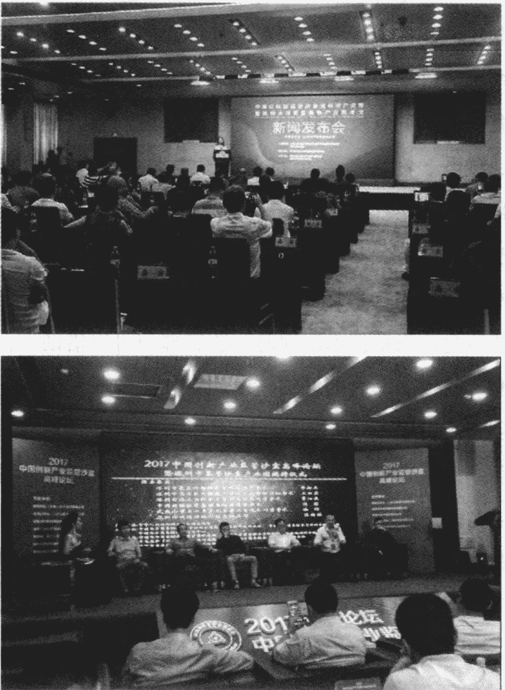

图 8-6 杭州区块链监管沙盒产业园

资料来源：http://finance.ifeng.com/a/20170925/15693942_0.shtml.

① 资料来源：https://www.btcsearch.com/t/299340.
② 资料来源：http://ori.hangzhou.com.cn/ornews/content/2018-09/19/content_7070466.htm.
③ 资料来源：http://finance.ifeng.com/a/20170925/15693942_0.shtml.

### 8.3 区块链产业沙盒

2017 年 12 月 29 日，天民青岛国际沙盒研究院由蔡维德教授领衔在青岛崂山发布全球首个基于区块链的产业沙盒“泰山沙盒”①，目标是为政府监管与行业自律提供平台服务。泰山沙盒融合区块链、大数据、自动化测试、云计算等，未引入监管机构，不属于监管沙盒，却是全球首个区块链产业沙盒。

产业沙盒的应用面极广，每个行业都可以构建专属区块链体系。蔡维德认为东三省可发展农业区块链与产业沙盒，制造业强省可构建制造业区块链与沙盒，房地产、税收、海关等与资金相关的领域都能设立专属沙盒。

他强调，沙盒技术在中国推广能加速区块链产业形成，助力中国在全球保持领先。借助沙盒，监管部门在新技术出现时可以先行试验，减少对人工评估的单一依赖，提升监管效率并加快创新。

泰山沙盒的测试管理涵盖契约模型管理、测试集管理、测试基准管理、测试目标管理、测试任务管理。契约模型管理通过 RPC、SDK 等接口定义“请求—响应—数据”式契约。测试集管理以核心业务功能为目标构建自动化测试集。测试基准管理为不同维度建立统一测试规范。测试目标管理把功能需求与测试集关联，确保覆盖。测试任务管理则创建自动化接口功能或性能测试任务并做结果统计分析。

泰山沙盒可追踪监控被测区块链系统的运行。测试共识算法时，能监控节点网络集群的共识过程，进行分布式事务链路追踪，对共识流程步骤及交互数据做出判断。图 8-7 为泰山沙盒的自动化测试平台。图 8-8 为区块链接口自动化测试执行过程。

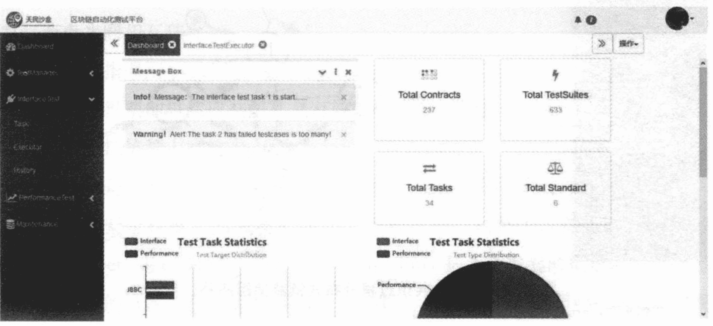

图 8-7 自动测试平台

资料来源：https://mp.weixin.qq.com/s/7fgQ8ao0g6IK2HDQDbSBw?scene=25#wechat_redirect.

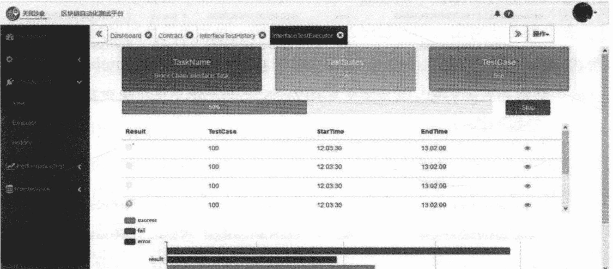

图 8-8 区块链接口自动化测试执行过程

资料来源：https://mp.weixin.qq.com/s/7fgQ8ao0g6IK2HDQDbSBw?scene=25#wechat_redirect.

图 8-9 显示泰山沙盒能对区块链共识算法进行追踪，自动探索节点集群的共识交互拓扑。图 8-10 为沙盒监控下区块链共识阶段的数据呈现。

泰山沙盒的出现帮助甄别市场中鱼龙混杂的区块链系统，把真正的区块链与伪区块链、弱化区块链区分开来。

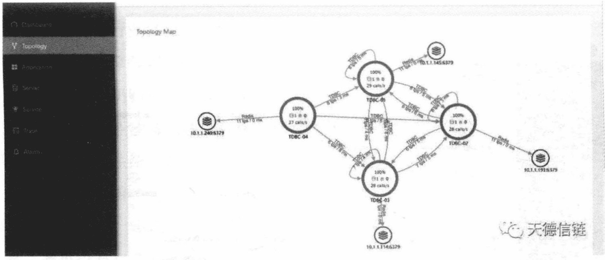

图 8-9 共识过程分布式链路追踪拓扑

资料来源：https://mp.weixin.qq.com/s/7fgQ8ao0g6IK2HDQDFBSBw?scene=25#wechat_redirect.

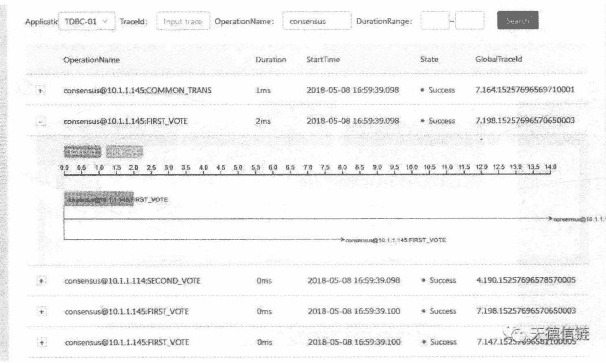

图 8-10 共识过程数据追踪

资料来源：https://mp.weixin.qq.com/s/7fgQ8ao0g6IK2HDQDFBSBw?scene=25#wechat_redirect.

### 8.4 泰山沙盒测试下区块链的分类

依据蔡维德教授的泰山沙盒测试，区块链可划分为真链、弱链、伪链、非链、胡链、空链等①。

① 资料来源：https://mp.weixin.qq.com/s/aD8eJQ9IIBcvv9_OI_9HLw.

真链采用拜占庭将军问题共识机制，至少经历三轮投票，节点间相互独立。

弱链使用弱化一致性协议，比真链少一轮投票，仅需两轮达成共识，速度更快但无法发现或抵御恶意节点，抗拜占庭攻击能力不足。

伪链追求更高交易速度，采用集中控制，安全性低，核心节点被攻破即导致系统崩溃。以 Hyperledger 为例，由 Linux 基金会 2015 年发起的开源项目，主打跨行业应用，但交易需经 ZooKeeper 处理，而 ZooKeeper 为集中控制系统，故属于伪链。

非链指改变区块链架构或仅保留部分机制，设计理念相近但不属于区块链。典型如 IOTA、Hashgraph、Corda、闪电网络、Guardtime。以 Corda 为例，由 R3CEV 推出，借鉴智能合约等特性，但仅面向银行间交易，非公开，单笔合约共识仅在参与方间进行，采用弱链一致性协议并以数字签名验证。大多数非链仍在探索中。

胡链指缺乏科学依据、违背事实的拼凑式设计。空链指未落地的项目，仅发币炒币而无实际应用。

### 8.5 区块链教育

政府高度重视，金融行业纷纷布局，区块链正成为未来信用社会的基础，变革潜力巨大。但快速发展也带来概念炒作与投机炒币，各方观点分歧，因此建立全面正确认知十分必要。

区块链教育应先教真链，避免推广已被证伪的其他链。教学体系可分三层：底层以编程实战为主；中层以计算机基础为主，涵盖算法、系统、网络、架构、数据库；上层为应用层，涉及法律、金融、经济、哲学、心理学、社会学等。教育内容应真实且长期。

原则上应合作、动态、成熟、真实、独立思考不盲从。需多学科合作、产学研合作、国际合作；内容随技术发展动态更新；讲授经证实的思想技术而非盲目追新；以真实系统为依托而非仅实验室模型；不迷信头部科技公司或金融机构。

教育可从产业沙盒切入，沙盒既是评估测试平台，也是开发、监管与教育平台，能帮助产业规范发展。应博采国内外优质课程，关注在线教育，采取众智模式汇聚群体智慧。

真正懂区块链的人与真正落地的区块链都仍不多。需看清各链本质是否采用拜占庭将军协议、是否集中控制、是否有容错性，同时从现在起重视区块链扫盲，普及理念与实践。

### 8.6 本章小结

区块链作为新兴热点，监管仍不完善，但产业沙盒的出现为监管提供了实验环境，使技术可在可控测试中安全验证。沙盒也为良莠不齐的区块链提供了甄别方案，通过测试将区块链划分为真链、伪链、非链、胡链等。

当前阶段，区块链尚不成熟，出现问题属正常。伪链的出现部分源于对现状的不合理改进，在特定场景下选用合适的链即可，无需苛求严格定义。真正懂区块链的人虽多，但缺乏共识与合力。炒作与投机不利于技术发展与应用，需关注。

未来，区块链完善、大众普及、负面应用治理仍需长期推进。

### 思考题

- 1. 试解释沙盒的概念。

- 2. 请分析区块链沙盒的意义。

- 3. 试分析在区块链沙盒的监管下区块链未来发展的方向。

# 第4篇

## 区块链应用及展望

## 第9章 基于区块链的金融科技应用举例

### 基于区块链的金融科技应用举例

### 本章学习目标

- 根据基于区块链技术的金融科技具体案例，了解区块链目前在金融科技领域的应用情况以及未来发展

- 了解区块链在金融科技领域的应用的特性

目前，各企业在不断探索区块链技术为行业发展带来的改变。蚂蚁金服、京东、百度、IBM 等多家企业在 2018 年推出了大批区块链应用。基于区块链的特性，过去几年摩根大通、汇丰银行、花旗银行等金融机构都陆续开展了区块链项目的研究和试点。在金融领域，区块链的应用层出不穷，下面将介绍几个基于区块链的金融科技领域的应用案例。

### 9.1 蚂蚁众筹——相互宝

蚂蚁金服联合芝麻信用在 2018 年 10 月 16 日推出相互保，在短短两个月的时间内已有超过 1 300 万用户加入。后来相互保升级为相互宝（如图 9-1 所示）。相互宝融入了区块链技术，实现了“零元加入，一人生病，众人分摊”的理念，最高保障金额可达 30 万元。

相互宝：一场基于信任的互联网众筹互助

参与相互宝满90天后才可以提出保障金申请，且申请人的相关信息会向全体参保成员公开公示，体现了机制的公开透明。公示期结束后，由全体加入者共同分摊，最终将保障金拨付给申请人。这种分摊式的资金筹集方式，让保障金的募集过程与众筹逻辑高度相似，每个参与者的视角都是可查可审的。

图9-2所示的官方说明指出，相互宝并非传统意义上的保险，而是一种秉持“帮助他人、守护自己”互助理念的共济安排。这一定位更凸显了其与众筹的相似性。众筹借助互联网的传播优势发布募资项目并汇集资金，相较于传统融资渠道，其开放性与可能性更为宽广。

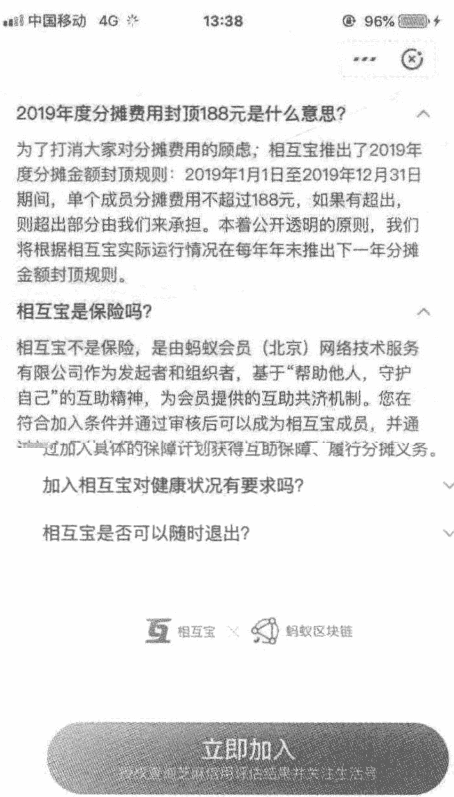

图 9-1 相互宝截图 1

图 9-2 相互宝截图 2

加入门槛方面，图9-3显示需芝麻分达到650分以上。这一设置在划定准入条件的同时，也在一定程度上筛选了成员的信用水准，提升了群体间的互信基础。费用缴纳采用分摊制，单期分摊额等于互助金加管理费除以分摊成员总数，这种做法暗含了区块链的分账思想。若某期实际分摊总额高于保障金与管理费的合计，剩余部分记为结余，结余可用于弥补后续不足，或在解除互助关系时退还费用。

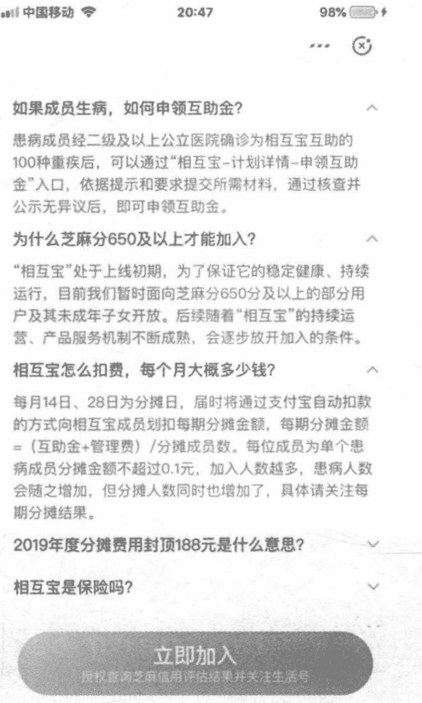

图9-3 相互宝截图3

2018年12月7日，相互宝公布了首个通过核验的案例。事主是一名因意外导致脑部外伤的5岁女童，她于2018年11月18日在上海交通大学附属新华医院接受手术，符合等待期内因意外致病可申请互助金的规则。第三方核查机构对家属进行了上门访谈并走访医院，核实信息真实性。为保证公开，医疗诊断证明、出院小结、手术记录等资料被上链存证，并在系统内公示三天，期间无人提出异议，最终该女童获得30万元互助金。算下来，每位成员仅出资3分钱便促成了一次救助，生动展现了互联网与区块链平台支撑的众筹互助力量。

相互宝搭建了一个规模庞大的互济网络，成员在需要救助时可通过公示征求其他成员同意，并在短时间内筹集到所需资金。可以说，这一平台为会员提供了类大病保险的救助功能。其落地实践，让区块链在互助众筹场景中得到验证，并迅速吸纳大量用户，成为区块链应用的典型案例。

### 9.2 数字链矿池——好矿

好矿是获得数字链社区认证的矿池企业，专注于基于莱茨币LCC的专业挖矿服务。图9-4为好矿网的首页页面，数据显示平台目前运营矿机22 684台，算力1.89GH/s，累计产出近30万块，已向用户发放超过1700万枚LCC。

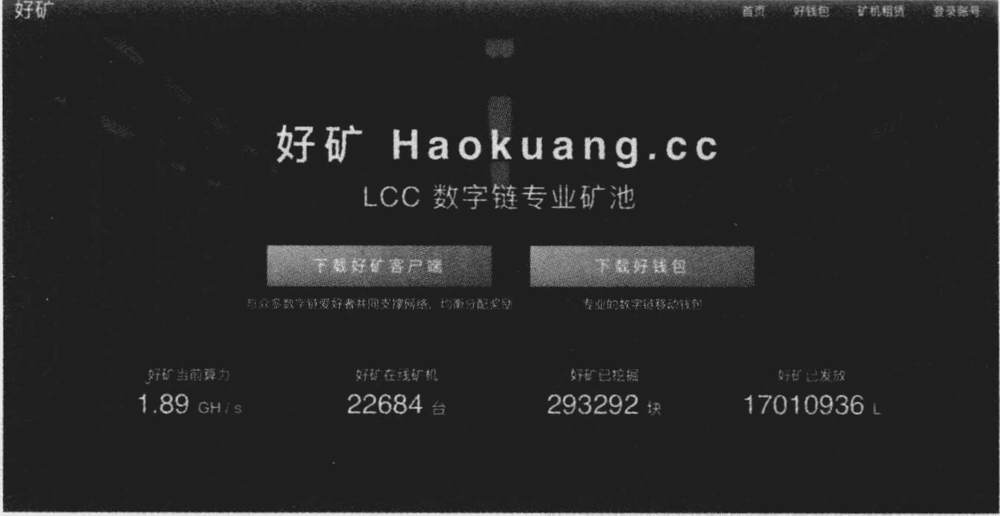

图 9-4 好矿网截图

资料来源：https://www.haokuang.cc.

平台除挖矿外，还提供矿机租赁业务，用户可在站内租用设备挖矿获取收益。

此外，好矿推出了可移动端使用的好钱包App。图9-5是该数字钱包首页的界面，图9-6为登录页面的展示。

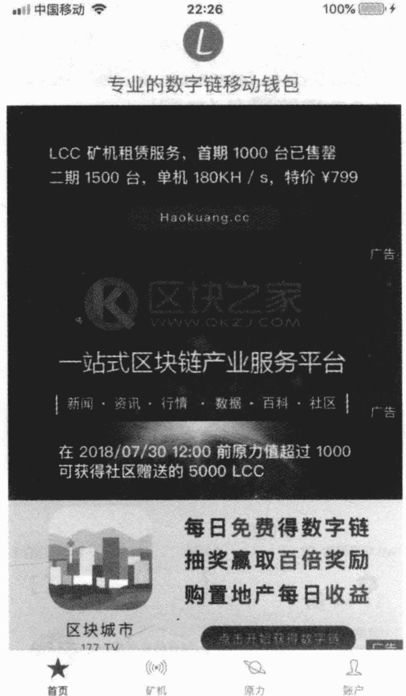

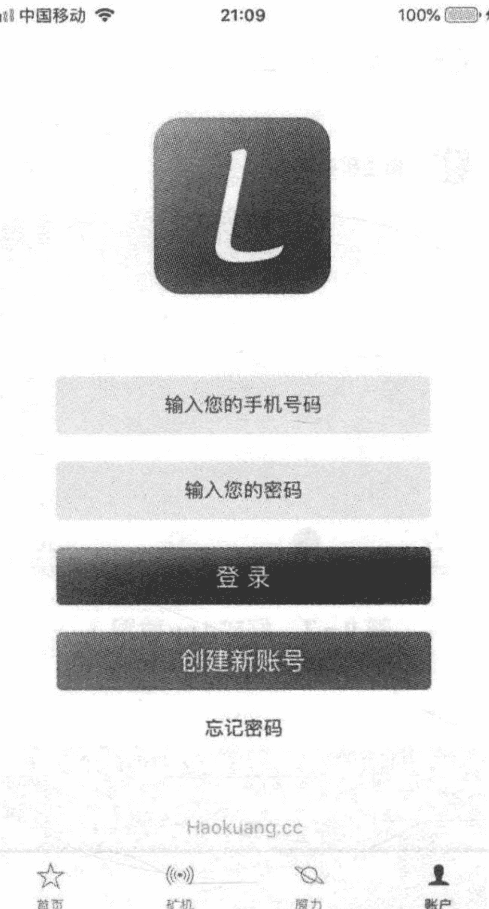

图 9-5 好矿App截图 1

图 9-6 好矿App截图 2

登录后进入“矿机”模块，如图9-7所示，可在此租赁新矿机、查看已拥有的矿机或自行添加矿机。点进“租赁矿机”后，如图9-8所示，能查看LCC运算设备的详细参数以及当前空闲矿机的剩余数量，用户按需支付后即可完成租赁。该矿池的租赁采用保底机制，若年度挖矿产量低于约定阈值，矿池方将给予补偿。

如图9-9所示，“原力”板块可展示个人的挖矿原力数值，并提供收益查询与原力排行榜。图9-10展示的“账户”板块顶部显示用户可用的数字链等资产信息。除基础设置外，“我的钱包”可查询钱包地址，“我的交易”可浏览登录账户的交易记录，并可通过“发送交易”向其他地址发起转账。

## 区块链：技术与应用

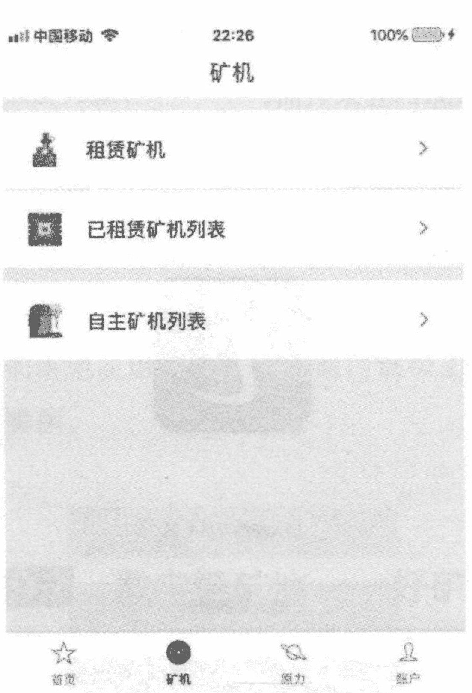

图 9-7 好矿App截图 3

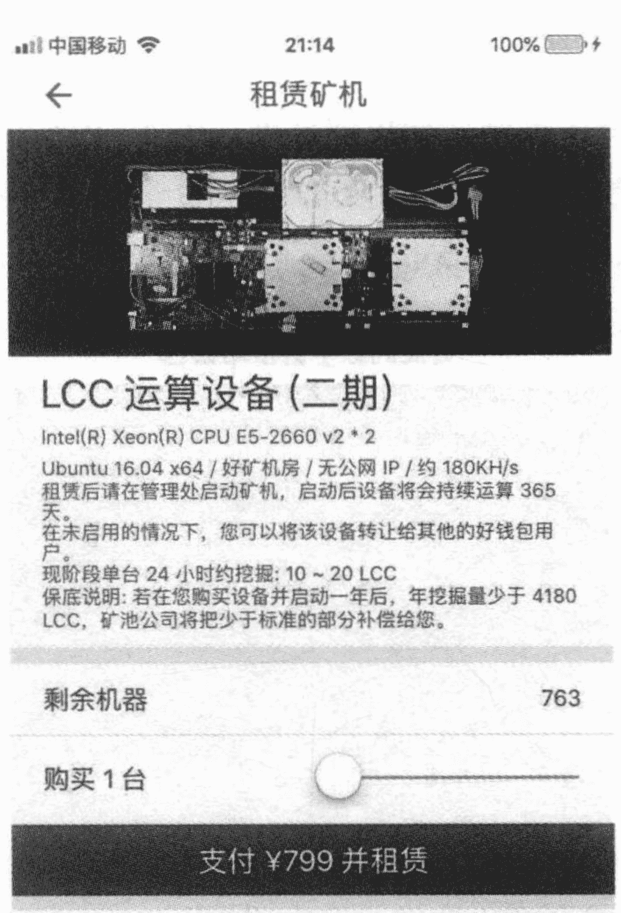

图 9-8 好矿App截图 4

### 原力排行榜

图 9-9 好矿App截图 5

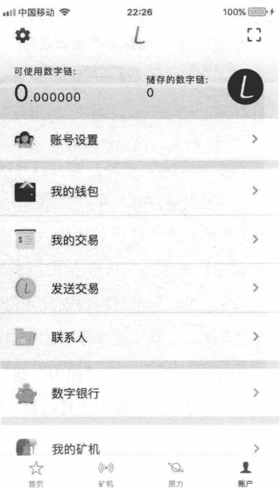

图 9-10 好矿App截图 6

在“数字银行”模块，用户可将持有的数字资产存入以获取收益，具体存取情况见图9-11。

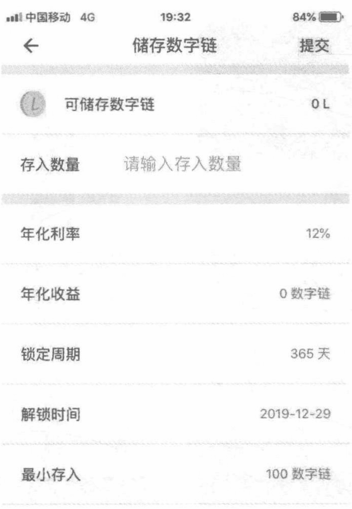

图 9-11 好矿App截图 7

### 9.3 学生创业项目——EIB 校园

EIB校园是由大学生发起的校园共享类创业项目，面向在校学生开放。平台既可作为社交论坛，也支持图书共享和二手物品交易等功能。

图9-12为EIB校园App的首页，可看到平台的推广资讯及正在进行的活动，如“砍价促销”。图9-13为商城板块，其中“美妆商城”在售卖各类化妆品，点击商品可查看详细购买信息，顶部搜索框亦支持关键词检索。

图 9-12 EIB 校园 App 截图 1

图 9-13 EIB 校园 App 截图 2

图9-14展示平台的“二手”板块，正进行交易的二手商品在此一览，同样支持搜索。用户可点击右下角“+”或右上角“发布二手”，完成卖家认证后即可发布交易信息。

图9-15为“更多”板块，包含“社区”“EI币”“共享图书”三项。进入“社区”后会进入社区论坛，如图9-16，可选择“交流”“实习”等栏目，或按兴趣输入关键词检索。帖子下方支持点赞、评论，右上角“发布话题”可自行发起讨论。点击“EI币”可看到平台发行的虚拟代币EICoin，其当日价格与涨跌幅如图9-17所示。EI币可通过二手交易获得，按实时价格进行流通，也可提现。

图 9-14 EIB 校园 App 截图 3

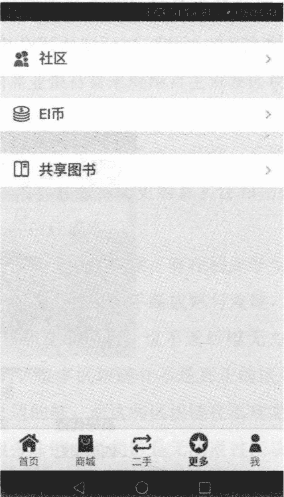

图 9-15 EIB 校园 App 截图 4

图 9-16 EIB 校园 App 截图 5

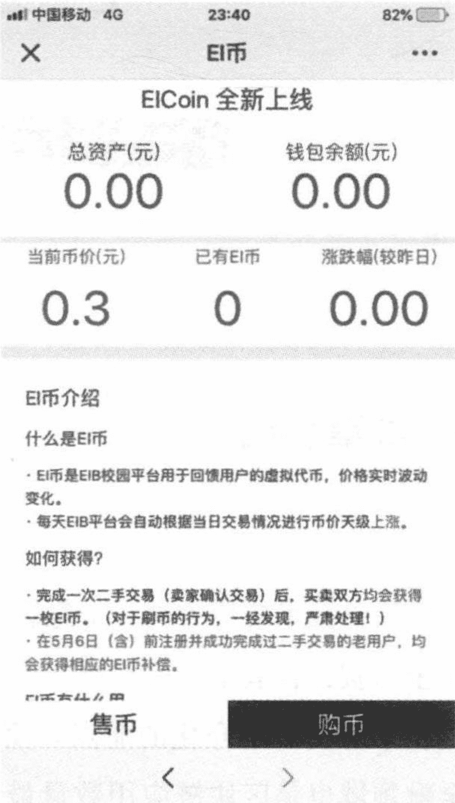

图 9-17 EIB 校园 App 截图 6

图9-18为“共享图书”详情页，可搜索现有馆藏、按时间预约并借阅，同时显示热门搜索榜单。

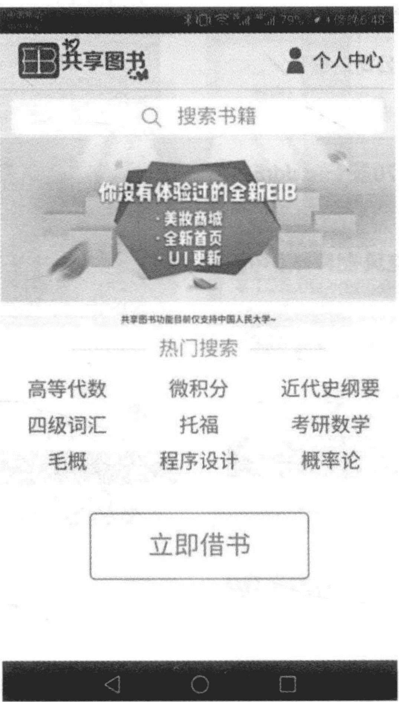

图 9-18 EIB 校园 App 截图 7

### 9.4 本章小结

区块链在金融服务领域的应用是最早起步的方向之一。中国工程院院士鄂贺铨曾指出，区块链为完善金融科技生态提供了技术条件。通过削弱中介依赖、精简交易流程、降低成本，金融行业成为区块链应用数量最多、渗透最深的领域之一。

2018年国内金融区块链的应用步伐加快，中国人民银行成立数字货币研究所，积极探索基于区块链的法定数字货币。2018年8月，中国银行借助自主研发的区块链跨境支付系统，完成了河北雄安与韩国首尔之间的美元国际汇款，成为国内首笔基于自研区块链支付系统的跨境汇款业务。未来，区块链还可在清算、审计、结算等环节得到更广泛运用。得益于其开源透明的特性，参与方能够清楚了解系统运行规则并校验账本的真实性与完整性，从而提升追责能力并降低信任成本。

本章围绕区块链金融科技应用，呈现了多个典型案例，既有高校学生的创业实践，也有成熟的众筹互助模式。随着技术趋于成熟，市场上不断涌现新的区块链项目，既有取得成功的，也有后继乏力的。正如前章提及的区块链沙盒所强调的，并非所有自称区块链的项目都是真正的区块链，许多只是借用了区块链思想或使用了不适配的链，且在上线前未经过充分测试。这些非链或伪链的存在拖慢了行业整体发展水平，因此推广区块链产业沙盒的监管模式具有必要性。

### 思考题

- 试结合自身理解，阐述区块链在众筹领域的工作机制。
- 区块链还可在哪些领域发挥作用，请说明理由。
- 展望未来，区块链金融科技应用的发展前景如何。

## 第10章 基于区块链的医疗应用

### 本章学习目标

- 通过具体案例，了解区块链在医疗领域的现阶段应用情况
- 掌握区块链在医疗领域的应用重点与未来走向

医疗信息安全始终是业界关注的焦点。随着区块链技术普及，其不可篡改的特性能够对医疗科研数据的流转进行追溯记录，为信息安全提供解决方案，同时在保护患者隐私的前提下，使健康数据以更安全高效的方式实现全网共享。2017年初，美国食品药品管理局FDA宣布与IBM Watson Health合作，研究区块链在健康数据共享中的应用，以期改善公共健康。

### 10.1 东华医为——健康链

2018年东华医为携手腾讯发布“一链三云”战略，2019年3月正式推出旗下区块链产品“健康链·hBlock”首个版本，并于同年6月上线。该平台基于Hyperledger Fabric引擎构建的医疗联盟链，为医疗场景提供患者数字医疗信息的确权、存证、共享与溯源等数据治理服务。图10-1为健康链官网截图，其产品特色包括采用联盟链架构、应用国家密码算法、支持多协同平台等。

### 健康链 产品特色

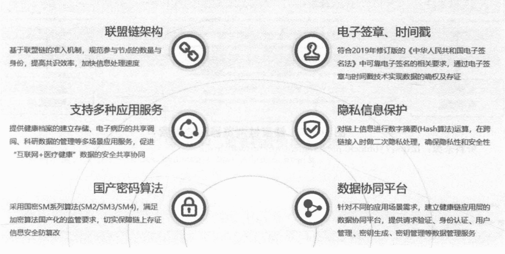

图 10-1 健康链产品特色介绍

资料来源：https://hblock.jiankangle.com/index.html.

健康链主要提供健康档案创建与存储、电子病历共享调阅、科研数据管理三大功能。节点成员涵盖医疗机构、卫健部门、医疗协会、电子数据司法鉴定中心及医疗信息技术公司等。截至2020年2月24日15:00，链上已保存2 619 453个区块，累计交易18 485 630笔，日均新增约46 502笔。任何人均可通过健康链浏览器查询区块详情，如图10-2所示，区块信息包含当前哈希、前序哈希及默克尔树根哈希等，如图10-3所示。

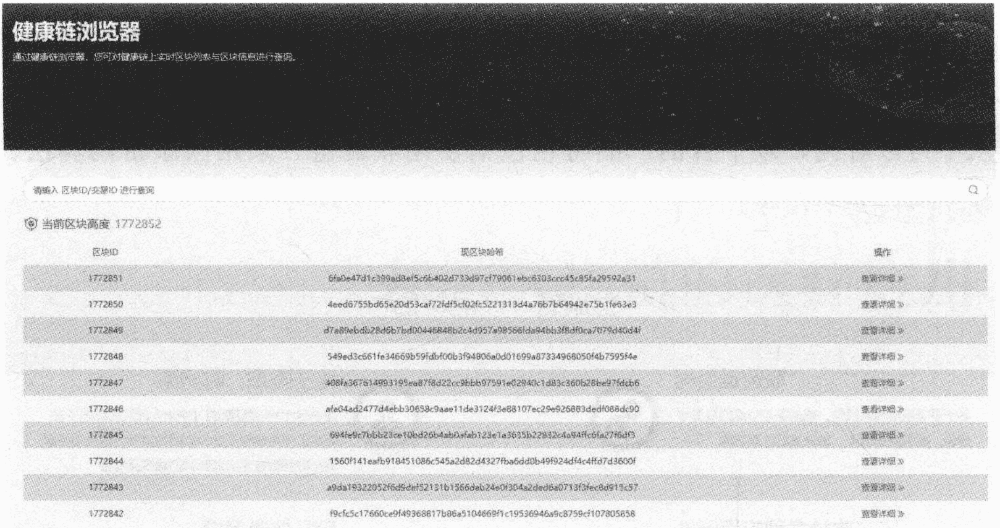

图 10-2 健康链浏览器区块搜索

资料来源：https://hblock.jiankangle.com/browse.html.

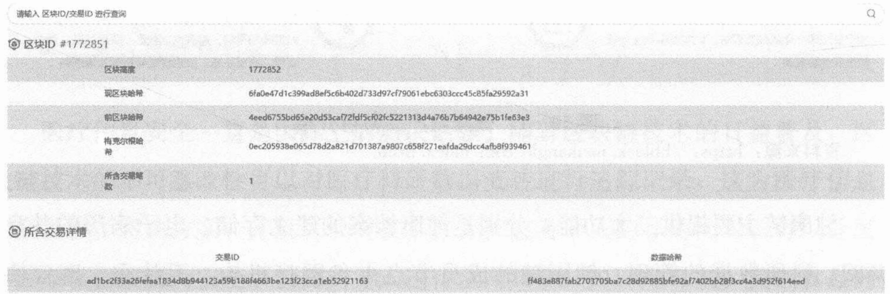

图 10-3 区块信息查看

资料来源：https://hblock.jiankangle.com/browse.html.

健康链依托区块链特性，致力于构建信息互联互通、数据合理利用的技术方案。数据安全、数据权属、存证与溯源是医疗行业数据应用的核心痛点。图10-4展示了健康链的数据系统流程，相较于其他行业，医疗数据的交换与存证更需国家层面的监管，如何让区块链更好地服务医疗健康仍需深入探索。

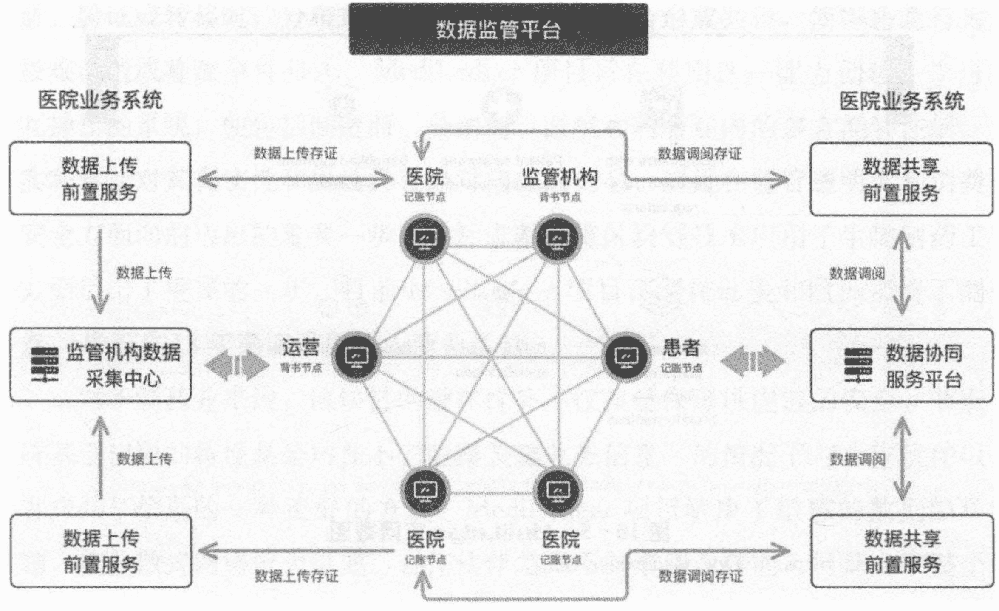

图 10-4 健康链数据系统流程

资料来源： https://hblock.jiankangle.com/solution.html#.

### 10.2 药品供应链管理系统——MediLedger

制药行业长期面临假冒或失窃药品流入供应链并最终流向患者的难题，区块链被视为可能答案。2017年9月21日，由多家企业发起的MediLedger项目公布，旨在打造管理药品供应链的区块链工具，参与方包括Genentech与辉瑞等制药巨头，已完成一次药物追踪试点。MediLedger聚合了领先的制药商与分销商，采用基于区块链原理的可定制分布式供应链管理系统。该系统动态演进跟踪规则，并在供应链整体运营中优化各环节功能。项目正构建一个遵循开放标准、经行业许可的区块链网络，节点分布于业内机构与技术服务商之间。图10-5为官网截图，平台特点包括区块链底座、业务转换可扩展性、保护患者与药品供应安全、简化支付流程等。

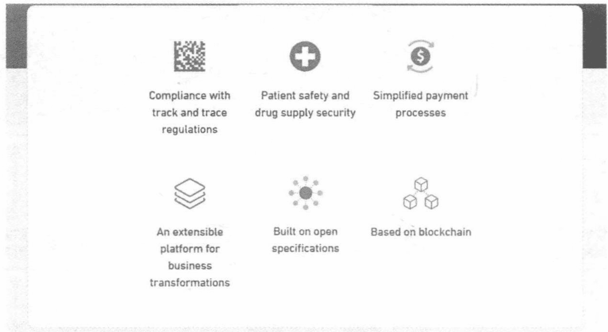

图 10-5 MediLedger 官网截图

资料来源：https://www.mediledger.com/.

MediLedger的核心目标是展示对《药品供应链安全法案》DSCSA的合规实践，并借助区块链溯源能力实现处方药的追踪与追溯，重点在于阻断假药进入供应链。DSCSA要求行业采用互操作系统管理处方药的所有权与转让记录。图10-6展示的产品验证系统架构，说明了MediLedger如何利用区块链在分销商与制造商之间保障药品供应安全。

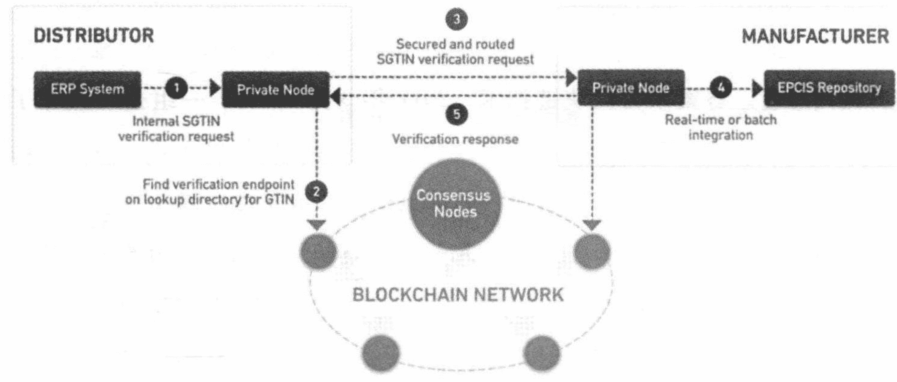

图 10-6 产品验证系统架构

资料来源：https://www.mediledger.com/.

与传统技术相比，区块链提供独特优势。每当资产被注册、验证或转移时，分布式节点网络达成共识，使得恶意篡改事件日志的难度大幅提高。MediLedger正是利用这一特性，打造一个可互操作系统，让制造商、分销商、医院、药店等多方能够注册、核验并转让对真实性与来源具有绝对信任的药品。这是监管透明度与消费者安全的重要进步，也标志着区块链在生物医药工业的实质性应用。目前项目已在北美与欧洲部署测试点，并于2018年第四季度进入商业运营。

除供应链安全外，区块链的权限节点特性也让企业能在不泄露核心商业信息的前提下与合作伙伴共享数据。MediLedger解决了敏感数据隐私问题，使得分布式协作成为可能。各方无需共享商业机密，但凭借全链路的零知识交易验证，规则仍可被执行。这种模式为行业创新提供了开放活跃的环境，使解决方案超越现有市场技术的上限。图10-7为项目效果图，显示其可实现药品供应链100%安全覆盖，从制造商到仓库，再到医院临床试验点直至患者家中，全流程受监管，有效杜绝假药进入。

The Supply Chain should be 100% Secured!

MediLedger does that better than anyone else!

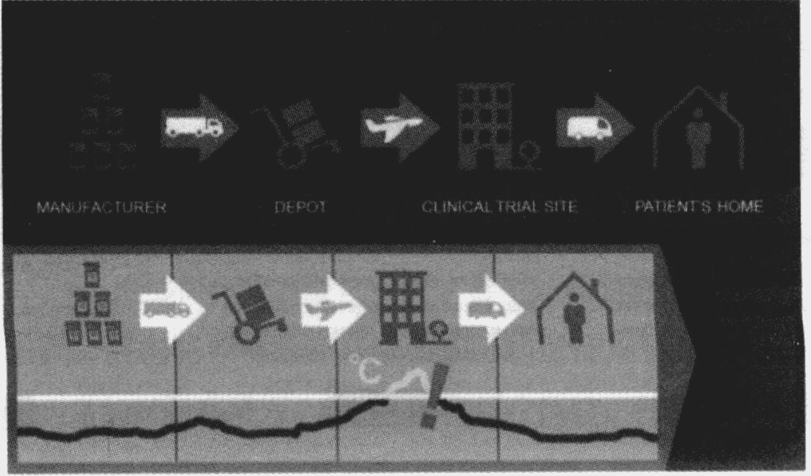

图 10-7 MediLedger 项目效果图

资料来源：https://www.slideshare.net/robinruet/the-medi-ledger-project.

### 10.3 PokitDok——DokChain 医疗区块链项目

医疗互联破局者：PokitDok与区块链新局

PokitDok 专注于为医疗健康行业打造开放接口，核心思路是让医患之间的交易更通透、成本更可控。一方面帮助患者查询不同机构的医疗服务费用，另一方面协助医院触达潜在人群并处理医保结算。平台面向开发者开放供应商目录检索接口，企业借助它就能快速搭建线上商城、在线预约、在线支付以及保险理赔等基础功能。针对第三方机构如支付方、医疗系统和数字健康公司，PokitDok 提供一套应用框架，涵盖支付处理、保险资格核验、转诊管理、理赔结算、跨系统病历调阅、患者身份管理与供应商搜索等能力。移动端和网页端开发者还能基于该 API 构建挂号、核保、缴费或转诊类应用，从而打通不同医疗系统间的数据流通。图 10-8 的网页截图显示，患者可迅速获取个人健康信息并随时联络照护团队。供应商借助平台能调取含他院完整票据在内的用药历史，高效沟通并优化管理实践；医疗机构则可降低数据泄露损失，减少因再入院产生的罚金以及 IT 开支。

WHO WE HELP

PATIENTS
即时调阅自己的健康信息，在社区交流病情并随时与照护团队保持联系。

PROVIDERS
即刻获取含其他机构完整记录的病史资料，高效互动并优化诊所运营。

HEALTHCARE ORGANIZATIONS
降低数据泄露成本，实现协同照护、减少再入院罚款并压缩 IT 投入。

图 10-8 PokitDok 帮助的群体

资料来源：https://pokitdok.com/.

传统医疗底座并非为价值导向体系所设计，这正是 PokitDok 的出发点。其 API 平台让医疗业务的数据整合更快捷，用户可在不更换底层架构或改变工作流程的前提下构建新的服务模式，如图 10-9 所示。

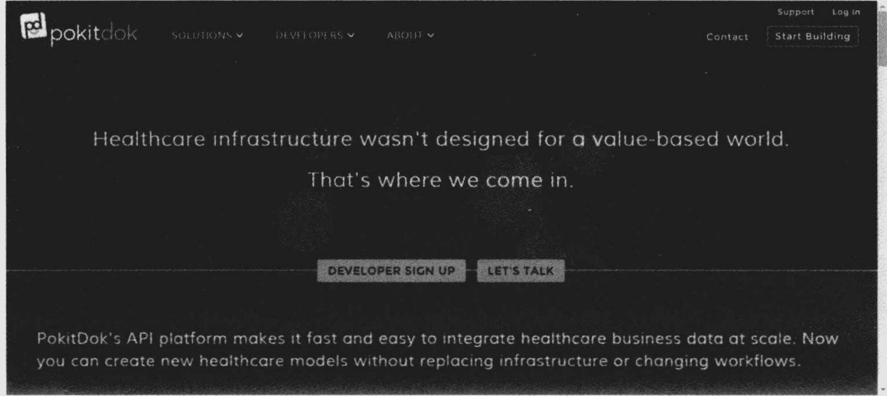

图 10-9 PokitDok 网页截图

资料来源：https://pokitdok.com/.

PokitDok 于 2016 年 10 月首发 DokChain 区块链，定位为覆盖医疗行业财务与临床数据交易的分布式网络。

2017 年 5 月 10 日，PokitDok 宣布与英特尔合作共建 DokChain 医疗区块链方案。英特尔提供开源软件 Hyperledger Sawtooth 作为底层账本，并用自家芯片处理交易请求。

该方案的核心在于对交易各方身份的确认，以及在身份核验后依据既定合约自动完成结算。DokChain 可简化患者登记、自动处理健康保险管理、测算超预算支出并简化支付与报销等冗余流程，帮助患者节省时间、提升就医体验并降低费用。图 10-10 说明了运行逻辑：提交药房保险信息、计划编号、处方药品及处方医生的国家提供者识别号后，数秒内药房 API 即可返回自付额预估、可抵扣费用、事前授权及阶梯治疗要求等，大幅便利患者。

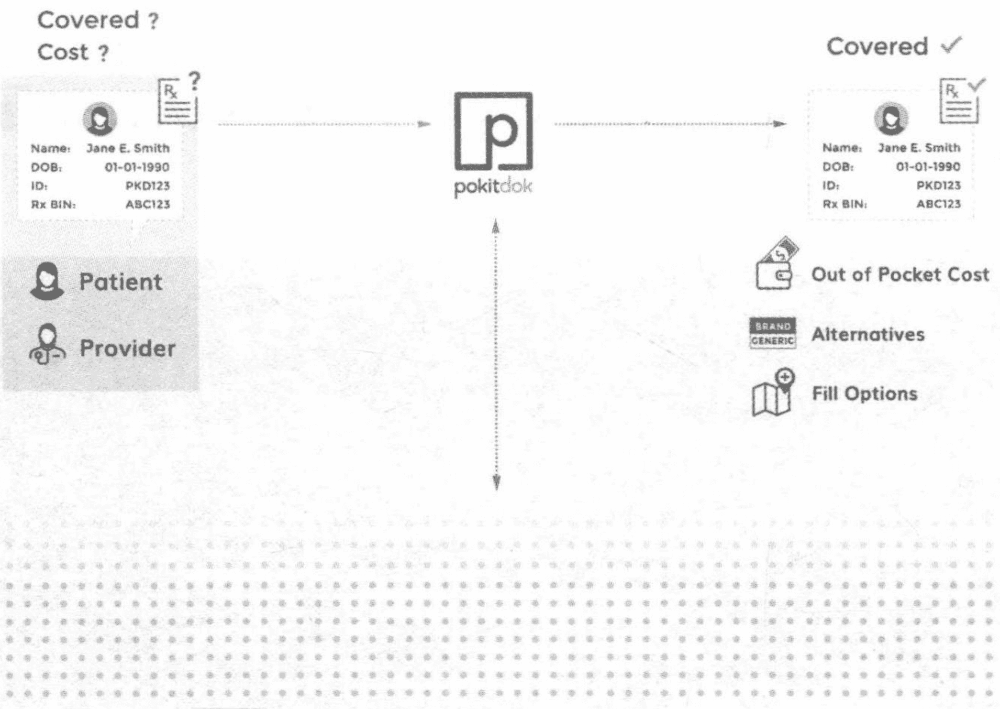

Trading Partners

图 10-10 PokitDok 工作原理

资料来源：https://pokitdok.com/.

区块链还能实现药品防伪溯源。处方开出后信息上链，消费者可看到公开透明的药价；制药商与器械商则可借助链上数据管理库存与订单。流程简化、防伪溯源与供应管理三者结合，有助于遏制欺诈、保护隐私并使服务更流畅。图 10-11 的网站截图显示，PokitDok 的优势包括提升患者满意度、降低雇主保险支出及增强灵活性，叠加区块链后这些优势进一步放大。

英特尔与 PokitDok 合作的 DokChain 必须在芯片层面处理交易请求，因医疗信息交换受 HIPAA 隐私法规约束，对安全等级要求极高。区块链下沉到芯片级后安全水平显著提升，且所有数据加密且私有，可在不违反 HIPAA 的前提下传输。拥有英特尔芯片的笔记本即可运行 DokChain 系统。

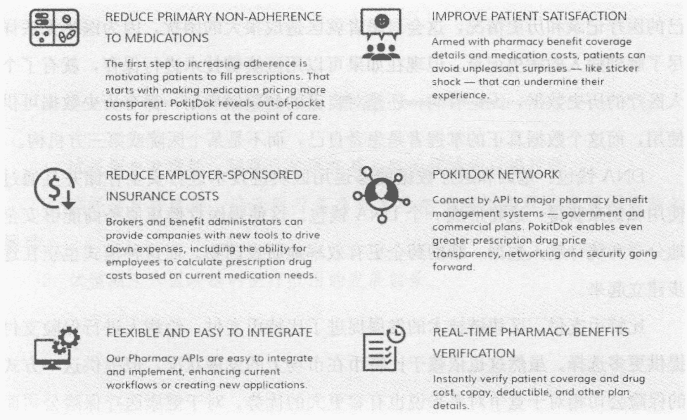

图 10-11 PokitDok 的优势

资料来源：https://pokitdok.com/business/pharmacy/.

### 10.4 本章小结

当前诸多前沿技术在医疗追踪、诊断和治疗中的应用仍有限。本章以区块链在医疗领域的三个实践为例，涵盖电子病历与健康档案的存取管理、药品流通的可追溯监管以及医疗电子平台的搭建。区块链提供的数据密文授权流转与全程可追溯可审计特性增强了管理部门的信任度。连接更多医疗卫生机构的区块链网络可实现有价值医疗信息的安全、便捷、可控流动，推动底层技术架构升级，为机构提供新选择。

未来方向还包括：
电子健康档案：区块链可作为个人医疗记录的载体。过去病历由各医院掌握，患者难以获取完整历史，影响诊疗连续性。若以区块链保存，患者本人成为数据真正持有者，无论就医或健康规划均可调用历史记录。
DNA 钱包：基因与医疗数据可通过区块链安全存储并以私钥访问，形成 DNA 钱包，便于服务商安全共享与统计，助力药企研发。
比特币支付：区块链促进比特币支付，为患者保险结算提供更多选择，相关保险公司具备竞争优势。
药品防伪：药品包装设可刮验证区，通过区块链比对确保合法性。
蛋白质折叠：斯坦福大学曾用昂贵超算模拟蛋白质折叠，单点故障风险高。借助区块链分布式网络可实现高速运算，对其他依赖超算的企业具参考意义。

随着医疗数据重要性提升，其隐私风险也愈发突出。Anthem 曾泄露 8000 万条患者与雇员记录，UCLA Health 泄露 450 万条患者数据。医疗行业还面临数据质量问题，源于医生错误、黑客攻击或多处电子病历并发编辑未更新。患者记录难以完全信任，不同供应商持有的同一患者版本不一致，也可能导致身体、精神和财务伤害。

### 思考题
- 1. 试根据自身理解，解释区块链在药品监管领域的应用过程。
- 2. 试根据自身理解，谈谈医疗信息档案和电子病历实现共享调阅面临的困难。
- 3. 试预测未来区块链的医疗应用的发展前景。

## 第11章 基于区块链的能源应用

### 基于区块链的能源应用
### 本章学习目标
- 根据基于区块链技术的能源应用具体案例，了解区块链目前在能源领域的应用情况
- 了解区块链在能源领域的应用的特点

能源行业持续演进，新能源模式兴起与区块链的分布式、公开与透明特性高度契合。源于数字货币的区块链有望成为构建未来能源互联网生态的关键技术之一。为打通能源流、资金流与信息流，众多区块链创业公司正与能源产业企业合作探索落地。

### 11.1 可再生能源交易平台——WePower
WePower MVP 于 2017 年 8 月创建，同年 9 月与爱沙尼亚电网运营商 Elering 签署谅解备忘录，自 2018 年 1 月起作为基础设施集成试点。WePower 是一个由区块链与智能合约支撑的绿色能源交易平台，图 11-1 为其官网首页。平台让能源生产商通过竞价交易电力，并可发行自有能源代币融资；买方与投资者则能以更低成本购入电力。

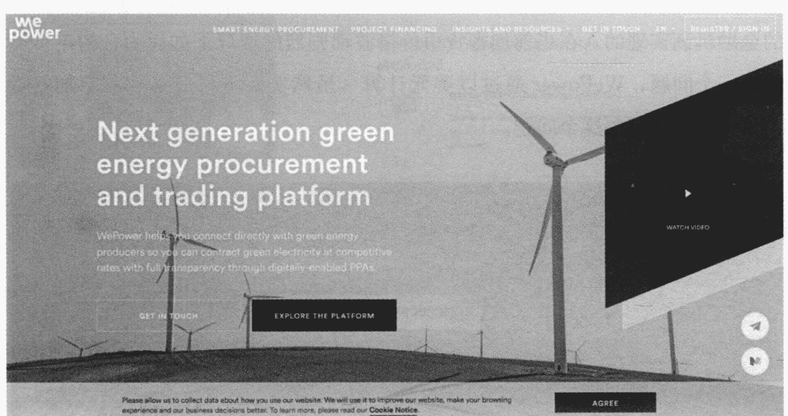

图 11 - 1 WePower 网站首页

资料来源：https://wepower.network/?spm=a2c4e.10696291.0.0.301019a4xMsskE#.

如图 11-2 所示，平台优势在于直连可再生能源生产商、基于区块链的电力消费公开核算、标准化交易规则与有竞争力的价格。公开核算借助区块链生产核算方案，使买方对每度电的来源产生信任。

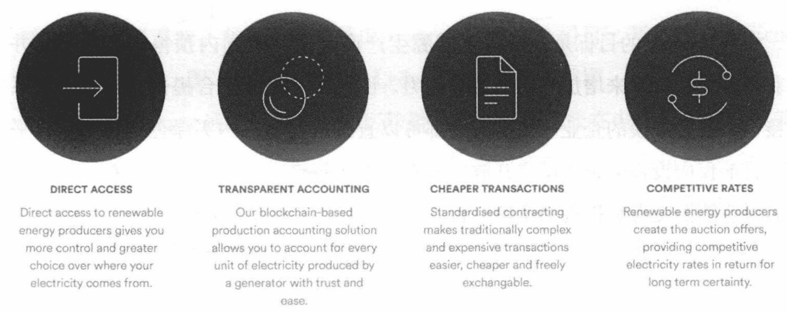

图 11 - 2 WePower 平台优势

资料来源：https://wepower.network/.

如图 11-3 所示，买方可根据自身用电模式在平台匹配合适的可再生能源生产商并签订数字资产合同。直接交易通过购电协议 PPA 金融机制实现。为应对加密货币价格波动，WePower 以美元计价，实际支付时采用数字货币或代币。

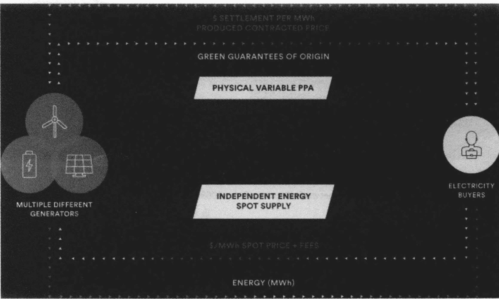

图 11-3 WePower 交易过程

资料来源：https://wepower.network/?spm=a2c4e.10696291.0.0.301019a4xMsskE#.

WePower 的目标是帮助可再生能源生产商全球预售产品并获取资本提升盈利能力。图 11-4 为平台买方对接入口，面向各类企业电力买家直采绿电，目前仅对授权企业开放，未来计划向个人开放并成为全球绿色能源交易与投资平台。

WePower Platform

We've built a revolutionary green energy marketplace. It allows corporate electricity buyers of all sizes to buy green energy directly from the generators. The platform is currently only made available to authorized business users.

Interested in sourcing renewable energy using WePower platform?

Assess your green energy potential

Explore our Going Green tool so we could provide you with a free assessment on how much you could save by buying green energy directly from solar and wind energy producers.

ASSESS POTENTIAL SAVINGS

Get in touch!

Contact our team to request access to WePower Platform.

CONTACT US

图 11 - 4 WePower 用户连接端口截图

资料来源：https://platform.wepower.network/.

### 11.2 全球首个区块链 P2P 项目——Power Ledger
澳大利亚区块链软件公司 Ledger Assets 创立了全球首个区块链点对点项目 Power Ledger。该系统基于自研 Eco-chain 区块链，实现分布式太阳能余电交易。图 11-5 为官网首页截图。

Power Ledger 利用区块链确定电力产生时的所有权，通过交易协议完成生产者与消费者间的结算。用户可将屋顶太阳能余电点对点出售，出售价高于卖给电网，生产者收益提升，消费者电费下降。图 11-6 为平台能源交易的介绍与产品链接。

图 11-5 Power Ledger 网站首页截图

资料来源： https://www.powerledger.io/.

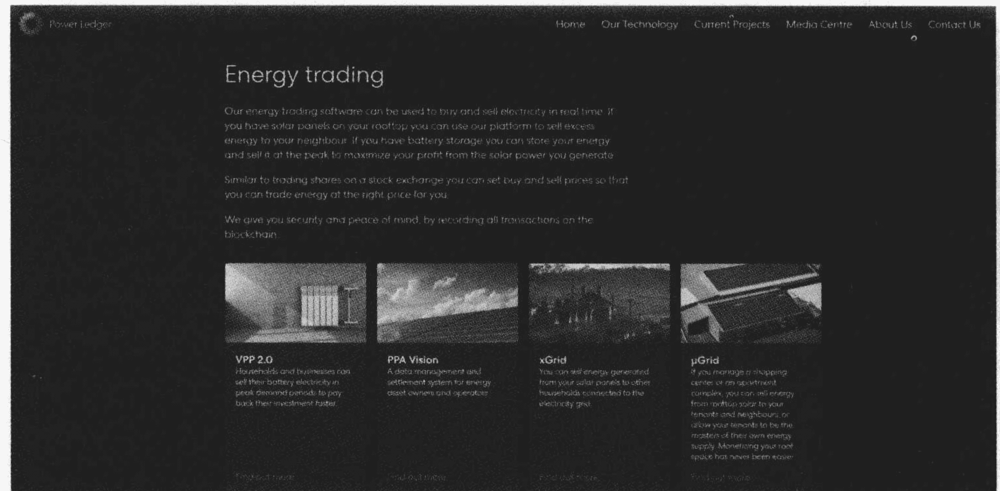

图 11-6 能源贸易介绍

资料来源： https://www.powerledger.io/our-technology/.

图 11-7 展示了环境商品交易介绍与合作项目。平台以私有区块链追踪可再生能源产出以抵消排放，并追踪大量与环境商品及可再生能源信用相关的交易，避免重复计算或挪用。C6 系统与智能电表及数据管理系统集成，可自动追踪能源并提供可再生能源与碳信用关键信息，帮助太阳能与风电业主更便捷获取信用。

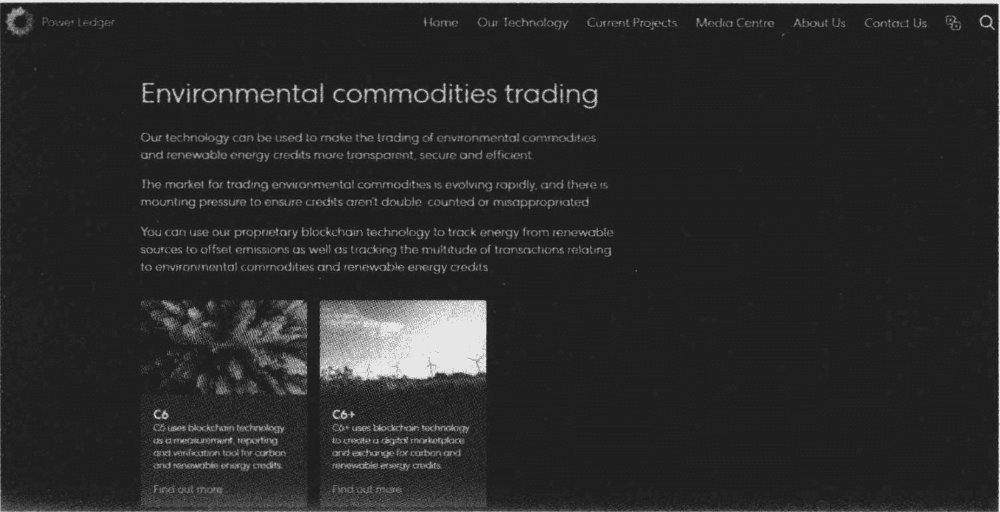

图 11 - 7 环境商品贸易

资料来源：https://www.powerledger.io/our-technology/#.

Power Ledger 致力于能源交易、环境商品交易与可再生能源投资。2017 年上半年在珀斯试点覆盖 80 户家庭，虽属示范阶段但持续扩展。图 11-8 显示其正与日本太阳能供应商 Sharing Energy 及电力零售商 eRex 在日本试水 P2P 太阳能交易，并推进至马来西亚光伏屋顶市场。

图 11 - 8 Power Ledger 项目介绍

资料来源：https://www.powerledger.io/.

### 11.3 能源区块链实验室
我国首个能源区块链实验室于 2016 年 5 月 15 日成立，也是全球首家聚焦能源产业全价值链区块链应用的研发机构。该实验室正联合 Linux Foundation 发起 Hyperledger Energy Project。图 11-9 为其官网对分布式资产投融资的说明，主要通过能源与金融市场场景融合，提供基于区块链的绿色资产数字化登记与管理服务。

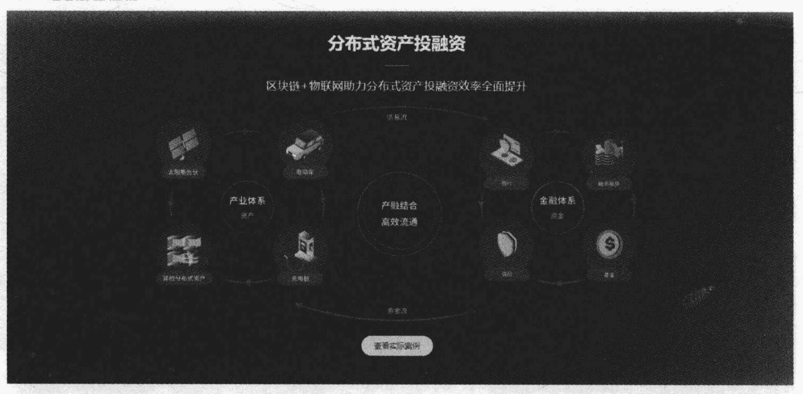

图 11 - 9 能源区块链实验室网站截图 1

绿色资产上链实践：能源区块链实验室的案例拆解

资料来源：http://www.energy-blockchain.com/

能源区块链实验室聚焦低成本、强可靠的绿色资产数字化底座建设。覆盖的应用场景包括电动汽车、可再生能源、虚拟电厂、绿色金融等方向，适配的资产类型涵盖绿电证书及积分、用能权、节能积分、能源设备共享经济积分、绿色债券、绿色信贷、绿色资产支持证券等。

图11-10所呈现的合作中，实验室携手杭州一家智能分拣机器人厂商，借助能链科技金融级分布式资产数字化平台搭建桥梁，将机器人资产与金融机构连接起来，实现设备资产的透明呈现与可视化查询，并对现金流进行可信监视与自动划转。该项目规划三年内投放20万台分拣机器人，链上资产规模预估约30亿元人民币，融资体量预计落在30亿至35亿元区间。

推动产业数字化转型
构建一站式分布式资产登记、融资及流通体系，提升整体产业效率

01

杭州瓦瑞科技有限公司

合作目标
由设备销售转向设备租赁的商业模式

合作内容
与分拣机器人设备商联动，调用能链科技金融级分布式资产数字化平台，完成机器人资产的透明化、可视化以及现金流的可信监控与自动划拨。项目计划三年内铺设20万台分拣机器人，上链资产规模预计在30亿至35亿元人民币。

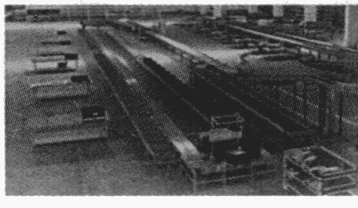

图 11-10 能源区块链实验室与杭州某公司合作案例

资料来源：http://www.energy-blockchain.com/cases.

图11-11显示，实验室与一家全球范围的航空资产管理集团展开合作，利用能链科技金融级分布式资产数字化平台，对9座机场共享按摩椅设备的现金收益进行可信监测与可靠分配。以运营数据与现金流数据的透明、可视化为基础引入社会资本，推动证券化进程。链上资产规模预计超过100亿美元，募集规模预计超过100亿元人民币。

04

海航机场集团有限公司

合作目标
资产收益通过智能合约分成 + 以资产运营为依托的资金募集

合作内容
与全球性航空资产管理运营集团合作，通过能链科技金融级分布式资产数字化平台，实现9大机场共享按摩椅设备现金收入的可信监控和可靠分配，通过运营数据及现金流数据的透明化、可视化，引入社会资本，实现证券化。预计上链资产规模超过100亿美金，预计募集规模超过100亿人民币。

图 11-11 能源区块链实验室与海航机场集团有限公司合作案例

资料来源：http://www.energy-blockchain.com/cases.

图11-12反映了实验室与全国性智能蜂箱企业集团的协作，意图让金融资本更高效地进入蜂业。项目拟在全国范围内部署200万个智能蜂箱，链上资产规模预计达60亿元人民币，融资规模预计超50亿元人民币。该项目于2019年5月18日联合对外发布，至今持续运行。

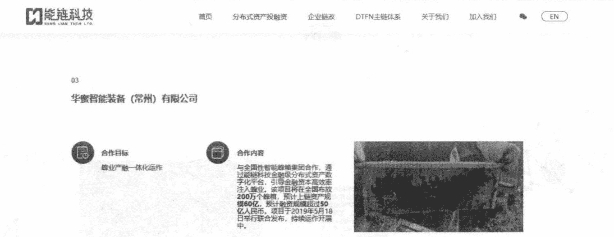

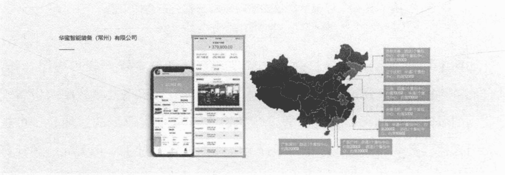

图 11 - 12 能源区块链实验室与智能装备公司合作案例

资料来源：http://www.energy-blockchain.com/cases.

实验室的底层账本把绿色资产开发全流程的参与主体全部纳入分布式账本，搭建起各类绿色资产的数字化登记与管理体系。图11-13展示了实验室推出的三类区块链数字解决方案，合作方包含上海市科学技术委员会、深圳排放权交易所等机构。

企业链改

区块链数字解决方案

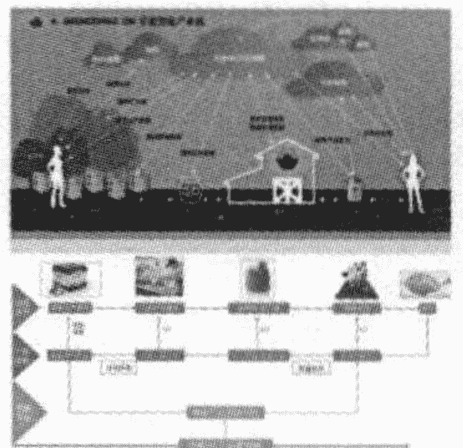

（绿电溯源和流通网络）

《个人绿色资产登记和流通网络》

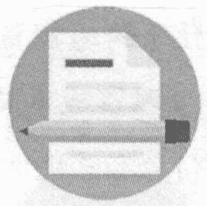

《基于用户端能源区块链关键技术研究》

图 11-13 能源区块链实验室网站截图 2

资料来源：http://www.energy-blockchain.com/.

### 11.4 本章小结

近几年，在环保意识抬头与电池价格下行的双重带动下，能源用户追求高效低成本已成主流。传统能源经营模式与盈利逻辑难以适应数字化、低碳化的新要求，企业一方面难以应对日益复杂化的交易需求，另一方面也难以满足监管与用户对供电安全及分布式能源接入的强烈诉求。本章归纳了三类基于区块链的能源应用案例，既有搭建能源采购平台让消费者以更环保、更实惠的方式购买可再生资源，也有在能源价值链全环节落地分布式账本技术。

分布式账本技术具备多方共享、数据难篡改、可追溯的特性，既能帮助能源电力企业守住安全底线，也能创新性地重塑能源价值链。此外，区块链在数字货币、价值转移等场景的应用，未来也将在能源企业的清算、供应链、知识产权保护等领域产生深远影响。总体来看，区块链在电力资源领域的探索仍处于试验阶段。

区块链与能源互联网结合的未来走向：

其一，依托分布式账本部署的能源设备可实现点对点互动式决策，无需把信任托付给单一集中平台，从而提升交易效率并降低成本与风险。以油气行业为例，2017年12月，中国中化集团在中东至中国原油进口业务中完成了国内首单区块链原油进口试点。中化方面表示，相较传统能源化工跨境贸易的繁琐流程，应用区块链可将整体效率提升50%以上，融资成本下降30%以上。

其二，推进分布式能源建设。分布式能源有助于增强电网灵活性、降低运维成本并提高可靠性。区块链可将可再生能源及其他能源纳入分布式体系，提升其可视化与可控性，以满足电网运行日益复杂的需求。智能合约能够让供需双方在条件匹配时自动完成能源交易。

其三，依托分布式账本数据不可篡改、可追溯的特性，可用于能源开发与排放管理的追踪交易体系。以碳排放为例，各国虽均提出减排目标，但全球市场对碳排放的计量与记录方法标准不一，集中管理与审查会消耗大量时间和成本。利用区块链可信的数据存储，能够大幅简化交易、强化验证，并减少对昂贵集中式管理的需求。

### 思考题

- 1. 试根据自身理解，解释区块链在电力资源交易领域的应用过程。
- 2. 试根据自身理解，谈谈在电力资源领域进行区块链技术应用的优点。
- 3. 试预测未来区块链的能源应用的发展前景。

## 第12章 区块链电子政务应用

基于区块链的电子政务应用

### 本章学习目标

- 了解基于区块链的电子政务应用背景
- 了解目前区块链在电子政务领域的具体应用案例
- 了解未来区块链在电子政务领域的发展

### 12.1 区块链电子政务应用背景

电子政务是指政府信息服务与信息处理系统的电子化，通过“互联网+政务”重塑政府办公方式，以提升行政效率与依法行政水平。随着电子政务不断推进，政务数据规模持续增长，跨机构、跨区域的数据联通对提升管理效能与工作效率愈发重要。但数据共享过程中安全风险突出：服务平台涉及海量个人与企业敏感信息，直接公开风险极高；数据交互流程复杂，易出现人为失误，也易遭受黑客攻击或内部泄密。因而数据共享落地时常受阻。区块链为跨区跨机构数据整合提供了安全可信的机制，可让政府部门对访问主体与访问数据进行自主授权，并对数据调用行为留痕，实现事后追责，极大降低政务数据共享的安全隐患。

从宏观政策层面看，2017年1月至10月，国务院密集出台《国务院办公厅关于创新管理优化服务培育壮大经济发展新动能加快新旧动能接续转换的意见》《国务院关于印发新一代人工智能发展规划的通知》《国务院办公厅关于积极推进供应链创新与应用的指导意见》等文件，研究依托区块链等新技术构建基于供应链的信用评价机制。2019年10月24日，中共中央总书记习近平在主持学习区块链技术发展现状与趋势时强调，要把区块链作为核心技术自主创新的重要突破口，明确主攻方向，加大投入，攻克关键核心技术，加快推动区块链技术和产业创新发展。各地也纷纷出台支持政策。2018年3月，深圳市经济贸易和信息化委员会发布《市经贸信息委关于组织实施深圳市战略性新兴产业新一代信息技术信息安全专项 2018 年第二批扶持计划的通知》，区块链纳入扶持范围。2018年4月，上海区块链产业联盟成立，由多家上市公司、科研机构及应用创新企业共同发起，在科研、技术与工程应用方面具备明显优势。

表 12-1 统计了自 2014 年以来，政府发布的电子政务相关政策。随着近年来政府体制和机制改革的不断健全，政府对用电子政务的手段完善自身职能的需要越来越迫切，全国政府部门的数据互通也日趋重要。

### 表 12-1 我国电子政务的相关政策

| 相关政策 | 发布时间 |
|---|---|
| 《国务院关于加快推进全国一体化在线政务服务平台建设的指导意见》 | 2018-07-31 |
| 《国务院办公厅关于印发进一步深化 “互联网+政务服务” 推进政务服务 “一网、一门、一次” 改革实施方案的通知》 | 2018-06-22 |
| 《国务院办公厅关于印发全国深化简政放权放管结合优化服务改革电视电话会议重点任务分工方案的通知》 | 2017-06-30 |
| 《国务院办公厅关于印发政务信息系统整合共享实施方案的通知》 | 2017-05-18 |
| 《国务院办公厅关于印发 “互联网＋政务服务” 技术体系建设指南的通知》 | 2017-01-12 |
| 《国务院关于加快推进 “互联网＋政务服务” 工作的指导意见》 | 2016-09-29 |
| 《国务院关于印发 2016 年推进简政放权放管结合优化服务改革工作要点的通知》 | 2016-05-24 |
| 《国务院办公厅关于转发国家发展改革委等部门推进 “互联网＋政务服务” 开展信息惠民试点实施方案的通知》 | 2016-04-26 |
| 《国务院关于积极推进 “互联网＋” 行动的指导意见》 | 2015-07-04 |
| 《国务院办公厅关于加强政府网站信息内容建设的意见》 | 2014-12-01 |

表 12-2 展示了中央和地方政府鼓励区块链与电子政务融合发展的一些相关政策。

### 表 12-2 我国鼓励区块链与电子政务融合发展的政策

| 地区 | 政策名称 | 发布时间 |
|---|---|---|
| 中央 | 《中国保监会关于印发〈偿二代二期工程建设方案〉的通知》 | 2017-09-18 |
| 中央 | 《国务院关于印发新一代人工智能发展规划的通知》 | 2017-07-08 |
| 北京 | 《北京市推进政务服务 “一网通办” 工作实施方案》 | 2018-08-17 |
| 天津 | 《天津市市场和质量监督管理委员会印发〈市场监管委关于推行企业登记全程电子化工作的意见〉的通知》 | 2017-08-31 |
| 深圳 | 《深圳市国家税务局、深圳市地方税务局关于优化税收营商环境的若干措施》 | 2018-03-30 |
| 广州 | 《广州市黄埔区人民政府办公室、广州开发区管委会办公室关于加快 IAB 产业发展的实施意见》 | 2018-01-09 |
| 贵阳 | 《贵阳市人民政府关于贵阳市加快推进政府数据共享开放的实施意见》 | 2017-03-28 |
| 新疆 | 《新疆生产建设兵团转发〈国务院关于印发《新一代人工智能发展规划》的通知〉的通知》 | 2017-08-14 |

表 12-3 所示的是 2018 年省级政府电子政务能力排行榜。从表中可看出，一些省份还有很大的潜力有待发掘，电子政务仍需要进一步普及。

### 表 12-3 省级政府电子政务能力排行榜

| 排名 | 省级政府 | 分数 | 排名 | 省级政府 | 分数 |
|---|---|---|---|---|---|
| 1 | 浙江 | 94.26 | 17 | 河北 | 81.48 |
| 2 | 江苏 | 93.93 | 18 | 云南 | 81.30 |
| 3 | 贵州 | 93.76 | 19 | 河南 | 81.16 |
| 4 | 广东 | 93.25 | 20 | 湖北 | 80.33 |
| 5 | 安徽 | 90.90 | 21 | 辽宁 | 80.18 |
| 6 | 北京 | 85.89 | 22 | 天津 | 78.96 |
| 7 | 福建 | 84.39 | 23 | 吉林 | 78.72 |
| 8 | 重庆 | 83.35 | 24 | 新疆生产建设兵团 | 77.25 |
| 9 | 四川 | 82.75 | 25 | 湖南 | 76.49 |
| 10 | 山东 | 82.50 | 26 | 广西 | 75.65 |
| 11 | 宁夏 | 82.19 | 27 | 山西 | 71.33 |
| 12 | 江西 | 81.84 | 28 | 陕西 | 69.79 |
| 13 | 黑龙江 | 81.78 | 29 | 内蒙古 | 68.38 |
| 14 | 湖南 | 81.74 | 30 | 青海 | 68.36 |
| 15 | 上海 | 81.57 | 31 | 新疆 | 62.86 |
| 16 | 甘肃 | 81.55 | 32 | 西藏 | 50.44 |

区块链技术在电子政务中有以下几个应用方向。

第一，个体身份认证。区块链建立在互联网之上，与个人相关的证件、资产、证明文件乃至公共记录均可迁移上链，并借助加密认证与全网共识机制形成“数字身份证”。依托区块链完整、分布式、不可篡改的连续账本，个人与机构均可构建自有身份凭证，并利用多方验证数据信息实现“自证”，无需依赖第三方认证。

这种新型信用关系有助于推动电子政务的简政与廉政。其一，个人申请公共服务时无需在不同机构间奔波收集证明材料，政府审批时也无需反复核实真实性，通过数字身份证即可获取可靠完整的基础信息与征信情况，大幅提升行政效率。其二，数字身份证的不可篡改性及审批从条件审批向表现审批转变，能促使社会主体珍惜征信记录，重视自身行为表现，有利于提升政府治理效能。因此，数字身份证的建设与发展契合电子政务简政、廉政、高效的诉求，将是未来重要方向。

第二，生产流程监管。随着政府信息公开进程的推进，公民对于与自己生活密切相关的信息的公开需求在不断增长。区块链技术通过合约机制可以将不同行业、不同机构的信息连接起来，而无须再根据不同的信息公开需求建设不同的管理系统，并且可以形成完整的数据链，如在粮油流通的过程中监测信息；同时也可以保证在这个过程中信息不可篡改。

第三，政府信息公开。区块链的散列处理等加密算法可以将一些数据进行脱敏处理，以保护涉及敏感的个人隐私的内容。通过精细化授权，有利于建立数据横向流通机制，也使得更多政务信息可以被公开出来，既降低了信息公开的建设成本，又保障了信息的可靠性、完整性，不仅满足了公众的知情权以及对政府工作的监督权，也加大了政府信息公开的力度与深度，有利于“阳光政府”建设。同时，区块链作为一种按照时间顺序排列的“时间轴数据库”，可以避免有效数据的收集和清洗，大大降低数据的收集成本。结合大数据技术，可以对区块链中丰富的海量数据进行深度挖掘与分析，这将会极大提升区块链数据的价值和使用空间。在政务信息联通、公开、深度挖掘和合理利用方面，区块链都能发挥巨大作用。

使用区块链技术赋能政府执政能力建设会提升政府服务水平，但同时也是对政府职能转变的考验。具体表现在三个方面：

第一，民众能否适应这种变化。这体现在两个层面：其一是对区块链技术本身的接受程度，其二是能否适应并充分信任政府的职能转变。受到前些年币圈一些圈钱风波和集资诈骗的影响，公众普遍一提到区块链，头脑中就满是负面印象。然而区块链作为一种中立的技术，其本身是不分善恶的，关键在于谁使用区块链技术。近些年，政府逐渐引导公众对区块链的看法，并且加强了对区块链行业的监管，这些举措都提升了民众对区块链技术的信任。除此之外，政府也在大力完善自身建设，把提升政府职能当作自己的长期目标，并付诸行动。这些都使公众对政府的信任水平得到提高。但是，区块链作为一种共治思想的体现，距离其大规模的普及和被接受还有很长的路要走。

第二，政府能否适应自身的职能转化。区块链具有分布式的特征，区块链技术在和传统政务的融合过程中，会在一定程度上削弱政府机构原有的地位。原有资产登记、存证等工作会在一定程度上被替代，民众和政府将处于一个较为平等的地位。所以对政府来说，能否适应这种变革将决定区块链技术与电子政务相结合的前景。

第三，区块链技术本身。区块链作为一种新兴的技术，从其出现到应用只有短短数年的时间，就技术本身来说仍然有待完善。区块链技术的完善一方面需要借助技术手段，另一方面也需要借助法律手段。众所周知，区块链存在密钥丢失、51%攻击等安全性问题，这些问题的解决不能单单依靠技术手段，也需要有相关法律的保护。目前有越来越多的政府和地区正在制定区块链技术的相关法律法规，在国际上也积极参与相关标准的制定，但从法律的制定到落实还有很长的一段路要走，并且能否适应区块链的发展也是一个不能回避的问题。

总而言之，“区块链＋电子政务”的前景总体上依然广阔，有很多应用有待挖掘。相信在不远的未来，区块链技术可以让政府事务更加公正透明，群众作为政府的监督者将更深入地参与政府的工作，参与政府的建设。

### 12.2 基于区块链的公证——证宝宝

【证据难留，维权先掉链】

在工作和生活中，拿得出能说话的证据并不容易，消费纠纷里这点尤其明显。不少人遇到麻烦才想起要固定材料，可关键节点早已错过；有的材料在流转中不翼而飞，有的留存内容与实际情况对不上，有的干脆被对方否认。现场推销、上门推销、电话直销、网购中的夸大宣传层出不穷，消费者拿到正规凭证的几率偏低。商家多为异地经营，事后追溯成本高。没有第三方背书的交易一旦扯皮，责任归属很难认定。

网购痕迹多为电子形态，刷新快、易被改动、保存难度大。交易常在聊天工具里完成，对方删记录、拉黑后原始载体找不回来，即便截屏也难以被采信。即使能提交聊天记录，卖家不出庭应诉时，法院对真实性的核查也会很审慎。最终承担举证不能不利后果的通常是买方，诉求很难获支持。

这种被动局面，根源在于证据意识薄弱，未能在交易关键节点养成即时固证的习惯，同时市场上缺乏操作门槛低、场景覆盖广、公信力强的存证工具。好用的工具意味着普通人无需专业训练即可上手；场景全意味着线上聊天、支付流水以及线下录音、照片、视频都能采集；公信力强意味着调解或诉讼时更容易被接受。传统模式下网络案件处理常卡在存证、取证、采信三步。大量材料在线上，搬到线下做成纸质或光盘带到法庭，再由法官人工核验，既耗时耗力，又因反复转换增加了被篡改的可能。

区块链的数据特性正好对症。数据生成后具备可追溯、可校验且难以篡改的特征。将区块链与公证机制结合，形成区块链加公证的存证体系，对社会治理有推动意义。技术可以在保障安全与隐私的前提下提升公证的可信度，随时校验也让存证行为更具说服力。

在身份层面，区块链可提供可信的电子签名身份认证，让数据诞生时就与唯一且不可抵赖的身份绑定，证据中自然带上个人信息来源，从而打通从采集、完整性核验到身份确认的公证链条。与传统做法不同，区块链依托分布式信任、难篡改、可追溯的特质，在司法实践里可通过确权上链、侵权上链、链上认证三步完成电子证据固化，取证时长与成本明显下降。

取证工具「证宝宝」切入该细分赛道，为企业、机构和个人提供多功能电子取证、不可篡改存证与强公信力出证服务。

### 技术优势
主体认证——全程加密
严格遵循法律行为主体合规要求，解决身份识别难题。企业用户由权威CA机构签发数字证书，个人用户通过公安部第三研究所eID并经权威机构向公安部人口库核验后颁发数字证书，全程加密处理。

完整保障——防篡改
采用哈希、电子签名、可信时间戳技术，从数学与技术层面双重守护电子数据，防止篡改。

安全存储——区块链+云存储
通过可信云加密保存电子数据，同时将数据指纹等核心信息同步上链，保证存储安全可信。

时序可信——国家授时
依托国家授时中心提供时间源，结合区块链时序不可逆特性，确保存证时间真实可信。

隐私保护——源文件可不上传
用户不必上传原始文件，只上传数据指纹即可完成存证，有效保护商业秘密与个人隐私。

### 图 12-1 证宝宝技术优势
资料来源：https://www.zhengbaobao.com.

图 12-2 和图 12-3 是证宝宝 App 的界面展示，支持电子数据边录边传、随时上传，录音、录像、拍照、截屏等文件均可作为原始电子数据存入证宝宝区块链存证平台。区块链作为分布式账本，存储成本较高，平台只会将证据数据的哈希值、电子签名与时间戳等关键信息上链。

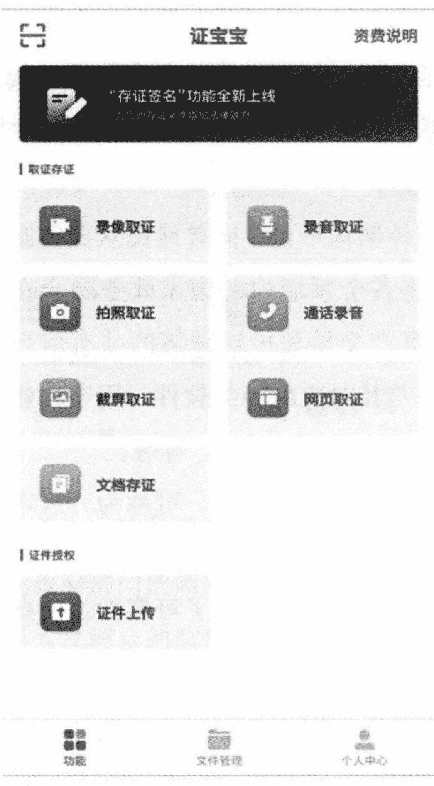

图 12-2 证宝宝 App 界面 1

图 12-3 证宝宝 App 界面 2

### 12.3 链合科技——政务区块链
政府机构持续改革，政务公开透明步伐加快，区块链在电子政务中的落地成为热门议题。

在政务场景中，区块链的应用大致可分两类。其一是构建可信身份认证体系，让权力运行更可追溯，公共服务与内部管理更顺畅，并通过区块链平台把分散的政府职能整合为统一的一站式服务。其二是利用区块链数据不可更改、记录全周期的特性，打破部门间信息壁垒，推动更多政务信息公开与监管信息全程可查。信息孤岛被打破后，政务数据可与大数据、人工智能等技术融合，实现更高效的治理与社会服务。

要搭建面向公众的区块链电子政务架构，需要把各领域国家政务资源整合，形成覆盖政府机构、经济数据、资产交易、传媒等领域的共享信息空间，同时配套注册管理机构及相关软件，支撑基于智能合约的政府、企业和公众应用平台开发。

这种以区块链构建政务链生态系统的软件方案可称为“区块链即政务”。其核心优势在于借助加密算法与分布式存储提升注册机构数据可靠性，所有变更记录永久保存在实体存储中心。

由深圳链合科技投资公司联合国际顶尖的区块链团队开发打造的政务链，按照上述方向，提出了一套用区块链改良电子政务的方案。政务链生态系统是一个多级权限管理系统，具有创建和编辑注册管理机构、智能合约和接口的功能，为了控制对平台管理的访问权限，使用了智能合约与智能法律相结合的方案，实现了可灵活定制的权限监控系统，同时该系统还可以自动跟踪访问权限的转移。从技术上说，政务链生态系统也是一个点对点网络，其节点是数据中心，每个节点都包含完整的区块链数据。这些节点依次以不超过一秒的周期生成区块，单一节点也可以维持其生态系统的效率，其余节点确保了网络的不间断运行，并防止未经授权的数据篡改。

政务链生态系统同时也是一个独立和封闭的系统，只有具有私钥的用户才能访问并使用网络资源，但同时也意味着，可以将一国的政务链网络纳入国际政务链网络。政务链生态系统是以法律、金融和经济关系的实体登记注册为依据的，由登记注册管理部门负责，包含法人和自然人、家庭户口关系、房地产权、证券、专利许可证等。在政务链中，管理登记注册的权限设计为多层级机制，是管理政务的生态系统，并在其基础上创建应用程序的最重要工具。注册管理机构的权限可通过在个人注册表中指定身份的方式，将权限授予某些角色。因此，通过分配多层次的权限体系，在不同部门、行业和组织中实施，达

图 12-4 政务链的技术优势
资料来源：https://gachain.org.

总体看，政务链提出了一系列将区块链引入政府领域的基本构想，能够提升政府部门办公效率，同时提高开放水平，让其更好地接受公众监督。无论未来发展如何，作为“区块链+电子政务”领域的公有链平台，其理念和技术架构对后续平台有参考和借鉴意义。

### 12.4 本章小结
从“区块链+电子政务”的应用方向来看，政府管理活动涉及公民基本权益与社会正常运营，对信息可靠性、安全性要求极高；在政府管理过程中会产生大量与公民生活密切相关的信息，对这些信息的妥善保管与合理利用要求也极高。如何提供更高效、更优质、更公平的公共服务，如何提供更可靠、更透明、更全面的信息资源，是政府开展电子政务活动要解决的重要问题。

本章围绕“区块链+电子政务”的应用，介绍了区块链电子政务的应用背景和利用区块链技术的公证系统以及政务链生态系统的具体案例。区块链提供的不可篡改、全程记录的链式数据结构恰好满足了政府信息公开中信息安全、可靠的需求，同时也给行政审批提供了新的审核思路，从条件的审核到社会个体信用数据链的审核。区块链的特性与电子政务发展需求的结合不仅可以推动电子政务的深化发展，也可以推进社会信用体系等方面的建设。

### 思考题
- 1. 试根据自身理解，解释区块链在公证系统的应用过程。
- 2. 试根据自身理解，谈谈在政务管理领域利用区块链技术的着重点。
- 3. 试提出对区块链结合电子政务的建议。

## 第13章 区块链的未来

### 本章学习目标
- 了解区块链的职业发展前景
- 了解区块链的未来发展趋势

### 13.1 区块链的职业发展前景
自 2018 年 6 月以来，比特币市场行情波动较大，但是在各大招聘网站上，区块链相关岗位的需求并未受币价影响，需求持续走高，见图 13-1。

| | | | | |
|---|---|---|---|---|
| 区块链工程师 | 北京正诺文化传播有限公司 | 北京-朝阳区 | 2-4万/月 | 01-09 |
| 高级区块链工程师-PO-北京-00055 | 英雄互娱科技股份有限公司 | 北京-朝阳区 | 2-3万/月 | 01-07 |
| 密码学区块链工程师 | 新薛科技（宁波）有限公司 | 北京-朝阳区 | 4-5万/月 | 01-03 |
| 区块链工程师 | 北京博雅科诺信息技术有限公司 | 北京-海淀区 | 1.5-3万/月 | 01-02 |
| 区块链开发工程师 | 北京连盈科技有限公司 | 北京-海淀区 | 2-4万/月 | 01-08 |
| 资深区块链工程师-PO-北京-00054 | 英雄互娱科技股份有限公司 | 北京-朝阳区 | 3.5-5万/月 | 01-07 |
| 分布式存储区块链工程师 | 新薛科技（宁波）有限公司 | 北京-朝阳区 | 3-4万/月 | 01-03 |
| 智能合约区块链工程师 | 新薛科技（宁波）有限公司 | 北京-朝阳区 | 3-4万/月 | 01-03 |
| 共识算法区块链工程师 | 新薛科技（宁波）有限公司 | 北京-朝阳区 | 3-4万/月 | 01-03 |
| 中级区块链工程师-PO-北京-00056 | 英雄互娱科技股份有限公司 | 北京-朝阳区 | 1.5-2.5万/月 | 11-15 |

图 13-1 某招聘网站截图

2018 年全国普通高校毕业生人数达 820 万，毕业生们面临着严峻的就业形势。① 在区块链这一新兴行业，职业需求量大、薪资水平高，但不稳定因素也多。有的人没有技术能力，却因流量红利获利颇丰；有的人专注于底层技术研发，希望通过学习与理解推动区块链更好地发展与应用。但无论如何，区块链的发展与进步势在必得。

### 13.2 区块链的未来发展趋势
对于区块链的未来，不少专家和学者给出了预测和展望。蔡维德教授对区块链在 2019 年的发展曾做出以下几点预测②：
- 联盟链会加速发展。
- 法律科技会加速发展。
- 根据欧洲、日本、加拿大央行的报告，PFMI 会改变区块链的设计和方向。
- 区块链产业沙盒会在多国多地开花。
- 全球（包括中国）会有大型区块链计划出现。
- STO 在国外会流行。
- 区块链互联网开始研发。这个新网络在 3～4 年以后会出现。
- 目前伪链的危害还不明显，但是随着区块链应用的发展，真链不会和伪链对接，伪链自然会消亡。
- 区块链互联网会正式开启，从此以后的互联网时代是一个诚实的诚信的区块链互联网时代。
- 区块链技术是意义远超人工智能、大数据等技术的第四次工业革命。
- 真正的泡沫是不会或者不肯改革的公司，区块链行业也是如此。
- 区块链的基础设施将会影响未来市场的结构、流程以及货币。

信息技术咨询与研究公司 Gartner 也对区块链的未来提出了几点看法：
- 到 2023 年，公共区块链平台将会和私人区块链平台融合。
- 到 2023 年，区块链技术将被应用于选举和投票类的项目。
- 到 2025 年，区块链会为全球分散的身份管理提供一个互操作的核心基础。
- 到 2023 年，全球至少有一个恶性通货膨胀的国家将会用加密货币替代本国货币。

区块链项目知名投资商 Pantera Capital 的首席合伙人 Joey Krug 对区块链的未来给出了以下几个观点①：
- 未来，大部分传统资产会通过数字化的形式迁移到区块链，但不是全部。
- 2018 年比特币大跌是正常的，新兴技术注定要经历市场、政策的磨合期。
- 单纯的炒币面临越来越严格的监管控制，并不被看好。

福布斯技术委员会成员也对区块链的未来做出了以下预测②：
- 分布式记账技术将继续存在，未来或会取代政府系统。
- 不同的区块链之间会出现标准化的协作。
- 对可靠的加密货币的需求还会继续增加。
- 区块链技术还处在持续成熟的过程中，它的技术影响可能会更大。

此外，还有许多专家对区块链的未来发展提出了自己的观点，Theta Labs 的战略主管 Wes Levitt 表示：
- 首个合法的国家加密货币将会推出，它将与来自 G20 国家的法定货币挂钩。
- 幕后的实际工作将会进一步推进。
- 各种区块链的规范不一定能与其他区块链规范集成，这一点是不利于有效的全国或全球互联网的。

Medici Ventures 的总裁兼 Overstock.com 董事会成员 Jonathan Johnson 认为③：
- 数字远程投票将会得到更广泛的采用。
- 金融技术将依然是区块链用例的重要关注点，有些金融技术将会影响证券交易的方式。
- 区块链并不是灵丹妙药，徒劳地使用将会浪费大量资金。
- 区块链会在供应链中获得较大的影响力。

Oasis Labs 首席执行官 Dawn Song 曾表示：
- 2018 年重点关注可拓展性，但 2019 年将更关注隐私，避免敏感的用户遭到误用、滥用和攻击。
- 2019 年将迎来一个临界点，是将隐私放在第一位的应用程序的新时代。

关于区块链未来的发展趋势，一些企业推出的区块链计划也将对世界区块链的发生产生影响。Facebook 计划在 2020 年面向全球发行一种加密数字货币，代号为“天秤座”（Libra）。这个货币有两大设计目标，分别为无国界和低手续费。该货币系统利用分布式的区块链网络，准备将包括 VISA、MasterCard、PayPal 和第三方聚合支付工具 Stripe 在内的支付公司，以及包括美国科技公司 Uber、旅游预订网站 Booking.com 以及阿根廷电商网站 MercadoLibre 在内的电商公司作为区块链的信用节点加入该计划。

Facebook 通过该计划发行的数字稳定币将与法定货币相挂钩。但由于目前加入计划的企业多来自美国，因此 Facebook 的该计划也意味着直接将美元信用作为全球数字信用的定价基础引入了目前的区块链世界，同时也标志着数字信用将成为美元信用的一个延伸。

目前关于该计划的监管问题已经在与美国的相关监管部门进行讨论，这也说明 Facebook 的此项全球最大的数字货币计划将首先符合美国监管部门的要求，而这些要求也会被写入区块链的代码，因此也意味着美国相关监管部门将会率先实现对数字货币的间接管辖。

Facebook 的这一计划在各个国家引起了广泛的讨论，一些欧洲国家对其发行的数字货币的安全性与隐私性提出了质疑，并提出了各种监管问题，而美国政府和央行则对 Facebook 发行的稳定币极其看好，所以这也意味着新型的货币竞争已然到来。而这次货币战争的主角不仅仅是法币，而是有稳定币作为辅助。新的数字货币与传统的法币之间的关系除竞争外更多的是融合，区块链技术的出现更是为法币记账、新币产生与管理提供了新的解决方案，同时支持了两者之间的交易。

在互联网诞生之前，众多实验室和组织机构内部使用的网络系统为局域网（LAN），后来人们也曾设想通过建立全局网（GAN）提升效率，但其效果并不理想，直到将各个局域网连接起来的互联网出现，通信网络系统的效率才有了革命性的提升。而随着 Web 技术的出现，互联网真正做到了走入寻常百姓家。通过互联网的发展历程来看区块链落地，目前无论是拜占庭将军协议、分布式存储概念，还是产业沙盒模型，都隐含着理想化的成分，距离真正的技术落地尚有差距，要想解决区块链落地问题，整个区块链技术尚需要有像互联网和 Web 一样的革命性技术的产生。

### 13.3 本章小结
本章根据在区块链行业就业的几点情况，介绍了目前区块链行业的就业前景。可以说，目前在这一行业，职业的需求量很大，但是稳定性略有欠缺，很多企业只是想借区块链发展的势头谋财求名，但也有一些企业是真的在推动区块链技术的发展，用自己的技术能力为我国区块链的发展尽一份力。

未来，区块链无疑有着更广阔的发展前景，区块链也会逐渐走向社会化、全球化。我们相信，区块链社会的到来只是时间问题，终有一天我们会见证区块链的全球化。

### 思考题
- 1. 请根据自己的分析，谈谈对区块链未来的看法。
- 2. 试预测区块链在接下来的十年内会有怎样的发展。

## 参考文献

《区块链：技术与应用》核心引用清单

《区块链：技术与应用》位列数据智能与AI出版序列。本书在成稿过程中广泛征引中外研究成果，为方便后续追溯与延伸阅读，现将所引用的文献按序汇总如下。

引用文献
[1] Lonnie B, Jeffrey W. 系统分析与设计方法 [M]. 北京：高等教育出版社，2008.
[2] Power M. Online highs are old as the net: the first e-commerce was a drugs deal [J]. The Guardian, London, June 17, 2013.
[3] Zwitter A. Big Data Ethics [J]. Big Data & Society, 1 (2), 2014: 1-6.
[4] 阿尔文德·纳拉亚南，约什·贝努. 区块链技术驱动金融 [M]. 北京：中信出版集团，2016.
[5] 蔡制宏. 数字货币发展状况、可能影响及监管进展 [J]. 金融发展评论，2015 (3): 133-138.
[6] 方滨兴，贾焰，李爱平，等. 大数据隐私保护技术综述 [J]. 大数据，2 (1), 2016: 1-18.
[7] 郭永珍. 区块链对互联网金融发展的重塑与挑战分析 [J]. 商业经济研究，2017 (2): 169-171.
[8] 韩秋明，王革. 区块链技术国外研究述评 [J]. 科技进步与对策，2018 (2): 154-160.
[9] 侯衡. 区块链技术在电子政务中的应用：优势、制约与发展 [J]. 电子政务，000 (006)，2018: 22-30.
[10] 何峰，耿欣. 基于区块链的金融基础设施变革与创新 [J]. 金融理论与实践，2016 (10): 58-61.
[11] 李晓，刘正刚. 基于区块链技术的供应链智能治理机制 [J]. 中国流通经济，2017 (31): 34-44.
[12] 鲁维维. 区块链技术在供应链管理中的应用研究 [J]. 当代经济，2017 (29): 98-99.
[13] 马小峰，杜明晓，余文兵，王意. 基于区块链的供应链金融服务平台 [J]. 大数据，2018 (1): 13-21.
[14] 梅兰妮·斯万. 区块链——新经济蓝图及导读 [M]. 北京：新星出版社，2015.
[15] 乔海曙，谢姗姗. 区块链金融理论研究的最新进展 [J]. 金融理论与实践，2017 (3): 75-79.
[16] 邵奇峰，金澈清，张召，钱卫宁，周傲英. 区块链技术：架构及进展 [J]. 计算机学报，2018 (5): 969-988.
[17] 沈鑫，裴庆祺，刘雪峰. 区块链技术综述 [J]. 网络与信息安全学报，2016，2 (11).
[18] 宋华. 互联网供应链金融 [M]. 北京：中国人民大学出版社，2017.
[19] 宋华. 基于产业生态的供应链金融的创新趋势 [J]. 中国流通经济，2016 (12): 85-91.
[20] 维克托·舍恩伯格，肯尼思·库克耶. 大数据时代——生活、工作与思维的大变革 [M]. 杭州：浙江人民出版社，2013.
[21] 鲜京宸. 区块链＋互联网金融的发展与前景展望 [J]. 财会月刊，2017 (14): 79-83.
[22] 袁勇，王飞跃. 区块链技术发展现状与展望 [J]. 自动化学报，42 (4)，2016: 481-494.
[23] 张健. 区块链定义未来金融与经济新格局 [M]. 北京：机械工业出版社，2016.
[24] 张荣. 区块链金融：结构分析与前景展望 [J]. 南方金融，2017 (2): 57-63.
[25] 周水庚，李丰，陶宇飞. 面向数据库应用的隐私保护研究综述 [J]. 计算机学报，32 (5)，2009: 847-861.
[26] 祝烈煌，高峰，沈蒙. 区块链隐私保护研究综述 [J]. 计算机研究与发展，54 (10)，2017: 2170-2186.

## 数据智能·AI 出版序列
## 区块链技术与应用

同期推出的关联选题：
- 数据科学基础
- Python 商业数据分析
- 商务数据分析
- 物联网与云平台
- 知识图谱
- 数据治理之论

想了解系列更多内容，可访问 www.crup.com.cn 查看详情。

出版信息
策划 李丽娜
执行 王美玲
封面 赵 晗

（扫码见资源）

