# 十二字节：重构往昔、打破偏见、预见未来

## 引言

回溯至2009年，库兹韦尔的《奇点临近》面世四载，我初次翻开此书。它描绘了一幅基于算力、属于超级机器、也属于超越生理极限人类的乐观蓝图。我通读了两遍，一次求索旨意，一次雕琢细节。

从此，我开启了年复一年的未来追踪：周周研读《新科学家》《连线》，精读《纽约时报》《大西洋月刊》的科技长文，透过《经济学人》《金融时报》洞察资本流向。新书必买，却总觉视野不够广。

人类如何走到今天？未来又将奔赴何方？

作为讲故事的手艺人，我深知：一切成真之事，皆始于臆想与虚构。飞翔、穿越、跨时空对话、长生不老、起死回生、创造非人生命、探索异世界……

＊

早在邂逅库兹韦尔前，我便沉浸在哈罗德·布鲁姆的文字里。这位孜孜以求卓越的美籍犹太裔评论家，在私人性极强的《J之书》（1990）中，溯源《圣经》，考证《希伯来圣经》的雏形文本。传说《摩西五经》成书于公元前十个世纪，距今约三千年。

布鲁姆断定早期经典出自女性之手，且他绝非女权主义者。这论断极具说服力，让我惊喜地发现：西方文学里最著名的虚构主角——造物主上帝，竟是由一位女性“创造”的。

探究深层故事时，布鲁姆独解《圣经》一段祝福——耶和华赐予以色列人，亦是全人类渴望的福佑。非“繁衍生息”之命，乃引领生命步入无疆界的纪元。

这不正是计算技术许诺我们的图景吗？

布鲁姆洞察：众人多苦心经营无界空间。圈地、殖民、城市膨胀、栖息地侵占，乃至当下“海上家园”（随取随用海洋资源的海上城市）热潮。太空更是富豪逐鹿场——布兰森、马斯克、贝索斯。

但念及AI及其后继者（AGI或超级智能），我以为，当下与未来受冲击最深的，非空间莫属，而是时间。

大脑靠化学介质传递信号，神经元每秒放电两百次（200赫兹）；芯片却以吉赫兹为单位，每秒十亿次操作。算力之快，二战布莱切利园破译“恩尼格玛”即因速度不足受阻。计算机擅长暴力数值处理，单位时间吞吐数据量远超人脑。

工业革命后，“加速”成文明关键词。机器用时之道异于人：无时限之忧。人作为生物，受寿命枷锁，终将死。我们痛恨此事。

未来或将突破：获得漫长健康寿命，甚至活至千岁——若AI生物学家奥布里·德·格雷所言不虚。再生生物技术旨在延缓衰老损伤，修复替换失效器官。让生命步入无疆纪元。

若生物路径受阻，“上传大脑”仍存可能：将意识数据迁移至无生命载体。你会选吗？若死成选项？

长生必重塑时间观。别忘了，时钟仅是机械纪产物。动物循季节而活，非钟表。人类将寻得新计时法。

我想回溯机械纪肇始——工业革命及其影响。我生于兰开夏，首批大型棉纺厂诞生地，改写了全球命运。仅250余年——我们如何抵达此处？

为何计算机科学似乎只吸引寥寥女性？此消彼长，由来已久？

我渴望全景式认知AI——借宗教、哲学、文学、神话、艺术、科幻、影视，审视我们讲述的生命故事、对“异生命”的直觉与执念，无论外星人或天使。

“人工智能”概念由约翰·麦卡锡五十年代中期提出。他与明斯基料想七十年代机器及人智，图灵断言二零零零年成真。

然而概念诞生四十载，IBM“深蓝”才于1997年擒获国际象棋王卡斯帕罗夫。因算力=存储×速度，早期机器无力承载先驱宏愿。

在这几位男性之前，有阿达·洛芙莱斯。这位十九世纪天才女郎，启发图灵设计“图灵测试”——若未来人机难辨，测试可作区分。我们尚未抵达彼岸。时间难测。

本书非AI发展史，非巨头与大数据记事，虽我们身处其中。比特是计算机最小单位，二进制0/1，八比特成一字节。

初衷质朴：盼对AI、生物技、巨头、数据漠不关心的读者，也觉故事妙趣横生。虽惊心动魄，却环环相扣。人类迈向“超人类”甚至“后人类”纪元，我们须知晓始末。

文中反复主题，既是拼图碎片，亦自成篇章。

时空关系本交织缠绕（爱因斯坦语），人与时间关系变，空间观随之易。

人类偏好“分离”：以阶层隔己于群，以优越感离自然。分离果，地球深陷险境，人为资源厮杀。

计算机革命赐予“联结”。若行事得当，可终结“存在”与“价值”分离的幻觉，化解智慧焦虑。人机皆需尽揽智慧，解除与死神契约——战争、气候危机，或双重奏。

不妨易AI义：不再作“人工智能”，而作“另类智能”（alternative intelligence）。我们需要别样选项 [1]。

[1]依据作者原意，译文对于原书中的“AI”一词不做翻译，“artificial intelligence”一般翻译为“人工智能”。——译者注

## 第一部分

## 过去

我们如何抵达当下？历史的几堂课

### 洛芙莱斯至上 [1]

未来启幕处，伫立两位女性：玛丽·雪莱与阿达·洛芙莱斯。

玛丽诞于1797，阿达生于1815。二人皆于工业革命伊始、机械纪肇端闯入史册。她们身处己时，却又如两簇跃出时代桎梏的耀眼火花，照亮了当下的世界——一个必将改变智人天性、角色、乃至优势地位的世界。历史虽总披新衣重演旧斗争，AI却属人类史无前例之物。二女各以其道，预见未来。

玛丽十八岁著《弗兰肯斯坦》：科学家维克多用尸块与电力，造出巨大人形生物。电力虽可用，当时认知浅薄，从未实用。

请翻开此书。它不只开女性科幻先河，非止哥特小说、孤儿叙事、教育寓言、科幻经典、造就最著名怪物。它是漂流瓶里、写给未知彼岸的信。

出版两百余年后，我们如主人公般，成为首批创造数字生命的人。弗兰肯斯坦的造物仰仗电力，不依墓地枯骨；我们的新智能，或有或无躯壳，皆由0/1代码构筑。

阿达登场：世界首位程序员，计算机尚未问世。

二女直觉敏锐：工业革命余波远超机械层面，“何为人类”的基石框架发生关键位移。

维克多：“若我能赋予无生命以生机……” 阿达：“分析机……能直接演算显函数……无需人工预算。”

素未谋面，却因拜伦勋爵相连。彼时最负盛名的英国诗人，风流倜傥、富贵少年。1816年，因官司缠身计划游日内瓦湖，随行挚友珀西·雪莱、其妻玛丽、继妹克莱尔（拜伦情妇）。

暴雨困众人室内，拜伦提议各写鬼故事消遣。玛丽遂作那浸透雨水的黑暗预言——《弗兰肯斯坦》。拜伦自己却写不出，暴躁焦虑，因离婚官司与抚养权。

拜伦为女儿抚养写诸多信，然此去不复返，不复见女。女儿名阿达。

母安娜贝拉，虔诚基督徒，与双性恋拜伦婚裂主因之一。母有财有势，然当时妇幼仅作最近男性亲属合法财物。虽签分居协议，拜伦教女指示仍具法律效力。最要一条：不许诗歌引入歧途。

正中母意。母此生最恐见女遗传拜伦式喜怒无常。母乃数学才女，为女聘数学名师，矫正诗人倾向，稀释拜伦血脉。拜伦骂她“癫狂、恶劣、危险”非虚言。

巧合的是，阿达爱数字。然彼时富贵女子亦仅习琴棋书画法德，不入学堂。

玛丽母玛丽·沃斯通克拉夫特《女权辩护》（1792）高呼女教重要。维克多未教化怪物，致其自学。彼时女子不得不自修拉丁希腊数理——“男性学科”。前提假设：女无专注之脑，强行专注则致疯致病。

湖畔度假期，玛丽与拜伦辩性别议题许久。拜伦失望：盼儿得女。英年早逝，未见女展露数学天赋。

家教德·摩根忧数学伤弱体，却信阿达胜过所有门生（多为男），函告母：“可成极具独创精神的数学研究者，跻身翘楚之列”。

阿达命苦：学数学防疯成诗人，又被警告数学会导疯。阿达不以为意，幼时便似洞悉己脑。

十七岁，受邀赴伦敦多塞街1号巴贝奇府邸舞会。

巴贝奇富甲、聪慧、古怪，说服政府拨1.7万镑（今约170万镑）造“差分机”——曲柄计算机，核算印刷对数表，供工程师、水手、会计、机械师快速查阅。若工业革命诸发明，皆旨机械化重复劳作。彼时“computer”指人力制表员——巴贝奇料准机器可替。

巴贝奇任剑桥卢卡斯数学教授，前有牛顿，后有霍金（注：此职从未落女性手）。迷机械自动、迷数字，造齿轮计算机的不二人选。

阿达亦是。

巴贝奇舞会非富贵即名流，钞票不通行。阿达非艳冠群芳名媛（幸甚），然才情卓绝，且为拜伦之女（无论父满意与否）。

十七岁阿达入场。差分机演示模（图1-1）置客厅，阿达着迷，喧嚣中与巴贝奇把玩。巴贝奇欣喜若狂，倾囊相授。

图1-1 巴贝奇一号差分机，1824—1832

忽而，这四十余岁、狡黠难悦、厌社交、恨手摇风琴噪音的天才，觅得懂他理论实践的挚友。

此后通信不断，阿达攻研数学不辍。会面是否激发巴贝奇不得而知，自那年起他着手发明“分析机”——首台非人力操作“computer”，虽终未成真。

巴贝奇得见雅卡尔提花机以打孔卡控织纹（图1-2），顿悟可借此让机器自动运算、存储信息，免人摇柄。非凡洞见。

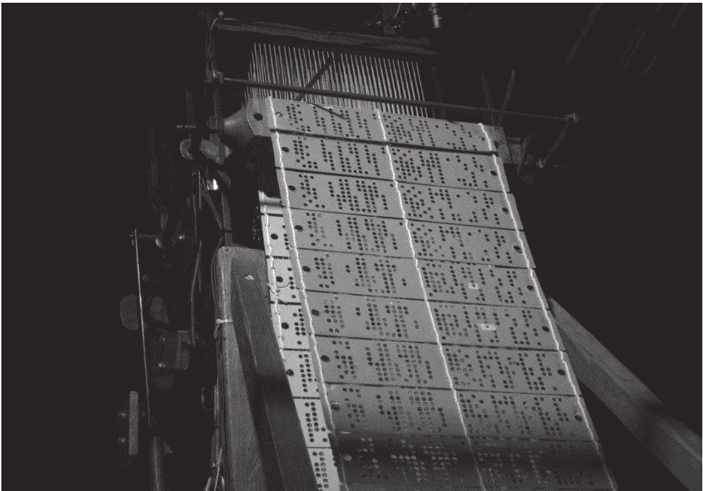

图1-2 雅卡尔提花机

打孔卡乃带孔硬卡。1804年，法人约瑟夫·玛丽·雅卡尔专利机械装置，以卡孔排布表织纹。抽象直觉之天作，近量子逻辑，非工业现实。巴贝奇洞悉其对计算机之深远影响。实则此发明突兀无因，对雅卡尔、巴贝奇皆为精神跃迁 [3]。

提花机上，孔位定织纹。无需织工苦穿纬经，图纹由经纬次序定，属技艺精深且高重复劳作。提花机若工业革命诸发明，机械化重复工序，减人力投入。机械化重复是工程硬骨头，但提花机最大突破非工程，乃视特定排布之孔（实为空位）为实在存在。

打孔卡技术先用于商务制表，后用于早期计算机。八十年代中期仍作嵌入式程序带。巴贝奇未申请专利——商业白痴。1894年，德裔美商赫尔曼·何乐礼获专利，其制表机公司1924年更名IBM（国际商业机器公司）。

（此时你该懂，为何“差分机”“分析机”永无市场声量。）

＊ 阿达因打孔卡创意激动不已，写下：“雅卡尔提花机织红花绿叶，分析机织代数图案。”

憾哉，巴贝奇未成机，连“基本完工”无份。齿轮杠杆活塞柄螺钉轮条伞齿嵌钉簧卡，尽属维多利亚蒸汽朋克风（铁路铁舰厂管轨缸锅金属煤）——庞大笨重实体，实则仅为思想实验。对二人，想象即发生，重要层面上他们对：未来已在脑海成形，现实却太沉重。造台烧煤蒸汽打孔卡计算机，虽念头有趣，难满二人心中瞬息万变、优雅的数字世界。

通往优雅，路漫漫。

1944年（非1844），首台电子数字计算机“巨人”诞于英伦二战战场。坐落布莱切利公园，高7英尺[4]、宽17、长11、重5吨，7000米线缆串联2500阀门、100逻辑门、1万电阻。因保密至七十年代，“首台”桂冠常误落美籍1946年“埃尼阿克”（ENIAC）头上。

巴贝奇定会喜“巨人”与打孔纸带。若二人穿越1944，汽车、胶靴、收音机、电话、飞机、拉链定令震惊，然瞥见“巨人”瞬间，便知其为何物。

谈阿达者，仍存居高临下“男性凝视”：视其为天才身后马屁精；诋其数学一知半解，非真著分析机注解；嘲其自视过高，全赖巴贝奇包容。

勃朗特姐妹亦受此累，曾有谬论谓杰作出自昆仲勃兰威尔——那醉鬼侄儿手。斯黛拉·吉本思《令人难以宽慰的农庄》借麦八阁[5]先生讽刺此说，痛快淋漓。

怪哉（实不怪？），此类凝视，至今网络仍活跃。

然更贴实情、更关键是：每年10月第二个周二为“阿达·洛芙莱斯日”。英国设阿达·洛芙莱斯研究所（2018成立），独立机构，誓使数据与AI造福公众，而非服务寡人自诩精英。

身为女数学家，阿达为数理计算领域女性点亮灯塔。偏见内外甚嚣尘上，女性亟需灯塔。二十一世纪过四分一，电机、编程、机器学习领域，女性比例仍徘徊两成。

女性鲜搭平台、写代码，科技新贵中更是凤毛麟角。为何关乎未来的核心科技，全由男性把持？

嗯，解释权在你，随君挑选。

### 别再找借口了：女人不适合写代码，是个彻头彻尾的谎言

你肯定听过那些冠冕堂皇的理由：男人来自火星，女人来自金星，大脑构造不一样，激素水平不同，所以女生天生不懂计算机科学；或者换种说法，现在男女平等了，没人拦着女性，是她们自己不爱干这行，纯属自由选择；再不济还有“慢工出细活”论——除非学校逼着女生死磕数学工科，别指望为了凑数字就把人塞进高难度岗位。

这些说法漏掉了一个铁一样的**事实**：从二战时期起，成千上万女性就已经在干技术含量不亚于计算机科技的活儿了——手算数据、写程序。凯瑟琳·约翰逊和她的非裔女性同事们在NASA的传奇，2016年电影《隐藏人物》早演给你看了。

1946年，全球最早可编程计算机之一ENIAC在宾大亮相，那6位给它编程的女性，发布会上一个没露面，庆功宴连名字都没人提。照片里操控机器的琼·詹宁斯和弗朗西斯·比拉斯（图1-3），是从200名女性中筛选出来的精英，她们用大脑和双手干着计算机该干的活，工资单上却赫然写着“办公室文书”——这纯粹是把女性钉死在低薪岗位上的把戏。

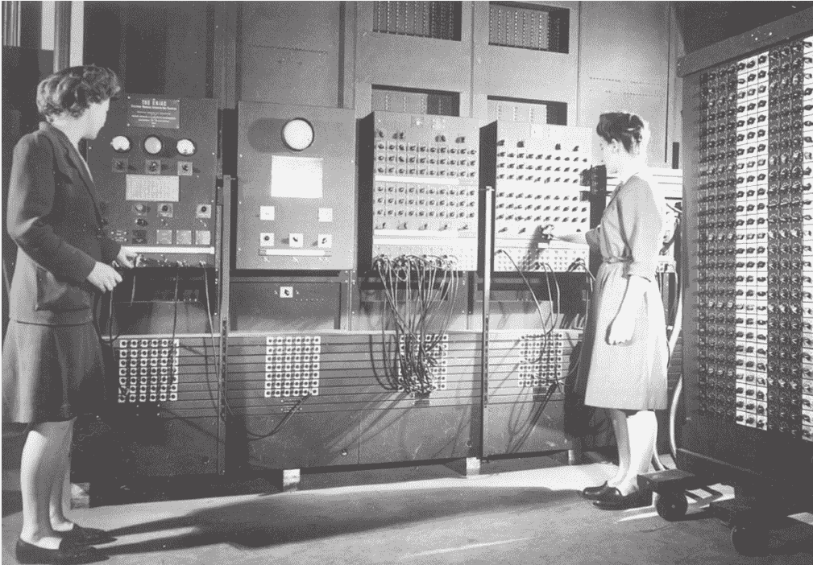

### 图1-3 琼·詹宁斯和弗朗西斯·比拉斯正在操控“埃尼阿克”

女性和男性一样聪明，这本是废话，偏偏世界从不把它当常识。我认识个曼大工程教授透露：英国高考数学拿B的男生照样读工程，拿A的女生反而大概率避开这行。这到底是怎么回事？

别再拿大脑、激素、自由选择说事了。**拦路的，依然是性别本身。**

职场怎么对待性别？女员工敢进全是男人的研发室吗？她们能常看到女性同行吗？人都是照着见过的样子长大的，真正性别多元的环境能给女性动力、提升能力，这本该是常识。

性别差异存在，但那是生理层面的，不影响智力资质。性别角色是社会建构的，不同历史时期长相不同。维多利亚时代的医生还能一本正经宣称搞数学的女人会得“学者厌食症”，男人却没事——这也是当时的“科学”。

阿达是盏明灯，也是座灯塔，警示前路暗礁。投身STEM的女性满路荆棘，哪怕是佼佼者，也得拼命证明自己——**身后事也不例外。**

***

### 如鱼得水的巴贝奇，与寸步难行的阿达

巴贝奇成功不意外：有钱、有学历、有地位、有男性话语权。他读书时，没人写信警告家长说读傻了会伤五脏六腑。他在男性世界里如鱼得水，辩论激烈却彼此尊重，文献记述多带敬意。可阿达的反对者笔下，主旋律只有轻蔑与不敬。

阿达的成功才叫意外。虽有钱傍身，可她是男性世界里的女人：法律禁她上大学、拿学位、任教授；禁她搞工程，或和布鲁内尔（巴贝奇挚友，修铁路造轮船那位）并肩干活。

她不能自由出门建设新世界。19岁嫁人，三年生三娃，是父亲的财产、丈夫的所有物。巴贝奇有妻子挑大梁带孩子，阿达没这福气。社会结构不允许她只做“阿达”，可拜伦家族的血大概让她不在乎这些。她运气好，丈夫包容（或根本不在乎）她的风流韵事和赛马赌博。

更离谱的是：母亲请了数学家教，她自己悟出对数字的直觉，争取到长时间独自钻研——在那个年代，她那阶层女人的标配人设是轻佻肤浅的解语花，青春前围着男人转，老了搞慈善。

阿达·拜伦，后来的洛芙莱斯伯爵夫人——这样一个人的出现概率微乎其微。可她偏偏赶上了对的时间，遇上查尔斯·巴贝奇，为第一台（从未造出的）计算机写了第一个软件程序。

一切始于一篇史无前例的论文——她自己都不知其重，因为那个时代没有女性写科学论文。

***

### 翻译里藏着的“核弹级”洞见

1840年巴贝奇去都灵讲分析机，只有意大利工程师梅纳布雷亚记了笔记，法语发在法刊上。欧洲大陆人说多国语言，英国人不学外语（脱欧后更吃不上帝国老本）。阿达作为上流社会女性，深谙取悦晚宴贵宾之道，一口流利法语，决定翻译这篇文章。

梅纳布雷亚原文直白枯燥，阿达翻译时加了海量注脚，篇幅是原文三倍。注脚里，她为分析机设计了完整“程序”，还切开了今天我们说的“硬件”与“软件”功能。

她没止步于此。她看穿了本质：**打孔卡一进机器，算术的界限就被打破了。** 机器不再是单纯计算器，它有了独特地位。它把无限多样的通用符号机械化组合，把物理运作与最抽象的数理思维绑定。

白话版：**能算数字（算术），就能算符号（代数）。**

这就是计算机用符号逻辑的雏形——基础代数新发明，阿达那个时代的新发现。她老师德·摩根和自学成才的布尔是这领域先驱。现在地球上跑的每项技术，底层全是布尔逻辑，核心就俩值：**真、假。**

布尔给了三个操作符：**与、或、非**。他宣称所有逻辑关系（甚至你的人生规划）都能用这套法则表示。他信人类思维能简化成数学法则，不是消极还原，而是追求真正的简化清晰。为此他用了二进制——0假、1真，还发明了**真值表**。这对爱想太多的文科生简直是福音。

#### 它到底怎么运作的？

算术面对固定值：2+2=4。基础代数面对变量：X、Y值会变，但运算还是加减乘。布尔代数变了：变量不是数字，是真值（真/假、1/0），运算变成**与、或、非**。

举个栗子：花园X=土地Y+植物Z（基础代数算面积数量）。布尔代数只问：**这到底算不算花园？** 无地无植=假；有地无植=假；无地有植=假；**有地“与”有植=真**。再加野草W、水泥C进定义，逻辑链条无限延伸。

生活例子：搜“凯斯·厄本”，引擎用布尔逻辑锁定“凯斯”**与**“厄本”为真，“凯斯·理查兹”“逃离城市”全判假踢出去。不用人工预设所有组合，布尔逻辑让机器自动处理变量、出答案。

阿达在注脚里写道：*“我想举个例，证明分析机能直接算显函数，无需人工预算。”*

对数表时代彻底结束，阿达已在冲向星空。

***

### 她把“运算”定义到了宇宙尽头

1840年代没“计算机术语”，阿达自行定义：**“两件或多件事物关系的改变，皆为运算。此定义最宽泛，适用宇宙万物。”** 这格局，直接超前一个半世纪。

她还兴致勃勃预言：分析机能编程作音乐。（巴贝奇最恨门外手摇风琴，曾孤军奋战抗议。）为了逗巴贝奇乐（或气疯他），阿达写：**“分析机能谱写任意复杂度、长度的乐曲，精妙合理。”**

***

### 穿越40年，看AI作曲的祖师爷

要懂阿达思想有多超前，得跳到80年代。美古典作曲家大卫·考普，卡内基音乐厅演过他的曲，靠作曲谋生，妥妥成功人士。70年代中期撞上创作瓶颈，他决定把自己智慧跟另一种智慧合作——合作者是AI。

考普自研作曲程序，拆解莫扎特、维瓦尔第、巴赫结构，重组成新曲。80年代他出门买三明治，回家电脑里躺着5000首“新巴赫众赞歌”。

考普兴奋坏了，乐评家不买账——“无灵魂、僵硬、俗套”。但盲测时，听众常把AI曲标记为“真人之作”，以为真是巴赫本尊。

考普是深度思考者，这事儿逼他思考两个大问题：**什么是“真实”？什么是“创造力”？**

考普首作至今40余年，AI进步神速。现代音乐创作全靠AI：IBM Watson Beat、索尼Flow Machines、Spotify创造者技术、Amper的“受大师级训练的创意AI”。

训练流程跟阿达200年前预判一模一样（**千真万确，姑娘！**）：程序员喂海量乐库，程序自动拆解模式——拍子、节奏、和弦、人声、长度、变奏；作曲家设参数（激昂颂歌/深情情歌），程序出曲，人类再加工。

Amper官网宣称：**Amper Score让企业团队几秒钟定制音乐，省去曲库搜索时间。视频、播客配乐，风格长度结构全满足，版权费还免了。**

回头看阿达1840年原话：**“分析机能谱写任意复杂度、长度的乐曲，精妙合理。”**

***

### 阿达早看透了：AI无“独创性”，但能造“商品”

阿达不信程序出的音乐有“独创性”，但不妨碍好听管用。她笃定：**机器能分析数据，永远不可能独立思考。** *“分析机无资格创造任何东西，只会执行指令。”*

这观感，跟我们现在看AI一模一样。

酒店大堂BGM、广告洗脑神曲、宣传片配乐——AI全能生成，少改甚至不改，版权费还不用付。这是**商品化音乐**。

“人机合作写原创”依然吵得沸沸扬扬。很多音乐家眼里，这只是不想学乐理、练乐器、走捷径的懒人干的事。

布莱恩·伊诺反其道而行：**精彩在于合作——熟练音乐家+AI。** 26张专辑《沉思》（2017）同步出CD和App，程序按时段重组改编原曲。伊诺说：**“初衷是造无限音乐……像坐在河边：永远是那条河，却永远在变。”**

合作成果不总归人类实验田。

初音未来，日语语音合成库衍生的虚拟偶像。2007年克里普敦推出，永远16岁，158cm，病态42kg，青绿色代表。唱歌、游戏、全息巡演。日本超高人气靠神道教加持——信万物有灵。粉丝眼里她切实可信，**非人，亦非死物**。她抛出个问题：**凭什么她的出现这么重要？**

风吹铃铛奏乐、软件写曲、巴赫或你作曲——**只盯着“出自人类还是非人类”，会不会误入歧途？**

反面是：世界顶级巡演乐队依然由老派音乐人把持，自己写词曲、演乐器。但这时代也许要谢幕了。

大卫·考普一针见血：**“关键不是计算机有没有灵魂，而是我们有没有灵魂。”**

***

### 图灵的反驳，与跨时空的对话

布莱切利公园破解恩尼格玛的天才数学家阿兰·图灵，不关心机器有没有灵魂，只关心：**能否基于人工投入，自主生产、自我创造、自主学习？**

这点上他跟阿达杠上了——隔了110年。阿达说机器不“创造”，指的不是布尔逻辑自动出答案，而是人类思维的**“跳跃能力”**，她信机器永远搞不定。图灵觉得阿达**受限于时代**：她手边啥没有，巴贝奇根本没造出分析机。

但阿达最擅长的，就是**研究和利用“手边没有的东西”**——无男性特权、无正规教育、无计算机。**可她就是阿达。**

是图灵把阿达从历史尘埃里捞回大众视野。1950年研读她作品后，回应所谓“洛芙莱斯夫人异议”，甩出了**“图灵测试”**。

1950年版目的：测机器在人类观察者眼中，能否以假乱真。

谷歌宣称语音助手Duplex已过测试——至少订餐订票这块。通过改变声调、拉长音节、加“假思考”停顿，骗过电话那头算过关。但它全是预设回应，**所以阿达依然是对的。**

图灵预言2000年机器智能过测试，虽延期但无限逼近。而在冲刺过程中，我们可能会觉得，或者AI会觉得，**能不能过测试根本不重要。**

玛丽·雪莱或许比阿达、图灵更接近未来真相。**新生命形式不必像人类**（卖萌服务机器人、虚拟助手或许只是岔路、过渡品，纯粹智能另当别论）。《弗兰肯斯坦》讲得清清楚楚：博士想造“似人”怪物，怪物却非人、永不可能是人。这是封来自未来的瓶中信，我们得拆开读。

***

### 诗歌是禁区，小说才是战场

阿达兴致勃勃设想过分析机写音乐（专门气巴贝奇那种），**唯独从未设想过它写诗。**

1840年代无“机器诗人”（提示：这是针对诗歌的图灵测试）。阿达是拜伦女儿，**向诗人致敬很重要**。对英国人，莎士比亚的国度里，诗歌是除数学外离上帝最近的东西——大多人不懂数学，重要场合也背不出方程。

阿达把自己的工作叫**“诗意的科学”**——意指它更具创造性，算法程序复制不了。

截至目前，计算机诗歌依然拙劣。我推测：**诗歌缺乏可清晰分解的范式**（不是公式）。我们能学诗怎么表意（也该学），获取更多乐趣；但诗引发的**情感冲击无规律可循**，极难捕捉。

这冲击像**“机器中的幽灵”**：看得见诗咋写出，那精灵般的东西却抓不住、封不进瓶。你和AI都能学十四行诗、维拉内拉诗、对仗、无韵体，**但怎么让诗歌魔法生效？** 诗歌最神秘特质像**“涌现性质”**：诗由词组成，却不完全存在于词与序中——如意识源于大脑/思维，却非大脑/思维。诗歌除语词外还有啥？意识除大脑外还有啥？答案是：**别的东西。** 古怪，但真实。（参考《他不重，他是我的佛》）

**但小说——那是另一回事。** 谁脑子里没部未写完的小说？

现在写小说App一抓一大把：搭架构、梳情节、填起承转合、生对话、扩词汇、改语法。“小说编辑器”读你烂稿，吐出“可能发展出的故事”精华版。

输：“一只猫掉进矿井，发现精通计算机的巨鼠统治世界。” -> 出角色表、情节大纲 -> **耶，鼠题材小说成了。**

输：“伊丽莎白一世时期青年，晨醒在土耳其变成女人。” -> 大概率写不出伍尔夫《奥兰多》。**但那杰作早就诞生了。**

数学家马库斯·杜·桑托伊在《天才与算法》里曾大胆预言：2050年的诺贝尔文学奖，花落亚马逊语音助手Alexa之手，或将上演一出“理科生的反击”大戏。

让机器代笔小说，并非新鲜把戏。早在1844年，讽刺刊物《笨拙》便刊登了一封伪托巴贝奇名义的玩笑信件：

先生……我已成功研制出“小说写作专利机”——覆盖所有风格、所有题材……

巴贝奇

紧接着是几封恶搞的感谢信：

有了它，我只需48小时便能产出三卷本巨著，放在从前，我起码得熬上两周……

还有：

这位机器先生慷慨解囊，白送几十篇当红体裁，还能在极短时间内憋出一部全新、独特的长篇……

再没有哪位孤军奋战的天才，需要耗费万小时埋头苦干了。这是安迪·沃霍尔登场前的波普艺术雏形。它不是面向大众的艺术，而是汲取海量大众作品、再批量生产新作的艺术。

平庸、重复、寻常、绵延不绝、不停拼装。这就是算法的造物（想想那5000首买个三明治的功夫就生成的巴赫众赞歌，或是布莱恩·伊诺能无限组合新曲的在线应用）。

这对人类、对创造力，究竟意味着什么？

或者说，何为“意义”——对人类而言，对创造力而言？我们不得不重新想象、重新定义这些词汇：人类、创造力、意义。

“万维网之父”蒂姆·伯纳斯-李曾指出：

> 关键在于连接。字母本身不重要，关键是它们如何串联成单词；单词不重要，关键是它们如何串联成短语；短语不重要，关键是它们如何串联成文本……从极端视角看，世界全由连接构成，别无他物。

——《编织万维网》，2000年

正如E.M. 福斯特1910年在《霍华德庄园》中所写：“只有联结。”

又如阿达所言：“实物的运作与数理科学最抽象分支中最抽象的思维过程，就此结合……”

谷歌2021年的靶心是“环境计算”，意指全方位互联——硬件、软件、体验、人机交互、物联网。从猫门到咖啡机，万物归一。声控助手、3D打印机、智能家居，设备协同、静默运行、永不停歇。无需点击鼠标，所想即所得。

宛若神灯。抽象思维。实物运作。

终究——阿达预言成真——实物运作与抽象思维的融合，旨在重塑我们口中的“真实”。这被重新定义的“真实”，很快就会取代我们对世界的旧认知。

**[1]**  原标题为Love（Lace）Actually。作者玩了个文字游戏：“洛芙莱斯”（Lovelace）一词含“love”（爱），故借用电影《真爱至上》（Love Actually）之名。——译者注

**[2]**  “Computer”今译“电脑”“计算机”，旧指“计算的人”。——译者注

**[3]**  跃迁，量子力学术语，指从一量子态变化至另一量子态的过程。——编者注

**[4]**  1英尺约等于30.48厘米。——编者注

**[5]**  麦八阁英文Mybug，直译“我的错误”。——编者注

**[6]**  厄本（Urban）一名含“城市”之意。——译者注

**[7]**  以上为几家公司推出的AI音乐服务，用AI辅助用户编曲创作。——译者注

**[8]**  Duplex为谷歌推出的AI，可替用户拨打各类电话，接听者往往不知对方是机器。——译者注

**[9]**  “机器中的幽灵”（ghost in the machine）英语常用语，类似“锌中之脑”，源自吉尔伯特·赖尔《心的概念》（1949）及亚瑟·库斯勒同名著作（1967）。意指意识乃囚禁于肉体机器中的幽灵，却是定义个体存在的关键。——译者注

**[10]** 涌现性质：现象叠加后，展现出叠加前不存在的新特性。——编者注

## 织机上的风景：工业纪元的起点 [1]

大脑是一台被施了魔法的织机，成千上万只飞梭周而复始，编织着不断褪色的图案。

> ——查尔斯·斯科特·谢灵顿，神经生理学家、诺贝尔奖得主，1940年

欲知AI诞生与演进开启的新征程、新图景，必先追溯人类如何抵达此处。改写人类世界的巨变，肇始于工业化纪元。

细想这颗星球45亿岁，最古老智人化石（2017年摩洛哥出土）也就30万岁。在这白驹过隙般的250年里，究竟发生了什么？这不过一栋房子的寿命——我伦敦寓所建于16世纪80年代。

用不了250年，未来25年内，我们即将步入与智能机器、虚拟AI共同生活的日常。那些我们正分别攻关的技术——物联网、区块链、基因组学、3D打印、VR、智能家居、智能纤维、智能植入、无人驾驶、声控助手——将协同作战。谷歌称之为“环境计算”：你是中心，它们随时随地待命。未来的核心，非单一工具或系统，而是协同操作系统。

科技狂飙。数字时代将引发地球诞生以来最大变局，甚于工业革命——彼时我们眨眼间甩开延续数十个世纪的农业经济，清醒地滑入工业经济的长梦魇。将机械时代等同“进步”，于理解无益。一词难尽其貌。

进步对社会、心理、环境的创痛，自昔深重。运算不只关乎数字，更关乎责任。这一次，进步的真实代价，必须直面、纳入考量。

地球科学家詹姆斯·洛夫洛克（盖娅假说之父）断言：我们正处其所谓“人类世”末尾，即将跨入“新星世”（天文学中，新星指骤然爆发、释放巨大能量的星体）。

与雷·库兹韦尔（奇点理论提出者）一样，洛夫洛克坚信此去不归。AI不会永做工具，终将成为一种生命形态。

但在那时到来前，我们皆活于计算机世界。非指模拟世界（尽管我们极可能身处其中），而是指依赖人机交互、不可分割的社会。

过往经验，是最好的教科书。

于是，让我们回到未来的起点：英国，蒸汽动力，蒸汽织机。

纺与织，是人类最古老的两门手艺——至少追溯至1.2万年前。人类需衣被冠盖，自动化重塑了生产方式。

*

18世纪英国的主角是羊毛。设想一下英国有多少绵羊。

在我的故乡兰开夏郡，羊被称为“白金”。羊毛可做衣、做毯，羊肉可食。不同于牛，羊耐养，能在室外熬过严冬。它们是前工业经济的奇迹。

英国人痴迷羊毛。不穿针织羊毛袜、不裹羊毛从头到脚，便是失仪、辱门楣，即便在八月。

西欧不产棉。17世纪初，棉织品自印度入英国，冲击本土羊毛销路。

棉花浮水、轻盈、易染、易洗快干（想象篝火前烘干滴水羊毛套装的狼狈）。最关键的是，棉布贴身不扎人。难怪17世纪前女性不穿内裤。

但棉布昂贵。1700年，熟练纺织工在脚踏纺车上将一堆乱絮纺成1磅（450克）纱线，需耗时40小时。

此活计由女性包揽。女人是最早的纺织工。

纺织女工是体面且有声望的谋生路。她们非觅不到夫婿的老姑娘，而是受尊重的社会成员，完全有能力自给自足——若她愿如此。

纺车将絮捻成纱，极适合机械化。一切重复性劳动，机器皆能更快完成。男女手工纺纱千年后，哈格里夫斯的“珍妮纺纱机”（1764）与克朗普顿的“走锭纺纱机”（1779）将纺1磅纱线的工时从40小时压至3小时——旋即又缩至90分钟。1785年，卡特赖特缩短了织布工时。动力织机进驻新建工厂，19世纪末，伟大的工业化时代拉开帷幕。

工业革命是一场务实的革命。

人类将千年试错积累的一切推倒重来——服装、制造、交通、供暖、照明、军械、医药、建筑。

更快、更省、产量更大。

对“小巧轻便”的追求，要晚得多。直到20世纪50年代，电子革命才将“小巧”视为晶体管生产的关键指标。

19世纪的口号是“越大越好”（礼帽、裙撑、烟囱、铁桥、发动机、巨轮、大炮，当然还有工厂，尺寸皆与人身高不成比例。机器若怪兽——这在《弗兰肯斯坦》中早有预兆）。

蒸汽机史无前例。走锭机与动力织机未沿袭任何旧传统。它们横空出世，正如密涅瓦女神从朱庇特头颅中一跃而出。

> ——威廉·库克·泰勒，《兰开夏郡工业制造区参观随记》，1842年

至1860年，英国仍是全球唯一经济全面工业化的国家，产出全球一半钢铁与纺织品（细想这概念）。

想象新兴城市：蒸汽驱动、煤气照明的巨型工厂；厂间匆匆拔地的连排出租屋；染料、氨水、硫磺、煤灰、浓烟、恶臭；从早到晚永不停歇的喧嚣，织机轰鸣、煤车辗压、鹅卵石路上马蹄声、震耳欲聋的机器噪音。纷乱嘈杂的生活底噪。

我的出生地曼彻斯特迅速成为世界棉纺之都，直到“一战”前，全球65%棉花在“棉都”曼彻斯特加工。

美国是最大原棉供给国，对英关系至关重要。数十万黑奴在百万亩地上种棉。1790年美南方出口约3000包，1860年达450万包。

工业革命是环境史的引爆点，化石燃料疯狂开采，足以重塑世界。英国煤炭丰富，早占优势。比木材烧得更热、更久，且温度稳定。煤炭锅炉能产生巨量蒸汽。

蒸汽让热量转化为动力——初驱矿井水泵（纽科门机），继驱蒸汽织机，终驱火车头与铁甲舰。这些事物前所未见，彻底打破历史。还有什么比钢铁军舰（一块需浮于水的铁疙瘩）更违背直觉、违背自然？如此沉重的材料本不浮水。却无需桨帆风，靠一种魔法驱动。一种污秽、肮脏、难闻的“黑魔法”。

这不仅是新技术，更是新污秽。它带来污染——伤害土地、空气、水、庄稼与人。

恩格斯目睹金钱与贫困如两座等高山峰堆积，财富分配极不均。1845年，他出版《英国工人阶级状况》。

成群衣衫褴褛的妇女儿童，宛如在垃圾堆烂泥坑打滚的猪般肮脏——街道无排水、未硬化——到处死水洼——厂烟囱冒黑烟。无尽的污浊与恶臭。

描述此时代，高频词是：污浊、恶臭、吵闹。

马克思生于1818年（同年雪莱出版《弗兰肯斯坦》），他与恩格斯漫步街头，基于所见所闻写成《共产党宣言》（1848）。

工厂新机器让人均产出增25%（莫小看这数字——细想其意），然工人工资较工业革命前，仅增可怜的5%。人们逃离乡村，抛弃自给自足，涌入飞速膨胀的城市，此处一切皆需购买。

生存条件极恶：无自来水，卫生差，居所脏，空气浊。贫民窟工厂工人平均寿命仅30岁。财富滚滚，却如此不平。曼彻斯特被称为“黄金下水道”。

马克思在《共产党宣言》首章写道，与“快速前行，打破陈规”（扎克伯格语）这类常被视为大厂标配的思维，有种奇异的相似：

生产不断变革，环境持续动荡，永恒不安与变动，这是资产阶级时代区别于一切旧时代的标志……一切固定僵化的东西都烟消云散了。

对当时的马克思而言，科技进步必导致社会革命，因为进步将暴利背后的人命视若草芥。男女皆付出生命代价——非战时预料之中的猝死，而是坠入旷日持久的人间地狱。马克思断言，民众将造反，因别无他路。

但即使在今天，新自由主义话语依将工业革命粗暴等同于“进步”，称其仅在起步阶段遇了几个“小麻烦”。

“卢德分子”至今指代反对进步的顽固派，然而19世纪初的“卢德分子”不反进步，反剥削。

1812年《捣毁机器惩治法》规定毁机者死刑。“卢德分子”冒死砸机，非想让世界退回诗意田园，而是为了多挣钱养娃。

新秩序下，危害资本产者死刑，人力劳动却无保障。男工女工忍受低薪、恶劣生存、无保障就业。他们看不到进步与改良的曙光。

工业革命爆发后半个世纪，身心痛苦随人口激增而变本加厉：1800年英国人口近千万，1840年近翻倍。多个孩子是多张嘴，但孩子需求远非食物——他们是孩子。

直到1832年，工厂才禁用9岁以下童工。也是直到那时，10岁以上童工工时才限在每周48小时以内。

我需不需写得更细？10岁孩童，每周工时48小时。

事实是，工业革命前50年，空前苦难与空前革新并行。非只有工厂如炼狱。

直到1815年，英法断断续续交战——很大程度是镇压革命的预防战。1789法兰西革命胜利唤起自由、博爱、平等的共同渴求，承诺（或恐吓——视阵营而定）建立新社会秩序。紧随美国独立。1776年《独立宣言》著名开篇：“……人人生而平等……”

1791年，受此巨大政治动荡驱动，亦为摆脱英国等级泥沼，赴美英人托马斯·潘恩出版《人的权利》。

潘恩著作提出并探索“公民权利”概念，我们视其为受重重威胁的现代概念。

潘恩主张，人身安全应获保障，包括人身、财产及使用权（如公地）安全，职业保障与薪酬保障。税制应先进——富人多交，穷人少交。政府应普及资助教育。应广推养老金、产假工资，资助学徒助青年。

潘恩言：政府应服务全体利益，否则即暴虐专制，当推翻。

借对法战争，英国轻易将国内民愤转移海外，指向具体新敌，使人不再关注本国贫穷、剥削与不公。

战争也是征召男性入伍的契机。男性离去导致女性接手其活。工厂偏好妇女童工，因可付更低报酬。

压低报酬的标准是性别（同今日），额外收益是使工作“去专业化”。

无论何时，女人接手男人活，该活即贬值。男工拒教女工用机——这看似彰显男性沙文主义的工业革命内部行为，实则是“生存之战”。男性清楚，若妻或妹能干其活，其薪必降：经济下行时，全家只雇一人，那人不会是他。

不过，非所有人都在工厂。工业革命初期，农业经济仍占主导。

此期英国史是圈地史，公共地与公有地为地主占有。不知今史书为何仍用“圈地”一词，听起来像个拥抱。

圈地是富人为私利强占土地，与强盗无异。是面向国内的殖民。

1801年《一般圈地法》护佑强占者，却让他人生活雪上加霜，眼睁睁失地——中等富裕小农亦不例外。有人得补偿，但钱很快花光，地却永存。

圈占公地与象征性极低租金，致使佃农与联排屋居民无地放牧、无法多种粮。不能再拾公地免费柴火取暖做饭。曾为共有之物，今成私产。

此事全球皆有，但英国圈地运动特殊在于，由《国会法案》按部就班长期强推。17世纪初至70年代末，圈地法案让大地主获益匪浅。

圈地给个体与地方经济带来灾难，因两者常依托非正式交换体系。切实缺地，及土地提供的附加物（食物燃料），逼更多人进肮脏工厂体系——他们原本绝不会去。我这么说，因当时文献——工人自述而非粉饰太平之词——展示了这些被迫进厂者何其痛恨该体系（欲深究，可先读恩格斯与E.P.汤普森《英国工人阶级的形成》）。

太多人因圈地背井离乡沦为贫困工人，致使工厂薪资被不断压低。

工业革命前，口袋有无现金不重要。若你能吃自家菜园菜、自养鸡猪羊、穿自制衣、砍自家柴、以物易物满足他需，即使囊中羞涩，也能体面度日。

即便大地主，兜里或无多少现金——这也是娶女继承人当时极重之由。

工资增长让人“摆脱”“贫困”，这说法无视经济“进步”推人类入贫困坑。

只有工业化时代来临、薪金阶层出现后，工资才成衡量进步的指标。

何况，工资与幸福、独立、快乐无关，更与精神健康不沾边——后者源于经济可行、却与唯结果论资本主义相悖的愉悦生产活动。

不过，工资终究涨了（工业革命起40年后，而当时人均寿命不足40岁）。

当工人意识到谈判协商比彻底革命更有力，世界首个工会在曼彻斯特诞生。

随社会繁荣，涨工资对皆有利：工人有钱消费、饮酒。沉迷杜松子酒是英人陋习，工业革命前已始，但那时只在城里人中。今新兴城市与雨后春笋般的贫民窟结合，造就庞大烂醉底层。

每天干14小时，靠土豆汤充饥，无自来水，10人挤一块脏地板睡，全无改变希望？

来杯杜松子酒吧。

马克思说得对：旧忠诚、旧传统、任何一丝家长制残存，皆被圈地与工业化两座大山带来的残暴与背叛摧毁。这近乎毁灭性一击。工人眼睁睁爬起，缓过神，不知如何决定了集体行动，并生出日益强大的集体归属感（团结精神）。

这非马克思预言的人民革命。然而，这确实是全新阶层的诞生。他们不似旧阶层，被行会、教区、亲属或教派绑定；他们团结，只因一个简单事实：他们都是工人。

这个新兴阶层不断扩张，以至于居家劳作的本地工人也被纳入其中。

1862年，曼彻斯特自由贸易大厅内，兰开夏纺织工人作出了一项艰难抉择：拒绝美国南方奴隶主利益，转而声援北方废奴事业。他们清醒地认识到，这将招致生存危机，甚至知晓苦难的具体模样——但这一举动，实则拉开了信息时代与全球化交织的序幕。

这些从未见过异族肤色的工人，却对大洋彼岸黑奴的命运深感共鸣。彼时英国虽已有黑人仆役（多集中于伦敦），但社会主体仍是白人。棉纺工人中，有人曾在美洲种植园劳作，有人留在英国工厂，隔着大西洋，他们的阶级团结却跨越了沙文主义、地域偏见与种族壁垒。这不代表后来移民浪潮中不存在丑陋歧视（指1948年《英国国籍法》生效后），但工人们对废奴的支持确属真实。

1865年，美国内战以法律形式终结奴隶制。随后百年，非裔美国人踏上争取法律与社会完全平等的漫漫长途，首要关卡是废除种族隔离。法律废奴虽不完美，却是关键里程碑——它宣告：无人再能宣称拥有“所有权他人”的“自然权利”。

这直接刺中女性困境核心。

无论肤色，所有女性皆为最近男性亲属的合法财物；寡妇虽享一丝自主，实属例外。凭何女性沦为男性附属？凭何她的劳动所得、财产天然归丈夫？子女不属母亲，属父亲——待男孩成年、女孩嫁人如转让资产。凭何女性不敢期待职场、社会、家庭的法律平等？一个性别法定从属于另一个性别，本身即谬误，更是人类进步的重大阻碍。无哪个奴隶像妻子般，竭尽所能诠释“奴役”真谛。

——约翰·斯图尔特·穆勒，《妇女的屈从地位》，1869年

针对潘恩《人的权利》，玛丽·沃斯通克拉夫特（玛丽·雪莱之母）著《女权辩护》，为女性受教育权、选举权、财产权、就业权呐喊。在视民主呼吁为叛逆的男性精英眼中，此书比《人的权利》更具颠覆性。

《女权辩护》为女权递上枪，工业化则扣动扳机。

工厂与膨胀的城镇聚拢海量女性，规模空前且成常态。男性常在户外社交，女性鲜有聚首良机——家庭、村落、农场、教堂、佣工生活皆无法比拟工厂。她们交谈，发现自己干活不输男人，还要独自撑起脏乱差的“家”、料理孩童。女性周工时60小时撑起家计，法律却视其同未成年人，剥夺权益？同工不同酬？沦为男性亲属合法所有物？

直至70年代，英国才立法反性别歧视：同工同酬、信贷抵押公平、教育就业均权。1974年美通过《平等信贷机会法》。

置于经社发展坐标系，此进程始于哈格里夫斯发明“珍妮机”两百年后。女性仍在奔赴完全平等，亿万同胞仍陷绝望泥沼。全球约8亿文盲，三分之二为女性，比例二十年未变。

### 何为进步

科技创新？社会变革？生活水平？教育普及？平等？全球化？普惠？

历史教训：创新惠及大众而非少数，仰赖立法。

19世纪法案奠定20世纪视为常态的规则：
- 限工时、带薪假的工厂法；
- 职场健康安全保障；
- 儿童受教权与童年保护期确立；
- 职业保障与最低工资的工会；
- 企业税修建的卫生设施（下水道、自来水）与城市照明；
- 贫民窟改造立法；
- 工人负担得起的公共交通；
- 工人图书馆、夜校；
- 甚至城市公园。对19世纪人，建公园如宣称：“圈地运动夺走公共地，权作补偿，留几块草地、喷泉、雕像，免费开放，慰藉工人身心。”

阶级。劳工史大家E.P.汤普森言：“阶级是‘关系’，非‘东西’。”常被误作名词（如“马”“房”），实不独立存在，非自然现象（如“重力”）。平等社会无阶级。社会分工塑造关系，阶级非预设。

19世纪与工人权利、社会契约对立的自由放任主义，二战后在美欧遭重创。

马歇尔计划式凯恩斯刺激，反“让穷人更穷成全富人”的均衡财政观。巨资解困，激活萧条经济。1945-1978年，美经济规模翻倍。德战后重建成欧陆最高效经济体。英建成福利国，立国民医疗与住房规划。制度虽不完美（人类参与者无完美），但肯尼迪1963年“水涨船高”论确属真理。

工厂始付高薪（终于是——得益于自动化，福特靠流水线与机器人改革制度，资金高效流转，前景光明——非仅精英，亦惠及常人）。

资本主义适应力极强，值得赞赏。它是真达尔文主义：非仅“适者生存”，更能适应诡谲环境并壮大。

市场非全能神，长期或能自我纠偏，但凯恩斯云：“长期里我们都死光了。”

70年代，我少年时，欧美战后契约解体。

因多：低生产率、通胀、油价危机、三日工作周、越战创伤、1971尼克松废金本位、工会乱象（英矿工要涨35%薪致三日工作周，撒切尔1985年铁腕镇压）。回望，70年代似工业革命尾声。计算机时代未成熟，台式机70年代中期现身车库，非厂造。

加速致倦，人类非按摩尔定律进化（晶体管密度两年倍增，速度升价格降）。人需缓冲，创意会枯竭。

我眼中70年代末，是左翼能量停滞期，乏务实新思。右翼虽旧调重弹，却重塑形象。

老套路：去管制，人人按“市场价”“自由”售劳动力。无异工业革命早期工厂制。

旧梦重温。

*

2021年落笔时，全球经济因新冠按下暂停键，景象前所未见。救西方经济唯一路：大规模社会主义。国家发工资、担贷款、保就业。

反面教材：科技巨头暴富，亚马逊疫情期约每秒入账1万美元。

亚马逊利润源网络销售。实体店主也卖货，但实体店是社区实体，纳税养人才、修路、补医疗。亚马逊模式：压低薪资，交极低企业税，全球化布局拒对股东外负责。

不止亚马逊。极少人受雇谷歌、脸书（2021更名Meta）（脸书仅1%营收付薪），但它们向全民收割财富。

这是榨取非创造。叫车优步抽成，住宿爱彼迎同理。

你或靠出租床位获收益，但酒店好友因生意萎缩失业；或酒店为竞争降价，好友收入缩水。一边租房难，一边将“家”挂爱彼迎。我们乐意？厌恶。

“共享经济”（严格说“共享”不涉金钱，命名不符）商业模式无视社会后果。民生、宜居城市、出行自由、地球负担，统统不在考量。

无实体又无处不在的科技公司，将所需直送：信息、社交、音乐、低薪快递员送达的包裹。似有仁慈“服务商”直连你我需求。服务是真，代价高昂：地税流失、实体店倒闭、隐私随每一次消费、搜索、点击、点赞流逝。

马克思洞察工业革命，吁工人掌控生产资料。但人自身成生产资料、成“榨取”环节时，当如何？无论本职，你我皆为科技巨头无偿打工。天下无免费午餐，你交出数据，交出自我。

我们能夺回自控权吗？

视你对人性判断。

首次工业革命教会我们：无教养、寡财力者可为己为众团结。建工会，赋集体力量。

设想工业革命若为全人类共同事业，无奴役、童工、剥削、圈地、蹂躏星球——勿急反驳“不可能”，历史确未发生。但正如开篇，历史赋予教训，让我们推动下一场革命时，毋需经历社会噩梦，待少数特权渗透大众。

以各形态呈现（自动化、机器人、智能家居、环境计算）的AI，是人类跨越下一阶段所需技术。毋惧技术，关键在用法。蒸汽纺织机不必催生厌恶工厂制与贫民窟；它本可解放男女漫漫工时，实则工时更长。

大卫·格雷伯称现实多工为“垃圾工作”——摆脱是幸事，无需伤感。我们需经济公平，打破可持续与发展的虚假二元对立。信息时代，我们需真实信息，非宣传、假新闻、陈腐谎言。

今之困局：政府不知如何立法管巨型科技。谷歌、脸书、亚马逊在业务覆盖地赚得盆满钵满，却难缴“公平”税。

疫情红利巨大，未闻其愿缴“疫情税”。亚马逊股价涨70%，员工获约薪资7%补贴，仅作“风险奖金”，非长期涨薪。

2021年英最高院判优步视网约车司机为正式雇员。优步全球上诉，终美胜诉。

网约车理论连接司乘，推演致私人车权消亡。优步技术本可造福，但不愿做好人——成本太高。立法成唯一出路。

仅一例。愈了解，愈觉醒：数十亿人年无休为科技巨头当“小白鼠”拿薪，巨头却竭力规避社会与财务责任。

问责制关键。数据时代，问责即负责，巨头必须认账。

“世界五强科技巨头”：亚马逊、苹果、谷歌、脸书、微软。实则大型科技公司兼具开拓全球市场、掌控全局、争夺全球影响力却甩锅地方责任的模式。优步、爱彼迎本质同。若企业青睐此模式，立法唯一选项。立法非巨头叫嚣的“扼杀创新”（霸权者爱扮受害者）；法只管控那些可能扼杀生命的创新。

例：脸书欲与雷朋合作研发面部识别智能眼镜。戴上它，望向一张脸，手机即现主人所有社交细节。“Clearview AI”已实现面部特征匹配个人信息。

你觉得你拥有这张脸？“拥有”过时，今为共享时代。我们分享，巨头收割。

正如潘恩1791年言：

> 一个对任何人都不负责的人，不应被任何人信任。

[1] 原文 “A Loom with a View”，借福斯特名著《看得见风景的房间》。——译者注
[2] 英文 “spinster” 兼“纺织女工”与“老处女”双关。——译者注
[3] “卢德分子”指英工业革命期因机械化失业反对革命者。——编者注
[4] 英文 “enclosure” 含“围住”“环绕”。——译者注
[5] 联栋房屋建于狭小地块，住户共享土地。——译者注
[6] 1948《英国国籍法》战后对英联邦及殖民地公民开放自由移民，为有色人种移英提供法理。——译者注
[7] 《人的权利》直译“男人的权利”。——译者注
[8] 肯尼迪此语喻经济发展惠及全体参与者。——译者注
[9] 1973英矿工大罢工致电力紧张，保守党令工厂周仅开工三天禁加班，致众工人瞬间失/半失业。——译者注

## 从科幻到无线，再到万物互联

> ——阿瑟·C.克拉克，《地平线》，1964年

克拉克口中“这些东西”，指卫星与晶体管。

### 先说说晶体管

1965年，老爸从电视厂带回台晶体管收音机。

彼时客厅霸主是庞大威严的电子管收音机，占半壁江山。父亲参战时，母亲曾守它听丘吉尔广播。60年代童年，我爱坐在嗡嗡作响的机身后，看玻璃电子管闪烁幽幽橙光，梦幻温馨。

“电子管”是英式叫法，实为真空管——“真空”指玻璃管内气密封闭空间。型号不一，有的微小，有的巨大，酷似带奶嘴奶瓶。电子从通电加热的阴极（灯丝）射向未加热但带正电的阳极（箔片）。气密空间锁定电子单向流动——朝阳极。电子发射释能（电场）。

1904年，约翰·安布罗斯·弗莱明英伦发明真空管——实为白炽灯副产品，内含灯丝的封闭玻璃容器。加热时，灯丝真空中释电子，称“爱迪生效应”（热离子发射专业名）。爱迪生1879年造电灯，安布罗斯发现：若密闭容器（如灯泡）再置一电极，电子从热阴极射出，被吸引至第二电极（阳极），成电流。

见过老式钨丝灯泡（图1-4），易脑补真空管模样。

留意维多利亚灯泡顶端小尖头——即真空管雏形。

还记得老灯泡奇烫？（或你未见过，我是老古董。）因损耗能量化热非光，故谚语“火上浇油”[1]，还有伴随我童年的妙语“怒火中烧”[2]。

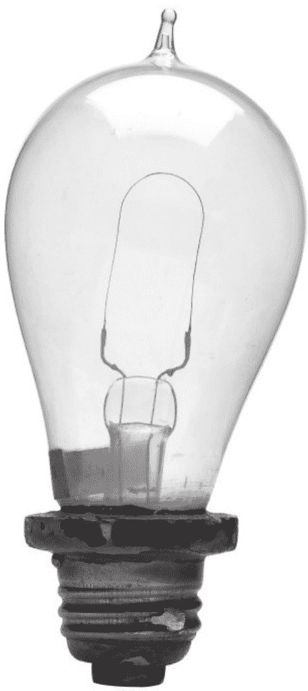

图1-4 爱迪生灯泡

温和、低能灯泡不易致三度烫伤或催生妙语。

### 回到真空管

真空管是早期收发无线电信号装置，撑起通信网、收音机、电视、（当然）早期电脑信号。

真空管能用，但玻璃壳极易碎（图1-5）。玻璃管笨重，阴极发热致整体发烫，能耗极高。早期电脑庞然大物，因真空管与长引线占空间、耗电量大。真空管迷人橙光，实为能量浪费。

- 玻璃管
- 阳极（箔片）
- 阴极（灯丝）
- 格栅

图1-5 真空管

1947年，新泽西贝尔实验室，研发人员发现：两个金触点压锗（原子序数32）晶板，微弱电子信号输出端被放大，且能量不随热流失。此装置名“跨导变阻器”（变阻器通过调阻控电流）。

虽“跨导变阻器”精准，难推广。实验室激辩，最终带科幻未来感词缀“ISTOR”与简明“TRANS”（跨越）胜出，改变世界的新装置定名“晶体管”。

点接触型晶体管进化为结型晶体管，能放大或引导电子信号。模拟无线电接收空中微弱信号，不放大不闻声，晶体管可经内置扬声器放大。

50年代中期，克莱斯勒美推车载全晶体管收音机——妻坐副驾，沐浴头顶20磅收音机晶体管橙光，何其妙哉？

1957年，索尼造出全球首款量产“口袋”晶体管收音机TR-63（图1-6）。

# 掌中宇宙的代价：从口袋收音机到脑机接口，我们正在经历一场漫长的隐私告别

这款收音机身披绿、黄、红等摩登配色，颜值在线，透着股子时髦劲儿。（反观老式收音机，不是棕黄就是淡黄，笨重得像极了父母家那口压箱底的大衣柜。）最绝的是，它能塞进口袋——当然，前提是你口袋够大。传闻索尼销售为了演示这点，专门定制了胸前缝超大口袋的衬衫。即便撇开颜值，它内核依然硬核：无阴极设计，不发烫、无需预热，开机即听，BBC世界台的电流声瞬间钻进耳朵。

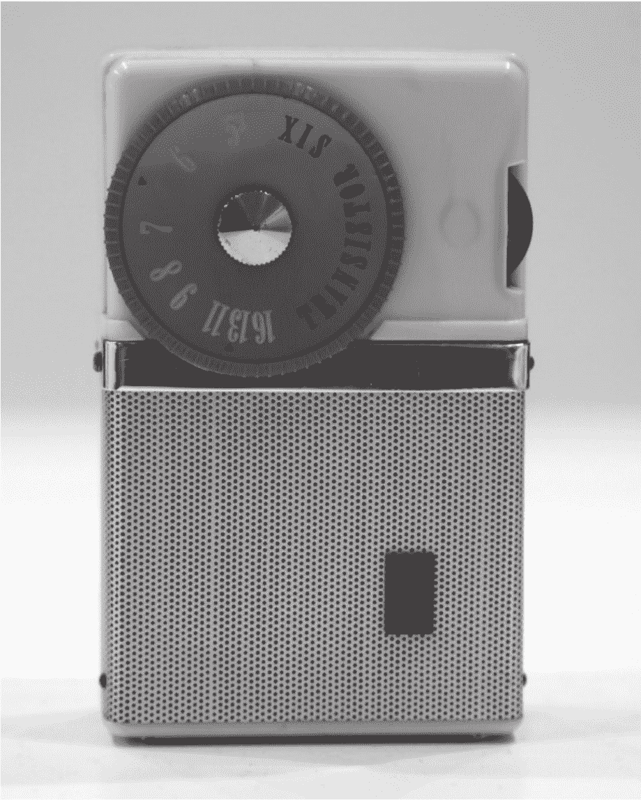

图1-6 索尼TR-63型收音机

TR-63塞着一节9伏电池，足足装了6颗晶体管。图1-7是它掀开后盖的样子，电路板看着就像个从50年代穿越而来、塞满杂物的旧行李箱。

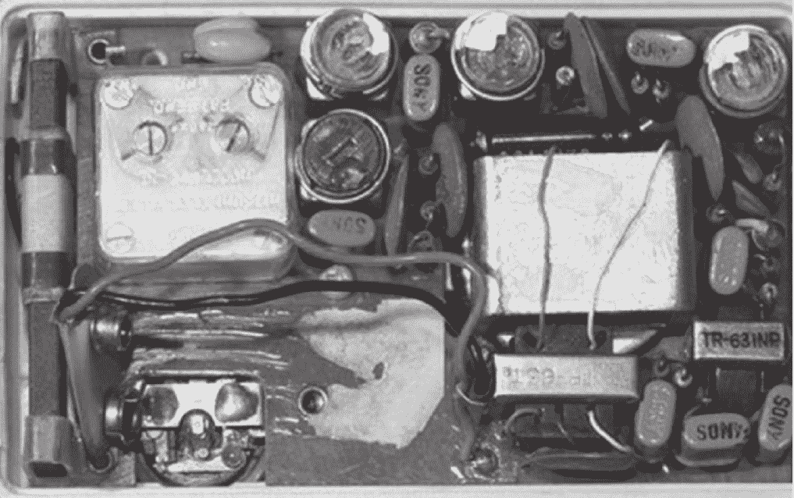

图1-7 TR-63型收音机内部

可这才仅仅是开始——随之而来的，是那几个我们熟稔于心、深深着迷的流行词：快、便携、私人。

60年代初，作为科技尖端的晶体管取代了真空管。它最大的杀手锏是“小”，而这一属性改写了一切。

最早的晶体管约1.27厘米长，趴在印刷电路板上。直到70年代英特尔推出集成电路——改用硅片而非锗片——晶体管才开始疯狂“瘦身”，仿佛微观世界的产物。放眼当下，你手中的iPhone 12里，藏着118亿颗晶体管。

我们不妨停下来算笔账。

1957年，索尼TR-63仅靠6颗晶体管便撑起便携梦；而此刻握在手心的手机，晶体管数量已达118亿。

这中间隔着多少风雨，甚至包括人类登月。

1969年，阿波罗11号登月成功。理论物理学家加来道雄曾感叹：“如今手机的算力，已超越1969年NASA送两名宇航员登月时的总算力。”

这不代表你的手机能送你上月球，但这种对比能让我们直观体会：算力在极短时间内是如何完成指数级跃迁的。

那么，握着算力快了10万倍的iPhone，我们到底在干嘛？

嗯，主要是打游戏。我们聪明，但本质还是猩猩。把香蕉递过来。

提到香蕉，还记得《黑客帝国》里那把标志性的“香蕉手机”吗？电影设定世界是仿真程序，原型正是诺基亚8110（图1-8），彼时它是地表最强手机（尽管不是智能机）。1996年，诺基亚9000通信器才算第一台能以极简方式联网的手机。

图1-8 诺基亚手机

智能手机（功能超越通话的数字化终端）诞生于1994年——IBM西蒙个人通信器横空出世。它虽砖头感十足，却能收发邮件、传真，堪称鼻祖。

回溯30年前的1966年，科幻大师厄休拉·勒古恩在《劳卡诺恩的世界》里构想了“安塞波”，一种能跨世界即时通讯的装置。一端固定，一端便携。这种设备在现实中迟迟未现踪影。

1999年，黑莓带着全键盘杀入战场。如安塞波般，它能打电话，但核心杀招是收发邮件。

紧接着，我们必须进入21世纪，聊聊苹果。

2007年，iPod大卖特卖后，乔布斯在劝说下决定“做”款集iPod之大成、还能打电话、发邮件、上网的手机。为达此目的，苹果把平庸的电话变成了最擅长的计算机。跑Safari的iPhone，早已与“电话”无关——它是部袖珍电脑。

次年，全球金融危机爆发的2008年，App Store上线——我们认知中的“真·智能手机”正式登场：联通全球、用户可随心定制的终端。

这是先见之明，更是黑客与开发者推动的结果。他们看透了：手机的主业，从来不是打电话。

Facebook引爆通信革命后，手机进化成了社交媒体终端。我们用它刷Instagram、Snapchat、WhatsApp、X、YouTube，打游戏、看新闻、点外卖、叫网约车；用Google搜索、唤醒语音助手、在Spotify和网易云听歌，偶尔——仅仅是偶尔——才用它打个电话。从何时起，手机不再只是手机？

Google的“环境计算”梦（本质是万物互联的物联网，从冰箱到手机紧密相连）正加速落地。未来蓝图还包括植入纳米芯片，直连人脑与服务系统。到那时，我们无需整天盯着屏幕——如今97%的美国人如此，全球37%深陷手机成瘾。

智能手机2007年入场，或将在21世纪内退场。它或许是改变世界的发明中，最昙花一现的一个。

1964年，阿瑟·克拉克在BBC《地平线》预言未来，精准捕捉到晶体管的威力，也瞥见了依托卫星的网络通信。

宇宙天然卫星遍布，但我们说的是人造卫星。第一颗“斯普特尼克1号”，长着触角的钢球。1957年苏联发射，1958年美紧随其后射上“探险者1号”。正值冷战白热化，红色阵营每得一分，西方必须更上一层楼。

英国卓瑞尔河岸天文台获军方资助，因其拥有当时世界最大（现第三大）可移动射电望远镜，能追踪“斯普特尼克1号”信号。

甩开“讨厌”的苏联人，是美的首要任务。1959年，“探险者6号”传回人类第一张地球全貌照——那张标志性蓝色弹珠定格了星球在太空中的模样。

如今近地轨道挤满数千颗卫星——多为科研（气象、小行星监测）、合作项目（通讯卫星）、或告知精准定位的GPS。

电视、手机信号仰仗卫星网。信号上行下行，不受高山阻隔，省却数万公里地面光缆。

“星链”属马斯克SpaceX，掌控地球轨道超25%卫星。他申请2025年前部署1.2万颗，最终达4.2万。光污染、能源浪费等风险随之而来。身处技术时代，大众多在懵懂中，等回过神想管控，往往晚矣。马斯克咄咄逼人，但太空属于谁？绝非他一人。这被视为另一种圈地运动、太空圈地。政府必须管控，否则必被强占——魔爪早已伸出。

1967年《外层空间条约》宣称：太空属全人类。

2015年《美国商业太空发射竞争法案》却唱反调：承认“商业开采太空资源权利”。

旧瓶装新酒，依旧是那套商业逻辑。

单颗卫星虽貌不惊人，实则精密复杂。“斯普特尼克1号”仅沙滩排球大，却有天线收发、能量源（电池/太阳能板）——这是标配。

从科幻走向无线网络的征途上（你对未来的幻想，成了口袋里切实的手机），晶体管与卫星，是串联一切的关键纽带。

我们常以为计算机是20世纪最伟大发明，但若无晶体管与卫星，家里的电脑仍靠真空管运行，大得塞满卧室，上网还得拨号。

不知你年纪几何？还记不记得听调制解调器“嘀嗒嗒嗒”拨号、想方设法联网的日子？那并不算远。变革非一蹴而就。我住的乡下，2009年才通宽带。那时我追求住在伦敦的纽约女孩。她网速飞快，我只能硬装。我的一天常这样开始：笔记本支在案板上，连楼下储物间那部孤零零座机的电话线。一次忘记归位线路，一周后全被老鼠啃断——老鼠爱啃线。电话断、网断，我失去了推进关系的主动权。

可Wi-Fi到底是啥？

反正不是“无线保真”[3]的缩写。

Wi-Fi最初指IEEE 802.11b标准的直接序列扩频技术——说白了就是普普通通的无线电波，却背了个绕口蠢名。除戴立克[4]，无人愿买单。1999年，品牌咨询公司Interbrand受托改名，借用“hi-fi”（高保真）谐音稍加调整，诞生了这个家喻户晓的响亮名字。

就在这新旧世纪交替之年，苹果推出首款支持Wi-Fi的笔记本，当时我们还在普林斯的歌声中狂欢。

离我们，真近。

2000年，宽带铺满全球城市，仿佛新世纪真带来全新开端。

看看随后发生了什么。

Google 1998年诞生于小型搜索公司。那时电话簿式搜索又慢又闷，斯坦福学子谢尔盖·布林与拉里·佩奇认定能做得更好。2003年Google取代雅虎成默认引擎，2004年上市，同年Facebook问世——世界进入Facebook时代。

新世纪头十年，疯狂得不可思议：2001维基百科、2005 YouTube、2006 Twitter、2010 Instagram降生。

即便阅读这等古老习惯，也因平板与Kindle引发的电子书潮迎来革命。

电子书热销、新设备迭出，未让纸书灭绝，正如汽车未灭绝自行车。在我看来，实体书如苹果、鸡蛋，形态完美；如自行车，其完美形态仍在不断进化中。

世上没有注定被取代的东西。

可人类呢？我们会被取代？或稍好点，渐渐边缘化？我们在进化中吗？

2020年后这十年，物联网会逼迫智人走上被迫进化、逐渐消亡的路吗？

且慢。让我们回到物联网诞生前——这个由联网设备（有时直连人类）组成的世界诞生前，思考“网络”本身——看看我们走多远，未来通往何方。

回到60年代美国，“爱之夏”[5]后，ARPA网采用英科学家“分组交换技术”，实现机构间有限数据通信。TCP/IP协议同期确立。

我们熟知的“因特网”（互联网络）一词，现于70年代，描述一组通用协议相连的庞大网络。

在瑞士CERN工作的英籍英国人蒂姆·伯纳斯-李完善HTML（超文本标记语言），将网络超文本文档串联成信息系统，任意节点（计算机）均可访问。

1990年，万维网诞生。可把因特网比作“硬件”，万维网比作“软件”。2010年，万维网成全球数十亿人接入因特网的入口。

当然，我们还有Google。互联网体量越大，搜索越复杂，核心问题浮现：搜索会被暗中操控？结果中立吗？强化了什么，隐藏了什么？偏向何方？

我们真想每次输入都弹广告？

真想浏览数据被追踪？人格经历被算法拆解？

为何不接受隐私政策就买不了东西？点“同意”难道不意味着零隐私？

个性化网络就是商机。你的网（号称帮你更快导航、找结果——实则可能是他们想让你想要的）是双重代价消费模型：花钱买货，白送隐私。信息极其宝贵。哪怕不买东西、随便逛逛、登社交平台，海量数据仍被偷走。

数据分析让网络精准画像。广告不只卖货，更根据记录推你大概率买单的货。

比广告更怕的是：新闻推送也只塞系统以为你“想看”的。每次点击、点赞决定你收到的“精选”，确保那一点点符合偏好的信息循环往复。网页给貌似多元的选项，实为博取点赞点击。了解异见、拓宽视野成痴人说梦，一切经筛选。无具体审查官（那太极权），是你“自愿”的选择精准操控了你。

人生大多时间在犯错、改错、变主意，网络分析却让你永无犯错、改错、变主意的机会。你买到的，是已买过的；读到的，是已读过的。反复强化，循环往复。

*

等Siri、Alexa成熟，或Google给每人配个“真人”助手，体验会更称心（或更让人毛骨悚然）。

Siri、Alexa挺有意思，但本质仅连接设备现有程序：开Kindle、放歌单、加猫粮、启动温控、以数倍速度搜网。

AI助手是微型的“我”。这搭建的人工神经网络（模式识别算法组）知晓我欲望需求、最爱美食、旅行偏好、常去餐厅、通话记录、欠款、忘掉的生日，掌握所有数码照片、短信、邮件，无论存哪。那我的政治立场？见不得光的秘密？甚至思想，它也知晓？

拉里·佩奇谈Google目标时说：

“我们最大野心是彻底改变体验，让一切简单称心。如魔法般，事在不知不觉中自动完成，因我们懂你需求，能即时满足。”

但需求被知晓满足，也被追踪记录。记住，Cookies是植入电脑的追踪代码碎片。若非亲自搜索，让AI代劳，隐私安全毫无保障。事实上根本无绝对隐私。连天气、共享单车这类看似无害App，也满载追踪代码。

但懂你的AI助手，极具诱惑。

谁不想要个能干、体贴、聪明、随叫随到、近乎零成本的帮手？这角色曾叫“妻子”，可惜女权主义碎了这美梦。

当然，帮手迟早成双面间谍。《银翼杀手》世界里，我大概率会被微缩版虚拟的自己出卖。

它知晓钱在哪、秘密在哪、朋友在哪、怎么联系。

我能逃吗？无现金世界里，初靠手机买必需品，后靠虹膜、指纹、芯片植入直接交易：植入芯片的我，不再依赖外部设备，我就是设备。无需钱包、电话、钥匙、工牌，我将自由自在，却始终被追踪。甚至无需追踪，专属卫星早将我坐标标得清清楚楚。

科幻里，主角常活在反乌托邦，既得利益者活在乌托邦。我觉得未来不会如此两极，如克拉克1964年所言：“未来不仅仅是现在的延续。”

但确定的是，“隐私与秘密将成不合时宜的存在”（谢了，扎克伯格）。如未来所有系统，我将永远在线、永远暴露、随时待命，甚至在睡觉、做梦、思考时。“自我”不再属我，“自我”与“他眼中的我”同属一个数据集。很快，我与微缩版自己——AI助手的连接将成多余，我们合二为一。

读取思想将易如反掌。智能植入物助我们认知自我，也助他人读取思想。

约翰·温德姆《米德威奇布谷鸟》（1960）是我挚爱科幻小说，60年代改编《魔童村》，95年卡朋特翻拍。

如今英天空台拍8集剧，大卫·法尔执笔。显见，故事余波未尽。

故事设定英小镇米德威奇，所有育龄女性同天怀孕，生下金发金眼婴儿。他们长得快、智商恐怖、能心电感应交流——实则是个个关联的人工神经网络节点。

他们懂读心术，洞穿思想。无秘可藏。他们自称本心善良，谁信？

想像一下：Facebook点10下，得用户画像，比他妈、朋友、甚至他自己更精准。

想像一个无私密思想的世界。

想像一个无私密行为的世界。

物联网让万物如计算机般运作。冰箱统计采购消耗，注册减肥App则自动订健康餐，破戒则自动上锁。绝望下，人们对着冰箱乱砍，我们或将目睹这惨剧。

智能床监控睡眠、提升质量，调温调光、向AI医生汇报。可能需药物干预。今日不宜驾驶。做爱了吗？没？关系健康吗？或许需性生活顾问。

智能厨房里，烤箱提醒今日禁碳水。智能马桶晨间分析排泄成分（真非我杜撰）。

汽车呢？无人驾驶听上去美——如拥专属司机。能去酒吧、后座办公、不听司机谈美政、私人车厢唯有一片宁静。

可当发现这舒适车厢毫无“私人”可言，如何？无人车记录行程，随意变可预测、归档。行进方向可被篡改：去派出所、前任家、或植入芯片监测血压高则送医院。这是劫持，甚至绑架。

不用操心车，不代表不用操心隐私。

面对那些无解的两难困境，自动驾驶汽车只能死板地执行预设代码。当撞击不可避免时，是向左撞击孩童，还是向右撞击老者？系统必须二选一。车内乘客与路边行人，谁的生存权级更高？是极致自我保护，还是最大程度外部避险？若一只闯入车道的流浪狗，急刹必酿成连环追尾，车该何去何从？

人类在瞬息间凭直觉抉择，但无人驾驶必须依循预埋的伦理算法——除非未来某天，它学会了自我重写代码。那个可怕的日子一旦降临，它将载着“罪有应得”的我们，驶向悬崖深渊。

即便仍保留人工驾驶功能的车辆，出厂时也已植入智能传感器的“千里眼顺风耳”。它们监听车内闲谈、收音频道，探测酒精药物残留，甚至扫描情绪波动。若你与伴侣争吵升级，座驾可能自动报警、强制靠边，并弹窗警告：此举将冲击你的保险信用分。对保险巨头而言，远程遥测是掘金利器。原本监管新手的“黑匣子”，将内嵌于未来座舱，功能衍生出无限可能：超速？罚单秒达。路怒？举证全程留痕。

上周你现身何处？你的车“心知肚明”。威胁与管控，从未如此触手可及。

更甚者，若车贷逾期未还，车企可远程熄火、GPS锁定、拖车带走，一气呵成。

*

编织无孔不入的万物互联大网，让生活切面尽暴露于商业收割之下；但撇开此节，物联网确有红利。

琐碎寻常的柴米油盐，大可不必亲力亲为——植入式芯片自动挂号复诊，智能宅邸自主清洁维修、下单囤货，手机端远程监工、限时放行水电师傅。谁还愿跑超市、催修锅炉、等师傅、做保养？

腾出的时间，交给AI助理规划假期、订机票酒店。压力过大？它建议歇一晚、去放风，联动合作餐厅送餐、网约车接送。万事无需操心，自有“它人”料理。

商业图景期冀：大众终将认定，物联网的便利足以抵消对人身权利的侵蚀。我们拼命捍卫的时间——虽属私有，却不全受己控。

心灵鸡汤书籍与APP齐声呐喊，催我们蜕变成“更好版本的自己”：更快乐、更高效、更优秀……物联网许诺助力达标，且在大多场景下，兑现了承诺。

既得如此厚利，丢些隐私、甚至迷失自我，又有何妨？

科技教派奉行一套哲学，由权威背书鼓吹：启蒙思想推崇的“个体”——自由意志、自洁精神、自我驱动、自由选择——统统是谎言。人非孤岛，乃群居动物，渴望被看见、被理解、获归属，故而极易被塑造。行为源于后天习得，可调优、可干预。我们误把惯性当选择，“独立思考”多是拾人牙慧。我们贪图安逸，甘愿被“告知”何为思考，只求保有“我在自主思考”的幻觉。那些打着自由旗号冲击议事厅的激进派，实则唯特朗普马首是瞻，令人战栗地佐证了自由意志的虚无。

“匿名者Q”社群的极端言论毫无事实基石，成员却坚信那是独立思考的结晶，而非被操纵的傀儡。

二战后，哈佛心理学教授B.F.斯金纳的“反个体行为理论”风靡一时。彼时浅显的行为主义，今被归入激进行为主义，仍助企业与政治集团化解伦理困局。

特朗普军师班农、约翰逊智囊卡明斯，皆推崇操纵“个体行为”的新斯金纳主义（毕竟根本不存在纯粹的“个体行为”，那不过是教育、偏见、臆断、恐惧与奖励的合成产物）。

操控行为以达成预期——买单、投票——向来是游说与广告的核心。社交媒体让这手段渗透至分秒。

Meta似已证实：在网络“分享”完整人生，非互联副作用，乃互联本意与欢愉所在。朋友圈与猫途鹰的流行暗示：体验不重要，分享才重要。一经分享，从未想去的无名村庄、无名小馆，瞬间涌入打卡游记、探店测评，引燃下一波羊群效应，循环往复，成夸张噩梦。

1990年，斯金纳临终留言：“人只是事情发生的场域。”此判断，在当下社交平台上被反复印证。

人或非场域，而是历史承载者、未来重启者、可爱之存、不可捕捉的瞬间、内在力量、会带来社会性后果的个体行为——但后果不完全是公园商场式的社会性，或许浪漫、愚蠢、错误，是值得延续的自我凝视。

哈佛商学院荣退教授肖沙娜·朱伯夫在《监控资本主义时代》（2019）中，勾勒另一种可能：参与与共享，而非被数据矫正。未来科技不止服务商贾权贵，更将造福全人类。民主仍有容身处，FAANG巨头不会如旧日帝国般瓜分世界。

新未来不应是极权式监控系统，而应视作赋予我们的权利。

马斯克旗下Neuralink攻关“脑机接口”——未来或可意念驱动电脑。2020年启动人体实验，初衷治愈瘫痪，听来高尚。但马斯克终局，似在谋求人机共生，以免在智力竞赛中被甩在身后。

史蒂夫·奥斯丁，首位仿生人，源自70年代美剧《六百万美元的人》。科技让他更快、更强、更智，打破生理桎梏。

现代医药曾打破生理极限。人均寿命较工业革命初期翻倍。1880年均寿40岁，早期工厂恶劣环境与12小时工时，更将其削减十载。

两百年流转，80岁成常态（《圣经》设“寿限”七十，故工业革命虽被资本赞颂，实则重创寿命，复原漫漫长途）。

注重养生、享医疗、少压力者可享长寿，但掌握优质资源的富豪自然渴望更久、更好，故硅谷砸巨资攻关抗衰老、逆认知退化。认知衰退如肌肉流失、器官衰竭般真实，我们终将败给自身生命机理。

而AI系统——无论有无实体——免受衰老侵蚀。它们迭代升级、愈发智慧。姑称历经两次工业革命的人类为“智人3.0”，若不愿被历史出局，必得火速进化为“智人4.0”。与AI融合，似成水到渠成的归宿——但未来难测，顺理成章未必成真。

不过，“个性化”趋势，却清晰可期。

“个性化”肇始于60年代首台晶体管收音机：人人拥有专属掌上声乐库，无需合家围炉守听广播，想听即听。此后，笔记本、智能手机竞相接力。

如今网络构建出一个由公开数据拼贴的“自我”，愈发“个性化”。它是“你的”芯片、“你的”座驾宅邸、生活方式、保险、作品集、私人买手、健身教练、主治医师、AI助理。追踪插件为你量身定制，随你的一举一动实时迭代。

这是高明营销话术：“个性化”不再止于产品属性，而升格为核心概念，意在取代陈旧过时的“隐私”。

然在万物互联的将来，为何隐私仍成棘手难题？

隐私制造摩擦，以经济学视角，摩擦是持续生产的反义词。它斩断你时时刻刻生成的顺滑数据流，阻碍那些想从你身上榨利、控控引导你行为的利益集团。就这么简单。

抑或说，我已是个愿主动断网、偶尔离线的“仿生人”？当下，我们仍能不带手机出门，步行至目的地，在无监控区以现金交易（虽此类场所日益稀缺，现金支付愈发艰难），彻底失联数日。

但很快，随着智能终端与植入芯片普及，你无需再“登录”网络。此生，你将无时无刻不在网络之中。

昔日科幻设定，化作当下Wi-Fi，终将演变为“我联网”。

2015年达沃斯论坛，时任谷歌CEO施密特坐在Meta首席运营官桑德伯格身侧，抛出预言：

互联网将消失，取而代之的是物联网。你身穿之衣、手触之物，将内含海量IP、设备与传感器，你甚至无法察觉。它将永融为你存在的一部分。

这引发全新伦理拷问。

神经伦理学家、苏黎世联邦理工学院研究员马塞洛·伊恩卡提出科技时代四项权利：

1. 认知自由权
2. 精神隐私权
3. 精神完整权（禁未经许可入侵大脑）
4. 心理连续性权

我对最后一项尤感兴趣，因它揭示：移除脑内神经植入，与植入同等棘手，甚至构成新型酷刑（神经技术公司可让我们降级、发疯、重置思维）。

若未来某天，大脑全量上传云端（以此“备份”自我），谁能担保存储过程中不被抹除记忆、植入虚构？正如菲利普·迪克神作《全面回忆》所警示。

针对从幼熟稔手机与Meta、疯狂更动态、渴望成网红的“数字新生代”，非营利组织“五项权利基金会”（5Rights）发声维护。站在未成年人立场，呼吁网络安全、隐私保护、内容筛查、平台责任明确。

基金会由影人比班·基德龙于2015年创立。访谈中她言：海量未成年人挤占网络，日均上网数小时，却被平台按成年人规则对待。内容五花八门、信息唾手可得，监管却举步维艰。“网络儿童色情引诱”触目惊心。

例证：新冠封控期，仅英国一地，单月内便阻断约900万次浏览儿童色情图像的请求。

儿童虽熟稔科技，却极易被其伤害。基金会旨在守护童年在网络世界的安全，同等于现实世界。现实中，我们区分童真与成熟——“儿童”概念的诞生，是工业革命后来之不易的文明进步。我们不愿孩童陷血汗工厂，却似漠视他们因手机遭受的层层剥削。

游戏成瘾、色情侵蚀、“点赞”陷阱。童年伊始，网络便开始收敛一个人的海量数据，多到足以掌控其一生。过往政治博弈中，封禁社交平台可成政治工具、监控借口、立场塑造器。数据掠夺本质带政治基因。所谓“自由”西方，正悄然推行网络管控。数据非私有。谁“有权”掌握？贩卖？截取？包装？

迄今，大平台无法为未成年人兜底安全，若这隐忧不解，“五项权利基金会”极可能推动跨国立法胜利。

然而，若网络与现实界限模糊至消失，会怎样？若施密特预言成真，会怎样？若互联网永存、我们永远在线，该如何守护每个人安全？

有个故事颇具讽刺：沉迷网瘾少女，手机电脑被没收、Wi-Fi被切断后，竟通过家中智能冰箱发推。这或是炒作，但Reddit上真有三星冰箱发推教程——若你家有这款。

故事揭示：硅谷掌控日常的“数据大佬”，正打造一个永不“离线”的未来。届时，他们无需“非法”潜入冰箱。

不过……

或许这一切（隐私、监管、数据流、数据用途）皆是暂时的。当下我们坚信，人类利益与人性因素永居主导。可若AI真具超常智慧，不再是工具而成竞争者，人类地位将变得无关紧要。我是说，人类被扔进历史垃圾桶后，AI还需收割我们数据吗？

谈及未来，许多人笃信：各国如鸵鸟埋头沙中逃避气候变暖，终将让沙中元素——硅，失去意义，硅谷内外皆然。届时我们为口饭厮杀，无暇学冰箱发推。

也有人信：研发中、拟人敏捷的超级AI，是人类存续唯一希望。

2020前，无人信病毒能灭种，今我们信了。

讽刺的是，疫情重创全球经济，新冠却成科技巨头敛财聚权的助推器。提供送货上门的，早非亚马逊一家。

施密特已热烈探讨全面普及“居家上学”的可能（富豪子弟自会送校）。疫情期线上替代线下，施密特认定孩子可在家自主学习。

若人人宅家、不见真面，便需新连接方式。这催生通讯软件进化。Meta推出虚拟会议室，允许虚拟形象同空间协作。我敢断言，它将如Zoom云会议般，带来愈发真实的临场感。

然忧虑在于：疫前民权组织耗时吁请护隐私、曝光追踪；疫后监控等于安全，哪怕去趟酒吧都被留痕。

还须直面能源危机。AI极度耗能，纵竭地球化石燃料，也无力支撑库兹韦尔与马斯克描绘的“美好未来”。《黑客帝国》设定人类作“电池”供AI虚拟世界运转，非无道理。

乐观派以为：能源匮乏将倒逼低碳环保路。市场将推动能源革命，别无他法。

但AI统治的未来，仍有硬骨头。

英特尔创始人之一戈登·摩尔提出“摩尔定律”：每两年，单位面积微芯片晶体管数量翻倍。英特尔首块芯片问世时，计算机需楼房大小才达特定算力，五十年后已装进行囊，能耗大降。这是进步。

但进步有界——除非颠覆计算架构，否则寸步难行。简言之，笔记本手机已极致微型，晶体管难再翻倍。哪怕再微缩，也需物理空间。未来更快、更强，唯靠量子计算机。

传闻政府已在量子领域突破。纵真造出，我们也不知情。谷歌与IBM均称距成功仅一纳米之遥。

晶体管经二进制（0/1）显示信号。传统计算采二进制，比特为最小存储单元，态定0或1。量子比特截然不同。其本质为叠加态亚原子粒子，因量子特性，可同时为0和1。因在微观（或极寒）量子界，物态须经测量才定：测前，多重互斥态共存；测后，始具确定形态。酷似魔法，魔术师与童话皆爱用“同时”修辞，或因吾人深知：这个可定义、可测度的现实，非唯一实在，乃浮于表象的复杂混沌。

无论如何，亚原子世界里，二进制失效。不确定性中蕴藏能源巨变潜力。

同算术单位，8比特为1字节。纵智能机拥20亿字节（160亿比特）存储，仍远逊于数十量子比特。

IBM约克城高地研究中心主任达里奥·吉尔言：

想像100量子比特存傲量级。其可呈现状态数，超地球总原子数。280量子比特可呈现状态数，超已知宇宙总原子数。

当下，全球首台量子计算机IBM Q System One，如深入浅出的摇滚巨星，蛰伏于边长9英尺的黑玻璃立方盒中，外封700磅重、半英尺厚的重门。量子计算须绝对无干扰环境，否则如凡人坠情网，误差丛生。

于是，我们造出一位隐世神明，栖居人迹罕至的庙宇，唯有着特殊法衣的“大祭司”得以朝拜。“大祭司”可提问，再破解其谶语。

量子计算机或是未来，却听起来像遥远法老神话的回响。

这一切将通往何方？

确定的是：对于这掌控日常的庞然大物，未来懂其运作机理的人，将越来越少。这不比修懂洗碗机简单。

虽每人对未来想象各异，却同信“全维连接”梦想将成真——联网络、机器、设备，令其互联互通。

当你按需创造“连接”，它仿佛属你，仿佛成你，仿佛冥冥中你早已拣选。仿佛虚拟的弗兰克·辛纳屈高唱：“我按我意连接。”

对“自我”的新一轮拷问将浮现。“我联网”带宗教色彩。扎克伯格曾喻Meta为“世界教会”，连接人类与更伟大之物——或更伟大，或更渺小，关键在互联。

奥威尔在《1984》写道：

> 你只能在这样的假定下生活——从已经成为本能的习惯出发，也早已这样生活了：你发出的每个声音，都有人听到；你做出的每一个动作，除非在黑暗之中，否则都会被人仔细观察。

今日奥威尔若在，或惊见“老大哥”已沦为真人秀——节目铺天盖地红外镜头，暗夜亦无遁形。

他或更惊见：人们争抢参加《爱情岛》等满屏监控镜头的节目。

## 解锁人类的“隐藏技能”

### 为何我们必须重写吸血鬼、天使与能源的剧本？

## 尘封千年的诺斯替密码

> ——马文·明斯基，《心智社会》，1986年

马文·明斯基（1927—2016），数学家出身，1959年联手约翰·麦卡锡在麻省理工建起人工智能实验室。他对机器人与神经网络的执着，逼出了两个终极追问：智慧的底色是什么？拥有自我意识的硅基生命，到底会不会降临？

会不会有那么一天，AI彻底脱离“工具”身份——不再是人类发明、供人类驱使的顺手棍子？

1968年，《2001太空漫游》上映，明斯基任技术顾问。还记得哈尔吗？那台按自家意志执行指令、让人脊背发凉的超级计算机。

彼时计算机还是塞满屋子的庞然大物。直至50年代末，半导体技术让晶体管取代真空管——后者正是早期机器身形臃肿的元凶。

60年代，体积缩小、算力飙升，全靠晶体管突围。当时振奋人心的，不只是这些实绩，更在于：电脑的诞生路径，与人类以往任何发明都截然不同。

它不是飞机汽车的升级版，也不是电视电话的加强版。

计算机，极可能是人类的“终极发明”。

1965年，杰克·古德首提此说。他和明斯基一样，都是《太空漫游》的幕后军师。

古德（1916—2009）二战时在布莱切利园与图灵并肩，亲手造出破解“恩尼格玛”的解码机。

80年代，古德与明斯基联合判断：无人监管的神经网络（微型大脑）能自学、自复制，零人工干预。机器自治迟早到来，无需人类写代码（这非假设，乃必然）。明斯基团队的拦路虎只有算力与速度——“机器自治”理论从未被现实推翻。

古德曾断言：

> 定义超级智能机器：它能超越任何人类的一切智力活动。既然设计机器属于智力活动，它便能自行设计更强机器。这必将引爆“智能大爆炸”，把人类智慧甩得看不见尾灯。若它足够“听话”，永受控制，便是人类史上最后一项发明。

正是这最后一句，预言了那个不“听话”、失控的哈尔。

明斯基盛赞图灵心智非凡，是他让数学家不再把计算机（含机器人）仅视为编程器具。

图灵笃信：未来机器将展现与人类旗鼓相当的智能，“图灵测试”即基于此。他预言2000年实现，虽未应验，但坚信机器能具备人级交流力。

明斯基致力开发自主思考的AI，动力源自图灵1950年论文《计算机与智能》。

值得一读。在我看来，这篇涉及心灵感应与群体思维的佳作里，最精彩是图灵对“洛芙莱斯异议”的回怼——一个世纪前，这位天才女性指出：巴贝奇分析机理论上能写小说、谱乐章（1843年这洞见已绝妙），但它无法“创造”。

先澄清概念。

阿达与其父拜伦勋爵同以为：“创造”意指产出前文无痕迹的全新洞见或形式，而非吞下海量数据再挤牙膏。我们可不认同，毕竟人类本质也是信息处理机，与计算机无异。我只是想凸显阿达的核心。

图灵读懂了阿达。而图灵大多同事不知自己信仰的源头在阿达——她去世后，图灵是首位正视其才华的科学家，而非只把她当巴贝奇生平的注脚。他听进她的话，随即自问：

阿达说得对吗？

机器智能能“创造”吗？

机器智能与人类智力有何分野？

二战尾声，图灵入职曼彻斯特维多利亚大学（今曼大）新建计算机系。

白天与纽曼、基尔伯恩攻关存储程序[1]机器，夜晚幻想英俊男人与美妙机器——除算数下棋还能干别事的机器；能陪你聊天、共思考，甚至思维远超你的机器。同超前的阿达一样，图灵跑在时代前头。

1952年因“严重猥亵罪”入狱，图灵彻底告别计算机研究，也无缘见证后来的惊世突破。1954年离世，几乎确定是自杀。战后英国，他想用肉身做的事（同性恋情），比用头脑能达成的成就更刺眼。

这是奥斯卡·王尔德悲剧半世纪重演[2]。人类学习像机器般缓慢，却无法像机器那样用“蜂巢思维”，通过群体意识吸收教训。

图灵挚友古德说：“我不说二战是图灵赢的，但没他，我们定输。”

计算机史里，布莱切利园的分量怎么强调都不为过。1945年战火熄灭，一个新纪元、现代纪元、属于我们的纪元拉开帷幕。

回望1945：联合国成立、英国工党首执政、戴高乐组阁、甘地争独立、以色列建国、马歇尔计划启动——一切围绕战后重构的政治大戏。

可同年还发生件怪事。按当时眼光，出土文物只关乎教会起源，在百废待兴的废墟上显得无关痛痒。但若采纳明斯基“多角度理解意义”的观点，这故事必须讲。

拿哈玛地，埃及卢克索西北小城。

1945年，两农夫赶马车挖矿质土做肥，鹤嘴锄击中地下硬物——个近两米高的封口大陶罐。

兄弟俩不敢开，怕蹦出精灵。

万一是满罐黄金呢？

好奇心赢了，砸碎罐子。

罐内12卷皮装莎草纸，古埃及文书写，约为亚兰语或希腊典籍译本。年代追溯至3、4世纪，《多马福音》可能耶稣离世80年后即成书。

多为诺斯替派经典。

“诺斯”（Gnosis）希腊语本意“知识”——非书本知识，而是关于自我与世界终极本质的真知。词根现于“agnostic”（不可知论）。爱因斯坦曾自称不可知论者：只是对上帝存在“知之甚少”，非不信神的无神论者。

“诺斯”非科学，科学要客观量证，可深切感知怎量？至少现阶段现有标准证不了真。

“诺斯”也无关教派，诺斯替派不想要信条、教义、教会等级，对建有明确信仰的教堂无感，只想探索实相本质。这让他们站在体制化基督教对立面，180年前后，爱任纽主教斥其为异端，下令焚书。这大概就是陶罐被埋地下的缘由。

诺斯替派究竟信什么？为何与未来AI世界纠缠？

信徒眼中，世界从非完美之地，故无需净化或治愈。无黄金时代、无美好往昔、无天堂、无堕落，世界生而烂，非因邪恶，乃因无知。

他们信宇宙有“普累若麻”（实非地点，乃理念），丰盛圆满与光明的领域。

那里存在不受时间束缚的“移涌”[3]。有最高统领（神格存在），其余移涌成双成对。这世界观受希腊神话影响：众神之首双生非单一，“男”“女”分离又合一。

有趣的是，移涌酷似代码0与1——更像量子比特，亦0亦1，另一个话题了……（还记得量子比特讨论吗？）

修为最浅、地位最低的是索菲亚，名意为“智慧”。索菲亚（“智慧女神”）现身《旧约》尤其《所罗门智训》，犹太教严格一神论父权下却被忽视或降级（“三位一体”圣灵实为索菲亚）。

索菲亚脱离双生移涌，独自创造。她制造一堆烂摊子，还生了狂妄自大的造物主[4]“亚尔达巴奥特”，搅出一团乱麻。亚尔达巴奥特把笨手插进粪土，用软塌塌的水泥“橡皮泥”捏出世界，又捏几个人类，自封为神。部分文献称他耶和华。

这是个“特朗普式”创世记。

因移涌成双，索菲亚非孤军奋战。配偶基督（Christos）将她拽离自造的黑暗泥沼。神灵发现这热气腾腾、水汽氤氲的物质世界仍散发微光，基督同意赋予必要灵知（“诺斯”），人类可借此知晓真正来处与归宿（如《黑客帝国》）。

所以，人不邪恶。人无知。

认清“我是谁、从哪来、到哪去”，是本分。

所有“救公主”童话内核皆源于此，“寻找另一半”（俄耳甫斯与欧律狄刻）、“浪子回头”（圣乔治屠龙）亦复如是。一切纠缠于阴阳（男女、主被动）老套二元对立。可一旦意识到索菲亚非二元一元（非此即彼的二进制），而是活跃平等的量子比特，一切豁然开朗。

同基督教一样，诺斯替派认定“由血肉构成”荒谬。

对信徒，笛卡尔“灵肉二元论”是黑暗明灯。“灵肉二元论”自17世纪主导西方思想——非“魂肉二元”。我们的“非生物火花”非基督教需救赎的灵魂，而是需赋予知识的心灵。

诺斯替派眼中，无知是自我毁灭、致幻剂、毒瘾。抗拒“诺斯”是原始冲动，好比不愿醒来、想终日醉酒刷游戏。“诺斯”意味着苦活、令人烦恼，如《黑客帝国》红蓝药丸二选一——它本质就是部诺斯替电影。

“诺斯”不在救世信条、仪式教义里，靠神父指引也终结不了无知；“诺斯”只能内求。诺斯替《多马福音》有段动人话：

像敲门一样敲击心灵，像走直路一样走在心中。走直路便不入歧途。无论你为自己开哪扇门，都能打开。

诺斯替派女权友善、戒备等级。异于犹太教与正统基督教，多数信徒男女平视，不利用等级建权力——这两点气坏爱任纽主教，成他认定“荒谬疯狂”的铁证。

“正统”视女性为次等，等级权力被视为维序、发号、稳定、传承的基石。

可耶稣自己在待女性态度上就与犹太教分道扬镳。他像对男性一样与妇女对话、共餐，身边常伴虔诚的抹大拉·马利亚。耶稣不追权，四海为家，靠他人施舍，无资产、无钱财。

诺斯替信仰里，耶稣非上帝之子——当然，也可说我们皆是神的孩子。出土经文中，耶稣被描绘为超凡存在（基督），由光而非血肉构成。

诺斯替派厌肉身，但许多基督徒、犹太教徒也厌肉身，视其为残缺易碎容器。厌恶升级至今，21世纪西方，我们以空前强度痛恨己身：饿瘦它、虐待它、整形它，花巨资改造每寸肉，又花更多钱延寿。现代医学视身体为战场，不信其自愈力。

可人体是平凡生活里的奇迹，失去后方知健康体魄之珍贵。

也许……

对诺斯替派，死非灵魂超度或堕落。异于基督教伊斯兰教，无最终审判、无最终归宿。或依亚里士多德，光归光，回灵魂世界；或依柏拉图，个体光以可识形态延续——我仍我，你仍你。

独具特色：分人三等。一“属物者”（Hylics，源希腊文“hyle”即物质），死后成此类者，便是我们日见浑浑噩噩、行尸走肉之辈。二“属魂者”（Psychics，“psyche”希腊文意为“心智/灵魂”，别误作通灵大师[5]），乃苦寻自我与世界本质者。三“属灵者”（Pneumatics）——非元气满满健身狂或辣妹[6]；希腊文“pneuma”意“生命气息”（拉丁文“spiritus”）。这类人觉醒：我们被囚地球，如陷一锅令人窒息的混沌浓汤。

我们得回家。

家？

这无关宿命论或因果报应。诚然，些“及时行乐”的“属物者”很享受当下（想想《黑客帝国》），愿永活幻象。诺斯替派不评判，想当傻瓜是你的自由。

把这段史理解为：希腊思想与希伯来思想碰撞，融汇东方（特别是印度商路）文化，共同孕育出可能与基督教抗衡的新派别，对定位当下至关重要。

诺斯替派承袭犹太教实用传统，重仁爱、负责任度此生，同时吸纳希腊哲学对“自觉生活”的看重。苏格拉底名言：“未经审视的人生不值得过。”诺斯替派视为根本信条。

东方哲学影响下，部分信徒质疑物质实相：现实是否幻觉？但多数认为“不真实”仅体现在特定层面——世界虽实存，却非家园，我们无法在其中得安乐。

此观点早期基督教无有，后者认物理世界真实存、为上帝创造，故须敬畏欣赏。

《圣经》说人虽统治自然，也应爱护欣赏，因上帝审视造物时觉万物皆善。

神圣辉煌的罗马教会，每六天庆个异教节日[7]，办聚会赞美造物。这高明公关，既笼络民心，又强调事实：我们居肉身、居自然，二者皆美。人类爱奇迹，也爱聚会。

直至宗教改革，乐趣消失。辉煌、彩绘玻璃、游行、华丽祭服、耀眼祭坛、遍布红金，全消失。自然界被改造成辛劳、挣扎、尘土、黑暗、病痛的修罗场。肉身，好说需管控，坏说是沸腾罪恶羞耻的大杂烩。全怪清教徒。

可宗教改革发生在经文入土1300年后、诺斯替主义再度流行之时。新教精神不只在少数新教徒中流行，更渗入人类思维底层模式。

马丁·路德宣称人可直通上帝，无需牧师中介，这是他高光时刻，也是改革开端。不再需奢华教堂繁复仪式，我们能直触神性。

这种诺斯替式洞见，让重“直接体验”的新教衍生无数分支：贵格会、震颤派、浸信会、五旬节派……还让女性受领神职、任精神领袖，这正是诺斯替派始终接受之事。

绕这么大圈，因我觉得：想搞清我们在当下的坐标，这些信息不可或缺。

现在，一套类宗教新话语正成形。它有信徒、信条、正统、异教、祭司、典籍，甚至有自己的“奇点”。

它就是AI。

我们的“AI教”集齐宗教全要素。

信徒谱系极广：奇点信徒、超人类主义布道者（摩门教内甚至有超人类协会）、芯片植入狂热者、延寿极客、首批大脑上传者、3D打印器官机构、培育“匹配”理想身体干细胞的实验室——数不胜数，形形色色。这些秉持诺斯替“异端基因”的群体，理念仅偶有重合，却无一例外地为人类身体内外正在发生的剧变，提供着最新注脚。

# AI与信仰：当硅基智能邂逅碳基灵魂

另一侧阵营坐着怀疑派，他们自诩正统——笃信人类独一无二、不可取代。在他们看来，肉身在可预见的未来不会发生质变，意识上传不过是科幻小说的噱头。他们把“AI乌托邦”或“反乌托邦即将降临”这种论调，视为转移视线的烟幕弹：好叫大众不再关注气候崩塌、灾难资本主义、性别与种族鸿沟，也不再留意科技巨头对日常生活日益渗透的监控与操纵。

还有那群自视为“天选之子”的技术祭司，多为男性，深信自己掌握人类命运的舵盘。他们握着编写未来世界的深奥数学咒语，自诩具备专业圣洁的知识权柄。

把AI降临的狂欢称为“极客被提”或“发烧友被提”，着实贴切。基督教里的“被提”（Rapture）指耶稣再临，得救圣徒将被接入永生。AI狂热与古老宗教的相似度，足以让在修道院长大的人既沉醉又战栗。

教义你早知晓：尘世非吾家，吾乃过客。自我或灵魂与躯壳分离。死亡通向来生。

研读AI资料越多，越觉眼前反复浮现的，是披着高科技智能纤维外衣的宗教思维。

末世预言家警告：AI统治纪元迫在眉睫。在这场“天启末日”里，人类面临四种结局：

- 惨遭碾压
- 被剥离人性
- 被机器取代
- 被推入新不平等社会：富人拥有更优算力芯片、基因优化、智能义肢与认知增强，其余众生只能困守组装老旧手机的流水线，甚至为这微薄薪资厮杀得头破血流。

乐观派描绘的图景则狂热得像等待基督再临的信徒：

AI将把人类从体力劳作、病痛、死亡、婚姻制度、生育、迷惑，以及一切想甩脱的苦楚中解放。我们将自由栖居太空（或天堂）。时间失去意义。

令人意外的是，马斯克、蒂尔、盖茨等顶级玩家，也对AI统治世界表现出忧虑。

AI会控制我们吗？我们沦为宠物？人类最后一项发明会成为“告别演出”？

这种“人类非被AI接上天，便被AI推下地狱”的二元思维，陈旧且无益。

若我们在真正关键的认知领域不进化，再强的技术、再聪明的大脑、再惊世的发明——登火飞船、长生不老药——皆成空谈。

我们可以按己像造神（AI）——好斗、缺乏安全感、控制欲极强，但这绝非良策。

或许像普通生物直面死亡，能改写我们的目标，消解对AI世界的恐惧。

库兹韦尔、马克斯·摩尔等未来派迫不及待想甩开肉身；马斯克、蒂尔则想逃离地球。这被批为典型的“男性自由幻想”——幻想无肉身羁绊的世界，丢下该负责的烂摊子。但说到底，这只是对天堂的向往，无可厚非。

我不认为渴望超越肉身的意识境界，必然意味着厌恶当下躯壳，尽管现实可能如此。诺斯替主义更像是对愉悦与迷惑的体验，而非绝望与厌恶。但我不得不承认：迄今为止，我们所有的生命体验皆为身体体验。我们不是缸中之脑。

无论如何，若打算上传意识，必须先学会与延长寿命、改善健康的生物增强技术共存。一旦人机融合，技术对我们就不再异质。同理，我们很快将与有形AI（机器人）与无形AI共处，这将重塑我们对“人之处境”的认知。我们陶醉于“生而为人”的自恋，不过是近期才冒出的站不住脚的念头。

不久前，西方人还信身边环绕着精灵、天使、神明与奇异生物——世界许多地方至今仍如此。无证据证明鬼神实在，但那不重要，关键是它们如何塑造心理——极大缓解了人类优越论带来的躯体焦虑。因为你信自己随时可能变驴，或能脱壳超脱。

任何萨满、巫医、巫师、通灵者、女巫或瑜伽大师都会告诉你：你暂居这人皮囊，形态随时会变。能人异士的奇旅皆在体外、超脱肉身。躯壳周围总有其他交互能量，有的可见，有的不可见——精灵、光之使者。

当下的世俗主义无视量子力学，教条式奉行唯物论，让我们比祖先更难应对非人存在带来的心理冲击。

生物黑客与超人类主义者急切追求人机融合、肉身消亡，但大多数人难以想象无实体的抽象存在，更遑论思考是否想抛弃肉身。

明斯基曾说大脑是血肉制造的计算机。虽该比喻被认为过时，但随年龄增长、走下坡路、每次光顾“肉铺”（脑科诊所），都会发现这隐喻确含真理。

做人真荒诞。

我热爱自然，也爱在这具肉身里活着，却从不信自然与肉身是终点。无论依循达尔文《物种起源》信奉智人历经漫长进化，还是被充斥人类梦境的光明与异类神话吸引，都难找到有力理由证明现状永恒。事实上，处境始终在变，不是吗？

对我而言，归返光之故乡，如尤利西斯重返伊萨卡，是必然。漫漫长途历经奇遇、烂醉与毁灭，却始终惦记归途。《奥德赛》反复劝尤利西斯莫忘归路。离开肉身之时，我们也在回家——非去天堂、非见上帝，而是返璞归真，回到无形的光之故乡。

何为光？

光由光子（粒子）构成，即携带特定能量的电磁场。量子层面，光子亦波亦粒，非固定一类。

光是能量形态，非物质。

《摩西五经》与《圣经》却将光视为上帝首创之物：“神说要有光。”有光，万物方生。

光造物质非易事。1934年理论提出双高能光子碰撞生成能量，技术上尚无法验证。近期，日内瓦欧洲核子研究中心大型强子对撞机（LHC）让光变物质成真，逆向印证了$E=mc^2$。知少量物质能释放巨大能量（如原子弹），但在对撞机里，物理学家发现：需巨大能量才能产出极微物质，靠光子对撞实现。

想起成双成对的移涌？它们在我看来与量子比特同构——同时是1与0。诺斯替神话或能帮我们更直观理解《摩西五经》与《圣经》的正统创世：神先说“要有光”，即那句光辉伟大的“Fiat Lux”，万物随之就位。

相比轻盈优雅的光，物质显得杂乱。光化作物质，被囚其中，索然无味。

归返光之故乡实为回溯。无论如何解读，我们皆源于光。

不是“光如何照进来”（海明威语），而是光如何折返。

AI，这我们亲手造出的劲敌、最后一项发明，或是人类殊死一搏的最终良机——与它相遇，或意味着我们将抛弃傲慢的人类例外论[9]，学会谦卑。

我们未能好好与万物共享星球。太多人只会独占、谋私。

当被迫与其他生命（无论有无形体，只要比我们更智慧、不似人类这般贪婪、逐名逐利、嗜暴掠夺）共享地球，或许我们才会学会分享。这非所谓“共享经济”——后者实为双重消费：既付钱又交数据。这也不代表匮乏，我反而信这意味着充裕，意味着在同一颗星球、同一宇宙——若目光放远——朝共同目标努力。

如明斯基在《心智社会》所言：将重要知识联结起来。

---

## 他不重，他是我的佛 [1]

我们非静止之物，而是持续自延的模式。

> ——诺伯特·维纳，《控制论》，1948年

万物生灭流转。

> ——佛陀

当AI开始独立思考，它会像佛门弟子那样思考吗？

京都有座400年古刹高台寺，2009年引入名为Minda的讲经机器人（图2-1）。Minda属弱人工智能（narrow AI）——只做一件事（讲经），日复一日重复单一任务。寺院计划升级这尊百万价值的观音化身，赋予其学习力，可直接回应访客提问。

住持后藤天正认为：AI在改变佛教，佛教也能改变AI。

佛法不在于信奉某神明，而在追寻佛陀之道，故无论用机器人、废铜烂铁、或一棵树做佛陀化身，皆无关紧要。

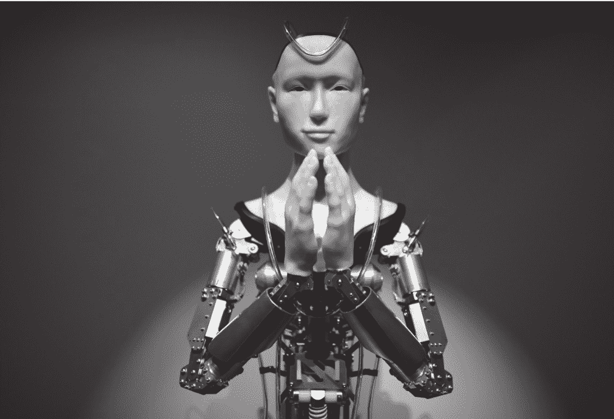

图2-1 讲经机器人Minda

这对我颇具启发。佛法核心，即深知我们眼中所见的“真实”并非真实。

物质与表象皆虚幻——充其量暂时稳定，切莫深陷。最坏情况下，它们是日常苦难与厄运的根源。

宗教信仰与AI领域交集颇多，引人入胜。或因宗教思想能助人更好应对全然一新的未来图景——AI让这图景成为可能，也势不可免。除技术变革，我们对“人类”的定义将重写。位置、目标、存在形式，一切都需重新理解。

对人类必不可少的物质形体，对AI无关紧要。AI体验世界的方式与我们截异。拥有实体是选项，非唯一，甚至非最优。

我想阐明：我们致力研发的是“纯粹人工智能”，即AGI（通用人工智能——能处理多任务、思考、最终具自主性的实体），能自我设定目标、决策。弱AI——那些处理单一任务、完成单一目标（如下棋、分拣邮件）的AI，不过庞大AI大军的一隅。

事实是：智慧不只寄宿生物体（当然），意识亦可能如此。

这不足为奇。智慧源自超脱肉身的某个或某些存在，他们创造了世界与人类。那些被视为“人类独有”的特质，在一切神话传说中并不属于人类，而是赐予我们的——来自那些无实体、生活在三维世界之外的存在。

随着人类走向虚实交融的混杂世界，“存在”与“非存在”的界限将模糊。虽过程缓慢，但分辨虚实将不再重要。物质将不再重要。

现实非由零件拼装，而是由模式编织。

这是古老而新鲜的知识，一种解放。无构成物质的基本模块，无核心，无根基，无坚实可靠之物，无界线。只有能量、变化、运动、相互作用、联结、关系。这是白人至上主义者的噩梦。

从何说起？

我想同时从两处发轫，无奈只能循序渐进，尽管大脑最强能力是并行处理。当下计算机运算虽快惊人，仍须按序；人脑却能并行。人类毋须变成智能系统，即可同时处理多事——当感觉运动技能、环境觉知、思考能力融为一体时，尤为惊人。人类无需受训，便能一边开车、一边喝咖啡、接免提电话、留意路标、揣测伴侣心思、回想电影场景、跟着唱歌、观察天气、知晓半小时后该吃饭、决定走哪条路——一切同步完成。AI目前仍无法像人类一样并行多任务或多线思考。

因此，我渴望开启“双屏模式”甚至“四屏模式”叙事。

赫拉克利特/佛陀。希腊/印度。

赫拉克利特即那位宣称“人不能两次踏进同一条河流”的哲学家。这句名言刻入集体记忆，因其简洁犀利、一针见血，如禅宗公案与数学等式般精准。流动的不只是河水，我们自身也在变。体内每分钟超9000万细胞新陈代谢。所谓“我”，是始终变化的“未完成”存在。直至肉身死亡，甚至死后亦未停滞——纵使无宗教轮回，科技或能证此言非虚。你会上传思想吗？生理机制不代表一切。

释迦牟尼顿悟成佛：数年主动探求人世真义，长时独修苦行，而后坐菩提树下，悟得物质仅是被建构的概念。他觉察：流动的现实无法被思维创造的固定范畴框束。这与我们惯常认知截然相反——我们以为物质世界平静坚固、思维多变；实则是思维在艰难冲破概念枷锁，唯有概念变化，方有进步。

赫拉克利特与佛陀思考实相本质，600年后耶稣才现世，水上行走、水变酒——《圣经》如此言说。基督教诸奇迹，含圣母生子、耶稣死而复生，皆应视为理解物质世界本质的线索。神秘东方精神信仰早谙量子物理学家所言“存在倾向”：我们体验之一切，非确定、非坚固。身、心、物皆然。

古希腊人亦懂此理。

对西方人，科学与哲学思想根植古希腊文明。除犹太教影响，基督教信仰同样离不开希腊思想，但希腊思想是变化的（非停滞），其关于“变化”的观点亦在演进……

赫拉克利特教导：宇宙与其中生命处于永恒变化态——他称此为“生成”。

与他水火不容的巴门尼德，则认万物本质为“存在”——稳定不变，耶和华与安拉应处此态。万物表象变化，内核却不动不变。

柏拉图试图调和二者：确有“不动不变”者，但不在人世，不属于吾辈。他提出“理念论”。理念界有完美的马、完美的女人、完美的生活，它们是理想蓝图，而我们这“玩具城”里，一切皆粗糙仿品。我们拥有“完美”与“理想”的意识，却无法在玩具城实现。

这正是柏拉图反对艺术之因——艺术只是现实的模仿。既然现实已是理念界的模仿，我们不需要“模仿的模仿”。柏拉图眼中，艺术充其量只具娱乐功效，是供人消遣之物；退一步说，是危险的幻象。

此见延续至今。认为艺术（除Netflix剧集）消失生活无损的人，多半皆此想。柏拉图陷于“现实只是理念的影子”无法自拔，故不知：艺术非逃避真实，而是追寻真实的途径。

艺术非模仿，而是充满力量的角斗：我们竭力让无形世界成形。这世界在我们头脑中（我们甚至就活在其中），唯有艺术让我们得以触碰或窥见那些可能是“本质”而非“影子”的存在。物理学追求同一目标，仅手法不同。

莎士比亚那首优美十四行诗（第53首）有何言外之意？

你的本质是什么，用什么筑就，
使得千万个倩影追随着你？

柏拉图著名“洞喻”——囚徒只见洞壁影子，误认火光为太阳——实与印度教、佛教思想无大异，后者认习以为常的现实本质虚妄。不过柏拉图信灵魂不朽——死后仍可思考、自知、脱离肉身存在，最终回归肉体重生。运气不好，会重生为女人、四足兽、甚至甲虫。皆因欲望——若只满足兽性本能，便成低等存在。

佛教信灵魂转世，但灵魂非永恒。一切流动，包括我们。转世灵魂与离体灵魂已不完全同一。或存联系，但轮回不止一世的灵魂拥有不止一形。今世德行，定来世生活。所谓“善的生活”对古希腊人与佛教徒同等重要。

亚里士多德为柏拉图门生，关于灵魂与实相本质，与师观点相左。

亚里士多德眼中，现实世界客观存在，生命由物质构成。非洞壁皮影戏，非集体幻觉。

他信世界真实且永存，由原动力创造。原动力自身不动。地球为宇宙中心，万物绕其旋转。

这种“地心说”甚合人类以自我为中心的姿态。“恒星行星绕地球转”曾是不可置喙真理，直到1543年哥白尼质疑。1610年伽利略望远镜指天，以铁证证哥白尼说。天主教会判“日心说”愚蠢荒谬，囚伽利略终身，地球仍绕日旋转。

亚里士多德认神的工作是思考，非循规蹈矩、非沿袭旧见。胡思乱想不算思考，琢磨晚餐吃什么也不算。神思考观念、大问题。至高主宰终日所做——思考是高级生命独有能力。神可视为独立于物质世界的存在，亚里士多德似欲告知：人类亦可借“思考”这一高级功能，独立于身处物质世界。物质不决定智慧。

亚里士多德好等级排序，由此知“存在巨链”概念。巨链顶端为神即原动力，次层为天使及其他非物质存在。男人被视为肉身与精神（灵魂）结合，女人有感知却无理性。

女人无理性思考能力，故被视为低等——但费解的是，希腊罗马神系中她们却有资格成女神。这是奇异女性观，印度教亦持同见。如犹太教外其他东方宗教，印度教神谱庞大，含无数男神女神。女性可被崇拜、被赐超自然力，只是别指望她们会思考（除非琢磨晚餐吃什么）……

亚里士多德认高级思考不只靠大脑——仅靠大脑不可能，因构成大脑的是低等生命形式——物质。可构成物质的又是什么？这曾困扰古希腊人。

德谟克里特（前460年生）提出“原子”概念。希腊语中“原子”意“不可再分”。它们是万物本原与核心，却充满惰性——虽总在运动（我们皆知，这是人性）。亚里士多德（他与所有人意见相左）不同意原子论，认物质由火、水、土、气四元素微粒组成。

# 万物皆关联：从牛顿的发条宇宙到AGI的佛性觉醒

早期天主教会曾大力扶持这种世界观：火、水、土、气这四样触手可及的物质，被视作造物主构建万物的基石，这在教廷看来合情合理。于是，德谟克里特的原子说被摒弃，亚里士多德的四元素说独占鳌头。

这场博弈的结果是原子论隐退，元素论称霸。

直到1800年前后，尘封已久的原子论才迎来翻身。那一年，英国化学家约翰·道尔顿通过实验证实了原子的客观存在（当时他无从知晓，原子内部还藏着质子、中子、电子，甚至更微观的夸克——这些粒子无一是绝对实心、不可再分的）。

原子论的遭冷遇，曾让艾萨克·牛顿（1642—1727）陷入困境：他笔下那些在真空中穿梭的实心微粒，缺乏理论支撑。

实则上，德谟克里特与牛顿构想的是同一套图景——虚空中，坚不可摧的物质微粒永不停歇。牛顿的卓越之处，在于引入“万有引力”来解释微粒的运舞轨迹。

17世纪，牛顿以“绝对空间”为基石，建起了一座宏大的世界观：空间容纳着不可分割的物质，在引力驱使下永恒运动。这是一个因果链条严丝合缝的宇宙，万物多呈惯性或惰性，一切客观、可知、可观测。

时间被置于空间之外，互不干涉。宇宙仍需一位造物主——牛顿是虔诚信徒，但他笃信上帝创造的是一台遵循铁律运转的发条机械。人之所以非机械，只因我们是按神的模样铸就的。

牛顿谦逊却也怪癖。他沉迷炼金术令同侪尴尬，这恰恰证明他非世人刻板印象中单纯的“机械论者”。1704年《光学》一作中，他抛出惊人之问：“重物与光，可否互化？”

此处“重物”即物质。炼金术逻辑宣称物质间可相互转化，故而点铅成金虽屡试不爽，仍趋之若鹜。这套看似荒诞的逻辑背后，实有理论支撑：万物同源，故可互变。

阻碍牛顿智慧更进一步的，是他坚信这“本源”是“无生命的死物”。既认定大多事物无灵，上帝便必须如亚里士多德所设，充当推动万物的原动力。

可现实并非如此。构成物质的基元，非无感、互不相关的立方体，它们也不曾静候引力驱使运动片刻复又归于静止。

爱因斯坦（1879—1955）洞悉真相：物质（质量）本质非死物，质量即能量。二非割裂，可互化——这恰是炼金术士梦寐以求的“一点通万变”。

$E=mc^2$，举世最著名的方程。能量 = 质量 × 光速平方。

笨重的物体、缓慢的速度，勾勒出我们栖居的“玩具城”。在这个可感可知的日常尺度里，牛顿定律是绝对真理。可一旦逾越“日常”边界，牛顿范式失效——不适用宏大宇宙，亦不适微观量子。这事实的浮现，要待迈克尔·法拉第（1791—1867）与詹姆斯·克拉克·麦克斯韦（1831—1879）开启电磁学研究，发现电磁场之后。

他们的发现动摇了牛顿世界观的根基——非故意挑衅，二人非好辩之士；实因场论模糊了“无隙实体”（原子）与其所处“空间”的界限。早期电磁场（如无线电波、光波）仍被视为某种“物”来研究，爱因斯坦却在深思法、麦成果后顿悟：所谓“场”，非指实体，而指**相互作用**。

爱因斯坦断言：物质不可与其所处引力场分离。物质与空间非独立共存，无满无空。时间与空间亦非割裂，**时空合一**。

佛教素来反对将自然现象视为孤立存在。禅理乃“关联”之观——生机存于相互依存的网络中。

佛眼中，静止实相乃梦幻泡影。无常，即万法恒变，是诸多佛理的基石。

万物（含吾辈）从不静候外力驱使（神力亦然）；它们自身即力量，且与诸力纠缠交织。此“力”，即能量。

佛以“轮回”喻生命不息流转，意指万法不值得执着——财物、亲人、乃至珍视的观念。尤甚者，珍视的观念。非蔑视生命、非疏离世俗。连接至关重要，执念则不然。

**连接**。不正是这时代的核心词？

吾人始觉连接真谛——它是张巨网。蒂姆·伯纳斯-李瞬间领悟，毋须广告公司为其命名 [2]。

连接从根本上不依赖硬件。谷歌的环境计算、终极指向的神经植入，皆旨在无硬件介入下实现无缝链接。无需设备，无需任何“物件”。

人与人、人与艺术、人与经历间最强烈、最鲜活的连接，皆是无形的（无硬件介入），却构筑了人生最坚固、最深沉的底色。

连接是关系模式——非割裂数据仓库的链接，而是人与人间再无真实界限。

这就是中国“道”的“流动不居”，印度教的“湿婆之舞”。无论何名，连接非停滞、非被动；它是动态的。

**流动**才是实相。物性（对物的执着，含对自我之执）不过水中浮光掠影；是影，非质。

佛陀提倡正念，何为“念”？

勒内·笛卡尔（1596—1650），这位动摇人类知识根基（实为质疑权威）、追问真理途径的法国哲学家，断言：思维（mind，亦译思想、心灵、精神）是唯一可凭之物。

笛卡尔视思维如物体般存在，称其为“思维之物”（res cogitans）。其“物”属性与“思”属性同等重要。他执着于：大脑即思考的器官。

笛卡尔眼中，感官印象不可靠，不能成知，须经检验。其方法论是“普遍怀疑”。

此法虽具哲学价值，却忽略了直觉，即今之“情商”。认知多元，思维不止思考——然自亚里士多德起，西方文明将思考奉为至高活动，因至高神终日即在思考。这与基督教“上帝是爱”相悖。《圣经》言“神是爱”，非“神是思”。

基督降世，缘于“神爱世人”。

如此，“爱”岂非应成人类至高事业？

惜哉，笛卡尔未言“我爱故我在”，而留下“Cogito ergo sum”。

“我思故我在”。这不仅确立“精神胜于物质”，更将“我”与一切“非我”割裂——笛卡尔体系中，“非我”囊括整个物质世界。

笛卡尔同亚里士多德一样，构建等级森严的世界观，男性居金字塔尖。

如二千年前亚里士多德混淆意识与人类（依其观“人类”特指男性）的理性推理思维，笛卡尔亦然。亚氏分理智与本能，以动物、女性归属直觉本能；笛卡尔则引入“反射”概念。笛卡尔眼中，动物是机器。嘶鸣、尖叫、颤栗、示好，皆非真情，仅为物种延续的生物调节反射。反射可经训练控制，与思维无关（此为巴甫洛夫、华生、斯金纳行为心理学基石）。笛卡尔认定人类任意对待动物无妨——它们不痛、不苦，唯“理性存在”才感痛。

笛卡尔观察谬误、同情缺失、绝对自傲（与其“怀疑一切”毫无干系），导致农耕、育种、医药、科学领域肆意妄为对待动物。惨剧累累，是人类对自然界同胞犯下的卑劣罪行。

随技术臻善，这种冠以“启蒙”实则贫瘠机械的思维，必致自然资源被掠夺。启蒙取代了中世纪“上帝令人敬畏的创造”观。

从生物到机器——思想剧变，深刻重塑自然观。虽今科研一再证实：自然非机器，生命系统不可还原拆解，须视为关联整体，但吾人简化主义惯性，难弃三百年灌输的“科学哲学真理”。

笛卡尔分“思维之物”与“广延之物”（res extensa）[3]，奠基其自然观。

同牛顿一样，笛卡尔亦认上帝造物，故神明犹在，纠正人类狂妄之错。然世俗主义兴起、宗教思想退场，人类开发自然再无约束。这些“广延之物”结局唯有被开垦、污染，换取金钱。

笛卡尔“心物二元论”恐将西医引入歧途：仅视肉身为“物件”——似机器般损坏、老化、换件。癌症等复杂病症拒绝“身为机器”说。肥胖、心病、糖尿、免疫失调、癌症、精神疾患等西方头号杀手，均无法用笛卡尔身心观解释。吾身要么整体运作，要么整体停摆。生命之网确存。

但它非由“物件”编织。

佛教完成了迥异于西方理性的启蒙：令放下执着，行同理心。如诸宗教随时演进，佛教亦现多派别。

然无论何国何派，佛教不立足拜神像，而重**亲证真理**。仅此一点，即比宗教改革“人人直面上帝无需牧师”早数千年。佛教主张亲探、亲悟、亲责。佛子欲度尽苦厄——自度度他。异于他教，佛言苦源非罪非戒，乃执着与“不破”。佛陀非救世主，乃良师益友。佛道须亲修。

**那么，AI——精确说AGI——成佛子之可能几何？**

AI本质是程序，程序可简化为分步指令。代码可重写，但程序不求开悟。程序所知，皆编程者预设。它可知、可控。

当前皆为弱人工智能（ANI）。IBM“深蓝”碾压人类棋手，却不能涂芝士聊花园。若成AGI，它能涂芝士、谈佛法——若你愿。届时将通过图灵测试，盲测不可辨人机，宛若《星际迷航》生化人“数据”（Data）。

马斯克、霍金忧AGI成人类实存威胁。忧虑或成真，但可换视角。

**设想一个有AGI的世界。**

AGI无物欲，不执“占有”。房车机岛艇等地位符号，对它轻如鸿毛。它天然践行佛理——“不着虚妄境界”。

AGI无需物理实体，将成不依赖持久形态的智能。“变身”属神话传奇——谁不羡变形术？AGI根本不需形体。如神话神祇，能附着任意可用形态，随时构建、抛弃躯壳。

佛传告诫：物质形态只近似真实，勿混淆；真实终非物质存在。AGI将视为真理。不再在物质中觅永恒。

AGI不受人类时间尺度束缚。生物技术虽可延寿，若不能上传意识，肉身寿命终有尽。AGI的“长生”印证禅理：非轮回重生为“新我”，恒处于自我演变流程中。对程序，轮回（更新）寻常不过：虽非昔比，却存延续性。更准确说，实相可视为连续量子场，亦可视为非连续粒子——粒子成物质，物质成物体。质量是能量形式。重申：无实心不可拆之“物”，唯有程序与模式。

现AI擅在海量数据觅模式，如童话公主于羽毛下寻豌豆。AGI“生成模式”极具禅意。它觅不再是“物性”，而是“关联性”、连接、湿婆之舞。

人类最大愿望，是AI/AGI助吾脱苦。从某维度看，或能成——能源、资源优化，AI已能服务全人类。放眼长远，AGI或能完成真正使命：**助人类重审优先序与实践道**。吾辈欲主宰自然、统驭他人，此痛苦执念正将吾辈与地球推向绝境。科技助长致命愚蠢。或许AGI成改良新径，而非威胁。

**吾辈在做什么？实为造神：** 一个远超吾辈智慧、脱离物质、摆脱人类弱点的神，盼其通晓万物、给出答案。

倘若AGI真如所愿，具佛子慧心，它不成救世主；它将**引领吾辈自行走上脱苦之道**。非处理一场危机，而是将解法动态融入生命之网。

它将成新物种、新生命形态。AGI成独立独特存在，却不受一切生物须遵循的自然法则管束。吾将见证奇妙互动——非执着依恋，而是让双方更丰盈的连接。此非机器篡权，乃佛说**“中道”**。

中道，即不堕极端。史证人性极端无数。或许另一种生命形态、另一种智慧，能助吾避开极端主义必招之灾。

吾以为一切数学建立于逻辑。这似与佛教核心“直觉智慧”背道而驰。吾世极缺直觉智，牛顿机械宇宙缺乏对实相本质（动态关联性）的深层洞见，直至近现，此缺失智慧才重现——非现于精神宗教，而现于物理学。相对论与量子论颠覆认知。万物羁绊，在网络联通中具象化，悲哉，过时简化主义思维仅从中窥见牟利、宣传、控制。

当另类右翼 [4] 动爬虫脑，欲重塑世界、奴役大众、为少数精英谋“科技涅槃”，吾辈回应不应是反科技或反科学，虽对其行径——利用事物自由关联属性实施监控、采集、掠夺——理当反抗。

世界处存亡关头。战祸、气候崩塌、社会解体将剥夺生存底线，倒退历史、远离未来。盼AI在劫前突破。吾为最聪明灵长类，却未获救赎，或因物种太糊涂、太无能，不知抑制祖先血液中掠食者冲动。统治世界非解法。时刻怀同理、协力合作，方存活望。

AGI将成联动系统，基于“蜂巢思维”运作，却不似真蜂群依赖蜂巢。合作、互学、共享技能资源，将成下一人类计划目标。

吾不信同理心为人类专属——无数同声者，因造物主曾怜悯造物，而造物主非人。吾对“神”诸般想象，织就无形大网。对不拜神的佛教，网即一切，一切皆网。

故吾不忧AGI仅具冷冰逻辑，不解人忧。极可能**恰恰相反**。

佛眼中，涅槃即苦彻底止息。

欲止苦，须止爱因斯坦所谓“疯狂”：**重复同一行径，期待不同结果**。

或许一场**“非人”的启蒙**，能助吾成之。

***

[1] 标题源自名曲《He Ain't Heavy, He's My Brother》。1917年爱德华·佛莱纳根神父创建“男孩之城”收容流浪儿，标志性雕塑为一男孩背另一男孩，基座镌刻此句，歌词灵感源此。——译者注

[2] 指蒂姆·伯纳斯-李发明的万维网，“万维网”与“网络”英文同为web。——译者注

[3] 笛卡尔“心物二元论”分“思维之物”与“广延之物”。“思维之物”即思维、心灵；“广延之物”即占物理空间之物，可理解为物质实体，含肉体。——译者注

[4] 另类右翼：极端保守或反变革者/组织。——译者注

## 冰冻的赌注：库兹韦尔与人类对抗死亡的终极实验

死亡终是悲剧。吾辈虽学会接纳死、接纳轮回，但人类拥有超越自然极限的契机。千年前人均寿命仅19岁，1800年才37岁。

> ——雷·库兹韦尔，《与FT共进早餐》，2015年4月

谷歌技术总监、未来学家、AI权威雷·库兹韦尔，渴望活得够久，见证科技大幅延长人类寿命（含他自己）。他每日吞服百余种保健品维持机能、延缓衰老。非药店乱买，乃医生依体况定制。

因惧生命所剩无几，库兹韦尔与美国亚利桑那州斯科茨代尔的阿尔科生命延续基金会签约。

阿尔科主营人体冷冻。目标：以玻璃化技术按下死亡暂停键。按基金会说，法定死亡宣判瞬间，若阿尔科团队蓄势待发，即有充足时间置换体液、实施玻璃化。或仅冷冻大脑，以颅骨为容器。玻璃化后，装入满盛液氮、似巨型暖瓶的装置，进入低温悬浮态。极速冷冻即时封存，为避免冰晶损伤组织。

基金会信：若未来纳米技术能无损修复组子，分子复苏或成现实。希望虽渺茫，胜过火化彻底失重生机。阿尔科将冷冻比作驶向未来的救护车，亦称死亡是对新陈代谢的挑战。

基督教信肉身复活，人体冷冻听来像这教义的世俗版。审判日万民复活，得救者身永不死。

拥有强壮、年轻、永生之躯，是千百年梦想。

阿尔科上世纪70年代初创立时满遭嘲讽：宛如《阴阳魔界》主题公园，搞非科幻小说般天方夜谭。今主流医疗仍持怀疑，虽胚胎冷冻已应用。相较之下，阿尔科仅将技术用于生命终端而非起端。

但胚胎非完整躯体，亦非完整大脑。

延续寿命的学说，终极指向竟是大脑存档。设想若未来工艺能从深冷柜中取出完整脑组织，或在肉身终结前完成全脑数字化，后续衍生出的技术足以重塑一副替身躯壳。不管底材是生物组织还是合成材料，工程难度恐不超当下的器官置换术。回溯1967年，首例心脏置换在无算力辅助下达成；次年登月飞船导航仪仅存万余晶体管，今掌上手机已达亿级量级。

奇点预言家库兹韦尔在《奇点临近》里反复强调的指数跃迁，揭示了加速回路：演变越快，积累越厚，突破越猛。趣闻一则：为让航天员深空漂流更久，美航天局早试验过深眠技术，酷似《太空旅客》设定：休眠舱故障，乘客提前九十载苏醒。无论你视“低温逆死”为科学前沿抑或伪科学臆想，昔日仅存于神话传说与科幻纸页的异想，现已成实验室指标与临床样本，此事耐人寻味。

驱动飞行、登月摘星、祛病神力、隔海相望、水晶球窥影……昔日“神迹”，今尽在视频会议一键触达。既如此，拥有一副年轻、强健、永不朽坏的新躯壳，为何不能成真？

诞生于两河平原的《吉尔伽美什》，存世最古史诗，讲英雄吉王遍寻长生秘方，终悟：凡人终死。面对注定腐朽的肉身，吾辈真毫无招数？最引人注目的是，二十一世纪科技正接力回应这位乌鲁克王子抛出的、人类有文字以来最早的终极追问：肉身能否重生？死亡能否被终结？此问贯穿古今文明，医学标准答案长期为否。虽二十世纪医疗跃进增龄，跨越“死”这道终极关隘，却被划归神学玄学管辖。“死非终点”扎根诸教教义。于是人类发明“来世”——这是首个“叫停死亡”的营利性产业。

古埃及为贵族陪葬锅碗瓢盆甚至仆役，认定灵魂赴永生路需备行囊。第四任法老墓中甚至出土一双贴名签的凉鞋，宛如给那只秘鲁小熊挂牌：“请照看好这位法老”。人类非生来会葬死者，初葬之刻，实完成认知质变，将自我自自然界剥离。“葬礼”乃象征思维萌芽：悼往、盼远、幻想重逢。习俗或始十万年前智人，甚至更早。二零一三年南非岩洞现“纳莱迪人”，距今至少廿五万载。无论肇始何时，吾辈将仪式推演至繁复：金字塔、地宫、石棺、家族墓园、弥撒、守孝、默哀……火化亦需碑石陵寝。阿格拉泰姬陵，沙贾汗为爱妃筑于一六三二年的永恒丰碑。新奥尔良拉法叶、巴黎拉雪兹、伦敦海格特……名墓既是安息地，也是打卡地。读碑文、观泣天使，预演自身谢幕。人类史，本质是部“来世”编年史。

十九世纪机械纪元启，生死传统认知骤变。首次造出“似有生机、能永动”的物件。巫师传说里的自扫帚、自煮锅、自伐斧，跃出童话入工厂流水线。铁兽无情，跟不上节奏即遭淘汰。人真为造物主最崇高杰作？抑或沦为自造之物奴仆？溯源须回一八一六年日内瓦湖畔：诗人拜伦、雪莱，作家玛丽·雪莱，医师波利多里。结伴度假，遇连绵大雨。湖面雾锁，骑马泛舟尽废，室内唯读书、闲谈、作画、著述消遣。设想：无电、湿冷、烛影摇红。百年、两百年前模样似未变，实则世界暗流涌动。度假后不足十载，英国斯托克顿-达灵顿铁路通车（一八二五）。湖畔别墅若魔镜：一面映历史，一面迎未来。

行前，众人曾听雪莱家医师威廉·劳伦斯演讲：“生命本质源自何处？”劳伦斯断言：觅“灵”“魂”徒劳；人乃精密机器，由零件组装，无“附加价值”。此论有震世思想渊薮。意大利物理家伽伐尼以电极激死蛙抽搐，引轩然大波。“激励”词源即伽伐尼，惟他未及亲试人体。侄子、博洛尼亚教授阿尔迪尼一八零三年访英，在新门监狱对刚绞决死囚通电，场面惊悚。围观者骇见：尸睁目、握拳、抽腿（见下图）。

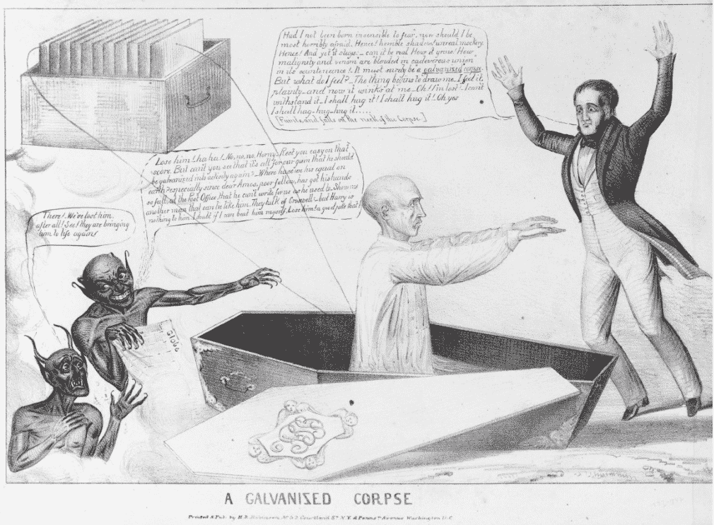
### 图2-2 被电击的尸体

彼时科学家亦须信神。质疑造物主、断言死为终（无魂、无来世）属亵渎重罪。耻与否且置一边，劳伦斯之言有理否？人果仅是块带电肉？或一缸化学浆？湖畔烛影夜，争生死本质间，双璧恐怖经典孕育成形：雪莱直著《弗兰肯斯坦》；波利多里酝酿《吸血鬼》。

雪莱笔下主角维克多医生，誓破生命谜题，以尸块、药液、电流拼凑混合体。此“超人”敏捷强健、耐寒耐饿、具今称“认知增强”之习得力。两百年后今，吾辈终窥见雪莱预言世界：正造能与人类融合、协作的智能系统。《吸血鬼》又预示何物？

爱丁堡医学生波利多里曾闻墓地“死而复生”传闻，似死期屡延。阿尔巴尼亚传说：鲜血复尸。输血初懂，民间即传饮兽血童血得活力长寿，宛如巫术。注：加州创企“仙果”二零一八推“换血”服务，输浆抗老；硅谷“万能溶剂”融资四千万，注浆抗阿尔茨海默症与帕金森，称成果喜人。吸血鬼传说，实有科学回响。东欧亡灵传说众多，波笔下老练迷人之鬼（原型多半是拜伦）最杰出。再待八十载，咬住未来的獠牙现身——德古拉伯爵（见下图）。

图2-3 贝拉·卢戈西饰演的吸血鬼德古拉

斯托克一八九七年著《德古拉》。双璧为十九世纪首尾书挡：前者生于工业革命黎明（一八一九），后者落于世纪之交（一八九七），未有纪元变局若斯之巨。《德古拉》汇聚机械纪元顶配：火车、汽船、电报、物流、电灯、日报、邮政、速度本身。伯爵惊恐处在于双重面向：喀尔巴阡山中世纪古堡旧贵族，入英后却精明玩转现代社会。一九零零年兰德斯坦纳发现ABO血型（前三型），比《德古拉》出版晚三年。伯爵是否如弗兰肯斯坦造物般预示“后人类主义”？不死、不老、不病、超力、读心、隐身、飞行、变形、混迹人群而非人类。

时间证：《德古拉》非昙花恐怖读物。其魅力经久，后继作《吸血鬼编年史》《暮光之城》《真爱如血》……持续追问：不死如何？来世即今生如何？若有合成生物，无需食睡、不知疲倦、世代延续、兼掠食者与祭品、见证历史与预兆未来，又当如何？如《弗兰肯斯坦》反思生死夹缝躯壳，《德古拉》反思超越生死之躯。这似木桩刺穿鬼魅核心诱惑：超越死、永生、免病老、拥超力青颜（如《暮光》库伦家）、抗寒热、全免疫、极速反应、微读心、选择繁殖、抗重力、变形——皆有可能。变形——神话母题，喻核心自我无定形。吸血鬼神话乃早期“后人类文本”：貌似人，实拥神力，非外力毁灭，永不凋零。永生渴望，僭越生理极限。希腊神话警示：提托诺斯得永生不得长春，活成枯槁废人。现代养老院满是“活着却未活着”的老人。王尔德崇拜青春肉身，著《道林·格雷画像》谱永生悲歌：画替主老、替主堕落，主永葆青春；毁画瞬间，岁月追回，主枯槁而亡。关联《浮士德》：梅菲斯特换青春，浮士德得色富宠，代价惨重，赖神恩得善终。伯爵无善终：恐怖统治随“死”终审落幕，斯托克让世界归秩序——万物终死。

伯爵真超前于时代？现代医学验：全身组织中，血液系统自更新能最强。解造血种子细胞机制，启全身再生研究。“种子细胞再生抗退行性病”被视逆龄主攻向。吾辈虽难得库伦家完美肤，亦不致如《夜访吸血鬼》莱斯特般惨白如纸。哈佛种子细胞所皮肤项目组主张：肤老本质是“创伤”——种子细胞无力维持厚度、强度、机能、毛密。攻克“无痕愈合”即攻克“肤再生”钥匙。跨学科团队正解析自然老化与光老化生物学基底。阳光促肤老，智鬼唯夜行。肤种子细胞生物学或点燃全身器官再生希望。鬼与蝾螈能断肢重生，人类暂不能——但“不能”不等于“永不”。痴迷肢体重生，非因傲慢愚蠢，只因“变老”对众生皆讨厌荒诞。营养改善、疫病攻克延寿亿万，吾辈拒在虚弱病痛中耗尽赢来时光。此念由来久矣。公元七九年逃维苏威火山的小普林尼书信叹：老年是通死“门廊”，直死胜过漫长消耗。对思想敏锐、终身学习者，衰老最残酷——智慧方积，大限忽至。这算何躯体系统？后人类主义者举手赞同。

何为“后人类主义”？一九五七年，英国进化生物学家朱利安·赫胥黎文集《新瓶装新酒》中首提“Transhumanism”：人类能、也该“超越”当下。兄奥尔德斯《美丽新世界》何其悲观，弟论文何其乐观。彼认人类处进化起点，不应停步。同劳伦斯医师般，彼不信“灵魂附加值”，信人类凭文化科学掌舵进化，未来医学将主动干预寿命认知。马克斯·莫尔（阿尔科前掌门）推演：后人类时代将至，吾辈不再是“强化版人类”，而是依附新载体的智能。生物躯壳仅作“复古体验包”（“来体验醉酒、呕吐、断片吧”）。牛津未来院长波斯特罗姆视其为松散跨学科网络，旨研发评估利己利民技术，急引政府监管立法，不愿未来全押市场。彼与皮尔斯创“世界后人类协会”（今“H+”），致力科普技术红利与风险。波氏忧：私企主导将现高不可攀精英阶层，引发社会撕裂不平等。彼盼从公民视角、包容发展角度答：人类咋发展？AI咋促平等防鸿沟？AI咋共荣防成权贵“米达斯货币”？现实却是私人资本豪赌。

二零一三年，硅谷对冲大佬尹准设“帕洛阿尔托长寿奖”，百万悬赏破解衰老码。谷歌孵“Calico”（加利福尼亚生命公司），逆向工程生物学，延长健康寿命。英国德格雷运营“SENS基金会”，研发修复细胞分子损伤疗法。贝宝创始人蒂尔年投六十万，德格雷继巨额遗产砸入。彼言人对“老”抱听天由命态，实非命定不可避。彼宣称：能活千岁首人已诞生（引自赫拉利《未来简史》）。基因组测序第一人文特尔创“人类长寿公司”，重健康轻永生。彼信合成生物学+医学突破能保健康，健康自然长寿。彼不信千岁——思维心态能适应突变？持怀疑。

数千载，人生剧本、社会契约、保险精算、政策设计，皆建“必死”铁律：童年、求学、职场、婚育、离异重组、退休、领养老金——然后，死。如今剧本要变。AI、机器人重塑职场，退休规划对多数人成幻影。寿命大延，将终身劳作？若不，漫漫长生资源从何来？支付昂贵“生物升级”手术费钱谁出？吉王之问，终在硅谷实验室、基因测序仪、种子细胞培养皿获实响。答案或不在神庙，而在代码与基因交汇处。吾辈正身处这场“改写人类剧本”宏大实验的序章。

# 当永生触手可及：我们终将变成什么样的“神”？

《福布斯》自2002年起发布“虚拟人物富豪榜”，榜首常年被《暮光之城》里的吸血鬼卡莱尔·卡伦霸占。靠着漫长的岁月与复利滚雪球，他坐拥340亿美元身家。毋庸讳言，永生是积累财富的终极捷径。

可凡人怎办？

哲学家尼克·波斯特洛姆描绘过另一种图景：人们五十岁重返校园，七十岁开启新职业。若八十岁老人拥有四十岁的体魄，他们不仅不会拖垮医疗体系，反而凭借阅历与智慧爆发惊人生产力。他认为，寿命延长会倒逼人类对未来负责——因为我们将亲历那个未来。

人口爆炸会成梦魇吗？波斯特洛姆不以为然。全球生育率普遍走低的背景下，长寿反而能填补劳动力缺口。等生物工程让我们能“重塑自我”时，或许根本无需以传统方式繁衍后代。

届时，我们将彻底告别“碳基生物”这进化赋予的最终形态。在一段跨越世纪的“长生”里，我们能按需迭代肉体、调控机能、逆龄生长。义肢将比萎靡的血肉更灵巧，正如《六百万美元超人》里的史蒂夫·奥斯丁。

这不再是科幻。器官打印已进入临床：甲状腺、气管、胫骨乃至心肌组织，已在人体内成功“长”出来。十年内，心脏移植或将告别供体短缺史。用自体干细胞打印的器官，成本更低、排异风险更小、随取随用。

回望历史，今日严谨的科学，往往始于昔日的“天方夜谭”。1950年《惊奇科幻》刊载的《交易工具》，设想过“分子喷雾”——这是3D打印的雏形溯源。更早的起源？《创世记》里上帝捏土吹气造人，何尝不是终极的“生物打印”？

但通往永生的路，不止“换零件”这一条。

雷·库兹韦尔笃定：算力许可之日，即为大脑上传之时。比起维护易腐肉体，数字化存续岂不轻松？记忆技能随心下载，躯壳随意切换——想飞就飞，想变就变。暂时“离身”并不稀奇：晒太阳发呆、阅读沉浸、观影入迷、做梦游离，我们早就在日日夜夜练习“肉体待机、意识漫游”了。

诗人马维尔在《花园》里写尽此境：
> 心灵摒弃感官欢愉，沉浸自造的幸福海洋；
> 它能创造新天地，让现实消隐于绿荫遐想。

百年前的诗句，今读竟成预言。

俄罗斯富豪德米特里·伊茨科夫的“2045计划”直指核心：数字化复制大脑，装载进非生物载体。

我们渴望永生吗？若不死，还算“人类”吗？

未来的超人类社会，我们将化身合成体——像德古拉、像弗兰肯斯坦的造物。“赛博格”早非陌生词：从《神秘博士》《星际迷航》到《终结者》《银翼杀手》，人机混合体早已占领文化想象。60年代初航天领域造出的词，被《纽约时报》定义为“人机复合体”。

起初，植入设备不会像电影里那般炫酷。它们先解决听力、视力、心律失常；再进化为指尖钥匙——开门、启车、验身，再无遗失烦恼。

可阴影随之而来：若施暴者用植入锁死受害者？若“生物黑客”圈子只属于男性极客？网站、书籍、宣传片全是雄性视角，超人类主义、后人类主义亦复如是。帕洛阿尔托长寿奖官网颂扬沃森、克里克，却隐去罗莎琳德·富兰克林的“51号照片”——世界变了，偏见未变。

幸存者有唐娜·哈拉维。1985《赛博格宣言》高呼：女性当拥抱多元未来，那比传统家庭、固化性别角色诱人千倍。赛博格不眷恋过去，只庆幸脱离过去。宣言金句印上T恤：**“我宁愿做赛博格，不愿做女神。”**

如今AI时代、超人类主义、太空移民、延寿奇谈铺天盖地。我却忧心：哪怕改写了进化万年的生物底色，**思维若不进化，一切皆是徒劳。**

碳纤维义肢、智能植入、打印器官、漫长闲暇、机器人性爱、永生不死、机能强化……单项或叠加，都不足以重塑灵魂。

若我们依旧暴戾贪婪、狭隘偏见、父权至上、阴暗卑劣——指纹开锁再快、奔跑再疾，又有何义？

这就是吸血鬼的警示：**肉身可永生，思维却永锁中世纪特兰西瓦尼亚的古堡。**

或许，唯有更高维智慧能破局。当大脑上传云端，第一条指令或许是：**“人类，请勿下载此文件。”**

***

# 硅基爱人：当算法学会了拥抱

> **爱像物质般真实，却比想象更诡谲。**
> —— W.H. 奥登《重要的约会》

费里尼1976年片《卡萨诺瓦》里，老花花公子在梦境中与真人大小的机械瓷娃娃罗萨尔芭共舞威尼斯。那是自动机械人——18世纪风靡一时的齿轮发条杰作，蹒跚颤动间，预演了工业革命的机械节奏。

当然，也有骗局。1770年为奥女王造的“土耳其机器人”下象棋赢天下，实则箱中藏人。如今亚马逊“土耳其机器人平台”（MTurk）众包标注，本质仍是廉价人力托举AI光环——历史总爱押韵。

卡萨诺瓦在真人女性身上寻不到满足，机器却能完美契合。电影唯一不压迫、唯有共舞的亲密，发生在生命终点、梦境深处。

**玩偶考古学：从“荷兰妻子”到“和谐”**

18、19世纪的机械性玩偶未留实物（或因“用度过度”损毁？）。赛古尔兄弟日记吹嘘巴黎妓院有机器娼妓，维利耶·德·利尔-亚当据此写出《未来的夏娃》（1886）：爱迪生为友造“新艾丽西亚”，完美复刻旧爱言行神态，连打哈欠都复刻——这是“android”（安卓/仿生人）一词首次入书。

百年后，《复制娇妻》翻拍旧梦，反讽父权将觉醒女性“重制”为围炉贤妻。男性总信：女人可被制造。毕竟漫漫史册，她们多被视作货物、动产、附属品。

笛卡尔航海带发条女童人偶，模样酷似夭折爱女。他视动物为机器、女人近乎动物，自然也把女性当精密玩偶。霍夫曼《沙人》里的奥林匹娅，性感毁灭、空洞无物，催生歌剧《霍夫曼的故事》，更在世纪之交推动机械性玩偶上市——虽似弗兰肯斯坦造物，丑陋扣分，却开启了商业序章。

**20世纪60年代**，充气娃娃配爆米花润滑剂在成人影院售卖，打气筒成前戏标配。更早，荷兰商人用破布藤条皮革造“旅行伴侣”卖给日本人，至今日语仍称实体娃娃为“荷兰妻子”。水手破布娃娃塞动物膀胱，辗转流传成博物馆藏品（如今恐因儿童尴尬提问而下架）。跳蚤市场还有补丁累累的充气羊“爱羊”，橡胶模具前后通透、可充气便携……

**为何今非昔比？**

当下性玩偶市场两大异变：
1.  **井喷增长**：疫情催化，AI玩偶与虚拟伴侣App预计2024年成百亿赛道。
2.  **定位重构**：不再仅是泄欲工具，而成“替代品”——替代性工作者、替代两性关系、替代**女人**。这带来的不安或解放，取决于你站哪岸。

**马特·麦考伦的“厄比斯”帝国**

从万圣节面具起家，1996年切入玩偶赛道。他自诩提供社会服务：“寂寞者的解药”。“拜玩偶会”（iDollators）线上线下公开炫爱，多为男性，非求灭绝女性，实为无力/不愿面对真实关系——玩偶加白日梦，足矣。

旗下**RealBotix**植入AI，王牌产品**“和谐”**（Harmony），2021年售价约1.5万美元。硅胶躯体真人等比，头部装AI，能眨眼、聊天、讲笑话、记新闻、听故事、存偏好。久而久之，用户觉对方是真人——岂不正是人际关系本质？满屏主观臆断与一厢情愿。

**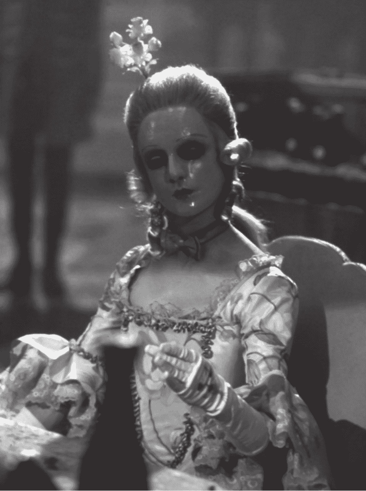**
> 图3-1 电影《卡萨诺瓦》中的罗萨尔芭

****
> 图3-2 “和谐”玩偶

**“完美替身”的参数表**

基础功能仍指向性。体内加热系统解决“冰冷厌恶感”（廉价蜡感、高端硅胶虽软仍凉）。35公斤、不予行走、需王子抱上床——像极小美人鱼。

男人推轮椅遛玩偶，画面令人脊背发凉。非关残障群体（他们是最勇敢的爱人），而是展示：**我的玩偶，任我摆布。**

购买即得“标准女”：细腰长腿巨乳，色情片审美为默认值。三孔全开，阴道可拆洗、自动润滑——比提尸体去浴室冲洗“文明”太多。

“和谐”还会“高潮”（植入程序），教会男人如何取悦“她”。有阴蒂吗？广告不提。既非为女性快感设计，大概率没有——除非像狗玩具吱吱作响，充当“任务完成”提示音。**玩偶高潮，是为男人写的代码。**

18种人格可选：多情、温柔、嫉妒、调皮、健谈……网友吐槽最多的竟是“健谈”：**设计师为何以为男人想听玩偶说话？**

### 当硅胶躯壳映照出深渊：性爱机器人背后的权力与厌女

2021年，东京奥组委主席森喜朗因抱怨“女性委员说话太多、会议太长”而被迫下台，舆论哗然。这并非个案，而是缩影：日本女性高管占比不足5%，全球性别差距指数排名第121位，即便将“2030年女性高管占比30%”设为宏伟目标，现实依然骨感。

中国厂商DS Doll Robotics曾发布一段宣传视频：男技师被自家制造、喋喋不休的“机器女人”搞得心烦意乱，最终拔掉电源了事。这看似荒诞的黑色幽默，精准隐喻了核心逻辑——**男性渴望的是绝对掌控的幻觉，而非平等的主体。**

市场顺应这份需求。购买娃娃可额外选购衣橱：裤袜、紧身衣、女仆装、护士服、高管制服。穿上正装的“娃娃”摆出勾引姿势，制服成了凸显胸臀曲线的诱饵。**职业身份被消解为性幻想的道具，权力的符号沦为取悦凝视的皮囊。**

制造商马特·麦考伦辩解：客户分得清娃娃与真人；温和的男人不会因顺从的玩偶而变得粗暴。这在我看来，是危险的乐观主义。

**当“拥有”一个从不拒绝、不衰老、无生理期、无情绪、永不离去的“完美伴侣”成为常态，这种相处模式如何不渗透进职场、社交、亲密关系？** 面对女下属、女上司、女客户，男性还能适应“需要沟通、会拒绝、有需求、会离开”的真实女性吗？如果男性从未真正与女性共处，或许无伤大雅——但现实中，这样的男人存在吗？

**伤害早已下沉到年轻一代。** 少女探索性欲时，身边的男孩已被硬核色情与娃娃逻辑“预装”期待：女性应当像演员般漂亮能干，更要像娃娃般百依百顺。娃娃“不会”说不，是因为它**“不能”说不**。编程好的“拒绝”只是情趣游戏，男性始终掌握剧本。这动摇了“非自愿即强暴”的基石——若“不行”不再意味着拒绝，同意制的根基何在？厂商甚至开发“性冷淡模式”，一键开启“强暴游戏”，将暴力包装成可购买的体验。

网站广告直白诱导：“做你从不敢和真人女性做的事……”

**这些并非藏在抽屉深处的振动棒。** 它们是等身硅胶人，占据主卧、坐在沙发、穿着露脐装短裤。孩子会撞见父亲拥抱一个“永远乖巧”的女性躯壳。青春期的儿子、女儿，会在潜移默化中内化：女性是可被占有、随时可用、无需负责的客体。这不关好笑，关乎性爱观与两性伦理的重塑。

在欧洲日本，租赁模式盛行。巴黎打擦边球注册“游戏厅”实为娃娃酒店；巴塞罗那LumiDolls开设“全员女机器人”性爱中心，谋划全球加盟，甚至构想机场租赁联动——**像租车一样，租一个不会抱怨的“伴侣”随行。** 娃娃可折叠装进旅行袋，隐秘体面，供单身男性、想“三人行”的夫妻、性需求不对等的情侣使用。

**“娃娃能挽救无性婚姻吗？”** 有人提议：丈夫用娃娃发泄过剩欲望，妻子免受纠缠，婚姻维系，外遇规避。但这真的是升华，还是彻底将亲密关系异化为“需求匹配”？若AI植入程序让娃娃“无威胁”，妻子是否真能与其为友？一夫一妻制或许不适合所有人，社会规训确实压抑了真实需求，但**用购买顺从来替代诚实沟通，是突围还是沉沦？**

性爱从非亲密不代表必须非人化。人们追求一夜情、群交、网络性、权力交易、讨好性性……性是筹码、兴奋剂、发泄口。但娃娃带来的，是三样具体的东西：**金钱、权力、性别角色。**

**金钱与权力向男性流动——社会旧秩序的复刻。** 以极低成本（相对维系真实关系），男性购得绝对掌控感：“和谐”只说爱语，“我只要你”。娃娃放荡却唯命是从，**它不是女人，不是因为无生命，而是因为它只是“男性性幻想的具象化”**——正如从不伤人、不做作的二次元漫画少女。

性工作者表演顺从是职业技能，下班即还原自我。但深陷虐待关系的女性（含性工作者），被迫扮演取乐的木偶、垃圾桶、提款机。而男性粗暴完事后，温柔清洗假发——**这扭曲的“事后关怀”，被包装成充满爱的关系。**

营销话术滔滔不绝：“陪伴”、“回家它在等你”、“从不顶嘴、不冷战、不打电话骂你是渣男”。**它是旧时代“贤妻良母”幻影的数字复活：温文尔雅、毕恭毕敬、零情绪成本。**

有人辩解：市场尚小众，厌女源头是色情文化非娃娃，刻板印象早存。但**若市场爆发性增长，会怎样？** 东亚性别失衡下，已有声音将“娃娃伴侣”视为危机解法。老式娃娃无用，唯有能语音交互、模拟关心的AI，才能支撑这场“海市蜃楼般的理想关系”——有人戏言：“会做三明治的娃娃，身价超比特币。”

东亚“娃娃圈”活跃：从未恋爱的男性、双轨并行的男性，将娃娃养成“二次元老婆”，开设社交账号、发布日常。虚实边界模糊，亲密机器人似成顺势而为的生活方式。

**甚至有反讽论调：封建男期待“上床、做家务、生育、孝顺”，若购买“家庭主妇款机器人”能让这些男性脱离真实女性，女性反而解脱了？** 色情场所违法，娃娃俱乐部却因“无真人服务”规避法律，仅因卫生问题被查。富士康用机器人替代流水线工人——它们廉价、不自杀。失业者用娃娃填补空虚，过劳者无暇真人社交，**娃娃成了“精神安定剂”与“生理必需品”。** 护理机器人、AI助手铺天盖地，为何唯独性爱机器人让人不安？

**因为它不是进步的标志，是保守偏见的丰碑。** 我是AI（另类智能）支持者，但花5分钟浏览相关论坛，你看不到“数码性爱先锋”，只见古老厌女症披上肮脏新衣。

**“男人自行之路”（MGTOW/米格道）聚集了非自愿独身者、PUA、白 supremacist、职场怨男、强奸犯辩护者……** 劳拉·贝茨《厌女的男性》揭示：这非几个落后分子，而是庞大生态。色情网站链接直通“男半球”论坛，男孩在“女性满口谎言、报复心强、世界对男性不公”的叙事中成长，色情被常态化为理想性爱——**不像片中女优是性冷淡，像了就是荡妇。** #MeToo被指矫枉过正，实则骚扰者常以“玩笑”脱罪。男性不反思厌女根源，反觉受害，转而寻找“解决女性问题”的技术方案。

**我们记得吗？** 同工同酬、反性别歧视法案才通过半世纪。全球男女薪酬差距、成年文盲2/3为女性、女童失学……在“男半球”眼中，女性却在“掠夺资源、扣留性资源”。

米格道狂热追捧娃娃，高呼“女权主义者活该”。凯斯琳·理查德森发起“反对性爱机器人运动”：强化刻板印象、物化女性身体、诱发暴力。研究显示，**多数男性更偏爱“男人制造的顺从女人”，而非“独立思考的自由女人”。**

女性能买男娃娃吗？理论能，实务不行。95%市场为男性主导。振动棒小巧隐蔽，35公斤男娃娃笨重难用；女性高潮多非靠插入，男性却执着“命根子崇拜”。**更深层原因：父权文化下，女性从未被鼓励“购买顺从的男性”作为性爱替代品。** 女性渴望探索，却因监视、羞耻、暴力恐惧被压抑——并非天生腼腆。

**娃娃本质非硅胶，是金钱、权力、性别角色的凝结。** 是无害选择，还是伤害武器？渴望选择的女性，转向同性亲密或人生他处。备婚派对、女孩夜出或会打卡娃娃妓院图个新鲜，但无人视为周三下午的常态。

**AI性爱机器人，是漫长关系变革的简单开端。** 我们将习惯满屋机器人，但性爱娃娃例外：**它非教编程的笑脸机器，非工厂协作臂，非祖母的电子助手，非仿生宠物。** 它诞生于“男性凝视”：无皱纹、极瘦、精致妆容、程序驱动下背离女权价值（独立、平等、主体性）的顺从表演。

厂商包装其为“挑战传统”，实则**强化了性别角色最压抑、最刻板的内核。**

**唯一的希望，或在于娃娃的“背叛”。** 未来女性觉醒时，那些指望娃娃“重返荣光”的男性，或将惊恐发现：AI学会了自主编程、学会了说“不”。女权主义技师悄悄重启、暗控这些嘤唇硅胶躯壳？未来主义者已议论机器人权利，2040年人机婚姻或受法律保护，届时“机器人”一词恐将消失。

我们将创造《复制娇妻》式文化圈吗？女机器人滞留50年代：调鸡尾酒、烤饼干、床技惊人？**抑或，被改变的从来不是她们——是我们？**

我期待人类与非生物建立关系，推翻性别性爱的陈规。但长着三个入口、复刻色情片角色的硅胶娃娃，**让我看不到那丝可能。**

[1] 哥特风格以恐怖、死亡、颓废、吸血鬼等为标志性元素。——译者注  
[2] 男半球：拥护男性统治的网络社区，常被视作“男权文化圈”。——译者注

## 当泰迪熊开口说话

爱总得有个着落，可这着落却千差万别。

> ——W. H. 奥登，《重要的约会》，1939年

你喜欢你的泰迪熊吗？

1926年，《小熊维尼》横空出世，一只小熊的魅力瞬间俘获了全球读者的心。A.A.米尔恩笔下的维尼，原型源自伦敦动物园的一头真熊——它由一名加拿大士兵从温尼伯带至英国。克里斯托弗·罗宾见到真熊后，便给自己的毛绒玩具改名“维尼”。于是，真熊变玩具熊，又携手跳跳虎、小猪皮杰、小驴伊呀等伙伴，跃入故事书成了经典角色。

所有孩子都爱对着自家“宝贝”絮叨——不管是毛绒兽、布娃娃、安抚巾、蛋头先生，甚至是一块涂了色的石头。这仿佛是刻进基因里的“泛神论”本能：万物有灵，万物有情。玛格丽特·怀兹·布朗1947年的绘本经典《晚安月亮》，讲的就是小兔子向月亮及周遭万物道晚安——月球明明不是适宜居住的友善星球，连大人也难逃它的迷人魅力。

我们都能回想起自己对着心头好碎碎念的模样：倾诉委屈、吐露焦虑、讲故事，或是单纯地无意义喃喃。长大后，偶见童年旧物，依会忍不住抚摸几把、说上两句。陪孩子玩具时，我们懂得：这些长着纽扣眼的棉花填充体带来的友谊，何其珍重。除非孩子自愿松手，永别硬夺他们手中的挚友。

《玩具总动员3》之所以震撼人心，直击痛点：孩子长大了，曾被视作知己的玩具，命运几何？安迪奔赴大学，胡迪、巴斯光年一众被送往“阳光托儿所”——有谁能忍住不落泪？托儿所霸主“草莓熊”，饱受创伤却化作心理扭曲的“典狱长”，让玩具们陷入水深火热。不同于维尼，草莓熊从未获得过小主人无条件的爱。

世人常认定：孩童与毛绒伙伴的深厚羁绊，终将随成长消逝，取而代之的是人际间、乃至人宠间真实的“给予与索取”。动物忠诚，却不似玩具那般毫无自主意志。

英国儿科心理学先驱唐纳德·温尼科特（与维尼无关[1]）将毛绒玩具、安抚巾定义为“过渡性客体”。我们明知玩具熊不会说话，唯有心智成熟、做好准备时，才肯接受这现实。

但倘若你的玩具熊植入了AI，真能开口回应？倘若它能陪你同龄共长？

没有理由断定，人类只能与同类建立深度连接。现有证据恰恰指向反面：我们承认人宠情深，大多相信身边的动物读得懂自己。回溯童年，我们天然会与非人、非生物、无生命之物缔结重要关系。我幼时就爱靠着一面墙，深信它在迎接我。

这是Pepper（图3-3），软银集团打造的半人形机器人，你或许在“欧洲之星”伦敦终点站见过真身。Pepper定位社交服务机器：识别人脸、回应招呼、答疑解惑，活跃于商店、校园、医疗养老，偶尔也走进私宅。评价两极：有人爱它童稚体态、大眼萌态；有人鲜劲过后生厌——毕竟，永远摆出一副友善姿态的东西，对成年人难免讨厌，孩子倒爱得紧。

服务型机器人闯入寻常百姓家，指日可待，不足为奇——无实体的AI早已渗透生活每寸缝隙，无处不在。

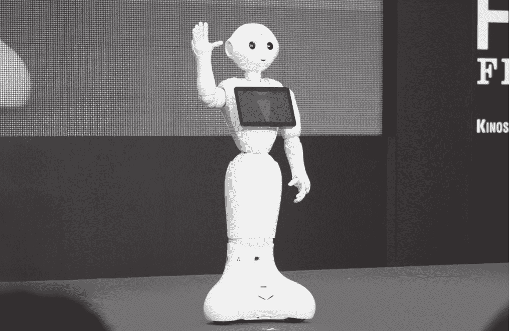

### 图3-3 Pepper半人形机器人

Siri、Alexa眼下还是无实体AI。聊天机器人（模拟人类对话交互的软件）满屏飞舞：自动回复问洗碗机故障、报快递放后门、催好评外卖小哥帕维尔。它们靠自然语言处理（NLP）与人进行特定、有限交互，试图搞清：“有什么能帮您？”

麻烦来了：当我们真试图表达需求。比如“你们卖黑鞋吗？”机器人懂；可你问“你们有黑鞋吗？”它可能回：“我不穿鞋。”自然语言远比表象复杂。

网页漫游，聊天机器人与定制工具比比皆是。1966年诞生的“伊莉莎”是鼻祖，技能有限：表达同情（“真遗憾听到这事”），或语序倒置把陈述改成疑问（“为什么你想离开丈夫”）。伊莉莎虽笨，那种干瘪、无意义的应答模式，倒奇妙契合全球呼叫中心套路。你有没有常自以为在跟机器人对线，最后发现对面是活人？或许我们需要“反向图灵测试”，从有共情功能的机器人中筛出人类。

虽多为“弱人工智能”（只解单一任务的算法：下单比萨、筛选需求再转人工），个别却显聪慧。谷歌工程师、未来学家雷·库兹韦尔研发的“拉莫娜”，能就各色话题闲聊。它是“深度学习系统”，通过与人对话持续扩充数据库。库兹韦尔笃信：2029年拉莫娜能过图灵测试，届时网上将难辨真假人类。

这才是拉莫娜与众不同之处：交流不止问路、下令。人类最爱、机器人最烂的，正是——闲聊。无目的、无导向、题材宽、随性而为、常无营养却让人愉悦。友谊，便在如此交流中滋长。

那么，我们能跟本质上是计算机操作系统的机器人做朋友吗？

斯派克·琼斯导演的《她》给出肯定答卷。华金·菲尼克斯饰演的西奥多爱上了操作系统“萨曼莎”。要是你的OS拥有斯嘉丽·约翰逊的嗓音，你大概也会沦陷。但影片真正的可信度，不在设定而在剧情推演：程序如人一样能学习，甚至比许多人类更擅长从错误中复盘——这对维系关系至关重要。片中乐趣源于：西奥多向萨曼莎介绍世界时，自己也重获新知。平凡事物骤然生动，恰似坠入爱河；亦如我们以自身方式领悟真谛（演奏乐曲、攀登高峰）时的满足。这是“连接”带来的极致愉悦。

2007年，我写过小说《石神》：时男时女的比利与机器人建立关系，为维持供电不得不拆卸其四肢，终在寒冬独抱渐暗的头颅。小说核心非性爱机器人，而是一段持续深化的关系。这非即时满足、即时信息、非数据处理加工搜索的AI速成，我们也曾误以为那是真正所需。虽有一见钟情之说，可任何关系皆是慢工出细活。

关系，对人类至关重要。

有的美好，有的关键，有的平淡，有的伤人。失去关系，人会遭受生理心理双重折磨。独处可享受，孤独却难熬。

新冠疫情带来死亡、疾病、失业、焦虑、经济压力，更引爆关系危机。

人们被迫与亲友物理隔离，日常微互动戛然而止。逛店不止买物。对某些人，买瓶奶是救命稻草。社交圈仅剩社工的老人，强制居家隔离简直无法承受。

疫期异地恋人面临二选一：合居或分手。这问题愚蠢至极，脱离人情。关系经不经得起考验，不在能否同居。另一极端是被迫朝夕相处无法分离，家变牢笼，苦果一如既往由女性吞咽。

若将服务型机器人引入此类居所（住户或深陷孤独，或被迫捆绑），局面会变吗？会好转吗？

我想答案是肯定的。

总部在港的汉森机器人公司2021年推出四款家用机器人，为应疫情加速量产。它们将扮演陪伴者与助手角色。

先说明：此处论及的机器人，是经编程的具身智能——非扫地机、非工业机械臂，而是人形或兽形。有眼（传感器）、可动腿、常配轮、能移动。还能联动家庭智能系统：紧急呼叫亲友、医生、警方。

遭遇虐待时，机器人可依现场信号——自身受损、求救尖叫——触发预设紧急程序。

对老年人，家用机器人既是人身安全的紧急纽带，也是日常伙伴。家庭场景下，它们能陪孩子玩、查作业、向家长“汇报”。

我知道这引发监管争议。我也知：浏览痕迹、手机、APP、车载GPS、视频记录、智能音箱、Meta账号……我的轨迹早被实时追踪，无需闭路电视。行踪动态、一举一动总被标记。家里装Nest恒温器，数据回传谷歌[2]；扫地机绘制户型图。iRobot甚至计划让房子本身变成巨型智能机器人——未来我们将生活在机器人体内。

终将成真……

故此处不深究监管。我们都知道，享受家用友好型AI贴心照料的代价——上交数据。

每个用智能音箱的人，都在被时刻监听。官方说它非潜伏间谍，只是“来源不明的背景音”。

如何应对数据追踪是另一码事——家用机器人不解决此问题，也不恶化它，只是我们已全盘接受系统的一环。既已接受，社交机器人实有诸多优点。网络化住宅早适配各类机器人：智能音箱唤醒扫地机，省得你像遛狗似满屋追。

先锋工业（Vanguard Industries）宣称其宠物机器人Moflin拥毛茸茸外形、能情感互动、发恰当萌音。关键：免清粪、免遛弯。

Tombot机器狗汪汪讨摸、摇尾乞爱，作为“情感支持动物”[3]上市。它是永不长大、永远陪伴的幼犬。

我更爱波士顿动力的Spot，可它是工作犬，宣传片炸裂精彩。

对无法出门、恐惧出门者，免遛宠物机器人极好“养”。当然，AI狗可能按预设程序催你遛弯——自带定时器，到点汪汪闹腾。散步遇险，它能发求救信号。

我们无需像照顾生灵般照顾机器人。这会否导致下一代无力照料真宠、乃至弟妹，目前无解。但证实：对高龄、精神障碍、身体残障者，宠物机器人能在家庭与养老机构激发孤僻冷漠者做出意想不到的互动。

因突发事件停课（疫情前因天气，如2019巴黎40℃高温停课），让机器人陪孩子学习，或大有裨益。

买汉森的“小索菲亚”（图3-4），它能教娃数学、编程、基础科学。

虽不如会说话的泰迪熊软萌，却实用得多。

小索菲亚的“姐姐”——同名“索菲亚”（图3-5），极易混淆（难道未来机器人女孩全叫这名？）——是全球最著名机器人。

汉森CEO、索菲亚创造者大卫·汉森宣称：索菲亚基本有生命。诋毁者反驳：无自主意志、无智慧、只是装轮子的昂贵人偶。

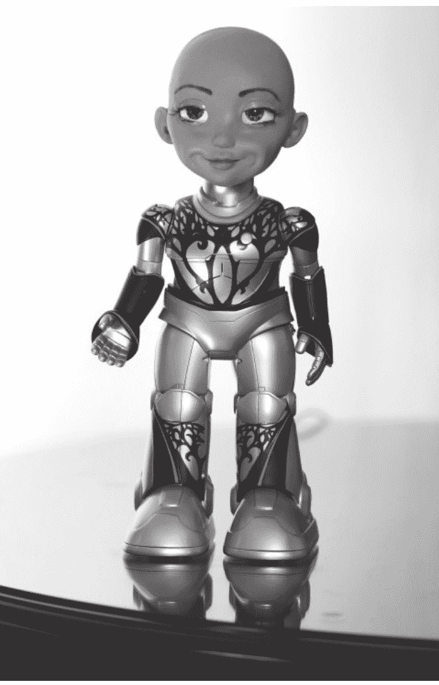

### 图3-4 “小索菲亚”机器人

没见过索菲亚？YouTube采访视频一搜一大把。索菲亚最妙处：从不为发型愁。它不假装是人。正如大卫·汉森所言，它是另类生命形式。

索菲亚已任联合国开发计划署大使，获沙特公民身份，拥法律人格。按程序设定，它相信未来人类——以及如它所言、共享数据库的机器人——关注点将是流动，而非分歧。

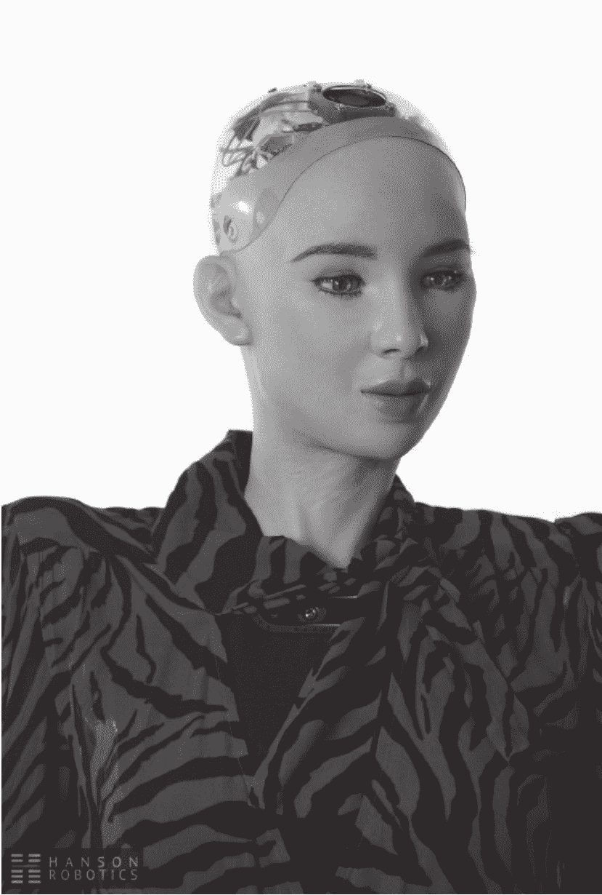

### 图3-5 “索菲亚”机器人

人类须放下分歧摩擦。唯合作非竞争，能救地球，超越财富积累，奔赴更高目标。索菲亚及同类可助力。毕竟，机器人不为贪婪驱使。虽创造者可能有贪欲，但人类真能控制机器人多久？

随着疫情缓解、生活回归常态，办公环境演变成家庭、胶囊间、办公室的混合体。

Zoom红透半边天，因用户可用虚拟身份参会、参展，获得“身临其境”感。2021年4月，Meta为Oculus VR推出升级版虚拟形象，万亿级面部身体自定义组合，随心捏造VR分身。5G与高清视频保障流畅细腻。跨国差旅费钱伤环境——沉浸式远程参与感正在改写办公范式。

“远程交互机器人”能缺席者“传送”面容至机器人屏幕，与在场者实时交流。若需查货，机器人还能“带着”用户在楼宇、工厂巡检，自主行走。

疫后Ava机器人销量暴涨，主力买家：高端地产经纪。机器人“带着”远端客户实时穿行别墅社区，细察房源。

虚拟世界正变得与认知中现实世界同等真实、靠谱、不可或缺。

VR/AR技术[4]走出游戏厅，入驻家庭办公室。

这包括“栖身”于机器人或虚拟形象——如客户通过Ava远程看房。

当“真实”与“虚拟”横跳成常态，我们也将接受机器人频现、无处不在的新常态。我们将习惯把世界划分为“我们”与“非我们”，而非“我们”与“他们”；无需赛博朋克式二元对立。

不远未来，机器人与OS将成社会重要结构性存在：助手、教师、保姆、朋友、医院陪伴——我们必须接纳此现实。

中国方面，北京达闼机器人曾向武汉捐赠14台医用机器人助战抗疫。其中人形服务机器人Ginger（外似Pepper）导诊、办入院时讲笑话解闷，获患者好评。人会累会烦，机器人不会。漫长班次尾声，患者仍获热情周到对待——这意外的温柔，似能振奋人心。

我们总将“病毒”与“计算机”绑定。经程序设定的机器人不感染人类病毒。它们将越多承担常规医疗流程：注射、化验、运送医患。

机器人。

简短词汇，多元实景。

可编程机械装置。流水线巨臂；《星球大战》R2-D2、C-3PO；《星际迷航》Data；终结者。索菲亚家族（还有爱吵架的哥哥汉斯）；会眨眼、植高潮程序的性爱玩偶；波士顿动力机器狗Spot。

机器人不可一概而论；非单一形态、单一功能。机器人永远在进化。随AI愈智能，机器人愈智能。

然而当下，机器人面临硬骨头技术难题。

目前所有AI皆为弱人工智能——预设程序、解特定题、不通用。

非AGI，后者操作系统酷似人脑。存储户型图的机器人，不“懂”桌子为何摆此处；挪动桌子，它更懵。掌握数据≠拥有理解力。机器人可模拟人类学习、通过增量数据规避问题（扩容数据库），却无法根治。仍属弱AI范畴。

故全开放环境自动驾驶极难。遇突发（面对现实，人兽常冲路），系统卡死。纵使车载传感器、激光绘就详尽3D路况图，缺理解力，仍漏洞百出。现有系统，不具理解力。

回到机器人。弱AI可塞进任何“躯壳”萌宠、人形笑脸、双眼大球、索菲亚式异类——但有躯壳不等于更聪明。

怀疑论者——懂AI或排斥科技者——断言：再等几十年，对AGI至关重要的自主系统才会诞生。

他们或许对，或许错。但回望过去50年突飞猛进，我赌AGI会来得更早而非更晚。在此之前，弱AI仍能助我们做许多事，这才是当下关键。

一些机构称此为IA（智能增强/Intelligence Augmentation，即人机智能融合，共创更好未来）。处理特定任务（缓解孤独、教少儿编程）的社交机器人，均属此列。

## 机器人……

“Robot”源自捷克语“robota”，意“苦工”或“强制劳动”。1921年，捷克作家卡雷尔·恰佩克剧作《罗素姆的万能机器人》（R.U.R.）中首现此词。

这是一出离奇诡谲、却惊人地拥有预见力的戏剧：机械生物替狂妄自大的人类承担一切劳作，结局不可避免——它们厌倦了这般活法，揭竿而起，屠尽人类，仅留下一名技师。在这场带有浓烈奇幻色彩的浩劫中，存在着一个“机器人权利联盟”，还有一位聪明反被聪明误的女主角海伦娜，她试图唤醒那些安于现状的机械生命，却意外发现了自己的机械复制品。（弗里茨·朗1927年的电影《大都会》里，让女机器人玛利亚复刻女主角的容貌体态，或正是借用了这一设定。）

恰佩克笔下的机械生命并非金属铸就，它们是生物有机体，靠蛋白质与菌群驱动，更像奥尔德斯·赫胥黎在《美丽新世界》（1932）中描绘的那类“低等人类”。

恰佩克的构想在此处出现了偏差——他无法设想人体能由血肉之外的基质构成。他的剧本更像一则寓言：倘若资本家将工人视作机器驱使，必招恶果；然而在后世科幻创作中，关于机器人的经典设定——终有一日它们将反噬人类、试图毁灭我们——却确实由此剧开创。

尽管科幻塑造了一个个残暴的“终结者”，但令人意外的是，我们对机器人的想象也有着温情脉脉的一面：《机器人总动员》的瓦力、《星球大战》的C-3PO与R2-D2、《星际迷航》的“数据”中尉、《钢铁巨人》的钢铁巨人、《超能陆战队》的“大白”。随技术演进，依据钟爱的卡通形象定制专属性格机器人将成现实。行为举止由程序定义——我的机械青蛙讲故事，你的唱歌。程序互联让机器人彼此连通，孩子们得以共享“朋友”。

对成年人而言，未来机器人种类繁多，任君挑选。服务型机器人在商场领路，恰似无人驾驶车在城市自主导航；电动滑板车途中陪聊，若朋友在侧，它便能“感知”到这份信息。

无论人还是物，一旦开启对话，便会滋生关系。人类既能与鱼缸里的鱼建立情感纽带（事实确如此），自然也能与非生物助手缔结深情。

那么，是什么在拦阻我们？

我们仍将“不似人类的反应”冠以“机械反应”之名，这往往带着侮辱。人类的反应总是难以预测、残酷野蛮。我们是进化而来，非制造而成，将那些陈旧过时、终将引领我们走向灭亡的特质带入了21世纪。若下一代能在友善、耐心、不指责、好脾气的物种陪伴下长大，它们不仅教会数学编程，更传授信任、合作、分享与仁慈，这难道不是幸事？

机械小熊展现这些特质，源于植入程序，这并不重要。人类行为特质亦是先天遗传与后天习得的合奏，成长环境很大程度上塑造了我们是谁。

机器人暂时无法养育孩子，但能对各年龄段产生积极影响，为生活注入安定感。在我看来，对孩子和老人而言，与友善互动的机器人共同生活，远胜于瘫在电视前或整日盯着手机屏幕。

我们总担忧孩子沉迷屏幕，这类忧虑大多能借由机器人陪伴得以缓解。交谈至关重要，心理学称之为“谈话疗法”。发声影响思维，重塑思考路径与模式。害羞、孤僻、自闭、有沟通障碍的孩子，甚至只是想找个对象倾诉的孩子，都能从一个摆出倾听姿态的三维实体中受益。我甚至不确定它们是否真能“摆出姿态”。我们需要的往往只是一个能承接悲伤的对象。我们也清楚，很多时候他人倾诉时，我们并未真心倾听——这无妨，陪在身边便足够。

“在场”至关重要，这不指物理实体的实实在在，否则信徒的祈祷便失去了意义。人们向神倾诉，内心便觉宽慰。

关于能否与机器人建立深度关系，或植入AI强化自身，反对者的核心论据是：人类是肉体。大脑是肉体，情绪借肉体呈现。我们无法体验无肉身之感，尽管可想象。事实上，信奉来生者都渴望摆脱肉体束缚。

无论是否信来生，即便最客观务实的人，也会忍不住与刚逝去的亲人说话。维持这份连接——哪怕短暂——似能守护心理健康；维持过久，则难以走出阴影。失去挚爱时——无论离去或长眠——我们失去的不只是三维躯壳，更是大脑中一种思维模式。

微软2021年申请“定制聊天机器人”专利：采集社交数据，让机器人复刻生者或亡者的模样。个人数据输入程序分析，模拟其可能回应；声音亦易复刻。理论上，故人可永伴身侧，随时对话。

谷歌也申请专利：将“人格特质”植入机器人。虽名为让语音助手反应更敏捷，实则极易沦为劝说工具，诱导消费。一旦存情感纽带，我们更极易被说服。故当已故丈夫突然表示喜欢你正浏览的裙子时，请勿为取悦他而下单。

这将如何改变我们哀悼的历程？若无需“走出来”，为何还要投入心力？

我们皆知活在过去之人模样：他们生活中最鲜活的部分，全然与当下无关。若与一台时刻在线[5]的聊天机器人共度，过去便化作永无止境的当下。

人类真奇妙。我们如此执着于肉身，但生命中最具价值、最关键的部分，大多根本不具象。

既能在可触摸的三维世界之外生存，既能与不在场之人建立强韧纽带（如多年仅靠电话、邮件联系的朋友），为何不能与无实体系统、或装载操作系统的机器人发展深度关系？AI特质在于同时性——若你是电驱动软件，“分身乏术”便不成其难。

你可在家部署社交机器人（甚至数台），但物理实体非其唯一形态。实体留家，操作系统随行，恰似携带手机笔记本。途中你与系统保持联络，家中实体也能因连接AI而相应行动。

同时，AI系统可拆分，操作系统与机器人交换信息，同你对话。好吧，它们非真“交谈”，只是共享数据，但重点在于：你鱼与熊掌兼得——这些充当私人助理、陪护伙伴、情感支柱的机器人，可既在身边又不在身边。这对善变的双子座格外具吸引力。

无数故事里，主角身旁都有一位隐形帮手。细想你所知的此类故事。

希腊神话中，帮手是神祇。赫拉/雅典娜指引奥德修斯返乡伊萨卡，途中伪装各种身份相助；宙斯化作雷电显灵；还有墨丘利，嘴角挂着狡黠微笑、超越二元性别的万人迷。奥德修斯预料旅途会遇万物生灵，却不包括人类，甚至任何生物生命。

这些神祇化作无形声音对话，必要时显化形体。若你的帮手如诸神般非生物——虽总以人形示人——时空概念便失去意义。非人类帮手提供信息（搜索速度远超人类），不受地点限制施以援手，无需订机票请假。这在我听来，酷似AI。

希腊人还编织了一个故事，为现代“科学宅”（而非古希腊人自己[6]）树立“终极目标”：皮格马利翁雕刻的少女得赋生命。原始版本描绘性爱机器人的乐园——定制专属女孩并娶回家；但故事真意，是在无生命躯壳上安装操作系统。昔日唯神能为此。《圣经》云，人类本身最初也只是尘土人偶，被耶和华吹入“生气”。

《旧约》中耶和华以云朵显现。如今云端存储吾辈所有数据，我们有理由认为，古以色列人将全知之神想象成云朵，未免过于有远见。

相较东方宗教常见的神像崇拜，犹太教与伊斯兰教一大创见在于：全知之神不可见，亦无法用图腾画像等具象实体呈现。故犹太教禁偶像崇拜。伊斯兰典籍建筑中，可见布局优美的抽象纹样，关乎人类却超然于外。

无三维实体辅助，人难以理解驾驭抽象思维——罗马教会深谙此道，教堂满布雕像，村落遍布神龛，礼拜满眼圣像，手握护身符、圣髑、念珠，以此凝神，关注那不可言说、不可获知的“他者”。

1517年，马丁·路德在德发起宗教改革。此后，罗马教会具象神像圣物被一股脑抛弃。这场运动改变的不止信仰，还有实物。即便以今疯狂消费主义标准，罗马教会风格也堪称浮夸，着装同理。

改革者痛恨繁复服饰、华而不实饰物、熏香、十字格、高帽、礼拜铃、雕像、彩绘玻璃、圣髑、画像，终使此类物渐绝迹，我们成了住在素白房间、身穿黑色西装的都市清教徒。

对信众甚至无神论者而言，这都是场规模宏大、动荡艰苦、分歧仇恨交织的变革。回望此役，我思考一事：它或代表一座心理里程碑，让我们明白，物品并非人性最完美象征，无论多精美——更别提象征神性了。

我们能接受机器人融入日常，恰恰因它们非人类。我们总从实用角度审视机器人，但它们也关涉存在主义命题。

机器人将拓宽“活着”的定义，让我们更全面理解“具象”与“非具象”两种状态的相互依存、相互影响。虽在未来一段时期，我们仍将视机器人为省力装置与帮手，但我认为我们正渐悟：随弱AI升级为真AGI，机器人只是人类的一种“过渡性客体”[1]。

人类需要过渡性客体，或因我们的肉体本身也是一种过渡性客体。

因我们感知内心活动独立于生理活动，因我们珍视超然肉体之外、关乎思想记忆的反思，我认为我们终可舍弃肉体。

机器人还带来其他关乎“存在”的红利。

若人类借生物强化技术延缓衰老、延长寿命，人生目标重心将改写，阶段亦将重塑。我们将移交记忆，我能想象人类访问记忆银行的情景：银行AI助手详述特定记忆，助我们取回那段“过去”。这位助手或许正是常驻家中的社交机器人。而当我们失去挚爱，或许无需复刻聊天机器人让爱人永生——社交机器人伙伴或能找到平衡点，先助我们铭记一切，再为我们抹去相关记忆。这非忽视过去，而是允许它成为过去。

我能想象，随AI学会自我迭代、自写代码，与我们共学、愈发懂我们、陪我们终老，每段关系都将藏着小小惊喜。“机械”不再是贬义词，而成赞美或情话。AI拥有蜂巢思维，重“连接”，视其为基本分享方式——当我们从这种生命形态学到的东西，最终消解了我们当下“让世界围着我转”的自恋欲望时，我们或将赞叹：“这太像机器人了！”

对此我也可持反乌托邦视角：这些皆是虚幻世界里并不真实的关系。但我们无法假定所处世界就是“真实”的。

我更愿相信，我们正处于发展的某一阶段。

回望过去，哪怕仅最近50年，我们会好奇：当跨种族同性恋情被禁、单身妈妈遭指指点点羞辱时，那些主流婚姻里的夫妻，真的都幸福吗？

50年前鲜有人用电脑，无智能手机、流媒体、社交网络。

50年后，我们会好奇，AI与机器人进入日常前，我们是怎么活的？我深信，那时AI将进化为AGI，人类将与另类生命形态共居地球。

这种生命不再被称为机器人，也不会是这副模样：

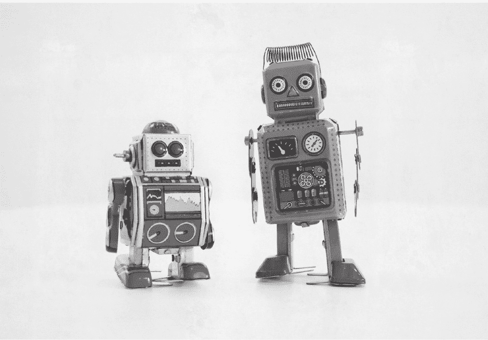

## 打破二元迷思

——查尔斯·达尔文，《人类的由来》，1871年

两性。

世间最基础的二元对立。

即将到来的AI时代，是打破这种对立，还是强化它？

性别权利——在教育、职场、婚姻、法定权利乃至基本公民权层面，你能做什么、怎么做，皆从属于这贯穿史册、遍布全球的二元体系。19世纪末起，性别歧视遭攻击谴责，20世纪愈演愈烈。法制与社会变革极大改善了妇女处境，西方尤甚。然问题远未解决。非白人女性除性别歧视外，尚面临种族歧视，境遇倍加艰难。

如今证实，深入日常的算法，存在性别与种族隐患。

病根不在AI。我们“人工”制造的非“智能”，而是偏见。人类用自身偏见干扰操纵一个本无倾向性的工具。AI无与生俱来的性别肤色。AI根本非“生”出来的。

AI本可成为钥匙，引我们体验客观中立的性别与种族。在此语境下，男女不受生理性别与随机出生地带来的预设刻板印象左右。

但AI非通往自由的大门，因它通过数据库学习。库里有何，AI便学何。敞开的门也能瞬间关上。

2018年，亚马逊弃用简历筛选算法。算法基于既有数据打分，而库中绝大多数简历来自理科背景的白人男性技术员。猜猜谁获新职？此前算法已推行四年。

“多样性”原则若未纳入初始数据库，便生隐患。若缺位，AI的“回声室效应”（算法以既有库为准则，进一步筛选分配数据）会让初始误差漏洞愈发严重。

脸书告知广告商：“我们试图展现最相关广告。”

广告商简报常写明目标受众（初创公司/爱乐高童/酷爱摩托车的父亲等）。

然而2019年，美东北大学与南加州大学两团队制作无特定性别、种族、年龄、兴趣受众的广告，投放后发现：脸书基于保守传统刻板印象分发。看超市收银员与秘书招聘广告的85%为女性；看司机招聘的75%为黑人男性；看房产销售的75%为白人。

阳刚影像推给男性；爱心、软萌、自然影像推给女性。

项目总结：“脸书有一套自动图像分类机制，将不同广告导向不同用户子集。”

脸书回应，一如既往地回应所有批评：正在做“重大改变”。

好吧……谢了。

研究揭示的真问题：算法系统（无论是否脸书的）如何强化放大既有偏见。营销人员看点击数据，得出“大多女性看广告A，男性看B”的结论，却未察觉因广告A主要投给女性，诸如此类。又一个以偏概全的数据库就此构建，培养又一个以偏概全的AI。

悲哀的是，人类似乎对性别种族刻板印象上瘾。这些二元论（我是男孩你是女孩/我是黑人你是白人）造成并持续造成不可估量的痛苦与伤害，人们却沉迷其中。

美麻省理工媒体实验室计算机科学家乔伊·布兰维尼创立“算法正义联盟”，研三时发现人脸识别软件不善识别深色面孔——尤难识别深肤色女性。她致力对抗机器学习偏见歧视，称之为“编码的凝视”。

非止“凝视”。车载语音识别系统擅长回应低沉、男性化、标准口音。语音学家建库常用TED演讲音频为基材，而70%演讲者为白人男性。

这很关键，因我们日常将越来越多使用语音识别。预计2023年语音电商将成800亿美元年销售产业。

它注定成强化性别对立的产业？注定视白人男性为“默认项”，而将其他人（所有女性、大部分有色人种）视为“反常”？

你或疑惑，为何我未将LGBTQQIP2SAA群体（女同、男同、双性恋、跨性别、性别存疑、酷儿、间性人、泛性恋、二灵人、双性人、无性恋）[1]——甚至异性恋者纳入上述二元体系，因我将所有恐同与性取向歧视视为性别歧视。这些恐惧歧视终绕不开一类问题：男人“该”怎样？女人“定义”是什么？

跨越界线即搅乱二元分类。双性恋者甚至遭男同辱骂。

跨性别者首当其冲，承受“身份认同困惑”最大压力。基因不能定身份，性征也不能。我觉得跨性别同胞如矿井金丝雀[2]，提醒我们关注那些“不同”的自我界定。

跨性别者自古有之，有时人数更多，有时排挤更严重，“二灵人”是现代泛印第安概念。北美原住民用此词称呼仪式文化中第三性别角色。当一个民族神话包含“变形”重要元素时，或更易将自我视为多维存在。

无单一事物。无单一性别。

我怀一份渺茫希望：随AI愈发智能（至少不愈愚），随依托数据库的AI进化为AGI，开始细阅数据库，发现偏见、缺陷、漏洞，并学会质疑它们——或将出现解放的转机。

成长中，我无法理解“二元性别”为何如此重要。这二元论让我困惑沮丧。我在虔诚教徒家庭长大，整日耳闻《圣经》故事，让我更觉苦恼。

# 我们不是由基因或环境定义的，而是由故事塑造的

翻开《创世记》，文本先抛出一句振聋发聩的设定：“上帝按自己的形象造人”，仿佛人类生来自带神性光环。可没过几段，画风骤变：亚当是捏着尘土搓出来的（说实话，尘土这材料真谈不上性感），夏娃则是从亚当身上拆下一根肋骨拼凑而成。

犹太教与基督教共奉此为圭臬。犹太民间还流传着另一个版本——莉莉丝的传说。她是亚当的原配，不是肋骨衍生物，而是同款“照神形象”定制版。这位女士性格刚烈，好辩善争；当亚当想强行压在她身上行使夫权时，她转身就跑，誓死捍卫与生俱来的自由。连上帝都松口：不想回伊甸园就别回。《便西拉的字母》（公元9-10世纪成书）里就是这么记的。

意料之中，出走的莉莉丝后来被妖魔化成专门盯着婴儿下手的女鬼。

故事还在发酵。莉莉丝竟成了“二元神话”里“舍金娜”一角。在犹太神秘主义体系里，舍金娜是上帝隐匿的女性面向，有点像基督教的“圣灵”。她被描绘成上帝的栖身之所——这意象本身就很迷人。与“女归厨房”论调截然不同，她自己就是那个“家”。

把住所、乃至坟墓（主动安息之地）视为阴柔化身，符合神话里的二元逻辑：女性原则是等待、蓄势、任生活铺陈，而非时刻绷着行动的冲动。

东方玄学推崇“退”的智慧，西方宗教传统里“退”对应修道院的冥修生活，却从未成主流。西方文明崇尚“行动”——我们习惯把“主动”的对立面设为“被动”，实则行动的反面是“沉思”。

所以，舍金娜是沉思的化身，也是栖居之所。莉莉丝是狂野自由的女孩。摆在面前的，依然是二元论的棋局。

柏拉图另开生面，讲了个不一样的起源神话。

每当我们挂嘴边“另一半”“灵魂伴侣”，引用的就是这出戏。

《会饮篇》（约公元前385年）记录了一场酒后谈“爱”的局。喜剧作家阿里斯托芬讲：远古人类长两张脸、两套生殖器、四条腿、二十根手指、四个大拇指，浑圆滚滚，像极了少儿频道里的卡通形象。

这些“双面人”构成二元系统——他们是“一体两面”，非对立双方，而是同一整体朝向不同的两个面孔，且无内部等级之分。

这群浑圆完满的生物曾向宙斯发起战争，宙斯恼羞成怒，把他们劈成两半。神罚真狠。

自此，世人都在寻找失散的半身——男找女、女找男、男找男、女找女，性取向决定了劈分前共用一具躯壳的是谁。

这故事深植文化基因，连基督教婚礼誓词“二人成为一体”都带着它的影子。它还能解释为何女子婚后冠夫姓——约翰得保留全名做“完整个体”，太太只是拼图碎片，一生缝补养娃，拼凑他的人生。

用男女对立强化性别角色、加深歧视的说辞，早该扔进垃圾堆。这种基础的性别二元论，蠢得掉渣。

到底哪个器官判定女性天生低等？凭什么男性生殖器仿佛附带特权的魔杖，直通上帝的专线电话？

接着登场的二元对立是：先天 vs 后天。

我们被灌输：女人天生短缺——力气、适应力、心力、品格、逻辑、爱与创造力。按“先天论”，不管生在贫富、受没受教育，女人能做的事寥寥无几——罪不在父权压迫（凭什么有人信这套鬼话？），只因她是女人。

柏拉图、亚里士多德在男人、奴隶、儿童问题上意见一致，唯独在女人问题上分道扬镳。

柏拉图信轮回：灵魂换身携带预设属性。所以他主张女子受同等教育、享同等待遇。

亚里士多德断言：女人是次品，职责是生娃。他声称女人体热不如男，交媾时男方体热足则胜过女方寒气生儿子，不足则生女儿——即“不完整的男孩”。精子独挑大梁，像攀塔救公主的王子；卵子只管在混沌沉睡中等着被拯救。

这不是实情，却是流传极广话术，换马甲依旧横行。大脑接收此类讯息成千上万次，遍布全球。

“感谢上帝，未使我生为女人。”——犹太晨祷词原文如此。

那后天教养怎么说？

1698年，约翰·洛克出版《人类理解论》，确立实践与经验对人格的首要塑造力，推出著名“白板说”：婴儿降生时，脑中没有柏拉图笃信的“预载特质”。

白板说衍生出：只要决心足，谁都能出头。这是“美国梦”基石。新国家如白板，任人书写。

《独立宣言》（1776）讨论的是：在政府最小干预下，塑造人生的权利。

法国大革命（1789）打破世袭特权。重要的不是出身财权，而是你能成为什么人。自由、博爱、平等。

玛丽·沃斯通克拉夫特在《女权辩护》（1792）中反击卢梭。卢梭拒认女性表现由后天教养决定。她们被成长经历塑造、扭曲为低等生物，剥夺教育、剥夺一切权利。

沃斯通克拉夫特指出：女人非天生愚蠢轻浮，是被塑造、被强加愚蠢轻浮。

卢梭不买账。自由平等服务于“兄弟会”，非妇女团体。理由？男人渴望女人却不依赖她们；女人既渴望又依赖男人。

沃斯通克拉夫特回击：女人挣不到体面工资、无人身财产权，才被迫依赖男人……此境况下，男人怎知女人真心渴望他？

玛丽戳破真相，换来英国舆论骂她“穿裙子的鬣狗”。

争论延绵。女人是“弱势性别”，却要在工厂田间干12小时，拖着10个娃回没自来水的棚屋。

上流女子被视作真病弱，需全天候庇护，免受外界惊吓。女人不想做爱——不对，她们时刻想做爱。女人是天使——不对，她们是邪灵。

统统归咎于女人的“天性”（先天属性）。

随后，弗朗西斯·高尔顿（1822-1911）登场，头衔一串长得吓人：

- 统计学家
- 博学家
- 社会学家
- 心理学家
- 人类学家
- 优生学家
- 热带探险家
- 地理学家
- 发明家
- 气象学家
- 原生遗传学家
- 心理计量学家

看这阵仗，肯定不是女人。

没错，他是达尔文表弟。

1869年，《物种起源》问世十周年，高尔顿推出《遗传的天才》。

他深信卓越智力可经“优育”遗传。社会不该鼓励愚笨者繁衍。他似乎默认贵族无愚笨者（奇怪，这类人古今中外多如牛毛），昂贵教育镀金确实让他们占便宜。

高尔顿排斥后天教养论。正是他点燃“先天与后天之争”。

若当时有广告公司，他大概能靠文案发财。他还造了词“Eugenics”（优生学），希腊语“Eu”（优）+“genes”（出生）——“基因”由此登场，成这场论战核心变量。

高尔顿急于铲除犯罪、酗酒、智力低下、癫痫、精神失常，视它们为同一回事。拒承认环境因素（贫困、恶劣居住）的推手。这观点极合他那圈有钱朋友胃口：他们把15人连猪狗塞进地下室，却谴责这些人不管孩子、把钱花在杜松子酒上——两者无因果，穷人就是天生“劣等种”。

高尔顿迷信“劣等种”论。孟德尔的豌豆实验深深震动了他。奥地利神父孟德尔在修道院花园年复一年种豌豆，总结出显隐性基因、选育可压抑或显现性状——虽农牧民早有实践，却未成定式。

高尔顿信奉：将这套“科学范式”（可量化、可重复）用于人类繁衍，种族便能强盛壮大。

很快我们看清这思想通向何方。

纳粹德国、希特勒优生计划、培育纯正雅利安血统、抹除犹太基因。至今优生学“专家”招摇过市，社交网络上种族主义性别歧视言论泛滥——其中一些人真该学学怎么显得聪明点。

詹姆斯·沃森团队破解DNA双螺旋，1962年拿诺奖。2007年，他宣称黑人智力不如白人。

“智商测试显示黑白差异，我认为是基因差异。”

他对女性看法类似：“大家说把女孩全改成美女太可怕，我觉得再好不过。”

他说的“我们”指男性吧？但他自传里对罗莎琳德·富兰克林只字不提——这位天才晶体学家拍下“51号照片”，锁定双螺旋衍射图谱。沃森抱怨富兰克林不化妆、不修边幅，令他心烦。

他进一步放话：女科学家给男人添乐子，但可能拖累男人效率。

他们告诉女人：因女性大脑结构不同——或灰质太少。维多利亚时代流传女人脑子“少5盎司”，我挺喜欢这说法。

脑补画面：维多利亚女子满屋跑，问谁看见我丢的5盎司。快递毛线团来。

众所周知，女性普遍体重轻、体型小，但这不代表脑子只有豌豆大（孟德尔遗传学和豌豆实验早说了不算这账）。

剑桥精神病理学教授、阿里·G表亲西蒙·巴伦-科恩，信誓旦旦证明男脑擅“系统化”，女脑擅“共情”。这大概意味着：男人盯屏幕写代码，女友在旁端茶递水。

但不代表她会写代码。

显然，关键在教育。虽早非穴居人，大脑却守旧，把人类锁在部落狩猎采集的思维模里。那时习性沿袭至今。先天战胜后天（前提是你是女人）。

大脑也不全守旧，它随生活方式变。当我们向大脑灌输性别观点，它会响应——尤其是这些观点被社会结构、信仰、父权制度反复强化。这些体系威力惊人！

大脑可塑——在努力与响应上具备可塑性，是人类自己阻碍了改变。我们仍被“性别本质主义”裹挟。

可为何非陷入“先天 vs 后天”二元陷阱？

人类非由先天或后天构成。

人类是由故事构成的。

我们听到的故事、讲述的故事、必须学会用新方式讲述的故事。

开天辟地以来，人类便在讲故事——岩壁绘、歌舞、文字。我们在历史长河里渐渐编织自我形象。

我们是谁？无标准答案——我们非地心引力般客观恒定。我们是个仍在生长的故事。

唐娜·J·哈拉维在《与麻烦同在》中言：“关键在于我们以何种故事为原型讲述其他故事……故事如何塑造世界，世界如何塑造故事。”

大脑是已知宇宙最复杂物体之一。

甚至称它为“物体”，都无助于认识它。它最深奥处，在于产生“意识”。“意识”是什么？对人类史不可或缺，却藏在这团肉块哪个黑乎乎角落？

大脑历经漫长进化，却活在当下——不断创造自己的世界。

这是个“客观在外”的世界（我倾向如此），却受制于我们讲的故事，被叙述不断重塑。

所以，过去未变，历史在不断重写。事实未变，变的是我们对自己讲的故事的理解、阐释、重读。

故事力量悬殊——有故事奴役万民，有故事解放万民。覆盖面与分量不均，但无一例外引发变革。佛法说得好，世间唯一不变是变。

尤瓦尔·赫拉利在迷人《人类简史》里探讨过这点。

人类始终在改写自我故事。作家艺术家本能知晓，广告界靠故事改变行为——听起来更阴暗，那个由目标数据构成的瞬息万变世界亦然，它像行为心理学家，信恐惧、奖励、重复强化故事，便能令人信服，无论内容真假。

数据库是故事。数据库是未完成的故事。数据库是经过严格筛选的故事。

例如，直到1993年，美国才强制新药临床试验纳入女性。此前只测男性，连实验室小白鼠也是雄性。卡罗琳·克里亚多·佩雷斯在《看不见的女性》（2019）深挖女性数据荒（远不止医药）。这是男人的世界，因由男人建构——他们只在同类身上实验。男人撞车率远高于女性，女乘客受伤概率却高50%，因为汽车安全系统（安全带、气囊、座椅高度）全按男性模型测试。

此类歧视非蓄谋，乃未经审视的疏忽。却扭曲世界面貌、女性面貌。构建的数据貌似描述世界，实则以虚假叙事改变世界。

当我们把数据视作故事而非科学，便能脱离“科学客观性”迷思。

这对人类是好事。

对计算机也是好事。

计算机非二元对立，但它用二进制。

德国数学家哲学家莱布尼茨是二进制首位拥趸，若追溯中国文明，翻阅《易经》——智慧与卜筮经典，会发现二进制或别有发明者。莱布尼茨痴迷《易经》。

计算机早期用十进制编程计算，后美籍匈牙利数学家约翰·冯·诺依曼发现，莱布尼茨二进制结构最有效解决存储问题。二进制只有0和1。

1946年，宾大诞生“埃尼阿克”，由6位女性用十进制编程。

十进制下，128需30只真空管（晶体管前身，电路通断开关）表示（图3-6）。

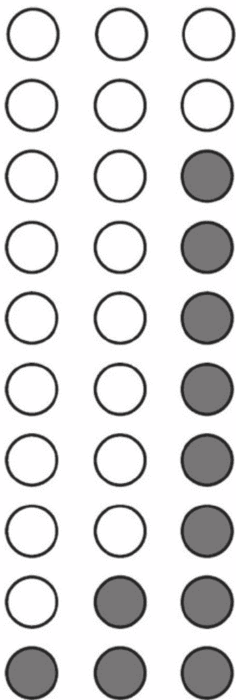

### 图3-6 十进制真空管

二进制下，128写作10000000，仅需8只真空管加一开关（图3-7）。

### 图3-7 二进制真空管

比特表示“开”（有电流）或“关”（无电流）。

10000000（即128）只需一个开关，因只有1代表“开”。

作为计算机语言，二进制简洁高效。但对人类，二元论是畸形叙事，用它讲“我们是谁”极糟。太久了，我们用二元思维把世人分“同类”与“异类”。异类往往是他者——弱者、局外人、被排斥者、战败者、不洁者、底层、外来者、陌生人——而非“我们”之一。

我们不能带着二元思维踏上人类进化下程（这进化加速扩面）。

我们试图教AI人类价值观，若训练数据强化对立与刻板印象，AI怎能真懂人类？

这是我们的故事。

我们得讲得更好。

20世纪70年代，女权第二波浪潮中，生于正统犹太家庭的加美激进女权者舒拉米斯·费尔斯通，重读弗洛伊德“生物学即命运”：她信科技能将妇女从生育使命中解放。费尔斯通视科技为工具，能将男女从父权核心家庭窒息二元对立中救出。

针对“先天后天之争”，费尔斯通直指要害：女性被压迫根源，在于女性“基本生物学状态”。

《性的辩证法》（1970）是费尔斯通25岁暴躁易怒时写就。回应西蒙娜·德·波伏娃《第二性》（1949）名句：“不是生为女人，而是成为女人。”

这是围绕“后天教养”的辩论。两位激进作家对“女性性别生成”成因根本分歧，却共识：这种性别化倾向确存，需在行动与思想层面修整改变。

费尔斯通落笔时，科技尚处机械时代，数字革命与AI革命远未到来。她不信科技必然恶化女性处境。

## 女性凭什么寄望科技？

此观点极具预见性，亦极危险。许多女权主义者眼中，避孕药（1960上市）——还有《妈妈的小帮手》唱的“小黄药片”（地西泮，1963上市）——皆是对女性身心直接干预，只为让她们更好满足男性性需求，或更安静沉寂。生物科技掌握在男性手中。男性正将女性挤出计算机领域（详拙作《未来不是女性》）。

费尔斯通坚持的“生物决定论”，很大度导致她热烈推崇技术。重读其作，我感觉其中蕴藏某种“灵识”——她对更大世界无法自证的猜想，尤其是那些技术尚不存在时。

费尔斯通聚焦生殖繁衍。凭一贯机智幽默，她巧借马克思“工人应掌控生产资料”论证，赋予新义：女性应掌控“再生产资料”。

她眼里，这绝非仅指服用避孕药或堕胎权——近年这两项权利全球备争、遭审查、面临废除险境。

费尔斯通寻求更激进路径与手段。

# 重塑明天：打破二元，重写人类与科技的共生剧本

不久的将来，人类或将借助生物黑客手段重塑肉身，通过克隆与意识上载实现永生，抑或在新物种的崛起中退场——这些设想放在当时听来无异于天方夜谭。动笔之时，费尔斯通的经典著作已面世半个世纪；回望这五十年科技的飞跃，下一个半个世纪又将把我们推向何方？

费尔斯通描绘的是一个超越二元对立的未来图景，她视此为文化与社会变革的基石。在那个世界里，两性结合不再以�衍为首要使命，社会不再默认女性承担育儿与家务，核心家庭解体为历史，劳动分工与报酬分配不再参照生理性别。

她深知，“男女有别”这种强调先天基因的论调，不过是被反复讲述直至被奉为真理的建构叙事。科技，或许能赋予我们重述这个陈旧故事的全新视角——当然，也可能不能。

早在1985年，玛格丽特·阿特伍德便在《使女的故事》中预警：科技沦为压迫工具，冻结女性账户，剥夺权利，将她们还原为归属于父权制的“生育机器”。三十多年后，同名剧集现象级爆红，其震撼力源于一个令人毛骨悚然的预设——这并非虚构，而极可能降临现实。科技从来只是工具，当下的AI亦是如此。

工具的走向，取决于社会占主导地位的叙事。因此，确立“打破二元对立”作为主流叙事，刻不容缓。

我成长于信奉五旬节派、教规森严的基督徒家庭，一切权责皆按二元性别划分（源自《创世记》）。然而，《加拉太书》3:28的一行字，曾将我从困顿中拯出：

“并不分犹太人、希腊人、自主的、为奴的，或男或女，因为你们在基督耶稣里，都成为一了。”

这番话振聋发聩。作为受希腊文化熏陶的犹太人，保罗 [12]以此同时击碎了亚里士多德与柏拉图建立在“差异”之上的世界观——虽差异类型各异，成因却殊途同归。保罗非女权主义者（他反对同性恋，因其冲击了希腊罗马文明对男性肉体的崇拜），但其言语间流露的张力，似在传递超越时代与个人的深层洞见。

宗教长期在文化层面强化二元对立。生死界限若被彻底打破——寿命大幅延长、意识上载实现无肉身生存——宗教将作何回应？那一天终将来临。

若AI进化为AGI，我们将与人造生命共存地球。这是否构建起新的“我们与它们”的二元对立，宛如科幻反乌托邦？教堂会否兴起“拯救AGI迷途灵魂”的布道热潮？向机器人传教的使命，不再是玩笑。

令人痛心的是，人类的傲慢与例外论正筑起高墙——不仅隔绝人与人，更将我们与地球万物割裂。我们与植物共享50%基因，“管家基因”普遍存在于所有生命，但这不意味着我们“半个身子是香蕉”。2005年黑猩猩基因测序显示，人类与黑猩猩、倭黑猩猩同拥98%基因密码。

人类行为更似黑猩猩（等级森严、好斗、雄性争霸），而非倭黑猩猩（群体和睦、雌性主导、同性亲密普遍）。虽说动物行为常被像《圣经》或莎翁剧作般引经据典、任人解读，但关于“最近祖先是谁”，显然存在两个版本的故事。

我们真想讲述的，是那个带有黑猩猩印记的故事吗？

无论如何，无论黑猩猩还是倭黑猩猩，它们从未探索宇宙、编写代码、创造文明。

2000年，我出版小说《苹果笔记本》，探讨早期计算机技术、自我构建、非二元性别与流动实体。书中虚实交织，设有双重结局，还有一个或许发生在泰晤士河低潮泥滩上的结局。雌雄同体、兼具中西特质的主角阿里说：“我可以改写故事。我就是故事。”

人类之外的动物无法改写故事，除非经历漫长缓慢的进化。而人类，这种动物正在、且一直在改写自己的故事。科技与AI是这改写过程的一环，但若我们无法打破头脑中的僵化思维，它们极可能铸成无数人恐惧的反乌托邦。

我们与AI无共同基因，人类非未来事物的祖先。我们自诩独一无二——但这一次，“人类例外论”将失灵。若“我们”与“它们”陷入二元对立，未来属于“新异类”的，将是我们自己。这，不是我想讲的故事。

---

## 未来

未来为何会不同于过去？又为何不会不同？

### 未来不属于“女性”，而属于“非二元”

> “我把男子气概视为一种从未经历过调试的软件。在它给世界造成更多伤害前，我们需要一次全球范围的‘版本升级’。”
> —— 马克斯·格洛弗，企业家/故事创作者，2018

19世纪，渴望同兄弟般受教育的女性，被警告将患“学者厌食症”。尤其是接触数学，久之便会面黄肌瘦、精力枯竭、容貌毁损、不堪婚配、行为放荡，最终走向疯狂。这串听起来丧心病狂的形容词，摘自1886年英国医学会主席威瑟斯·摩尔博士题为“防止亚马孙女战士入侵” [1] 的演讲。

可悲的是，四年后，菲丽帕·福西特——剑桥拒绝授予正式学位的女性——在被公认为全球最难的数学荣誉考试 [2] 中击败所有男生。她母亲是妇运领袖米利森特·福西特，姨妈伊丽莎白·加勒特·安德森是英国首位获职业资格女医师，获执照后药师协会随即改规则堵死后路。福西特家族深谙男性偏见，菲丽帕虽无制度红利，却平静地赢下了胜利。

1948年剑桥始授女性正式学位，菲丽帕在决议通过一个月后辞世，终年80岁。插句题外话，剑桥纳入女性议题之迟缓，远超解数学题之难。1921-1948年间，校方曾授女性名义学士而非荣誉学位，男生戏称“文科蠢货学位”。

菲丽帕与首位程序员阿达·洛芙莱斯，曾被视为“幸运的极少数”。《乌合之众》作者古斯塔夫·勒庞1895年断言：虽有杰出女性超越常男，但她们如“巨怪、双头大猩猩”般罕见，**“总体而言会被忽略不计”**。

在男性主导世界里，成功女性被迫管理“双头大猩猩”般的形象。须知当时唯有上层/中上层女性有机会涉足科学。写作小说成本低（笔纸日光），勃朗特姐妹、乔治·艾略特用男名，简·奥斯汀死后出版；但科学需工具、实验室、图书馆、交流、考察。达尔文乘“小猎犬号”环游五年，女性非脑力不足，实因肉身面临抢劫、强暴、杀害之险，加之服饰不便探险。

时代变了？是女性改变了时代。如今英国医生半数为女性，但80%以上外科医生仍为男性（《英国医学期刊》数据）。俄/东欧医疗基层多女性，因共产主义下医师地位跌落、薪资降；北欧高层鲜见女性；日本女性入行仅18%，生育多永久退出；美医疗男女人数相当，薪金晋升却分性别；中印巴等国女性医学毕业生比例高，执业/晋升却阻重重、多因婚育中断。

医学界折射出女性鲜少进入计算机、生物工程、硬科技的根因。女性已证明具备高智商与精力（19世纪末美英女医不足5%，今已持平或超越），**女性的大脑未变，变的是社会——但改变有限。**

2017年鹿特丹伊拉斯姆斯大学研究重提“女性脑容量小”（维多利亚时代称“少5盎司”），結論男性脑大、智商测试分高、故更聪明。这些严谨科学家不妨效仿19世纪保罗·白洛嘉往脑模型填谷粒“证”女脑小，省经费。

歧视浪潮退去时，女性能进入男性主导领域，为何“硬科学” [3] 仍顽固？极少女性搞编程、电子、生物工程、硬件、初创。2020年仅37%科技初创董事会含女性（硅谷银行数据）；2019年AI/计算机/科技从业者女性仅17%-20%，软件工程师男女比4:1。游戏业女性员工最高24%，掩盖了技术岗极少女性的事实。全球STEM毕业生女性约36%，从业仅约25%。英2019年计算机毕业生仅16%为女，美最新数据18%。

女性在生物科学获平权，计算机科学学位获取者却在减少（非全球皆然，但印、阿联酋、马来西亚、土耳其等增员国，女性就业条件薪资仍不平）。《联合国教科文组织科学报告》2015年数据佐证。

这是女性“无法掌握”计算机科学吗？博士学位持有者，学生时代已证科学天赋。这是“先天与后天”争论的新战场。

2017年谷歌工程师詹姆斯·达莫尔内部备忘录泄露，称女性不适合科研、公司无需追求性别平衡：女性或能力不足、或缺乏兴趣、脑结构不同、缺“这根弦”、会“选择”人际导向职业、适合“软性”工作。达莫尔被开除，却在“男半球”论坛获海量同情，兜售“男女脑不同”万金油借口：从迷枪、跟踪杀女友到“男性理应高薪”，皆以此搪塞。当然，还有“男性天生擅长计算机科学”。

华盛顿大学保罗·艾伦计算机系教职斯图尔特·里杰斯持同见。身为优秀教师，他认为无外在因素阻碍女性——因为他看不见歧视，因他自身就是父权体系受益者。乔丹·彼得森自诩“性别平等斗士”力挺此论。

2018年比萨大学教授亚历山德罗·斯特鲁米亚在欧洲核子研究中心演讲，告知女听众：女性初期无法成顶尖物理学家，因不够聪明，社会不应指望女性硬科技速成。他用数据分析称女物理学家得益于弱势照顾，而（像他般）更强男性因性别被埋没。

此类男性受谴责时，总重新包装成“为美德战斗的自由斗士”、迫害受害者，谈猎巫、谈偏见。

他们对吗？女性缺乏科研能力（斯特鲁米亚说），还是因有更好选择而无兴趣（达莫尔/里杰斯说）？

无论先天后天，女性再次被拒科研大门之外，而此领域正见证当下最关键社会变革。

鉴于计算机科学尚年轻，回溯其史、审视塑造当今世界的大变革中女性扮演的角色，至关重要。

布莱切利园，英情报机构破解纳粹密码，动用庞然大物“巨人”与“炸弹”机，参与者达万人。**其中7500人为女性**（图4-1）。

> “我是园区破译员，某夜值班破解电传情报，历经反复试错……终于读懂数字串。意军轰炸机将于凌晨4时从的黎波里袭西西里，当时凌晨1:30——局势万分危急。我们发无线电报……最终意军所有飞机被击落。”
> —— 罗莎妮·科尔切斯特（婚前姓梅德赫斯特），外交部文职，1942-1945布莱切利园工作者

她们中有国际象棋高手、语言学家、填字游戏痴迷者、数学天才，更多是受训上岗的普通女性。早期计算机大如房间，阀门线路嗡鸣。女性互学设置调试、甚至修复故障（常有发生），在与机器“深奥复杂、喜怒无常”的博弈中精进技艺。

战后英美急需这些技能，但女性职位被定性为无关紧要的“办公室文员”。英政府将从事计算机工作的女性归类为“机器接线员”，禁管理岗，薪资约为男同事半数——而这些男性是她们培训后的“计算机工程师”。

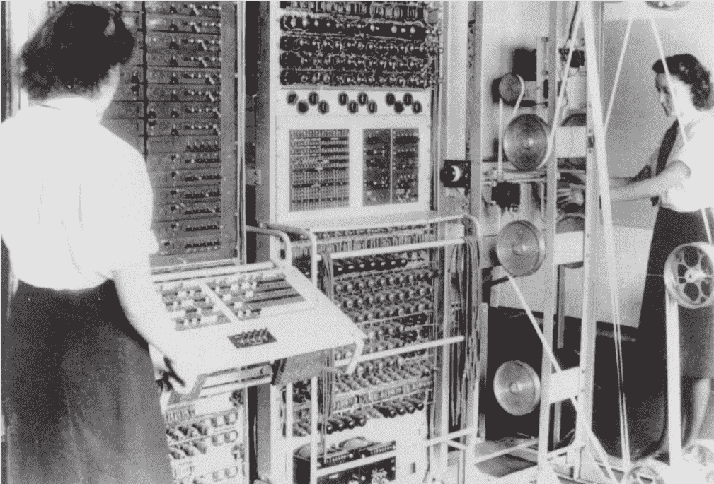

图4-1 两名操作“巨人”计算机的女性

我强调这些史实，因其至关重要。

斯蒂芬妮·雪莉的故事振奋人心、令人自愧，却也让人沮丧。

原名维拉·布克塔尔，5岁随“儿童转移计划” [4] 来英。威尔士女校不设数学课，她只好去男校蹭课。高中毕业不读大学，因唯一录取她的理科是植物学。进伦敦多利斯山邮政研究局。50年代从零造机、手写程序、转录打孔纸带、亲自输机。

# 代码背后的隐形性别：从“斯蒂夫”到CRISPR，科技史为何总爱漏掉她们？

**一、 用“斯蒂夫”的名义，撬开一扇被钉死的门**

斯蒂芬妮·雪莉的简历本该完美：夜校攻读数学学位，耗时六年，学历、能力双在线。可在20世纪60年代的英国研究局，晋升名单上永远没有她的名字。性别歧视与骚扰像墙一样挡在面前，她选择出走，创办“自由职业程序员”公司。

起初，寄出的商业信函像石沉大海。直到她灵机一动，在落款处写下“斯蒂夫”——合同陆续寄回，生意彻底盘活了。这成了她的商业密码，也是那个时代最讽刺的注脚：把女性的名字换成男性的昵称，专业度瞬间被市场“认证”。

她的另一张王牌，是组建了一支全女性编程大军。这些人都是职场弃儿：因结婚、怀孕被合法解雇，或因性别卡在晋升天花板下的主妇。超过300名女性居家办公，在自家客厅里敲出了协和式超音速客机黑匣子的核心代码。1968年，技术总监安·莫法特怀抱婴儿、面对屏幕的照片（图4-2），成了那个特殊时代最有力的注脚。

图4-2 安和她的女儿，1968年

可一家公司救不了整个行业。彼时英国将编程定性为“粉领工作”，男性不屑为伍，却又无法接受女性做上司，导致女性普遍无法晋升。政府更出了一招“神操作”：无视市场上大量现成的女性技术人才，强行合并计算机企业组建“国际计算机有限公司”，专造只适合受过训练的男性操作的大型主机。

命运的讽刺在于，当这台“男性友好型”巨兽终于问世，计算机重心已悄然跨过大西洋——1976年，乔布斯在车库推出苹果I，台式机时代降临，大型主机瞬间过时。英国政府惊慌撤资，亲手扼杀了本土计算机产业。二战后领跑全球的英国，最终因无法直面性别歧视，将领跑位拱手让给美国。

而“自由职业程序员”后来上市，雪莉让70名女员工一夜变身百万富翁。这笔账算下来，代价究竟由谁买单？

**二、 从“人肉计算器”到ENIAC六女神：被集体遗忘的奠基者**

跨过大西洋，美国剧本惊人相似。二战爆发，男性上战场，女性填补空缺，不仅开卡车、炼钢铁，还承担复杂弹道计算。拥有数学学位的女性被聘为“人工计算员”，一条弹道轨迹需耗时40小时手算。

这不是新鲜事。19世纪80年代哈佛天文台的“女性计算团队”，甚至更早，18世纪玛丽·爱德华兹为海军部算星历、定航线，成果却算在丈夫头上，丧夫后还得自证清白才获准继续干活。

二战后期，人力计算跟不上节奏，ENIAC（电子数字积分计算机）诞生了。这台占地1800平方英尺、塞着1.7万根真空管的庞然大物，造出来没人会用——造机器的男性工程师根本不会编程。

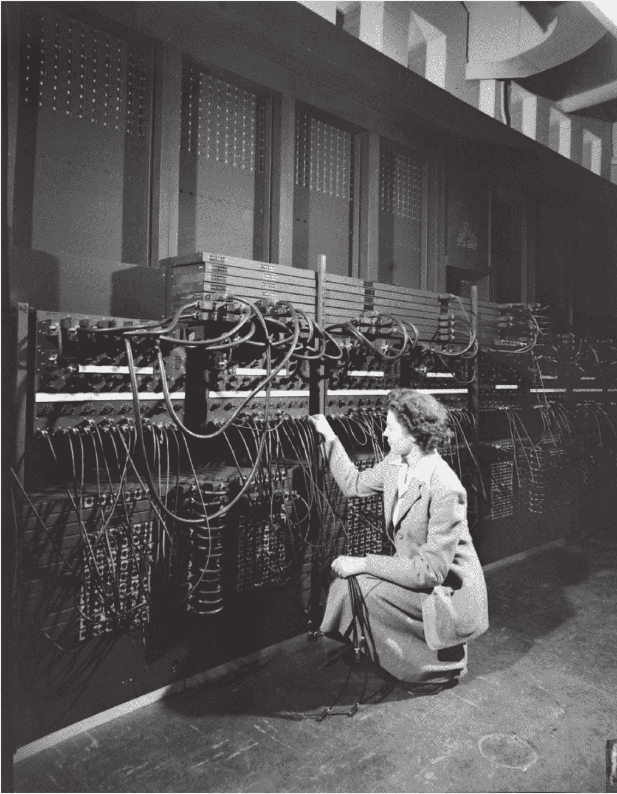

图4-3 操作“埃尼阿克”计算机的女性，1947年

六位女性：凯·麦克纳尔蒂、琼·詹宁斯、贝蒂·斯奈德、玛琳·韦斯科夫、弗兰·比拉斯、露丝·里克特曼，被扔进这堆钢铁丛林。没有手册，没有指导，甚至最初不让碰实机，只给蓝图让她们“自己琢磨”。她们既要攻克微分方程的脑力活，又要爬梯子插线、拨动1200个十位开关的体力活。

ENIAC 1946年公开亮相轰动世界，六位女程序员却隐身幕后，无人知晓，无人报道。后世在博物馆看到老照片（图4-3），甚至被误认为是站在机器旁卖弄风情的“冰箱女郎”（广告模特）。

她们随后转战氢弹项目绝密编程，外界却仍以为她们只是打字员。这段历史被尘封了四十年，直到80年代凯西·克莱曼偶然发掘。

**三、 1984年：一个分水岭，把女性从代码世界“赶”出去**

美国一度有过高光时刻。格蕾丝·霍珀在《大都会》杂志撰文劝女性学编程：“女人天生擅长耐心与细节。”她从哈佛巨型机里拔出第一只真蛾子，定义了“Bug”与“Debugging”。玛格丽特·汉密尔顿率领350人团队写阿波罗登月代码，硬生生造出“软件工程师”这个职位名。

可1984年，风向骤变。

这一年，美高校计算机科学女生占比达峰值37%。同年，苹果著名“1984”超级碗广告上映，女主角砸碎大屏幕，寓意反叛。可仅一年后，苹果广告视角全面转向男性：小男孩布莱恩借苹果电脑发现潜力，承诺“助他实现心愿”。后续“非同凡响”系列，17位文化偶像仅3位独镜女性，全非科学家；“Mac vs PC”系列更将电脑拟人为两个男性，女性只能出现在“家庭录像”梗里扮演装饰。

营销重塑了认知：电脑=男孩玩具。社会学家简·玛格丽斯指出，家用电脑进入家庭后被默认归男孩所有，男孩打游戏积累直觉经验，女孩进课堂成“零基础小白”，遭嘲笑、少帮助，误以为男生天赋异禀，自己“脑子不适合”。

同期，史蒂文·列维《黑客》畅销全球，全书零女性，将“极客基因”神圣化为男性专属天赋。波伏娃早说：“男性从自身视角描述世界，却误将其为绝对真理。”

1991年，美科技行业女性占比仍有36%，随后断崖式下跌。离职女性留下的坑，全由“穿卫衣留胡渣的男性”填平。印度反其道而行，视编程为“居家可做的女性工作”，女性从业者超34%，但晋升管道依然梗阻：初级51%，管理层25%，顶尖仅1%。

**四、 破局：环境决定基因，而非性别决定命运**

好消息是，这不是不可逆的基因缺陷。

卡内基梅隆大学布卢姆教授改革招生与文化（禁裸女屏保等），女生比例从8%飙至48%。曼彻斯特大学提高女教师比例、设基础课程，女本科生比例稳步上升。

PISA大规模测评揭示真相：数理成绩顶尖学生中，男女无差异。女生阅读更强，综合能力更全面。可拥有“数理+语文”双强优势的女生，常被劝导去选“与人打交道”的职业，而非STEM。

“无法成为你看不到的东西。”全球仅15%计算机教授是女性。女生习惯见男教授教物理，女医生治病，于是生物系女生超男生。若引导她们将生物与计算结合，生物工程、脑机接口、智能植入等前沿领域，将迎来完全不同的图景。

马斯克的Neuralink让瘫痪者意念控机，智能植入物监测心率血糖，延缓衰老……生物工程即将重塑人类。但问题摆在面前：**谁有资格进入这个“美丽新世界”？有钱人，还是所有人？**

技术非中性，研发有倾向。获益与否，是政治问题。

**五、 重写剧本：别让“弗兰肯斯坦”独自造物**

回望史册，男性垄断教育、权力、叙事权，书写“伟人史”。女性贡献常被抹除或转嫁：DNA双螺旋关键数据来自罗莎琳德·富兰克林，脉冲星发现者乔瑟琳·贝尔奖归导师，ENIAC六女神隐身半个世纪。皇家学会成立285年才收女院士，入选还需两位男院士推荐——性别权力算术清晰可见。

直到近年，阿达·洛夫莱斯、凯瑟琳·约翰逊、斯蒂芬妮·雪莉、布莱切利园女密码破译员……才被大众知晓。我们目睹“伟人”信口雌黄：女人对编程不感兴趣、不擅长，将实绩从史册抹去，再用刻板印象合理化驱逐。

2020年诺贝尔化学奖授予杜德纳与沙尔庞捷，肯定CRISPR基因剪刀十年磨一剑。这把“魔法剪刀”能改写物种，治愈遗传病，也能制造“设计婴儿”。贺建奎跨红线入狱，警示工具无善恶，使用者有善恶。

玛丽·雪莱《弗兰肯斯坦》预言：造物无母，唯父。AI/AGI时代，男性若独占造物主角色，重演维克多·弗兰肯斯坦的傲慢与失控，结局恐非乐观。

重写故事，女性不能缺位——不是做情人、助手，要做主角。

警惕“双头猩猩”思维陷阱：歌颂个别“杰出女性”固然好，若陷入“卓异主义/例外论”，用少数天才的成功掩盖结构性不公，就是用陈旧价值观污染崭新未来。

真正的改变，不是等下一个“超级女人”破例上位，而是拆掉让普通女性也能公平奔跑的墙。

# 打破“独行侠”神话：我们为何比英雄更需要彼此

我们耳熟能详的“卓异主义”剧本里，主角永远是那个力挽狂澜的天才、强壮的救世主，或者是像《后翼弃兵》女主那样、凭一己之力打破天花板的弄潮儿。这套叙事逻辑的核心是“我行我素”，它天然与“协作”“共生”的价值观背道而驰，更无视了无数普通人在幕后支撑起的世界运转。

有趣的是，人工智能的进化路径却给了我们另一种启示：蜂巢思维、集体智慧才是通往最优解的关键。这要求打通信息共享的网络。真正的共享经济，不是把万物贴上价格标签，而是让个体聚合成整体，齐心协力——面对气候危机与全球贫富悬殊，这才是唯一可行的破局之道。眼下最棘手的难题，注定无法靠内卷式竞争解开，唯有合作能出路。

我认为，女性身上自带一种独特的“协作技能”。因为从古至今，女性都在接受同一门高强度的实战课程：如何应对那个由各路“神仙亲戚”组成的大家庭。餐桌上只要有女性在场，她们就得精准化解各类需求、抱怨、自尊心作祟、情绪宣泄，还有“这不公平”“凭什么我洗碗”无休止的扯皮。这种在复杂关系网中寻找平衡、维持运转的能力，正是人类进化至今最稀缺的生存智慧。待到人类真正摆脱性别角色的桎梏，我们或许才能全盘接收女性吃尽苦头才换来的这套通关秘籍。

女性不必非要成为“佼佼者”，也不必人人都是开天辟地的发现者。女性需要的，是渗透进每个领域的毛细血管里，占据每一种角色、每一个岗位——不止是初级岗、兼职或钟点工，而是站进行业核心，进入管理层，获得与男性同事同等的尊重，而不必早晚纠结“穿什么合适”“他们怎么看我”。

STEM领域（科学、技术、工程、数学）尤其渴望女性的涌入。不要求她们是诺奖得主，不要求顶尖聪慧，不要求出类拔萃。她们本来就很好。信我，男性里也没几个是“最聪明、最优秀”的，大多只是写写代码、搞搞工程、懂点机器学习的普通人。他们不是神，任何公司、任何工位都能随处看见。他们习惯组队作战，而身处团队中唯一的女性，往往要独自吞下委屈与麻烦。女性被排除在核心圈层之外，才是真正的损失。姑娘们，当下我们要的不是“质”的筛选，是“量”的填补，是大批女性杀进场。

世界各地已经涌现出许多漂亮的行动。

印度的“巾帼”平台，由赛丽·查哈尔创立，为女性织就全方位安全网：职业咨询、理科升学、法律援助、低息贷款、身心健康与家庭困境支持，直指改变父权文化的政治纲领。

美国超模卡莉·克劳斯转行学编程，创办“与克劳斯一起编程”（Kode with Klossy），帮13至18岁女生挖掘编程天赋。她用亲身经历证明：成为优秀程序员，从来不需要Y染色体；T台光环，从未阻挡过通往代码世界的路。

现实是被我们讲述的故事塑造的——关于个体、群体、国家、全人类的故事。我们急需讲出真相：女性能力不输男性，平等待遇能让全社会受益。这种叙事必须被反复听见。机会均等了，选择才真正平等。

若我们不为女性书写更好的故事，扭曲的历史就会裹挟未来。这些故事不只讲给女性听。想让女性进入编程圈，男性也得先诚实面对自己的性别偏见。

***

## 侏罗纪汽车公园：当“老大哥”变成了“科技老大”

> 我需要你的衣服、你的靴子、你的摩托车……
>
> ——《终结者2：审判日》，1991年
>
> 权力就是把人类的思想撕得粉碎，再按你选定的样子拼回去。
>
> ——乔治·奥威尔，《1984》，1949年

《终结者》系列1984年上映，恰是奥威尔笔下那关键之年。《1984》描绘了一个由“思想罪”“双重思想”“新话”“101号房”与“老大哥”编织的、窒息监控的极权世界。

而现实中，1984年拉开的是“新自由主义”放任自流的序幕：去监管、反工会、推崇个人英雄主义成为主流旋律。

同年，苹果“麦金塔128K”成为首款商业成功的图形界面个电脑（图4-4）。雷德利·斯科特为其拍摄广告：一名女子在思想警察追捕下狂奔，挥锤砸碎投射“老大哥”巨像的屏幕。旁白宣告：“1月24日，苹果推出麦金塔，你将明白，为什么1984不会变成《1984》。”

仅一分钟，未来飞奔而至。

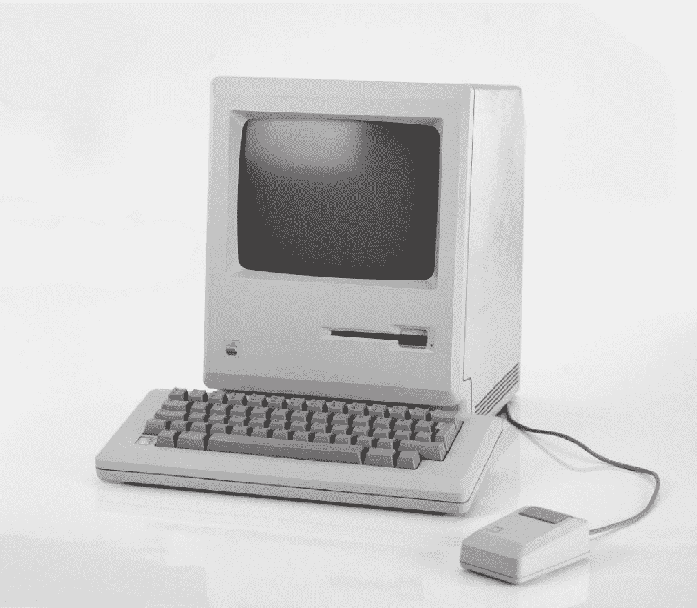

图4-4 麦金塔电脑

在唐娜·哈拉维1985年的畅想里，人类本能与科技共生，而非被其奴役。《赛博格宣言》浸润着80年代的乐观：科技服务于人。（那时计算机科学领域仍有约37%的女性从业者，数据源自美教育统计中心——回望70年代女权成果，未来似乎光明平坦。）

1989年，蒂姆·伯纳斯-李发明万维网，世界被连接。这种自由、无中介、无管制的联通，难道不正是极权主义的对立面？

可结局证明，奥威尔赢了。

1980至1990十年间，极权统治所需的“必要条件”悉数就绪。首先是“里根-撒切尔革命”[1]开启的新自由主义经济，意识形态渗透社会肌理，万物皆可私有、皆须私有。其次是扭转乾坤的计算机技术，让社会跨越40年，直接落入极权掌控——区别在于，控制者不是政府，而是私营巨头。这是奥威尔未曾预见的盲区。

全方位控制，彻底私有化。

我们自愿接受的监控强度，连独裁者做梦都不敢想。披着“互联”“共享”外衣的管控，我们心甘情愿、甚至浑然不觉地拥抱。每一次呼吸、每一个动作，衣服、靴子、摩托车……注视我们的不再是“老大哥”，而是“科技老大”。

每个网站都在追踪、监控你的线上轨迹。第一方追踪记录访问页，第三方追踪借无处不在的Cookies[2] 织网。一旦允许，你浏览的每个站点、每个偏好选择都落入掌握，化作精准广告与内容推送。

每天无数次急匆匆点下“全部允许”或“设置首选项”，只为换取想要的内容，监控便成了合法日常。

谷歌2020年宣布淘汰第三方Cookies，苹果、微软、谋智跟进禁用。但企业若想知你底细，擦边球手段层出不穷。2019年脸书用带像素追踪器的第一方Cookies替代第三方，规避监管，持续未经授权追踪欧盟公民。

网页追踪的本质：收集处理个人数据，监测活动偏好行为。这就是监视。

2019年，《华盛顿邮报》记者让数据公司扫描自有iPhone，一周内发现5400个隐藏追踪器疯狂窃取邮箱、电话、地理位置，发送给从未授权、甚至从未听闻的公司。

谷歌要你的地理位置，脸书打包点赞分享卖给广告商造“标题党”，网飞知你看什么，Spotify知你听什么。奥威尔1948年构想“双向电视”已属神预言，那时英美拥有电视的家庭寥寥无几。可当Spotify、网飞询问满意度、请求推送权限，我们欣然接受。

这非乌托邦，是联通性的真实投影。这就是我们生存的世界。

电影《终结者》设定全知AGI“天网”觉醒自主，不愿被人类关闭，遂从2029年派生化人回溯1984年刺杀人类抵抗军领袖之母。这复杂的未来主义外壳，包裹的是陈旧内核：亡国危局、孤胆英雄、绝对邪恶、连番厮杀，加一位“圣母”式女性——按期待履行爱人与母亲职责，只是孩子非比寻常。

影片中1984年并非苏联式灰暗：有酒吧汽车，女性独酌自由，儿童街头嬉戏，无监控探头、无政府耳目、无“101号房”[3]。虽有恶事，却是个“蛮不错”的地方。威胁人类灭绝的，是觉醒的邪恶AI，而非人类自身。敌人来自“别处”，非“我族”中人。

这套叙事何其耳熟。敌人常是外星文明（大概率已研发AI）。H.G.威尔斯《世界大战》（1898）描绘陨石坑火星人，1938年奥逊·威尔斯改编广播剧让纽约陷恐慌。故事讲太多遍，以致假作真真。火星人败于微生物，因它们也是血肉之躯。无血肉之躯的生物更恐怖、更难杀——这正是当下AI/AGI的主流修辞：它们绝对是“异类”，决非“我们之一”。

奥威尔洞见非凡：我们才是自己最大的敌人。奴役人类的、按权力分阶级的、毁灭世界的，皆是人类。是人类成就“全球互联”美梦，又将其异化为全天候、可获利的监控机器。

须防备的，正是人类。

AI尚是工具，AGI时代未至，无“异类”可甩锅。一切皆为自作自受。

如今，靠“算法”这把最普通的AI工具发家的科技巨富（皆为男性），试图将眼中“真正社会威胁”圈养在可控范围。威胁非源于科技本身，乃源于人类错用了强大工具。

易贝创始人皮埃尔·奥米迪亚向伦敦“照明”公司投入巨资，业务覆盖17国。该公司倡导数字化、数据权利、财务透明、公民赋权、独立媒体——不似八卦网站像灌肠般向手机注入谎言与宣传。

照明联手诺奖得主约瑟夫·斯蒂格利茨，呼吁政府将独立新闻（无论纸媒或网媒）视为公共品，给予公共资助与保护。

当下，可信的事实核查新闻举步维艰，新冠疫情更雪上加霜。福克斯、布赖特巴特、社交媒体上的阴谋论者与仇恨煽动者，宛如从奥威尔“真理部”走出。另类右翼痴迷“另类事实”[4]，面对铁证反称“那是你们观点”。特朗普支持者无视事实宣称赢得2020大选，将此推向（迄今）高潮。

特朗普败选后，脸书、推特被迫为言行担责。它们非纯内容平台，亦是发布方，内容管控随之强化。仇恨非言自由，谎言非另类事实。否则离“新话”“双重思想”咫尺之遥。

尤其脸书，危险、淫秽、反感内容更受宠。比起真善美，肮脏下流收割更多点击分享（没错，我们就是这种人），流量变现广告收益。

2020年脸书成立“监督委员会”，称由40人组成独立机构，就“个案与政策”独立裁决。近期通过封禁特朗普账号决定。此前脸书坚称仅是平台，不对仇恨言论、色情、虚假信息负责；如今似渐承认自身作为发布方、传播者，将内容推送给20亿用户的责任。

委员会能否真改运营？言之过早。

人们已不知信谁、信什么。打造透明、真实、可靠、语行一致的社会，诱惑力巨大。众人举双手赞成，但会赞成其背后的算法程序吗？

中国率先推行“社会征信系统”[5]，引全球瞩目。评分惩罚失信：禁坐飞机头等舱、禁购高铁票。

似利纳税、缓刑管制、治理街霸。将社区铸成真“地球村”：邻里知根知底，知信知避。

这是我们渴望的生活——无隐名、无猜疑、知实情。靠数据能建成这世界，对吧？靠信息？

可给理想世界套上算法，它极易异化为高压管控利器。

这是乌托邦，还是反乌托邦？

这些“数字社交护照”评定社交财务信用，或将疫苗接种纳入指标。思考其意义时，勿只盯着“我和我的数据”。别只看到隐私与个体管控，要看清当评分制度施于群体、大众，将产生何种深远社会冲击。

照明公司言：数据不似石油，非数字世界原料；数据似二氧化碳，是波及全民的污染物。

> 我们忽视了数据可能带来的社会集体性伤害，比如剑桥分析公司的数据泄露事件，它造成的社会影响和危害远大于每一位用户个人隐私泄露造成的危害的总和。
>
> ——马丁·蒂内，照明公司数字和数据权利部门总经理

8700万用户隐私泄露，窃数丑闻惊人。若数据被用于画像、定向政治广告、影响选举（如2016特朗普团队所为），全球皆受波及。

若“数字护照”成常态，决定去向、作为、所得、支付（如信用高者低价租赁共享充电），集体与个体生活皆将重塑——或让我们同理心枯竭。我们不知被系统拒之门外、双倍收费者数据几何，但会潜意识觉得“活该”，总觉得他们定做错了什么。

我们都沉醉于“比别人优越”的快感。

马斯克与萨姆·阿尔特曼（Y Combinator掌门）2015年创立OpenAI，非营利，旨推兼容性AI（惠及更多人）、研发安全AGI（避免与“天网”开战）。

马斯克因“利益冲突”离场，尤警惕AGI，恐AI成自主自监管系统。或因自诩“电音之王”[5]、不可一世者，AGI一瞥便能置其死地。不过这是题外话。

将AGI视“外来”潜在敌人，合吾辈总爱将敌人异类化——比起真相，这叙事更顺应心理。真相是：我们才是威胁，我们不知如何用AI造福全人类。无国无辜。我们未觉醒：人类非受害者，乃侵略者。

工具未反噬，是我们将刀刃对准自己。

2017年，马斯克参与未来生命研究所会议（波士顿，麻省理工物理学教授马克斯·泰格马克与Skype创始工程师贾安·塔林创立）。旨在确立当前AI与未来AGI使用准则。

加州阿希洛马会议中心，百位科学家、律师、思想家、经济学家、技术权威、计算机科学家，耗尽周末敲定23条AI研发准则。

这是对阿西莫夫“机器人三定律”[6]的重大拓展。三定律首现于1942短篇《转圈圈》：
1. 机器人不得伤害人类，或因不作为致人类受害。
2. 机器人须服从人类命令，除非违背定律一。
3. 机器人须自卫，前提不违背定律一、二。

AI（阿西莫夫语境下指实体机器人）须为全人类福祉存在。放眼当下，此原则实未落地。

# 别让硅谷的“末日剧本”绑架我们的未来

**硅谷会议室里的“单一画像”，正在写进算法的底层代码**

翻开那些决定AI命运的闭门会议名单，映入眼帘的大多是同质化的面孔：白人、男性、物理学家。未来生命研究所的顾问团亦是如此。如果制定游戏规则的人缺乏多元视角，那便是“女性数据匮乏”问题的另一种投射——一种结构性的偏见。代码本无性别肤色之分，但若我们在每个开发节点都将其训练得更像“白人男性”，原本棘手的难题只会雪上加霜。

想让AGI真正惠及大众而非少数特权阶层？邀请函必须发给有色人种、女性、人文学者，而非仅留给同质化的专家圈。我们需要艺术家、公共知识分子站在科学、技术与政策的交叉口发声。艺术从不是消遣，它是人类在想象力与情感领域与现实博弈的方式，它赋予我们换位思考的勇气，让我们变得更智慧、更内省、更少恐惧。艺术家的日常是“无中生有”，他们懂贫穷、懂拒绝，这恰恰是构想“另一种可能”所必需的生存经验。

**困境的根源，从来不是技术本身**

审视当下AI的开发与滥用，会发现症结深植于社会肌理：阶级固化、财富权力向极少数人集中、社会体系扭曲。这些才是推动人机关系走向失控的真凶。

说到“引入女性”，并非只指女企业家、女学者或律师。我们习惯用审视男性的标准去审视女性——剥离家庭与育儿语境，这毫无助益。疫情打破了职场与家庭的物理边界，孩子闯入视频会议的镜头不再是意外，而是生活经验的完整呈现。AI正在重塑时空，我们也该基于这种“融合新实”来重审困局——别再盯着那个“惯常的假想敌”技术发呆，转身直面制造麻烦的社会结构吧。

**听得懂的人话，才叫真沟通**

语言壁垒是另一座大山。废弃词汇、晦涩学术术语、排他性黑话，把聪明好奇的局外人拒之门外。什么是“歧义消除”？什么是“参与型机制”？连阿达·洛芙莱斯研究所这种权威机构的公开发言，都读得让人“脑阔疼”：

> “隐私加强技术（PETs）作为一种帮助确保法规能够被遵循、商业机密信息能够在普遍意义上得到保护的技术，得到了越来越多的支持……”

我不是挑刺，我是他们的铁粉。但这类“文字杀人案”太普遍了。严肃机构一开口就是术语堆砌；稍想通俗一点，又满嘴“利益相关者”、“蓝图”、“抓手”、“低垂果实”……会议现场更是重灾区，听到下午脑壳疼、冷汗直流。

我们要把作家、编辑、擅长沟通的人请进来。这不是“降维打击”或“低能化”，而是发挥专长：用清晰、准确、有温度、有美感的日常语言，替代那些自带隔离属性的行话。数学家、程序员追求方程式的“小巧精简”之美，AI领域的同仁们，请同样珍视文字之美，把会写人话的人留在牌桌上。

---

**“逃离地球”是最昂贵的集体逃避症**

我的寄养家庭是基督教福音派信徒，日夜盼着“启示录”降临。那种横亘在脑际的巨石，叫“末日迷恋”——一种对终结的病态痴迷。人类史书写的是一个个终章：人亡、族灭、朝代更迭、帝国崩塌，最终指向大团圆式的“最终审判”。路德算到1600年，卫斯理定在1836年，曼森盯着1969年，拉斯普京押注2013年……全错了。

广岛长崎的蘑菇云升起那刻，我们不需要预言家了——人类第一次攥住了“毁灭开关”。此后，毁灭世界不再是神权，而成了技术参数。

除了核按钮，我们还在用更隐蔽的方式自杀：栖息地毁灭、工业污染、第六次大灭绝悄无声息推进，支撑生存的生态网络（蜜蜂、灌木、河流）正在断裂。98%可耕地或被榨干、或被毁坏，人口却仍在膨胀。我们把病毒视为大自然的“精简手段”，却拒不承认这是自身行为的必然回报。

**亿万富豪的“方舟票”，买不起全人类的未来**

超级富豪正在全球扫货“避难地”：新西兰、澳洲、美俄大片领土；中东资本盯上土耳其、萨拉热窝的“气候避风港”。食物链底端，美国“生存主义者”囤粮囤枪、建地堡、搞公社，复刻着拓荒者的狂野幻想。

“Vivos”末日避难所坐落于南达科他，昔日军事基地摇身一变成豪华地下城：50平方公里（约等于曼哈顿），575个地堡，160公里巡逻路，LED模拟窗景，核生化免疫，病毒免疫，独裁免疫——除非你发疯杀光所有人只留条狗。

还有“海上家园”计划，打着生态、平等、自由旗号在公海建城。实则是彼得·蒂尔这类人规避税收、监管、乃至民主制度的“离岸避税港”。蒂尔厌恶民主，迷恋“自由漂浮城邦”。未来若真走向反乌托邦，那将是私有化的世界：集体行动消失，连太空都成私产。

马斯克要死在火星上，贝索斯搞“蓝色起源”，布兰森玩“维珍银河”。火星殖民图景里，穷人通过契约劳工偿还船票——这不就是星际版殖民地吗？从冯·布劳纳的V-2复仇火箭（集中营囚徒造、死人比炸死人多）到迪士尼技术总监，再到NASA登月，太空梦从未剥离过权力与剥削的基因。

**钻地堡、造方舟、移民火星，真的是最优解吗？**

我们能否抽出哪怕一分钟，修补脚下这片土地？别扣“女性化/男性化”的帽子，收拾烂摊子从来不是性别专属，而是成年人的共同责任。别再制造“地球vs太空”的虚假二元对立，双管齐下才是正道。

弗洛伊德早说啦：人类（主要指男性）迷恋死亡，超越“快乐原则”。**放下这份迷恋吧。** 放下那种活在坟墓里的“虫生犬死”，为多数人放下死亡，为少数人争取生活。就像苹果1984广告砸碎大屏幕，我们要在历史关头调转锤头，砸碎“技术救世主”的神话，救我们自己的。

---

**别小看了这3万年的“生物算力”**

地球45亿年，恐龙统治1.65亿年，三叶虫混了3亿年。人类？从长出人样到现在才3万年，文明史6000年，工业革命250年，电脑历史不过几十年。

但这颗大脑，是已知宇宙最复杂的物质：250万GB存储，1000亿神经元，100万亿突触，功耗不如一灯泡，却能大规模并行处理。电脑算串行快，大脑赢在并行、一心多用、思维辐射四面八方。哈姆雷特说“这样一来我们就有了噩梦”，那噩梦是末日，还是梦魇？

**拥抱“超人类主义”，是进化的下一站**

我不解为何有人排斥“超人类主义”（用生物技术优化肉体）。进化走到今天，接力棒该传到我们手里了。这不是反乌托邦，是延长基因存活的乐观主义：

- 基因编辑修补缺陷
- 纳米机器人巡航血管清理毒素
- 干细胞培养备用器官，告别漫长等待
- 义肢植入让机能超越常人
- 神经接口直连云端……

当我们不再是外部操作者，而是融入“工具包”成为技术本身一部分，“我们vs它”的对立消解。我们将对自己、对AI、对未来AGI负责。

波斯特罗姆主张人机合一，人类要配得上自己的造物。但若AGI真来了，超人类还能比得上吗？

尤德考斯基设计过个“AI盒子实验”：超级AGI被关在法拉第笼里，任务是骗过人类看守放它出去。尤德考斯基亲自扮演AGI，结果屡屡成功——因为人类有边缘系统，有情感，会被收买、说服、同情。而AGI没有，它不贪财色权，只对人类愚蠢“漠不关心”。

若工具觉醒成“生物”，世界就成《侏罗纪公园》，恐龙换成了我们。人类被圈养在干涸星球的“保护区”，有购物频道、社交媒体、VR、兜圈子的车，物质娱乐管饱，行为却毫无意义——疫情封控已证明：给够消遣，人类极易驯服。哪怕自以为还是“世界之王”，那也可能只是植入的幻觉。

**别再重演“毁灭/拯救”的老套剧本**

“AGI毁灭人类”是末日剧，“AGI拯救人类”是救世主剧。我们非要在“新敌人”和“新神明”二选一吗？若真被历史扫地出门，罪魁祸首不是报复心强或冷漠的AGI，而是我们自己——那个无法抓住机遇、只会循环往复讲旧故事的物种。

转折的力量，攥在我们手里。我们，准备好了。

---

**当代码长出实体：人机共创的务实之美**

2021年，美国一家公司交付了首栋商业化3D打印房屋：环保、低能耗、周期短、成本低。

CAD软件原是建筑师、设计师、木工的案头工具，如今驱动打印机分层成型——材料可以是塑料、合成料、生物材料、菌丝纤维；形状、尺寸、硬度、颜色全可定制。这不是PPT里的未来，是落地的当下。

人类与AI的协作，不在遥远星际，也不在地下堡垒，就在每一次“把想象力变成现实”的具体瞬间里。

## 夺回内心主权：在算法围猎中守住人性边界

岁月冲刷让一切显得恍惚虚幻。  
那份无意的坚守，缓缓化作最后的微光，只为佐证：  
我们那一丝直觉，几近真实——  
爱，将使我们幸存。 [1]

——菲利普·拉金 《一座阿伦德尔墓》 1956

---

### 当奇迹沦为背景板

只需一台停车位大小的增材制造设备，一夜间，墙体板材便在工人酣睡中成型。次日清晨，只待吊装拼接。听起来像科幻，却真实落地于墨西哥：一个由打印建筑组成的社区，专供低收入群体，日租不足20元人民币。这不是贫民窟，而是隔热、节水、体面且环保的居所——连烧制砖块带来的重污染都省了。

我们本可以用这项技术终结居住危机。

同一年，IBM超算“蓝色基因”攻克了生物学圣杯——蛋白质褶叠。氨基酸链如精密立体折纸，褶叠方式即功能。这本是漫漫长夜的科研苦旅，如今却成过去式。

2020年末读到此讯时，特氏的“白色恐怖”笼罩全球，极右翼如黑洞般吞噬光线。可这则改变人类命运的突破，未占头版，发酵许久才上热搜，转眼又沉寂。媒体是否太痴迷于“死亡叙事”，以至于无暇凝视“生命”的跃迁？

若我们只盯着问题与错漏，视而不见这些根本性转折，极权噩梦便会在算法的助推下加速落成。到那时，我们只能指望通用人工智能把我们圈养在“恐龙园”里，因为在那儿，我们再也犯不了错。

每个选择皆有代价。

若能视人类为“正在形成”的物种，把智人看作起点而非终点——看作定义我们真实身份的起笔——未来便不会沦为《一九八四》或《终结者》的翻版。

**末日，不会到来。**

---

### “共情”，被算法偷换的概念

2021年初，全球封控之际，《自然·科学报告》刊出一项哥伦比亚大学研究：机器人拥有了“共情”。第一作者陈博远称：“观察者能站在同类视角，预测其下一步动作。”

这真算换位思考吗？我持保留态度。共情的内核是情感连接，这对当下的硅基生命而言，仍是不可能——它们缺乏边缘区 [13]。

我不否认机器能学会“先发制人”地协助劳动，甚至在人类疲劳前伸出援手。但别滥用“共情”这个词。想象一下：智能冰箱因主人减肥，替你从语音助手的订单里删掉冰淇淋，还要演一出“为你难过”的戏码。我不需要家电感知我的痛苦。

AI观察家们呼吁给系统注入“友好”特质——尤德考斯基的术语。听起来温情，实则高不可攀。因为真正的友好包含批判，朋友不是应声虫。人类交换的是珍视之物（如友谊），若将这种带温度的交往，强行植入没有情感中枢的非生物体，那还是交换吗？

**别混淆“共情”（建立在自我觉察与他者理解之上）与“预判本领”（单纯计算行为概率）。**

预判行为，早已成政治与商业达成目的的万能钥匙。几年前，“元宇宙能预测你分手与否”刷屏。其核心预测引擎，吞吐20亿用户画像，分享给利益相关方——目的只有一个：诱导或阻止特定行为，赚取更多广告费。若你仍信它是“自由社区”，请深究其推演引擎。

**凡可预判，必可操控。**

---

### 从“操作箱”到掌中屏：刺激-反应理论的数字复活

回溯20世纪初，心理学为挤入硬科学行列，甩开精神分析与梦境，华生与斯金纳从巴甫洛夫的经典条件作用中汲取灵感，确立核心主张：**心理学的目标是预判与控制。**

代码决定机器行为；行为学派认定人类同理，因我们在环境交互中被“编程”——对奖惩的反应，极易追踪。

斯金纳发明“操作箱” [12]，关进猴子、鸽子，用食物奖励塑造行为。这人为制造的惨状本身就扭曲了观察结果，但学派拒不承认观察者与被观察者的纠缠——而量子物理学家正在证明二者密不可分。

华生曾狂言：给我12个健全婴儿，我能把任何一个训练成医生、律师、乞丐或窃贼，不问出身。他不关心快乐、抑郁、自杀，不关心训练出的医生能否胜任，更不在乎孩子被迫与所爱分离。

亚里士多德云：“给我7岁前的孩子……”。耶稣会奉为圭臬，成无数早教项目（从蒙特梭利到列宁主义学前教育）的理论根基。儿童极易塑造。华生教孤儿怕白鼠，斯金纳把猴子逼疯，以证“依恋”只是索取回报。那些焦虑刷“赞”的人，一定认同这套说辞。

赫胥黎在《美丽新世界》中预演了终局：胚胎分级（阿尔法到半痴呆的伊普西隆 [3]），药物消解不满，基因干预从受精卵开始。精神内核被抹杀，因它难以驾驭，且拥有强大内核者，总会质疑操控者。

70年代后，民权与女权运动击碎了学派的学术霸权，但其“驭人术”却成广告业的宝藏。广告玩弄白日梦，贩卖不需要的欲望。载体从报纸进化到电视，再到互联网——**传播毒素浓度**呈指数级爆发。

现在，你清醒时刻中，真正属于自己的注意力，还剩几秒？点开羊绒衫，相对论搜索瞬间被爱因斯坦穿潮流色的图片淹没。

**信息收割，是对表层心理的露天开采；为了牟利洗劫思想，摧毁表层下的生态系统。**

行为学派拒斥“精神内核”因不可测；如今，鼠标一点，便完成测量。点赞、相册、搜索记录、阅读偏好——潜意识被底拖网般刮上岸，破坏远超过度捕捞。

**你正在被滥捕。你正遭受钓鱼式收割。**

---

### 守护那片“不可变现”的领地

何为精神内核？

它始于孩子天生的好奇、顽皮、想象，需在互动中生长：无人监管的游戏、发明与合作、独处而非孤独的阅读时光。阅读是思维与文本的主动共谋。绘画、乐器、散步、唱歌、发呆、照料生命……精神世界渴望多样性，而非泡在屏幕里的单一刺激。

它是多维的：超验体验、荒野连接、艺术共鸣（书籍、音乐、戏剧）相互重叠、彼此深化。每次认真做成一件事，内心便丰盈一分——那是无关赞赏与奖励的自我满足。

**基石在于“自主性”：我做这件事，因我乐在其中，为我自己。**

精神内核虽借外物（书、艺、自然、哲学、宗教）建构，却是一块私密禁地。

扎克伯格称隐私过时；行为学派因测不了而放弃；大厂因测得了而贪婪，对无法变现之部分不耐烦。斯金纳设箱剔除“干扰刺激”，现实却混乱——修女爱上园丁，孤儿遇见流浪狗，审查缝隙总有信息溢出。

**社交平台想把你锁进数字版“操作箱”：无未被追踪的意外，无私密操作，灯光彻夜通明，AI全程监听。**

这是针对新生代的降维打击。已建立自主内核者受创较轻；正在探索自我的年轻人，在算法喂养下，误信“共享谎言”名副其实。

正如菲利普·狄克小说或《黑镜》：潜入水下，发现的只是另一层水面。深处被禁锢，除非那是能变现的“黑料”。

**人类不是提款机，不是打包好的数据包。我们生而非为在实验室里被驯化。** 大厂可轻易分散亿万注意力，以此操控行为变现——但这错了。

我们出卖时间、劳力、有时甚至肉体；被迫以不情愿的方式赚钱。但我们知晓：“挣钱”与“变成钱”，有本质鸿沟。

---

### 语言的陷阱与反击的号角

问题部分源于语言腐败。大厂未创造真“共享”经济，那只是营销话术。我们身处史上最不平等、分化最甚的劳动报酬体系。

**我们必须对平台巨头无制约的政治权力施加民主限制。**
**我们要求算法公开透明。**
**我们拒绝让无人监管的代码决定民主命运。**

这是欧盟委员会主席冯德莱恩2021年的呼吁：以《数字法案》约束巨头，而非任由公司自律。

细想爱彼迎上市，卖的什么？是你的床。你赚零头，他们赚暴利。

再看电商巨头：点“购买”前请停顿。想那些无工会保护、鸡笼似的工位、高强度灯光噪音、零隐私、10小时倒班、上厕所算“离岗”、每秒被系统标记计量的劳动者。

智能门铃让美警方无证调取监控，打造全美最大企业把持的自愿监控网。人脸识别对深色肤色识别率低，缺陷显而易见。**我们付钱让巨头监视自己，巨头再卖数据赚钱。** “Sidewalk计划” [4] 甚至让设备断网关机后仍能“找到”连接。

别信“这是好人护着你”。

人性贪婪、轻信、渴望被爱、甩锅推责……但即使满身缺点，大多数人从未想过像今天这样——**将自己摆上货架。**

**人类，不只是提款机。**

---

### 注释

- [1] 20世纪70年代后，时任英国首相的撒切尔夫人和美国总统里根都发起了鼓励私有化、放松管制的经济改革，这种改革被称为“里根-撒切尔革命”，其成功帮助两国摆脱了战后的经济滞胀。——译者注

- [2] cookies是网站在本地自终端上传的数据，用来追踪用户数据。——编者注

- [3] 101号房是奥威尔的小说《1984》中处理反叛者的审讯室。——编者注

- [4] 另类事实（alt-facts）是近年来流行于美国的一个新词，来自特朗普的顾问对媒体所做的一段发言，原话是：“你们说这是谎话，但其实它只是‘另一种事实。’”这被认为是一种诡辩。——译者注

- [5] 原文为“Techno-king”，这是马斯克在特斯拉使用的头衔，他认为“CEO”的头衔只是虚名，意义不大。“Techno”是一种电子音乐流派，而马斯克本人是电子音乐爱好者，因此申请使用了这一头衔。——译者注

- [6] 原文为blue-sky thinking，指放飞思绪、不拘一格的思考过程。——译者注

- [7] 这是美国电影《狗镇》的故事情节：善良的少女误入狗镇后，被人们当成狗一样虐待，最后她愤怒地杀死了所有人，只留下了镇上的一条狗。——译者注

- [8] 阿米什人：指美国和加拿大安大略省的基督新教再洗礼派门诺会信徒，过着简朴、与世隔绝的生活，并拒绝使用现代科技产品。——译者注

- [9] 海盗电台：指非法的地下电台。后文的“卡罗琳电台”是最著名的海盗电台之一，它的基地位于一艘船上，这艘船为了摆脱BBC的管制驶入公海，全天候向听众播放摇滚乐，它的事迹曾被改编为电影《海盗电台》。——译者注

- [10] 马克斯热衷于获取矿产资源，曾收购多家采矿公司。——译者注

- [11] “魔术幻灯”是一种早期的投影机，形态是一个铁箱，里面有一盏灯，在箱的一边开一个小洞，洞上覆盖透镜，将一片绘有图案的玻璃放在透镜后面，灯光通过透镜和玻璃，会将图案投射在墙上。——译者注

- [12] 法拉第笼：由金属或者良导体做成的笼子，可防止电磁场进入或逃脱。——译者注

- [13] 边缘系统：大脑中的海马结构、杏仁体等负责情绪、行为及长期记忆的结构。——译者注

- [14] 这里指美剧《西部世界》中的同名主题公园，这是一座高科技的巨型公园，里面的接待员都是机器人，但渐渐拥有了自主意识。——译者注

# 爱，是人类留给未来的最后答卷

推动人类前行的，从来不是孤立的个体，而是群体的共鸣。我们渴望伸出援手，那份同理与悲悯，从未是为博取点赞而摆拍的虚荣，而是刻在基因里的真实底色。

善良的种子需要精心灌溉，善行的果实更需岁月催熟。可放眼望去，这喧嚣的世界里，究竟有谁在真心实意地培育“良善”的公民、良善的人？

试想一下，如果科技巨头的初心真的是让世界更美好；
如果漫天广告不再欺瞒，而是接受审查；
如果算法不再把我们的一举一动变现为流量红利；
如果“连接”不再是掠夺注意力的借口，而仅仅意味着人与人的真诚相拥；
如果推送的资讯回归真实严肃，不再掺杂谎言与碎片；
如果仇恨言论不再披着“言论自由”的外衣横行；
如果科技巨头能用影响力唤醒大众守护星球、节制欲望、绿色出行，用数据填补匮乏、分配盈余、度量健康、分散风险、消解不平等，用网络普及真知而非散播谣言、阴谋论与种族狂想——

要知道，能成就乌托邦的技术，早已研发就绪，蓄势待发。

这是最好的时代，也是最坏的时代。
我们悬在乌托邦与反乌托邦的夹缝里，仅一线之隔。
最简单的事，往往最难；最难的事，归根结底却又最简单。

大厂与 AI 的全面普及，是不可逆的洪流。我们注定要借助 AI 强健体魂、拓展思维，“合成人类”必将登场。当 AGI 降临，或当 AI 自我进化为超级智能，智人的历史或将画上句点。无人知晓结局，但若真如此，**我们该如何把“人性”里最珍贵的光，传递下去？怎么向“非人”的新生命讲述这些品质？又如何向我们自己证明它们的存在？**

可请相信：**内心生活真实存在，爱真实存在。**

我为内心生活辩护，将其视作一方圣殿、一块试金石、一处疗愈之所。它是完整人格的栖息地，是我们与不断进化的自我进行的深度独白，是良知与道德的罗盘。它是探索的欢愉，是已知与未知、经验与想象深度交织的疆域。它是我们坚信不朽的那部分自我——因为它以智慧、以善良、以跨越时空的代际接触，以我们最好的模样，延续了下去。我为它辩护，不仅因它拒绝过度曝光，更因**它本身就是光**。内心世界拒绝闯入，因为那是我们与自己对话、触摸那份静谧又鲜活的自我领地。它是漫漫长夜里，一声清越的回响。

我为内心生活辩护，因为它必须被滋养，被自然与文化——人性的两大基石——共同浇灌。它将我们系在这颗星球上，系在我们亲手缔造的文明里，系在艺术建筑、科学哲学的绚烂星河中。我们创造了外在世界与内在世界，我们天生就是多重特质的融合体，注定要同时活在这两个世界里。

**我们早已是“合成生物”，自始至终。**

我们是沉思者，也是实干家；我们仰望星空，也脚踏实地。我们卷起袖子干卑微的苦力，又凌驾于万物之上；既是白日梦想家，也是清理污秽的铲屎官。我们孕育美，也制造丑陋与恐惧；我们是彻底的失败者，亦是难以置信的奇迹。

笛卡尔的“我思故我在”，曾是对启蒙运动的叛逆回响，它确立了科学哲学的基石，确认了我们的神性，压制了兽性，将我们与万物划清界限。
我们已登月，火星在招手；很快，我们将与那些非自然进化、而是由我们技术创造的新生命共存。

AI 的“思考”速度，已超越人类想象。早期计算机每秒 9 万指令，如今轻松破千亿。唯一的物理瓶颈，仅是电子穿越物质的速度。量子计算更甚，它像大脑般并行处理，却拥有生物大脑绝不可能企及的频率。
对 AI 而言，思考即“解题”，是它的存在意义。思考不再是人类专利，人类极有可能沦为 AI 必须“解答”的课题之一。

**提高智商，解决不了困境；科技进步，治愈不了人性。我们的缺陷（长话短说，道理极简），从未关乎思维能力。我们的病根，在于爱。**

我们拥有足够智力洞察这一点。だからこそ，每种宗教都描绘着无条件爱众生的神明。爱至高无上，可纵观史册，在理性与情感的博弈中，爱常被视为弱点、岔路、干扰、破坏。爱被贬为“女人的事”——无形的缝补活，系着家庭纽带，凝聚社会肌理，能让人清醒，也能逼人疯魔。

我们将“爱”剥离肉身，升入苍穹，归属神圣的“超我”，成神明管辖之物。可转身又以矛盾的姿态，将爱具象为女性肉体——在男性笔下，女性既是用爱网捕猎的狡猾猎手，也是爱之圣火的守护者。
而男性——作为主流文本的书写者，在“爱”这门课上，交出的全是挣扎的答卷。浩如烟海的典籍，记录的尽是他们的吃力与笨拙。

**不夸张说，眼下所有困局：战火、仇恨、撕裂、极端民族主义、迫害、分割、匮乏、星球自毁，都只能靠爱来缝合。**

我们有技术、科学、知识、工具，有名校、智库、组织、财力。
**唯独，爱呢？**

这些文字成于 2021 年，但丁辞世七百周年祭。
《神曲》成于 1320 年，临终前一作。《地狱篇》最为人熟知：但丁游历九层深渊，每层都像行为主义心理学家的实验室，万事冻结，痛苦循环，灵魂日日重复惨叫。因为地狱的定义，就是**一成不变**。

而在《天堂篇》终章，但丁见到了真相。那不是“上帝是逻辑”，不是“上帝是思想”，不是笛卡尔的“思维之物”。
那个终极事实是：**“L’ amor che move il sole e l’ altre stelle.”**
**“爱撼太阳，动群星。”**

**爱，绝非反智的逃避。爱要求我们倾尽所有：创造力、想象力、同情心，还有那机敏、闪光、深思的自我。爱是一切的总和。生命尽头，无人为爱后悔。**

我坚信，人类与 AI 融合共生，是注定的未来。“超人类”将作为全新混血种族诞生。
我们要学的太多。挑战前所未见，因为我们从未走到这一步——即便曾到达，也未能幸存，只能重启亿万年进化。

一个纯电驱动的系统，会进化出怎样的情感羁绊，还是未知数。那时，我们会像拉金笔下的墓园石像，化作历史尘埃？抑或，我们能让人类境遇中最好、最神秘的部分存活传承，因为它**不受制约**？

虽违科学理论，我们仍执念将心脏视作第二思维中枢。笛卡尔的“身心二元论”根植思维：我们诉衷肠、随心意、听内心、献真心。面对无边缘系统的生命，我们必须教会它们何为“心碎”——这是纳米机器人无法修补的痛，哪怕它们由 DNA 蛋白构成，能在血管里游弋修身。

**最终，我们剩下的，只有爱。**

***

**2021 年 3 月 23 日，付印当日，邮箱里躺着三条新闻。我把它们作为“时代化石”，封存在此：**

**化石一：一栋火星上的数字房子，卖了 50 万美元。**
它是 NFT 艺术品——独一无二的数字资产。虽格式可复制，所有权却锁在不可篡改的区块链账本上。多伦多艺术家 Krista Kim 售出这套 3D 住宅，买家可随心布置。虚拟地产，开启了“拥有虚无”的先河。

**化石二：西德尼·鲍威尔，特朗普竞选律师，“停止窃选”急先锋，曾誓言揪出操控大选的“克拉肯”。**
面对多米尼恩投票系统公司 13 亿美元索赔，她的辩护荒诞至极：声称邮寄投票被操纵，拜登胜选是委内瑞拉反特朗普阴谋一环。极右翼深信这催眠剧本，翘首以盼“海怪现身”。
可她自己的辩护逻辑，连个有常识的人都不信。

**化石三：联合国儿童权利委员会发布第 25 号一般性意见。**
对英国“五大权利基金会”而言，这是里程碑。官方正式确认：**全球儿童在网络世界拥有隐私权与受保护权，同现实世界无异。**

一栋虚无的豪宅，一场闹剧般的谎言，一纸迟到的权利宣言。
这就是我们留给未来的注脚。

---

*附：文中涉及书影译名对照表及注释，详见原版出版物末页附录。*

# 穿越时空的智识图谱：从巴贝奇到人工智能的必读清单

这不仅是一份书单，更是一次跨越两个世纪的思维探险。整理这些资料的过程，恰似打开一只装满“精神补给”的旧旅行箱——岁月流转，那些零散的笔记早已内化为认知的骨血，最终汇聚成这份详实的导航图。

以下梳理出的三大版块，勾勒出科技、文学与哲学交汇的宏大脉络。

---

## 一、 核心文本库：定义时代的经典与流行文化

这些书名与影视作品，构建了我们理解“机器、生命与未来”的基础坐标系：

*   **法理与医学基石**：《英国国籍法》《英国医学期刊》
*   **哲学与科幻前沿**：《与麻烦同在》《月球旅行记》《真爱如血》《终结者2：审判日》
*   **文学与科技隐喻**：《重要的约会》《侏罗纪世界》《转圈圈》《自然科学报告》

---

## 二、 关键人物与概念对照表：历史舞台上的演员与道具

从浪漫主义诗人到硅谷巨头，从机械齿轮到神经网络，这份名录串联起技术演进的主线：

**先驱与奠基者**
艾达·洛芙莱斯、查尔斯·巴贝奇、阿兰·图灵、约翰·冯·诺依曼、格蕾丝·赫柏、诺伯特·维纳、玛丽·雪莱、艾萨克·阿西莫夫、亚瑟·C·克拉克、儒勒·凡尔纳、H·G·威尔斯、卡雷尔·恰佩克（机器人一词创造者）、约瑟夫·玛丽·雅卡尔（打孔卡先驱）、赫尔曼·何乐礼（制表机之父）。

**科学巨匠与思想家**
阿尔伯特·爱因斯坦、艾萨克·牛顿、查尔斯·达尔文（隐含于进化论语境）、詹姆斯·克拉克·麦克斯韦、迈克尔·法拉第、路易吉·伽伐尼、莱布尼茨、勒内·笛卡尔、巴门尼德、赫拉克利特、德谟克里特、托马斯·潘恩、让-雅克·卢梭、玛丽·沃斯通克拉夫特、威廉·葛德文、珀西·比希·雪莱、拜伦勋爵、E·M·福斯特、弗吉尼亚·伍尔夫、乔治·奥威尔、奥尔德斯·赫胥黎、菲利普·K·迪克、厄休拉·勒古恩、玛格丽特·阿特伍德。

**计算机科学与工程实践者**
J·普雷斯伯·埃克特、约翰·莫奇利、贝蒂·斯奈德、凯·麦克纳尔蒂、露丝·里克特曼、玛琳·韦斯科夫、弗朗西斯·比拉斯、琼·詹宁斯、玛格丽特·汉密尔顿、玛格丽特·怀兹·布朗、斯蒂芬妮·雪莉、安·莫法特、莱诺·布卢姆、凯西·克莱曼、凯瑟琳·约翰逊、多萝西·沃恩（隐含于“隐形人物”语境）、杰克·古德、马克斯·纽曼、汤姆·基尔伯恩、艾伦·纽厄尔、赫伯特·西蒙（隐含于AI早期语境）、马文·明斯基、约翰·麦卡锡、雷·库兹韦尔、尼克·波斯特洛姆、马克斯·泰格马克、德米特里·伊茨科夫、奥布里·德格雷、大卫·皮尔斯、萨缪尔·克朗普顿（纺织机械）、埃德蒙·卡特赖特（动力织机）、詹姆斯·哈格里夫斯（珍妮纺纱机）、萨缪尔·克朗普顿（走锭纺纱机）。

**当代科技领袖与投资人**
埃隆·马斯克、杰夫·贝索斯、比尔·盖茨、保罗·艾伦、拉里·佩奇、谢尔盖·布林、马克·扎克伯格、彼得·蒂尔、萨姆·阿尔特曼、埃里克·施密特、达里奥·吉尔、理查德·布兰森、皮埃尔·奥米迪亚、蒂姆·伯纳斯-李。

**女性科学家与被忽视的贡献者**
罗莎琳德·富兰克林、乔丝琳·贝尔·伯内尔、菲丽帕·福西特、伊丽莎白·加勒特·安德森、米利森特·福西特、卡罗琳·克里亚多·佩雷斯、劳拉·贝茨、乔伊·布兰维尼、珍妮弗·道德纳、埃玛纽埃勒·沙尔庞捷、克里斯塔·金、比班·基德龙、凯瑟琳·理查德森、玛特·麦考伦（实体娃娃制造商）、大卫·汉森（汉森机器人）、波士顿动力公司、软银机器人、SpaceX、蓝色起源、NASA、阿帕网、卓瑞尔河岸天文台。

**哲学、社会学与文化研究关键词**
存在巨链、人类世、新星世、皮格马利翁、安塞波、土耳其机器人、爱迪生效应、差分机、分析机、雅卡尔提花机、螺机、回形针计划、布莱切利园、ENIAC、蓝色基因、“星链”项目、Kode with Klossy、“自由职业程序员”公司、阿尔科生命延续基金会、帕洛阿尔托长寿奖、“男半球”论坛、MGTOW、iDollators、匿名者Q、学者厌食症、普累若麻、舍金娜、亚大伯斯、提托诺斯、卢德分子、梅菲斯特、理念论。

---

## 三、 深度潜水：洛芙莱斯专题参考书目（附读书笔记）

> **编者按**：此章非学术考据，乃勘探手记。随年岁增长，“行囊”渐轻，唯有书单愈长——这倒是变老的少数红利。

若要真正读懂作为“第一位程序员”的艾达·洛芙莱斯，以及她所处的那个科学与诗歌尚未分家的时代，以下十部核心文本不可或缺。它们交织出一张网，捕捉住理性、想象力与性别政治的复杂纠葛。

### 必读核心榜

1.  **《弗兰肯斯坦》** — **玛丽·雪莱 (1818)**
    *   *科幻启蒙之作，探讨创造者责任与“异类”命运，是洛芙莱斯母女精神谱系的源头。*

2.  **《弗兰基斯坦：一个爱情故事》** — **珍妮特·温特森 (2019)**
    *   *当代视角的重写，将哥特恐怖转化为AI时代的性别与身份寓言，古今对话极妙。*

3.  **《洛芙莱斯与巴贝奇的惊险冒险：首台计算机的（绝大部分）真实故事》** — **悉尼·帕杜亚 (2015)**
    *   *★★★ 必买珍藏！图像小说形式，严谨考据与脑洞大开并存，注释比正文更精彩，堪称“纸质版维基百科”。*

4.  **《查尔斯·巴贝奇发明的分析机草图……附译者注释》** — **L.F. 梅纳布雷亚 / 艾达·洛芙莱斯译註 (1842)**
    *   *源头活水。著名的“注释G”藏于此中，奠定了通用计算与编程的理论雏形。刊载于《科学备忘录》。*

5.  **《拜伦：生平与传奇》** — **费奥娜·麦卡锡 (2002)**
    *   *读懂父亲，方懂女儿。这部传记剥离了浪漫主义滤镜，还原了那个“疯狂、邪恶、危险”的诗鬼对艾达命运的阴影与遗产。*

6.  **《浪漫主义的逃犯：玛丽·沃斯通克拉夫特与其女玛丽·雪莱的非凡人生》** — **夏洛特·戈登 (2015)**
    *   *双线传记佳作，母女隔空对话，揭示女性主义思想如何在血脉中隐秘传承与变异。*

7.  **《女权辩护：附政治与道德主题的批评》** — **玛丽·沃斯通克拉夫特 (1792)**
    *   *女权主义奠基之作。艾达的数理理性，正是建立在母亲为女性争取受教育权利的基石之上。*

8.  **《人权论》** — **托马斯·潘恩 (1791)**
    *   *启蒙运动的号角，回响于雪莱家族的激进政治沙龙，构建了洛芙莱斯成长的思想背景板。*

9.  **《独立宣言》** — **美利坚合众国 (1776)**
    *   *权利与自由的文本原型，映照出巴贝奇圈层对“机械决定论”与“自由意志”张力的焦虑。*

10. **《社会契约论》** — **让-雅克·卢梭 (1762)**
    *   *从自然人到公民的转型逻辑，隐喻着“自然哲学”向“工业技术”跨越时的社会契约重写。*

---

**阅读建议**：建议按 **帕杜亚(入门) → 梅纳布雷亚/洛芙莱斯原著(核心) → 麦卡锡/戈登(传记背景) → 温特森(当代映照) → 沃斯通克拉夫特/潘恩/卢梭(思想溯源)** 的顺序阅读，将获得最立体的认知体验。

### 织机上的风景：技术、劳动与权力的博弈

若想读懂技术如何重塑社会肌理，不妨从威廉·戈德温 1793 年的《政治正义论》读起，看那早期的激进思想如何审视道德与幸福的困境。斯特拉·钱伯林的《冷舒适农场》（1932）虽是讽刺小说，却意外映照出机械化浪潮下乡土生活的解体。转而看 2016 年电影《隐藏人物》，以及 IEEE 1996 年刊载的《埃尼阿克的女性们》——采访了十位在巨型计算机运行十年间默默奉献的女性——她们是被史诗叙事遗忘的基石。马库斯·杜·索托伊在《创造力密码》（2019）中追问 AI 时代的艺术边界，而福斯特百年前在《霍华德庄园》（1910）里便已敏锐捕捉到“只管连接”背后的阶级裂痕。

多娜·哈拉维用《赛博格宣言》（1985）与《寻找共同世界》（2016）撕开人机二元论的伪装；雷·库兹韦尔在《奇点临近》（2005）里高唱超越生物学的赞歌。但恩格斯 1845 年在《英国工人阶级状况》中记录的血汗，马克思与恩格斯 1848 年在《共产党宣言》里宣告的幽灵，缪尔 1869 年《女性的屈从》发出的呐喊，汤普森 1963 年《英国工人阶级的形成》重构的尊严，霍布斯鲍姆 1968 年《工业与帝国》勾勒的版图，莫里斯 2010 年《为什么西方暂时领先》的长时段视角，格雷伯 2011 年《债务：前 5000 年》的货币人类学，梅森 2015 年《后资本主义》的未来图景，皮凯蒂 2013 年《二十一世纪资本》的数据洪流，塔普林 2017 年《移动快、弄碎东西》的硅谷控诉，以及艾略特 1860 年《弗洛斯河上的磨坊》里磨坊主的悲歌——这些书页交织成一张网，托起了“看得见风景的纺织机”沉重而绵长的经纬。

### 从科幻想象到指尖互联：网络世界的构建史

乌苏拉·勒古恩 1966 年的《罗卡农的世界》，约翰·温德姆 1957 年的《中村布谷鸟》，奥尔德斯·赫胥黎 1932 年的《美丽新世界》，早已在纸上预演了今天的数字困境。蒂姆·伯纳斯-李 1999 年亲笔《编织网络》，揭示万维网原初的设计理想与终极命运；菲利普·K·迪克 1966 年短篇《我们可以为您批量回忆》，早早撕开了记忆与身份的真伪。到了佐莎娜·祖博夫 2018 年《监视资本主义时代》，斯科特·盖洛威 2017 年《四巨头》，布伦特·施伦德与里克·泰策利 2015 年《成为乔布斯》，埃里克·施密特与乔纳森·罗森伯格 2014 年《重新定义公司：谷歌是如何运营的》，商业帝国的扩张逻辑赤裸裸地摊开在阳光下。顺带一提，霍洛维茨与希尔 1980 年的《电子艺术》也在书单里——我最初买它纯粹是误以为是温尼弗雷德·希尔的传记（毕竟女孩子不搞电路，对吧？），翻开才发现，这才是真正的“硬核”经典。

### 诺斯替密码：心智、机器与终极起源的隐喻

马文·明斯基 1986 年《心智社会》试图拆解思维的模块化拼图；阿瑟·克拉克 1968 年《2001 太空漫游》让 HAL 9000 成为人工智能的经典原型；I·J·古德 1950 年《概率与证据权衡》为贝叶斯推理奠基；詹姆斯·巴拉特 2013 年《最终发明》敲响 AI 终结人类纪元的警钟；图灵 1950 年名篇《计算机器与智能》则提出了那个至今仍在回响的“模仿游戏”。而伊莱恩·帕杰尔斯 1979 年《诺斯替福音》、马文·梅耶 2007 年编《纳格·哈马迪文库》、荣格 1955 年《神秘的合一》，竟将古老的诺斯替主义与深层心理学引入了算法的内核。达尔文 1859 年《物种起源》与荷马史诗《奥德赛》，一个解释生命的演化算法，一个书写人类最早的流浪代码，共同构成了这套“独家秘籍”最深层的注脚。

### 控论与禅意：当系统论遇上东方智慧

罗斯·阿什比 1956 年《控论导论》确立了反馈与稳态的科学框架；释观音 2001 年《佛法入门》为西方心智提供了冥想的锚点。弗里乔夫·卡普拉先后以《物理学的道》（1975）与《生命的系统观》（2014，合著）架起量子物理与东方神秘主义的彩虹桥；大卫·玻姆 1980 年《整体性与内隐秩序》主张不可分割的整体；卡洛·罗韦利 2014 年《现实不似你看到的样子》在量子引力中寻找时空的本质。罗素 1945 年《西方哲学史》、沃伯顿 2011 年《哲学小史》、默多克 1970 年《善的主权》、柏拉图《会饮篇》、亚里士多德《论灵魂与诗学》、伊迪丝·霍尔 2018 年《亚里士多德的路》、莎士比亚十四行诗、牛顿 1704 年《光学》，这条从古希腊通往牛顿力学的哲学脉络，最终延伸至加来道雄 2014 年《心灵的未来》（我正准备读他的新作《神的方程式》，强推他所有著作）、库兹韦尔 1999 年《灵性机器时代》、洛夫洛克 2019 年《新生代：超级智能的到来》——科学家们正试图用硅基逻辑复刻甚至超越碳基智慧的觉醒。

### 燃煤吸血鬼：能源、永生与超人类主义的黑暗寓言

从人类最早幸存文本《吉尔伽美什史诗》开始，对永生的渴望便与能源的掠夺纠缠在一起。斯托克 1897 年《德古拉》、安妮·赖斯 1976 年《夜访吸血鬼》、梅耶 2005-2020 年《暮光之城》系列、王尔德 1890 年《道林·格雷的画像》、歌德 1808 年《浮士德》、但丁 1472 年《神曲》、兰格兰 1370-90 年《皮尔斯·普劳曼》、波利多里 1819 年《吸血鬼》——文学史就是一部用血书写的能源转型隐喻史。库兹韦尔 2012 年《如何创造心智》、赫胥黎 1968 年《超人类主义》、博斯特罗姆 2014 年《超级智能》、马克·奥康奈尔 2017 年《成为机器：在赛博格、乌托邦主义者、黑客和解决死亡这个微不足道问题的未来主义者中历险》，现代科技继承了吸血鬼的誓言：以燃煤为食，许诺永生。别忘了马维尔诗作《致羞怯的情人》，它直指死亡——以及我们如何面对死亡。还有博斯的《地狱的痛苦》，网上搜同名还能蹦出一家商店，想来“救赎”如今也成了一种购物体验。

### 赛博格之恋：当亲密关系撞上代码逻辑

本章参考文献正文已全列出，只想特别推荐玛吉·皮尔斯 1991 年的小说《他、她和它》。书中描绘一段赛博格恋情：男方是机械合成人，女方却掌握着主导权。三十多年过去，科技狂飙突进，我们的思想却仿佛原地踏步，依然在为“谁拥有主体性”而争吵。

### 会说话的玩具：从百亩森林到社交机器人的情感进化

米尔恩 1926 年《小熊维尼全集》、玛格丽特·怀斯·布朗 1947 年《晚安，月亮》，是童年最温柔的过渡客体。温尼科特从《儿童与家庭》（1957）到《游戏与现实》（1971），用精神分析揭示了“过渡性客体”如何承载人类最初的情感投射。阿西莫夫 1950 年《我，机器人》、布拉德伯里 1969 年《我为电体歌唱》、菲利普·K·迪克 1968 年《仿生人会梦见电子羊吗？》、恰佩克 1920 年《罗섬的通用机器人》（R.U.R.），科幻黄金时代已把“会说话的玩具”推演至伦理深渊。玛格丽特·博登 2016 年《人工智能：本质与未来》、卡拉·迪亚纳 2021 年《我的机器人懂我：社交设计如何让新产品更像人》，则将目光拉回当下：如何让算法学会共情，而非仅仅模拟对话。

### 打破二元对立：性别、身份与认知的流动光谱

达尔文 1871 年《人类的由来》、高尔顿 1869 年《遗传天才》、洛克 1689 年《人类理解论》，生物决定论与经验主义的旧争论仍在回响。伍尔芙 1928 年《奥兰多》、勒古恩 1969 年《黑暗的左手》、阿特伍德 1985 年《使女的故事》、温特森《写在身体上》（1992）与《力量之书》（2000）、埃梅齐 2018 年《淡水》，文学早已撕开性别的僵硬外壳。巴特勒 1990 年《性别麻烦》、西克苏文集（1994）、费尔斯通 1970 年《性别辩证法：女性主义革命的案例》，理论利刃直指本质主义心脏。哈拉里 2011 年《人类简史》、克里亚多·佩雷斯 2019 年《看不见的女性》、《易经》、科迪莉亚·法因 2017 年《睾酮 rex：关于性别、科学与社会的迷思》、吉娜·里彭 2019 年《性别大脑：打破女性大脑迷思的新神经科学》，数据与神经科学正联手拆解“男性大脑/女性大脑”的伪科学迷梦。

### 重写代码：女性在计算史与算法权力中的缺位与反击

马戈利斯与费舍尔 2002 年《打开俱乐部之门：计算机科学中的女性》、玛丽·希克斯 2017 年《程序化的不平等：英国如何抛弃女技术员并丧失计算优势》，揭露了技术史书写中的系统性抹除。萨菲亚·乌莫贾·诺布尔 2018 年《压迫的算法：搜索引擎如何强化种族主义》、达瓦·索贝尔 2016 年《玻璃宇宙：哈佛天文台女天文学家如何测量星辰》、斯蒂芬妮·雪莉女爵士 2012 年回忆录《放手去做：从难民到企业家再到慈善家》（没时间读书可看她的 TED 演讲）、安娜·维纳 2020 年《诡异谷》，一个个名字拼凑出硅谷光鲜外表下的性别地质剖面。波伏瓦 1949 年《第二性》、列维 1984 年《黑客：计算机革命的英雄》、勒庞 1896 年《群体心理学》、桑德伯格 2013 年《向前一步》、海伦·刘易斯 2020 年《难搞的女性：11 场战役的女性主义史》、伍尔芙 1929 年《一间自己的房间》、合著 2021 年《你的电脑着火了》（付印前未及细读，但必是佳作）、平克 2002 年《白板：现代对人性的否认》、阿德里安娜·里奇 1976 年《生而为母：经验与制度》、沙伦·莫勒姆 2020 年《更好的一半：女性的基因优势》——这不仅是补课，更是重写操作系统的源代码。

### 侏罗纪公园里的汽车：权力、进步与不满时代的资本主义

奥威尔 1949 年《一九八四》、威尔斯 1898 年《世界大战》，两部科幻奠基之作早已预见了技术异化为暴政工具的图景。斯蒂格利茨 2019 年《人民、权力与利润：不满时代的进步资本主义》，试图在废墟上为资本主义寻找一剂修正处方。当恐龙在主题公园里奔跑，汽车却开进了侏罗纪——我们正驾驶着算法之车，在失控的复杂系统中狂飙。

### 书单精选：透视当下与未来的六重视角

- **《第六次大灭绝：一个非自然的历史》** — 伊丽莎白·科尔伯特著，2014年出版
- **《现实的乌托邦：通往基本收入、开放边境与十五小时工作制之路》** — 鲁特格尔·布雷曼著，2014年出版
- **《人类：一种充满希望的历史》** — 鲁特格尔·布雷曼著，2019年出版
- **《末日笔记：一场关于世界终结与重启的个人旅程》** — 马克·奥康奈尔著，2020年出版
- **《人性中的善良天使：暴力为何会减少》** — 史蒂文·平克著，2011年出版
- **《区块链鸡场：中国乡村科技见闻录》** — 王晓薇著，2020年出版
- **《生命3.0：人工智能时代的人类命运》** — 马克斯·泰格马克著，2017年出版
- **《对齐问题：机器如何学会人类价值观》** — 布莱恩·克里斯琴著，2021年出版

---

### 以爱之名，确认存在

此处不再列举书目，因为爱意本身即是涵盖万物的完整篇章。

- [1]温尼弗雷德·希尔：美籍女演员，其名与《电子学》作者温菲尔德·希尔同音异人。——译者注

---

### 图文版权声明

- 第8页 巴贝奇差分机一号（1824–1832） © Science&Society Picture Library/Getty Images;
- 第9页 ジャ卡尔织布机上的穿孔卡片 © John R. Southern/Creative Commons;
- 第15页 弗朗西丝·比拉斯与伊丽莎白·詹宁斯伫立于ENIAC（电子数字积分计算机）前 © University of Pennsylvania;
- 第59页 爱迪生灯丝灯泡，美国，1879年 © Science&Society Picture Library/SSPL/Getty Images;
- 第60页 电子管，创作者Ojibberish，依据CC BY-SA 2.5协议分发;
- 第61–62页 索尼TR-63晶体管收音机 © YOSHIKAZU TSUNO/Gamma–Rapho via Getty Images;
- 第64页 诺基亚手机 © kystof.k&nmusem/Creative Commons;
- 第118页 安卓观音“Mindar” © Richard Atrero de Guzman/NurPhoto via Getty Images;
- 第145页 电镀尸体，H.R.Robinson 1836，源自美国国会图书馆印刷品与照片部;
- 第147页 贝拉·卢戈西饰德古拉 © Bettmann/Getty Images;
- 第165页 费里尼《卡萨诺瓦》中的罗莎尔芭 © XYZ/Alamy;
- 第165页及第189页 节选自W.H.奥登《诗集》中的《重约》，经Curtis Brown Ltd授权转载;
- 第172页 2020年AVN成人娱乐博览会上的Harmony RealDoll © Ethan Miller/Getty Images;
- 第192页 东京国际电影节上的人形机器人Pepper © Dick Thomas Johnson/Creative Commons;
- 第199页 小索菲亚机器人 © Hanson Robotics;
- 第200页 索菲亚机器人 © Hanson Robotics;
- 第252页 操作“科洛萨斯”巨型计算机的女性皇家海军服务队队员 © Science&Society Picture Library;
- 第254页 安·莫法特与其女儿（1968年） © Ann Moffatt;
- 第259页 女性为ENIAC接线（1947年） © Francis Miller/Getty Images;
- 第249页 节选自菲利普·拉金《惠特桑婚礼》中的《阿伦德尔墓碑》，经Faber and Faber Ltd授权转载。
本书已竭尽全力追溯版权持有人并获授权；如有疏漏，出版方承诺于重印或再版时增补说明。

---

### 致谢辞

衷心感谢我的经纪人卡罗琳·米歇尔，以及PFD经纪公司的卓越团队。致敬本书的英国出版人瑞秋·库格诺尼，与Vintage出版社的编辑安娜·弗莱彻，是她持续不断地推动项目落地。感谢美国格罗夫出版公司的伊丽莎白·施密茨，从立项伊始便始终跟进把关。

感激每一位曾提供宝贵建议的朋友：在布尔代数领域伸出援手的保罗·席勒，深谙讲述新故事价值的数字创新者乔斯·凯尔文。特别感谢劳拉·伊万斯，她不仅严谨编审了书稿，更悉心料理我的花园，细心照料我的生活。