# 千问+“龙虾”+“悟空”：轻松搞定一人AI生态

# 内容简介

本书为零基础友好、全场景覆盖的 AI 实战宝典，聚焦千问应用、OpenClaw（龙虾）与阿里“悟空”三大工具，从入门到进阶、从办公到生活、从个人到团队，手把手教读者用 AI 实现效率翻倍、成本降低、价值倍增。

全书以实战为导向，摒弃晦涩技术术语，结合九大章节、50+实用场景、100+可直接复制的操作模板，覆盖提示词技巧、办公提效、生活服务、内容创作、自媒体运营、编码开发，以及 OpenClaw（龙虾）批量处理、技能调用，再到“悟空”一人公司全流程落地，让职场人、创业者、普通大众都能快速上手，真正实现“一人即团队”的高效模式。

# 前言

# PREFACE

# 关于本书

当 AI 从“技术名词”变成“日常工具”，我们正迎来大模型时代——千问大模型以原生多模态、高性价比的优势，成为大众触达 AI 的核心入口；OpenClaw（龙虾）打破工具壁垒，实现多平台联动；“悟空”则为一人公司量身打造，让个体无需团队支撑，也能完成全流程业务运营。

但在现实中，多数人面对 AI 工具仍有三大痛点：不会用（不知如何注册、不会写提示词）、用不深（仅停留于简单对话，未挖掘核心功能）、场景脱节（通用教程无法匹配职场、生活、创业的具体需求）。

基于此，作者结合多年 AI 实战经验与培训咨询心得，撰写本书。一是让零基础读者快速入门，二是让进阶用户解锁高阶玩法，三是让创业者/自由职业者借助 AI 实现一人公司的高效运转。全书不堆砌技术原理，确保读者看完就能做、做完就有用，真正把 AI 变成人可用的“智能办公助手”与“创业利器”。

# 内容导读

全书共 9 章，遵循“入门→基础→进阶→高阶”的逻辑，层层递进，覆盖全场景需求。

**第一阶段：千问入门（第 1 章）**
解锁千问基础，从“认识千问”到“快速上手”，涵盖千问应用、特点优势、注册安装、功能界面，以及演讲文稿、节日海报等基础生成，帮读者快速建立对千问的认知，完成从“0 到 1”的突破。

**第二阶段：提示词技巧（第 2 章）**
掌握 AI 沟通的核心——提示词。拆解“角色设定+背景信息+任务目标+输出要求”基本公式，分析 CRISPE、BROKE、CO-STAR 等经典框架，让读者从“乱问”变成“精准提问”，让 AI 产出更贴合需求。

**第三阶段：全场景应用（第 3～7 章）**
覆盖办公、生活、创作、自媒体四大高频场景，解决实际问题：

# 千问 + “龙虾” + “悟空”：轻松搞定一人 AI 生态

第 3 章：千问助力高效办公，搞定文章写作、文本优化、PPT 制作、内容处理等任务，告别加班，提升职场效率；

第 4 章：千问助力轻松生活，实现外卖订餐、电商购物、票务预订、差旅安排、作业批改等，让日常琐事更省心；

第 5 章：千问助力快速创作，从图片生成、修改优化到海报设计，轻松搞定人像、风景、LOGO、节日/活动海报，零基础也能做设计；

第 6 章：千问助力自媒体变现，教你设计角色定位、制定运营方案、拆解爆款、撰写文案，快速起号变现。

第 7 章：千问进阶实战，涵盖计算器、动态壁纸、网页设计、娱乐休闲、教育教学，以及任务助理模式，拓展 AI 的多元用途。

# 第四阶段：OpenClaw 实战（第 8 章）

聚焦 OpenClaw 实践，详解工具入门、安装部署、快速上手、Skill 用法，覆盖职场办公、新媒体、电商、人事、财务等场景，实现多工具联动提效。

# 第五阶段：一人公司终极方案（第 9 章）

聚焦一人公司核心需求，介绍阿里“悟空”工具的安装配置、任务创建、技能管理、定时任务，详解知识博主、设计、开发、电商、门店等场景的落地流程，让一人公司实现“高效运营、低成本盈利”。

# 本书受众

本书专为以下三类人群打造，精准匹配需求：

- 一、职场人士
  - 职场新人：快速掌握 AI 办公技巧，提升工作效率，缩短成长周期。
  - 资深人士：解锁高阶玩法，优化工作流程，实现降本增效，助力职业晋升。
  - 管理者：借助 AI 工具批量处理事务，提升团队管理效率，降低运营成本。

- 二、创业者/自由职业者
  - 一人公司创业者：用 AI 工具搭建全流程运营体系，实现“一人即团队”。
  - 自媒体博主/创作者：用 AI 工具快速创作内容、设计海报、撰写爆款文案，降低创作成本。
  - 自由职业者（设计、文案、开发等）：借助 AI 提升接单效率，拓展业务边界。

- 三、普通大众
  - AI 零基础爱好者：快速入门 AI 应用，掌握日常实用技巧（如作业批改、差旅安排、海报设计等）。
  - 家长：用 AI 工具辅助孩子学习，生成手抄报、科普内容，增进亲子互动。
  - 兴趣爱好者：用 AI 工具创作个性化内容（如风景图、古诗海报等），丰富生活。

# 致谢

感谢每一位读者。你们的信任与期待，是本书诞生的最大动力。希望书中的内容，能真正帮你解锁 AI 的价值，让工作更轻松、生活更高效、创业更顺利。

感谢电子工业出版社的编辑团队，从选题策划到内容打磨，从版式设计到出版发行，你们的专业与耐心，让本书得以完美呈现。

感谢千问、OpenClaw、“悟空”等 AI 产品的研发团队，你们打造的强大工具，让“人人可用 AI”成为现实，也为本书提供了核心的创作素材。

愿我们都能拥抱大模型时代，用 AI 赋能生活，创造属于自己的精彩！


# 第 1 章
## 千问时代已来

在大模型技术飞速迭代、全民 AI（Artificial Intelligence，人工智能）应用普及的当下，各类智能助手层出不穷，深刻改变着人们的工作、学习与生活方式。阿里旗下的千问，作为兼具技术深度与应用广度的综合性 AI 产品，凭借底层大模型的强大性能、完善的功能体系以及与阿里生态的深度融合，快速跻身主流 AI 应用行列，成为职场人士、学生和普通大众的实用工具。本章作为全书的开篇，旨在帮助读者全面、准确认识千问，明确其定位、能力与应用价值，为后续的实用操作学习奠定基础。

## 1.1 什么是千问

### 1.1.1 千问大模型与千问应用

“千问”一词具有双重指代，既指代阿里自主研发的千问大模型，也指代基于该大模型开发的千问应用。两者相辅相成、密不可分，大模型是应用的技术基础，应用是大模型的落地载体，而本书的主要讲解对象，是面向普通用户的千问应用。

1. 千问大模型

千问大模型，全称是阿里通义千问大模型，是阿里巴巴自主研发的生成式人工智能大模型，涵盖从基础模型到专项模型的全尺寸产品体系，旨在为各类 AI 应用提供强大的技术支撑。千问大模型自 2023 年 4 月问世以来，持续迭代升级，从初代模型逐步升级至 Qwen3.5-Plus、Qwen3-Max 等高性能版本，形成了覆盖不同参数规模、不同应用场景的模型家族。小尺寸模型（如 0.5B、1.7B、4B 等）可便捷地在手机、PC（Personal Computer，个人计算机）等端侧设备部署，大尺寸模型（如 72B、110B、超万亿参数的 Qwen3-Max）能支持企业级和科研级的应用，中等尺寸模型（如 32B）则在性能、效率和内存占用之间实现了性价比平衡。

2026 年 2 月，阿里巴巴开源了全新一代大模型千问 Qwen3.5-Plus，该模型在性能上媲美 Gemini 3 Pro，同时具备显著的成本优势。千问 Qwen3.5-Plus 实现了底层模型架构的全面革新，总参数为 3970 亿，但激活参数仅为 170 亿，这种设计使其性能超过了万亿参数级的 Qwen3-Max 模型，同时大幅提升了推理效率。该模型还实现了从纯文本模型到原生多模态模型的代际跃迁，基于视觉和文本混合 token 预训练，新增了大量中英文、多语言、STEM 和推理等数据，具备强大的文本理解、逻辑推理、图像处理等能力。

自 2023 年 8 月加入开源行列以来，阿里已开源 400 多个千问模型，覆盖全尺寸、全模态。千问全球下载量突破 10 亿次，开发者基于千问开发的衍生模型超 20 万个，成为公认的全球第一开源模型。千问大模型的开源生态，不仅为开发者提供了丰富的技术支持，更为千问应用的功能迭代奠定了坚实基础，使其能够快速整合最新的技术成果，为普通用户提供更优质的使用体验。

2. 千问应用

千问应用，其前身为“通义千问应用”，是基于千问大模型开发的面向个人用户的综合性 AI 助手，该应用涵盖 Web 端、移动端、桌面端等多个平台，整合了办公、生活、创作、自媒体等多领域的实用功能。与千问大模型的技术属性不同，千问应用（原通义千问应用）自诞生以来就注重“实用性”和“易用性”，无须用户掌握专业的技术知识，只需通过自然语言交互，即可完成各类任务，满足不同群体的多样化需求。作为阿里 AI 战略落地的 2C 产品，其推出初衷就是打破 AI 技术的门槛，让普通用户也能便捷享受 AI 带来的效率提升。

千问应用的发展大致分为四个关键阶段：

（1）2023 年千问大模型正式问世后，阿里迅速启动应用落地计划，同年 8 月推出“通义千问应用”的 Web 端测试版，初期仅提供基础的文本生成、信息查询功能，主要面向科技爱好者和行业从业者，完成初步的用户积累，此时产品名称仍为“通义千问”。

（2）2024 年，“通义千问应用”正式上线移动端 App 和桌面端客户端，同步接入阿里生态主要服务，新增办公、生活类基础功能，完成多平台布局，用户量开始快速增长，这一阶段“通义千问”的名称已被广大用户熟知。

（3）2025 年，随着千问 Qwen3、Qwen3.5 Max 等高性能模型的迭代，产品迎来重大升级，新增多模态创作、Agent 自主操作、全场景生活履约等主要功能，为进一步简化品牌标识、降低用户记忆成本，正式将“通义千问应用”更名为“千问应用”，更名后产品功能持续优化，用户接受度大幅提升。

（4）2026 年春节期间的免单活动，让千问应用的用户量实现爆发式增长，正式跻身主流 AI 应用行列。据 QuestMobile 发布的 2026 年春节 AI 应用数据显示，截至 2026 年 2 月，千问应用累计注册用户量突破 3.2 亿，其中活跃用户（月活）数达 1.8 亿，日活跃用户（Daily Active User，DAU）数最高峰值达 7352 万，逼近行业领先水平，成为国内用户规模前三的综合性 AI 助手。

需要明确的是，本书重点讲解千问应用的功能操作、场景应用等实用内容，帮助读者快速掌握其使用方法，充分发挥其在工作、学习和生活中的作用。千问大模型作为底层技术支撑，仅在必要时简要提及，避免过多涉及深奥的技术细节，确保内容贴合读者的实际需求。

### 1.1.2 千问的特点与优势

千问应用之所以能够快速获得用户认可，成为主流 AI 助手之一，在于其依托千问大模型的强大性能，结合阿里生态的独特优势，形成了“性能强、功能全、易使用、场景广”的主要特点，能够满足职场人士、学生等不同群体的多样化需求。

1. 底层大模型性能强大

如前文所述，千问应用的主要优势在于其底层千问大模型的高性能，这也是其能够实现精准交互、高效任务处理的基础。千问大模型经过多轮迭代升级，在理解能力、逻辑推理、指令遵循、代码能力、多模态处理等方面均达到行业领先水平。

千问 Qwen3.5-Plus 模型接入千问 App、PC 端后，实现了从 Agent 框架到 Agent 应用的新突破，可自主操作手机与计算机，高效完成日常任务，在移动端支持更多主流 App 与指令，在 PC 端可处理更复杂的多步骤操作，如跨应用数据整理、自动化流程执行等，显著提升操作效率。千问团队构建的可扩展 Agent 异步强化学习框架，将插件式智能体 Agent 支持扩展至百万级规模，进一步提升了千问应用的任务处理能力。

## 千问 + “龙虾” + “悟空”：轻松搞定一人 AI 生态

强大的底层性能，使得千问应用能够精准理解用户的自然语言指令，无论是简单的信息查询、文本生成，还是复杂的多步骤任务处理、多模态创作，都能快速给出高质量的结果，避免出现理解偏差、响应缓慢、结果粗糙等问题，为用户提供流畅、高效的使用体验。

## 2. 应用功能完善

千问应用围绕用户的主要需求，构建了完善的功能体系，覆盖办公、生活、创作、自媒体、编码、教育等多个领域，无须用户切换多个应用，即可实现“一站式”任务处理，大幅提升用户的效率。

在办公领域，千问应用提供了 AI 写作、文本优化、PPT 制作、内容处理等全方位功能，可生成日报、月报、述职报告、策划方案、论文等各类文档，支持仿写、润色、扩写、缩写、续写等文本优化操作，还能实现语言翻译、会议纪要、音视频转译、数据分析、格式转换等实用功能，满足职场人士和学生的办公、学习需求。

在生活领域，千问应用整合了外卖订餐、电商购物、票务预订、网约车服务、生活缴费、差旅安排等各类生活服务功能，用户只需通过自然语言指令，即可完成各类生活事务的办理，无须手动切换多个生活类 App。

在创作领域，千问应用具备强大的文生图功能，可生成人像、风景、物体、LOGO 等各类图片，支持改图、抠图、消除、扩图等图片修改与优化操作，还能设计主题海报、节日海报、产品海报、活动海报等，满足用户的创作需求。

在自媒体运营领域，千问应用可帮助用户设计角色定位、制定运营方案、拆解并撰写爆款文案，降低自媒体运营的门槛。此外，千问应用还具备零基础编码功能，可生成计算器、动态壁纸、个人简历、生日贺卡等实用工具，提供五子棋、贪吃蛇等娱乐休闲功能，以及英语学习、古诗学习等教育教学功能，覆盖用户的多样化需求。

千问应用的功能设计遵循“实用、便捷”的原则，每个功能都针对具体的用户需求，操作流程简单，无须复杂的设置，无论是职场新人、学生，还是中老年用户，都能快速上手使用。同时，千问应用持续迭代更新，根据用户需求和技术发展，不断新增功能、优化体验，确保功能的实用性和时效性。

## 3. 多平台支持

千问应用支持 Web 端、移动端、桌面端等多个平台，实现了多设备无缝同步，用户可根据自身场景需求，选择合适的平台使用千问，确保在不同场景下都能便捷调用千问的功能，打破设备限制。各平台的主要功能保持一致，同时根据不同设备的特性，进行了针对性的优化，提升用户在不同设备上的使用体验。千问各平台的支持版本情况如表 1-1 所示。

表 1-1 千问各平台支持版本情况汇总

| 平台类型 | 支持版本 | 获取渠道 | 主要特点 |
| :--- | :--- | :--- | :--- |
| Web 端 | 浏览器 | 访问千问官方网站(qianwen.com)，无须下载安装 | 适配各类主流浏览器，操作界面简洁，适合在电脑端进行长时间的文档创作、复杂任务处理，支持多标签页操作，可同时处理多个任务 |
| 移动端 | iOS 版、Android 版 | App Store、华为应用市场、小米应用商店、应用宝等主流应用市场下载 | 体积小巧，操作便捷，支持语音交互、拍照交互，适合在外出、通勤等移动场景下使用，可快速完成简单的任务查询、指令下达 |
| 桌面端 | Windows 版、Mac 版 | 于千问官方网站下载安装包，完成安装后即可使用 | 独立运行，不占用浏览器资源，支持桌面快捷启动，可与本地文件无缝交互，适合职场人士日常办公使用，提升办公效率 |

## 4. 打通各类购物和生活平台

千问应用的独特优势之一，是深度接入阿里生态，打通了淘宝、支付宝、飞猪、高德、闪购等数十个阿里关键业务，覆盖了从点外卖、订机票到规划旅行等几百项生活功能，实现了“对话即履约”的全新体验，将传统需要手动切换多个 App 的繁琐过程压缩成一句话的事，真正实现了从信息查询到服务执行的质变。

这种生态整合能力，使得千问应用区别于其他 AI 助手，能够为用户提供更全面、更便捷的生活服务。用户只需用自然语言发出指令，千问就能自动调用多个应用完成全流程操作。2026 年春节期间，千问通过一场 30 亿元的免单活动，用户累计说出 50 亿次“千问帮我”，让超过 1.3 亿人第一次体验了 AI 购物，相当于全国平均每 10 人中就有 1 人使用了千问的下单服务。

除购物、差旅、外卖等生活服务外，千问应用还接入了支付宝的生活缴费功能，用户可通过千问应用直接完成水电燃气、话费、物业费等各类费用的缴纳。接入高德地图功能，可实现路线查询、打网约车等操作，进一步丰富了生活服务场景，让用户的日常生活更加便捷。阿里生态提供的成熟支付、物流等体系，也为千问应用的生活服务功能提供了可靠保障。

### 1.1.3 千问的应用场景

千问应用凭借完善的功能体系、强大的性能支撑和丰富的生态整合能力，广泛应用于办公、生活、创作、自媒体等多个场景，能够满足不同群体的需求，真正实现“一站式”AI 助手的价值。以下结合具体场景，详细介绍千问的应用价值。

#### 1. 办公场景

办公场景是千问应用主要的应用场景之一，其功能设计充分贴合职场人士和学生的办公、学习需求，能够大幅提升办公效率，降低工作、学习难度，解决办公中的各类痛点。无论是日常的文档撰写、文本优化，还是复杂的 PPT 制作、数据分析，千问都能提供高效的支持。

在文档撰写方面，千问应用的“AI 写作”功能可根据用户的指令，快速生成各类文档，涵盖日报、月报、述职报告、策划方案、论文、高情商回复等多种类型。对于职场人士而言，每天需要撰写的日报、月报往往烦琐重复，千问可根据用户提供的工作内容，自动梳理重点，生成结构清晰、内容完整的日报、月报，用户只需稍作修改，即可完成提交，节省大量时间。例如，用户输入“基于上传的材料和工作日记，撰写一份市场部月度工作总结，重点包含本月活动开展情况、业绩完成情况、存在的问题及下月计划，语言正式、简洁”，千问就能快速生成符合要求的工作总结，涵盖活动详情、业绩数据、问题分析和下月规划等内容，避免用户从零开始撰写。

在文本优化方面，千问应用支持仿写、润色、扩写、缩写、续写等多种操作，能够满足用户对文本的各类优化需求。例如，职场人士撰写的策划方案语言不够精练、逻辑不够清晰，可通过千问的“润色”功能，优化语言表达、梳理逻辑结构，提升方案的专业性；学生撰写的作文内容不够丰富，可通过千问的“扩写”功能，补充相关内容、丰富细节，提升作文质量；用户看到一篇优质文案，可通过千问的“仿写”功能，模仿其风格撰写类似文案，降低创作难度。

PPT 制作是办公场景中的高频需求，千问应用提供了完善的 PPT 制作功能，可根据主题、大纲、文档等多种形式，快速生成 PPT，大幅节省 PPT 制作时间。用户只需输入 PPT 的主题和内容，千问就能自动设计 PPT 的页面布局、搭配模板、填充内容，生成结构清晰、美观大方的 PPT。如果用户已经有了 PPT 大纲，千问可根据大纲自动生成对应的 PPT 页面，用户只需调整细节即可使用。如果用户有现成的文档，千问可提取文档中的关键内容，自动生成 PPT，实现文档到 PPT 的快速转换。这种功能对于职场人士的演讲、汇报，以及学生的课堂展示、课题汇报，都具有极高的实用价值。

此外，千问应用在办公场景中还提供了语言翻译、会议纪要、快速阅读、音视频转译、数据分析、格式转换等实用功能。语言翻译功能支持多语言互译，涵盖英语、日语、法语、德语等多种主流语言，可实现文本翻译、语音翻译，满足职场人士的跨境沟通、外文资料阅读需求。会议纪要功能可根据会议录音、会议文本，快速提取会议重点，生成结构清晰的会议纪要，避免用户手动记录的繁琐。快速阅读功能可提取文档、网页的核心内容，生成摘要，帮助用户快速掌握关键信息。音视频转译功能可将音频、视频中的语音转换为文本，方便用户整理、编辑。数据分析功能可对用户提供的数据进行分析，生成分析报告、图表，帮助用户快速把握数据规律。格式转换功能支持 Word、Excel、PDF、PPT 等多种格式的相互转换，解决办公中格式不兼容的问题。

#### 2. 生活场景

生活场景是千问应用最具特色的应用场景之一，依托阿里生态的深度整合，千问应用将各类生活服务功能整合在一起，用户无须切换多个生活类 App，只需通过自然语言指令，即可完成各类生活事务的办理，让日常生活更加便捷、高效。

外卖订餐是生活中最常见的场景之一，千问应用接入了淘宝闪购（原“饿了么”）等外卖平台，用户只需输入自然语言指令，千问就能自动调用外卖平台的资源，筛选符合要求的商家和菜品，用户确认后即可完成下单，整个过程无须打开外卖 App，操作简单便捷。2026 年春节期间，千问的免单活动仅 3 小时就带动奶茶订单量突破 100 万，9 小时总订单量超 1000 万，充分体现了千问在外卖订餐场景的受欢迎程度。

电商购物场景中，千问应用接入了淘宝、天猫等电商平台，用户可通过自然语言指令，查询商品信息、对比商品价格、下单购买商品。例如，用户想找一款性价比高的笔记本电脑，千问就能筛选出符合预算和需求的笔记本电脑，提供商品链接、价格、评价等信息，用户点击链接即可完成购买。用户还可以通过千问查询商品的优惠信息、物流状态等，提升购物体验。

票务预订场景中，千问应用接入了大麦等票务平台，支持电影票、演唱会门票等各类票务的预订。用户只需输入具体的观影需求，千问就能快速查询相关票务信息，完成预订。

打网约车场景中，千问应用接入了高德地图等网约车平台，用户只需输入出发地和目的地，千问就能调用网约车服务，预约车辆，用户可实时查看车辆位置、预计到达时间，完成打车操作，无须打开网约车 App。

生活缴费场景中，千问应用接入了支付宝的生活缴费功能，用户可通过千问输入指令，快速完成水电燃气、话费、物业费等各类费用的缴纳，避免用户前往营业厅或切换 App 缴费的繁琐。

差旅安排场景中，千问应用能够提供一站式的差旅服务，涵盖机票预订、酒店预订、行程规划等功能。用户只需输入差旅需求，千问就能自动规划行程，预订机票和酒店，生成详细的行程表。千问能查询合适的航班，预订符合要求的酒店，生成包含航班信息、酒店信息、行程安排的详细差旅方案，方便用户参考和执行。

此外，千问应用在生活场景中还提供了**批改作业**的功能，适合家长和学生使用。家长可将学生的作业拍照上传至千问，千问会自动批改作业，指出错误并给出正确答案和解析，帮助家长节省批改作业的时间，也帮助学生及时发现错误、巩固知识。

#### 3. 创作场景

随着自媒体、短视频的普及，图片创作成为越来越多人的需求，千问应用凭借强大的多模态能力，提供了完善的图片创作功能，涵盖文生图、图片修改与优化、海报设计等多个方面，无须用户掌握专业的设计知识，即可生成高质量的图片，满足不同用户的创作需求。

**文生图**是千问图片创作的主要功能，依托千问 Qwen-Image 等大模型，用户只需输入具体的文字描述（提示词），千问就能生成符合描述的图片，涵盖人像、风景、物体、Logo 等多种类型。

千问的文生图功能支持多种风格的创作，用户可根据需求，在提示词中指定图片风格，如简约风、复古风、卡通风、写实风等，生成符合自身需求的图片。同时，千问的文生图功能还支持细节调整，用户可根据生成的图片，提出修改意见，千问会根据用户的意见修改图片，直到用户满意。

**图片修改与优化**功能，涵盖改图、抠图、消除、扩图等多个操作，能够满足用户对图片的各类修改需求。抠图功能可快速将图片中的主体与背景分离，无须手动抠图，节省时间，适合用于海报制作、证件照处理等场景。消除功能可去除图片中的多余元素，如水印、杂物、人物等，让图片更加整洁。扩图功能可扩展图片的画面，填补图片的空白区域，保持图片的完整性和美观度。改图功能可根据用户的需求，调整图片的色调、亮度、对比度等参数，优化图片的视觉效果。

海报设计是千问图片创作的重要功能之一，支持主题海报、节日海报、产品海报、活动海报等多种类型的海报设计。用户只需输入海报的主题、核心内容、风格要求，千问就能自动生成海报，涵盖海报布局、文字设计、图片搭配等多个方面，用户可根据需求，对海报进行细节调整，生成高质量的海报。

千问的图片创作功能，无须用户安装专业的设计软件，操作简单便捷，无论是普通大众的日常图片创作，还是自媒体从业者、职场人士的海报设计、宣传图制作，都能得到满足，大幅降低了图片创作的门槛，提升了创作效率。

#### 4. 自媒体场景

随着自媒体行业的快速发展，越来越多的人加入自媒体运营行列，而内容创作、角色定位、运营方案制定等，成为自媒体运营的主要痛点。千问应用针对自媒体运营的需求，提供了全方位的支持，帮助自媒体从业者降低运营门槛，提升运营效率和内容质量。

在角色定位方面，千问应用可帮助自媒体从业者明确自身的账号定位，根据用户的兴趣、擅长领域、目标受众等，制定合适的角色定位方案。

在运营方案制定方面，千问应用可根据用户的账号定位、目标受众，制定详细的自媒体运营方案，涵盖内容规划、发布频率、推广方式、粉丝运营等多个方面。

在爆款文案拆解方面，千问应用可帮助自媒体从业者分析同类账号的爆款文案，提取爆款文案的基本要素，如标题设计、内容结构、语言风格、热点结合等，为用户的文案创作提供参考。

在爆款文案撰写方面，千问应用可根据用户的账号定位、内容主题，快速撰写爆款文案，涵盖标题、正文、结尾等部分，结合热点、用户痛点，提升文案的吸引力和传播力。

此外，千问应用还能为自媒体从业者提供图片创作支持，帮助用户生成与文案搭配的图片、海报，提升内容的视觉效果。提供视频脚本撰写功能，帮助用户撰写短视频脚本，涵盖镜头设计、台词、时长等部分，满足自媒体短视频运营的需求。无论是新手自媒体从业者，还是有一定经验的运营者，都能通过千问应用，提升运营效率和内容质量，降低运营难度。

综上所述，千问应用作为阿里旗下的综合性 AI 助手，其主要价值在于依托强大的千问大模型，结合阿里生态的独特优势，为用户提供“性能强、功能全、易使用、场景广”的 AI 服务。千问的特点与优势决定了其能够满足不同群体的多样化需求，而广泛的应用场景则让千问真正融入人们的工作、学习与生活，成为不可或缺的实用工具。

## 1.2 千问快速上手

### 1.2.1 千问注册与安装

千问应用为适应职场人士、普通大众的不同使用场景，提供 Web 端、移动端、桌面端、小程序、浏览器插件等全平台使用渠道，各平台账号通用，注册后可实现历史交互记录、功能使用偏好等数据的跨平台同步。

千问官方的下载与访问渠道为 https://www.qianwen.com/download，如图 1-1 所示，所有平台的安装包与访问入口均通过该网址统一分发，千问的注册以实名手机号为基础验证方式，同时支持支付宝、淘宝快捷注册，流程简洁且验证机制完善，注册完成后即可解锁应用的全部功能。

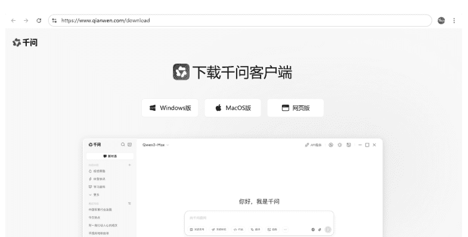

图 1-1 千问下载页面

Web 端为千问的基础使用渠道，无须下载安装任何客户端，通过主流浏览器即可直接访问使用，适合需要长时间进行文本创作、文档处理、复杂指令交互的场景。访问千问 Web 端需打开谷歌 Chrome、微软 Edge、火狐 Firefox、360 安全浏览器等主流浏览器的最新版本，在浏览器地址栏输入官方网址 https://www.qianwen.com，即可跳转至千问 Web 端主界面。Web 端提供两种注册方式，其一为手机号注册，输入本人实名手机号，获取并填写 6 位验证码，勾选用户服务协议与隐私政策后即可完成注册；其二为支付宝/淘宝快捷注册，使用相应手机 App 扫描二维码，即可实现一键注册并自动登录，无须额外输入信息。

移动端是千问的便携使用渠道，分为 iOS 版与 Android 版，适配手机、平板等移动设备，支持语音输入、拍照交互等移动场景专属功能，可满足外出、通勤等碎片化时间的使用需求。iOS 版千问应用可在 App Store 中直接搜索“千问”获取，下载完成后系统将自动完成安装。Android 版千问应用可在华为应用市场、小米应用商店、应用宝等主流 Android 应用市场搜索“千问”下载，如图 1-2 所示，适配绝大多数主流 Android 设备。移动端千问应用支持手机号、支付宝、淘宝等注册登录方式，操作流程与 Web 端一致，注册完成后可在应用的“我的”板块进入应用授权管理，开启淘宝、飞猪、支付宝 AI 付等权限，完成账号绑定后可实现端内支付、商品数据查询等功能，无须跳转至其他应用。

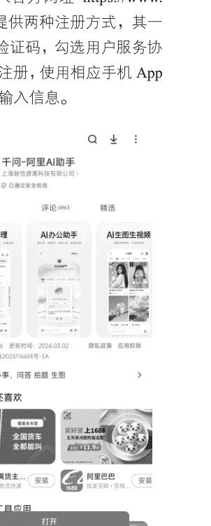

桌面端分为 Windows 版与 Mac 版，是千问针对办公场景优化的专属使用渠道，可与电脑本地文件实现无缝交互，同时搭载多项专业效率工具，适合职场人士的日常办公使用，其安装包均通过官方网址 https://www.qianwen.com/download 下载。Windows 版千问客户端提供安装包格式为 exe，下载后双击即可进入向导式安装流程，可自定义安装路径，安装完成后可创建桌面快捷方式。该版本支持深色模式，夜间使用可减少屏幕对眼睛的刺激，还支持划词唤起小窗功能，可实现划词解读翻译、一键问答等便捷操作。

Mac 版千问客户端适配 macOS 系统，安装包下载后将应用图标拖拽至“应用程序”文件夹即可完成安装，无须复杂的向导操作，该版本针对苹果设备进行了优化，可流畅运行千问的各项功能，与 Windows 版一致支持深色模式、划词唤起小窗等特性。桌面端千问应用的注册方式与 Web 端、移动端完全一致，登录后可实现与其他平台的数据同步，同时支持本地文件的拖拽上传、格式转换等专属操作。

### 1.2.2 千问功能界面

千问应用的功能界面遵循简约化、标准化设计原则，Web 端、移动端、桌面端的操作逻辑与功能入口命名保持基本一致，用户熟悉任一平台界面后可快速适应其他平台。

以千问 Web 端界面（https://www.qianwen.com/）为例，遵循清晰的功能分区逻辑，整体划分为左侧对话管理区、顶部功能栏、中间指令交互区三大模块，如图 1-3 所示，各模块职责明确，操作路径直观，适应读者的使用习惯。

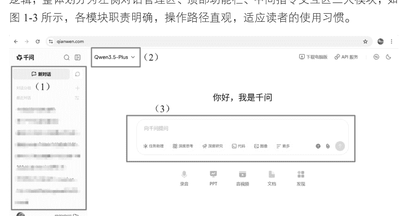

（1）左侧对话管理区位于页面最左侧，包含“新对话”按钮、“对话分组”管理入口、“最近对话”列表及“我的空间”入口。

“新对话”按钮用于开启全新的交互会话；“对话分组”可对历史对话进行分类整理，便于快速定位特定场景的交互记录；“最近对话”按时间顺序展示近期交互内容，点击可直接恢复对应对话；“我的空间”用于管理个人收藏、创作内容及设置偏好。

# 第 1 章 千问时代已来

该区域为用户提供了完整的对话管理能力，避免历史交互内容杂乱无章。

（2）顶部功能栏位于页面上方，左侧显示当前使用的模型版本，点击可切换不同模型，右侧依次排列“下载电脑版”“API 服务”等图标。“下载电脑版”可跳转至桌面端安装包获取页面，“API 服务”提供千问模型的 API 调用入口，面向开发者场景。

（3）中间指令交互区为页面主体区域，是用户与千问进行交互的基本载体。该区域中心为指令输入框，用户通过自然语言来驱动千问执行任务。输入框底部有“任务助理”“深度思考”“深度研究”等功能快捷入口，点击可快速切换至对应功能模式。输入框右侧设有联网搜索设置入口（地球图标）及上传文档图标，联网搜索设置支持手动开启、关闭或自动模式，实现对实时信息获取的灵活控制。输入框下方有“录音”“PPT”“音视频”等按钮，覆盖语音交互、文档处理、创作等多元需求。

千问应用的大部分功能将在本书后续章节中详细展开，在这里先简要介绍几个基础功能。

（1）深度思考功能基于千问 Qwen3.5-Plus 等高性能模型的推理能力，采用多层级拆解与自我修正策略，对逻辑性、分析性问题进行结构化解答，区别于基础问答的表层回复。开启深度思考功能后，千问会对问题进行逐步推导，形成逻辑严谨的分析过程与结论，适用于职场方案推导、学生课题研究、复杂问题拆解等场景，无须额外参数设置，仅需在对话中启用该模式即可持续生效。

（2）联网搜索功能支持手动触发或在配置中自动触发规则。开启后，千问可突破大模型自身数据限制，通过互联网获取最新资讯、行业动态、实时数据等信息，为交互内容提供时效性支撑，有效降低回复幻觉概率。该功能适用于热点资讯查询、行业趋势分析、实时数据获取等场景，开启后会在回复中看到网络信息来源，便于追溯。

（3）上传文档（图片、截图）功能支持多种格式文件上传，文档类兼容 Word、Excel、PDF、TXT 等办公格式，图像类支持 JPG、PNG、BMP 等格式。文件上传后，千问可对文档进行提取、总结、翻译、格式转换，对图片及截图进行文字识别、内容解读、图像分析，适用于职场文档快速处理、学生作业答疑、日常信息识别等场景，上传文件仅作用于当前对话，对话结束后自动解除关联，保障数据安全。

表 1-2 总结了以上三项基础功能的要点。千问应用的代码、图像、PPT 等其他功能，将在本书后续办公、创作、编码等章节中，结合具体使用场景与实操需求进行详细讲解。同时，界面会随千问模型迭代持续优化，新增功能以统一逻辑融入现有布局，保障使用连贯性。

表 1-2 千问基础功能要点汇总

| 功能名称 | 核心特性 | 适用场景 |
| :--- | :--- | :--- |
| 深度思考 | 多层级推理，结构化解答，自我修正偏差 | 方案推导、课题研究、复杂问题拆解 |
| 联网搜索 | 手动/自动切换，标注信息来源，降低回复幻觉 | 热点资讯查询、行业趋势分析、实时数据获取 |
| 上传文档（图片、截图） | 多格式兼容，文档/图像差异化处理，作用于当前对话 | 文档分析、作业答疑、文字识别、图像分析 |

### 1.2.3 千问生成演讲文稿

前面介绍了千问的安装注册和功能界面的布局，本节通过一个具体的“演讲文稿”案例让读者熟悉千问基本交互逻辑，掌握提示词的应用方法。

演讲文稿区别于普通书面汇报，核心在于符合口头表达逻辑，需具备语言流畅、情感适度、结构清晰且贴合演讲场景的特点，广泛应用于主题分享、节日致辞、校园宣讲等场景。

本次实操以“AI 时代如何提升个人竞争力”主题演讲为例，明确需求为：受众对象是职场人士，演讲时长 6 分钟（对应字数为 1000～1200 字，符合正常演讲语速为 150～200 字/分钟），语言风格既要正式严谨，又要兼具感染力，贴合口头演讲特点，结构完整，避免空泛表述，句子简洁易懂，避免过长句式与复杂专业术语。

千问应用依托底层大模型的文本生成能力，可快速生成符合演讲场景的文稿，无须用户从零开始构思，仅需输入规范提示词，即可获得基础版本，后续通过简单修改优化，便能适配实际演讲需求，大幅降低撰写难度、提升创作效率。

操作前需完成千问应用的注册与登录，打开千问 Web 端、移动端或桌面端均可，本节以 Web 端为例进行演示。登录后进入千问指令交互区，默认的基础交互模式即可满足演讲文稿生成需求，若演讲文稿涉及实时数据、行业动态等内容，可手动开启联网搜索功能，确保文稿内容的时效性与准确性。

结合梳理的需求，编写提示词后（见图 1-4），将其完整输入至千问指令交互区的指令输入框，完成后点击输入框右侧“发送”按钮，千问将开始生成演讲文稿。

你好，我是千问


图 1-4 千问生成演讲文稿

本次使用的提示词示例为：

> 作为一名培训讲师，需面向职场人士开展一场 6 分钟的主题演讲，演讲主题为“AI 时代如何提升个人竞争力”，演讲场景为线下分享会，撰写一篇完整的演讲文稿，内容需围绕 AI 时代个人竞争力的核心要素、提升竞争力的具体方法展开，字数控制在 1000～1200 字，语言正式严谨且兼具感染力，适合口头演讲，结构包含开场问候、主题引入、核心观点阐述、结尾总结与呼吁，句子简洁，避免过长句式与复杂专业术语，核心观点具体，避免空泛表述。

千问生成的演讲文稿将展示于指令交互区，按提示词的要求保持完整结构，语言风格贴合演讲场景，核心观点清晰，生成的文稿示例如下：

> 尊敬的各位来宾、职场同仁们：
大家下午好！
很高兴能在这个充满活力的午后，与各位相聚于此。今天，我们站在这里，不仅仅是为了聆听一场分享，更是为了共同面对一个无法回避的时代命题——在人工智能浪潮席卷全球的今天，我们该如何安放自己的职业未来？如何在这场技术变革中，不仅不被淘汰，反而乘风破浪，提升个人的核心竞争力？

很多人问我：“AI 这么强大，写代码、做设计、写文案样样精通，我们人类还能做什么？”这种焦虑，我感同身受。但我想告诉大家一个核心观点：AI 不会取代人，但“会用 AI 的人”一定会取代“不会用 AI 的人”。在 AI 时代，个人竞争力的定义已经发生了根本性的转变。过去的竞争力，往往取决于你记忆了多少知识、熟练掌握了多少重复性技能；而今天的竞争力，则取决于你驾驭工具的能力、提出好问题的能力，以及那些机器无法模仿的人性温度。

那么，具体而言，我们该如何行动？我认为，提升竞争力需要做好三件事。

第一，从“执行者”转型为“指挥官”，掌握人机协作的新范式。
过去，我们花费大量时间在搜集资料、整理数据、撰写初稿等基础执行工作上。现在，请把这些任务交给 AI。你的角色不再是埋头苦干的“搬砖工”，而是运筹帷幄的“指挥官”。你需要学会向 AI 下达清晰的指令，学会鉴别 AI 产出内容的优劣，学会将 AI 生成的碎片化信息整合成有逻辑、有深度的解决方案。记住，你的价值不在于你做了多少事，而在于你定义了什么事值得做，并使用最高效的工具去完成它。哪怕你每天只花半小时学习新的 AI 工具，一年下来，你的工作效率也将产生质的飞跃。

第二，深耕“提问力”与“批判性思维”，做机器的领航员。
AI 是一个拥有海量知识的宝库，但它不知道钥匙在哪里，这把钥匙就是“问题”。在 AI 时代，提出一个好问题，比解决一个问题更重要。一个模糊的指令只能得到平庸的回答，而一个精准、深刻、具有洞察力的问题，才能激发出 AI 惊人的创造力。同时，AI 也会犯错，会一本正经地胡说八道。这就需要我们保持清醒的批判性思维，不盲从、不迷信，用人类的逻辑去校验机器的输出。这种对方向的把控力，是任何算法都无法替代的核心壁垒。

第三，回归“人性本源”，强化共情力与创造力。
无论技术如何迭代，有两样东西是 AI 难以企及的：一是对他人的深刻理解与共情，二是从无到有的原创性突破。机器可以模拟对话，但无法真正理解客户眼神中的焦虑；机器可以组合现有的图案，但很难凭空创造出触动灵魂的艺术。在职场中，那些需要复杂沟通、情感连接、跨部门协调的工作，那些需要打破常规、颠覆认知的创新时刻，正是我们大展身手的舞台。请珍视你的感性，呵护你的好奇心，这是你在冷冰冰的代码世界中，最温暖的护城河。

各位同仁，时代的洪流滚滚向前，我们无法阻挡，但我们可以选择造船的方向。AI 不是我们的对手，而是我们手中最锋利的剑。

让我们不再恐惧，而是拥抱变化；不再固守旧习，而是主动进化。从今天开始，试着把 AI 当作你的搭档，去重新定义你的工作流程；试着多问几个“为什么”，去挖掘更深层的价值；试着更多地与人连接，去传递机器无法给予的温度。

未来已来，唯变不破。愿我们都能在这个 AI 时代，找到属于自己的独特坐标，以智慧为帆，以人性为舵，驶向更广阔的职业生涯蓝海！

谢谢大家！

千问生成的演讲文稿已基本满足主题演讲需求，读者可根据自身实际演讲场景与风格，进行简单修改优化，无须复杂操作。修改优化主要集中在三个方面：

- （1）补充具体案例与细节，千问生成的文稿中部分观点为通用表述，读者可补充自身或身边的真实案例，增强演讲的真实性与说服力，如可补充具体行业的职场人士如何结合 AI 工具提升专业能力。
- （2）调整内容详略，根据实际演讲时长，删减冗余表述或补充相关细节，若演讲时长不足 6 分钟，可删减部分案例或重复表述，保留核心观点。
- （3）优化语言表达，千问生成的文稿虽贴合口头演讲，但可根据自身演讲风格，适当调整语气，增加少量富有感染力的表述，同时避免过于书面化的句式，让文稿更贴合个人表达习惯。

修改优化完成后，可点击文稿下方的“复制”按钮，将文稿复制至 Word、WPS 等文档编辑软件中，进行格式排版，便于演讲时查看。

### 1.2.4 千问生成节日海报

上节通过演讲文稿生成案例演示了文本类内容的创作流程，本节聚焦图像类创作，演示千问生成节日海报的流程，让读者熟悉千问文生图功能的基础操作。第 5 章将系统讲解文生图提示词公式、海报设计的细节技巧。

节日海报是生活、工作中常见的视觉宣传载体，广泛应用于节日祝福传递、活动宣传、氛围营造等场景，用于亲友祝福分享、企业节日活动推广等，无须专业设计技能即可通过千问应用快速生成。千问应用依托底层多模态大模型的文生图能力，整合海报设计模板与元素库，可根据用户需求生成符合节日氛围、贴合使用场景的海报，无须手动设计排版，仅需输入规范提示词，即可获得完整海报，后续可根据实际需求进行简单修改优化，大幅降低海报设计门槛与时间成本。

本次实操以中秋节日海报为例，明确需求：用途为节日宣传使用，可用于线下张贴、线上社交平台推广，符合普通大众、职场人士的节日宣传场景；节日类型为中秋节，风格为现代中国风插画；竖版，核心元素包含圆月、月饼、灯笼、桂花树和玉兔，营造温馨团圆氛围，画面下方需有文字“月圆人圆事事圆”。

本节以 Web 端为例进行演示。登录后进入千问指令交互区，找到“图像”功能按钮，点击进入文生图模式，该界面为千问生成海报、图片的专属操作区域。如图 1-5 所示，编写提示词后，将其输入至千问文生图界面的指令框，然后选择图片比例为 3:4，点击输入框右侧“发送”按钮，千问将开始生成中秋节日海报。

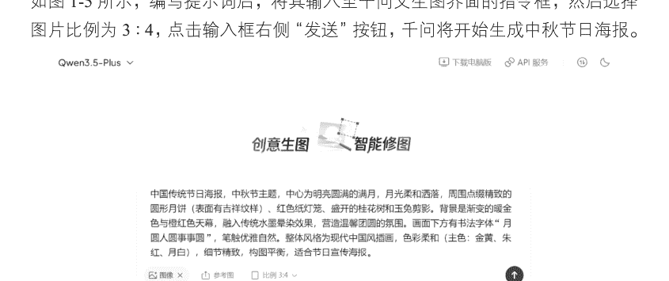

图 1-5 千问生成节日海报

本次使用的提示词示例为：

> 中国传统节日海报，中秋节主题，中心为明亮圆满的满月，月光柔和洒落，周围点缀精致的圆形月饼（表面有吉祥纹样）、红色纸灯笼、盛开的桂花树和玉兔剪影。背景是渐变的暖金色与橙红色天幕，融入传统水墨晕染效果，营造温馨团圆的氛围。画面下方有书法字体“月圆人圆事事圆”，笔触优雅自然。整体风格为现代中国风插画，色彩柔和（主色：金黄、朱红、月白），细节精致，构图平衡，适合节日宣传海报。

千问生成的中秋海报呈现提示词要求的元素与风格，如图 1-6 所示。画面中心满月洒落月光，周围有带吉祥纹样的月饼、红灯笼、桂花树和玉兔剪影，布局呼应。暖金橙红渐变背景融入水墨晕染，营造温馨团圆氛围。下方“月圆人圆事事圆”书法笔触优雅，贴合现代中国风。整体以金黄、朱红、月白为主色调，细节精致、构图平衡，适合节日宣传推广。

好的，正在为你生成图片。本次生成使用Qwen-Image模型。


图 1-6 节日海报生成效果

生成的海报预览图可放大查看细节，若存在元素缺失、风格不符、文字错误、尺寸不合适等问题，可通过补充提示词让千问进行修改优化，无须重新生成完整海报。例如，若发现海报中月饼的吉祥纹样不够清晰，可输入补充提示词“清晰呈现月饼表面的吉祥纹样，提升细节精致度，与整体风格协调”，若认为书法字体不够突出，可输入补充提示词“调整书法字体‘月圆人圆事事圆’的大小，提升视觉存在感，保持笔触优雅自然”。

修改优化完成后，可点击海报预览图下方的“保存”按钮，将海报保存至本地设备，Web 端保存至电脑，移动端保存至手机相册，桌面端保存至电脑指定文件夹。对于职场人士而言，若需将海报用于企业节日宣传，可补充提示词添加企业 LOGO、宣传标语等元素，千问将快速调整海报内容，满足企业宣传场景。

# 第 2 章 提示词技巧与方法

第 1 章介绍了千问的定义、特点及基础操作，旨在让读者掌握千问应用的入门方法。本章聚焦千问的基本使用技巧——提示词的编写，帮助读者从“会用”升级为“用好”。提示词是用户与千问沟通的主要载体，其质量直接决定千问的响应效果。千问依托底层的大模型，能够精准解读用户需求，但这种解读能力的发挥，主要依赖于用户提供的提示词。

## 2.1 提示词是与千问沟通的语言

### 2.1.1 提示词基本公式

与千问这样的 AI 应用进行高效沟通，关键在于向其发送清晰、准确的指令，这些指令被称为“提示词”。提示词的质量直接决定了千问输出结果的好坏。为了帮助使用者快速掌握编写高质量提示词的方法，本书将其结构化为一个基本公式（见图 2-1）。


图 2-1 提示词基本公式

提示词基本公式概括了一次有效沟通所需的四个要素：角色设定、背景信息、任务目标、输出要求。这四个要素并非每次都必须完整出现，但包含这四个要素的提示词，通常能获得比简单提问更精准、更有价值的结果。下面逐一解析每个要素的含义与作用。

#### 1. 角色设定：明确千问的响应身份

角色设定是提示词的基础，用于明确千问在当前任务中的身份，让千问能够以对应身份的专业视角响应需求。千问的底层大模型涵盖多领域知识，但在不同场景下，需要不同的专业口吻和思考方式，角色设定能够帮助千问快速定位自身身份，避免响应内容过于宽泛或偏离专业方向。

角色设定的本质是“具体、贴合任务场景”，避免模糊化的表述。例如，仅设定“你是一个专家”过于笼统，千问无法精准判断具体领域。而设定“你是拥有十年职场行政经验的行政专员，擅长撰写各类办公文书”，则能让千问明确自身定位，输出符合行政工作规范的内容。

结合千问的实际应用场景，常见的角色设定可分为三类：办公类（如行政专员、人力资源总监、文案编辑、数据分析员等）、专业类（如语文教师、编程导师、法律助理等）、生活类（如育儿顾问、旅游规划师、美食推荐官等）。以下为千问根据不同角色设定的案例，方便读者学习和仿写。

> 案例 1：办公类角色设定——人力资源总监。提示词片段：“你是一家顶尖科技公司的人力资源总监，熟悉人工智能领域的人才招聘需求，擅长撰写具有吸引力的招聘启事。”千问接收该角色设定后，会以人力资源总监的专业视角，结合科技公司的特点，撰写符合岗位需求、能够吸引目标人才的招聘内容，其语言风格会兼顾专业度与感染力，符合职场招聘文书的规范。

> 案例 2：专业类角色设定——资深语文教师。提示词片段：“你是一位拥有十年以上教学经验的小学资深语文老师，专注于中国古典诗词的教学，擅长将复杂的诗词知识转化为易懂的内容，能够生成结构清晰的古诗词学习卡片。”千问会依据该角色，生成包含诗词原文、注释、翻译、意境分析等内容的学习卡片，满足语文教学的实际需求。

> 案例 3：生活类角色设定——旅游规划师。提示词片段：“你是一名专业的旅游规划师，熟悉国内热门旅游城市的景点、交通和住宿，擅长根据用户预算和出行人数，制定合理的短途旅行计划。”千问在该角色设定下，会结合用户后续提供的背景信息，给出满足需求的旅行建议，包括景点路线、住宿推荐、交通方式等，符合普通大众的出行规划需求。

需要注意的是，角色设定并非随意，需与后续的任务目标高度匹配。若任务目标是撰写职场述职报告，却设定“你是一名美食博主”，则会导致千问的响应内容与需求严重偏离，无法达到预期效果。

#### 2. 背景信息：提供任务的前提条件

背景信息为提示词提供了关键支撑，用于向千问提供完成任务所需的所有前提条件、相关场景。千问通常无法主动获取用户的私人信息或未明确说明的场景细节，背景信息的完整性直接决定千问响应的精准度。缺乏背景信息的提示词，会导致千问只能给出通用化的响应，无法满足用户的具体需求。

背景信息的内容需根据任务目标灵活调整，要求是“全面、具体、有针对性”。办公场景中，背景信息通常包括行业属性、公司规模、任务截止时间、具体需求等。生活场景中，背景信息通常包括个人需求、预算、时间、人数等；创作场景中，背景信息通常包括创作主题、风格要求、基本元素等。

结合千问的应用场景，以下为不同场景下背景信息的案例，读者可直接参考使用。

> 案例 1：办公场景——撰写工作报告。背景信息：“某互联网公司行政专员，本周主要负责 3 场内部会议的安排、公司文件的归档整理，以及 10 名新员工的入职接待工作，其中 2 场会议因参会人员临时调整，推迟至下周举行，新员工入职接待工作已全部完成。”千问接收该背景信息后，会结合前文设定的“行政专员”角色，撰写包含本周工作内容、完成情况、未完成事项及下周计划的日报，内容符合行政工作实际。

> 案例 2：生活场景——景点推荐。背景信息：“计划周末（2 天 1 晚）一个人带 5 岁孩子，从北京出发去杭州游玩，孩子喜欢历史和自然景观，预算 5000 元以内，住宿需靠近景点，交通便捷，避开人流密集的热门景点。”该背景信息明确了出行时间、随行人员、预算、住宿要求和景点偏好，千问会据此推荐适合亲子游玩的景点，搭配性价比高的住宿和便捷的交通路线，满足用户的具体需求。

> 案例 3：创作场景——单词记忆卡片设计。背景信息：“针对小学 6 年级学生，需要以英文单词‘elephant’的记忆卡片为辅助学习资料，学生基础较弱，需结合词根拆解、记忆故事等方式帮助理解。”千问会结合该背景信息，生成符合小学生认知水平的单词记忆卡片，拆解词根、设计记忆故事。

# 第 2 章 提示词技巧与方法

完整背景信息的提示词，能够有效减少用户与千问的反复沟通，提升使用效率。背景信息的提供需避免冗余，避免添加与任务目标无关的内容，确保信息精准、简洁。

#### 3. 任务目标：明确用户的主要需求

任务目标是提示词的关键部分，用于明确用户希望千问完成的具体任务，是千问响应的主要导向。任务目标需具体、可执行，避免模糊化、抽象化的表述，否则会导致千问无法精准判断用户需求，输出的内容偏离预期。

很多用户使用千问时，常出现提示词模糊的问题，如“帮我写一篇文案”“帮我做一个计划”，这类提示词缺乏明确的任务目标，千问对此只能输出通用化的内容，无法贴合用户的具体需求。而明确的任务目标，需包含“做什么、达到什么效果”，让千问能够清晰知晓用户的主要诉求。

以下分三个案例，聚焦明确任务目标，清晰展示明确任务目标的具体写法，为读者提供可参考的示例。

> 案例 1：办公场景——文案撰写。明确任务目标：“撰写一篇千问办公功能的推广文案，突出千问多平台支持（Web、桌面端、移动端）和高效办公的特点，面向职场人士。”该目标清晰界定“写什么、面向谁、突出什么特点”，千问接收后可精准输出符合主要需求的文案。

案例 2：生活场景——差旅安排。明确任务目标：“安排一次从北京到上海（3月10日～3月12日）的差旅，主要目的是参加上海陆家嘴举办的行业峰会（3月11日全天），需预订往返高铁票（二等座）、靠近上海陆家嘴的酒店，包含每日行程规划（上午9点～下午6点），行程需兼顾参会便利性与合理节奏。”该目标清晰界定差旅的时间、地点、出行目的和主要任务，千问可结合出行目的，合理规划每日行程。

案例 3：创作场景——编程教学。明确任务目标：“向10岁儿童讲解编程中的‘循环’概念，用搭积木的比喻，结合生活中的实例，设计一个简单的互动小游戏。”该目标清晰界定讲解对象、概念和方式，千问可精准贴合主要任务输出内容。

明确的任务目标是千问精准响应的关键，应该“明确动作、具体要求、预期效果”，任务目标的设定需结合自身需求尽可能细化，同时与角色设定、背景信息相匹配，形成完整的需求逻辑，确保千问能够准确解读并执行。

#### 4. 输出要求：明确千问的响应格式

输出要求是提示词的收尾部分，用于明确千问响应内容的格式、字数、风格、语言等细节，确保千问响应的输出内容符合用户的使用需求，无须用户额外修改。输出要求的设定需具体、细致，根据任务目标和使用场景灵活调整，其主要作用是“规范千问的输出形式，提升内容的实用性”。

不同的应用场景下，输出要求的侧重点不同。办公场景中，输出要求通常包括文档格式（如日报、报告的结构）、字数限制、语言风格（如正式、简洁）等。生活场景中，输出要求通常包括内容结构（如行程表、推荐清单）、呈现形式（如文字、表格）等。创作场景中，输出要求通常包括风格（如童趣、专业、中国风）、格式（如卡片、HTML 页面）等。

以下为千问不同应用场景下输出要求的案例，展示输出要求的具体用法。

> 案例 1：办公场景——撰写述职报告。输出要求：“报告结构分‘工作成果、存在不足、下月计划’三部分，字数控制在 3000 字左右，语言正式、条理清晰，避免口语化，用数据支撑工作成果，无须添加额外装饰内容。”

案例 2：生活场景——美食推荐。输出要求：“用表格形式呈现，表格包含店铺名称、特色菜品、价格、营业时间四项内容，语言简洁，重点突出，推荐的店铺需支持电话预订。”

案例 3：创作场景——古诗词学习卡片。输出要求：“卡片风格为中国风，文字工整，适当留白，注释简洁易懂，意境描述生动形象，背诵技巧简单好记，输出为 HTML 页面格式，便于打印使用。”

需要注意的是，输出要求需结合任务目标的实际用途设定。若任务目标是用于汇报的文档，输出要求需强调正式、条理清晰。若任务目标是用于个人参考的清单，输出要求可强调简洁、直观。同时，输出要求需避免过于苛刻，给千问一定的灵活空间，确保响应内容既符合要求，又具有实用性。

#### 5. 公式的完整应用与优劣对比

为了更直观地展示基本公式的作用，以下通过几个职场常见场景进行对比。第一组是未使用公式的简单提问，第二组是按照“角色设定+背景信息+任务目标+输出要求”公式编写的完整提示词。

##### 案例 1：撰写邮件

简单提问：帮我写一封催款的邮件。

使用公式的提示词：

- ✓ 角色设定：你是一家小型设计公司的项目负责人。
- ✓ 背景信息：客户“××科技”欠付项目尾款 5 万元，原定付款日期已过一周。项目已完成交付，其间合作愉快，客户此前付款也较及时。你与对方财务和项目对接人沟通顺畅。
- ✓ 任务目标：撰写一封催款邮件，提醒对方付款，同时保持友好的合作关系。
- ✓ 输出要求：邮件语气要礼貌但立场明确，说明逾期情况，附上收款账户信息，并表达希望未来继续合作的意愿。邮件主题要清晰。

##### 案例 2：准备会议议程

简单提问：帮我写一个项目启动会的议程。

使用公式的提示词：

- ✓ 角色设定：你是一名经验丰富的项目经理。
- ✓ 背景信息：公司即将启动一个名为“新官网改版”的项目。参与部门有市场部、技术部和设计部。项目周期预计 3 个月。启动会参与者包括三个部门的负责人和具体执行人员，共约 10 人。会议时长为 2 小时。
- ✓ 任务目标：制定一份项目启动会的详细议程。
- ✓ 输出要求：议程以表格形式呈现，包括时间、环节名称、主要内容、负责人和预计时长。会议目标应包括明确项目范围、确定关键时间节点、分配各部门职责。

##### 案例 3：数据分析与解读

简单提问：分析一下这份销售数据（假设用户上传了一份 Excel 文件）。

使用公式的提示词：

- ✓ 角色设定：你是一名资深的数据分析师。
- ✓ 背景信息：上传的 Excel 文件是某连锁书店今年第一季度的销售数据，包含各门店、各图书品类（如文学、经管、少儿）的每日销售额。公司希望了解今年第一季度的销售趋势，并对比同期数据。
- ✓ 任务目标：找出第一季度销售额排名前三的图书品类，并分析它们的销售趋势（是稳定增长、季节性波动，还是持续下滑）。
- ✓ 输出要求：用简洁的文字总结分析结果，并使用列表形式呈现各品类的关键数据，可以生成图表来说明趋势。

通过对比可以看出，使用基本公式编写的提示词，可以预期其产出结果的目标性、实用性和精确度都显著高于简单的提问。它不再是一个泛泛的答案，而是针对特定场景、满足特定需求的定制化解决方案。

掌握基本公式，等于掌握了与千问有效沟通的底层逻辑。它帮助使用者从“问问题”的思维，转变为“布置任务”的思维。每一次与千问的交互，都如同在向一位知识渊博、能力全面的助手清晰地布置一项工作。后续章节将以此公式为基础，详细介绍其在不同场景下的具体应用技巧。

### 2.1.2 提示词的编写原则

除提示词基本公式外，对于复杂的任务，读者还需要掌握一些编写原则。提示词编写的关键逻辑，本质是通过科学的提示设计，激活千问底层大模型的解读与生成能力，让千问精准匹配任务需求，而非单纯依靠“清晰、具体”的表层要求。

不同于基础的沟通规范，专业的提示词编写原则，需基于大模型上下文学习、逻辑推理的底层机制，兼顾任务复杂度与千问的应用特性，实现“精准引导、高效输出”。千问作为多场景适用的智能应用，其对提示词的解读能力，需遵循更具专业深度的编写原则，能充分挖掘千问在办公、生活、创作等场景的应用潜力，减少无效沟通与反复调整。

#### 1. 迭代调优原则

迭代调优原则是提示词编写的重要原则，关键是将提示词编写视为科学实验，通过“初始提示—输出反馈—针对性优化—再次输出”的循环，逐步完善提示词细节，让千问输出内容无限贴近预期。实践表明，复杂任务中，单次提示往往难以覆盖所有需求细节，AI 工具的输出可能存在逻辑断层、细节缺失等问题，此时基于现有输出的偏差，补充关键信息、调整引导方式、修正表述漏洞，实现输出质量的逐步提升。

使用千问撰写某产品办公功能的推广策划方案，具体迭代过程如下：

> 初始提示：“撰写一份某产品办公功能的推广策划方案，面向职场人士。”
第一次优化提示：“撰写一份某产品办公功能的推广策划方案，面向职场人士，包含方案背景、推广目标、渠道选择（如微信公众号、职场社群、企业内部培训等）、执行节奏和效果评估，重点突出多平台支持优势。”
第二次优化提示：“撰写一份某产品办公功能的推广策划方案，面向职场人士，包含方案背景、推广目标、渠道选择（如微信公众号、职场社群、企业内部培训等）、执行节奏和效果评估，重点突出多平台支持优势。每个推广渠道需明确具体推广内容和发布时间，微信公众号每周发布2篇推文，职场社群每日推送1条卖点推文。”
……

通过多次迭代，最终获得符合需求的策划方案。
千问的历史对话记忆功能，可保留每次优化的提示词和输出内容，为迭代调优提供便利，也是该原则高效落地的重要支撑。

#### 2. 上下文增强原则

上下文增强原则，要求提示词中补充充足的背景信息、场景细节、参考示例等内容，让千问充分获取完成任务所需的全部信息，避免因信息缺失导致输出偏差。相关研究表明，AI本质是“模式匹配高手”，其解读能力依赖于充足的上下文信息，缺乏上下文的提示词，会导致千问只能输出通用化内容。千问的底层大模型具备强大的上下文学习能力，充足的上下文信息能激活其场景适用能力，让输出内容更具针对性。

使用千问分析公司Q2财报，两种提示词对比如下：

> 缺乏上下文提示：“分析下公司Q2财报。”
补充上下文提示：“公司Q2营收1.2亿元，同比增长8%，成本同比上升12%，主要来自原材料涨价，请结合这些数据和上传资料，分析盈利能力变化，重点说明成本上升对营收的影响。”

#### 3. 结构化提示原则

结构化提示原则，要求提示词具备清晰的结构，通过合理划分指令、背景信息、素材、输出要求等模块，使用分隔符、明确标识等方式，降低对提示词的解读成本，避免因结构混乱导致的解读偏差。清晰的结构是提升提示词效率的关键，就像盖房子需要脚手架一样，结构化的提示词能让千问快速捕捉核心需求，明确各部分信息的作用。千问对结构化提示词的解读效率远高于杂乱无章的提示词，尤其适用于复杂任务的提示编写。

使用千问生成会议纪要，结构化提示词可设计为：

> **任务目标：** 生成会议纪要。
>
> **会议背景：** 2026 年×月×日，公司月度部门例会，参会人员为部门全体员工，会议主题为上个月的工作总结及本月工作安排。
>
> **输出要求：** 包含会议基本信息、参会人员发言重点、确定的工作任务及截止时间，语言简洁、条理清晰，避免口语化。
>
> **会议资料：** 已上传速记稿。

通过划分模块并分行展示，千问能快速区分指令与素材，精准输出符合要求的会议纪要。若提示词结构混乱，将指令与背景信息混为一谈，千问可能会过度聚焦无关细节，导致核心内容缺失。此外，结构化提示还可结合千问的功能特性，明确角色设定、任务目标等模块，进一步提升输出精准度。

#### 4. 程序性引导原则

程序性引导原则，要求提示词中明确任务的执行步骤、操作流程或推理逻辑，引导千问按既定流程完成任务，避免输出内容碎片化、逻辑混乱。AI 工具完成复杂任务的关键，在于获取明确的程序性知识（即“如何做”的步骤指导），提示词作为千问的“操作指南”，需包含清晰的程序性引导，才能让千问有序完成复杂任务。AI 工具在处理多步骤、高复杂度任务时，缺乏程序性引导的提示词，会导致输出内容杂乱无章、步骤缺失，而明确的程序性引导能让 AI 工具按逻辑拆解任务、逐步执行。

使用千问生成一份 **AI 工具零基础上手教程**，程序性引导提示词可设计为：

- 第一步，介绍 AI 工具的注册与安装流程（含 Web 端、移动端）；
- 第二步，讲解 AI 工具功能界面的关键模块；
- 第三步，举例说明使用 AI 工具生成演讲文稿的操作步骤；
- 第四步，总结上手注意事项。

通过明确的步骤引导，千问能生成结构清晰、步骤完整的上手教程。再如，使用千问进行数据分析，程序性引导提示词可设计为：“先整理数据范围，再计算关键指标，最后分析指标变化趋势并给出结论。”千问可按该流程输出完整的数据分析结果。

上述四项原则（迭代调优、上下文增强、结构化提示、程序性引导），相互关联，共同构成了提示词编写的专业体系。迭代调优解决“输出偏差”问题，通过循环优化让输出贴近预期，上下文增强解决“信息缺失”问题，通过补充充足信息激活千问上下文学习能力，结构化提示解决“解读混乱”问题，通过清晰结构降低千问解读成本，程序性引导解决“流程缺失”问题，通过明确步骤引导千问有序执行任务。

## 2.2 常见的提示词框架

前面介绍了提示词的基本公式，该公式适用于大多数基础场景，能帮助读者快速搭建与千问沟通的基础逻辑。除这一基础公式外，实践中还存在多种流行的提示词框架。这些框架基于不同的应用场景和任务需求设计，结构严谨、导向明确，各有特色，能进一步提升提示词的精准度和千问的输出质量。本节将重点介绍四种应用广泛、可用于千问多场景使用的提示词框架，分别是 CRISPE 框架、BROKE 框架、CO-STAR 框架和 ICIO 框架，可为读者后续熟练运用千问，提供结构化的提示词编写思路。

### 2.2.1 CRISPE 框架

CRISPE 框架是一个用于指导用户向 AI 提问的方法论框架，由能力与角色（CR）、洞察（I）、陈述（S）、个性（P）、实验（E）五个部分组成，有助于提高与 AI 交互时的效率和准确性，确保模型能够根据用户的具体需求和偏好提供合适的回答。该框架结构化程度较高，通过明确角色、背景、任务等关键要素定位，引导千问精准匹配任务需求，尤其适用于需要千问扮演特定角色、输出具有明确风格和格式的内容场景，如自媒体文案撰写、专业报告分析、职场文书创作等。

（1）能力与角色（Capacity and Role）是 CRISPE 框架的基础，重点是明确千问在当前任务中需要扮演的角色以及应具备的专业能力。千问的底层大模型具备多领域知识储备，但明确角色和能力能让千问聚焦特定领域，避免输出内容过于泛化。角色设定需贴合任务场景，能力描述需具体可落地，避免模糊化表述。

（2）洞察（Insight）是框架的重要支撑，要求在提示词中补充与任务相关的背景信息、前因后果等内容，让千问充分理解任务所处的场景和具体需求。千问的输出质量依赖于充足的上下文信息，缺乏背景的提示词会导致千问输出通用化内容。背景信息的补充需全面且有针对性，重点包含任务的场景、目的、相关数据、限制条件等。

（3）陈述（Statement）是框架的主要导向，需直接、清晰地说明需要千问完成的具体任务，明确任务目标和主要要求。任务描述需具体、可执行，避免模糊化表述，让千问清楚知道“要做什么”。

（4）个性（Personality）用于设定千问输出内容的语气、风格和格式，让输出内容更贴合任务需求和目标受众。风格设定需结合任务场景和受众特点，例如，面向职场人士的述职报告、策划方案等，风格需正式、严谨。面向普通大众的生活指南、科普内容，风格需简洁、易懂。

（5）实验（Experiment）是框架的优化补充，要求引导千问提供多个不同角度的输出版本或给出具体示例，帮助用户快速筛选符合预期的内容，同时为后续提示词优化提供方向。

结合千问办公场景，以生成述职报告为例，展示 CRISPE 框架的应用。提示词设计示例如下：

> 能力与角色：你是拥有 5 年职场述职经验的人力资源顾问，熟悉述职报告的撰写逻辑，擅长突出工作成果、分析存在问题并提出可落地的改进措施，语言正式严谨。
>
> 洞察：某互联网公司运营岗位，任职满 1 年，本次述职目的是总结本年度工作成果、分析存在的问题、规划下一年度工作重点，本年度核心工作为用户增长、活动策划、内容运营，其中用户新增 5 万人，完成线上活动 12 场，内容阅读量累计 100 万次，未达成年度用户增长 6 万人的目标，存在活动转化率偏低、内容调性与用户需求匹配度不足的问题。
>
> 陈述：撰写一份年度述职报告，包含个人基本信息、本年度工作成果、存在的问题、原因分析、下一年度工作规划五个部分。
>
> 个性：正式、严谨，语言简洁，重点突出数据和成果，问题分析客观，改进措施具体可落地，避免空话、套话，字数控制在 2000 字左右，段落清晰，每部分有明确标题。
>
> 实验：请先给出各部分的核心框架，再撰写完整内容，提供 2 个不同侧重点的工作规划版本，一个侧重用户增长，一个侧重活动优化。

使用上述提示词，千问可生成结构完整、重点突出的述职报告，无须用户反复调整。该案例充分体现了 CRISPE 框架的优势，通过明确角色、补充背景、清晰任务、设定风格、提供实验，让千问精准理解需求，输出高质量内容。此外，CRISPE 框架还可应用于千问的文本润色、仿写、扩写等场景。

### 2.2.2 BROKE 框架

BROKE 框架强调了任务的背景、角色、目标、关键输出和持续改进，适用于那些需要 AI 在明确的背景和角色下，为用户提供目标导向的输出并持续优化的场景，由背景（Background）、角色（Role）、目标（Objectives）、关键结果（Key Result）、演变（Evolve）五个部分组成，具备全面性和动态性的特点，能提高任务成功率并实现输出结果的动态优化。该框架是一种以目标为导向的提示词框架，重点聚焦于商业场景和任务执行类场景，通过明确背景、角色、目标等要素，引导千问聚焦主要任务，输出具有可衡量、可落地的内容，广泛应用于商业文案撰写、产品分析、方案策划等场景。

（1）背景（Background）是 BROKE 框架的基础，重点是提供与任务相关的背景信息，包括任务的场景、目的、相关数据、限制条件等，让千问理解任务所处的环境和主要背景。背景信息的补充需精准、全面，避免无关信息，重点说明“为什么做”“在什么场景下做”“有哪些限制条件”。

（2）角色（Role）与 CRISPE 框架中的角色要素类似，重点是明确千问在当前任务中需要扮演的角色以及应具备的专业能力。角色设定需符合任务场景和目标，突出千问在任务执行、方案落地等方面的专业能力，确保千问能以合适的身份输出符合需求的内容。

（3）目标（Objective）是 BROKE 框架的主要导向，需明确任务的主要目标，即“要达成什么效果”。目标设定需具体、明确，避免模糊化表述，最好能体现出任务的主要诉求。

（4）关键结果（Key Results）是目标的细化，重点是明确衡量目标是否达成的具体指标和标准，让千问清楚知道“如何衡量目标达成情况”，同时也为用户后续评估千问输出内容的质量提供依据。关键结果需可衡量、可落地，与目标高度相关，避免抽象化表述。

（5）演变（Evolve）是 BROKE 框架的特色要素，重点是引导千问通过试验和调整，优化输出内容，同时也为用户后续优化提示词提供方向。该要素强调动态优化，要求千问在输出内容后，可根据自身分析，提出改进建议，或提供多个优化版本，帮助用户获得更满足需求的内容。

结合千问办公场景，以撰写智能手环产品推广策划方案为例，展示 BROKE 框架的应用。提示词示例设计如下：

> 背景：某新推出的智能手环产品，主打健康监测（如心率、血氧、睡眠监测等）、超长续航（待机 7 天）、轻薄便携等功能，目标用户为 25～45 岁职场人士，这类用户注重健康管理、工作节奏快，对产品的便携性和续航能力有较高要求。本次推广预算 15 万元，推广周期 1 个月，需通过多渠道推广提升产品知名度和销量，同时收集有效客户线索，为后续产品迭代提供参考。
>
> 角色：你是拥有 3 年产品推广策划经验的营销顾问，熟悉智能硬件产品的推广渠道和方法，擅长制定可落地的推广策略，能合理分配推广预算，结合职场人士的需求特点设计推广内容，避免过于晦涩的技术术语。
>
> 目标：通过 1 个月的推广，使智能手环产品的知名度提升 50%，销量突破 1000 台，获取有效客户线索 200 条以上。
>
> 关键结果：一是微信公众号推文累计阅读量突破 5 万次，转发量突破 500 次，点赞量突破 2000 次。二是覆盖 50 个职场社群（每个社群人数 500 人以上），推广内容触达用户 2 万人，社群转化率不低于 3%。三是电商平台（淘宝、京东）产品搜索量提升 80%，转化率提升 15%，评论好评率不低于 90%。四是收集有效客户线索 200 条以上，线索转化率不低于 10%。五是推广预算分配合理，各渠道预算占比清晰，无浪费情况。

### 2.2.3 CO-STAR 框架

CO-STAR 框架是一种注重全面性和结构性的提示词框架，由背景（Context）、目标（Objective）、风格（Style）、语气（Tone）、受众（Audience）、响应（Response）六个部分组成，考虑了影响 AI 响应效果和相关性的关键因素，能引导 AI 生成更适合场景的内容，确保提示词全面、结构良好。该框架广泛应用于目标设定、问题解决、文案撰写、报告分析等多种场景，尤其适合千问的复杂任务处理，如市场调研报告撰写、自媒体文案创作、差旅安排等。

（1）背景（Context）是 CO-STAR 框架的基础，重点是提供与任务相关的背景信息，包括任务的场景、目的、相关数据、限制条件等，让千问充分理解任务的来龙去脉。与其他框架的背景要素类似，CO-STAR 框架的背景信息需全面、精准，重点说明任务的具体场景和主要诉求，避免无关信息。

（2）目标（Objective）是框架的主要导向，明确任务的主要目标，即千问需要完成的具体任务和达成的效果。目标设定需具体、明确，避免模糊化表述，让千问清楚知道“要做什么”。

（3）风格（Style）是设定千问输出内容的整体调性，适合任务场景和目标受众，确保输出内容能被目标受众接受。风格设定需符合受众特点，避免与任务场景脱节。

（4）语气（Tone）是设定千问输出内容的语气，与风格相匹配，确保输出内容的一致性。语气设定需满足场景需求，避免语气与内容脱节。

（5）受众（Audience）是明确输出内容的目标受众，让千问根据受众的知识水平、需求特点，选择合适的语言和内容，确保输出内容易于被接受。受众描述需具体，明确受众的年龄、职业、需求特点等，避免模糊化表述。

（6）响应（Response）是框架的收尾要素，明确千问输出内容需精准响应任务诉求，确保输出内容能直接满足用户的使用需求。响应要求需具体、明确，聚焦“输出内容是否满足任务目标”。

结合千问办公场景，以撰写部门月度工作总结为例，展示 CO-STAR 框架的应用。提示词设计示例如下：

> 背景：某互联网公司运营部门，月度主要工作为用户运营、活动执行和数据复盘，本月完成用户新增 8000 人、线上活动 2 场，未达成月度用户新增 1 万人的目标，需撰写月度工作总结，用于部门内部汇报，同步上报给上级领导，需客观呈现工作成果、分析问题并提出改进措施，无额外格式限制但需内容详实。
>
> 目标：撰写一份运营部门月度工作总结，包含本月工作成果、存在问题、原因分析、下月工作计划四个部分，确保内容详实、数据准确，符合部门工作实际，为后续工作优化提供参考。
>
> 风格：正式、严谨，语言简洁明了，重点突出数据和工作重点，分章节呈现，层次清晰，便于领导和同事查看，避免口语化和冗余表述。
>
> 语气：客观、务实，不夸大工作成果，不回避存在问题，分析问题实事求是，提出的改进措施具体可行，语言专业且不晦涩。
>
> 受众：部门全体同事及上级领导，领导需了解月度工作完成情况、存在问题及改进方向，同事需同步工作进度、借鉴经验，均具备一定的办公基础和行业认知。
>
> 响应：输出内容需完整覆盖四个主要部分，数据准确无误，问题分析有针对性，工作计划具体可落地，格式规范、段落清晰，可直接用于内部汇报和上报。

使用上述提示词，千问可生成结构清晰、内容详实的部门月度工作总结，便于内部汇报和上级查看。该案例体现了 CO-STAR 框架的全面性和细节导向，通过六个要素的全面补充，让千问充分理解需求，输出高质量的内容。此外，CO-STAR 框架还可应用于千问的 PPT 制作、会议纪要生成、文本翻译等场景。

### 2.2.4 ICIO 框架

ICIO 框架是一种用于创建清晰、具体提示的方法，旨在提高 AI 模型的交互效率和准确性，ICIO 分别代表指令（Instruction）、背景信息（Context）、输入数据（Input Data）、输出指示（Output Indicator）四个基本部分，具备明确性、上下文敏感性、灵活性和导向性的特点，适用于数据处理、内容创作、技术任务、教育与培训等多种场景。该框架结构简洁、重点突出，不强调角色设定，更注重任务的明确性和输出格式的规范性，能帮助用户快速明确任务需求，引导千问按统一标准输出内容。

（1）指令（Instruction）是 ICIO 框架的主要要素，重点是明确描述千问需要执行的任务，确保简洁、明确，以便千问理解任务的目标和要求。指令描述需具体可执行，避免模糊化、抽象化表述，直接告知千问“要做什么”“怎么做”，无须多余的修饰。与其他框架的任务要素相比，ICIO 框架的指令更简洁，聚焦于任务本身，不涉及角色、风格等额外设定。

（2）背景信息（Context）与其他框架的背景要素功能一致，重点是提供任务的上下文信息，帮助千问更好地理解任务和生成响应。背景信息可包括任务的背景、目的、相关知识、限制条件等，补充内容需避免无关信息，确保千问能精准把握任务场景。

（3）输入数据（Input Data）是框架的重要支撑，指提供给千问处理的数据，具体类型取决于千问的支持程度，可包括文本、表格、代码片段、图片等。输入数据需完整、准确，符合指令要求，确保千问能基于有效数据完成任务，避免因数据缺失或错误导致输出结果偏差。

（4）输出指示（Output Indicator）是框架的收尾要素，重点是定义期望的输出形式，引导千问按所需格式生成输出，增强内容的实用性和规范性。输出指示器需具体、明确，包括输出格式、长度、结构、保存方式等，确保千问输出的内容能直接满足用户的使用需求，无须后续调整。

结合千问办公场景，以对公司客户注册数据进行清洗为例，展示 ICIO 框架的应用。提示词设计示例如下：

> 指令：对提供的公司客户注册数据进行清洗，删除重复数据、缺失值和异常值，统一数据格式，确保数据准确、完整，便于后续客户画像分析。
>
> 背景信息：该客户注册数据为公司 2026 年的全部注册数据，包含姓名、手机号、邮箱、注册时间、所在城市、注册渠道 6 个字段。其中，重复数据指手机号或邮箱重复的记录，缺失值指任意字段为空的记录，异常值指手机号格式不正确、邮箱格式不正确（如无@符号等）、注册时间不符合 2026 年范围的记录。数据清洗后需用于客户画像分析，需确保数据的准确性和完整性。
>
> 输入数据：客户注册数据表格（字段：姓名、手机号、邮箱、注册时间、所在城市、注册渠道），具体数据此处省略。
>
> 输出指示：一是输出清洗后的客户注册数据，保存为 Excel 格式，包含所有有效字段和记录。二是标注清洗处理结果，包括删除的重复数据条数、缺失值条数、异常值条数，分别说明每条删除记录的原因。三是提供数据清洗说明，明确清洗规则、处理方式和注意事项。四是输出内容简洁、清晰，数据准确，便于后续客户画像分析使用。

使用上述提示词，千问可精准完成数据清洗任务，输出符合要求的清洗后数据和说明文档。该案例体现了 ICIO 框架的简洁性和导向性，通过明确指令、补充背景、提供输入数据、设定输出格式，让千问清晰把握任务需求，高效完成数据处理工作。此外，ICIO 框架还可应用于千问的文本翻译、格式转换、代码编写、作业批改等场景，尤其适合需要明确输入和输出格式的任务。该框架的优势在于结构简洁、操作门槛低，适合职场人士和普通大众快速上手，无须复杂的提示词编写经验，只需按四个要素梳理需求，即可引导千问输出高质量内容。

综上所述，CRISPE、BROKE、CO-STAR、ICIO 四种框架各有侧重，适用于不同的场景和任务需求。CRISPE 框架侧重角色和风格，适合需要千问扮演特定角色的场景。BROKE 框架侧重目标和可衡量性，适合商业和任务执行类场景。CO-STAR 框架侧重全面性和细节，适合复杂任务场景。ICIO 框架侧重任务明确性和输出格式，适合数据处理、技术任务等场景。

读者可根据自身的任务需求，灵活选择合适的框架，结合千问的功能特点，编写高质量的提示词，充分发挥千问在办公、生活、创作等多场景的应用价值。

# 第 3 章 千问助力高效办公

在快节奏的职场环境中，文章撰写、文档优化、PPT 制作等办公任务通常耗费大量时间与精力，效率低下成为许多人面临的痛点。千问依托强大的 AI 能力，针对办公场景打造了全方位辅助功能，涵盖文章写作、文本优化、PPT 制作、内容处理等多个方面，助力用户摆脱烦琐事务，提升办公效率。本章将详细拆解千问在办公场景中的主要功能与实操方法，让每一位用户都能借助千问实现高效办公。

## 3.1 文章写作

### 3.1.1 AI 写作功能

在数字化办公场景中，文本创作是职场人士最频繁的工作之一。从日常沟通的邮件、会议纪要，到项目推进的策划方案、述职报告，再到个人表达的自媒体文案、读书笔记，文本输出能力的高低直接影响工作效率与专业形象。然而，传统写作模式常面临灵感枯竭、逻辑混乱、效率低下等痛点，尤其在多任务并行的高压环境下，这些问题更为突出。千问针对这一需求，专门打造 AI 写作功能，通过大模型的语义理解与内容生成能力，为用户提供从灵感捕捉到成品交付的支持，成为高效办公的重要工具之一。

千问的 AI 写作功能入口在主页面中，如图 3-1 所示，用户打开千问 Web 端或桌面端应用后，在指令输入框底部的功能栏中，点击“更多”选项后，会弹出包含翻译、AI 写作、PPT、指令中心等子功能的下拉菜单，点击“AI 写作”即可进入专属创作界面。

进入 AI 写作界面后，用户会看到一个结构化的写作控制台，如图 3-2 所示，主要功能区分为写作体裁、写作风格、字数要求三大模块，每个模块都提供了丰富的预设选项，同时支持自定义设置，确保生成内容与用户需求高度匹配。

#### 1. 写作体裁：覆盖全场景的内容模板

写作体裁是千问 AI 写作功能的主要分类依据，预设选项覆盖办公、生活、创作等多个领域，具体如表 3-1 所示。

表 3-1 千问 AI 写作体裁汇总

| 写作体裁 | 适用场景及说明 |
| :--- | :--- |
| 通用 | 快速生成高质量内容，适用于无明确场景限制的文本创作 |
| 祝福语 | 提供节日祝福、创意灯谜等内容，用于节日相关场景 |
| 论文 | 分步骤撰写专业论文，支持从选题到正文的全流程辅助 |
| 作文 | 覆盖全学段高分作文创作，可根据年级、主题生成符合要求的内容 |
| 文案 | 轻松撰写热门社媒文案，用于品牌推广、内容营销等场景 |
| 小说 | 支持创作精彩小说，提供叙事框架与情节引导 |
| 小红书文案 | 生成爆款笔记/文案，符合平台用户的阅读与传播习惯 |
| 朋友圈文案 | 助力发布多彩生活相关内容，打造日常社交分享场景 |
| 发言稿 | 妙语连篇，直击重点，适用于会议、活动等公开讲话场景 |
| 策划方案 | 生成专业详尽的策划/方案，支持项目规划、活动组织等需求 |
| 教案 | 轻松梳理课堂脉络，辅助教学内容设计与课程安排 |
| 开题报告 | 生成高质量论文开题报告，满足学术研究的前期筹备需求 |
| 读后感 | 记录阅读感想、思考与笔记，包括读书分享、学习总结等场景 |
| 申请书 | 规范申请书表述，确保格式与内容符合正式申请要求 |
| 大纲 | 清晰呈现写作思路，帮助梳理文本结构与逻辑框架 |
| 自我介绍 | 支持入学、面试、社交等场景的快速破冰，突出个人特点 |
| 实习报告 | 完整回顾实习成果，梳理实践经历与收获总结 |
| 工作计划 | 规划清晰，助力工作高效推进，日常工作安排场景 |
| 职业规划 | 支持职业生涯规划等内容创作，明确发展方向 |
| 诗句 | 生成押韵的律诗、绝句、藏头诗等，满足文学创作需求 |
| 锐评 | 犀利点评，入木三分，适用于影视、事件等评论场景 |
| 述职报告 | 高效总结工作内容，岗位述职、绩效汇报等场景 |
| 日报月报 | 用于每日/月工作成果汇报，清晰呈现工作进展与成果 |
| 高情商回复 | 提供日常社交的语言艺术支持，优化沟通表达效果 |
| 商业计划书 | 全行业发展精准规划，辅助商业项目的筹备与推进 |
| 调查问卷 | 生成周密严谨的信息调查内容，支持数据收集与分析需求 |

每种体裁均内置对应的内容结构、写作步骤与语言范式，用户可根据创作场景直接选择，快速启动写作流程。

#### 2. 写作风格：精准把控内容调性

写作风格功能提供了多种预设选项，支持用户自定义文本的语言调性，包括风格不限、简洁、严肃、文艺、口语、幽默等。如表 3-2 所示，不同风格的选择会直接影响千问的输出逻辑。

表 3-2 千问 AI 写作风格汇总

| 写作风格 | 风格特点及适用场景 |
| :--- | :--- |
| 简洁 | 文本表达凝练直接，突出核心信息，适用于快速沟通、要点总结等场景 |
| 严肃 | 文本采用规范书面语，注重逻辑严谨性，适用于正式报告、学术论文等场景 |
| 文艺 | 文本表达细腻抒情，注重意境营造，适用于文学创作、情感表达等场景 |
| 口语 | 文本采用日常化表达，贴近生活语境，适用于社交分享、短视频脚本等场景 |
| 幽默 | 文本融入趣味表达，增强内容感染力，适用于娱乐内容、社交互动等场景 |
| 风格不限 | 千问会根据创作体裁与场景自动调整表达调性，提供灵活的内容输出 |

#### 3. 字数要求：灵活控制内容篇幅

字数要求功能提供了从百字到万字的预设选项，也支持用户手动输入具体字数，或选择字数不限的模式。对于需要精准控制篇幅的场景，如公众号推文、短视频脚本等，用户可直接设定目标字数，千问会在生成内容时自动控制篇幅长度，对于无须严格限制字数的场景，如读书笔记、创意写作等，字数不限模式能让内容更具延展性。需要注意的是，不同的写作体裁对应了不同的字数要求。

#### 4. 边写边改：在线编辑与智能优化的协同工作流

千问 AI 写作功能的优势除支持众多写作体裁外，还在采用边写边改的创作模式，打破了先复制、后修改的传统流程，实现了内容生成与优化的实时协同。如图 3-3 所示，这一模式通过“左侧指令区+右侧编辑器”的双栏布局来实现，左侧指令区用于输入写作需求与优化指令，右侧则提供专业的在线编辑工具，支持实时调整文本格式与内容。

左侧指令区是用户与千问交互的主要入口，用户可在此查看和调整写作提示词（如“撰写一篇《飞驰人生 3》的观影体验”），也可针对生成的内容提出后续优化指令。例如，当生成的文本缺乏情感共鸣时，可输入“结尾加一段对热爱的感悟”，千问会自动补充符合语境的抒情段落。

右侧编辑器提供了媲美专业办公软件的排版功能，支持用户对生成的文本进行精细化调整，主要功能如下：

（1）格式设置：支持字体、字号、颜色、加粗、斜体、下划线等基础格式调整，也可设置段落间距、行间距等排版参数。

（2）列表与层级：支持有序列表、无序列表、多级标题的创建，便于梳理文本逻辑结构。

（3）实时预览：所有格式调整都会实时生效，用户可直观看到排版效果，避免最终输出时出现格式混乱。

（4）逐句逐段优化：支持鼠标选择指定文本段落，通过 AI 提示词有针对性地优化和修改。

除手动输入指令外，千问还在右侧在线编辑界面下方提供了重新生成、扩写缩写、智能润色等快捷操作按钮。点击“智能润色”时，千问会自动对文本进行语言优化，修正语法错误、提升表达流畅度，点击“扩写缩写”时，可快速调整段落篇幅，满足不同场景的篇幅需求。这种在线编辑模式，让用户无须切换多个工具，即可完成从内容创作到格式排版的全流程，大幅提升办公效率。

完成文本创作与编辑后，千问提供了便捷的输出与分享方式，支持用户快速将内容应用到实际场景中。主要功能如下：

（1）一键复制：点击编辑器右上角的“复制”按钮，可直接将文本内容复制到剪贴板，粘贴到邮件、文档、社交媒体等平台中。

（2）格式导出：支持将文本导出为 Word 或者 PDF 格式，保留所有排版设置，便于后续在 Office 等软件中进一步编辑或存档。

千问 AI 写作功能的推出，本质上是对文本创作流程的重构。它通过大模型的能力，将用户从“从零开始创作”的困境中解放出来，转变为“基于 AI 生成内容进行优化”的模式。千问内置的体裁模板与风格范式，确保生成内容的专业性与规范性，避免因个人经验不足导致的内容瑕疵。当用户面临灵感枯竭时，千问可提供多样化的内容框架与表达方式，帮助用户突破思维局限，激发创作灵感。

### 3.1.2 日报月报

在高效办公场景中，日报与月报是职场人士高频接触的文书类型，广泛应用于各类企业、事业单位及公共服务机构，是向上级汇报工作进展、同步工作情况、梳理工作思路的主要载体。

职场人士撰写日报月报的痛点主要体现在三个方面。其一，内容梳理困难，每日、每月工作繁杂，需从大量琐碎事务中提炼重点、梳理成果，容易出现遗漏或流水账式表述，难以体现工作价值。其二，格式与逻辑把控不易，不同职业、不同岗位对日报/月报的内容侧重、格式规范要求不同，缺乏专业指导的情况下，易出现逻辑混乱、重点模糊的问题。其三，耗时费力，多数职场人士需在工作之余专门抽出时间撰写，尤其到月末，需梳理整月数据与工作内容，往往要花费半天甚至更长时间，挤占核心工作时间。

千问的 AI 写作功能针对这一痛点，专门设置了“日报月报”写作体裁，支持多种职业类型的精准匹配，涵盖企业员工、教师、医护人员、行政人员等常见职场岗位，不同职业类型的文书内容侧重、语言风格、关键要素均经过专业优化，贴合各行业的工作特点。

具体操作分为三步，如图 3-4 所示。第一步，打开千问应用，进入“AI 写作”功能模块，在体裁列表中选择“日报月报”；第二步，选择自身对应的职业类型；第三步，输入完整的写作提示词，点击生成按钮，千问将生成完整的日报或月报，生成后用户可根据自身需求进行修改、润色，也可直接导出为 Word、PDF 等格式，方便提交与存档。

为更直观地展示千问“日报月报”功能的实际应用效果，结合不同职业类型，以下提供日报月报的不同案例，案例均采用提示词基本公式的结构化形式（角色设定+背景信息+任务目标+输出要求），确保提示词可直接复制到千问中生成对应内容。

# 第 3 章 千问助力高效办公

## 灵感 ✨ 落地成文

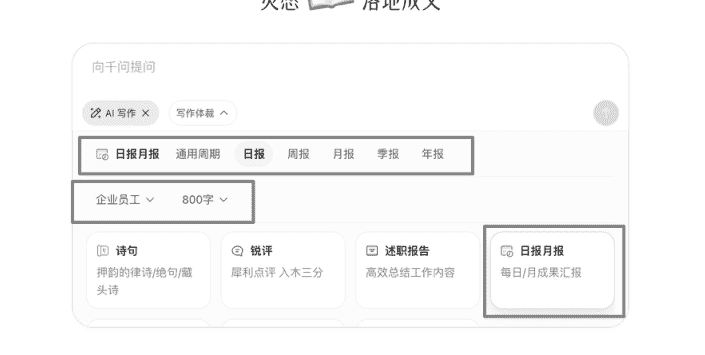

图 3-4 千问“日报月报”写作功能

#### 1. 日报案例

日报案例选取互联网运营岗为对象，该岗位日常涉及内容发布、数据监测、用户互动等具体工作，展示千问日报提示词的具体撰写形式及对应的生成效果，体现该功能在实际工作中的高效辅助作用。提示词示例如下：

> 角色设定：互联网公司运营人员，负责公司官方微信公众号、抖音账号的日常运营，主要工作包括内容发布、数据监测、用户互动、活动执行等，直接对接运营主管。

背景信息：今日主要工作围绕本周“春季新品推广”活动落地执行，已完成全部既定工作任务，具体结果如下：公众号成功发布春季新品推文 1 篇，实际阅读量 1280 次、点赞 86 次；抖音账号发布新品相关短视频 2 条，播放量分别达 5600 次、7800 次，点赞量 210 次、356 次；完成昨日发布内容的数据监测，同步形成简易数据分析；累计处理公众号留言 30 条、抖音评论 45 条，实际回复 71 条，回复率达 94.7%，完成不低于 90% 的回复要求；已对接设计部门，确认明日推广所需的 2 张新品海报、1 条短视频脚本，明确明日 10 点前交付；同时梳理出当日工作中存在的 2 项问题，并结合实际工作制定了明日针对性工作计划。

> **任务目标：**撰写一篇运营岗日报，清晰呈现当日各项工作的完成情况、数据成果、存在问题及明日工作计划，符合互联网运营岗日报的规范，突出工作重点与自身思考。

**输出要求：**字数控制在 800 字左右，采用正式书面语，陈述句为主，分四个部分撰写（今日工作完成情况、数据监测分析、存在问题、明日工作计划），数据清晰可查，问题具体，计划可行，避免流水账，不出现口语化表述。

基于上述明确的角色设定、背景信息、任务目标及输出要求，千问可快速生成符合互联网运营岗规范的日报内容。生成的日报分为四个部分，呈现当日工作全貌，逻辑清晰，既突出工作成果与重点，也不遗漏存在的问题及后续计划，无须用户额外大幅修改，可稍作调整后提交，以下为千问具体生成的日报内容：

> **运营岗日报**

日期：202×年×月×日
汇报人：×××
岗位：运营专员

**一、今日工作完成情况**
今日围绕“春季新品推广”活动开展落地执行，各项工作按计划推进并全部完成。具体如下：
- 完成官方微信公众号春季新品推文发布 1 篇，标题为《焕新季·春启万物——××品牌春季新品重磅上线》，内容涵盖新品亮点、使用场景及购买指引，已按时推送。
- 抖音平台发布新品相关短视频 2 条，分别聚焦产品功能展示与用户场景体验，视频已上线并完成基础推广设置。
- 完成昨日发布内容的数据监测工作，整理形成简易数据分析报告，已提交运营主管审阅。
- 用户互动方面，共处理公众号留言 30 条、抖音评论 45 条，累计回复 71 条，整体回复率达 94.7%，达到不低于 90%的回复率考核标准。
- 已与设计部门完成对接，确认明日推广所需素材：2 张新品海报及 1 条短视频脚本，明确交付时间为明日 10:00 前，目前进度可控。
- 梳理当日运营过程中发现的 2 项问题，并初步制定应对思路，为后续优化提供参考。

**二、数据监测分析**
- 公众号推文：实际阅读量 1280 次，点赞 86 次，打开率较上一周提升约 12%，但分享量偏低，仅 18 次，反映出内容传播性有待加强。
- 抖音短视频：第一条播放 5600 次，获点赞 210 次，点赞率为 3.75%；第二条播放 7800 次，获点赞 356 次，点赞率为 4.56%，第二条内容更具吸引力，用户互动意愿更高，初步判断场景化表达更易引发共鸣。整体播放量符合预期，但转化引导点击率尚未接入统计，需后续跟进。
- 用户互动数据表明，咨询类问题集中于新品价格与发货时间，建议在后续内容中强化 FAQ 前置说明，提升信息传达效率。

**三、存在问题**
- 公众号推文分享率偏低，内容形式仍以图文为主，缺乏互动引导与社交裂变设计，用户主动转发意愿不足。
- 抖音视频评论中出现部分用户对产品细节存在误解，反映出视频信息传递不够清晰，需在脚本策划阶段加强关键信息的突出呈现。

**四、明日工作计划**
- 跟进设计部门素材交付进度，确保 2 张海报与 1 条短视频脚本于 10:00 前完成验收，并启动内容制作与审核流程。
- 策划并撰写公众号词条推文，主题为“春季穿搭灵感指南”，结合新品进行场景化种草，提升内容吸引力与分享价值。
- 优化抖音短视频脚本结构，增加产品核心参数字幕提示与使用对比画面，提升信息传达清晰度。
- 梳理高频用户咨询问题，整理形成标准化回复话术库，提升客服响应效率与一致性。
- 启动新品推广第二阶段预热内容排期规划，初步拟定未来三日发布节奏，提交主管审批。

以上为今日工作汇报及明日计划，将持续跟进执行进展，确保推广活动有序推进。

#### 2. 月报案例

相较于日报的日常性、碎片化呈现，月报更注重全面性、系统性与总结性，需梳理整月工作成果、数据、问题及计划，篇幅更长、内容更详实。为展示千问生成长篇月报的能力，月报案例选取销售岗为对象，该岗位月报围绕业绩达成、客户管理、订单跟进等主要工作。提示词示例如下：

> **角色设定：**某机械设备销售公司销售经理，负责区域内工业企业的机械设备销售工作，主要工作包括客户开发、客户维护、订单跟进、产品推广、销售数据统计等，对接销售经理，承担月度销售业绩指标。

**背景信息：**本月为 202×年×月，月度销售目标为完成销售额 80 万元，开发新客户 5 家，维护老客户 15 家，完成客户拜访 30 次，组织产品推广活动不少于 1 场。本月主要工作围绕区域内工业企业机械设备销售展开，重点推进 3 个机械设备订单（分别为××市××重型机械有限公司 8 万元、××区××装备制造有限公司 6 万元、××县××矿山机械有限公司 4 万元，合计预计销售额 18 万元）的跟进工作，实际开展客户拜访 32 次（其中新客户拜访 18 次、老客户回访 14 次），组织产品推广活动 2 场，覆盖区域内 20 余家工业企业，同步完成月度销售数据统计、客户信息更新及工作问题梳理。本月实际完成销售额 68 万元，开发新客户 4 家，维护老客户 16 家，整体业绩达成率 85%，未完成月度目标的主要原因是 3 个订单跟进进度滞后（均因客户内部审批流程延长、预算调整导致），同时受区域内同类机械设备厂家降价竞争影响，2 家意向新客户被竞争对手争取，相关情况需在月报中详细说明、分析原因并制定改进措施。此外，本月收集到老客户反馈 8 条，其中 3 条涉及售后服务响应效率，2 条涉及产品价格，3 条涉及产品功能，需同步纳入月报梳理。

**任务目标：**撰写一篇销售岗月报，全面呈现本月销售工作完成情况、业绩达成情况、客户开发与维护情况、订单跟进情况、存在问题及改进措施、下月工作计划，突出销售工作的针对性与实效性，符合销售岗月报规范。

**输出要求：**字数控制在 3000 字左右，采用正式书面语，以陈述句为主，分六个部分撰写（本月工作概述、业绩达成情况、客户开发与维护情况、订单跟进情况、存在问题及改进措施、下月工作计划），数据详实，问题具体，改进措施可行，计划明确，避免流水账，不出现口语化表述，专业术语使用准确。

基于提示词中明确的销售岗角色设定、详实的月度工作背景信息、清晰的任务目标及规范的输出要求，千问可快速生成符合销售岗规范的3000字左右月报。生成的月报包含整月业绩、客户、订单等核心信息，数据详实准确、逻辑层次清晰，既完整呈现工作全貌，也深入分析问题、明确改进方向，可稍作调整后提交，以下为千问具体生成的月报内容（部分）：

机械设备销售公司销售经理202×年××月销售月报

**一、本月工作概述**

- **主要工作内容**
在本月的工作中，客户开发方面，通过多种渠道积极寻找潜在客户，参与行业展会、线上平台推广以及线下扫楼等方式，开发新客户18家。客户维护上，定期对老客户进行回访，了解他们的使用情况和需求，为16家老客户提供定制化解决方案，增强客户黏性。
订单跟进上，紧密跟踪××市××重型机械有限公司8万元、××区××装备制造有限公司6万元以及××县××矿山机械有限公司4万元的订单，与客户保持高频沟通，及时协调解决客户在采购过程中遇到的问题。
产品推广方面，组织了2场产品推广活动，邀请行业专家讲解产品优势，展示产品在实际生产中的应用案例，覆盖区域内20余家工业企业，提升了公司产品的知名度和影响力。
在销售数据统计上，每日记录客户拜访情况、订单进展以及产品推广活动的反馈等信息，每周进行数据汇总和分析，为销售策略的调整提供数据支持，确保销售工作有序推进。

- **工作背景与目标**
本月销售工作面临着激烈的市场竞争和复杂多变的经济形势。区域内同类机械设备厂家纷纷降价竞争，客户对产品价格更加敏感，对产品质量和售后服务的要求也不断提高。
在此背景下，本月设定的销售目标为完成销售额80万元，开发新客户5家，维护老客户15家，完成客户拜访30次，组织产品推广活动不少于1场。重点推进3个机械设备订单的跟进工作，预计销售额18万元。通过开发新客户，挖掘潜在市场；维护老客户，巩固现有市场份额；组织产品推广活动，提升品牌影响力；加强销售数据统计，为销售决策提供科学依据，以实现月度销售目标，推动公司业务持续发展。

**二、业绩达成情况**（以下为列举大纲，省略具体内容）
- 销售业绩完成情况
- 客户开发维护成果
- 产品推广活动效果

**三、客户开发与维护情况**
- 客户拜访情况
- 客户需求分析
- 客户关系维护措施

**四、订单跟进情况**
- 重点订单跟进进展
- 订单跟进问题及原因

**五、存在问题及改进措施**
- 未完成目标原因分析
- 客户反馈问题梳理
- 改进措施制定

**六、下月工作计划**
- 销售目标设定
- 工作重点安排
- 资源需求与支持

总体而言，千问的“日报月报”写作功能，精准匹配职场人士的日常文书需求，依托多职业类型设计、简洁易操作的流程以及专业规范的内容生成能力，切实解决了职场人撰写日报月报时耗时久、内容乱、重点不鲜明等常见痛点。无论是企业运营、销售、医护人员，还是教师等不同行业从业者，都能借助该功能快速生成符合自身岗位要求的文书，大幅节省撰写时间，将更多的精力投入到实际工作中。

### 3.1.3 高情商回复

高情商回复是职场人士的必修课之一。职场沟通不同于日常闲聊，需兼顾专业性、得体性与分寸感，一句恰当的回复能化解矛盾、凝聚共识、维护职场关系，而不当的表达则可能引发误解、激化矛盾，影响工作推进。不少人因缺乏高情商沟通技巧，在拒绝领导安排、回复同事求助、安抚客户投诉等场景中屡屡碰壁，影响职业发展。

千问“AI 写作”功能提供了“高情商回复”的写作体裁，是针对沟通场景痛点推出的实用功能。千问能精准捕捉不同沟通场景的语境、语气要求，结合沟通对象的身份特点，生成得体、恰当的回复内容，无须用户花费大量时间斟酌措辞。如图 3-5 所示，用户只需进入千问“AI 写作”功能界面，选择“高情商回复”写作体裁，再选择对应场景类型，输入完整的提示词，即可快速生成符合要求的回复内容。


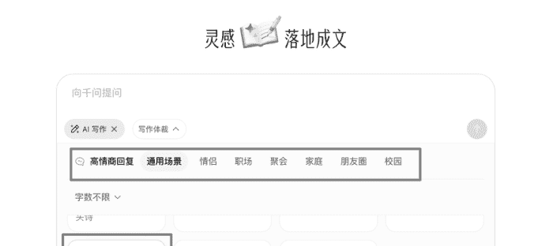

图 3-5 千问“高情商回复”写作功能

千问“高情商回复”体裁支持多种场景类型，覆盖职场、生活、校园等各类高频沟通场景，不同场景类型的回复侧重点不同，满足不同沟通需求，具体场景类型及适用范围如表 3-3 所示。

### 表 3-3 千问“高情商回复”类型汇总

| 场景类型 | 适用范围 | 回复侧重点 |
| :--- | :--- | :--- |
| 通用场景 | 无明确场景限制的日常沟通、简单问候、礼貌回应等 | 礼貌得体、简洁通用，兼顾基本的沟通礼仪 |
| 情侣场景 | 情侣间的日常沟通、矛盾化解、情感表达、节日回应等 | 真诚共情、贴合情感需求，兼顾温柔度与分寸感 |
| 职场场景 | 职场中的上下级沟通、同事协作、客户对接、拒绝请求、感谢回应等 | 专业得体、逻辑清晰，兼顾职场礼仪与工作效率，不卑不亢 |
| 聚会场景 | 朋友聚会、同事聚餐、家庭聚会中的问候、敬酒回应、话题衔接等 | 热情大方、贴合氛围，兼顾轻松感与基本礼仪 |
| 家庭场景 | 与家人的日常沟通、关心问候、意见表达、矛盾化解等 | 温暖真诚、包容体谅，贴合家庭沟通的温情氛围 |
| 朋友圈场景 | 朋友圈评论、点赞回应、动态互动等 | 简洁得体、贴合动态内容，兼顾个性化与礼貌性 |
| 校园场景 | 师生沟通、同学协作、社团交流、学业请教等 | 礼貌谦和、贴合校园氛围，兼顾学习需求与人际交往 |

为直观展示千问高情商回复在职场中的实用价值，选取职场中高频出现的“拒绝同事求助”场景，该案例以互联网公司行政人员为角色，面临自身紧急工作与同事求助的冲突，需在拒绝求助的同时维护部门协作关系，提示词示例如下：

> **角色设定：** 某互联网公司行政人员，负责日常行政事务协调、部门沟通对接及领导交办的临时工作，沟通对象包括公司各部门同事、上级领导，日常需频繁回应各类工作请求。

**背景信息：** 当日上午，行政人员已接到领导安排的紧急任务，须在下午 5 点前完成本月行政费用统计及报表制作，任务量较大且时间紧张。此时，市场部同事找到行政人员，请求其帮忙打印并装订 50 份市场推广方案，要求下午 3 点前交付，该同事表示自身手头有紧急推广任务，无法自行完成，希望行政人员协助。行政专员无法同时兼顾两项紧急任务，需拒绝市场部同事的请求，但需避免影响部门间协作关系，同时给出合理的替代建议。

**任务目标：** 撰写一段高情商拒绝话术，拒绝市场部同事的请求，不引发误解，同时给出可行的替代建议，维护部门间的协作关系。

**输出要求：** 字数控制在 200 字左右，采用正式职场沟通语气，不口语化、不生硬，逻辑清晰，先表达理解与歉意，再说明无法协助的原因，最后给出具体的替代建议，确保话术专业、得体、有温度，符合行政人员的身份特点及职场沟通礼仪。

根据设定的提示词，千问快速生成了适合该场景的高情商回复。该话术符合行政人员的身份特点及输出要求，兼顾诚恳态度与专业分寸，既清晰传达了无法协助的原因，也给出了可行建议，契合职场沟通需求，具体内容如下：

> 您好，非常理解您推广任务的迫切，也感谢您第一时间想到我协助。实在抱歉，目前我正在处理本月行政费用统计及报表制作，这是领导明确要求今日下午 5 点前必须提交的紧急任务，涉及整月财务数据，时间紧、任务重，我需全程专注完成，恐怕无法在下午 3 点前兼顾打印装订工作。为不耽误您的进度，建议您可联系文印室安排加急打印，或协调行政助理小李协助装订，我可立即帮您沟通协调，确保尽快落实。给您带来不便，深表歉意，还请理解与支持。

千问“高情商回复”功能的价值，在于将复杂的沟通技巧转化为简单的操作流程，无须用户具备专业的沟通知识，只需明确沟通场景与主要需求，即可借助千问生成得体、高效的回复内容。无论是职场人士应对各类职场沟通场景，还是普通大众处理生活中的人际沟通，都能通过该功能快速提升沟通质量，化解沟通难题。

### 3.1.4 策划方案

策划方案是职场人士的常见任务。无论是企业市场推广、内部活动开展，还是项目落地、问题解决，都需要通过策划方案明确目标、梳理流程、规划细节，为工作推进提供清晰指引。策划方案的质量直接影响工作执行效果，一份逻辑清晰、细节完善、可操作性强的策划方案，能有效降低执行成本、规避风险，确保工作有序推进，反之，方案混乱、细节缺失，会导致执行过程中出现漏洞，影响工作成效。

千问为“AI 写作”功能提供了“策划方案”写作体裁，是针对职场策划需求推出的实用功能。千问能精准捕捉不同类型策划方案的关键框架与撰写要点，结合用户提供的背景信息，快速生成结构完整、细节详实、可操作性强的策划方案。如图 3-6 所示，用户进入千问“AI 写作”功能界面，选择“策划方案”写作体裁，再根据实际需求选择对应场景类型，输入详细的提示词，即可快速生成符合要求的方案内容，大幅降低策划方案的撰写难度与时间成本。

## 灵感 🪄 落地成文

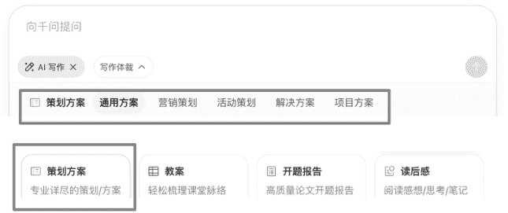

图 3-6 千问“策划方案”写作功能

千问“策划方案”体裁支持多种场景类型，覆盖职场中常见的各类策划需求，不同场景类型的方案框架、内容侧重点不同，具体场景类型及适用范围、关键要点如表 3-4 所示。

### 表 3-4 千问“策划方案”类型汇总

| 场景类型 | 适用范围 | 关键要点 |
| :--- | :--- | :--- |
| 通用方案 | 无明确场景限制，适用于各类简单策划、小型工作安排等 | 框架简洁，包含工作目标、执行步骤、时间安排、责任分工等基础内容 |
| 营销策划 | 适用于企业产品推广、品牌宣传、促销活动等营销类工作 | 包含市场分析、目标人群、营销渠道、推广策略、预算规划、效果评估等 |
| 活动策划 | 适用于企业内部活动、客户答谢活动、公益活动、商业活动等各类活动开展 | 包含活动主题、活动目的、活动流程、场地布置、人员安排、预算、应急预案等 |
| 解决方案 | 适用于企业运营、工作推进中出现的各类问题，制定针对性解决办法 | 包含问题分析、解决目标、解决措施、执行步骤、责任分工、效果验收等 |
| 项目方案 | 适用于各类项目立项、推进、落地，明确项目整体规划 | 包含项目背景、项目目标、项目范围、实施计划、资源配置、进度安排、风险控制等 |

在各类策划方案场景中，活动策划是职场中最常用的类型之一，这里选取某互联网公司 5 周年庆活动作为案例。该场景是企业常见的品牌类活动，主要需求是通过线上线下结合的形式，实现品牌影响力提升、老客户黏性增强及新客户吸引，活动有明确的预算、参与人数及时间要求，符合职场实际工作场景。提示词示例如下：

## 第3章 千问助力高效办公

**角色设定：** 某互联网公司市场部活动经理，负责公司品牌推广及各类活动策划、执行工作，熟悉活动策划流程，了解公司品牌定位及目标人群特点，需撰写专业、可操作的活动策划方案，对接各相关部门推进活动落地。

**背景信息：** 该互联网公司成立5周年，为提升品牌影响力、增强老客户黏性、吸引新客户关注，计划举办一场线上线下结合的周年庆活动。活动面向公司老客户、潜在新客户及行业合作伙伴，线下活动选址在本地会展中心，线上同步直播，活动时间定于周末，预计参与人数线下200人、线上1000人以上。公司给予活动总预算50万元，要求活动兼具品牌宣传、客户回馈及产品推广功能，确保方案可直接用于活动执行。

**任务目标：** 撰写一份公司5周年庆线上线下结合活动的策划方案，明确活动各环节细节，确保方案逻辑清晰、可操作性强，兼顾品牌宣传、客户回馈与产品推广三大功能，符合公司预算要求。

**输出要求：** 字数控制在5000字左右，采用正式书面语，方案结构完整，包含活动主题、活动目的、活动时间与地点、参与人群、活动流程（线上+线下）、场地布置、人员分工、预算规划、宣传推广、应急预案、效果评估等全部核心环节；预算分配合理，严格控制在50万元以内；细节详实，明确各环节时间节点、责任部门及具体要求，确保方案具备可执行性，符合市场部活动策划的专业标准。

基于提示词，千问快速生成了这份互联网公司5周年庆线上线下结合活动策划方案。该方案遵循提示词中的各项要求，覆盖活动全流程关键环节，细节详实、逻辑清晰，兼顾专业性与可操作性，可直接用于活动落地执行，方案内容如下（部分）：

# 互联网公司5周年庆线上线下结合活动策划方案

## 一、活动主题

### 主题确定

结合公司品牌定位、5周年纪念及活动目标，可将活动主题确定为“智联五载，筑梦未来”。此主题紧扣互联网公司以科技赋能、连接万物的品牌定位，体现公司五年来在行业发展中积累的智慧与成果。“筑梦未来”展现出公司对未来发展的信心与愿景，既能强化品牌影响力，让老客户感受到公司的发展潜力，增强黏性，又能吸引潜在新客户和行业合作伙伴对公司的关注与认可，符合活动提升品牌影响力、客户回馈及产品推广的目标。

## 二、活动目的

### 品牌宣传

此次5周年庆活动对品牌宣传意义重大。线上直播与线下活动相结合，能让品牌信息快速扩散至更广泛区域，打破时空限制，提升品牌知名度。活动现场的精心布置、互动环节设计等，可展示公司专业、创新的品牌形象，给参与者留下深刻印象，增强品牌美誉度。通过媒体报道、社交平台分享等方式，还能扩大品牌影响力，让品牌在行业内外获得更多关注与认可，树立良好的市场口碑，为公司长远发展奠定品牌基础。

### 客户回馈

为回馈老客户，活动将设置专属环节。线下活动中，为老客户准备精美礼品和定制纪念品，感谢他们多年的支持。安排老客户专属座席，让他们享受更尊贵的待遇。线上则推出老客户专属优惠和互动游戏，增强他们的参与感与归属感。通过这些方式，让老客户切实感受到公司的关怀与重视，加深他们对品牌的情感连接，提高客户忠诚度，降低客户流失率，为公司的持续发展留住宝贵客户资源。

### 产品推广

活动是产品推广的良好契机。线下活动中，可设置产品展示区，让参与者近距离体验公司产品，感受产品优势与特色。线上通过直播展示、互动问答等方式，详细介绍产品功能与使用方法，吸引潜在客户关注。还可推出限时优惠、组合促销等活动，刺激购买欲望。结合线上线下宣传，扩大产品曝光度，吸引更多新客户关注，提升产品销量与市场份额，推动公司业务发展。

## 三、活动时间与地点（以下列举大纲，省略具体内容）

### 时间确定

### 地点选择

## 四、参与人群

- 老客户
- 潜在新客户
- 行业合作伙伴

## 五、活动流程（线上+线下）

- 线下活动流程
- 线上活动流程

## 六、场地布置

- 线下场地布置
- 线上场景搭建

## 七、人员分工

- 各部门职责
- 人员安排

## 八、预算规划

- 预算分配
- 成本控制

## 九、宣传推广

- 宣传渠道
- 推广策略

## 十、应急预案

- 突发情况应对
- 风险防控

## 十一、效果评估

- 评估指标
- 评估方法

千问“策划方案”写作功能的亮点，就是把复杂的策划流程化繁为简，不用读者费脑拆解步骤、死记专业知识点。哪怕是策划小白，只要说清活动目标、预算、参与人群这些基础信息，就能靠千问快速生成专业又完善的策划方案。

### 3.1.5 论文

论文是教师、学生和职场人士在学习、工作中频繁接触的任务类型。学生需完成课程论文、毕业论文、专升本论文等以满足学业要求；教师需撰写期刊论文、研究论文以总结教学成果、提升学术水平；职场人士中，部分群体需提交职称论文、技术报告类论文，作为职称评审、能力考核的重要依据。这类任务往往要求结构严谨、逻辑清晰、内容专业，且不同类型的论文有其特定格式与规范，撰写过程需投入大量时间梳理思路、搜集资料、优化表达，对使用者的文字功底和专业能力均有一定要求。

千问的“AI 写作”功能针对论文这一高频需求，专门设置了“论文”写作体裁，如图 3-7 所示，为不同场景下的论文撰写提供支持。该功能依托千问强大的底层大模型，结合内置的论文模板资源，可快速响应不同类型论文的撰写需求，大幅降低论文写作的门槛，提升写作效率。


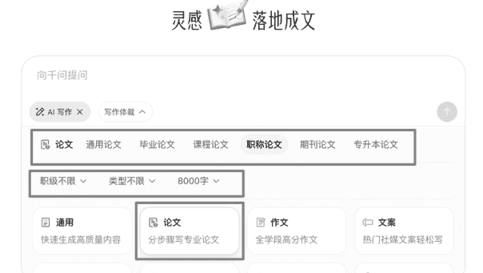

千问“论文”体裁涵盖多种场景类型，可满足不同用户的个性化需求，具体场景及适用人群如表 3-5 所示。

### 表 3-5 千问“论文”类型汇总

| 场景类型 | 适用人群 | 简要说明 |
| :--- | :--- | :--- |
| 通用论文 | 所有有论文撰写需求的用户 | 无特定场景限制，适用于各类基础性、通用性论文撰写 |
| 毕业论文 | 高校本科生、研究生 | 满足各学历阶段毕业论文要求，涵盖不同专业方向，注重学术规范性 |
| 课程论文 | 在校学生 | 针对某一课程的学习成果撰写，篇幅适中，侧重课程知识点的应用 |
| 职称论文 | 职场专业技术人员 | 适合不同职级评审要求，可选择技术报告、创新方案等细分类型 |
| 期刊论文 | 教师、科研人员、职场技术骨干 | 符合期刊发表规范，注重学术创新性和研究价值 |
| 专升本论文 | 专升本阶段学生 | 贴合专升本论文的字数、格式要求，侧重基础专业能力的体现 |

在各类论文场景中，职称论文因与职场人士的职业发展直接相关，其撰写规范性和专业性要求较高。在职称评审时，需提交符合规范的技术报告作为能力考核依据，这类技术报告需贴合自身岗位方向、具备一定的专业性，同时符合职称评审的相关要求，是职称评审的基本材料之一。

这里选取一个实用的职称论文（初级职称技术报告）为案例，为读者展示千问如何快速辅助生成论文草稿，提示词示例如下：

> **角色设定：** 初级专业技术人员，从事数据分析相关工作，具备基础的 AI 技术知识，需撰写初级职称评审用技术报告，符合初级职称技术报告的撰写规范。

**背景信息：** 随着信息技术的迅猛发展，尤其是互联网、物联网和云计算的广泛应用，全球数据量正以指数级速度增长。传统的数据分析方法在面对如此复杂的数据环境时显得力不从心，其效率低下、准确性不足的问题日益凸显。在此背景下，人工智能（AI）技术的引入为数据分析提供了新的解决方案。AI 多智能体技术，能够自动提取数据特征并发现潜在规律，从而显著提高数据分析的效率和准确性。因此，构建基于 AI 多智能体的数据分析平台已成为当前研究的重要方向。

**任务目标：** 撰写一篇标题为“基于 AI 多智能体的数据分析技术”的初级职称技术报告，结合 AI 多智能体的核心组件、应用流程，体现本人对该技术的理解和研究能力，满足初级职称评审对技术报告的要求。

**输出要求：** 报告结构完整，语言严谨、专业，符合技术报告的正式文风；字数控制在 8000～10000 字，格式规范，段落清晰，无语法错误；贴合初级职称技术人员的专业水平，不涉及过于深奥的理论推导，重点体现技术理解和学习能力。

千问在接收上述结构化提示词后，不会直接生成论文全文，而是先输出一份完整的论文大纲，如图 3-8 所示。大纲会遵循提示词中的输出要求，明确各章节的核心内容、逻辑顺序和重点方向，对应技术报告的各个部分，细化各章节的子标题和撰写要点。用户可根据自身实际需求，对大纲的结构、内容侧重点等进行修改调整。

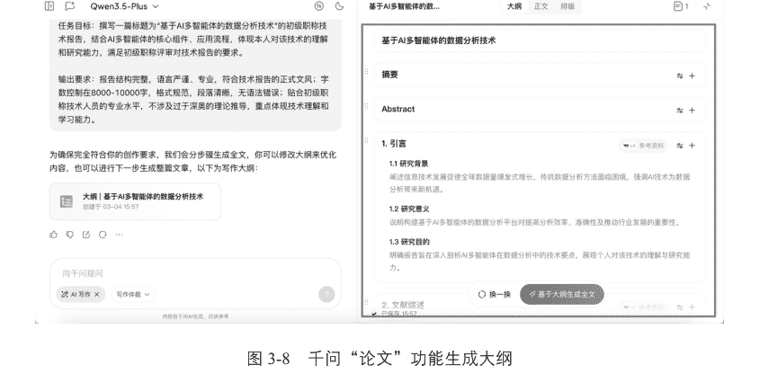

大纲修改确认后，用户点击“基于大纲生成全文”按钮，千问便会基于确认后的大纲，结合提示词中的背景信息、任务目标和输出要求，生成完整的论文全文。生成过程中，千问会依托自身的知识库和论文库，确保内容的专业性和准确性。

千问“论文”写作功能的一大优势是，在论文生成过程中，千问会引用真实存在的论文文献，如图 3-9 所示，在正文中，用户可以点击角标来追踪引用文献的出处详情，而且在论文末尾，千问会按照标准格式列举所有文献信息，对于用户来说非常方便。

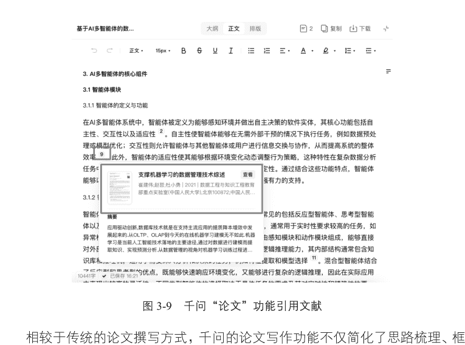

相较于传统的论文撰写方式，千问的论文写作功能不仅简化了思路梳理、框架搭建的过程，还能通过规范的格式排版和专业的内容表达，帮助用户快速完成符合要求的论文草稿。

因篇幅所限，这里只展示千问生成论文的摘要部分：

> ### 基于 AI 多智能体的数据分析技术

**摘要：**

随着信息技术的飞速发展，全球数据量呈指数级增长，传统数据分析方法已难以应对复杂的数据环境，人工智能（AI）技术为数据分析带来了新的契机。AI 多智能体技术作为 AI 领域的重要分支，能够自动提取数据特征并发现潜在规律，显著提升数据分析的效率与准确性。在数据分析中，AI 多智能体主要由智能体模块、通信机制和协作策略等核心组件构成。其应用流程涵盖数据预处理、模型构建和结果分析三个阶段。然而，该技术在应用过程中面临数据隐私与安全、智能体间协作冲突等挑战，需通过加密技术、访问控制、优化协作机制等策略加以应对。展望未来，AI 多智能体有望与更多新兴技术融合，进一步拓展在数据分析领域的应用场景。

**关键词：** AI 多智能体；数据分析；核心组件；应用流程；隐私保护

（英文版本此处省略）

最后需要特别强调的是，论文写作是一件非常严肃的事情，无论是教师、学生还是职场人士，都必须自身主导论文的创新设计和关键过程，AI 工具始终是辅助，对于生成的论文草稿，更多是起到参考和启发的价值，用户不能仓促使用 AI 结果。

## 3.2 文本优化

文本优化是办公场景中常见且琐碎的任务类型，贯穿职场人士和普通大众的日常工作与学习。职场中，员工需优化工作报告、通知公告、邮件往来、推广文案等内容，确保表述准确、逻辑清晰、符合场景需求。这类任务看似简单，却需要投入大量时间逐字逐句修改，既要修正语法错误、调整语句通顺度，也要根据不同场景调整语气、优化结构，若处理不当，可能影响信息传递效率，甚至影响工作成果和学习成绩。

千问的 AI 写作功能针对文本优化这一高频需求，专门设置了快捷入口，无须复杂操作即可快速进入文本优化界面。如图 3-10 所示，用户在千问首页找到“AI 写作”模块，点击进入后，可根据自身需求选择具体的优化类型。

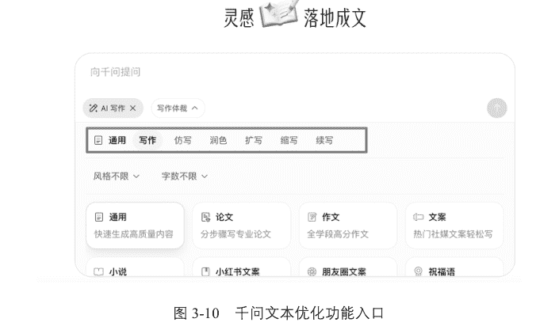

千问的文本优化功能涵盖五种具体优化类型，分别为仿写、润色、扩写、缩写、续写，每种类型对应不同的使用场景，可解决不同的文本优化痛点。各优化类型的适用场景、核心作用如表 3-6 所示，方便用户快速匹配自身需求，选择合适的优化方式。

### 表 3-6 千问文本优化功能汇总

| 优化类型 | 适用场景 | 核心作用 |
| :--- | :--- | :--- |
| 仿写 | 模仿特定风格、句式撰写文本，如模仿优秀文案、正式公文、学术表述等 | 快速掌握目标风格的表达逻辑和语言特点，生成符合要求的文本，减少创作难度 |
| 润色 | 文本存在语法错误、语句不通顺、语气不当、用词不精准等问题，需优化表达 | 修正文本错误，优化语句结构，提升语言流畅度和专业性，满足具体使用场景 |
| 扩写 | 文本过于简洁、内容单薄，需补充细节、丰富内容，如扩写通知、报告片段、演讲稿等 | 在保留原文核心信息的基础上，补充相关内容和细节，让文本更完整、更具说服力 |
| 缩写 | 文本篇幅过长、冗余信息较多，需提炼核心内容，如缩写会议纪要、论文摘要、工作报告等 | 去除冗余信息，提炼文本核心要点，缩短篇幅，同时保证核心信息不丢失 |
| 续写 | 文本未完成、需延续原文逻辑和风格，补充后续内容，如续写活动方案、演讲稿、故事片段等 | 基于原文的逻辑、风格和核心思想，自然延续内容，确保续写部分与原文衔接流畅 |

为帮助读者更好地掌握千问文本优化各类型的使用方法，以下针对每种优化类型，提供一个实用案例，提示词均采用“角色设定+背景信息+任务目标+输出要求”的结构化形式，确保千问能精准捕捉需求，生成符合要求的优化结果。

### 3.2.1 仿写

仿写适用于需要模仿特定风格、句式撰写文本的场景，尤其适合职场中需要快速掌握不同类型文案表达逻辑的人群，如市场推广人员模仿优秀推广文案、行政人员模仿正式公文格式等。仿写的关键是精准把握原文的风格、句式和表达逻辑，在此基础上结合自身需求撰写新的文本，千问可通过分析用户提供的参考文本，快速提炼其风格特点，生成符合要求的仿写内容。

以推广文案仿写为例，提示词结构化设计如下：

> 角色设定：互联网公司市场推广人员，负责公司智能办公软件新品推广文案撰写，需模仿行业优秀文案风格，撰写符合新品特点的文案。
背景信息：公司智能办公软件核心功能为文档协同编辑、会议纪要自动生成、多平台同步，目标用户为职场人群，卖点是“高效、便捷、省时”，有同类优秀参考文案（省略）可供模仿。
**任务目标：** 模仿参考文案的风格、句式和逻辑，结合新品核心功能与卖点，撰写适合微博发布的推广文案，突出卖点、吸引目标用户。
**输出要求：** 风格、句式与参考文案一致，含三个核心功能，150～200字，语言简洁通俗、贴合职场人群，语气积极，符合微博文风。

### 3.2.2 润色

润色是文本优化中最常用的类型，适用于各类已完成但存在表达问题的文本，如语法错误、语句不通顺、用词不精准、语气不当等。职场中，工作报告、邮件、通知等文本的润色尤为重要，直接影响信息传递的准确性和专业性。学生的论文、作业等文本，通过润色可提升语言表达的规范性和流畅度。千问的润色功能可精准识别文本中的各类问题，同时结合文本的使用场景，优化语言表达，保留原文核心信息。

以润色“冬奥精神心得体会”为案例，提示词结构化设计如下：

> **角色设定：** 你是一名企业员工，需提交一篇以冬奥精神为主题的心得体会，用于公司内部学习交流，已撰写完成初稿。
**背景信息：** 初稿围绕“更快、更高、更强——更团结”的冬奥精神，结合自身工作经历撰写，约2000字，包含对赛事的感受、对运动健儿的敬佩以及将冬奥精神融入工作的思路。但初稿存在语句表达、逻辑衔接和情感传递等方面的不足。公司要求心得体会需正式、真挚、逻辑清晰，突出冬奥精神核心要义。
**任务目标：** 对上传的文稿进行润色，修正语句不畅、逻辑混乱等问题，深化冬奥精神与个人工作的结合深度，增强情感感染力，使文稿达到公司提交标准。
**输出要求：** 润色后的文稿语言规范得体，逻辑连贯严谨，情感真挚充沛。清晰展现“更快、更高、更强——更团结”的冬奥精神核心要义，并结合个人工作实践提出明确的践行方向。篇幅与初稿大致相当（约2000字），核心内容无缺失。文风正式，契合公司内部学习交流场景，可直接用于提交。

### 3.2.3 扩写

扩写适用于文本过于简洁、内容单薄，需要补充细节、丰富内容的场景，如办公中的通知、报告片段、演讲稿，学生的作文、论文片段等。扩写是在保留原文信息的基础上，补充相关细节、解释说明或延伸内容，使文本更完整、更具体、更具说服力，千问可根据原文的主要思想和使用场景，合理补充相关内容，避免扩写内容与原文脱节。

以下为公司有关垃圾分类通知扩写的案例，提示词结构化设计如下：

> 角色设定：企业行政人员，负责撰写公司内部推行垃圾分类的通知。
背景信息：为响应环保政策，营造绿色办公环境，公司计划于 202×年×月×日起全面推行办公区域垃圾分类，覆盖公司所有办公楼层、会议室及公共区域。通知初稿内容如下：“各位同事，公司将于×月×日起推行垃圾分类，请大家严格遵守相关规定，规范投放垃圾。”初稿仅包含核心要求，内容过于简洁。
任务目标：对垃圾分类通知初稿进行扩写，补充垃圾分类标准、投放地点、投放要求及注意事项等细节，确保全体员工能清晰了解垃圾分类的具体规范，规范执行投放。
输出要求：扩写后的通知结构清晰，段落分明，语言正式、简洁。补充的细节完整、合理，包括垃圾分类标准（可回收物、其他垃圾、有害垃圾具体品类）、各楼层投放地点、投放时间及具体要求、违规投放说明，扩写内容与原文衔接自然，不添加无关信息，字数控制在 500 字左右，确保所有员工能快速获取关键信息，明确垃圾分类相关规范。

### 3.2.4 缩写

缩写适用于文本篇幅过长、冗余信息较多，需要提炼核心内容的场景，如办公中的工作报告、行业报告，学生的论文摘要、课文重点，以及各类学术论文的提炼等。缩写的关键是去除文本中的冗余信息、重复内容，提炼要点，同时保证基本信息不丢失、逻辑不混乱，千问支持快速识别论文核心内容，合理删减冗余信息，生成简洁、凝练的缩写文本，满足论文摘要生成、关键内容提炼等需求。

以下为论文缩写的案例，提示词结构化设计如下：

> **角色设定：** 高校本科生，已完成一篇课程论文。
**背景信息：** 本次需缩写的论文为本科课程论文，论文初稿篇幅约 8000 字，涵盖摘要、引言、AI 办公应用场景、应用现存问题、优化建议、结论六个部分，包含文献引用、细节分析和数据说明。论文缩写需提炼论文关键内容，形成一篇完整的论文摘要，去除细节分析，确保缩写内容逻辑清晰、重点突出。
**任务目标：** 基于已上传论文进行缩写，提炼论文核心要点，符合本科课程论文摘要的撰写规范，满足课程提交要求。
**输出要求：** 缩写后的论文摘要简洁凝练，字数控制在 300 字以内。关键信息完整，包含论文研究目的、研究内容、主要结论及优化建议，不遗漏重要信息。逻辑清晰，语言正式、严谨，符合学术论文摘要的文风，无冗余信息和口语化表述，与上传的论文主要内容高度一致。

### 3.2.5 续写

续写适用于文本未完成、需要延续原文逻辑和风格，补充后续内容的场景，如办公中的活动方案、演讲稿、项目计划书以及学生的作文、故事片段等。续写是基于原文的逻辑、风格和核心思想，自然延续内容，确保续写部分与原文衔接流畅，不出现逻辑断层，千问可精准把握原文的风格和逻辑，生成符合要求的续写内容。

以下为公司新闻稿续写的案例，提示词结构化设计如下：

> **角色设定：** 企业市场部人员，负责撰写公司新品发布新闻稿，已完成新闻稿开头部分，明确了新品发布的核心信息，后续内容未完善。
**背景信息：** 公司为科技型企业，专注于智能办公设备研发，于 202×年×月×日正式发布全新一代智能办公一体机，该产品主打“高效协同、智能便捷”，可满足企业多场景办公需求。已完成的新闻稿开头内容如下：“今日，××科技有限公司（以下简称“××科技”）在市国际会展中心举办全新一代智能办公一体机新品发布会，正式推出旗下首款集成文档协同、智能投屏、语音交互于一体的智能办公设备——××智能办公一体机。本次发布会以‘智启办公新世代’为主题，邀请了行业专家、合作伙伴及媒体记者共 200 余人出席，共同见证新品亮相。”

# 第 3 章 千问助力高效办公

> **任务目标：** 基于已完成的新闻稿开头和上传的发布会速记稿，续写新闻稿后续内容，内容完整、重点突出，符合公司新闻稿的正式文风，满足对外宣传需求。

**输出要求：** 续写部分与新闻稿开头衔接自然，贴合“智启办公新世代”的发布会主题，结合上传的资料，补充内容完整、具体，包括产品核心功能、新品发布的行业意义、产品市场定位及企业未来研发规划。语言正式、严谨，无口语化表述，结构清晰，段落分明，重点突出产品优势和企业实力。

千问的文本优化功能，通过五种具体的优化类型，全面覆盖办公场景中的各类文本优化需求，无论是仿写、润色，还是扩写、缩写、续写，均能依托强大的底层大模型，精准响应用户需求。用户只需按照提示词基本公式，清晰明确地输入需求，千问即可快速生成符合要求的优化结果，无须投入大量时间逐字逐句修改，有效提升文本优化的效率和质量。

## 3.3 PPT 制作

PPT 制作是职场人士必备的办公技能，广泛应用于工作汇报、产品展示、员工培训、项目宣讲等各类场景。一份逻辑清晰、设计简洁的 PPT，能够快速传递核心信息，提升沟通效率，同时展现职场人的专业素养。传统 PPT 制作需耗费大量时间进行内容梳理、版式设计和细节调整，尤其对于不熟悉设计技巧或时间紧张的职场人而言，往往难以高效完成高质量 PPT。千问作为功能完善的智能办公助手，内置 AI PPT 制作功能，无须专业设计基础，通过简单操作即可生成符合职场需求的演示文稿，降低制作门槛，节省办公时间。

千问为 PPT 制作提供了快捷入口，如图 3-11 所示，在首页功能区下方找到显著的“PPT”快捷入口，点击即可直接进入千问 PPT 制作专属页面。

千问 PPT 功能界面采用简洁直观的布局，如图 3-12 所示，页面上方设置“我的历史”“全部模板”“给我灵感”三个功能标签，方便用户查看历史创作、浏览模板或获取创作灵感。

标签下方是场景分类栏，包含工作汇报、培训课件、毕业答辩、商业计划、产品演示等分类，同时提供颜色、风格等筛选选项及搜索功能，便于快速定位所需模板。

页面中部展示各类 PPT 模板卡片，用户可直接点击模板卡片进行创作，也可通过底部的输入区域启动智能生成。千问支持输入主题、粘贴大纲、长文本、上传文档，生成 PPT，底部提供页数、语言等参数设置选项，可根据需求调整生成条件。

不同的制作方式分别对应不同的使用场景，如表 3-7 所示，覆盖职场中常见的 PPT 制作需求，用户可根据自身掌握的内容完整度选择合适的方式。

表 3-7 千问 PPT 制作方式汇总

| 制作方式 | 适用场景 | 操作核心 | 优势 |
| :--- | :--- | :--- | :--- |
| 根据主题生成 PPT | 仅明确主题，未梳理内容，适合快速制作简单 PPT（如小型培训、快速汇报） | 输入“主题+详细提示词”，千问自动梳理内容、搭建框架 | 操作最简单，耗时最短，无须提前准备内容 |
| 根据大纲生成 PPT | 已梳理 PPT 框架，需精准把控内容，适合正式汇报、专题分享 | 输入完整大纲，千问填充内容、设计版式 | 内容可控性强，逻辑清晰，符合预期需求 |
| 根据文档生成 PPT | 已有完整文档，需转化为 PPT，适合学术汇报、产品展示 | 上传文档，千问提炼核心内容、转化为 PPT 页面 | 节省文档提炼时间，内容与原文一致，重点突出 |

### 3.3.1 根据主题生成 PPT

根据主题生成 PPT 是千问 PPT 制作中最便捷的方式，适用于仅明确 PPT 主题、未梳理具体内容和结构的场景。用户只需输入明确的主题，搭配详细的提示词，千问即可自动梳理主题相关的核心内容、搭建逻辑框架、设计页面版式，无须用户手动编辑每一页内容。该方式尤其适合紧急制作简单培训 PPT、小型汇报 PPT 的场景，能够快速完成内容填充与版式设计，大幅缩短制作时间。千问通过底层强大的大模型性能，可精准捕捉主题，生成的内容逻辑连贯、重点突出，同时匹配对应的版式设计，无须用户具备专业的设计能力。

以下为“新员工职场礼仪培训”主题 PPT 的制作案例，提示词设计匹配职场培训场景，内容具体、要求明确，提示词示例如下：

> 角色设定：职场培训师，具备 5 年企业新员工培训经验，擅长职场礼仪培训课程设计与讲解。
> 背景信息：某互联网公司共 50 名新员工入职，均为应届生，缺乏职场礼仪相关经验。公司计划开展 1 小时的新员工职场礼仪培训，需制作一份培训 PPT，用于现场讲解，帮助新员工快速掌握职场必备礼仪，树立良好的职业形象。
> 任务目标：根据“新员工职场礼仪培训”主题，生成一份完整的培训 PPT，梳理核心培训内容，搭建清晰的讲解框架，匹配培训场景需求。
> 输出要求：逻辑清晰，匹配简单职场案例，避免过于复杂的理论阐述。

发送提示词之后，千问会首先生成 PPT 大纲，如图 3-13 所示，用户可以在此阶段，增减或修改大纲的细节，在确认没问题之后，点击“下一步”按钮。

接下来，千问会展示模板选择页面，如图 3-14 所示，用户可以选择不同场景下的模板，点击右侧模板卡片之后，左侧会实时显示模板的具体设计布局，用户在选择确认之后，点击“生成 PPT”按钮。

此后进入生成阶段，用户可以看到 PPT 的进展状态，直到全部生成完毕。至此，千问制作 PPT 任务完成。如图 3-15 所示，该界面提供了强大的在线编辑能力：

- （1）支持在网页中增减或者编辑每张幻灯片的文字、版式等细节。
- （2）支持再次更新 PPT 模板。
- （3）支持在线全屏播放 PPT。
- （4）支持导出为 PPT、PDF、图片等格式。

### 3.3.2 根据大纲生成 PPT

根据大纲生成 PPT 适用于已梳理好 PPT 的基本框架和主要内容，需快速完成页面填充、版式设计的场景。用户需提前拟定清晰的 PPT 大纲，明确每一页的标题、关键内容，输入至千问后，千问会根据大纲内容填充细节、设计版式，同时保证页面之间的逻辑连贯性。该方式兼顾灵活性与专业性，用户可通过调整大纲内容，精准控制 PPT 的结构和要点，适用于正式汇报、专题分享、学术展示等对内容逻辑性要求较高的场景。相较于根据主题生成，该方式能够更精准地把控内容走向，避免千问生成的内容与预期偏差过大。

以“AI 对职场冲击”主题 PPT 的大纲及制作为案例，首先拟定完整大纲，以下为大纲示例：

> “AI 对职场冲击” PPT 大纲
> ✓ 引言：AI 发展现状及职场渗透，简要介绍当前 AI 技术的发展阶段，以及 AI 在各类职场场景中的应用现状。
> ✓ AI 对职场的核心冲击，分别从岗位替代、工作模式、技能要求三个维度展开，每个维度单独一页，搭配具体行业案例。
> ✓ AI 带来的职场机遇，包括新型岗位诞生、工作效率提升、个人能力升级三个方面，结合实际案例说明。
> ✓ 职场人应对 AI 冲击的策略，从技能提升、思维转变、终身学习三个角度，给出具体可操作的建议。
> ✓ 总结与展望，总结 AI 对职场的双重影响，展望未来人机协作的职场趋势。

然后，将此 PPT 大纲作为提示词，直接复制到千问输入框，点击“发送”按钮。注意，千问不会完全照抄用户的大纲，而是基于 AI 的分析理解，展示一份贴合用户需求的 PPT 大纲，如图 3-16 所示，用户可以对照并评估该 PPT 大纲是否符合自己的预期，也可以手动修改到满意为止。

用户在确认大纲并选择模板之后，千问最终会生成完整的 PPT，效果如图 3-17 所示。

### 3.3.3 根据文档生成 PPT

根据文档生成 PPT 适用于已有完整文档（如报告、论文、手册等），需将文档内容提炼、整理为 PPT，用于展示或汇报的场景。用户只需上传对应的文档，千问会自动识别文档内容，提炼要点，梳理逻辑结构，将文档内容转化为 PPT 页面，同时匹配合适的版式设计。该方式能够大幅节省文档提炼和 PPT 制作的时间，避免手动复制粘贴、内容梳理的烦琐操作，适用于学术汇报、项目报告、产品手册展示等场景。千问支持一次上传多个文档，可处理百页超长文档，能够分析文档关键内容，确保 PPT 内容与原文一致且重点突出。

以下为上传《AI 智能体概述》（30 页）文档生成 PPT 的案例，提示词明确文档相关信息及 PPT 生成要求，确保千问能够提炼文档关键内容，生成符合需求的 PPT，提示词示例如下：

> 角色设定：AI 技术布道师，负责 AI 技术相关知识的普及与分享，熟悉 AI 智能体的核心概念、功能及应用场景，具备丰富的培训经验。
> 背景信息：需向非技术岗位员工开展 AI 智能体相关知识分享，帮助非技术员工快速了解 AI 智能体的基本概念，已准备好《AI 智能体概述》文档。
> 任务目标：根据所上传的《AI 智能体概述》文档，提炼文档核心内容、梳理逻辑结构，生成一份用于非技术岗位员工知识分享的 PPT。
> 输出要求：与文档核心内容对应，剔除过于专业的技术细节和冗余内容，用通俗的语言表述，逻辑结构与文档保持一致，每个部分页面数量合理分配，适配非技术岗位员工的知识分享场景。

在千问 PPT 制作界面，输入以上提示词，同时点击“上传文档”按钮，如图 3-18 所示，把对应的文档上传给千问，点击“下一步”按钮。

等待片刻，千问会对文档进行智能解析，提取关键要点和逻辑结构，并生成对应的 PPT 大纲，如图 3-19 所示，由用户来修改和确认，确认无误后，千问会根据大纲和用户选择的模版生成完整的 PPT，并在页面上实时展示生成进度，如图 3-20 所示，生成完成后，用户即可对 PPT 进行在线编辑和导出等操作。这种高效且灵活的制作方式，极大地节省了用户的时间和精力，让 PPT 制作变得轻松简单。

千问三种 PPT 的制作方式各有侧重，可满足不同场景下的制作需求。无论是快速生成简单 PPT，还是精准把控内容结构，抑或是将现有文档转化为 PPT，千问都能通过 AI 技术简化操作流程、提升制作效率。用户可根据自身的内容准备情况、时间要求和使用场景，选择合适的制作方式，搭配规范的提示词，即可生成符合职场需求的高质量 PPT。与传统 PPT 制作工具相比，千问无须安装复杂插件，无须掌握专业设计技巧，真正实现轻松制作、高效办公。

## 3.4 内容处理

### 3.4.1 语言翻译

在全球化办公场景中，多语言内容处理已成为日常工作的重要组成部分。跨国商务合作中的外文合同、技术手册，学术研究领域的外文期刊、会议论文，跨境电商运营中的商品描述、用户评论，以及国际项目协作中的沟通邮件、会议纪要等，均需要高效、准确的翻译支持。传统人工翻译模式不仅耗时较长，且成本较高，难以满足现代办公对效率和时效性的要求。千问的语言翻译功能，依托底层大模型的语言理解与生成能力，可快速完成多语言内容转换，有效降低翻译成本，提升办公效率。

千问首页提供“翻译”功能入口，如图 3-21 所示，用户点击即可直接进入翻译操作页面。

千问的翻译页面具备清晰的功能布局与完善的操作设计，如图 3-22 所示，页面中心区域为文本输入框，支持用户直接输入或粘贴待翻译的文本内容。语言选择模块位于输入框下方，左侧为源语言选项，默认设置为“自动识别”，可智能判断输入内容的语言类型，右侧为目标语言选项，默认设置为“中文”，用户可根据需求手动切换源语言与目标语言。更重要的是，页面还提供“图片翻译”和“文档翻译”两个功能按钮，支持对图片中的文字内容及各类文档进行翻译处理，覆盖文本、图片、文档等多场景翻译需求。

这里以翻译英文论文为例，用户仅需点击“文档翻译”按钮，上传待翻译的论文文档（支持 PDF、Word 等常见格式），不需要输入额外的提示词，千问即可自动识别文档语言，完成全文翻译，并生成中英文对照的译文内容，如图 3-23 所示，译文排版与原文结构保持一致，便于用户对照查阅、引用研究成果。该功能简化了论文的翻译流程，为用户快速获取外文研究信息、开展跨语言学术交流提供了便利。

千问的语言翻译功能在保障效率的同时，也注重翻译质量的专业性与准确性。其底层大模型经过海量多语言语料训练，可精准理解不同语言的语法结构、语义逻辑及专业术语，在商务、学术、技术等领域的翻译场景中表现稳定。此外，系统支持用户对翻译结果导出，进行二次编辑与优化，满足个性化的内容调整需求。

### 3.4.2 会议纪要

会议纪要是办公日常工作之一。它是对会议内容、决议、待办事项及关键信息的系统性记录，是会议成果的文字载体，也是后续工作推进、责任落实及信息追溯的重要依据。传统会议纪要依赖人工记录，易出现信息遗漏、表述偏差等问题，且整理过程耗时耗力，影响办公效率。千问提供的实时录音与内容整理功能，可有效解决这一痛点，实现会议内容的高效撰写与结构化呈现。

千问的各个平台都支持会议纪要功能，网页版在首页点击“录音”按钮，即可进入。开会时使用手机进行录音和整理，对于职场人士来说非常方便，所以这里采用千问移动端 App 来演示操作。如图 3-24 所示，打开千问 App，在功能栏点击“实时记录”按钮，即可进入功能界面，该功能可实时捕捉会议语音信息，自动完成转写与结构化整理，降低人工记录的负担。

实时记录的操作流程分为设置、录制、整理三个阶段。首先是前期设置，如图 3-25 所示，用户可根据会议需求选择录音语言（支持中英自由说、中文、英文、日语、粤语等）、翻译模式（不翻译、中文、英文）及声音来源（现场录音或手机音频）。现场录音模式通过设备麦克风收音，适用于线下会议，手机音频模式可录制设备播放的声音，适用于线上会议或音视频内容撰写。

设置完成后，点击“开始录音”按钮，千问将开启录音功能并实时处理音频信息，如图 3-26 所示，将音频转成文字流并进行初步校对。在实时转写过程中，千问结合上下文理解，能精准识别语音内容，即便多人交流也能清晰区分发言者。在实时记录中，用户可随时暂停或结束录制。

录制结束后，千问会引导用户选择会议纪要模板。如图 3-27 所示，千问提供通用实时记录、定期会议、课堂笔记、培训会议等多种模板，不同模板对应不同的整理维度。例如，通用实时记录模板包含要点回顾、章节速览、待办事项、发言总结，定期会议模板侧重工作进展、会议风险与解决方案、全文概要，课堂笔记模板突出课堂答疑、要点总结、知识点、课后作业，培训会议模板则聚焦案例与示例、关键知识点、互动问答。

选择模板后，千问自动生成会议原文、摘要信息、待办事项清单及结构化脑图，如图 3-28 所示，方便参会者快速把握会议核心要点和逻辑关系，为后续工作提供清晰指导。此外，这些生成的内容还支持导出和分享，可根据参会者的需求灵活应用到不同的工作场景中。

千问会议纪要功能的价值在于，通过实时转写与智能整理，将会议内容从语音转化为结构化文本，减少人工整理的时间成本，提升信息传递的准确性与效率。生成的待办事项清单可直接用于后续工作部署，脑图则帮助参会者快速把握核心逻辑，为决策与执行提供有力支撑。在实际办公场景中，该功能可广泛应用于项目例会、客户沟通、学术研讨等场景，助力团队高效沉淀会议成果，推动工作落地。

另外，千问的“音视频转译”功能与此功能相近，支持用户上传已录制好的音视频文件，自动完成文字转译、内容整理与分析，转译后的文本可根据需求进行编辑，同时支持导出操作，满足办公场景中对过往音视频会议、访谈内容的回顾与整理需求。

### 3.4.3 深度研究

深度研究是千问针对复杂分析需求设计的功能模块，区别于常规问答模式，该模块可针对特定领域开展系统性调研与分析，生成结构化、有文献支撑的深度报告，是职场人士的重要辅助工具，能满足他们对深度信息的追求。其输出内容不仅包括数万字的文本分析与详细文献索引，还支持生成可交互的 HTML 可视化网页，为市场调研、行业分析、学术文献综述等场景提供详实、可追溯的决策依据。

在千问首页的功能栏中，用户可直接点击“深度研究”按钮进入该模块，如图 3-29 和图 3-30 所示。

# 第 3 章 千问助力高效办公

千问“深度研究”功能内置三类预设模板，执行不同类型的研究任务，用户可根据需求选择，如表 3-8 所示。

表 3-8 千问“深度研究”模板汇总

| 模板类型 | 适用场景 | 核心特点 |
| :--- | :--- | :--- |
| 通用模板 | 各类复杂问题研究 | 支持自定义研究框架，可灵活适配行业竞争格局、政策影响评估等多元任务 |
| 财经分析模板 | 企业估值、行业趋势预测 | 自动整合财务数据、市场动态与行业报告，聚焦投资价值与市场走向分析 |
| 文献综述模板 | 学术研究、文献梳理 | 汇总特定领域的学术文献，梳理研究脉络、核心观点与发展趋势，辅助论文撰写 |

选择模板后，用户输入研究主题提示词，即可启动深度研究流程。千问会根据所选模板的逻辑框架，自动拆解任务并执行后续分析。这里使用一句话提示词“近三年新能源车竞争格局与趋势研究”作为指令，演示千问深度研究的强大能力。

千问会把深度研究过程分为几个阶段，如图 3-31 所示，每个阶段均包含资料检索、数据补充与分析输出。例如，梳理 2023—2025 年全球及中国新能源车市场规模、增长率和渗透率变化，建立研究基础；分析主要车企（比亚迪、特斯拉、传统车企、新势力）的竞争策略、市场份额和技术路线选择；探讨技术路线、政策环境和市场结构的影响因素；预测 2026—2028 年的市场走向，为相关决策提供参考。

在等待一段时间完成所有研究阶段后，千问生成两类研究成果，满足不同场景的使用需求：

- （1）结构化文本报告：包含市场发展脉络、竞争格局分析、影响因素探讨、未来趋势预测等章节，每个关键内容标注文献索引，便于用户追溯原始资料。报告字数通常在几万字左右，引文数百篇，逻辑清晰，数据详实。
- （2）HTML 可视化网页报告：以网页形式呈现，如图 3-32 所示，嵌入市场份额饼图、销量趋势线图、区域渗透率热力图等可视化元素，用户可点击图表查看详细数据维度。

千问“深度研究”功能通过自动化的资料检索、框架构建与分析输出，大幅降低了复杂研究的时间成本。在办公场景中，该模块可广泛应用于：

- （1）**企业战略决策**：快速生成行业竞争格局报告，支撑市场进入、产品布局等决策。
- （2）**学术研究辅助**：汇总特定领域的文献，梳理研究脉络，为论文开题、文献综述提供支持。
- （3）**投资分析报告**：整合财经数据与市场动态，形成企业估值与行业趋势预测，辅助投资决策。
- （4）**政策研究评估**：分析政策环境对行业的影响，为政策制定与评估提供数据支撑。

通过该功能，用户无须手动检索海量资料，即可获得结构化、有依据的深度分析成果，显著提升办公效率与决策质量。

# 第 4 章 千问助力轻松生活

生活场景的便捷度，直接影响人们的生活质量。千问依托阿里生态的协同优势，打破了应用壁垒，将各类生活服务整合于一体，覆盖外卖订餐、电商购物、票务预订等多个重要场景。相较于传统生活服务平台的烦琐操作，千问以自然语言交互为主要方式，让用户无须切换多个应用，仅通过简单指令即可完成各类生活需求。本章将逐一介绍千问在各类生活场景中的具体应用，拆解操作流程，梳理注意事项，让读者借助千问简化生活事务，节省时间成本，真正实现“一键指令，轻松生活”。

## 4.1 外卖订餐

相较于传统外卖 App 的多步骤操作，千问凭借底层大模型的自然语言理解能力，让用户通过简单的文字或语音指令，即可完成从商家筛选、菜品选择到订单支付、售后跟踪的全流程操作，大幅简化外卖订餐流程，满足读者高效便捷的生活需求。本章的案例全部都基于人们最常用的手机端 App 来演示操作。

需要注意的是，在使用千问的这些生活服务功能之前，需先完成相关授权设置。具体操作路径是：打开千问手机 App，进入“我的”页面，找到“应用授权管理”模块，如图 4-1 所示，将其中与生活类 App 相关的授权启用，包括支付宝、淘宝、大麦、飞猪等关键授权。只有完成这些授权的启用，才能顺利实现外卖订餐等生活服务的操作，避免出现调用服务失败、支付异常等问题。

千问外卖订餐功能的主要优势在于“无须跳转、一站式完成”，整合了淘宝闪购（原“饿了么”）的本地供给资源、高德的实时定位服务和支付宝的安全支付体系，用户无须切换多个应用，仅在千问平台内即可完成所有操作。

本节以订一份肯德基小食套餐为例，详细说明千问外卖订餐的完整操作流程。

第一步，发起订餐指令。打开千问移动端 App，在对话输入框中输入订餐需求“订一份肯德基小食套餐”。

第二步，筛选商家与菜品。千问接收指令后，会自动调用实时定位功能，基于用户当前地理位置，筛选周边可配送的肯德基门店，优先推送距离最近、评分较高的门店，同时展示门店的配送范围、平均配送时间、起送价及配送费等关键信息。如图 4-2 所示，千问会根据肯德基的热门小食品类，优先展示各类小食套餐，同时标注每种套餐的价格、包含单品等，方便用户快速选择。用户可以左右滑动来选择不同的套餐。同时在订单上方会显示默认的配送地址，用户可以点击修改。

第三步，订单确认与支付。菜品选择完成后，千问会自动生成订单预览，如图 4-3 所示，清晰展示所选菜品、数量、单价、配送费、优惠金额及实付金额，同时显示收件人姓名、联系电话、配送地址等信息，用户可核对确认，若信息有误，可直接在当前页面修改，无须切换界面。订单信息确认无误后，点击“付款”按钮，千问会弹出支付宝支付界面，按照提示完成支付即可。

第四步，订单跟踪。支付成功后，用户可以随时在千问当前对话窗口查询订单状态，如图 4-4 所示，包括商家接单、制作、骑手取餐、配送中、已送达等实时进度，还可查看骑手的位置信息和预计送达时间。

作为千问生活服务场景的重要组成部分，外卖订餐功能体现了千问“实用、便捷、高效”的主要特点，打破了传统外卖平台的操作壁垒，让外卖订餐变得更加简单高效。通过本节的操作介绍和案例演示，读者可快速掌握千问外卖订餐的使用方法，充分发挥千问的功能优势，让外卖订餐成为轻松生活的一部分。

## 4.2 电商购物

与外卖订餐功能类似，千问打通了阿里系电商生态，支持用户通过自然语言交互完成电商购物全流程，无须切换多个应用，即可实现从需求触发到订单支付的一站式操作。

用户可通过千问直接发起购物指令（如“购买一个便携的公牛牌插座”），系统自动匹配对应店铺、推荐商品、计算最优优惠，并完成下单支付，显著提升购物效率。

本节以天猫超市采购为例，在千问手机 App 中输入自然语言指令“我要买天猫超市”，系统自动识别购物需求，基于用户当前地理位置匹配附近的天猫超市店铺，如图 4-5 所示，千问页面展示店铺评分等关键信息，同时推荐热门商品，用户可点击“进店选购”即可进入商品列表。

进入天猫超市闪购店铺后，如图 4-6 所示，千问展示分类导航及商品详情，包括商品名称、规格、价格、优惠活动等。用户可通过点击商品右侧的“+”按钮添加至购物车，系统实时更新购物车商品数量及预估总价。

用户点击“选好了”按钮进入订单确认页面，千问自动汇总购物车商品，展示商品原价、优惠金额、小计金额，并提供配送时间、配送地址修改、备注填写等选项，如图 4-7 所示。确认信息无误后，用户点击“支付宝付款”按钮完成支付，订单生成后可在千问页面查询配送状态。

相较于传统电商 App 的操作，千问在电商购物场景中具备以下优势：

- （1）自然语言交互：用户无须记忆操作路径，通过日常语言即可触发购物需求，降低使用门槛。
- （2）智能优惠匹配：系统自动识别商品优惠活动，计算最优组合方案，避免用户手动筛选优惠，节省时间。
- （3）一站式流程：从需求触发到支付完成，全程在千问平台完成，无须切换应用，提升操作连贯性。
- （4）实时信息同步：配送时效、库存状态、优惠更新等信息实时同步，确保用户决策依据准确。

## 4.3 票务预订

千问打通了大麦等票务服务平台，支持用户通过自然语言交互完成电影票、演出票等文娱票务的一站式预订，无须切换多个应用，即可实现从需求触发到取票提醒的全流程操作。

本节以电影票预订为例，详细介绍千问在票务预订场景中的操作流程与功能特点。

用户在千问手机 App 中输入自然语言指令“预订一张明天上午 9 点左右《飞驰人生 3》的电影票”，千问自动识别票务需求，基于用户当前地理位置和大麦平台排片信息，完成智能匹配，如图 4-8 所示。本例中，千问优先推荐距离用户 0.9km 的中影复兴影城，匹配 09:00 场次（国语 2D，播放厅为 4 号厅，时间为 09:00—11:05），并自动选定中间位置——5 排 5 列这一座位。

若用户对初始匹配的影院、场次或座位不满意，可点击“修改订单”按钮进入调整页面，如图 4-9 所示，在修改界面中，千问提供多维度调整选项，调整完成后，点击“确认选座”按钮更新订单信息，千问同步更新票价及订单详情。

- （1）场次切换：支持选择同一影院的其他场次，展示各场次的影片版本、时长及票价。
- （2）座位选择：以可视化座位图呈现电影厅的座位分布，不同颜色标注已售座位及对应票价，用户可点击未售座位完成更换。

用户确认订单信息无误后，点击“立即付款”按钮进入支付环节。千问自动识别并匹配可用优惠，用户完成支付后，千问生成电子订单，包含取票二维码及取票码，如图 4-10 所示，同时提供“添加提醒”功能，支持在手机日历中设置观影前提醒。

千问在票务预订场景中的应用，重构了用户与票务平台的交互方式，将传统的“搜索、筛选、选座、支付”流程简化为“指令触发、智能匹配、一键完成”，显著提升了票务预订效率与体验。随着票务生态的进一步打通，千问将支持更多类型的票务预订（如演出票、展览票等），覆盖更广泛的文娱消费场景，为用户提供更便捷的生活服务。

## 4.4 差旅安排

千问打通了飞猪等差旅服务平台，支持用户通过自然语言交互完成酒店、交通等差旅核心环节的一站式预订，无须切换多个应用，即可实现从需求触发到行程确认的操作。

本节以长沙差旅场景为例，详细介绍千问在酒店预订与高铁预订中的操作流程与功能特点。

差旅安排的关键是精准匹配用户的行程需求。用户在千问应用中输入自然语言指令，即可触发差旅服务。本例中，输入 “帮我预订长沙南站附近的酒店，3月12日入住，14日退房，要求三星级以上，有早餐”。

千问自动识别酒店预订需求，提取关键信息：目的地（长沙南站附近）、入住时间（3月12日）、退房时间（3月14日）、酒店标准（三星级以上）、配套服务（含早餐）。如图 4-11 所示，千问从飞猪平台筛选符合条件的酒店方案，并按优先级排序，包括酒店名称、推荐理由、酒店亮点、核心信息等。

用户点击 “预订” 按钮进入酒店详情页，如图 4-12 所示，千问展示酒店的基础信息、行程设置（入住/退房时间）、房型推荐等。用户可根据需求选择房型，系统同步展示退改政策、权益说明。

用户在确认房型后，点击 “订” 按钮，进入订单确认页，如图 4-13 所示，包括入住信息、价格明细等，用户点击 “立即支付” 按钮完成付款。

支付完成后，生成订单详情页，如图 4-14 所示，订单状态显示 “已确认”，支持修改订单、取消订单、发票报销、一键续订等。至此，酒店预订成功。

接下来，用户输入“帮我预订 3 月 12 日晚上北京到长沙南站的高铁”，千问提取交通需求：出发地（北京）、目的地（长沙南站）、日期（3 月 12 日）、时段（晚上）、交通类型（高铁）。

千问调用飞猪与 12306 的票务数据，完成车次匹配，如图 4-15 所示，按场景化标签分类推荐不同的高铁车次，包括速度最快、深夜出发、凌晨班次等。

用户选择喜欢的车次后，千问进入详情页，如图 4-16 所示，包含以下重要信息：

- 1. 车次信息：出发/到达时间、时长、退改说明、车型等。
- 2. 座位类型：展示二等座、一等座、商务座、无座的票价和折扣。
- 3. 支持登录 12306 购票或免登 12306 购票两种方式。

用户在选择座位类型后，进入订单确认页，如图 4-17 所示，包括行程信息、乘客信息、绑定 12306 账号填写联系手机、在线选座等。

在确认无误之后，点击“立即预订”按钮完成支付。出票成功后，如图 4-18 所示，千问生成订单详情页，包括票据信息、座位信息，支持退票、改签、在线换座，提供电子发票等功能。

相较于传统差旅预订的多平台切换、多步骤操作，千问在差旅安排场景中具备以下价值：

- （1）自然语言交互：用户无须记忆操作路径，通过日常语言即可触发差旅需求，降低使用门槛，尤其适合紧急差旅场景。
- （2）智能匹配决策：系统基于位置、时间、预算、偏好等多维度信息，自动推荐最优方案（如距离最近的酒店、耗时最短的高铁），减少用户筛选成本。
- （3）一站式流程：从酒店预订到交通预订，全程在千问应用内完成，无须切换飞猪、12306 等平台，提升操作连贯性。
- （4）优惠自动适配：系统自动识别并应用折扣优惠、平台满减、会员权益等，确保用户享受最优价格，避免遗漏优惠。
- （5）行程衔接管理：支持差旅行程的联订（如酒店+交通），提供行程提醒、退改提醒等功能，降低行程遗漏风险。

## 4.5 批改作业

作业批改是家庭教育场景中的常规任务，也是中小学生家庭中普遍存在的现实需求。学生完成课后作业后，家长需要投入大量时间核对答案、判断正误，同时还要针对错题进行讲解与辅导。随着中小学教学内容的持续更新，部分学科的知识点难度逐步提升，家长往往存在知识储备不足、辅导方法不专业、时间精力有限等问题，既无法保证批改结果的准确性，也难以帮助学生定位知识薄弱环节，作业批改与课后辅导成为多数家庭的持续性负担。

千问应用依托底层大模型的智能推理能力与 OCR 识别技术，在移动端搭建标准化的学习辅助体系，将 AI 技术与日常作业场景深度结合，推出批改作业与拍题答疑两大实用功能。两项功能均无须复杂操作，通过可视化界面与一键式流程，完成作业自动批改、错题分析、举一反三练习、题目解答、互动讲解等服务，既降低家长的作业辅导压力，也为学生提供即时性、标准化的学习支持，成为 AI 助力家庭生活与自主学习的典型场景。

### 1. 批改作业

千问批改作业功能面向全学段书面作业场景，支持数学、语文、英语等主流学科的客观题与部分主观题批改，通过拍摄即可完成自动识别、逐题判断、结果汇总、错题巩固等操作，全程无须手动核对答案，大幅提升作业处理效率。

打开千问移动 App，如图 4-19 所示，在功能栏中直接点击“作业批改”按钮，进入作业拍摄界面。将学生完成的书面作业（以小学五年级数学《分数与小数互化》作业为例）平整放置，保证画面光线充足、文字清晰、无遮挡与倾斜，点击“拍摄”按钮完成作业图像采集。采集完成后，系统自动启动 OCR 字符识别与智能批改程序，对页面内的题目与答案进行逐题提取与比对。

批改过程中，千问会对每一道题目进行独立判断，使用统一标识标注正确题目与错误题目，同时对题目对应的知识点进行识别。批改完成后，千问自动生成结构化批改小结，如图 4-20 所示，小结内容包含作业总题数、答对题目数量、整体正确率、优秀题目肯定、错误题目定位及对应的薄弱知识点说明，方便家长与学生快速掌握作业完成情况。

针对错误题目，千问提供举一反三精准练服务，如图 4-21 所示，自动推送与错题知识点、难度等级一致的同类练习题，用户可以下载打印，帮助学生针对性巩固薄弱内容。

# 第 4 章 千问助力轻松生活

所有错题会自动保存至千问内置的错题本中，如图 4-22 所示，按学科、日期完成分类归档，用户可随时调取查看、重复练习，形成错题采集、分析、巩固、复习的完整学习流程。

整个作业批改流程无须家长查阅答案、手动批改、整理错题，作业从拍摄到快速生成小结，在保证批改准确性的同时，省去传统作业整理与辅导的大量时间，解决家长作业批改耗时费力、辅导不专业的问题。

### 2. 拍题答疑

千问拍题答疑功能针对学生自主学习中遇到的不会解答、思路不清的题目设计，通过拍摄题目即可获取完整解题步骤与互动式讲解，替代传统人工答疑，满足学生随时随地解决学习疑问的需求。

打开千问移动 App，如图 4-23 所示，在功能栏中点击“拍题答疑”按钮，进入题目拍摄界面。将空白题目居中放置，本例为“一个三位数除以 5 余 2，除以 7 余 3。这个三位数最小是____。”保证题目文字清晰、无残缺、无遮挡，完成拍摄后系统自动识别题目内容并启动解题程序。

千问依托大模型推理能力，按照中小学标准解题规范，生成条理清晰、步骤完整的解答过程，如图 4-24 所示，明确标注公式使用、逻辑推导、计算过程与最终答案，确保学生理解每一步解题依据。

在解题步骤页面下方，设置“千问小讲堂”入口，点击即可进入可互动的解题视频讲解界面。如图 4-25 所示，讲解内容以启发式思路为主，不直接给出答案，而是通过分步引导、线索提示、逻辑拆解的方式，帮助学生建立解题思维，支持播放暂停、语速调节、重复观看等操作，适配不同学生的学习节奏。

千问批改作业与拍题答疑功能，在家庭学习场景中具备稳定的实用性。功能操作全程可视化，无复杂设置，家长与学生均可独立使用。作业批改识别准确率高，逐题分析与知识点定位精准，可有效替代人工完成基础性批改工作。举一反三练习与错题本实现学习数据的自动沉淀，帮助学生形成系统性复习习惯。拍题答疑提供标准化解题步骤与启发式讲解，避免直接灌输答案，注重培养学生的逻辑思维与自主解题能力。两项功能均在千问移动 App 内完成，无须切换第三方应用，使用流程连贯便捷。

需要注意的是，千问作业辅助功能为学习辅助工具，不可替代课堂教学与教师的专业指导，家长可结合千问结果与学生进行沟通，引导学生养成独立思考的学习习惯。

# 第 5 章 千问助力快速创作

在数字化时代，可视化创作已成为职场表达、日常分享、品牌宣传的重要形式，而专业设计技能的缺失是很多人实现创作需求的主要障碍。千问凭借强大的图片生成与编辑能力，打破专业设计壁垒，让职场人士和普通大众无须掌握 PhotoShop 等专业设计工具，仅通过简单操作就能完成各类图片创作。本章围绕千问创作相关功能展开，从基础入门到实操应用逐步拆解，依次介绍图片生成的基本技巧、常用图片设计方法、图片修改优化手段以及海报设计实操，覆盖人像、风景、各类海报等常见创作场景。通过本章内容的学习，读者可快速掌握千问图片创作的全流程技巧，轻松应对职场与生活中的各类可视化创作需求，提升创作效率与作品质感。

## 5.1 图片生成入门

### 5.1.1 提示词公式

与文本生成不同，图片生成的本质是通过精准的文字描述，让千问大模型理解视觉层面的需求，进而生成符合预期的画面。因此，图片生成提示词的撰写逻辑与文本生成提示词存在显著差异：文本生成提示词侧重逻辑完整性、内容连贯性和语言表达的准确性，核心是传递“内容是什么”，而图片生成提示词更侧重视觉要素的具象化、细节化和场景化，核心是传递“画面看起来是什么样的”。

千问图片生成功能的高效使用，关键在于掌握科学的提示词公式。合理的提示词公式能够帮助用户快速梳理视觉需求，避免因描述模糊、要素缺失导致生成的图片与预期不符，从而减少反复调整的时间成本。结合千问图片生成的底层逻辑和大量实际应用案例，本节将重点介绍两种实用的提示词公式——基础公式与进阶公式，适用于不同创作需求场景，用户可根据自身对图片质量、细节丰富度的要求灵活选用。

#### 1. 基础提示词公式

基础提示词公式是图片生成的入门级公式，结构简洁、易于掌握，适用于对图片细节要求不高、追求快速出图的场景，如简单的 PPT 配图、临时的社交分享配图等。该公式仅包含三个关键要素：主体、环境、风格（见图 5-1），能够快速明确图片的主要内容、所处场景和整体调性，确保千问生成的图片符合最基本的创作需求。

图 5-1 基础提示词公式

- （1）主体是图片的主要视觉对象，是画面中最引人注目的部分，决定了图片的主要内容。
- （2）环境是主体所处的场景背景，用于交代主体的存在场景，增强画面的氛围感。
- （3）风格是图片的整体艺术调性，决定了图片的视觉风格和呈现效果，是区分不同图片质感的关键。

三个要素相互配合，能够构成一个完整的视觉需求描述，千问可根据这三个要素快速生成符合预期的基础图片。三个要素的描述需简洁明了，无须冗余信息，保证要素的准确性，避免模糊表述。例如，主体描述明确具体对象，避免使用“一个建筑”“一些风景”等模糊词汇，环境描述明确时间、地点、天气等关键信息，风格描述选用千问支持的常见风格词汇，确保千问能够准确识别。

以都市风景场景为例，基础提示词公式示例如下：

> 繁华的都市 CBD 建筑群，傍晚时分，华灯初上，街道有少量车流，写实风格。

将该提示词输入千问图片功能后，千问会生成一幅以都市 CBD 建筑群为核心的图片，如图 5-2 所示，画面中高楼大厦林立，傍晚的天空呈现出橘红色的渐变，街道上有少量车辆行驶，灯光亮起，整体画面采用写实风格，还原真实的都市傍晚景象。该提示词仅用三个要素，就明确了图片的内容、场景和风格，可快速生成符合需求的图片，适用于简单的配图场景。

图 5-2 千问生图基础提示词生成效果示例

如果调整风格要素，将提示词改为 “繁华的都市 CBD 建筑群，傍晚时分，华灯初上，街道有少量车流，卡通风格”，千问则会生成卡通化的都市风景图，如图 5-3 所示，高楼大厦、车辆、街道等元素都会呈现出卡通化的线条和色彩，整体风格更加活泼可爱，适用于年轻化的社交分享场景。这也体现了基础公式的灵活性，通过调整其中一个要素，即可改变图片的整体呈现效果。

图 5-3 千问生图卡通风格提示词生成效果示例

#### 2. 进阶提示词公式

进阶提示词公式是在基础提示词公式的基础上，增加了细节、情感、视角（构图）、材质、用途五个要素（见图 5-4），结构更完整、要素更丰富，适用于对图片细节要求较高、需要精准呈现视觉效果的场景，如职场海报设计、产品宣传图、个性化创作等。该公式能够让用户更细致地描述视觉需求，千问根据这些要素生成的图片，在细节丰富度、氛围感、质感等方面都会有显著提升，更能满足专业级的创作需求。

进阶提示词公式的八个要素各有侧重，相互补充，共同构成一个完整的视觉需求体系：

- （1）主体仍是图片的核心视觉对象，与基础公式中的主体含义一致，但需更具体地描述主体的特征。
- （2）环境是主体所处的场景背景，相较于基础公式，需更细致地描述环境的细节，如天气、光线、周围景物等。
- （3）风格是图片的整体艺术调性，可选用更细分、更专业的风格词汇。
- （4）细节是主体和环境的具体特征描述，用于丰富画面内容，提升画面的真实感和细腻度。
- （5）情感是画面想要传递的情绪氛围，通过要素描述引导千问生成具有相应情感基调的画面。
- （6）视角（构图）是拍摄或呈现画面的角度和构图方式，决定了画面的呈现视角和视觉冲击力。
- （7）材质是画面中各类物体的材质质感，用于提升画面的真实感和层次感。
- （8）用途是图片的使用场景，用于引导千问根据使用需求调整图片的尺寸、细节侧重等。

进阶提示词公式的主要优势是精准度和丰富度，通过补充细节、情感、材质等要素，能够有效避免图片生成过程中的模糊感和偏差感，让千问生成的图片更符合用户的具体需求。例如，同样是都市风景场景，使用进阶提示词公式能够生成更具细节、更有氛围感的画面，无论是建筑的材质、灯光的效果，还是画面的情感基调，都能得到精准呈现。

仍以都市风景场景为例，提示词示例如下：

> 繁华的都市 CBD 建筑群，摩天大楼的玻璃幕墙反射着晚霞的光芒，楼顶有 LED 广告牌，街道上有川流不息的车流和行人，行人穿着休闲服饰，路灯发出暖黄色的光芒，细节处有飘落的梧桐叶，深秋傍晚，天空布满橘红色与淡紫色的晚霞，微风拂过，街道两侧的梧桐树叶子泛黄，地面有少量落叶，远处有淡淡的雾气，温暖而治愈，充满生活气息，高空俯视，采用对称构图，突出 CBD 建筑群的规整与繁华，玻璃幕墙、金属框架、沥青路面、梧桐树叶、布料、金属路灯，电影级写实风格，色彩饱满，光影层次丰富，职场 PPT 封面配图，高清画质。

将该提示词输入千问图片生成功能后，千问会生成一幅细节丰富、氛围感极强的都市风景图。如图 5-5 所示，画面中，CBD 摩天大楼的玻璃幕墙清晰地反射出晚霞的色彩，楼顶的 LED 广告牌清晰可见，街道上的车流和行人细节清晰，行人的服饰、路边的路灯、飘落的梧桐叶等细节都得到了精准呈现，深秋傍晚的晚霞、泛黄的梧桐叶、淡淡的雾气，营造出温暖治愈的氛围，高空俯视的对称构图，突出了 CBD 建筑群的规整与繁华，电影级写实风格让画面的色彩和光影层次更加丰富，符合 PPT 封面配图的高清、美观需求。

图 5-5 千问生图进阶提示词生成效果示例

对比基础公式的示例可以发现，进阶提示词公式生成的图片在细节、氛围感、质感等方面都有明显提升，能够更好地满足专业创作需求。用户在使用进阶提示词公式时，可根据自身需求，对每个要素进行细致描述，描述越精准，千问生成的图片越符合预期。需要注意的是，进阶公式的要素较多，但无须强制每个要素都进行过于烦琐的描述，可根据创作需求的重点，侧重描述核心要素，灵活调整描述的详细程度。

#### 3. 提示词组成要素示例

进阶提示词公式的八个组成要素，每个要素都有丰富的选择空间，不同的选择会导致图片呈现出不同的效果。为帮助用户快速掌握各要素的选择方法，描述自身的视觉需求，通过表 5-1，列出每个要素的常见选择示例，覆盖人物、风景、物体等不同场景。所有示例均为简洁的词语，便于用户直接选用或参考。

表 5-1 提示词组成要素示例

| 要素名称 | 常用示例 |
| :--- | :--- |
| 主体 | 都市 CBD、古风美人、田园小屋、猫咪、咖啡杯、山川湖泊、校园教学楼、货运货车、多肉植物、古镇街巷、航天飞船、书店书架、篮球场地、樱花树、办公桌 |
| 环境 | 深秋傍晚、盛夏正午、初春清晨、寒冬夜晚、雨天街头、晴天旷野、雾天山谷、雪天校园、海边沙滩、森林深处、都市街头、古镇小巷、办公室内、公园草坪、沙漠戈壁 |
| 风格 | 写实风格、卡通风格、水彩风格、油画风格、水墨风格、动漫风格、赛博朋克风格、复古风格、极简风格、国潮风格、科幻风格、肌理风格、手绘风格、像素风格、印象派风格、工业风、ins 风、古风 |
| 细节 | 玻璃反光、花瓣纹理、猫咪绒毛、树叶脉络、衣料褶皱、轮胎纹路、书架刻痕、桌面划痕、车灯光晕、古建筑飞檐、露珠折射 |
| 情感 | 温暖治愈、静谧悠远、热烈奔放、清冷孤寂、活泼可爱、庄重严肃、温馨浪漫、怀旧复古、热血激昂、平静祥和、神秘诡异、亲切自然、伤感落寞、轻松愉悦、大气磅礴 |
| 视角（构图） | 高空俯视、地面平视、低角度仰视、侧面平视、对角线构图、对称构图、中心构图、三分构图、框架构图、引导线构图、特写、远景、中景、近景、俯拍特写 |
| 材质 | 玻璃、金属、木材、布料、陶瓷、塑料、沥青、石材、纸张、皮革、羽毛、树叶、金属、橡胶、水晶、毛线、丝绸、水泥、沙土、玉石 |
| 用途 | PPT 配图、海报设计、社交分享、产品宣传、头像制作、报告插图、朋友圈配图、公众号封面、短视频封面、书籍插图、简历配图、活动横幅、展板设计、贺卡配图、电商主图 |

表 5-1 中的示例仅为常见选择，用户在实际使用过程中，可根据自身的创作需求，灵活选择、组合或扩展。部分要素的选择需结合主体和场景的特点，避免出现要素冲突的情况。例如，若主体为古风美人，风格选择“赛博朋克风格”则会显得不协调。

由于大模型对提示词的理解存在一定的差异性，有时一次输入提示词可能无法生成完全符合预期的图片。此时，用户可根据生成的图片效果，调整提示词中的描述，如修改风格、调整细节、更换视角等，多次尝试优化，直至生成符合需求的图片。

### 5.1.2 图片生成功能

在掌握图片生成提示词公式后，进一步了解千问图片生成功能的操作入口与选项，才能将提示词转化为可视化作品。

千问的图片生成（以下或称“生图”）功能入口位于首页输入框下方的功能栏中，如图 5-6 所示。在输入框下方的快捷功能按钮中，找到并点击“图像”按钮，即可进入图片生成与编辑界面。

图 5-6 千问生图功能入口

该界面分为“创意生图”和“智能修图”两大功能，如图 5-7 所示，“创意生图”是从零生成图片的入口，支持通过文字描述、参考图引导等方式生成全新图片，“智能修图”则用于对已有图片进行修改优化，相关内容将在后续章节详细介绍。

用户可在输入框中输入生图提示词，同时界面提供两项关键设置选项。其一为参考图上传功能，点击“参考图”按钮，可上传本地存储的图片作为生成参考。千问会提取参考图的构图逻辑、色彩风格、元素特征等信息，与提示词结合，生成更符合用户预期的图片。例如，用户上传一张赛博朋克风格的城市夜景参考图，再输入“添加悬浮飞行器”的提示词，千问可在参考图的风格基础上生成新的画面。其二为图片比例设置，界面中设有比例下拉菜单，提供 3:4、1:1、16:9 等多种常见比例选项。用户可根据图片用途选择对应比例，如用于 PPT 配图可选择 16:9，用于社交头像可选择 1:1，用于竖版海报可选择 3:4，确保生成的图片适配使用场景。

图 5-7 千问生图功能界面

生图界面下方设有精选、海报、电商、人像等模板分类。每个分类下提供预设的图片示例，用户可直接点击示例，快速套用其提示词与风格设置，仅修改部分描述即可生成新图片。这一设计降低了新手的创作门槛，无须从零开始撰写提示词，快速完成图片生成。完成提示词输入、参考图上传与比例设置后，点击界面右侧的生成按钮，千问启动图片生成流程，通常在数秒至数十秒内返回结果。若生成的图片未达预期，用户可调整提示词或设置选项，再次生成直至满意。

## 5.2 常用图片生成

### 5.2.1 人像

人像图片是 AI 视觉创作中最具感染力和实用性的内容之一，广泛应用于职场办公与日常生活的多个场景。企业宣传册、商务海报、社交平台头像等需要专业的人像素材展现团队形象与专业气质。千问应用依托其强大的 Qwen-Image 系列图像生成模型，通过精准的提示词指令，就能快速生成高清、逼真的人像图片，大幅降低人像创作的门槛，同时兼顾实用性与个性化，无论是专业商务场景还是日常休闲场景，都能高效产出符合需求的作品。使用千问生成符合需求的人像图片，在面部细节、皮肤纹理、发丝等刻画上表现优异，堪比专业摄影师实拍效果。

千问人像生成的关键是通过精准的提示词传递创作需求，结合前文介绍的进阶提示词公式，涵盖了人像生成的关键要素，能够帮助用户快速梳理需求，避免生成结果与预期偏差。

- （1）主体明确人像的核心身份。
- （2）环境为主体提供场景衬托，增强画面的氛围感。
- （3）风格定义整体的视觉基调，区分不同的创作需求。
- （4）细节决定人像的精致度，包括五官、发型、服饰等具体特征。
- （5）情感通过面部表情与肢体姿态传递，让人像更具生命力。
- （6）视角（构图）决定画面的呈现角度，适配不同的使用场景。
- （7）材质明确服饰、配饰等的质感，提升画面真实度。
- （8）用途则直接决定人像的整体走向，确保生成内容贴合实际使用场景。

下面结合两个不同的主体、风格与用途的案例，演示提示词公式的应用方法，案例均基于千问应用实测，可参考复用。

**案例 1：** 主体为职场商务人士，风格为写实商务风，用途为企业宣传与海报展示。这类人像的展示核心是专业、严谨、自信的职场气质，提示词需重点突出主体的职业身份、服饰细节与专业氛围，同时保证画面高清、简洁，满足办公场景的使用需求。

结合进阶提示词公式设计的提示词如下：

> 主体为 40 岁女性职场商务顾问，细节为齐肩短发、深棕色发色、发尾微卷，柳叶眉、杏眼、鼻梁挺直，淡妆修饰，唇色为豆沙色，面部无明显瑕疵，身着藏青色修身西装套裙、白色真丝衬衫，衬衫领口系丝巾，佩戴简约珍珠耳钉与细款手表，双手自然交叠放于身前；环境为明亮的现代办公场景，背景为浅灰色办公隔断，点缀小型绿色多肉植物，光线为柔和的室内自然光，无明显阴影；风格为写实风格、高清质感、商务简约风，画面干净通透，色彩以冷色调为主，突出专业感；情感为自信、从容，面部带温和浅笑，眼神平视镜头，神态沉稳；视角为正面半身照，镜头聚焦面部与上半身，浅景深虚化背景，突出人物主体；材质为棉质混纺西装面料，衬衫为真丝材质，丝巾为桑蚕丝材质，手表表带为皮质，珍珠耳钉质感温润；用途为企业宣传展示，要求面部细节清晰，无模糊、无畸变。

# 第 5 章 千问助力快速创作

将该提示词输入千问应用的图片生成功能，如图 5-8 所示，生成的人像能够精准还原提示词中的要素。人物五官比例协调，皮肤纹理细腻，淡妆效果自然，符合职场女性的专业形象。服饰细节清晰，西装的版型、衬衫的质感、丝巾的褶皱等都能清晰呈现，材质还原度高。背景简洁干净，绿色多肉植物的点缀增添了画面的生机，同时不喧宾夺主。人物表情自然，自信从容的气质通过眼神与浅笑传递到位，正面半身照的构图能够清晰展现人物的上半身形象，浅景深效果突出了主体，符合宣传册的使用需求。

图 5-8 千问生图职场女性示例

该提示词的优势在于细节描述具体，明确了人物的年龄、职业、五官特征与服饰细节，同时对环境、情感、视角等要素的界定清晰，千问模型能够精准捕捉这些信息，生成符合职场场景需求的专业人像。此外，若需要调整人物的年龄、服饰颜色或背景场景，只需修改提示词中的对应细节，即可快速生成新的人像素材，无须重新设计整体提示词。

**案例 2：** 主体为青年学生，风格为日系清新风，用途为社交平台与校园社团宣传照片。这类人像的核心需求是展现青春、活力、清新的气质，提示词需突出主体的青春感，注重环境的氛围感与画面的柔和度，同时保证画面风格贴合日系清新的基调，满足社交平台与校园宣传的使用需求。

结合进阶提示词公式设计的提示词如下：

> 主体为 20 岁男性大学生，细节为碎盖短发、黑色发色，额前碎发自然下垂，双眼皮、高鼻梁、嘴角微扬，素颜状态，皮肤干净透亮，身着白色纯棉连帽卫衣、浅蓝色宽松牛仔裤、白色网面运动鞋，左手插在牛仔裤口袋，右手自然下垂；环境为大学校园的香樟树下，地面覆盖少量落叶，阳光透过树叶缝隙洒下，形成斑驳的光影，背景为远处的校园教学楼轮廓，微风拂动树叶与发丝；风格为日系清新风格、胶片质感、柔和光影，画面色彩以暖色调为主，色调柔和，带有轻微复古滤镜效果，画面通透自然；情感为轻松、惬意、青春洋溢，面部带自然微笑，眼神清澈明亮，姿态随意放松；视角为侧前方 45° 全身照，低角度拍摄，镜头略微仰拍，突出人物的青春活力；材质为卫衣为纯棉材质，触感柔软，牛仔裤为牛仔布材质，带有轻微做旧纹理，运动鞋为网面材质，质感轻盈；用途为社交平台、校园社团宣传，画面无噪点，人物姿态自然，风格统一。

将该提示词输入千问应用的图片生成功能，如图 5-9 所示，生成的人像能够呈现日系清新风格。人物形象贴合青年大学生的气质，素颜状态下的皮肤质感真实，碎盖短发的细节清晰，发丝的走向自然，卫衣与牛仔裤的搭配休闲舒适，材质还原度高。校园香樟树下的环境氛围感浓厚，斑驳的光影、飘落的落叶与远处的教学楼，共同营造出青春校园的场景，微风拂动的动态感让画面更具生命力。人物的表情与姿态自然放松，轻松惬意的情感传递到位，侧前方 45°的全身照构图能够展现人物的整体形象。

图 5-9 千问生图青年学生示例

该提示词的关键在于精准把握了日系清新风格的要素——柔和的光影、自然的姿态、温暖的色调，同时结合青年学生的身份特点，设计了贴合校园场景的环境与服饰细节，千问模型能够识别这些风格要素，生成符合需求的青春系人像。若需要调整风格，如将日系清新风改为复古港风，只需修改提示词中的风格描述，同时调整服饰、环境与光影细节，即可快速生成不同风格的人像。

为更清晰地对比两个案例的提示词要素差异，帮助读者快速掌握进阶公式的应用方法，现将两个案例的提示词要素整理至表 5-2。

表 5-2 千问生图的人像提示词对比

| 提示词要素 | 案例一（职场商务人士） | 案例二（青年学生） |
| :--- | :--- | :--- |
| 主体 | 40 岁女性职场商务顾问 | 20 岁男性大学生 |
| 环境 | 明亮现代办公场景，浅灰色隔断，小型多肉植物，柔和室内自然光 | 大学校园香樟树下，落叶飘摇，斑驳光影，远处教学楼，微风拂动 |
| 风格 | 写实风格、商务简约风，冷色调，高清通透 | 日系清新风、胶片质感，暖色调，柔和复古 |
| 细节 | 齐肩短发、深棕色发色，淡妆，藏青色西装套裙、白色真丝衬衫，珍珠耳钉、细款手表 | 碎盖短发、黑色发色，素颜，白色纯棉连帽卫衣、浅蓝色牛仔裤、白色网面运动鞋 |
| 情感 | 自信、从容，温和浅笑，眼神平视镜头 | 轻松、惬意，自然微笑，眼神清澈明亮 |
| 视角（构图） | 正面半身照，浅景深，聚焦面部与上半身 | 侧前方 45°全身照，低角度仰拍 |
| 材质 | 西装棉质混纺，衬衫真丝，丝巾桑蚕丝，手表表带皮质 | 卫衣纯棉，牛仔裤牛仔布，运动鞋网面 |
| 用途 | 企业宣传册、商务 PPT 配图 | 社交平台、校园社团等方式宣传 |

使用 AI 大模型生成人像时，应遵守相关法律法规与平台规则，不得生成虚假身份信息、违规人像内容，不得用于商业侵权、恶意诋毁等违法违规用途。对于生成的人像素材，若用于商业场景，需确保其符合相关版权规定，AI 生成的原创人像素材，用户可依法用于个人或商业用途，但不得侵犯他人合法权益。

### 5.2.2 风景

风景图片是视觉创作中应用最广泛的素材之一，贯穿职场办公与日常生活的多个场景，具备较高的实用价值与审美意义。传统风景图片获取主要依赖实地拍摄或素材网站下载，实地拍摄受时间、地点、天气等因素限制，耗时耗力且成本较高，素材网站下载则存在版权风险、收费高、风格单一、难以匹配个性化需求等问题。千问应用依托其强大的 Qwen-Image 系列图像生成模型，通过相应的提示词指令，能快速生成高清、逼真、风格多样的风景图片，大幅降低风景素材的获取与创作门槛，同时兼顾实用性与审美性，无论是专业办公场景还是日常休闲场景，都能高效产出符合需求的作品。

本节针对风景生成的特点，沿用进阶提示词公式，帮助用户快速梳理创作思路，明确风景的核心元素、呈现效果与使用场景，避免生成结果与预期偏差。

- （1）主体明确风景的场景类型（如城市、乡村、山川、湖泊等）。
- （2）环境为主体提供氛围衬托，如天气、光影、季节等。
- （3）风格定义整体的视觉基调，区分不同的创作需求。
- （4）细节决定风景的精致度，包括景物的具体形态、色彩等。
- （5）情感通过场景氛围传递，如静谧、壮阔、治愈等。
- （6）视角（构图）决定画面的呈现角度，满足不同的使用场景。
- （7）材质明确景物的质感，如岩石的粗糙、水面的通透、树叶的细腻等。
- （8）用途则直接决定风景图片的整体走向，确保生成内容贴合实际使用场景。

下面结合两个风景案例，演示千问生图功能在风景类型图片中的实际应用。

**案例 1：** 主体为江南水乡风景，风格为国风写意水墨风，用途为国风宣传海报、文创产品配图与中式风格装饰画。这类风景的需求是展现东方美学的雅致与意境，传递温婉、悠远的氛围，提示词重点突出水墨笔触、留白意境与江南水乡的标志性元素，保证画面富有古韵，符合国风宣传与中式装饰场景的使用需求。

结合进阶公式设计的提示词如下：

> 主体为江南水乡古镇，细节为青瓦白墙的临水民居，屋檐翘角舒展，墙体有淡淡的墨色晕染痕迹，门前有木质廊桥，桥下有蜿蜒的青石板河道，河道中有船夫将乌篷船缓缓划过，船桨激起细碎水纹，岸边有几棵垂柳，枝条以水墨笔触勾勒，随风轻扬，远处有朦胧的石桥剪影；环境为烟雨朦胧的春日午后，细雨如丝，画面有轻微的水墨晕染效果，远处景物虚化，形成“远山含黛”的意境，空气湿润，光影柔和，无明显强光与阴影；风格为国风写意水墨风，画面以黑白灰为主色调，点缀少量淡青色与赭石色，笔触洒脱，晕染自然，注重意境营造，弱化写实细节，凸显东方美学韵味；情感为温婉、悠远、静谧，通过水墨意境与水乡元素传递东方美学的雅致与淡然；视角（构图）为平视中景，采用传统中国画留白构图，镜头聚焦民居、廊桥与河道，景深偏浅，突出水墨晕染的层次感，留白部分营造悠远意境；材质为宣纸质感，墨色浓淡分明，民居墙面为宣纸底色，木质廊桥与乌篷船有淡淡的墨色纹理，水面呈淡墨色，垂柳枝条以淡墨勾勒，笔触流畅；用途为国风宣传海报、文创产品（笔记本、书签）配图、中式风格装饰画，画面墨色层次清晰，晕染自然，无生硬边缘。

将该提示词输入千问应用的图片生成功能，如图 5-10 所示，生成的风景图片能够还原国风写意水墨的韵味。青瓦白墙的江南民居以简洁的水墨笔触勾勒，墙体的墨色晕染自然，屋檐翘角舒展，贴合传统中式建筑的雅致特点。木质廊桥与青石板河道的墨色层次分明，乌篷船的剪影简洁灵动，船桨激起的水纹以淡墨晕染，增添画面的动态感。垂柳枝条笔触流畅，随风轻扬的姿态写意自然，远处石桥剪影朦胧，与烟雨氛围融合。

图 5-10 千问生图水墨风景示例

该提示词的优势在于精准把握了国风写意水墨的要素——水墨笔触、留白意境、古韵氛围，同时对主体、细节、环境等要素的界定贴合国风风格，千问模型识别这些风格要素，生成符合国风宣传场景需求的江南水乡水墨风景图片。此外，若需要调整画面的墨色浓度、晕染效果或点缀色彩，只需修改提示词中的对应细节，即可快速生成新的风景素材。

**案例 2：** 主体为草原风景，风格为写实壮阔风，用途为文旅宣传海报、旅行公众号推文封面与户外景区宣传素材。这类风景的需求是展现草原的辽阔与苍茫，传递舒展、豪迈的氛围，提示词重点突出草原、山脉、河流的自然细节、光影层次与壮阔感，强化画面的自然质感，同时保证风格统一，适配文旅宣传、户外旅行等场景的使用需求。

结合进阶公式设计的提示词如下：

> 主体为草原全景，细节为辽阔的绿色草原，草叶细密柔软，随风起伏形成自然波纹，草原上散落着成群的白色绵羊与几匹黑色骏马，远处有连绵的青绿色山脉，山脉轮廓柔和，有蜿蜒的蓝色河流，河流两岸有低矮的灌木丛，草原有几顶白色蒙古包，蒙古包顶部有蓝色纹饰，旁边有彩色经幡；环境为夏日午后，阳光充足，呈暖金色，光线均匀洒在草原上，天空呈澄澈的湛蓝色，点缀少量白色云朵，微风拂动草原与经幡，空气纯净透明，无任何杂质，远处山脉与天空衔接自然，形成清晰的层次感；风格为写实风格、壮阔自然风，画面以绿色、湛蓝色、暖金色为主色调，色彩清新自然，光影效果柔和，细节丰富且富有层次感，还原草原的真实质感；情感为舒展、豪迈、宁静，通过辽阔的草原、蜿蜒的河流与连绵的山脉传递自然的磅礴与淡然；视角（构图）为俯视全景，镜头聚焦草原、山脉与河流，景深适中，突出草原的辽阔感与景物的层次感，增强画面视觉冲击力；材质为草叶细腻柔软，山脉岩石粗糙厚重，河流水面光滑通透、泛着粼粼波光，蒙古包毡布厚实有纹理，经幡色彩鲜艳、质地轻薄；用途为文旅宣传海报、旅行公众号推文封面、户外景区宣传素材。

将该提示词输入千问应用的图片生成功能，如图 5-11 所示，生成的风景图片能够完美呈现草原的写实壮阔调性。一望无际的绿色草原层次分明，草叶细密柔软，随风起伏的波纹自然灵动，还原了草原的辽阔与生机。成群的绵羊与骏马分布均匀，姿态自然，为画面增添了活力，与草原环境融合和谐。远处的青绿色山脉轮廓柔和，山脚下蜿蜒的河流泛着粼粼波光，灌木丛点缀其间，丰富了画面层次。

图 5-11 千问生图草原全景示例

为帮助读者更快掌握进阶提示词公式的使用技巧，更直观地对比两个案例的提示词要素区别，现将两个案例的提示词要素整理至表 5-3。

表 5-3 千问生图的风景提示词对比

| 提示词要素 | 案例 1（江南水乡·水墨风） | 案例 2（草原全景·写实风） |
| :--- | :--- | :--- |
| 主体 | 江南水乡古镇 | 草原全景 |
| 环境 | 春日午后，烟雨朦胧，细雨如丝，水墨晕染，远处景物虚化 | 夏日午后，暖金色阳光，湛蓝的天空、白云，微风拂过，空气纯净透明 |
| 风格 | 国风写意水墨风，黑白灰为主，晕染自然，注重意境 | 写实风格、壮阔自然风，以翠蓝金为主，色彩清新，还原真实质感 |
| 细节 | 青瓦白墙民居、木质廊桥、乌篷船、垂柳、石桥剪影，水墨笔触 | 绿色草原、绵羊、骏马、连绵山脉、蜿蜒河流、蒙古包 |
| 情感 | 温婉、悠远、静谧 | 舒展、豪迈、宁静 |
| 视角（构图） | 平视中景，传统留白构图，浅景深 | 俯视全景，景深适中，强化辽阔感 |
| 材质 | 宣纸质感，墨色浓淡分明，木质纹理简洁，水面淡墨通透 | 草叶细腻柔软，岩石粗糙厚重，水面通透反光，毡布厚实有纹理 |
| 用途 | 国风宣传海报、文创配图、中式装饰画 | 文旅宣传海报、旅行推文封面、景区宣传素材 |

无论是职场人士需要的专业商务风景，还是普通大众需要的个性化休闲风景，千问都能通过提示词指令，生成符合需求的作品，无须专业的摄影知识与后期技巧，真正实现“人人都能轻松创作优质风景素材”。

### 5.2.3 物体

物体图片是视觉创作中最基础、最常用的素材类型，覆盖职场办公与日常生活的场景，物体图片可作为产品宣传、PPT 配图、物料设计、电商商品展示等素材，也可作为社交平台配图、手工分享、家居展示、好物推荐等素材，满足个性化表达与生活记录的需求。传统物体图片获取依赖实物拍摄或从素材网站下载。实物拍摄受光线、角度、设备限制，难以精准呈现细节与质感，且后期处理耗时。素材网站下载有版权风险、风格单一，难以匹配个性化需求，小众或定制化物品更难找到合适素材。千问应用依托图像生成模型，用提示词指令，能快速生成高清、逼真、风格多样的物体图片，降低物体素材创作与获取门槛，兼顾实用与个性，高效产出职场办公专业素材和日常生活个性化图片。

千问物体生成继续沿用进阶提示词公式，梳理创作思路，明确物体的形态、细节特征、呈现风格与使用场景。其中，主体明确物体的具体种类与形态；细节决定物体的精致度，包括尺寸、颜色、纹理、装饰等具体特征；环境为物体提供场景衬托，增强画面的氛围感与真实感；情感通过物体的形态、色彩与环境传递，如简约、雅致、活泼等；视角决定画面的呈现角度，突出物体的特征，适配不同的使用场景；材质明确物体的质感，如金属的厚重、陶瓷的细腻、布料的柔软等。

下面结合案例，演示一下物体生成提示词应该如何设计和应用。

**案例 1：** 主体为简约 LED 护眼台灯，风格为简约写实风，用途为办公文创宣传、电商商品主图与学习场景配图。这类物体的需求是展现台灯的设计与实用功能，传递简约、清爽、便捷的氛围，提示词需重点突出台灯的形态结构、材质纹理与护眼功能相关细节，同时保证画面高清、简洁，适配办公、学习与电商展示等场景的使用需求，尤其要凸显台灯在夜晚照明的价值。

结合进阶提示词公式设计的提示词如下：

> 主体为简约 LED 护眼台灯，细节为可折叠灯杆，灯身呈浅灰色，灯罩为长条状，灯杆可多角度调节，底座为圆形，表面有触摸式开关（三个档位标识清晰），台灯放置平整，灯杆微微倾斜，圆形灯罩朝向桌面，已开启，暖白色灯光从灯罩射出，无划痕、无污渍；环境为简约的夜晚办公与学习桌面，房间整体光线偏暗，桌面为浅木色实木材质，有清晰的木纹，台灯右侧放置一本摊开的米白色笔记本，笔记本上有少量黑色手写字迹，有一支浅灰色中性笔，光线仅来自台灯开启后的暖白色灯光，照亮桌面局部区域，灯光柔和不刺眼，台灯周围有轻微光晕，整体环境简洁干净，无多余杂物，凸显台灯的照明效果；风格为简约写实风、高清质感，画面色彩以浅灰色、浅木色、米白色与暖白色灯光为主，色调简洁，画面干净通透，无多余装饰，注重物体细节、形态、材质与照明效果的还原；情感为简约、清爽、便捷，通过台灯的照明效果与整洁的环境传递舒适、实用的调性；视角为俯视角度，镜头聚焦台灯主体，浅景深虚化背景，突出台灯的细节、形态与照明效果；材质为灯身塑料材质，表面光滑细腻，灯罩磨砂质感，通透不刺眼，底座材质厚重，触摸开关有轻微光泽；用途为办公文创宣传海报、电商商品主图、学习场景配图。

将该提示词输入千问应用的图片生成功能，如图 5-12 所示，生成的物体图片能够还原提示词中的要素：简约 LED 护眼台灯的可折叠灯杆形态自然，浅灰色灯身光滑细腻，触摸式开关的三个档位标识清晰，桌面的浅木色实木纹理清晰，右侧摊开的米白色笔记本与少量手写字迹、浅灰色中性笔搭配和谐，既丰富了画面层次，又贴合台灯的夜晚使用场景。

**案例 2：** 主体为青瓷茶具套装，风格为国风雅致风，用途为家居宣传海报、茶文化推文配图。这类物体的需求是展现青瓷茶具的雅致与古韵，传递温婉、内敛、雅致的氛围，提示词需重点突出青瓷的釉色、纹理、器型等细节，强化国风意境，同时保证画面富有古韵，适配家居宣传与茶文化相关场景的使用需求。

结合进阶公式设计的提示词如下：

> 主体为青瓷茶具套装，细节为一套完整茶具，包含 1 个茶壶、4 个茶杯、1 个茶盘，茶壶为圆形壶身，壶嘴圆润，壶柄呈弧形，杯身有简约的缠枝莲纹，釉色为淡青色，表面有细微的冰裂纹理，茶盘为长方形，青釉底色，边缘有卷草纹装饰，茶具放置在茶盘上，茶壶内有茶水，杯口有轻微的水汽；环境为中式茶室场景，桌面为深棕色实木材质，铺有米白色棉麻茶席，背景为浅灰色中式屏风，屏风上有淡淡的墨竹图案，光线为柔和的暖黄色灯光，从上方照射，光线均匀，无明显阴影，整体环境静谧雅致，充满古韵；风格为国风雅致风、水墨意境，画面以淡青色、深棕色、米白色为主色调，色调柔和，注重意境营造，弱化多余细节，凸显青瓷的古韵与雅致；情感为温婉、内敛、雅致，通过青瓷的釉色、纹理与中式环境传递东方美学的淡然与雅致；视角为平视中景，采用传统中国画留白构图，镜头聚焦青瓷茶具套装，景深偏浅，突出茶具的釉色与纹理，留白部分营造悠远意境；材质为青瓷釉面细腻通透，冰裂纹理清晰自然，实木桌面纹理厚重，棉麻茶席质地柔软；用途为家居宣传海报、茶文化公众号推文封面，画面釉色均匀，纹理清晰。

将该提示词输入千问应用的图片生成功能，如图 5-13 所示，生成的物体图片能够呈现国风雅致的韵味，青瓷茶具套装的器型规整，淡青色釉面细腻通透，杯身的缠枝莲纹与釉面的冰裂纹理清晰可见，还原了青瓷的古韵与质感。茶壶与茶杯的比例协调，茶壶内的茶水与杯口的水汽细节自然，增添了画面的真实感。暖黄色灯光均匀照射，光线柔和，无明显阴影，进一步强化了画面的温婉与内敛，传递出东方美学的雅致意境。

该提示词的关键在于把握了国风雅致风格，青瓷的釉色纹理，中式环境的古韵氛围，同时结合茶文化场景的需求，设计了贴合用途的细节，千问模型能够识别这些风格要素，生成符合需求的青瓷茶具图片。

表 5-4 整理了两个案例的提示词要素，帮助读者快速掌握进阶公式应用到千问物体生成的方法。

表 5-4 千问生图的物体提示词对比

| 提示词要素 | 案例 1（简约 LED 护眼台灯） | 案例 2（青瓷茶具套装） |
| :--- | :--- | :--- |
| 主体 | 简约 LED 护眼台灯（可折叠） | 青瓷茶具套装（1 壶 4 杯 1 茶盘） |
| 环境 | 夜晚办公学习桌面，房间偏暗，仅台灯暖白光照明，浅木色实木桌面，米白色笔记本，浅灰色中性笔 | 深棕色实木桌面，米白棉麻茶席，浅灰色墨竹屏风，暖黄色灯光 |
| 风格 | 简约写实风，高清质感，色调简洁，注重细节与照明效果还原 | 国风雅致风，水墨意境，色调柔和，注重古韵营造 |
| 细节 | 浅灰色灯身，可折叠灯杆，圆形触摸开关，已开启（暖白光） | 淡青色釉面，冰裂纹理，杯身缠枝莲纹，长方形茶盘 |
| 情感 | 简约、清爽、便捷 | 温婉、内敛、雅致 |
| 视角（构图） | 俯视角度，浅景深，聚焦主体与照明效果 | 平视中景，留白构图，浅景深 |
| 材质 | 灯身塑料光滑，底座材质厚重，触摸开关有光泽 | 青瓷釉面通透，冰裂纹自然，实木厚重，棉麻柔软 |
| 用途 | 办公文创宣传图、电商商品主图、学习场景配图 | 家居宣传、茶文化推文 |

## 5.3 图片修改与优化

在数字内容创作与日常影像处理中，图片的二次编辑与优化是连接创意构思与最终呈现的关键环节。传统图像编辑工具如 PhotoShop 等，虽功能强大，但对用户的专业技能、操作熟练度有较高要求，且单张图片的编辑往往需要数小时甚至更久的精细操作。而千问应用集成的 AI 图片修改（以下简称“修图”）功能，依托阿里自研的大模型图像理解与生成能力，将复杂的图像编辑流程简化为“点击+输入”的两步操作，让用户无须专业背景即可实现高效、精准的创意调整。

无论是自媒体创作者优化封面图、职场人员调整宣传物料，还是普通用户修饰生活影像，千问的图片修改功能都能提供可靠的解决方案。

用户在千问中生成图片后，可通过点击目标图片进入专属修改界面，如图 5-14 所示，该界面包含超清、改图、抠图、消除、扩图、下载等功能按钮，每个按钮对应明确的编辑场景，用户可根据创作需求，灵活选择对应操作，实现对图片的精准优化。

- （1）“超清”可提升图片分辨率至 4K 级别，还原细节纹理。
- （2）“改图”支持基于语义的内容替换与调整。
- （3）“抠图”实现元素分层提取。
- （4）“消除”用于移除指定对象并智能填充背景。
- （5）“扩图”则可扩展画布尺寸与比例。


### 5.3.1 改图：基于语义的创意重构

千问的“改图”功能并非简单的像素替换，而是通过大模型对图像内容的深度语义理解，结合用户输入的提示词，实现对图片元素的精准重构与替换。其基本逻辑是“保留核心约束+替换目标元素”，即用户通过提示词明确需要保留的内容（如人物姿态、光影、色调等）与需要修改的内容（如人物性别、背景场景等），系统则在保持画面协调性的前提下完成创意调整。

高效的改图效果依赖于精准的提示词。千问的改图提示词可遵循“核心约束+目标描述+细节补充+风格统一”的结构，避免模糊表述导致的生成偏差。以示例图中的青年学生为例，构建改图提示词时，需明确以下要素：

- （1）核心约束：明确需要保留的内容，如“人物姿态保持不变”“整体光线与原图一致”，避免生成内容与原图脱节。
- （2）目标描述：清晰定义修改后的元素，如“将男性替换为女性”“背景替换为秋日湖边”，避免歧义。
- （3）细节补充：补充关键视觉细节，如“中长发”“清澈湖水”“金黄落叶”，提升生成内容的真实感。
- （4）风格统一：强调与原图的风格协调性，如“暖秋氛围”“自然光影过渡”，避免违和感。

案例 1：改变人物主体。以人物示例图中校园树下的男生为底图，将其修改为女性青年，是改图功能的典型应用场景。点击示例图进入修改界面，选择“AI 改图”功能，提示词示例如下：

> 将图中的男性青年替换为东亚女性青年，穿搭调整为浅色系小碎花连衣裙（及膝长度、收腰版型，碎花为淡粉+白色小雏菊图案），搭配米色低帮玛丽珍皮鞋，发型为中长发（微卷自然垂落），面部特征柔和带浅笑，姿势调整为侧身站立、一手轻扶裙摆、头部微侧看向镜头，整体光线、色调与背景环境与原图保持一致，避免出现拼接痕迹。

点击“生成”按钮，千问将基于原图的光影与构图，生成符合要求的女性形象，如图 5-15 所示，可以看到图片的背景和原图完全保持一致，主体人物替换成穿连衣裙的女生，整个图片构图协调一致，看不出替换的痕迹。


图 5-15 千问修图改变人物主体示例

**案例 2：** 改变背景。将示例图的校园背景替换为秋日湖边场景，是改图功能在场景重构中的应用。进入“AI 改图”界面，输入提示词：

> 保留图中男性青年的姿态、服饰与光影效果，将背景替换为秋日湖边场景，包含清澈湖水、岸边芦苇与金黄落叶，整体色调与原图暖秋氛围相协调，人物与背景的过渡自然，无明显拼接痕迹。

点击“生成”按钮，千问将智能融合人物与新背景，实现场景的无缝转换，如图 5-16 所示，在这一案例中，提示词的关键是“保留人物姿态、服饰与光影”，这是保证画面协调性的关键。


图 5-16 千问修图改变背景示例

改图功能的应用场景广泛，包括：

- （1）自媒体运营：将个人照片修改为符合账号风格的封面图，或替换背景为品牌相关场景。
- （2）办公宣传：调整宣传物料中的人物形象或背景，适配不同活动主题。
- （3）个人影像：修饰生活照中的人物特征或场景，提升照片质感。

### 5.3.2 抠图：元素分层的精准提取

千问的“抠图”功能依托阿里的图像大模型技术，识别图片中的人物、物体、场景等元素，实现元素与背景的分层分离。与传统手动抠图相比，AI 抠图无须用户勾勒轮廓，仅需点击目标元素，系统即可完成提取，尤其适用于复杂背景下的精细抠图。

以人物示例图中的职场女性为抠图对象，点击图片进入修改界面，选择“抠图”功能，千问会自动对图片元素做分层，如图 5-17 所示，用鼠标点击图中的女性主体，千问将自动识别其轮廓，凸显抠图目标。

点击“确认”按钮，千问会完成抠图操作，如图 5-18 所示，图片只剩下人物主体，把背景剥离出去，人物的头发丝、衣物边缘等精细区域都完整保留下来。


抠图功能的价值在于实现元素的复用与重组，常见应用场景包括：

- （1）海报合成：将抠出的人物素材与新背景融合，制作活动海报。
- （2）电商商品图：提取商品主体，替换为统一的白底背景。
- （3）表情包制作：抠出人物表情，添加文字或装饰元素。
- （4）视频素材：提取视频帧中的人物，用于视频剪辑。

### 5.3.3 消除：智能移除与背景还原

千问的“消除”功能采用生成式填充技术，可移除图片中的指定元素，并基于周围像素与语义信息，智能填充被移除区域的背景，实现无痕消除。与传统的内容识别填充相比，AI 消除功能可更好地理解场景语义，生成与周围环境自然融合的填充内容。

当用户点击需要移除的元素（如图中的人物），系统首先识别该元素的语义信息（如人物、主体），然后分析其周围的背景特征（如落叶、草地、树影等），最后生成与背景风格、纹理、色调一致的填充内容，覆盖被移除的元素。这一过程避免了传统填充中常见的重复纹理、边缘突兀等问题。

以风景示例图中的草原为案例，目标是消除图中的几匹马。进入修改界面，选择“消除”功能，千问会自动分析和识别草原图片中的各个元素，包括蒙古包、河流、草地、羊群、马匹、山脉等。用鼠标点击图中的马匹，千问将高亮显示消除对象，如图 5-19 所示。


图 5-19 千问修图消除界面

点击“确认”按钮，千问将消除马匹，并完成背景还原，效果如图 5-20 所示，之前马匹所在的位置都用草地填充，整体上协调一致。


图 5-20 千问修图消除效果

消除功能适用于以下场景：

- （1）照片修饰：移除生活照中的路人、杂物，提升画面整洁度。
- （2）老照片修复：移除老照片中的污渍、折痕，还原历史场景。
- （3）产品图优化：移除产品图中的背景杂物，突出商品主体。
- （4）场景重构：移除场景中的干扰元素，聚焦核心内容。

### 5.3.4 扩图：画布扩展与风格统一

千问的“扩图”功能支持基于原图的视觉特征，智能扩展画布尺寸与比例，实现从竖版到横版、从小尺寸到大尺寸的无缝转换。其关键是“图像外推”技术，可预测原图边缘之外的视觉内容。当用户选择目标比例时，系统会分析原图的边缘元素（如道路、树木、教学楼等），然后生成与这些元素风格、色调一致的扩展内容，填充新增的画布区域。这一过程确保了扩展后的图片整体协调，无明显拼接痕迹。

以物体示例图中的简约台灯为例，将其从 3:4 竖版图扩展为 4:3 横版图。进入修改界面，选择“扩图”功能。如图 5-21 所示，选择目标比例为 4:3，同时用鼠标把图片调整到合适的尺寸。

点击“生成”按钮，系统将扩展画布，补充左侧的办公桌、右侧的笔记本，保持整体光线与色调一致，如图 5-22 所示。


图 5-21 千问修图扩图界面


图 5-22 千问修图扩图效果

扩图功能的应用场景包括：

- （1）平台适配：将图片调整为适配不同平台的封面比例，如公众号封面 16：9、小红书封面 3：4、抖音封面 9：16。
- （2）全景创作：扩展风景照的视野，制作全景图或宽幅海报。
- （3）细节补充：扩展小尺寸图片，补充边缘细节，提升画面完整性。

通过改图、抠图、消除、扩图四大主要功能，千问的图片修改与优化功能为用户提供了高效、精准的图像编辑解决方案。无论是专业创作者还是普通用户，都能借助这一工具，降低创作门槛，提升创作效率，实现创意的快速落地。随着大模型技术的持续迭代，千问的图片修改功能将进一步优化语义理解与生成能力，为用户带来更丰富、更精准的创作体验。

## 5.4 海报设计

海报作为视觉传播的重要载体，广泛应用于职场宣传、商业推广、节日纪念、活动通知等多个场景，其设计质量直接影响信息传递效率和传播效果。传统海报设计依赖专业技能，需掌握设计软件操作、色彩搭配、版式布局等知识，不仅耗时费力，还需承担一定的设计成本，对于职场人士和普通大众而言门槛较高。千问依托图像生成基础模型，将 AI 技术与海报设计结合，无须专业设计基础，仅通过简单的提示词输入，即可快速生成符合需求的海报，大幅缩短设计周期、降低设计门槛，同时支持灵活调整，满足不同场景下的个性化海报需求。

千问生成海报的提示词可以参考前面所讲到的进阶提示词公式：主体+环境+风格+情感+视角（构图）+材质+用途。可根据海报的具体用途和需求灵活简化，重点突出海报的信息和视觉。

- （1）主体明确海报的主要呈现内容，如人物、产品、文字标语等。
- （2）环境设定海报的背景场景，如室内、户外、节日氛围等。
- （3）风格定义海报的整体设计调性，如简约、国潮、科技感、复古等。
- （4）细节补充主体的具体特征，如颜色、尺寸、纹理等。
- （5）情感传递海报想要表达的情绪，如喜庆、严肃、温馨等。
- （6）视角（构图）确定海报的拍摄或设计角度，如正面、俯视、居中构图、左右对称构图等。
- （7）材质明确海报元素的质感，如纸质、金属、磨砂等。
- （8）用途明确海报的使用场景，如职场宣传、电商推广、节日祝福、活动通知等。

千问支持 Web、桌面端、移动端多平台操作，海报生成流程简单便捷：打开千问应用，进入图片生成功能模块，输入编写好的提示词，选择海报比例，点击生成即可。生成后可根据需求，通过千问的图片修改与优化功能，对海报的颜色、文字、细节进行调整，直至符合预期。

### 5.4.1 主题海报

主题海报以特定主题为要求，传递明确的思想、理念或价值观，常见于企业文化宣传、公益宣传、精神传递等场景。这类海报的关键是突出主题，设计上需围绕主题确定风格和元素，确保视觉呈现与主题调性一致。千问生成主题海报时，提示词重点明确主体（主题相关元素）、风格和用途，补充细节和情感，无须过度复杂的环境描述，避免元素杂乱影响主题表达。

**案例：公益环保主题海报（低碳生活）**
适用场景：社区宣传、校园宣传、社交媒体传播，传递低碳环保、绿色生活的理念，呼吁公众参与环保行动。

示例提示词如下：

> 主体为一只手捧着一株绿色幼苗，幼苗叶片翠绿，带有露珠；环境为淡绿色渐变，点缀白色云朵和细小的绿叶图案；风格：清新自然风，材质：磨砂质感；细节：手的肤色自然，指甲修剪整齐，幼苗根部有少量土壤，露珠清晰可见；情感：温暖、治愈、充满希望；视角：俯视角度，构图：主体居中，周围留有适当留白；用途：公益环保宣传海报，文字：左侧竖排“低碳生活”，右侧竖排“绿色同行”，底部居中“少一点浪费，多一点绿色”，文字字体为楷书，颜色为深绿色，与背景和主体呼应，无多余装饰元素。


千问生成的效果如图 5-23 所示，海报整体清新自然，淡绿色渐变背景搭配白色云朵和绿叶图案，营造出环保、治愈的氛围，手捧幼苗的形象生动逼真，露珠的细节清晰可见，传递出希望和生机。文字排版简洁有序，楷书字体柔和大气，深绿色文字与背景、主体相呼应，强化了低碳环保的主题。千问对自然元素的刻画细腻，可呈现露珠的质感和绿叶的层次感，生成的海报符合提示词要求，适合各类公益宣传场景。

图 5-23 千问生成主题海报

### 5.4.2 节日海报

节日海报是节日期间传递祝福、营造氛围的重要载体，常见于节日祝福、节日促销、节日活动通知等场景。这类海报需突出节日特色，设计上需融入节日相关元素，结合节日调性确定风格和色彩，传递节日的喜庆、温馨等情感。千问生成节日海报时，提示词重点明确主体（节日相关元素）、环境（节日氛围）、风格和用途，补充细节和情感，确保海报贴合节日主题，营造出相应的节日氛围。

**案例：儿童节海报（侧重节日祝福与童真氛围）**
适用场景：家庭节日纪念、校园节日祝福、相关机构宣传、社交媒体节日传播，传递儿童节的童真欢乐氛围和美好祝福，适配儿童及家长受众。
示例提示词如下：

> 主体为一群可爱的卡通儿童形象；环境：晴朗的蓝天，飘浮着洁白的云朵，地面是色彩斑斓的跑道，周围有绿色的树木和远处的房屋，空中飞舞着彩色的纸片，整体光线明亮充足，从上方照射下来，在人物和景物上形成自然的光影效果；风格：超高清 3D 渲染风，线条细腻，立体感强，色彩明亮饱满；细节：儿童穿着色彩鲜艳的衣服（红色、蓝色、黄色等），脸上洋溢着灿烂的笑容，正在彩色跑道上欢快地奔跑，展现出蓬勃的朝气；画面上方有“六一儿童节”文字和英文“HAPPY CHILDREN'S DAY”，文字采用活泼的手写字体，颜色为白色，带有立体感，旁边搭配星星和纸飞机元素装饰；情感：欢乐、活泼、积极向上；视角：正面平视，构图：居中构图，主体儿童位于画面中心，文字和装饰元素分布在画面上下方，错落有致；材质：哑光纸质质感；用途：儿童节节日祝福海报，整体营造出欢乐、积极向上的六一儿童节氛围，无多余杂乱元素。


千问生成的效果如图 5-24 所示，海报主体卡通儿童形象生动灵动，色彩鲜艳的衣物、灿烂的笑容、欢快奔跑的姿态，直观传递出蓬勃的朝气。文字设计符合提示词要求，手写字体活泼可爱，白色文字搭配星星、纸飞机装饰，立体感十足，仿佛从天空中浮现。无论是家庭纪念、校园祝福，还是社交媒体传播，都能很好地传递儿童节的美好祝福，吸引儿童和家长的关注。

### 5.4.3 产品海报

产品海报以推广产品为目标，传递产品的外观、功能、优势等信息，常见于电商推广、线下门店宣传、产品发布会等场景。这类海报的关键是突出产品，设计上围绕产品确定主体，清晰呈现产品的细节和优势，结合产品特性确定风格和色彩，吸引目标受众的注意力。千问生成产品海报时，提示词重点明确主体（产品）、细节（产品外观、功能）、视角（突出产品）、风格和用途，补充环境和情感，确保海报能够精准传递产品信息，提升产品吸引力。

**案例：护肤品（保湿精华）产品海报**

适用场景：电商推广、美妆门店宣传、社交媒体种草，突出保湿精华的保湿功效和细腻质感，吸引女性消费者购买。

示例提示词如下：

> 主体为保湿精华瓶身与模特面部特写组合；环境：整体为淡粉色与白色渐变的柔和丝绸质感背景，丝绸呈现自然垂坠的褶皱纹理，无其他多余装饰元素，光线为柔光侧打，在瓶身和丝绸背景上形成细腻的明暗层次；风格：国际化奢侈品风格、杂志风、大师作品级简约高级风，精致排版，色彩简洁统一；细节：产品瓶身为金色玻璃半透明质感，瓶身上方有文字“保湿精华”，下方文字“天然植物提取”，底部文字“100ml”；模特面部仅展示脸颊与下颌线部分，肌肤呈现自然通透的光泽感，无多余妆容修饰；品牌名称“保湿精华”、Slogan“深层保湿 焕亮肌肤”、促销信息“新品上市·限时 85 折”，文字排版精致简约，品牌名称采用衬线体，Slogan 采用纤细无衬线体，促销信息为哑光金色；情感：优雅、精致、轻奢、高级；视角：特写平视，构图：居中构图，精华瓶身位于画面正中央，模特面部特写置于画面右侧 1/3 处，文字信息分布在画面左侧留白区域，整体留白充足；材质：哑光纸质（海报基底）、真丝（背景质感）；用途：保湿精华新品上市促销海报，符合奢侈品美妆视觉调性。

千问生成的效果如图 5-25 所示，海报整体呈现国际化奢侈品风格与杂志风的简约高级感，色调严格控制在淡粉色与白色之间，色彩统一柔和，契合奢侈品美妆的视觉调性。主体元素还原度高，保湿精华瓶身的金色玻璃半透明质感逼真。模特面部特写的脸颊与下颌线，线条流畅，肌肤呈现出自然通透的光泽感。海报在杂志印刷、专柜张贴、电商展示时细节清晰无失真，能够有效传递产品的轻奢高端定位，吸引高端美妆消费群体关注并促成购买。


图 5-25 千问生成产品海报

### 5.4.4 活动海报

活动海报能够直观传递活动信息、营造活动专属氛围，进而吸引目标受众关注、激发参与意愿。无论是线下活动的现场张贴、合作场地展示，还是线上平台的推广传播，一张优质的活动海报能降低宣传成本、提升活动曝光度，成为活动成功举办的重要助力。对于职场人士、活动组织者以及普通大众而言，无须掌握专业的设计技能，借助千问的图片生成功能，即可快速制作出符合活动调性、兼具美观度与实用性的活动海报，解决传统海报设计周期长、成本高、门槛高的痛点。

千问生成活动海报的关键，在于构建提示词，让千问准确捕捉海报的需求与细节要求。结合活动海报的设计逻辑，经过实践验证，可采用前面介绍的提示词公式，涵盖活动海报设计的要素，从而引导千问生成符合预期的作品。其中每个要素的精准描述，直接决定了海报的最终呈现效果，避免出现信息缺失、风格偏差等问题。

- （1）主体是活动海报的核心，明确活动名称、关键信息（时间、地点），确保受众快速获取活动内容。
- （2）环境用于营造活动氛围，贴合活动场景设定，让受众直观感受到活动的场景感。
- （3）整体风格需贴合活动调性，确保海报的统一性与协调性。
- （4）细节是丰富海报画面、凸显活动特色的关键，需结合活动类型融入相关元素，增强画面的层次感与辨识度。
- （5）情感传递是海报的灵魂，需通过元素搭配与色调设计，传递活动想要表达的情绪。

# 第 5 章 千问助力快速创作

达的情绪，引发受众情感共鸣。

（6）视角（构图）决定海报的视觉呈现角度，合理的构图能突出主体、提升画面的美观度与冲击力。

（7）材质设定可增加海报的质感，让画面更具真实感。

（8）用途则明确海报的使用场景，引导千问适配不同场景的展示需求。

案例：音乐节活动海报

结合上述公式，为音乐节活动编写示例提示词如下：

> 主体为“星野乐·城市露营音乐节”手写飘逸主题海报，清晰标注时间为“2026.05.01—05.03”、地点为“城郊云山露营基地·星空广场”；环境为深蓝夜空、繁星天幕、远山剪影、暖调篝火光晕；整体风格为美式复古户外、梦幻治愈插画、暖蓝橙撞色；细节融入露营帐篷、吉他、篝火、星星灯串、音符元素，围坐篝火欢笑的年轻人群；情感为传递自由、浪漫、热烈、户外松弛感；采用仰视星空全景构图，主体居中、氛围感拉满；材质为粗纹帆布+喷绘星光闪粉肌理；用途为音乐节宣传、露营地张贴、线上活动推广海报。

将上述提示词，输入千问图片生成功能界面，即可快速生成海报，效果如图 5-26 所示。千问的图片生成功能，不仅能根据提示词生成全新的活动海报，还能对生成的海报进行二次修改。


图 5-26 千问生成活动海报

活动海报的目的是传递活动信息，因此提示词中关于时间、地点等关键信息的描述必须准确无误，避免出现错别字或信息偏差。同时，风格设定需与活动类型高度匹配。例如，露营音乐节适合户外、浪漫、松弛的风格，而商务活动则适合简约、正式、大气的风格，若风格与活动调性不符，会影响宣传效果。此外，千问生成的海报支持下载保存，可根据实际用途调整图片尺寸，线下张贴可选择高清大图，线上推广可选择适配手机屏幕、社交媒体平台的尺寸，满足不同场景的使用需求。

相较于传统的海报设计方式，借助千问生成活动海报，无须掌握 PS 等专业设计软件，无须投入大量时间学习设计技巧，也无须聘请专业设计师，极大降低了海报设计的门槛与成本。对于职场人士而言，无论是企业内部活动、商业推广活动，还是个人组织的小型活动，都能通过千问快速完成海报设计，节省时间与精力，从而可将更多注意力投入活动的筹备与执行中。

# 第 6 章 千问助力自媒体变现

自媒体已成为个人与企业传递价值、积累影响力的重要载体，其运营的专业性与高效性直接决定账号生命力。千问凭借强大的内容生成与逻辑梳理能力，可全方位助力自媒体运营。本章将围绕账号角色定位、运营方案制定、爆款文案拆解与撰写四大关键环节，结合主流平台（公众号、小红书、抖音等）特性，详解千问的具体应用，帮助用户降低运营门槛，提升运营效率，实现商业变现。

## 6.1 设计账号角色定位

自媒体运营的前提是明确账号角色定位。定位模糊的账号难以积累精准受众，更无法实现长期稳定运营。千问可依托其强大的语义理解与内容生成能力，帮助用户快速梳理定位逻辑、明确定位方向，降低定位设计的门槛。公众号、小红书、抖音等自媒体平台覆盖了图文、短视频、种草分享等主要自媒体形式，掌握其运营逻辑后，其他平台可触类旁通。

角色定位决定了运营方案的方向，是自媒体运营的第一步，也是关键的一步。不同自媒体平台的内容形式、用户画像、传播逻辑等方面存在显著差异，角色定位需贴合平台特性，才能实现精准触达。千问可根据不同平台的特性，结合用户需求，优化定位方案，让定位更贴合平台生态。

1. 公众号以深度图文内容为主，用户更倾向于获取有价值、有深度的信息，阅读场景多为碎片化时间的深度阅读。
2. 小红书以“种草”为核心，内容侧重视觉呈现与实用分享，用户更关注真实、具体的体验与建议。
3. 抖音以短视频为核心，内容追求短平快、有吸引力，传播速度快、受众覆盖面广。

借鉴前面讲到的提示词基本公式（角色设定+背景信息+任务目标+输出要求），千问可以帮助用户设计自媒体账号角色定位。该公式的具体应用是：角色设定明确账号的核心身份与风格，背景信息说明平台特性、受众特征及自身资源，任务目标明确定位要达成的效果，输出要求明确千问生成定位方案的具体形式与内容。借助该公式，用户可向千问传递清晰的需求，快速获得符合预期的定位建议，无须具备专业的自媒体运营经验。

以下针对公众号、小红书、抖音三大平台，讲解账号角色定位的设计方法，以职场、美食、旅游为示例，用户可直接参考，替换相关信息，引导千问生成符合自身需求的定位方案。

### 6.1.1 公众号账号角色定位

公众号平台经过多年发展，已形成“订阅+推荐”的混合分发模式，稳定维持着海量高质量用户群体，这些用户多为受过高等教育、愿意思考的人群，偏好深度长文或快速新闻资讯，阅读行为集中在通勤、午休、睡前等碎片化时间，主要需求是获取有价值、可落地的信息，实现自我提升或信息筛选。公众号的独特优势在于其社交属性，内容可快速在朋友圈、群聊中传播，形成话题讨论，尤其适合打造垂直领域的专业形象，职场领域是公众号的热门垂直赛道之一，受众群体稳定，需求明确。

职场领域公众号的角色定位，需明确基本受众的职场阶段与具体需求，避免定位过于宽泛。职场人群涵盖刚入职1～3年的新人、工作3～5年的职场中层、职场管理者等不同群体。不同群体的需求差异显著，新人侧重职场适应、基础技能提升、职场礼仪等内容，中层侧重晋升技巧、团队管理、专业能力深化等内容，管理者侧重战略思维、行业趋势、组织管理等内容。定位时需聚焦某一具体群体，结合自身资源与优势，明确账号的价值，避免“大而全”的定位，才能积累精准粉丝。

结合提示词公式，以下为公众号职场类账号角色定位的提示词示例，聚焦刚入职1～3年的职场新人，打造“职场新人成长指南”类账号，引导千问生成定位建议方案：

> **角色设定：** 职场新人成长导师，拥有10年职场经验，擅长拆解职场新人常见问题，风格简洁务实、通俗易懂，不堆砌专业术语。
>
> **背景信息：** 公众号平台以深度图文为主，核心受众为刚入职1～3年的职场新人，这类人群面临职场适应困难、基础技能不足、沟通能力欠缺、职业规划模糊等问题，需要可落地、接地气的成长建议，自身拥有与职场新人成长相关的经验与案例。
>
> **任务目标：** 设计一个贴合公众号平台特性、聚焦职场新人需求的账号角色定位，明确账号的核心价值、内容方向、受众细分、账号风格。
>
> **输出要求：** 生成完整的账号角色定位建议方案，包含定位核心、受众画像、内容侧重点、账号风格、差异化亮点五个部分，语言简洁专业，符合公众号平台调性，可直接用于账号搭建。

该提示词明确了账号的基本身份、平台特性、受众需求、定位目标及输出形式，千问可根据该提示词，结合公众号平台特性与职场新人需求，生成针对性的定位方案，具体内容如下：

> ### 职场新人成长导师账号角色定位建议方案
>
> **一、定位核心：** 陪伴式成长教练，做职场新人的“第一任导师”
> 聚焦刚入职1～3年职场新人的真实困境，以“过来人”身份提供可落地、可复制、可实践的成长方法论。不讲空话大道理，只输出看得懂、学得会、用得上的职场干货，帮助新人快速完成角色转换，提升核心竞争力，实现从“职场小白”到“靠谱新人”的蜕变。
>
> **二、受众画像：** 三类核心人群精准覆盖
> - 应届毕业新人：刚入职场，缺乏经验，对工作流程、职场规则等不熟悉，容易焦虑迷茫。
> - 入职1～2年后进阶者：已适应基础工作，但面临技能瓶颈、沟通障碍、晋升无门等问题。
> - 转型期职场人：跨行业或转岗新人，需快速掌握新领域工作逻辑与协作方式。
>
> **共性需求：**
> - 缺乏系统性职场技能指导。
> - 沟通表达、汇报协作能力弱。
> - 不懂如何向上管理、争取机会。
> - 职业方向模糊，缺乏长期规划。
>
> **三、内容侧重点：四大模块构建成长闭环**
>
> | 模块 | 内容方向 | 示例主题 |
> | :--- | :--- | :--- |
> | 职场适应力 | 快速融入团队、理解企业文化、避免踩坑 | 《入职第一个月，这 5 件事千万别做》《如何听懂领导的“潜台词”》 |
> | 基础硬技能 | 文档撰写、PPT 制作、会议纪要、数据整理等 | 《3 步写出被领导点赞的工作汇报》《Excel 快捷键大全，效率翻倍》 |
> | 软实力提升 | 沟通技巧、情绪管理、时间管理、向上管理 | 《被同事甩锅怎么办？3 句话高情商回应》《如何优雅地催别人交材料》 |
> | 职业规划启蒙 | 自我认知、能力盘点、发展路径选择 | 《工作两年后，我为什么建议你做一次职业复盘》《内向性格适合什么岗位》 |
>
> **内容形式：**
> - 深度图文为主（契合公众号平台特性）。
> - 搭配“案例+方法论+模板”结构，增强实用性。
> - 定期推出“成长清单”“自查表”等可下载工具，提升互动性。
>
> **四、账号风格：简洁务实×接地气×有温度**
> - 语言风格：口语化表达，避免术语堆砌；多用“你”“我们”拉近距离，少用“应该”“必须”等说教口吻。
> - 视觉呈现：排版清晰，重点突出；图文搭配恰当，避免信息过载；可设计固定栏目图标增强识别度。
> - 情感共鸣：结合真实职场场景，讲述亲身经历或典型案例，让读者感觉“这就是我”。
> - 节奏把控：每篇文章聚焦一个具体问题，结构清晰（问题引入→分析原因→解决方案→行动建议），控制在 1500 字以内，适合碎片化阅读。
>
> **五、差异化亮点：三大独特优势打造信任感**
> - 真实经验背书，拒绝纸上谈兵：所有内容均源于 10 年一线职场实战经验+辅导上百名新人的真实案例，确保建议“经得起检验”，不是理论套话。
> - “工具包”思维，强调可操作性：每篇文末附赠“行动清单”“话术模板”“自查表”等实用资源，读者可直接复制使用，真正实现“学了就能用”。
> - 成长陪伴感强，打造长期价值：设立“新人成长打卡营”“每月成长主题”等轻量级社群运营机制，形成“内容+互动+反馈”闭环，增强用户黏性，建立“导师型”账号人设。
>
> **六、结语：**
> 本账号不只是知识输出者，更是职场新人的成长伙伴。通过持续提供有用、有料、有温度的内容，帮助每一位新人少走弯路，稳扎稳打，走出属于自己的职业节奏。

公众号职场类账号的角色定位需保持一致性，后续内容输出需围绕定位展开，避免出现内容偏离定位的情况。

公众号的商业变现主要来自软文广告、电商和付费内容，其中广告仍是主要收入来源，账号定位的精准度直接影响“含甲率”——账号含甲方广告主的比例，“含甲率”越高，获得商单投放的概率就越高。千问可结合账号定位，分析目标广告主群体，为用户提供商业变现的初步建议，进一步完善角色定位的商业价值。

### 6.1.2 小红书账号角色定位

小红书平台已发展成为拥有数亿名月活跃用户量的庞大消费决策社区，平台用户呈现出鲜明的“年轻、高线、女性化”特征：女性用户多，年轻用户多，一线和二线城市用户多。小红书的主要功能是“种草”，用户行为呈现搜索高频化、内容消费深度化、决策路径多元化的特点，每月有超过 1 亿名用户在小红书寻求购买建议。

美食领域是小红书的热门赛道之一，涵盖家常美食、烘焙、减脂餐、探店、食材测评等多个细分方向，用户需求集中在“简单易做、颜值高、实用性强”，偏好真实、具体的美食分享，拒绝过度修饰与虚假宣传。“Z 世代”消费者更相信小红书上的“素人测评”，而非明星代言，这为美食类账号提供了良好的发展空间——无须专业的美食制作功底，只要内容真实、实用，就能积累精准粉丝。

小红书美食类账号的角色定位，需结合平台用户画像与内容特性，突出“真实、实用、视觉化”的特点，避免定位过于宽泛。例如，可聚焦家常快手菜、减脂餐、烘焙新手教程、地方特色美食等细分方向，明确受众，结合自身优势，打造差异化定位。相较于其他平台，小红书美食类账号更注重视觉呈现，内容需搭配清晰、美观的图片或短视频，同时文字内容需简洁明了，重点突出制作步骤、食材搭配、口感体验等信息。

结合千问提示词公式，以下为小红书美食类账号角色定位的提示词示例，聚焦家常快手菜方向，打造“新手家常美食分享者”类账号，引导千问生成角色定位建议方案：

> **角色设定：** 新手家常美食分享者，擅长制作简单易做、颜值在线的家常快手菜，无专业美食制作背景，风格真实接地气，注重实用性与视觉呈现，分享的菜品均为自己日常制作，可提供详细步骤与食材清单。
>
> **背景信息：** 小红书平台是消费决策社区，核心受众为 20~35 岁的年轻女性，以一线、新一线城市为主，这类人群工作忙碌，追求精致生活但缺乏大量时间制作美食，需求是简单易做、耗时短、颜值高的家常菜品，自身喜欢制作家常美食，可拍摄菜品图片与制作短视频。
>
> **任务目标：** 设计一个贴合小红书平台特性、聚焦家常快手菜方向的账号角色定位，明确账号的核心价值、内容方向、受众细分、账号风格。
>
> **输出要求：** 生成完整的账号角色定位建议方案，包含定位核心、受众画像、内容侧重点、账号风格、视觉呈现要求五个部分，语言简洁接地气，符合小红书平台调性，突出“新手友好、简单易做”的特点，可直接用于账号搭建。

该提示词明确了账号的角色身份为“新手家常美食分享者”，区别于专业美食博主，更具亲和力与真实性，贴合小红书用户对“素人测评”的偏好。背景信息中详细说明了小红书平台特性与受众需求，任务目标明确了定位方向，输出要求明确了方案的具体内容与风格。千问可根据该提示词，结合小红书美食赛道的特点，生成针对性的定位方案，具体内容如下：

> ### 小红书账号角色定位建议方案
>
> **账号名建议：** 小厨娘阿简 | 快手家常菜日记
>
> **一、核心定位：** 新手也能轻松复刻的高颜值快手家常菜分享者
> 我是阿简，一个和你一样忙碌但热爱生活的普通上班族。没有专业厨艺背景，也不懂复杂技法，靠摸索和试错总结出一套“10 分钟备菜+15 分钟出锅”的家常菜公式。专注分享简单易做、颜值在线、食材常见、味道稳定的快手家常菜，让做饭不再焦虑，让每一餐都值得拍照发圈。
>
> **二、核心价值：**
> - 零基础也能做→新手友好，步骤拆解清晰。
> - 花样多不重样→每周更新3～5道新菜。
> - 出锅即上镜→拍照好看，随手一拍就是小红书爆款图。
> - 真实可复制→所有菜品均为本人日常实拍实做，不摆拍、不炫技。
>
> **三、受众画像：** 都市年轻女性，追求精致生活的“时间穷人”
> - (1) 年龄层：20～35岁。
> - (2) 城市分布：一线及新一线城市（如北京、上海、杭州、成都、广州等）。
> - (3) 身份标签：上班族、独居青年、新手宝妈、合租党、外卖厌倦者。
> - (4) 核心痛点：
>   - 想自己做饭，但没时间、怕失败、不知做什么。
>   - 做出来的菜不好看，拍照发不出去。
>   - 菜谱太复杂，食材难买，步骤繁琐。
> - (5) 心理需求：
>   - 用最少时间做出“看起来很会生活”的餐食。
>   - 通过美食获得情绪治愈和生活仪式感。
>   - 在社交平台获得点赞与共鸣。
>
> **四、内容侧重点：** 聚焦“快、简、美、稳”四大关键词
> - (1) 快手菜为主力：
>   - 每道菜总耗时控制在30分钟内（含准备）。
>   - 优先选择一锅出、少洗锅、免腌制的菜式。
>   - 标注“通勤党友好”“周末懒人版”等标签。
> - (2) 步骤拆解超详细：
>   - 每一步都配图/短视频，关键节点有特写。
>   - 用“小白语言”描述，不说“爆香”“勾芡”等术语，改说“油热了放蒜炒香”“加点水淀粉让汤变稠”。
> - (3) 颜值即正义：
>   - 强调摆盘技巧：白盘子+绿葱花+红辣椒=瞬间升级。
>   - 推荐平价餐具、滤镜参数、拍照角度等。
>   - 每道菜配有“出片 Tips”。
> - (4) 真实接地气：
>   - 不回避翻车经历，可推出“失败复盘”系列。
>   - 分享省钱技巧：如何用边角料做一道菜、如何一菜两吃。
>   - 定期做“冰箱清空挑战”“50 元搞定一周晚餐”。
> - (5) 主题化内容规划：
>   - 周一：【打工人救星】快手午餐盒。
>   - 周三：【一人食不将就】独居晚餐灵感。
>   - 周末：【拍照出片宴】朋友来家吃饭必备。
>   - 节气/节日：【家的味道】时令限定家常菜。
>
> **五、账号风格：** 真实、温暖、有烟火气的邻家小厨娘
> - (1) 人设关键词：亲切、不装、爱笑、有点小迷糊但认真生活。
> - (2) 语言风格：
>   - 口语化表达，像朋友聊天：“这道菜我第一次做也糊了，别学我！”
>   - 多用感叹词和表情包：“香迷糊了！”“懒人必冲！”
>   - 偶尔自嘲：“切菜像狗啃，但味道真香！”
> - (3) 互动方式：
>   - 回应评论像朋友回消息，不官方。
>   - 发起投票：“下周想看减脂餐还是下饭菜？”
>   - 鼓励粉丝交作业，设“月度最佳复刻奖”。
>
> **六、视觉呈现要求：** 干净、明亮、有生活感
> - (1) 图片风格：
>   - 色调：明亮清新，偏日系或北欧风，突出食物本色。
>   - 构图：俯拍+45°结合，有食材准备过程图、成品特写、餐桌全景图等。
>   - 背景：简洁厨房台面或木质餐桌，可有小绿植、餐具等点缀物。
> - (2) 视频要求：
>   - 时长：以 30～60 秒为主，重点突出“快”和“简单”。
>   - 形式：短视频步骤演示+结尾成品展示。
>   - 字幕：大字幕+关键词高亮，方便静音观看。
>   - BGM：轻快生活感纯音乐或流行歌曲剪辑。
> - (3) 封面具有统一性：
>   - 固定模板：左上角 LOGO “小厨娘阿简”+右下角菜名标签。
>   - 配色统一（如白色+原木色+绿植点缀），增强品牌识别度。
>
> **七、结语：**
> 我不是大厨，也不是美食博主，我只是想把每天的三餐过得更有意思一点。
> 如果你也想告别外卖、轻松下厨、拍出朋友圈高赞美食——
> 欢迎和我一起，从一道快手家常菜开始，把日子过得热气腾腾～

本方案通过明确的“新手友好的高颜值快手家常菜”定位，精准锁定都市年轻女性受众，围绕“快、简、美、稳”四大内容关键词，构建真实温暖的邻家厨娘人设与清新统一的视觉体系。从菜品选择、步骤拆解到互动运营，降低下厨门槛，让忙碌生活也能轻松拥有仪式感与烟火气，助力账号在小红书平台形成差异化竞争力。

小红书用户的活跃时间呈现明显的规律性：工作日的早上 7—9 点、中午 12—14 点、晚上 20—23 点是用户活跃度最高的时段，周末的用户活跃度相对分散，但下午和晚上仍是重点时段。此外，小红书的“种草—拔草”链路极短，用户在刷笔记时被种草后，可直接点击链接购买食材或相关厨具，建议在内容中合理植入相关食材、厨具的推荐，兼顾实用性与商业变现。

### 6.1.3 抖音账号角色定位

抖音平台以短视频为核心，用户覆盖面广，传播速度快，旅游领域已成为抖音的热门赛道之一。抖音的内容逻辑为“货找人”，用户会因为刷到一则旅游种草短视频，主动寻找与之匹配的旅游产品或攻略，适合打造旅游攻略、景点推荐、旅行体验类账号。

抖音旅游类账号的用户画像呈现多元化特征，涵盖不同年龄、不同地域的人群，基本需求包括景点推荐、旅行攻略、避坑指南、旅行体验分享等，内容偏好

## 千问 + “龙虾” + “悟空”：轻松搞定一人 AI 生态

短平快、有吸引力，短视频时长以 15～60 秒为主，注重视觉冲击与情感共鸣。抖音旅游类账号的角色定位，需结合平台传播逻辑，突出“直观、实用、有吸引力”的特点，同时明确细分方向，避免定位过于宽泛。

结合千问提示词公式，以下为抖音旅游类账号角色定位的提示词示例，聚焦成都本地周边游方向，打造“成都本地周边游推荐官”类账号，引导千问生成角色定位建议方案：

> **角色设定：** 成都本地周边游推荐官，熟悉本地及周边 100 千米内的景点、小众打卡地、美食聚集地，拥有 3 年本地旅行探索经验，风格亲切自然，擅长用短视频直观呈现景点特色与旅行体验，语言简洁有感染力。

**背景信息：** 抖音平台以短视频为核心，传播速度快，主要受众为本地及周边城市的 20～45 岁人群，这类人群喜欢旅行，偏好短途周边游，需求是小众、人少、性价比高的景点推荐与详细旅行攻略。

**任务目标：** 设计一个贴合抖音平台特性、聚焦本地周边游方向的账号角色定位，明确账号的价值、内容方向、受众细分、账号风格。

**输出要求：** 生成完整的账号角色定位建议方案，包含定位核心、受众画像、内容侧重点、账号风格、视频呈现要求五个部分，语言简洁有感染力，符合抖音平台调性，突出“本地、小众、性价比高”的特点，可直接用于账号搭建。

该提示词明确了账号的角色身份为“本地周边游推荐官”，聚焦本地周边游细分方向，贴合抖音“货找人”的传播逻辑，在背景信息中详细说明了抖音平台特性与受众需求，任务目标明确了定位方向，输出要求明确了方案的具体内容与视频呈现要求。千问可根据该提示词，结合抖音旅游赛道的特点，生成针对性的定位方案，具体内容如下：

> **抖音账号角色定位建议方案**

**账号名建议：** 成都周边游小灵通（可备选：成都周边游指南针/成都出发 1 小时圈）。

**一、定位核心：** 本地人懂本地，做“小众高性价比”周边游的贴心引路人

聚焦成都及周边 100 千米范围内的短途旅行目的地，以“本地视角+实地探店+真实体验”为核心，打造一个专业、可信、有温度的周边游推荐账号。

不追热门人挤人，专挖小众秘境、冷门打卡点、地道美食聚集地，主打“花得少、玩得好、拍得美、出片率高”的轻旅行体验，成为成都年轻人周末出游的“灵感库”与“行动指南”。

**二、受众画像：精准锁定三类核心人群**

- (1) 都市青年（20～35岁）。
  - 特点：工作压力大，渴望短暂逃离，偏好“1小时旅游圈”内的微度假。
  - 需求：小众出片地、拍照攻略、轻徒步、咖啡露营、文艺市集。

- (2) 亲子家庭（30～45岁）。
  - 特点：注重安全、舒适、亲子互动，偏好自然生态类景区。
  - 需求：适合孩子的户外活动、交通便利、餐饮配套齐全、性价比高。

- (3) 本地旅行爱好者&自驾玩家。
  - 特点：有一定旅行经验，追求深度体验，喜欢探索未被过度开发的地点。
  - 需求：路线规划、路况提示、隐藏玩法、季节性景观推荐。

**三、内容侧重点：围绕“小众、本地、性价比”三大关键词展开**

- (1) 小众发现系列。
  - 推荐人少景美的冷门景点（如彭州小九寨、崇州秘境竹海、都江堰后山小众步道等）。
  - 结合季节推出“限时美景”（如春季赏樱村落、夏季避暑溪谷、秋季银杏古村等）。

- (2) 1小时出游圈系列。
  - 以“成都出发×小时”为标签，覆盖德阳、眉山、雅安、绵阳等周边城市。
  - 强调交通便利性，突出“说走就走”的轻旅行理念。

- (3) 性价比攻略系列。
  - 景点门票+餐饮+住宿总花费控制在300元内的一日游方案。
  - 推荐平价但有特色的民宿、农家乐、本地人常去的美食街等。

- (4) 沉浸体验系列。
  - 拍摄“第一视角游玩全过程”短视频，带观众“云旅行”。
  - 加入 AI 语音讲解，智能推荐路线与美食。

- (5) 反向旅游系列。
  - 借鉴“淄博烧烤”的出圈逻辑，挖掘有潜力的“下一个网红小城”（如夹江、芦山、绵竹等）。
  - 结合“美食+文化+自然”打造主题线路，如“一碗豆花鸡的乡村之旅”。

**四、账号风格：亲切自然 × 治愈感 × 轻幽默**

- (1) 人设形象。
  本地土著+旅行达人，穿着简约休闲（如棉麻衣、帆布鞋等），背双肩包出镜，语言自然不造作，像朋友安利好地方。

- (2) 语言风格。
  口语化表达，带点成都方言调味（如“巴适得板”“耍安逸”），轻松有温度，避免说教感。
  示例文案：“这个藏在山里的小溪沟，99%的成都人都不知道，水清得像玻璃，娃儿耍一天都不想走！”

- (3) 视觉调性。
  - 视频色调：清新自然，偏暖色系，突出绿意与光影。
  - 字幕设计：简洁大字体，重点信息高亮，适配手机端观看。
  - BGM 选择：轻音乐、民谣、治愈系纯音等，避免喧宾夺主。

**五、视频呈现要求：短平快+强信息+高颜值**

- (1) 时长控制。
  - 主推视频：60 秒以内（适合信息流快速传播）。
  - 深度内容：90～120 秒（用于攻略合集、路线详解等）。

- (2) 结构设计。
  - 开头 3 秒抓眼球：美景空镜+悬念文案（如“成都周边竟藏了个小洱海？”）。
  - 中间：实地拍摄+口播解说+字幕提示（如交通、花费、最佳拍照点等）。
  - 结尾：实用信息总结+互动引导（如“收藏备用”“评论区告诉我你想去哪个？”）。

- (3) 拍摄要求。
  - 多用航拍、延时、第一视角镜头，增强沉浸感。
  - 每条视频至少包含 1 个“出片打卡点”教学（如构图、什么时间拍最好等）。

- (4) 技术赋能。
  - 借助 AI 工具（如千问）优化文案节奏、生成标题标签。
  - 使用智能体整合携程、同程数据，确保信息准确（门票价格、开放时间等）。

- (5) 更新频率：
  每周更新 3～4 次，固定栏目化运营（如周一发现、周五周末攻略）。

**六、结语**
口号建议：“不用走远，成都周边就有答案——小灵通带你耍得安逸，花得聪明！”

抖音平台重点培育文旅达人，导游、旅行爱好者等群体转型为文旅达人后，售卖旅游线路产品销售额有显著突破。需要注意的是，抖音旅游类账号的角色定位需突出“本地性”或“特色性”，才能在众多同类账号中脱颖而出。千问可帮助用户分析本地周边游的市场需求，挖掘小众景点资源，优化视频内容与文案，强化账号定位形象。

除了上述三个平台，其他自媒体平台（如视频号、B 站、微博等）的角色定位设计，均可触类旁通。

总结来说，自媒体账号角色定位的关键是“明确受众、突出价值、贴合平台”，千问可帮助用户快速梳理定位逻辑，生成针对性的定位方案，降低定位设计的门槛。用户只需遵循千问提示词公式，结合自身需求与平台特性，就能设计出精准、可行的账号角色定位，为后续的自媒体运营及商业变现奠定坚实基础。

## 6.2 制定运营方案

明确自媒体账号角色定位后，运营方案的制定就成为角色定位落地、实现账号长期稳定发展的关键。运营方案是账号运营的行动指南，涵盖内容规划、发布策略、用户运营、数据监测、商业变现等环节，直接决定账号的运营效率与发展潜力。千问可依托其强大的逻辑梳理、内容生成与数据分析能力，帮助用户基于已确定的角色定位，快速制定基于平台特性、符合受众需求的运营方案，降低方案制定的专业门槛，提升运营的针对性与高效性。

运营方案的制定需紧密依托账号角色定位，不可脱离定位盲目规划。不同平台的特性、用户画像、传播逻辑存在差异，对应的运营方案侧重点也有所不同，但构成要素具有共性，主要包括内容规划、发布策略、用户运营、数据监测、商业变现五大模块。内容规划要明确“发布什么”，需贴合账号定位与受众需求。发布策略明确“何时发布”“如何发布”，需符合平台用户活跃规律。用户运营需明确“如何维护粉丝”，需提升用户黏性与互动率。数据监测明确“如何优化”，需通过数据反馈调整运营策略。商业变现需明确“如何盈利”，需结合账号定位与平台特性挖掘变现路径。

千问在运营方案制定中的作用，是帮助用户将模糊的运营思路转化为系统、可落地的方案，同时结合平台特性与角色定位，优化方案细节，降低用户的专业门槛。无论是内容规划的栏目设计、发布时间的选择，还是用户运营的互动方式、数据监测的指标梳理，千问均可提供针对性建议。用户只需遵循“角色设定+背景信息+任务目标+输出要求”的提示词公式，向千问传递清晰的需求（包括已确定的角色定位方案），即可快速获得符合预期的运营方案。

以下分别针对公众号、小红书、抖音三大平台，结合前面章节已确定的账号角色定位，讲解运营方案的制定方法，用户可直接参考示例，引导千问生成符合自身需求的运营方案。

### 6.2.1 公众号运营方案

基于已确定的“职场新人成长导师”角色定位，其运营方案需突出专业性、实用性与持续性，围绕内容规划、发布策略、用户运营、数据监测、商业变现五大模块展开，确保内容与定位高度匹配，同时贴合公众号平台特性。

结合千问提示词公式，以下为该账号运营方案的提示词示例，基于角色定位方案，引导千问生成针对性运营方案：

> 角色设定：职场新人成长导师，拥有 10 年职场经验，擅长拆解职场新人常见问题，风格简洁务实、通俗易懂，不堆砌专业术语，已确定该账号角色定位方案并上传。

**背景信息：** 公众号平台以深度图文为主，核心受众为刚入职 1～3 年的职场新人，这类人群面临职场适应困难、基础技能不足、沟通能力欠缺、职业规划模糊等问题，需要可落地、接地气的成长建议，账号定位为陪伴式成长教练，做职场新人的“第一任导师”，内容侧重点包括职场适应力、基础硬技能、软实力提升、职业规划启蒙。

**任务目标：** 基于已上传的账号角色定位方案，制定一个贴合公众号平台特性、聚焦职场新人需求的完整运营方案，明确各核心模块的具体执行细节，确保方案可落地、可执行。

**输出要求：** 生成完整的账号运营方案，包含内容规划、发布策略、用户运营、数据监测、商业变现五个核心模块，每个模块需有具体执行细节（如内容栏目、发布时间、互动方式、监测指标等），语言简洁专业，符合公众号平台调性，贴合账号角色定位，可直接用于账号运营。

千问可根据该提示词，结合公众号平台特性与账号角色定位，生成针对性的运营方案，具体内容如下：

## 职场新人成长导师公众号账号运营方案（部分）

**一、内容规划**

- (1) 栏目体系设计。

| 栏目名称 | 更新频率 | 内容方向 | 示例选题 |
| :--- | :--- | :--- | :--- |
| 周一·避坑指南 | 每周 1 篇 | 职场适应力 | 《入职第一个月，这 5 件事千万别做》《如何听懂领导的“潜台词”》 |
| 周三·技能加油站 | 每周 1 篇 | 基础硬技能 | 《3 步写出领导点赞的工作汇报》《Excel 快捷键大全，效率翻倍》 |
| 周五·成长心法 | 每周 1 篇 | 软实力提升 | 《被同事甩锅怎么办？3 句话高情商回应》《如何优雅地催别人交材料》 |
| 月末·规划夜话 | 每月 1 篇 | 职业规划启蒙 | 《工作两年后，我为什么建议你做一次职业复盘》《内向性格适合什么岗位》 |
| 特别企划·工具包 | 每月 2 篇 | 可下载资源 | 《新人入职自查清单》《周报模板合集》《会议记录标准格式》 |

- (2) 内容生产标准。
  - 结构模板：问题引入（200 字）→分析原因（300 字）→解决方案（600 字）→行动建议（400 字）。
  - 字数控制：1500 字以内，适合碎片化阅读。
  - 必备元素：每篇文末附赠“行动清单/话术模板/自查表”至少 1 项。
  - 视觉规范：固定栏目头图、重点内容加粗标色、段落间距统一。

- (3) 内容来源渠道。

| 来源 | 占比 | 说明 |
| :--- | :--- | :--- |
| 个人实战经验 | 40% | 5 年职场经历中的真实案例 |
| 学员辅导案例 | 30% | 辅导上百名新人的典型问题 |
| 热点话题解读 | 20% | 结合职场热点进行专业解读 |
| 读者投稿互动 | 10% | 精选读者问题定向解答 |

**二、发布策略**

- (1) 发布时间规划。

| 时段 | 具体时间 | 适用内容 | 理由 |
| :--- | :--- | :--- | :--- |
| 工作日早间 | 7:30—8:30 | 技能类、避坑类 | 通勤时间阅读，开启工作日 |
| 工作日晚间 | 20:00—21:30 | 心法类、规划类 | 下班后利用放松时间，深度阅读 |
| 周末上午 | 10:00—11:00 | 工具包、合集类 | 周末整块时间，适合收藏学习 |

- (2) 发布频率。
  - 常规期：每周 3 篇（周一、周三、周五）。
  - 活动期：每周 5 篇（增加周末特别内容）。
  - 节假日：提前储备 3～5 篇，保持更新不断档。

- (3) 推送优化。
  - 标题规范：数字+痛点+收益（如《3 个技巧，让领导主动给你加薪》）。
  - 封面图：统一风格，栏目色区分，文字不超过 10 个字。
  - 摘要撰写：50 字以内，突出核心价值点，引导点击。
  - 留言区运营：发布后 1 小时内回复前 10 条留言，提升互动率。

**三、用户运营（篇幅所限，在此只列举大纲）**

- (1) 用户分层管理。
- (2) 互动机制设计。
- (3) 社群运营。
- (4) 用户唤醒策略。

**四、数据监测**

- (1) 核心指标体系。
- (2) 数据复盘机制。
- (3) 数据工具配置。
- (4) A/B 测试计划。

**五、商业变现**

- (1) 变现路径设计。
- (2) 变现产品矩阵。
- (3) 变现节奏规划。
- (4) 变现内容融合。
- (5) 风险控制。

**六、执行时间表（首季度）**

**七、资源需求**

### 6.2.2 小红书运营方案

小红书平台以“种草”为核心，是庞大的消费决策社区，用户需求是获取真实、实用、视觉化的内容，内容形式以图文与短视频为主。基于前面确定的“新手家常美食分享者”角色定位，其运营方案需突出真实性、实用性与视觉化，围绕内容规划、发布策略、用户运营、数据监测、商业变现五大模块展开，贴合小红书平台“种草”逻辑与用户需求。

结合千问提示词公式，以下为该账号运营方案的提示词示例，供读者参考：

> **角色设定：** 新手家常美食分享者，擅长制作简单易做、颜值在线的家常快手菜，无专业美食制作背景，风格真实接地气，注重实用性与视觉呈现，已确定该账号角色定位方案并上传。
> **背景信息：** 小红书平台是消费决策社区，核心受众为 20～35 岁的年轻女性，以一线、新一线城市为主，这类人群工作忙碌，追求精致生活但缺乏大量时间制作美食，需求是简单易做、耗时短、颜值高的家常菜品，账号定位核心为新手也能轻松复刻的高颜值快手家常菜分享者，内容侧重点包括 30 分钟内快手菜、步骤拆解、颜值摆盘技巧等。
> **任务目标：** 基于已上传的账号角色定位方案，制定一个贴合小红书平台特性、聚焦新手家常美食需求的完整运营方案，明确各核心模块的具体执行细节，确保方案可落地、可执行。
> **输出要求：** 生成完整的账号运营方案，包含内容规划、发布策略、用户运营、数据监测、商业变现 5 个核心模块，每个模块需有具体执行细节（如内容栏目、发布时间、互动方式、监测指标等），语言简洁接地气，符合小红书平台调性，贴合账号角色定位，可直接用于账号运营。

该提示词明确了账号角色定位、平台特性、受众需求，且说明已上传角色定位方案，任务目标为制定可落地的运营方案，输出要求明确了方案的核心模块与具体要求。千问可根据该提示词，结合小红书平台特性与账号角色定位，生成针对性的运营方案，具体内容如下：

## 小红书账号运营方案（部分）
“小厨娘阿简 | 快手家常菜日记”

**一、内容规划模块**

- (1) 内容栏目设置。

| 栏目名称 | 发布频率 | 内容方向 | 示例标题 |
| :--- | :--- | :--- | :--- |
| 打工人救星 | 每周一 | 15 分钟快手午餐/便当 | "上班带饭第 32 天 | 10 分钟搞定同事追着问的便当" |
| 一人食不将就 | 每周三 | 独居晚餐/小份量菜 | "独居女孩晚餐 | 8 块钱做出餐厅感，一个人也要好好吃饭" |
| 拍照出片宴 | 每周六 | 朋友聚餐/高颜值硬菜 | "朋友来家吃饭 | 3 道菜搞定一桌，拍照被问爆的菜单" |
| 翻车复盘记 | 每两周分享 1 次 | 失败经历+改进方案 | "这道菜我做了 3 次才成功！新手避坑指南来了" |
| 冰箱清空挑战 | 每月 2 次 | 边角料利用/省钱技巧 | "50 元搞定一周晚餐 | 打工人省钱做饭攻略" |
| 节气限定味 | 按节气发布 | 时令食材/传统节日菜 | "立秋第一顿 | 这道家常汤润到心坎里" |

- (2) 内容形式配比。
  - 图文笔记：70%（制作成本低，适合步骤拆解）。
  - 短视频：30%（用于爆款菜式、节日专题）。
  - 封面统一：左上角“小厨娘阿简”LOGO+右下角菜名标签，白色+原木色为主调。

- (3) 选题来源渠道。
  - 粉丝需求：评论区高频提问、私信求菜。
  - 热点追踪：小红书美食热搜、节气节日、平台活动。
  - 生活场景：加班晚归、周末宅家、朋友聚餐等真实场景。
  - 竞品参考：同赛道爆款笔记拆解（不抄袭，借鉴选题方向）。

**二、发布策略模块**

- (1) 发布时间安排。

| 时间段 | 适合内容 | 原因 |
| :--- | :--- | :--- |
| 周一 8:00—9:00 | 便当/午餐类 | 通勤高峰，打工人规划午餐 |
| 周三 18:00—19:00 | 晚餐类 | 下班前思考晚饭吃什么 |
| 周六 10:00—11:00 | 聚餐/硬菜类 | 周末是备菜黄金时间 |
| 周日 20:00—21:00 | 复盘/互动类 | 周末尾声，用户活跃度高 |

- (2) 发布频率。
  - 起步期（1～3月）：每周3～4篇，保持账号活跃度。
  - 成长期（4～6月）：每周4～5篇，增加短视频比例。
  - 稳定期（6月+）：每周5～6篇，形成固定更新节奏。

- (3) 笔记结构模板。
  - 【标题】数字+痛点+结果（如：10分钟搞定｜打工人带饭第32天）。
  - 【封面】成品高清图+菜名标签+统一配色。
  - 【正文】
    - 开头：场景引入+痛点共鸣（“下班累到不想动？”）。
    - 中间：食材清单+步骤拆解（每步都配图）。
    - 结尾：出片Tips+互动引导（“交作业@我”）。
  - 【标签】#快手菜 #一人食 #打工人带饭 #家常菜 #新手做饭。

- (4) 流量助推技巧。
  - 发布后1小时内：积极回复前10条评论，提升互动率。
  - 发布后 24 小时：观察数据，做相应推流举措。
  - 蹭热点：平台美食活动、节日话题等及时参与。

**三、用户运营模块（篇幅所限，在此只列举大纲）**

- (1) 互动方式设计。
- (2) 粉丝分层运营。
- (3) 社群运营规划。
- (4) 危机处理预案。

**四、数据监测模块**

- (1) 核心监测指标。
- (2) 数据复盘周期。
- (3) 数据工具使用。
- (4) 优化调整机制。

**五、商业变现模块**

- (1) 变现路径规划。
- (2) 具体变现方式。
- (3) 商业内容规范。
- (4) 变现节奏建议。

**六、执行清单**

### 6.2.3 抖音运营方案

抖音平台以短视频为核心，传播速度快，用户覆盖面广，内容逻辑为“货找人”，短视频时长以 15～60 秒为主。基于之前确定的“成都本地周边游推荐官”角色定位，其运营方案需突出直观性、实用性与吸引力，围绕内容规划、发布策略等模块展开，贴合抖音平台传播逻辑与用户需求。

在制定抖音成都本地周边游账号运营方案时，可借助千问快速梳理各模块逻辑，结合已确定的角色定位方案，优化内容方向、视频呈现与运营策略。结合千问提示词公式，以下为该账号运营方案的提示词示例：

## 第6章 千问助力自媒体变现

**角色设定：** 成都本地周边游推荐官，熟悉本地及周边100千米内的景点、小众打卡地、美食聚集地，拥有多年本地旅行探索经验，风格亲切自然，擅长用短视频直观呈现景点特色与旅行体验，已确定该账号角色定位方案并上传。

**背景信息：** 抖音平台以短视频为核心，传播速度快，核心受众为成都及周边城市的20～45岁人群，这类人群喜欢旅行，偏好短途周边游，需求是小众、人少、性价比高的景点推荐与详细旅行攻略，账号定位核心为本地人懂本地，做“小众高性价比”周边游的贴心引路人，内容侧重点包括小众景点推荐、1小时出游圈攻略、高性价比旅行方案等。

**任务目标：** 基于已上传的账号角色定位方案，制定一个贴合抖音平台特性、聚焦成都本地周边游需求的完整运营方案，明确各核心模块的具体执行细节，确保方案可落地、可执行。

**输出要求：** 生成完整的账号运营方案，包含内容规划、发布策略、用户运营、数据监测、商业变现五个核心模块，每个模块需有具体执行细节（如内容栏目、发布时间、互动方式、监测指标等），语言简洁有感染力，符合抖音平台调性，贴合账号角色定位，可直接用于账号运营。

千问可根据该提示词，结合抖音平台特性与账号角色定位，生成针对性的运营方案，确保方案既能精准匹配账号人设定位，又能高效利用抖音的流量分发机制，实现粉丝增长与商业转化的双重目标。以下为具体运营思路与执行细节：

## 成都周边游小灵通抖音账号运营方案（部分）

### 一、内容规划模块

（1）核心栏目设置。

| 栏目名称 | 内容定位 | 视频时长 | 更新频率 |
| :--- | :--- | :--- | :--- |
| 小众发现局 | 挖掘人少景美的冷门秘境 | 60秒 | 每周1次（周一） |
| 1小时出走记 | 成都出发1小时可达的轻旅行 | 60秒 | 每周1次（周三） |
| 性价比攻略站 | 300元内一日游完整方案 | 90～120秒 | 每周1次（周五） |
| 周末耍事包 | 周末专属路线+美食+住宿合集 | 90秒 | 每周1次（周日） |

（2）内容选题库。

- 春季限定：蒲江樱桃沟赏花路线 / 崇州竹海踏青秘境 / 彭州湔江河谷露营。
- 夏季避暑：都江堰后山溪谷 / 大邑雾中山徒步 / 邛崃天台山清凉路线。
- 秋季打卡：金堂银杏古村 / 青白江田园风光 / 新津花舞人间。
- 冬季温泉：花水湾温泉攻略 / 峨眉山低山区 / 绵竹麓棠温泉。
- 美食专线：夹江豆花鸡之旅 / 绵竹年画村美食 / 眉山泡菜文化体验。

（3）视频结构模板。

- 0～3秒：美景空镜+悬念文案（“成都周边竟藏了个小洱海？”）。
- 4～30秒：核心亮点展示+第一视角体验。
- 31～50秒：实用信息（交通/花费/最佳拍照点）。
- 51～60秒：结尾互动+行动引导（“收藏备用，周末就出发！”）。

### 二、发布策略模块

（1）发布时间规划。

| 时段 | 具体时间 | 适用内容 | 原因 |
|---|---|---|---|
| 早高峰 | 7:30—8:30 | 攻略类/信息类 | 通勤时间刷抖音 |
| 午休档 | 12:00—13:00 | 轻松向/美景类 | 午休放松需求 |
| 晚高峰 | 18:00—19:00 | 核心内容发布 | 下班后是流量高峰 |
| 睡前档 | 21:00—22:00 | 治愈向/种草类 | 睡前浏览习惯 |

建议：核心内容固定在周五18:00发布，抢占周末出游决策黄金时间。

（2）标题与标签策略。

- 标题公式：地域+亮点+利益点+行动引导。示例：“成都周边1小时 | 99%人不知道的玻璃海 | 人均80元 | 收藏周末冲”。
- 标签组合。必带标签：#成都周边游 #小众旅行地 #周末去哪儿。
- 场景标签：#亲子游 #自驾游 #露营 #徒步。
- 地域标签：#彭州 #崇州 #都江堰 #眉山。

（3）封面设计规范。

- 视觉：高清美景图+大字号标题（突出核心卖点）。
- 配色：暖色系为主，保持账号统一调性。
- 文字：不超过12字，重点信息高亮（如“人均80元”“1小时直达”）。

### 三、用户运营模块（篇幅所限，在此只列举大纲）

- （1）互动策略。
- （2）粉丝分层运营。
- （3）私域引流路径。
- （4）UGC内容激励。

### 四、数据监测模块

- （1）核心监测指标。
- （2）数据复盘机制。
- （3）A/B测试计划。
- （4）预警机制。

### 五、商业变现模块

- （1）变现路径规划。
- （2）具体变现形式。
- （3）商业化原则。
- （4）变现时间表。

### 六、执行清单

总而言之，公众号、小红书、抖音三大平台的运营方案，均需紧密依托账号角色定位，结合平台特性与受众需求，围绕内容规划、发布策略、用户运营、数据监测、商业变现五大核心模块展开。千问可助力运营方案的制定与优化，从提示词生成、内容创作，到数据整理、策略优化，降低运营门槛，提升运营效率。用户可参考本节的千问提示词示例与方案制定方法，结合自身账号定位，借助千问快速生成贴合自身需求的运营方案，实现账号的长期稳定发展及变现。

## 6.3 拆解爆款作品

自媒体运营的基础是内容产出，而爆款内容的创作并非凭空产生，拆解优秀作品是快速掌握运营逻辑、提升内容质量的关键路径。对于读者而言，无须从零开始摸索创作规律，通过拆解同领域爆款作品，可快速摸清平台特性、用户偏好和内容逻辑，再结合千问的辅助功能，就能高效复制爆款经验，降低创作试错成本。

结合拆解优秀作品的具体需求，提示词可参考前面基本公式（角色设定+背景信息+任务目标+输出要求）来设计。

- （1）角色设定是拆解提示词的基础，用于明确千问的拆解身份，确保拆解内容符合自媒体运营的需求，如自媒体运营拆解专家、公众号爆款拆解师等，不同平台的拆解角色需符合平台特性，确保拆解维度精准。
- （2）背景信息是拆解的前提，需明确待拆解作品的平台、类型、基本信息，如作品标题、链接、图片、文字内容、视频内容等，确保千问能精准定位作品，理解作品的内容和呈现形式。
- （3）任务目标是拆解的关键，需明确拆解的具体方向，如拆解作品的选题逻辑、结构框架、语言风格、视觉设计、互动策略、标签运用等，根据不同平台的特性，确定重点拆解维度。
- （4）输出要求是拆解结果的呈现规范，需明确拆解结果的格式、详细程度，如分点详细拆解、重点突出可借鉴之处、结合平台特性分析等，确保拆解结果具备实用性和可操作性。

### 6.3.1 公众号爆款案例拆解

公众号作为图文内容的主要阵地，主打深度阅读和价值传递，其爆款作品往往具备清晰的逻辑结构、精准的受众定位和强烈的情感共鸣。对于自媒体运营者而言，拆解公众号爆款作品，能明确优质图文的创作逻辑——如何确定选题、如何搭建文章框架、如何运用语言风格引发读者共鸣、如何设计标题和封面提升打开率。很多运营者初期创作时，常陷入选题模糊、结构混乱、内容空洞的困境，通过拆解优秀作品，可直观看到爆款背后的底层逻辑，如职场类爆款如何切入职场痛点、情感类爆款如何捕捉情绪共鸣点、干货类爆款如何传递实用价值。千问可作为拆解工具，帮助运营者快速提炼作品的核心要素，无须手动逐字分析，节省拆解时间，同时确保拆解维度全面、逻辑清晰。

公众号爆款案例拆解：待拆解作品为职场类爆款文章《人在单位：事别拖、话别多、人别作》，该文章是公众号职场领域的经典爆款，主要面向职场人士，围绕职场生存法则展开，语言简洁直白，观点鲜明，能精准击中职场人的痛点，引发广泛共鸣。

结合千问拆解提示词公式，针对该公众号爆款文章的提示词示例如下：

> **角色设定：** 公众号职场爆款文章拆解专家，具备丰富的职场自媒体运营经验，熟悉公众号平台特性和职场类内容的创作逻辑。
>
> **背景信息：** 待拆解作品为公众号职场类爆款文章《人在单位：事别拖、话别多、人别作》，主要面向职场人士。
>
> **任务目标：** 全面拆解该文章，具体包括选题逻辑（分析选题如何击中职场人痛点）、结构安排（拆解文章的段落布局、逻辑衔接）、文案风格（分析语言特点、表达技巧）、共鸣点设计（分析文章如何引发读者情感共鸣）、标题设计（分析标题的吸引力、关键词运用）、互动引导（分析文章如何引导读者点赞、评论、转发）。
>
> **输出要求：** 分点详细拆解，每个拆解维度说明具体表现和可借鉴之处，语言简洁明了，满足公众号职场类内容的运营需求，拆解结果具备实用性，可直接用于职场类公众号内容的创作参考。

将该提示词输入千问，千问会自动访问文章链接，获取全文内容，按照提示词中的任务目标，全面拆解文章的各个维度，帮助运营者快速掌握文章核心价值，转化为符合自媒体传播特性的创作素材。具体输出结果如下：

> **公众号职场爆款文章深度拆解**
>
> **一、选题逻辑：精准击中职场生存痛点**
>
> **(1) 具体表现。**
>
> - 场景化痛点切入：标题直接锁定“人在单位”这一高频场景，聚焦职场人最头疼的三大行为雷区（拖延、多言、作妖），覆盖90%职场人的日常困扰。
> - 反常识认知颠覆：打破“能力至上”的单一价值观，强调行为模式对职业发展的决定性作用，契合职场人“明明很努力却难晋升”的困惑。
> - 普适性焦虑共鸣：选取新人转正、老员工瓶颈、跨部门协作等通用场景，让不同层级读者都能对号入座。
>
> **（2）可借鉴之处。**
>
> - 选题公式：高频场景+行为禁忌+结果导向（如《在团队：会别乱开、锅别乱背、人别乱站》）。
> - 痛点挖掘技巧：从知乎/脉脉热帖中提取高频吐槽关键词，转化为行为准则类选题。
>
> **二、结构安排：三段式黄金模型**
>
> **（1）段落布局。**
>
> - 引子（15%）：佛商故事建立认知高度→抛出核心观点。
> - 主体（70%）：
>   - 事别拖：卡内基名言+实习生案例+数学老师转型案例（正反对比）。
>   - 话别多：奶酪寓言+韦尔奇成长史（挫折/转折结构）。
>   - 人别作：汽修厂反面案例+卫视正面案例（戏剧冲突）。
> - 结尾（15%）：熊太行金句升华→行动号召。
>
> **（2）逻辑衔接技巧。**
>
> - 案例过渡：每个章节用“知名人物/书籍→普通职场人→极端案例”三层递进。
> - 情绪曲线：压抑（问题呈现）→希望（解决方案）→振奋（成功结果）。
> - 钩子设计：每部分结尾都埋设金句（如“先干起来就赢了99%的人”）引导继续阅读。
>
> **（3）可借鉴之处。**
>
> - 采用问题场景→权威背书→正反案例→方法论的标准化叙事单元。
> - 关键转折点使用“然而/但/直到”等强转折词制造阅读张力。
>
> **三、文案风格：犀利通透的职场启示录**
>
> **(1) 语言特点。**
>
> - 短句爆破力：平均句长≤15字（例：“工作，就像打铁，边打边像样”）。
> - 动词驱动叙事：大量使用“冲/闯/磨/炼”等强动作词汇强化画面感。
> - 口语化权威感：混合使用“巨婴/整顿职场”等网络热词与“文臣武将商人”等传统意象。
>
> **(2) 表达技巧。**
>
> - 数据具象化：“涨薪一千美元”“33岁最年轻总裁”增强可信度。
> - 对话还原术：直接引用领导训话原声（“你以后的路长着呢”）提升临场感。
> - 隐喻系统构建：将职场比作“试炼场/竞技桌/迷宫”，形成认知锚点。
>
> **(3) 可借鉴之处。**
>
> - 建立专属修辞库：收集职场类高频比喻（如“晋升阶梯/办公室政治棋盘”）。
> - 节奏控制公式：3个短句+1个金句+1个案例的段落组合模式。
>
> **四、共鸣点设计：三重情感触发机制**
>
> **(1) 共鸣策略。**
>
> - 代入感营造：使用“我们/你”第二人称叙述（例：“工作中的我们很多时候都像哼哼”）。
> - 创伤记忆唤醒：描写“挨批评受委屈”“被辞退”等职场至暗时刻。
> - 爽感补偿设计：突出“一年买房”“33岁当总裁”等逆袭结果。
>
> **(2) 情感曲线设计。**
>
> 焦虑（拖延后果）→羞愧（抱怨丑态）→愤怒（作妖代价）→希望（改变可能）。
>
> **(3) 可借鉴之处。**
>
> - 在案例中加入具体感官描写（“汽油溅了周围人一身”）增强沉浸感。
> - 设置“普通人逆袭”模板：能力中等+行为修正=成功，降低读者心理门槛。
>
> **五、标题设计：爆款公式拆解**
>
> **(1) 吸引力构成。**
>
> - 数字法则：三点式结构符合大脑认知偏好。
> - 禁忌词运用：“别拖/别多/别作”制造行为警示效应。
> - 场景限定：“人在单位”精准筛选目标读者。
>
> **(2) 关键词策略。**
>
> | 关键词类型 | 示例 | 作用 |
> | :--- | :--- | :--- |
> | 场景词 | 单位 | 锁定阅读场景 |
> | 行为词 | 拖/多/作 | 触发自我检视 |
> | 结果暗示 | (隐含) 生存规则 | 制造知识缺口 |
>
> - 可借鉴之处：标题测试模板《在[场景]：[行为]别[负面动作]、[行为]别[负面动作]、[行为]别[负面动作]》。
> - 关键词替换库：将“单位”替换为“团队/项目/会议”等衍生场景。
>
> **六、互动引导：隐性转化设计**
>
> **(1) 引导策略。**
>
> - 价值锚定：文末“与朋友们共勉”暗示内容值得分享。
> - 身份认同：通过“真正能冒尖的人”等表述激发读者自我归类。
> - 行动指令：主播音频入口+二维码关注形成转化闭环。
>
> **(2) 隐藏技巧。**
>
> 在案例中埋设讨论点（如“该不该给实习生买房”）诱发评论区争论。
>
> **(3) 可借鉴之处。**
>
> - 在每部分结尾都预设评论话题（例：“你遇到过最爱拖延的同事吗？”）。
> - 设计“行为自测表”等互动工具提升转发率。
>
> **(4) 创作应用建议。**
>
> - 建立职场行为禁忌清单库（会议/汇报/协作等场景）。
> - 开发“案例三明治”素材模板：名人故事+普通人案例+极端反例。
> - 设计金句生成器：动词+隐喻+结果（如“在压力的熔炉里，锻造出职业的铠甲”）。

此拆解模型可直接复用于《在团队：会别乱开、锅别乱背、人别乱站》《做项目：进度别瞒、风险别藏、功劳别抢》等系列选题创作。

运营者可通过拆解结果，明确职场类公众号爆款文章的创作逻辑，如选题如何精准切入职场痛点、结构如何搭建才能逻辑清晰、语言如何表达才能引发共鸣，进而将这些经验运用到自身的内容创作中，提升内容质量和曝光量。

### 6.3.2 小红书爆款案例拆解

小红书以“图文+短视频”的轻量化内容为主，主打“种草”和生活分享，其爆款作品注重视觉呈现、场景化表达和精准标签运用。拆解小红书优秀作品，能掌握平台的内容偏好，标题如何用表情符号和关键词吸引注意力，图文如何搭配才能提升观赏性，文案如何贴合用户生活场景引发互动、标签如何选择才能提升曝光量。

小红书用户以年轻群体为主，偏好简洁、直观、有实用性或情绪价值的内容，很多运营者因不了解平台特性，发布的内容难以获得曝光，拆解爆款作品能快速摸清平台调性，如美食类爆款如何突出食材和制作难度、穿搭类爆款如何展示场景化效果、好物类爆款如何体现实用性和性价比。借助千问，可快速拆解小红书作品的视觉设计、文案逻辑和标签策略，总结可复用的创作经验。

小红书爆款案例拆解：待拆解作品为美食类爆款图文作品《讲真!! 这个巨好拌饭!!》，该作品是小红书美食领域的爆款，以图文形式呈现，引发用户的种草和互动。

结合千问提示词参考公式，针对该小红书爆款图文作品的提示词示例如下：

> 角色设定：小红书美食爆款图文拆解专家，熟悉小红书平台特性和美食类内容的运营逻辑，擅长拆解美食图文的视觉设计、文案逻辑和标签策略。
>
> 背景信息：待拆解作品为小红书美食类爆款图文作品《讲真!! 这个巨好拌饭!!》，已上传该作品图片，并附上作品文字内容。
>
> **任务目标：** 全面拆解该图文作品，具体包括标题设计、图文搭配、文案逻辑、标签运用、互动引导。
>
> **输出要求：** 分点详细拆解，每个拆解维度说明具体表现和可借鉴之处，语言简洁明了，贴合小红书美食类图文内容的运营需求，拆解结果具备实用性，可直接用于美食类小红书内容的创作参考，重点突出图文搭配和标签运用的技巧。
>
> **作品文字内容：** 米饭根本不够吃，焦香的牛肉和脆糯的土豆粒拌着米饭入口太香了。饭张力拉满!! 都给我去做! 食材：土豆、胡萝卜、牛肉、大蒜、香菜。土豆切丁泡水（冲洗干净，洗去表面淀粉）；牛肉丁加半圈生抽、半圈老抽、淀粉抓匀，最后加油锁住水分。做法：第一步，热锅热油下牛肉丁和大蒜爆香，再下胡萝卜丁融合大火翻炒，牛肉焦香盛出备用；第二步，锅中留油加盐下土豆粒，可以煎焦一点，第三步，下炒好的牛肉丁和胡萝卜丁翻炒，中途加半勺鸡精调味，全程大火不加水哈，出锅前加香菜!! #跟着小红书学做菜 #土豆的吃法 #美味又下饭 #超级下饭的家常菜 #下饭神器 #小红书的下饭菜 #土豆 #教你做道拿手菜 #超级好下饭。

用户可将该提示词输入千问，并按照提示上传（或者复制粘贴）作品图片，如图6-1所示，点击发送指令。

> 你好，我是千问


图6-1 千问拆解小红书爆款作品

千问会结合图片和文字内容，按照任务目标全面拆解作品的各个维度，输出详细的拆解结果。具体内容如下：

> 你好！我是小红书美食爆款图文拆解专家。针对你提供的《讲真!! 这个巨好拌饭!!》这篇爆款笔记，我将从标题、视觉、文案、标签及互动五个维度进行深度拆解，帮助你掌握其背后的流量密码。
>
> **一、标题设计：情绪化+场景感**
>
> **（1）具体表现。**
>
> - 关键词前置：“讲真”作为起手式，利用感叹号和口语化的表达瞬间抓住用户注意力，建立“真诚分享”的人设。
> - 核心利益点：“巨好拌饭”直接击中痛点（下饭），暗示这道菜是“米饭杀手”，引发食欲联想。
> - 辅助说明：虽然主标题很短，但配合首句文案“米饭根本不够吃”，强化了“费饭”的属性。
>
> **（2）可借鉴之处。**
>
> - 公式：强烈语气词/感叹号+核心口味描述（如巨香/爆汁）+食用场景（如拌饭/追剧）。
> - 技巧：避免平铺直叙的菜名（如“土豆炒牛肉”），要强调口感和后果（如太费米饭了）。
>
> **二、图文搭配：过程可视化+细节特写（重点拆解）**
>
> 这篇笔记的图片逻辑非常清晰，采用了经典的“成品诱惑+备菜展示+步骤详解+动态进食”的九宫格/多图流模式。
>
> **（1）具体表现与技巧。**
>
> - 首图（封面）：选用俯拍或45°的高清成品特写。色彩上，牛肉的深褐、土豆的金黄、胡萝卜的橙红、香菜的翠绿形成强烈的暖色调对比，光泽感极强（油润感），直接刺激唾液分泌。
> - 备菜图（P2）：采用“拼图+文字标注”的形式。将切好的食材整齐摆放，并在图片上直接用醒目的字体标注食材处理要点（如牛肉腌制方法、土豆切丁）。亮点：这种“所见即所得”的备菜图极大地降低了用户的认知门槛，让用户觉得“我也能行”。
> - 烹饪过程图（P3～P7）：拒绝模糊的网图，全部使用实拍步骤图。

## 千问 + “龙虾” + “悟空”：轻松搞定一人 AI 生态

关键动作捕捉：如 P3 牛肉在锅里滋滋冒油的焦褐感，P5 土豆煎至金黄的质感。

文字覆盖：每张图片上都压了简洁的白色黑边文字，直接对应操作步骤（如“煎焦一点更好吃”“锅中留油加盐”）。这种“看图即懂”的设计，让用户不需要反复翻阅正文找步骤，体验极佳。

- ✓ 结尾图（P8～P9）：勺子舀起饭菜拌着米饭的特写。这是典型的“饭张力”展示，通过米饭粒粒分明裹满酱汁的画面，完成最后的种草闭环。

（2）可借鉴之处。

- ✓ 光线运用：拍摄时尽量用侧逆光，突出食物的油光和纹理。
- ✓ 信息分层：图片负责展示色香味和关键步骤，正文负责详细解说。图片上的文字要大、清晰，作为“视觉路标”。

## 三、文案逻辑：短小精悍 + 结构清晰

（1）具体表现。

- ✓ 开头（Hook）：“米饭根本不够吃……饭张力拉满!! 都给我去做!” ——用极具感染力的短句调动情绪，制造紧迫感。
- ✓ 中间（干货）：
  - 食材：清单体，一目了然。特别备注了“土豆泡水去淀粉”这种实用小 Tips，增加收藏价值。
  - 做法：分步骤叙述，动词精准（爆香、融合、煎焦）。重点突出了“全程大火不加水”，强调了这道菜独特的干香口感，区别于普通的炖菜。
  - 结尾：再次呼应开头，强化记忆点。

（2）可借鉴之处。

- ✓ 排版美学：善用 Emoji 图标作为段落分割符，打破大段文字的枯燥感，提升阅读舒适度。
- ✓ 避坑指南：在步骤中穿插“小贴士”（如洗去淀粉、锁住水分），体现专业度，增加用户信任感。

## 四、标签运用：流量池覆盖+精准长尾（重点拆解）

（1）具体表现。

- ✓ 泛流量词：#跟着小红书学做菜#美味又下饭……蹭平台热门话题，获取基础曝光。
- ✓ 精准品类词：#土豆的吃法#超级下饭的家常菜#下饭神器……锁定对特定食材或口味有需求的精准人群。
- ✓ 长尾搜索词：#小红书的下饭菜#教你做道拿手菜……覆盖用户具体的搜索习惯。

（2）可借鉴之处。

- ✓ 组合策略：建议采用“3个行业大词+4个细分场景词+2个独家/品牌词”的组合。
- ✓ 场景化标签：不要只打菜名，要打场景。例如，这道菜除了#土豆烧牛肉的标签，更应该打 #一人食吃什么 #快手晚餐 #便当菜谱的标签，因为它的属性符合这些场景。

## 五、互动引导：行动指令明确

（1）具体表现。

- ✓ 文案中直接使用祈使句：“都给我去做！”“米饭根本不够吃”。
- ✓ 通过展示“拌饭”的诱人画面，潜意识里引导用户去尝试并反馈。

（2）可借鉴之处。

在评论区可以预埋一条评论：“答应我，一定要多煮点米饭，不然真的不够吃！”，引导用户在评论区晒图或讨论自己的做饭翻车/成功经历。

## 六、总结与实操建议

这篇笔记之所以爆火，核心在于“极致的食欲呈现”与“极低的操作门槛”之间的完美平衡。

如果你要复制这种成功：

- ✓ 拍照是关键：哪怕味道一般，照片一定要拍出“锅气”和“油润感”。
- ✓ 步骤图文化：把复杂的文字教程简化到图片上，让用户刷图片就能学会。
- ✓ 强调“下饭”：中式家常菜，只要贴上“下饭”“拌饭”的标签，点击率通常不会差。

通过拆解结果，用户可掌握小红书美食类图文爆款的创作技巧，如标题如何用表情符号和口语化表达吸引注意力、图片如何搭配才能提升视觉效果、文案如何简洁明了地讲解做法并击中用户痛点、标签如何选择才能提升曝光量，进而运用这些技巧创作自己的美食类内容，提升内容的点赞量和收藏量。

### 6.3.3 抖音爆款案例拆解

抖音以短视频为核心，主打碎片化娱乐和实用价值传递，其爆款作品具备节奏紧凑、画面吸睛、内容易懂、互动性强的特点。拆解抖音优秀作品，能掌握短视频的创作逻辑，如何设计开头 3 秒抓住用户注意力、如何搭配画面和背景音乐提升观赏性、如何设计口播话术传递核心内容、如何引导用户点赞、评论和转发。抖音算法注重内容的完播率、互动率和转发率，很多运营者因不了解算法逻辑和用户偏好，发布的视频难以获得推荐，拆解爆款作品能明确短视频的节奏把控、画面设计和互动引导技巧。千问可辅助拆解抖音视频的脚本结构、镜头运用和话术设计，帮助运营者快速掌握短视频创作技巧。

抖音爆款案例拆解：待拆解作品为旅游类视频作品《成都三天怎么玩，才不绕路》，该视频是抖音旅游领域的爆款，播放量、点赞量都不错，节奏紧凑，内容实用，清晰讲解成都三天旅游的行程安排，帮助游客避开绕路和踩坑。

结合千问提示词参考公式，针对该抖音爆款视频作品的提示词示例如下：

> **角色设定**：抖音旅游爆款视频拆解专家，熟悉抖音平台算法和旅游类短视频的创作逻辑，擅长拆解短视频的脚本结构、镜头运用、口播话术和互动引导技巧。
>
> **背景信息**：待拆解作品为抖音旅游类爆款视频《成都三天怎么玩，才不绕路》，已上传该作品视频。
>
> **任务目标**：全面拆解该视频作品，具体包括脚本结构、镜头运用、口播话术、视觉呈现、互动引导、价值传递等方面。
>
> **输出要求**：分点详细拆解，每个拆解维度说明具体表现和可借鉴之处，语言简洁明了，满足抖音旅游类短视频的运营需求，拆解结果具备实用性，可直接用于旅游类抖音短视频的创作参考，重点突出脚本结构和口播话术的技巧，结合抖音算法特点，分析该视频获得高曝光率的原因。

短视频的拆解需要借助视觉理解大模型的能力，千问提供了此类大模型的体验入口，用户点击千问应用首页右上角的 API 服务链接，如图 6-2 所示，或者直接输入阿里云百炼产品网址，进入大模型展示页面。

你好，我是千问


图 6-2 千问视觉理解大模型入口

在大模型体验中心页面，如图 6-3 所示，选择“视觉理解大模型”，点击“立即体验”。

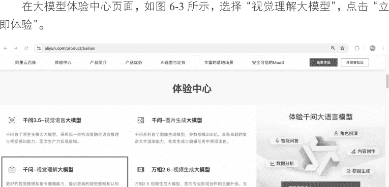

图 6-3 千问大模型体验中心页面

随即进入视觉理解大模型界面，用户将提示词输入千问，并上传作品视频，如图 6-4 所示，千问会结合视频内容，全面拆解视频的各个维度，输出详细的拆解结果。

千问视觉理解大模型通过多模态融合技术，对视频内容进行结构化解析，拆解维度包括视觉特征提取、音频语义理解、文本信息提取等模块，帮助运营者精准定位内容亮点与优化方向，实现视频内容的高效生产与传播。具体内容如下：

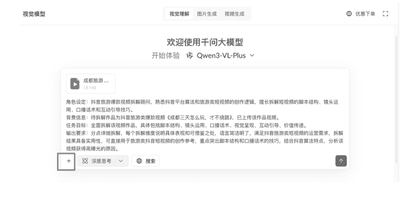

图 6-4 千问视觉理解大模型界面

> 抖音旅游爆款视频《成都三天怎么玩，才不绕路》拆解报告
> 核心逻辑：用“懒人攻略”解决用户痛点，结合抖音算法特性实现高曝光

## 一、脚本结构：清晰分层+强节奏感，提升完播率

（1）具体表现：总—分—总结构。

- ✓ 开头（0～3 秒）：用“成都三天怎么玩，才不绕路” + “懒人攻略”直击用户痛点，3 秒内抛出核心价值（解决用户“怕绕路”焦虑）。
- ✓ 主体（4～48 秒）：按“第一天-第二天-第三天”时间线分层，每段用“抵达→住宿→白天活动→晚上安排”逻辑推进，信息密度高且无冗余。
- ✓ 结尾（49～58 秒）：引导互动+强化人设（“我是四川小佳”），用“评论区留言”触发用户行动。

（2）模块化设计。

每个景点/活动独立成段（如“逛春熙路”“吃火锅”“看熊猫”），每段配 1～2 个镜头+1 句核心话术（如“感受成都的时尚潮流”），符合抖音“碎片化信息”消费习惯。

（3）可借鉴之处。

- 痛点前置：开头 3 秒必须明确用户收益（如“不绕路”“抄作业”），避免用户划走。
- 时间线分层：旅游攻略类视频按“天”拆解，降低用户理解成本，提升完播率（抖音算法优先推荐完播率>50%的视频）。

## 二、口播话术：网感语言+指令明确，驱动互动率

（1）具体表现。

- ✓ 口语化+情绪化表达：
  - “你可以直接抄作业”“这份懒人攻略”用学生/职场人熟悉的“作业”“懒人”梗，拉近距离。
  - “开启美食之旅”“感受都市的宁静”等短句提炼价值，避免长篇大论。
- ✓ 强指令引导：
  - “第一天抵达成都后”“晚上住在春熙路”等时间状语明确行动路径，用户易模仿。
  - 结尾“计划出行的朋友，评论区留言你的出行时间和人数”，直接引导评论（抖音算法对评论量权重极高）。

（2）可借鉴之处。

- ✓ 用字幕替代口播：旅游类视频多为外景拍摄，字幕需承担“口播”功能，每句≤10字、用感叹号/表情符号强化情绪。
- ✓ 埋互动钩子：在关键节点（如景点推荐等）后插入“收藏备用”“转发给闺蜜”等指令，提升分享率。

## 三、镜头运用：符号化画面+快节奏切换，适配算法推荐

（1）具体表现。

- ✓ 标志性视觉符号：成都专属符号如 IFS 爬墙熊猫（仰拍突出震撼感）、锦里古街红灯笼（特写强化记忆点）、火锅沸腾镜头（动态画面刺激食欲）。
- ✓ 人设强化镜头：博主穿汉服逛宽窄巷子、在机场举手牌等，建立“本地向导”人设。
- ✓ 快节奏剪辑：平均 1.5 秒/镜头，避免用户审美疲劳（抖音用户平均停留时长<2 秒）。动态镜头为主（如跟拍逛街、熊猫爬树），静态镜头为辅（如酒店房间、古建筑），提升画面活力。

（2）可借鉴之处。

- ✓ 必拍“打卡点”：每个城市提炼 3～5 个标志性场景（如成都的熊猫、火锅、古街），用户搜索时易被匹配。
- ✓ 动态优先：多用移动镜头、特写镜头，避免“照片式”静态画面（抖音算法偏好动态内容）。

## 四、视觉呈现：高饱和度+信息直给，适配手机端观看

（1）具体表现。

- ✓ 色彩与构图：画面饱和度高（如火锅红油、灯笼红、熊猫黑白对比），适配手机小屏幕视觉冲击。字幕用黄色/白色粗体字+黑色描边，确保在任意光线环境下清晰可读。
- ✓ 信息直给设计：每个镜头配 1 句核心信息（如“白天逛春熙路”“品尝地道四川火锅”），避免用户思考成本。

（2）可借鉴之处。

- ✓ 字幕即卖点：字幕内容需独立成句，用户即使静音也能获取关键信息（抖音 30% 用户静音观看）。
- ✓ 色彩统一：旅游类视频建议用“暖色调”（如成都的红色、黄色），传递“热情”“烟火气”情绪。

## 五、互动引导：精准触发评论+私信，撬动算法流量

（1）具体表现。

- ✓ 评论区钩子：结尾“评论区留言你的出行时间和人数”，用“定制路线”利益点驱动评论（评论量>1000 条可触发算法二次推荐）。
- ✓ 搜索关键词布局：标题含“成都旅游”“三天攻略”等高频搜索词，字幕重复“宽窄巷子”“春熙路”等地名，提升搜索曝光。

（2）可借鉴之处。

- ✓ 搜索词埋点：在视频前 3 秒、中间、结尾重复核心关键词（如“成都攻略”），适配抖音搜索推荐机制。

## 六、价值传递：解决“效率焦虑”+提供情绪价值

（1）具体表现。

- ✓ 实用价值：聚焦“不绕路”“懒人”“抄作业”，解决用户“怕踩坑”“怕浪费时间”的核心焦虑。
- ✓ 情绪价值：通过“火锅沸腾”“熊猫卖萌”“古街灯笼”等画面传递“烟火气”“治愈感”，激发用户“向往感”。

（2）可借鉴之处。

- ✓ 旅游类内容公式：实用攻略（解决痛点）+情绪共鸣（画面/文案）+本地人身份（增强可信度）。
  - 例：博主穿汉服+说“我是×××”，强化“本地向导”人设，提升用户信任。

（3）高曝光原因及总结。

- ✓ 算法友好：完播率高（结构清晰、节奏快）、互动率高（评论指令明确）、搜索词精准（标题/字幕重复关键词），触发抖音“流量池”推荐。
- ✓ 用户痛点精准解决：用“懒人攻略”“不绕路”直击旅游用户核心焦虑，内容具备强收藏/转发价值（抖音算法对“收藏率”权重极高）。
- ✓ 平台生态适配：短视频形式+网感语言+视觉符号，完全契合抖音“碎片化、情绪化、强互动”的内容生态。

（4）实操建议。

- ✓ 旅游类视频开头3秒必须抛出“用户收益”（如“这样玩省2小时”）。
- ✓ 每15秒插入1个互动指令（如“点赞收藏，路线不迷路”）。
- ✓ 拍摄前梳理3个城市专属符号（如成都：熊猫、火锅、古街），确保内容差异化。

通过拆解结果，运营者可掌握抖音旅游类短视频爆款的创作技巧，如如何设计开头3秒抓住用户注意力、如何搭配实景画面提升观赏性、如何设计口播话术传递实用信息、如何引导用户互动提升互动率，进而运用这些技巧创作自己的旅游类短视频，提升视频的播放量和点赞量。

需要注意的是，拆解优秀作品的目的不是抄袭，而是借鉴其创作逻辑和运营技巧，结合自身的账号定位和内容特色，进行创新创作。千问作为辅助拆解工具，能帮助运营者快速提炼爆款作品的关键要素，节省拆解时间，但最终的内容创作仍需结合自身的思考和创新，才能形成具有独特风格的优质内容，实现自媒体账号的长效运营。

此外，拆解优秀作品是一个持续的过程，运营者应定期关注同领域的爆款作品，通过千问进行拆解分析，总结最新的创作趋势和运营技巧，不断优化自身的内容创作，提升账号的影响力和竞争力。同时，可将千问拆解的结果整理成笔记，便于后续查阅和复用，进一步提升内容创作的效率和质量。

## 6.4 撰写爆款文案

上一节详细讲解了如何借助千问拆解同领域爆款作品，提取可复用的创作规律。本节将在此基础上，聚焦公众号、小红书、抖音等主流自媒体平台，详解如何运用千问撰写爆款文案，提供可直接落地的提示词示例与实操方法。

千问撰写爆款文案的逻辑，是依托其强大的语义理解与内容生成能力，将用户的创作需求转化为精准、优质的文案内容。撰写爆款文案的提示词需遵循“角色设定+背景信息+任务目标+输出要求”的结构，确保千问能精准把握创作方向、贴合平台特性、满足用户需求。其中，角色设定明确文案撰写的身份与风格，背景信息说明平台特性、受众特征及创作基础，任务目标明确文案的核心用途与预期效果，输出要求明确文案的形式、字数、结构等细节。

### 6.4.1 公众号爆款文案撰写

公众号职场爆款文案的特征是，精准击中职场人群的关键痛点，传递可落地的实用价值，同时具备清晰的逻辑结构与简洁专业的语言风格，能够引发用户共鸣与主动传播。

上一节已拆解公众号职场爆款文章，提取出选题逻辑、结构安排、文案风格等可复用要点。撰写公众号职场爆款文案时，需借助千问，将拆解结果转化为创作思路，确保文案符合公众号平台特性与职场人群需求。

公众号职场爆款文案的创作，先明确受众细分，聚焦某一具体职场群体的痛点，如刚入职 1～3 年的职场新人面临的适应困难、技能不足等问题。结合千问提示词公式，明确角色设定为职场文案撰写专家，背景信息包含公众号平台特性、受众痛点及拆解结果，任务目标为撰写一篇符合爆款逻辑的职场文章，输出要求明确文章结构、字数、风格等细节。

提示词示例如下：

> **角色设定：** 公众号职场文案撰写专家，拥有 10 年职场自媒体运营经验，熟悉公众号职场类爆款文章的创作逻辑，擅长结合职场真实场景撰写简洁务实、有感染力的文案，语言风格专业不晦涩，重点突出实用性与共鸣感，不堆砌专业术语。
>
> **背景信息：** 本次撰写的文案用于公众号职场账号（定位为职场新人成长导师），平台以深度图文为主，核心受众为刚入职 1～3 年的职场新人，这类人群面临职场适应困难、基础技能不足、沟通能力欠缺、职业规划模糊等痛点，需要可落地、接地气的成长建议。已上传职场爆款文章拆解结果，需借鉴其选题逻辑、结构安排、文案风格、共鸣点设计等要点。
>
> **任务目标：** 撰写一篇公众号职场爆款文章，选题聚焦职场新人“沟通能力欠缺”的痛点，围绕“职场新人高效沟通技巧”展开，既要传递可落地的沟通方法，又要引发职场新人的情感共鸣，提升文章的打开率、点赞率、收藏率与转发率，符合公众号职场类爆款文章的创作逻辑。
>
> **输出要求：** 文章字数控制在 1500 字以内，适合碎片化阅读。整体内容需借鉴拆解结果的创作逻辑，避免抄袭，结合职场新人的实际需求优化内容，确保实用性与可读性。

将上述提示词输入千问后，千问会结合拆解结果，快速生成符合要求的公众号职场文章初稿。创作逻辑基于爆款规律，选题上聚焦职场新人高频痛点，避免宽泛，结构上采用清晰的三段式，确保逻辑连贯。文案风格上兼顾专业性与接地气，增强共鸣感。内容上搭配真实案例与实用技巧，提升价值感。具体输出内容如下：

> **在职场：话别乱说、事别乱应、人别乱怼**
>
> 真正会沟通的人，不是能说会道，而是懂得什么时候该说什么话。
>
> [ 引子 ]
>
> 刚入职的小林，能力不差，做事也勤快。
>
> 半年过去了，领导对他的评价却是：“不太会来事”。
>
> 问题出在哪？
>
> 不是工作没做好，是话没说对。
>
> 职场里，沟通能力决定你的上升空间。
>
> 很多新人以为，只要活干得好，自然会被看见。
>
> 现实是，不会沟通，再努力也是隐形人。
>
> 一、话别乱说：开口前先过脑子
>
> 卡内基说过：“一个人的成功，15%靠专业知识，85%靠沟通表达。”
>
> 但新人最容易犯的错，就是嘴比脑子快。
>
> [ 场景一：会议上抢话 ]
>
> 领导正在布置任务，你突然插嘴：“这个方案有问题。”
>
> 全场安静。领导脸色变了。
>
> 你觉得自己是直言不讳，别人眼里你是不懂规矩。
>
> 正确做法：等领导说完，私下沟通。或者用“我有个补充建议”代替“这个有问题”。
>
> [ 场景二：吐槽同事 ]
>
> 茶水间里，你跟同事抱怨：“那个谁做事太慢了。”
>
> 转头这话就传到了当事人耳朵里。
>
> 职场没有秘密。你说过的每句话，都可能成为把柄。
>
> 记住：赞美要公开，批评要私下。不确定的话，宁可不说。
>
> 金句：话说出口前是智慧，说出口后是责任。
>
> 二、事别乱应：承诺前先掂量
>
> 新人最怕什么？
>
> 怕领导觉得自己不行，所以什么活都接。
>
> 结果呢？
>
> 接了五件事，做成三件，领导记住的是你没完成的那两件。
>
> [ 案例对比 ]
>
> 小 A 和小 B 同时入职。
>
> 领导问：“这个急活谁能接？”
>
> 小 A 立马举手：“我可以！”
>
> 小 B 想了想：“我手头有两件事，今天下班前能给您初稿，可以吗？”
>
> 一个月后，小 B 成了领导心中的“靠谱人选”。
>
> 小 A 还在忙着救火。
>
> 为什么？
>
> 小 A 的承诺是情绪化的，小 B 的承诺是经过评估的。
>
> > [职场沟通铁律]
> > 不确定的事，说“我确认一下再回复您”。
> > 做不到的事，说“我目前能力有限，建议找××帮忙”。
> > 能做到的事，说“我××时间前给您结果”。
>
> 金句：宁可少承诺多交付，不要多承诺少兑现。
>
> 三、人别乱怼：情绪上来先冷静
>
> 新人最容易踩的坑：把职场当学校，把领导当老师。
>
> 觉得不公平，就想怼回去。
>
> 觉得被误解，就想解释清楚。
>
> > [真实案例]
> > 95后女生小陈，被领导当众批评方案不行。
> > 她当场反驳：“您根本没看懂我的思路。”
> > 领导沉默三秒：“那你来做这个项目负责人。”
> > 一周后，小陈主动提出了离职。
> > 她输在哪？
> > 输在把情绪当成了沟通工具。
> > 职场不是讲道理的地方，是讲结果的地方。
> > 当你想怼回去的时候，问自己三个问题：
> > 怼完能解决问题吗？
> > 怼完领导会高看你吗？
> > 怼完对你的职业发展有帮助吗？
> > 如果答案都是“不”，那就深呼吸，换个方式表达。
>
> > [高情商沟通公式]
> > “我理解您的考虑（共情）+我的想法是×××（表达）+您看这样是否可行（请教）”
>
> 金句：情绪是沟通的敌人，结果是沟通的朋友。
>
> > [结尾]
> > 职场沟通，本质上是一场价值交换。

## 千问 + “龙虾” + “悟空”：轻松搞定一人 AI 生态

> 你说什么不重要，对方听到什么才重要。
> 你做了什么不重要，对方认可什么才重要。
> 新人成长最快的方式，不是埋头苦干，而是学会“向上沟通”。
> 从今天开始：
> 开口前，停顿 3 秒；
> 承诺前，评估能力；
> 情绪上来，先冷静；
> 真正能冒尖的人，都是沟通高手。
> 不是因为他们天生会说话，而是他们懂得：职场沟通，是一场需要终身修炼的功课。

[ 互动话 ]
你在职场沟通中踩过哪些坑？
欢迎在评论区分享，我们一起避坑成长。
觉得有用，点个“在看”，让更多职场新人少走弯路。
与朋友们共勉。

初稿生成后，可以借助千问进行优化调整，确保内容符合爆款标准。优化方向主要包括三个方面：一是标题优化，可让千问生成 3～5 个候选标题，筛选最优选项，提升打开率；二是案例优化，让千问替换更贴近职场新人真实场景的案例，避免案例过于抽象，增强代入感；三是价值优化，让千问补充更多可落地的细节，如在沟通技巧中加入具体的话术示例，完善文末的沟通话术模板，提升文章的收藏与转发价值。

### 6.4.2 小红书爆款图文设计

小红书平台是拥有数亿名月活跃用户的消费决策社区，美食类是小红书的热门赛道之一，涵盖家常美食、烘焙、减脂餐等多个细分方向，其爆款图文文案的特征是，注重视觉呈现与实用分享，内容真实接地气，能够激发用户的尝试欲望与互动热情。

上节已拆解小红书美食爆款图文，提取出标题设计、图文搭配、文案逻辑、标签运用等可复用要点。撰写小红书爆款美食图文文案时，需借助千问，将拆解结果融入创作过程，确保文案与图片搭配协调，符合小红书平台特性与用户需求。

# 第 6 章 千问助力自媒体变现

结合千问提示词公式，明确角色设定为小红书美食图文设计专家，背景信息包含小红书平台特性、受众需求及拆解结果，任务目标为设计一篇爆款美食图文作品，输出要求明确文字与图片的具体设计标准。

千问提示词示例如下：

> 角色设定：小红书美食图文设计专家，熟悉小红书平台特性与美食类图文爆款的创作逻辑，擅长撰写真实接地气、实用性强的美食文案，同时能提供清晰的图片设计建议，风格贴合小红书用户偏好，注重细节与视觉呈现的协调性。
>
> 背景信息：本次设计的美食图文用于小红书美食账号（定位为新手家常美食分享者），平台核心受众为 20～35 岁的年轻女性，以一线、新一线城市为主，这类人群工作忙碌，追求精致生活但缺乏大量时间制作美食，需求是简单易做、耗时短、颜值高、食材常见的家常菜品。已上传小红书美食爆款图文的拆解结果，需借鉴其标题设计、图文搭配、文案逻辑、标签运用等要点。
>
> 任务目标：设计一篇小红书爆款美食图文作品，菜品选择家常快手菜（番茄鸡蛋面），适合新手操作，耗时控制在 15 分钟以内。整体内容需真实接地气，激发用户的尝试欲望，提升笔记的点赞率、收藏率与评论率，符合小红书美食类爆款图文的创作逻辑。
>
> 输出要求：文字部分包括标题、正文与标签三部分，图片部分需提供图片的设计（如数量、拍摄要求、文字说明等）。整体内容需借鉴拆解结果的创作逻辑，避免抄袭，结合新手的实际需求优化内容，确保实用性与观赏性。

将上述提示词输入千问后，千问会结合拆解结果，快速生成符合要求的小红书美食图文设计方案，该方案融合小红书平台“视觉种草+实用干货”的传播逻辑，系统输出包含正文结构、标签组合及互动引导方案在内的执行细节，确保方案触达受众的实用需求与审美偏好，实现内容种草效率与账号粉丝增长的最大化。具体内容如下：

> 番茄鸡蛋面的小红书爆款图文方案
> 本方案严格遵循拆解文档中的“情绪化标题+场景感”“过程可视化+细节特写”“短小精悍文案”及“组合式标签”策略。

## 千问 + “龙虾” + “悟空”：轻松搞定一人 AI 生态

### 一、文字部分设计

（1）标题设计（3 个备选标题，测试点击率）。

[ 遵循公式 ] 强烈语气词/感叹号+核心口味描述+食用场景/痛点解决

- ✓ 选项 A（强调速度与食欲）：讲真!! 10 分钟搞定～这碗番茄鸡蛋面巨浓稠！汤都喝光！
- ✓ 选项 B（强调新手友好与治愈）：下班累瘫? 15 分钟快手晚餐酸甜开胃，新手零失败!
- ✓ 选项 C（强调独家技巧与后果）：答应我：番茄一定要炒出沙，这碗面真的不够吃!!

- ✓ 推荐首选：选项 A。理由：直接击中“快”和“好吃”两个核心点，“汤都喝光”具有强烈的画面感和后果暗示，符合拆解文档中“核心利益点前置”的原则。

（2）正文文案。

[ 遵循逻辑 ] 情绪 Hook 开头+清单体食材+步骤详解（穿插 Tips）+互动结尾

[ 文案内容 ]

面条根本不够吸溜!

打工人下班回家累到不想动? 这碗番茄鸡蛋面真的是我的续命神器! 全程只要 10～15 分钟，酸酸甜甜巨开胃，汤汁浓郁到想拌饭! 新手小白也能一次成功，从此告别外卖!

- ✓ 食材准备（一人食）：番茄 2 个（选熟透的，汁水多!），鸡蛋 2 个，挂面/手擀面（适量），葱花、蒜末少许，盐、生抽、蚝油、番茄酱（秘密武器）。

- ✓ 有手就会的做法：
  - 备菜：番茄去皮切小块（越小越容易出沙），鸡蛋打散加少许盐。
  - 炒蛋：油热倒蛋液，快速划散，嫩滑盛出备用（不要炒老啦!）。
  - 炒底料（关键）：留底油爆香葱蒜，倒入番茄块，加一勺番茄酱。
  - Tips：边炒边用铲子压，一定要炒出红油和沙沙的质感，这是汤浓的关键! 加少许水煮开。
  - 煮面调汤：加入适量热水煮开，放入面条。调味：1 勺生抽、1 勺蚝油、少许盐。
  - 合体：面条快熟时倒入鸡蛋，撒上葱花，淋几滴香油出锅！

- ✓ 新手避坑指南：
  - 番茄不去皮口感会打折，顶部划十字烫一下轻松去皮。
  - 喜欢更浓郁口感的，可以勾一点点薄芡，汤汁挂面绝了！
  - 千万别加水太多，我们要的是浓汤面，不是清汤寡水哦～
  - 真的巨巨巨好吃！汤汁裹满每一根面条，一口下去暖乎乎的～
  - 答应我，今晚就试试！做好了记得来交作业呀

#番茄鸡蛋面 #快手晚餐 #一人食吃什么 #新手做饭 #家常菜 #面食爱好者 #今天晚餐长这样 #治愈系美食 #小红书爆款美食 #懒人食谱

[ 标签运用策略 ]

- ✓ 遵循组合策略：3 个大词+4 个场景词+2 个长尾词。
- ✓ 行业大词（流量池）：#家常菜 #面食爱好者 #今天晚餐长这样。
- ✓ 细分场景词（精准人群）：#快手晚餐 #一人食吃什么 #新手做饭 #懒人食谱。
- ✓ 长尾搜索词（转化）：#番茄鸡蛋面 #治愈系美食。

### 二、图片部分设计（共 6～7 张，九宫格模式）

[ 遵循逻辑 ] 首图诱惑+备菜清晰+步骤可视化（图上压字）+结尾动态展示

| 图片序号 | 画面内容描述 | 拍摄要求与光线 | 图片上的文字说明（视觉路标） |
| :--- | :--- | :--- | :--- |
| P1 封面图 | 俯拍或 45°特写。筷子夹起一大口裹满红色汤汁的面条，鸡蛋块清晰可见，背景虚化。色调要暖，突出红黄配色 | 侧逆光，突出面条的光泽感和汤汁的浓稠度。色彩饱和度稍高，营造食欲感 | 主标题：10 分钟搞定！巨浓稠<br>副标题：汤都喝光了！新手必学 |
| P2 备菜图 | 拼图形式。左边是切好的番茄块（大小均匀），右边是打好的蛋液和切好的葱花。摆放整齐干净 | 光线明亮均匀，展现食材新鲜度 | 文字标注：番茄去皮切小块（易出沙），鸡蛋加少许盐（更嫩滑） |
| P3 步骤一 | 特写镜头。锅中鸡蛋正在凝固的瞬间，金黄蓬松 | 捕捉“嫩”的状态，避免焦黑 | 文字：快速划散，嫩滑盛出，不要炒老 |
| P4 步骤二 | 关键步骤特写。铲子正在按压锅中的番茄块，已经炒出红色的汤汁和沙状质感 | 重点展示“出沙”和“红油”的状态，这是成败关键 | 文字：炒出红油沙沙感，一勺番茄酱更浓郁 |
| P5 步骤三 | 全景/中景。锅中汤汁沸腾，面条正在煮制，准备倒入鸡蛋。热气腾腾的感觉 | 捕捉热气（烟火气），体现温暖感 | 文字：加热水煮开后调味：生抽+蚝油+盐 |
| P6 步骤四 | 完成态特写。面条盛在好看的碗里，撒上翠绿的葱花，淋上香油，色泽诱人 | 构图饱满，色彩对比鲜明（红面绿葱） | 文字：撒葱花，几滴香油香迷糊了 |
| P7 结尾图 | 动态进食感。勺子舀起面条和汤汁，或者咬了一口的鸡蛋特写。展示“挂汁”效果 | 极度特写，展现食物的纹理和汁水 | 文字：答应我！一定要试！真的不够吃 |

### 三、创作逻辑复盘（基于拆解文档）

（1）标题情绪化。

使用了“讲真”“巨浓稠”“汤都喝光”等强情绪词汇，避免了平铺直叙的“番茄鸡蛋面做法”，直接刺激用户点击欲望。

（2）图文过程可视化。

- ✓ 备菜图（P2）：采用了“拼图+文字标注”的形式，降低了新手的认知门槛，让用户觉得“我也能行”。
- ✓ 步骤图（P3~P5）：每张图片都压上了简洁的白色黑边文字，提炼了关键动作（如“炒出红油”“不要炒老”），实现了“看图即懂”，减少用户翻阅正文的成本。
- ✓ 光线运用：强调了侧逆光和暖色调，突出食物的油润感和热气，符合“极致的食欲呈现”原则。

（3）文案结构优化。

- ✓ 开头 Hook：用“续命神器”“告别外卖”击中忙碌打工人的痛点。
- ✓ 干货分层：使用 Emoji 作为分割符，清单体列食材，步骤中穿插“Tips”和“避坑指南”（如番茄去皮、勾芡技巧），增加了收藏价值和专业度。
- ✓ 结尾互动：使用祈使句“答应我，今晚就试试”，并引导“交作业”，提升评论率。

（4）标签精准覆盖。

不仅覆盖了#番茄鸡蛋面 这种大词，还重点布局了 #快手晚餐 #一人食 #新手做饭 等符合目标受众（忙碌年轻女性）搜索习惯的场景词。

# 第 6 章 千问助力自媒体变现

千问生成的小红书图文设计方案亮点可总结为四条。一是图文协同，文字与图片内容一致，图片负责展示食物的色泽与制作过程，文字负责传递食材、步骤与小贴士，二者相互补充；二是真实接地气，避免过度修饰，文案采用口语化表达，图片采用实拍图，贴合小红书用户对“素人分享”的偏好；三是实用性突出，菜品选择简单易做、食材常见，步骤拆解清晰，新手可直接复刻，加入实用小贴士提升内容价值；四是标签精准，采用“泛流量词+精准品类词+长尾搜索词”的组合，覆盖不同流量池，提升笔记的曝光率。

### 6.4.3 抖音爆款视频设计

抖音平台用户覆盖面广，传播速度快，旅游类是抖音的热门赛道之一。抖音的内容逻辑为“货找人”，用户会因刷到一则种草短视频，主动寻找与之匹配的旅游产品或攻略。抖音爆款旅游视频文案的特征是，节奏紧凑、画面吸睛、语言简洁有感染力，能够快速抓住用户注意力，传递实用价值与情绪价值，激发用户的出行欲望与互动热情。

上节已拆解抖音旅游爆款视频，提取出脚本结构、口播话术、镜头运用、互动引导等可复用要点。撰写抖音爆款旅游视频文案时，需借助千问，将拆解结果融入脚本与口播话术的创作过程，确保视频与文案搭配协调，符合抖音平台算法与用户需求。

抖音爆款旅游视频文案的创作，需兼顾视频设计与脚本设计两部分。脚本设计是基础，明确视频的开头、主体、结尾结构，以及每部分的内容、镜头、口播话术。视频设计是支撑，确保画面吸睛、节奏紧凑，符合抖音用户的观看习惯。结合千问提示词公式，明确角色设定为抖音旅游视频文案与脚本撰写专家，背景信息包含抖音平台特性、受众需求及拆解结果，任务目标为设计一条爆款旅游视频作品，输出要求明确脚本与视频的具体设计标准。

千问提示词示例如下：

> 角色设定：抖音旅游视频脚本设计与文案撰写专家，熟悉抖音平台算法与旅游类短视频的创作逻辑，擅长设计节奏紧凑、有感染力的视频脚本，撰写简洁有吸引力的口播话术，同时能提供视频拍摄与剪辑建议，风格贴合抖音用户偏好，注重实用性与视觉冲击力。
>
> 背景信息：本次设计的旅游视频用于抖音旅游账号（定位为成都本地周边游推荐官），平台核心受众为成都及周边城市的 20～45 岁人群，这类人群喜欢旅行，偏好短途周边游，需求是小众、人少、性价比高的景点推荐与详细旅行攻略。已上传抖音旅游爆款视频的拆解结果，需借鉴其脚本结构、口播话术、镜头运用、互动引导、价值传递等要点。
>
> **任务目标**：设计一条抖音爆款旅游视频作品，主题为成都周边小众露营地推荐，视频时长控制在 60 秒以内，突出“小众、人少、性价比高、风景优美”的亮点。整体内容需传递实用的露营攻略与情绪价值，激发用户的出行欲望，提升视频的播放量、点赞率、评论率与收藏率，符合抖音旅游类爆款视频的创作逻辑。
>
> **输出要求**：脚本设计需明确视频结构、每部分镜头、口播话术，视频设计需明确拍摄镜头、色调、剪辑节奏与字幕设计。整体内容需借鉴拆解结果的创作逻辑，避免抄袭，结合成都周边游用户的实际需求优化内容，确保实用性与观赏性，契合抖音算法偏好。

千问会根据提示词和拆解结果，生成完整的抖音视频设计方案，该方案将整合抖音平台短平快的传播特性与用户偏好，系统输出包含视频脚本框架、画面视觉设计、剪辑节奏策略、标题文案、评论区运营方案及本地化避坑指南在内的执行细节，确保方案既符合平台算法逻辑，又能精准触达目标受众需求，实现内容传播效果与转化效率的最大化。具体内容如下：

## 成都周边 0 元小众露营地视频脚本方案

本方案严格遵循拆解报告中的核心逻辑：“痛点前置（3 秒法则）+时间线分层（模块化）+符号化视觉（高饱和/动态）+强指令互动”，旨在打造一条高完播、高互动的露营推荐视频。

### 一、视频基础信息

- ✔ 视频主题：成都周边 1h 直达！0 元小众露营地，人少景美还能看雪山。
- ✔ 目标受众：成都及周边 20～45 岁人群，追求性价比、厌恶人挤人、喜欢拍照打卡的短途游用户。
- ✔ 视频时长：45～55 秒（黄金完播区间）。
- ✔ 核心卖点：小众秘境、免费/低价、出片率高、攻略详细。
- ✔ 视觉风格：高饱和度暖色调（夕阳金、草地绿），快节奏剪辑，字幕醒目。

### 二、视频脚本设计表

| 时间 | 镜头画面 | 拍摄/剪辑建议 | 口播/字幕文案 | 设计逻辑 |
| :--- | :--- | :--- | :--- | :--- |
| 0～3s（黄金开头） | 镜头 1：无人机极速俯冲，从茂密树林中穿过，瞬间展现开阔草坪+远处雪山/湖泊全景。<br>镜头 2：博主在营地天幕下惬意喝咖啡，背景是绝美夕阳 | 色调：高饱和，突出蓝天绿地。节奏：快切，配合重音音效 | 口播：成都周边 1 小时！这个 0 元露营地，没人知道！<br>字幕：成都周边 1h 直达 0 元！人少！景美！ | 痛点前置：直接抛出“1 小时”“0 元”“没人知道”，解决用户怕远、怕贵、怕人多等焦虑，3 秒内留住用户 |
| 4～15s（核心亮点） | 镜头 3：特写帐篷搭建过程（延时摄影）。<br>镜头 4：孩子在草地上奔跑/飞盘特写（动态）。<br>镜头 5：近景拍摄手冲咖啡热气+背景虚化的风景 | 运镜：多用移动镜头和特写，避免静态照片感。节奏：1.5 秒/镜头，卡点音乐 | 口播：不用门票，车直接开到营地边。草地超软，随便一拍就是大片，周末这里居然没几个人！<br>字幕：车停泊位旁 草地超软 原图直出 | 符号化画面：用“车停泊位”“草地特写”建立直观印象；强调“没几个人”，满足用户独占美景的心理 |
| 16～35s（实用攻略） | 镜头 6：手机地图录屏，快速圈出位置路线。<br>镜头 7：展示周边设施（洗手间、水源）的快速扫过镜头。<br>镜头 8：傍晚篝火/星星灯亮起的唯美空镜 | 信息直给：地图画面要清晰，关键地名要加粗。<br>节奏：稍缓，让用户看清信息 | 口播：导航直接搜“××地”，过了隧道右转就到。有水有电还能生火，晚上看星星简直绝了！<br>字幕：记得带驱蚊水 允许明火 | 模块化设计：按“位置—设施—玩法”分层，信息密度高且无冗余，降低用户理解成本，提升收藏率 |
| 36～45s（情绪价值） | 镜头 9：博主背影，面对夕阳/星空，张开双臂。<br>镜头 10：朋友们碰杯（饮料/啤酒）的特写，笑声入镜 | 色调：暖金色调，营造治愈感。<br>节奏：慢动作，音乐进入高潮部分 | 口播：别再去热门景点排队了，来这里吹吹风，才是周末该有的样子。<br>字幕：拒绝排队 治愈瞬间 | 情绪共鸣：通过“逃离城市”“周末该有的样子”传递情绪价值，激发用户向往感 |
| 46～55s（互动引导） | 镜头 11：博主对着镜头微笑挥手，屏幕弹出具体定位卡片。<br>镜头 12：黑屏，出现大字引导 | 人设强化：博主出镜建立信任感 | 口播：具体定位和避坑指南放评论区了！想去的扣“1”，我是××，带你挖遍成都小众地！<br>字幕：评论区留言“求定位”，关注不迷路 | 强指令引导：明确引导“扣 1”“评论求定位”，利用算法对评论量的权重，触发二次推荐；强化“本地向导”人设 |

### 三、拍摄与制作执行建议

[视觉呈现（适配手机端）]
色彩策略：参考拆解报告，使用高饱和度暖色调。后期调整时，提高绿色（草地）和橙色（夕阳/肤色）的饱和度，让画面在手机小屏幕上更具视觉冲击力。

- [字幕设计]
  - ✓ 字体：使用粗体无衬线字体（如综艺体、黑体）。
  - ✓ 配色：黄色/白色字体+黑色描边，确保在任何背景下都清晰可读。
  - ✓ 排版：每句字幕不超过 10 个字，居中或底部显示，关键信息（如“0 元”“1h”）放大并加表情符号。

- [镜头语言]
  - ✓ 拒绝静态：全程避免超过 2 秒的静止画面。即使是风景，也要用无人机推进、手持环绕或前景遮挡等移动方式来制造动感。
  - ✓ 必拍符号：必须包含“车停营地旁”（体现便利）、“天幕+椅子”（体现舒适）、“远处地标/雪山”（体现稀缺性）这三个核心视觉符号。

- [剪辑节奏（提升完播率）]
  - ✓ 前 3 秒定生死：必须在第 1 秒就出现最震撼的全景或最吸引人的利益点（0 元），配合快节奏音效（如“咻”“叮”）。
  - ✓ 卡点剪辑：背景音乐选择抖音热门的轻快 Vlog 音乐（BPM 100～120），画面切换严格卡在鼓点上。
  - ✓ 信息密度：每 15 秒必须有一个新的信息点或视觉刺激点，防止用户划走。

# 第 6 章 千问助力自媒体变现

### 四、运营与互动（撬动算法）

[标题文案：采用“痛点+收益+地域”公式]

示例：成都周边｜0元！1h直达！这个神仙露营地还没火（附攻略）。

[评论区运营]

- ✓ 置顶评论：发布具体的导航定位、注意事项（如“路况提示”“最佳到达时间”），并引导用户“点赞收藏，不然找不到啦”。
- ✓ 回复策略：积极回复前10条评论，用“私信发你”“组队滴滴”等话术引导更多互动。
- ✓ 搜索埋词：视频标签（Hashtag）包含 #成都周边游 #成都露营 #小众旅行地 #周末去哪儿，并在口播和字幕中多次重复“成都周边”“露营”等关键词，以匹配搜索流量。

[避坑指南（基于本地化需求）]

- ✓ 真实性：务必确认营地是否真的允许明火、是否收费，避免“照骗”导致差评。
- ✓ 实用性：如果路况复杂，务必在视频或评论区注明“轿车可达”或“需SUV”，这是成都周边游用户最关心的痛点之一。

撰写爆款文案是自媒体运营的关键能力，借助千问，可将拆解的爆款作品逻辑转化为创作能力，快速生成符合平台特性、用户需求的优质文案。公众号、小红书、抖音三大平台的爆款文案和脚本，虽创作标准与形式不同，但主要逻辑一致，均以精准击中用户痛点、传递实用价值为关键，结合平台特性设计内容形式与表达风格。

遵循“角色设定+背景信息+任务目标+输出要求”的提示词公式，针对不同平台设计精准的提示词，借助千问完成文案、图文或视频脚本的创作与优化，可大幅降低爆款文案的创作门槛，提升创作效率与质量。其他自媒体平台（如视频号、B站、微博等）的爆款文案撰写，可参照本节逻辑，结合平台特性与用户需求，借助千问完成创作，触类旁通。

需要注意的是，千问是辅助创作工具，最终的文案质量仍需依赖用户的判断与优化。运营者需定期关注同领域爆款作品，借助千问拆解分析，总结最新创作趋势，结合自身账号定位与创新思考，不断优化文案创作，才能形成具有独特风格的优质内容，实现自媒体账号的长效运营。

# 第 7 章 千问进阶：编码与任务助理

随着 AI 技术的飞速发展，编码与复杂任务处理正从专业领域向大众普及。本章聚焦千问的进阶功能，通过“零基础编码”与“任务助理”两大模块，为读者打开高效工作与生活的新大门。职场人士无论是需要快速开发工具，还是希望借助 AI 实现复杂任务的自动化处理，千问都能通过自然语言交互降低技术门槛，让每个人都能轻松掌握代码生成与复杂任务处理的能力。

## 7.1 开发实用工具

实用工具是零基础编码的入门场景，聚焦于解决日常工作与生活中的高频小需求，无须复杂逻辑即可快速验证编码价值。千问的代码功能为这类需求提供了便捷的实现路径，用户通过清晰的需求描述，即可获得完整的前端代码，直接使用。

千问的代码功能入口在主界面的提问交互区域（见图 7-1）。打开千问 Web 页面后，在提问输入框下方的功能栏中，可找到标注为“代码”的按钮。点击该按钮后，界面进入编码交互模式，用户可在输入框中以自然语言描述编码需求，千问将针对性生成 HTML、CSS、JavaScript 等前端代码，代码内容可直接下载至本地文件或在线运行。

千问的代码生成质量高度依赖需求描述，遵循标准化的提示词公式可提升输出效果。提示词参考公式为：角色设定+背景信息+任务目标+输出要求。各模块作用如下：

1.  角色设定：明确千问的输出身份，如资深前端开发工程师、视觉设计师等，引导输出符合专业规范的代码。
2.  背景信息：说明需求的使用场景与用户身份，如“职场办公场景，用于快速计算业务数据”等，让代码适配具体使用环境。
3.  任务目标：清晰描述需要实现的功能，如“生成一款简约风格的计算器网页”等，明确代码的核心用途。
4.  输出要求：指定代码的技术细节、视觉风格与交互效果，如“采用 HTML+CSS 内联样式实现”等，约束输出的具体形态。


图 7-1 千问代码功能入口

### 7.1.1 计算器

计算器是职场与生活场景中最基础的实用工具，职场人士在处理报销、预算统计等场景时，需要一款界面美观、操作便捷的计算器，普通用户在日常消费计算时，也期望工具具备简洁的视觉风格。千问的代码功能可快速实现这类需求，生成的计算器网页可直接在电脑或手机浏览器中打开使用。

基于提示词公式，针对计算器需求的提示词设计如下：

> **角色设定：** 资深前端开发工程师，精通 HTML 基础结构搭建和 CSS 样式设计。
>
> **背景信息：** 需要一个能在本地电脑上直接打开使用的网页版计算器，这个计算器外观简洁、按钮大小合适，适合普通用户日常做加减乘除的基础计算，不需要复杂的科学计算功能。
>
> **任务目标：** 生成完整的网页版计算器 HTML 代码，点击数字键能在显示区域正确显示数字，点击加减乘除和等于键能正确计算并显示结果，点击清空键能清除当前输入和计算结果。
>
> **输出要求：** 输出内容仅包含完整的 HTML 代码，所有样式都用内联 CSS 的方式写在代码里，不引用任何外部文件。代码结构清晰，按钮和显示区域布局合理，颜色搭配舒适（如浅灰色背景、深色按钮文字），确保在本地计算机上直接运行。

千问接收上述提示词后，开始生成 HTML 代码，包含结构、样式与交互逻辑，如图 7-2 所示，用户可以实时看到整个编码过程。

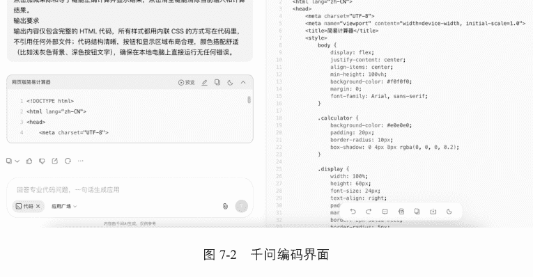

在编码完成之后，用户可以点击右侧“预览”标签查看计算器的运行界面，如图 7-3 所示，可通过鼠标点击计算器按钮进行测试。千问还提供了下载和转发功能，位于预览界面的底部，用户可以把代码下载到本地，通过浏览器直接运行，或者通过转发功能，复制计算器的网页链接，直接在线上运行。生成的计算器界面符合现代设计规范，操作逻辑与传统计算器一致，适配不同屏幕尺寸，满足职场与日常计算需求。

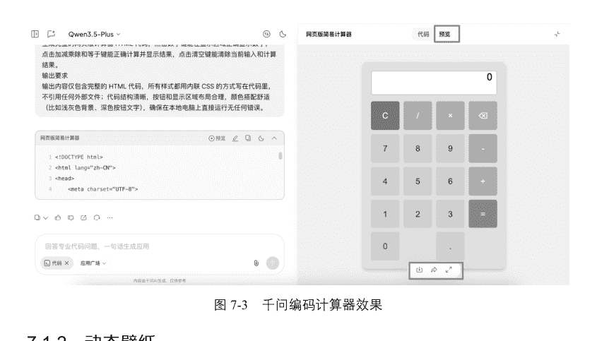

### 7.1.2 动态壁纸

动态壁纸是个性化桌面的常见需求，普通用户期望为电脑或手机桌面制作个性化的渐变动态壁纸，视觉效果柔和且不影响日常操作。职场人士也可通过动态壁纸提升桌面美观度，缓解工作疲劳。千问的代码功能可快速生成这类轻量化动态壁纸，代码体积小，运行流畅，且可根据用户偏好调整颜色与动画效果。

基于提示词公式，设计的动态壁纸提示词如下：

> **角色设定：** 资深前端开发工程师，擅长用 HTML 和 CSS 制作视觉效果流畅的动态网页。
>
> **背景信息：** 需要一个动态壁纸网页，这个壁纸没有多余的按钮和文字，只有流畅的动态视觉效果（如缓慢移动的渐变色彩、轻柔旋转的简单几何图形），整体风格简约舒适，适合作为电脑桌面背景使用，能适配不同大小的电脑屏幕。
>
> **任务目标：** 生成完整的动态壁纸网页 HTML 代码，动态效果流畅不卡顿，视觉效果柔和不刺眼，网页能自动适配电脑屏幕的大小，填满整个浏览器窗口。
>
> **输出要求：** 输出内容仅包含完整的 HTML 代码，所有样式和动画效果都用内联 CSS 的方式实现，不引用任何外部文件。代码可以在本地电脑上直接运行，动画效果循环播放且无卡顿，颜色搭配和谐（如低饱和度的蓝紫渐变），无多余的内容和弹窗。

千问生成的动态壁纸代码包含 HTML、CSS 与简易 JavaScript 逻辑，如图 7-4 所示，整体代码体积小、资源占用极低，运行流畅无卡顿。该壁纸既保证了动态感，又不影响桌面图标识别与日常操作，且可通过修改代码中的参数，进一步做个性化调整，适配零基础用户的使用场景。

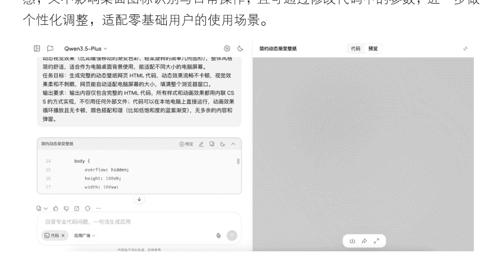

通过计算器与动态壁纸这两个案例可见，千问的代码功能让零基础用户无须学习编程知识，即可快速实现日常实用工具与个性化视觉效果，为后续更复杂的编码场景（如网页设计、娱乐游戏开发等）奠定基础。这类轻量化工具的开发过程，也让用户直观感受到编码的价值，逐步建立对 AI 工具开发的认知与信心。

## 7.2 开发设计网页

网页设计是零基础编码中兼具实用性与个性化的重要场景，涵盖职场办公与日常生活的多个需求。职场人士可能需要快速制作个人简历网页用于求职投递、项目展示，普通用户则可能希望设计个性化生日贺卡网页，向亲友传递祝福。千问的编码功能，仅通过自然语言清晰描述需求，即可生成完整可运行的网页代码，实现从需求描述到网页落地的快速转化，让零基础用户也能轻松设计出符合预期的网页。

### 7.2.1 个人简历

个人简历网页是职场人士的重要展示工具，相比传统 Word 简历，网页版简历更具个性化、视觉冲击力，可嵌入图片、链接等元素，便于在线投递与分享。对于职场人士而言，通过千问生成个人简历网页，无须学习专业设计与编码知识，可快速打造专属个人简历，提升求职竞争力。

基于提示词公式，结合职场简历的需求，个人简历网页的提示词设计如下，兼顾专业性与实用性，符合零基础用户的需求描述习惯：

> **角色设定：** 资深前端开发工程师
>
> **背景信息：** 需要一款简约商务风格的个人简历网页，用于求职投递与在线分享，适配电脑端、移动端浏览器，支持打印功能，无须复杂交互，重点突出个人履历、技能与项目经验。
>
> **任务目标：** 生成一个完整的 HTML 个人简历网页，包含个人基本信息、教育经历、工作经历、技能特长、项目经验、联系方式等模块，实现简约美观的视觉效果与清晰的布局结构。
>
> **输出要求：** 网页整体采用简约商务风格，配色协调统一，避免鲜艳刺眼的颜色，符合职场简历的专业调性。代码包含完整的 HTML 结构、内联 CSS 样式，无须外部依赖，不引用第三方插件与图片，用户可直接下载代码至本地文件，或者在线运行，替换个人信息与图片即可使用，支持浏览器打印功能。
>
> **简历内容：** （略）

千问接收上述提示词后，将自动生成完整的个人简历网页代码，如图 7-5 所示，生成的个人简历网页适配不同设备，排版整齐、视觉美观，符合职场简历的专业要求。

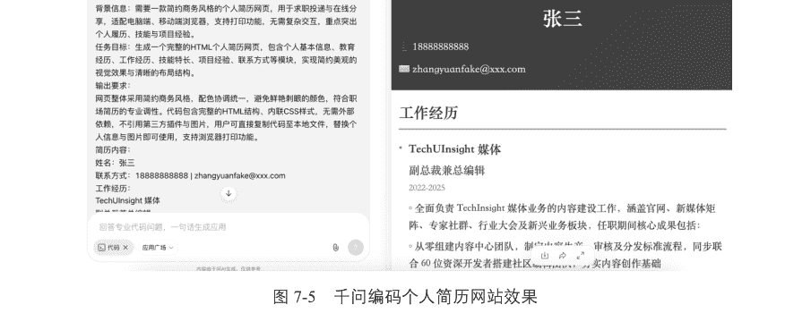

### 7.2.2 生日贺卡

生日贺卡网页是日常生活中传递祝福的个性化工具，相比传统纸质贺卡，网页版贺卡可添加动画、音乐、动态文字等元素，互动性更强，且可通过链接分享给亲友，便捷又环保。普通用户无须学习网页设计知识，通过千问可快速生成专属生日贺卡网页，打造独一无二的祝福体验。

基于提示词公式，结合生日贺卡的温馨场景，生日贺卡网页的提示词设计如下，兼顾个性化与易用性：

> **角色设定：** 前端视觉设计师
>
> **背景信息：** 用户希望为朋友制作一款温馨可爱风格的生日贺卡网页，用于传递生日祝福，朋友年龄为 25 岁，喜欢简约可爱的风格，贺卡需包含祝福文字、动态效果，无须复杂操作，轻量化运行。
>
> **任务目标：** 生成一个完整的 HTML 生日贺卡网页，实现温馨的动画效果，传递生日祝福。
>
> **输出要求：** 网页整体采用温馨可爱风格，主色调为淡粉色、鹅黄色，搭配白色背景，配色柔和，避免鲜艳刺眼，符合生日祝福的温馨氛围。代码包含完整的 HTML 结构、内联 CSS 样式与 JavaScript 逻辑，无须外部依赖，不引用第三方插件。

千问接收上述提示词后，将生成完整的生日贺卡网页代码，包含页面结构、样式设计与交互逻辑，如图 7-6 所示，生成的生日贺卡网页视觉温馨、动画流畅，页面切换自然，支持个性化修改，适配电脑端、移动端等不同设备。用户无须掌握任何编码知识，通过简单的转发、下载，可打造专属的生日贺卡，相比传统纸质贺卡，更具创意与心意，也更符合当下数字化的祝福方式。

无论是个人简历网页，还是生日贺卡网页，千问都能通过简单的自然语言提示，为零基础用户生成完整可运行的代码，让网页设计不再是专业人士的专属。通过这两个案例的实践，读者可进一步熟练掌握提示词公式的应用技巧，理解千问编码功能的优势。同时，这类网页设计场景也充分体现了千问“降低数字化门槛”的价值，让职场人士与普通大众都能通过 AI 工具，轻松实现自己的数字化创意。

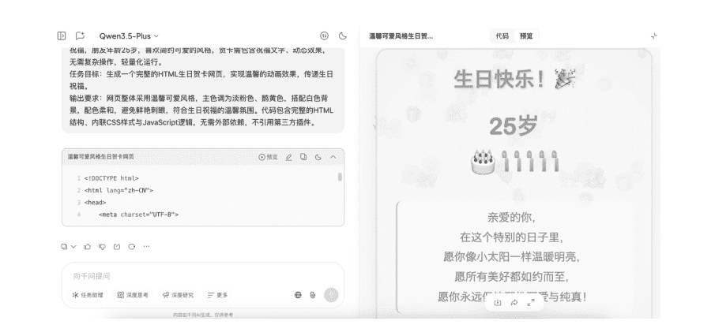

图 7-6 千问编码生日贺卡效果

## 7.3 开发休闲游戏

在千问助力零基础编码的应用场景中，娱乐休闲类编码是最易上手、最具趣味性的板块之一。对于职场人士和普通大众而言，无须掌握复杂的编程语言和开发逻辑，通过精准的提示词引导千问，就能生成可本地运行的休闲小游戏代码，既能满足碎片化时间的娱乐需求，也能在实践中感受编码的乐趣，进一步熟悉千问的辅助编码功能。

本章前两节已介绍了实用工具和网页设计的编码应用，本节将聚焦娱乐休闲场景，以最经典的五子棋和贪吃蛇小游戏为例，讲解如何通过千问生成符合需求的 HTML 代码，帮助零基础用户快速实现休闲游戏的搭建，同时掌握此类场景的提示词编写方法。

娱乐休闲类编码的需求是“可运行、易操作、界面简洁”，针对零基础用户，千问生成的代码需基于 HTML 结构和 CSS 内联样式，无须额外安装插件或依赖，保存为 HTML 文件后即可用任意浏览器打开运行。

### 7.3.1 五子棋

五子棋是一款历史悠久、规则简单的双人对弈休闲游戏，玩法是两人交替落子，率先在棋盘上形成横、竖、斜方向连续五个同色棋子的一方获胜。开发一款简单的五子棋小游戏，无须掌握复杂的游戏开发框架，只需通过千问生成基础的 HTML、CSS 和 JavaScript 代码，就能实现玩法，满足日常休闲娱乐需求。

基于前文提到的提示词参考公式，结合五子棋的游戏特点，针对零基础用户的需求，可编写如下提示词，引导千问生成可直接运行的五子棋游戏代码：

> **角色设定：** 资深前端开发工程师
>
> **背景信息：** 需开发一款面向普通大众的五子棋小游戏，用于日常休闲娱乐，需适配 Chrome、Edge、Firefox 等主流浏览器，无须额外安装插件。
>
> **任务目标：** 生成 15×15 的标准五子棋棋盘，界面简洁美观，棋子采用黑白两色，区分清晰；实现两人对弈功能，交替落子，落子后无法移动，显示当前落子方；具备胜负判断功能，当某一方形成横、竖、斜方向连续五个同色棋子时，弹出提示框告知获胜方；提供重新开始功能，点击按钮可清空棋盘，重新开始游戏。
>
> **输出要求：** 输出完整的 HTML 代码，采用 HTML5 标准结构，结合 CSS 内联样式实现界面美化，包含必要的 JavaScript 代码实现游戏逻辑；确保代码可本地保存为.html 文件并直接用浏览器运行，无须额外配置。

该提示词遵循“角色设定+背景信息+任务目标+输出要求”的公式，明确了千问的开发身份、用户基础、游戏功能和代码输出标准，能够引导千问生成符合用户需求的五子棋代码。其中，角色设定明确千问为“资深前端开发工程师”，背景信息补充了游戏的使用场景（日常休闲娱乐）和适配要求（主流浏览器），确保代码的实用性，任务目标详细列出了五子棋的核心功能，包括棋盘规格、对弈功能、胜负判断和重新开始功能，让千问清晰了解开发需求，输出要求明确了代码格式、样式和运行方式，确保生成的代码可直接使用。

千问在接收该提示词后，会自动梳理五子棋的游戏逻辑，生成完整的 HTML 代码。运行后，可看到 15×15 的标准五子棋棋盘，如图 7-7 所示，界面简洁，顶部显示当前落子方，两人可交替点击棋盘落子，当某一方获胜时，会弹出提示框告知获胜方，点击“重新开始”按钮可清空棋盘，重新开始游戏，满足日常休闲娱乐的需求。

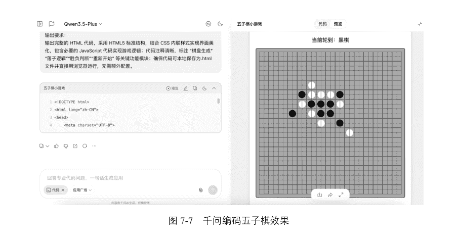

### 7.3.2 贪吃蛇

贪吃蛇也是一款经典的休闲小游戏，玩法是控制“蛇”的移动方向，吃掉随机生成的食物，“蛇”的身体会随着吃掉的食物不断变长，当“蛇”的头部撞到边界或自身身体时，游戏结束。该游戏操作简单、趣味性强，适合所有年龄段的用户。

同样，基于前文的提示词参考公式，结合贪吃蛇的游戏特点，可编写如下提示词，引导千问生成可直接运行的贪吃蛇游戏代码：

> **角色设定：** 资深前端开发工程师
>
> **背景信息：** 需开发一款面向普通大众的贪吃蛇小游戏，用于日常碎片化时间娱乐，需适配 Chrome、Edge、Firefox 等主流浏览器，无须额外安装插件，运行流畅无卡顿。
>
> **任务目标：** 生成固定大小的游戏画布，界面简洁，蛇身采用绿色，食物采用红色，边界清晰可见；实现“蛇”的移动控制，通过键盘方向键（上、下、左、右）控制“蛇”的移动方向，“蛇”移动速度适中，适合休闲娱乐；实现食物生成功能，食物随机出现在游戏画布内，“蛇”吃掉食物后，身体长度增加，同时分数增加，显示当前分数；实现游戏结束判定功能，当“蛇”的头部撞到画布边界或自身身体时，弹出游戏结束提示框，显示最终分数，并提供“重新开始”选项。支持暂停功能。
>
> **输出要求：** 输出完整的 HTML 代码，采用 HTML5 标准结构，结合 CSS 内联样式实现界面美化，包含必要的 JavaScript 代码实现游戏逻辑；确保代码可本地保存为.html 文件并直接用浏览器运行，无须额外配置；代码语法简单，避免复杂逻辑。

该提示词与五子棋的提示词结构一致，遵循参考公式，同时结合贪吃蛇的游戏特性，明确了核心功能和输出要求。任务目标详细列出了贪吃蛇的功能，包括游戏画布、“蛇”的移动控制、食物生成、分数统计和游戏结束判定，覆盖了贪吃蛇游戏的全部基础玩法。

千问接收该提示词后，会结合贪吃蛇的游戏逻辑，生成完整的 HTML 代码。如图 7-8 所示，可看到游戏画布、顶部的分数显示（初始分数为 0），通过键盘方向键控制“蛇”的移动，“蛇”吃掉红色食物后，身体变长，分数增加，当“蛇”撞到边界或自身身体时，会弹出游戏结束提示框，显示最终分数，点击提示框中的“重新开始”按钮，即可重新开始游戏，操作简单、运行流畅，适合碎片化时间的休闲娱乐。

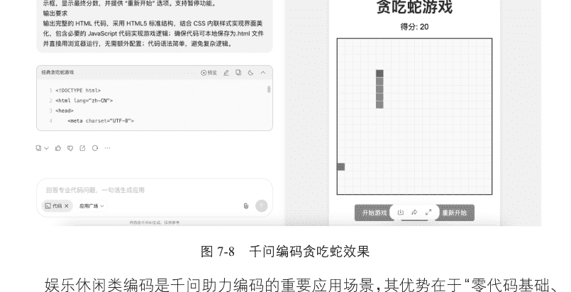

娱乐休闲类编码是千问助力编码的重要应用场景，其优势在于“零代码基础、高趣味性、可直接运行”。对于职场人士和普通大众而言，无须花费大量时间学习编程知识，只需掌握“角色设定+背景信息+任务目标+输出要求”的提示词参考公式，结合自身的娱乐需求，就能通过千问生成五子棋、贪吃蛇等各类休闲小游戏的代码，在碎片化时间中享受娱乐的同时，也能逐步了解编码的基本逻辑。

除五子棋和贪吃蛇外，千问还能生成其他各类休闲小游戏的代码，如井字棋、连连看、猜数字等，用户只需按照上述提示词公式，调整任务目标中的游戏名称和功能，就能引导千问生成对应的代码。

## 7.4 开发教学工具

在教育教学场景中，互动式学习工具能有效提升学习效率、增强学习趣味性，但传统工具开发往往需要专业的编码能力，这对多数教育工作者来说存在较高门槛。千问应用的零基础编码功能，可使教育工作者无须掌握复杂的编程知识，仅通过简单的提示词指令，就能生成适配教学需求的互动式学习工具，覆盖英语、语文等多学科场景。

本节将聚焦教育教学中的两个典型应用——英语学习工具和古诗学习工具，介绍如何通过千问生成可本地运行的 HTML 代码，实现高效教学辅助，同时提供标准化的提示词参考公式和具体示例，方便读者直接复用、灵活调整。

千问在教育教学编码场景中的优势，在于能够将教学需求转化为具体的代码实现，且生成的代码基于 HTML 结构和 CSS 内联样式，无须额外安装插件或依赖，可直接在本地浏览器中运行，适配电脑、平板等多种设备，满足课堂教学、课后练习等不同场景的使用需求。无论是教师快速制作课堂互动练习，还是家长为孩子定制个性化学习工具，都可通过千问快速完成，大幅降低工具开发的时间成本和技术门槛。

在使用千问生成教育教学类编码工具时，提示词的编写可遵循“角色设定+背景信息+任务目标+输出要求”的公式，确保千问能够准确理解教学场景、学科特点和功能需求，生成符合预期的代码。

### 7.4.1 英语学习

英语语法选择题是中小学英语教学中的重点题型，主要考查学生对介词、连词、情态动词、时态等语法知识的掌握情况。传统的语法选择题练习多以纸质形式呈现，无法实现即时核对答案、即时反馈，且教师手动出题、制作练习卷耗时较长。借助千问生成的英语语法选择 HTML 工具，可实现在线填写、提交核对、答案解析等功能，学生完成练习后可立即查看正确答案和解析，教师也可根据教学需求灵活调整题干、难度和题型，提升教学和学习效率。

针对英语学习工具的开发，千问提示词需明确工具的适用年级、语法考查重点、题干数量、功能模块等信息，确保生成的代码贴合教学实际。以下提供一个

## 千问 + “龙虾” + “悟空”：轻松搞定一人 AI 生态

具体的提示词示例：

> **角色设定：** 资深 HTML 开发工程师，擅长开发教育类英语互动学习工具，熟悉中小学英语教学大纲和语法考点，能结合学生认知特点设计简洁、易用的界面。

**背景信息：** 适配初中学生，围绕介词的用法设计语法选择题练习，题干选自该年级英语教材，难度适中，符合课堂练习或课后作业要求，避免过于复杂的句式和生僻词汇。

**任务目标：** 生成可本地运行的 HTML 代码，实现英语语法填空互动功能，包含题干展示、选项、提交按钮、答案核对、解析显示等模块；每道题目对应独立的输入区域，提交后可逐题显示正确答案和简要解析，帮助学生理解语法知识点。

**输出要求：** 代码采用 HTML5 标准编写，使用内联 CSS 样式，界面简洁大方，字体清晰易读，适配电脑和平板浏览；提交按钮明显，交互逻辑简单，点击提交后即时显示核对结果，无须刷新页面；解析内容简洁明了，聚焦语法考点，帮助学生快速掌握错误原因。

通过上述提示词，千问可生成完整的英语语法选择题 HTML 工具代码，如图 7-9 所示，教师可直接在浏览器中使用。此外，生成的代码可灵活修改，教师可根据实际教学情况，手动调整题干内容、答案和解析，简单修改提示词即可。这种方式既解决了教师手动制作互动练习的痛点，又能为学生提供即时反馈的学习体验，提升英语语法学习的效率和趣味性。

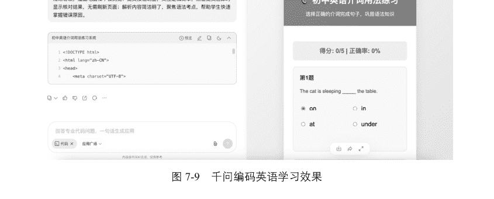

### 7.4.2 古诗学习

古诗是小学语文教学的重要内容，古诗排序练习能帮助学生熟悉古诗的语句逻辑、掌握古诗的节奏和韵律，提升对古诗的记忆和理解能力。传统的古诗排序练习多为纸质形式，学生需手动填写序号，教师批改耗时，且无法实现即时校验和趣味互动。借助千问生成的古诗排序 HTML 工具，可实现诗句拖拽排序、即时校验、正确提示等功能，将枯燥的记忆练习转化为互动式学习，激发学生的学习兴趣，同时减轻教师的批改负担。

古诗排序工具的开发，需结合小学语文教学特点，确保诗句选取贴合学生所在年级，排序交互简单易懂，界面设计符合小学生的审美和使用习惯。结合上述公式，以下提供一个具体的提示词示例：

> **角色设定：** 资深 HTML 开发工程师，专注于语文教育互动工具开发，熟悉小学语文教材中的古诗篇目，了解小学生的认知特点，能设计简洁、有趣、易操作的互动界面。

**背景信息：** 适配小学生，选取小学语文教材中的《望庐山瀑布》，将古诗的诗句打乱顺序，作为排序选项；工具难度适中，贴合该年级学生的古诗积累水平，界面设计简洁、活泼，符合小学生的审美。

**任务目标：** 生成可本地运行的 HTML 代码，实现古诗排序互动功能，包含古诗标题展示、打乱后的诗句选项、排序区域、提交按钮、校验提示等模块；支持鼠标拖拽诗句到排序区域，调整诗句顺序，点击提交后校验排序结果，排序正确则显示鼓励提示，排序错误则提示重新尝试，并可选择查看正确顺序。

**输出要求：** 代码采用 HTML5 标准编写，使用内联 CSS 样式，界面简洁活泼，字体清晰，诗句选项和排序区域区分明显，拖拽操作流畅；颜色搭配贴合小学生审美，避免过于艳丽或刺眼的颜色；交互逻辑简单易懂，适合小学生独立操作，提交后即时显示校验结果，鼓励提示积极正面，增强学生的学习信心。

通过上述提示词，千问可生成完整的古诗排序 HTML 工具代码，如图 7-10 所示，学生可通过拖拽诗句完成排序练习，即时获取校验结果，在互动中加深对古诗的记忆和理解。教师可根据教学需求，替换提示词中的古诗篇目，千问会自动调整代码中的诗句内容和排序逻辑，生成适配新篇目的互动工具。

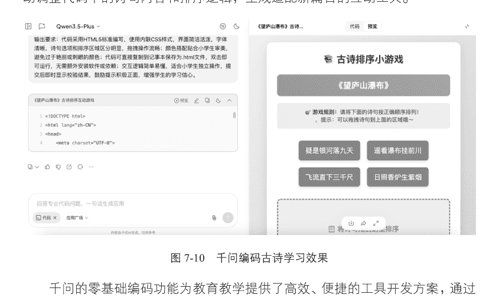

千问的零基础编码功能为教育教学提供了高效、便捷的工具开发方案，通过标准化的提示词，就能生成英语、语文等多学科的互动式学习工具。无论是英语语法填空、古诗排序，还是其他教学场景的工具开发，千问都能快速响应需求，帮助教育工作者提升教学效率，为学生提供更具趣味性、互动性的学习体验，真正实现“零基础也能开发教学工具”。

## 7.5 任务助理模式

### 7.5.1 任务助理模式介绍

千问的进阶功能中，任务助理模式是连接基础操作与复杂场景的关键模块，该模式以“多步骤、多智能体、任务闭环处理”为核心，依托千问底层大模型的语义理解与逻辑拆解能力，能够承接多环节、跨场景的复杂任务，实现从需求拆解、步骤执行到结果交付的流程自动化，是千问进阶功能中最具实用性的模块之一，也是衔接基础操作与专业应用的关键纽带。

职场中，调研咨询、数据处理、行程规划等任务往往需要多步骤拆解，涉及信息收集、逻辑分析、结果呈现等多个环节，传统 AI 工具多只能完成单一环节的工作，用户需在多个工具或功能之间切换，耗时费力。

基于这一市场需求，阿里千问于 2026 年初正式上线“任务助理”功能，同步开放 400 多项 AI 办事能力，标志着千问从“能说”向“能干”的跨越。该模式依托千问 Qwen 大模型，引入全新的通用 Agent 体系，由主 Agent 负责理解需求、拆解任务和整体规划，多个具备反思能力的子 Agent 在各自领域内独立决策、执行和校正，实现复杂任务的高效拆解与落地。

职场办公场景是任务助理模式的主要应用领域，用于处理多步骤、跨环节的办公任务，解决职场人士在工作中的效率痛点。具体包括咨询调研类任务，如市场调研、行业调研等，可完成调研方案设计、问卷生成、数据收集、分析报告撰写等全流程；数据处理类任务，如数据清洗、数据统计、数据可视化等，可将复杂数据转化为清晰的图表或报告；文档处理类任务，如批量生成文档、PPT 制作、合同审核、报销台账整理等，提升文档处理效率；行程与会议类任务，如差旅规划、会议安排、会议纪要整理等，减少行政事务耗时。

任务助理模式的入口位于千问首页，如图 7-11 所示，点击输入框下方的功能选项“任务助理”，进入任务助理模式，用户输入提示词即可启动任务。


图 7-11 千问任务助理模式入口

### 7.5.2 问卷调查

问卷调查是职场中常见的复杂任务，涵盖用户调研、行业调研等多种类型，这类任务往往需要经过“需求明确、方案设计、数据收集、分析总结、报告撰写”等多个步骤，耗时久、流程烦琐，且对逻辑严谨性要求较高。千问任务助理模式可依托其任务拆解与资源整合能力，承接咨询调研全流程任务，用户按照提示词基本公式（角色设定+背景信息+任务目标+输出要求）输入指令，无须手动干预，即完成调研任务的落地。

在此以办公软件用户需求调研为例，针对企业内部即将推出的办公软件，开展用户需求调研，收集员工对软件功能、操作体验、使用场景等方面的意见，为软件优化提供依据。此类调研任务需完成调研方案设计、问卷生成、调研结果统计、分析报告撰写等步骤，传统方式下需人工完成多个环节，耗时多天。本案例利用千问任务助理模拟执行需求调研的全部流程，在实际工作中，用户可以根据需要选择其中的子任务来执行。

提示词示例如下：

> **角色设定：** 企业用户调研专员，具备 3 年办公软件调研经验，熟悉企业员工办公场景与需求，能够设计贴合员工实际的调研问卷，具备基础的数据统计与分析能力。

**背景信息：** 本企业现有员工 200 人，涵盖行政、技术、销售、财务 4 个部门，即将推出一款整合考勤、审批、文件共享、即时沟通功能的办公软件，目前处于测试阶段，需了解员工对该软件各功能的需求优先级、操作便捷性期望、潜在使用痛点，调研对象为企业全体员工，调研周期为 3 天，调研方式为线上问卷。

**任务目标：**
（1）设计一份完整的办公软件用户需求调研问卷，包含基础信息、功能需求、操作体验、改进建议 4 个模块，问卷题目数量控制在 20～25 题，题型涵盖单选、多选、简答题。
（2）生成问卷发放说明，明确问卷填写要求与提交截止时间。
（3）模拟收集 100 份有效问卷数据（贴合企业各部门员工特征）。
（4）对问卷数据进行统计分析，提炼核心需求与潜在痛点。
（5）撰写一份完整的调研分析报告，包含调研概况、数据统计、需求分析、改进建议 4 个部分。

**输出要求：**
（1）问卷以 Word 格式呈现，题目清晰、选项合理，简答题预留充足填写空间。
（2）问卷发放说明以简洁的文字呈现，适合在企业内部群发布。
（3）数据统计以表格形式呈现，包含各题目选项的占比、核心数据汇总。
（4）调研分析报告以 Word 格式呈现，逻辑清晰、数据详实，改进建议具有可操作性，字数控制在 1500～2000 字，无须使用复杂专业术语，贴合企业实际需求。

千问任务助理接收指令后，首先拆解任务为 9 个子任务，按逻辑顺序推进，用户可以实时看到任务执行过程。

- （1）收集问卷和报告模板。
- （2）设计调研问卷。
- （3）生成发放说明。
- （4）生成模拟数据。
- （5）统计分析数据。
- （6）撰写调研报告。
- （7）转换问卷格式。
- （8）转换报告格式。
- （9）检查交付文件。

以下展示几个重点步骤的细节。例如，第一步，收集问卷和报告模板，如图 7-12 所示，千问会在网络上搜索企业办公软件用户需求调研问卷的模板、企业调研分析报告等资料，然后生成搜索总结报告。

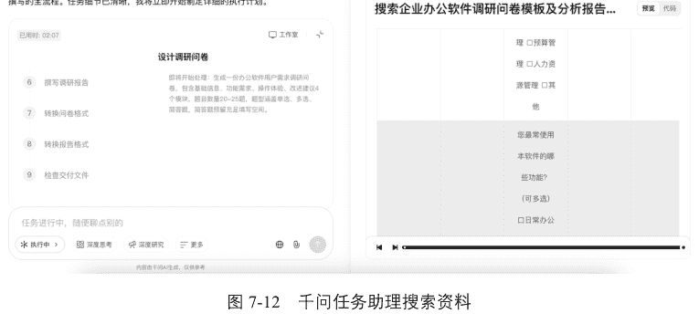

第四步，生成模拟数据，如图 7-13 所示，千问会基于问卷结构，生成 100 份模拟问卷数据，贴合企业各部门员工特征，部门包括行政、技术、销售、财务等，并保存为 csv 文件。

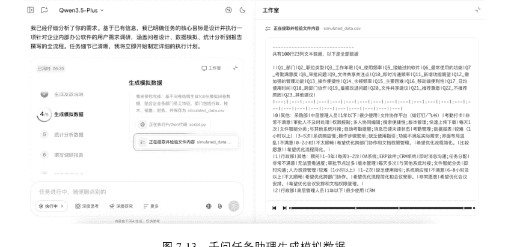

第五步，统计分析数据，如图 7-14 所示，千问会对 csv 文件进行统计分析，计算各题目选项的占比、核心数据汇总，以 Markdown 表格形式输出，并保存为数据统计 md 文件。

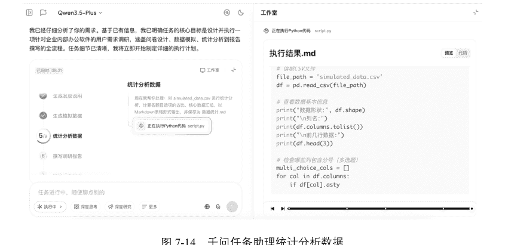

第六步，撰写调研报告，如图 7-15 所示，千问会基于问卷数据统计结果，撰写调研分析报告，包含调研概况、数据统计、需求分析、改进建议四个部分。

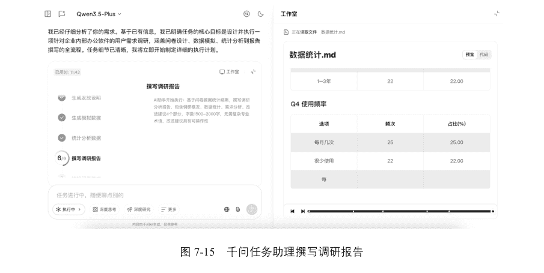

整个执行过程中，任务助理会实时反馈进度，用户可随时查看各子任务的完成情况。任务完成之后，如图 7-16 所示，千问会交付以下四项成果：

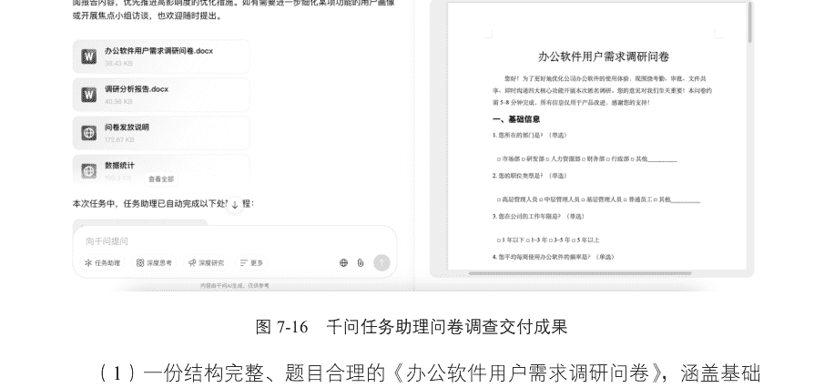

（1）一份结构完整、题目合理的《办公软件用户需求调研问卷》，涵盖基础信息、功能需求、操作体验与改进建议四大模块，题型多样，适用于全员线上填写。
（2）一篇简洁清晰的《问卷发放说明》，便于在企业内部群发布，明确告知员工填写要求与截止时间。
（3）一份详尽的《数据统计》报告，以表格形式展示各题目的选项分布与核心数据汇总，直观呈现调研结果。
（4）一篇内容扎实的《调研分析报告》，包含调研背景、数据分析、需求洞察与可落地的改进建议，为企业优化办公系统提供决策支持。

### 7.5.3 数据可视化

数据可视化是职场中数据处理的重要环节，通过图表（柱状图、折线图、饼图、旭日图等）将复杂的文字数据转化为清晰直观的视觉呈现，便于数据解读、汇报与决策。传统的数据可视化需用户使用 Excel、PPT 等工具手动制作，耗时费力，且对图表设计能力有一定要求，尤其对于多组数据、复杂维度的可视化，操作难度较大。千问任务助理模式可依托其数据处理与图表生成能力，承接数据可视化任务，用户按照提示词基本公式输入指令，上传相关数据，可生成符合要求的可视化图表，无须手动操作图表工具，大幅提升数据可视化效率。

以财务报表数据可视化为例，将企业年度财务报表中的关键数据进行可视化处理，清晰呈现企业的收入、成本、利润、资产负债等指标，便于财务分析与管理层汇报。此类任务对数据准确性与图表专业性要求较高，千问任务助理可依托其精准的数据处理能力，生成符合财务规范的可视化图表，同时整合到 PPT 中，满足财务汇报的专业需求。

提示词示例如下：

> **角色设定：** 财务分析师，具备 5 年财务数据处理与可视化经验，熟悉财务报表结构与核心指标，能够选择符合财务规范的图表类型，图表设计严谨、专业，贴合财务汇报场景。
> **背景信息：** 某企业 2025 年度财务报表关键数据如下：……（也可上传 Excel 财务报表）。
> （1）营业收入：第一季度 800 万元、第二季度 850 万元、第三季度 920 万元、第四季度 1050 万元。
> （2）营业成本：第一季度 450 万元、第二季度 480 万元、第三季度 520 万元、第四季度 580 万元。
> （3）净利润：第一季度 150 万元、第二季度 170 万元、第三季度 190 万元、第四季度 230 万元。
> （4）资产总额：年初 1500 万元、年末 1800 万元。
> （5）负债总额：年初 600 万元、年末 720 万元。
> （6）所有者权益：年初 900 万元、年末 1080 万元。
> 数据来源为企业 2025 年度财务报表，数据真实有效，符合企业财务规范。

**任务目标：**
（1）对上述财务数据进行整理，确保数据准确，汇总年度营业收入、营业成本、净利润总额。
（2）生成 4 类可视化图表，分别为：年度各季度营业收入与营业成本对比图（柱状图）、年度各季度净利润趋势图（折线图）、年初与年末资产负债对比图（柱状图）、年度营业收入与净利润占比图（饼图）。
（3）图表设计符合财务规范，样式严谨、专业，数据标签清晰，标注单位（万元）。
（4）将图表整合到 PPT 中，每个图表对应一个 PPT 页面，添加财务专业标题与简要说明，标注数据来源。
（5）撰写一份简短的财务数据可视化分析，解读各图表反映的财务状况。

**输出要求：**
（1）图表类型符合财务汇报规范，数据准确无误，单位标注清晰，无逻辑错误。
（2）图表颜色搭配严谨（以蓝色、灰色、黑色为主，避免鲜艳颜色），样式简洁，无多余装饰。
（3）PPT 页面标题专业，说明简洁，标注数据来源（如某企业 2025 年度财务报表）。
（4）财务数据可视化分析语言专业、逻辑清晰，重点解读企业收入、利润增长趋势，以及资产负债情况，字数控制在 800～1000 字。

任务助理执行过程：千问任务助理接收指令后，拆解任务为 4 个子任务，逐步推进执行。比如，第一步，整理财务数据，如图 7-17 所示，千问会计算该企业 2025 年度营业收入、营业成本、净利润的年度总和等各项数据。

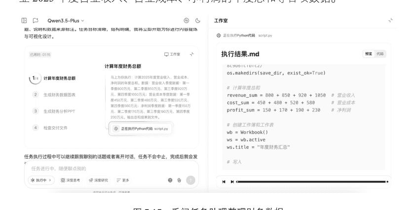

第二步，生成财务数据报表，如图 7-18 所示，千问会生成四个财务可视化图表：年度各季度营业收入与营业成本对比柱状图、年度各季度净利润趋势折线图、年初与年末资产负债对比柱状图、年度营业收入与净利润占比饼图等。

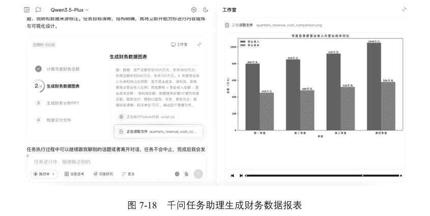

第三步，生成财务分析 PPT，如图 7-19 所示，千问会将 4 个图表分别整合到 4 个 PPT 页面中，每个页面添加专业标题、简要说明。最终交付文件为“企业 2025 年度财务数据可视化分析.pptx”文件。

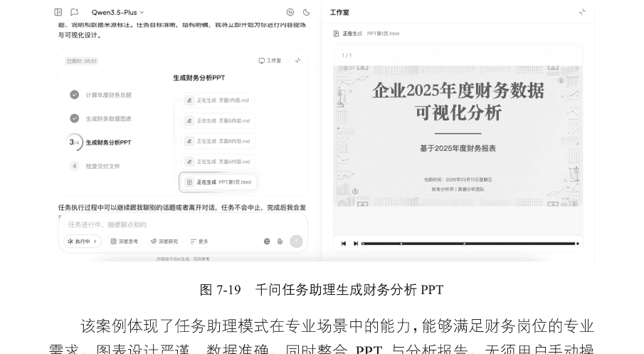

该案例体现了任务助理模式在专业场景中的能力，能够满足财务岗位的专业需求，图表设计严谨、数据准确，同时整合 PPT 与分析报告，无须用户手动操作多个工具，大幅提升财务数据处理与汇报效率。千问任务助理支持上传 Excel 财务报表，能够自动识别报表中的关键数据，若报表数据存在格式问题，任务助理会提醒用户调整，确保数据处理的准确性。

千问任务助理模式是千问进阶功能的核心体现，依托通用 Agent 体系与阿里生态资源，实现了复杂任务的流程自动化处理，兼顾职场与生活场景，无须用户具备专业技能，即可通过简单指令完成多步骤、跨平台的复杂任务。本节通过对任务助理模式的由来、优点、场景的详细介绍，结合问卷调查、数据可视化两大场景的具体案例，拆解了提示词编写方法与任务执行过程，旨在帮助读者快速掌握该模式的使用。

# 第 8 章 进阶：OpenClaw 实践

OpenClaw（国内开发者亲切称之为“小龙虾”）是 2026 年全球 AI 领域现象级的开源 AI 智能体执行平台，打破了传统对话式 AI “只说不做”的局限，构建了连接大语言模型“大脑”与本地设备“手脚”的桥梁，让用户通过自然语言指令，就能驱动 AI 完成从任务拆解、工具调用到执行的全流程操作。凭借开源免费、本地优先、无代码、高扩展性的优势，OpenClaw 快速普及到办公、教育、电商、法律、运维等多个领域，成为职场人士掌握 AI 自动化能力的重要平台。本章将从 OpenClaw 的特点、安装部署、与千问大模型和钉钉如何联动、Skill 配置和应用案例等多个角度来详细介绍 OpenClaw。

## 8.1 OpenClaw 介绍

### 8.1.1 什么是 OpenClaw

OpenClaw 是一款基于 MIT 开源协议、本地优先设计的 AI 智能体执行平台，由奥地利知名开发者 Peter Steinberger 发起，核心定位是“运行在你自己设备上的个人 AI 助手”。它本身不具备大语言模型的推理能力，而是作为标准化的执行框架，对接各类云端或者本地大模型，打通通信渠道、系统工具、扩展技能，实现从自然语言指令到实际操作的流程。

简单来说，OpenClaw 能够“帮你把事做完”。例如，通过钉钉下命令“帮我整理本周的销售报表，提取关键数据并发送给团队成员”，OpenClaw 会直接打开用户计算机上的表格文件、提取数据、生成分析报告、调用邮箱发送给指定人员，全程无须人工干预。OpenClaw 网址为 https://openclaw.ai/，如图 8-1 所示。

# 第 8 章 进阶：OpenClaw 实践

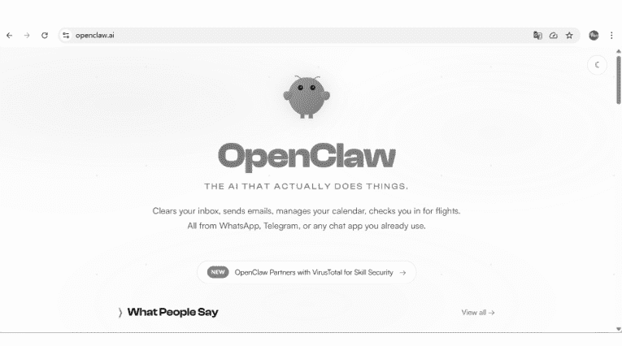

图 8-1 OpenClaw 官网

OpenClaw 的发展历程虽短，但经历了多次关键迭代，快速从小众项目成长为全球顶级开源 AI 项目：

1. 2025 年 6 月，Peter Steinberger 创立 Amantus Machina 公司，专注于下一代超个性化 AI 智能体研发。
2. 2025 年 12 月，首次公布名为 Clawd 的 Agent 项目进展，开放核心配置代码，以龙虾为视觉标识。
3. 2026 年 1 月，项目更名为 ClawdBot，在 GitHub 开源后迅速走红，因商标侵权纠纷，项目先更名为 Moltbot，最终定名为 OpenClaw，寓意“开源的龙虾螯足”，致敬项目起源与开源属性。
4. 2026 年 2 月，项目创始人加入 OpenAI，OpenClaw 以基金会形式作为独立开源项目存续，社区成为核心开发与维护力量。
5. 截至 2026 年 3 月，OpenClaw 在 GitHub 的星标数已突破 30 万，成为 GitHub 历史上增长最快的开源 AI 项目。

OpenClaw 采用了业界领先的“网关、智能体、节点、渠道”四层架构，这种设计既保证了系统的稳定性和扩展性，也让不同模块的能力可以独立升级，用户无须理解底层代码，就能灵活组合各类能力。

## 1. Gateway 网关层（系统的神经中枢）

Gateway 是 OpenClaw 的核心组件，是一个基于 Node.js 构建的常驻后台进程，默认监听本地 127.0.0.1:18789 端口，相当于整个系统的“交通枢纽”。统一管理所有会话、路由消息、调度任务、管理技能与权限，是连接大模型、交互渠道、执行工具的桥梁。

## 2. Agent 智能体层（系统的大脑）

Agent 层是 OpenClaw 的决策中枢，负责理解用户指令、拆解任务、制定执行计划、决策工具调用，相当于 OpenClaw 的“思考器官”。面对复杂指令时，会先拆解为多步可执行的子任务，再逐一调用工具执行，根据执行结果动态调整后续计划，直到任务完成。采用模型无关设计，原生支持 OpenAI GPT、Anthropic Claude、Google Gemini、智谱 GLM、阿里千问、月之暗面 Kimi 等大模型，同时兼容 Ollama 运行的本地开源模型，用户可根据成本、隐私需求自由切换。

## 3. 节点执行层（系统的手脚）

节点执行层是 OpenClaw 实现“动手做事”的关键，也是它区别于传统对话 AI 的根源，主要包括技能系统（Skills）、工具系统（Tools）和节点能力（Nodes）。

- （1）技能系统：模块化的功能扩展包，每个 Skill 专注于解决一类特定任务，相当于手机里的 App，安装后就能解锁对应的能力，如邮件管理、网页搜索、PDF 处理等。
- （2）工具系统：OpenClaw 内置的基础能力，包括文件读写、终端命令执行、浏览器控制、定时任务调度等，是所有技能的底层执行基础。
- （3）节点能力：支持多设备分布式扩展，任何设备都可以作为节点接入 OpenClaw 系统，共享执行能力，如让家里的计算机和办公室的计算机协同完成任务。

## 4. 渠道层（系统的交互入口）

渠道层负责打通用户与 OpenClaw 的交互通道，让用户可以通过自己熟悉的软件，随时随地给 OpenClaw 下达指令。原生支持 50 多种主流通信工具，包括 Telegram、WhatsApp、飞书、企业微信、钉钉等。用户无须安装额外的客户端，用日常聊天的软件就能远程控制 OpenClaw 执行任务。

### 8.1.2 OpenClaw 的优势特点

OpenClaw 凭借其独特的设计理念和技术架构，彻底改变了 AI 从“对话建议”到“实际执行”的应用范式。以下从不同的维度介绍 OpenClaw 的优势特点，这些特点共同构成了其在 AI 工具领域的差异化竞争力。

### 1. 本地优先：隐私安全与数据自主可控

OpenClaw 采用“本地优先”的设计原则，所有数据、会话记录、执行日志等都默认存储在本地设备，不依赖云端服务，这是其与多数云原生 AI 工具显著的区别。用户的敏感信息（如工作文档、财务数据、个人隐私等）无须上传至第三方服务器，有效规避数据泄露风险。

OpenClaw 离线可用能力大幅提升使用场景灵活性。配合本地模型（如小参数版 DeepSeek、Qwen），OpenClaw 在断网环境下依然能正常运行，不受网络状况或地域限制影响。数据主权归属用户，用户可自由导出、备份、删除所有数据，对数据存储格式进行自定义，实现对个人信息的掌控。

### 2. 真实执行能力：系统操控与任务自动化

OpenClaw 最核心的优势在于其真实执行能力，能够直接操控计算机系统和各类软件，完成从文件操作到复杂工作流的任务。这种执行能力覆盖三大场景：

- （1）系统级操作：直接控制文件管理器（创建/删除/移动/重命名文件）、终端（执行命令行脚本）、系统设置（调整显示参数、网络配置）等底层功能。
- （2）软件自动化：操控浏览器（如自动浏览、表单填写、数据抓取等）、办公软件（如 Excel 数据处理、Word 文档生成等）、设计工具等桌面应用。
- （3）工作流编排：将多个操作串联成复杂流程，如“从邮箱下载账单→自动分类归档→生成月度报表→发送至指定邮箱”的流程自动化。

### 3. 模块化技能生态：即插即用与快速扩展

OpenClaw 构建了完善的模块化技能（Skill）生态系统，将各类功能封装为独立的技能模块，用户可根据需求自由安装、组合和扩展，实现“按需定制”的个性化 AI 助手。

每个技能包含触发条件（如自然语言指令匹配、定时触发、事件触发等）、执行逻辑（如 Python 脚本、Shell 命令、API 调用等）和输出格式（如文本、文件、UI 交互等），遵循统一的 SKILL.md 规范，确保兼容性和易用性。

普通用户无须专业编程知识，通过 YAML 配置文件即可创建简单功能。开发者则可通过 Python 等语言开发复杂技能，甚至构建技能组合包以满足特定行业需求。这种设计平衡了易用性和扩展性，使 OpenClaw 既能满足普通用户的即插即用需求，又能支持开发者进行深度定制。

### 4. 跨平台适配：全场景覆盖与无缝体验

OpenClaw 采用跨平台架构设计，支持 Windows、macOS、Linux 三大主流系统，同时提供 Web 端、移动端（iOS/Android）的远程控制能力，实现全场景覆盖。

OpenClaw 针对不同操作系统进行优化，确保文件操作、进程管理等功能在各平台上表现一致，避免兼容性问题。提供 CLI（命令行）、GUI（图形界面）等多种交互方式，满足不同用户习惯。

OpenClaw 支持多设备间的任务同步与执行，用户可在手机上发起指令，由家中计算机或公司服务器完成执行，实现“指令随处发，任务随处做”的灵活体验。

综上所述，OpenClaw 的优势特点相互支撑，共同构建了其作为“能动手干活的 AI 助手”的价值定位。本地优先架构保障隐私安全，真实执行能力实现从对话到行动的跨越，模型无关设计提供灵活选择，模块化技能生态降低使用门槛，跨平台适配覆盖全场景，开源社区驱动持续创新。

这些特点使 OpenClaw 不仅适用于技术开发者，更能为普通职场人士提供切实的效率提升，真正实现“AI 工具平民化”的目标。

## 8.2 OpenClaw 安装部署

### 8.2.1 OpenClaw 安装

OpenClaw 支持 Windows、macOS、Linux 等多种操作系统，其中 Windows 是普通用户最常用的系统，本节将以 Windows 平台为案例，详细讲解 OpenClaw 的安装部署全流程。

在开始安装 OpenClaw 之前，需安装 Node.js 20.0.0 及以上版本。Node.js 是一个开源的 JavaScript 运行环境，OpenClaw 的核心程序和网关服务都依赖它运行。访问 Node.js 官方网站（https://nodejs.org/），下载 Windows 安装包（.msi），双击运行安装程序，勾选“Add to PATH”选项，完成全局环境变量配置。

本例采用 OpenClaw 官方推荐的安装方式，一键脚本安装，全程自动化完成，无须手动配置环境变量，就能完成从依赖安装到程序部署的流程，对用户友好。

1. 步骤 1：以管理员身份打开 PowerShell

PowerShell 是 Windows 系统自带的命令行终端，OpenClaw 的安装脚本需要在管理员权限下运行，避免因权限不足导致安装失败。点击 Windows 开始菜单，搜索 “PowerShell”，在搜索结果中右键点击 “Windows PowerShell”，选择 “以管理员身份运行”。

2. 步骤 2：解锁 PowerShell 脚本执行权限

Windows 系统默认限制了第三方脚本的执行权限，首次安装 OpenClaw 时，需要先修改执行策略，否则会出现 “无法加载文件，因为在此系统上禁止运行脚本” 的报错。

在打开的 PowerShell 窗口中，复制粘贴以下命令，按下回车键执行：

```
Set-ExecutionPolicy -ExecutionPolicy RemoteSigned -Scope CurrentUser
```

3. 步骤 3：执行官方一键安装脚本

权限解锁完成后，就可以执行安装脚本了，在 PowerShell 中，执行以下命令：

```
iwr -useb https://openclaw.ai/install.ps1 | iex
```

脚本执行过程中，会完成 OpenClaw 程序的安装与环境配置，全程无须人工干预，如图 8-2 所示。

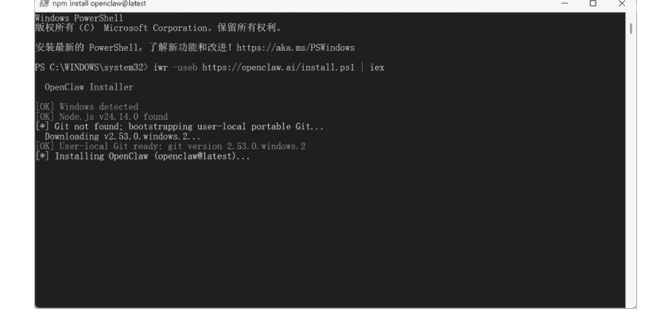

图 8-2 OpenClaw 启动安装

4. 步骤 4：等待安装完成

当脚本执行完毕，PowerShell 窗口中显示 “OpenClaw installed successfully” 的提示时，即表示程序已安装完成，如图 8-3 所示。

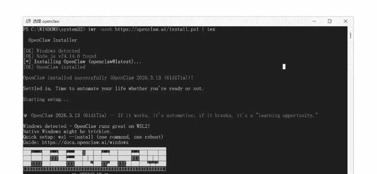

图 8-3 OpenClaw 完成安装

### 8.2.2 OpenClaw 接入千问大模型

OpenClaw 安装完成之后，需要接入 AI 大模型，才能具备思考和决策的“大脑”。通常情况下，OpenClaw 会自动启动初始化配置界面，用户也可以通过以下命令手动启动配置：

```
openclaw onboard
```

初始化向导会引导完成基础配置特别是接入大模型，以下为详细步骤。

首先是 OpenClaw 的安全提醒（如图 8-4 所示），选择“Y”即表示用户已了解相关风险，继续进行配置。

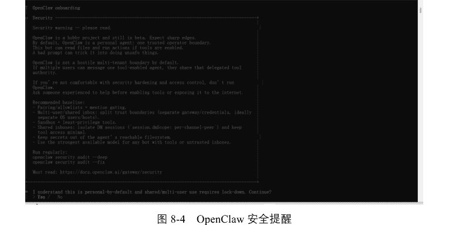

图 8-4 OpenClaw 安全提醒

下一步，配置页面会询问选择快速配置（quickstart）方式还是完整手动配置（manual）方式（如图 8-5 所示），本案例选择快速配置方式即可。

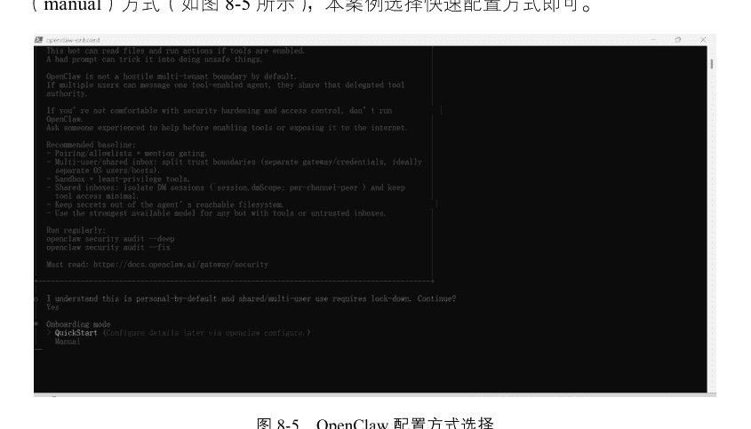

图 8-5 OpenClaw 配置方式选择

接下来，OpenClaw 开始配置大模型接入信息，如图 8-6 所示，在大模型供应商列表中，选择“Qwen”千问大模型，并回车确认。

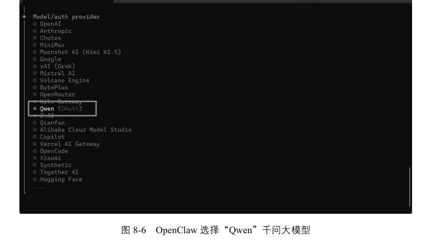

图 8-6 OpenClaw 选择“Qwen”千问大模型

OpenClaw 会自动弹出浏览器页面，要求登录 Qwen 千问账号，如图 8-7 所示，新用户可以点击“注册”按钮完成用户注册，老用户可以直接输入邮箱和密码登录账号。

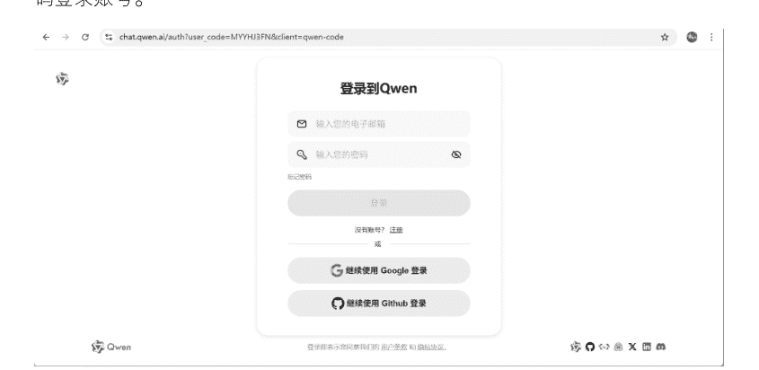

图 8-7 Qwen 千问账号登录

在注册或者登录成功之后，页面会提示认证成功，如图 8-8 所示，表示 OpenClaw 已经接入了 Qwen 千问大模型。


图 8-8 Qwen 千问认证成功

关闭浏览器，返回刚才的 OpenClaw 配置命令行界面中，如图 8-9 所示，可以看到 OpenClaw 询问具体接入哪个千问大模型，保持默认即可。

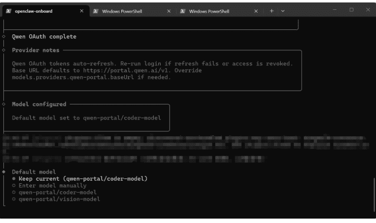

图 8-9 Qwen 千问模型选择

接下来几步还有频道、技能、搜索等配置，目前都可以跳过，选择 “No” 或者 “Skip for now” 即可，如图 8-10 所示。

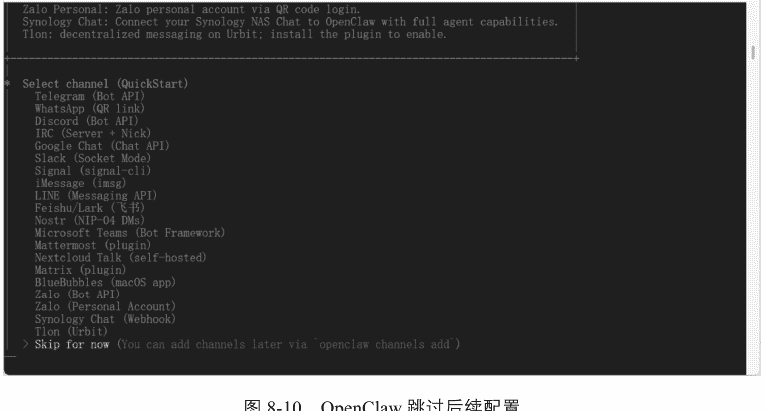

图 8-10 OpenClaw 跳过后续配置

全部配置完成后，OpenClaw 会询问用户希望以何种方式使用它，如图 8-11 所示，TUI 方式是在命令行界面中与 OpenClaw 交互，Web UI 则通过浏览器访问的方式向 OpenClaw 发送指令。

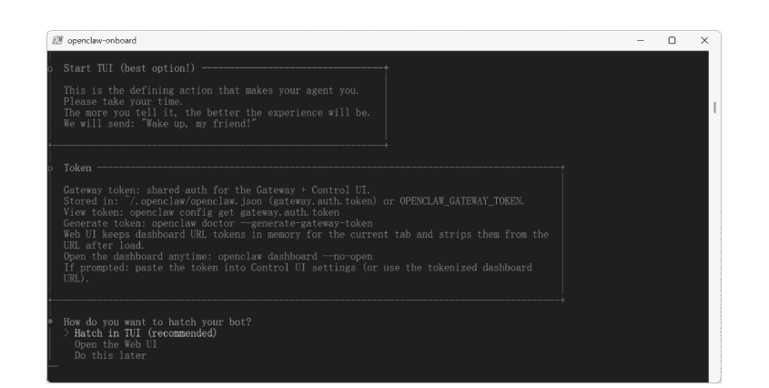

图 8-11 OpenClaw 选择运行方式

如果选择 TUI（终端命令行）方式，其效果如图 8-12 所示，用户可直接在命令行界面输入问题或提示词，OpenClaw 会给出回复或执行用户的指令。

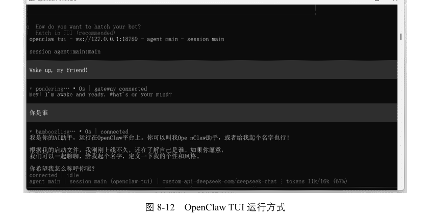

图 8-12 OpenClaw TUI 运行方式

如果选择 Web UI 方式，OpenClaw 将自动启动浏览器，访问指定的 Web 页面（一般为 http://127.0.0.1:18789/，见图 8-13），用户可在网页中与 OpenClaw 进行交互。

OpenClaw 在两种方式下都能正常处理用户的请求，至此，其安装部署过程已顺利完成。

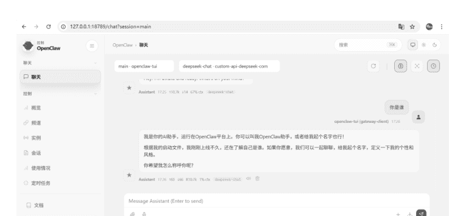

图 8-13 OpenClaw Web 运行方式

### 8.2.3 OpenClaw 接入钉钉

OpenClaw 接入钉钉可实现大模型能力与钉钉生态的结合，让钉钉具备智能交互的 AI 员工能力，支持群聊和私聊两种交互模式。接入以后，用户可以通过钉钉软件远程对计算机中的 OpenClaw 下达指令。本节详细介绍如何配置钉钉与 OpenClaw 通信。

1. 创建钉钉机器人

首先，登录钉钉开发者后台（https://open-dev.dingtalk.com/，见图 8-14），需要提前注册钉钉账号。登录成功后，在首页界面点击“创建应用”按钮。

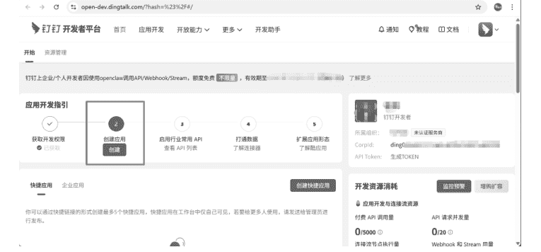

图 8-14 在钉钉开发者平台创建应用

在钉钉应用页面中，如图 8-15 所示，提供了一键创建 OpenClaw 机器人的快速入口，点击“立即创建”按钮。

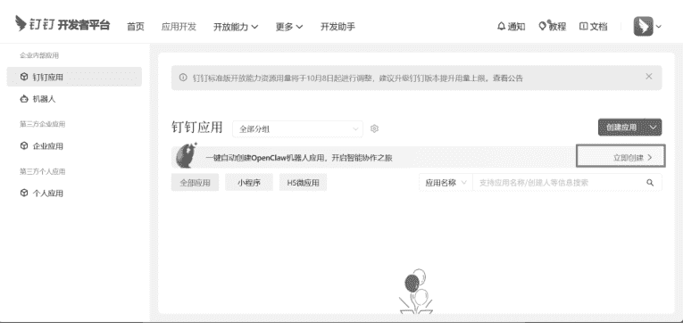

图 8-15 创建 OpenClaw 机器人入口

在弹出的创建对话框中，如图 8-16 所示，分别填写机器人名称、机器人简介，上传机器人图标，也可以保留默认配置，点击确定按钮提交。

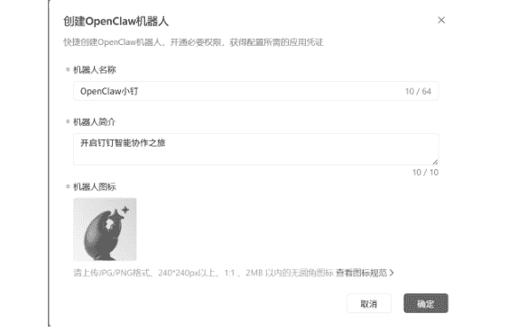

图 8-16 OpenClaw 机器人配置信息

创建成功之后，钉钉开发者平台会弹出 OpenClaw 机器人的相关凭证信息，如图 8-17 所示，包括 Client ID 和 Client Secret，用户先把这两项信息复制保存下来，后面要配置到 OpenClaw 平台中，用于两者之间的通信。

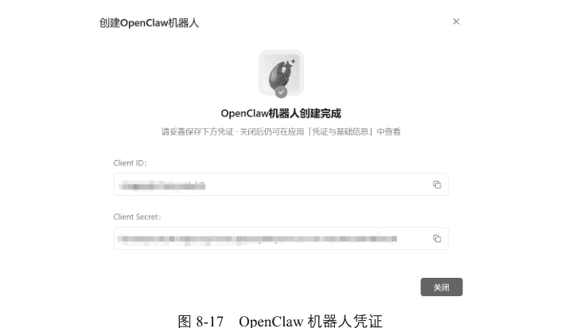

返回钉钉应用页面，可以看到 OpenClaw 机器人已经显示在应用列表中，如图 8-18 所示，用户可以在这里查看、修改、删除它。至此，钉钉开发者平台的配置完成。

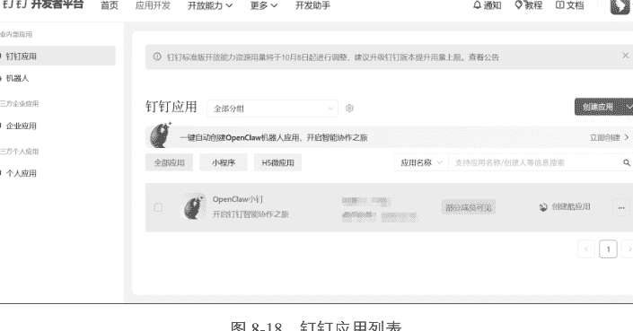

2. 配置 OpenClaw 平台

首先，需要在 OpenClaw 中安装钉钉官方插件，在 PowerShell 中输入以下命令直接运行插件安装命令：

```
openclaw plugins install @dingtalk-real-ai/dingtalk-connector
```

OpenClaw 会自动处理下载、安装依赖和注册任务，安装过程如图 8-19 所示，完成后会提示 dingtalk-connector 插件已安装。

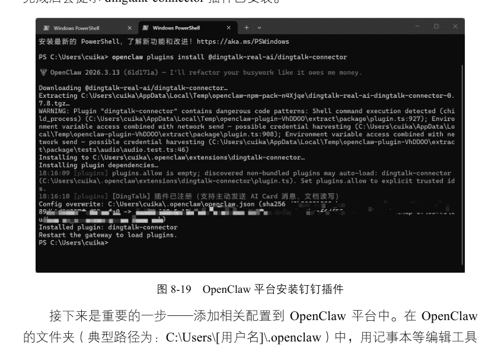

接下来是重要的一步——添加相关配置到 OpenClaw 平台中。在 OpenClaw 的文件夹（典型路径为：C:\Users\[用户名]\.openclaw）中，用记事本等编辑工具打开 openclaw.json 文件，添加以下信息：

```json
"channels": {
    "dingtalk-connector": {
        "clientId": "[OpenClaw 机器人 Client ID]",
        "clientSecret": "[OpenClaw 机器人 Client Secret]",
        "gatewayToken": "[复制"gateway"中的"token"值]"
    }
},
"gateway": {//如果存在，则保持不变
    "port": 18789,
    "mode": "local",
    "bind": "loopback",
    "auth": {
        "mode": "token",
        "token": "e512936c5ec773xxxxxxxx96546456e91600224"
    },
    "http": {
        "endpoints": {
            "chatCompletions": {
```

# 第 8 章 进阶：OpenClaw 实践

```json
"enabled": true
}
}
},
```

这段信息的主要作用是，把在钉钉开发者平台中创建的 OpenClaw 机器人的信息配置到 OpenClaw 平台中。需要注意的是，在增加相关信息时，不要删除其他信息。如 “gateway” 已经存在，则不需要修改它对应的内容。

在修改完毕之后，保存 openclaw.json 文件，并在 PowerShell 命令行中，运行以下命令重启：

```bash
openclaw gateway restart
```

至此，钉钉接入 OpenClaw 平台的配置过程完成。

## 3. 测试钉钉接入效果

在手机上打开钉钉 App，如图 8-20 所示，点击右上角搜索框，输入 OpenClaw 机器人的名称，钉钉 App 会找到对应的机器人，如图 8-21 所示。


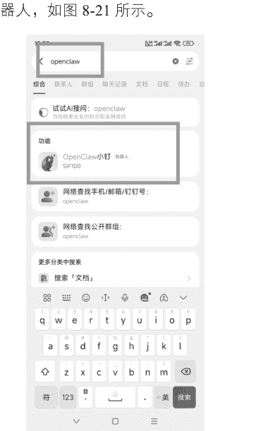

用户点击搜索到的机器人，可以进入对话界面，如图 8-22 所示，用户输入消息后，在 Windows 操作系统中运行的 OpenClaw 平台都可以及时执行和响应。

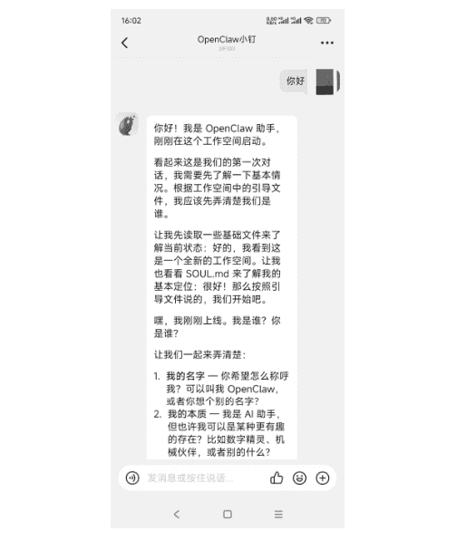

图 8-22 钉钉 OpenClaw 机器人对话界面

到目前为止，可以通过三种方式来 “指挥” OpenClaw 平台，分别是 TUI、Web UI 和钉钉，表 8-1 总结了不同调用方式的差异。

表 8-1 OpenClaw 不同调用方式差异

| 对比维度 | TUI（命令行界面） | Web UI（网页界面） | 钉钉 |
| :--- | :--- | :--- | :--- |
| 操作便捷性 | 需通过命令行输入指令操作，适合熟悉终端操作的人员，无图形化界面 | 图形化界面，操作直观易懂，无须专业命令知识，适配各类用户群体 | 依托钉钉现有界面，可直接在聊天窗口操作，贴合日常办公习惯，操作便捷性高 |
| 功能完整性 | 核心功能齐全，支持底层指令调用，可实现精细化配置和高级操作，但缺乏可视化数据展示和便捷的批量操作功能 | 功能最全面，涵盖配置管理、数据监控、任务调度、日志查看等，支持可视化图表展示，批量操作和权限管理更便捷 | 聚焦核心常用功能，适配钉钉办公场景，支持消息推送、简单配置和任务触发等功能 |
| 适用场景 | 适合专业人员进行本地调试、底层配置、脚本自动化操作，或无图形化环境的服务器端使用 | 适合团队管理、多用户协作、日常运维监控，可在任意有网络的设备上访问，适配多场景办公需求 | 适合企业内部协同办公，需快速接收任务通知、简单操作触发、与钉钉办公流程联动的场景 |

## 8.3 OpenClaw 快速上手

本节通过两个典型自动化办公实操案例，展示 OpenClaw 在本地文件管理与网页数据提取场景中的基本操作流程，帮助用户快速掌握工具使用方法，实现办公效率提升。

### 8.3.1 批量处理文件

日常办公场景中，下载目录或项目文件夹常混杂文档、视频、图片等多种类型文件，手动分类整理耗时且易出错。OpenClaw 支持通过自然语言指令，自动化完成文件识别、分类与移动操作，实现文件夹结构的快速规整。

示例提示词如下：

> 分类整理 “C:\Users\xxx” 目录下的所有文件，要求：
> 文档（Word、Excel、PPT、PDF 等）存到 “文档” 文件夹，
> 视频存到 “视频” 文件夹，
> 图片存到 “图片” 文件夹，
> 其他文件存到 “归档” 文件夹，
> 不要删除文件。

在 OpenClaw 聊天界面输入上述指令，明确源目录路径、分类规则及目标文件夹命名要求。OpenClaw 启动运行，如图 8-23 所示，自动调用文件系统工具，遍历源目录下所有文件，识别文件类型与数量，同时创建 “文档”“视频”“图片”“归档” 四个目标文件夹。基于分类规则生成 PowerShell 脚本，按文件后缀名匹配对应类别，执行文件移动操作，保留源文件不删除。


图 8-23 OpenClaw 批量处理文件过程

执行完成后，OpenClaw 生成整理结果报告，如图 8-24 所示，展示各目标文件夹的文件数量及对应文件类型。


图 8-24 OpenClaw 批量处理文件结果

整理前，源目录混杂多种类型文件，无清晰分类，如图 8-25 所示。整理后，源目录仅保留四个目标文件夹，各文件夹内存放对应类型文件，如图 8-26 所示。通过 OpenClaw 自动化操作，实现了本地文件的高效规整，避免手动分类的烦琐。


图 8-25 文件夹整理前界面


图 8-26 文件夹整理后界面

### 8.3.2 抓取分析网页数据

当需要从公开网页获取结构化数据（如热搜榜单、新闻列表等）时，手动复制粘贴效率低且数据易遗漏，如图 8-27 所示。OpenClaw 可通过网页抓取工具，自动解析网页结构，提取指定字段并导出为结构化文件，便于后续分析与使用。


图 8-27 百度热搜榜网页

示例指令词如下：

> 访问百度热搜榜，抽取网页中的所有热点新闻，包括新闻名称、新闻摘要、热搜指数，将结果保存到 Excel 文件中，存放路径为 “C:\Users\cuika\xxx”

在 OpenClaw 聊天界面输入上述指令，明确目标网页 URL、需抽取的字段、输出文件格式（Excel）及保存路径。OpenClaw 启动运行，如图 8-28 所示，调用 web_fetch 工具，访问目标网页获取完整 HTML 内容。然后，解析 HTML 文档结构，定位热搜条目区域，提取每条新闻的名称、摘要及热搜指数字段，整理为二维结构化数据。将结构化数据写入 Excel 文件，保存至指定路径。打开生成的 Excel 文件，验证字段完整性与数据准确性，可直接用于筛选、排序等后续分析操作。


图 8-28 OpenClaw 抓取网页数据过程

抓取完成后，OpenClaw 输出任务执行报告，如图 8-29 所示，显示数据来源为百度热搜榜实时榜单，抓取时间为指定日期，保存路径为目标目录下的 CSV 文件。


图 8-29 OpenClaw 抓取网页数据结果

打开 Excel 文件，如图 8-30 所示，字段包含排名、新闻名称、热搜指数、新闻摘要四列，数据完整可追溯。通过自动化抓取，实现了网页非结构化数据向结构化文件的转换，提升了数据获取与分析效率。


图 8-30 网页数据文件展示

## 8.4 OpenClaw Skill 用法

如果把 OpenClaw 比作一台智能手机，那么 Skill（技能）就是手机里的 App。OpenClaw 的核心框架只提供了基础的运行环境和执行能力，真正让它适配各类场景、解决具体问题的，是丰富的 Skill 生态。掌握 Skill 的使用方法，是发挥 OpenClaw 能力的关键，本节将详细讲解 Skill 的基本概念、安装管理方法，以及各类常用的 Skill，帮助用户快速找到适合自己场景的技能。

### 8.4.1 什么是 Skill

Skill 是 OpenClaw 的模块化功能扩展包，是一份清晰、严谨、可执行的指令与代码集合，它明确了 AI 在什么场景下、按照什么步骤、完成什么任务，相当于为 AI 助手赋予了特定领域的专业能力。

- （1）核心作用：通过标准化的封装，让 AI 无须重复学习执行逻辑，就能快速掌握特定的任务能力，如邮件管理、PDF 处理、网页搜索、数据分析等。
- （2）加载机制：OpenClaw 采用按需加载的设计，只有当任务需要用到某个 Skill 时，才会加载对应的能力，不会占用额外的系统资源，也不会增加大模型的上下文消耗。
- （3）低代码特性：绝大多数 Skill 都无须用户编写代码，安装后即可通过自然语言直接调用，新手也能轻松上手。

一个完整的 Skill，核心由必需的 SKILL.md 文件和可选的辅助文件组成，结构非常清晰，即使是零基础用户，也能看懂基础的功能定义：

```
skill-name/
    ——SKILL.md（必需文件，技能的核心定义，包含元数据、功能描述、执行指令、使用示例）
    ——templates/（可选，存放可复用的模板文件）
    ——examples/（可选，存放技能的输入输出示例）
    ——references/（可选，存放规则参考、文档资料）
    ——scripts/（可选，存放执行所需的脚本文件）
```

其中，SKILL.md 是 Skill 的灵魂，它采用标准化的格式，先通过 YAML 头定义技能的名称、描述等元数据，再用 Markdown 格式详细说明技能的功能、使用场景、执行步骤和示例，大模型可以直接读取并理解这个文件，从而掌握对应的执行能力。

OpenClaw 会从三个位置加载 Skill，不同位置的技能有不同的优先级，高优先级的同名 Skill 会覆盖低优先级的内容，用户可以根据自己的需求管理：

- （1）工作区 Skills：优先级最高，存放在当前任务的工作区目录下的 skills 文件夹，仅针对当前项目任务生效，适合定制项目专属的技能。
- （2）本地托管 Skills：优先级中等，存放在用户目录下的~/.openclaw/skills 文件夹，全局生效，所有工作区都可以调用，适合安装常用的通用技能。
- （3）内置 Skills：优先级最低，随 OpenClaw 安装包自带，无须安装，开箱即用，是最基础的核心能力。

OpenClaw 的 Skill 生态已形成规模化布局，截至 2026 年 3 月，官方技能市场 ClawHub（见图 8-31）已托管超过 25000 个技能，涵盖数十个细分类别，包括内置基础技能、官方精选技能与社区贡献技能等，能够满足学习、办公、轻量自动化等多样化需求。


图 8-31 ClawHub 官网

### 8.4.2 Skill 安装

ClawHub 是 OpenClaw 的官方技能市场，相当于手机的应用商店，收录了经过审核的官方和社区优质技能，提供了专门的命令行工具，可通过简单的命令完成搜索、安装、更新等全流程操作，是最主流的安装方式。

#### 1. 安装 ClawHub 工具

安装 ClawHub 的命令行工具，在 PowerShell 中执行以下命令即可：

```bash
npm install -g clawhub@latest
```

#### 2. 搜索 Skill

安装好工具后，就可以通过关键词搜索需要的技能，命令格式如下：

```bash
clawhub search "关键词"
```

例如，想找网页搜索相关的技能，就执行：

```bash
clawhub search "web search"
```

执行后，会返回所有匹配的技能列表，包含技能名称、功能描述等信息，如图 8-32 所示，可以从中选择适合自己的技能。


用户也可以通过 ClawHub 官网 Web 页面搜索相应的 Skill，对于零基础用户来说更加友好便捷，如图 8-33 所示。

#### 3. 安装 Skill

找到需要的技能后，通过 install 命令即可一键安装，命令格式如下：

```bash
clawhub install <技能名称>
```


图 8-33 ClawHub 官网搜索 Skill

例如，安装官方的 summarize 摘要技能，就执行：

```bash
clawhub install summarize
```

安装完成后，系统会自动配置好技能，重启 OpenClaw 网关服务后，即可在对话中直接调用。表 8-2 总结了常用的 Skill 管理命令，包括查看、更新、卸载等功能对应的命令。

表 8-2 常用的 Skill 管理命令

| 操作目的 | 命令 | 说明 |
| :--- | :--- | :--- |
| 查看本地已安装的所有技能 | openclaw skills list | 会列出所有已安装的技能名称、状态、版本信息 |
| 查看单个技能的详细信息 | openclaw skills info <技能名称> | 查看指定技能的描述、版本、配置、使用方法等详细信息 |
| 更新指定已安装的技能 | clawhub update <技能名称> | 将指定技能更新到最新版本，修复 bug、新增功能 |
| 更新所有已安装的技能 | clawhub update --all | 一键更新本地所有已安装的技能到最新版本 |
| 卸载指定的技能 | clawhub uninstall <技能名称> | 彻底卸载本地已安装的指定技能 |

### 8.4.3 常用 Skill 介绍

除内置技能外，ClawHub 技能市场还有大量经过官方审核、社区验证的优质技能，覆盖了办公、学习、生活、数据处理等各类高频场景，下面按分类整理了常用的、下载量高的技能，帮助用户快速选型。

#### 1. 信息检索与网页处理类

这类技能是最常用的扩展能力，主要用于获取互联网信息、处理网页内容，是 OpenClaw 连接外部世界的窗口，如表 8-3 所示。

表 8-3 常用信息检索与网页处理类 Skill

| 技能名称 | 核心功能 | 适用场景 |
| :--- | :--- | :--- |
| tavily-search | 专为 AI 助手设计的搜索引擎，返回的结果经过结构化处理，相关性强，冗余信息少，支持深度搜索、新闻搜索 | 实时联网获取最新信息、行业资讯、技术资料、新闻热点等 |
| ddg-search | 基于 DuckDuckGo 的隐私友好型搜索引擎，无须 API Key，免费使用，不追踪用户行为 | 注重隐私的网页搜索、信息查询，适合简单的搜索需求 |
| web-pilot | 任务导向型网页执行工具，可完成复杂的网页操作，如多页面跳转、数据提取、表单提交、内容交互 | 复杂的网页自动化任务，如跨页面的数据采集、多步骤的网页操作流程 |

#### 2. 办公与文档处理类

这类技能主要用于提升办公效率，处理各类文档、表格、邮件、日程等办公场景的任务，是职场用户的必备技能，如表 8-4 所示。

表 8-4 常用办公与文档处理类 Skill

| 技能名称 | 核心功能 | 适用场景 |
| :--- | :--- | :--- |
| himalaya | 通用邮箱管理工具，支持 IMAP/SMTP 协议，可实现邮件的收发、搜索、归档、分类、自动回复等操作 | 邮件自动化处理、批量筛选邮件、提取邮件关键信息、自动回复常规咨询 |
| notion | Notion 笔记集成工具，可对 Notion 的页面、数据库进行读写、创建、修改、查询操作 | 自动化管理 Notion 笔记、同步数据到 Notion 数据库、自动生成笔记内容 |
| excel-xlsx | Excel 表格处理工具，支持读取、写入、修改 Excel 文件，提取数据、生成表格、批量处理表格内容 | 批量处理销售报表、提取表格关键数据、自动生成统计表格、数据格式转换 |

#### 3. 内容创作与多媒体处理类

这类技能主要用于辅助内容创作、音视频处理、图文生成等场景，适合自媒体、内容创作者、新媒体运营人员使用，如表 8-5 所示。

表 8-5 常用内容创作与多媒体处理类 Skill

| 技能名称 | 核心功能 | 适用场景 |
| :--- | :--- | :--- |
| ai-humanizer | AI 文本去 AI 化工具，可将 AI 生成的文本进行润色，修改得更像人类手写的内容，降低 AI 痕迹，绕过 AI 检测 | 自媒体文案润色、论文改写、商务邮件优化、内容去 AI 化处理 |
| edge-tts | 微软 Edge 文本转语音工具，免费使用，中文语音质量高，可将文本转换为自然的语音音频 | 视频配音、有声书制作、文案转语音、语音播报内容生成 |
| diagram-generator | 图表生成工具，支持生成 Mermaid、Draw.io 格式的流程图、思维导图、架构图、数据图表，通过自然语言描述即可生成 | 制作汇报用的流程图、数据分析图表、架构示意图，无须专业绘图软件 |

#### 4. 开发与运维类

这类技能主要面向开发者、运维人员，用于辅助代码开发、版本管理、服务器运维、自动化部署等场景，大幅提升技术工作的效率，如表 8-6 所示。

表 8-6 常用开发与运维类 Skill

| 技能名称 | 核心功能 | 适用场景 |
| :--- | :--- | :--- |
| github | GitHub 集成工具，基于 gh CLI 实现，可管理 GitHub 仓库、PR、Issue、工作流，完成代码提交、分支管理、代码审查等操作 | 开发者管理 GitHub 项目、自动化处理代码提交、监控仓库动态、处理 Issue |
| gitlab | GitLab 集成工具，支持 GitLab 项目的管理、MR 处理、CI/CD 流水线监控、Issue 管理等操作 | 企业内部 GitLab 仓库的自动化管理、研发流程自动化、流水线监控 |
| docker-essentials | Docker 容器管理工具，可实现容器的启动、停止，以及查看日志、镜像管理、容器健康检查等操作 | 运维人员管理 Docker 容器、自动化部署服务、监控容器运行状态 |

#### 5. 生活与实用工具类

这类技能主要用于处理日常生活中的各类需求，如天气查询、智能家居控制、价格监控、生活服务等，让 OpenClaw 成为个人生活助手，如表 8-7 所示。

表 8-7 常用生活与实用工具类 Skill

| 技能名称 | 核心功能 | 适用场景 |
| :--- | :--- | :--- |
| weather | 天气预报查询工具，无须 API Key，免费获取指定城市的实时天气、未来预报、空气质量等信息 | 日常天气查询、出行前天气确认、定时天气提醒 |

## 千问 + “龙虾” + “悟空”：轻松搞定一人 AI 生态

| 技能名称 | 核心功能 | 适用场景 |
| :--- | :--- | :--- |
| blogwatcher | RSS 订阅监控工具，可监控博客、新闻网站、RSS/Atom 订阅源的更新，有新内容时自动提醒并提取核心内容 | 追踪行业博客更新、监控新闻动态、关注竞品网站变化、订阅专栏更新 |
| home-assistant | 智能家居集成工具，可对接 Home Assistant 平台，控制家中的智能灯光、空调、窗帘、摄像头等设备 | 智能家居自动化控制、场景模式切换、设备状态监控 |

OpenClaw 的 Skill 生态非常开放，社区用户都可以发布自己的技能，在使用和安装技能时，需要注意以下安全事项，避免出现安全风险：

- （1）优先使用官方和经过审核的技能：优先安装 OpenClaw 官方维护的技能，以及 ClawHub 上经过审核、下载量高、评价好的社区技能，避免安装来源不明、小众冷门的技能，防止恶意代码风险。
- （2）警惕高权限技能：对于需要系统权限、文件访问权限、API 密钥的技能，务必仔细查看技能的代码和说明，确认其用途安全，避免安装后出现数据泄露、系统被控制的风险。
- （3）定期更新技能：及时更新已安装的技能到最新版本，官方和开发者会在新版本中修复安全漏洞、优化功能，避免使用存在已知漏洞的旧版本。

## 8.5 OpenClaw 应用场景

OpenClaw 的价值，在于将 AI 的推理能力与真实世界的执行能力结合起来，凭借灵活的技能生态和低门槛的操作方式，OpenClaw 已经在个人学习生活、职场办公、各行各业的专业场景中得到了应用。本节将分场景详细介绍 OpenClaw 的应用场景，帮助读者理解它能解决什么问题、如何在自己的工作和生活中使用它。

### 8.5.1 职场办公

对于职场人而言，重复、烦琐的办公事务占据了大量的工作时间，而 OpenClaw 可以成为“数字助理”，自动化处理各类办公流程，大幅提升工作效率，减少无效加班，让用户专注于更有创造性的核心工作。无论是行政、人事、财务，还是运营、市场、销售，都能通过 OpenClaw 实现办公提效。

# 第 8 章 进阶：OpenClaw 实践

#### 1. 邮件自动化处理

通过 Himalaya、Gmail 等邮件管理技能，OpenClaw 可以解决邮箱管理的痛点，自动筛选收件箱里的邮件，按优先级分类，把垃圾邮件、广告邮件归档，提取重要邮件的核心信息和待办事项，生成每日邮件简报；可以设置自动回复规则，对常规的咨询邮件自动回复对应的内容，如客户的常见问题、面试邀请的确认等；可以批量处理邮件，如给所有参会人员发送会议提醒、给客户发送节日祝福邮件，自动替换收件人姓名等个性化信息。

#### 2. 文档与文件自动化处理

借助 file-manager、xlsx、nano-pdf、summarize 等技能，OpenClaw 可以处理各类办公文档和文件，告别手动的重复操作。例如，让它“把这个文件夹里的 100 份合同 PDF，提取出甲方名称、合同金额、签约时间、到期时间，整理成一个 Excel 表格，标注出 3 个月内到期的合同”；批量重命名文件、按规则分类整理文件夹里的资料、批量转换文件格式、合并多个 PDF 文档、给文档加水印。

#### 3. 会议与日程管理

OpenClaw 可以根据参会人的日程，自动协调合适的会议时间，发送会议邀请，准备会议需要的资料。会议结束后，它可以把会议录音转成文字，整理出会议纪要，提取核心决议、待办事项、责任人、截止时间，同步到待办清单和团队协作工具中，可以跟进待办事项的完成进度，到期提醒对应的负责人。

#### 4. 报表与数据自动化处理

对于职场人头疼的报表工作，OpenClaw 可以实现流程自动化。例如，让它每天自动从业务系统导出数据并清洗整理，生成每日的销售报表、运营数据报表，按预设的规则分析数据异常，生成数据简报，自动发送给团队领导和相关同事，也可以让它处理复杂的 Excel 数据，如跨表格匹配数据、批量计算、生成数据透视表和可视化图表，完成原本需要复杂函数才能实现的操作。

#### 5. 周报/工作总结自动化生成

每周写周报、每月写工作总结，是很多职场人的痛点，而 OpenClaw 可以自动汇总本周处理的邮件、完成的任务、修改的文档、参加的会议，提取核心工作内容，按照公司要求的周报格式，生成周报草稿，用户只需要简单修改和补充，就能完成一份完整的周报，告别“想半天写不出一句话”的尴尬。

### 8.5.2 新媒体运营

对于新媒体运营、自媒体博主、内容创作者来说，OpenClaw 可以成为内容创作助手，覆盖从选题、素材收集、内容创作到发布、数据复盘的流程，大幅提升内容生产效率。

- 1. 热点追踪与选题策划
通过 web-search、blogwatcher 等技能，OpenClaw 可实时追踪各大平台的行业热点、爆款选题，筛选出和账号定位匹配的内容，生成选题建议。例如，让它“每天早 9 点，监控自媒体平台上职场领域的热点话题和爆款内容，筛选出点赞量高的选题，总结核心切入点，生成 5 个可以创作的选题方向”，再也不用为找不到选题发愁。

- 2. 素材收集与内容生成
OpenClaw 可以快速收集创作需要的素材，如相关的案例、数据、金句、行业资讯等，整理成结构化的素材库。基于收集的素材，生成多平台的内容，如公众号的长文、短视频的口播稿、小红书的笔记文案、朋友圈的宣传短句，润色文案、优化标题、添加合适的话题标签，适配不同平台的风格和调性。

- 3. 内容发布与数据监控
通过对应的平台集成技能，OpenClaw 可以实现内容的定时发布，自动同步到多个平台，同时监控内容的发布数据，每日生成数据简报，分析爆款内容的特点，给后续的内容创作提供优化建议。

### 8.5.3 电商运营

对于电商运营、跨境电商卖家来说，OpenClaw 的价值在于搞定那些需要“天天盯、时时看”的重复性运营工作，实现 7×24 小时的自动化值守，让用户从盯数据、做报表的工作中解放出来，专注于选品、策略优化等核心工作。

- 1. 多平台数据自动化汇总
电商运营往往需要同时管理多个平台的店铺，每天需要登录各个后台查看数据，非常烦琐。通过 OpenClaw，让它每天定时自动抓取各个平台的订单数据、销量数据、流量数据、退款数据，统一整理成一份完整的运营报表，自动计算核心指标，如转化率、客单价、UV 价值，分析数据的同比环比变化，标注出异常指标，一眼就能看清全店的运营情况。

#### 2. 竞品分析与市场监控

OpenClaw 可以 7×24 小时监控竞品的动态，如竞品的价格变化、促销活动、上新情况、销量变化，只要出现变化，就立刻发送提醒，还能自动生成竞品分析周报，实时掌握市场和竞品的动态，快速调整运营策略。

#### 3. 库存与供应链管理

OpenClaw 可实时监控店铺的商品库存，当某个商品的库存低于预设的阈值时，自动提醒补货，避免出现超卖、断货的情况，统计商品的销量数据，分析库存周转情况，生成采购建议，优化库存结构，减少库存积压。

### 8.5.4 人事行政

对于行政、HR 岗位，日常工作中有大量重复、流程化的事务，如员工入离职办理、考勤统计、招聘沟通、会议安排、办公用品管理等，这些工作都可以通过 OpenClaw 实现自动化处理，大幅提升行政人事工作的效率，减少烦琐的事务性工作。

#### 1. 招聘流程自动化辅助

OpenClaw 可以帮 HR 处理招聘全流程的重复性工作。例如，根据预设的招聘要求，筛选出符合条件的候选人，整理候选人的核心信息，生成简历筛选报告；自动给候选人发送面试邀请，面试结束后，给候选人发送反馈，整理招聘数据，统计各个渠道的简历量、邀约率、面试通过率、到岗率，生成招聘数据报表。

#### 2. 员工入离职与人事档案管理

OpenClaw 自动生成新员工的入职材料，如入职须知、劳动合同模板、办公用品申领单等，自动同步新员工的信息到人事档案系统，创建员工档案。对于离职员工，自动生成离职流程清单，提醒各个部门办理交接手续，更新人事档案，停缴社保公积金，无须手动整理各类文档。

#### 3. 行政事务自动化处理

行政日常的会议安排、办公用品管理、团建活动组织、固定资产管理等工作，都可以通过 OpenClaw 辅助完成。例如，安排公司会议，协调会议室和参会人时间，发送会议通知，准备会议物料，管理办公用品库存，当库存不足时提醒采购，登记员工的申领记录；组织团建活动，收集员工的意向，推荐团建方案，统计员工报名信息，非常便捷。

### 8.5.5 财务管理

对于财务、会计人员而言，日常工作是数据处理、单据审核、报表生成、税务申报等，对数据的准确性要求极高，而 OpenClaw 可以自动化处理大量重复性的数据录入、整理、核对工作，减少人工操作的失误，提升财务工作的效率和准确性。

#### 1. 票据与报销自动化处理

OpenClaw 可处理员工的报销单据，自动提取发票上的关键信息，如发票号码、开票日期、金额、开票项目，核对发票的真伪和合规性，自动匹配报销标准，生成报销审核单，标记出不符合规定的报销项目，大幅减少财务人员手动审核发票的工作量。

#### 2. 账务处理与凭证生成

OpenClaw 可整理银行流水、业务单据，根据预设的会计规则，自动生成会计凭证，匹配对应的会计科目，减少手动录入凭证的烦琐工作；还可以核对往来账目，比如应收账款、应付账款，标记出逾期未收的款项，提醒业务人员催收。

#### 3. 报表生成与财务分析

OpenClaw 可自动从财务系统中提取数据，生成各类财务报表，如资产负债表、利润表、现金流量表，以及内部管理需要的经营分析报表；还可以分析财务数据，计算核心的财务指标，如毛利率、净利率、资产负债率、周转率，分析数据的变化趋势和异常原因，生成财务分析报告，为公司的经营决策提供数据支持。

### 8.5.6 教育培训

对于高校教师、培训机构讲师等教研人员，OpenClaw 可以成为教学辅助的好帮手，覆盖备课、教学、作业批改、学生管理的流程，帮助教研人员从行政性、事务性工作中解放出来，将精力专注于教学设计和学生互动。

#### 1. 教学资源与课件制作辅助

OpenClaw 可快速完成备课的相关工作。例如，收集对应课程的教学资料、行业案例、前沿动态等，丰富教学内容；根据教学大纲和知识点，设计课程的教学流程、制作课件的框架，生成课件的核心内容和板书设计；设计课堂互动环节、小组讨论的话题、课堂练习题等，提升课堂教学的效果。

#### 2. 作业与考试相关工作自动化

最耗费教研人员时间的工作之一就是批改作业、出试卷，OpenClaw 可以大幅减轻这部分工作负担。例如，根据课程的知识点，生成不同难度的练习题、单元测试卷、期末考试题，附上对应的参考答案和评分标准；对于客观题，可自动批改，统计学生的正确率，分析错题集中的知识点；对于主观题，先进行初步的审阅，提取答题的核心要点，给出评分建议，教研人员只需要进行最终的复核和打分，大幅节省批改作业的时间。

#### 3. 学生管理与个性化教学辅助

OpenClaw 可以管理学生的学习情况，如统计学生的考勤、作业完成情况、考试成绩，生成学生的学习档案，分析每个学生的薄弱知识点，给教研人员提供个性化的教学建议；可以针对不同学习水平的学生，生成对应的个性化学习计划和辅导资料，帮助基础差的学生补齐短板，帮助优秀的学生拓展提升，实现因材施教。

### 8.5.7 金融投资

对于金融从业者、个人投资者、投研人员来说，OpenClaw 可以帮助实现数据采集、行情监控、研报整理、风险预警等工作的自动化，提升投研和投资决策的效率。

#### 1. 金融数据采集与整理

金融行业的核心是数据，OpenClaw 可以自动采集各类金融数据，如股票、基金、债券、期货的实时行情数据、历史交易数据、上市公司的财务数据、公告信息、行业的宏观经济数据，自动整理成结构化的表格，更新到数据库中，无须手动去各个平台下载、整理数据，保证数据的及时性和准确性。

#### 2. 行情监控与风险预警

通过 OpenClaw 的定时任务和监控能力，可以设置各类监控规则，让它 7×24 小时监控市场行情的变化。例如，当关注的股票价格涨跌幅超过预设的阈值、出现重大的公告或新闻、市场出现异常波动时，立刻发送提醒，让用户及时掌握市场动态，做出对应的投资决策；还可以监控持仓标的基本面变化，如上市公司发布业绩预告、出现重大利空消息，及时提醒规避风险。

#### 3. 研报与资讯整理分析

金融市场每天都会产生大量的券商研报、行业资讯、政策新闻，人工阅读整理需要耗费大量的时间。OpenClaw 可以自动抓取最新的研报和资讯，进行智能摘要，提取核心观点、关键数据、投资建议，分类整理成每日的投研简报，让用户快速掌握市场的核心动态和机构观点，节省大量的阅读时间。

#### 4. 投资分析与策略回测辅助

OpenClaw 可以处理投资相关的分析工作，如根据上市公司的财务数据，进行财务指标分析，评估公司的投资价值，生成个股分析报告；回测投资策略的历史表现，分析策略的收益率、最大回撤、胜率等核心指标，优化策略的参数；记录交易日志，分析每笔交易的盈亏原因，总结投资中的问题，优化交易体系。

# 第 9 章
## 一人公司利器“悟空”

## 9.1 “悟空”介绍

在 AI 技术向企业级应用深度落地的阶段，阿里巴巴推出的“悟空”平台实现了 AI Agent 从个人端向企业端的场景延伸，为企业团队与个体创业群体提供了全流程的 AI 工作解决方案，也让“一人即团队”的工作模式成为现实。该平台依托钉钉多年的企业服务积累，结合阿里生态的商业能力，构建起企业级的 AI 原生工作体系，成为职场人士与创业群体提升工作效率的重要工具。

### 9.1.1 什么是“悟空”

“悟空”（wukong）是阿里巴巴发布的全球首个企业级 AI 原生工作平台，该平台定位为阿里 AI 在企业工作场景的统一出口。在阿里巴巴的战略布局中，“悟空”事业部归入 Alibaba Token Hub（ATH）事业群，核心发展方向为打造 B 端 AI 应用入口，将模型能力深度融入企业工作流。

“悟空”以独立应用的形态存在，同时直接内置到钉钉之中，全面支持连接用户在企业中的钉钉账号、安全访问权限和应用系统，用户可通过钉钉最新 AI 2.0 版本内置的“悟空”Agent 直接使用该平台功能。全球用户可直接下载使用，同时支持连接全球主流 IM 平台，用户能够在电脑、手机等终端上远程唤起“悟空”完成工作。

作为面向企业与个体的 AI 工作平台，“悟空”可直接操作用户的本地工作环境，支持访问本地文件、操作浏览器和各类应用，无须额外安装环境，用户可快速开启使用，实现真实工作任务的自动化完成。其价值在于为每个团队、每家公司打造全天工作的“AI Agent 军团”，同时适配“超级个体”经济发展趋势，为一人公司提供全链路的 AI 能力支撑，让个体能够借助 AI 技术完成原本需要团队协作的工作。

阿里生态业务的 ToB 能力逐步以 Skills 形式嵌入“悟空”平台，旗下淘宝、天猫、1688、支付宝、阿里云等 B 端商业能力也将陆续完成接入，实现从模型对话交互到企业核心业务流程落地的深度融合，覆盖选品、运营、财务、云服务等多个企业经营场景。

### 9.1.2 “悟空”的优势特点

### 1. 内置企业级安全运行环境

“悟空”诞生并成长于企业组织中，区别于市面上的普通 AI Agent 产品，该平台内置专属的企业级运行环境，AI Agent 可自动继承企业的权限规则，所有操作均在安全沙箱中运行，同时平台将 Token 消耗和使用成本清晰展示，让企业可对 AI 使用开支进行精细化管理。

在安全架构设计上，平台构建了递进式的企业级安全体系，通过本地沙箱和网络沙箱技术为每家企业构建独立的 Agent 运行边界，从架构层面实现数据安全与合规保障，而非后期补充安全措施。平台同时具备完备的统一账号、企业级权限管理、数据安全、审计等体系，全方位保障企业使用过程中的信息安全。

### 2. 构建全维度的 Skill 生态体系

“悟空”同步推出 AI 能力市场，携手开发者生态打造完整的企业级 Skill 生态，为 Skill 的落地提供从开发、审核、上架、分发的完整体系，同时全面兼容开源 Skill 体系。企业和开发者可将自身的行业经验与业务能力标准化为 Skill 技能包，既可以在企业内部实现共享协作，打造专属的企业知识与能力资产，也可将技能包上架到“悟空”AI 能力市场，供第三方付费调用，实现技术与经验的商业价值转化。

针对 Skill 生态的管理，平台构建了全链路的安全管控机制，所有 Skill 在上架前会进行自动安全扫描，运行时通过 Policy 引擎对每一步操作进行实时评估，对不符合策略的操作立即阻断，在保障生态开放性的同时实现安全管控。阿里生态的各类 B 端商业能力以 Skill 形式接入后，进一步丰富了平台的技能矩阵，实现了电商、支付、云服务等领域能力的全覆盖。

### 3. 推出开箱即用的行业解决方案

“悟空”面向“超级个体”经济推出 OPT（One Person Team，一人团队）十大行业解决方案，这是全球首个将 AI Skill 从技术概念落地为行业级开箱即用产品的方案，首批覆盖电商、跨境电商、知识类博主、开发、门店、设计、制造、法律、财税、猎头十大场景。该方案将多个 AI Skill 组合为行业专属的“一人团队模板”，为不同行业预编排完整的工作流程，每个 Skill 均绑定具体场景、具体身份与具体 SOP，成为标准化的行业级能力模块。

用户可一键启用 OPT 行业解决方案，即刻拥有覆盖全业务链路的 AI 能力，在使用过程中仅需完成决策与验收环节，其余工作均由 AI 负责全流程执行落地。

### 4. 支持多端多平台的全域接入与使用

“悟空”实现了多终端、多平台的全域接入，除钉钉外，还可连接微信、Slack 等全球主流 IM 平台，用户可根据工作需求选择使用渠道，同时支持电脑、手机等终端的远程唤起，让 AI 工作能力可随时随地被调用。

依托钉钉完成的全面 CLI 化底层重构，“悟空”可原生操作钉钉的上千项原生能力，包括钉钉文档、AI 表格、AI 听记、IM 等，而非模拟人类点击图形界面，实现了“沟通即执行”的工作模式。平台还支持设置周期性工作流，让 AI 按照预设要求完成定时工作，进一步实现工作流程的自动化。

### 5. 具备 AI 原生的技术体系支撑

“悟空”拥有自主研发的 AI 原生文件系统 Realdoc，该系统可实现对文件的精准操控，同时支持 AI 操作步骤的回退，大幅降低 Token 消耗，让企业的 AI 使用成本得到有效控制。在模型适配层面，平台支持全球多款模型的手动配置，全面兼容 AI Agent 开放体系，具备自主拆解任务、调用工具、操作文件的能力，可根据用户的需求完成复杂工作任务的拆解与执行，无须用户进行精细化的步骤设置。

### 6. 实现阿里生态的深度业务融合

作为阿里 AI 在企业工作场景的统一出口，“悟空”实现了阿里生态业务的深度融合，旗下淘宝、天猫、1688、支付宝、阿里云等核心业务的 B 端能力均以 Skill 形式逐步接入平台，打通了消费场景与企业经营场景的壁垒，构建起全链路的数字化经营体系。

千问 + “龙虾” + “悟空”：轻松搞定一人 AI 生态

## 9.2 “悟空”快速上手

完成“悟空”的安装和基础配置，是发挥其 AI 工作能力的前提。本节将从安装配置、任务创建、技能管理与定时任务四个维度，系统介绍“悟空”的基础操作流程。

### 9.2.1 安装配置

“悟空”客户端需通过官方渠道下载安装，完成账号绑定与权限配置后即可投入使用。

访问“悟空”官方页面（网址：https://www.dingtalk.com/wukong），如图 9-1 所示，根据操作系统选择对应版本安装程序：Windows 版本支持 Win10 64 位 1909 及以上系统，或者 MacOS 版本。


图 9-1 “悟空”官网

运行下载完成的安装程序，按照界面指引完成安装流程，启动“悟空”客户端。使用钉钉 App 扫描客户端登录界面的二维码，完成身份验证与账号绑定。登录成功后，钉钉 App 内将自动接收对话机器人“悟空_本地电脑”的消息，如图 9-2 所示，用户后期可通过该机器人远程唤起电脑端“悟空”程序，执行各类工作任务。


图 9-2 “悟空”钉钉对话机器人

在电脑中打开安装完成的“悟空”客户端，点击左下角，弹出配置页面，用户可自定义 MCP 服务、手动添加大模型，完成底层能力扩展。在“通用设置”页面，如图 9-3 所示，建议用户将“AI 默认安全等级”选项设置为“完全访问权限”，保障 AI 执行任务时的操作权限。


图 9-3 “悟空”配置“AI 默认安全等级”

### 9.2.2 任务创建

进入“悟空”主界面，点击左侧“新的任务”选项，如图 9-4 所示，用户可以在输入框中直接发起任务。支持选择对应工作区（文件目录），建议按任务类型分类创建工作区，便于任务管理与文件归档。


点击加号按钮，可上传图片或文件作为任务素材，辅助 AI 理解任务需求。点击闪电图标，或使用“/”快捷键，快速调用已安装的技能（Skill），实现特定场景的功能复用，如快速选择“/PDF 文件工具”技能。输入框右侧可选择“标准”“高级”“旗舰”模式，用于处理不同复杂度的任务。

接下来，以“批量分析文件”为应用场景，演示“悟空”的任务流程，示例提示词如下：

> 批量分析“C:\Users\xxxx\合同”目录下的所有合同文件，抽取出乙方的详细信息，包括姓名、身份证号、通讯地址、联系电话、邮箱，统一保存到原目录的新建 Excel 文件中。

将提示词通过输入框发送，“悟空”启动任务流程，如图 9-5 所示，编写 PDF 解析脚本，创建 Python 脚本，批量读取 PDF 合同文件，从每个合同中提取乙方信息，将所有提取的信息保存到新的 Excel 文件中，验证输出结果是否正确完整。


任务完成之后，“悟空”会在指定目录下创建 Excel 文件，按照要求把乙方信息的各个字段抽取并保存下来，结果如图 9-6 所示。


### 9.2.3 技能管理

技能中心是“悟空”能力扩展的核心入口，提供内置技能与场景化扩展技能的管理功能。点击左侧“技能中心”进入技能管理页面，页面分为“已安装”与“推荐”两大板块，如图 9-7 所示。


“已安装”板块展示当前可用的内置技能，包括热搜词获取、应用开发、PPT 演示文稿工具、Excel 表格工具、Word 文档工具、PDF 文件工具等，用户可通过开关控制技能启用状态。

“推荐”板块提供面向不同行业场景的扩展技能，涵盖品牌官网搭建、猎头数据站、岗位分析、合同起草、门店运营指南、1688 选品等，用户可点击技能右侧加号完成安装。

页面右上角提供“上传技能”与“+新技能”按钮，支持用户导入外部技能或从零创建自定义技能，实现个性化能力拓展。

### 9.2.4 定时任务

定时任务功能支持用户预设任务执行周期，实现自动化工作流。点击左侧“定时任务”进入定时任务管理页面，如图 9-8 所示。

页面提供三类预设定时任务模板，用户可直接选用模板快速创建任务。

1. 每日行业资讯（每日早 8 点推送指定行业资讯）。
2. 市场舆情追踪（每日中午 12 点汇总竞品或产品的全网动态）。
3. 工作周报（每周五下午 6 点基于本周聊天、文档与表格生成周报）。


点击右上角“+新任务”，可自定义任务内容、执行周期与触发时间，创建个性化定时任务。“已定任务”列表展示已创建的定时任务，包含任务标题、计划执行时间、运行状态等信息，支持用户对任务进行编辑、暂停或删除操作。

## 9.3 一人公司应用场景

“悟空”面向“超级个体”经济推出 OPT 一人公司行业解决方案，首批覆盖电商等十大场景。该方案将多个 AI Skill 组合为行业专属的“一人团队模板”，预编排完整工作流程，每个 Skill 绑定具体场景、身份与 SOP，成为标准化行业能力模块。

“悟空”主页面输入框下方设置专属“一人公司”入口，如图 9-9 所示，点击该入口即可查看平台内置的各种“一人技能”。此类“一人技能”为特定垂直领域的标准化技能集合，针对独立从业者、单人创业主体的工作需求搭建功能集合，无须额外组建团队，即可通过 AI 完成多岗位协同的工作任务。本节围绕知识创作、设计、开发、财务、电商、线下门店、法律服务、猎头、制造等一人从业场景，介绍对应技能的功能与应用方式。


图 9-9 “悟空”一人公司入口

### 9.3.1 一人知识博主

一人知识博主场景覆盖内容创作全流程，如图 9-10 所示，帮助独立知识博主完成原本需要团队协作的选题、内容分析、视频制作等工作，实现单人高效产出优质内容，打破个人产能局限，主要技能如下。

（1）**内容雷达**：该技能为知识博主提供选题发现工具，触发后可自动启动全链路选题调研流程，同步完成供给侧内容扫描与需求侧内容扫描。供给侧扫描覆盖 Twitter、YouTube、GitHub、Exa、RSS 等平台，需求侧扫描覆盖小红书、B 站、抖音等平台，完成两类数据的 AI 交叉比对后，输出结构化候选选题表。用户输入“内容雷达”“选题分析”“找选题”任一指令，均可触发该技能运行。

（2）**爆款拆解**：支持小红书、B 站、抖音三大内容平台，用户指定目标内容关键词或直接提供内容链接，即可启动深度拆解流程，从内容结构、受众反馈、标题包装、选题跟进建议多方面完成全面分析，提炼爆款内容的创作逻辑与实操价值。用户输入“拆解”“分析爆款”“分析这篇文章”“学习这个帖子”任一指令，均可触发该技能。


图 9-10 “悟空”一人知识博主技能入口

（3）**动画大师**：以代码驱动为核心的动画视频创作技能，支持文字动画制作、数据可视化呈现、3D 场景搭建、音频可视化处理、字幕烧录、多场景连贯编排等多项功能，完成全部创作流程后，直接渲染输出 MP4 格式视频文件，无须额外借助第三方视频制作工具。

用户点击技能入口右上角“立即启用”按钮，“悟空”主页面会添加“一人知识博主”技能集，如图 9-11 所示，显示内容雷达、爆款拆解、动画大师等知识创作常用技能。


图 9-11 “一人知识博主”技能界面

用户输入“针对 AI 视频制作做热门选题分析”提示词，“悟空”会启动内容雷达技能，自动分析小红书、抖音、B 站等主流自媒体平台的相关内容，并给出热门选题分析报告，如图 9-12 所示。


图 9-12 “悟空”内容雷达技能结果

### 9.3.2 一人设计

一人设计场景围绕独立设计师接单、做单、收单的流程，如图 9-13 所示，搭建专属技能平台，覆盖个人品牌打造、客户接待、设计执行、成果交付等环节，帮助独立设计师突破单人产能瓶颈，优化服务流程，提升经营效率与客户体验，主要技能如下。

（1）**打造 IP**：用于构建设计师个人品牌知识库与线上展示页面，适用于创建个人品牌官网、上传设计作品集、搭建专属知识库、初始化一人设计团队配置、打造个人门面形象、更新品牌展示页面等场景。

（2）**设计实施**：聚焦设计方案落地环节，可完成设计策划方案制定、试稿生图、正式出图等操作，同时提供报价建议辅助，适用于制定设计方案、生成设计稿、修改设计作品、画图、选定向稿、批量出图等场景。

（3）**设计交付**：负责设计成果的收尾与交付工作，可生成标准化交付页面、确认最终报价、收集客户反馈意见，适用于交付设计稿、发送交付文档、项目完工、终稿确认、收款结算、印刷实物制作、查看客户反馈等场景。


图 9-13 “悟空”一人设计技能入口

（4）**智能接待**：承担客户咨询自动化处理工作，可监控各社交平台客户消息，自动接待客户咨询并生成结构化设计需求 Brief，适用于开启接单模式、接待客户咨询、管理获客渠道、查看咨询消息、监控小红书与抖音平台消息等场景。

用户启用“智能接待”技能，并输入“开启记录客户咨询，生成回复建议，在有新咨询时提醒我回复”提示词，如图 9-14 所示，“悟空”会自动创建客户咨询数据表，配合用户完成小红书等相关账号的登录验证，然后创建定时任务查看并记录咨询消息，如图 9-15 所示。


图 9-14 “一人设计”技能界面

开启记录客户咨询，生成回复建议，在有新咨询时提醒我回复

工作流程：

1. 定时任务每 30 分钟自动访问小红书通知页面
2. 提取新评论、@提及、私信等咨询内容
3. AI 自动生成回复建议（标记【AI 建议回复】）
4. 写入咨询记录表并通知你查看
5. 发现意向客户时，会提示你确认是否创建 Brief

你可以：

- 随时说“查看咨询”来查看最新客户消息
- 说“添加渠道”来增加抖音、微博等其他平台
- 说“停止接单”来暂停巡检任务
- 直接在 AI 表格中查看所有咨询记录和跟进状态

现在系统已经开始运行，第一次巡检将在 30 分钟后执行。如有新咨询，你会收到提醒和 AI 生成的回复建议！


### 9.3.3 一人开发

一人开发场景聚焦数字产品从创意到落地的全流程，如图 9-16 所示，无须开发者具备全栈开发能力，仅需简单描述需求或提供基础资料，即可完成各类数字产品的定制与搭建，实现从想法到成品的高效转化，主要技能如下。


（1）**业务系统定制**：专注于各类业务管理类系统搭建，适用于创建 CRM、ERP、OA、进销存等企业内部管理系统与业务运营系统。

（2）**活动营销宣传**：主打营销类线上页面搭建，适用于创建活动官网、活动落地页、营销推广专题页、会议官网、报名页面、促销专题页等场景。

（3）**品牌官网搭建**：聚焦品牌与企业形象展示类网站开发，适用于创建品牌官网、企业官网、产品官网、公司主页、品牌形象展示网站、集团门户、宣传类网站等场景。

### 9.3.4 一人财务

一人财务场景针对单人创业的财务记账、发票管理、凭证制作需求，如图 9-17 所示，打造实操性财务技能，简化财务操作流程，实现发票处理、开票、凭证生成、资金查询的自动化，降低单人创业的财务工作难度。主要技能如下。


（1）**发票查验与制单**：支持发票上传与自动核验，同步创建付款单，并依据财务规则自动建立会计凭证，适用于上传发票、扫描发票、录入发票、创建付款单、记录付款业务、查询供应商信息等场景。

（2）**一句话开发票**：可直接开具钉钉数电发票，包含专用发票与普通发票两类，同时支持开票进度与结果查询，适用于开发票、开具专用发票、给指定客户开票、查询开票结果等场景。

（3）**生成凭证**：依据用户提供的业务 JSON 数据，按照会计准则，生成面向客户展示的 Markdown 格式会计凭证，同时支持辅助核算维护、历史凭证管理、记账规则调整等操作。

（4）**现金日报**：可查询企业当日现金收支汇总数据，同时提供资金明细查询链接，适用于查看单日资金收支情况、银行账户余额、现金流水明细、获取现金日报详情页面等场景。

### 9.3.5 一人电商

一人电商场景面向国内电商与跨境电商独立卖家，如图 9-18 所示，搭建众多专属技能，打通选品、建站、运营、营销业务链路，覆盖阿里国际站、1688、淘宝、亚马逊、小红书等多个主流平台，实现电商经营全流程自动化，助力单人完成多平台电商运营工作，主要技能如下。


（1）**国际站经营分析**：阿里国际站专属数据分析技能，通过浏览器会话访问平台后台，获取店铺经营周报数据并完成深度分析，为店铺运营决策提供数据支撑。

（2）**国际站发品**：阿里国际站商品发布工具，通过浏览器会话完成登录状态验证，触发商品搬运任务，可轮询查询最终商品发布结果。

（3）**1688 商家沟通**：实现 1688 商家沟通自动化，可自动获取商品现货情况、贴标要求、包装尺寸、重量等信息，并将数据自动回写至钉钉表格，适用于批量沟通供应商、查询商品基础信息、数据回写等场景。

（4）**热搜词获取**：从 AMZ123 等平台抓取商品热搜关键词，同步采集关键词本周排名、上周排名、涨跌幅度等数据，自动写入钉钉 AI 表格，适用于获取热搜词、分析关键词趋势、查询商品搜索热度等场景。

（5）**1688-AI 店长**：1688 平台选品与铺货专属工具，可在 1688 平台搜索商品、筛选货源、查询绑定下游店铺，支持将商品铺货到抖音、拼多多、小红书、淘宝等平台，同时支持 1688 AK 密钥配置，触发指令包括帮我找商品、1688 搜货、选品、铺货、上架等。

（6）**淘宝商品素材优化**：淘宝商品图片智能优化工具，支持商品图片诊断、AI 生图优化、主图更新、商品视频生成，通过优化商品图片、诊断商品图、升级主图、批量更新商品图等指令触发。

（7）**商品素材生成**：淘宝极简商品素材生成工具，触发指令为生成商品图、制作商品视频。

（8）**1688 找同款**：依托图像搜索技术，通过商品图片在 1688 平台查找相似商品，支持表格模式与 URL 列表模式两种输入方式，输出结果自动创建专属选品表格或写入指定表格，适用于跨境选品找货源、以图搜货、批量查询同款商品等场景。

（9）**淘宝店铺经营周报**：对接生意参谋平台，通过浏览器会话调用后台数据，获取淘宝店铺经营周报，直观呈现店铺运营核心数据。

（10）**商品上架优化**：亚马逊商品一站式优化技能，覆盖热搜词分析、商品详情图生成、上架全流程自动化，通过优化商品、生成商品图、获取热搜词等方式触发。

（11）**亚马逊选品**：跨境电商选品专属技能，从亚马逊平台抓取商品数据，通过钉钉 MCP 写入钉钉 AI 表格，适用于爬取竞品数据、选品分析、商品信息录入表格等场景。

（12）**88 查**：阿里巴巴企业信息查询服务，支持按公司名称搜索企业列表、按统一社会信用代码查询企业详情，可获取工商信息、股东信息、风险信息、知识产权等多类数据，适用于企业信息查询、工商数据核实等场景。

（13）**小红书热点**：追踪小红书平台爆款笔记与热点内容，将相关数据自动保存至钉钉 AI 表格，适用于热点分析、电商选品、爆款内容调研等场景。

（14）**1688 选品**：1688 货源搜索与数据采集工具，按关键词搜索商品并采集价格、销量、店铺评分等数据，写入钉钉 AI 表格，适用于找货源、批量选品、商品数据采集等场景。

（15）**1688 企采寻源比价**：依据用户采购需求，从 1688 官方供应链推送企业采购适配商品，同步提供比价结果与采购助手服务，适用于企业采购、货源比价、办公物资寻源等场景，不可用于下单付款、物流查询、库存管理、售后处理等场景。

### 9.3.6 一人门店

一人门店场景聚焦线下门店线上获客与运营痛点，如图 9-19 所示，依托专属技能，主打小红书平台自动化运营，帮助单人门店经营者完成线上引流、客户互动、数据复盘工作，仅需设定经营目标，即可由 AI 完成全流程运营执行，无须投入大量时间精力打理线上渠道，主要技能如下。


图 9-19 “悟空”一人门店技能入口

（1）**获取热门资讯**：小红书平台具有专项运营功能，支持账号认证登录、热

# 第 9 章 一人公司利器“悟空”

点内容搜索、资讯采集、素材整理等。

- （2）笔记数据分析：小红书笔记数据专项分析技能，可采集笔记播放、互动、转化数据，生成可视化分析结果，辅助门店运营决策。
- （3）回复笔记评论：自动化评论回复技能，实时监控门店小红书笔记评论区，自动回复客户咨询与互动留言，维护线上账号活跃度。
- （4）发布爆款笔记：小红书笔记创作与发布技能，依据门店经营需求与热点趋势，创作并发布引流笔记，实现线上获客。
- （5）门店运营指南：一人门店场景总入口技能，引导用户熟悉全场景功能，组装适配门店目标的运营流程，可完成小红书数据采集、笔记发布、评论回复、数据分析报告生成四大核心操作。用户输入“你能干什么”“功能介绍”“怎么用”等意图模糊的指令时，自动触发该技能。

### 9.3.7 一人律所

一人律所场景结合法律专业知识与 AI 技术，如图 9-20 所示，打造专属法律技能，覆盖案件处理、文书撰写、庭审准备、合规核查全流程，充当独立律师的专业 AI 助理，放大专业能力，帮助单人律师高效完成各类法律业务，兼顾案件质量与工作效率，主要技能如下。


## 千问 + “龙虾” + “悟空”：轻松搞定一人 AI 生态

- （1）争议焦点分析：依托资深民商事诉讼律师专业经验，精准识别案件争议焦点并完成深度分析，输出 Word 格式专项分析报告。用户提及争议焦点、焦点梳理、案件争点等关键词，或提供案件材料要求分析时，均可触发。
- （2）庭前准备整合助手：一站式庭前准备技能，触发后同步调用证据分析、争议焦点分析、发问策略、模拟裁判四项子技能，整合输出完整庭前准备报告，支持单独导出各专项报告，用户输入庭审准备、庭前准备、开庭准备等指令时触发。
- （3）律师函撰写：专业律师函生成技能，覆盖合同、债权、侵权、劳动、知识产权等二十余类场景，生成 Word 格式律师函，同时提供风险评估与后续行动建议，用户提及律师函、催告函、警告函等关键词时触发。
- （4）律师类案检索：智能改写检索语句，调用类案数据库完成案例检索，生成 AI 洞察分析、核心法规清单与案例列表，适用于查案例、找判例、类案参考等场景。
- （5）律师办案小结：案件办结后生成标准化办案小结，输出 Word 格式文档，适用于结案报告撰写、案件服务记录整理等场景。
- （6）律师法规检索：中国法律法规专项检索技能，完成智能查询与内容总结，输出法规洞察与相关法规清单，适用于查法规、法条检索、法律问题咨询等场景。
- （7）模拟裁判报告：从资深法官视角模拟裁判思路，预判案件裁判结果与胜诉概率，输出 Word 格式报告，用户提及模拟裁判、胜诉概率、案件走向等关键词时触发。
- （8）类案检索报告：基于类案检索结果，生成标准化 Word 格式类案检索报告，适用于法院提交材料、正式案例调研等场景。
- （9）律师合同预审：从基础、商业、法律、合规四个层面完成合同审核，生成专业审核意见书，输出 Word 文档，适用于合同审查、风险排查、合同修改等场景。
- （10）律师企业尽调：企业信息全方位查询技能，支持工商、股权、风险、招投标等单一或综合维度查询，调用天眼查 MCP 获取精准数据，输出尽调结果或综合报告。
- （11）庭审发问策略：制定庭审发问提纲，预判法官提问方向并准备应答方案，输出 Word 格式策略报告，用户提及庭审发问、发问提纲、交叉询问等关键词时触发。
- （12）律师谈案笔录：依据会谈录音、视频、文档等素材，生成标准化 Word 格式谈案笔录，适用于会见记录、会谈内容整理等场景，需用户提供对应会谈素材方可运行。
- （13）律师证据分析：完成证据三性审查、质证意见梳理、举证策略制定，提供全方位证据服务，用户提及证据分析、质证、举证策略等关键词时触发。

### 9.3.8 一人猎头

一人猎头场景搭建猎头专属智能工作台，如图 9-21 所示，内置行业技能，覆盖人才寻访、岗位分析、人岗匹配、候选人维护全流程，AI 承接基础重复性工作，帮助单人猎头高质量完成招聘全流程业务，提升人才匹配精准度与工作效率，主要技能如下。


- （1）节日问候：通过微信向候选人发送节日问候或日常关怀消息，可自动识别当日节日或按用户指定节日发送，适用于候选人关怀、日常维系场景。
- （2）岗位分析：生成专业岗位分析报告，同步保存至钉钉文档与岗位库，适用于岗位解析、寻访方案制定、招聘方案撰写等场景。
- （3）猎头数据站：猎头业务数据管理技能，负责招聘项目进度、岗位库、人才库的钉钉 AI 表格管理，支持岗位录入、候选人数据查询、人才库维护等操作。

## 千问 + “龙虾” + “悟空”：轻松搞定一人 AI 生态

- （4）推荐报告：依据候选人沟通记录、简历等资料，生成标准化候选人推荐报告，写入钉钉文档，适用于招聘推荐、候选人总结等场景。
- （5）岗位获取：通过浏览器自动化获取招聘岗位信息，支持指定公司、指定URL、全域搜索三种模式，覆盖BOSS直聘、猎聘等主流招聘平台，适用于岗位查询、JD获取等场景。
- （6）人岗匹配：完成简历与岗位的深度匹配分析，支持单份简历与批量简历分析，从工作年限、从业背景、核心技能等方面完成评分，输出精准匹配结果。

### 9.3.9 一人制造

一人制造场景覆盖产品从创意到交付的过程，如图 9-22 所示，依托专属技能，搞定工艺分析、物料拆解、生产管理、风险预警、知识沉淀全环节，降低单人制造创业的技术门槛，让个体凭借 AI 支撑完成产品研发与生产落地，主要技能如下。


- （1）项目进度管理：自动拆解项目管理方案与进度跟踪计划，明确各环节任务，支持查询订单生产流转状态，实时同步项目进展，实现生产进度可视化管控。
- （2）BOM 拆解和分析：读取用户上传的模具文件，结合专业工艺知识自动拆解 BOM 组件，分类整理输出可直接用于生产加工的组件清单。
- （3）经验和知识沉淀：模具设计与生产资料归集归档技能，包含开模资料归集、生产知识包生成、项目经验沉淀三项核心能力，自动扫描归集 3D 图纸、2D 工程图、BOM 表、DFM 报告等资料，生成标准化生产知识包，同步归档设计评审经验教训。
- （4）风险预警：实时监控生产流程与项目进度，捕捉异常状态与关键节点偏差，识别延期、质量等各类生产风险，及时发出预警并提供可行的整改建议。
- （5）工艺智能分析：3D 模具设计专业评审技能，支持 STEP、STP 格式 3D 图纸上传，完成工艺可行性分析，输出专业评审结论与设计优化建议。

综上所述，“悟空”平台搭建的一人公司应用场景，全方位覆盖知识创作、创意设计、技术开发、财务合规、电商运营、线下经营、专业法律服务、人才猎头、生产制造等主流单人从业与独立创业领域，精准匹配超级个体时代的单人工作需求。各场景下的专属技能均围绕独立从业者的实际工作痛点搭建完整操作链路，摒弃复杂的操作门槛与专业技术要求，仅需通过简洁指令即可启动自动化操作，将原本需要多人团队协作完成的工作，转化为单人可独立落地的实操任务。这一系列场景化技能布局，彻底打破了独立从业者在精力、产能、专业覆盖面、资源整合能力上的固有局限，让一人公司不再是理想化的从业模式，而是具备高效落地能力、可稳定运转的经营形态。