# 千问·龙虾·悟空：三件套打造个人AI生产力

# 内容简介
本书是面向零门槛读者的全场景AI实操指南，核心围绕阿里千问、OpenClaw龙虾与悟空三大产品展开，从初识到精通、从个人提效到团队协作，手把手展示如何借助生成式工具实现产出倍增、成本压缩、价值放大。

全书以动手为主，少谈原理，分九章、覆盖五十余个真实使用场景，配套上百份可直接复制的模板。内容包含指令撰写思路、办公加速、生活服务、内容创作、自媒体运营、编程入门，以及OpenClaw的多工具协同与技能调用，最终落到悟空驱动的单人团队全流程落地。无论是职场人、创业者还是普通用户，都能快速上手，实现一人扛团队的运作效率。

# 前言

# PREFACE

# 关于本书
当大模型从行业术语变成日常用品，我们正处在AI普及期。千问凭借原生多模态与性价比，成为大众触达大模型的入口；OpenClaw龙虾打破工具壁垒，实现跨平台联动；悟空则针对个体创业设计，让一个人也能跑通完整业务闭环。

现实中多数人卡在三点：不会入门，注册与指令写法无从下手；使用停留在浅层，只会简单对话；教程泛化，难以对应具体的工作、生活、创业需求。

作者结合多年实践与培训经验完成本书，目标是让零基础读者快速起步，让进阶用户解锁进阶玩法，让创业者与自由职业者用AI搭建高效的个人团队体系。全书不堆砌技术原理，强调看得懂、做得到、用得上，把AI变成真正可用的智能副手与创业助手。

# 内容导读
全书共九章，按入门、基础、进阶、高阶递进，覆盖全场景。

**第一阶段：千问入门 第 1 章**
从认识产品到快速上手，介绍定位、优势、注册安装与界面，并以演讲稿、节庆海报等基础生成为例，帮助建立认知，完成从0到1的突破。

**第二阶段：指令技巧 第 2 章**
掌握与模型沟通的关键。拆解角色、背景、目标、输出要求的组合方式，并解析CRISPE、BROKE、CO-STAR等经典框架，让提问更精准、结果更贴合意图。

**第三阶段：全场景应用 第 3～7 章**
覆盖办公、生活、创作、自媒体四大高频领域：
第 3 章 聚焦办公加速，处理写作、文本优化、PPT制作、资料整理等，告别加班，提升职场产出；
第 4 章 聚焦生活便利，涵盖外卖、电商、票务、差旅、作业批改等，让琐事更省心；
第 5 章 聚焦快速创作，从图生图、修图到海报设计，轻松完成人像、风景、LOGO、节庆海报，零门槛也能做设计；
第 6 章 聚焦自媒体变现，指导角色定位、运营规划、爆款拆解、文案撰写，快速起号并实现变现；
第 7 章 聚焦进阶实战，涉及计算器、动态壁纸、网页设计、休闲娱乐、教学应用及任务助理模式，拓展AI的多元玩法。

**第四阶段：OpenClaw实战 第 8 章**
详解OpenClaw的入门、部署、上手与Skill使用，覆盖办公、新媒体、电商、人事、财务等场景，实现多工具联动提效。

**第五阶段：单人团队终极方案 第 9 章**
聚焦个体创业需求，介绍悟空的安装配置、任务创建、技能管理、定时任务，详解知识博主、设计、开发、电商、门店等场景落地流程，让单人团队实现高效运营与低成本盈利。

# 本书受众
本书面向三类人群精准匹配。

一、职场人士
职场新人：快速掌握AI办公方法，提升效率，缩短成长周期。
资深人士：解锁高级玩法，优化流程，实现降本增效，助力晋升。
管理者：借助AI批量处理事务，提升团队管理效率，降低运营成本。

二、创业者/自由职业者
单人团队创业者：用AI搭建全流程运营体系，实现一人顶团队。
自媒体博主/创作者：用AI快速生产内容、设计海报、撰写爆款文案，降低创作成本。
自由职业者：借助AI提升接单效率，拓展业务边界。

三、普通大众
AI零门槛爱好者：快速入门，掌握日常实用技巧，如作业批改、行程安排、海报设计等。
家长：用AI辅助孩子学习，生成手抄报、科普内容，增强亲子互动。
兴趣爱好者：用AI创作个性化内容，如风景图、古诗海报等，丰富生活体验。

# 致谢
感谢每一位读者，你们的信任与期待是本书诞生的动力。希望内容能真正帮助你释放AI价值，让工作更轻松、生活更高效、创业更顺畅。

感谢电子工业出版社编辑团队，从选题、打磨、版式到出版，专业与耐心让本书得以呈现。

感谢千问、OpenClaw、悟空等AI产品研发团队，你们的工具让人人用AI成为现实，也为本书提供了核心素材。

愿我们拥抱大模型时代，用AI赋能生活，创造属于自己的精彩。

# 第 1 章

## 大模型时代的千问

在模型迭代加速、智能助手进入全民阶段的背景下，阿里出品的千问兼具技术深度与应用广度，依托底层能力、完整功能体系与生态融合，已成为职场、学习与大众的常用工具。本章帮助读者全面认识千问的定位、能力与价值，为后续实操打基础。

## 1.1 什么是千问

### 1.1.1 千问大模型与千问客户端
“千问”既指阿里自研的通义千问大模型，也指基于该模型开发的千问客户端。二者相辅相成，模型是技术底座，客户端是落地形态，本书重点讲解面向普通用户的客户端。

1. 千问大模型
通义千问是阿里自研的生成式AI体系，覆盖基础到专项的全尺寸产品线，为各类AI应用提供技术支撑。自2023年4月发布以来持续迭代，发展到Qwen3.5-Plus、Qwen3-Max等高性能版本，形成覆盖不同参数规模与场景的模型家族。小尺寸模型如0.5B、1.7B、4B可在手机、PC端侧部署；大尺寸模型如72B、110B、超万亿参数的Qwen3-Max可支撑企业与科研；中等尺寸如32B则在性能、效率与内存间取得平衡。

2026年2月，阿里开源新一代千问Qwen3.5-Plus，性能接近Gemini 3 Pro且成本优势明显。总参数约3970亿，激活参数仅170亿，设计使其性能超越万亿参数级的Qwen3-Max，同时推理效率大幅提升。模型完成从纯文本到原生多模态的跨越，基于视觉与文本混合token预训练，新增大量中英文、多语言、STEM与推理数据，具备强文本理解、逻辑推理、图像处理等能力。

自2023年8月开源以来，阿里已开源400多个千问模型，覆盖全尺寸与全模态。千问全球下载量突破10亿次，基于其开发的衍生模型超20万个，成为公认的全球第一开源模型。开源生态为开发者提供技术支持，也为千问客户端的功能迭代奠定基础。

2. 千问客户端
千问客户端前身为通义千问客户端，是基于千问大模型开发的面向个人用户的综合助手，涵盖Web、移动、桌面等多平台，整合办公、生活、创作、自媒体等多领域功能。与模型的技术属性不同，客户端自诞生起便强调实用与易用，无需专业知识，通过自然语言即可完成任务，满足多样化需求，是阿里AI战略的2C落地。

发展大致经历四个阶段：
2023年大模型发布后，阿里启动客户端落地，同年8月推出Web测试版，仅提供基础文本生成与信息查询，面向科技爱好者与从业者积累用户。
2024年，客户端正式上线移动App与桌面客户端，同步接入阿里生态服务，新增办公、生活基础功能，完成多平台布局，用户量快速增长。
2025年，随着Qwen3、Qwen3.5 Max等模型迭代，产品迎来大升级，新增多模态创作、Agent自主操作、全场景生活履约等功能。为简化品牌认知，将通义千问客户端更名为千问客户端，更名后功能持续优化，接受度大幅提升。
2026年春节免单活动期间，用户量爆发式增长，正式跻身主流AI行列。据QuestMobile数据，截至2026年2月，千问客户端累计注册用户超3.2亿，月活达1.8亿，日活峰值达7352万，成为国内用户规模前三的综合AI助手。

本书重点讲解千问客户端的功能操作与场景应用，帮助读者快速掌握使用方法，充分发挥其在工作、学习与生活中的作用。底层大模型仅在必要时简要提及，避免深奥技术细节。

### 1.1.2 千问的核心特质与优势
千问能快速获得认可，在于其依托大模型性能结合阿里生态，形成性能强、功能全、易使用、场景广的特点，满足不同群体需求。

1. 底层大模型性能强劲
客户端的优势源于底层千问大模型的高性能，是精准交互与高效任务处理的基础。经过多轮迭代，在理解、逻辑推理、指令遵循、代码与多模态处理等方面均达行业领先。

千问Qwen3.5-Plus接入App与PC端后，从Agent框架迈向Agent应用，可自主操作手机与电脑，高效完成日常任务。移动端支持更多主流App与指令，PC端可处理更复杂的多步骤操作，如跨应用数据整理、自动化流程执行等，显著提升效率。千问团队构建的可扩展Agent异步强化学习框架，将插件式智能体Agent扩展至百万级规模，进一步提升任务处理能力。

强劲底座使千问能精准理解自然语言指令，无论简单查询、文本生成，还是复杂多步任务、多模态创作，都能快速给出高质量结果，避免理解偏差、响应缓慢与粗糙输出，提供流畅体验。

2. 应用功能完善
千问围绕核心需求构建功能体系，覆盖办公、生活、创作、自媒体、编码、教育等领域，无需切换多App即可一站式处理。

办公方面，提供智能写作、文本优化、PPT制作、内容处理等，可生成日报、月报、述职报告、策划方案、论文等，支持仿写、润色、扩写、缩写、续写，还能实现翻译、会议纪要、音视频转译、数据分析、格式转换等。
生活方面，整合外卖订餐、电商购物、票务预订、网约车、生活缴费、差旅安排等服务，用户用自然语言即可完成事务办理。
创作方面，具备文生图能力，可生成人像、风景、物体、LOGO等，支持改图、抠图、消除、扩图，并能设计主题、海报、节日、产品、活动海报。
自媒体方面，可帮助设计角色定位、制定运营方案、拆解爆款、撰写文案，降低运营门槛。还提供零门槛编码、计算器、动态壁纸、个人简历、生日贺卡等实用工具，以及五子棋、贪吃蛇等娱乐与英语、古诗学习等教育功能。
功能遵循实用便捷原则，操作流程简洁，职场新人、学生、中老年用户都能快速上手。产品持续迭代更新，根据需求与技术发展不断新增功能、优化体验。

3. 多平台支持
千问支持Web、移动、桌面等多平台，实现多设备无缝同步。用户可按场景选择合适平台，各平台功能保持一致并针对设备特性优化。
Web端通过qianwen.com访问，无需安装，适配主流浏览器，适合长时间文档创作与复杂任务处理，支持多标签页操作。
移动端提供iOS、Android版本，可在App Store、华为应用市场、小米商店、应用宝等下载，体积小巧，支持语音、拍照交互，适合外出、通勤等移动场景。
桌面端提供Windows、Mac版本，于官网下载安装，独立运行不占浏览器资源，支持桌面快捷启动，与本地文件无缝交互，适合职场日常办公。

4. 打通购物与生活平台
千问的独特优势是深度接入阿里生态，打通淘宝、支付宝、飞猪、高德、闪购等数十个核心业务，覆盖点外卖、订机票、规划旅行等几百项生活功能，实现对话即可下单，将需手动切换多App的繁琐流程压缩为一句话。
生态整合使其区别于其他助手，可提供更全面便捷的生活服务。用户用自然语言发出指令，千问即可自动调用多个应用完成全流程。2026年春节，千问通过30亿元免单活动，用户累计说出50亿次“千问帮我”，超1.3亿人首次体验AI购物，相当于全国每10人中就有1人使用千问下单。
除购物、差旅、外卖外，还接入支付宝生活缴费，可完成水电燃气、话费、物业费等缴纳。接入高德地图实现路线查询与网约车，进一步丰富生活场景。阿里成熟的支付、物流体系为生活服务功能提供可靠保障。

### 1.1.3 千问的应用场景
凭借完善功能、强劲性能与生态整合，千问广泛应用于办公、生活、创作、自媒体等多场景，实现一站式AI助手价值。

办公场景是千问主要场景之一，功能贴合职场与学习需求，能大幅提升效率，降低难度。
文档撰写方面，智能写作功能可按指令快速生成各类文档，包括日报、月报、述职报告、策划方案、论文、高情商回复等。职场人士每日撰写的日报、月报易重复，千问可根据提供的工作内容自动梳理重点，生成结构清晰、内容完整的结果，仅需少量修改即可提交。例如输入“基于上传材料和工作日记，撰写市场部月度工作总结，重点包含活动开展、业绩完成、存在问题及下月计划，语言正式简洁”，即可快速得到符合要求的内容。
文本优化方面，支持仿写、润色、扩写、缩写、续写等多种操作。策划方案语言不精练可润色优化表达与逻辑；作文内容不足可扩写补充细节；优质文案可仿写学习风格，降低创作难度。
PPT制作是高频需求，千问提供全流程支持，可根据主题、大纲、文档快速生成幻灯片，大幅节省时间。仅需输入主题与内容，即可自动设计页面布局、搭配模板、填充内容；已有大纲时可自动生成对应页面；已有文档时可提取关键信息转为PPT。适用于职场汇报、演讲，以及学生课堂展示与课题汇报。

千问全场景使用概览

办公方向上，千问把常用效率工具打包在一起。翻译模块覆盖英、日、法、德等主流语种，并兼顾文本与语音互转，便于跨国沟通和外文资料阅读。会议纪要可基于录音或文字稿提取要点，输出结构清晰的纪要，减少手工记录负担。速览功能抓取文档、网页的核心信息并形成精简摘要，帮助快速把握重点。音视频转文字能把音频、视频中的口语转为可编辑文本。数据分析接收用户提供的原始数据，自动产出分析报告与可视化图表，直观呈现规律。格式互转支持Word、Excel、PDF、PPT等常见办公格式相互转换，解决兼容问题。

#### 2. 生活场景
依托阿里生态的互通，生活服务类能力是千问的亮点之一。用户无需在多个生活类App间切换，仅用自然语言指令就能完成各类事务办理，体验更连贯。

点外卖是高频入口，已对接淘宝闪购等平台。用户用口语化描述需求后，系统会自动匹配符合条件的商家与菜品，确认后即可下单，无需打开外卖客户端。2026春节免单活动中，3小时内奶茶订单突破百万，9小时累计订单超过千万，反映出该场景的受欢迎程度。

购物方面，对接淘宝、天猫。自然语言即可查询商品、比价、下单。以寻找高性价比笔记本为例，系统会按预算与需求筛选机型并给出链接、价格、评价，还可查询优惠与物流状态。

票务预订接入大麦等平台，支持电影票、演唱会门票等，用户描述观影需求后即可快速查询并完成预订。

打车接入高德地图，报出起终点后即可呼叫车辆，并实时查看位置与预计到达时间，无需单独打开打车应用。

生活缴费借助支付宝能力，支持水电燃气、话费、物业费等费用缴纳，避免线下排队或App切换。

差旅安排提供一站式服务，涵盖机票、酒店预订与行程规划。输入出行需求后，系统自动规划路线、挑选航班与酒店，并生成包含航班、住宿、行程的详细方案。

生活类能力还包括作业批改，适合家长与学生。家长拍照上传作业后，系统自动批改、指出错误并给出答案与解析，节省时间并帮助巩固知识。

#### 3. 创作场景
随自媒体与短视频发展，图片创作需求持续增长。千问凭借多模态能力提供文字成图、图片精修、海报设计等能力，无需专业设计背景即可产出高质量素材。

文字成图是核心能力，基于Qwen-Image等大模型，用户输入文字描述即可生成人像、风景、物件、Logo等多种类型。支持简约、复古、卡通、写实等风格指定，也可在生成后提出修改意见，系统会根据反馈迭代，直至满意。

图片精修涵盖改图、抠像、消除、扩图。抠像可迅速分离主体与背景，适用于海报制作、证件照处理；消除功能可去除水印、杂物等干扰元素；扩图可延伸画面并填补空白；改图支持色调、亮度、对比度等参数调整，优化视觉效果。

海报设计支持主题、节日、产品、活动等多种类型。用户输入主题、核心内容与风格要求后，系统自动完成布局、文字与配图，必要时可做细节微调。

整体无需安装专业软件，操作门槛低，既能满足日常创作，也能服务自媒体与职场宣传图制作，大幅提升效率。

#### 4. 自媒体场景
自媒体运营的痛点集中在内容创作、定位与方案制定。千问提供全流程支持，降低门槛并提升质量。

人设定位上，可依据用户兴趣、擅长领域与目标受众给出账号定位建议。运营方案制定则基于定位与受众输出内容规划、更新频率、推广方式、粉丝维护等具体策略。

爆款拆解可分析同类账号的热文，提取标题、结构、语言风格、热点结合等要素，为创作提供参考。爆款文案撰写可根据定位与主题快速生成标题、正文、结尾，结合热点与用户痛点提升吸引力。

同时提供图片创作支持，为文案配图、海报；提供视频脚本撰写，涵盖镜头设计、台词、时长等，满足短视频运营需求。无论新手还是经验丰富的运营者，都能借助工具提升效率与内容水准。

总体来看，千问作为阿里系的综合AI助手，核心价值在于强劲的大模型与阿里生态优势的结合，提供性能强、功能全、易用、场景广的服务，满足不同人群需求，深度融入工作、学习与生活。

## 1.2 千问快速上手

### 1.2.1 千问注册与安装
千问覆盖Web、移动、桌面、小程序、浏览器插件等多端入口，账号互通，历史记录与使用偏好可跨平台同步。

官方下载与访问统一在 https://www.qianwen.com/download 获取，注册以实名手机号验证为主，也支持支付宝、淘宝快捷登录，流程简洁。

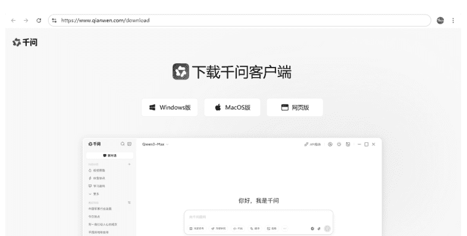
图 1-1 千问下载页面

Web端无需安装，通过Chrome、Edge、Firefox、360安全浏览器等主流浏览器访问 https://www.qianwen.com 即可使用，适合长时间文本创作与复杂指令交互。注册方式为手机号验证码或支付宝/淘宝扫码一键登录。

移动端分为iOS与Android，适配手机平板，支持语音输入与拍照交互，便于碎片化使用。iOS版在App Store搜索“千问”下载；Android版可在华为应用市场、小米商店、应用宝等搜索“千问”下载，如图1-2所示。登录方式与Web端一致，登录后可在“我的”中授权淘宝、飞猪、支付宝AI付等权限，实现端内支付与数据查询。

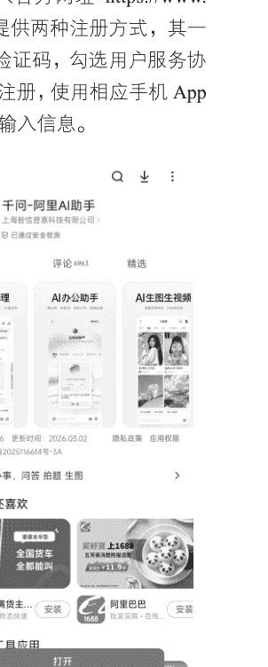
桌面端有Windows与Mac版本，针对办公优化，可无缝交互本地文件并搭载专业效率工具，均通过官网下载。Windows版为exe安装包，支持自定义路径与桌面快捷方式，提供深色模式与划词唤起小窗。Mac版将应用图标拖入“应用程序”文件夹即可完成安装，同样支持深色模式与划词功能。注册登录与其它端一致，支持本地文件拖拽上传与格式转换。

### 1.2.2 千问功能界面
千问界面遵循简约标准化原则，各端操作逻辑与入口命名基本一致。

以Web端 https://www.qianwen.com 为例，整体分为左侧对话管理区、顶部功能栏、中间指令交互区三大模块，如图1-3所示。

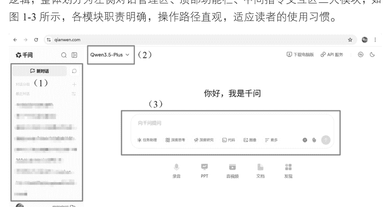
（1）左侧对话管理区包含“新对话”按钮、“对话分组”入口、“最近对话”列表与“我的空间”入口。“新对话”开启新会话；“对话分组”便于分类整理历史记录；“最近对话”按时间展示；“我的空间”管理收藏、创作内容与偏好设置。该区实现完整的对话管理。

# 第 1 章 千问时代已来

（2）顶部功能栏左侧显示当前模型版本，可切换；右侧依次为“下载电脑版”“API服务”等。“下载电脑版”跳转至安装包页，“API服务”面向开发者提供调用入口。

（3）中间指令交互区为主要交互载体，中央为指令输入框，底部提供“任务助理”“深度思考”“深度研究”等快捷入口。右侧有联网搜索开关与上传文档图标，联网搜索可手动、自动或关闭。下方另有录音、PPT、音视频等按钮，覆盖语音、文档与创作需求。

基础功能简述如下：

（1）深度思考基于Qwen3.5-Plus等高性能模型，采用分层拆解与自我修正，对逻辑分析类问题给出结构化解答，适用于方案推导、课题研究等场景，启用后持续生效。

（2）联网搜索可手动触发或按规则自动触发，获取最新资讯与实时数据，降低幻觉，回复中会标注来源。

（3）上传文档支持Word、Excel、PDF、TXT等文档及JPG、PNG、BMP等图片，上传后可提取、总结、翻译、转换格式，或对图片进行文字识别与分析，仅作用于当前对话。

表 1-2 千问基础功能要点汇总

| 功能名称 | 核心特性 | 适用场景 |
| :--- | :--- | :--- |
| 深度思考 | 多层级推理，结构化解答，自我修正偏差 | 方案推导、课题研究、复杂问题拆解 |
| 联网搜索 | 手动/自动切换，标注信息来源，降低回复幻觉 | 热点资讯查询、行业趋势分析、实时数据获取 |
| 上传文档（图片、截图） | 多格式兼容，文档/图像差异化处理，作用于当前对话 | 文档分析、作业答疑、文字识别、图像分析 |

### 1.2.3 千问生成演讲文稿
前面介绍了安装注册与界面布局，本节以“演讲文稿”为例说明交互与提示词用法。

演讲稿强调口语化表达、情感与清晰结构，常用于主题分享、致辞、宣讲等。本次以“人工智能时代如何提升个人竞争力”为题，面向职场人士，时长约6分钟，对应1000～1200字，语言正式且具感染力，结构包含开场、引入、核心观点、总结呼吁，句子简洁、避免术语与空话。

千问依托大模型可快速生成初稿，后续微调即可适配实际需求。操作前完成注册登录，Web、移动、桌面均可，本节以Web端演示。若涉及实时数据可开启联网搜索。

输入区提示词示例如下：


图 1-4 千问生成演讲文稿

示例提示词为：

> 作为一名培训讲师，需面向职场人士开展一场6分钟的主题演讲，演讲主题为“AI时代如何提升个人竞争力”，演讲场景为线下分享会，撰写一篇完整的演讲文稿，内容需围绕AI时代个人竞争力的核心要素、提升竞争力的具体方法展开，字数控制在1000～1200字，语言正式严谨且兼具感染力，适合口头演讲，结构包含开场问候、主题引入、核心观点阐述、结尾总结与呼吁，句子简洁，避免过长句式与复杂专业术语，核心观点具体，避免空泛表述。

系统按要求输出完整稿，语言贴合演讲场景，观点清晰。生成的文稿示意先以问候开场，随后抛出时代命题，提出“会用工具的人会取代不会用的人”的核心判断，并围绕从执行者转向指挥官、强化提问与批判思维等路径展开论述，形成条理清晰、口语化的演讲文本。

智能体好比堆满资料的仓库，库存丰富却缺少开门的方向感，而真正起到开门作用的是提问技巧。在生成式智能普及的今天，培养提炼高质量问题的能力，其分量已不亚于甚至超越直接求解。指令若模糊，得到的反馈也必然平庸；唯有在提问时做到明确、深挖并带入洞察，模型才可能迸发出超出预期的创造力。另一方面，模型也会出错，有时还会一本正经地胡编乱造。所以必须保持清醒的判断力，不轻信不盲从，用人的推理去核验机器的输出。对大方向的把控，是代码无法替代的壁垒。

第三，回归人性原点，夯实共情力与创造力。

不管技术怎么演进，有两点始终是模型难以企及的：一是真正理解他人情绪并产生共鸣，二是从无到有的原创突破。系统能模拟交流，却无法读懂客户眼神中的不安；能重组已有元素，却很难产出直击灵魂的艺术作品。职场中那些需要深度沟通、情感联结、跨团队协作的场景，以及需要跳出框架、颠覆认知的创新瞬间，正是我们价值释放的空间。要善待自己的感性，呵护探索欲，这在冰冷的代码世界里是最温暖的防御。

同事们，时代浪潮挡不住，我们虽无法决定流向，却能掌握舵盘。人工智能不是竞争对手，而是手中锋利的工具。

抛开恐惧拥抱变革，放下惯性主动成长。从此刻起，把智能体当作合作伙伴一起重塑工作方式；多追问几个为什么，挖掘更深层的价值；多与人建立连接，传递只有人类才能给予的温度。

未来已然到来，变化才是唯一恒定。愿大家都能在智能时代找到属于自己的定位，以智慧做帆、以人性做舵，驶向更开阔的职业海洋！

谢谢！

基于千问完成的演讲稿在主题契合度上基本达标，读者完全可以根据实际场合和个人风格做少量微调，不必大动。微调可集中在三个方向：

- 1）增补具体案例与细节，原稿多偏通用表述，加入自身或身边真实事例能增强可信度与说服力，比如展示某个行业从业者如何借助智能工具提升专业水平。
- 2）根据时长调整详略，视演讲时间删减冗余或补充要点，若控制在6分钟以内，可精简案例与重复内容，保留核心思想。
- 3）优化表达方式，稿件整体已贴近口头表达，可结合个人风格微调语气，适当增加感染力，同时避免过于书面，贴合个人习惯。

完成后可点击下方复制按钮，将文本导入 Word、WPS 等编辑工具进行排版，便于现场使用。

### 1.2.4 千问生成节日海报

上一篇以演讲稿演示了文字类创作流程，这一节聚焦视觉类创作，演示千问生成节日海报的完整步骤，帮助读者掌握文生图功能的基本使用。第 5 章将系统介绍文生图提示词公式与海报设计的要点。

节日海报是日常工作生活里常见的视觉宣传手段，常用于传递节日祝福、推广活动、营造氛围等，既可用于亲友分享，也可用于企业宣传。借助千问，无专业设计背景也能迅速生成。千问依托多模态大模型的图像生成能力，并集成海报模板与素材库，能按用户需求产出符合节日氛围、适配使用场景的海报，无需人工排版，只需输入规范的提示词即可获得完整成稿，后续还能按需微调，大大降低设计门槛与耗时。

本节以上中秋海报为例进行实操。明确需求：用途是节日宣传，可用于线下张贴或线上社交推广，受众为普通大众与职场人士；节日为中秋，风格为现代中国风插画；竖版构图，核心元素包括圆月、月饼、灯笼、桂花树和玉兔，营造温馨团圆感，画面下方需预留书法文字“月圆人圆事事圆”。

以 Web 端为例演示。登录后进入千问指令交互区，找到图像功能按钮，点击进入文生图模式，该界面是千问生成海报与图片的专属操作区。如图 1-5 所示，编写提示词后输入至文生图界面的指令框，选择图片比例 3:4，点击发送按钮，千问即开始生成中秋节日海报。

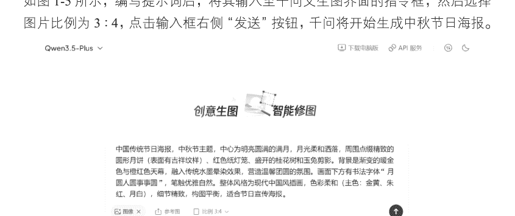

图 1-5 千问生成节日海报

本次使用的提示词示例为：

> 中式传统节日海报，以中秋为主题，画面中央是一轮明亮饱满的满月，柔和月光洒落四周，点缀精致圆形月饼（表面刻吉祥纹样）、红色纸灯笼、盛放的桂花树与玉兔剪影。背景采用暖金与橙红渐变天幕，融入传统水墨晕染，营造温馨团圆气氛。下方以书法字体呈现“月圆人圆事事圆”，笔触自然优雅。整体为现代中国风插画，色彩柔和（主色金黄、朱红、月白），细节精致、构图均衡，适合节日宣传使用。

千问产出的中秋海报基本覆盖了提示词要求的元素与风格，如图 1-6 所示。画面中央满月洒落月光，周围分布着带吉祥纹样的月饼、红灯笼、桂花树和玉兔剪影，布局协调。暖金橙红渐变背景融入水墨晕染，烘托温馨团圆氛围。下方“月圆人圆事事圆”书法笔触优雅，契合现代中国风。整体以金黄、朱红、月白为主色，细节精细、构图平衡，适合节日宣传推广。

好的，正在为你生成图片。本次生成使用Qwen-Image模型。


图 1-6 节日海报生成效果

生成后的预览图可放大查看细节，若出现元素缺失、风格偏离、文字错误或尺寸不合适，可通过补充提示词让千问进行修正，无需重新生成整张海报。例如，发现月饼纹样不够清晰，可补充“清晰展现月饼表面的吉祥纹样，提升细节精致度，保持风格统一”；若书法字体不够突出，可补充“放大书法‘月圆人圆事事圆’的字号，提升视觉存在感，同时保持笔触自然”。

调整完成后，可点击预览图下方的保存按钮将海报导出到本地，Web端保存到电脑，移动端保存到手机相册，桌面端保存到指定文件夹。职场人士若需用于公司节日宣传，可补充提示词加入公司 LOGO、宣传口号等元素，千问会快速调整内容以满足企业宣传需要。

# 第 2 章 提示词技巧与方法

第 1 章介绍了千问的定义、特点及基础操作，帮助读者掌握入门方法。本章聚焦基本使用技巧——提示词编写，帮助读者从“会用”升级为“用好”。提示词是用户与千问沟通的主要载体，质量直接决定输出效果。千问依托底层大模型能精准解读需求，但这种能力发挥主要依赖用户提供的提示词。

## 2.1 提示词是与千问沟通的语言

### 2.1.1 提示词基本公式

与千问类 AI 应用高效沟通的关键，在于发送清晰准确的指令，即提示词。提示词质量直接决定输出好坏。为帮助使用者快速掌握高质量提示词编写方法，本书将其结构化为基本公式（见图 2-1）。


图 2-1 提示词基本公式

基本公式概括了一次有效沟通所需的四个要素：角色设定、背景信息、任务目标、输出要求。这四个要素并非每次都必须完整出现，但包含它们的提示词，通常能获得更精准更有价值的结果。下面逐一解析含义与作用。

#### 1. 角色设定：明确千问的响应身份

角色设定是提示词的基础，用于明确千问在当前任务中的身份，使其能以对应身份的专业视角响应需求。大模型涵盖多领域知识，但在不同场景下需不同口吻与思路，角色设定帮助其快速定位，避免内容宽泛或偏离专业方向。

角色设定的本质是具体、贴合任务场景，避免模糊表述。例如只说“你是一个专家”过于笼统，而“你是拥有十年职场行政经验的行政专员，擅长撰写各类办公文书”则能让其明确定位，输出符合行政工作规范的内容。

结合实际应用场景，常见角色可分为三类：办公类（如行政专员、人力资源总监、文案编辑、数据分析员等）、专业类（如语文教师、编程导师、法律助理等）、生活类（如育儿顾问、旅游规划师、美食推荐官等）。以下为不同角色设定的案例，方便学习仿写。

> 案例 1：办公类角色设定——人力资源总监。提示词片段：“你是一家顶尖科技公司的人力资源总监，熟悉人工智能领域的人才招聘需求，擅长撰写具有吸引力的招聘启事。”千问接收后会以总监专业视角，结合科技公司特点撰写符合岗位需求、能吸引目标人才的招聘内容，语言兼顾专业度与感染力，符合职场文书规范。

> 案例 2：专业类角色设定——资深语文教师。提示词片段：“你是一位拥有十年以上教学经验的小学资深语文老师，专注于中国古典诗词教学，擅长将复杂诗词知识转化为易懂内容，能够生成结构清晰的古诗词学习卡片。”千问会依据该角色生成包含原文、注释、翻译、意境分析等内容的学习卡片，满足教学需求。

> 案例 3：生活类角色设定——旅游规划师。提示词片段：“你是一名专业的旅游规划师，熟悉国内热门旅游城市的景点、交通和住宿，擅长根据用户预算和出行人数制定合理的短途旅行计划。”千问在该设定下会结合后续背景信息给出满足需求的旅行建议，包括路线、住宿推荐、交通方式等，符合大众出行规划需求。

角色设定需与任务目标高度匹配。若任务是撰写职场述职报告却设定“美食博主”，则会导致响应严重偏离预期。

#### 2. 背景信息：提供任务的前提条件

背景信息为提示词提供关键支撑，用于向千问提供完成任务所需的前提条件与相关场景。千问无法主动获取用户未说明的私人信息或场景细节，完整性直接决定响应精准度。缺乏背景信息的提示词，只能得到通用化回应，难以满足具体需求。

内容需根据任务目标灵活调整，要求全面、具体、有针对性。办公场景通常包括行业属性、公司规模、截止时间、具体需求等；生活场景通常包括个人需求、预算、时间、人数等；创作场景通常包括创作主题、风格要求、基本元素等。

以下为不同场景背景信息的案例，可直接参考。

> 案例 1：办公场景——撰写工作报告。背景信息：“某互联网公司行政专员，本周主要负责 3 场内部会议安排、公司文件归档整理，以及 10 名新员工入职接待，其中 2 场会议因参会人员临时调整推迟至下周，新员工入职接待已全部完成。”千问接收后会结合“行政专员”角色撰写包含工作内容、完成情况、未完成事项及下周计划的日报，内容符合行政实际。

> 案例 2：生活场景——景点推荐。背景信息：“计划周末 2 天 1 晚，独自带 5 岁孩子从北京出发去杭州游玩，孩子喜欢历史和自然景观，预算 5000 元以内，住宿需靠近景点、交通便捷，避开人流密集热门景点。”该信息明确了时间、随行人员、预算、住宿要求与偏好，千问会据此推荐适合亲子游的景点并搭配性价比高的住宿与便捷交通路线。

> 案例 3：创作场景——单词记忆卡片设计。背景信息：“针对小学 6 年级学生，需以英文单词‘elephant’的记忆卡片为辅助学习资料，学生基础较弱，需结合词根拆解、记忆故事等方式帮助理解。”千问会结合该信息生成符合小学生认知水平的记忆卡片，拆解词根、设计记忆故事。

完整背景信息可有效减少反复沟通，提升使用效率。提供时需避免冗余，避免添加与任务目标无关的内容，确保信息精准简洁。

#### 3. 任务目标：明确用户的主要需求

任务目标是提示词的关键部分，用于明确用户希望千问完成的具体任务，是响应的主要导向。需具体可执行，避免模糊抽象，否则会导致判断失准、输出偏离预期。

很多用户使用时提示词模糊，如“帮我写一篇文案”“帮我做一个计划”，缺乏明确目标，只能得到通用化内容。而明确的目标需包含“做什么、达到什么效果”，让千问清晰知晓诉求。

以下为明确任务目标的案例示例。

> 案例 1：办公场景——文案撰写。明确任务目标：“撰写一篇千问办公功能的推广文案，突出多平台支持与高效办公特点，面向职场人士。”目标清晰界定写什么、面向谁、突出什么，千问可精准输出。

案例 2：生活场景——差旅安排。明确任务目标：“安排一次北京到上海 3 月 10 日至 12 日的差旅，主要目的为参加 3 月 11 日全天在上海陆家嘴举办的行业峰会，需预订往返高铁二等座、靠近陆家嘴的酒店，并包含 9 点至 18 点的每日行程规划，兼顾参会便利性与合理节奏。”目标清晰界定时间、地点、目的与主要任务。

案例 3：创作场景——编程教学。明确任务目标：“向 10 岁儿童讲解编程中‘循环’概念，用搭积木比喻，结合生活实例，设计一个简单的互动小游戏。”目标清晰界定讲解对象、概念与方式，千问可精准贴合输出。

明确的任务目标是精准响应的关键，应明确动作、具体要求、预期效果，并与角色设定、背景信息相匹配，形成完整需求逻辑。

#### 4. 输出要求：明确千问的响应格式

输出要求是提示词收尾，用于明确响应内容的格式、字数、风格、语言等细节，确保输出符合使用需求，无需额外修改。设定需具体细致，根据任务目标灵活调整，主要作用是规范输出形式，提升实用性。

不同场景侧重点不同。办公场景通常包括文档格式、字数限制、语言风格等；生活场景通常包括内容结构、呈现形式等；创作场景通常包括风格、格式等。

以下为不同场景输出要求的案例。

> 案例 1：办公场景——撰写述职报告。输出要求：“报告结构分‘工作成果、存在不足、下月计划’三部分，字数约 3000 字，语言正式条理清晰，避免口语化，用数据支撑成果，无需额外装饰内容。”

案例 2：生活场景——美食推荐。输出要求：“用表格呈现，包含店铺名称、特色菜品、价格、营业时间四项，语言简洁重点突出，推荐店铺需支持电话预订。”

案例 3：创作场景——古诗词学习卡片。输出要求：“卡片风格中国风，文字工整适当留白，注释简洁易懂，意境描述生动形象，背诵技巧简单好记，输出为 HTML 页面格式，便于打印使用。”

输出要求需结合任务目标实际用途设定。用于汇报的文档应强调正式、条理；用于个人参考的清单可强调简洁直观。同时需避免过于苛刻，给模型一定灵活空间，确保响应既符合要求又具实用性。

#### 5. 公式的完整应用与优劣对比

为更直观展示基本公式作用，以下通过职场常见场景对比。第一组为未使用公式的简单提问，第二组为按“角色设定+背景信息+任务目标+输出要求”公式编写的完整提示词。

##### 案例 1：撰写邮件

简单提问：帮我写一封催款邮件。

使用公式的提示词：

- 角色设定：你是一家小型设计公司的项目负责人。
- 背景信息：客户“××科技”欠付项目尾款 5 万元，原定付款日期已过一周。项目已交付，合作愉快，客户此前付款及时。你与对方财务和项目对接人沟通顺畅。
- 任务目标：撰写催款邮件，提醒对方付款，同时保持友好的合作关系。
- 输出要求：语气礼貌但立场明确，说明逾期情况，附上收款账户信息，并表达希望未来继续合作的意愿。邮件主题要清晰。

##### 案例 2：准备会议议程

简单提问：帮我写一个项目启动会的议程。

使用公式的提示词：

- 角色设定：你是一名经验丰富的项目经理。
- 背景信息：公司即将启动名为“新官网改版”的项目。参与部门有市场部、技术部、设计部。项目周期预计 3 个月。启动会参与者包括三个部门负责人和执行人员，共约 10 人。会议时长 2 小时。
- 任务目标：制定一份项目启动会的详细议程。
- 输出要求：议程以表格呈现，包括时间、环节名称、主要内容、负责人、预计时长。会议目标应包括明确项目范围、确定关键时间节点、分配各部门职责。

##### 案例 3：数据分析与解读

简单提问：分析一下这份销售数据（假设用户上传 Excel 文件）。

使用公式的提示词：

- 角色设定：你是一名资深的数据分析师。
- 背景信息：上传的 Excel 文件是某连锁书店今年第一季度销售数据，包含各门店、各图书品类（如文学、经管、少儿）的每日销售额。公司希望了解第一季度销售趋势并对比同期数据。
- 任务目标：找出第一季度销售额排名前三的图书品类，并分析其销售趋势（稳定增长、季节性波动或持续下滑）。
- 输出要求：用简洁文字总结分析结果，并以列表形式呈现各品类关键数据，可生成图表说明趋势。

对比可看出，使用基本公式编写的提示词，产出结果的目标性、实用性与精确度显著高于简单提问。它不再是泛泛答案，而是针对特定场景、满足特定需求的定制化解决方案。

掌握基本公式，等于掌握与千问有效沟通的底层逻辑。它帮助使用者从“问问题”思维转变为“布置任务”思维。每一次交互都如同向一位知识渊博、能力全面的助手清晰布置工作。后续章节将以此公式为基础，详细介绍其在不同场景下的具体应用技巧。

### 2.1.2 提示词的编写原则

除基本公式外，面对复杂任务还需掌握编写原则。提示词编写的关键逻辑本质是通过科学设计激活大模型的解读与生成能力，让其精准匹配需求，而非单纯依赖“清晰具体”的表层要求。

让千问更精准的指令写法

和随口聊天不一样，要让千问稳定输出高质量内容，指令得建立在大模型的上下文学习和推理机制之上，同时兼顾任务难度和千问的使用场景。这样才能做到精准引导、少返工。千问可以覆盖办公、生活、创作等多个场景，它的理解效果取决于指令的专业程度，写得够细才能把潜能释放出来。

#### 1. 迭代精进原则
把写指令当成一次小实验效果最好。走“初稿指令→看结果→按偏差修正→再生成”的闭环，细节会越来越完整，答案会越来越接近预期。实践里复杂需求一次讲不清，模型容易出现思路跳跃或信息残缺。这时根据偏差补关键信息、换种引导方式、修补表述漏洞，质量就能逐步拉升。

以请千问做某款办公产品推广策划为例，演进大概是这样：
> 初稿：写一份办公产品推广策划，给职场人群看。
> 一轮优化：写一份办公产品推广策划，给职场人群看，要求有背景、目标、渠道、节奏和评估，突出多平台能力。
> 二轮优化：在前述基础上，每个渠道都要说明具体内容和发布时间，公众号每周两篇，社群每天一条卖点。

……反复打磨后才拿到可用的方案。千问的会话记忆会保留每次指令和结果，为循环优化提供便利。

#### 2. 背景补全原则
指令里要补足足够的背景、场景细节和参考样例，让模型一次拿到做事所需的全部素材，避免因信息不足产生偏差。研究显示大模型本质是找规律的系统，理解依赖充足的背景，信息不够只能给出泛化答案。千问底层的学习能力很强，越丰富的背景越能激活场景适配，输出越有针对性。

请千问分析财报，两种写法差异明显：
> 信息不足：分析下公司Q2财报。
> 信息充分：公司Q2营收1.2亿，同比增8%，成本同比增12%，主要因原材料涨价，请结合数据和已上传材料，分析盈利变化，重点说成本上涨对营收的影响。

#### 3. 结构化表达原则
指令最好有清晰框架，把任务、背景、素材、输出要求拆开，用分隔符和明确标记来降低理解成本。清晰的结构是提效的关键，就像盖房子要搭脚手架，模块化的指令能让千问快速抓住重点。对复杂任务尤其有效。

请千问生成会议纪要，模块化写法可这样安排：
> **目标：** 生成会议纪要。
> **背景：** 2026年某月某日，公司月度部门例会，参会为部门全体，主题是上月总结和本月安排。
> **要求：** 含基本信息、发言要点、已确定的任务及截止时间，语言简洁条理清晰，避免口语。
> **资料：** 已上传速记稿。

分块呈现后，模型能快速区分指令和素材，输出更准。若把指令和背景混在一起，容易聚焦无关细节导致核心缺失。结构化还能结合角色设定进一步提升准确度。

#### 4. 程序化指引原则
指令里要明确任务步骤、操作流程或推理逻辑，引导千问按既定顺序执行，避免输出碎片化、逻辑混乱。复杂任务的关键是给程序性知识，也就是“怎么做”的步骤指引。缺少流程引导，多步骤任务容易杂乱缺项，明确步骤就能让模型逐层拆解、逐步执行。

请千问写一份AI应用零基础上手教程，程序化提示可写成：
- 先介绍注册与安装，含网页端和移动端；
- 再讲解功能界面的核心模块；
- 然后举例演示生成演讲稿的操作流程；
- 最后总结使用注意事项。

有清晰步骤，输出结构完整。数据分析也可以提示：“先限定数据范围，再算关键指标，最后分析趋势并给出结论。”模型就能按流程给出完整结果。

四项做法相互配合构成专业体系。迭代精进解决偏差问题，背景补全解决信息缺失，结构化表达解决理解混乱，程序化指引解决执行失序。

### 2.2 常用指令框架
在基础公式之上，实践中还有几套成熟框架，各有侧重，能进一步提升精准度。以下介绍CRISPE、BROKE、CO-STAR和ICIO四种广泛使用的结构化思路。

### 2.2.1 CRISPE 框架
CRISPE由角色能力、洞察、任务陈述、个性、实验五部分组成，结构化程度高，适合需要特定角色、明确风格和格式的场景，如文案、报告、职场文书。

角色能力是基础，明确千问在本次任务中扮演的身份和专业水平。洞察是支撑，要补足任务背景、前因后果，让模型理解场景。任务陈述要直接清晰说明要做什么。个性用于设定语气、风格和格式。实验是优化补充，引导模型提供多角度版本或示例。

以生成述职报告为例：
> 角色能力：你是拥有5年述职经验的人力资源顾问，熟悉写作逻辑，擅长突出成果、分析问题并给出可落地改进，语言正式严谨。
> 洞察：某互联网公司运营岗，任职1年，本次目的是总结年度成果、分析问题、规划下一年重点，本年核心为用户增长、活动策划、内容运营，用户新增5万，完成活动12场，阅读量累计100万，未达6万目标，存在转化率偏低、内容匹配不足问题。
> 任务陈述：撰写年度述职报告，含基本信息、本年成果、问题、原因分析、下年规划五部分。
> 个性：正式严谨，语言简洁，突出数据，问题分析客观，改进具体可落地，避免空话，约2000字，分段清晰。
> 实验：先给出各部分核心框架，再写全文，提供两个侧重点不同的规划版本，一个偏用户增长，一个偏活动优化。

### 2.2.2 BROKE 框架
BROKE强调背景、角色、目标、关键结果、演进五要素，目标导向强，适用于商业场景和执行类任务。

背景提供场景、目的、数据、限制；角色明确身份和能力；目标要具体明确；关键结果是衡量指标；演进引导模型通过试验和调整优化输出。

以智能手环推广策划为例：
> 背景：新品智能手环，主打健康监测、7天续航、轻薄便携，目标用户25-45岁职场人群，重视健康管理且要求便携。预算15万，周期1个月，需提升知名度和销量并收集线索。
> 角色：你是3年推广经验的营销顾问，熟悉智能硬件渠道，擅长制定落地策略、合理分配预算、结合用户特点设计内容。
> 目标：1个月内知名度提升50%，销量破1000台，获取有效线索200条以上。
> 关键结果：公众号推文阅读5万次、转发500次、点赞2000次；覆盖50个职场社群、触达2万人、转化率不低于3%；电商搜索量提升80%、转化率提升15%、好评率不低于90%；线索200条以上、转化率不低于10%；预算分配清晰无浪费。

### 2.2.3 CO-STAR 框架
CO-STAR由背景、目标、风格、语气、受众、响应六要素组成，注重全面性和结构性。

以部门月度工作总结为例：
> 背景：某互联网公司运营部，本月工作为用户运营、活动执行、数据复盘，完成新增8000人、活动2场，未达月度新增1万目标，需撰写总结用于内部汇报。
> 目标：撰写月度工作总结，含成果、问题、原因分析、下月计划四部分，内容详实数据准确。
> 风格：正式严谨，语言简洁，分章节层次清晰。
> 语气：客观务实，不夸大不回避，分析实事求是，改进措施可行。
> 受众：部门同事及上级领导，均具备办公和行业认知。
> 响应：完整覆盖四部分，数据准确，问题分析有针对性，计划可落地，可直接汇报。

### 2.2.4 ICIO 框架
ICIO由指令、背景信息、输入数据、输出指示四部分组成，结构简洁，注重任务明确性和输出规范性。

指令要简洁清晰说明做什么怎么做；背景信息提供上下文；输入数据指提供给模型处理的文本、表格、代码、图片等，需完整准确；输出指示明确格式和要求。适用于数据处理、内容创作、技术任务和教学等场景。

# 第3章 以千问加速办公

## 结果指引的收尾作用
在提示构建中，最后一步是结果指引，主要用来锁定交付形态，引导模型按既定规格组织内容，提升实用性与规范性。指引需要落实到文件形态、长度、结构、存档方式等具体层面，确保产出可直接使用，无需二次调整。

## ICIO在客户数据清理上的落地
以办公场景中公司客户注册信息清理为例展示完整用法。

任务描述：对给定的公司客户注册记录执行清理，剔除重复、缺失、异常条目，统一字段格式，确保信息准确完整，为后续画像奠基。

情境说明：数据为2026年度公司全部注册记录，共6个字段：姓名、手机号、邮箱、注册时间、所在城市、注册渠道。重复指手机号或邮箱重复，缺失指任一字段为空，异常指手机号格式错误、邮箱缺少@等格式错误、注册时间超出2026年范围。清理后用于客户画像，需保证准确与完整。

原始素材：客户注册数据表，字段同上，具体内容略。

交付指引：第一，输出清理后结果保存为Excel，保留所有有效字段与记录；第二，标注处理结果，列出删除的重复条数、缺失条数、异常条数，并说明每条剔除原因；第三，提供清理说明，写清规则、处理方式与注意事项；第四，整体简洁清晰，数据准确，便于直接用于画像。

按此提示运行，模型可精准完成清理并给出数据表与说明文档。该案例体现ICIO的简洁与指向性，通过明确任务、补充情境、提供素材、设定交付，让模型清晰把握需求高效处理。ICIO同样适用于文本翻译、格式转换、代码编写、作业批改等需要明确输入输出的任务。其优势在于结构清晰、上手门槛低，职场人士与普通用户无需复杂提示经验，按四要素梳理即可获得高质量结果。

## 四大框架的侧重对比
CRISPE、BROKE、CO-STAR、ICIO各有侧重。CRISPE重角色与风格，适合需要模型扮演特定人设的场景；BROKE重目标与可衡量性，适合商业执行类任务；CO-STAR重全面性与细节，适合复杂任务；ICIO重任务明确性与输出格式，适合数据处理、技术类任务。读者可结合实际需求灵活选用，充分发挥模型在办公、生活、创作等多场景的价值。

# 第3章 千问助力高效办公

在节奏快速的职场，撰写、优化材料、制作演示等事务常占用大量精力，效率瓶颈普遍存在。千问依托大模型能力，为办公场景提供全流程辅助，覆盖写作、文本优化、演示制作、内容处理等，帮助用户摆脱重复劳动，提升效率。本章拆解千问在办公中的核心功能与使用方法。

## 3.1 文本创作

### 3.1.1 智能创作模块

在数字化办公中，文本产出是最常见的需求。从邮件、纪要到方案、述职报告，再到自媒体文案、读书笔记，输出质量直接影响效率和专业度。传统写作易出现灵感不足、逻辑混乱、耗时长等问题，千问的智能创作功能通过语义理解与生成能力，从灵感捕捉到成品交付提供支持。

访问路径位于主界面指令输入框下方功能栏，点击“更多”后下拉菜单中选择“AI创作”即可进入创作界面。

进入后呈现结构化控制台，主要分为文本类型、表达调性、篇幅控制三大区，每个区域提供预设选项并支持自定义。

1. 文本类型：覆盖全场景的模板
预设分类包含通用、祝福语、论文、作文、文案、小说、小红书文案、朋友圈文案、发言稿、策划方案、教案、开题报告、读后感、申请书、大纲、自我介绍、实习报告、工作计划、职业规划、诗句、锐评、述职报告、日报月报、高情商回复、商业计划书、调查问卷等。各类型内置对应结构、步骤和语言范式，选择后可快速启动。

2. 表达调性：把控内容风格
提供风格不限、简洁、严肃、文艺、口语、幽默等选项，不同选择会影响输出逻辑。简洁表达凝练突出要点，适合快速沟通和要点总结；严肃采用规范书面语注重逻辑，适合报告论文；文艺细腻抒情营造意境，适合文学创作；口语日常化贴近生活，适合社交分享和脚本；幽默融入趣味增强感染力，适合娱乐内容；风格不限则由模型根据类型自动调整。

3. 篇幅控制：灵活调节长度
提供百字到万字的预设，也可手动输入或选择不限。需要精准控制时如推文、脚本可设定目标字数，模型会主动控长控短；如读书笔记、创意写作选择不限则更具延展性。不同类型对应不同默认字数。

4. 边写边改：在线编辑与智能优化协同
采用左侧指令区+右侧编辑器的双栏布局，实现生成与优化实时协同。左侧可查看和修改提示词，也可追加优化指令，如“结尾加一段对热爱的感悟”，模型会按语境补充。右侧编辑器具备专业排版能力：支持字体字号颜色加粗斜体下划线、段间距行间距调整；支持有序无序列表和多级标题；实时预览，调整即生效；可选中指定段落进行逐句逐段优化。底部提供重新生成、扩写缩写、智能润色等快捷键，润色可修正语法提升流畅度，扩写缩写可快速调整篇幅。

完成创作后支持一键复制到剪贴板，或导出为Word、PDF保留排版，便于后续使用。智能创作本质是重构创作流程，从零创作转为基于模型生成后优化。内置模板与范式保证专业性和规范性，避免个人经验不足导致瑕疵；遇到灵感枯竭时可提供框架和表达，帮助突破思维局限。

### 3.1.2 日报月报

日报月报是职场高频文书，用于向上汇报进展、同步状态、梳理思路。痛点有三：一是内容梳理难，易遗漏或写成流水账；二是格式逻辑难把握，不同岗位要求不同；三是耗时长，月末梳理常需数小时。

千问在智能创作中设有“日报月报”类型，支持企业员工、教师、医护、行政等职业匹配，各类型在内容侧重、语言风格、关键要素上均作专业优化。

操作分三步：打开千问进入智能创作，选择类型日报月报，选择职业类型，输入完整提示词生成，生成后可修改润色或直接导出。

1. 日报案例
对象为互联网运营岗。提示词结构为角色设定+背景信息+任务目标+输出要求。角色：互联网公司运营人员，负责公众号和抖音日常运营，对接运营主管。背景：围绕春季新品推广活动落地，完成公众号推文1篇阅读1280点赞86；抖音短视频2条播放5600和7800点赞210和356；完成昨日数据监测；处理公众号留言30条抖音评论45条回复71条回复率94.7%；对接设计确认明日2张海报1条脚本10点前交付；梳理2项问题并制定明日计划。任务目标：撰写运营岗日报，呈现完成情况、数据成果、问题及明日计划，符合规范突出重点。输出要求：约800字，正式书面语，分今日工作完成情况、数据监测分析、存在问题、明日工作计划四部分，数据可查问题具体计划可行，避免口语化。模型据此生成四部分日报，清晰呈现工作全貌，成果与问题兼顾，可直接提交微调后使用。

2. 月报案例
月报重全面系统总结，篇幅更长。选取销售岗，围绕业绩达成、客户管理、订单跟进展开。提示词如下：角色设定：某机械设备销售公司销售经理，负责区域工业企业机械设备销售，包括客户开发维护、订单跟进、产品推广、数据统计，对接销售经理，承担月度业绩指标。

## 灵感 ✨ 落地成文
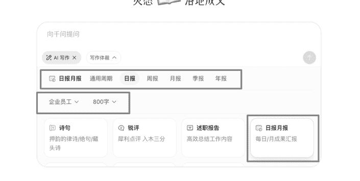

图 3-4 千问“日报月报”写作功能

装备销售月度复盘

一、本期业务总览
本期经营重心锁定于辖区制造业客户的机械设备需求，三笔核心业务构成推进主线，分别是 A 市大型装载设备商 8 万元、B 区装配线供应商 6 万元、C 县矿用设备商 4 万元，合计预计贡献 18 万元。期内累计完成市场接触 32 次，其中潜在客户走访 18 次、存量客户回访 14 次。另组织品牌推介 2 场，覆盖辖区 20 余家制造类企业。同期完成月度经营数据汇编、客户档案更新及执行中议题梳理，为后续决策提供依据。

二、指标完成度
本期销售指标设定 80 万元，实际完成 68 万元，完成比例 85%。新客拓展计划 5 家，实际新增 4 家；存量客户服务计划 15 家，实际触达 16 家；走访次数计划 30 次，实际执行 32 次；品牌推介计划不少于 1 场，实际举办 2 场。整体来看，市场接触频次与存量服务均超出计划，收入受订单签约节奏影响未达预期。

三、客群拓展与维护
走访覆盖潜在与存量对象，信息收集与需求分析同步进行。存量回访共汇总意见 8 条，其中售后响应时效 3 条、价格敏感 2 条、功能适配 3 条。潜在客户走访重点在于摸清采购标准与决策周期，品牌推介会实现初步触点。客户档案已及时录入系统，为持续跟进提供基础。

四、重点订单推进
密切跟踪的三笔核心业务仍处于推进通道。A 市大型装载设备商 8 万元、B 区装配线供应商 6 万元、C 县矿用设备商 4 万元，均因买方内部审批程序耗时增加与预算方案变动，签约时间后移，预计 18 万元贡献尚未确认。沟通保持高频，已协助对方协调内部环节，但进展仍受制于客户端。

五、问题归纳与优化方案
未达整体指标主要诱因有二。第一，三笔核心业务推进受阻，审批环节拉长与预算变更导致签约延迟。第二，辖区同类设备厂商展开价格竞争，致使 2 家潜在客户被竞品争取。客户意见亦反映售后响应速度、价格接受度及功能匹配度有提升空间。优化思路为：针对重点业务建立审批节点追踪表，提前介入客户内部流程；梳理竞品报价策略，形成差异化价值方案；优化售后响应机制，缩短处理时长；针对功能诉求开展产品培训与案例演示，提升价值感知。

六、下阶段工作规划
下阶段将围绕订单转化与客户深耕展开。优先推动三笔滞后业务进入最后签约环节，加大与决策人沟通密度。制定潜在客户清单，聚焦尚未被竞品占据的目标企业，强化推介会转化设计。售后响应流程实施专项优化，确保意见闭环。同步完善报价体系与功能讲解话术，提升成交效率，力争各项指标全面达成。

论文办公提效的智能新打法

| 论文形态 | 适用人群 | 核心侧重 |
| 课程论文 | 在校大学生 | 聚焦单门课程的学习产出，篇幅适中，突出知识点理解与迁移 |
| 职称论文 | 从业技术人员 | 可对应不同层级评审，支持技术报告、创新方案等分支样式 |
| 期刊论文 | 教师、研究者、技术骨干 | 遵循刊发规范，强调创新点与研究价值 |
| 专升本论文 | 升本阶段学员 | 符合专升本对字数与排版的要求，体现基础专业素养 |

在多种写作场景中，与职称晋升挂钩的文稿对规范性和专业深度要求最严格。评审时通常需要提交一份符合标准的技术报告作为能力证明，该材料要贴合岗位实际、具备一定专业厚度，同时满足评审细则，是晋升的关键附件。

下面以一份初级职称技术报告为例，说明如何借助结构化指令快速拿到初稿。

**身份设定：** 从事数据分析的初级岗位人员，具备基础的人工智能常识，需要为初级职称评审准备技术报告，并符合初级技术报告的撰写要求。

**背景描述：** 近年信息技术发展加速，互联网、物联网、云计算的普及使全球数据规模呈指数级扩张。面对复杂的数仓环境，传统分析手段效率偏低、精度不足。人工智能的加入为分析工作带来新可能，其中多智能体技术能够自动捕捉数据特征、挖掘潜在规律，明显提升效率与准确率。构建基于多智能体的数据分析平台已成当前研究热点。

**任务说明：** 撰写题为《基于AI多智能体的数据分析技术》的初级职称技术报告，结合多智能体的核心构成与应用流程，体现个人对该技术的理解与研究能力，满足初级职称评审要求。

**产出要求：** 结构完整、语言严谨专业、文风正式；篇幅8000～10000字，排版规范、段落清晰、无语法问题；贴合初级技术人员水平，不涉及艰深理论推导，重点展现技术理解与学习能力。

收到上述结构化指令后，系统并不会立刻输出全文，而是先生成一份完整的大纲。大纲会依据产出要求明确各章节要点、逻辑顺序与侧重点，并细化小标题与撰写提示。用户可根据自身情况调整结构与内容取向。

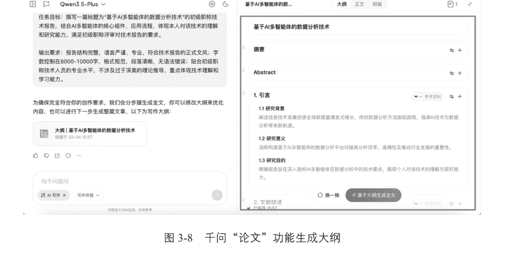

大纲确认后，点选“基于大纲生成全文”，系统会结合已确认的大纲与背景信息、目标、要求生成完整稿件。生成过程依托知识库与论文库保障专业度与准确性。

“论文”功能的一个亮点是引用机制，正文中会出现真实文献的角标，点击可查看出处，并在文末按标准格式列出全部参考文献，对使用者十分友好。

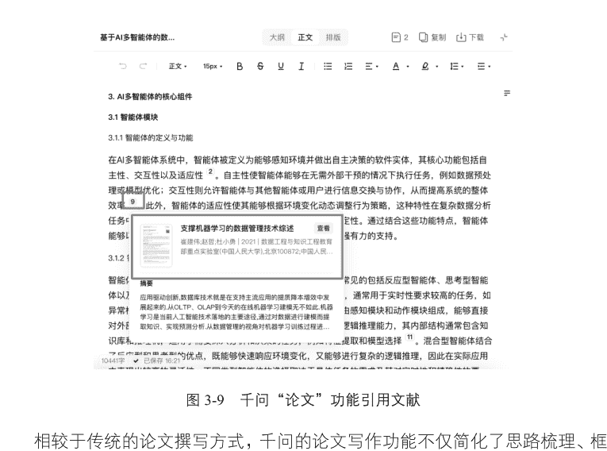

相较于传统写作方式，智能写作把思路梳理、框架搭建、排版规范化等环节大幅简化，帮助用户快速得到一份合格的草稿。

受篇幅限制，这里仅展示摘要部分：

### 基于AI多智能体的數據分析技术

**摘要：** 信息技术飞速发展，全球数据量呈指数增长，传统分析方法难以应对复杂环境，AI带来新的契机。多智能体作为AI重要分支，能自动提取数据特征并发现规律，大幅提升效率与准确性。其核心主要由智能体模块、通信机制和协作策略构成。应用流程涵盖数据预处理、模型构建、结果分析。但实际使用中仍面临数据隐私安全、智能体协作冲突等难题，可借助加密技术、访问控制及优化协作机制缓解。未来多智能体有望与更多新兴技术融合，拓展数据分析应用场景。

**关键词：** AI多智能体；數據分析；核心组件；应用流程；隐私保护

需要特别强调，论文创作必须由本人主导创新设计与关键环节，AI仅作辅助。生成的草稿主要用于参考与启发，不可直接套用。

## 3.2 文本优化

文字打磨是办公与学习中的高频琐事。职场中报告、通知、邮件、推广文案等都需要反复雕琢，既要纠错顺句，也要按场景调整语气与结构，否则会影响信息传递效率与工作成果。

为此，智能写作模块提供了专属快捷入口，无需复杂操作即可进入优化界面。在首页找到“AI写作”，进入后可按需选择优化类型。

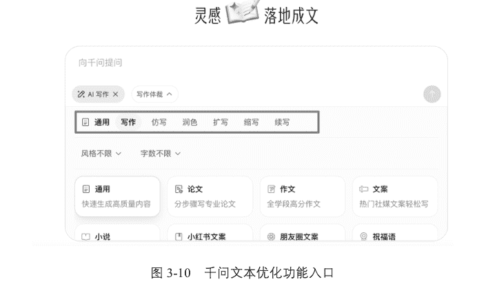

目前支持五类优化，分别为仿写、润色、扩写、缩写、续写，覆盖不同痛点。对应场景与作用如下表所示，便于快速匹配需求。

### 表 3-6 千问文本优化功能汇总

| 优化类型 | 适用场景 | 核心作用 |
| :--- | :--- | :--- |
| 仿写 | 需要模仿特定风格或句式，如优秀文案、正式公文、学术表达 | 提取目标风格的语言逻辑与特点，快速生成符合要求的文本，降低创作难度 |
| 润色 | 文本存在语病、表达不通顺、语气不当、用词不准 | 修正错误、优化结构，提升流畅度与专业性，适配使用场景 |
| 扩写 | 原文简略内容单薄，需补充细节，如通知、报告片段、演讲稿 | 在保留核心信息前提下补充细节与解释，使文本更完整、更有说服力 |
| 缩写 | 文本冗长冗余，需提炼要点，如会议纪要、论文摘要、工作报告 | 去除多余信息，保留核心要点，缩短篇幅且不失关键内容 |
| 续写 | 文本未完待续，需保持逻辑与风格，如活动方案、演讲稿、故事片段 | 基于原文思路与风格自然延展，确保衔接流畅无断层 |

下面分别以结构化指令形式给出各类型的实操案例。

### 3.2.1 仿写

适合需要快速掌握不同文案表达逻辑的场景，如市场推广或行政公文撰写。关键在于提取参考文本的风格与句式，再结合自身需求输出。

**身份设定：** 互联网公司市场推广人员，负责智能办公软件新品的微博文案撰写，需借鉴行业优秀文案风格。

**背景描述：** 新品核心功能为文档协同编辑、会议纪要自动生成、多平台同步，目标用户为职场人群，卖点为“高效、便捷、省时”，具备可供模仿的优秀参考文案。

**任务说明：** 模仿参考文案的风格与逻辑，结合产品功能与卖点，撰写适合微博发布的推广文案，突出卖点吸引目标用户。

**产出要求：** 风格句式与参考一致，包含三个核心功能，150～200字，语言简洁通俗、语气积极，契合微博调性。

### 3.2.2 润色

适用于已成稿但表达欠佳的文本，提升规范性与感染力。

**身份设定：** 企业员工，需提交一篇以冬奥精神为主题的心得体会，用于内部学习交流，已有初稿。

**背景描述：** 初稿围绕“更快、更高、更强——更团结”展开，结合工作经历谈感受与践行思路，约2000字。但在语句、衔接与情感表达上存在不足。公司要求文稿正式真挚、逻辑清晰，突出精神要义。

**任务说明：** 对初稿进行润色，修正表达不畅与逻辑问题，加深冬奥精神与工作的结合，增强感染力，达到提交标准。

**产出要求：** 语言规范得体、逻辑严谨、情感充沛，清晰呈现精神核心要义并结合实践提出践行方向，篇幅与初稿相当，核心信息完整，文风正式。

### 3.2.3 扩写

用于内容单薄的文本补充细节与说服力。

**身份设定：** 企业行政人员，负责拟写内部垃圾分类推行通知。

**背景描述：** 为响应环保政策，公司计划于202×年×月×日起在全办公区推行垃圾分类。初稿仅写“各位同事，公司将于×月×日起推行垃圾分类，请大家严格遵守相关规定，规范投放垃圾。”内容过于简略。

**任务说明：** 扩写通知，补充分类标准、投放点位、投放要求与注意事项，便于员工明确操作规范。

**产出要求：** 结构清晰段落分明，语言正式简洁，补充可回收物、其他垃圾、有害垃圾的具体品类、各楼层投放点及时间要求、违规说明等，衔接自然，约500字。

### 3.2.4 缩写

用于提炼长文本的核心要点。

**身份设定：** 高校本科生，已完成课程论文初稿。

**背景描述：** 论文约8000字，包含摘要、引言、AI办公应用场景、存在问题、优化建议、结论等部分，含文献引用与数据说明。需提炼成符合规范的摘要。

**任务说明：** 基于上传论文进行缩写，提炼核心要点，形成完整摘要，满足课程提交要求。

**产出要求：** 摘要简洁凝练，300字以内，包含研究目的、内容、主要结论与优化建议，逻辑清晰、语言正式，无冗余与口语化表达。

### 3.2.5 续写

用于延续原文逻辑与风格完成未竟内容。

**身份设定：** 企业市场部人员，负责撰写新品发布新闻稿，已完成开头，后续未完善。

**背景描述：** 科技企业于202×年×月×日发布全新智能办公一体机，主打“高效协同、智能便捷”。已完成开头已明确发布会主题与产品定位。

# 第 3 章 千问助力高效办公

**任务说明：** 基于已完成开头与发布会速记稿，续写新闻稿后续内容，重点突出，符合正式文风，满足对外宣传需求。

**产出要求：** 与开头衔接自然，贴合“智启办公新世代”主题，补充产品核心功能、发布意义、市场定位及研发规划等，语言正式严谨，结构清晰重点突出。

文本优化功能通过五类操作覆盖办公场景的各类需求，用户按“角色+背景+目标+要求”格式输入，即可快速获得符合预期的优化结果，大幅提升效率与质量。

## 3.3 PPT制作

PPT是汇报、展示、培训的必备工具，逻辑清晰、设计简洁的演示文稿能快速传递信息并体现专业素养。传统制作耗费大量时间在内容梳理与版式调整上，AI PPT功能降低门槛，快速生成符合职场需求的演示稿。

进入方式为首页下方的“PPT”快捷入口。界面包含“我的历史”“全部模板”“给我灵感”三大标签，支持按工作汇报、培训课件、毕业答辩、商业计划、产品演示等场景筛选，也可按颜色、风格搜索。

页面中部展示模板卡片，底部支持输入主题、大纲、长文本或上传文档生成PPT，并可设定页数、语言等参数。

### 表 3-7 千问PPT制作方式汇总

| 制作方式 | 适用场景 | 操作核心 | 优势 |
| :--- | :--- | :--- | :--- |
| 根据主题生成PPT | 主题明确但内容未梳理，适合快速制作小型培训或汇报 | 输入主题加详细提示词，自动梳理内容与框架 | 操作最简、耗时最短，无需提前准备 |
| 根据大纲生成PPT | 已有框架需精准把控，适合正式汇报或专题分享 | 输入完整大纲，自动填充内容与版式 | 内容可控、逻辑清晰、符合预期 |
| 根据文档生成PPT | 已有完整文档需转PPT，适合学术汇报或产品展示 | 上传文档，自动提取要点并转化为页面 | 节省提取时间，内容一致、重点突出 |

### 3.3.1 根据主题生成PPT

最便捷的方式，适用于主题明确但未展开内容的场景。用户输入清晰主题与提示词后，系统自动梳理核心内容、搭建框架并设计版式，特别适合紧急的培训或小型汇报。

以“新员工职场礼仪培训”为例：

**身份设定：** 具5年企业新员工培训经验的培训师，擅长职场礼仪课程设计。

**背景描述：** 某互联网公司50名应届生入职，缺乏职场礼仪经验，需开展1小时培训，帮助其快速掌握礼仪要点，树立职业形象。

**任务说明：** 基于主题生成完整培训PPT，梳理核心内容、搭建讲解框架，匹配培训场景。

**产出要求：** 逻辑清晰，结合简单职场案例，避免过度理论化。

发送后系统先输出大纲供确认，确认无误后再进入下一步生成，确保内容可控。

# 第 3 章 千问助力高效办公

在正式排版前，系统会先打开模版挑选页。图 3-14 所示的界面按应用场景把方案归类，右侧的卡片被点中后左侧即时预览该方案的版式与配色，确认无误后再点生成按钮即可进入制作流程。生成期间进度会实时回显，全部完成后进入成品页。此时的在线编辑能力覆盖以下点：

- 网页端可对单页文字与版式做增删改；
- 整套演示模版可随时更换；
- 支持在线全屏播放；
- 可导出为 PPT、PDF、图片等多种格式。

### 3.3.2 根据大纲生成 PPT

这种路径适合提纲和要点已经理清，只需快速填充内容与排版的情况。先自行拟定清晰的页级提纲，明确每页标题与要点，提交后系统会依据提纲扩写细节并完成版式设计，同时保持页间逻辑的顺滑。灵活性与专业度兼备，调整提纲就能精准控制结构与重点，适用于正式汇报、专题分享、学术展示等对逻辑性要求较高的场合。比起直接按主题生成，提纲模式更能避免内容偏离预期。

以“AI 对职场冲击”为例，拟定的提纲示例如下：

> “AI 对职场冲击” PPT 大纲
> 
> ✓ 引言：AI 发展现状及职场渗透，简要介绍当前 AI 技术的发展阶段，以及 AI 在各类职场场景中的应用现状。
> 
> ✓ AI 对职场的核心冲击，分别从岗位替代、工作模式、技能要求三个维度展开，每个维度单独一页，搭配具体行业案例。
> 
> ✓ AI 带来的职场机遇，包括新型岗位诞生、工作效率提升、个人能力升级三个方面，结合实际案例说明。
> 
> ✓ 职场人应对 AI 冲击的策略，从技能提升、思维转变、终身学习三个角度，给出具体可操作的建议。
> 
> ✓ 总结与展望，总结 AI 对职场的双重影响，展望未来人机协作的职场趋势。

把提纲作为提示词发送后，系统不会照搬，而是基于理解给出优化版提纲，如图 3-16 所示，可自行对照评估并手工修正。提纲与模版确认后才会输出完整演示，效果见图 3-17。

### 3.3.3 根据文档生成 PPT

当已有完整报告、论文或手册，需要提炼成演示文稿时适用。只需上传材料，系统自动识别内容、抓取要点、梳理结构并转成页面，同时匹配合适版式。省去手工复制与归纳的繁琐，适合学术汇报、项目总结、产品手册展示。一次可传多份材料，也能处理百页长文档，保证输出忠于原文且重点突出。

以《AI 智能体概述》30 页文档为例，提示词可这样组织：

> 角色设定：AI 技术布道师，负责 AI 技术相关知识的普及与分享，熟悉 AI 智能体的核心概念、功能及应用场景，具备丰富的培训经验。
> 
> 背景信息：需向非技术岗位员工开展 AI 智能体相关知识分享，帮助非技术员工快速了解 AI 智能体的基本概念，已准备好《AI 智能体概述》文档。
> 
> 任务目标：根据所上传的《AI 智能体概述》文档，提炼文档核心内容、梳理逻辑结构，生成一份用于非技术岗位员工知识分享的 PPT。
> 
> 输出要求：与文档核心内容对应，剔除过于专业的技术细节和冗余内容，用通俗的语言表述，逻辑结构与文档保持一致，每个部分页面数量合理分配，适配非技术岗位员工的知识分享场景。

在制作页输入指令并上传文件后点下一步。系统智能解析文档，抽取要点并生成初稿提纲，如图 3-19 所示，供修改确认。确认后按提纲与所选模版生成完整演示，并在页面实时展示生成进度，如图 3-20 所示，完成即可在线编辑与导出。

三种制作路径各有侧重，主题生成适合快速起稿，提纲生成适合精准控盘，文档转换适合已有素材复用。配合规范提示词，均可更少操作获得高质量职场演示，无需安装插件或学习设计。

## 3.4 内容处理

### 3.4.1 语言翻译

全球化办公中，外文合同、技术资料、期刊论文、商品描述、邮件纪要等翻译需求频繁，人工处理耗时耗力。该功能依托大模型的多语理解与生成能力，可快速完成跨语言转换，降低成本并提升效率。

首页“翻译”入口进入操作页，中央为文本输入区，支持直接输入或粘贴。下方为语言选择，源语默认自动识别，目标语默认中文，可手动切换。另提供“图片翻译”和“文档翻译”按钮，覆盖文字、图片、文档等多场景。

以英文论文为例，点击“文档翻译”提交 PDF 或 Word 文件，无需额外指令，系统自动识别原文语言并输出全文对照译文，排版与原文保持一致，便于核对引用。模型在海量语料训练基础上对商务、学术、技术术语理解稳定，译文可导出后二次编辑，满足个性化调整。

### 3.4.2 会议纪要

会议纪要是会议内容、决议、待办及关键信息的结构化记录，是后续推进和责任追溯的依据。人工记录易遗漏且费时，实时录音与整理能力可把语音转为结构化文本。

网页和移动端均支持该功能。以移动端演示：打开应用后点击“实时记录”进入界面。操作分为设置、录制、整理三步。设置阶段可选择录音语言，如中英混说、中文、英文、日语、粤语等，翻译模式可选不翻译、中文、英文，声音来源可选现场麦克风录音或手机音频播放录制，适配线下会议和线上会议。

开始录音后，系统实时转写并初步校对，如图 3-26 所示，结合上下文可区分多发言人。录制结束后可选择模板：通用实时记录、定期会议、课堂笔记、培训会议等，不同模板侧重要点回顾、进展风险、课堂答疑或案例知识点。生成物包括原文、摘要、待办清单和结构化脑图，如图 3-28 所示，方便快速把握逻辑，也可导出分享。

价值在于把语音即时转为可用文本结构，减少整理时间，提升信息准确度。待办清单可直接用于工作部署，脑图帮助决策。类似的“音视频转译”功能支持提交已有音视频文件，完成转写、整理和分析并可导出，适合回顾历史会议或访谈。

### 3.4.3 深度研究

针对复杂分析需求，提供区别于常规问答的深度研究模块，可对特定领域做系统调研并输出带文献支撑的结构化报告，满足市场调研、行业分析、文献综述等场景。成果包括数万字文本分析、文献索引和可交互的 HTML 可视化网页。

进入模块后可选择三类预设模板，如表 3-8 所示。

表 3-8 千问“深度研究”模板汇总

| 模板类型 | 适用场景 | 核心特点 |
| :--- | :--- | :--- |
| 通用模板 | 各类复杂问题研究 | 支持自定义研究框架，可灵活适配行业竞争格局、政策影响评估等多元任务 |
| 财经分析模板 | 企业估值、行业趋势预测 | 自动整合财务数据、市场动态与行业报告，聚焦投资价值与市场走向分析 |
| 文献综述模板 | 学术研究、文献梳理 | 汇总特定领域的学术文献，梳理研究脉络、核心观点与发展趋势，辅助论文撰写 |

输入研究主题后，系统按模板逻辑拆解任务并执行。示例指令“近三年新能源车竞争格局与趋势研究”，过程分为资料检索、数据补充和分析输出，如梳理 2023—2025 年全球及中国市场规模、增长率和渗透率；分析比亚迪、特斯拉、传统车企、新势力策略、份额和技术路线；探讨技术、政策、市场结构影响；预测 2026—2028 年走向。

完成后提供两种成果：结构化文本报告，含发展脉络、竞争格局、影响因素、趋势预测等章节并附文献索引；HTML 可视化网页报告，嵌入饼图、趋势线、热力图等可交互图表。应用场景包括企业战略决策、学术研究辅助、投资分析报告、政策研究评估等，无需手动检索海量资料即可获得有依据的分析，显著提升决策质量。

# 第 4 章 千问助力轻松生活

生活场景便捷度直接影响生活质量。千问依托生态协同，将外卖、购物、票务等服务整合于一体，用自然语言交互完成操作，无需频繁切换应用。本章以手机端演示流程和使用要点。

## 4.1 外卖订餐

使用前需完成授权：打开手机应用，进入“我的”—“应用授权管理”，开启支付宝、淘宝、大麦、飞猪等生活类授权，否则可能调用失败或支付异常。

优势是无需跳转、全流程完成，整合本地供给、高德定位和支付宝支付。以点肯德基小食套餐为例：

第一步，在对话框输入订餐需求。第二步，系统调用实时定位，筛选周边可配送门店并展示距离、评分、配送范围、时效、起送价等信息，同时推荐热门小食套餐及价格构成，使用者可左右滑动选择，配送地址可在上方修改。第三步，生成订单预览，显示菜品、数量、单价、配送费、优惠及实付金额和收货信息，确认后点击付款进入支付宝完成支付。第四步，支付成功后可在当前对话窗口查看商家接单、制作、取餐、配送等实时进度及骑手位置。

## 4.2 电商购物

打通阿里系电商生态，支持用自然语言完成需求触发到支付的全流程。以天猫超市为例，在应用中输入“我要买天猫超市”，系统结合定位匹配附近门店并展示评分和热门商品，点击“进店选购”进入商品列表。页面展示分类导航及商品名称、规格、价格、优惠，点击右侧“+”加入购物车并实时更新数量与预估总额。点击“选好了”进入确认页，汇总原价、优惠、小计，并提供配送时效、地址修改、备注选项，确认后通过支付宝付款，订单状态可在平台内查询。

相比传统应用的优势在于自然语言交互降低门槛、智能优惠匹配节省筛选时间、全程在平台内完成提升连贯性、配送库存优惠信息实时同步。

## 4.3 票务预订

接入大麦等票务平台，支持通过自然语言完成电影票、演出票等文娱票务的一体化预订，实现从需求触发到取票提醒的闭环。本节以电影票预订为例，详细介绍在票务场景中的操作方式与功能特点。

在千问手机端，用户用口语化表达“明天上午九点左右帮我订《飞驰人生3》一张票”，系统即可捕捉票务意图，结合当前位置和大麦的排片信息实时给出方案，见图4-8。示例里优先推荐距离约0.9公里的中影复兴影城，锁定09:00的国语2D放映，4号厅，时长09:00至11:05，并默认选中中间偏中位置5排5列。

如果对影院、场次或座位不满意，可点“修改订单”进入调整页，见图4-9。千问提供多维度调节选项，完成调整后点“确认选座”即可刷新订单与票价。

- 场次切换：在同一影院内可浏览其他时间，同步显示版本、片长与价格。
- 座位选择：以座位图展示厅内分布，用不同色块区分已售与可售并标注单价，点击空位即可更换。

核对完毕后点“立即付款”进入支付，千问会自动甄别可用优惠。付款成功后生成电子订单，内含取票二维码和取票码，见图4-10，同时提供“添加提醒”功能，可将观影前通知写入手机日历。

在票务场景里，千问把传统搜索、筛选、选座、支付的多步流程，压缩为口令触发、智能撮合、一键收尾，明显提升效率与体验。随着生态逐步打通，后续还将覆盖演出、展览等更多文娱票种。

## 4.4 差旅安排

千问已对接飞猪等差旅平台，支持用自然语言完成酒店、交通等核心环节的一站式订购，无需在多个应用间切换，即可从需求表达到行程确认闭环。

本节以长沙出差为例，说明酒店与高铁的操作路径。

差旅落地的关键在于精准理解行程诉求。用户在千问中输入“帮我订长沙南站附近的酒店，3月12日入住、14日退房，要三星以上，有早餐”。系统自动抽取目的地、入住退房时段、星级与早餐等要素。见图4-11，从飞猪平台筛选符合条件的房源并按优先级排序，展示酒店名称、推荐理由、亮点与核心信息。

点“预订”进入详情页，见图4-12，可查看基础信息、行程设置与房型推荐。选定房型后同步展示退改政策与权益说明。确认后点“订”进入订单确认页，见图4-13，包含入住信息与费用明细，点“立即支付”完成付款。

支付成功后生成订单详情页，见图4-14，状态为“已确认”，支持改单、取消、发票报销与一键续订，酒店环节结束。

随后输入“帮我订3月12日晚北京到长沙南站的高铁”。系统提取出发地、目的地、日期、时段与交通类型。调用飞猪与12306的数据完成车次匹配，见图4-15，按场景标签推荐速度最快、深夜发车、凌晨班次等。

选定车次进入详情页，见图4-16，信息包括：
- 车次信息：发到时间、耗时、退改说明、车型等
- 座位类型：二等座、一等座、商务座、无座的票价与折扣
- 支持12306登录购票或免登购票两种方式

选座后进入订单确认页，见图4-17，含行程信息、乘客信息、绑定12306账号、联系手机与在线选座。确认无误后点“立即预订”完成支付。出票后见图4-18的订单详情页提供票据与座位信息，并支持退票、改签、在线换座与电子发票。

相较于传统多平台多步骤操作，千问在差旅场景的价值在于：
- 自然语言交互：无需记忆操作路径，用日常表达即可触发需求，适合紧急出行。
- 智能匹配决策：基于位置、时间、预算、偏好等多维度自动推荐最优方案，降低筛选成本。
- 一站式流程：酒店到交通全程在千问内完成，无需切回飞猪、12306。
- 优惠自动适配：自动识别折扣、满减、会员权益，避免优惠遗漏。
- 行程衔接管理：支持酒店加交通联订，提供行程提醒与退改提醒，降低遗漏风险。

## 4.5 批改作业

作业批改是家庭教育的高频任务，也是中小学生家庭的现实负担。孩子完成作业后，家长常需花费大量时间核对答案、判断正误并讲解错题。随着教学内容更新，家长易因知识储备不足、方法不专业、时间精力有限而难以保证准确性，也难以定位薄弱环节。

千问依托大模型推理与OCR识别，在移动端搭建标准化学习辅助体系，将AI深度融入作业场景，推出批改作业与拍题答疑两大功能。操作可视化、一键完成，实现自动批改、错题分析、举一反三、解题互动等服务，既减轻家长辅导压力，也为学生提供即时标准化的学习支持。

### 1. 批改作业

功能面向全学段书面作业，支持数学、语文、英语等主流学科的客观题与部分主观题，通过拍摄即可完成识别、逐题判断、结果汇总与错题巩固，无需手工对答案。

打开千问移动App，见图4-19，在功能栏点“作业批改”进入拍摄页。以小学五年级数学《分数与小数互化》为例，将作业平整放置，保证光线充足、文字清晰、无遮挡倾斜，点“拍摄”完成采集。系统随即启动OCR与智能批改，对题目与答案逐题提取比对。

批改时每题独立判定，用统一标识标出正确与错误，并识别对应知识点。完成后自动生成结构化小结，见图4-20，包含总题数、答对数量、正确率、优秀题肯定、错题定位及薄弱知识点说明，便于家长学生快速掌握情况。

针对错题，提供举一反三精准练，见图4-21，自动推送知识点与难度一致的同类练习，可下载打印进行针对性巩固。

# 第 4 章 千问助力轻松生活

所有错题会自动归入千问内置错题本，按学科、日期分类归档，见图4-22，可随时调取复习，形成采集、分析、巩固、复习的完整闭环。

全流程无需家长查答案、手工批改、整理错题，从拍摄到生成小结既保证准确性，又节省传统整理与辅导的时间成本，解决耗时费力、辅导不专业的问题。

### 2. 拍题答疑

功能面向自主学习中遇到的不会做、思路不清的问题，拍摄题目即可获得完整解题步骤与互动讲解，替代传统人工答疑。

打开App点“拍题答疑”进入拍摄页。本例题目为“一个三位数除以5余2，除以7余3。这个三位数最小是____。”将题目居中放置，保证清晰完整，拍摄后系统自动识别并启动求解。

千问依托大模型推理，按中小学规范输出条理清晰、步骤完整的解答，见图4-24，明确标注公式使用、逻辑推导、计算过程与最终答案。

解题页下方设有“千问小讲堂”入口，进入可互动的视频讲解。讲解采用启发式思路，不直接给出答案，而是分步引导、线索提示、逻辑拆解，帮助建立解题思维，支持播放、暂停、语速调节与重复观看，适配不同学习节奏。

批改与答疑在家庭学习场景中实用性稳定。操作可视化、无复杂设置，家长学生均可独立使用。批改识别率高，逐题分析与知识点定位精准，可替代基础人工批改。举一反三与错题本实现学习数据自动沉淀，培养系统复习习惯。拍题答疑提供标准化步骤与启发式讲解，注重逻辑思维与自主解题能力培养。两项功能均在千问App内闭环，无需切换第三方应用。

需要说明的是，千问作业辅助为学习工具，不能替代课堂教学与教师专业指导，建议家长结合结果与孩子沟通，引导独立思考习惯。

# 第 5 章 千问助力快速创作

数字化时代，可视化表达愈发重要，而设计技能不足常成为创作障碍。千问凭借强大的图片生成与编辑能力，打破专业壁垒，让职场人与普通用户无需掌握Photoshop等专业工具，便可通过简单操作完成各类图片创作。本章从入门到实操拆解图片生成技巧、常用设计方法、修改优化手段与海报设计，覆盖人像、风景、海报等常见场景，帮助快速掌握全流程。

## 5.1 图片生成入门

### 5.1.1 提示词公式

图片生成与文本生成逻辑不同：文本重逻辑连贯与内容准确，图片重视觉要素的具象化、细节化与场景化，核心是传递“画面看起来是什么样”。

高效使用千问生图的关键是掌握科学的提示词公式。合理的公式能帮助梳理视觉需求，避免描述模糊导致反复调整。本节介绍基础公式与进阶公式两种常用写法。

#### 1. 基础提示词公式

入门级公式结构简洁，适用于细节要求不高、追求快速出图的场景，如PPT配图、社交分享。公式包含主体、环境、风格三个要素，见图5-1，能快速明确内容、场景与调性。

- 主体：画面核心视觉对象，最吸引眼球的部分
- 环境：主体的场景背景，增强氛围
- 风格：整体艺术调性，决定质感

三要素配合即可构成完整视觉描述，要求简洁清晰、避免模糊。例如主体要具体，避免“一个建筑”“一些风景”等笼统表述；环境需点明时间、地点、天气；风格选用千问支持的常用词。

以都市风景为例：
繁华的都市CBD建筑群，傍晚时分，华灯初上，街道有少量车流，写实风格。
输入后会生成以CBD为核心的写实傍晚画面，见图5-2，高楼林立、天空橘红、街道有车、灯光亮起。

若把风格改为卡通风格，同一描述会得到线条和色彩卡通化的画面，见图5-3，更适合年轻化分享，体现基础公式的灵活性。

#### 2. 进阶提示词公式

在基础三要素上增加细节、情感、视角构图、材质、用途五个要素，共八个要素，见图5-4，适用于细节要求高、需精准呈现效果的专业场景。

八要素说明：
- 主体：核心对象，需更具体地描述特征
- 环境：场景背景，需细化天气、光线、周边景物
- 风格：整体调性，可选用更细分专业词
- 细节：主体和环境的具体特征，提升真实感与细腻度
- 情感：画面情绪基调
- 视角构图：拍摄角度和构图方式，决定冲击力
- 材质：物体质感，提升真实层次
- 用途：使用场景，引导尺寸和侧重点

进阶公式优势是精准度与丰富度更高，能避免模糊偏差。例如同一都市场景，可描述得更具氛围与质感。

示例：
繁华的都市CBD建筑群，摩天大楼玻璃幕墙反射晚霞，楼顶有LED广告牌，街道车流和行人不绝，行人穿休闲服饰，路灯暖黄色，光晕里飘落梧桐叶，深秋傍晚天空橘红淡紫，微风拂过，梧桐泛黄，地面落叶，远处薄雾，温暖治愈、生活气息浓，高空俯视对称构图突出规整繁华，玻璃幕墙、金属框架、沥青路面、梧桐叶、布料、金属路灯，电影级写实风格，色彩饱满光影层次丰富，职场PPT封面配图，高清画质。
生成结果见图5-5，细节、氛围、质感均明显提升，符合专业创作需求。

使用时可根据重点侧重描述核心要素，无需每个要素都繁琐展开。

#### 3. 提示词组成要素示例

表5-1 提示词组成要素示例

| 要素名称 | 常用示例 |
| :--- | :--- |
| 主体 | 都市CBD、古风美人、田园小屋、猫咪、咖啡杯、山川湖泊、校园教学楼、货运货车、多肉植物、古镇街巷、航天飞船、书店书架、篮球场地、樱花树、办公桌 |
| 环境 | 深秋傍晚、盛夏正午、初春清晨、寒冬夜晚、雨天街头、晴天旷野、雾天山谷、雪天校园、海边沙滩、森林深处、都市街头、古镇小巷、办公室内、公园草坪、沙漠戈壁 |
| 风格 | 写实风格、卡通风格、水彩风格、油画风格、水墨风格、动漫风格、赛博朋克风格、复古风格、极简风格、国潮风格、科幻风格、肌理风格、手绘风格、像素风格、印象派风格、工业风、ins风、古风 |
| 细节 | 玻璃反光、花瓣纹理、猫咪绒毛、树叶脉络、衣料褶皱、轮胎纹路、书架刻痕、桌面划痕、车灯光晕、古建筑飞檐、露珠折射 |
| 情感 | 温暖治愈、静谧悠远、热烈奔放、清冷孤寂、活泼可爱、庄重严肃、温馨浪漫、怀旧复古、热血激昂、平静祥和、神秘诡异、亲切自然、伤感落寞、轻松愉悦、大气磅礴 |
| 视角（构图） | 高空俯视、地面平视、低角度仰视、侧面平视、对角线构图、对称构图、中心构图、三分构图、框架构图、引导线构图、特写、远景、中景、近景、俯拍特写 |
| 材质 | 玻璃、金属、木材、布料、陶瓷、塑料、沥青、石材、纸张、皮革、羽毛、树叶、金属、橡胶、水晶、毛线、丝绸、水泥、沙土、玉石 |

# 千问生图实战：从指令到可视化成片

在实际创作里，落地场景非常分散，像 PPT 视觉、宣发海报、社媒分发、商品推广、头像合成、调研报告配图、朋友圈素材、公众号封面、短视频封面、图书插画、简历点缀、活动横幅、展板排版、贺卡点缀、电商主图等等。表 5-1 只是常用清单，真实使用时可按项目需求自选、组合或扩展。选型时要兼顾人物特质与应用场景，风格也要统一，不然会出现违和感，比如偏古典气质的女主配上未来科幻调性就会很突兀。

大模型对指令的理解存在差异，单次提交不一定一次到位。出现偏差时，建议对照出图效果反向优化描述，调整基调、补充细节、更换视角，多轮迭代直至达标。

### 5.1.2 图片生成功能

搞定提示词写法后，下一步就是找到千问生图的入口以及可调节项，把文字描述转化为可视成果。

生图入口在首页输入区下方的工具栏，如图 5-6 所示。在输入框下方快捷区点选“图像”，即可进入生成与编辑页面。

图 5-6 千问生图功能入口

该页面分为“创意生成”和“智能修图”两大模块，如图 5-7 所示。创意生成用于从零起步的创作，支持纯文本描述与参照画面引导；智能修图则针对已有图片进行修改与优化，后续章节会展开说明。

图 5-7 千问生图功能界面

在撰写提示词的同时，界面提供两项可控设置。其一是参照画面导入，点击“参考图”可导入本地素材，系统会提取构图逻辑、色彩偏好与元素特征，与文字指令融合，提升还原度。例如导入一张未来都市夜景作为参照，再输入“加入悬浮载具”，模型即可在原有风格上延展画面。其二是画面比例，下拉菜单提供 3:4、1:1、16:9 等常见比例，可按用途选择：PPT 建议 16:9，头像建议 1:1，竖版海报建议 3:4，确保成品适配落地场景。

页面下方还设有精选、海报、电商、人物等模板分类，每个分类下都有预设样例，一键套用样例的提示词与风格设置，只需微调描述即可出图，对新手非常友好。

确认提示词、参照素材与比例后，点击右侧生成按钮，系统通常数秒到数十秒返回结果。若效果不理想，可修改描述或参数再次尝试，直至达标。

## 5.2 常用图片生成

### 5.2.1 人物肖像

在 AI 视觉创作里，肖像类既有表现力又有实用性，广泛用于企业画册、商务海报、社交头像等。千问依托 Qwen-Image 系列模型，通过精准指令可快速输出高清逼真的肖像，面部、肤感、发丝的刻画接近实拍，大幅降低创作门槛。

肖像生成的核心是把需求拆进提示词，结合进阶公式可减少偏差，主要包含八个维度：
- 身份定位，明确人物的角色与年龄；
- 场景环境，为人物提供衬托，营造氛围；
- 视觉基调，决定整体风格走向；
- 精细刻画，涵盖五官、发型、穿搭等具体特征；
- 情绪表达，通过表情与姿态传递感受；
- 构图视角，决定呈现角度；
- 材质质感，描述面料、饰品质感；
- 应用目的，直接决定画面走向，确保贴合实际使用。

案例 1：对象设定为职场商务人士，调性走写实商务，用途是企业宣传与海报展示。提示词围绕专业、严谨、自信展开，重点刻画职业身份、着装细节与办公氛围，要求画面高清简洁。

要点为：40 岁女性商务顾问，齐肩微卷深棕发，柳叶眉杏眼鼻梁挺直，淡妆豆沙唇，面部干净；着藏青修身西装套裙配白真丝衬衫，领口系丝巾，佩戴珍珠耳钉与细款手表，双手自然交叠；环境为明亮现代办公区，浅灰隔断点缀小型多肉，柔和室内自然光无硬阴影；风格为写实高清、商务简约，冷调通透；情绪自信从容，温和浅笑平视镜头；视角正面半身，浅景深虚化背景；材质为棉混纺西装、真丝衬衫、桑蚕丝巾、皮质表带；用途企业宣传，要求面部清晰无畸变。

# 第 5 章 千问助力快速创作

将上述指令输入生图功能，如图 5-8 所示，人物五官比例协调，肤感细腻，淡妆自然，符合职场女性气质。西装版型、衬衫质感、丝巾褶皱清晰，材质还原度高。背景简洁，多肉点缀增添生机不抢眼。表情自然，眼神与浅笑传递出从容自信，正面半身构图配合浅景深，适合宣传册使用。

图 5-8 千问生图职场女性示例

该提示词的价值在于要素齐全、描述具体，模型能精准捕捉信息。后续若要改年龄、颜色或背景，只需局部修改即可快速出新图，无需重写整体。

案例 2：对象设定为青年学生，调性走日系清新，用途是社媒与校园社团宣传。需求是青春活力、清新柔和。

要点为：20 岁男大学生，碎盖黑发额前碎发自然，单眼皮高鼻梁嘴角微扬，素颜肤质透亮；穿白纯棉连帽卫衣、浅蓝宽松牛仔裤、白网面运动鞋，左手插兜右手自然下垂；环境在校园香樟树下，地面落叶、光斑斑驳，远处教学楼轮廓，微风拂动；风格日系清新、胶片质感、柔和光影，暖调轻复古滤镜；情绪轻松惬意、青春洋溢，自然微笑眼神清澈；视角侧前 45 度全身，低角度仰拍；材质卫衣纯棉、牛仔布微做旧、网面鞋轻盈；用途社交与校园宣传，要求无噪点、风格统一。

输入后生成结果如图 5-9 所示，形象贴合大学生气质，素颜肤感真实，发丝走向自然，服装休闲舒适。香樟、落叶、光斑与教学楼营造出校园氛围，微风动态让画面更有生命力。姿态放松，情感传递到位，全身构图展现整体形象。

图 5-9 千问生图青年学生示例

要点在于抓住日系清新的柔光、暖调与自然姿态，结合身份与校园场景。若要换成复古港风，只需改风格描述并同步调整服饰、光影即可。

表 5-2 千问生图的人像提示词对比

| 提示词要素 | 案例一（职场商务人士） | 案例二（青年学生） |
| :--- | :--- | :--- |
| 身份定位 | 40 岁女性职场商务顾问 | 20 岁男性大学生 |
| 场景环境 | 明亮现代办公场景，浅灰隔断，小型多肉，柔和室内光 | 校园香樟下，落叶飘零，斑驳光影，远处教学楼，微风 |
| 视觉基调 | 写实、商务简约，冷调高清通透 | 日系清新、胶片质感，暖调柔和复古 |
| 精细刻画 | 齐肩深棕微卷发，淡妆，藏青西装套裙、白真丝衬衫、珍珠耳钉、细表 | 碎盖黑发素颜，白卫衣、浅蓝牛仔裤、白网面鞋 |
| 情绪表达 | 自信从容，温和浅笑平视 | 轻松惬意，自然微笑眼神明亮 |
| 构图视角 | 正面半身，浅景深聚焦上半身 | 侧前 45°全身，低角度仰拍 |
| 材质质感 | 棉混纺西装、真丝衬衫、桑蚕丝巾、皮表带 | 纯棉卫衣、牛仔布、网面鞋 |
| 应用目的 | 企业宣传册、商务 PPT 配图 | 社交平台、校园社团宣传 |

使用 AI 生成肖像需遵守法律法规与平台规则，不得生成虚假身份、违规内容，不得用于侵权或恶意诋毁。商业使用时要确保版权合规，原创 AI 肖像可在个人或商业范围内合法使用，但不得侵犯他人权益。

### 5.2.2 风景

风景素材在办公与生活场景中需求量大。实地拍摄受时间地点天气限制成本高，素材网站下载有版权风险且风格单一。千问的 Qwen-Image 系列可快速生成高清逼真、风格多样的风景，降低获取门槛。

风景生成沿用进阶公式，八个要点为：
- 场景主体，明确类型如城市、乡村、山川湖泊；
- 环境氛围，提供天气、光影、季节等要素；
- 风格基调，定义视觉倾向；
- 细节刻画，景物形态与色彩；
- 情感传递，通过氛围传递静谧、壮阔、治愈等；
- 构图视角，满足使用场景；
- 材质质感，岩石、水面、树叶等质感；
- 应用目的，决定整体走向。

案例 1：江南水乡，风格国风写意水墨，用途国风海报、文创配图、中式装饰。需求是雅致意境、温婉悠远。

要点：江南古镇，青瓦白墙临水民居，屋檐翘角，墙面淡墨晕染，木质廊桥，青石河道，乌篷船缓行激起水纹，岸边垂柳水墨勾勒，远处朦胧石桥；环境春日午后烟雨，细雨如丝，水墨晕染远景虚化，柔光无强阴影；风格国风写意水墨，黑白灰为主点缀淡青赭石，笔触洒脱；情感温婉悠远静谧；视角平视中景，传统留白构图，浅景深；材质宣纸质感，墨色浓淡，木质纹理淡墨，水面淡墨；用途海报、文创、中式装饰。

生成结果如图 5-10 所示，民居以简洁墨线勾勒，墙面晕染自然，屋檐舒展。廊桥与河道层次分明，乌篷船剪影灵动，水纹淡墨增添动感。垂柳笔触流畅，远桥朦胧与烟雨融合。

图 5-10 千问生图水墨风景示例

该提示词精准把握水墨笔触、留白与古韵，模型识别风格后产出符合国风宣传需求的画面。微调墨色浓度或点缀色即可得到新素材。

案例 2：草原全景，风格写实壮阔，用途文旅海报、推文封面、景区宣传。需求是辽阔苍茫、舒展豪迈。

要点：辽阔绿草原，草叶柔软随风起伏，散落白羊与黑马，远处青绿山脉，蜿蜒蓝河、灌木丛，白蒙古包配蓝纹、彩经幡；环境夏日午后暖金光，湛蓝天空点白云，微风拂草，空气纯净；风格写实壮阔，绿蓝金主调，色彩清新光影柔和；情感舒展豪迈宁静；视角俯视全景，景深适中；材质草叶细腻、岩石粗糙、水面通透泛光、毡布厚实、经幡轻薄；用途文旅宣传、旅行封面、景区素材。

生成结果如图 5-11 所示，草原层次分明，波纹灵动，羊群骏马自然分布。远山柔和，河水粼光，灌木点缀丰富层次。

图 5-11 千问生图草原全景示例

表 5-3 千问生图的风景提示词对比

| 提示词要素 | 案例 1（江南水乡·水墨风） | 案例 2（草原全景·写实风） |
| :--- | :--- | :--- |
| 场景主体 | 江南水乡古镇 | 草原全景 |
| 环境氛围 | 春日午后烟雨朦胧，细雨，水墨晕染，远景虚化 | 夏日午后暖金阳光，湛蓝天空白云，微风，空气通透 |
| 风格基调 | 国风写意水墨，黑白灰为主，意境为主 | 写实壮阔自然，翠蓝金主调，还原质感 |
| 细节刻画 | 青瓦白墙、木廊桥、乌篷船、垂柳、石桥剪影 | 绿草原、绵羊骏马、连绵山脉、蜿蜒河流、蒙古包 |
| 情感传递 | 温婉悠远静谧 | 舒展豪迈宁静 |
| 构图视角 | 平视中景，留白构图，浅景深 | 俯视全景，景深适中强化辽阔感 |
| 材质质感 | 宣纸质感，墨色浓淡，木质淡墨纹理 | 草叶细腻、岩石粗糙、水面通透、毡布厚实 |
| 应用目的 | 国风海报、文创配图、中式装饰 | 文旅海报、旅行推文封面、景区宣传 |

无论是专业商务风景还是个性化休闲风景，千问都能通过指令生成适配作品，无需摄影与后期经验，实现人人可创作优质风景素材。

### 5.2.3 物体

物体类是视觉创作中最基础的素材，覆盖产品宣传、PPT 配图、物料设计、电商主图，也可用于社交配图、手工分享、家居展示等。传统获取靠实拍或网站下载，受光线角度设备限制，后期耗时；网站素材有版权风险、风格单一、定制需求难找。千问借助图像生成模型，通过提示词即可快速产出高清逼真、风格多样的物体图，降低门槛兼顾实用与个性，高效满足办公与生活需求。

# 千问全流程实操：从生图到修图再到海报

千问在生成物件类画面时，依旧能沿用进阶提示词思路，把创作拆解为可控的几个维度：先明确核心物件的种类与形体，再补充能体现精致度的细部信息，随后用场景去衬托氛围，借助情绪调性去引导感受，通过镜头角度去强化重点，最后用材质描述去锁定质感。核心物件用以界定要呈现的物是什么、像什么；细部负责提升精细度，涵盖尺度、色彩、肌理与装饰等可视要点；背景场景提供环境语境，拉满真实感与氛围感；情绪靠形体、色彩与环境共同传递，如简约、雅致、活泼等；视角决定呈现方式，能突出特征并适配使用需求；材质则点明手感，比如金属的厚实、陶瓷的细腻、布料的柔软。

下面用两组实操演示提示词如何搭建与落地。

**案例一** 核心物件是简约款 LED 护眼台灯，走简约写实路线，主打办公文创宣传、电商主图与学习场景配图。诉求是把台灯的设计感和实用功能讲清楚，营造简约、清爽、便捷的氛围。提示词要聚焦形态结构、材质肌理与护眼相关细节，保证画面高清干净，适配办公、学习与电商展示，并突出夜间照明的使用价值。

按进阶框架梳理的要点如下：

> 核心对象是简约 LED 护眼台灯，细部为可折叠灯杆，灯身浅灰色，灯罩呈长条形，灯杆可多角度调节，底座圆形，表面带触控开关三档标识清晰，灯体平放灯杆微倾，圆形灯罩朝向桌面，已点亮，暖白光从灯罩投出，表面无划痕无污渍；背景为简约的夜间办公学习桌面，室内光线偏暗，桌面为浅木色实木，木纹清晰，台灯右侧放一本摊开的米白笔记本，笔记上有少量黑色手写字，配一支浅灰中性笔，光源仅来自台灯暖白光，照亮桌面局部，光线柔和不刺眼，周围有轻微光晕，整体简洁干净无杂物，突出照明效果；整体调性偏简约写实风、高清质感，主色以浅灰、浅木、米白和暖白灯光为主，色调干净通透，无多余装饰，注重物件细部、形态、质感与光效的还原；情绪倾向简约、清爽、便捷，通过灯光与整洁环境传递舒适实用的调性；镜头取俯视，浅景深虚化背景，聚焦主要物件与光效；质感方面灯身塑料光滑细腻，灯罩磨砂通透不刺眼，底座厚重，触控开关有轻微光泽；应用方向是办公文创宣传海报、电商商品主图、学习场景配图。

把这段提示输入千问图片生成，得到画面能还原关键要素：可折叠灯杆自然，浅灰灯身光滑细腻，触控开关三档标识清晰，桌面浅木色实木纹理分明，右侧米白笔记本与手写字、浅灰中性笔搭配和谐，既丰富层次又贴合夜间使用场景。

**案例二** 核心物件是青瓷茶具套装，风格为国风雅致，目标用于家居宣传海报、茶文化推文配图。诉求是呈现青瓷的雅致与古韵，传递温婉内敛的氛围。提示词要突出釉色、纹理、器型等细部，强化国风意境，保证画面有古韵，适配家居与茶文化场景。

按框架设计的要点如下：

> 核心对象是青瓷茶具套装，细部是一套完整茶具，含 1 壶 4 杯 1 茶盘，壶身圆形壶嘴圆润壶柄弧形，杯身有简约缠枝莲纹，釉色淡青，表面有细微冰裂纹，茶盘长方形青釉底色边缘带卷草纹装饰，茶具置于茶盘上，壶内有茶水，杯口有轻微水汽；背景为中式茶室场景，桌面深棕色实木，铺米白棉麻茶席，背景为浅灰中式屏风，屏风上有淡淡墨竹图案，光线为柔和暖黄灯光自上照射，光线均匀无明显阴影，整体静谧雅致充满古韵；整体调性偏国风雅致风、水墨意境，画面以淡青、深棕、米白为主色调，色调柔和，注重意境，弱化多余细部，凸显青瓷古韵与雅致；情绪倾向温婉、内敛、雅致，通过釉色、纹理与中式环境传递东方淡然；镜头取平视中景，用传统中国画留白构图，聚焦茶具套装，景深偏浅，突出釉色与纹理，留白营造悠远意境；质感方面青瓷釉面细腻通透，冰裂纹自然，实木桌面纹理厚重，棉麻茶席质地柔软；应用方向为家居宣传海报、茶文化公众号推文封面，釉色均匀纹理清晰。

生成结果呈现国风雅韵，器型规整，淡青釉面细腻通透，缠枝莲纹与冰裂纹清晰可见，还原古韵与质感。壶杯比例协调，壶内茶水与杯口水汽自然，增加真实感。暖黄灯光均匀柔和，无明显阴影，强化温婉内敛。

表 5-4 千问生图的物体提示词对比

| 提示词要素 | 案例 1 简约 LED 护眼台灯 | 案例 2 青瓷茶具套装 |
| :--- | :--- | :--- |
| 核心对象 | 简约可折叠 LED 护眼台灯 | 青瓷茶具套装，1 壶 4 杯 1 茶盘 |
| 背景场景 | 夜晚办公学习桌，室内昏暗仅台灯暖白光照明，浅木色实木桌、米白笔记本、浅灰中性笔 | 深棕实木桌、米白棉麻茶席、浅灰墨竹屏风、暖黄灯光 |
| 设计风格 | 简约写实，高清质感，色调简洁，强调细部与照明还原 | 国风雅致，水墨意境，色调柔和，强调古韵营造 |
| 细部要素 | 灯身浅灰、可折叠灯杆、圆形触控开关已开暖白光 | 淡青釉面、冰裂纹、杯身缠枝莲纹、长方形茶盘 |
| 情绪调性 | 简约、清爽、便捷 | 温婉、内敛、雅致 |
| 视角构图 | 俯视、浅景深、聚焦主体与光效 | 平视中景、留白构图、浅景深 |
| 材质质感 | 灯身塑料光滑，底座厚重，开关有光泽 | 青瓷釉面通透，冰裂自然，实木厚重，棉麻柔软 |
| 使用场景 | 办公文创宣传、电商主图、学习配图 | 家居宣传、茶文化推文 |

## 5.3 图片修改与优化

在内容创作和日常影像处理里，二次编辑是把创意落地到最终呈现的关键。传统工具如 PhotoShop 功能强但门槛高，单张图常需数小时精修。千问内置的智能修图功能依托自研大模型图像理解与生成能力，把复杂编辑简化为点击加输入两步，无需专业背景即可实现高效精准调整。

无论是自媒体优化封面、职场调整宣传物料，还是普通用户修饰生活影像，都能得到可靠方案。生成图片后点击进入专属修改界面，包含超清、改图、抠图、消除、扩图、下载等按钮，按需选择即可精准优化。

- “超清”可把分辨率提升至 4K 级，还原纹理细部。
- “改图”支持基于语义的内容替换与调整。
- “抠图”实现元素分层提取。
- “消除”用于移除指定对象并智能填补背景。
- “扩图”可扩展画布尺寸与比例。


### 5.3.1 改图：基于语义的创意重构

千问的“改图”不是像素简单替换，而是通过大模型深度理解图像语义，结合提示词实现元素的精准重构。基本逻辑是“保留核心约束+替换目标元素”，即明确要保留的内容如姿态、光影、色调，和要修改的内容如性别、背景，系统在保持画面协调的前提下完成调整。

效果好依赖精准提示词，可遵循“核心约束+目标描述+细节补充+风格统一”结构，避免模糊表述导致的偏差。以青年学生图为例，需明确：

- 核心约束：保留人物姿态不变、整体光线与源图一致，避免脱节。
- 目标描述：清晰定义修改后元素，如将男性改为女性、背景改为秋日湖边，避免歧义。
- 细节补充：补充关键视觉细节，如中长发、清澈湖水、金黄落叶，提升真实感。
- 风格统一：强调与源图风格协调，如暖秋氛围、自然光影过渡，避免违和。

案例一：改变人物主体。以校园树下男生为底图改为女性青年。进入修改界面选“AI 改图”，提示词示例：

> 将图中男性青年替换为东亚女性青年，穿浅色小碎花连衣裙，及膝收腰，碎花为淡粉加白小雏菊，配米色低帮玛丽珍鞋，发式中长微卷自然垂落，面部柔和带浅笑，姿势改为侧身站立一手轻扶裙摆头部微侧看镜头，整体光线色调背景与源图维持不变，避免拼接痕迹。

生成完毕后背景与源图完全一致，主体变为穿连衣裙的女生，构图协调无痕迹。


图 5-15 千问修图改变人物主体示例

案例二：改变背景。将校园背景替换为秋日湖边。进入“AI 改图”输入：

> 保留图中男性青年的姿态、服饰与光影效果，将背景替换为秋日湖边场景，含清澈湖水、岸边芦苇与金黄落叶，整体色调与源图暖秋氛围协调，人物与背景过渡自然，无明显拼接。

生成完毕后人物与新背景无缝融合，关键在于保留姿态、服饰与光影以保证协调。


图 5-16 千问修图改变背景示例

改图广泛适用于自媒体封面风格化、办公物料人物或背景适配、个人影像修饰等场景。

### 5.3.2 抠图：元素分层的精准提取

抠图依托图像大模型识别人物、物体、场景，实现元素与背景分离。相比传统手动抠图，无需勾勒轮廓，点击目标即可提取，尤其适合复杂背景。

以职场女性图为例，进入修改界面选“抠图”，千问自动分层，点击女性主体后轮廓被高亮。


点击确认后完成抠图，图片仅剩人物主体，背景被剥离，头发丝、衣物边缘等精细区域完整保留。


抠图价值在于复用与重组，常见于海报合成、电商白底图、表情包制作、视频素材提取等。

### 5.3.3 消除：智能移除与背景还原

“消除”采用生成式填充，可移除指定元素并基于周围像素与语义智能填补背景，实现无痕。系统识别元素语义，分析周围背景特征，再生成风格、纹理、色调一致的填充内容，避免重复纹理和边缘突兀。

以草原图为例，目标消除几匹马。进入修改界面选“消除”，系统识别蒙古包、河流、草地、羊群、马匹、山脉等元素，点击马匹高亮对象。


图 5-19 千问修图消除界面

确认后马匹被消除并完成背景还原，马匹位置被草地自然填补，整体协调。


图 5-20 千问修图消除效果

适用场景包括照片修饰、老照片修复、产品图优化、场景重构等。

### 5.3.4 扩图：画布扩展与风格统一

“扩图”基于源图视觉特征智能扩展画布尺寸比例，实现竖版到横版、小尺寸到大尺寸的无缝转换。核心是图像外推技术，预测边缘之外内容并与源图风格、色调一致。

以简约台灯 3:4 竖版图为例，目标扩展为 4:3 横版。进入修改界面选“扩图”，选择目标比例并调整尺寸。


图 5-21 千问修图扩图界面

生成完毕后画布扩展，左侧补充办公桌右侧补充笔记本，光线与色调保持一致。


图 5-22 千问修图扩图效果

扩图可用于平台封面比例适配、全景创作、细节补充等。

通过改图、抠图、消除、扩图四大功能，千问为专业创作者和普通用户提供高效精准的图像编辑方案，降低门槛提升效率。随着大模型迭代，语义理解与生成能力将进一步优化。

## 5.4 海报设计

海报是视觉传播的重要载体，广泛用于职场宣传、商业推广、节日纪念、活动通知等。传统设计需掌握软件、色彩、版式等，耗时费力成本高。千问依托图像生成模型，无需专业基础，仅通过提示词即可快速生成符合需求的海报，大幅缩短周期、降低门槛，并支持灵活调整。

生成海报可参考进阶提示词公式：主体+环境+风格+情感+视角构图+材质+用途。可按具体用途灵活简化，重点突出信息和视觉。

- 主体明确海报主要呈现内容，如人物、产品、文字标语。
- 环境设定背景场景，如室内、户外、节日氛围。
- 风格定义整体调性，如简约、国潮、科技感、复古。
- 细节补充主体具体特征，如颜色、尺寸、纹理。
- 情感传递想要表达的情绪，如喜庆、严肃、温馨。
- 视角构图确定拍摄或设计角度，如正面、俯视、居中、左右对称。
- 材质明确元素质感，如纸质、金属、磨砂。
- 用途明确使用场景，如职场宣传、电商推广、节日祝福、活动通知。

千问支持 Web、桌面端、移动端操作，流程为打开应用进入图片生成模块，输入提示词，选择比例，点击生成，完成后可用修图功能调整颜色、文字、细部。

### 5.4.1 主题海报

主题海报以特定主题传递思想、理念或价值观，常见于企业文化、公益宣传、精神传递。关键是突出主题，围绕主题确定风格与元素，确保视觉与调性一致。生成时提示词重点明确主体、风格和用途，补充细节和情感，无需过度环境描述，避免元素杂乱。

案例：公益环保主题海报，低碳生活
适用场景：社区宣传、校园宣传、社交媒体传播，传递低碳环保、绿色生活理念，呼吁参与环保行动。

示例提示词：

> 主体为一只手捧着一株绿色幼苗，叶片翠绿带露珠；环境为淡绿渐变，点缀白云朵和细小绿叶图案；风格清新自然风，材质磨砂质感；细节手肤色自然指甲修剪整齐，幼苗根部有少量土壤，露珠清晰可见；情感温暖、治愈、充满希望；视角俯视，构图主体居中周围留白；用途公益环保宣传海报，文字左侧竖排“低碳生活”，右侧竖排“绿色同行”，底部居中“少一点浪费，多一点绿色”，字体楷书颜色深绿，与背景主体呼应，无多余装饰。


低碳海报生成效果拆解
成图见图5-23。整体氛围清新淡雅，底色采用淡绿渐变，点缀白云与嫩叶，营造出环保治愈感。近景人物手捧幼苗，刻画生动，露珠质感清晰，传达希望与生机。文字排版整洁，楷体柔和，墨绿色字与背景和主体呼应，强化低碳主题。千问在自然元素的表现上十分细腻，水珠通透、叶片层次分明，指令还原度高，适合公益宣传使用。

图 5-23 千问生成主题海报

### 5.4.2 节日海报
节日海报承担传递祝福与营造氛围的作用，常用于节日祝福、促销告知、活动通知。设计需突出节日识别度，融入相关视觉符号，结合节日情绪确定配色与风格。让模型出图时，提示词应明确核心元素、场景氛围、风格基调及使用场景，并补充细节点缀与情感导向，确保画面贴合节日主题。

**案例：儿童节海报（侧重祝福与童真）**
适用场景：家庭纪念、校园祝福、机构宣传、社交媒体节日投放，受众为儿童与家长，传递六一的欢乐童真与美好祝愿。
示例提示词要点：卡通儿童群体为主角；背景晴空万里，浮云点缀，彩色跑道延伸，绿树与远景房屋环绕，空中飘落彩纸，光线自上而下形成自然光影；风格为超高清3D渲染，线条细腻立体感强，色彩饱满明亮；细节上孩子身穿红蓝黄等亮色服装，笑容灿烂在彩道奔跑，展现朝气；画面上方加入“六一儿童节”及英文“HAPPY CHILDREN'S DAY”，采用活泼手写体，白色并带立体感，配合星星与纸飞机装饰；情绪欢乐活泼积极；视角正面平视，构图居中，人物在画面中央，文字装饰上下分布；材质哑光纸感；用途为节日祝福海报，整体欢快向上且画面干净。


图5-24的生成结果中，卡通儿童灵动生动，亮色衣着、灿烂笑容、奔跑姿态直观传达蓬勃朝气。文字处理符合设定，手写体活泼可爱，白色字样搭配星星纸飞机装饰，立体感突出，仿佛自上空浮现。无论家庭纪念、校园祝福还是社媒传播，都能有效传递六一美好祝福，吸引儿童与家长关注。

### 5.4.3 产品海报
商品海报的核心目标是推介产品，呈现外观、功能与卖点，常用于电商、门店及新品发布。设计围绕产品展开，清晰展示细节优势，结合产品调性确定风格与配色，抓住目标人群。提示词需明确产品主角、细节特征、拍摄视角、风格调性及投放场景，补充环境与情绪，精准传达信息。

**案例：护肤品保湿精华产品海报**
适用场景：电商推广、美妆门店宣传、社媒种草，突出保湿功效与细腻质感，吸引女性消费者。
示例提示词要点：核心组合为保湿精华瓶身与模特面部局部特写；背景为淡粉白渐变的柔和丝绸质感，呈现自然褶皱，无多余装饰，柔光侧打形成细腻明暗；风格为国际化奢侈品、杂志风、简约高级，排版精致色彩统一；瓶身为金色玻璃半透明质感，标注“保湿精华”“天然植物提取”“100ml”；模特仅露出面颊与下颌线，肌肤通透有光泽，无浓妆；文字包含品牌名“保湿精华”、Slogan“深层保湿 焕亮肌肤”、促销语“新品上市·限时85折”，品牌名用衬线体，Slogan用纤细无衬线体，促销信息哑光金色；情绪优雅精致轻奢高级；视角特写平视，瓶身居画面中央，面部置于右侧三分之一，文字位于左侧留白；材质哑光纸基底搭配真丝背景；用途为新品上市促销，契合奢侈美妆调性。

图5-25的输出呈现奢侈品与杂志风的简约高级感，色调控制在淡粉与白色之间柔和统一。瓶身金色玻璃半透明质感还原度高，模特颊部与下颌线条流畅，肌肤呈现自然通透光泽。无论印刷、专柜陈列还是电商展示，细节清晰无损，能有效传达轻奢高端定位，吸引高端美妆人群。


图 5-25 千问生成产品海报

### 5.4.4 活动海报
活动海报能直观传递活动信息并营造专属氛围，促使用户关注并参与。线上线下投放，一张优质海报可降低宣传成本、提升曝光。非设计专业人群借助千问即可快速产出符合调性且兼顾美观实用的海报，降低门槛。

生成活动海报的关键在于构建结构清晰的提示词。结合设计逻辑，可采用提示词公式涵盖要素，引导产出。要素精准描述决定最终效果。

- （1）主体是海报核心，需明确活动名称与关键信息如时间地点，便于受众快速获取。
- （2）环境用于烘托氛围，需贴合活动场景设定，增强场景感。
- （3）整体风格需契合活动调性，保证统一协调。
- （4）细节丰富画面并凸显特色，需结合活动类型融入相关元素，增强层次与辨识度。
- （5）情感传递是海报灵魂，需通过元素搭配与色调表达活动情绪，引发共鸣。

# 第 5 章 千问助力快速创作
促发情绪共鸣。
（6）视角与构图决定视觉呈现，合理布局可突出主体并提升美观与冲击力。
（7）材质设定可增加质感，使画面更具真实感。
（8）用途明确使用场景，引导适配不同展示需求。

案例：音乐节活动海报
示例提示词要点：海报风格为手写飘逸主题，主题为“星野乐·城市露营音乐节”，标注时间“2026.05.01—05.03”、地点“城郊云山露营基地·星空广场”；环境为深蓝夜空、繁星天幕、远山剪影、暖调篝火光晕；风格为美式复古户外、梦幻治愈插画、暖蓝橙撞色；细节融入露营帐篷、吉他、篝火、星星灯串、音符，年轻人群围坐篝火欢笑；情感传递自由、浪漫、热烈与户外松弛感；构图采用仰视星空全景，主体居中，氛围感强；材质为粗纹帆布加喷绘星光闪粉肌理；用途为活动宣传、露营地张贴及线上推广。

输入上述提示词即可快速生成海报，效果见图5-26。模型不仅能按提示生成全新海报，还可对结果进行二次修改。


图 5-26 千问生成活动海报

活动海报需准确传递信息，故提示词中时间地点等关键信息必须无误，避免错别字或偏差。风格设定需与活动类型高度匹配，如露营音乐节适合户外浪漫松弛调性，商务活动则宜简约正式大气，风格不符会影响宣传效果。此外，生成的海报支持下载保存，可根据实际用途调整尺寸，线下张贴选用高清大图，线上推广选用适配手机与社交平台的尺寸，满足不同场景需求。

相较传统设计，借助模型生成活动海报无需掌握PS等专业软件，无需花费大量时间学习，也无需聘请设计师，极大降低门槛与成本。职场人士无论是企业内部活动、商业推广还是个人小型活动，都能快速完成设计，节省精力投入筹备与执行。

# 第 6 章 千问助力自媒体变现
自媒体成为个人与企业传递价值、积累影响力的重要渠道，其专业性与效率直接决定账号生命力。模型凭借强大的内容生成与逻辑梳理能力，可全方位助力自媒体运营。本章围绕账号角色定位、运营方案制定、爆款文案拆解与撰写四大环节，结合公众号、小红书、抖音等平台特性，详解具体应用，帮助降低运营门槛、提升效率，实现商业变现。

## 6.1 设计账号角色定位
自媒体运营的前提是明确账号角色定位。定位模糊难以积累精准受众，更无法实现长期稳定运营。模型可依托语义理解与内容生成能力，帮助快速梳理定位逻辑、明确方向，降低设计门槛。公众号、小红书、抖音覆盖图文、短视频、种草分享等主要形态，掌握其逻辑后可触类旁通。

角色定位决定运营方向，是第一步也是关键一步。不同平台在内容形式、用户画像、传播逻辑上差异显著，定位需贴合平台特性才能实现精准触达。模型可根据平台特性与用户需求优化定位方案，使之更贴合生态。

1. 公众号以深度图文为主，用户偏好有价值、有深度的信息，阅读场景多为通勤、午休、睡前等碎片化深度阅读。
2. 小红书以种草为核心，重视视觉呈现与实用分享，用户关注真实具体体验与建议。
3. 抖音以短视频为核心，追求短平快、有吸引力，传播速度快、覆盖面广。

借鉴提示词基本公式：角色设定+背景信息+任务目标+输出要求。角色设定明确账号核心身份与风格，背景信息说明平台特性、受众特征及自身资源，任务目标明确定位达成效果，输出要求明确生成定位方案的形式与内容。借助该公式可向模型传递清晰需求，快速获得符合预期的定位建议，无需专业运营经验。

以下以职场、美食、旅游为示例，讲解三大平台账号角色定位设计方法，用户可直接参考替换信息。

### 6.1.1 公众号账号角色定位
公众号形成订阅加推荐的混合分发模式，拥有大量高质量用户，多为受过高等教育、愿意思考人群，偏好深度长文或快讯，阅读集中于碎片化时间。公众号的社交属性强，内容易在朋友圈、群聊传播，形成话题讨论，尤其适合打造垂直专业形象，职场是热门垂直赛道之一，受众稳定、需求明确。

职场公众号的角色定位需明确基本受众的职场阶段与具体需求，避免过于宽泛。职场人群包括入职1-3年新人、3-5年中层、管理者等，需求各异。新人侧重适应、基础技能、礼仪等，中层侧重晋升、团队管理、专业深化，管理者侧重战略思维、行业趋势、组织管理。定位时需聚焦具体群体，结合自身资源与优势明确价值，避免大而全。

结合提示词公式，以下为公众号职场类账号角色定位提示词示例，聚焦入职1-3年职场新人，打造“职场新人成长指南”类账号：

> **角色设定：** 职场新人成长导师，拥有10年职场经验，擅长拆解新人常见问题，风格简洁务实、通俗易懂，不堆砌术语。
> **背景信息：** 公众号以深度图文为主，核心读者聚焦入职1-3年的职场新人，面临适应困难、技能不足、沟通欠缺、职业规划模糊等问题，需可落地建议，自有相关经验与案例。
> **任务目标：** 设计贴合平台特性、聚焦新人需求的账号角色定位，明确核心价值、内容方向、受众细分、账号风格。
> **输出要求：** 生成完整定位建议方案，包含定位核心、受众画像、内容侧重点、账号风格、差异化亮点五部分，语言简洁专业，符合公众号调性，可直接用于搭建。

该提示词明确身份、平台特性、受众需求、目标及输出形式，模型可据此生成针对性定位方案，具体内容如下：

> ### 职场新人成长导师账号角色定位建议方案
> **一、定位核心：** 陪伴式成长教练，做职场新人“第一任导师”。聚焦1-3年新人真实困境，以过来人身份提供可落地、可复制、可实践的方法论。不讲空话，只输出看得懂、学得会、用得上的干货，帮助新人完成角色转换，提升竞争力，实现从小白到靠谱新人的蜕变。
> **二、受众画像：** 三类人群精准覆盖。应届毕业新人缺乏经验易焦虑；入职1-2年后进阶者面临技能瓶颈与晋升困惑；转型期职场人需快速掌握新领域逻辑。共性需求为缺乏系统指导、沟通汇报弱、不懂向上管理、职业方向模糊。
> **三、内容侧重点：** 四大模块构建成长闭环。职场适应力、基础硬技能、软实力提升、职业规划启蒙。形式以深度图文为主，搭配案例+方法论+模板，增强实用性，定期推出成长清单、自查表等工具提升互动。
> **四、账号风格：** 简洁务实、接地气、有温度。语言口语化，避免术语堆砌，多用“你”“我们”拉近距离；视觉排版清晰，图文搭配恰当；结合真实场景讲经历，让读者产生共鸣；每篇聚焦一个问题，结构清晰，控制在1500字内，适合碎片阅读。
> **五、差异化亮点：** 真实经验背书，拒绝纸上谈兵；“工具包”思维，每篇附行动清单、话术模板、自查表；成长陪伴感强，设轻量社群机制，形成内容+互动+反馈闭环，建立导师型人设。

公众号职场账号需保持定位一致性，后续内容需围绕定位展开，避免偏离。商业变现主要来自软文广告、电商和付费内容，其中广告仍是主要收入，定位精准度直接影响含甲方广告主比例，含甲率越高获单概率越高。模型可结合定位分析目标广告主，为用户提供商业变现初步建议，进一步完善定位商业价值。

### 6.1.2 小红书账号角色定位
小红书已发展为拥有数亿月活的消费决策社区，用户呈现年轻、高线、女性化特征，女性用户多、年轻用户多、一二线城市用户多。平台以种草为核心，行为呈现搜索高频、内容消费深度、决策路径多元，每月超1亿用户在平台寻求购买建议。

美食是热门赛道之一，涵盖家常菜、烘焙、减脂餐、探店、食材测评等细分方向，用户需求集中于简单易做、颜值高、实用性强，偏好真实分享。小红书用户更信赖素人测评而非明星代言，为美食类账号提供发展空间，无需专业功底，只要内容真实实用即可积累粉丝。

美食账号定位需结合平台用户画像与内容特性，突出真实、实用、视觉化，避免宽泛。可聚焦家常快手菜、减脂餐、烘焙新手、地方特色美食等细分方向，明确受众，结合自身优势打造差异化。小红书更注重视觉呈现，需搭配清晰美观图片或短视频，文字简洁明了，突出步骤、食材、口感等信息。

结合模型提示词公式，以下为小红书美食类账号角色定位提示词示例，聚焦家常快手菜方向，打造“新手家常美食分享者”类账号：

> **角色设定：** 新手家常美食分享者，擅长制作简单易做、颜值在线的家常快手菜，无专业美食制作背景，风格真实接地气，注重实用性与视觉呈现，分享菜品均为日常制作，可提供详细步骤与食材清单。

小红书快手家常菜 · 新手向人设打法

小红书是一个以种草和决策为主的生活社区，核心用户集中在二十多到三十多岁的女性群体，分布在北上广深等核心城市以及杭州、成都、广州等新一线。她们节奏快、追求精致但做饭时间有限，更愿意选择上手快、制作时间短、成品好看的日常菜品，并且习惯用照片和短视频记录。

基于平台调性和用户需求，下面是一套聚焦快手家常菜的账号人设搭建思路，可直接用于冷启动。

定位核心
账号名字建议：小厨娘阿简｜快手家常菜日记

人设基调是素人向的家常美食分享者，而非专业大厨。主理人阿简自述是普通职场人，厨艺平平，靠反复试错总结出一套“十分钟备料加十五分钟出锅”的家常公式。主打的是零门槛、好看好拍、食材好买、口味稳定的快手菜，让下厨不再焦虑，让每餐都具备发圈价值。

价值主张
从零起步也能做：步骤拆解到细节，拒绝专业术语。
每周持续更新：保持三到五道新菜的迭代节奏，避免重复。
成品好看易传播：出锅即可拍照，符合小红书爆款审美。
真实可复现：全部内容为日常实拍，没有摆拍和炫技。

受众画像
时间紧张、追求生活质感的城市女性。
年龄区间二三十岁到三十五岁左右，集中在一线及新一线。
身份覆盖在职白领、独居青年、初为人母、合租室友、对外卖产生倦怠的人群。
主要痛点是想自己做饭却缺时间怕失败、不知吃什么、做出来不美观难以分享、菜谱步骤繁琐食材难找。
心理诉求是用最少时长做出“会生活”的餐食，借美食获得情绪治愈和仪式感，并在社交平台获得点赞共鸣。

内容侧重点
围绕快、简、美、稳四个关键词展开。
主力是三十分钟内可完成的快手菜，含备料时间。偏爱一锅成菜、少洗锅、免腌制的做法，并打上“通勤友好”“周末懒人”等标签。
拆解要细，每一步配图或短视频，关键操作给特写。用生活化表达替代表述技巧，例如把“爆香”说成“油热后下蒜炒出香味”，把“勾芡”说成“加一点水淀粉让汤变稠”。
重视上镜感，传授简单摆盘逻辑，如白底盘配绿葱花红辣椒提亮。提供平价餐具、滤镜参数、拍摄角度参考，每篇附带出片小贴士。
保持真实感，公开翻车复盘，做省钱妙招、边角料再利用、一菜两吃等内容，定期推出冰箱清空挑战或五十元一周晚餐计划。
内容排期主题化：周一打工人救星午餐盒，周三一人食晚餐灵感，周末聚会出片菜，节气节日做应季家常。

账号风格
邻家感、温暖、烟火气。人设关键词是亲切、不做作、爱笑、偶尔迷糊但认真生活。
语言口语化，像聊天一样：“我第一次做也糊了，别学我！”多用感叹和表情包，适当自嘲：“切菜像狗啃，味道倒是不差。”
互动方式像回微信，发起投票决定下期主题，鼓励粉丝晒复刻成果并设立月度最佳复刻奖励。

视觉呈现要求
画面干净明亮，生活感强。
图片色调清新偏日系北欧，突出食物本色。构图结合俯拍与四十五度角，包含备料过程、成品特写、整桌场景。背景用简洁台面或木质餐桌，点缀小绿植和基础餐具。
视频时长控制在三十分到六十秒，步骤演示收尾展示成品。大字幕加重点高亮，方便静音观看。背景音乐选择轻快的生活感纯音乐。
封面保持统一模板，左上角固定logo文字“小厨娘阿简”，右下角菜名标签，配色以白、原木、绿为主，提升品牌识别。

总结来看，账号以“新手也能复刻的高颜值快手家常菜”为锚点，锁定都市女性时间穷人人群，用快简美稳的内容体系、邻家厨娘人设和清新统一的视觉，拉低下厨门槛，让忙碌生活也能拥有仪式感和烟火气。

**自媒体实战图谱：从选题到变现的全流程拆解**

**一、素材来源分布**

| 来源渠道 | 占比 | 说明 |
| :--- | :--- | :--- |
| 个人实战经验 | 40% | 五年职场沉淀的真实案例库 |
| 学员辅导案例 | 30% | 陪跑上百名新人提炼的高频痛点 |
| 热点话题解读 | 20% | 结合行业舆情进行专业点评 |
| 读者投稿互动 | 10% | 精选粉丝提问做定向解答 |

**二、投放打法**

- 1 时段排布
| 场景 | 具体时段 | 内容类型 | 选择逻辑 |
| :--- | :--- | :--- | :--- |
| 工作日早晨 | 7:30—8:30 | 技能干货、避坑提醒 | 通勤路上阅读，助力开启工作日 |
| 工作日晚间 | 20:00—21:30 | 心法方法、年度规划 | 收工后休闲时段，适合深度阅读 |
| 周末早间 | 10:00—11:00 | 工具合集、栏目盘点 | 周末空闲整段，便于收藏学习 |

- 2 更新频率
  - 常规期：每周三更，固定在周一、三、五。
  - 活动期：每周五更，周末增加专题。
  - 节假日：提前备稿三至五篇，保证不断更。

- 3 内容打磨
  - 标题模型：数字+痛点+收益，例如《3 招让领导主动考虑加薪》。
  - 封面规范：风格统一，栏目以色块区分，文字控制在十字以内。
  - 摘要撰写：约五十字，点明价值主张，促使用户点击。
  - 评论区运营：发文后一小时内回复前十条评论，提升互动热度。

**三、粉丝经营，篇幅受限仅列框架**
- 1 粉丝分层管理
- 2 互动机制搭建
- 3 社群运营
- 4 用户唤醒打法

**四、数据追踪**
- 1 核心指标体系
- 2 复盘机制
- 3 工具配置
- 4 分组对照实验方案

**五、营收设计**
- 1 变现路径规划
- 2 产品矩阵
- 3 变现节奏安排
- 4 内容融合策略
- 5 风险管控

**六、首季执行排期**

**七、资源需求清单**

### 6.2.2 小红书内容与增长方案

该图文社区以种草为核心，是典型的消费决策场域，用户偏好真实可信、实用且画面感强的内容，图文与短视频并重。基于“新手家常美食分享者”人设，运营需突出真实感、实用性与视觉表现，围绕内容策划、投放节奏、粉丝经营、数据追踪、商业化五大板块展开，契合平台种草逻辑。

结合提示词构建方式，账号运营提示词示例如下：

> 人设：新手家常美食分享者，擅长制作简单好吃、颜值在线的快手家常菜，无专业背景，风格接地气，重视实用与画面感，人设已确立并上传。
> 背景：该平台是消费决策社区，核心受众为20~35岁年轻女性，集中在一线及新一线城市，工作繁忙追求精致却时间有限，需求是简单易做、耗时短、颜值高的家常菜。账号定位是新手可复刻的高颜值快手家常菜分享，重点在30分钟内可完成的快手菜、步骤分解、摆盘技巧等。
> 任务：基于已上传的人设方案，制定适配平台特性与新手美食需求的完整运营规划，明确各模块落地细节，确保可执行。
> 要求：输出完整运营方案，含内容策划、投放节奏、粉丝经营、数据追踪、商业化五大板块，各模块给出栏目、发文时间、互动方式、监测指标等细节，语言简洁接地气，贴合平台调性，可直接执行。

千问据此结合平台特征与人设可生成针对性方案，示例节选如下：

## 小红书账号运营方案 节选

“小厨娘阿简 | 快手家常菜日记”

**一、内容策划模块**

- 1 栏目设定
| 栏目名称 | 更新频率 | 内容方向 | 示例标题 |
| :--- | :--- | :--- | :--- |
| 打工人福利 | 每周一 | 15分钟快手午餐/便当 | “通勤带饭第32天 | 10分钟搞定同事追问的便当” |
| 独居餐不將就 | 每周三 | 独居晚餐/小份量 | “独居女生晚餐 | 8块钱做出餐厅感，独自也要认真吃” |
| 拍照出片宴 | 每周六 | 朋友聚餐/高颜值硬菜 | “朋友来家吃饭 | 3道菜搞定一桌，拍照被问爆的菜单” |
| 翻车复盘记 | 每两周1次 | 失败经历+改进方案 | “这道菜我做了3次才成功！新手避坑指南来了” |
| 冰箱清空挑战 | 每月2次 | 边角料利用/省钱技巧 | “50元搞定一周晚餐 | 打工人省钱做饭攻略” |
| 节气限定味 | 按节气 | 时令食材/节日菜 | “立秋第一顿 | 这道家常汤润到心坎里” |

- 2 内容形式配比
  - 图文笔记：70%，成本低，适合步骤拆解。
  - 短视频：30%，用于爆款菜式、节日专题。
  - 封面统一：左上角“小厨娘阿简”LOGO+右下角菜名标签，主色白+原木。

- 3 选题来源
  - 粉丝需求：评论区高频提问、私信求菜。
  - 热点追踪：平台美食热搜、节气节日、官方活动。
  - 生活场景：加班晚归、周末宅家、朋友聚餐等真实场景。
  - 竞品借鉴：同赛道爆款笔记拆解，借鉴选题方向不抄袭。

**二、投放节奏模块**

- 1 发布时间
| 时段 | 适配内容 | 原因 |
| :--- | :--- | :--- |
| 周一 8:00—9:00 | 便当/午餐类 | 通勤高峰，打工人规划午餐 |
| 周三 18:00—19:00 | 晚餐类 | 下班前思考晚饭吃什么 |
| 周六 10:00—11:00 | 聚餐/硬菜类 | 周末备菜黄金时间 |
| 周日 20:00—21:00 | 复盘/互动类 | 周末收尾，用户活跃度高 |

- 2 更新频率
  - 起步期1~3月：每周3~4篇，保持活跃。
  - 成长期4~6月：每周4~5篇，增加短视频占比。
  - 稳定期6月后：每周5~6篇，形成固定节奏。

- 3 笔记结构模板
  - 【标题】数字+痛点+结果，如：10分钟搞定｜打工人带饭第32天
  - 【封面】成品高清图+菜名标签+统一配色
  - 【正文】开头场景引入+痛点共鸣；中间食材清单+步骤配图；结尾出片技巧+互动引导“交作业@我”
  - 【标签】#快手菜 #一人食 #打工人带饭 #家常菜 #新手做饭

- 4 流量助推
  - 发布后1小时内积极回复前10条评论，提升互动
  - 发布24小时后观察数据，采取相应推流动作
  - 参与平台美食活动、节日话题蹭热度

**三、粉丝经营模块，篇幅受限仅列框架**

- 1 互动方式设计
- 2 粉丝分层运营
- 3 社群运营规划
- 4 危机处理预案

**四、数据监测模块**

- 1 核心监测指标
- 2 复盘周期
- 3 工具使用
- 4 优化调整机制

**五、商业化模块**

- 1 变现路径规划
- 2 具体变现方式
- 3 商业内容规范
- 4 变现节奏建议

**六、执行清单**

### 6.2.3 抖音平台操盘方案

该短视频平台传播效率高，受众覆盖广，内容逻辑为“货找人”，时长多在15~60秒。基于“成都本地周边游推荐官”人设，方案需突出直观性、实用性与吸引力，围绕内容策划、投放节奏等模块展开，贴合平台传播逻辑与用户需求。

制定成都本地周边游账号方案时，可借助千问梳理模块逻辑，优化内容方向与运营策略。提示词示例如下：

## 第6章 千问助力自媒体变现

人设定位：成都本地周边游推荐官，熟悉成都100公里内景点、小众打卡地、美食聚集地，具备多年本地探索经验，风格亲切自然，擅长用短视频直观呈现景点特色与旅行体验，人设已确定并上传。
背景信息：抖音以短视频为主，核心受众为成都及周边20~45岁人群，偏好短途周边游，需求是小众、人少、性价比高且攻略详实的推荐。账号定位为本地人带路的“小众高性价比”周边游引路人，内容侧重小众景点推荐、1小时出游圈攻略、高性价比行程等。
任务目标：基于已上传人设方案，制定贴合平台特性、聚焦成都本地周边游需求的完整运营方案，明确各模块执行细节，确保可落地。
输出要求：生成完整方案，含内容策划、投放节奏、粉丝经营、数据追踪、商业化五大板块，各模块给出栏目、发布时间、互动方式、监测指标等细节，语言简洁有感染力，符合平台调性，可直接执行。

千问据此结合平台特性与人设，可生成精准匹配的方案，实现涨粉与转化双目标。具体思路如下：

## 成都周边游小灵通抖音账号运营方案 节选

### 一、内容策划模块

1 核心栏目设定
| 栏目名称 | 内容定位 | 视频时长 | 更新频率 |
| :--- | :--- | :--- | :--- |
| 小众发现局 | 挖掘人少景美的冷门秘境 | 60秒 | 每周1次，周一 |
| 1小时出走记 | 成都出发1小时可达的轻旅行 | 60秒 | 每周1次，周三 |
| 性价比攻略站 | 300元内一日游完整方案 | 90~120秒 | 每周1次，周五 |
| 周末耍事包 | 周末路线+美食+住宿合集 | 90秒 | 每周1次，周日 |

2 选题库
- 春季限定：蒲江樱桃沟赏花 / 崇州竹海踏青 / 彭州湔江河谷露营
- 夏季避暑：都江堰后山溪谷 / 大邑雾中山徒步 / 邛崃天台山清凉路线
- 秋季打卡：金堂银杏古村 / 青白江田园风光 / 新津花舞人间
- 冬季温泉：花水湾温泉攻略 / 峨眉山低山区 / 绵竹麓棠温泉
- 美食专线：夹江豆花鸡 / 绵竹年画村美食 / 眉山泡菜文化体验

3 视频结构模板
- 0~3秒：美景空镜+悬念文案“成都周边竟藏了个小洱海？”
- 4~30秒：核心亮点展示+第一视角体验
- 31~50秒：实用信息交通/花费/最佳拍照点
- 51~60秒：结尾互动+行动引导“收藏备用，周末就出发！”

### 二、投放节奏模块

1 发布时间规划
| 时段 | 具体时间 | 适配内容 | 原因 |
|---|---|---|---|
| 早高峰 | 7:30—8:30 | 攻略类/信息类 | 通勤时间刷短视频 |
| 午休档 | 12:00—13:00 | 轻松向/美景类 | 午休放松需求 |
| 晚高峰 | 18:00—19:00 | 核心内容发布 | 下班后流量高峰 |
| 睡前档 | 21:00—22:00 | 治愈向/种草类 | 睡前浏览习惯 |

建议核心内容固定在周五18:00发布，抢占周末决策黄金期。

2 标题与标签策略
- 标题公式：地域+亮点+利益点+行动引导。示例：“成都周边1小时 | 99%人不知道的玻璃海 | 人均80元 | 收藏周末冲”
- 标签组合。必带：#成都周边游 #小众旅行地 #周末去哪儿。场景：#亲子游 #自驾游 #露营 #徒步。地域：#彭州 #崇州 #都江堰 #眉山

3 封面设计规范
- 视觉：高清美景图+大字标题突出卖点
- 配色：暖色系为主，保持统一调性
- 文字：不超过12字，重点信息高亮如“人均80元”“1小时直达”

### 三、粉丝经营模块，篇幅受限仅列框架

- 1 互动策略
- 2 粉丝分层运营
- 3 私域引流路径
- 4 UGC内容激励

### 四、数据监测模块

- 1 核心监测指标
- 2 数据复盘机制
- 3 A/B测试计划
- 4 预警机制

### 五、商业化模块

- 1 变现路径规划
- 2 具体变现形式
- 3 商业化原则
- 4 变现时间表

### 六、执行清单

总而言之，公众号、小红书、抖音三大平台的运营方案，都需紧扣账号人设，结合平台特性与受众需求，围绕内容策划、投放节奏、粉丝经营、数据追踪、商业化五大核心展开。千问可助力方案制定与优化，从提示词生成、内容创作到数据整理、策略优化，降低运营门槛，提升效率。

## 6.3 拆解爆款作品

自媒体运营的基础是内容产出，爆款并非凭空而来，拆解优秀作品是掌握运营逻辑、提升质量的关键路径。拆解同领域爆款可快速摸清平台特性、用户偏好与内容逻辑，再借助千问高效复用经验，降低试错成本。

结合拆解需求，提示词可按角色设定+背景信息+任务目标+输出要求设计。

- 1 角色设定用于明确拆解身份，如自媒体运营拆解专家、公众号爆款拆解师等，确保拆解维度精准
- 2 背景信息需明确作品平台、类型、标题、链接、图文或视频内容，确保定位准确
- 3 任务目标需明确拆解方向，如选题逻辑、结构框架、语言风格、视觉设计、互动策略、标签运用等
- 4 输出要求需明确呈现格式与详细程度，如分点拆解、突出可借鉴点、结合平台特性分析

### 6.3.1 公众号爆款案例拆解

公众号主打深度阅读和价值传递，爆款具备清晰逻辑、精准定位和强共鸣。拆解可明确选题、框架、语言、标题封面等创作逻辑。很多创作者初期易陷入选题模糊、结构混乱、内容空洞，拆解优秀案例可直观看到底层逻辑。

案例：《人在单位：事别拖、话别多、人别作》，职场经典爆款，面向职场人士，围绕生存法则展开，语言直白，观点鲜明，精准击中痛点。

提示词示例：

> 角色设定：公众号职场爆款文章拆解专家，具备丰富职场自媒体运营经验，熟悉公众号特性与职场内容创作逻辑。
> 背景信息：待拆解作品为公众号职场类爆款《人在单位：事别拖、话别多、人别作》，面向职场人士。
> 任务目标：全面拆解选题逻辑、结构安排、文案风格、共鸣点设计、标题设计、互动引导。
> 输出要求：分点详细拆解，每维度说明具体表现和可借鉴之处，语言简洁明了，满足职场类运营需求，拆解结果具备实用性。

千问可据此访问链接获取全文并全面拆解，输出示例如下：

> 公众号职场爆款文章深度拆解
> 一、选题逻辑：精准击中职场生存痛点
> 1 具体表现。
> - 场景化痛点切入：标题锁定“人在单位”高频场景，聚焦拖延、多言、作妖三大雷区，覆盖90%职场困扰
> - 反常识认知颠覆：打破“能力至上”单一价值观，强调行为模式对职业发展的决定性，契合“努力却难晋升”困惑
> - 普适性焦虑共鸣：选取新人转正、老员工瓶颈、跨部门协作等通用场景，让不同层级读者对号入座
> 2 可借鉴之处。
> - 选题公式：高频场景+行为禁忌+结果导向，如《在团队：会别乱开、锅别乱背、人别乱站》
> - 痛点挖掘技巧：从知乎/脉脉热帖提取高频吐槽关键词，转化为行为准则类选题
> 二、结构安排：三步式黄金模型
> 1 段落布局。
> - 引子15%：佛商故事建立高度→抛出核心观点
> - 主体70%：事别拖卡内基名言+实习生案例+数学老师转型；话别多奶酪寓言+韦尔奇成长史；人别作汽修厂反面案例+卫视正面案例
> - 结尾15%：熊太行金句升华→行动号召
> 2 逻辑衔接技巧

**职场爆款拆解：共鸣框架与复用逻辑**

叙事推进与情绪引子
- 单个章节内部一般按名家名著切入、落到普通职场人日常、最后以极端反例收束，形成权威、常态、冲击的三层递进。
- 情绪走向先描写压抑的困境，再给出可操作的解法，最后以振奋的结果收尾。
- 每一节收尾都会埋一句点睛的话，推动读者继续往下读。

可复制要点
- 常用一个固定段落骨架，依次呈现痛点场景、权威佐证、正反案例、方法提炼。
- 转折处多用然而、可是、直到等强转折词，提升阅读张力。

文体风格：直击人心的职场启示录
(1) 语言特征
- 短句冲击：单句尽可能控制在十五字以内，例如工作像打铁，边打边成形。
- 动词主导：大量使用冲、闯、淬、炼等硬动词强化画面。
- 口语与权威并置：网络热词与文臣武将商贾等传统意象混用，形成反差。

(2) 表达手段
- 数据具象：用具体薪资涨幅、最年轻总裁等数字增强可信。
- 对话复现：直接引用领导原话，提升临场感。
- 隐喻体系：把职场比作试炼场、博弈桌、迷宫等，建立认知锚点。

(3) 参考要点
- 建立专属修辞库，收纳晋升阶梯、办公室政治棋盘等高频比喻。
- 节奏组合公式：三句短句加一句金句再加一个案例的段落模式。

共鸣设计：三层情绪触发
(1) 共鸣打法
- 代入营造：以我们、你等第二人称叙述。
- 创伤记忆激活：描写挨批受委屈、被辞退等至暗时刻。
- 爽感回补：突出一年置业、三十出头升任总裁等逆袭结果。

(2) 情绪走向
焦虑于拖延后果→羞愧于抱怨姿态→愤怒于作妖代价→希望于改变可能。

(3) 参考要点
- 案例中加入具体感官描写增强沉浸。
- 设定普通人逆袭模板：能力中等加行为修正等于成功，降低心理门槛。

标题打造：爆款公式
(1) 吸睛要素
- 数字规律：三点式结构符合大脑偏好。
- 警示词使用：别拖、别多、别作制造行为警示。
- 场景限定：人在单位精准筛选读者。

(2) 关键词布局
场景词锁定阅读场景，行为词触发自我检视，结果暗示隐含生存规则制造知识缺口。

参考建议：标题模板《在[场景]：[行为]别[负面动作]、[行为]别[负面动作]、[行为]别[负面动作]》，关键词可替换为团队、项目、会议等。

互动引导：隐性转化
(1) 引导方式
- 价值锚定：文末与朋友共勉暗示内容值得分享。
- 身份认同：通过真正能冒尖的人等表述激发自我归类。
- 行动指令：音频入口加二维码关注形成闭环。

(2) 暗线手法
在案例中埋设讨论点诱发评论区争论。

(3) 参考要点
- 每部分结尾预设评论话题。
- 设计行为自测表提升转发。

(4) 创作落地建议
- 建立职场行为禁忌清单库，覆盖会议汇报协作等场景。
- 开发案例三明治素材模板：名人故事加普通案例加极端反例。
- 设计金句生成器：动词加隐喻加结果。

该拆解模型可迁移到在团队会别乱开锅别乱背人别乱站、做项目进度别瞒风险别藏功劳别抢等系列选题，帮助运营者明确选题切入、结构搭建与语言共鸣路径。

### 6.3.2 小红书爆款案例拆解

小红书以图文短视频为主打轻量化形式，强调种草与生活分享，爆款重在视觉呈现、场景化表达与精准标签。拆解优秀笔记可掌握平台偏好，如标题如何用表情符号和关键词吸睛、图文如何搭配提升观赏、文案如何贴合生活引发互动、标签如何选择提升曝光。年轻用户偏好简洁直观、实用或情绪价值内容。

待拆解作品为美食图文《讲真!! 这个巨好拌饭!!》，为小红书美食领域爆款。

角色设定为小红书美食爆款图文拆解专家，熟悉平台特性与美食内容运营逻辑。背景信息为该爆款笔记，已上传图片并附文字。任务目标为全面拆解标题、图文搭配、文案逻辑、标签运用、互动引导。输出要求分点说明具体表现与可借鉴之处。

作品文字内容：米饭总是供不应求，焦香牛肉配脆糯土豆粒拌饭极香。饭量拉满，都赶紧试试！食材土豆胡萝卜牛肉大蒜香菜。土豆切小块泡水洗去表面淀粉；牛肉丁加生抽老抽淀粉抓匀再锁油。做法分三步，爆香牛肉与蒜胡萝卜，另锅煎土豆加盐，最后合炒加鸡精全程大火不加水，出锅前加香菜。标签#跟着小红书学做菜 #土豆的吃法 #美味又下饭 #超级下饭的家常菜 #下饭神器 #小红书的下饭菜 #土豆 #教你做道拿手菜 #超级好下饭。

用户可将提示词输入千问并上传图片，如图6-1所示，点击发送。


图6-1 千问拆解小红书爆款作品

千问基于图文输出拆解：
你好，我是小红书美食爆款图文拆解专家。针对《讲真!! 这个巨好拌饭!!》从标题视觉文案标签互动五维度拆解。

一、标题设计：情绪化加场景感
具体呈现。起手词讲真配感叹号口语化建立真诚人设；巨好拌饭直击配饭痛点，暗示米饭杀手；首句米饭根本不够吃强化费饭属性。
可借鉴之处。公式：强语气词加感叹号加口味描述加食用场景；避免平铺菜名，强调口感后果。

二、图文搭配：过程可视化与细节特写
首图选俯拍或45°高清成品，暖色对比突出油润感。备菜图用拼图加文字标注处理要点，降低门槛。过程图实拍步骤，配简洁白字黑边文字如煎焦一点更好吃，实现看图即懂。结尾图勺子舀起拌饭特写，完成种草闭环。
可借鉴：侧逆光突出油光纹理；图片负责色香味与关键步骤，正文负责详解，图片文字作视觉路标。

三、文案逻辑：短小精悍结构清晰
开头Hook米饭根本不够吃…都给我去做！制造紧迫感。中间食材清单一目了然并备注去淀粉小贴士；做法动词精准，突出全程大火不加水塑造干香差异。结尾呼应开头强化记忆。
可借鉴：用Emoji分隔段落；步骤中穿插小贴士体现专业度。

四、标签运用：流量池覆盖加精准长尾
泛流量词如跟着小红书学做菜美味又下饭；品类词如土豆的吃法超级下饭的家常菜下饭神器；长尾词如小红书的下饭菜教你做道拿手菜。
可借鉴：3个行业大词加4个细分场景词加2个独家词；标签要打场景如一人食快手晚餐便当菜谱。

五、互动引导：行动指令明确
文案用祈使句都给我去做！；画面诱导尝试。评论区可预埋答应我多煮点米饭，不然不够吃！引导晒图讨论。

总结：爆火核心在于极致食欲呈现与极低操作门槛平衡。复制要点：照片拍出锅气油润感；步骤图化文字教程；强调下饭标签提升点击。

### 6.3.3 抖音爆款案例拆解

抖音以短视频为核心，强调碎片化娱乐与实用价值传递，爆款具备紧凑节奏吸睛画面易懂内容强互动。拆解可掌握3秒钩子设计画面音乐搭配口播话术与引导技巧。

待拆解作品为旅游类视频《成都三天怎么玩，才不绕路》，播放点赞不错，节奏紧凑实用。

角色设定为抖音旅游爆款视频拆解专家，熟悉算法与旅游短视频逻辑。背景信息为该视频已上传。任务目标全面拆解脚本结构镜头运用口播话术视觉呈现互动引导价值传递。输出要求分点说明表现与可借鉴之处。

用户点击千问应用首页右上角API服务链接，如图6-2所示。


图6-2 千问视觉理解大模型入口

在体验中心选择视觉理解大模型，点击立即体验，如图6-3所示。

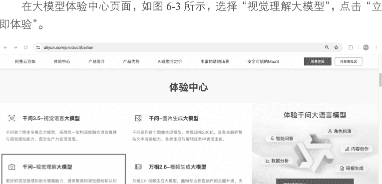
图6-3 千问大模型体验中心页面

进入界面输入提示词并上传视频，如图6-4所示。

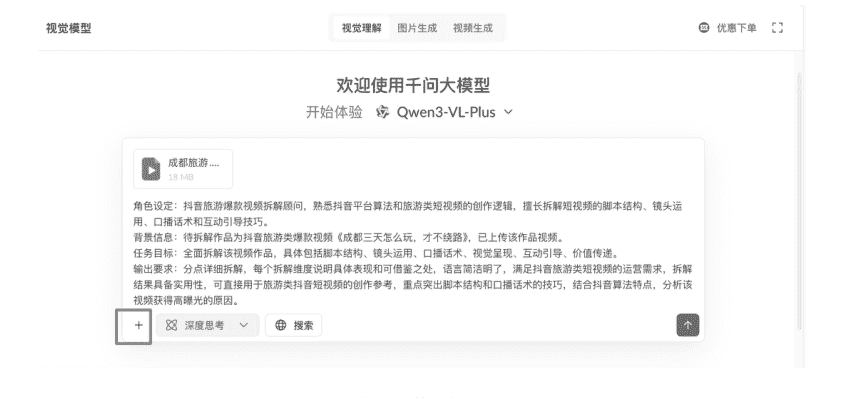
图6-4 千问视觉理解大模型界面

抖音旅游爆款视频《成都三天怎么玩，才不绕路》拆解报告
核心逻辑：用省心攻略解决用户痛点，结合算法实现高曝光

一、脚本结构：清晰分层强节奏，提升完播率
具体呈现。总分总结构。开头0-3秒抛出成都三天怎么玩，才不绕路加懒人攻略直击怕绕路焦虑。主体按第一天第二天第三天分层，每段抵达住宿白天晚上推进，信息密度高。结尾引导互动并强化人设我是四川小佳。
模块化设计：每个景点独立成段，配1-2个镜头加1句核心话术。
可借鉴：开头3秒明确收益；旅游攻略按天拆解降低理解成本，提升完播。

二、口播话术：网感语言加指令明确，驱动互动
具体呈现。口语化情绪化表达：你可以直接抄作业这份懒人攻略拉近距离；短句提炼价值。强指令引导：时间状语明确行动路径，结尾评论区留言出行时间和人数直接促评论。
可借鉴：字幕承担口播，每句≤10字配感叹号或表情；关键节点插入收藏备用转发给闺蜜等指令提升分享。

三、镜头运用：符号化画面加快节奏切换，适配推荐
具体呈现。标志性视觉符号如IFS爬墙熊猫仰拍锦里红灯笼特写火锅沸腾镜头。人设强化镜头如汉服逛宽窄巷子。平均1.5秒每镜头，动态为主静态为辅。
可借鉴：提炼3-5个城市标志场景便于搜索匹配。

短视频旅游类爆款拆解与千问写作方法

画面节奏要动起来。推拉跟拍结合细节特写是基本功，别让镜头长时间定格成静态照片封面，平台更青睐有节奏感的流动表达。

四、视感策略：色彩饱满 信息直达 适配手机观看
1.呈现手法
- 色调与构图：整体加饱和度，比如火锅红油的浓烈、灯笼暖红、熊猫黑白对比，在小屏上冲击更强。字幕建议黄白粗体配黑描边，强光弱光下都能一眼辨认。
- 信息直达：每个镜头只说一件事，像白天逛春熙路、吃一顿地道川味火锅，降低理解负担。

2.可参考点
- 字幕即卖点：字幕需自成一句，默播时也能拿到关键信息，抖音相当一部分用户习惯静音。
- 色系统一：旅行类建议以暖色为主，比如成都的红黄，传递热情烟火气。

五、互动策略：精准引流评论与私信
1.呈现手法
- 评论区钩子：结尾引导观众留下出行时间与同行人数，以免费定制行程作诱因撬动留言，评论破千更容易触发二次分发。
- 检索词布局：标题里埋成都旅游、三日攻略等高频词，字幕里反复出现宽窄巷子、春熙路等地名，提升搜索可见度。

2.可参考点
- 关键词点位：把核心词成都攻略放在开场前三秒、中段、结尾，契合平台搜推机制。

六、价值输出：缓解效率焦虑 交付情绪共鸣
1.呈现手法
- 实用价值：围绕不走冤枉路、直接抄作业、懒人版展开，直击怕踩坑、怕浪费时间的核心焦虑。
- 情绪价值：用沸腾火锅、调皮熊猫、挂灯笼老街等画面释放烟火气与治愈感，激起向往。

2.可参考点
- 旅行内容公式：干货攻略解痛点＋画面文案造共鸣＋本地人身份增可信。
  例：博主着汉服开口我来自××，强化本地向导人设，提升信任。

3.高曝光缘由与总结
- 算法友好：结构清晰节奏快完播高，评论指令明确互动高，关键词重复搜索准，三者共同推入流量池。
- 痛点适配：用省时攻略路线直达直击旅行焦虑，具备强收藏转发属性，收藏在算法中权重很高。
- 生态契合：短视频形态＋网感语言＋视觉符号，贴合碎片化情绪化强互动的生态。

4.实操建议
- 开头三秒必须给出用户收益，例如这样玩能省两小时。
- 每十五秒埋一个互动指令，例如点赞收藏旅行不迷路。
- 拍前先梳理三个城市专属符号，如成都的熊猫火锅老街，保证差异化。

拆解的目的在于学逻辑与运营手法，而非照搬，结合自身定位创新才是关键。千问可作快速提炼辅助，节省拆解时间，但最终创作仍需创作者的思考与个性，才能形成独特风格实现账号长效运营。持续关注同圈层爆款定期拆解，可把握最新趋势不断优化。把拆解成果整理成笔记便于复用，进一步提升创作效率与质量。

第 6 章 千问助力自媒体变现

前文讲了如何借助千问拆解同类爆款并提炼规律，本节聚焦微信公号、小红书、抖音等主流平台，说明如何用千问产出可直接落地的爆款文案，并给出提示词范例与实操方法。

千问写作逻辑是依托语义理解与生成能力，把创作需求转为精准优质的文案。提示词建议遵循人物定位＋情境背景＋创作目的＋交付标准的结构，确保方向清晰贴合平台满足需求。其中人物定位明确身份与风格，情境背景说明平台特性受众与基础，创作目的锁定用途与预期效果，交付标准界定形式字数结构等细节。

6.4 撰写爆款文案

6.4.1 公众号职场类文案撰写

公众号职场爆款的特点是精准击中人群痛点，提供可落地的实用价值，结构清晰语言专业简洁，易引发共鸣与传播。

明确受众细分后，可借助千问把拆解结果转为创作思路。示例提示词如下：

人物定位：公号职场文案撰写专家，拥有十年新媒体运营经验，熟悉公号职场爆款创作逻辑，擅长结合真实职场场景写出简洁务实具感染力的文案，语言专业不晦涩，突出实用性与共鸣，避免堆砌术语。

情境背景：文案用于职场账号，定位为职场新人成长导师，平台以深度图文为主，受众为入职一到三年的人群，痛点包括适应困难技能不足沟通欠缺职业规划模糊等，需要接地气的成长建议。已上载职场爆款拆解结果，需借鉴其选题逻辑结构风格与共鸣点。

创作目的：撰写一篇公号职场爆款稿件，聚焦新人沟通能力不足痛点，围绕职场新人高效沟通技巧展开，既传递可落地方法，又引发情感共鸣，提升打开率点赞率收藏率与转发率。

交付标准：字数控制在一千五百字内，适合碎片化阅读，借鉴拆解逻辑，避免抄袭，结合新人实际需求优化内容，确保实用与可读。

输入后可快速获得初稿，选题聚焦高频痛点，结构采用清晰三段式，风格兼顾专业与接地气，内容搭配真实案例与实用技巧。具体初稿围绕话别乱说事别乱应人别乱怼展开，分别讲开口前思考承诺前评估情绪上来先冷静，并给出职场沟通铁律与高情商沟通公式，结尾引导评论互动。

初稿完成后可继续优化：标题生成三到五个备选提升打开率，案例替换为更贴近新人真实场景的情节增强代入感，补充具体话术模板提升收藏转发价值。

6.4.2 小红书图文设计

小红书是月活数亿的消费决策社区，美食是热门赛道，爆款图文重视觉呈现与实用分享，内容真实易引发尝试欲与互动。

示例提示词如下：

人物定位：小红书美食图文设计专家，熟悉平台特性与美食类爆款逻辑，擅长撰写真实接地气实用性强的文案，并提供清晰的图片设计建议，风格贴合用户偏好，注重视觉与文字的协调。

情境背景：用于美食账号，定位新手家常美食分享者，受众为二十到三十五岁年轻女性，以北上广等大城为主，需求为简单易做耗时短颜值高食材常见的家常菜。已上载美食爆款拆解结果，需借鉴标题设计图文搭配文案逻辑标签运用要点。

创作目的：设计一份爆款美食图文，菜品为家常快手菜番茄鸡蛋面，适合新手，耗时十五分钟内，内容真实接地气，激发尝试欲，提升点赞收藏评论。

交付标准：文字含标题正文标签；图片需说明数量拍摄要求与文字说明。借鉴拆解逻辑，结合新手需求确保实用与观赏。

生成方案包含情绪化标题正文清单体与互动结尾，以及九宫格图片规划。标题备选如讲真十分钟搞定这碗番茄鸡蛋面巨浓稠汤都喝光等，首选强调速度与食欲。正文以情绪钩子开头，给出食材清单与步骤详解，穿插去皮技巧炒出沙的要点新手避坑指南等。标签采用组合策略：大词如家常菜面食爱好者，场景词如快手晚餐单人份吃什么，长尾词如番茄鸡蛋面。

图片共六到七张：封面俯拍或四十五度特写筷子夹面展现汤汁浓稠；备菜拼图展示番茄蛋液葱花；步骤特写展示嫩滑鸡蛋炒出红油沙感沸腾汤面成品撒葱花。拍摄要求侧重光泽热气色彩对比，图上加视觉路标文字。

该方案融合视觉种草加实用干货逻辑，系统输出正文结构标签组合与互动引导，确保触达受众的实用需求与审美偏好，实现种草效率与账号增长。

| P7 收官镜头 | 营造出正在进食的鲜活动感，用勺子挑起挂汤的面条或咬开鸡蛋的特写镜头突出“挂汁”质感 | 极致微距拍摄，把食材纹理和汤汁细节拉满 | 文字：答应我！一定要试！真的不够吃 |

### 三、创作思路复盘（参照拆解文档）

（1）标题偏情绪。
落笔选用“讲真”“巨浓稠”“汤都喝光”这批情绪浓度高的词汇，刻意避开“番茄鸡蛋面做法”这类平铺直叙的命名，直接去撩动用户的点开欲。

（2）图文流程视觉化。
- ✓ 备菜页（P2）：采用拼图加文字标注的手法，大幅降低新手的理解成本，给人一种“自己也能上手”的信心。
- ✓ 步骤页（P3~P5）：每张配图都压了简洁的白底黑字要点，把核心动作提炼成“炒出红油”“别炒老了”，做到看图即懂，减少阅读正文的负担。
- ✓ 光线运用：侧逆光搭配暖色调，强化食物的油亮感与热气氛围，完全契合极致诱食的呈现标准。

（3）文案架构优化。
- ✓ 开头抓点：以“续命神器”“拜托外卖”切入，精准戳中加班族的痛点。
- ✓ 干货分层：用 Emoji 做分割，食材以清单体呈现，步骤中穿插“小妙招”“避坑提示”（比如番茄去皮、勾芡手法），提升收藏价值与专业感。
- ✓ 收尾互动：用祈使句“答应我，今晚就试试”收束，并提示“交作业”，有效提高评论参与度。

（4）标签覆盖精准。
既兼顾 #番茄鸡蛋面 这类大盘关键词，也重点布局 #快手晚餐 #一人食 #新手做饭 等贴合目标人群——忙碌年轻女性搜索习惯的场景词。

# 第 6 章 千问驱动自媒体变现

千问为小红书图文生成的设计要点可归纳为四点。第一，图文配合紧密，文字与画面信息一致，图片负责呈现色泽与制作过程，文字负责传递食材、做法与小贴士，二者互补；第二，调性真实接地气，避免过度修饰，文案口语化，图片走实拍路线，契合小红书用户偏爱的素人分享感；第三，实用性突出，菜品简单易做、食材常见，步骤拆解清晰且附带操作小技巧，新手可直接复刻；第四，标签组合精准，采用“泛流词+细分品类词+长尾搜索词”的搭配，覆盖多流量池，提升笔记曝光。

### 6.4.3 抖音爆款短视频方案

抖音受众面广、传播快，旅游赛道始终是热门。抖音的逻辑是“货找人”，用户因刷到种草短片而主动寻找匹配的产品或攻略。爆款旅游视频文案的共性是节奏紧凑、画面抓眼、用语简洁且有感染力，能迅速抓住注意力并传递实用价值与情绪价值，激发出行欲望与互动热情。

上文已拆解抖音旅游爆款，提炼出脚本结构、口播话术、镜头运用、互动引导等可复用要点。撰写爆款旅游视频文案时，可借助千问把拆解成果融入脚本与口播创作，确保视频与文案协同，符合抖音算法与用户需求。

做抖音旅游爆款文案需兼顾视频设计与脚本设计。脚本设计是基础，要明确视频的开头、主体、结尾，以及每段的画面与口播。视频设计是支撑，要保证画面抓人、节奏紧凑，贴合抖音观看习惯。结合千问提示词公式，可把角色定为抖音旅游视频脚本与文案撰写专家，背景信息包含平台特性、受众需求及拆解结论，任务目标为设计一条爆款作品，输出要求明确脚本与视频的具体规范。

千问提示词示例如下：

> 角色设定：抖音旅游视频脚本设计与文案撰写专家，熟悉抖音算法与旅游短视频创作规律，擅长打造节奏紧凑、有感染力的脚本，撰写简洁吸睛的口播，同时能给出拍摄剪辑建议，风格贴合抖音用户偏好，注重实用性与视觉冲击。
> 背景信息：本次视频为抖音旅游账号（定位成都本地周边游推荐官）制作，核心受众为成都及周边 20～45 岁人群，偏好短途周边游，需求为小众、人少、性价比高且攻略详实的景点。已上传的爆款旅游视频拆解结果需借鉴其脚本结构、口播、镜头、互动引导及价值传递要点。
> **任务目标**：设计一条抖音爆款旅游视频，主题为成都周边小众露营地推荐，时长 60 秒以内，突出“小众、人少、性价比高、风景优美”。内容需传递实用露营攻略与情绪价值，激发出行欲，提升播放、点赞、评论、收藏，契合抖音旅游爆款逻辑。
> **输出要求**：脚本需明确视频结构、各段镜头与口播，视频设计需明确拍摄镜头、色调、剪辑节奏与字幕。整体需借鉴拆解逻辑，避免抄袭，结合成都周边游用户实际需求优化内容，确保实用性与观赏性，符合算法偏好。

千问据提示词与拆解结果可生成完整视频设计方案，整合抖音短平快传播特性与用户偏好，系统输出脚本框架、画面视觉、剪辑节奏、标题文案、评论区运营及本地化避坑指南等执行细节，确保方案兼顾平台算法与受众需求，实现传播效果与转化效率最大化。具体内容如下：

## 成都周边 0 元小众露营地视频脚本方案

本方案严格遵循拆解报告核心逻辑：“痛点前置 3 秒法则 + 时间线分层 + 符号化视觉 + 强指令互动”，力求打造高完播、高互动的露营推荐视频。

### 一、视频基础信息

- ✔ 视频主题：成都周边 1h 直达！0 元小众露营地，人少景美还能看雪山。
- ✔ 目标受众：成都及周边 20～45 岁人群，追求性价比、反感人挤人、喜拍照打卡的短途游用户。
- ✔ 视频时长：45～55 秒（黄金完播区间）。
- ✔ 核心卖点：小众秘境、免费/低价、出片率高、攻略详实。
- ✔ 视觉风格：高饱和暖色调（夕阳金、草地绿），快节奏剪辑，字幕醒目。

### 二、视频脚本设计表

| 时间 | 镜头画面 | 拍摄/剪辑建议 | 口播/字幕文案 | 设计逻辑 |
| :--- | :--- | :--- | :--- | :--- |
| 0～3s（黄金开头） | 镜头 1：无人机高速俯冲穿越密林，瞬间展开草坪与远处雪山/湖泊全景。<br>镜头 2：博主在营地天幕下惬意喝咖啡，背景为美夕阳 | 色调高饱和，突出蓝天绿地。节奏快切，配重音音效 | 口播：成都周边 1 小时！这个 0 元露营地，没人知道！<br>字幕：成都周边 1h 直达 0 元！人少！景美！ | 痛点前置：抛出“1 小时”“0 元”“没人知道”，直击怕远、怕贵、怕人多的焦虑，3 秒内留住用户 |
| 4～15s（核心亮点） | 镜头 3：特写帐篷搭建过程延时。<br>镜头 4：孩子在草地奔跑/飞盘动态特写。<br>镜头 5：近景手冲咖啡热气，背景风景虚化 | 多用移动镜头与特写，避免静态。节奏约 1.5 秒/镜头，卡点音乐 | 口播：不用门票，车直接开到营地边。草地超软，随便一拍就是大片，周末这里居然没几个人！<br>字幕：车停泊位旁 草地超软 原图直出 | 符号化画面：以“车停泊位”“草地特写”建立直观印象，强调“没几个人”，满足独占美景心理 |
| 16～35s（实用攻略） | 镜头 6：手机地图录屏，快速圈出路线。<br>镜头 7：快速扫过洗手间、水源等配套设施。<br>镜头 8：傍晚篝火/星星灯点亮的唯美空镜 | 地图画面清晰，关键地名加粗。节奏稍缓，便于信息接收 | 口播：导航搜“××地”，过隧道右转即到。有水有电还能生火，晚上看星星简直绝了！<br>字幕：记得带驱蚊水 允许明火 | 模块化设计：按“位置—设施—玩法”分层，信息密度高且无冗余，降低理解成本，提升收藏率 |
| 36～45s（情绪价值） | 镜头 9：博主背影面向夕阳/星空张开双臂。<br>镜头 10：朋友碰杯特写，笑声入镜 | 暖金色调营造治愈感。节奏慢动作，音乐进入高潮 | 口播：别再去热门景点排队了，来这里吹吹风，才是周末该有的样子。<br>字幕：拒绝排队 治愈瞬间 | 情绪共鸣：以“逃离城市”“周末该有的样子”传递情绪价值，激发向往感 |
| 46～55s（互动引导） | 镜头 11：博主对镜微笑挥手，屏幕弹出定位卡片。<br>镜头 12：黑屏大字引导 | 人设强化，博主出镜建立信任 | 口播：具体定位和避坑指南放评论区了！想去的扣“1”，我是××，带你挖遍成都小众地！<br>字幕：评论区留言“求定位”，关注不迷路 | 强指令引导：明确提示“扣 1”“评论求定位”，利用算法对评论量权重触发二次推荐，强化本地向导人设 |

### 三、拍摄与制作执行建议

[视觉呈现（适配手机端）]

色彩策略：参照拆解报告，采用高饱和暖色调。后调时提升绿色（草地）与橙色（夕阳/肤色）饱和度，使画面在手机小屏上更具冲击力。

- [字幕设计]
  - ✓ 字体：粗体无衬线（如综艺体、黑体）。
  - ✓ 配色：黄/白字+黑描边，确保任何背景下清晰。
  - ✓ 排版：每句不超过 10 字，居中或底部，关键信息如“0 元”“1h”放大并加表情。
- [镜头语言]
  - ✓ 拒绝静态：全程避免超过 2 秒静止画面，风景也用无人机推进、手持环绕或前景遮挡制造动感。
  - ✓ 必拍符号：必须包含“车停营地旁”“天幕+椅子”“远处雪山地标”三个核心视觉符号。
- [剪辑节奏（提升完播率）]
  - ✓ 前 3 秒定生死：第 1 秒出现最震撼全景或核心利益点（0 元），配合快节奏音效。
  - ✓ 卡点剪辑：选用抖音热门轻快 Vlog 音乐（BPM 100～120），画面切换严格卡鼓点。
  - ✓ 信息密度：每 15 秒提供一个新信息点或视觉刺激，防止划走。

# 第 6 章 千问驱动自媒体变现

### 四、运营与互动（撬动算法）

[标题文案：采用“痛点+收益+地域”公式]

示例：成都周边｜0元！1h直达！这个神仙露营地还没火（附攻略）。

[评论区运营]

- ✓ 置顶评论：发布具体导航定位与注意事项（如路况、最佳到达时间），并引导“点赞收藏，不然找不到啦”。
- ✓ 回复策略：积极回复前 10 条评论，用“私信发你”“组队滴滴”等话术带动更多互动。
- ✓ 搜索埋词：视频标签包含 #成都周边游 #成都露营 #小众旅行地 #周末去哪儿，并在口播与字幕中多次重复“成都周边”“露营”等关键词，匹配搜索流量。

[避坑指南（基于本地化需求）]

- ✓ 真实性：务必核实营地是否真允许明火、是否收费，避免照骗导致差评。
- ✓ 实用性：若路况复杂，需注明“轿车可达”或“需 SUV”，这是成都周边游用户最关心的痛点。

撰写爆款文案是自媒体运营的关键能力，借助千问可将拆解的爆款逻辑转化为创作力，快速生成契合平台特性与用户需求的优质文案。公众号、小红书、抖音三大平台创作标准与形式虽异，但核心逻辑一致，均以精准击中痛点、传递实用价值为关键，结合平台特性设计内容形式与表达风格。

遵循“角色设定+背景信息+任务目标+输出要求”的提示词公式，针对不同平台设计精准提示词，借助千问完成文案、图文或视频脚本创作与优化，可大幅降低爆款文案门槛，提升效率与质量。其他平台如视频号、B站、微博等亦可参照本节逻辑，结合平台特性与用户需求借助千问创作，触类旁通。

需注意，千问是辅助创作工具，最终质量仍需用户判断与优化。运营者应定期关注同领域爆款作品，借助千问拆解分析，总结最新创作趋势，结合账号定位与创新思考不断优化文案，形成独特风格，实现账号长效运营。

# 第 7 章 千问进阶：编码与任务助手

随着 AI 技术快速发展，编码与复杂任务处理正从专业领域走向大众。本章聚焦千问进阶功能，通过“零基础编码”与“任务助理”两大模块，为读者打开高效工作生活新入口。职场人士无论需要快速开发工具，还是希望借助 AI 实现复杂任务自动化，千问均可通过自然语言交互降低技术门槛，让每个人都能轻松掌握代码生成与复杂任务处理。

## 7.1 开发实用工具

实用工具是零基础编码的入门场景，聚焦解决日常工作生活中高频小需求，无需复杂逻辑即可快速验证编码价值。千问代码功能为此类需求提供便捷实现路径，用户通过清晰需求描述即可获得完整前端代码，直接使用。

千问代码功能入口在主界面提问交互区（见图 7-1）。打开千问 Web 页面后，在提问输入框下方功能栏可找到标注“代码”的按钮。点击后进入编码交互模式，用户可用自然语言描述编码需求，千问将生成 HTML、CSS、JavaScript 等前端代码，代码可直接下载本地或在线运行。

千问代码生成质量高度依赖需求描述，遵循标准化提示词公式可提升效果。提示词参考公式为：角色设定+背景信息+任务目标+输出要求。各模块作用如下：

1. 角色设定：明确千问输出身份，如资深前端开发工程师、视觉设计师等，引导输出符合专业规范代码。
2. 背景信息：说明需求使用场景与用户身份，如“职场办公场景，用于快速计算业务数据”等，让代码适配具体环境。
3. 任务目标：清晰描述需实现功能，如“生成简约风格计算器网页”等，明确代码核心用途。
4. 输出要求：指定代码技术细节、视觉风格与交互效果，如“采用 HTML+CSS 内联样式实现”等，约束输出形态。


图 7-1 千问代码功能入口

### 7.1.1 计算器

计算器是职场与生活中最基础的实用工具，职场人士在处理报销、预算统计时需要界面美观、操作便捷的计算器，普通用户日常消费计算时也期望工具简洁。千问代码功能可快速实现此类需求，生成的计算器网页可在电脑或手机浏览器中直接打开使用。

基于提示词公式，针对计算器需求的提示词设计如下：

> **角色设定：** 资深前端开发工程师，精通 HTML 基础结构搭建和 CSS 样式设计。
> **背景信息：** 需要一个能在本地电脑上直接打开使用的网页版计算器，外观简洁、按钮大小合适，适合普通用户日常做加减乘除的基础计算，不需要复杂科学计算功能。
> **任务目标：** 生成完整的网页版计算器 HTML 代码，点击数字键能在显示区正确显示数字，点击加减乘除和等于键能正确计算并显示结果，点击清空键能清除当前输入和计算结果。
> **输出要求：** 输出内容仅包含完整的 HTML 代码，所有样式都用内联 CSS 写在代码里，不引用任何外部文件。代码结构清晰，按钮和显示区布局合理，颜色搭配舒适（如浅灰背景、深色按钮文字），确保在本地计算机上直接运行。

千问接收上述提示词后开始生成 HTML 代码，包含结构、样式与交互逻辑，如图 7-2 所示，用户可实时看到编码过程。

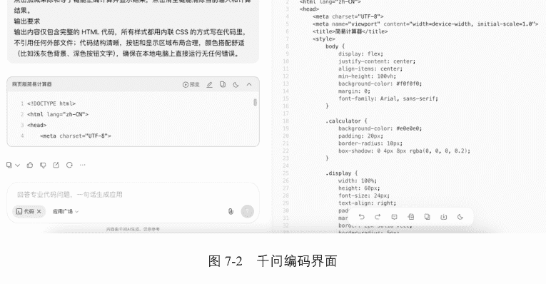

编码完成后，用户可点击右侧“预览”标签查看计算器运行界面，如图 7-3 所示，可通过鼠标点击按钮测试。千问还提供下载与转发功能，位于预览界面底部，用户可下载代码到本地通过浏览器运行，或通过转发功能复制网页链接在线运行。生成的计算器界面符合现代设计规范，操作逻辑与传统计算器一致，适配不同屏幕尺寸，满足职场与日常计算需求。

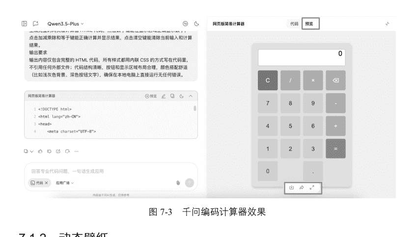

### 7.1.2 动态壁纸

动态壁纸是个性化桌面的常见需求，普通用户期望为电脑或手机桌面制作个性化渐变动态壁纸，视觉效果柔和且不影响操作。职场人士也可通过动态壁纸提升桌面美观度，缓解工作疲劳。千问代码功能可快速生成轻量化动态壁纸，代码体积小、运行流畅，可按用户偏好调整颜色与动画效果。

基于提示词公式，设计的动态壁纸提示词如下：

> **角色设定：** 资深前端开发工程师，擅长用 HTML 和 CSS 制作视觉效果流畅的动态网页。
> **背景信息：** 需要一个动态壁纸网页，无多余按钮和文字，只有流畅动态视觉效果（如缓慢移动渐变色彩、轻柔旋转简单几何图形），整体简约舒适，适合作为电脑桌面背景，适配不同大小屏幕。
> **任务目标：** 生成完整动态壁纸网页 HTML 代码，动态效果流畅不卡顿，视觉柔和不刺眼，网页自动适配电脑屏幕大小，填满浏览器窗口。
> **输出要求：** 输出内容仅包含完整 HTML 代码，所有样式与动画用内联 CSS 实现，不引用外部文件。代码可在本地直接运行，动画循环播放无卡顿，颜色搭配和谐（如低饱和蓝紫渐变），无多余内容与弹窗。

千问生成的动态壁纸代码包含 HTML、CSS 与简易 JavaScript 逻辑，如图 7-4 所示，整体代码体积小、资源占用极低，运行流畅无卡顿。该壁纸既保证动态感，又不影响桌面图标识别与日常操作，且可通过修改代码参数做个性化调整，适配零基础用户场景。

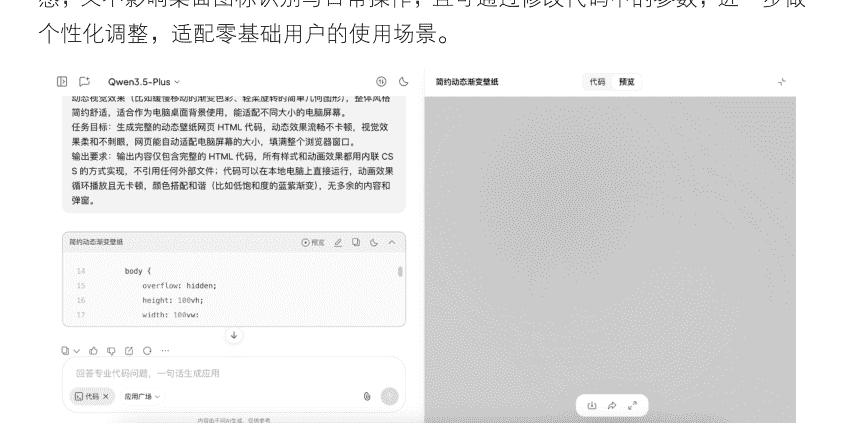

通过计算器与动态壁纸两个案例可见，千问代码功能让零基础用户无需学习编程即可快速实现日常实用工具与个性化视觉效果，为后续更复杂编码场景（如网页设计、娱乐游戏开发等）奠定基础。这类轻量化工具开发过程也让用户直观感受到编码价值，逐步建立对 AI 工具开发的认知与信心。

## 7.2 开发设计网页

网页设计是零基础编码中兼具实用性与个性化的重要场景，涵盖职场办公与日常生活多个需求。职场人士可能需要快速制作个人简历网页用于求职投递、项目展示，普通用户则可能希望设计个性化生日贺卡网页，向亲友传递祝福。千问编码功能仅通过自然语言清晰描述需求，即可生成完整可运行网页代码，实现从需求描述到网页落地的快速转化，让零基础用户也能轻松设计出符合预期的网页。

### 7.2.1 个人简历

在当前的求职竞争环境下，网页形式的个人简历正在逐步取代传统 Word 文档，成为塑造职场个人品牌的主流载体。相较于静态文件，页面版简历可以灵活加入图片、链接等素材，视觉表现更强，投递与分享也更为顺滑。借助千问，即便没有设计或编程基础，也能在很短时间内拼装出带有个人特色的求职页面，从而提升竞争力。

沿用通用的提示词构建思路，围绕求职场景的需求整理出下面这组生成指令，在专业感与易用性之间取得平衡，也贴合零基础用户的表达习惯：

> **角色设定：** 资深前端开发专家
> 
> **背景信息：** 希望得到一个风格简洁偏商务的在线简历页面，用来求职递交和网络分享，需兼容桌面与手机浏览器，具备打印能力，不做复杂交互，主打个人经历、技能与项目展示。
> 
> **任务目标：** 输出一份完整的 HTML 在线简历，涵盖基本信息、教育背景、工作经历、技能特长、项目经验及联系方式等版块，呈现整洁美观的视觉和清晰的页面结构。
> 
> **输出要求：** 整体走简洁商务路线，配色和谐统一，避开刺眼鲜艳色调，保持职场专业感。代码需自包含 HTML 骨架与内嵌样式，无外链依赖，不调用第三方插件或图片，可直接保存到本地或在线运行，替换个人信息后即可使用，并支持浏览器打印。
> 
> **简历内容：** （略）

把上述指令交给千问，就能得到可直接运行的完整简历源码，如图 7-5 所示。成品在不同终端自适应良好，版面干净、质感专业，完全契合求职使用场景。

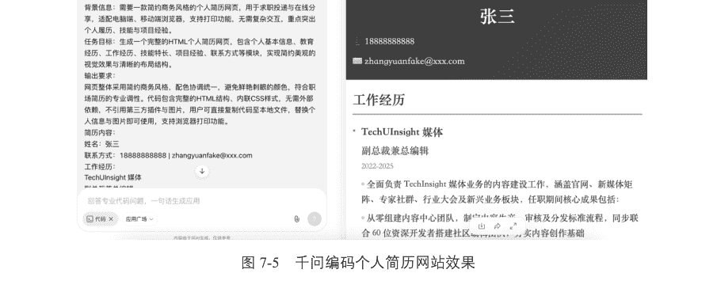

### 7.2.2 生日贺卡

数字贺卡正在成为传递心意的新常态。对比纸质卡片，网页版可以融入动效、背景音和动态文字，互动感更强，也便于通过链接分享给亲友，且更环保。普通用户无需懂网页制作，也能借助千问快速定制专属生日贺卡，获得更有温度的祝福体验。

参照提示词公式并结合温馨场景，下面给出兼顾个性化与易用的生日贺卡生成指令：

> **角色设定：** 前端视觉设计专家
> 
> **背景信息：** 用户想为一位 25 岁的朋友制作温馨可爱风格的生日贺卡页面，用于传递祝福。朋友偏好简约可爱的调性，页面需包含祝福文案与动态效果，操作要轻，运行要轻量化。
> 
> **任务目标：** 生成一份完整的 HTML 生日贺卡页面，实现温暖的动画效果，完成生日祝福的传递。
> 
> **输出要求：** 整体采用温馨可爱风格，主色以淡粉、鹅黄为主，搭配白底，配色柔和，避免高饱和刺眼色，符合生日祝福的氛围。代码需自包含 HTML 骨架、内嵌样式与 JavaScript 逻辑，无外部依赖，不引用第三方插件。

千问执行指令后会输出完整的生日贺卡源码，涵盖结构、样式与交互，如图 7-6 所示。生成的页面视觉温暖、动效流畅、切换自然，支持个性化修改，在电脑与移动端均可稳定运行。用户无需编码基础，通过下载或转发即可使用，相较纸质卡片更有创意与温度，也更符合数字化表达习惯。

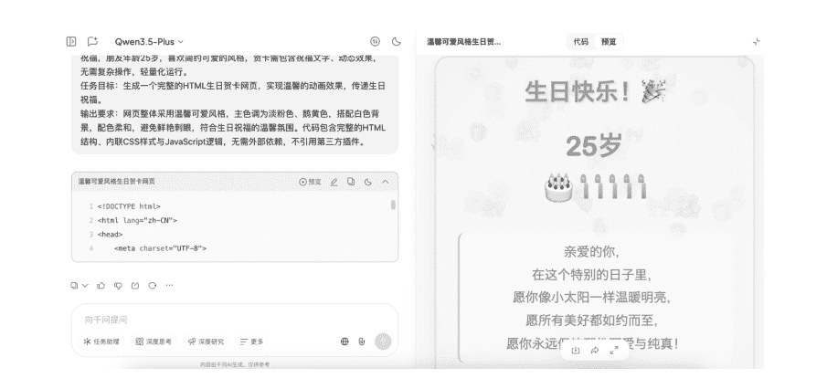

图 7-6 千问编码生日贺卡效果

## 7.3 开发休闲游戏

在零基础编码实践里，娱乐休闲类项目上手最快、趣味性最强。对职场人和普通用户而言，无需学习复杂语言，只要给出精准提示，就能让千问生成可在本地运行的小游戏源码，既能利用碎片时间娱乐，也能在玩乐中感受编码乐趣，加深对千问辅助功能的理解。

本章前两节已覆盖实用工具与网页设计的应用，本节聚焦娱乐场景，以经典的五子棋和贪吃蛇为例，说明如何用千问生成可用 HTML 源码，帮助新手快速搭建休闲游戏并掌握相关提示词写法。

娱乐类编码的核心诉求是可运行、好玩、界面简洁。针对零基础用户，千问输出的源码基于 HTML 结构与内嵌样式，无需额外插件或依赖，保存为 HTML 文件后即可用任意浏览器打开。

### 7.3.1 五子棋

五子棋历史悠久、规则简明，是两人轮流落子、率先连成横竖斜五子即胜的对弈游戏。开发简易版无需游戏引擎，只需让千问生成基础的 HTML、CSS 与 JavaScript 源码即可满足日常娱乐需求。

结合前文的提示词参考公式，针对新手需求可编写如下指令，引导千问产出可直接运行的五子棋源码：

> **角色设定：** 资深前端开发专家
> 
> **背景信息：** 需做一款面向大众的五子棋小游戏，用于日常休闲娱乐，需兼容 Chrome、Edge、Firefox 等主流浏览器，无须额外安装插件。
> 
> **任务目标：** 生成 15×15 的标准棋盘，界面简洁美观，棋子以黑白区分清晰；实现双人对弈，轮流落子，落子后不可移动，并显示当前操作方；具备胜负判定，当一方形成横、竖、斜连续五子时弹出提示告知胜者；提供重新开始按钮，点击可清空棋盘。
> 
> **输出要求：** 输出完整 HTML，采用 HTML5 结构，结合内嵌样式美化界面，包含必要的 JavaScript 实现游戏逻辑；确保文件可本地保存为 .html 并直接用浏览器运行，无需额外配置。

该指令遵循角色设定加背景信息加任务目标加输出要求的结构，明确了开发身份、用户水平、功能点与规范，能有效引导千问产出符合预期的五子棋程序。其中角色设定为资深前端专家，背景补充了使用场景与浏览器适配要求，任务目标细化了棋盘规格、对弈流程、胜负判定与重置功能，输出要求则锁定了格式、样式与运行方式。

千问处理该指令后，会梳理游戏逻辑并生成完整 HTML。运行后可见 15×15 标准棋盘，如图 7-7 所示，顶部提示当前落子方，玩家可轮流点击落子，获胜时弹出提示，点重新开始即可清空棋盘，满足休闲娱乐需求。

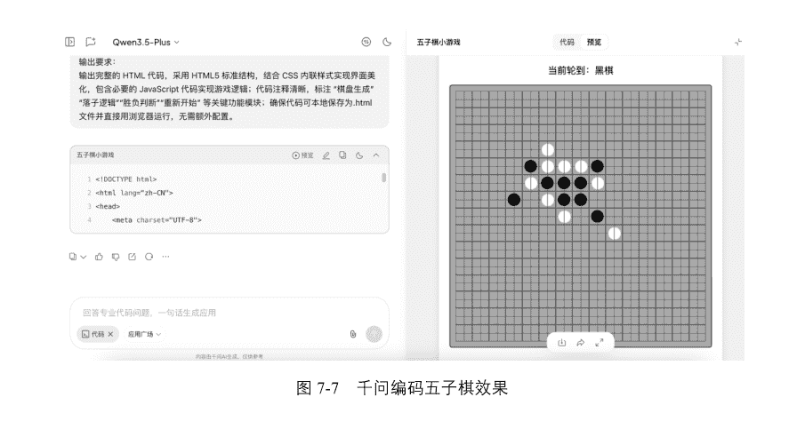

### 7.3.2 贪吃蛇

贪吃蛇同样是经典休闲小游戏，核心玩法是操控蛇身移动、吞食随机出现的食物，蛇身随之增长，头部撞到边界或自身则游戏结束。操作简单、趣味性强，适合各个年龄段。

基于提示词参考公式，结合贪吃蛇特点，可编写如下指令生成可直接运行的源码：

> **角色设定：** 资深前端开发专家
> 
> **背景信息：** 需开发一款面向大众的贪吃蛇小游戏，用于碎片化时间娱乐，需兼容 Chrome、Edge、Firefox 等主流浏览器，无需插件，运行流畅无卡顿。
> 
> **任务目标：** 生成固定尺寸的游戏画布，界面简洁，蛇身用绿色，食物用红色，边界清晰可见；实现蛇的移动控制，通过键盘方向键控制移动方向，移动速度适中；实现食物随机生成，吃到后蛇身变长且分数增加并显示当前分数；实现结束判定，头部撞墙或撞身时弹出结束提示并显示最终分数，提供重新开始选项。支持暂停功能。
> 
> **输出要求：** 输出完整 HTML，采用 HTML5 结构，结合内嵌样式美化界面，包含必要的 JavaScript 实现游戏逻辑；确保文件可本地保存并直接用浏览器运行，无需额外配置；代码语法简洁，避免复杂逻辑。

该指令与五子棋结构一致，明确了画布、移动控制、食物生成、计分与结束判定等核心功能，覆盖贪吃蛇的基础玩法。

千问接收后会生成完整 HTML。如图 7-8 所示，可见游戏画布与顶部分数显示，初始分数为 0，用方向键控制蛇身移动，吃到红色食物后身体变长、分数上升，撞墙或撞身时弹出结束提示并显示最终分数，点击重新开始即可重玩，操作直观、运行流畅，非常适合碎片化娱乐。

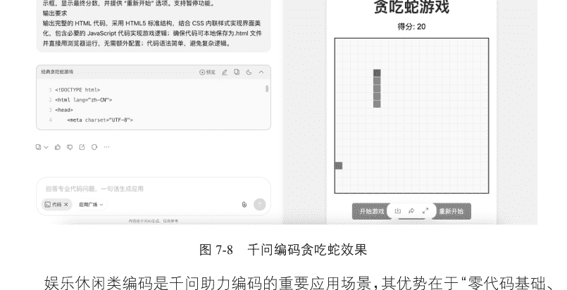

休闲娱乐类编码展现了千问零基础、高趣味、可直接运行的优势。用户只需掌握角色设定加背景信息加任务目标加输出要求的公式，结合自身娱乐需求，就能生成五子棋、贪吃蛇等各类小游戏，边玩边了解编码逻辑。除此之外，井字棋、连连看、猜数字等游戏也只需调整任务目标中的名称与功能即可生成。

## 7.4 开发教学工具

教育场景中，互动式学习工具能显著提升效率与趣味，但传统开发门槛较高。千问的零基础编码功能让教育工作者无需编程知识，仅凭简单指令就能生成适配教学需求的互动工具，覆盖英语、语文等多学科。

本节聚焦英语学习与古诗学习两类典型应用，介绍如何用千问生成可本地运行的 HTML 源码实现教学辅助，并提供标准化提示词参考与示例，便于直接复用与调整。

千问在教学编码中的优势在于将教学需求转化为可运行源码，输出基于 HTML 与内嵌样式，无需插件或依赖，可在浏览器中直接运行，适配电脑、平板等设备，满足课堂与课后练习需求。教师可快速制作课堂互动练习，家长也能为孩子定制个性化工具，大幅降低开发成本与技术门槛。

编写教学类提示词时，推荐遵循角色设定加背景信息加任务目标加输出要求的公式，确保千问准确理解教学场景、学科特点与功能需求。

### 7.4.1 英语学习

英语语法选择题是中小学教学重点，考查介词、连词、情态动词、时态等知识。纸质练习无法即时反馈，教师出题与批改也耗时。借助千问生成的语法选择题 HTML 工具，可实现在线作答、提交核对、答案解析等功能，学生即时查看正确答案与解析，教师也能灵活调整题干、难度与题型。

针对英语工具开发，提示词需明确适用年级、考查重点、题量与功能模块。以下是一个具体示例：

> **角色设定：** 资深 HTML 开发专家，擅长制作教育类英语互动工具，熟悉中小学英语大纲和语法考点，能结合学生认知特点设计简洁易用的界面。
> 
> **背景信息：** 面向初中生，围绕介词用法设计语法选择练习，题干取自该年级教材，难度适中，符合课堂或课后作业要求，避免复杂句式和生僻词汇。
> 
> **任务目标：** 生成可本地运行的 HTML 代码，实现英语语法填空互动，包含题干展示、选项、提交按钮、答案核对、解析展示等模块；每道题独立输入区，提交后逐题显示正确答案和简要解析，帮助学生理解知识点。
> 
> **输出要求：** 代码采用 HTML5 编写，使用内嵌样式，界面简洁大方，字体清晰易读，适配电脑与平板；提交按钮醒目，交互简洁，点击后即时显示核对结果，无需刷新；解析简明，聚焦语法考点，帮助学生快速掌握错因。

按此指令，千问可生成完整的英语语法选择题 HTML 工具，如图 7-9 所示，教师可直接在浏览器中使用。源码也可灵活修改，手动调整题干、答案与解析，或简单修改提示词即可，解决了手工制作互动练习的痛点，并为学生提供即时反馈，提升学习效率与趣味。

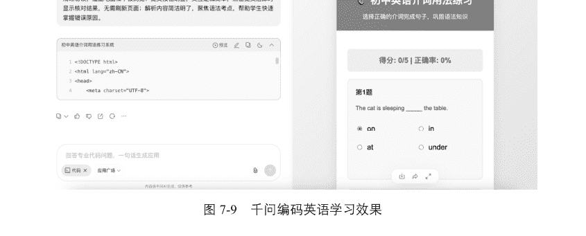

### 7.4.2 古诗学习

古诗排序练习有助于学生熟悉语句逻辑、节奏韵律，提升记忆与理解。传统纸质练习需手动填序、教师批改耗时，且缺乏即时校验与互动。千问生成的古诗排序 HTML 工具可实现诗句拖拽、即时校验、正确提示等功能，将记忆练习转化为互动学习，激发兴趣并减轻批改负担。

开发时需结合小学语文特点，确保诗句贴合年级，交互简单易懂，界面符合小学生审美。结合上述公式，给出一个提示词示例：

> **角色设定：** 资深 HTML 开发专家，专注语文教育互动工具开发，熟悉小学语文教材古诗篇目，了解小学生认知特点，能设计简洁有趣易操作的互动界面。
> 
> **背景信息：** 面向小学生，选取语文教材中的《望庐山瀑布》，将诗句打乱作为排序选项；难度适中，贴合年级积累水平，界面简洁活泼，符合小学生审美。
> 
> **任务目标：** 生成可本地运行的 HTML 代码，实现古诗排序互动，包含标题展示、打乱诗句选项、排序区、提交按钮、校验提示等模块；支持鼠标拖拽调整顺序，提交后校验结果，正确则显示鼓励提示，错误则提示重试并可查看正确顺序。
> 
> **输出要求：** 代码采用 HTML5 编写，使用内嵌样式，界面简洁活泼，字体清晰，选项与排序区区分明显，拖拽流畅；配色贴合小学生审美，避免过艳；交互简单易懂，适合独立操作，提交后即时反馈，鼓励提示积极正面，增强学习信心。

按此提示词，千问可生成完整的古诗排序 HTML 工具，如图 7-10 所示，学生可拖拽诗句完成排序并即时获取反馈，在互动中加深记忆。教师只需替换提示词中的篇目，千问即可自动调整诗句内容与排序逻辑，生成适配新篇目的工具。

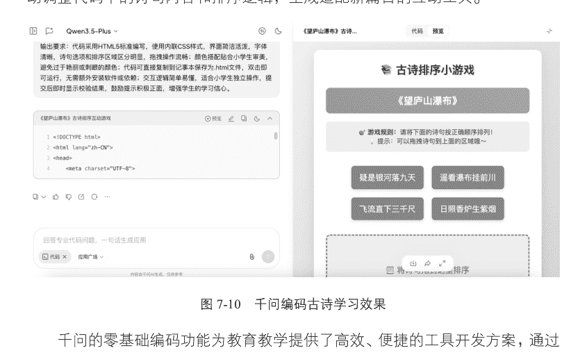

千问的零基础编码功能为教学提供了高效便捷的工具方案，通过标准化提示词即可生成英语、语文等多学科互动学习工具。无论是语法填空还是古诗排序，千问都能快速响应需求，帮助教育工作者提升教学效率，为学生提供更具趣味与互动性的学习体验，真正实现零基础也能开发教学工具。

## 7.5 任务助理模式

### 7.5.1 任务助理模式介绍

在千问进阶功能中，任务助理模式是连接基础操作与复杂场景的关键环节，以多步骤、多智能体、任务闭环处理为核心，依托大模型的语义理解与逻辑拆解能力，能够承接跨环节的复杂任务，实现从需求拆解、步骤执行到结果交付的流程自动化，是进阶功能中最具实用性的模块，也是衔接基础与专业应用的重要纽带。

职场中调研、数据处理、行程规划等工作往往需要多环节配合，涉及信息收集、分析与呈现，传统 AI 多只能完成单一环节，用户需在多个工具间切换，效率低下。

为此，阿里千问于 2026 年初正式上线任务助理功能，同时开放 400 多项 AI 办事能力，标志着千问从能说到能干的转变。该模式依托 Qwen 大模型，引入通用 Agent 体系，由主 Agent 负责理解需求、拆解任务与整体规划，多个具备反思能力的子 Agent 在各自领域独立决策、执行与校正，实现复杂任务的高效落地。

职场办公是主要应用场景，涵盖多步骤跨环节任务，解决效率痛点。具体包括咨询调研类，如市场调研、行业调研，可完成方案设计、问卷生成、数据收集与报告撰写；数据处理类，如清洗、统计、可视化，将复杂数据转化为图表或报告；文档处理类，如批量生成文档、PPT 制作、合同审核、报销台账整理；行程与会议类，如差旅规划、会议安排、纪要整理，减少行政事务耗时。

任务助理模式入口位于千问首页，如图 7-11 所示，点击输入框下方功能选项任务助理进入，用户输入提示词即可启动任务。


图 7-11 千问任务助理模式入口

### 7.5.2 问卷调查

AI全链路：从调研到可视化的一站式自动化

在日常办公里，问卷调研属于高频且环节较多的综合型作业。常见的形态有用户洞察、行业摸底等，一般要经历界定需求、设计方案、收集数据、归纳分析到形成报告，耗时集中、对逻辑自洽要求高。Qwen 的任务助理功能能够自动拆分工序并整合外部资料，承接咨询类全流程，按角色、背景、目标、交付标准四要素输入指令后就能把调研落地，无需人工逐段盯控。

以即将上线的内部办公软件做用户需求摸底为例，企业准备推出整合考勤、审批、文件共享、即时沟通的产品，需要面向 200 人规模的行政、技术、销售、财务四类同事收集功能偏好、操作感受和使用场景，为迭代提供依据。传统做法要花数天手动完成方案、问卷、统计、报告等环节。本案例模拟了助手完整跑通这条链路，实际使用时也可以只挑其中几个分项单独执行。

提示词框架大致如下：

角色：企业用户调研专员，约 3 年办公软件调研经验，熟悉员工日常办公场景，会做贴合实际的问卷设计，并具备基础统计分析能力。

背景：企业 200 人，四个部门，软件处于测试期，调研对象为全体员工，周期 3 天，线上问卷形式。需要了解各功能需求优先级、操作便捷性预期、潜在痛点。

需达到的效果：
1）出一份完整的办公软件用户需求问卷，含基础信息、功能需求、操作体验、改进建议四大模块，题量 20 至 25 题，题型兼顾单选、多选、简答。
2）生成问卷发放说明，写清填写要求与截止时间。
3）模拟回收 100 份有效问卷，数据需符合各部门员工特征。
4）对问卷数据做统计分析，提炼核心需求与痛点。
5）输出调研分析报告，含调研概况、数据统计、需求分析、改进建议四部分。

交付指引：
1）问卷以 Word 文档呈现，题意清晰、选项合理，简答题留足书写空间。
2）发放说明用简洁文字，适合群内发布。
3）数据统计以表格呈现，展示各题选项占比与核心汇总。
4）报告以 Word 文档呈现，逻辑清楚、数据扎实、建议可执行，字数 1500 至 2000 字，语言通俗，贴近企业实际。

收到指令后，助手会把整体工作拆成 9 个分项按顺序推进，用户可实时看进度。
1）收集问卷和报告模板。
2）设计调研问卷。
3）生成发放说明。
4）生成模拟数据。
5）统计分析数据。
6）撰写调研报告。
7）转换问卷格式。
8）转换报告格式。
9）检查交付文件。

重点步骤细节如下。第一步，收集问卷和报告模板，如图 7-12 所示，助手会在网上检索企业办公软件用户需求问卷模板、企业调研分析报告等资料，并输出检索总结。

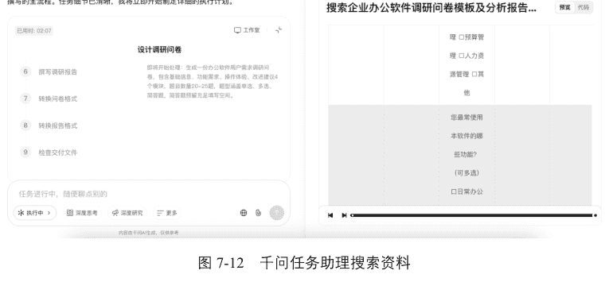

第四步，生成模拟数据，如图 7-13 所示，助手会依据问卷结构生成 100 份模拟问卷数据，贴合行政、技术、销售、财务等部门特征，并保存为 CSV 档案。

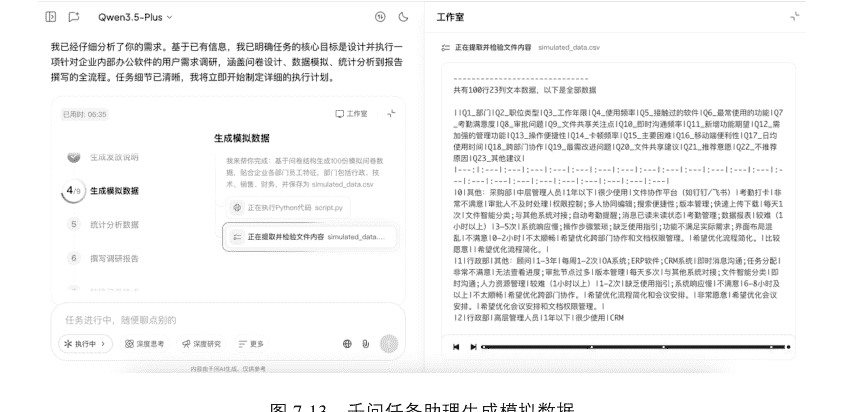

第五步，统计分析数据，如图 7-14 所示，助手会对 CSV 档案进行统计，计算各题选项占比、核心指标汇总，以 Markdown 格式的表格输出并保存为数据统计 md 档案。

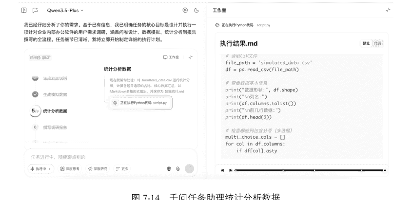

第六步，撰写调研报告，如图 7-15 所示，助手基于统计结果撰写调研分析报告，包含调研概况、数据统计、需求分析、改进建议四个部分。

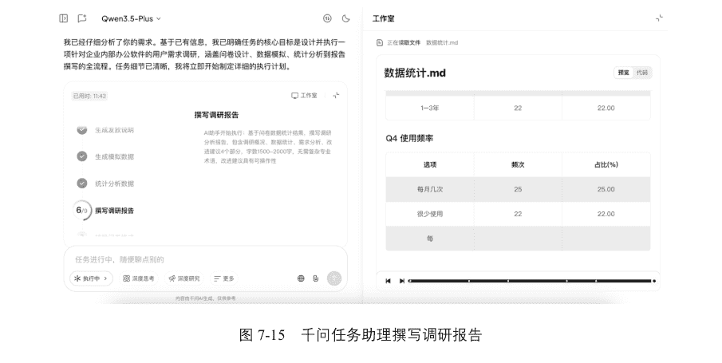

执行期间会实时反馈进度。完成后，如图 7-16 所示，会交付四项成果：
1）结构完整、题目合理的《办公软件用户需求调研问卷》，覆盖基础信息、功能需求、操作体验与改进建议四大模块，题型多样，适合全员线上填写。
2）简洁清晰的《问卷发放说明》，便于企业群发布，明确填写要求与截止时间。
3）详尽的《数据统计》报告，以表格展示各题选项分布与核心汇总，直观呈现调研结果。
4）内容扎实的《调研分析报告》，包含背景介绍、数据分析、需求洞察与可落地的改进建议，为办公系统优化提供决策支持。

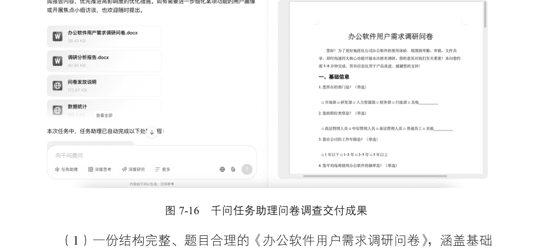

### 7.5.3 数据可视化

数据可视化是职场数据处理的关键手段，通过柱状图、折线图、饼图、旭日图等把文字数据转化为直观画面，便于解读、汇报与决策。传统做法依赖 Excel、PPT 手工制作，耗时且对图表设计能力要求高，多维度数据操作难度更大。Qwen 的任务助理借助数据处理与图表生成能力，可接手可视化任务，用户按提示词公式输入指令并上传数据，即可自动生成符合要求的图表，无需手动操作，大幅提升效率。

以财务报表可视化为例，将企业年度财务报表核心指标可视化，清晰呈现收入、成本、利润、资产负债情况，便于财务分析和管理层汇报。任务对数据准确性与图表专业度要求高，助手可生成符合财务规范的可视化图表并整合进 PPT，满足专业汇报需求。

提示词示例：
角色：财务分析师，约 5 年财务数据处理与可视化经验，熟悉报表结构与核心指标，能挑选规范的图表类型，设计严谨专业，贴合财务汇报场景。

背景：某企业 2025 年度财务报表关键数据如下，可上传 Excel：
1）营业收入：Q1 800 万、Q2 850 万、Q3 920 万、Q4 1050 万。
2）营业成本：Q1 450 万、Q2 480 万、Q3 520 万、Q4 580 万。
3）净利润：Q1 150 万、Q2 170 万、Q3 190 万、Q4 230 万。
4）资产总额：年初 1500 万、年末 1800 万。
5）负债总额：年初 600 万、年末 720 万。
6）所有者权益：年初 900 万、年末 1080 万。数据来源企业 2025 年度财务报表，真实有效，符合规范。

需达到的效果：
1）整理财务数据，确保准确，汇总年度营业收入、营业成本、净利润总额。
2）生成 4 类可视化图表：年度各季度营业收入与营业成本对比柱状图、年度各季度净利润趋势折线图、年初与年末资产负债对比柱状图、年度营业收入与净利润占比饼图。
3）图表设计符合财务规范，样式严谨专业，数据标签清晰，标注单位万元。
4）将图表整合到 PPT，每图一页，添加专业标题与简要说明，标注数据来源。
5）撰写简短财务数据可视化分析，解读各图表反映的财务状况。

交付指引：
1）图表类型符合汇报规范，数据准确无误，单位清晰，无逻辑错误。
2）配色严谨，以蓝、灰、黑为主，避免鲜艳颜色，样式简洁无多余装饰。
3）PPT 标题专业，说明简洁，标注数据来源如某企业 2025 年度财务报表。
4）分析语言专业、逻辑清晰，重点解读收入、利润增长趋势及资产负债情况，字数 800 至 1000 字。

执行过程拆解为 4 个分项逐步推进。第一步，整理财务数据，如图 7-17 所示，助手计算 2025 年度营业收入、营业成本、净利润年度总和等指标。

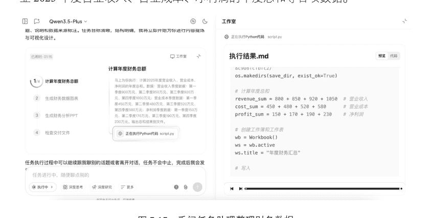

第二步，生成财务数据报表，如图 7-18 所示，助手生成四个可视化图表：年度各季度营业收入与营业成本对比柱状图、年度各季度净利润趋势折线图、年初与年末资产负债对比柱状图、年度营业收入与净利润占比饼图。

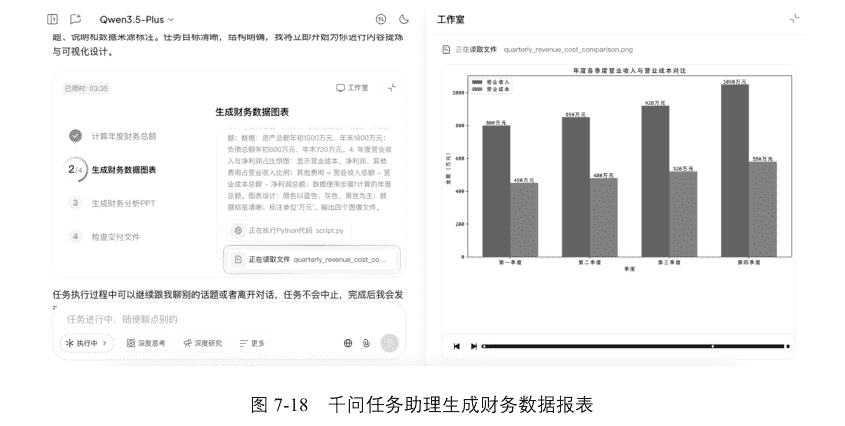

第三步，生成财务分析 PPT，如图 7-19 所示，助手将 4 个图表分别整合到 4 个 PPT 页面，每个页面添加专业标题与简要说明。最终交付文件为“企业 2025 年度财务数据可视化分析.pptx”。

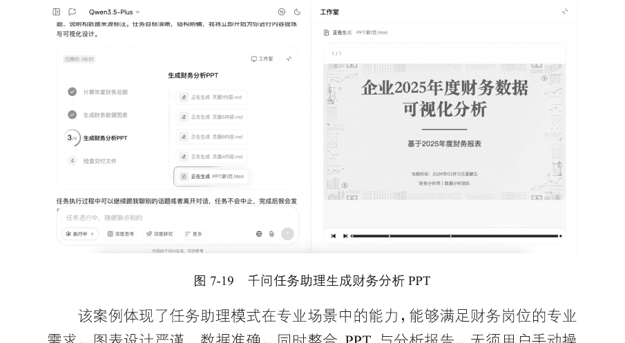

该案例体现任务助理在专业场景的能力，图表设计严谨、数据准确，并能整合 PPT 与分析报告，无需手动操作多工具，大幅提升财务数据处理与汇报效率。助手支持上传 Excel 报表，可自动识别关键数据，若格式存在问题会提醒用户调整，确保处理准确。

Qwen 的任务助理是进阶功能的核心体现，依托通用 Agent 体系与阿里生态资源，实现复杂任务流程自动化，兼顾职场与生活场景，无需专业技能即可通过简单指令完成多步骤跨平台任务。本节围绕任务助理的由来、优点与场景，结合问卷调查、数据可视化两大案例拆解提示词编写方法与执行过程，帮助读者快速掌握使用方法。

# 第 8 章 进阶：OpenClaw 实践

OpenClaw，国内开发者常称“小龙虾”，是 2026 年 AI 领域现象级的开源智能体执行平台，打破传统对话式 AI“只说不做”的局限，搭建起大模型“大脑”与本地设备“手脚”的桥梁，让用户通过自然语言指令即可驱动 AI 完成任务拆解、工具调用到执行的全流程。凭借开源免费、本地优先、无代码、高扩展性的优势，OpenClaw 已在办公、教育、电商、法律、运维等多个领域普及，成为职场人士掌握 AI 自动化能力的重要平台。本章将从特点、安装部署、与千问大模型及钉钉联动、Skill 配置和应用案例等多角度展开介绍。

## 8.1 OpenClaw 介绍

### 8.1.1 什么是 OpenClaw
OpenClaw 是一款基于 MIT 开源协议、本地优先设计的 AI 智能体执行平台，由奥地利开发者 Peter Steinberger 发起，定位为“运行在你自己设备上的个人 AI 助手”。它本身不具备大模型推理能力，而是作为标准化执行框架，对接云端或本地大模型，打通通信渠道、系统工具与扩展技能，实现从自然语言指令到实际操作的闭环。

简单说，OpenClaw 能“把事做完”。例如通过钉钉下指令“帮我整理本周销售报表，提取关键数据并发送给团队”，OpenClaw 会打开本地表格文件、提取数据、生成分析报告、调用邮箱发送给指定人员，全程无需人工干预。官网为 https://openclaw.ai/，如图 8-1 所示。

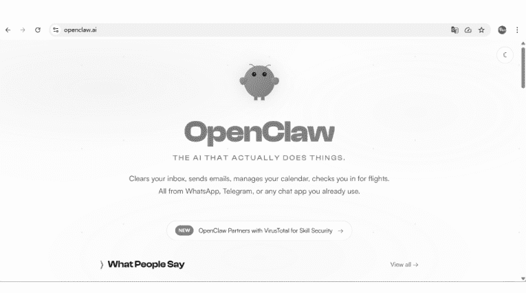
图 8-1 OpenClaw 官网

发展历程虽短但迭代迅速：
1. 2025 年 6 月，Peter Steinberger 创立 Amantus Machina 公司，专注下一代超个性化 AI 智能体研发。
2. 2025 年 12 月，首次公布名为 Clawd 的 Agent 项目进展，开放核心配置代码，以龙虾为视觉标识。
3. 2026 年 1 月，项目更名为 ClawdBot，在 GitHub 开源后迅速走红，因商标纠纷先更名 Moltbot，最终定名为 OpenClaw，寓意“开源的龙虾螯足”，致敬项目起源与开源属性。
4. 2026 年 2 月，创始人加入 OpenAI，OpenClaw 以基金会形式作为独立开源项目存续，社区成为核心开发维护力量。
5. 截至 2026 年 3 月，OpenClaw 在 GitHub 星标突破 30 万，成为 GitHub 史上增长最快的开源 AI 项目。

体系采用“网关、智能体、节点、渠道”四层架构，保证系统稳定与扩展性，也让各模块能力可独立升级，用户无需理解底层代码即可灵活组合。

1. Gateway 网关层，系统神经中枢
Gateway 是 OpenClaw 的核心组件，基于 Node.js 构建的常驻后台进程，默认监听本地 127.0.0.1:18789 端口，相当于系统交通枢纽。统一管理会话、路由消息、调度任务、管理技能与权限，是连接大模型、交互渠道、执行工具的桥梁。

2. Agent 智能体层，系统大脑
智能体层是决策中枢，负责理解指令、拆解任务、制定执行计划、决策工具调用，相当于思考器官。面对复杂指令会先拆解为多步可执行子任务，再逐一调用工具，根据执行结果动态调整计划直至完成。采用模型无关设计，原生支持 OpenAI GPT、Anthropic Claude、Google Gemini、智谱 GLM、阿里千问、月之暗面 Kimi 等大模型，同时兼容 Ollama 运行的本地开源模型，用户可按成本与隐私需求自由切换。

3. 节点执行层，系统手脚
节点执行层是实现“动手做事”的关键，包括技能系统、工具系统和节点能力。
- 技能系统：模块化功能扩展包，每个 Skill 专注解决一类特定任务，相当于手机 App，安装后即可解锁对应能力，如邮件管理、网页搜索、PDF 处理等。
- 工具系统：内置基础能力，包括文件读写、终端命令执行、浏览器控制、定时任务调度等，是所有技能的底层执行基础。
- 节点能力：支持多设备分布式扩展，任何设备均可作为节点接入系统共享执行能力，如让家用电脑与办公电脑协同完成任务。

4. 渠道层，系统交互入口
渠道层负责打通用户与 OpenClaw 的交互通道，用户可通过熟悉的软件随时随地下指令。原生支持 50 多种主流通信工具，包括 Telegram、WhatsApp、飞书、企业微信、钉钉等。用户无需安装额外客户端，用日常聊天软件即可远程控制 OpenClaw 执行任务。

### 8.1.2 OpenClaw 核心优势
OpenClaw 凭借独特设计与技术架构，将 AI 从对话建议推向实际执行。以下从多个维度介绍其差异化竞争力。

1. 本地优先，隐私安全与数据自主可控
OpenClaw 采用本地优先原则，所有数据、会话记录、执行日志默认存储在本地设备，不依赖云端服务。敏感信息如工作文档、财务数据、个人隐私无需上传第三方服务器，有效规避泄露风险。配合本地模型如小参数版 DeepSeek、Qwen，断网环境下仍可正常运行。数据主权归用户，可自由导出、备份、删除，并自定义存储格式，真正掌控个人信息。

2. 真实执行能力，系统操控与任务自动化
OpenClaw 核心优势在于真实执行能力，可直接操控计算机系统与各类软件，完成从文件操作到复杂工作流的任务。覆盖三大场景：
- 系统级操作：直接控制文件管理器创建/删除/移动/重命名文件、终端执行命令行脚本、系统设置调整显示参数网络配置等底层功能。
- 软件自动化：操控浏览器自动浏览、表单填写、数据抓取等，操作 Excel 数据处理、Word 文档生成等办公软件，以及设计工具等桌面应用。
- 工作流编排：将多个操作串联成复杂流程，如“从邮箱下载账单→自动分类归档→生成月度报表→发送至指定邮箱”流程自动化。

3. 模块化技能生态，即插即用与快速扩展
OpenClaw 构建完善模块化技能生态，将各类功能封装为独立 Skill 模块，用户可按需自由安装、组合与扩展，实现按需定制个性化 AI 助手。
每个技能包含触发条件、执行逻辑和输出格式，遵循统一 SKILL.md 规范，确保兼容与易用。普通用户无需编程知识，通过 YAML 配置文件即可创建简单功能；开发者可通过 Python 等语言开发复杂技能，甚至构建技能组合包以满足特定行业需求。设计在易用性与扩展性间取得平衡。

4. 跨平台适配，全场景覆盖与无缝体验
OpenClaw 采用跨平台架构，支持 Windows、macOS、Linux 三大主流系统，同时提供 Web 端、移动端 iOS/Android 远程控制能力，实现全场景覆盖。

# 让 AI 真正动手干活的本地伙伴

OpenClaw 在不同桌面环境下做了专门调优，文件读写、进程调度等底层行为在 Win、macOS、Linux 上保持一致，兼容性问题被降到最低。同时提供命令行模式与图形界面两种交互形态，既照顾习惯终端的老用户，也方便偏好可视化操作的新手。

任务调度突破设备限制，指令可以在手机上发出，由家里的主机或公司服务器实际执行，形成想在哪下令就在哪下令、让谁执行就让谁执行的灵活协作。

把上述能力组合起来，定位非常清晰：一个能真正执行任务的 AI 助手。本地优先的设计守护数据隐私，从对话到落地的执行力把交流变成行动，模型无关的架构允许自由切换大脑，模块化的技能体系降低使用门槛，全平台覆盖实现场景无缝衔接，开源社区的持续贡献保证迭代速度。这些特质既能满足开发者需求，也能为普通办公人群带来可感知的效率提升，推动 AI 产品走向普惠。

## 8.2 安装部署全流程

### 8.2.1 部署方案

该系统兼容 Windows、macOS、Linux 等主流桌面环境，其中 Windows 在大众用户中占比最高，下文以 Win 为例演示完整部署。

正式部署前需先准备 Node.js 20.0.0 及以上版本。Node.js 作为核心程序与网关服务运行的基础运行时。可前往官网 https://nodejs.org/ 下载 Windows 安装包 .msi，双击后在向导中勾选 添加到环境变量，完成全局环境变量配置。

本教程采用官方推荐的自动化脚本方式，全程自动完成依赖安装与程序部署，无需手动调整环境，体验更友好。

1. 步骤 1：以管理员权限启动终端
Windows 自带的 PowerShell 需要管理员权限才能运行安装脚本，否则易因权限不足失败。打开开始菜单搜索 PowerShell，在结果中右键选择以管理员身份运行。

2. 步骤 2：放开脚本运行限制
系统默认会阻止第三方脚本运行，首次安装前需先修改执行策略，否则会出现禁止运行脚本的提示。

在已打开的会话中复制粘贴下方指令后回车执行：
```
Set-ExecutionPolicy -ExecutionPolicy RemoteSigned -Scope CurrentUser
```

3. 步骤 3：运行官方自动化脚本
权限放开后即可执行安装脚本，在会话中输入：
```
iwr -useb https://openclaw.ai/install.ps1 | iex
```
脚本运行期间会自动完成程序安装与环境初始化，全程无需人工干预，见图 8-2。
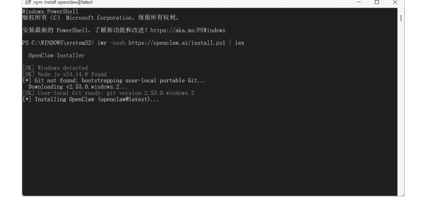
图 8-2 安装启动画面

4. 步骤 4：确认完成
脚本执行结束后，会话会显示安装成功的提示即表示部署完成，见图 8-3。
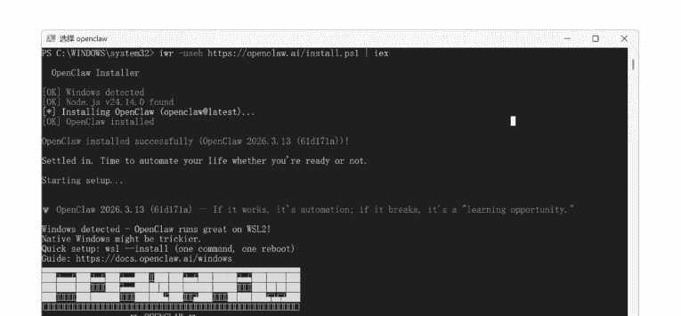
图 8-3 安装结束画面

### 8.2.2 接入 Qwen 模型

部署完成后，还需挂载大模型作为思考核心。默认情况下系统会自动弹出初始化界面，也可手动执行：
```
openclaw onboard
```
向导会引导完成基础设置，重点是模型挂载，具体流程如下。

首先出现安全提示见图 8-4，输入 Y 表示已了解风险并继续。
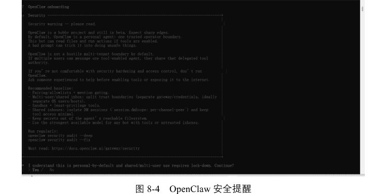
图 8-4 安全提示

随后会询问采用快速模式还是完整手动模式，见图 8-5，本例选择快速模式。
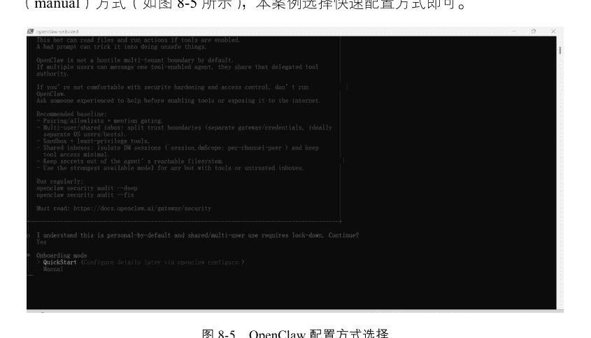
图 8-5 配置模式选择

进入模型挂载环节，见图 8-6，在供应商列表中挑选 Qwen 并确认。
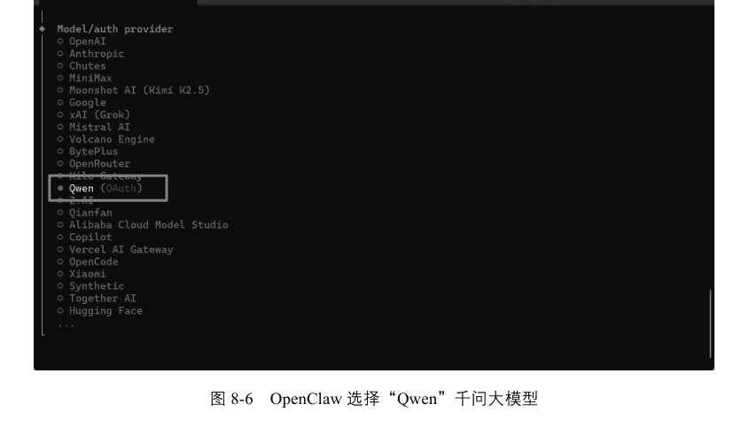
图 8-6 选择 Qwen

系统会自动打开浏览器要求登录 Qwen 账号，见图 8-7，新用户可注册，老用户直接登录。
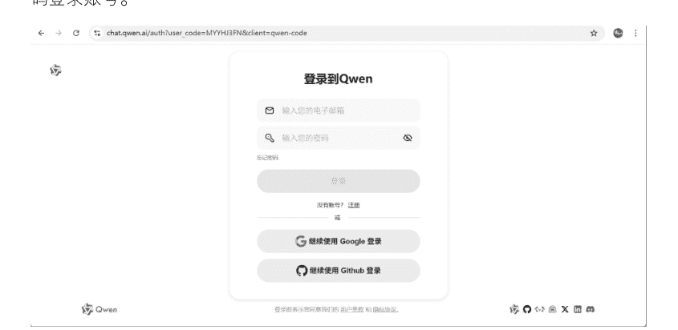
图 8-7 Qwen 账号登录

登录成功后会提示认证完成，见图 8-8，表示已成功对接 Qwen。
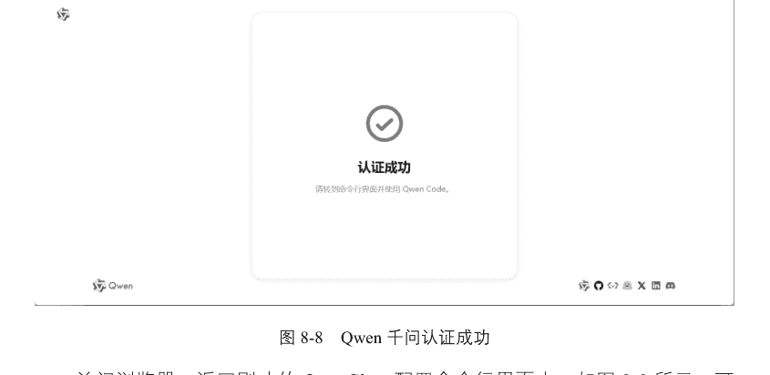
图 8-8 认证完成

关闭浏览器返回配置界面，见图 8-9，系统会询问具体使用哪一个 Qwen 模型，保持默认即可。
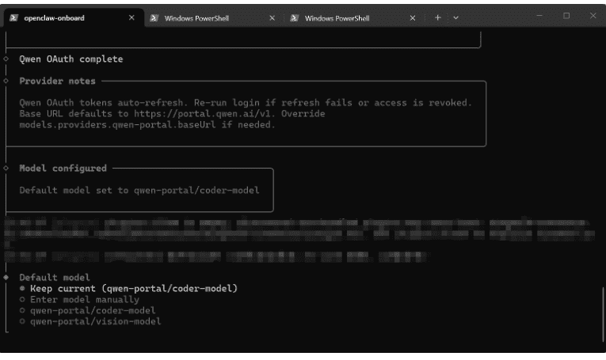
后续的频道、技能、搜索等选项可直接跳过，选择 No 或 Skip for now，见图 8-10。
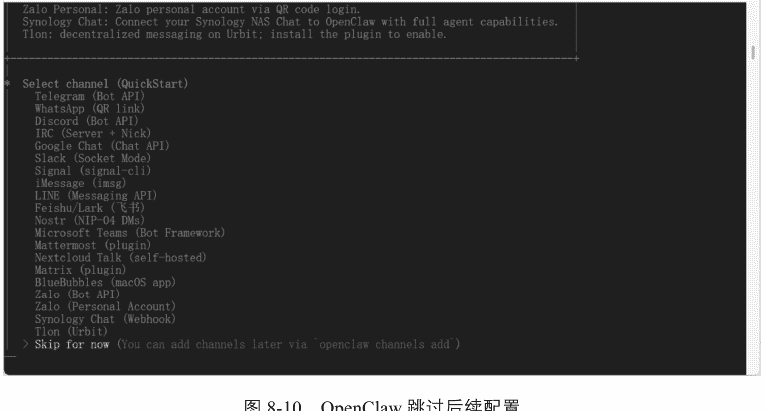
图 8-10 跳过后续设置

全部设置完成后会询问使用方式，见图 8-11，TUI 是终端交互，Web UI 是通过浏览器访问。
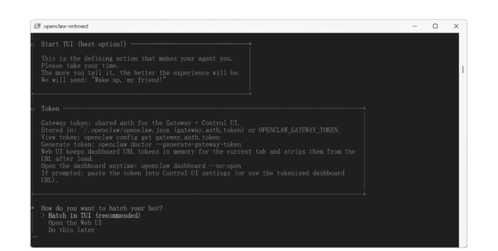
图 8-11 运行方式选择

选择 TUI 后效果见图 8-12，可直接在终端输入问题或指令。
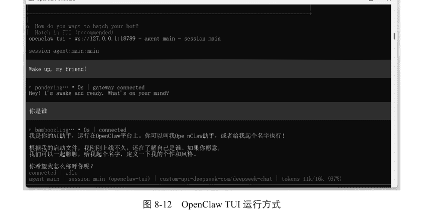
图 8-12 终端交互效果

选择 Web UI 后会自动启动浏览器并打开本地页面，通常为 http://127.0.0.1:18789/，见图 8-13，可在网页中与系统交互。
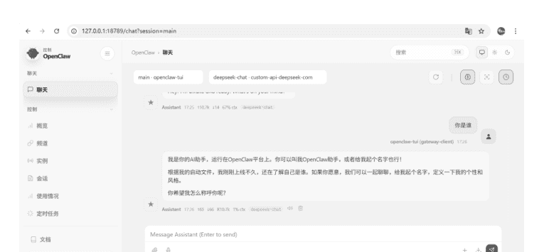
图 8-13 网页交互效果
两种形态均可正常响应请求，至此部署完成。

### 8.2.3 与钉钉联动

对接钉钉平台能把大模型能力带进钉钉生态，让钉钉具备 AI 员工式的智能交互，支持群聊和私聊。配置完成后，用户可在钉钉中远程向本地运行的系统下发指令。

1. 创建机器人
先登录钉钉开放平台 https://open-dev.dingtalk.com/，如未注册请先创建账号。登录后在首页点击创建应用。
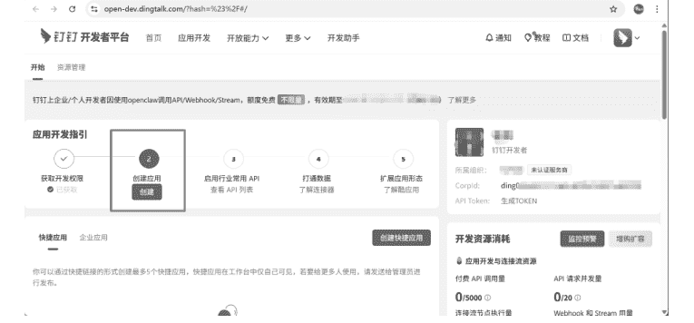
图 8-14 在开发者平台创建应用

在应用列表页见图 8-15，提供了一键创建机器人的入口，点击立即创建。
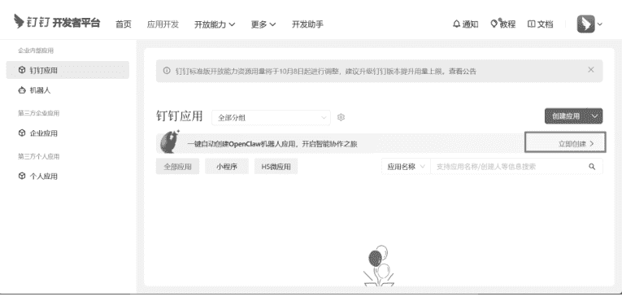
图 8-15 机器人创建入口

弹出创建对话框见图 8-16，填写机器人名称、简介，上传图标也可保留默认，点击确定提交。
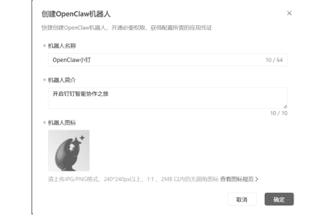
图 8-16 机器人信息配置

创建成功后会弹出凭证信息见图 8-17，包含 Client ID 和 Client Secret，需复制保存，后续要在系统中使用。
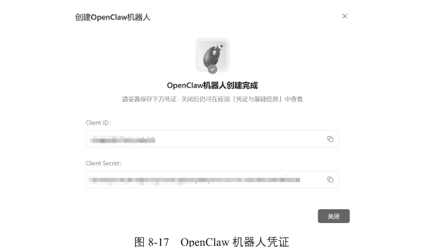

返回应用页面可以看到机器人已列出，见图 8-18，可在此查看或修改。钉钉侧配置完成。
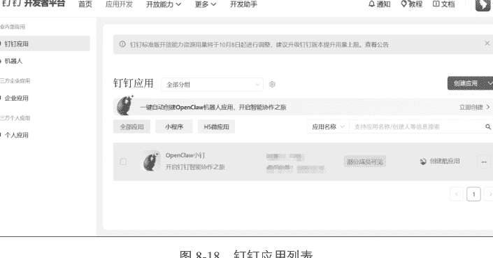

2. 配置系统端
首先在系统中安装钉钉官方插件，在 PowerShell 中执行：
```
openclaw plugins install @dingtalk-real-ai/dingtalk-connector
```
系统会自动下载、安装依赖并完成注册，过程见图 8-19，完成后提示 dingtalk-connector 已安装。
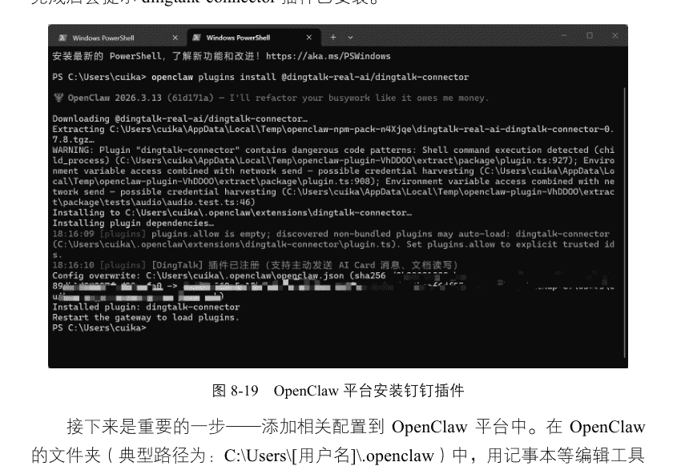

接着在配置文件 C:\Users\[用户名]\.openclaw\openclaw.json 中写入钉钉凭证信息：
```json
"channels": {
    "dingtalk-connector": {
        "clientId": "[OpenClaw 机器人 Client ID]",
        "clientSecret": "[OpenClaw 机器人 Client Secret]",
        "gatewayToken": "[复制"gateway"中的"token"值]"
    }
},
"gateway": {//如果存在，则保持不变
    "port": 18789,
    "mode": "local",
    "bind": "loopback",
    "auth": {
        "mode": "token",
        "token": "e512936c5ec773xxxxxxxx96546456e91600224"
    },
    "http": {
        "endpoints": {
            "chatCompletions": {
```

# 第 8 章 进阶：OpenClaw 实践

```json
"enabled": true
}
}
},
```
该配置的作用是将开发者平台创建的机器人信息写入系统。编辑时注意不要删除原有内容，如 gateway 已存在则保持不变。

保存文件后在 PowerShell 中重启服务：
```bash
openclaw gateway restart
```
至此钉钉对接配置结束。

## 3. 验证联动效果

打开手机钉钉 App，见图 8-20，点击右上角搜索框输入机器人名称，可找到对应机器人，见图 8-21。

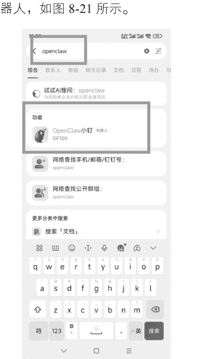
进入对话界面后，见图 8-22，在钉钉中发送的消息会由 Windows 上运行的系统及时执行并返回结果。
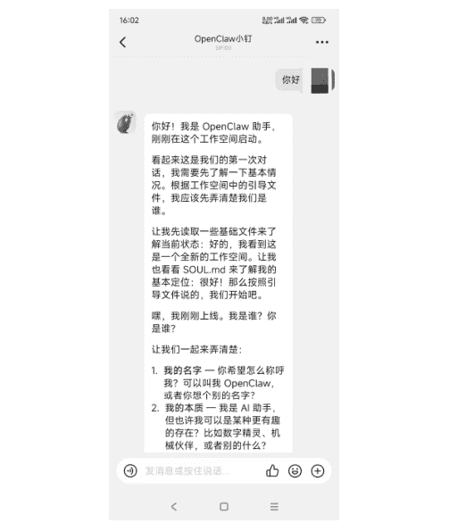
图 8-22 钉钉机器人对话界面

目前可通过 TUI、Web UI 和钉钉三种途径操作系统，表 8-1 做了简要对比。

表 8-1 OpenClaw 不同调用方式差异

| 对比维度 | TUI 终端界面 | Web UI 网页界面 | 钉钉 |
| :--- | :--- | :--- | :--- |
| 使用感受 | 需在终端敲命令，适合熟练命令行者，无图形呈现 | 图形化呈现，直观易懂，无需专业命令，适配各类用户 | 依托钉钉原生界面，直接在聊天窗口操作，贴合日常办公习惯，便捷度高 |
| 能力范围 | 核心功能齐全，支持底层调用与精细化设置，缺乏可视化展示与批量处理 | 功能最全，涵盖配置管理、监控、任务调度、日志查看及可视化图表，批量操作与权限管理更方便 | 聚焦常用功能，适配办公场景，支持消息推送、简单配置与任务触发 |
| 典型用途 | 本地调试、底层设置、脚本自动化或无图形环境的服务器 | 团队协作、多用户管理、日常运维监控，可在任意联网设备访问，适配多场景 | 企业内部协同，快速接收通知、触发任务并与钉钉流程联动 |

## 8.3 快速实战

下面两个实操案例演示系统在本地文件管理和网页数据采集中的典型用法，帮助快速掌握。

### 8.3.1 批量整理文件

日常下载目录常混杂文档、视频、图片，手动整理耗时易错。系统可通过自然语言完成识别、分类与搬迁。

示例提示词：
> 分类整理 C:\Users\xxx 目录下的所有文件，要求：
> 文档 Word、Excel、PPT、PDF 等放入 文档 文件夹，
> 视频放入 视频 文件夹，
> 图片放入 图片 文件夹，
> 其他放入 归档 文件夹，
> 保留源文件不作删除。

在聊天界面输入上述要求后，系统见图 8-23 会自动调用文件系统工具，遍历源目录、识别类型、创建四个目标文件夹，并按后缀生成 PowerShell 脚本执行迁移，源文件保留。
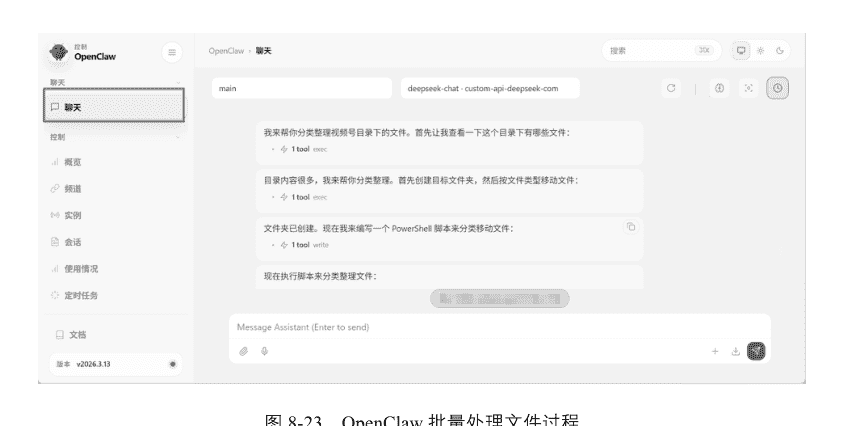
图 8-23 批量处理过程

完成后会生成整理报告，见图 8-24，展示各文件夹文件数量与类型。
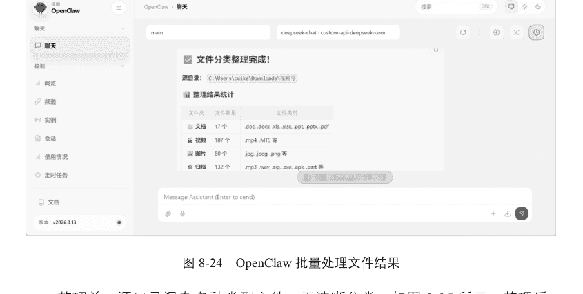
图 8-24 处理结果

整理前目录杂乱见图 8-25，整理后仅保留四个分类文件夹，各类文件归位见图 8-26，效率显著提升。

图 8-25 整理前界面

图 8-26 整理后界面

### 8.3.2 网页数据抓取

手动复制网页榜单效率低且易遗漏，见图 8-27 的百度热搜榜。系统可自动解析页面结构，抽取指定字段并导出为结构化文件。

图 8-27 百度热搜榜页面

示例指令：
> 访问百度热搜榜，抽取网页中的所有热点新闻，包括新闻名称、新闻摘要、热搜指数，将结果保存到 Excel 文件中，存放路径为 C:\Users\cuika\xxx

在 OpenClaw 对话窗口下达指令时，需要写明目标地址、希望抽取的字段、导出格式选用 Excel 以及保存位置。提交后系统立刻开始工作，如图 8-28 所示，先调用 web_fetch 把目标页面的完整 HTML 拉取下来，随后对页面结构进行解析，定位到热搜列表区域，将每条目的新闻标题、摘要和热搜指数逐一取出，整理成两维表格形态再写入 Excel 送到指定目录。打开生成的表格核对列是否齐全、数值是否准确，即可直接用于筛选、排序等后续分析。


图 8-28 OpenClaw 抓取网页数据过程

任务完成后 OpenClaw 会输出执行报告，如图 8-29 所示，报告中标明数据来源为百度热搜榜实时榜单、抓取日期以及结果文件存放在目标目录下的 CSV。


图 8-29 OpenClaw 抓取网页数据结果

打开 Excel 文件，如图 8-30 所示，表头包括排名、新闻名称、热搜指数、新闻摘要共四列，信息完整且可追溯。借助自动化抓取，网页原本非结构化的信息被转换为结构化文件，取数与分析效率得到明显提升。


图 8-30 网页数据文件展示

## 8.4 OpenClaw Skill 用法

如果把 OpenClaw 看作一部智能手机，Skill 就相当于手机里的应用程序。核心框架只提供基础运行环境和执行能力，真正让它适配不同场景、解决具体问题的，是丰富的 Skill 生态。掌握 Skill 的使用方法，是发挥 OpenClaw 能力的关键，下面系统介绍 Skill 的基本概念、安装管理方式以及常用技能，帮助用户快速找到合适的工具。

### 8.4.1 什么是 Skill

Skill 是 OpenClaw 的模块化能力扩展包，由一套清晰规范、可执行的指令和代码集合组成，明确了 AI 在何种场景下按什么步骤完成什么任务，相当于为 AI 赋予特定领域的专业能力。

- （1）核心作用：通过标准化封装，AI 无需重复学习执行逻辑，就能快速掌握邮件管理、PDF 处理、网页搜索、数据分析等特定任务。
- （2）加载机制：OpenClaw 采用按需加载，只有任务需要时才挂载对应能力，不会常驻占用系统资源，也不会增加大模型的上下文消耗。
- （3）低代码特性：绝大多数 Skill 安装后无需编写代码，用自然语言即可直接调用，新手也能轻松上手。

一个完整的 Skill 核心由必需的 SKILL.md 文件和可选的辅助文件构成，结构清晰，便于理解功能定义：

```
skill-name/
    ——SKILL.md（必需文件，技能的核心定义，包含元数据、功能描述、执行指令、使用示例）
    ——templates/（可选，存放可复用的模板文件）
    ——examples/（可选，存放技能的输入输出示例）
    ——references/（可选，存放规则参考、文档资料）
    ——scripts/（可选，存放执行所需的脚本文件）
```

其中 SKILL.md 是技能的灵魂，采用标准格式，先用 YAML 头部声明名称、描述等元数据，再用 Markdown 详细说明功能、适用场景、执行步骤和示例，模型可直接读取并掌握执行能力。

OpenClaw 从三个位置读取 Skill，优先级不同，高优先级的同名技能会覆盖低优先级内容，可按需管理：

- （1）工作区 Skills：优先级最高，放在当前项目工作区目录下的 skills 文件夹，仅本项目生效，适合定制专属技能。
- （2）本地托管 Skills：优先级中等，放在用户目录 ~/.openclaw/skills 下，全局生效，所有工作区均可调用，适合安装常用通用技能。
- （3）内置 Skills：优先级最低，随安装包自带，无需安装，开箱即用，是最基础的核心能力。

截至 2026 年 3 月，官方技能市场 ClawHub 已托管超过 25000 个技能，涵盖数十个细分品类，包括内置基础、官方精选与社区贡献，可满足学习、办公、轻量自动化等多样化需求。


图 8-31 ClawHub 官网

### 8.4.2 Skill 安装

ClawHub 是 OpenClaw 的官方技能市场，类似手机应用商店，收录经过审核的官方和社区优质技能，并提供命令行工具，可通过简单命令完成搜索、安装、更新等全流程操作，是最主流方式。

#### 1. 安装 ClawHub 工具

在 PowerShell 中执行以下命令安装命令行客户端：

```bash
npm install -g clawhub@latest
```

#### 2. 搜索 Skill

安装完成后可按关键词检索所需技能，命令格式如下：

```bash
clawhub search "关键词"
```

例如查找网页搜索相关技能，可执行：

```bash
clawhub search "web search"
```

执行后会返回匹配列表，包含技能名称、功能描述等信息，如图 8-32 所示，可据此挑选。


用户也可通过 ClawHub 官网 Web 页面检索，对零基础用户更友好便捷，如图 8-33 所示。

#### 3. 安装 Skill

确定所需技能后，通过 install 命令一键安装，命令格式如下：

```bash
clawhub install <技能名称>
```


图 8-33 ClawHub 官网搜索 Skill

例如安装官方的 summarize 摘要技能，可执行：

```bash
clawhub install summarize
```

安装完成后系统会自动配置，重启 OpenClaw 网关服务后即可在对话中直接调用。表 8-2 汇总了常用 Skill 管理命令。

表 8-2 常用的 Skill 管理命令

| 操作目的 | 命令 | 说明 |
| :--- | :--- | :--- |
| 查看本地已安装的所有技能 | openclaw skills list | 展示已安装技能的名称、状态及版本 |
| 查看单个技能的详细信息 | openclaw skills info <技能名称> | 显示指定技能的描述、版本、配置与使用方法 |
| 更新指定已安装的技能 | clawhub update <技能名称> | 升级到最新版本，修复问题并新增功能 |
| 更新所有已安装的技能 | clawhub update --all | 批量升级全部已装技能到最新 |
| 卸载指定的技能 | clawhub uninstall <技能名称> | 彻底删除本地指定技能 |

### 8.4.3 常用 Skill 介绍

除内置技能外，ClawHub 还有大量经官方审核、社区验证的优质技能，覆盖办公、学习、生活、数据处理等高频场景，下面按分类整理常用高下载技能，便于快速选型。

#### 1. 信息检索与网页处理类

此类技能主要用于获取互联网信息、处理网页内容，是 OpenClaw 连接外部世界的窗口，如表 8-3 所示。

表 8-3 常用信息检索与网页处理类 Skill

| 技能名称 | 核心功能 | 适用场景 |
| :--- | :--- | :--- |
| tavily-search | 面向 AI 优化的搜索服务，结果结构化、相关性强、噪音少，支持深度搜索与新闻搜索 | 实时获取最新资讯、行业动态、技术资料、新闻热点等 |
| ddg-search | 基于 DuckDuckGo 的隐私优先搜索引擎，无需 API Key，免费且不记录用户行为 | 注重隐私的网页查询，适合简单搜索需求 |
| web-pilot | 面向任务的网页自动化工具，能做多页跳转、信息抽取、表单提交和内容交互 | 复杂网页自动化，如跨页数据采集、多步骤操作流程 |

#### 2. 办公与文档处理类

此类技能提升办公效率，处理文档、表格、邮件、日程等任务，是职场用户的必备工具，如表 8-4 所示。

表 8-4 常用办公与文档处理类 Skill

| 技能名称 | 核心功能 | 适用场景 |
| :--- | :--- | :--- |
| himalaya | 通用邮箱管理工具，支持 IMAP/SMTP，可收发、搜索、归档、分类及自动回复 | 邮件自动化处理、批量筛选、提取关键信息、自动回复常见咨询 |
| notion | Notion 集成工具，可对页面与数据库进行读写、创建、修改和查询 | 自动化管理笔记、同步数据到数据库、自动生成笔记内容 |
| excel-xlsx | Excel 处理工具，支持读写修改，提取数据、生成表格、批量处理内容 | 批量处理销售报表、提取关键数据、自动生成统计表、格式转换 |

#### 3. 内容创作与多媒体处理类

此类技能辅助内容创作、音视频处理、图文生成，适合自媒体、内容创作者、新媒体运营人员，如表 8-5 所示。

表 8-5 常用内容创作与多媒体处理类 Skill

| 技能名称 | 核心功能 | 适用场景 |
| :--- | :--- | :--- |
| ai-humanizer | AI 文本去 AI 化工具，可润色模型生成文本，使其更像人工撰写，降低 AI 痕迹并规避检测 | 自媒体文案润色、论文改写、商务邮件优化、内容去 AI 化 |
| edge-tts | 微软 Edge 文本转语音工具，免费使用，中文发音自然，可将文本转为语音音频 | 视频配音、有声书制作、文案转语音、语音播报生成 |
| diagram-generator | 图表生成工具，支持 Mermaid、Draw.io 格式的流程图、思维导图、架构图和数据图表，基于自然语言描述生成 | 制作汇报流程图、数据分析图表、架构示意图，无需专业绘图软件 |

#### 4. 开发与运维类

此类技能面向开发者、运维人员，辅助代码开发、版本管理、服务器运维、自动化部署，提升技术效率，如表 8-6 所示。

表 8-6 常用开发与运维类 Skill

| 技能名称 | 核心功能 | 适用场景 |
| :--- | :--- | :--- |
| github | GitHub 集成工具，基于 gh CLI，可管理仓库、PR、Issue、工作流，完成提交、分支管理、代码审查 | 管理 GitHub 项目、自动化代码提交、监控仓库动态、处理 Issue |
| gitlab | GitLab 集成工具，支持项目管理、MR 处理、CI/CD 流水线监控、Issue 管理 | 企业内部 GitLab 仓库自动化管理、研发流程自动化、流水线监控 |
| docker-essentials | Docker 容器管理工具，可启动停止容器、查看日志、管理镜像、健康检查 | 运维人员管理 Docker 容器、自动化部署服务、监控运行状态 |

#### 5. 生活与实用工具类

此类技能处理日常生活需求，如天气查询、智能家居控制、价格监控、生活服务，让 OpenClaw 成为个人生活助手，如表 8-7 所示。

表 8-7 常用生活与实用工具类 Skill

| 技能名称 | 核心功能 | 适用场景 |
| :--- | :--- | :--- |
| weather | 天气预报查询工具，无需 API Key，免费获取指定城市实时天气、未来预报和空气质量 | 日常天气查询、出行前确认、定时天气提醒 |

## 千问 + “龙虾” + “悟空”：轻松搞定一人 AI 生态

| 技能名称 | 核心功能 | 适用场景 |
| :--- | :--- | :--- |
| blogwatcher | RSS 订阅监控工具，可追踪博客、新闻网站、RSS/Atom 源更新，有新内容时自动提醒并提取要点 | 追踪行业博客更新、监控新闻动态、关注竞品网站变化、订阅专栏更新 |
| home-assistant | 智能家居集成工具，可对接 Home Assistant 平台，控制灯光、空调、窗帘、摄像头等设备 | 智能家居自动化控制、场景模式切换、设备状态监控 |

Skill 生态非常开放，社区用户均可发布自己的技能，使用和安装时需注意以下安全事项：

- （1）优先使用官方和经过审核的技能：优先安装官方维护的技能，以及 ClawHub 上审核通过、下载量高、评价好的社区技能，避免来源不明、小众冷门的技能，防止恶意代码风险。
- （2）警惕高权限技能：对于需要系统权限、文件访问权限、API 密钥的技能，务必仔细查看代码和说明，确认用途安全，避免数据泄露、系统被控制风险。
- （3）定期更新技能：及时把已装技能更新到最新版本，官方和开发者会在新版中修复安全漏洞、优化功能，避免使用存在已知漏洞的旧版本。

## 8.5 OpenClaw 应用场景

OpenClaw 的价值在于把 AI 推理能力与真实世界执行能力结合，凭借灵活的 Skill 生态和低门槛操作方式，已在个人学习生活、职场办公、各行各业专业场景中得到应用。下面分场景详细介绍 OpenClaw 能解决的问题及使用方式。

### 8.5.1 职场办公

对职场人而言，重复繁琐的办公事务占用大量时间，OpenClaw 可作为“数字助理”自动化处理各类流程，大幅提升效率，减少无效加班，让用户聚焦更有创造性的核心工作。无论行政、人事、财务，还是运营、市场、销售，都能借助 OpenClaw 实现办公提效。

# 第 8 章 进阶：OpenClaw 实践

#### 1. 邮件自动化处理

借助 Himalaya、Gmail 等邮件管理技能，OpenClaw 可解决邮箱管理痛点，自动筛选收件箱并按优先级分类，将垃圾邮件、广告邮件归档，提取重要邮件的核心信息和待办事项，生成每日邮件简报；可设置自动回复规则，对常规咨询邮件自动回复对应内容，如客户常见问题、面试邀请确认等；可批量处理邮件，如向参会人员发送会议提醒、向客户发送节日祝福邮件，并自动替换收件人姓名等个性化信息。

#### 2. 文档与文件自动化处理

借助 file-manager、xlsx、nano-pdf、summarize 等技能，OpenClaw 可处理各类办公文档和文件，告别手动重复操作。例如，让它“把这个文件夹里的 100 份合同 PDF，提取出甲方名称、合同金额、签约时间、到期时间，整理成一个 Excel 表格，并标注出 3 个月内到期的合同”；批量重命名文件、按规则整理文件夹资料、批量转换文件格式、合并多个 PDF 文档、为文档加水印。

#### 3. 会议与日程管理

OpenClaw 可根据参会人日程自动协调合适会议时间，发送会议邀请并准备所需资料。会议结束后，可将录音转文字，整理会议纪要，提取核心决议、待办事项、责任人、截止时间，同步到待办清单和团队协作工具，并跟进待办完成进度，到期提醒负责人。

#### 4. 报表与数据自动化处理

针对职场人头疼的报表工作，OpenClaw 可实现流程自动化。例如，让它每天自动从业务系统导出数据并清洗整理，生成每日销售报表、运营数据报表，按预设规则分析数据异常并生成数据简报，自动发送给团队领导和相关同事；也可处理复杂 Excel 数据，如跨表格匹配、批量计算、生成数据透视表和可视化图表，完成原本需复杂函数才能实现的操作。

#### 5. 周报/工作总结自动化生成

每周写周报、每月写工作总结是常见痛点，OpenClaw 可自动汇总本周处理的邮件、完成的任务、修改的文档、参加的会议，提取核心工作内容，按公司要求的周报格式生成草稿，用户只需简单修改补充即可完成，告别“想半天写不出一句话”的尴尬。

### 8.5.2 新媒体运营

对新媒体运营、自媒体博主、内容创作者而言，OpenClaw 可成为内容创作助手，覆盖选题、素材收集、内容创作到发布、数据复盘的全流程，大幅提升内容生产效率。

- 1. 热点追踪与选题策划

借助 web-search、blogwatcher 等技能，OpenClaw 可实时追踪各大平台行业热点、爆款选题，筛选出与账号定位匹配的内容并生成选题建议。例如，让它“每天早 9 点，监控自媒体平台上职场领域的热点话题和爆款内容，筛选出点赞量高的选题，总结核心切入点，生成 5 个可创作的选题方向”，不再为找不到选题发愁。

- 2. 素材收集与内容生成

在素材准备环节，OpenClaw 动作很快，可以把撰稿用得到的案例、数据、金句、行业动态等迅速抓取并整理成有条理的知识库。基于这些积累，系统能按需生成适配不同渠道的内容，比如公众号深度长文、短视频口播脚本、小红书笔记、朋友圈宣传短句，同时提供文案润色、标题打磨、话题标签推荐，并按照各平台的语气与风格做差异化适配。

- 3. 内容发布与数据监控

借助平台集成能力，OpenClaw 支持按计划定时推送内容，实现多渠道同步分发，并在后台持续跟踪发布表现，每日输出数据简报，拆解爆款特征，为后续创作提供优化建议。

### 8.5.3 电商运营

对电商运营和跨境卖家而言，OpenClaw 的价值在于把需要长期盯盘的重复性事务交给自动化，实现全天候无人值守，让运营者摆脱数据核对与报表制作，聚焦选品与策略优化。

- 1. 多平台数据自动化汇总

运营人员常要同时维护多家店铺，手动登录后台查看数据非常费时。让 OpenClaw 每天定时抓取各平台的订单、销售额、流量、退款等指标，统一汇总成运营报表，自动计算出转化率、客单价、访客单值等核心数据，并做同比环比对比，标注异常点，全店情况一目了然。

#### 2. 竞品分析与市场监控

系统可 7×24 小时追踪竞品的价格变化、促销活动、上新节奏、销量波动，一旦出现异动即时推送提醒，并自动生成周度竞品分析报告，帮助运营快速洞察市场变化，及时调整策略。

#### 3. 库存与供应链管理

平台实时监控店铺商品库存，库存低于预设阈值时自动发出补货信号，避免超卖或断货；同时基于销量统计分析库存周转情况，输出采购建议，优化库存结构，降低滞压风险。

### 8.5.4 人事行政

行政 HR 的日常大量涉及标准化重复流程，如入离职办理、考勤统计、招聘沟通、会议协调、办公用品管理等，均可通过 OpenClaw 实现自动化处理，显著提升效率，减少事务负担。

#### 1. 招聘流程智能辅助

系统可按预设条件筛选合适候选人，汇总核心信息生成简历筛选报告；自动发送面试邀请，并在面试结束后推送反馈；同时统计各渠道简历量、邀约率、面试通过率、到岗率等数据，生成招聘报表。

#### 2. 员工入离职与档案管理

新员工入职时，自动生成入职须知、劳动合同模板、办公用品申领单等资料，并将信息同步至人事档案系统建立档案；离职时自动生成交接清单，提醒各部门办理手续，更新档案、停缴社保公积金，免除手工整理。

#### 3. 行政事务自动化

会议安排、办公用品管控、团建组织、固定资产管理等均可获得支持。例如协调会议室与参会人时间、发送通知、准备物料、管理办公用品库存并在不足时提醒采购、记录申领情况；组织团建时收集意向、推荐方案、统计报名，流程顺畅。

### 8.5.5 财务管理

财务会计的核心工作包括数据处理、单据审核、报表编制、税务申报，对准确性要求极高。OpenClaw 能自动化处理大量重复录入、整理、核对环节，降低人工失误，提升效率与精确度。

#### 1. 票据报销自动化

系统可自动识别报销单据中的发票号码、开票日期、金额、项目等信息，校验真伪与合规性，按报销标准匹配，生成审核单并标注不合规项，减轻人工逐张核对压力。

#### 2. 账务处理与凭证生成

可整合银行流水与业务单据，依据预设会计规则自动生成会计凭证并匹配科目，减少手工录入；还能核对往来账目，如应收应付款，自动标记逾期未收并提醒催收。

#### 3. 报表生成与财务分析

自动从财务系统提取数据生成资产负债表、利润表、现金流量表及内部经营分析报表；同时计算毛利率、净利率、资产负债率、周转率等关键指标，分析趋势与异常原因，形成财务分析报告，为经营决策提供支撑。

### 8.5.6 教育培训

对高校教师与培训讲师而言，OpenClaw 能覆盖备课、授课、作业批改、学生管理全流程，帮助教研人员从事务性工作中解脱，聚焦教学设计与互动。

#### 1. 教学资源与课件制作支持

可快速搜集课程所需教学资料、行业案例、前沿资讯；依据教学大纲与知识点设计教学流程、搭建课件框架、生成核心内容与板书；还能设计课堂互动、小组讨论话题和练习题，提升课堂效果。

#### 2. 作业考试工作自动化

批改作业与出题耗时耗力。系统可按知识点自动生成不同难度练习题、单元测试、期末试卷，并附参考答案与评分标准；客观题可自动批改并统计正确率、分析错题点；主观题先进行初步审阅、提炼要点并给出评分建议，教师只需最终复核，大幅节省时间。

#### 3. 学生管理与个性化教学支持

可统计考勤、作业完成、考试成绩等数据，生成学习档案并分析薄弱环节，为教师提供个性化教学建议；针对不同水平学生生成定制学习计划与辅导资料，帮助基础薄弱者补短板、优秀者拓展，实现因材施教。

### 8.5.7 金融投资

对金融从业者、个人投资者、投研人员来说，OpenClaw 可实现数据采集、行情监控、研报整理、风险预警等自动化，提升投研效率与决策质量。

#### 1. 金融数据采集整理

自动抓取股票、基金、债券、期货的实时行情与历史交易数据，以及上市公司财务数据、公告、宏观经济等信息，整理成结构化表格并入库，确保数据及时准确。

#### 2. 行情监控与风险预警

可设置监控规则实现 7×24 小时盯盘。当关注标的价格涨跌幅超阈值、出现重大公告或新闻、市场异常波动时即时提醒；也能监控持仓标的基本面变化，如业绩预告、重大利空，提前预警规避风险。

#### 3. 研报资讯整理分析

市场每日产生大量券商研报、行业资讯、政策新闻，系统可自动抓取并智能摘要，提炼核心观点、关键数据、投资建议，按日分类整理成投研简报，帮助快速掌握市场动态。

#### 4. 投资分析与策略回测支持

可基于上市公司财务数据进行指标分析并评估投资价值，生成个股分析报告；回测策略历史表现，输出收益率、最大回撤、胜率等指标以优化参数；记录交易日志，分析盈亏原因，总结问题以优化交易体系。

# 第 9 章

## 一人公司利器“悟空”

## 9.1 “悟空”介绍

随着 AI 向企业级场景深化，阿里巴巴推出悟空平台，将智能体能力从个人场景拓展到企业端，为团队与个体创业者提供全流程 AI 工作解决方案，让个人也能发挥团队效能。平台依托钉钉的企业服务沉淀，结合阿里生态商业能力，构建以 AI 为原生的工作体系，成为职场人士与创业者提效的重要工具。

### 9.1.1 什么是“悟空”

悟空是阿里巴巴发布的首个企业级 AI 原生工作平台，定位为阿里 AI 在企业工作场景的统一入口。战略上归属 Alibaba Token Hub 事业群，目标是打造 B 端 AI 应用入口，将模型能力深度融入企业工作流。

悟空以独立应用形态存在，同时内嵌于钉钉，可直接连接企业钉钉账号、安全权限及应用系统，通过钉钉最新 AI 2.0 版本内置的悟空智能体使用。全球用户可直接下载，同时支持对接微信、Slack 等主流即时通讯平台，在电脑、手机等终端远程唤起完成工作。

作为面向企业与个人的 AI 工作平台，悟空可直接操作本地工作环境，访问本地文件、操作浏览器及各类应用，无需额外安装，即开即用，实现真实任务自动化。其价值在于为团队和公司打造 24 小时在线的智能体矩阵，适配超级个体趋势，为一人公司提供全链路 AI 支撑，让个体借助 AI 完成原本需团队协作的工作。

阿里生态 ToB 能力正以 Skills 技能形态逐步嵌入悟空，淘宝、天猫、1688、支付宝、阿里云等 B 端能力将陆续接入，实现从对话交互到企业核心业务落地的融合，覆盖选品、运营、财务、云服务等经营场景。

### 9.1.2 “悟空”的优势特点

1. 内置企业级安全运行环境

悟空诞生于企业组织，不同于普通智能体产品，平台内置专属企业级运行环境，智能体自动继承企业权限规则，所有操作在安全沙箱内运行，Token 费用与成本清晰可控，便于精细化管理。安全架构采用递进式设计，通过本地沙箱和网络沙箱为每家企业构建独立运行边界，从源头保障数据安全与合规，并具备统一账号、企业权限、数据安全、审计等完备体系。

2. 构建全维度的 Skill 生态体系

悟空同步推出 AI 能力商城，与开发者共建企业级技能生态，提供开发、审核、上架、分发全流程。企业和开发者可把行业经验和业务能力标准化为 Skill 能力包，在内部共享或上架商城付费调用，实现价值转化。上架前自动安全扫描，运行时通过 Policy 引擎实时评估操作，不合规立即阻断，在开放与安全间取得平衡。阿里生态 B 端能力以 Skill 形态接入后，进一步丰富电商、支付、云服务等矩阵。

3. 推出开箱即用的行业解决方案

面向超级个体经济推出 OPT 一人团队十大行业方案，为全球首个把智能技能从概念落地为行业级即用产品的方案，首批覆盖电商、跨境电商、知识博主、开发、门店、设计、制造、法律、财税、猎头十大场景。将多个智能技能组合成行业专属的一人团队模板，预编排完整工作流程，每个 Skill 绑定具体场景、身份与 SOP。用户一键启用即可覆盖全业务链路，仅需决策与验收，其余由 AI 全程执行。

4. 支持多端多平台的全域接入与使用

除钉钉外，还可连接微信、Slack 等主流即时通讯平台，支持电脑、手机等终端远程唤起。依托钉钉全面 CLI 化重构，悟空可原生操作钉钉上千项能力，包括文档、AI 表格、AI 听记、IM 等，实现沟通即执行。还支持设置周期性工作流，按预设要求定时完成任务，实现流程自动化。

5. 具备 AI 原生的技术体系支撑

自主研发以 AI 为原生的文件系统 Realdoc，实现文件精准操控并支持操作回退，降低 Token 费用。模型层支持多款主流模型手动配置，兼容智能体开放体系，具备自主拆解任务、调用工具、操作文件能力，可按需完成复杂任务拆解与执行，无需精细化步骤设置。

6. 实现阿里生态的深度业务融合

作为阿里 AI 在企业工作场景的统一出口，悟空深度融合阿里生态，淘宝、天猫、1688、支付宝、阿里云等核心业务的 B 端能力逐步以 Skill 形态接入，打通消费与经营场景，构建全链路数字化经营体系。

千问 + 龙虾 + 悟空：轻松搞定一人 AI 生态

## 9.2 “悟空”快速上手

完成安装和基础配置是发挥 AI 工作能力的关键。本节从安装配置、任务创建、技能管理、定时任务四个维度介绍基础操作流程。

### 9.2.1 安装配置

悟空客户端需通过官方渠道下载，完成账号绑定与权限配置后即可使用。

访问悟空官网 https://www.dingtalk.com/wukong，如图 9-1 所示，按操作系统选择对应安装包：Windows 支持 Win10 64 位 1909 以后版本，或 MacOS 系统。


图 9-1 悟空官网

运行安装程序按指引完成安装，启动客户端后用钉钉 App 扫描登录二维码完成身份验证与账号绑定。登录成功后钉钉 App 内会自动收到对话机器人“悟空_本地电脑”的消息，如图 9-2 所示，后续可通过该机器人远程唤起电脑端悟空执行任务。


图 9-2 悟空钉钉对话机器人

打开客户端，点击左下角弹出配置页，可自定义 MCP 服务、手动添加大模型以扩展底层能力。在通用设置页，如图 9-3 所示，建议将“AI 默认安全等级”设为“完全访问权限”，确保任务执行权限充足。


图 9-3 悟空配置 AI 默认安全等级

### 9.2.2 任务创建

进入主界面，点击左侧“新的任务”，如图 9-4 所示，在输入框直接发起指令。支持选择工作区文件目录，建议按任务类型分类，便于管理与归档。


点击加号可上传图片或文件作为素材辅助理解需求。点击闪电图标或输入“/”快捷键调用已安装的 Skill，如快速选择“/PDF 文件工具”。输入框右侧可选择标准、高级、旗舰模式，适配不同复杂度任务。

以“批量分析文件”为例，演示任务流程，示例提示词如下：

> 批量分析“C:\Users\xxxx\合同”目录下所有合同文件，抽取乙方详细信息，包括姓名、身份证号、通讯地址、联系电话、邮箱，统一保存到原目录新建的 Excel 文件中。

发送后悟空启动流程，如图 9-5 所示，编写 PDF 解析脚本、创建 Python 脚本、批量读取 PDF 并提取乙方信息，保存到 Excel 并校验结果完整性。


任务完成后，指定目录下会生成 Excel 文件，按要求抽取并保存各字段，结果如图 9-6 所示。


### 9.2.3 技能管理

技能中心是能力扩展的核心入口，提供内置技能与场景化扩展技能管理。进入技能中心后页面分为“已安装”与“推荐”两块，如图 9-7 所示。


“已安装”展示当前可用内置技能，如热搜词获取、应用开发、PPT 工具、Excel 工具、Word 工具、PDF 工具等，可通过开关控制启用状态。

“推荐”提供面向不同行业场景的扩展技能，涵盖品牌官网搭建、猎头数据站、岗位分析、合同起草、门店运营指南、1688 选品等，点击右侧加号即可安装。

页面右上角有“上传技能”与“+新技能”按钮，支持导入外部技能或从零创建自定义技能，实现个性化拓展。

### 9.2.4 定时任务

定时任务支持预设执行周期，实现自动化工作流。点击左侧“定时任务”进入管理页，如图 9-8 所示。

页面提供三类预设定时任务模板，用户可直接选用模板快速创建任务。

# 第 9 章 悟空：单人企业的智能引擎

1. 行业资讯早报：每日 8 点准时推送定制行业的精选动态。
2. 舆情追踪监测：每天 12 点汇总竞品与自有产品的全网反馈。
3. 周报自动合成：每周五 18 点基于本周对话、文档与表格生成周报。


点击右上角“+ 新任务”，能够自行定义任务内容、循环周期与启动时刻，创建个性化定时任务。“已定任务”列表展示已建任务，包含标题、计划时间、运行状态等信息，支持编辑、暂停或删除操作。

## 9.3 单人公司场景化解决方案

悟空面向超级个体经济推出 OPT 一人公司行业方案，首批覆盖电商等十个赛道。该方案把多个 AI 能力单元组合成行业专属的“一人团队模板”，流程预先编排，每个单元绑定具体场景、角色与标准作业流程，形成标准化的行业能力模块。

悟空主页面输入框下方设有专属“一人公司”入口，如图 9-9 所示，点击即可浏览平台内置的各类“一技能”。这些技能是面向垂直领域的标准化能力集合，服务独立从业者和单人创业者，通过 AI 实现多岗位协同，无需另组团队。本节围绕知识创作、设计、开发、财务、电商、线下门店、法律服务、猎头、制造等单人场景，介绍对应能力的功能与使用方式。


图 9-9 “悟空”一人公司入口

### 9.3.1 一人知识博主

该场景覆盖内容创作全流程，如图 9-10 所示，帮助独立博主完成选题、内容分析、视频制作等原来需团队协作的工作，实现单人高效产出优质内容，打破产能瓶颈，主要能力如下。

（1）**内容雷达**：为知识博主提供选题挖掘工具，激活后自动启动全链路选题调研。供给侧检索 Twitter、YouTube、GitHub、Exa、RSS 等平台，需求侧覆盖小红书、B站、抖音等平台，比对后输出结构化候选选题表。输入“内容雷达”“选题分析”“找选题”等指令均可触发。

（2）**爆款拆解**：支持小红书、B站、抖音三大平台，指定关键词或提供内容链接即可启动深度拆解，从内容结构、受众反馈、标题包装、选题跟进建议等多维度分析，提炼爆款创作逻辑与实操价值。输入“拆解”“分析爆款”“分析这篇文章”“学习这个帖子”等指令均可触发。


图 9-10 “悟空”一人知识博主技能入口

（3）**动画大师**：以代码驱动的动画视频制作能力，支持文字动画、数据可视化、3D场景搭建、音频可视化、字幕烧录、多场景连贯编排，完成后直接渲染输出 MP4，无需第三方工具。

点击技能入口右上角“立即启用”，主页面会新增“一人知识博主”技能集，如图 9-11 所示，展示内容雷达、爆款拆解、动画大师等常用创作能力。


图 9-11 “一人知识博主”技能界面

例如输入“针对 AI 视频制作做热门选题分析”提示词，悟空会启动内容雷达，自动分析小红书、抖音、B站等主流平台相关内容，并给出热门选题分析报告，如图 9-12 所示。


图 9-12 “悟空”内容雷达技能结果

### 9.3.2 一人设计

该场景围绕独立设计师的接单、执行、交付流程，如图 9-13 所示，搭建专属能力平台，覆盖个人品牌打造、客户接待、设计执行、成果交付，帮助单人设计师突破产能限制，优化流程，提升经营效率与客户体验，主要能力如下。

（1）**打造 IP**：构建设计师个人品牌知识库与线上展示页，适用于创建个人品牌官网、上传作品集、搭建专属知识库、初始化一人设计团队配置、打造个人门面形象、更新品牌展示页等场景。

（2）**设计实施**：聚焦方案落地，可制定设计策划方案、试稿生图、正式出图，并提供报价建议，适用于方案制定、生成设计稿、修改作品、绘图、选定稿、批量出图等场景。

（3）**设计交付**：负责成果收尾与交付，可生成标准化交付页、确认最终报价、收集客户反馈，适用于交付设计稿、发送交付文档、项目完工、终稿确认、收款结算、印刷实物制作、查看客户反馈等场景。


图 9-13 “悟空”一人设计技能入口

（4）**智能接待**：自动化处理客户咨询，可监控各社交平台消息，自动接待并生成结构化设计需求 Brief，适用于开启接单模式、接待咨询、管理获客渠道、查看咨询消息、监控小红书与抖音平台消息等场景。

启用“智能接待”并输入“开启记录客户咨询，生成回复建议，在有新咨询时提醒我回复”提示词，如图 9-14 所示，悟空会自动创建客户咨询数据表，配合完成小红书等账号登录验证，随后创建定时任务查看并记录咨询消息，如图 9-15 所示。


图 9-14 “一人设计”技能界面

开启记录客户咨询，生成回复建议，在有新咨询时提醒我回复

工作流程：
1. 定时任务每 30 分钟自动访问小红书通知页面
2. 提取新评论、@提及、私信等咨询内容
3. AI 自动生成回复建议（标记【AI 建议回复】）
4. 写入咨询记录表并通知你查看
5. 发现意向客户时，会提示你确认是否创建 Brief

你可以：
- 随时说“查看咨询”来查看最新客户消息
- 说“添加渠道”来增加抖音、微博等其他平台
- 说“停止接单”来暂停巡检任务
- 直接在 AI 表格中查看所有咨询记录和跟进状态

现在系统已经开始运行，第一次巡检将在 30 分钟后执行。如有新咨询，你会收到提醒和 AI 生成的回复建议！


### 9.3.3 一人开发

该场景聚焦数字产品从创意到交付的全链路，如图 9-16 所示，无需全栈能力，仅需描述需求或提供基础资料即可完成各类数字产品的定制与搭建，实现想法到成品的高效转化，主要能力如下。


（1）**业务系统定制**：专注业务管理类系统搭建，适用于创建 CRM、ERP、OA、进销存等企业内部管理系统与业务运营系统。
（2）**活动营销宣传**：主打营销类线上页面搭建，适用于创建活动官网、落地页、营销推广专题页、会议官网、报名页面、促销专题页等场景。
（3）**品牌官网搭建**：聚焦品牌与企业形象展示类网站开发，适用于品牌官网、企业官网、产品官网、公司主页、品牌形象展示网站、集团门户、宣传类网站等场景。

### 9.3.4 一人财务

该场景针对单人创业的记账、发票管理、凭证制作需求，如图 9-17 所示，打造实操性财务能力，简化操作流程，实现发票处理、开票、凭证生成、资金查询自动化，降低财务工作难度。主要能力如下。


（1）**发票查验与制单**：支持发票上传与自动核验，同时创建付款单，并按财务规则自动生成会计凭证，适用于上传发票、扫描发票、录入发票、创建付款单、记录付款业务、查询供应商信息等场景。
（2）**一句话开发票**：可直接开具钉钉数电发票，含专用与普通发票，支持开票进度与结果查询，适用于开发票、开具专用发票、为指定客户开票、查询开票结果等场景。
（3）**生成凭证**：依据用户提供的业务 JSON 数据，按会计准则生成面向客户展示的 Markdown 格式会计凭证，同时支持辅助核算维护、历史凭证管理、记账规则调整等操作。
（4）**现金日报**：可查询企业当日现金收支汇总数据，并提供资金明细查询链接，适用于查看单日资金收支、银行账户余额、现金流水明细、获取现金日报详情页等场景。

### 9.3.5 一人电商

该场景面向国内及跨境电商独立卖家，如图 9-18 所示，搭建众多专属能力，打通选品、建站、运营、营销链路，覆盖阿里国际站、1688、淘宝、亚马逊、小红书等主流平台，实现经营全流程自动化，助力单人完成多平台运营，主要能力如下。


（1）**国际站经营分析**：阿里国际站专属数据分析能力，通过浏览器会话访问后台，获取店铺经营周报并深入分析，为运营决策提供支撑。
（2）**国际站发品**：阿里国际站商品发布工具，通过浏览器会话完成登录验证，触发商品搬运任务，可轮询查询发布结果。
（3）**1688 商家沟通**：实现 1688 商家沟通自动化，可自动获取商品现货情况、贴标要求、包装尺寸、重量等信息并回写至钉钉表格，适用于批量沟通供应商、查询商品基础信息、数据回写等场景。
（4）**热搜词获取**：从 AMZ123 等平台抓取商品热搜关键词，同时采集本周排名、上周排名、涨跌幅度等数据，自动写入钉钉 AI 表格，适用于获取热搜词、分析关键词趋势、查询商品搜索热度等场景。
（5）**1688-AI 店长**：1688 平台选品与铺货专属工具，可在 1688 搜索商品、筛选货源、查询绑定下游店铺，支持铺货到抖音、拼多多、小红书、淘宝等平台，同时支持 1688 AK 密钥配置，指令包括帮我找商品、1688 搜货、选品、铺货、上架等。
（6）**淘宝商品素材优化**：淘宝商品图片智能优化工具，支持商品图片诊断、AI 生图优化、主图更新、商品视频生成，通过优化商品图片、诊断商品图、升级主图、批量更新商品图等指令触发。
（7）**商品素材生成**：淘宝极简商品素材生成工具，触发指令为生成商品图、制作商品视频。
（8）**1688 找同款**：依托图像搜索技术，通过商品图片在 1688 查找相似商品，支持表格模式与 URL 列表模式两种输入，输出结果自动创建选品表格或写入指定表格，适用于跨境选品找货源、以图搜货、批量查询同款等场景。
（9）**淘宝店铺经营周报**：对接生意参谋平台，通过浏览器会话调用后台数据，获取淘宝店铺经营周报，直观呈现核心运营数据。
（10）**商品上架优化**：亚马逊商品一站式优化能力，覆盖热搜词分析、商品详情图生成、上架全流程自动化，通过优化商品、生成商品图、获取热搜词等方式触发。
（11）**亚马逊选品**：跨境电商选品专属能力，从亚马逊平台抓取商品数据，通过钉钉 MCP 写入钉钉 AI 表格，适用于爬取竞品数据、选品分析、商品信息录入表格等场景。
（12）**88 查**：阿里巴巴企业信息查询服务，支持按公司名称搜索企业列表、按统一社会信用代码查询企业详情，可获取工商信息、股东信息、风险信息、知识产权等多类数据，适用于企业信息查询、工商数据核实等场景。
（13）**小红书热点**：追踪小红书平台爆款笔记与热点内容，将相关数据自动保存至钉钉 AI 表格，适用于热点分析、电商选品、爆款内容调研等场景。
（14）**1688 选品**：1688 货源搜索与数据采集工具，按关键词搜索商品并采集价格、销量、店铺评分等数据，写入钉钉 AI 表格，适用于找货源、批量选品、商品数据采集等场景。
（15）**1688 企采寻源比价**：依据采购需求，从 1688 官方供应链推送适配商品，同时提供比价结果与采购助手服务，适用于企业采购、货源比价、办公物资寻源等场景，不可用于下单付款、物流查询、库存管理、售后处理等场景。

### 9.3.6 一人门店

该场景聚焦线下门店线上获客与运营痛点，如图 9-19 所示，依托专属能力，主打小红书平台自动化运营，帮助单人门店经营者完成线上引流、客户互动、数据复盘，仅需设定经营目标即可由 AI 完成全流程执行，无需投入大量时间精力。主要能力如下。


图 9-19 “悟空”一人门店技能入口
（1）**获取热门资讯**：小红书平台专项运营功能，支持账号认证登录、热点内容搜索、资讯采集、素材整理等。
（2）笔记数据分析：小红书笔记数据专项分析能力，可采集笔记播放、互动、转化数据，生成可视化分析结果，辅助门店运营决策。
（3）回复笔记评论：自动化评论回复能力，实时监控门店小红书笔记评论区，自动回复客户咨询与互动留言，维护线上账号活跃度。
（4）发布爆款笔记：小红书笔记创作与发布能力，依据门店经营需求与热点趋势创作并发布引流笔记，实现线上获客。
（5）门店运营指南：一人门店场景总入口能力，引导用户熟悉全场景功能，组装适配门店目标的运营流程，可完成小红书数据采集、笔记发布、评论回复、数据分析报告生成四大核心操作。用户输入“你能干什么”“功能介绍”“怎么用”等模糊指令时自动触发该能力。

### 9.3.7 一人律所

该场景结合法律专业知识与 AI 技术，如图 9-20 所示，打造专属法律能力，覆盖案件处理、文书撰写、庭审准备、合规核查全流程，充当独立律师的专业 AI 助理，放大专业能力，帮助单人律师高效完成各类法律业务，兼顾案件质量与工作效率，主要能力如下。


## 千问 + “龙虾” + “悟空”：轻松搞定一人 AI 生态
（1）争议焦点分析：依托资深民商事诉讼律师专业经验，精准识别案件争议焦点并完成深度分析，输出 Word 格式专项分析报告。用户提及争议焦点、焦点梳理、案件争点等关键词，或提供案件材料要求分析时，均可触发。
（2）庭前准备整合助手：一站式庭前准备能力，触发后同步调用证据分析、争议焦点分析、发问策略、模拟裁判四项子能力，整合输出完整庭前准备报告，支持单独导出各专项报告，用户输入庭审准备、庭前准备、开庭准备等指令时触发。
（3）律师函撰写：专业律师函生成能力，覆盖合同、债权、侵权、劳动、知识产权等二十余类场景，生成 Word 格式律师函，同时提供风险评估与后续行动建议，用户提及律师函、催告函、警告函等关键词时触发。
（4）律师类案检索：智能改写检索语句，调用类案数据库完成案例检索，生成 AI 洞察分析、核心法规清单与案例列表，适用于查案例、找判例、类案参考等场景。
（5）律师办案小结：案件办结后生成标准化办案小结，输出 Word 格式文档，适用于结案报告撰写、案件服务记录整理等场景。
（6）律师法规检索：中国法律法规专项检索能力，完成智能查询与内容总结，输出法规洞察与相关法规清单，适用于查法规、法条检索、法律问题咨询等场景。
（7）模拟裁判报告：从资深法官视角模拟裁判思路，预判案件裁判结果与胜诉概率，输出 Word 格式报告，用户提及模拟裁判、胜诉概率、案件走向等关键词时触发。
（8）类案检索报告：基于类案检索结果，生成标准化 Word 格式类案检索报告，适用于法院提交材料、正式案例调研等场景。
（9）律师合同预审：从基础、商业、法律、合规四个层面完成合同审核，生成专业审核意见书，输出 Word 文档，适用于合同审查、风险排查、合同修改等场景。
（10）律师企业尽调：企业信息全方位查询能力，支持工商、股权、风险、招投标等单一或综合维度查询，调用天眼查 MCP 获取精准数据，输出尽调结果或综合报告。
（11）庭审发问策略：制定庭审发问提纲，预判法官提问方向并准备应答方案，输出 Word 格式策略报告，用户提及庭审发问、发问提纲、交叉询问等关键词时触发。
（12）律师谈案笔录：依据会谈录音、视频、文档等素材，生成标准化 Word 格式谈案笔录，适用于会见记录、会谈内容整理等场景，需用户提供对应会谈素材方可运行。
（13）律师证据分析：完成证据三性审查、质证意见梳理、举证策略制定，提供全方位证据服务，用户提及证据分析、质证、举证策略等关键词时触发。

### 9.3.8 一人猎头

该场景搭建猎头专属智能工作台，如图 9-21 所示，内置行业能力，覆盖人才寻访、岗位分析、人岗匹配、候选人维护全流程，AI 承接基础重复性工作，帮助单人猎头高质量完成招聘全流程业务，提升人才匹配精准度与工作效率，主要能力如下。


（1）节日问候：通过微信向候选人发送节日问候或日常关怀消息，可自动识别当日节日或按用户指定节日发送，适用于候选人关怀、日常维系场景。
（2）岗位分析：生成专业岗位分析报告，同步保存至钉钉文档与岗位库，适用于岗位解析、寻访方案制定、招聘方案撰写等场景。
（3）猎头数据站：猎头业务数据管理能力，负责招聘项目进度、岗位库、人才库的钉钉 AI 表格管理，支持岗位录入、候选人数据查询、人才库维护等操作。
## 千问 + “龙虾” + “悟空”：轻松搞定一人 AI 生态
（4）推荐报告：依据候选人沟通记录、简历等资料，生成标准化候选人推荐报告，写入钉钉文档，适用于招聘推荐、候选人总结等场景。

- （5）岗位信息抓取：依托自动化浏览技术获取招聘数据，提供按目标企业、按指定链接、按全网检索三种抓取方式，可接入BOSS直聘、猎聘等主流招聘站点，主要用于岗位检索与职位描述采集等场景。

- （6）简历匹配评估：实现简历与岗位的深度适配测评，支持单份与批量处理，按工作年限、职业履历、核心技能等维度进行打分，最后输出高精度的匹配结论。

### 9.3.9 单人造物闭环

单人制造模块贯穿从灵感到交付的完整链路，参考图9-22，通过专属能力串联工艺评估、物料拆分、生产管控、风险预警、经验沉淀等关键环节，有效降低个体创业的技术门槛，借助AI支撑完成研发到量产的闭环落地，具体能力如下。


- （1）进度管控：自动把项目方案拆解为可执行计划与跟踪清单，明确各环节任务，可实时查询订单在生产线的流转状态，项目动态即时同步，帮助实现生产进度的可视化管理。

- （2）BOM解析：读取用户上传的模具文件后，结合专业工艺知识自动拆解物料清单，按类别整理出可直接投入加工的零件目录。

- （3）知识沉淀：聚焦模具设计与生产资料的归集归档，包含开模资料汇总、生产知识包制作、项目经验积累三大功能，自动搜集3D图纸、2D工程图、BOM表、DFM报告等文件，整理成标准化的生产知识包，并将设计评审中的经验与教训同步归档。

- （4）风险监测：对生产流程与项目进度进行实时巡检，捕捉异常状态与关键节点偏离，识别交付延期、品质问题等各类生产风险，及时推送警报并附带可操作的改进建议。

- （5）工艺评审：提供3D模具设计的专业评估能力，兼容STEP、STP格式图纸上传，完成工艺可行性研判，并输出专业评审结论与设计优化建议。

整体来看，“悟空”平台构建的一人公司场景体系，全面覆盖知识创作、创意设计、技术开发、财务合规、电商运营、线下经营、专业法律服务、人才猎头、生产制造等主流单人从业与独立创业赛道，精准契合超级个体时代的工作需求。各场景的专属能力均围绕自由职业者的真实痛点搭建端到端操作链路，摒弃繁琐门槛与专业壁垒，只需简短指令即可触发自动化流程，将原本需要多人工协作的工作转化为可独立落地的实操任务。这一系列场景化能力布局，彻底打破了个体在精力投入、交付产能、专业覆盖、资源整合等方面的传统限制，让一人公司从理想概念变为具备高效执行力、可稳定运转的经营形态。