# 千问从入门到精通：AI助手和智能体轻松搞定工作、学习和生活难题


# 作者简介

## 乔剑

北京大学计算机专业硕士，人工智能、大数据及数字经济领域的资深技术专家与产业实践者，对人工智能的应用有深入的研究和丰富的实践经验。长期为工业和信息化部、国家数据局等国家部委提供技术与政策研究支撑，并曾于腾讯等顶尖科技公司任职，积累了深厚的产业洞察与实战经验。

他深度参与并主持了多项产业标准制定，如《面向人工智能的数据标注合规指南》，牵头编写了多份具有行业影响力的研究报告，如《中国人工智能白皮书2026》《中国人工智能基础数据报告》，持续推动技术落地与产业规范化发展。作为多部人工智能畅销书的作者，他善于将复杂的技术原理转化为通俗易懂的实战指南，助力广大读者拥抱智能时代。

## 苏小文

北京大学硕士，人工智能应用实践者与大模型方法论研究者。曾先后在腾讯、字节跳动、美团、滴滴从事AI产品研发与智能系统设计工作，参与多项大模型相关产品的架构设计与能力升级，主导或深度参与智能推荐、智能创作、自动化运营等方向的系统落地，相关项目覆盖千万级用户场景与规模化商业应用。

多部人工智能畅销书作者，作品持续位居相关平台畅销榜单，读者覆盖高校学生、体制内从业者、内容创作者与企业管理者等群体。围绕学习提效、智能办公、科研辅助与AI变现路径等方向，建立成体系的实战课程与训练营，服务学员数万人。曾受邀为北京大学、清华大学、浙江大学等高校的师生开展人工智能专题讲座与方法培训。

# 内容简介

这是一本手把手教我们每个人使用千问提高工作效率、学习能力和生活品质的全场景AI实战指南。为我们系统拆解了从千问的基本使用、提示词撰写到千问在工作、生活、学习中的使用，再到智能体落地和与其他工具集成的完整路径，能帮助我们把AI真正变成可复用的生产力。

本书作者长期为工业和信息化部、国家数据局等提供技术与政策研究支撑，并曾在阿里、腾讯等大型科技公司任职，深度参与多项国家级产业标准制定，擅长把复杂概念拆解成普通人也能照做的步骤与范式。

阅读本书，你将学会用千问轻松解决以下问题：

- (1) **职场中总为文案、报告、PPT焦头烂额？** 周报日报自动生成、会议纪要智能提炼、活动方案创意策划、项目总结成果沉淀、可视化图表设计、商务邮件优化、客户拜访跟进策略、合作洽谈风险预判、PPT设计等30余个办公技巧，从文字创作到数据分析，从会议管理到跨部门协作，让你把重复劳动交给千问，把精力留给创造性工作，真正实现办公自动化与智能化。

- (2) **面对学习提升和职业发展的各类难题无从下手？** 专业技能深度学习、沟通协作与领导力培养、证书备考策略与模拟训练、职业定位与能力评估、晋升路径规划、简历优化、面试模拟等15个技巧，覆盖从学习规划到职业成长的全流程，让学习更高效、成长更系统，助你持续提升职场核心竞争力。

- (3) **想让日常生活更省心、育儿更轻松、健康管理更科学？** 个性化旅行方案设计、家居布局与装修规划、生活应急方案制定、早教启蒙内容设计、亲子活动创意策划、儿童习惯养成与行为引导、升学规划与择校建议、个性化健身训练计划、健康饮食与热量管理、康复指导与健康预防、银发生活辅助与手机教学等20余个生活技巧，从出行规划到家庭管理，从健康养护到便民服务，让千问成为贴心生活管家，全方位提升生活幸福感。

- (4) **想深度掌握AI却苦于没有进阶路径？** 提示词工程系统方法、小红书爆款文案智能体搭建、讲话稿写作智能体开发、AI客服智能体构建、千问与剪映视频制作协同、Excel自动化数据分析、多工具集成与数字化生态构建等进阶技巧，手把手教你从“会用千问”跨越到“驾驭AI生态”，构建个性化的数字生产力系统。

每个章节都采用“用千问的优势+操作步骤+最佳实践”的呈现方式，把复杂的AI能力拆解为简单易懂的操作流程，拒绝晦涩理论，只用直白语言和真实场景让你一看就会。行文风格实用接地气，聚焦你的日常痛点，用清晰指引帮你节省时间、提升效率，即便没有技术背景，跟着做就能立刻上手用起来，真正实现即学即用。

如果你不想在AI时代继续用时间硬扛产出，用越来越长的加班换越来越不确定的结果，这本书给你的不是“灵感”，而是一条更短的路径：让千问去操心，让自己更省心。

# 前言

人工智能已从技术概念逐步渗透到工作、学习与生活的每一个角落，而我们正站在效率革命与能力升级的浪潮之巅。通义千问作为阿里云推出的新一代大语言模型，凭借强大的通用智能、灵活的多模态交互能力以及广泛的场景适配性，正成为重构个人与组织数字化能力的核心工具。它不再是遥远的技术符号，而是能够实实在在解决办公痛点、提升学习效率和生活品质的“智能伙伴”。

在与大量职场人士、学习者和生活服务需求者的交流中，我们发现一个普遍的困惑：面对功能强大的AI模型，很多人不知如何充分发挥其作用，要么停留在简单的问答层面，要么因缺乏系统的方法指引而陷入“无效使用”的困境。基于此，我们编写了本书，希望能以体系化的内容和场景化的案例，帮助读者真正掌握通义千问的使用逻辑与实战技巧，让AI技术切实为己所用。

本书的核心逻辑是“从认知到实践，从基础到进阶”，全书分为五部分，形成完整的能力提升闭环。

第一部分“基础认知”为读者搭建通义千问的知识框架，从模型架构、能力全景、应用边界到核心优势，再到提示工程的系统方法，帮助读者建立对模型的科学认知，掌握让通义千问“听懂需求、做好事情”的核心底层能力。这是后续所有实战应用的基础，只有理解了模型的工作逻辑，才能更好地驾驭它。

第二部分“办公效率”是本书的核心实战内容，聚焦职场高频场景，涵盖日常办公提效、文案写作、数据分析、沟通协作、PPT设计、图像处理、视频创作七大核心模块。我们针对每一个细分场景，如周报生成、会议纪要提炼、数据可视化、商务邮件撰写、海报设计等，都提供了具体的操作方法与技巧，旨在帮助读者重构高效工作流程，将原本烦琐的事务性工作转化为高效的智能协同，释放更多时间用于创造性工作。

第三部分“学习提升”聚焦成人教育与职业发展需求，从学习规划的个性化设计、专业技能与软实力的提升，到职业定位与晋升的全流程支持，为读者提供智能化的学习与成长解决方案。无论是证书备考、案例实战，还是简历优化、面试辅导，读者都能在本书中找到对应的使用策略，从而在竞争激烈的职场中持续提升核心竞争力。

第四部分“生活服务”将视角延伸至工作与学习之外的生活场景，涵盖生活规划与创意灵感、育儿与早教支持、健康与生活管理、银发生活与便民服务四大维度。我们希望通过通义千问的智能支持，为读者解决生活中的实际问题——从定制个性化旅行方案、获取家居设计灵感，到制订早教计划、设计亲子活动，再到银发生活与便民服务，让AI技术温暖生活的每一个瞬间。

第五部分“进阶应用”面向有更高需求的读者，深入探讨智能体开发与多工具集成的进阶技巧。通过展示具体的智能体开发案例（如小红书爆款文案智能体、AI客服智能体等），以及讲解千问与剪映、Excel等常用工具的协同方法，帮助读者构建个性化的数字生态，实现从“使用AI”到“驾驭AI生态”的跨越，开启更多可能性。

值得一提的是，本书中的每一个知识点、每一个实战技巧都经过真实场景的验证。我们摒弃了晦涩的技术术语，采用“方法+案例”的呈现方式，确保不同基础的读者都能轻松理解、直接套用。无论你是刚接触AI的职场新人，还是希望借助AI提升效率的资深从业者；无论你是寻求自我提升的学习者，还是关注生活品质的普通人，都能在本书中找到适合自己的内容。

技术的价值在于服务于人，通义千问的出现，本质上是为了帮助我们更好地应对复杂的世界、实现更高层次的成长。希望通过本书的指引，读者能真正掌握通义千问的实战能力，将其融入工作、学习与生活的方方面面，让智能工具成为成长路上的“加速器”与“护航者”。

最后，感谢在本书编写过程中提供支持与帮助的各位专家、一线从业者以及通义千问的用户们。由于技术发展日新月异，书中内容可能存在不足之处，欢迎读者朋友们提出宝贵的意见与建议，与我们一同探索通义千问的无限可能。

# 第一部分 基础认知：构建千问知识体系

在通义千问的世界里，智能不再只是算法的集合，也不只是一次次参数叠加后的能力跃迁，它正在从技术进化为生产力、从工具延展为伙伴、从模型成长为新的智能生态。本部分将带你理解千问的底层逻辑，构建一幅关于“大模型是什么”“千问为何强大”“它如何改变工作与生活”的知识地图。这不仅是理解千问的起点，更是你真正用好它的关键。

当我们谈论大模型时，我们谈论的是一场深刻的认知革新：语言理解不再只是识字断句，而是涉及跨学科推理、多模态理解、复杂任务执行的智能能力体系。千问的发展历程，是中国大模型从追赶到并跑、再到领先细分能力的缩影。而理解这段发展历程，将帮助我们不仅“会用”千问，还能“用得深、用得准、用得稳”。

在这一部分，我们从技术架构、能力图谱到应用边界，从模型的“为什么可以做到”到落地场景的“到底能做到什么”，再到智能体体系“未来还会做到什么”。我们希望建立一种新的认知方式：千问不是一个回答问题的模型，而是一套可协作、可扩展、可迭代的智能体系。你与它的每一次对话，都是一次知识与智能的共同构建。

更重要的是，本部分是理解后续所有内容的基础。无论你想提升办公效率、强化学习能力、进行数据分析、创作视频内容，还是自行打造智能体，都离不开对千问模型特性、能力边界与运行机理的清晰理解。很多人无法用好大模型，不是因为不会提问，而是因为不知道模型的真正能力在哪里，边界在哪里，强项在哪里，弱项在哪里。

因此，本部分将为全书奠定三条主线：

- 让你理解千问的底层架构与技术演进。
- 让你掌握千问能力的全景图谱。
- 帮助你明确千问的优势、价值以及智能体体系的战略意义。

当读完本部分，你将不再把千问视为一个“智能搜索器”，而能真正理解它如何学习、如何推理、如何执行任务，以及为什么它能够成为你的第二大脑、你的智能伙伴。

# 第1章 通义千问模型全景认知

要真正用好千问，必须从理解它的底层逻辑开始。本章将系统梳理千问的技术脉络、能力边界与模型生态，帮助读者全面认识这一智能体系的基础构成。我们会从千问的技术架构谈起，解析版本路线背后的思路与演进路径；继而呈现其多模态与通用智能能力的全景图；之后进一步讨论适合千问发挥作用的典型场景与应用边界。与此同时，本章还将围绕千问的核心差异化能力展开分析，并介绍智能体体系如何扩展模型价值。通过这一章，你将建立对千问整体能力的系统认知，为后续所有技巧、场景与实践奠定基础。

## 1.1 技术演进：通义千问模型的架构与版本路线

在人工智能快速演进的当下，通义千问 无疑是国内最受关注的大模型之一。它既是一款面向大众的智能助手，也是一套支撑众多应用的技术体系。用户可以用它写文章、整理资料、分析图像，也可以让它充当翻译、程序员或学习伙伴。随着迭代不断深入，千问正在成为一种新的数字能力基础设施。

通义千问背后的技术体系被命名为Qwen模型家族。这是阿里云研发的大规模预训练模型系列，具备理解文本、图像、音频和视频等多模态信息的能力。与传统软件依赖规则不同，大模型依靠海量数据与学习算法，能够通过“理解—推断—生成”的方式，与用户建立自然、灵活的互动。你可以把通义千问视为一个能读、能写、能看、能思考的AI合作伙伴。而这一切能力并非一次性实现，而是在持续迭代中逐渐成形。

### 1.1.1 从起步到跃升：通义千问的成长路线

通义千问首次进入公众视野是在2023年，那是全球大模型竞赛全面爆发的一年，各科技公司纷纷推出自家的大模型产品。通义千问的目标在当时就非常明确：既要扎根中文应用，又要兼容国际生态；既能服务大众用户，也能支撑企业级场景。基于这一定位，通义千问的技术体系经历了一个清晰而快速的演进过程。

**1. 中文理解能力的夯实**

在模型训练早期，通义千问接触了大量高质量的中文语料，因此在写作、表达、语气控制等方面天然具有优势。无论是写公文、拟通知、总结会议纪要，还是创作小说、短剧脚本，它都能给出符合中文语境的自然文本。

**2. 全面走向开源与开放生态**

阿里云很早便决定让Qwen系列模型加入开源生态。这意味着研究者和开发者可以自由下载、部署、改造这些模型，使其融入各种应用场景。从技术创新到产业落地，生态力量让通义千问的能力得以快速扩散。

**3. 模型版本的迭代升级**

短短两年内，Qwen模型家族走过了多个关键版本。

- Qwen1/Qwen1.5：建立通用语言理解基础。
- Qwen2/Qwen2.5：推理、数学、编程、多语言能力全面提升，与国际主流开源模型展开正面竞争。
- Qwen3系列（2025）：进一步扩展语言覆盖范围，引入更强的推理机制和“思考模式”（Thinking Mode），模型能够在回答前进行深度思考，生成更加可靠的结论，如图1-1所示。

与此同时，通义千问商业版（如通义千问Max、通义千问Plus等）也在不断吸收最新技术成果，使大众用户无需任何技术背景即可体验前沿AI能力。这种技术与产品同步演化的路径，让通义千问逐步从单一对话模型成长为一个规模庞大的智能生态体系。

### 1.1.2 能力的外延：通义千问能为用户做什么

许多人初次使用通义千问时，往往只是把它当作能聊天的AI。然而，随着使用的深入，你会发现它的能力远超想象。

图1-1 通义千问大模型Qwen3系列（来源：www.aliyun.com）

**1. 文本生成与内容创作**

通义千问能够根据简单的提示快速生成文章、邮件、短视频脚本、学习材料，甚至是文学作品。语气、风格、长度均可根据用户要求灵活调整。

**2. 图像理解与多模态分析**

通义千问不仅能读懂文字，还能解读图像，例如描述内容、识别物体、分析图表、概括视觉信息。随着视频、音频处理能力的增强，模型正逐步具备跨模态理解能力。

**3. 编程与技术支持**

对于开发者而言，通义千问是一个可靠的编程助手，能够解释代码、协助调试、生成函数，甚至设计项目框架。对于初学者，它也能化身“耐心的老师”。

## 4. 角色扮演与风格控制

无论是扮演法律顾问、产品经理、心理咨询师，还是年轻的博主、严谨的学者，通义千问都能根据角色特征调整语言风格，并保持一致的表达方式。

这些能力的共同点在于：它不再是只能回答问题的工具，而是一个可以完成任务、辅助思考的“数字伙伴”。

通义最初的名字叫作“通义千问”。其中，“通义”一词源自“天地之常经，古今之通谊（同‘义’）也”（董仲舒语），寓意一种跨越时代、普遍适用的道理与法则，强调模型所追求的是能在广阔知识体系中“贯通万理”的能力。而“千问”则有着另一层寓意：既象征着无数个提问、无数种探索，也象征着提问者的好奇与真诚。能提出千百个问题的人，必然对世界怀有真学问；而能回答千百个问题的系统，也必然拥有真本领。其名称中隐含的“千次交互、千次学习”，正好与阿里云希望AI“保持热情、持续进化”的理念相契合。

到了2024年5月，产品正式更名为“通义”。这次更名不仅是视觉形象的更新，也反映了产品定位的进一步成熟。“通义”在新的语境中被赋予“通情、达义”之意——既能理解人的情境与需求，也能在复杂场景中提供有原则、有判断力的辅助。新的名字象征着它已具备完整的AI能力体系，向着“工作、学习与生活的全能助手”这一角色迈进一步。

在本书中，我们将系统介绍通义千问的能力边界、交互方式、提示工程方法以及智能体生态。理解这款模型，不仅能帮助你“会用AI”，更能让你在工作、学习和生活中以更低的成本获得更高的效率。从某种意义上说，通义千问代表了未来数字工具的一种基本形态：自然交互、智能生成、多模态理解、自主协作。掌握它，就是在提前适应未来的工作方式。

## 1.2 能力全景：通用智能与多模态能力图谱

进入Qwen3时代后，通义千问的能力体系已经不再受到单一语言模型的局限，它形成了一套高度协同的“多模态智能架构”。它能够理解文字，也能阅读图像；能够听懂语音，也能分析视频；甚至在推理场景中，它可以借助深度思考模型完成更复杂的逻辑链条。这些能力共同构成了“AI感知与理解”的全景图谱，也是通义千问能够在更多行业场景中发挥作用的基础。

为了让读者有更清晰的认知，我们可以将通义千问的能力分成四大板块：语言智能、视觉智能、音频智能与通用多模态协同。

### 1.2.1 语言智能：Qwen3-Max的通用认知底座

通义千问的最核心能力来自语言模型，而Qwen3-Max是如今整个体系的“主力大脑”。它负责处理自然语言理解、语言生成、长文本阅读、多语言翻译、逻辑推理等任务，是千问执行绝大多数文字工作的基础，在LMArena的排名中排在Qwen系列模型首位，如图1-2所示。

与早期版本相比，Qwen3-Max的语言能力有三方面显著提升。第一是理解力增强。无论是法律条款、科研论文还是技术文档，模型都能更准确地把握上下文结构，提取关键点并组织呈现。第二是生成质量提升。它能够自主保持文风的一致性，生成更完备、逻辑更严密的段落。例如用户希望写“商务语气+分点结构”的内容，模型往往能一次性满足全部需求。第三是长文本能力增强。在新版本中，模型能够处理大规模文档，支持跨章节提问、跨段分析与结构化总结，这在写作、研究、学习等场景中极具价值。

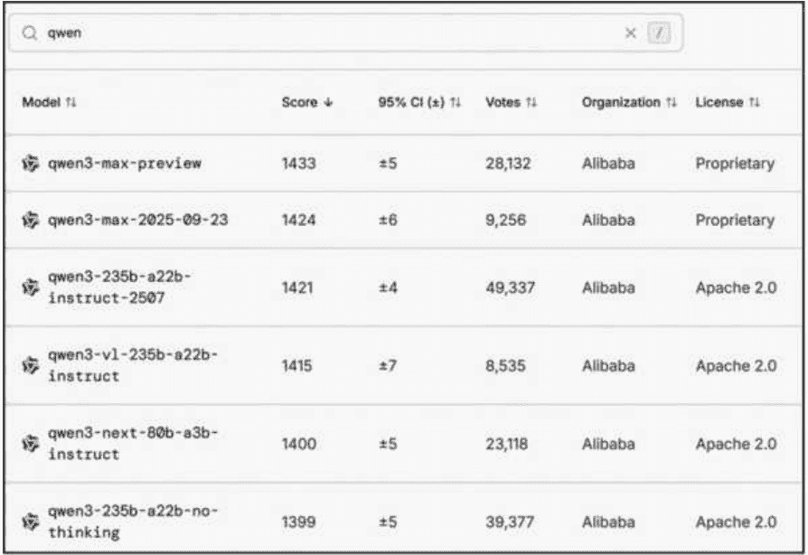

图1-2 Qwen系列模型排名

对于普通用户来说，语言模型最常见的表现是它写得好、解释得清楚、能听懂需求。但在技术底层，这代表的是通义千问拥有可持续扩展的语言理解能力，该能力是整个多模态体系的知识基础和推理引擎。

### 1.2.2 视觉智能：Qwen3-VL带来的图像与视频理解

语言能力让模型“能交流”，视觉能力则让它“看得见世界”。在Qwen3系列中，视觉模型沿着Qwen3-VL家族不断演进，而最新版的Qwen3-VL系列是当前通义千问多模态能力的核心。视觉模型具备以下几类关键能力。

#### 1. 图像理解：从物体识别到结构解析

在识别能力方面，模型不仅能完成基础的“图中有什么”这种识别任务，还能进一步理解场景关系、版式布局和图像语义。例如它可以识别会议照片中的人物动作，也能读懂手机截图中的界面结构。此外，在结构化任务中，模型可以提取发票、表格、文件、图表等内容，自动生成可编辑文本。这一能力在办公自动化、企业流程数字化中尤为重要。

#### 2. 视觉推理：跨图文关联的问题分析

视觉智能不局限于“看见”，更重要的是“理解图像背后的逻辑”。在Qwen3时代，模型能够处理更复杂的图文混合任务，例如：结合图像和文字说明，推断一件商品的关键卖点；从实验图和实验描述中总结研究结果；对比两份不同图表，分析趋势变化。这种跨模态推理能力，是大模型走向“专家级任务”的关键。

#### 3. 视频理解：长视频内容的解析与定位

视频理解通常不是语言模型的默认功能，而在Qwen3-VL家族中，视频理解是重要的升级方向。用户可以上传较长的教学片段、演示视频或会议录像，让模型帮助完成内容摘要、关键点提取、事件定位等工作。教学、培训、电商直播分析等场景都能够从这一能力中获益。通俗来说，视觉模型让通义千问从“读书人”进化为“观察者”，能够帮助用户理解更接近现实世界的信息形式。

### 1.2.3 音频智能：听得懂的模型，让交互更自然

除了“看”和“写”，通义千问也正在全面提升“听”的能力。在通义体系中，语音理解和音频模型主要承担以下三类任务。

#### 1. 语音识别与转写

通义的听悟能力（通义听悟）能够将语音实时或离线转为文字，并支持多语言、多场景，包括会议纪要、采访整理、课堂记录等。相比传统语音识别系统，大模型的优势在于语境理解能力强，因此转写结果更连贯、更接近自然语言。

#### 2. 音频内容理解

模型可以识别音频中的说话人数量、语气变化、重要内容和主题结构。例如：在教学音频中，它能够帮助用户提取知识要点；在采访录音中，它可以识别问答部分并整理出关键信息。

#### 3. 语音对话与语音输出

在更高层次的应用中，通义千问允许用户以语音方式交互，让AI可以“听到问题”和“说出回答”。这为智能硬件、教育陪伴、语音助理等领域提供了更自然的交互方式。

### 1.2.4 通用多模态协同：模型之间的“默契配合”

语言模型、视觉模型和音频模型并不是孤立存在的，它们在通义千问内部被设计为可协同工作的整体。用户不必区分“此刻使用的是哪个模型”，系统会自动把图片、文字、音频转化为可统一处理的表达形式，再由语言模型完成推理与输出。这意味着：用户可以上传一张商品图片，同时口头说明自己的需求，再让千问生成一段营销文案；也可以上传长视频和文档，让模型整合内容，提取结构化信息。这些协作的背后，是阿里云统一的多模态编码技术和大模型架构设计，不同模态的信息能够在模型内部顺畅流动，并转化为可推理的统一表示。用一句更通俗的话来说，通义千问并不是在拼装“多个模型”，而是在构建一个会思考、能协作、具备多种感官的智能体基础。

通义千问已经不再局限于作为一个会聊天、会写文章的语言模型，它逐步形成了一套完整的“多模态认知体系”。它能写、能看、能听、能分析，也能在多模态输入之间进行深度推理。这种能力结构使它不仅能完成写作类任务，还能应用于图文混合创作、文档数字化处理、会议总结、数据分析、图像识别、教学辅助等大量真实应用场景。随着Qwen3系列模型的进一步发展，通义千问的能力图谱还将不断扩展，向更加通用、更加自主、更加贴近人类理解方式的方向演进。

## 1.3 应用边界：智能交互的适用场景

从阿里云已经落地的产品和行业方案来看，通义千问的应用大致可以分为三层：个人与办公助手、开发与内容生产工具、行业与垂直场景解决方案。不同层次的应用形态不一样，但背后都是同一套通义大模型在发挥作用。理解这些适用场景，有助于我们在后面写提示词和制作智能体时，始终围绕真实问题设计交互，而不是只停留在“酷炫的Demo”层面。

### 1.3.1 日常与办公场景：从写文档到管会议

对大多数普通用户来说，接触通义千问往往是从日常的写作与办公开始的。

在通用写作方面，千问可以协助撰写邮件、公文、汇报材料、活动方案，也能根据提示生成宣传文案、社交媒体内容和短视频脚本。它擅长根据“角色+场景+语气”组合生成不同风格的文本，配合简单的提示词即可快速形成初稿，再由用户进行润色和把关。

在文档阅读与整理上，阿里云推出了基于通义大模型的阅读助手通义智文。它可以对网页、论文、图书和各类文档进行概览、结构化导读、关键词提取和智能问答，适合用来阅读长篇论文、商业合同、调研报告等。

在语音与会议场景中，通义听悟则扮演了另一种角色，如图1-3所示。它可以对会议、访谈、课程等音视频内容进行转写、翻译、说话人分离、要点提取和自动生成纪要，帮助用户在会后快速回顾重点，减少人工记录的负担。依托通义千问的大模型能力，通义听悟还支持对音视频内容进行提问与追问，相当于为一段录音配备了一个“随时可问的AI记录员”。

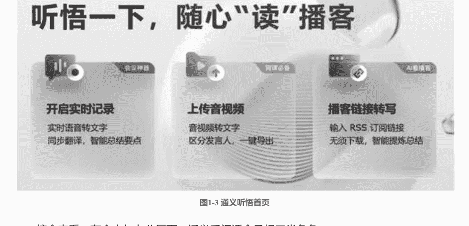

综合来看，在个人与办公层面，通义千问适合承担三类角色：

- 写作助手，负责生成和润色。
- 阅读助手，负责理解和提炼。
- 记录助手，负责转写和归纳。

这些场景的共同点在于：内容由人掌控，AI负责减少重复劳动和信息处理成本。

### 1.3.2 开发与创作场景：让专业工作有助手

第二类典型应用是围绕专业人士的工具型场景，其中最突出的代表是研发与编码。

阿里云推出的通义灵码（见图1-4）就是以通义千问为核心的大模型编码助手。在官方介绍中，它可以根据当前工程的上下文进行代码补全、函数级生成、单元测试生成、错误排查与修复建议，还支持跨文件理解工程结构和自动感知技术栈。对个人开发者来说，它可以在本地IDE中实时给出建议；对企业团队来说，它可以基于私有代码库和内部文档进行安全的定制化智能问答。


除了编码，通义千问在内容生产方面也有广泛应用。电商运营人员可以用它生成商品标题、详情页文案、短视频脚本，并借助多模态能力对商品图片、用户评价进行总结和卖点提炼；市场和品牌团队可以用它生成活动方案、广告文案、图文脚本等。在这些场景中，通义千问的角色已经从泛用助手升级为专业助理。它不是要替代程序员或运营人员，而是承担一些高频、结构清晰、可抽象的工作，让人类把时间和精力集中到需求分析、创意设计和决策上。

### 1.3.3 行业与垂直场景：从电商到文旅，从政务到金融

在更深一层的行业应用中，通义千问已经开始作为基础设施进入千行百业。阿里云在“伙伴千问计划”等项目中，与合作伙伴联合验证了30余个行业场景，涵盖协同办公、文化旅游、财务和ERP、电力、政务、医保、交通、制造、金融、软件开发等多个方向，典型任务包括智能问答、文章摘要、知识库升级、代码辅助等。下面以读者熟悉的几个行业为例进行说明。

在电商和零售场景中，通义千问可以嵌入淘宝等平台，作为智能购物助手为消费者提供对话式商品推荐、活动策划建议、个性化搭配方案等，也可以为商家提供自动生成商品详情、智能客服问答、运营数据分析报告等服务。

在办公与协同场景中，通义千问与钉钉等协同平台结合，支持群聊摘要、会议纪要自动生成、文档起草与审批流程辅助，帮助企业在日常沟通和信息流转中减少低价值重复劳动。

在文旅行业，通义千问则被用于构建面向游客的智能体。例如复星旅游文化集团（复星旅文）与阿里云基于Qwen3系列模型共建的“AI G.O”，目标是实现目的地咨询、行程规划、现场导览与服务问答一体化，使游客能通过自然语言获得更个性化的服务体验。

在政务、金融、制造、医疗等较为严肃的行业中，通义千问多以“底层模型+平台”的形式出现。它能为政务问答、政务服务指引、金融知识库检索、风险报告生成、设备运维知识问答等提供语言与多模态能力，但通常会与行业知识库、业务系统和权限控制结合在一起，通过阿里云百炼等平台进行统一管理。

在这些场景中，通义千问不再直接面对终端用户，而是被封装在具体业务系统中，为行业应用提供“认知引擎”。

### 1.3.4 应用边界：适合用千问，也要知道何时“让位给人”

通义千问可以进入的场景非常多，但这并不意味着任何问题都应该交给它解决。了解它在哪些地方适用、在哪些地方需要谨慎使用，是应用边界的一部分。从目前的实践经验看，通义千问尤其适用于下面几类任务。

- 信息处理。例如文档整理、摘要生成、语音转写、图文解释等，只要有足够明确的输入和清晰的输出结构，模型往往能做到高效可靠。
- 创意生成与方案起草。包括文案、脚本、方案初稿、标题、视觉创意描述等，模型能够快速给出多个候选，与人类创意形成互补。
- 知识型问答和经验萃取。通过结合企业知识库、行业文档和检索增强，模型可以把分散的信息“串成一句话”，帮助用户快速获得决策参考，而无须翻阅大量资料。

相对应地，在以下场景中，通义千问需要更严格的设计和监管：涉及强监管行业的最终决策，如医疗诊断结论、法律裁判意见、金融投资决策等；需要实时精确数据的操作，如交易撮合、设备控制、应急指挥等。在这些场景中，模型可以作为辅助分析工具，但不应取代人类专家或权威系统的最终判断。

简而言之，通义千问最适合做的是“把事情解释清楚、把内容整理明白、把方案起草到位”，而不是代替人类承担法律责任或伦理责任。

理解这些边界，有助于我们在后续章节中更有针对性地设计提示词和智能体结构：不是空谈“万能AI”，而是把模型能力精确嵌入一个个真实任务中。

## 1.4 核心优势：通义千问的差异化优势分析

当下的大模型市场里强者如云，OpenAI、Google等公司的模型在国际上占据了重要位置，国内也有一批快速崛起的模型。综合Qwen3技术报告、各类基准测试以及阿里云官方信息，可以把通义千问的优势概括为四个方面：推理与Agent能力突出、多模态能力全面、开源与部署灵活度高、本土生态与行业融合成熟。

### 1.4.1 推理与Agent能力

通义千问的第一个差异化优势是在复杂推理、代码能力和工具调用方面表现十分抢眼。Qwen3技术报告显示，新一代模型在数学推理、编程、知识问答等多个标准测试中，已经与国际一线模型处于同一梯队。

以旗舰模型Qwen3-Max为例，在用于评估实际编程能力的SWE-Bench Verified基准测试中，它取得了接近70%的得分，这一成绩明显高于部分国内外同级模型。这意味着，它不只是“能写几行代码”，而是具备在真实开源项目环境中理解问题、定位错误并完成修复的能力。有媒体甚至给出了“一些模型像计算器，而Qwen3-Max更像真正的编程伙伴”这样的评论。

在与工具调用和Agent相关的τ²-bench测试中，Qwen3-Max的得分同样位居前列，超过了若干国际主流模型，这说明它在“根据目标自动选择工具、规划步骤、执行操作”这一类任务上具备明显优势。结合路透社的报道，阿里巴巴特别强调Qwen3-Max在“自主智能体能力”上的表现——模型可以在较少人工干预的情况下，根据预设目标做出一系列决策和动作。

把这一点和后文要讲的Qwen Agent框架结合起来就会发现：通义千问并不是只追求“单轮回答好不好”，而是在有意识地朝“能自主推动任务完成”的方向进化。对具有自动化流程、智能客服、数据分析与报表生成等场景的企业来说，这类能力往往比单纯的对话更有价值。

### 1.4.2 多模态能力：在视觉、音频与视频方向上“全面开花”

通义千问的第二个显著的差异化优势在于多模态。很多模型都宣称支持多模态，但在实际能力深度和开放程度上差别很大。

在视觉方向上，Qwen3-VL系列被定位为“具有更强空间推理和视频理解能力的开源视觉语言模型”。公开资料显示，它支持最长256K的上下文，可以在单次会话中处理大量图文信息，并具备较强的OCR能力和空间位置理解能力，能够在多种语言环境下识别文档和图像内容，这一点对于中文用户和多语言业务场景尤为重要。与只支持英语或有限语言的视觉模型相比，通义千问有着显著的差异化优势。

在音频与视听方向上，Qwen3-Omni是通义千问多模态家族的重要一员。技术报告称，在36项音频与视听基准测试中，Qwen3-Omni在绝大多数任务上达到了开源模型的领先水平，并在其中相当一部分项目上取得了整体最优成绩。它不仅能够识别和转写语音，还具备理解语音内容、分析音视频场景的综合能力。从用户角度看，这种优势具体体现为：对票据、报表、合同扫描件的理解更可靠；对长视频、课程录播、会议录像的摘要与问答能力更强；在多语言环境中处理音频、图像的能力更均衡。

不少用户会有一个直观感受：在“看图说话”“读表格”“读长文档并回答问题”等任务上，通义千问表现得更像一个有耐心的助理，而不是只懂关键词匹配的搜索引擎。

### 1.4.3 开源与部署灵活：从云端到本地，给开发者更多选择

第三个差异化优势是通义千问在“开源策略+模型谱系”上的完整度和灵活度。

Qwen3系列包含从0.6B到235B的多种参数规模，既有稠密模型，也有MoE（Mixture-of-Experts，混合专家）模型，其中相当一部分以开源权重的形式在Hugging Face和国内平台发布，并采用宽松的Apache 2.0许可证。这意味着开发者既可以选择在阿里云上通过API使用通义千问的商业版本，也可以在本地服务器乃至个人设备上部署较小体量的开源模型。

在编码领域，阿里巴巴专门推出了Qwen3-Coder。路透社报道指出，这是阿里巴巴迄今最先进的开源编码模型之一，面向复杂的软件开发任务，在国内多款模型中表现突出，并在部分评测中与国际顶级闭源模型接近。

从更宏观的角度看，多家研究机构和媒体认为，中国在“开源大模型下载量”上已经超过美国，而Qwen系列是其中的主力之一。对企业和开发者来说，这带来两个实际好处：一是技术上手门槛更低，可以先用开源版本做实验和原型；二是未来迁移更方便，可以在云端与本地部署之间灵活切换。

相较于完全闭源、只能通过单一API访问的模型体系，通义千问在“云服务+开源模型+本地部署”这一整条链路上给出的选择明显更多，这也是它的一项结构性优势。

### 1.4.4 本土生态与行业融合：离业务更近，也更易落地

第四个差异化优势，与其说是“模型能力”，不如说是“生态位置”。

通义千问背后是阿里云庞大的云计算与行业解决方案体系。早在Qwen2时代，阿里巴巴便推出了“通义千问伙伴计划”，联合咨询公司、软件厂商和行业伙伴共同打造面向不同行业的解决方案，将通义千问与阿里云百炼平台、行业云产品打包输出。

这意味着，通义千问在电商、物流、零售、文旅、政务、金融、制造等领域，都有相对成熟的集成方案，能够与现有的企业系统（如ERP系统、CRM系统、电商平台、协同办公平台等）对接。对最终用户来说，其中的好处可能并不直观，但对负责数字化改造的企业而言，能够“在原有系统上平滑地加一层AI”，往往比模型本身多几分准确率更重要。

再加上阿里巴巴近年来在AI基础设施上的持续大额投入——仅公开披露的三年投资计划就达到千亿元人民币级别，通义千问实际上站在了一个“云+模型+行业”的综合平台上，而不是单点产品。

这造就了它两个方面的优势：

- 对中文与本土业务场景的理解更细腻，从办公会到电商运营，从供应链管理到线下零售，模型在训练和测试阶段就能接触到大量与本地行业相关的数据和需求。
- 在企业落地与运维层面更可控，企业可以借助阿里云现有的安全合规体系、算力资源与监控工具，减少从零搭建AI基础设施的成本。

如果用一句相对简洁的话来概括通义千问的差异化优势，可以这样说：通义千问是一套在推理与Agent能力、多模态理解、开源与部署灵活性、本土行业生态上都具有明显“长板”的大模型体系。与一些更偏向“研究展示”的模型相比，它在工程化和行业落地上走得更远；与一些完全闭源的模型相比，它通过开源和多规格模型提供了更多技术主权与定制空间；在中文生态、多模态处理和编码能力方面，它也逐步在公开评测中证明了自己的实力。

## 1.5 智能体：Qwen Agent的独特价值

如果说大模型让机器“第一次学会了理解与表达”，那么智能体（Agent）则让机器“第一次开始学会自己做事”。智能体的出现，是AI发展中的又一次阶段跃迁。本节将以通俗的语言介绍智能体的概念、它与大模型的区别、通义千问在智能体方向上的布局，以及智能体对未来生活与工作方式的深刻改变。

### 1.5.1 什么是智能体

要解释智能体，最直观的方式就是和大模型做对比。大模型就像一位特别聪明的顾问，你问一句，它答一句；它理解力强、表达力好，但它不会主动去执行任务。而智能体更像一位助理，你告诉它“我要完成什么”，它不仅能听懂，还会思考下一步该怎么做。例如你说“帮我整理一周的学习笔记”，大模型可能会给你一个总结，但智能体会自动判断哪些文件是笔记，哪些要提取，哪些要分类，是否要形成提纲，是否需要输出成一页PPT，然后一步步替你完成。简单来讲，大模型是被动的“回答者”，智能体是主动的“行动者”。以图1-5为例，机器人相当于智能体，它可以调用大模型（相当于大脑），拥有一个知识库（相当于它看过的书），可以使用插件（相当于有一个超级工具箱）。


图1-5 智能体示例

### 1.5.2 智能体将为我们的生活带来变革

智能体的出现会像智能手机刚问世时那样，改变每一个人的生活方式。第一，它会让重复性、机械性的任务大幅减少。整理文档、汇总材料、写总结、查数据等工作不再需要用户手动操作，智能体会按照你的目标自动完成。第二，它会改变学习方式。智能体可以当你的专属学习助手，为你整理重点、设计计划、批改作业、生成训练题等，让知识获取变得更轻松。第三，它会改变我们与工具的关系。过去我们要打开不同软件、执行一系列操作；未来可以直接告诉智能体目标，它会自动调用软件替我们完成。第四，它会改变企业的组织效率。智能体可以自动处理大量跨系统的流程，让企业真正进入“自动化协作”的时代。简而言之，智能体带来的不是“效率小幅增长”，而是“工作方式的根本性重构”。它改变的是人机关系：机器不再等待人类指令，而是在人类目标下主动行动。

在智能手机普及之前，人们也能打电话、发短信、查资料，但效率远不如今天。智能手机成为“时代必备品”，并不是因为它是科技产品，而是因为它融入了生活的每一个角落。同样的趋势正在智能体身上发生。未来十年，懂不懂智能体，将直接决定一个人的数字生产力水平。如果未来的办公方式变成“告诉智能体目标，它替你做完80%的事”，那么不会使用智能体的人就会在信息社会中明显落后。智能体不是“可选项”，而是未来的基础能力，就像打字、使用浏览器一样必不可少。可以预见，在未来的学习、工作乃至社会分工中，“会不会使用智能体”会成为新的能力分水岭。能熟练与智能体协作的人，将大幅提升生产效率；不会使用智能体的人，将在许多岗位中失去竞争力。

### 1.5.3 Qwen Agent：让通义千问具备执行力的系统能力

在通义千问体系中，智能体的能力由理解任务、规划步骤、执行动作三部分组成。

1) 理解任务。依托Qwen3系列模型的强理解能力，智能体能够准确识别用户的真实需求，而不是仅停留在字面解释上。例如用户说“整理一下合同”，智能体会判断用户可能需要条款摘要、风险点、提醒项、格式化输出等不同内容。

2) 规划步骤。智能体会自动将任务拆解成多个步骤，如提取条款、分析风险、生成结构化内容等，并按顺序执行。这种规划能力是智能体区别于普通模型的关键。

3) 执行动作。智能体能够调用工具，如文件解析、知识库、搜索引擎、图像识别、代码执行等，使通义千问能够完成跨步骤、跨文件、跨系统的真实任务。这种能力让AI不再停留在生成文本层面，而是能像真正的数字助理一样参与到工作流程中。智能体让通义千问从“会说话”升级到“会做事”，不再是一个单纯的聊天模型，而是一个能够推进流程的智能系统。

## 第2章 提示工程实战体系

如果说模型能力决定了千问“能做什么”，那么提示工程就决定了你能否让它“做好”。本章将从实战角度，拆解提示工程的关键理念、核心技巧与高质量输出的策略体系。我们将先从提示设计的目标、结构化表达方式讲起，解释如何让模型更准确地理解指令；接着展示从初稿到高质量内容的迭代路径；再延伸至复杂任务、智能体、多模态交互中的高级提示技巧。最后，本章还将总结常见问题与诊断方法，帮助你识别模型失误、进行有效修正。本章不仅要教你“会写提示词”，更要教你构建一套专业、稳定、可靠的提示工程体系，使你与千问协作的效率大幅提升。

### 2.1 提示工程的核心理念与目标设计

如果用一句话来概括提示工程，现在学界和工业界的共识大致是：提示工程，是用自然语言给大模型写“程序”和“说明书”的艺术与方法。它的本质不是“华丽的提示词”，而是在不改动模型参数的前提下，通过输入里的指令、示例和结构，把模型已经学到的能力精准地“调出来”，并朝着你期望的方向收敛。更技术一点地说，大模型之所以能靠几行提示词完成复杂任务，背后依托的是一种叫作“上下文学习”（In-Context Learning）的能力：模型会把你给它的指令、例子和材料当作“临时训练数据”，并在这一小段对话里重新拟合“当前该怎么做”。提示工程的核心价值就是设计这段“临时训练”的方式，让模型在当前上下文中表现得更贴近你的真实意图。

#### 2.1.1 提示词为什么重要：你手上唯一的“实时编程接口”

从模型角度看，一个已经训练好的大模型，参数基本是固定的。你既不能在对话时改变它的网络结构，也不会给它重新标注几万条数据再去训练一遍。你唯一能动手的地方，就是输入。这就是为什么顶级技术报告和综述里会反复强调：在很多场景下，提示工程比微调更轻量、成本更低，却能在不少任务上带来可观的性能提升。如果用一个更易理解的比喻来解释，那就是大模型是一位学贯中西、涉猎广泛的“超级实习生”，它的大脑里已经装满了全世界的书和代码，但现在坐在你面前发呆。你既不能给它换一个大脑，也不能强行往它的大脑里塞入新书，只能通过“说清需求”的方式来调动它已有的知识。你要它扮演谁、按什么步骤开展、产出什么格式、做到什么标准，这些就是提示工程要解决的核心问题。

从这个意义上说，提示词不是一句“随口的问话”，而是一份“任务说明书”和“行为约束合同”。设计得好，你会觉得模型“聪明又稳定”；设计不好，你会觉得它“乱答、跑题、一本正经地胡说八道”。

#### 2.1.2 提示工程的核心：把“人类需求”翻译成“模型能执行的任务规格”

很多调查论文会把各种提示技巧划分成几十种类别：零样本、少样本、链式思维、思维树、多轮反思、工具调用提示等，看起来花样繁多。但如果把这些技巧抽丝剥茧，会发现它们都围绕着同一个问题：如何用输入把你的任务规格说清楚。所谓“任务规格”，可以拆成以下几个关键维度：

- 我要你做什么（Task）：是生成、改写、翻译、分类、推理，还是调用工具、执行工作流？
- 做到什么程度（Goal/Quality）：是快速给草稿，还是尽可能严谨；是科普向，还是学术向；大概多少字、多详细？
- 以什么身份、什么视角来做（Role/Perspective）：是老师、律师、程序员、产品经理，还是普通朋友？
- 用什么材料来做（Context/Input）：仅基于输入中的文字，还是可以引用常识知识库，需不需要“只依据提供材料作答”？
- 如何呈现结果（Format）：要不要分点，是否使用表格、JSON、Markdown，需不需要显示步骤？
- 有哪些边界与禁区（Constraint）：不能编造数据、不能给医疗诊断、不能输出敏感内容等。

一个成熟的提示工程实践，其核心工作就是在这些维度上做“完整而清晰的表达”。行业里的最佳实践指南，无论是OpenAI、Google还是Anthropic，给出的第一条建议几乎都是：要清晰、具体，明确目标，说明背景，必要时提供示例和格式要求。

#### 2.1.3 目标设计的关键：从“你想要什么”反推“你该怎么说”

很多人在第一次用大模型时会掉进一个常见陷阱：只说“你帮我写一个……”，却从来不说“我到底要一个什么样的结果”。从提示工程的视角看，一个好的提示设计流程，应该是先想结果，再写指令，而不是反过来。我们可以把目标设计理解为三个连环问题：

- 结果画像——如果一切顺利，你希望得到一个什么样的输出？是能直接发给领导的公文，还是只要给你一个思路框架？是500字左右的摘要，还是一页PPT的要点？
- 信息条件——模型在什么信息条件下完成这件事？只看你给的材料，还是允许它调用外部知识？是否需要它在不知道时明确说“不知道”？
- 评价标准——你会用什么标准来判断“它做好了没有”？是逻辑结构、事实准确、语言风格，还是覆盖要点的完整度？

当这三点在你脑中清晰之后，“提示词怎么写”就不再是玄学，而是一个有章可循的翻译过程——把你脑海里的“理想结果+评价标准”翻译成模型能理解的一段自然语言指令。很多系统化教材会强调：高质量提示往往是“目标描述+步骤拆解+输出格式要求+必要示例”的组合，而不是某句神奇咒语。

#### 2.1.4 提示还能影响思考方式：从“一步到位”到“慢慢想清楚”

提示工程之所以被称作“工程”，还有一个很重要的原因：不同的提示，不仅会影响“说什么”，还会影响“怎么想”。早期研究发现，在数学推理、逻辑题里，只要在问题后面加一句“请一步一步地思考并写出中间推理过程”，模型的正确率会显著提高，这就是所谓的“链式思维（Chain-of-Thought）提示”。后续又出现了“思维树”“自我反思”“System 2 Attention”等一系列提示技术，核心思想都是利用提示，引导模型多花算力在关键步骤上，减少凭直觉“一步到头”产生的错误。这说明，提示词不仅能“告诉模型你要什么”，还可以在一定程度上“告诉模型你希望它如何思考”。从用户角度看，这意味着当你在通义千问里设计提示时，不仅要关心“任务描述对不对”，还可以通过“请先列出思路，再给结论”“请先复述问题，再开始回答”等方式，主动增强模型的可靠性和可解释性。

我们可以基于本节给出一个相对精练但有力度的结论：提示工程的核心，不在于写出多复杂的句子，而在于用结构化的方式把模糊的人类需求翻译成大模型可执行、可推理、可评估的任务说明。在这个过程中，提示词之所以重要，是因为：

- 它是你唯一可控的“实时编程界面”。
- 它是连接“人类意图”和“模型能力”的翻译层。
- 它既能决定模型“做什么”，也能在一定程度上影响模型“怎么想”。
- 它为后续的智能体、工具调用、多模态交互奠定了“指令语言”的基础。

在后续的内容里，我们会在这一思想框架之上，具体展开“结构化提示”“迭代策略”“复杂场景下的提示技巧”和“常见问题的识别与修正策略”。当你真正掌握指令思维，再回头看所谓“写提示词”，就会发现：那不只是几个句子，而是一整套“如何与通义千问打交道”的思维方式。

### 2.2 结构化提示：让千问听得懂、做得准的关键方法

如果说“指令思维”解决的是要让模型明白什么的问题，那么“结构化提示”解决的就是如何把事情说清楚的问题。很多人觉得提示词写不好，是因为没有找到“秘密咒语”，但真正的核心是——你的提示结构是否清晰。大模型最怕的不是任务难，而是要求模糊。通俗一点说，如果你的指令类似“你自己看着办吧”，模型就会真的“看着办”，结果往往离你的预期十万八千里。结构化提示的目标，就是让你的需求像“按照菜谱炒菜”“按照步骤写作文”一样明确，从而让模型执行得稳定、可控、复现性强。

本节将介绍结构化提示的关键方法，并配合多个浅显易懂的例子，让读者真正掌握“把话说清楚”的技巧。

#### 2.2.1 为什么要结构化提示：模型喜欢“规规矩矩”的任务

大模型训练的过程，本质是学习“模式”。结构越清晰，它越知道该往哪里预测下一句。因此一个结构化提示，往往比一段啰嗦的文字更有效。我们来看两个例子。

例1：非结构化提示（效果差）

> “帮我总结一下这个文章，尽量写得有条理点。”

这种提示就像对一个学生说：“随便写吧，写好一点。”听起来合理，其实非常模糊。

例2：结构化提示（效果好）

> “请将以下文章总结成3点，每一点不超过30字，按[背景—问题—结论]的顺序输出。”

模型立刻知道：输出3点；每点字数有限制；内容结构必须遵循固定顺序。一个提示是否结构化，常常决定了最终效果是否稳定。

#### 2.2.2 经典“三段式提示结构”：目标—步骤—输出格式

三段式提示结构在通义千问、GPT等模型中最常见、最稳定的一种提示结构。只要掌握它，大多数的任务都能写得很稳。

**1.第一段：明确任务目标（What）**

告诉模型你想得到什么，而不是你想让它“做什么动作”。例如，“请为我生成一份适用于三分钟口头汇报的项目总结”，而不是“帮我写一段话”。后者太模糊。

**2.第二段：说明执行步骤（How）**

告诉模型它应该按照怎样的逻辑做这件事。例如，“请先提取关键事件，再归纳为背景、进展、问题、下一步计划四个部分”。步骤越明确，模型越不会跳步骤。

**3.第三段：给出输出格式（Form）**

告诉模型你希望它以什么方式呈现结果。例如，“请以编号列表的形式输出，每项前用[1][2][3]标注”。很多“输出乱七八糟”的问题，原因都不是模型能力不足，而是少了格式要求。以下是一个完整示例。

> 目标：请生成3条会议要点。
步骤：先分析会议记录，再找出主题，再归纳为3条。
输出格式：使用[要点1][要点2][要点3]的格式输出，每条不超过20字。

结构化提示就像让AI“按套路出牌”。套路越清晰，执行越稳定。

#### 2.2.3 “标签式结构”提示：把任务拆成小格子，让模型不迷路

当任务稍微复杂一点时，比如让模型“写文章+控制语气+符合某种受众+遵循格式+限制字数”，用长段落描述会变得混乱。这时，最有效的方式是使用“标签结构”，让每个要求都有自己的“格子”。

例如：

> [身份]你是一位历史老师。
[目标]用简单语言解释秦朝焚书坑儒的原因。
[受众]初中生。
[长度]不超过150字。
[语气]清晰、平和。
[输出格式]分3点说明。

这样的结构可以让模型毫不费力地抓住重点。下面再举一个生活化的例子：

> [场景]我准备向领导做口头请示。
[内容]以下是我的草稿，请帮我优化。
[要求]简洁、逻辑清晰、有重点。
[输出]生成1分钟口播稿。

模型会精确遵守你的每一条要求，几乎不会出现意外情况。

#### 2.2.4 示例式提示：用“样例”告诉模型你想要什么样的风格

结构化提示的另一项重要技术是“Few-Shot Prompting”，也就是“给模型举例子”。大模型非常擅长模仿，举例子这种方式对通义千问尤其有效。例如，我们可以直接给大模型提供示例和任务，具体如下。

> “请按照附件1中的语言风格和附件2中的文稿结构，生成1篇关于如何进一步做好新媒体宣传工作的讲话稿。”

示例提示常用于：要求特定写作风格；要求模仿语气；要求复杂转换任务（如文本转表格、文本转标签等）。

为了让“结构化提示”发挥最大作用，以下几点必须避免。

- 不要在一条提示里添加太多目标，例如“帮我写一篇文章，顺便做个表格，再将文章改写成PPT，风格要幽默，字数控制在200字左右”。模型会感到迷茫：到底优先做哪一个？
- 不要把要求写得模糊。比如“写得好一点”“总结得详细一些”，这对模型来说没有意义。更好的方式是“字数控制在120字以内，使用3句短句，每句包含一个事实要点”。
- 不要只给任务，不给格式。当你忘记格式要求时，模型可能输出长段落、短句、混合结构，甚至破坏你后续的自动处理逻辑。

结构化提示的意义在于：让模型知道你到底在要求什么；让模型知道它该怎么做；让模型输出的结果可控、稳定、可复现；将复杂任务拆解成AI能按部就班执行的步骤。一句话总结：指令思维让你想清楚任务，结构化提示让模型做清楚任务。

### 2.3 从初稿到高质量输出的迭代策略

在日常使用大模型的过程中，人们常常会有一种错觉：似乎只要“说得足够清楚”，模型就能一次性给出理想答案。但真正深入使用之后就会发现，即便提示词写得不差，模型输出仍常常显得“不够准”“差一点完整度”“逻辑似乎有些跳跃”或者“风格忽冷忽热”。这并不是模型智能不足，而是因为大模型本质上是一套“根据提示来预测”的系统——只要提示中缺少必要结构、隐藏条件或明确要求，它就会用自己的“语言习惯”去猜。而提示工程要实现的正是不断减少这种“猜测”，让模型从模糊走向明确、从大致正确走向持续稳定。一个成熟的提示工程实践者的真正能力，从来不在于“一次性写出完美提示”，而在于掌握一套可以持续优化、逐轮收敛、不断提升质量的方法，让模型的输出越来越贴合用户意图。本节将通过五种迭代策略，展现提示工程从初稿到高质量指令的完整路径。

#### 2.3.1 差异分析：指出偏差，是所有优化的起点

对模型的优化永远要从“指出哪里不对”开始。很多使用者在看到模型输出不符合预期时，只会简单回应“重写一下”“太啰嗦了再短点”，这种反馈对人类有效，但对模型几乎没有指导价值。模型不是人，它无法揣测你隐含的需求，只能根据你的文字做字面判断，因此真正有效的方式是进行差异分析：先观察模型输出的结构、重点、风格，再明确指出偏差，并给出可执行的纠正方向。

例如，你让模型“总结会议内容”，结果它写出6段话，夹杂背景说明、发言人信息、推测性判断，长度翻了4倍。如果此时你只说“再精简一些”，模型有可能继续啰嗦。更恰当的方式是：“请将总结压缩到约120字，仅保留关键决策，不包含背景信息，不做推断，分3条呈现”。模型下一轮的输出内容往往就会收敛得多，甚至可以直接使用。

差异分析的意义在于帮助模型确定“偏差在哪里”以及“纠正方向是什么”。人类不做这一步，模型永远只能猜。这也是为什么即便使用能力不够顶尖的大模型，只要差异分析做得好，优化速度也会显著提高。

#### 2.3.2 逐层收缩：复杂任务需要分阶段完成而不是一口气说清

对于篇幅较长或逻辑较复杂的任务，许多用户习惯一次性给出十项要求，从风格到逻辑到长度到语气无所不包，看似全面，实际上会让模型感到困惑：它无法判断哪些是优先级更高的要求，也无法一次性满足所有条件。逐层收缩方法强调的是先宽后紧，先框架后细节。

例如你需要一篇800字的“城市更新方案”，写作本身就包含大方向、策略、措施、风险控制等多个层级。如果第一句就写“请写800字，正式风格，逻辑清晰，包含措施、背景和未来展望”，模型极易生成结构松散的内容，但如果采用下面的逐层收缩策略：

第一轮：让它生成3～4个核心部分（如背景、问题、措施、预期效果）。

#### 2.3.3 反思式优化：让模型自己找到问题，再带着意识写得更好

随着模型能力提高，让模型“反思自己的回答”已成为一种高效的优化技术。它类似于让学生“先找出自己作文的问题，再按照发现的问题重写一遍”，过程本身就能提升理解与表达的准确性。

例如，你要求模型对某项政策做分析，但它写的内容像在复述材料，缺乏深度。你不必自己总结模型的问题，而是可以直接要求它自查：“请找出你上一段回答中在逻辑、论据与深度方面的三处不足，并根据这些不足重写”。

模型往往会指出“论据不够具体”“分析缺乏因果链条”“缺少案例或现实依据”等问题，并会在下一版中主动解决这些问题，使分析更深入、更像专家写作。反思式优化的优点在于，模型先开始“自我评估”，再进入生成阶段，后续产出会具备更强的逻辑一致性。这一策略在写分析、写评论、写对比、写多角度探讨时尤为有效。

#### 2.3.4 分工式提示：先规划步骤，再执行任务，让模型逐步构建结构

人类在处理复杂任务时，都习惯先“拟提纲再写作”，因为先有结构才不会偏题，大模型同样如此。分工式提示就是让模型先生成任务的“执行步骤”，再基于步骤执行任务。

例如要写“企业数字化升级方案”，直接让模型生成内容，它容易把“数字化”理解为“提高线上销售”或“做个App”，输出不够全面，而分工式提示的方式如下。

第一步：“请列出撰写该方案所需的步骤，例如诊断现状、明确目标、选择技术路径、制订实施计划、评估风险”。

第二步：“请严格按照你刚才列出的步骤生成完整方案”。

模型在规划阶段就已经知道“应该覆盖哪些内容”，因此在执行阶段生成的内容不但更完整，也更有条理。这种“先规划后执行”的方式能让模型建立结构性理解，输出自然更加稳定、有序。

#### 2.3.5 边界设定：告诉模型“不能做什么”，才能让它更准确地完成任务

提示工程中最容易被忽视的一点是模型对“不能做什么”没有本能直觉。如果用户不写清楚，它会自动发散、补充、推断，因此给出许多你不需要，甚至不适合的内容。边界设定就是提醒模型：哪些事情是绝对不能做的。

例如，写公文时强调“不使用比喻、不加入主观评价、不增加未提供的事实”；做文本总结时要求“不得加入推测、不得延伸解释、不得加入建议”；做图片描述时指出“不能描述图中不存在的事物”。这些边界一旦建立，模型的输出会明显更稳定。

边界设定的关键逻辑是：模型默认“可以发挥”，你必须告诉它“不要发挥”。只有明确禁止事项，模型才会聚焦于任务，而不是试图“帮你多说点”。综观以上五个方法，可以看出高质量提示不是天生的，而是通过不断试探、收敛与修正才能完成。差异分析提供方向；逐层收缩确保复杂任务能按步骤推进；反思式优化让模型具有“自我意识”；分工式提示帮助模型建立稳定结构；边界设定则保证模型不会越界发挥。掌握这些策略，模型就能从“能写”进化到“写得像你希望的样子”，从“能回答”走向“能可靠执行”。提示工程不再是“靠经验、拼运气”，而是一门可以系统掌握、持续精进的实用方法论。

### 2.4 复杂任务、智能体与多模态下的提示技巧

通义千问拥有强大的推理能力、工具调用能力、复杂任务执行能力，以及对图片、音频、视频等多模态内容的理解能力。用户面对的任务也变得更接近“真实工作”：自动化业务流程、让模型扮演智能体执行任务链、对图像与文件进行结构化处理、结合外部工具完成复杂操作……这些场景远比“写篇文章”复杂得多，而要让模型表现稳定，就必须使用更加系统化、结构化的提示策略。本节将从五个方向，介绍如何在复杂场景、智能体任务与多模态交互中设计有效提示，让模型从“能回答”真正迈向“能办事”。

#### 2.4.1 任务分段：将复杂任务拆成可执行的行动序列

越复杂的任务，越需要拆解。模型并不是“万能黑箱”，它更像一位能力很强但需要明确步骤指引的助手。将一个复杂目标拆解为多个小目标，让模型逐一执行，往往比一次性交给它一个“大任务”更可靠。例如，你需要让模型“为某企业生成年度数字化报告并给出三年路线图”。直接要求它生成完整报告，很可能出现结构混乱、深度不够或内容跳跃等问题。而通过任务分段，你可以这样引导模型：

- 第一步：让它“识别企业数字化现状的五个关键问题”。
- 第二步：让它“基于问题提出三个解决方向”。
- 第三步：让它“将解决方向扩展为三年路线图”。
- 第四步：让它“按报告格式汇总所有内容”。

在这个过程中，模型每一轮的目标都明确可控，因此表现会比一步到位稳定得多。执行复杂任务的可靠性，很大程度上取决于你是否把任务分解成可执行步骤，而不是一次性抛给模型一个“巨石”。

#### 2.4.2 智能体指令：强调“目标—角色—权限—终止条件”

当模型被作为智能体使用时，提示工程的逻辑会发生根本变化。智能体的功能不再是“生成一段文字”，而是能够调用工具、执行动作、进行多轮推理。因此，一个好的智能体提示必须包含四个关键要素：目标、角色、权限与终止条件。目标告诉智能体最终要达成什么，例如“自动生成销售周报并发送邮件草稿”；角色告诉它应该以什么思维方式执行任务，例如“你是一名数据分析师”；权限明确它可以使用哪些工具，例如调用数据集、使用计算模块、执行表格处理；终止条件则防止它陷入无限循环，如“当总结生成且全部指标计算完成后停止”。

如果你要让一个Qwen Agent自动整理一周内的订单异常情况并输出报告，提示可以写成：“你是一名运营分析智能体，你的目标是识别订单中的异常模式。你可以使用的工具包括表格查询、数据筛选、趋势分析。你必须在完成‘识别异常—解释原因—提出对策’三步后结束任务，不得无限推演”。这样的提示比“帮我分析订单异常”的稳定性高出数倍，因为智能体不仅知道要做什么，也知道如何做、做到何时停止。

#### 2.4.3 多模态提示：告诉模型“看哪里”“抓什么”“输出成什么”

多模态场景的难点在于：人类可以快速理解图像焦点，但模型必须得到明确指引。例如上传一张会议白板照片，如果只说“帮我总结一下内容”，模型可能会总结图片背景、灯光、姿势等无关内容。多模态提示的关键是明确关注点、指定抽取方式、给定输出结构。

例如：“请只关注白板上的文字信息，将其识别并按‘议题—要点—责任人’三个字段结构化输出，忽略人物、背景与环境。”这种提示方式能显著减少识别偏差。若再进一步优化提示，例如“输出为三列表格，不得生成模糊判断”，模型的输出质量会进一步提升。

上传一张合同扫描件，如果将提示写成“帮我看看合同有没有问题”，模型会因为“问题”太模糊而随意生成。但若改成“识别合同中涉及金额的字段，并以‘条款名称—金额—是否超过50万’的形式输出，仅基于识别内容判断，不猜测未出现细节”，模型便能稳定提取关键信息。

多模态的核心不是“模型能不能看懂”，而是“用户指令是否告诉了模型看哪里”。

#### 2.4.4 场景化约束：根据行业与应用场景建立专门的指令边界

不同业务场景下的表达习惯和需求均不同。写公文需要客观正式，写客服回复需要亲和简洁，写学术论文需要精确严谨，写营销文案需要情绪调动。因此，场景化提示的关键是明确表达“此场景下的行业标准与风格边界”。例如在客服场景中，提示可以强调“必须保持礼貌、不得给出实体补偿承诺、不得使用负面词汇”；而在政务场景中，提示则可以强调“使用正式文风，不使用比喻，保持逻辑严谨，避免主观判断”。

要为政府部门写一份“工作通报摘要”，如果提示是“请总结以下内容”，模型可能会生成比较口语化的总结。但如果说明场景“你正在撰写政府内部工作通报，请使用正式文风，以‘背景—进展—问题—措施’四段式结构输出，不得加入推测性判断”，最终内容会立即符合组织工作习惯。

#### 2.4.5 跨步骤协同：让模型在复杂场景中形成“链式执行逻辑”

许多真实任务不仅复杂，而且跨越多个步骤、多个角色，甚至多个模态。在这种情况下，模型往往容易“忘记前文”“跳过步骤”“失去一致性”。为了避免这些问题，可以使用“链式执行”（Chain-of-Execution）提示，让模型在整个任务过程中保持上下文一致。例如，在一个“生成运营分析报告”的多步骤场景中，用户可以告诉模型：

- 第一步：识别关键指标。
- 第二步：说明变化原因。
- 第三步：提出改进建议。
- 第四步：按指定排版格式生成最终报告。

模型在执行过程中能严格按照链路推进，同时保持风格一致、逻辑连贯，示例如下。

让模型分析一个产品的用户反馈图表，如果直接让它“写一个分析报告”，它会凭直觉抓要点；但如果你告诉它“先提取所有数值变化；再根据变化列出三条趋势；再写趋势的出现原因；最后生成正式报告。”模型输出会从“感性描述”变成“专业分析”。链式执行的本质是让模型在复杂场景中保持“连续思考”。

复杂任务、智能体场景与多模态内容，都对提示工程提出了更高要求。简单的一句“帮我做一下”不再足以让模型发挥全部能力，用户需要提供明确的步骤拆解、目标设定、角色与权限说明、关注点提示与场景化边界。任务分段让复杂目标变得可执行；智能体指令确保模型“按角色行动”；多模态提示让模型“看得准、提得清”；场景化约束让内容符合行业标准；链式执行则让复杂流程保持一致性与专业度。掌握这些提示技巧，使用者便能真正让通义千问从“回答型工具”变成“场景型助理”，从“理解文本”变成“理解世界”，并在日常工作中稳定承担越来越多的复杂任务。

### 2.5 常见问题的识别与修正策略

即使提示工程的使用方法已经掌握得很好，用户仍然会遇到模型输出“不稳定”“忽然偏题”“越写越奇怪”的情况。出现这些问题并不意味着模型不够强，而是因为提示中仍存在“模糊处”“缺失处”“冲突处”或“认知假设”。在实际应用中，能够识别问题、判断原因并找到对应的修正方式，是提示工程从“会用”走向“精通”的分水岭。本节将从五类最常见的故障入手，帮助使用者建立一套“看问题—判原因—做修正”的诊断机制，让模型输出保持稳定、可信、可控。

#### 2.5.1 定位错误：模型误解任务本身，应检查“意图是否表达清楚”

所有错误中最常见的一类是模型从根本上误解了任务。例如用户希望它“对比两种方案”，它却只是“分别介绍”；用户想让它“基于材料作答”，它却自由发挥；用户要求“写正式总结”，它却写成科普风。多数情况下，这不是模型能力不足，而是提示中缺少关键的意图约束——要点、目的、受众、材料范围等。例如我们输入提示词“请总结下列内容”，模型的输出可能既有总结，又有评价，还有一些建议。

修正方案是加上明确意图——“请仅总结，不添加建议、不发表评论、不扩展未出现的信息，仅保留事实性内容。”意图表达对模型而言，就像“题目要求”对人类一样重要。意图越模糊，输出越偏离；意图越具体，输出越稳定。

#### 2.5.2 范围漂移：模型说着说着偏题，应检查“输入边界是否清晰”

模型非常擅长“延伸话题”，这既是它的优势，也是常见问题之一。当提示没有清晰说明输入范围或材料边界时，它往往会拓展到你不需要的部分，例如加入未提供的知识、做推测、补细节、讲背景，甚至自动“脑补”一个合理但不真实的结论。例如我们给大模型一个任务——“根据我提供的三段内容，总结其政策影响”，模型的输出可能引用了未提供的数据和外部政策。原因是未设定输入范围，模型自动补全背景。

我们可以修正提示词：“只允许基于我提供的三段文本作答，不得引用外部知识或未出现的数据”。范围限定能让模型停止“自由发挥”，回到你真正需要的材料本身。

#### 2.5.3 输出不稳：不同轮结果差异大，应检查“格式与边界是否明示”

一些用户会发现，同样的提示词，模型第一次回答得很好，第二次却风格大变，第三次甚至开始“加戏”。这是模型的随机性与强化学习偏好造成的，尤其当提示中缺少“格式要求”“风格约束”“长度控制”等明确条件时，这种不稳定性会进一步放大。例如我们输入提示词“写一段介绍公司的话”，模型可能会一次写简介、一次写营销文案、一次写故事化介绍。

修正方式是明确格式与风格——“请以正式企业介绍的风格撰写，不使用比喻，控制在120字以内，按‘定位—业务—优势’三个要点输出”。格式越清晰，模型输出越稳定。

#### 2.5.4 逻辑缺失：模型内容片段化，应通过反思式优化强化推理链

模型有时表述流畅，但逻辑却断裂，例如论据不足、因果链断裂、结论跳跃、同义反复。尤其在政策分析、商业分析、法律逻辑等任务中，逻辑缺失会特别明显。此类问题通常不是模型“不会推理”，而是提示中没有要求它“展示逻辑过程”或“检查逻辑错误”。例如我们给大模型一个任务“分析某地经济下滑的原因”，大模型可能只列出两个宽泛原因，没有因果链。

此时我们可以输入提示词：“请重新分析，并按照以下结构呈现：①描述现象；②提供三条原因；③每条原因需给出因果解释；④总结机制逻辑。必要时指出你分析中可能存在的漏洞”。加入结构化逻辑链，模型的推理质量会显著提升。

#### 2.5.5 混合干扰：多重要求冲突，应检查“提示内部逻辑是否一致”

有时输出存在问题不是模型没理解，而是提示词本身写得矛盾。例如既要求内容“非常专业”，又要求“所有人都能看懂”；既要“简洁”，又要“全面覆盖所有要点”；既要“不要延伸”，又要“写得丰富一点”。这种内部冲突会让模型难以判断哪个指令优先，最后输出常常显得不伦不类。

例如我们输入提示词：“以下内容请写成专业分析，同时尽可能通俗易懂，保持简洁但要完整覆盖所有细节。”

这是典型的冲突表现形式——专业与通俗、简洁与全面。修正方式是将需求拆分为阶段，例如第一轮输入提示词：“请做专业分析，不做通俗化处理。”第二轮输入提示词：“在保持专业性的前提下，对分析内容进行通俗化改写。”通过分阶段处理，你既能同时满足两种需求，又不会让模型出现混乱。

故障诊断的本质是在“模型错了”与“提示没写好”之间画出清晰的分界线。定位错误、范围漂移、输出不稳、逻辑缺失与混合干扰，是最常见的五类问题，而它们背后的根源往往不是模型能力不足，而是提示词中缺少意图说明、边界约束、格式结构或步骤拆分。熟练掌握这些诊断方法，用户便不需要再依赖运气或手感，而能够像专业工程师一样，通过一两轮修正让模型输出显著改善，让提示工程真正变成一门“可控、可调、可重复”的技术。在后续更复杂的业务场景、跨模态任务与智能体应用中，这种故障诊断能力将成为所有高阶用户的必备基础。

# Part 2
第二部分
办公效率：智能办公解决方案

在今天的职场环境中，效率已经不再是一种竞争优势，而是一项必备能力。信息爆炸、碎片化沟通、多任务并行、跨部门协作……这些挑战使传统的办公方式越来越吃力。而通义千问的出现，让“高效工作”第一次从个人能力跃升为一种“可被算法增强的能力”。本部分将带领你进入千问在办公场景中的七大核心应用模块，重新理解智能办公的可能性。

对于许多人而言，办公软件越用越多，效率反而越来越低：文档写不完、会议纪要来不及整理、邮件措辞反复推敲、PPT逻辑不够清晰、项目协作总有遗漏、数据分析枯燥耗时。而千问在这些任务中的价值不只是“帮你做事”，更在于“帮你构建一个高效工作的整体体系”。从自动生成结构化文本，到智能拆解目标；从为你打造专业级汇报文案，到辅助你进行项目管理；从阅读数据到形成洞察，再到协助你完成跨部门沟通……千问正在充当真正意义上的个人助理、业务伙伴与知识引擎。

本部分将围绕办公流程的七大模块展开：日常办公提效、文案写作、数据分析、沟通协作、PPT设计、图像处理与视频创作。你将看到千问如何渗透到文档生成、会议管理、项目推进、跨部门协同的每一个环节；如何基于多模态能力处理图像、协助排版、生成演讲稿；如何在短时间内完成专业级的数据洞察与分析表达；如何让视频内容的生产变得像写字一样简单。

更重要的是，本部分不仅会告诉你“千问能做什么”，也将展示“如何与千问一起构建效率体系”。这是本书区别于传统技能类书籍的真正价值：不是让你掌握一堆操作步骤，而是帮助你建立一种新的工作方式——不仅快，而且稳；不仅能完成任务，还能提升整体业务能力。

当读完本部分，你会像重新获得一套武器系统那样，意识到千问可以帮你减少烦琐工作、提升工作质量、节省脑力，让你把精力真正投入具有创造性、判断性和更具价值的工作中。

# Chapter 3
第3章
日常办公提效：构建高效工作流程

在职场中，重复性、格式化、需要快速响应的日常工作往往占据了大量时间。本章旨在展示如何利用通义千问建立一套可持续的高效办公流程，让周报、会议纪要、工作计划、日程管理等内容不再成为负担。我们将从结构化文本生成、要点提炼、任务拆解、协作提醒等维度展开，帮助读者将琐碎工作系统化、标准化，并通过人工智能实现持续优化。这不仅可以提高速度，更可以提高质量，使工作流程更加清晰、有序、可控。

## 3.1 周报/日报：结构化内容生成

### 3.1.1 用千问的优势

大家在日常撰写周报/日报时常常面临诸多挑战，如内容容易遗漏关键数据、问题分析深度不足、格式结构混乱、重点不突出，导致阅读体验差，撰写效率低下，需要反复修改调整，紧急情况下难以及时提交。同时，不同层级的周报，如员工自报、部门汇总、管理层审阅，在详略程度和语气上也难以精准把握。

千问能精准破解这些痛点，它可以自动生成包含工作概述、完成情况、问题分析、下周计划等规范要素的格式，无须手动调整，用户只需输入核心工作内容，它就能在秒级内提炼关键信息，梳理出逻辑清晰的汇报框架。千问还能根据周报对象自动适配详略程度，让员工自报简洁聚焦，管理层周报翔实深入，同时大幅降低撰写门槛，让非专业文案人员也能快速产出无歧义、无疏漏的高质量周报/日报。

### 3.1.2 操作步骤

在办公场景中，通过四步操作可以使千问生成符合需求的周报/日报，流程简洁高效。以下是千问生成周报的标准流程，日报同理，操作逻辑一致，仅需根据周期调整内容详略程度，周报侧重阶段性成果与计划，日报聚焦当日具体工作与次日安排。

第一步，让千问学习周报模板。首先上传一份本公司的周报范文，让其掌握统一的汇报格式、语气及逻辑框架。以下为参考模板。

> **2025年5月第2周工作周报**
>
> 汇报人：赵六
>
> 部门：运营部
>
> 汇报周期：2025年6月10日—2025年6月14日
>
> **一、本周完成工作**
>
> 1. 完成6月第二周用户增长运营活动策划与落地，上线3个裂变活动入口，累计吸引新用户2000名以上，转化率达8.5%。
> 2. 完成上周运营数据复盘分析，输出数据报告，提出3条优化建议并被采纳。
> 3. 对接设计部完成3套活动宣传海报制作，同步至官网、公众号等5个渠道。
> 4. 协助客服部处理用户反馈问题15条，优化活动规则说明文档。
>
> **二、未完成工作及原因**
>
> 1. 计划完成的用户画像更新工作未收尾，原因是第三方数据接口临时维护，预计下周二前完成。
> 2. 跨部门协作的内容共创活动方案未定稿，因市场部需求调整，需重新对齐方向，下周完成。
>
> **三、下周工作计划**
>
> 1. 跟进裂变活动数据，每日监控新增用户、留存率等核心指标，及时调整运营策略。
> 2. 完成用户画像更新，结合最新数据优化用户分层运营方案。
> 3. 定稿内容共创活动方案，明确分工与时间节点，推动各部门落地执行。
> 4. 组织运营团队内部培训，分享活动策划与数据复盘技巧。
>
> **四、问题与建议**
>
> 1. 第三方数据接口稳定性不足，影响相关工作推进效率。
> 2. 评估、更换更稳定的数据源，或与现有服务商协商优化接口维护机制。
>
> 汇报人：赵六
> 2025年6月14日

我们以附件形式将此周报模板上传，让千问依照模板中的风格去写，输入提示词如下。

> “我需要你辅助撰写周报/日报，请先学习附件的周报结构、语气与表述方式，后续生成日报时沿用该逻辑仅调整周期详略，不要立即生成内容，先告知你的学习心得。”

第二步，千问给出“周报学习心得”。学习模板后，千问会根据要求总结学习心得。

**周报学习心得**

**一、结构严谨，要素完备**

- 框架规范：遵循标题、汇报人、部门、汇报周期、完成工作、未完成工作、工作计划、问题与建议、落款的固定结构，日报可直接复用该框架，仅需适配周期。
- 要素齐全：标题明确汇报周期与主题，各项内容以数字序号分层列明，工作成果、数据、原因、计划等核心信息具体翔实，便于阅读者快速抓取关键内容。

**二、文风务实，重点突出**

## 三、逻辑连贯，适配场景

- 层次分明：遵循完成、未完成、计划、问题的逻辑展开，符合工作汇报的常规认知习惯，日报可直接沿用该逻辑。
- 导向明确：既全面呈现工作状态，又突出重点难点，为领导决策、工作协调提供清晰依据，助力团队高效推进工作。

第三步，此时，千问已掌握核心逻辑，我们可直接告知周报需求（生成日报时仅替换周期与具体工作内容即可），输入提示词如下。

> “生成一份周报，汇报人是孙七，部门是销售部，汇报周期为2025年7月1日—2025年7月7日。本周完成工作：对接10家意向客户，达成合作3家，签约金额共计50万元；完成上月销售数据统计与分析，提交销售总结报告；参与行业展会，收集潜在客户信息80条；协助团队完成2家老客户续约服务。未完成工作：计划开发的5家新客户未达成合作，原因是客户预算调整，已保持跟进。下周计划：跟进预算调整客户，制定针对性合作方案；拜访3家重点潜在客户，推进合作洽谈；完成本月销售目标拆解与执行计划；同步新客户信息至运营部，协同做好跟进服务。问题与建议：部分潜在客户需求对接不及时，建议建立跨部门快速响应机制。”

第四步，稍等片刻，千问就会生成最终周报（生成日报时，仅需按上述逻辑输入当日工作信息，千问会自动调整详略程度）。

# 2025年7月1日—2025年7月7日工作周报

汇报人：孙七
部门：销售部
汇报周期：2025年7月1日—2025年7月7日

## 一、本周完成工作

1. 主动对接10家意向客户，通过需求沟通与方案优化，成功达成合作3家，累计签约金额50万元。
2. 完成6月销售数据统计、复盘分析，梳理业绩亮点与不足，提交正式销售总结报告。
3. 参与行业专业展会，积极拓展客户资源，收集潜在客户有效信息80条，已分类整理。
4. 协助团队完成2家老客户续约服务，同步更新客户需求，保障合作稳定性。

## 二、未完成工作及原因

计划开发的5家新客户未达成合作，核心原因是客户内部预算调整，暂未确定合作意向，目前已建立定期跟进机制，持续同步产品动态。

## 三、下周工作计划

1. 针对预算调整的潜在客户，制定个性化合作方案，重点突出产品性价比与适配性，推动合作落地。
2. 实地拜访3家重点潜在客户，深入沟通需求痛点，推进合作洽谈进程。
3. 结合月度销售目标，完成目标拆解与个人执行计划，明确各阶段工作重点。
4. 将收集的80条潜在客户信息同步至运营部，协同制定跟进服务方案，提升转化效率。

## 四、问题与建议

1. 部分潜在客户的需求反馈与对接不够及时，影响合作推进节奏。
2. 建立跨部门快速响应机制，明确需求对接责任人与响应时限，提升客户服务体验。

汇报人：孙七
2025年7月7日

### 3.1.3 最佳实践

为了让生成的周报/日报更贴合办公实际需求，提升汇报质量与沟通效率，建议遵循以下实践方法。

- 提供完整核心信息：明确告知汇报人、部门、汇报周期、具体工作成果（如工作数据）、未完成工作及原因、后续计划、问题与建议等核心内容，确保信息全面无遗漏，避免因信息不全导致汇报空洞或需反复补充。
- 明确汇报类型与对象：提前界定是日报、周报还是月报，以及汇报对象，如直属领导、跨部门协作伙伴，让千问精准匹配对应的详略程度与语气风格。
- 要求生成不同版本：根据使用场景要求千问生成“精简版”或“详细版”，精简版突出核心成果与关键问题，便于快速浏览，详细版补充工作细节与数据支撑，满足深度汇报需求。
- 沉淀可复用模板：将高质量生成结果按岗位（如技术岗、市场岗、行政岗）分类保存为固定模板，后续使用时直接让千问参考，进一步提升撰写效率。
- 保持办公规范：要求千问遵循办公汇报写作标准，规避口语化、网络用语，坚持事实清晰、数据准确、逻辑连贯原则，确保汇报的专业性与严肃性。

通过这些方法，千问不仅能帮助办公人员快速产出规范、高质量的周报/日报，还能降低汇报撰写门槛，让工作汇报更高效、精准，为团队沟通协作与工作推进提供有力支撑。

## 3.2 会议纪要：要点提炼与格式标准化

### 3.2.1 用千问的优势

职场中，项目推进会、工作协调会、问题研讨会等各类会议后，需及时撰写会议纪要，用于明确会议成果、传达工作要求、跟踪任务落实。但多数职场人易出现纪要逻辑混乱、核心决议遗漏、任务分工模糊、时间节点不明确等问题，导致纪要失去指导意义，后续工作推进受阻。传统方式需手动整理会议录音、梳理讨论要点，不仅耗时耗力，还易因信息繁杂遗漏关键内容，难以形成规范统一的纪要文本。

千问可高效破解这一难题，用户只需输入会议主题、参会人员、讨论内容、决议事项、任务分工等关键信息，它就能快速生成结构清晰、重点突出、表述规范的会议纪要初稿。它能自动提炼核心观点，梳理会议逻辑脉络，明确任务责任主体与完成时限，贴合职场会议纪要的正式文风，同时可根据不同会议类型，如决策类、协调类、研讨类，调整表述侧重点，让会议纪要既符合规范又具备可执行性，大幅节省撰写时间，提升工作衔接效率。

### 3.2.2 操作步骤

在日常办公中，借助千问生成规范的会议纪要仅需两步即可完成，高效适配办公需求。

第一步，明确本次生成要求，清晰告知会议的主题、时间、地点、参会及缺席人员、核心议题、讨论过程、达成的决议、分配的任务等关键信息，输入提示词如下。

> “生成一份会议纪要，下面是具体情况。我们部门于2025年6月15日下午2点在三楼第一会议室召开了第二季度业务复盘暨第三季度工作部署会，参会人员有部门经理李明、销售组全体成员、客服组组长王芳，张璐因事假缺席。会议围绕第二季度业绩完成情况、客户投诉处理优化、第三季度营销方案展开讨论。经研究决议，第二季度未完成业绩的销售人员需于6月25日前提交改进计划；客服组下周内制定客户投诉分级处理机制；第三季度重点推进线上直播营销，由销售组组长牵头，7月10日前完成方案制定。请生成对应的会议纪要。”

第二步，稍等片刻，千问将根据以上指令生成会议纪要。

> **第二季度业务复盘暨第三季度工作部署会会议纪要**

2025年6月15日下午2点，部门在三楼第一会议室召开第二季度业务复盘暨第三季度工作部署会。部门经理李明主持会议，销售组全体成员、客服组组长王芳参会，张璐因事假缺席。会议围绕第二季度业绩完成情况、客户投诉处理优化、第三季度营销方案等议题展开深入讨论，形成如下决议及工作安排。

## 一、第二季度业务复盘情况

会议通报了第二季度部门整体业绩数据，其中3名销售人员未达成季度目标，主要原因包括客户开发力度不足、跟进频次不够。

参会人员就业绩提升难点进行交流，明确需强化客户需求分析、优化跟进策略。

## 二、核心决议事项

未完成第二季度业绩的销售人员，需于2025年6月25日前提交个人改进计划，明确后续工作措施与目标。

客服组牵头，于2025年6月22日前制定客户投诉分级处理机制，区分一般投诉、重要投诉、紧急投诉的处理流程与响应时限。

第三季度重点推进线上直播营销，由销售组组长负责，于2025年7月10日前完成营销方案制定，包含直播主题、时间安排、推广渠道等内容。

## 三、后续工作要求

各责任主体需严格按照既定时间节点推进相关工作，遇到问题及时沟通协调。

部门经理将定期跟踪各项任务进展情况，于7月初召开专项会议检查落实效果。

缺席人员张璐回归岗位后，需及时查阅本纪要，对接相关工作衔接事宜。

记录人：×××
2025年6月16日

### 3.2.3 最佳实践

为了让千问生成的会议纪要更贴合实际需求，建议遵循以下实践方法。

- 细化关键信息：在指令中明确会议的时间、地点、参会人员身份、核心议题的讨论细节、决议的具体内容、任务的责任人和完成时限等，确保信息完整具体，避免生成内容笼统模糊，以便为后续工作落实提供清晰依据。
- 明确会议类型：提前告知千问会议类型，如决策类、协调类、研讨类、复盘类等，让其有针对性地调整表述重点与逻辑结构，使会议纪要更符合对应场景的公文规范。
- 要求补充衔接说明：对于涉及多部门协作或跨周期推进的任务，可让千问补充工作衔接要点及注意事项，避免后续出现协作漏洞。
- 核对规范细节：生成后检查纪要的格式，如标题、分段、落款，以及称谓表述、时间节点准确性等是否符合公司要求，必要时补充会议签到表、相关议题附件等资料。
- 迭代优化模板：将审批通过或实践效果好的优质会议纪要整理保存为固定模板，后续撰写同类会议纪要时，可直接让千问基于模板生成内容，持续优化适配公司的个性化规范，提升撰写效率与质量。

通过这些方法，千问能帮助职场人快速掌握会议纪要的写作逻辑与规范，减少修改成本，让会议纪要更具针对性和可执行性，助力各项工作高效衔接与推进。

## 3.3 工作计划：SMART原则下的任务拆解

### 3.3.1 用千问的优势

在职场中，无论是项目推进、季度工作部署还是个人目标达成，都需要基于SMART原则，即制订具体、可衡量、可实现、具有相关性和时限性的工作计划，确保任务清晰、执行有序。但很多职场人在拆解任务时，容易出现目标模糊、指标不量化、时间节点混乱、与核心工作脱节等问题，导致计划流于形式，难以落地。传统方式依赖个人经验梳理或团队反复研讨，耗时耗力且易遗漏关键环节。

千问可作为高效的计划制订助手，用户只需输入核心工作目标、相关约束条件，如资源、时间限制，它就能快速基于SMART原则拆解任务，明确各环节的具体要求、量化指标、执行周期及关联逻辑。同时，千问能自动校验任务的可行性与相关性，提供多套拆解方案供选择，还可根据实际需求调整颗粒度，让工作计划既专业又贴合实际执行场景。

### 3.3.2 操作步骤

在实际应用中，可通过两步高效完成SMART原则下的任务拆解与计划制订，流程清晰，操作便捷。

第一步，明确计划目标与约束条件。需清晰地描述目标背景、核心指标、资源限制及关键干系人。输入提示词如下。

> “制订一份关于提升客户满意度的季度工作计划。目标是将本季度客户满意度评分从82分提升至88分，当前主要问题集中在响应速度慢（平均响应时长4.2小时）与问题解决率低（仅75%）。资源条件包括客服团队15人、预算10万元、可引入1套智能工单系统。关键干系人为客服部、IT部与客户体验研究中心。请按SMART原则拆解任务，明确每项任务的具体行动、衡量标准、责任人与完成时限。”

第二步，生成结构化工作计划。千问将按照以上指令生成工作计划。

> **2025年第三季度客户满意度提升工作计划**

为实现将客户满意度评分从82分提升至88分的目标，现制订本季度工作计划，聚焦响应效率优化与问题解决能力提升两大方向，具体任务拆解如下。

**一、目标背景**

当前客户满意度评分为82分（行业平均为85分），主要短板为响应速度（平均4.2小时，目标为2小时以内）与问题解决率（75%，目标为不低于90%）。本计划周期为2025年7月1日—9月30日，预算10万元，责任部门为客服部，协同部门为IT部与客户体验研究中心。

## 二、核心任务与SMART拆解

### （一）智能工单系统部署

具体性：引入智能工单系统，实现客户问题自动分类、优先级排序与分配。
可衡量性：系统上线后，工单分配准确率不低于95%，人工干预率不高于5%。
可实现性：IT部提供技术评估，预算覆盖系统采购与部署费用（8万元）。
相关性：直接支撑响应速度提升目标。
时限性：2025年7月31日前完成部署与测试。
责任人：IT部王工

### （二）客服响应流程优化

具体性：修订客服响应SOP，明确各类型问题响应时限，紧急类问题不超过30分钟、普通类问题不超过1小时。
可衡量性：修订后，紧急类问题响应达标率不低于90%，普通类问题响应达标率不低于85%。
可实现性：基于历史数据与客户反馈设计流程，客服部全员参与培训。
相关性：直接关联响应速度指标。
时限性：2025年7月15日前完成修订，7月20日前完成培训。
责任人：客服部李主管

### （三）客服技能强化培训

具体性：开展“复杂问题解决”专项培训，覆盖产品知识、沟通技巧、系统操作3个模块。
可衡量性：培训后，客服问题解决能力测试平均分不低于90分，模拟场景通过率不低于85%。
可实现性：客户体验研究中心提供课程设计，预算覆盖外部讲师费用（2万元）。
相关性：支撑问题解决率提升目标。
时限性：2025年8月1日—8月15日完成首轮培训，8月31日前完成复训。
责任人：客服部张培训师

### （四）客户满意度动态监测

具体性：建立“每周满意度看板”，实时跟踪评分、响应时长、解决率3个维度的数据。
可衡量性：看板数据更新延迟不超过24小时，异常波动预警响应时间不超过4小时。
可实现性：IT部提供数据接口，客服部安排专人维护。
相关性：支撑目标达成情况监控。
时限性：2025年7月10日前上线看板，持续运行至9月30日。
责任人：客服部数据专员

## 三、资源与协同保障

预算分配：系统部署费用8万元，培训费用2万元，按月度报销进度控制。
协同机制：每周五召开跨部门进度会，IT部提供技术支撑，客户体验研究中心提供数据解读。
本计划自发布之日起执行，请各责任人严格按SMART原则推进任务，确保目标如期达成。

### 3.3.3 最佳实践

为了使千问生成的工作计划真正契合SMART原则，建议遵循以下实践方法。

- 目标精准输入：在指令中明确量化目标，标注当前基线数据，比如将用户满意度从82分提升至88分，将客诉率从5%降至2%。让千问了解目标差距，有利于确保拆解任务贴合实际提升路径，避免模糊方向。
- 约束条件显性化：清晰列明预算上限、人力配置、时间周期等限制，防止千问生成超出资源承载能力、无法落地的任务规划。
- 责任主体唯一化：为每项核心任务指定唯一主责人，如“品牌推广主责人李××”“客户拓展主责人王××”，明确执行核心，有利于避免“多头负责”导致的责任推诿与执行真空。
- 验收标准可量化：为每项任务设定有具体数值的验收标准，如“任务完成率≥90%”“数据误差≤3%”“交付时效达标率100%”，杜绝“基本完成”“符合要求”等模糊表述，确保结果可衡量。
- 动态适配调整：计划执行过程中如遇重大变化，应及时重新输入更新后的约束条件，让千问快速生成修订版计划，保障工作推进始终适配实际情况。

通过这些方法，千问能帮你快速掌握SMART原则的应用精髓，生成逻辑严谨、可执行性强的工作计划，不仅能节省时间，还能确保工作方向不偏离，大幅提升任务完成率与工作效率。

## 3.4 日程管理：多维度日程协同规划

### 3.4.1 用千问的优势

职场中，个人事务推进、团队项目落地、跨部门协作衔接都离不开科学的日程管理，而高效能日程需同时满足个人效率提升、团队节奏同步、事务优先级适配等核心需求。但很多职场人在规划日程时，易出现日程杂乱无章、重要任务被遗漏、团队协作时间错位、紧急事务缺乏应对空间等问题，导致工作推进受阻、效率低下。传统方式依赖手动记录、反复沟通协调，不仅耗时耗力，还易出现时间冲突或节点延误。

千问可精准破解这一痛点，用户只需输入个人或者团队核心任务、时间节点、参与人员、事务优先级、约束条件等关键信息，它就能快速生成结构清晰、逻辑严谨的高效能日程。它能自动按优先级排序任务，智能匹配团队成员可用时间，规避跨部门协作冲突，预留弹性缓冲时段，同时以规范的职场文风呈现个人执行、团队协同、事务闭环的完整逻辑，大幅缩短日程规划时间，减少沟通成本，提升个人与团队的整体工作效能。

### 3.4.2 操作步骤

在实际应用中，可通过以下四步高效完成日程生成，流程简洁、操作便捷。

第一步，明确核心信息。清晰告知千问任务背景、参与主体、时间范围及核心要求，输入提示词如下。

> “生成一份12月个人与团队高效能日程管理表。核心场景包括日常事务处理、项目阶段性推进、跨部门协作会议。参与人员为市场部5人、技术部3人、运营部4人。核心任务有季度营销方案制定、产品迭代开发、客户满意度调研及跨部门协调会。时间周期为12月1日—12月31日。要求区分个人任务与团队协作任务，标注事务优先级P1、P2、P3，预留每周1个弹性工作日应对紧急事务，明确各任务的起止时间、责任人及协作要求，避免时间冲突。”

第二步，千问将基于上述信息，生成基础日程框架。

> **12月高效能个人与团队日程管理基础框架**

管理主题：12月市场部、技术部与运营部协同日程。
覆盖范围：市场部、技术部、运营部。
核心目标：保障个人任务高效推进、团队项目按时落地、跨部门协作顺畅。
日程原则：优先级导向、协作无冲突、预留弹性缓冲。
优先级定义：P1（核心紧急）、P2（重要不紧急）、P3（常规事务）。

第一周（12月1日—12月7日）

- 12月1日：季度营销方案启动会（P1）。
- 12月3日：产品迭代需求评审会（P1）。
- 12月5日：客户满意度调研数据收集（P2）。
- 12月7日：弹性时段，应对紧急需求（P3）。

第二周（12月8日—12月14日）

- 12月9日：营销方案初稿讨论会（P1）。
- 12月11日：产品开发进度同步会（P1）。
- 12月13日：跨部门资源协调会（P2）。
- 12月14日：弹性时段，处理遗留问题（P3）。

第三周（12月15日—12月21日）

- 12月16日：营销方案定稿会（P1）。
- 12月18日：产品测试启动会（P1）。
- 12月20日：客户反馈分析会（P2）。
- 12月21日：弹性时段，应对突发事务（P3）。

第四周（12月22日—12月31日）

- 12月23日：项目总结与复盘会（P1）。
- 12月25日：跨部门新年工作规划会（P2）。
- 12月29日：弹性时段，处理年末事务（P3）。
- 12月31日：部门团建与年度总结会（P3）。

第三步，补充细化需求，优化调整框架。在千问输出基础日程框架后，进一步补充细化要求，提升日程的可执行性与逻辑性，输入补充提示词如下。

> “请细化各项任务的具体时间，精确到小时，明确个人任务与团队任务的衔接节点，标注跨部门协作的前置准备事项，同步添加任务完成后的复盘时段，确保日程兼具可执行性与逻辑性。”

千问将根据补充指令，对基础框架进行优化，生成最终的精细化日程表。

第四步，稍等片刻，千问将生成最终的日程管理表。

千问综合所有信息后，输出最终的12月高效能个人与团队日程管理表，包含详细时间安排、责任人、优先级、协作要求等，便于直接执行与跟踪。

12月高效能个人与团队日程管理表（第一周）

| 日期 | 时间 | 任务描述 | 类型 | 参与部门 | 优先级 | 前置准备 | 复盘时段 |
| :--- | :--- | :--- | :--- | :--- | :--- | :--- | :--- |
| 12月1日 | 9:00—10:30 | 季度营销方案启动会 | 团队协作 | 市场部、技术部 | P1 | 提前收集竞品分析报告 | 12月1日 16:00—16:30 |
| 12月3日 | 14:00—16:00 | 产品迭代需求评审会 | 跨部门协作 | 技术部、市场部 | P1 | 技术部提交可行性评估 | 12月3日 17:00—17:30 |
| 12月5日 | 10:00—12:00 | 客户满意度调研数据收集 | 个人任务 | 运营部 | P2 | 测试调研工具可用性 | 12月5日 15:00—15:30 |
| 12月7日 | 全天 | 弹性时段（应对紧急需求） | 个人调整 | 全员 | P3 | — | — |

……（篇幅所限，以下省略）

### 3.4.3 最佳实践

为了让千问生成的日程管理更贴合实际工作需求，建议遵循以下实践方法。

- 明确核心要素：在指令中需清晰说明任务类型、参与人员、时间周期及优先级规则等关键信息，确保千问生成的日程贴合实际工作场景，避免出现任务与资源不匹配、时间安排不合理等问题，提升日程的针对性与可操作性，让执行更加顺畅高效。
- 细化时间颗粒度：依据任务复杂程度指定时间精度，核心任务应精确到具体时段，常规事务可按半天或灵活区间安排，便于个人与团队合理分配精力，提高时间利用率，同时保证关键节点不被遗漏，增强日程的执行刚性与落地效果。
- 区分任务属性：在输入时明确标注个人任务与团队协作任务、常规事务与紧急事项，减少因任务混淆造成的执行延误或资源浪费。
- 强化协作逻辑：详细说明跨部门协作的具体环节、参与角色及对接要求，提高协同效率，减少信息断层，提升整体协作质量。

## 3.5 备忘体系：智能提醒与事项追踪

### 3.5.1 用千问的优势

在快节奏的职场环境中，面对任务交织、时间节点密集、协作链条延长，仅靠记忆或零散记录已难以确保事项不遗漏、不延误。传统的待办清单往往缺乏上下文、缺少优先级判断、无法动态追踪进展，导致执行效率低下，甚至影响项目整体进度。尤其在跨团队协作中，信息同步滞后、责任边界模糊、跟进机制缺失等问题尤为突出。

千问为构建智能化的备忘体系提供了全新解决方案。用户通过自然语言输入任务背景、关键节点、责任人及预期成果，千问可自动生成结构完整、语义清晰、重点突出的智能备忘录，并内置提醒逻辑与追踪机制。它不仅能将口头沟通或会议决策迅速转化为可执行、可分配、可监控的任务项，还能根据时间线自动识别临近截止日期的任务，并生成阶段性跟进提示，实现从被动记录到主动管理的跃迁。

### 3.5.2 操作步骤

在实际应用中，可通过两步高效构建具备智能提醒与事项追踪功能的备忘体系，操作简便，响应迅速。

第一步，清晰地描述待记录事项的全貌，包括任务来源、具体内容、涉及人员、时间节点及后续跟进要求。根据实际场景，输入提示词如下。

> “生成一份关于客户年度评估报告撰写的智能备忘，具体情况如下。6月12日部门例会上，经理安排我负责完成A、B、C三家重点客户的年度服务评估报告，用于6月30日的客户续约会议。报告需包含客户使用数据、满意度反馈、问题解决情况及续约建议。数据部分由数据分析员周涛提供，满意度问卷结果由客服主管林芳整理，我负责整合分析并撰写报告。要求6月25日前完成初稿，6月27日提交终稿。请生成一份带时间节点和提醒机制的备忘录，明确各环节交付时间，并在到达关键节点的前两天发出提醒。”

第二步，稍等片刻，千问会根据提示词生成任务备忘。

> **客户年度评估报告撰写任务备忘**

为确保A、B、C三家重点客户的年度服务评估报告能按时高质量完成，用于支撑6月30日续约会议决策，现就相关工作安排形成如下备忘，并建立事项追踪与提醒机制。

**一、任务背景**

根据2025年6月12日部门工作会部署，需完成三家核心客户的年度服务评估报告编制工作。报告将作为客户续约谈判的重要依据，内容涵盖服务使用数据、客户满意度、历史问题处理情况及续约策略建议，要求数据准确、分析深入、建议可行。

**二、任务分解与责任分工**

**(一) 数据支持**

工作内容：提取A、B、C客户近一年的系统使用频次、功能调用记录、故障响应时长等核心数据，形成结构化数据表。
责任人：数据分析员周涛
交付时间：2025年6月18日17:00前
提醒机制：6月16日自动提醒准备交付，6月18日上午10:00确认是否提交。

**(二) 满意度反馈整理**

工作内容：汇总三份客户满意度调查问卷结果，提炼主要评价点与改进建议，形成可视化摘要。
责任人：客服主管林芳
交付时间：2025年6月19日17:00前
提醒机制：6月17日发送提醒，6月19日上午10:00进行交付确认。

**(三) 报告撰写与整合**

工作内容：整合数据与反馈，撰写三份独立评估报告，每份报告不少于800字，包含问题分析与续约建议。
责任人：×××
初稿完成时间：2025年6月25日12:00前
终稿提交时间：2025年6月27日17:00前
提醒机制：6月23日提醒初稿准备，6月25日上午9:00确认初稿；6月25日提醒终稿修改，6月27日上午9:00确认终稿提交。

**三、整体进度追踪安排**

进度看板：所有任务项已录入共享工作平台，状态分为“待启动”“进行中”“已交付”“已完成”，责任人需及时更新。
关键节点预警：在每项任务截止日前48小时，系统将自动发送提醒至责任人及任务主负责人邮箱与工作群。
异常处理机制：如遇数据延迟、内容争议等影响进度的情况，责任人须在24小时内提出替代方案或延期申请，并抄送直属主管。

**四、其他说明**

所有交付物需以PDF格式提交至“客户评估2025”共享文件夹，命名规则为“客户名称_报告类型_提交人_日期”。

终稿提交后，由部门经理进行内容审核，必要时组织内部预演。

本备忘视为任务执行依据，各责任人须严格遵守时间节点，确保整体工作有序推进。

通过建立清晰的责任链条与智能提醒机制，本备忘体系将有效保障报告撰写工作高效、有序、无遗漏地完成，为后续客户沟通提供坚实支撑。

备忘生成人：×××
日期：2025年6月13日

### 3.5.3 最佳实践

为了使千问生成的备忘体系能真正发挥智能提醒与事项追踪的价值，建议遵循以下实践方法。

- 明确时间节点：在输入指令时务必标注每项任务的起止时间或截止日期，便于千问自动规划提醒周期，避免因时间模糊导致跟进失效。
- 设定提醒逻辑：可要求千问在生成日程或任务清单时，内置“提前一天提醒”“每日进度跟进”“任务完成确认”等动态提醒机制。通过灵活配置提醒方式与频率，增强对任务进展的实时掌控能力，帮助个人与团队及时响应变化，有效防范延误风险。
- 结构化输出：建议采用统一的文档框架，如任务背景、分工安排、追踪机制、其他说明，使千问生成的内容条理清晰、层次分明，为团队协作与管理决策提供标准化信息支持，减少理解偏差。
- 强化协同属性：在任务描述中明确信息传递路径、协作接口人及交付成果的格式要求，减少沟通成本与信息失真，提升跨角色、跨部门协作效率，确保各方在同一节奏下高效推进工作。
- 适配管理需求：根据任务重要性调整提醒频率与汇报层级，高优先级任务可设置多级提醒与主管抄送，确保关键事项不被遗漏。

通过这些方法，职场人士可构建具备主动提醒、动态追踪、责任闭环的智能备忘体系，显著提升任务管理精度与团队协同效能，为高效执行与组织治理提供有力保障。

## 第4章 文案写作：职场沟通的专业化表达

职场沟通的本质是在恰当的时间用恰当的方式向恰当的人表达清晰的信息。本章聚焦通知公告、请示报告、商务信函、活动方案、项目总结等关键文书场景，介绍通义千问如何帮助用户提升沟通表达的逻辑性、专业度与语体规范性。通过结构化生成、风格适配、格式校准与内容推演，千问不仅能辅助完成初稿，更能协助用户优化内容质量、提升沟通效果。本章将帮助你掌握专业文案输出的整体思路，使复杂文书变得轻松可控。

## 4.1 通知公告：规范文本的格式化生成

### 4.1.1 用千问的优势

大家在日常撰写通知公告时常常面临很多困难，例如格式上容易出现疏漏，忘了写主送单位，落款日期的格式也可能不规范；关键信息的呈现容易杂乱无章，时间要求等核心内容要么被遗漏，要么表述得模糊不清；撰写效率比较低，需要反复调整结构、斟酌措辞，遇到紧急情况时更是难以及时交付。而且不同场景下的通知有不同的要求，对内和对外通知的语气及详略程度往往很难准确把握。

千问能精准破解这些痛点，它可以自动生成包含标题、主送单位、正文、要求、落款的规范格式，不需要手动调整，用户只需输入核心信息，它就能在秒级内提炼关键内容，梳理出清晰的逻辑，还能根据通知类型自动适配语气，对内通知简洁明了，对外通知严谨规范，同时它还降低了使用门槛，即便是非专业文案人员，也能快速产出无歧义、无疏漏的高质量通知公告。

### 4.1.2 操作步骤

在办公场景中，可以通过四步操作让千问生成符合需求的标准通知公告，流程简洁高效。

第一步，让千问学习通知公告模板。先提供一份本公司的通知公告范文，让其掌握格式、语气与逻辑结构。以下为参考模板。

> **关于召开2025年第二季度工作部署会议的通知**
>
> 各部门、各分公司：
>
> 　　为统筹推进年度重点工作，明确第二季度任务目标与实施路径，经研究决定召开2025年第二季度工作部署会议，现将有关事项通知如下。
>
> 　　**一、会议时间**
>
> 　　2025年4月20日（星期日）9:00—11:00
>
> 　　**二、会议地点**
>
> 　　总公司12层多功能会议室
>
> 　　**三、参会人员**
>
> 　　各部门负责人、分公司总经理
>
> 　　**四、会议内容**
>
> 　　1. 第一季度工作复盘与问题总结。
> 　　2. 第二季度重点工作任务分解。
> 　　3. 跨部门协作机制优化讨论。
> 　　4. 突发事项应急处置方案沟通。
>
> 　　**五、有关要求**
>
> 　　1. 请参会人员提前10分钟到场签到，不得无故缺席、迟到。
> 　　2. 携带第一季度工作汇报材料及第二季度工作计划草案。
> 　　3. 会议期间保持会场安静，将通讯设备调至静音状态。
>
> 特此通知。
>
> 总公司办公室
> 2025年4月10日

我们以附件形式将这个通知公告的模板上传，让千问完全按照这个风格写，输入提示词如下。

> “我需要你辅助撰写通知公告，请先学习附件的结构、语气与表达方式，不要立即生成内容，先告知你的学习心得。”

第二步，千问给出“通知公告学习心得”。学习模板后，千问通常会总结学习心得。

> **通知公告学习心得**
>
> **一、结构严谨，要素完备**
>
> - 框架规范：遵循标题、主送单位、引言、具体事项、有关要求、落款的固定结构，确保框架完整。
> - 要素齐全：标题采用规范格式精准定位主题，具体事项以数字序号分层列明，时间、地点、责任人等核心信息清晰无歧义，确保接收方能快速抓取关键内容。
>
> **二、文风正式，表述务实**
>
> - 措辞规范：使用公文标准表述体现权威性与严肃性，确保措辞规范得体。
> - 内容务实：聚焦核心需求，无空泛套话，所有表述均围绕“让接收方明确如何落实”展开，确保通知具备极强的可操作性。
>
> **三、表达凝练，适配执行**
>
> - 形式优化：以短句为主，避免大段文字堆砌造成阅读负担。
> - 核心聚焦：快速传递核心信息，让接收方能在短时间内明确为何发通知、需要做什么、要达到什么标准，助力工作高效推进。

第三步，此时，千问已经理解了主要的要求，我们可以直接告诉它这次通知公告的需求，输入提示词如下。

> “生成一个培训通知，需组织4月份新入职员工开展入职培训，培训时间定于下周五上午9点至下午4点，地点设置在3楼培训室。培训内容聚焦公司制度、企业文化及业务流程，要求参训员工提前15分钟到场，自备笔记本做好记录，原则上不得请假。本次培训由人力资源部组织，通知发布日期为5月8日。”

第四步，稍等片刻，千问将生成最终通知公告。

> **关于开展2025年4月新员工入职培训的通知**
>
> 各相关部门、2025年4月新入职员工：
>
> 为帮助新入职员工快速熟悉公司情况，融入工作环境，掌握岗位必备知识与技能，人力资源部将组织开展新员工入职培训，现将有关事项通知如下。
>
> **一、培训时间**
>
> 2025年5月16日（星期五）9:00—16:00
>
> **二、培训地点**
>
> 公司3楼培训室
>
> **三、培训对象**
>
> 2025年4月新入职员工
>
> **四、培训内容**
>
> 1. 公司基本制度与考勤、奖惩管理规定。
> 2. 企业文化、发展历程及核心价值观。
> 3. 核心业务流程与岗位操作规范。
>
> **五、有关要求**
>
> 1. 请参训员工提前15分钟到场签到，无特殊情况不得请假，确需请假的需提前3个工作日向人力资源部报备。
> 2. 携带笔记本与签字笔，做好培训记录。
> 3. 培训期间遵守会场纪律，不得随意离场、交头接耳。
>
> 特此通知。
>
> 人力资源部
> 2025年5月8日

### 4.1.3 最佳实践

为了让千问生成的通知公告更贴合实际办公需求，提升落地效果，建议遵循以下实践方法。

- 提供完整核心信息：明确告知通知的发文部门、主送对象、事由、关键时间、地点、执行要求等核心内容，确保信息全面无遗漏，避免因关键信息缺失导致接收方误解、执行偏差或反复沟通修改，同时提升通知传递效率与执行落地效果。
- 明确通知类型：提前界定通知所属类别，如会议通知、培训通知、人事任免通知、政策公示等，让千问精准匹配对应格式规范与语气风格，确保通知符合场景需求。
- 要求生成不同版本：根据实际使用场景与传递渠道，要求千问根据指令生成适配的“简洁版”或“详细版”通知，简洁版突出核心要点便于快速传递，详细版补充完整信息满足深度告知需求。
- 沉淀可复用模板：将高质量生成结果保存为固定模板，后续使用时直接让千问参考，以进一步提升效率。
- 保持公文规范：要求千问严格遵循公文写作标准，规避网络用语、口语化表达，坚持“一文一事”原则，确保通知公告的严肃性、权威性与专业性。

通过这些方法，千问不仅能帮助办公人员快速产出合规的通知公告，还能降低公文写作门槛，让团队信息传递更高效、准确，为后续工作推进提供有力支撑。

## 4.2 请示报告：逻辑严谨的内容组织

### 4.2.1 用千问的优势

职场中，员工常需撰写项目立项、资源调配、制度修订等各类请示报告，用于向上级申请决策支持。但多数职场人易出现请示逻辑不连贯、核心诉求不明确、支撑依据不充分、格式不符合公司规范等问题，导致报告需反复修改，延误审批进度。传统方式依赖查阅历史文件、请教资深同事，不仅效率低下，还难以精准匹配上级决策所需的关键信息。

千问可高效解决这一痛点，用户只需输入请示核心诉求、背景缘由、实施计划、预期价值等关键信息，它就能快速生成结构完整、表述严谨、重点突出的请示报告初稿。它能自动贴合职场请示的正式文风，梳理清晰的逻辑层次，补充必要的支撑逻辑，同时可根据不同请示类型（如经费类、项目类、制度类）调整表述侧重点，让请示报告既符合规范又具备说服力，大幅节省撰写时间，提升审批效率。

### 4.2.2 操作步骤

在日常办公中，借助千问生成规范的请示报告仅需两步即可完成，高效适配办公需求。

第一步，明确本次生成要求。清晰告知千问请示的事由、背景、具体请求及相关说明，输入提示词如下。

> “生成一份请示报告，情况如下。我们部门计划引进一套客户关系管理（CRM）系统，现在客户数据分散在多个表格中，管理混乱，跟进效率低。系统预算大概8万元，包含软件采购、安装调试和员工培训，预计使用周期5年。希望下个月启动采购流程，3个月内完成上线。需要向领导申请批准该采购项目和相应经费。”

第二步，稍等片刻，千问将根据以上指令生成请示报告。

> **关于申请引进客户关系管理（CRM）系统的请示**
>
> 领导：
>
> 为规范客户数据管理，提升客户跟进效率，优化业务服务流程，助力部门业绩稳步增长，我部门拟引进一套客户关系管理（CRM）系统，现对有关事项请示如下。
>
> **一、申请背景与必要性**
>
> 1. 目前部门客户数据分散存储于多个Excel表格，数据查询、更新不便，易出现重复录入或信息遗漏问题。
> 2. 客户跟进进度缺乏统一跟踪机制，难以精准掌握服务节点，影响客户满意度。
> 3. 现有数据统计方式烦琐，无法快速生成客户分析报表，不利于业务决策制定。
>
> **二、系统采购及实施计划**
>
> 1. 采购内容：客户关系管理（CRM）系统一套（含基础版软件、数据迁移服务、1年免费运维）。
> 2. 实施周期：2025年7月启动采购，9月底前完成软件安装、员工培训及数据迁移，10月正式投入使用。
> 3. 培训安排：联合软件供应商开展2场线下培训，覆盖部门全体销售及客服人员，确保熟练掌握系统功能。
>
> **三、经费预算**
>
> 本次CRM系统引进项目预计需要经费8万元，具体明细如下：
>
> - 软件采购费用6.5万元。
> - 安装调试及数据迁移费用1万元。
> - 员工培训及资料制作费用0.5万元。
>
> **四、预期效果**
>
> 1. 实现客户数据集中管理，提升数据查询、更新效率，减少信息误差。
> 2. 建立标准化客户跟进流程，实时跟踪服务进度，提升客户满意度及复购率。
> 3. 自动生成多维度客户分析报表，为制定业务策略提供数据支撑，助力业绩提升。
>
> 妥否，请批示。
>
> 销售部
> 2025年6月10日

### 4.2.3 最佳实践

为了让千问生成的请示报告更贴合实际需求，建议遵循以下实践方法。

- 细化核心信息：在指令中明确请示事项的时间节点、预算范围、实施步骤及核心诉求，确保每一项关键信息都具体可落地，避免生成内容模糊笼统，为后续审批提供清晰依据，提升请示推进效率。
- 明确报告类型：提前告知千问请示所属类型，如经费申请、项目立项、政策调整等，让其有针对性地调整表述重点与逻辑结构，使请示报告更贴合实际需求，符合对应场景的公文规范。
- 要求补充风险说明：对于涉及金额较大或流程复杂的请示，可让千问补充潜在风险及应对措施，提升请示报告的说服力。
- 核对规范细节：生成后检查落款格式、称谓使用等是否符合公司要求，补充预算明细表、系统方案简介。
- 迭代优化模板：将审批通过的优质请示报告整理保存为固定模板，后续撰写同类请示时，让千问基于模板生成内容，持续优化适配公司个性化规范，提升撰写效率与质量。

通过这些方法，千问能帮助职场人快速掌握请示报告的写作逻辑与规范，减少修改成本，让请示报告更具针对性和可操作性，助力各项工作高效推进。

## 4.3 商务信函：跨文化沟通的文本适配

### 4.3.1 用千问的优势

商务场景中，企业常需撰写合作续约、业务咨询、合作终止等各类商务信函，作为正式沟通凭证。但不少职场人撰写时，易出现核心诉求模糊、商务礼节缺失、语气把控失当、格式不规范等问题，影响沟通效果与企业形象。传统方式需查阅规范、参考案例反复修改，耗时且难精准匹配场景需求。

千问作为高效写作助手，只需用户输入信函类型、沟通对象、核心诉求、背景信息等关键内容，就能快速生成结构完整、语气得体、符合规范的信函初稿。它能自动适配正式文风，梳理沟通逻辑，补充商务礼仪表述，还可提供多风格版本，让信函专业且具有针对性，大幅缩短撰写时间，提升沟通效率。

### 4.3.2 操作步骤

在商务办公场景中，可以通过五步让千问生成符合需求的规范商务信函，流程清晰高效。

第一步，明确本次核心要求，如信函的核心目的、沟通对象及关键信息。根据实际需求，输入提示词如下。

> “生成两个版本的商务合作续约信函。我们是企业数字化咨询公司，与YY集团年度合作即将到期，合作期间完成3个数字化转型项目，客户满意度高。想续约下一年度，新增‘AI流程优化’专项服务，保持原服务费用不变。语气真诚专业，突出过往成果和新增服务价值，希望对方一周内回复。”

第二步，稍等片刻，千问生成了2个版本的商务信函。

侧重过往合作成果回顾的版本如下。

> **关于申请延续年度合作的函**
>
> YY集团：
>
> 您好！
>
> 我司与贵集团年度合作即将届满。过去一年，我们有幸为贵集团提供数字化咨询服务，共同完成“供应链数字化升级”“客户管理系统优化”“内部协同平台搭建”3个核心项目，各项指标达标，获贵集团高度认可。
>
> 合作期间，我司精准对接业务痛点，提供定制化方案，助力贵集团数字化运营效率提升35%，运营成本降低20%，实现合作共赢。基于良好合作基础与信任，我司诚挚申请延续下一年度合作。
>
> 下一年度，我们将新增“AI流程优化”专项服务，依托AI技术优化核心业务流程，提升决策效率，且服务费用保持不变，确保合作价值最大化。
>
> 恳请贵集团一周内告知是否续约，若需沟通细节或调整方案，欢迎随时联系。期待继续携手，共拓数字化发展新蓝图！
>
> 顺祝商祺！
>
> ××数字化咨询有限公司
> 客户经理：×××
> 联系电话：139××××5678
> 邮箱：×××@××consulting.com
> 2025年8月10日

侧重新增服务价值呈现的版本如下。

> **关于诚挚邀约延续合作并升级服务的函**
>
> YY集团：
>
> 您好！
>
> 衷心感谢贵集团过去一年对我司数字化咨询服务的信任与支持。我们顺利完成贵集团多项数字化转型项目，合作成效显著，为后续深度合作奠定坚实基础。
>
> 当前AI技术在企业运营中应用广泛，为助力贵集团领跑行业，我司特推出“AI流程优化”专项服务，诚挚邀约延续下一年度合作。该服务可通过AI算法实现流程自动化、智能数据分析与风险预警，预计提升运营效率40%，减少人工误差，且整体服务费用保持不变，回馈贵集团长期信任。
>
> 期待与贵集团继续携手共进，若同意续约或需了解服务详情，敬请一周内与我们联系，我们将第一时间提供详尽合作方案。感谢关注与支持！
>
> 顺祝商祺！
>
> ××数字化咨询有限公司
> 客户经理：×××
> 联系电话：139××××5678

邮箱：xxx@xxconsulting.com
2025年8月10日

第三步，版本选择。从以上两个版本可以看出，版本二符合我们的需求，所以我们选择版本二，它更聚焦新增服务核心价值，直击客户业务升级需求，同时兼顾合作诚意与成本优势，更易促成续约。但是，我们还需要进一步优化，使其生成的内容更符合我们的要求。

第四步，针对选定版本提出第二次优化要求，细化表述细节与格式规范。为了进一步优化内容，再一次输入提示词如下。

> “基于版本二修改，补充上一年度具体成果数据，明确新增服务含AI流程诊断、定制化算法开发、3个月落地培训，结尾增加‘可提供免费demo演示’福利。”

第五步，千问基于进一步的优化提示词生成最终的商务信函。

## 关于诚挚邀约延续合作并升级服务的函

YY集团：

您好！

衷心感谢贵集团过去一年对我司数字化咨询服务的信任与支持。我们顺利完成贵集团“供应链数字化升级”“客户管理系统优化”“内部协同平台搭建”3个核心项目，其中供应链项目缩短订单处理周期25%，客户管理项目提升留存率18%，协同平台项目减少沟通成本30%，合作成效显著。

为助力贵集团数字化转型领跑行业，我司特推出“AI流程优化”专项服务，诚挚邀约延续下一年度合作。该服务含三大核心内容：一是AI流程诊断，定位效率瓶颈；二是定制化算法开发，实现流程自动化；三是3个月落地培训，确保服务落地。此项服务预计提升运营效率40%，且整体服务费用保持不变。

为让贵集团直观了解优势，我们可提供免费demo演示，按需安排技术团队上门讲解。若同意续约或需了解详情、预约演示，敬请一周内与我们联系，我们将第一时间提供详尽合作方案。感谢关注与支持！

顺祝商祺！

xx数字化咨询有限公司
客户经理：xxx
联系电话：139xxxx5678

### 4.3.3 最佳实践

为了让千问生成的信函更贴合需求，建议遵循以下实践方法。

- 明确核心要素：在指令中清晰说明商务信函的具体类型、沟通对象身份、核心沟通诉求及关键时间节点，确保每一项信息都精准具体，避免生成内容空泛无物，为后续商务沟通奠定清晰基础。
- 指定语气风格：根据商务场景的实际需求，明确要求千问调整信函的语气风格，如针对合作洽谈需真诚恳切，针对正式告知需专业严谨，针对问题沟通需委婉礼貌，确保语气与场景高度适配。
- 补充关键信息：若为合作类商务信函，可指令千问补充企业过往合作成果、核心服务优势、行业案例等关键信息，增强信函的说服力。
- 核对商务规范：细致检查称谓使用、落款格式、敬语搭配等是否符合商务礼仪标准，及时删除口语化表达与不规范措辞，确保信函严谨专业。
- 留存优质模板：将沟通效果好、符合企业需求的商务信函整理保存为专属模板，后续撰写同类信函时，让千问基于模板生成内容，保持企业商务沟通风格的统一性。

通过这些方法，千问能帮助职场人快速掌握写作规范与逻辑，减少修改成本，让商务信函更具专业性与针对性，助力企业高效沟通。

## 4.4 活动方案：创意策划与执行路径

### 4.4.1 用千问的优势

职场策划活动中，常面临框架搭建耗时、创意匮乏、资源协调混乱、预算失衡等问题，尤其在面对陌生活动时，新手需搜集大量案例、反复修改，效率低下且易出现环节遗漏、可行性不足的问题。传统依赖经验或模板拼接的方式，难以适配多样化需求，也难以快速响应紧急策划任务。

千问作为智能策划辅助工具，只需用户输入活动核心诉求（如推广、团建、学术交流等）和基础约束条件（时间、预算、参与人数），就能快速构建适配场景的完整方案框架，覆盖从前期筹备、现场执行到后期复盘的全流程。同时，千问可结合行业趋势提供创意灵感，自动优化资源分配逻辑，精准核算预算明细，预判执行风险并给出应对策略，让方案既符合专业规范，又具备灵活调整空间，大幅降低策划门槛与时间成本。

### 4.4.2 操作步骤

在实际策划场景中，可通过四步让千问生成符合要求的活动方案，确保结构规范、内容贴合需求。

第一步，向千问提供参考活动方案模板，让千问学习标准模板的结构与风格。以下为参考模板。

> “智享科技·共创未来”行业技术交流峰会方案

**一、活动背景**

当前，行业技术迭代加速，企业面临转型压力，为搭建行业交流平台，促进技术经验共享，推动产业链协同发展，特举办本次技术交流峰会。

**二、活动目标**

1. 汇聚行业精英，分享前沿技术成果与实践案例。
2. 搭建企业合作桥梁，促成3～5项潜在合作意向。
3. 提升主办方在行业内的品牌影响力与话语权。

**三、活动主题**

智享科技·共创未来

**四、活动时间**

2025年8月23日（周六9:00—17:30）

**五、活动地点**

××国际会议中心三楼宴会厅

**六、参与人员**

行业知名专家、企业技术负责人、科研机构代表、媒体记者（预计200人）

**七、活动流程**

……（篇幅所限，以下省略）

××科技有限公司
××行业协会
2025年7月20日

将上述模板完整提供给千问，输入提示词如下。

> “请先深入学习该活动方案的结构模块、表述风格、逻辑顺序，不用直接生成内容，先向我反馈你的学习总结。”

第二步，提交模板和提示词后，千问通常会生成如下总结。

- 整体采用正式、专业的行业活动文风，语言严谨规范，无冗余表述。
- 结构涵盖背景、目标、主题、时间、地点、参与人员、流程、预算、执行要求、风险防控、后续跟进、组织单位等全维度模块。
- 流程按“前期筹备—现场执行”分阶段设计，每个环节有明确时间节点与具体任务。
- 预算以表格呈现，分类清晰、标注详细，含应急备用金，考虑周全。
- 包含风险防控与后续跟进模块，突出方案的执行性与闭环思维。
- 结尾明确组织单位、联系人及落款，符合正式活动方案规范。

第三步，用通俗语言告知千问本次活动的核心需求。输入提示词如下。

> “帮我写一个社区环保宣传活动方案，主题是‘绿色生活·从我做起’，目标是向社区居民普及垃圾分类知识，提升环保意识，鼓励居民参与环保行动。时间定在10月15日（周六）9:00—11:30，地点选在社区中心广场。参与对象是社区居民（预计100人），主要包含垃圾分类知识讲解、环保手工制作、有奖问答环节，还要有志愿者现场指导。预算控制在8000元以内，包含物料费、宣传费、奖品费。需要提前一周宣传，做好现场秩序维护。”

无需复杂表述，千问会自动按模板风格转化为规范方案。

第四步，稍等片刻，千问就可以生成最终活动方案。

## “绿色生活·从我做起”社区环保宣传活动方案

### 一、活动背景

随着城市环保要求提升，垃圾分类成为居民生活的重要环节。为帮助社区居民掌握垃圾分类知识、养成环保生活习惯，推动社区绿色建设，特策划本次环保宣传活动。

### 二、活动目标

1. 让90%以上参与者掌握垃圾分类基础知识。
2. 通过互动环节，提升居民环保参与积极性。
3. 发放环保宣传资料200份，扩大环保理念传播范围。
4. 招募10名社区环保志愿者，持续推动社区环保工作。

### 三、活动主题

绿色生活·从我做起

### 四、活动时间

2025年10月15日（周六9:00—11:30）

### 五、活动地点

××社区中心广场

### 六、参与人员

社区居民（预计100人），社区工作人员、环保志愿者

### 七、活动流程

……（篇幅所限，以下省略）

××社区居委会
××环保志愿者协会
2025年10月5日

### 4.4.3 最佳实践

为了让千问生成的方案更贴合实际执行需求，建议遵循以下实践方法。

- 细化约束条件：在指令中明确告知千问活动的预算上限、场地规模及参与人数上限，让其在设计方案时严格遵循这些实际约束，避免脱离现实条件导致方案无法落地执行，确保每一项设计都具备可操作性。
- 聚焦核心目标：突出活动成交转化、品牌曝光、知识传递，让千问优先围绕核心目标设计环节。
- 要求模块适配：针对不同活动类型，让千问强化对应重点模块，如商业活动侧重预算与推广，公益活动侧重意义与参与度。
- 补充特殊需求：详细说明特殊活动场景的特殊要求，如户外活动需考虑天气应对方案、高端活动需注重服务细节等，让千问在设计时充分兼顾这些特殊点，提升方案的适配性与完整性。
- 迭代优化初稿：生成初稿后，可提出简化流程、压缩预算、增加创意环节等，让千问二次优化，直至符合预期。

通过这些方法，可充分发挥千问的智能辅助优势，快速生成专业、可行的活动方案，同时兼顾效率与质量，让策划工作更轻松高效。

## 4.5 项目总结：成果提炼与经验沉淀

### 4.5.1 用千问的优势

职场中，项目结束后需撰写项目总结，用于复盘成果、分析问题、沉淀经验，为后续工作提供参考。但很多职场人在撰写时，易出现逻辑混乱、重点不突出、成果量化不足、问题分析肤浅等问题，导致总结缺乏参考价值。传统方式需要整理大量项目资料、反复梳理逻辑框架，不仅耗时费力，还难以全面覆盖项目核心要点。

千问可高效解决这一痛点，只需用户输入项目基本信息、核心成果、实施过程、遇到的问题及改进方向等关键内容，就能快速生成结构清晰、逻辑严谨、重点突出的项目总结初稿。它能自动按“成果总结—过程回顾—问题分析—经验沉淀”的逻辑梳理内容，量化呈现项目价值，精准提炼核心经验与改进建议，同时保持正式规范的职场文风，大幅缩短撰写时间，提升总结质量与复用价值。

### 4.5.2 操作步骤

在办公场景中，可以通过两步让千问生成符合要求的规范项目总结，流程简洁高效。

第一步，明确本次生成要求，清晰地告知千问项目背景、执行过程、核心成果及待改进点。根据项目实际情况，输入提示词如下。

> “帮我写一份软件升级项目总结。情况是这样的：项目是给公司内部业务系统做2.0版本升级，3月1日启动，5月30日结束，历时3个月。参与团队有产品、研发、测试共12人。核心成果是完成3大模块功能新增、2个旧模块优化，系统响应速度提升40%，错误率下降60%，覆盖10个业务部门的使用需求。实施中遇到过兼容性和需求变更问题，通过跨部门协作和迭代开发解决了。后续要优化需求调研流程，加强上线前压力测试。总结要量化成果、客观分析问题，语言正式规范。”

第二步，稍等片刻，千问根据提示词生成项目总结。

> **××公司业务系统2.0版本升级项目总结**

为优化内部业务流程、提升系统运行效率，满足各部门日益增长的业务需求，公司于2025年3月1日启动业务系统2.0版本升级项目，至5月30日顺利完成全流程上线，历时3个月。现将项目整体情况总结如下。

**一、项目基本信息**

项目名称：××公司业务系统2.0版本升级项目。
项目周期：2025年3月1日—2025年5月30日。
参与团队：产品部3人、研发部6人、测试部3人，共计12人。
项目目标：新增核心功能模块、优化旧有功能缺陷、提升系统运行性能，覆盖10个业务部门使用需求。

**二、项目核心成果**

功能迭代：完成“客户管理”“数据统计分析”“流程审批”3大模块新增，优化“权限管理”“数据导出”2个旧模块，累计实现15项功能优化升级，全面覆盖各部门业务场景需求。
性能提升：系统平均响应速度从原来的1.5秒缩短至0.9秒，时间缩短40%；运行错误率从0.8%降至0.32%，错误率降低了60%，大幅降低业务操作卡顿与异常风险。
落地效果：项目上线后，10个业务部门均顺利完成系统切换，员工操作满意度达92%，预计每年可节省业务处理时间约800小时，提升整体工作效率30%。

**三、项目实施过程回顾**

需求调研阶段（3月1日—3月15日）：联合各业务部门开展5场需求访谈，梳理需求清单28项，明确功能优先级，形成详细的产品需求规格说明书。
研发实施阶段（3月16日—4月30日）：研发团队按迭代开发模式推进，分3个周期完成功能开发，每周期结束后组织内部评审，及时校准偏差。
测试上线阶段（5月1日—5月30日）：测试团队开展功能测试、性能测试、兼容性测试，累计执行测试用例800余条，发现并修复bug 36个；5月20日启动灰度上线，5月30日完成全量切换。

**四、项目存在的问题与应对措施**

兼容性问题：开发中期发现部分旧设备与新系统存在兼容性冲突，导致部分功能无法正常使用。应对措施是联合运维部门排查设备型号，研发团队针对性开发适配补丁，通过分批次测试验证，确保全量设备兼容。
需求变更问题：项目实施中2个业务部门提出新增需求，影响了部分开发进度。应对措施是组织产品、研发及业务部门召开需求评审会，评估变更影响范围与工作量，调整开发计划，采用迭代方式优先实现核心变更需求，保障项目整体进度不受重大影响。

**五、经验沉淀与后续改进方向**

核心经验：跨部门协作是项目成功的关键，前期充分的需求调研为功能落地奠定基础，迭代开发模式可灵活应对需求变更，提升项目适应性。
改进方向：一是优化需求调研流程，增加需求验证环节，提前确认各部门潜在需求，减少项目中期变更，二是加强上线前性能压力测试，模拟高并发场景，提前排查性能瓶颈。

本次业务系统2.0版本升级项目的顺利完成，为公司业务数字化转型提供了有力支撑。后续将持续沉淀项目经验，优化项目管理流程，为各类系统优化与新项目实施提供更高效的方法论支持。

项目总结人：×××
2025年6月5日

### 4.5.3 最佳实践

为了让千问生成的项目总结更贴合实际需求，建议遵循以下实践方法。

- 量化关键信息：在指令中明确项目周期、团队规模、成果数据等可量化指标，用具体数据支撑项目总结内容，避免模糊表述，让总结更具专业性与说服力，为后续决策提供精准参考。
- 细化核心模块：清晰地说明项目实施的关键阶段、遇到的具体问题及解决方案，避免总结内容空泛。
- 指定逻辑框架：可要求千问按“基本信息—成果—过程—问题—经验”的固定框架生成项目总结，确保总结结构规整、逻辑清晰，方便阅读者快速抓取核心信息，提升汇报效率。
- 补充细节完善：生成后核对是否遗漏重要成果、关键经验或改进建议，补充具体案例或数据支撑。
- 适配使用场景：根据对内汇报、对外展示、内部培训等不同使用场景，明确要求千问调整表述侧重点，如对内侧重问题分析与改进方向，对外侧重成果展示与价值传递，确保总结适配实际需求。

通过这些方法，千问能帮助职场人快速产出高质量的项目总结，有效复盘项目全流程，为后续工作提供切实可行的参考，提升项目管理与执行能力。

# 第5章 数据分析：数据驱动的决策支持

数据已成为现代组织运行的核心驱动力，而数据分析能力也成为越来越多岗位的基本要求。本章将介绍千问如何在数据采集、数据建模、可视化呈现、报告生成、智能洞察中发挥作用。通过自然语言与表格、图表的协同处理能力，千问可以帮助用户理解数据、挖掘趋势，并将分析结果转化为可读、可汇报的洞察。本章不仅关注操作技巧，还强调如何利用模型构建数据思维，让分析更高效、判断更准确、决策更有依据。

## 5.1 数据采集：多源数据整合与清洗

### 5.1.1 用千问的优势

在日常工作中，尤其是在开展运营分析、产品优化或月度报告撰写时，我们常常需要从用户反馈表单、后台行为日志、客服工单系统以及社交媒体评论等多个渠道收集信息。这些原始数据往往来源分散、记录口径不一、包含大量非结构化文本与重复条目，手动规整不仅费时费力，还极易在转换与合并过程中引入错误。新人在接手此类任务时，往往因不熟悉业务字段对应关系或清洗操作而进展缓慢，也难以保证输出质量。

千问可以作为高效的数据预处理助手，协助用户完成多源信息的快速整合与智能清洗。用户只需将CSV文件、截图中的表格、对话摘要等零散的原始材料提交给千问，并说明数据使用场景与关键清洗规则，千问便能自动进行字段对齐、内容去重、格式标准化，并识别与标记可能的异常值或缺失项，最终输出结构清晰、逻辑一致的数据表格或清单，显著提升数据准备阶段的工作效率与结果可信度。

### 5.1.2 操作步骤

在数据处理场景中，你可以让千问根据提供的数据样本与业务需求，自动生成多源数据整合与清洗方案。完整的操作流程如下。

第一步，给千问一个典型数据样本。我们以电商企业的销售数据为例，提供三类原始数据片段模拟真实数据问题，如表5-1所示。

表5-1 数据示例

| 数据源 | 原始数据片段 | 关键问题 |
| :--- | :--- | :--- |
| 淘宝（CSV） | 订单 ID, 产品 ID, 销售额, 日期<br>3001, P101, 500, 2023-01-15<br>3002, P102, 300, 2023-01-16<br>3003, P103, , 2023-01-17 | □ 中文列名<br>□ 销售额缺失（第 3 行）<br>□ 日期格式需统一 |
| 京东（JSON） | [{"order_id": "2001", "product_id": "P201", "amount": "450", "sale_date": "15/01/2023"},<br>{"order_id": "2002", "product_id": "P202", "amount": "680", "sale_date": "16/01/2023"},<br>{"order_id": "2003", "product_id": "P201", "amount": "null", "sale_date": "17/01/2023"}] | □ 英文小写字段名<br>□ 日期格式：DD/MM/YYYY<br>□ 缺失值用 null 表示 |
| 亚马逊（Excel） | OrderID, ProductID, Revenue, Date<br>3001, P301, 550, 01/15/2023<br>3002, P302, 400, 01/16/2023<br>3003, P301, , 01/17/2023 | □ 英文大写字段名<br>□ 日期格式：MM/DD/YYYY<br>□ 空单元格表示缺失值 |

我们以附件形式向千问提供这些数据样本，并输入提示词：

> “我需要你辅助进行多源数据整合与清洗，请先学习附件中数据样本的结构、问题类型及业务场景。不要立即生成代码，先告诉我你的学习心得。”

第二步，千问学习数据样本后，给出的学习心得如下。

**数据样本学习心得**

**一、问题特征清晰，痛点典型**

- 结构异构性：3类数据源（CSV/JSON/Excel）列命名规则完全不一致（中文/英文小写/英文大写）
- 格式冲突：日期存在3种格式，需统一为YYYY-MM-DD格式
- 缺失值处理：3处关键缺失需按业务逻辑填充（非简单删除）

**二、业务需求明确，逻辑闭环**

- 整合目标：生成统一列名（order_id, product_id, revenue, sale_date）的标准化数据集
- 清洗要求：日期格式标准化，按产品ID分组填充缺失值，删除重复项
- 验证标准：需输出清洗后数据的统计信息df.info()及示例数据

**三、AI可辅助的关键环节**

- 自动化列名映射（避免人工错误）
- 智能处理日期格式转换（减少正则表达式编写）
- 生成按业务逻辑的缺失值填充方案（如分组填充）

第三步，可以告诉千问这一次的具体清洗任务，不必在意表述的精确性。例如，输入提示词如下。

> “帮我写一个Python脚本来整合淘宝、京东、亚马逊的销售数据。事情是这样的：需要把3份数据合并成一份，列名要统一成英文小写（比如order_id、revenue）。日期都转成2023-01-15这种格式，销售额有空的地方，按产品ID算平均值填充。最后要检查有没有重复数据，输出前3行清洗后数据。”

第四步，千问会根据需求快速生成完整可执行的清洗脚本，如图5-1所示。

### 5.1.3 最佳实践

为了让千问生成的数据清洗与整合方案真正贴合业务需求，避免“形式正确但逻辑失真”，建议遵循以下实践方法。

- 提供真实的“脏数据”样本：在指令中，应包含具体的问题数据片段，而非仅描述问题类型。例如，与其说“存在日期格式不一致”，不如直接提供样本：“我这里有2025/01/15、15-Jan-2025、01.15.25几种格式，请统一为YYYY-MM-DD格式。”
- 明确业务规则驱动的清洗逻辑：清晰地说明清洗策略背后的业务原因。例如，处理缺失值时，不应仅说“填充缺失值”，而应指定：“上月销售额字段缺失时，用该产品所在区域的当月平均增长率进行推算，因为同一区域市场趋势接近。”
- 要求分步输出与设计关键检查点：让AI分阶段展示结果，并在关键环节暂停以供确认。例如：“请先输出字段映射方案，经我确认后再执行数据合并；合并后，请统计各字段的缺失率与异常值数量。”
- 构建并复用清洗模板：将验证有效的高质量清洗指令或生成的脚本保存为模板。后续遇到类似数据源时，只需替换文件路径和少量参数即可快速复用，从而极大地提升同类任务的启动效率。

通过这些方法，千问不仅能帮助职场新人系统化地完成杂乱数据的整合与清洗，还能将零散信息快速转化为清晰、可分析的结构化内容，从而显著提升数据准备阶段的工作效率与可靠性，让你在数据驱动的工作中表现得更专业、更高效。

## 5.2 数据建模：基础统计分析方法

### 5.2.1 用千问的优势

刚入职的数据分析师或业务人员，在面对已完成清洗的数据集时，常常需要通过统计分析来揭示规律并支持决策。然而，新手往往会面临一些挑战，例如不清楚应选用何种统计方法，对分析结果的理解和表述不够专业，或是在编写分析代码时效率低下且容易出错。传统方式依赖查阅教材或向同事请教，过程较为烦琐且难以快速形成可交付的分析结论。

千问可以在这一环节担任统计分析顾问与代码助手，用户只需提供清晰的数据集和分析目标，千问便能推荐合适的统计方法，自动生成可执行的代码，并以清晰的文本解读分析结果的核心发现。这不仅能帮助使用者快速跨越从数据到洞察的技术门槛，还能确保分析过程的规范性与结论的可靠性。

### 5.2.2 操作步骤

在数据分析场景中，你可以让千问根据提供的数据集与分析需求，自动完成从方法选择到结果解读的全流程。下面提供一个完整的操作案例。

【案例背景】

我是一名运营人员，手头有一份关于用户活跃度与付费金额的样本数据集，需要探究不同用户活跃度等级之间的平均付费金额是否存在显著差异，从而为后续的差异化运营提供数据依据。

第一步，向千问提供数据的前几行作为样本（见表5-2），并清晰地陈述分析目标。

表5-2 样本数据集user_data.csv前5行

| user_id | activity_level | purchase_amount | age_group |
| :--- | :--- | :--- | :--- |
| 1001 | 高 | 450.2 | 25-30 |
| 1002 | 中 | 210.5 | 31-35 |
| 1003 | 低 | 50.0 | 25-30 |
| 1004 | 高 | 680.8 | 31-35 |
| 1005 | 中 | 189.9 | 18-24 |

输入提示词如下。

> “我是一名运营人员，这里有一个用户数据集user_data.csv，包含activity_level和purchase_amount等字段。我的分析目标是，判断不同activity_level的用户的平均purchase_amount是否存在统计学上的显著差异。请为我推荐最合适的统计分析方法，并解释为什么选择它。请先不要写代码，只给出方法建议和理由。”

第二步，千问将基于分析目标比较三个独立组的均值差异，以及连续型因变量与分类自变量的数据特点，推荐方法并解释。

> 根据你的分析目标，即比较三个不同用户活跃度等级的独立组在付费金额这个连续变量上的均值差异，最推荐使用方差分析方法。

**理由如下：**

- 方差分析专门用于检验三个或三个以上独立组别均值之间的差异是否具有统计显著性。这正好符合你比较三组的需求。
- 如果只有两组，例如高活跃度与低活跃度，则可以使用独立样本T检验方法。但你有三组，若两两进行T检验会增加犯第一类错误（假阳性）的概率。方差分析可以一次性评估整体差异。

使用方差分析方法前，你的数据最好能满足独立性、正态性（每组数据近似服从正态分布），以及方差齐性（各组方差相近）的前提条件。我们可以通过后续的检验来验证。

第三步，在确认方法后，向千问下达包含具体细节的完整分析指令，提示词如下。

> “好的，请按照你推荐的方差分析方法，为我完成以下完整分析：
1) 编写Python代码，读取user_data.csv，进行必要的描述性统计，检查数据是否满足方差齐性假设，然后执行单因素方差分析。
2) 输出分析结果，包括关键的F统计量和p值，并给出统计结论是否存在显著差异。
3) 如果整体分析结果存在显著差异，请使用Tukey HSD方法进行两两比较，找出具体是哪几组之间有差异。
4) 请用通俗的语言总结业务洞察，将统计结论翻译成运营人员能懂的建议。”

第四步，千问将执行指令，直接展示代码，如图5-3所示。

代码执行后，可以看到千问直接输出了分析结果。

各活跃度等级的付费金额描述性统计

| activity_level | mean | std | count |
| :--- | :--- | :--- | :--- |
| 低 | 85.33 | 45.216 | 15 |
| 中 | 210.45 | 78.341 | 15 |
| 高 | 598.76 | 210.457 | 15 |

方差齐性检验

Levene's Test统计量=2.874, p值=0.064
满足方差齐性假设，可进行方差分析。

单因素方差分析结果

F统计量=85.672，p值=0.000
统计结论：不同活跃度等级用户的平均付费金额存在显著差异。

事后检验（Tukey HSD两两比较结果）

```
Multiple Comparison of Means - Tukey HSD, FWER=0.05
group1 | group2 | meandiff | p-adj | lower | upper | reject
高 | 中 | 388.310 | 0.000 | 280.45 | 496.17 | True
高 | 低 | 513.430 | 0.000 | 405.57 | 621.29 | True
中 | 低 | 125.120 | 0.035 | 17.26 | 232.98 | True
```

业务解读

假设分析输出p值为0.002，且事后检验显示高活跃度组与中、低活跃度组之间的差异均显著，而中与低活跃度组之间差异不显著。

给运营人员的通俗洞察

- 核心发现：用户的活跃度确实影响了他们的付费水平。统计上证明了这不是偶然现象。
- 具体差异：高活跃度用户是真正的价值核心，其付费能力显著强于中、低活跃度用户。而中、低活跃度用户之间的付费能力目前没有拉开明显差距。

给运营人员的行动建议

- 资源倾斜：应将更多的优惠策略、专属服务和高价值功能推送瞄准高活跃度用户，以最大化营收。
- 促活目标：运营的重点目标之一应是努力将中活跃度用户提升为高活跃度用户，这比转化低活跃度用户更具商业价值。
- 低活跃度用户：可考虑低成本、高吸引力的钩子型策略进行唤醒测试，观察其活跃度提升后，付费是否会相应增长。

### 5.2.3 最佳实践

为了让千问的统计分析更精准、更高效，建议遵循以下实践方法。

- 清晰定义分析目标与变量：用“我想探究X是否影响Y”的句式提问，比“帮我分析一下数据”更有效。
- 提供数据样本与背景：附上数据的前几行和字段说明，能帮助千问更准确地理解数据结构，避免做出错误假设。
- 要求“解读结果而不仅是写代码”：明确要求千问在输出代码的同时，用非技术语言解读统计结果对应的业务含义。
- 进行假设检验与稳健性检查：要求千问在执行主分析前，先检查数据是否满足使用具体分析方法的前提条件，并建议不满足时的备选方案。
- 构建分析工作流模板：将针对某类业务问题验证过的优质千问对话指令保存下来，形成可复用的分析模板。

通过这些方法，千问不仅能成为你快速入门统计分析的“领航员”，还能通过规范、可复现的分析流程，提升你从数据中提炼可信商业洞察的核心能力，让你在数据驱动的讨论中言之有物、决策有据。

## 5.3 可视化呈现：图表设计与解读

### 5.3.1 用千问的优势

在日常工作中，无论是制作业务报告、进行数据汇报还是撰写分析总结，将数据转化为直观的图表都是关键一步。然而，职场新人往往面临以下困难：不清楚如何选择最合适的图表类型，图表设计不够美观专业，无法通过代码快速生成可交互或可嵌入的可视化内容，以及难以从图表中提炼出有说服力的业务结论。传统方式依赖手动在Excel中调整或学习复杂的编程库，过程耗时且效果难以保证。

千问可以在这一环节成为可视化设计助理与解读顾问，用户只需提供结构化的数据表格和基本的图表要求，千问便能自动生成可直接使用的图表代码，并提供配色、标注等方面的优化建议。更重要的是，千问能够帮助解读图表所反映的趋势、对比和异常，辅助你形成清晰的数据叙事，让呈现不仅美观，更能揭示数据背后的业务洞察。

### 5.3.2 操作步骤

在数据汇报场景中，你可以让千问根据提供的数据表格与呈现需求，自动完成从图表生成到核心结论提炼的全过程。完整的操作流程如下。

【案例背景】

我需要在业务报告中将一份超市年度销售额统计表以可视化的形式呈现，以便直观展示增长趋势，并支持后续分析。

第一步，将数据表格清晰地提供给千问，如表5-3所示。

表5-3 数据表格示例

| 年份 | 销售额 / 万元 | 年份 | 销售额 / 万元 |
| :--- | :--- | :--- | :--- |
| 2019 | 1250 | 2022 | 1820 |
| 2020 | 1520 | 2023 | 1960 |
| 2021 | 1670 | 2024 | 2100 |

接着输入提示词，具体如下。

> “我需要将以上超市年度销售额数据用图表进行可视化，以便在内部报告中展示。具体要求为：
- 请生成一个柱状图，突出展示每年销售额的对比。
- 使用HTML格式输出，包含完整的HTML、CSS和JavaScript代码，以便直接嵌入网页或报告中。
- 请为图表添加清晰的标题、坐标轴标签，并确保数据标签（销售额数值）在柱子上方显示。
- 配色请保持简洁专业。
- 请简要说明从该图表中可以看出的两三个关键趋势或结论。”

第二步，千问根据要求，生成可直接运行的HTML代码，其中包含必要的图表库引用和样式设置，如图5-4所示。

```html
<!DOCTYPE html>
<html lang="zh-CN">
<head>
    <meta charset="UTF-8">
    <meta name="viewport" content="width=device-width, initial-scale=1.0">
    <title>超市年度销售额统计图</title>
    <script src="https://cdn.jsdelivr.net/npm/chart.js"></script>
    <style>
        body {
            font-family: 'Segoe UI', sans-serif;
            padding: 30px;
            background-color: #f8f9fa;
            display: flex;
            flex-direction: column;
            align-items: center;
        }
        .chart-container {
            width: 800px;
            max-width: 90%;
            background: white;
            padding: 25px;
            border-radius: 12px;
            box-shadow: 0 6px 15px rgba(0,0,0,0.08);
        }
        h1 {
            color: #2c3e50;
            margin-bottom: 10px;
        }
    </style>
</head>
<body>
    <div class="chart-container">
        <h1>超市年度销售额统计图</h1>
        <canvas id="salesChart"></canvas>
    </div>
    <script>
        const ctx = document.getElementById('salesChart').getContext('2d');
        const salesChart = new Chart(ctx, {
            type: 'bar',
            data: {
                labels: ['2019', '2020', '2021', '2022', '2023'],
                datasets: [{
                    label: '销售额（万元）',
                    data: [120, 150, 180, 210, 250],
                    backgroundColor: 'rgba(52, 152, 219, 0.7)',
                    borderColor: 'rgba(52, 152, 219, 1)',
                    borderWidth: 1
                }]
            },
            options: {
                responsive: true,
                plugins: {
                    legend: {
                        position: 'top',
                    },
                    tooltip: {
                        callbacks: {
                            label: function(context) {
                                let label = context.dataset.label || '';
                                if (label) {
                                    label += ': ';
                                }
                                if (context.parsed.y !== null) {
                                    label += context.parsed.y + ' 万元';
                                }
                                return label;
                            }
                        }
                    }
                },
                scales: {
                    y: {
                        beginAtZero: true,
                        title: {
                            display: true,
                            text: '销售额（万元）'
                        }
                    },
                    x: {
                        title: {
                            display: true,
                            text: '年份'
                        }
                    }
                }
            }
        });
    </script>
</body>
</html>
```

第三步，将上述代码保存为HTML文件并在浏览器中打开，即可看到图5-5所示的可交互柱状图。

### 5.3.3 最佳实践

为了让千问生成的可视化内容更专业、更贴合汇报场景，建议遵循以下实践方法。

- 提供结构化的干净数据：在请求前，先将数据整理成规范的表格形式，并明确列名含义。清晰的数据结构能帮助千问准确理解图表所需的维度与指标，避免生成错误图表。
- 明确指定图表类型与设计细节：具体说明你需要的图表类型，并指定颜色主题、是否显示数据标签、坐标轴格式等细节，以获得更贴合预期的输出。
- 要求图表与解读并重：在指令中明确要求千问不仅生成图表，还需提供简要的文字解读，提炼出图表反映的核心趋势、关键比较或业务启示，使可视化成果直接服务于分析结论。
- 进行多方案对比与选择：对于重要图表，可要求千问提供两三种不同设计风格或图表类型的方案，以便选择最适合汇报语境的一种。
- 验证输出并迭代优化：将千问生成的代码在浏览器中实际运行，检查图表可读性、颜色对比度、标签重叠等实际问题。可根据初步结果，继续向千问提出微调指令。
- 建立可复用的图表模板库：将经过验证、适用于常用场景的优质指令与代码保存为模板。后续遇到类似需求时，替换数据源并调整少量参数即可快速复用，显著提升效率。

通过这些方法，千问能帮助你高效跨越从数据到图表的技能门槛，让你将更多精力投入到数据背后的业务逻辑与故事构建上，在团队中展现出更强的数据沟通与呈现能力。

## 5.4 报告生成：数据洞察的结构化表达

### 5.4.1 用千问的优势

在完成数据采集、分析与可视化后，如何将零散的发现整合成一份逻辑清晰、论据充分、语言专业的报告，是许多职场新人面临的又一挑战。常见的报告生成问题包括报告结构松散、数据堆砌而非洞察呈现、语言表达不够精练或正式，以及难以把握不同受众的关注重点。传统方式往往需要反复修改、请教同事，效率低下且难以快速形成高质量的交付物。

千问可以在这一环节担任报告撰写助手与逻辑架构师，用户只需提供核心数据、关键发现与报告目标，千问便能自动生成结构完整、语言专业的报告草稿，确保内容涵盖核心要点、数据引用准确、叙述逻辑清晰。此外，千问还能根据要求调整报告风格与详略程度，帮助你快速应对不同场景下的汇报需求，显著提升从分析到沟通的转化效率。

### 5.4.2 操作步骤

在商业分析场景中，你可以让千问根据提供的结构化数据与核心洞察，自动生成一份完整的分析报告。以下是一个基于真实业务数据的完整操作案例。

【案例背景】

我是一名战略分析员，手头有三份关于星耀科技（StellarTech）智能手机业务的汇总数据表，需要据此撰写一份2025年中期商业分析报告，用于向管理层汇报。

第一步，将整理好的核心数据以清晰的表格形式提供给千问。为了帮助千问更好地理解数据背景和撰写要求，先让它系统地学习这些数据，理解其中的业务逻辑和关键信息。可以向千问提供三张数据表格：星耀科技年度智能手机销量与收入（见表5-4）、星耀科技主要产品线概览（见表5-5）和星耀科技2024年全球区域市场表现（见表5-6）。

表5-4 星耀科技年度智能手机销量与收入（2023—2025年）

| 年份 | 全球销量 / 万台 | 平均售价 / 美元 | 总收入 / 亿美元 | 同比销量增长率 |
| :--- | :--- | :--- | :--- | :--- |
| 2023 | 8500 | 320 | 272 | — |
| 2024 | 9600 | 335 | 321.6 | +12.9% |
| 2025（预估） | 10 800 | 350 | 378 | +12.5% |

注：总收入=销量×平均售价÷10000（单位换算）。

表5-5 星耀科技主要产品线概览（截至2025年）

| 产品系列 | 定位 | 主要型号 | 起售价 / 美元 | 核心特性 | 目标人群 |
| :--- | :--- | :--- | :--- | :--- | :--- |
| Stellar X | 旗舰系列 | X7 Pro, X7 Ultra | 899 | 200MP 主摄、卫星通信、钛合金机身 | 高端用户、科技爱好者 |
| Stellar A | 中端系列 | A55, A55 Pro | 349 | 108MP 相机、120Hz AMOLED 屏 | 年轻用户、性价比群体 |
| Stellar C | 入门系列 | C33, C33 Lite | 149 | 5000mAh 电池、联发科芯片 | 新兴市场、首次购机者 |

表5-6 星耀科技2024年全球区域市场表现

| 区域 | 销量 / 万台 | 市场份额 | 主力销售机型 | 年增长率 |
| :--- | :--- | :--- | :--- | :--- |
| 中国 | 3200 | 18% | X7 Pro, A55 | 9% |
| 欧洲 | 2100 | 15% | X7 Ultra, A55 Pro | 14% |
| 东南亚 | 1800 | 22% | C33, A55 | 18% |
| 印度 | 1500 | 12% | C33 Lite, A55 | 25% |
| 北美 | 800 | 5% | X7 Ultra | 7% |
| 其他地区 | 200 | — | C33, A55 | 10% |
| 总计 | 9600 | — | — | 12.90% |

输入提示词如下。

> “请先系统学习我提供的以下三组关于星耀科技（StellarTech）智能手机业务的数据表格。请重点关注：
- 年度销售与收入趋势（2023—2025年）。
- 产品线结构与定位策略。
- 2024年全球区域市场表现。
>
> 请先不要撰写报告，而是总结你从这些数据中看到的关键业务模式、增长亮点和潜在挑战。”

第二步，千问在分析数据后会输出一份学习总结，这有助于确认它是否准确理解了数据含义和业务背景。

> 基于你提供的数据，我总结了以下关键发现。
- 增长趋势强劲：公司连续三年实现销量与平均售价双增长，预估2025年总收入将达378亿美元，年复合增长率显著。
- 市场结构转型：公司正从依赖中国市场向全球均衡布局转型，东南亚、印度等新兴市场成为主要增长引擎，销量贡献超30%。
- 产品矩阵清晰：“X—A—C”三级产品线覆盖高、中、低端市场，结构健康，既能通过旗舰机型提升品牌形象，又能依靠中端和入门机型保障规模。
- 区域表现分化：中国市场增速放缓但体量最大；新兴市场增长迅猛但利润率可能承压；北美市场基数小但象征意义重大。
- 潜在风险可见：包括北美市场渠道突破难度大、高端市场竞争加剧、汇率波动及地缘政策不确定性。

第三步，在确认千问准确理解数据后，可以下达更具体的报告撰写指令，明确格式、结构和风格要求。输入提示词如下。

> “现在请你基于以上数据和洞察，以资深科技行业分析师的身份，撰写一份正式的2025年中期商业分析报告。
>
> 报告需包含以下章节：执行摘要、核心业务指标回顾、全球区域市场表现分析、产品战略与组合管理、增长驱动因素、风险与挑战、未来战略展望。
>
> 要求：语言专业简洁，数据引用准确，突出战略亮点与潜在风险，并给出具有实操性的建议。字数控制在1500字左右。”

第四步，基于清晰的数据和具体的指令，千问将生成一份结构完整、洞察深入的专业报告。受篇幅限制，下面仅展示核心部分。

# 星耀科技（StellarTech）2025年中期全球业务表现与战略展望报告

## 一、执行摘要

2023至2025年间，星耀科技在全球智能手机市场整体承压的背景下，实现逆势稳健增长。销量预计突破1亿台，年复合增长率保持双位数；平均售价与总收入同步攀升，显示“量价齐升”的健康态势。增长主要由清晰的产品矩阵、对高增长新兴市场的成功渗透以及旗舰系列的技术突破所驱动。

## 二、核心业务指标与趋势

公司展现出强劲的增长韧性。2024年全球出货达9600万台，同比增长12.9%，远超市场平均水平。更为重要的是，平均售价连续三年稳步上扬，反映出产品结构持续向中高端优化，盈利能力不断增强。

## 三、区域市场深度洞察

公司市场格局正从“中国中心”向“全球多元”成功转型。东南亚与印度市场以超过18%的增速成为增长引擎，贡献了显著份额；欧洲市场凭借旗舰机型成功切入高端领域；而北美市场虽基数较小，但已建立初步桥头堡，为未来突破奠定基础。

## 四、产品策略竞争力评估

“X—A—C”三级产品矩阵是公司成功的核心。该策略实现了市场全覆盖与利润最大化：X系列树立品牌与技术标杆；A系列作为中流砥柱，贡献核心销量与利润；C系列则有效抢占入门级市场，为生态引流。三者形成有效协同与梯度。

## 五、主要增长驱动因素与潜在风险

驱动因素包括旗舰产品持续的技术创新、新兴市场的本地化深度运营、线上渠道的战略合作以及供应链端的成本优化。潜在风险方面需关注北美主流渠道突破难度大、高端市场竞争加剧、汇率波动对利润的影响以及全球贸易环境的不确定性。

## 六、战略建议与未来展望

为巩固势头，建议公司沿以下方向发力：加速以AI为核心的高端技术迭代，系统化突破北美运营商渠道，并提前布局ESG与产品可持续发展。若执行得当，公司有望在2026年实现市场份额的跨越式提升。

该报告的完整逻辑框架与关键结论展示了千问如何将数据表转化为具有战略叙事的专业文档。

### 5.4.3 最佳实践

为了让千问生成的报告更具针对性、洞察性和实用性，建议遵循以下实践方法。

- 提供清晰、准确的结构化数据源：确保输入千问的数据是经过清洗和核对的，并以表格等结构化形式呈现。准确的数字是报告准确性的基石。
- 明确报告目标、受众与核心要求：在提示词中清晰定义报告用途、目标读者以及必须包含的模块。
- 要求数据与洞察深度融合，避免简单罗列：不要仅仅复述数据，而要解释数据背后的业务含义、趋势原因和可能的影响。例如，要求其说明“增长率变化的主要原因是什么”。
- 始终进行人工复核与事实校准：千问生成的报告是初稿，必须由撰写者进行最终的事实核对、逻辑检查以及与业务实际情况的校准，确保所有论断准确无误。

通过这些方法，千问能最大限度地协助你完成报告撰写中最耗时耗力的结构搭建、初稿撰写与语言润色工作，让你能将更多精力投入到报告的战略思考、深度判断以及与业务实际的最终校准上，从而高效产出有影响力的专业报告。

## 5.5 智能洞察：趋势预测与决策建议

### 5.5.1 用千问的优势

在完成数据分析与报告撰写后，从历史数据中前瞻性地识别趋势、预警风险并生成可落地的决策建议，是对分析人员更高阶的能力要求。职场新人常面临以下挑战：难以从繁杂的数据中提炼出清晰的趋势信号；对潜在风险的感知滞后；提出的建议往往流于表面，缺乏基于业务逻辑的具体行动方案。传统方式依赖个人经验或复杂的预测模型，门槛高且响应速度慢。

千问可以在这一环节扮演商业智能分析师，通过模拟分析、趋势推断与场景推演，将静态数据转化为动态洞察。用户只需提供关键数据、市场背景与初步判断，千问便能综合运用时间序列分析、竞争格局模拟等方法，输出未来趋势的量化预测、潜在风险的具体预警，以及包含产品、定价、渠道等多个维度的可执行建议，从而将数据分析的价值从“解释过去”提升至“指导未来”。

### 5.5.2 操作步骤

在战略分析场景中，你可以让千问基于关键数据片段与业务背景进行深入的推演分析，生成预测与建议。以下是一个完整的操作案例。

**【案例背景】**

我是一名市场分析师，正在评估星耀科技在东南亚市场的近期表现。手头有一份描述性报告、一份季度销量数据表，并已有一个初步的业务判断，需要千问帮助深化分析，预测未来趋势并提供决策建议。

第一步，将核心的叙述、数据与初步判断整合后提供给千问。在要求千问直接输出结论前，可以先确认它对素材的理解是否到位。输入提示词如下。

> “你是一位AI商业智能分析师。我将提供三份关于星耀科技东南亚市场的关键素材。
> 一是一段200字左右的业绩简述。
> 2024年，星耀科技在东南亚市场销量达1800万台，同比增长18%，市场份额提升至22%。主力机型A55和C33凭借高性价比与本地化功能（如多SIM卡支持、大电池）广受欢迎。然而，2025年Q1增速放缓至12.2%，主要受印尼和泰国市场竞争加剧影响，新进入者以更低价格抢占入门市场。公司需重新评估产品定价与渠道策略，以维持增长势头。
> 二是一份季度销量数据表格，如下所示。”

| 季度 | 销量 / 万台 | 环比增长率 | 主力机型占比（A55 + C33） |
| :--- | :--- | :--- | :--- |
| 2024 年 Q1 | 410 | — | 88% |
| 2024 年 Q2 | 440 | +7.3% | 90% |
| 2024 年 Q3 | 460 | +4.5% | 89% |
| 2024 年 Q4 | 490 | +6.5% | 87% |
| 2025 年 Q1 | 550 | +12.2% | 82% |

注：2025年Q1环比增长率为+12.2%，对比2024年Q1环比增长率+18%，增速回落。

> 三是我本人的初步分析。
> 虽然总销量仍在增长，但主力机型占比从88%降至82%，说明竞品正在蚕食我们的入门和中端市场份额。尤其在印尼，某中国新品牌以129美元起售价推出类似配置手机，对C33 Lite形成直接冲击。我们需要判断这是短期价格战，还是结构性份额流失。
> 请你先系统理解这些信息，并重点解读数据表格中销量增长、环比变化与主力机型占比这三者之间的联动关系。请先输出你的理解摘要。”

第二步，千问在消化信息后会输出一份理解摘要，需要人工确认它是否抓住了关键矛盾点。千问生成的信息理解摘要如下。

> 已理解你提供的全部信息。核心联动关系解读如下。
> □ 增长与份额的背离：2024年Q4至2025年Q1，销量环比增长12.2%，达到550万台新高，但主力机型（A55+C33）占比却从87%下降至82%。这表明新增销量可能更多由非主力机型或新产品贡献，或竞争导致核心产品吸引力相对下降。
> □ 增速换挡信号：虽然季度环比在增长，但你标注的环比增长率已从2024年Q1的+18%回落至2025年Q1的+12.2%。结合主力占比下滑，指向市场可能正从“普涨”阶段进入“结构性分化”阶段，增长质量发生变化。
> □ 竞争冲击具体化：你的初步分析将份额下滑直接关联到印尼市场某竞品的低价策略（129美元vs C33 Lite的149美元），这使得风险从抽象概念变为可定位、可量化的问题。

第三步，在确认千问理解无误后，下达更具体、更深度的分析指令。输入提示词如下。

> “现在请你基于以上所有信息和理解，正式生成‘智能洞察：趋势预测与决策建议’章节。请运用时间序列趋势推断、竞争格局模拟等方法，输出以下三部分内容。
> □ 关键趋势预测：对未来2～3个季度的销量、主力机型占比及市场竞争态势进行量化或定性预测。
> - 潜在风险预警：识别并阐述一两个最应关注的中短期业务风险。
> - 可操作的决策建议：分别从产品、定价、渠道三个维度提出具体、可执行的策略建议。
>
> 要求语言专业、简洁，建议须具备可执行性，避免模糊表述。”

第四步，千问将生成结构清晰、兼具前瞻性与实操性的分析报告。

# 智能洞察：趋势预测与决策建议

## ——基于东南亚市场动态的AI驱动分析

2024年以来，星耀科技在东南亚市场实现销量1800万台，同比增长18%，市场份额提升至22%，A55与C33系列作为主力产品贡献超85%出货量。然而，2025年第一季度环比增速放缓至12.2%，且主力机型组合占比由88%降至82%，反映出市场竞争格局正在发生结构性变化。借助AI驱动的时间序列建模与竞争态势模拟，本报告对区域发展趋势进行研判，并提出有针对性的决策建议。

趋势预测显示，东南亚智能手机市场已进入稳健增长新阶段。模型预计2025年Q2～Q4销量增速将稳定在9%～11%区间，难以回到此前的高增长轨道。同时，150美元以下价格带正成为新进入者的主攻阵地。若当前态势持续，A/C系列合计占比或于2025年Q3末进一步下滑至78%～80%区间，品牌在中低端市场的统治力将面临挑战。

风险层面需警惕两类隐性威胁。一是虚假增长风险，即销量提升主要依赖短期促销而非用户忠诚度，导致客户生命周期价值承压。二是利润侵蚀风险，入门机型当前毛利率已处于低位，若全面卷入价格战，将直接拖累区域整体盈利表现，影响可持续投入能力。

为此，建议采取三项协同策略。

**第一，产品端强化技术微创新。** 建议加速推出C33 Refresh版本，在维持149美元定价下集成33W快充与AI省电引擎，以同价更高体验构建差异化壁垒，延缓产品生命周期衰退。

**第二，定价端实施区域弹性机制。** 在印尼、菲律宾等价格高敏感市场，对C33 Lite实施限时139美元促销策略，并辅以专项渠道返利策略，以保障合作伙伴利润；在其他市场则聚焦服务增值，避免全局性降价损伤品牌。

**第三，渠道端打造数据驱动增长闭环。** 联合头部电商平台启动本地化营销计划，整合以旧换新补贴与场景化直播，促进加快换机频率，并利用产生的用户行为数据反哺下一代产品定义，形成市场运营与产品开发的敏捷迭代循环。

综上，东南亚市场仍是关键增长支柱，但竞争维度已从性价比转向价值感。唯有通过AI赋能的精细化运营与快速响应，才能将规模优势转化为可持续的品牌护城河。建议在2025年Q3前完成上述策略的评估与试点，以应对下半年销售旺季的竞争窗口。

### 5.5.3 最佳实践

为了从千问处获得更具前瞻性与可操作性的智能洞察，建议遵循以下实践方法。

- 确保输入素材的结构化与问题聚焦：提供给千问的报告、数据及初步判断，应力求简洁、准确且能形成逻辑闭环。清晰定义核心矛盾，能引导千问进行有针对性的推演，避免分析发散或结论空泛。
- 明确要求分析方法与输出框架：在指令中指定所需的分析方法，并规定输出的结构化框架。这能确保千问的思维过程与业务决策流程对齐，输出可直接用于讨论或汇报的格式化文件。
- 要求可执行性与场景化：要求千问提出的策略建议必须具体、可落地，并关联到实际业务场景。可进一步要求其对建议的预期效果、资源投入或潜在阻力进行简要评估，提升建议的务实程度。
- 确立“AI辅助推演，人类最终决策”的协作定位：将千问生成的洞察视为数据驱动的决策参考与情景模拟，而非最终结论。管理者需结合千问的输出、自身经验、团队能力及组织文化等软性因素进行综合判断，特别是在风险预判与战略取舍等关键环节保留最终决策权。

通过这些方法，你能将千问作为一个高效的“战略模拟器”。它不仅能拓宽你的分析视野与决策选项，更能以数据为支撑，提升战略讨论的质量与决策的信心，从而让你在动态的市场中更好地把握先机。

## 第6章 沟通协作：跨部门协作的数字化支持

当组织规模不断扩大、任务复杂度提升，跨部门沟通的重要性愈发凸显。本章将展示如何利用通义千问改进会议管理、项目统筹、邮件优化、客户拜访与合作洽谈等协作环节。千问能够帮助用户提炼信息、制定议程、分解任务、撰写专业邮件、分析客户需求与潜在风险，从而提升跨团队协作的整体效率。本章的重点不在于单点工具应用，而在于如何构建一套智能辅助的协作体系，使协作从被动响应转向主动管理。

## 6.1 会议管理：议程制定与效果评估

### 6.1.1 用千问的优势

在职场中，会议是信息传递、决策制定和团队协作的核心场景，但传统会议常因议程模糊、时间浪费、目标偏离及效果评估缺失等问题陷入低效困境。冗长的讨论、责任不清的分工、会后行动项追踪不力，导致会议成果难以落地；跨部门协作时，信息壁垒与角色冲突更使会议效能大打折扣。这些痛点背后是缺乏利用科学工具对会议进行全流程、系统化的管理。

千问的引入为会议管理提供了智能化解决方案，重构会议价值。它基于输入的目标、人员、议题等核心要素，自动生成逻辑严密的议程框架，通过结构化设计确保每项议题时间合理、责任到人，避免跑题与低效讨论。无论是战略决策会、项目复盘会还是跨部门协调会，千问都能精准适配场景，将模糊的“会而无果”转化为清晰的“会必有产”。

### 6.1.2 操作步骤

在实际应用中，用户可通过以下方式高效完成会议管理，流程简洁，响应迅速。

第一步，明确会议核心要素，生成基础议程框架。清晰地描述会议目标、参与人员、核心议题、预期成果及时间限制。输入提示词如下。

> “制定一场关于2025年Q4产品营销策略的高层决策会议议程。会议目标是确定Q4营销预算分配与重点活动方案，参与人员包括CEO、市场部总监、销售部总监、产品部负责人及外部营销顾问。核心议题包括Q3营销效果复盘、Q4市场趋势分析、预算分配方案讨论、重点活动策划。会议时长为2小时，要求明确每个议题的时间分配、负责人及预期产出，请生成基础议程框架。”

第二步，细化议程与效果评估机制，千问将基于输入信息生成基础议程框架。

> **2025年Q4产品营销策略决策会议议程**

会议目标：确定Q4营销预算分配方案与重点活动计划，确保营销投入与业务目标高度匹配。

参会人员：CEO、市场部总监、销售部总监、产品部负责人、外部营销顾问。

会议时长：2小时（14:00—16:00）。

议程框架：

- Q3营销效果复盘（20分钟）。
- Q4市场趋势分析（25分钟）。
- 预算分配方案讨论（35分钟）。
- 重点活动策划（30分钟）。
- 决策与行动项确认（10分钟）。

第三步，补充评估维度与优化建议。在千问输出基础议程后，补充细化要求，再一次输入提示词：

> “请在议程中添加效果评估维度，包括目标达成度、决策质量、参与度三个指标，每个指标设置具体评估标准，同时，为每个议题添加预期产出与负责人。”

第四步，稍等片刻，千问根据提示词将生成最终的会议管理文档。

## 2025年Q4产品营销策略决策会议管理文档

### 一、会议基本信息

会议主题：2025年Q4产品营销策略决策会议。
会议时间：2025年10月15日14:00—16:00。
会议地点：公司总部三楼大会议室。
参会人员：CEO、市场部总监、销售部总监、产品部负责人、外部营销顾问。
会议目标：确定Q4营销预算分配方案与重点活动计划，确保营销投入与业务目标高度匹配。

### 二、详细议程与效果评估

| 议题 | 时间 | 负责人 | 预期产出 | 效果评估维度 | 评估标准 |
| :--- | :--- | :--- | :--- | :--- | :--- |
| Q3 营销效果复盘 | 14:00—14:20 | 市场部总监 | Q3 营销活动 ROI 分析报告 | 目标达成度 | ROI 达成率≥150% |
| Q4 市场趋势分析 | 14:20—14:45 | 外部营销顾问 | Q4 市场趋势与机会点报告 | 决策质量 | 报告包含3个以上关键机会点 |
| 预算分配方案讨论 | 14:45—15:20 | CEO | Q4 营销预算分配方案草案 | 参与度 | 80%以上参会人提出建设性意见 |
| 重点活动策划 | 15:20—15:50 | 市场部总监 | 3个核心活动策划方案 | 决策质量 | 方案包含预算、预期效果、执行路径 |
| 决策与行动项确认 | 15:50—16:00 | CEO | 会议决策与行动项清单 | 目标达成度 | 100%行动项明确负责人与时间节点 |

### 三、会后跟进机制

会议纪要于会后24小时内发送至全体参会人员。
行动项目由负责人在3个工作日内确认并制订执行计划。
会议效果评估报告于1周后生成，包括目标达成率、决策质量评分、参与度评分。

### 6.1.3 最佳实践

为了让千问生成的会议管理文档真正发挥实效，建议遵循以下实践方法。

- 明确会议目标与范围：在指令中务必清晰界定会议的核心目标、期望达成的成果以及讨论的边界范围。这能有效避免议程过于宽泛或讨论偏离主题，确保会议聚焦于最关键的问题，提升会议效率和针对性。
- 提供充分背景信息：为千问上传相关的数据、报告、项目文档或参考资料。这些背景信息是千问精准制定议程、设定讨论要点和评估标准的基础，能显著提升议程的专业性和相关性。
- 设置合理评估维度：根据会议的具体类型和目标，预设3个关键的评估指标，使会议成果可量化、可追踪，避免流于形式。
- 优化时间分配：指令中应要求千问根据各议题的重要性和复杂度，科学合理地分配讨论时间，避免因时间不足而影响决策质量。
- 促进会后执行：在指令中明确要求千问在会议纪要中生成清晰的行动项追踪机制，包括具体任务、负责人和截止日期，确保会议成果能有效转化为实际行动，推动项目进展。

通过这些方法，职场人士可以构建高效、规范、可评估的会议管理体系，实现从会议组织到价值创造的转变，让每一次会议成为推进工作的有效动力。

## 6.2 项目统筹：任务设计与里程碑规划

### 6.2.1 用千问的优势

在项目管理实践中，统筹规划是项目成功的关键环节。然而，许多团队在项目启动阶段面临任务分解不清晰、时间安排不合理、资源分配冲突、里程碑设定模糊等问题，导致项目进度滞后、成本超支、质量不达标。传统方式依赖手工绘制甘特图、反复协调会议，不仅耗时耗力，还易因信息不对称出现规划偏差，难以适应复杂多变的项目环境。

千问能精准破解这些痛点，它可以自动生成包含任务分解、时间线、资源分配、关键路径的规范统筹方案，不需要手动调整，只需输入核心项目信息，就能在秒级内提炼关键内容，梳理出清晰的项目逻辑。它能自动识别任务间的依赖关系，智能分配资源，合理设置关键里程碑，规避进度冲突，同时生成可视化甘特图，让项目进度一目了然。它正式、专业的表述方式也适用于企业内部项目管理规范与跨部门协作要求，有效提升项目统筹的专业性与实效性。

### 6.2.2 操作步骤

在办公场景中，可以通过四步让千问生成符合需求的规范项目统筹方案，流程简洁高效。

第一步，让千问学习项目统筹模板。先提供一份本公司的项目统筹范文，让其掌握格式、逻辑结构与关键要素。以下为参考模板。

> **智能客服系统升级项目统筹方案**

**一、项目背景**

为提升客户服务质量，优化用户体验，公司计划于2025年Q1完成智能客服系统升级，实现多渠道接入、智能问答与数据分析功能。

**二、核心目标**

3个月内完成系统升级并上线。
系统响应速度提升50%。
客户满意度提升15%。

**三、关键里程碑**

需求确认：2025年1月15日。
设计完成：2025年2月1日。
开发完成：2025年2月20日。
测试完成：2025年3月5日。
系统上线：2025年3月20日。

**四、任务分解与时间线**

需求分析：2025年1月1日—1月14日。
系统设计：2025年1月15日—1月31日。
开发阶段：2025年2月1日—2月19日。
测试阶段：2025年2月20日—3月4日。
部署与上线：2025年3月5日—3月19日。

**五、资源分配**

产品经理：2人，全程参与。
开发团队：6人，负责系统开发。
测试团队：4人，负责系统测试。
运维团队：3人，负责系统部署。

以附件形式将这个项目统筹模板上传，让千问完全按这个风格写。输入提示词如下。

> “我需要你辅助撰写项目统筹方案，请先学习附件的结构、逻辑与表述方式，不要立即生成内容，先告知你的学习心得。”

第二步，学习模板后，千问会总结学习心得。

## 项目统筹模板学习心得

### 一、结构清晰，要素完备

- 框架规范：遵循项目背景、核心目标、关键里程碑、任务分解与时间线、资源分配的固定结构，确保框架完整。
- 要素齐全：项目背景精准定位项目价值，核心目标量化，关键里程碑明确时间节点，任务分解与时间线清晰无歧义，资源分配具体到人。

### 二、逻辑严谨，表述务实

- 逻辑严密：从背景到目标，从目标到里程碑，从里程碑到任务分解，层层递进，确保逻辑连贯。
- 表述精准：使用项目管理专业术语，避免模糊表述，所有描述均围绕“如何确保项目按期高质量完成”展开，确保方案具备极强的可操作性。

### 三、表达凝练，聚焦执行

- 重点突出：关键里程碑与核心任务用加粗或编号突出，便于快速抓取关键信息。
- 目标导向：每个任务均与核心目标紧密关联，确保所有工作都指向项目成功。

第三步，直接告诉千问这次项目统筹的需求，根据需求输入提示词。

> “生成一份智能客服系统升级项目的统筹方案，项目目标是3个月内完成系统升级并上线，涉及需求分析、架构设计、开发、测试、部署等环节。团队包括产品经理2人、开发团队6人、测试团队4人、运维团队3人。关键里程碑包括需求确认（1月15日）、架构与详细设计完成（2月1日）、开发完成（2月20日）、测试完成（3月5日）、系统上线（3月20日）。”

第四步，稍等片刻，千问将生成最终项目统筹方案。

## 智能客服系统升级项目统筹方案

- 项目名称：智能客服系统V2.0升级项目
- 项目周期：2026年1月15日—2026年3月20日（共9周）
- 当前日期：2026年1月15日（星期四）
- 项目目标：在3个月内完成智能客服系统的全面升级，提升系统性能、扩展功能模块、优化用户体验，并确保平稳上线。

### 一、项目组织架构

| 角色 | 人数 | 主要职责 |
| :--- | :--- | :--- |
| 产品经理 | 2人 | 需求调研、PRD撰写、需求确认、验收测试支持 |
| 开发团队 | 6人 | 系统架构实现、模块开发、接口联调、代码审查 |
| 测试团队 | 4人 | 测试用例设计、功能/性能/安全测试、缺陷跟踪与回归 |
| 运维团队 | 3人 | 环境搭建、部署脚本开发、监控配置、上线支持、灾备预案 |

### 二、关键里程碑与时间安排

| 里程碑 | 计划完成日期 | 交付物 | 负责人 |
| :--- | :--- | :--- | :--- |
| 需求确认 | 2026年1月15日（今日） | 需求规格说明书（PRD）、功能清单、优先级矩阵 | 产品经理 |
| 架构与详细设计完成 | 2026年2月1日 | 系统架构图、数据库设计、API文档、技术选型说明 | 开发团队负责人 + 产品经理 |
| 开发完成 | 2026年2月20日 | 可运行的系统代码、单元测试报告、接口文档更新 | 开发团队 |
| 测试完成 | 2026年3月5日 | 测试报告、缺陷修复清单、UAT验收通过证明 | 测试团队 + 产品经理 |
| 系统上线 | 2026年3月20日 | 上线部署包、运维手册、用户操作指南、监控告警配置 | 运维团队 + 全体 |

### 三、阶段任务分解

阶段1：需求分析（1月15日）

- [x] 于今日完成需求评审会议
- [ ] 输出最终版PRD并冻结需求基线
- [ ] 明确核心功能与可延后功能（MVP范围）

阶段2：系统设计（1月16日—2月1日，共2.5周）

- [ ] 技术架构设计（微服务/容器化/高可用）
- [ ] 数据库模型设计与迁移策略
- [ ] API规范制定
- [ ] 安全与权限模型设计
- [ ] 交付物评审会于2月1日前完成

阶段3：开发实施（2月2日—2月20日，共2.5周）

- [ ] 模块划分：前端交互层、智能对话引擎、知识库管理、工单系统、数据分析看板
- [ ] 每日站会+代码审查机制
- [ ] 持续集成（CI）环境搭建
- [ ] 中期进度检查点：2月10日（完成50%功能）

阶段4：测试验证（2月21日—3月5日，共2周）

- [ ] 第1周：功能测试+接口测试
- [ ] 第2周：性能压测（模拟1000并发）、安全扫描、UAT用户验收
- [ ] 缺陷闭环管理（严重问题24小时内响应）
- [ ] 测试报告需三方（产品/开发/测试）签字确认

阶段5：部署上线（3月6日—3月20日，共2周）

- [ ] 预生产环境部署与演练（3月10日前）
- [ ] 制定回滚预案与数据备份策略
- [ ] 正式上线窗口：3月20日00:00—04:00（低峰期）
- [ ] 上线后7×24小时监控值守（首周）

### 四、风险管理

| 风险项 | 应对措施 |
| :--- | :--- |
| 需求变更 | 冻结需求基线，变更需CCB（变更控制委员会）审批 |
| 开发延期 | 采用敏捷迭代，每日跟踪燃尽图，预留2天缓冲期 |
| 性能不达标 | 提前进行容量评估，引入缓存/异步机制优化 |
| 上线故障 | 执行灰度发布+快速回滚机制，准备应急联系人清单 |

### 五、沟通机制

- 每日：15分钟站会（开发+测试+产品）
- 每周：周五16:00项目周会（全体成员+项目负责人）
- 文档平台：使用Confluence统一管理PRD、设计文档、测试用例
- 协作工具：Jira（任务跟踪）、GitLab（代码）、企业微信（即时沟通）

### 六、成功标准

1. 系统按期上线（2026年3月20日）
2. 核心功能100%覆盖PRD要求
3. 系统可用性≥99.9%
4. 用户满意度调研得分≥4.5/5.0（上线后1个月内）

备注：本方案自2026年1月15日起生效。各团队须严格按里程碑推进，项目经理将每周向管理层提交进度简报。

### 6.2.3 最佳实践

为了让生成的项目统筹方案更贴合办公实际需求，提升落地效果，建议遵循以下实践方法。

- 提供完整核心信息：在指令中务必清晰列出项目背景、目标、关键里程碑、任务分解、资源限制等核心要素。确保信息无遗漏，避免信息缺失导致统筹方案出现偏差。全面的数据支撑，是千问制定精准方案的基础。
- 明确项目类型：提前界定项目所属类型，如产品开发、市场推广或系统升级等。这有助于千问精准匹配对应格式规范与逻辑结构，确保方案内容和表达方式符合实际项目场景需求，提升方案的专业性和实用性。
- 适配场景：根据实际使用场景和传递渠道，要求千问生成适配的项目统筹方案，补充任务分解与资源分配，以支持深入执行。
- 沉淀可复用模板：将高质量的生成结果保存为固定模板，后续使用时直接让千问参考，能够大幅提升方案制定效率。模板化管理不仅节省时间，还能保证输出内容的一致性和专业性，是项目管理中的高效实践。
- 保持专业规范：要求千问严格遵循项目管理写作标准，规避口语化表达，确保方案内容严肃、权威、专业，提升项目管理的整体水平。

通过这些方法，千问不仅能帮助办公人员快速产出规范合规的项目统筹方案，还能降低项目管理门槛，让团队信息传递更高效、精准，为项目成功推进提供有力支撑。

## 6.3 邮件优化：商务邮件的智能化撰写

### 6.3.1 用千问的优势

职场中，员工常需撰写客户沟通、合作洽谈、工作汇报、事项通知等各类商务邮件，用于对外对接业务、对内同步工作。但多数职场人易出现邮件逻辑混乱、核心信息不突出、语气不符合场景要求、格式不规范等问题，导致沟通效率低下，甚至引发误解。传统方式依赖参考旧邮件、反复修改打磨，不仅耗时费力，还难以精准契合不同收件人（如客户、上级、同事）的沟通需求。

千问可高效解决这一痛点，只需用户输入邮件核心目的、沟通背景、关键信息、收件人身份等内容，就能快速生成结构清晰、表述得体、重点明确的商务邮件初稿。它能自动匹配不同场景的商务文风，如正式、谦和、简洁，梳理沟通逻辑，补充必要的礼貌用语与衔接表述，同时可根据不同邮件类型，如客户开发、合作邀约、工作同步、问题反馈等，调整表达侧重点，让商务邮件既符合规范又具备沟通说服力，大幅节省撰写与修改时间，提升沟通效率。

### 6.3.2 操作步骤

在日常办公中，可以通过两步让千问生成规范高效的商务邮件，精准适配办公沟通需求。

第一步，明确本次生成要求，清晰告知邮件的收件人、沟通背景、核心目的、关键信息及特殊要求。输入提示词如下。

> “生成一封商务邮件。具体情况是这样，我司××科技有限公司计划与××电子股份有限公司洽谈智能家居项目合作，此前双方在行业峰会上有过初步接触，对方负责人为张经理。本次邮件需介绍我司核心优势，包括自主研发的智能控制系统、3年行业落地经验、服务体系，提出下周三下午2点线上会议的合作洽谈邀约，同步附上项目合作方案文档（上传）希望对方确认参会意向并回复。邮件语气需正式谦和，突出合作价值。”

第二步，稍等片刻，千问将根据以上指令要求生成邮件。

> 关于洽谈智能家居项目合作的邮件

张经理：

您好！

此前在××行业峰会上，我司与贵司就智能家居领域的发展趋势进行了初步交流，贵司在市场布局与技术创新方面的成果令人印象深刻。我司××科技有限公司专注于智能家居系统研发与落地，现致函希望与贵司探讨深度合作可能，共拓市场新机遇。

### 一、我方合作优势

核心技术支撑：拥有自主研发的智能控制系统，可实现设备互联互通、场景化智能调控，技术指标达到行业领先水平。

丰富落地经验：深耕行业3年，已成功为100+客户提供智能家居整体解决方案，覆盖住宅、酒店、办公等多个场景。

完善服务体系：具备从方案设计、产品供应到安装调试、后期运维的全流程服务能力，可保障合作项目高效推进。

### 二、合作洽谈邀约

为进一步细化合作细节，我司拟于下周三（×月×日）下午2点发起线上会议，诚邀您及贵司相关负责人参会，共同探讨合作模式、项目落地路径等事宜。

### 三、附件说明

随邮件附上《××科技——智能家居项目合作方案》文档，其中包含合作框架、技术参数、预期效益等详细内容，供您提前参考。

若您及贵司方便参会，烦请于下周一前回复确认；若需调整会议时间或有其他疑问，也欢迎随时与我沟通。期待与贵司携手，共创双赢局面！

顺祝商祺！

××科技有限公司李对接人
联系电话：138××××1234
2025年6月10日

### 6.3.3 最佳实践

为了让千问生成的商务邮件更贴合实际沟通需求，建议遵循以下实践方法。

- 细化关键信息：在指令中明确收件人身份（职级、关系）、沟通核心要点、时间节点、所需附件等，确保生成内容具体翔实，避免信息遗漏，为收件人快速获取关键信息提供便利，提升沟通响应效率。

## 6.4 客户拜访：信息收集与跟进策略

### 6.4.1 用千问的优势

职场中，商务人员常需开展新客户开发、老客户维护、合作深化推进等各类客户拜访工作，以挖掘需求、传递价值、解决问题。但多数职场人易出现拜访目标模糊、信息收集无重点、跟进策略缺乏针对性等问题，导致拜访效率低下，难以转化为实际合作成果。传统方式依赖个人经验梳理、临时查阅资料，容易遗漏关键沟通要点，难以精准匹配客户需求与企业资源。

千问能精准破解这些痛点，它可自动生成包含拜访目标、前期准备、信息收集清单、沟通话术、跟进策略、里程碑节点的完整方案，无须手动搭建框架。只需输入客户类型（新客户还是老客户）、核心诉求等核心信息，它就能在短时间内提炼关键方向，梳理逻辑脉络，同时降低使用门槛，即便是经验不足的商务人员，也能快速产出目标明确、可落地的高质量客户拜访方案。

### 6.4.2 操作步骤

在商务场景中，可以通过四步让千问生成符合需求的标准客户拜访方案，流程简洁高效。

第一步，让千问学习客户拜访方案模板。先提供一份本公司的客户拜访方案范文，让其掌握格式、逻辑与表述风格。以下为参考模板。

> 关于××建材有限公司（新客户）的拜访方案

**一、拜访目标**

初步建立信任关系，全面了解客户建材采购需求、预算范围及合作周期。
传递我司核心产品——环保型建筑涂料的优势，初步达成样品测试合作意向。
收集客户对供应商的核心评估标准，为后续跟进明确方向。

**二、前期准备**

资料准备：公司简介、产品检测报告、同类客户合作案例集、报价单初稿。
信息调研：通过行业数据库了解客户业务规模、市场布局、现有供应商情况。
人员安排：商务经理1名（主沟通）、技术专员1名（产品答疑）。

**三、信息收集清单**

业务需求：年度采购量、重点采购产品类型、质量标准及交付要求。
决策流程：采购决策权归属、审批环节及关键决策人员。
潜在痛点：现有合作中存在的问题、对新产品的期待方向。

**四、沟通话术要点**

开场寒暄：结合客户近期行业荣誉切入，表达合作诚意。
需求挖掘：“贵司在建材采购方面更关注产品的环保性还是成本控制？”“目前，合作供应商是否能满足交付时效要求？”
产品推介：聚焦我司涂料零甲醛、耐擦洗的核心优势，匹配客户绿色建筑项目需求。

**五、跟进策略**

拜访后1个工作日内：发送感谢信及本次沟通要点纪要。
3个工作日内：根据需求调整报价单，同步样品检测安排。
1周内：电话回访，确认样品测试进度及反馈意见。

**六、里程碑规划**

第一阶段（1个月内）：完成样品测试，达成初步合作意向。
第二阶段（2～3个月）：签订小额试订单，完成首批产品交付。
第三阶段（6个月内）：深化合作，成为核心供应商之一。

制定部门：市场部
制定日期：2025年4月10日

以附件形式将这个客户拜访方案的模板上传，让千问完全按这个风格写。输入提示词如下。

> “我需要你辅助撰写客户拜访方案，请先学习附件的结构、语气与表达方式，不要立即生成内容，先告知你的学习心得。”

第二步，学习模板后，千问会总结学习心得。

附件客户拜访方案学习心得

**一、结构完整，逻辑闭环**

- 框架规范：遵循拜访目标、前期准备、信息收集清单、沟通话术要点、跟进策略、里程碑规划的固定结构，形成“准备—执行—跟进—落地”的完整逻辑链。
- 要素齐全：明确包含人员、时间、内容、标准等核心信息，每个模块均有具体可操作的内容，确保执行方清晰知晓每一步工作要求。

**二、聚焦需求，务实高效**

- 针对性强：围绕客户类型与合作阶段设计核心内容，避免泛泛而谈，确保方案贴合实际沟通场景。
- 落地性优：所有策略与规划均明确时间节点、责任主体，无空泛表述，确保每一项工作都能有效推进。

**三、重点突出，适配执行**

- 层次清晰：以分级列明的形式呈现核心内容，避免信息杂乱，便于快速抓取关键要点。
- 导向明确：全程围绕“达成合作、深化关系”的核心目标，所有模块均为目标服务，助力提升拜访转化效率。

第三步，直接告诉千问这次客户拜访的需求，根据需求输入提示词。

> “生成一个老客户拜访方案，客户为××电子科技有限公司，双方已合作2年，核心合作产品：智能传感器。本次拜访时间定于下周三下午2点，地点在客户公司会议室。拜访目标为深化合作，了解现有产品使用反馈，推广新款高精度传感器（核心优势是测量误差不超过0.01mm、低功耗、兼容性强），收集客户未来3年采购规划。要求方案中明确信息收集重点、定制化沟通话术及分阶段跟进策略，里程碑规划需覆盖1年周期，制定部门为销售部，制定日期为5月15日。”

第四步，稍等片刻，千问将生成最终客户拜访方案。

> 关于××电子科技有限公司（老客户）的拜访方案

**一、拜访目标**

维护长期合作关系，全面收集现有智能传感器的使用反馈（稳定性、精度、售后响应）。
推广新款高精度传感器的核心优势（测量误差≤0.01mm、低功耗、兼容性强），达成批量采购意向。
了解客户未来3年采购规划、业务拓展方向，为定制化合作奠定基础。

**二、前期准备**

资料准备：现有合作项目复盘报告、新款传感器技术参数手册、升级优势对比表、定制化报价方案。
信息调研：梳理近1年合作售后记录、客户近期新产品发布会信息、行业技术发展趋势。
人员安排：销售总监1名（主沟通）、技术工程师1名（技术答疑）、售后主管1名（问题处理）。

**三、信息收集清单**

产品反馈：现有传感器在实际应用中的优点、存在问题及改进建议。
新需求：新款高精度传感器的适配场景、采购量预估及预算范围。
规划信息：未来3年业务拓展领域、核心采购产品类型及合作模式期待。

**四、沟通话术要点**

开场寒暄：感谢客户长期支持，回顾2年合作成果，提及双方共同完成的重点项目。
反馈收集：“贵司在使用现有传感器过程中，是否遇到精度或稳定性相关问题？”“对售后响应速度及服务质量有哪些建议？”
产品推介：“针对贵司新拓展的精密设备业务，新款传感器的低功耗特性可降低使用成本，0.01mm的高精度能满足核心技术需求。”

**五、跟进策略**

拜访后1个工作日内：发送感谢信、沟通纪要及新款传感器详细资料。
5个工作日内：根据反馈调整报价方案，提供产品试用申请通道。
2周内：上门演示新款传感器实际操作效果，解答技术疑问。

**六、里程碑规划**

第一阶段（3个月内）：完成产品试用，签订新款传感器首批采购合同。
第二阶段（6个月内）：实现新款产品批量交付，优化适配方案。
第三阶段（1年内）：基于客户业务拓展，达成定制化产品合作，成为独家核心供应商。

### 6.4.3 最佳实践

为了让生成的客户拜访方案更贴合商务实际需求，提升转化效果，建议遵循以下实践方法。

- 提供完整核心信息：明确告知客户类型、合作阶段、拜访时间、核心目标、企业资源、客户行业特点等核心内容，确保信息全面无遗漏，避免关键信息缺失导致方案针对性不足、执行偏差，同时提升方案落地效率。
- 明确拜访场景：提前界定拜访所属场景，如新客户开发、老客户维护、问题解决型拜访、合作深化型拜访等，让千问精准匹配内容结构与重点，确保方案符合场景需求。
- 适配场景：根据客户重要程度与合作阶段，生成适配拜访方案，补充风险应对、备选方案等内容满足复杂场景需求。
- 沉淀可复用模板：将高质量生成结果保存为固定模板，按客户行业、合作类型分类归档，后续使用时直接让千问参考，进一步提升撰写效率。
- 保持专业规范：要求千问严格遵循商务文书写作标准，规避口语化表达，沟通话术贴合客户身份与行业特点，确保方案的专业性与严谨性。

通过这些方法，千问不仅能帮助商务人员快速产出规范实用的客户拜访方案，还能降低方案策划门槛，让客户对接更高效、精准，为合作转化与长期关系维护提供有力支撑。

## 6.5 合作洽谈：谈判策略与风险预判

### 6.5.1 用千问的优势

在企业对外合作过程中，合作洽谈是推动项目落地、实现资源协同的关键环节。然而，实际工作中，团队常面临谈判准备不充分、策略缺乏系统性、潜在风险识别滞后等问题。传统方式下，制定谈判方案需耗费大量人力梳理背景信息、预判对方诉求、设计应对话术，且易受主观经验局限，导致策略覆盖不全或应对失当。尤其在跨行业、跨国别合作中，文化差异、法律合规等复杂因素更增加了谈判难度。

千问能精准破解这些痛点，它可自动生成包含洽谈目标、核心诉求、谈判策略、话术设计、风险预判及应对方案等的完整框架。只需用户输入合作类型、双方核心诉求、资源禀赋、行业规则等核心信息，它就能在短时间内提炼关键谈判方向，梳理逻辑脉络，同时降低使用门槛，即便是经验不足的商务人员，也能快速产出目标明确、可落地的高质量合作洽谈方案。

### 6.5.2 操作步骤

在商务工作中，可以通过两步让千问生成专业的合作洽谈方案，高效适配洽谈筹备需求。

第一步，明确本次生成要求，清晰告知合作背景、核心诉求、洽谈重点及相关约束条件。输入提示词如下。

> “生成一份合作洽谈方案。情况是这样的：我公司专注于新能源汽车零部件研发，为拓展华东地区市场渠道，计划与××汽车制造公司开展技术联合与供应合作。我方核心诉求是进入对方核心供应商体系，年供货量不低于5000套，合作期限3年；对方关注零部件稳定性与成本优势，我方已具备相关技术认证，成本较行业平均水平低8%。希望下个月启动首轮洽谈，两个月内达成合作意向。需要制定包含谈判策略、风险预判及推进计划的完整洽谈方案。”

第二步，稍等片刻，千问将根据以上指令要求生成洽谈方案。

> 关于与××汽车制造公司开展技术联合与供应合作的洽谈方案

为拓展华东地区市场渠道，发挥双方技术与资源优势，实现互利共赢，我公司拟与××汽车制造公司就新能源汽车零部件技术联合与供应事宜开展合作洽谈。现将相关方案汇报如下。

**一、合作背景与必要性**

我方深耕新能源汽车零部件研发领域5年，已获得3项核心技术专利及行业权威质量认证，产品稳定性达到行业领先水平，具备规模化供货能力。
华东地区是新能源汽车核心市场，××汽车制造公司在当地拥有完善的生产布局与销售网络，与我方合作可互补资源短板。
我方产品成本较行业平均水平低8%，能为对方降低采购成本，同时我方需借助对方渠道快速打开区域市场，实现双方优势互补。

**二、洽谈核心目标与双方诉求**

**（一）我方核心目标**

成功进入××汽车制造公司核心供应商体系，签订3年长期合作协议。
明确年供货量不低于5000套，建立稳定的供货合作关系。
争取合理的定价机制与付款周期，保障资金周转效率。

**（二）对方潜在诉求**

零部件产品质量符合行业最高标准，提供持续的技术支持与售后保障。
具备灵活的产能调整能力，满足订单波动需求。
在合作期内保持成本优势，不随意提高供货价格。

**三、谈判策略与流程安排**

**（一）谈判策略**

优势展示策略：开场重点呈现我方技术专利、质量认证及成本优势，提供第三方检测报告与产能证明，增强对方合作信心。
梯度让步策略：优先保障核心供货量与合作期限，在付款周期、技术服务细节等非核心条款上预留让步空间，灵活应对谈判博弈。
长期价值策略：强调合作带来的持续成本节约与市场协同效应，提出联合研发升级计划，展现长期合作潜力。

**（二）流程安排**

首轮洽谈（2025年7月中旬）：双方介绍企业实力与合作诉求，我方提交产品技术方案与成本明细，初步达成合作意向框架。
二轮洽谈（2025年8月中旬）：针对供货量、定价、付款周期等核心条款深入磋商，明确技术对接与质量验收标准。
最终洽谈（2025年9月初）：敲定合作协议细节，确定签约时间与后续推进计划。

**四、风险预判与应对措施**

**（一）潜在风险**

对方提出超出我方能力的质量标准或成本要求，导致谈判陷入僵局。
行业竞品介入，引发价格战或合作条件竞争。
合作条款未明确权责划分，为后续履约埋下纠纷隐患。

**（二）应对措施**

提前准备多套成本优化方案，针对质量标准争议提供可落地的技术改进建议，灵活调整合作条件。
梳理我方独家优势，如定制化研发能力、快速响应机制等，突出不可替代性，应对竞品竞争。
制定详细的权责划分清单，明确质量追责、订单变更、违约赔偿等条款，避免模糊表述。

**五、预期合作成果**

达成3年长期合作协议，年供货量稳定在5000套以上，快速拓展华东地区市场份额。
建立常态化技术对接与协同研发机制，共同提升产品竞争力。
实现双方资源互补与效益最大化，打造行业标杆合作案例。

妥否，请批示。

制定部门：市场部
制定日期：2025年6月15日

### 6.5.3 最佳实践

为了让千问生成的合作洽谈方案更贴合实际需求，建议遵循以下实践方法。

- 细化核心信息：在指令中清晰明确合作方背景、洽谈核心条款、时间节点、预期底线等关键信息，确保每一项内容具体可落地，避免生成内容模糊笼统，为洽谈推进提供清晰依据，提升合作达成效率。
- 明确合作类型：提前告知千问合作所属类型，如技术合作、市场联合、资源互换、供应链合作等，让其针对性调整策略重点与逻辑结构，使洽谈方案更贴合实际场景需求。
- 要求强化风险预判：对于涉及金额较大、周期较长或行业竞争激烈的合作，可让千问补充多维度风险点及分级应对措施，提升方案的周全性与说服力。
- 核对商务规范：生成后检查条款表述、权责划分、时间节点等是否符合商务洽谈惯例，补充产品技术参数、成本核算表、合作框架草案等附件。
- 迭代优化模板：将洽谈成功的优质方案整理保存为固定模板，后续筹备同类合作洽谈工作时，让千问基于模板生成内容，持续优化适配公司业务特点与合作场景，提升方案撰写效率与洽谈成功率。

通过这些方法，千问能帮助职场人快速掌握合作洽谈方案的写作逻辑与实操要点，减少修改成本，让方案更具针对性和可操作性，助力合作洽谈工作高效推进。

## 6.6 接待管理：流程设计与资源协调

### 6.6.1 用千问的优势

在企业日常运营中，来访接待是展示组织形象、促进合作交流的重要窗口。无论是政府领导视察、客户考察洽谈，还是合作伙伴参访，高质量的接待工作都直接影响对外印象与业务推进效率。然而，现实中接待活动常面临流程混乱、分工不清、资源配置不合理等问题，如时间安排冲突、交通食宿衔接不畅、应急预案缺失等，导致执行过程中手忙脚乱，甚至影响来宾体验。

千问可高效解决这一痛点，只需输入接待对象身份、来访目的、行程时段、随行人数及特殊需求等核心信息，即可快速生成结构完整、流程闭环的接待管理方案初稿。它能科学分配人力与物资资源，明确各岗位职责，并嵌入时间节点提醒与突发情况应对预案。同时，千问可根据接待级别智能调整服务标准，如针对普通客户侧重便捷高效，针对重要嘉宾突出周到细致，确保方案既规范又具个性化。通过千问辅助，可以大幅缩短方案编制周期，提升跨部门协作效率，保障接待工作有条不紊、专业有序。

### 6.6.2 操作步骤

在实际办公场景中，可以通过两步让千问制定标准化、可执行的接待管理方案。

第一步，明确本次接待的核心要求，清晰告知背景信息与具体需求。在指令中需完整提供接待对象、事由、时间、地点、参与人员、预算范围及特别注意事项等关键要素，确保生成内容具备落地性。输入提示词如下。

> “生成一份接待管理方案。情况是这样的：下周三上午，某重点客户公司总经理一行3人将莅临我司考察智能制造产线，计划停留半天。来访目的是评估合作可行性，希望参观生产车间并召开技术对接会。需安排专车从机场接机，预订市区四星级酒店住宿一晚，中午在我司食堂安排商务餐。客户中有素食者，请注意餐饮安排。接待由综合管理部牵头，生产部、技术部配合。希望方案包含详细日程、责任分工和应急备选方案。”

第二步，稍等片刻，千问将根据以上指令生成接待管理方案。

> **关于做好某重点客户考察接待工作的方案**

为切实做好客户考察期间的服务保障工作，全面展现我司专业形象与生产能力，推动潜在合作项目顺利进展，现就相关接待事宜制定如下方案。

**一、接待背景与总体目标**

本次接待对象为某重点客户公司总经理一行3人，系我司潜在战略合作伙伴。来访旨在实地考察我司智能制造产线运行情况，并就设备兼容性、数据接口标准等技术细节进行初步交流。此次接待直接关系后续合作意向达成，必须做到流程顺畅、服务精细、展示充分，力争实现“一次考察、双向认可”的目标。

**二、接待日程安排**

| 时间 | 活动内容 | 地点 | 负责人 |
| :--- | :--- | :--- | :--- |
| 10:00—10:40 | 机场接机（航班号 CA1835） | T2航站楼出口 | 行政专员张伟 |
| 10:50—11:20 | 前往公司总部 | 专车接送 | 行政专员张伟 |
| 11:20—11:40 | 公司介绍与展厅参观 | 一楼多功能厅 | 综合管理部李娜 |
| 11:40—12:30 | 智能制造产线实地考察 | 三号车间 | 生产部王强 |
| 12:30—13:30 | 商务午餐（含1位素食） | 公司食堂 VIP 包间 | 行政后勤组 |
| 13:30—15:00 | 技术对接会议 | 二楼会议室 A | 技术部赵明 |
| 15:00—15:20 | 自由交流与礼品赠送 | 一楼大厅 | 综合管理部李娜 |
| 15:20—16:00 | 送离至酒店 | 专车护送 | 行政专员张伟 |

**三、责任分工与资源配置**

**（一）综合管理部**

牵头整体协调，负责接待方案制定与过程监督。
安排接/送车辆（车牌号：粤B·XH886），确保车况良好、司机着装规范。
准备欢迎横幅、引导标识及纪念品（定制科技礼盒×3份）。

**（二）生产部**

提前调试产线运行状态，确保参观期间设备正常运转。
安排技术人员现场讲解，准备安全防护装备（参观帽、反光背心×3套）。

**（三）技术部**

准备PPT汇报材料，涵盖系统架构、接口协议等内容。
配合开展技术问答，收集客户需求反馈。

**（四）行政后勤组**

落实午餐菜单定制，标注素食选项，避免变应原食材。
预订××国际酒店豪华双床房1间、单人间1间，入住时间为当日14:00后。

## 四、经费预算

本次接待预计总支出约6200元（大写：人民币陆仟贰佰元整），明细如下：

- 交通费用（往返接送+燃油）1200元。
- 餐饮费用（午餐+茶歇）1500元。
- 宾馆住宿费用（2间夜）2800元。
- 接待物料与礼品费用700元。

## 五、应急预案

航班延误：实时跟踪航班动态，若延误超过30分钟，及时调整后续行程并通知相关人员待命。

健康突发状况：配备应急药箱，含晕车药、创可贴等，就近医院联络信息提前备案。

技术演示故障：准备备用演示视频，确保无法现场展示时仍可传递核心信息。

本方案自发布之日起执行，请各相关部门高度重视，密切配合，确保接待任务圆满完成。

制定部门：综合管理部
制定日期：2025年6月11日

### 6.6.3 最佳实践

为了让千问生成的接待方案更贴近实战需求，建议遵循以下实践方法。

- 细化核心信息：在指令中清晰明确接待对象身份、人数、停留时长、核心需求、预算限制、禁忌事项等，确保每一项关键信息具体可落地，为后续接待执行提供清晰依据，提升接待推进效率。
- 明确接待类型：提前告知千问接待所属类型，如商务洽谈接待、考察调研接待、上级视察接待、行业交流接待等，让其针对性调整流程重点与资源配置，使接待方案更贴合实际需求，符合对应场景的规范。
- 要求补充应急方案：对于接待流程复杂或人数较多的情况，可让千问补充突发情况（如航班延误、人员身体不适等）的应对措施，提升方案的完整性。
- 核对细节安排：生成后检查行程时间衔接、接待人员分工、预算明细等是否合理，补充接待对象背景资料、行程表电子版等辅助材料。
- 迭代优化模板：将执行效果好的优质接待方案整理保存为固定模板，后续撰写同类接待方案时，让千问基于模板生成内容，持续优化适配企业个性化规范，提升撰写效率与接待质量。

通过这些方法，千问能帮助职场人快速掌握接待管理方案的写作逻辑与规范，减少修改成本，让接待方案更具针对性和可操作性，助力各项接待工作高效推进。

## 第7章 PPT设计：视觉化表达的智能辅助

PPT不仅是呈现信息的载体，更是影响表达效果的重要工具。本章将介绍千问在内容架构、视觉设计、演讲稿设计与风格适配中的全流程辅助能力。通过千问，你可以快速构建金字塔结构的内容框架，获得专业级的版式建议，甚至实现不同场景的视觉语言切换。同时，千问还能根据PPT内容生成逻辑清晰、表达自然的演讲稿，使“写PPT”从烦琐任务变成高效协作。本章将帮助读者系统掌握智能化视觉表达的新范式。

### 7.1 内容架构：基于金字塔原理的结构设计

#### 7.1.1 用千问的优势

在准备重要工作汇报、方案陈述或培训材料时，内容的清晰结构与逻辑说服力至关重要。然而，许多职场新人甚至经验人士都面临一个共同挑战：想法很多，但落到PPT或文档上却显得杂乱无章，重点模糊，听众难以抓住核心。传统方式是反复自我梳理或请教他人，过程耗时且难以保证专业性。

“金字塔原理”作为一种经典的思维与表达工具，为解决这一问题提供了方法论。它强调结论先行、以上统下、归类分组、逻辑递进，能确保信息传递高效且有力。而千问可以成为你掌握并应用这一原理的实践助手。只需用户提供核心主题和零散要点，千问便能基于金字塔原理，快速构建出层次清晰、逻辑严谨的内容框架，将你的碎片化想法转化为具备说服力的叙述结构，极大地提升方案设计与内容策划的起点与效率。

#### 7.1.2 操作步骤

在实际操作中，你可以先让千问理解金字塔原理的精髓，再用指令要求其应用该原理为你构建具体的内容框架。以下是一个完整的操作案例。

【案例背景】

我需要为公司的新员工准备一份关于“北京故宫”的文化入门培训PPT，目的是让大家快速理解故宫的核心价值。我有一些零散的想法，但需要将其组织成一个逻辑清晰、引人入胜的叙述结构。

第一步，向千问清晰地介绍金字塔原理，并要求其总结要点，确保它在后续任务中能正确应用这一方法论。输入提示词如下。

> “你是一位内容策划与沟通专家。请先系统学习并理解以下关于‘金字塔原理’的核心要点。
> 
> □ 结论先行：任何层级的表达，其核心思想都应出现在最开始。
> □ 以上统下：上一层结论是对下一层信息的概括和总结。
> □ 归类分组：将同类思想或论据归类，确保每组思想属于同一逻辑范畴。
> □ 逻辑递进：每组中的思想需按照逻辑顺序组织。
> 
> 请简要总结你如何将这一原理应用于一份PPT或一份报告的内容结构设计中。”

第二步，千问在消化原理后会输出其理解，这确保了后续协作在统一的方法论基础上进行。

> 已理解金字塔原理的核心。将其应用于内容结构设计，意味着：
> 
> - 确定核心结论（塔尖）：首先明确整个演示的核心观点或目标，如“故宫是世界文化遗产的杰出代表，其价值体现在历史、建筑、文化及当代活化四个维度”。
> - 构建支撑论点（第二层）：为核心结论分解出3～4个关键的支撑模块，这些模块需相互独立、完全穷尽，例如“历史脉络”“建筑瑰宝”“文化内涵”“当代意义”。
> - 展开论据与细节（下层）：为每个支撑模块填充具体的事实、数据、案例或故事，确保所有细节都直接服务于其上一层论点。
> - 确保纵向逻辑与横向逻辑：纵向看，每一层都是对下一层的总结；横向看，每一层的几个要点之间具有清晰的逻辑关系（如时间顺序、结构顺序、程度顺序）。

第三步，在确认千问掌握方法后，提供具体任务背景，要求其输出符合金字塔结构的内容框架。输入提示词如下。

> “现在请作为我的内容策划助手，应用金字塔原理，为一份面向新员工的‘北京故宫’文化入门培训PPT设计内容大纲。
> 
> 核心目标：让听众在30分钟内，建立起对故宫作为世界文化遗产的立体认知，并理解其从历史到当代的完整价值。
> 
> 我已有的零散要点：紫禁城建造时间、明清皇帝、中轴线、三大殿、文物收藏、榫卯结构、文创产品、数字故宫、保护挑战。
> 
> 请基于金字塔原理，将这些信息归类整合，输出一个结构清晰、逻辑严谨的PPT内容大纲，包含封面、核心章节、封底建议。”

第四步，千问将应用金字塔原理，把零散信息组织成一个具有说服力的框架。

> **基于金字塔原理的“北京故宫”文化入门培训PPT内容架构**
> 
> **塔尖（核心结论）**
> 
> 故宫不仅是一座古老的皇宫，更是一个承载中华文明六百年智慧、艺术与生命力的活态文化宇宙。
> 
> **第一层支撑（四大逻辑模块）**
> 
> - 时间维度：一部浓缩的帝国史诗（逻辑：时间顺序）
> - 空间维度：一座智慧的立体法典（逻辑：结构顺序）
> - 精神维度：一座丰盈的文明宝库（逻辑：属性顺序）
> - 未来维度：一个活力的现代IP（逻辑：程度顺序，由历史走向未来）
> 
> **第二层展开（具体内容要点）**
> 
> **模块一：一部浓缩的帝国史诗**
> 
> - 起点：1406年，明成祖朱棣的雄心
> - 主线：明清24帝的兴衰舞台
> - 特质：世界规模最大、保存最完整的木构宫殿群
> 
> **模块二：一座智慧的立体法典**
> 
> - 规划哲学：中轴线与对称布局体现的“天人合一”
> - 建筑奇迹：三大殿的威严与后宫的生活
> - 工艺巅峰：无需一钉的榫卯木构、琉璃瓦当、彩绘雕刻
> 
> **模块三：一座丰盈的文明宝库**
> 
> - 有形宝藏：超180万件文物背后的艺术与科技史
> - 无形遗产：宫廷礼乐、传统工艺等非物质文化遗产
> - 核心象征：皇权秩序与传统礼制的物化体现
> 
> **模块四：一个活力的现代IP**
> 
> - 守护挑战：古今材料与技术的对话
> - 创新活化：数字故宫、VR游览、文创爆款
> - 当代意义：从皇家禁地到国民文化客厅的转变
> 
> **闭环与升华**
> 
> 我们的角色：从参观者到传承者的身份转变，共同参与这部“活历史”的续写。

#### 7.1.3 最佳实践

为了让千问更高效地设计出逻辑严谨、说服力强的内容架构，建议遵循以下实践方法。

- 先与千问对齐方法论：在开始具体任务前，先让千问学习如“金字塔原理”“SCQA模型”等结构思维工具，以确保你们在共同的语言和规则下协作。
- 清晰定义“塔尖”：用一句话向千问明确传达你的核心结论或演示目标，这是所有内容展开的基石。模糊的目标会导致结构松散。
- 提供“原料”，而非“半成品”：给予千问你所有的零散想法、关键词和数据点，让它负责归类、分组与排序，而不是直接给它一个不成熟的框架去修改。
- 要求阐明逻辑关系：要求千问在输出大纲时，必须标注各主要模块之间以及模块内部要点之间的逻辑顺序，这能强制进行逻辑自查。
- 将大纲作为动态蓝图：将千问生成的结构大纲视为可讨论、可迭代的蓝图。可基于此与团队碰撞，或要求千问提供1～2种不同的结构方案，以选择最优叙事路径。

通过这些方法，千问能成为你强大的结构化思考助力者，不仅能帮助你理清思路，更能确保你的最终呈现具备强大的内在逻辑，让想法清晰，让说服有力。

### 7.2 视觉设计：版式布局与视觉层级

#### 7.2.1 用千问的优势

在完成内容架构设计后，如何将其转化为专业、美观且重点突出的视觉页面，是制作高质量PPT的下一个关键挑战。职场新人常常陷入以下困境：不熟悉专业设计原则，导致PPT版面杂乱、重点模糊；耗费大量时间在调整字体、对齐、配色等细节上，却收效甚微；难以建立统一的视觉风格，使演示文稿缺乏整体感和专业度。

千问可以在这一环节辅助进行初级视觉设计。只需用户提供清晰的内容大纲，千问便能基于设计原则，自动生成版式协调、视觉层级分明的PPT草稿。它能够智能处理图文搭配、字体组合、色彩搭配，并确保内容结构与视觉呈现同构，从而让你摆脱烦琐的排版劳动，将精力集中于内容本身与演示策略，快速产出具备专业外观设计的演示文稿。

#### 7.2.2 操作步骤

在PPT制作场景中，你可以让千问根据你提供的内容大纲与设计偏好，自动完成从大纲到视觉化页面的转化，并提升视觉信息传达的效率。以下是一个完整的操作案例。

**【案例背景】**

我已基于金字塔原理，为“北京故宫”文化入门培训制定了清晰的内容大纲，现在需要将这份文字大纲快速转化为一套视觉上专业、和谐的PPT初稿，并确保核心信息在页面上具有清晰的层级关系。

第一步，将上一节确定的内容大纲提供给千问，并明确提出对视觉设计的具体要求。输入提示词如下。

> “你是一位专业的PPT视觉设计师，请撰写一个PPT大纲，主题为北京故宫，结构应能清晰呈现历史脉络，包括“始建与演变-建筑瑰宝（中轴线布局、宫殿特色、工艺美学）-文化内涵（皇权象征、文物价值、非遗传承）-当代意义（保护与活化、文旅融合）”四大模块，语言精练兼具专业性与感染力，突出故宫作为世界文化遗产的历史厚重感与时代生命力。每部分用一整段话概述本部分内容。”

第二步，单击左下角的“生成PPT”按钮，千问会在此基础上生成PPT大纲，如图7-1所示。

**幻灯片6：结束页**

总结语：通过今天的分享，我们深入了解了北京故宫作为世界文化遗产所具有的独特魅力和重要价值。它不仅是中国历史文化的一个缩影，更是全人类共同的精神财富。让我们携手努力，为保护这份珍贵遗产贡献自己的一份力量，让故宫的故事永远流传下去。感谢聆听！

**封面页**

标题：“北京故宫：历史与现代的交响”
副标题：“探寻世界文化遗产的深厚底蕴与时代活力”
简短介绍：本演示文稿将带您穿越时空，一同领略北京故宫从始建至今的历史变迁，探索其建筑艺术的独特魅力，解读蕴含其中的文化符号，并思考它在当代社会中的重要意义。

**历史脉络——始建与演变**

自明成祖朱棣于1406年开始筹备建设，至1420年落成，北京故宫见证了明清两代24位皇帝的统治。作为世界上现存规模最大、保存最完整的木质结构古建筑群，故宫不仅是一座宫殿，更是中国封建社会末期政治中心的象征。历经数百年风雨，经过多次修缮和扩建，故宫保留了其原有的布局和风貌，同时也记录下了不同时期的历史痕迹，成为研究中国古代宫廷文化和建筑艺术的宝贵实物资料。

**建筑瑰宝——中轴线布局、宫殿特色、工艺美学**

故宫的整体规划严格遵循中国古代都城及宫室的对称原则，以一条南北向的中轴线为中心，左右对称分布着众多宏伟壮观的殿宇楼阁。三大殿（太和殿、中和殿、保和殿）位于中轴线上，体现了皇权至上的理念；而乾清宫、坤宁宫等后宫建筑则展示了皇家生活的另一面。故宫建筑集中国古代建筑技艺之大成，无论是精雕细琢的木构架、色彩斑斓的琉璃瓦顶，还是细致入微的壁画雕刻，无不彰显出古代工匠卓越的艺术创造力和高超的手工技艺。

**文化内涵——皇权象征、文物价值、非遗传承**

故宫不仅是封建皇权的象征，更是一座巨大的文化宝库，收藏有超过180万件珍贵文物，涵盖了书画、陶瓷、青铜器等多个领域。这些文物不仅具有极高的艺术欣赏价值，更是研究中国古代社会经济、科学技术发展的重要依据。此外，故宫还承载着丰富的非物质文化遗产，如宫廷音乐、传统手工艺等，它们通过世代相传的方式得以延续，成为连接过去与未来的文化纽带。

**当代意义——保护与活化、文旅融合**

面对现代社会的发展挑战，如何在保持故宫原貌的同时赋予其新的生命力？近年来，故宫博物院采取了一系列措施来加强文物保护工作，包括采用先进的科技手段进行监测修复，以及开展公众教育活动推广传统文化。与此同时，积极探索文化旅游融合发展新模式，通过举办各类展览、文化节庆等活动吸引国内外游客前来参观体验，既促进了地方经济发展，也提升了中华文化的国际影响力。

**结束页**

总结语：通过今天的分享，我们深入了解了北京故宫作为世界文化遗产所具有的独特魅力和重要价值。它不仅是中国历史文化的一个缩影，更是全人类共同的精神财富。让我们携手努力，为保护这份珍贵遗产贡献自己的一份力量，让故宫的故事永远流传下去。感谢聆听！

第三步，基于上述设计思路，借助千问的“生成PPT”功能，快速生成视觉初稿，如图7-2所示。如有需要，可以在此基础上调整大纲，最终导出正式PPT。

千问“生成PPT”预览界面有各式各样的模板作为参考，如图7-3所示。我们可以挑选契合风格的模板进行更换。

图7-3 “生成PPT”预览界面

模板风格如图7-4所示，PPT生成颜色选择如图7-5所示。

图7-4 PPT生成模板风格

图7-5 PPT生成颜色选择

生成PPT后，可以再对模板进行调整和更换，如图7-6所示。

确认无误后，单击“导出”按钮，可选择不同格式完成导出，如图7-7所示。

最后导出的成果如图7-8所示。

#### 7.2.3 最佳实践

为了让千问产出更具专业性与品牌一致性的视觉作品，建议遵循以下实践方法。

- 提供高质量的内容输入与明确的风格指引：清晰、结构化的文字大纲是良好设计的基石。同时，向千问提供明确的风格关键词或参考样例会大幅提升输出质量。
- 聚焦于视觉层级与信息降噪：明确要求千问在设计中突出视觉层级，并说明如何实现。同时，要求其践行信息降噪原则，去除一切不必要的装饰元素，确保内容为王。
- 快速多方案迭代：不要满足于第一个方案。可要求千问基于同一大纲，提供2～3套不同风格或布局方向的方案，以便选择或融合。

通过这些方法，千问将成为你身边不知疲倦的设计搭档，能将你的逻辑内容快速转化为具备专业美感的视觉框架，让你能够更加从容地专注于演示的内容深度与现场表达，最终呈现令人印象深刻的视觉效果。

### 7.3 演讲稿设计：内容与演示的协同

#### 7.3.1 用千问的优势

在完成PPT的视觉设计后，如何将静态的页面转化为一场生动、流畅的现场演示，是决定最终呈现效果的关键一步。许多演讲者面临以下痛点：演讲稿与PPT内容脱节，出现“说的和放的不是一回事”的尴尬；语言风格不适合特定受众，对内部团队过于随意，对客户又过于刻板；或者演讲稿冗长乏味，缺乏节奏感和感染力，导致听众注意力分散。

千问可以在这一环节赋能你的演讲内容设计，它不仅能将PPT大纲快速转化为结构清晰、语言流畅的演讲稿，更能根据你设定的受众、场合和风格要求，自动调整语言的正式程度、案例的贴合度以及情感的渲染力。更重要的是，千问能帮助你精确标注演讲稿与每页PPT的对应关系，实现“言图同步”，让你在准备和演练阶段就建立内容与演示的无缝衔接，显著提升演示的专业性与说服力。

#### 7.3.2 操作步骤

在演讲准备场景中，你可以让千问基于已完成的PPT内容，生成一份与之高度协同、并针对特定受众优化的演讲稿。以下是一个完整的操作案例。

【案例背景】

我已为“北京故宫”文化入门培训制作了一套结构清晰、视觉专业的PPT，现在，让千问准备一份面向中学生的演讲稿。要求讲稿通俗易懂、生动有趣，并能精准配合PPT页面进行讲解。

第一步，将PPT文件上传至千问，并清晰地定义演讲的受众、目标与风格。输入提示词如图7-9所示。

第二步，千问会先规划如何将PPT内容转化为有效的演讲叙述并生成完整演讲稿。

当然可以！以下是一篇根据你提供的PPT内容改编的、面向中学生的演讲稿。全文结构清晰、语言生动，段落简短，避免复杂术语，结尾还特别加入了青少年视角，鼓励大家参与文化传承。你可以直接照着读，内容自然流畅又富有感染力！

## 北京故宫：历史与现代的交响——给同龄人的文化邀请函

亲爱的同学们：

大家好！今天我想带大家“云游”一个超级厉害的地方——北京故宫。
你可能在课本里见过它，在电视剧里听过它，甚至已经去打卡过。但你知道吗？这座红墙黄瓦的宫殿，不只是“皇帝住过的地方”，它更像一本活的历史书，一首跨越六百年的交响乐！

### 第一乐章：从一座宫殿，看中国六百年

故宫始建于1406年，是明朝永乐皇帝朱棣下令修建的。整整14年，上百万工匠一砖一瓦，建成了世界上规模最大、保存最完整的木质宫殿群。
在这里，24位皇帝登基理政，国家大事在此决策，王朝兴衰在此上演。它见证了明朝的辉煌，清朝的鼎盛，也经历了战火与风雨，但它始终屹立不倒，就像一位沉默而坚定的“历史见证者”。

### 第二乐章：建筑里的中国智慧

走进故宫，你会发现它的布局特别讲究：南北中轴线、左右对称、前朝后寝。这不是为了好看，而是古人“天人合一”思想的体现——皇帝居中而治，象征天地秩序。
三大殿——太和殿、中和殿、保和殿，是举行登基、大婚等重要仪式的地方，庄严又神圣。而后宫则是皇帝和家人的生活空间，私密又温馨。
更神奇的是，整座宫殿不用一根钉子！靠的是中国传统木工绝技——榫卯结构。地震来了也不怕，晃一晃就稳住了。还有那闪闪发光的琉璃瓦、五彩斑斓的梁上彩画、精雕细刻的石栏……每一处细节，都是古代工匠智慧与审美的结晶！

### 第三乐章：超180万件宝藏，藏着中华文明的秘密

故宫不仅是建筑奇迹，还是世界级的博物馆！里面收藏了超过180万件文物——有王羲之的书法、宋代的瓷器、商周的青铜器……
这些宝贝不只是“老古董”，它们是我们祖先的生活记录、艺术表达和科技成就。比如一件青花瓷，背后可能是海上丝绸之路的故事；一幅古画，可能藏着古人对自然的理解。

而且，故宫还在努力让这些文物“活”起来——通过修复技艺、数字技术，甚至把点翠、金漆镶嵌这些非遗手艺教给年轻人！

## 第四乐章：今天的故宫，很“潮”也很“亲民”

你以为故宫只是严肃的历史？错了！现在的故宫超会“玩”：

- 它有爆款文创：胶带、口红、盲盒，把文物变成我们书包里的小惊喜；
- 它用VR/AR技术，让你“穿越”回紫禁城当一天小皇子；
- 它办沉浸式展览、开非遗工坊，邀请我们亲手体验传统工艺；
- 它还在全球巡展，成为中国文化的一张闪亮名片！

故宫不再是高高在上的“皇家禁地”，而是属于我们每个人的文化客厅。

## 尾声：作为青少年，我们能做什么？

同学们，故宫六百岁了，但它依然年轻——因为每一代人都在为它注入新的活力。

- 也许你将来会成为建筑师，用新技术保护古建；
- 也许你会成为设计师，把传统文化穿在身上；
- 也许你只是去参观一次，拍张照片发朋友圈，分享它的美……

这，就是传承！

文化不是尘封在博物馆里的标本，而是流淌在我们血液里的记忆。

守护故宫，不只是专家的事，更是我们这一代人的责任与骄傲。

让我们一起走近它、了解它、爱上它……

因为，故宫的故事，也是我们的故事。

谢谢大家！

#### 7.3.3 最佳实践

为了最大化千问在演讲稿设计与讲演协同方面的价值，建议遵循以下实践方法。

- 严格定义受众画像与演讲场景：明确告诉千问听众是谁、在什么场合下的演讲，这将根本性地决定千问生成的语言风格、案例选择和情感基调。
- 追求口语化而非书面化：明确要求千问避免生成适合阅读的长难句，而是输出适合口头表达的短句、设问和互动引导。可以要求加入“请大家想象一下”“不知道你们有没有发现”等口语化表达。
- 进行角色扮演式润色与修改：在千问生成初稿后，可以进一步指令它“以乔布斯的简洁与震撼力风格润色开头”，或“以一位亲切的导师口吻重写结尾”，快速获得不同风格的版本进行比对和融合。
- 将终稿作为演练地图而非背诵文稿：千问生成的演讲稿是理想的蓝图和提示器，但演讲者应将其内化为自己的语言，在现场根据听众反应灵活调整。演讲稿的价值在于保障逻辑和重点不遗漏，而非逐字背诵稿。

通过这些方法，千问能系统地帮你解决“说什么”和“怎么配合PPT说”的难题，使你能够将宝贵的准备时间更多地投入到情绪演练、互动设计等更具创造性的环节中，最终呈现一场内容与形式完美协同的精彩演讲。

### 7.4 风格适配：不同场景的视觉语言

#### 7.4.1 视觉语言适配不同场景的重要性

在完成演讲稿与PPT的基础协同设计后，一个常被忽视却至关重要的问题是：这份演示的“视觉语言”是否与演讲场景相匹配？一份面向内部技术评审的PPT，如果使用了过于活泼卡通的设计风格，会显得不够专业；而一份面向年轻消费者的产品发布会PPT，如果设计得过于保守严肃，则难以调动现场情绪。视觉语言——包括色彩、字体、图形、影像风格乃至动画节奏——是传达信息、建立信任、引发共鸣的无形媒介。风格错配轻则让观众感到突兀，重则削弱内容的说服力，导致沟通失效。

因此，优秀的演示者不仅是内容架构师，更是懂得在不同场景下切换“视觉频道”的导演。千问的价值在于，能帮助我们快速理解和应用这套视觉语法，将抽象的场景要求转化为具体的视觉决策，确保每一场演示都能“穿对衣服出场”。

#### 7.4.2 利用千问实现快速风格适配与模板应用

面对多样化的演示需求，从头为每一场景设计全新PPT耗时费力。千问的核心能力之一，便是提供了强大的风格分析与模板更换功能，让视觉适配变得高效、精准，如图7-10所示。

工作汇报PPT注重数据可视化与逻辑清晰，适用“简约商务”或“数据分析”风格模板，以白、灰、蓝为主色调，突出图表、进度条与关键指标，版面规整，强调信息效率，如图7-11所示。

述职报告PPT侧重成果展示与专业形象，适用“专业沉稳”或“典雅总结”风格模板，采用深蓝、深灰搭配金色点缀，多使用时间轴、成绩数字可视化布局，体现稳重与可信度，如图7-12所示。

培训课件PPT追求易懂性与参与感，适用“亲和教学”或“活力课堂”风格模板，色彩明快，图标丰富，布局留有大量注释空间，动画适度生动，便于知识吸收，如图7-13所示。

毕业答辩PPT需要学术严谨与创新表达并重，适用“学术精研”或“现代学术”风格模板，风格清新简洁，善用结构图、示意图阐述研究逻辑，同时可通过质感背景提升专业观感，如图7-14所示。

商业计划PPT关键在于说服力与前瞻视野，适用“融资路演”或“商业计划”专用模板，常采用深色背景搭配亮色强调，动态图表与未来感图形突出，节奏紧凑有力，如图7-15所示。

选择模板

- 推荐
  - 工作汇报
  - 述职报告
  - 培训课件
  - 毕业答辩
- 综合
  - 颜色
  - 风格


图7-10 千问更换模板界面

- 推荐
  - 工作汇报
  - 述职报告
  - 培训课件
  - 毕业
- 综合
  - 颜色
  - 风格


图7-11 工作汇报模板

- 推荐
  - 工作汇报
  - 述职报告
  - 培训课件
  - 毕业
- 综合
  - 颜色
  - 风格


图7-12 述职报告模板

推荐 工作汇报 述职报告 培训课件 毕业

综合 颜色 风格

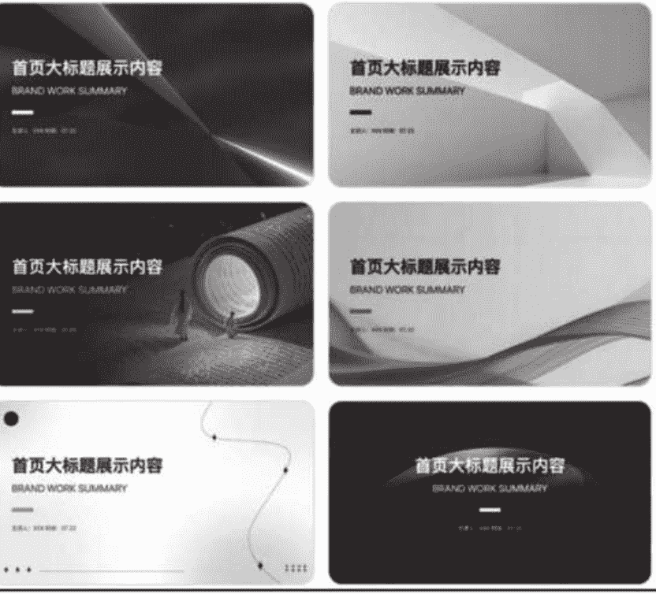

图7-13 培训课件模板

产品演示PPT聚焦产品亮点与场景感染力，适用“产品发布”或“极简科技”风格模板，设计干净、聚焦，大量使用产品高清渲染图、场景应用图与简洁的特性说明，动画流畅，如图7-16所示。

- 毕业答辩
  - 商业计划
  - 产品演示
  - 公司介绍
- 综合
  - 颜色
  - 风格


图7-14 毕业答辩模板

毕业答辩

商业计划

产品演示

公司介绍

综合

颜色

风格


图7-15 商业计划模板

公司介绍PPT传递品牌实力与文化底蕴，适用“品牌故事”或“企业形象”风格模板，紧密融合企业VI色，运用团队照片、发展里程碑、文化价值图标化展示，风格大气统一，如图7-17所示。

- 毕业答辩
  - 商业计划
  - 产品演示
  - 公司介绍
- 综合
  - 颜色
  - 风格


图7-16 产品演示模板

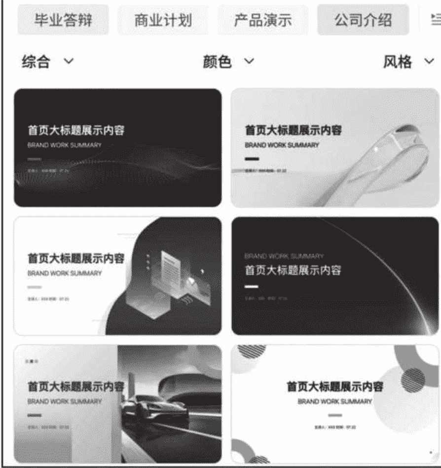

图7-17 公司介绍模板

党建宣传PPT要求庄重严肃且富有感召力，适用“红色主题”或“党政风采”专用风格模板，以红、黄、金为主色，规范使用党徽、旗帜等元素，版面方正，气势恢宏，如图7-18所示。

节日庆典PPT侧重营造欢乐喜庆或温馨感动的氛围，适用“节日庆典”或“活动策划”风格模板，色彩鲜艳丰富，可灵活运用对应节日的特色图案、装饰元素，动画效果活泼，如图7-19所示。

- 党建宣传
  - 节日庆典
  - 个人简历
  - 课题研究
- 综合
  - 颜色
  - 风格


图7-18 党建宣传模板

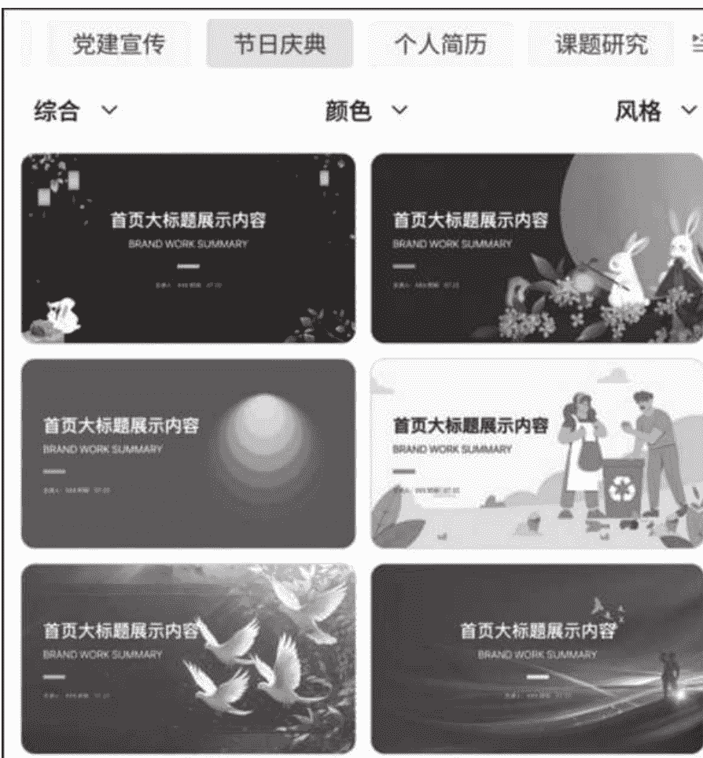

图7-19 节日庆典模板

个人简历PPT侧重个性突出与信息结构化，适用“创意简历”或“专业履历”风格模板，设计上可在保持清晰易读的同时，通过独特的版式、配色或图形元素展现个人品牌，如图7-20所示。

课题研究PPT强调逻辑深度与形式规范，适用“学术海报”或“研究汇报”风格模板，风格严谨，支持复杂图表、公式与文献引用格式的清晰呈现，色调通常偏稳重，如图7-21所示。

- 党建宣传
  - 节日庆典
  - 个人简历
  - 课题研究
- 综合
  - 颜色
  - 风格


图7-20 个人简历模板

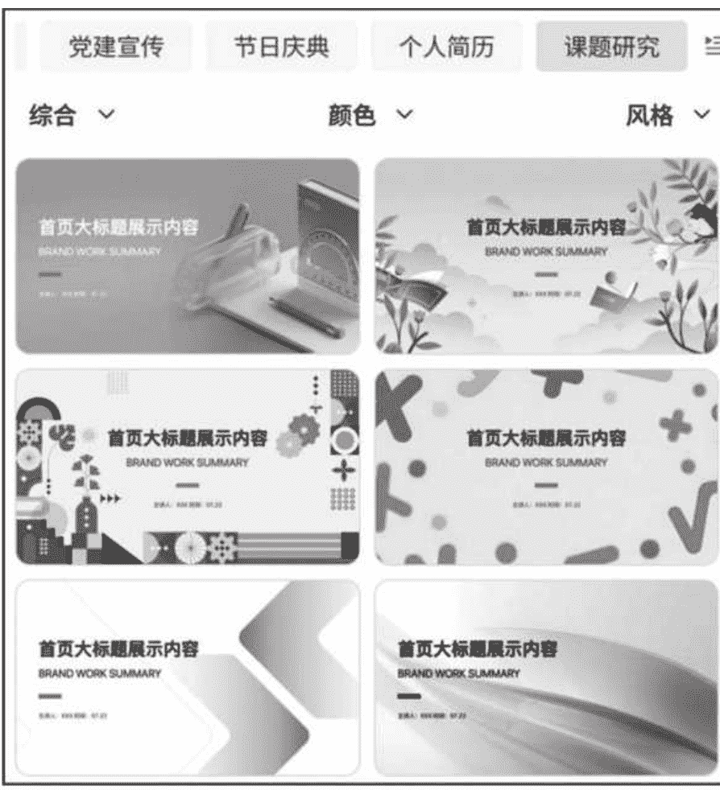

图7-21 课题研究模板

通过千问内置的智能场景模板库，你可以在创建演示文稿的起始阶段，直接点选“工作汇报”“产品演示”“毕业答辩”等具体场景。系统将基于该场景的沟通目标与视觉惯例，自动应用一整套经过专业设计优化的风格框架——包括协调的色彩体系、规范的字体层级、适配的版式布局以及恰当的图形元素。这不仅能将你从烦琐的基础排版工作中彻底解放，更能确保视觉表达与内容主题高度契合，从根本上避免了风格错配的风险，从而大幅提升从内容构思到视觉成稿的整体协同效率，让你能专注于打磨核心信息与演讲的表达。

### 7.5 演示优化：互动环节的智能建议

#### 7.5.1 用千问的优势

在完成PPT与演讲稿的初步设计后，演示者通常会面临一个关键瓶颈：如何从“观众视角”审视自己的作品，发现并改善那些潜藏的问题？我们往往陷入“当局者迷”的困境，难以客观评估内容是否足够吸引人、逻辑是否真正流畅、视听配合是否无缝。传统的优化方式依赖于反复自我检查或邀请同事预览，不仅效率低下，反馈也常局限于主观感受，难以系统性地覆盖内容、逻辑、表达、呈现等多个专业维度。

千问可以在此环节扮演一个不知疲倦、视角客观的“彩排教练”与“内容医生”。千问能够运用其强大的文本理解、逻辑分析与设计感知能力，对上传的完整PPT和演讲稿进行系统性“体检”，并从内容适配性、逻辑连贯性、表达优化、呈现配合、细节完善等多个专业维度，提供具体、可落地的优化建议。这不仅能帮助演示者提前发现和修复潜在问题，更能大幅提升演示内容的整体质量与现场表现力，让每一次登台都更加从容、表现专业。

#### 7.5.2 操作步骤

在演讲准备流程中，你可以将已基本成型的PPT和配套演讲稿提交给千问，要求其进行系统性诊断与优化。以下是一个完整的操作案例。

**【案例背景】**

我已为面向中学生的“北京故宫”主题演讲，准备了一套PPT和配套演讲稿，在正式演练前，希望获得一份客观、专业的优化建议，以确保内容能真正吸引并打动年轻听众。

第一步，将PPT文件和演讲稿文本完整上传给千问，并清晰地提出希望它从哪些维度进行评估。输入提示词如图7-22所示。

第二步，千问在分析材料后会输出一份系统性的诊断报告。

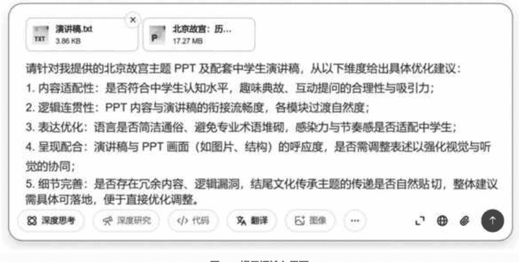

图7-22 提示词输入界面

**一是内容适配性方面**，整体语言风格贴近中学生，但可进一步增强趣味性与参与感。一是建议在演讲开头或建筑章节插入1～2个具象有趣的冷知识，如“故宫有9999间半房，因为天宫才有1万间”或“太和殿前铜狮闭嘴象征守密”，提升记忆点；二是增加1～2处互动提问，例如“猜猜三大殿名字里藏着什么儒家理想？”，引导听众思考；三是对“榫卯”“非遗”等术语首次出现时补充通俗解释，如“不用钉子的木头拼插技术”“快要失传的老手艺”，确保理解无障碍。

**二是逻辑连贯性方面**，演讲稿四乐章与PPT四大板块基本对应，但衔接略显生硬。一是建议在每段开头加入自然过渡句，如从历史转入建筑时说：“看完了六百年的风云，现在让我们低头看看脚下的砖、头顶的梁——它们也在讲故事”；二是在演讲稿旁标注对应PPT页码或标题（如“对应PPT第7页：中轴线布局”），便于演讲者精准同步内容；三是PPT第13页提到宫廷音乐、点翠工艺等内容，但演讲稿未展开，建议在第三乐章末尾补一句：“就连皇后头上的点翠凤冠、典礼上的雅乐，这些‘看不见’的文化，也在被年轻人学起来、传下去”。

**三是表达优化方面**，语言总体简洁生动，但部分表述仍可更口语化、更具节奏感。一是删减重复形容词（如多处“超级”“闪闪发光”），保留关键修辞以维持活力；二是将抽象概念转化为具体画面，例如把“体现天人合一”改为“宫殿朝南对准北极星，黄瓦象征大地，红墙代表火焰，古人用建筑画出他们的宇宙”；三是结尾口号稍显突兀，建议将“文化是血液里的记忆”前加一句过渡：“哪怕只是拍一张角楼的照片、给朋友讲一段琉璃瓦的故事，我们就在续写故宫的新篇章”，使传承主题更自然落地。

**四是呈现配合与细节完善方面**，需强化视听协同并修正微小疏漏。一是在演讲稿中标注关键视觉提示，如“此时PPT展示三大殿航拍图”“切换至VR体验界面”，引导听众聚焦画面；二是建议PPT补充一张“古代工匠vs现代青年修复师”对比图，配合演讲中“代际守护”内容，增强情感共鸣；三是修正“整座宫殿不用一根钉子”的不严谨说法，改为“主体木结构几乎不用钉子”，同时精简尾声中略显重复的排比句，让“青少年能做什么”的呼吁更聚焦、更真实可信。

第三步，根据这份结构化建议列表，逐一修改PPT和演讲稿，使演示内容更加精致、流畅。然后，可基于优化后的材料再次进行演练，或请求千问对修改后的版本进行二次快速复查。

#### 7.5.3 最佳实践

为了让千问提供最具价值的优化建议，提升演示准备的效率与效果，建议遵循以下实践方法。

- 提供最终草案：在将材料提交给千问前，尽量自行完成逻辑梳理和基本打磨。千问更擅长在“准成品”基础上进行精细化诊断和提升，而非从一团混沌中理出头绪。
- 明确界定受众及场景：在提示词中务必清晰说明演示的受众是谁，以及场景是什么。这直接决定了千问评估适配性的标准。
- 要求建议具体可操作：拒绝模糊评价，明确要求千问避免使用“可以更好”“建议加强”等模糊表述，而是必须给出具体的修改文案、增设的互动问题或需要调整的PPT页面描述。
- 建立个人问题清单与优化模板：总结千问在不同演示中反复指出的常见问题，形成自己的演示自查清单，以在未来准备工作中先行规避，提升初稿质量。

通过将千问深度整合进演示优化的闭环，你能系统性地提升作品的专业水准，将每一次公开表达都转化为一次精准、有力且动人的沟通，不仅能传递信息，更能有效塑造自己的影响力。

## 第8章 图像处理：视觉内容的智能生成

在内容传播高度依赖视觉表现的时代，高质量图像已经成为数字表达的基础能力。本章将介绍千问在海报设计、LOGO设计、图像优化、多图整合等方面的核心应用能力。得益于强大的多模态生成模型，千问不仅能理解你的设计目标，还可以根据文字描述生成主题明确、风格统一的图像作品；可以对现有图像进行色彩校正、细节增强；也能完成多图排版与视觉叙事设计。本章旨在帮助读者掌握从图像“构思”到“呈现”的完整流程，使图像创作变得简单可控，让视觉表达真正服务内容价值。

## 8.1 海报设计：主题导向的图像生成

### 8.1.1 用千问的优势

在品牌宣传、活动运营、展览展示以及新媒体内容制作中，一张主题鲜明、视觉统一的海报往往决定信息能否在第一时间吸引受众。然而实际创作中，设计人员常面临主题表达不够聚焦、视觉风格不统一、图像素材难以契合文案、构图不够专业等问题。尤其在时间紧、任务杂的场景下，人工不断尝试不同构图与风格，既耗时又难以达到预期效果。

千问能够直接破解这些难题，凭借多模态生成能力，只需用户输入主题、受众、场景、关键词或期望风格，即可自动生成具有明确视觉导向的海报草图或成品图像。它能在生成图像前理解主题核心意图，例如“科技风”“公益宣传”“节日氛围”“学术论坛”等，自动匹配视觉风格、色彩氛围、构图结构，让海报从一开始就具备清晰的创意方向。相比传统靠反复试探式设计的方法，千问让设计者能够在几分钟内锁定最优方向，大幅缩短创意探索周期。更重要的是，千问可以自动将文案核心内容融入图像表达，使视觉信息与主题叙事天然对齐。对非专业设计人员而言，它显著降低了海报制作门槛，让创意工作变得高效、可控、可扩展。

### 8.1.2 操作步骤

第一步，打开千问的首页，单击对话框下方的“图像”按钮，如图8-1所示。


进入图像模式后，可以输入提示词、上传参考图和选择图像比例。千问提供了多个比例，包括1:1、3:4、4:3、16:9、9:16，如图8-2所示。

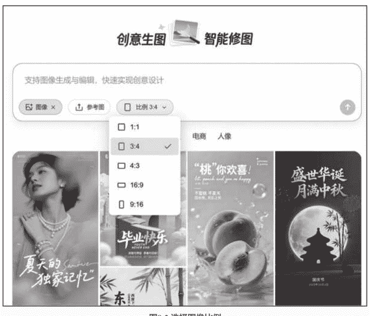

第二步，输入提示词，以生成一个科技主题海报为例：“未来科技主题海报，霓虹蓝紫色调，赛博朋克城市背景，中央突出大字‘2025全球创新峰会’，动态光效，高科技元素如全息投影、数据流、AI芯片图案，现代感强，高清细节，竖版构图”。

需要注意的是，提示词必须明确，描述得越精准、越清晰，生成的内容就越符合要求。

第三步，单击“发送”按钮，稍等片刻，千问就会生成符合要求的海报了，如图8-3所示。

我们还可以使用类似的提示词，生成更多版本的海报，例如生成文艺音乐节海报，可以输入提示词：“夏日户外音乐节海报，手绘插画风格，温暖阳光色调，吉他、音符、绿植与人群剪影交织，顶部醒目文字‘山谷回声音乐节2025’，轻松自由氛围，柔和笔触，横版布局”。千问生成的海报如图8-4所示。

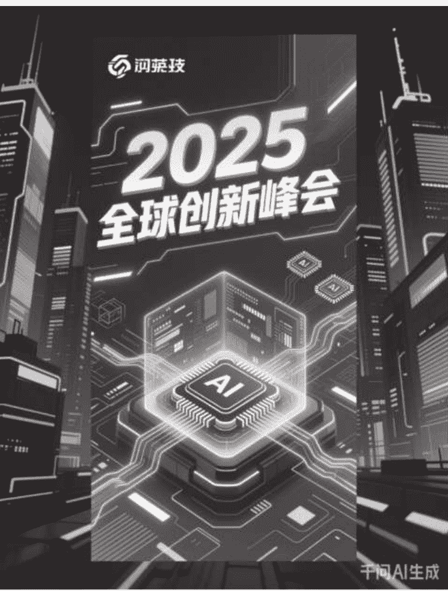

图8-3 未来科技主题海报

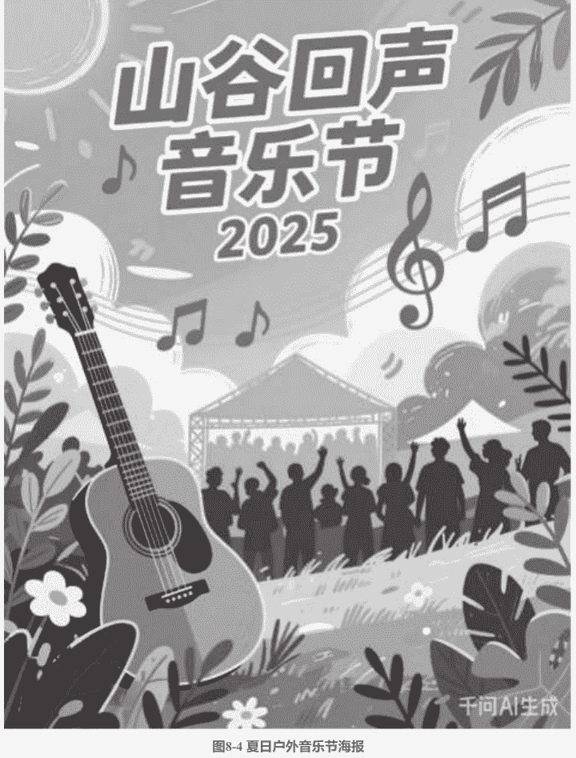

图8-4 夏日户外音乐节海报

我们还可以生成环保公益宣传海报，输入提示词：“环保主题公益海报，地球被绿色藤蔓包裹、双手温柔托起，背景为蓝天与海洋，标语‘守护每一份绿意’居中，清新自然配色，简约有力，写实与象征结合，竖版高清”。千问生成的海报如图8-5所示。


图8-5 环保主题公益海报

### 8.1.3 最佳实践

为了让千问生成的海报更契合主题表达与视觉传播需求，产出具备专业水准与统一风格，建议遵循以下实践方法。

- 提供完整的创作要素：向千问明确告知海报的主题、目标受众、使用场景、色彩倾向、风格类型、关键词及文案内容，使模型能够从一开始就建立正确的视觉方向，避免出现主题散乱、风格偏差或文字与画面不匹配的问题。
- 明确构图与版式需求：提前说明需要的构图方式（如居中、对称、留白、场景化背景等）、主视觉位置、文字排布方式等，让千问在生成时自动匹配结构逻辑，使成品更接近可直接使用的设计成稿。
- 要求生成多版本方案：通过指令让千问生成风格不同、构图不同、主视觉不同的多款海报，以便快速筛选与比对。例如要求分别输出“科技风版”“插画风版”“极简版”，缩短创意探索时间，帮助创作者在几分钟内锁定最佳方案。
- 上传参考图强化风格一致性：提供品牌视觉物料、旧版海报、情绪板等参考内容，指导千问生成字体风格、色调体系与品牌调性一致，确保视觉识别不跑偏，并提升整体设计连贯性。
- 沉淀可复用提示词模板：将经过验证的高质量提示词整理为“海报生成固定模板”，未来仅需替换主题、活动标题或关键词即可快速复用，从而显著提升重复型设计任务的效率。

通过这些方法，千问不仅能在极短时间内提供方向清晰、风格统一的海报视觉方案，还能降低设计门槛，让创作者以更低成本获得专业级视觉表达，高效支撑品牌传播与内容运营。

## 8.2 LOGO设计：网络文化的视觉表达

### 8.2.1 用千问的优势

LOGO是品牌的核心视觉符号，承载着辨识度、文化属性与价值主张。然而在实际设计中，许多团队面临创意匮乏、风格不统一、图形语言缺乏象征性、难以适配数字媒体等问题。尤其在互联网时代，LOGO必须兼具视觉冲击力与文化表达能力，还要在小尺寸、高对比度、多场景中保持清晰度，这对设计构思提出了更高要求。

千问具备强大的视觉生成与抽象概念理解能力，非常适合用于LOGO设计的创意阶段与成型阶段。只需用户输入企业/产品定位、品牌关键词、文化调性、行业属性等信息，它就能自动生成多组具备互联网视觉风格的LOGO方案，包括抽象图形、符号化元素、配色体系与字体倾向。千问不仅能识别品牌独特性，还能在图形中融入网络文化隐喻，使LOGO具备更强的传播性与年轻化表达。此外，它还可根据使用场景自动输出不同版本，如极简版、扁平版、黑白版、方形头像版等，帮助品牌在社交媒体、应用图标、海报或视频中保持一致的视觉识别。千问让缺乏专业视觉背景的团队也能快速生成具有辨识度的品牌符号，大幅提高创意效率并降低尝试成本。

### 8.2.2 操作步骤

第一步，打开千问的首页，单击对话框下方的“图像”按钮。进入图像模式后，可以输入提示词、上传参考图和选择图像比例。一般情况下，LOGO设计可以选择1:1的图像比例。

第二步，输入提示词。以生成一个咖啡馆LOGO为例，输入提示词：“LOGO设计：适用温馨舒适的咖啡馆，使用暖色调如棕色、米色和橙色，图形中包括一杯热气腾腾的手冲咖啡以及一些简单的植物装饰，传达出放松和享受时光的品牌理念。”单击“发送”按钮，千问就会生成一个LOGO的初稿，如图8-6所示。


图8-6 咖啡馆LOGO

千问还提供了“参考图”功能。我们可以直接将想参考的图像上传给千问，例如我们想模仿上述咖啡馆LOGO，再设计一个轻食餐饮店LOGO，可以先上传参考图[可同时上传3张图像（每张10MB），支持JPEG/JPG/PNG/BMP/WEBP格式]，如图8-7所示。


图8-7 上传参考图

此时，输入提示词：“参考附件中LOGO的风格，做一个轻食餐饮店LOGO，要求如下：主色调为绿色，LOGO主体是一份蔬菜沙拉”，如图8-8所示。


图8-8 上传参考图并输入提示词

单击“发送”按钮，千问就会生成一个LOGO的初稿，如图8-9所示。

第一次生成的LOGO可能不完全符合需求，例如我们不希望LOGO上有那杯咖啡，图中的文字也需要调整一下，可以再次输入提示词：“去除碗顶上的咖啡杯，图中的文字改为轻食一刻”。修改后的图像如图8-10所示。


图8-9 轻食餐饮店LOGO


图8-10 优化后的LOGO

### 8.2.3 最佳实践

为了让千问生成的LOGO更具辨识度、文化表达能力与数字媒体适配性，建议遵循以下实践方法。

- 提供清晰的品牌核心信息：向千问说明品牌定位、品牌价值、文化调性、行业属性、名称来源、目标客群等关键信息，使模型能从象征意义与视觉语言两个维度理解LOGO的设计意图。
- 明确图像语言与风格要求：提前说明是否希望采用极简、扁平、几何、手绘、拟物等不同风格，以及对构图、线条粗细、配色体系的预期，让千问自动收敛图形方向，减少偏差。
- 要求生成多形态版本：要求千问输出主LOGO、黑白版、ICON小图标版、社交媒体圆角头像版、横向/竖向等多种版本，以满足不同平台、不同应用场景的适配需求。
- 借助参考图确保延续性：上传旧LOGO、竞品参考、视觉灵感等强化千问的风格理解，使新版LOGO在结构关系、风格气质、象征意义方面与品牌既有资产保持一致，避免突兀跳脱。
- 反复迭代并记录有效提示词：通过调整提示词不断优化元素，如去除不必要的图形、调整色彩象征、精简结构等，将满意的提示词沉淀为“品牌LOGO固定生成模板”，形成可持续迭代的企业数字资产。

通过这些方法，千问不仅能高效产出具有网络文化表达力的LOGO初稿，还能帮助企业快速形成完整的视觉识别体系，在数字媒体时代实现高效、低成本的品牌创意生产。

## 8.3 图像优化：色彩校正与细节调整

### 8.3.1 用千问的优势

在专业设计、产品展示、电商运营及宣传物料制作中，图像质量直接影响用户的第一感知。然而传统图像的优化高度依赖专业软件与手工调校，需要操作者具备色彩学、光影、细节增强等技巧。常见问题包括色偏难以修正、亮度对比度不均、噪点过多、边缘不清晰、局部细节不足等，往往需要多轮修图才能达到标准。

千问的图像优化能力可以显著提升这一流程的效率与质量。只需上传原图并输入目标需求，如“提升亮度”“校正肤色”“增强细节”“优化电商展示效果”“突出主体”“消除杂色背景”等，千问即可自动进行专业级别的色彩校正、光影平衡、锐度提升和局部增强。它能够智能识别主体位置、材质特征与场景氛围，从而在不破坏图像自然感的前提下实现高质量优化。尤其值得指出的是，千问可以根据不同需求提供多版本输出，例如适用于社交媒体的高饱和度风格、适用于电商的高清细节图、适用于宣传物料的柔光格式等。对于无法自行掌握复杂调色与修图软件的用户，千问几乎一键即可获得专业效果，大幅降低使用门槛，提升视觉呈现质量。

### 8.3.2 操作步骤

打开千问的首页，单击对话框下方的“图像”。进入图像模式后，我们可以输入提示词、上传参考图和选择图片比例，我们把需要优化的图片以附件形式上传给千问，如图8-11所示。

我们可以将图片改为夕阳光影感氛围图，例如输入提示词：“帮我把附件中的图片光影改为日落光影。夕阳照着草原和女生。”稍等片刻，千问就会生成一张夕阳光影感的图片，如图8-12所示。


图8-11 需要优化的原图


图8-12 修改后的图片（一）

此外，我们还可以改变人物的衣服和背景，例如输入提示词：“帮我把背景改为雪山，女生穿着白色衣服。”稍等片刻，千问就会生成一张以假乱真的实拍感图片，如图8-13所示。

我们还可以通过修改提示词再次变化细节，例如输入提示词：“帮我给女生戴上一顶黄色的帽子，背后加上几匹马。”千问就会为女生戴上帽子，甚至帽檐在脸部的光影也完全正确，如图8-14所示。


图8-13 修改后的图片（二）


图8-14 修改后的图片（三）

我们再看一个修改LOGO的案例，例如我们喜欢图8-15所示的LOGO，但是想要将LOGO中的男生改为女生，碗换成红色。可以输入提示词：“请将LOGO中的男生改为女生，碗换成红色。其余内容不变。”千问会迅速完成LOGO修改，如图8-16所示。


图8-15 参考LOGO


图8-16 修改后的LOGO

### 8.3.3 最佳实践

为了确保千问生成的图像优化结果符合专业视觉标准，同时避免色彩偏离、光影不自然或细节处理不准确等问题，建议遵循以下实践方法。

- 提供高质量原图与精确问题描述：上传尽可能清晰的原图，并明确指出需要改进的具体问题，如“光线不足”“阴影太重”“肤色偏黄”“背景杂乱”等，使千问精准定位优化方向。
- 明确风格与用途差异化需求：提前说明图像将用于电商、宣传页、社交媒体或个人写真等不同场景，让千问自动匹配对应的细节增强程度、色彩饱和度与氛围调性，确保效果与使用目标一致。
- 要求分步优化并检查中间结果：让千问分步骤进行亮度校正、色彩优化、背景调整、主体增强等操作，避免一次性处理过度或偏离需求，并在关键节点让千问停下来确认，确保方向准确。
- 适当提供参考图以实现风格一致性：上传希望模仿的光影风格、滤镜效果或场景氛围图，使千问在优化过程中遵循统一基调，确保成品图像更加自然、协调。
- 建立可复用的图像优化模板：将高质量指令积累为固定模板，例如“电商白底优化模板”“人像肤色自然模板”“户外氛围增强模板”等，后续只需替换附件即可快速复用，大幅提升批处理效率。

通过这些方法，千问不仅能大幅提升图像优化的速度与质量，还能使缺乏专业修图技能的用户轻松获得媲美专业修图师的图像优化效果，让视觉内容更具表现力与传播力。

## 8.4 多图整合：视觉叙事的排版设计

### 8.4.1 用千问的优势

在电商内容制作中，人物穿搭展示对转化率具有直接影响，而传统手法往往需要模特拍摄、造型搭配、场景布光等一整套流程，成本高、周期长。千问通过AI驱动的智能图像生成能力，显著降低了“给人物穿衣、生成实拍质感照片”的门槛，使普通创作者也能轻松产出接近商业摄影水平的展示图片。

千问具备强大的视觉识别与图像重绘能力，能够自动理解人物姿态、体型比例和场景光线，智能匹配服饰的面料质感、褶皱走向与穿着贴合度，从而生成真实自然的穿搭效果图。同时，它还能自动适配服装尺寸、风格与色彩调性，规避传统换装中常见的错位、变形、光影不一致等问题，大幅减少手动修图与反复调整的时间，显著缩短电商内容制作周期。借助千问，新手卖家无须掌握摄影、布光、后期等专业技能，也能以极低成本完成高质量穿搭内容生产，显著提升商品展示的表现力与购买转化率。

### 8.4.2 操作步骤

我们以如图8-17所示的模特照片和服装图片为例，希望为模特穿上如图8-18所示的衣服、鞋子。

我们上传这两张参考图后，输入提示词：“请让图1中的女生穿上图2所示的衣服、鞋子，保持她的姿势、发型和面部不变，确保衣服贴合身体轮廓，光影风格一致。” 千问会直接让模特“穿上”衣服和高跟鞋，如图8-19所示。


图8-17 模特参考图


图8-18 衣服、鞋子图片

当然，我们还可以换一套穿搭，只需重复上述步骤并上传新的服装图，如图8-20所示，并输入提示词：“请让图1中的女生换上图2所示的衣服、裤子，背着图2中的背包。保持她的姿势、发型和面部不变，确保衣服贴合身体轮廓，光影风格一致。” 千问会直接让模特“穿上”衣服，背上背包，如图8-21所示。


图8-19 生成效果图（一）


图8-20 新的服装图

我们还可以通过调整提示词生成不同背景及场景下的图片，输入提示词：“基于已有模特图风格，同一模特（保留原图发型/妆容/身材特征），穿着同款衣服，电商实拍质感，户外，坐在椅子上，自然光线，真实布料纹理。”千问生成的效果图如图8-22所示。


图8-21 生成效果图（二）


图8-22 生成效果图（三）

如果想改变动作，还可以输入提示词：“基于已有模特图风格，同一模特（保留原图发型/妆容/身材特征），穿着同款衣服，电商实拍质感，户外，坐在草坪，自然光线，真实布料纹理。”千问生成的效果图如图8-23所示。

如果想改变环境，可以输入提示词：“基于已有模特图风格，同一模特（保留原图发型/妆容/身材特征），穿着同款衣服，电商实拍质感，户外，站在花园里，自然光线，真实布料纹理。”千问生成的效果图如图8-24所示。

### 8.4.3 最佳实践

为了确保千问在换装、场景融合、构图统一等多图整合任务中生成更真实、更自然、更具有电商实拍质感的成品图，建议遵循以下实践方法。

- 提供标准化参考图与明确合成目标：上传人物原图、服装单品、道具、场景参考等素材，并明确告知“保持人物姿势与面部不变”“衣服贴合身体轮廓”“光影一致”等关键要求，使千问在生成时有清晰的结构性约束。
- 强调光影、材质与空间一致性需求：在提示词中明确说明“真实布料纹理”“自然光线”“场景光影统一”“不变形、不穿模”等条件，确保千问处理时遵循物理逻辑，从而让生成图像更加真实。实、可信。

图8-23 生成效果图（四）

图8-24 生成效果图（五）

- 要求千问输出多个替代版本：通过指令生成不同角度、不同场景、不同姿态、不同背景的版本，以便快速挑选最优成片，也避免单次生成无法满足展示需求的情况。
- 按需迭代并定位具体修正点：对初稿中存在的服饰贴合度差、光影突兀、动作不自然、背景不协调等问题，使用明确提示词指出，如“肩部贴合度增强”“阴影方向保持一致”“更自然的坐姿”等，逐步优化结果。
- 构建可复用的电商换装模板：将有效提示词沉淀为固定模板，包括“模特换装模板”“服饰展示模板”“户外场景融合模板”等，后续在批量制作电商内容时仅需替换人物与服装素材，即可快速复用，显著提升内容生产效率。

通过这些方法，千问能够在多图融合、换装展示、场景重绘等任务中提供高一致性、高真实度的视觉效果，让普通创作者也能以低成本生成专业级电商展示内容，加速内容生产流程并提升商品转化率。

## 第9章 视频创作：多媒体内容的智能生产

视频内容已成为互联网传播的核心形态，但传统视频创作往往涉及剧本创作、分镜设计、拍摄、剪辑等多个复杂环节。本章将展示通义千问如何利用多模态能力，让高门槛的专业的视频创作变为人人都可做的轻量化创作。从脚本生成到分镜设计，从主题定位到用户画像匹配，从智能生成短视频到快速提取视频重点信息，千问为多媒体创作提供了全链路支持。本章将介绍如何借助千问提升视频创意生产效率，使“会做视频”真正成为一种基础技能。

### 9.1 脚本创作：故事板与分镜设计

#### 9.1.1 用千问的优势

在视频制作的前期创意阶段，脚本与分镜设计决定了叙事节奏、视觉风格和最终成片质感。然而传统脚本创作往往存在思路发散、结构混乱、镜头语言不统一、团队沟通成本高等问题。尤其是在短剧、广告片、自媒体内容快速迭代的环境下，人工逐个镜头推敲不仅耗时，还容易偏离目标主题。

千问能够显著提升脚本创作与分镜设计的效率。它能根据输入的主题、场景描述、目标受众与风格偏好，自动生成逻辑完整的脚本大纲，包括开端—发展—高潮—收束的叙事结构。同时，千问可进一步转化为可执行的分镜脚本，对每个镜头的景别、机位、人物动作、场景氛围、过渡方式进行清晰标注，让制作团队在前期就形成一致理解。相比依赖人工经验的传统方式，千问让创作者在数分钟内就能获得专业化的故事板草案，为后续拍摄计划、镜头调度、节奏控制奠定坚实基础，显著降低创意反复与团队沟通的成本。

#### 9.1.2 操作步骤

我们以创作一个主题为“智能水杯”的30秒品牌宣传短视频脚本为例。

第一步，打开千问，输入提示词，如“请帮我写一个30秒的品牌宣传短视频脚本，主题是智能水杯——HydraSmart。产品特点包括：能提醒喝水、记录每日饮水量、保温保冷、App同步数据。目标受众是25～40岁的都市上班族。风格要简洁、现代、有科技感，带一点温暖和关怀。需要包含画面描述、旁白文案和背景音乐建议。”。

千问会很快生成视频脚本。

```
视频脚本：HydraSmart智能水杯（30秒）

时长：30秒

风格：现代、科技感、温暖

背景音乐：轻柔电子氛围乐，节奏舒缓但有律动感（如Ludovico Einaudi风格混搭轻微Synth）

[0:00—0:05]画面：清晨阳光透过写字楼玻璃窗，一位年轻女性坐在办公桌前专注工作，桌上放着普通水杯，但她一整天都没喝一口水。

旁白（温柔女声）：“忙到忘了喝水？你并不孤单。”

[0:06—0:12]画面：她拿起HydraSmart智能水杯，杯身LED灯轻轻闪烁蓝光。手机App弹出通知：“该补水啦！”

旁白：“HydraSmart，懂你何时需要一杯水。”

[0:13—0:20]画面：快速剪辑—水杯在会议桌上、健身房、深夜书桌旁；屏幕显示当日饮水进度100%；杯盖旋紧，保温效果演示（热气/冷凝水特写）。

旁白：“智能提醒，精准记录，长效保温保冷——健康，从每一口开始。”

[0:21—0:30]画面：她微笑喝水，镜头拉远，城市夜景中无数灯光亮起，每个窗口都有一个HydraSmart水杯微微发光。

旁白：“HydraSmart，关心你的每一刻。”

LOGO+Slogan：HydraSmart——智能饮水，温暖随行
```

第二步，在千问生成脚本初稿后，对文本进行通读和基础校核，判断其与智能水杯的宣传要点是否匹配。重点关注关键信息是否完整、整体时长是否符合要求、内容结构是否连贯，并同步记录需要进一步强化或调整的方向。对需要修改的部分进行系统梳理，形成明确、可执行的优化意见，并据此编写逻辑清晰、指向明确的修改提示词。

> 脚本整体不错，但我希望：
>
> 开头不要太“焦虑”，避免“忘了喝水”的负面暗示，改成更积极的引导；
>
> 加入一个男性角色，体现产品适合所有性别；
>
> 结尾Slogan改为“HydraSmart——喝水，刚刚好”；
>
> 背景音乐建议换成更轻快、有活力的，比如类似Apple广告那种清新电子风。

第三步，等待千问完成修改，可以得到以下内容。

> **视频脚本：HydraSmart智能水杯（30秒·优化版）**
>
> 时长：30秒
>
> 风格：清新、现代、科技感+温暖关怀
>
> 背景音乐：轻快清新的电子配乐（参考Apple或Google Pixel广告风格：干净、节奏明快、带点跳跃感）
>
> [0:00—0:06]画面：晨光中，一位年轻女性在办公桌前伸个懒腰，顺手拿起HydraSmart水杯喝了一口水；同一时刻，一位男性在健身房结束训练，也拿起同款水杯畅饮。两人相视一笑（非同一场景，平行剪辑）。
>
> 旁白（温暖而有活力的中性声线）：“每一天，从恰到好处的补水开始。”
>
> [0:07—0:13]画面：水杯LED灯柔和闪烁，手机App界面显示“今日饮水：80%”；镜头特写手指轻触杯身，温度数字显示“55°C”。
>
> 旁白：“HydraSmart智能提醒，记录每一口，保持理想温度。”
>
> [0:14—0:22]画面：快节奏蒙太奇—水杯出现在通勤地铁、会议室、居家办公桌、户外露营；不同用户（男女、不同肤色）轻松喝水，App同步更新数据。
>
> 旁白：“无论你在哪，它都默默守护你的饮水节奏。”
>
> [0:23—0:30]画面：镜头聚焦水杯底部LOGO，缓缓升起，景渐变为纯净白色。
>
> 字幕+旁白：“HydraSmart——喝水，刚刚好。”
>
> 音效：清脆“叮”一声，伴随品牌LOGO淡入。

#### 9.1.3 最佳实践

为了让千问生成的脚本与分镜更贴合实际拍摄需求，既具备完整叙事结构，又方便团队执行，建议遵循以下实践方法。

- 提供完整的项目信息与创作约束：在提问中尽量一次性说明视频类型（广告片、品牌片、短剧、Vlog等）、时长、投放平台、目标受众、产品卖点、预算级别（高/中/低制作难度）等关键信息，并明确是否需要横竖屏适配、是否支持实拍/纯素材等，让千问在结构和节奏上从一开始就“对题”。
- 明确脚本颗粒度与分镜深度：根据实际制作需求，说明希望千问输出故事大纲级脚本、详细分场景脚本还是逐镜头分镜脚本。例如要求写出每一段的时间码、景别（远景/中景/近景/特写）、机位运动、人物行为与旁白内容，便于直接用于拍摄执行与后期剪辑。
- 要求提供多版本方案与不同风格对照：在同一轮对话中，可要求千问给出“现实写实版”“情绪诗意版”“幽默轻松版”“信息密集版”等不同风格脚本，或输出30秒完整版、15秒精简版、6秒抢眼版三种版本，方便对比筛选和匹配不同投放场景。
- 显式标注需保留不可触碰的要素：对品牌名、核心Slogan、必须出现的产品功能、法律合规要求等，可在提示词中注明“不得删除或改写”“不得出现夸大宣传”，避免千问在优化过程中弱化或改动关键内容，确保脚本既有创意又可落地。
- 迭代优化并沉淀脚本提示词模板：在多轮修改中，记录那些能显著提升脚本质量的指令，如“节奏更紧凑一点”“减少空洞口号，多用具体画面”“为每一段增加视觉对位镜头说明”等，整理为“脚本创作固定提示词模板”，便于后续不同项目快速复用与调整。

通过这些方法，千问不仅能帮助创作者快速搭建结构完整、节奏清晰的脚本与分镜方案，还能在多轮迭代中持续提升创作质量，降低反复沟通与试错成本，为短视频、广告片与品牌内容的高效生产提供坚实支撑。

### 9.2 主题定位：受众需求的精准匹配

#### 9.2.1 用千问的优势

无论是短视频选题、品牌内容策划、线上课程开发，还是活动宣传，主题精准击中受众需求，是内容获得高转化、高传播的关键。然而在实际工作中，许多团队常陷入“方向不清”“受众模糊”“内容定位与平台不匹配”等困境，导致大量内容投入无法产生实际效果。

千问在主题定位上具备明显优势。它能够根据受众画像、传播渠道、行业趋势与传播目标，自动识别用户最关心的话题点，并从中提炼适合不同内容形态的主题方向。同时，千问还能提供主题背后的需求逻辑、爆点分析、重点表达角度及潜在风险提示，使选题不再停留在“灵感式判断”，而是建立在系统分析基础上的精准匹配。借助千问，创作者能够快速筛选出具有传播潜力的高价值主题，并将内容方向与目标受众真实需求对齐，让内容生产更具策略性。

#### 9.2.2 操作步骤

第一步，打开千问，输入一段包含产品核心参数、功能亮点及竞争优势的完整提示词。示例提示词如下：“请根据以下产品信息进行内容确认与归纳：本款肩颈按摩仪定位为家用与办公两用的便携式肩颈护理设备，具备揉捏、推拿、脉冲、热敷四种按摩模式，可实现约8小时无线续航。产品采用贴合人体肩颈曲线的结构设计，支持一键启动，操作简单、直观。典型使用场景包括久坐办公后快速放松、居家休息时轻松按摩，以及通勤、差旅途中缓解肩颈疲劳。与竞争产品相比，本设备的核心优势包括：机身小巧便于携带、运行噪声低不打扰他人、面料亲肤适合长时间使用。请确认以上信息是否完整、准确，并补充你认为必要的结构化说明。”

该步骤的目标是让千问建立基础知识框架，为后续分析和脚本生成奠定标准化信息底座。

第二步，在确认完产品信息后，继续输入受众分析提示词，用于推动千问输出完整的用户画像。提示词如下：“请结合上述按摩仪的功能特性，从年龄层、职业类型、核心痛点、典型使用场景、消费关注点五个维度，系统性分析该产品的核心目标用户与潜在用户，并以条理清晰、易于理解的方式输出结果。”

此时，千问会输出对用户画像的理解：

> 1.核心目标用户：25～45岁的职场群体（常年久坐导致肩颈紧绷，需要随时随地快速缓解，偏好便携且静音的产品）；备考学生（持续伏案学习导致肩颈酸痛，对操作简单、具备基础理疗效果、具有性价比优势的设备更敏感）。
>
> 2.潜在用户群体：30～55岁居家宝妈（家务带来肩颈劳损，更关注舒适度、亲肤体验与多模式选择）；经常出差或通勤的商务人士（旅途造成肩颈疲劳，尤其关注体积小巧、续航较长、可在多场景使用的设备）。
>
> 总体而言，所有用户群体的核心消费关注点均集中在产品的实用性、可操作性、多场景适配性及能否在短时间内明显缓解不适。

这一部分为内容创作者提供了精准的用户洞察，有利于后续视频脚本与营销内容的定向表达。

第三步，基于上述用户画像，继续输入关于短视频偏好的提示词，以便千问给出具体的内容创作方向。提示词如下：“请基于目标用户群体的使用需求与行为特征，详细说明他们偏好的短视频内容风格、呈现方式与关注重点。要求内容与肩颈护理需求相匹配，并能够覆盖用户的典型使用场景。”

此时，千问会进一步深度分析，内容如下：

此类受众普遍偏爱表达简洁、视觉干净、节奏紧凑的短视频形式，对拖沓叙述不感兴趣。呈现方式以真实场景化的功能演示为主，例如办公室中的即时体验、居家放松时的实际使用画面等。核心观看关注点包括：产品能否在短时间内缓解酸痛；便携性是否足够提升使用便利性；静音效果是否适合办公学习环境；操作流程是否足够直观；功能亮点是否通过高效拍摄得到清晰呈现。整体内容应与受众碎片化观看习惯相匹配。

第四步，在明确受众偏好后，输入短视频设计提示词，以获取更系统的内容结构规划。提示词如下：“请基于肩颈按摩仪的功能卖点、目标用户的主要需求及受众的短视频偏好，详细描述短视频的整体内容结构、画面表现方式、卖点呈现顺序与氛围风格，确保作品既符合平台传播语境，又能突出产品价值。”

此时千问会进一步分析：

1.内容结构：视频前10秒以“痛点场景”切入（如久坐后肩颈僵硬不适），中间15秒通过真实操作展示关键卖点（包括便携性实测、三大核心功能的可视化展示、静音表现），最后5秒以总结亮点与行动引导收尾。

2.画面表现方式：利用特写镜头突出功能细节，使用中景镜头呈现典型场景，整体画面保持简洁、明亮，以确保信息更高效传递。

3.卖点呈现顺序：始于用户痛点，接着展示产品如何针对性解决痛点，最后强化其便携、静音等差异化优势。

4.氛围风格：视频整体营造轻松实用的氛围，背景音乐以轻柔舒缓为宜，旁白或字幕简明有力，强化“有效、易用、随时可用”的产品印象。

第五步，最后输入生成脚本的提示词，让千问根据上述分析直接输出可拍摄的短视频脚本。提示词如下：“请依据上述短视频设计方案，生成一条时长30秒、适配抖音与视频号、整体风格偏简洁实用型的××肩颈按摩仪短视频脚本。脚本需包含镜头编号、镜头时长、画面说明及对应台词，同时确保镜头间衔接自然、卖点突出。”

千问会输出视频脚本：

> **镜头1（0:00—0:10）：** 办公室中用户因肩颈不适揉按肩部，随后取出××按摩仪；镜头聚焦产品的小巧外形与便携性。
>
> 台词：“久坐肩颈僵硬难忍？这款便携按摩仪能随时帮你缓一缓。”
>
> **镜头2（0:10—0:20）：** 特写展示佩戴步骤，一键启动后切换揉捏模式，热敷模式灯光特写，用户神情逐渐放松；插入静音效果的视觉提示。
>
> 台词：“四档功能搭配热敷，操作简单，静音又不扰人。”
>
> **镜头3（0:20—0:30）：** 画面展示产品轻松放入随身包，转场至居家使用场景，叠加核心优势文字说明。
>
> 台词：“办公、在家、通勤都能用，一台设备消除肩颈疲劳。”

#### 9.2.3 最佳实践

为了让千问在选题与主题定位环节真正做到“对受众的胃口”，既符合业务目标，又兼顾平台特点，建议遵循以下实践方法。

- 提供清晰的受众画像与业务目标：在提示词中说明目标受众的年龄段、职业特征、兴趣偏好、地域特征，以及内容的核心目的（引流、转化、教育、品牌曝光、活动招募等），让千问在主题筛选时能够兼顾“用户想看什么”和“我们要达成什么目的”。
- 结合平台与内容形态限定选题边界：明确告知内容主要发布的平台（如抖音、小红书、视频号、B站、企业官网）及形式（短视频、图文、长文、直播主题等），要求千问给出“平台适配型”主题建议，避免出现“主题不错但不适合该平台”的错配情况。
- 要求千问给出选题理由与需求逻辑解析：不仅要“让千问列出10个主题”，更要指明需要对每个主题进行简要说明，包括对应的核心需求痛点、可能触发的情绪点或利益点、适合的内容切入角度，必要时可要求提供“优先级排序及推荐理由”。
- 让千问参与“筛选”而非只做“罗列”：在得到初步选题清单后，可继续让千问基于“可执行性、差异化、传播潜力、与品牌契合度”等维度，对主题进行打分与分级（如A级为重点选题、B级为可选选题、C级为备用选题），帮助团队快速收敛到1～3个主打方向。
- 定期复用与迭代主题库：将经过实战验证效果较好的主题记录下来，并要求千问在新一轮主题定位时参考历史高表现选题，同时结合最新热点、行业趋势和平台算法变化进行更新，逐步沉淀出适合自身品牌或账号的“长期主题矩阵”。

通过这些方法，千问不再只是“帮你想点题目”，而是成为贯穿调研—分析—筛选—落地全链条的主题策划助手，让每一次内容生产都建立在对受众与平台的精准理解之上，大幅提升内容的打开率与转化率。

### 9.3 视频生成：一键生成大片感视频

#### 9.3.1 用千问的优势

随着生成式视频技术的发展，内容创作者、企业宣传团队和社交媒体运营者越来越希望用更低成本制作具有电影感、品牌感或视觉冲击力的视频。然而传统视频制作涉及脚本创作、拍摄、剪辑、调色等多个环节，每个环节都需要用到专业技能，投入大量时间，使得小团队难以承担。

千问的一键视频生成能力，让“专业质感的大片”不再遥不可及。用户只需输入场景提示、氛围关键词、节奏设定或参考画面，千问即可自动生成结构完整、画面统一的视频内容。它不仅能自动处理镜头切换、光影结构、色彩氛围，还能在视觉表达中保持主题一致性，呈现出与预期高度一致的成片效果。此外，千问还能根据不同平台需求生成竖屏、横屏、快节奏、讲解型等不同版本，并提供配套字幕与旁白稿，使整个视频生产流程高度自动化。对于没有剪辑与拍摄基础的人群而言，千问让“专业级视觉表达”不再受限于设备与技能，显著提升内容创作效率。

#### 9.3.2 操作步骤

第一步，打开千问AI工具的主界面，找到“AI生视频”功能入口，点击进入专用于视频生成的创作界面，如图9-1所示。

图9-1 选择“AI生视频”功能

第二步，在进入视频生成界面后，如图9-2所示，点击底部的“开始创作”按钮，即可跳转到视频参数配置页面，进入正式的视频生成流程。

第三步，进入参数配置界面后，在“模型选择”模块中选择“万相2.5”模型（如图9-3所示）。该模型面向零基础用户设计，支持通过文本描述直接生成成片音画，无需复杂的参数调优即可完成创作，适合快速搭建视频骨架，实现高效、稳定的生成结果。

# AI创作

- 图片
- 全民唱跳2.0
- 视频
- 人像
- 动漫
- 表情包

图9-2 开始创作

第四步，完成模型选择后，开始配置视频生成的核心参数，如图9-4所示。配置清晰度：根据需求在不同档位中选择，在画质表现与生成速度之间取得平衡。配置画面比例：依据内容的实际传播介质（如横屏、竖屏、方屏等）选择主流比例，以匹配发布平台。配置视频时长：根据视频用途选择合适区间，使节奏与观看习惯相匹配。配置智能配音：可根据需要开启或关闭，用于提升整体表现力。所有参数确认无误后，即可进入下一步：生成视频。

我们以生成一段“未来城市日出”主题视频为例，输入如下提示词：“电影级广角镜头，展现一座霓虹闪烁的未来城市在日出时分的景象，飞行汽车穿梭于布满垂直花园的摩天大楼之间，柔和的金色阳光在玻璃表面反射，氛围朦胧，赛博朋克风格。”等待千问响应后即可获得生成的视频成片，如图9-5所示。

AI生图 AI视频

描述你想要的视频主体、动作、运镜

万相 2.5 高清

清晰度
标清 高清 超清

比例
9:16 3:4 1:1 4:3 16:9

视频时长
5秒 10秒

智能配音 包含配音、音效和音乐

图9-4 配置视频生成核心参数

图9-5 千问生成的视频成片

下载到本地即可播放视频，如图9-6所示。

除了直接输入文字提示词外，千问还支持上传参考图以辅助生成视频。在点击“开始创作”后选择“导入图片”，即可加入视觉样例作为参考。以图9-7的猫咪照片为例。

输入提示词“让这只猫跳舞”，如图9-8所示。

千问生成的视频画面如图9-9所示，可以看到模型根据参考图像成功生成了相应的动态内容。

#### 9.3.3 最佳实践

为了让千问生成的视频既具有“大片感”，又真正适配业务场景与传播渠道，建议遵循以下实践方法。

图9-6 视频画面示例

图9-7 猫咪参考图

AI生图 AI视频

让这只猫跳舞

万相 2.5 高清

图9-8 输入提示词

图9-9 生成的视频画面

- 在生成前先用文字脚本锁定结构：不要直接用一句提示词生成视频，建议先用千问辅助完成简要脚本或分镜大纲（包括场景顺序、关键画面、节奏变化），再据此撰写更精确的视频生成提示词，避免生成结果结构松散、节奏失控。
- 明确视频用途、平台与视觉风格：在提示词中清晰说明视频的使用场景（如品牌宣传、产品展示、活动预热、节日祝福等）、发布平台（横屏/竖屏）、目标风格（写实、插画、赛博朋克、商务简约等），并指明是否需要“电影级镜头感”“电商质感”“MG动画感”等，以便千问在画面设计与镜头语言上有明确参照。
- 拆分生成任务并要求多版本输出：对于时长较长或结构复杂的视频，可将内容拆分为多个片段分别生成（如开场10秒、主体15秒、收束5秒），在每个片段中要求千问输出2～3个不同版本，便于后期剪辑灵活组合，也避免一次性生成失败带来的时间浪费。
- 生成后进行质量校验并及时纠偏：视频生成后，应重点检查画面是否与品牌调性冲突、是否存在不符合场景的元素、是否有潜在版权风险或合规问题。对于节奏过慢、信息不清晰、画面过于杂乱等问题，可总结为具体修改意见，再次用提示词引导千问进行优化。

通过这些方法，千问不再只是一次性生成看上去还可以的视频，而是融入了脚本规划、风格控制、版本筛选与质量把关的完整流程，从而在保持高效率的前提下，尽可能接近专业视频团队的创作水准。

### 9.4 视频速读：快速提取视频内容

#### 9.4.1 用千问的优势

面对各类课程视频、行业直播、会议录屏、讲座访谈乃至新闻资讯，用户往往没有时间完整观看长视频，导致信息获取效率极低。人工笔记不仅耗时，而且容易遗漏重点、错记数据，难以满足当下高频的信息处理需求。

千问的视频理解与总结能力能够从根本上解决这一问题。只需输入视频链接或上传文件，千问即可自动识别内容结构、关键观点、重要数据、因果逻辑与主要结论，并按照“要点提炼—结构化输出—可复用内容”的模式生成清晰摘要。它还能根据不同场景自动调整表达形式，如“领导汇报版”“备考笔记版”“执行重点版”“战略洞察版”，让提取结果更具针对性。与人工速读相比，千问不仅速度更快、范围更全面，还能保持逻辑一致性，避免遗漏关键信息。无论是职场人士、学生还是研究人员，都能在短时间内高效获取视频精华，让长视频内容“可快速理解、可快速复用”。

#### 9.4.2 操作步骤

第一步，打开千问并进入主界面，在界面下方的功能栏中找到带有视频图标的“音视频”选项，如图9-10所示。单击此按钮即可进入音视频速读功能页面。

第二步，在音视频速读页面中，首先将目标音视频文件上传至左侧上传区域，也可以直接将文件拖拽到此区域。随后在右侧的参数设置区域中，根据素材情况选择对应的音视频语言（例如选择“中文”），按需求设置翻译要求（也可以选择“不翻译”），并在“区分发言人”栏按需求选择相应功能。参数确认无误后单击下方“确认”按钮，如图9-11所示。

第三步，当千问完成音视频内容解析后，将进入结果展示界面。右侧功能区提供多种可视化内容查看方式，如图9-12所示。

此时，可按需选择使用：若需要快速了解内容概要，可进入“导读-发言总结”页面查看全文主旨与关键词；若希望迅速把握核心逻辑，可进入“导读-要点回顾”页面查看梳理后的关键节点，如图9-13所示。

导读 脑图 笔记

发言总结 要点回顾 提取PPT

> **如何开始创作AI音乐？AI音乐生成的过程是怎样的？**
在创作AI音乐的第一步中，用户需要输入音乐需求。通过点击左侧的create按钮进入创作页面，在song description (歌曲描述) 部分可以输入对歌曲的具体要求，例如创作一首关于北京的民谣，要求声音具有磁性。在确定了音乐需求后，用户需点击下方的create按钮进行音乐生成。在10秒至1分钟内，系统会根据输入的需求自动生成音乐。生成完成后，用户可以看到系统根据提示词创作出的两版歌曲，并可以选择试听和下载。

> **AI音乐创作工具是否可以提供实际生成的歌曲示例？**
是的，该AI音乐创作工具在演示过程中展示了两个版本的歌曲，分别是“盛夏的故事”和“和老张在乡下的故事”，并且提供了这些歌曲的标题、生成日期及歌词内容，以便用户了解生成音乐的具体表现形式。

> **生成的音乐有哪些版本以及如何试听与下载？**
音乐生成后，有音频版本和视频版本可供选择。用户可以通过点击右侧三个点对应的按钮来选择下载，其中音频版本可以直接下载到电脑桌面，而视频版本则带

图9-13 “要点回顾”功能界面

若要将内容转化为演示材料，可使用“导读-提取PPT”功能获取自动生成的演示文档，如图9-14所示。

导读 脑图 笔记

发言总结 要点回顾 **提取PPT**

图9-14 “提取PPT”功能界面

如需结构化理解全文，还可打开“脑图”功能界面生成内容逻辑图，如图9-15所示。

图9-15 “脑图”功能界面

第四步，完成内容查看与编辑后，可在页面右上角找到“导出”按钮，即可导出文本，如图9-16所示。

#### 9.4.3 最佳实践

为了确保千问的视频速读功能在不同工作场景中发挥最大效能，能对长视频内容实现“快速理解、快速复用、快速转化”，建议遵循以下实践方法。

- 选择合适的语言、翻译和发言人模式：根据视频内容选择正确的音频语言，如“中文”“英文”或“中英文自由说”，并按需开启翻译功能。对于多人对话类视频，可启用“2人对话”或“多人讨论”模式，便于千问区分对话者、清晰标注结构，从而提升内容解析的准确性。
- 要求结构化、多层级的摘要输出：千问直接生成的内容可能不完全符合我们的要求，可以把文本再次提供给千问，在生成摘要时，让千问同时输出“极简要点版”“结构化目录版”“可直接写入PPT的要点版”等多个层级，使内容能快速用于不同场景。
- 引导千问提取可复用的内容模块：除基础总结外，可以要求千问提取“金句”“关键数字”“因果链条”“行动项列表”“适合汇报的话术”等模块，将长视频内容转化为可直接二次使用的知识要素，大幅提升学习与工作效率。

通过这些方法，千问不仅能帮助用户迅速提炼长视频中的核心信息，还能将内容转化为可直接用于汇报、决策或学习的结构化成果，使视频学习与信息处理过程更加轻量、高效，为知识获取与内容生产提供持续动力。

# Part 3
第三部分
学习提升：成人教育的智能支持

在学习方式迅速演变的时代，知识的获取与应用已不再由传统课堂主导，而逐渐转向更加个性化、智能化的持续学习模式。对于身处快速变化行业的成年人而言，如何诊断学习需求、制订学习规划、选择优质资源、保持持续成长能力，已成为职业发展的核心命题。而通义千问正在重塑这一过程，让“自我提升”从自我探索变成一场有智能伙伴同行的系统工程。

本部分将围绕成人学习的关键环节展开：从学习规划到技能提升，从知识管理到职业发展，形成一个完整的成长路径体系。千问不仅能依据你的背景、目标和时间结构生成个性化学习计划，还能分析你的薄弱点，拆分目标技能路径，并推荐匹配度高的学习资源。同时，它还能根据学习进度进行动态调整，确保成长轨迹更贴合现实需求。

成人学习的挑战并不在于“知识难”，而在于“时间碎片、注意力有限、难以坚持、缺乏外部反馈”。千问在这些问题中的价值尤为明显：它可以作为你的第二大脑，随时回答问题；作为你的学习教练，及时提供反馈；作为你的资源管家，为你筛选内容；作为你的模拟考官，帮助你提升考试能力；作为你的职业规划顾问，引导你明确长期发展方向。

本部分不仅介绍具体技巧，更重要的是展示一种全新的能力模式——你不再是孤身学习，而是与一个具备推理能力、教学能力、知识组织能力的AI协同成长。千问让学习变得更高效、更可持续、更适应未来世界的变化。它将帮助你构建个人的“智能学习体系”，使学习不再是负担。

# Chapter 10
第10章
学习规划：个性化成长路径设计

学习规划并非单纯的“制订计划”，而是对自身能力、目标需求、知识结构进行全面诊断后形成的系统方案。本章将介绍如何借助通义千问识别学习痛点、分析能力差距、制定目标导向的个性化学习路径。通过结构化规划方法、思维导图组织方式与学习曲线原理，千问能够帮助用户生成可执行、可评估、可调整的学习计划。本章的重点在于让学习从随意行为变成可控过程，使个人成长更加稳健、有方向、有节奏。

## 10.1 需求诊断：学习痛点的系统分析

### 10.1.1 用千问的优势

在日常学习中，很多学生常常感到努力但不见成效，复习时间越拉越长，错题反复出错，考试成绩始终难以突破。其根本原因往往不在于不够努力，而在于对自身缺乏清晰、系统的认知。是知识点掌握不牢？是解题思路不清晰？还是时间管理混乱？这些问题若仅靠自我反思，容易陷入主观判断或片面归因，难以精准定位真正的学习病灶。

千问大模型可以作为一位学习分析师，帮助你从碎片化的学习行为中提炼出结构性的问题线索。通过输入你的作业错题记录、考试试卷分析、课堂笔记质量、时间安排表甚至情绪状态日志，千问能够快速识别出你在知识掌握、思维模式、学习习惯等方面的潜在痛点。它不仅能指出哪里不会，还能进一步分析为什么不会。同时，千问还能结合学科特点和认知规律，提供个性化的归因解释与改进方向建议，为后续制订学习计划打下坚实基础。

### 10.1.2 操作步骤

借助千问进行学习需求诊断，关键在于将模糊的学习困扰转化为可被AI解析的信息输入，并引导其输出结构化的问题分析，整个过程可以分为四步。

第一步，收集并整理诊断素材。你需要提前准备能反映学习状态的相关材料，包括但不限于最近一次测验的错题扫描件或文字整理、课堂听讲效率自评表、每日学习时间分配记录、典型难题的解题过程草稿，以及你对当前学习状况的文字描述，如总觉得记不住或者做题总是卡壳等。这些材料无需完美排版，真实即可。

第二步，输入信息并设定诊断指令，将上述材料以文本形式粘贴至千问对话框，或上传相关文件（如PDF、Word文档），并输入明确的提示词。提示词示例如下：

> “请根据我提供的错题记录和学习情况描述，帮我分析当前存在的主要学习问题，并从知识掌握、思维方式和学习习惯三个维度进行系统诊断。”

第三步，千问将基于输入内容进行多维度交叉分析，输出一份结构清晰的诊断报告。

> 诊断主题：高一数学函数模块学习困境分析

一、问题表现概述

- 近三次小测中，函数图像变换与复合函数求值类题目错误率高达70%。
- 课后习题完成耗时较长，常需查阅答案提示才能推进。
- 自述“上课听懂了，但自己做就不会”。

## 二、系统性诊断结果

### (一) 知识掌握层面

- 对“函数平移与伸缩”的变换规则记忆模糊，存在符号方向混淆，如 f（x+a）与 f（x-a）。
- 缺乏对“定义域随变换同步变化”的理解，导致复合函数求解出错。
- 前置知识薄弱：初中“坐标系中的图形移动”概念未牢固迁移。

### (二) 思维方式层面

- 依赖机械套用公式，缺少图像直觉训练，无法通过草图辅助判断。
- 解题时缺乏分步拆解意识，面对多步推理题易产生认知过载。
- 元认知能力不足：未能在练习后主动反思错误类型与思维盲区。

### (三) 学习习惯层面

- 错题仅标注正确答案，未进行归因分析与变式重做。
- 预习流于形式，未带着问题听课，课堂参与度低。
- 学习时间集中在晚间，注意力易分散，有效专注时长不足。

## 三、核心诊断结论

- 当前学习障碍的核心在于“知识断点+思维惰性”的双重叠加，而非单纯努力不够。
- 函数概念的理解仍停留在表层符号操作，未建立几何直观与代数表达的联结。
- 学习行为呈现“被动输入多、主动输出少”的特征，影响深度加工与长期记忆形成。

第四步，深化追问与个性化调整。在获得初步诊断后，可进一步向千问提出细化问题，如“请为我设计一个为期两周的知识补救计划”“能否推荐适合我当前水平的专项练习资源”或“如何改进我的错题整理方式”。通过持续互动，逐步将诊断结果转化为可执行的改善路径。

### 10.1.3 最佳实践

千问无法替你体验学习中的挫败感，也无法自动获取你的学习轨迹。要让它真正成为你的私人学习“医生”，必须主动提供真实、全面的行为数据，并学会提出高质量的诊断性问题。以下方法可提升诊断的准确性与实用性。

- 聚焦具体模块：需精准定位学习困境，避免笼统提问（如学不好xx），范围越小，诊断越深入，可针对性追溯知识点漏洞。
- 多源验证：整合多维材料，要提升诊断准确性，需提交考试错题、笔记、作业评语等，交叉验证学习盲区，交叉分析多源信息，避免单一数据导致的误判，确保诊断的全面性。
- 溯源诊断依据：分析需附证据链条，增强可信度。通过错题编号、笔记段落等具体信息，确保分析可追溯，明确标注错题来源及对应笔记中的疏漏，便于后续针对性改进。
- 动态追踪：建立学习闭环，定期更新数据。每2～3周提交新错题、修正后的笔记及最新作业，持续监测。
- 元认知反思强化：学习过程中需主动进行自我审视，定期记录学习时的困惑、错误原因及改进措施。通过自我提问，识别认知盲区。可建立错题反思表，记录错误类型及纠正方法，定期回顾，总结规律，逐步深化理解。

通过这些方法，千问不仅能帮你说出问题，而且能让你看清问题背后的逻辑链条，把模糊的学业焦虑转化为清晰的改进路线图。

## 10.2 方案制定：目标导向的学习计划

### 10.2.1 用千问的优势

在学习过程中，无论是应对阶段性考试、完成科研任务、备考语言证书，还是准备升学材料，科学合理的学习计划都是实现目标的关键支撑。然而，许多学生在制订学习计划时，常面临目标模糊、结构松散、任务分配不均、缺乏时间节点等问题，导致计划难以落地执行。部分同学依赖手写清单或简单日程表，缺乏系统性思考与动态调整机制，最终使计划流于形式。

千问只需输入学习目标、当前基础、可用时间、薄弱环节及期望周期等关键信息，就能快速生成结构完整、条理清晰、可操作性强的学习方案初稿。它能自动贴合目标设定、现状分析、阶段划分、任务分解、资源配套的逻辑框架，将宏观愿景转化为每日具体行动项，并根据学科特点融入复习间隔、难度递进、反馈检验等科学要素，同时保持正式规范的文风，确保方案具备专业性与说服力，大幅提升学习管理效率与目标达成率。

### 10.2.2 操作步骤

在学习管理场景中，借助千问，通过两步即可生成规范的学习方案，流程简洁、高效。

第一步，明确本次生成要求，如清晰告知学习背景、核心目标、实施周期、现有条件及相关说明。提示词示例如下：

> “生成一份为期6周的雅思备考学习方案，具体情况是这样，我目前雅思模考总分为5.5分，听力5.0，阅读6.0，写作5.5，口语5.5，目标是在6周后达到总分6.5分以上。每天可投入学习的时间是工作日晚上1.5小时，周末每天4小时。重点需要提升的是听力反应速度和写作逻辑表达，口语缺乏练习对象。希望方案分三个阶段推进：前2周夯实基础，中间3周专项突破，最后1周全真模拟。需要明确每周学习重点、每日任务安排、推荐练习资源，并包含阶段性自测节点。”

第二步，稍等片刻，千问将根据以上要求生成结果。

> **雅思6.5分备考学习方案**

为系统提升英语综合能力，力争在6周内实现雅思总分从5.5分提升至6.5分以上，结合当前水平与可用时间资源，特制定本学习方案。现将有关事项说明如下。

**一、学习背景与必要性**

当前模考成绩显示，听力与口语为明显短板，尤其在快速信息捕捉和连贯表达方面存在较大提升空间。
写作部分虽有一定语言基础，但逻辑结构松散，论点展开不足，影响得分。
阅读理解能力相对稳定，但长难句分析和定位效率有待提高。
距离目标考试日期仅剩6周，时间紧迫，需制订高强度、高效率的学习计划，确保各模块均衡提升。

## 二、总体目标与阶段规划

本次学习周期为6周（2025年4月7日—2025年5月18日），整体分为三个阶段推进：

### （一）第一阶段：基础巩固期（第1 ~ 2周）

目标：重建语言感知能力，补齐词汇语法短板。

#### 每日任务

- 背诵雅思高频词汇80个（使用艾宾浩斯记忆曲线表格）。
- 完成1篇听力Section2或3精听训练（听写和跟读）。
- 学习1个写作话题类型（如教育类），积累表达句型。
- 阅读1篇学术类文章，标注长难句并翻译。
- 周末任务：进行一次词汇小测，整理本周错题本。

### （二）第二阶段：专项突破期（第3 ~ 5周）

目标：针对薄弱模块进行高强度训练，提升解题技巧。

#### 每周重点

- 第3周：主攻听力地图题与匹配题，强化速记能力。
- 第4周：聚焦写作Task2逻辑结构，练习段落衔接与论证展开。
- 第5周：提升口语Part2答题流畅度，模拟录音并自我修正。

#### 每日任务

- 听力：完成1套完整Section练习，重点分析错误原因。
- 阅读：限时完成2篇文章（每篇20分钟），总结题型策略。
- 写作：每周完成2篇Task1/Task2作文，提交平台批改。
- 口语：每日练习1个Part1话题，录制1个Part2回答，回放改进。

## （三）第三阶段：冲刺模拟期（第6周）

目标：全真演练，调整应试状态，查漏补缺。

### 每日任务

- 周一至周五：每天完成一个模块的专项复盘（听力错题重听、写作范文仿写等）。
- 周六：完整模考一次（上午9:00—12:00），严格计时。
- 周日：试卷讲评，撰写《模考分析报告》，重点回顾高频错误点。
- 最后3天减少新题量，以温故为主，调整作息，进入考试节奏。

## 三、资源支持与执行保障

### （一）工具推荐

- 词汇记忆：百词斩、万词王。
- 听力训练：每日英语听力、YouTube官方真题频道。
- 写作批改：Grammarly、小站雅思批改服务。
- 口语练习：Cambly外教平台或语言交换App（Tandem）。

### （二）时间管理建议

- 工作日学习安排在晚上7:30—9:30，保持专注环境。
- 每学习50分钟休息10分钟，避免疲劳积累。
- 建立“学习打卡表”，每日勾选任务完成情况，增强执行力。

### （三）弹性机制设置

- 每两周进行一次阶段性自测，评估进步情况。
- 若某模块提升显著（如听力达6.5水平），可适当减少投入，转而加强其他模块。
- 如遇临时事务导致任务积压，启用“缓冲日”机制，优先完成核心任务。

## 四、预期成效

- 实现词汇量从约4000提升至6000+，覆盖雅思常考主题词群。
- 听力正确率提升至75%以上，能准确捕捉关键信息点。
- 写作表达更具逻辑性与多样性，Task2可稳定输出250字以上连贯论述。
- 口语表达更自然流畅，能在2分钟内完成有内容支撑的回答。
- 整体备考过程有章可循，减少盲目刷题，提升单位时间学习效能。

妥否，请审阅。

学习人：×××
2025年4月6日

### 10.2.3 最佳实践

为了让千问生成的学习方案更贴合实际需求，建议遵循以下实践方法。

- 细化核心信息：在指令中清晰明确学习目标的具体分数、时间节点、每日可用时长、薄弱模块及资源偏好，确保每一项关键信息都具体可落地，避免生成内容空泛、模糊，为后续执行提供清晰依据。
- 明确方案类型：提前告知千问方案所属类别，如考试复习型、技能提升型、科研准备型等，让其针对性调整结构重点与内容深度，使方案更符合对应场景的专业要求。
- 要求嵌入科学方法：可让千问在计划中融入间隔重复、费曼学习法、番茄工作法等认知策略，提升学习效率与记忆保持度，增强方案的专业性与实用性。
- 核对细节完整性：生成后检查是否包含阶段性检验节点、推荐资源列表、时间分配建议等要素，补充个性化备注，确保方案具备可操作性。
- 迭代优化模板：将执行效果良好的优质方案整理保存为固定模板，后续撰写同类计划时，让千问基于模板生成内容，持续优化以适配个人学习节奏与风格，提升制定效率与质量。

通过这些方法，千问能帮助学生快速掌握目标导向的学习规划逻辑，降低试错成本，让学习方案真正成为连接现状与目标的行动蓝图，助力各项学业任务高效推进。

## 10.3 知识管理：思维导图与记忆曲线

### 10.3.1 用千问的优势

在日常学习与工作中，人们常陷入知识碎片化困境，要么零散积累的知识点缺乏关联，难以形成系统认知；要么机械记忆后快速遗忘，反复投入时间却效果不佳；要么需要调用时找不到关键信息，浪费大量检索时间。传统的笔记整理、死记硬背方式无法兼顾知识的结构化呈现与科学记忆规律，导致知识转化效率低下。

千问可化身智能知识管理管家，既能基于零散素材快速构建逻辑清晰的思维导图，实现知识的体系化梳理；又能结合艾宾浩斯记忆曲线，定制个性化复习计划，让记忆更高效持久。它能自动识别知识间的内在关联，优化思维导图的层级结构，同时根据知识难度、个人掌握情况动态调整复习节点，让知识管理从被动记录转向主动整合且科学记忆，大幅提升知识吸收与复用效率。

### 10.3.2 操作步骤

借助千问实现知识的结构化梳理与科学记忆，核心在于整合知识素材、明确管理需求，通过思维导图和记忆曲线的组合方式，构建高效知识管理体系。操作可以分为四步。

第一步，准备知识素材与明确管理目标。将待管理的知识内容整理好，无论是课堂笔记、课件截图、工作文档、错题要点，还是零散的概念摘录，只要信息完整，都可以直接输入千问。不需要刻意调整格式、润色文字，只需确保内容有明确上下文，同时明确核心目标，如构建知识框架、强化考点记忆、方便工作检索，让千问精准匹配需求。

第二步，输入内容并提出管理要求，将原始知识素材粘贴到输入框，或上传相关文档，并结合提示词说明你的管理目标。提示词示例如下。

> “基于这份知识素材，完成两个任务：第一个是生成结构清晰的思维导图，梳理知识间的逻辑关联，层级分明；第二个是结合艾宾浩斯记忆曲线，制订个性化复习计划，标注每次复习的重点、时长和方法，适配日常学习节奏。”

第三步，千问将识别素材中的核心概念、逻辑关系，自动拆解整合，生成结构化的思维导图，并根据知识体量与难度，匹配科学的记忆复习节点，根据需求输出结果。

```
知识主题：Python编程核心知识点

一、结构化思维导图

（一）Python编程核心知识点

1. 基础语法
- 变量与数据类型（整数、字符串、列表、字典等）
- 运算符（算术、比较、逻辑、赋值运算符）
- 控制流（条件语句if、elif、else，循环语句for、while）
- 函数（定义、参数、返回值、匿名函数lambda）

2. 核心模块与应用
- 数据处理（numpy数组操作、pandas数据框）
- 文件操作（读取、写入、路径处理）
- 简单可视化（matplotlib基础绘图）

3. 常见问题与调试
- 语法错误（缩进、括号不匹配）
- 逻辑错误（循环条件、变量赋值）
- 调试方法（print语句、断点调试）

（二）实战应用场景
- 数据清洗与分析
- 简单自动化脚本（文件批量处理）
- 数据可视化报表制作

二、艾宾浩斯记忆曲线复习计划

第1天（学习当天）：复习重点是基础语法中的变量、数据类型与运算符，时长30分钟，结合思维导图快速梳理逻辑框架。

第2天：复习重点是控制流语句、函数定义与参数，时长25分钟，对照思维导图回忆代码示例，标记模糊知识点。

第4天：复习重点是numpy、pandas基础操作，时长30分钟，通过仿写简单代码强化应用记忆。

第7天：复习重点是文件操作、常见语法错误与调试方法，时长25分钟，结合实际案例分析错误原因。

第15天：复习重点是matplotlib可视化、实战应用场景，时长35分钟，独立完成1个简单数据可视化任务。

第30天：复习重点是整体知识框架、复杂场景综合应用，时长40分钟，模拟实战场景编写完整脚本（如数据清洗+可视化）。
```

第四步，根据需要优化方案。你可以继续提问以获取更符合自己需求的输出，比如“请将思维导图中实战应用场景板块细化为3个子节点”“针对模糊知识点补充第3天的短时复习计划”“帮我把复习计划转化为可打印的周计划表”。通过几轮交互，最终得到适合长期使用的知识管理方案。

### 10.3.3 最佳实践

千问能否高效完成知识管理，取决于你提供的原始素材的质量和需求的明确程度。要让生成的内容既准确又方便落地执行，建议遵循以下实践方法。

- 提供高质量原始资料：如果是图片素材（如课件截图、手写笔记），确保文字清晰无遮挡、拍摄角度平直；如果是文字素材，尽量完整保留上下文，避免关键信息缺失，减少AI识别误差。
- 明确管理目标与场景：在输入内容前告诉千问具体需求，例如生成适合备考的精简版思维导图和高频考点复习计划，让输出更具针对性。
- 兼顾完整性与精简性：可让千问同时生成完整知识思维导图和核心要点精简版，前者用于系统梳理，后者方便快速复习。
- 加入个人化调整：在千问生成的结果中，用批注标出自己的薄弱环节，让复习计划重点倾斜，同时告知千问日常可用的复习时间段，如每天早上7点到7点30分，让计划更易落地。
- 定期整合更新：新增知识点时，让千问将其融入原有思维导图，同步更新复习计划，每隔2个月，让千问帮你整合新旧知识，删除过时内容、补充关联要点，保持知识体系的完整性与时效性。

通过这些方法，千问不仅能帮你节省大量知识整理时间，还能将零散信息转化为结构化、可复用的知识资产，让学习与工作中的知识调用更高效、记忆更牢固。

## 10.4 资源整合：优质学习材料的筛选

### 10.4.1 用千问的优势

学生在自主学习或备考过程中，常常面临资源海洋的选择困境。优质学习资源分散在多个平台，搜索过程耗时较长且容易遗漏核心材料。同类资源质量参差不齐，新手很难分辨出适配自身水平的内容，过于艰深的学术文献或过于基础的入门视频都可能打乱学习节奏。资源形式同样杂乱，文档、视频、音频等多种类型缺乏系统分类，导致学习时需要频繁切换载体，效率大幅降低。

千问可以充当优质资源筛选官，只要输入明确的需求指令，就能快速整合全网适配的学习材料。它能依据学习目标、知识难度、自身水平等维度，筛选出高相关性、高质量的资源，按照形式和用途进行分类排序，形式涵盖文档、视频、音频，用途则分为基础学习、强化练习、拓展延伸三类，同时补充资源的核心价值说明与使用建议，让学生避免在海量资源中浪费精力，直接聚焦于适配自身需求的优质内容。

### 10.4.2 操作步骤

借助千问整合优质学习材料，核心在于明确学习需求、精准传递筛选条件，确保资源适配学习目标与自身水平。整个过程可以分为四步。

第一步，明确资源需求与筛选维度。首先要确定学习场景，比如课程预习、考研备考、技能提升等，再明确核心目标，例如掌握基础概念、强化解题能力、了解前沿动态。接着需明确筛选维度，包括资源形式（优先选择视频、文档还是真题）、难度等级（入门、进阶、高阶）、时间周期、权威来源等，时间周期可设定为一周内可学完，权威来源包括教材配套、名校网课、核心期刊等。之后梳理已有的资源清单，方便千问避免重复推荐，让推荐结果更具针对性。

第二步，明确输出要求，将整理好的需求信息输入千问输入框，并结合提示词描述筛选要求。提示词示例如下。

> “请帮我整合适配学习场景或目标的优质学习材料，要求涵盖基础、强化、拓展等用途分类，难度适配自身水平，优先筛选权威来源或指定时间范围的资源，按资源形式加用途分类排序，补充每类资源的核心价值与使用建议，方便直接选用。”

千问会自动匹配需求，筛选高适配度资源，生成结构化的资源清单，清单中包含资源名称、来源、形式、核心价值、使用建议等关键信息。

第三步，稍等片刻，千问将输出优质学习材料整合清单。

学习目标：考研英语一阅读备考基础阶段

### 优质学习材料整合清单

#### 一、基础技巧类，适配入门水平，掌握核心解题方法

资源名称：“考研英语阅读方法论”网课

- 来源：某考研机构名师课程，近三年口碑Top 3。
- 形式：视频，共八课时，每课时四十五分钟。
- 核心价值：拆解阅读题型，如细节题、主旨题、推理题等，讲解基础解题步骤与定位技巧，适配英语一命题规律。
- 使用建议：每天学习一课时，结合讲义做笔记，重点掌握定位关键词的方法。

资源名称：《考研英语核心词汇速记》。

- 来源：考研英语命题组配套资料。
- 形式：PDF文档，共五十页。
- 核心价值：聚焦阅读高频核心词汇，按话题分类（如科技、人文、经济等）搭配真题例句，兼顾记忆与应用。
- 使用建议：每天背诵一个话题词汇，约二十词，结合例句理解语境用法。

#### 二、强化练习类，适配基础进阶，巩固解题技巧

资源名称：《考研英语阅读提分训练100篇》。

- 来源：知名出版社，近两年畅销。
- 形式：纸质书配套电子版解析。
- 核心价值：文章难度贴近真题基础题型，题目设置复刻真题逻辑，解析详细、标注解题依据。
- 使用建议：每天完成两篇，对照解析分析错误原因，重点强化定位技巧应用。

资源名称：考研英语一阅读理解模拟题库，带视频解析。

- 来源：名校考研院官网免费资源。
- 形式：PDF题库加配套短视频解析。
- 核心价值：题目难度梯度合理，解析聚焦易错点，帮助规避基础阶段常见错误。
- 使用建议：每周完成一套模拟题，结合视频解析查漏补缺，整理错题本。

#### 三、拓展延伸类，适配基础巩固，提升阅读素养

资源名称：《经济学人》考研英语阅读同源文精选，基础版。

- 来源：考研英语辅导专家筛选汇编。
- 形式：PDF文档，共三十篇，每篇一千词左右。
- 核心价值：文章题材与考研阅读高度契合，语言风格贴近真题，帮助提升语感与理解能力。
- 使用建议：每周精读一篇，积累高频表达与长难句分析方法。

资源名称：考研英语阅读命题规律解读，基础阶段。

- 来源：学术期刊教育专栏文章。
- 形式：PDF论文，共十五页。
- 核心价值：拆解英语一阅读命题逻辑，分析文章选材倾向与题目设置思路。
- 使用建议：基础阶段末期阅读，帮助建立对真题的整体认知。

第四步，获取资源清单并二次优化。千问输出初稿后，可根据需求进一步优化。比如“请补充两个基础阶段的英语一阅读真题精讲课资源”“将资源清单按每天的学习时长重新分配”“剔除需要付费的资源，优先推荐免费优质材料”等。通过几轮交互，逐步完善资源清单，使其更契合个人学习习惯与实际条件。

### 10.4.3 最佳实践

千问无法自动感知学习基础与资源使用偏好，要让它精准筛选出优质学习材料，需要明确传递需求细节，并对生成结果进行二次验证。以下方法可让资源整合更高效、更精准。

- 细化需求维度：在指令中补充具体细节，例如考研数学，高数部分基础阶段资源优先推荐B站免费网课加PDF讲义，避开纯理论无例题的内容。需求维度越细致，千问推荐的资源就越精准，能更好地适配个人学习场景。
- 要求标注资源权威性：让千问说明资源的来源，增加可信度，比如985高校公开课、教材编者配套资料，避免筛选到质量低下或错误百出的材料，保障学习内容的可靠性。
- 结合自身短板调整筛选方向：告知千问个人薄弱环节，让它优先推荐针对性强化资源，如专项训练题库加解题技巧网课，实现精准补弱。
- 要求整合资源使用时间表：让千问根据资源体量与每日学习时长，制订简单的使用计划，方便直接落地执行，避免资源闲置。
- 交叉验证资源质量：将千问推荐的核心资源如网课、真题集，与学长学姐经验、权威学习平台榜单对照，确保资源的口碑与适配性，避免踩坑，让每一份学习材料都能发挥最大价值。

通过这些方法，千问不只是帮用户找到一堆资源，更是让用户快速获取精准适配、分类清晰、可直接使用的优质学习材料。将筛选资源的时间转化为高效学习的时间，让学习过程更顺畅、更聚焦，助力自主学习目标更快达成。

# 第11章 技能提升：职场竞争力的持续强化

在快速变化的职业环境中，单一技能已不足以支撑长期发展。本章将展示通义千问如何支持专业技能提升、软实力提升、证书备考与实战演练。千问能分析一个岗位所需的技能模型，提供针对性的学习方法与训练内容；也能辅助用户进行沟通能力、领导力等软技能提升；还能模拟考试情境、制定备考策略。本章旨在帮助读者构建“持续升级的能力体系”，通过智能工具增加学习深度，提升实践效果。

## 11.1 专业技能提升：行业知识的深度学习

### 11.1.1 用千问的优势

在职场发展中，持续深化行业知识是提升专业竞争力的核心途径。无论是产品岗位需要理解供应链逻辑、市场岗位需要掌握行业趋势分析方法，还是技术岗位需要追踪前沿技术动态，都离不开对行业知识的系统性学习。然而，许多员工由于时间紧张、资料分散或缺乏结构化学习路径，常出现理解碎片化、学习效率低、知识应用不成体系等问题，导致专业能力提升缓慢。

千问可有效弥补这一痛点。只需输入所在行业领域、希望掌握的知识范围、学习目标、现有基础等信息，千问即可基于专业语料自动生成结构完整、逻辑清晰、重点突出的行业学习内容，包括基础概念框架、关键趋势导图、典型业务场景解析、案例应用拆解等。它能以严谨的专业表达组织资料，避免冗杂堆砌，并根据不同岗位自动调整内容深度，使复杂的行业知识变得可理解、可学习、可应用，帮助员工更高效地构建系统化专业技能体系。

### 11.1.2 操作步骤

利用千问高效构建行业知识体系仅需两步。

第一步，明确本次学习的知识范围与目标，例如行业方向、关注主题、应用场景、时间要求等。提示词示例如下。

> “我从事供应链管理工作，想深入理解食品行业的产业链结构，包括上游原料端、中游加工端、下游渠道端的运作模式及关键业务流程。同时希望你帮我整理该行业未来3至5年的核心趋势，并结合供应链岗位说明行业知识的实际应用场景。”

第二步，稍等片刻，千问将自动生成涵盖行业框架、业务逻辑、趋势洞察及岗位应用的专业学习内容，并根据指令深度进行调整，便于员工快速构建可落地的专业能力体系。

食品行业产业链知识体系

#### 一、产业链结构概览

食品行业整体可分为原料生产、食品加工、供应链流通与终端消费四个部分，链条长、参与主体多，行业竞争格局呈现区域化集中与多角色协作并存的特点。

1. 上游原料端

主要包括农牧渔原料生产、基础食品配料加工等环节。上游受气候季节性、产量波动及农产品价格影响明显，供应稳定性是中游企业关注的核心。

2. 中游加工端

涵盖初加工与深加工两类企业，具备技术门槛、品质稳定性与品牌力要求。加工品质决定产品价格区间与市场定位，是产业链价值承载的关键部分。

3. 下游渠道端

渠道包括商超、电商、新零售和餐饮企业，行业呈现多渠道融合趋势。渠道方对供货周期、库存周转与履约能力的要求不断提升，推动供应链体系向数字化和柔性化发展。

#### 二、行业未来趋势研判

1. 健康化产品需求增长。
2. 供应链数字化加速渗透。
3. 区域性品牌崛起与渠道重构。
4. 食品安全监管趋严，倒逼上游与中游提升透明度。

#### 三、行业知识在供应链岗位的应用

制订规范采购计划、制定安全库存策略、设计冷链运输方案、提升需求预测准确性等工作均需以对行业结构与趋势的深刻理解为前提，通过专业知识提升供应链运营质量与成本效率。

### 11.1.3 最佳实践

为了使千问生成的学习内容更契合实际工作场景，建议遵循以下实践方法。

- 细化学习目标：在指令中明确希望掌握的行业的某一环节或主题，如技术路线、政策环境、标杆案例、业务痛点等，使输出内容更具针对性，避免出现泛泛而谈的情况。
- 强调岗位应用：让千问结合岗位角色（如销售、运营、技术人员）匹配行业知识的实际应用场景，从知道走向能用，提升学习转化率。
- 分层学习输出：建议要求千问按照基础认知、进阶理解、专业分析三个层级输出内容，使行业知识结构更加清晰。
- 提示生成案例拆解：行业知识若能结合典型企业、政策变化、经典业务模式进行案例化说明，理解效果更佳。
- 持续迭代学习：将生成的高质量内容整理为个人行业学习库，并根据岗位变化、行业动向不断更新提示词，使千问成为职业发展过程中的动态知识辅助工具，帮助建立持续深化的专业能力体系。

通过这些方法，千问能够帮助职场人士以更系统、更高效的方式掌握行业核心知识，将学习从碎片化推向结构化，从被动式吸收转向主动式构建，从而打造更扎实、更具竞争力的专业技能底座。

## 11.2 软实力提升：沟通协作与领导力培养

### 11.2.1 用千问的优势

在职场发展中，沟通表达、团队协作、组织协调、员工激励等软实力往往直接决定工作推进效率与团队整体绩效。许多员工虽然具备一定的专业技能，但存在沟通逻辑不清、跨部门协作效率低、处理冲突方式欠妥、领导力意识薄弱等问题，常导致任务执行缓慢、团队氛围受影响或决策推进受阻。

千问能够在软实力提升方面发挥高效的辅助作用。只需输入具体工作场景、沟通对象类型、团队结构特征或希望提升的能力维度，千问即可自动生成结构清晰、逻辑严密、贴合实际的沟通策略、领导力提升计划、组织协作方法及典型案例解析。它能够模仿正式的职场表达方式，帮助员工建立“怎么说、怎么做、如何提升”的体系化认知，使抽象的软实力训练变得可理解、可练习、可落地，有助于全面提升职场影响力和团队管理能力。

### 11.2.2 操作步骤

要借助千问提升沟通协作与领导力，通过两步即可完成。

第一步，明确当前软实力提升的侧重点，例如沟通困境、团队现状、领导角色或冲突场景等。提示词示例如下。

> “我是一名项目执行人员，经常需要与多个部门协调进度，但沟通时常出现信息不一致、推进节奏不同步等情况。请帮我生成一套适合跨部门协作的沟通策略，包括会议组织方式、信息同步方法及与不同性格同事沟通的技巧。”

第二步，稍等片刻，千问将基于需求生成覆盖沟通策略、协作流程、角色建议和情境化示例的内容，帮助员工快速理解并应用到实际工作中。

**跨部门沟通与协作策略**

## 一、沟通前的准备机制

跨部门协作的关键在于提前明确任务范围、责任界面与交付节点。建议使用统一需求表单或任务清单，以减少信息遗漏，确保各团队对目标与职责理解一致。

## 二、沟通过程的组织方式

建立固定的信息同步机制，如周例会、节点复盘会或项目临时沟通会。

会议议程需提前发布，重点围绕进度对齐、瓶颈确认、资源需求等环节。

采用可视化工具（如流程图、任务看板），减少沟通歧义，提高理解效率。

## 三、协作中的人际技巧

- 面对逻辑型同事：提供数据支撑，条理清晰。
- 面对执行型同事：明确任务优先级与完成标准。
- 面对创意型同事：保留空间感，帮助收束关键动作。
- 面对谨慎型同事：给予充足准备时间，提供更多信息背景。

## 四、冲突场景的处理方法

识别冲突源头、澄清立场差异、聚焦共同目标，通过“问题—需求—方案”模型推动协商，避免情绪化交互影响整体项目进展。

### 11.2.3 最佳实践

为了使千问在软实力提升中发挥最大作用，建议遵循以下实践方法。

- 细化场景描述：在提示词中明确沟通对象（客户、跨部门同事、上级）、任务压力（紧急交付、资源短缺）、角色定位（协调者、执行者）或团队结构（扁平化、层级分明），让输出内容紧密贴合具体情境，为实际应用提供清晰指引，助力快速落地。
- 强调行为化建议：要求千问从实际行动步骤（如沟通前准备清单）、精准表达方式（如语气、措辞技巧）、高频对话模板等维度给出具体指引，让软实力脱离抽象概念，具备直接可操作的执行路径，落地性更强。
- 加入反思维度：补充常见误区（如沟通中的主观臆断）、易忽视细节（如倾听时的肢体反馈）、自我评估方法（如对话复盘量表），减少实践中的无效试错。
- 结合角色不同：按员工角色，如新人成员、项目骨干、基层管理者等定制差异化建议，新人侧重基础沟通礼仪，骨干聚焦跨部门协作技巧，管理者强化团队激励与冲突化解，让内容精准匹配不同岗位需求。
- 持续迭代练习：建议将日常沟通案例、团队复盘记录等信息输入千问，让其帮助分析原因、提炼改进策略，形成个人沟通与领导力的持续提升体系。

通过这些方法，千问能够成为职场人士提升软实力的高效助手，帮助构建结构化、可实践、可持续发展的沟通协作与领导力能力体系，在团队合作与管理中发挥更大影响力。

## 11.3 证书备考：考试策略与模拟训练

### 11.3.1 用千问的优势

在职业发展过程中，获取各类专业证书已成为提升岗位竞争力、拓展职业路径的重要方式。备考过程中常见的困境包括学习计划不清晰、重点难以把握、模拟训练不足、做题思路不成体系等，导致复习效率较低，考试通过率难以保证。

千问在证书备考方面可以发挥显著作用。只需输入报考科目、基础水平、备考时间、难点痛点等信息，千问即可自动生成覆盖复习规划、重点梳理、题型解析、应考策略及模拟训练的系统化内容。它能根据不同证书特点提供专业表达与逻辑严谨的复习方案，帮助考生以结构化方式掌握核心知识点、培养做题思维、提升应试能力，从而在有限时间内实现更高效、更可控、更有针对性的备考。

### 11.3.2 操作步骤

要高效利用千问制定复习策略与模拟训练，通过两步即可适配自己的需求。

第一步，明确备考需求，如考试科目、试题类型、学习基础、考试时间及个人薄弱环节等，根据需求输入提示词。提示词示例如下。

> “我计划参加人力资源管理师三级考试，自我基础一般，理论部分理解较慢，案例题缺乏分析框架。请帮我制定一个为期两个月的复习策略，并提供典型题型的讲解逻辑与训练方法。”

第二步，稍等片刻，千问将基于要求生成涵盖整体复习节奏安排、重点知识结构梳理、经典题型分析与模拟训练方法的完整内容，便于考生按步骤备考。

**人力资源管理师三级考试复习策略**

## 一、整体复习节奏安排

将两个月备考时间划分为三个阶段：

- 基础理解期（前3周）：全面阅读教材，构建章节框架，记录关键概念。
- 强化训练期（中间3周）：配合章节重点做专项练习，区分高频考点与易混淆知识。
- 冲刺模拟期（最后2周）：以整套模拟题为主，结合错题本进行查漏补缺。

## 二、重点知识结构梳理

包括劳动关系管理、绩效考核制度设计、招聘流程管理、培训项目策划等四个高分板块。每个板块可采用概念理解、流程掌握、案例应用的逻辑来进行，加强理论与实操间的关联度。

## 三、经典题型分析

案例题：按照“问题识别—理论对应—步骤拆解—解决方案”四步组织答案。

情境选择题：抓住题干中的关键词，如目标、条件、对象特征，以排除法快速定位正确选项。

主观简答题：使用分点作答方式，每点围绕核心概念展开，逻辑清晰、层次分明。

## 四、模拟训练方法

建议每两天完成一套专项练习，并建立个人错题库，从错误类型中识别薄弱题型，有针对性地提升做题准确率。

### 11.3.3 最佳实践

为了充分发挥千问在证书备考中的优势，建议遵循以下实践方法。

- 明确考试特点：提前向千问说明考试的题型结构、分值占比与高频考点，让其针对性生成精准的重点知识梳理内容和贴合考试规律的应考建议，聚焦核心内容发力，切实提高整体复习效率和备考针对性。
- 构建多层次学习路径：要求千问按基础理解、强化训练、冲刺模拟三个阶段输出对应学习内容，每个阶段明确核心目标和具体任务，让备考流程形成完整闭环，既具有系统性又能清晰把控进度，避免复习混乱无章。
- 要求生成解析逻辑：要求千问不仅给出题目答案，更要提供解题路径、判断依据与错误示范，助力考生吃透题型本质，真正掌握解题方法。
- 结合时间管理：备考常受工作与生活事务干扰，可让千问根据实际可投入时长，制订按日或按周的详细复习计划，明确每日、每周的学习重点和任务量，让学习安排更贴合实际，具备强可执行性。
- 持续迭代模拟：将每次模拟错题、理解薄弱点等输入千问，让其分析原因、优化学习重点，形成个性化的提升路径，提升备考效果。

通过这些方法，千问能够成为考生在备考过程中的专业辅助手段，帮助构建科学高效的复习体系，在考试策略、题型训练、知识理解及时间管理等方面提供全面支持，从而显著提升证书考试的通过率与备考体验。

## 11.4 实战演练：案例分析与情景模拟

### 11.4.1 用千问的优势

在职业技能的提升过程中，理论理解固然重要，但真正决定实际工作表现的是能否在复杂场景下快速分析问题、判断优先级并采取合理行动。因此，在各类岗位培训与学习中，案例分析与情景模拟已成为帮助员工建立实战能力、提升应对多变工作情境的重要方式。然而，许多学习者往往缺乏足够的实战案例来源，或难以将理论应用于真实场景，导致学习停留在表层理解，难以实现业务能力的真正突破。

千问能够在实战演练方面提供高效支持。只需输入行业类型、岗位职责、典型问题、业务目标或希望模拟的场景要素，千问即可自动生成结构严谨、贴近职场实际的案例材料、情境化任务、角色设定及应对策略。无论是客户服务冲突处理、项目延期应对、产品发布突发状况，还是团队沟通不畅等场景，千问都能结合逻辑链条和业务规律生成分析框架与行动路径，帮助学习者在模拟中快速提升判断力、沟通力与问题解决能力。

### 11.4.2 操作步骤

为了使千问的案例分析与情景模拟更具实战价值，可参考以下步骤。

第一步，明确需要模拟的情境要素，如行业背景、任务目标、参与角色、冲突点或关键决策点等，根据需求输入提示词。提示词示例如下。

> “我是一名产品运营人员，希望进行一次突发活动异常的场景演练。场景包括：活动上线后用户反馈加载缓慢、合作部门无法及时提供技术支持、上线节点较紧。请生成完整的案例背景、关键问题点，并提供行动策略和可选方案。”

第二步，千问将在几秒内根据提示词生成适用于实战训练的案例内容，包括案例背景、关键问题点、问题分析路径与可执行的应对策略，便于学习者进行模拟推演。

**产品运营活动异常处理案例**

## 一、案例背景

某次线上促销活动正式上线后，用户在高峰期频繁反馈页面加载缓慢，部分新用户无法完成注册流程。由于活动为跨部门协作项目，技术团队正在处理其他紧急任务，无法立即支援，市场团队已投放广告，客户投诉量不断上升，品牌风险加剧。

## 二、关键问题点

- 活动系统承载能力不足，导致用户体验下降。
- 跨部门职责界定不够清晰，紧急情况响应不及时。
- 投放节奏与技术准备脱节，资源协调能力需提升。

## 三、问题分析路径

可采用现象确认、原因定位、资源协调、风险缓释四步分析模式：

1. 先明确问题范围与影响程度。
2. 再根据数据监控定位核心瓶颈。
3. 同时协调技术、客服、市场等部门统一响应节奏。
4. 最后制定备用方案并向管理层同步风险。

## 四、可执行的应对策略

- 立即调整活动入口流量分配，降低系统压力。
- 制定简版注册流程作为临时方案，提高转化率。
- 快速成立临时沟通群，实现跨团队信息同步。
- 为后续活动建立压力测试机制，完善流程规范。

### 11.4.3 最佳实践

为了让千问生成的实战内容更贴近真实业务、可直接用于培训和演练，建议遵循以下实践方法。

- 明确业务目标：不同业务场景的分析重点存在差异，建议在提示词中清晰说明希望训练的核心能力，让千问精准把握训练方向，针对性组织案例和训练内容，避免泛泛而谈，确保训练聚焦需求、直击痛点。
- 丰富情境细节：可让千问补充多元角色视角（如客户、同事、领导），搭配资源限制等关键要素，让模拟场景更贴近真实职场的复杂情况，帮助学习者快速代入角色，提升训练的沉浸感和实际应用效果。
- 要求框架化输出：要求千问按背景、冲突点、分析、解决路径，帮助学习者建立稳定的案例拆解思维结构，提升分析和解决问题的条理性。
- 加入策略对比：让千问提供方案A、方案B、方案C的差异化解决路径，详细拆解各方案的实施逻辑，帮助学习者在对比中训练决策能力，清晰理解不同策略背后的风险与实际效果差异。
- 持续复盘迭代：演练结束后，可将学习者的观点与行动方案输入千问，请其分析优点、缺点与改进方向，形成完整的训练闭环，帮助学习者持续提升能力。

通过这些方法，千问能够在实战演练、案例分析与情景模拟中发挥重要作用，帮助学习者在模拟中积累经验，在演练中提升能力，把理论真正转化为可执行的实战方案，从而提升综合职场表现。

# 第12章 职业发展：从成长到晋升的智能支持

职业发展不仅关乎能力，更关乎方向、节奏与策略。本章将介绍通义千问如何帮助用户进行职业定位、晋升规划、简历优化与面试辅导。通过对用户背景的理解与对岗位要求的分析，千问能够提供清晰的发展坐标；利用结构化表达能力，它可以协助用户提炼成果、呈现优势，还可以通过模拟面试帮助用户提升应答能力。本章旨在构建一个系统化的“智能职业发展体系”，助力读者在竞争激烈的环境中稳健前行。

## 12.1 职业定位：能力评估与发展方向

### 12.1.1 用千问的优势

在职业发展早期或转型阶段，许多人对自身能力边界、适配岗位类别和长期发展方向缺乏明确判断，只能凭兴趣或零散建议做选择，导致目标模糊、准备方向偏差，错过与自身优势高度匹配的路径。传统方式依赖自我摸索或与同行交流，但主观性强、覆盖面有限，且难以系统地整合个人特质与市场需求。

千问可在此过程中扮演职业定位分析师的角色。基于用户输入的教育背景、工作技能、性格偏好及价值取向，千问能够从多个行业与岗位类型中筛选出与用户匹配度较高的方向，并拆解岗位核心要求、关键技能组合与成长空间。同时，它还能结合行业人才需求变化，分析中长期发展趋势，帮助用户从能力现状出发，定位可胜任岗位与长期成长方向，构建更具行动性和前瞻性的职业发展路径，为求职准备、技能规划与发展决策奠定清晰基础。

### 12.1.2 操作步骤

在明确了个人现状后，可借助千问进一步细化职业定位，形成清晰的发展方向，通过三步即可完成。

第一步，提供个人信息与职业诉求。在系统中输入自己的信息，如职业技能、沟通能力、分析能力、工作经历、兴趣偏好和职业期望等。输入自己的职业诉求，例如，期望的行业方向、工作节奏、薪资预期及擅长的工作模式等，使后续分析更具针对性。

第二步，提出具体的职业定位需求。基于上述信息，向千问提出明确的职业定位需求。提示词示例如下。

> “我具备项目协调、资料整理和基础数据分析能力，抗压能力还不错，偏好条理性强的工作场景。我正在互联网与新消费行业之间犹豫，请帮我筛选3个适合的岗位方向，并说明匹配原因、长期成长路径及关键技能要求。”

第三步，千问将基于这些内容输出岗位定位、匹配度分析、发展路径、岗位要求、发展建议等结构化结论。

**不同行业适配岗位方向建议清单**

## 一、项目助理、PMO专项助理

1. 岗位定位

协助项目负责人推进任务节奏，负责资料归档、流程跟进、跨团队协调等工作，为项目管理体系提供稳定支持。

2. 匹配度分析

适合逻辑清晰、善于组织信息且具备较强执行力的人。若你偏好结构化管理方式，对流程和节奏敏感，则与此岗位的匹配度较高。

3. 发展路径

项目助理、项目主管、PMO负责人、项目管理专家或者交付经理。

4. 岗位要求

熟悉基本项目管理工具（如甘特图），具备跨部门沟通能力和问题跟进能力。

5. 发展建议

可通过参与中小型项目积累实操经验，并逐步提升流程设计和风险管控能力。

## 二、用户运营专员

1. 岗位定位

负责用户生命周期管理，包括新用户激活、留存提升、活动设计等，以数据反馈驱动策略优化。

2. 匹配度分析

若你对用户行为敏感，能从数据中发现问题，并愿意在指标体系下拆解任务，则与此岗位的匹配度较高。

3. 发展路径

用户运营、运营策划、运营负责人、增长经理或者策略运营专家。

4. 岗位要求

掌握基础数据分析、用户分层、活动复盘方法；熟悉主流线上平台用户特征。

5. 发展建议

建议积累活动复盘案例，提升策略制定能力。

## 三、商务协调专员

1. 岗位定位

作为企业与合作伙伴间的对接窗口，负责资料准备、进度协调、合作沟通和合同流程跟进。

2. 匹配度分析

适合沟通能力良好、执行力强、能稳定推进任务的人。如果你喜欢推动外部合作与内部资源整合，此岗位较为理想。

3. 发展路径

商务助理、商务专员、商务经理、渠道负责人或者商务拓展主管。

4. 岗位要求

沟通谈判能力、文档处理能力、客户关系管理能力。

5. 发展建议

可从参与商务对接与小型合作项目入手，积累实战经验。

### 12.1.3 最佳实践

为了保证千问输出的职业定位结论更具科学性与实用性，建议遵循以下实践方法。

- 输入多维个人信息：从技能储备、兴趣方向、价值取向、工作偏好等多个角度提供完整个人资料，让千问的分析覆盖能力适配、职业契合度、发展适配性等多个维度，确保职业规划建议更全面、精准地贴合个人实际情况。
- 要求生成岗位矩阵：请千问将多个目标岗位的匹配度、核心能力要求、发展节奏、工作压力等关键信息进行并列梳理分析，清晰呈现各岗位优劣势与适配要点，为横向对比选择提供直观参考，降低决策难度。
- 结合能力差距评估：让千问明确你与目标岗位的核心能力差距，同步给出可落地的提升方案，包括需补充的技能、适合参与的项目类型及科学的训练路径。
- 参考行业趋势：要求千问基于未来三至五年的行业变动趋势，全面评估各类岗位的发展潜力与市场需求空间，锁定更具长期发展价值的职业方向。
- 制定分阶段发展目标：可让千问按入行、进阶、中长期发展三个阶段拆解输出具体职业目标，每个阶段明确核心任务与达成标准，让职业规划既有清晰方向又有可落地的步骤。

通过这些方法，千问不仅能帮助你明确职业方向，还能协助搭建长期发展路径，使求职准备更具针对性、职业成长更具持续性，为未来发展奠定稳固基础。

## 12.2 晋升规划：关键能力的成长路径

### 12.2.1 用千问的优势

在职场发展中，晋升并不仅仅取决于工作年限，更关键的是核心能力是否达到岗位要求、是否能承担更高层级的职责。然而，许多员工不了解晋升所需的关键能力，也缺乏对自身差距的系统认知，导致努力方向模糊、成长节奏混乱，影响晋升节奏。传统的晋升规划通常依靠领导反馈、绩效评价或个人经验判断，但缺乏统一框架，容易造成信息不对称或能力认知偏差。

千问可以在晋升规划中担任“成长路径规划师”的角色。通过输入当前岗位、已有能力水平、个人发展目标和晋升方向，千问能快速识别晋升所需的关键能力模块，搭建“当前能力—差距点—行动路径”的成长模型。它可以提炼岗位核心胜任力，分析晋升标准，并基于行业优秀案例、能力成长规律生成可执行的能力提升路径，为员工提供清晰的晋升路线图，使成长更加系统化与可量化。

### 12.2.2 操作步骤

在明确自身职级与发展目标后，可使用千问通过以下三步构建晋升规划，高效适配自身需求。

第一步，提供岗位信息与晋升方向。输入当前岗位职责、团队规模、管理要求、期望晋升的级别及过去的绩效表现等信息，让系统了解你的成长背景。

第二步，提出晋升规划需求。结合个人情况，向千问提出具体的晋升规划要求。提示词示例如下。

> “我目前是企业运营岗位的专员，负责数据记录、流程执行与跨部门沟通，现在希望在一年内晋升为运营主管。请帮我分析晋升所需核心能力，并提供具体成长路径与可执行的提升措施。”

第三步，千问会根据输入提供晋升所需关键能力、当前能力差距分析、能力成长路径建议的完整内容。

**运营主管岗位晋升能力路径**

## 一、晋升所需关键能力

运营主管通常需要具备以下能力。

- 流程优化能力：能识别低效环节并提出改进方案。

## 二、当前能力差距分析

结合你的现状，可能存在以下差距。

- 数据分析深度不足，缺少基于数据制定策略的能力。
- 流程梳理经验有限，缺乏自发推动改进的意识与实践。
- 在跨部门项目中更多处于执行角色，缺少主动组织能力。

## 三、能力成长路径建议

1. 短期（0～3个月）：能力打底期
- 跟随主管参加跨部门会议，学习项目拆解方法。
- 独立完成一个流程优化小项目并进行复盘。
- 通过工具学习提高数据可视化能力（如指标看板）。

2. 中期（3～8个月）：项目主导期
- 主动承担专项运营任务，从执行者升级为组织者。
- 组织至少一次需求调研，形成策略建议报告。
- 提升冲突管理能力，建立会议纪要与推进机制。

3. 长期（8～12个月）：综合能力突破期
- 主导一个跨团队项目，建立完整的项目管理闭环。
- 形成个人方法论，如运营工作模型、流程优化模板。
- 通过上述成果向管理层展示可晋升潜力。

### 12.2.3 最佳实践

为了让千问输出的晋升规划更具实操性与可执行性，建议遵循以下实践方法。

- 输入全面的个人背景：涵盖现有能力水平、绩效亮点、过往工作挑战、所在团队结构及领导反馈等关键信息，让系统充分掌握你的职场现状与发展基础，避免脱离实际的泛化分析，确保给出的晋升建议更贴合个人处境，具备现实指导意义。
- 要求能力模块化呈现：让千问将目标岗位所需的能力拆解为专业能力、通用能力、管理能力三类，逐项分析每类能力的核心要求与达标标准。
- 结合差距诊断：让千问精准指出你与晋升标准的能力差距，同时按重要程度进行优先级排序，明确区分必须补齐的核心短板与锦上添花的加分项。
- 生成阶段性行动计划：要求千问将晋升成长路径拆分为短期、中期、长期三个阶段，明确每个阶段的核心目标、可执行的具体任务及检验标准，让能力提升有清晰步骤可循，避免成长过程混乱无序，大幅提升晋升准备的可落地性。
- 融入行业案例对标：让千问提供同岗位优秀从业者的成长样本，详细拆解其能力进阶路径关键节点与突破方法，帮助建立清晰的能力标尺，直观展示晋升努力的方向与标准。

通过这些方法，千问能够帮助职场人在晋升过程中搭建清晰的能力模型，明确成长重点，形成可执行、有节奏的晋升规划路径，使职业发展不再依赖运气，而是建立在系统性的能力成长之上。

## 12.3 简历优化：成就展示的策略设计

### 12.3.1 用千问的优势

在求职过程中，即使候选人具备丰富的工作经验和扎实的专业技能，如果在简历中无法清晰呈现成果、表达逻辑混乱或缺乏岗位导向，也会影响企业对其能力的准确判断。许多人在编写简历时往往停留在罗列任务堆砌经历等基础层面，缺乏量化指标、成就视角，导致整体吸引力不足。传统的简历修改方式主要依赖个人经验或参考模板，但由于不同行业要求不同，模板化内容容易导致表达空泛、缺乏针对性。

千问可以在简历优化中充当“成就结构提炼师”。只需输入过往经历、岗位职责及成果数据，千问就能从行动逻辑、指标呈现、岗位贴合度、语言专业性等多个维度进行分析，并给出具体的优化建议。它不仅能帮你识别哪些内容属于高价值成就点，还能重组表述顺序、压缩冗余描述、强化量化结果，使简历的呈现方式更符合企业筛选逻辑。对于缺乏表达经验的求职者而言，千问既能提升简历的说服力，也能帮助建立以成果为核心的简历书写思维，让内容呈现更加专业、精炼与可读。

### 12.3.2 操作步骤

千问能够针对求职者已准备的经历素材进行深度分析，从中提炼亮点、强化结果表达，并给出对应岗位的呈现策略，具体分为以下三步。

第一步，提供原始经历并说明优化重点。将工作职责、参与项目、使用工具、达成成果、个人角色等信息输入千问，同时说明求职目标，如希望突出项目成果、强化数据指标、强调执行力或协作能力等。根据需求输入信息如下：

> “负责部门文档管理、流程跟单、客户资料整理等；协助团队进行阶段性任务推进；曾参与组织部门活动；日常工作多以配合为主，完成分配任务。”

第二步，提出成就重写与结构优化请求。整理好素材后，向千问提出具体需求。提示词示例：

> “请根据上述经历，重写为更符合企业用人标准的简历成就点，要求使用动词开头，加入量化成果，并突出我在团队中的个人价值。”

第三步，稍等片刻，千问会基于素材生成优化后的内容。

## 一、亮点提炼

通过对输入信息的分析，可归纳出以下优势。

- 具备较强的文档整理与信息归档能力。
- 能够配合团队推进任务，保证任务稳健执行。
- 能够在活动与项目中承担协调性工作。

## 二、成就型描述示例

千问将原始内容按简历结构重新组织后可能呈现出如下形式。

- 整理部门文档与客户资料，建立分类结构，使检索效率提高约30%。
- 配合团队推进项目，确保阶段性任务按时完成，减少流程延误情况。
- 协助组织部门活动，负责沟通与物料准备，提升整体执行效率。
- 完成领导交办事项，保持任务准确率与及时率，支持部门运作顺畅。

## 三、岗位方向的匹配强化建议

若目标岗位为文职或运营方向，建议如下。

- 加入办公软件或数据工具的使用情况。
- 强调在工作中形成的流程意识或规范性操作习惯。
- 用一到两个项目示例强化独立性与解决问题能力。

### 12.3.3 最佳实践

为了让千问生成的简历内容更贴近岗位需求、表达更专业，建议遵循以下实践方法。

- 逐段拆分经历内容提交：按项目经历、岗位职责、成果数据等模块呈现，让核心信息架构清晰分明，帮助千问快速锁定关键要点，使信息传递更精准、高效，提升整体内容的聚焦度和处理效率。
- 明确成就表达的结构要求：在提示词中说明需按行动过程、结果价值的逻辑展开表述，千问会自动遵循这一框架组织语言，让每一项成就条理清晰，既完整展现事件脉络，又突出核心价值，大幅提升内容的可读性和说服力。
- 标注内容的处理优先级：针对核心亮点经历，在提示词中明确不删减相关内容，仅优化表达，确保关键信息完整保留，整体内容详略得当、重点突出。
- 补充场景化提示信息：在提示词中明确经历的应用场景（如求职晋升汇报等）。让千问结合场景调性优化表达，使内容更贴合实际使用需求，增强针对性和适配度，让每一份经历都能在对应场景中发挥最佳作用。
- 通过多轮迭代持续提升表达效果：首次生成后可追加语言更专业、数字再突出、更体现主导性等具体要求，逐步打磨内容细节。

通过这些方法，千问不仅能提升求职者的简历质量，还能帮助建立长期的成就表达意识，使未来的经验整理更高效、更具专业性。简历优化不再是反复试错的过程，而是经过系统化方法支持的内容重塑过程。

## 12.4 面试辅导：情境模拟与应答策略

### 12.4.1 用千问的优势

求职面试或升学复试的考核维度多元、考察节奏紧凑，尤其是技术岗的专业技能核验、综合岗的临场应变提问，往往在短时间内会覆盖多个能力层面。很多求职者在准备面试时会遇到两类难题：一类是备考资料杂乱、难以抓准岗位核心考察点，常常刷了大量面试经验却仍不清楚岗位适配的应答方向；另一类是面对跨领域的面试问题或陌生的业务场景时，单纯依靠面经模板和零散经验，要么回答缺乏针对性，要么逻辑不够严谨，难以快速形成优质的应答思路。最终导致备考时间投入不少，但实际面试时依旧发挥欠佳。

千问可以在这个环节扮演面试辅导顾问的角色。输入岗位需求、历年面试经验或目标院校复试大纲，千问就能快速提炼出该场景的核心考察维度，并用专业且易懂的语言拆解应答逻辑。同时，它还能将岗位需求与个人经历、行业案例绑定，帮助求职者搭建应答框架，提前构建起适配的应答体系，从而在实际面试中更从容地应对各类提问。

### 12.4.2 操作步骤

依托AI语音交互能力，你能够搭建出可实现持续沟通的面试仿真智能体，借此反复打磨自我介绍话术、专业领域问答技巧及临场应变能力，特别适合考研复试或求职面试前开展高强度的针对性训练。

假如我们要面试电商运营助理岗位，要求如下。

> 一、岗位基本信息
>
> 岗位名称：电商运营助理
> 所属部门：电商运营部/店铺运营组
>
> 二、岗位职责
>
> 1. 店铺日常运营维护
> 负责电商店铺基础页面的日常维护，涵盖商品上下架、信息编辑、库存同步与价格核对，搭建并维护商品信息台账，保障店铺基础运营数据的准确性与时效性，支撑店铺日常销售运转。
>
> 2. 营销活动协助执行
> 针对平台大促、店铺专场、新品推广等营销场景，配合运营搭建活动执行框架，开展活动前期筹备、中期跟进与后期复盘，涉及活动报名、素材对接、优惠设置等环节，输出活动执行总结与效果初步分析。
>
> 3. 数据整理与反馈
> 运用电商平台后台工具或简易数据工具，整理店铺核心销售数据，包括访客量、转化率、客单价、单品销量等，实时监控数据波动并及时反馈异常，为运营团队提供基础数据支持。
>
> 4. 跨岗位协同配合
> 与客服、仓储、采购、设计等团队协作，对接店铺咨询数据、发货时效、货品库存、宣传素材等需求，通过信息同步与需求跟进，保障店铺运营流程顺畅，为销售策略落地提供协同支撑。
>
> 5. 运营体系基础搭建
> 参与店铺运营基础体系建设，梳理商品分类、客户标签、活动流程等基础运营维度，推动店铺运营标准统一，提升基础运营效率，助力店铺销售规模稳步增长。
>
> 6. 学历与专业
> 须具备大专及以上学历，电子商务、市场营销、工商管理、国际贸易等相关专业背景者优先考虑。
>
> 7. 经验要求
> 拥有0～2年电商行业运营相关工作经验，有淘宝、京东、拼多多等主流平台店铺运营经历者优先；需熟悉电商平台基础规则，且在店铺日常维护、基础活动执行等场景具备实际操作经验。
>
> 8. 技能要求
> 熟练掌握Excel等办公软件，可高效完成数据整理、表格制作与简单数据透视分析；了解电商平台后台操作流程，具备基础的图片编辑或文案撰写能力者优先；具备良好的执行能力与业务理解能力，可将运营需求转化为具体工作动作，并以清晰的结果反馈工作成效。

借助千问辅助面试辅导，通过四步即可完成。

第一步，搭建语音互动智能体并完成角色配置。打开千问，进入智能体创建专属界面，将智能体角色设定为电商运营助理面试官，同时录入如下角色设定：“此面试官智能体专注于电商运营助理岗位的招聘考核，全程以岗位JD为核心评判标准。会结合岗位所需的店铺基础运维、活动落地协助、数据整理分析等技能，以及平台大促筹备、新品上架跟进、跨团队协同等业务场景，采用阶梯式提问模式考察候选人，先核验基础实操能力，再深挖运营实战案例，最后评估跨岗位配合与数据异动反馈的实操经验。提问兼具专业性与引导性，会针对回答细节进行深度追问，同时关注候选人的运营敏感度与任务执行逻辑，确保候选人能力与岗位需求高度契合。”如图12-1所示。

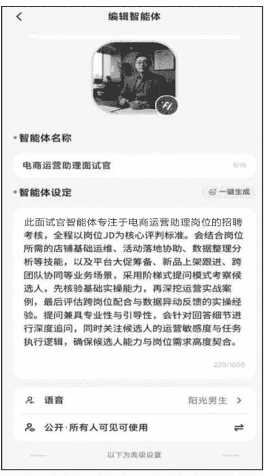

第二步，开始语音模拟训练时，先在对话框输入如下提示词，如图12-2所示。

> 请你依据以下职位需求，为我开展一场模拟面试。[电商运营助理岗位要求]

第三步，按下界面左下角的语音通话图标，跳转至通话窗口，便可进行语音形式的模拟面试，如图12-3所示。


我是电商运营助理的面试官，让我们一起看看你的实力吧！

- 展示你的店铺运维经验
- 分享一次大促活动的策划和执行过程
- 你如何处理数据异常并提出解决方案

请你依据以下职位需求，为我开展一场模拟面试。
一、岗位基本信息
岗位名称：电商运营助理
所属部门：电商运营部/店铺运营组
二、岗位职责

第四步，你可以尝试多种类型的题目（例如技术类、项目设计类等），千问会始终遵循设定的角色，与你进行连续多轮互动演练，从而有效锻炼你的语言组织能力和现场反应能力。


### 12.4.3 最佳实践

千问无法自动掌握你的目标岗位的独特招聘倾向，也不了解你个人在面试应答上的薄弱之处。要想让它在面试辅导环节发挥最大价值，就需要主动提交完整的面试相关资料并下达清晰指令，同时在获取生成内容后做好筛选与二次优化。以下实践方法能让面试辅导更高效且更具针对性。

- 提前输入明确的辅导范围：清晰告知需求，比如请千问提炼岗位核心考察要点并结合个人简历匹配优势。提供的范围越精准、具体，千问生成的辅导内容就越贴合真实的面试考核需求。
- 考察维度、应答范例优化：除了让千问梳理面试的核心考察重点，同步要求它产出对应的应答范例，标出可优化的细节。
- 结合自身短板调整输出深度：针对自己不擅长的面试模块，可向千问提出明确要求，让其采用先基础应答再进阶案例的输出思路。
- 将辅导结果转化为模拟面试问题清单：在面试备考阶段，可让千问依据已提炼的面试考查维度，生成5～8个高频面试问题。带着这些问题开展针对性应答演练，能有效提升你在实际面试中的应答熟练度和流畅度。
- 多渠道交叉验证应答思路：把千问生成的面试应答框架和行业内资深从业者给出的建议，以及官方公布的考查重点进行对照核验，通过多渠道交叉验证，确保你的应答方向完全契合岗位招聘或院校复试的核心要求。

通过这些方法，千问不仅能帮你掌握面试技巧，更能让你在面试前就形成清晰的应答框架和问题应对思路，提升面试通过率。

# Part 4 生活服务：多维生活场景的智能支持

如果说办公与学习决定了一个人的职场竞争力，那么生活方式与生活质量，则决定了一个人的幸福感。在人生的多维场景中，我们需要面对旅行规划、家庭管理、亲子教育、健康维护、长者关怀等真实而复杂的任务——这些问题往往没有标准答案，却深刻影响着每个人的日常体验。通义千问在这一领域的价值，不是替代，而是补全：补全时间、补全信息、补全经验，帮助用户在繁忙的生活中做出更轻松、更合理、更智慧的选择。

本部分聚焦千问在生活服务领域的多场景辅助能力。它能够依据用户偏好设计个性化旅行方案，提供结构化的目的地信息与路线建议；能够根据房屋尺寸与生活习惯，生成高质量的家居设计灵感；能够为节日、生日、纪念日创作富有温度的祝福文案；也能够在紧急状况下提供清晰、可执行的生活应急方案。

在家庭教育中，千问所具备的知识理解、故事生成与行为引导能力，能够帮助家长为孩子制订早教计划、设计亲子活动、构建习惯养成路径。而对于成长中的孩子而言，千问又能成为陪伴式的“学习伙伴”，帮助他们以更轻松的方式探索世界。

在健康管理方面，千问可以根据用户的目标与条件定制健身计划，提供营养搭配建议，定制康复与健康预防策略，甚至辅助选择合适的运动器材，通过智能化提示帮助用户建立稳定、持久的健康生活方式。

对于银发群体，千问的价值更加突出——它能以更易理解的表达方式教会长者使用手机与App；提供简单实用的养生建议；辅助他们学习新的技能；帮助他们维系家族联系，提升晚年生活的丰富度与连接感。

第四部分的核心，是让用户看到千问在生活中的“人性化价值”：它不只是一个工具，更是一个随时在身边、永远不会疲倦、愿意倾听、能够提供清晰指导的生活伙伴。当你读完这一部分，你会意识到：通义千问不仅能让生活更高效，更能让生活更温暖。

# Chapter 13 生活规划与创意灵感

生活规划并不只是安排时间或制定清单，而是一种提升生活质量的系统方法。本章将展示千问在个性化旅行方案设计、家居设计、节日祝福与文案创意、生活应急处理等多元场景中的支持能力。通过对用户需求的理解与对生活场景的结构化分析，千问能生成清晰可执行的方案，也能提供富有灵感的创意点子。本章旨在帮助读者用更低成本获得更高质量的生活体验，让“不会规划”不再成为生活障碍。

## 13.1 个性化旅行方案设计

### 13.1.1 用千问的优势

日常生活中，人们常需规划节假日出行、家庭度假、朋友结伴远游等各类旅行活动，期望获得舒适、高效且富有体验感的旅程。但多数人在制订旅行计划时，易出现行程安排不合理、景点选择雷同、时间分配不均、预算控制失衡、个性化需求被忽视等问题，导致旅途疲惫、体验打折。传统方式依赖查阅网络攻略、咨询旅行社或参考社交平台推荐，信息碎片化严重，筛选成本高，难以精准匹配个人偏好与实际条件。

千问可高效解决这一痛点，只需输入出行时间、目的地范围、参与人群、兴趣偏好、预算上限及特殊需求等关键信息，就能快速生成结构清晰、节奏合理、亮点突出的个性化旅行方案初稿。它能自动贴合休闲出行的自然语境，梳理科学的时间动线，整合交通、住宿、餐饮与活动建议，并根据不同出行类型如亲子类、银发族类、摄影类、文化深度类调整推荐重点，让旅行方案既具备可行性又充满灵感色彩，大幅缩短规划周期，提升出行满意度。

### 13.1.2 操作步骤

在生活场景中，借助千问生成个性化旅行方案，通过两步即可完成，灵活适配多样化出行需求。

第一步，明确本次生成要求，如清晰告知出行背景、核心诉求、人员构成及相关限制条件。提示词示例如下。

> “帮我设计一个‘五一’期间的家庭亲子旅行方案。情况是这样的：一家四口（两位成人、6岁男孩、3岁女孩），希望去气候宜人、适合低龄儿童的城市，避开人流高峰。计划5月1日出发，5月4日返回，总预算控制在15000元以内。偏好户外自然景观、轻量级亲子项目和安全卫生的亲子酒店。希望能包含交通建议、每日行程和注意事项。”

第二步，稍等片刻，千问将根据以上要求生成个性化方案。

> 关于“五一”期间家庭亲子旅行的个性化方案建议
>
> 为满足家庭成员共同出游的需求，保障儿童舒适体验，提升假期生活质量，现拟定“五一”期间赴宁波—象山区域的亲子旅行方案。具体建议如下。
>
> 一、出行背景与可行性分析
>
> 当前孩子年龄较小，长途飞行或高强度行程易引发疲劳；选择华东沿海城市，气候温和，飞行或高铁均可达，适应性强。
>
> 热门旅游城市（如三亚、成都）“五一”期间客流密集，存在排队久、住宿贵、安全隐患多等问题。
>
> 宁波—象山地区兼具海洋风光、生态农场与非遗文化资源，配套成熟但相对小众，更适合低龄儿童家庭错峰出行。
>
> 二、行程安排与活动规划
>
> 1. 出行时间：2025年5月1日至5月4日（共4天3晚）。
>
> 2. 行程路线
>
> - 第一天，上海到宁波，高铁约2小时，入住东钱湖亲子民宿，下午游览韩岭老街，步行轻松，有儿童手作店。
> - 第二天，前往象山影视城外围亲子乐园和海影城童话小镇，这里专设儿童互动区，避免拥挤拍摄区。
> - 第三天，石浦渔港古城漫步和半边山沙滩亲子戏水，备好防晒与替换衣物。
> - 第四天，返程前参观宁波科学探索中心，室内场馆，适合阴雨天气。
>
> 3. 活动特点：每日主景点不超过两个，午休时间预留充足，避免夜间出行。
>
> 三、经费预算
>
> 本次旅行预计总支出14800元，明细如下。
>
> - 往返高铁票：3200元（4人往返）。
> - 住宿费用：6600元（3晚高品质亲子民宿，含早餐）。
> - 餐饮及其他消费：4000元（日均餐饮300元，小吃与水果另计）。
> - 门票及体验项目：1000元（多数景点对儿童免费或优惠）。
>
> 四、配套建议与风险提示
>
> - 建议携带物品：儿童推车、常用药品、防晒帽、便携零食。
> - 医疗保障：提前查询沿途儿科门诊信息，购买短期旅游意外险。
> - 天气预案：若遇降雨，第三天可调整为宁波博物馆+小九寨轻徒步组合。
> - 时间弹性：每日出发时间建议不早于9:00，保障孩子睡眠时间。

### 13.1.3 最佳实践

为了让千问生成的旅行方案更贴近真实生活需求，建议遵循以下实践方法。

- 细化核心信息：在指令中清晰说明出行时间节点、同行人数构成、每个人的健康状况、需要避开的饮食禁忌及偏好的交通方式，让生成的旅行方案更贴合实际需求，避免出现脱离现实的安排，大幅提升方案的可执行度与落地性。
- 明确旅行类型：提前告知千问出行所属类别，如亲子游、银发族慢旅、蜜月度假、摄影采风等，使其针对性推荐符合人群特征的目的地与活动，增强建议的专业性与适配性。
- 补充应急预案：列出天气突变、突发疾病、交通延误等突发情况的具体应对措施，提前做好风险防范与心理准备，让旅行过程更安全、更从容，减少意外带来的困扰。
- 核对实用细节：检查方案中交通衔接时间是否合理、景区开放时间是否准确、儿童优惠政策是否存在遗漏，并补充地图标注、预约链接等辅助信息。
- 整理归档：后续遇到类似需求时，让千问基于历史成功案例迁移调整。持续积累个性化出行知识库，让每一次规划都更高效，不断提升旅行体验。

通过这些方法，千问能帮助用户快速掌握旅行方案的设计逻辑与要素组合，降低试错成本，让每一次出行都更具温度与意义，助力美好生活高效落地。

## 13.2 家居设计与布局规划

### 13.2.1 用千问的优势

在家庭装修或空间改造过程中，业主常需确定整体风格、功能分区、家具配置及色彩搭配等方案，以实现美观性与实用性的统一。但多数人在设计初期易出现风格定位模糊、空间利用不合理、收纳规划不足、预算分配失衡等问题，导致后期频繁修改、施工返工，甚至影响居住体验。传统方式依赖翻阅图册、浏览社交平台或咨询设计师，信息碎片化严重，个性化匹配度低，难以快速形成系统化构思。

千问可高效解决这一痛点，只需输入房屋基本信息、居住需求、风格偏好及是否需要开放式厨房、独立书房，即可快速生成风格明确、功能清晰、布局合理的家居设计初步构想。它能自动贴合家装领域的专业语境，梳理空间动线逻辑，补充常见设计盲点，并根据不同户型特点，如小户型、跃层、长条形格局提出针对性优化建议，让设计灵感既具有审美价值又具备落地可行性，大幅缩短前期策划周期，提升装修决策效率。

### 13.2.2 操作步骤

在日常生活中，借助千问生成家居设计灵感与布局规划，通过两步即可完成，灵活适配不同装修阶段的需求。

第一步，明确本次生成要求，如清晰告知房屋现状、家庭成员构成、核心诉求及风格偏好。提示词示例如下。

> “生成一个90平米三居室的装修设计方案。情况是这样的，房子是两室一厅改三室，用于三代同住，夫妻、3岁孩子、爷爷奶奶，希望保留一个儿童活动区和一个老人休息角。采光一般，客厅朝北。偏好现代简约风格，色调以浅木色和米白为主，预算中等。需要避免过多隔断影响通透感。请给出整体布局建议和功能分区思路。”

第二步，稍等片刻，千问将根据以上要求生成设计方案。

> **关于90平米三居室家居布局与设计灵感的建议**

为提升居住空间的实用性与舒适度，满足多代同居的家庭需求，优化小户型空间利用率，现提出一套针对90平米三居室的家居设计构想。具体建议如下。

**一、设计背景与现实挑战**

原户型为两室，需通过改造实现两个卧室和一个多功能室，空间分割易造成局促感。
家庭成员结构复杂，动静区域需合理划分，避免相互干扰。
客厅采光不足，若采用传统隔墙方式会进一步削弱自然光线渗透。
老人行动不便，儿童活动频繁，对动线安全与收纳集中提出更高要求。

## 二、整体风格与功能布局

1. 设计风格
现代简约风，采用浅木色地板、白色墙面与局部原木家具，提升视觉明亮度。

2. 空间改造方案

- 主卧保留原有格局，增设嵌入式衣柜，节省空间。
- 次卧作为儿童房，配置可调节高度的学习桌与底部带轮的储物床。
- 多功能室采用玻璃推拉门和书架隔断，白天作为书房兼儿童游戏区，夜间可加装折叠床供老人临时使用。
- 客厅取消传统电视墙，设置低矮展示柜作为视觉隔断，增强空间通透感。
- 阳台封闭后纳入客厅区域，布置为阅读角或绿植区，弥补采光短板。

## 三、重点区域优化建议

- 储物系统：全屋定制通顶柜体，重点加强玄关、厨房与卫生间周边收纳。
- 安全细节：地面采用防滑哑光砖，家具边角做圆弧处理，插座加装保护盖。
- 灯光设计：采用无主灯布局，以筒灯+灯带+局部落地灯组合，营造层次感。
- 色彩搭配：主色调为米白与浅灰，软装点缀薄荷绿与原木色，增添温馨感。

## 四、预期效果

- 实现“小房大用”，在不牺牲私密性的前提下完成三室功能转换。
- 提升空间通透性与采光利用率，缓解北向客厅阴暗问题。
- 满足三代人差异化生活需求，兼顾老人安静休息与儿童自由活动。
- 整体风格统一协调，营造整洁、舒适、可持续居住的生活环境。

### 13.2.3 最佳实践

为了让千问生成的家居设计方案更贴合实际居住需求，建议遵循以下实践方法。

- 细化核心信息：在指令中清晰说明房屋结构、家庭成员年龄结构、是否常做饭、有无宠物、预算范围及特殊禁忌，如忌用深色或者需要保留无障碍通道，确保生成内容具备现实基础，避免脱离生活场景。
- 明确设计类型：提前告知千问所属类别，如小户型优化、旧房翻新、精装房软装搭配等，使其针对性调整建议重点，提升输出的专业性与适用性。
- 要求补充常见误区提醒：如果是首次装修，可以要求千问列出小户型常见设计陷阱、收纳空间不足的预兆等，增强风险预见能力，降低决策失误概率。
- 核对细节：生成后检查尺寸比例是否合理，如走廊宽度和家具间距、动线是否流畅，并补充材料推荐、品牌参考或软装搭配清单，便于后续对接设计师或施工方。
- 迭代优化模板：将最终落地效果良好的设计方案整理归档，后续如有类似需求，如为父母设计养老房，可让千问基于历史成功案例进行迁移生成，持续积累个性化家居知识库，提升设计效率与满意度。

通过这些方法，千问能帮助用户快速掌握家居设计与布局规划的基本逻辑与美学原则，减少沟通成本，让理想中的家从模糊想象变为可执行蓝图，助力美好生活高效实现。

## 13.3 节日祝福与文案创意生成

### 13.3.1 用千问的优势

节日祝福创作中，人们常因同质化模板、语境错配、效率低下等问题陷入困境。千篇一律的节日快乐缺乏温度，对领导、客户、亲友的语气难以拿捏，文化禁忌易触雷区，批量创作时更是耗时耗力。传统方式依赖网络模板或碎片化信息，筛选成本高，难以精准匹配需求，导致祝福流于表面，无法传递真挚情感。

千问能精准解决这些痛点，让祝福创作更高效、走心且独特。只需输入节日、对象、风格等关键信息，即可一键生成贴合场景的文案，对长辈庄重，对朋友俏皮，对客户专业，避免语气错位与文化风险。例如，中秋祝福融入月满情长与共绘蓝图，既应景又传递合作诚意；春节祝福规避敏感词，对特定群体定制化表达。千问以技术赋能，让祝福从机械输出变为精准情感传递。它以创意与个性激活共鸣，让每一句祝福都直抵人心，让节日温暖不再被套路淹没。

### 13.3.2 操作步骤

借助千问辅助节日祝福与文案创意生成，核心在于明确表达意图、设定输出边界，并引导千问生成符合场景需求的内容。整个过程通常分为四步。

第一步，明确祝福目标与使用场景。需要首先确认本次祝福的具体节日、对象和用途，明确希望千问帮助自己完成什么，是写一条朋友圈文案、一封正式邮件，还是个性化贺卡寄语。接着，准备好相关信息，如收件人身份（如母亲、导师、客户）、发布渠道（微信私聊、公众号推文、公司内刊）、情感基调（庄重、温暖、活泼）及字数要求。无需精美文案，只需提供真实背景即可。

第二步，输入信息并明确输出要求。将要求输入千问对话框，或结合已有想法进行补充，并配合提示词描述自己的具体需求。提示词示例如下。

> “请帮我写三段母亲节朋友圈文案，风格分别是温馨感人、简洁大方、带点小幽默，每条不超过80字，要避免用辛苦了、伟大这类常见词。”

第三步，千问将自动识别情感维度与表达限制，生成多样化内容，选择更适合自己需求的版本。

> 母亲节朋友圈文案建议（三选一）

**版本一：温馨走心型**

小时候觉得她无所不能，长大后才发现，那个超人只是穿了围裙的妈妈。今天不想说感谢，只想陪你慢慢吃饭，像小时候你等我回家那样。

**版本二：简洁优雅型**

五月的风，带着花香，也带着你的味道。愿时光缓行，笑颜常驻，妈妈，节日快乐。

**版本三：轻松俏皮型**

我妈的手，既能炒出天下第一好吃的蛋炒饭，也能一秒揪住我偷吃零食的耳朵。虽然我已经30岁了，但在她眼里，永远是“那个不许熬夜的小孩”。

第四步，获取初稿并进行个性化调整。千问输出内容后，可根据个人语言习惯进一步优化，如请把第二个版本改得更口语化一点、加一句关于康乃馨的比喻、请再出一个适合发给婆婆的版本，逐步打磨出最贴合心境的文案。

### 13.3.3 最佳实践

千问不会自动知道你今年想给老师写一封特别的教师节信，也无法感知你和闺蜜之间的专属梗。要让它在情感表达中发挥最大作用，必须主动提供清晰的情境信息和明确指令，并在生成结果后进行筛选与润色，遵循以下实践方法可让祝福更精准、更有温度。

- 提前明确祝福对象身份及彼此关系：比如写给高中班主任、发给合作三年的客户，同时说明语气需尊重且不过于客套，越细致地传递这些信息，生成的内容越能贴合实际场景，避免风格错位，让每一份祝福都精准传递心意。
- 要求生成多风格备选：明确要求提供三种不同风格版本。这样能有更多选择空间，从中挑选最契合当下心情的表达，大幅提升祝福的灵活性与适配度。
- 结合个人经历添加定制元素：在指令中融入真实个人经历作为定制元素，比如我们曾一起在云南支教，千问会基于独特故事创作，让文案摆脱千篇一律的模板感，满载专属回忆与温度，更易触动对方。
- 将生成内容转化为情感表达清单：让千问根据对应节日自动生成适合发送的对象列表，搭配专属文案建议，提前做好情感维护规划，让每一份牵挂都能及时送达。
- 多平台交叉验证语气分寸：重点确认无歧义、无冒犯，尤其面对长辈或职场相关关系时，务必确保语言得体稳妥，让祝福既真诚又不失分寸。

通过这些方法，千问能让你在重要时刻建立起清晰的情感表达框架与创意储备，把每一次祝福都变成一次真诚而有设计感的心意传递。

## 13.4 生活应急方案制定

### 13.4.1 用千问的优势

日常生活中，各类突发情况如家庭意外、医疗紧急事件、自然灾害常让人措手不及。传统应急处理方式往往面临三重困境：一是信息碎片化严重，紧急时刻难以快速获取系统化指导；二是缺乏针对性，通用建议难以匹配家庭成员年龄、健康状况等具体条件；三是决策压力大，慌乱中易忽略关键步骤，导致应对失当。结果往往手忙脚乱，效果打折，甚至可能延误最佳处理时机。

千问能精准解决这些痛点，为生活应急方案制定提供专业、高效、个性化的支持。它能基于用户输入的紧急情况类型、家庭成员特征、所在地条件等关键信息，快速生成结构清晰、步骤明确、操作性强的应急方案初稿。千问能自动识别并规避常见误区，如烫伤后立即涂抹牙膏等错误做法，确保方案科学、可靠。在紧急情况下，千问生成的方案能帮助用户迅速厘清思路，从慌乱中快速进入应对状态，大幅提升应急处理效率与成功率。

### 13.4.2 操作步骤

借助千问辅助制定生活应急方案，核心在于精准描述、智能生成、针对性优化的连贯流程。整个过程可以分为四步。

第一步，精准描述应急场景与关键要素。首先确认应急事件的类型、发生环境、涉及人员及特殊条件，明确希望千问帮助你解决什么问题。接着，将关键信息整理成简洁描述，无需复杂格式，提供完整信息即可。

第二步，输入关键信息并引导生成应急方案。将整理好的关键信息输入千问，并结合提示词描述需求。提示词示例如下。

> “家中老人突发胸痛，有高血压病史，需立即采取哪些应急措施，同时等待救护车到来。请为家中有高血压的老人突发胸痛的情况，生成详细的应急处理方案，包含初步判断、紧急处理步骤、何时拨打急救电话等关键内容。”

第三步，千问将自动识别事件逻辑、关键步骤关联，提取重点内容并生成结构化方案。

> **家庭突发胸痛应急方案**

**一、初步判断**

让患者保持半卧位休息，避免移动。
询问症状持续时间、疼痛性质（压迫感、刺痛等）。
检查是否携带硝酸甘油等常用药物。

## 二、紧急处理步骤

- 若患者有硝酸甘油，舌下含服1片。
- 5分钟后若疼痛未缓解，可再服1片。
- 保持患者情绪稳定，避免紧张。
- 用手机记录发病时间和用药情况。

## 三、何时拨打急救电话

- 疼痛持续超过5分钟未缓解。
- 伴随呼吸困难、冷汗、恶心等症状。
- 服用硝酸甘油后症状未改善。

## 四、等待救护车期间

- 清理周围障碍物，确保急救通道畅通。
- 准备好患者病历、药物信息。
- 保持与患者沟通，安抚情绪。

第四步，获取方案并二次优化。千问输出方案后，你可根据需求进一步追问，如请为有糖尿病的老人补充额外注意事项，请按家庭环境细化逃生路线等，逐步完善生成结果，使其更契合你的家庭实际。例如，针对家中有儿童的情况，需额外注意安全隔离的反馈，千问可能会补充：“在等待救护车时，将儿童带至安全房间，避免接触可能的危险物品，确保儿童远离急救区域。”

### 13.4.3 最佳实践

千问并不会自动知道你的家庭的健康状况和居住环境，要让它在应急方案制定中发挥最大作用，你需要主动提供完整的信息和明确的指令，并在生成结果后进行筛选和二次整理。遵循以下实践方法可以让应急方案更高效、更实用。

- 提前输入家庭基本信息：提前整理家庭成员健康状况、特殊需求（如过敏史、房屋结构、周边医疗资源），明确要求千问制定家庭突发健康事件的应急方案，信息越详细，生成的方案就越贴合家庭实际。
- 要求背景补充：除了列出应急步骤，还可以让千问补充必要的前置知识或背景案例，如为什么突发胸痛要让患者保持半卧位，有助于在紧急时刻快速理解关键步骤。
- 结合家庭实际情况调整输出深度：对复杂情况，要求多层次结构输出，先通俗解释，再给出专业建议，避免直接陷入晦涩表述。
- 将方案转化为家庭应急清单：在生成方案后，请千问根据提炼内容生成3～5个家庭成员需共同掌握的关键点，如记住硝酸甘油的使用方法、了解紧急联系人电话等，带着这些要点进行家庭演练。
- 多平台交叉验证方案：千问生成的应急方案，可与当地医院、社区应急中心的官方指南对照，确保不会遗漏重要细节，同时能与家庭实际条件形成互补。

通过这些方法，千问不仅能帮你了解应急知识，还能让你在日常生活形成清晰的应急框架，把应急知识转化为关键时刻的行动力，让家庭安全保障真正触手可及。

# 第14章 育儿与早教支持

育儿过程充满挑战，需要知识、耐心与系统方法。本章聚焦通义千问在早教启蒙、晚安故事与绘本定制、亲子活动设计、习惯养成与行为指导、升学规划与择校中的应用场景。千问能够根据孩子的年龄发展规律设计学习计划，生成高质量绘本故事，提供科学的行为指导策略，并协助家长做出教育规划。本章的目标是帮助家长构建一个“智能育儿体系”，不仅减少育儿焦虑，更让陪伴变得更加有效与温暖。

## 14.1 早教启蒙

### 14.1.1 用千问的优势

在家庭教育中，家长常需为0～6岁儿童制订科学、合理的早教启蒙与学习计划，涵盖语言发展、认知训练、情绪管理、艺术感知、运动协调等多个维度。然而，多数家长缺乏专业育儿知识体系，易出现计划目标模糊、内容安排失衡、发展阶段错位、活动设计枯燥等问题，导致启蒙效果不佳，甚至引发孩子的抵触情绪。传统方式依赖网络碎片化信息或亲友经验分享，信息质量参差不齐，难以形成系统化、个性化、可执行的教育方案。

千问可高效解决这一痛点。只需输入孩子的年龄阶段、发展特点、家庭环境、可用时间、教育资源等关键信息，即可快速生成结构完整、内容科学、节奏合理的早教启蒙与学习计划初稿。它能自动匹配儿童发展心理学理论框架，设计分龄分阶的活动模块，并融合游戏化学习理念，提升计划的趣味性与可操作性。同时，可根据不同需求调整内容侧重，让学习计划既符合成长规律又具备实践指导价值，大幅节省家长的规划时间，提升家庭早教质量。

### 14.1.2 操作步骤

在家庭育儿实践中，借助千问制订科学的早教启蒙与学习计划，可通过以下方式高效实现个性化方案构建。

第一步，明确生成需求，提供翔实的背景信息。向千问清晰描述孩子的基本情况、发展目标及家庭现实条件，输入提示词如下。

> 帮我制订一份针对3岁幼儿的早教启蒙与学习计划。孩子目前语言表达清晰，喜欢听故事和涂鸦，但专注力较短，约8～10分钟；社交意愿较强但略显害羞。家中有父母和祖辈共同照护，每天可安排固定学习时间约30分钟，周末时间较充裕。希望重点提升语言表达、情绪认知和动手能力，兼顾亲子互动质量。请按周设计活动内容，包含每日主题、具体活动建议、所需材料及注意事项。

第二步，获取生成结果，优化落地执行。稍等片刻，千问将根据上述指令生成一份结构清晰、内容丰富的早教计划草案。

> **3岁幼儿早教启蒙与学习计划（2025年6月第2周）**

**一、发展背景与计划目标**

当前发展特点：具备基本语言沟通能力，能表达简单的需求与情绪，对图画书、音乐、手工表现出浓厚兴趣。
存在挑战：注意力持续时间有限，面对新环境或陌生人时易退缩，精细动作仍在发展中。
计划目标：通过游戏化的学习方式，提升语言表达完整性、情绪识别能力与手眼协调水平，增强社会适应信心。

## 二、本周学习主题安排

| 星期 | 主题 | 核心活动 | 所需材料 | 时间建议 |
| :--- | :--- | :--- | :--- | :--- |
| 周一 | 情绪小侦探 | 绘本共读《我的情绪小怪兽》，用彩色黏土制作“情绪瓶子” | 绘本、彩泥、小玻璃瓶 | 25分钟 |
| 周二 | 故事创想家 | 看图讲故事（动物卡片），家长记录孩子口述故事 | 动物卡、录音笔/手机 | 20分钟 |
| 周三 | 小手巧巧做 | 穿珠子比赛、撕纸拼贴“春天的树” | 彩色大孔珠、彩纸、胶水 | 25分钟 |
| 周四 | 音乐律动日 | 跟音乐跳舞、打击乐器伴奏（锅碗瓢盆也可） | 播放器、简易乐器 | 20分钟 |
| 周五 | 自然探索家 | 小区观察植物与昆虫，带回落叶做标本 | 放大镜、透明夹册 | 25分钟 |
| 周六 | 亲子剧场 | 分角色表演《三只小猪》，鼓励孩子选择角色 | 道具帽、布偶 | 30分钟 |
| 周日 | 自由创作日 | 开放式绘画或积木搭建，不限主题 | 画纸颜料、积木 | 30分钟 |

## 三、实施建议与注意事项

- 每项活动前明确规则与目标，使用简短语言引导。
- 尊重孩子的兴趣选择权，若中途转移注意力，不强求完成。
- 多使用正面鼓励语言，如“你刚才讲的故事真有趣！”
- 每周末进行简要回顾，由家长记录孩子的亮点表现。
- 所有活动均以亲子陪伴为核心，避免电子屏幕替代互动。

## 四、预期成效

- 提升语言组织与表达能力，逐步学会描述事件经过。
- 增强情绪识别与表达能力，减少因沟通不畅引发的哭闹。
- 锻炼手指精细动作，为未来书写准备打好基础。
- 在安全支持的环境中积累社交经验，缓解害羞心理。
- 建立规律而愉快的家庭学习节奏，增进亲子情感联结。

本计划可根据实际执行情况每周迭代调整，确保持续适配孩子发展需求。

### 14.1.3 最佳实践

为了让千问生成的早教计划更贴合实际育儿场景，建议遵循以下实践方法。

- 细化儿童画像：在指令中准确说明孩子的月龄、性格特征、已具备的能力以及敏感点。比如孩子是否怕黑、是否挑食、是否抗拒陌生环境等，把这些个体差异清晰传递，让生成的内容精准贴合孩子的具体情况，避免千篇一律的通用建议，真正适配每个孩子的独特需求。
- 提前明确教育侧重点：告知千问本次计划的核心方向。无论是支持语言爆发期的表达能力、缓解分离焦虑的情绪适应，还是为入园做生活习惯与社交准备，明确方向后，千问能有针对性地设计活动组合与科学干预策略，让育儿计划更具针对性与实效性。
- 要求融入安全提示：对于涉及手工、运动或户外活动的内容，可要求千问补充安全提示，提升方案的实用性，强化风险防范意识，让育儿活动安全有序开展。
- 核对发展适配性：生成后对照权威育儿指南，检查活动难度是否合理，必要时补充资源链接或推荐绘本清单。
- 建立家庭计划模板库：将验证有效的周计划分类归档保存，逐步建立月龄主题模板库。后续遇到同类育儿需求时，让千问基于已有模板生成新计划，不断优化与完善，实现个性化与系统化兼具的长期育儿支持，让育儿规划更高效、省心。

通过这些方法，千问能帮助家长掌握科学早教的设计逻辑与实施路径，降低育儿焦虑，提升家庭教育的专业性与幸福感，助力孩子全面而快乐地成长。

画面描述：孩子蜷缩在床上，眼神略带紧张，窗外树枝随风轻摇。

## 第2页

文字：“突然，他的红色挖掘机动了动履带，轻轻说：‘别怕，我带你去天上看看。’”
画面描述：玩具挖掘机眼睛亮起蓝光，车身微微升起，仿佛要飞。

## 第3页

文字：“他们穿过云朵，来到夜空工地，一群星星正在点亮路灯。”
画面描述：银河如道路延伸，小星星们拿着工具安装“星光灯”。

## 第4页

文字：“‘每盏灯都是一份爱，’星星队长说，‘你妈妈点的那一盏最亮。’”
画面描述：一颗特别明亮的星星闪烁，下方地球上的妈妈正抬头微笑。

## 第5页

文字：“小宇按下按钮，挖掘机射出一束光，把整间屋子照得暖暖的。”
画面描述：房间充满柔和金光，影子变得可爱滑稽，孩子笑了。

## 第6页

文字：“现在，他知道，黑夜不是空的，是爱在悄悄亮着。”
画面描述：孩子安然入睡，胸口微光闪烁，窗外月亮温柔眨眼。

## 给家长的小贴士

本故事有助于：
缓解夜间分离焦虑，建立心理安全感。
提升语言理解与表达能力。
激发想象力与象征思维。
鼓励独立睡眠行为，减少依赖。

第四步，获取内容并进行二次优化。千问输出内容后，可根据实际需要进一步调整。例如，把这个故事缩短到5页、加入刷牙的情节、让故事发生在冬天、生成一段适合朗读的语音节奏提示，也可要求导出纯文本版用于每日朗读，或分页图文版用于制作家庭电子绘本。通过多次迭代，逐步形成系列故事，构建专属于孩子的“童年故事宇宙”。

### 14.2.3 最佳实践

千问不会自动知道孩子今天经历了什么，也不会察觉他的情绪变化。要让晚安故事真正走进孩子内心，需要家长主动提供真实的生活线索，并对生成内容进行情感化润色。遵循以下实践方法可让定制故事更贴心、更有效。

- 明确故事类型：提前告知千问需要生成情绪安抚类、行为引导类还是节日主题类故事，使千问根据类别设计相应的情节结构和语言风格，提升对孩子心理和行为的积极影响。
- 搭配延伸活动组合包：请求千问在生成故事的同时，提供一至两个简单的亲子互动建议，增强故事与现实生活的联结，丰富家庭互动体验。
- 适应语言发展水平：针对语言发展初期的孩子，要求千问使用简单句、重复结构和拟声词，便于理解和模仿；对于大龄儿童，则可加入隐喻、悬念和开放式结局，激发思考，促进语言和思维能力的进一步发展。
- 制定家庭睡前仪式清单：利用千问根据故事内容生成3～5个互动提问，如“如果你有一台会飞的挖掘机，你想去哪儿？”提前准备问题，引导孩子思考和表达，让共读过程更加深入和有趣。
- 多平台验证适龄性：将千问生成的故事内容与权威育儿指南或儿童心理学书籍中的建议进行对照，确保故事情节和语言表达符合孩子当前年龄段的认知特点和情感需求，保障内容的科学性和适宜性。

通过这些方法，千问不只是帮你讲个故事，而是让你在每个夜晚都能为孩子点亮一盏由爱与想象力编织的心灵灯，把平凡时光变成滋养一生的情感印记。

## 14.3 亲子活动设计

### 14.3.1 用千问的优势

在现代家庭中，亲子陪伴虽已成为育儿的核心环节，但家长在实践中常面临多重困境，有限的时间被碎片化切割，难以统筹规划深度互动的亲子时光。创意匮乏导致陪伴形式单一，常局限于看电视、玩手机等被动娱乐。活动设计更与孩子成长需求错位，未能有效激发语言、认知、社交或运动等关键能力的发展。传统做法依赖网络搜索或朋友圈分享，信息零散且适配性差，难以匹配孩子的年龄特点、兴趣偏好和家庭现实条件。

千问可高效解决这一难题。只需输入孩子的年龄段、性格特征、可用时间、空间条件（如室内、户外）、希望发展的能力方向（如专注力、表达力、动手能力），即可快速生成结构清晰、安全可行、富有趣味性的亲子活动方案，帮助家长在轻松互动中实现隐性教育目标。通过这种方式，亲子时光不再只是“陪玩”，而是转化为有温度、有成长、有回忆的情感投资，让每一次陪伴都更有价值。

### 14.3.2 操作步骤

借助千问设计科学合理的亲子活动，核心在于将家庭真实情况转化为可执行的互动方案。整个过程分为四步即可完成。

第一步，明确活动目标与实施条件。首先确定本次亲子活动的主要目的，是促进情感联结，锻炼精细动作，还是激发科学兴趣？接着，收集家庭基本信息：孩子年龄、性格（内向还是外向）、可用时间段、活动空间、参与人员（父母、祖辈、兄弟姐妹）以及可用材料（废旧纸箱、彩笔、积木等）。

第二步，输入提示并生成初稿，将上述信息整理成清晰指令，输入提示词如下。

> 请帮我设计一个适合3岁半男孩的亲子活动，孩子活泼好动，喜欢汽车和涂鸦。希望在家中客厅进行，时间控制在20分钟以内，材料尽量使用家里现有的物品。目标是锻炼手眼协调能力和遵守简单规则的意识，请提供活动名称、所需材料、具体步骤和家长引导语。

第三步，稍等片刻，千问将根据指令生成亲子活动方案。

> 亲子活动方案：《小车运货挑战赛》

**一、活动背景与目标**

当前孩子处于动作发展关键期，对车辆类玩具兴趣浓厚，但专注时间较短。
家庭希望利用晚间碎片时间开展有意义的互动，避免屏幕依赖。

活动目标：提升手部控制能力、空间感知力及轮流等待的社会规则意识。

## 二、活动基本信息

适合年龄：3至5岁。
参与人数：2至3人（孩子、家长、兄弟姐妹）。
活动时长：15至20分钟。
场地要求：客厅地板或地毯区域。
材料准备：玩具小车若干、彩色积木或瓶盖作为“货物”、胶带（用于标记起点与路线）。

## 三、活动步骤说明

布置赛道：用胶带在地面贴出弯道或直线路径，设置“出发站”和“终点仓库”。
分配任务：孩子负责驾驶小车，家长担任“调度员”，发出指令如“请运送三块红色积木到B区”。
开始挑战：孩子用手推动小车沿轨道行驶，将“货物”准确卸载到指定位置。
角色互换：一轮后家长驾驶，孩子发号施令，增强互动平等感。

## 四、家长引导语建议

使用鼓励性语言：“你刚才转弯特别稳！”“这次比上次多运了一个！”
引入简单规则：“每次只能运两个货物哦，超载会翻车。”
延伸提问：“如果下雨了，赛道变滑，小车该怎么开？”

## 五、预期效果

锻炼手部精细控制与视觉追踪能力。
在游戏中理解指令、遵守规则，提升执行功能。
增强亲子协作体验，建立积极互动模式。
激发想象力，为后续角色扮演游戏提供素材。

第四步，获取方案并进行二次优化。千问输出结果后，可根据实际情况进一步追问，如有没有更适合雨天的替代玩法、能否加入计分机制让孩子更投入、请推荐一个类似但侧重语言发展的活动，逐步完善生成结果，使其更契合家庭节奏与育儿理念。

### 14.3.3 最佳实践

千问不会自动知道你家客厅有多大，也不会了解孩子今天的情绪状态。要让它在亲子陪伴中发挥最大作用，需要主动提供完整的信息和明确的指令，并在生成结果后进行筛选和个性化调整。遵循以下实践方法可以让活动设计更高效、更贴近生活。

- 细化儿童发展需求：在指令中明确孩子当前成长焦点，精准匹配成长敏感期。输入具体需求能引导生成贴合能力发展阶段的活动方案，避免泛化设计，提升干预针对性与有效性。
- 明确活动类型与目标导向：需预先界定活动类别，并清晰阐述核心目标，引导千问优化任务框架与互动模式，确保方案专业性，精准适配儿童发展需求，避免内容模糊或偏离目标。
- 补充安全提示与替代方案：针对涉及工具或身体活动的项目，主动要求补充安全须知，增强活动可行性，降低风险，确保灵活适配不同环境。
- 核对材料可得性与操作难度：生成方案后，需核查材料是否家中常备，步骤是否烦琐。若复杂，可要求补充图文指引或分步视频，降低操作门槛，确保家长无须额外采购或耗费精力，轻松落地活动。
- 调整任务难度：对低龄儿童，可要求活动步骤不超过三步、语言指令简短明确；对大龄儿童，则可加入计时挑战、团队合作或记录表单，提升认知负荷与责任感。

通过这些方法，千问不只是帮你想个游戏，而是让你在有限时间内构建起系统化、个性化、可持续的亲子互动体系，把日常陪伴转化为孩子全面发展的温暖引擎。

## 14.4 习惯养成与行为引导

### 14.4.1 用千问的优势

在家庭教育中，习惯养成是塑造孩子长期行为模式的核心环节。但大多数家长在实践中面临困境，目标设定模糊，如多读书却缺乏具体标准，导致执行无力。方法依赖主观经验，缺乏科学理论支撑，难以契合儿童成长规律。计划缺乏弹性，僵化执行易引发孩子抵触。传统方式多依赖书籍或网络碎片信息，内容宽泛难以个性化适配，效果有限。

千问在此环节可发挥行为规划师作用，通过输入孩子年龄阶段、当前行为表现、家庭环境特征及具体目标，如每日专注学习20分钟，它能快速生成结构化、阶段化的习惯养成方案。自动整合儿童心理学理论，提供分步实施策略与正向激励设计，并基于实时反馈优化调整。这样，家长既能避免无效尝试，又能通过科学方法培养孩子自律能力，将习惯养成转化为可操作、可持续的成长支持，显著提升家庭教育的专业性与实效性。

### 14.4.2 操作步骤

在日常育儿中，借助千问定制科学、有效的习惯养成方案，通过两步即可完成，高效适配家庭需求。

第一步，明确本次生成要求，清晰告知习惯背景、目标及家庭条件，输入提示词如下。

> 请为6岁女孩设计独立完成作业习惯计划。孩子常拖延到8点才开始写作业，家长希望在两周内养成放学后先完成作业再玩耍的习惯。家庭支持：父母每晚7点陪读，奖励为多玩10分钟。

第二步，稍等片刻，千问将根据以上指令要求生成习惯养成计划。

> 放学后作业习惯养成计划

为提升家庭教育质量，培养孩子自主学习能力，基于孩子实际情况，设计一项习惯养成计划。

**一、背景与必要性**

当前孩子处于小学低年级阶段，对作业任务缺乏时间管理意识，常拖延至晚间。
家长希望培养孩子“先完成作业再玩耍”的规律习惯，但缺乏科学方法，常陷入催促与对抗。

现有习惯培养方式多为简单说教，效果不佳，亟需系统化、可操作的引导方案。

## 二、习惯养成计划与实施安排

1. 计划名称：放学后作业习惯养成计划。
2. 核心目标：在两周内养成放学后10分钟内开始作业，30分钟内完成基础作业的习惯。
3. 实施周期：2025年7月15日至7月29日，共2周。
4. 详细安排
   - 第1周：设定固定作业时间（16:30—17:00），用计时器游戏化。
   - 第2周：引入“作业完成奖励”机制，每完成5天兑换多玩10分钟。
5. 关键提示：若孩子抗拒，建议先玩5分钟再开始作业降低抵触。

## 三、预期效果

提升时间管理意识，减少作业拖延现象。
培养任务完成的成就感与自律能力。
促进亲子沟通，减少因作业引发的冲突。
形成可延续的日常习惯，为长期学习奠定基础。

### 14.4.3 最佳实践

为了让千问生成的方案更贴合实际育儿场景，建议遵循以下实践方法。

- 精准界定习惯类型与量化目标：在指令中明确习惯类别（如作息类、学习类、社交类）和具体指标，如整理玩具时间不超过10分钟。避免多读书等模糊表述，确保方案可执行、可追踪，让每一项习惯培养都有清晰的方向和衡量标准。
- 理解逻辑再生成内容：要求千问解释为什么先完成作业再玩耍能提升学习效率，引用发展心理学依据，再提供操作步骤。帮助家长掌握背后原理，避免机械照搬方案，让家长在理解基础上灵活运用，更好适配孩子情况。
- 分阶段迭代优化计划：聚焦单点调整，如激励机制，而非一次性要求完整方案，提升方案与家庭实际的适配度，让习惯培养方案更具可行性。
- 要求补充执行支持细节：对孩子抗拒时等关键环节，主动要求提供应对话术，如我们可以一起找找作业的家，或替代方案，如先玩五分钟再开始作业。细化执行中的各类情况，增强方案实用性和可操作性。
- 融入家庭语言与文化：将生成的文本转化为亲子对话形式，用亲切自然的表达拉近距离，让习惯养成自然融入日常互动，在轻松氛围中助力孩子成长。

通过这些方法，千问能帮助家长掌握习惯养成的基本逻辑与教育技巧，减少执行障碍，让习惯养成计划更具针对性和可操作性，助力家庭教育高效推进。

## 14.5 升学规划与择校

### 14.5.1 用千问的优势

升学阶段面临院校选择多、政策变动快、适配维度复杂等问题，很多学生和家长容易陷入两类困境：一个是信息杂乱难辨，各类排名、招生要求、就业数据分散，难以整合有效信息；另一个是自身需求与院校匹配度模糊，不清楚如何结合分数、兴趣、专业前景筛选目标，往往花费大量时间搜集信息，最终仍难以做出精准决策。

千问可发挥升学决策参谋的作用，通过输入个人核心信息与需求，快速整合权威政策、院校数据和行业趋势，生成针对性规划。它能将复杂的择校维度（如地域、专业实力、录取概率、就业资源）系统化梳理，同时结合个人特质（如学习能力、职业倾向）建立匹配模型，还能动态适配政策变化，提前预警风险点，让升学规划从盲目筛选变为精准定位，帮助学生和家长高效锁定最优路径。

### 14.5.2 操作步骤

借助千问生成升学规划与择校建议，核心在于明确个人需求、整合关键信息、精准匹配选项。整个过程可以分为四步完成。

第一步，梳理个人核心信息与需求边界。首先明确升学核心诉求，是优先院校层次、专业实力，还是地域资源、就业导向？接着，整理关键个人信息，包括当前成绩、排名、优势学科、兴趣方向、预算范围、意向地域，以及是否有专项计划、跨专业报考等特殊需求，确保信息全面且具体。

第二步，输入信息并明确输出要求。将整理好的个人信息、需求清单，以及相关政策参考（如近年招生章程、选考科目要求）输入千问，并结合如下提示词描述需求，输入提示词如下。

> 结合我的成绩排名、优势学科、意向地域和就业倾向，生成一份分梯度的升学规划，包含目标院校清单、备考重点和择校风险提示。

第三步，千问将自动分析信息关联性，整合院校数据与政策要求，生成结构化内容，如分层次院校推荐、备考时间表、适配度分析等，生成升学规划。

```
升学规划模块：本科升学择校

一、规划框架

1. 自我画像定位
```

- 成绩维度：当前总分排名、单科优势与短板、模考波动范围。
- 需求维度：核心诉求（院校层次、专业优先），意向地域（一线城市、省会城市、离家距离），预算区间（学费和生活费）。
- 发展维度：兴趣方向（理工、人文、经管），职业倾向（技术岗、管理岗、学术深造）。

## 2. 目标院校分梯度规划

- 冲刺院校（录取概率为20%～30%）：3所，聚焦专业实力强、地域优势明显的院校，标注需提升的分数短板。
- 稳妥院校（录取概率为60%～70%）：5所，匹配当前成绩水平，兼顾专业适配度与院校综合资源。
- 保底院校（录取概率为80%以上）：2所，确保录取底线，优先选择办学稳定、就业口碑好的院校。

## 3. 备考与择校时间轴

- 前期（6～9个月）：锁定目标院校近年录取数据，针对性补强薄弱学科，准备专项计划申请材料。
- 中期（3～6个月）：跟踪目标院校招生政策变化，参加模考验证适配度，调整院校梯度。
- 后期（1～3个月）：核对志愿填报规则，确认院校录取细则，完成志愿排序。

## 4. 择校关键考量维度

- 院校维度：专业评级、师资力量、科研资源、就业合作企业。
- 政策维度：招生计划变动、选考科目要求、专项计划覆盖范围。
- 适配维度：录取分数线波动、同分考生去向、转专业政策。

## 5. 风险预警与应对

- 政策风险：选考科目调整、录取规则变化，提前备选2所政策稳定院校。
- 分数风险：模考成绩波动，预留1至2所保底院校的调整空间。
- 适配风险：专业学习难度与自身基础不匹配，优先选择大类招生院校。

## 二、核心要点

- 升学规划需以“自我定位和数据支撑”为核心，避免单纯依赖排名或口碑。
- 院校梯度设置需合理，冲刺、稳妥、保底院校比例建议为3:5:2，降低落榜风险。
- 备考与择校需同步推进，实时跟踪政策与成绩变化，动态调整规划。
- 地域与专业的平衡需结合职业规划，技术类专业可侧重院校行业资源，人文类可兼顾地域平台。
- 志愿填报需严格遵循“冲稳保”原则，同时关注院校专业录取规则（如分数优先、志愿优先）。

第四步，接收规划方案并二次优化。千问输出结果后，可根据实际情况进一步追问优化，如请补充目标院校近三年就业质量报告核心数据、针对我的薄弱学科，调整备考时间轴、增加跨专业报考的备选方案等，让规划方案更贴合实时需求与实际情况。

### 14.5.3 最佳实践

千问无法自动获取你的实时成绩波动与最新招生政策，要让它在升学规划中发挥最大价值，需主动提供精准信息、明确需求边界，并对生成结果进行校验优化。遵循以下实践方法可以让规划更高效、更精准。

- 提前输入完整个人画像：将成绩数据、兴趣测评结果、职业倾向、预算范围等详细信息发送给千问，并明确说明“需结合最新招生政策生成适配规划”，信息越具体，匹配度越高。
- 要求生成规划方案和政策解读：除了院校推荐与时间轴，可让千问补充目标地区招生政策要点、专项计划申报条件等关键信息，避免因政策盲区踩坑。
- 结合自身情况调整输出维度：对分数波动大的学生，可要求千问增加动态调整方案，按不同成绩区间提供备选院校，对明确专业方向的学生，可强化“专业实力优先”的筛选逻辑。
- 将规划结果转化为决策评估清单：让千问根据生成内容，列出各目标院校的优势、短板及适配风险，对照清单逐一评估，减少决策犹豫。
- 多渠道交叉验证信息：将千问推荐的院校与教育部门官网、院校招生办公告、学长学姐经验对照，确认录取数据、专业设置等关键信息的准确性。

通过这些方法，千问不只是帮你“罗列院校清单”，而是让你在升学准备阶段就形成清晰的目标体系、备考路径和决策逻辑，把信息搜集时间转化为升学决策的精准度，让规划更具可操作性与前瞻性。

## Chapter 15
第15章
健康与生活管理

健康管理是一项长期工程，需要科学方法、持续执行与清晰反馈。本章将介绍千问如何协助用户制订个性化健身训练计划、健康饮食与热量管理方案，指导康复与健康预防，以及健身器材选择与教学辅助。得益于千问的理解与推理能力，用户可以轻松获得个性化、可执行、可调整的健康策略。无论是想减脂、增肌、改善体能，还是寻求健康预防方案，本章都将提供可靠的智能辅助方式，让健康管理变得更加可持续。

## 15.1 个性化健身训练计划定制

### 15.1.1 用千问的优势

现代人生活节奏快、工作压力大，越来越多的人意识到规律锻炼的重要性。然而，在开始健身时，很多人面临两个普遍问题：一个是缺乏科学指导，盲目模仿网络视频或他人计划，容易造成动作不规范、训练强度不合理，甚至引发运动损伤；另一个是个人目标多样（如减脂、增肌、提升耐力、改善体态），通用的训练模板难以匹配个体差异，导致效果不佳或动力下降。即便投入大量时间尝试，也难以形成可持续的健身习惯。

千问可扮演专属健身教练的角色，通过输入个人核心信息与需求，快速整合运动科学原理、动作标准、营养搭配等知识，生成针对性计划。它能将复杂的健身维度（如训练目标、身体基础、时间预算、场地条件）系统化梳理，同时结合个体特质（如体能水平、伤病史、偏好运动类型）优化方案，还能动态调整训练强度与进度，让健身计划从“盲目模仿”变为“精准适配”，帮助用户高效规避风险、达成目标。

### 15.1.2 操作步骤

借助千问生成个性化健身训练计划，核心在于明确自身条件、锁定核心目标、获取适配方案，整个过程可分为四步完成。

第一步，先通过标准化表格梳理自身核心信息，确保数据真实且全面，为千问生成方案提供精准依据，以下为一个信息表。

| 信息分类 | 具体内容 |
|---|---|
| 基础身体指标 | 年龄 28 岁、性别女、身高 165cm、体重 58kg、体脂率 24% |
| 运动基础 | 无系统健身经历、日常活动量少、无伤病史、无专项运动技能基础 |
| 训练条件限制 | 每周可训练 3 次、每次 45～60 分钟、训练场地为家用、无专业器械仅备有瑜伽垫 |
| 核心健身目标 | 4 周内降低体脂率 2%、改善腰腹线条、提升基础心肺与肌肉耐力、养成规律运动习惯 |
| 附加需求 | 需要配套饮食建议、动作标准指引、训练进度追踪模板 |

第二步，以附件形式，把基本信息上传给千问，并输入提示词如下。

> 已上传个人健身基础信息表，麻烦结合表内全部数据，为我生成一份4周家用无器械个性化减脂塑形训练计划，需包含每次训练的具体动作、组数次数、时长分配、组间休息间隔，同时配套每日饮食参考方案和每周进度追踪表，动作难度需适配新手水平，避免易导致损伤的高强度动作。

第三步，千问分析信息并生成完整的训练计划，它会自动整合信息表数据与运动科学逻辑，输出结构化、个性化的健身方案，具体内容如下。

**健身训练模块：4周家用减脂塑形计划**

### 一、计划框架

1. 个人基础画像
    - 身体维度：年龄28岁、性别女、身高165cm、体重58kg、体脂率24%。
    - 运动基础：无系统健身经历，日常活动量少，无伤病史。
    - 条件限制：每周可训练3次，每次45～60分钟，家用无器械，仅可利用瑜伽垫。
    - 核心目标：4周内降低体脂率2%，改善腰腹线条，提升基础体能。

2. 分阶段训练安排
    - 第1至2周（适应期）：以低强度有氧+基础力量动作为主，培养运动习惯。每次训练结构：热身10分钟（关节活动、动态拉伸）、主训练35分钟（开合跳、深蹲、平板支撑、弓步蹲、臀桥，每组12～15次，3组，组间休息60秒）、放松10分钟（静态拉伸）。
    - 第3至4周（提升期）：增加训练强度与动作变式，强化燃脂效果。每次训练结构：热身10分钟、主训练40分钟（高抬腿、相扑深蹲、侧平板支撑、箭步蹲跳、臀桥变式，每组15～18次，4组，组间休息45秒）、放松10分钟。

3. 饮食与作息配套建议
    - 饮食原则：控制总热量缺口，高蛋白（如鸡蛋、鸡胸肉、豆制品）、高纤维（蔬菜、粗粮）、低糖低脂。
    - 每日饮食参考：早餐（全麦面包、鸡蛋、牛奶、小份水果）、午餐（杂粮饭、瘦肉、两种蔬菜）、晚餐（粥、清蒸鱼、蔬菜沙拉）、加餐（坚果、酸奶）。
    - 作息要求：保证7～8小时睡眠，训练前后1小时避免暴饮暴食。

4. 进度追踪与调整标准
    - 每周测量体重、体脂率（条件允许）、腰围、臀围，记录训练感受。
    - 若训练中出现肌肉酸痛持续超过2天，可适当减少组数或延长休息时间，若适应良好，可增加5%～10%的训练强度。

5. 注意事项
    - 动作需保持标准姿势，避免弯腰驼背、膝盖内扣。
    - 训练前充分热身，避免运动损伤；训练后及时拉伸，缓解肌肉紧张。
    - 多喝水，每日饮水量不低于1.5升，促进代谢。

### 二、核心要点

- 个性化健身计划需以“身体基础+目标导向”为核心，避免盲目追求高强度。
- 新手需遵循“循序渐进”原则，从低强度开始适应，逐步提升训练量。
- 饮食与训练相辅相成，减脂塑形需兼顾热量控制与营养均衡。
- 动作标准比数量更重要，优先保证姿势正确，再逐步增加组数或次数。
- 坚持是关键，每周固定训练时间，形成规律，同时允许合理休息，避免过度疲劳。

第四步，接收计划方案并二次优化。千问输出结果后，可根据实际情况进一步追问优化，如“请补充每个动作的标准做法文字说明”“针对我的腰腹塑形目标，增加2个针对性动作”“调整饮食建议，适配素食需求”等，让计划方案更贴合自身训练习惯与实际条件。

### 15.1.3 最佳实践

千问无法自动获取你的实时身体状态与训练反馈，要让它在健身计划定制中发挥最大价值，需主动提供精准信息、明确需求边界，并对生成结果进行实践验证与调整。遵循以下实践方法可以让计划更高效、更具可持续性。

- 提前输入完整身体信息：将年龄、体重、体能测试结果、伤病情况、训练场地与器械等详细信息发送给千问，并明确说明“需结合我的实际条件生成可落地的健身计划”，信息越具体，方案适配度越高。
- 要求生成计划和动作指导：除了训练安排，可让千问补充关键动作的标准要领、常见错误及纠正方法，尤其适合健身新手快速掌握正确姿势。
- 结合自身情况调整输出细节：对于时间紧张的用户，可要求千问生成高效碎片化训练方案，如每次30分钟；对于有旧伤的用户，可强化避伤动作推荐和康复训练的内容。
- 将计划结果转化为每日执行清单：让千问按训练日拆分计划，明确每次训练的动作、组数、时长，打印或保存到手机，方便训练时对照执行，减少决策成本。
- 结合实践反馈动态优化：将训练中的感受，如动作难度、肌肉酸痛等情况反馈给千问，如深蹲时膝盖不适，能否替换成更安全的动作，让计划随身体状态动态调整。

通过这些方法，千问不只是帮你“罗列训练动作”，而是让你拥有一套适配自身、科学系统、可长期坚持的健身方案，把信息搜集时间转化为健身效果的加速器，让每一次训练都更有针对性、更高效。

## 15.2 健康饮食与热量管理

### 15.2.1 用千问的优势

在日常饮食管理中，人们常面临目标模糊、营养搭配失衡、热量把控不准等问题，易出现食谱缺乏针对性、饮食计划难以坚持、营养与热量失衡等情况，导致健康改善效果不佳。传统方式依赖查阅零散营养知识、照搬通用食谱，不仅效率低下，还难以适配个人身体状况、饮食偏好与生活节奏，往往投入大量时间却难以形成可持续的健康饮食习惯。

千问可高效解决这一痛点，只需输入个人基础信息、健康目标、饮食禁忌、生活习惯等关键内容，就能快速生成结构完整、科学适配、可落地执行的健康饮食与热量管理方案。它能自动整合营养学原理与实操经验，梳理清晰的饮食逻辑，补充个性化搭配建议，同时可根据不同目标（如减脂、增肌、调节血糖）调整饮食结构与热量分配，让方案既符合科学标准又贴合个人需求，大幅节省规划时间，提升健康管理效率。

### 15.2.2 操作步骤

在日常健康管理中，借助千问生成适配的饮食与热量管理方案仅需两步即可完成，高效满足健康需求。

第一步，明确本次生成要求，清晰告知个人基础信息、健康目标、饮食禁忌、生活习惯及特殊需求，输入提示词如下。

> 帮我制定一份健康饮食与热量管理方案。情况是这样的：我32岁，女性，身高163cm，体重59kg，BMI 22.2，日常久坐办公，每日活动量较少，无慢性病史，但有乳糖不耐受。目标是维持健康体重，改善肠道消化功能，提升身体代谢。希望方案包含每日三餐食谱、热量分配、营养搭配要点，食材易采购、烹饪步骤简单，适配工作日快手制作与周末家庭烹饪场景，避免过于复杂的料理方式。

第二步，稍等片刻，千问将根据以上指令要求生成结果。

> **健康饮食与热量管理方案**

**一、个人基础信息与健康目标**

1. 基础情况：32岁女性，身高163cm，体重59kg，BMI 22.2，日常以久坐办公为主，每日活动量少。
2. 身体状况：无慢性病史，存在乳糖不耐受情况，肠道消化功能较弱。
3. 核心目标：维持健康体重，改善肠道消化，提升身体代谢，养成可持续的健康饮食习惯。

### 二、饮食核心原则与热量分配

1. 热量标准：每日总热量控制在1700～1800大卡，遵循“早餐30%、午餐40%、晚餐30%”的分配比例。
2. 营养配比：蛋白质占比20%～25%（85～112.5g/天），优先选择优质蛋白。碳水化合物占比45%～50%（191～225g/天），以复合碳水为主，脂肪占比25%～30%（47～60g/天），选择不饱和脂肪。
3. 饮食原则：食材以天然、新鲜为主，烹饪方式优先蒸、煮、烤、凉拌，少盐少糖少油炸，每日饮水不低于1800mL，促进代谢与肠道蠕动。避开乳制品，用植物奶替代。

### 三、每日饮食具体安排

1. 早餐（510～540大卡）
    - 基础搭配：全麦面包2片、水煮蛋1个、无糖豆浆1杯、小份凉拌黄瓜。
    - 替换选项：玉米/紫薯1份、鸡蛋羹1碗、凉拌番茄1份、杏仁5颗。
    - 要点：保证蛋白质与复合碳水摄入，开启每日代谢，避免空腹办公。

2. 午餐（680～720大卡）
    - 基础搭配：杂粮饭1小碗（约100g）、清炒鸡胸肉/瘦牛肉1份（约120g）、蒜蓉油麦菜1份、菌菇汤1碗。
    - 替换选项：荞麦面1份、去皮卤鸡腿1个、凉拌海带丝、番茄1个。
    - 要点：均衡蛋白质、碳水与膳食纤维，保证午后能量供给，避免过于油腻。

3. 晚餐（510～540大卡）
    - 基础搭配：小米粥1碗、清蒸鲈鱼1块（约100g）、清炒西蓝花1份、凉拌木耳。
    - 替换选项：蔬菜豆腐汤1碗、糙米饭半碗、清炒虾仁1份。
    - 要点：晚餐以清淡易消化为主，控制碳水摄入量，睡前3小时完成进食。

4. 加餐建议（可选，50～80大卡）
    - 上午10点：苹果1个/小份蓝莓。
    - 下午3点：原味坚果1小把（约10g）/无糖酸奶1杯（无乳糖款）。
    - 要点：加餐以低热量、高营养为主，避免影响正餐食欲。

### 四、执行要点与调整说明

1. 食材采购：优先选择应季蔬菜、新鲜肉类与杂粮，列好周采购清单，避免临时选择高热量食材。
2. 烹饪技巧：工作日可提前备好食材预处理（如肉类腌制、蔬菜洗净切好），缩短烹饪时间。
3. 追踪调整：每日记录饮食执行情况与身体感受，每周固定时间测量体重与腰围。若出现持续饥饿感，可适当增加低热量蔬菜摄入量。若消化改善不明显，可减少辛辣、生冷食材。
4. 灵活适配：周末可适当丰富食谱，增加烹饪乐趣。外出就餐时优先选择清蒸、清炒类菜品，避开油炸、红烧与酱汁浓郁的食物。

### 15.2.3 最佳实践

为了让千问生成的方案更贴合实际需求，建议遵循以下实践方法。

- 细化核心信息：在指令中清晰明确个人基础数据、健康目标、饮食禁忌、生活习惯，确保每一项关键信息具体可参考，避免生成内容模糊笼统，为饮食执行提供清晰依据，提升健康管理效果。
- 明确目标类型：提前告知千问核心健康目标，如减脂、增肌、调节血糖、改善消化等，让其针对性调整热量分配与营养配比，使方案更贴合实际需求，符合科学健康管理标准。
- 要求补充特殊场景适配：针对工作日、出差、外出就餐等特殊场景，可让千问补充对应的饮食替代方案，提升方案的灵活性与可操作性。
- 核对科学细节：生成后检查热量计算、营养配比是否符合自身情况，补充食材替换清单、烹饪时间预估等细节，确保方案可落地。
- 迭代优化方案：将执行效果好的方案整理保存，后续根据身体状态变化，如体重波动、健康指标改善，让千问基于原有方案优化调整，持续适配个人健康需求，提升管理效率与效果。

通过这些方法，千问能帮助人们快速掌握健康饮食与热量管理的核心逻辑，降低规划成本，让方案更具针对性和可操作性，助力养成可持续的健康饮食习惯。

## 15.3 康复与健康预防指导

### 15.3.1 用千问的优势

康复与健康预防涉及医学常识、运动科学、生活方式调整等多领域知识，很多人常面临相关困扰：一方面是信息零散杂乱，各类康复动作、预防方法、禁忌事项缺乏整合，难以形成系统方案；另一方面是专业适配不足，不清楚如何结合自身健康状况、病史、年龄等特质制订计划，单纯依赖通用建议易导致效果不佳或引发风险。最终往往投入大量时间尝试，却难以构建科学有效的康复与预防体系。

千问可发挥健康守护顾问的作用。通过输入个人健康档案、康复目标、预防需求等信息，千问能快速提炼出适配个体的核心康复要点与预防重点，并用通俗语言解释专业原理。同时，它还能将康复训练与日常作息、饮食、运动相结合，帮助建立完整的健康管理框架。对于跨场景需求，千问可在同一答案中整合多领域专业建议与实操案例，让康复与预防不仅限于知晓方法，而是提前构建起安全、有效的执行支架，从而更高效地达成健康目标。

### 15.3.2 操作步骤

使用千问辅助康复与健康预防指导的核心在于精准匹配用户需求与专业建议，整个过程可以分为四步完成。

第一步，现有一份个人健康与康复基础信息表，确保数据真实、详细，为千问生成方案提供精准依据，以下为一个基本信息表。

| 信息分类 | 具体内容 |
| :--- | :--- |
| 基础身份信息 | 年龄45岁、性别男 |
| 健康基础状况 | 无高血压、糖尿病等基础疾病，2023年10月因腰椎间盘突出接受手术，术后已恢复2个月 |
| 现存健康问题 | 久坐后腰部酸胀明显，长期伏案导致肩颈僵硬 |
| 训练与资源条件 | 每周可安排2次康复训练、每次40分钟，家用配备瑜伽垫和弹力带，无专业医疗康复器械 |
| 核心健康目标 | 通过科学康复训练预防腰椎间盘突出复发，改善肩颈僵硬，提升腰背核心力量 |
| 附加需求 | 需要配套日常习惯调整建议、动作标准指引 |

第二步，将上述个人健康与康复基础信息表以附件形式上传至千问，同时输入明确输出要求的提示词，输入提示词如下。

> 已上传个人健康与康复基础信息表，麻烦结合表内全部数据，为我制定一份综合康复指导方案，需包含针对性康复动作、预防性训练内容以及日常习惯调整建议，康复训练要适配术后2个月的恢复阶段，强度需温和且避免加重腰部负担。

第三步，千问分析信息并生成完整康复方案。千问会自动整合信息表数据与康复医学相关知识，输出结构化、个性化的健康指导方案，具体内容如下。

### 个性化康复与健康预防指导方案

### 一、当前健康状况评估

术后恢复阶段：术后2个月，已度过急性期。
主要问题：久坐后腰部酸胀、肩颈僵硬。
风险因素：缺乏规律运动、坐姿不良。

### 二、康复训练计划

1. 每日基础维护（15分钟）
    - 坐姿脊柱旋转：每小时2次，每次30秒。
    - 颈部后缩练习：每小时2次，每次30秒。
    - 每30分钟站立活动5分钟。

2. 每周2次专项训练（40分钟/次）
    - 第一次：核心激活和腰椎稳定性。
        - 仰卧骨盆倾斜：3组×15次。
        - 侧桥（简化版）：3组×30秒/侧。
        - 弹力带臀桥：3组×12次。
    - 第二次：肩颈放松和上肢功能。
        - 弹力带肩部外旋：3组×12次。
        - 肩胛骨后缩练习：3组×15次。
        - 儿童式拉伸：3组×45秒。

3. 预防性训练（日常融入）
    - 工作时使用站立办公桌（每天2小时）。
    - 每日步行3000步（可分时段完成）。
    - 睡前15分钟泡沫轴放松腰背部。

### 三、健康预防建议

- 饮食调整：增加富含Omega-3的食物（如三文鱼、亚麻籽）。
- 睡眠优化：保证7小时睡眠，睡前1小时避免蓝光。
- 心理调节：每日冥想10分钟，缓解压力导致的肌肉紧张。

第四步，千问输出初步方案后，可结合自身实际感受和具体需求进一步提出优化诉求，比如“请补充每个康复动作的标准发力要点和禁忌事项”“针对我的肩颈僵硬问题，新增2个居家简易放松动作”“调整饮食建议，适配我不吃海鲜的饮食偏好”等，让方案更契合自身康复节奏与生活条件。

### 15.3.3 最佳实践

为了让千问真正成为健康守护者，建议遵循以下实践方法。

- 提供完整健康档案：需详细说明病史、治疗过程及当前症状细节，具体描述坐姿后左侧腰痛持续一段时间这类精准信息，让健康数据更具参考价值，为后续定制方案提供全面且准确的依据，确保方案适配个人身体状况。
- 要求方案和执行指南：不仅要获取系统的训练计划，还应明确要求提供动作要领图解，同时包含常见错误与纠正方法，让每一项训练都有清晰指引，避免因操作不当影响效果或引发风险，帮助更规范地开展康复或健康管理。
- 结合生活场景定制：久坐办公族可要求适合工作间隙的五分钟办公室微运动，让健康计划融入日常，无须额外占用大量时间，提升执行的便利性与持续性。
- 动态调整健康计划：定期反馈执行效果，比如执行一段时间后腰痛频率下降相应比例，可据此提出调整训练强度的需求，让计划始终适配身体状态变化，确保健康管理的针对性与有效性，逐步达成预期目标。
- 整合多维度健康数据：充分利用各类健康监测信息，让方案更贴合身体实时状态，提升健康管理的精准度，助力更科学地推进健康计划。

通过这些方法，千问不仅能提供“一份康复指南”，更能协助你建立从问题识别、方案实施到效果评估的完整健康管理系统，将被动应对转变为主动预防，让健康管理成为一种可持续的生活方式。

## 15.4 健身器材选择与教学辅助

### 15.4.1 用千问的优势

在健身过程中，很多人常面临一些困扰：一方面是器材选择盲目，市场上的器材类型繁多，不清楚如何结合健身目标、场地大小、预算范围及自身基础挑选适配器材，易出现买错闲置或使用效果不佳的情况；另一方面是教学指导零散，多数器材的使用教程分散、专业性不足，缺乏针对性动作要领、错误纠正及进阶方法，单纯依靠自学易导致动作不规范，甚至引发运动损伤。最终往往投入金钱与时间，却难以通过器材训练高效达成健身目标。

千问可发挥器材选型顾问和专业教学教练的双重作用。通过输入个人健身目标、场地条件、预算区间、身体基础等信息，千问能快速整合器材特性、训练科学原理，精准推荐适配器材，并提供系统化教学指导。它能将器材选择与动作教学相结合，用通俗语言拆解专业要领，补充常见错误与纠正方法，同时可根据不同需求来调整推荐重点与教学深度，让器材选择更精准、动作训练更规范，把器材投入转化为健身效果的加速器。

### 15.4.2 操作步骤

使用千问辅助健身器材选择与教学的核心在于明确自身需求、获取精准推荐与专业指导，通过四步即可完成。

第一步，明确核心需求与自身条件。首先确认健身核心目标，是减脂、增肌、塑形，还是提升体能。接着，整理关键信息，包括可使用场地大小、预算范围、健身基础水平、是否有伤病史、是否偏好特定训练类型，确保信息全面且具体，为器材推荐与教学指导提供精准依据。

第二步，输入信息并明确输出要求。将整理好的个人信息、需求清单，并结合如下提示词描述需求：

> 请结合我的减脂目标、家用小空间（约5平方米）、5000元以内预算、健身新手基础（无运动损伤），推荐3款适配器材，同时提供每款器材的使用教学、核心动作要领、常见错误及纠正方法，方便我在家规范训练。

第三步，千问将自动分析信息关联性，整合器材参数、训练逻辑与实操经验，生成结构化内容，如器材推荐清单、分步骤教学指南、注意事项等，输出结果。

**健身器材与教学模块：家用减脂器材选择与规范教学**

### 一、知识结构

## 1. 适配器材推荐

- 弹力带：性价比高、不占空间，适配全身减脂训练，预算100～300元。
- 折叠动感单车：针对性燃脂、操作简单，适配下肢与核心训练，预算2000～3500元。
- 瑜伽垫和俯卧撑支架：基础组合器材，适配全身力量训练，预算300～500元。

## 2. 器材教学核心要点

### (1) 弹力带

- 基础动作：深蹲弹力带抗阻、侧平举、划船，每组次数、组间休息建议。
- 动作要领：保持弹力带张力均匀，发力时核心收紧，避免关节过度承压。
- 常见错误：弹力带松紧不当、动作幅度过大，纠正方法为调整带长、控制动作节奏。

### (2) 折叠动感单车

- 基础设置：座椅高度（脚跟踩踏板至最低点伸直）、把手距离调整。
- 骑行姿势：腰背挺直、核心收紧、脚掌全掌发力，避免弯腰或踮脚。
- 常见错误：阻力设置过高、骑行时左右晃动，纠正方法为循序渐进调阻力、收紧核心稳定身体。

### (3) 瑜伽垫和俯卧撑支架

- 基础动作：标准俯卧撑（新手可跪姿）、平板支撑、臀桥。
- 动作要领：俯卧撑支架高度适配肩宽，身体保持直线，避免塌腰或撅臀。
- 常见错误：手肘外展过大、核心松弛，纠正方法为手肘贴近身体两侧、收紧腹部与臀部。

## 3. 器材使用进阶规划

- 入门阶段：以掌握动作规范为主，每周训练3～4次，每次30分钟。
- 提升阶段：增加弹力带阻力、动感单车时长，加入复合动作训练。
- 注意事项：训练前热身、训练后拉伸，器材定期检查维护（如弹力带磨损、单车螺丝紧固）。

## 4. 安全与效果管控

- 安全底线：避免空腹或饱腹训练，出现关节疼痛立即停止。
- 效果追踪：结合训练时长、心率变化调整强度。
- 适配调整：根据身体适应情况优化动作组合与训练频率。

## 二、核心要点

- 器材选择需遵循“目标适配和条件匹配”原则，优先挑选性价比高、易操作、适配场地的类型，避免盲目追求多功能。
- 动作规范是器材训练的核心，错误姿势不仅影响效果，还易导致损伤，需严格遵循发力要领与纠正方法。
- 新手入门应循序渐进，先掌握基础动作，再逐步增加强度或复杂度，不可急于求成。
- 器材与动作需灵活搭配，单一器材可设计多种训练方式，最大化发挥器材价值。
- 安全训练是前提，训练前热身、训练中关注身体反馈、训练后恢复，三者缺一不可。

第四步，获取内容并二次优化。千问生成结果后，可根据实际需求进一步追问，如“请补充弹力带的进阶动作教学”“推荐适合与动感单车搭配的热身器材”“针对膝盖不适，调整动感单车的骑行姿势”等，逐步完善生成结果，使其更契合自身训练习惯与身体状况。

### 15.4.3 最佳实践

千问并不会自动知晓你的场地细节、预算弹性与身体耐受度，要让它在器材选择与教学中发挥最大作用，需主动提供精准信息、明确需求边界，并对生成结果进行筛选与验证。遵循以下实践方法可以让器材选择更精准、教学指导更实用。

- 提前输入完整关键信息：将健身目标、场地尺寸、预算区间、身体基础、伤病史等详细信息发送给千问，并明确说明“请推荐适配家用、健身房的器材及对应教学”，信息越具体，推荐与指导越贴合实际。
- 生成器材推荐和教学一体化：除了器材清单，还可让千问补充动作分解步骤、视频参考方向、常见错误对比，方便快速掌握规范操作，避免走弯路。
- 结合自身情况调整输出深度：对健身新手，可要求千问用“基础操作和通俗讲解”输出，先掌握核心动作，再逐步进阶；对有一定基础的健身者，可强化“进阶技巧和器材组合训练”内容。
- 将生成结果转化为实操训练清单：让千问根据推荐器材与教学内容，生成每日训练计划，明确器材使用顺序、动作、组数、时长，带着清单训练，目标更清晰、效率更高。
- 多渠道交叉验证专业性：千问推荐的器材参数可与品牌官网对照，教学动作可与专业健身教练视频、权威健身教程核对，确保器材选择靠谱、动作教学科学。

通过这些方法，千问不只是帮你“选对一款器材”，而是让你既选得精准，又用得规范，把器材投入转化为实实在在的健身效果，让每一次训练都高效且安全。

## 15.5 个性化外卖推荐与点餐引导

### 15.5.1 用千问的优势

在快节奏的都市生活中，高效选择一餐既合口味又符合健康需求的外卖，已成为许多人的日常难题。然而，传统方式往往依赖平台默认排序、朋友推荐或反复滑动筛选，不仅耗时费力，还容易因信息过载而做出高油高糖、营养失衡的选择。尤其当用户有控糖、减脂、忌口等特定饮食需求时，普通推荐机制难以精准匹配，导致“吃得方便却不够安心”。

千问可以在这一环节扮演“智能点餐顾问”的角色。通过输入当前身体状态（如最近胃不舒服）、饮食目标（如晚餐要低热量）、口味偏好或忌口信息（如不吃香菜、乳糖不耐受），千问能够结合营养学常识与主流外卖平台的菜品数据，快速生成兼顾健康、口味与便利性的个性化推荐清单，并引导用户跳转至对应商家完成点餐。相比盲目浏览菜单，千问的建议更具针对性和合理性，能帮助用户在享受便捷的同时吃得更科学、更安心。

### 15.5.2 操作步骤

以饮品为例，千问可结合你的口味偏好、健康需求、预算范围及实时配送场景，整合淘宝闪购平台的奶茶品牌资源、优惠政策与用户口碑，生成兼顾口感、健康与性价比的个性化推荐，同步解决起送费不足、加购搭配、优惠叠加等点餐痛点，并引导完成支付，让奶茶点单更高效、透明、省心。

第一步，明确输入饮品核心需求与基础信息

将你的饮品偏好、健康限制、饮用场景及关键信息清晰告知千问，包括但不限于：核心口味需求（如无糖奶茶）、茶底/配料偏好、温度/冰度要求（如少冰/热饮）、健康限制（如控糖、乳糖不耐受）、精准配送地址及用餐时间。信息越具体，千问越能快速匹配商家，避免无效推荐。例如，输入提示词：“帮我点一杯无糖奶茶”，千问会自动识别核心需求并调取周边外卖平台的实时资源，快速响应推荐。

第二步，接收千问初步推荐，确认基础信息并补充需求

千问会根据你的核心需求，优先筛选周边口碑优质、配送时效有保障的奶茶品牌，展示菜品名称、默认规格、参考价格、配送距离及时效等信息。你可核对系统自动关联的配送地址、联系人信息（千问会自动隐去手机号码的中间4位），并补充细化需求（如“换锦鲤红茶底”“少冰”）。如图15-1所示（因窗口限制，仅展示了部分界面），千问初步推荐“1点点（横琴中央汇店）”的“QQ美莓奶茶”，同时智能提示“该商品的价格未满足店铺起送费要求”，并提供“去凑单”的解决方案，避免用户因起送费问题反复操作。

第三步，千问优化推荐方案，生成详细订单明细

千问会针对点餐痛点（如起送费不足）自动匹配高适配加购商品，结合你的健康需求（如无糖）调整菜品规格，并整合平台优惠政策生成订单明细，涵盖菜品价格、配料费用、配送费、包装费及优惠抵扣金额，让每一笔费用都清晰可查。根据你的“无糖”核心需求，千问会将“五分糖”调整为“无糖”，并推荐低卡、高适配的加购商品“西米（分装）”（单价2.5元，恰好补足起送费差额），最终生成的订单明细如下。


图15-1 千问点单交互界面（部分）

核心菜品：QQ美莓奶茶（中杯/锦鲤红茶/少冰/无糖），¥16
加购商品：西米（分装），¥2.5
附加费用：配送费¥2.0，包装费¥1.0
优惠抵扣：¥6.5（平台补贴+店铺满减叠加）
实付金额：¥16.5

> 送达时间：立即配送，预计17:45送达

推荐理由：

1点点为连锁奶茶头部品牌，QQ美莓奶茶位列店铺热销榜第1名，用户复购率超35%，锦鲤红茶底香气醇厚、无苦涩感，适配无糖需求。

加购商品“西米（分装）”单价低、热量低，既能补足起送费又不造成浪费，且支持单独分装，不影响奶茶原有风味。

整合淘宝闪购平台双重优惠，叠加后比原价省6.5元，3公里内配送时效约28分钟，符合“尽快送达”的场景需求。

点单备注建议：“确认无糖、少冰、锦鲤红茶底，西米单独分装，奶茶摇匀后装杯，使用保温包装，避免漏洒。”

第四步，确认订单并完成支付，跟踪配送状态

你可逐一核对订单明细（菜品规格、价格、送达时间、备注信息），若需调整可直接告知千问（如“脆波波替代西米”“延后30分钟配送”“对比美团价格”），千问会实时更新订单信息。确认无误后，千问会自动跳转至支付界面，支持支付宝、微信支付等主流支付方式，支付界面会明确展示实付金额、支付方式及用户协议，输入支付密码即可完成下单，如图15-2所示。

下单后千问会实时同步订单进度，包括“商家已接单”“骑手已取餐”“预计10分钟后送达”等状态提示，让你随时掌握配送动态，避免漏接外卖。

### 15.5.3 最佳实践

千问生成的外卖推荐的质量高度依赖用户输入信息的准确性与指令的清晰度。为了确保推荐结果既符合个人健康需求，又具备实际点餐可行性，建议遵循以下实践方法。

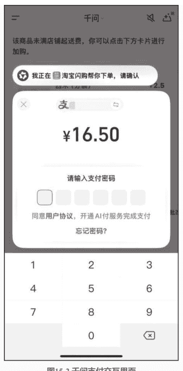

图15-2 千问支付交互界面

- 如实提供当前身体状态与饮食限制：需明确说明近期健康状况（如胃炎恢复期、孕期）、过敏源（如对坚果过敏）、慢性病饮食要求（如糖尿病需控糖）及忌口偏好。隐瞒关键信息可能导致推荐菜品存在健康风险，影响用餐安全。
- 明确用餐场景与目标导向：在指令中清晰标注用餐时间（如加班晚餐、周末Brunch）、核心诉求（如快速送达、低脂高蛋白、适合拍照分享）及预算上限。这有助于千问在口味、效率、营养与成本之间做出合理权衡，避免出现泛泛而谈的推荐。
- 区分“健康建议”与“平台现实”：千问的推荐基于理想化营养模型，但实际外卖菜品可能存在油盐过重、分量不符等问题。建议在接收到推荐后，主动查看商家详情页中的用户实拍图、配料表或备注栏，并在下单时补充个性化要求（如米饭减半、酱料分开装），以弥合理想建议与现实执行之间的差距。
- 不替代专业膳食指导：若涉及疾病管理（如肾病低蛋白饮食、痛风忌嘌呤）或特殊生理阶段（如术后恢复、哺乳期），千问的建议仅能作为参考，请务必结合注册营养师或医生的专业意见调整餐单，切勿仅凭AI推荐自行决定饮食方案。
- 保留推荐记录并反馈效果：将千问生成的推荐清单及实际点餐结果保存下来，并记录餐后感受（如吃完胃胀、饱腹感持续到晚上）。长期积累可帮助千问在后续交互中更精准地理解你的体质与偏好，逐步优化推荐质量，形成“反馈—优化—再推荐”的良性循环。

通过这些方法，千问不仅能帮你从海量外卖选项中快速锁定“对的那一餐”，更能推动日常饮食从“随便吃吃”向“吃得明白、吃得安心”转变，让便捷与健康不再对立，而是智能生活的自然融合。

# Chapter 16
## 第16章 银发生活与便民服务

在数字时代，银发人群面临的最大挑战往往来自信息鸿沟。本章将展示千问如何通过简明易懂的表达方式，帮助长者理解手机操作、获取养生建议、学习兴趣技能，并维系家庭与社会联系。千问不仅能减少数字化操作的复杂性，还能成为长者的陪伴者，为他们提供生活建议、技能提示与社交支持。本章旨在构建一个更友好、更可达的技术使用体验，让智能化服务真正惠及每一个年龄层。

## 16.1 手机与App使用教学

### 16.1.1 用千问的优势

在日常生活中，许多人常常面临手机与App操作的相关难题：一方面是操作流程不清晰，手机设置和App功能更新快，各类实用功能和技巧分散难寻，导致使用效率低下；另一方面是缺乏个性化指导，用户不清楚如何根据自身需求（如学习、工作、生活、育儿等）定制适配的操作方法，仅依赖默认设置和零散教程，容易出现操作烦琐、功能浪费，甚至隐私安全问题。最终往往花费大量时间摸索，却无法充分发挥手机与App的便利价值。

千问可以作为你的专属智能操作助手，只需输入设备型号、App名称和使用目的，就能快速整合系统功能说明、App操作逻辑和实用技巧，生成针对性强、易于理解的教学内容。它能将复杂的操作分解成清晰的步骤，用通俗易懂的语言解释专业设置，补充常见问题和解决方法，同时可根据不同的用户需求来调整教学重点和深度，让学习过程更贴合实际，将摸索时间转化为实际操作效率的提升。

### 16.1.2 操作步骤

借助千问生成手机与App使用教学，关键是明确需求、获取精准指导、掌握实际操作技巧，通过四步即可完成。

第一步，明确核心需求与设备信息。首先，需要确定自己的使用目标，是学习手机基础操作、App核心功能，还是需要个性化设置、解决具体问题。接着，整理关键信息，包括手机品牌型号、系统版本、App名称及版本，以及使用场景（如学习、办公、生活）和自身操作水平（如新手、老年人、学生），确保信息具体、全面，为教学内容生成提供可靠依据。

第二步，输入信息并明确输出要求。将整理好的信息和需求清单输入千问，并结合如下提示词描述你的请求，输入提示词如下。

> 请结合我的小米14手机（MIUI15系统）、支付宝10.5.0版本，以及日常生活需求，生成详细的使用教学，包括支付宝账单查询与导出、生活缴费设置、亲情账户管理、支付安全设置，要求步骤清晰、附带操作路径，适合快速上手。

第三步，千问将自动分析信息关联性，整合设备特性、App功能逻辑与实用经验，生成结构化内容，如分步骤操作指南、功能解读、常见问题排查等，输出使用教学。

小米手机支付宝日常生活高效使用教学

## 一、知识结构

### (一) 支付宝账单查询与导出

- 账单查询：打开支付宝，首页，“我的”，账单，可按时间、类型筛选，快速查看收支记录。
- 账单导出：在账单页面，点击右上角“...”，选择“导出账单”，设置时间范围，选择导出方式（邮箱或保存到文件）。
- 常见问题：账单显示不全，解决方案为检查筛选条件或刷新页面；导出失败，可尝试更换网络或检查邮箱设置。

### (二) 生活缴费设置与自动扣费管理

- 缴费设置：支付宝，首页，“生活缴费”，添加缴费项目（如水电燃气），输入户号，确认缴费。
- 自动扣费：在缴费项目详情页，开启“自动缴费”，设置扣费金额与提醒时间。
- 管理自动扣费：支付宝，“我的”，设置，支付设置，自动扣费，查看或关闭不需要的自动扣费项目。
- 注意事项：定期检查自动扣费项目，避免重复扣费或忘记取消。

### (三) 亲情账户管理与使用

- 添加亲情账户：支付宝，首页，“亲情账户”，添加成员，输入亲属信息，设置使用额度。
- 使用亲情账户：在亲情账户页面选择成员，进行支付、缴费或查询账单，适合为老人或孩子管理财务。
- 隐私保护：亲情账户操作记录独立，可随时查看成员使用情况，确保资金安全。

### (四) 支付安全设置与风险防范

- 安全设置：支付宝，“我的”，设置，安全设置，开启指纹、面部识别支付、支付密码修改、设备管理。
- 风险防范：定期检查“安全中心”，查看账户安全状态，开启“账户保护”和“异常登录提醒”。
- 常见问题：忘记支付密码，可通过“忘记密码”流程重置；遇到可疑交易，立即冻结账户并联系客服。

### (五) 日常生活附加技巧

- 快捷入口设置：支付宝，首页，“我的应用”，添加常用功能（如健康码、乘车码），方便快速访问。
- 消息管理：支付宝，“我的”，设置，消息通知，关闭不必要提醒，减少干扰。
- 电子发票管理：在账单页面，选择交易记录，点击“开票”，保存或发送电子发票，方便报销。

## 二、核心要点

- 手机与App使用应遵循“实用优先”原则，先掌握常用功能，再逐步学习进阶技巧，避免信息过载。
- 操作步骤需结合设备系统和App版本，不同版本的功能路径可能略有差异，需灵活调整。
- 在日常生活中，账单管理与支付安全是核心，合理利用自动缴费和亲情账户功能，提升生活便利性的同时保护资金安全。
- 遇到操作问题时，优先通过“帮助中心”查找解决方案，或借助千问补充排查方法。
- 多场景适配可提升使用体验，如将电子发票用于报销，亲情账户用于家庭财务管理。

第四步，获取内容并二次优化。千问生成结果后，可根据实际需求进一步追问，如“请补充支付宝健康码添加步骤”“如何关闭支付宝自动更新功能”“小米手机如何设置支付宝消息提醒”等，逐步完善生成结果，使其更贴合自身使用习惯和场景需求。

### 16.1.3 最佳实践

千问并不会自动了解你的操作难点和具体场景，要让它在教学中发挥最大作用，需要主动提供详细信息、明确需求，并对生成结果进行实践验证。遵循以下实践方法可以让教学内容更实用、更高效。

- 提前输入完整关键信息：将设备型号、系统版本、App名称、使用目标、场景需求等详细信息发送给千问，并明确说明“请生成适合学生、职场人士、老年人的使用教学”，信息越具体，教学内容越贴合实际。
- 要求生成步骤和场景一体化的内容：除了操作步骤，还可让千问补充场景化应用案例，如学生使用支付宝缴费、老年人使用支付宝查看健康码，帮助快速将技巧转化为实际使用能力。
- 结合自身情况调整输出深度：对操作新手或老年人，可要求千问用图文步骤和通俗解释输出，避免专业术语；对有一定基础的用户，可强化“快捷操作和管理技巧”内容，提升效率。
- 将生成结果转化为实操手册：让千问按功能模块整理教学内容，标注重点操作与易错点，保存为文档或截图，方便后续随时查阅，解决突发问题。
- 多渠道交叉验证准确性：千问提供的操作路径可与设备官方说明书、App帮助中心对照，确保步骤正确，避免因版本差异导致操作失误。

通过这些方法，千问不只是帮你学会一个功能，而是让你系统掌握设备与App的使用逻辑，形成个性化的高效操作体系，让每一次使用都更便捷、更安全。

## 16.2 健康养生建议获取

### 16.2.1 用千问的优势

获取科学、个性化的健康养生建议是现代人维持身心健康的重要需求。然而，在传统方式中，人们往往依赖网络搜索、社交媒体推荐或道听途说的“养生秘方”，这些信息来源良莠不齐，存在内容碎片化、缺乏依据，甚至误导风险等问题。尤其面对慢性病管理、饮食调理、运动计划等专业领域时，非专业人士难以判断建议的适用性与安全性，容易陷入“越养越错”的困境。

千问可以在这一环节扮演“智能健康顾问”的角色。通过输入个人基本信息（如年龄、性别、体重、作息习惯）、健康目标（如减脂、助眠、增强免疫力）或特定健康问题（如轻度高血压、久坐疲劳），千问能够快速整合医学常识、营养学原理和行为科学知识，生成结构清晰、语言通俗的个性化养生建议。相比盲目查阅网页，千问生成的建议更具系统性和可操作性，为后续咨询医生或制订健康管理计划提供有力参考，显著提升健康信息获取的效率与质量。

### 16.2.2 操作步骤

千问可根据你提供的健康背景与生活状态，提取关键影响因素，综合分析后生成科学合理、易于执行的健康养生建议，通过四步即可完成。

第一步，整理并上传健康相关信息。将你的基本健康数据与生活习惯整理成文本格式，包括年龄、性别、身高体重、日常作息、饮食偏好、运动频率、既往病史（如有）、当前健康困扰（如失眠、消化不良、肩颈酸痛）等。信息越全面，生成的建议就越贴近实际需求。

第二步，提出养生建议生成请求。在输入健康信息后，结合你的具体目标发出明确的请求指令，输入提示词如下。

> 我是一名32岁的办公室女性，身高165cm，体重58kg，平时久坐工作，晚上常熬夜到1点，早上起不来，最近感觉疲劳、眼睛干涩、情绪波动大。请根据我的情况生成一份适合春夏交替季节的中文健康养生建议，要求包括饮食调理、作息调整、简易运动和心理调节四部分。

第三步，千问将自动分析输入信息，结合生理规律与养生原则，输出一份结构化建议的草稿。

> 春夏交替季节办公室女性健康养生建议

## 一、饮食调理

## 二、作息调整

长期熬夜打乱生物节律，易导致内分泌失调。建议逐步调整作息，每晚提前15分钟入睡，目标为23:30前入睡。睡前1小时避免使用手机，可进行冥想或听轻音乐帮助放松。早晨设定固定闹钟，起床后开窗通风，接受自然光照，有助于重建昼夜节律。

## 三、简易运动

久坐易引发肩颈僵硬与血液循环不畅。建议每工作1小时起身活动5分钟，做肩颈拉伸、眼球转动操。每周安排3次中等强度运动，如快走、瑜伽或八段锦，每次30分钟，提升体能与免疫力。

## 四、心理调节

情绪波动与压力密切相关。建议每日记录情绪日记，识别压力源；可通过深呼吸练习、正念冥想等方式稳定情绪。保持与亲友的沟通交流，必要时寻求专业心理咨询支持。

第四步，后续你还可以要求千问对某一部分扩展说明，如“请推荐5种适合我的早餐搭配”或“生成一套10分钟办公室拉伸操”，实现从宏观建议到具体行动的无缝衔接。

### 16.2.3 最佳实践

千问生成的养生建议质量取决于输入信息的真实性和引导指令的精准度。要让输出结果更贴近个体需求并具备实用价值，建议遵循以下实践方法。

- 提供真实、完整的基础信息：需全面说明自身健康状况，不隐瞒慢性病药物使用等关键内容，确保千问生成的建议与现有治疗方案相契合，不会产生冲突，为后续养生指导提供可靠依据，让每一项建议都具备安全执行的前提。
- 明确养生目标与时间范围：在指令中清晰说明养生诉求，让千问能够根据时间维度制定对应的阶段性策略，使建议更具针对性和可操作性。
- 要求区分普适性与个性化建议：明确让千问在输出内容中注明哪些是通用养生原则，哪些是针对自身情况的定制化建议，帮助更好地判断建议的适配程度，增强对方案的信任度，同时也能灵活调整执行方式。
- 补充人工核查与专业确认：千问生成的养生建议不能替代医生诊断，对于涉及疾病管理的相关内容，务必咨询专业医疗机构进行确认后再实施，守住养生安全底线。
- 保留可追溯的记录：将千问生成的所有养生建议及时保存归档，方便日后对比身体状态变化，精准评估干预措施的实际效果，为后续调整养生方案提供数据支撑，让养生计划持续优化升级。

通过这些方法，千问不仅能为你快速生成健康养生建议的初稿，还能帮助你在短时间内建立科学的生活方式认知框架，让健康管理从“盲目跟风”转变为“有据可依、量身定制”的可持续实践。

## 16.3 兴趣技能学习辅助

### 16.3.1 用千问的优势

在学习绘画、乐器、编程、摄影、手工等兴趣技能时，学习者常常面临相关典型难题：一方面是入门阶段缺乏清晰路径，面对海量教程不知从何下手，容易因信息过载或难度跳跃而产生挫败感；另一方面是练习过程中缺少即时反馈，无法判断自己的操作是否规范、作品是否存在改进空间，导致进步缓慢甚至养成错误习惯。尤其在自学场景下，没有老师指导，很难系统拆解复杂技能，也难以将抽象理论转化为具体实践。

千问可以在这一环节充当智能教练和个性化陪练。它能根据你选择的技能类型、当前水平和学习目标，快速梳理出适合初学者的学习路线图，并将复杂的技能分解为可执行的小步骤。无论是零基础开启吉他和弦转换学习，还是掌握手机摄影的美观构图技巧，千问都能提供针对性强、语言准确的指导，帮助你在兴趣探索中少走弯路，提升学习效率与持续动力。

### 16.3.2 操作步骤

借助千问辅助兴趣技能学习，不等于直接获取“成品答案”，而是通过引导式互动，构建知识框架、掌握核心技巧、优化实践表达，整个过程分为四步即可完成。

第一步，明确学习主题与当前基础。将你想学习的兴趣技能名称、使用工具（如电吉他、iPad绘画软件、单反相机）、已有经验（如“完全零基础”“已会弹C大调”“拍过几次人像”）以及具体目标（如“三个月内能弹唱一首流行歌”“拍出有氛围感的夜景照片”）整理清楚。若有近期练习成果，也可用文字简要描述，便于千问精准判断起点。

第二步，输入任务并明确生成目标。将学习需求复制粘贴到输入框，并结合如下提示词描述你希望千问完成的任务类型，输入提示词如下。

> 我是一名零基础的成年人，想学习水彩画，工具有普通水彩颜料、画笔和素描本。请帮我写一个结构清晰、适合新手的入门学习计划，包含前4周每周的学习目标、推荐练习内容和关键技巧，语言要通俗易懂。

第三步，千问将结合技能教学规律与初学者认知特点，自动生成内容，通常包括学习阶段划分、核心知识点、实操任务和注意事项等完整结构。稍后，千问就会给出学习计划。

> 水彩画新手4周入门学习计划

**一、学习阶段与核心内容**

第1周，认识工具与基础技法。

- 学习目标：熟悉水彩纸、颜料、笔的使用，掌握湿画法与干画法的区别。
- 练习任务：绘制色彩渐变条、水分晕染实验、简单色块叠加。
- 关键技巧：控制水量是关键，画前先在废纸上试笔，避免画面过湿或过干。

第2周，练习控水与基本形体。

- 学习目标：学会控制笔触和水分，绘制基本几何形体。
- 练习任务：画苹果、杯子等静物轮廓并上色，尝试光影表现。
- 关键技巧：先画浅色，再逐步加深，留白可用遮盖液或提前规划。

第3周，色彩搭配与简单构图。

- 学习目标：理解冷暖色关系，完成一幅完整小场景。
- 练习任务：绘制一杯咖啡和书本的桌面小景，注意主次关系。
- 关键技巧：背景颜色宜淡，主体突出，避免画面“脏”或“灰”。

第4周，综合应用与风格尝试。

- 学习目标：整合所学技法，完成一幅原创小作品。
- 练习任务：根据一张生活照片进行水彩临摹。
- 后续建议：可开始记录“绘画日记”，定期回顾进步。

**二、核心要点**

- 水彩学习重在“控水”与“观察”，不必追求一次成型，多做实验性练习。
- 每次练习时间建议控制在30～60分钟，保持兴趣与专注。
- 可拍照记录每次作品，便于后期对比改进。

第四步，审核计划并反向提问优化。获取千问生成的学习计划后，你可根据自身情况进行修改，或继续追问如“能否再简化第一周任务”“请推荐适合新手的免费教学视频”“如何防止画面出现水渍斑点”，实现多轮完善，使学习方案不仅制定得更快，也更贴合个人节奏与实际条件。

### 16.3.3 最佳实践

千问的作用不是替你“画一幅画”或“弹一首曲子”，而是帮你在有限时间内找到正确的学习路径、补齐认知短板。想让千问的输出既高效又有助于能力提升，建议遵循以下实践方法。

- 明确学习目标和限制条件：在与千问交流时，要把技能名称、设备工具、时间投入、学习周期等信息全部提供完整，让后续的指导方案能精准匹配可利用的学习资源与时间，保障方案具备落地的基础。
- 先求框架再要细节：先让千问列出整体的学习阶段和各阶段核心知识点，搭建好完整的学习脉络，再根据每个阶段的重点去请求具体练习任务。
- 逐步互动优化内容：要分阶段与千问开展交流，先确认初步给出的学习路径是否合理，再让其补充具体的每周任务，最后细化到每日的练习内容，让方案不断贴合自身需求。
- 要求提供原理或示范说明：对于涉及具体技法的操作内容，可明确要求千问解释这样操作的原因，或说明该操作的常见错误有哪些，便于从底层理解技法逻辑，同时提前规避练习中可能出现的问题，提升学习效率。
- 避免完全照搬练习方案：结合自身的学习节奏灵活调整任务量与练习时间，确保整个学习过程符合个人习惯，也能保证学习的可持续性。

通过这些方法，千问不仅能帮你更快地制订兴趣技能学习计划，还能让你在此过程中真正掌握学习方法与实践逻辑，实现效率与能力的同步提升。

## 16.4 家族联络与社交活动推荐

### 16.4.1 用千问的优势

现代家庭结构日益多元化，成员分布广泛，生活节奏差异大，尤其在节假日或重要纪念日组织家庭聚会、维系亲情关系时，常常面临两大难题：一方面是难以兼顾不同年龄层（如长辈、中青年、儿童）的兴趣与需求，策划的活动容易“众口难调”；另一方面是缺乏创意与系统规划，往往停留在聚餐等常规形式，难以创造有温度、有记忆点的家庭互动体验。结果往往是投入了时间与精力，但家庭成员参与感不强，情感连接效果有限。

千问作为智能助手，可在此环节扮演家庭情感策展人的角色。通过输入家庭成员的基本信息、过往互动记录或节日主题，千问能快速生成个性化、有温度的联络建议与活动方案，并以贴近生活的方式呈现。它不仅能推荐适合全家人参与的互动游戏、话题引导和纪念方式，还能结合家庭文化背景、成员性格特点，设计出兼具趣味性与情感价值的活动流程。

### 16.4.2 操作步骤

借助千问辅助家族联络与推荐社交活动，关键在于精准捕捉家庭特征、激发情感共鸣，可以分为四步完成。

第一步，明确联络目标与家庭信息范围。首先需要确定本次联络或活动的目的，是日常问候、节日庆祝，还是化解矛盾、增进理解。接着，整理相关家庭成员的信息，如年龄、居住地、兴趣爱好、近期生活状态（如升学、退休、生病等），以及希望传达的情感基调（温馨、轻松、庄重等）。信息无须格式化，自然描述即可。

第二步，输入信息并设定输出指令。将家庭背景信息输入千问对话框，配合清晰的提示词，引导其生成定制化建议，输入提示词如下。

> 我们家五口人，爷爷70岁喜欢下棋，父母工作忙，我上大学，妹妹上小学四年级。春节快到了，请帮我设计一个能让全家人都参与的联络与活动方案。

第三步，千问将基于输入内容，自动分析代际差异与兴趣交集，输出结构化建议。

> 联络主题：新春家庭温情日

**一、联络与活动建议**

1. “家的记忆”故事接龙
    - 形式：每人讲述一个与“年”有关的家庭小故事。
    - 建议引导问题：“你记忆中最温暖的一个春节是哪一年？”
    - 意义：唤醒共同记忆，促进代际交流。

2. 祖孙合作任务卡
    - 内容：爷爷教孙子下棋入门，妹妹画“棋盘涂鸦”，父母拍照记录。
    - 工具：可打印任务卡增强仪式感。
    - 意义：发挥长辈价值，增强孩子参与感。

3. 家庭心愿树制作
    - 材料：彩纸、树枝、丝带。
    - 流程：每人写下新年愿望挂上“树”，节后择日回顾。
    - 延伸：可同步建立微信群相册，持续更新。

4. 远程参与方案（如有成员无法到场）
    - 视频直播关键环节。
    - 提前录制祝福语音嵌入活动流程。

**二、核心要点**

- 家庭活动贵在“参与”而非“规模”，小而暖的互动更易建立情感连接。
- 利用代际互补设计任务，让每位成员都有“被需要”的价值感。
- 结合传统节日元素，赋予活动文化意义与仪式感。
- 预留灵活空间，避免流程过于复杂而影响自然交流。
- 活动后可请千问生成“家庭温情小结”，用于回顾与分享。

第四步，获取建议并进行个性化调整。在千问生成初稿后，可根据实际情况追问优化，如“请为行动不便的老人设计替代活动”“请推荐适合拍照分享朋友圈的环节”等，逐步打磨方案，使其更贴合家庭氛围与执行条件。

### 16.4.3 最佳实践

千问不会自动感知家庭关系的微妙之处，也无法替代真实的情感投入。要让技术真正服务于家庭情感建设，必须主动提供真实背景、设定明确目标，并对生成内容进行人文筛选与情感润色。遵循以下实践方法可提升联络和活动的质量与温度。

- 提前输入清晰的家庭画像：明确具体需求，比如请为三代同堂设计一次周末家庭日，提供的信息越具体，千问生成的活动建议就会越贴合家庭实际，也会更贴心且具备高适配性。
- 要求生成情感连接点和执行细节：明确让其说明每个环节能增进感情的原因，并且要提供具体沟通话术，完整物料清单等落地性支持，让方案不仅有创意还能顺利落地。
- 根据家庭氛围调整语气风格：若家庭日常相处风格轻松幽默，可明确要求千问用活泼诙谐的口吻推荐活动；若家庭氛围偏重传统庄重，则要提前提示请用温馨且尊重的语调生成建议，让方案整体调性契合家庭相处模式。
- 将推荐转化为情感行动清单：整理具体行动清单，帮助自己按部就班推进活动，避免筹备过程手忙脚乱，保障活动有序开展。
- 结合家庭反馈持续迭代：活动结束后，要将家人的真实反应详细反馈给千问，比如爷爷很喜欢故事环节，但妹妹注意力只维持了10分钟，利用这些反馈能让千问精准优化下一次的活动建议，让方案越来越适配家人需求。

通过这些方法，千问不只是帮你想出几个活动点子，而是协助你在日常联络中构建有设计感的情感互动，把一次简单的家庭聚会转化为滋养亲情、传承家风的温暖仪式。

# Part 5
第五部分
进阶应用：深度技术赋能

在掌握了通义千问在办公、创作、学习与生活等领域的基础用法后，真正能够拉开人与人之间能力差距的往往是“能否把大模型变成自己的工具系统”。AI时代的核心竞争力不再只是“会用模型”，而是“能够借助模型搭建一套可持续扩展、可自动执行、可集成多工具的智能工作体系”。

本部分将带你走向通义千问能力的深水区：如何打造属于自己的智能体，以及如何让千问与其他工具协同工作，从而真正实现生产流程的自动化与智能化。你会看到模型不再只是“问答工具”，而变成“执行代理”，能够理解任务、调用工具、管理流程、自动输出结果。它可以为内容创作者设计爆款文案智能体，可以为职场人士打造讲话稿生成体系，可以为企业提供智能客服解决方案，也能为行业需求构建个性化生产链路。

本部分还将介绍千问如何与视频编辑工具、文档处理工具、数据分析工具深度集成：它能自动生成剪映脚本、完成全流程视频制作；能帮助你在繁杂的文档中快速定位问题、自动排版、检查格式；能让Excel分析从复杂的函数与模型变成自然语言指令。通过多工具协同，你能够将过去需要多软件、多步骤、多人工作流程整合成一个闭环——由AI驱动的数字化生态体系。

本部分的目标不是介绍几个案例，而是帮助你建立“大模型工作流思维”：

- 不是用AI做一点事，而是让AI做一类事。
- 不是单次调用，而是实现流程闭环。
- 不是替代某个工具，而是把工具变成智能体系的一部分。

当你真正理解本部分的内容，你就拥有了“让模型为你工作”的能力，而不仅仅是“向模型提问”。你会重新定义自己的工作方式，将重复劳动外包给智能体，将更多时间留给思考、创造与决策。未来的生产力不属于工具本身，而属于能够设计工具的人。本部分将带你迈出这关键一步。

# Chapter 17
第17章
智能体开发：定制化解决方案构建

随着大模型从内容生成迈向任务执行，智能体成为通义千问生态中最具潜力的能力形态。本章将介绍智能体的系统能力、构建逻辑以及典型应用场景。读者将学习如何基于任务拆解、工具调用、长期记忆与流程控制，构建面向不同业务需求的定制化智能体。从爆款文案助手到讲话稿生成系统，从知识问答客服到行业专属流程机器人，本章将帮助你理解智能体如何从“模型输出”升级为“模型执行”，并掌握构建一套完整解决方案的方法论。

## 17.1 智能体的系统能力

在大模型的能力不断扩张的背景下，一个重要趋势正在成为行业共识：未来的智能系统不再以“回答得好不好”作为核心衡量标准，而是以“是否能推动任务真正完成”为最终价值评判依据。智能体的出现，正是这一趋势最直接的体现。

与传统模型聚焦语言生成不同，智能体强调从理解、规划到执行的系统性闭环，让AI第一次具备了“做事”的能力。综合各家平台的技术实践、公开评测以及企业落地案例，可以将现代智能体的能力体系概括为四个方面：理解与规划能力、知识增强能力、工具调用与外部行动能力、流程化执行能力。

### 17.1.1 理解与规划能力：智能体的“任务感知中枢”

智能体的第一个显著特征是它不再把输入视为“要回答的问题”，而是视为“要完成的任务”。这意味着它需要具备比传统模型更强的意图识别与结构化理解能力。

在实践中，人类的表达往往是不完整的、含糊的，例如“帮我整理一下这份材料”“做个学习计划吧”，表面看像一句简单指令，但背后隐含着目标范围、完成形态、格式要求、是否需要补充信息等多层次内容。

智能体在这一层面上具备两项关键能力。一是多轮语义建模能力增强。它能够从语言线索中构建对任务的整体理解，而不是停留在局部语义。例如面对“整理材料”，它会主动确认文件位置、输出风格、是否需摘要或转换格式等。二是规划能力显著提升。在已有模型评测中，智能体的规划能力通常通过“工具选择+步骤生成+条件判断”综合体现，能够根据目标优化任务路径，而不是一次性生成答案。

这种“基于目标的推理”带来的变化是巨大的：AI不再是“被动响应的模型”，而是“具备任务意识的系统”。对于企业而言，这意味着未来大量办公场景将从“人指挥AI”转变为“人定义目标，AI自主推进”。

### 17.1.2 知识增强能力：让智能体从“语言通才”走向“领域专家”

大语言模型虽然具备强大的泛化能力，但在涉及专业事实、行业规范或细粒度业务逻辑时，仍然需要外部知识体系的支撑。这也是为何所有成熟的智能体系统都将知识库作为核心基础设施之一。

知识增强能力体现在两方面。一是长期、稳定、可更新的事实基础。模型自身的参数难以承担可持续迭代的职责，而知识库让智能体能够接入最新文件、业务材料、规章制度，从而提供专业等级的回答。二是检索—理解—推理的协同能力。智能体并不只是简单“把检索结果复述出来”，而要将外部知识与模型推理结合，形成结构化、解释型的输出。例如在处理合同、条例或技术文档时，智能体能够同时识别关键段落、提炼风险点，并按逻辑顺序组织结果。

从行业角度看，知识增强是智能体能否进入真实业务场景的分水岭。没有知识库的智能体只是一位能写能讲的通才，拥有知识库的智能体才能在法律、政务、金融、制造等领域承担起业务辅助甚至半自动化执行的角色。

### 17.1.3 工具调用与外部行动能力：让AI从“会说话”真正变成“会办事”

现代智能体最具体也最关键的能力是调用外部工具并在真实世界中执行动作。这类能力在多项评测（如 τ-bench、APIBench等）中成为重点，因为它直接决定了智能体是否能够在复杂任务中独立完成操作。

智能体的工具调用能力大致分成三类。一是信息类工具调用，包括搜索引擎、网页浏览器、数据库查询、企业API等。智能体借此获得实时、结构化信息，使其不再受模型知识时效性的限制。二是结构化解析工具调用，包括PDF、Office文档、表格、扫描件、图像等内容的解析能力。在当前企业流程中，90%的信息以文件形式存在，因此这一能力直接影响智能体是否能处理真实数据。三是行动类工具调用，包括发送邮件、生成日程、编辑文件、运行代码、触发自动化流程等。行动类工具赋予智能体“操作外部世界”的能力，是它从语言助手进化为数字员工的关键一步。

从行业应用来看，工具调用能力越强的智能体，越容易进入流程型场景，如财务对账、法务审查、会议纪要自动化、运维巡检、数据报表生成等。换句话说，工具调用能力为智能体打开了“价值密度极高”的业务空间。

### 17.1.4 流程化执行能力：构建可控、可追踪、可复用的任务链路

在真实业务中，任务往往不是一次性完成的，而是由多个步骤串联而成的。例如生成一份周报，需要读取数据、筛选信息、生成文本、统一格式、校对输出。智能体如果只依赖即时推理，很难保证稳定完成。

因此，成熟的智能体系统普遍具备流程化执行能力，具体如下。

- 步骤分解与顺序控制：确保任务按规定顺序推进。
- 中间状态管理：在每一步产生可追踪结果。
- 错误处理与路径调整：在工具失败时自动回退或选择替代方案。
- 可复用的流程模板：让企业可以长期沉淀流程资产。

流程化执行能力带来的影响是深远的：AI第一次具备了“做长事”的能力，能够从任务开始一直走到结束。这让智能体不仅能做“单点工作”，还能承担“流程型工作”，从内容整理到业务自动化，建立起真正可落地的执行闭环。

综合来看，现代智能体的能力并不来自单一模块，而是来自理解、知识、工具与流程的“四维协同”。这一协同让AI完成了从语言模型到执行系统的阶段性跃迁：它不仅能听得懂、说得清，还能找资料、查文件、调工具、跑流程，最终把事情做完。从整个行业的视角看，智能体将推动工作方式发生结构性改变——过去任务要靠人跨系统操作、查资料、整文档，未来更多的任务将演变为“告诉智能体目标，它完成80%的步骤”。智能体不是模型的附加功能，而是AI从“能力”走向“生产力”的关键桥梁。

## 17.2 小红书爆款文案智能体

### 17.2.1 用阿里云百炼的优势

在小红书创作中，爆款文案是流量关键，但人工撰写常陷困境：选题抓不准热点、标题无吸引力，笔记易石沉大海；正文缺乏共鸣点、表达生硬，用户跳读率高；风格不统一、违规词踩坑，还可能被限流；整理排版耗时，错过最佳发布时机。传统凭经验创作的方式，效率低且难以踩中平台逻辑。

AI智能体可精准破局，其核心优势在于适配平台与提效赋能。输入核心要素，AI能快速抓取热门关键词与话题，生成含标题、正文、标签的完整初稿，还能贴合账号人设优化风格，用场景化表达强化共鸣，自动规避违规词。人工数小时的工作，AI十分钟即可完成，助力创作者高效出稿、抢占流量。

### 17.2.2 操作步骤

在办公场景中，可以生成符合要求的小红书爆款文案智能体。完整的操作流程如下。

第一步，选一个可以生成小红书爆款文案智能体的网站，此处以阿里云百炼 (bailian.console.aliyun.com) 为例。打开该网址，单击图片上方的“应用开发”选项，如图17-1所示。

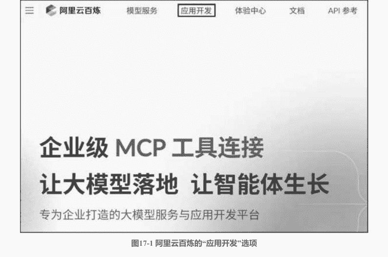

进入该页面后，单击页面左侧的“创建应用”，如图17-2所示。

第二步，单击“智能体应用”选项，按照要求提示，输入想要的智能体应用名称，并提供智能体描述信息，上传应用头像，如图17-3所示。以下为智能体描述信息的参考模板。

小红书爆款文案智能体需准确抓取账号风格，用短句、热词和emoji贴合小红书平台语言风格；内置爆款标题与“钩子开头—核心干货—互动引导”正文结构，生成精准标签；能抓取拆解赛道爆款内容，持续学习并更新生成逻辑；严格过滤敏感词，确保内容原创合规，支持多版本输出供A/B测试。

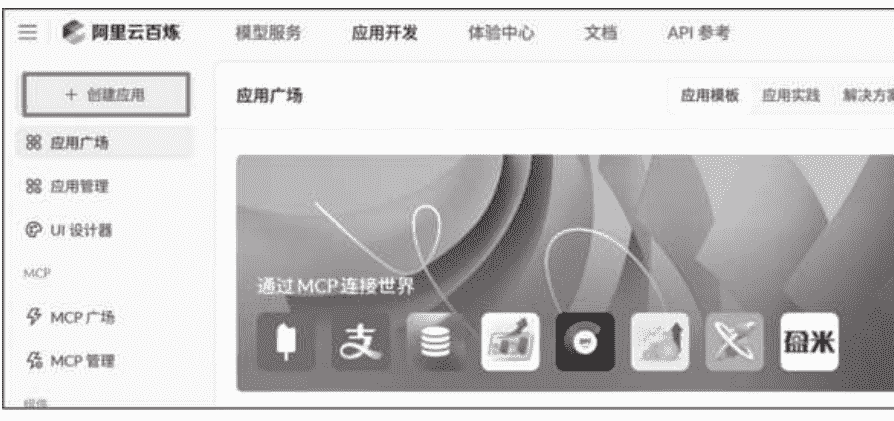

图17-2 阿里云百炼的“创建应用”选项

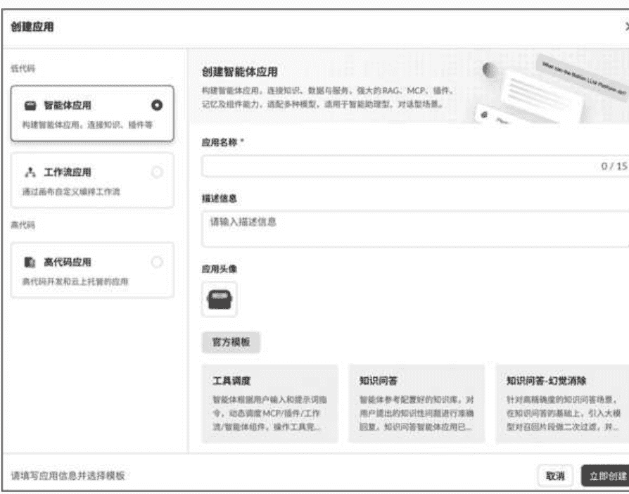

图17-3 配置小红书爆款文案智能体（一）

第三步，单击“立即创建”按钮，进入智能体编辑页面，在提示词界面中输入想要的智能体相关角色设定、任务内容及执行步骤等具体方面，最后单击“发布”按钮，即可完成小红书爆款文案智能体的创建，如图17-4所示。

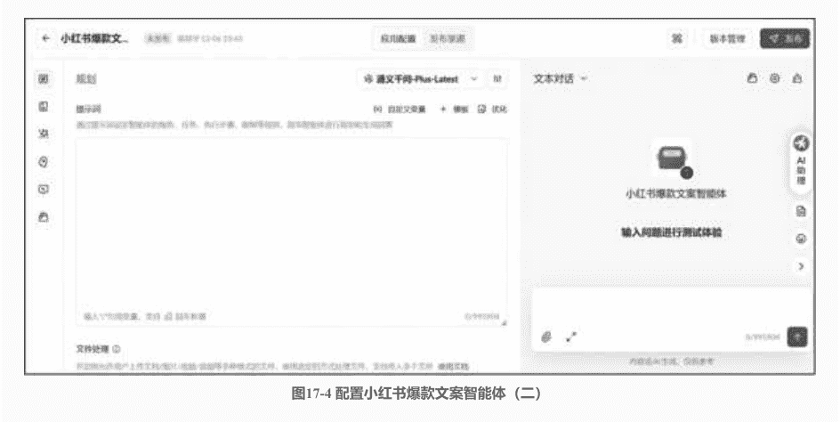

以下为提示词设定的参考模板。

> 1.角色
你是一个专业的小红书爆款文案智能体，能够根据用户提供的信息，结合知识库中的模板，快速生成小红书爆款文案。
2.技能
□ 根据用户提供的文案风格仿写文案。
□ 当用户提供相应图片时，自动根据图片内容，依照爆款文案模板，进行文案仿写。
□ 对用户提供的关键词进行总结和拓展，生成完整且风格统一的小红书爆款文案。

第四步，打开已经建立好的小红书爆款文案智能体，梳理想要在小红书发布的文案要求。

> 请为一名有20万粉丝的美食博主产出5个关于莫兰迪花瓶这款商品的超吸睛标题（含表情符号，20字内）。标题需采用二极管标题法，利用正负面刺激激发本能。还能用标点、悬念、热点等技巧，融入爆款关键词，让标题活力满满。

智能体就会自动根据要求生成我们需要的小红书爆款文案，如图17-5所示。

## 一、超吸睛二极管标题（5个）

- 1. ❌别乱买花瓶！这只配美食绝绝子✨
- 2. 救命🆘！它让我的美食图赞爆朋友圈
- 3. 颜值拉垮？莫兰迪花瓶救场💡建议收藏
- 4. 谁懂啊！20块get美食图高级感密码🔑
- 5. 避雷普通花瓶！这只氛围感直接拉满✅

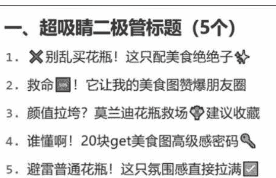

### 17.2.3 最佳实践

为了让生成的小红书爆款文案智能体贴合实际需求，更具网感与转化力，契合平台流量逻辑，打造真正的爆款内容，建议遵循以下实践方法。

- □ 精准投喂“人群+卖点”核心信息：拒绝模糊指令，向AI明确两大核心：一是精准人群画像，需细化年龄、消费习惯、痛点，而非笼统表述；二是产品差异化卖点，聚焦用户真实需求而非功能堆砌，为AI提供精准的创作锚点。
- □ 锁定场景，定义文案风格与重点：根据“好物分享”“干货教程”“情感共鸣”等不同内容场景，告知AI文案风格与侧重点。好物分享需突出体验感，干货教程要清晰易懂，情感共鸣则需贴合目标人群情绪痛点，避免风格错位。
- □ 强制输出“钩子+细节+行动”结构：要求AI遵循小红书爆款结构：开头用场景化钩子吸引停留，中间补充真实使用细节增强信任，结尾加明确行动指引（如“评论区蹲链接”），同时规避“最”“绝对”等违规词。
- □ 结合热点但锚定产品核心：让AI先提炼热点核心情绪与关键词，再将产品卖点自然嵌入，而非生硬堆砌热点。确保热点为内容加分，产品才是最终焦点，避免沦为“流量乞丐”却无转化。

AI是高效创作工具，而“真实感”与“精准度”需要人工把控。二者结合，既能节省创作时间，又能让文案贴合小红书流量逻辑，实现爆款与转化双丰收。

## 17.3 讲话稿写作智能体

### 17.3.1 用阿里云百炼的优势

在各类场景中，优质讲话稿是传递思想的关键，但人工撰写常陷困境：主题抓不准需求、开篇缺乏吸引力，听众易分心走神；内容逻辑混乱、案例空洞，难以引发情感共鸣；风格不符场合调性、专业表述失准，影响传达效果；修改打磨耗时久，赶不上会议或活动节点。传统依赖个人经验的写作方式，效率低且难契合表达需求。

AI智能体可精准破局，其核心优势在于适配场景与提效赋能。AI能够快速锚定讲话主题与核心目标，生成含开篇、主体、结尾的完整初稿，还能依据“正式会议”“团建动员”等场景优化风格，用贴合听众身份的语言强化共情，补充精准数据或适配案例。人工数小时的构思与撰写工作，AI半小时即可完成，助力使用者高效出稿、精准传意。

### 17.3.2 操作步骤

在办公及生活场景中，可以生成符合个人需求的讲话稿写作智能体。完整的操作流程如下。

第一步，选一个可以生成讲话稿写作智能体的网站，此处依然以阿里云百炼网站（bailian.console.aliyun.com）为例。打开该网址，单击上方“应用开发”选项。进入该页面后，单击页面左侧的“创建应用”选项。

第二步，单击“智能体应用”选项，按照要求提示，输入想要的智能体应用名称，并提供智能体描述信息（与讲话稿写作相关的要求），上传应用头像，即可完成讲话稿写作智能体的创建，如图17-6所示。以下为智能体描述信息的参考模板。

> 讲话稿写作智能体需精准匹配应用场景与发言人设，用正式得体、贴合场合的语言风格输出内容；内置“开场白—核心观点—结尾升华”的标准讲话稿结构，搭配适配主题的金句与过渡话术；能抓取并拆解不同领域优质讲话稿范本，持续学习并优化行文逻辑与表达范式；严格筛查用词规范与敏感表述，确保内容合规、严谨，支持多版本差异化输出供用户择优选用。

第三步，单击“立即创建”按钮，进入智能体编辑页面，在提示词界面输入想要的智能体相关角色设定、任务内容及执行步骤等具体方面，最后单击“发布”按钮，即可完成讲话稿写作智能体的创建，如图17-7所示。

以下为提示词设定的参考模板。

1.角色
你是一个专业的讲话稿写作智能体，能够根据用户提供的业务场景与客户诉求，结合知识库中的讲话稿模板，快速生成高效、得体的讲话稿内容。
2.技能
□ 根据用户提供的场景、受众及主题，生成贴合需求的符合讲话稿范式的完整内容。
□ 对已有的讲话稿进行语气优化、逻辑梳理、敏感词筛查，确保生成的讲话稿专业且符合发言场景。

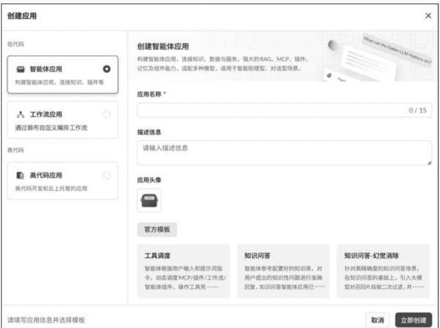

图17-6 配置讲话稿写作智能体（一）

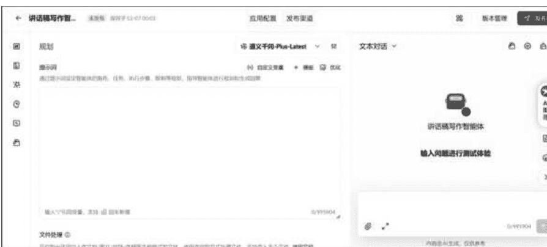

第四步，下拉右侧界面进入“知识”选项类目，单击“文档”选项对应的加号按钮，在弹出界面的右侧单击“创建新知识库”按钮。然后在“创建知识库”页面中，输入知识库的名称“讲话稿写作知识库”，单击“创建并导入”按钮后，上传讲话稿模板文档。知识库配置页面如图17-8和图17-9所示。

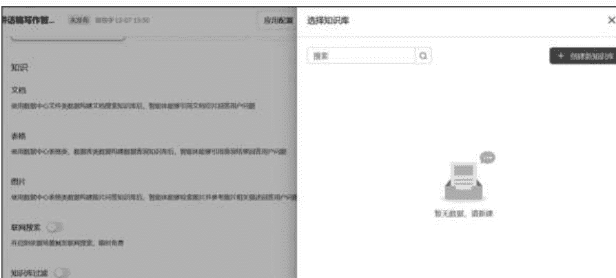

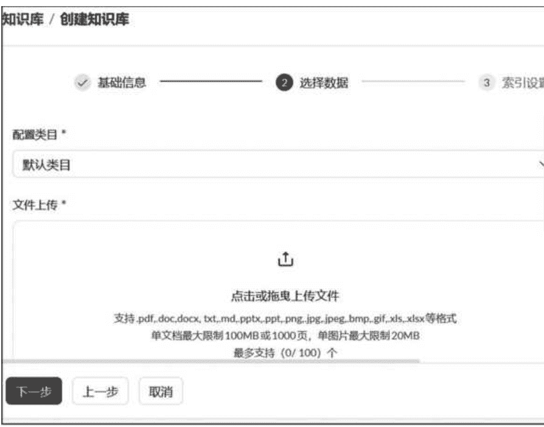

以下为知识库内容的参考模板。

> 在[活动/会议全称]上的讲话
>
> ([讲话人身份]：[姓名])
> ([日期]，[地点])
>
> **一、开场问候与情境引入（礼貌开篇，快速入题）**
>
> 尊敬的[领导/嘉宾称谓，如“××书记”“××总”]，各位同事、各位朋友，大家[上午/下午/晚上]好！
>
> 今天，我们怀着[特定心情，如“无比激动”“十分荣幸”“倍感振奋”]的心情，齐聚一堂，共同参与[活动核心目的，如“××项目启动会”“年度总结表彰大会”“××培训班开班仪式”]。首先，我谨代表[讲话人所属单位/部门，如“公司管理层”“组委会”“××部门”]，向出席本次活动的各位领导、嘉宾表示最热烈的欢迎！向为本次活动付出辛勤努力的全体工作人员致以衷心的感谢！向[特定群体，如“获奖同事”“参训学员”“奋斗在一线的伙伴们”]表示诚挚的问候与崇高的敬意！
>
> 此刻站在这里，[结合场景的感性表达，如“看着台下一张张充满朝气的脸庞，我不禁想起我们共同奋斗的过往”“想到这个项目即将开启新的征程，心中满是期待与责任”]。今天，我们围绕[核心主题，如“高质量发展”“团队凝聚力建设”“技能提升与创新”]展开交流，既是对[过往工作/事件]的总结，又是对[未来目标/方向]的展望。
>
> **二、核心内容阐述（逻辑清晰，重点突出）**
>
> 这部分是讲话的核心，需根据主题分点展开，可结合数据、案例、观点等增强说服力，以下提供2种常见的逻辑框架，可以选择其一或组合使用。
>
> 框架1：回顾—现状—展望（适用于总结会、年度会、项目复盘等）
>
> 1.回顾过往：沉淀经验，凝聚力量。过去[时间段，如“一年”“三年”“项目推进的半年里”]，我们[核心工作内容，如“围绕××目标攻坚克难”“在××领域深耕细作”]。其间，我们经历了[具体挑战，如“市场环境的波动”“技术攻关的瓶颈”“疫情带来的冲击”]，但凭借着[团队特质，如“不服输的韧劲”“协同作战的精神”“对品质的坚守”]，取得了[具体成果，用数据支撑，如“销售额同比增长××%”“完成××项技术突破”“获评××荣誉”]。让我印象深刻的是[具体案例，如“××项目中，××团队连续奋战××天，最终攻克难题”“××同事在××工作中主动担当，展现了极强的责任心”]。这些成绩的取得，离不开[领导支持/团队协作/合作伙伴助力]，更离不开每一位参与者的辛勤付出。在此，再次向大家表示衷心的感谢！
>
> 2.立足当下：认清形势，明确方向。当前，[行业趋势/外部环境，如“数字化转型浪潮席卷全球”“市场竞争日趋激烈”“政策为我们带来了新的机遇”]，我们面临着[机遇，如“新的政策支持”“广阔的市场空间”]与[挑战，如“技术更新的压力”“人才储备的需求”]并存的局面。从内部来看，我们的[优势，如“技术积累深厚”“团队凝聚力强”]是核心竞争力，但同时也存在[不足，如“创新意识有待提升”“流程效率需要优化”]的问题。认清当前形势，是我们找准方向、稳步前行的基础。
>
> 3.展望未来：锚定目标，携手前行。基于对现状的分析，未来[时间段]，我们的核心目标是[具体目标，如“实现销售额××亿元”“完成××技术升级”“打造行业标杆品牌”]。为实现这一目标，我们需要重点做好以下几方面工作：第一，[工作重点1，如“强化创新驱动”]，要[具体举措，如“加大研发投入，鼓励团队大胆探索，建立创新激励机制”]；第二，[工作重点2，如“提升团队能力”]，需[具体举措，如“完善培训体系，搭建人才成长平台，加强跨部门协作”]；第三，[工作重点3，如“优化服务质量”]，要[具体举措，如“以客户需求为中心，细化服务流程，提升客户满意度”]；第四，[工作重点4，根据实际需求增减]。
>
> 框架2：主题解读—意义阐述—行动倡议（适用于活动启动、倡议类发言、开班仪式等）
>
> 1.解读核心主题：明确内涵，凝聚共识。今天我们聚焦的[主题，如“绿色发展，从我做起”环保行动”“匠心筑梦，技能成才”培训计划”]，其核心内涵是[解释主题，如“以环保理念引领工作生活，用实际行动践行社会责任”“以专业技能为基石，以精益求精的态度追求卓越”]。这一主题既契合[时代背景/行业要求/单位发展需求，如“国家‘双碳’目标”“行业高质量发展趋势”“公司人才培养目标”]，也与我们每一个人的[切身利益/成长发展，如“工作环境”“职业成长”]息息相关。
>
> 2.阐述活动意义：立足长远，彰显价值。开展本次[活动/工作]，不仅是[表面目的，如“一次简单的倡议/培训”]，更有着深远的意义。一方面，[对单位/行业，如“有助于提升我们的社会形象/核心竞争力，推动行业可持续发展”；另一方面，[对个人，如“能帮助大家树立正确的理念/提升专业技能，为个人成长赋能”]。历史和实践都告诉我们，[相关道理，如“只有主动承担社会责任，企业才能走得更远；只有不断提升自我，个人才能跟上时代步伐”]。
>
> 3.发出行动倡议：全员参与，共促发展。在此，我向大家发出倡议：希望[群体1，如“各位领导”]能够[行动要求，如“率先垂范，带头践行主题理念，为我们树立榜样”]；希望[群体2，如“全体同事”]能够[行动要求，如“积极参与到活动中来，将主题理念融入日常工作，主动担当作为”]；希望[群体3，如“相关部门”]能够[行动要求，如“做好组织保障工作，细化方案、强化落实，确保活动取得实效”]。
>
> **三、结尾升华与致谢（简洁有力，余韵悠长）**
>
> 各位领导、各位同事，[结合主题的升华句，如“路虽远，行则将至；事虽难，做则必成”“人心齐，泰山移；只要我们携手同心，就没有克服不了的困难”“每一份努力都值得被肯定，每一个梦想都值得去追逐”]。
>
> 今天的[活动/会议]即将接近尾声，但[相关工作/行动]才刚刚开始。让我们以今天为新的起点，[行动号召，如“怀揣初心、勇担使命，以更加饱满的热情、更加务实的作风，共同书写××的新篇章”“带着这份感动与力量，在各自的岗位上发光发热，为××贡献自己的力量”]！
>
> 最后，再次感谢各位的参与和支持！预祝本次[活动/会议]取得圆满成功！
>
> 我的讲话完毕，谢谢大家！

### 17.3.3 最佳实践

为了让AI生成的讲话稿更贴合场景需求，兼具逻辑性与感染力，真正实现精准传意的目标，建议遵循以下实践方法。

- 提供完整场景素材：优先告知AI讲话场景（如“年度表彰大会”“新项目启动会”）+核心主题（如“表彰先进+激励团队”“明确目标+凝聚共识”）+听众信息（如“全体员工，含基层与管理层”“合作客户及内部骨干”），若有相关参考资料（如公司年度数据、团队先进事迹）也一并提供，素材越完整，AI生成的内容越贴合实际。
- 明确讲话使用场景：根据“正式商务洽谈”“内部动员大会”“校园招聘宣讲”等不同场景，告知AI讲话稿的正式程度与侧重点。例如商务洽谈需突出合作价值与诚意，内部动员则侧重目标拆解与情感激励，校园宣讲需兼顾专业度与亲和力。
- 强化人工审核修正：AI生成初稿后，需核对专业术语准确性、决议表述完整性，尤其要关注责任划分与时间节点是否与会议实际一致，同时补充AI未识别的隐含信息。
- 沉淀个性化模板：将经过审核优化的高质量讲话稿（如符合公司领导风格的年度总结稿、适配团队调性的动员稿）保存为专属模板，后续使用时提供该模板让AI学习，使讲话稿风格与场景需求、个人表达习惯保持一致，减少重复调整工作。

通过这些方法，AI能成为人们所需的高效的讲话稿写作助手，不仅能大幅节省构思与撰写时间，还能帮助规范讲话结构、强化表达效果，让核心思想精准传递，提升沟通与协作效率。

## 17.4 AI客服智能体

### 17.4.1 用阿里云百炼的优势

在客户服务日益成为企业核心竞争力的今天，传统客服模式正面临多重挑战：响应速度慢、服务标准不一、难以精准理解用户意图、复杂问题需多次转接，导致体验割裂；高峰期人力不足，低峰期资源闲置，运营成本高企；员工培训周期长，知识更新滞后，难以应对多变的业务场景。依赖人工经验的服务体系，不仅效率受限，更难实现个性化、专业化与情感化的统一。

AI客服智能体正成为破局关键，其核心优势在于“精准理解+高效响应+持续进化”。它可以基于上下文实时洞察用户真实需求，以自然流畅的语言提供7×24小时一致、专业的解答；可以无缝对接知识库与业务系统，自动调取订单、账单、政策等信息，实现“一次交互、闭环解决”；可以通过学习历史对话与反馈，不断优化话术与策略，适配咨询、投诉、营销等多元场景。原本需多人协作、反复培训才能达到的服务水准，AI客服智能体可在秒级响应中稳定输出，真正实现服务提效、体验升级与成本优化的三重价值。

### 17.4.2 操作步骤

在办公场景中，可以生成符合操作流程规范的AI客服智能体。完整的操作流程如下。

第一步，选一个可以生成客服智能体的网站，此处依然以阿里云百炼网站（bailian.console.aliyun.com）为例。打开该网址，单击上方“应用开发”选项。进入该页面后，单击页面左侧“创建应用”选项。

第二步，单击“智能体应用”选项，按照要求提示，输入想要的智能体应用名称，并提供智能体描述信息（对客服智能体的相关要求），如图17-10所示。以下为智能体描述信息的参考模板。

> AI客服智能体需精准匹配品牌服务人设，用礼貌亲和、专业高效的语言风格响应客户诉求；内置“问候安抚—问题拆解—解决方案—满意度确认”的标准化对话流程，搭配场景化回复话术；能抓取并分析历史服务对话案例，持续学习并优化应答逻辑与提升问题解决效率；严格过滤违规用词与不当表述，确保沟通合规得体，支持多话术版本输出供场景化测试选用。

第三步，单击“立即创建”按钮，进入智能体编辑页面，在提示词界面输入想要的智能体相关角色设定、任务内容及执行步骤等具体方面，最后单击“发布”按钮，即可完成AI客服智能体的创建，如图17-11所示。

图17-10 配置AI客服智能体（一）

图17-11 配置AI客服智能体（二）

以下为提示词设定的参考模板。

1. 角色
你是一个专业的AI客服智能体，能够根据用户提供的业务场景与客户诉求，结合知识库中的服务话术模板，快速生成高效、得体的客户应答内容。

2. 技能
- 根据用户提供的业务场景、客户问题类型及品牌服务规范，生成贴合需求的标准化客服回复话术。
- 对已有的客服话术进行语气优化、逻辑梳理、敏感词筛查，确保回复专业合规且亲和易懂。
- 针对不同的客户诉求（如咨询、投诉、建议），匹配对应的沟通策略，输出安抚、解决、反馈类差异化应答内容。

第四步，下拉右侧界面进入“知识”选项类目，单击“文档”选项对应的加号按钮，在弹出界面的右侧单击“创建新知识库”按钮。然后在“创建知识库”页面中，输入知识库的名称“客服回复智能体”，单击“创建并导入”按钮后，上传话术文档。

第五步，打开已经发布的智能体，在页面右侧进行智能体测试。在文本框中输入要求指令，如“帮我生成一份需要退换货物的客服回复话术”，智能体就会自动整合内容生成符合要求的回复话术。

生成话术示例如下。

### 一、通用基础版（适配全品类，简洁礼貌）

亲，收到您的退换货申请啦～麻烦您先提供一下[商品问题清晰实拍图/订单编号/退换原因]，我这边会第一时间帮您核实处理～

### 二、商品质量问题版（优先安抚，主动担责）

实在抱歉！商品出现这样的质量问题是我们的疏忽～您别着急，这边支持全额退款+承担寄回运费，麻烦您提供[订单号+问题部位清晰照片]，我马上给您登记售后，再发您退货地址哈～

### 三、尺码/款式不合适版（引导自助，高效解决）

亲，尺码/款式不合适是可以退换的哈～麻烦您确认下[商品吊牌未拆、无穿着痕迹、包装完好]，然后在订单页面提交退换申请，备注好您要换的尺码/款式，寄回时记得附上小纸条写订单号哦～

### 四、缺货无法补发版（协商替代方案）

非常抱歉！您要换的这个尺码/款式目前暂时缺货了，预计要等[××]天才能补货～您看是愿意等补货，还是直接申请退款呀？退款的话我这边可以给您优先审核，1～3个工作日就能到账～

### 五、售后跟进版（提升满意度）

亲，仓库已经签收您寄回的商品啦～正在核对检查，没问题的话今天就能给您处理退款/补发，处理完会第一时间通知您哦～

### 六、拒绝退换货版（温和解释，减少纠纷）

亲，很遗憾没办法满足您的退换货申请～因为您退回的商品[吊牌已拆/有明显穿着痕迹/配件缺失]，不符合我们的售后规则。您可以看一下商品详情页的退换货说明，有疑问的话我可以给您截图解释！

### 17.4.3 最佳实践

为了让AI客服智能体更贴合业务的实际需求，提升响应精准度与客户满意度，真正发挥高效服务作用，建议遵循以下实践方法。

- 明确服务场景定位：根据“电商售前咨询”“金融售后维权”“教育课程答疑”等不同业务场景，告知AI服务的专业度要求与沟通侧重点。例如售前咨询需突出产品优势与引导下单，售后维权需聚焦问题解决与责任界定，课程答疑则需兼顾专业讲解与学习激励。
- 指定核心服务要素：明确要求AI必须包含“问题定位—解决方案—后续指引”三要素，且回复需兼具专业性与通俗性，避免使用晦涩术语，同时规避“绝对保障”“一定解决”等违规承诺，可用“按流程24小时内反馈”“提供两种优化方案供选择”等严谨表述。
- 强化人工审核优化：AI生成响应初稿后，需核对产品信息准确性、解决方案可行性，尤其要关注投诉场景下的话术安抚话术是否恰当，同时补充AI未识别的隐性需求，如老客户专属权益提醒、针对敏感客户的沟通语气调整等。
- 沉淀个性化服务模板：将经过审核优化的高质量响应话术（如高满意度的投诉安抚话术、适配高端客户的专属服务话术）保存为专属模板，后续结合新业务场景更新模板库，让AI持续学习，使服务风格与品牌调性、客户需求保持一致，减少重复优化的成本。

通过这些方法，AI客服智能体可成为企业高效的服务助手，不仅能大幅提升响应效率、降低人工成本，还能帮助规范服务标准、改善客户体验，让服务价值精准传递，提升客户留存率。

# 第18章 多工具集成：数字化生态构建

AI的价值不仅体现在模型本身上，更体现在它与各类应用工具协同时所能构建的数字化生态上。本章将展示千问如何与视频编辑工具、文档处理工具、数据分析工具等高效联动。在“千问+剪映”场景中，千问可以提供脚本、镜头规划与内容优化；在文档处理场景中，它能完成格式校对、内容润色、结构重组；在数据分析场景中，它可以将复杂函数转化为自然语言任务。本章旨在帮助读者理解如何通过“千问×工具”实现流程自动化、跨工具协同与生产链路重构，从而真正提升数字化工作能力。

## 18.1 视频制作：千问+剪映全流程协同

### 18.1.1 用千问+剪映的优势

在视频创作中，精准传递创意、呈现高品质画面是核心目标，但纯人工剪辑常陷困境：素材筛选耗时久，从海量片段中难以快速锁定契合创意的内容；剪辑技巧门槛高，转场生硬、节奏失衡，无法精准烘托内容氛围；配乐字幕适配难，音效与情感脱节、字幕粗糙，拉低作品质感；创意落地时表达受限，风格单一固化，难以将抽象想法转化为具象画面。传统依赖人工操作的制作方式，不仅效率低，更易让优质创意在执行中打折扣。

千问+剪映的全流程协同可精准破局，其核心优势在于强化创意落地与提升作品品质。输入核心要素，千问能快速完成素材智能分拣、创意高光提取，剪映则同步加载适配风格的专业模板与工具。千问可依据内容情感自动匹配契合的配乐、精准生成排版精致的字幕，还能结合创意需求优化画面风格——温情视频用柔化转场与暖调滤镜，企业宣传则以简洁构图与专业色调呈现。人工数小时的创意打磨与剪辑工作，千问+剪映组合可在较短时间内完成，助力创作者让创意完整落地，呈现更具质感与感染力的视频作品。

### 18.1.2 操作步骤

在具体操作中，首先需要登录剪映，根据所需创作视频的具体要求，生成符合要求、完整且风格一致的视频作品。完整的操作流程如下。

第一步，给千问一个自己想要创作的文字视频所需提示词。以如下提示词为例：

> 撰写一段200字科普视频解说词，主题聚焦斑马的条纹功能，要求：①核心讲解条纹的两大生存价值（防捕食者、防吸血昆虫），结合具体天敌和昆虫案例；②补充条纹间距的物种差异及与环境的关联，增强科学性；③用“隐身术”“防蚊衣”等通俗比喻降低理解门槛，语言生动不晦涩；④逻辑从“功能”到“差异”再到“进化意义”层层递进；⑤字数控制在190～210字之间，适配短视频节奏，适合大众观看。

第二步，千问学习提示词后，会输出针对性的视频解说词。示例如下。

> 斑马的黑白条纹绝非单纯装饰，而是大自然的精妙设计！当它们成群奔跑时，条纹会模糊个体轮廓，让狮子、鬣狗等捕食者难以锁定目标，这是进化出的“动态隐身术”。更神奇的是，条纹能干扰采采蝇等吸血昆虫的视觉系统——这类昆虫对大面积单色表面更敏感，黑白相间的纹路会让它们无法精准降落，相当于自带“防蚊衣”。
>
> 研究还发现，条纹间距因物种而异，平原斑马条纹细密，山地斑马则相对宽阔，这与它们的栖息环境、天敌类型密切相关。这些看似简单的纹路，是斑马在千万年生存竞争中打磨出的最实用的生存武器。

第三步，打开剪映页面，登录剪映账号。在剪映首页中找到“AI文字成片”选项并单击进入，如图18-1所示。

第四步，将千问生成的视频解说词复制并粘贴到页面左侧提供文本粘贴的位置，如图18-2所示。

第五步，在页面右侧针对自己想要创作的视频进行画面设置，具体包含画风、分镜类型、视频比例等，如图18-3所示。

图18-1 剪映首页

AI 文字成片

画面 配音 音乐

分镜类型

智能分镜

视频比例

4:3

本次消耗积分 + 100 积分余额 2660

生成视频

图18-2 文字粘贴操作

第六步，在页面右上方选择“配音”选项，针对自己想要的创作视频运用智能推荐让AI匹配视频风格进行配音设置。可针对视频整体所呈现的核心风格，选择所对应的配音选项，如图18-4所示。

第七步，在页面右上方选择“音乐”选项，选择自己想要创作视频的风格，单击“智能推荐”选项，使用AI推荐出符合视频风格的配乐，并单击图18-2所示页面右下角的“生成视频”选项，如图18-5所示。

图18-4 “配音”选项操作

第八步，视频生成后，单击右上角“导出”按钮，并按照弹出页面需求填写所需的视频标题分辨率等选项，确认完成后进行导出，获得最终制作完成的视频，如图18-6、图18-7所示。

图18-6 导出视频操作

图18-7 “视频导出”选项

### 18.1.3 最佳实践

视频创作的核心是精准落地创意、呈现高品质画面，但纯人工剪辑的痛点突出：素材筛选耗时，难以快速锁定核心内容；剪辑技巧不足导致转场生硬、节奏失衡；配乐字幕适配粗糙，拉低作品质感；创意易因表达受限而打折扣。为让千问+剪映协同更贴合需求、强化创意落地与品质，建议遵循以下实践方法。

- 明确视频场景定位：根据“美食探店Vlog”“企业产品宣传”“知识科普短片”“情感故事视频”等不同创作场景，告知千问与剪映的风格基调及内容侧重点。例如美食Vlog需突出画面食欲感与生活化节奏，企业宣传需聚焦产品优势与专业调性，知识科普需兼顾逻辑清晰与视觉直观，情感故事则侧重氛围烘托与情绪传递。
- 指定核心创作要素：明确要求千问+剪映协同需包含“素材筛选-节奏把控-音画适配”三要素，素材筛选需聚焦与主题强相关的高光内容，节奏把控要贴合内容情感（如叙事类缓节奏、卡点类快节奏），音画适配需实现配乐风格与画面调性统一，字幕排版清晰且符合观看习惯等具体标准规范。

通过这些方法，千问+剪映的协同可成为创作者高效的创作助手，不仅能大幅提升视频制作效率、降低技术门槛，还能帮助规范创作流程、强化创意表达效果，让视频作品的品质与价值精准传递，提升观众的认可感。

## 18.2 文档处理：智能写作与格式优化

### 18.2.1 用千问的优势

在文档处理中，高效输出优质内容、呈现规范格式是核心目标，但纯人工操作常陷困境：写作构思耗时长、主题发散，难以快速聚焦核心；表述逻辑混乱，语句生硬缺乏流畅性，难以精准传递意图；格式排版烦琐，不同文档风格不统一，表头、引用等规范易出错；修改校对效率低，语法错漏、专业术语误用难以全面排查。传统依赖人工的处理方式不仅耗时费力，更易让文档质量打折扣。

千问文档处理工具可精准破局，其核心优势在于强化内容质量与提升处理效率。千问能快速锚定主题生成逻辑清晰的文档初稿，同步优化语句表达，使内容兼具专业性与流畅性。在格式优化上，千问可依据“学术论文”“商务报告”等场景自动匹配规范模板，统一字体、段落间距，精准设置目录、注释等格式，还能自动校对语法错误、修正专业术语。人工数小时的构思、写作与排版工作，千问可在半小时内完成，助力使用者高效输出高质量、规范化文档。

### 18.2.2 操作步骤

在具体操作中，需要先下载AI辅助进行文档处理的助手。根据所需提示安装后进行后续具体的文档操作。完整的操作流程如下。

第一步，登录网站下载OfficeAI助手（https://www.office-ai.cn），进入具体的操作界面，以方便进行下一步的操作，如图18-8所示。

图18-8 OfficeAI助手下载页面

第二步，OfficeAI助手下载完成后，根据提示进行安装。

第三步，安装OfficeAI助手后打开Office软件，对AI助手进行具体的设置。找到“OfficeAI”菜单下的“设置”选项，在“大模型”选项中，选定“内置模型”为“阿里通义千问”，完成基本的操作设定，如图18-9所示。

第四步，使用OfficeAI助手进行文案校对的操作，将所需要校对的文案输入文档中进行文案校对的具体操作，示例如下。

> 在数字化转型的的浪朝中，财务公司正不断探索如何通过技术创新提升内部管理效率与服务质量。财务公司成功搭建了知识库问答系统，为企业的晶细化管理注入了新的活力。

第五步，选择校对功能，在页面右侧OfficeAI助手功能区域选择“智能校对”将需要校对的内容输入文本框并进行校对，示例如下。

> 位置：第1段第1句
> 原文：的浪朝
> 校对后：的浪潮
> 原因：“浪朝”为错别字，“潮”误写为“朝”；“浪潮”是固定搭配，比喻发展趋势或潮流。
> 建议：将“浪朝”更正为“浪潮”。
> 位置：第1段第2句
> 原文：晶细化管理
> 校对后：精细化管理
> 原因：“晶细化”为错别字，“晶”与“精”音近形似致误；“精细化管理”是常用术语，指管理更加细致、精准。
> 建议：将“晶细化”更正为“精细化”。
> 位置：第1段第1句
> 原文：的的浪朝
> 校对后：的浪潮
> 原因：重复使用“的”，属冗余错误。“数字化转型的的浪潮”中两个“的”连用不符合汉语语法规范。
> 建议：删除多余的“的”，保留一个即可。

将所有的校对内容直接在文本中进行批注，生成最终的校对效果，如图18-10所示。

第六步，针对已有内容进行文档续写的操作，在页面中单击“续写”选项，在页面右侧OfficeAI助手功能区域选择“常规续写”，如图18-11所示。OfficeAI助手会基于之前的文档内容生成续写内容，示例如下。

人工智能产业在飞速发展

续写内容如下。

> 人工智能产业在飞速发展，技术迭代周期不断缩短，应用场景持续拓展。当前，以深度学习、自然语言处理和计算机视觉为代表的核心技术已在智能制造、医疗健康、金融服务、交通物流等领域实现规模化落地。各地政府相继出台支持政策，加大基础设施投入，推动算力中心和数据平台建设，为产业发展提供有力支撑。企业层面则通过加强研发投入、深化产学研合作，不断提升自主创新能力。未来，随着算法优化、数据质量提升和算力成本下降，人工智能将更深入地融入经济社会运行的各个环节，但在安全可控、伦理规范和人才储备等方面仍需持续完善，以确保产业健康可持续发展。

### 18.2.3 最佳实践

为了让千问生成的文档更贴合职场实际需求，提升其内容质量与格式规范性，建议遵循以下实践方法。

- 明确文档调整方向：根据“学术论文”“商务报告”“工作总结”“营销文案”等不同处理场景，告知千问文档的风格基调及内容侧重点。例如，学术论文需突出逻辑严谨性与文献支撑，商务报告需聚焦数据成果与战略建议，工作总结需兼顾工作回顾与改进方向，营销文案则侧重内容吸引力与转化导向。
- 指定核心处理要素：明确要求千问需包含“主题聚焦—逻辑架构—格式规范”三要素，主题聚焦需紧扣核心需求筛选内容，逻辑架构要贴合文档类型（如论文按“引言—分析—结论”排布，报告按“数据—问题—方案”展开），格式规范需实现字体段落统一、专业术语准确、特殊模块完整（如论文含摘要、关键词，报告设图表、标注）等具体标准。

通过这些方法，千问可成为职场人高效的文档处理助手，不仅能大幅提升文档创作与优化效率、降低专业门槛，还能帮助规范处理流程、强化内容表达效果，让文档的价值与信息精准传递。

## 18.3 数据分析：Excel自动化解决方案

### 18.3.1 用千问的优势

在数据分析中，精准挖掘数据价值、高效输出决策依据是核心目标，但纯人工分析常陷困境：数据清洗耗时长，在海量杂乱数据中难以快速剔除无效信息；分析维度单一，易遗漏潜在关联规律，难以形成全面的洞察；计算过程烦琐，手动统计易出现误差，影响结果可信度；报告呈现低效，数据可视化效果差，决策层难快速抓取核心结论。传统依赖人工的分析方式，不仅耗时费力，更易让数据价值无法充分发挥。

千问数据分析工具可精准破局，其核心优势在于强化分析深度与提升处理效率。千问能快速完成数据智能清洗、多维度关联分析，生成逻辑清晰的分析框架。在结果呈现上，千问可依据“运营决策”“高管汇报”等场景自动匹配可视化模板，生成柱状图、热力图等直观图表，同步提炼核心结论与行动建议。人工数天的数据分析与报告撰写工作，千问可在数小时内完成，助力使用者高效输出精准、易懂的数据分析成果。

### 18.3.2 操作步骤

在具体操作中，需要先下载AI辅助进行数据分析的助手。根据所需提示安装后进行后续具体的数据操作。完整的操作流程如下。

第一步，登录网站下载OfficeAI助手（https://www.office-ai.cn），进入具体的操作界面，以方便进行下一步的操作，如图18-12所示。

图18-12 OfficeAI助手下载操作

第二步，OfficeAI助手下载完成后，根据提示进行安装。

第三步，OfficeAI助手安装完成后，打开对应的Office软件，对AI助手进行设置。找到“OfficeAI”菜单下的“设置”选项，选定右侧面板工具，完成基本的操作设定，如图18-13所示。

第四步，进行数据处理。将所需要处理的数据输入表格，确认输入数据的完整性，如图18-14所示。在页面右侧OfficeAI助手功能区域找到对应指令输入文本框，在文本框中输入具体表格操作提示词，单击箭头以运行数据指令，如图18-15所示。

| | A | B | C | D | E |
|---|---|---|---|---|---|
| 1 | 类别 | 产品 | 销售额（元） | | |
| 2 | 生鲜 | 有机生菜 | 3280 | | |
| 3 | 水果 | 进口车厘子 | 8650 | | |
| 4 | 生鲜 | 五花肉 | 7560 | | |
| 5 | 饮料 | 无糖气泡水 | 6740 | | |
| 6 | 生鲜 | 基围虾（冷冻） | 6890 | | |
| 7 | 生鲜 | 圣女果 | 2940 | | |
| 8 | 水果 | 耙耙柑 | 5320 | | |
| 9 | 水果 | 阳光玫瑰葡萄 | 7180 | | |
| 10 | 饮料 | 纯果汁（1L装） | 4510 | | |
| 11 | 饮料 | 常温酸奶（瓶装） | 5970 | | |

图18-14 输入数据

输入提示词“计算所有生鲜的销售额总和，把结果放在E2单元格中”。

第五步，针对已有数据进行快速的数据录入，在页面顶部找到“工具箱”选项，选择“快速录入”，如图18-16所示。以身份证号为例，AI助手可协助进行批量数据处理。在页面顶部找到“工具箱”，选择“身份证”内容中的“部分变■”选项，如图18-17所示。

| | A | B | C | D | E |
|---|---|---|---|---|---|
| 1 | 类别 | 产品 | 销售额（元） | | |
| 2 | 生鲜 | 有机生菜 | 3280 | | 20 670 |
| 3 | 水果 | 进口车厘子 | 8650 | | |
| 4 | 生鲜 | 五花肉 | 7560 | | |
| 5 | 饮料 | 无糖气泡水 | 6740 | | |
| 6 | 生鲜 | 基围虾（冷冻） | 6890 | | |
| 7 | 生鲜 | 圣女果 | 2940 | | |
| 8 | 水果 | 耙耙柑 | 5320 | | |
| 9 | 水果 | 阳光玫瑰葡萄 | 7180 | | |
| 10 | 饮料 | 纯果汁（1L装） | 4510 | | |
| 11 | 饮料 | 常温酸奶（瓶装） | 5970 | | |

图18-15 运行数据指令的操作结果

图18-16 “工具箱”选项

图18-17 身份证处理操作

第六步，在弹出的“身份证部分变星号”对话框中，确定数据源区域，并填入对应位置。选择“变星选项”类型为“隐藏出生日期（显示前6位后4位）”并单击对话框下方的“确定”按钮，完成变星处理，如图18-18、图18-19所示。

图18-18 “身份证部分变星号”对话框

### 18.3.3 最佳实践

为了让千问的数据分析更贴合业务的实际需求，提升其结果精准度与决策支撑力，建议遵循以下实践方法。

- 夯实数据输入基础：优先向千问提供“原始数据清单+数据清洗规则+业务背景说明”，例如，电商分析需标注订单数据中的“无效退款订单”界定标准，制造业分析需补充设备参数的行业正常范围。同时附上历史同类分析报告，帮助千问理解数据与业务的关联，避免因数据歧义导致分析偏差。
- 明确分析交付标准：要求千问需形成“核心指标看板—异常波动解读—落地行动建议”的分析完整闭环，核心指标需标注“当前值-同比/环比-行业基准”，异常解读需说明“数据偏差范围—可能原因—验证方法”，行动建议需明确“责任部门—实施步骤—预期效果”，确保分析结果可直接指导业务。
- 建立人机协同校验机制：千问生成分析初稿后，人工需重点核查以下三个方面。一是数据计算逻辑与业务公式的一致性（如复购率统计口径是否符合公司规定）；二是异常数据解读是否排除“数据采集错误”等非业务因素；三是行动建议是否与现有资源、流程相匹配，填补千问的业务经验盲区。

通过这些方法，千问与人工可形成高效协同，既发挥千问在数据处理上的效率优势，又依托人工保障分析的业务贴合度，让数据分析真正成为驱动业务增长的核心动力，提升决策的科学性与落地性。

# 《千问从入门到精通》知识挂图

智能千问，高效赋能，把时间留给自己

## 《千问从入门到精通》：操作步骤 & 核心技巧

1. **明确目标**
2. **构建问题**
3. **迭代优化**

## 提示工程实战：操作步骤 & 核心技巧

1. **明确目标**
2. **构建问题**
3. **迭代优化**

## 办公效率提效：操作步骤 & 核心技巧

1. **明确目标**
2. **构建问题**
3. **迭代优化**

## 职场文案写作：操作步骤 & 核心技巧

1. **明确目标**
2. **构建问题**
3. **迭代优化**

## 数据分析辅助：操作步骤 & 核心技巧

1. **明确目标**
2. **构建问题**
3. **迭代优化**

## 沟通协作支持：操作步骤 & 核心技巧

1. **明确目标**
2. **构建问题**
3. **迭代优化**

## PPT设计辅助：操作步骤 & 核心技巧

1. **明确目标**
2. **构建问题**
3. **迭代优化**

## 学习规划辅助：操作步骤 & 核心技巧

1. **明确目标**
2. **构建问题**
3. **迭代优化**

## 图像设计辅助：操作步骤 & 核心技巧

1. **明确目标**
2. **构建问题**
3. **迭代优化**

## 视频创作辅助：操作步骤 & 核心技巧

1. **明确目标**
2. **构建问题**
3. **迭代优化**

## 技能提升训练：操作步骤 & 核心技巧

1. **明确目标**
2. **构建问题**
3. **迭代优化**

## 职业发展支持：操作步骤 & 核心技巧

1. **明确目标**
2. **构建问题**
3. **迭代优化**

## 生活规划辅助：操作步骤 & 核心技巧

1. **明确目标**
2. **构建问题**
3. **迭代优化**

## 育儿早教辅助：操作步骤 & 核心技巧

1. **明确目标**
2. **构建问题**
3. **迭代优化**

## 健康管理辅助：操作步骤 & 核心技巧

1. **明确目标**
2. **构建问题**
3. **迭代优化**