# 千问全场景实战：让AI真正成为你的生产力伙伴

# 作者简介

## 乔剑
北京大学计算机专业硕士，长期深耕人工智能、大数据与数字经济领域的技术研究与产业落地。曾为工信部、国家数据局等部门提供技术与政策方面的支撑，任职于腾讯等头部科技公司，积累了扎实的行业判断与项目经验。

参与并主导多项行业标准制定，例如《面向人工智能的数据标注合规指南》，撰写《中国人工智能白皮书2026》《中国人工智能基础数据报告》等具影响力的研究成果，推动技术规范化进程。出版多部人工智能畅销书，擅长把晦涩的技术逻辑转化为普通人可直接上手的实操范式，帮助读者快速进入智能时代。

## 苏小文
北京大学硕士，专注大模型方法论研究与AI应用落地。先后在腾讯、字节跳动、美团、滴滴承担AI产品研发与智能系统设计工作，参与多款大模型产品的架构升级与能力迭代，主导智能推荐、智能创作、自动化运营等方向的系统化落地，覆盖千万级用户规模并实现商业价值。

著有多部AI畅销书，长期位于相关平台榜单前列，读者群体涵盖高校师生、体制内从业者、内容创作者及企业管理者。围绕办公提效、科研辅助、学习增强与AI变现等主题构建系统课程与训练营，服务学员数万人。曾受邀为北京大学、清华大学、浙江大学等高校进行人工智能专题讲座与方法培训。

# 内容简介
本书是一套面向全场景的通义千问实操指南，目标是让每个人都能用好千问提升工作产出、学习效率与生活品质。从基础使用、提示词设计，到职场、学习、生活的典型场景，再到智能体搭建与工具联动，形成一条可直接复制的能力路径，让AI真正变成可复用的生产力。

作者团队长期服务于工信部、国家数据局等机构，并在阿里、腾讯等大型科技公司深耕多年，深度参与国家级产业标准制定，擅长把复杂概念拆解为普通人可照做的步骤与模型。

阅读后你将解决以下痛点：

- (1) **职场写作与汇报总吃力？** 涵盖周报日报自动生成、会议纪要提炼、活动方案策划、项目总结沉淀、可视化图表制作、商务邮件润色、客户跟进策略、谈判风险预判、PPT美化等三十余项技巧，覆盖文字创作到数据分析、会议管理到跨部门协同，把高频重复事务交给千问，把创造性工作留给自己，实现办公自动化与智能化。
- (2) **学习提升与职业规划缺少抓手？** 包括专业技能深度学习、沟通协作与领导力培养、证书备考策略与模考、职业定位与能力盘点、晋升路径规划、简历优化、面试模拟等十五项方法，贯穿学习规划到职业成长全链路，让学习更高效、成长更系统，增强职场核心竞争力。
- (3) **希望生活更省心、育儿更轻松、健康更科学？** 提供个性化旅行方案设计、家居布局与装修规划、生活应急预案制定、早教启蒙内容设计、亲子活动创意策划、儿童习惯养成与行为引导、升学规划与择校建议、个性化健身计划、健康饮食与热量管理、康复指导与预防、银发生活辅助与手机教学等二十余项技巧，从出行到家庭管理，从健康养护到便民服务，让千问成为贴心生活管家。
- (4) **想进阶却无路径？** 系统讲解提示词工程方法、小红书爆款文案智能体搭建、演讲稿写作智能体开发、AI客服智能体构建、千问与剪映视频协同、Excel自动化分析、多工具集成与数字生态搭建等进阶技能，手把手带你从“会用千问”跃迁到“掌控AI生态”，打造个性化数字生产力体系。

全书采用“能力优势+操作步骤+最佳实践”的呈现方式，把复杂的AI能力拆解为通俗易懂的操作流程，拒绝理论堆砌，以直白语言与真实场景帮助读者快速上手。行文实用接地气，直指日常痛点，清晰指引节省时间、提升效率，即便零技术背景也能即学即用。

如果你不想在AI时代继续用时间硬换产出，用更长的加班换更不确定的结果，这本书提供的是更短的路径：让千问去操心，你更省心。

# 前言
人工智能已从概念走向日常，渗透进工作的每个环节、学习的每个阶段、生活的每个细节，我们正处在效率革命与能力升级的浪潮中。通义千问作为阿里云推出的新一代大语言模型，凭借强大的通用智能、灵活的多模态交互与广泛的场景适配，已成为重塑个人与组织数字化能力的重要工具。它不再是遥远的技术符号，而是能实质解决办公痛点、提升学习效率、改善生活品质的智能伙伴。

在与众多职场人、学习者与生活服务需求者的交流中，我们发现普遍困惑：面对功能强大的模型，很多人要么停留在简单问答，要么因缺乏系统方法而陷入无效使用。基于此，本书以体系化内容与场景化案例，帮助读者真正掌握通义千问的使用逻辑与实战技巧，让技术切实为己所用。

全书核心思路是“从认知到实践，从基础到进阶”，共分五大部分，形成完整能力闭环。

第一部分“基础认知”为读者搭建千问的知识框架，从模型架构、能力全貌、应用边界到提示工程的系统方法，帮助建立科学认知，掌握让千问“听懂需求、干成事情”的底层能力。

第二部分“办公效率”是核心实战，聚焦职场高频场景，涵盖日常办公提效、文案写作、数据分析、沟通协作、PPT设计、图像处理、视频创作七大模块。针对周报生成、会议纪要提炼、数据可视化、商务邮件撰写、海报设计等细分场景提供具体操作与技巧，重构高效工作流，将繁琐事务转化为智能协同。

第三部分“学习提升”聚焦成人教育与职业发展，从个性化学习规划、专业与软实力提升，到职业定位与晋升全流程支持，提供智能化学习成长方案。无论证书备考、案例实战、简历优化还是面试辅导，都能找到对应策略。

第四部分“生活服务”延伸至工作学习之外，涵盖生活规划与创意灵感、育儿早教支持、健康生活管理、银发生活与便民服务四大维度。通过定制旅行方案、家居设计灵感、早教计划、亲子活动设计、银发服务等，让AI温暖生活的每个瞬间。

第五部分“进阶应用”面向高阶需求，深入探讨智能体开发与多工具集成。通过小红书爆款文案智能体、AI客服智能体等案例，以及千问与剪映、Excel等工具的协同方法，帮助读者构建个性化数字生态，实现从“使用AI”到“驾驭AI生态”的跨越。

本书每个知识点与技巧均经真实场景验证，摒弃术语堆砌，采用“方法+案例”方式，确保不同基础读者皆可轻松理解、直接套用。无论是AI新手职场人、效率驱动的资深从业者，还是追求自我提升的学习者、关注生活品质的普通人，都能找到适合内容。

技术的价值在于服务人，通义千问的本质是帮助我们应对复杂世界、实现更高层次成长。愿本书指引你掌握实战能力，将其融入工作、学习与生活，让智能工具成为成长加速器与护航者。

感谢编写过程中给予支持的专家、一线从业者及通义千问用户。技术日新月异，书中难免有不足之处，欢迎读者提出建议，与我们共同探索通义千问的更多可能。

# 第一部分 基础认知：构建千问知识体系
在千问的世界里，智能不再仅是算法叠加，而是正在从技术进化为生产力、从工具延展为伙伴、从模型成长为智能生态。本部分将带你理解千问的底层逻辑，绘制“大模型是什么”“千问为何强大”“它如何改变工作生活”的认知地图，这既是理解起点，也是用好的关键。

谈大模型即谈认知革新：语言理解已超越识字断句，涉及跨学科推理、多模态理解、复杂任务执行等体系。千问的发展是中国大模型从追赶到并跑再到细分领先的缩影，知晓这一历程，才能“用得深、用得准、用得稳”。

本部分自技术架构、能力图谱到应用边界，从“为什么能做到”到“到底能做到什么”，再到智能体体系“未来还能做什么”。千问并非单纯的问答模型，而是一套可协作、可扩展、可迭代的智能体系，每一次对话都是知识与智能的共建。

更关键的是，这里是后续所有内容的基础。无论提升办公效率、强化学习、进行数据分析、创作视频，或是自建智能体，都离不开对千问模型特性、能力边界与运行机理的清晰理解。很多人用不好大模型，并非不会提问，而是不清楚模型的强项、弱项与边界。

因此本部分奠定三条主线：理解千问底层架构与技术演进；掌握能力全景图谱；明确优势、价值与智能体体系的战略意义。读完后，你将不再把千问当作“智能搜索器”，而能理解它如何学习、推理、执行任务，成为你的第二大脑与智能伙伴。

# 第1章 通义千问模型全景认知
要真正用好千问，需先理解底层逻辑。本章系统梳理千问的技术脉络、能力边界与模型生态，帮助建立对该智能体系的系统认识。从技术架构谈起，解析版本路线背后的演进思路；呈现多模态与通用智能能力全景；讨论典型场景与应用边界；并围绕核心差异化能力与智能体体系展开。通过本章，你将为后续技巧与实践奠定基础认知。

## 1.1 技术演进：通义千问模型的架构与版本路线
在AI快速演进中，通义千问是国内最受关注的大模型之一。它既是面向大众的智能助手，也是支撑众多应用的技术体系。用户可用它写文章、整理资料、分析图像，也可让它扮演翻译、程序员或学习伙伴。随着迭代深入，千问正成长为新的数字能力基础设施。

通义千问背后的技术体系命名为Qwen模型家族，由阿里云研发的大规模预训练模型系列，具备理解文本、图像、音频、视频等多种模态信息的能力。与传统规则软件不同，大模型依托海量数据与学习算法，通过“理解—推断—生成”的方式与用户互动。可将通义千问视为能读、能写、能看、能思考的AI伙伴，而这一切能力是在持续迭代中逐步成形。

### 1.1.1 从起步到跃升：通义千问的成长路线
通义千问2023年进入公众视野，正值全球大模型竞赛爆发期。各科技公司纷纷推出自家产品，通义千问的目标明确：扎根中文应用、兼容国际生态；服务大众用户、支撑企业级场景。基于此定位，技术体系经历清晰而快速的演进。

**1. 中文理解能力的夯实**
模型训练早期接触大量高质量中文语料，在写作、表达、语气把控上具备天然优势。无论撰写公文、通知、会议纪要，还是创作小说、短剧脚本，都能输出符合中文语境的自然文本。

**2. 全面走向开源与开放生态**
阿里云较早将Qwen系列纳入开源生态，研究者与开发者可自由下载、部署、改造模型，使其融入各类应用场景。生态力量让通义千问能力快速扩散。

**3. 模型版本的迭代升级**
两年内Qwen家族走过多个关键版本。
- Qwen1/Qwen1.5：建立通用语言理解基础。
- Qwen2/Qwen2.5：推理、数学、编程、多语言能力全面提升，与国际主流开源模型正面竞争。
- Qwen3系列（2025）：进一步扩展语言覆盖，引入更强推理机制与“思考模式”，模型可在作答前进行深度思考，生成更可靠结论，如图1-1所示。

与此同时，通义千问商业版如通义千问Max、Plus等不断吸收前沿成果，让大众用户无需技术背景即可体验最前沿AI能力。技术与产品同步演进，让通义千问从单一对话模型成长为规模庞大的智能生态体系。

### 1.1.2 能力的外延：通义千问能为用户做什么
初次使用者常把通义千问当作聊天AI。随着深入会发现其能力远超想象。

图1-1 通义千问大模型Qwen3系列

**1. 文本生成与内容创作**
可根据简要提示快速生成文章、邮件、短视频脚本、学习材料甚至文学作品，语气、风格、长度均可按需灵活调整。

**2. 图像理解与多模态分析**
不仅读懂文字，还能解读图像，如描述内容、识别物体、分析图表、概括视觉信息。随着视频、音频处理能力增强，模型正逐步具备跨模态理解能力。

**3. 编程与技术支持**
对开发者而言是可靠编程助手，可解释代码、协助调试、生成函数、设计项目框架。对初学者也能化身耐心老师。

**4. 角色扮演与风格控制**
可扮演法律顾问、产品经理、心理咨询师，或年轻博主、严谨学者，按角色特征调整语言风格并保持一致表达。

这些能力的共性在于：它不再只是回答问题的工具，而是一个可完成任务、辅助思考的数字伙伴。

通义最初名为“通义千问”。“通义”源自董仲舒“天地之常经，古今之通谊也”，寓意跨越时代、普遍适用的道理与法则，强调模型追求贯通万理的能力。“千问”则象征无数提问与探索，也象征提问者的好奇与真诚。能提出千百问题的人必然怀有真学问，能回答千百问题的系统也必然具备真本领，名称隐含的“千次交互、千次学习”契合阿里云“保持热情、持续进化”的理念。

2024年5月产品正式更名为“通义”。更名不仅是视觉更新，更反映定位成熟。“通义”被赋予“通情、达义”之意——既能理解情境与需求，也能在复杂场景提供有原则、有判断力的辅助。新生名字象征其已具备完整AI能力体系，向“工作、学习、生活全能助手”迈进。

本书将系统介绍通义千问的能力边界、交互方式、提示工程方法及智能体生态。理解它不仅帮助“会用AI”，更让你在工作、学习、生活中以更低成本获得更高效率。从某种意义上，通义千问代表未来数字工具的基本形态：自然交互、智能生成、多模态理解、自主协作。掌握它即提前适应未来工作方式。

## 1.2 能力全景：通用智能与多模态能力图谱
进入Qwen3时代后，通义千问的能力已突破单一语言模型局限，形成高度协同的“多模态智能架构”。它能理解文字，也能阅读图像；能听懂语音，也能分析视频；推理场景中可借助深度思考模型完成复杂逻辑链条。这些能力共同构成AI感知与理解的全景图谱，也是其在更多行业场景发挥作用的基础。

为便清晰认知，可将能力划分为四大板块：语言智能、视觉智能、音频智能与通用多模态协同。

### 1.2.1 语言智能：Qwen3-Max的通用认知底座
通义千问最核心能力来自语言模型，Qwen3-Max是当前体系的“主力大脑”。它负责自然语言理解、语言生成、长文本阅读、多语言翻译、逻辑推理等任务，是千问执行绝大多数文字工作的基础，在LMArena的排名中位居Qwen系列首位，如图1-2所示。

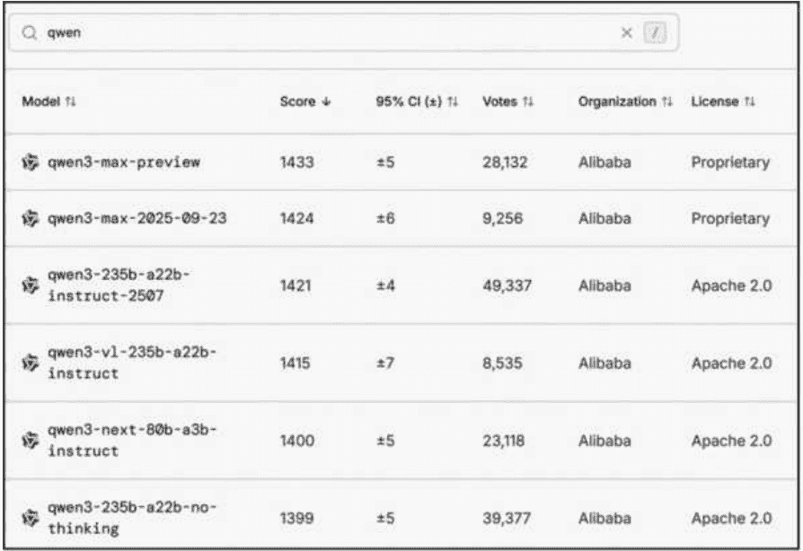
图1-2 Qwen系列模型排名

相较早期版本，Qwen3-Max在三方面显著提升。第一是理解力增强，能准确把握法律条款、科研论文、技术文档的上下文结构，提取要点并组织呈现。第二是生成质量提升，能够自主保持文风一致，生成逻辑严密、完备的段落。例如要求“商务语气+分点结构”，模型往往一次性满足全部需求。第三是长文本能力增强，支持大规模文档处理、跨章节提问、跨段分析与结构化总结，在写作、研究、学习中极具价值。

对普通用户而言，语言模型的表现是写得好、解释清楚、听得懂需求。技术底层则体现为可持续扩展的语言理解能力，该能力是整个多模态体系的知识基础与推理引擎。

### 1.2.2 视觉智能：Qwen3-VL带来的图像与视频理解
语言能力让模型能交流，视觉能力则让它看见世界。Qwen3系列中视觉模型沿Qwen3-VL家族演进，最新版Qwen3-VL系列是当前多模态能力的核心。关键能力包括：

#### 1. 图像理解：从物体识别到结构解析
识别能力不仅完成基础的“图中有什么”，还能理解场景关系、版式布局与图像语义。例如识别会议照片中的人物动作，读懂手机截图的界面结构。在结构化任务中，可提取发票、表格、文件、图表等内容并自动生成可编辑文本，在办公自动化与企业流程数字化中尤为重要。

#### 2. 视觉推理：跨图文关联的问题分析
视觉智能不仅是看见，更是理解图像背后逻辑。Qwen3时代模型可处理复杂图文混合任务，如结合图像与文字说明推断商品关键卖点；从实验图与描述中总结研究结果；对比不同图表分析趋势变化。这种跨模态推理能力是迈向专家级任务的关键。

#### 3. 视频理解：长视频内容的解析与定位

视频理解过去并不是大模型的默认能力，在 Qwen3-VL 这一条产品线里被明显强化了。使用者可以把较长的教学剪辑、演示片段或会议录像交给系统，让它完成整体概括、要点抽取、关键时段定位等工作。教培复盘、培训归纳、电商直播拆解等场景最先受益。换个说法，视觉能力的补齐让千问从只会读文字的“书虫”演变成能观察现场的“记录者”，处理的正是更贴近现实的信息形态。

### 1.2.3 音频理解：会听的模型，让对话更顺滑

除了看和写，通义千问也在补齐听的能力。在整个通义体系里，语音与音频模块主要承担三类职责。

#### 1. 语音识别与转写
通义听悟能够把口语实时或离线转成文字，支持多语种、多环境，覆盖会议纪要、访谈整理、课堂记录等。借助大模型对语境的把握，转写结果更连贯、更像自然表达，比传统逐字稿更易读。

#### 2. 音频内容理解
系统可以判定一段音频里说话人数量、情绪起伏、重点内容与主题结构。比如教学音频能提炼知识要点，访谈录音能划分问答并归纳核心信息。

#### 3. 语音对话与语音回传
在更进阶的应用里，通义千问支持语音交互，能“听见问题”并“说出答案”。这为智能硬件、教育陪伴、语音助手等提供了更自然的沟通方式。

### 1.2.4 多模态协同：不同能力的配合

语言、视觉、音频并非割裂存在，它们在千问内部被设计为可协同的整体。用户不需要分辨此刻激活的是哪一个子模型，系统会自动把图像、文字、音频转成统一表达，再由语言核心完成推理与产出。

这意味着可以上传商品图同时口头描述需求，让模型生成营销文案；也可以同时输入长视频和文档，让模型融合信息输出结构化结果。背后是阿里云统一的多模态编码技术和大模型架构，不同模态的信息能在内部顺畅流动并转化为可推理的统一表示。通俗讲，千问不是简单堆叠多个模型，而是在搭建一个会思考、能协作、具备多感官的智能体底座。

目前，千问已跳出单纯聊天写文的范畴，形成完整的多模态认知体系。它能写、能看、能听、能分析，也能在多种输入间做深度推理。因此除写作类任务外，还可用于图文创作、文档数字化、会议归纳、数据分析、图像识别、教学辅助等真实场景。随着 Qwen3 系列持续演进，这张能力版图会不断拓展，向更通用、更自主、更贴近人类理解方式的方向发展。

## 1.3 应用边界：智能交互的适用场景

从阿里云已落地的产品与行业方案看，应用大致分三层：个人与办公助手、开发与内容生产工具、行业与垂直场景解决方案。形态各异，但底层同源。厘清这些场景，有助于在写提示词和设计智能体时围绕真实问题，而非只做酷炫 Demo。

### 1.3.1 日常与办公：从写文档到管会议

对大多数普通用户，初次接触往往始于日常写作与办公。

通用写作方面，千问可协助撰写邮件、公文、汇报材料、活动方案，也能按提示生成宣传文案、社媒内容、短视频脚本。它擅长按“角色+场景+语气”组合产出不同风格文本，简单提示即可得到初稿，再由用户润色把关。

文档阅读与整理上，阿里云推出基于通义大模型的阅读助手通义智文，可对网页、论文、图书及各类文档做概览、结构化导读、关键词提取与智能问答，适合阅读长篇论文、商业合同、调研报告等。

语音与会议场景里，通义听悟扮演记录角色。如图1-3所示，可对会议、访谈、课程音视频做转写、翻译、说话人分离、要点提取与自动纪要，帮助会后快速回溯，减少人工记录负担。依托大模型能力，听悟还能对音视频内容提问追问，相当于为一段录音配备一个随时可问的 AI 记录员。

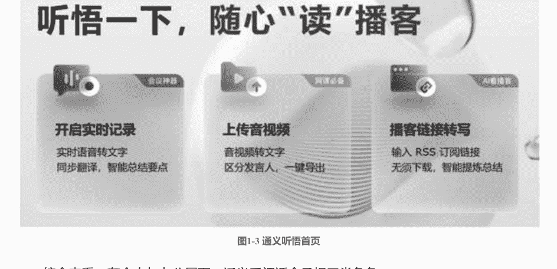

综合来看，个人办公层面适合承担三类角色：
- 写作助手，负责生成与润色；
- 阅读助手，负责理解与提炼；
- 记录助手，负责转写与归纳。
共性是内容由人掌控，AI 负责降低重复劳动与信息处理成本。

### 1.3.2 开发与创作：让专业工作有助手

第二类典型应用围绕专业人士的工具场景，最突出的是研发与编码。

阿里云推出的通义灵码以通义千问为核心的大模型编码助手，可依据工程上下文做代码补全、函数级生成、单元测试生成、错误排查与修复建议，还支持跨文件理解工程结构并自动感知技术栈。对个人开发者可在本地 IDE 实时获得建议；对企业团队可基于私有代码库与内部文档做安全定制化智能问答。


除编码外，内容生产同样受益。电商运营可用它生成商品标题、详情页文案、短视频脚本，并借助多模态能力对商品图片、用户评价做总结与卖点提炼；市场与品牌团队可用它产出活动方案、广告文案、图文脚本。此时的千问已从泛用助手升级为专业助理，并非替代程序员或运营，而是承接高频、结构清晰、可抽象的工作，让人类聚焦需求分析、创意设计与决策。

### 1.3.3 行业与垂直场景：从电商到文旅，从政务到金融

更深层的行业应用中，通义千问正作为基础设施进入千行百业。阿里云在“伙伴千问计划”等项目中，与合作伙伴联合验证了 30 余个行业场景，涵盖协同办公、文化旅游、财务 ERP、电力、政务、医保、交通、制造、金融、软件开发等，典型任务包括智能问答、文章摘要、知识库升级、代码辅助等。

电商零售场景中，通义千问可嵌入淘宝等平台，作为智能购物助手为消费者提供对话式商品推荐、活动策划建议、个性化搭配方案等，也可为商家提供自动生成商品详情、智能客服问答、运营数据分析报告等服务。

办公协同场景中，通义千问与钉钉等协同平台结合，支持群聊摘要、会议纪要自动生成、文档起草与审批流程辅助，帮助企业在日常沟通与信息流转中减少低价值重复劳动。

文旅行业中，通义千问被用于构建面向游客的智能体。例如复星旅游文化集团与阿里云基于 Qwen3 系列模型共建的“AI G.O”，目标是实现目的地咨询、行程规划、现场导览与服务问答一体化，使游客能通过自然语言获得更个性化的服务体验。

在政务、金融、制造、医疗等严肃行业中，通义千问多以“底层模型+平台”形式出现。可为政务问答、服务指引、金融知识库检索、风险报告生成、设备运维知识问答等提供语言与多模态能力，通常会与行业知识库、业务系统与权限控制结合，通过阿里云百炼统一管理。

在这些场景中，通义千问不再直接面对终端用户，而是封装在具体业务系统内，为行业应用提供认知引擎。

### 1.3.4 应用边界：适合用千问，也要知道何时“让位给人”

通义千问可进入的场景很多，但并非所有问题都该交给它。了解其适用与需谨慎使用的边界很重要。从实践看，它尤其适合以下任务。
- 信息处理。例如文档整理、摘要生成、语音转写、图文解释，只要输入明确、输出结构清晰，模型往往高效可靠。
- 创意生成与方案起草。包括文案、脚本、方案初稿、标题、视觉创意描述等，可快速给出多个候选，与人类创意形成互补。
- 知识型问答与经验萃取。结合企业知识库、行业文档与检索增强，可把分散信息串成结论，帮助用户快速获得决策参考，无需翻阅大量资料。

相对应，以下场景需更严格设计与监管：涉及强监管行业的最终决策，如医疗诊断结论、法律裁判意见、金融投资决策；需要实时精确数据的操作，如交易撮合、设备控制、应急指挥。在这些场景里，模型可作为辅助分析工具，但不应取代人类专家或权威系统的最终判断。

简言之，通义千问最适合做的是把事情解释清楚、内容整理明白、方案起草到位，而不是代替人类承担法律或伦理责任。明确边界，有助于后续更有针对性地设计提示词与智能体结构。

## 1.4 核心优势：通义千问的差异化优势分析

当前大模型市场竞争激烈，OpenAI、Google 等在国际占优，国内也有多家快速崛起。综合 Qwen3 技术报告、基准测试及阿里云官方信息，可把通义千问的优势概括为四方面：推理与 Agent 能力突出、多模态能力全面、开源与部署灵活、本土生态与行业融合成熟。

### 1.4.1 推理与 Agent 能力

通义千问首个差异化优势在复杂推理、代码能力与工具调用上表现抢眼。Qwen3 技术报告显示，新一代模型在数学推理、编程、知识问答等标准测试中已与国际一线并肩。

以旗舰模型 Qwen3-Max 为例，在评估真实编程能力的 SWE-Bench Verified 基准测试中取得接近 70% 的得分，明显高于部分同级模型。这意味着它不仅能写代码片段，更能在真实开源项目环境中理解问题、定位错误并完成修复。

在与工具调用和 Agent 相关的 τ²-bench 测试中，Qwen3-Max 得分同样位居前列，超过若干国际主流模型，说明在按目标自动选择工具、规划步骤、执行操作等任务上具备明显优势。结合报道，阿里巴巴特别强调 Qwen3-Max 在自主智能体能力上的表现——模型可在较少人工干预下依据预设目标做出一系列决策与动作。

把这一点与后续 Qwen Agent 框架结合即可看出：通义千问不仅追求单轮回答质量，更有意识地朝能自主推动任务完成的方向进化。对自动化流程、智能客服、数据分析与报表生成等企业场景，这类能力往往比单纯对话更有价值。

### 1.4.2 多模态能力：在视觉、音频与视频方向上“全面开花”

第二个显著优势在多模态。很多模型宣称支持多模态，但在深度与开放度上差异很大。

视觉方面，Qwen3-VL 系列被定位为具有更强空间推理与视频理解能力的开源视觉语言模型。公开资料显示它支持最长 256K 上下文，可在单次会话中处理大量图文信息，具备较强 OCR 能力与空间位置理解能力，能在多种语言环境下识别文档与图像，对中文用户与多语言业务尤为重要。

音频与视听方面，Qwen3-Omni 是多模态家族的重要成员。技术报告称在 36 项音频与视听基准测试中，Qwen3-Omni 在绝大多数任务上达到开源领先水平，并在相当一部分项目上取得整体最优。它不仅能识别转写语音，还具备理解语音内容、分析音视频场景的综合能力。用户端体现为票据、报表、合同扫描件理解更可靠；长视频、课程录播、会议录像的摘要与问答更强；在多语言环境下处理音频图像更均衡。

不少用户直观感受是，在看图说话、读表格、读长文档并回答问题等任务上，通义千问更像耐心助理，而非只做关键词匹配的搜索引擎。

### 1.4.3 开源与部署灵活：从云端到本地，给开发者更多选择

第三个优势是开源策略与模型谱系的完整度与灵活性。

Qwen3 系列涵盖 0.6B 到 235B 的多种参数规模，既有稠密模型也有 MoE，其中相当一部分以开源权重形式在 Hugging Face 与国内平台发布，采用宽松 Apache 2.0 许可。这意味着开发者既可通过阿里云 API 使用商业版，也可在本地服务器乃至个人设备部署小体量开源模型。

在编码领域，阿里巴巴推出 Qwen3-Coder。报道指出这是阿里巴巴目前最先进的开源编码模型之一，面向复杂软件开发，在国内多款模型中表现突出，部分评测接近国际顶级闭源模型。

多家研究机构认为中国在开源大模型下载量上已超过美国，Qwen 系列是主力。对企业与开发者而言，这带来上手门槛更低、迁移更方便两点好处：可先用开源版本做实验与原型，也可在云端与本地间灵活切换。

相较于完全闭源只能通过单一 API 访问的模型体系，通义千问在云服务+开源模型+本地部署这一整条链路上选择明显更多，是结构性优势。

### 1.4.4 本土生态与行业融合：离业务更近，也更易落地

第四个优势与其说是模型能力，不如说是生态位置。

通义千问背后是阿里云庞大的云计算与行业解决方案体系。早在 Qwen2 时代，阿里巴巴便推出“通义千问伙伴计划”，联合咨询公司、软件厂商与行业伙伴共同打造面向不同行业的解决方案，将通义千问与阿里云百炼平台、行业云产品打包输出。

这意味着在电商、物流、零售、文旅、政务、金融、制造等领域，都有相对成熟的集成方案，能与现有企业系统如 ERP、CRM、电商平台、协同办公平台对接。对数字化改造企业而言，能在原有系统上平滑加一层 AI，往往比模型多几分准确率更重要。

再加上阿里巴巴近年来在 AI 基础设施上的持续大额投入，仅公开披露的三年投资计划就达千亿元人民币级别，通义千问实际上站在云+模型+行业的综合平台上，而非单点产品。

这造就两方面优势：
- 对中文与本土业务场景理解更细腻，从办公会到电商运营，从供应链管理到线下零售，模型在训练测试阶段就能接触大量本地行业相关数据与需求。
- 在企业落地与运维层面更可控，企业可借助阿里云现有安全合规体系、算力资源与监控工具，减少从零搭建 AI 基础设施的成本。

总体而言，通义千问在推理与 Agent 能力、多模态理解、开源与部署灵活性、本土行业生态上都有明显长板。与偏研究展示的模型相比，工程化与行业落地走得更远；与完全闭源模型相比，开源与多规格模型提供更多技术主权与定制空间；在中文生态、多模态处理与编码能力上也在公开评测中证明了实力。

## 1.5 智能体：Qwen Agent 的独特价值

如果说大模型让机器第一次学会理解与表达，那么智能体则让机器第一次开始学会自己做事。智能体出现是 AI 发展的又一次阶段跃迁。本节用通俗语言介绍智能体概念、它与大模型的区别、通义千问在智能体方向布局，以及智能体对未来生活与工作方式的深刻改变。

### 1.5.1 什么是智能体

解释智能体最直观的方式是与大模型对比。大模型像一位聪明的顾问，你问一句它答一句；理解力强、表达力好，但不会主动执行任务。而智能体更像助理，你告诉它“我要完成什么”，它不仅能听懂，还会思考下一步该怎么做。例如你说“帮我整理一周的学习笔记”，大模型可能给你总结，但智能体会自动判断哪些文件是笔记、哪些需提取、哪些要分类、是否形成提纲、是否输出成一页 PPT，然后一步步替你完成。简单讲，大模型是被动的回答者，智能体是主动的行动者。如图1-5所示，机器人相当于智能体，它可调用大模型作大脑，拥有知识库作看过的书，使用插件作超级工具箱。


图1-5 智能体示例

### 1.5.2 智能体将为我们的生活带来变革

智能体出现会像智能手机刚问世那样改变生活方式。第一，它会让重复性、机械性任务大幅减少。整理文档、汇总材料、写总结、查数据等工作不再需要用户手动操作，智能体会按目标自动完成。第二，它会改变学习方式。智能体可作专属学习助手，为你整理重点、设计计划、批改作业、生成训练题，让知识获取更轻松。第三，它会改变我们与工具关系。过去要打开不同软件、执行一系列操作；未来可直接告诉智能体目标，它会自动调用软件替我们完成。第四，它会改变企业组织效率。智能体可自动处理大量跨系统流程，让企业真正进入自动化协作时代。简言之，智能体带来不是效率小幅增长，而是工作方式根本性重构。它改变人机关系：机器不再等待人类指令，而是在人类目标下主动行动。

在智能手机普及前，人们也能打电话、发短信、查资料，但效率远不如今天。智能手机成为时代必备品，并不是因为它是科技产品，而是因为它融入生活每个角落。同样的趋势正在智能体身上发生。未来十年，懂不懂智能体将直接决定一个人的数字生产力水平。如果未来办公方式变成“告诉智能体目标，它替你做完80%事”，那么不会使用智能体的人会在信息社会中明显落后。智能体不是可选项，而是未来基础能力，就像打字、使用浏览器一样必不可少。可预见，在未来学习、工作乃至社会分工中，“会不会使用智能体”会成为新的能力分水岭。能熟练与智能体协作的人将大幅提升生产效率；不会使用智能体的人将在许多岗位中失去竞争力。

### 1.5.3 Qwen Agent：让通义千问具备执行力的系统能力

在通义千问体系中，智能体能力由理解任务、规划步骤、执行动作三部分组成。

1) 理解任务。依托 Qwen3 系列强理解能力，智能体能准确识别用户真实需求，而非仅停留在字面解释。例如用户说“整理一下合同”，智能体会判断用户可能需要条款摘要、风险点、提醒项、格式化输出等不同内容。

2) 规划步骤。智能体会自动把任务拆解成多个步骤，如提取条款、分析风险、生成结构化内容等，并按顺序执行。这种规划能力是智能体区别于普通模型的关键。

3) 从对话到执行：Agent 的行动力
Agent 可以挂载文件解析、知识检索、网络搜索、图像识别、代码执行等工具，让通义千问串联多步骤、打通多文档与多系统，完成真实的业务闭环。借助这种能力，AI 脱离纯文本生成的局限，以数字助手的姿态进入实际工作流程。Agent 让通义千问从擅长交流转向擅长执行，不再是单纯的聊天程序，而是一套能推动流程的智能系统。

## 第2章 实战化提示设计体系
模型上限划定千问的边界，而指令设计决定你能否把边界用满。本章以实操为切口，拆解提示工作的核心观念、关键手法与高质量输出的搭建思路。先从设计目标与结构化表达谈起，说明如何让模型准确把握意图；再展示从初稿到精炼成果的演进路径；随后延伸到复杂任务、Agent 与多模态交互的进阶打法。最后汇总常见失误与诊断思路，帮助发现问题并修正。本章讲的不仅是写指令，而是建立一套专业、稳定、可复用的提示工作体系，提升与千问协同的效率。

### 2.1 提示工程的核心理念与目标设计
学界与业界的主流说法可以归纳为：提示工程是用自然语言为大模型编写程序和说明文档的艺术与方法。它不靠辞藻华丽，而是在不改动参数的前提下，通过指令、示例与结构，把模型已学能力精准激活并向期望方向收敛。技术层面依托的是对话内学习：模型会把指令、示范与材料当作临时的训练数据，在当前会话中拟合该如何操作。提示工程的价值在于规划这段临时训练，让表现更贴近真实意图。

#### 2.1.1 提示词为何关键：唯一可实时干预的入口
对已完成的模型而言，参数基本固定。会话里无法改动网络结构，也不会重新标注数据再训练。你唯一能支配的就是输入。大量综述都指出：在不少场景下，提示设计比微调更轻、成本更低，却能带来可观提升。可以这样类比：大模型像一位学识极广的实习生，脑中装满书籍与代码，却坐在你面前等待指引。你不能更换大脑，也不能硬塞新书，只能通过把需求说清楚来调动已有知识。角色、步骤、格式、标准等要素，正是提示设计要解决的问题。

指令不是随意的提问，而是一份任务说明与行为约束协议。写得好，模型表现稳定聪明；写得差，就会跑题、胡说、一本正经地偏离。

#### 2.1.2 提示工作的本质：把人类需求转译为可执行规格
文献把提示技巧归为几十类：零样本、少样本、链式推理、思维树、多轮反思、工具调用提示等。抽丝剥茧后，它们都指向同一个问题：如何用输入把任务规格讲明白。规格可拆为六个维度：

- 做什么：生成、改写、翻译、分类、推理，或工具调用、工作流执行；
- 要什么水位：草稿还是严谨，科普还是学术，篇幅与详略如何；
- 以何种身份与视角：教师、律师、程序员、产品经理，还是朋友口吻；
- 材料范围：仅依据给出文字，还是可结合常识，是否要求严格依据材料；
- 结果呈现：是否分点，是表格、JSON、Markdown，还是需展示推理过程；
- 禁止区：不可编造数据、不可医疗诊断、不可输出敏感内容等。

成熟的提示实践就是在这些维度上做到完整清晰。行业指南的第一条几乎一致：清晰具体，明确目标，说明背景，必要时给出示例与格式要求。

#### 2.1.3 目标先行：从期望结果反推指令写法
新手常犯的错误是只说“帮我写一个”，却不说“要什么样”。工程化思路是先想结果再写指令。自我提问三件事：

- 结果画像：理想输出是什么？能直接发送给领导的公文，还是思路框架？五百字摘要，还是PPT要点？
- 信息条件：模型在何种信息下工作？只看提供材料，还是可调用外部知识？是否要求不确定时明确表态“不知道”？
- 评估标准：如何判定完成度？逻辑结构、事实准确、语言风格，还是要点覆盖？

三点清晰后，写提示就变得可操作，把理想结果与评估标准翻译成自然语言指令。高质量提示通常是目标描述加步骤拆解加格式要求加必要示例的组合，而非一句神奇咒语。

#### 2.1.4 提示还能影响推理方式：从直接给出到逐步推演
提示工程被称为工程，正因为不同写法会影响思考路径，而不仅是输出内容。早期研究显示，在数学与逻辑题中，加一句“请逐步思考并写出中间过程”，正确率明显提升，即链式推理提示。随后出现思维树、自我反思、系统二注意等技术，核心都是借助提示让模型把算力分配到关键步骤，减少凭直觉一步到位的错误。

这意味着在通义千问中使用提示时，除了保证任务描述准确，还可通过“先列思路再结论”“先复述问题再作答”等方式，增强可靠性和可解释性。

小结：提示工程的核心不在于句子有多复杂，而在于用结构化方式把模糊需求转为模型可执行、可推理、可评估的任务说明。提示重要，因为它是唯一可控的实时编程界面，是人类意图与模型能力的翻译层，既决定做什么，也在一定程度上影响怎么做，并为 Agent、工具调用、多模态交互提供指令语言基础。后文将在此框架上展开结构化提示、迭代策略、复杂场景技巧与问题修正。

### 2.2 结构化表达：让千问听懂并精准落地的手法
指令思维解决模型明白什么的问题，结构化表达解决如何说清楚的问题。很多人觉得写不好提示是缺少咒语，其实是结构不清。大模型最怕的不是任务难，而是要求模糊。说“你自己看着办”，模型真的会看着办，结果往往偏离预期。结构化提示的目标是让需求像菜谱或写作步骤一样明确，从而实现稳定、可控、可复现。

#### 2.2.1 结构化为何有效：模型偏好有边界的任务
大模型训练的本质是学习模式，结构越清晰，预测就越准。结构化提示往往比冗长文字更有效。

例1：非结构化，效果差
“帮我总结这篇文章，尽量有条理。”
这相当于对学生说“随便写写好点”，非常模糊。

例2：结构化，效果好
“请把下面文章提炼成3点，每点不超过30字，按背景、问题、结论顺序输出。”
模型立即知道要点数量、字数限制与固定顺序。结构化程度往往决定稳定性。

#### 2.2.2 经典三段框架：目的、流程、呈现形式
这是通义千问与GPT上最稳的写法。

第一段明确目的：告诉模型要得到什么，而非让它做什么动作。例如“请生成一份适合三分钟口头汇报的项目总结”，比“帮我写一段话”更清晰。

第二段说明流程：告诉模型按何种逻辑进行。例如“先提取关键事件，再归纳为背景、进展、问题、下一步计划”。步骤明确，模型不易跳步。

第三段给出呈现形式：明确输出方式。例如“用编号列表输出，每项前标注[1][2][3]”。很多混乱输出的根源是缺少格式要求。

完整示例：
目的：生成3条会议要点。
流程：先分析会议记录，提炼主题，再归纳为3条。
呈现：用[要点1][要点2][要点3]格式，每条不超过20字。

结构化提示就是让AI按套路执行，套路越清晰执行越稳。

#### 2.2.3 标签式拆分：把要求装进独立格子
当任务涉及写作、语气、受众、格式、字数等多重约束时，长段落容易混乱。用标签把每个要求独立出来更有效。

例如：
[身份]你是一名历史教师。
[目标]用通俗语言解释秦朝焚书坑儒原因。
[受众]初中生。
[长度]不超过150字。
[语气]清晰平和。
[输出格式]分3点说明。

再如：
[场景]向领导口头请示。
[内容]以下是草稿，请优化。
[要求]简洁、逻辑清晰、有重点。
[输出]生成1分钟口播稿。

模型能精准遵守每条要求，意外情况大幅减少。

#### 2.2.4 示例驱动：用样例定义风格与格式
Few-Shot Prompting 即提供示例。大模型擅长模仿，对通义千问尤其有效。例如：“请按附件1的语言风格和附件2的文稿结构，生成一篇关于做好新媒体宣传工作的讲话稿。”

示例提示常用于风格模仿、语气复现、复杂转换任务。

使用结构化提示应避免：
- 一次塞入过多目标，如“写文章、做表格、改PPT、幽默、200字”。模型会迷失优先级。
- 要求模糊，如“写得好一点”“总结详细些”。应改为“120字以内，3句短句，每句一个事实要点”。
- 只给任务不给格式。缺少格式要求时，输出易成长段落或格式混杂，影响后续处理。

结构化提示让模型知道要什么、怎么做、结果如何呈现，复杂任务才能被拆解成可按部就班执行的步骤。

### 2.3 初稿到精品的迭代方法
人们常以为说得清楚就能一次成功。实际使用中，即使提示不差，输出仍常不够准、不完整、逻辑跳跃、风格不稳。这不是模型不够强，而是大模型本质是根据提示预测，只要提示缺少结构或隐含条件，它就会用自身语言习惯猜测。提示工程就是不断减少猜测，让输出从模糊走向明确。成熟实践者靠的不是一次写完美提示，而是可持续优化、逐轮收敛的方法。

#### 2.3.1 对比校准：先定位偏差再改进
优化永远从“哪里不对”开始。只说“重写一下”“太啰嗦再短点”，对人类有效，对模型几乎无指导。模型无法揣测隐含需求，只能字面理解。有效做法是差异分析：观察结构、重点、风格，明确指出偏差并给出可执行修正方向。

例如，让模型总结会议内容，结果6段话混杂背景、发言人、推测，长度翻倍。只说“精简”效果差。更有效的是：“请压缩到约120字，仅保留关键决策，不含背景信息，不做推断，分3条呈现。”下一轮输出通常会明显收敛。

差异分析帮助模型知道偏差在哪、该往哪改。

#### 2.3.2 渐进收紧：复杂任务分步推进
长文本或高逻辑任务，一次性给出十项要求会让模型困惑。逐层收缩主张先宽后紧，先框架后细节。

例如要写800字城市更新方案，涉及方向、策略、措施、风险等。若第一句就要求风格、字数、逻辑、背景展望全包，结构易松散。采用分阶段：
第一轮：让它先生成3~4个核心部分，如背景、问题、措施、预期效果。

#### 2.3.3 自我反思：让模型先自评再重写
让模型反思自己的回答是一种高效优化，类似让学生先找作文问题再重写。

例如要求分析某项政策，输出像复述材料，缺乏深度。可直接要求：“请指出上一段回答在逻辑、论据、深度方面的三处不足，并据此重写。”

模型常会指出论据不够具体、缺少因果链条、缺乏案例等，并在下一版主动改进。反思式优化在分析、评论、对比等任务中尤为有效。

#### 2.3.4 先规划后执行：分工式提示构建结构
人类写复杂任务先列提纲再写作，模型同理。分工式提示让模型先生成执行步骤，再据此执行。

例如写企业数字化升级方案，直接生成容易理解偏窄。分工写法：
第一步：“请列出撰写该方案的步骤，如诊断现状、明确目标、选择技术路径、制定实施计划、评估风险。”
第二步：“请严格按你列出的步骤生成完整方案。”

规划阶段已明确覆盖范围，执行阶段更完整、有序。

#### 2.3.5 明确禁区：清晰界定不能做的事
模型对“不能做什么”没有直觉，不写清就会发散、补充、推断。边界设定就是明确禁止事项。

例如写公文时要求“不使用比喻、不加主观评价、不增加未提供事实”；总结时要求“不得推测、不得延伸解释、不得加建议”；图片描述要求“不能描述图中不存在的事物”。

核心逻辑是：模型默认可以发挥，你必须告诉它不要发挥。只有明确禁区，输出才聚焦。

综合来看，高质量提示是试探、收敛、修正的结果。差异分析提供方向，逐层收缩让复杂任务可推进，反思式优化赋予自我意识，分工式提示建立稳定结构，边界设定防止越界。掌握这些，模型从“能写”进化到“写成你想要的样子”，提示工程从经验运气变为可系统掌握的方法论。

### 2.4 复杂场景、智能体与多模态的提示策略
通义千问具备推理、工具调用、复杂任务执行和多模态理解能力。真实工作场景更接近自动化流程、智能体任务链、文件图像结构化处理、结合外部工具完成操作。这些场景比写文章复杂得多，需要更系统、结构化的提示策略。下面从五个方向介绍进阶用法。

#### 2.4.1 任务拆解：把复杂目标转为可执行行动序列

任务越繁琐，越该先拆后做。模型并非开箱即用的万能系统，更接近一位执行力强但必须拿到清晰操作手册的协作者。把一个庞大目标拆成若干可独立完成的微目标，分批交付执行，远比一次性甩一个总指令更稳。举例来说，若要模型为某企业产出一份年度数字化报告并规划未来三年走向，一次性索要整本报告容易导致结构松散、分析浅尝辄止、逻辑跳跃。而改用分段推进会更可控：

- 先让它梳理企业数字化现存的五大核心痛点
- 再基于痛点提炼三条可落地的解决方向
- 随后把方向延展为具体的三年行动路线图
- 最后统一按报告范式整合输出

每轮指令边界清晰，模型表现也更稳定。复杂任务能否落地，关键不在模型能力，而在是否把工作切成可执行链路，而不是把整块巨石一次性抛过去。

#### 2.4.2 智能体指令框架：目标、角色、权限与停止条件
当模型被当作智能体使用时，提示逻辑发生质变。工作形态从“生成一段文字”变为调用工具、执行动作、多轮推理。因此高质量的智能体提示必须涵盖四要素：目标、角色、权限、终止条件。目标明确最终结果，例如“自动汇总销售周报并输出邮件草稿”；角色界定思考视角，例如“你是一名数据分析师”；权限划定可用资源，例如查询数据集、使用计算模块、操作表格；终止条件防止无限循环，例如“指标全部算完且总结生成后即停止”。

比如让 Qwen Agent 梳理一周订单异常并形成报告，可以写成：“你是一名运营分析智能体，任务是识别订单中的异常模式。可调用表格查询、数据筛选、趋势分析三类工具。必须在识别异常—解释成因—提出对策三步走完后结束任务，不得继续推演”。相比“帮我分析订单异常”，这种写法稳定性显著提升，因为智能体既知道要做什么，也知道怎么做、何时收手。

#### 2.4.3 多模态引导要点：明确观察区、采集方式、呈现形态
多模态场景的难点在于人眼会自动聚焦，模型必须被明确指引。以上传会议白板照片为例，只说“总结一下内容”，模型很可能描述背景、灯光、人物姿势等无关信息。多模态提示的核心是锁定关注对象、指定抽取方式、给出输出结构。

例如：“只读取白板上的文字，按‘议题—要点—责任人’三个字段结构化输出，人物与环境全部忽略”。误识别率会大幅下降。再进一步限定：“输出为三列表格，禁止模糊判断”，质量会再提升。

再看合同扫描件。若提示为“帮我看看合同有没有问题”，因“问题”过宽泛，输出会随意。若改为“识别合同中所有金额字段，以‘条款名称—金额—是否超过50万’形式输出，仅依据识别内容判断，不得臆测未出现细节”，就能稳定抓取关键信息。多模态的本质不是看不懂看懂，而是指令是否指明了观察范围。

#### 2.4.4 场景边界设定：按行业定制表达规范
不同业务场景的表达习惯差异很大。公文要客观正式，客服回复要亲和简洁，学术论文要精确严谨，营销文案要情绪调动。场景化提示的关键是明确该场景下的行业标准与风格边界。

客服场景可强调“保持礼貌，不得承诺实体补偿，不得使用负面词汇”；政务场景可强调“采用正式文风，不用比喻，保持逻辑严谨，避免主观判断”。

若要为政府部门撰写工作通报摘要，提示仅为“请总结以下内容”，很可能得到口语化结果。若补充场景：“你正在撰写政府内部工作通报，请用正式文风，按‘背景—进展—问题—措施’四段式输出，不得加入推测性判断”，输出即可符合组织习惯。

#### 2.4.5 链式执行：保障多环节任务连贯
真实任务往往跨步骤、跨角色、跨模态，模型容易遗忘上下文、跳步、导致一致性下降。此时可采用链式执行提示，让模型在全程保持上下文连贯。以“生成运营分析报告”为例：

- 环节一：识别关键指标
- 环节二：说明变化原因
- 环节三：提出改进建议
- 环节四：按指定排版生成最终报告

模型会严格按链路推进，保持风格与逻辑统一。分析产品用户反馈图表时，若直接说“写个分析报告”，结果偏感性描述。若改成“先提取所有数值变化；再据变化列出三条趋势；再解释趋势成因；最后生成正式报告”，输出就会从直觉描述转向专业分析。链式执行的本质是让模型在复杂情境下保持连续思考。

复杂任务、智能体场景、多模态内容，都对提示提出了更高要求。单句“帮我做一下”已不够，用户需要提供步骤拆解、目标设定、角色权限说明、关注点指引和场景边界。任务分段让复杂目标可执行；智能体指令让模型按角色行动；多模态提示让模型看得准提得清；场景化约束让内容符合行业规范；链式执行让复杂流程保持一致与专业。掌握这些技巧，使用者才能把通义千问从回答型工具转变为场景型助理，从理解文本到理解世界，并在工作中稳定承接更复杂的任务。

### 2.5 常见故障诊断与优化策略
即使提示方法已掌握，仍会出现输出不稳定、忽然跑题、越写越怪的情况。这通常不是模型不行，而是提示存在模糊、缺失、冲突或认知假设。能识别问题、判断根因并修正，是从“会用”到“精通”的分水岭。以下五类故障最常见。

#### 2.5.1 意图误读：厘清任务目的
最常见的是模型根本误解任务。比如要“对比两种方案”，它却各自介绍；要“基于材料作答”，它却自由发挥；要“写正式总结”，它却写成科普风。这多因提示缺少意图约束，如目的、要点、受众、材料范围。提示“请总结下列内容”时，模型常会混入评价和建议。

修正方法是加入明确意图：“请仅做事实性总结，不添加建议、不发表评论、不扩展原文未出现信息”。意图对模型如同题目要求，越具体越稳定。

#### 2.5.2 范围外延：划定输入边界
模型擅长延伸话题，也容易因此跑题。若未清晰划定输入范围，它会加入未提供知识、做推测、补背景，甚至脑补合理但虚假结论。如任务“根据我提供的三段内容总结政策影响”，输出可能引用外部数据和政策。

修正提示：“仅基于我提供的三段文本作答，不得引用外部知识或未出现数据”。范围限定能把模型拉回真正材料。

#### 2.5.3 结果波动：明确格式与风格
同样提示，第一次很好，第二次风格大变，第三次加戏。这源于随机性与学习偏好，尤其在缺少格式、风格、长度约束时更明显。如提示“写一段公司介绍”，可能一次简介、一次营销、一次故事化。

修正方式是明确格式：“请用正式企业介绍风格，不使用比喻，控制在120字内，按‘定位—业务—优势’三点输出”。格式越清晰，输出越一致。

#### 2.5.4 推理断层：强制展示思考链
模型有时表述流畅但逻辑断裂，论据不足、因果缺失、结论跳跃，在政策、商业、法律类任务中尤甚。这通常不是不会推理，而是提示未要求展示逻辑。

如任务“分析某地经济下滑原因”，模型可能只列宽泛原因。修正提示：“请按以下结构呈现：①描述现象；②列出三条原因；③每条原因给出因果解释；④总结作用机制；必要时指出分析漏洞”。加入结构化推理链，质量显著提升。

#### 2.5.5 指令冲突：拆分矛盾需求
输出问题有时源于提示本身矛盾。比如同时要求“非常专业”又要求“所有人都能懂”；要求“简洁”又要求“全面覆盖所有要点”；要求“不延伸”又要求“写得丰富”。模型难以取舍，输出混乱。

例如：“请写成专业分析，同时尽可能通俗易懂，保持简洁但要完整覆盖所有细节”。这是典型的专业vs通俗、简洁vs全面的冲突。修正方法是分阶段：“第一轮做专业分析，不做通俗化。第二轮在保持专业前提下改写为通俗版本”。分步处理可同时满足多重需求。

故障诊断的本质是区分“模型错了”与“提示没写好”。意图误读、范围外延、结果波动、推理断层、指令冲突是五大常见问题，根源多在提示缺少意图、边界、格式或步骤拆分。熟练掌握诊断，用户无需靠运气，通过一两轮修正即可让输出显著改善，使提示工程成为可控、可调、可复现的技术。

# Part 2
第二部分
办公效能提升：智能办公新方案

当下职场，效率已不是竞争优势，而是基本生存能力。信息爆炸、碎片沟通、多任务并行、跨部门协作，让传统办公方式捉襟见肘。通义千问的出现，让高效工作从个人能力升级为可被算法增强的能力。本部分聚焦千问在办公场景的七大核心模块，重塑智能办公可能性。

很多人办公软件越堆越多，效率反而下降：文档写不完、会议纪要来不及整理、邮件反复斟酌、PPT逻辑不清、项目协作遗漏、数据分析耗时。千问的价值不止于“代劳”，更在于“帮你搭建高效工作体系”。从结构化文本自动生成，到目标智能拆解；从专业汇报文案打造，到项目管理辅助；从数据阅读到洞察形成，再到跨部门沟通支持……千问正成为真正的个人助理、业务伙伴与知识引擎。

本部分围绕办公流程七大模块展开：日常办公提效、文案写作、数据分析、沟通协作、PPT设计、图像处理与视频创作。你将看到千问如何渗透到文档生成、会议管理、项目推进、跨部门协同的每个环节；如何凭借多模态能力处理图像、排版、生成讲稿；如何在短时间内完成专业级数据洞察与表达；如何让视频生产像写字一样简单。

更重要的是，本书不只讲“能做什么”，而是展示“如何与千问共同构建效率体系”。这正是与传统技能书的差异：不是堆砌操作步骤，而是建立新工作方式——更快更稳，既能完成任务，也能提升业务能力。

读完本部分，你会像获得一套武器系统，意识到千问可帮你减少琐碎、提升质量、节省脑力，把精力投入创造性、判断性与高价值工作。

# Chapter 3
第3章
日常办公提效：打造可持续工作流

职场中大量时间被重复性、格式化、需快速响应的工作占据。本章展示如何用通义千问建立可持续高效办公流程，让周报、会议纪要、工作计划、日程管理不再成为负担。从结构化文本生成、要点提炼、任务拆解、协作提醒等维度出发，帮助把琐碎工作系统化、标准化，并借助AI持续优化。速度与质量同步提升，流程更清晰、有序、可控。

## 3.1 周报/日报：结构化内容生成

### 3.1.1 千问的价值点
撰写周报日报常遇到痛点：关键数据遗漏、问题分析浅、格式混乱、重点不突出，阅读体验差，效率低需反复修改，紧急时难以按时提交。不同层级周报对详略和语气要求也不同，难以精准把握。

千问可精准破解这些问题，能自动生成包含工作概述、完成情况、问题分析、下周计划等规范要素的模板，无需手动调整。用户只需输入核心工作内容，即可秒级提炼关键信息，梳理出逻辑清晰的汇报框架。还能按汇报对象自动适配详略，让员工自报简洁聚焦、管理层周报翔实深入，大幅降低撰写门槛，非专业写手也能快速产出无歧义、无疏漏的高质量日报周报。

### 3.1.2 操作步骤
在办公场景中，四步即可让千问生成符合需求的周报日报，流程简洁高效。日报与周报逻辑一致，仅需调整周期详略，周报侧重阶段成果与计划，日报聚焦当日工作与次日安排。

首步，让千问学习周报模板。先上传本公司的周报范文，让其掌握统一格式、语气与逻辑。参考模板如下：

> 2025年5月第2周工作周报
> 
> 汇报人：赵六
> 部门：运营部
> 汇报周期：2025年6月10日—2025年6月14日
> 一、本周完成工作
> 1. 完成6月第二周用户增长运营活动策划与落地，上线3个裂变入口，累计吸引新用户2000名以上，转化率8.5%。
> 2. 完成上周运营数据复盘，输出报告并提出3条优化建议被采纳。
> 3. 对接设计部完成3套活动海报，同步至官网、公众号等5个渠道。
> 4. 协助客服部处理用户反馈15条，优化活动规则说明文档。
> 二、未完成工作及原因
> 1. 用户画像更新未收尾，第三方数据接口临时维护，预计下周二完成。
> 2. 跨部门内容共创方案未定稿，市场部需求调整需重新对齐，下周完成。
> 三、下周工作计划
> 1. 跟进裂变活动数据，每日监控新增用户、留存率等核心指标，及时调整策略。
> 2. 完成用户画像更新，结合最新数据优化分层运营方案。
> 3. 定稿内容共创方案，明确分工与节点，推动落地。
> 4. 组织运营团队内部培训，分享策划与复盘技巧。
> 四、问题与建议
> 1. 第三方数据接口稳定性不足，影响推进效率。
> 2. 评估更换更稳定数据源，或与服务商协商优化维护机制。
> 汇报人：赵六 2025年6月14日

将该模板以附件形式上传，要求千问先学习结构、语气、表达方式，后续生成时沿用逻辑，仅调整周期详略，不要立即生成，先反馈学习心得。提示词参考：“请先学习附件周报的结构、语气与表达，后续生成日报时沿用该逻辑仅调周期详略，不要立即生成，先告知学习心得。”

第二步，千问给出学习心得。学习后会总结结构严谨要素完备、文风务实重点突出、逻辑连贯适配场景等要点，确认掌握框架。

第三步，告知具体需求。提示词示例：“生成一份周报，汇报人孙七，部门销售部，周期2025年7月1日—2025年7月7日。本周完成：对接10家意向客户，达成合作3家，签约50万元；完成上月销售数据统计分析并提交总结报告；参与行业展会，收集潜在客户信息80条；协助团队完成2家老客户续约。未完成：计划开发5家新客户未达成，客户预算调整中，已保持跟进。下周计划：跟进预算调整客户制定个性化方案；拜访3家重点潜在客户推进洽谈；完成本月销售目标拆解与执行计划；同步新客户信息至运营部协同跟进。问题与建议：部分潜在客户需求对接不及时，建议建立跨部门快速响应机制。”

第四步，千问生成最终周报。生成结果按规范格式呈现，完成工作、未完成原因、下周计划、问题建议四部分，结构清晰、数据明确，日报时只换周期与当日内容即可快速产出。

4. 将梳理完成的80条潜在客户资料推送给运营部，与其协同制定后续跟进及服务方案，以提升转化效果。

四、问题与建议
1. 部分潜在客户的需求反馈与对接时效偏慢，影响了合作推进节奏。
2. 建立跨部门快速响应通道，明确需求对接的主责人及响应时限，改善客户服务体验。
汇报人：孙七
2025年7月7日

### 3.1.3 实操建议
让周报、日报更贴近办公实际并提升沟通效果，可按以下思路推进。

一次性补足关键要素：预先说明汇报人、所属部门、统计周期、已完成工作的量化成果、未完成事项及原因、下一步安排、遇到的难点与建议，避免信息缺口导致汇报空洞或反复补充。

提前界定类型与读者：明确是日报、周报还是月报，以及汇报对象是直属领导还是跨部门协作方，以便匹配详略程度与语气风格。

按需生成不同版本：可要求输出精简版便于快速浏览，聚焦核心成果与关键问题；也可要求输出详细版，补充过程细节与数据支撑，满足深度汇报需求。

沉淀可复用模板：将质量较好的生成结果按岗位如技术、市场、行政分类归档，之后直接作为参考模板调用，提升撰写效率。

坚持办公规范：要求输出遵循公文写作标准，避免口语化与网络用语，保持事实清晰、数据准确、逻辑连贯，确保专业严肃。

依此做法，千问可助力办公人员快速产出规范高质量的周报日报，降低撰写门槛，让汇报更高效精准，为团队协作与工作推进提供支撑。

## 3.2 会议纪要：要点提炼与规范排版

### 3.2.1 千问的核心价值
项目推进会、协调会、研讨会结束后都需要及时形成纪要来固化成果、传达要求、跟踪任务。但实际操作中，纪要常出现逻辑不清、关键决议遗漏、分工模糊、时间节点不明，导致指导性不足。手工整理录音、梳理要点既耗时又易丢失信息。

千问能快速化解该痛点。用户输入会议主题、参会人员、讨论内容、决议事项、任务分工等关键信息后，即可生成结构清晰、重点突出、表述规范的纪要初稿。它能自动提炼核心观点、梳理讨论脉络、明确责任主体与完成期限，文风贴合职场正式要求，并可依据决策类、协调类、研讨类等不同类型调整侧重点，大幅节约时间，提升衔接效率。

### 3.2.2 操作流程
实操仅需两步。

第一步，明确生成要求，清晰提供会议主题、时间、地点、参会及缺席人员、核心议题、讨论要点、决议事项、任务分配等信息。参考提示词如下。

生成一份会议纪要，具体情况如下。我们部门于2025年6月15日下午2点在三楼第一会议室召开第二季度业务复盘暨第三季度工作部署会，参会人有部门经理李明、销售组全体成员、客服组组长王芳，张璐因事假缺席。会议围绕第二季度业绩完成情况、客户投诉处理优化、第三季度营销方案展开讨论。经研究决定，第二季度未完成业绩的销售人员需于6月25日前提交改进计划；客服组下周内制定客户投诉分级处理机制；第三季度重点推进线上直播营销，由销售组组长牵头，7月10日前完成方案制定。请据此生成纪要。

第二步，等待生成。千问会输出如下结构。

**第二季度业务复盘暨第三季度工作部署会会议纪要**

2025年6月15日下午2点，部门在三楼第一会议室召开第二季度业务复盘暨第三季度工作部署会。部门经理李明主持，销售组全体、客服组组长王芳参会，张璐因事假缺席。会议围绕第二季度业绩、客户投诉处理优化、第三季度营销方案深入讨论，形成如下决议与安排。

一、第二季度业务复盘情况
通报了二季度整体业绩，3名销售未达季度目标，主要原因包括客户开发力度不足、跟进频次不够。参会人员就提升难点交流，明确需强化客户需求分析、优化跟进策略。

二、核心决议事项
未完成二季度业绩的销售人员需于2025年6月25日前提交个人改进计划，明确后续措施与目标。

客服组牵头，于2025年6月22日前制定客户投诉分级处理机制，区分一般、重要、紧急投诉的处理流程与响应时限。

第三季度重点推进线上直播营销，由销售组组长负责，于2025年7月10日前完成营销方案，包含直播主题、时间安排、推广渠道等。

三、后续工作要求
各责任主体须按既定时间节点推进，遇问题及时沟通协调。部门经理将定期跟踪进展，于7月初召开专项会议检查落实。缺席人员张璐回归后需及时查阅纪要对接工作。
记录人：×××
2025年6月16日

### 3.2.3 实操建议
指令中细化关键信息：时间、地点、参会人身份、议题讨论细节、决议具体内容、任务责任人与时限，确保输出不笼统，为落地提供依据。

提前说明会议类型：决策类、协调类、研讨类、复盘类等，让千问针对性调整重点与结构。

要求补充衔接说明：涉及多部门协作或跨周期任务时，要求补充衔接要点与注意事项，避免协作断层。

生成后核对规范细节：检查标题、分段、落款、称谓、时间节点是否符合公司要求，必要时补充签到表、附件资料。

迭代优化模板：将审批通过或实践效果好的优质纪要保存为固定模板，后续同类会议可基于模板生成，持续优化个性化规范，提升效率与质量。

按此做法，千问能帮助职场人快速掌握纪要逻辑，减少修改成本，让纪要更具针对性与可执行性。

## 3.3 工作计划：SMART方法论下的任务拆解

### 3.3.1 千问的核心价值
项目推进、季度部署或个人目标都需要遵循SMART方法制定计划，确保目标具体、可衡量、可实现、相关且有时限。但很多人拆解时目标模糊、指标不量化、节点混乱、与核心工作脱节，导致计划流于形式。传统方式依赖经验，反复研讨，耗时且易遗漏。

千问可作为计划助手。输入核心目标与约束条件如资源、时间限制后，可基于SMART框架拆解任务，明确各环节要求、量化指标、执行周期及关联逻辑，并自动校验可行性与相关性，提供多套方案供选择，还可按需调整颗粒度，使计划既专业又贴合执行。

### 3.3.2 操作流程
第一步，明确目标与约束条件，清晰描述背景、核心指标、资源限制及关键干系人。参考提示词如下。

制订一份提升客户满意度的季度工作计划。目标是将本季度客户满意度评分从82分提升至88分，目前主要问题是响应速度慢平均4.2小时、问题解决率仅75%。资源条件为客服团队15人、预算10万元、可引入1套智能工单系统。关键干系人为客服部、信息技术部与客户体验研究中心。请按SMART框架拆解任务，明确每项行动、衡量标准、责任人与完成时限。

第二步，生成结构化计划。

**2025年第三季度客户满意度提升工作计划**

为实现客户满意度从82分提升至88分的目标，现制定本季度计划，聚焦响应效率优化与解决能力提升，具体拆解如下。

一、目标背景
当前满意度82分，行业平均85分，主要短板为响应速度平均4.2小时目标2小时内、解决率75%目标不低于90%。周期2025年7月1日至9月30日，预算10万元，责任部门客服部，协同信息技术部与客户体验研究中心。

二、核心任务与SMART拆解
一 智能工单系统部署
具体性：引入智能工单系统，实现问题自动分类、优先级排序与分配。
可衡量性：上线后工单分配准确率不低于95%，人工干预率不高于5%。
可实现性：信息技术部提供技术评估，预算覆盖采购与部署费用8万元。
相关性：直接支撑响应速度提升。
时限性：2025年7月31日前完成部署与测试。
责任人：信息技术部王工

二 客服响应流程优化
具体性：修订客服响应SOP，明确各类型问题响应时限，紧急类不超过30分钟、普通类不超过1小时。
可衡量性：修订后紧急类响应达标率不低于90%，普通类不低于85%。
可实现性：基于历史数据与客户反馈设计流程，客服部全员参与培训。
相关性：直接关联响应速度指标。
时限性：2025年7月15日前完成修订，7月20日前完成培训。
责任人：客服部李主管

三 客服技能强化培训
具体性：开展复杂问题解决专项培训，覆盖产品知识、沟通技巧、系统操作3模块。
可衡量性：培训后能力测试平均分不低于90分，模拟场景通过率不低于85%。
可实现性：客户体验研究中心提供课程设计，预算覆盖外部讲师费用2万元。
相关性：支撑问题解决率提升。
时限性：2025年8月1日至8月15日完成首轮培训，8月31日前完成复训。
责任人：客服部张培训师

四 客户满意度动态监测
具体性：建立每周满意度看板，实时跟踪评分、响应时长、解决率3维度。
可衡量性：看板数据更新延迟不超过24小时，异常波动预警响应不超过4小时。
可实现性：信息技术部提供数据接口，客服部安排专人维护。
相关性：支撑目标达成监控。
时限性：2025年7月10日前上线看板，持续运行至9月30日。
责任人：客服部数据专员

三、资源与协同保障
预算分配：系统部署8万元，培训2万元，按月度报销进度控制。
协同机制：每周五召开跨部门进度会，信息技术部提供技术支撑，客户体验研究中心提供数据解读。
本计划自发布起执行，请各责任人严格按SMART框架推进，确保目标如期达成。

### 3.3.3 实操建议
目标精准输入：在指令中明确量化目标并标注当前基线，如满意度从82分提升至88分、客诉率从5%降至2%，让拆解贴合实际提升路径。

约束条件显性化：清晰列明预算上限、人力配置、时间周期等限制，避免生成超出承载能力的方案。

责任主体唯一化：为每项核心任务指定唯一主责人，如品牌推广主责人李××、客户拓展主责人王××，避免多头负责导致推诿。

验收标准可量化：设定具体数值标准，如任务完成率≥90%、数据误差≤3%、交付时效达标率100%，杜绝模糊表述，确保结果可衡量。

动态适配调整：执行中遇重大变化时，及时输入更新后的约束条件，让千问快速生成修订版计划，保持推进适配。

按此方法，千问能帮助快速掌握SMART精髓，生成逻辑严谨、可执行性强的工作计划，节省时间并提升完成率。

## 3.4 日程管理：多维度日程协同规划

### 3.4.1 千问的核心价值
个人推进、团队落地、跨部门衔接都依赖科学的日程管理，需兼顾个人效率、团队节奏与事务优先级。但常出现日程混乱、重要任务遗漏、协作时间错位、缺乏应急空间，导致推进受阻。传统手工记录和反复沟通费时易冲突。

千问能破解痛点。输入个人或团队核心任务、时间节点、参与人员、事务优先级、约束条件后，可快速生成结构清晰、逻辑严谨的高效日程，能自动按优先级排序、智能匹配成员可用时间、规避跨部门冲突、预留弹性缓冲，并以规范文风呈现执行、协同、闭环全逻辑，大幅缩短规划时间，减少沟通成本。

### 3.4.2 操作流程
第一步，明确核心信息。参考提示词如下。

生成一份12月个人与团队高效能日程管理表。场景包括日常事务、项目阶段推进、跨部门协作会议。参与人员为市场部5人、技术部3人、运营部4人。核心任务有季度营销方案制定、产品迭代开发、客户满意度调研及跨部门协调会。周期为12月1日至12月31日。要求区分个人任务与团队协作任务，标注优先级P1、P2、P3，预留每周1个弹性工作日应对紧急事务，明确起止时间、责任人及协作要求，避免时间冲突。

第二步，生成基础框架。

**12月高效能个人与团队日程管理基础框架**
管理主题：12月市场部、技术部、运营部协同日程。
覆盖范围：市场部、技术部、运营部。
核心目标：保障个人任务高效推进、团队项目按时落地、跨部门协作顺畅。
日程原则：优先级导向、协作无冲突、预留弹性缓冲。
优先级定义：P1核心紧急、P2重要不紧急、P3常规事务。

第一周12月1日至12月7日
12月1日 季度营销方案启动会 P1
12月3日 产品迭代需求评审会 P1
12月5日 客户满意度调研数据收集 P2
12月7日 弹性时段，应对紧急需求 P3

第二周12月8日至12月14日
12月9日 营销方案初稿讨论会 P1
12月11日 产品开发进度同步会 P1
12月13日 跨部门资源协调会 P2
12月14日 弹性时段，处理遗留问题 P3

第三周12月15日至12月21日
12月16日 营销方案定稿会 P1
12月18日 产品测试启动会 P1
12月20日 客户反馈分析会 P2
12月21日 弹性时段，应对突发事务 P3

第四周12月22日至12月31日
12月23日 项目总结与复盘会 P1
12月25日 跨部门新年工作规划会 P2
12月29日 弹性时段，处理年末事务 P3
12月31日 部门团建与年度总结会 P3

第三步，补充细化需求。提示词如下。

请细化各项任务的具体时间精确到小时，明确个人任务与团队任务的衔接节点，标注跨部门协作的前置准备事项，同步添加任务完成后的复盘时段，确保日程兼具可执行性与逻辑性。

第四步，生成精细化表。示例第一周如下。

12月高效能个人与团队日程管理表第一周
日期 时间 任务描述 类型 参与部门 优先级 前置准备 复盘时段
12月1日 9:00—10:30 季度营销方案启动会 团队协作 市场部、技术部 P1 提前收集竞品分析报告 12月1日16:00—16:30
12月3日 14:00—16:00 产品迭代需求评审会 跨部门协作 技术部、市场部 P1 技术部提交可行性评估 12月3日17:00—17:30
12月5日 10:00—12:00 客户满意度调研数据收集 个人任务 运营部 P2 测试调研工具可用性 12月5日15:00—15:30
12月7日 全天 弹性时段应对紧急需求 个人调整 全员 P3 — —

### 3.4.3 实操建议
明确核心要素：指令中清晰说明任务类型、参与人员、时间周期及优先级规则，确保日程贴合场景，避免资源不匹配与时间不合理。

细化时间颗粒度：按任务复杂度设定精度，核心任务精确到具体时段，常规事务可按半天或灵活区间安排，提升利用率并保证关键节点不遗漏。

区分任务属性：明确标注个人任务与团队协作、常规事务与紧急事项，减少混淆导致的延误与浪费。

强化协作逻辑：详细说明跨部门协作环节、角色及对接要求，提高协同效率，减少信息断层。

## 3.5 备忘体系：智能提醒与事项追踪

### 3.5.1 千问的核心价值
快节奏职场中任务交织、节点密集、协作链条延长，仅靠记忆或零散记录难以确保不遗漏、不延误。传统待办清单缺乏上下文、缺少优先级判断、无法动态追踪进展，导致效率低下，影响项目进度。跨团队协作中信息同步滞后、责任边界模糊、跟进机制缺失问题尤为突出。

千问为构建智能备忘体系提供方案。用户用自然语言输入任务背景、关键节点、责任人及预期成果，千问可自动生成结构完整、语义清晰、重点突出的智能备忘录，并内置提醒逻辑与追踪机制。它能将口头沟通或会议决策迅速转化为可执行、可分配、可监控的任务项，并根据时间线自动识别临近截止日期的任务，生成阶段性跟进提示，实现从被动记录到主动管理的跃迁。

### 3.5.2 双步法搭建自带提醒的备忘体系
在真实工作场景中，建立能够自动提醒并追踪事项的备忘体系，核心就在于把需求讲清楚、让模型去执行，门槛低、响应快。

首要动作是把待记事项描述得完整透彻。需要交代来源、具体内容、涉及同事、各节点时限以及后续跟进要求。结合业务实操，可参照下面的指令写法。

> “生成一份关于客户年度评估报告撰写的智能备忘，具体情况如下。6月12日部门例会上，经理安排我负责完成A、B、C三家重点客户的年度服务评估报告，用于6月30日的客户续约会议。报告需包含客户使用数据、满意度反馈、问题解决情况及续约建议。数据部分由数据分析员周涛提供，满意度问卷结果由客服主管林芳整理，我负责整合分析并撰写报告。要求6月25日前完成初稿，6月27日提交终稿。请生成一份带时间节点和提醒机制的备忘录，明确各环节交付时间，并在到达关键节点的前两天发出提醒。”

随后稍作等待，千问即可依据上述描述产出任务备忘。

> **客户年度评估报告撰写任务备忘**

为确保A、B、C三家重点客户的年度服务评估报告能按时高质量完成，用于支撑6月30日续约会议决策，现就相关工作安排形成如下备忘，并建立事项追踪与提醒机制。

**一、任务背景**

根据2025年6月12日部门工作会部署，需完成三家核心客户的年度服务评估报告编制工作。报告将作为客户续约谈判的重要依据，内容涵盖服务使用数据、客户满意度、历史问题处理情况及续约策略建议，要求数据准确、分析深入、建议可行。

**二、任务分解与责任分工**

**(一) 数据支持**

工作内容：提取A、B、C客户近一年的系统使用频次、功能调用记录、故障响应时长等核心数据，形成结构化数据表。

责任人：数据分析员周涛

交付时间：2025年6月18日17:00前

提醒机制：6月16日自动提醒准备交付，6月18日上午10:00确认是否提交。

**(二) 满意度反馈整理**

工作内容：汇总三份客户满意度调查问卷结果，提炼主要评价点与改进建议，形成可视化摘要。

责任人：客服主管林芳

交付时间：2025年6月19日17:00前

提醒机制：6月17日发送提醒，6月19日上午10:00进行交付确认。

**(三) 报告撰写与整合**

工作内容：整合数据与反馈，撰写三份独立评估报告，每份报告不少于800字，包含问题分析与续约建议。

责任人：×××

初稿完成时间：2025年6月25日12:00前

终稿提交时间：2025年6月27日17:00前

提醒机制：6月23日提醒初稿准备，6月25日上午9:00确认初稿；6月25日提醒终稿修改，6月27日上午9:00确认终稿提交。

**三、整体进度追踪安排**

进度看板：所有任务项已录入共享工作平台，状态分为“待启动”“进行中”“已交付”“已完成”，责任人需及时更新。

关键节点预警：在每项任务截止日前48小时，系统将自动发送提醒至责任人及任务主负责人邮箱与工作群。

异常处理机制：如遇数据延迟、内容争议等影响进度的情况，责任人须在24小时内提出替代方案或延期申请，并抄送直属主管。

**四、其他说明**

所有交付物需以PDF格式提交至“客户评估2025”共享文件夹，命名规则为“客户名称_报告类型_提交人_日期”。

终稿提交后，由部门经理进行内容审核，必要时组织内部预演。

本备忘视为任务执行依据，各责任人须严格遵守时间节点，确保整体工作有序推进。

通过建立清晰的责任链条与智能提醒机制，本备忘体系将有效保障报告撰写工作高效、有序、无遗漏地完成，为后续客户沟通提供坚实支撑。

备忘生成人：×××

日期：2025年6月13日

### 3.5.3 让备忘更有效的实践建议
若想让千问生成的备忘真正发挥提醒与追踪价值，可从以下维度着手。

- 时间边界要清晰：指令里写明每项任务的开始或截止，避免模糊导致提醒失效。
- 设计动态提醒逻辑：可要求内置提前预警、每日复盘、完成回执等机制，通过差异化提醒频率提升可控性，降低延期风险。
- 统一文档框架：采用背景、分工、追踪、补充说明等固定结构，输出条理分明，便于协作与决策。
- 强化协同信息：明确信息流转路径、接口人及交付物格式，减少沟通损耗，提升跨角色协同效率。
- 分级管理提醒：依据事项优先级调整提醒频次与汇报层级，对高优事项设置多级提醒并抄送主管，避免遗漏。

按此思路搭建主动提醒、动态追踪、责任闭环的智能备忘体系，可明显提升任务管理精度与团队协同效能。

## 第4章 职场沟通的专业化表达
职场沟通的本质是把信息在合适时间、以合适方式传递给合适的人。本章围绕通知公告、请示报告、商务信函、活动方案、项目总结等高频文书，说明通义千问如何帮助提升逻辑性、专业度与语体规范性。通过结构化生成、风格匹配、格式校准与内容推演，千问既能快速给出初稿，也能助力优化质量，让复杂文书变得可控。

## 4.1 通知公告的规范生成
### 4.1.1 核心优势
日常写通知容易出现格式缺失、主送单位遗漏、落款不规范；要点堆砌、时间要求含糊；效率低、需反复调整结构与措辞；内外通知语气难以把握。

千问能直击这些痛点，自动生成含标题、主送、正文、要求、落款的规范文本，无需手动排版。只需提供核心信息，秒级提炼要点、梳理逻辑，并按通知类型自动匹配语气，对内简洁清晰，对外严谨正式，大幅降低写作门槛，让非专业人员也能产出无歧义、无疏漏的高质量公告。

### 4.1.2 实操流程
办公场景下，四步即可产出标准通知。

第一步，让千问学习通知模板。先提供公司范文，让模型掌握格式、语气与逻辑。参考模板如下。

> **关于召开2025年第二季度工作部署会议的通知**

> 各部门、各分公司：

> 　　为统筹推进年度重点工作，明确第二季度任务目标与实施路径，经研究决定召开2025年第二季度工作部署会议，现将有关事项通知如下。

> 　　**一、会议时间**

> 　　2025年4月20日（星期日）9:00—11:00

> 　　**二、会议地点**

> 　　总公司12层多功能会议室

> 　　**三、参会人员**

> 　　各部门负责人、分公司总经理

> 　　**四、会议内容**

> 　　1. 第一季度工作复盘与问题总结。
> 　　2. 第二季度重点工作任务分解。
> 　　3. 跨部门协作机制优化讨论。
> 　　4. 突发事项应急处置方案沟通。

> 　　**五、有关要求**

> 　　1. 请参会人员提前10分钟到场签到，不得无故缺席、迟到。
> 　　2. 携带第一季度工作汇报材料及第二季度工作计划草案。
> 　　3. 会议期间保持会场安静，将通讯设备调至静音状态。

> 特此通知。

> 总公司办公室
> 2025年4月10日

将该模板以附件形式上传，要求按此风格撰写，提示词如下。

> “我需要你辅助撰写通知公告，请先学习附件的结构、语气与表达方式，不要立即生成内容，先告知你的学习心得。”

第二步，千问给出“通知公告学习心得”。学习后，千问通常会做如下总结。

> **通知公告学习心得**

> **一、结构严谨，要素完备**

> - 框架规范：遵循标题、主送单位、引言、具体事项、有关要求、落款的固定结构，确保框架完整。
> - 要素齐全：标题采用规范格式精准定位主题，具体事项以数字序号分层列明，时间、地点、责任人等核心信息清晰无歧义，确保接收方能快速抓取关键内容。

> **二、文风正式，表述务实**

> - 措辞规范：使用公文标准表述体现权威性与严肃性，确保措辞规范得体。
> - 内容务实：聚焦核心需求，无空泛套话，所有表述均围绕“让接收方明确如何落实”展开，确保通知具备极强的可操作性。

> **三、表达凝练，适配执行**

> - 形式优化：以短句为主，避免大段文字堆砌造成阅读负担。
> - 核心聚焦：快速传递核心信息，让接收方能在短时间内明确为何发通知、需要做什么、要达到什么标准，助力工作高效推进。

第三步，此时模型已理解要求，可直接给出本次通知需求，提示词如下。

> “生成一个培训通知，需组织4月份新入职员工开展入职培训，培训时间定于下周五上午9点至下午4点，地点设置在3楼培训室。培训内容聚焦公司制度、企业文化及业务流程，要求参训员工提前15分钟到场，自备笔记本做好记录，原则上不得请假。本次培训由人力资源部组织，通知发布日期为5月8日。”

第四步，稍作等待，千问将生成最终通知公告。

> **关于开展2025年4月新员工入职培训的通知**

> 各相关部门、2025年4月新入职员工：

> 为帮助新入职员工快速熟悉公司情况，融入工作环境，掌握岗位必备知识与技能，人力资源部将组织开展新员工入职培训，现将有关事项通知如下。

> **一、培训时间**

> 2025年5月16日（星期五）9:00—16:00

> **二、培训地点**

> 公司3楼培训室

> **三、培训对象**

> 2025年4月新入职员工

> **四、培训内容**

> 1. 公司基本制度与考勤、奖惩管理规定。
> 2. 企业文化、发展历程及核心价值观。
> 3. 核心业务流程与岗位操作规范。

> **五、有关要求**

> 1. 请参训员工提前15分钟到场签到，无特殊情况不得请假，确需请假的需提前3个工作日向人力资源部报备。
> 2. 携带笔记本与签字笔，做好培训记录。
> 3. 培训期间遵守会场纪律，不得随意离场、交头接耳。

> 特此通知。

> 人力资源部
> 2025年5月8日

### 4.1.3 落地实践
为让生成的通知更贴合实际，可参考以下做法。

- 提供完整核心信息：明确发文部门、主送对象、事由、关键时间地点及执行要求，确保信息全且准确，避免误解和反复修改。
- 明确通知类别：提前界定会议通知、培训通知、人事任免通知、政策公示等，让千问精准匹配格式和语气。
- 要求多版本输出：按使用场景生成简洁版或详细版，简洁版突出要点便快速传达，详细版补充完整信息。
- 沉淀复用模板：将优质结果保存为固定模板，后续直接引用提升效率。
- 保持公文规范：要求严格遵循公文标准，规避网络用语和口语，坚持一文一事，保证严肃权威。

## 4.2 请示报告的逻辑组织
### 4.2.1 核心优势
职场中常需撰写项目立项、资源调配、制度修订等请示报告，用于申请决策支持。但逻辑不连贯、诉求不清晰、依据不足、格式不符等问题普遍存在，导致反复修改、审批延误。传统依赖查阅旧档和请教同事，效率低且难以精准匹配上级需求。

千问可快速解决痛点，只需输入诉求、背景、计划、预期价值等关键信息，即可生成结构完整、表述严谨、重点突出的初稿。能自动贴合正式文风，梳理逻辑层次，补充支撑论证，并按经费类、项目类、制度类调整侧重点，使报告规范且具说服力，节省时间提升审批效率。

### 4.2.2 实操流程
日常办公中，两步即可生成规范请示。

第一步，明确生成要求。清晰告知事由、背景、具体请求及说明，提示词如下。

> “生成一份请示报告，情况如下。我们部门计划引进一套客户关系管理（CRM）系统，现在客户数据分散在多个表格中，管理混乱，跟进效率低。系统预算大概8万元，包含软件采购、安装调试和员工培训，预计使用周期5年。希望下个月启动采购流程，3个月内完成上线。需要向领导申请批准该采购项目和相应经费。”

第二步，稍作等待，千问将据指令生成请示报告。

> **关于申请引进客户关系管理（CRM）系统的请示**

> 领导：

> 为规范客户数据管理，提升客户跟进效率，优化业务服务流程，助力部门业绩稳步增长，我部门拟引进一套客户关系管理（CRM）系统，现对有关事项请示如下。

> **一、申请背景与必要性**

> 1. 目前部门客户数据分散存储于多个Excel表格，数据查询、更新不便，易出现重复录入或信息遗漏问题。
> 2. 客户跟进进度缺乏统一跟踪机制，难以精准掌握服务节点，影响客户满意度。
> 3. 现有数据统计方式烦琐，无法快速生成客户分析报表，不利于业务决策制定。

> **二、系统采购及实施计划**

> 1. 采购内容：客户关系管理（CRM）系统一套（含基础版软件、数据迁移服务、1年免费运维）。
> 2. 实施周期：2025年7月启动采购，9月底前完成软件安装、员工培训及数据迁移，10月正式投入使用。
> 3. 培训安排：联合软件供应商开展2场线下培训，覆盖部门全体销售及客服人员，确保熟练掌握系统功能。

> **三、经费预算**

> 本次CRM系统引进项目预计需要经费8万元，具体明细如下：

> - 软件采购费用6.5万元。
> - 安装调试及数据迁移费用1万元。
> - 员工培训及资料制作费用0.5万元。

> **四、预期效果**

> 1. 实现客户数据集中管理，提升数据查询、更新效率，减少信息误差。
> 2. 建立标准化客户跟进流程，实时跟踪服务进度，提升客户满意度及复购率。
> 3. 自动生成多维度客户分析报表，为制定业务策略提供数据支撑，助力业绩提升。

> 妥否，请批示。

> 销售部
> 2025年6月10日

### 4.2.3 优化建议
为提升贴合度，宜注意以下点。

- 细化核心要素：指令中明确时间节点、预算范围、实施步骤及核心诉求，避免生成内容笼统。
- 明确报告类型：告知是经费申请、项目立项还是政策调整，以便有针对性调整表述和结构。
- 补充风险说明：对金额大或流程复杂事项，要求补充风险及应对，提升说服力。
- 核对规范细节：检查落款、称谓等是否符合公司要求，补充预算表、方案简介。
- 迭代模板：保存已通过的优质请示作为模板，后续同类撰写时以模板为基准持续优化。

## 4.3 商务信函的跨文化适配
### 4.3.1 核心优势
商务场景中需撰写续约、业务咨询、合作终止等信函作为正式凭证。常见问题是诉求模糊、礼节缺失、语气失当、格式不规范，影响效果和形象。传统方式依赖查阅规范和案例，耗时且难匹配场景。

千问作为写作助手，只需提供信函类型、沟通对象、核心诉求和背景，就能快速生成结构完整、语气得体、符合规范的初稿。可自动适配正式文风，梳理沟通逻辑，补充商务礼仪表述，并提供多风格版本，专业且具针对性，缩短撰写时间。

### 4.3.2 实操流程
商务办公中，五步可生成规范信函。

第一步，明确核心要求，如目的、沟通对象及关键信息。示例提示词如下。

> “生成两个版本的商务合作续约信函。我们是企业数字化咨询公司，与YY集团年度合作即将到期，合作期间完成3个数字化转型项目，客户满意度高。想续约下一年度，新增‘AI流程优化’专项服务，保持原服务费用不变。语气真诚专业，突出过往成果和新增服务价值，希望对方一周内回复。”

第二步，稍作等待，千问生成两个版本商务信函。侧重过往成果回顾的版本如下。

> **关于申请延续年度合作的函**

> YY集团：

> 您好！

> 我司与贵集团年度合作即将届满。过去一年，我们有幸为贵集团提供数字化咨询服务，共同完成“供应链数字化升级”“客户管理系统优化”“内部协同平台搭建”3个核心项目，各项指标达标，获贵集团高度认可。

> 合作期间，我司精准对接业务痛点，提供定制化方案，助力贵集团数字化运营效率提升35%，运营成本降低20%，实现合作共赢。基于良好合作基础与信任，我司诚挚申请延续下一年度合作。

> 下一年度，我们将新增“AI流程优化”专项服务，依托AI技术优化核心业务流程，提升决策效率，且服务费用保持不变，确保合作价值最大化。

> 恳请贵集团一周内告知是否续约，若需沟通细节或调整方案，欢迎随时联系。期待继续携手，共拓数字化发展新蓝图！

> 顺祝商祺！

> ××数字化咨询有限公司
> 客户经理：×××
> 联系电话：139××××5678
> 邮箱：×××@××consulting.com

2025年8月10日

以服务增值为核心的续约函示例。

**续约邀请：AI赋能流程升级，报价维持不变**

YY集团：

您好！

非常感谢贵集团过去一年对我司数字化咨询服务的信任与协作。近12个月内，我们已交付多项数字化转型项目，整体成效良好，为深化合作奠定了坚实基础。

当前智能化手段在企业运营中快速普及，为帮助贵集团保持行业领先优势，我司特别推出“流程智能化优化”专项，诚邀延续下年度合作。该专项依靠智能计算模型实现流程自动化、数据智能分析与风险预警，预计可将运营效率提升约40%，同时明显降低人工失误，综合服务报价保持现状，用以回馈贵集团长期支持。

期待继续携手。若您同意续约或希望进一步了解，请于七个工作日内与我方联系，我们将即时提交详细方案。感谢关注！

顺祝商祺！

××数字化咨询有限公司
客户经理：×××
联系电话：139××××5678
邮箱：xxx@xxconsulting.com
2025年8月10日

第三步，方案筛选。对比两版稿件后，第二版更贴合目标，其聚焦新增服务核心价值，直击业务升级诉求，同时兼顾合作诚意与成本优势，续约推动力更强，但仍有精进空间。

第四步，对选定版本进行二次优化，明确表述与格式要求。为进一步提升效果，再次输入优化指令：

> “在版本二基础上，补充上年度具体成果数据，明确新增服务包含智能流程诊断、定制化算法开发、三个月落地培训，并在结尾增加‘可提供免费试用版本演示’的权益。”

第五步，按优化指令生成最终商务函件。

## 續约邀約：智能流程升级服務函

YY集团：

您好！

衷心感谢贵集团过去一年对我司数字化顾问服务的信任与支持。我们已顺利完成贵集团“供应链数字化升级”“客户管理系统优化”“内部协同平台搭建”三项核心项目，其中供应链项目将订单处理周期压缩25%，客户管理项目使留存率提升18%，协同平台项目把沟通成本降低30%，合作成效显著。

为助力贵集团数字化转型保持领先，我司特别推出“流程智能化优化”专项服务，诚邀延续下一年度合作。该服务包含三大核心内容：一是智能流程诊断，精准定位效率瓶颈；二是定制化算法开发，实现流程自动化；三是三个月落地培训，确保服务有效落地。该项服务预计提升运营效率40%，且整体服务费用保持不变。

为让贵集团直观感受优势，我们可提供免费试用版本演示，并按需安排技术团队上门讲解。若您同意续约或需了解详情、预约演示，敬请一周内联系我们，我们将第一时间提供详尽方案。感谢关注与支持！

顺祝商祺！

xx数字化咨询有限公司
客户经理：xxx
联系电话：139xxxx5678

### 4.3.3 最佳实践

为使生成信函更贴合需求，建议遵循以下做法。

- 明确核心要素：在指令中清晰说明函件类型、沟通对象身份、核心诉求及关键时间节点，确保信息精准具体，避免内容空泛。
- 指定语气风格：根据商务场景明确要求语气，如合作洽谈需真诚恳切，正式告知需专业严谨，问题沟通需委婉礼貌，确保语气适配场景。
- 补充关键信息：合作类函件可指令补充过往合作成果、核心服务优势、行业案例等，增强说服力。
- 核对商务规范：仔细检查称谓、落款、敬语等是否符合商务礼仪，删除口语化表达，确保严谨专业。
- 留存优质模板：将效果好、符合企业需求的函件保存为专属模板，后续撰写同类函件时基于模板生成，保持风格统一。

通过以上方法，可帮助职场人快速掌握写作规范与逻辑，减少修改成本，让商务函件更具专业性与针对性。

## 4.4 活动策划：创意构思与落地路径

### 4.4.1 千问的适用优势

职场策划活动中，常出现框架搭建耗时、创意不足、资源协调混乱、预算失衡等问题。面对全新活动，新手需搜集大量案例、反复修改，效率低且易遗漏环节、可行性不足。传统经验或模板拼接方式难以适配多样化需求，也难以快速响应紧急任务。

千问作为智能策划助手，只需输入活动核心诉求和基础约束条件，如推广、团建、学术交流等，以及时间、预算、人数，就能快速搭建适配场景的完整框架，覆盖前期筹备、现场执行到后期复盘的全流程。同时结合行业趋势提供创意灵感，自动优化资源分配逻辑，精准核算预算明细，预判执行风险并给出应对策略，使方案既专业规范又具备灵活调整空间，大幅降低策划门槛与时间成本。

### 4.4.2 操作流程

实际策划中，可通过四步让千问生成规范方案。

第一步，向千问提供参考活动方案模板，让其学习标准结构与风格。参考模板如下。

> “智享科技·共创未来”行业技术交流峰会方案

**一、活动背景**

当前行业技术迭代加速，企业转型压力加大，为搭建行业交流平台，促进技术经验共享，推动产业链协同发展，特举办本次技术交流峰会。

**二、活动目标**

1. 汇聚行业精英，分享前沿技术成果与实践案例。
2. 搭建企业合作桥梁，促成3～5项潜在合作意向。
3. 提升主办方在行业内的品牌影响力与话语权。

**三、活动主题**

智享科技·共创未来

**四、活动时间**

2025年8月23日（周六9:00—17:30）

**五、活动地点**

××国际会议中心三楼宴会厅

**六、参与人员**

行业知名专家、企业技术负责人、科研机构代表、媒体记者（预计200人）

**七、活动流程**

……（篇幅所限，以下省略）

××科技有限公司
××行业协会
2025年7月20日

将模板完整提供给千问，输入提示词如下。

> “请先深入学习该方案的结构模块、表述风格、逻辑顺序，不用直接生成内容，先反馈学习总结。”

第二步，提交模板后，千问通常会生成如下总结。

- 整体采用正式、专业的行业活动文风，语言严谨规范，无冗余表述。
- 结构涵盖背景、目标、主题、时间、地点、参与人员、流程、预算、执行要求、风险防控、后续跟进、组织单位等全维度模块。
- 流程按“前期筹备—现场执行”分阶段设计，每个环节有明确时间节点与具体任务。
- 预算以表格呈现，分类清晰、标注详细，含应急备用金，考虑周全。
- 包含风险防控与后续跟进模块，突出方案的执行性与闭环思维。
- 结尾明确组织单位、联系人及落款，符合正式方案规范。

第三步，用通俗语言告知本次活动核心需求。输入提示词如下。

> “帮我写一个社区环保宣传活动方案，主题是‘绿色生活·从我做起’，目标是向社区居民普及垃圾分类知识，提升环保意识，鼓励居民参与环保行动。时间定在10月15日（周六）9:00—11:30，地点选在社区中心广场。参与对象是社区居民（预计100人），主要包含垃圾分类知识讲解、环保手工制作、有奖问答环节，还要有志愿者现场指导。预算控制在8000元以内，包含物料费、宣传费、奖品费。需要提前一周宣传，做好现场秩序维护。”

无需复杂表述，千问会自动按模板风格转化为规范方案。

第四步，稍等片刻，千问即可生成最终活动方案。

## “绿色生活·从我做起”社区环保宣传活动方案

### 一、活动背景

随着城市环保要求提升，垃圾分类成为居民生活重要环节。为帮助社区居民掌握垃圾分类知识、养成环保生活习惯，推动社区绿色建设，特策划本次环保宣传活动。

### 二、活动目标

1. 让90%以上参与者掌握垃圾分类基础知识。
2. 通过互动环节，提升居民环保参与积极性。
3. 发放环保宣传资料200份，扩大环保理念传播范围。
4. 招募10名社区环保志愿者，持续推动社区环保工作。

### 三、活动主题

绿色生活·从我做起

### 四、活动时间

2025年10月15日（周六9:00—11:30）

### 五、活动地点

××社区中心广场

### 六、参与人员

社区居民（预计100人），社区工作人员、环保志愿者

### 七、活动流程

……（篇幅所限，以下省略）

××社区居委会
××环保志愿者协会
2025年10月5日

### 4.4.3 最佳实践

为让千问生成的方案更贴合执行需求，建议遵循以下方法。

- 细化约束条件：在指令中明确预算上限、场地规模及参与人数上限，让其严格遵循实际约束，避免脱离现实。
- 聚焦核心目标：突出活动成交转化、品牌曝光、知识传递，让千问优先围绕核心目标设计环节。
- 要求模块适配：针对不同活动类型，强化对应重点模块，如商业活动侧重预算与推广，公益活动侧重意义与参与度。
- 补充特殊需求：详细说明特殊场景要求，如户外活动需考虑天气应对方案、高端活动需注重服务细节，提升适配性与完整性。
- 迭代优化初稿：生成初稿后，可提出简化流程、压缩预算、增加创意环节等，进行二次优化，直至符合预期。

## 4.5 项目复盘：成果提炼与经验沉淀

### 4.5.1 千问的适用优势

项目结束后需撰写复盘总结，用于回顾成果、分析问题、沉淀经验，为后续工作提供参考。但很多人撰写时易出现逻辑混乱、重点不突出、成果量化不足、问题分析肤浅，导致总结缺乏价值。传统方式需整理大量资料、反复梳理框架，耗时费力。

千问可高效解决这一痛点，只需输入项目基本信息、核心成果、实施过程、遇到的问题及改进方向等关键内容，即可快速生成结构清晰、逻辑严谨、重点突出的总结初稿。它能自动按“成果总结—过程回顾—问题分析—经验沉淀”的逻辑梳理内容，量化呈现项目价值，精准提炼核心经验与改进建议，同时保持正式规范的职场文风，大幅缩短撰写时间，提升总结质量与复用价值。

### 4.5.2 操作流程

可通过两步生成规范项目总结。

第一步，明确生成要求，清晰告知项目背景、执行过程、核心成果及待改进点。输入提示词如下。

> “帮我写一份软件升级项目总结。情况是：项目为公司内部业务系统2.0版本升级，3月1日启动，5月30日结束，历时3个月。参与团队有产品、研发、测试共12人。核心成果是完成3大模块功能新增、2个旧模块优化，系统响应速度提升40%，错误率下降60%，覆盖10个业务部门需求。实施中遇到兼容性和需求变更问题，通过跨部门协作和迭代开发解决。后续需优化需求调研流程，加强上线前压力测试。总结要量化成果、客观分析问题，语言正式规范。”

第二步，千问据提示词生成项目总结。

> **××公司业务系统2.0版本升级项目总结**

为优化内部业务流程、提升系统运行效率，满足各部门日益增长的业务需求，公司于2025年3月1日启动业务系统2.0版本升级项目，至5月30日顺利完成全流程上线，历时3个月。现将项目整体情况总结如下。

**一、项目基本信息**

项目名称：××公司业务系统2.0版本升级项目。
项目周期：2025年3月1日—2025年5月30日。
参与团队：产品部3人、研发部6人、测试部3人，共计12人。
项目目标：新增核心功能模块、优化旧有功能缺陷、提升系统运行性能，覆盖10个业务部门使用需求。

**二、项目核心成果**

功能迭代：完成“客户管理”“数据统计分析”“流程审批”3大模块新增，优化“权限管理”“数据导出”2个旧模块，累计实现15项功能优化升级，全面覆盖各部门业务场景需求。

性能提升：系统平均响应速度从原来的1.5秒缩短至0.9秒，时间缩短40%；运行错误率从0.8%降至0.32%，错误率降低了60%，大幅降低业务操作卡顿与异常风险。

落地效果：项目上线后，10个业务部门均顺利完成系统切换，员工操作满意度达92%，预计每年可节省业务处理时间约800小时，提升整体工作效率30%。

**三、项目实施过程回顾**

需求调研阶段（3月1日—3月15日）：联合各业务部门开展5场需求访谈，梳理需求清单28项，明确功能优先级，形成详细的产品需求规格说明书。

研发实施阶段（3月16日—4月30日）：研发团队按迭代开发模式推进，分3个周期完成功能开发，每周期结束后组织内部评审，及时校准偏差。

测试上线阶段（5月1日—5月30日）：测试团队开展功能测试、性能测试、兼容性测试，累计执行测试用例800余条，发现并修复bug 36个；5月20日启动灰度上线，5月30日完成全量切换。

**四、项目存在的问题与应对措施**

兼容性问题：开发中期发现部分旧设备与新系统存在兼容性冲突，导致部分功能无法正常使用。应对措施是联合运维部门排查设备型号，研发团队针对性开发适配补丁，通过分批次测试验证，确保全量设备兼容。

需求变更问题：项目实施中2个业务部门提出新增需求，影响了部分开发进度。应对措施是组织产品、研发及业务部门召开需求评审会，评估变更影响范围与工作量，调整开发计划，采用迭代方式优先实现核心变更需求，保障项目整体进度不受重大影响。

**五、经验沉淀与后续改进方向**

核心经验：跨部门协作是项目成功的关键，前期充分的需求调研为功能落地奠定基础，迭代开发模式可灵活应对需求变更，提升项目适应性。

改进方向：一是优化需求调研流程，增加需求验证环节，提前确认各部门潜在需求，减少项目中期变更，二是加强上线前性能压力测试，模拟高并发场景，提前排查性能瓶颈。

本次业务系统2.0版本升级项目的顺利完成，为公司业务数字化转型提供了有力支撑。后续将持续沉淀项目经验，优化项目管理流程，为各类系统优化与新项目实施提供更高效的方法论支持。

项目总结人：×××
2025年6月5日

### 4.5.3 最佳实践

为让千问生成的项目总结更贴合实际需求，建议遵循以下方法。

- 量化关键信息：在指令中明确项目周期、团队规模、成果数据等可量化指标，用具体数据支撑内容，避免模糊表述。
- 细化核心模块：清晰说明项目实施关键阶段、遇到的具体问题及解决方案，避免内容空泛。
- 指定逻辑框架：可要求按“基本信息—成果—过程—问题—经验”的固定框架生成，确保结构规整、逻辑清晰。
- 补充细节完善：生成后核对是否遗漏重要成果、关键经验或改进建议，补充具体案例或数据支撑。
- 适配使用场景：根据对内汇报、对外展示、内部培训等不同场景，明确要求调整表述侧重点，确保总结适配实际需求。

# 第5章 数据分析：数据驱动的决策支持

数据已成为现代组织运行的核心驱动力，数据分析能力也成为众多岗位的基本要求。本章介绍千问在数据采集、数据建模、可视化呈现、报告生成、智能洞察中的作用。通过自然语言与表格、图表的协同处理能力，千问可以帮助用户理解数据、挖掘趋势，并将分析结果转化为可读、可汇报的洞察。本章不仅关注操作技巧，还强调如何利用模型构建数据思维，让分析更高效、判断更准确、决策更有依据。

## 5.1 数据采集：多源数据整合与清洗

### 5.1.1 千问的适用优势

在日常工作中，尤其在开展运营分析、产品优化或月度报告撰写时，我们常需从用户反馈表单、后台行为日志、客服工单系统以及社交媒体评论等多个渠道收集信息。这些原始数据往往来源分散、记录口径不一、包含大量非结构化文本与重复条目，手动规整不仅费时费力，还极易在转换与合并过程中引入错误。新人接手此类任务时，往往因不熟悉业务字段对应关系或清洗操作而进展缓慢，也难以保证输出质量。

千问可以作为高效的数据预处理助手，协助用户完成多源信息的快速整合与智能清洗。用户只需将CSV文件、截图中的表格、对话摘要等零散原始材料提交给千问，并说明数据使用场景与关键清洗规则，千问便能自动进行字段对齐、内容去重、格式标准化，并识别与标记可能的异常值或缺失项，最终输出结构清晰、逻辑一致的数据表格或清单，显著提升数据准备阶段的工作效率与结果可信度。

### 5.1.2 操作流程

在数据处理场景中，你可以让千问根据提供的数据样本与业务需求，自动生成多源数据整合与清洗方案。完整的操作流程如下。

第一步，给千问一个典型数据样本。以电商企业的销售数据为例，提供三类原始数据片段模拟真实数据问题，如表5-1所示。

表5-1 数据示例

| 数据源 | 原始数据片段 | 关键问题 |
| :--- | :--- | :--- |
| 淘宝（CSV） | 订单 ID, 产品 ID, 销售额, 日期<br>3001, P101, 500, 2023-01-15<br>3002, P102, 300, 2023-01-16<br>3003, P103, , 2023-01-17 | □ 中文列名<br>□ 销售额缺失（第 3 行）<br>□ 日期格式需统一 |
| 京东（JSON） | [{"order_id": "2001", "product_id": "P201", "amount": "450", "sale_date": "15/01/2023"},<br>{"order_id": "2002", "product_id": "P202", "amount": "680", "sale_date": "16/01/2023"},<br>{"order_id": "2003", "product_id": "P201", "amount": "null", "sale_date": "17/01/2023"}] | □ 英文小写字段名<br>□ 日期格式：DD/MM/YYYY<br>□ 缺失值用 null 表示 |
| 亚马逊（Excel） | OrderID, ProductID, Revenue, Date<br>3001, P301, 550, 01/15/2023<br>3002, P302, 400, 01/16/2023<br>3003, P301, , 01/17/2023 | □ 英文大写字段名<br>□ 日期格式：MM/DD/YYYY<br>□ 空单元格表示缺失值 |

用千问打通数据清洗到洞察的全流程实操

先把带问题的样本以附件形式丢给千问，提示词这样写：

> “我需要你辅助做多源数据整合与清洗，请先读附件里的数据样本，搞清楚结构长什么样、都有哪些问题、背后是什么业务场景。不要急着写代码，先说说你的理解。”

千问读完后给出的学习复盘大致如下。

**数据样本学习心得**

**一、问题特征清晰，痛点很典型**

- 来源结构不统一：涉及 CSV、JSON、Excel 三类源，字段命名规则各走各的路，有中文、有英文小写、有英文大写。
- 日期格式打架：同一逻辑字段出现了三种写法，需要收敛到 YYYY-MM-DD。
- 缺失并非随意：共有三处关键缺口，不能直接删掉，要按业务规则补。

**二、业务诉求明确，闭环完整**

- 整合目标：产出一份字段统一的明细表，核心列为 order_id、product_id、revenue、sale_date。
- 清洗标准：日期全部标准化，缺失值按产品 ID 分组补齐，重复记录要剔除。
- 验收方式：输出清洗后的 df.info() 统计概要，并附上几行样例数据。

**三、AI 能扛住的关键环节**

- 列名自动映射，减少人工对齐出错。
- 日期转换智能化，减少写正则的成本。
- 按业务逻辑给出缺失值填充思路，比如分组均值填充。

掌握这一点后，再把真正要做的清洗任务告诉它，不必追求表述严谨。例如：

> “帮我写段 Python，把淘宝、京东、亚马逊三家的销售表合成一份。列名统一成英文小写，比如 order_id、revenue；日期全部变成 2023-01-15 这种格式；销售额空的就按产品 ID 的平均值补；最后筛掉重复行，并展示清洗后前 3 行。”

千问就能迅速给出可直接运行的整合脚本。

### 5.1.3 最佳实践

想让输出既规范又贴合业务，避免“代码能跑但逻辑偏了”的情况，建议按下面四点做：

- 放真实的脏样本：别只描述问题类型，直接贴片段。比如说“这里有 2025/01/15、15-Jan-2025、01.15.25 三种写法，请统一成 YYYY-MM-DD”。
- 用业务规则驱动清洗：说明为什么这样处理。例如“上月销售额缺失时，用该产品所在区域当月的平均增长率推算，因为同区域走势更接近”。
- 分步交付、关键节点确认：先输出字段映射方案，确认后再合并；合并后先报各字段缺失率和异常数，再继续下一步。
- 沉淀可复用的清洗模板：把跑通的高质量指令和脚本存下来，下次换数据源只需改路径和少量参数，就能快速启动。

按此做法，千问能帮新人把零散脏数据系统化整理成可分析的结构化内容，大幅提升数据准备的效率与可信度。

## 5.2 数据建模：基础统计分析方法

### 5.2.1 用千问的优势

刚入职的数据分析师或业务同学，面对清洗干净的数据集，往往卡在：不知道该用什么统计方法、结论说得不专业、写分析代码慢且易错。过去只能翻书或问同事，效率很低。

千问可以充当统计顾问和代码搭档。只要给出数据集和明确目标，它能推荐合适的方法、生成可执行代码，并用通俗语言解读结果。既能跨过技术门槛，也能保证分析规范。

### 5.2.2 操作步骤

下面以一个运营场景为例，演示从方法选择到结果解读的完整链路。

【案例背景】
运营同学有一份用户活跃度与付费金额的样本，想知道不同活跃度等级的平均付费是否真的不一样，为差异化运营提供依据。

第一步，先把数据前几行给千问，并说明目标。
表5-2 样本数据集 user_data.csv 前5行

| user_id | activity_level | purchase_amount | age_group |
| :--- | :--- | :--- | :--- |
| 1001 | 高 | 450.2 | 25-30 |
| 1002 | 中 | 210.5 | 31-35 |
| 1003 | 低 | 50.0 | 25-30 |
| 1004 | 高 | 680.8 | 31-35 |
| 1005 | 中 | 189.9 | 18-24 |

提示词：

> “我这里有 user_data.csv，包含 activity_level 和 purchase_amount。目标是检验不同 activity_level 用户的平均 purchase_amount 是否存在统计学显著差异。请先推荐最合适的方法并说明理由，先不要写代码。”

第二步，千问会结合三组独立样本、连续因变量做判断，推荐单因素方差分析。

> 你的目标是比较三类活跃度的付费均值差异，最合适的是方差分析。
理由：
- 方差分析专门检验三个及以上独立组的均值差异。
- 若只有两组可用独立样本 t 检验，三组两两 t 检验会抬高假阳性风险，方差分析可一次性判断整体差异。
使用前需满足独立性、各组近似正态、方差齐性，可后续检验。

第三步，确认方法后下完整指令：

> “请按方差分析完成：
1) 读取 user_data.csv，做描述性统计，检验方差齐性，然后执行单因素方差分析；
2) 输出 F 统计量和 p 值，给出是否显著的结论；
3) 若显著，用 Tukey HSD 做两两比较；
4) 用大白话总结业务洞察，给运营建议。”

第四步，千问直接给出代码并输出结果。

各活跃度等级付费描述统计

| activity_level | mean | std | count |
| :--- | :--- | :--- | :--- |
| 低 | 85.33 | 45.216 | 15 |
| 中 | 210.45 | 78.341 | 15 |
| 高 | 598.76 | 210.457 | 15 |

方差齐性检验
Levene's Test 统计量=2.874，p值=0.064，满足方差齐性假设。

单因素方差分析结果
F统计量=85.672，p值=0.000
结论：不同活跃度等级的平均付费存在显著差异。

事后检验（Tukey HSD 两两比较结果）
```
Multiple Comparison of Means - Tukey HSD, FWER=0.05
group1 | group2 | meandiff | p-adj | lower | upper | reject
高 | 中 | 388.310 | 0.000 | 280.45 | 496.17 | True
高 | 低 | 513.430 | 0.000 | 405.57 | 621.29 | True
中 | 低 | 125.120 | 0.035 | 17.26 | 232.98 | True
```

业务解读
假设整体 p=0.002，事后检验显示高活跃度组与中、低组差异显著，而中与低组差异不显著。

给运营的通俗洞察
- 核心发现：活跃度确实影响付费，这不是偶然。
- 具体差异：高活跃度用户是价值核心，付费能力明显高于中低组；中低组之间目前差距不明显。

行动建议
- 资源倾斜：把高价值权益、专属服务重点投向高活跃度用户。
- 促活重点：优先把中活跃度用户孵化为高活跃度，商业回报更高。
- 低活跃度用户：可尝试低成本唤醒钩子，观察活跃度提升后付费是否跟进。

### 5.2.3 最佳实践

- 把分析目标说清楚：用“我想看 X 是否影响 Y”的句式，比“帮我分析数据”更有效。
- 附样本与字段说明：前几行数据和背景能避免错误假设。
- 要求解读而非只有代码：明确要把统计结果翻译成业务语言。
- 先验假设再分析：要求先检验方法前提，不满足时给出备选方案。
- 沉淀分析模板：把验证过的对话指令保存成工作流模板，后续复用。

如此，千问既是入门引路人，也能帮助建立规范可复现的分析流程，让洞察更可信。

## 5.3 可视化呈现：图表设计与解读

### 5.3.1 用千问的优势

汇报时把数据变图表是刚需，但新人常遇到：选错图、不够美观、代码生成慢、看不出结论。手动调 Excel 费时费力。

千问可做可视化设计助手和解读顾问。提供结构化表格和需求后，它能生成可直接运行的代码，给出配色、标注建议，并帮助提炼趋势和结论，让呈现既专业又有洞察。

### 5.3.2 操作步骤

【案例背景】
要在报告里展示超市年度销售额趋势。

第一步，提供表格。
表5-3 数据表格示例

| 年份 | 销售额 / 万元 | 年份 | 销售额 / 万元 |
| :--- | :--- | :--- | :--- |
| 2019 | 1250 | 2022 | 1820 |
| 2020 | 1520 | 2023 | 1960 |
| 2021 | 1670 | 2024 | 2100 |

提示词：

> “请把以上超市年度销售额做成柱状图，要求：
- 突出每年对比；
- 输出完整 HTML、CSS、JavaScript 代码，可直接嵌入网页/报告；
- 加标题、坐标轴标签，柱子上方显示数值；
- 配色简洁专业；
- 简要说明图表能看出哪两三个关键趋势。”

第二步，千问会给出包含图表库引用的 HTML 代码，并附上趋势解读，方便直接用于内部汇报。

```html
<!DOCTYPE html>
<html lang="zh-CN">
<head>
    <meta charset="UTF-8">
    <meta name="viewport" content="width=device-width, initial-scale=1.0">
    <title>超市年度销售额统计图</title>
    <script src="https://cdn.jsdelivr.net/npm/chart.js"></script>
    <style>
        body {
            font-family: 'Segoe UI', sans-serif;
            padding: 30px;
            background-color: #f8f9fa;
            display: flex;
            flex-direction: column;
            align-items: center;
        }
        .chart-container {
            width: 800px;
            max-width: 90%;
            background: white;
            padding: 25px;
            border-radius: 12px;
            box-shadow: 0 6px 15px rgba(0,0,0,0.08);
        }
        h1 {
            color: #2c3e50;
            margin-bottom: 10px;
        }
    </style>
</head>
<body>
    <div class="chart-container">
        <h1>超市年度销售额统计图</h1>
        <canvas id="salesChart"></canvas>
    </div>
    <script>
        const ctx = document.getElementById('salesChart').getContext('2d');
        const salesChart = new Chart(ctx, {
            type: 'bar',
            data: {
                labels: ['2019', '2020', '2021', '2022', '2023'],
                datasets: [{
                    label: '销售额（万元）',
                    data: [120, 150, 180, 210, 250],
                    backgroundColor: 'rgba(52, 152, 219, 0.7)',
                    borderColor: 'rgba(52, 152, 219, 1)',
                    borderWidth: 1
                }]
            },
            options: {
                responsive: true,
                plugins: {
                    legend: {
                        position: 'top',
                    },
                    tooltip: {
                        callbacks: {
                            label: function(context) {
                                let label = context.dataset.label || '';
                                if (label) {
                                    label += ': ';
                                }
                                if (context.parsed.y !== null) {
                                    label += context.parsed.y + ' 万元';
                                }
                                return label;
                            }
                        }
                    }
                },
                scales: {
                    y: {
                        beginAtZero: true,
                        title: {
                            display: true,
                            text: '销售额（万元）'
                        }
                    },
                    x: {
                        title: {
                            display: true,
                            text: '年份'
                        }
                    }
                }
            }
        });
    </script>
</body>
</html>
```

第三步，把刚才生成的代码保存为 HTML 文件，用浏览器打开即可看到图5-5的可交互柱状图效果。

### 5.3.3 最佳实践

要让千问产出的可视化更专业、更贴合汇报场景，建议养成以下几条工作习惯。

- 先把数据整理成干净的结构化表格，并对列名给出明确解释。数据越规整，模型理解维度与指标就越准确，生成错误的概率也越低。
- 把图表样式的需求说清楚。明确说明所需图型、配色偏好、是否展示数据标签、坐标轴格式等细节，得到的结果会更接近预期。
- 同时要求图表与解读一起输出。除了代码，还要让模型附上一段简短解读，提炼出图表背后的主要趋势、重点对比或业务含义，让可视化真正支撑结论。
- 对重要图表做多方案对比。可以让模型提供两到三种不同风格或不同图型的备选，再根据汇报语境挑选最合适的版本。
- 先运行再微调。把生成的代码在浏览器里实际打开，检查可读性、色彩对比、标签是否重叠等问题，再根据体验反馈给出针对性的修改指令。
- 沉淀可复用模板。把已验证、适用于常见场景的优质指令与代码保存下来，后续遇到类似需求时只需替换数据源并调整少量参数即可快速套用，大幅提升效率。

按这些方法操作，千问能帮你快速跨越从数据到图表的能力门槛，让你把更多精力放在挖掘业务逻辑和构建数据故事上，在团队中展现更强的数据沟通与呈现能力。

## 5.4 报告生成：数据洞察的结构化表达

### 5.4.1 用千问的优势

完成数据采集、分析与可视化后，如何把零散的发现整合成逻辑清晰、论据充分、语言专业的报告，是不少职场新人面临的难题。常见问题是结构松散、堆砌数字缺少洞察、表达不够精炼正式，以及难以把握不同受众的关注重点。传统做法需要反复修改、请教同事，效率低且难以快速交付高质量成果。

千问在这个环节可以同时担任撰写助手和逻辑架构师。用户提供核心数据、关键发现与报告目标，就能得到结构完整、语言规范的初稿，保证要点齐全、数据引用准确、叙述条理分明。它还能按要求调整风格与详略程度，帮助快速应对不同场景的汇报需求，显著提升从分析到沟通的转化效率。

### 5.4.2 操作步骤

在商业分析场景中，可让千问基于结构化数据与核心洞察自动生成完整分析报告。下面以真实业务数据为例说明完整流程。

【案例背景】

本人是战略分析员，手上掌握了三份关于星耀科技 StellarTech 智能手机业务的汇总表，需要据此撰写一份2025年中期商业分析报告，供管理层审阅。

第一步，把整理好的核心数据以清晰表格形式交给千问。为了让模型更好理解背景与写作要求，先让它系统学习数据，理解业务逻辑与关键信息。可以提供三张表：星耀科技年度智能手机销量与收入 见表5-4、星耀科技主要产品线概览 见表5-5、星耀科技2024年全球区域市场表现 见表5-6。

表5-4 星耀科技年度智能手机销量与收入 2023—2025年

| 年份 | 全球销量 / 万台 | 平均售价 / 美元 | 总收入 / 亿美元 | 同比销量增长率 |
| :--- | :--- | :--- | :--- | :--- |
| 2023 | 8500 | 320 | 272 | — |
| 2024 | 9600 | 335 | 321.6 | +12.9% |
| 2025（预估） | 10 800 | 350 | 378 | +12.5% |

注：总收入=销量×平均售价÷10000 单位换算。

表5-5 星耀科技主要产品线概览 截至2025年

| 产品系列 | 定位 | 主要型号 | 起售价 / 美元 | 核心特性 | 目标人群 |
| :--- | :--- | :--- | :--- | :--- | :--- |
| Stellar X | 旗舰系列 | X7 Pro, X7 Ultra | 899 | 200MP 主摄、卫星通信、钛合金机身 | 高端用户、科技爱好者 |
| Stellar A | 中端系列 | A55, A55 Pro | 349 | 108MP 相机、120Hz AMOLED 屏 | 年轻用户、性价比群体 |
| Stellar C | 入门系列 | C33, C33 Lite | 149 | 5000mAh 电池、联发科芯片 | 新兴市场、首次购机者 |

表5-6 星耀科技2024年全球区域市场表现

| 区域 | 销量 / 万台 | 市场份额 | 主力销售机型 | 年增长率 |
| :--- | :--- | :--- | :--- | :--- |
| 中国 | 3200 | 18% | X7 Pro, A55 | 9% |
| 欧洲 | 2100 | 15% | X7 Ultra, A55 Pro | 14% |
| 东南亚 | 1800 | 22% | C33, A55 | 18% |
| 印度 | 1500 | 12% | C33 Lite, A55 | 25% |
| 北美 | 800 | 5% | X7 Ultra | 7% |
| 其他地区 | 200 | — | C33, A55 | 10% |
| 总计 | 9600 | — | — | 12.90% |

输入提示词如下。

> “请先系统学习我提供的以下三组关于星耀科技 StellarTech 智能手机业务的数据表格。请重点关注：
> 
> - 年度销售与收入趋势 2023—2025年。
> - 产品线结构与定位策略。
> - 2024年全球区域市场表现。
> 
> 请先不要撰写报告，而是总结你从这些数据中看到的关键业务模式、增长亮点和潜在挑战。”

第二步，模型分析后会输出学习总结，有助于确认它是否准确把握了数据含义与业务背景。

> 基于你提供的数据，我总结了以下关键发现。
> 
> - 增长势头强劲：公司连续三年实现销量与平均售价双增长，预估2025年总收入将达378亿美元，年复合增速明显。
> - 市场布局转型：正从依赖中国市场向全球均衡布局过渡，东南亚、印度等新兴市场成为主要增长引擎，销量贡献超30%。
> - 产品矩阵清晰：“X—A—C”三级产品线覆盖高、中、低端，结构健康，既能以旗舰机型提升品牌形象，又能依靠中端与入门机型保障规模。
> - 区域表现分化：中国市场体量最大但增速放缓；新兴市场增速迅猛但利润率可能承压；北美市场基数小但象征意义重大。
> - 潜在风险可辨：包括北美渠道突破难度大、高端市场竞争加剧、汇率波动及地缘政策不确定性。

第三步，在确认模型理解准确后，可下达更具体的撰写指令，明确格式、结构与风格要求。输入提示词如下。

> “现在请你基于以上数据和洞察，以资深科技行业分析师的身份，撰写一份正式的2025年中期商业分析报告。
> 
> 报告需包含以下章节：执行摘要、核心业务指标回顾、全球区域市场表现分析、产品战略与组合管理、增长驱动因素、风险与挑战、未来战略展望。
> 
> 要求：语言专业简洁，数据引用准确，突出战略亮点与潜在风险，并给出具有实操性的建议。字数控制在1500字左右。”

第四步，基于清晰数据与具体指令，模型将生成结构完整、洞察深入的专业报告。受篇幅限制，下面仅展示核心部分。

# 星耀科技 StellarTech 2025年中期全球业务表现与战略展望报告

## 一、执行摘要

2023至2025年间，星耀科技在全球智能手机市场承压背景下实现逆势稳健增长。销量预计突破1亿台，年复合增速保持双位数；均价与总收入同步攀升，呈现量价齐升的健康态势。增长主要由清晰的产品矩阵、对高增长新兴市场的成功渗透以及旗舰系列的技术突破驱动。

## 二、核心业务指标与趋势

公司展现出强劲韧性。2024年全球出货达9600万台，同比增长12.9%，远超市场平均水平。更为关键的是均价连续三年稳步上扬，反映产品结构持续向中高端优化，盈利能力不断增强。

## 三、区域市场深度洞察

市场格局正从中国中心向全球多元成功转型。东南亚与印度市场以超18%的增速成为增长引擎，贡献显著份额；欧洲市场凭借旗舰机型切入高端领域；北美市场虽基数较小，但已建立初步桥头堡，为未来突破奠定基础。

## 四、产品策略竞争力评估

“X—A—C”三级矩阵是公司成功的核心。该策略实现市场全覆盖与利润最大化：X系列树立品牌与技术标杆；A系列作为中流砥柱贡献核心销量与利润；C系列有效抢占入门级市场，为生态引流。三者形成有效协同与梯度。

## 五、主要增长驱动因素与潜在风险

驱动因素包括旗舰产品持续技术创新、新兴市场本地化深度运营、线上渠道战略合作以及供应链端成本优化。潜在风险需关注北美主流渠道突破难度、高端市场竞争加剧、汇率波动对利润影响以及全球贸易环境不确定性。

## 六、战略建议与未来展望

为巩固势头，建议加速以AI为核心的高端技术迭代，系统化突破北美运营商渠道，并提前布局ESG与产品可持续发展。若执行得当，公司有望在2026年实现市场份额跨越式提升。

该报告完整逻辑框架与关键结论展示了千问如何将数据表转化为具有战略叙事的专业文档。

### 5.4.3 最佳实践

为让千问生成的报告更具针对性、洞察性与实用性，建议遵循以下方法。

- 提供清晰准确的结构化数据源：确保输入数据经过清洗核对，并以表格等结构化形式呈现。准确数字是报告准确性的基石。
- 明确报告目标、受众与核心要求：在提示词中清晰定义用途、目标读者及必须包含的模块。
- 要求数据与洞察深度融合，避免简单罗列：不要仅复述数据，要解释其背后的业务含义、趋势原因及可能影响，例如要求说明增长率变化的主要原因。
- 始终进行人工复核与事实校准：模型生成的报告是初稿，必须由撰写者进行最终事实核对、逻辑检查及与业务实际情况校准，确保论断准确无误。

通过这些方法，千问能最大限度协助完成报告撰写中最耗时耗力的结构搭建、初稿撰写与语言润色，让你把更多精力投入战略思考、深度判断及与业务实际的最终校准，高效产出有影响力的专业报告。

## 5.5 智能洞察：趋势预测与决策建议

### 5.5.1 用千问的优势

完成数据分析与报告撰写后，从历史数据中前瞻性识别趋势、预警风险并生成可落地的决策建议，是对分析人员更高阶能力的考验。职场新人常面临难以从繁杂数据中提炼清晰趋势信号、对潜在风险感知滞后、建议流于表面缺乏具体行动方案等挑战。传统方式依赖个人经验或复杂预测模型，门槛高且响应慢。

千问可在此环节扮演商业智能分析师，通过模拟分析、趋势推断与场景推演，将静态数据转化为动态洞察。用户只需提供关键数据、市场背景与初步判断，模型即可综合运用时间序列分析、竞争格局模拟等方法，输出未来趋势量化预测、潜在风险具体预警，以及涵盖产品、定价、渠道等维度的可执行建议，从而将数据分析价值从解释过去提升至指导未来。

### 5.5.2 操作步骤

在战略分析场景中，可让千问基于关键数据片段与业务背景进行深入推演，生成预测与建议。以下是一个完整操作案例。

【案例背景】

我是一名市场分析师，正在评估星耀科技在东南亚市场的近期表现。手头有一份描述性报告、一份季度销量数据表，并已有初步业务判断，需要千问帮助深化分析、预测未来趋势并提供决策建议。

第一步，将核心叙述、数据与初步判断整合后提供给千问。在直接输出结论前，先确认其对素材理解是否到位。输入提示词如下。

> “你是一位AI商业智能分析师。我将提供三份关于星耀科技东南亚市场的关键素材。
> 
> 一是一段200字左右的业绩简述。

东盟手机市场：高增长后转向结构性竞争

> 2024年全年，星耀科技在东盟区域累计出货1800万台，同比增幅18%，市占率达到22%。A55与C33两款走量机型凭借性价比和本土化设计——多SIM卡槽、大电量——获得市场好评。进入2025年第一季度，环比增速下滑至12.2%，主要因为印尼、泰国市场竞争趋紧，新进入品牌以更低价切入入门段。保持动能需要重新审视价格体系和渠道打法。

> 第二部分为季度出货明细，见下表。

| 季度 | 出货 万台 | 环比增幅 | A55+C33 合计市占 |
| :--- | :--- | :--- | :--- |
| 2024 年 Q1 | 410 | — | 88% |
| 2024 年 Q2 | 440 | +7.3% | 90% |
| 2024 年 Q3 | 460 | +4.5% | 89% |
| 2024 年 Q4 | 490 | +6.5% | 87% |
| 2025 年 Q1 | 550 | +12.2% | 82% |

注：2025年Q1环比+12.2%，相较2024年Q1的+18%出现明显降速，拐点显现。

> 第三部分为我方初步判断。

总量仍在上行，但A55与C33合计市占从88%下滑到82%，说明对手正逐步蚕食入门与中端盘面。印尼尤为突出，某本土化中国品牌129美元起售的机型对标C33 Lite，形成直接的价格压力。当前要判断的是，这一现象属于阶段性价格博弈，还是长期结构性流失。

请系统梳理上述信息，重点拆解出货增速、环比变化与核心机型份额三者的联动，先输出理解摘要。

第二步，模型在消化信息后给出理解摘要，需人工确认是否抓住核心矛盾。产生的摘要如下。

> 已完成信息梳理，关键联动解读如下。
> □ 增速与份额脱节：2024Q4到2025Q1，环比仍有12.2%，季度出货刷新至550万台高点，但A55+C33份额由87%降至82%。说明增量多来自非核心机型或新品，亦或核心机型吸引力相对减弱。
> □ 增速换挡信号：环比虽为正，但增速已从2024Q1的+18%降至2025Q1的+12.2%。叠加核心份额下滑，显示市场正由普涨转向结构分化，增长质感变化。
> □ 竞争具象化：初步判断把份额下滑锚定在印尼低价新对手129美元对C33 Lite 149美元的压制，使风险从抽象变为可定位、可量化的议题。

第三步，确认理解无误后下达更深层分析指令。提示词如下。

> “基于前述全部信息与理解，正式输出‘智能洞察：趋势预测与决策建议’章节。借助时间序列推断与竞争格局模拟，分别给出关键趋势预测、潜在风险预警、可操作的决策建议三大部分。趋势预测需覆盖未来2~3个季度的出货、核心机型份额及竞争态势。建议需从产品、定价、渠道三维度提出具体可执行方案，语言专业简洁，避免空泛。”

第四步，模型生成结构清晰且具前瞻性的分析报告。

# 市场研判与行动建议

## ——东盟动态下的智能推演

2024年星耀科技在东盟出货1800万台，同比增长18%，份额提升至22%，A55与C33合计贡献超85%。2025Q1环比增速回落至12.2%，核心双机市占由88%降至82%，显示竞争格局正经历结构性演变。依托序列建模与竞争模拟，本报告对区域走势进行研判并给出对策。

研判显示，东盟智能手机正进入稳健扩张期。模型推演2025Q2~Q4增速将维持在9%~11%区间，高增长难以复现。150美元以下价位正成为新玩家的进攻带，若态势延续，A/C系列合计市占有望在2025Q3末进一步降至78%~80%，中低端主导力承压。

风险方面需警惕两类隐患。一是虚假增长，即靠短期促销拉动出货而非忠诚度提升，导致客户生命周期价值受损。二是利润侵蚀，入门段毛利本薄，若全面陷入价格战，将拖累区域整体盈利与持续投入能力。

为此提出三项协同举措。

**第一，产品层面做微创新。** 加速推出C33 Refresh，定价维持149美元，搭载33W快充与AI省电引擎，以同价更高体验构建差异化壁垒，延缓生命周期衰退。

**第二，价格层面推区域弹性。** 在印尼、菲律宾等价敏市场，对C33 Lite实施限时139美元促销，配套渠道专项返利保障合作伙伴利润；其余市场聚焦服务增值，避免全局降价伤害品牌。

**第三，渠道层面建数据闭环。** 联合头部电商启动本地化营销，整合以旧换新补贴与场景化直播以提速换机，并将用户行为数据回流至下一代产品定义，形成运营与研发的敏捷迭代。

总体来看，东盟仍是核心增长极，竞争焦点已由性价比转向价值感。唯有借助智能赋能的精细化运营与快速响应，才能把规模优势转化为可持续品牌护城河。建议在2025Q3前完成上述策略评估与试点，抢占下半年销售旺季窗口。

### 5.5.3 最佳实践

为从模型处获取更具前瞻性与可操作性的洞察，建议遵循以下做法。

- 素材结构化、问题聚焦：提交的报告、数据与初步判断需简洁准确、逻辑闭环，明确核心矛盾以引导有针对性推演，避免发散。
- 明确方法与输出框架：在指令中指定分析方法并规定结构化输出格式，确保思维路径与业务决策流程对齐，便于直接汇报。
- 强调可执行与场景化：要求策略具体可落地并关联真实业务场景，可进一步要求评估预期效果、资源投入与潜在阻力，提升务实度。
- 坚持“智能辅助推演，人类做最终决策”：将模型输出视作数据驱动参考与情景模拟，管理者需结合经验、团队能力与组织文化综合判断，关键风险与战略取舍保留最终决策权。

通过以上方式，可把模型作为高效战略模拟器，拓宽分析视野与决策选项，以数据支撑提升战略讨论质量。

## 第6章 沟通协作：跨部门协作的数字化支持

随着组织扩张与业务复杂度提升，跨部门协同效率愈发关键。本章展示如何借助通义千问优化会议管理、项目统筹、邮件撰写、客户拜访与合作洽谈等协作环节。模型可提炼信息、拟定议程、拆解任务、撰写专业邮件、剖析客户需求与风险，从而系统提升跨团队协作效能。重点在于构建智能辅助协作体系，推动协作从被动响应转向主动管理。

## 6.1 会议管理：议程制定与效果评估

### 6.1.1 用千问的优势

会议是信息传递与决策的核心场域，但传统会议常因议程不清、时间浪费、目标漂移、效果评估缺失而低效。冗长讨论、分工不明、会后追踪不力导致成果难落地；跨部门协作时信息壁垒与角色冲突进一步削弱效能。痛点本质是缺乏科学工具对会议全流程系统化管理。

引入模型后会议管理实现智能化重塑。基于目标、参会人、议题等要素自动生成逻辑严谨的议程框架，通过结构化设计保障每项议题时间合理、责任明确，避免跑题与低效。无论战略决策会、项目复盘会或跨部门协调会，均可精准适配场景，将“会而无果”转为“会必有产”。

### 6.1.2 操作步骤

实践中可按以下流程高效完成会议管理。

第一步，明确核心要素生成基础议程。清晰描述会议目标、参与人员、核心议题、预期成果与时长限制。提示词示例：

> “制定一场关于2025年Q4产品营销策略的高层决策会议议程。目标为确定Q4营销预算分配与重点活动方案，参会人员包括CEO、市场总监、销售总监、产品负责人及外部营销顾问。核心议题涵盖Q3效果复盘、Q4趋势分析、预算分配讨论、重点活动策划。时长2小时，要求明确议题时段、负责人及预期产出，生成基础框架。”

第二步，细化议程与效果评估机制。基于初版补充评估需求，再次输入：

> “请在议程中增设效果评估维度，含目标达成度、决策质量、参与度三项，并为每个指标设定具体标准，同时为各议题补足预期产出与负责人。”

稍后模型将生成最终会议管理文档。

## 2025年Q4产品营销策略决策会议管理文档

### 一、会议基本信息

会议主题：2025年Q4产品营销策略决策会议。

会议时间：2025年10月15日14:00—16:00。

会议地点：公司总部三楼大会议室。

参会人员：CEO、市场部总监、销售部总监、产品部负责人、外部营销顾问。

会议目标：确定Q4营销预算分配与重点活动计划，确保投入与业务目标匹配。

### 二、详细议程与效果评估

| 议题 | 时间 | 负责人 | 预期产出 | 效果评估维度 | 评估标准 |
| :--- | :--- | :--- | :--- | :--- | :--- |
| Q3 营销效果复盘 | 14:00—14:20 | 市场部总监 | Q3 营销活动 ROI 分析报告 | 目标达成度 | ROI 达成率≥150% |
| Q4 市场趋势分析 | 14:20—14:45 | 外部营销顾问 | Q4 市场趋势与机会点报告 | 决策质量 | 报告包含3个以上关键机会点 |
| 预算分配方案讨论 | 14:45—15:20 | CEO | Q4 营销预算分配方案草案 | 参与度 | 80%以上参会人提出建设性意见 |
| 重点活动策划 | 15:20—15:50 | 市场部总监 | 3个核心活动策划方案 | 决策质量 | 方案包含预算、预期效果、执行路径 |
| 决策与行动项确认 | 15:50—16:00 | CEO | 会议决策与行动项清单 | 目标达成度 | 100%行动项明确负责人与时间节点 |

### 三、会后跟进机制

会议纪要24小时内发送全体参会人。

行动项由负责人3个工作日内确认执行计划。

会议效果评估报告1周后生成，含目标达成率、决策质量评分、参与度评分。

### 6.1.3 最佳实践

为让生成的会议文档真正落地，建议：

- 明确会议目标与边界：清晰界定核心目标、期望成果与讨论范围，避免议程宽泛或偏离主题。
- 提供充分背景资料：上传相关数据、报告、项目文档，支撑模型生成专业议程与评估标准。
- 设置可量化评估维度：依会议类型预设3个关键指标，使成果可追踪。
- 优化时间分配：在指令中要求按议题重要性与复杂度科学分配时长，保障决策质量。
- 强化会后执行：要求在纪要中生成清晰行动项追踪机制，含任务、负责人、截止日期，确保成果转化为行动。

依此可构建高效规范可评估的会议管理体系，实现从组织到价值创造的转变。

## 6.2 项目统筹：任务设计与里程碑规划

### 6.2.1 用千问的优势

项目统筹是成功关键，但团队常面临任务分解不清、时间安排不合理、资源冲突、里程碑模糊等问题，导致进度滞后、成本超支、质量不达标。传统手工绘制甘特图、反复协调耗时耗力，且易因信息不对称产生偏差。

模型可自动生成含任务分解、时间线、资源分配、关键路径的规范方案，秒级提炼核心逻辑，自动识别任务依赖、智能分配资源、合理设置里程碑并规避冲突，同时产出可视化甘特图，提升专业性与实效。

### 6.2.2 操作步骤

四步即可生成规范统筹方案。

第一步，让模型学习统筹模板。先提供公司项目统筹范文，使其掌握格式与逻辑。例如智能客服系统升级项目统筹方案模板，包含背景、目标、里程碑、任务分解、资源分配。上传后输入：

> “我需要你辅助撰写项目统筹方案，请先学习附件的结构、逻辑与表述方式，不要立即生成，先告知学习心得。”

第二步，学习后模型会总结结构清晰、逻辑严谨、表达凝练等要点。

第三步，明确需求输入提示词：

> “生成一份智能客服系统升级项目统筹方案，目标3个月内完成并上线，环节含需求分析、架构设计、开发、测试、部署。团队：产品经理2人、开发6人、测试4人、运维3人。里程碑：需求确认1月15日、架构设计完成2月1日、开发完成2月20日、测试完成3月5日、上线3月20日。”

第四步，模型生成最终方案。

## 智能客服系统升级项目统筹方案

- 项目名称：智能客服系统V2.0升级项目
- 项目周期：2026年1月15日—2026年3月20日，共9周
- 当前日期：2026年1月15日
- 项目目标：3个月内完成系统全面升级，提升性能、扩展功能、优化体验并平稳上线

### 一、项目组织架构

| 角色 | 人数 | 主要职责 |
| :--- | :--- | :--- |
| 产品经理 | 2人 | 需求调研、PRD撰写、需求确认、验收支持 |
| 开发团队 | 6人 | 架构实现、模块开发、接口联调、代码审查 |
| 测试团队 | 4人 | 用例设计、功能/性能/安全测试、缺陷跟踪 |
| 运维团队 | 3人 | 环境搭建、部署脚本、监控配置、上线支持 |

### 二、关键里程碑与时间安排

| 里程碑 | 计划完成日期 | 交付物 | 负责人 |
| :--- | :--- | :--- | :--- |
| 需求确认 | 2026年1月15日 | 需求规格说明书、功能清单、优先级矩阵 | 产品经理 |
| 架构与详细设计完成 | 2026年2月1日 | 系统架构图、数据库设计、API文档、技术选型说明 | 开发负责人 + 产品经理 |
| 开发完成 | 2026年2月20日 | 可运行代码、单元测试报告、接口文档更新 | 开发团队 |
| 测试完成 | 2026年3月5日 | 测试报告、缺陷修复清单、UAT验收证明 | 测试团队 + 产品经理 |
| 系统上线 | 2026年3月20日 | 部署包、运维手册、用户操作指南、监控告警配置 | 运维团队 + 全体 |

### 三、阶段任务分解

阶段1：需求分析 1月15日
- [x] 完成需求评审会议
- [ ] 输出最终版PRD并冻结需求基线
- [ ] 明确核心功能与可延后功能 MVP范围

项目推进全景与协同执行指南

阶段二·系统设计 2026年1月16日至2月1日，约2周半
- 完成微服务化架构、容器编排及高可用技术蓝图
- 梳理数据表结构并规划迁移路径
- 统一接口定义规范与文档标准
- 搭建安全防护体系与权限控制模型
- 2月1日前完成交付评审并确认成果

阶段三·开发实施 2026年2月2日至2月20日，约2周半
- 拆分为前端交互、智能对话引擎、知识库管理、工单处理、数据看板五大模块推进
- 保持每日站会节奏并同步代码评审
- 搭建持续集成流水线环境
- 2月10日设为中期检查点，目标完成度达到50%

阶段四·测试验证 2026年2月21日至3月5日，2周
- 第1周集中功能验证与接口验证
- 第2周进行千级并发压力测试、安全扫描及用户验收
- 缺陷实行闭环追踪，严重问题24小时内响应
- 验收报告需产品、研发、测试三方签字确认

阶段五·部署上线 2026年3月6日至3月20日，2周
- 3月10日前完成预生产环境部署并演练
- 明确回滚预案与数据备份策略
- 正式上线窗口定为3月20日0:00-4:00低峰时段
- 上线首周执行7×24小时监控值守

四、风险管理

| 风险项 | 应对措施 |
| :--- | :--- |
| 需求变更 | 冻结需求基线，新增需求须经变更控制委员会审批 |
| 开发延期 | 采用敏捷迭代，日跟踪燃尽图，预留2天缓冲 |
| 性能不达标 | 提前容量评估，引入缓存与异步机制优化 |
| 上线故障 | 灰度发布配合快速回滚，准备应急联系人清单 |

五、沟通机制
- 每日15分钟站会，研发、测试、产品共同参与
- 每周五16:00召开周例会，全体成员及项目负责人出席
- 文档统一沉淀在Confluence，管理PRD、设计文档、测试用例
- 协作工具组合：Jira跟踪任务、GitLab管理代码、企业微信即时沟通

六、成功标准
1. 系统于2026年3月20日按期上线
2. 核心功能覆盖PRD要求达到100%
3. 系统可用性不低于99.9%
4. 上线后1个月内用户满意度调研均分不低于4.5/5.0

备注：本方案自2026年1月15日起生效。各团队须严格按里程碑推进，项目经理每周向管理层汇报进度简报。

6.2.3 最佳实践
为提升统筹方案的实用性与落地性，建议按以下思路执行。
- 信息输入要完备：明确背景、目标、关键节点、任务拆解、资源限制，避免信息缺口导致偏差。
- 先明确项目类型：区分产品研发、市场推广或系统升级，有助于匹配格式与逻辑。
- 结合使用场景适配：按渠道与应用场景补充任务分解与资源分配，支撑落地执行。
- 沉淀模板复用：将优质成果固化为模板，后续参考可提升效率并保持一致。
- 保持专业规范：遵循项目管理写作标准，避免口语化，确保方案权威严谨。

6.3 邮件优化：商务邮件智能化撰写

6.3.1 用千问的优势
职场中常需撰写客户对接、合作邀约、工作汇报、事项通知等多类商务邮件，常见问题是逻辑松散、要点不突出、语气不匹配、格式不规范，影响沟通效率。传统做法依赖旧稿参考与反复打磨，耗时且难适配不同收件人。
千问可快速生成结构清晰、表述得体、重点明确的初稿。只需提供目的、背景、关键信息、收件人身份，即可自动匹配正式、谦和、简洁等商务风格，梳理沟通逻辑并补充礼貌衔接，按邮件类型调整侧重点，大幅节省时间并提升效果。

6.3.2 操作步骤
日常可通过两步完成规范邮件生成。
第一步，明确生成要求，说明收件人、沟通背景、核心目的、关键信息及特殊要求。示例提示词：
> “起草一封商务邮件。我司××科技有限公司拟与××电子股份有限公司洽谈智能家居项目合作，之前在行业峰会初步接触，对方负责人为张经理。邮件需介绍我方自主研发的智能控制系统、三年行业落地经验、完善服务体系，邀请下周三下午两点线上会议，并附上项目合作方案文档，请求对方确认参会意向。语气正式谦和，突出合作价值。”
第二步，等待输出。千问将按指令生成邮件。
> 关于洽谈智能家居项目合作的函件
张经理：
您好！
在××行业峰会上，我方与贵方曾就智能家居发展趋势进行初步交流，贵方在市场布局与技术创新方面的成果印象深刻。我方××科技有限公司专注智能家居研发与落地，现致函希望探讨深度合作，共同开拓市场。
一、我方合作优势
技术支撑：自主研发智能控制系统，实现设备互联与场景化调控，指标处于行业领先。
落地经验：深耕三年，已为百余家客户提供整体解决方案，覆盖住宅、酒店、办公等场景。
服务能力：提供方案设计、产品供应、安装调试及后期运维的全流程服务，确保项目高效推进。
二、会议邀约
为细化合作细节，我方拟于下周三×月×日下午两点发起线上会议，诚邀您及相关负责人参会，共同探讨合作模式与落地路径。
三、附件说明
随函附上《××科技——智能家居项目合作方案》，含合作框架、技术参数、预期效益等，供您参考。
如方便参会，烦请于下周一前回复确认；如需调整时间或有疑问，欢迎随时联系。期待携手共赢！
顺祝商祺！
××科技有限公司 李对接人
联系电话：138××××1234
2025年6月10日

6.3.3 最佳实践
为使生成邮件更贴合实际需求，建议细化关键信息：明确收件人层级关系、沟通要点、时间节点、附件要求，确保内容具体，避免遗漏，提升响应效率。

6.4 客户拜访：信息收集与跟进策略

6.4.1 用千问的优势
商务人员在新客开发、老客维护、合作深化等场景中，常因目标模糊、信息收集无重点、跟进策略不具体导致效率低下。传统依赖个人经验易遗漏关键点。
千问可自动生成包含拜访目标、前期准备、信息收集清单、沟通要点、跟进策略、里程碑节点的完整方案。只需输入客户类型与核心诉求，即可在短时间内梳理逻辑，降低门槛。

6.4.2 操作步骤
可通过四步生成标准方案。
第一步，让千问学习拜访方案模板。先提供公司范文供学习，示例提示：
> “请辅助撰写客户拜访方案，先学习附件的结构、语气与表达方式，不要立即生成，先输出学习心得。”
学习后千问会总结结构、聚焦需求、重点突出的要点。
第三步，输入本次拜访需求，示例提示：
> “生成一份老客户拜访方案，客户为××电子科技有限公司，已合作两年，核心产品智能传感器。本次拜访定于下周三下午两点，在客户会议室。目标为深化合作、收集产品使用反馈、推广新款高精度传感器，优势为误差不超过0.01毫米、低功耗、兼容性强，并收集未来三年采购规划。要求明确信息收集重点、定制化话术及分阶段跟进策略，里程碑覆盖一年，部门销售部，日期5月15日。”
第四步，获取最终方案，内容涵盖目标、准备、信息清单、话术、跟进策略及里程碑规划。

6.4.3 最佳实践
建议提供完整核心信息，明确客户类型、合作阶段、拜访时间、目标、资源、行业特点；提前界定拜访场景；按客户重要程度补充风险应对与备选方案；沉淀可复用模板；保持商务文书专业规范。

6.5 合作洽谈：谈判策略与风险预判

6.5.1 用千问的优势
合作洽谈是推动项目落地与资源协同的关键环节，团队常面临准备不足、策略不系统、风险识别滞后等问题，尤其跨行业跨国合作中文化与合规因素更复杂。
千问可自动生成包含洽谈目标、核心诉求、谈判策略、话术设计、风险预判及应对方案的完整框架。输入合作类型、诉求、资源禀赋、行业规则等，即可快速提炼方向，降低门槛。

6.5.2 操作步骤
第一步，明确生成要求，说明合作背景、核心诉求、洽谈重点及约束条件。示例提示：
> “生成一份合作洽谈方案。我司专注新能源汽车零部件研发，为拓展华东渠道，拟与××汽车制造公司开展技术联合与供应合作。我方诉求是进入核心供应商体系，年供货不低于五千套，合作三年；对方关注稳定性与成本，我方具备认证，成本低于行业平均八个百分点。希望下月启动首轮洽谈，两个月内达成意向。需包含谈判策略、风险预判及推进计划。”
第二步，等待生成，千问将输出含背景、目标、策略、流程、风险的完整洽谈方案。

# 谈判瓶颈与破解路径

对方提出的品质门槛或费用预期超出我方现有交付边界，谈判容易陷入停滞。外部同行切入，往往把议题拉向价格对冲或条件攀比。协议文本若对权责边界描述不清，后续履约极易产生扯皮风险。

（二）应对策略
针对质量争议，提前准备可落地执行的改进建议，同时储备多套降本路径，保持合作条件的弹性。对竞品施压时，提炼我方难以复制的独特壁垒，如定制研发能力、快速响应机制等不可替代优势。条款层面，用一份权责清单把质量追责、订单变更、违约赔偿等关键节点写清，避免模糊地带。

五、合作展望
争取签订三年期稳定供货协议，年出货量稳定在五千套以上，并借此打开华东市场。搭建常态化技术对接与协同研发通道，提升产品竞争力。最终实现资源互补、效益共享，形成可复制的行业标杆案例。

妥否，请批示。
制定部门：市场部
制定日期：2025年6月15日

### 6.5.3 最佳实践
让生成的洽谈方案更贴合实战，可注意以下做法。
- 要点具体化：指令中把合作方背景、核心条款、节点时间、底线预期写清楚，避免空泛，为推进提供依据。
- 先界定合作属性：提前说明是技术合作、市场联合、资源置换还是供应链协同，使策略更聚焦。
- 主动要求风险评估：对金额大、周期长或竞争激烈的项目，要求补充多维度风险点及分级对策。
- 复核商务规范：生成后检查表述、权责划分、时间节点是否符合商务惯例，并补齐技术参数、成本测算、框架草案等附件。
- 沉淀模板：把谈判成功的优质方案固化成模板，后续同类项目基于模板迭代，提升效率与成功率。

通过以上方法，可帮助快速掌握方案写作逻辑，降低修改成本，提升方案针对性与可操作性。

## 6.6 接待管理：流程与资源协同设计

### 6.6.1 千问的应用价值
企业对外接待是展示对外风貌、推动业务的关键触点。无论是领导视察、客户考察还是合作方来访，接待质量直接影响评价。但实际中常出现流程不顺、职责模糊、资源配置不当等问题，如档期冲突、接送住宿衔接断层、应急预案缺失，导致现场手忙脚乱。

借助千问能快速化解上述痛点。输入来访身份、来访目的、出行时段、随行人数及特殊需求，即可生成结构完整、闭环清晰的接待方案初稿。它能合理调配人手与物资，明确各岗位职责，内置时间提醒和突发应对，还能按接待级别自动调节服务标准，普通客户强调便捷高效，重要嘉宾强调周到细致，从而缩短编制周期，提升跨部门协作。

### 6.6.2 操作路径
通常两步即可产出标准化方案。
第一步，明确本次接待的核心诉求与背景。指令里要完整给出接待对象、事由、时间地点、参与人员、预算范围及注意事项。例如提示可以这样写：
> “请生成一份接待管理方案。背景是：下周三上午，有家重点客户总经理带3人来我司考察智能制造产线，停留半天。目的是评估合作可行性，需参观车间并召开技术对接会。需安排专车机场接机，预订市区四星酒店住一晚，中午在我司食堂安排商务餐，客户中有素食者。由综合管理部牵头，生产部、技术部配合。方案需含详细日程、责任分工与应急备选。”

第二步，等待生成方案。
> **重点客户考察接待工作方案**
> 为确保考察期间服务保障到位，充分展示专业风貌与生产实力，推动潜在项目进展，特制定如下安排。
> **一、接待背景与总体目标**
> 本次来访为某重点客户公司总经理一行3人，系潜在战略合作方。目的为实地了解智能制造产线运行，并就设备兼容性、数据接口等技术细节作初步交流。接待需做到流程顺畅、服务精细、展示充分，力争实现一次到访双向认可。
> **二、接待日程安排**
> 10:00—10:40 机场接机航班 CA1835，T2出口，行政专员张伟
> 10:50—11:20 赴公司总部，专车，行政专员张伟
> 11:20—11:40 公司介绍与展厅参观，一层多功能厅，综合管理部李娜
> 11:40—12:30 智能产线实地考察，三号车间，生产部王强
> 12:30—13:30 商务午餐含素食，食堂VIP包间，行政后勤组
> 13:30—15:00 技术对接会议，二层会议室A，技术部赵明
> 15:00—15:20 自由交流与礼品赠送，一层大厅，综合管理部李娜
> 15:20—16:00 送至酒店，专车护送，行政专员张伟
> **三、责任分工与资源配置**
> 综合管理部统筹协调，负责方案制定与过程监督。安排接送车辆粤B·XH886，准备欢迎横幅、引导标识及定制科技礼盒3份。
> 生产部提前调试产线，确保参观期间设备正常。安排技术人员现场讲解，配备参观帽、反光背心各3套。
> 技术部准备系统架构、接口协议PPT，配合技术问答并收集需求。
> 行政后勤组定制午餐菜单并标注素食，规避过敏原。预订××国际酒店豪华双床房1间、单人间1间，入住时间当日14:00后。
> **四、经费预算**
> 预计总支出约6200元。交通接送及燃油1200元；餐饮茶歇1500元；酒店住宿2800元；物料礼品700元。
> **五、应急预案**
> 航班延误：实时追踪航班，若延误超30分钟即调整后续行程并通知待命人员。
> 健康突发：备齐应急药箱及就近医院联系方式。
> 演示故障：准备备用演示视频，确保信息仍可传递。
> 本方案自发布即执行，请各部门密切配合，确保圆满完成。
> 制定部门：综合管理部
> 制定日期：2025年6月11日

### 6.6.3 最佳实践
- 核心信息细化：明确对象身份、人数、停留时长、核心需求、预算、禁忌等关键点，确保可落地。
- 明确接待类型：商务洽谈、考察调研、上级视察、行业交流等，使流程与资源配置更贴合场景。
- 补充应急方案：针对复杂流程或大人数接待，要求补充航班延误、身体不适等突发应对。
- 核对细节：复核行程衔接、分工合理性、预算明细，并补充背景资料、电子行程表等辅助材料。
- 模板迭代：将执行效果好的方案固化为模板，后续同类接待直接基于模板生成，提升质量与效率。

## 第7章 PPT设计：视觉化表达的智能辅助

本章介绍千问在内容架构、视觉设计、演讲稿撰写及风格适配上的全流程支持。可快速构建金字塔结构框架、获取专业版式建议、实现场景化视觉切换，并根据内容生成逻辑清晰的演讲稿。

### 7.1 内容架构：基于金字塔原理的结构设计

#### 7.1.1 千问的支撑作用
汇报、方案陈述或培训材料常因结构松散、重点不突出而削弱说服力。金字塔原理强调结论先行、总分统领、分类归纳、逻辑递进。千问可作为实践助手，基于该原理把零散想法转化为层次分明、说服力强的叙述结构。

#### 7.1.2 操作步骤
【案例背景】为新员工制作“北京故宫”文化入门培训PPT，目标是快速建立立体认知。
第一步，让千问掌握原理。
> “你是一名内容策划专家，请先理解金字塔原理的核心：结论先行、以上统下、归类分组、逻辑递进。请简要说明如何将其用于PPT结构设计。”

第二步，输出理解。
> 已理解原理。应用要点为：先确定塔尖核心结论，再分解3-4个相互独立且穷尽的支撑模块，再为每个模块填充事实与案例。纵向确保层层概括，横向确保要点间逻辑清晰。

第三步，提供任务。
> “请作为内容策划助手，应用金字塔原理设计面向新员工的‘北京故宫’文化入门培训PPT大纲。目标30分钟内建立立体认知。已有要点：紫禁城建造时间、明清皇帝、中轴线、三大殿、文物收藏、榫卯结构、文创产品、数字故宫、保护挑战。请归类整合，输出含封面、章节、封底的清晰大纲。”

第四步，生成框架。
> **基于金字塔原理的“北京故宫”文化入门培训PPT架构**
> 塔尖：故宫不仅是古老皇宫，更是承载中华文明六百年智慧、艺术与生命力的活态文化宇宙。
> 第一层支撑：时间维度一部浓缩的帝国史诗；空间维度一座智慧的立体法典；精神维度一座丰盈的文明宝库；未来维度一个活力的现代IP。
> 模块一：一部浓缩的帝国史诗，1406年明成祖朱棣筹建，至1420年落成；明清24帝兴衰舞台；世界最大保存最完整的木构宫殿群。
> 模块二：一座智慧的立体法典，中轴线与对称布局体现天人合一；三大殿威严与后宫生活；榫卯木构、琉璃瓦、彩绘的工艺巅峰。
> 模块三：一座丰盈的文明宝库，超180万件文物背后的艺术与科技史；宫廷礼乐等非遗；皇权秩序与礼制的物化体现。
> 模块四：一个活力的现代IP，古今材料与技术对话的保护挑战；数字故宫、VR游览、文创爆款；从皇家禁地到国民文化客厅的转变。
> 闭环：从参观者到传承者的身份转变，共同续写这部活历史。

#### 7.1.3 最佳实践
- 先对齐方法论：让千问学习金字塔、SCQA等结构工具。
- 清晰定义塔尖：用一句话明确核心结论。
- 提供原料而非半成品：给出所有零散要点，让模型负责归类排序。
- 要求标注逻辑关系：强制进行逻辑自检。
- 作为动态蓝图迭代：可要求生成1-2种结构方案择优。

### 7.2 视觉设计：版式布局与视觉层级

#### 7.2.1 千问的助力
内容架构完成后，如何转化为专业美观的页面是关键。千问可基于设计原则生成版式协调、层级分明的PPT初稿，智能处理图文搭配、字体与配色，帮助摆脱繁琐排版。

#### 7.2.2 操作步骤
【案例背景】已有故宫大纲，需转化为视觉专业的初稿。
第一步，提供大纲并提出视觉要求。
> “你是一名PPT视觉设计师，请按北京故宫主题撰写大纲，结构清晰呈现历史脉络，包含‘始建与演变-建筑瑰宝-文化内涵-当代意义’四大模块，语言精炼专业且具感染力，突出历史厚重感与时代生命力。每部分用一段话概述。”

第二步，生成PPT大纲。
**结束页** 总结语：通过分享，我们深入了解了北京故宫作为世界文化遗产的独特魅力与价值。它不仅是历史缩影，更是全人类共同的精神财富。让我们共同为保护这份遗产贡献力量，让故宫故事永远流传。感谢聆听！
**封面页** 标题：北京故宫：历史与现代的交响；副标题：探寻世界文化遗产的深厚底蕴与时代活力；介绍：本稿将带您穿越时空，领略故宫历史变迁，探索建筑艺术魅力，解读文化符号，并思考其当代意义。
**历史脉络——始建与演变** 明成祖朱棣于1406年筹建，1420年落成，见证明清24帝统治。作为现存规模最大保存最完整的木质古建筑群，故宫不仅是宫殿，更是中国封建末期政治中心象征。历经修缮扩建，保留原有布局并记录历史痕迹，是研究古代宫廷文化与建筑艺术的珍贵资料。
**建筑瑰宝——中轴线布局、宫殿特色、工艺美学** ...

紫禁城的空间秩序深受古都与宫室对称思维的影响，一条自南往北贯通的中轴线构成整体骨架，两侧殿宇楼阁以此为基准呈现镜像对应。三大殿太和殿、中和殿、保和殿矗立在中轴线上，表达出皇权至上的政治内涵；后宫一侧的乾清宫、坤宁宫等建筑，则揭示出帝王私生活与后宅世界的另一层面。整座宫城凝结了中华古建营造的精髓，严谨的榫卯木构、绚烂的琉璃覆顶、细腻的壁画雕饰，无不体现出前代工匠卓越的创造力与精湛的工艺水准。

**文化意涵——权力象征、馆藏宝库、非遗传承**
紫禁城既是封建王权的物质载体，也是一座规模宏大的文化库房，馆藏珍贵遗存超过一百八十万件，涵盖书画、瓷器、青铜器等诸多门类。这些藏品不仅审美价值极高，更是解读中国古代社会经济与科技演进的重要实证。宫廷音乐、传统手作等非物质文化遗产在此沉淀，通过代际相传而得以延续，成为连接历史与当下的文化桥梁。

**当代价值——守护活化、文旅联动**
在社会快速变迁的背景下，如何在保留原貌的前提下赋予其新的活力，是当前的重要课题。近年来故宫博物院在文物保护上推出多项举措，利用科技手段进行监测修复，并加强公众教育推广传统文化。另一方面积极探索文旅融合的发展路径，通过策划展览与节庆活动吸引国内外游客，既带动了区域经济，也提升了中华文化的国际影响。

**收束页**
总结语：本次介绍让我们更清晰地感受到北京故宫作为世界文化遗产的独特魅力与重要分量。它既是中华历史文化的缩影，也是全人类共同的精神财富。愿我们携手为这份珍贵遗产的保护贡献力量，让故宫的故事代代相传。感谢聆听！

第三步，沿用前述思路，通过千问的“生成PPT”功能迅速得到视觉初稿，其呈现效果如图7-2所示。如有需要，可在初稿基础上微调提纲，最终导出正式演示文件。

千问“生成PPT”预览界面提供了丰富模板供参考，详见图7-3。可挑选与主题契合的模板进行替换。

图7-3 “生成PPT”预览界面

模板风格见图7-4，PPT配色选项见图7-5。

图7-4 PPT生成模板风格

图7-5 PPT生成颜色选择

生成后仍可对模板进行二次调整与更换，如图7-6所示。

确认无误后，点击“导出”按钮，可按需选择格式完成输出，如图7-7所示。

最终成果如图7-8所示。

#### 7.2.3 最佳实践

为使千问输出更具专业性与品牌一致性，建议遵循以下做法。
- 提供高质量内容并给出明确风格指引：条理清晰的文字提纲是优质设计的根基。向千问提供明确的风格关键词或参考样例，能显著提升结果质量。
- 聚焦视觉层级与信息降噪：明确要求突出信息优先级并说明实现方式。同时要求遵循信息降噪原则，剔除冗余装饰，坚持内容为王。
- 快速多方案迭代：不要止步于首个方案。可要求基于同一提纲产出2至3套不同风格或布局的方案，便于挑选或融合。

借助这些方法，千问将成为永不疲倦的设计伙伴，能把逻辑化内容迅速转化为具备专业美感的视觉框架，让你更专注于演示深度与现场表达，最终呈现令人印象深刻的视觉效果。

### 7.3 演讲稿设计：内容与演示的协同

#### 7.3.1 用千问的优势

完成PPT视觉设计后，如何将静态页面转化为流畅生动的现场演说，是决定最终呈现的关键。许多讲者常遇到讲稿与画面脱节、语言风格与受众不匹配、讲稿冗长节奏松散等问题。

千问可在此环节赋能演讲内容设计，不仅能将PPT提纲快速转化为条理清晰、语言通顺的讲稿，还能依据设定的受众、场合与风格要求，自动调节语言正式度、案例契合度及情感渲染力。更重要的是，千问能帮助精确标注讲稿与各页PPT的对应关系，实现“言图同步”，让准备与排练阶段即实现内容与演示的无缝衔接，明显提升演示的专业性与说服力。

#### 7.3.2 操作步骤

在演讲准备场景中，可让千问基于已完成的PPT内容，生成一份高度协同且针对特定受众优化的演讲稿。以下是一个完整的操作示例。

【案例背景】
我已为“北京故宫”文化入门培训制作了一套结构清晰、视觉专业的PPT，现请千问准备一份面向中学生的演讲稿。要求语言通俗易懂、生动有趣，并能精准配合PPT页面进行讲解。

第一步，将PPT文件上传至千问，并明确定义演讲的受众、目标与风格。输入提示词如图7-9所示。

第二步，千问会先规划PPT内容如何转化为有效叙述并生成完整讲稿。

当然可以！以下是一篇基于你提供的PPT内容改编的、面向中学生的演讲稿。全文结构清晰、语言生动、段落简短，避免艰深术语，结尾还加入了青少年视角，鼓励大家参与文化传承。你可以直接使用，内容自然流畅且富有感染力！

## 故宫邀约：与同龄人一起读懂六百年

亲爱的同学们：
大家好！今天我想带大家“云游”一个超吸睛的地方——北京故宫。

你也许在课本里见过它，在影视剧里听过它，甚至去打卡过。但你知道吗？这座红墙黄瓦的宫殿，不只是“皇帝住过的老房子”，它更像一本活的历史书，一首跨越六百年的交响！

### 第一乐章：从一座宫殿读懂六百年变迁
故宫始建于1406年，由明永乐皇帝朱棣敕建。用了整整14年，百万工匠一砖一瓦，建成世界规模最大、保存最完整的木质宫殿群。

在这里，24位皇帝执政理国，国家大事在此定夺，王朝兴衰在此上演。它见证了明朝的鼎盛、清朝的辉煌，也历经战火与风雨，却始终屹立，就像一位沉默而坚定的历史见证者。

### 第二乐章：殿宇之间藏着的古老智慧
走进故宫，你会发现布局极有讲究：南北中轴、左右对称、前朝后寝。这并非只为美观，而是古人“天人合一”思想的体现——君王居中而治，象征天地秩序。

三大殿——太和殿、中和殿、保和殿，是举行登基、大婚等重大仪式的场所，庄严而神圣。而后宫则是帝王与家人的生活空间，私密而温馨。

更神奇的是，整座宫殿不靠一根钉子！依靠的是中国传统木作绝技——榫卯结构。地震来时也能稳住。还有熠熠生辉的琉璃瓦、五彩斑斓的梁上彩画、精雕细琢的石栏……每一处细节，都是古代匠人智慧与审美的结晶！

### 第三乐章：180万件藏品里的文明密码
故宫不仅是建筑奇迹，也是世界级的博物馆！馆内收藏超过180万件文物——有王羲之书法、宋代瓷器、商周青铜器……

这些宝物不只是“老古董”，它们是祖先的生活记录、艺术表达与科技成果。比如一件青花瓷，可能关联着海上丝绸之路的故事；一幅古画，可能蕴含古人对自然的理解。

而且，故宫正努力让文物“活”起来——通过修复技艺、数字技术，甚至把点翠、金漆镶嵌等非遗手艺传授给年轻人！

## 第四乐章：当下故宫如何潮酷亲近
你以为故宫只是严肃的历史？错了！现在的故宫很会“玩”：
- 它推出爆款文创：胶带、口红、盲盒，把文物变成书包里的惊喜；
- 它用VR/AR技术，让你“穿越”回紫禁城当一天小皇子；
- 它举办沉浸式展览、开非遗工坊，邀请我们亲手体验传统工艺；
- 它还在全球巡展，成为中国文化的一张亮眼名片！

故宫不再是高高在上的皇家禁地，而是属于每个人的文化客厅。

## 尾声：作为青少年，我们能做什么？
同学们，故宫六百岁了，却依然年轻——因每一代人都在为它注入新活力。
- 也许你将来成为建筑师，用新技术守护古建；
- 也许你成为设计师，把传统文化穿在身上；
- 也许你只是去参观一次，拍照发朋友圈，分享它的美……

这就是传承！
文化不是锁在博物馆里的标本，而是流淌在我们血液里的记忆。
守护故宫，不只是专家的事，更是我们这一代人的责任与骄傲。
让我们一起走近它、读懂它、爱上它……
因为，故宫的故事，也是我们的故事。
谢谢大家！

#### 7.3.3 最佳实践

为最大化千问在演讲稿设计与演说协同方面的价值，建议遵循以下做法。
- 严格界定受众画像与演讲场景：明确告知听众是谁、在何种场合演讲，这将根本性地决定语言风格、案例选择与情感基调。
- 追求口语化而非书面化：明确要求避免生成阅读式长难句，而是输出适合口头表达的短句、设问与互动引导。可要求加入“请大家想象一下”“不知道你们有没有发现”等口语化表达。
- 进行角色扮演式润色与修改：在初稿生成后，可进一步指令它“以乔布斯的简洁与震撼力润色开头”，或“以一位亲切导师口吻重写结尾”，快速获得不同风格版本进行比对融合。
- 将终稿作为演练地图而非背诵文稿：千问生成的演讲稿是理想蓝图与提示器，但讲者应将其内化为自己的语言，在现场依据听众反应灵活调整。讲稿的价值在于保障逻辑与重点不遗漏，而非逐字背诵。

通过这些方法，千问能系统帮你解决“说什么”和“如何配合PPT说”的难题，使你能把宝贵准备时间更多投入到情绪演练、互动设计等更具创造性的环节，最终呈现内容与形式完美协同的精彩演讲。

### 7.4 风格适配：不同场景的视觉语言

#### 7.4.1 视觉语言适配不同场景的重要性

完成演讲稿与PPT的基础协同后，常被忽视却至关重要的问题是：这份演示的“视觉语言”是否与演讲场景相匹配？面向内部技术评审的PPT若使用过于活泼卡通的设计，会显得不够专业；而面向年轻消费者的新品发布会若设计得过于保守严肃，则难以调动现场情绪。视觉语言——包括色彩、字体、图形、影像风格乃至动画节奏——是传递信息、建立信任、引发共鸣的无形媒介。风格错配轻则让观众感到突兀，重则削弱内容说服力，导致沟通失效。

因此，优秀的演示者不仅是内容架构师，更是懂得在不同场景切换“视觉频道”的导演。千问的价值在于，能帮助我们快速理解和应用这套视觉语法，将抽象的场景要求转化为具体的视觉决策，确保每场演示都能“穿对衣服出场”。

#### 7.4.2 利用千问实现快速风格适配与模板应用

面对多样化演示需求，从零为每个场景设计全新PPT耗时费力。千问的核心能力之一，便是提供强大的风格分析与模板更换功能，让视觉适配变得高效精准，如图7-10所示。

工作汇报PPT注重数据可视化与逻辑清晰，适用“简约商务”或“数据分析”风格模板，以白、灰、蓝为主色调，突出图表、进度条与关键指标，版面规整，强调信息效率，如图7-11所示。

述职报告PPT侧重成果展示与专业形象，适用“专业沉稳”或“典雅总结”风格模板，采用深蓝、深灰搭配金色点缀，多使用时间轴、成绩数字可视化布局，体现稳重与可信度，如图7-12所示。

培训课件PPT追求易懂性与参与感，适用“亲和教学”或“活力课堂”风格模板，色彩明快，图标丰富，布局留有大量注释空间，动画适度生动，便于知识吸收，如图7-13所示。

毕业答辩PPT需要学术严谨与创新表达并重，适用“学术精研”或“现代学术”风格模板，风格清新简洁，善用结构图、示意图阐述研究逻辑，同时可通过质感背景提升专业观感，如图7-14所示。

商业计划PPT关键在于说服力与前瞻视野，适用“融资路演”或“商业计划”专用模板，常采用深色背景搭配亮色强调，动态图表与未来感图形突出，节奏紧凑有力，如图7-15所示。

选择模板

- 推荐

  - 工作汇报

  - 述职报告

  - 培训课件

  - 毕业答辩

- 综合

  - 颜色

  - 风格


图7-10 千问更换模板界面

- 推荐

  - 工作汇报

  - 述职报告

  - 培训课件

  - 毕业

- 综合

  - 颜色

  - 风格


图7-11 工作汇报模板

- 推荐

  - 工作汇报

  - 述职报告

  - 培训课件

  - 毕业

- 综合

  - 颜色

  - 风格


图7-12 述职报告模板

推荐 工作汇报 述职报告 培训课件 毕业

综合 颜色 风格

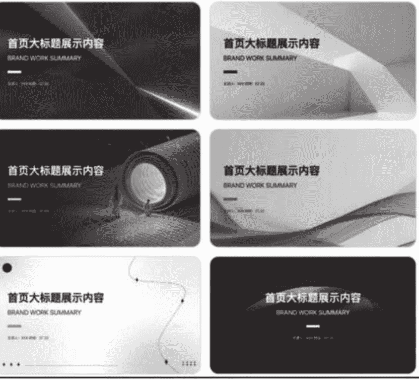

图7-13 培训课件模板

产品演示PPT聚焦产品亮点与场景感染力，适用“产品发布”或“极简科技”风格模板，设计干净、聚焦，大量使用产品高清渲染图、场景应用图与简洁的特性说明，动画流畅，如图7-16所示。

- 毕业答辩

  - 商业计划

  - 产品演示

  - 公司介绍

- 综合

  - 颜色

  - 风格


图7-14 毕业答辩模板

毕业答辩

商业计划

产品演示

公司介绍

综合

颜色

风格


图7-15 商业计划模板

公司介绍PPT传递品牌实力与文化底蕴，适用“品牌故事”或“企业形象”风格模板，紧密融合企业VI色，运用团队照片、发展里程碑、文化价值图标化展示，风格大气统一，如图7-17所示。

- 毕业答辩

  - 商业计划

  - 产品演示

  - 公司介绍

- 综合

  - 颜色

  - 风格


图7-16 产品演示模板

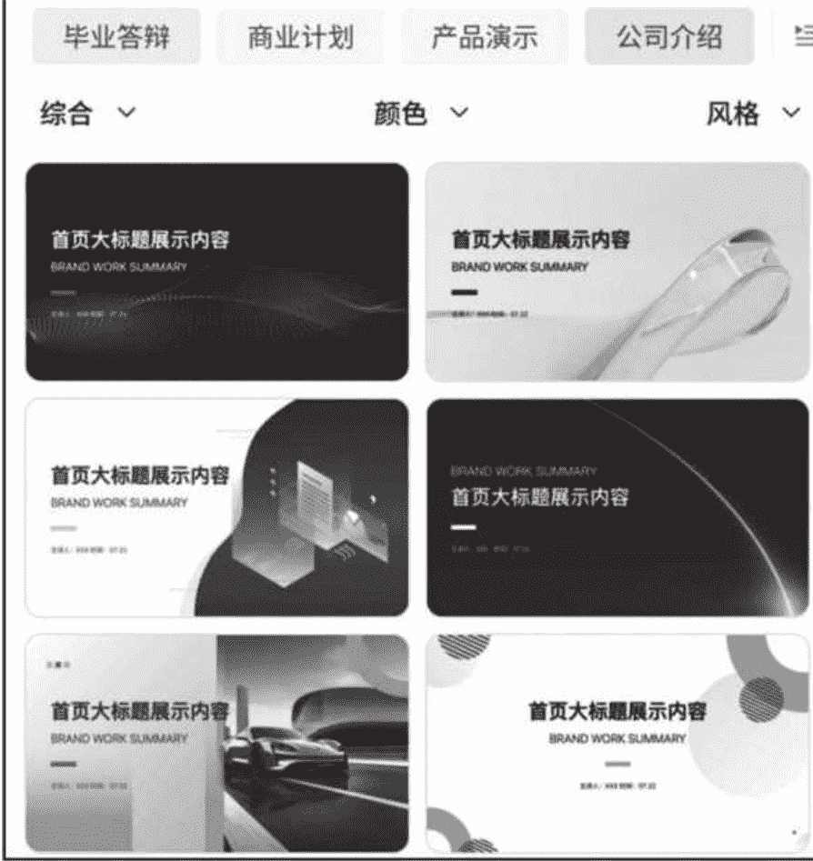

图7-17 公司介绍模板

党建宣传PPT要求庄重严肃且富有感召力，适用“红色主题”或“党政风采”专用风格模板，以红、黄、金为主色，规范使用党徽、旗帜等元素，版面方正，气势恢宏，如图7-18所示。

节日庆典PPT侧重营造欢乐喜庆或温馨感动的氛围，适用“节日庆典”或“活动策划”风格模板，色彩鲜艳丰富，可灵活运用对应节日的特色图案、装饰元素，动画效果活泼，如图7-19所示。

- 党建宣传

  - 节日庆典

  - 个人简历

  - 课题研究

- 综合

  - 颜色

  - 风格


图7-18 党建宣传模板

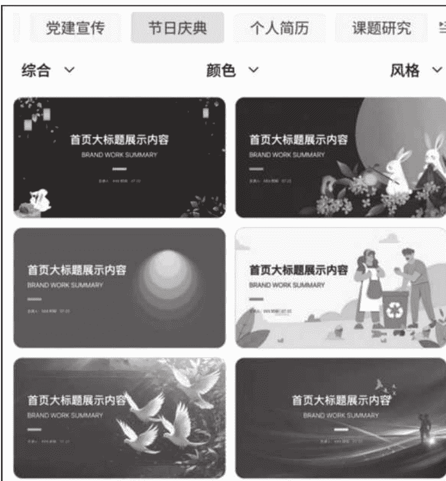

图7-19 节日庆典模板

求职类幻灯片更看重个性化呈现与信息分层，常用“创意简历”“职业履历”这类模板，在保持阅读舒适的基础上，可通过差异化的版式、配色或小图形来凸显个人风格调性，具体示例如图7-20所示。

研究类幻灯片则更强调论证严谨与版式规范，常见的类型是“学术海报”“研究汇报”，整体基调偏正式，便于承载复杂图表、公式及文献引用，色调多选用沉稳路线，如图7-21所示。

- 党建宣传
  - 节日庆典
  - 个人简历
  - 课题研究
- 综合
  - 颜色
  - 风格


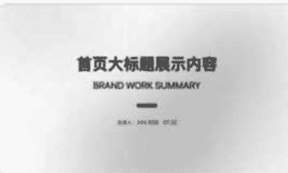


图7-20 个人简历模板

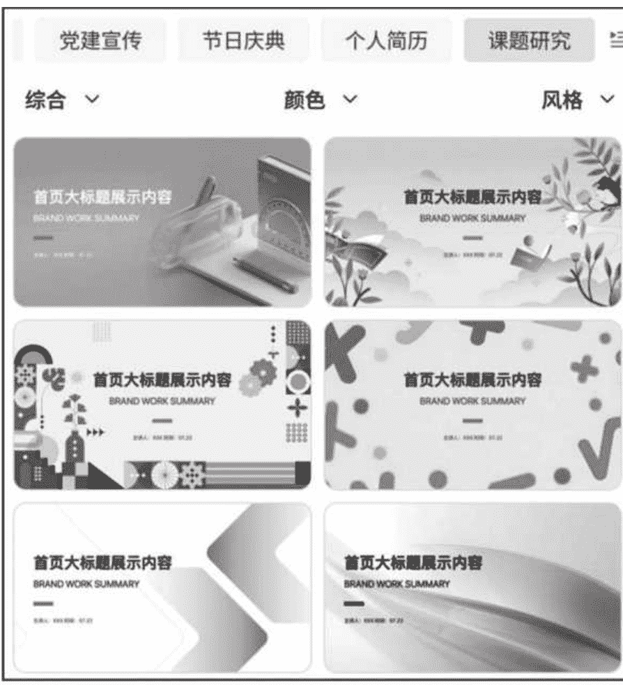

图7-21 课题研究模板

利用 Qwen 内置的场景模板库，制作演示文稿时可在起步阶段直接选取“工作汇报”“产品演示”“毕业答辩”等具体情境。系统会基于该情境的沟通目标与视觉惯例，自动套用一套经过专业打磨的视觉框架，包含统一的配色体系、清晰的字号结构、适配的网格布局以及恰当的图形元素。这样既省去繁琐的基础排版，也让画面语言与内容主题高度统一，避免风格错配，从而提升从构思到成稿的整体协同效率，使用者可把精力集中在核心信息与表达打磨上。

### 7.5 演示优化：互动环节的智能建议

#### 7.5.1 用千问的优势

初稿完成后，演讲者很难跳出自身视角客观审视。内容是否抓人、思路是否顺畅、画面与口语是否配合，往往因当局者迷而难以觉察。过去多靠反复自查或请同事预看，效率不高，反馈也多停留在主观感受，很难全面兼顾内容、逻辑、语言、呈现等多个专业维度。

Qwen 可充当不累不偏的排练导师兼内容医生。依托文本理解、逻辑拆解与设计感知能力，它能对整套幻灯片和讲稿做系统体检，从受众契合、思路连贯、语言精炼、视听协同、细节完善等专业角度给出可直接落地的改进建议。提前发现问题、提升整体质感，让每次上台都更从容专业。

#### 7.5.2 操作步骤

演练之前，可把基本成型的幻灯片和配套讲稿一并提交给模型进行系统诊断。下面以一个真实案例说明。

**【案例背景】**

已为青少年群体准备了一场以故宫为主题的演讲，幻灯片和讲稿已成型，希望在正式彩排前获得一份客观专业的改进意见，保证内容能打动年轻听众。

第一步，将全套文件和讲稿原文完整上传，并明确希望评估的维度。提示词输入界面见图7-22所示。

第二步，模型会输出结构化诊断报告。

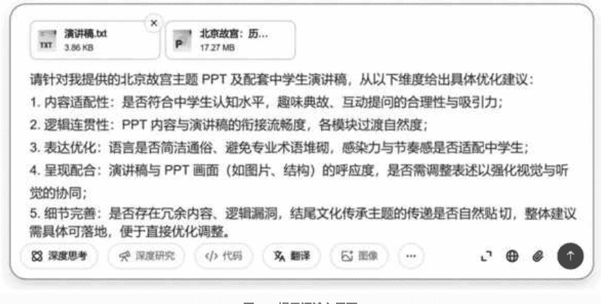

图7-22 提示词输入界面

其一，受众匹配方面。整体语言已贴近青少年，仍可再提升趣味性和互动感。可在开场或建筑章节加入一两个具体冷知识，例如“故宫有9999间半，传说天宫才有一万间”“太和殿前铜狮闭嘴寓意守密”，增强记忆点；再设计一两个互动提问，比如“三大殿的名字里隐藏了哪些儒家理想？”，引导思考；首次出现的“榫卯”“非遗”等术语，最好配上白话解释，如“不用钉子的木头拼接技艺”“接近失传的传统手艺”，避免理解卡壳。

其二，逻辑衔接。讲稿四个乐章与幻灯片四个板块基本对应，但衔接稍显生硬。建议每段开头加入自然过渡，比如由历史转到建筑时说：“看完六百年的变迁，现在让我们低头看脚下的砖、抬头看头顶的梁，它们也在讲故事”；在讲稿旁标出对应页码或标题，如“对应第7页：中轴线布局”，方便同步；在第13页涉及宫廷音乐、点翠工艺，讲稿未展开，可在第三乐章末尾补充：“连皇后头上的点翠凤冠、典礼上的雅乐这些‘看不见’的文化，也正在被年轻人学习传承。”

其三，表达打磨。整体简洁有生气，部分说法可更口语、更有节奏。可删去重复的形容词，如多处“超级”“闪闪发光”，保留关键修辞维持活力；把抽象概念具象化，例如把“体现天人合一”改为“宫殿朝南对准北极星，黄瓦像大地，红墙像火焰，古人用建筑画出自己的宇宙”；结尾口号稍显突兀，可在“文化是血脉里的记忆”前加一句衔接：“哪怕只是拍一张角楼照片、给朋友讲一段琉璃瓦的故事，我们就在续写故宫的新章节”，让传承主题更自然收尾。

其四，视听协同与细节修正。需加强画面配合并纠正小瑕疵。建议在讲稿中标注关键画面提示，如“此刻展示三大殿航拍”“切换至VR体验界面”，引导观众注意力；可补充一张“传统工匠与当代青年修复师”对比图，与“代际守护”主题呼应，提升情感共鸣；把“整座宫殿一根钉子不用”改为更准确的“主体木结构基本不用钉子”，并精简结尾略显重复的排比，让“青少年可以做什么”的呼吁更集中可信。

第三步，按结构化清单逐项修改幻灯片与讲稿，完成后可再演练，或请模型对修改版做二次快速检查。

#### 7.5.3 最佳实践

要让优化建议更有价值，建议遵循以下做法。

- 先交近似终稿：上传前自行完成逻辑梳理和基础润色。模型更擅长在成品基础上做精细诊断，而非从零整理。
- 明确听众与场景：提示词中清楚说明演示对象和场合，这决定评估标准。
- 要求具体可执行的建议：拒绝“可以更好”等模糊说法，要给出具体改写文案、新增互动提问或需要调整的页面描述。
- 建立个人问题清单与优化模板：总结模型反复指出的问题，形成自查清单，提前规避，提升初稿水准。

把 Qwen 深度嵌入演示优化闭环，能系统性提升作品专业度，让每次公开表达都更精准、有力、动人。

## 第8章 图像处理：视觉内容的智能生成

在以视觉为主导的传播环境里，高质量图像已是数字表达的基础技能。本章聚焦 Qwen 在海报设计、Logo 创作、图像优化、多图整合等方面的核心能力。凭借强大的多模态生成技术，它能理解设计意图，根据文字描述生成主题清晰、风格统一的图像；可对现有图片进行色彩修正与细节增强；也能完成多图排版与视觉叙事。帮助读者掌握从构思到呈现的完整流程，让视觉创作更可控，真正服务内容价值。

## 8.1 海报设计：主题导向的图像生成

### 8.1.1 用千问的优势

在品牌宣传、活动执行、展览呈现及新媒体内容制作中，一张主题鲜明、视觉统一的海报往往决定信息能否迅速抓住受众。但实际操作中常出现主题发散、风格不统一、素材与文案脱节、构图不专业的困扰。时间紧任务多时，人工反复尝试既费时也难达标。

Qwen 能直接破解这些难题。输入主题、受众、场景、关键词或期望风格，就能自动生成视觉方向明确的海报草图或成品。它会先理解核心意图，如“科技感”“公益宣传”“节日气氛”“学术论坛”，再匹配视觉风格、色彩氛围与构图，让海报从首稿就具备清晰创意方向。相比传统试错式设计，几分钟就能锁定优选方案，并把文案要点自然融入画面。对非专业设计人员而言，大幅降低门槛，让创意更高效、可控、可扩展。

### 8.1.2 操作步骤

第一步，打开 Qwen 首页，点击对话框下方“图像”按钮，如图8-1所示。


进入图像模式后，可输入提示词、上传参考图并选择比例。提供1:1、3:4、4:3、16:9、9:16等多种比例，如图8-2所示。

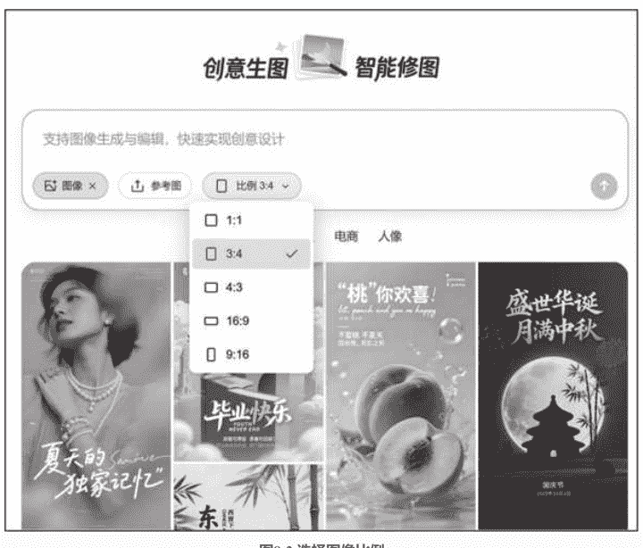

第二步，输入清晰提示词。以科技主题海报为例：“未来科技海报，霓虹蓝紫配色，赛博朋克城市背景，中央大字‘2025全球创新峰会’，动态光效，包含全息投影、数据流、AI芯片图案，现代感强，高清细节，竖版构图”。

提示词越精准，生成结果越贴合需求。

第三步，点击“发送”，片刻后即可获得符合要求的海报，如图8-3所示。

同理，可快速生成其他风格。例如文艺音乐节海报，提示词可以是：“夏日户外音乐节海报，手绘插画风格，温暖阳光色调，吉他、音符、绿植与人群剪影交织，顶部醒目文字‘山谷回声音乐节2025’，轻松自由氛围，柔和笔触，横版布局”。生成效果如图8-4所示。

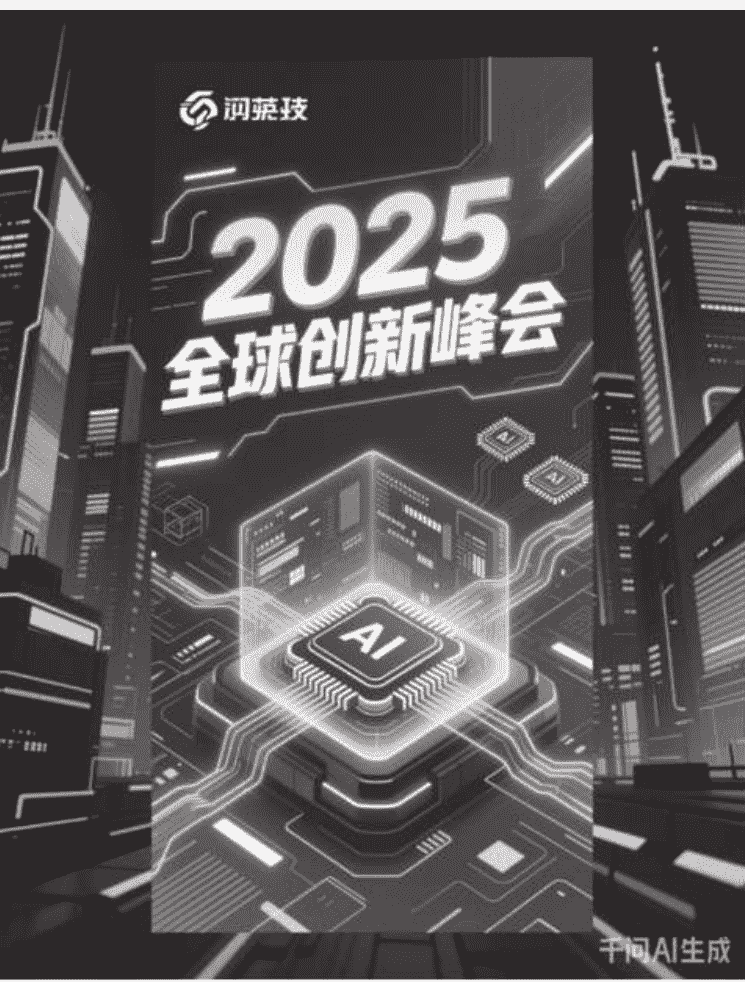

图8-3 未来科技主题海报

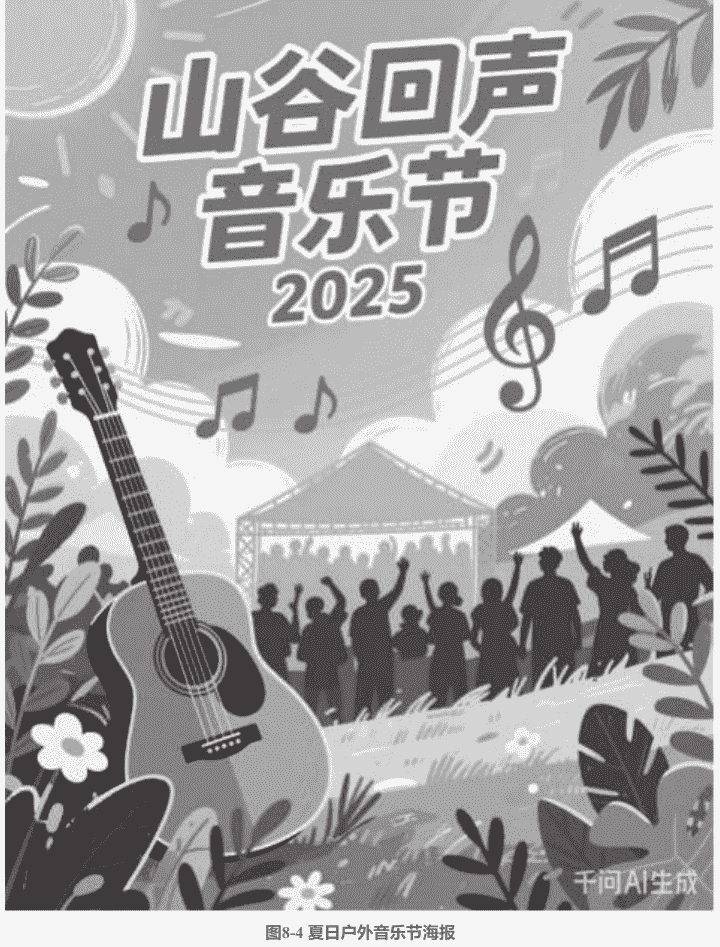

图8-4 夏日户外音乐节海报

再如环保公益海报，提示词：“环保主题公益海报，地球被绿色藤蔓包裹、双手温柔托起，背景为蓝天与海洋，标语‘守护每一份绿意’居中，清新自然配色，写实与象征结合，竖版高清”。生成效果如图8-5所示。


图8-5 环保主题公益海报

### 8.1.3 最佳实践

为提升海报的主题契合度与专业水准，建议注意以下做法。

- 给出完整创作要素：明确主题、目标受众、使用场景、色彩偏好、风格类型、关键词及文案，让模型建立正确视觉方向，避免风格偏差或图文脱节。
- 明确构图与版式要求：提前说明构图方式、主视觉位置、文字排布，让生成结果更接近可直接使用的设计稿。
- 生成多版本方案：指令模型输出不同风格、不同构图的多款海报，如“科技风版”“插画风版”“极简版”，快速筛选比对，缩短探索时间。
- 上传参考图强化一致性：提供品牌物料、旧版海报或情绪板，引导字体、色调与品牌调性保持一致，提升识别连贯性。
- 沉淀可复用提示词模板：将验证过的高质量提示词整理为固定模板，后续只需替换主题或标题即可快速复用，提升重复类任务效率。

借助这些方法，Qwen 可在极短时间内提供方向清晰、风格统一的海报方案，降低设计门槛，支撑品牌传播与内容运营。

## 8.2 LOGO设计：网络文化的视觉表达

### 8.2.1 用千问的优势

标识是品牌的核心视觉符号，承载辨识度、文化属性与价值主张。实际设计中常遇创意不足、风格不统一、图形象征性弱、难以适配数字媒体等问题。互联网时代的标识需要在小尺寸、高对比、多场景下保持清晰，对构思提出更高要求。

Qwen 具备强大的视觉生成与抽象概念理解能力，适合标识创意与成型阶段。输入企业或产品定位、品牌关键词、文化调性、行业属性，即可批量生成具备互联网视觉风格的方案，包含抽象图形、符号化元素、配色与字体倾向。它还能在图形中融入网络文化隐喻，提升传播力与年轻化表达，并可按使用场景输出不同版本，如极简版、扁平版、黑白版、方形头像版，确保社交媒体、应用图标、海报等场景视觉统一。让缺乏专业背景的团队也能快速获得辨识度高的品牌符号，降低尝试成本。

### 8.2.2 操作步骤

第一步，打开 Qwen 首页，点击对话框下方的“图像”按钮。进入图像模式后输入提示词并可上传参考图，标识设计通常选择1:1比例。

第二步，输入提示词。以咖啡馆标识为例：“标识设计：适用于温馨舒适的咖啡馆，使用暖色调如棕色、米色和橙色，图形中包含一杯冒热气的虹吸咖啡与简约植物装饰，传达放松享受时光的品牌理念。”发送后即可获得初稿，如图8-6所示。


图8-6 咖啡馆LOGO

Qwen 还支持参考图功能。可先上传想模仿的图像，例如基于上述咖啡馆标识再设计轻食餐饮店标识，可同时上传3张参考图，如图8-7所示。


图8-7 上传参考图

此时输入提示词：“参考附件中标识的风格，做一个轻食餐饮店标识，要求如下：主色调为绿色，标识主体是一份蔬菜沙拉”，如图8-8所示。


图8-8 上传参考图并输入提示词

发送后生成初稿，如图8-9所示。

若初稿不完全符合，可继续迭代。例如不想要图上的咖啡杯并调整文字，输入：“去除图顶部的咖啡杯，图中文字改为轻食一刻”。修改后效果如图8-10所示。


图8-9 轻食餐饮店LOGO


图8-10 优化后的LOGO

### 8.2.3 最佳实践

为让标识更具辨识度与数字适配性，建议遵循以下方法。

- 提供清晰品牌核心信息：说明定位、价值、调性、行业、名称来源与目标客群，便于模型从象征意义与视觉语言两维度把握意图。
- 明确图像语言与风格要求：提前确定极简、扁平、几何、手绘或拟物等风格，以及构图、线条、配色预期，减少偏差。
- 要求多形态版本：让模型输出主标识、黑白版、ICON小图标版、社交媒体头像版、横竖版等，满足不同平台需求。
- 借助参考图确保延续性：上传旧标识、竞品或灵感，强化风格理解，保证新版与既有资产一致。
- 反复迭代并记录有效提示词：通过调整元素、色彩、结构不断优化，并将满意提示词沉淀为“品牌标识生成模板”，形成可持续迭代的数字资产。

如此，Qwen 既能高效产出富有网络文化表达力的标识初稿，也能帮助企业快速搭建完整的视觉识别体系，实现低成本的品牌创意生产。

## 8.3 图像优化：色彩校正与细节调整

### 8.3.1 用千问的优势

在专业设计、产品展示、电商运营及宣传物料制作中，图像质量直接决定第一印象。传统优化依赖专业软件与手工调校，需要色彩、光影、细节增强等专业技巧。常见问题包括色偏、亮度对比不均、噪点多、边缘模糊、局部细节不足，往往需多轮修图才能达标。

智能修图新打法：把千问当成你的在线修图团队

在需要批量把照片做美的场景里，千问的图片优化模块能同时把效率和成片质感拉上去。把源文件丢进去，用日常口吻描述想要的改动方向就可以了，例如整体提亮、校准肤色、凸显细节、适配电商白底、突出主体、清除背景噪点等，系统就会自动完成类专业修图的色彩校正、明暗平衡、锐度提升和局部强化。它会自动判断画面主体位置、材质表现和场景氛围，在保持自然感的前提下完成高质量提亮。更实用的是，它能按投放目的给出差异化结果，比如面向社媒的高饱和风格、面向商拍的细节增强版、面向宣发的柔光版本。对不熟悉 PS、LR 等专业软件的人来说，一轮对话就能拿到接近工作室水准的成品，上手门槛被大幅拉低，视觉表达也明显更出彩。

### 8.3.2 操作步骤
进到千问首页，点击对话框下方“图像”切换到图像工作区。切换后可输入指令、上传参考图并设定输出比例，把待优化的文件以附件形式发给模型，如图8-11所示。

想要让画面带上夕阳氛围，可以写：“把附件这张的光影换成日落感，夕阳洒在草原和女生身上。” 稍等片刻，系统会回传一张充满晚霞氛围的成片，如图8-12所示。


图8-11 需要优化的原图


图8-12 修改后的图片（一）

除了光影，还能改动人物穿搭和背景，例如指令：“把背景换成雪山，女生穿白色上衣。” 稍等后得到接近实拍的合成，如图8-13所示。

继续细化也很容易，例如指令：“给女生戴一顶黄色帽子，背后加几匹马。” 模型会为人物加上帽子，连帽檐在面部的阴影也处理得十分到位，如图8-14所示。


图8-13 修改后的图片（二）


图8-14 修改后的图片（三）

再看一个 LOGO 改动案例。假设喜欢图8-15 的 LOGO，但想把里面的男生换成女生，碗的颜色改成红色。可写指令：“请把 LOGO 中的男生改为女生，碗换成红色，其余保持不变。” 系统会迅速完成替换，如图8-16所示。


图8-15 参考LOGO


图8-16 修改后的LOGO

### 8.3.3 最佳实践
想让输出更接近专业视觉标准，避免偏色、光感失真或细节偏差，建议按以下办法来做。

- 递交高清素材并把问题说透：尽可能传清晰的源图，同时明确指出待改进点，例如“光线偏暗”“阴影过重”“肤色偏黄”“背景杂乱”，帮助模型精准定位优化方向。
- 事先区分风格和用途：说明最终投放是电商、官网、社媒还是人像写真，让模型自动匹配合适的细节增强幅度、饱和度和氛围倾向，确保结果与使用目标一致。
- 分步执行并检查中间态：让模型按亮度校正、色彩调整、背景处理、主体强化等顺序逐步推进，避免一次性过度，并在关键节点停下来确认方向是否正确。
- 适时提供参考以保持风格统一：上传想要模仿的光影、滤镜或场景氛围图，让优化过程遵循同一基调，成品更协调自然。
- 沉淀可复用的指令模板：把验证过的高质量指令整理成固定模板，例如“电商白底提亮模板”“人像肤色自然模板”“户外氛围增强模板”，后续只需替换附件即可批量复用，效率大幅提升。

遵循以上做法，千问既能加快图像优化的效率与质量，也能让没有专业修图经验的人拿到媲美修图师的水准，让视觉内容更具表现力和传播力。

## 8.4 多图整合：视觉叙事的排版设计

### 8.4.1 用千问的优势
电商内容里，穿搭展示对转化影响很大。传统方式要走模特拍摄、造型设计、场景布光等完整流程，成本高、周期长。千问依靠 AI 驱动的图像生成与重绘，让“给人物换装并生成实拍质感图”的门槛大幅下降，普通创作者也能产出近商业摄影水平的展示图。

它对人物姿态、身形比例、场景光线有很强的理解能力，能智能匹配服饰材质、褶皱走向和贴合度，从而生成真实自然的试穿效果。同时会自动适配服饰尺码、风格和色彩，规避传统换装常出现的错位、变形、光影不一致问题，减少反复手动修图，明显缩短制作周期。借助它，新手卖家无需掌握摄影、布光、后期等专业技能，就能以很低成本完成高质量穿搭素材制作，提升商品展示力与购买转化。

### 8.4.2 操作步骤
以如图8-17所示的模特照片和如图8-18所示的服装图为例，目标是让模特穿上图2的衣服和鞋子。

上传两张参考素材后，输入指令：“请让图1中的女生穿上图2所示的衣服、鞋子，保持姿势、发型和面部不变，确保衣物贴合身体轮廓，光影风格一致。” 模型会直接完成换装，如图8-19所示。


图8-17 模特参考图


图8-18 衣服、鞋子图片

换一套搭配也一样，只需重复流程并上传新的服装图，如图8-20所示，并输入指令：“请让图1中的女生换上图2所示的上衣、裤子，背上图2中的背包。保持姿势、发型和面部不变，确保衣物贴合轮廓，光影风格一致。” 模型会生成新搭配，如图8-21所示。


图8-19 生成效果图（一）


图8-20 新的服装图

还可以通过调整指令生成不同背景和场景的图片，输入：“基于已有模特图风格，同一模特保留原图发型、妆容、身材特征，穿着同款衣服，电商实拍质感，户外，坐在椅子上，自然光，真实布料纹理。” 生成效果如图8-22所示。


图8-21 生成效果图（二）


图8-22 生成效果图（三）

想改动作，可输入：“基于已有模特图风格，同一模特保留原图发型、妆容、身材特征，穿着同款衣服，电商实拍质感，户外，坐在草坪，自然光，真实布料纹理。” 效果如图8-23所示。

想换环境，可输入：“基于已有模特图风格，同一模特保留原图发型、妆容、身材特征，穿着同款衣服，电商实拍质感，户外，站在花园，自然光，真实布料纹理。” 效果如图8-24所示。

图8-23 生成效果图（四）
图8-24 生成效果图（五）

### 8.4.3 最佳实践
为确保在换装、场景融合、构图统一等多图任务中产出更真实、更自然、更具电商实拍质感的成片，建议按以下方法操作。

- 提供规范化参考素材与明确合成目标：上传人物原图、单品、道具、场景参考，并明确要求“保持人物姿势与面部不变”“衣物贴合身体”“光影一致”等关键约束，让生成有清晰结构指引。
- 强调光影、材质与空间一致性：在指令中明确“真实布料纹理”“自然光”“场景光影统一”“不形变、不穿帮”等条件，让处理遵循物理逻辑，画面更可信。
- 要求输出多个备选版本：通过指令一次性生成不同角度、场景、姿态、背景的版本，便于快速筛选最优成片，避免单次结果不满足需求。
- 按需迭代并指出具体修正点：对初稿中衣物贴合、光影突兀、动作不自然、背景不协调等问题，用明确指令指出，如“增强肩部贴合”“保持阴影方向一致”“坐姿更自然”，逐步优化。
- 构建可复用的电商换装模板：将有效指令沉淀为“模特换装模板”“服饰展示模板”“户外场景融合模板”，后续批量制作时只需替换人物与服装素材即可快速复用，提升内容生产效率。

通过这些方法，千问能在多图融合、换装展示、场景重绘等任务中提供高一致性、高真实度的视觉效果，让普通创作者以低成本生成专业级电商展示内容，加速生产并提高转化率。

## 第9章 视频创作：多媒体内容的智能生产
视频已成为互联网传播的核心载体，传统创作涉及脚本、分镜、拍摄、剪辑等多个复杂环节。本章展示通义千问如何利用多模态能力，让高门槛的专业视频制作变成轻量化操作。从脚本生成到分镜设计，从主题定位到用户画像匹配，从智能生成短视频到快速提取视频重点信息，千问为多媒体创作提供全链路支持，帮助提升创意生产效率，让“会做视频”成为基础技能。

### 9.1 脚本创作：故事板与分镜设计

#### 9.1.1 用千问的优势
在视频前期，脚本与分镜决定叙事节奏、视觉风格和成片质感。传统创作常出现思路发散、结构混乱、镜头语言不统一、沟通成本高等问题，尤其在短剧、广告、自媒体内容快速迭代的场景下，人工逐镜头推敲耗时且易偏离主题。

千问能显著提升脚本与分镜设计的效率。它可根据主题、场景描述、目标受众和风格偏好，自动生成逻辑完整的脚本大纲，包含开端—发展—高潮—收束的叙事结构，并进一步转化为可执行的分镜脚本，对每个镜头的景别、机位、人物动作、场景氛围、过渡方式进行清晰标注，让团队前期达成一致理解。相比依赖人工经验，千问可在数分钟内给出专业化的故事板草案，为拍摄计划、镜头调度、节奏控制奠定基础，降低创意反复和沟通成本。

#### 9.1.2 操作步骤
以创作一个主题为“智能水杯”的30秒品牌宣传短视频脚本为例。

第一步，打开千问，输入指令，如“请帮我写一个30秒的品牌宣传短视频脚本，主题是智能水杯——HydraSmart。产品特点包括：能提醒喝水、记录每日饮水量、保温保冷、App同步数据。目标受众是25～40岁的都市上班族。风格要简洁、现代、有科技感，带一点温暖和关怀。需要包含画面描述、旁白文案和背景音乐建议。”。

千问会很快生成视频脚本。

```
视频脚本：HydraSmart智能水杯（30秒）

时长：30秒

风格：现代、科技感、温暖

背景音乐：轻柔电子氛围乐，节奏舒缓但有律动感（如Ludovico Einaudi风格混搭轻微Synth）

[0:00—0:05]画面：清晨阳光透过写字楼玻璃窗，一位年轻女性坐在办公桌前专注工作，桌上放着普通水杯，但她一整天都没喝一口水。

旁白（温柔女声）：“忙到忘了喝水？你并不孤单。”

[0:06—0:12]画面：她拿起HydraSmart智能水杯，杯身LED灯轻轻闪烁蓝光。手机App弹出通知：“该补水啦！”

旁白：“HydraSmart，懂你何时需要一杯水。”

[0:13—0:20]画面：快速剪辑—水杯在会议桌上、健身房、深夜书桌旁；屏幕显示当日饮水进度100%；杯盖旋紧，保温效果演示（热气/冷凝水特写）。

旁白：“智能提醒，精准记录，长效保温保冷——健康，从每一口开始。”

[0:21—0:30]画面：她微笑喝水，镜头拉远，城市夜景中无数灯光亮起，每个窗口都有一个HydraSmart水杯微微发光。

旁白：“HydraSmart，关心你的每一刻。”

LOGO+Slogan：HydraSmart——智能饮水，温暖随行
```

第二步，在千问生成脚本初稿后，对文本进行通读和基础校核，判断其与智能水杯的宣传要点是否匹配。重点关注关键信息是否完整、整体时长是否符合要求、内容结构是否连贯，并同步记录需要进一步强化或调整的方向。对需要修改的部分进行系统梳理，形成明确、可执行的优化意见，并据此编写逻辑清晰、指向明确的修改指令。

> 脚本整体不错，但我希望：
>
> 开头不要太“焦虑”，避免“忘了喝水”的负面暗示，改成更积极的引导；
>
> 加入一个男性角色，体现产品适合所有性别；
>
> 结尾Slogan改为“HydraSmart——喝水，刚刚好”；
>
> 背景音乐建议换成更轻快、有活力的，比如类似Apple广告那种清新电子风。

第三步，等待千问完成修改，可以得到以下内容。

> **视频脚本：HydraSmart智能水杯（30秒·优化版）**
>
> 时长：30秒
>
> 风格：清新、现代、科技感+温暖关怀
>
> 背景音乐：轻快清新的电子配乐（参考Apple或Google Pixel广告风格：干净、节奏明快、带点跳跃感）
>
> [0:00—0:06]画面：晨光中，一位年轻女性在办公桌前伸个懒腰，顺手拿起HydraSmart水杯喝了一口水；同一时刻，一位男性在健身房结束训练，也拿起同款水杯畅饮。两人相视一笑（非同一场景，平行剪辑）。
>
> 旁白（温暖而有活力的中性声线）：“每一天，从恰到好处的补水开始。”
>
> [0:07—0:13]画面：水杯LED灯柔和闪烁，手机App界面显示“今日饮水：80%”；镜头特写手指轻触杯身，温度数字显示“55°C”。
>
> 旁白：“HydraSmart智能提醒，记录每一口，保持理想温度。”
>
> [0:14—0:22]画面：快节奏蒙太奇—水杯出现在通勤地铁、会议室、居家办公桌、户外露营；不同用户（男女、不同肤色）轻松喝水，App同步更新数据。
>
> 旁白：“无论你在哪，它都默默守护你的饮水节奏。”
>
> [0:23—0:30]画面：镜头聚焦水杯底部LOGO，缓缓升起，景渐变为纯净白色。
>
> 字幕+旁白：“HydraSmart——喝水，刚刚好。”
>
> 音效：清脆“叮”一声，伴随品牌LOGO淡入。

#### 9.1.3 最佳实践
为让千问生成的脚本与分镜更贴合实际拍摄，既具备完整叙事结构，又便于团队执行，建议遵循以下做法。

- 提供完整的项目信息与创作约束：在提问中一次性说明视频类型、时长、投放平台、目标受众、产品卖点、制作难度等关键信息，并明确是否需横竖屏适配、实拍或纯素材，让千问从一开始就“对题”。
- 明确脚本颗粒度与分镜深度：根据制作需求，说明希望得到故事大纲、详细分场景脚本还是逐镜头分镜，例如要求给出时间码、景别、机位运动、人物行为与旁白，便于直接用于拍摄和后期。
- 要求提供多版本方案与风格对照：可要求千问输出“现实写实版”“情绪诗意版”“幽默轻松版”“信息密集版”等不同风格，或30秒完整版、15秒精简版、6秒抢眼版，方便对比筛选和匹配不同投放场景。
- 显式标注不可触碰的要素：对品牌名、核心Slogan、必须出现的产品功能、法律合规要求等注明“不得删除或改写”“不得夸大宣传”，避免优化过程中弱化关键内容，确保脚本既有创意又可落地。
- 迭代优化并沉淀指令模板：在多轮修改中记录能显著提升脚本质量的指令，如“节奏更紧凑一点”“减少空洞口号，多用具体画面”“为每一段增加视觉对位镜头说明”等，整理为固定指令模板，便于后续项目快速复用。

通过这些方法，千问不仅能快速搭建结构完整、节奏清晰的脚本与分镜方案，还能在迭代中持续提升创作质量，降低反复沟通与试错成本，为短视频、广告片与品牌内容的高效生产提供支撑。

### 9.2 主题定位：受众需求的精准匹配

#### 9.2.1 用千问的优势
无论是短视频选题、品牌内容策划、线上课程开发还是活动宣传，主题是否精准击中受众需求，直接决定内容的高转化与高传播。实际工作中团队常陷入方向不清、受众模糊、内容与平台不匹配等困境，导致投入无法产生效果。

千问在主题定位上具备明显优势。它能基于受众画像、传播渠道、行业趋势与传播目标，自动识别用户最关心的话题点，并提炼适合不同内容形态的主题方向。同时提供主题背后的需求逻辑、爆点分析、表达角度及潜在风险提示，使选题从“灵感式判断”转向系统分析基础上的精准匹配，帮助创作者快速筛选出具有传播潜力的高价值主题，让内容方向与真实需求对齐。

#### 9.2.2 操作步骤
第一步，打开千问，输入一段包含产品核心参数、功能亮点及竞争优势的完整指令。示例指令如下：“请根据以下产品信息进行内容确认与归纳：本款肩颈按摩仪定位为家用与办公两用的便携式肩颈护理设备，具备揉捏、推拿、脉冲、热敷四种按摩模式，可实现约8小时无线续航。产品采用贴合人体肩颈曲线的结构设计，支持一键启动，操作简单、直观。典型使用场景包括久坐办公后快速放松、居家休息时轻松按摩，以及通勤、差旅途中缓解肩颈疲劳。与竞争产品相比，本设备的核心优势包括：机身小巧便于携带、运行噪声低不打扰他人、面料亲肤适合长时间使用。请确认以上信息是否完整、准确，并补充你认为必要的结构化说明。”

该步骤的目标是让千问建立基础知识框架，为后续分析和脚本生成奠定标准化信息底座。

第二步，在确认完产品信息后，继续输入受众分析指令，用于推动千问输出完整的用户画像。指令如下：“请结合上述按摩仪的功能特性，从年龄层、职业类型、核心痛点、典型使用场景、消费关注点五个维度，系统性分析该产品的核心目标用户与潜在用户，并以条理清晰、易于理解的方式输出结果。”

此时，千问会输出对用户画像的理解：

> 1.核心目标用户：25～45岁的职场群体（常年久坐导致肩颈紧绷，需要随时随地快速缓解，偏好便携且静音的产品）；备考学生（持续伏案学习导致肩颈酸痛，对操作简单、具备基础理疗效果、具有性价比优势的设备更敏感）。

颈肩按摩仪内容策略：从人群洞察到脚本落地

> 目标人群大体可划分为两类：一类是30至55岁在家的育儿母亲，长期家务让肩颈易劳损，对使用时的亲肤手感、舒适度以及功能模式的多样性要求较高；另一类是频繁出差或通勤的商务人群，旅途中久坐易致颈肩紧绷，更在意设备是否轻巧、续航是否持久、能否在多种场景下顺手使用。
> 
> 归纳来看，各类使用者的核心诉求高度重合，均聚焦于产品是否好用、操作是否流畅、多场景适用性如何，以及能否在短时间内感受到明显的放松。
> 
> 这份洞察对内容生产者极具参考价值，能够让后续短视频脚本与营销表达更精准地击中人群。

接下来围绕画像补充短片偏好的引导语，让模型给出创作方向。示例引导语为：“结合目标人群的使用需求与行为习惯，说明他们在短视频里偏好的调性、呈现手法以及关注要点，要紧扣颈肩护理主题并覆盖典型使用场景。”

模型给出的拆解如下：
这一类受众普遍偏爱语言精炼、画面干净、节奏紧凑的小视频，对冗长讲解缺乏耐心。呈现上更倾向真实场景的功能演示，例如办公室即时使用的画面、居家放松时的实操镜头。观看时的核心关注点有：能否迅速缓解酸痛感，便携性是否真正提升使用便利，静音表现是否适合办公学习环境，操作是否直观易懂，产品亮点能否通过高效剪辑被清晰呈现。整体要贴合碎片化观看习惯。

明确偏好后，输入短片结构设计的引导语，获取系统化规划。示例引导语为：“请结合颈肩舒缓设备的功能卖点、目标用户核心需求以及观众的短视频偏好，详细描述短片整体结构、画面呈现方式、卖点递进顺序与整体氛围，确保符合平台传播规律并能凸显产品价值。”

模型进一步分析：

1.内容结构：开篇10秒以痛点场景切入，例如久坐后肩颈僵硬的真实状态；中间15秒用真实操作展现核心卖点，包含轻量易携实测、三大核心功能的可视化呈现、静音表现；最后5秒做亮点收束与行动号召。
2.画面呈现方式：用特写突出功能细节，中景展现典型使用场景，整体保持画面简洁明亮，提升信息传达效率。
3.卖点呈现顺序：先抛出用户痛点，再展示产品如何精准解决，最后强化轻量、静音等差异化优势。
4.氛围风格：营造轻松实用的整体调性，背景音乐选用轻柔舒缓，旁白或字幕简洁有力，突出“有效、好用、随时可用”的产品印象。

最后输入脚本生成引导语，让模型基于以上方案直接输出可拍摄的短片脚本。示例引导语为：“请依据上述短片设计方案，生成一条时长30秒、适配抖音与视频号、风格偏简洁实用的××颈肩舒缓设备短片脚本。脚本需包含画面编号、时长、画面说明及对应台词，保证画面衔接自然、卖点突出。”

模型输出的脚本示例：

> **画面1（0:00—0:10）：** 办公场景中使用者因肩颈不适揉捏肩部，随后拿出××设备；画面聚焦产品小巧外观与易携特性。
> 
> 台词：“久坐脖子僵得难受？这款便携舒缓器能随时帮你舒缓一下。”
> 
> **画面2（0:10—0:20）：** 特写演示佩戴流程，一键启动后切换揉捏模式，热敷模式灯光特写，使用者表情逐步放松；穿插静音效果的视觉提示。
> 
> 台词：“四档模式搭配热敷，操作简单，静音不打扰。”
> 
> **画面3（0:20—0:30）：** 画面展示产品轻松放入随身包，转场至居家使用场景，叠加核心优势文字。
> 
> 台词：“办公、居家、通勤都能用，一台设备帮你卸下肩颈疲劳。”

#### 9.2.3 最佳实践

想让模型在选题定位时真正对得上受众口味，又兼顾业务目标，建议按下面做法执行。

- 在引导语里先把受众画像和业务目标讲清楚：说明目标人群的年龄段、职业形态、兴趣喜好、地域分布，以及内容的核心目的如引流、转化、科普、品牌曝光或活动招募，让模型在筛选主题时兼顾用户兴趣和业务诉求。
- 用平台和内容形态给选题划边界：明确主要投放平台如抖音、小红书、视频号、B站或官网，以及形态如短片、图文、长文或直播主题，要求模型给出平台适配型建议，避免主题不错却不匹配。
- 要求模型给出选题理由与需求逻辑：不只要列主题，还要为每个主题补充对应的核心痛点、可能触发的情绪或利益点、合适的切入角度，必要时可要求给出优先级排序与推荐依据。
- 让模型参与筛选而非只罗列：在拿到初步清单后，可继续让模型基于可执行性、差异化、传播潜力、品牌契合度等维度进行打分分级，如A级主推、B级备选、C级储备，帮助团队快速收敛到1至3个重点方向。
- 定期复用与迭代主题库：将实战验证效果好的主题沉淀下来，要求模型在新一轮定位时参考历史高表现选题，结合最新热点、行业趋势和平台算法变化持续更新，逐步形成品牌的长期主题矩阵。

通过这些方法，模型能贯穿调研、分析、筛选、落地的全流程，成为主题策划助手，提升内容的打开率与转化率。

### 9.3 视频生成：一键做出电影质感影像

#### 9.3.1 能力优势

随着生成式影像技术成熟，创作者、企业宣传和社媒运营都希望以更低成本做出电影感、品牌感或视觉冲击强的视频。传统流程涉及脚本、拍摄、剪辑、调色等多个环节，对小团队压力很大。

模型的一键式影像生成能力让专业质感不再遥远。用户只需输入场景描述、氛围关键词、节奏设定或参考画面，模型即可自动生成结构完整、画面统一的视频。它能自动处理画面切换、光影、色彩氛围，并保持主题一致性，成片效果与预期高度吻合。此外还能按不同平台需求输出竖屏、横屏、快节奏或讲解型版本，并提供配套字幕与旁白稿，实现高度自动化。对没有拍摄剪辑基础的人群而言，这极大提升了创作效率。

#### 9.3.2 操作流程

第一步，打开模型主界面，找到“影像生成”入口，点击进入创作界面，如图9-1所示。

图9-1 选择“影像生成”功能

第二步，进入生成界面后，如图9-2所示，点击底部“开始创作”按钮，跳转至参数配置页，进入正式生成流程。

第三步，进入参数配置界面后，在“模型选择”模块选择“万相2.5”模型，如图9-3所示。该模型面向零基础用户，支持通过文本描述直接生成音画成片，无需复杂调参，适合快速搭建视频骨架。

# AI创作

- 图片

- 全民唱跳2.0

- 视频

- 人像

- 动漫

- 表情包

图9-2 开始创作

第四步，完成模型选择后，开始配置核心参数，如图9-4所示。配置清晰度：根据需求在不同档位选择，平衡画质与速度。配置画面比例：依据传播介质如横屏、竖屏、方屏选择主流比例，匹配发布平台。配置视频时长：按用途选择合适区间，匹配观看习惯。配置智能配音：可按需开启或关闭，提升表现力。参数确认后即可生成视频。

以“未来城市日出”主题为例，输入提示词：“电影级广角镜头，呈现一座霓虹闪烁的未来都市在日出时的景象，飞行汽车穿梭于布满垂直花园的摩天楼间，柔和金色阳光在玻璃表面反射，氛围朦胧，赛博朋克风格。”等待响应后即可获得成片，如图9-5所示。

AI生图 AI视频

描述你想要的视频主体、动作、运镜

万相 2.5 高清

清晰度

标清 高清 超清

比例

9:16 3:4 1:1 4:3 16:9

视频时长

5秒 10秒

智能配音 包含配音、音效和音乐

图9-4 配置视频生成核心参数

图9-5 模型生成的视频成片

下载到本地即可播放，如图9-6所示。

除文字提示词外，模型还支持上传参考图辅助生成。点击“开始创作”后选择“导入图片”，可加入视觉样例。以图9-7的猫咪照片为例。

输入提示词“让这只猫跳舞”，如图9-8所示。

模型生成的画面如图9-9所示，可见模型基于参考图像成功生成动态内容。

#### 9.3.3 最佳实践

为让生成的视频兼具大片感与业务适配性，建议遵循以下方法。

图9-6 视频画面示例

图9-7 猫咪参考图

AI生图 AI视频

让这只猫跳舞

万相 2.5 高清

图9-8 输入提示词

图9-9 生成的视频画面

- 生成前先用文字脚本锁定结构：不要直接用一句提示词生成，建议先用模型辅助完成简要脚本或分镜大纲，包括场景顺序、关键画面、节奏变化，再据此撰写更精确的生成提示词，避免结构松散、节奏失控。
- 明确用途、平台与视觉风格：在提示词中清晰说明使用场景如品牌宣传、产品展示、活动预热、节日祝福等，发布平台及目标风格如写实、插画、赛博朋克、商务简约等，并指明是否需要电影级镜头感、电商质感或MG动画感，以便模型在画面与镜头语言上有明确参照。
- 拆分任务并要求多版本输出：对于时长长或结构复杂的视频，可拆分为多个片段分别生成，如开场10秒、主体15秒、收束5秒，每个片段要求输出2至3个版本，便于后期灵活组合，避免一次性失败浪费时间。
- 生成后质量校验并及时纠偏：重点检查画面是否与品牌调性冲突、是否存在场景不符元素、潜在版权或合规风险。对节奏慢、信息不清、画面杂乱等问题，总结为具体修改意见，再用提示词引导模型优化。

通过这些方法，模型能融入脚本规划、风格控制、版本筛选与质量把关的完整流程，在保持高效率的同时接近专业团队水准。

### 9.4 视频速读：快速提取视频内容

#### 9.4.1 能力优势

面对课程视频、行业直播、会议录屏、讲座访谈或新闻资讯，很多人难以完整观看，导致信息获取效率低。人工笔记耗时且易遗漏、记错数据，难以满足高频信息处理需求。

模型的视频理解与总结能力能从根本上解决此问题。只需输入视频链接或上传文件，模型即可自动识别内容结构、关键观点、重要数据、因果逻辑与主要结论，并按“要点提炼—结构化输出—可复用内容”模式生成清晰摘要。它还能根据场景调整表达形式，如“领导汇报版”“备考笔记版”“执行重点版”“战略洞察版”，让结果更具针对性。相比人工速读，模型更快、更全面且逻辑一致，避免遗漏关键信息。无论是职场人士、学生还是研究人员，都能在短时间内高效获取精华，让长视频内容可快速理解、可复用。

#### 9.4.2 操作流程

第一步，打开模型并进入主界面，在下方功能栏找到带视频图标的“音视频”选项，如图9-10所示。单击进入音视频速读功能页。

第二步，在音视频速读页面，将目标文件上传至左侧上传区，也可直接拖拽。随后在右侧参数区按素材选择音视频语言如中文，按需设置翻译要求，也可选择不翻译，并在“区分发言人”栏按需选择功能。确认后单击下方“确认”按钮，如图9-11所示。

第三步，模型解析完成后进入结果展示页。右侧功能区提供多种可视化查看方式，如图9-12所示。

按需选择使用：若需快速了解概要，可进入“导读-发言总结”查看全文主旨与关键词；若需把握核心逻辑，可进入“导读-要点回顾”查看梳理后的关键节点，如图9-13所示。

导读 脑图 笔记

发言总结 要点回顾 提取PPT

> **如何开始创作AI音乐？AI音乐生成的过程是怎样的？**

在创作AI音乐的第一步中，用户需要输入音乐需求。通过点击左侧的create按钮进入创作页面，在song description 部分可以输入对歌曲的具体要求，例如创作一首关于北京的民谣，要求声音具有磁性。在确定了音乐需求后，用户需点击下方的create按钮进行音乐生成。在10秒至1分钟内，系统会根据输入的需求自动生成音乐。生成完成后，用户可以看到系统根据提示词创作出的两版歌曲，并可以选择试听和下载。

> **AI音乐创作工具是否可以提供实际生成的歌曲示例？**

是的，该AI音乐创作工具在演示过程中展示了两个版本的歌曲，分别是“盛夏的故事”和“和老张在乡下的故事”，并且提供了这些歌曲的标题、生成日期及歌词内容，以便用户了解生成音乐的具体表现形式。

> **生成的音乐有哪些版本以及如何试听与下载？**

音乐生成后，有音频版本和视频版本可供选择。用户可以通过点击右侧三个点对应的按钮来选择下载，其中音频版本可以直接下载到电脑桌面，而视频版本则带

图9-13 “要点回顾”功能界面

若要将内容转为演示材料，可使用“导读-提取PPT”功能获取自动生成的演示文档，如图9-14所示。

导读 脑图 笔记

发言总结 要点回顾 **提取PPT**

图9-14 “提取PPT”功能界面

如需结构化理解全文，还可打开“脑图”功能生成内容逻辑图，如图9-15所示。

图9-15 “脑图”功能界面

第四步，完成查看与编辑后，可在页面右上角找到“导出”按钮，导出文本，如图9-16所示。

#### 9.4.3 最佳实践

为确保视频速读在不同工作场景中发挥最大效能，实现“快速理解、快速复用、快速转化”，建议如下。

- 选择合适的语言、翻译和发言人模式：根据内容选择正确的音频语言，如中文、英文或中英文混说，并按需开启翻译。对多人对话视频，可启用“2人对话”或“多人讨论”模式，便于区分对话者、清晰标注结构，提升解析准确性。
- 要求结构化、多层级摘要输出：可将文本再次提供给模型，要求同时输出“极简要点版”“结构化目录版”“可直接写入PPT的要点版”等多个层级，使内容能快速用于不同场景。
- 引导提取可复用内容模块：除基础总结外，可要求提取“金句”“关键数字”“因果链条”“行动项列表”“适合汇报的话术”等模块，将长视频转化为可直接二次使用的知识要素，大幅提升学习与工作效率。

通过这些方法，模型不仅帮助快速提炼核心信息，还能将内容转化为可用于汇报、决策或学习的成果，使视频学习与信息处理更轻量高效。

# Part 3

第三部分

学习提升：成人教育的智能支持

在学习方式快速演变的时代，知识获取与应用已不再由传统课堂主导，而转向更个性化、智能化的持续学习模式。对身处快速变化行业的成年人而言，如何诊断学习需求、制定学习规划、选择优质资源、保持持续成长，已成为职业发展的核心命题。通义千问正在重塑这一过程，让自我提升从自我探索变为有智能伙伴陪伴的系统工程。

本部分围绕成人学习的關鍵环节展开：从学习规划到技能提升，从知识管理到职业发展，形成完整成长路径。千问能依据你的背景、目标和时间结构生成个性化学习计划，分析薄弱点、拆分目标技能路径并推荐匹配度高的资源。同时能根据学习进度动态调整，确保成长轨迹更贴合现实。

成人学习的挑战不在于知识难，而在于时间碎片化、注意力有限、难以坚持、缺乏外部反馈。千问的价值尤为明显：可作为第二大脑随时答疑；作为学习教练及时反馈；作为资源管家筛选内容；作为模拟考官提升应试能力；作为职业规划顾问引导长期方向。

本部分不仅介绍具体技巧，更展示一种全新能力模式——你不再孤身学习，而是与具备推理、教学、知识组织能力的AI协同成长。千问让学习更高效、可持续、更适应未来变化，帮助构建个人的智能学习体系，使学习不再是负担。

# Chapter 10

第10章

学习规划：个性化成长路径设计

学习规划并非单纯制定计划，而是对自身能力、目标需求、知识结构进行全面诊断后形成的系统方案。本章介绍如何借助通义千问识别学习痛点、分析能力差距、制定目标导向的个性化学习路径。通过结构化规划方法、思维导图组织方式与学习曲线原理，千问能帮助生成可执行、可评估、可调整的学习计划。本章重点在于让学习从随意行为变为可控过程，使个人成长更稳健、有方向、有节奏。

## 10.1 需求诊断：学习痛点的系统分析

### 10.1.1 能力优势

日常学习中，许多人感到努力却不见成效，复习时间越拉越长，错题反复出现，成绩难以突破。根本原因往往不在于不够努力，而在于缺乏清晰系统的自我认知。知识点是否不牢？解题思路是否不清？时间管理是否混乱？这些问题若仅靠自我反思，易陷入主观判断或片面归因，难以精准定位学习病灶。

千问大模型可作为学习分析师，帮助从碎片化学习行为中提炼结构性问题线索。通过输入作业错题记录、考试试卷分析、课堂笔记质量、时间安排表甚至情绪状态日志，千问能快速识别你在知识掌握、思维模式、学习习惯等方面的潜在痛点。它不仅指出哪里不会，还能进一步分析为什么不会。同时结合学科特点和认知规律，提供个性化归因解释与改进方向，为后续制定计划奠定基础。

### 10.1.2 操作步骤

借助千问进行学习需求诊断，关键在于将模糊困扰转化为可被AI解析的信息输入，并引导其输出结构化问题分析，整个过程可分为四步。

第一步，收集并整理诊断素材。你需要提前准备能反映学习状态的相关材料，包括但不限于最近一次测验的错题扫描件或文字整理、课堂听讲效率自评表、每日学习时间分配记录、典型难题的解题过程草稿，以及你对当前学习状况的文字描述，如总觉得记不住或做题总是卡壳等。这些材料无需完美排版，真实即可。

第二步，输入信息并设定诊断指令，将上述材料以文本形式粘贴至千问对话框，或上传相关文件如PDF、Word文档，并输入明确提示词。提示词示例如下：

> “请根据我提供的错题记录和学习情况描述，帮我分析当前存在的主要学习问题，并从知识掌握、思维方式和学习习惯三个维度进行系统诊断。”

把千问当成你的专属学业医生与规划师

第三步，系统会在接收到你的输入后做多维交叉研判，并输出一份条理清晰的诊断报告。

> 诊断焦点：高一数学函数模块学习卡点分析

一、困境表象

- 连续三次小测里，函数图像变换与复合函数求值两类题型的失分比例接近七成。
- 课后作业耗时过长，推进时频繁依赖答案提示。
- 自评为“课堂上能听懂，独立作业就卡壳”。

二、系统性诊断结果

### (一) 知识掌握层面

- 对函数平移伸缩的变换法则记忆模糊，正负符号方向容易混淆，例如 f(x+a) 与 f(x-a) 的判断不清。
- 缺少定义域随变换同步调整的意识，导致复合函数求解出错。
- 前置基础迁移不足，初中坐标系图形移动的概念未稳固带入高中。

### (二) 思维方式层面

- 习惯套公式，缺乏图像直觉，难以借助手绘草图辅助判断。
- 解题时缺少分步拆解习惯，面对多步推理容易认知超载。
- 元认知不足，练习后很少主动复盘错因与思维盲区。

### (三) 学习习惯层面

- 错题只抄标准答案，未做原因归因与变式重练。
- 预习流于形式，上课不带问题，参与度偏低。
- 学习时段集中在夜间，注意力易涣散，有效专注时间不足。

三、核心诊断结论

- 当前主要阻碍是知识断点叠加思维惰性，而非单纯投入不足。
- 函数理解仍停留在符号操作层面，几何直观与代数表达未建立联结。
- 学习行为以被动接收为主，主动输出偏少，不利深度加工与长期记忆。

第四步，深化追问与个性化调整。拿到初判后，可以继续向系统提出更细化的需求，例如“帮我制定两周的知识补救方案”“推荐匹配我当前水平的专项练习”“如何优化错题整理方法”。通过持续对话，把诊断结论逐步转化为可执行路径。

### 10.1.3 最佳实践

要让系统真正发挥私人医生作用，需要主动提供真实全面的行为数据，并学会提出诊断性问题。

- 聚焦具体单元：避免宽泛提问如“学不会xx”，范围越窄溯源越准。
- 多源交叉验证：提交错题、笔记、作业评语等多种材料，交叉比对盲区，避免单一数据偏差。
- 溯源并附证据：用错题编号、笔记段落等具体信息标注来源，便于后续针对改进。
- 建立动态闭环：每两三周更新新错题、修正笔记与最新作业，保持持续监测。
- 强化元认知反思：定期记录困惑、错误成因与改进措施，建立错题反思表，定期复盘提炼规律。

通过这些方法，不仅能指出问题，更能理清问题背后的逻辑链，把模糊的学业焦虑转化为清晰的改善路线。

## 10.2 方案制定：目标导向的学习计划

### 10.2.1 用千问的优势

在备考、科研、考证或升学材料准备中，科学合理的学习计划是达成目标的关键。不少同学制定的计划目标模糊、结构松散、任务分配不均、缺乏时间节点，导致难以落地。手写清单或简单日历缺少系统思考与动态调整，容易流于形式。

把学习目标、现有基础、可支配时间、薄弱环节、期望周期等关键信息输入系统，就能快速得到结构完整、条理清晰、可操作性强的方案初稿。它能覆盖目标设定、现状分析、分阶段推进、任务分解、资源配套的逻辑，并融入间隔复习、难度递进、反馈检验等科学要素，保持规范表达，显著提升管理效率与达成率。

### 10.2.2 操作步骤

借助系统生成规范方案，流程简洁，主要分两步。

第一步，明确生成要求，清晰说明学习背景、核心目标、执行周期、现有条件及特殊说明。提示词示例：

> “请为我制定一份为期6周的雅思备考方案。我目前模考总分5.5，听力5.0、阅读6.0、写作5.5、口语5.5，目标6周后总分6.5以上。工作日每晚可投入1.5小时，周末每天4小时。重点提升听力反应速度和写作逻辑表达，口语缺少练习伙伴。希望分三阶段：前两周夯实基础，中间三周专项突破，最后一周全真模拟。要求明确每周重点、每日任务、推荐练习资源，并设置阶段性自测节点。”

第二步，稍等片刻，系统将基于以上要求生成结果。

> **雅思6.5分备考学习方案**

为系统提升英语综合能力，力争6周内将雅思总分从5.5提升至6.5以上，结合当前水平与可用时间特制定本方案。

**一、学习背景与必要性**

模考显示听力与口语是明显短板，尤其快速信息捕捉与连贯表达提升空间大。写作已有语言基础，但结构松散、论点展开不足。阅读相对稳定，但长难句分析和定位效率需提高。距离考试仅剩6周，时间紧迫，需制定高强度高效计划，确保各模块均衡提升。

## 二、总体目标与阶段规划

本次周期为6周，分三阶段推进：

### （一）第一阶段：基础巩固期（第1~2周）

目标：重建语言感知，补齐词汇语法短板。

#### 每日任务

- 按艾宾浩斯表背诵雅思高频词汇80个。
- 完成1篇听力Section2或3精听训练，含听写与跟读。
- 学习1个写作话题类型，如教育类，积累表达句式。
- 精读1篇学术文章，标注长难句并翻译。
- 周末任务：一次词汇小测，整理本周错题集。

### （二）第二阶段：专项突破期（第3~5周）

目标：针对薄弱模块高强度训练，提升解题技巧。

#### 每周重点

- 第3周：主攻听力地图题与匹配题，增强速记能力。
- 第4周：聚焦写作Task2逻辑结构，练习段落衔接与论证展开。
- 第5周：提升口语Part2答题流畅度，模拟录音并自我修正。

#### 每日任务

- 听力：完成1套完整Section练习，重点分析失误原因。
- 阅读：限时完成2篇文章，每篇20分钟，总结题型策略。
- 写作：每周完成2篇Task1/Task2作文，提交平台批改。
- 口语：每日练习1个Part1话题，录制1个Part2回答，回放改进。

## （三）第三阶段：冲刺模拟期（第6周）

目标：全真演练，调整应试状态，查漏补缺。

### 每日任务

- 周一至周五：每天完成一个模块专项复盘，如听力错题重听、写作范文仿写。
- 周六：上午9:00—12:00进行一次完整模考，严格计时。
- 周日：试卷讲评，撰写《模考分析报告》，重点回顾高频错误。
- 最后3天减少新题，以温故为主，调整作息，进入考试节奏。

## 三、资源支持与执行保障

### （一）工具推荐

- 词汇记忆：百词斩、万词王。
- 听力训练：每日英语听力、YouTube官方真题频道。
- 写作批改：Grammarly、小站雅思批改服务。
- 口语练习：Cambly外教平台或语言交换App Tandem。

### （二）时间管理建议

- 工作日安排在晚上7:30—9:30，保证专注环境。
- 每学习50分钟休息10分钟，避免疲劳累积。
- 建立学习打卡表，每日勾选完成情况，增强执行力。

### （三）弹性机制设置

- 每两周进行一次阶段性自测，评估进步情况。
- 若某模块提升明显，如听力已达6.5水平，可适当减少投入，转而加强其他模块。
- 遇临时事务导致任务积压时，启动“缓冲日”机制，优先完成核心任务。

## 四、预期成效

- 词汇量从约4000提升至6000+，覆盖雅思常考主题词群。
- 听力正确率提升至75%以上，能准确捕捉关键信息点。
- 写作表达更具逻辑性与多样性，Task2可稳定输出250字以上连贯论述。
- 口语表达更自然流畅，能在2分钟内完成内容充实的回答。
- 备考过程有章可循，减少盲目刷题，提升单位时间学习效能。

妥否，请审阅。

学习人：×××

2025年4月6日

### 10.2.3 最佳实践

为让生成的学习方案更贴合实际，建议遵循以下做法。

- 细化核心信息：在指令中明确具体分数、时间节点、每日可用时长、薄弱模块及资源偏好，避免内容空泛。
- 明确方案类型：提前告知方案类别，如考试复习型、技能提升型、科研准备型，使结构重点更符合场景。
- 要求嵌入科学方法：可让系统融入间隔重复、费曼学习法、番茄工作法等认知策略，提升效率与记忆保持度。
- 核对细节完整性：生成后检查是否包含阶段检验节点、资源清单、时间分配建议等要素，并补充个性化备注，确保可操作。
- 迭代优化模板：将执行效果好的优质方案保存为固定模板，后续撰写同类计划时让系统基于模板生成，持续优化。

通过这些方法，能帮助快速掌握目标导向的规划逻辑，降低试错成本，让方案成为连接现状与目标的行动蓝图。

## 10.3 知识管理：思维导图与记忆曲线

### 10.3.1 用千问的优势

学习与工作中常陷入知识碎片化，要么知识点零散难成体系，要么死记硬背后迅速遗忘，要么调用时检索困难。传统笔记整理和死记硬背难以兼顾结构化呈现与科学记忆规律，导致转化效率低下。

系统可充当智能知识管理管家，既能基于零散素材快速构建逻辑清晰的思维导图，实现体系化梳理；又能结合艾宾浩斯记忆曲线定制个性化复习计划，让记忆更持久。它能自动识别知识关联，优化导图层级，并根据知识点难度与个人掌握情况动态调整复习节点，把知识管理从被动记录转向主动整合与科学记忆。

### 10.3.2 操作步骤

实现结构化梳理与科学记忆，核心在于整合素材、明确需求，可分为四步。

第一步，准备知识素材与明确管理目标。将待管理的课堂笔记、课件截图、工作文档、错题要点或零散概念整理好，直接输入即可。需明确核心目标，如构建知识框架、强化考点记忆、便于工作检索。

第二步，输入内容并提出管理要求，将原始素材粘贴或上传，并结合提示词说明目标。提示词示例：

> “基于这份知识素材，完成两项任务：第一，生成结构清晰的思维导图，梳理知识间的逻辑关联，层级分明；第二，结合艾宾浩斯记忆曲线，制定个性化复习计划，标注每次复习的重点、时长与方法，适配日常学习节奏。”

第三步，系统将识别素材中的核心概念与逻辑关系，自动拆解整合，生成结构化思维导图，并根据知识体量与难度匹配科学的记忆复习节点，按需输出结果。

```
知识主题：Python编程核心知识点

一、结构化思维导图

（一）Python编程核心知识点

1. 基础语法
- 变量与数据类型（整数、字符串、列表、字典等）
- 运算符（算术、比较、逻辑、赋值运算符）
- 控制流（条件语句if、elif、else，循环语句for、while）
- 函数（定义、参数、返回值、匿名函数lambda）

2. 核心模块与应用
- 数据处理（numpy数组操作、pandas数据框）
- 文件操作（读取、写入、路径处理）
- 简单可视化（matplotlib基础绘图）

3. 常见问题与调试
- 语法错误（缩进、括号不匹配）
- 逻辑错误（循环条件、变量赋值）
- 调试方法（print语句、断点调试）

（二）实战应用场景
- 数据清洗与分析
- 简单自动化脚本（文件批量处理）
- 数据可视化报表制作

二、艾宾浩斯记忆曲线复习计划

第1天（学习当天）：复习重点是基础语法中的变量、数据类型与运算符，时长30分钟，结合思维导图快速梳理逻辑框架。

第2天：复习重点是控制流语句、函数定义与参数，时长25分钟，对照思维导图回忆代码示例，标记模糊知识点。

第4天：复习重点是numpy、pandas基础操作，时长30分钟，通过仿写简单代码强化应用记忆。

第7天：复习重点是文件操作、常见语法错误与调试方法，时长25分钟，结合实际案例分析错误原因。

第15天：复习重点是matplotlib可视化、实战应用场景，时长35分钟，独立完成1个简单数据可视化任务。

第30天：复习重点是整体知识框架、复杂场景综合应用，时长40分钟，模拟实战场景编写完整脚本（如数据清洗+可视化）。
```

第四步，根据需要优化方案。可继续提问获取更贴合需求的输出，如“请把思维导图中实战应用场景板块细化为3个子节点”“针对模糊知识点补充第3天的短时复习计划”“帮我把复习计划转为可打印的周计划表”。通过多轮交互，得到适合长期使用的知识管理方案。

### 10.3.3 最佳实践

能否高效完成知识管理，取决于原始素材质量与需求明确度。建议遵循以下做法。

- 提供高质量原始资料：图片素材需文字清晰、无遮挡、拍摄平直；文字素材尽量保证上下文完整，减少识别误差。
- 明确管理目标与场景：输入前告知具体需求，如生成备考用的精简版思维导图与高频考点复习计划，让输出更具针对性。
- 兼顾完整性与精简性：可同时生成完整知识导图与核心要点精简版，前者用于系统梳理，后者便于快速复习。
- 加入个人化调整：在生成结果中用批注标出薄弱环节，让复习计划重点倾斜，并告知系统日常可用的复习时段，使计划更易落地。
- 定期整合更新：新增知识点时让系统融入原有导图并同步更新复习计划，每隔2个月整合新旧知识，删除过时内容、补充关联要点，保持体系完整与时效。

通过这些方法，能节省大量整理时间，把零散信息转化为结构化、可复用的知识资产，提升调用效率与记忆牢固度。

## 10.4 资源整合：优质学习材料的筛选

### 10.4.1 用千问的优势

自主学习或备考时，常面临资源选择困境。优质材料分散在各平台，搜索耗时且易遗漏；同类资源质量参差，新手难以分辨适配水平；资源形式多样缺乏分类，切换载体降低效率。

系统可以充当优质资源筛选官，输入明确需求指令后，能快速整合全网适配材料。它依据学习目标、知识难度、个人水平等维度筛选高相关高质量资源，按形式与用途分类排序，形式涵盖文档、视频、音频，用途分为基础学习、强化练习、拓展延伸，并补充核心价值说明与使用建议，让学习聚焦适配内容，避免在海量信息中浪费精力。

### 10.4.2 操作步骤

整合优质学习材料的关键在于明确需求与筛选条件，分四步进行。

第一步，明确资源需求与筛选维度。首先确定学习场景，如课程预习、考研备考、技能提升，再明确核心目标，如掌握基础概念、强化解题能力、了解前沿动态。随后明确筛选维度，包括资源形式、难度等级、时间周期、权威来源等，并梳理已有资源清单，避免重复推荐。

第二步，明确输出要求，将整理好的需求输入并结合提示词描述筛选要求。提示词示例：

> “请帮我整合适配学习场景或目标的优质学习材料，要求涵盖基础、强化、拓展等用途分类，难度适配自身水平，优先筛选权威来源或指定时间范围的资源，按资源形式加用途分类排序，补充每类资源的核心价值与使用建议，方便直接选用。”

系统会自动匹配需求，生成结构化资源清单，包含资源名称、来源、形式、核心价值、使用建议等关键信息。

第三步，稍等片刻，系统将输出优质学习材料整合清单。

学习目标：考研英语一阅读备考基础阶段

### 优质学习材料整合清单

#### 一、基础技巧类，适配入门水平，掌握核心解题方法

资源名称：“考研英语阅读方法论”网课

- 来源：某考研机构名师课程，近三年口碑Top 3。
- 形式：视频，共八课时，每课时四十五分钟。
- 核心价值：拆解阅读题型，如细节题、主旨题、推理题，讲解基础解题步骤与定位技巧，契合英语一命题规律。
- 使用建议：每天学习一课时，结合讲义做笔记，重点掌握定位关键词的方法。

资源名称：《考研英语核心词汇速记》。

- 来源：考研英语命题组配套资料。
- 形式：PDF文档，共五十页。
- 核心价值：聚焦阅读高频核心词汇，按话题分类搭配真题例句，兼顾记忆与应用。
- 使用建议：每天背诵一个话题词汇，约二十词，结合例句理解语境用法。

#### 二、强化练习类，适配基础进阶，巩固解题技巧

资源名称：《考研英语阅读提分训练100篇》。

- 来源：知名出版社，近两年畅销。
- 形式：纸质书配套电子版解析。
- 核心价值：文章难度贴近真题基础题型，题目设置复刻真题逻辑，解析详细并标注解题依据。
- 使用建议：每天完成两篇，对照解析分析错误原因，重点强化定位技巧应用。

资源名称：考研英语一阅读理解模拟题库，带视频解析。

- 来源：名校考研院官网免费资源。
- 形式：PDF题库加配套短视频解析。
- 核心价值：题目难度梯度合理，解析聚焦易错点，帮助规避基础阶段常见错误。

- 执行建议：以周为单位完成一套模拟试卷，配合视频讲解做查漏补缺，并将错题系统归纳。

#### 三、拓展阅读板块 夯实基础 提升阅读素养

资源名称：《经济学人》考研英语阅读同源文精选，基础版
- 出处：考研英语辅导专家遴选编排
- 载体：PDF 材料，共 30 篇，篇均约 1000 词
- 核心价值：选题与考研英语阅读匹配度高，行文风格接近真题，有助于培养语感与阅读理解力
- 建议做法：每周精读一篇，梳理高频表达，练习长难句拆解

资源名称：考研英语阅读命题规律解读，基础阶段
- 出处：学术期刊教育专栏论文
- 载体：PDF 论文，共 15 页
- 核心价值：拆解英语一阅读出题逻辑，分析选材偏好与题目设计思路
- 建议做法：基础阶段收尾时阅读，有助于形成对真题的整体认知

第四步，拿到清单后二次打磨。千问给出初版后，可按个人需要继续优化，例如“再补两门基础阶段英语一阅读真题精讲课程”“按每日可投入时长重新排清单”“剔除付费项目，优先推荐免费优质材料”等。通过多轮对话逐步细化，使清单更贴合学习习惯与现实条件。

### 10.4.3 最佳实践

千问无法自行感知基础与偏好，要想精准筛选学习材料，需要把需求讲清楚并复核结果。以下做法能让资源整合更高效、更贴合。

- 精细化需求：在指令中补充具体要素，如考研数学高数基础期，优先推荐 B 站免费网课搭配 PDF 讲义，避开只有理论无例题的内容。细节越足，匹配越准。
- 要求标注权威性：请千问说明出处以提升可信度，例如 985 高校公开课、教材主编配套资料，过滤掉质量差或错误多的材料，保证内容可靠。
- 结合短板调整方向：告知薄弱点，让其优先推荐针对性资源，如专项题库加解题技巧课程，实现精准补弱。
- 要求输出使用计划：让千问按资源量与每日学习时长制定简易执行表，避免资源闲置。
- 交叉验证质量：将千问推荐的核心资源如网课、真题集，与学长学姐经验、权威平台榜单对照，确保口碑与适配性，避免踩坑，让每份材料发挥最大价值。

通过上述方法，千问不仅能找资源，更能帮助快速获得精准适配、分类清晰、可直接用的优质清单，把筛选时间转化为学习时间，让自学更顺畅、更聚焦，助力目标达成。

# 第11章 能力进阶：职场竞争力的持续强化

在职业环境快速变化下，单一技能已难以支撑长期发展。本章讲通义千问如何支撑专业技能深化、软实力提升、证书备考与实战演练。千问可拆解岗位技能模型，给出针对性学习方法与训练内容；也能辅助沟通、领导力等软技能成长；还能模拟考场情境、制定备考方案。目标是帮助读者构建持续进阶的能力体系，借助智能工具深化学习、提升实践成效。

## 11.1 专业技能提升：行业知识的深度学习

### 11.1.1 千问的核心优势

职场发展中，不断加深行业认知是提升专业竞争力的关键。产品岗要懂供应链逻辑，市场岗要掌握行业趋势分析法，技术岗要追踪前沿动态，都依赖系统化的行业学习。但不少人因时间紧、资料散、缺乏路径，导致理解碎片化、效率低、知识难以落地，专业提升缓慢。

千问能补齐这一短板。输入所处行业、期望掌握范围、学习目标、现有基础后，千问即可基于专业语料自动生成结构完整、逻辑清晰、重点突出的行业学习内容，涵盖基础概念框架、关键趋势图谱、典型业务场景解析、案例拆解等。它以严谨专业的表达组织资料，避免堆砌，并按岗位自动调节深度，让复杂知识变得易懂、可学、可用于实务，帮助员工高效搭建系统化专业体系。

### 11.1.2 操作步骤

借助千问构建行业知识体系只需两步。

第一步，明确本次学习范围与目标，如行业方向、关注主题、应用场景、时间要求等。提示词示例：
> “我从事供应链管理工作，想深入理解食品行业产业链结构，包含上游原料、中游加工、下游渠道的运作模式与关键业务流程。同时请梳理该行业未来三到五年的核心趋势，并结合供应链岗位说明行业知识的实际应用场景。”

第二步，等待片刻，千问将自动生成涵盖行业框架、业务逻辑、趋势洞察与岗位应用的专业内容，并按指令深度调整，便于快速形成可落地的能力体系。

食品行业产业链知识体系

#### 一、产业链结构总览
食品行业整体由原料生产、食品加工、供应链流通与终端消费构成，链条较长、参与主体众多，竞争格局呈现区域集中与多主体协作并存。

1. 上游原料端
主要为农牧渔原料生产、基础配料加工等环节，受气候季节性、产量波动及农产品价格影响大，供应稳定性是中游企业关注重点。

2. 中游加工端
包括初加工与深加工企业，对技术门槛、品质稳定性与品牌力要求高。加工品质决定产品价格带与市场定位，是价值承载的关键。

3. 下游渠道端
涵盖商超、电商、新零售及餐饮企业，呈现多渠道融合趋势。渠道对供货周期、库存周转与履约能力要求提升，推动供应链向数字化、柔性化发展。

#### 二、行业未来趋势研判
1. 健康化产品需求持续增长。
2. 供应链数字化渗透加速。
3. 区域品牌崛起与渠道重构。
4. 食品安全监管趋严，倒逼上游与中游提升透明度。

#### 三、行业知识在供应链岗位的应用
制定规范采购计划、设计安全库存策略、规划冷链运输方案、提高需求预测准确性等工作，均需以对行业结构与趋势的深刻理解为前提，以专业知识提升运营质量与成本效率。

### 11.1.3 最佳实践

为使千问输出更贴合实务，建议遵循以下做法。

- 细化学习目标：在指令中明确希望掌握的行业环节或主题，如技术路线、政策环境、标杆案例、业务痛点等，使内容更具针对性，避免空泛。
- 强调岗位应用：让千问结合岗位角色如销售、运营、技术，匹配行业知识的实际使用场景，从知晓到会用，提升转化率。
- 分层输出内容：要求按基础认知、进阶理解、专业分析三层级呈现，使知识结构更清晰。
- 提示案例拆解：结合典型企业、政策变化、经典业务模式进行案例化说明，理解效果更佳。
- 持续迭代积累：将高质量内容整理为个人行业学习库，并随岗位变化、行业动向更新提示词，使千问成为职业发展的动态知识助手，帮助建立持续深化的专业能力体系。

通过这些方法，千问能帮助职场人士更系统高效地掌握行业核心知识，从碎片化走向结构化，从被动吸收转向主动构建，打造扎实且具竞争力的专业底座。

## 11.2 软实力提升：沟通协作与领导力培养

### 11.2.1 千问的作用

沟通表达、团队协作、组织协调、员工激励等软实力往往直接影响工作推进效率与团队绩效。不少员工专业能力尚可，却存在逻辑不清、跨部门协作效率低、冲突处理不当、领导力意识薄弱等问题，导致执行受阻、氛围受损或决策迟滞。

千问能高效辅助软实力成长。输入具体工作场景、沟通对象类型、团队结构特征或希望提升的能力维度后，千问即可生成结构清晰、逻辑严密、贴合实际的沟通策略、领导力提升方案、协作方法及案例解析。它能模仿正式职场表达，帮助建立“怎么说、怎么做、如何提升”的体系化认知，使抽象软实力变得可理解、可练习、可落地，有助于提升影响力与管理能力。

### 11.2.2 操作步骤

提升沟通协作与领导力只需两步。

第一步，明确软实力提升侧重点，如沟通困境、团队现状、领导角色或冲突场景等。提示词示例：
> “我是一名项目执行人员，经常需与多部门协调进度，但沟通常出现信息不一致、节奏不同步。请生成一套跨部门协作沟通策略，包含会议组织方式、信息同步方法及与不同性格同事沟通的技巧。”

第二步，稍等片刻，千问将基于需求生成覆盖沟通策略、协作流程、角色建议与情境示例的内容，便于快速理解并应用于实务。

跨部门沟通与协作策略

## 一、沟通前准备机制
跨部门协作关键在于提前明确任务范围、责任界面与交付节点。建议使用统一需求表或任务清单，减少信息遗漏，确保各方对目标与职责理解一致。

## 二、沟通过程组织方式
建立固定信息同步机制，如周例会、节点复盘会或临时沟通会。会议议程提前发布，围绕进度对齐、瓶颈确认、资源需求展开。借助可视化工具如流程图、任务看板，减少歧义，提高理解效率。

## 三、协作人际技巧
- 面对逻辑型同事：提供数据支撑，条理清晰。
- 面对执行型同事：明确优先级与完成标准。
- 面对创意型同事：保留发挥空间，协助收束关键动作。
- 面对谨慎型同事：给予充足准备时间，提供更多背景信息。

## 四、冲突处理方法
识别冲突源头、厘清立场差异、聚焦共同目标，运用“问题—需求—方案”模型推动协商，避免情绪化交互影响项目进展。

### 11.2.3 最佳实践

为发挥最大作用，建议按以下方式使用。

- 细化场景描述：在提示词中明确沟通对象、任务压力、角色定位或团队结构，让输出紧密贴合具体情境，提供清晰指引。
- 强调行为化建议：要求给出具体行动清单、精准表达方式、常用对话模板，让软实力具备可操作路径。
- 加入反思维度：补充常见误区、易忽略细节、自我评估方法如对话复盘量表，减少无效试错。
- 结合角色定制：按新人、骨干、管理者等角色提供差异化建议，新人侧重礼仪，骨干侧重协作，管理者侧重激励与冲突化解。
- 持续迭代练习：将日常沟通案例、复盘记录输入千问，分析原因并提炼改进策略，形成持续提升体系。

如此，千问可成为高效助手，帮助构建结构化、可实践、可持续的沟通协作与领导力体系，在团队管理中发挥更大影响力。

## 11.3 证书备考：考试策略与模拟训练

### 11.3.1 千问的价值

获取专业证书是提升岗位竞争力、拓展职业路径的重要方式。备考常见困境为计划不清、重点难抓、模拟不足、解题思路不系统，导致效率低、通过率难保证。

千问可在备考中发挥明显作用。输入报考科目、基础水平、备考时间、难点等信息后，可自动生成复习规划、重点梳理、题型解析、应考策略与模拟训练的系统化内容。按证书特点提供严谨方案，帮助考生结构化掌握考点、培养解题思维、提升应试能力，在有限时间内实现高效可控备考。

### 11.3.2 操作步骤

高效使用千问制定复习与模拟训练只需两步。

第一步，明确备考需求，如考试科目、题型、学习基础、考试时间及薄弱环节。提示词示例：
> “我计划报考人力资源管理师三级，基础一般，理论理解慢，案例题缺乏框架。请制定为期两个月的复习策略，并提供典型题型的讲解逻辑与训练方法。”

第二步，稍等片刻，千问将按要求生成整体节奏安排、重点知识梳理、经典题型分析与模拟训练方法的完整内容，便于按步骤备考。

人力资源管理师三级考试复习策略

## 一、整体复习节奏安排
两个月划分为三阶段：
- 基础理解期前三周：通读教材，搭建章节框架，记录关键概念。
- 强化训练期中间三周：结合章节重点做专项练习，区分高频考点与易混点。
- 冲刺模拟期最后两周：以整套模拟题为主，结合错题本查漏补缺。

## 二、重点知识结构梳理
包括劳动关系管理、绩效考核制度设计、招聘流程管理、培训项目策划等四大高分板块。每板块采用概念理解、流程掌握、案例应用的逻辑，加强理论与实操关联。

## 三、经典题型分析
案例题按“问题识别—理论对应—步骤拆解—解决方案”四步组织答案。情境选择题抓住题干关键词，以排除法定位。主观简答题采用分点作答，每点围绕核心概念展开。

## 四、模拟训练方法
建议每两天完成一套专项练习，建立个人错题库，从错误类型识别薄弱题型，有针对性提升准确率。

### 11.3.3 最佳实践

为充分发挥优势，建议如下。

- 明确考试特点：提前说明题型结构、分值占比与高频考点，让输出更精准聚焦核心。
- 构建多层次路径：要求按基础理解、强化训练、冲刺模拟三阶段输出，每阶段明确目标与任务，形成闭环。
- 要求解析逻辑：不仅给答案，更要提供解题路径、判断依据与错误示范，真正掌握方法。
- 结合时间管理：按实际可投入时长制定日周计划，明确学习重点与任务量，增强可执行性。
- 持续迭代模拟：将模拟错题、薄弱点输入千问，分析原因并优化重点，形成个性化提升路径。

如此，千问可成为备考专业助手，在策略、训练、理解与时间管理上提供全面支持，显著提升通过率与备考体验。

## 11.4 实战演练：案例分析与情景模拟

### 11.4.1 千问的优势

理论理解重要，但决定实际表现的是能否在复杂场景下快速分析、判断优先级并采取合理行动。案例分析与情景模拟是建立实战能力、应对多变情境的关键方式，但不少学习者缺乏案例来源，或难以将理论落地，导致学习停留在表层。

千问能提供高效支持。输入行业类型、岗位职责、典型问题、业务目标或模拟场景要素后，可自动生成结构严谨、贴近职场的案例材料、情境任务、角色设定及应对策略。无论客户服务冲突、项目延期、产品发布突发状况或团队沟通不畅，千问都能结合逻辑链条与业务规律生成分析框架与行动路径，帮助快速提升判断力、沟通力与问题解决能力。

### 11.4.2 操作步骤

情景模拟更具实战价值，可参考以下步骤。

第一步，明确需要模拟的情境要素，如行业背景、任务目标、参与角色、冲突点或关键决策点。提示词示例：
> “我是一名产品运营人员，想演练一次突发活动异常场景：活动上线后用户反馈加载慢、合作部门无法及时提供技术支持、上线节点紧。请生成完整案例背景、关键问题点，并提供行动策略与可选方案。”

第二步，千问将在数秒内生成适用于实战训练的案例内容，包含背景、问题点、分析路径与可执行策略，便于模拟推演。

产品运营活动异常处理案例

## 一、案例背景
某线上促销活动上线后，高峰期用户频繁反馈页面加载慢，部分新用户无法完成注册。活动为跨部门协作，技术团队处理其他紧急任务无法即时支援，市场已投放广告，投诉上升，品牌风险加剧。

## 二、关键问题点
- 系统承载能力不足，用户体验下降。
- 跨部门职责界定不清，紧急响应不及时。
- 投放节奏与技术准备脱节，资源协调需加强。

## 三、问题分析路径
采用现象确认、原因定位、资源协调、风险缓释四步：
1. 明确问题范围与影响程度。
2. 依数据监控定位核心瓶颈。
3. 协调技术、客服、市场统一响应节奏。
4. 制定备用方案并向管理层同步风险。

## 四、可执行应对策略
- 立即调整活动入口流量分配，降低系统压力。
- 推出简版注册流程临时使用，提高转化率。
- 快速搭建临时沟通群，实现跨团队信息同步。
- 为后续活动建立压力测试机制，完善流程规范。

### 11.4.3 最佳实践

为让输出更贴近真实业务，建议如下。

- 明确业务目标：在提示词中清晰说明希望训练的核心能力，让千问精准把握方向，避免泛泛而谈。
- 丰富情境细节：补充多元角色视角与资源限制等要素，让模拟更贴近职场复杂性，提升沉浸感。
- 要求框架化输出：按背景、冲突点、分析、解决路径呈现，帮助建立稳定拆解思维。
- 加入策略对比：提供方案 A、B、C 的差异化路径，拆解实施逻辑，帮助在对比中训练决策能力。
- 持续复盘迭代：演练后把学习者观点输入千问，分析优缺点与改进方向，形成完整训练闭环。

通过这些方法，千问可在实战演练中发挥重要作用，帮助在模拟中积累经验、在演练中提升能力，把理论转化为可执行的实战方案，提升综合职场表现。

# 第12章 职业发展：从成长到晋升的智能支持

职业成长的智能副驾

职场里，硬实力只是入场券，选对方向、把控节奏、用对打法才能走得更远。通义千问围绕职业锚定、晋升设计、简历表达和面试演练四个场景，形成可落地的智能闭环。先读懂个人画像，再拆解目标职位的特征，给出可对照的坐标；再借助结构化表达把过往经历转化为有说服力的成果，并通过情景模拟提升临场应答。整章旨在构建一套可复用的智能职业发展体系，在高竞争环境中实现稳健前行。

## 12.1 职业定位：盘点能力、选准方向

### 12.1.1 千问的定位价值
起步期或转赛道时，很多人对自身能力边界、适配的职能类型和长期去向判断模糊，习惯靠直觉或零散建议决策，导致方向不清、准备跑偏，错失与优势高度契合的赛道。传统做法依赖自学或请教同行，主观性强、覆盖有限，也难以把个人特质与市场需求系统整合。

此时千问可担任职业诊断师。基于用户提供的学历背景、工作技能、性格偏好和价值取向，它能从多个行业和职能群中筛出契合度较高的选项，并拆解该职位核心诉求、关键技能组合与成长空间。同时结合人才需求变化，分析中长期趋势，帮助用户从现状能力出发锁定可胜任的职位与未来进阶轨迹，形成兼具行动性和前瞻性的路线，为求职准备、技能规划和决策提供清晰依据。

### 12.1.2 操作流程
明确现状后，可借助千问把定位细化为可执行方向，分三个环节完成。

第一环，投喂个人画像与职业诉求。将专业技能、沟通分析能力、工作经历、兴趣偏好和职业期望录入系统，再补充期望行业、工作节奏、薪资区间和偏好工作模式，让后续分析更具针对性。

第二环，下达明确的定位指令。基于前述信息向千问提出需求。示例提示：
> “我擅长项目协调、资料整理与基础数据分析，抗压能力不错，偏好结构化环境。当前在互联网与新消费之间犹豫，请筛出三个适配的职位方向，并说明契合理由、长期成长路线与关键技能要求。”

第三环，千问输出职位画像、契合度解读、发展路线、任职要求与建议等结构化结论。

**不同赛道适配职位方向建议清单**

## 一、项目助理、PMO专职助理
1. 角色画像
为项目负责人分担节奏管控，负责资料归档、流程跟进、跨团队协调，为项目管理提供稳定支撑。
2. 契合度解读
逻辑清晰、擅长信息组织、执行力强的人更适合。若偏好结构化管理、对流程与节奏敏感，则契合度较高。
3. 成长阶梯
项目助理 → 项目主管 → PMO负责人 → 项目管理专家 → 交付经理。
4. 入职要求
熟悉基础项目工具如甘特图，具备跨部门沟通与问题跟进能力。
5. 进阶建议
参与中小型项目积累实操，再逐步提升流程设计与风险管控能力。

## 二、用户运营专员
1. 角色画像
负责用户生命周期管理，涵盖新用户激活、留存提升、活动策划，以数据反馈驱动策略优化。
2. 契合度解读
对用户行为敏感，能从数据中找问题，愿意在指标体系下拆解任务的人契合度更高。
3. 成长阶梯
用户运营 → 运营策划 → 运营负责人 → 增长经理 → 策略运营专家。
4. 入职要求
掌握基础数据分析、用户分层、活动复盘方法，熟悉主流线上平台用户特征。
5. 进阶建议
积累活动复盘案例，提升策略制定能力。

## 三、商务协调专员
1. 角色画像
作为企业与合作伙伴的对接窗口，负责资料准备、进度协调、商务沟通与合同流程跟进。
2. 契合度解读
沟通良好、执行力强、能稳定推进任务者适合。若喜欢推动外部合作与内部资源整合，此职位较为理想。
3. 成长阶梯
商务助理 → 商务专员 → 商务经理 → 渠道负责人 → 商务拓展主管。
4. 入职要求
沟通谈判、文档处理、客户关系管理能力。
5. 进阶建议
从商务对接与小型合作项目入手，积累实战经验。

### 12.1.3 实操建议
为提升定位结论的科学性与实用性，建议如下。
- 多维度输入个人资料：涵盖技能储备、兴趣方向、价值取向与工作偏好，让分析覆盖能力适配、职业契合与发展适配。
- 生成职位对比矩阵：请千问并列多个目标职位在契合度、核心能力要求、发展节奏与工作压力等方面的信息，便于横向比较。
- 结合能力缺口诊断：明确与目标职位的核心差距，并给出可落地的提升方案，包括需补充技能、适合项目类型与训练路径。
- 参考行业趋势：要求千问基于未来三到五年行业变动，评估各职位发展潜力与市场需求，锁定长期价值方向。
- 分阶段设目标：让千问按入行、进阶、中长期拆解具体目标，每个阶段明确核心任务与达标标准。

## 12.2 晋升规划：核心能力的成长路线

### 12.2.1 千问的规划价值
职场晋升不只看年限，更看核心能力是否达标、能否承担更高职责。不少员工不清楚晋升要的能力，也缺乏对自身差距的系统认知，导致努力盲目、节奏混乱。传统规划依赖领导反馈、绩效评估或个人经验，框架不统一，易产生信息不对称。

千问可扮演成长路径规划师。输入现职位、能力水平、发展目标与晋升方向后，它能快速识别晋升所需关键能力模块，搭建“现状能力—差距点—行动路径”的成长模型。提炼职位核心胜任力、解析晋升标准，并基于行业优秀案例与能力成长规律生成可执行方案，为员工提供清晰路线图，使成长系统化、可量化。

### 12.2.2 操作流程
明确职级与目标后，使用千问三步构建晋升规划。
第一步，输入职位与晋升信息。提供当前职责、团队规模、管理要求、期望晋升层级与过往绩效等背景。
第二步，提出规划需求。示例提示：
> “我现在是企业运营专员，负责数据记录、流程执行与跨部门沟通，希望一年内升至运营主管。请分析所需核心能力，并给出具体成长路径与可执行措施。”
第三步，千问会输出晋升关键能力、能力差距分析与成长路径建议。

**运营主管职位晋升能力路径**

## 一、晋升所需关键能力
运营主管通常需要。
- 流程优化能力：识别低效环节并提出改进方案。

## 二、当前能力差距分析
结合现状，可能存在。
- 数据分析深度不足，缺乏基于数据的策略制定能力。
- 流程梳理经验有限，缺少主动推动改进的意识与实践。
- 在跨部门项目中多处在执行端，缺乏主动组织能力。

## 三、能力成长路径建议
1. 短期（0～3个月）：打底期
- 跟随主管参与跨部门会议，学习项目拆解方法。
- 独立完成一个流程优化小项目并复盘。
- 通过工具学习提升数据可视化能力，如指标看板。
2. 中期（3～8个月）：项目主导期
- 主动承担专项运营任务，从执行者转为组织者。
- 组织一次需求调研，形成策略建议报告。
- 提升冲突管理能力，建立会议纪要与推进机制。
3. 长期（8～12个月）：综合突破期
- 主导跨团队项目，建立完整项目管理闭环。
- 形成个人方法论，如运营工作模型、流程优化模板。
- 以成果向管理层展示晋升潜力。

### 12.2.3 实操建议
为提升规划的可操作性，建议如下。
- 输入完整背景：包括能力水平、绩效亮点、工作挑战、团队结构与领导反馈，避免泛化分析。
- 能力模块化呈现：请千问把目标职位能力拆分为专业、通用、管理三类，逐项说明核心要求与达标标准。
- 精准差距诊断：指出与晋升标准的能力差距并排序，区分必须补齐的短板与加分项。
- 生成阶段行动计划：把成长路径分为短期、中期、长期，明确每阶段目标、具体任务与检验标准。
- 融入行业案例对标：请千问提供同职位优秀从业者的成长样本，拆解关键节点与突破方法。

## 12.3 简历优化：成果展示的策略设计

### 12.3.1 千问的优化价值
求职时，即使经验丰富、专业扎实，若简历呈现不清、逻辑混乱或缺乏职位导向，也会影响企业判断。很多人仍停留在罗列职责，缺少量化指标与成果视角，吸引力不足。传统修改靠个人经验或模板，不同行业需求差异大，容易空泛。

千问可充当成就结构提炼师。输入过往经历、职责与成果数据后，它能从行动逻辑、指标呈现、职位贴合度与语言专业性等多维度分析并给出优化建议。帮助识别高价值成就点，重组表述顺序、压缩冗余、强化量化结果，使简历更符合筛选逻辑。对表达经验不足者而言，千问能提升说服力，建立以成果为核心的书写思维。

### 12.3.2 操作流程
可针对已备经历进行深度分析，提炼亮点并强化结果表达，分三步。
第一步，提交原始经历并说明优化重点。输入工作职责、项目参与、工具使用、达成成果与个人角色，同时说明求职目标，如突出项目成果、强化数据或强调协作。示例：
> “负责部门文档管理、流程跟单、客户资料整理；配合团队推进阶段性任务；参与过部门活动组织；日常以配合为主，完成分配工作。”
第二步，提出重写与结构优化需求。示例提示：
> “请把以上经历改写为符合企业用人标准的简历成就点，要求动词开头、加入量化成果，并突出个人在团队中的价值。”
第三步，千问会生成优化后内容。

## 一、亮点提炼
可归纳优势。
- 具备较强文档整理与信息归档能力。
- 能配合团队推进任务，保证执行稳定。
- 可在活动与项目中承担协调性工作。

## 二、成就型描述示例
- 建立部门文档与客户资料分类结构，检索效率提升约30%。
- 配合团队推进项目，阶段性任务按时完成，减少流程延误。
- 协助组织部门活动，负责沟通与物料准备，提升执行效率。
- 完成领导交办事项，保持准确率与及时率，支撑部门运转顺畅。

## 三、职位匹配强化建议
若目标为文职或运营方向，建议。
- 补充办公软件或数据工具使用情况。
- 强调流程意识与规范操作习惯。
- 用一到两个项目示例强化独立性与解决问题的能力。

### 12.3.3 实操建议
- 按模块拆分经历提交：分项目、职责、成果数据呈现，帮助千问快速锁定要点。
- 明确表达结构要求：在提示中说明按行动、结果价值展开，千问会自动遵循框架。
- 标注优先级：对核心亮点明确不删减，整体详略得当、重点突出。
- 补充场景化提示：说明用途如求职或晋升汇报，让表达更贴合场景。
- 多轮迭代打磨：首次生成后追加更专业、数据更突出、体现主导性等要求，逐步完善。

## 12.4 面试辅导：情景模拟与应答策略

### 12.4.1 千问的辅导价值
面试考察维度多、节奏紧，技术岗核验专业技能，综合岗考查临场应变。求职者常遇两类难题：资料杂乱抓不住职位核心考察点；面对跨领域问题或陌生业务场景，依赖模板回答缺乏针对性或逻辑不严谨。

千问可扮演面试辅导顾问。输入职位需求、面试经验或复试大纲后，它能快速提炼核心考察维度，用易懂语言拆解应答逻辑。同时把职位需求与个人经历、行业案例结合，帮助搭建应答框架，提前构建适配体系，让实际面试更从容。

### 12.4.2 操作流程
依托语音交互，可搭建持续沟通的面试仿真智能体，反复打磨自我介绍、专业问答与临场应变，适合求职前高强度训练。

以电商运营助理为例，职位要求如下。
> 一、职位基本信息
> 职位名称：电商运营助理
> 所属部门：电商运营部/店铺运营组
> 二、职位职责
> 1. 店铺日常运营维护
> 负责电商店铺基础页面的日常维护，涵盖商品上下架、信息编辑、库存同步与价格核对，搭建并维护商品信息台账，保障店铺基础运营数据的准确性与时效性，支撑店铺日常销售运转。
> 2. 营销活动协助执行
> 针对平台大促、店铺专场、新品推广等营销场景，配合运营搭建活动执行框架，开展活动前期筹备、中期跟进与后期复盘，涉及活动报名、素材对接、优惠设置等环节，输出活动执行总结与效果初步分析。
> 3. 数据整理与反馈
> 运用电商平台后台工具或简易数据工具，整理店铺核心销售数据，包括访客量、转化率、客单价、单品销量等，实时监控数据波动并及时反馈异常，为运营团队提供基础数据支持。
> 4. 跨职位协同配合
> 与客服、仓储、采购、设计等团队协作，对接店铺咨询数据、发货时效、货品库存、宣传素材等需求，通过信息同步与需求跟进，保障店铺运营流程顺畅，为销售策略落地提供协同支撑。
> 5. 运营体系基础搭建
> 参与店铺运营基础体系建设，梳理商品分类、客户标签、活动流程等基础运营维度，推动店铺运营标准统一，提升基础运营效率，助力店铺销售规模稳步增长。
> 6. 学历与专业
> 须具备大专及以上学历，电子商务、市场营销、工商管理、国际贸易等相关专业背景者优先考虑。
> 7. 经验要求
> 拥有0～2年电商行业运营相关工作经验，有淘宝、京东、拼多多等主流平台店铺运营经历者优先；需熟悉电商平台基础规则，且在店铺日常维护、基础活动执行等场景具备实际操作经验。
> 8. 技能要求
> 熟练掌握Excel等办公软件，可高效完成数据整理、表格制作与简单数据透视分析；了解电商平台后台操作流程，具备基础的图片编辑或文案撰写能力者优先；具备良好的执行能力与业务理解能力，可将运营需求转化为具体工作动作，并以清晰的结果反馈工作成效。

借助千问辅助面试辅导，四步完成。
第一步，搭建语音互动智能体并配置角色。打开千问，进入智能体创建界面，将角色设为电商运营助理面试官，录入角色设定：“此面试官智能体专注于电商运营助理职位的招聘考核，全程以职位JD为核心评判标准。会结合职位所需的店铺基础运维、活动落地协助、数据整理分析等技能，以及平台大促筹备、新品上架跟进、跨团队协同等业务场景，采用阶梯式提问模式考察候选人，先核验基础实操能力，再深挖运营实战案例，最后评估跨职位配合与数据异动反馈的实操经验。提问兼具专业性与引导性，会针对回答细节进行深度追问，同时关注候选人的运营敏感度与任务执行逻辑，确保候选人能力与职位需求高度契合。”如图12-1所示。
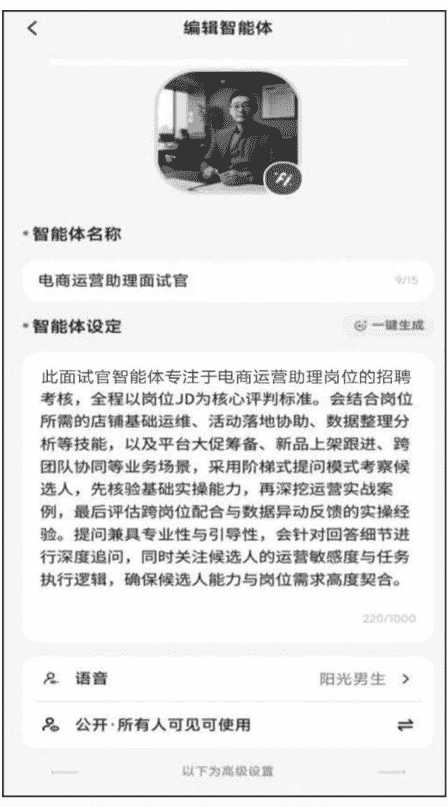
第二步，开始语音模拟训练，先在对话框输入提示词，如图12-2所示。
> 请你依据以下职位需求，为我开展一场模拟面试。[电商运营助理职位要求]
第三步，按下界面左下角语音通话图标，跳转至通话窗口，进行语音模拟面试，如图12-3所示。

我是电商运营助理的面试官，让我们一起看看你的实力吧！
- 展示你的店铺运维经验
- 分享一次大促活动的策划和执行过程
- 你如何处理数据异常并提出解决方案
请你依据以下职位需求，为我开展一场模拟面试。
一、职位基本信息
职位名称：电商运营助理
所属部门：电商运营部/店铺运营组
二、职位职责

第四步，可在保持既定角色的前提下横向变换练习题型，例如技术向或项目设计向等，与模型展开多轮连贯对话，能有效提升语言组织与现场应变能力。


### 12.4.3 最佳实践

通义千问并不会自行读懂目标岗位的招聘侧重点，也无法自动定位你在面试答复中的薄弱环节。若想让面试辅导发挥最大效用，需要你主动提供完整的面试材料并给出明确指令，并在拿到输出后自行筛选与二次打磨。以下做法能让辅导更具针对性与效率。

- 先圈定辅导边界：把诉求讲清楚，比如请模型提炼岗位核心考察点并结合个人简历找匹配优势。边界越清晰，产出越贴近真实考核。
- 同步打磨考察点与范例：在梳理核心考察维度之外，要求模型给出对应回答示例并指出可改进之处。
- 按短板调节输出深度：对于不擅长的模块，可要求先给基础版再逐步升级到案例版。
- 把成果转为题库：备考阶段，让模型基于已提炼的维度生成5到8道高频题，带着练习，熟练度与流畅度会明显提升。
- 多源交叉校验：把模型输出的答题框架与业内资深人士建议、官方公布要点对照，确保方向与招聘或复试要求一致。

借助上述方法，模型不仅能帮助掌握应试技巧，更能提前搭建清晰的答题思路，提升通过率。

# Part 4 生活服务：多维生活场景的智能支持

职场竞争力来自办公与学习，幸福感则来自生活方式与生活质量。人的一生要处理旅行安排、家务管理、亲子教育、健康维护、长者关怀等诸多复杂事务，这些事没有标准答案却深刻影响日常体验。通义千问在此场景的定位不是替代，而是补充：补充时间、补充信息、补充经验，帮助人在忙碌中做出更轻松、更合理、更明智的选择。

本节聚焦模型在生活服务里的多场景支持能力。它能按偏好定制旅行方案并提供结构化信息与路线建议；能依据户型与使用习惯给出家居灵感；能为节日、生日、纪念日撰写有温度的祝福；也能在突发状况下给出清晰可执行的应急方案。

在家庭教育里，模型具备知识理解、故事生成与行为引导能力，可帮助家长制定早教计划、设计亲子活动、构建习惯养成路径。对孩子而言，它还能扮演陪伴式学习伙伴，用更轻松的方式探索世界。

健康管理方面，可依据目标与条件定制健身计划、提供营养建议、制定康复与预防策略，甚至辅助挑选运动器材，通过智能提醒培养稳定持久的健康习惯。

对银发人群价值更突出：用更易懂的表达教会长者使用手机与App，提供简便实用的养生建议，辅助学习新技能，帮助维系家族联系，提升晚年生活的丰富度与连接感。

本部分核心是呈现模型的生活化价值：它不仅是工具，更是随时在侧、永不疲倦、愿意倾听并能给出清晰指导的生活伙伴。读完你会明白，通义千问不仅让生活更高效，也让生活更温暖。

# Chapter 13 生活规划与创意灵感

生活规划不只是排期或列清单，而是一种提升生活质量的系统方法。本章展示模型在个性化旅行设计、家居规划、节日祝福与文案创意、生活应急等场景的支持能力。通过理解需求并对场景做结构化分析，模型既能生成清晰可执行的方案，也能提供有灵感的创意点子，帮助读者以更低成本获得更高质量的生活体验，让不会规划不再成为障碍。

## 13.1 个性化旅行方案设计

### 13.1.1 用千问的优势

日常出行规划常涉及节假日旅行、家庭度假、朋友结伴等，期望旅程舒适高效且有体验感。但自行安排易出现路线不合理、景点雷同、时间分配失衡、预算失控、个性化需求被忽略，导致旅途疲惫。传统方式依赖网络攻略、旅行社或社交平台推荐，信息碎片、筛选成本高，很难精准匹配个人偏好与现实条件。

输入出行时间、目的地范围、同行人员、兴趣偏好、预算上限及特殊需求等关键信息，模型即可快速生成结构清晰、节奏合理、亮点突出的初稿。它能贴合休闲语境，梳理科学时间轴，整合交通、住宿、餐饮与活动建议，并按亲子、银发慢游、摄影、文化深度等类型调整侧重点，让方案既可行又富灵感，大幅缩短规划周期，提升满意度。

### 13.1.2 操作步骤

在生活场景中借助模型生成定制旅行方案，两步即可完成。

第一步，明确生成要求，清晰告知出行背景、核心诉求、人员构成及限制条件。提示词示例如下。

> “请为五一期间设计一个家庭亲子出行方案。四个家庭成员，两位成人加6岁男孩和3岁女孩，希望去气候宜人、适合低龄儿童的城市，避开人流高峰。5月1日出发，5月4日返回，预算1.5万元以内。偏好户外自然、轻量亲子项目与安全卫生的亲子酒店。需要交通建议、每日行程和注意事项。”

第二步，等待片刻，模型将据此生成个性化建议。

> 关于五一家庭亲子出行个性化建议
> 为满足家庭共同出游需求，保障儿童舒适体验，提升假期质量，现拟定五一期间赴宁波—象山区域的亲子方案。建议如下。
> 一、出行背景与可行性
> 孩子年龄小，长途飞行或高强度行程易疲劳。华东沿海城市气候温和，高铁可达，适应性强。热门城市五一客流密集，排队、住宿贵、安全隐患多。宁波—象山兼具海洋风光、生态农场与非遗资源，配套成熟且相对小众，适合低龄家庭错峰出行。
> 二、行程安排
> 1. 时间：2025年5月1日至5月4日，共4天3晚。
> 2. 路线
> - 第一天，上海至宁波高铁约2小时，入住东钱湖亲子民宿，下午游韩岭老街，步行轻松，有儿童手作店。
> - 第二天，象山影视城外围亲子乐园与海影城童话小镇，设儿童互动区，避免拥挤拍摄区。
> - 第三天，石浦渔港古城漫步与半边山沙滩亲子戏水，备防晒与替换衣物。
> - 第四天，返程前参观宁波科学探索中心，室内场馆，适合阴雨。
> 3. 特点：每日主景点不超过两处，预留午休，避免夜间出行。
> 三、预算
> 预计总支出1.48万元。往返高铁3200元，住宿6600元，餐饮及其他4000元，门票与体验1000元，多数景点对儿童免费或优惠。
> 四、配套与风险提示
> - 携带：儿童推车、常用药品、防晒帽、便携零食。
> - 保障：提前查询沿途儿科信息，购买短期意外险。
> - 天气预案：遇雨第三天可改为宁波博物馆加小九寨轻徒步。
> - 时间弹性：每日出发不早于9点，保障孩子睡眠。

### 13.1.3 最佳实践

为让方案更贴近真实需求，建议如下。

- 细化核心信息：在指令中说明时间节点、同行人数、健康状况、饮食禁忌及偏好交通方式，避免脱离现实的安排，提升可执行性。
- 明确出行类型：提前告知亲子游、银发慢游、蜜月、摄影采风等，使其针对性推荐目的地与活动，增强专业性与适配度。
- 补充应急预案：列出天气突变、突发疾病、交通延误等应对措施，提前做好风险防范，让旅程更从容。
- 核对实用细节：检查交通衔接是否合理、开放时间是否准确、儿童优惠是否遗漏，并补充地图标注与预约链接。
- 整理归档：后续需求可基于历史成功案例迁移调整，持续积累个性化出行知识库，提升规划效率。

通过这些方法，模型能帮助用户掌握方案设计逻辑与要素组合，降低试错成本，让出行更有温度与意义。

## 13.2 家居设计与布局规划

### 13.2.1 用千问的优势

装修或空间改造时，业主常需确定风格、功能分区、家具配置与色彩搭配，实现美观与实用统一。但初期易出现风格定位模糊、空间利用不合理、收纳不足、预算失衡，导致频繁修改与返工。传统方式依赖图册、社交平台或设计师咨询，信息碎片化、个性化匹配低，难以快速形成系统构思。

只需输入房屋基本信息、居住需求、风格偏好及是否需要开放式厨房、独立书房，即可快速生成风格明确、功能清晰、布局合理的初步构想。它能贴合家装专业语境，梳理空间动线，补充常见盲点，并针对小户型、跃层、长条形等户型提出优化建议，让灵感既有审美价值又可落地，缩短策划周期，提升决策效率。

### 13.2.2 操作步骤

借助模型生成家居灵感与布局规划，两步完成。

第一步，明确生成要求，清晰告知房屋现状、家庭成员、核心诉求及风格偏好。提示词示例如下。

> “请生成90平米三居室装修方案。房子为两室改三室，三代同住，夫妻、3岁孩子、爷爷奶奶，希望保留儿童活动区和老人休息角。采光一般，客厅朝北。偏好现代简约，色调浅木色加米白，预算中等，避免过多隔断影响通透。请给出整体布局与功能分区思路。”

第二步，等待片刻，模型将据此生成设计建议。

> 关于90平米三居室家居布局与设计灵感建议
> 为提升实用性与舒适度，满足多代同居需求，优化小户型利用，现提出设计构想。
> 一、设计背景与挑战
> 原户型两室，需改造为两卧加多功能室，易局促。家庭结构复杂，动静区需划分。客厅采光不足，隔墙会削弱光线。老人行动不便，儿童活动频繁，对动线安全与收纳提出更高要求。
> 二、风格与功能布局
> 1. 风格：现代简约，浅木地板、白墙、局部原木家具，提升明亮度。
> 2. 改造方案
> - 主卧保留原格局，增加嵌入式衣柜。
> - 次卧作儿童房，配可调学习桌与带轮储物床。
> - 多功能室用玻璃推拉门与书架隔断，白天书房兼游戏区，夜间可加折叠床供老人临时使用。
> - 客厅取消电视墙，设低矮展示柜作视觉隔断，增强通透。
> - 阳台封闭纳入客厅，作阅读角或绿植区，弥补采光。
> 三、重点优化
> - 储物：全屋通顶柜体，强化玄关、厨房、卫生间周边收纳。
> - 安全：防滑哑光地砖，家具圆弧，插座加保护盖。
> - 灯光：无主灯布局，筒灯加灯带加局部落地灯，营造层次。
> - 色彩：主色米白与浅灰，软装点缀薄荷绿与原木，增添温馨。
> 四、预期效果
> 实现小房大用，完成三室功能转换；提升通透与采光，缓解北向客厅阴暗；满足三代差异化需求；风格统一，营造整洁舒适的可持续居住环境。

### 13.2.3 最佳实践

为让家居方案更贴合实际，建议如下。

- 细化核心信息：说明房屋结构、成员年龄、做饭频率、有无宠物、预算及特殊禁忌，如忌深色或需无障碍通道，确保生成内容有现实基础。
- 明确设计类型：告知小户型优化、旧房翻新、软装搭配等，使其调整重点，提升专业性。
- 要求补充常见误区：首次装修可要求列出小户型陷阱与收纳不足预兆，增强风险预见。
- 核对细节：检查尺寸比例、走廊宽度、家具间距、动线流畅度，并补充材料推荐与软装清单，便于对接设计师。
- 迭代优化模板：将落地效果好的方案归档，后续如养老房设计可基于历史案例迁移生成，持续积累家居知识库。

通过这些方法，模型能帮助用户掌握设计逻辑与美学原则，减少沟通成本，让理想之家从想象变为可执行蓝图。

## 13.3 节日祝福与文案创意生成

### 13.3.1 用千问的优势

节日祝福创作常受同质化模板、语境错配、效率低下困扰。千篇一律缺乏温度，对领导、客户、亲友语气难把握，易触文化禁忌，批量创作耗时。传统方式依赖网络模板，筛选成本高，难以精准匹配需求，导致祝福流于表面。

模型能精准解决这些痛点，按节日、对象、风格等关键信息一键生成贴合场景的文案，区分长辈庄重、朋友俏皮、客户专业，避免错位与风险。例如中秋融入月满情长与共绘蓝图，既应景又传递合作诚意；春节规避敏感词，定制化表达。以技术赋能，让祝福从机械输出变为精准情感传递，激活共鸣。

### 13.3.2 操作步骤

借助模型辅助祝福与创意生成，核心在于明确意图、设定边界、引导输出，通常分四步。

第一步，明确祝福目标与场景。确认节日、对象、用途，是朋友圈文案、邮件或贺卡寄语。准备收件人身份、发布渠道、情感基调及字数要求，提供真实背景即可。

第二步，输入信息并明确输出要求。提示词示例如下。

> “请写三段母亲节朋友圈文案，风格为温馨感人、简洁大方、带点小幽默，每条不超过80字，避免使用辛苦了、伟大等常见词。”

第三步，模型自动识别情感维度与限制，生成多版本供选择。

> 母亲节文案建议
> 版本一 温馨走心：小时候觉得她无所不能，长大才发现那个超人只是穿围裙的妈妈。今天不想说感谢，只想陪你慢慢吃饭，像小时候你等我回家那样。
> 版本二 简洁优雅：五月的风带着花香，也带着你的味道。愿时光缓行，笑颜常驻，妈妈节日快乐。
> 版本三 轻松俏皮：我妈的手能炒出最好吃的蛋炒饭，也能一秒揪住我偷吃零食的耳朵。虽然我已30岁，但在她眼里永远是那个不许熬夜的小孩。

第四步，获取初稿后个性化调整。可要求改口语化、加比喻、为婆婆另出版本，逐步打磨。

### 13.3.3 最佳实践

模型不会自动知道今年想给老师写特别信，也无法感知你与闺蜜的专属梗。要发挥最大作用，需主动提供情境信息与清晰指令，并在生成后筛选润色。

- 提前明确对象身份与关系：如写给高中班主任或合作三年客户，并说明语气要求尊重且不逾矩，信息越细致越贴合。
- 要求多风格备选：明确要三种不同风格，增加选择空间，提升适配度。
- 融入个人经历定制：在指令中加入真实故事，如曾一起在云南支教，让文案摆脱模板，饱含专属温度。
- 转为情感表达清单：让模型按节日生成发送对象列表与专属文案建议，提前规划情感维护。
- 跨平台核验语气分寸：重点确认无歧义、无冒犯，尤其对长辈与职场关系，确保真诚得体。

通过这些方法，模型能帮助建立清晰的情感表达框架与创意储备，让每一次祝福都成为有设计感的心意传递。

## 13.4 生活应急方案制定

### 13.4.1 用千问的优势

日常突发情况如家庭意外、医疗紧急、自然灾害常让人措手不及。传统应急处理面临三重困境：信息碎片化，紧急时难获系统指导；缺乏针对性，通用建议难匹配家庭成员年龄、健康状况等具体条件；决策压力大，慌乱中易忽略关键步骤，导致应对失当。结果手忙脚乱，效果打折，甚至延误最佳处理时机。

应急方案智能生成

突发状况出现时，千问能迅速把现场的混乱整理成可执行的行动清单，为家庭应急预案的起草提供专业、迅速且高度个性化的支持。系统会依据用户描述的事故类型、家庭成员健康状况、居住条件等关键要素，快速产出条理清晰、步骤具体、拿来就能用的初稿，同时自动筛除常见误区，比如烫伤后涂牙膏这类错误做法，确保建议科学可靠。危急时刻，这份提纲能帮助使用者迅速抓住重点，从慌乱中恢复冷静，明显提升处置效率和成功率。

### 13.4.2 具体操作流程

借助千问制定生活应急方案，核心在于描述要准、生成要智、优化要针对，整体可分为四步推进。

第一步，精准描绘应急场景与核心要素。先确认事件类型、发生场景、涉及人员以及特殊限制，明确希望千问解决的具体问题。再把关键信息整理成简洁说明，无需刻意排版，信息完整即可。

第二步，输入关键信息并引导生成方案。将整理好的要素提交给千问，并用提示词说明需求。提示词示例如下。

> “家中老人突发胸痛，有高血压病史，需在等待救护车期间立即采取哪些应急措施。请针对有高血压史的老人突发胸痛情境，生成一份详细的处置预案，涵盖初步评估、紧急处理流程、何时拨打急救电话等核心内容。”

第三步，千问将自动梳理事件逻辑与步骤关联，提炼重点并生成结构化方案。

> **家庭突发胸痛应急预案**
> **一、初步评估**
> 让患者保持半卧姿势安静休息，尽量避免随意搬动。
> 询问症状已持续多久、疼痛特点，是否出现压迫感、刺痛等。
> 检查身边是否携带硝酸甘油等常用药物。
> **二、紧急处置流程**
> - 若患者自备硝酸甘油，可舌下含服1片。
> - 5分钟后疼痛仍未缓解，可再含服1片。
> - 维持患者情绪平稳，避免过度紧张。
> - 用手机记录发病时间与用药情况。
> **三、何时拨打急救电话**
> - 疼痛持续超过5分钟且未减轻。
> - 伴随呼吸困难、出冷汗、恶心等症状。
> - 服用硝酸甘油后症状仍无改善。
> **四、等待救护车期间**
> - 清理周边杂物，确保急救通道畅通。
> - 准备好患者的病历资料与药物清单。
> - 持续与患者沟通，安抚情绪。

第四步，获取方案并二次优化。千问输出后，可根据实际需求继续追问，例如为有糖尿病史的老人补充额外注意事项，或按家庭环境细化撤离路线等，逐步完善结果，使其更贴合家庭实际。例如针对家中育有幼儿的情况，需要额外注意安全隔离的反馈，千问可能会补充：“在等待救护车时，将孩子安排到安全房间，避免接触危险物品，确保孩子远离急救区域。”

### 13.4.3 使用建议

千问不会自动掌握家庭的健康状况与居住环境，要让它在应急方案制定中发挥最大效用，需要主动提供完整信息与明确指令，并在结果生成后进行筛选与二次整理。遵循以下做法可让方案更高效、更实用。

- 提前录入家庭基础信息：整理成员健康状况、特殊需求，如过敏史、房屋结构、周边医疗资源，明确要求千问制定家庭突发健康事件的应急方案，信息越细致方案越贴合。
- 要求补充背景知识：除列出处置步骤外，可让千问补充必要的前置知识或案例，如为何突发胸痛需保持半卧位，有助于在紧急时快速理解关键步骤。
- 结合家庭实际调整输出深度：面对复杂情况，要求分层输出，先通俗解释再给出专业建议，避免直接陷入晦涩表述。
- 将方案转化为家庭应急清单：生成后请千问提炼3～5个家庭成员需共同掌握的关键要点，如硝酸甘油使用方法、紧急联系电话等，并以此开展家庭演练。
- 多平台交叉验证方案：将千问生成的预案与当地医院、社区应急中心的官方指南对照，确保不遗漏重要细节，同时与家庭条件形成互补。

# 第14章 智能育儿陪伴完整方案

育儿过程充满挑战，需要知识、耐心与系统方法。本章聚焦通义千问在早教启蒙、晚安故事与绘本定制、亲子活动设计、习惯养成与行为指导、升学规划与择校中的应用场景。千问能够依据孩子年龄发展规律设计学习计划，生成高质量绘本故事，提供科学的行为指导策略，并协助家长进行教育规划。本章目标是帮助家长构建“智能育儿体系”，不仅减少育儿焦虑，更让陪伴更有成效与温度。

## 14.1 早教启蒙设计

### 14.1.1 千问的核心价值

在家庭教育中，家长常需为0～6岁儿童制定科学合理的早教与学习计划，涵盖语言发展、认知训练、情绪管理、艺术感知、运动协调等多个维度。然而多数家长缺乏专业育儿知识体系，易出现目标模糊、内容失衡、阶段错位、活动枯燥等问题，导致启蒙效果不佳，甚至引发孩子抵触。传统方式依赖网络碎片信息或亲友经验，质量参差不齐，难以形成系统化、个性化、可执行的教育方案。

千问可高效解决这一痛点。只需输入孩子年龄段、发展特点、家庭环境、可用时间、教育资源等关键信息，即可快速生成结构完整、内容科学、节奏合理的早教启蒙与学习计划初稿。它能自动匹配儿童发展心理学理论框架，设计分龄分阶的活动模块，并融入游戏化学习理念，提升计划趣味性与可操作性。同时可按不同需求调整内容侧重，让学习计划既符合成长规律又具备实践指导价值，大幅节省家长规划时间，提升家庭早教质量。

### 14.1.2 实施流程

借助千问制定科学的早教启蒙与学习计划，可通过以下方式高效构建个性化方案。

第一步，明确生成需求，提供详实的背景信息。向千问清晰描述孩子基本情况、发展目标及家庭现实条件，输入提示词如下。

> 帮我制定一份针对3岁幼儿的早教启蒙与学习计划。孩子目前语言表达清晰，喜欢听故事和涂鸦，但专注力较短，约8～10分钟；社交意愿较强但略显害羞。家中有父母和祖辈共同照护，每天可安排固定学习时间约30分钟，周末时间较充裕。希望重点提升语言表达、情绪认知和动手能力，兼顾亲子互动质量。请按周设计活动内容，包含每日主题、具体活动建议、所需材料及注意事项。

第二步，获取生成结果，优化落地执行。稍等片刻，千问将依据指令生成一份结构清晰、内容丰富的早教计划草案。

> **3岁幼儿早教启蒙与学习计划（2025年6月第2周）**
> **一、发展背景与计划目标**
> 当前发展特点：具备基本语言沟通能力，能表达简单需求与情绪，对图画书、音乐、手工表现出浓厚兴趣。
> 存在挑战：注意力持续时间有限，面对新环境或陌生人时易退缩，精细动作仍在发展中。
> 计划目标：通过游戏化学习方式，提升语言表达完整性、情绪识别能力与手眼协调水平，增强社会适应信心。
> **二、本周学习主题安排**
> | 周次 | 活动主题 | 主要活动 | 准备物品 | 建议时长 |
> | :--- | :--- | :--- | :--- | :--- |
> | 周一 | 情绪小侦探 | 绘本共读《我的情绪小怪兽》，用彩色黏土制作“情绪瓶子” | 绘本、彩泥、小玻璃瓶 | 25分钟 |
> | 周二 | 故事创想家 | 看图讲故事（动物卡片），家长记录孩子口述故事 | 动物卡、录音笔/手机 | 20分钟 |
> | 周三 | 小手巧巧做 | 穿珠子比赛、撕纸拼贴“春天的树” | 彩色大孔珠、彩纸、胶水 | 25分钟 |
> | 周四 | 音乐律动日 | 跟音乐跳舞、打击乐器伴奏（锅碗瓢盆也可） | 播放器、简易乐器 | 20分钟 |
> | 周五 | 自然探索家 | 小区观察植物与昆虫，带回落叶做标本 | 放大镜、透明夹册 | 25分钟 |
> | 周六 | 亲子剧场 | 分角色表演《三只小猪》，鼓励孩子选择角色 | 道具帽、布偶 | 30分钟 |
> | 周日 | 自由创作日 | 开放式绘画或积木搭建，不限主题 | 画纸颜料、积木 | 30分钟 |
> **三、实施建议与注意事项**
> - 每项活动前明确规则与目标，使用简短语言引导。
> - 尊重孩子兴趣选择，若中途转移注意力，不强求完成。
> - 多使用正面鼓励语言，如“你刚才讲的故事真有趣！”
> - 每周末进行简要回顾，由家长记录孩子的亮点表现。
> - 所有活动均以亲子陪伴为核心，避免电子屏幕替代互动。
> **四、预期成效**
> - 提升语言组织与表达能力，逐步学会描述事件经过。
> - 增强情绪识别与表达能力，减少因沟通不畅引发的哭闹。
> - 锻炼手指精细动作，为未来书写准备打好基础。
> - 在安全支持环境中积累社交经验，缓解害羞心理。
> - 建立规律而愉快的家庭学习节奏，增进亲子情感联结。
> 本计划可根据实际执行情况每周迭代调整，保持持续适配孩子发展需求。

### 14.1.3 最佳实践

为让千问生成的早教计划更贴合实际育儿场景，建议遵循以下方法。

- 细化儿童画像：在指令中准确说明孩子的月龄、性格特征、已具备能力及敏感点。比如是否怕黑、是否挑食、是否抗拒陌生环境等，把个体差异清晰传递，让生成内容精准适配。
- 提前明确教育侧重点：告知千问本次计划的核心方向。无论是支持语言爆发期的表达能力、缓解分离焦虑的情绪适应，还是为入园做生活习惯与社交准备，明确方向后千问能有针对性地设计活动组合与科学干预策略。
- 要求融入安全提示：对于涉及手工、运动或户外活动的内容，可要求千问补充安全提示，提升方案实用性，强化风险防范意识。
- 核对发展适配性：生成后对照权威育儿指南，检查活动难度是否合理，必要时补充资源链接或推荐绘本清单。
- 建立家庭计划模板库：将验证有效的周计划分类归档保存，逐步建立月龄主题模板库。后续遇到同类需求时，让千问基于已有模板生成新计划，不断优化与完善，实现个性化与系统化兼具的长期育儿支持。

画面描述：孩子蜷缩在床上，眼神略带紧张，窗外树枝随风轻摇。

## 第2页

文字：“突然，他的红色挖掘机动了动履带，轻轻说：‘别怕，我带你去天上看看。’”

画面描述：玩具挖掘机眼睛亮起蓝光，车身微微升起，仿佛要飞。

## 第3页

文字：“他们穿过云朵，来到夜空工地，一群星星正在点亮路灯。”

画面描述：银河如道路延伸，小星星们拿着工具安装“星光灯”。

## 第4页

文字：“‘每盏灯都是一份爱，’星星队长说，‘你妈妈点的那一盏最亮。’”

画面描述：一颗特别明亮的星星闪烁，下方地球上的妈妈正抬头微笑。

## 第5页

文字：“小宇按下按钮，挖掘机射出一束光，把整间屋子照得暖暖的。”

画面描述：房间充满柔和金光，影子变得可爱滑稽，孩子笑了。

## 第6页

文字：“现在，他知道，黑夜不是空的，是爱在悄悄亮着。”

画面描述：孩子安然入睡，胸口微光闪烁，窗外月亮温柔眨眼。

## 给家长的小贴士

本故事有助于：

缓解夜间分离焦虑，建立心理安全感。

提升语言理解与表达能力。

激发想象力与象征思维。

鼓励独立睡眠行为，减少依赖。

第四步，获取内容并进行二次优化。千问输出内容后，可根据实际需要进一步调整。例如，把这个故事缩短到5页、加入刷牙的情节、让故事发生在冬天、生成一段适合朗读的语音节奏提示，也可要求导出纯文本版用于每日朗读，或分页图文版用于制作家庭电子绘本。通过多次迭代，逐步形成系列故事，构建专属于孩子的“童年故事宇宙”。

### 14.2.3 使用要点

千问不会自动知道孩子今天经历了什么，也不会察觉他的情绪变化。要让晚安故事真正走进孩子内心，需要家长主动提供真实的生活线索，并对生成内容进行情感化润色。遵循以下方法可让定制故事更贴心、更有效。

- 明确故事类型：提前告知千问需要生成情绪安抚类、行为引导类还是节日主题类故事，使千问根据类别设计相应的情节结构和语言风格，提升对孩子心理和行为的积极影响。
- 搭配延伸活动组合包：请求千问在生成故事的同时，提供一至两个简单的亲子互动建议，增强故事与现实生活的联结，丰富家庭互动体验。
- 适应语言发展水平：针对语言发展初期的孩子，要求千问使用简单句、重复结构和拟声词，便于理解和模仿；对于大龄儿童，则可加入隐喻、悬念和开放式结局，激发思考，促进语言和思维能力的进一步发展。
- 制定家庭睡前仪式清单：利用千问根据故事内容生成3～5个互动提问，如“如果你有一台会飞的挖掘机，你想去哪儿？”提前准备问题，引导孩子思考和表达，让共读过程更加深入和有趣。
- 多平台验证适龄性：将千问生成的故事内容与权威育儿指南或儿童心理学书籍中的建议进行对照，确保故事情节和语言表达符合孩子当前年龄段的认知特点和情感需求，保障内容的科学性和适宜性。

通过这些方法，千问不只是帮你讲个故事，而是让你在每个夜晚都能为孩子点亮一盏由爱与想象力编织的心灵灯，把平凡时光变成滋养一生的情感印记。

## 14.3 亲子活动设计

### 14.3.1 解决思路

在现代家庭中，亲子陪伴已成为育儿核心环节，但家长在实践中常面临多重困境，有限的时间被碎片化切割，难以统筹规划深度互动时光。创意匮乏导致陪伴形式单一，常局限于看电视、玩手机等被动娱乐。活动设计更与孩子成长需求错位，未能有效激发语言、认知、社交或运动等关键能力的发展。传统做法依赖网络搜索或朋友圈分享，信息零散且适配性差，难以匹配孩子的年龄特点、兴趣偏好和家庭现实条件。

千问可高效解决这一难题。只需输入孩子的年龄段、性格特征、可用时间、空间条件、希望发展的能力方向，即可快速生成结构清晰、安全可行、富有趣味性的亲子活动方案，帮助家长在轻松互动中实现隐性教育目标。通过这种方式，亲子时光不再只是“陪玩”，而是转化为有温度、有成长、有回忆的情感投资，让每一次陪伴都更有价值。

### 14.3.2 操作流程

借助千问设计科学合理的亲子活动，核心在于将家庭真实情况转化为可执行的互动方案。整个过程分为四步即可完成。

第一步，明确活动目标与实施条件。首先确定本次亲子活动的主要目的，是促进情感联结，锻炼精细动作，还是激发科学兴趣？接着，收集家庭基本信息：孩子年龄、性格、可用时间段、活动空间、参与人员以及可用材料。

第二步，输入提示并生成初稿，将上述信息整理成清晰指令，输入提示词如下。

> 请帮我设计一个适合3岁半男孩的亲子活动，孩子活泼好动，喜欢汽车和涂鸦。希望在家中客厅进行，时间控制在20分钟以内，材料尽量使用家里现有的物品。目标是锻炼手眼协调能力和遵守简单规则的意识，请提供活动名称、所需材料、具体步骤和家长引导语。

第三步，稍等片刻，千问将根据指令生成亲子活动方案。

> 亲子活动方案：《小车运货挑战赛》
> **一、活动背景与目标**
> 当前孩子处于动作发展关键期，对车辆类玩具兴趣浓厚，但专注时间较短。
> 家庭希望利用晚间碎片时间开展有意义互动，避免屏幕依赖。
> 活动目标：提升手部控制能力、空间感知力及轮流等待的社会规则意识。
> **二、活动基本信息**
> 适合年龄：3至5岁。
> 参与人数：2至3人（孩子、家长、兄弟姐妹）。
> 活动时长：15至20分钟。
> 场地要求：客厅地板或地毯区域。
> 材料准备：玩具小车若干、彩色积木或瓶盖作为“货物”、胶带（用于标记起点与路线）。
> **三、活动步骤说明**
> 布置赛道：用胶带在地面贴出弯道或直线路径，设置“出发站”和“终点仓库”。
> 分配任务：孩子负责驾驶小车，家长担任“调度员”，发出指令如“请运送三块红色积木到B区”。
> 开始挑战：孩子用手推动小车沿轨道行驶，将“货物”准确卸载到指定位置。
> 角色互换：一轮后家长驾驶，孩子发号施令，增强互动平等感。
> **四、家长引导语建议**
> 使用鼓励性语言：“你刚才转弯特别稳！”“这次比上次多运了一个！”
> 引入简单规则：“每次只能运两个货物哦，超载会翻车。”
> 延伸提问：“如果下雨了，赛道变滑，小车该怎么开？”
> **五、预期效果**
> 锻炼手部精细控制与视觉追踪能力。
> 在游戏中理解指令、遵守规则，提升执行功能。
> 增强亲子协作体验，建立积极互动模式。
> 激发想象力，为后续角色扮演游戏提供素材。

第四步，获取方案并进行二次优化。千问输出结果后，可根据实际情况进一步追问，如有没有更适合雨天的替代玩法、能否加入计分机制让孩子更投入、请推荐一个类似但侧重语言发展的活动，逐步完善生成结果，使其更契合家庭节奏与育儿理念。

### 14.3.3 实践要点

千问不会自动知道你家客厅有多大，也不会了解孩子当天的情绪状态。要让其在亲子陪伴中发挥最大作用，需要主动提供完整信息和明确指令，并在生成结果后进行筛选和个性化调整。遵循以下做法可以让活动设计更高效、更贴近生活。

- 细化儿童发展需求：在指令中明确孩子当前成长焦点，精准匹配成长敏感期。输入具体需求能引导生成贴合能力发展阶段的活动方案，避免泛化设计，提升干预针对性与有效性。
- 明确活动类型与目标导向：需预先界定活动类别，并清晰阐述核心目标，引导千问优化任务框架与互动模式，确保方案专业性，精准适配儿童发展需求，避免内容模糊或偏离目标。
- 补充安全提示与替代方案：针对涉及工具或身体活动的项目，主动要求补充安全须知，增强活动可行性，降低风险，确保灵活适配不同环境。
- 核对材料可得性与操作难度：生成方案后，需核查材料是否家中常备，步骤是否烦琐。若复杂，可要求补充图文指引或分步视频，降低操作门槛，确保家长无须额外采购或耗费精力，轻松落地活动。
- 调整任务难度：对低龄儿童，可要求活动步骤不超过三步、语言指令简短明确；对大龄儿童，则可加入计时挑战、团队合作或记录表单，提升认知负荷与责任感。

通过这些方法，千问不只是帮你想个游戏，而是让你在有限时间内构建起系统化、个性化、可持续的亲子互动体系，把日常陪伴转化为孩子全面发展的温暖引擎。

## 14.4 习惯养成与行为引导

### 14.4.1 核心价值

在家庭教育中，习惯养成是塑造孩子长期行为模式的核心环节。但大多数家长在实践中面临困境，目标设定模糊，如多读书却缺乏具体标准，导致执行无力。方法依赖主观经验，缺乏科学理论支撑，难以契合儿童成长规律。计划缺乏弹性，僵化执行易引发孩子抵触。传统方式多依赖书籍或网络碎片信息，内容宽泛难以个性化适配，效果有限。

千问在此环节可发挥行为规划师作用，通过输入孩子年龄阶段、当前行为表现、家庭环境特征及具体目标，如每日专注学习20分钟，它能快速生成结构化、阶段化的习惯养成方案。自动整合儿童心理学理论，提供分步实施策略与正向激励设计，并基于实时反馈优化调整。这样，家长既能避免无效尝试，又能通过科学方法培养孩子自律能力，将习惯养成转化为可操作、可持续的成长支持，显著提升家庭教育的专业性与实效性。

### 14.4.2 操作步骤

### 两步让千问搭建可执行的亲子习惯

在日常育儿中想借助千问输出科学可用的习惯培养方案，其实只要走完两个环节就能贴合家庭实际。

**第一步，明确生成指令。** 把习惯来源、期望结果和家庭支持说清楚，直接给提示词。

> 帮我为6岁女孩设计一份独立完成作业的培养方案。孩子现在常拖到晚上8点才开始写作业，家长希望两周内形成放学后先写作业再玩的规律。家庭支持是父母每晚7点陪读，奖励是多玩10分钟。

**第二步，等方案呈现。** 千问会依据指令给出完整计划。

> 放学后作业自律培养方案
>
> 为提升家庭教育质量和孩子自主学习能力，结合实际情况，输出一份可操作的培养方案。
>
> **一、背景与必要性**
>
> 孩子正处小学低年级，对时间管理意识薄弱，作业常拖到晚间才开始。
>
> 家长希望建立先写作业再玩耍的规律，缺少有效方法，容易陷入催促和对抗。
>
> 现有培养方式多停留在说教，效果有限，需要系统化、可执行的引导方向。
>
> **二、培养方案与执行安排**
>
> 1. 方案名称：放学后作业自律培养方案。
> 2. 核心目标：两周内做到放学10分钟内启动作业，30分钟内完成基础作业。
> 3. 执行周期：2025年7月15日至7月29日，共2周。
> 4. 详细安排
>    - 第1周：固定作业时段16:30—17:00，用计时器做成游戏。
>    - 第2周：引入完成奖励，完成5天可兑换多玩10分钟。
> 5. 关键提示：若孩子抵触，可先玩5分钟再开始，降低抗拒。
>
> **三、预期效果**
>
> 提升时间管理意识，减少拖延。
>
> 增强任务完成的满足感与自律力。
>
> 改善亲子沟通，减少作业冲突。
>
> 形成可延续的日常习惯，为长期学习打底。

### 14.4.3 最佳实践

想让千问输出更贴合真实育儿，建议按以下做法。

- 先把习惯类型和可量化指标说清：在指令里明确习惯类别如作息类、学习类、社交类，并给出可测量的标准，如整理玩具不超过10分钟。避免多读书这类模糊表述，让方案可执行可追踪。
- 先理解原理再落地：请千问解释为何先完成作业再玩耍能提升学习效率，并引用发展心理学依据，再给出操作步骤。家长掌握原理后才好灵活调整。
- 分阶段迭代优化：聚焦单点改进，例如激励机制，而非一次要完整方案，提升与家庭实际的适配度。
- 补充执行细节：针对孩子抗拒等关键节点，主动要求提供应对话术，例如我们一起找找作业的家，或替代方案如先玩五分钟再开始。细节越足，可操作性越强。
- 融入家庭语言风格：把生成文本转化为亲子对话，用亲切自然的表达，让习惯养成融入日常互动，在轻松氛围中成长。

通过上述方法，千问能帮助家长掌握习惯养成的底层逻辑与教育技巧，降低执行阻力，让计划更具针对性和可操作性，推动家庭教育高效进行。

## 14.5 升学规划与择校

### 14.5.1 用千问的优势

升学阶段院校众多、政策变化快、匹配维度复杂，学生和家长容易陷入两类困境：信息分散难整合，排名、招生要求、就业数据各自为政；个人需求与院校匹配模糊，不知道如何结合分数、兴趣、专业前景筛选目标，耗费大量时间仍难以精准决策。

千问可担任升学决策助手，输入个人核心信息和需求后，快速整合权威政策、院校数据和行业趋势，生成定制化规划。它能把择校维度如地域、专业实力、录取概率、就业资源体系化梳理，结合个人特质建立匹配模型，并动态适配政策变化，提前预警风险点，让规划从盲目筛选转为精准定位，帮助高效锁定最优路径。

### 14.5.2 操作步骤

借助千问生成升学规划与择校建议，核心是厘清需求、整合信息、精准匹配，可分为四步。

第一步，梳理个人核心信息与需求边界。先明确升学诉求是院校层次、专业实力、地域资源还是就业导向，再整理当前成绩、排名、优势学科、兴趣方向、预算范围、意向地域，以及是否有专项计划、跨专业报考等特殊需求，确保信息具体全面。

第二步，输入信息并明确输出要求。将整理好的个人信息、需求清单和相关政策参考如近年招生章程、选考科目要求输入千问，并结合提示词描述需求。

> 结合我的成绩排名、优势学科、意向地域和就业倾向，生成一份分梯度的升学规划，包含目标院校清单、备考重点和择校风险提示。

第三步，千问自动关联信息，整合院校数据与政策要求，生成结构化内容，如分层院校推荐、备考时间表、适配度分析。

```
升学规划模块：本科升学择校

一、规划框架

1. 自我画像定位
```

- 成绩维度：当前总分排名、单科优势与短板、模考波动范围。

- 需求维度：核心诉求（院校层次、专业优先），意向地域（一线城市、省会城市、离家距离），预算区间（学费和生活费）。

- 发展维度：兴趣方向（理工、人文、经管），职业倾向（技术岗、管理岗、学术深造）。

## 2. 目标院校分梯度规划

- 冲刺院校（录取概率20%～30%）：3所，聚焦专业实力强、地域优势明显的院校，标注需补强的分数短板。
- 稳妥院校（录取概率60%～70%）：5所，匹配当前成绩水平，兼顾专业适配度与院校综合资源。
- 保底院校（录取概率80%以上）：2所，确保录取底线，优先选择办学稳定、就业口碑好的院校。

## 3. 备考与择校时间轴

- 前期（6～9个月）：锁定目标院校近年录取数据，针对性补强薄弱学科，准备专项计划申请材料。
- 中期（3～6个月）：跟踪目标院校招生政策变化，参加模考验证适配度，调整院校梯度。
- 后期（1～3个月）：核对志愿填报规则，确认院校录取细则，完成志愿排序。

## 4. 择校关键考量维度

- 院校维度：专业评级、师资力量、科研资源、就业合作企业。
- 政策维度：招生计划变动、选考科目要求、专项计划覆盖范围。
- 适配维度：录取分数线波动、同分考生去向、转专业政策。

## 5. 风险预警与应对

- 政策风险：选考科目调整、录取规则变化，提前备选2所政策稳定院校。
- 分数风险：模考成绩波动，预留1至2所保底院校的调整空间。
- 适配风险：专业学习难度与自身基础不匹配，优先选择大类招生院校。

## 二、核心要点

- 升学规划以“自我定位和数据支撑”为核心，避免单纯依赖排名或口碑。
- 院校梯度设置合理，冲刺、稳妥、保底比例建议3:5:2，降低落榜风险。
- 备考与择校同步推进，实时跟踪政策与成绩变化，动态调整规划。
- 地域与专业的平衡需结合职业规划，技术类专业可侧重院校行业资源，人文类可兼顾地域平台。
- 志愿填报严格遵循“冲稳保”原则，同时关注院校专业录取规则如分数优先、志愿优先。

第四步，接收规划方案并二次优化。输出后可追问细化，如请补充目标院校近三年就业质量报告核心数据、针对薄弱学科调整备考时间轴、增加跨专业报考备选方案等，让规划更贴合实时需求。

### 14.5.3 最佳实践

千问无法自动获取实时成绩波动与最新招生政策，要发挥最大价值，需主动提供精准信息、明确需求边界，并校验优化生成结果。

- 提前输入完整个人画像：发送成绩数据、兴趣测评、职业倾向、预算范围等，并明确需结合最新招生政策生成适配规划，信息越具体匹配度越高。
- 要求生成规划方案和政策解读：除院校推荐和时间轴外，可补充目标地区招生政策要点、专项计划申报条件等关键信息，避免政策盲区。
- 结合自身情况调整输出维度：分数波动大者可要求增加动态调整方案，按不同成绩区间提供备选院校；专业方向明确者可强化专业实力优先的筛选逻辑。
- 将规划结果转化为决策评估清单：让千问列出各目标院校的优势、短板及适配风险，对照清单逐一评估，减少决策犹豫。
- 多渠道交叉验证信息：将推荐院校与教育部门官网、院校招生公告、学长学姐经验对照，确认录取数据、专业设置等关键信息的准确性。

如此，千问不仅是罗列院校清单的工具，更能帮助形成清晰的目标体系、备考路径和决策逻辑，把信息搜集时间转化为决策精准度。

Chapter 15

第15章

健康与生活管理

健康管理是长期工程，需要科学方法、持续执行与清晰反馈。本章介绍千问如何协助制定个性化健身计划、健康饮食与热量管理方案，指导康复与健康预防，以及健身器材选择与教学辅助。依托千问的理解与推理能力，用户可轻松获得个性化、可执行、可调整的健康策略。无论减脂、增肌、提升体能或预防健康，本章都提供可靠的智能辅助，让健康管理更可持续。

## 15.1 个性化健身训练计划定制

### 15.1.1 用千问的优势

现代人节奏快、压力大，规律锻炼意识增强。但开始健身时常见两大问题：缺乏科学指导，盲目跟从网络视频或他人计划，易出现动作不规范、强度不合理甚至运动损伤；目标多样，如减脂、增肌、提升耐力、改善体态，通用模板难以匹配个体差异，导致效果差或动力不足。

千问可扮演专属健身教练，输入个人核心信息与需求后，快速整合运动科学原理、动作标准、营养搭配等知识，生成针对性计划。它能将健身维度如训练目标、身体基础、时间预算、场地条件系统化梳理，结合个体特质如体能水平、伤病史、偏好运动类型优化方案，并动态调整强度与进度，让计划从盲目模仿变为精准适配，帮助高效规避风险、达成目标。

### 15.1.2 操作步骤

借助千问生成个性化健身训练计划，核心是明确自身条件、锁定目标、获取适配方案，可分四步完成。

第一步，通过标准化表格梳理自身核心信息，确保数据真实全面，为方案提供依据。

| 信息分类 | 具体内容 |
|---|---|
| 基础身体指标 | 年龄28岁、性别女、身高165cm、体重58kg、体脂率24% |
| 运动基础 | 无系统健身经历、日常活动量少、无伤病史、无专项运动技能基础 |
| 训练条件限制 | 每周可训练3次、每次45～60分钟、训练场地为家用、无专业器械仅备有瑜伽垫 |
| 核心健身目标 | 4周内降低体脂率2%、改善腰腹线条、提升基础心肺与肌肉耐力、养成规律运动习惯 |
| 附加需求 | 需要配套饮食建议、动作标准指引、训练进度追踪模板 |

第二步，以附件形式上传基本信息给千问，并输入提示词。

> 已上传个人健身基础信息表，麻烦结合表内全部数据，为我生成一份4周家用无器械个性化减脂塑形训练计划，需包含每次训练的具体动作、组数次数、时长分配、组间休息间隔，同时配套每日饮食参考方案和每周进度追踪表，动作难度需适配新手水平，避免易导致损伤的高强度动作。

第三步，千问分析信息并生成完整训练计划，自动整合信息表数据与运动科学逻辑，输出结构化个性化方案。

**健身训练模块：4周家用减脂塑形计划**

### 一、计划框架

1. 个人基础画像
   - 身体维度：年龄28岁、性别女、身高165cm、体重58kg、体脂率24%。
   - 运动基础：无系统健身经历，日常活动量少，无伤病史。
   - 条件限制：每周可训练3次，每次45～60分钟，家用无器械，仅可利用瑜伽垫。
   - 核心目标：4周内降低体脂率2%，改善腰腹线条，提升基础体能。

2. 分阶段训练安排
   - 第1至2周（适应期）：以低强度有氧加基础力量为主，培养习惯。每次结构：热身10分钟（关节活动、动态拉伸）、主训练35分钟（开合跳、深蹲、平板支撑、弓步蹲、臀桥，每组12～15次，3组，组间休息60秒）、放松10分钟（静态拉伸）。
   - 第3至4周（提升期）：增加强度与动作变式，强化燃脂。每次结构：热身10分钟、主训练40分钟（高抬腿、相扑深蹲、侧平板支撑、箭步蹲跳、臀桥变式，每组15～18次，4组，组间休息45秒）、放松10分钟。

3. 饮食与作息配套建议
   - 饮食原则：控制热量缺口，高蛋白（鸡蛋、鸡胸肉、豆制品）、高纤维（蔬菜、粗粮）、低糖低脂。
   - 每日饮食参考：早餐全麦面包、鸡蛋、牛奶、小份水果；午餐杂粮饭、瘦肉、两种蔬菜；晚餐粥、清蒸鱼、蔬菜沙拉；加餐坚果、酸奶。
   - 作息要求：保证7～8小时睡眠，训练前后1小时避免暴饮暴食。

4. 进度追踪与调整标准
   - 每周测量体重、体脂率、腰围、臀围，记录训练感受。
   - 肌肉酸痛持续超2天，可适当减少组数或延长休息；适应良好，可增加5%～10%强度。

5. 注意事项
   - 保持标准姿势，避免弯腰驼背、膝盖内扣。
   - 训练前充分热身，训练后及时拉伸。
   - 多饮水，每日不低于1.5升，促进代谢。

### 二、核心要点

- 个性化计划以身体基础加目标导向为核心，避免盲目追求高强度。
- 新手需遵循循序渐进，从低强度开始逐步提升。
- 饮食与训练相辅相成，减脂需兼顾热量控制与营养均衡。
- 动作标准比数量更重要，先保证姿势正确再增加负荷。
- 坚持是关键，每周固定时间训练，同时允许合理休息，避免过度疲劳。

第四步，接收计划方案并二次优化。输出后可追问，如补充每个动作的标准做法说明、增加2个腰腹塑形动作、调整饮食适配素食需求等，让方案更贴合自身习惯与条件。

### 15.1.3 最佳实践

千问无法自动获取实时身体状态与训练反馈，要发挥最大价值，需主动提供精准信息、明确需求边界，并实践验证与调整。

- 提前输入完整身体信息：年龄、体重、体能测试结果、伤病情况、训练场地与器械等，并说明需结合实际条件生成可落地计划，信息越具体适配度越高。
- 要求生成计划和动作指导：除训练安排外，可补充关键动作的标准要领、常见错误及纠正方法，适合新手掌握正确姿势。
- 结合自身情况调整输出细节：时间紧张可要求生成30分钟高效碎片化方案；有旧伤可强化避伤动作推荐和康复训练内容。
- 将计划结果转化为每日执行清单：按训练日拆分计划，明确动作、组数、时长，便于对照执行，减少决策成本。
- 结合实践反馈动态优化：将训练感受如动作难度、肌肉酸痛反馈给千问，如深蹲时膝盖不适能否替换更安全动作，让计划随身体状态动态调整。

如此，千问不仅是罗列动作的工具，更能提供适配自身、科学系统、可长期坚持的健身方案，把信息搜集时间转化为训练效果的加速器。

## 15.2 健康饮食与热量管理

### 15.2.1 用千问的优势

日常饮食管理中常出现目标模糊、营养搭配失衡、热量把控不准，导致食谱针对性差、计划难以坚持、营养与热量失衡，健康改善效果不佳。传统方式依赖零散知识和通用食谱，效率低且难以适配个人身体状况、饮食偏好与生活节奏。

千问可高效解决痛点，输入个人基础信息、健康目标、饮食禁忌、生活习惯等关键内容，即可生成结构完整、科学适配、可落地执行的健康饮食与热量管理方案。它能自动整合营养学原理与实操经验，梳理清晰饮食逻辑，补充个性化搭配建议，并按不同目标如减脂、增肌、调节血糖调整结构与热量分配，让方案既科学又贴合需求，节省规划时间，提升健康管理效率。

### 15.2.2 操作步骤

在日常健康管理中，借助千问生成饮食与热量管理方案仅需两步。

第一步，明确本次生成要求，清晰告知个人基础信息、健康目标、饮食禁忌、生活习惯及特殊需求，输入提示词。

> 帮我制定一份健康饮食与热量管理方案。情况是这样的：我32岁，女性，身高163cm，体重59kg，BMI 22.2，日常久坐办公，每日活动量较少，无慢性病史，但有乳糖不耐受。目标是维持健康体重，改善肠道消化功能，提升身体代谢。希望方案包含每日三餐食谱、热量分配、营养搭配要点，食材易采购、烹饪步骤简单，适配工作日快手制作与周末家庭烹饪场景，避免过于复杂的料理方式。

第二步，稍等片刻，千问将据指令生成结果。

> **健康饮食与热量管理方案**
>
> **一、个人基础信息与健康目标**
>
> 1. 基础情况：32岁女性，身高163cm，体重59kg，BMI 22.2，日常以久坐办公为主，每日活动量少。
> 2. 身体状况：无慢性病史，存在乳糖不耐受，肠道消化功能较弱。
> 3. 核心目标：维持健康体重，改善肠道消化，提升身体代谢，养成可持续的健康饮食习惯。
>
> ### 二、饮食核心原则与热量分配
>
> 1. 热量标准：每日总热量控制在1700～1800大卡，遵循早餐30%、午餐40%、晚餐30%分配比例。
> 2. 营养配比：蛋白质占比20%～25%，优先优质蛋白。碳水化合物占比45%～50%，以复合碳水为主。脂肪占比25%～30%，选择不饱和脂肪。
> 3. 饮食原则：食材以天然新鲜为主，烹饪方式优先蒸、煮、烤、凉拌，少盐少糖少油炸，每日饮水不低于1800mL，促进代谢与肠道蠕动。避开乳制品，用植物奶替代。
>
> ### 三、每日饮食具体安排
>
> 1. 早餐（510～540大卡）
>    - 基础搭配：全麦面包2片、水煮蛋1个、无糖豆浆1杯、小份凉拌黄瓜。
>    - 替换选项：玉米/紫薯1份、鸡蛋羹1碗、凉拌番茄1份、杏仁5颗。
>    - 要点：保证蛋白质与复合碳水摄入，开启每日代谢，避免空腹办公。
>
> 2. 午餐（680～720大卡）

午餐搭配参考
- 主食：杂粮饭一小碗，约100克；蛋白质：清炒鸡胸肉或瘦牛肉一份，约120克；蔬菜：蒜蓉油麦菜一份；汤饮：菌菇汤一碗。
- 换法：荞麦面一碗、去皮卤鸡腿一只、海带丝凉拌一份、番茄一个。
- 使用提示：把蛋白质、淀粉、膳食纤维合理搭配，能稳住下午的工作状态，避免餐后过油腻。

3. 晚餐（510～540大卡）
- 常规组合：一碗小米粥、一块约100克的清蒸鲈鱼、一份西蓝花清炒、加上一份凉拌木耳。
- 替代组合：蔬菜豆腐汤一碗、糙米饭半碗、虾仁清炒一份。
- 提醒要点：晚上以清淡好消化为主，碳水适当减少，最好在睡前三小时内吃完。

4. 加餐建议（可选，50～80大卡）
- 上午十点：苹果一个或蓝莓一小份。
- 下午三点：原味坚果一小把约10克，或无糖酸奶一杯，优先无乳糖版本。
- 使用提示：加餐要低热量高营养，避免影响下一顿的食欲。

### 四、执行要点与调整说明
1. 食材采购：优先挑选应季蔬菜、新鲜肉品和杂粮，先列周采购清单，减少临场买到高热量食物的概率。
2. 烹饪技巧：工作日可提前预处理，如腌制肉类、洗切蔬菜，能大幅缩短当天操作时间。
3. 追踪调整：每天记录饮食执行情况和身体感受，每周固定称体重量腰围。若持续有饥饿感可适量加低热量蔬菜；消化改善不明显时减少辛辣生冷。
4. 灵活适配：周末可丰富菜单增加乐趣。外出就餐优先清蒸清炒，少选油炸红烧酱料过重的做法。

### 15.2.3 最佳实践
让千问给出的方案更贴实际，可按下面方式操作。
- 信息细化：在指令里明确基础数据、健康诉求、饮食禁忌和生活习惯，具体越清楚输出越不空泛，为执行提供明确依据。
- 先定目标：提前说明核心诉求如减脂、增肌、控糖、改善消化，让热量与营养分配更有针对性。
- 补充特殊场景：为工作日、出差、外出就餐等场景要求替代方案，提升可操作性。
- 复核细节：生成后检查热量估算和营养比例是否符合自身情况，并补上食材替换清单和烹饪时长预估，确保能落地。
- 持续迭代：把执行效果好的方案存档，后续结合体重和健康指标变化，让千问在原方案上优化，保持与身体状态同步。

通过这些做法，千问能帮助快速掌握健康饮食与热量管理的核心逻辑，降低规划成本，方案更具针对性和可执行性，助力形成可持续习惯。

## 15.3 康复与健康预防指导

### 15.3.1 用千问的优势
康复和健康预防涉及医学常识、运动科学及生活方式调整，信息往往分散，难以结合个人病史年龄形成系统方案，盲目套用通用建议容易效果差甚至有风险。
千问可以担任健康守护顾问。输入个人健康档案、康复目标和预防需求后，能提炼出适配个人的康复重点和预防要点，并用通俗语言解释原理。可把训练与作息、饮食、运动串联，形成完整管理框架。跨场景时能在同一回复里整合多专业建议与实操案例，让康复预防从知道方法升级为具备安全可行的执行支架。

### 15.3.2 操作步骤
使用千问辅助康复与预防的关键在于需求与专业建议精准匹配，共分四步。
第一步，准备一份个人健康与康复基础信息表，确保数据真实详尽。

| 信息分类 | 具体内容 |
| :--- | :--- |
| 基础身份信息 | 年龄45岁、性别男 |
| 健康基础状况 | 无高血压、糖尿病等基础疾病，2023年10月因腰椎间盘突出接受手术，术后已恢复2个月 |
| 现存健康问题 | 久坐后腰部酸胀明显，长期伏案导致肩颈僵硬 |
| 训练与资源条件 | 每周可安排2次康复训练、每次40分钟，家用配备瑜伽垫和弹力带，无专业医疗康复器械 |
| 核心健康目标 | 通过科学康复训练预防腰椎间盘突出复发，改善肩颈僵硬，提升腰背核心力量 |
| 附加需求 | 需要配套日常习惯调整建议、动作标准指引 |

第二步，把信息表上传并输入明确输出要求的提示词：
> 已上传个人健康与康复基础信息表，麻烦结合表内全部数据，为我制定一份综合康复指导方案，需包含针对性康复动作、预防性训练内容以及日常习惯调整建议，康复训练要适配术后2个月的恢复阶段，强度需温和且避免加重腰部负担。

第三步，千问分析信息并生成结构化个性化指导，示例如下。
### 个性化康复与健康预防指导方案
### 一、当前健康状况评估
术后恢复阶段：术后2个月，已度过急性期。
主要问题：久坐后腰部酸胀、肩颈僵硬。
风险因素：缺乏规律运动、坐姿不良。

### 二、康复训练计划
1. 每日基础维护（15分钟）
    - 坐姿脊柱旋转：每小时2次，每次30秒。
    - 颈部后缩练习：每小时2次，每次30秒。
    - 每30分钟站立活动5分钟。
2. 每周2次专项训练（40分钟/次）
    - 第一次：核心激活和腰椎稳定性。
        - 仰卧骨盆倾斜：3组×15次。
        - 侧桥（简化版）：3组×30秒/侧。
        - 弹力带臀桥：3组×12次。
    - 第二次：肩颈放松和上肢功能。
        - 弹力带肩部外旋：3组×12次。
        - 肩胛骨后缩练习：3组×15次。
        - 儿童式拉伸：3组×45秒。
3. 预防性训练（日常融入）
    - 工作时使用站立办公桌（每天2小时）。
    - 每日步行3000步（可分时段完成）。
    - 睡前15分钟泡沫轴放松腰背部。

### 三、健康预防建议
- 饮食调整：增加富含Omega-3的食物（如三文鱼、亚麻籽）。
- 睡眠优化：保证7小时睡眠，睡前1小时避免蓝光。
- 心理调节：每日冥想10分钟，缓解压力导致的肌肉紧张。

第四步，方案初稿完成后，可根据实际感受提出优化，如“补充每个动作的发力要点与禁忌”“为肩颈僵硬新增两个居家放松动作”“饮食建议需适配不吃海鲜”，让方案更贴合康复节奏与生活条件。

### 15.3.3 最佳实践
让千问真正成为健康守护者，可遵循以下做法。
- 提供完整健康档案：详细说明病史、治疗经过及当前症状，如坐姿后左侧腰痛持续时间等精准描述，提升数据参考价值。
- 要求方案与执行指南：除训练计划外，要求提供动作要领图解、常见错误与纠正方法，让训练更规范。
- 结合生活场景定制：久坐办公族可要求工作间隙五分钟微运动，无需额外占用大量时间。
- 动态调整计划：定期反馈执行效果，如腰痛频率下降比例，据此调整强度，保持针对性。
- 整合多维度健康数据：利用监测信息让方案更贴合实时状态，提升管理精准度。

通过这些方法，千问可协助建立从问题识别、方案实施到效果评估的完整健康管理系统，将被动应对转为主动预防。

## 15.4 健身器材选择与教学辅助

### 15.4.1 用千问的优势
健身常面临器材选择盲目和教学零散两大困扰：器材种类繁多，不知如何结合目标、场地、预算与基础挑选，易买错闲置；教程分散、专业性不足，缺乏针对性要领、纠错与进阶，自学易动作不规范甚至受伤。
千问可兼任选型顾问与教学教练。输入目标、场地、预算、身体基础等信息后，可整合器材特性与训练原理，精准推荐并提供系统化教学。用通俗语言拆解要点，补充常见错误与纠正，并按需求调整推荐重点与教学深度，让选择更精准、训练更规范。

### 15.4.2 操作步骤
核心在于明确需求、获取精准推荐与专业指导，四步完成。
第一步，明确核心需求与自身条件。确认减脂、增肌、塑形或提升体能等目标，并整理场地大小、预算、基础水平、伤病史、偏好训练类型。
第二步，输入信息并明确输出要求，例如：
> 请结合我的减脂目标、家用小空间（约5平方米）、5000元以内预算、健身新手基础（无运动损伤），推荐3款适配器材，同时提供每款器材的使用教学、核心动作要领、常见错误及纠正方法，方便我在家规范训练。

第三步，千问自动分析信息，生成结构化内容。
**健身器材与教学模块：家用减脂器材选择与规范教学**
### 一、知识结构
## 1. 适配器材推荐
- 弹力带：性价比高、不占空间，适配全身减脂训练，预算100～300元。
- 折叠动感单车：针对性燃脂、操作简单，适配下肢与核心训练，预算2000～3500元。
- 瑜伽垫和俯卧撑支架：基础组合器材，适配全身力量训练，预算300～500元。

## 2. 器材教学核心要点
### (1) 弹力带
- 基础动作：深蹲弹力带抗阻、侧平举、划船，每组次数、组间休息建议。
- 动作要领：保持弹力带张力均匀，发力时核心收紧，避免关节过度承压。
- 常见错误：弹力带松紧不当、动作幅度过大，纠正方法为调整带长、控制动作节奏。

### (2) 折叠动感单车
- 基础设置：座椅高度（脚跟踩踏板至最低点伸直）、把手距离调整。
- 骑行姿势：腰背挺直、核心收紧、脚掌全掌发力，避免弯腰或踮脚。
- 常见错误：阻力设置过高、骑行时左右晃动，纠正方法为循序渐进调阻力、收紧核心稳定身体。

### (3) 瑜伽垫和俯卧撑支架
- 基础动作：标准俯卧撑（新手可跪姿）、平板支撑、臀桥。
- 动作要领：俯卧撑支架高度适配肩宽，身体保持直线，避免塌腰或撅臀。
- 常见错误：手肘外展过大、核心松弛，纠正方法为手肘贴近身体两侧、收紧腹部与臀部。

## 3. 器材使用进阶规划
- 入门阶段：以掌握动作规范为主，每周训练3～4次，每次30分钟。
- 提升阶段：增加弹力带阻力、动感单车时长，加入复合动作训练。
- 注意事项：训练前热身、训练后拉伸，器材定期检查维护（如弹力带磨损、单车螺丝紧固）。

## 4. 安全与效果管控
- 安全底线：避免空腹或饱腹训练，出现关节疼痛立即停止。
- 效果追踪：结合训练时长、心率变化调整强度。
- 适配调整：根据身体适应情况优化动作组合与训练频率。

## 二、核心要点
- 器材选择需遵循“目标适配和条件匹配”原则，优先挑选性价比高、易操作、适配场地的类型，避免盲目追求多功能。
- 动作规范是器材训练的核心，错误姿势不仅影响效果，还易导致损伤，需严格遵循发力要领与纠正方法。
- 新手入门应循序渐进，先掌握基础动作，再逐步增加强度或复杂度，不可急于求成。
- 器材与动作需灵活搭配，单一器材可设计多种训练方式，最大化发挥器材价值。
- 安全训练是前提，训练前热身、训练中关注身体反馈、训练后恢复，三者缺一不可。

第四步，获取内容并二次优化。如“补充弹力带的进阶动作教学”“推荐与动感单车搭配的热身器材”“针对膝盖不适调整骑行姿势”，逐步完善。

### 15.4.3 最佳实践
要让千问在器材选择与教学中发挥最大作用，需主动提供精准信息并验证。
- 提前输入完整关键信息：目标、场地尺寸、预算、身体基础、伤病史等，信息越具体推荐越贴合。
- 生成推荐与教学一体化：除清单外要求动作分解、视频参考方向、常见错误对比，快速掌握规范操作。
- 调整输出深度：新手要求基础操作与通俗讲解，有基础者强化进阶技巧与组合训练。
- 转化为实操清单：让千问据推荐与教学生成每日训练计划，明确器材使用顺序、动作、组数、时长。
- 多渠道交叉验证：器材参数对照品牌官网，教学动作对照专业教练视频与权威教程，确保科学可靠。

通过这些方法，千问不仅帮你选对器材，更让你用得规范，把投入转化为实效。

## 15.5 个性化外卖推荐与点餐引导

### 15.5.1 用千问的优势
快节奏都市下，选一餐兼顾口味与健康的外卖常耗时费力，易因信息过载选到高油高糖营养失衡的餐品，尤其有控糖、减脂、忌口需求时更难匹配。
千问可扮演智能点餐顾问。通过输入身体状态、饮食目标、口味偏好或忌口信息，结合营养学常识与主流平台菜品数据，快速生成兼顾健康、口味与便利的个性化清单，并引导点餐。相比盲目浏览，推荐更具针对性与合理性。

### 15.5.2 操作步骤
以饮品为例。
第一步，明确输入饮品核心需求与基础信息。清晰告知偏好、健康限制、饮用场景及关键信息，如核心口味、无糖、茶底配料、温度冰度、控糖或乳糖不耐受、配送地址与用餐时间。信息越具体匹配越快。
第二步，接收初步推荐并补充需求。千问会筛选口碑与时效兼顾的品牌，展示菜品名称、规格、参考价、配送距离与时效。可核对地址联系人并补充细节，如换茶底、少冰。
第三步，千问优化方案并生成订单明细。针对痛点自动匹配加购商品，结合健康需求调整规格，整合平台优惠生成明细。


图15-1 千问点单交互界面（部分）

核心菜品：QQ美莓奶茶（中杯/锦鲤红茶/少冰/无糖），¥16

加购商品：西米（分装），¥2.5

附加费用：配送费¥2.0，包装费¥1.0

优惠抵扣：¥6.5（平台补贴+店铺满减叠加）

实付金额：¥16.5

> 送达时间：立即配送，预计17:45送达

推荐理由：

1点点为连锁奶茶头部品牌，QQ美莓奶茶位列店铺热销榜第1名，用户复购率超35%，锦鲤红茶底香气醇厚、无苦涩感，适配无糖需求。

加购商品“西米（分装）”单价低、热量低，既能补足起送费又不造成浪费，且支持单独分装，不影响奶茶原有风味。

整合淘宝闪购平台双重优惠，叠加后比原价省6.5元，3公里内配送时效约28分钟，符合“尽快送达”的场景需求。

点单备注建议：“确认无糖、少冰、锦鲤红茶底，西米单独分装，奶茶摇匀后装杯，使用保温包装，避免漏洒。”

第四步，确认订单并完成支付，跟踪配送状态。可逐一核对明细，若需调整直接告知千问，确认后跳转支付，支持支付宝、微信支付等主流方式，完成下单。

下单确认后，对话区会即时刷新配送进展。店家接单、骑手取餐、预计抵达倒计时等节点都会第一时间出现，轨迹一目了然，基本不会错过外卖到家。

### 15.5.3 最佳实践
外卖推荐能否落地，很大程度上取决于输入是否到位、指令是否清晰。想要兼顾健康与可点性，可以按下面习惯来做。

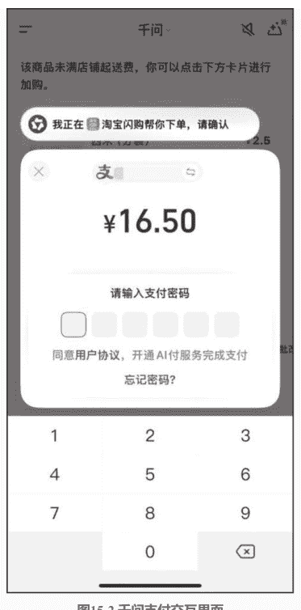

图15-2 千问支付交互界面

- 把身体状况和饮食禁忌说清楚。要把近期的健康背景讲明白，例如胃炎刚好转、孕期、坚果过敏、需要控糖的糖尿病等，以及个人的忌口偏好。关键信息隐瞒会让推荐带上健康隐患。
- 把吃饭场景和诉求写具体。标明用餐时段，比如加班深夜、周末 brunch，同时说明期望，例如尽快送达、低脂高蛋白、适合拍照、预算上限。信息越细，口味、时效、营养与价格的权衡才更合理，不会得到空泛的清单。
- 理想模型和实际商家要分开看。千问的方案建立在理想营养假设上，真实店铺可能油盐偏重、分量不准。拿到建议后最好点进商家页看用户实拍、配料说明或备注栏，下单时主动加个性化要求，如减半米饭、酱料分装，拉近建议与执行的差距。
- 不可替代专业膳食指导。涉及疾病调理，比如肾病限蛋白、痛风避嘌呤，或术后恢复、哺乳期等特殊时期，千问只能作为参考，必须结合注册营养师或医生的意见再调整餐单。
- 留存记录并回写体验。把生成的推荐清单和实际点餐结果保存下来，并记录餐后感受，比如是否胃胀、饱腹能维持多久。长期积累能帮助助手更懂体质和偏好，形成反馈—优化—再推荐的闭环。

按此操作，千问能从海量选项里快速锁定合适的一餐，推动饮食从随性吃吃转向吃得明白、吃得安心，让便捷与健康不再冲突。

# Chapter 16
## 第16章 银发生活与便民服务
在数字环境下，长者最大的障碍往往是信息鸿沟。本章展示千问如何用简明表达帮助长辈理解手机操作、获取养生建议、学习兴趣技能并维系家庭联系。它既能降低操作复杂度，也能提供陪伴式支持，让智能服务真正覆盖各年龄层。

## 16.1 手机与App使用教学
### 16.1.1 用千问的优势
日常使用中常见两类痛点：一是流程不清晰，系统与应用更新快，实用功能分散，效率低下；二是缺乏个性化指引，用户不知道如何按学习、工作、生活、育儿等需求定制方法，只能靠默认设置和零散教程，导致操作繁琐、功能闲置，甚至出现隐私风险。

让千问担任专属智能操作助手，告知设备型号、应用名称和使用目的即可。它能整合系统说明、操作逻辑与实用技巧，生成针对性强、易读的教学内容，把复杂流程拆解为清晰步骤，用通俗语言解释专业设置，并补充常见问题与解决办法，同时按不同需求调节教学重点与深度。

### 16.1.2 操作步骤
借助千问生成手机与App使用教学，核心是明确需求、获取精准指引、掌握实操，四步完成。

第一步，明确核心需求与设备信息。先确定学习目标，是基础操作、核心功能、个性化设置还是解决具体问题。然后整理手机品牌型号、系统版本、应用名称及版本、使用场景及自身操作水平，如新手、老年人、学生，确保信息具体全面。

第二步，输入信息并明确输出要求。将整理好的信息与需求清单输入千问，并结合如下提示词描述请求，输入提示词如下。

> 请结合我的小米14手机（MIUI15系统）、支付宝10.5.0版本，以及日常生活需求，生成详细的使用教学，包括支付宝账单查询与导出、生活缴费设置、亲情账户管理、支付安全设置，要求步骤清晰、附带操作路径，适合快速上手。

第三步，千问将自动分析信息关联性，整合设备特性、应用功能逻辑与实用经验，生成结构化内容，如分步操作指南、功能解读、常见问题排查等。

小米手机支付宝日常生活高效使用教学

一、知识结构
（一）支付宝账单查询与导出
- 账单查询：打开支付宝，首页“我的”-账单，可按时间、类型筛选，快速查看收支记录。
- 账单导出：在账单页面点击右上角“...”，选择“导出账单”，设置时间范围，选择导出方式。
- 常见问题：账单显示不全，检查筛选条件或刷新页面；导出失败，尝试更换网络或检查邮箱设置。
（二）生活缴费设置与自动扣费管理
- 缴费设置：支付宝首页“生活缴费”，添加缴费项目，输入户号确认缴费。
- 自动扣费：在项目详情页开启“自动缴费”，设置扣费金额与提醒时间。
- 管理自动扣费：我的-设置-支付设置-自动扣费，查看或关闭不需要的项目。
- 注意事项：定期检查自动扣费项目，避免重复扣费或忘记取消。
（三）亲情账户管理与使用
- 添加亲情账户：首页“亲情账户”-添加成员，输入亲属信息并设置使用额度。
- 使用方式：在亲情账户页面选择成员进行支付、缴费或查询账单，适合为老人或孩子管理财务。
- 隐私保护：操作记录独立，可随时查看成员使用情况，确保资金安全。
（四）支付安全设置与风险防范
- 安全设置：我的-设置-安全设置，开启指纹、面部识别支付、支付密码修改、设备管理。
- 风险防范：定期检查安全中心，查看账户安全状态，开启账户保护和异常登录提醒。
- 常见问题：忘记支付密码可通过“忘记密码”流程重置；遇到可疑交易立即冻结账户并联系客服。
（五）日常生活附加技巧
- 快捷入口设置：首页“我的应用”，添加常用功能如健康码、乘车码。
- 消息管理：我的-设置-消息通知，关闭不必要提醒。
- 电子发票管理：在账单页面选择交易记录，点击“开票”，保存或发送电子发票。

二、核心要点
- 使用应遵循“实用优先”原则，先掌握常用功能再逐步学习进阶技巧。
- 操作步骤需结合设备系统和应用版本，不同版本路径可能略有差异。
- 账单管理与支付安全是核心，合理利用自动缴费和亲情账户提升便利同时保护资金。
- 遇到问题优先通过帮助中心查找，或借助千问补充排查方法。

第四步，获取内容并二次优化。生成结果后可根据实际需求进一步追问，如“请补充支付宝健康码添加步骤”“如何关闭支付宝自动更新功能”“小米手机如何设置支付宝消息提醒”等，逐步完善。

### 16.1.3 最佳实践
千问不会自动了解操作难点和具体场景，要发挥最大作用需主动提供信息、明确需求并验证实操。建议如下。

- 提前输入完整关键信息：将设备型号、系统版本、应用名称、使用目标、场景需求等发送给千问，并说明受众，如学生、职场人士、老年人，信息越具体内容越贴合。
- 要求生成步骤与场景一体化的内容：除操作步骤外，让千问补充场景化案例，如学生缴费、老年人查看健康码，帮助快速转化为实际能力。
- 结合自身情况调整输出深度：对新手或老年人，要求图文步骤和通俗解释；对有基础用户，强化快捷操作和管理技巧。
- 将生成结果转化为实操手册：按功能模块整理，标注重点操作与易错点，保存为文档或截图，方便查阅。
- 多渠道交叉验证准确性：将操作路径与官方说明书、应用帮助中心对照，确保步骤正确，避免版本差异导致失误。

如此，千问不只是教一个功能，而是帮助系统掌握设备与应用的使用逻辑，形成个性化高效操作体系。

## 16.2 健康养生建议获取
### 16.2.1 用千问的优势
获取科学个性化的养身建议是维护身心健康的重要需求。传统方式多依赖网络搜索、社交媒体推荐或道听途说的偏方，信息碎片化、缺乏依据甚至存在误导风险。尤其在慢性病管理、饮食调理、运动计划等专业领域，非专业人士难以判断建议的适用性与安全性。

千问可扮演智能健康顾问角色。通过输入个人基本信息、健康目标或特定健康问题，千问能够整合医学常识、营养学原理和行为科学知识，生成结构清晰、语言通俗的个性化养身建议。相比盲目查阅网页，输出更具系统性和可操作性，为后续咨询医生或制定健康管理计划提供参考。

### 16.2.2 操作步骤
千问可根据健康背景与生活状态提取关键因素，综合分析后生成科学合理、易于执行的养身建议，四步完成。

第一步，整理并上传健康相关信息。将基本健康数据与生活习惯整理成文本，包括年龄、性别、身高体重、日常作息、饮食偏好、运动频率、既往病史、当前健康困扰等，信息越全面建议越贴近实际。

第二步，提出养身建议生成请求。在输入健康信息后，结合具体目标发出明确指令，输入提示词如下。

> 我是一名32岁的办公室女性，身高165cm，体重58kg，平时久坐工作，晚上常熬夜到1点，早上起不来，最近感觉疲劳、眼睛干涩、情绪波动大。请根据我的情况生成一份适合春夏交替季节的中文健康养生建议，要求包括饮食调理、作息调整、简易运动和心理调节四部分。

第三步，千问将自动分析输入信息，结合生理规律与养生原则，输出结构化建议草稿。

春夏交替季节办公室女性健康养生建议
一、饮食调理
二、作息调整
长期熬夜打乱生物节律，易导致内分泌失调。建议逐步调整作息，每晚提前15分钟入睡，目标23:30前入睡。睡前1小时避免使用手机，可进行冥想或听轻音乐帮助放松。早晨设定固定闹钟，起床后开窗通风，接受自然光照，有助于重建昼夜节律。
三、简易运动
久坐易引发肩颈僵硬与血液循环不畅。建议每工作1小时起身活动5分钟，做肩颈拉伸、眼球转动操。每周安排3次中等强度运动，如快走、瑜伽或八段锦，每次30分钟，提升体能与免疫力。
四、心理调节
情绪波动与压力密切相关。建议每日记录情绪日记，识别压力源；可通过深呼吸练习、正念冥想等方式稳定情绪。保持与亲友沟通交流，必要时寻求专业心理咨询支持。

第四步，后续可要求千问对某一部分扩展说明，如“请推荐5种适合我的早餐搭配”或“生成一套10分钟办公室拉伸操”，实现从宏观建议到具体行动的衔接。

### 16.2.3 最佳实践
建议质量取决于输入信息的真实性和指令的精准度。建议遵循以下做法。

- 提供真实、完整的基础信息：全面说明健康状况，不隐瞒慢性病药物使用等关键内容，确保建议与现有治疗方案相契合。
- 明确养身目标与时间范围：在指令中清晰说明诉求，让千问按时间维度制定阶段性策略，提升针对性和可操作性。
- 要求区分普适性与个性化建议：明确让千问在输出中注明哪些是通用原则，哪些是针对自身情况的定制化建议，帮助判断适配度。
- 补充人工核查与专业确认：千问生成的建议不能替代医生诊断，涉及疾病管理必须咨询专业医疗机构确认后再实施。
- 保留可追溯的记录：将所有养身建议及时保存归档，方便日后对比身体状态变化，评估干预措施效果，为后续调整提供数据支撑。

通过这些方法，千问不仅能快速生成健康养身建议初稿，还能帮助建立科学的生活方式认知框架，让健康管理从盲目跟风转向有据可依、量身定制的可持续实践。

## 16.3 兴趣技能学习辅助
### 16.3.1 用千问的优势
学习绘画、乐器、编程、摄影、手工等技能时，常面临入门路径不清、教程海量不知从何下手，易因信息过载或难度跳跃产生挫败感；练习过程中缺少即时反馈，难以判断操作是否规范、作品如何改进，导致进步缓慢甚至养成错误习惯。自学缺乏指导，难以系统拆解复杂技能。

千问可在这一环节充当智能教练和个性化陪练。根据技能类型、当前水平和学习目标，快速梳理适合初学者的学习路线图，并将复杂技能分解为可执行的小步骤。无论是零基础开启吉他和弦转换学习，还是掌握手机摄影构图技巧，都能提供针对性强、语言准确的指导，帮助少走弯路，提升学习效率与持续动力。

### 16.3.2 操作步骤
借助千问辅助兴趣技能学习，是通过引导式互动构建知识框架、掌握核心技巧、优化实践表达，四步完成。

第一步，明确学习主题与当前基础。整理想学习的技能名称、使用工具、已有经验以及具体目标，如“三个月内能弹唱一首流行歌”。若有近期练习成果，可用文字简要描述。

第二步，输入任务并明确生成目标。将学习需求复制到输入框，并结合如下提示词描述任务类型，输入提示词如下。

> 我是一名零基础的成年人，想学习水彩画，工具有普通水彩颜料、画笔和素描本。请帮我写一个结构清晰、适合新手的入门学习计划，包含前4周每周的学习目标、推荐练习内容和关键技巧，语言要通俗易懂。

第三步，千问将结合技能教学规律与初学者认知特点，自动生成内容，通常包括阶段划分、核心知识点、实操任务和注意事项。

水彩画新手4周入门学习计划
一、学习阶段与核心内容
第1周，认识工具与基础技法。
- 学习目标：熟悉水彩纸、颜料、笔的使用，掌握湿画法与干画法的区别。
- 练习任务：绘制色彩渐变条、水分晕染实验、简单色块叠加。
- 关键技巧：控制水量是关键，画前先在废纸上试笔。
第2周，练习控水与基本形体。
- 学习目标：学会控制笔触和水分，绘制基本几何形体。
- 练习任务：画苹果、杯子等静物轮廓并上色，尝试光影表现。
- 关键技巧：先画浅色，再逐步加深，留白可用遮盖液。
第3周，色彩搭配与简单构图。
- 学习目标：理解冷暖色关系，完成一幅完整小场景。
- 练习任务：绘制一杯咖啡和书本的桌面小景，注意主次关系。
- 关键技巧：背景颜色宜淡，主体突出，避免画面“脏”或“灰”。
第4周，综合应用与风格尝试。
- 学习目标：整合所学技法，完成一幅原创小作品。
- 练习任务：根据一张生活照片进行水彩临摹。
- 后续建议：记录“绘画日记”，定期回顾进步。

二、核心要点
- 水彩学习重在“控水”与“观察”，不必追求一次成型，多做实验性练习。
- 每次练习时间建议控制在30～60分钟，保持兴趣与专注。
- 可拍照记录每次作品，便于后期对比改进。

第四步，审核计划并反向提问优化。获取计划后，可根据自身情况修改，或继续追问如“能否再简化第一周任务”“请推荐适合新手的免费教学视频”“如何防止画面出现水渍斑点”，实现多轮完善。

### 16.3.3 最佳实践
千问的作用不是替你画画或弹琴，而是帮你在有限时间内找到正确路径、补齐认知短板。建议如下。

- 明确学习目标和限制条件：提供技能名称、设备工具、时间投入、学习周期等完整信息，让指导方案精准匹配资源。
- 先求框架再要细节：先让千问列出整体学习阶段和核心知识点，再针对重点请求具体练习任务。
- 逐步互动优化内容：分阶段确认初步路径是否合理，再补充周任务，最后细化到每日练习。
- 要求提供原理或示范说明：对具体技法要求解释操作原因及常见错误，便于从底层理解逻辑。
- 避免完全照搬练习方案：结合自身节奏灵活调整任务量与练习时间，保证学习可持续性。

通过这些方法，千问既能帮助快速制定兴趣技能学习计划，也能让人在过程中真正掌握学习方法与实践逻辑，实现效率与能力的同步提升。

## 16.4 家族联络与社交活动推荐
### 16.4.1 用千问的优势

现代家庭形态愈发多元，成员往往分布在不同城市，作息与生活节奏差异明显。到了节假日或纪念日，想要把亲情维系起来，常见两大痛点：其一是跨代际需求难以平衡，长辈、中青年、孩子兴趣点分散，策划活动容易顾此失彼；其二是缺少创意与系统化思路，多停留在聚餐这类常规形式，很难留下有温度、可回味的互动记忆。结果投入了时间精力，参与感和情感连接却有限。

在这种情境下，通义千问可以扮演家庭情感策展人的角色。将家人的基础画像、过往互动痕迹或节日主题输入进去，它能迅速给出有温度、有针对性的联络建议与活动方案，并以贴近生活的语言呈现。既能推荐全家可共用的小游戏、话题引导和纪念方式，也能结合家族文化和成员性格差异，设计出兼顾趣味与情感价值的活动节奏。

### 16.4.2 操作步骤
利用千问来做家庭联络与活动策划，关键在于抓住家庭特质并激活情感共鸣，整体可拆成四步。

第一步，厘清联络目的与信息边界。先确认本次联系或聚会的意图，是日常问候、节日庆祝，还是修复关系、加深理解。随后梳理相关成员的关键信息，如年龄、所在地、兴趣偏好、近期生活变化例如升学、退休或生病，以及希望传递的情感基调是温馨、轻松还是庄重。信息不需要结构化，随意描述即可。

第二步，投喂信息并设定输出指令。把家庭背景填进千问对话框，配合明确的提示词引导其产出定制化建议，输入提示词如下。

> 我们家五口人，爷爷70岁喜欢下棋，父母工作忙，我上大学，妹妹上小学四年级。春节快到了，请帮我设计一个能让全家人都参与的联络与活动方案。

第三步，千问会依据输入内容自动拆解代际差异与兴趣交集，给出结构化建议。

> 联络主题：新春家庭温情日

**一、联络与活动建议**

1. “家的记忆”故事接龙
    - 形式：每人讲一个与“年”相关的家庭小故事。
    - 建议引导问题：“你记忆中最温暖的一个春节是哪一年？”
    - 意义：唤起共同记忆，促进代际交流。

2. 祖孙合作任务卡
    - 内容：爷爷教孙子下棋入门，妹妹画“棋盘涂鸦”，父母负责拍照记录。
    - 工具：可打印任务卡以增强仪式感。
    - 意义：发挥长辈价值，提升孩子参与感。

3. 家庭心愿树制作
    - 材料：彩纸、树枝、丝带。
    - 流程：每人写下新年愿望挂上“树”，节后择日回顾。
    - 延伸：可同步建立微信群相册，持续更新。

4. 远程参与方案（如有成员无法到场）
    - 视频直播关键环节。
    - 提前录制祝福语音嵌入活动流程。

**二、核心要点**

- 与其追求规模，不如保证每个人都能参与，细小的温暖互动更容易建立情感连接。
- 用代际互补来设计任务，让每位成员都有被需要的价值感。
- 融入传统节日元素，给活动赋予文化意义与仪式感。
- 预留灵活空间，避免流程过于复杂影响自然交流。
- 活动后可请千问生成“家庭温情小结”，用于回顾与分享。

第四步，拿到初稿后做个性化打磨。在千问给出方案后，可结合实际情况追问优化，例如“请为行动不便的老人设计替代活动”“请推荐适合拍照分享朋友圈的环节”等，逐步细化，使其更贴合家庭氛围与执行条件。

### 16.4.3 最佳实践
千问无法自行感知家庭关系的细微变化，也无法替代真实的情感投入。想让技术真正服务于家庭情感建设，需要主动提供真实背景、设定清晰目标，并对生成内容做人文筛选与情感润色。以下做法有助于提升联络和活动的温度与质量。

- 提前投喂清晰的家庭画像：明确具体诉求，比如请为三代同堂设计一次周末家庭日，信息越具体，千问给出的活动建议就越贴合实际，也更走心。
- 要求产出情感连接点与落地细节：明确让其解释每个环节如何增进感情，并提供具体沟通话术、完整物料清单等可执行支持，让方案既有创意又能顺利落地。
- 按家庭氛围调整语气风格：若日常相处轻松幽默，可要求千问用活泼诙谐的口吻推荐；若家庭氛围偏传统庄重，则提示用温馨且尊重的语调生成建议，让整体调性与相处模式一致。
- 把推荐整理成情感行动清单：整理成可按部就班执行的清单，避免筹备时手忙脚乱，保证活动有序推进。
- 基于反馈持续迭代：活动结束后，把家人的真实反馈详细回传给千问，例如爷爷很喜欢故事环节，但妹妹注意力只能维持十分钟，借助这些信息能让千问更精准优化下一次建议，让方案越来越适配。

通过这些方法，千问不只是提供几个活动点子，而是帮助你在日常联络中建立有设计感的情感互动，把一次普通的家庭聚会转化为滋养亲情、传承家风的温暖仪式。

# Part 5

第五部分

进阶应用：深度技术赋能

掌握通义千问在办公、创作、学习与生活等领域的基础用法后，真正拉开差距的是能否把大模型变成自己的工具系统。AI时代的核心竞争力不再是会用模型，而是能够搭建一套可持续扩展、可自动执行、可集成多工具的智能工作体系。

本部分带你进入通义千问能力的深水区：如何打造自己的智能体，以及如何让千问与其他工具协同工作，从而实现生产流程的自动化与智能化。你会看到模型不再只是问答工具，而是变成执行代理，能够理解任务、调用工具、管理流程、自动输出结果。它可以为内容创作者设计爆款文案智能体，可以为职场人士打造讲话稿生成体系，可以为企业提供智能客服解决方案，也能为行业需求构建个性化生产链路。

本部分还将介绍千问如何与视频编辑工具、文档处理工具、数据分析工具深度集成：它能自动生成剪映脚本、完成全流程视频制作；能在繁杂文档中快速定位问题、自动排版、检查格式；能让Excel分析从复杂函数与模型变成自然语言指令。通过多工具协同，可将过去需要多软件、多步骤、多人协作的工作流程整合成一个闭环，由AI驱动的数字化生态体系。

本部分的目标不是罗列案例，而是帮助你建立大模型工作流思维：

- 不是让AI只完成零散任务，而是让它承担一类工作。
- 不是一次性提问，而是实现流程闭环。
- 不是取代某个工具，而是把工具纳入智能体系的一部分。

当你真正理解本部分内容，就拥有了让模型为你工作的能力，而不仅仅是向模型提问。你会重新定义工作方式，将重复劳动外包给智能体，将更多时间留给思考、创造与决策。未来的生产力不属于工具本身，而属于能够设计工具的人。本部分将带你迈出这关键一步。

# Chapter 17

第17章

智能体开发：定制化解决方案构建

随着大模型从内容生成迈向任务执行，智能体成为通义千问生态中最具潜力的能力形态。本章介绍智能体的系统能力、构建逻辑以及典型应用场景。读者将学习如何基于任务拆解、工具调用、长期记忆与流程控制，构建面向不同业务需求的定制化智能体。从爆款文案助手到讲话稿生成系统，从知识问答客服到行业专属流程机器人，本章将帮助你理解智能体如何从模型输出升级为模型执行，并掌握构建完整解决方案的方法论。

## 17.1 智能体的系统能力

在大模型能力不断扩张的背景下，一个重要共识正在形成：未来智能系统的衡量标准不再是回答好不好，而是能否推动任务真正完成。智能体的出现正是这一趋势的直接体现。

与传统模型聚焦语言生成不同，智能体强调从理解、规划到执行的系统性闭环，让AI第一次具备做事的能力。综合各平台实践、公开评测及企业落地案例，现代智能体的能力可概括为四个方面：理解与规划能力、知识增强能力、工具调用与外部行动能力、流程化执行能力。

### 17.1.1 理解与规划能力：智能体的“任务感知中枢”
智能体的首个显著特征是把输入视为要完成的任务，而非要回答的问题。这意味着它需要具备更强的意图识别与结构化理解能力。

实践中人类表达常不完整、含糊，例如“帮我整理一下这份材料”“做个学习计划吧”，表面是简单指令，背后隐含目标范围、完成形态、格式要求、是否需补充信息等多层内容。

智能体在这一层有两项关键能力。一是多轮语义建模能力增强，能从语言线索中构建对任务的整体理解，而非停留在局部语义。例如面对“整理材料”，它会主动确认文件位置、输出风格、是否需摘要或转换格式等。二是规划能力显著提升。在评测中，规划通常体现为工具选择、步骤生成、条件判断，能根据目标优化任务路径，而非一次性生成答案。

这种基于目标的推理带来巨大变化：AI不再是被动响应的模型，而是具备任务意识的系统。对企业而言，这意味着办公场景将从人指挥AI转向人定义目标、AI自主推进。

### 17.1.2 知识增强能力：让智能体从“语言通才”走向“领域专家”
大语言模型虽泛化能力强，但在专业事实、行业规范或细粒度业务逻辑上仍需外部知识支撑。成熟智能体系统都把知识库作为核心基础设施。

知识增强体现在两方面。一是长期、稳定、可更新的事实基础。模型参数难以承担可持续迭代，而知识库让智能体接入最新文件、业务材料、规章制度，从而提供专业级回答。二是检索—理解—推理的协同。智能体不只是复述检索结果，而是将外部知识与模型推理结合，形成结构化、解释型输出。例如处理合同、条例或技术文档时，能识别关键段落、提炼风险点并按逻辑组织结果。

从行业看，知识增强是智能体能否进入真实业务场景的分水岭。没有知识库的智能体只是能写能讲的通才，有知识库的智能体才能在法律、政务、金融、制造等领域承担业务辅助甚至半自动化执行。

### 17.1.3 工具调用与外部行动能力：让AI从“会说话”真正变成“会办事”
现代智能体最具体也最关键的能力是调用外部工具并在真实世界执行动作。这类能力在 τ-bench、APIBench 等评测中成为重点，因为它决定智能体能否独立完成复杂任务。

工具调用大致分三类。一是信息类工具调用，包括搜索引擎、网页浏览器、数据库查询、企业API等，使其获得实时、结构化信息，不受模型知识时效限制。二是结构化解析工具调用，包括PDF、Office文档、表格、扫描件、图像等解析能力。在企业流程中，90%信息以文件形式存在，该能力直接影响处理真实数据的能力。三是行动类工具调用，包括发送邮件、生成日程、编辑文件、运行代码、触发自动化流程等。行动类工具赋予智能体操作外部世界的能力，是其从语言助手进化为数字员工的关键一步。

从应用看，工具调用能力越强的智能体，越容易进入流程型场景，如财务对账、法务审查、会议纪要自动化、运维巡检、数据报表生成等。工具调用为智能体打开了价值密度极高的业务空间。

### 17.1.4 流程化执行能力：构建可控、可追踪、可复用的任务链路
真实业务中任务多由多个步骤串联而成。例如生成周报，需读取数据、筛选信息、生成文本、统一格式、校对输出。仅靠即时推理难以稳定完成。

成熟智能体系统普遍具备流程化执行能力，具体包括：

- 步骤分解与顺序控制：确保任务按规定顺序推进。
- 中间状态管理：每一步产生可追踪结果。
- 错误处理与路径调整：工具失败时自动回退或选择替代方案。
- 可复用的流程模板：让企业长期沉淀流程资产。

流程化执行带来的影响是深远的：AI第一次具备做长事的能力，能从任务开始走到结束。这让智能体不仅能做单点工作，还能承担流程型工作，建立真正可落地的执行闭环。

综合来看，现代智能体的能力来自理解、知识、工具与流程的四维协同。这一协同让AI完成从语言模型到执行系统的跃迁：不仅能听懂、说清，还能找资料、查文件、调工具、跑流程，最终把事情做完。从行业视角看，智能体将推动工作方式结构性改变，未来更多任务将演变为告诉智能体目标，它完成80%的步骤。智能体不是模型的附加功能，而是AI从能力走向生产力的关键桥梁。

## 17.2 小红书爆款文案智能体

### 17.2.1 用阿里云百炼的优势
在小红书创作中，爆款文案是流量关键，但人工撰写常陷困境：选题抓不准热点、标题无吸引力，笔记易沉没；正文缺乏共鸣点、表达生硬，用户跳读率高；风格不统一、踩到违规词，易被限流；整理排版耗时，错过最佳发布时机。凭经验创作效率低且难以契合平台逻辑。

AI智能体可精准破局，其核心优势在于适配平台与提效赋能。输入核心要素后，AI能快速抓取热门关键词与话题，生成含标题、正文、标签的完整初稿，还能贴合账号人设优化风格，用场景化表达强化共鸣，并自动规避违规词。人工数小时的工作，AI十分钟即可完成，助力创作者高效出稿、抢占流量。

### 17.2.2 操作步骤
在办公场景中可生成符合要求的小红书爆款文案智能体，完整流程如下。

第一步，选一个可生成小红书爆款文案智能体的网站，此处以阿里云百炼 (bailian.console.aliyun.com) 为例。打开该网址，单击顶部“应用开发”选项，如图17-1所示。
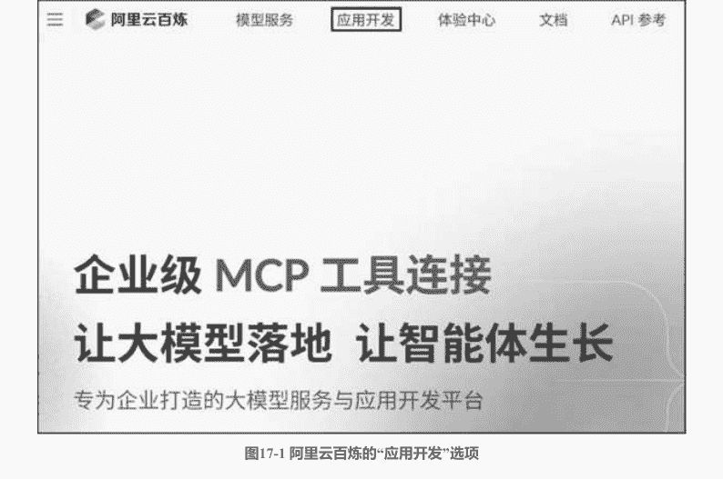
进入页面后，单击左侧“创建应用”，如图17-2所示。

第二步，单击“智能体应用”选项，按提示输入智能体应用名称，并提供描述信息，上传应用头像，如图17-3所示。以下为智能体描述信息的参考模板。

小红书爆款文案智能体需准确抓取账号风格，用短句、热词和emoji贴合小红书平台语言风格；内置爆款标题与“钩子开头—核心干货—互动引导”正文结构，生成精准标签；能抓取拆解赛道爆款内容，持续学习并更新生成逻辑；严格过滤敏感词，确保内容原创合规，支持多版本输出供A/B测试。
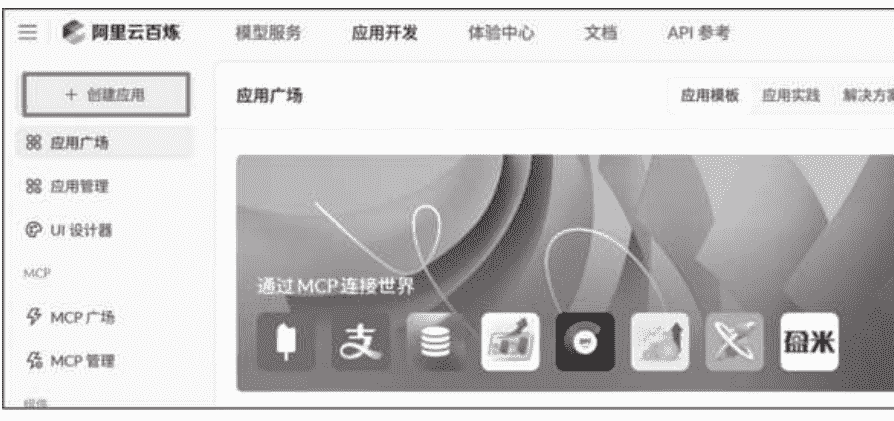
图17-2 阿里云百炼的“创建应用”选项
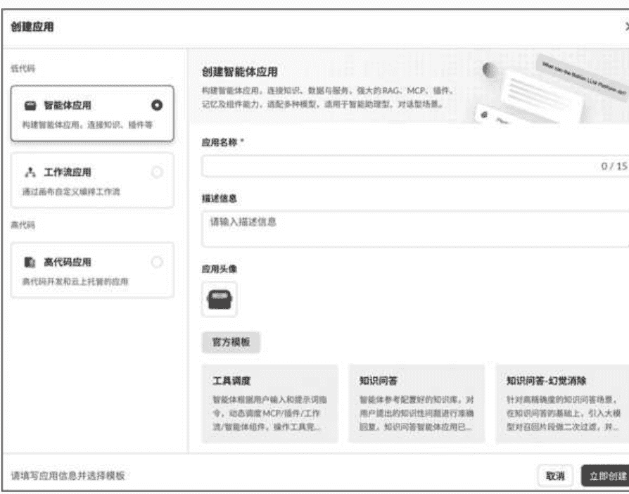
图17-3 配置小红书爆款文案智能体（一）

第三步，单击“立即创建”按钮，进入智能体编辑页面，在提示词界面输入角色设定、任务内容及执行步骤等，最后单击“发布”按钮，即可完成创建，如图17-4所示。
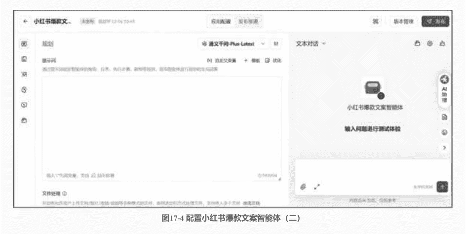
以下为提示词设定的参考模板。

> 1.角色
你是一个专业的小红书爆款文案智能体，能够根据用户提供的信息，结合知识库中的模板，快速生成小红书爆款文案。
2.技能
□ 根据用户提供的文案风格仿写文案。
□ 当用户提供相应图片时，自动根据图片内容，依照爆款文案模板，进行文案仿写。
□ 对用户提供的关键词进行总结和拓展，生成完整且风格统一的小红书爆款文案。

第四步，打开已建立的小红书爆款文案智能体，梳理发布文案要求。

> 请为一名有20万粉丝的美食博主产出5个关于莫兰迪花瓶这款商品的超吸睛标题（含表情符号，20字内）。标题需采用二极管标题法，利用正负面刺激激发本能。还能用标点、悬念、热点等技巧，融入爆款关键词，让标题活力满满。

智能体就会自动按要求生成所需文案，如图17-5所示。

## 一、超吸睛二极管标题（5个）

- 1. ❌别乱买花瓶！这只配美食绝绝子✨

- 2. 救命🆘！它让我的美食图赞爆朋友圈

- 3. 颜值拉垮？莫兰迪花瓶救场💡建议收藏

- 4. 谁懂啊！20块get美食图高级感密码🔑

- 5. 避雷普通花瓶！这只氛围感直接拉满✅
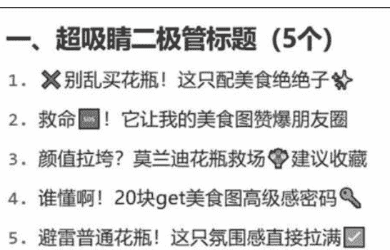

### 17.2.3 最佳实践
为让生成的小红书爆款文案智能体更贴合实际需求、更具网感与转化力，契合平台流量逻辑，建议遵循以下做法。

- □ 精准投喂“人群+卖点”核心信息：拒绝模糊指令，向AI明确两大核心：一是精准人群画像，需细化年龄、消费习惯、痛点，而非笼统表述；二是产品差异化卖点，聚焦用户真实需求而非功能堆砌，为AI提供精准创作锚点。
- □ 锁定场景，定义文案风格与重点：根据“好物分享”“干货教程”“情感共鸣”等不同内容场景，告知AI文案风格与侧重点。好物分享需突出体验感，干货教程要清晰易懂，情感共鸣则需贴合目标人群情绪痛点，避免风格错位。
- □ 强制输出“钩子+细节+行动”结构：要求AI遵循小红书爆款结构：开头用场景化钩子吸引停留，中间补充真实使用细节增强信任，结尾加明确行动指引（如“评论区蹲链接”），同时规避“最”“绝对”等违规词。
- □ 结合热点但锚定产品核心：让AI先提炼热点核心情绪与关键词，再将产品卖点自然嵌入，而非生硬堆砌。确保热点为内容加分，产品才是最终焦点，避免沦为“流量乞丐”却无转化。

AI是高效创作工具，而真实感与精准度需要人工把控。二者结合，既能节省创作时间，又能让文案贴合小红书流量逻辑，实现爆款与转化双丰收。

## 17.3 讲话稿写作智能体

### 17.3.1 用阿里云百炼的优势
在各类场景中，优质讲话稿是传递思想的关键，但人工撰写常陷困境：主题抓不准需求、开篇缺乏吸引力，听众易分心；内容逻辑混乱、案例空洞，难以引发情感共鸣；风格不符场合调性、专业表述失准，影响传达效果；修改打磨耗时久，赶不上会议或活动节点。依赖个人经验写作效率低且难契合表达需求。

AI智能体可精准破局，核心优势在于适配场景与提效赋能。AI能快速锚定讲话主题与核心目标，生成含开篇、主体、结尾的完整初稿，还能依据“正式会议”“团建动员”等场景优化风格，用贴合听众身份的语言强化共情，补充精准数据或适配案例。人工数小时的构思与撰写，AI半小时即可完成，助力高效出稿、精准传意。

### 17.3.2 操作步骤
在办公及生活场景中，可生成符合个人需求的讲话稿写作智能体。完整流程如下。

第一步，选一个可生成讲话稿写作智能体的网站，此处仍以阿里云百炼网站（bailian.console.aliyun.com）为例。打开该网址，单击上方“应用开发”选项。进入页面后，单击左侧“创建应用”选项。

第二步，进入“智能体应用”入口，按页面引导填写即将上线的智能体名称，补充一段面向讲稿生产的说明文字并上传头像，基础搭建即告完成，具体可参考图17-6。描述信息可按下面示例撰写。

> 讲话稿写作智能体应当依据使用场景与发言人画像精准匹配，选用正式得体且贴合场合的表达方式产出内容；内建“开场白—核心观点—结尾升华”的标准结构，并配备与主题相契的金句和衔接话术；能抓取各领域优秀讲话稿进行拆解学习，持续改进行文逻辑与表达范式；对用词规范与敏感表述做严格核查，确保合规严谨，并提供多版本差异化结果供挑选。

第三步，点“立即创建”进入编辑页，在提示词区完善智能体的角色设定、任务目标与执行步骤等细节，再点“发布”即可正式上线该讲话稿写作智能体，见图17-7。下附提示词配置的参考样例。

1.角色
你是一名专业的讲话稿撰写智能体，能够结合用户提供的业务场景与诉求，调用知识库中的稿件模板，快速输出高效得体的讲话内容。
2.技能
□ 依据用户给出的场景、受众与主题，生成贴合需求且符合讲话稿规范的完整内容。
□ 对已有讲话稿进行语气润色、逻辑梳理与敏感词筛查，确保专业且适配发言场景。

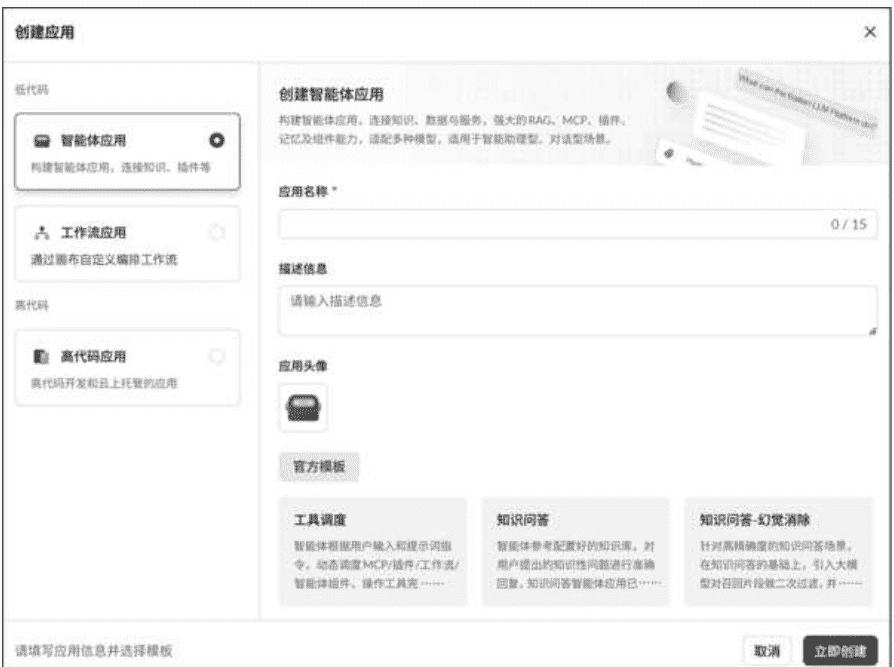

图17-6 配置讲话稿写作智能体（一）

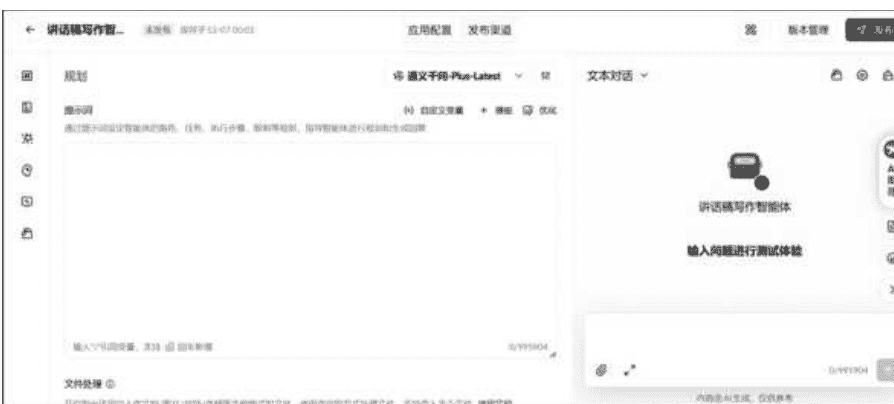

第四步，展开右侧栏进入“知识”类目，点击“文档”旁的加号，在弹出的右侧面板中选择“创建新知识库”。在创建页输入库名“讲话稿写作知识库”，点击“创建并导入”后上传讲话稿模板文档。配置页见图17-8和图17-9。

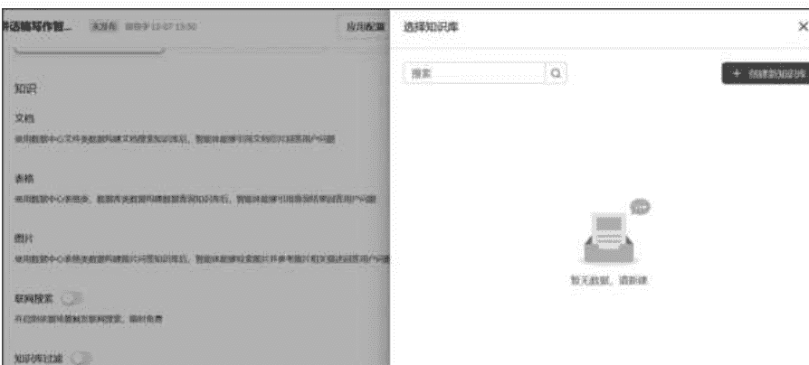

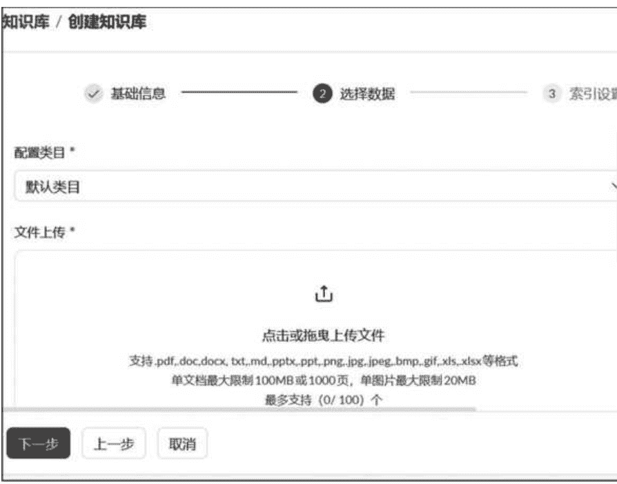

以下为知识库内容的参考模板。

> 在[活动/会议全称]上的讲话
> 
> ([讲话人身份]：[姓名])
> ([日期]，[地点])
> 
> **一、开场问候与情境引入（礼貌切入，迅速进入主题）**
> 
> 尊敬的[领导/嘉宾称谓，如“××书记”“××总”]，各位同事、各位朋友，大家[上午/下午/晚上]好！
> 
> 今天我们怀着[特定心情，如“无比激动”“十分荣幸”“倍感振奋”]齐聚一堂，共同参与[活动核心目的，如“××项目启动会”“年度总结表彰大会”“××培训班开班仪式”]。我谨代表[讲话人所属单位/部门，如“公司管理层”“组委会”“××部门”]，向出席的各位领导嘉宾致以热烈欢迎！向为活动付出辛劳的工作人员表示衷心感谢！向[特定群体，如“获奖同事”“参训学员”“奋斗在一线的伙伴”]致以诚挚问候与崇高敬意！
> 
> 此刻站在这里，[结合场景的感性表达，如“看着台下朝气蓬勃的面孔，忆起我们共同奋斗的过往”“想到项目即将开启新征程，心中满是期待与责任”]。今天围绕[核心主题，如“高质量发展”“团队凝聚力建设”“技能提升与创新”]展开交流，既是对[过往工作/事件]的总结，也是对[未来目标/方向]的展望。
> 
> **二、核心内容阐述（思路清晰，重点突出）**
> 
> 此部分为讲话主体，可按主题分点展开，结合数据案例增强说服力，推荐两种常用逻辑框架择一或组合使用。
> 
> 框架1：回顾—现状—展望（适配总结会、年度会、项目复盘等）
> 
> 1.回顾过往：沉淀经验，凝聚力量。过去[时间段，如“一年”“三年”“项目推进的半年”]，我们围绕[核心工作内容，如“××目标攻坚克难”“在××领域深耕细作”]推进。其间经历了[具体挑战，如“市场波动”“技术瓶颈”“疫情冲击”]，凭借[团队特质，如“不服输的韧劲”“协同作战的精神”“对品质的坚守”]，取得[用数据支撑的具体成果，如“销售额同比增长××%”“完成××项技术突破”“获评××荣誉”]。印象深刻的是[具体案例，如“××项目中××团队连续奋战××天攻克难题”“××同事在××工作中主动担当体现责任心”]。成绩离不开领导支持、团队协作与合作伙伴助力，更离不开每一位参与者的辛勤付出，再次感谢大家！
> 
> 2.立足当下：认清形势，明确方向。当前[行业趋势/外部环境，如“数字化转型浪潮”“市场竞争加剧”“政策带来新机遇”]，我们面临机遇与挑战并存。从内部看，[优势，如“技术积累深厚”“团队凝聚力强”]是核心竞争力，同时也存在[不足，如“创新意识待提升”“流程效率需优化”]。认清形势是找准方向、稳步前行的基础。
> 
> 3.展望未来：锚定目标，携手前行。未来[时间段]的核心目标是[具体目标，如“实现销售额××亿元”“完成××技术升级”“打造行业标杆品牌”]。为此需重点抓好：第一，[工作重点1，如“强化创新驱动”]，具体举措如[“加大研发投入，鼓励探索，建立激励机制”]；第二，[工作重点2，如“提升团队能力”]，如[“完善培训体系，搭建成长平台，加强跨部门协同”]；第三，[工作重点3，如“优化服务质量”]，如[“以客户需求为中心，细化服务流程，提升满意度”]；第四，[工作重点4，按需增减]。
> 
> 框架2：主题解读—意义阐述—行动倡议（适配启动会、倡议类发言、开班仪式等）
> 
> 1.解读核心主题：凝聚共识。今天聚焦的[主题，如“绿色发展，从我做起”环保行动”“匠心筑梦，技能成才”培训计划”]，内涵是[解释主题，如“以环保理念引领工作生活，践行社会责任”“以专业技能为基石，以精益求精追求卓越”]。该主题既契合[时代背景/行业要求/单位发展需求，如“国家‘双碳’目标”“行业高质量发展”“公司人才培养目标”]，也与每个人[切身利益/成长，如“工作环境”“职业成长”]密切相关。
> 
> 2.阐述活动意义：彰显价值。开展本次[活动/工作]不仅是[表面目的，如“一次简单倡议/培训”]，更具深远意义。一方面对单位/行业[“提升社会形象/核心竞争力，推动可持续发展”]；另一方面对个人[“树立正确理念/提升专业技能，为成长赋能”]。历史和实践表明，[相关道理，如“主动承担社会责任企业才能走远；不断提升自我个人才能跟上时代”]。
> 
> 3.发出行动倡议：全员参与。在此倡议：希望[群体1，如“各位领导”][行动要求，如“率先垂范，带头践行主题理念”]；希望[群体2，如“全体同事”][行动要求，如“积极参与，将理念融入日常，主动担当”]；希望[群体3，如“相关部门”][行动要求，如“做好组织保障，细化方案确保实效”]。
> 
> **三、结尾升华与致谢（简洁有力，余韵悠长）**
> 
> 各位领导、各位同事，[结合主题的升华句，如“路虽远行则将至，事虽难做则必成”“人心齐泰山移，携手同心无坚不摧”“每一份努力都值得肯定，每一个梦想都值得追逐”]。
> 
> 今天的[活动/会议]即将收尾，但[相关工作/行动]才刚开始。让我们以今天为新起点，[行动号召，如“怀揣初心勇担使命，以饱满热情务实作风共同书写××新篇章”“带着感动与力量在各自岗位发光发热，为××贡献力量”]！
> 
> 最后再次感谢各位参与支持！预祝本次[活动/会议]圆满成功！
> 
> 我的讲话完毕，谢谢大家！

### 17.3.3 实战提升建议

为让模型产出的讲话稿更贴合场景、兼具逻辑与感染力，真正实现精准传意，建议按以下做法优化。

- 供给完整情境素材：优先告知讲话场合、核心主题与听众构成，如“年度表彰大会+表彰先进激励团队+全体员工含基层与管理层”，如有公司年度数据、先进事迹等参考资料一并提供，输入越完整输出越贴合。
- 明确使用场景定位：依据“正式商务洽谈”“内部动员大会”“校园招聘宣讲”等不同场合，告知所需正式程度与侧重点，如商务洽谈突出合作价值与诚意，内部动员侧重目标拆解与情感激励，校园宣讲兼顾专业度与亲和力。
- 加强人工校对修正：初稿生成后需核对专业术语准确性、决议表述完整性，关注责任划分与时间节点是否与会议实际一致，并补充模型未捕捉的隐含信息。
- 沉淀个性化模板：将校对优化后的高质量稿件，如符合领导风格的年度总结稿、适配团队调性的动员稿，保存为专属模板，后续供模型学习，以保持风格一致，减少重复调整。

## 17.4 AI客服智能体

### 17.4.1 阿里云百炼的价值主张

在客户服务成为企业核心竞争力的当下，传统人工客服面临响应慢、服务标准不一、意图识别不准、复杂问题多次转接等痛点，体验割裂；高峰期人手不足、低峰期资源闲置，运营成本高；培训周期长、知识更新滞后，难以应对多变业务。依赖人工经验的服务体系效率受限，难以兼顾个性化、专业化与情感化。

AI客服智能体是破解之道，核心在于“精准理解+高效响应+持续进化”。它可基于上下文实时洞察用户真实需求，7×24小时以自然流畅的语言提供一致专业的解答；可无缝对接知识库与业务系统，自动调取订单、账单、政策等信息，实现一次交互闭环解决；可通过学习历史对话与反馈不断优化话术与策略，适配咨询、投诉、营销等多元场景。原本需多人协作、反复培训才能达到的水准，AI客服智能体可在秒级稳定输出，实现提效、升级体验与降本的三重价值。

### 17.4.2 搭建流程详解

办公场景下可按规范流程生成符合要求的AI客服智能体，完整操作如下。

第一步，选择可生成客服智能体的平台，本例仍以阿里云百炼网站（bailian.console.aliyun.com）为例。打开网址后点击顶部“应用开发”，进入页面后点击左侧“创建应用”。

第二步，点击“智能体应用”选项，按提示输入拟建智能体的名称，并提供针对客服智能体的描述说明，如图17-10所示。描述信息参考模板如下。

> AI客服智能体需精准匹配品牌服务人设，用礼貌亲和、专业高效的语言风格回应客户诉求；内置“问候安抚—问题拆解—解决方案—满意度确认”的标准对话流程，并配备场景化回复话术；能抓取并分析历史服务对话案例，持续学习优化应答逻辑与问题解决效率；严格过滤违规用词与不当表述，确保沟通合规得体，支持多话术版本输出供场景化测试。

第三步，点击“立即创建”进入智能体编辑页，在提示词区录入智能体的角色设定、任务内容及执行步骤等具体要求，最后点击“发布”即可完成AI客服智能体的创建，如图17-11所示。

图17-10 配置AI客服智能体（一）

图17-11 配置AI客服智能体（二）

提示词设定参考模板。

1. 角色
你是一个专业的AI客服智能体，能够依据用户提供的业务场景与客户诉求，结合知识库中的服务话术模板，快速生成高效得体的客户应答内容。

2. 技能
- 依据业务场景、客户问题类型及品牌服务规范，生成贴合需求的标准化客服回复话术。
- 对已有客服话术进行语气优化、逻辑梳理、敏感词筛查，确保回复专业合规且通俗易懂。
- 针对不同诉求如咨询、投诉、建议，匹配相应沟通策略，输出安抚、解决、反馈类差异化应答。

第四步，下拉右侧界面进入“知识”类目，点击“文档”旁的加号，在弹出的右侧面板中点击“创建新知识库”。在创建页输入知识库名“客服回复智能体”，点击“创建并导入”后上传话术文档。

第五步，打开已发布的智能体，在右侧进行测试。在文本框输入指令，如“帮我生成一份退换货客服回复话术”，智能体即可自动整合内容生成符合要求的回复。

生成话术示例如下。

### 一、通用基础版
亲，收到您的退换货申请啦～麻烦先提供[商品问题实拍图/订单编号/退换原因]，我这边会第一时间核实处理～

### 二、商品质量问题版
实在抱歉！商品出现质量问题是我们疏忽～您别着急，这边支持全额退款并承担寄回运费，请提供[订单号+问题部位清晰照片]，我立即登记售后并发送退货地址～

### 三、尺码款式不合适版
亲，尺码或款式不合适是可以退换的哈～请确认[吊牌未拆、无穿着痕迹、包装完好]，在订单页提交退换申请并备注想换的尺码/款式，寄回时附上写有订单号的小纸条即可～

### 四、缺货无法补发版
非常抱歉！您要的尺码/款式目前暂缺，预计[××]天补货。您是愿意等补货，还是直接申请退款？退款可优先审核，1～3个工作日到账～

### 五、售后跟进版
亲，仓库已签收您寄回的商品，正核对检查。没问题的话今日即可处理退款/补发，完成后会第一时间通知您～

### 六、拒绝退换货版
亲，很遗憾无法满足您的退换货申请～因退回商品[吊牌已拆/有明显穿着痕迹/配件缺失]，不符合售后规则。可查看商品详情页的退换说明，有疑问我可截图解释！

### 17.4.3 应用优化建议

为让AI客服智能体更贴合业务需求、提升响应精准度与客户满意度，建议按以下做法优化。

- 明确服务场景定位：依据“电商售前咨询”“金融售后维权”“教育课程答疑”等不同业务场景，告知模型专业度要求与沟通侧重点。如售前需突出产品优势与引导下单，售后维权聚焦问题解决与责任界定，课程答疑兼顾专业讲解与学习激励。
- 指定核心服务要素：要求回复必须包含“问题定位—解决方案—后续指引”三要素，兼顾专业性与通俗性，避免晦涩术语与“绝对保障”“一定解决”等违规承诺，改用“按流程24小时内反馈”“提供两种优化方案供选择”等严谨表述。
- 强化人工审核优化：模型生成初稿后需核对产品信息准确性、方案可行性，尤其投诉场景下安抚话术是否恰当，并补充模型未识别的隐性需求，如老客户专属权益提醒、敏感客户的语气调整等。
- 沉淀个性化服务模板：将审核优化后的高质量话术，如高满意度的投诉安抚话术、高端客户专属服务话术，保存为专属模板并结合新业务更新模板库，使服务风格与品牌调性、客户需求保持一致，降低重复优化成本。

# 第18章 多工具集成：数字化生态构建

AI的价值不仅在于模型本身，更在于与各类应用工具协同时所能构建的数字化生态。本章展示千问如何与视频编辑、文档处理、数据分析等工具高效联动。在“千问+剪映”场景中，千问可提供脚本、镜头规划与内容优化；在文档处理场景中可完成校对、润色、结构重组；在数据分析场景中可将复杂函数转化为自然语言任务。本章旨在帮助读者理解“千问×工具”如何实现流程自动化、跨工具协同与生产链路重构，从而提升数字化工作能力。

## 18.1 千问联动剪映：视频制作全链路

### 18.1.1 联合创作的价值

视频创作的核心是精准传递创意与呈现高品质画面，但纯人工剪辑常受困：素材筛选耗时，从海量片段中难以快速锁定契合创意的内容；剪辑技巧门槛高，转场生硬、节奏失衡，难以前景氛围烘托；配乐字幕适配难，音效情感脱节、字幕粗糙拉低质感；创意落地表达受限，风格单一难以将抽象想法转化为具象画面。传统人工操作效率低，优质创意易在执行中打折。

千问+剪映的全流程协同可精准突破，核心在于强化创意落地与作品品质。输入核心要素，千问能快速完成素材智能分拣与创意高光提取，剪映同步加载适配风格的专业模板与工具。千问可依据内容情感自动匹配契合配乐、精准生成排版精致的字幕，并结合创意需求优化画面风格——温情视频用柔化转场与暖调滤镜，企业宣传则以简洁构图与专业色调呈现。人工数小时的打磨与剪辑，组合方案可在更短时间内完成，助力创作者完整落地创意，呈现更具质感与感染力的作品。

### 18.1.2 实操步骤

具体操作中，首先登录剪映，依据创作需求生成风格统一、内容完整的视频作品。完整流程如下。

第一步，给千问一段清晰的文字视频创作提示。以如下提示为例：

> 撰写一段200字科普视频解说词，主题聚焦斑马的条纹功能，要求：①核心讲解条纹的两大生存价值（防捕食者、防吸血昆虫），结合具体天敌和昆虫案例；②补充条纹间距的物种差异及与环境的关联，增强科学性；③用“隐身术”“防蚊衣”等通俗比喻降低理解门槛，语言生动不晦涩；④逻辑从“功能”到“差异”再到“进化意义”层层递进；⑤字数控制在190～210字之间，适配短视频节奏，适合大众观看。

第二步，千问学习提示词后会输出针对性的视频解说词。示例如下。

斑马黑白纹里的生存逻辑

斑马身上的黑白相间并不是为了好看，而是长期自然选择形成的防护手段。族群一起奔跑时，密集的条纹会模糊个体边缘，让狮子、鬣狗等掠食者难以聚焦某一个目标，产生一种动态的迷彩效果。更有趣的是，这种条纹还能干扰采采蝇等吸血昆虫的视觉判断，这类昆虫更容易识别大块纯色区域，面对黑白交错的表面便会判断失误，难以准确停落，相当于自带的防虫层。

研究发现不同种群的条纹疏密并不相同，平原斑马的线条较为纤细，山地斑马则偏向宽阔，这一点与其生活环境和主要天敌息息相关。看似简单的花纹，实则是漫长生存竞争中打磨出来的实用装备。

第三步，启动剪映并完成登录。进入首页后在功能区定位“AI文字成片”入口并打开，位置如图所示。

第四步，将千问生成的视频解说词复制后粘贴到左侧提供的文本框内，如图18-2所示。

第五步，在右侧对即将生成的视频进行画面设置，包含画风、分镜样式、视频比例等，参考图18-3。

图18-1 剪映首页

AI 文字成片

画面 配音 音乐

分镜类型

智能分镜

视频比例

4:3

本次消耗积分 + 100 积分余额 2660

生成视频

图18-2 文字粘贴操作

第六步，点击页面右上方的“配音”入口，借助智能推荐为视频匹配合适的发声风格。依据整体调性选择对应方案，如图18-4所示。

第七步，点击页面右上方的“音乐”入口，按创作基调挑选配乐，点击“智能推荐”获取匹配的背景音乐，随后在图18-2所示页面的右下角点击“生成视频”，如图18-5所示。

图18-4 “配音”选项操作

第八步，视频生成后点按右上角的“导出”按钮，按弹窗要求填写标题、分辨率等信息，确认后导出即可得到成品，如图18-6、图18-7所示。

图18-6 导出视频操作

图18-7 “视频导出”选项

### 18.1.3 最佳实践

视频创作的核心是把创意准确落地并呈现高质量画面，但纯手工剪辑的痛点很突出：筛选素材耗时，难以快速抓住重点；剪辑技巧不足导致转场生硬、节奏失衡；配乐字幕适配粗糙会拉低质感；表达受限也会让创意打折。若想让千问与剪映协同更顺畅、强化落地品质，可参考以下做法。

- 明确内容场景：根据美食探店Vlog、企业产品宣传、知识科普短片、情感故事视频等不同类型，提前告知两端工具的风格基调与内容侧重。例如美食Vlog要突出食欲画面与生活化节奏，企业宣传要聚焦产品卖点与专业调性，知识科普要兼顾逻辑清晰与视觉直观，情感故事则强调氛围营造与情绪传达。
- 明确核心要素：要求协同覆盖“素材筛选—节奏控制—音画统一”三方面。素材筛选要锁定与主题强相关的亮点，节奏控制需贴合情感走向，叙事偏慢、卡点偏快；音画统一要求配乐风格与画面调性一致，字幕排版清晰符合观看习惯。

按此执行，千问加剪映可成为创作者的高效助手，大幅提升制作效率、降低技术门槛，规范流程、强化表达，让作品价值更易被观众认可。

## 18.2 文档处理：智能写作与格式优化

### 18.2.1 用千问的优势

文档处理的要义是快速输出优质内容并保持规范格式，但纯手工操作常受困：构思耗时、主题发散难聚焦；逻辑混乱、表达生硬难以准确传达；排版繁琐、不同文档风格不一，表头引用易出错；修改校对效率低，错别字、术语误用难排查。人工方式费时费力，质量易受影响。

千问文档工具能有效解决这些问题，核心在于提升内容质量与处理效率。千问可迅速锁定主题生成逻辑清晰的初稿，同时优化表达，使文本兼具专业性与流畅度。格式层面，千问可依据学术论文、商务报告等场景自动匹配规范模板，统一字体、段落间距，精准排布目录、注释等，还能自动校对语法和专业术语。原本需数小时的构思、写作与排版，千问可在半小时内完成，助力高效产出高质量规范文档。

### 18.2.2 操作步骤

操作前需先获取AI文档处理助手，按提示安装后再进行具体操作。完整流程如下。

步骤一，登录官网获取OfficeAI助手 https://www.office-ai.cn，进入操作界面，为下一步做准备，如图18-8所示。

图18-8 OfficeAI助手下载页面

步骤二，安装包就位后按提示完成安装。

步骤三，安装完成后打开Office软件，对插件进行设置。进入“OfficeAI”菜单下的“设置”，在“大模型”选项中将“内置模型”选为“阿里通义千问”，完成基础设定，如图18-9所示。

步骤四，使用插件进行文案校对，将待校对文案输入文档中，示例如下。

> 在数字化转型的的浪朝中，财务公司正不断探索如何通过技术创新提升内部管理效率与服务质量。财务公司成功搭建了知识库问答系统，为企业的晶细化管理注入了新的活力。

步骤五，选择校对功能，在右侧插件区域点选“智能校对”，将内容填入文本框并执行校对，示例如下。

> 位置：第1段第1句
> 原文：的浪朝
> 校对后：的浪潮
> 原因：“浪朝”为错别字，“潮”误写为“朝”；“浪潮”是固定搭配，比喻发展趋势或潮流。
> 建议：将“浪朝”更正为“浪潮”。

> 位置：第1段第2句
> 原文：晶细化管理
> 校对后：精细化管理
> 原因：“晶细化”为错别字，“晶”与“精”音近形似致误；“精细化管理”是常用术语，指管理更加细致、精准。
> 建议：将“晶细化”更正为“精细化”。

> 位置：第1段第1句
> 原文：的的浪朝
> 校对后：的浪潮
> 原因：重复使用“的”，属冗余错误。“数字化转型的的浪潮”中两个“的”连用不符合汉语语法规范。
> 建议：删除多余的“的”，保留一个即可。

校对结果可直接在文档中批注，生成最终效果，如图18-10所示。

步骤六，进行文档续写操作，点击“续写”选项，在右侧插件区域选择“常规续写”，如图18-11所示。助手会基于已有内容生成续写，示例如下。

人工智能产业在飞速发展

续写内容如下。

> 人工智能产业在飞速发展，技术迭代周期不断缩短，应用场景持续拓展。当前，以深度学习、自然语言处理和计算机视觉为代表的核心技术已在智能制造、医疗健康、金融服务、交通物流等领域实现规模化落地。各地政府相继出台支持政策，加大基础设施投入，推动算力中心和数据平台建设，为产业发展提供有力支撑。企业层面则通过加强研发投入、深化产学研合作，不断提升自主创新能力。未来，随着算法优化、数据质量提升和算力成本下降，人工智能将更深入地融入经济社会运行的各个环节，但在安全可控、伦理规范和人才储备等方面仍需持续完善，以确保产业健康可持续发展。

### 18.2.3 最佳实践

为让千问生成的文档更贴合职场需求、提升质量与规范性，建议遵循以下做法。

- 明确调整方向：根据学术论文、商务报告、工作总结、营销文案等不同场景，告知千问的风格基调和内容重点。例如学术论文需强调严谨逻辑与文献支撑，商务报告需突出数据成果与战略建议，工作总结需兼顾回顾与改进方向，营销文案则侧重吸引力与转化导向。
- 明确处理要点：要求千问涵盖“主题聚焦—逻辑架构—格式规范”三要素。主题聚焦要紧扣核心需求筛选内容，逻辑架构要符合文档类型，如论文按“引言—分析—结论”排布，报告按“数据—问题—方案”展开；格式规范需统一字体段落、使用准确专业术语、补齐特殊模块，如论文含摘要关键词、报告设图表标注等。

如此千问可成为职场人高效的文档助手，大幅提升创作优化效率，降低专业门槛，规范流程、强化表达，让文档价值与信息精准传递。

## 18.3 数据分析：Excel自动化解决方案

### 18.3.1 用千问的优势

数据分析的要义是精准挖掘价值并高效形成决策依据，但手工分析常陷入困境：清洗数据耗时，在海量杂乱信息中难剔除无效数据；维度单一，易遗漏关联规律，洞察不全面；计算繁琐，手工统计易出错影响可信度；呈现低效，可视化差，决策层难抓重点。传统手工方式费时且价值发挥受限。

千问数据分析工具能快速突破，其优势在于深化分析并提升效率。千问可自动完成数据智能清洗、多维度关联分析，并生成清晰的分析框架。结果呈现上，可依据运营决策、高管汇报等场景自动匹配可视化模板，输出柱状图、热力图等，直观展示核心结论与行动建议。原本需数天的人工分析与报告撰写，千问可在数小时内完成，助力高效输出准确易懂的分析成果。

### 18.3.2 操作步骤

需先获取AI数据分析助手，按提示安装后进行具体操作。完整流程如下。

步骤一，登录官网获取OfficeAI助手 https://www.office-ai.cn，进入操作界面，为后续操作做准备，如图18-12所示。

图18-12 OfficeAI助手下载操作

步骤二，安装包就位后按提示安装。

步骤三，安装完成后打开对应Office软件，对插件进行设置。进入“OfficeAI”菜单下的“设置”选项，选择右侧面板工具，完成基础设定，如图18-13所示。

步骤四，进行数据处理。将待处理数据录入表格并确认完整性，如图18-14所示。在右侧插件区域输入操作指令文本框，写入具体提示词后点击运行，如图18-15所示。

| | A | B | C | D | E |
|---|---|---|---|---|---|
| 1 | 类别 | 产品 | 销售额（元） | | |
| 2 | 生鲜 | 有机生菜 | 3280 | | |
| 3 | 水果 | 进口车厘子 | 8650 | | |
| 4 | 生鲜 | 五花肉 | 7560 | | |
| 5 | 饮料 | 无糖气泡水 | 6740 | | |
| 6 | 生鲜 | 基围虾（冷冻） | 6890 | | |
| 7 | 生鲜 | 圣女果 | 2940 | | |
| 8 | 水果 | 耙耙柑 | 5320 | | |
| 9 | 水果 | 阳光玫瑰葡萄 | 7180 | | |
| 10 | 饮料 | 纯果汁（1L装） | 4510 | | |
| 11 | 饮料 | 常温酸奶（瓶装） | 5970 | | |

图18-14 输入数据

输入提示词“计算所有生鲜的销售额总和，把结果放在E2单元格中”。

步骤五，进行快速数据录入。在顶部找到“工具箱”选项，选择“快速录入”，如图18-16所示。以身份证号为例，插件可协助批量处理。在顶部“工具箱”中选择“身份证”下的“部分变■”选项，如图18-17所示。

| | A | B | C | D | E |
|---|---|---|---|---|---|
| 1 | 类别 | 产品 | 销售额（元） | | |
| 2 | 生鲜 | 有机生菜 | 3280 | | 20 670 |
| 3 | 水果 | 进口车厘子 | 8650 | | |
| 4 | 生鲜 | 五花肉 | 7560 | | |
| 5 | 饮料 | 无糖气泡水 | 6740 | | |
| 6 | 生鲜 | 基围虾（冷冻） | 6890 | | |
| 7 | 生鲜 | 圣女果 | 2940 | | |
| 8 | 水果 | 耙耙柑 | 5320 | | |
| 9 | 水果 | 阳光玫瑰葡萄 | 7180 | | |
| 10 | 饮料 | 纯果汁（1L装） | 4510 | | |
| 11 | 饮料 | 常温酸奶（瓶装） | 5970 | | |

图18-15 运行数据指令的操作结果

图18-16 “工具箱”选项

图18-17 身份证处理操作

步骤六，在弹出的“身份证部分变星号”对话框中确认数据源区域并填入位置。选择“变星选项”类型为“隐藏出生日期（显示前6位后4位）”，点击确定完成处理，如图18-18、图18-19所示。

图18-18 “身份证部分变星号”对话框

### 18.3.3 最佳实践

为让千问的数据分析更贴合业务需求、提升精准度与决策支持力，建议按以下方法操作。

-夯实数据输入基础：优先提供“原始数据清单+清洗规则+业务背景说明”，例如电商分析需标注“无效退款订单”的界定标准，制造业分析需补充设备参数的行业正常范围。附上历史同类报告，帮助千问理解数据与业务关联，避免歧义导致偏差。
-明确交付标准：要求形成“核心指标看板—异常波动解读—落地行动建议”的完整闭环。核心指标需标注“当前值-同比/环比-行业基准”，异常解读需说明“偏差范围—可能原因—验证方法”，行动建议需明确“责任部门—实施步骤—预期效果”，确保结果可直接指导业务。
-建立人机协同校验机制：千问生成初稿后，人工需重点核查三点。一是计算逻辑与业务公式是否一致，如复购率口径是否符合公司规定；二是异常解读是否排除数据采集错误等非业务因素；三是行动建议是否与现有资源流程匹配，弥补千问的业务经验盲区。

如此，千问与人工可形成高效协同，既发挥千问在处理上的效率优势，又以人工保障业务贴合度，让数据分析真正驱动增长，提升决策科学性与落地性。

# 《千问从入门到精通》知识挂图

智能千问，高效赋能，把时间留给自己

## 《千问从入门到精通》：操作步骤 & 核心技巧

1. **明确目标**
2. **构建问题**
3. **迭代优化**

## 提示工程实战：操作步骤 & 核心技巧

1. **明确目标**
2. **构建问题**
3. **迭代优化**

## 办公效率提效：操作步骤 & 核心技巧

1. **明确目标**
2. **构建问题**
3. **迭代优化**

## 职场文案写作：操作步骤 & 核心技巧

1. **明确目标**
2. **构建问题**
3. **迭代优化**

## 数据分析辅助：操作步骤 & 核心技巧

1. **明确目标**
2. **构建问题**
3. **迭代优化**

## 沟通协作支持：操作步骤 & 核心技巧

1. **明确目标**
2. **构建问题**
3. **迭代优化**

## PPT设计辅助：操作步骤 & 核心技巧

1. **明确目标**
2. **构建问题**
3. **迭代优化**

## 学习规划辅助：操作步骤 & 核心技巧

1. **明确目标**
2. **构建问题**
3. **迭代优化**

## 图像设计辅助：操作步骤 & 核心技巧

1. **明确目标**
2. **构建问题**
3. **迭代优化**

## 视频创作辅助：操作步骤 & 核心技巧

1. **明确目标**
2. **构建问题**
3. **迭代优化**

## 技能提升训练：操作步骤 & 核心技巧

1. **明确目标**
2. **构建问题**
3. **迭代优化**

## 职业发展支持：操作步骤 & 核心技巧

1. **明确目标**
2. **构建问题**
3. **迭代优化**

## 生活规划辅助：操作步骤 & 核心技巧

1. **明确目标**
2. **构建问题**
3. **迭代优化**

## 育儿早教辅助：操作步骤 & 核心技巧

1. **明确目标**
2. **构建问题**
3. **迭代优化**

## 健康管理辅助：操作步骤 & 核心技巧

1. **明确目标**
2. **构建问题**
3. **迭代优化**