# 反原则：在 AI 时代如何赢

## 推荐序

1988 年的贝尔实验室，我第一次认识伊戈尔·图钦斯基。那家在科学与工程创新上累积了深厚声誉的美国机构里，我们的工位在同一层，有时一起吃午饭，周末也常碰面。即使在贝尔汇聚了全球顶尖人才的情况下，伊戈尔依然让我印象深刻，他能从极其稀疏的数据或观察里迅速提炼出洞见与规律，仿佛比别人更早看见未来。他兼具强烈的分析力、罕见的谦逊，以及一种干冷的幽默，这些特质贯穿了他整个职业生涯。

与伊戈尔相识超过三十年，我近距离看着他从贝尔实验室的杰出计算机科学家，变成华尔街上备受瞩目的交易员，再成为全球领先量化投资机构世坤有限责任公司，也就是世坤投资的创始人兼首席执行官。旅程中，他把所学所历提炼成一套精巧的规则，帮助自己在金融、创业与个人生活里取得成果。《反原则》正是他对这些规则的解释，同时把规则嵌入自己的生活片段。他的成就与人生轨迹同样引人注目。

1991 年我们都离开贝尔去读 MBA，他去沃顿，我去哥伦比亚。商学院第一年，伊戈尔想参加美国电话电报公司主办的大学投资挑战赛，为期三个月的选股竞赛，吸引了数百所高校一万多支队伍。我们一起报名。伊戈尔很快抛出几个想法，打开笔记本电脑回测、精简、再回测，全神贯注。大约一小时后，一个成形公式出现。靠这个公式，我们在全部对手中冲到第十二名。该点子在虚拟组合里很有效，放到真实市场就太冒险。这个小故事很好地体现了他惯用的节奏：快速思考、大胆假设、严谨验证、持续打磨，直到得到可用的公式。

之后伊戈尔加入千禧管理对冲基金，搬到纽约。他是量化金融的开创者之一。量化金融把严谨的数学与科学研究方法与算力结合，用来寻找预测复杂股市行为的规律。他把数据、观察和财务知识转化为高度复杂且反应迅速的算法，在千禧管理交出亮眼的业绩。2005 年他开始与创始人伊兹·英格兰德讨论分拆，创建世坤投资。

2005 年底我与他聊加入世坤的可能性。那时我刚收购重建并售出一家软件公司，也做风险投资顾问，帮创业者招募高管、融资、优化营销加速增长。我问他是否考虑在中国设点。当时世坤有招揽顶尖量化人才的巨大空间，而市场上尚无其他领先量化公司在中国落地。个人层面，我十六岁从台湾到明尼苏达，内心也想靠近父亲出生的地方。我们聊了几分钟就决定在中国建量化研究办公室，这印证了他两个信条：一是先行动，其他都不重要；二是敢想，因为想大反而更容易。

从 2006 年起我们远程招聘中国办公室。首季度末，清华和北大五名顶尖毕业生给出入职承诺。年中我搬到北京，搭建远程导师机制，伊戈尔会直接用邮件点评新人的研究工作。几年后我们熟练了把新手带成量化研究专家的路径，也把模式复制到更多地区，2008 年印度、2009 年以色列，2012 年在上海开了中国第二办公室。如今世坤在十三个国家和地区拥有二十三个办事处。

《反原则》记录了伊戈尔如何成长、如何组建全球顶尖量化专家团队，以及团队如何借助技术与数据开发数百万个阿尔法，试图用算法更精细地预测特定市场关系。

书中还呈现他的成功观：行动、设立目标、锻炼意志、坚持到底、排除阻碍、在焦虑边缘工作、戒除自大、不归咎他人、削减官僚、价值多元化。

最后，书里谈到他的人文关怀，理想是无论身处何地都为有才华的人创造机会，并在全球提供免费的金融工程大学教育。

我觉得《反原则》传递的智慧既鼓舞人心又好读，愿你也有同样的感受。

胡振华 Richard Hu
世坤投资公司副主席

## 译者序 唯有变化才是永恒的——适者生存

这本书由朋友推荐，我在工作之余尝试翻译。

伊戈尔·图钦斯基在书中讲述了自己在逆境中捕捉机会、一步步走向成功的历程，并分享了宝贵的人生经验。早年随父母赴美，他做过洗碗工、图书管理员，也做过游戏开发、在贝尔实验室编程，最终成为世坤投资的创始人与 CEO。出于对教育与公益的信仰，他与梅森所在的实验室合作投身癌症精准医疗研究，同时创办非营利组织世坤大学，为学量化金融的年轻人提供免费在线课程，让知识跨越国界。

书里分享了他的投资原则，有助于理解数字技术与分析如何重塑投资世界。他自创的阿尔法可视为一种金融模型，用于分析与预测复杂交易。但 2008 年美国次贷危机也给痴迷数理模型的学派敲响警钟，没有人能准确预测未来，模型总有缺陷，过度沉迷甚至会忽略常识。作为译者，我并不推崇唯技术论，模型只能作参考，不能成为圭臬。不过作者在漫长生涯里积累的经验仍值得借鉴，比如交易时不掺杂情绪、坏消息要第一时间应对、可以冒险但必须管住亏损。

核心部分，他结合人生归纳出一系列规则，最关键的就是反原则。简言之，反原则就是没有永恒适用的原则。任何理论方法都有局限，完美不存在，唯有变化永恒。我们应在变化中不断自我提升，战胜自己攻克难题。

他的人生哲学也值得玩味：生命不可预测，可计划之事有限，关键在于行动；设立具体可量化的目标；发展意志力，发挥相对优势；持之以恒，时间会战胜能力。

思想家斯宾塞·约翰逊说过，这个世界上唯一不变的就是改变。互联网、人工智能、大数据时代日新月异，每天世界都在指数级变化。这是个充满预测需求的时代，若缺乏趋势判断力，复杂变化会轻易击败你。判断趋势时要尽可能收集信息，有时数量本身就是质量。但也要提醒自己，再完善的模型再充足的数据也捕捉不了全部变化，因此必须抽离自我，保持独立客观的判断。

春去秋来，花开花谢，唯有变化永恒。无人生来就目标清晰，但我们可以磨炼心智，迎接每一个哪怕微小的挑战，在其中成就自己。张开双臂拥抱飞速变化的世界，才是生存之道。

未来已到，你准备好了吗？

## 英文版序言

伊戈尔·图钦斯基的人生与我截然不同，但也有许多共通：都有关怀的父母，都爱读书，都痴迷数学。

作为当今顶尖量化投资者，他对驱动动态市场的底层逻辑的理解比多数人更深。“市场像波浪”，他写道，“像乐器一样有规律地振动”。他的观察与我过去了解的商业金融运作方式不同，但我觉得合乎逻辑。大学时我受诺贝尔经济学奖得主加里·贝克尔影响，认识到不少有抱负的企业家，特别是少数族裔和女性，很难获得资本市场的接纳。

伊戈尔的方法依赖严苛复杂的数学分析来识别交易机会，看起来与依赖人力资本的理论，与我关注社会趋势对商业成功影响的理论大相径庭，实际上我们都在依据观察预测最可能的未来。持续理解数字、持续思考人性，都会产生关键洞见，并有助于获得回报与成功。在许多重要观点上我们一致。

所有市场都存在风险，无风险无收益。精细研究有助于更准确地衡量风险成本。市场也存在心理陷阱，比如把相关误作因果。若大多数人都会掉入陷阱，采用客观研究的投资者就占优，正如谚语盲人国里独眼称王。

最好的投资者会从多源广泛收集多样信息，并擅长提炼可用信息。研究市场与研究生物学有相通之处，都是数据驱动的信息科学，都用预测算法在信息海洋里捞针。正如伊戈尔所言，下一个治愈疑难顽疾的突破，很可能来自与分析金融数据一致的数学方法。

人才遍地开花，天才随机出现。

我们都相信历史的经验。2010 年的一本金融书提到不动产价格暴跌、信贷枯竭、房产烂尾，看起来像 2008 年，实际指的是 1792 年乔治·华盛顿时代。股票价格急跌、银行收紧贷款、失业飙升至两位数，你以为在说 2008 年，实则是 1974 年。活得足够久，你会不断欣赏历史中永恒的规律。历史不是正弦波，而是像螺旋，以不同轨道重现相似事件，这就是研究历史的重要原因。

深入研究的投资者通常受回撤影响更小。他们懂得支撑资本市场的债券价值，懂得波动期杠杆是危险工具，懂得评级并非总是可靠，懂得利率难以预测，懂得政府行为常使市场进一步扭曲。

多年过去，基本投资原则几乎不变，但金融工具已天翻地覆。六十年代我在伯克利学量化经济学时，计算机昂贵难上手，机器大如房间，模拟能力很弱。1976 年我的公司装上 IBM System/370，处理能力提升，但每兆字节存储仍要一百万美元。今天算力提升数万倍，几乎人人可接触电脑，云存储近乎无限而成本接近零。

这场技术革命深刻改变世界。生物医学与精准医疗加速临床发展，拯救无数生命。世坤投资与威尔康奈尔医学院在量化预测研究上的合作，预示该领域巨大机遇。在金融投资上，伊戈尔与伙伴现在能以惊人速度与精度创造上百万个阿尔法，模拟现实并识别机会，这对六十年代的学生简直是梦想。

我们虽以不同视角看市场，但在社会议题上观点一致：无论多少传统工作被科技取代，社会都应为每个劳动者提供更有意义的生活路径。2017 年我们共同在华尔街日报撰文讨论自动化与人工智能挑战。结论是数字革命与机器人为劳动者开启新可能，未来职场可提供更有意义的机会。简言之，科技影响人力资本，广泛运用科技将创造更多工作足以抵消被替代者。关键在于给人们培训与再培训的机会。

透过世坤投资的全球运营，我们得以窥见未来金融职场。世坤大学单独提供免费的金融工程硕士在线课程。在不同群体中，总有人愿为清晰目标而努力。伊戈尔为这样的人提供机会扩充人力资本，帮助共创更繁荣的明天。《反原则》正是通向繁荣的宝贵指南。

迈克尔·米尔肯 Michael Milken
米尔肯研究院主席

## 前言

认识我的人都知道我话很少。我常开玩笑说人生可说的话有限，用完就该死了。所以这本书一出，我的生命就处于危险中。

我出生在明斯克，如今的白俄罗斯首都，童年说俄语。七十年代末父母带我到美国，不得不学英语。孩子比大人更容易掌握新语言，我们在适应陌生文化的同时解决了语言问题。数学后来成了我最顺手的语言。我从小下象棋，父母都是职业音乐家。象棋与音乐都根植于数学与有序规则。家乡学校数学教学扎实，为我打下基础。威奇托中学时我接触电脑编程，从 BASIC 到 C，编程世界的精妙吸引了我。十七岁无意进入游戏开发，还与人合著过游戏编程书。构思角色、编码、写书的经历让我确信一切皆有可能。

《反原则》涉及多种语言：科学、数学、计算机、金融、生物，还有代码、模型、信号，以及从噪声世界里寻找秩序的尝试。反原则是核心，基于金融市场与现实生活的实证经验的一种哲学：没有任何规则、教条、范式或模型能永远持续，也没有任何交易或市场关系总如预期执行。就像拽住气球的绳子，反原则限定了我多年总结的其他所有原则。对我而言，深度参与竞争市场、构建职业生涯与创办量化投资公司，引导我形成一套既适用于交易也适用于生活的规则。很多规则诞生于永远不确定的未来，这也体现在公司对阿尔法的深度投入上，用来预测某种市场关系的算法。我们已开发千万级阿尔法，既有数学表达式也有代码。用市场历史数据严格回测来模拟业绩，像游戏模拟不同现实。投资过程大部分自动化，无需人工干预，但人仍起关键作用。

这些年我们学到不少阿尔法设计与开发技巧。我们知道无论回测多成功，放到真实市场仍可能失效，正如原则所说，没有阿尔法能永远有效。我们也慢慢懂得相关性的用途与危险、风险管理、海量阿尔法的调取管理。培养出何时承担风险、更重要的是何时止损的感觉。

沿着这个思路，生活中很多决定没有唯一正确答案。多年来我既需要缜密规划，也依赖主观经验。比如招聘，只有确认是真正的人才才会雇用。因此我们没花太多时间设计总体蓝图。最终发现仍能找到量化领域最聪明的人，再教他们金融知识，而聪明且有热情的人学习能力极强，很快上手。吸纳不同国家优秀人才，世坤成长为全球公司。这证明天才无国界，但机会并非处处都有。

今天世坤为许多国家的公民在家门口提供施展才智的机会。对人才需要机会的认知催生了慈善行动：世坤大学从世坤投资独立出来，作为非营利机构，向全球提供量化学科免费在线教育。

我们正处在科学与技术大发展的激动时期。任何投资公司都想准确预测复杂市场规律，而世坤正是以阿尔法来解释定义这些信号。但预测从来不容易，总有被反原则规律制约的矛盾。算力与数据激增带来飞速进步。对这个新世界的探索才刚刚开始，充满无限可能与巨大挑战。

为适应这场指数级增长的黎明，我们创立了独特的世坤。尽管《反原则》不长，我希望它能传递一种永不停止研究、检验与试验的感觉，就像在世坤这类公司的工作一样，故以阿尔法指数级增长的曲线作结。事实上书里谈的只是开始，远未结束。我仍不是个爱说话的人，但在更深地探索这个新世界时，我会说更多。

写作《反原则》让我想起童年在明斯克公寓里听父母排练，反复练习弹奏的时光。作者常会感谢父母，若无他们便无作者。我的父母除了养育我，还示范了许多美德，并通过身体力行融入我的规则：勤奋、坚韧、恪守准则、目标清晰、为有价值的目标承担风险。爱贯穿所有这些美德。此外，若无千禧管理的依兹·英格兰德，世坤也许不会存在。多年来他既是老板，也是良师益友。

本书早期片段曾于 2013 年在 WorldQuant 内部印发。文学代理人 Wendy Goldman Rohm 协助我梳理书稿并对接出版方。Weill Cornell 医学院的 Christopher Mason 博士是第九章的核心对话对象，多年交流常带来顿悟，他也把关了书中所有生物学表述。公司多位同事通读了全稿或部分稿件，提供了大量建议并指出了疏漏，使我的认知得到刷新，其中包括 Scott Bender、Jeffrey Bloomberg、Anuraag Gutgutia、Richard Hu、Geoffrey Lauprete、Nitish Maini、Paradorn Pasuthip。全球内容负责人 Michael Peltz 主导内容复核并统筹编辑流程。最后感谢与我长期并肩的同事，没有你们的忠诚与支持，这本书以及今天的成绩都不可能实现。

伊戈尔·图钦斯基

2017 年 12 月

* * *

[\[1\]](#chapter3.xhtml#commentRef_679)信号：交易者据价格或价值的回升与回落判断买入或卖出时机。——译者注

[\[2\]](#chapter3.xhtml#commentRef_683)自 1960 年代起，有效市场假说成为主流框架，其要点在于若市场无法利用某类信息集合进行交易并取得超常收益，则对该信息集合而言市场是有效的。噪声交易理论认为在该框架下，价格与内在价值会出现偏离，这种偏离即噪声。参与者凭借信息评估标的价值，价值客观存在且先于价格，但在交易中体现为共识。价值发现即达成共识的过程，共识受众多行为影响，因而价值判断标准难以恒定，人们也无法预先区分何种信息相关、何种无关，于是价格与价值脱节，噪声由此产生。——译者注

# 第一章 市场剧震

“可以承担大风险，但必须管住亏损。”

2007 年 8 月 6 日周一清晨，我赶到康涅狄格州老格林尼治的办公室。那几天正搬家，脑子里塞满物流细节与孩子安置安排。十点前接到消息，公司的套利业务无故出现巨额亏损，几乎要把公司拖垮。套利即利用相关金融证券之间的价差获利，是量化对冲基金常用的手段。

时间推移，焦虑在办公室内蔓延。量化团队的交易多为自动化，氛围更像严谨的实验室而非嘈杂的喊价大厅，无人奔跑呐喊。但那天紧张感十分明显，组合经理们面无表情，神情不安，不断涌入讨论风险敞口。第二天开盘后形势更糟。

我自 1995 年起从事量化交易，但 WorldQuant 当时才成立半年。我们投入大量资源研发约 100 个自称“阿尔法”的预测模型，采用数学表达式与程序代码，在实盘前均完成严格回测。正是为了避免如今的打击。回撤并不陌生，过去我们每年大约经历一次严格意义上的回撤，单个模型衰减或失效也属常态，但模型集合不应同时失效。最难受的是找不到原因。

业内常开玩笑，执行总裁搬家等于发出减持公司股票的信号。当时我们还不知竞争对手也在承受相似损失。文艺复兴科技、D.E.Shaw、AQR 以及高桥资本等精心打磨的策略均遭遇急剧暴跌。高盛当时持有最大量化组合约 1650 亿美元，最终亏损逾 30%。与我们一样，他们也在苦苦寻找原因，特别是为何量化机构似乎被单独针对。

当年夏天，尚未完全暴露的次贷危机已在市场内肆虐。贝尔斯登被迫关闭两只按揭支持基金，被解读为欧洲银行对同业放贷趋紧的信号。令人费解的是，我们的策略设计为市场中性，与大盘无关，为何仍会中招。理论上次贷问题不应影响我们的策略，当时几乎没有量化机构怀疑自身模型。

量化机构仅占对冲基金的一小部分，对冲基金在整个投资界也只占一小部分。尽管公司在 8 月 6 日重创，资本市场尚未显现大面积崩塌。第二天美联储维持利率不变，宣布后股市先跌后回稳，当周标普 500 仅小幅下滑。

我们拼命排查，所知仅是用于计算相对价值以及统计套利[^(\[1\])](#chapter4.xhtml#comment_1209)（statistical arbitrage）的模型失灵，如同被拔掉电源。我们猜测可能是有人因亏损被迫平仓引发连锁反应，但当时缺乏时间、空间与数据去彻底还原。我们眼睁睁看着问题从美国蔓延至日本。

职业生涯教会我几件事：交易中不要掺杂情绪，对坏消息要迅速反应，面对可怕局面就撤退，可以承担风险但要控制损失。1998 年 8 月我在搭建组合时，卢布贬值违约，市场暴跌，多年收益数日蒸发。一个月后长期资本管理公司需要大型银行紧急救援以避免冲击美国金融系统。那场混战已过去九年，仍历历在目。

向前看才是关键，但你无法预知下一次回撤何时、以多大规模到来。经历周一的首轮亏损，我当机立断周二清仓全部组合，放弃年初至今的盈利。记忆中 1998 年的教训触动了我，当时持仓过久导致损失扩大；也有直觉因素，眼神里看到恐惧。止损虽痛，但周三崩盘加速，我们庆幸及时退出。周四我早到办公室，决定以资本金 50% 的规模重新入场。我知道市场可能继续下行，但多年经验支撑的直觉让我行动。

市场最终也会修正，修正速度与下跌时一样快。我们花了数月才收回本金，但大多数参与者最终又开始赚钱，全年我们仍以不错收益收官。那些犹豫不决、平仓困难或在反弹时卖出的人则更加痛苦。

2007 年 8 月的这一幕后来被称作“量化投资震荡”。它带给我们的教训是：市场充满不确定性，总有难以预料的风险；即便数据有限，也必须快速反应。公司主要依靠量化模型投资，但也知道何时该靠经验与直觉。

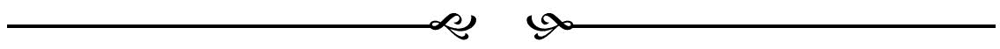

随着可用模型不断增多且大幅回撤减少，公司再次进入稳定盈利期。业内因此展开反思：是否太多量化对冲基金使用相似策略导致无利可图？2007 年 8 月初为何多家量化机构同时重创？

至今震荡的起因仍是间接推测。震荡发生约一个月后，麻省理工学院的 Andrew Lo 与 Amir Khandani 通过构建量化组合模型并模拟该事件，试图解开谜团。他们认为世界某地的一家大交易商遭受重创，为满足追加保证金或降低风险而迅速抛售大额相对价值头寸。Lo 推测交易商是一家银行，而当时负责高盛量化资金的 Bob Litterman 认为是一家多策略对冲基金。考虑到当时的市场环境，震荡很可能与日益恶化的次贷问题有关。平仓行为对重仓相似权益产品的量化机构形成压力，杠杆效应进一步放大跌势。

感染迅速扩散，压力从局部蔓延至周边。价格下跌引发恐慌性下跌，市场状况持续恶化。震荡似乎指向相对价值交易[^(\[2\])](#chapter4.xhtml#comment_1371)，但也许只是巧合，它揭示了不相关的市场不经意间变得相关，并形成不易察觉的拥挤交易[^(\[3\])](#chapter4.xhtml#comment_1432)（crowded trade），提升了每个参与者的风险。

全球金融危机爆发时，更大的相关性问题浮现。2008 年 9 月雷曼兄弟倒闭，公司发现新麻烦：雷曼是我们在亚洲和欧洲的一级经纪商，其倒闭意味着海外组合暂时无法交易。所幸这是已知风险，我们迅速与新的经纪商谈妥合作，一周后恢复交易。

在世界从金融危机中艰难复苏时，WorldQuant 保持运转并持续成长。今天我们更坚信前路可期。在人员、数据、算力和市场经验方面均实现显著增长。我也愈加清晰地认识到，公司正深度参与量化金融的指数级革命。

这意味着什么？我相信业务的几乎各个层面，正像更广阔的商业生活一样，经历非线性、指数级的严峻考验。今日看似极具挑战的目标，明日可能变得寻常，后日可能已无意义。指数级思维意味着大胆思考，不满足于小富即安，不被条条框框束缚，相信所有限制只是暂时的。指数级思维要求将冒险作为生活方式。拥有这种思维的人认为前途永远未知，未知领域注定坎坷；而当下正是一个动荡且高风险的时代。能充分消化信息的人，将有机会以指数级速度获取回报。

2007 年创立时公司仅有 37 名员工，如今已超 600 名研究员、组合经理、技术专家及支持团队，在全球 25 多个办公室工作，其中 125 人拥有博士学位。2007 年我们开发的模型数量已属庞大，现在数据库中已有超过 1000 万个模型，短期目标是几年内突破 1 亿，5 至 10 年后超过 10 亿。我们期待实现巨大的指数级增长。

公司围绕少数核心理念打造。

如同投资理念，模型可以无限产生。我们相信交易可学可教，交易的未来掌握在我们手中。我们也相信，从统计学角度看，人才全球分布，但机会并不均等。因此必须走出去，让天才与机会相匹配。市场的竞争性驱使我们寻求开发模型的多种观点。量化震荡的教训是：切勿陷入拥挤交易，要保持差异化思维。

这包含三点：第一，公司在某种程度上是一家技术公司，必须广纳人才并全球化运营；第二，公司是一家全球化模型工厂，持续产出多元化的投资理念；第三，公司必须以指数级思维塑造自身，想象力要足够大。我们认为巨大的成功带来伟大的责任，其中一项有意义的责任是对教育的投入，特别是在量化领域的教育。

在这些责任中，最重要的是将核心理念转化为行动，找到运用洞见与资源的方式，为全球人士提供发展并证明其才能的机会。

2014 年我们启动量化建模挑战赛，邀请参与者构建高质量模型。这既是竞赛也是学习。选手使用我们专有的模拟与回测平台 WebSim。令人印象深刻的是，产生的模型来自不同地区。参与者有的来自印度东海岸，有的来自一些国家的农村。比赛结果再次证实，人才与投资理念不会被几个主要城市或国家垄断。

2009 年我们创办 WorldQuant Foundation，通过定向捐助和助学等方式在全球普及高质量教育，推动慈善倡议。迄今我们为中国、中东国家和美国多所知名大学的优秀毕业生提供奖学金。

我意识到，既然可以用技术拓展业务版图，为何不能用同样的技术“扩展”高质量教育，让全球学生受益。我打算从量化金融这一熟悉领域开始。2015 年我创立 WorldQuant University，提供免费的在线金融工程硕士课程。两年内我们已招收约 1800 名来自 90 多个国家和地区的学生。WorldQuant University 致力于让人们便捷获取高质量教育，而非作为招聘工具。因此我们的非营利使命体现为，不雇佣毕业一年内的学生。相反，其目标是让学生成为所在社区或领域的领导者，推动社区与行业发展。

每项倡议的强化都源于我对教育力量的笃信，力求为才华横溢、积极进取的人打开通向科技与知识的大门。

本书汇聚了我的生活、工作与思想。部分是回忆录，部分是关于市场、数学与科学的思考，还有对生活与工作哪些有效无效的反思，以及功能强大的计算工具开发、早期接触视频游戏时对编程与模拟的探索，人与机器、数据与人类之间的互动。毫无疑问，本书最主要的内容围绕金融市场的本质展开：金融市场像天气、海浪、地震、进化一样，是复杂的自组织系统；同时具备物理学、生物学与数学的深奥结构。预测这些复杂系统极其困难，系统内的灾难往往毫无征兆，而量化投资则受概率、随机性、相关性与大数定律支配，试图对市场作出预测。

两个基本主题构成《反原则》一书的核心。第一个是理解反原则的概念。反原则很重要，同时又是个悖论，即没有任何原则、模型、模型是完美的，或能在不断变化的世界中永存。反原则真实体现在交易市场，在生活中同样关键。一些原则随条件变化而失效；有些原则成为成功典范后被证明无效；有些人在发现某原则有效时迅速复制，这类现象被称为套利。一个模型即是一种原则，或是对市场的某种假设，通常反映市场上某种关系对证券的影响，或存在于市场噪声中的信号，正是这些算法将人与机器联系在一起。作为人生与交易指南，这些原则体现在我与同事的亲身实践中，在我们共同创建的企业、量化投资策略、强大模拟软件、全球开发模型的项目中渗透其中，也体现在我的人生旅程上。

常有人问我为何创办公司。在任何社会与时代，人们都重视成功与财富。有些人追求实实在在的物质财富，有些人视其为实现其他目标的手段。后者不贪图个人财产或巨额银行存款，而追求摆脱物质牵绊，有能力保护所爱之人和依赖自己的人。

市场上充斥着承诺财富积累的书籍、课程与励志项目。我阅读了其中一部分，那么我想给读者的结论是什么？我认为，财富多少取决于清晰的目标与个人特质，这两者的重要性远胜于学习任何特定技能。

清晰的目标并非与生俱来。几乎每个人都是在人生的跌撞中发现目标，有人早有人晚，也有人从未发现。个人目标通过亲身经历带来的经验教训，以及面对挑战与变化时的反应而不断锤炼。我换过 30 份工作，住过 30 多个地方。我的旅程谈不上惊心动魄，但在灵魂与心智上留下深刻烙印。回望过去，我能清晰看到童年时父母追求变化的阶段对我的影响，以及对我帮助他人和日后支撑事业发展、特别是创办公司的基础所起的作用。这些经历促使我恪守价值观：努力工作，持之以恒，尊重他人，坚守道德，心存感恩，对爱、家庭、成功，特别是自主权的执着追求。

这段旅程从明斯克开始。

* * *

[\[1\]](#chapter4.xhtml#commentRef_1207)一种基于模型的投资流程，在不依赖经济含义的前提下，运用数量方法构建资产组合，依据证券价格与数据模型预测的理论价位对比，构建多头与空头，从而规避市场风险并获取稳定收益。——译者注

[\[2\]](#chapter4.xhtml#commentRef_1369)相对价值交易是指因市场出现特有扭曲因素，使得某类资产被高估而另一类被低估，交易者可买入低估的标的、卖空高估的标的，待两者价格收敛时了结获取价差。——译者注

[\[3\]](#chapter4.xhtml#commentRef_1388)拥挤交易是指投资判断趋同后，大量参与者涌入同一头寸的交易现象。——译者注

# 第二章 反原则
“任何理论或方法都有缺陷。”

一九六六年我出生在明斯克。那时的城市是白俄苏维埃社会主义共和国的行政中心，西面毗邻波兰，南面靠近乌克兰，北接立陶宛与拉脱维亚，东侧为俄罗斯。父母都来自大家庭，亲戚多聚居在列宁格勒与明斯克。祖辈原居波兰，德军入侵后逃入苏联，明斯克遭毁后再次迁徙。祖母独自前往西伯利亚，在那里生下我父亲。父母后来以音乐为业至今仍在从事相关教学。父亲亚历山大拉小提琴，母亲丽玛弹钢琴，两人在一所颇具声望的音乐学校教导天赋出众的孩子。父亲每日练琴数小时，我便在琴声中长大。虽无显赫家世，在明斯克他们拥有体面岗位、一套住房和一辆汽车，能够从事所爱。

对明斯克的记忆零碎：斯维斯拉奇河与涅米哈河环绕城区，古姆商场绵延不绝，纪念卫国战争的胜利广场上永恒之火在方尖碑下燃烧。白俄罗斯在那场战役中遭受重创。我记得在楼前与伙伴嬉戏，母亲会从窗口探出头反复呼喊我回家，怕她生气只要离家半英里[^(\[1\])](#chapter5.xhtml#comment_1794)范围我便立刻跑回。

一九七七年盛夏我十岁，全家决定赴美。我们经波兰转往美国，每人仅携带一只行李箱，随身值钱的只有金戒指与相机，路上还要变卖物品凑路费。父母途中买了口香糖，对我而言那是罕见的美味，要含到几乎融化才舍得吐出。

旅途中得到希伯来移民援助社的帮助。该社团十九世纪八十年代创立于纽约，可协助我们解决财务困难避免陷入绝境。我们未在波兰停留即抵达奥地利。那是一处整洁有序的国度，食物一下子变得充裕，我的食欲大增。随后南下意大利，数月寄居在罗马一位鞋匠家中，他暂停钉鞋让父亲练琴为赴美谋职做准备。随行的姑妈当时已怀孕，并在罗马生产。我记得她摇晃婴儿的一只手，另一只手翻阅书本的画面。等待美国移民局批复期间全家开始学习英语，摸索陌生的字母与发音。援助社的资助很快不足，我们靠变卖随身财物贴补生活。

历经三个月等待，好消息传来：全家获准前往纽约。

回望，起初的经历与移民决定为我后半生奠定了基础。从苏联到美国的旅程记忆碎片化，或许遗忘是应对焦虑的方式。虽然在罗马接触过一些英语课程，真正开始掌握是在抵达纽约之后。我比父母学得更快，年纪小、求知欲强，擅长数学，对国际象棋着迷。父母具音乐天赋，我对乐器并无兴趣。但毕达哥拉斯曾揭示数学与音乐的内在关联，提出天体音乐[^(\[2\])](#chapter5.xhtml#comment_1890）的理论。数学与象棋之间亦存在某种呼应，这些潜移默化地影响了我。

离开故土及在美所遇逐步塑造性格。它们帮助我摆脱自我设限、积累经验，也让我懂得珍惜每一次机会，竭力汲取比别人更多的养分。有些教训令人惊喜，有些因年幼时未识价值而被忽略，直至再次遭遇才记起。随着时间推移我慢慢明白，即便自认已然了解自己，也可借助他者视角审视过去，从中提炼有用经验。

某种程度上，这些经验与法则类似于我们在世坤投资里所构建、检验并交易的主动因子。在现实喧嚣中它们只是微弱信号，难以完整理解。基于过去经历，信号经由经验与假设整合进模型。我们试图为其下定义并套用规则，但成功并不意味着规则永恒。每条规则或因子皆会在某段时段失效，就像二〇〇七年量化市场剧烈震荡时业绩遭受重创。

这些法则是什么？其中一些近乎哲理，被广泛运用。

人生仅有一次，时间是最真实不可替代的资源。你能再赚一笔钱，却无法制造额外一刻。应以多棱镜审视生活，它会折射出那个古老提问：若今天是生命的最后一天，我会如何度过？

人生难以被完全规划，突破的关键在于行动。持续付出一点一滴的努力，把每次尝试串联。无法预知哪个环节会开花结果，通过培育机会并善用产出，更容易取得成果。其余法则也遵循相似规律。

建立具体且可量化的目标，明确从起点到终点。具体的目标才可实现，抽象的愿望难以达成。若无清晰目标，人生轨迹便会像布朗运动[^(\[3\])](#chapter5.xhtml#comment_1947）一样随机游走。

培养意志力并发挥个人优势，随后做到持之以恒。扫除障碍，设法解决问题。久而久之，坚持会超越天赋。

交易让我学到很多，因其强度极高。在量化震荡中这些法则得到验证，尤其在止损层面。关于量化投资的诸多法则已在世坤投资的业务里实践。

障碍本身即是信息。无法取得成效说明存在原因：也许构想本身不佳，也许被误导，也许执行不当。先吸取教训，再调整方法，最后清除障碍。

把焦虑中蕴含的优势抓住，想摆脱它便能找到方向。为每一位参与者设计收益。学会创造源源不断的机会。在任何环境、任何业务、任何经济气候下，都要想办法做得更好、更成功。尤其在股票市场，如同技术领域，机会始终存在。

灵感无穷。知识相互生成，灵感孕育新知，生生不息并改变现状。

自负会扭曲现实。

然而所有法则都服从一个看似矛盾的核心——反原则。反原则在投资与生活中均被证实有效：任何理论方法皆有缺陷，没有事可被绝对证明、任何事都可能被证伪、任何事都不完美。因此必须不断求变、保持弹性、控制亏损、持续调整、坚持纠偏。反原则警示不要墨守成规、不要教条。

反原则像一道哲学难题，在某种程度上与古希腊埃庇米尼得斯悖论或公元前六世纪克里特人说谎者悖论相关。说谎者悖论包含两层：所有克里特人都说谎，我是克里特人。矛盾随之出现——说谎者如何说真话？一九三〇年代奥地利数学家库尔特·哥德尔在首个不完备性定理[^(\[4\])](#chapter5.xhtml#comment_2054）中借用这一思路，指出每个公理都有固有局限，连基本算术也无法自证一致。哥德尔的结论颠覆了希尔伯特试图证明的观点，也冲击了罗素等人的研究。我的反原则与说谎者悖论相似：除了“所有原则都有缺陷”这一原则没有缺陷，其余原则都有缺陷。

不必深究数学逻辑，反原则是一条经验法则。人类具有创造力，无论狩猎采集还是量子物理时代，正因能理解环境并运用规则才得以成功。理论无数，我们仍渴望更多。卡尔·波普尔提出，没有放之四海而皆准的真理可被证实，未来出现的反例都可能推翻所谓真理。他强调纯粹事实不存在，所有观察与总结都带有主观推理。世界复杂，没有完美的人也没有完美的想法。想法可被语言或符号抽象，而原则试图用隐喻捕捉难以理解的现实。所以每条原则都有缺陷，没有永恒适用的原则。单一教条无法描述世界，只有诸多原则共同描述其一小部分。

年少离乡、适应全新世界塑造了我拥抱变化的世界观。对博弈原则的研究和在主动因子失效时及时止损，正是这些经历的回报，也是反原则在现实里的体现。

反原则打开通往许多学科的大门——数学、计算机编程与模拟、人机交互、金融市场以及复杂自组织系统的本质，它们让我得以窥见自然与人类复杂性的面貌。

一九七八年下半年，我开始投身这些令人敬畏又迷人的学科。

* * *

[\[1\]](#chapter5.xhtml#commentRef_1766)1 英里≈1609.344 米。——译者注

[\[2\]](#chapter5.xhtml#commentRef_1850)希腊先哲毕达哥拉斯认为，音乐与天文学密切相关，即乐音和节奏体系必然体现天体之和谐并同宇宙相对应。柏拉图在《天体音乐》中将这一创想用诗歌的形式表达出来。天体音乐是行星运转而产生的音乐，只是人类无法听到。——译者注

[\[3\]](#chapter5.xhtml#commentRef_1940)1827 年，英国植物学家罗伯特·布朗（Robert Brown）在花粉颗粒的水溶液中观察到花粉不停顿的无规则运动。进一步实验证实，不仅花粉颗粒，其他悬浮在流体中的微粒也表现出这种无规则运动，比如悬浮在空气中的尘埃。后人就把这种微粒的运动称为“布朗运动”。——译者注

[\[4\]](#chapter5.xhtml#commentRef_2042)哥德尔证明了任何一个形式系统，只要包括简单的初等数论描述，并且是自洽的，它必定包含某些系统内所允许的方法既不能证明真也不能证明伪的命题。——译者注

# 第三章 平行宇宙
“世事难料，计划难以周全。”

曼哈顿百老汇西街九十一号的玄武石旅馆，曾是虫害滋生的场所，我们一家也曾短暂寄居。挑选落脚地本身就是移民维生的常态。上城西部的环境对我们而言，如同七十年前东区对逃离欧洲的犹太人一样艰难。

街坊争吵、经济低迷、治安败坏，构成了我们水深火热的曼哈顿生活。旅馆建于二十世纪二十年代后一直保持原貌。我的消遣是观察美洲蟑螂，它们像动画角色一样出没。那时很难适应新生活：美国食物与欧洲截然不同，多为高度加工、添加防腐剂，气味令人作呕。那是七十年代末，上城西部败落表象下正悄悄变化。二十年后我搬到旅馆对面，这里已成翻新后的住宅区，我的第一个孩子就在这里出生。如今玄武石已变成豪华公寓，配备高档健身房和屋顶花园，供富裕年轻人享乐。

我们一家曾在纽约拮据求生。父母在故乡是音乐家头衔，但在纽约却难以谋生。新移民像汪洋中的一滴水，我们只是其中一个普通家庭。这种环境容易培养出没有怨言、安分知足的人，他们一边生活一边谋划未来。今天的曼哈顿出租车司机可能是阿富汗工程师或伊拉克医生，十年前可能是越南佛教徒或俄罗斯犹太人。他们无一例外，包括我的父母，都被称作“穷人”。但他们算的是未来，渴望孩子在美国获得机会。

尽管是外来人口，纽约仍是我们的目的地。布鲁克林布莱顿海滩一带聚集着大量俄罗斯社区。曼哈顿是国家的文化中心，有父母毕生追求的人文艺术。我们住的旅馆虽差，往北二十五个街区是哥伦比亚大学，往南二十五个街区是林肯中心和茱莉亚音乐学院。

母亲主要在家照顾我，只能从事低收入工作；父亲在音乐家云集的城市里苦寻演出机会。古典音乐圈独奏机会稀少，能提供稳定薪水的职位更难。父亲每天练琴，演奏很好，但在纽约，最小的独奏试镜也可能有四五百人竞争。他英语有限，收入要抚养全家，于是除了试镜几乎无暇他事。

刚到纽约的几个月，我不敢走出旅馆太远。那是夏天，未上学，英语学习缓慢。秋季父母把我送到附近公立学校就读。我在俄罗斯读四年级，在美国却可读六年级。明斯克的数学比美国同期学校更难，但美国学校教会了我许多其他东西。我学英语很快，用词典查生词完成作业。

在曼哈顿读了几周后，全家搬到皇后区阿斯托里亚。那里的学校环境不好，社区糟糕至令人发指。

不到一年，父亲在里士满交响乐团找到稳定职位，我们南迁到弗吉尼亚州。里士满对我的改变很大，如同初到纽约一样。这次我们住进了郊区。两年后又搬家，这次到堪萨斯州威奇托。

对纽约人而言，威奇托像《荒野镖客》里的地方，但它有悠久文化和不错的交响乐团。生活成本远低于纽约，父亲找到工作，只是收入不丰。

父母从未抱怨，对新生活心存感恩。当然我并未舒舒服服过，那些艰难岁月让我学会很多谋生本领。父母竭力保护我却不溺爱。父亲鼓励我工作，十三岁那年我找到一份工作：为一座藏书几千册的私人图书馆建卡片目录，每张索引卡十美分。

此后几年我做过许多工作。某年夏天我在威奇托一家牛排馆洗碗。厨房温度极高，地面覆盖油脂极滑，我像溜冰一样在各处移动。每小时三点三五美元。工作无聊低薪，却训练了毅力和忍受单调任务的意志。后来我辞掉它，去街对面的面包店，每天一早制作饼干和三明治，每小时三点四五美元。

在威奇托，我学会很多，最重要的是学会了计算机编程。高中时只有几台苹果IIe，我立刻沉迷，爱不释手。入门语言是Logo，是六十年代为儿童教育开发的。黑客们会怀念屏幕上那只输入指令的小海龟光标。那是一种开放的语言，比预装应用提供更大拓展空间，让孩子感受到计算机的魅力。

高中时我在一家残障人士夏令营教Logo。第一天老师没来，我被迫独自管理班级。那次经历难忘。因为残障，许多学生行动受限，但计算机端口让他们淋漓尽致地表达自我。我从他们身上和自己身上学到很多：给予机会和合适工具，人们会更聪明更有能力。同时我也看到，面对环境压力，我能处理任何状况。即使老师没出现、我没有正规训练，我也能胜任教学并完成各种需要的工作。

之后我自学更实用的BASIC。某天当地医院内科医生到学校询问谁会编程，学校指定了我和一位德国小伙伴。我们都熟练使用BASIC，便被雇佣编写抗生素用药剂量程序。虽然有医生监管，但程序毕竟由两个十五岁孩子用BASIC完成，搞不好会误杀上百人。幸运的是程序成功了。我又学到一课：年龄从不限制人，限制你的只有能力和坚持程度。

17岁的那个夏天，全家搬进了休斯敦，德州的生活我们很快就喜欢上了。父亲又一次催我找点事做，指点我翻翻本地报纸的招聘版。翻着翻着，我撞见一条计算机视频游戏编程的启事，时薪20美元，对一个十几岁的孩子来说像是第二次中彩票。我刚拿到驾照，立马跳上车，硬挤过交通堵塞的休斯敦，一路冲到公司。见到的总裁很干脆地交代工作内容：“我给你一个名字，你负责写出一个能玩的视频游戏，怎么样？”

“没问题，肯定能做。”我脱口而出。

他抛出来的几个名字让我挺兴奋： 《死亡山谷侦察队》《口哨声声》《幽灵出没》《约瑞克的复仇》。这些作品要跑在当时新冒头的主流家用机苹果 Commodore 64 上。为了上手，我砸开存钱罐——我确实有个存钱罐——买了台机器开始写。 Commodore 64 在 80 年代里对开发者和玩家都很火，当时就是用 BASIC 写，但要拼速度。放到今天，这些游戏显得很简陋，在 YouTube 上还能搜到当年的录像。我喜欢往里加些好玩又吓人的点子，比如失败时一只秃鹰从天而降把玩家吞掉。公司很买账，很快就有人请我写本视频游戏设计的书，把代码和背后的思路讲清楚。书卖得一般，但那 5 款游戏都顺利上市了。

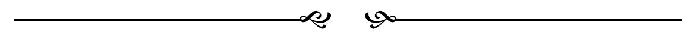

回头看，作为休斯敦的一个十几岁少年，我完全没意识到自己被无意推进了电子游戏行业，而这段经历正好让我触到计算机模拟，并且碰到后来会变得更强大的技术。哪怕在很早期的编程里，比如做《死亡山谷侦察队》时，我就在搭建一个镜像世界，或者说在模拟一个平行世界。用今天的眼光看，当时的工具粗糙得要命，处理器和内存更是捉襟见肘。可每一个作品里，我们都在造一个新世界，或者说在模拟一个新世界。

在海量数据和更快更强的硬件推动下，计算机模拟以惊人的速度成长，成为科技里不可或缺的工具：医药研发、自动驾驶、飞往遥远星球的航天器、游戏影视娱乐，以及模拟飞行训练系统等等。在世坤投资，模拟就帮助阿尔法完成了严苛的回测，用大量历史市场数据把过去重演一遍。模拟加大数据让我们能够处理过去被海量数据卡住的复杂系统。

为什么亚当·斯密说的市场“手”是看不见的？因为市场这样的复杂系统，至少有一部分是自组织的。表面看像随机，实际上某些部分受原则支配，另一些部分受深层模式影响。亚当·斯密和他的继承者数学、计算都不在行，根本打不开哪怕最简单的市场的复杂性，所以那只手一直看不见，也就大多不可预测。

复杂不等于繁琐。在科学意义上，复杂系统由众多相互作用的因素构成，却不遵循各因素统计平均值。它以非常规方式运行，从大量微小“代理人”的互动开始，就像交易员在推动市场。系统会从一种状态跳到另一种状态——阶梯式转变或机制变化——这种切换往往突然而无征兆，带随机性。变化让人费解，像是任性神祇在作祟。这种特性正是所有复杂系统“自然”属性的标志，和地震、人口激增、物种大灭绝、气候变化、火山爆发、市场的繁荣与衰退一样难以捉摸。飓风、泥石流，或是像美国大萧条、全球金融危机这样的大事件，都很难提前预判。驱动它们的底层因素错综复杂，可以解释却几乎没人能准确定位。

对二战期间造原子弹的科学家而言，复杂系统的预测难题几乎是无法逾越的障碍。曼哈顿计划的最终成功，部分要归功于电子计算机的诞生。虽然按今天标准算很原始，却能完成大量运算。当然，工具之外，人类智慧才是关键。

很大程度上，这份智慧来自数学家约翰·冯·诺依曼。20世纪30年代初他离开匈牙利，到普林斯顿新成立的高等研究院任教。阿尔伯特·爱因斯坦几乎同一时间抵达。纳粹占领奥地利后，库尔特·哥德尔也加入进来。冯·诺依曼是那个时代的博学家，在哥德尔关于数学算法矛盾引发的争论白热化时，他为平息争论作出突出贡献。他的足迹还遍及量子物理、博弈论、数字计算机结构、实用核武器，以及临终前仍在研究的自复制自动机理论。

二战爆发后，冯·诺依曼被调往政府的军事研发项目。其中之一就是在新墨西哥州洛斯阿拉莫斯沙漠里进行的曼哈顿计划。他解决了长期困扰17世纪法国数学家、哲学家、发明家布莱士·帕斯卡——这位造了早期机械计算器的先驱——以及后世许多数学家的物理过程预测难题。他攻克了流体力学、湍流乃至混沌、液体流动的计算，比如山间溪流的奔流。他的方法是高度数学化的：先抓准问题的特征，推导出用数字模拟的新解法；再建立一套软硬件理论，给模拟用的硬件和跑硬件的软件做体系，当时还说不上“软件”这个词。

液体的行为像其他复杂系统一样，拒绝被非线性方程描绘或预测其随时间演进。战争早期，冯·诺依曼已是聚能装药计算的专家，清楚怎样算出火箭炮弹最佳外形来摧毁德式装甲坦克。在曼哈顿计划里，他支持以内爆法引爆核武器，让爆炸冲击波把钚核压到临界。难题是怎样“塑形”、如何实现有效压缩，把爆炸引导成快速连锁反应，也就是控制和集中爆炸。

冯·诺依曼的做法是把冲击波模拟拆成数万个微小数据包，在刚运抵洛斯阿拉莫斯的IBM机上跑。科学家给每个数据包写规则，描述炸弹对局部障碍和邻近障碍的反应，这本身就是一种算法。算法要求机器里存下海量数据，机器再算出每个微小数据包所需的时间切片。结果回流到机器，由机器生成集体波的模拟。历史学家理查德·罗兹在《黑太阳》里形容氢弹研发的过程，像“在挤满人的舞厅里频闪灯下捕捉舞者的连续位置”一样困难。唯一关键要素是速度，这项工作靠数百万张穿孔卡和源源不断的数据喂养机器昼夜运行。结果虽粗糙，却让冯·诺依曼设计出包围弹芯的炸药透镜，解决了制造实用核武器的核心难题。

计算机模拟对数据的胃口近乎贪婪，而它本身也产出海量新数据。模拟复杂系统需要持续扩大的数据源，而管理不断膨胀的数据集又反过来催生更精细的模拟技术。这种相互推动正是计算机发展的主线。

身材矮胖、口才极佳的冯·诺依曼就站在这条前沿。他在洛斯阿拉莫斯用的是模拟IBM机，本质上是个大型计算器。缓慢的速度促使他重新思考计算机该怎样造。战争结束后，造氢弹的超级工程自然成为最高优先级。在他的匈牙利同僚爱德华·泰勒领导下，超级工程采用精密的内爆机制。裂变装置作触发，产生的不只是冲击波，还有大量电磁辐射进一步压缩重氢内核，引发大范围聚变。

除此之外，氢弹还需要更复杂的运算去理解中子爆炸和裂变产生的高温。1944年，在火车站站台上，冯·诺依曼与一位工程师交谈。那位工程师刚帮宾夕法尼亚大学造出一台计算机，用真空管替代了IBM的齿轮与继电器。这台由埃克特和约翰·W·莫克利发明的机器叫ENIAC，即电子数字积分计算机。它在1945年12月到1946年1月的超级炸弹任务里首次运算，百万量级的中子弹道计算速度远超洛斯阿拉莫斯的IBM机。

不久后，冯·诺依曼在105页的论文里提出存储程序计算机的概念。指令和数据可以经程序写入电子存储器，取代物理插线、继电器、电缆——有点像老式电话交换机——每次程序变化都能调用存储的指令和数据。冯·诺依曼在普林斯顿高等研究院按此思路造出了MANIAC，数学分析器、数字积分器和自动计算机，它一度是50年代全球最快的机器。MANIAC是第一台存储程序计算机，而冯·诺依曼式结构至今仍是主流设计。

在偏重理论、与世无争的高等研究院，制造热核武器并不受欢迎。研究院负责人、曼哈顿计划的总指挥J·罗伯特·奥本海默虽仍支持MANIAC，却对一次比一次更强的武器深感不安。普林斯顿高等研究院以高度抽象理论闻名，计算机项目显得格格不入：应用数学压过纯理论，工程压过理论思考。50年代后期机器老化，全体教师投票决定不再参与这类项目。

即便如此，冯·诺依曼在计算机领域的深远影响延续至今。他把通用计算机造了出来。英国数学家艾伦·图灵，以破译二战德国密码闻名，《模仿游戏》的原型人物，在1936年理论化了图灵机。那时图灵只是剑桥数学系的学生。1935年他参加一个数学基金会课程，目的也是澄清哥德尔试图解决的那类问题。一次跑步后在草地上休息，他忽然想象出一种理论机器，能证明任何交给它的数学命题。这种机器能读写——类似带符号纸带作为指令序列送入设备——这正是通用计算机的运行规则。机器是通用的，因为它能模仿图灵所说的其他有标准说明的机器。简单说，相对于手工机械计算，图灵的通用机可编程、可设计，他带来了软件的概念，只是当时还没这个词。1936年发表《论可计算数》后，图灵获得普林斯顿博士学位。冯·诺依曼熟悉图灵及其论文，成功把通用机的想法变成现实。

18岁那年，我得找份工作交休斯敦大学的学费。也拿到别的学校的录取通知，但休斯敦大学更便宜，女友也选了那里，于是我留下。应聘了一则本地广告的财务编程职位，岗位在一家有油气终端的公司。我对会计和油气终端一无所知。出人意料的是，一个月后我接到了录用电话。

公司在休斯敦的办公室只有两个人：总裁里克·沃利和他的秘书。其余人都在密西西比。里克不介意我的年纪，他搭乘夜班火车早上8点抵达，车上看我的作业来判断能力。他说从没见过编程这么快的年轻人。我先做兼职，之后会钻进他的大奔驰，开6小时到密西西比的比洛克西待几天，装软件、培训员工，然后看着巨大的天然气管道终端被灌满。

我喜欢这份活，喜欢编程、坐奔驰、路上啃炸薯条汉堡，也喜欢和里克长谈人生。他是地道的德州人，想给我全职机会，我却拒绝了。大一结束后，我从休斯敦大学转到得克萨斯大学奥斯汀分校，那里从那时起就以计算机科学编程著称。接下来的几年我学计算机科学，读希尔伯特、哥德尔、图灵、冯·诺依曼的研究，还做兼职编程或辅导数学、英语。

毕业季，我收到了贝尔实验室的邀约。

* * *

[^1]: 二战期间，美国陆军自1942年起开发核武器计划的代号。——译者注

# 第四章 信号和噪声

“锲而不舍方能强大。”

大四时我在得克萨斯大学奥斯汀分校参加了贝尔实验室的面试并拿到录取。去那里工作的话，他们会帮我付硕士学费。同时我申请了得克萨斯大学商学院，拿到了全额奖学金。贝尔通信研究所Bellcore——1984年从贝尔实验室分拆出来，为分拆后的地方贝尔运营公司提供研发——以及一家石油公司也给了我offer。贝尔实验室的名字自带溢美，却是多项基础科技突破的诞生地，决定了电子通信的走向。

自1937年起，贝尔实验室的科学家已斩获8次诺贝尔奖，晶体管和激光器的发明、克劳德·香农创立的通信理论、关于信息与噪声的数学概念都在其中。70年代后期，贝尔实验室诞生了C语言，它是我编程的主干，也是Unix操作系统的基石。Unix不仅跑在苹果Mac上，还支撑大量系统；后来C演进为我们今天用的C++。权衡后，我接受了贝尔实验室的职位，同时攻读1988—1989学年的得克萨斯大学计算机科学硕士。

## 从学术训练到金融实践：个人经历与思想演进

## 计算复杂性的学术磨砺

那是一段近乎暴力的训练。整整9个月里我几乎只学习，睡眠很少。单是计算机图形学，每周就要花40小时。挑战很折磨人，却也令人上瘾，让我本科毕业后能继续深耕计算复杂性。计算复杂性是理论计算机科学的分支，抽象、偏数学，不需要大量写代码，却要求对算法做深层钻研。简单说，算法就是计算机为解决一个问题必须构造的一系列机械化数学步骤。

我发现要攻下难题，需要48小时全神贯注地持续思考，最关键的是坚持。硕士期间的研究集中在解决学术难题上。我和另外两位同学合写了一篇论文，讨论非完全多项式问题NP-complete，简称NPC问题，与非确定多项式时间相关。问题的特点是随规模扩大，求解时间呈指数级增长。在运行前就能判断算法的问题属于NPC，有助于评估可用算力。旅行商问题是典型例子：给定城市集合和两两距离，求一次访问所有城市并返回起点的最短路线。城市一多，复杂度爆炸。旅行商可作为复杂计算的参照，用于芯片设计、卫星轨道协调等。即使有捷径、近似和其他技巧，NPC在计算机科学里仍被视为硬骨头。

1988年6月我毕业，成为得克萨斯大学第一位一年内完成计算机科学硕士的学生。实际上只用了9个月，但我没告诉贝尔实验室，所以在去新泽西米德尔敦研究机构报到前，有大约3个月的空档。

## 贝尔实验室的失望与转型思考

贝尔实验室的工作有些让人失望。1984年1月，贝尔系统被美国电话电报公司AT&T和西电公司Western Electric拆分，长途电话和制造支持业务从地方运营公司剥离。失去垄断后，贝尔把研究与运营的商业模式绑得更紧。我到米德尔敦时，科技产业正在剧变。硅谷的数字电子蓬勃发展，风险资本和创业公司如雨后春笋，互联网时代来临，计算速度按摩尔定律迭代，从大型机到小型机再到台式机，算力持续攀升。

我们在世坤投资大力倡导的那种探索自由，在当时的贝尔实验室已不复存在。我感觉被官僚程序困住，条条框框限制发挥，团队一天只写4行代码，每一步都要反复论证和回测。人为的低效让人沮丧。我很快意识到我不想当程序员，我不属于这里。失落感很重。好在在贝尔认识了许多朋友，他们也多有同感。

因为还没想清楚方向，我在是否继续读法学院或商学院之间犹豫。那时我对金融投资知之甚少，只读过康妮·布鲁克写的《垃圾债券之王》。书里讲述高收益债券创新者迈克尔·米尔肯，让我找到一个着迷的领域，于是我申请了米尔肯母校宾夕法尼亚大学沃顿商学院，并被录取。

## 沃顿商学院与早期投资启蒙

沃顿的校园成了我人生转页的起点。那里的同学普遍带着一种近乎理所当然的优越感，我一下子置身于此前从未遇见过的高手圈子里。MBA 开学第一课就是团队破冰。《经济学人》曾为此写过一篇报道，还配了张照片——一群学生手拉手把一位女士托举起来演示信任建设，我的手腕也恰好入了镜。最让我印象深刻的是，当被问及自我评价时，几乎所有人都在夸大其词，普遍认为自己远高于平均水准，甚至约莫一半的人声称自己曾救过别人的命。

入学第一年，我参加了美国电话电报公司主办的大学生投资挑战赛，比赛周期三个月，本质上是一场选股PK。我的搭档是胡振华，当时在贝尔实验室共事，后来去哥伦比亚大学商学院深造。两人都不懂选股，但脑子里只有一个目标：不要想着夺冠，而是想办法在12000支队伍里挤进前12名。我们的思路很粗糙——挑几只波动极大且走势相关的股票，然后赌市场方向。运气不错，比赛期间账户翻了四倍。从专业投资角度看这属于瞎捞，但对起跑就落后、水平有限的我们来说，反而是一步妙棋。眼看要上榜单了我们却收手了。赛后最大的收获是人：胡振华，在中国台北长大、16岁赴美的他，后来主导了世坤投资的海外业务搭建。

沃顿把我带进了金融圈。在校期间我在D.H. Blair＆Co.实习过，这家纽约的老店以服务中小型科技创业公司闻名。我的工作是甄别高科技的投资机会、当投资者和创业者之间的桥梁并促成交易。流程繁琐、消耗时间巨大，最后也没能撮合出一单成交，却意外很有意思。布莱尔并不出名，这段经历却让我切身体会到创业的真实难度——把一个好点子真正变成可运营的业务之前，要扫清无数看不见的障碍，而创业者们都在为此拼命。

毕业后，沃顿就业办公室帮我安排了下一个短暂的岗位。哈佛国际发展学院把我派往莫斯科，协助推进一批国企的私有化。那项计划由经济学家兼政治家阿纳托利·丘拜斯主导，哈佛方面的执行负责人是俄罗斯出生的经济学家安德鲁·施莱弗，他当时是丘拜斯的顾问。两周后我就意识到自己在当地的作用微乎其微，于是返回了美国。如今世坤投资在俄罗斯已设两处办公室，抛开其他因素不说，俄罗斯的人才储备确实让人惊讶。

## 转折点：廷伯希尔的启蒙

离开莫斯科后我需要新的去处。那时我已经结婚，面对不确定，我照旧用了最随机的办法——给各大公司CEO群发自荐信。很快收到康涅狄格州格林尼治廷伯希尔公司的电话。这家自营交易公司由托马斯·彼得菲创立和管理，1993年他又创办了盈透证券，后者后来成长为全球最知名的在线交易与交易软件提供商之一。

彼得菲生于1944年的布达佩斯，在匈牙利学工程，随后去西德，1965年来到美国。他初到纽约时英语几乎不会——这一点倒是和我相像。他毕业于马萨诸塞州克拉克大学，先在纽约画建筑图样，公司购置电脑后由他编写程序，他从一窍不通到后来着迷其中。1967年他换了东家，进入一家正研发早期金融计算机模型的公司。1977年他用积蓄买下美国证券交易所的一个席位，之后长年费力地推动各交易所接受他那套日益成熟的电脑化交易系统。

去格林尼治公寓面见彼得菲的场景我至今难忘。他的男管家在客厅里准备饮品。我随口开了个编程玩笑，他立刻打断说我对现实缺乏敬畏，随后说：“想在这行站稳，就得无时无刻地思考。很多人没意识到，这个行业里绝大多数人都聪明得惊人。”“无时无刻思考”这句话深深击中了我，简单却显而易见，几乎成了我的座右铭之一。面对复杂的编程难题时，我也的确需要保持持续的思考。

虽然开玩笑失了分寸，彼得菲仍然录用了我。他让我调研各种计算机化投资策略并把算法写出来。我恰好具备这些条件：编程能力、对算法的熟悉、以及金融与市场的积累。在廷伯希尔，我把这些技能用在市场的掘金上。彼得菲眼里我只是研究员而非交易员。两年后我跳槽到伊兹·英格兰德的纽约对冲基金千禧管理公司。

现在我也在格林尼治拥有一套与彼得菲当年相似的公寓，区别是，我没有请男管家。

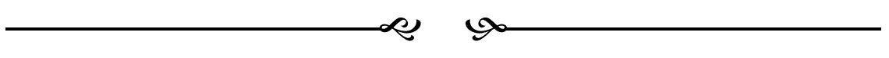
## 有效市场假说与随机性的博弈

对交易员和投资者来说，用电脑建模和预测市场时最大的拦路虎是有效市场假说。20世纪60年代，尤金·法玛在芝加哥大学提出这一假说，它至今仍主导金融思维，也不断遭到实务和理论的挑战，我们在世坤投资的量化交易实践也在试图突破它。法玛因该假说于2013年获诺贝尔经济学奖，金融危机后他对市场有效性的看法也有进一步修正。

法玛的核心论点是未来股价不可预测，因为现价已经包含了所有可获得的信息，其中也包括对未来价格的判断。简单说，相信市场预测就相当于相信圣诞老人的存在。该假说暗示任何策略都难以有效模拟股价，因为未来价格本就无法从过去和当前数据算出，进而切断了过去与未来的关联。与此相对，伯顿·马尔基尔的《漫步华尔街》广为流传，市场被描述为随机游走，这也解释了为何多数主动投资者长期难以跑赢大盘。

有效市场假说权威性极强。战胜一群理性投资者的市场很难，这些人会远离定价失真的市场进行套利，进而让假说变成金科玉律。一个直接后果是被动投资兴起：指数基金和ETF大量涌现，人们觉得既然打不过，不如复制。预测的难题却依然存在：即便押注行业指数，进场的板块可能涨也可能跌，投资者仍会受股市波动影响，实质上仍是一种假设性的预测。长期来看，用这种方式选股算是相对不错的赌注，指数基金的优势在于便宜，远比主动管理型共同基金或经纪人买卖股票成本低。撇开经纪人，买股票的人都在承担风险，每个人都想赚钱，最终谁赢谁输带有很大偶然性。这和我与胡振华在AT&T挑战赛里的打法如出一辙，我们都想碰运气，只是当时没投入真金白银，所以没有损失。

## 巴舍利耶：把股价比作布朗运动的先行者

股价的随机性和有效市场思想最早可追溯到1900年法国数学家路易斯·巴舍利耶的博士论文。70页的《投机理论》揭示了市场系统和自然系统的共通之处。这篇极具突破性的论文却没为巴舍利耶换来更好的职业前景。把市场与自然联系起来当时显得怪异，他甚至难以在学术界立足。但巴舍利耶是个洞察本质的观察者，他并非投资者，却以纯数学家的视角看清了市场运行规律。他发现股价走势类似布朗运动——平静水面下微小尘埃的无规则漂移，是尘埃与水分子随机碰撞对热力学背景噪声的回应。

巴舍利耶还用数学证明了解决不可预测性的方法，核心是计算概率而非线性方程。预测困难，但布朗运动遵循特定的统计规律：在给定时间内，尘埃或价格停留在某个位置的概率是可描述的。

无论是布朗运动还是随机游走，价格都不能像牛顿摆球那样被绝对预测，我们本质上是在下注。巴舍利耶还量化证明了随机运动会随时间推移而扩大规模。

他的研究远远超前于时代，论文数十年后在不同领域成为奠基之作。爱因斯坦1905年关于布朗运动的早期研究就源于巴舍利耶的公式。如今巴舍利耶被视作金融随机过程的开创者、随机运动统计分析的先驱。随机过程被广泛用于分析金融、经济、生物、化学、量子物理、信息论、通信和计算机科学等复杂系统。克劳德·香农1948年发表《通信的数学理论》，用熵或不确定性度量随机通信过程。

巴舍利耶首次尝试计算期货和期权价值，可被视作布莱克-斯科尔斯期权定价模型的鼻祖。该模型由费希尔·布莱克、迈伦·斯科尔斯和罗伯特·默顿在上世纪70年代完成，成为金融领域最常用的模型。如今宏观经济预测常用动态随机一般均衡模型来测算石油价格变化、税收政策调整等随机冲击的效应，就像冯·诺依曼计算氢弹内中子流一样，这类复杂模型必须在电脑里运行。冯·诺依曼与经济学家奥斯卡·摩根斯坦合作博弈论后不久，于1945年建立了早期的一般均衡模型。尽管DSGE模型不断完善，但与冯·诺依曼对原子弹的预测一样，仍无法被完全证实。

巴舍利耶在市场洞察中引入了严格的风险回报理论。金融研究发现，长期来看某些板块如小盘股倾向于产生更高回报，但代价是更高的风险，尤其是波动性更大。人们始终需要在风险与回报之间权衡。

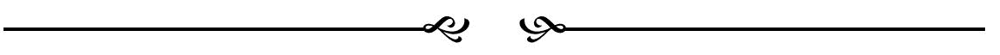
## 布莱克与价值线：量化与主动投资的对话

费希尔·布莱克值得单独谈谈。他在哈佛学物理，获应用数学博士，主攻运筹学、逻辑、计算机设计和人工智能。正如彼得·伯恩斯坦在《投资革命》中所写，布莱克“主要兴趣在于把这些学科应用到信息处理上”。很快他被金融吸引，做过咨询后先后在芝加哥大学、麻省理工学院任教，职业生涯在高盛结束。在那里他是华尔街公认的量化高手，集物理与数学于一身的交易者，与嘈杂的交易大厅形成鲜明对比。布莱克个性低调、严谨、谦逊，也有一面率真幽默——他在高盛写过备忘录，标题先是“布莱克-斯科尔斯的漏洞”，后改成“如何利用布莱克-斯科尔斯的漏洞”，恰好捕捉了理论与实务的差距。如同许多顶尖金融思想家，他笃信有效市场假说，尤其在芝加哥大学获得终身教职后更坚定。

1970年，布莱克开始怀疑阿诺德·伯恩哈德的观点。伯恩哈德是价值线公司的创始人，主张积极投资即价值投资。布莱克曾反问：“在有效市场中，投资分析能预测股价走势吗？”价值线的方法源自哥伦比亚大学的本杰明·格雷厄姆及其学生沃伦·巴菲特，核心是深入分析公司数据判断股价被低估或高估，强调均衡与理性，认为价格会围绕真实价值波动。

伯恩哈德的价值线系统用市场数据锁定价值被低估的股票。大萧条期间他被穆迪解雇后自创该系统。价值线评级的做法是画一条直线叠加在锁定股票的价格上，这条线代表真实价格，再依据收益增长、价格动能、市盈率等相对市场和历史表现进行评级。早期伯恩哈德手工绘制透明价值线追踪股价：股价跌破线下方一定幅度视为低估要买，涨破线上方则要卖。他发现1929年许多股票严重高估，并按偏离程度把系统分成五类。

起初他以书籍形式出版评级，本想卖给华尔街公司，后来改成直接定期向投资者更新。随后几年在麦迪逊大道347号的办公室，伯恩哈德和助手用尺子在股票图表上手工标注价值线。1946年他聘请萨缪尔·艾森斯塔特做校对。艾森斯塔特是俄罗斯移民之子、美国陆军退伍兵，拥有纽约市立大学统计学学位。他改进了方法，引入普通最小二乘回归和横截面分析代替时间序列，提高了准确度。

这些计算超出当时机械计算器的能力。1950年代初，研究部主任艾森斯塔特买下一台UNIVAC，是当时46台之一，也是世界上首台商用大型主机。UNIVAC是ENIAC的继承者，后者由宾夕法尼亚大学的埃克特和莫克利发明。1950年他们的公司被雷明顿兰德收购，由莱斯利·格罗夫斯将军执掌。首批客户是美国人口普查局。那台机器重13吨，中央处理器占1250平方英尺，每秒约2000次运算，内存可容纳12000字符，数据通过打孔卡片输入，一张卡代表一个指令。

尽管价值线没有曼哈顿计划的人力，UNIVAC与艾森斯塔特更复杂的量化方法结合，使得价值线的计算更快、更详尽、更精确，统计检验也更可信。学界与华尔街研究界却极度悲观：学术界认为价值线违背有效市场假说，华尔街则视其为粗糙量化直觉与专业知识的尝试。

费希尔·布莱克也持怀疑态度，相信强有效市场。1973年他写道，“我的立场比强式随机漫步假说更极端”，“我认为挑选表现更好的股票的尝试不会成功”。布莱克从未公开宣布放弃原有观点，却在关键处改变了立场。

1970年，布莱克与伯恩哈德在芝加哥的一场会议上辩论，主题是“投资组合管理：主动还是被动”。布莱克站被动一方，伯恩哈德则把股票按表现分为五级，用价值线五级实际结果为积极投资辩护。布莱克承认这次辩论让他印象深刻，随后深入研究回归分析，试图把投资组合回报与整体市场回报分离，寻找我们现在所说的从贝塔中来的阿尔法。

之后他给《金融分析师杂志》编辑写信汇报结果：“假设交易成本控制在2%或更小变动幅度，价值线策略在五年期间对模拟投资组合的净结果能产生持续显著效果，尽管显著性有所降低……当然，过去的成功不一定延续到未来。有趣的是，价值线评级的表现自创立以来一直稳定，与本报告所覆盖的五年期效果一致。”信件标题为《是的，弗吉尼亚，有希望：价值线评级系统的测试》。

这封信开启了关于有效市场与价值线的多年争论。正如“价值线”这个名字一样怪异，其理论包含布莱克深刻理解的一个原则：如果有效市场假说并未完全实现，如果并非所有信息都体现在当前股价里，那么股价不会完全遵循随机游走规律。有效性可能没那么强。股价的随机性像噪声，其中可能藏着非随机规律也就是信号。因此，有效市场假说的违背现象被基本面分析、主动投资、价值投资所利用；正如技术交易员用图表寻找规律，理论上未来股价变动的信息也可能蕴藏在过去的价格变化之中。

要从嘈杂的环境里筛出真正有价值的信号，并不容易。价值线的轨迹可以追溯到伯恩哈德在纸笔上手工运算的年代，随后进入艾森斯塔特的 `UNIVAC` 时期，再一路延伸到体积更小、算力更强的后续机型。如今计算机已无处不在，人人都能借助各类复杂数据库和强力分析软件获取信息，比如借助托马斯·彼得菲提供的盈透证券工具，象征性月费就能使用。价值线虽已失去昔日的智识垄断，却依然以网站形式存续，挂出让人安心的宣传语：“投资研究领域最受信任的公司”。1987 年，伯恩哈德与世长辞。

价值线这个名字后来又在布莱克的生平叙述中出现。向高盛交易员讲解标准布莱克—斯科尔斯期权定价模型之后，布莱克把研究重心转向了错误定价 `mispricing`，这个课题早在他在麻省理工学院任教时就已萌芽。1982 年，堪萨斯城期货交易所 Kansas City Board of Trade 上市了首份指数期货合约，其标的正是价值线股票池。价值线的指数采用几何平均而非算术平均，并非简单地把每年回报相加取均值，而是要计算当年股价相对上年股价的比率。布莱克对此洞若观火。他清楚定价偏差幅度很小，却明白哪怕极微小的偏差累积起来也具备套利价值。1984 年刚到高盛不久，布莱克向团队演示了如何利用这一偏差获利，交易员照此操作，斩获颇丰。据公开信息，到 1986 年夏天偏差被抹平、套利信号消失前，公司已录得约 1.5 亿美元盈利。不久，布莱克入选高盛合伙人。

1995 年，费希尔·布莱克 57 岁离世，因缘而错过因布莱克—斯科尔斯模型所获的诺贝尔奖，该奖项两年后由斯科尔斯与默顿共同获得。事实上早在 1985 年 12 月，身为美国金融协会 American Finance Association 主席的布莱克在纽约年会上发表了主旨演讲，后经整理成文，题目定为《噪声》。这很布莱克：观点锐利、用词精准、余味绵长。论文的核心关乎市场与交易的本质，也关乎市场有效性。

布莱克起初把噪声与信息对立起来。他提出一个深刻的观察，关乎噪声交易者[^(\[3\])](#chapter7.xhtml#comment_3932) 与信息交易者的共生竞争。他写道：“我们看待世界的方式套用到模型中，噪声正是让结论不够完美的因素。它阻碍我们清晰判断一只股票或组合的预期回报……让我们难以知道该如何操作以改善回报。”由于噪声无处不在，市场永远不那么完美。我们常以为错过了效率，实则许多交易看似基于信息，实则源于噪声。“噪声交易者把噪声带入抬升股价的过程，其累积效应就像醉汉行走，离起点越走越远。”

价值的任何估算都带着噪声，布莱克指出，因此我们永远无法确知价格偏离价值的程度。关于有效性，他特别强调：“价格通常落在价值的 2 个因子区间，即不低于价值的 1/2，也不高于 2 倍价值。”他承认这个数值带有主观性，但认为合理。在此定义下，“几乎所有时间、几乎所有市场都是有效的。‘几乎所有’大约指 90% 以上。”

距离强式有效市场仍有差距。这一洞见解释了为何主动投资、价值投资会在某些时期兴旺，也解释了我曾在廷贝尔—希尔与千禧管理公司探索的量化投资为何能立足。市场噪声虽大，却总藏着规律，哪怕信号微弱，信息交易者仍能捕捉并据此交易。总之，战胜市场的方法一直存在，只是能持续战胜的人极少。

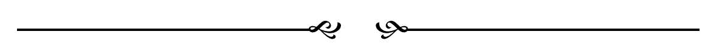

我仍在成长途中。进入第五章前，想先讲一个故事，它发生在我往返校园与职场的那几年。

十几岁时，父亲决心彻底改造自我。离开纽约迁往里士满后，他立志成为小提琴制作者。他本身是熟练的小提琴手，深知一把优秀甚至伟大的乐器需要什么：精选木材的琴体、精细的烘干与上漆工艺，这些才能把弓弦振动放大为共鸣声波。但他对制琴、修琴与修复几乎一窍不通。小提琴制作传统可追溯至 16 世纪，阿玛蒂 Amati、瓜纳里 Guarneri 家族，以及最负盛名的安东尼奥·斯特拉迪瓦里 Antonio Stradivari 都在意大利克雷莫纳 Cremona 制作出音色华美的名琴。在意大利，成为弦乐器工匠的路径通常是漫长的师徒学徒制，如今仍在沿用。想入行往往要求年轻未婚、对物质需求极低，能忍受微薄收入，安稳学艺数年。

我的父亲已有家庭，还有正职，人到中年，却并未退缩。身为初学者，他旁听了俄亥俄州欧柏林学院 Oberlin College 的制琴师课程。在一次现场音乐会，他发现邻座的大提琴手也兼做小提琴制作。他勉强答应让父亲帮忙观摩。“帮忙”多数时候就是拖地。在工作与练习之余，父亲把剩余时间都投入自学制琴。

数年后，我与商业伙伴依兹·英格兰德 Izzy Englander 在曼哈顿上东区一家餐厅共进晚餐。店名 Sette Mezzo，是家小而低调的意大利馆子，却常有名人光顾。一位社会名流走来，依兹向他介绍了我。

“哦，我认识一位著名的小提琴制作者也姓这个。”他说。

“那是我父亲。”我自豪地回应。

锲而不舍。

* * *

[\[1\]](#chapter7.xhtml#commentRef_3026)在计算机学科中，存在多项式时间（Polynomial time）的算法的一类问题为`P`类问题；至今没有找到多项式时间算法解的一类问题为`NP`类问题。多项式时间在计算复杂度理论中，指的是一个问题的计算时间 m（n）不大于问题大小 n 的多项式倍数。任何抽象机器都拥有一复杂度类，此类包括可于此机器以多项式时间求解的问题。而`NP`问题中最困难的问题称为`NPC`问题，根据库克定理，任意一个`NPC`问题如果能够在多项式时间内解决，则所有的`NP`问题都能在多项式时间内解决，而至今这一问题仍无答案。无法直接计算得到的，只能通过间接的“猜算”得到结果的问题就是非确定性问题。而这些问题通常可通过算法解决，但是这类算法的复杂性是指数级的，因此，计算的时间随问题的复杂程度呈现指数级增长，很快便变得不可计算了。——译者注

[\[2\]](#chapter7.xhtml#commentRef_3737)1 平方英尺≈0.093 平方米。——编者注

[\[3\]](#chapter7.xhtml#commentRef_3922)噪声交易者是指在几乎没有信息的情况下进行交易的人，即使他们认为自己是“知情的”，把噪声错误当作信息进行交易。他们的存在会使资产价格定价产生偏差。——译者注

# 第五章 波动的秘密

“只要采取行动，其他都不重要。”

小时候父亲几乎每天都在拉小提琴，我常沉浸在他制造的声波里。事实上，无论孩子还是成人，我们每天都浸泡在各种物理波中：声波、水波、电磁波。波有规律，且可用数学表达，只是我们常把它们想得太简单。

19 世纪有关波现象的发现极其丰盈，横跨广阔的经典物理领域。20 世纪，奥地利物理学家埃尔温·薛定谔 Erwin Schrödinger 提出波动方程，用振荡、正弦曲线、起伏模型描述电子运动，并称之为波动力学。与此同时，德国哥廷根大学 University of Göttinge 的维尔纳·海森堡 Werner Heisenberg 发展出一套近乎等价的方程，用以描述微观粒子，并提出以希尔伯特倡导的代数方法计算粒子运动的矩阵力学。随后冯·诺依曼很快指出，薛定谔方程与海森堡方程在本质上是同一自然现象，即量子力学的两种表述。

海森堡后来认为，我们可以精确描述粒子的动量[^(\[1\])](#chapter8.xhtml#comment_4170) `momentum` 或位置，却无法同时测量两者。动量可由波函数求解，位置则是在某一区域内点的测量。这就是海森堡不确定性原理[^(\[2\])](#chapter8.xhtml#comment_4175) `uncertainty principle`：观测量子位置会干扰其动量，反之亦然。如今我们知道基本粒子，包括光子与电子，都兼具波粒二象性，这一反直觉概念一直困扰爱因斯坦直至 1955 年去世。

市场走势也可以被视作波动现象。追踪股价或指数的涨跌，可以描绘出一条变化曲线。把这些价格图略作平滑，它们便像乐器振动般有节奏，或像海浪规律冲击岸线。有时波动形成清晰音调，有时则只剩下随机噪声。

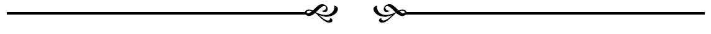

北海[^(\[3\])](#chapter8.xhtml#comment_4227)是全球最繁忙的航运区之一，支撑挪威、丹麦、德国、荷兰、比利时、法国、英国及斯堪的纳维亚半岛、波罗的海三国与俄罗斯等多个发达经济体的贸易。由于毗邻欧洲大陆架，浅层石油易采，钻井平台密布。然而航道极不安全。大陆架附近复杂的风场在恶劣天气下掀起惊涛骇浪，船只颠簸，碰撞海上油井平台、陆地或海底岩体的风险大增，比开阔水域更危险。

多年海事传说反复渲染北海的异常巨浪，破坏力极大且难以预判。目击者称它们突现于相对平静的海面，沿主导风向与涌浪方向快速移动，形如水墙逼近，前方是深邃海洞，后方又有另一处深坑，自古被叫做“海中无底洞”。遇上这类浪，船只常凭空消失或沉没。

科学家一度视其为臆想。1995 年元旦下午 3:20，北海的德劳普纳 Draupner 钻井平台被巨浪吞没。德劳普纳即日耳曼神话中奥丁神所有的金戒指，奥丁具自我繁殖能力。当日虽无暴风雨，钻井平台借助激光遥测系统记录下浪前、浪中、浪后的轨迹。最大波高从波谷到波峰约 84 英尺[^(\[4\])](#chapter8.xhtml#comment_4285)，单峰高度约为前后波峰的三倍。工作人员躲在设备中生还，却无人亲眼目睹巨浪。

德劳普纳事件点燃了研究热情。“流氓波” Rogue wave 或疯狗浪遂成为技术术语。估算显示平均每年约有一艘大船因此沉没。1995 年 9 月初，与德罗普尼尔受袭同年，北大西洋一处流氓波击中正在瑟堡 Cherbourg 赴纽约途中 的伊丽莎白女王二号。海上浮标预测波高 98 英尺。船长在航行日志写道：“船像要撞上多佛港白悬崖。”浪头卷过船首，船体猛烈震动，随后是两次小幅震动，船被抛入浪后的“洞”。所幸仅轻微受损，无人伤亡。

流氓波成因最主流的假设是多重小浪在同一地点叠加放大。如在海滩看到海浪汇合形成更高峰值，便是直观例子。但该说无法解释移动流氓波为何能保持形态，以及两侧深洞的形成。主张者称久了形态会变，可多数流氓波骤现后形态几乎不变便消失。其形态与常规浪迥异，更平滑。普通浪成群起伏缓慢散开，流氓波单独行动，却像约定在某点会合。与潮汐、火山、风效相关的假说均被证伪。潮涌浪长而平，无证据显示流氓波频发湖区曾有火山活动，且有时无风亦会出现。

与之截然不同的是海啸波。海啸是机械波，有明确外因如地震，由板块位移引发海床垂直运动，水体置换产生巨大浪潮。能量极高，波速极快，可跨越广阔区域。在深水区海啸只让浮标轻微上下移动，接近浅水才因深度骤减而增高，垂直位移转化为水平与垂直运动，形成高耸水墙，即破浪波 breaking wave，也被称作潮汐波 tidal wave。

海啸推动了流体力学研究。海啸中水体本身并非向前推进，能量在向前传播，像观众席人浪，干扰自一位置传至下一位置。因媒介为流体，固定位置的上下运动不会在一次循环后终止，受水体摩擦影响，单次循环会衰减。你可想象向池塘抛石，涟漪向外扩散并逐渐变小。

长期以来，水波被视为含正弦曲线的线性现象。正弦曲线 Sinusoidal 呈波浪形重复。线性假设意味着两个不同波长、频率、速度、振幅的波叠加，结果只是峰值相加。凭直觉的简单加法会出错。科学家据此计算风生海浪出现百万分之一概率的巨浪，却无法解释流氓波为何孤立出现及其独特形状。

移动流氓波的出现让我们再想起海啸。行进波 traveling waves 不总线性，如浅滩两股浪相撞，效应不是简单相加，可能产生倍增。在条件合适时，行进波高度可远超各部分之和。海洋能量有限，流氓波的水量来自背景波。若峰值更高，他处必然更低。似乎在源头，背景正弦波模式受扰，可能因一阵狂风或水流转向导致波浪堆积，峰值汲取周围能量并形成海洞。画出波形图，可见浅背景波先下陷，随即出现极高峰，再回落至正常。

描述物理现象离不开数学。一维非线性薛定谔方程的解可呈现孤立、行进、尖峰型波浪，峰值是背景的 3 至 5 倍。如今它被命名为孤波 soliton。孤波是独立自持的波，能保持速度并行进相当距离，仅在特定因子组合时出现，概率低但有规律。它会产生今日所称佩里格林呼吸子 Peregrine breathers。“呼吸子”指局域振荡进出的非线性波。Peregrine 并非游隼，而指英国应用数学家 D.豪威尔·佩里格林 D. Howell Peregrine，他据薛定谔方程推导出特殊行进孤波。

由此可见，极微小的调整也能产生显著甚至指数级效果，符合非线性系统的典型特征。如今科学家在水池中已能模拟流氓波。这种波非源于巨大动能，而是源于恰好满足薛定谔方程要求的微小偏差。流氓波并非两小波线性叠加，而是通过非线性指数放大，水量输入的细微改变拉高峰值。

贝尔实验室发明激光器，促成光纤通信。数学上，佩里格林的非线性波与香农的理论相通。光本身是波，可形成突然行进的峰值，由光纤中脉冲或孤子产生。孤波传输稳定不失真，可快速稳定传输信息，适用于长距离光纤通信。D.豪威尔·佩里格林与克劳德·香农的理论在实践中开花结果。

### 市场也会掀起巨浪

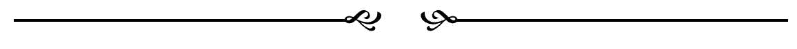
一连串的奇异浪潮究竟与资本市场有什么关联？我们已经能够察觉，金融系统时常以非线性方式运行，微小的局部扰动便可能引爆规模巨大的连锁反应。有效市场假说并非纯粹的纸上谈兵，市场价格的波动呈现出一种占据主导的大尺度随机性。盘中活跃着无数经纪人，他们的行动轨迹颇似光束里的光子、围绕原子运行的电子，或是做布朗运动的分子。当市场充斥混乱与噪音时，价格就会出现令人难以置信的阶段性跳变。股价会忽然从温和涨跌的良性震荡区间，切换到猛烈波动的状态，波动的幅度愈来愈大，稳定性愈来愈差。

面对价格模式的突变，人们本能地去寻找外部或外生的解释，比如有人操纵、政策失误或企业破产。事实上，这类结果往往并非由这些原因造成。更可能的原因是内生的、源自系统内部的，比如次级贷款违约的轻微抬头就足以让股市崩塌；就像海上的流氓波那样，虽然由外生的风浪触发，只需一阵微风便可催生滔天巨浪。在金融表述里，这类交易特征被称为回撤 drawdown 或是延长性反弹 extended rally。若回撤的规模足够庞大，市场就会用泡沫、萧条、灾难或崩盘来形容惨烈程度。就像流氓波或量子震荡一样，这些回撤无法被提前预知。它们来得很快，破坏力极强，等你意识到它们已经出现，往往已经太晚。

搞清楚这类复杂系统的是迪迪埃·索内特。索内特是瑞士苏黎世联邦理工学院的教授，那所学院曾是爱因斯坦的学生与教职所在，冯·诺依曼也在那里学习过化学。早年索内特主要研究相变，即液体到固体或固体到液体的突变。从那时起，他开始探究复杂自然系统何以失效。这些问题促使他从物理学走向地球物理学，再进入金融与经济领域，他发现物质世界的模式同样复制到了人类社会，尤其是金融经济当中。

上世纪九十年代初，索内特解决了欧空局阿丽亚娜4型运载火箭上的凯夫拉压力罐何时会在压力下突然悲惨破裂的预测难题。他的预测算法获得了专利，随后被用于地震预测。数年后，索内特与同事注意到金融危机可以被视作市场的“破裂”。火箭压力罐、地震、市场这三类事件中，他都捕捉到一种由振荡波驱动极端事件加速的模型：对数周期模型。临界时间被置于离散事件间隔递减的时间序列与其对数之间，也就是说时间不是以1到2到3的线性方式推进，而是以十倍为因子加速。对数周期的振荡是一种信号，暗示我们正接近可以进行预测的门槛。

索内特在2003年出版的《股市为什么会崩盘》里写道：“奇妙的是，随机性与模式特征同时存在于市场的时间序列中。”书中论证市场是非线性的复杂系统，证明“系统内可能出现连贯的大尺度、多结构集体行为，整体远大于部分之和”。深度回撤并不常见，但发生的频率远高于有效市场假说所预期的。

这说明混沌之中自有秩序。

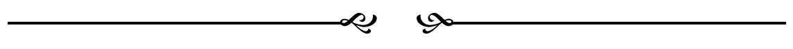
进入沃顿商学院前，我对市场、投资与金融几乎一无所知，更不用说在复杂的自组织非线性体系中寻找规律了。沃顿的学习让我学到不少，但真正的实战教育是在托马斯·彼得菲的廷贝尔—希尔公司担任投资研究时获得的。那之前我不过是一个拥有商科硕士文凭的程序员。

彼得菲聘我做研究员，职责是编程、建模、做投资研究。在那家公司只有他一人主导。他才华横溢，即便拥有公司，也亲力亲为处理一切。一年后我觉得需要换环境，自己已有了一些市场想法，也想开始交易。目标公司并不明确，于是我采取随机方式，给上千名首席执行官寄出求职信。那时我学会了不要把大量信件堆在一个邮筒，而是分散投递，以免邮差抓狂。有一天，猎头回信，他为千禧管理这家对冲基金服务。

面试往返持续了四个月。我在分析每日结算时刻的交易模式时产生灵感，发现收盘前交易员为维持流动性会先行平仓，这一动作会让股价产生偏差。于是我构建了第一个阿尔法模型的核心概念。我向千禧管理的团队阐述了这个套利想法，包括老板伊兹·英格兰德。公司决定录用我，同时伊兹同意我的要求：算法和公式的专利权归我。

接到录用通知后，我仍未下定决心。彼得菲说：“在留下和离开这两个未知选项中，你觉得哪个更好？”我意识到不做选择就等于是原地不动。最后我又用老办法，抛硬币。硬币指向继续留在廷贝尔—希尔。我把结果告诉伊兹，他立刻建议我离开廷贝尔—希尔。与此同时，廷贝尔—希尔极力挽留我，用的论证与有效市场假说相似：“你对公司足够熟悉，对我们更有价值。”

彼得菲把我叫进办公室，电视正在播O.J.辛普森案的判决。他问我怎么看。我说无罪，因为陪审团商议时间很短。我说我只有六成的把握。他说想当交易员需要百分之百的把握，而不是六成就算。他的预测是辛普森会被判有罪。最终无罪裁决公布时，彼得菲只是耸肩，说他无法提供我想要的发展机会。我只好告知他我将离职。

虽然有外力推动，这是我做过的最好决定。我学会了做决策与止损。若必须做难以抉择的事，就抛硬币。如果行动错了，日后会察觉并转向。行动有复利效果，过度思考并不好。

从廷贝尔—希尔到千禧管理，是职业生涯的关键转折。两家公司都取得显著成功，但运作方式截然不同。廷贝尔—希尔表面是公司，实质所有人都唯彼得菲马首是瞻。千禧管理则以独立交易员为主。老板伊兹·英格兰德极善于激励人，也乐于助人，他希望员工延续他的愿景，但具体怎么做由员工自定。他对人的判断力极佳，像X光一样迅速看透本质。

那时伊兹创办千禧管理才六年，规模不大，全公司三四十人，办公地点在华尔街外三一教堂墓地附近，百老汇111号大楼里租了两间办公室，管理的资金约一亿美元。公司涉猎并购、统计套利到配对交易等多种策略。每个人工作都高度独立。隔壁同事怕我看见屏幕，在桌上竖起一块硬纸板；另一侧的同事因爱在食物上抹辣椒酱被称作辣酱戴夫。

我入职第一天就出事。用自研阿尔法模型交易，当天亏损五千美元。我很过意不去，向伊兹道歉。他原谅了我，还给了我浓缩的人生哲学：尽量把亏损控制在小范围，以便盈利能更快覆盖损失。我能从初步想法推导出有效策略，但真正有效的阿尔法不能只靠回测，还必须根据市场反馈持续调整。该模型一部分有效、一部分无效，我剔除无用部分，保留有效部分。你可以模拟任何灵感，但只有实盘才知道真实结果。金融与数学知识在此提供了重要优势。后来我发现，从模拟转向实盘，有效率常常降到五成甚至更低。

我很快适应了伊兹塑造的文化：千禧管理，要么赚钱，要么离开。赚钱时感觉很好，亏钱时感觉很糟。最初几年我基本单打独斗，全力开发阿尔法，感觉像独自驾着小船漂在广阔多变的大海上。彼得菲的座右铭“时刻思考”对我产生了真实影响，我很感激他传授的这个信条。它看似简单，却像大脑需要锻炼一样必要。我开始以不同视角看待股市。无论经济好坏，股市都在，价格总在波动，所以总有赚钱方式，市场会奖励勤于思考、努力打拼且有真才实学的人。这是公平的舞台，也是高风险的舞台。好处是不必经营人际关系。

几个月后，我的阿尔法开始盈利。一位常帮助我的交易员想把我招到他的团队，我拒绝了，伊兹也不同意。我决定拓展策略，第二个阿尔法是配对交易。办公室里常提到配对交易，即在两只高度相关的股票上做多一个做空另一个。这个策略最初由摩根士丹利的努奇奥·塔塔利亚与格里·班伯格在八十年代提出。我只是想去探索，并不确定如何配对才有效。

1998年8月，俄罗斯突然贬值卢布并违约，我持有的头寸大幅下跌。第一个阿尔法原本运行良好，第二个尚未成型，我几乎把全年赚的钱都赔回去了。必须自救，日复一日在亏损中挣扎。伊兹始终鼓励我继续探索，其他人却劝我收手。他们说靠阿尔法赚钱成功率极低。

我仍继续深挖。那段时间我有空审视走过的路与下一步。假如当时失败，除了家人，没人会在意，所以只能靠自己。我每天活在算法里，一步步演算，如果这样算结果怎样，如果不是X就是Y。那或许就是我投资原则形成的起点，我开始为生活做规划。

不要指责任何人，把后悔降到最低。即便不是全我的错，只要事因我起，我就承担。领悟后，我把精力全部聚焦在行动与我能掌控之事上。不管发生什么就让它发生，发生后排查所有信息，吸取教训继续前行。

不要妥协，发挥强项。我有弱点，当然有。与其花时间补短，不如把精力用在长处上。同样的时间与精力，弱项只能有限提升，强项却能成比例增长。所以不要哀叹自己不具备的东西。

障碍本身就是信息。做不出成效，说明有原因导致失败。可能是目标错了，被错误信息误导，或行动本身不当。要先吸取教训，再调整方法，再去攻克。

于是我选择继续交易，像父亲当年努力成为小提琴制作人一样坚韧不拔。很快，我开始从亏损的泥潭里爬出来。

# 第六章 相关性
“一个人如果没有明确的可以具体量化的目标，那么他的人生轨迹就会如布朗运动一样充满随机性。”

幸运的是，我第一个阿尔法模型在十年间持续盈利，在相当长时间里战胜了强式有效市场。我擅长挑选有效交易来构建算法，这为我带来了前所未有的专利。阿尔法模型本身波动很大，不是平滑信号，需要较强的承受能力。有时组合波动极其剧烈。我坚持独自工作。也许这种模式注定孤独，对我而言确实如此，很少有交易员能连续几年单打独斗。

我花了大量时间思考阿尔法。如何进一步开发完善？如何同时把回撤压到最低并最大化收益？如何从市场汲取经验并找到更有效的检验方式？1998年的金融危机一直盘旋在我脑海，提醒我市场变化往往猝不及防。与此同时，我加深了对市场的理解与提升模型运算能力。我努力想研究出更多阿尔法。模糊意识到他人也在走类似路径，但我全神贯注于手头的模型及其收益。

## 量化投资与风险思考

## 自我认知与焦虑管理
一次次提醒自己，坚持才有价值，彼得菲是对的。我让自己保持轻度焦虑。压力过大业绩会变差，压力过小又难以全力以赴。当某个问题让我百思不得其解，我有时会失眠。这种时候我会强迫自己跑五英里。你若有同感，身体会为失眠付出代价，你会察觉惩罚，并陷入失眠循环。于是我明白一个朴素的道理：自负会扭曲现实。它让你放大自我去感知外界。但环境并不因你而存在，放大自我意识时，你对环境的理解会滑向虚构与想象。一旦产生想象的错觉，就容易做错决定。想想尼布甲尼撒或李尔王，便知道骄兵必败。

## 经济化表达
我认为经济化表达是一种优秀品质。我不算健谈，但注意到优秀交易员的思维非常高效。高效不仅体现为思考清晰简洁，也塑造了直截了当、措辞精准的表达。若你一生要说的话数是固定的，说完所需时间越短，你的一生便越短。

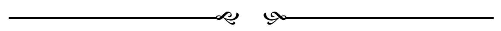
## 阿尔法的起源与演进
金融领域首次使用阿尔法一词可追溯到1968年。迈克尔·詹森在《金融学期刊》发表论文，提出詹森阿尔法。他当时是芝加哥大学的年轻经济学博士。该指标评估投资组合的风险调整后回报，与市场平均水平比较，通过超额收益衡量业绩。后来该概念被简称为阿尔法。

此后概念被对冲基金界借用，用来描述基金经理希望向投资者传递的理念：能带来高于市场平均的回报。在量化世界里，阿尔法逐渐演变为预测证券价格或相对价格的数学算法或模型的简称。阿尔法的定义方式多样，像俄罗斯套娃一样层层嵌套，每种定义都是同一圆心的同心圆扩展。阿尔法是一种算法，是数学表达式、计算机源代码与配置参数的组合，即软件与硬件的设定。如同其他规则，它包含计算机执行时需遵守的条件，比如if-then式的假设，即若事件X发生该如何决策，其目的是预测金融证券回报。市场每时每刻都在产生交易灵感，每一个灵感都可能包含一个阿尔法。我们开发、测试并用阿尔法交易，是因为我们认为即便市场有效，仍存在某种力量会推动价格回归均衡，差价与机会因此始终存在。广义上，投资者总想获取回报，就必须克服市场大盘噪声的干扰，于是投资者的行为会慢慢推动价格向证券的内在价值靠拢。

## 阿尔法的量化实践与信息比率

听起来很直观，但放到市场真实运行里就完全不是那么回事了。理论上讲阿尔法很简单，可用来搭建阿尔法的算具和数据却复杂到让人头皮发麻。举个例子，一个阿尔法可以被写成一张随时间变化的数值矩阵，证券是行索引，时间在不断刷新它的值【我们称之为时变结构化向量】。一旦要基于全球几千只股票做预测，这个向量的体量立刻变得庞大。每天系统都会重新审视阿尔法的逻辑依据，并根据当下环境给向量赋上新值。业绩评估的做法是把阿尔法预测出的理想化收益，跟历史日均收益做对比。日均收益围绕估计收益的波动幅度，与估计收益本身的比值，就是信息比率 IR。它主要用来判断信号的强弱和稳定性，告诉我们这个思路到底是有效信号还是噪声。

这确实不好消化。但量化投资的核心工作，就是用概率与统计把胜率抬高，请牢牢记住这点。在世坤投资，我们做阿尔法的构建与回测，最看重的不是捕捉大行情，而是把相关性压到中性、让多个因子互不干扰。拿棒球来比喻，我们不追求一棒清垒的辉煌，只求避开致命失误，稳定跑出高于市场的得分。

1992 年我在美国电话电报公司主办的大学生投资大赛里和胡振华一起试过一种带运气成分的策略。要是运气好就能搭上市场风口。问题在于运气极不稳定，可能大吉也可能大凶。公司里我们不允许后者发生。首要目标是杜绝黑天鹅式的流氓波浪，不被惊涛骇浪吞没。违约潮、互联网泡沫、量化风暴、金融危机里，太多人因价格持续下跌而重创。当极端下跌突现时，我们希望冲击被降到最低。这不等于不能做积极操作。在下行环境里，最关键的原则是最低风险、严格控损。相比被动应对，积极策略更容易让市场对你的行为产生反应，给你更多配置选择和更高的成功概率。但这不是万灵药，失效时必须有备用退出方案。

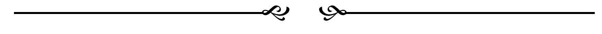

## 北海教训：冗余如何被耦合击穿

回到北海，海风依旧呼啸。那里上演了一个极具启发性的故事：一艘为规避风险而设计得滴水不漏的船，仍宣告失败。船属于挪威一家私人航运公司，专门为深水油气钻井平台运送物资。创始人彼得·洛朗不是普通商人，他是经济学家，曾在沃顿和 MIT 斯隆任教，后来担任洛桑国际管理学院院长和挪威 BI 商学院院长，后者是欧洲第二大商学院。公司只有两艘船，功能复杂、造价高昂，任何一艘出事都等于毁灭。

洛朗拥有耶鲁的运营管理学位和哈佛的商学博士，对风险控制研究很深。最大风险之一是北海发动机故障，导致船舶只能随浪漂流。那次万幸无事。随后他做成本效益分析，结论是在每艘船上装 5 台发动机。单台故障概率很低，可达抗风险最优，且成本可控。正常航行通常需要 2 台同时工作。他的设想是，一台坏了另一台仍能顶住风暴。于是备用发动机显得冗余，总数是需求的 5 倍。只有 5 台全部失效，船才真正受威胁。

概率有多低？粗略估计，柴油机在恶劣海况下一年内失效的概率约千分之一，也就是 0.001。5 台同时失效的概率是 0.001 的 5 次方，约万亿分之一，听起来极其安全。

然而 1992 年一个平静的日子，一艘船在北海航行时被一股异常角度的巨浪重击。船损很小，无人伤亡，但一缕火苗点燃了控制室外的配电板，烧了约 20 分钟才被发现。正在运行的 2 台发动机彻底报废，剩下 3 台备用发动机制动无法启动，船只能漂流。幸好附近有船将其拖回港口修理。

不是说只有万亿分之一的概率吗？这艘船用的是高功率柴油电气驱动，电能存于蓄电池再驱动传动轴。5 台发动机的控制线通过几英寸直径的导管穿过蓄电池区，火苗烧毁导管，导致所有控制线瘫痪。这种失效概率与 5 台发动机各自独立故障同时发生的概率毫无关系。它是耦合产生的，看似 5 个独立事件，实则由一个事件牵连全部。

这个案例印证了社会学家查尔斯·佩罗在《高风险技术与“正常”事故》中的观点：正常事故不可避免，源于系统交互复杂且紧耦合。他指出灾难伴随人类始终，新系统复杂到无法预判不可避免的失败如何相互作用，操作者无力应对。

松散耦合的复杂系统也会出问题，但破坏范围可被限制。效率与安全性常需取舍，高度集成的系统效率最优，却也最脆弱，一旦出事负面影响迅速放大。耦合在金融语境里，大致就等于相关性。

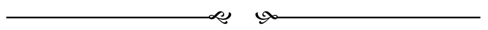

## 韭菜与证券化：相关性制造的幻觉

北海的风险管理与一棵平凡的韭菜看似无关，在现代金融里却有惊人的共通。韭菜像微型树，气味温和。厨师和家庭主妇都会用它，但根部通常丢弃、干枯的绿叶也会被扔掉，最值钱的是从白色鳞茎到浅绿中部的段。

韭菜并非全身皆宝。最优做法不是整根出售，而是垂直切段。优质鳞茎段卖给挑剔的厨师，次一点的卖给记账的主妇。把根和叶去掉，重新打包成捆，顾客按价格挑选自己想要的段。

金融界的做法几乎一模一样，叫做资产证券化。把韭菜换成成千上万笔抵押贷款，就得到抵押支持债券 MBS。把 MBS 再合成的过程，就像切割韭菜。按贷款质量分层打包：高违约风险的垫底，安全的放在上层。不同层级的证券卖给风险偏好不同的机构，从只买优质债券的银行到愿为高收益冒高风险的投机者。理论上各层相互独立，如同洛朗的发动机或韭菜段，或一枚硬币。

设计者假设一笔贷款违约与另一笔违约几乎无关。特大额贷款与几乎免证明的次级贷款看似毫无关联，相信本质不相关。2008 年美国次贷危机证明这种假设是灾难性的错误。大量抵押贷款与房地产市场高度绑定，估值创历史新高、杠杆很高。不同层级内部与层级之间的违约风险被紧密耦合。

换个说法：如果一个违约显著影响另一个，或因共同原因一起违约，就把它们分到不同“韭菜段”，只是在制造安全错觉。原始贷款和分层合成后的产品本质一样，经过所谓“聪明配置”，卖方可以错误定价、粉饰成神话打包售出。

这就是相关性的危害。就像霉菌会污染整捆韭菜，无论段级高低，霉菌都会蔓延。

洛朗的案例里，降低分散风险的程序在某些情况下会增加风险。危机前不少经验投资者相信证券化能降甚至消除风险，于是任其泛滥，堆积风险。经济主体因觉得自身不受后果牵连而放纵风险，这叫道德风险。它掩盖了全球经济动力彼此关联的事实。风险并非独立存在。金融危机证明，相关性贯穿从单只股票到衍生品再到整体经济的每个层面。教训很明确：不要怀疑系统中所有部分都是耦合、相关联的。

世界却忘了这点。系统庞大、耦合复杂，没人能看清危机因子间的关联。很多人自欺欺人，觉得聪明人不会集体犯错。

做量化投资必须谨慎使用模拟，把相关性降到最低。常见心理陷阱是把数据模型当万能钥匙，就算能解释也可能是偶然。要保持极度诚实，降低自我意识，也要有成功信念。但越成功傲慢越容易滋生，越难自律。没有认真回测就认定理念有效，是糟糕做法。就像我当年在沃顿的同学，自认优于常人，最后都经不起市场相关性的无情检验。

回测是产生阿尔法的关键，但也带来道德风险。过去成功不保证未来。模拟阿尔法时要抱反向心态：很多阿尔法无效，也没有阿尔法能永久有效。用概率术语说，每个阿尔法的效用介于 0 与 1 之间，0 代表从未奏效，1 代表一直奏效。

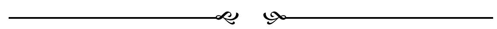

## 量化本质：概率与模拟的游戏

学习量化投资像学量子物理和赌博，都离不开概率统计。这门学科广为教授，却难得熟练。量化是数字游戏，其关键技术根植于二战前后核武器计划，尤其是冯·诺依曼和他的搭档斯塔尼斯拉夫·乌拉姆。

战后乌拉姆离开曼哈顿计划，到南加州大学任教，因病毒性脑炎几乎丧命，勉强康复后医生告诫他避免剧烈脑力劳动。他于是玩起了纸牌接龙，尝试计算甘菲德纸牌游戏成功的概率。该游戏成功率偏低。直接计算 52 张牌的组合远超他大脑极限，于是他玩了 100 次统计成功次数。这个粗糙但实用的模拟让他意识到样本越多结果越准。他很快把思路用在氢弹问题上。

乌拉姆的分支思想涉及氢弹原子爆炸释放的中子。中子有几种可能：发散辐射、被吸收、改变速率、与原子核反应形成新同位素。这些结果看似随机，却在自然中普遍存在，常在相变前出现。迪迪埃·索内特在研究受压地壳板块和崩盘前市场信号时也发现了同样的分支模式。

乌拉姆的想法催生了蒙特卡罗法。名字由洛斯阿拉莫斯的同事尼古拉斯·梅特罗波利斯提出，灵感来自摩纳哥的蒙特卡罗赌城，乌拉姆的叔叔曾常去那里赌轮盘。乌拉姆与冯·诺依曼在数学上合作紧密。当冯·诺依曼看到单个中子随机抽样的概率轨迹时，估计用数千个样本和当时最先进的 ENIAC 就能模拟。研究后来迁至马里兰阿伯丁试验场。虽然首创归属有争议，但冯·诺依曼向 ENIAC 工程师建议改进计算机，增加存储程序以更高效运行蒙特卡罗模拟，这一改进预示了普林斯顿 MANIAC 的存储程序架构诞生。

乔治·戴森在《图灵的大教堂》里总结，蒙特卡罗在数学物理学开辟新领域。经典物理学关注少数理想对象的精确行为，统计力学关注大量对象的平均集体行为，而蒙特卡罗关注任意数量单个对象的概率性行为，因而更贴近物质宇宙的真实运作。

投资组合的估值、期权衍生品的定价，以及跨多年项目的不确定性判断，Monte Carlo 方法在这些场景里都有用武之地。上世纪四十年代末，以 Enrico Fermi、Nicholas Metropolis 为代表的一批物理学家推动了对 von Neumann 原始算法的改进。那时即便是最快的计算设备，也难以轻松处理随机性难题，随机模拟思路由此打开了解决路径。该类方法依赖重复的随机试验，通过不断尝试去逼近瞬息万变的复杂局面。输出并非单一数值，而是一组概率分布。Ulam 的直觉得到印证：试验次数越多，近似结果越靠近真实值。

把随机性引入看似混乱的系统，既带来秩序，也让统计学支柱 CLT 发挥关键作用。Monte Carlo 用于模拟现实，CLT 则构成概率分析的技术基础。这一思想的最早假说可追溯至十八世纪初的 Abraham de Moivre；Pierre-Simon Laplace 在 1812 年重新发现并推广。英国维多利亚时代的通才 Francis Galton，同时也是优生学创始人，1889 年称 CLT 为“至高无上的非理性法则”，并指出其中由混乱走向有序的悖论。他写道：当大量杂乱要素按等级排序时，总会浮现出无法预料却极美的规律，这正是 CLT 在起作用。

通俗讲，CLT 指出大量独立随机变量的均值经标准化后会趋向正态分布，形成钟形曲线。它被视为概率论的核心定理，衍生出大量应用。只要总体均值符合正态，少量样本即可逼近大样本特征。硬币是最直观验证：单次投掷正反各半，投十次可能显著偏离；投百次结果逐步接近 50% 中心；投千次则更贴近，这就是极限在显现。

股票交易可作类比。只持有少数标的，哪怕一只重挫就会拖累整体，多家对冲基金的教训印证了这一点。若风险与回报正相关，高度集中组合也可能带来高收益。若交易员持有一篮子相关性高的股票，盈亏往往同向，绩效要么很优要么很差。若持有大量彼此无关的标的，就能受益于大数定律。大数定律最早可追至十六世纪，说明试验次数越多，结果越趋向期望区间。赌场即例：赌徒下注越多，实际结果越贴近庄家设计的期望，长期必然让庄家获利。投资中，这一规律体现为结果向内在价值靠拢。

做两个简化对比。第一种：在较少证券上投入一万美元，期限 250 个交易日，侥幸取得 55% 总收益，年化约 60%。夏普比率衡量风险调整后收益达到 1.63，对普通投资者已是优秀水平，远高于几乎零风险的国债。

现实中该组合难以承受。收益波动极大，截取局部会得出不同结论，比如第 27 到 103 天之间曾跌 20%。若用 Monte Carlo 把这 250 天的价格随机重排一万次，生成一万条假设路径，可发现在这段周期内，初始本金回撤 ≥10% 的概率约 30%，回撤 ≥20% 的概率约 5%。这更像赌博而非投资。

第二种方案：同一时期随机挑选 10 个不同策略，各投 250 天。总回报约 34%，虽低于单一策略峰值，却依然可观。夏普比率提升至 3.11，波动更低，亏损概率大幅下降。一年里回撤 2% 的概率约 20%，回撤 1% 的概率约 40%。大数定律在此由两重期望驱动：一是全期复合回报的期望，二是日度最佳回报差异的期望，后者宜接近零。

因这 10 个策略随机选取，相关性极低，平滑效果显得夸张，但也清晰揭示：恰当的低相关组合能压低市场风险，带来更稳健回报。

2000 年时我手上仅有两套 α 模型，虽可套用到全球交易所、成千上万只证券，但完美平滑并非总是可得。我开始思考制造更多平滑的新思路，始终梦想不断扩展模型数量。

* * *

# 第七章 扩张
“知识循环相生，灵感孕育新知，生生不息，改变现实。”

“scale”在牛津英语词典里占一页多，分成十余义。称重天平、鱼鳞、洁牙、云梯攀爬、攀登山峰楼梯，都是其影子。引申为计量尺度，即在直线或曲线上标记数值以度量距离、温度、数量，特别指地图图表上的比例尺。音乐与数学中，任何按标记体系选定基数、让数值随位置几何变化的记号法都可归于此。

古人熟知尺度，研究星空并推导出原子。数学家在宏观与微观、宇宙与地球间穿梭。改变指数或小数点就能把数值放大或缩小，从量子到银河系，尺度转换极为容易。

在千禧管理公司，我的初衷只是厌倦单打独斗。首个 α 模型表现不错，理论上第二、第三套模型不仅能把业绩提升数倍，还能降低风险。正因能双收，我渴望开发更多模型、争取更多管理资产。但野心伴随风险。

第二次开发尝试采用配对交易分散化，却因俄罗斯债券违约而失败。这次挫折让我重新审视策略，把配对交易重新置于更广阔框架中，升级为更严格定义的 α。同时，我也小幅扩充首个模型，却触发了新挑战。

一套 α 模型包含大量变动部件。没有自动化交易技术，根本无法操作如此多证券。交易可自动化，但此前需要开发、编程、回测，随后还要监控。投入时间与人力巨大。有人以为量化就是程序化自动响应，或只是光速高频交易，都是误解。人力与机器必须协同。自动化极大突破了交易员能力的边界，拓宽了交易范围、复杂度和生产力，但最关键的创造力仍在人身上。

此后我不再局限于执行层面。我既是研究员也是组合经理，同时是模拟系统与交易底层系统的程序员，以及活跃头寸的操盘手。后来这些职能被明确分工。我找到对应专家组成团队，共同开发更多 α、优化策略、提升创造性和有效性。研究员负责产生可形成 α 的灵感，组合经理负责把 α 整合为可执行策略。两者都离不开严格且反复的回测，回测连接并验证了两者的工作。

我不断挑战自我。当时这些想法还未成形，开发 α 时事无巨细亲力亲为。工作强度很高。某些日子有助手跑系统，让我专注编程或灵感开发。那段时间灵感很多，每个都建算法逐一回测。并未诞生特别出色的模型，但一直尝试。同一时期我的孩子相继出生，如今已是五个孩子的父亲。

灵感受挫时并未气馁。两套仍在盈利的 α 模型给了底气，每次失败都提供信息。失败后吸取教训再继续，是积极正向的做法。就像做俯卧撑，次数越多积累的力量越大，不确定性面前最好的解法就是行动。α 失灵时我就平仓修正。模仿他人或大公司的做法也让我学到教训。有人管理的资金是我的百倍，模仿必败。必须独立思考。市场竞争残酷，若太多交易员使用相同灵感，雷同的 α 会失效，独立思考不可替代。模仿只会损害投资。

## 量化投资与 α 模型发展回顾

## 市场信号：动量与回调

我逐渐培养出对有效与无效的判断力。两类价位信号是动量与回调。动量指股票延续当前升降轨迹；回调则暗示价格偏离均衡而回撤。经验上回调比动量更有用。我的首个 α 就在收盘时捕捉回调，因为大量交易员为换取流动性而抛售，价格随之下滑。

动量并非总是占优。若动量压倒回调，价格会缓慢回归内在价值，如同士兵列队行进。实证不支持这种理想状态。现实中价格形成是试错过程，可能反应不足也可能过度。

## 套利交易与配对操作

我也在用更成熟的概率论构建 α，在模拟程序中搭建关键模块。在千禧及其他量化公司，交易员追求一揽子套利：统计套利、并购套利、固定收益套利、抵押套利与相对价值交易。套利本质是利用两债价格差、两股价格差，或不同市场同类证券的价差，同时买卖。盈利机会往往源于整体有效市场中的局部无效，无效即信号。

夏普比率=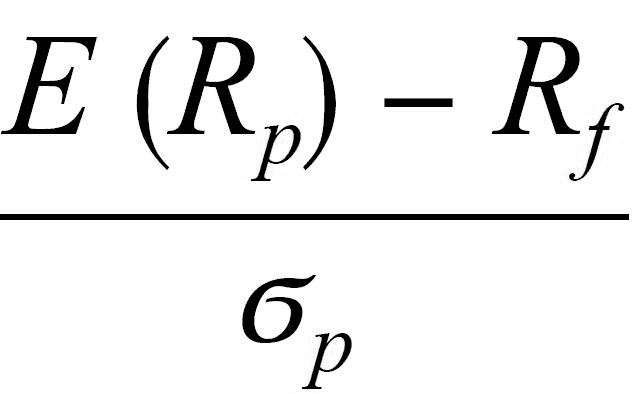，其中 E(Rp) 为组合预期报酬率；Rf 为无风险利率； 为组合标准差，计算每承受一单位总风险可产生多少超额报酬，也称夏普比率。

我的第二套阿尔法体系，核心是配对交易。思路源自股市里那种相对清晰的均值回归特征。配对交易只涉及两只股票，而统计套利的版图可能覆盖上千只。无论组合规模多大，之所以能运转，关键在于股票之间存在相关性。举个例子，配对里的一对相关股，一端做多看好的标的，另一端做空看衰的标的。比如福特最近股价一路冲高，可能被高估；而竞争对手通用因养老金偿债担忧被过度抛售，可能被低估。基于这样的判断，我会买入通用，押注市场纠偏时会反弹，同时做空福特。无论汽车板块整体涨跌，或者大盘方向如何，两只股票的价格都会各自向合理区间回归，最终的收益相对稳健。

## 风险对冲与中性化思路
采用这类策略还有一个好处，就是方便做风险管理。还记得阿诺德·伯恩哈德的价值线体系吗？把5个篮子股票按预期涨幅从高到低排布：最有希望上涨、最可能上涨最少、会下跌。价值线用横截面数据评估价值，也就是把市场看成整体，表现最差的篮子相对大盘预期会下滑。于是自然就得到一个思路：买入预期涨幅最高的篮子，同时卖出预期跌幅最大的篮子。就像船随潮水起伏，这两篮股票都会跟随大盘波动。人们在预测个股时，实际上也在预测大盘。多数市场预测注定失准。但可以通过对冲消除市场风险。比如在价值线例子里，同时买入看涨篮子、卖出等额的看跌篮子，就能把市场影响中和掉，这就是市场中性化的由来。市场中性意味着，即使大盘上涨，只是让最可能下跌的篮子也跟着涨，其收益仍跑不赢最看好的篮子。并不押注大盘方向，投资依然能赚钱。

这些中性策略本质是概率博弈，可能赢也可能输，无法保证每回都胜，但可以按个人偏好去下注，长期积累下来就能形成可量化的优势。

## 规模化模拟与自动化建设
在千禧管理公司的岁月里，我开始把中性策略搬进模拟程序里：同时在100到4000只不等股票上配置等额多头和空头。要同时处理这么多标的，必须靠高度自动化。计算机性能的提升让我能像冯·诺依曼当年那样，构建过去难以想象的大规模模拟。这些程序能处理海量证券交易，并借助大数定律消化不断增多的变量。但我仍需要搭建交易基础设施，通过它自动完成多地、多品种的复杂操作。同时我也摸索出更好的中性化做法，中性不仅指市场中性，还包括板块效应、行业效应、货币效应等各类中性。那段时间我亲自编程。这些融入中性的程序正展示着模拟的威力。

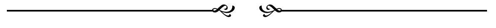

2000年左右，俄罗斯债券违约带来的冲击基本消化，我开始聚焦不同投资策略的探索。当时我还没完全意识到策略需要绝对的多样化。但我已经清楚，两个阿尔法之间的相互依赖是个重大风险，对另一个阿尔法做多样化调整，既能提升收益，也能让回报曲线更平滑。我仍面临挑战：积极面是，我刚触碰到指数级增长的可能——知识生知识，数据生数据；消极面是，我体会到独立工作的局限，独立工作带来心理压力，还可能出现一种之前没察觉的危险——自己的思考和其他人趋同。仅管理寥寥几个阿尔法，工作量已呈指数级上升，更别提10个或100个阿尔法了。那时我急需帮手。

## 人才、指数增长与组织裂变
我们从不为扩大规模而招人，也没有做过整体的人力规划，招聘都是自然发生的、靠机缘巧合。“人生不可限量”，这是我很早领悟的原则，或许在父母带我们去美国时就已种下。事情很少按预期展开，能规划的有限。关键是行动：一点一滴去做，因为不知道哪次努力会结成果实，所以要把每次尝试串联起来。通过经营机会、放大成果，成功概率才会提升。

只有在找到真正合适的人时，我们才会扩充团队。起初只请了一位助理，等找到合适人选再请第二位。招更多人也带来新问题：需要投入时间管理培训；拥有宝贵知识产权时更要谨慎保护。这个教训来自一次经历：一位助理离职说要回校园，却把公司的程序带给了竞争对手，他很快被新东家开除。

此后我对人才更谨慎，只有能独当一面时才考虑聘用。这些优秀的人通常自带技术，开始搭建交易系统、研发阿尔法模型，我则通过培训了解他们的个性、兴趣和才干。这是一个不断递进的培养过程。那段时间我招到不少人才，比如曾在纽约大学学习数学编程、后在高盛工作的杰夫·米勒；还有芝加哥大学数学博士、讲师布莱恩·约翰逊。很多年里我都在思考如何找到身怀绝技的聪明人，这并不容易。任何指数增长起步都极慢，几乎看不出变化，但必须为未来打下坚实基础。

现在任职世坤投资首席投资官的杰弗里·洛普雷特，在麻省理工拿到运筹学博士、在德意志银行做过量化分析师，2003年8月加入世坤。当时团队包括我在内共6人，可运行的阿尔法屈指可数。2006年12月筹备世坤时我们已有19个阿尔法。2007年底约有150个。再过一年，金融危机中期时大概1000个。到2010年接近5000个。但这仍只是起步。之后我们开始大量招聘，但离阿尔法数量的爆发式增长尚有差距；招聘带来的生产效益却非常巨大。新人给模型开发和投资组合策略带来大量灵感。2008年整年我还在操盘个人账户，最终不得不放弃，专心投入世坤管理。任务太多，像亚当·斯密《国富论》里的制针工厂，我们开始专业分工。更重要的是，阿尔法曲线开始向上弯曲。

在这一阶段大部分时间我都没做总体规划，但业务仍在加速。日常工作像市场本身，需要每天用实验去检验想法和价格，淘汰无效、奖励有效。我逐渐形成了一套方法论和强技术，尤其是持续优化的模拟软件。数据集合也不断扩大，灵感越多越能辨别哪些阿尔法有效、哪些无效。最终我们增强了对概率的掌控，也提升了风险管理能力。

当时我们做得不错，但也清楚成功可能瞬间消失。大概在2005或2006年，我开始与依兹讨论把世坤从千禧剥离。2005年千禧在老格林尼治开了办公室，我的团队在隔间办公，我的玻璃墙办公室占了约三分之一面积。随着新人加入，隔断不断移动，我的办公室也逐渐缩小。

我一直希望拥有自己的事业，也一直在思考业务边界和扩张方式。我有一套长期摸索出来的个人发展规则，但随着专业分工岗位增多，需要重新制定规则来加速业务。优秀交易员需要什么？需要过人的智力，高度专注，积极行动而非空谈，能从失败中学习，表达简洁、思路高效，诚实守信，独立思考，敢于承担风险，公私分明，能自我掌控，不会膨胀。优秀研究员需要什么？需要创造力，面对困难有韧性，关注细节，善于解难题，永不止步、追求卓越，有始有终，并且在我们公司必须具备一流编程能力。优秀管理者需要什么？需要善解人意，能换位思考，聪明且睿智，有开创精神，面对持续困难坚韧不拔，不见成果不罢休。你会发现，三类人有很多共通优点：韧性、创造力、智力卓越。我们在受过量化训练的人群中寻找具备这些特质的人。

慢慢地，我开始坚信两条看似矛盾实则一致的原则。

可扩展性。好公司能自驱动成长，我希望世坤具备这样的可扩展性。要做到这点，首先要选对人。选人必须投入足够精力。因此最优的人才激励方案至关重要。选人、激励做好，再稍微用心经营，业务自然增长。

精简层级。目标是尽可能安全的扁平化。时间就是金钱，时间稀缺。官僚主义浪费时间和金钱。如果已有正确的人、正确的运营系统、正确的激励机制，只要不叠加庞大的层级，规模就会持续扩大。时间一久，业绩、研究等流程都会获得倍增收益。在指数级运营体系中，浪费时间造成的损失也是指数级的。

在我设想里，我们将保持与千禧的紧密联系，但要有自己的品牌和工作方式。2006年末双方达成共识，2007年1月世坤投资正式成立。不久后，我开始在老格林尼治寻找更大的办公场所，以适应团队扩张。

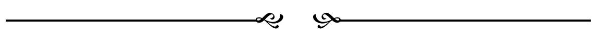

## 规模、幂律与复杂系统
这些年，我开始探索“规模”或“缩放”的另一层含义。圣塔菲研究所理论物理学家杰弗里·韦斯特在《规模》一书中写道：从最基本层面看，规模缩放描述的是系统在规模变化时如何响应。寻找阿尔法信号本质上是对市场动力学的探索，像在混沌中寻找秩序之岛。市场有诸多苛刻要求：从随机甚至杂乱的非线性系统中预测；从无序股价中找规律；从噪声里提取买卖信号。人造市场有点像蜂巢或蚁穴，存在聚集现象。这些聚集涉及大量智能体，包括自主决策的、被动服从的、为花粉迷恋花朵的、为回报寻求投资的各类主体。这种群体智能不是单体产生的，比如单只蜜蜂能力有限，随着蜂群扩大，分工协作的智能才会显现。蜂群智能规则尚未完全解读，却备受关注。

自然界充满自发秩序，虽然复杂，却可通过概率和比例观察到规律。大自然的和谐并非出自某个指挥家，看起来没有中央控制。也许最典型的例子是达尔文的自然选择进化论。变化发生在分子、细胞、个体、物种、属、科、生态系统等多个层级。每个层级都可能复杂多变，易受外界条件和反馈机制影响。在数百万年和无数代际中，这些机制通过一种看似随机实则有规律的法则塑造生命：基因突变驱动的进化。今天我们可借DNA生化机制一窥其原理。

大约公元前10000年新石器时代农业兴起后，市场才开始萌芽。约6000年前，苏美尔人用泥板记录会计信息，说明市场中心的交换已出现。当时的报价相当随意。直到近年，市场才变得像生态系统般复杂难懂。

市场里不乏自信心爆棚的人，但直到过去50年，我们才开始厘清复杂系统如天气预报、进化研究、市场预测的内在规则。通过这些系统，我们勉强能识别出一些模式，尽管不总是明白其成因。

现在谈谈幂律。幂律描述两个量之间的固定统计关系：一个量变化时，另一个量按比例相应变化。比如动物体型越大，代谢率相对越高效。按数学表述，体重每增加4次幂，代谢率约增加3次幂。所以蓝鲸比白鼠更高效。这种关系在坐标系中呈现向上倾斜直线，斜率约3/4。

留意生活，你会发现幂律无处不在，自然与人造界限被抹平。变化常按固定指数或幂次发生。如重力随距离增大以2次幂衰减；正方形面积随边长以2次幂变化；城市规模、陨石坑直径分布、语言中单词使用频率、地震强度、名字流行度、市场繁荣萧条等都遵循幂律排序，数据分布近似直线，是对数图而非随机点。

总体而言，幂律暗示许多现象按层级划分规模。在法国，小村庄远多于小城市，小城市远多于区域性大城，最大的城市只有巴黎。实际上最大城市打破了标度不变性，像“流氓波”或异常值一样超出常规规模。索内特称这种现象为“妖怪”，用来形容主要城市和全球市场崩盘这类大事件。我们知道自19世纪中期以来，不同规模经济体或公司的收入分布似乎服从幂律。意大利经济学家维尔弗雷多·帕累托提出著名80/20法则：80%的财富由20%的人控制，财富与人口呈反比。该法则适用于赌博、程序漏洞修复等场景。帕累托发现80%的豌豆来自20%的豆荚。互联网的访问量、浏览量、链接量也遵循幂律。

幂律通常适用于混沌中产生自发秩序的复杂系统或网络。自组织现象由随机波动触发，再被正反馈放大。在新墨西哥州洛斯阿拉莫斯，乌拉姆和冯·诺依曼理论设计了自复制细胞自动机：一种可开启关闭的简单细胞或机器人，按固定法则繁殖，并通过随机交互复杂进化。约翰·康威的生命游戏进一步探索了细胞自动机的演化，每个细胞都像是个通用图灵机。

20世纪70年代，伯努瓦·曼德尔布罗特利用计算机图形展示，简单规则可创造具自组织原理的复杂系统。他在海岸线、树枝、血管、索内特的凯夫拉压力罐破裂图、菜花西蓝花等自然现象中观察到规模缩放视觉特征，称之为分形，同样适用于金融市场。分形具有自相似性，局部与整体形态相似，放大比例尺后层级结构依然相似，如毛细血管与大动脉、细枝与成年树枝、价格波动图。曼德尔布罗特的分形学捕捉了非线性复杂系统的尺度不变、分层、自相似、自组织特征。而幂律是分形和自相似性的数学表达，是在复杂、多样、看似随机之下运行的底层秩序。

曼德尔布罗特虽有两个数学家叔叔，但在传统学术界却不受待见，常凭历史和预测下结论，自称反主流、爱惹麻烦。他出生于波兰犹太家庭，1936年随家人移居法国求学，躲避纳粹。战后赴美，在加州理工读航空硕士，后回法国巴黎大学获数学博士。1953年重返美国在普林斯顿高等研究院求学，是冯·诺依曼最后的博士后候选人。他曾花一年研究单词频率分布，钦佩冯·诺依曼能“聚集不受普林斯顿约束的人”。他也注意到访问学者“压力巨大，但也许这是他们一生做研究最好的年份，所以何不更享受”。回巴黎结婚后，因不喜纯数学氛围又回美国。不喜纯理论的他进入IBM工作。尽管最重要的工作在公司完成，学术上他仍活跃，曾在哈佛任教，晚年于耶鲁作最年长终身教授。他保留法美双重国籍。

正如索内特一样，曼德尔布罗特毕生潜心于复杂市场动力学研究。

他在多篇论文和出版物里反复提出，分形方法能够在充满混沌与不可预测的市场里，梳理出潜在的有序片段。把坐标轴的图例遮住后，不论是市值规模还是价格波动图，形态上都出奇地相似——时间刻度换成一百年、十年抑或一天，画出来的曲线本质上并无差别。

这就说明不必痴迷于寻找一种近乎神谕式的、严密无误的市场运行规律，因为那条路大概率走不通。曼德尔布罗特特意点出，客观世界的不确定性早在一百年前就被量子物理揭示了。

在世坤投资，我们正是借助阿尔法模型与回测系统，去挖掘并验证那些稍纵即逝的秩序。对索内特而言，这种秩序为我们提供了抓手，让算法能够去预测过去被认为完全不可预见的极端事件，比如地震、火山喷发、压力容器破裂乃至市场崩盘。

世坤研发的阿尔法模型在市场上捕捉到买卖信号，揭示出若干可重复的投资规律。公司创立初期并未深究幂律这类话题，团队主要在逐步搭建和检验阿尔法模型，寻找更偏传统的交易信号。后来我们逐渐意识到，幂律可通过相关性作用于具有正反馈特征的非线性系统。

若市场或选民行为纯粹随机，用标准正态分布去近似便已足够，数据会呈现典型的钟形。实际经验却显示，市场并非完全随机。2004年曼德尔布罗特与理查德·赫德森在《市场的（错误）行为：金融风暴的分形观点》一书中提出有争议的判断，市场兼具强记忆与弱记忆，这两种记忆会削弱随机性。诸如价格间的周期性关联长期被观察到：小麦期货随收获季节而波动；外汇交易量随全球交易日的推进呈现日间与周间规律。

一只股票可能受另一只股票或债券等另类证券影响；纽约交易所的动向可能波及伦敦或东京；昨天甚至五十年前发生的事件都可能对当下或明天产生回响。这种认知进一步佐证了回测有效性的合理性。无论是季节性驱动还是新闻流驱动，由正反馈催生的均值回归、动量延续或模式重现，都是阿尔法开发中必须追踪的信号。正如曼德尔布罗特所言，价格变化远不具备钟形分布的特征。我们构建阿尔法模型的目的是区分真实相关与表面相关，不能因为大家都相信一种相关性就默认它真实存在。

* * *

[1]](#chapter10.xhtml#commentRef_6272)原子（atom）一词源自希腊语，意思是“不可分割”。——译者注

[2]](#chapter10.xhtml#commentRef_6493)并购套利是指在并购过程中购买被收购方股票时，会因为收购方高于市值的出价而获取差价收益。——译者注

[3]](#chapter10.xhtml#commentRef_6497)固定收益套利是一系列旨在利用各种固定收益证券或固定收益衍生品之间的估值差异来获利的市场中性投资策略。——译者注

[4]](#chapter10.xhtml#commentRef_6501)通过买入因房屋投资者举动而被低估的债权，或卖出被高估的债权进行套利。——译者注

[5]](#chapter10.xhtml#commentRef_6541)市场不会偏离价值中枢太久，市场的内在力量会促使其向内在价值回归。——译者注

[6]](#chapter10.xhtml#commentRef_6578)横截面数据（cross-sectional data）是指在同一时间，由不同统计单位、相同统计指标组成的数据列。这里指不同篮子里的股票在同一时间的股价。——译者注

[7]](#chapter10.xhtml#commentRef_6778)金融工程师的别称。他们将自己戏称为“矿工”或“宽客”。——译者注

[8]](#chapter10.xhtml#commentRef_6975)智能体是人工智能领域中一个很重要的概念。人工智能之父马文·明斯基在《心智社会》（The Society of Mind）中提出这一术语。任何能够思考并可以同环境交互的独立实体都可以抽象为智能体，也有译为艾真体或主体。——译者注

[9]](#chapter10.xhtml#commentRef_7059)幂律分布不同于正态分布点，其最突出的特征是大量微小事件和少数非常重大的事件并存，是复杂系统自组织独有的特性。——译者注

[10]](#chapter10.xhtml#commentRef_7082)著名生理学家马克斯·克莱伯（Max Kleiber）在 1932 年发表论文中提出这一定律，他通过实验调查一系列动物的代谢率后得出了这条定律。——译者注

[11]](#chapter10.xhtml#commentRef_7198)源自拉丁文 fractus，含有破碎的意思，英文单词 fractional（部分的）与 fracture 破裂也源自这个词。曼德尔布罗特于 1975 年创造了该词，用以描述复杂对象不规则的、破碎的、琐屑的几何特征，同时其局部形态与整体形态相似。——译者注

[12]](#chapter10.xhtml#commentRef_7260)双引号部分内容引用自乔治·戴森的《图灵的大教堂》。

# 第八章 指数裂变之路

“让每个人都受益。”

多年以来我与胡振华保持联系，他是贝尔实验室的老同事，也是好友。胡振华毕业于哥伦比亚大学商学院，曾在一家软件公司负责收购、再融资与战略重塑，最终成功售出；随后在新泽西一家咨询公司服务技术企业五年。我一直期待与他再合作。当我筹划把世坤投资从千禧管理公司剥离时，我问他若加入想做点什么。他反问我：“考虑过在中国设点吗？”胡振华出生于台湾，对中国的人才密度兴趣浓厚。我认真考虑后聘用了他。

2006年的中国并非今天的样子。团队里有人对中国布局持保留态度。但在拆分进行时，胡振华立刻飞往北京招人。那时中国量化投资机会稀少，他仍挖到一批数学与科学训练扎实、智力出众的年轻人。起步最早给了我们优先选择权。相当长一段时间里，胡振华招募几乎没有竞争对手，就像独占一个高胜率阿尔法。后来高盛等机构陆续进入北京抢人。

他面试超过一千名候选人，最终先给出五份offer。或许其中也暗含幂律，大部分人至今仍在世坤。胡振华在北京待了七年，后转至台北，担任首席研究官，负责国际运营。

从我的视角看，中国办公室算是一次即兴决定。我想把胡振华拉进公司，他看到了中国的发展窗口，我选择支持。按当时业务优先级，中国办公室并非迫在眉睫，却彻底改写了公司格局。当时我们已在全美范围构建阿尔法，而非局限于纽约，更不止格林尼治的老据点。

中国设点进一步强化了公司名的含义：世坤投资 WorldQuant，一家真正全球化的量化公司。起初只是一次试验，效果远超预期，于是投入加大。我们吸引的是接受严格教育训练、渴望施展才智的人。作为人口众多的全球经济体，中国金融市场起步不久，投资业仍在萌芽，这恰恰说明顶尖智力资源丰富而发展机会相对匮乏，我们要把这批人组织起来提供舞台。

中国之后是2008年的印度，再向外延伸，阿尔法工厂的概念才真正成形。团队从松散的个体扩大，小规模作战转向体系化生产。以前我们一次只能造一个阿尔法，像手工打家具一样低效。我们已积累不少关于如何让阿尔法生效、如何发现阿尔法的经验。阿尔法数量在增长，技术也在自动化推进，但规模跃迁的关口必须时刻盯紧。

到2007年，技术团队已在开发更先进的模拟工具。C语言是上世纪七十年代初贝尔实验室诞生的通用语言。早在我独立交易时，就用C语言写过一个模拟器，技术员称之为伊戈尔模拟器 IgorSim。现在需要一个全员可用的一体化模拟系统。2008年我们推出世坤模拟器 WQSim，采用当时主流的C++。随后在此基础上做了网络化版本，叫网络模拟器 WebSim。累计在这条线上的探索已超过十年。

新员工往往精通物理数学却缺乏金融背景，入职一两个月就要上手做阿尔法，世坤模拟器能极大降低门槛。当资深交易员把早期研究和部分阿尔法搁置，转而用中国产出的阿尔法搭建组合时，模拟器同样发挥关键作用。

胡振华挖到了人才金矿，我们由此找到了增长引擎。我们引导这些新人进入阿尔法研究。为模拟器喂数据，我们接入了远超以往的数据包，不仅有金融数据，还有新闻推送、社交媒体和卫星影像，为探索打开新通道。为应对系统复杂性，我们加大了头寸重估的自动化投入。第一步是把阿尔法创造本身自动化：用算法从数据中发现信号并回注到回测模拟器。这种方式能产出大量信号，但很多只是噪声，缺乏预测力。几年内，世坤从一家手工小作坊变成亨利·福特式的汽车装配线，生产力飙升。阿尔法工厂由此诞生。

模拟器与自动化令阿尔法数量呈指数级攀升。2010年末我们已超过一万三千个阿尔法，这在当时已很惊人。竞争对手的阿尔法数量寥寥，虽长期表现尚可。2011年末完成超过二万六千个；2012年接近六万。数量每年翻倍，曲线进入指数阶段。2013年末达到四十二万五千个，几乎是前一年的八倍。十二个月后翻倍以上，突破一百萬。随后增速看似放缓，2015年12月仍有约一百七十万个。

到2016年末，我们研发的阿尔法接近四百万，超过了2010年内部提出五年内做到一百万的目标。当时不少资深员工觉得我疯了。我也不确定能否达成，但我相信在指数级扩大的市场里，设立一个有进取心的可量化目标能凝聚大家。事实证明是对的。从十九个阿尔法到一千万个，用了十年。

2016年我又定下新目标：一十亿个阿尔法。

阿尔法浪潮重塑了世坤的组织形态。数量增长推动专业分工深化，研究、组合策略、技术三条线的人才需求随之扩大，反过来吸引大量智商高、科学素养强但金融经验少的年轻人。我们认识到交易全流程可拆解为可学习的细小环节，这与不少老派交易员的看法相悖。我们发现多数能力可教，只要学生聪明且主动，几乎可以掌握交易所需的全部技能。

随着可用阿尔法增多，我们开始打包进组合。如今一个典型组合可能包含数千个阿尔法，最大组合可达十万个。策略像黑盒，即便只含一个阿尔法，其持仓向量也可能横跨数百上千只证券，充满不确定性。研究员掌握算法、逻辑与知识产权；组合策略师看到的是市场信号的数学表达。于是组合不再依赖宏观分析或价值理念，而是算出来的：这组阿尔法在市场上如何运行、特征怎样、能否优化。

毫无疑问，高水平持续监控与复杂功能实现依赖自动化系统。但自动化并非万能，策略师仍需保留判断力。他们可以对阿尔法“换皮”，剔除部分因子控风险，或调整资本配置、权重、交易场所等参数。是否用新组合替换旧组合，最终由策略师对利润表负责。

中国办公室带来的不仅是数量。更重要的是降低了群体思维风险。正如我独自交易时担心的，不知不觉与他人同频思考，这几乎是本能，很难察觉。反原则会提醒：所有理论方法皆有缺陷。你如何保证没有重复过去的行为或被某种思维定式绑架？这些盲区往往源于长期学术训练或文化烙印。你如何确信身经百战就能避免套利回报归零甚至亏损？

我们想要招募渴望解决难题、坚韧不拔的人，智力出众、有主见且富有创造力。同时需要一种眼光，能从不同经历和文化背景的人群中识别出他们。在高等数学与科学领域，二十岁左右的人常带来全新视角，精力充沛。我们必须去他们所在的地方寻找，无论是匈牙利布达佩斯、以色列特拉维夫、印度孟买还是俄罗斯莫斯科。今天世坤已在十五个国家和地区运营逾二十五家办公室。

当然，没有一家办公室一开始就成功。从千禧管理公司分拆已是冒险，在中国设点更是冒险。那时公司初创，中国办公室好也只是成本中心。我们会成功吗？多久能见效？我把这类项目当成交易，若在合理周期内无回报，就要止损。显然，这个项目迅速转化为竞争优势。

回望，世坤的全球化既体现在我的个人成长与决策中，也体现在所有同事的付出里。无人能预见全部走向。我与胡振华谈论中国业务时也毫无把握。决策是递进的，常建立在不完全信息上。这时明确目标、抵御群体思维、用指数思维看待问题就变得关键。我们想要大尺度扩张，正好手上有技术工具，于是做到了。

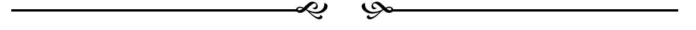

世坤以稳健姿态成长。发展方向无法预知，但我们持续寻找方式，吸引并打磨那些缺乏机会的数学与科学青年才俊。金融危机后不久，像当年开拓中国一样，我们把重点放在拓宽招聘与培训上。公司发展不仅是开新点、挖新人，同时加大运营投入，这才让阿尔法数量实现指数增长。

我开始思考如何提升量化投资教育。某种意义上世坤本身就是教育机构，把数学科学专家培养成金融人才。我设想成立独立于公司的机构：提供奖学金激发批判性思维；奖励全球顶尖数学科学机构；与非政府组织、高校和政府合作；举办会议并赞助教育机会大会；同时孵化创新项目、新研究方向和潜在突破，通过风险投资给予支持。

2009年我创立非营利组织世坤投资基金会来落地这些设想。起初资助教授数学、物理与量化分析的高校，后来设立个人奖学金，专门奖励量化科学人才。尽管公司不直接从中获利，我相信这些投入将惠及整个量化投资行业。

我们并非孤军。2012年德国计算机科学家塞巴斯蒂安·特伦与两位合伙人创办优达学城 Udacity，推出大型开放式在线课程MOOCs。上世纪九十年代中期，特伦曾参与建造博物馆导览机器人犀牛 Rhino，并以此作为波恩大学毕业论文。后在斯坦福人工智能实验室，他带队研发无人驾驶汽车斯坦利 Stanley，并在2005年DARPA自动驾驶挑战赛中夺冠。两年后他加入谷歌，创立Google X实验室，孵化出后来的Waymo项目。《快公司》杂志称他为“世界最著名科学家，饱受争议，在说服普通人接受疯狂理念方面，或许只有埃隆·马斯克能与之匹敌”。

塞巴斯蒂安·特伦对精英教育的普及近乎痴迷。即便在离开斯坦福之前，他已经把能上线的一套课程做出来，其覆盖面可能已经超过了传统校园的边界。2011 年，他在自家客厅里用数码相机拍摄、用手持白板纸替代黑板，开讲了第一门人工智能的线上课，一次性吸引了约 16 万人报名旁听。《快公司》在 2013 年的特写里提到，按首次测验成绩排名，前 400 名学霸里没有一个是斯坦福的学生。离开谷歌后，他创办了优达学城，专心做慕课，重点放在统计学与计算机科学的交叉地带。

世坤投资基金会在思考相似的问题。我也想借助互联网触达更广阔的全球人群，发掘并扶持有潜力的年轻人。我希望能开设更多数学和科学类课程，因为我相信它们会重塑世界。我们资助的课程在内容上与优达学城有明显重叠，比如人工智能、机器学习、统计学、计算机与数据科学，但我们的侧重点更偏向量化金融，以及制造阿尔法所必需的大数据相关课程。特伦本人坦诚地指出，完课率和通过率是两大难题，这也是线上教育行业的共性痛点。2013 年起，我们就开始研发面向阿尔法开发的慕课，希望任何地方的愿意学习者都能以免费或极低成本获取。为此，世坤投资的不少员工自愿参与课程内容的搭建。

正如我首个阿尔法的孵化，或是后来在北京设立办公室的尝试，课程项目的启动标志着一项更宏大、更复杂的长期战略的展开。我们把在线教育拆成两条线来推进。

第一条线是 2014 年推出的世坤投资挑战赛。仿照美国电话电报公司的大学生投资挑战赛，我们的赛事不仅是竞技，更带有教育属性。主题是高效阿尔法的开发。参赛者通过官网登录，世坤的 WebSim 在线模拟平台对所有人开放，和内部研究员、组合策略师使用的数据集、回测工具完全一致。对量化行业常见的神秘感而言，这样的开放已属罕见，移动端也能接入 WebSim。

我们把挑战赛当成教育平台来运营，兼顾人才甄选、课程投放、线上线下交流。2017 年 7 月前后我们集中办了 32 场活动，比如“金融与技术指标”线上课；印度站的“阿尔法质量与过拟合风险”研讨会，过拟合即指模型过于复杂导致预测力下降；韩国、俄罗斯、越南的阿尔法松 Alphathon 信息会，阿尔法松是世坤按季度举办的全球量化金融建模大赛。冠军可获得 1 万美元奖金，表现优异者还能被聘为研究顾问，目前已有 700 多位。有一个从农村走出来的参赛者，拿到工程学位后因要继承家族土地而返乡务农，却在比赛中脱颖而出，最终获得了研究顾问的机会。

第二条线是筹建世坤大学。基金会此前已给传统高校在校生提供奖学金，但我希望规模更大。最终我们设计了一整套量化金融课程体系并配备现场答疑，约两年在线学习可拿金融工程硕士学位。作为基金会出资的非营利机构，世坤大学于 2015 年对外宣布成立。对世坤投资而言，这项业务并无直接回报。我的两个核心诉求是消除地域壁垒和成本壁垒。金融工程硕士多集中在美国少数高校，世坤大学则通过网络让全球各地的人都能上课；学费往往高达十万美元以上，对很多人教育仍是特权而非权利。我希望世坤大学能改变这种现状，让贫困不成为获取顶尖资源和与量化专家共事的机会障碍。

2016 年首届招生启动，来自 35 个国家和地区 200 多名学生入学，全球人才的成长通道被打开。如今已开设 14 门研究生课程，约 90 个国家和地区、1800 余名学员在网上学习，规模还在快速扩张。每 7 周组建一期学习群，课程持续迭代。超过一半的学生来自撒哈拉以南非洲，仅尼日利亚就有数百人，其余分布在亚洲和欧洲多国。教学口碑在积累，这个过程需要几年时间，因为最终要靠毕业生的能力来证明。世坤投资不指望从大学获利，也不希望它成为进入公司的捷径。非营利章程规定，毕业生毕业后一年内不得被世坤投资聘用。我们的目标是把 21 世纪的科学成果传授给学生，让他们回馈所在社区。

项目团队正被要求把课程延伸到数据科学。我们已上线数据工程课程，包含为期 8 周的数据科学“新兵训练营”，核心是 Python 等语言的建模编程，这类短期课程能检验学员吸收进阶教材的能力。

目前学员中约 90% 为男性，这说明人才池远未饱和。我们必须扩大基数，尤其要吸纳更多女性。我们决心持续挖掘全球人才，提供平等的学习机会。

人才分布本身服从幂律。样本足够大时，总有一小撮人在特定任务上极度突出，所以人才库大小本质上是统计问题。为此我们必须走出去，覆盖尽可能多的国家，避免人为筛选。若无法线下接触，就用互联网和 WebSim 模拟平台触达他们，识别才华。

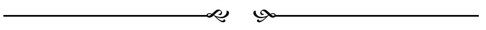

2015 年 3 月，我们在波多黎各的度假村召集了约 700 名员工和客户，举办了世坤投资的全球峰会。当时我已确信，量化金融正被一场指数级变革重塑。回想在千禧管理公司独自一人与唯一一个阿尔法相依为命的岁月，到如今拥有庞大团队和海量阿尔法，这条路比从白俄罗斯到纽约再到威奇托还要漫长。峰会上我提出，当下最大的经营挑战是如何应对指数级变化。如今数据、知识、算力都在按摩尔定律呈指数增长。

以指数思维意味着什么？意味着持续设定新目标，意味着要有魄力和眼光，意味着今天的震惊明天可能平常后天可能一文不值，意味着今天的信念只为等待被打破，意味着敢于承担风险就是常态。指数世界里地势难以估量，动荡不可避免，信息吸收力强者才能获得指数回报。

峰会前一年即 2014 年，我为世坤的三大支柱做了布局：无限阿尔法的开发、全球人才招聘、交易技术的教学，从而掌控交易未来。我们打造了全球化阿尔法工厂，目标是产出 100 万个阿尔法，这个目标当时被视作激进，但我们正不断逼近。随后我把目标提升至三倍，制约完成的关键始终是整体算力不足，而非灵感匮乏。指数增长让目标不断显得惊人。

指数世界里，企业要蓬勃发展必须有执行力和胆识。波多黎各峰会我们请来美国前国务卿科林·鲍威尔等军事将领演讲。因为他们深谙组织在指数条件下如何运转：快速决策、严明纪律、风险识别、在高压下执行。量化金融与战争不同，但竞争无处不在，赢者通吃，必须始终领先一步。

指数世界必须抛弃线性思维。指数思维就是与风险共生。线性思维带来的确定感对我而言等同死亡。当世界指数变化，我们只能紧跟趋势并及时转向。

计算显示，我们开发的阿尔法数量与模拟组合数量成正比增长，问得越多答案越多。业务结果趋向于与阿尔法数量的对数成比例。我们已验证这一现象。对外行看似线性增长，实则需要阿尔法数量每年指数增长。在此关系下，人力资本、业务表现与阿尔法产量需不断权衡。我们要自问：招了多少人？投入多少资金？有多少灵感被转化为阿尔法？灵感或无限，产量受成本限制。如何让最佳灵感进入生产？

世坤的生存离不开多样性。反原则无处不在：任何理论与方法都有缺陷，没有绝对正确，也没有完美。一旦正视其消极面，就能看到倡导思想自由交流的积极价值。

要重视多元且相互矛盾的方法。因一切理论皆有缺陷，最佳做法是收集尽可能多的理论，找到最优同步使用方式。
要重视多元且独立的观点。让敏锐的顾问提供独立咨询，能显著提升决策质量。若把每个顾问看作一个阿尔法，5 个不相关的阿尔法就能带来极佳的夏普，比单一阿尔法好得多。
要让更多人受益。把努力与他人的成功相连，就能获得群体的助推。这是世坤的实践。

* * *

[1] 为了维持群体的和谐，群体成员削弱了决策能力，并且避免做出符合现实的评价。——译者注
[2] 著名企业家，现任太空探索技术公司（SpaceX）CEO 兼 CTO、特斯拉公司 CEO、太阳城公司（SolarCity）董事会主席。——译者注
[3] 摩尔定律是由英特尔创始人之一戈登·摩尔提出来的。其内容为：当价格不变时，集成电路上可容纳的元器件的数目，每隔 18~24 个月便会增加一倍，性能也将提升一倍。换言之，每一美元所能买到的计算机性能，将每隔 18~24 个月翻一倍以上。这一定律解释了信息科技进步的速度。——译者注

# 第九章 量化生物学

“大处着眼就会容易些。”

2013 年，数据的指数级增长已渗入大众视野， “大数据”一词随处可见。随后涌现的概念，正是我们量化投资长期思考的内容：预测算法、人工智能、机器学习、数据科学。它们曾看似无用，如今正高速改变世界。2015 年，世坤大学开始围绕这些方向设计课程。在基金会和风险投资计划支持下，我开始在交易之外探索这些概念。

2014 年春天，我在纽约威尔康奈尔医学院与一位年轻研究员共进午餐。他是克里斯托夫·梅森博士，实验室负责人，专注基因测序新技术及算法在人类基因组与疾病关系上的应用。

梅森幽默，35 岁获耶鲁遗传学博士，思维跳跃，话题在基因学、基因测序、微生物学、擦拭技术等间切换，擦拭技术用于采集纽约地铁细菌 DNA，是纽约市微生物基因图谱项目的一部分。他还是生物学与生物物理学副教授，与 NASA 合作研究微重力对 DNA、RNA 及其他太空环境因素的影响。他甚至在构想一个 500 年的火星探索与居住研究计划。午餐后他带我参观湿性实验室和干性实验室。干性实验室布满机器与电脑，与世坤内部相似，隔间、设备、程序、安静的工业氛围都很相近，年轻人也一样聪明。

随后世坤投资基金会向威尔康奈尔医学院捐赠 100 万美元，用于设立每年 5 万美元的研究奖金。迄今梅森团队已获奖三次。

我们的联系远超慈善。午餐后我们保持对话，有时晚餐有时电话邮件。话题涵盖量化金融与预测生物学、疾病建模。他会把论文发给我。对我而言，他的实验室是公司外的另一个世界。梅森团队致力于找寻致病原因、预测爆发和治愈疾病，而非从市场波动中套利。梅森说话直白平铺，和我风格一致。在数据大爆炸时代，我们都在从极端复杂、非线性系统中提取信号，用计算机科学识别有价值模型。

正如梅森常提醒的，两者仍有差异。他说医学和金融的量化模型不同。世坤构建成千上万个阿尔法，每个有效期可能仅数月数年；梅森只做少数几个模型，却要求能服务患者 30 至 40 年。交易因市场变化快而接受短效阿尔法，而医学要求高置信度。

“若告诉病人癌症好转概率约 50%，这毫无帮助。”梅森强调，“医学上通常需要 80% 至 85% 的把握，否则不会被采信。你不能说‘我抛硬币，你可能死也可能活’。”

不过反原则同样适用。没有模型能完美代表复杂且持续变化的现实，每个市场各异，每个病人也独特。变化永恒，这是梅森和同事面临的巨大挑战。

最后我们讨论量化金融与量化基因组学的合作可能，彼此能学到什么？

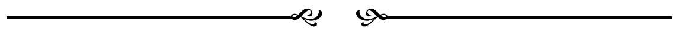

疾病研究的数据来源并不局限于医学界。古希腊医生希波克拉底、盖伦等曾试图找出病因并联系环境因素，但当时理论意义大于实践。17 世纪起，关于疾病发生率与类型的量化研究出现，首批研究生物学的工具被发明。

此后数个世纪，流行病学这一实证学科逐渐成形。希腊语中“Epi”意为“在我们之上”或“在我们之间”，流行病学研究“什么在人群之上”。19 世纪 50 年代伦敦霍乱疫情，我们能从传播中学到什么？病菌如何传染？20 世纪许多数学家投入医学，用概率统计证明吸烟与肺癌关联。那时致病媒介已被发现。就像金融领域，医学也在不断抛数据以解释现象。

## 遗传学与基因组学的发展历程

## 19世纪到20世纪的奠基

遗传学与基因研究在 19 世纪取得重大进展。奥地利修道士格雷戈尔·孟德尔发表关于豌豆遗传与变异的开创性论文，一开始被忽视，后来被重新发现并产生深远影响。20 世纪基因与染色体研究加速，DNA 被发现。真正突破在 1953 年，詹姆斯·沃森与弗朗西斯·克里克揭示基因编码，阐明 DNA 结构。DNA 由核苷酸长序列编码，许多人相信解码 DNA 就能打开人类繁衍信息的宝库。

DNA 由核苷酸构成，碱基为腺嘌呤 A、胞嘧啶 C、鸟嘌呤 G、胸腺嘧啶 T，在双螺旋中按碱基互补配对存在于每个细胞。A 与 T 配对，C 与 G 配对。DNA 类似图灵机的纸带，是生物化的程序语言。序列通过核酸指导细胞机制，将氨基酸组装成蛋白质。DNA 编码存在于细胞核，按三碱基对片段排列 RNA。例如 CAT 三联密码子编码组氨酸。20 种氨基酸对应 64 种可能的密码子，多余者用于起始与终止，如 ATG 启动蛋白质合成。

## DNA 结构与中心法则

在沃森和克里克摘得诺贝尔奖、晶体学家莫里斯·威尔金斯凭借 X 射线衍射捕捉到 DNA 早期结构影像的基础上，1958 年克里克首次提出分子生物学的“中心法则[^(\[3\])](#chapter12.xhtml#comment_8617)”：遗传信息由 DNA 承载，DNA 经转录把信息交给 RNA，随后 RNA 再把信息译成特定蛋白质。信息流的描述是 DNA 编码 RNA、RNA 编码蛋白质，而且只允许单向流动，蛋白质无法回写基因组。

半个世纪过去，研究者对生化编码的复杂性仍在不断打开。人类基因组长达 30 亿个碱基对，仅约 1.9 万至 2 万个基因参与蛋白质编码，剩下的问题大量存在：基因在何处、为何如此排列、98% 的非编码 DNA 有何意义、RNA 剪接与基因转座等现象如何处理。1960 年，分子生物学家辨认出两种 RNA：信使 RNA 和转运 RNA[^(\[4\])](#chapter12.xhtml#comment_8677)。

## 基因组测序技术的指数增长

1995 年，一种流感细菌的基因组被完整测出，这是首次完成整套基因组的排序。人类的基因组计划在 2000 年发布初稿，2004 年公布定稿，期间公布的组装图在整体上高度一致。答案的出现往往伴随更多疑问，像 DNA 序列这样基础的突破点燃了公众与市场的热情，也暴露出基因组更深层的复杂。中心法则本身便像反原则理论的典型：普遍适用的规律往往伴随大量例外，而例外正是新研究方向的入口。

与此同时，支撑研究的工具在质变。通量测序以近似摩尔定律的速度推进。人类基因组计划耗时 13 年、耗资约 30 亿美元完成全部测序。梅森指出，从 2006 年起，测序成本大约每 5 个月折半。2007 年 Solexa 被圣地亚哥的 Illumina 收购，2016 年 Illumina 宣布单个人基因组测序成本降至 1000 美元，并计划在 2020 年前压到 100 美元。

测序快了，数据也随之指数级膨胀。如今研究人员可以向众多公共库提交或调取基因组数据。ENCyclopedia of DNA Elements，ENCODE 计划聚拢国际团队，对人类基因组全部功能元件进行测序，是一个持续扩大的数据集。作为美国国家癌症研究所 NCI 和国家人类基因组研究所 NHGRI 支持的项目，癌症基因图谱 TCGA 正在绘制 33 种癌症的基因变异图谱；国际癌症基因组联盟 ICGC 则在生成 50 种癌症的全基因组数据。梅森的实验室利用自有的高通量平台构建细胞特异性分子图谱，试图在细胞尺度呈现疾病的多维面貌。

我们在分子与原子层面逐步看清自然如何以进化编织生命网络。所有人共享大量相同的序列，但个体间也存在惊人的变异，部分可遗传。环境干扰、复制错误导致的突变与转座，或致病、或促健康、或推动进化，这与以自然选择为核心的达尔文进化论相符。

梅森常把中心法则形容为在路灯下找钥匙——明知可能丢在别处仍在光下找。他还以 17 世纪天文学类比，当时人类只能依靠简陋光学仪器观察可见光，视野受限于工具。

进步同样巨大。基因组学之父弗雷德里克·桑格是英国生化学家。50 年代他测定胰岛素的氨基酸序列，数据量约 1 千字节；60 年代转向更复杂的 RNA 序列；70 年代解析 DNA 核苷酸序列，涉及数百千字节。凭借化学领域的贡献他两获诺贝尔化学奖。多年后分子生物学家认识到，完整人类基因组测序既像 DNA 结构解析一样是起点，也是终点。如今梅森实验室的现代测序仪器每天可产出数百太字节数据。

蛋白质组学、生物信息学、计算生物学等分支迅速繁荣。针对阿尔茨海默症与多类肿瘤的深度研究进入新阶段。约十年前梅森的工作领域尚属冷门，如今已汇聚现代生物医学、分子生物学、生物信息学等交叉力量，形成宏基因组学、计算基因组学、预测生物学等方向。

再看一段持续的研究。DNA 与 RNA 均含 4 种碱基，RNA 用尿嘧啶替代 DNA 中的胸腺嘧啶。RNA 上已知超过 100 种修饰或标记来调控活性，其中最常见的是甲基，即一个碳加三个氢的小基团，可在酶作用下附着于 RNA 或 DNA。腺苷 N6 甲基化 m6A-methyl-adenosine 在约 7000 个基因的 12000 个位点出现，多集中于基因终止区，往往与表达的启动或终止相关，具有重要调控作用。RNA 修饰还会影响 DNA 修饰，m6A 可作为 RNA 编辑的负向调节因子，部分细胞在转录后发生序列改变。m6A 只是众多信号之一，整体信号复杂且层级分明，像市场一样存在多级反馈与交互。

梅森指出，克里克的中心法则已被打破。DNA 能自我复制；RNA 可双向作用，既参与蛋白质合成，也参与 DNA 合成；蛋白质还能修饰 RNA。完整人类基因组约含 1 亿千兆字节信息，却不含多层次的调控活动。除表观基因组[^(\[5\])](#chapter12.xhtml#comment_8885)、表观转录组[^(\[6\])](#chapter12.xhtml#comment_8890)、表观蛋白质组[^(\[7\])](#chapter12.xhtml#comment_8895）外，研究者还在探索它们与蛋白质组[^(\[8\])](#chapter12.xhtml#comment_8902）、微生物组[^(\[9\])](#chapter12.xhtml#comment_8907）的交互方式。梅森的总结是：“相互作用极其复杂。”

要获得人体生物学的完整数据，不仅要考虑环境对 DNA、RNA、蛋白质的影响，还要纳入时间维度。梅森估计需要约 1 万亿太字节，即 10 的 24 次方字节，约 1 尧字节。目前做不到，却是指向未来的方向。

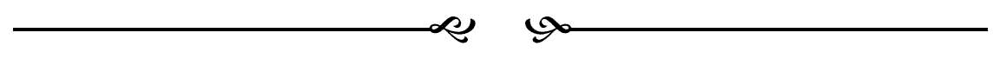

## 微生物组与预测医学

梅森与我初次交流时说：“我希望能预测一切。”这个野心点燃了我的兴趣。他承认目标激进，却把它写入威尔康奈尔医学院的每一个项目。

他解释，医药与生物学大多时候并不清楚最值得探究的分子特征在哪里，相关性强弱仍在发现中。所以“预测一切”是指搭建框架，以更清晰视角观察肿瘤演化与传染病。

他主导的病理学地图计划 PathoMap 致力于绘制纽约地铁的微生物、病毒、潜在病原体及其基因组。地铁乘客是城市中流动性最强的人群。数据令人震撼：检出的微生物中 48% 之前未被认知。梅森曾对《纽约时报》说，每天运送 550 万人的纽约地铁是一座可探险的“雨林”。该计划首个落地的项目是宏设计计划 MetaSUB，目标是通过全球主要城市描绘微生物组的世界地图。进化史上微生物与人体长期共生，却鲜为人知。每个人体内携带约 100 万亿个微生物，重约 3~5 磅[^(\[10\])](#chapter12.xhtml#comment_9016)。离开住所后，车厢拉手、闸机、门把手都会留下痕迹。梅森的经典说法是：“细胞投票时，你自己的细胞是少数派”“你体内大部分基因并不属于你。”

他强调，健康的人体生态系统离不开微生物多样性，丧失多样性后果严重。微生物组不仅指微生物本身，也包括其基因，数量是人类基因组的 100 倍。这些基因负责合成消化、营养、免疫、食欲调控与体重调控所需的蛋白质。体内约有 700 种“药物”由微生物生产，包括约 90% 的血清素、50% 的多巴胺以及关键维生素，偶尔也会产生病原。

人类基因组像保险库，难以完全与微生物基因隔离。自人类与黑猩猩分化以来，约 98,000 种病毒在人类基因中留下 DNA 印记。产生化学能的线粒体来自线粒体[^(\[11\])](#chapter12.xhtml#comment_9068）的 300 种基因，也存在于人类基因组中，线粒体基因组与微生物基因组有相似之处。

与地铁奇异微生物相比，PathoMap 更长期严肃的目标是流行病长期监测：通过不同时期重复采样建立分析基准、侦测生物恐怖袭击、管理人群健康，即多角度预测。

无论是地铁微生物基因组，还是放化疗后癌症患者的紊乱基因组，序列中总有信号。梅森相信我们将能监测并测序个体细胞及细胞间通信。快速廉价的测序将使任何癌细胞的突变得以检查。他认为仍有两大挑战：一是技术上如何捕获并准确描述患者身上的个体细胞或分子；二是建立模型攻克癌症这类难解、顽固、异质性疾病的变化。我们能否以指导行动的方式读懂 DNA 序列？

“测序一段 DNA 时，能否像法医一样明确告诉我们它来自何处、存在何种风险、为医学提供何种信号？”梅森问。他希望通过提取特定细胞观察其 DNA 序列即可了解身体整体状况。基因突变状态下身体有何危险？序列能提供哪些健康指引？何种药物有效？这些都需要大数据与更优秀的技术。

梅森曾问我能否开发一个能稳定有效 30 年的金融预测模型，我的答案是否定的。但医学预测的长期有效性正是关键。比如依据 15 岁和 18 岁的基因组预测是否需要双侧乳房切除术。若存在乳腺癌 1 号基因 BRCA1 突变，便需做出部分切除以求存活的艰难决定。

我们随后讨论如何更有效地开发疾病模型。资金是前提。深入研究单细胞、加快测序与癌细胞复杂分析，需要更多研究人员与精密仪器。我们发现双方可互补。世坤投资与梅森单位目标不同，模型也不同，却同聘博士、计算机科学家与 IT 专家，都靠数据吃饭，使用相近编程语言与数学科学语言，共享量化思维。可把研究员派往对方实验室，混合量化金融与量化基因组人才。

2017 年春季，世坤投资深化了与威尔康奈尔医学院的合作，捐赠 500 万美元设立世坤量化预测计划 WorldQuant Intiative for Quantitative Prediction。梅森表示，这是首个把微生物组肿瘤生物学大数据与宏基因组大数据结合的计划。梅森与奥利维尔·埃利门托 Olivier Elemento 共同负责项目进展，埃利门托当时研究大数据在药物临床试验失败原因分析中的应用。项目还联合威尔康奈尔医学院卡里尔与伊斯雷尔·英格兰德精准医疗研究所以及桑德拉与爱德华·迈耶癌症中心科学家。

世坤的研究人员精通预测算法，将作为访问学者进入梅森实验室担任数据科学家，寻找构建预测模型的新灵感；梅森团队则进入世坤学习数据处理方法。撰写本书时计划刚启动，双方都期待融合顶尖大脑、灵感、算法与方法，提升疾病预防治疗水平与阿尔法研究技术。

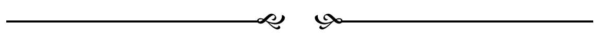

## 基因型表型与疾病关联

梅森团队在基因组数据中寻找的是什么？本质上是探明染色体序列与遗传病间的因果关系，并用预测算法建模。基因型[^(\[12\])](#chapter12.xhtml#comment_9282）genotype，即基因组序列，通常在表型 phenotype 上体现。形式决定功能，为关联研究提供基础。

部分基因与疾病的因果关系已被发现，清单不断延长：血友病由缺陷凝血基因导致；镰状细胞贫血由编码氨基酸的碱基对突变引起；囊性纤维化疾病[^(\[13\])](#chapter12.xhtml#comment_9289）由基因突变破坏氯离子与水跨膜转运引起；某些乳腺癌与卵巢癌与乳腺癌 1 号基因突变相关；亨廷顿舞蹈症[^(\[14\])](#chapter12.xhtml#comment_9292）由 CAG 三联密码子重复 50~60 次引起，产生大量衰减蛋白质积累并损伤脑细胞。尽管关联疾病列表增长，已知的仍只是冰山一角，相较于大量蛋白质相互作用的突变疾病而言。

构建疾病预测算法极难。需追踪多重基因、基因级联反应[^(\[15\])](#chapter12.xhtml#comment_9297）、多重突变或难以理解的反馈回路。我们知晓越来越多，但预测仍艰难复杂。快速增长的知识基础为算法提供了目标，其中像世坤投资的阿尔法这类算法或将被证实有效。

分子生物学与基因组学的加速带来伦理与政治挑战：如何保证安全？信息归属谁？基因组操作何时允许？对梅森及其同事而言，这既是挑战也是机遇。我们学到健康是个体问题，却非仅是个体问题。个体基因组存在惊人的变异与适应性，许多无明显显性效应。每个人都完全不同。同样的基因突变，有人患癌有人不患；同种药物对部分人有效，对另一些人无效甚至有害；一天吸一包烟者或活到 110 岁，虔诚素食者也可能死于心脏病。

知识越积累，基因组的面纱就越厚重。测序结果显示，单个人的基因组内部经常携带整段基因的复制拷贝，而转座子这群跳跃基因则在染色体之间来回穿梭。发育进程与神经调控对精确度的苛求，让人类基因组看起来只有两条路可走：要么像洛朗的船只那样布满多台发动机的功能冗余，要么只剩下为数不多且易变的遗传构件。梅森更认同前者，他指出正是基因的多样性与变异，解释了为何千篇一律的热门疗法屡屡碰壁或产生副作用。

正是这一判断，让依托廉价快速测序的真正个体化医疗，成为梅森等研究者检验成效的标尺。测序技术把个人基因组从理论变为可达，费用由千美元级跌至百美元级，这本身就是医疗民主化的推力。算力与算法让医疗信号的捕捉变得迅速。如今锁定个体对特定药物反应差异的遗传标记已经浮现，药理学与基因组学结合形成的药物基因组学，正朝着更高疗效与更精准的方向演进。

精准医疗仍在路上，却已显出超出现状的发展动能。近期之内，临床照护有望实现数据驱动、个性定制并具备可预测性。

* * *

[\[1\]](#chapter12.xhtml#commentRef_8377)湿性实验室是指进行样品处理、容量分析、离心、沉淀、过滤等常规实验而需要配备给水排水的实验室。干性实验室是指精密仪器室、天平室、高温室等不使用或较少使用水的实验室。——译者注

[\[2\]](#chapter12.xhtml#commentRef_8492)1986 年，美国科学家托马斯·罗德里克（Thomas Roderick）提出基因组学概念。基因组学是对所有基因进行基因组作图（包括遗传图谱、物理图谱、转录图谱）、核苷酸序列分析、基因定位和基因功能分析的一门科学。——译者注

[\[3\]](#chapter12.xhtml#commentRef_8609)中心法则，旨在说明连串信息的逐字传送。它是指遗传信息从 DNA 传递给 RNA，再从 RNA 传递给蛋白质，即完成遗传信息的转录和翻译的过程。遗传信息也可以从 DNA 传递给 DNA，即完成 DNA 的复制过程。这是所有有细胞结构的生物所遵循的法则。——译者注

[\[4\]](#chapter12.xhtml#commentRef_8647)信使 RNA 携带遗传信息，是在蛋白质合成时充当模板的 RNA。转运 RNA 能够携带氨基酸进入核糖体，在信使 RNA 的指导下合成蛋白质。——译者注

[\[5\]](#chapter12.xhtml#commentRef_8859)表观基因组学使人们对基因组的认识又增加了一个新视点：对基因组而言，不仅仅是序列包含遗传信息，而且其修饰也可以记载遗传信息。——译者注

[\[6\]](#chapter12.xhtml#commentRef_8861)表观转录组学主要研究 RNA 所携带的化学修饰对基因表达的影响。生物体内的很多大分子都存在化学修饰，且都具有极其重要的作用。——译者注

[\[7\]](#chapter12.xhtml#commentRef_8864)表观蛋白质组学主要研究组蛋白修饰在基因表达调控方面的作用方式和机制，包括组蛋白乙酰化、甲基化、磷酸化、泛素化等，是一类重要的表观遗传机制。——译者注

[\[8\]](#chapter12.xhtml#commentRef_8870)蛋白质组学是以蛋白质组为研究对象，研究细胞、组织或生物体蛋白质组成及其变化规律的科学。——译者注

[\[9\]](#chapter12.xhtml#commentRef_8874)微生物组是指一个特定环境或者生态系统中全部微生物及其遗传信息，包括其细胞群体和数量、全部遗传物质（基因组），涵盖微生物群及其全部遗传与生理功能，其内涵包括了微生物与其环境和宿主的相互作用。——译者注

[\[10\]](#chapter12.xhtml#commentRef_8984)1 磅≈0.454 千克。

[\[11\]](#chapter12.xhtml#commentRef_9032)线粒体是细胞质内粒状或棒状的细胞器，是真核生物进行氧化代谢的部位，是糖类、脂肪和氨基酸最终氧化释放能量的场所。它能自行分裂，在遗传上有相对独立性，被誉为人体能量发动机。——译者注

[\[12\]](#chapter12.xhtml#commentRef_9240)基因型指某一生物个体全部基因组合的总称。遗传学中具体使用的基因型，往往是指某一性状的基因型。显性性状是指，具有相对性状的纯合亲本杂交所产生的子一代中，能呈现出的亲本性状为显性性状。——译者注

[\[13\]](#chapter12.xhtml#commentRef_9257)白种人中最常见的致死性常染色体隐性遗传病。——译者注

[\[14\]](#chapter12.xhtml#commentRef_9263)一种罕见的常染色体显性遗传病，又称慢性进行性舞蹈病、大舞蹈病。患者一般在中年发病，出现运动、认知和精神方面的症状。——译者注

[\[15\]](#chapter12.xhtml#commentRef_9280)级联反应：在一系列连续事件中，前面一种事件能激发后面一种事件的反应，其化学修饰为酶促反应以及放大效应。——译者注

[\[16\]](#chapter12.xhtml#commentRef_9348)转座子也称转位因，是存在于细菌染色体或质粒 DNA 分子上一段特异性核苷酸序列片段。它能在 DNA 分子中移动，不断改变其在基因组中的位置，从一个基因组移到另一个基因组中，也被形象地称为跳跃基因（jumping gene）或移动基因。——译者注

# 第十章 可预测时代

“数量就是质量。”

四十年代，维也纳出生的理论物理学家埃尔温·薛定谔正栖身都柏林。纳粹扩张与战火逼近时，他与不少同行一道离开中欧。薛定谔的父亲是化学家兼业余植物学家，对当时兴起的遗传学深感兴趣。1943年的系列演讲里，薛定谔把量子力学的视角引入生命，用纯粹的物理语言描绘生命的分子本质。讲稿后成书为《生命是什么》，成为生命科学启蒙的里程碑。

演讲产生了强大回响。他的设想吸引一批物理学家投身分子层面的遗传研究，也直接催生了分子生物学。几位物理学家据此推演了DNA的物理属性；在纽约，奥斯瓦尔德·艾弗里把DNA分离出来并认定其为遗传物质，推翻了蛋白质才是遗传载体的旧说。

薛定谔的起点很根本：在时空限制下发生的生物事件，能否用物理化学加以解释？他认为遗传物质必须具有原子分子层面的属性，并指出生命体中起支配作用的物理化学规律都带统计色彩。

他解释了生命表象的有序与无序之谜：原子永不停歇的热运动，使得自然界看似有序实则源于深层无序的布朗运动。随后他提出大胆设想：染色体作为活细胞核心，由一种可称作非周期性晶体的结构构成——一串长链，其单元并不完全相同。常规周期性晶体的晶格统一，只能形成有趣却相对单调的构型，而非周期性晶体更像墙纸与精美刺绣的差别，例如拉斐尔挂毯并非简单重复，而是大师手绘的精致、有序且富意义的图案。

在他看来，这类非周期性晶体正是生命的物质载体。

他随后描述分子的矛盾特质。分子必须具备一定化学规律性以实现复制与信息传递，同时又必须保持不规则以匹配自然界的变异与多样性。它必须容纳与微观细胞共存的海量信息。他推测它可延伸为染色体串，如今已被证实为遗传物质。他认为这种非周期性晶体中压缩着“封装在微型密码里的遗传内容”。

自然是非线性且复杂的，是有序与随机、信号与噪声之间持续博弈的结果。冯·诺依曼、乌拉姆、薛定谔、图灵、巴切利耶、布莱克、索内特、曼德尔布罗特等人试图用数学捕捉这些基本秩序的部分特征，但统计结果常自相矛盾。无论是中子湍流的解读，还是市场随机游走这类不规则运动的建模皆然。

再难破译或微小的密码都暗藏某种秩序。我们在世坤投资的工作，以及克里斯托夫·梅森在威尔康奈尔医学院的探索，本质都是破译密码。如今依靠强算力、成熟软件与多元数据，不同领域的团队都在复杂的非线性系统中搜寻微弱信号。这些系统涵盖市场、天气、物理宇宙、亚原子、整体宇宙、生物学及生命本身。寻找秩序的关键在于信息，这种被薛定谔称为生命物质的东西，如今被称为基因组学，其本质是一个可攻克的密码。正如图灵破解德军恩尼格玛机一样，它提供了某种潜在的可预测性，而这种可预测性过去似乎并不存在。

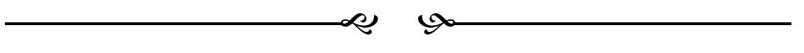

在《生命是什么》里，薛定谔自称正变成“一个天真的物理学家在思考生命”。他承认自己是个怪人，喜欢问“为什么原子如此渺小”这类看似荒唐的问题。实际上这些追问至关重要，关乎生物学，也关乎物理宇宙。原子极小却数量巨大，单个原子始终进行无序热运动，只有在绝对零度才会停止。这体现了大数定律的变体：很难相信感知器官能捕捉单个原子或分子的运动。单个原子的行为无序，像橡胶球与股价一样充满随机性，但物理学家能非常精确地预测大量原子的集体行为。所以尺度才是关键。正如薛定谔所说，原子很小，因为生物体哪怕是病毒和微生物也远大于原子。

从我在千禧管理公司和世坤投资的经历，以及量化金融行业的发展来看，围绕阿尔法质量与数量的争论从未停歇。一种思路是只产出少数效果好、寿命长的阿尔法，一旦失效便危及生存；另一种思路是大量生产阿尔法，它们对更微弱信号敏感，寿命短却能让我们持续监控、反思并重置组合。哪种更好？

许多量化模型公司选择前者，我一直偏向后者。对阿尔法质量的定义我始终找不到满意答案，而重质量还是重数量的争论也长期无定论。在世坤投资，我们曾怀疑能否构建大量算法去捕捉更微弱的市场信号。但最终我逐渐意识到，第二种策略不仅可行，而且长期来看对我们更有效。这呼应了一个原子悖论：单个原子随机运动，大量原子却以可量化可预测的方式运动，遵循大数定律。

每个想法都有对立面，正反讨论似乎永远无法达成一致。我们始终努力生产高质量阿尔法，却难以达到理想中的高质量。最终我意识到选择策略需要一种信念。对我而言，这就是数量即质量。若我们拥有上千个反映市场信号的阿尔法，并在较长时间内保持有效，它们就达到了理想的高质量。随着数量增加，总有人警告会触及极限，但我们突破了所谓的极限，实践证明数量并不削弱效果。有趣的是，那些提出数量极限的人，自己也在不断突破其所言极限。

因此在我们看来，阿尔法数量的优先级远高于质量，尽管会有量化分析师坚决反对。理由很简单：数量可以用计数定义，而质量却难以评估。在世坤投资，关于发展策略的争论最终平息。

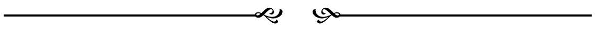

就数据而言，数量同样关键。阿尔法越多，有价值信息越多；阿尔法数量的增长与可获取数据规模相互促进。通常金融数据及其相关领域的数量与多样性长期呈指数增长，随着世界日益自动化和互联，这一趋势只会加速。世坤投资的阿尔法以指数方式扩张，本质上正是这一大趋势的体现。

毫无疑问我们已进入大数据时代。2012年，世界经济论坛发布报告《大数据、大影响：国际发展的新机遇》。报告指出，2012年从卫星与社交媒体到信用卡与智能手机，各类载体源源不断产生海量数据，世界每天产生2.5×10¹⁸字节数据。如今这个数字更大。报告还提到新兴国家移动通信数据有望在2015年实现年增100%，相当于100万的立方，即1后面跟18个0。互联网数据中心预测，全球日产生数据量将从2020年的44泽字节增长到2025年的180泽字节，一个泽字节约10²¹。数字巨大，却远小于梅森以兆字节计量的体量。人体等生物体潜在数据的总规模约在10²⁴量级。

报告特别强调移动电话技术普及以及全新的数据使用方式带来的改变，例如圣迭戈公共卫生研究人员可通过手机数据量化地球另一端的疾病爆发，联合国救援组织可借助手机数据探测撒哈拉旱灾。报告还指出，“移动电话技术为发展中国家数以亿计的人提供了重要服务”“众多政策制定者、企业领导及研究发展专家，愈发认识到这些数据的潜在应用价值……无论是使用者创造的海量数据，还是与使用者相关的海量数据本身”。

今天，手机用户构成互联世界已不新鲜。业内人士预言，由物联网催生的一种新的、潜力更大的数据波正在兴起。智能手机应用蓬勃发展，一方面把大量计算设备接入传统家电与工具，另一方面通过数据将其连入互联网。这些数据波将冲击现有IT基础设施，推动数据管理与分析软件开发，进一步驱动云存储服务商成长，并创造大量数据管理与分析岗位。这也为世坤投资的阿尔法提供更多信号。物联网让各类设备的日常数据相互连通，从个人健康管理设备、交通工具、家电、恒温器与安防系统，到智慧能源网与有线城市网，再到无处不在的摄像头，它们可能直播ELK日志迁移、恐怖事件热点等，如今仍处于数据持续产生的初始阶段。

我确信很多人尚未真正经历大数据时代就已习以为常，不再在意这些数据。拥有大量数据是一回事，能让数据为己所用是另一回事。数据只有便于获取、理解并用于预测才有意义。我相信对数据的相关分析已启动，并在相当长一段时间内仍将持续。

我们已进入可预测的时代。我们试图预测几乎一切，包括证券价格、零售销量、失业人数、天气、健康状况及各类安保情境，这些领域的数据量皆以指数级增长。好消息是，只要数据以非线性速率持续增长，我们就能遵循特定数学法则，在预测性能上获得线性提升。若一切保持不变，从数据视角看，一切都将变得更可预测。事实上，可预测时代并非遥不可及的玄想，尽管有人尚未意识到，预测效应已然真实发生：对许多公司而言，市场预测帮助它们提升制造与营销效率；在世坤投资，预测技术提升了我们为投资者创造回报的能力。在医疗领域，正如我们与威尔康奈尔医学院克里斯托夫·梅森开创的研究项目，预测技术将努力延续或拯救生命。

在可预测时代，技术是成败的关键要素。能够高效采用机器学习与人工智能分析、利用全部数据的组织，将比缺乏技术力的同行具备更多优势。但机器并不像科幻小说描写的那样无所不能，机器并非万能。整个预测过程中，接受过世坤大学学科训练并熟练掌握相关技术与量化方法的人，才是不可或缺的中坚。要获得更好预测效果，关键在于整合多种不同模型，这需要更多人、更多不同思想。找到合适人选后，还需培养他们快速便捷检验模型的能力，此时模拟技术便发挥重要作用。机器学习与人工智能可以帮助人们开发更多模型，并在预测中放大人的主导作用。借助辅助技术，人们可产出成千上万个模型。

我们尚未抵达乌托邦。若反原则理论在未来依然成立，我们或许永远无法到达乌托邦。所以坏消息是：正如索内特预测凯夫拉压力罐断裂概率或峰值市场波动率一样，技术、关联性与复杂性都在加大预测难度。随着事件发生频率加快，数据的指数级爆发让世界日趋复杂，地缘政治也更混乱。由海量数据产生的一系列问题会引发不安全感、焦虑与政治敏感，例如对数据隐私与控制权的担忧，以及担心数据加剧贫富分化——有人安享互联网与大数据带来的富裕繁荣，另一些人仍在为生存挣扎。如今交通更快、通信更便捷，即便有些机构能较准确预测，世界仍变得更加错综复杂。若无法做出更精确的预判，无论是普通员工还是公司CEO，复杂性都足以让人无所适从。

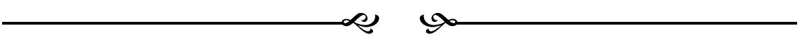

每个人都带着一套自己也没完全意识到的处世逻辑在走路。我们是在一连串事件和随之而来的反思里长大的，这些积累慢慢沉淀成对世界的判断。

回头看，我的人生像几块拼图被凑到了一起：父母把我从白俄罗斯带到美国的决定，以及他们留下的影响；视频游戏、计算机科学和金融这三条看似不搭的线在我身上交叉；贝尔实验室、廷贝尔—希尔、千禧管理、世坤投资这几段工作经历。把它们按时间线排好，很容易讲出一个顺畅的故事：从哪里来，到哪里去。故事现在是这个版本，或许还有别的版本，但就目前而言，这就是它。

过去是无法回头的。哪怕在看起来很可控的年代，我们对未来的了解依然稀缺。预测工具越来越好，却始终抓不住一个时刻都在变化的真实世界。大脑常常要在信息不足的情况下做出选择。我小时候迷上国际象棋、数学难题和编程，这些东西没有标准答案，只能靠不断试错去钻研。也正因如此，我养成了在不确定里思考的习惯。

父母当年把自己推向未知，我后来去千禧管理也有几分冲动。那会儿我欣赏伊兹的工作方式，却说不清这份工作到底对我意味着什么。2007年的量化震荡里，我先一步把仓位砍掉，随后又凭经验和直觉杀回去。外界对量化交易员无所不能的想象，完全站不住脚。

想看清未来，靠的就是持续迎接挑战、保持旺盛的好奇心。

这些年我学了大量数学、代码和金融知识，但始终相信只有实证研究才能产生真正可用的结果，所以在公司里把测试和仿真放在了产出阿尔法的核心位置。多年下来形成的一些做事原则，被我直接用在实证流程上：用当时能拿到最好的信息去验证；反复做压力测试，一朝失效就敢止损、调仓、换方向。做到这一点，前提是把主观偏见从决策里剥离出来。

反原则的核心就一句话：没有什么是确定的。越往深处探，物质世界和社会系统都越显奇妙。幂律为什么会出现，分形为什么在缩放中重现，这些只能猜测。实证主义在反原则下变成一种自然策略：A能不能推出B？能就用，不能就再找别的路径再试。没有任何东西是永恒的，哥德尔已经证明，连算术这样最基础的体系也无法自证无错。随着生活复杂度上升，能指引行为的原则反而更值钱，它提供一种秩序感来对抗不确定带来的风险。

阿尔法要的不是一个足够大，而是尽可能多。1个阿尔法赶不上1000个，1000个又不如1亿个，1亿个也可能被10亿个超越。信号越来越多的时候，阿尔法的产出自然会水涨船高，数量本身就是方法。

因此要拥抱多样且相互矛盾的方法。理论全都有缺陷，办法就是把尽可能多的理论收进来，找出一套让它们协同运转的方式。

也要注意多元且独立的观点。找几个脑子清醒的顾问分别给出独立意见，决策质量会明显提升。把每个顾问看作一个阿尔法，5个不相关的阿尔法叠加，产生的夏普远高于单一信号。

阿尔法越多，就越能利用那些更弱的信号。市场里弱信号远多于强信号，强信号一旦被套利就会被大量弱信号取代。这也解释了市场有效性为何如此顽强。过去只有少数强信号时，市场并不有效；当信号规模扩到成千上万，整体效果反而和以前的强信号时代相似。整合海量的弱信号很复杂，但确实管用。

量化震荡到底由拥挤交易、套利链条或抵押贷款传导的系统性问题触发，见仁见智。我更倾向于它标志着一个强信号主导时代的拐点。它会不会再来？照葫芦画瓢的概率很低，但冲击本身不会消失，只会换个面貌出现。对抗破坏性下跌，最有效的防护是拥有足够多的阿尔法，既分散风险，也更能捕捉有效市场的信号。起初你会拿到很强的低效机会，然后被消磨，最后只剩下大量微弱的低效机会，但低效永远不会彻底消失，总有人在努力把市场推向更有效。

我年少时离开故乡，这件事并不独特。跨越国界、学习新的生活方式、语言和习惯，确实能极大拓宽思维边界，也可能让人更习惯实证主义，容忍模糊和矛盾，当然也可能毫无帮助。

世坤投资的总部落在老格林尼治郊区，业务却是真正的全球化，汇集了各国人才的智慧和技术。世界整体看起来是无序且随机地向前，套用梅森的比喻，人总在路灯下找钥匙，因为黑暗里看不见。量化方法制造了一种秩序的假象。它解决不了宇宙的根本难题，也保证不了每个人的幸福，但它是一个强大的工具，慢慢照亮一个过程：起初我们意识到现实比想象复杂得多，随着算力提升和数据丰富，可预测性会逐渐增强。

走在通往未来的路上，记住反原则会更有用：没有任何东西能被证明绝对确定，但任何东西都可以被证伪，任何能被明确表达的东西都不可能完美。

我相信可预测的时代正在靠近。在那个时代，预测型思维意味着清醒地认识到，即便有再先进的量化工具，意外的变化依然潜伏其中。这种觉知对竞争越来越关键，所以不要爱上自己的策略而无法放手，而要把更多自我审视用在检验策略上。阿尔法越多，选择权就越多。但终极答案并不存在，唯有符合反原则的悖论，才能在世间长存。

* * *

[1]ELK 是 Elasticsearch、Logstash、Kibana 这三个工具的集合的缩写，这三个工具组合成一套实用、易用的监控架构，很多公司利用它来搭建可视化的海量日志分析平台。——译者注