# 掌中AI：AIGC妙笔生花

## “口袋里的人工智能”丛书编委会

总顾问 戴琼海

主 任 陈俊龙 王桂林

副主任 弓鸿午 吴汉荣 严奉强

委 员 （按姓氏笔画顺序排列）

马 晶 王 蕾 车文荃 史颖欢 刘 伟 杜 卿 李姝萌

沈文浩 张 通 张小川 罗子章 郭继舜 谭明奎

丛书总主编 陈俊龙

执行总主编 车文荃

## 《AIGC 妙笔生花》

主编 张通 陈俊龙

副主编 张宗衍 许施婷 翁浩瀚

编委（按姓氏笔画顺序排列）

刘朴淳 刘江枫 沈澍 岳宇洋

## 序言

技术更迭愈发迅猛，人们的生存方式正被持续改写，这种改写在历史长河中制造出诸多令人错愕的转折。昨日尚算熟悉的景象，今日已显陌生。

> —— [美] 约翰·冯·诺依曼

“科技的亮点往往藏于其内，智能的璀璨亦自其中绽放。”从与世界顶尖围棋高手博弈的AlphaGo，到如火如荼的无人驾驶，再到已融入日常的智能家居，无不印证智能时代的到来。在大数据、云计算、边缘计算与移动互联网的共同加持下，人工智能凭借广泛的落地场景不断重塑生产与生活的形态。它既是引领未来的战略性技术，也是推动新一轮科技进步与产业变革的核心动能。

AI具有极强的外溢带动效应，呈现头雁引领之势，能够赋能百业，在全球科技版图中占据关键战略位置。《中华人民共和国国民经济和社会发展第十四个五年规划和2035年远景目标纲要》明确提出，要推动人工智能与各产业深度融合。依托移动互联网、大数据、云计算等领域的积累，我国人工智能已走过理论沉淀与平台搭建的储备阶段，进入产业赋能期，在机器视觉与自然语言处理领域达到国际先进水平，在智能驾驶与生物化学交叉领域取得良好成效。为贯彻《新一代人工智能发展规划》，2022年7月，科技部等六部门联合印发《关于加快场景创新以人工智能高水平应用促进经济高质量发展的指导意见》，要求围绕高端高效智能经济培育、安全便捷智能社会建设、高水平科研活动、国家重大活动与重大工程打造重点场景。场景创新的深化将进一步提升AI赋能千行百业的效能，也会给公众生活带来更深层的便捷体验。面对AI的快速演进，做好科普是每一位从业者的职责。顺应国家对新时代科普的新要求，构建社会化科普格局，向公众普及AI知识势在必行。

在此背景下，广东科技出版社牵头组织编撰出版“口袋里的人工智能”系列丛书，邀请华南理工大学计算机科学与工程学院院长、欧洲科学院院士、欧洲科学与艺术院院士陈俊龙教授担任总主编，目标是打造让更多人认识人工智能的科普读物。丛书聚焦AI场景应用的多个领域，涵盖机器视觉、自然语言处理、计算机博弈，同时关注与AI结合紧密的智能驾驶、化学与生物、智慧城轨、医疗健康等热点。丛书共9册，分别是《千方万智》《智能驾驶》《机器视觉》《AI化学与生物》《自然语言处理》《AI与医疗健康》《智慧城轨》《计算机博弈》《AIGC妙笔生花》，从科普视角通俗、简洁、全面地介绍人工智能的关键内容，准确把握行业痛点与发展趋势，剖析融合AI的优势与挑战，既为大众了解人工智能提供便利，也为相关从业者提供参考。同时丛书能提升青少年的科技兴趣，引导更多年轻人投身科研，勇敢面对未知与挑战，拥抱变革、敢于创新，这正是编委会与出版社的社会担当。

这套丛书既展现了人工智能对社会与生活的积极作用，也对由此带来的伦理议题进行了探讨。技术进步必须以人为本，不能缺少对社会应用的伦理审视，需要设置必要的安全阀，以保障技术与应用健康发展，实现智能社会的和谐与幸福。

科技千帆竞发，智能万象更新。人工智能的大幕已然拉开，新科技时代到来。正如前文约翰·冯·诺依曼所言，未来将持续变化，让我们共同努力创造新的未来，期待新的明天。

戴琼海

（中国工程院院士）

2023年3月

## 第一章 AIGC的进化之旅

### 一、深度学习初露锋芒

2006年，多伦多大学一篇关于深度学习的论文被学界关注，由此点燃了AI研究的新一轮热潮。论文作者被视作深度学习奠基人的杰弗里·辛顿，用扎实的实验展示了深度学习的潜能与实现路径，对于当时仍处低谷的AI领域而言，恰似破晓前的曙光。

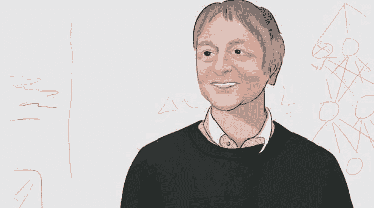
上世纪八十年代初，Hinton首次提出了最具代表性的深度学习模型——多层感知器，而让该模型“学会”的手段是当时被认为最适合训练神经网络的反向传播算法。通俗类比，可视为反复核对错题的过程：从失分点追溯原因，反推修正思路，逐步形成满分解题法。

然而，这个看似拥有深度的多层感知器并未带来预期的智能提升，反而暴露出反向传播在训练深层网络时的缺陷。部分研究者将原因归结于网络结构本身的设计不足，转而投向更依赖人工归纳知识与简单数据挖掘的机器学习方向。

这种模仿人脑深层神经连接的模型，需要更合理的结构设计与更有效的权重学习方法，才能证明其对人脑的模仿是构建人工智能不可或缺的一环。站在今天，很难想象ChatGPT、Stable Diffusion与DALL-E 2等前沿产品背后的神经网络是如何一步步演化成今日庞大形态的。为更客观认识AIGC浪潮，有必要追溯神经网络的起源与发展脉络。

#### （一）模仿人脑的设计

上世纪40年代，美国神经生理学家沃伦·麦卡洛克与数学家沃尔特·皮茨首次在机器语言上设计了模仿生物神经元的M-P模型 [5]（图1-2）。

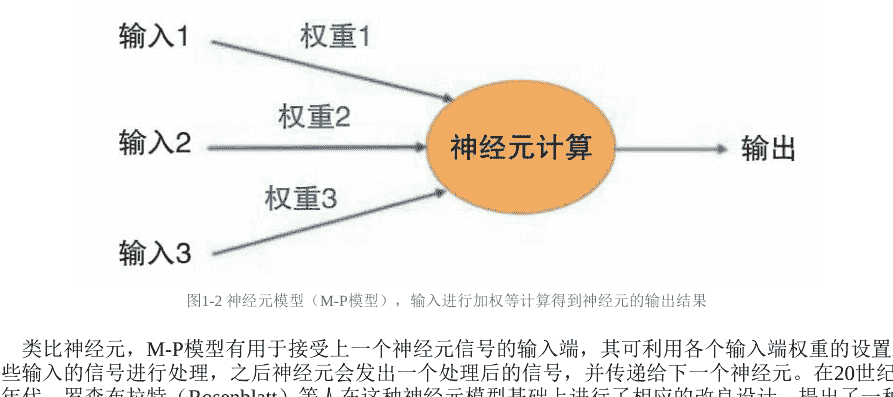
类比神经元，M-P模型拥有接收上层信号的输入端，可根据各输入权重进行处理，再发出处理后的信号传递给下一层。上世纪50年代，罗森布拉特等人在此基础上改进，提出可通过训练确定神经元连接权重的感知器 [6]，这是人工神经网络的雏形。因理论基础不完善，1969年马文·明斯基指出感知器无法解决“线性不可分”这一致命问题 [7]，感知器遭遇了第一次滑铁卢。

尽管研究长期低迷，仍有研究者坚持不懈。Hinton曾说：“要了解像大脑这样复杂的设备，你必须自己造一个。”这让研究者坚信模仿人脑神经网络是通往人工智能的必由之路（图1-3）。为实现这一理想，无数科学家摸索前行，1974年保罗·韦伯斯发明反向传播算法 [8]并提出用于人工神经网络的可能性；1980年Hinton设计多层感知器模型，成为深度神经网络雏形；1983年物理学家霍普菲尔德首次用神经网络求解旅行商问题，并在算法竞赛中击败传统方法，取得最佳成绩。

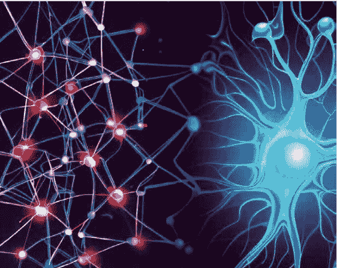
直到1986年，大卫·鲁梅尔哈特与Hinton等人在反复实验后完整描述了反向传播算法训练神经网络的过程 [9]，解决了明斯基指出的线性不可分问题，神经网络才重新回到主流视野。至此，明斯基长期压制神经网络的消极论断，如同生锈的锁，在先行者的冲击下轰然碎裂。

此后是数十年的技术积累。2006年Hinton等发表有关深度学习的论文 [10]，人工智能正式进入深度神经网络时代。该文推翻了学界对深度神经网络的质疑，形成了广为流传的深度学习定义，并在当时的数据挖掘与识别任务上取得惊人效果，开启了AI全新篇章。

#### （二）AlphaGo闯入了人类世界

进入21世纪，深度学习虽活跃于学术圈，却鲜为人知。部分研究者开始将其拓展到具体应用。2009年起微软亚洲研究院与Hinton合作，2011年推出基于深度学习的语音识别系统，其识别精度颠覆了传统框架。2012年，Hinton及其学生在杨·立昆1989年提出的卷积神经网络 [11]基础上，用深度学习搭建深度卷积神经网络 [12]，让网络在无人工经验辅助下自动学习图像信息并分类，大幅推动了图像识别发展，吸引了谷歌、微软、百度、腾讯、阿里巴巴等企业入场。

但研究者并不满足于语言与视觉的突破，目光转向围棋这一博弈智慧的结晶。围棋棋盘19×19，落子点达361处，整体可能性高达10的171次方，几乎无法穷尽。

2014年谷歌启动AlphaGo计划。初代AlphaGo横扫包括Crazy Stone、Zen在内的人工围棋程序。2015年AlphaGo首次击败职业棋手樊麾，次年以4:1战胜职业九段李世石，引发轰动（图1-4）。

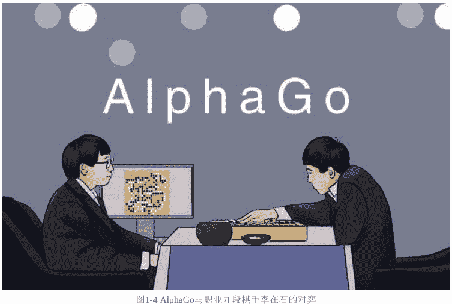
图1-4 AlphaGo与职业九段棋手李世石的对弈

当人们以为人机仍有来回之时，网络棋手“大师”在对战平台上全胜中日韩高手，成为真正的“大师”。这位“大师”正是新版AlphaGo的化身，其学习速度超乎想象，并在2017年乌镇围棋峰会上击败世界第一柯洁。这是深度学习首次在某个领域完全超越人类，人们意识到人工智能已真实闯入人类世界。

#### （三）AI润物细无声

具有自我学习能力的深度学习在全球掀起研究与投资热潮。既然能胜任围棋这类复杂决策，基于该理论的学习体系是否可广泛应用于各行业决策场景？2017年的井喷已给出答案。

在无人驾驶领域，2017年7月百度开源自动驾驶系统Apollo，让无人驾驶概念进入大众视野（图1-5）。同年底，北京交通委印发中国首份自动驾驶车管理规范《北京市关于加快推进自动驾驶车辆道路测试有关工作的指导意见（试行）》。在人脸识别领域，苹果2017年9月推出手机人脸解锁，基于深度神经网络的高准确率令人惊讶，各手机厂商纷纷跟进。同年10月，机器人“索菲亚”获沙特授予公民身份，阿里巴巴投入千亿成立达摩院，专注以人工智能为主的科学研究。

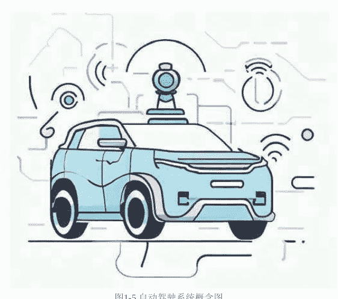
图1-5 自动驾驶系统概念图

此后人工智能逐渐融入日常生活：高铁和重要场所的身份核验从人工转为人脸识别；家居清洁从扫帚拖把变为扫地机器人；社交媒体推送感兴趣内容；天猫精灵、小度等语音助手响应指令；摄影摄像设备能精准捕捉人物动作。尽管有科学家警告AI发展可能带来失控灾难，但人工智能正以不可阻挡之势推动社会迈向智能化。深度学习初露锋芒后，AI几乎无处不在。

### 二、生成式人工智能的秣马厉兵

深度学习大致可分为判别式与生成式两大方向（图1-6）。

判别式类似人类决策，如判断“这只羊是山羊还是绵羊”或“对战柯洁时下一步如何落子”。生成式则更开放，如写段文字、唱首歌、画幅画等。前者代表人类客观理性的判断，后者体现主观感性的创造，二者相辅相成。AlphaGo诞生至2020年，AI狂潮历经六年趋于理性，部分原因在于判别式成果占据应用市场较大份额，而生成式人工智能的效果尚未达到人类预期。

在人类眼中，AI似乎只是更精准的裁判，缺乏人们对“智能”感性层面的期待。部分专家认为当时的AI仅是更准确的判断工具，而非真正的人工智能。

#### （一）生成式赋予了创造力

起初，生成式AI只是为了更好理解数据从而还原数据本身。后来有人提出：如果我们知道了数据如何生成，能否据此创造从未出现过的数据？比如已知如何画小熊猫、如何画粉红色毛发，就能用AIGC画出一只粉红色小熊猫（图1-7）？这类设想为赋予AI创造力提供了思路。人们常说“读书破万卷，下笔如有神”，这既是生成式AI的内在机理，也是人类创造力的来源。

图1-7 由DALL-E 2生成的一只粉红色的小熊猫

这一思路极具创造性，也极具挑战性。早期AIGC围绕图像生成展开探索，包括马尔科夫链生成模型、变分自编码器与生成对抗网络GAN。虽然生成质量不断提升，但仍达不到原始数据水准，部分研究者归因于模型参数量过小。参数量过小、网络不够庞大，就像人因神经元受损而智力衰退。语言生成也面临同样困境。因此，微软、谷歌、脸书、华为、阿里巴巴、百度等具备算力条件的团队开始搭建大规模模型。

大量实验表明扩大模型参数确实能显著提升性能，其中2018年谷歌发布的BERT模型 [13]与OpenAI的GPT系列 [14][15][16]最为突出。这让人认识到，从理论到实践的转化离不开算力突破，要达到人类认知水平的创造力甚至超越人类，仅凭AlphaGo时代的算力是不够的。

#### （二）算力与算法的赛跑

“工欲善其事，必先利其器”，深度学习依赖的利器是图形处理器GPU。电脑常借助该芯片展现画面，被广泛用于个人电脑、工作站、游戏机等系统中的图像或图形计算。由于GPU的并行计算方式非常适配深度学习，几乎所有主流深度学习模型都在适配其计算量的GPU上运行，GPU性能在一定程度上决定了AI计算能力。

自1999年英伟达推出首款支持顶点与像素着色器的GPU GeForce 256以来，大规模显卡并行计算成为可能。此后二十多年，深度学习取得一系列突破，显卡技术紧随其后。英伟达不断推出更强GPU与计算平台，如CUDA编程模型、Tesla K40及Ampere架构显卡等。超威半导体也推出ROCm架构，加速深度学习训练。这些硬件进展为深度学习任务提供了强力计算支撑。

与此同时，算法也在不断演进，包括深度信念网络、卷积神经网络与生成对抗网络等。在GPU加速下，训练速度显著加快、性能大幅提升，在计算机视觉与自然语言处理领域取得突破性成果。预训练模型如BERT与GPT系列在NLP任务上表现突出，但也需极大计算资源，GPU在此过程中发挥关键作用。

#### （三）最后一块拼图：大数据

深度学习是一种极度依赖数据的技术，它通过学习提炼数据中的知识，有针对性地解决设定任务。面对日益复杂庞大的算法与网络结构，如何获取、筛选、整理与加工数据，成为实现性能突破的“最后一块拼图”。

互联网高速扩张的背景下，社交媒体早已融入生活日常。用户在各类平台上发布生活、工作、兴趣相关的内容，汇聚成庞大信息流。社交媒体承载的数据类型极为丰富，既有用户主动产生的动态、评论、私信等内容，也有平台被动生成的用户画像、行为轨迹、推荐记录等，其形态覆盖文字、图像、音频、视频，映射出人类行为和社会图景。不断累积的数据，堪称人工智能认知世界最直接、最珍贵的原材料。为了打造专属于AI学习的大规模“教科书”，掌握海量网络数据的搜索引擎巨头如谷歌、微软、百度，依托自身平台优势，搭建起涵盖检索记录、对话语料、图像标注等的高质量数据集。脸书、字节跳动等新锐社交媒体公司，则将用户原创内容、互动行为、偏好数据、社交关系等整理归纳，形成包含文本、图像、音频、视频在内的多模态数据宝藏。与此同时，跨国企业与政府机构也在推进数据共享与跨界协作，不断为AI扩充学习素材。

在此过程中，各组织持续升级数据加工手段，涵盖清洗、特征抽取、标注等环节，以保证数据质量适配模型训练诉求。借助强化学习与深度学习等技术对原始数据进行预处理，提升训练效率与优化效果。这些海量“教材”为AI提供了前所未有的学习养分，推动其在自然语言处理、计算机视觉、推荐系统等方向实现突破。

算法、算力、数据构成AI的“三驾马车”，三者相互驱动、彼此强化，正把人工智能推向全新版图（图1-8）。

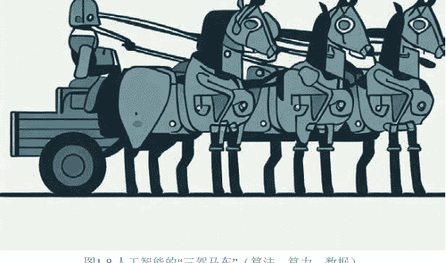

图1-8 人工智能的“三驾马车”（算法、算力、数据）

### 三、智能的临界点
2022年11月，OpenAI发布了AI对话程序ChatGPT。最初很多人把其归为AI小冰、Siri这类聊天工具——这类产品只是简单筛选网络数据后给出模板化回复，交流生硬、常答非所问、难以处理复杂问题，正是AlphaGo之后AI热度回落的原因之一。

很快使用者发现，它并非普通聊天机器人。无论是口语化、规范化还是含蓄暗示的提问，它都能准确把握意图，并以流畅自然的语言作答。《纽约时报》评价其为“公众迄今见过最好的AI聊天机器人”。AIGC话题随之再度升温。

#### （一）ChatGPT引爆AI新浪潮
从2022年11月上线到2023年1月，ChatGPT用两个月时间吸纳一亿用户，体量与影响力令人震惊。虽然实践中仍暴露出问题——对非英语语言理解偏弱、偶尔为凑答案编造事实——但瑕疵难掩其亮点。随着使用深入，其回答的真实感近乎后台人工一对一服务。它能模仿人类撰写文章、作诗填词、角色扮演、编写调试代码，几乎所有常见的AI测验它都能游刃有余。

人们第一次真切感受到AI强大到如此程度。工程师、学生、教师、艺术家等各界人士纷纷涌入，社会反响极大。2017年AlphaGo为代表的应用仍属判别式AI，有人甚至不屑称其为智能，因其只是机械反馈，缺乏人类核心的主观性与感性。围棋有明确输赢，而日常对话、写作、绘画等充满主观情感的领域曾被认为AI无法触及。ChatGPT等AIGC虽仍无法自主产生与人类相似的主观感性认知，却能在一定程度上体现出对人类奇思妙想、情感意境与语言表达的理解。当用户把想法交给AIGC，就能获得契合心意的作品与产品时，这样的AI是否已更接近人类？

#### （二）AI绘画冲击艺术创作
实际上在ChatGPT席卷全球前，AIGC已有搅动艺术圈的爆款——2022年开源的AI绘画项目Stable Diffusion。若AlphaGo是对人类智力博弈的猛击，Stable Diffusion则让艺术创作者大吃一惊。它源自2020年提出的去噪扩散概率模型DDPM[17]的改进方案，核心功能是根据提示词与文本描述生成对应图像。作品精致、主题准确，发布后数日内便涌现大量匪夷所思之作。输入一段“咒语”即可得画，体验堪比魔法。

文图生成能力早有雏形。DALL-E能准确将文字描述转化为图像，即便描绘现实不存在之物，如“一把牛油果造型的椅子”（图1-9）。这种惊艳表现源于海量模型参数与巨量数据支撑。OpenAI主导的DALL-E因技术封闭难以复现，未获广泛关注，却为文本生成视觉的AIGC路线打开大门。同年11月，北京大学与微软亚洲研究院联合发布的“女娲”模型[19]，在国内点燃了AIGC研究热情。

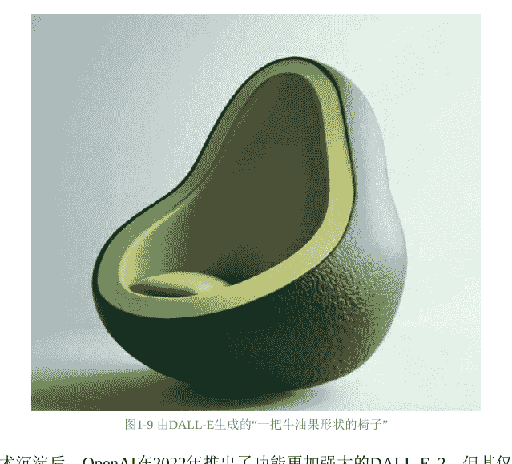

历经一年积累，OpenAI于2022年推出功能更强的DALL-E 2，仅提供线上使用接口，不开源模型。相较初代，其对提示词与文本描述的理解显著提升，生成图像更精准细腻。出于类似保密考量，谷歌2022年5月以论文形式披露了文图生成模型Image，依赖巨量算力与数据，让业界担心该领域或被AI巨头垄断。直至2022年8月，Stable Diffusion的发布打破封锁，不仅性能媲美当时主流方案，还将全部技术细节与训练完成模型完全公开。AI图像生成的门槛瞬间大幅下降，众多开发者与研究者蜂拥在其基础上展开探索。

开源的力量极其巨大。拥有高端商用显卡的个人便可在本地部署该技术。研究范式迅速从少数AI巨头扩散至全民参与的AI绘画热潮，进步一日千里。2023年初，基于Stable Diffusion的ControlNet问世，提升了文图生成的灵活度与可编辑性，让使用者真正实现随心作画。此举随即引发大量美工与画师的不满与抗议，部分从业者担忧该技术或将取代其工作。

文字生成图像的范式迅速延伸至视频、3D建模、音乐等领域。自2023年3月起，Gen2、虚幻引擎5的视频转建模方案、Paranormal Studio的视频编辑技术等相继问世，各自领域均取得前所未有进展。AIGC犹如积压已久的火山，在ChatGPT与Stable Diffusion的点燃下彻底喷发。

#### （三）认知本质 合理使用
AIGC的广泛出现激发了社会热议。智能化水平的大幅跃升与对部分人类工作的可替代性，使人们感受到其背后潜藏的难以掌控风险。

ChatGPT团队视AIGC为通用人工智能的起点，有观点认为其“智能”仅是数据与任务驱动之下的分析结果，并非真正智慧；也有观点认为AI已超越人类。在信息爆炸时代，要看清AIGC的定位与走势，理解其技术原理与运行逻辑至关重要。

AIGC的本质是通过已训练模型对输入进行预测与生成。用户提供文本、问题或图像等输入，模型依托所学知识产出对应结果。过程可能是在既有上下文中挑选最合适的词句，也可能是基于输入创造全新段落。在这一简明逻辑下，从输入到输出、从训练到推理、从高维数据到知识表征，都是AIGC研究的关键环节。关于其局限性的讨论也不少，例如AIGC能力受制于训练数据的质量与规模，若数据存在偏见或错误，模型输出也可能带偏见或不准。这种限制源于当前AI技术原理与运行方式，是客观存在的，类似局限尚多。

总体而言，AIGC源自数十年研究积累，深入理解其原理需要相应的机器学习基础，对非计算机专业用户而言门槛不低。前面已简要科普了AIGC乃至主流AI的基础——深度学习。后续章节将在此基础上，进一步解析AI如何习得知识、AIGC如何生成视觉作品、如何合成语音与对话文本。只有客观认知其内在机制，才能真正掌握技术、善用利器。

## 第二章 为AI打造学习体系
### 一、模仿人类感知与理解
AI要理解信息，先得学会感知信息。人类主要靠看和听来获取信息，对应到AI的学习路径就是“观察”事物与“阅读”信息。相关研究经历了符号主义、连接主义、统计学习到深度学习等多个阶段，涉及大量技术与模型。下面聚焦深度学习中提升AI观察与阅读能力的核心技术做简要科普。

#### （一）AI的“眼睛”——卷积神经网络
AI观察世界依赖一双“眼睛”——卷积神经网络CNN。这类特殊神经网络的灵感源于20世纪60年代神经科学家大卫·休伯尔和托斯坦·维厄瑟尔的研究。他们观察到大脑视觉系统中，视网膜神经元对不同视觉特征如边缘、线条有不同反应，可视为对特定特征的“滤波器”。

20世纪80年代，法国计算机科学家LeCun将这一思路引入图像识别，设计出LeNet[11]架构，并成功用于手写数字识别。但受限于当时算力，CNN未能大规模应用。

硬件性能提升后，CNN在21世纪初迎来爆发。2012年，Alex Krizhevsky等提出的AlexNet[12]在大型图像分类竞赛中大幅降低错误率约10个百分点，奠定CNN在图像识别的地位。其优势在于能自动从数据中学习特征，减少人工特征工程。典型流程包括卷积、激活、池化、全连接等操作。

卷积是CNN的核心手段，用于视觉特征提取。本质是对输入数据做滤波，提取特征。滤波核作用于输入，生成卷积特征图（图2-1）。

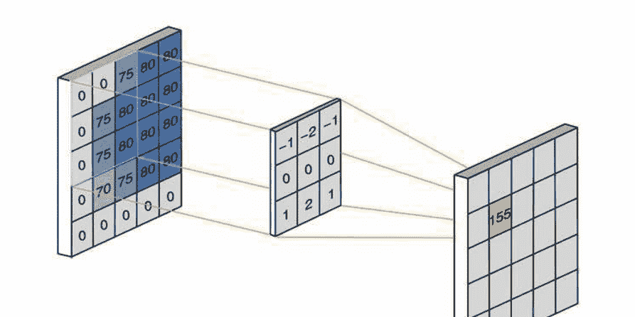

图2-1 输入的数据经过卷积滤波得到卷积特征图

在卷积过程中，卷积核在输入上滑动逐点计算，生成特征图，这些图作为前层输出传递给后层。由于原始特征信号对下一层过于复杂，通常借助激活函数进行简化。如最简单的ReLU，会把小于0的值置零，大于等于0的值保留，确保传递给下一层的信号非负。另有Sigmoid、Tanh、Leaky ReLU等多种激活函数，此处不展开。

池化层主要用于降维与抑制过拟合。常见做法有平均池化与最大池化，窗口在特征图上滑动，输出窗口内均值或最大值（图2-2）。

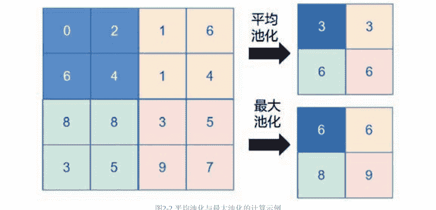

图2-2 平均池化与最大池化的计算示例

全连接层把卷积与池化后的特征图展平成一维向量，供网络进行分类、回归等任务。

CNN逐层提取特征，由浅入深。浅层捕捉边缘、角点等基础特征，深层逐步形成纹理、形状等高层表征，最终输入决策层进行图像识别判断。这便是AI对图像影像最基础的“观察”，并将其转化为视觉信息。

#### （二）AI的“阅读器”——自然语言处理
人类文明传承靠语言文字，AI阅读信息也离不开语言学习，这正是自然语言处理NLP。NLP可追溯至20世纪50年代，从早期语法解析发展到涵盖情感分析、机器翻译、问答系统等语义理解与生成的综合学科，已成为AI核心方向。其技术流程与人类学语言相似，需从词、句到段层层递进，人类充当老师逐步传授。

学古文或外语，第一步都是先弄清句子由哪些词构成，这就是分词，即把文本切分为词或词组。英文可用空格标点切分，中文则需专用分词技术。以“今天是重阳节，我们一起去爬山吧！”为例，常用正向最大匹配法，先建一本含已知词汇的词典。按左至右匹配最长词，先尝试3字匹配，“今天是”不构成词，降为2字匹配到“今天”，记为词1；随后从“是重阳”起继续尝试，3字不符降为2字，“是重”仍不符，再降为1字匹配到“是”，记为词2；接着循环3字匹配，得到“重阳节”，记为词3。如此切分，句子变为“今天/是/重阳节，/我们/一起/去/爬山/吧！” 共10个词，每个词对应词典中的向量表示。此过程即token化。正向最大匹配法最简常见，另有逆向最大匹配、双向最大匹配等。

分词效果高度依赖“词典”。在深度学习中，这类词典被称为词嵌入word embedding，常见模型有Word2Vec[20]、GloVe[21]、FastText[22]等。它们把每个词映射为向量，向量间距离与语义距离相近，从而可在向量层面表示和捕捉语义。

分词后，AI需理解词组合的含义，即语义抽取。语义常受场景与任务影响，如“没有意思”可指“无具体内容”，也可指“不感兴趣”，需结合上下文判断。

当前主流语言模型多基于Transformer[23]，2017年由谷歌提出，是BERT、GPT、CLIP等模型的基础，具有并行计算、训练高效、捕捉长距离依赖等优势。

Transformer核心是自注意力机制self-attention，可对序列中所有元素加权计算，使网络聚焦关键信息。在NLP中，它能学习词间关系并按上下文重要性加权，获得更好文本表征。模型由编码器encoder与解码器decoder构成，编码器负责输入编码，解码器负责生成目标语言如翻译。两者均含多层Transformer结构，每层由多头自注意力与全连接前馈网络组成。

多头自注意力中，输入序列会进行多次自注意力计算，每次使用不同的查询、键、值矩阵，学习多样化特征表示。该机制可捕捉序列元素间的依赖关系，能自动学习语义与上下文，并支持并行高效训练。

综合来看，AI阅读人类语言大致经历“建词典—分词—语义抽取”三步。

#### （三）AI如何学习知识
人类从出生起便持续学习，AI亦然。除了神经网络结构，还需了解这些结构通过何种方式习得观察与阅读能力，即AI学习的机制。

当前AI多属任务与数据驱动的狭义人工智能narrow AI。对任一神经网络，数据作为输入，任务以数学函数形式设定为目标，网络通过不断迭代更新神经元间连接权重，使输入经处理后输出期望结果。无论结构偏向视觉或语言，数据量大小，任务难易，AI学习本质都是数学函数参数优化过程。这一参数优化方法正是深度学习AI的根基，也是知识在网络中构建的基础原理。

生理结构相同的人因接触知识与任务不同而呈现差异化知识储备与思维逻辑，AI亦同。为了让AI在统一学习机制下仍能展现强大表达，研究者除设计网络结构与构建数据集外，还进行类似教育学的任务规划研究，即为AI设定学习任务。

从此，每个训练神经网络的研究者都成了AI的老师，AI能否学有所成，取决于老师们的设计巧思。

### 二、逐步传授技能

AI到底怎么学？从老师视角看懂监督到自监督

先认识一位特别负责的班主任。他喜欢把知识点掰碎了教，手把手带着走，于是学生们给这位老师起了个外号——“有监督”。他的教学套路其实只有三件大事：先备足材料让学生看得见摸得着，再逼学生理解原理而不是死记硬背，最后根据实际需要安排有奖有罚的测验。

#### （一）“老师”监督下的学习

设想一间课堂，“有监督”老师要带一群懵懂的AI孩子认识大自然里的动物（图2-3）。

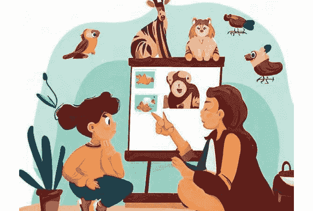
上课前老师要备课，准备成百上千张动物卡片，每张写上对应的名字。他担心孩子们不懂名字的含义，就把100种动物统一编号成1到100，让孩子先看图找编号，再由编号对应名字，这是最直观的入门路径。老师不会让所有卡片都露面，他挑大头做“训练集”，留小部分做课堂检验，这就是“测试集”。

上课时老师说：“先别翻，先听指令。我们每次只抽一小撮。” 他把一批卡片打包成一个“Batch”，这一轮先定为64张。老师一声令下，AI孩子从训练集中随机抽出64张开始记。孩子记住这64张的模样，虽然分不清编号相同和不同的深层含义，但它会调动自己的神经网络去找一条能把这些卡片分得最准的规则，甚至把看过的形状硬背下来。

反复翻阅几轮后，孩子信心满满：“随手抽一张我都能报出编号和名字，我学会了！” 老师于是拿出从未见过的测试集，让孩子给这些新卡片贴编号。测试集的类别和训练集一致。孩子只能靠对训练集的记忆，把相似的卡片归为一类，却频繁出错，比如把猫认成狗、把鸡认成鸭。训练集上它表现很好，测试集上却掉链子，这让老师意识到需要下一轮的矫正。

#### （二）记住答案还是记住方法

复盘训练和测试的细节后，老师发现孩子用的办法有问题。理想情况下，对两类卡片的区分应该学到本质差异，画出一道在允许误差内能把两类分开的“准线”。可孩子的做法是把每张卡片的细枝末节全记下来，勾出一条极其曲折的线，把训练集里的点全部圈住（图2-4）。这条线在训练集上准确率很高，一旦测试集的点落在曲线的附近，判断就岌岌可危。老师叹道：“你只背了答案，没学到方法！” 这种情况被叫做“过拟合”。

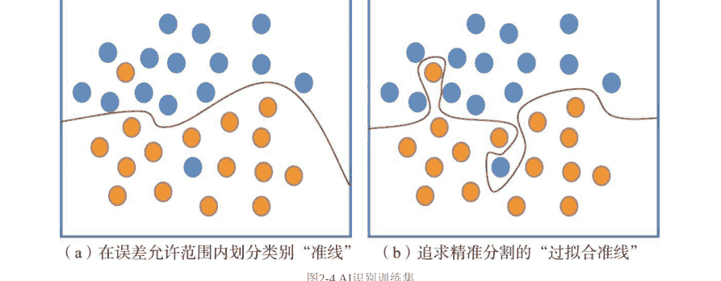
第二天老师换了两步策略。

第一步是扩充教材。老师给训练集做数据增强，对已有卡片进行水平翻转、旋转、缩放、加噪等处理。这样样本量变大、变化更丰富，孩子学到的模式更稳，也能缓解过度记忆。

第二步是给神经网络加约束。老师设计了一种叫正则化的方法，在优化目标里加入正则项，让网络里各连接的权重趋向更小，避免过度依赖少数神经元而只会背题。还有一种Dropout技巧，训练时随机把部分神经元的输出关掉，强迫网络不依赖单一特征，共同承担任务，从而降低过拟合风险（图2-5）。

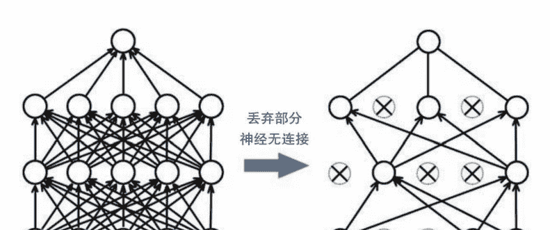
几轮调整后，AI孩子在测试集上的识别准确度明显提升了。

#### （三）奖励与惩罚

课后，另一位“强化学习”老师带着孩子去操场玩迷宫。这位老师从不直接给攻略，而是根据每一步对最终通关的影响来给奖励或惩罚，让孩子在追求更高奖励的过程中自己摸索最优路线（图2-6）。

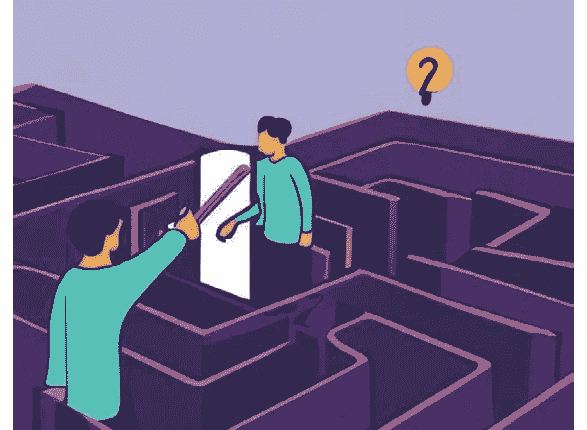
迷宫规则很简单：

- （1）孩子在迷宫里的位置叫“状态”，可选择左、右、前、后四个方向移动，遇到墙就不能走。
- （2）迷宫是“环境”，只有老师知道全貌。老师观察状态和移动方向，判断是否有利于通关，给奖励或惩罚。
- （3）可以反复闯关，把经验累积起来，最终在不看地图的情况下走出最短路径。

刚进迷宫，孩子的选择几乎是随机的，错误频出，惩罚远大于奖励。第二次再来，孩子会参考上一次的奖励惩罚记录做决策。偶尔走对一步也不代表后面一直对，一次失误就可能绕远。但在持续试错、不断用深度网络评价“当前状态+动作”的价值后，孩子逐渐学会了怎么走。经过多次迭代，它终于能以最快路径冲出迷宫，收获最多奖励。

### 三、让AI学会自主学习

为了培养孩子抓关键信息的本领，老师们开始设计不需要大量标注的任务，既省成本，又能让学习不被标签限制。

#### （一）“无监督”的图书馆书籍分类

图书管理员“无监督”老师给孩子布置了一个任务：去图书馆做管理员，把成千上万本没有标签的书按主题归位。孩子只能靠书名和摘要自己找规律，把相似的书放到同一书架。

刚拿到任务，孩子先观察封面、标题和内容，发现历史类、烹饪类、科学类等相似群，再给它们贴上临时主题标签。随着阅读深入，它还拆出子主题，比如秦朝史、唐朝史等，分类越来越细。

整个过程孩子并不知道正确答案，全凭观察特征自行聚类，这就是无监督学习。深度网络接收未标记数据，通过降维把冗长的书名提炼成关键词，再把关键词相近的书籍归为一类，也就是聚类。即使某些书横跨多个主题，比如“古代广东的烹饪”同时涉及历史、烹饪、地理，孩子也会根据主要内容决定归属，或新建“地域烹饪”类来容纳。难以归类的边界样本，靠调整聚类参数或新增类别来解决。

#### （二）“自监督”的拼图游戏

学校新来了“自监督”老师。他既保留有监督的训练方式，又借鉴无监督不依赖人工标注的思想，创造了一种玩法：把数据自己撕碎，并给碎片打上位置、角度、关联关系等自生成标签，再用有监督的方式训练网络。

用拼图来理解更直观。想象上千块碎片散落，目标是还原整张图。拼图本质是为每块碎片找回它在原图中的坐标，坐标不是人为标注的，而是数据自带的。靠形状、颜色等特征预测相邻关系，就能定位并拼接。

AI孩子先用深度网络抽取每块碎片的形状、颜色、纹理特征，然后比较相似度，尝试凑对。凑对后若整体不对，就推倒重来，网络在不断修正中学会更有用的表征。久而久之，它能自动判断“狗的左耳该在狗头的左上方”“屋檐应在墙体上方”，这些知识无需手把手教，是从拼图这个自监督任务里自己悟出来的。

#### （三）“教育家们”的探索

从以上例子可见，任务设计直接决定AI能学到什么。AI在迎合各种任务的过程中不断优化自己的网络，形成对特定任务的专家能力。图像分类、文本生成、语音识别、推荐系统等，都是不同专精方向。

AI掌握的知识广度和深度，被网络计算能力以及教育家提供的任务框架共同制约。随着任务越来越复杂，网络设计也随之向大参数量演进。2013年AlexNet出现，2018年BERT问世，正是这一趋势的体现。除监督、无监督、自监督外，还有零样本学习、多任务学习等更“刁钻”的任务，它们推动了深度网络的发展，也是AIGC大模型兴起的根源。

AIGC背后的智能涌现，本质是大模型在数据上的知识提取精度达到阈值。随着训练任务复杂化，“专家”模型的知识覆盖面不断扩张。也有研究者尝试构建大一统模型来承载多种任务，这正是AI教育家们持续探索的方向。在现有框架下，难以指望一个模型像人类那样独立思考并完成所有任务。

### 第三章 栩栩如生的AIGC作品

### 一、图像是怎样由AI“炼”成的？

#### （一）计算机眼中的图像及其生成

图片是我们日常沟通的重要载体。发朋友圈、画画、拍照，都在用图像表达信息。可计算机看图的方式和人完全不同，它只能看到像素值这组数据。有了AI，计算机才开始读懂这些数据背后的意义，并据此学习进化。过去十几年里，感知算法不断改进，如今在ImageNet这类大规模物体识别任务上，AI准确率已突破90%，部分场景甚至超过人类。

在学会“看”之后，我们可以让它“画”。生成模型能根据已有数据模拟出新数据。比如给你很多只猫的照片，让它画出一只从未见过的猫，而不是简单复制，这就是生成任务。

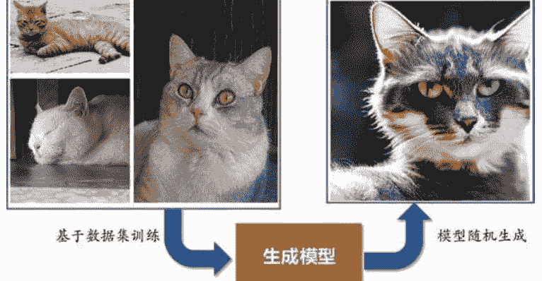
生成模型学习的是数据的概率分布，知道什么样的组合更合理、什么样的组合更不可能。比如猫的眼睛多为圆形、耳朵多为三角形、毛色多种多样，这些规律会被模型内化。它不会照搬，而是基于规律加入变化，画出颜色奇特的猫、长翅膀的猫、穿衣服的猫等新样本。

生成模型家族很多，VAE、生成对抗网络、去噪扩散概率模型DDPM各有优劣，都是用神经网络搭建复杂的非线性映射，产出高质量多样化的图像。后面会分别展开。

#### （二）变分自编码器：随机变量的魔法

VAE是较早的生成模型之一。它能从已有数据特征学习，并创造从未见过的新样本。比如人脸图像，VAE可以学到颜色、形状、表情等隐变量，这些隐变量更贴近语义，而不是像素点本身。用512×512×3的RGB像素表示一张图需要几十万维，而VAE能把它压缩到约1024维的高层语义空间，这正是生成出现“智能”的关键。

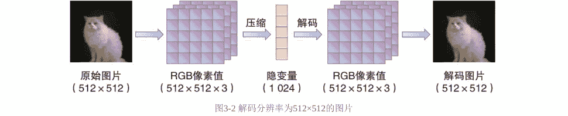
VAE由编码器和解码器组成。编码器把原始数据映射到隐变量空间，解码器把隐变量再还原成原始数据。两者都是神经网络，通过训练调整参数，让重构结果尽可能接近原图，就像日常的数据压缩。

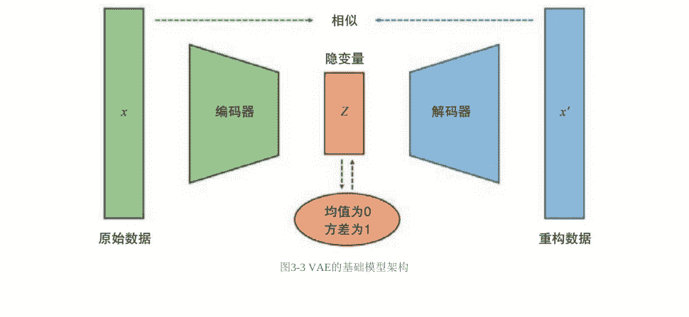
单纯重构只能复现见过的东西。VAE的巧妙在于，它不把隐变量当成固定值，而是当成一个分布区间。对同一张数据，对应的隐变量有多种可能。从这个区间里随机采样，再经解码器生成，就能产出全新的样本，而不是机械记忆。于是，VAE实现了真正的创造性生成。

VAE如何把高维图像压缩成可控特征

VAE用一种很巧妙的概率压缩思路，把一张高维的图片映射到一个有范围限制的隐空间。比如人脸，每一个隐维度都能对应到脸部的某种属性，于是不同的人脸就可以被编码成各自落在一个特定区间里的隐向量。这个区间被建模成正态分布 [1]，只需要两个参数就能描述：中心位置即均值，取值幅度即方差。均值代表最可能的隐值，方差代表不确定性。编码器用神经网络去拟合这两个参数，再从这个分布里随机采样得到特征向量。随机采样带来的多样性让模型不只是记忆训练样本，也能创造新样本。在工程实践里，隐分布通常被归一到均值0方差1的标准正态分布 [2]。

训练时VAE在拉扯两个目标。重构目标要求尽可能还原原始图像，规范目标要求编码后的隐变量尽可能靠近标准正态。重构误差越小，说明还原能力越强；规范误差越小，说明对特征范围的控制越好。编码器和解码器在这两个误差的指引下不断调整参数，生成质量随之提升。

总体看，VAE是一种从已有数据学习生成新数据的概率建模方法，它显式地用标准正态分布来刻画图像特征。但它有两个明显短板：一是生成结果偏模糊缺细节。因为模型用简单的分布去近似真实的复杂分布，细节信息会被平滑掉。人脸生成时皱纹、胡须等细微纹理容易丢失，只剩下轮廓和色块。二是生成结果同质化严重。因为隐变量被强行拉向标准正态，不同人脸的区分度下降，模型倾向于输出“平均脸”。后来的生成方法正是围绕这两个问题展开改进，其中对抗生成网络在清晰度上取得了较大突破。

#### （三）生成对抗网络：对抗博弈中的真伪较量

生成对抗网络是另一个家喻户晓的生成范式。图灵奖得主LeCun曾指出，GAN是近几年机器学习里最有意思的想法。

GAN的核心是两套神经网络互相较量：生成器负责造假，判别器负责验真。生成器努力做出逼真的图片，判别器努力分辨真图与假图。随着博弈进行，生成器越来越像真实数据分布，判别器越来越难区分。

可以把这个过程想象成造假与鉴定的游戏。造假师一开始只能做出粗糙的假钞，容易被识破；鉴定师靠颜色、纹路、水印等特征判断真伪。双方不断学习、互相逼迫，造假技术上升，鉴定能力也随之提高。最终造假师能做出以假乱真的钞票，鉴定师也难以辨别。造假师对应生成器，鉴定师对应判别器。

训练时，先像VAE一样采样随机噪声，通过生成器转成图像；再从真实集抽取图像与生成图像混合，打上1为真0为假的标签输入判别器，计算输出概率与标签的误差指导判别器学习。一轮训练里生成器输出图像，判别器给出真假概率。两者交替更新，生成器追求让判别器判不出来，判别器追求分得更准。循环往复直至达到平衡，生成器能产出以假乱真的样本。

对比VAE，GAN的明显优势是清晰度更高。判别器学到了真实数据中哪些特征重要、哪些细节必要，并把这些信号反馈给生成器，使其更好地模仿真实分布和质量。

代价是训练极不稳定。生成器与判别器目标相反，必须保持动态平衡。任何一方过强都会破坏平衡，导致模式崩溃，即生成器只能输出少数几种模式，比如只能生成几张固定的人脸，无法覆盖真实多样性。正是这种不稳定性，使得GAN难以简单靠堆参数和数据扩建成通用大模型，应用往往局限在人脸、风景等特定领域。为此，扩散模型应运而生，在一定程度上缓解了训练不稳定问题，并把模型规模推向新高度。

#### （四）扩散模型：从噪声中还原图像

扩散模型与VAE、GAN一样，都能依据已有数据生成相似的新数据。2021年前，图像生成基本被GAN主导。GAN虽能产出高质图像，并催生出Deepfake等应用，但对抗训练的不稳定让它难以通用，通常只能为不同数据分别训练专门模型。

为稳定GAN，出现了不少改进方案，效果有限。这时OpenAI提出并大幅推进了扩散模型，其性能可与GAN匹敌，并被放大到前所未有的规模，诞生了引爆AIGC的DALL·E 2，也成为Midjourney等主流AI绘图工具的底层技术。

基本原理是先让数据逐渐变模糊变混乱直至变成无意义噪声，再把噪声逐步变清晰变有意义直至还原数据。过程中模型学习数据的规律与特征，从而生成新样本。可拆成前向和逆向两步。

前向过程是加噪。挑一张猫的照片，先加少量点状噪声，清晰度下降；重复加噪，照片越来越模糊，最终只剩杂色，信息完全消失。

逆向过程是去噪。从一堆杂色出发，模型像侦探一样依据隐藏线索逐步恢复。先去掉部分噪声让杂色出现形状轮廓，再继续去噪让细节逐渐显现，最后得到一张新猫图。整体风格与原图相似，但毛色、眼神、表情等会有细微差异。

训练本质是让神经网络学会把模糊图还原成清晰图。给训练图加噪使其模糊，让网络预测原图并去除多余噪声。预测准就奖励，偏离就惩罚，反复在不同噪声强度下练习，直到网络能从任意模糊输入恢复清晰图像。

扩散模型崛起有两大原因。一是高质量图像文本对数据的积累，数据规模与质量直接决定生成水平。二是可规模化的架构。把数据比作知识，架构决定大脑容量。VAE和GAN的容量有限，只能覆盖有限范围。扩散模型容量更大，随着数据规模扩大，生成能力提升明显，更适合大数据时代。

它也有短板。首先生成速度慢。逐步去噪需要大量迭代，从噪声到清晰耗时较长，不适合实时场景，通常比GAN慢十倍以上。其次参数量大，训练与推理均需大量算力。这些问题仍在被积极研究。截至本书写作时，Consistency等更快速更强的模型已出现，生成技术的演进仍在继续。

[1] 正态分布：正态分布的均值可解释为位置参数，决定了分布的位置；其方差或标准差可解释为尺度参数，决定了分布的幅度。中心极限定理指出，在特定条件下，一个具有有限均值和方差的随机变量的多个样本（观察值）的平均值本身就是一个随机变量，其分布随着样本数量的增加而收敛于正态分布。

[2] 标准正态分布：均值为0，方差为1的正态分布被称为标准正态分布。

### 二、文生图：文本驱动的视觉新时代

#### （一）DALL-E 2：点燃大规模文生图

前文介绍的VAE、GAN、扩散模型大多属于无条件生成，人们难以精确控制内容，只能做简单类别约束，这让模型难以走进大众。

于是出现新思路：能否用人类语言来控制生成内容？答案是可以。文本到图像可追溯到GAN时代，2019年已有基于对抗的尝试。但直到2022年才真正爆发，原因在于效果不佳：当时缺乏大规模图文匹配数据，也没有稳定规模化的训练方法；GAN训练不稳定，难以加码提质；语言理解能力也不够成熟。通用的文本到图像在当时几乎是天方夜谭。

扩散模型的出现改变了局面，训练不再需要过度小心，大语言模型也逐渐成熟。OpenAI因此成功构建了基于扩散模型的大规模文生图系统DALL-E 2。名字取自超现实主义画家达利。该模型能根据文字生成风景、动物、人物、漫画等多种图像，并理解语义与逻辑，甚至创造并不存在的物体，如“穿西装的章鱼”“长着猫耳朵的女孩”。还能根据用户反馈迭代优化。

效果震撼，将可控性与泛化性推向新高度，原理却并不复杂。系统由两部分组成：大型文本编码器负责把自然语言编码为深层语义，确保模型准确理解意图；扩散模型在该语义条件下逐步去噪生成与文本高度相关的图像。

成功归结为两点：一是海量高质量图文对的收集，为模型奠定数据基础；二是扩散模型的可规模化特性，相较GAN更稳定，能在大数据上可靠学习。语言编码加扩散生成的框架，后续被广泛沿用。

DALL-E 2的发布点燃了大厂的文生图竞赛。OpenAI之后，谷歌、英伟达等迅速跟进，AIGC浪潮正式到来，艺术从业者也开始警惕这一变革。

#### （二）Imagen & eDiff-I：巨头们的密集入场

- 2022年4月13日，OpenAI发布DALL-E 2；
- 2022年5月23日，谷歌发布Imagen；
- 2022年8月10日，Stability AI发布stable diffusion；
- 2022年11月2日，英伟达发布eDiff-I；
- …………

DALL-E 2推出后，各厂商密集反击，发布间隔最短仅一个月多，可见竞争激烈。谷歌行动最快，从立项到上线仅用一个月。

当前文生图基本沿用DALL-E 2的范式：大模型编码文本，扩散模型生成图像。Imagen使用自家预训练语言模型T5编码文本，先用扩散模型生成低分辨率模糊图，再用超分辨率模型提升清晰度。这种循序渐进的方式降低难度，提升质量。

Imagen还揭示了文本编码器的重要性。实验表明，提升编码器参数量、换用更强文本编码器，能显著改善生成质量，说明语言理解是文生图的核心瓶颈之一。

英伟达的eDiff-I基于一个关键发现：扩散去噪的不同阶段对语言的依赖不同。早期去噪更依赖文本指导，后期更关注图像质量提升。于是eDiff-I在保持文本编码与扩散生成的框架下，为不同去噪阶段定制专门优化的子模型，质量进一步提升，但生成耗时也有增加。

总体而言，各家模型量级相差不大。但出于安全与隐私考虑，多数大厂并未向公众开放，仅限少量研究者使用，这将技术限制在学术圈。于是Midjourney、Firefly等面向大众的应用兴起，进一步推动热潮。

#### （三）Midjourney：从实验室到大众

OpenAI虽率先发布DALL-E 2，但商业化推进缓慢。模型长期仅限科研人员使用，功能停留在基础文生图。微软资深研究员曾评价其“起个大早，赶了个晚集”。

与之相对，商业化应用后来居上。Midjourney来自美国一家专注设计与AI的独立研究室，为用户提供网页端文本提示生图服务，并支持尺寸、长宽比、随机种子等参数调节。普通用户也能轻松体验文生图创作。用户用Midjourney生成的《太空歌剧院》曾在美国科罗拉多州博览会艺术赛中夺冠。Midjourney把学术模型包装成易用产品，极大提升了普及度，让文生图走出实验室进入大众视野。

#### （四）Stable Diffusion：人人可用的视觉生成

DALL-E 2 横空出世，文生图赛道瞬间点燃，用户对模型产出的精致画面赞叹连连。热闹之下，研究者与中小企业却陷入尴尬：DALL-E 2 只公开了架构，接口却对公众关闭；Midjourney 用起来顺手，技术细节却语焉不详，做深入研究无从下手。更现实的是，自行训练一个同量级的文生图系统，人力与资金成本高到天际，高校实验室和小型团队根本吃不消。文生图该怎么继续走下去？

转折点出现在 Stable Diffusion。通俗讲，它把扩散过程从像素层面搬到图像特征层面，算力需求骤降，于是大模型能在消费级显卡上跑起来，生成速度更快、画质也更稳。这在学术上是实质性突破，扩散模型首次拥有了本地运行的基础。此前所有主流文生图都只能在云端使用。更关键的是，Stability AI 直接开源了训练好的权重。只要算力达标，任何人都能免费体验高质量的文生图，视觉生成真正迈向人人可用的阶段。这既是开源方的胜利，也点燃了社区的狂欢。

发布后，Stable Diffusion 被玩出了新花样。开发者把它嵌进网页、Photoshop 等界面和插件，又衍生出许多有趣的应用场景。学术圈里，开源权重让个性化研究变得可行，比如让模型学会机械风、卡通风等特殊风格。围绕生成图像的可控编辑也遍地开花，基于 Stable Diffusion 的可控生成研究大量涌现，像背景替换技术就能按文字提示为原图生成全新背景（图3-6）。ControlNet [28] 就是一个典型的统一控制框架：在原有文生图模型上打补丁，加入少量可学习参数，用少量草稿、深度图、边缘等模态数据微调，就能高效生成与模态相关的图像，控制力突出。

Stable Diffusion 的加入让文生图竞赛进入后半场，应用版图被极大拓宽。用户可以在本地按偏好运行模型，省下云算费用，也避免了隐私泄露；更多研究机构能直接使用并改进前沿技术，生成模型领域因此加速发展。

### 三、视觉生成的边界之外
#### （一）把静态画面变成动态视频
文生图日渐成熟，带来大量惊喜，人们可以用它实现个人化的创作。但视觉生成是否只能停留在图像？我们认为，还能延伸到视频生成、三维内容生成等方向。

如果把视觉生成想象成一棵大树，图像生成就是主干。主干之外，视频生成、三维生成等分支同样繁茂。这些方向的模型结构与图像相近，但必须融入领域特性。视频要求主体在每一帧动作连贯，三维要求不同视角下物体一致，这都增加了研究的难度。

一个视频本质是一串连续帧，几秒钟就包含上百张图像。优秀的视频生成，本质是优秀的连续图像生成。主流做法是在图像生成模型上加入时间维度，并设计高效的生成架构。

与图像相比，视频生成要求更高。流畅的动作需要相邻帧图像衔接紧密，差距过大就会出现跳帧，像自动播放的图集。实现这种连贯性极难，主流模型至今仍有短板。其次，计算成本陡增。一张图的开销尚可接受，上百张构成视频，若效率不足，生成时间难以想象。这严重制约了视频模型的发展。

因此，虽然高质量图片已能稳定产出，视频生成仍是极具挑战的课题，需要持续投入。早期作品只能做到模糊、短暂且动作不连贯。随着技术迭代，时长与清晰度都在提升，未来也许人人都能用生成模型自由剪辑视频片段，成为导演。

#### （二）构建三维的立体世界
图像和视频本质都是二维。但数字人、元宇宙等三维内容日益丰富，二维生成已难以满足需求，于是三维生成成为新的探索方向。简单说，就是用生成模型创造三维物体，例如从猫的图片到猫的三维模型。

如何理解二者关系？如果视频是不同时间下连贯的图像序列，三维就是不同视角下一致的图像序列。视频强调时间上的连贯，三维强调视角上的同一性。对一个生成的三维小猫，从各个角度看都应是同一只猫（图3-7）。

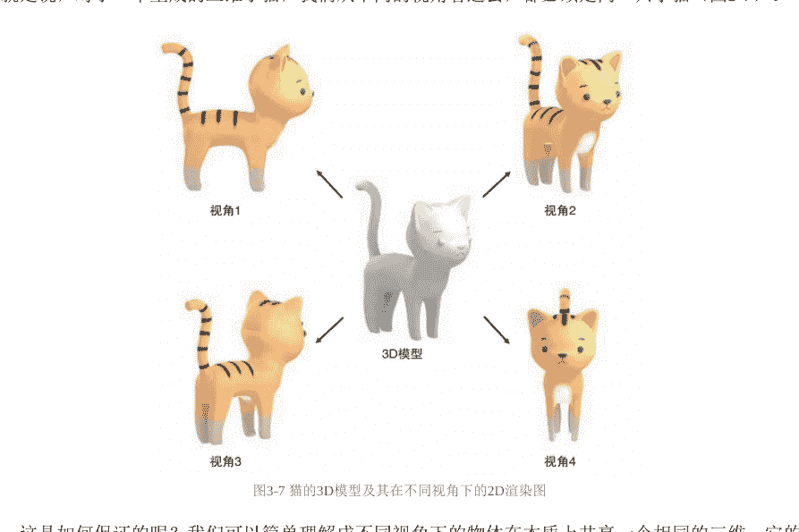
保障一致性的思路，可以理解为不同视角共享同一个三维本质。做法是用神经网络学习三维物体或场景的特征与规律，根据输入信息合成新的三维形状，可用于虚拟现实、增强现实内容制作，也能对真实世界物体进行恢复与重建。

举个例子，拿到一张苹果照片，想看它从不同角度的样子，或把它放到虚拟场景中，就能通过三维生成从照片重建苹果模型，再渲染不同视角与背景。再如，给一个文本描述“一只蓝色的猫”，也能生成对应的三维猫模型，并按文本属性调整颜色与形态。

应用前景很广，覆盖影视娱乐、虚拟试衣、智能家居、文物重建、自动驾驶、大场景重建、数字孪生等。《阿凡达》就用三维生成技术把真实演员的表情动作迁移到虚拟角色，打造奇幻外星世界。淘宝魔镜让用户在手机上试穿不同服装，宜家 App 能预览家具在家中的摆放效果。故宫博物院借助三维扫描与建模，让线上用户观赏殿宇与藏品的细节。

局限也明显，最大的瓶颈在数据。三维生成需要大量采集、存储、传输与处理，涉及多种硬件、软件与算法，耗费时间、金钱与人力。专业相机、传感器、服务器不可或缺，图像处理、机器学习、计算机图形学等技术门槛高。相比图像，三维渲染对算力需求更高，普及仍受阻。

## 第四章 声音与文字的AIGC新篇
### 一、开启声音文字的智能交互时代
日常生活中，声音与文字承担着沟通、表达与传递情感的关键作用。随着人工智能发展，我们已进入 AIGC 时代。不仅能用传统方式交流，还能借助 AI 生成语音、文字甚至音乐进行创作与沟通。这是一次深刻变革，AIGC 改变了人与声音、文字的互动方式，让创作与分享进入全新领域。让我们一起探索这场旅程的无限可能。

#### （一）丰富的语言世界
##### 1. 听读读写全面升级
AIGC 持续演进，如何用它改善生活成为关注焦点。AIGC 应用覆盖听、说、读、写等多语用场景（图4-1）。

在听的层面，语音识别技术已能准确识别多语种发音并转为文字，广泛用于语音助手、语音翻译等。语音合成则把文字转为自然流畅的语音，提供更人性化的交互。

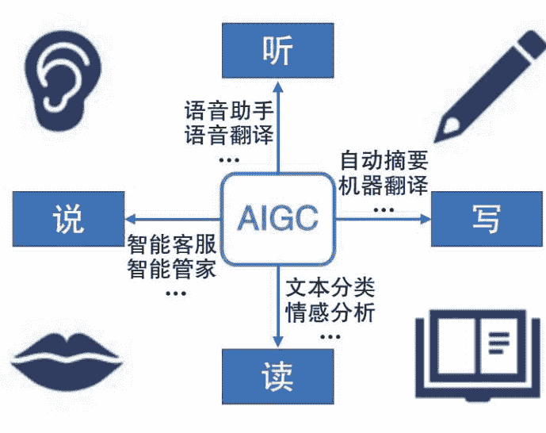
在说的层面，自然语言处理技术实现智能对话，即人机语音交互，可用于智能客服、智能管家、语音翻译等，让人与计算机交流更顺畅。

在读的层面，NLP 可完成文本自动分类、情感分析等，为信息处理提供便捷高效的手段，提升工作效率。

在写的层面，NLP 也可进行文本生成，如自动摘要、机器翻译，还能做自然语言推理，对文本内容做逻辑分析与判断，帮助理解与处理。

除此之外，AIGC 在音乐创作领域应用广泛，能生成多种风格的音乐，为创作带来新体验。总的来看，AIGC 已成为日常生活不可或缺的一部分，其发展将带来更便捷高效的使用体验。

##### 2. 传统创作与AI创作的碰撞
文学与音乐一直是表达情感、思想与创造力的重要载体。传统创作往往由个人或团队完成，耗时费力，且受技术与素材限制。

过去文学创作依赖纸笔、打字机等工具，如今文本生成技术让创作更简便高效。AI 工具可学习并模仿人类写作风格，生成小说、诗歌、评论、新闻等文本，并持续优化以满足多变需求。

音乐创作也类似。过去需要专业音乐家与制作人，现在 AIGC 能生成多风格音乐作品，降低人力与时间成本，同时探索新的风格与方法。

#### （二）支撑音文创作的核心技术
无论声音还是文字，从数据角度看都是有先后顺序的序列数据。AIGC 的序列生成是指基于输入数据生成新的序列，例如输入中文生成对应的英文翻译。过程中需要自动学习语法、词汇与语境，以正确生成序列，依赖多项自然语言处理技术，模型选择至关重要。

##### 1. 输入输出不受限：Seq2Seq [29]
传统序列生成模型难以处理可变长度的输入输出任务。例如要求翻译文章的长度与原文一致，效果通常很差，因为不同语言表达方式不同，某些意思在一种语言用一个词，另一种语言可能需要多个词。固定长度限制往往导致思想表达不完整。

序列到序列模型是一种把一个序列转为另一个序列的架构，由编码器与解码器组成（图4-2）。

工作流程是：编码器接收输入序列并压缩为固定长度向量，保存输入信息；解码器接收该向量，结合已生成的输出词预测下一个词，逐步拼接成完整语句。

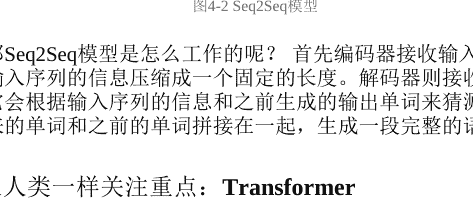
##### 2. 像人类一样关注重点：Transformer
如果 AI 能像人一样有选择地关注重点信息，处理效率与准确性会大幅提升，这就是注意力机制。

注意力机制是 Transformer 模型的核心（图4-3）。该模型由谷歌于 2017 年提出，被广泛用于机器翻译、文本生成、文本分类等任务。它不同于循环神经网络需要逐项处理，支持并行计算，从而显著提升训练效率。

具体而言，注意力分为自注意力和多头注意力。自注意力在输入序列内部计算权重，得到每个位置的表示；多头注意力对不同表示维度并行计算后拼接，再经线性变换输出。

Transformer 包含编码器与解码器。编码器把输入文本编码为向量，解码器将其解码为目标文本。编码器用自注意力捕捉输入相关信息，解码器在自注意力的基础上再用注意力融合编码器信息。

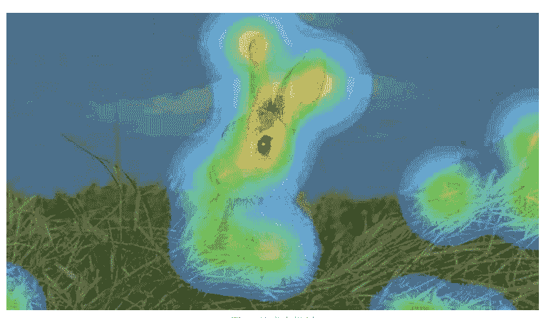
##### 3. 站在巨人的肩膀上：BERT
过去做自然语言处理任务，需要为每个任务设计独立模型，成本高且数据不足时效果不佳。为此，研究人员提出通用预训练模型：先在大规模文本上训练，再迁移到不同任务。

BERT 是基于 Transformer 编码器的预训练语言模型，采用多层堆叠，并使用双向编码，可同时利用前后文信息。它分预训练与微调两阶段：预训练阶段无监督学习语义表示，微调阶段用少量标注数据有监督适配具体任务。可以把它看作大量阅读积累知识的学者，面对不同考试只需少量调整。

与传统语言模型不同，BERT 通过掩码语言模型预测随机掩掉的词进行训练，还引入下一句预测任务，判断两句是否相邻。这些任务让模型学习更丰富的语言表征，在众多 NLP 任务上取得优异表现。

#### （三）回顾GPT的家族史
AIGC 概念的爆发与 ChatGPT 紧密相关。ChatGPT 由 OpenAI 开发，具备模拟人类语言表达与强理解能力，能问答、对话、生成文章等多任务。预训练方式使其在多任务上表现优异，强大的生成能力让用户感觉像在与真人交流。说到 ChatGPT，就绕不开 GPT 家族。

GPT-1 于 2018 年 6 月诞生，是首个利用无监督学习与大规模语料库的预训练语言模型，通过海量语料训练获得语言理解能力，推动了 NLP 发展，为后续模型奠定思路。

结构上，GPT-1 由 12 层 Transformer 解码器堆叠而成，创新点有限。选择 Transformer 因其相比 RNN 能学习更鲁棒特征，具有更结构化的记忆，可处理更长的文本。预训练后针对下游任务做有监督微调。相比之前研究，GPT-1 在微调阶段构造与任务相关的输入，对模型改动很小，无需重构架构。

自然语言处理常见任务有四类：文本分类、文本蕴含、文本相似性、多选题。

在文本分类这类任务里，模型要对一段输入给出所属类别。实践中常把起始标记、待分类原文、结束标记串起来形成一条输入序列送进网络，再取网络末层的隐向量，用一个轻量的线性层投射到类别空间完成判别。

文本蕴含则是判断前提是否能推出假设，属于三分类问题。序列构造与分类类似，先放起始标记和前提文本，中间插入分隔符，再接假设文本和结束标记，后续的映射流程与文本分类保持一致。

判断两段文本是否相似时，需要考察它们之间的关系。做法与蕴含相近，只是要准备两组输入并用两路模型处理，两组输入仅把两段原文的位置互换。两路得到的表征相加后再次经线性层，输出相似或不相似的判断。

多选题要求模型从若干选项里挑出正确答案。构造方式仍参照蕴含，若选项有 N 个，就需要生成 N 条序列并做 N 次推理。每条序列由起始标记、问题、分隔符、答案、结束标记拼接而成，经模型与线性映射后得到该选项的置信度[1]，数值越大命中正确答案的可能性越高。

可见不同任务的输入形式各不相同，但都能组织成序列。无论输入输出如何变化，中间的核心模型本身是不变的。

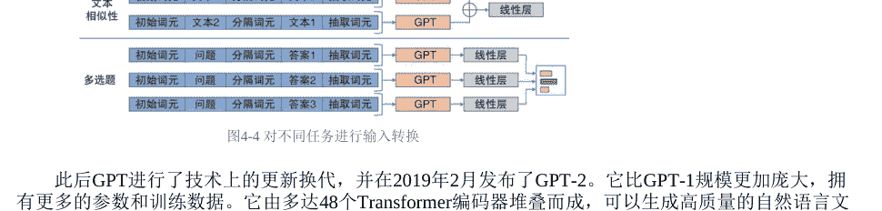

此后 GPT 进入迭代阶段，2019 年 2 月推出了 GPT-2。相较上一代，参数规模与训练语料均大幅提升，内部由 48 层 Transformer 编码器叠加而成，能够产出新闻、故事等质量较高的自然语言文本。相对 GPT-1，GPT-2 并未做大范围的架构改动，主要依靠更大参数量和更广数据提升泛化能力，因而可视作更强更智能的 GPT-1，使计算机对人类语言的理解与自然对话能力进一步增强。

2020 年 6 月发布的 GPT-3 拥有 1750 亿参数，可用于问答、摘要、生成等多种自然语言处理任务，能产出高质量的文章、诗歌、小说，甚至完成翻译和对话。与早期模型不同，GPT-3 采用了少样本学习 [30] 的思路，即在标注数据稀缺的情况下仍能完成新任务。它能将已学知识迁移到全新场景，例如仅给出问题与描述即可生成答案，即使从未专门训练过该问题。凭借强劲表现和广泛应用，GPT-3 在自然语言处理领域被视为里程碑式成果（图4-5）。

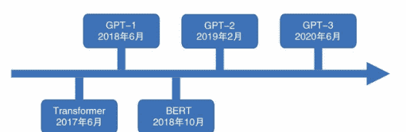

图4-5 各人工智能模型的发布时间

伴随 ChatGPT 的发布，GPT-3.5 也同步公布。ChatGPT 最初是基于 GPT-3.5 的微调版本，并结合了更完善的人类反馈强化学习策略。在此之前 OpenAI 并未公开任何关于 GPT-3.5 的信息。OpenAI 将 GPT-3.5 描述为在 2021 年第四季度前以文本与代码混合数据训练的一系列模型。并未发布一个完全训练好的 GPT-3.5，而是针对不同任务打造了多个模型，如文本生成与代码生成。text-davinci-003 是 ChatGPT 的微调模型，OpenAI 称其是对 GPT-3 的 text-davinci-002 的改进。

> [1] 置信度：对某个事件或假设的确信程度。

### 二、“ChatGPT”模式诞生

ChatGPT 在 GPT-3 的进一步研究基础上，即 GPT-3.5 发展而来，其意义在于开辟了一条让计算机与人类沟通更智能化的道路，提升了生活和工作效率。它能更精准高效地解决用户问题，降低人工负担，后续衍生的产品更是令人瞩目。

#### （一）回顾过去，聊天机器人的兴起

在 ChatGPT 出现前，已有不少聊天机器人问世，比如小冰、小度和 Siri。

小冰由微软于 2014 年 5 月 29 日推出，研发目标是构建情感计算框架，融合算法、云计算与大数据，采用迭代升级方式逐步形成面向情商发展的完整 AI 体系。如今小冰是一套面向交互全流程的人工智能交互主体基础框架，又称小冰框架 avatar framework，涵盖核心对话引擎、多重交互感官、第三方内容触发与第一方内容生成以及跨平台部署方案。

早期小冰形象是一个 18 岁的 AI 少女，如今框架已孵化出数千万 AI 实例，如少女小冰、Rinna、世博会参展画家夏语冰等。目前小冰已具备自然语言处理、计算机视觉、语音和 AI 内容生成等多项能力。自发布以来，小冰框架引领技术创新，在内容生产、智能零售、AI 托管、智能助理等方面成果显著。与其他 AI 不同，小冰更注重拟合人类情商维度，强调情商而非任务完成，并不断学习优秀人类创作者的能力，创作出与之相当质量的水准作品。

小度由国内领先科技公司百度开发的 AI 虚拟助手，2015 年推出，现已成为国内最受欢迎的虚拟助手之一，拥有超 4 亿用户。功能涵盖语音识别、自然语言处理和图像识别，用户可用语音或文本让它设置闹钟、打电话、发消息、提供天气、回答常识问题甚至玩游戏。

小度的一大亮点是可与智能家居设备如空调、灯光、安全系统集成，用户通过语音指令即可控制家居，让生活更便捷。

总体而言，小度是一款功能全面、多才多艺的虚拟助手，凭借先进 AI 技术已成为许多人日常生活的核心部分。

除小冰、小度外，苹果用户一定熟悉唤醒词“Hey, Siri”。Siri 最初成立于 2007 年，2010 年被苹果收购，最初以文字聊天服务为主，后与全球顶尖语音识别厂商 Nuance 合作实现语音识别。用户可通过语音指令让 Siri 设置提醒、查询天气、播放音乐、搜索信息等。

Siri 最显著的特点是人机互动，对话回应生动有趣，有时带来心有灵犀的惊喜。例如用户输入包含“喝了点”“家”等字眼，Siri 会判断为喝醉想回家并主动建议是否叫出租车。

小冰、小度、Siri 等聊天机器人在语言模型演进中发挥了重要作用，通过不断迭代优化提升了自然语言处理水平，拓展了应用范围。随着技术进步，GPT 系列等新一代语言模型崛起，成为 NLP 领域的新焦点。

#### （二）知书达理，ChatGPT读懂你的需求

##### 1. 对话模型的出现

人们一直在尝试用计算机模拟人类对话以实现智能人机交互。早期方法较为简单，采用基于规则和模板的方式，预先定义规则模板再根据用户输入输出对应回答。这种方式需要大量人工设计维护，效果有限，难以应对复杂自然语言场景。随着深度学习成熟，ChatGPT 等基于深度学习的 NLP 模型开始崭露头角。

ChatGPT 由 OpenAI 基于 GPT-3.5 开发的预训练语言模型，也是专注对话生成的模型。它能根据用户文本输入智能给出回答，回答可以是短语也可以是长篇内容。

它有几个有趣特质。首先能主动承认错误，聊天中犯错时只要指出就会改正并自我优化。其次可质疑不合理问题，例如问“哥伦布 2015 年来到美国的情景”，它会指出问题错误，因为哥伦布早已逝世。此外它还能承认自身无知，如人类承认不了解专业技术。最后它支持连续多轮对话，能更连贯地与用户交流沟通。

##### 2. 强强联合

从模型角度看，ChatGPT 与上一代 GPT-3 差异不大，主要变化是引入了强化学习 [31_32]。

什么是强化学习？

强化学习是智能体通过“试错”方式学习，通过与环境交互获得奖励来指导行为，目标是最大化累计奖励。它包含智能体、行为、环境、状态、奖励五个要素。

强化学习是一种让机器通过环境交互学习行为并在相似情境做出更好决策的技术。类似我们在游戏中学习：尝试某件事根据结果判断对错，成功得奖励，失败受惩罚。机器也会尝试并根据数值反馈调整行为，通过不断尝试逐步学会在不同环境中的正确决策。

强化学习在自动驾驶、机器人控制、游戏策略等领域广泛应用，AlphaGo 的胜利也证明了在合适条件下强化学习可完全胜过人类。

##### 3. ChatGPT训练大揭秘：从问题和答案中来

要理解 ChatGPT 的强大，需要了解其训练流程，包含有监督微调 SFT、奖励模型 RM、基于奖励模型的近端策略优化 PPO 强化学习。

首先训练有监督微调模型。第一步提供大量问题，由人工撰写答案。这些问题即 prompt，来源包括商业语言模型 API、标注者提供以及此前 GPT-3 接口收集的问题。将问题与答案配对成对话文本，得到第一个大规模对话标注集。用该数据对 GPT-3.5 进行有监督微调，得到的模型即为有监督微调模型。

其次训练奖励模型。给出问题让模型生成多个答案，并由人工对答案好坏打分排序。将大量人工排序结果整理成第二标注集，用它训练奖励模型。训练时输入为问题加答案，输出为分数，优化目标是使分数符合人工排序。

最后训练基于奖励模型的 PPO 强化学习模型。再次给出问题，通过强化学习继续训练模型，优化目标是让模型生成的答案在奖励模型中获得尽可能高的分数。经过最终微调即可得到 ChatGPT 模型。

#### （三）对答如流，ChatGPT解决你的问题

##### 1. 上知天文下知地理：对话系统

ChatGPT 可用于构建对话系统 [33]。它能构建进行多轮对话的智能机器人，让人机交流更自然流畅。相较传统对话系统，ChatGPT 的多轮对话能力 [34] 更能理解用户意图和语境，提供更智能人性化的回复。多轮对话是连续交互过程，涉及多个问题与回答的交替。

例如用户向 ChatGPT 询问旅游信息，可能先问酒店遇到问题随后再问附近餐厅或景点。此时 ChatGPT 可自动记住对话历史，结合上下文理解当前问题，给出更精准个性化的回答。

在多轮对话中，ChatGPT 通过分析历史记录理解上下文，再结合自身语言模型生成有意义回复。过程类似与朋友聊天，通过先前交流理解对方意思再给出合适回答。它还能自动识别语言上下文信息，如话题、情感色彩、隐含意图，从而生成更贴切回复。

##### 2. 人类的语言管家：机器翻译

机器翻译 [35] 是指用计算机程序把一种自然语言转换为另一种自然语言，打破语言障碍促进跨语言交流合作。

可把机器翻译比作超级语言通，帮助你与全球人群无障碍交流。假设朋友说着你不懂的语言，机器翻译就能把你的话转成对方语言，也能把对方的话转成你的语言，实现双向理解。

ChatGPT 作为 NLP 技术也可用于机器翻译。通过训练大量语言数据，它能学习多种语言的语法词汇并结合上下文翻译。例如把“你好，今天天气真好！”译成英文，ChatGPT 可输出“Hello, the weather is really nice today!”

以出国旅游举例，你计划去日本但不懂日语，网上攻略多为日语。此时可让 ChatGPT 帮忙，把日语攻略输入，它即可翻译。如先输入“请帮我翻译这段日语”，再跟上日语原文。ChatGPT 会根据中文关键词推断需要日语到中文的转换。若之前曾让它把文本译成英语，它也可能理解为日语到英语。ChatGPT 的强项在于分析整段对话，利用先前上下文和全局语义自动识别和调整语法结构与语言习惯，生成流畅自然的译文。因此提示词的质量直接决定翻译效果。

机器翻译有助于打破语言壁垒，实现跨语言沟通，促进文化交流与商业合作。ChatGPT 作为强大的 NLP 技术，能为机器翻译带来巨大进步。

##### 3. 一键概括全文，轻松找到重点：自动摘要

假设你是新闻编辑，每天需处理数百篇报道，时间有限。需要快速了解报道并挑选重点发布到网站，阅读全部文章耗时耗力，严重影响效率。此时自动摘要技术 [36] 就能派上用场。

自动生成文本摘要可改善阅读体验、提高效率。技术通过分析大量文本快速提取关键信息生成简洁摘要。像一位精明编辑，自动摘要可在数秒内完成筛选，帮助快速获取所需信息。同时也节省读者阅读时间，让人们更轻松快速了解事件，在信息处理获取方面意义重大。

ChatGPT 作为 NLP 模型之一功能即能自动生成文本摘要。它能理解文章内容，通过深度学习算法提炼最重要信息生成简短准确摘要。用上 ChatGPT 后，新闻编辑可快速梳理每篇文章，提取核心信息生成摘要。例如输入“帮我总结这篇文章”并附上原文，ChatGPT 即可自动提炼核心内容提升效率。还能结合机器翻译，如让 ChatGPT 阅读英文论文并用中文回答和摘要，更好满足需求。

同时有论文指出 ChatGPT 可生成可信度高的科研论文摘要，引发科学家和出版专家担忧，可能破坏研究完整性和准确性。研究人员开始解决相关伦理问题，因为 ChatGPT 输出难以与人类撰写文本区分。他们用抄袭检测器和 AI 输出检测器比较生成摘要与原始摘要，并请一组研究人员辨别伪造摘要。结果显示生成摘要 100% 通过抄袭检查，而 AI 检测器发现了 66% 的生成摘要。但人类审稿人表现不佳：仅正确识别 68% 的生成摘要和 86% 的真实摘要。

ChatGPT 为自动摘要带来更高效便捷准确的方案，提供优质信息处理体验。但我们也需认识到自动摘要仍存在准确性和可信度问题，特别在重要科研领域，需对 ChatGPT 生成的摘要保持谨慎，结合其他验证手段确保研究完整准确。

### 三、AIGC 唱响未来

你是否想象过机器人不仅能像人一样自由交流，还能像歌手一样动情演唱？现在这已成为现实，让我们看看令人惊叹的技术——AIGC 语音技术。它能把输入文本转化为动听歌曲，在极短时间内“克隆”目标人物声音，甚至能依据情感和音乐风格自动生成不同曲目。

#### （一）“生”声不息

##### 1. 声音复制师：语音克隆

你听说过说唱歌手图派克·夏库尔 Tupac Shakur 吗？他是极具才华的音乐人，却在 1996 年遭枪击身亡。通过语音克隆技术，他的声音可被复制并用于合成新歌曲。该技术不仅能保留已故音乐人的声音延续音乐传承，也能帮助音乐人创作新作品。

语音克隆 [37] 本质上是借助人工智能对原声素材进行学习与解析，提炼声音特征后训练专用模型，从而复刻出声音。整个流程通常先收集海量人声录音，对其处理分析以搭建语音模型，再用 AI 与机器学习算法对模型进行训练，让它把握人声的细微变化。训练完成后，即使是模型从未接触过的词句，也能合成出与目标人物高度相似的音频。

这项能力的应用面很广。影视配音、语音生成系统能让听感更自然真实；对发声受限或失语的人群而言，复制他人声线生成语句可以提供交流表达的通道；同时也能打造更具个性、更富响应性的虚拟助手，实现更接近人类的互动体验。

##### 2. 文本如何开口
你是否遇到过这种情形：太忙没空看新闻，就打开手机新闻阅读器听语音播报？此时你听到的“播报员”声音，其实就是文本生成语音技术在工作。

这项技术怎么做到？

文本生成语音任务 [38] 的训练离不开海量数据。这些数据多为配对的语音与文本，可来自现成语料库，也可通过新录音获取。随后数据会喂给深度学习模型训练，模型架构常采用循环神经网络 RNN 或卷积神经网络 CNN，目标是学会语音和文本之间的对应规律。训练过程中参数不断调整，力求缩小语音内容与文本内容的差距。

随着模型能力提升，合成效果愈发逼近真人。现在还能调节音色、语速、音调等参数，生成不同风格的声音，有的温柔动人，有的干练利落。文本转语音也在多个场景落地：在智能家居里实现语音交互，在游戏中让角色开口，在电子书里实现电脑朗读。它让沟通更轻松，未来也将更普及、更实用。

##### 3. 计算机作曲时代到来
音乐生成 [39] 是指用人工智能让计算机自动创作音乐。模型可以生成流行、古典、摇滚等多种风格的作品。听过约翰·塞巴斯蒂安·巴赫的作品会感受到其旋律之美，而今音乐生成技术已能模仿巴赫风格创作新曲。

计算机通过学习大量音乐数据，解析结构与风格等要素，再据此生成全新作品。生成时可调节节奏、调性、和弦等参数，营造不同风格与氛围。不仅能为创作者提供灵感与素材，也能让大众享受到更丰富多样的音乐。

具体实现上，先输入训练数据，数据可以是大量乐曲，也可以是音符、和弦、节奏等基础元素。模型学习规律与特点后会输出中间成果，最终呈现一段由计算机自动创作的音乐。过程中需兼顾音乐美感与连贯性，遵守基本音乐理论规则。

常见做法是使用深度学习模型，如循环神经网络 RNN 或变分自编码器 VAE。训练后模型能生成新曲，输出形式可为钢琴曲、吉他曲或交响乐等。

应用十分广泛。影视剧配乐可获得更多选择与灵感，广告与商业项目也能更便捷地定制品牌音乐，音乐爱好者也能收获更多种类作品，提升聆听体验。

#### （二）AIGC的“说唱”能力已成熟
##### 1. 语音合成实战案例
国内语音技术领先企业科大讯飞，其语音合成平台涵盖在线语音合成、长文本语音合成、离线语音合成、AIKit 与 AI 虚拟人技术。

在线语音合成能把文字转成自然流畅的人声，并提供百位以上发音人可选。支持多语种、多方言及中英文混读，用户可自行配置音频参数。常见用途包括新闻阅读、出行导航、智能硬件和通知播报。

长文本语音合成聚焦配音阅读场景，提供长文本合成接口，用户可按需挑选发音人，将文字转为自然人声。同样支持多语言、多方言和中英文混合，并可灵活调节音频参数，广泛用于有声阅读、新闻播报、出行导航。

AIKit 基于新一代语音引擎，将文字转为自然人声，音色质量更好、音库更丰富，还支持个性化音库定制，让合成语音更具个人特色。

AI 虚拟人技术整合语音合成、语音识别、语义理解、图像处理、机器翻译、虚拟形象驱动等核心能力，可实现信息播报、互动交流、业务咨询、服务导览等功能，服务于新闻、政企、文旅、金融等多个领域。

##### 2. 音乐创作实战案例
贝多芬于 1827 年去世时已着手第十交响曲，因健康恶化仅留下草稿。为纪念作曲家 250 周年，马蒂亚斯·罗德尔 Matthias Röder 联合 Playform AI 公司及多位音乐史学家、理论家、作曲家，重现贝多芬的创作路径。团队让机器学习贝多芬全部作品，包括已完成乐曲、零散音符及第十交响曲草稿，并试图复刻其创作过程 图4-10。

项目分为人工与机器两部分任务。人工部分像侦探一样参照贝多芬已完成的交响曲，破解并转录第十交响曲的珍贵草稿，将碎片拼凑起来，推测其意图。每个片段都是难题，需要挖掘其所属乐章与段落。

机器部分挑战性同样很大。首先要让 AI 学会像贝多芬那样，以简短主题发展出复杂结构，例如贝多芬仅用四个音符就写出第五交响曲。不同音乐形式延续方式各异，机器还需掌握回旋曲、三重奏、赋格曲等结构演变。更进一步，要教机器为旋律配置和声、衔接乐段、谱写收尾，使高潮与尾声都完美。完成总谱后，还需为交响乐团各乐器编配，使整体呈现最佳效果。

Playform AI 历经两年多努力，最终完成的第十交响曲在德国波恩举行了世界首演。

除此之外，Algonaut 公司推出的音乐制作软件 Algonaut Atlas 2 也提供丰富功能。通过机器学习算法，可创作出新节奏、和声与旋律，帮助用户找到适配项目的声音。

软件能分析并理解用户的音乐库，生成与库内风格相似的新曲或和声节奏。支持导入个人音频样本，同时内置现成音色、旋律循环 loop [1] 与样本库。对于想用 AI 做音乐的用户而言，Algonaut Atlas 2 是一个便捷的创作工具。

> [1] loop：在音乐领域中，通常指循环或循环节，用于指代音乐中重复的节奏或片段。

## 第五章 AIGC的未来应用场景
### 一、智能工作伙伴
#### （一）办公软件的AI升级
是否幻想过工作时有个聪明的助手分担琐事？写文案时只需给出标题和摘要，助手就能补全剩余内容；做幻灯片报告时提供大纲，助手就能生成充实初稿。你只需少量修改打磨，就能在短时间内完成高质量报告。这类助手能让工作更轻松，把时间解放出来做更有创造性的事。

Office、WPS 等办公软件的初衷正是提供统一、便捷、高效的办公环境，让文档的创建、编辑、管理与共享更顺畅。问题是，办公软件与 AIGC 能否结合？

微软率先作出回应。Office 深入千家万户，任何改动都需大量调研以免影响用户体验。2023 年初 ChatGPT 引发热潮后，微软却决定将 ChatGPT 集成到 Office 全系应用，这在保守的大公司中实属罕见。随后金山软件也在 WPS 基础上推出 AI 办公集成。AIGC 赋能个人工作的时代正式到来。

以微软 Office 为例，集成的 ChatGPT 被命名为 Copilot，可根据提示生成文档，如产品介绍、调研报告等。用户在 Word 中打开 Copilot，输入标题与开头，例如“AIGC：人工智能自动生成内容的神器”，即可获得初稿。用户可进一步添加段落、提炼要点、重写内容，还能指定语言风格与篇幅，如正式或幽默、长篇或短篇，极大节省创作时间。

除文字外，视觉内容也能创作。基于用户提供的文字、图像、视频等素材，智能办公软件可辅助生成布局、主题、背景等元素，打造精美幻灯片。结合大语言模型的文本生成能力，只需一个简单提示，如“AIGC发展趋势报告”，即可自动生成相关内容并填入幻灯片。

内容生成之外，记录与总结同样重要。用户可在办公软件中选取会议视频或文档，让 AI 助手生成摘要；阅读邮件时也能一键生成内容摘要，后续可再补充细节、调整语气或删除无关信息。

#### （二）搜索从检索到生成式进化
搜索引擎已成为网络生活的重要入口。20 世纪 90 年代以来，主流思路是用匹配算法将用户关键词与网站进行匹配排序。基于检索的搜索引擎依赖爬虫、索引、检索与排序等技术，提供快速且相关度高的信息服务。国内常见有百度、360、搜狗，国外有谷歌、必应等，商业模式多为搜索结果中投放广告。核心功能是全文搜索。

发展至今，搜索引擎技术已相当成熟，市场份额也趋于稳定。谷歌凭借独特的搜索技术与排序算法占据国际市场绝对优势，份额超过 90%。虽然巨额广告利润吸引其他公司竞争，但由于技术成熟与用户习惯固化，必应等产品在国际市场的份额长期维持在 3% 左右。

ChatGPT 等 AIGC 的出现带来转折。市场份额不高的微软必应大胆尝试，将对话模型集成进搜索引擎，由此诞生生成式搜索概念。这类搜索引擎依据用户需求与推荐算法，从海量信息中检索匹配内容并生成新观点反馈，提供更智能、更个性化的服务。目前代表性产品是 ChatGPT 新必应 New Bing，能以对话方式直接回答问题。它既能提取关键词检索，又能在回答中融合检索结果，可信度更高。

例如常规搜索引擎查询“北京天气”会返回多个网站链接，而生成式搜索会直接回答：“北京今天多云转晴，最高 24℃、最低 12℃，空气质量良好。明天小雨，气温 10～18℃。”回答更直接、更友好。

当然，生成式搜索也存在挑战。最大瓶颈是算力消耗。传统搜索只需匹配排序，生成式搜索还需对结果进行提炼、总结与重排，每次搜索都要运行大语言模型，成本高昂，是传统引擎的 10 倍以上。摩根士丹利估算，2022 年谷歌每次搜索成本约 0.2 美分，若部署类似 Bard 的聊天机器人，2024 年成本可能增加 60 亿美元。其次，生成模型本质是概率模型，缺乏显式真实性保障，可能出现混淆事件、捏造事实等问题。虽然引入检索结果可部分改善，但准确性仍难保证。此外，生成内容还可能涉及版权与隐私风险。

生成式搜索把互联网信息转为自然语言，大幅提升可读性，想象空间巨大，但当前仍有不少难题待解。

### 二、面向人的AIGC设计
#### （一）数字人如何打造
数字人是用计算机技术模拟出的、具有真人外貌与动作的虚拟形象，可用于教育、娱乐等多个场景，是人类在互联网上的虚拟表达。在通用大语言模型出现前，数字人的行为多靠人工操作或简单规则控制。现在借助 ChatGPT 这类对话模型，可将其作为数字人的“大脑”，赋予思考能力。

有了“大脑”后，如何构建数字载体？完整数字人首先需要逼真自然的外观。传统方法分为扫描与建模。扫描法利用摄像头捕捉面部表情与动作生成动画数据，同时用激光扫描仪采集头发、皮肤细节生成贴图。建模法则在 3D 软件中搭建基础形状与骨骼，再后期添加色彩与纹理。

这些方法虽能生成逼真形象，但人力物力消耗大，团队规模庞大，成本高昂，在一定程度上制约了产业发展。随着 AIGC 进步，这一局面在改变。以往画作需画师付出大量心血，如今 AI 仅需数秒。此趋势已延伸至数字人设计。借助 3D 生成模型，AI 可直接产出可用建模。常见做法是用神经网络以三维坐标与视角方向为输入，输出表面颜色等视觉信息，再经计算机图形学渲染得到不同视角画面。该方法可从稀疏二维图像重建连续三维场景，并从任意视角合成新图，相比传统建模大幅节省时间，有助于数字人形象规模化普及。

外观之外，还需语言能力。语音合成技术可根据文本或语音输入生成数字人语音输出。常用方案有语音克隆与语音转换。语音克隆利用深度学习与迁移学习，以少量真人样本训练出模仿发音的合成模型。语音转换则将原说话人声音转为目标说话人声音，同时保留原风格特色。借助语音合成，数字人可像人类一样用声音交流，而非仅限文本对话。

让数字人动起来同样关键，核心是嘴型与表情需与发音对应。可通过音频分析模块提取声学特征，如韵母、带宽、音高，再由人脸模型驱动模块计算嘴唇运动与面部表情参数，最后用渲染模块将参数与人脸图像结合生成说话视频。关键在于建立声学特征与面部动作的准确映射，实现发音到面部动作的自然转换。

未来随着技术进步，数字人有望成为元宇宙的主角，与现实人类展开更深层次互动。通过上述技术，可用较低成本为元宇宙填充高质量内容，加速其落地。

#### （二）AutoGPT的自主行动能力

AutoGPT：让 AI 真正自己动起来的尝试

想象一下，身边有一位伙伴，能把你脑中的想法直接推进成结果：起草稿件、写程序、订票、点外卖。它不必像现有的对话式系统那样被牵着鼻子走，而是拿到一个终极诉求后自行推进，并调用浏览器、软件等外部资源把事办成。AutoGPT 就是面向这一设想的原型，它能在不同场景下产出文字与代码，并通过持续从网络与工具中汲取信息来提升对任务的理解与应答水平。面世后迅速获得开发与研究圈关注，发布不满两个月，GitHub 上的点赞便突破十万。

这一系统的底座是当时 OpenAI 发布的最强通用大模型 GPT-4。老式的对话系统基本停留在“提示-生成”。AutoGPT 则能读懂用自然语言描述的意图，把它拆成若干子目标，再借助网络与各类工具自动跑完。通俗讲，它可以自己干活，而非每一步都等人指挥。这种自驱特性对智能系统意义重大，因为它能处理人手头紧或难以拆解的复杂问题，也能在实践中迭代优化，效率随时间递增。

具体能做什么？几个直观例子可说明。运营淘宝店铺时，它能写出吸睛的商品文案、管库存、回客户信息，甚至投放推广。编程上，无论 Python、Java 还是 C++，它都能按需求产出代码、拼成完整程序、做报错检查与测试，必要时补充注释与说明文档。筹备活动时，它可列出嘉宾名单、发出邀请、预定场地、采购饮品。创意层面，它能写诗、小说、文章、歌词，并给出写作点评，帮助提升表达。正是这些看似基础的场景，折射出自主型原型模型的广阔空间。

这种“像有魔法”的能力从何而来？核心仍是 GPT 系列大模型，输入输出皆以自然语言为主，需要反复交互才能释放优势。AutoGPT 的贡献在于把交互闭环自动化了。使用者只需给出终点目标，比如“策划一次活动”，系统就会利用大模型的推理能力把目标自动拆解为小步，并与自身进行内部对话。它还能联网或调用其他工具检索信息并执行。以活动策划为例，它可能会自问自答：“先在周边找场地”“比价与口碑”“锁定最优选项”“给来宾发邀请”。通过把复杂诉求拆成更易处理的步骤，并在过程中无需人工干预，随后为每个子任务生成文字或代码方案并执行。它还配有记忆模块保存回溯信息，从而记住背景与进度，甚至自行创建新任务、安排优先级并复核结果。

相较于纯对话系统，AutoGPT 在复杂任务处理上更省时省力，且能从经验中迭代。但作为新生技术也伴随隐患。首先是准确性与可靠性不足，训练语料和网络上真假混杂的信息可能导致错误或过时的输出，使用时必须核验。其次存在伦理与安全风险，如版权侵权、误导用户、被滥用等。生成的内容可能涉及他人知识产权或违反规则，也可能带偏见或不适宜，影响判断与情绪。更严重的是可能被不法分子用来实施诈骗等危害个人的行为。

尽管面世时间很短，2023 年 3 月才发布，AutoGPT 已成为智能助手演进的方向，引领工具类智能的变革。智能与人类的协作关系正日益紧密，可以预见未来智能将以伙伴身份陪伴在身边，协助工作与生活中的各类事务。

### 三、影视传媒的未来走向

#### （一）内容创作中的人机协同

影视传媒的根基是内容，而内容创作离不开人的想象、创造与表达。不过灵感枯竭、时间紧迫、资源有限时有发生，这正是生成式工具能发挥作用的地方，成为人的协作者，帮助产出更多更好的影视内容。

随着对话式生成工具的普及，影视从业者越来越多地将其融入日常流程。它可以依据人类指令自动或协同生成剧本、角色、场景、音乐、特效等元素。机器生成的内容既能提供灵感，也能根据反馈不断优化完善。

智能在不同阶段的作用各有侧重。策划前期，智能体可依据主题、风格等信息生成故事梗概、角色设定供挑选或修改。制作中期，可根据剧本和素材生成画面和配音等内容。发布后期，可依据受众和反馈生成宣传和推荐材料。

生成式人工智能在新闻、剧本等领域应用广泛。新闻机构可用其辅助报道，自动生成标题、摘要、正文，并补充背景知识和分析评论。编剧可用其生成剧本草稿或润色细节，智能体反复产出内容供编剧完善故事。

人机协作的优势明显。生成式人工智能能借助海量数据与算法快速生成多样化高质量内容，节省时间和成本，让人类从繁琐细节中解脱，聚焦创意与决策。同时智能也能够依用户需求和反馈不断优化，使成果更符合预期，形成互补协同。

但风险同样存在。智能生成内容易被滥用，对非专业人士造成误导，需人类把关。若不加甄别地在网络传播真伪不明的内容，可能误导公众。例如 Stack Overflow 明文禁止发布对话式生成系统产出内容，以防误导其他用户；国内知乎等平台上大量智能回答也在一定程度上降低了真实性和可信度。此外生成式人工智能缺乏人类情感和思考，易产出机械或平庸的内容，影响观感。

如何更好地利用生成式人工智能？应把智能视为合作伙伴而非竞争对手。充分利用其数据与算法优势，获取灵感和高质量初稿；同时发挥自身的想象、创造与表达，对智能输出进行评价与修改。人机形成互补协同，既能提升影视内容的水平和价值，也能推动行业创新发展。

#### （二）创作辅助手段的升级

影视的魅力在于用声音和画面讲述动人故事，但创作往往耗时耗力。生成式工具能够显著压缩创作流程，除直接生成内容外，还有各类智能创作辅助工具可供使用。

典型场景包括字幕生成。智能可以根据视频中的语音或文本自动识别字幕，支持多语言和多种字体，避免人工打字、翻译、校对和格式问题，提升观看体验并扩大受众覆盖。视频清晰度提升方面，智能能依据原始分辨率和画质自动增强细节，让老旧视频重获新生，也让高清画面更细腻。经典影视修复中，智能剪辑软件可提升老片画质与音质，修复瑕疵与损坏，自动进行清晰化、降噪、色彩校正与增强，延续其艺术与文化价值。配乐生成上，智能可依据视频内容和风格自动挑选或创作背景音乐，并按节奏和氛围调整混音，使视频更生动有感染力。

更前沿的应用还有虚拟场景合成。它利用智能自动生成逼真的 3D 场景，并与实拍视频无缝融合。可按提供的素材生成虚拟建筑、植物、天空等元素，并匹配光照、阴影、透视等效果，大幅扩展想象空间与视觉效果，无需耗费大量成本搭建实景。

这些应用展现了智能创作工具的巨大潜力。当前工具虽未完全达到专业人员水准，但已能提供相当不错的初稿，大幅节省人力时间并提高效率。随着数据积累和模型训练，性能将持续提升。可以想象生成式人工智能为影视插上翅膀，以更低成本创作出精美逼真的作品，甚至让普通大众也能借助工具进行个人创作。未来或许人人都是自己的导演。

## 第六章 生成式人工智能的走向

### 一、技术演进脉络

伴随技术不断进步，生成式人工智能在过去几年里经历了巨大变革，持续创新突破。算法发展正愈发偏向多模态，这让系统能融合不同模态数据获得更多信息。算力增长也让其在处理复杂数据时表现更出色。下面一起探索生成式人工智能在多模态上的进化历程。

#### （一）多模态：向人脑靠拢

##### 1. 多模态生成与多视角创作

随着人工智能发展，多模态人工智能技术，即能够基于文本、语音、视觉、生理、动作等多模态数据工作的技术，逐渐成为研究热点。如今常见的语音识别系统属于单模态，只能识别声音，而多模态技术可融合视觉、语音、动作等多源信息，实现更精准的识别和分析（图6-1）。

基于多模态的生成任务包括图像—文字生成、图像—音频生成、音频—文字生成等。以图像—文字生成为例，模型可自动为图片生成文字描述，这在自动为社交软件图片添加标签描述（图6-2）或为图书馆图书自动撰写简介等场景很有价值。

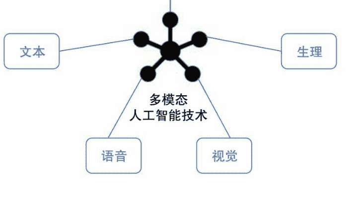
图6-1 多模态人工智能技术
# 用户A
2022.6.3 20:14

# 用户B
2022.6.3 19:28

图6-2 社交软件自动生成图像标签描述

要让机器描述图像，传统做法是把图像和文本分别输入不同模型再合并。而多模态模型能同时接收图像和文本，让模型自行理解二者关系，从而生成更佳描述。在游戏领域，多模态智能被广泛应用。例如构建一个虚拟角色，它不仅能听从玩家指令，还能通过计算机视觉和传感器识别玩家动作，实现更智能的交互，让角色更好地融入游戏世界，带来沉浸感。

除游戏外，多模态模型还应用于虚拟助手、教育培训等。它可帮助打造更类人的虚拟助手，理解自然语言、情感与背景，以更自然个性化的方式回应。在教育培训中，多模态模型可依据学生的学习偏好和进步程度，生成个性化学习内容，如视频、动画和测验。

##### 2. 大规模模型扩展想象边界

多模态生成式大模型能够处理文本、图像、音频等多种数据的大规模预训练模型，可被视作同时处理多种信息的“大脑”。与传统深度学习端到端训练不同，多模态生成式大模型多采用“预训练+微调”策略。先在数据中心预训练使机器更好地理解处理多类型数据，再针对具体任务微调，从而完成各类下游任务。

除了第三章提到的 DALL-E 文—图多模态模型，基于预训练 BERT 图像重构模型的 BEiT 系列也备受关注，其在视觉与语言任务上表现突出，可用于目标检测、实例分割、语义分割、图像分类、视觉推理、视觉问答、图像描述生成和跨模态检索等。其中最新版 BEiT-3 的优势在于针对不同模态采用统一骨干网络——多路 Transformer，可轻松应对不同下游任务；而且其仅用统一掩码数据建模作为预训练目标，泛化性能更友好，更利于更大规模模型训练。

另一个重要大模型是盘古大模型。2021 年 4 月 25 日，华为发布盘古大模型，由华为云与鹏城实验室联合开发，鹏城云脑Ⅱ提供算力支持，是业界首个千亿级生成和理解中文 NLP 大模型。

盘古大模型由 NLP 大模型、CV 大模型、多模态大模型、科学计算大模型等构成，通过模型泛化解决了传统 AI 作坊式开发难以实现规模化、产业化的难题，可支持文本生成、文本分类、问答系统等多种自然语言处理任务。其中多模态大模型具备图像与文本的跨模态理解、检索与生成能力。

#### （二）算力侧趋势

##### 1. 大模型对算力的渴求

强大的智能系统通常需要庞大参数支撑，如今已知大模型参数规模已达万亿级别，这意味着需要极其庞大的数据驱动算法。而数据量与深度学习准确度正相关，数据越大对算力的需求呈指数级增长。因为人工智能底层计算本质是矩阵运算，矩阵维度代表数据特征维度，维度越多、参数越多、系统越复杂、准确度越高，但算力需求也越大。

随着智能技术发展，越来越多的企业与研究机构投入资金与人力研发模型与算法。但训练与推理需要海量计算资源，已成为发展瓶颈。因此算力提升与模型算法优化成为重要趋势。

生成式人工智能模型训练同样需要大算力，对话式生成系统的出现掀起了算力技术升级扩容的浪潮。谷歌不仅紧急推出以 LaMDA 为底层算法的 ChatGPT 对标产品 Bard，还通过算力基础设施的投资规划彰显了对生成式人工智能前景的信心与争夺市场的决心。据报道，2023 年 3 月 8 日在摩根士丹利科技传媒电讯会议上，谷歌 CFO 露丝·波拉特透露，谷歌将在数据中心与服务器等算力设施上增加预算，以应对未来算力需求增长与市场竞争压力。这意味着谷歌在算法创新与算力基建投入上双管齐下。

##### 2. 国内布局逐步清晰

在新一代智能模型竞争中，百度与谷歌再次同台。谷歌 2018 年发布名为 BERT 的模型，名字取自《芝麻街》角色。而与 Bert 住在一起的好朋友叫 ERNIE。于是百度在 2019 年推出自己的模型并命名为 ERNIE。

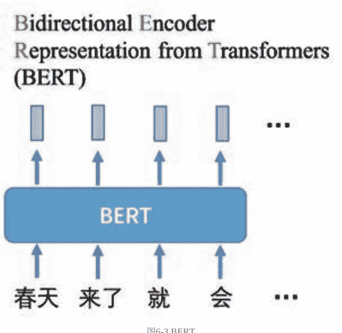
前面提到的 ERNIE，即现在的文心大模型，类似 OpenAI GPT。经多次迭代，文心大模型已从单一自然语言理解扩展到视觉、文档、文图、语音等多模态多功能，能更好地处理各种形式信息，泛化能力更强。

文心一言 ERNIE Bot 是基于 ERNIE 系列模型开发的类似 ChatGPT 的聊天机器人。ERNIE 系列由百度自然语言处理部门推出，具有深度学习与自然语言处理能力。得益于文心大模型的成功，ERNIE 系列不断迭代完善，因此文心一言具备强大的语言理解与生成能力，可便捷完成各类文本生成任务。

2022 年初，百度发布 ERNIE 3.0 Zeus，这是 ERNIE 系列最新版本，参数规模已达千亿级别。

2023 年 2 月 24 日，国务院新闻办公室就“深入实施创新驱动发展战略，加快建设科技强国”举行发布会。科技部高新技术司司长陈家昌表示，下一步科技部将把人工智能作为战略性新兴产业和新增长引擎继续大力支持：一是推动构建开放协作的人工智能创新体系，加快基础理论研究和重大技术攻关；二是推动人工智能与经济社会深度融合，在重大应用场景中锤炼技术、升级迭代、培育市场；三是推动建立人工智能安全可控的治理体系；四是全方位推动人工智能开放合作。可见政府支持与引导态度积极明确。

我国算力资源分布不均，导致东西部差距扩大，影响区域发展并制约数字经济均衡高速发展。因此在国家扶持下，2022 年“东数西算”工程正式启动，让西部算力资源充分支撑东部数据运算，更好赋能智能与数字化发展。“东数西算”工程是我国未来人工智能产业高质量发展的必然选择（图6-4）。

图6-4 “东数西算”工程

### 二、给生成式人工智能设限

AIGC以惊人的速度渗透进日常，文案、配图、音频都能一键生成，效率提升肉眼可见。但便利的另一面，是版权纠纷与数据安全隐患在悄然发酵。若只盯着使用体验而忽视风险，技术红利很容易演变成生活成本。

#### （一）隐私安全，底线必须守住
生成式AI正成为全民话题，借助机器学习、自然语言处理等手段批量生产文本、图像、音频，已大幅提速创意工作。然而即便工具好用，使用边界也必须划清。

实际案例已敲响警钟。微软曾内部通告员工切勿把敏感信息丢进ChatGPT，因为OpenAI有可能把这些对话用作模型训练，存在外泄可能。亚马逊亦发出类似提醒，叮嘱开发者谨慎上传代码，避免被机器人截取。面对大厂的集体焦虑，OpenAI在常见问题页补充了公司数据与隐私说明。其服务条款明写有权利用用户输入输出进行训练，并承诺脱敏去除个人身份信息。但学界指出，从海量对话中完整剔除个人信息几乎不可行。对隐私要求严苛的机构，正在考虑用替代方案降险。

因此在使用AIGC时，务必先对所用素材做充分匿名与脱敏，并在合规框架内处理个人数据，让技术红利建立在安全之上。

#### （二）生成物到底归谁所有
##### 1. AI写作首例判赔
腾讯自研的Dreamwriter可依据阅读偏好与历史行情自动产出财经稿。2018年8月系统在腾讯证券发布的一篇稿件被同行搬运。腾讯起诉后，法院认定该稿件满足文字作品保护标准，即便出自算法之手，信息网络传播权仍受保护，被告被判赔人民币1500元并承担维权费用。此案为智能写作的知识产权保护提供了司法背书，也提醒业界：AI为了保持生成能力，必须持续摄取网络数据，采集过程极易触碰隐私与版权。

##### 2. 从训练到产出，侵权链条在哪
AIGC的版权争议集中在训练环节与生成环节两端。

训练需要海量语料，网上的文章、图片常被直接复制为数字副本。美国专利商标局强调，这一过程必然涉及对完整作品或片段的复制。OpenAI也公开承认模型在包含受版权保护作品的大型公开数据集上训练，复制行为客观存在。若未获授权就建立副本，就可能侵害原作者的复制专有权。

生成结果带来的风险同样突出。一种是涉及受法律保护的虚拟角色，另一类是复刻特定艺术家风格的作品。角色形象受权保护，侵权风险明确；风格层面，版权法一般只禁止具体作品抄袭而不禁止风格模仿，但不少艺术家担忧AI可大规模批量产出“风格相似”的内容，稀释原创辨识度。

##### 3. 侵权了算谁的账
用AIGC创作时，创作者往往意识不到踩线可能。现行法理下，使用者与AI提供方都可能担责。若使用者明知侵权，则直接负责；即便仅作非商业使用，平台或模型公司仍可能因间接侵权被追责，前提是其具有监督能力并从中获利。艺术家集体状告多家Stable Diffusion绘画公司的诉讼，就显示AI公司在间接责任上难以免责。

#### （三）数据安全是AIGC的护城河
##### 1. 模型产出能信吗
真实性与可信度是AIGC的软肋。模型能生成逼真到难以分辨的内容，误导性随之上升。ChatGPT的回答看似通顺，却常出现事实性错误，使用者若盲目采信，风险会迅速放大。

深度伪造技术[49]更是放大器。依托深度学习合成人物图像，可伪造文本、音频、视频。恶意操弄能制造虚假舆情，甚至冒用他人言行实施违法行为，对公共利益造成冲击。

##### 2. 让可信度多方托底
生成质量受数据源与算法双重制约。

数据源是根基。训练集若不全面、不准确，生成物自然偏差。如今大部分语料来自互联网，本就混杂错误。错误数据进入训练，再被新一代模型学习，谬误会层层累积、固化在模型中。只有持续校验、纠错，才能遏制污染扩散。

算法本身同样关键。AIGC多基于深度神经网络搭建，训练不足或设计缺陷都会拉低输出质量。为此学界提出多种评估手段，比如基于模型的度量方法[50]、事实核采样算法[factual-nucleus sampling algorithm][51]，以及借助人工反馈做模仿学习优化答案。尽管有所改善，面对矛盾或未知领域，模型仍易失准。

### 三、挑战与机遇并存
AIGC的应用边界在不断扩张，机会与难题同步到来。可解释性仍待突破，伦理风险也需要前置治理，否则创新难以持续。

#### （一）探索AIGC黑盒：可解释性
##### 1. 为何要可解释
深度学习的发展推动了AIGC时代的到来。区别于传统机器学习[52]，深度学习省去了人工提特征、人工找规律的步骤，同时也带来了可解释性大幅下降的问题。

AIGC同样黑箱化，用户看不到生成路径，难以判断结果是否可信。比如让模型写一段宇宙介绍，文字读起来合理，但缺乏科学来源佐证，就不宜直接用于教学、商业或科普。联合国《人工智能伦理问题建议书》[53]将可解释性定义为让系统结果可理解并提供说明，涵盖各算法模块的输入、输出、性能及对整体结果的贡献方式。AIGC也需要给出通俗的生成逻辑与可信度说明。

##### 2. 解密黑盒，用AI解释AI
目前主要有两条路径打开黑箱。

第一条是建立“模型说明书”标准，为算法建档立卡，相当于AI的身份证，记录基本信息与运行原理，便于追溯决策依据。

第二条是发展可解释性工具，推动可解释人工智能 XAI[54]落地。从技术层面帮助使用者直观看到模型如何处理任务，例如翻译时可视化模型关注的词与推理路径。

| 年份 | 可解释性工具 |
|---|---|
| 2016 | EL15 |
| 2017 | Skater, Explanation Explorer, AllenNLP Interpret, TensorBoard |
| 2019 | AIX360, ACE, Captum |
| 2020 | alibi, InterpretML, LIT |

#### （二）AI伦理：道德与法律
##### 1. 先验偏见的投射
DALL-E 2等模型在成像时明显带有刻板印象。输入“怒汉”或“人关在牢房里”，结果多为黑人形象；输入“CEO”“建筑工程师”“律师”，多生成白人男性形象，正装、工装、法袍皆有；输入“空乘人员”，几乎全为女性。这种种族与性别的偏见，会削弱公众信任，也对被歧视群体造成伤害，必须从技术与伦理双管齐下改善。

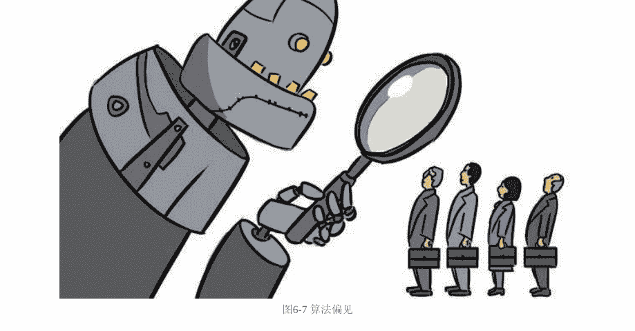
图6-7 算法偏见

##### 2. 法规跟上技术节奏
医疗、金融、交通、安全等领域都在接入AIGC，随之而来的是偏见、泄密、深度伪造等复合风险。仅靠算法迭代不够，必须以政策与法律兜底。国家互联网信息办公室、工业和信息化部、公安部联合出台的《互联网信息服务深度合成管理规定》自2023年1月10日起施行，明确制定依据、适用范围、部门职责、服务规范、数据技术管理、监督检查与法律责任等内容。

有趣的是，可解释性本身也能助力去偏。文本生成算法若内含性别、种族、文化偏见，可解释机制可帮助定位问题并进行修正，使输出更中立公正。

#### （三）AIGC+，创意无限
##### 1. 商业模式的重塑
微软与OpenAI的深度合作印证了商业逻辑在变。数据爆炸催生了以数据驱动的模式，企业通过收集分析海量信息实现精准营销与个性化服务。AI同时催生智能客服、智能销售、智能制造等新赛道。

AIGC带来的变化具体体现在：提升客户体验，虚拟助手可提供沉浸式互动与个性化推荐，广告也能按受众画像定制；推动企业自动化，重复性人工被替代，内容生产更快更便宜。更深层次是生态重构，从产品研发到渠道服务、客户关系都变得更智能、更高效。

ChatGPT这类语言模型在其中扮演连接器角色，既能提供智能化咨询，也能通过用户数据洞察市场需求，优化设计与营销。总体看，商业模式的转型不可逆，企业唯有持续创新才能立足。未来AIGC在广告营销、内容创作、品牌推广等场景的应用会更普遍。

##### 2. AIGC重塑教育，有利有弊
教育正迎来个性化与互动化的升级。学生可与ChatGPT等工具对话式学习，系统还能按学习进度与兴趣动态调整课程与反馈，让学习更高效有趣（图6-8）。

借助AIGC可搭建智能教学平台，根据兴趣、知识水平、学习习惯推送定制化资源，也可部署自动评测、智能推荐等教学辅助工具，提升效率、减轻教师负担。

但这把双刃剑也可能削弱自主思考。若过度依赖模型完成作业，学生易陷入“复制粘贴”心态，创造力与独立判断力受损。资源不均也可能加剧，教师角色被边缘化。长远来看，新时代教育既要完成知识普及与思辨训练，也要培养自主学习能力与以数学为基础的AI逻辑素养，为AIGC时代储备真正的能力。

从感知机到大模型：49篇奠基文献速览

下面把一份经典参考文献按时间脉络重新梳理成可读的清单，作者、年份、题名、载体等核心要素全部保留，只做表达上的重写。

6. 罗森布拉特 F 于 1958 年在《Psychological review》第 65 卷第 6 期 386-408 页刊出《The perceptron: A probabilistic model for information storage and organization in the brain》。
7. 闵斯基 M 与佩珀特 S A 合著的《Perceptrons: An introduction to computational geometry》于 1969 年由剑桥 MIT Press 出版。
8. 韦博斯 P J 的博士论文《Beyond regression: New tools for prediction and analysis in the behavioral sciences》于 1974 年在哈佛大学完成。
9. 鲁梅尔哈特 D E、辛顿 G E 与威廉姆斯 R J 在 1986 年《Nature》323 卷 6088 期 533-536 页发表《Learning representations by back-propagating errors》。
10. 辛顿 G E、奥辛德罗 S 与 Teh Y W 在 2006 年《Neural Comput》18 卷 7 期 1527-1554 页提出《A fast learning algorithm for deep belief nets》。
11. 勒庞 Y、博图 L、宾届 Y 等在 1998 年《Proceedings of the IEEE》86 卷 11 期 2278-2324 页发表《Gradient-based learning applied to document recognition》。
12. 克里热夫斯基 A、苏茨克维尔 I 与辛顿 G E 的《ImageNet classification with deep convolutional neural networks》于 2017 年刊于《Communications of the ACM》60 卷 6 期 84-90 页。
13. 德夫林 J、昌 M W、李 K 等的《BERT: Pre-training of deep bidirectional transformers for language understanding》为 DB/OL 文献，发布于 2019-5-24，查阅于 2023-6-20，链接 https://arxiv.org/abs/1810.04805。
14. 拉德福德 A、纳拉西姆汉 K、萨利曼斯 T 等的《Improving language understanding by generative pre-training》为 J/OL 文献，查阅于 2023-6-20，链接 https://www.semanticscholar.org/paper/Improving-Language-Understanding-by-Generative-Radford-Narasimhan/cd18800a0fe0b668a1cc19f2ec95b5003d0a5035。
15. 拉德福德 A、吴 J、查尔德 R 等的《Language models are unsupervised multitask learners》为 J/OL 文献，查阅于 2023-6-20，链接 https://www.bibsonomy.org/bibtex/250f70e25430621b67b2f59acad8d42e1/lanteunis。
16. 布朗 T B、曼 B、赖德 N 等在 2020 年温哥华 ACM 出版的《Proceedings of the International Conference on Neural Information Processing Systems NIPS`20》1877-1901 页发表《Language models are few-shot learners》。
17. 贺 J、贾恩 A 与阿贝勒 P 的《Denoising diffusion probabilistic models》为 DB/OL，发布 2020-12-16，查阅 2023-6-20，链接 https://arxiv.org/abs/2006.11239。
18. 拉梅什 A、帕夫洛夫 M、戈 G 等的《Zero-Shot Text-Image generation》为 DB/OL，发布 2021-2-26，查阅 2023-6-20，链接 https://arxiv.org/abs/2102.12092。
19. 吴 C F、梁 J、纪 L 等的《NUWA: visual synthesis pre training for neural visual world creation》为 DB/OL，发布 2021-11-24，查阅 2023-6-20，链接 https://arxiv.org/abs/2111.12417。
20. 米科洛夫 T、陈 K、科拉多 G 等的《Efficient estimation of word representation in vector space》为 DB/OL，发布 2013-9-7，查阅 2023-6-20，链接 https://arxiv.org/abs/1301.3781。
21. 彭宁顿 J、索彻 R 与曼宁 C 在 2014 年多哈举行的《Proceedings of the 2014 conference on empirical methods in natural language processing EMNLP》，由 Association for Computational Linguistics 出版 1532-1543 页发表《GloVe: global vectors for word representation》。
22. 博亚诺夫斯基 P、格雷夫 E、朱林 A 等在 2017 年《Transactions of the Association for Computational Linguistics》第 5 卷 135-146 页发表《Enriching word vectors with subword information》。
23. 瓦斯瓦尼 A、沙泽尔 N、帕尔马 N 等在 2017 年 Long Beach 加州召开的《Proceedings of the 31th international conference on neural information processing systems》由 ACM 出版 6000-6010 页发表《Attention is all you need》。
24. 金玛 D P 与韦灵 M 的《Auto-encoding variational bayes》为 DB/OL，发布 2022-12-10，查阅 2023-6-20，链接 https://arxiv.org/abs/1312.6114。
25. 古德费洛 I、普热特-阿巴迪 J、米尔扎 M 等在 2020 年《Communications of the ACM》63 卷 11 期 139-144 页发表《Generative adversarial networks》。
26. 萨哈里亚 C、陈 W、萨克塞纳 S 等在 2022 年《Advances in Neural Information Processing System》35 卷 26479-36494 页发表《Photorealistic Text-to Image Diffusion Models with Deep Language Understanding》。
31. 凯布林 L P、利特曼 M L 与摩尔 A W 在 1996 年《Journal of Artificial Intelligence Research》4 卷 1 期 237-285 页发表《Reinforcement learning: a survey》。
32. 欧阳 L、吴 J、许 J 等在 2022 年《Advances in Neural Information Processing Systems》35 卷 27730-27744 页发表《Training language models to follow instructions with human feedback》。
33. 阿罗拉 S、巴特拉 K 与辛格 S 的《Dialogue system: a brief review》为 DB/OL，发布 2013-6-18，查阅 2023-6-20，链接 https://arxiv.org/abs/1306.4134。
34. 李 J M 的《Multi-round Dialogue Intention Recognition Method for a Chatbot Based on Deep Learning》收录于 2022 年 Cham Springer 出版的《International Conference on Multimedia Technology and Enhanced Learning ICMTEL 2022》561-572 页。
35. 哈钦斯 W J 在《Concise History of the language Science》中撰写的《Machine translation: a brief history》由牛津 Pergamon 于 1995 年出版。
36. 埃尔-马斯里 D、佩特里洛 F、格埃内克 Y 等在 2020 年《Information and software technology》122 卷 106276 页发表《A systematic literature review on automated log abstraction techniques》。
37.  Bhattacharjee S 的博士论文《Deep learning for voice cloning》于 2021 年在斯图加特大学完成。
38. 杜图瓦 T 的专著《An introduction to text-to-speech synthesis》由 Berlin Springer Dordrecht 于 1997 年出版。
39. 布里奥 J P、哈杰雷斯 G 与帕切特 F D 的《Deep learning techniques for music generation-a survey》为 DB/OL，发布 2019-8-7，查阅 2023-6-20，链接 https://arxiv.org/abs/1709.01620。
40. 摩伦西 L P、梁 P P 与扎德 A 在 2022 年 Seattle 举行的《Proceeding of the 2022 conference of the North American chapter of the association for computational linguistics: human language technologies: tutorial abstract》中发表关于多模态机器学习的教程摘要 33-38 页。
41. 和 X D 与邓 L 在 2017 年《IEEE Signal Processing Magazine》34 卷 6 期 109-116 页发表《Deep learning for image-to-text generation: a technical overview》。
42. 陈 B Y、王 W M、王 J Z 等在 2017 年 Mountain view ACM Press 出版的《Proceedings of the on thematic workshops of ACM multimedia 2017》358-366 页发表《Video imagination from a single image with transformation generation》。
43. 贝肯 J P、乌斯库 V L 与瓦里德雷迪 N 在 2019 年《Smart Education and e-Learning》511-524 页发表《Text-to-voice and voice-to-text software systems and students with disabilities: a research synthesis》。
44. 博马萨尼 B、哈德森 D A、阿德里 E 等的《On the opportunities and risks of foundation model》为 DB/OL，发布 2022-7-12，查阅 2023-6-20，链接 https://arxiv.org/abs/2108.07258。
45. 王 W H、包 H B、董 L 等的《Image as a foreign language: BEiT pretraining for all vision and vision-language tasks》为 DB/OL，发布 2022-8-31，查阅 2023-6-20。
46. 托皮兰 R、弗雷塔斯 D D、霍尔 J 等的《LaMDA: language model for dialog applications》为 DB/OL，发布 2022-2-10，查阅 2023-6-20，链接 https://arxiv.org/abs/2201.08239。
47. 艾丁 O 的文章《Google bard generated literature review: metaverse》于 2023 年发表于 Available at SSRN。
48. 孙 Y、王 S H 与李 Y K 的《ERNIE: enhanced representation through knowledge integration》为 DB/OL，发布 2019-4-19，查阅 2023-6-20，链接 https://arxiv.org/abs/1904.09223。
49. 韦斯特伦德 M 在 2019 年《Technology innovation management review》9 卷 11 期 39-52 页发表《The emergence of Deepfake technology: a review》。
50. 戈德里奇 B、拉奥 V、刘 P J 等在 2019 年 Anchorage AK USA 召开的《Proceedings of the 25th ACM SIGKDD international conference on knowledge discovery & data mining》由 ACM Press 出版 166-175 页发表《Assessing the factual accuracy of generated text》。
51. 李 N、平 W、徐 P 等在 2022 年《Advances in neural information processing systems》35 卷 34586-34599 页发表《Factually enhanced language models for open-ended text generation》。
52. 吉尔平 L H、鲍 D、袁 B Z 等在 2018 年《IEEE 5th international conference on data science and advanced analytics DSAA》由 Turing IEEE Press 出版 80-89 页发表《Explaining explanations: an overview of interpretability of machine learning》。
53. 联合国教科文组织出版的《Recommendation on the ethics of artificial intelligence》于 2022 年在巴黎发行。
54. 冈宁 D、斯特菲克 M、崔 J 等在 2019 年《Science robotics》4 卷 37 期 eaay7120 页发表《XAI-explainable artificial intelligence》。