# 口袋AI：医疗健康

## “口袋里的人工智能”丛书编委会

总顾问 戴琼海

主 任 陈俊龙 王桂林

副主任 弓鸿午 吴汉荣

严奉强

委 员（按姓氏笔画顺序排列）

- 马 晶 王 蕾
- 车文荃 史颖欢
- 刘 伟 杜 卿
- 李姝萌 沈文浩
- 张 通 张小川
- 罗子章 郭继舜
- 谭明奎

丛书总主编 陈俊龙

执行总主编 车文荃

## 《AI与医疗健康》

主 编 史颖欢 李姝萌

副主编 凌 彤

编 委（按姓氏笔画顺序排列）

- 王若凡 杨茂琛
- 陈冠杰 周瑜琳
- 法 展 彭 泽
- 程子涵

## 序言

科技在更新，生活也在被重塑，人类文明因此不断出现新的拐点。曾经熟悉的画面，如今已显得陌生。

> ——[美]约翰·冯·诺依曼

“科技的辉煌往往源于内生，智能的光芒也自其中而出。”从与世界顶尖围棋手交锋的AlphaGo，到快速发展的自动驾驶，再到已融入日常的智能家居，都在宣告智能化时代的到来。在大数据、云计算、边缘计算和移动互联网的共同加持下，人工智能依托丰富的应用场景，不断改写生产与生活的形态。它既是面向未来的战略性力量，也是推动新一轮科技与产业变革的核心动力。

AI具备很强的溢出带动效应，引领各行各业升级，在全球科技版图上占据关键位置。《中华人民共和国国民经济和社会发展第十四个五年规划和2035年远景目标纲要》明确提出，要推动人工智能与各产业深度融合。凭借移动互联网、大数据、云计算的积累，我国AI已走过理论沉淀与平台建设的储备阶段，进入产业赋能期，在机器视觉和自然语言处理领域达到世界先进水平，在智能驾驶及生命科学交叉领域也取得可观成效。为落实《新一代人工智能发展规划》，2022年7月，科技部等六部门联合发布《关于加快场景创新以人工智能高水平应用促进经济高质量发展的指导意见》，提出围绕高端智能经济、安全便捷社会建设、高水平科研、国家重大活动和工程打造重点场景。场景创新将进一步提升AI赋能效率，也会为公众带来更深入、更便捷的使用体验。面对AI的快速演进，做好科普是每一位从业者的责任。响应国家对新时代科普的新要求，构建社会化科普格局，让公众了解AI知识势在必行。

基于此，广东科技出版社牵头组织“口袋里的人工智能”系列丛书的编撰出版，邀请华南理工大学计算机科学与工程学院院长、欧洲科学院院士、欧洲科学与艺术院院士陈俊龙教授担任总主编，目标是“让更多人认识人工智能”。丛书聚焦AI场景应用的多元方向，除机器视觉、自然语言处理、计算机博弈外，还覆盖智能驾驶、化学与生物、智慧城轨、医疗健康等热点。共9册，分别是《千方万智》《智能驾驶》《机器视觉》《AI化学与生物》《自然语言处理》《AI与医疗健康》《智慧城轨》《计算机博弈》《AIGC妙笔生花》。从科普视角，用通俗简洁的方式全景介绍AI关键内容，把握行业痛点与发展趋势，剖析融合AI的优势与挑战，既为大众提供便捷入口，也为行业从业者提供参考。同时，丛书能提升青少年的科技兴趣，引导更多年轻人投身科研，勇于面对未知与挑战，拥抱变革、敢于创新，体现了编委会与出版社的社会责任与担当。

这套丛书既呈现了AI对社会与民生的积极影响，也探讨了其带来的伦理议题。技术进步必须始终以人为本，不能缺失对社会应用的伦理审视，要设置必要的安全阀，确保技术与应用健康发展，让智能社会更加和谐幸福。

科技浪潮迭起，智能生机盎然。AI的大幕已缓缓拉开，新时代已经到来。正如约翰·冯·诺依曼所言，未来将持续变化，让我们共同创造新的未来，期待崭新的明天。

戴琼海

中国工程院院士

2023年3月

## 第一章 溯本求源：智能医疗发展史

### 一、AI 是什么

大众常说的AI即人工智能，拆开“人工”与“智能”二字，可理解为借助人为手段，在一定程度上复刻人脑的智能，如图1-1。人脑的智能体现在何处？自我意识、思维方式、对规则的遵循与突破、对未来的推演与想象、对语言的理解与表达，都属于智能范畴，这是一个长期探索的命题。

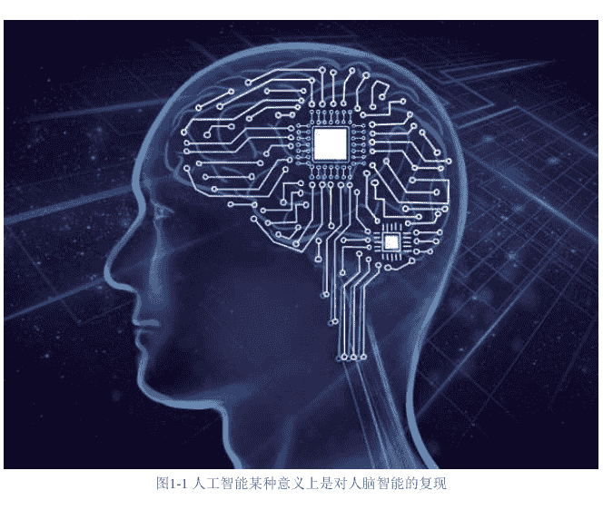

因此，研究AI在某种程度上也是在探索人类自身。而人对自我的认知有限，需要借助数学与机器不断逼近智能的本质。在这种需求驱动下，AI在计算机领域持续演进。需要强调的是，如今可落地的智能技术，多建立在精妙且可靠的数学公式与计算模型之上。随着迭代与算力提升，AI持续进化，不断逼近人脑智能，并在特定任务上实现超越。

当下AI已渗透各方面。比如谷歌在2012年构建的知识图谱，如图1-2，就是基于AI的知识表示与管理方法，能帮助使用者更快获取信息、提升搜索质量。此外，AI还广泛用于天气预测、自动驾驶、人脸识别如图1-3、智能医疗等场景。

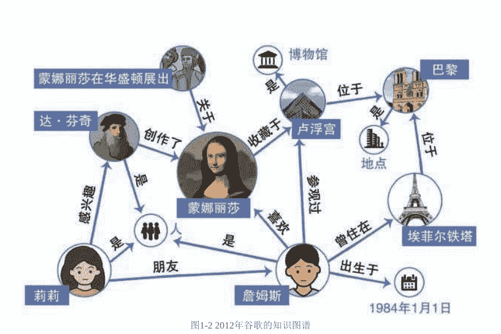

图1-2 2012年谷歌的知识图谱

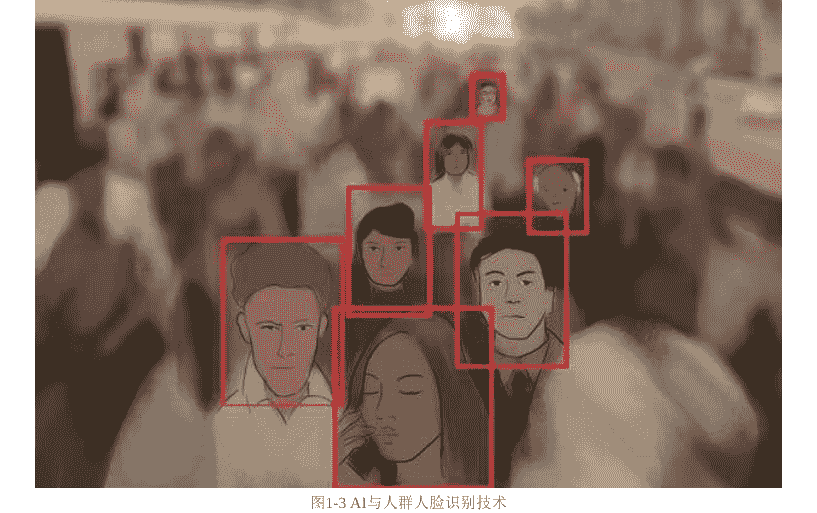

图1-3 AI与人群人脸识别技术

随着AI发展，人机博弈也成为关注点。1997年，IBM打造的“深蓝”超级计算机以2胜1负3平击败国际象棋世界冠军卡斯帕罗夫，如图1-4。当时深蓝主要靠暴力计算险胜，很快人类在更复杂的博弈中逐渐落下风。2016年和2017年，谷歌的AlphaGo先后战胜围棋冠军李世石和柯洁。2019年，DeepMind研发的AlphaStar以5:0击败《星际争霸2》世界冠军Mana，被誉为最复杂实时战略游戏的顶尖选手，如图1-5。这些案例显示，人工智能在某些领域已拥有不逊于人类的智能。

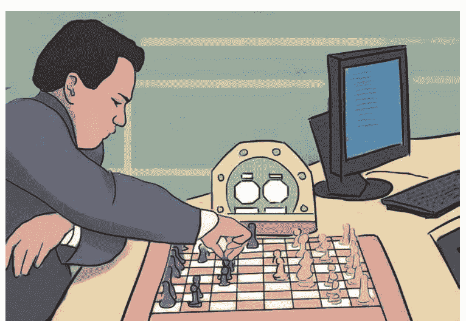

图1-4 深蓝与卡斯帕罗夫的国际象棋对决

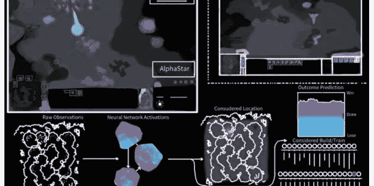

图1-5 人工智能AlphaStar眼中的Star Craft 2世界

从只能按指令执行的早期系统，到如今可模拟人类感官、服务社会、在博弈中胜过人类的各类系统，再到近期流行的能理解人类语言逻辑并完成语言任务的聊天生成预训练转换模型ChatGPT，人工智能正逐步进入大众视野，为人类文明注入持续活力，描绘出一幅充满可能性的未来图景。

### 二、AI的发展轨迹

20世纪50年代充满想象力。1950年，被誉为“计算机科学之父”的图灵发表《机器能思考吗？》，AI由此进入公众视野，如图1-6。1956年达特茅斯学院人工智能夏季研讨会提出“AI”一词，划时代学科正式诞生。

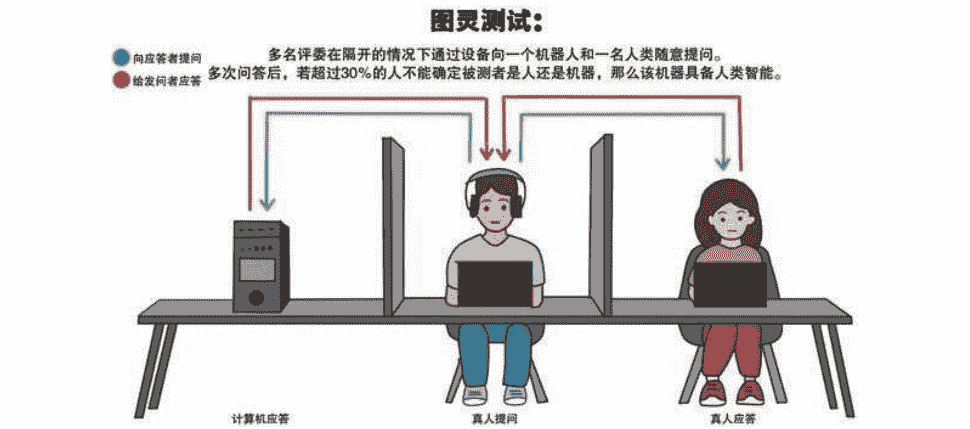

人工智能首个高潮出现在20世纪50年代至60年代初。当时普遍认为赋予机器逻辑推理能力就能获得智能，于是“连接主义”和“符号主义”两大思路出现。前者认为思维与认知源于神经元间复杂连接，尝试构建人工神经网络模拟神经元。后者认为人类抽象思考依赖符号系统，尝试把符号系统与推理规律植入机器。

首轮高潮带来兴奋，也制造了过高期待。20世纪60年代至70年代中期，AI研究陷入瓶颈，众多项目未达预期，期望受挫，相关项目被迫中止，发展进入低谷。连接主义等学派也遭受重创，长期停滞。

20世纪70年代初至80年代，研究者放下过高幻想，将焦点从理论转向实际应用。模拟专家知识经验的“专家系统”在医疗、金融、军事、环保、交通等领域取得成功，如图1-7，不仅提升效率、减少人工失误、节省成本，也推动了AI第二次浪潮。

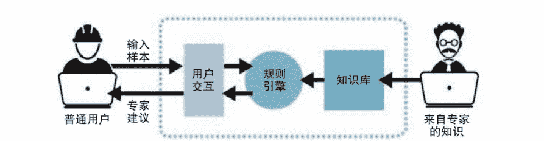

用户输入的信息包括：设备、成分、能源…… 专家系统据此持续不断地给出建议。

图1-7 专家系统的运作模式

同期，机器学习作为AI分支开始独立成学科，借助统计学、信息论等，让计算机能自动学习并改进性能，在大量实践中探索新方法。由于当时强调“从样例中学习”，该阶段也被称作“学习期”。

20世纪90年代至2010年，AI进入平稳期，机器学习成为主流，而上世纪五六十年代昙花一现的连接主义随着硬件与理论发展复苏，成为如今熟知的神经网络，如图1-8。

这一时期网络、数据库技术快速发展，推动AI进入大数据时代。算力与数据量提升后，1998年反向传播算法被用于训练LeNet-5神经网络进行手写数字识别，取得优异效果，标志着反向传播开始应用于深度神经网络，成为现代深度学习的重要里程碑。深度学习兴起后，机器学习进入新阶段，计算机在模拟人类智能和处理智能任务上取得惊艳进展。

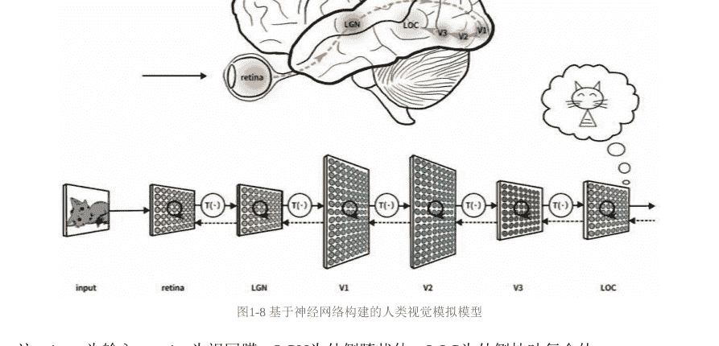

图1-8 基于神经网络构建的人类视觉模拟模型

注：input为输入；retina为视网膜；LGN为外侧膝状体；LOC为外侧枕叶复合体。

2011年至今，伴随大数据、云计算、互联网、物联网及GPU发展，AI表现突出，各领域需求更广，进入蓬勃发展期，在计算机视觉、无人驾驶、人机对弈等领域实现重大突破。

硬件算力提升让此前受限的方法迎来飞跃。以神经网络为代表的深度学习成为主流，其特点是模型参数众多，类似人脑中庞大的神经元数量。人脑约有1000亿个神经元，深度学习参数正不断逼近甚至有望超越这一数值，超级大模型应运而生。大语言模型LLM即其中一种。2018年Google提出的BERT在自然语言处理多项任务上展现巨大优势。随着数据量与参数成倍增长，大语言模型出现“涌现”现象，即量变带来质变，模型行为或性能出现新颖高效的表现。2022年OpenAI发布的GPT-3是当时全球最大语言模型之一，使用维基百科、新闻、小说、网页等海量文本训练，参数达1750亿，与人脑神经元数量同一量级。它能完成语言生成、文本分类、问答、机器翻译、语义理解等复杂任务，并生成更长更连贯的文本。可以说，GPT-3已学会人类语言逻辑与互联网中的大量知识。ChatGPT作为GPT-3的应用，看似聊天机器人，却已成为不少人生产力工具，对多行业工作模式产生深远影响。

不仅自然语言，计算机视觉领域也迎来突破。Meta发布的SAM模型作为视觉超大模型，经过海量图片训练，能精准识别并分割图像中的物体。这种像素级图像理解与语义理解能力，让业界惊叹计算机视觉迎来“GPT-3时刻”，如图1-9。无论是SAM还是ChatGPT，或其他超大模型，都因庞大参数与训练样本，在各自下游任务中展现强大通用能力。其出现标志着基于大模型的通用模型时代到来。

短短半个多世纪，AI从想象走向现实，成为时代关键词，为各行各业创造巨大智能红利。尤其是大语言模型的出现，让AI成为下一次工业革命的有力推手。未来在数据与算力持续演进下，AI将带来更多震撼与便利。阿西莫夫笔下欣欣向荣的智能时代，或许正在不远处招手。

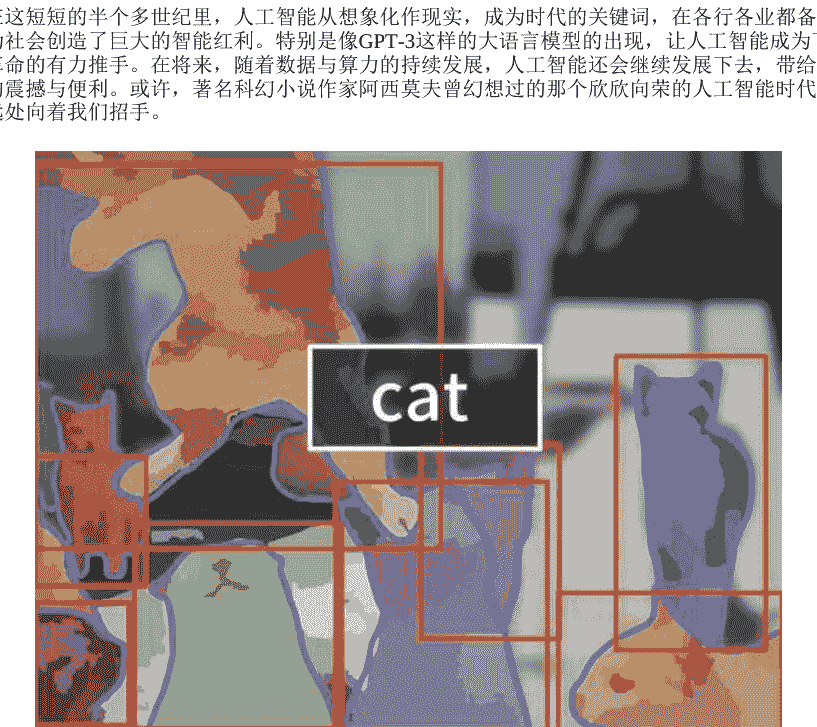

图1-9 SAM根据关键词“cat”分割出图片中的猫咪

### 三、智慧医疗全景

疾病是每个人无法回避的问题，医疗始终是社会刚需和关键民生领域，医疗服务质量深刻影响百姓幸福感。目前医疗体系仍有待完善，主要问题包括城乡发展不均衡导致的资源分配失衡，以及医生与人口比例偏低。据世界卫生组织及各国数据，中国医生人口比例为每万人19.8名，古巴达每万人84.2名，瑞士和德国分别为43名和42.5名，美国为26.1名。我国医护人员不足及压力可见一斑。

人工智能兴起为医疗体系发展注入新动能。AI可为医生提供较精准的诊断与治疗建议，提升工作效率与诊疗质量，同时为患者提供更便捷高效个性化的服务。现阶段智慧医疗将AI应用于医疗服务，进行长期监测或分析药物效果、助力疾病诊断等，在一定程度上提升医院运行效率。我们不妨深入了解AI在智慧医疗中的发展与应用，感受它如何走进生活、改变世界。

首先要弄清智慧医疗的含义与演化，如图1-10。智慧医疗的前身是“信息化医疗”。20世纪七八十年代，这一概念已在国内医院出现，当时被理解为用信息技术与数据库技术高效管理医院资源，如药品管理，属于面向医院的1.0时代。进入21世纪后，随计算机与互联网普及，信息化医疗进入2.0时代，医院开始使用电子病历、自助服务机等更便捷系统，这一阶段面向患者，便于就医与个性化数据记录。2010年后，智能手机与移动互联网兴起，各类就医App快速发展，医院引入线上自助挂号、病历查询等功能，避免线下就医的诸多麻烦，这一浪潮被称为3.0时代。此阶段在各大互联网巨头推动下，国内出现众多互联网医院，如图1-11。互联网医院依托互联网平台提供远程医疗服务，包括在线挂号、咨询、诊断、开药等。优点在于便捷高效性价比高，可为患者带来更灵活体验，同时在一定程度上缓解资源紧张，为偏远地区和慢性病患者提供便利。

#### （一）AI助力临床诊疗

2015年后，云计算、大数据、人工智能、5G等新一代信息技术迎来热潮，在政策与技术推动下，智慧医疗应运而生，医疗影像AI助力诊断、医疗机器人与AI助力临床决策体系等应用大放异彩。以下实例展示AI如何支持临床诊断与决策：

1. 谷歌DeepMind与英国国家医疗服务体系NHS的医院联合研发AI眼部诊断工具，通过扫描眼部光学相干断层扫描OCT图像，可识别50多种威胁视力的眼科疾病，准确率高达94%，不亚于人类专家表现。

2. Enlitic公司运用深度学习，从数十亿临床案例中提炼可操作建议，帮助医生借助医学集体智慧做决策。其开发的恶性肿瘤检测系统在临床试验中准确度比专业放射科医师高出50%，体现大数据与AI的巨大优势。

3. 阿里巴巴旗下阿里健康研发医疗AI“Doctor You”，依托阿里云与AI的强大扩展能力，搭建可提供沉浸式医师仿真教学培训系统，能从脱敏病例自动构建虚拟病人等，为临床医师能力训练提供平台。

百度推出的医疗大脑正是这一思路的典型落地。它汇聚海量诊疗记录与权威医学文献，用人工智能模型复现医生的问诊节奏，通过多轮对话不断追问、推演，基于用户自述的症状提出可能的病因假设，反复校验后给出倾向性建议。整个交互过程会自动沉淀、归类症状描述，为医生提供更宽的鉴别思路，尤其能为基层医师补齐问诊的深度与广度。

影像与数据的智能解析同样在提速诊疗。深度学习驱动的诊断系统可以快速读片，显著提升判断的速度与准确性；辅助决策系统则结合个人病史，给出个体化的处置方案。类似的应用已经层出不穷，但这只是人工智能在临床的表层，真正的挖掘空间还很大——从用药依从性监督、疾病风险预警，到虚拟医生、虚拟护士的常态化服务。更远的图景是，AI依托海量的病历大数据捕捉癌症的遗传规律，甚至在临床显现前实现前瞻性预警。过去看来不可思议的场景，随着技术成熟正逐步变得可期。

#### （二）AI 推动医药研发提速

临床决策之外，药物研发链条上人工智能的价值同样突出。传统新药从立项到上市动辄耗时数年甚至数十年，环节繁杂、成功率偏低始终是行业瓶颈。AI 正好切入数据密集的研发流程：挖掘药物、疾病与基因间的隐性关联，构建深层次的映射关系；对候选分子进行虚拟筛选，优先锁定活性更高的化合物进入后续实验。Tech Emergence 的研究指出，AI 可将新药研发成功率从约12%提升至14%左右，帮助生物制药行业节约数十亿美元。通过计算预测，企业可以提前筛选易成功的化合物、晶型以及研发路径，压缩试错范围、缩短周期，从源头降低成本，最终传导为药品价格与患者负担的下降。

人工智能不仅从生物医学中汲取经验，其远超人类直觉的计算推理能力也在反哺科研。2021 年刊载于《细胞系统》的一项工作展示了深度学习在预测侵袭性黑色素瘤转移能力方面的潜力。临床上，活检、血液检查、X 线、CT 与 PET 扫描主要用于分期判断和转移评估，但细胞行为的细微变化往往肉眼无法捕捉。研究团队构建了一个融合无监督深度学习、传统监督机器学习与生成式图像模型的算法，可将关键细胞行为可视化并估算转移风险。基于所提取特征，他们进一步反向设计了一个深度卷积网络，用于量化侵袭性黑色素瘤细胞的物理特性并判断其高转移潜力。AI 已成为生物医学科研的新型工具。

#### （三）AI 优化医疗资源配置

分级诊疗的政策导向已十分明确，《关于推进分级诊疗制度建设的实施意见》等文件明确了发展方向，国家也在加大对基层机构的投入、医师培训、设备与药品供给。分级转诊鼓励患者先在基层就诊、必要时再向上转诊，既缓解三甲医院压力，也提升整体资源利用效率。基于人工智能的智能分诊服务可整合机器学习分类、计算机视觉与自然语言处理，仅凭患者的口述、影像照片即可快速分诊并给出导诊建议；同时通过对影像、结构化数据与既往病史的综合分析，实现病情预判与风险分层。

医生负荷问题同样被 AI 缓解。大量重复性、典型病例占据了日常工作的主要时间。据《中国医师执业状况白皮书》，三级医院医师周均工作约51.05 小时，二级医院约51.13 小时，均高于一级医院的48.24 小时，2014 年数据显示医师周均工时已超过40 小时。门诊量持续攀升是主因，长期超负荷带来负面影响。智慧医疗可以在可控范围内参与辅助诊断，加快诊疗节奏、减轻压力；结合对未来就诊量的人工智能预测，更能合理排班，降低工时与疲劳度。

在机构层面，AI 的数据分析能力有助于优化资源投放与管理。基于疾病流行趋势的预测，可指导医院、药店提前应对就医需求。2020 年新冠疫情期间，研究者构建了传播与高峰预测模型，AI 综合搜索引擎的搜索频次与分布、社会文化因素导致的出行聚集性、病毒传播特征，对各城市未来一段时间的感染人数做出趋势判断，预测结果基本准确。药店据此动态调整药品备货，高峰前增加进货、高峰期配合订货周期适时降量；学校、企业与政府部门也能依据预测调整运营时间与防控策略，实现需求响应与成本效益的平衡。

智慧医疗的应用版图仍在快速扩张，从临床到管理都能感受到人工智能带来的改变。可以预见，AI 赋能的智慧医疗将持续深化，造福公众与社会，后续章节将继续拆解其关键细节。

### 四、实现人工智能的方法

当前主流实现路径是机器学习及其子集深度学习。先要厘清“学习”本身：生活中学习即通过经验积累知识与技能，而非先天固化。迁移到计算领域，机器学习就是研究如何利用经验数据，通过计算手段提升系统自身性能的学科。

为此形成了多套算法。算法在经验数据上“训练”，借助优化方法产出模型，再在新场景下“测试”以验证效果。理想的模型不应只记忆训练内容，而要具备泛化能力，能够应对未见数据。

在机器学习里，“经验”通常以样本形式呈现，可能是图像、文本或其他结构化数据，均会被编码为向量。样本常附带标签。以物体识别为例，每张训练图上标注物体名称即为全监督；仅部分标注为半监督；无标签则为无监督。测试时不提供答案，以此评估性能。训练集与测试集共同构成大规模样本基础。

常见任务有分类与回归。分类预测离散类别，如从 CT 影像判断是否患病；回归预测连续值，如基于气象观测预测次日温度。任务选择会影响算法与评估方式。

#### （一）线性模型

从最简单的关系入手，线性模型为每个属性分配权重，输入样本后计算加权和加上偏置得到预测值。例如用舒适度、油耗、价格预测销量，模型可能赋权1、-0.7、-0.5，再加偏置0.3。分类时需经非线性映射转为概率阈值判断。权重绝对值可解释为属性重要性，负号表示负向影响。参数通过最小二乘法寻找使总体误差最小的解，解唯一且易得。线性模型在简单问题上有效，但无法刻画交互与非线性效应，属性a在不同情境下作用相反时即失效。它是后续复杂模型的基础。

#### （二）决策树

人类在做复杂决策时常采用分步提问的方式，例如判断动物种类先问是否哺乳、是否食草、是否会喵叫，依据回答逐步缩小范围。决策树正是这种思路的算法化。训练时从根节点出发，携带全部样本，依据信息增益贪心选择能最大降低不确定性的属性进行划分，为每个分支创建子节点，递归进行直至节点内样本同质。推理时按属性值自上而下遍历至叶节点给出结果。

#### （三）支持向量机

分类的一种思路是将样本映射到高维空间，用超平面分隔正负类。众多可分超平面中，支持向量机选择使最近样本到平面的距离最大的那个，即位于两类正中间的超平面。这样对训练偏差更鲁棒。离超平面最近的样本称为支持向量。训练涉及核技巧，可隐式实现高维甚至无限维映射，支持非线性决策边界。

#### （四）聚类算法

聚类是无监督任务，按相似性将样本分组，类别事先未知。k 均值是最经典方法，输入k值与距离度量，目标是使每个样本到所属簇中心的距离之和最小。算法迭代进行：随机初始化k个中心，分配样本，重新计算中心，再次分配，直至分配不再变化。

#### （五）深度学习模型

深度学习由大量简单单元堆叠而成。以全连接神经网络为例，每层神经元执行线性加权和后经非线性激活函数处理，逐层传递。浅层操作简单，但深度堆叠可表达复杂映射，且在大规模数据下表现出良好的泛化能力。训练多采用梯度下降，将训练集上的误差视作模型参数的函数，通过反向传播计算梯度逐步降低误差。不同于线性模型易得全局最优，深度模型易陷入局部最优或鞍点，需多种优化策略。

##### 1. 卷积神经网络

卷积神经网络专为视觉任务设计。网络各层包含多个卷积核，每个核学习一种局部模式，在整张图上滑动检测激活位置，输出压缩特征图，层层抽象。平移不变性是关键：目标在画面不同位置语义不变，无需为每个位置单独建模，卷积核的共享大幅降低参数量并提升效率。

##### 2. 注意力机制

注意力机制（attention mechanism）[5] 本质上是在模仿人类的注意方式。为了让它能落地，研究者把它拆解成三个基本零件：查询、关键字、值。查询相当于注意力的起点，比如前面例子里的主题、动词或人脸；关键字和值是一一对应的配对，用来代表文本或画面里的其他要素。机制的工作逻辑是，对每一个查询去寻找最贴近的关键字，也就是“聚焦”到它，再根据关键字与查询的匹配程度，把对应的值加权混合起来，得到该次查询的输出。一次完整的计算往往要在众多查询、众多键值对之间反复进行，以便信息充分交互。

键、值、查询这三者的来源不同，就会衍生出不同的注意力变体。最常用的做法是拿上一轮的输出结果来生成本轮的查询、关键字和值，自己找自己的特征，这种形式被称作自注意力机制。注意力最初诞生于自然语言处理，所以最开始每个查询、关键字、值都对应一个词；后来被带进计算机视觉，查询、关键字、值就变成了图像上的一小块方形区域。

依托注意力机制的模型在自然语言处理和计算机视觉里都表现突出。它们不仅在多任务上很强，研究者还发现其对长距离依赖的处理能力更佳：相比之下，传统 NLP 模型容易遗忘前面读过的文字，视觉里的卷积神经网络则更偏爱局部甚至纹理信息。注意力模型也更能抵御干扰[6]。当下许多顶尖的大型语言模型都建立在注意力之上。

##### 3. MLP-Mixer架构
注意力虽然强劲，却也有明显短板，其中之一就是计算量会随图像面积急剧上升。MLP-Mixer架构[7]展示了用简单的多层感知机也能逼近注意力水平的性能。先把图像均匀切成若干小块，架构名字里的 Mixer 指的就是两种混合操作：一是在块之间做混合，二是在单个块内部做混合。整个混合器只需要矩阵转置加全连接网络，计算成本仅与图像面积成线性关系。把多个混合器堆叠起来，整体效果可以接近卷积神经网络和注意力模型，结构更简洁、开销更低。

#### （六）强化学习
前面介绍的方法大多面向相对静态的任务，推理时只需要输入一个样本就输出一个结果。这种设定把问题极度简化，使用者把任务压缩成一个标签，模型一次决策就能知道成败。但现实任务往往是多步的，第一步完成后无法立刻判断最终结果，也很难一步到位。人类面对这类问题会摸索、试错，强化学习就是为了让机器具备类似能力的方案。

在强化学习里，正在学习的模型叫智能体。研究者把智能体与环境的互动抽象为一个循环：每个时刻，智能体先对环境做一次观察，然后基于观察做出决策并执行动作；环境接收到动作后会根据自身状态发生变化，同时回馈一个奖励给智能体，奖励可以是正的也可以是负的表示惩罚。这个互动不断重复，直到满足终止条件，如图1-15。

以学骑自行车为例，智能体可看作骑车人的运动神经系统，环境则包括身体、自行车和重力等。一个时刻里，智能体通过传感器察觉身体和车身的位置与平衡，发现自己向左倾，于是决定把车把向右转60°并执行；环境随之改变，车身运动却因动作过大和减速导致由左倾变成摔倒，并给智能体带来“疼”这一负奖励。

智能体的目标是最大化累积奖励。为此，有的做法是为每个状态估算到达该状态后未来奖励的总期望，然后选择最优的下一个状态转移；另一些做法是为每个状态下的每个动作估算未来奖励的期望，然后挑选最优动作执行。早期方法用表格记录这些值，但状态空间可能极大甚至无限，表格开销不可接受，后来改用深度网络来近似，根据状态和观察直接做决策。

要最大化累积奖励，仅依赖已尝试过的行为是不够的，强化学习的关键在于探索与利用的平衡，这一平衡由优化算法实现，比如时序差分预测、近端策略优化 PPO 等。

强化学习的应用相当广泛，AlphaGo、AlphaZero 等围棋 AI，以及能在 DotA、StarCraft 2 等复杂决策游戏中与人类对抗的 AI，都是典型成果。一些看似不相关的进展也借助了强化学习，例如视觉里的部分硬注意力模型因不可微而采用强化学习优化，对话机器人里 AI 的回复会影响后续对话走向，也常使用强化学习来训练。

#### （七）生成模型
除了分类、回归、聚类这类判别任务，许多算法会学习样本分布并创造出相似而新颖的结果，这类方法统称为生成模型。近年的 AI 绘画、对话系统多属于这一阵营。

##### 1. 生成对抗网络
生成对抗网络 GAN[8] 由生成器和判别器两部分构成。生成器从随机噪声出发合成新样本，判别器则负责区分真实训练样本和生成器的输出。两者互相对抗、共同进步，最终生成器能产出与训练数据非常接近的结果。

##### 2. 扩散模型
近年来备受瞩目的扩散模型采用另一条思路：先逐步向样本加入噪声，让复杂的真实分布逐渐“扩散”成简单的正态分布；再学习每一步加噪前后的映射来掌握去噪规律；最后反转这个过程，从正态噪声采样并逐步去噪，得到接近训练样本但并非复刻的图像。NovelAI 等热门绘画模型多采用此路线。与基础版本不同，实际系统会额外输入一种“引导”，比如物体名称、属性等组成的标签串，训练时把引导也喂给去噪模型，从而实现有条件生成，用户通过修改标签串就能精细控制画面。

##### 3. 大型语言模型
生成模型也被用来学习知识并迁移到下游任务。GPT 系列等大型语言模型就是典型。以 GPT-3 为例，它接收一句话的前几个词并预测下一个词，预训练本质上是在海量文本上做接龙，从而习得语言规律。它既可直接生成自然语言，也能把学到的知识迁移到别的任务上做微调。

在预训练基础上，再做指令微调，并用强化学习结合人类反馈提升输出质量，就形成了 ChatGPT 这类具备对话能力的系统。

这类模型动辄成百上千亿参数，传统预训练加微调的成本已很高。但模型在大量数据上已经掌握了理解、组织语言乃至一定逻辑和数学能力，只需被“唤醒”。于是研究者转向提示 prompt，利用输入提示让模型在不改动参数的情况下调用已有知识。

这种做法带来了零样本学习能力[9]。经典案例是基于前提判断假设的合理性。做法是用模板把问题转成自然语言：先写前提，再写句号，然后写假设并加上“是____合理的。”，让模型填空。例如前提“我正在吃晚饭”，假设“我没有在吃东西”被转成“我正在吃晚饭。我没有在吃东西是____合理的。”模型若填“是”“很”等肯定词，说明假设合理；若填“不”“或许”等，则为不合理或中性。语言模型在海量文本中积累的推理能力使其能完成零样本任务。有趣的是，这类任务依赖问题本身就是自然语言描述，能把判别定义也纳入生成形式，因而更早出现在 NLP 领域。

提示中加入少量带标签示例，还能赋予小样本学习能力。用模板和已标记样本构造若干示范，再把待问问题接在最后让模型续写即可。以评论情感为例，先给出“评论：孩子很爱吃。情感：积极。”“评论：迟迟不发货，客服态度也很差。情感：消极。”等示例，最后问“评论：好吃，下次还来。情感：____。”模型补全后即可判断倾向。与传统训练不同，这不涉及梯度下降或参数更新，样本需求极少，交互直观，受研究者和开发者青睐。小样本能力与上下文学习 in-context learning[10]密不可分。理论解释认为，模型在预训练中学会了推断话题或意图，再从示例中推断问题意图，最后利用已有知识作答，而非简单记忆示例映射。

无论零样本还是小样本，本质都是激发模型内部知识。思维链 chain of thought 也值得关注。人类解题常把复杂问题拆解逐步求解，类比到大模型上也能提升质量。研究发现，给出逐步求解的示范能让模型模仿，随后发现仅在开头加上“让我们一步一步地思考 let's think step by step”就能显著提高算术等任务的准确率。

人类交给大模型的任务往往多步骤且可能需要回溯。基于 GPT-4 的开源项目 AutoGPT 正是为此而生。它把用户任务分解为子任务并逐一执行，同时提供搜索功能，把 GPT-4 提出的关键词送去检索并把结果回传；在每一步要求模型生成想法、反思并给出详细计划，执行搜索、解读结果、总结后再进入下一步。

大语言模型是迈向通用人工智能的重要里程碑，但仍有诸多不足。训练和推理成本极高、数据需求庞大，普通用户和研究者难以自建；模型会产生幻觉，输出不存在的事实；模型规模增长带来的能力跃迁至今缺乏令人满意的解释。受其成功启发，视觉等领域的研究也纷纷拥抱大模型。高效训练、模型压缩、大语言模型涌现能力的解释成为热点，多模态大模型，即能同时处理文本、视觉、听觉等多种信息的大模型，也是构建通用智能的关键方向。

## 第二章 医疗数据的全景分类
### 一、医疗数据为何关键
医院在社会中既是提供诊疗护理的机构，也是医学研究的前沿阵地，承担大量疾病分析职能。

疾病治疗依赖医学研究，而研究离不开疾病信息与数据。随着技术发展，医疗数据在个体诊疗中的价值进一步凸显：通过对大量同类病例的分析总结，可提炼出一般规律来辅助认识与治疗，如图2-1。

有价值的数据离不开完善的采集整理流程，而医院已拥有成熟的信息系统。医疗信息系统借助计算机、网络通信和数据库技术，为医院内部各部门以及不同医院之间提供病人诊疗信息与管理信息的采集、存储、处理、提取和交换，并满足授权用户的需求，如图2-2。

在真实诊疗中，从症状描述到诊断、治疗、用药，全部通过信息系统完成数据采集与传输。常用系统包括医院信息系统 HIS（如图2-3）、临床信息系统 CIS、实验室信息系统 LIS、影像归档与通信系统 PACS（如图2-4）以及医院资源规划 HRP 系统。

注：DICOM 即医学数字成像和通信，是医学图像与相关信息的国际标准。

我国现有医院超 3.6 万家，年诊疗人次接近百亿，庞大的医疗活动为智慧健康医疗提供了数据基础，如图2-5。这些数据对疾病研究防治具有参考价值，公共卫生数据也能为传染疫情、社会卫生安全提供预警。

全球医疗健康数据已达数百艾字节 EB 并持续增长。1 字节由 8 个比特组成，1 艾字节为 2^60 个比特，约含 115 亿亿位二进制位，数百艾字节的规模已难以想象。

对临床医生而言，海量数据难以有效挖掘。为让这些数据真正发挥作用，智慧医疗应运而生。它是一种基于大数据的人工智能医疗技术，能收集、分析、汇总海量医疗信息，减轻医生负担并辅助诊断治疗。

智慧医疗涉及的数据类型丰富多样，总体可分为五大类：医学文本、影像、基因、音频、视频。它们共同构成患者的病历、诊断治疗记录、医生报告、医疗图像、肺音等信息。

文本数据主要来自医院信息系统中的电子病历，包括诊断、治疗、检查结果、健康状况、治疗方案、药物使用等，以及中外医学文献的诊疗方法。自然语言处理被广泛用于总结患者情况并辅助决策，同时可将非结构化文本转为结构化数据，便于大规模分析与预测，如诊断预测、风险评估等。

影像数据借助计算机视觉实现自动分析、诊断与预测，例如 CT 肺部图像的结节检测、脑部 MRI 的疾病诊断。影像数据来源于 PACS，通过成像技术获取体内结构，常用方式为 X 射线、CT、MRI。

X 射线利用穿透性和不同组织对射线的不同吸收与散射来显示组织密度分布，常用于胸部、腹部、骨骼评估。

CT 与放射原理相似，但更强调断面关系，扫描结果是局部断面图，可揭示三维内部细节，如图2-6。CT 主要用于检测组织内部结构，如肌肉骨骼系统、实质器官、体液分布等。

MRI 利用无线电波和磁场，依据组织质子特性成像，常用于软组织和神经检查。相比 CT，MRI 无需电离辐射，但对体内有植入物或不可移动金属的患者存在限制。

MRI 有多种成像模式。T1 加权突出脂肪为主的结构，液体显暗、脂肪明亮；T2 加权突出水和脂肪，脂肪和液体均显亮。这种差异对放射科医生和 AI 模型处理效果都至关重要。

基因数据反映核心遗传信息，序列中不同物质由不同符号表示，如核酸的 A T U C G 五种碱基，蛋白质的 20 个氨基酸单字符。

语音与视频数据经编码后可用于人工智能分析，实现心脏杂音、肺音等的自动诊断，在智慧医疗研究中潜力巨大。

### 二、智慧医疗信息系统
#### （一）医院信息系统
医院信息系统 HIS 是医院管理的核心，在管理中扮演指挥官角色。它整合各部门信息，包括患者管理、挂号、门诊住院服务、医生排班、药房管理、财务管理等。可提高效率、优化流程、支持决策与资源管理，也是智慧医疗数据管理的核心。

#### （二）临床信息系统
临床信息系统 CIS 面向临床医生，记录和管理患者的临床信息，如病历、诊断、治疗计划、医嘱等。它能提供实时临床数据，辅助医生做出准确诊断与治疗决策，并促进医生间协作与沟通。

作为信息交流枢纽，临床信息系统主要涵盖以下方面：

临床信息系统：智慧医疗的中央大脑

电子病历是临床信息系统的核心载体。医生借助该系统录入患者的个人信息、主诉症状、最终诊断、治疗方案以及手术记录等诊疗全流程信息。电子化的记录让数据更完整、更易读、更方便共享，医生调阅病史变得高效，诊断和治疗决策也因此更精准。

医嘱管理同样依托同一平台完成。处方用药、检验检查项目、各类治疗安排都可以通过系统下达，系统保证医嘱传达及时且准确，并内置风险预警，例如在过敏史或药物相互作用时自动提醒，有效降低用药差错，提升用药安全。

检验结果管理实现与实验室信息系统的无缝衔接。检验数据实时推送至临床信息系统，医生可直接查阅、对比分析并据此判断病情。系统还能自动生成规范化的检验报告，方便医生和患者快速获取结果。

影像资料管理与影像存档传输系统打通。医生在系统中即可调阅X射线、CT、MRI等影像资料，支撑影像诊断、手术方案设计和疗效随访。

在数据层面，系统持续汇聚海量临床信息，服务于医疗质量评价、科研探索和流行病学分析。通过挖掘数据背后的规律和趋势，为临床实践和科学决策提供依据。总体来看，临床信息系统打通了各业务系统间的信息通道，成为智慧医疗中临床信息的“档案室”。

#### （三）实验室信息系统：从标本到报告的闭环管控
实验室信息系统负责实验室全流程的检验数据管理，接收医嘱与标本信息，追踪检验进程，生成并存储结果，同时与临床信息系统关联，提升检验准确率与效率，确保数据及时可靠。

- 医嘱管理：系统接收医生开具的检验医嘱，按要求生成检验项目清单，记录患者基本信息、医嘱内容、采样时间等关键要素，为技术人员提供执行依据。
- 标本管理：对标本流转进行全程追踪，建立唯一标识码，记录采集时间、人员、地点，确保可追溯与准确性，并提供规范的采集保存指导。
- 检验过程管理：监控检验全过程，指导样本处理、分析操作和结果录入，自动计算并校验结果，保证一致性，同时生成检验时间轴，清晰呈现项目执行进度。
- 结果生成与报告：生成检验结果并与患者临床信息关联，自动输出包含数值、参考范围、异常提示及解读的报告，通过系统内传输或打印交付医生用于诊疗。
- 质量控制与质量管理：支持实验室质控体系建设，记录分析质控数据，监测仪器性能与准确性，生成质控报告与统计图表，辅助持续改进质量管理。

借助实验室信息系统，实验室工作效率和结果可靠性均得到提升，标本与数据的可追溯性得以保障，实验室与临床沟通更顺畅，为诊断治疗提供坚实支持。

#### （四）影像管理系统：影像资料的高效管家
影像管理系统即PACS，专注于医学影像数据的存储、管理与传输。医生可迅速调阅并对比影像，进行诊断与治疗规划，并支持远程传输与共享，促进多学科协作。

- 影像存储和检索：提供集中存储库，收纳X射线、CT、MRI、超声等多类影像，替代传统胶片与纸质存档，实现安全快速存储，随时检索查看。
- 影像查看和比对：提供强大的图像浏览界面，可调节对比度、亮度等参数以细化观察，支持多时间点并行显示，帮助评估疾病进展与治疗效果。
- 影像远程传输和共享：影像可经网络推送给其他医师寻求第二意见或专家会诊，尤其对偏远地区或专科资源不足的场景意义显著，加速诊疗进程。
- 影像报告和文档化：将诊断结论与观察记录文档化，形成影像报告并关联病历，为全员提供完整健康资料，也便于后续数据管理、追踪及科研质控。

总体而言，影像管理系统以高效、便捷、安全的方式管理影像全生命周期，在诊断、治疗和协作中发挥关键作用，提升诊断能力与治疗结局。

#### （五）医院资源规划管理系统
医院资源规划管理系统是覆盖医院运营全景的综合管理平台，涵盖人力资源、物资采购、设备管理、财务会计、绩效考核等多个维度，帮助医院精细化管理资源，提升效率与服务品质，优化整体运营。

系统实现对人力、物资、设备、财务的统一管控，改善运营效率、资源利用率和服务质量，同时输出数据支持与决策分析，助力管理层科学决策与战略制定。

### 三、文本数据
医学文本数据涵盖病历描述、检查报告所见、政策法规、管理规定、新闻时事、专业网站及文献数据库等，蕴含个体与群体诊断、治疗与结局的宝贵信息。

医学术语复杂且文本多为非结构化，信息抽取难度较大。自然语言处理技术已广泛应用于医学文本信息的自动提取，相关数据集被构建用于模型训练与评估。

这类数据集是开发与评估自然语言处理模型的重要资源，可训练人工智能模型帮助医护人员做出更精准的诊断与治疗决策，同时可识别高危疾病人群，实现更早干预、延缓疾病进展。

#### （一）MIMIC-III
MIMIC-III即ICU医学信息集成系统第三版，是由麻省理工学院计算生理学实验室、贝斯以色列迪康医学中心与飞利浦医疗联合发布的大型开放重症监护数据集，可免费使用。

该集数据被广泛运用于机器学习模型训练与临床决策支持系统开发，其核心优势包括：

- 数据的广泛性与持久性：来源于贝斯以色列迪康医学中心ICU，包含2001-2012年间53,423名成人及2001-2008年间7,870名新生儿数据，12年纵向数据可用于研究临床结局随时间变化。
- 临床数据的全面性与翔实性：既收录结构化数据，如人口统计、约每小时一次的生命体征、实验室结果、用药记录、影像报告、院内院外死亡信息，也收录医生病历、护理记录、治疗过程等非结构化数据，多模态数据支持深度学习、自然语言处理与统计分析等方法。
- 开放共享与隐私保护：数据集公开免费供全球使用，同时已脱敏去除姓名、住址、电话等可识别信息，符合隐私与伦理规范。

基于MIMIC-III，国际学者发表了大量研究成果。如2018年，研究团队利用该数据构建人工智能模型辅助败血症治疗，从海量病例中挖掘隐含信息、分析治疗决策并给出最优方案。

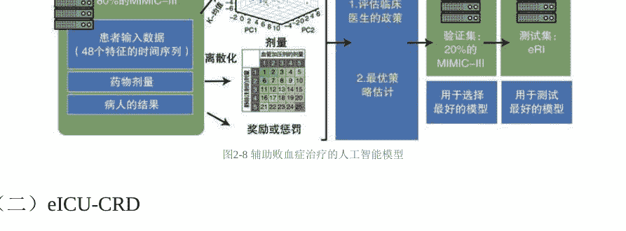

#### （二）eICU-CRD
电子重症监护协作研究数据集与MIMIC-III类似，由麻省理工学院计算生理学实验室与飞利浦医疗共同构建，2018年5月17日发布第二版，收录2014-2015年美国多家医院20万余例ICU患者的临床信息。

eICU-CRD在MIMIC-III基础上通过多中心数据扩展研究范围，缓解医务人员手工收集生命体征、护理计划、疾病严重程度、诊断与治疗信息等繁重工作。两者互补，已有大量研究联合使用，如复旦大学附属中山医院重症医学科利用两大数据库结合机器学习动态预测危重脓毒症患者凝血功能障碍风险，并解释模型关键特征。

#### （三）PubMed
PubMed由美国国家医学图书馆维护，是面向公众的大型生物医学文献数据库，收录数千种期刊、报告与会议记录的超过3000万篇文献题录与摘要，早已成为生物医学研究与临床参考的核心入口。

- 数据多样化：覆盖临床医学、公共卫生、牙科、护理等广泛主题，为人工智能算法训练与测试提供理想素材。
- 词汇标准化与摘要结构化：采用医学主题词表MeSH进行索引，部分文献提供结构化摘要，含引言、方法、结果、结论等，便于算法精准定位与概念抽取。
- 资源集成化：可与统一医学语言系统UMLS等资源整合，解决同义异词与信息分散问题，提升概念识别与映射准确性。
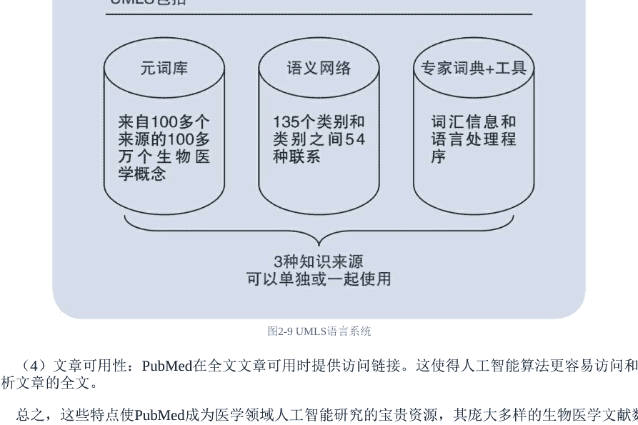
- 文章可用性：当全文可获取时提供访问链接，便于算法深入分析全文内容。

这些特性使PubMed成为医学AI研究的重要资源，支撑算法开发与临床改善。例如，MetaMap算法由美国国家医学图书馆研究人员开发，利用PubMed识别文本中的医学概念并映射至统一医学语言系统，可抽取疾病、症状、治疗方案等信息，广泛应用于药物不良反应识别、电子健康记录分析与临床决策支持。

### 四、图像数据
医学图像分析算法是计算机辅助诊断的关键，高质量的图像数据集是算法研发与评估的基础。这些数据集包含数千至数百万张图像及标注，支持模型训练与验证，帮助医生精准诊断与决策。

医学图像提供身体内部结构的视觉信息，临床常用类型包括X射线、CT、MRI等。

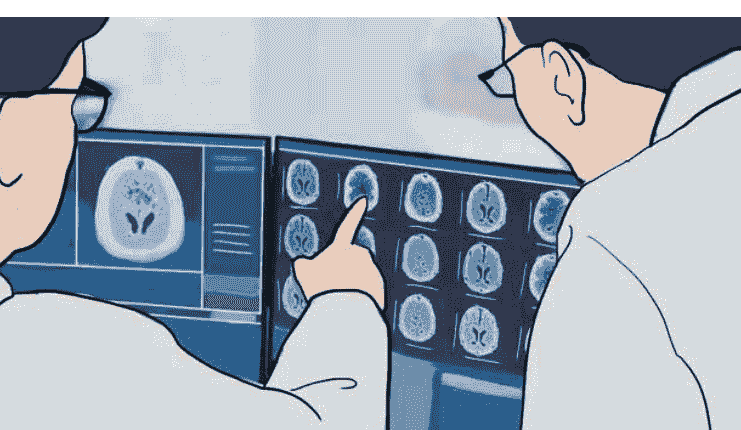

#### （一）经典医学图像的特点
- X射线医学图像的特点：通过探测X射线穿透身体后形成的影像，主要用于骨骼及肺部、胸廓等软组织检查。二维成像获取快、成本低，但灰度范围窄，对软组织与血管显示分辨率有限。
- CT医学图像的特点：通过旋转采集的X射线重建成三维影像，对组织器官呈现更全面精细。灰度范围宽，可区分多种密度组织，具备高分辨率三维重建能力，利于复杂解剖检查与手术规划。
- MRI医学图像的特点：利用强磁场与射频脉冲成像，对软组织、脑部、神经系统显示优异。对比度与灰度分辨率高，可清晰分辨不同组织与病变如肿瘤、炎症，并支持矢状面、冠状面、横断面等多平面成像，便于全面评估病情与制定治疗方案。

各类型影像各有优势，医生据此辅助诊断，研究者依此开发与验证影像分析与计算机辅助诊断算法。

#### （二）医疗图像数据集
- X射线图像
① ChestX-ray8数据集[15]：包含32,717名独立患者的108,948张胸部正位X线图像，采用自然语言处理从放射报告中挖掘出8类疾病标签，单张图像可携带多标签。
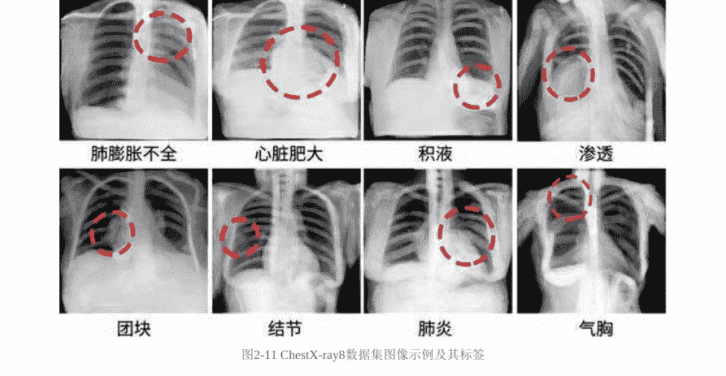
② MURA数据集[16]：聚焦肌骨系统，由斯坦福团队构建，收集美国多家机构的4万余张各部位X线图像，按放射科报告标记为正常或异常。数据量大、部位多样，可用于自动疾病检测与诊断算法开发及图像特征与临床结局关系研究。
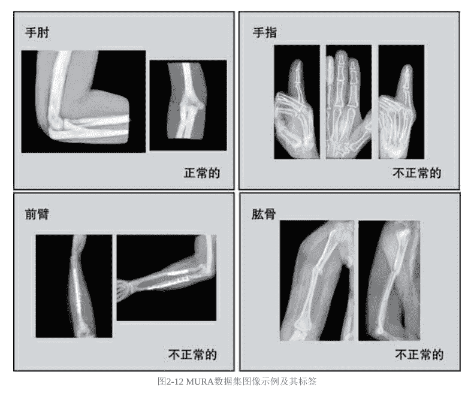
MURA的规模与多样性使其适合开发可检测不同部位与病变异常的实用模型。
③ CheXpert数据集[17]：斯坦福团队创建的大型胸部X线标注集，含65,000余名患者的224,000余张图像，由认证放射科医生标注14种常见胸部病理。独有不确定性标签，可反映医生对病变存在性的不确定，有助于训练能量化不确定性的模型，并在胸部X线判读研究中显著提升模型准确率。

- 电子计算机断层扫描图像
① DeepLesion数据集[18]：由美国国立卫生研究院临床中心开发，是迄今规模最大的多类别标注开放CT数据集，涵盖肺、肝、淋巴结等部位良恶性病变。每例均标注病变位置、大小及语义特征，并附放射学报告，共4,427名患者32,735张CT与病变信息。
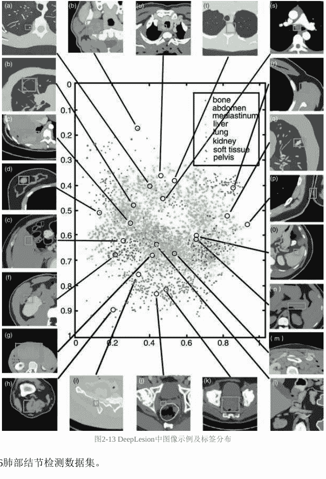
② LUNA16肺部结节检测数据集[19]：基于LIDC/IDRI构建的胸部CT集合，用于自动肺结节检测算法研发。共888例CT重采样至1mm各向同性体素，包含多种成像参数、结节类型与大小，并由4名资深放射科医生提供标注作为真实标签。

### 五、基因数据

基因与医疗大数据的智能化解读

基因即遗传因子，本质是携带遗传信息的DNA片段，是决定性状的基本单元。基因组则是细胞内整套遗传信息的总和，包含基因本身及基因间DNA。人类基因组位于细胞核的23对染色体中，22对常染色体加1对性染色体，几乎涵盖了个体发育与生理功能所需全部信息。

不同生物的基因组大小差异极大。病毒和细菌的基因组可很小，而部分植物的基因组则庞大到难以解读。有趣的是，基因组大小与生物复杂性并不成正比。人类基因组约30亿个核苷酸，对比之下，日本花梨稻的基因组约1500亿个核苷酸，约为人类的50倍。迄今人类是唯一完成自身基因组测序的物种，但自然界中远比人类基因组更大的生命体系比比皆是。

为了系统解析人类遗传与进化，美国科学家于1985年提出人类基因组计划，1990年正式启动。美、英、法、德、日及中国等国家共同参与，预算约30亿美元。原计划在2005年前解读约2.5万个基因、30亿对碱基的密码，并绘制基因图谱。截至2003年4月14日测序工作基本完成，2001年已公布初版图谱及分析结果。项目还建立了计算机分析系统，评估伦理法律社会问题，并借助转录组学、蛋白质组学等手段进行表达谱和突变分析以挖掘致病基因信息。整个计划产出约30亿个碱基对的序列，数据量达到数太字节级别。

面对如此海量数据，研究者采用数据库集中管理。数据库相当于有规则的数字仓库，可容纳百万到上亿条记录，有序存储才能保证高效检索。

#### （一）GenBank序列数据库
GenBank由美国国家生物技术信息中心维护，是INSDC国际核苷酸序列数据库协作的一部分，收录公开可用的核苷酸序列及其蛋白翻译注释。它汇集全球实验室数据，覆盖50多万种已描述物种，其中478000种物种对应的序列超过21亿条，总碱基对达9.9万亿。数据量近年呈指数增长，约每18个月翻倍，并每日与欧洲核苷酸档案库和日本DNA数据库交换，确保全球覆盖。近年亦持续更新新型冠状病毒数据资源。

通过地点筛选可获取特定采集地的新冠序列，按采集时间或入库时间检索也很便捷。SARS-CoV-2的遗传物质是RNA病毒中最大的，全长约26至32千碱基。基因组5'端约三分之二为重叠开放阅读框，编码复制转录相关的非结构蛋白；后三分之一编码刺突蛋白、小膜蛋白、膜蛋白和核衣壳蛋白等结构蛋白，并包含编码辅助蛋白的嵌套序列。这些结构蛋白决定病毒组装、稳定性和侵袭能力。

利用统计学习收集多省患者数十株全基因组序列对比显示高度保守，少量差异可能源于人群传播中的适应性突变。借助染色体定位的基因片段和人工智能，可将病毒结构信息与变异趋势预测关联。

基因序列相似性可量化，同源性则需进化事实验证。相似度高提示可能同源，经碱基替换、缺失、重组等演化而来。若存在显著保守性，通常可推断共同进化历史，进而推测结构功能相似。一般认为蛋白结构功能保守性高于序列，相似度超过30%多被视为同源可能。

高通量测序显示，SARS-CoV-2与SARS冠状病毒约79%同源，与中东呼吸综合征冠状病毒约50%同源，而与蝙蝠样冠状病毒Bat-SL-CoVZC45同源性达87.99%，与Bat-SL-CoVZXC21达87.23%，进化关系更近且分支更长，提示其可能源自蝙蝠。

#### （二）UCSC基因组浏览器
UCSC基因组浏览器是最早的基因组浏览工具之一，最初面向人类基因组设计，现已扩展至大量脊椎动物和模式生物的组装体与注释，并提供查看分析下载功能。它能快速可靠地展示任意规模基因组片段，叠加数十种注释轨迹，如已知基因、预测基因、EST、mRNA、物种同源等，用户亦可添加自有注释用于教学科研。

多数用户利用其按位置或编码序号浏览原始信息，平台提供80多个物种的可视化基因组信息，并可自定义注释。现在网站增设新冠专题，提供加州大学圣克鲁斯分校发布的新型冠状病毒完整分子代码，供全球研究使用，例如对2020年5月前COVID-19传播轨迹的结构化存储。

机器学习已广泛应用于基因组学，数据库数据作为训练集用于预测类型与应答。深度学习具备强学习与灵活性，在充足训练数据下可自动挖掘特征规律。

白细胞异常色素减退综合征即Chediak-Higashi综合征，是常染色体隐性遗传病，全球报道约500例。临床表现为眼部皮肤褪色、免疫低下致反复感染出血，80%至85%病例进入加重期出现发热、淋巴结肝脾肿大、贫血血小板减少，几乎均伴神经系统感知、平衡、运动知觉下降。实验室已推出含溶酶体运输调节基因在内的10余基因二代测序检测包用于诊断鉴别。

相较人工，人工智能在调控基因组学、变异检测、致病性评分中更精准高效。深度学习提升基因组数据可解释性，将原始数据转化为可操作的临床信息，改善诊断方案、指导用药及减少副作用。但从原始数据到分析仍耗时，深度学习可显著缩短流程。

### 六、音频数据
医学音频数据看似信息量小，却对诊断和规律探索意义重大，可用于心肺疾病、睡眠呼吸暂停、神经系统疾病的检测与监测。心脏和肺部声音记录能反映杂音、爆裂音、哮鸣音等异常；语音语言记录可辅助识别阿尔茨海默病、帕金森病等神经疾病。训练后的模型可做声音分析、健康变化预警，甚至开发声波诊断设备，例如识别前列腺癌的声波设备提升了诊断准确性。音频数据与其他模态互补，是医疗人工智能的关键组成。

#### （一）胸壁肺音数据集
约旦科技大学研究员用电子听诊器高质量采集健康与患病人群胸壁肺音，覆盖哮喘、心力衰竭、肺炎、支气管炎、胸腔积液、肺纤维化、慢性阻塞性肺病共7种疾病。医生决定听诊位置，录音经三种不同频率滤波强调不同频段。该数据包含112名受试者，35名健康、77名患病，女性43人男性69人。音频经多种降噪处理，可用于机器学习特征提取与算法开发，亦可重复用于卫生专业人员听诊技能培训。

#### （二）心跳声数据集
发布于Kaggle的心跳声数据集用于心音分类挑战，数据来自iStethoscope Pro手机应用收集的公众记录和医院DigiScope数字听诊器的临床试验，共超1200条音频。任务一为定位S1、S2并分割正常心音，任务二为将心音分为4类。人工智能可挖掘人工难以察觉的声音模式，辅助更精准诊断和个性化治疗策略。

此外如PriMock57数据集包含57次模拟初级保健咨询的录音与笔记，对自动语音识别价值较高，结合对话模型可自动生成临床文本、提取要点并形成摘要。

医学音频使用相对较少，主要因采集需专业设备与医师、解释存在主观差异、相关研究与工具较少。但对其应用兴趣日益增长，高质量数据集的开发也在推进。

### 七、视频数据
大规模视频数据在医疗中应用仍慢，制约因素是数据量大、标注困难、缺乏统一标准，且复杂分割模型临床转化挑战高。但手术室感知与决策支持的发展显示出巨大潜力。

#### （一）内窥镜胆囊切除手术视频数据集
CholecT50为内镜胆囊切除术视频集，含50个视频，其中45个来自Cholec80，5个来自内部数据，共100个动作三元组标注。细粒度指对业务对象进一步细分，动作三元组以工具、动词、目标表示活动，数据集包含6类工具、10个动词、15个目标，在1fps帧率下产生超151千个三元组实例，便于开发识别器械-组织交互的算法。

注释使用B-com研究所的Surgery Workflow Toolbox-Annotate6软件，在时间轴上标记动作起止并分配标签，器械退出画面或动词目标变化时动作结束。传统工作多在粗粒度阶段识别，CholecT50推动工具-动词-目标三元组精细识别，提升辅助决策精度。

动作三元组识别在内窥镜视频分析框架中独树一帜，提供真正细粒度的全面手术活动信息，但识别难度高，既需辨识三个要素，也需建立其关联。为此引入Rendezvous模型，采用类激活引导注意机制捕捉单个动作，并在Transformer启发的混合多头注意力机制下捕捉工具、动词、目标间关系。

#### （二）医学视频分类数据集
医学视频分类仍面临标注标准不统一与模型复杂度问题，制约临床落地。

### 八、小结
自然语言处理与计算机视觉的快速发展为医学带来重大贡献。海量数字医疗数据的产生催生了对先进分析工具的需求，自然语言处理可从电子病历、文献中提取信息，识别概念关系、预测治疗结局并自动化编码文档。计算机视觉可分析X线、CT、MRI等影像，检测异常模式，辅助放射科医生提高诊断准确性，如乳腺X线癌症自动检测。

医学数据集是开发大规模分析AI模型的基础，能改善医疗效果、降低成本、加速研究。数据集涵盖影像、文本、基因等类型，非主流的音频、视频数据此前因获取难、成本高、效果有限未获充分利用，但随着医疗工业化与智慧医疗推广，其可用性显著提升，研究者可据此开发更精准个性化的分析工具。

总之，医学与人工智能的交集日益紧密，医学数据集是推动疾病机制认知、诊断治疗改进、患者获益的关键资源。

第三章
各显神通：医疗中的典型应用

### 一、概述
智慧医疗源于IBM 2008年提出的智慧地球概念，依托生命科学与信息技术发展，将物联网、云计算等高技术应用于诊断、治疗、康复、支付、卫生管理，形成以病人为中心、信息互联共享的医疗服务体系，实现互联协作、临床创新与科学诊断。

医疗数据规模扩张，人工智能与医疗深度融合，在老年病学、睡眠医学、电子病历等多场景发挥辅助作用。实时监测与云传输实现信息快速传递，自然语言处理实现病历影像病理报告智慧管理，语音识别实现病历录入与导诊，影像诊断实现智能阅片，3D打印与医用机器人实现精准手术，配合可视化、数字化、自动感知等技术，降低资源压力并提升效率。

### 二、老年病学
人口老龄化已成多国严峻挑战。老年人发病率高，多病共存、用药复杂，对医疗照护与生活服务需求大。将人工智能引入老年病学领域，有助于有效应对老龄化困扰，缓解医疗资源紧张。

人工智能正在重塑老年健康与慢病管理图景

人工智能的快速渗透，让过去被认为高门槛的早期筛查、及时干预和个体化照护逐渐走进现实。对于老年人群，AI能够实现远程、持续的健康追踪，护理团队可以实时捕捉生命体征与行为变化，在异常苗头出现时提前介入，降低住院概率，提升护理体验，对居住在偏远地区或行动不便的人群帮助尤为明显。AI还被大量用于识别阿尔茨海默病、心脑血管病、骨质疏松等老年常见病的早期信号，并在病史、生活方式等多元信息基础上生成个性化的护理方案，从而改善生活质量。

#### （一）阿尔茨海默病
阿尔茨海默病兼其他痴呆已成为我国第五大死因，60岁以上患者约1000万，每年新增约30万例。疾病病程漫长，发病前20年即可出现病理改变，确诊时往往已错过最佳窗口，因此早期预测和高危人群识别显得迫切。

2022年9月，复旦大学团队基于生物医学大数据和人工智能构建了UKB-DRP痴呆风险预测模型，用户可在统一页面输入个人相关信息，即可评估5年、10年乃至更长期痴呆发病概率。伦敦帝国理工学院的研究人员则利用无监督算法分析大脑结构特征，包括此前被认为与阿尔茨海默无关的区域，仅凭单次磁共振扫描即可实现诊断，准确率达98%，并能以79%的准确度区分早期与晚期。围绕治疗与监测，麻省总医院与哈佛医学院联合推出“阿尔茨海默病药物再利用”DRIAD框架，借助AI筛选现有药物中更具潜力的候选。Beacon Biosignals在AAIC-2022上发布的机器学习算法可识别患者病情进展轨迹，锁定快速进展人群，为临床分层提供依据。这些进展只是AI在阿尔茨海默领域应用的缩影。

#### （二）心脑血管疾病
《中国心血管健康与疾病报告2020》指出，我国心脑血管疾病患病人数约3.3亿且持续攀升，早发现、早诊断、早治疗是控制疾病负担的关键。

AI在诊疗提升上的潜力首先体现在影像解读。算法可解析超声心动图、磁共振、CT等影像，辅助发现血管阻塞、心脏病变并评估风险。达摩院医疗AI团队在CVPR 2020提出的图卷积网络模型，能够自动识别冠脉血管树中的不同分支并定位病灶，提升医生判读效率。其次是风险预测，算法融合病史、生活方式、遗传信息等进行高危人群筛选。北京大学临床研究所2021年发表的研究基于40万中国人健康数据，构建模型仅通过眼底照片即可推算个体未来10年缺血性心脑血管事件风险。再者，可穿戴设备实现远程监测。美国加州大学圣地亚哥分校徐升等2023年报道的可穿戴超声设备可连续实时评估心脏功能，AI自动处理图像提取关键参数，实现动态追踪。Viz.ai新推出的Viz Vascular Suite可对CT、心电图等影像进行自动化分析，辅助诊断肺栓塞、右心室受限、主动脉夹层等，并自动向医疗机构报警。对我国而言，庞大的患者基数与丰富的临床案例为AI在该领域的应用提供了广阔空间。

#### （三）生命体征云监测
以CarePredict公司Tempo AI手环为例，该设备可记录老年人日常活动与行为，如进食、饮水、洗漱、睡眠、步行与锻炼等。数据上传至云端后，AI对其进行分析，监测活动水平、饮食与睡眠模式变化，并识别跌倒等安全事件。手环常以腕表形式佩戴，屏幕可提示潜在健康变化。配套App支持家庭成员和医护人员远程查看，当出现行为异常时发出预警，实现早期干预。类似方案还包括以色列Earlysense、Zanthion发布的可穿戴设备等，这些工具让云端生命体征监测与及时干预更贴近现实。

### 三、睡眠医学
睡眠占据生命周期的三分之一，是身心健康与学习工作的基础。2022年2月国家卫健委指出睡眠医学在基础与临床研究均获积极进展，提供睡眠健康服务意义重大。失眠、嗜睡、呼吸睡眠障碍等与高血压、卒中、糖尿病、认知障碍、帕金森、抑郁焦虑及猝死、交通事故密切相关。AI凭借深度学习能力，可将脑电图、多导睡眠图、活动记录仪等检测数据接入智能终端与管理系统，并对睡眠数据、量表、用药、随访信息进行智能监护与跟踪。基于AI的居家监测系统可借助便携设备采集睡眠状态及温度、湿度、光照等环境参数，实现个性化环境调节并及时反馈睡眠问题。

#### （一）阻塞性睡眠呼吸暂停筛查
阻塞性睡眠呼吸暂停低通气综合征OSAHS以睡眠打鼾、呼吸暂停、白天精神差、注意力下降等为典型表现，严重时可致高血压、卒中、缺血性心脏病。国家卫健委数据显示其患病率约3%～7%，逐年上升。上气道解剖异常是主要成因，鼻腔狭窄、咽喉软组织肥大、颌面发育异常等均可导致反复塌陷。

临床常用MRI、CT或喉镜明确结构变化，但操作复杂、成本高、效率低，易错过早期轻中度患者。OSAHS患者常伴有肥胖、颈粗、鼻畸形、下颌后缩、腺样体面容等典型面容，部分长期张口呼吸者出现上颚高拱、牙列不齐、唇厚、眼距增宽等特征。首都医科大学团队利用患者照片及年龄、性别、BMI等信息，结合计算机视觉提取多角度人脸特征并以分类神经网络分析，构建OSAHS预测与概率评估模型。该技术仅需面部图像与少量体征即可完成筛查，大幅降低门槛与成本，适用于社区基层及公共场景的大规模快速识别。

#### （二）实时睡眠分期
按美国睡眠医学学会标准，睡眠分为清醒期W、N1、N2、N3及快速眼动期REM。睡眠分期是诊断快速眼动睡眠行为障碍等疾病的基础。AI可显著提升效率。传统方法依赖手工特征与SVM、RF等模型；新型深度学习方法则利用卷积神经网络与双向长短时记忆网络在时频域自动提取特征，提升准确率。

多导睡眠穿戴设备可对脑电波进行实时分期，如额贴式记录仪能够采集睡眠脑电、血氧、脉率、体位、体动等指标，提供连续AI分期分析并自动完成数据采集与反馈。报告可用于评估睡眠时长、入睡潜伏期、觉醒次数与时间、睡眠效率、维持率、各期比例，也可用于OSAHS、中枢性呼吸障碍等呼吸类疾病筛查，以及失眠、儿童、孕产妇、慢性病人群的睡眠障碍筛查。

#### （三）智能家居与智能睡眠
2019年《健康中国行动2019—2030》将改善全民睡眠质量列为重点专项。当前国人睡眠呈现晚睡、短睡、浅睡趋势，年轻人熬夜失眠问题突出，信息干扰、城市化节律紊乱、心理压力等是主要诱因，睡眠障碍进而导致免疫下降、疲劳、记忆减退。

传感器与智能技术的发展使睡眠管理更精准。波兰Inteliclinic公司Neuroon Open眼罩可监测EEG、心率、血氧饱和度、体温、呼吸率，对睡眠进行分期并帮助用户改善习惯，并在REM期通过灯光、声音、振动诱发清醒梦。美国SleepScore Labs的SleepScore Max非接触式监测仪可收集睡眠信息与卧室光线、温度、声音等环境数据，跟踪睡眠模式与周期，基于目标给出个性化建议。

### 四、电子病历
电子病历记录患者在医疗机构的诊疗全过程，是医生决策的重要依据，也是医疗信息化的核心。AI在电子病历上的应用正推动医院智能化。语音识别、自然语言处理等技术已被用于病历录入与分析，提升工作效率。

从纸质向电子化过渡时，光学字符识别OCR常因医学术语、缩写、笔误难以识别而效果不佳。深度学习神经网络改善了对手写与电子病历文字的识别。阿里巴巴集团2019年申请的“电子病历中实体的识别”专利，使用BiLSTM-CRF模型高效识别手写与电子病历内容，提升自动化水平并减少误读。

语音识别将口述转化为文本，已应用于门诊信息录入、超声报告书写等场景。科大讯飞、云知声、Google、亚马逊等均推出相关产品，医生可通过口述完成病历输入。自然语言处理可理解并转换人类语言，已用于精神科病历分类研究、消化科内镜报告结构化等，也应用于眼科电子病历的多模态数据分析，改善青光眼诊断与糖尿病视网膜病变风险评估等。随着电子病历质量提升，基于其的数据智能将更广泛应用于临床。

### 五、肿瘤医学
肿瘤学研究肿瘤的发生、发展、治疗与预防，涵盖分子、细胞、组织与临床表现。核心任务是通过病理生理、分子生物学与遗传学研究，结合诊断、治疗与康复综合管理，提升患者生存质量与生存期。

肿瘤治疗涉及病理、放射、药理、遗传、免疫等多学科。会诊中，外科、内科、病理、放射等多科专家共同讨论，综合身体、心理、情绪、经济、社会因素制定个体化方案。这要求跨学科协作与高水平专业知识支撑。

智能诊疗新格局：肿瘤到多专科的应用演进

技术迭代与学科交叉，让前沿手段加速进入肿瘤实践，涵盖影像判读、个体化方案设计、术中协作与新药探索。AI凭借对海量数据的处理优势，可在肿瘤场景承担风险预估、早期发现、诊断支持与治疗决策。计算机视觉、深度模型及传统机器学习通过学习影像数据，为医生提供第二视角，应用价值在持续释放。

#### （一）学术研究与诊断协作
学界对肿瘤AI的研究集中在影像病灶的标注与分割，精准分割有助于优化诊疗计划并提升生长速率预估的准确性。以标注数据训练的模型可回应关键临床提问：病灶为良性还是恶性？恶性病灶的增殖速度如何？是否已出现转移？治疗后复发概率怎样？研究证实AI能提升医生作答的速度与可信度。

《Nature》2020年刊载的《人工智能如何改善癌症诊断》指出，AI擅长捕捉人眼易忽略的细微征象。文中引述UCLA放射科医生Kyung Hyun Sung的观察：前列腺癌MRI判读高度依赖拥有十年以上经验的专家，而基层医院及部分综合医院难以配备。学界并不认为AI会取代内科、放射科或病理医生，但在人口老龄化、检查可及性提升、精准医疗需求增强的背景下，机器学习可帮助医生筛选高风险病例并为不确定的诊断提供决策参考。多家研发机构与企业已推出覆盖多瘤种的解决方案。

#### （二）眼内肿瘤的早期可及
眼内肿瘤威胁视力甚至生命。脉络膜恶性黑色素瘤源于葡萄膜色素细胞，约占葡萄膜黑色素瘤85%，是成人最常见的眼内恶性病变。早期识别并及时干预，多能保留视功能与生命。

传统诊断依赖眼底检查与影像，判读需扎实医学知识与多年实操，具备者稀缺。2018年，星创视界联合Airdoc等多家机构把AI筛查从眼底相机延伸至自动多功能检眼仪、数码裂隙灯，并在宝岛眼镜门店部署AI支持的眼底相机、数码裂隙灯与综合检眼仪，推动眼健康筛查下沉。以Airdoc方案为例，其模型融合300余名国内外眼科专家的知识，即使操作者缺乏眼科经验，规范使用设备后约2分钟完成眼内恶性肿瘤、糖尿病、高血压等多病种初筛提示。随着健康意识提升，眼底检查进入常规健康项目，AI显著降低门槛，让消费者在眼镜店获得接近眼科医生的筛查体验。

#### （三）早筛与多瘤种覆盖
早期发现直接关联生存率，多病种联合筛查为个体化治疗提供支撑。AI在早筛领域已实现产业化，如Freenome的Multiomics Platform可对早期癌症信号发出预警。

乳腺癌为全球女性最常见恶性肿瘤。腾讯觅影乳腺肿瘤筛查系统联合多家医院研发，可助力良恶性判断，提供便捷筛查支持。同期还推出早期肺癌、宫颈癌、食管胃癌筛查的影像应用，形成多瘤种覆盖。

#### （四）手术机器人的精准化
Intuitive Surgical的达芬奇机器人手术系统由医生控制台、床旁机械臂与成像系统构成，适用于泌尿、外科、心胸、妇科等复杂手术，其中包括肿瘤切除。系统扩大视野角度、抑制手部颤动、提升操作精度，实现更精准的术中执行。总体而言，AI可提升肿瘤手术的精确度、安全性和效率，促进疗效与恢复。

### 六、智慧骨科的临床落地
智慧骨科涵盖3D影像骨折检出、骨肿瘤识别、智能导航手术与手术机器人，重塑传统流程，推动微创普及与精准化，提升急危重症治愈率。

#### （一）骨折智能检出
上海第六人民医院影像科年检查量约75万至78万份，骨科需求占比高。肋骨骨折因肋骨众多、断端易重叠，肉眼阅片负担重且易漏诊。

联影智能联合多家医院研发骨折检测系统，可实现肋骨定位、骨折检出与分型。2021年，该CT骨折智能分析系统获FDA前置许可、欧盟CE认证及NMPA三类证。医生上传CT后，系统以颜色高亮提示：绿色为正常，黄色为骨折阳性，并逐层自动标注肋骨标签，提供量化分析，显著提升效率并降低漏诊。

#### （二）骨肿瘤识别助力
骨肉瘤为儿童青少年最常见恶性骨肿瘤，术前影像可为化疗疗效预估提供依据。2022年3月，上海同仁医院影像科团队在European Radiology发表研究，利用AI构建全自动骨肉瘤病灶分割模型，分割效果与骨肌影像专科医师判断基本一致，显示AI可有效助力化疗疗效预估，推动诊治流程精准化。

#### （三）骨科手术机器人
骨科手术方式包括传统术式、术前3D打印导板与导航系统支持。传统术式依赖主刀经验，需术中判断螺钉数量、型号、方向与位置，高难度微创对定位精度要求极高。导板法由医生术前设计、工程打印贴合导板，通过下钉通道避免盲打。导航法以手术机器人为代表，可在术中实时导航、精准植入。

骨科手术机器人通过摄像头采集影像，结合2D/3D识别与算法计算拟植入物状态与路径，实现实时跟踪与规划，机械臂完成植入。目前已用于脊柱、关节、创伤、手外科、足踝等领域。国内某企业推出的骨科手术导航定位机器人，通过影像实时导航与机器人技术打造“智能手术舱”，实现脊柱外科与创伤骨科的精准定位与高效操作。

### 七、肺结节与肺炎的影像智能
肺部疾病筛查是AI在影像支持诊断的重要场景。深度学习在图像分类、分割、目标检测上的突破，使卷积神经网络在医学影像分析中率先应用。2016年LUNA挑战赛基于美国国家癌症研究所数据开展肺结节检出研究；2017年阿里天池首届大赛聚焦肺结节病灶检出，平安、科大讯飞、阿里、健培科技等刷新纪录，公布准确率普遍超90%。

2019年新冠疫情暴发后，大数据与智能肺炎预测系统在初诊筛查、重症预测、随访中发挥支持作用，其快速反馈与高效处理减轻医护负担，并加速相关技术研发落地。

#### （一）肺结节筛查
《2019年中国肿瘤登记年报》显示肺癌为我国发病与死亡率最高的恶性肿瘤，结节筛查是早期诊断关键。肺部影像数据量大，为AI训练提供充足样本。AI可在小结节与结节鉴别、假阳性控制、检出率提升等方面提供支持。

市场上出现肺结节AI医学支持诊断系统，可在CT判读后进行良恶性鉴别，将结节分为良性、恶性、不确定三类。腾讯觅影在肺结节诊断中实现可疑结节精准定位与量化分析，支持医生决策。

#### （二）肺炎快速判读
新冠疫情自2019年12月起，普通型、重型、危重型均可在影像上呈现肺炎表现。单次胸部CT约含300张图像，人工阅片需5至15分钟。AI肺炎识别系统可在数秒内出具报告，提升读图效率。

疫情期间，商汤科技SenseCare-Lung Pro接入阅片平台，远程为医生提供AI支持分析。阿里达摩院医疗AI团队开发的新冠感染CT支持诊断系统已在国内600余家医院应用，分析病例超80万例。

新冠起病隐匿，部分就诊时已出现肺炎。快速判断进展期或缓解期有助于疗法制定与资源优化。南京大学健康医疗大数据研究院智能医疗影像中心与南京鼓楼医院重症医学科合作开发的新冠感染智能分期诊断系统，经大量CT训练后，可依据单次肺部CT判断病程处于进展或吸收期，并筛选典型病灶、显示诊断可信度，为临床提供参考。普通用户亦可通过系统结果预判病情演变趋势，相关技术可迁移至其他病毒性肺炎鉴别。

### 八、重症医学科的智能化
重症监护室收治呼吸衰竭、败血症等危重患者，全国ICU床位超13万张。监测与治疗产生的大数据使AI在病情恶化预测、个体化诊疗、资源调配中价值凸显，通过算法结合年龄、性别、病史等个体特征支持制定个性化方案。

#### （一）生存风险预测
南京大学健康医疗大数据国家研究院与计算机软件新技术国家重点实验室合作，对重症医学数据智能分析并改良脓毒症相关器官功能衰竭评分SOFA，形成T-SOFA评分系统。系统依据早期器官功能评分提取关键变量，提高ICU死亡预测效能，实现早期预警。另有研究利用AI估算ICU病人移动活动的类型、频率与持续时间，有助于评估移动干预对降低ICU后综合征风险的作用。

#### （二）影像支持检测
GE Healthcare的重症监护套件Critical Care Suite是面向ICU的智能影像工具，可分析胸部X线等影像，发现气胸、肺栓塞等潜在危象，助力医生更早识别诱因并优化治疗。Infervision提供AI驱动的医学影像平台，可用于ICU图像分析并提示气胸等并发症，基于深度学习向医生提供实时建议。平安智慧医疗团队利用AI提前6小时预测ICU患者脓毒症风险，预测精度达0.85。

#### （三）智慧ICU建设
2019年国家卫健委发布《基于5G技术的医院网络建设标准》，明确医院5G化建设框架。5G与AI结合构建智慧ICU，可提升危重症医疗服务与人文关怀。

未来智慧ICU将依托AI赋能的监护、诊断与处理实现精细化诊治。非接触式全身红外体温智能监测可进行目标性体温管理，预警变化趋势并通过全身成像检测局部灌注异常与感染，支持循环管理。智能摄像头结合AI与机器视觉可监测面部表情与肢体活动评估镇静水平，并整合多项指标智能调节镇静药物剂量。对气管插管或切开且意识清楚的患者，系统可分析面部表情、肌肉活动与瞳孔追踪解读意图，通过机器语音合成实时表达。设备数据经5G及时汇聚至控制中心，实现闭环管理。有效利用人工智能将复杂临床数据转为直观信息，可减轻医生负担、降低误诊、预测不良后果并提升救治效果。

### 九、皮肤医学的智能诊疗
皮肤疾病种类繁多且需长期护理。2020年公立医院皮肤科门诊人次达1.24亿，而皮肤科与医疗美容科医生分别仅2.89万与1.08万，诊疗压力巨大。

皮肤影像诊断从望诊发展到放大镜、显微镜支持，再到数字影像与智能分析结合的皮肤镜、皮肤超声、皮肤CT等。皮肤医学图像主要包括皮肤镜图像、组织病理学图像、超声图像、MRI图像与共聚焦激光扫描显微镜即皮肤CT，可用于色素、血管、炎症性疾病及良恶性肿瘤的观察与动态随访。

#### （一）支持诊疗实践
皮肤病AI支持诊疗系统可在数秒内识别近百种皮肤病，提供高价值临床信息。支持手机或皮肤镜拍照、自由拍照、支持拍照或相册上传，自动输出皮损结果与疾病介绍。市面某款应用在近百种疾病测试中平均识别准确率超86%，其中34种疾病准确率超95%。

2022年6月，由中国罕见病联盟皮肤罕见病专业委员会发起、北京协和医院皮肤科领衔研发的泛发性脓疱型银屑病人工智能支持识别工具发布。GPP急性发作常伴发热、白细胞升高、红斑、无菌性脓疱及疼痛，可致器官衰竭甚至死亡，其表现与感染性脓疱病相似，确诊困难。该工具以微信小程序形式提供患者端与医生端，模型基于1000例真实GPP患者皮肤照片训练，识别准确率超85%。患者上传照片可获初步风险评估，医生端可查看影像并作出临床诊断，有助于提升罕见病诊疗效率与质量。

皮肤到大脑：智能技术如何渗入诊疗各环节

当前市面已有不少面向皮损人群的应用，用户只需上传面部或病灶照片即可获得系统初判。除了图像初筛，这类产品还提供病种科普、话题交流、用药经验分享等模块，使用门槛低、互动感强，能让使用者快速拿到参考信息。

#### （二）肤质判定
挑选护肤品和彩妆前，厘清自身肤质是关键。现在多款App已加入肤质评估功能，通过机器学习模型解析肤质属性、当下肌肤状态及具体问题，如毛孔阻塞、痤疮、黑头、色素沉着等，并生成一份细致的肌肤画像。平台内提供护肤养肤知识入口，同时收录大量主流品牌成分库，输入品牌和品名即可查询成分，部分服务还基于大数据给出护肤品榜单，并用匹配算法评估个人肤况与产品的契合度。

### 十、神经医学
近年来AI与脑科学的交叉在加速，高校与科研院所纷纷搭建跨学科平台，探索智能手段在神经科的价值。例如北大前沿交叉院设立的脑科学与类脑研究中心，依托微纳器件及软硬件，从基元、结构到功能层面复现人脑，力图打造类人脑电子系统，以神经科学与信息科学融合为特色，以脑解析与脑仿真为突破口，在认识脑、制造脑、维护脑健康三方面开展基础研究，期望在神经计算、新一代智能、脑健康与生物医药等方向实现突破，最终形成贯通神经科学、认知科学、信息科学、智能科学、精神医学及人文社科的大型联合平台。

南大2018年成立的脑科学研究院中，“脑的模拟与智能计算”方向运用计算神经科学方法，研究神经元生物物理模型及其动态交互，建立神经环路模型并发展脑组织与神经类型计算的量化理论。在此基础上结合数据挖掘与机器学习，借鉴神经系统结构功能及可塑性特征，构建多尺度类脑网络计算模型，发展类脑信息处理理论与方法。代表性成果包括基于特征提取与机器学习的脑疾病数据分析预测模型、依托波谱影像的脑疾病功能诊断系统、基于认知心理的学习模型等。通过海量实验与临床数据的挖掘，加深对大脑的理解，推动神经科取得进展。

AI可解析生理数据辅助医生识别癫痫、帕金森等神经系统疾病，也能利用基因与遗传数据预测发病风险与进程；助力科研人员探明病理机制与治疗靶点；并通过脑影像与神经元数据的分析揭示神经损伤变化及药物对神经系统的影响。总体来看，AI在神经科的应用空间广泛，可提升对疾病本质的认知，提高诊疗准确性与效率，为患者提供更优质服务。AI、互联网、大数据等新技术为神经科研究与临床提供了新思路，新旧技术的融合正加速该领域发展。

#### （一）学术研究
2017年，弗吉尼亚理工等团队就开发出一种新型人工神经网络，通过模拟人类脑神经回路实现分布式信息处理，进而智能识别脑卒中及类似事件[40]。该模型以260例患者的19项指标训练后，卒中诊断的灵敏度达80%，特异度达86.2%。

图3-20 神经回路

同年，北卡罗来纳大学等研究者提出一种深度学习算法用于儿童自闭症的筛查。传统方式多依赖行为问卷，因儿童认知水平限制不确定性较大。新算法持续学习扫描得到的脑部影像数据，重点关注大脑表面积、体积及婴儿性别等要素，自动判断婴儿大脑生长速度是否异常，从而提供自闭症早期线索，测试准确率高达81%。

2022年3月，新加坡国立大学等机构联合发布研究成果[41]，将AI领域的元学习方法引入神经科学与医疗，在有限医疗数据上训练可靠模型，提升了基于脑成像的精准医疗效果。

#### （二）药物研究
随技术迭代，智能技术在神经科的应用已从理论走向实践。美国Inhibikase Therapeutics聚焦神经退行性疾病药物研发，企业利用AI在分子库中筛选潜在靶点，寻找针对相关神经疾病蛋白的治疗靶点。随后通过分子对接将候选分子与靶点结合，筛选最优分子，最后借助自动化高通量筛选锁定最具潜力的候选药物。

#### （三）神经医学设备
神经科设备正借助算法依据患者生理反应实时监测自主神经活动。通过检测心率变异性HRV、血压变异性BPV等生理信号，设备可实时分析自主神经状态，并结合个体差异与疾病状况自动调节给药剂量，力求达到最佳疗效并降低不良反应。

### 十一、康复医学
在国家对分级诊疗、医保等领域的扶持下，康复产业关注度持续上升，AI已逐步融入康复诊疗，成为推动行业发展的关键力量。未来在康复医学中的应用将更深、更广。

脑卒中是我国成年人致死致残的首位原因，每年约有200万人死于脑卒中，其中约70%丧失劳动能力，40%重度残疾。偏瘫是卒中后常见损伤，步态恢复是病情稳定后的首要任务。现代康复实践证实，卒中后进行有效康复可加快恢复进程，帮助患者重获行走能力。2017年中国医学会神经病学分会发布的《中国脑卒中早期康复治疗指南》和2016年美国心脏病协会联合美国卒中协会发布的《成人脑卒中康复指南》均建议，患者病情稳定后应尽早下床，借助器械进行站立与步行训练。据统计，接受早期积极康复的卒中幸存者中，90%可恢复独立行走与生活自理，30%能重返工作岗位；若未做康复，这两项恢复概率分别仅为6%和5%。

#### （一）外骨骼机器人
可穿戴外骨骼机器人是一种先进康复设备，可直接佩戴于患肢。其设计融合仿生学与人体工学，神经康复外骨骼整合了感知互动与智能传感器，有望帮助数百万脑卒中、脊髓损伤、小儿脑瘫等神经系统疾病患者及肌肉损伤人群恢复行走能力、改善机体功能，提升生活质量并回归社会。

某康复器械企业推出一款配备仿生机械外骨骼下肢的运动系统，融合柔性多关节矫形器与外骨骼肌腱技术，无需外源动力即可辅助行走。研发灵感来源于马后肢解剖特征，制造出类似人工肌腱的辅助装置。该装置在步态周期站立期储存弹性势能并提供支撑控制，在摆动期释放能量并提供助力，从而提高行走效率。产品提供医院款、个人款、儿童款三个系列，覆盖从无法完全负重到可独立行走但需步态矫正的患者群体。

#### （二）脑机接口
随神经康复训练需求增长，单纯人工训练或基础设备已难以满足。以脑机接口为代表的智能技术正大量进入康复医疗，提升康复质量。脑机接口可直接作用于大脑，改善神经传导通路，使患者在不受周围神经肌肉限制的情况下与环境交互，并促进功能重塑。

《中华人民共和国国民经济和社会发展第十四个五年规划和2035年远景目标纲要》提出，在脑科技及类脑智能等前沿领域实施未来产业孵化与加速计划。工信部、教育部联合印发的《虚拟现实与行业应用融合发展行动计划》也提出要加强肌电传感、气味模拟、虚拟移动、触觉反馈、脑机接口等多通道交互技术研究，推动感知交互向自然化、情景化、智能化发展。

脑机接口主要分为非侵入式、侵入式和介入式三类。非侵入式通过贴于头皮的感应电极采集脑细胞活动产生的神经电信号，经传感器采集后由信号采集放大电路处理。现阶段主要用于实验室或商业化脑电探测，可对人脑受刺激后的波动进行即时反馈，已能通过头皮脑电波实现控制机械臂、无人机或操控机器人完成简单操作。侵入式接口可直接植入大脑灰质，信号辨识更为清晰准确，但存在免疫排斥与损伤纤细神经元的风险。介入式介于两者之间，创伤更小且信号质量高于非侵入式，采用微创血管穿刺方式，类似心脏支架介入手术实现脑机连接。

在神经康复领域，脑机接口已用于帮助语言功能障碍患者交流与训练。全球语言功能障碍患者达数百万，神经元疾病、脑瘫、脑卒中、自闭症等均会影响语言表达相关肌肉控制。2021年《中国自闭症家庭情况调研白皮书》显示，国内自闭症患者已超1000万，0-14岁儿童患者超200万，且以每年近20万的速度增长。目前自闭症尚无针对性药物，多依赖行为干预与训练。

市面出现的儿童脑机接口训练系统，结合便携头环，采用“镜像神经μ波智能脑控反馈训练”，针对自闭症谱系儿童的脑神经发育障碍，通过非侵入式脑电调控设备实时解码、记录社交脑区信号并量化其活跃度，实现对社交脑神经活动的反馈与强化调节。

脑机接口也为语言障碍患者提供新交流途径。脑部受损导致语言受损的患者可通过脑电信号传递进行语音训练，利用光标控制字符输入、网页浏览、邮件短信发送，完成基础沟通。截瘫患者可将脑机接口纳入训练，通过脑电信号控制虚拟手臂或腿部运动，相较重复性运动练习更具趣味性，并能产生更直接的视觉刺激以强化训练效果。

尽管进展明显，脑机接口仍面临挑战：个体脑电模式差异要求更强的个性化研究；复杂脑电波的解析在速度与准确度上仍需提升；多学科协同的技术壁垒也需突破。

### 十二、小结
将AI技术应用于疾病诊疗，计算机可辅助医生实现病历电子化、语音录入、影像诊断与治疗方案推荐。通过计算机视觉技术可对医疗影像进行快速阅片与智能诊断；通过语音识别、自然语言处理等技术，可将患者自述与标准医学指南对照，为用户提供医疗咨询、自诊、导诊服务。

在医药电商领域，依托多元地域与疾病人群的大数据，AI系统能快速挖掘并筛选适配药物。计算机模拟可辅助研发人员预测药物活性、安全性和副作用，找出与疾病匹配度最高的药物，从而缩短研发周期、降低成本并提高成功率。

在日常健康管理中，AI可通过智能设备快速检测血压、心电、脂肪率等指标，并将数据上传云端形成个人健康档案。云端算法借助大数据与深度挖掘分析多项指标，自动识别生活习惯并推荐个性化健康管理方案。

AI为医疗健康带来机遇与挑战，其多元场景应用极具研究价值与前景，意义非凡。

## 第四章 保驾护航：政策法规与数据安全

### 一、政策法规
AI在医疗领域的巨大潜力吸引了大量新进入者，医疗AI产品层出不穷，也强化了对法规、政策、伦理等治理手段的需求。一方面政府与组织对医疗AI寄予厚望并出台发展规划；另一方面监管部门需防范潜在风险。短期看监管介入可能制约行业增速，长期看有助于行业稳定健康持续发展，并加速医患双方对AI的接受。

#### （一）管理方案
AI在美国起步较早并与传统行业深度融合。美国FDA对医疗AI的监管可追溯至1995年，当年批准CADx计算机辅助诊断系统用于过氧化物酶-抗过氧化酶PAP染色片阅读；1998年批准CADx用于乳腺癌检测，即在乳房X光片上标记可疑区域供医生进一步评估，被视为监管接纳新兴医学技术的里程碑。2012年FDA在指导文件中提出审查机器学习算法软件的相对明确标准，涵盖算法设计、特征、模型、训练测试数据集及数据洁净度等。2017年FDA授权Bakul Patel组建由软件工程师、AI工程师与云计算专家组成的新部门，负责制定规范与标准并审查待批的AI产品及具备机器学习功能的医疗设备与软件[42]。

2018年4月25日，欧盟委员会向欧洲议会、欧盟理事会等提交题为《欧洲人工智能AI4U》报告，建议欧盟依托工业基础，在制造业、医疗保健、交通运输等领域发展AI。同年12月7日，欧盟发布《人工智能协调计划》AI made in Europe，强调优先在医疗、交通、教育等公共利益领域应用AI。随着AI与医疗结合，90年代的医疗器械监管条例已显滞后。2017年欧盟制定全新《医疗设备条例》MDR与《体外诊断医疗设备条例》IVDR，分别于2020年与2022年全面实施，正式将AI医疗器械纳入监管。医疗隐私保护与利用个人数据提升医疗体验的平衡成为核心议题。欧洲监管机构据此更新数据保护与网络安全法规，《通用数据保护条例》GDPR于2018年5月24日生效，取代了1995年的95/46/EC指令[43]。

国内方面，2016年5月国家发展改革委、科技部、工信部、中央网信办联合发布《“互联网+”人工智能三年行动实施方案》，是首次专门提出AI发展战略规划。同年6月国务院发布《关于促进和规范健康医疗大数据应用发展的指导意见》，推动健康医疗大数据整合共享与开放应用。2017年原国家卫生计生委修订15项限制临床应用医疗技术管理规范，其中涉及人工智能辅助诊断与治疗的管理规范及质量控制指标。2017年7月国务院发布《新一代人工智能发展规划》，提出到2025年初步建立AI法律法规、伦理规范与政策体系，形成安全评估与管控能力。2018年国务院办公厅印发《关于促进“互联网+医疗健康”发展的意见》，旨在提升医疗卫生现代化管理水平，优化资源配置，创新服务模式。

2018年7月12日，国家卫生健康委员会制定《国家健康医疗大数据标准、安全和服务管理办法（试行）》，明确健康医疗大数据的定义、内涵、外延及制定依据、适用范围、原则与思路，界定各级卫生健康行政部门权责，规范医疗卫生机构及应用单位的责权利，并在数据采集、存储、服务、利用、共享等方面作出具体要求。2022年国家药监局医疗器械技术评审中心组织制定《人工智能医疗器械注册审评指南》，进一步规范AI医疗器械管理。

总体看，国内高度重视AI发展，部分政策已作出响应，但在标准制定与监管层面相对滞后，AI标准与评估体系尚未成熟，而美国和欧盟已设立专门审查机构并取得成效。鉴于AI前景与医疗现实困境，设立相关监管部门十分必要。

以智能医疗产品准入为例，国内外差异已有所体现。2018年苹果发布搭载电子心脏检测器的Apple Watch Series 4，其心电图应用可呈现单导联心电图，具有常规医用级心电图部分功能。但在国内长期无法使用心电图功能，因当时医疗设备认证体系对AI相关医疗设备监管存在空白，产品无法获批。最终在监管部门与企业共同努力下，2021年国内地区Apple Watch上线移动心电图房颤提示软件。

#### （二）责任归属

当AI开出错方，责任算谁的？

AI已经渗透到诊疗辅助、影像判读、药物研发等多个医疗环节，随之而来的不是只有效率提升，还有一个更扎手的议题：出了问题要谁来背。医疗关乎生死容错空间极小，而当下的AI产品仍带着明显短板——运行结果不确定、决策过程难以解释、技术本身也可能存在缺陷，无法做到百分百不出错。

在现阶段，靠医者与工程师一起守住安全线是最现实的路径。从算法的严格测试与独立审查，到临床医生对AI给出的建议进行二次核验、最终拍板，每一个环节都需要慢下来、审慎对待，才能让智能工具在病床前真正可信。

规则也在同步追上来。2019年6月17日，国家新一代人工智能治理专业委员会发布《新一代人工智能治理原则——发展负责任的人工智能》，把“共同承担责任”写进框架。原则要求研发者、使用者及相关方都应保持高度社会责任与自律，守法合规、尊重伦理标准，建立清晰的问责机制，明确研发、应用与受益各方的边界，同时保障人类知情权，提前告知风险并防范AI被用于违法行为。

国际上动作也在加快。2020年，欧盟委员会推出《人工智能——通往卓越与信任的欧洲路径》白皮书。2022年9月28日，欧盟委员会通过了修订《产品责任指令》和AI责任指令的草案，意图让规则适应数字经济、循环经济和全球价值链。针对《产品责任指令》的表述是：若AI相关产品因软件更新或其内嵌的AI或数字服务变得不安全，受害者有权索赔，制造商则有义务修复网络安全漏洞。

### 二、数据安全

医疗服务采集的是最私密的信息——问诊记录、体检结果、影像检查，全都指向一个具体的人。一旦外泄或被恶意利用，不仅尊严受损，人身和财产安全也可能遭到连锁伤害。因此，医疗数据的处理必须在隐私保护上设高门槛。

合规早已有先例。1996年8月21日，美国生效《健康保险可携性和责任法案》HIPAA，要求医疗保健机构对个人身份信息承担保护责任。欧盟《通用数据保护条例》GDPR则对全境个人数据一视同仁，对健康等敏感数据要求明确授权并可追溯来源。2021年8月，中国出台《个人信息保护法》，确立处理原则与个人权利，强化处理者的义务。卫生领域，《精神卫生法》《医师法》也明确了保护健康信息隐私的职责，《医师法》第二十三条要求医师尊重、关心、爱护患者并依法保护隐私与个人信息，第五十六条对泄露行为设定处罚。

把规范落到实处，核心是保护与匿名两条线。

#### （一）数据保护

电子化让就诊记录、电子病历规模爆炸式增长，敏感信息多集中在医院内网系统。内部部署通常做法是：用防火墙阻隔外部攻击，用强度足够的非对称加密——即公钥加密、私钥解密——来保证数据机密性并在意外泄露时难以读取；密钥由专门流程保管。

同时，医院在本地服务器存放数据的同时，越来越依赖云端备份实现灾备恢复。备份数据通过网络推送到备份节点，系统多采用封闭内网架构，不直接暴露于公网，仅向可信外部服务器开放受控接口，经身份与权限校验后才允许读写传输。

#### （二）信息匿名化

AI大模型需要海量医疗数据训练，而数据使用前提是不能反推到个人。匿名化就是通过删除或改写身份标识，让数据无法对应到真实个体，从而支持安全研发与数据共享。

目前最常用的两类技术是泛化和差分隐私。

泛化通过降低数据独特性来保护隐私，例如把具体的区号或电话段统一替换，或把年龄从“22岁”改为“20-30岁”区间。经过泛化处理后，数据集会具备K-匿名性和L-多样性。K-匿名性指任意一条记录至少与K-1条其他记录不可区分；L-多样性要求每个等价类中的敏感属性至少有L种取值，从而限制攻击者推断的概率。例如下面这份经处理后的示例满足K=3、L=3：

| 姓名 | 年龄 | 性别 | 居住地 | 宗教信仰 | 疾病 |
| --- | --- | --- | --- | --- | --- |
| * | 30<年龄≤40 | 女 | 广西 | * | 癌症 |
| * | 30<年龄≤40 | 男 | 上海 | * | 心脏疾病 |
| * | 20<年龄≤30 | 女 | 北京 | * | 结核病 |
| * | 30<年龄≤40 | 男 | 广东 | * | 无疾病 |
| * | 20<年龄≤30 | 女 | 上海 | * | 脑血管疾病 |
| * | 20<年龄≤30 | 男 | 广东 | * | 结核病 |
| * | 年龄≤20 | 男 | 上海 | * | 糖尿病 |
| * | 20<年龄≤30 | 男 | 广东 | * | 心血管疾病 |
| * | 年龄≤20 | 男 | 广西 | * | 心血管疾病 |
| * | 年龄≤20 | 男 | 上海 | * | 呼吸道疾病 |

差分隐私则是在统计结果中加入可控的数学噪声，使得算法输出在包含或不包含某条个体记录时几乎不可区分。理念在于单条记录的微小改动不会显著改变统计特征，从而阻断反推。这在披露患病率等人口统计信息时尤其关键，例如通过差分隐私可发布高血压和阿尔茨海默病各自的流行数据，却无法定位同时患有两者的具体样本。

总体来看，大数据时代的数据安全，既依赖技术手段，也更依赖法规对数据采集、存储、使用的全流程约束。

# 医工交叉 15 项代表性研究速递

AI 与临床数据的结合正在重塑科研与实践。下面把一批高频被引的论文按主题快速标记，方便定位。

25. Massachusetts General Hospital 2021-03-04 EurekAlert 在线报道，AI 筛选在架药品用于 Alzheimer 防治，2023-04-20 检视，链接 https://www.eurekalert.org/pub_releases/2021-03/mgh-air030421.php。

30. 王琦、安明扬、潘习龙 等，2022，《医学信息学杂志》43 卷 6 期 83-86，依托 EHR 大数据构建诊疗质量及安全实时云监控服务。

31. 李强、亢力，2022，《中国数字医学》17 卷 10 期 43-48，对医学 NLP 开放评测任务进行梳理。

32. 盛钦润、魏宇梅、沈一峰 等，2022，《中国新药与临床杂志》41 卷 12 期 705-712，回顾 AI 在精神科 EHR 的实践并进行前瞻。

33. PERLIS RH、IOSIFESCU DV、CASTRO VM 等，2011，Psychological medicine 42:41-50，以难治性抑郁为模型论证 EHR 支撑精神科大样本研究的可能性。

34. 孔晓凤、李莹、李昊旻 等，2008，《中国医疗器械杂志》32 卷 5 期 348-351，借助 NLP 实现消化科胃镜报告的结构化。

35. LIN WC、CHEN JS、CHIANG MF 等，2020，Translational vision science & technology 9 卷 2 期 13，汇总 AI 对眼科 EHR 数据的应用场景。

36. 陈明扬、蔡紫庭、薛鹏 等，2022，《基础医学与临床》42 卷 11 期 1637-1643，回溯 AI 在癌症科研与临床的进展。

37. 邹亦成、蒋敬庭，2023，《中国肿瘤生物治疗杂志》30 卷 2 期 99-107，评述 PD-1/PD-L1 抑制剂用于乳腺恶性肿瘤的现状、瓶颈及应对。

38. YEUNG S、RINALDO F、JOPLING J 等，2019，npj digital medicine 2:11，提出基于深度学习的 ICU 患者活动自动识别视觉方案。

39. LI X、XU X、XIE F 等，2020，Critical care medicine 48 卷 10 期 e884-e888，设计分阶段机器学习模型实现 ICU 败血症实时预警。

40. 黄欢、赵钢，2018，《华西医学》33 卷 6 期 639-643，给出 AI 在医学及神经科学领域的概览。

41. HE T、AN LJ、CHEN PS 等，2022，Nature neuroscience 25 卷 6 期 795-804，提出 Meta-matching 框架实现表型预测模型跨数据集迁移。

42. 蒋璐伊、王贤吉、金春林，2018，《中国卫生政策研究》11 卷 11 期 78-82，讨论医疗 AI 应用现状与准入议题。

43. 黄智生、王海渊、胡青 等，载《人工智能蓝皮书：中国医疗人工智能发展报告（2020）》，社科文献出版社 2020 北京 73-97，概述欧盟医疗 AI 研究与落地现状。