# 口袋智能：城轨未来

## “口袋里的人工智能”丛书编委会

总顾问 戴琼海

主 任 陈俊龙 王桂林

副主任 弓鸿午 吴汉荣 严奉强

委 员 （按姓氏笔画顺序排列）

马 晶 王 蕾 车文荃 史颖欢 刘 伟 杜 卿 李姝萌

沈文浩 张 通 张小川 罗子章 郭继舜 谭明奎

丛书总主编 陈俊龙

执行总主编 车文荃

## 《智慧城轨》

主 编 刘 伟

副主编 何华强 贾建平

编 委 （按姓氏笔画顺序排列）

王玥邈 刘建委 严 波 肖 雄 肖中卿 张少文 陈朝晖

周志文 周桔红 赵 驰 秦 伟 韩 星

## 序言

技术的更新频率在加快，生活方式也被重新书写，一波波令人始料未及的拐点正此起彼伏。那些一度熟稔的事物，如今正逐渐陌生。

> —— [美] 约翰·冯·诺依曼

“辉煌的科技孕育于其内，灿烂的智能绽放于其中。”从能与世界顶尖围棋大师对弈的AlphaGo，到蓬勃发展的无人驾驶，再到渗入日常家居的智能终端，智能化已成时代主潮。依托大数据、云计算、边缘计算及移动互联网的加持，人工智能凭借多元的落地场景，持续改造着生产与生活的形态。它既是面向未来的战略性技术，也是新一轮科技与产业变革的关键驱动力。

人工智能具备强烈的溢出带动和雁阵效应，能对各行各业产生赋能，在全球科技版图上占据战略要位。《中华人民共和国国民经济和社会发展第十四个五年规划和2035年远景目标纲要》明确提出，要推动人工智能与各产业深度融合。得益于移动互联、大数据、云计算等领域的积累，我国人工智能已走过理论沉淀与平台搭建的储备阶段，正迈入产业赋能期，机器视觉与自然语言处理达到世界先进水平，智能驾驶与生物化学交叉领域也收获了良好成效。为落实《新一代人工智能发展规划》，2022年7月，科技部等六部门联合发布《关于加快场景创新以人工智能高水平应用促进经济高质量发展的指导意见》，提出围绕高端高效智能经济、安全便捷智能社会、高水平科研、国家重大活动与重大工程打造核心场景。场景创新的推进将进一步提升人工智能赋能百业的质效，也会带来更深层、更便捷的生活体验。面对人工智能的高速演进，做好科普是每一位从业者的责任。响应新时代科普要求，构建社会化科普格局，向公众普及人工智能知识势在必行。

在此背景下，广东科技出版社牵头组织“口袋里的人工智能”系列丛书的编撰出版，邀请华南理工大学计算机科学与工程学院院长、欧洲科学院院士、欧洲科学与艺术院院士陈俊龙教授担任总主编，目标是打造让更多人认识人工智能的科普丛书。丛书聚焦人工智能场景应用，涵盖机器视觉、自然语言处理、计算机博弈等基础方向，也关注智能驾驶、化学生物、智慧城轨、医疗健康等热点领域。丛书共计《千方百智》《智能驾驶》《机器视觉》《AI化学与生物》《自然语言处理》《AI与医疗健康》《智慧城轨》《计算机博弈》八册，以科普视角通俗简洁全面地介绍关键内容，精准把握行业痛点与发展趋势，剖析融合人工智能的优势与挑战，既为公众提供便捷的知识入口，也为行业从业者提供参考。丛书有助于提升青少年科技兴趣，引领更多青年投身科研，勇敢面对未知与挑战，拥抱变革、大胆创新，体现了编撰团队与出版社的社会责任与担当。

丛书同时展现了人工智能对社会与生活的积极作用，并对伦理问题作出探讨。技术进步终须以人为本，面向社会应用的伦理审视不可缺失，需设置必要的安全阀，以保障技术与应用健康发展，构建和谐幸福的智能社会。

科技千帆竞发，智能万木逢春。人工智能的大幕已然拉开，新科技时代已然到来。正如冯·诺依曼所言，未来将持续变化，让我们共同创造新的未来，期待新的明天。

戴琼海

（中国工程院院士）

2023年3月

## 第一章 城轨迈向智慧

2020年4月，国家发改委首次对新型基础设施建设作出界定，即以新发展理念为引领，以技术创新为驱动，以信息网络为基础，面向高质量发展，提供数字转型、智能升级、融合创新等服务的基础设施体系。此后，国家多次重申新基建的重要性。

具体而言，新基建涵盖5G基站建设、城际高速铁路和城市轨道交通即城轨、特高压、新能源汽车充电桩、大数据中心、人工智能、工业互联网七大板块图1-1。

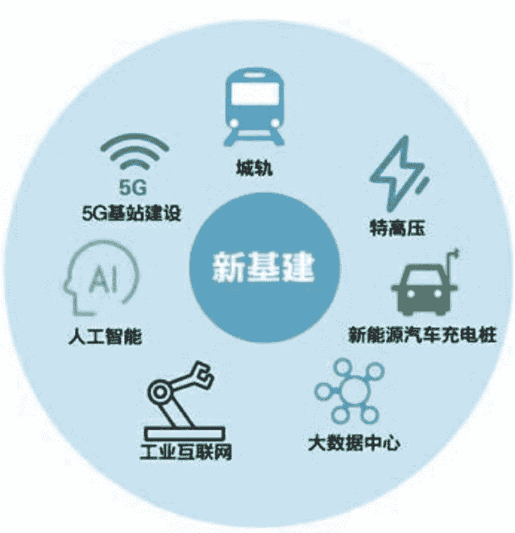

图1-1 新基建涵盖的领域

新基建既是“两新一重”[1] 建设的重要内容，也是国家战略部署，在拉动投资、稳增长、促消费中发挥关键作用，也是市场的强心剂。长远来看，新基建对经济高质量发展不可或缺。要在未来竞争中抢占先机，就须抓住新一轮技术红利，加快打造数字经济时代的关键基础设施，这既是当务之急，也是兼顾长远支撑。

城轨作为新基建的重要构成，通过技术创新、信息网络、数字化转型与智能化升级，全面强化数据连接能力，进而成为融合型基础设施。

轨道交通体系的内涵是以“服务交通强国战略、支撑高质量发展、引领轨道交通科技进步、满足市民幸福出行”为总目标，以“服务型、引领型、融合型、持续型”为总思路，以“数字化、智能化”为技术方向，以“安全、可靠、便捷、精准、融合、协同、绿色可持续”为核心特征。[1]

由此可见，人工智能技术的应用与大数据中心的构建，是现阶段智慧城轨建设的核心要素。从国家战略层面，遵循“推进城轨信息化，发展智能系统，建设智慧城轨”的主线，既契合新基建规划，也满足传统轨道交通转型升级需求。

[1] 两新一重：新型基础设施、新型城镇化，以及交通、水利等重大工程。

### 一、智慧城轨的前世今生

#### （一）城轨的发展轨迹

古人依河而居，水运是最早的交通方式，《古史》有“伏羲氏刳木为舟，剡木为楫”之说。马牛拉车出现后，道路修筑才逐步展开。

公元前600年左右，古希腊人在科林斯地峡开凿了被称为“Diolkos”的石轨，用以将船只从一侧拖到另一侧。有史家认为其具备轨道交通基本特征，可视作人类最早的铁路雏形。

19世纪蒸汽机成为工业动力，推动航运与陆运发展，最终催生以铁路为代表的交通繁荣。

19世纪中期，英国律师查尔斯·皮尔逊看到伦敦交通拥堵频发事故，便提议在市内以隧道连通中央车站以便工人通勤。该提案被否后，他转而提议建设地下铁路，经论证获批建成。伦敦大都会铁路成为世界第一条地下铁路图1-2，亦标志着城市轨道交通的诞生。此后伦敦地铁与城市发展同步腾飞，直至今日许多城市轨道系统仍称作“metro”。

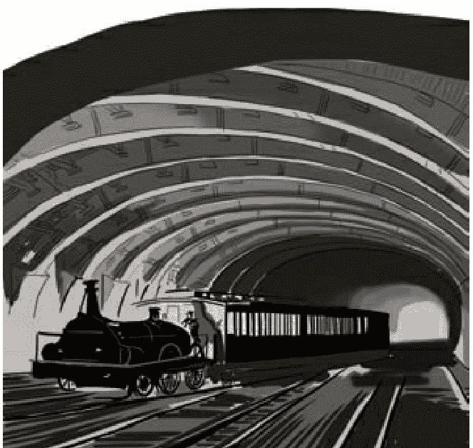

图1-2 伦敦大都会铁路

放眼全球，城轨发展曲折前行，大致经历以下阶段：

初步发展阶段1863—1924年。此期欧洲发展较快，美国、日本、中国的有轨电车亦有进步，但速度慢、正点率低、噪声大、舒适度差等短板明显。

停滞萎缩阶段1924—1949年。二战后欧洲经济恢复，20世纪50年代初汽车普及高潮到来，汽车工业大发展间接导致城轨建设停滞萎缩。

再发展阶段1949—1969年。汽车激增带来拥堵、污染与噪声，轨道交通建设再次受重视。

高速发展阶段1970年至今。城镇人口持续增长，城市化率攀升，人口密度加大，客观要求扩充轨道运能。借力技术进步，轨道交通迎来飞速升级。

中国首条城轨线路是北京地铁1号线图1-3，首期设想始于1953年，1969年建成，1971年1月15日正式开通。从立项到通车近20年，受国际形势、技术储备、人才条件等多重因素制约。

进入21世纪，中国经济持续高速增长，城镇人口比例明显上升，城轨建设突飞猛进。据交通运输部数据，截至2022年12月底，全国31个省自治区直辖市和新疆生产建设兵团共有53个城市开通城市轨道交通线路290条，运营里程约9584 km，车站5609座，已成为全球运营里程最长的国家。

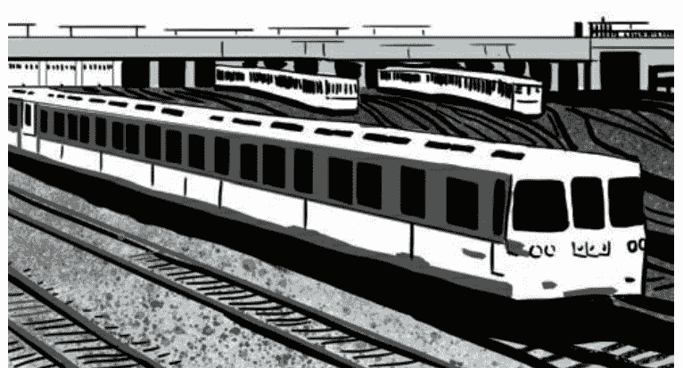

如今，城市轨道交通制式多样，包含地铁、轻轨、单轨、现代有轨电车、磁悬浮、自动导向轨道系统、市域快速轨道系统等。其快捷、安全、大运能、节能、准点、舒适、绿色环保等特点，符合可持续发展原则，已成为我国城市公共交通骨干，兼具良好经济效益与社会效益。

#### （二）初探智慧城轨

近年来智慧城轨概念的提出与建设，将城轨发展推向新阶段。如今乘坐地铁，从安检机穿行、机器自动测温与行李检查，到刷脸进站，再到候车智能导引，一路顺畅的体验已在不经意间享受着智慧服务。

何谓智慧城轨？城轨本质是大容量公共交通工具，智慧城轨的本质是以新一代信息技术对城轨各系统与各类服务的集成。它具备人的决策、学习、创新与交互能力，借助人工智能、云计算、大数据、物联网、5G、卫星通信、区块链等新理念与新技术，在数据驱动下重塑人、列车、设施设备与管理系统之间的关系图1-4。

随着客流增长，城轨面临安全、服务品质、设施运力调配等挑战，需在管理与技术支撑上改进，最终目标是实现由“人适应城轨”转向“城轨适应人”，由“生产范式”转向“服务范式”，由“被动服务”转向“智能服务”。

与传统城轨相比，智慧城轨具备如下特征：

1. 全面感知
城轨是复杂巨系统，时刻处于变化中，必须实时掌握物理层面整体演进与精细变化。全面感知是智慧化的前提，通过大量传感设备与智能终端实现系统状态实时感知；借助大数据、云计算与人工智能实现数据信息实时、集中、精准的分析判断，并智能下发决策；系统据指令自动调整运行状态，实现自主组织与判断，体现技术属性。

2. 深度互联
城轨涉及数十个运营子系统，可靠运行离不开各子系统间良好互通协同。针对运行产生的海量繁杂数据，城轨云平台整合人工智能、大数据等技术，对各子系统业务数据融合，形成跨设备、跨系统的互联互通平台，推动体系智能化。

3. 持续进化
智慧城轨通过沉淀与迭代，持续获取乘客、企业、政府、环境等多主体需求信息，并不断融入新技术、整合原有业务，实现自主创新与进化，提供更人性化服务，体现动态特征。

4. 高效协同
城轨兼具大容量交通与公共交通双重属性，乘客与列车、设备、其他乘客、工作人员均有交互，也可能与其它交通方式接驳。智慧城轨强调各业务系统资源整合与高效协作，保障出行全程良好体验，体现其本质特征——高效协同。

#### （三）中外智慧城轨的实践

1. 海外智慧城轨的实践
近年来新兴技术深刻影响城轨行业，世界各国运营公司均从数字技术中获益，形成各具特色的智慧体系。

2018年，美国洛杉矶大都会交通管理局提出“Metro Vision 2028”计划，旨在全方位提升居民生活质量，结合互联网发展提高运输网络与设备质量，并以数字化方式实现网络需求智能管理。

早在2014年6月，欧盟成立欧洲轨道交通研究联盟机构Shift2Rail，目标为欧洲城轨提供数字化能力，打造以乘客为中心、更可持续的运输模式。通过技术革新与系统研发，将现有系统集成到现代数字化架构，实现欧盟轨道交通的信息化与智慧化。

2. 国内智慧城轨进展
过去40年，我国逐步建立起完备的城轨交通体系，随智慧城市建设推进，智慧城轨成果备受关注。相较他国，数字技术是我国后发优势，助力城轨在网络通信、自动控制、人工智能应用等方面走在前列。

2019年9月9日，广州地铁21号线天河智慧城示范站正式落成，该站集未来感与科技感于一体，为市民带来良好出行体验，成为全球首个AI智慧车站。

2021年9月28日，广州地铁18号线通车运营，作为广州首条支持人脸识别过闸的线路，实现单通道每分钟无感进站30人，过闸效率显著提升。

2022年6月28日，长沙地铁6号线正式开通，推动线路运营可视化、分析预测科学化、应急响应智能化、能力拓展平台化、业务升级持续化，体现智慧城轨出行新范式，开创长沙乃至国内轨道交通合作模式与先进技术应用先河。

### 二、新基建语境下的智慧城轨

对新基建的谋篇布局，我国已久筹。

2018年12月，中央经济工作会议首次明确新基建概念：加快5G商用步伐，加强人工智能、工业互联网、物联网等新型基础设施建设。2020年3月，习近平总书记在浙江考察时强调，要抓住产业数字化、数字产业化赋予的机遇，加快5G网络与数据中心等新型基础设施建设。

在交通强国建设中，智慧城轨将成为重要领域之一[2]。智慧城轨之所以广受政府与民间重视，关键在于大数据、云计算与人工智能的出现，让人们看到科技创新对城轨发展的巨大正面推动。

作为信息化、数字化技术最广泛应用场景之一，智慧城轨不仅是技术在轨道交通上的应用，更是基于全面感知、泛在连接之上形成的具备自我决策能力的生态系统图1-5。它不仅是传统城轨的全面数字化，更是在信息技术加持下质变后形成的全新运行、管理与服务形态。

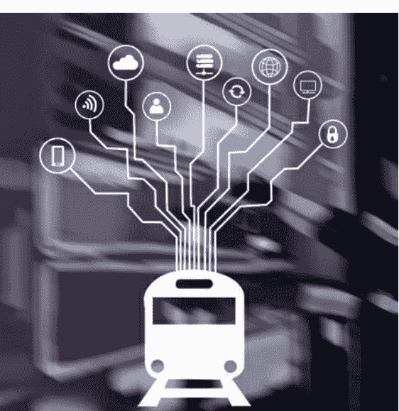

图1-5 全面感知、泛在连接与智慧城轨

关于城轨未来，人们想象丰富。在智慧城轨逐步成为会感知、会计算、会进化、会决策的智慧体的过程中，我们正参与其中并见证想象的实现。

#### （一）从运力到算力

尽管我国城轨发展迅速、规模巨大，但多数线路存在运力资源浪费、建设与客运需求不匹配、前期规划缺乏科学客运分析等问题。

数字化智能时代，城轨转型需以算力驱动运力，即算力与业务深度融合，运力通过数字化改造得以提升与释放。

何谓算力？算力即对数据进行处理的能力。1946年2月诞生于美国宾夕法尼亚大学的“埃尼阿克”被视为首台通用计算机，标志着算力革命开启。进入21世纪，云计算出现，算力再次巨变。人工智能先驱约翰·麦卡锡曾提出：“有一天，计算可能被组织成公共事业，如同电话系统。”算力时代到来将带来新一轮产业革命，提升生活便利度、降低企业运营成本，推动全社会向智能化迈进，成为指引进步与变革的力量。

AI的浪潮不断向前，随着数据维度、数据量与算力的几何增长，人工智能正规模化落地轨道交通，城轨系统正由局部智慧向整体智慧演进，其发展速度可能超出想象图1-6。

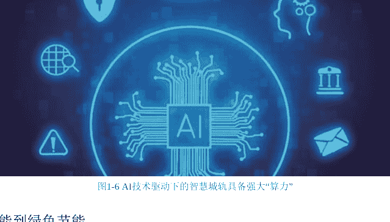

#### （二）由高耗能迈向绿色节能

随线网规模扩大与设施设备增加，运营总能耗与碳排放快速增长，高昂能耗给运营管理带来巨大压力，节能减碳成为发展重点，相关创新技术正在发挥作用。

在供能方面，绿色能源替代行动展开。车站与场段充分利用建筑条件，结合水、地、气源热泵及光伏发电等技术，探索应用双向变流牵引供电系统、专用轨回流系统；工程维修机械与调车机车同样以清洁电能为动力。

在用能方面，强化重点用能产品设备能效管理，例如推广车辆永磁同步牵引系统应用，重点车站通风空调采用高效节能直膨式机组、变频技术，直流集中供电智能照明系统等。

在管理方面，构建智能环控节能平台，实现对地铁环境、空调及设备的感知与计算，依托智能预测与全局寻优找到空调系统整体能效最优运行参数组合。构建基于互联网的智慧能源管理系统，对用能状况实时监测、统计分析、信息共享、集成优化，实现用能集约化、智能化、可视化管理。

#### （三）由传统产业向数字化转型

当前传统产业正处数字化变革拐点，数字发展亦为城轨带来独特机遇。城轨数字化既能提升系统性能与安全保障，也能提高运营效率与成本效益。作为行业数字化转型的重要力量，人工智能应用优势体现在以下方面。

##### 1. 保障乘运安全
针对车站安检设备进行智能化升级，通过外接人工智能设备辅助安检员判图，自动精准识别各类违禁物品，大幅提升排查效率、降低安全风险。

在电梯安全方面，通过人工智能赋能，实现对乘梯安全隐患行为或事故的智能识别与管理；覆盖自动扶梯全场景安全管理辅助，实时监测电梯区域人流密度，及时发出安全预警。“人工智能+电梯”安全模式提升运维效率与乘梯安全，为乘客创造更友好、更具人文关怀的体验。

##### 2. 提高乘车效率
借助人工智能人脸识别技术，采用刷脸支付进出站，人脸信息与支付形成业务闭环，无须验证车票，提高通行效率，同时解决手机信号弱、手机没电、特殊人群无手机等乘车难题，实现科技普惠。刷脸认证乘车亦可防止犯罪分子、恐怖分子乘虚而入，减少公共安全隐患。

构建全网统一指挥调度中心，借助大数据分析、物联感知与数据挖掘能力，把地铁各专业子系统纳入一体化管控与应急指挥框架，支撑多线多站的协同调度与一致指挥，推动线路间联动配合与互联互通，进而提升城轨网络的安全性、稳定性与服务水平。

##### 3. 客流精细化调控
广州地铁引入客流仿真建模平台，对乘客走行行为与列车到发规律进行数字推演，可直观评估车站空间规划是否合理、设备设施是否存在隐患。结合站立密度与通行速率的量化测算，掌握人流分布特征，精准锁定站区的薄弱环节，据此对站内动线与功能布局进行优化。

基于AI的视频监测能够实时获取人群密度，为客流管控、客群画像、疏导引导及安全管理提供详实依据，结合统计建模确定预警阈值与启动规则，为运营决策提供支撑。

##### 4. 乘客体验优化
智能客服平台依托语音交互快速响应乘客诉求，使用便捷。智能列车服务系统于车门上方与通道上方增设超清显示屏，呈现换乘指引、车厢拥挤程度及洗手间、自动扶梯等设施方位；同时滚动展示列车采集的车厢载荷、温湿度、空气品质等实时信息，提升乘车舒适感。

## 第二章 构建城轨智慧中枢

### 一、城轨大脑的内涵
人被称作智慧生物，关键在于大脑高度发达。回溯人工智能发展史，不少灵感源于生物学探索。人工神经网络本质上是一种计算机程序模型，指令式信息处理与脑部工作机理存在相似性。从遗传算法到强化学习，神经网络逐步具备模拟人脑学习与进化的能力。受生物学启发的智能技术已在多个领域落地。无论将城轨大脑视作神经网络的映射，还是心智的再现，目标一致：实现智慧化轨道交通需构建类脑系统，具备感知、认知、分析、决策等功能，并拥有自主学习与持续演进特质。

中国城市轨道交通协会发布的《中国城市轨道交通智慧城轨发展纲要》显示，我国智慧城轨建设蓝图呈“1-8-1-1”布局，其中建设城轨云与大数据平台被视为培育城轨大脑的关键方向。

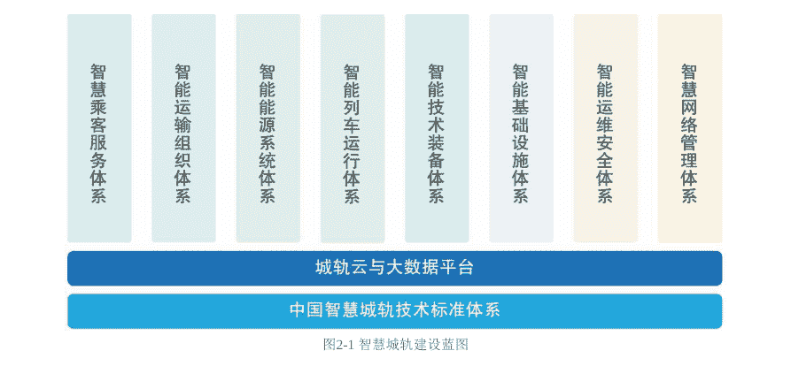

#### （一）AI是城轨大脑的数字底座
轨道建设周期漫长，技术迭代却迅速，若新技术无法在存量系统上落地，易交付“看似先进实则落后”的系统。同一线路不同业务各自为政，资源难以共享，形成信息孤岛，子系统割裂，被业界比喻为“烟囱”。

智慧城轨建设基于CPS信息物理系统体系与工业互联网，结合人工智能、云计算、物联网等前沿技术，打造数据自动流动的状态感知、实时分析、科学决策、精准执行的闭环赋能体系，通过自主进化与开放性实现持续演进，将运营系统塑造成智慧体，以数字化、网络化、智能化手段推动智慧化。该智慧体的智能呈多维度，无法用单一指标衡量。城轨是人工智能应用的优质场景，AI让系统更具能力，运营更高效。

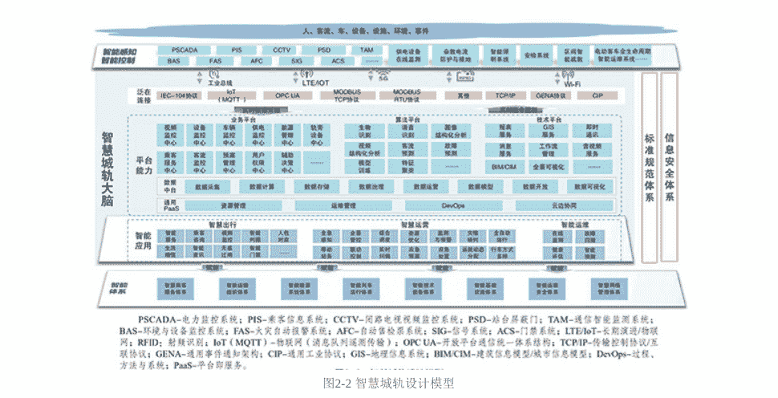

要达成智慧城轨目标，需构建基于全息感知的开放、可持续的城轨大脑，以能力支撑与数据驱动为智慧应用提供数字底座。在此之上，打通乘客、管理人员、车站设备等多源信息，打造智慧化、多维化、舒适化的乘客服务体系，提升出行体验。简言之，人工智能是城轨大脑的数字底座，城轨大脑则为轨道交通产业数字化发展奠基。

智慧城轨建设是长期过程。城轨大脑并非单一业务系统方案，而是基于大背景提供可靠、通用、开放、支持可迭代开发与创新的建设框架与基座，即行业操作系统。[3]

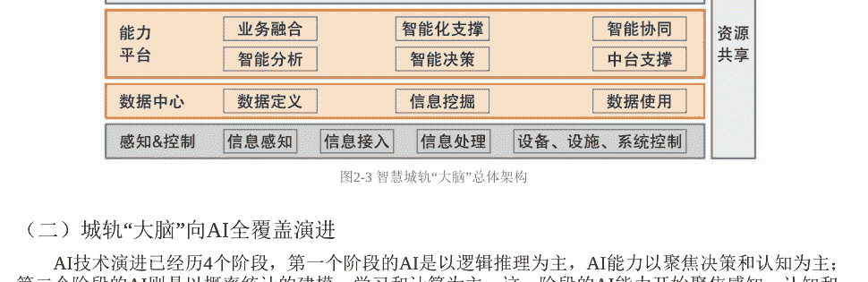

#### （二）城轨大脑向AI全能力覆盖演进
AI已历经四阶段演进。首阶段以逻辑推理为主，聚焦决策与认知；第二阶段以概率统计建模、学习、计算为主，能力扩展至感知、认知、决策；第三阶段聚焦学习环节，强调大模型构建，能力覆盖学习与执行；第四阶段聚焦执行与协作，重视人机协同与人类反馈训练。当前智慧城轨大脑正迈向全能力覆盖。若过去AI解决头部痛点，如今则是将点连成网，触及更长尾的痛点。

面向数字化、智能化、网络化运营需求，需构建海量数据采集、汇聚、分析的服务体系。城轨大脑包含边缘层、SaaS、PaaS、IaaS，如图2-4。

智慧城轨大脑支撑前端资源泛在连接，实现对运营环境“人、机、物、环”的动态感知、数据采集与控制执行。除通过工业以太网与总线获取车站、段场设备状态及业务数据外，还借助计算机视觉、室内定位、生物识别、智能表计、传感、在线监测、激光探测、互联网信息挖掘等技术感知人、机、物、环与事件，如客流感知、乘客感知、设备状态感知、故障监测、温湿度感知、安全事件预警等，实现全息感知。同时可与外部系统交换数据，获取对运营与服务有价值的信息。

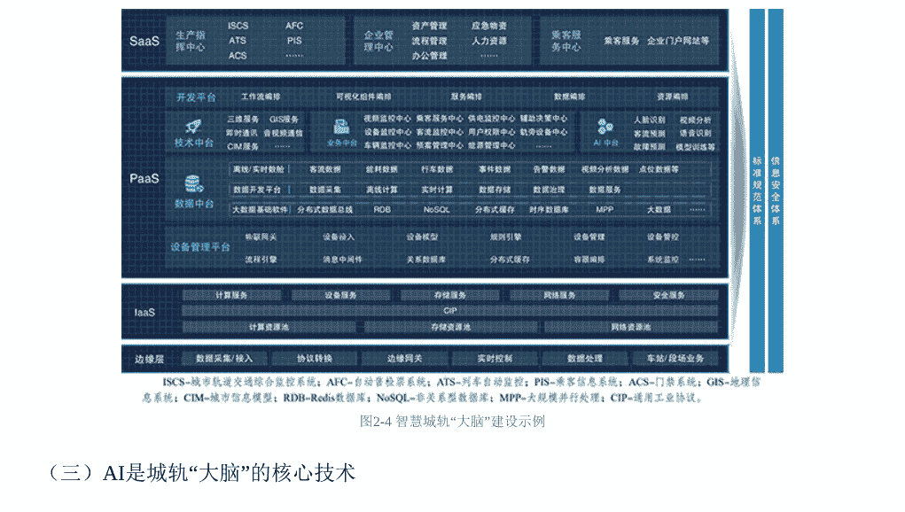

#### （三）AI是城轨大脑的核心技术
##### 1. 智慧城轨操作系统与工业互联网平台
人工智能兴起意味着具备自主感知、认知、决策、学习、执行、协作能力的城轨大脑逐步成形，这六大能力是提升生产力与效率的核心。城轨大脑不仅是工业互联网平台，更是以特定业务域过程管理为主，同时支撑跨域应用与数据集成新型智能应用，是可靠、通用、开放、支持迭代创新的操作系统。

通过泛在连接，城轨大脑提供开放数据接入能力，支持多类设备实时采集。基于对海量边缘节点统一接入，边缘应用数据可快速上送云端。

大脑的数据中台负责海量数据存储、处理、管理。其上构建开放可扩展的AI能力平台，实现机器学习、机理分析与大数据深度挖掘。技术、能力、知识沉淀形成可共享复用的支撑。

大脑通过解耦[2]能力与业务应用，将通用能力或技术要求封装平台化，为业务应用提供支撑。能力平台以服务形式沉淀核心通用业务，实现对业务变化与创新的快速响应。

##### 2. 城轨业务的数据融合与AI模型
大脑将各业务子系统、各专业海量数据采集、清洗、整理、集成、标准化、建模、挖掘、分析，通过数据仓库与治理构建全域统一数据资产，为智慧城轨奠基。

基于全面融合与AI技术，大脑可开展联动分析，提供客流预测、健康度评估、故障预测等服务。具体包括：
- （1）基于数据融合的客流检测与基于深度学习的客流预测。
- （2）基于智能视频分析、人行轨迹挖掘的智能安防。
- （3）基于深度学习的人脸比对。
- （4）基于深度学习的语音识别。
- （5）基于机理模型与机器学习的重点设备健康评估。

##### 3. CPS 5C架构设计
大脑基于CPS 5C架构，包括智能感知层connection、信息挖掘层conversion、网络层cyber、认知层cognition、配置执行层configuration。该架构通过人、机、物深度融合与实时交互，构建多维度属性的虚拟运营模型，使其具备感知、认知、行为、可交互、可学习、可成长、可决策等特性，是运营智能化的关键。

##### 4. 全时空全场景智慧管控
智慧城轨以前端感知为核心，结合视觉与传感技术实现运营状态全方位感知，并以深度学习提升感知力。大脑融合多传感器数据与信息，经智能处理分析作出决策，以数据驱动生产与能效提升。在完善智慧运营框架基础上，逐步建成全息感知、实时分析、科学决策、精准执行、业务联动的智慧运营管理系统。

在连接能力全面集成后，大脑通过数据采集与分析将行为过程数据化，随时把握运营管理细节与趋势，预测风险、精准决策，实现业务数据化、数据业务化。

##### 5. 基于机器学习与大数据的主动进化
大数据分析可最大限度挖掘数据潜力。当前以数据为中心的方法为语音识别、计算机视觉、自然语言处理带来突破。基于机器学习原理，通过数据存储、操作、挖掘，支撑开发类人智能的智能体agent。

大脑可应用智能体驱动场景，如问询机器人、设备巡检机器人、智能语音购票等，实现更贴心的自助服务，提升乘车体验。

> [1] 长尾：统计学中幂律与帕累托分布特征的口语化表达。正态曲线突起为“头”，右侧平缓为“尾”。人们常关注头部而忽略尾部，但尾部总量可超头部。
> [2] 解耦：降低应用模块间依赖，减少数据模型、业务逻辑与视图显示间耦合，把关联依赖降至最低。

### 二、城轨大脑的持续运转
如人脑每日高速运转，城轨大脑亦需持续高速运行，日处理海量数据。自2012年起，云计算开始与城轨行业融合，并以此搭建“城轨云”平台，作为支撑智慧城轨蓝图的基础之一。

#### （一）城轨大脑运行的基础条件
城轨云构成类似人脑，是大脑运行的基础。城轨云由1个平台、2个中心、3张网络组成：云管平台、生产中心与灾备中心、安全生产网络、内部管理网络、外部服务网络。云管平台统一管理计算、存储、网络与安全资源；两中心采用双活架构同时服务，保证业务连续性；三张网络承载全部业务系统。

> 《纲要》提到“到2025年完善城轨云与大数据平台体系并落地，新建城市全部采用城轨云实现业务全覆盖，同时建设数据共享平台与网络安全体系”。大脑的重要性由此可见。

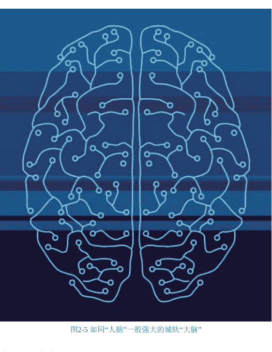

图2-5 如人脑般强大的城轨大脑

#### （二）城轨大脑的运行安全
为使大脑正常发挥效能、提供及时服务，需系统做好网络安全，主要措施如下。

##### 1. 平台应用安全保障
保障大脑自身机体安全是正常运行关键。可借助现代加密技术保障重要数据传输与存储的保密性、完整性与不可抵赖性，满足安全需求。集群技术保障系统可用性，确保服务及时可靠。

##### 2. 系统安全保障
围绕“一个中心、三重防护”核心理念落实安全措施：
- （1）部署防火墙、网络准入等，保障区域边界安全。
- （2）部署VPN、加密通信、入侵检测、冗余网络等，保障网络通信安全。
- （3）系统加固、部署安全防护软件，保障计算环境安全。
- （4）建立安全管理中心、强化集中管控、开展安全审计，有效掌控安全态势，及时发现隐患。

##### 3. 数据安全保障
大脑汇聚多方面数据，包含敏感与重要信息如个人信息，需全流程做好数据安全，使采集、存储、处理、应用、交换、销毁符合国家法规与城轨制度，最大限度防止数据泄露，保护隐私。

#### （三）城轨大脑的维护养护
大脑虽无生物属性，仍需适时养护，如定期排查问题隐患、开展应激演练，使其更强壮以胜任长期工作。

云平台依托统一云计算与IT基础架构，实现城轨综合监控、自动售检票、视频监控、门禁、乘客信息、列车自动监控系统的融合部署。云平台数据中心是运营监视、应急指挥与信息化管理的基础。避免数据中心故障影响地铁生产系统是建设与维护重点。[4] 城轨云运维主要包括日常运维、安全防护运维、运维架构设置与应急演练。

日常运维聚焦平台状态、资源管理、例行检查、预案管理与数据备份。即便简单巡检，也需以业务视角观察数据关联，完成智能决策，防患未然。

安全防护运维针对网络、系统与业务加固，通过漏洞扫描与渗透测试结合实现最佳防护，保障信息化安全。

运维架构设置依据各城市平台规模、设备数量与分布，明确运维岗位结构与职责。

应急演练由运维人员定期开展故障演练，模拟线上故障高可用场景，提升容错与恢复能力，确保紧急情况下快速响应，减少故障时长。

### 三、赋予城轨大脑记忆
如人脑般，记忆是城轨大脑的重要部分，是信息形成与分析的基础，也是智能进化的条件。

#### （一）城轨大脑的记忆
业务数据即大脑记忆内容。城轨业务云平台基于虚拟化、分布式存储、云资源管理、信息安全等技术，实现计算、存储、网络资源集中管理、按需分配与统一监测，提高资源利用率，便于业务快速部署扩展[5]。因此业务数据具有产生速度快、动态性强、类型多样、关联性强、规模庞大、异构性强等特点。

##### 1. 数据产生快且动态性强
系统连接增多带来更多数据，实时数据占比提升。除人财物通用管理信息系统外，设施设备维保系统与生产系统如综合监控、AFC自动售检票、环境监控等均产生变化数据，城轨需更及时快速处理。对生产系统而言，每时每刻均产生大量监测数据，呈现动态、随机、颗粒度多样特征，并以毫秒或微秒级间隔变化。

##### 2. 数据类型多样且关联性强
按来源分为内部与外部数据。内部数据包括安全生产、运营服务、维修维护、物资采购、人力资源、财务管理、企业管理等；外部数据包括交通路况、天气、大型活动及其他相关数据。各子系统业务数据形式多样但相互关联，一个系统部分数据变化可能引发另一系统的连锁反应，关联度高。

##### 3. 数据规模庞大且异构性强
轨道交通数据来自多种系统或人工输入，多源异构占比高，来源各异、采集间隔小、业务种类多、数据量大。其价值不在于数量，而在于对有意义数据进行专业化处理，提升大脑加工能力，实现增值。

#### （二）城轨大脑的核心能力
##### 1. 数据湖
数据湖是智慧城轨大脑的核心能力，类比大脑记忆能力，用于解决数据存储管理与高效利用问题，涵盖各业务系统产生的结构化、半结构化、非结构化异构海量数据。

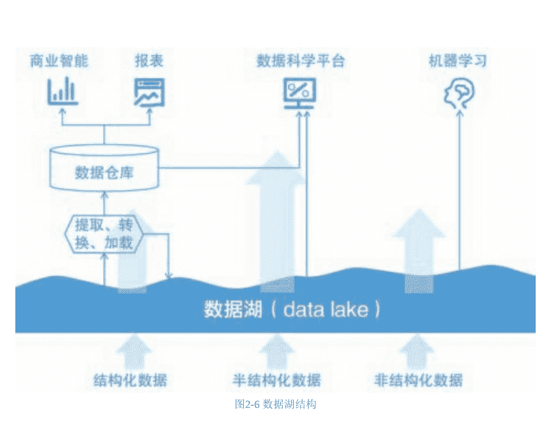

数据湖以原始格式存储数据，无需预先结构化处理，因其边界即城轨业务边界而得名。经过多年沉淀，数据湖边界不断扩展，演进为集多源异构数据统一存储、多范式计算分析与统一管理调用于一体的综合大数据解决方案。数据湖发挥数据与权限管理能力，以更高效率、更低成本管理数据，打通数据孤岛，释放数据价值，助力数字化转型。

##### 2. 数据入湖
数据入湖是构建的起点，包含元数据入湖与业务数据入湖。

（1）元数据入湖。元数据是关于数据组织、域及关系的信息，即描述数据的数据，主要描述属性信息。若把元数据比作“户口本”，则可了解出生日期、住址等个人描述信息。元数据打通数据源、数据仓库与数据应用，记录数据从产生到消费全过程。将技术元数据采集入湖并与业务元数据关联，形成数据资源目录。业务人员可通过语义快速定位所需数据并动态追溯关系，大幅降低消费门槛，让更多分析人员理解并使用数据。

（2）让业务数据汇聚成湖
将各业务系统产生的原始实体数据汇聚进数据湖，是实现统一沉淀和统一复用的关键。具体的汇入路径取决于数据源形态以及下游的使用场景与需求，同一个业务对象往往存在多种接入方式，例如离线批量迁移、增量实时推送、接口抽取、流式写入等。

> [1] 异构性：指数据结构存在差异。异构数据是相互关联的多源集合，其差异可分为结构异构、语法异构、系统异构和语义异构。

### 四、为城轨中枢赋予思考力

#### （一）算力数据算法协同驱动
沃尔玛的数据团队曾发现，周末去超市购买婴儿纸尿裤的多数是年轻父亲，他们很可能顺手带走几瓶啤酒。于是把啤酒与纸尿裤摆放在相邻货架，销量明显提升。这个经典的纸尿裤与啤酒案例说明，只有理论与数据结合才能得到可验证的预测。
近年，《“十四五”大数据产业发展规划》《“十四五”数字经济发展规划》等政策文件均将数据确立为重要生产要素。作为新型要素，数据能够显著提升传统要素的生产效能，这正是数据的核心价值。
数据、算力、算法三者融合，可对物理世界进行状态描述、原因剖析、结果推演和科学决策。城轨智能中枢在持续积累中形成了海量数据、强劲算力和优良算法构成的大模型，依托云平台算力，通过算法实现思考，对数据记忆进行挖掘，从而释放价值。规模足够且多样的数据、成熟模型、充分训练，这些基础条件足以让智能在城轨中枢构建中显现，见图2-7。

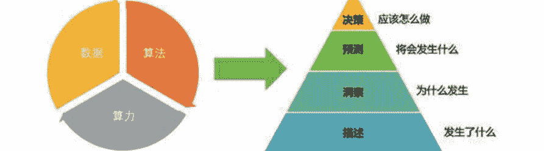

在轨道交通场景中，思考能力的赋能范围覆盖工程建设、运营管理、资源经营、社会服务、企业决策等，支撑智能分析与挖掘应用。

#### （二）语音交互升级服务体验
随着互联网+深化，城轨客服正加速智能化转型。客服App、智能客服中心、机器人客服等多元载体逐步普及，实现全天候在线、多渠道联动，人工服务正被自助终端、智能设备和远程坐席替代，效率提升、人力优化效果明显。
基于人工智能的语音识别技术已经成熟落地，人机交流成为亮点。乘客用语音提出咨询，系统解析关键语义，理解需求后给出匹配的服务项目，缩短操作等待，降低焦虑，提升满意度。

#### （三）生物特征赋予系统识人能力
利用生物特征鉴别身份的技术由来已久，引入轨道交通即可赋予系统识别乘客的能力。
生物识别是指通过技术手段采集并比对个体独有的生物特征，与个人专属数字化账户对应。
开放环境下常用特征有人脸、虹膜、声纹、指纹掌纹、指静脉掌静脉等。随着计算能力与机器学习快速发展，识别精度已远超人工，具备规模化条件。权衡便捷性与精度，当前城轨主流为人脸、掌静脉、虹膜识别。

#### （四）视觉理解让监控会读图
城轨监控环境复杂，人车物类别繁多，状况持续产生，安全隐患也随之潜伏。中枢需学会读图，从图像分辨对象类别与属性，分析行为，预判风险，提升监控可靠性。
先用目标检测定位并截取区域图像，再用深度神经网络提取表观特征，借助分类算法识别类别，如人、车辆、手提箱、危险品等。随后属性识别获取细节，如性别、身高、着装、年龄、肤色等。检测分类后持续跟踪状态、分析行为并预警异常，见图2-8。

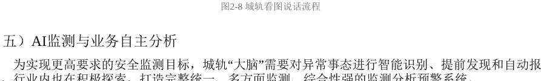

#### （五）自主感知实现业务自预警
为满足更高水平的安全监测需求，城轨中枢需实现异常态势的智能识别、提前发现和自动告警，行业正探索建设统一完整的综合监测预警体系。
自主监测分析依托预警理论构建指标体系，通过信息采集、场景研判、信息发布实现预警。例如长沙地铁6号线搭建智能监测预警平台，汇集行业运营经验与自身数据，对大客流、安防、汛情防控、火灾预警、列车运行、设备故障等多类场景分类监测。
以广州地铁天河智慧城示范站为例，智慧车站移动站务系统经Wi-Fi接入综合监控网，对各专业数据监控分析，站务人员可实时感知站内整体态势。大数据客流分析为客控决策提供支撑，移动端实时监测设备告警与事件信息，帮助更快掌握设备运行态势。[6]
具备自主监测分析后，对突发事件的预防、预警、快速响应与处置能力均提升，可降低运营扰动和人员伤亡风险。

#### （六）健康评估驱动精细运维
出于安全可靠性考虑，城轨设施需保持较高检修频率以降低运营事故概率。传统计划维修与故障维修在状态不可感知时有效，但人力消耗大成本高。
理论上以状态维修替代计划维修和故障维修是更优解。城轨领域虽有探索，但因技术成熟度不足难以以可控成本实现精准状态感知，未能规模化。如何利用现有运行数据实现关键系统健康精准感知，是智能运维核心。
借助智慧中枢分析全量运行数据，状态维修成为可能。基于设备机理模型，结合人工智能与大数据，中枢可准确判断健康状态并持续追踪趋势，健康度快速下降时提示检修，状态稳定时适度降低频次，避免过度维护。面对运行中内外环境与损耗变化，中枢可自动更新健康度评估模型，保持准确性和时效性。

### 五、城轨中枢进入成长阶段

#### （一）算法基因与数据环境共进化
类比生物进化，中枢的基因即内部算法模型代码，环境即外部数据。算法从数据中提取对分类聚类有价值特征，归纳规律。随着知识迭代加速，中枢呈现自主进化特征，这正是智能本质。具备自主进化能力才称得上真正的大脑。
决策流程包括数据准备、采集清洗、特征工程与特征构造。内部若干机器学习程序依托初始参数，通过历史数据反哺、过往决策优劣评估，组合调整参数，并在环境响应与优化规则下形成新版本，形成响应—修改—择优—响应的闭环，与人脑修正神经链路机制相似，均实现功能不断完善。

#### （二）智能客服实现自然对话
智能客服能替代人工，关键在于既能听懂也能与乘客对话。
为提升自然度，需在以下能力上突破：
- （1）问答能力。基于CNN-BiLSTM卷积双向长短期记忆网络实现，覆盖业务高频清晰问题与答案，形成标准问，再扩写生成训练数据。
- （2）情感识别能力。采用Bi GRU双向门控循环单元构建情感识别与闲聊模型，利用深度学习对用户语句进行计算归纳，识别情感倾向后生成差异化回复。
- （3）意图识别能力。以Text-CNN卷积神经网络为核心，结合文本、手势、图像、视频等多模态信息，感知意图并映射到知识点。
- （4）多轮对话能力。通过任务型多轮对话引擎实现，依托上下文记忆与NLG自然语言生成，结合流程导向图，在意图识别基础上引导交互完成特定任务。

#### （三）智能控制助力节能降耗
车站包含站台、站厅、设备房等复杂空间，环境监控设备众多且参数相互影响，同时受人员、季节、内外环境、负荷需求等多因素扰动，需借助智能优化控制降低能耗。
难点在于精准预估车站所需冷量。传统方式只能温度变化后响应，受热惰性和时滞影响调节迟缓。智能算法可提前预测所需冷量，避免超调浪费。
此外监控系统管路长、环节多、滞后性大，难以单点优化。对全系统设备进行协同优化，可在联动下实现整体效率最大化，达到节能目标。

#### （四）故障自诊断实现设备自检
传统故障检测预测多基于专家系统、阈值法，可解释性强研发门槛低，但人工介入多，对知识库外未知异常无力，完整故障库积累需数年。
基于深度神经网络的诊断模型正被尝试，将设备高维数据输入模型经大量数据训练以学会诊断。当前尚未普及，主因是样本不均衡与数据不足。深度网络需要均衡样本，而城轨运行稳定，故障数据远少于正常数据，单纯依赖不可行。
较优方案是专家系统与机器学习融合，先建立故障机制模型作为基线，再用机器学习训练更新。模型可随设备服役状态迁移自动追踪变化，实现自我诊断与自我更新。
以广州地铁21号线苏元站站台门系统为例，通过感知模块采集关键设备状态数据，经预处理分析掌握健康状态，结合模型算法预测未来趋势，提供健康评价与预警，为检修维护提供依据。[7]

#### （五）客流预测护航智慧出行
客流预测服务旨在引导乘客智慧出行，中枢让预测更精准。基于乘客历史OD数据，结合日期、天气、乘车规律、线网拓扑等多源信息，融合业务经验、统计规则与机器学习，构建覆盖工作日、周末、节假日、特殊事件的精准预测模型，可实时预测各车站客流，见图2-9。

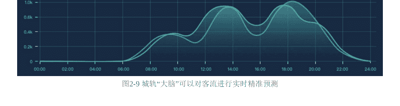

图2-9 城轨中枢可以对客流进行实时精准预测
对乘客而言可据此选择合适时间与线路；对运营方而言可合理编制计划与站内排班。
精准预测对特殊事件引发的大客流尤为重要。演唱会、马拉松、跨年晚会等大型活动，以及暴雨、列车故障、停运等突发情况都会导致短时高峰，预测系统可提前研判影响，提前部署应急管理，有效缓解拥堵，保障安全。

### 第三章 智能互联重塑城轨神经系统

### 一、全域互联重塑城轨神经网络

#### （一）5G与智慧城轨
##### 1. 5G技术特征
第五代移动通信技术简称5G，是兼具高速率、低时延、广连接特征的新一代宽带移动通信技术，是实现人机物互联的网络底座。
##### 2. 5G技术在城轨中的运用
5G可推动城轨从多层复杂固定架构向扁平轻量可迭代架构转型，助力自动化、精细化、系统化发展。在新基建背景下，以5G为基座可全面提升运营服务能力，见图3-1。
##### 3. 基于5G技术的列车行车类应用
- （1）实现车地可视化语音通信，乘客可通过紧急呼叫与调度员通话，调度员可借助车内实时画面完成调度。
- （2）实现超高清视频流传输与播放，如列车CCTV监控及PIS乘客信息系统视频。
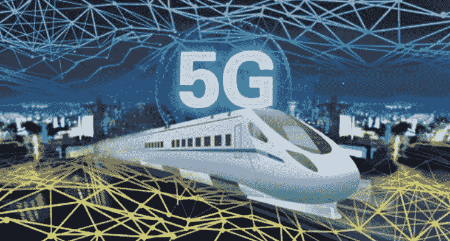
- （3）实现3D可视化VR行车环境场景，将列车轨迹可视化并可控，见图3-2。
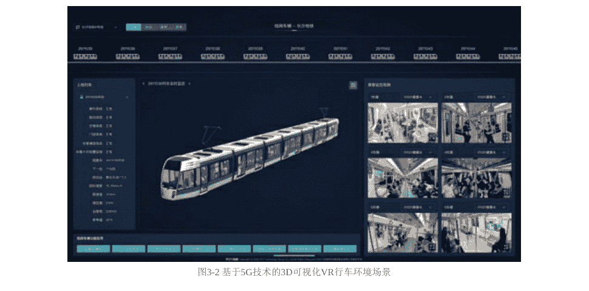
图3-2 基于5G技术的3D可视化VR行车环境场景
##### 4. 基于5G技术的城轨运维类应用
依托5G网络切片结合NB-IoT窄带物联网，实现设备间通信，提升系统自适应生存能力。通过实时监控运行状态及时发现隐患，从被动维护转向主动监管，提高维护效率与安全性。
##### 5. 基于5G定位技术的日常及应急管理应用
5G定位部署灵活，可实现人员实时精准定位，提升调度、作业区管理、安全通道预警的准确性。突发事件处置时，精准追踪至关重要，有助于提升运营安全。隧道环境复杂时，高速无线通信可实时掌握现场情况，提升决策与应急处置效率。
##### 6. 基于5G技术的地铁大数据应用
5G推动城轨运营数据量激增，每个设备、每个传感器都在持续产生数据，成为智慧化原料。例如借助数据路径统计、5G室内定位导航、耗时预估，辅助乘客择时出行，预约打车，实现地铁、出租车、公交无缝接驳。
通过客流大数据预测与实时监控，实现站内分区疏散、站外引导换乘与高效疏散，提升舒适度与应急处理效率。

#### （二）Wi-Fi6与智慧城轨
构建安全智能便捷高效绿色的智慧城轨对通信网络提出更高要求。Wi-Fi6即第六代无线局域网技术，基于IEEE 802.11标准。
##### 1. 全自动运行的辅助
Wi-Fi6可承载全自动运行时代的大带宽低时延业务，同时传输乘客信息系统实时视频、新闻广告、运营播报，并实时回传列车运行状态，便于运营人员及时获知告警与故障信息，保证运营安全。
##### 2. 乘客信息系统更好的应用前景
城轨存在车地回传带宽低、数据易丢、部署效率低等痛点，难以支撑大带宽业务全量实时回传。Wi-Fi6可在保障信息正常传输的同时拓展更多服务，如车内可视化通话终端、车厢体温检测提升疫情防控效率、旅途中推送新闻直播体育娱乐，提升出行体验。
##### 3. 借助Wi-Fi6实现用户信息收集及精准广告推送
利用Wi-Fi6多频点优势开通乘客接入频段，经授权合规采集用户信息，实现客群画像精准定位，通过精准广告营销提升运营收益。

#### （三）当列车开始相互对话
信号系统是保障运行安全与提升效率的关键基础设施，一直在安全与效率间寻求平衡。
当前主流信号系统为CBTC基于通信的列车控制系统，其效率提升瓶颈在于进路防护逻辑，该逻辑限制了岔区折返能力与特定区域通过能力，从而影响整线运能。

安全底线不动，效率再提速：让列车学会“对话”
在行车安全红线不变的前提下，怎么把现有的线网和车队用得更充分，既提升运送能力又压低运维开销？2013年，法国阿尔斯通首次提出“车—车通信模式”。该模式依靠车载互联大幅减少地面设备，调度更灵活，已成为城轨通信领域的主流思路，国内科研团队也在持续跟进验证。

把“自主驾驶”与“车—车通信”叠加，就形成更高阶的智慧体系。自主驾驶可看作列车的“大脑”加“千里眼”，能感知环境、推理判断、作出决策，车间之间可对话协同。试验表明，车车通信可使安全行车间隔均值缩短约30%，车路配合更顺畅。

#### （四）物联技术让城轨万物互联
物联网通俗理解就是万物互联的网络。当前该技术正处高速扩张期，已成全球性现象。

物联网是新一代信息技术的重要分支，本质是各类联网设备构成的集合网络，以及促进设备间、设备与云平台间通信的技术。得益于低成本半导体芯片与大带宽通信服务的普及，全球已有数十亿终端接入互联网，各终端按既定协议实现人与物、物与物的泛在联通。

物联网的基础仍是互联网，是在互联网上把物理设备连起来并做延伸扩展的网络，设备间以互联方式交换数据并协同作业。5G移动网络和Wi-Fi6能显著提升网络性能，让物联应用场景更宽。

选用5G与Wi-Fi6的核心优势是提升信息传输带宽、降低时延。结合物联技术，可把轨道交通系统内机电设备的运行状况经数据链路汇聚到控制中心进行集中管理，实现在线实时监控，进而支撑智能化运维。

#### （五）地理信息系统与城轨融合的多场景实践
城轨信息化起步阶段，多以文字、图纸、数据库为依托进行存储、统计、分析与决策。报表繁多、信息分散，运维人员难以及时把握整体态势。

## 一、地理数据的管理
借助GIS实现图形数据与属性数据的录入与校核，保证系统数据真实、精准地反映城轨现状。

## 二、数据可视化
以GIS为支撑，以卫星影像作底图叠加各类地理要素，可构建精细的城轨地图。GIS还能呈现列车实时位置及拥挤程度、应急资源空间分布、车站与区间客流拥挤度、突发事件位置等信息。

## 三、信息查询
基于GIS的数据查询是其核心功能之一。可通过已有数据快速检索设备的静态、动态属性及运行状态等信息。

## 四、应急管理
以GIS为平台，可提升应急调度效率，弥补应急资源管理与空间地理信息结合不足的短板，为安全监控、事故预警与应急处置提供及时、准确的数据支撑。

## 五、交通规划管理
依托GIS的空间操作与可视化能力，可对拟建城轨区域进行多指标模型分析，对规划方案进行评估，发挥其在优化设计与交通状态预测中的作用，为规划管理提供决策支持。

## 六、交通信息共享
基于GIS网络平台，可向政府部门与旅客共享轨道交通图及运输信息，以可视化形式展示站点分布、线路走向、服务设施布局、区域实况等，帮助旅客合理规划出行，提升运输效率并降低管理成本。

> [1] 网络切片：按不同业务对用户规模、服务质量、带宽等需求，把单一物理网拆分为多个虚拟端到端网络，每一切片获得逻辑独立的资源且相互隔离，所以某一切片出错或故障不会影响其他切片。

### 二、数据是城轨的“知识”

#### （一）流处理 [1] 技术提升数据时效性
城轨运营高度依赖实时数据。站段与车站的专业系统已实现信号、供电、机电、车辆、客运服务等设备状态与性能数据的实时采集与处理。一方面依托自身控制逻辑实现自动控制，另一方面通过工作站与大屏供调度人员监视与操作。

随着业务需求提升，平台需收集更广范围、更精细内容的实时数据以精准感知系统运行。随着数据量增长与人工智能的引入，处理方式也在演进，原有技术已难以满足统计与分析需求。流处理技术成熟后能够有效应对这一挑战，因设备监控数据具有体量大、产生呈无界流等特征，正契合流处理应用场景。

流处理的低延迟特性为实时统计与实时预警提供创新空间。基于流计算，系统可实时反映客流总量、能耗总量等统计结果，并结合特征分析、机器学习对设备状态、大客流进行预警，帮助运营人员提前发现风险并快速响应。

#### （二）数据治理提升价值密度
城轨系统涵盖数十个专业、数万台设备与零部件，产生的数据类型繁多、数据量巨大。大数据环境下，数据量大往往意味着价值密度低。

城轨信息化建设多围绕物理世界非数字原生方式展开，如综合监控、工单系统围绕车辆与设备运维，自动售检票系统围绕票务交易，通信信号系统围绕列车运行，企业信息化系统围绕人力、合同、财务等业务。在智慧城轨阶段，需对各系统数据进行整合利用，以提升大数据价值密度。

#### （三）智能分析结果反哺城轨运营
随着数据持续沉淀，如何提炼其价值已成为核心。底层搭建完成后，数据应用不能止于浅层分析，而要以数据反哺业务、驱动创新。通过异构数据快速集成与自动转换，构建高效的数据处理流程，支撑高性能计算，发掘数据间的模式、关联与规律，为运营提供决策参考，弥补经验局限。

##### 1. 城轨数据的特点
城轨运营产生海量数据，关注点在于如何处理并获取价值。数据体量虽大，但结构化数据仅占一小部分，绝大多数为非结构化和半结构化数据。

（1）数据生成符合一定时序规律。城轨按既定行车计划运行，每日产生符合运营时段特征的数据。
（2）数据生成形式多样。不同部门、不同系统的产生方式各异，异构分布导致非结构化数据占比高，处理难度较大，其价值密度相对较低，需要专门技术。
（3）数据相互关联。系统间存在关联，一个系统变化可能引发多系统连锁反应。
（4）数据实时动态更新。运营过程持续产生数据，刷新频繁、累积量大。

##### 2. 城轨中的数据分析
人工分析在海量数据面前难以为继，人工智能驱动的大数据分析已成必然。

城轨智能数据分析大致分为三步：业务认知与数据搜索，即采集运行中产生的数据；数据预处理，即对各类数据清洗、合并、共享，形成大数据平台；业务分析与数据挖掘，即通过人工智能对大数据进行深度分析、挖掘与学习。

##### 3. 数据分析反哺城轨运营
数据分析结果需结合其他技术形成解决方案，主要包括：

（1）城轨运行智能监测技术，聚焦运行安全，依据大量监测数据及时检测异常并报警。
（2）城轨运行智能调度技术，聚焦运行效率，通过客流数据构建时刻表优化模型以缩短旅客总候车时间。

以智能监测为例，当视频监控出现异常或大面积拥堵时，人工智能模型可自动检测并及时反馈给运营安保人员，实现事故初发阶段处置，避免损失扩大。

在车站运营管控中，智能客流预测较为典型。通过多源数据融合与实时、历史客流数据，可实现大客流事件智能预警。

大数据能把抽象问题具体化，有助于界定目标、厘清要素、优选方案，让决策更科学。但数据本身缺乏主观能动性，分析结果只能辅助决策，不能替代决策。

> [1] 流处理：大数据处理的重要手段，处理的数据源源不断、实时到达，接收后在极短时间内完成连续数据流查询与条件检测，检测时延从毫秒到分钟不等。
> [2] 无界流：有起点无终点、持续产生数据的流。

## 第四章 神通广大的城轨智能交互

### 一、城轨的实时感知与交互

#### （一）城轨慧眼识人
新一代地铁闸机普遍配置人脸识别，与智能手机同理可完成身份核验，避免手机没电或卡片遗失的困扰。人脸识别流程包括图像采集、人脸检测、特征提取与特征比对。

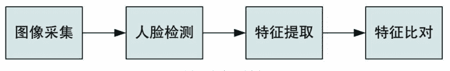
图像采集可视作闸机的“眼睛”，其成像质量直接决定识别效果。采集模块分为2D与3D两种，地铁客流大、对精度要求高，通常采用3D结构光以获取更多信息提升精度。

人脸检测基于彩色图像定位人脸框与关键点。被动识别易因配合度不足导致图像质量差、姿态偏大，需经质量评估算法过滤不合格图像，合格图像再基于关键点进行校正。

特征提取是核心，人脸蕴含大量可辨识特征。借助人工智能与大数据建模，可将人脸图像编码为可度量特征，降低存储并提升比对效率。

特征比对将待识别特征与注册库中的用户特征比对，返回分数最高的用户ID，若分数超过阈值则放行。

上线人脸识别后，不仅提升通行便捷性，后台还能基于出行数据分析旅客出行规律，提供定制服务，如提前推送人脸特征以加速过闸，或推荐最优进出闸口以缓解拥堵。

#### （二）城轨智能对话

##### 1. 城轨智能对话的规划及发展
当前城轨旅客服务仍大量依赖人工，人力成本高且服务质量参差。人工智能推动智能语音技术快速发展，多家地铁公司已开展探索与试点，如北京地铁机场线语音购票、广州地铁客服平台语音问询等。

##### 2. 智能对话的关键技术
（1）声音采集及信号处理技术。前端麦克风阵列与摄像头采集语音，经语音模组处理后发送至后台识别。
（2）语音识别技术。自动语音识别将语音转为文本，需在城轨场景下保证98%以上的识别正确率，并输出多候选结果与置信度，同时可分离站厅广播与设备提示音等干扰。
（3）语音合成。文本转语音技术可将文字转为自然流畅的语音流，需根据文字长度、多音字、符号、数字、语种等实时调整韵律、语速、音调，并可支持方言与口音。
（4）自然语言处理。自然语言处理让机器理解人类语言，是实现问询到回答的关键，需针对城轨服务内容持续训练与学习以提升准确性。

##### 3. AI虚拟数字人
AI虚拟数字人在语音问询基础上叠加虚拟形象，形成“地铁数字员工客服”。相较纯语音，增加了拟人化亲和感，通过口型、表情、动作模拟真实面对面服务。可部署于车站终端、城轨App、公众号、官网等，提供全方位服务。

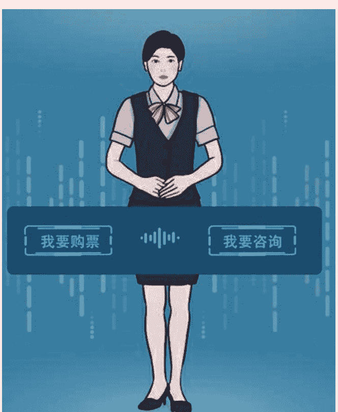

#### （三）行走中的客服机器人

传统客服中心位置固定，覆盖范围有限，对大面积换乘站覆盖不足。客服机器人可移动、灵活，可弥补固定中心的短板。

##### 1. 客服机器人功能介绍
机器人部署于站厅与站台，优先覆盖中心盲区，可随早晚高峰调整值守位置以缓解压力。配置驱动与避障系统，可规划路径移动并避免与旅客、设施碰撞。

主要交互方式为语音与触摸屏，靠近旅客可主动打招呼。驻停后可提供票卡处理、信息查询、站内导航、语音问询等服务。功能超出范围时，后台客服可远程接管以音频或视频沟通。机器人还能承担引路任务，并通过摄像头与视频分析算法识别打架、遗失物品、翻越栏杆等异常，通知站务处置并保留视频依据。

随着AI与机器人技术成熟，未来客服机器人可承担更多日常重复性站务工作，提升运营效率。

##### 2. 城轨客服机器人应用案例
北京地铁“阿捷”可提供出行查询、实地引导、运营提示等服务，并展示运营信息与防控举措。深圳地铁20号线、12号线、6号线投用的智能票务机器人，通过人脸识别与语音交互提供票卡查询、站内导航、换乘指引等功能。

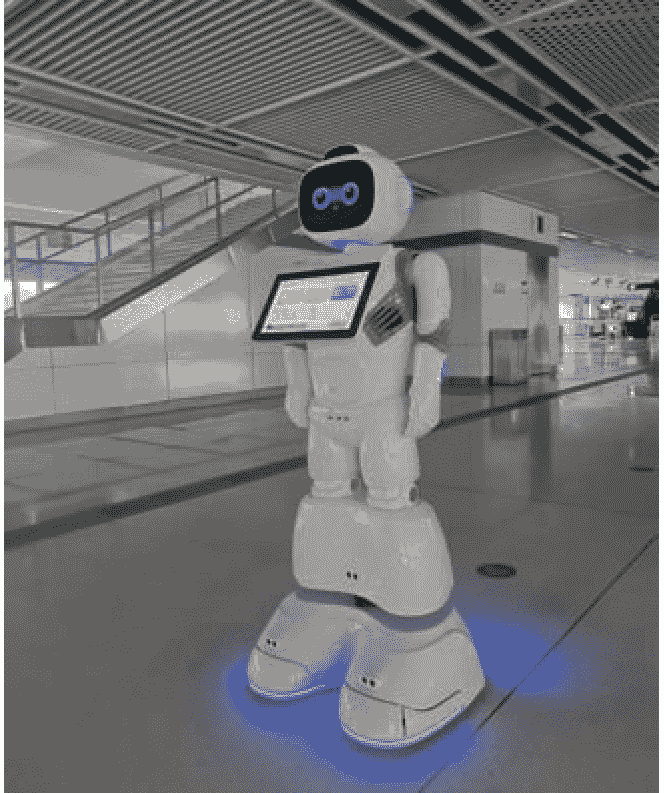

#### （四）不一样的AI巡检员
随着城轨设施规模扩大，维修养护需求与安全、节能、高韧性运行压力同步提升。人工巡检强度大、效率低、易遗漏，一个细节疏忽就可能引发事故，且人力成本高。巡检机器人有望缓解这些问题。

##### 1. 线路智能巡检机器人
国内多条线路巡检仍依赖人工。以成都地铁为例，每条线路需10~20名轨道检修工，凌晨入隧作业，每小时仅检5公里，效率低且存在安全隐患，缺乏客观标准与规范记录易导致漏检。

2022年7月，成都轨道交通产业技术研究院与成都精工华耀联合研发的轨道线路巡检机器人上线，实现由人工向智能自动巡检转变。该机器人检测速度快、续航长，可检测道床、扣件、钢轨等30余项病害并及时上报。替代人工后实现了安全、高效、精准的巡检，效率大幅提升。

##### 2. 列车智能巡检机器人
传统列车人工巡检存在盲区，难以提前预警。列车巡检机器人已成为“侦察兵”，按下启动后按路径作业，发现疑似故障即报警。

列车巡检系统可替代人工检测转向架紧固件松动、变形、裂纹等故障，实现自动图像采集、故障分析、上报与追溯。上海地铁“瓦力”即为代表，每辆列车有3万多个检测点，检测一次约40分钟，能快速识别隐蔽异物，异物检测准确率可达98%。

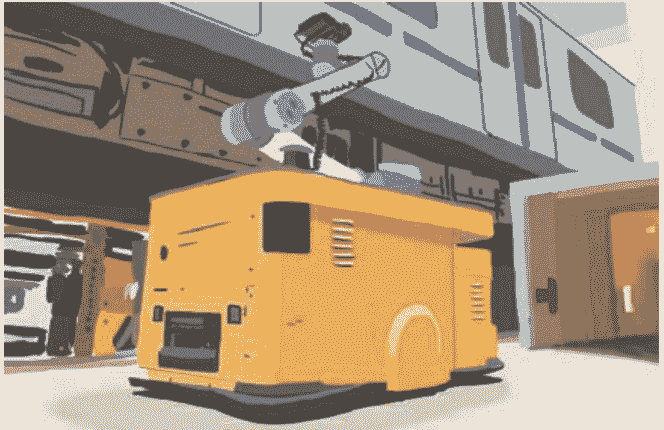

##### 3. 地铁供电系统智能巡检机器人

地铁供电巡检的AI新解法

城轨供电网络盘根错节，电气设备种类繁多，常规巡检的负担随之加重，长期高负荷运行也让设备失效的风险不断攀升。把自学习能力嵌入供电系统的日常巡检，就能在隐患刚显现时发出预警，协助运维团队迅速进行针对性处置，降低安全隐忧。

车站配电柜的健康监测主要交给供电巡检机来完成。它兼具图像识别、区域测温、柜体后门联动开启、激光自导航、断电续航、异常状态记录等特性，叠加实时解析、数据互通、标准接口以及应用联动的感知层，能大幅减轻运维人员在感知与操作上的复杂度。借助远程操纵机械臂，可实现一周七天每天二十四小时不间断、高频次的自主巡检。

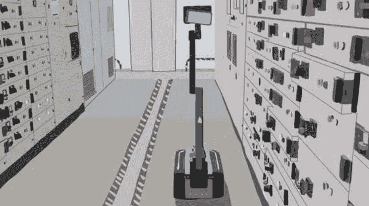

图4-6 地铁供电系统智能巡检机器人

##### 4. 变电所智能巡检机器人
变电所是轨道交通的电能供给中心，为列车和车站各用电设施提供电力。过去的运维多依赖听声看形靠经验的方式完成。

变电所巡检机搭载高清成像、红外热成像、超声探测装置，对机柜设备进行巡视，巡检的准确性得到明显提升。设备还能读取机柜运行状态并进行自学习分析，形成即时预警，让安全保障实现质的跃升。

北京地铁4号线马家堡车辆段已部署该类设备（图4-7），巡检周期由原来的每周一次压缩到每三小时一次，能够比人工更早捕捉设备异常，有效维护设备可靠性。机器获取数据后自行分析，一旦出现故障或潜在隐患即可迅速判定，让数据采集更具价值。

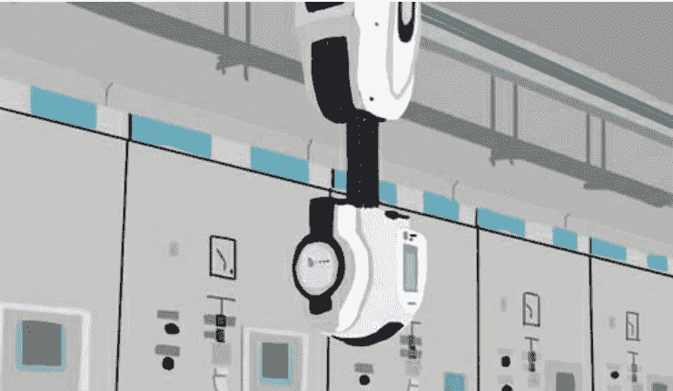

图4-7 变电所智能巡检机器人

> [1] 相点：相图中表示构成某个平衡的点。

### 二、云边端协同融合城轨“身体”与“大脑”

#### （一）云边端业务协同
在城轨海量数据场景下，云端算力的优劣都很突出。算力供给能力很强，但大流量长距离传输会明显拖慢速度，现有方案难以根治。边缘侧算力因此更具适用性（图4-8）。

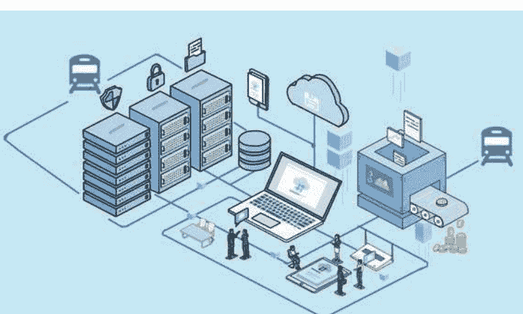
借助边缘侧算力，轨道云可以对时延敏感数据就近处理，关键信息在网络边缘完成重算并下沉，降低处理延迟，满足系统即时响应的需求。云端体系与边缘侧算力是两种不同的范式，彼此不可替代，通过优势互补形成云边协同的新方案。

云端体系把海量处理拆解为众多小任务，分散到多台服务器协同运算。能够提供近乎无上限的算力、存储、安全、容器服务、高可用负载均衡、服务托管等能力，有利于扩展与模块化演进。相比单机，分布式架构容错更强。成本低、效率高的特点让云端扮演城轨“大脑”角色，指挥各部位协同运转，处理来自“感官”的数据。

但云端体系处理边缘侧数据时存在实时性不足、带宽受限、能耗偏高的问题。边缘侧算力在网络边缘执行运算，正好弥补这些不足。它在数据入口附近提供算力、存储和带宽能力，把中心节点的大型服务拆解为更小更易管理的单元下发到边缘处理，减少延迟。在轨道体系中，边缘节点下沉到每个车站并接入站内各协议设备，处理站内数据与运算，好比人的五官实时感知外部信息。

云边协同体现优势互补，边缘节点靠近数据来源，利用本地算力先对设备数据进行计算处理后再上送云端，既提升数据使用效率，也减轻云端传输压力，相当于大脑与五官相连的神经网络。

边缘侧算力可把最核心的数据在短距离内完成传输，节省网络和算力资源。智慧轨道交通向全自动运行发展，为保障列车安全可靠，站级设备和列车终端必须实时决策，对毫秒级实时性要求极高。

边缘侧算力把云端平台的算力下沉，使得业务在边缘即可完整闭环。大量功能在边缘节点直接完成数据处理，满足业务对实时性的需求。同时，因边缘具备完整的业务处理能力，当云端平台出现故障时，可通过边缘侧算力实现关键业务的降级运行，保障系统安全运行。

#### （二）边缘智能技术在车站中的应用

##### 1. 边缘智能技术的概述及基本原理
边缘智能借助新型IT基础设施把边缘活动和数据转化为可操作的分析结果，用以提升业务成效、优化运维并强化产品体验。边缘智能的底层是边缘侧算力，即在终端设备与云中心之间部署算力单元的新范式。

边缘算力架构如图4-9所示，数据处理尽量靠近终端，数据、应用和算力远离集中式云中心。

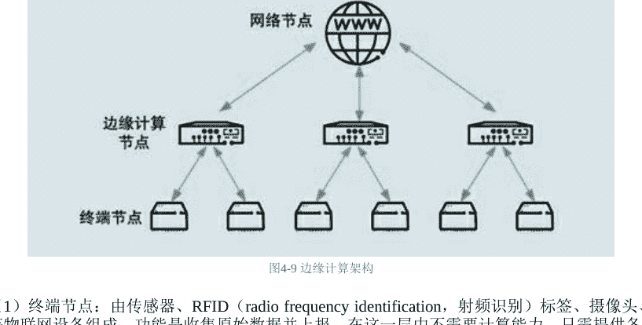
（1）终端节点：由传感器、RFID射频识别标签、摄像头、智能手机等物联网设备构成，负责采集原始数据并上报。该层不承担计算，只提供感知能力。
（2）边缘算力节点：通过合理部署与调度网络边缘侧节点的算力与存储资源，实现基础服务的即时响应。
（3）网络节点：把边缘算力节点处理后的有效数据上传至云算力节点再行分析。
（4）云算力节点：边缘层上报的数据在云端做持久化存储，边缘层无法完成的分析任务和全局信息汇总仍在云端完成。云端还能依据网络资源分布动态调整边缘节点的部署策略与算法。

##### 2. 边缘算力赋能城轨建设过程管控
云端算力已让轨道交通更聪明，但更安全、更高效仍是运营的核心目标。随大数据与自学习技术的普及，部分场景对低时延、高算力、高信息安全性提出新要求，需要在合适平衡点部署智能边缘。

边缘侧算力的先天特性能有效解决低延迟、高安全的需求，并利用更多传感器数据打破信息孤岛，为轨道交通智能化赋能。边缘智能通过灵活的算力架构，最大化机器智能在轨道交通中的效能。

##### 3. 边缘算力赋能轨道交通的运营维护与调度
把边缘智能引入轨道交通信息共享环节，可以缓解回传数据导致主干网络拥塞、链路负荷激增以及隐私安全等问题。

面对海量冗余、庞杂、异构的数据，云端体系负责全局，所有数据都要传回中心分析；边缘侧算力聚焦局部，专注实时、短周期数据的分析，支撑本地实时业务。原始数据保留在边缘侧，保障隐私与安全。原始数据在边缘侧完成初筛，仅把有用信息传至云端，减少网络负担并降低传输成本。

边缘侧算力具备低时延、就近化、大带宽和位置感知等特性，让轨道业务更从容，结合敏捷部署，赋能运维与调度的智能化。

##### 4. 边缘算力赋能轨道交通升级与改造
当前边缘智能应用正形成新生态，成为推动行业智能化发展的新动能。

边缘智能凭借独特优势，在打破数据孤岛、推进终端智能化、构建高可靠架构方面发挥重要作用。它能满足轨道系统改造升级的需求，如赋能智慧旅客信息系统、智慧列车运行控制、智慧车站、智能运维等，是推进全方位智慧化转型的必要动力。

同时，依托边缘智能范式的灵活部署，通过云、边、端协同及混合算力模式，可满足轨道交通对算力、安全、实时、带宽的需求，边缘智能框架为系统升级改造提供坚实技术支撑。

##### 5. 边缘算力在智慧车站的应用
（1）车站设备能耗管控。通过在设备终端部署能耗监测传感器实时监控能耗状况，这些传感器内置简易边缘算力能力，实现能耗控制的边缘化应用。
（2）车站智能视频分析。智能视频采集技术在智慧车站广泛应用，相当于轨道系统的末梢神经。将AI能力注入前端摄像机等边缘设备，在本地完成视频图像预处理，降低存储与带宽需求，提高分析速度。借助边缘预处理，可构建基于行为感知的视频监控弹性存储机制，仅上传精炼的结构化有效数据至云端，降低视频流传输与存储成本，分摊云中心压力。
（3）车站环境舒适度监控。车站部署的温度、湿度、光照强度、空气质量等边缘终端传感器具备简易数据处理能力，可过滤重复数据并定时回传监测数据。信息汇聚到特定边缘算力节点后进一步处理形成决策，实现环境舒适度调节。

## 第五章 智慧城轨全场景应用

### 一、精准便捷的乘客服务

#### （一）智慧票务

##### 1. 地铁票卡发展历程
轨道大客流带来庞大的票务需求，支付方式已从单一现金转向多元移动支付。早期车票以纸质为主，纸制单程票、自动售票机打孔纸票、二维码票等均不可重复使用，使用后处理繁琐，易造成资源浪费且不环保（图5-1）。

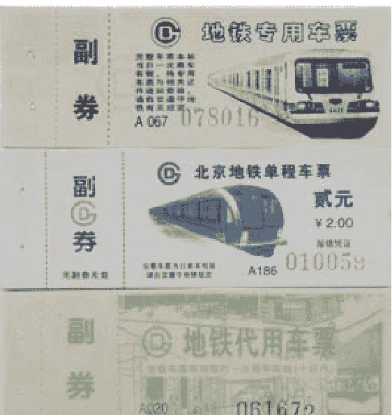
进入自助售票机时代后，旅客可用现金或硬币在自助售票机或人工售票厅购票乘车（图5-2）。

当下移动互联网浪潮下，在票卡支付仍为主流的背景下，二维码、NFC近场通信、刷脸等新支付方式正逐步进入交通领域（图5-3）。

多元化的过闸方式为旅客带来高效率、高可用、高可靠的便捷乘车体验。

##### 2. 应用现状
（1）地铁自建App支付。2017年11月16日，全国首个乘车码在广州地铁正式上线试运营（图5-4）。随后全国各地地铁陆续上线扫码过闸功能。基本流程如图5-5所示。

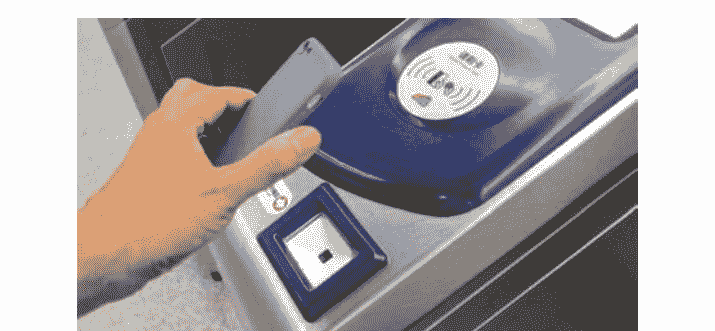

图5-4 乘车二维码进站

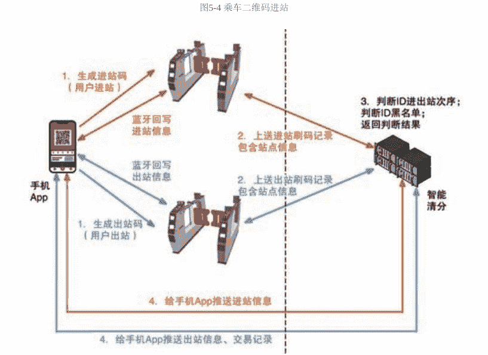

图5-5 乘车码过闸控制示意

（2）交通联合一卡通卡支付。近年来，一卡通的应用让城市间出行更便捷，体现国内公共乘车票务协同化、一体化、同城化有序推进（图5-6）。

（3）银联IC卡支付。2016年12月28日，广州地铁全线网开通金融IC卡与银联手机移动支付。本地市民与外地游客均可轻松“嘀”卡或直接用手机过闸，进一步提升支付便捷性（图5-7）。

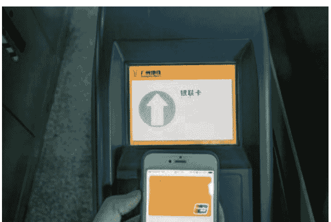
（4）手机NFC支付。NFC支付是指消费者使用支持NFC技术的手机完成支付，是新型移动支付方式。其处理在本地完成，无需移动网络，通过NFC射频通道与POS收款机或自动售货机等实现本地通信。

具备NFC功能的手机绑定银联卡或城市通卡后，将手机靠近闸机读卡区即可建立连接，闸机按地铁业务规则读取虚拟票卡，完成进站、出站、更新等流程（图5-8）。

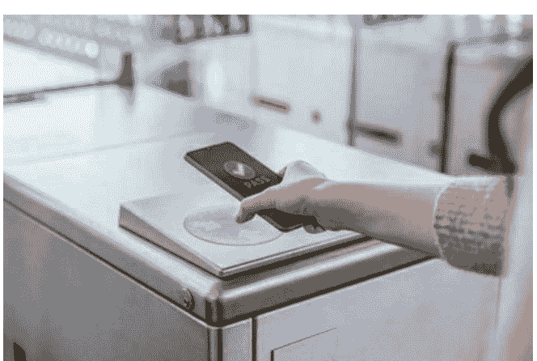

图5-8 手机NFC支付地铁乘车费

##### 3. 发展趋势
一方面《纲要》提出，要重点建设基于实名制、个人信用体系的跨平台、跨场景乘车票务服务，利用生物识别、无感支付，提升售检票与乘车智能化水平。

另一方面移动互联网技术持续演进为城轨智慧票务多元化改革创新提供广阔空间，使用虚拟票替代实体票已成业内共识，也是智慧票务发展的必然路径（图5-9）。

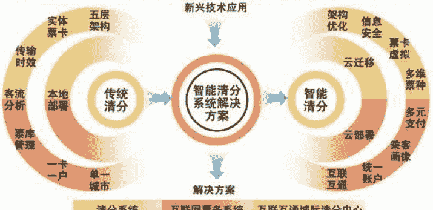

图5-9 票务清分发展趋势

#### （二）无感乘车

##### 1. 无感乘车简介
客流高峰期，进出站的实体票介质与安检环节增加出行时间成本，影响通行效率。随技术发展，无感乘车应运而生。

何为无感乘车？即借助生物识别技术识别旅客主体，在旅客无接触甚至无感知的情况下完成进站安检、付费等智慧化操作，减少甚至消除实体接触环节，提升出行体验与效率，实现预设价值目标。

##### 2. 利用AI技术实现城轨无感乘车
虹膜识别技术已广泛用于安防门禁等高保密场景。通过在闸机安装虹膜识别模块，旅客过闸时仅需注视模块即可完成身份鉴定，记录通行行为并通过票务系统扣费。需先在自助设备完成登记注册与身份鉴定，建立账户后方可使用（图5-10）。

人脸识别技术同样具备生理特征唯一性，通过在闸机安装人脸识别模块，旅客过闸时即可自动完成身份鉴定、记录通行并扣费。同样需先完成自助登记注册与身份鉴定后方可使用。

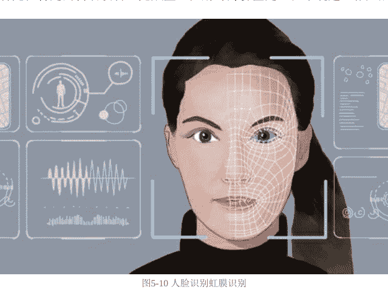

#### （三）智能导引

##### 1. 乘客引导系统简介
乘客引导系统旨在为乘车提供实时、动态的服务信息及其他相关信息。

城轨乘客引导包括静态导向信息与动态导向信息两类。

静态导向信息主要包括图形、文字、符号、数字等静态导向标志，布置于车站外、出入口、通道、站厅、站台及车辆等处，提供方向性、警示性与服务性指引。

动态导向信息为实时发布的信息，是静态标志的补充。按媒介形式可分为视觉信息与听觉信息。视觉信息包括列车到站时刻、到站预告、安全提示、末班车时间等。听觉信息主要通过广播播报到站时刻、安全提示及紧急撤离通知等。

##### 2. AI在城轨乘客引导中的应用
大客流下，提供准确、及时、有效的引导信息至关重要。乘客引导系统以通信与互联网技术为基础，通过末端感知设备持续监控线网客流、列车时刻表、时钟、视频流等信息，利用人工智能将非结构化数据转化为结构化数据，结合大数据分析形成有助于乘车的信息，并以文字显示、声音、图示、方位指引、警示等多种形式快速便捷地提供全方位导引服务。

当前AI应用对乘客引导帮助明显，主要体现在：
- （1）车辆拥挤度显示。利用车厢内实时视频与AI视频人数统计，分析不同车次不同车厢旅客数量，通过引导系统推送至末端设备，让旅客了解拥挤情况并选择合适车厢。
- （2）车站客流密度显示。利用车站实时视频与AI分析，实时展示车站客流密度情况。
- （3）通过旅客画像分析了解需求，提供个性化广告投放与更精准的引导信息，并借助机器学习持续优化投放精准度。

#### （四）智能客服

##### 1. 城轨客服系统现状
国内地铁站点普遍以票亭及车控室兼作客服中心。普通车站一般设2处客服中心，每处按1~2人配置，高峰时段需求饱满，非高峰时段人力资源利用率低。

##### 2. 城轨客服系统的新模式
随着线网规模扩大与旅客需求提升，客服重要性愈发显著。人工智能与手机App等技术有效提升客服管理水平并获市场认可。未来城轨智能客服将形成“智能机器人+人工客服+工单”三位一体模式，即重复性问题由机器人解答、个性化问题由人工客服处理、专业化问题通过工单闭环。此模式改变传统客服的人力浪费，提升工作效率。

##### 3. 智能客服业务及主要技术
智能客服主要应用语音识别、语音合成、语义理解等AI技术，通过拟人化语音、文字与旅客自然流畅交互，提供自助终端智能咨询、在线与语音问答、咨询、业务办理等服务。

智能客服系统可通过电话、网页、App及智能终端等多渠道服务用户，大幅降低客服成本并提升服务效率。

##### 4. AI技术在城轨智能客服中的应用
- （1）计算机视觉用于目标物、问题识别。计算机视觉可分析处理数字图像与视频并理解其含义与上下文；客服系统可精准识别并归类目标物。通过计算机视觉，智能客服在线系统可将客户查询分流至自助服务渠道，缓解客服中心接待压力，客户与视觉助手交互即可获得问题解决指引。
- （2）客服决策支持。客服软件可简化人工客服工作。通过构建动态视觉知识库帮助客服决策并实现企业范围知识共享。旅客服务多以信息输入为主，系统通过收集询问问题获取业务与服务需求。未来客服中心核心应逐步转向大数据挖掘，获取热点需求、追溯问题原因并为业务、服务与流程改进提供指导。
- （3）客服管理。人工客服招聘、培训需投入时间和成本，且工作压力与情绪可能影响旅客体验。提升客服效率、改善旅客体验、减少人力耗费迫在眉睫。

AI客服机器人可有效解决上述问题，在提升效率的同时让客服实现价值。典型功能包括设置呼叫优先级、识别客户、智能推荐搜索引擎、智能客服监控与培训。

（4）上岗前智能带教
借助智能客服演练平台把培训嵌入到到岗前的准备流程里，员工可以在正式上岗前完成标准化场景练习；全天候在线的虚拟教员负责即时答疑，把自学基础知识的时间成本压缩，学习效率随之提升。

#### （五）站内智能导引
##### 1. 导览价值
车站内部具备精准定位与指引能力后，乘客的出行感受明显改善，站务的运营服务水平也会同步提升。当前业内常用的室内无源定位方案涵盖超声、超宽带、红外、Wi-Fi、蓝牙以及混合现实等，随着移动终端普及与节能蓝牙的成熟，以 BLE 为底座的室内定位已成研究热点。[9]

##### 2. 技术要点
（1）节能蓝牙寻位。依托 LoRa 远距离无线电的蓝牙寻位网络，通过 iBeacon 信标和基站搭建站内网，移动端可直接完成定位。站务人员复用同一网络并佩戴定位卡，实现实时查岗、轨迹分析与电子围栏管控。
（2）混合现实指引。借助 MR 设备把导航效果具象化。用户在手机小程序里手动选择或语音设定目的地，系统结合三维地图算出坐标，并按可达网格规划最优路径指引到达。在封闭复杂空间里，MR 指引能明显提升精度与灵活性。

##### 3. 落地示范
广州天河智慧城示范站经需求调研与技术对标后，选用 BLE 寻位方案完成站内定位与导引，并以移动程序的形式向乘客和站务人员提供服务。

#### （六）智能援助服务
智能援助覆盖乘客进站、乘车到出站全过程。智能问答降低了人工成本，但仍有大量诉求需要人工介入，对响应速度和服务品质提出更高要求。

对于算法难以处理的诉求，援助体系融合视频解析、用户画像、知识库、网络爬虫与大数据语义分析，实现精准洞察，可灵活应变并进行恰当对话。语音识别从最初的普通话向多语种与地方口音扩展，覆盖面更广。

落地后还催生多元机器人形态，服务载体从人工延伸到实体机器人，乘客可通过微博、微信等平台随时接入，服务如影随形。车站与列车上的客服终端也支持与人工直接连线，更直接解决问题。随着算力提升，虚拟形象 AI 客服已出现，服务智能化程度进一步提高。

#### （七）便民服务组合
便民服务聚焦细节打磨，包含无障碍预约乘车、失物招领管理、信息统一发布、突发事件引导、多语种智能机器人、生活服务查询推送、物品借存、智慧边门等，着力优化日常出行体验。

### 二、高效智能安全体系
#### （一）智能化安检
##### 1. 安检现状
城轨安检与机场、高铁类似，分为人检与物检，主要排查乘客及行李中的危险品。行李多用安检机，人员检查以通过式金属门、手持探测器配合人工为主，高峰期易拥堵滞留，体验与效率均有提升空间。

##### 2. 智能影像判图
早期安检多靠人工判图，对经验要求高且质量不均，易漏检。图像识别已用于 X 射线机危险物识别。训练好的模型可对枪支弹药、爆炸物、管制器具等进行初筛、定位并标注，提示安检员重点判读，漏判风险明显下降。

智慧安检正从区域式向网络化集成演进，采用集中判图模式，打破设备离线、人力分散、人工判图等瓶颈，向空间节约、功能网络化、判图智能化、识别更精准与安检无感化发展，构建一站式智能服务。

#### （二）综合安防管控
##### 1. 现有安防痛点
广义安防涵盖人、设备、信息网络与数据，本处聚焦人员与基础设施。传统地铁运营中安防未形成独立应急预案模块，事件分类、流程、关联设备缺乏体系化预案；硬件种类繁多，统一接入管理尚不完善，导致各系统难以与运营联动，应急主要靠人工，效率低、易出错、风险高。[10]建立体系化综合安防管理体系已成重点。

##### 2. 常用技术手段
（1）视频监控。视频监控是较早应用的安防手段，从关键点位监测存储发展到数字化高清前端，为智能分析提供基础。其核心是通过视频探测、监视设防区域并实现实时显示、记录、检索与回溯。
城轨智能视频分析涵盖入侵报警、出入口控制、异常行为识别、人脸搜寻等。
（2）门禁管理系统。通过门禁控制器、密码键盘、人脸识别等终端，对重点区域实施分级权限管控，确保授权人员自由通行，限制未授权进入，并记录统计出入数据。
（3）安全检查与探测。主要针对乘客及行李危险品检查，以及公共区域有害气体探测。
（4）入侵探测。利用红外、微波、超声波及视频分析等手段，对特定区域入侵行为进行监测与预警。

##### 3. 算法在安防中的应用场景
伴随云计算、大数据、物联网与人工智能发展，安防智能化不断提升，算法在视频分析环节尤为突出。
- 视频智能分析。前端采集视频发送至 AI 视觉系统，经图像处理与机器学习分解任务后识别画面内容，结合云计算与大数据分析实现特定人员搜寻、入侵报警、异常行为分析等。
- 机器学习。算法可从数据中自动发现关联并做预测，数据量越大预测越准。视频分析具备自学习与自适应能力，可自动过滤干扰目标，提升准确率。
- 大数据挖掘。借助算法深入挖掘视频数据，完成检索、标注与识别，降低人工成本；算法需持续训练以完善认知。
- 全域多元化。融合智能分析后，AI 视频安防打破地理与时空限制，实现全覆盖，可用于入侵报警、边界防范、不文明行为分析、安全巡检、火灾报警等。
- 特定图像识别。轨道交通安防主体为乘客，AI 视频生物识别融合计算机、光学、声学、传感器及生物统计，利用指纹、人脸、虹膜、掌静脉、声音、步态等特征进行身份鉴别，已广泛应用。

#### （三）智慧化应急联动
轨道交通作为民生工程，安全是首要任务，线路成网后关联性增强，对设施、人员、事件的安全监测需求提升。智能体发展下，人工智能等技术在智慧应急领域逐步成型。

智慧应急系统依托人工智能、5G、大数据等技术，围绕风险、隐患、险情、灾情演变与应急管理全链条，依托智慧轨道交通大脑构建轨道交通应急大脑，提升风险发现与防范化解的智能化水平。

系统遵循智能体一体化设计，各专业系统既可协同也可独立运行。通过智能连接融合分散设备的运行状态，实现泛在感知。依托大脑可提供覆盖列车、车站、车辆段的应急场景应用，面向运营安全、灾害检测、生产安全、疫情防控等提供一体化解法。

异常状态及时感知大幅提升处置效率，优化传统管理模式，推动智能感知、智能流程、智能决策，降低人员工作强度并节约安全管理成本。例如长沙地铁 6 号线基于智慧地铁平台的应急智能监测预警系统，可实时监测车站客流，超阈值时触发报警并联动视频画面提示处置。

突发事件发生时，系统提供专业灾害计算模型，模拟火灾、爆炸、气体泄漏等情景，输入位置、特性与气象信息后可视化展示分析结果，辅助划定撤离范围与疏散路线，提升救援效率。事件处置后，智慧大脑保存评估处置过程，反哺模型持续进化。

视频智能分析与大数据技术与应急事前、事中、事后业务融合，为预防风险、排除隐患与事故应对提供支撑，提升应急管理智能化水平与抵御灾害能力。

### 三、运营组织的智能升级
#### （一）客流智能化
##### 1. 背景
城轨载客量大、舒适准点、票价低廉，已成市民出行首选。地铁承担中心城市 40%~60% 公共客流，年客流量从千万到十亿不等。工作日通勤占比高易现潮汐大客流，节假日与突发事件亦会带来客流激增，易引发冲撞、踩踏等风险，客流控制是运营首要任务。

##### 2. 传统预测的短板
客流预测直接影响规划、建设、运营与日常控制。传统做法是分析近期 1~2 个月线网、线路、车站与区间客流趋势，提前制定行车组织、客流组织、限流与引导策略，虽有一定指导作用，却难以应对突发大客流，只能被动限流。

主要原因有三：线网客流监测能力不足，仅靠 AFC 难以掌握旅客在网内分布与动态，感知滞后；缺乏对突发大客流时间地点的精准预测，预案被动；缺乏精准管控方法，聚集点风险分级不足，导致人力物力浪费与控制效果不佳。

##### 3. 智慧客流方案
5G、AI 等新技术为解决痛点提供支撑。智慧客流实时采集客流数据并深化分析，智能调整运力，异常时启动控制预案，主动引导出行，推动客运组织从经验被动向智能联控转变。
- 赋能客流预测，实现精准控制。利用 5G+边缘计算、5G+前端摄像头与大数据采集实时信息，基于 AI 模型预测车站、线路、线网、区间断面客流，输出 5 分钟、15 分钟、30 分钟等不同时段预测数据，提前感知大客流风险并在综合调度屏展示预警。结合大数据分析流向，运营方可实施更精细针对性管控；同时可监测预警旅客异常行为并应急处置。
- 赋能运力调配，实现精准协同。依托预警信息及时调整列车运行交路、停站方式或加开临时列车，启动或修改应急预案，使调度从固定运能转向按需供给。人员亦可按需调度，降低单站人工负荷。
- 赋能信息系统，实现出行诱导。启动预案时，通过社交平台、App、车站 PIS、广播等发布拥挤情况、路径变动、管控信息，引导旅客出行，提升管控效果。

#### （二）智能调度
##### 1. 行车调度职责
行车调度以列车运行计划为核心，保障运营安全与高效。早晚高峰通常加开列车或采用大小交路，防止换乘站积压。列车运行需执行提前编制的运行图，但实际客流波动难以完全匹配。

##### 2. 落地路径
（1）构建四级调度系统。智慧调度构建网络化智能运输组织体系、线网运营调度指挥中心、线路运营调度控制中心与车站综合管控平台，实现精准运输策划、智能调度控制与智慧车站运管，形成集约指挥、分级执行、智慧控制的整体，区别于传统一线一调、信息割裂、资源利用低的模式，实现运能运量匹配与高效网络化运输。
（2）实施高效智能调度。
①列车运行图编制。调度可借助客流预测数据与实时态势，结合可用列车、设备与人力，自动编制、模拟、调整、导入、下发与评估线网运行计划，实现运能随客流变化实时协调。突发故障时可实时调整运行计划，并联动 ATS 及时发布指令至列车与车站，提升安全与效率。
②列车运行监控。打通 ATS、ISCS、车辆故障报警与运行异常信息，异常时报警并联动 ATS、CCTV、调度通信，快速定位故障，提供应急行车策略与预案启动建议，缩短响应时间。
③调度信息共享。通过组织架构优化、计划智能编制与系统联动，打破数据孤岛、平台封闭、响应被动等问题，增强多态场景应用能力，满足数字化网络化智能化运营需求，与智慧旅客服务协同，构建精准高效运营管理体系。

#### （三）智能列车
城轨数字化转型深入，运行控制系统与新技术融合加速，智慧列车应运而生。以车地联锁与车车协同为路径，追求更安全高效经济，实现自主感知、学习与决策。

目标是增强列车自主控制、减少轨旁设备、提高设备利用率，通过全自动运行、车车通信、全电子联锁、互联互通、智能编组、智能 ATO 与主动式障碍物检测等技术提升自主化、智能化与舒适度，减轻运维人员负担。

##### 1. 全自动运行
基于现代计算机、通信、控制与系统集成技术，实现全流程自动化，无需人工操作。站间行驶、到站停车、自动开关门、自动发车、自动回库、自动洗车、自动休眠等均实现全自动运行管理。

未来全自动运行将突破单线边界

进入下一阶段，全自动驾驶不再局限于单一线路运营，有望打通跨线通行、共线融合和越行直达等多种联动场景。所谓跨线，是指不同线路之间能够相互贯通；共线则是多条线路在特定区段汇合运行，形成临时合流线路；越行则是在同向双线中设置一条不停车通过的越行线，实现列车快速超越。

2. 车地通信进入感知强化时代
车地通信本质上是列车车载设备与轨道、轨旁设施之间的数据互通。新一代方案通过强化列车对运行空间和车内环境的感知能力，提升自主操控水平，进而提高轨旁设备的使用效率，让列车更“懂路”、更“懂车”。

3. 列车编组实现智能协同
传统地铁编组多以6辆或8辆为标准，具体选择受线路客流和站台长度影响。智能编组依托列车间的信息交互与感应技术，借助虚拟连挂方式，让两列或多列列车能够灵活编队、速度趋同、同步进出站台。该技术可实现编组与解编的动态优化，达成线路整体运行效率的最大化。

4. 列车健康管理迈向全周期监测
借助大数据趋势分析和智能辅助决策，健康管理可完成远程故障诊断、地面设备数据解析、历史与近期故障统计、健康状态评估，并沉淀为诊断知识库。运营与维修人员由此能够实时把握列车运行状态、维修需求和故障点位，确保安全可靠运营。

（四）智慧车站向全场景智控升级
车站作为线网核心节点，客流密集、设备集中，安全风险点较多，智慧化建设势在必行。为提升满意度并降低人力成本，行业引入了人脸过闸、语音自助服务终端、无感小包安检门、智能客服中心等新设备，这些都是智慧车站的重要构成。

智慧车站的建设逻辑是融合全面感知、数据深度融合与高效治理，运用深度学习、视觉计算和大数据分析，为管理、运维、服务和应急处置提供数字化网络化支撑，提升设备可靠性和运营效率，同时优化乘客体验。接下来聚焦乘客服务带来的变化。

1. 咨询服务走向多元化
传统模式下，乘客往往要到站后才能获取线路、目的地等信息。智慧车站将服务延伸至进站前、进站、乘车、出站及出站后出行全链路，线上线下同步推送。进站前，旅客即可通过车站客服助手、客服热线或地铁App查询入口指引、实时换乘方案、到站时刻和车厢拥挤度，实现出行前信息前置。

五、AI驱动城轨绿色转型
（一）城轨能耗持续攀升的压力
城轨快速扩张的同时，能耗增幅明显。2019年全国城轨总能耗约152.6亿kW·h，同比增长15.5%；2020年升至172.4亿kW·h，同比增长12.9%；2021年达213.1亿kW·h，同比增长23.6%。2020年牵引能耗约84亿kW·h，占总电耗48.7%；车站能耗约88.4亿kW·h，占51.3%。历史数据显示，牵引能耗约占总能耗一半，环控能耗占比30%至40%，两者为主要耗能来源。

2020年9月我国在联合国大会提出二氧化碳排放力争2030年前达峰、2060年前实现碳中和的目标。专家指出，2018至2020年城轨总能耗持续走高，若要达成碳达峰碳中和，必须全面践行绿色低碳理念，加快转型、挖掘节能潜力、提升能效。

（二）双碳目标倒逼绿色城轨
发达国家实现碳达峰到碳中和约需60年，我国时间窗口约一半，却面临更高峰值与经济建设、减排双重压力。国家已构建“1+N”政策体系，形成顶层设计。

为此，中国城市轨道交通协会于2022年8月发布《中国城市轨道交通绿色城轨发展行动方案》，明确电耗、能耗强度、碳排放强度等量化目标。方案提出2025年行业总电耗约360亿kW·h左右、2030年约490亿kW·h左右；综合能耗强度下降10%以上再降至15%以上；牵引能耗强度下降比例同为10%以上和15%以上；供应链主要产品二氧化碳排放量下降率20%以上和30%以上；城轨在城市机动化出行占比提升5%以上和10%以上，在公共交通出行占比提升15%并在超大城市超50%；轨道站点800米半径通勤覆盖比例分别达到超大城市30%、特大城市20%、大城市10%等。此外还涉及新建建筑绿色面积占比70%以上至100%、星级绿色建筑占比15%至40%、屋顶光伏覆盖率100%及既有场地35%以上至90%以上、新建车辆基地热泵应用率40%至60%、外购绿电比重提升25%、装备制造碳排放下降20%以上至35%以上、供应链企业绿色工厂标定比例50%以上至100%等。

（三）AI技术成为绿色减排核心引擎
双碳不仅是减排工程，更是经济社会系统性变革。AI正与城轨碳减排深度结合，成为技术减排的关键支撑。

1. 能源预测模型
基于牵引、照明、空调等电耗及其影响因素构建综合预测模型。包括客流仿真模型、列车牵引能耗模型、车站能耗模型等仿真模型；配套高效计算引擎、进程管理器、模型交互接口和状态观测器等仿真工具；利用能管平台与综合监控系统采集的运营数据对模型自动校准并动态更新；借助机器学习与数据挖掘将仿真模型转化为可导连续的代理模型，提升实时反馈效率并为优化决策提供便利。

2. 碳流仿真模型与碳排放计算模型
通过能源网络碳排放流向的跟踪仿真，对全环节排放量和强度进行计量与推演，为碳核算与双碳达标提供量化依据。采用生命周期评价LCA方法，从原材料开采到最终处置全过程对城轨二氧化碳排放当量进行定量化分析。

3. 节能减排技术的经济技术分析模型
对存量节能技术进行经济技术性分析，形成专家规则知识库，评估潜在技术的节能效果、初投资与运营成本，并实现节能措施的智能化推荐。

4. 绿色低碳评价模型
依据双碳与绿色城轨相关标准体系建立评价模型，从评价范围、维度、内容和考核入手，导入标准生成多尺度能源双碳指标，便于运营方量化管理与决策。

从智慧乘客服务、智慧安全保障，到智能运营组织与智慧运维，再到绿色发展重塑，AI赋能城轨全场景仍处起步阶段，未来将呈现由浅入深、由简到繁的演进。变革势必颠覆行业价值。正如微软首席执行官萨提亚·纳德拉所言，人工智能浪潮不可阻挡，企业若把握住便能创造大量价值。

当AI浪潮涌来，主动拥抱新技术、加速城轨与新技术融合，推动数字化转型，是实现智慧化与绿色高质量可持续发展的必经之路。