# 口袋里的人工智能：智能驾驶

郭继舜 ◎ 主编

广东科技出版社

## 口袋里的人工智能：智能驾驶

1. 版权信息
2. “口袋里的人工智能”丛书编委会
3. 序言
4. 第一章 智能驾驶汽车的时代
   - 一、汽车的进化史
   - 二、汽车技术的发展趋势
   - 三、智能驾驶的起源、现状与未来
5. 第二章 智能驾驶的感官和大脑
   - 一、智能驾驶的感官——车载传感器
   - 二、智能驾驶的大脑——智能驾驶域控制器
6. 第三章 神奇的智能驾驶算法
   - 一、智能驾驶算法简介
   - 二、感知融合
   - 三、地图定位
   - 四、决策规划
   - 五、运动控制
7. 第四章 深度学习与智能驾驶
   - 一、深度学习与人工智能简介
   - 二、深度学习应用——相机视觉感知
   - 三、深度学习应用——激光雷达感知
   - 四、深度学习应用——目标预测
8. 第五章 数据是智能驾驶进步的燃料
   - 一、智能驾驶数据
   - 二、智能驾驶数据增强
   - 三、打造智能驾驶的数据闭环
   - 四、智能驾驶虚拟数据生成
9. 第六章 聪明的汽车和智慧的道路
   - 一、车路协同的意义
   - 二、车路协同系统技术概述
   - 三、V2X典型应用场景介绍
10. 第七章 未来生活和智能驾驶
    - 一、智能互联，核心终端
    - 二、生活第三空间
11. 参考文献

总顾问 戴琼海
总主编 陈俊龙

## 口袋里的人工智能：智能驾驶

郭继舜 ◎ 主编

广东科技出版社
全国优秀出版社

## 版权信息

书名：口袋里的人工智能：智能驾驶
主编：郭继舜
排版：何基才
出版社：广东科学技术出版社
出版时间：2023-03-01
ISBN：9787535980205

本书由广东科技出版社有限公司授权掌阅科技电子版制作与发行

版权所有·侵权必究

本丛书承
广州市科学技术局
广州市科技进步基金会
联合资助

## “口袋里的人工智能”丛书编委会

总顾问 戴琼海
主任 陈俊龙 王桂林
副主任 弓鸿午 吴汉荣 严奉强
委员（按姓氏笔画顺序排列）
马晶 王蕾 车文荃 史颖欢 刘伟 杜卿 李姝萌
沈文浩 张通 张小川 罗子章 郭继舜 谭明奎
丛书总主编 陈俊龙
执行总主编 车文荃

## 《智能驾驶》

主编 郭继舜
副主编 王艳明 郑鑫宇
编委（按姓氏笔画顺序排列）
王佛伟 李培杰 陈泽 彭钟钟 程伟 樊洪志

## 序言

技术日新月异，人类生活方式正在快速转变，这一切给人类历史带来了一系列不可思议的奇点。我们曾经熟悉的一切，都开始变得陌生。

> —— [美] 约翰·冯·诺依曼

“科技辉煌，若出其中。智能灿烂，若出其里。”无论是与世界顶尖围棋高手对弈的AlphaGo，还是发展得如火如荼的无人驾驶汽车，甚至是融入日常生活的智能家居，这些都标志着智能化时代的到来。在大数据、云计算、边缘计算及移动互联网等技术的加持下，人工智能技术凭借其广泛的应用场景，不断改变着人们的工作和生活方式。人工智能不仅是引领未来发展的战略性技术，更是推动新一轮科技发展和产业变革的动力。

人工智能具有溢出带动性很强的“头雁”效应，赋能百业发展，在世界科技领域具有重要的战略性地位。《中华人民共和国国民经济和社会发展第十四个五年规划和2035年远景目标纲要》提出，要推动人工智能同各产业深度融合。得益于在移动互联网、大数据、云计算等领域的技术积累，我国人工智能领域的发展已经走过技术理论积累和工具平台构建的发力储备期，目前已经进入产业赋能阶段，在机器视觉及自然语言处理领域达到世界先进水平，在智能驾驶及生物化学交叉领域产生了良好的效益。为落实《新一代人工智能发展规划》，2022年7月，科技部等六部门联合印发了《关于加快场景创新以人工智能高水平应用促进经济高质量发展的指导意见》，提出围绕高端高效智能经济培育、安全便捷智能社会建设、高水平科研活动、国家重大活动和重大工程打造重大场景，场景创新将进一步推动人工智能赋能百业的提质增效，也将给人民生活带来更为深入、便捷的场景变换体验。面对人工智能的快速发展，做好人工智能的科普工作是每一个人工智能从业者的责任。契合国家对新时代科普工作的新要求，大力构建社会化科普发展格局，为大众普及人工智能知识势在必行。

在此背景之下，广东科技出版社牵头组织了“口袋里的人工智能”系列丛书的编撰发行，邀请华南理工大学计算机科学与工程学院院长、欧洲科学院院士、欧洲科学与艺术院院士陈俊龙教授担任总主编，以打造“让更多人认识人工智能的科普丛书”为目标，聚焦人工智能场景应用的诸多领域，不仅涵盖了机器视觉、自然语言处理、计算机博弈等内容，还关注了当下与人工智能结合紧密的智能驾驶、化学与生物、智慧城轨、医疗健康等领域的热点内容。丛书包含《千才百智》《智能驾驶》《机器视觉》《AI化学与生物》《自然语言处理》《AI与医疗健康》《智慧城轨》《计算机博弈》8个分册，从科普的角度，通俗、简洁、全面地介绍人工智能的关键内容，准确把握行业痛点及发展趋势，分析行业融合人工智能的优势与挑战，不仅为大众了解人工智能知识提供便捷，也为相关行业的从业人员提供参考。同时，丛书可以提升当代青少年对科技的兴趣，引领更多青少年将来投身科研领域，从而勇敢面对充满未知与挑战的未来，拥抱变革、大胆创新，这些都体现了编写团队和广东科技出版社的社会责任、使命和担当。

这套丛书不仅展现了人工智能对社会发展和人民生活的正面作用，也对人工智能带来的伦理问题做出了探讨。技术的发展进步终究要以人为本，不应缺少面向人工智能社会应用的伦理考量，要设置必需的“安全阀”，以确保技术和应用的健康发展，智能社会的和谐幸福。

科技千帆过，智能万木春。人工智能的大幕已经徐徐展开，新的科技时代已经来临。正如前文冯·诺依曼的那句话，未来将不断地变化，让我们一起努力创造新的未来，一起期待新的明天。

戴琼海
（中国工程院院士）
2023年3月

## 第一章 智能驾驶汽车的时代

智能驾驶汽车现如今已经不再是一个陌生的概念，国内的百度、小马智行、文远知行，海外的Waymo、Uber（优步）、Aurora，都已经致力于智能驾驶汽车研究多年。在中国，北京、上海、广州、深圳等一线城市，已经可以在路上看到智能驾驶测试车辆，甚至有些公司已经开放消费者无人驾驶的体验。种种迹象表明，智能驾驶汽车的时代即将到来。

### 一、汽车的进化史

#### （一）蒸汽机时代

提到汽车，不得不提到“蒸汽机之父”詹姆斯·瓦特（James Watt），正是有了他发明的“瓦特蒸汽机”，人类才掀起了“第一次工业革命”的浪潮。瓦特随后研究制造了齿轮联动装置、连柄曲杆结构、离心调速器等，并对蒸汽机进行多次改造，完全替代了当时的“纽科门蒸汽机”。

在1769年，一名法国的陆军技术军官尼古拉斯·居组（Nicolas Cugnot）大尉在政府的支持下试制成功一台三轮蒸汽机车。

随后在1804年，理查德·特里维希克（Richard Trevithick）发明制造了世界上第一台实用型轮轨蒸汽机车，这是真正的第一台实用性轮轨蒸汽机车（图1-1）。

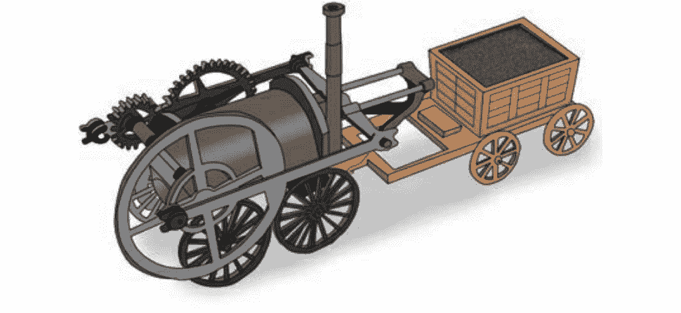

而后，在1825年，英国嘉内爵士（Goldsworthy Gurney）制成了第一辆蒸汽公共汽车，1831年嘉内利用这辆车开始了世界上最早的公共汽车运营业务（图1-2）。

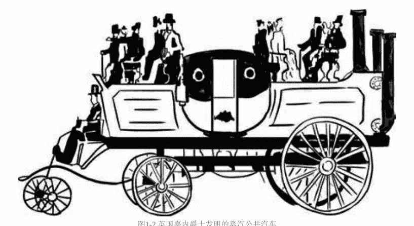

随着瓦特蒸汽机的广泛应用，19世纪中叶，在欧洲和美国，人们对蒸汽机车的研发和制造达到了高潮。蒸汽机被广泛应用在各类火车、轮船、公共汽车等交通运输工具上，出现了一个蒸汽机车的全盛时期 [1] 。但是蒸汽机车存在笨重、惯性大、制动困难、转向不灵敏、运行时需要大量的水和煤、锅炉气压高易爆炸、车轴易断裂、易熄火、行车受天气影响大、舒适性差、污染大、启动缓慢（耗时30～45min）及热效率低（10%左右）等缺点。迫于各种问题，19世纪中叶后，蒸汽机车日趋衰落，人们需要一种新的、更稳定、更可靠的产品替代蒸汽机车 [2] 。

#### （二）内燃机时代

蒸汽机把锅炉中开水产生的蒸汽送进气缸，来推动机械结构发生运动做功，因此蒸汽机又被称为外燃机。这样的过程必定导致热能大量损失，热效率极低。如果能让气体燃料直接在气缸内燃烧，通过气体膨胀力推动活塞做功，则可大大提升热效率，在这一思想的指导下，内燃机诞生了 [3] 。

内燃机的诞生是当时许多科学家不懈努力的结果。经历了如下4个阶段：

##### 1. 奠定基础

早在1670年，荷兰的物理学家、数学家和天文学家惠更斯（Christiaan Huygens）尝试让火药在气缸内燃烧，制成了使气体膨胀推动活塞做功的机械，并绘制了原理图。但由于火药危险性过大，并且在当时这种机械没有很好的应用领域，因此这项发明并未得到重视，但其却为内燃机的问世打下了基础。

##### 2. 引入气体燃料

1794年，英国的斯特里特（Streete）首次提出燃料与空气混合形成可燃混合气的原理。1801年，法国化学家菲利普·勒本（Philippe Lebon）采用经煤干馏得到的煤气和氢气作燃料，制成了将煤气和氢气与空气混合后点燃产生膨胀力推动活塞的发动机，这项发明被誉为内燃机发展史上开拓性的一步。

##### 3. 内燃机问世

1859年，比利时工程师艾蒂安·勒努瓦（Étienne Lenoir）创制成功了二冲程卧式内燃机。1862年，法国科学家德罗夏（Alphonse Beau de Rochas）在卡诺（Nicolas Léonard Sadi Carnot）热力学研究的基础上提出了四冲程内燃机工作原理，但他当时并未制造实体四冲程内燃机，而只是完成了设计工作。德国发明家奥托（Nikolaus Otto）提出了内燃机四冲程理论——奥托循环。奥托循环的一个周期是由吸气、压缩、膨胀做功和排气四个活塞行程构成，这为现代内燃机的发明奠定了理论基础。1876年，根据奥托循环，奥托设计制成了世界上首台水平四冲程往复活塞式内燃机（图1-3）。不过，此台内燃机以煤气为燃料，体积较大，质量较重，还不能用在汽车上。

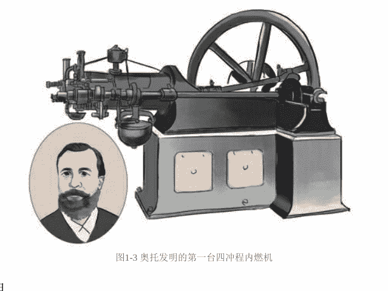

图1-3 奥托发明的第一台四冲程内燃机

##### 4. 完善与应用

1885年，两位曾为奥托工作的德国工程师卡尔·本茨（Karl Benz）与戈特利布·戴姆勒（Gottlieb Daimler）各自独立发明汽油内燃机。戴姆勒与其助手威廉·迈巴赫（Wilhelm Maybach）一起改进开发出世界上第一台化油器式电点火小型汽油机，转速可达到创纪录的750r/min，这是世界上第一台立式发动机，取名为“立钟”，戴姆勒将其安装在一台自行车上。这实际上是世界上第一辆摩托车（图1-4），因此，戴姆勒又被称为“摩托车之父”。在同一时期内，另一位奥托的下属，现代汽车工业的先驱者之一，被称为“汽车之父”的卡尔·本茨也在进行着他的研究。1879年，卡尔·本茨研制成功火花塞点火内燃机。随后他又将内燃机改进为汽油发动机。1885年，卡尔·本茨制造了世界上第一辆三轮汽油车，车上装有3个实心橡胶轮胎车轮及一个卧置单缸二冲程汽油发动机。卡尔·本茨于1886年1月29日向德国皇家专利局申报专利并获得批准，因此1月29日被认为是世界汽车诞生日，1886年为世界汽车诞生年。这辆汽车就是大名鼎鼎的“奔驰1号”，现保存在梅塞德斯奔驰博物馆内（图1-5）。

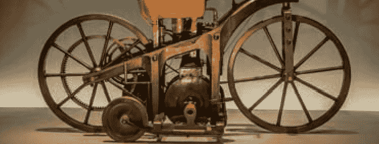

图1-4 世界上第一辆摩托车

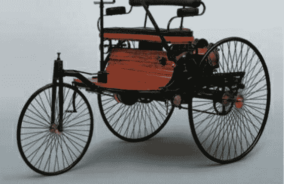

图1-5 世界上第一辆汽车“奔驰一号”

### 二、汽车技术的发展趋势

从1886年第一辆汽车诞生至今，汽车行业已经经历了100多年的发展，从萌芽到高速发展再到如今市场日趋成熟稳定，世界上诞生了诸如奔驰、宝马、大众、通用、丰田、本田等一批传统汽车巨头企业。

近几年，随着能源紧缺问题的逐渐加剧，以及科学技术的迅速发展，电动车和智能驾驶汽车开始进入人们的视野，并逐渐成为汽车行业的新宠。

回看近几年汽车行业的生产经营状况以及前沿技术研究情况，未来汽车技术将主要朝着电动化、智能化、网联化3个方向发展 [4-5]。

#### （一）电动化

电动汽车是指以车载电源为动力，用电机驱动车轮行驶，符合道路交通安全法规各项要求的车辆。目前主要包括纯电动汽车（battery electric vehicle, BEV）、混合动力汽车（hybrid electric vehicle, HEV）、燃料电池汽车（fuel cell electric vehicle, FCEV）3种类型。

在中国，早在2010年底，全国共有25个城市加入“十城千辆”节能与新能源汽车示范推广工程，50多家企业的184个车型进入《节能与新能源汽车示范推广应用工程推荐车型目录》。各地示范运行各类电动汽车超过1万辆，示范运行里程超过2亿km，累计载客90亿人次以上。在随后的10年内，中国出台了一系列免税政策、补贴政策，促进中国车企向新能源车的研发与制造转型，鼓励消费者购买新能源汽车。为了解决里程焦虑问题，在国家标准化管理委员会的协调和支持下，由工业和信息化部、国家能源局组织，全国汽车标准化技术委员会牵头，汽研中心、中国电力企业联合会和电器科学研究院共同起草了《电动汽车传导充电用连接装置 第1部分：通用要求》《电动汽车传导充电用连接装置 第2部分：交流充电接口》《电动汽车传导充电用连接装置 第3部分：直流充电接口》3项国家标准；由工业和信息化部、国家能源局组织，汽研中心和中国电力企业联合会共同起草了《电动汽车非车载传导式充电机与电池管理系统之间的通信协议》国家标准。以上4项标准已于2011年12月22日以“中华人民共和国国家标准公告2011年第21号”批准发布，2012年3月1日起实施（2015年有更新）。从而统一充电设备的标准，大力发展充电设备的建设，到2022年，充电桩已经在城市内随处可见。中国也出现了一批有实力的自主电动车品牌，如小鹏汽车、蔚来汽车、零跑汽车等，经过数年的发展，已经可以和一线的传统车企一起参与市场竞争。

在国外，日本出于对能源危机和环境保护的关注及占领未来世界汽车市场的考虑，一直十分重视电动汽车的研制与开发。从当下世界整体发展形势来看，日本是电动汽车技术发展速度最快的几个国家之一，特别是在混合动力汽车的产品发展方面，日本居世界领先地位。早在1997年，丰田汽车公司就推出了一款混合动力轿车PRIUS。并且在当时，为了保护环境和应对能源危机，日本国内很多出租汽车已经开始试用混合动力汽车。美国和欧洲的传统汽车公司在电动汽车产业化方面比来自日本的同行逊色不少，奔驰、宝马、大众、福特、通用等公司仅小批量生产、销售过纯电动汽车，且混合动力和燃料电池电动汽车还未能实现产业规模化。

总体而言，从市场销量来看，消费者已经开始逐渐青睐电动汽车，据CleanTechnica的数据，2022年7月全球电动汽车销量占全球整体汽车销量的份额在14%左右，其中纯电动汽车的市场份额为10%。纯电动汽车7月销量的同比涨幅为73%，高于插电式混合动力汽车（plug-in hybrid electric vehicle, PHEV）36%的涨幅。2022年1—7月，全球电动汽车销量为4 928 376辆，占全球汽车市场的份额为12%，其中中国市场贡献了相当大的比例，若除去中国市场，2022年7月PHEV的销量将同比下跌20%。

随着销量的提升，全球汽车行业的电动化趋势也日趋明显，各大传统车企也纷纷开始推出电动旗舰车型，如奔驰旗下的奔驰EQS、宝马旗下的宝马iX、大众旗下的奥迪e-Tron系列。

从全球电动汽车发展趋势来看，目前正在从传统混合动力汽车、插电式混合动力汽车向纯电动汽车发展，未来将朝着更清洁的燃料电池汽车方向发展。如此看来，电动化之路将是所有车企必须要走的路。

#### （二）智能化

以传统汽车技术为基础，将电子技术、智能算法、信息技术融合成新的智能汽车，是未来汽车技术发展的另一大趋势。

为了支持汽车智能化的发展，2015年工业和信息化部首次提出了智能网联汽车概念，明确了智能网联汽车的发展目标。2017年发布的《中国智能网联汽车技术路线图》确定了智能网联汽车的定义、技术构架、发展目标路径与重大创新优先行动专项。同年7月8日，《新一代人工智能发展规划》（国发〔2017〕35号）指出到2020年人工智能总体技术和应用与世界先进水平同步。工业和信息化部为配合上述目标的实现，在2018年发布了《促进新一代人工智能产业发展三年行动计划（2018—2020年）》。其中拟重点培育的八大智能产品中，更是将智能网联汽车列为首位，表示到2020年要建立可靠、安全、实时性强的智能网联汽车智能化平台，形成平台相关标准，以支撑高度智能驾驶。《新一代人工智能发展规划》提出在2020年要初步建立部分领域的人工智能伦理规范和政策法规，2025年初步建立人工智能法律法规、伦理规范和政策体系，形成人工智能安全评估和管控能力。

智能驾驶指车辆通过增加先进的传感器（如雷达、摄像头等）、控制器、执行器等装置和车载环境感知系统及信息终端，使车辆具备智能环境感知能力，能够自动分析车辆行驶的安全及危险状态，根据乘客选择的目的地，自动规划行驶路线，到达要去的目的地。智能驾驶的最终目的为实现利用程序代替驾驶者操纵车辆行驶，即无人驾驶，即完全由车辆自主地在道路上通行，不需要人类司机的参与。

#### （三）网联化

目前汽车智能化更多使用“单车智能”的方案，为了解决智能驾驶过程中的长尾 [1] 问题，未来必须通过车—车联网、车—路联网，形成协同效应，弥补单车智能的不足。在“十二五”期间，国家“863计划”部署了对智能车路协同的关键技术的研发计划，并取得了初步成果。基于车路交互技术的车路合作系统，在实际道路上进行了应用试验，国家已经在北京、上海、广州、深圳、苏州、无锡、长沙等10余个城市建立了智能驾驶及车路协同示范区。此外，具有自主知识产权的《合作式智能运输系统 专用短程通信》等一批国家标准，也在2014年正式发布。2015年，工业和信息化部发布的《中国制造2025》明确提出，到2025年，我国将掌握智能驾驶的总体技术以及各项关键技术，要建立起比较完善的智能网联汽车的自主研发体系、生产配套体系及产业群，要基本完成汽车产业的转型升级。在市场和政策的共同作用下，我国的智能汽车技术发展迅猛，智能汽车领域相关系统及应用软件的开发已经初步成形。

随着智能驾驶的发展，除了支持智能驾驶所需的网联化，未来高级别智能驾驶落地后，汽车将发展为除手机以外的另一个移动终端，将汽车接入互联网，使其成为物联网、互联网的一个服务终端，这也将是未来的一大趋势。

> [1] 长尾效应：是指当解决了主要的、头部的问题之后，需要面对的是各种细小、零散的问题。而这些小问题累加起来，却需要花比主要问题更多的时间和精力去解决。

## 三、智能驾驶的起源、现状与未来

### （一）智能驾驶的起源

智能驾驶最早被应用于20世纪90年代的美国军事领域，产业化开始于21世纪谷歌Moonshot计划中的无人车项目。而说起车辆的智能驾驶，不得不提的就是美国国防部高级研究计划局（Defense Advanced Research Projects Agency，DARPA）举办的无人驾驶挑战赛（DARPA Grand Challenge），虽然这个比赛起初是为了帮助军方打造可批量生产的智能车，但它也第一次实现了真正意义上的智能驾驶，是智能驾驶迅速发展的一大主要推动力。

追溯到2004年3月，第一届DARPA无人驾驶挑战赛在美国莫哈维沙漠地区举行，车辆在比赛途中不但会遇到急弯、隧道、下坡、路口、沟壑和遍布全程的仙人掌，还要识别可能突然出现的动物和火车等。这场比赛一共收到了106支队伍的参赛报名表，在预选赛时有25支车队通过了安全和技术测试，然后在加利福尼亚州的高速公路上进行了1英里（约为1.6km）的自主导航与障碍测试的资格赛。有15支车队进入了决赛，但最终没有任何一支队伍完成比赛。卡内基梅隆大学Red Team的赛车Sandstorm（改装的悍马车）行驶的距离最长，完成了11.78km的路程，但也不到全程的5%。

2005年10月，第二届DARPA无人驾驶挑战赛举行，这次有23支队伍进入了决赛。第二届DARPA无人驾驶挑战赛虽然同样在美国莫哈维沙漠地区举办，但越野环境道路相比于上届更加恶劣，道路更陡、更窄，曲线赛道的数量更多。但让人没想到的是，2005年DARPA无人驾驶挑战赛成了智能驾驶发展史上的“临界点”。这一次，5支队伍带领着他们的智能驾驶车辆，跑完了全部赛道，这5辆车分别是Stanley、Sandstorm、H1ghlander、Kat-5和Terramax，其中斯坦福大学的Stanley以不到7小时的成绩获得冠军，图1-6为斯坦福大学的冠军车辆Stanley。

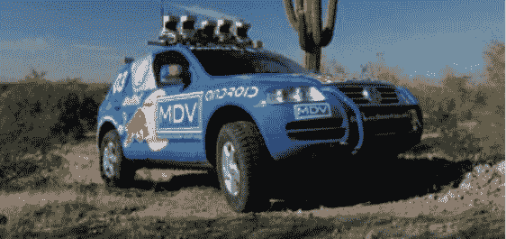

如果说2005年DARPA无人驾驶挑战赛中，智能驾驶只征服了静态环境，那么2007年DARPA城市挑战赛，智能驾驶则提升到了可以在动态交通流中完成互动的高度。这次比赛包括复杂的双向交通道路、蜿蜒的公路、十字路口等场景，同时要求设计者设计出能够遵守所有交通规则的车辆，并能够在赛道上检测和避开其他参与者，车辆必须基于其他车辆的动作实时做出“智能”决策与规划，这其实和人类真实的驾驶环境已经非常类似了。最终在53支报名车队中，有11支通过了资格测试，6支跑完了全程，卡内基梅隆大学的车辆Boss以4小时10分钟29秒获得冠军。而这也是DARPA最后一次举办与智能驾驶汽车相关的比赛。这次比赛已经证明智能驾驶技术拥有像人类一样驾驶车辆的潜力，后续要做的就是等待资金入场并持续优化了。

2007年DARPA无人驾驶挑战赛之后，诸如谷歌（Google）等一大批大大小小的公司开始进入智能驾驶行业，随着智能驾驶的快速发展，2014年1月，国际自动机工程师学会（SAE International）第一次制定了J3016自动驾驶分级标准，按自动化的程度分为6个等级：L0～L5（LEVEL 0～LEVEL 5）。经过几次修改，2021年4月第4次更新，依然划分为6个等级：

L0：无驾驶自动化；L1：驾驶员辅助；L2：部分驾驶自动化；L3：有条件驾驶自动化；L4：高度驾驶自动化；L5：完全驾驶自动化。

第4次更新明确了驾驶自动化水平是根据主要行为者在实施动态驾驶任务（dynamic driving task，DDT）和/或DDT后备支援中所起的具体作用来确定的（图1-7）。

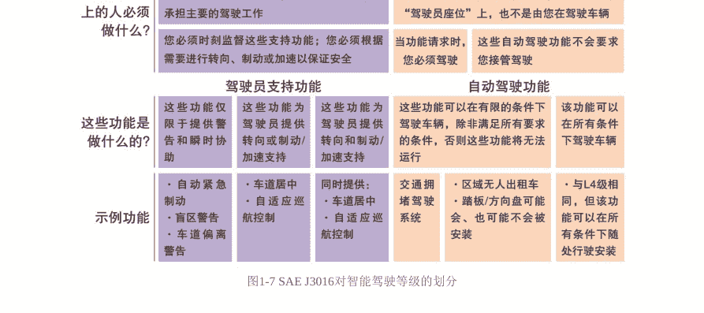

### （二）智能驾驶的现状

目前智能驾驶技术更多还是应用于类似DARPA无人驾驶挑战赛中的形式，通过给车辆加装摄像头、毫米波雷达、激光雷达等高精度传感器，搭配高精地图一同搭建车辆的感知系统。基于感知系统提供的环境信息，通过一系列的判断，规划出一条可行驶路线，并控制车辆按照规划出来的路线行驶[6]。

#### 1. 感知模块

感知是指智能驾驶系统从环境中收集信息并从中提取相关知识的过程，感知模块广义上包含环境感知和自定位两部分。其中，环境感知的功能又可以归结为目标识别和运动分析。目标可以分为静态目标（路面、车道线、路沿、交通信号灯、道路标志、施工标志等）和动态目标（车辆、行人）。对目标的识别主要是基于卷积神经网络的深度学习方法。针对图像可以分为基于候选区域、基于回归和基于增强学习的方法。

目标的运动分析则主要是对目标的三维运动属性进行识别，最基础的包括静止目标和运动目标的区分，针对运动目标，需要准确得到其运动速度、加速度、运动方向以及未来一段时间内的预测轨迹，最近的研究也逐渐扩充到对目标的行为意图进行判别，如判断目标是否存在切入、横穿、避让等意图。基础的运动分析方法主要使用卡尔曼滤波的方式，通过不同的运动模型（恒定速度模型、恒定加速度模型、恒定转率和速度模型以及恒定转率和加速度模型）对目标的运动状态（位置、朝向、速度、加速度等）进行估计。目标轨迹预测及意图分析则多采用基于数据驱动的方式，针对目标的历史轨迹推导出未来一定时间内目标的行为及意图。

#### 2. 决策规划模块

在智能驾驶技术体系中，环境感知模块负责通过传感器以及定位设备为车辆提供道路结构、交通信息、其他交通参与者状态等。结合以上信息，决策规划模块进行量化分析，然后对底层的执行控制模块传递相应的规划轨迹。根据SAE的自动驾驶分级制度，L0以预警为主，L1和L2为辅助驾驶，L3及以上为车辆智能驾驶。随着等级的提高，在车辆行驶过程中的主责以及决策权会逐渐从司机转移到汽车本身。自主决策规划技术也正是智能驾驶功能开发过程中面临的一大难点。

智能驾驶车辆往往运行在复杂的动态环境中，因此需要一些技术来应对像城市道路这样难以预测的环境，达到同人类驾驶水平一样的可靠性和安全性。智能驾驶车辆做出一个良好决策的前提是拥有精准的感知结果，然而即使是目前最先进的机器视觉系统也很难保证一个较低的误检率，这也对决策规划模块的鲁棒性 [1] 提出了更高的要求。

#### 3. 执行控制模块

位于智能驾驶系统最底层的是执行控制模块。该模块根据底盘和定位反馈的车辆实际状态，以及规划模块生成的参考轨迹来计算能直接作用于对应的执行结构的控制信号，保证智能驾驶汽车能平稳、低误差地跟踪规划路线。

总体来说，目前智能驾驶汽车还是以单车智能路线为主。受制于法律法规和权责归属问题，市场上的主要汽车制造商都在研发L3级别以下的辅助驾驶车辆，其中海外的特斯拉，国内的小鹏、蔚来、理想、华为等公司，都已经研发出了L2++级别的乘用车，可实现脱离手脚操作的高速领航驾驶功能，并在努力研发城市领航驾驶功能。另一大阵营属于科技公司，他们大多采用高举高打的方式，希望率先攻克L4级别智能驾驶，而后再降维实现L0～L3级别的智能驾驶，其中代表公司为谷歌、AutoX安途、小马智行、文远知行、百度等。

### （三）智能驾驶的未来

从2007年至今，智能驾驶经过10余年的行业发展，无论是在L2级别还是在L4级别，都有很多公司有了成熟的产品，但依然没有任何一家公司敢说什么时候可以实现L5级别智能驾驶。长尾效应在智能驾驶行业同样适用，因为总有解决不完的边界场景等待智能驾驶技术去解决。因此，在未来，对于L2级别的智能驾驶汽车，依然需要人类随时接管；而对于L4级别的智能驾驶汽车，可能需要通过远程接管的方式，来应对运行设计域（operational design domain，ODD）范围外的场景或事件。

此外，随着5G技术的普及，车路协同技术也将更好地辅助智能驾驶汽车解决一些问题。总而言之，智能驾驶未来将长期处于人机共驾的阶段，需要不断地完善、优化，使智能驾驶车辆可以应对越来越多的场景。

> [1] 鲁棒是Robust的音译，即健壮、强壮的意思。它也是在异常和危险情况下系统生存的能力。所谓“鲁棒性”，是指控制系统在一定（结构、大小）的参数影响下，维持其他某些性能的特性。

## 第二章 智能驾驶的感官和大脑

### 一、智能驾驶的感官——车载传感器

智能驾驶融合环境感知、决策规划、控制执行、多级辅助驾驶等功能于一体，运用现代传感器技术，集中使用视觉计算、通用计算、神经网络计算等技术进行信息融合，同时辅以车联网通信（vehicle to everything，V2X）、人工智能来实现自动控制，其中环境感知是其他功能的基础。环境感知是通过传感器对周围环境基本信息进行采集，也是智能驾驶的基础。根据智能驾驶路线的不同，实现的智能驾驶等级不同，部署的传感器种类也会有差异 [7]。

#### （一）车载摄像头

摄像头如同人的眼睛，计算芯片如同人的大脑，为了给“大脑”提供可供决策的视觉信息，摄像头需要克服不利环境对它的干扰，保证在各种复杂、恶劣环境下，快速识别车辆、行人和交通标志，给现阶段的智能驾驶技术提供足够的环境感知保障。

##### 1. 摄像头的基本工作原理

摄像头的工作过程可以描述为目标物体通过镜头生成的光学图像被投射到图像传感器上，形成光信号，再由光信号转变为电信号，再经过模拟数字转换器（analogue to digital converter，A/D）转变为数字图像信号，最后数字图像信号被送到数字信号处理芯片（digital signal processing，DSP）中进行加工处理，形成特定格式的图像被传输到显示屏上进行显示或进行算法处理。

摄像头的主要硬件组件包括：

- （1）镜头组。镜头组由光学镜片、滤光片和保护膜等组成。
- （2）图像传感器（CMOS image sensor，CIS）。它是一种用互补金属氧化物半导体（complementary metal oxide semiconductor，CMOS）工艺制作的成像传感器，如图2-1所示，CIS是模拟电路和数字电路的集成。主要由4个组件构成：微透镜、彩色滤光片、光电二极管、像素阵列。

##### 图像传感器结构

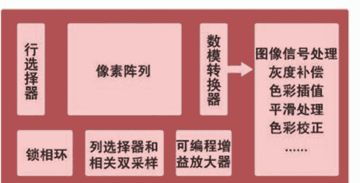

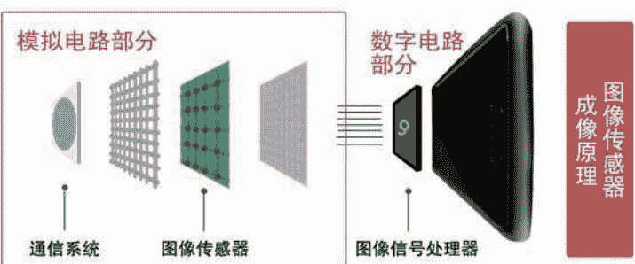

图2-1 图像传感器结构和成像原理

- （3）数字信号处理芯片。基于车载摄像头的感知解决方案（图2-2），数字信号处理芯片可分为上游材料、中游元件及下游产品三大部分，根据不同的产品应用及功能定义搭配合适的上、中游原件及相关算法，从而实现视觉感知方案。

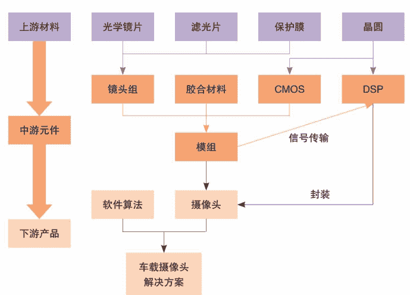

CMOS-图像传感器；DSP-数字信号处理芯片。

图2-2 车载摄像头的感知解决方案

##### 2. 摄像头的类别

根据安装位置的不同，车载摄像头可分为前视、侧视、后视和内视，具体类型及功能如表2-1所示。

表2-1 车载摄像头类型及功能

| 功能 | 摄像头类型 | 具体功能简介 |
| :--- | :--- | :--- |
| 车道偏离预警（LDW） | 前视 单目/双目 | 当前视摄像头检测到车辆即将偏离车道线时，就会发出警报 |
| 前向碰撞预警（FCW） | 前视 单目/双目 | 当前视摄像头检测到与前车距离过近，可能发生追尾时，就会发出警报 |
| 车道保持辅助（LKA） | 前视 单目/双目 | 当前视摄像头检测到车辆即将偏离车道线时，就会向控制中心发出信号，然后由控制中心发出指令，及时纠正行驶方向 |
| 行人碰撞预警（PCW） | 前视 单目/双目 | 前视摄像头会标记前方道路行人，并在可能发生碰撞时及时发出警报 |
| 交通标志识别（TSR） | 前视 单目/双目 | 识别前方道路两侧的交通标志 |
| 盲点监测（BSD） | 侧视 广角 | 利用侧视摄像头，将后视镜盲区内的影像显示在驾驶舱内 |
| 泊车辅助（PA） | 后视 广角 | 泊车时将车尾的影像显示在驾驶舱内，预测并标记倒车轨迹，辅助驾驶员泊车 |
| 驾驶员注意力监测（DM） | 内视 广角 | 安装在车内，用于检测驾驶员是否疲劳、闭眼等 |
| 360°环视（AVM） | 前/侧/后 广角 | 利用车辆前后左右的摄像头获取的影像，通过图像拼接技术，输出车辆周边全景图 |

#### （二）车载激光雷达

##### 1. 激光雷达的基本原理

激光雷达的基本原理为使用激光发射部件向一定视场角（field of view，FOV）内发射光线，同时使用接收部件接收范围内反射回的光线，利用已知和获取的发射光线与反射光线的相关信息，计算或推导出反射点的信息（速度、距离、高度、反射强度等）[8]。

激光雷达一般由发射模块、接收模块、扫描模块和控制模块4个部分构成：

- （1）发射模块：激光器、发射光学系统。
- （2）接收模块：接收光学系统、光学滤光装置、光电探测器。
- （3）扫描模块：改变激光束的空间投射方向，由电机、微型谐振镜、相控阵等方式实现（Flash方案中不包含扫描模块）。
- （4）控制模块：完成对发射模块、接收模块和扫描模块的控制，以及激光雷达数据的处理和外界系统的数据传输。

##### 2. 激光雷达的分类

按内部有无旋转部件，激光雷达可分为机械旋转式激光雷达、混合式车载激光雷达和固态激光雷达 [9-10]。

- （1）机械旋转式激光雷达。通过机械旋转实现激光扫描的车载激光雷达。激光发射部件在竖直方向上排布成激光光源线阵，通过透镜在竖直面内产生不同指向的激光光束。在步进电机的驱动下持续旋转，竖直面内的激光光束由“线”变成“面”，经旋转扫描形成多个激光面，从而实现探测区域内的3D（三维）扫描。
- （2）混合式车载激光雷达。将微机电系统（micro-electro-mechanical system，MEMS）与振镜结合形成MEMS振镜，通过振镜旋转完成激光扫描，驱动电路驱动激光器产生激光脉冲，同时驱动MEMS振镜旋转，激光在旋转振镜的反射下实现扫描，经发射光学单元准直后射出。混合式车载激光雷达工作原理如图2-3所示。

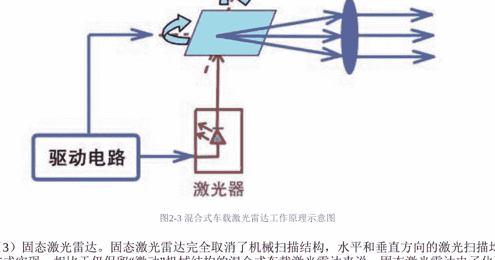

- （3）固态激光雷达。固态激光雷达完全取消了机械扫描结构，水平和垂直方向的激光扫描均通过电子方式实现。相比于仍保留“微动”机械结构的混合式车载激光雷达来说，固态激光雷达电子化更加彻底。固态激光雷达目前主要包括光学相控阵（optical phased array，OPA）激光雷达和泛光面阵式（Flash）激光雷达。

①光学相控阵激光雷达。

- a. 相控激光发射器是由若干发射接收单元组成的一个矩形阵列，通过改变阵列中不同单元发射光线的相位差，可以达到调节射出波角度和方向的目的。
- b. 激光光源经过光分束器后进入光波导阵列，在波导上通过外加控制的方式改变光波的相位，利用波导间的光波相位差来实现光束扫描，其原理类似于多缝干涉。
- c. 光波导阵列中的每根波导都相当于一个光发射源，每个光发射源都相当于多缝干涉中的狭缝。光在空间中传播并干涉，其结果是光在某一方向上因干涉加强而集中，在其他方向上因干涉减弱而相消，从而改变光束的传播方向，实现扫描。

②Flash激光雷达。

- a. 采用类似相机的工作模式，感光元件与普通相机不同，每个像素点可以记录光子飞行时间信息。
- b. 属于非扫描式激光雷达，运行时直接发射出一大片覆盖探测区域的激光，随后由高灵敏度接收器阵列计算每个像素对应的距离信息，从而完成对周围环境的绘制。

##### 3. 激光雷达的关键参数

- （1）视场角，包括水平视野和垂直视野。
- （2）分辨率，包括水平分辨率和垂直分辨率。
  - ①水平方向上做到高分辨率其实不难，因为水平方向上是由电机带动的，所以水平分辨率可以做得很高。目前国内外激光雷达厂商的产品，水平分辨率为0.1°。
  - ②垂直分辨率与发射器几何大小相关，也与其排布有关系，即相邻两个发射器间隔做得越小，垂直分辨率也就越小。
  - ③减小垂直分辨率的方法（针对机械式激光雷达）。
    - a. 通过改变激光发射器和接收器的排布方式来实现，排得越密，垂直分辨率就可以做得越小。
    - b. 通过多个16线激光雷达耦合的方式，在不改变单个激光雷达垂直分辨率的情况下，同样可以达到整体减小垂直分辨率的效果。
- （3）测距范围。基于Flash的激光雷达方案一般可达到50m左右的感知，一些高线束的激光雷达的测距范围可达到300～350m。
- （4）距离精度。激光雷达的测距精度一般可达到2～5cm。
- （5）刷新频率。激光雷达的刷新频率一般可达到15～20Hz。
- （6）扫描频率。10～20Hz。
- （7）激光波长。目前比较常见的是905nm和1 550nm。

#### （三）车载毫米波雷达

##### 1. 毫米波雷达的基本结构

毫米波雷达的基本结构包括单片微波集成电路芯片（monolithic microwave integrated circuit, MMIC）和天线印制电路板（printed circuit board, PCB）（图2-4）。以调频连续波（frequency modulated continuous wave, FMCW）车载雷达系统为例，其基本结构包括天线、收发模块、信号处理模块[11]。

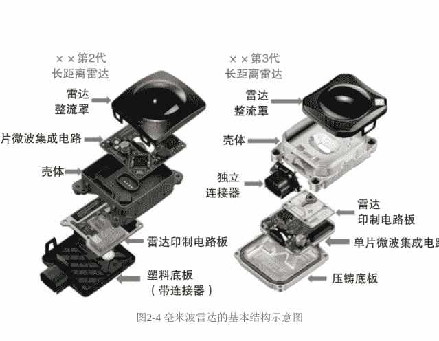

- （1）单片微波集成电路。包括多种功能电路，如低噪声放大器（low noise amplifier，LNA）、功率放大器、混频器、收发系统等。特点：电路损耗小、噪声低、频带宽、动态范围大、功率大、附加效率高、抗电磁辐射能力强等。
- （2）雷达天线高频PCB板。毫米波雷达天线的主流方案是微带阵列，即将高频PCB板集成在普通的PCB板上实现天线的功能，需要在较小的集成空间中保持天线有足够的信号强度。

##### 2. 毫米波雷达的基本工作原理

毫米波雷达的基本工作原理如图2-5所示。利用高频电路产生特定调制频率的电磁波，通过天线发送电磁波再接收从目标反射回来的电磁波，通过发送和接收电磁波的参数来计算目标的参数。另外，可以同时对多个目标进行测距、测速以及测方位角。测速是根据多普勒效应，而测方位角（包括水平角度和垂直角度）是通过天线的阵列方式来实现的 [12]。

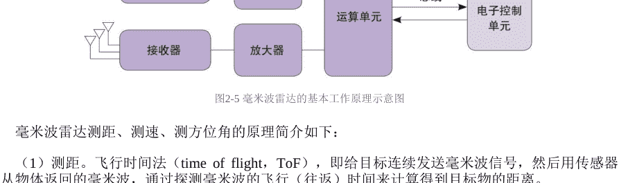

毫米波雷达测距、测速、测方位角的原理简介如下：

- （1）测距。飞行时间法（time of flight，ToF），即给目标连续发送毫米波信号，然后用传感器接收从物体返回的毫米波，通过探测毫米波的飞行（往返）时间来计算得到目标物的距离。
- （2）测速。根据多普勒效应，通过计算返回接收天线的雷达波的频率变化得到目标相对于雷达的运动速度（相对速度与频率变化量成正比）。
- （3）测方位角。通过并列的接收天线收到同一目标反射的雷达波的相位差计算得到目标的方位角。

##### 3. 毫米波雷达的工作体制

根据辐射电磁波方式的不同，毫米波雷达的工作体制主要有脉冲体制及连续波体制。其中连续波又可以分为频移键控（frequency shift keying，FSK）、相移键控（phase shift keying，PSK）、恒频连续波（constant frequency continuous wave，CW）、调频连续波等方式。毫米波雷达的工作体制如表2-2所示。

表2-2 毫米波雷达不同工作体制

| 工作体制 | 脉冲体制（脉冲多普勒雷达） | 连续波体制 | 连续波体制 | 连续波体制 |
| :--- | :--- | :--- | :--- | :--- |
| | | CW | FSK | FMCW |
| 特点 | 多用于近距离目标信息测量；技术比较成熟；测量过程简单，测量精度较高 | 可探测目标速度 | 可探测移动目标的位置与速度信息；探测时间短，精度高 | 能同时测出多个目标的距离和速度信息，可对目标连续跟踪，系统敏感性高，错误报警率低；不易受外界电磁波噪声的干扰；测量距离远，分辨率高；所需发射功率低；成本较低；信号处理难易程度及实时性可达到系统要求 |
| 不足 | 当目标近距离时，脉冲收发时间短，需要采用高速信号处理技术，结构要求复杂，成本大幅上升；高分辨率需要占用较大带宽；由于发射功率限制导致作用距离小 | 不能测量距离 | 不能同时测量多个目标 | |
| 两种体制的毫米波雷达电磁波辐射能量 |  |  | | |

#### （四）车载超声波雷达

超声波雷达实际上是目前汽车中一款极其常见的传感器，可能超声波雷达的名字让人觉得陌生，其实它更常被人称为“倒车雷达”。

超声波雷达（倒车雷达）主要作为泊车（停车或者倒车）时的安全辅助装置，它通过声音或显示器告知驾驶员周围障碍物的情况，解除驾驶员停车、倒车或起动时可能因存在的视野死角和视线模糊带来的风险。

超声波雷达的工作原理是通过超声波发射装置向外发出超声波，利用接收器接收到反射回来的超声波的时间差来测算距离 [13] 。目前，常用探头的工作频率有40kHz、48kHz和58kHz 3种。一般来说，频率越高，灵敏度越高，水平与垂直方向的探测角度就越小，故一般采用58kHz的探头。超声波的优点是频率低、成本低、能量消耗速度较缓慢、测距的方法简单。其探测范围在0.1～3m之间时精度较高，因此非常适合用于泊车 [14] 。

#### （五）各传感器的特点及差异

##### 1. 视觉摄像头

视觉摄像头能够得到丰富的纹理、特征信息，相比激光、毫米波雷达，采用图像数据能够实现以下功能：

- （1）目标识别与分类。目前普通的3D毫米波雷达仅可以检测到前方是否有障碍物，而无法精准识别障碍物与标志（如各类车道线、交通信号灯、道路标志、施工标志等）。
- （2）可通行空间检测。对车辆行驶的安全边界（可行驶区域）进行划分，主要对车辆可行驶区域与普通路边沿、侧石边沿、没有障碍物可见的边界、未知边界进行划分。
- （3）对横向移动目标的探测能力。比如对横穿十字路口的行人以及车辆的探测和追踪。
- （4）定位与地图创建。即视觉同步定位与地图构建技术（visual simultaneous localization and mapping，VSLAM），虽然目前也有用毫米波雷达做SLAM（simultaneous localization and mapping，同步定位与地图构建技术）的，但是VSLAM技术更加成熟，也有应用前景。

视觉摄像头也有其不足之处，比如相机容易受到光照的影响，在强光直射或者阴影背光的情况下成像质量较差；物体高速运动时容易产生运动模糊。

##### 2. 激光雷达

激光雷达对光照变化不敏感，不受夜晚场景的影响，可以全天候工作；测距精度相比其他传感器都要高，具有一定的抗干扰能力。激光雷达点云图如图2-7所示，虽然感知周围信息量较为丰富，但是也有其不足之处：例如受雨雪、大雾、粉尘等影响，性能下降；对某些低反射特性的材料测距精度不佳；硬件价格高昂，普及难度大。

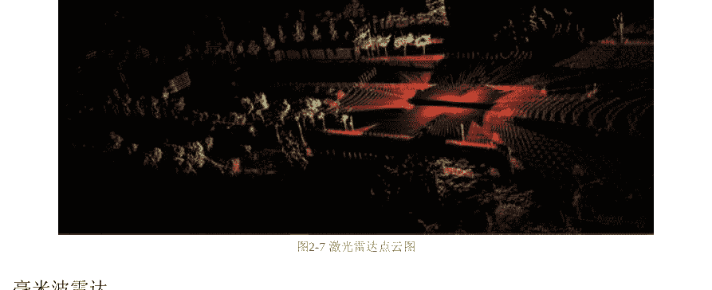

##### 3. 毫米波雷达

如图2-8所示，毫米波雷达虽然测量距离远（通常能达到200m左右），并且受天气影响较小，在雨雪、大雾、粉尘中具有良好的穿透性，但是也有其不足之处：对某些材质回波弱，例如对行人、锥桶或塑料制品等识别率较差；对金属材质特别敏感，导致虚警率很高；采样稀疏导致原始数据噪声大，目标抖动；对切向目标敏感度差；原始数据只有距离和角度信息，缺乏目标高度信息 [15]。

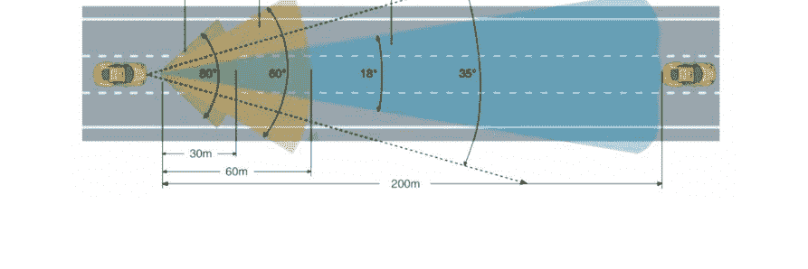

图2-8 毫米波雷达探测范围

##### 4. 超声波雷达

超声波雷达受雨水、粉尘、泥沙的干扰较小，在空气中穿透性强、衰减小，短距离探测中精度较高，常用于泊车场景，但是也有其不足之处：比如声波的传输容易受到天气温度的影响，高低温情况下测距误差较大；声速相比光速较慢，车速较快时超声波测距无法跟上汽车车距的实时变化，易导致误差较大；超声波雷达的输出是在视野范围内的距离值，无法准确地给出目标位置。如图2-9所示，针对泊车场景一般在车辆周围安装12个超声波雷达，车辆前后各安装4个短距离超声波雷达，左右各安装2个长距离超声波雷达。短距离超声波测量范围一般在3m以内，安装在车辆的前后保险杠处，用于倒车时探测近处障碍物倒车报警。远距离超声波测量范围一般在5m以内，在车辆左右各安装2个，用于探测近处障碍物并判断空车位和辅助泊车。

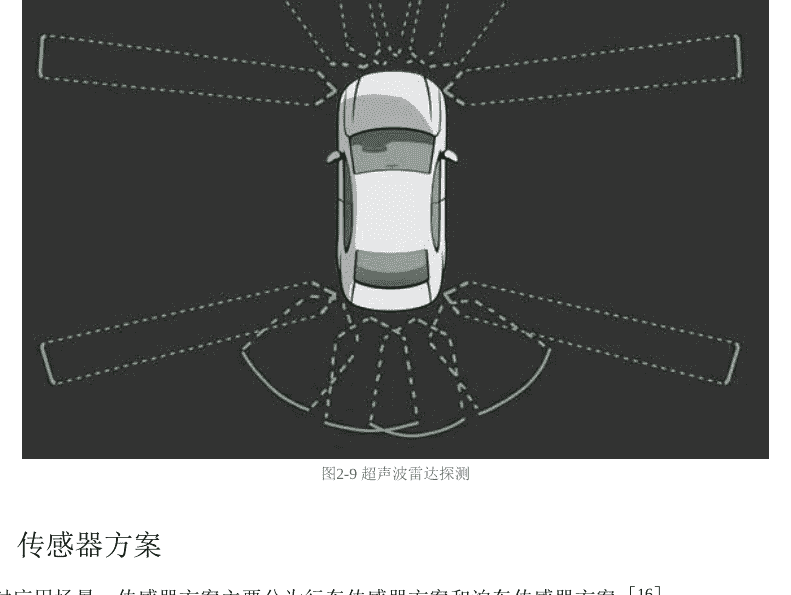

图2-9 超声波雷达探测

#### （六）传感器方案

针对应用场景，传感器方案主要分为行车传感器方案和泊车传感器方案 [16]。

##### 1. 行车传感器方案

- （1）单车道智能驾驶辅助。通过前视单目摄像头或前向毫米波雷达，可实现自动紧急制动（advanced/automatic emergency braking，AEB）和自适应巡航（adaptive cruise control，ACC）功能。毫米波雷达的优势在于对车辆速度的探测，而摄像头的优势在于识别车道线和对障碍物分类。前视单目摄像头和前向毫米波雷达结合应用，可实现单车道高速驾驶辅助（high way assist，HWA）和交通拥堵辅助（traffic jam assist，TJA）功能。
- （2）多车道智能驾驶辅助。要实现变道辅助，需要增加传感器对邻道环境进行感知。通常在车尾部两角各增加1个毫米波雷达，实现对车辆侧后环境感知。进一步，可增加车前毫米波角雷达，拓展侧前环境感知，实现路口辅助（junction assist，JA）、紧急车道保持（emergency lane keeping，ELK）、紧急转向辅助（emergency steering assist，ESA）等功能。
- （3）点对点自动导航驾驶。要实现从一个点到另一个点全智能驾驶，需要对车辆周边环境进行全方位感知，同时增加冗余。一般需要前视增加激光雷达、侧视和后视增加摄像头、毫米波实现增强感知，同时，增加高精地图和惯性导航进行定位。

自动行车，目前发展到点对点自动导航驾驶阶段。主流传感器方案为：激光雷达1～3个+毫米波雷达5～8个+先进驾驶辅助系统（advanced driver assistance system，ADAS）摄像头7～10个。

##### 2. 泊车传感器方案

- （1）倒车辅助。通过倒车雷达和全景影像，实现倒车时碰撞预警和提供车辆四周环境影像辅助倒车。倒车雷达，一般车前、车后各安装4个超声波雷达；全景影像，一般在车辆四周共安装4个鱼眼摄像头。
- （2）自动泊车。在倒车雷达基础上，车侧两边各增加2个长距超声波泊车雷达识别车位，达到共12个超声波雷达，实现自动泊车。还可进一步与全景摄像头融合，实现对线性车位感知，增强实现自动泊车场景。也可与钥匙、手机应用（App）结合，实现在驾驶员监控下的遥控泊车功能。
- （3）记忆泊车。实现100m内寻迹泊车。不需要额外加装传感器，但泊车系统需要融合前视行车摄像头数据，通过视觉定位与地图同步构建技术构建地图。可进一步与后视行车摄像头数据融合，实现寻迹倒车功能。
- （4）代客泊车。实现1km内自动泊车。需要增加高精地图和惯性导航定点，同时与停车场系统结合，实现停车场内智能驾驶泊车。

#### （七）传感器方案在市场中的现状与展望

智能驾驶行业在2021年开始迎来新的发展阶段，智能驾驶企业开始对外公布一些技术进展、技术成果。同时，为了推进智能驾驶传感器前装量产计划，大部分智能驾驶公司都发布了自己的智能驾驶硬件方案，比如百度的Apollo Moon、小马智行的Pony Alpha X、文远知行的WeRide Sensor Suite 4.0、AutoX的AutoX Gen5等，下面将自动驾驶出租车（Robotaxi）领域第一梯队的智能驾驶传感器方案进行对比（表2-3）。

表2-3 智能驾驶传感器方案对比

| 公司名称 | 硬件平台名称 | 激光雷达 | 毫米波雷达 | 4D毫米波雷达 | 摄像头 | 超声波传感器 | V2X | 计算平台 |
| :--- | :--- | :--- | :--- | :--- | :--- | :--- | :--- | :--- |
| 百度 | Apollo Moon 第五代自动驾驶解决方案 | 4个 | 5个 | 未提及 | 13个 | 未提及 | 支持 | 800 TOPS |
| 小马智行 | Pony Alpha X | 7个 | 4个 | 未提及 | 11个 | 无 | 未提及 | 未提及 |
| 文远知行 | WeRide Sensor Suite 4.0 | 1个顶激光+1个固态激光雷达+（2～4个）盲区激光雷达 | 未提及 | 数量不详 | 数量不详 | 未提及 | 未提及 | 未提及 |
| AutoX | AutoX Gen5 | 6个 | 无 | 8个 | 28个800万像素车规级摄像头 | 未提及 | 支持 | 2 200 TOPS |

注：TOPS为算力单位。

百度Apollo Moon搭载了百度Apollo第五代无人驾驶套件，其中包括1个激光雷达、5个毫米波雷达以及13个摄像头，计算平台算力超过了800 TOPS。同时，百度Apollo Moon支持5G云代驾以及V2X车路协同等功能（图2-10），相较于上一代车型，其智能驾驶能力提升了10倍。

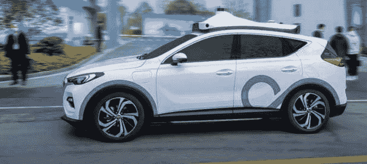

图2-10 百度Apollo Moon智能驾驶车辆及传感器

小马智行的第五代L4级别智能驾驶——Pony Alpha X系统，一共配备4个感知距离达200m的禾赛激光雷达、4个广角摄像头、1个交通信号灯识别摄像头、1个中距摄像头、4个毫米波雷达（图2-11）。

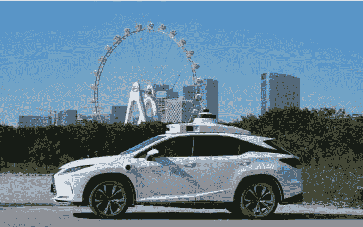

图2-11 小马智行Pony Alpha X智能驾驶车辆及传感器

如图2-12所示，文远知行WeRide Sensor Suite 4.0包含激光雷达、4D毫米波雷达、文远知行全新自研的相机模块，实现360°视场全覆盖，最远达到前向300m、无盲区死角的探测，能精准判断和识别感知范围内的物体及其运动状态、特殊交通场景及交通标志等，具备自动清洗传感器功能。

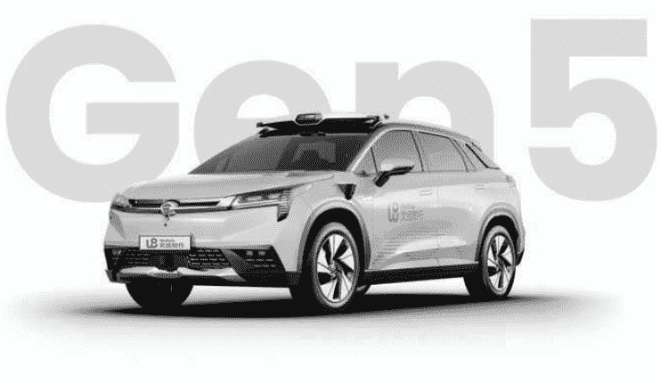

图2-12 文远知行WeRide Sensor Suite 4.0智能驾驶车辆及传感器

如图2-13所示，AutoX Gen5有超过50个传感器，配备规模庞大的传感器集群，像素总和达到2.2亿像素每帧，配备高清的4D毫米波雷达并可实现0.9°分辨率。每秒钟成像的激光雷达点云数达到了1 500万，支持2 200 TOPS的算力平台。

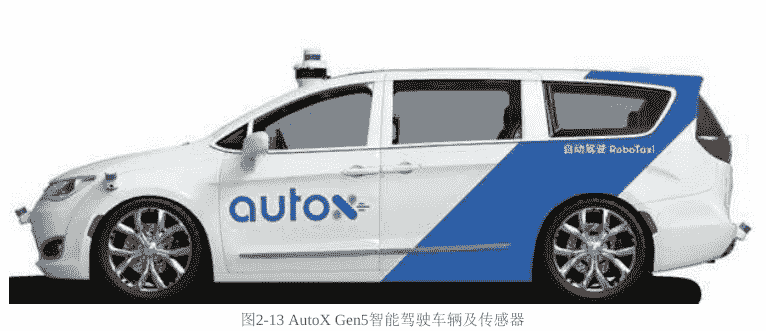

基本上Robotaxi都会配备至少1个360°顶激光雷达+1个前向激光雷达，同时大部分企业也会配备盲区激光雷达，除了百度和Momenta这两家企业外，其他Robotaxi企业更倾向于布置更多的传感器，尤其是滴滴和AutoX；而超声波传感器在Robotaxi方案中逐渐被放弃；大部分在智能驾驶系统中使用毫米波雷达的企业开始转向使用4D毫米波雷达。

总的来说，传感器方案越来越趋于同质化：

- 1. 基本上Robotaxi都会配备至少1个360°顶激光雷达+1个前向激光雷达，同时大部分企业也会配备盲区激光雷达。
- 2. 超声波传感器在Robotaxi方案中逐渐被放弃。
- 3. 大部分使用毫米波雷达的企业开始转向4D毫米波雷达。根据大众对4D毫米波雷达的认可，激光雷达+4D毫米波雷达+摄像头将会成为Robotaxi的主流方案。
- 4. 传感器方案趋于同质化，说明行业对于传感器的布局越来越统一，前装量产的可能性越来越大。

### 二、智能驾驶的大脑——智能驾驶域控制器

#### （一）智能驾驶域控制器的前世今生

据统计，当今一辆普通的家用车就搭载了大约数十个甚至上百个电子控制单元（electronic control unit，ECU），这些ECU各自相互独立，彼此之间的通信依赖预先定义的各类汽车通信总线。汽车电子电气分布式架构是一个直接做加法的过程：一旦有了新的功能，就增加一个ECU并实现相应的软硬件。在车载ECU数量较少时，这样的做法快且有效，但如今面对数十个甚至上百个ECU，这种分布式架构就极大地增加了系统设计的复杂度，导致后续的软硬件开发难度倍增。为了让各ECU之间相互通信，硬件上须在ECU之间安装各类连接线束，针对支持不同协议的ECU又需要设计不同的网络拓扑结构，这极大增加了整车线束成本和工作量，如图2-14所示。为了能跨ECU进行通信交互，研发人员必须在一开始就定义数量繁多的通信信号，而且一旦增加或者需要替换ECU时，就又需要重新做大量信号定义工作。车辆点火后自检以及运行时，通信诊断功能须对所有ECU不断检测，从而增加了车辆系统启动时延。在空中下载技术（over-the-air technology，OTA）升级时，OTA Master（负责自升级以及升级其他ECU的控制器）需要对几十个甚至上百个ECU逐个进行固件刷写和校验，同时又要保证固件版本的一致性，一旦出现刷写错误，OTA Master又须对相关ECU采取重刷或者版本回滚的策略，这导致ECU整体升级过程异常冗长，甚至会导致车辆电瓶电力耗尽，从而产生一系列维保问题 [17-19]。

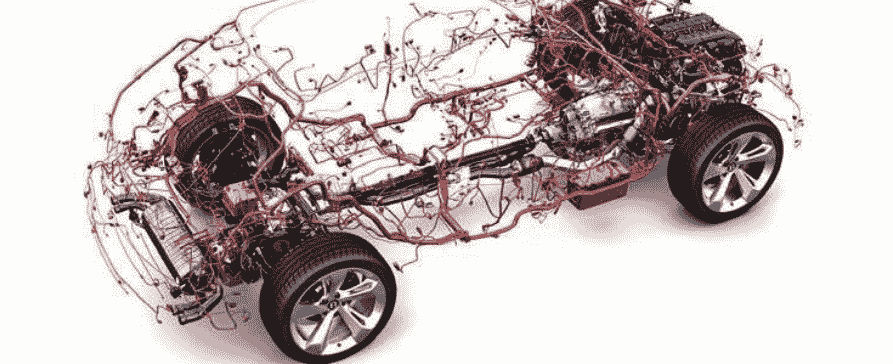

此时，集中式汽车电子电气架构就应运而生了。德国罗伯特·博世公司（BOSCH）在2017年公布的其在整车电子电气架构（electrical electronic architecture，EEA）方面的战略路线图（图2-15）所示，博世将整车电子电气架构的发展分为三大类，分别是分布式电子电气架构、（跨）域集中式电子电气架构以及车辆集中式电子电气架构。其中每一类又有着不同的阶段，前文所提到的目前市面上大多数车型的架构方案都处于模块化和集成化阶段。

近年来，硬件层面上超大算力芯片层出不穷，各类性能达到几十、数百TOPS的芯片不断引爆市场热度。在智能驾驶领域，英伟达相继推出了Xavier、OrinX，高通推出了SA8540、SA9000等高性能芯片，国产的有地平线的J3、J5等；在软件上，随着软件定义汽车（software define vehicle，SDV）和面向服务的软件架构（service-oriented architecture，SOA）概念的兴起，国内外众多整车厂（original equipment manufacture，OEM）和一级供应商（Tier1）已经把整车的EEA推进到了第二大类——（跨）域集中式电子电气架构。就市面上主流的车型来说，蔚来ET5、ET7，小鹏P7、P5，长城基于GEEP4.0架构的车型，比亚迪E3.0架构车型，大众的ICAS1～ICAS3域控制器等，都是基于（跨）域集中式电子电气架构设计的。通常，按照整车的不同功能群划分，会把整车划分为若干个域——智能驾驶域、座舱域、车身域、底盘域以及动力域。整合能力强的OEM或Tier1可能会将其中某两个或者某3个域进行融合（例如座舱域与车身域融合，底盘域与动力域融合等），如华为的CC（组件化开发）架构就将整车域分为3大块——智能座舱域CDC、整车控制域VDC、智能驾驶域MDC，其中智能驾驶域MDC在当今智能驾驶热度高涨的时代，将作为一个极其重要的域独立存在于整车EEA中相当长的一段时间。

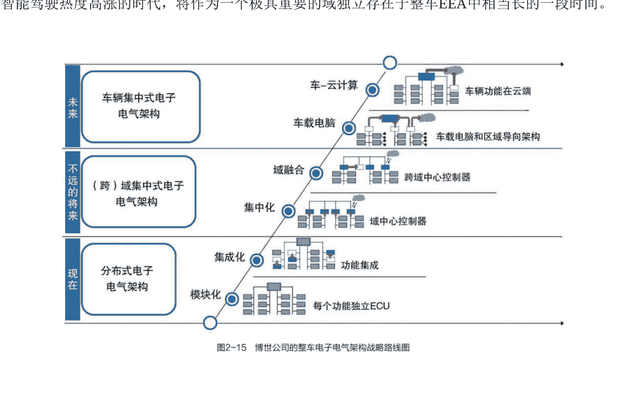

#### （二）智能驾驶域控制器的组成和作用

如图2-16所示，智能驾驶域控制器硬件中最重要的部分非以下两个芯片莫属：功能安全等级达到汽车安全安定性等级B级（automotive safety integration level-B，ASIL-B）/C级（ASIL-C）的高算力系统级芯片（system on chip，SoC）、功能安全等级为ASIL-D的微控制器（microcontroller unit，MCU）。这两个芯片的成本基本占据了整个域控物料成本的1/3～1/2，可谓域控硬件中的重中之重。其余的重要部件分别为连接各类视觉传感器的串行解串器（SerDes）、连接激光雷达及其他域控的以太网交换机（ethernet switch），以及储存各类非易失性数据的嵌入式多媒体卡（embedded multi media card，eMMC）、闪存（Flash）、通用存储（universal flash storage，UFS）以及同步动态随机存取内存（synchronous dynamic random-access memory，SDRAM）等。此外，智能驾驶系统运行时，芯片和芯片之间以及传感器端尤其是激光雷达和4D毫米波雷达会产生大量的数据，其数据传输需要极大的带宽支持，一般通过千兆以太网或者高速串行计算机扩展总线标准（peripheral component interconnect express，PCIE）总线，这就需要可以承载高速信号的8层甚至12层印制电路板（printed circuit board，PCB）的加持。这些高规格的芯片及各类被动、主动元器件在极大提高智能驾驶域控制器硬件可靠性的同时，也显著增加了其相应的物料成本。

从智能驾驶域控制器的系统组成来看，硬件是智能驾驶域控制器的骨架，软件是智能驾驶域控制器的血肉，算法则是其灵魂，软件在其中起到承上启下的作用。没有软件做支撑，算法就没有载体，系统也无法有效调用硬件的算力，内部感知、规控、决策各模块之间则无法通信。如图2-17所示，在智能驾驶域控制器软件框架中，自下而上分为：系统层、中间层、服务层及应用层。最底部的系统层主要由操作系统及相关的板级支持包（board support package，BSP）构成，这部分软件会直接与不同的硬件资源打交道。由于智能驾驶域控制器一般都会有一个高性能SoC及功能安全MCU芯片，系统层设计时通常也会根据不同的芯片采取不同的系统适配方式。对于MCU芯片来说，其主要功能为监控SoC的健康状态、响应外部诊断请求、核验由SoC运算得出的感知及规划的结果、接入整车控制器区域网（controller area network，CAN）网络并向执行器发送CAN报文指令等；而对于SoC而言，其主要功能就是将各传感器感知的信息帧在时间轴上对齐并做融合，识别出对象的距离、速度、大小及分类等信息，并据此做出最优的路径规划发送给MCU芯片。在车辆高速行驶时，如何保证这些信息能准确、实时地传输显得尤为重要。

运行在MCU芯片及SoC上的达到ASIL-D要求的实时操作系统及BSP驱动，在底层上确保了整个智能驾驶系统对事件响应的及时性和数据传输的实时性。各类商业化且经过安全认证的框架如通信协议栈、日志处理、内存管理、信息加解密及SOA通信框架等软件模块包既避免了OEM投入大量资源重复造轮子，又保证了这部分软件的安全性和可靠性，同时标准化的软件又使得将来在变更和平台移植时可以更大限度复用相关的软件逻辑。

服务层则向上隐藏了下层的各种细节，将烦琐的接口调用及先后时序封装起来，并对上层抽象成一个个服务请求，这样可以大大简化上层的编码复杂度，使得上层算法及应用可以更专注于智能驾驶业务本身的逻辑，而不必关注如何建立通信链路、如何调用加/解密函数库、如何启动系统诊断等这些下层细节问题。

应用层作为软件的最上层，主要包括智能驾驶涉及的各类算法（例如视觉处理中对障碍物的识别算法、规控中对轨迹线的拟合算法等）及建立在算法上的各类业务应用（例如自动代客泊车、车道居中等）。

至此可以看到，系统层、中间层、服务层及应用层有机结合在一起，运行在强大的硬件基础上，使智能驾驶系统发挥出应有的作用。

#### （三）智能驾驶域控制器的未来形态

时至今日，整车的电子电气架构一直在不断演化中。按照博世的路线图，跨域融合是未来必经的一步，而这一点在现今亦稍露端倪。在日常运行中，智能驾驶域控制器与智能座舱域控以及底盘域控（或集成度更高的整车中央域控制器）关系最紧密。智能驾驶系统运行中产生的众多交互信息需要通过座舱域反馈给驾驶员，而驾驶员又会通过座舱域的设备设定智能驾驶系统的参数（比如自适应巡航的跟车时距、巡航车速等）；智能驾驶系统在输出控制信息时，又需要和底盘域（前轮转角、车速、制动信息等）打交道。一般来说，底盘域对芯片算力的要求虽然不高，但是对实时性、安全性及可靠性的要求极高，暂时不太适合直接和智能驾驶域融合；另外，座舱域SoC的能力也越来越强。以高通SA8155P为例，其AI算力已达到8 TOPS，下一代SA8295的AI算力甚至可达30 TOPS，这种算力已经大幅度超过现在众多自动驾驶辅助系统（ADAS）方案所使用的TI TDA4VM及Mobileye Q4等SoC。如果能将富余的算力利用起来，就可以先从相对简单的低速泊车开始入手融合，这便是当今市场上提到的舱泊一体跨域融合方案。

座舱域相对强大的算力也可作为智能驾驶域的一种“备份”，在智能驾驶域失效时，搭载功能安全MCU的座舱域依赖剩余的传感器，可以在一定条件下执行失效操作（fail operation）策略，可使车辆实现本车道安全停车或者靠边停车的功能，最大限度地保证车辆的安全。这从某种意义上也可以算座舱域与智能驾驶域的跨域融合。

## 第三章 神奇的智能驾驶算法

### 一、智能驾驶算法简介

如图3-1所示，智能驾驶的典型算法架构包括环境感知、决策规划和运动控制，其中广义的感知除了包括对环境状态的感知，还包括根据定位信息通过地图检索到的环境信息 [20-21]。

（1）感知层：用来完成对车辆周围环境的感知识别，主要目的为获取并处理环境信息。汽车智能驾驶常用传感器包括摄像头、毫米波雷达、激光雷达、超声波雷达、红外夜视仪、用于定位和导航的全球定位系统（global positioning system，GPS）和组合惯导（inertial measurement unit，IMU）。

（2）决策层：实现对自车下一步行动的决策和规划，选择合理的路径达到目标。行为决策系统是狭义的决策系统，它根据感知层输出的信息合理决策出当前车辆的行为，根据不同的行为确定轨迹规划的约束条件，指导轨迹规划模块规划出合适的路径、车速等信息，再发送给控制层。

（3）控制层：通过线控技术完成执行机构的电控化，实现电子制动、电子驱动和电子转向，并控制车辆响应，保证控制精度，对目标车速、路径等进行跟踪。

### 二、感知融合

在智能驾驶领域，常用的传感器包含摄像头、毫米波雷达和激光雷达等，各传感器特点及差异性在第二章已经做了详细的介绍，针对不同类型传感器的局限性，多传感器融合感知方案已经逐渐被人们关注。

具体来说，在智能驾驶系统中使用多传感器融合技术主要有如下优势 [22-25]。

- （1）提高系统感知的准确度。
- （2）增加系统的感知维度。
- （3）增强环境适应能力。
- （4）有效减少成本。

#### （一）多传感器融合结构

根据传感器信息在不同信息层次上的融合方法，可以将多传感器信息融合结构划分为集中式融合结构、分布式融合结构和混合式融合结构。其中，集中式融合结构是一种直接对传感器的原始数据结合融合算法进行处理的方法，该结构具有很高的灵活性；分布式融合结构是语义信息层次上的融合，可以提高目标识别的可靠性；混合融合结构是一种由集中式融合结构和分布式融合结构组合而成的方法，该结构对多个传感器的信息进行处理时，能够根据不同需求高度灵活且合理地完成信息处理工作 [26-27]。

##### 1. 集中式融合结构

集中式融合结构是一种较低信息层次的融合方法，将来自各个传感器的原始信息输入数据融合模块当中，然后由数据融合模块中相关的融合算法对输入的传感器数据进行处理，最后根据得到的融合结果做最终的决策方案，其结构如图3-2所示。例如采用卡尔曼滤波法（Kalman filtering）作为融合算法，利用输入到算法的传感器信息就可以得到全局的状态估计信息。由于集中式融合结构没有对原始的传感器信息做任何处理，所以该结构具有计算速度快、可以实时融合信息、算法比较灵活等优点，但同时因传入的数据量过大，会导致对硬件设施的要求很高和融合系统可靠性低等问题。

##### 2. 分布式融合结构

分布式融合结构是一种较高语义层次上的融合方法（图3-3）。分布式融合结构是在每个传感器后设置一个信息处理单元，先对各个传感器获得的原始信息进行局部处理，然后将处理的结果传输到数据融合模块，最后根据融合结果做出决策方案。分布式融合结构让每个传感器都具有信息处理能力，任何一个传感器出现失效的情况都不会导致整合感知融合系统崩溃，这种结构也加强了每个传感器之间信息的联系，提高了融合系统的可靠性和容错性，但是在目标跟踪的精度上会有所减弱。

##### 3. 混合式融合结构

混合式融合结构是由集中式融合结构和分布式融合结构组合而成的（图3-4），即一部分传感器采用集中式融合方法，其余的传感器采用分布式融合方法，故混合式融合结构具有较强的可靠性和容错性，同时能满足工程上的可实时性。但是混合式融合结构复杂度比前两种高，为了满足工程上的需求，这种混合式融合方法往往对结构设计的要求很高，也加大了计算的成本。

##### 4. 三种融合结构的比较

基于信息损失量、精度、通信带宽和可靠性等，对集中式、分布式、混合式融合结构进行比较（表3-1）。

| 体系结构 | 集中式 | 分布式 | 混合式 |
| :--- | :--- | :--- | :--- |
| 信息损失量 | 小 | 大 | 中 |
| 精度 | 高 | 低 | 中 |
| 通信带宽 | 大 | 小 | 中 |
| 可靠性 | 低 | 高 | 高 |
| 计算速度 | 慢 | 快 | 中 |
| 可扩充性 | 差 | 好 | 一般 |
| 融合处理 | 复杂 | 容易 | 中等 |
| 融合控制 | 容易 | 复杂 | 中等 |

#### （二）多传感器融合算法

多传感器融合常用的算法大致可以分为两类：随机类方法和人工智能方法。随机类方法的杰出代表是卡尔曼滤波法，此外还有加权平均法、贝叶斯估计法（Bayesian estimation），D-S（Dempster-Shafer）证据理论等；人工智能方法的常用方法主要有专家系统、模糊逻辑理论、人工神经网络、遗传算法等 [28-29]。

##### 1. 随机类方法

（1）加权平均法。加权平均法比较简单、直观，指根据多个传感器独立探测的数据（有一定的冗余），乘上相应的权值，之后累加求和并取平均值，将其结果作为融合值。由此可知，加权平均法实现起来较为容易，实时性好。但是，其权值的分配和取值带有一定的主观性，过于简单，融合效果并不理想，实用性差。

（2）贝叶斯估计法。贝叶斯估计法是由托马斯·贝叶斯（Thomas Bayes）提出的，它基于先验概率，不断结合新的数据信息得到新的概率。贝叶斯估计法在融合过程中，由于传感器的输出信息有不确定性，所以对这些数据进行似然估计，并以条件概率表示其不确定性。在工作过程中，不断结合新数据来更新似然估计，并依概率将信息进行融合，按照一定的原则做出最优决策。贝叶斯估计法的局限性在于其工作基于先验概率，若没有先验概率，则需要通过大量的数据统计来实现，这往往要耗费大量的时间和精力。

（3）D-S证据理论。D-S证据理论是贝叶斯估计法的拓展，是一种用于决策层的信息融合方法，其3个基本要素是基本概率赋值函数、信任函数和似然函数。D-S证据理论突破了贝叶斯估计法需要先验概率的局限，开创性地提出了置信区间和不确定区间的概念。其推论的具体过程是利用多个传感器探测到的被测物体的数据信息，根据这些数据信息得到每个传感器对应的证据（对被测物体的支持度），再按照一定的原则对这些证据进行组合，并最终得到对被测物体的一致决策。D-S证据理论不要求在未知情况下对每个事件进行单独赋值，仅将信任值（基本概率赋值）赋给信任项，先将所有不确定事件都归为未知命题，然后通过证据组合不断缩小未知的范围，直到达到判决条件。

（4）卡尔曼滤波法。卡尔曼滤波法本质就是最小均方误差准则下的最优线性估计，通过状态方程和观测方程逐步更新目标信息，可以将多个传感器的观测方程作为不同时刻的观测方程，从而达到多传感器融合感知的目的。

##### 2. 人工智能方法

下面主要介绍人工智能方法中的其中两种：模糊逻辑理论和人工神经网络。

（1）模糊逻辑理论。模糊逻辑理论基于多值逻辑，它打破了以二值逻辑为基础的传统思想，模仿人脑的不确定性概念判断的推理思维方式。其实质是将一个给定输入空间通过模糊逻辑的方法映射到一个特定输出空间的计算过程，比较适合高层次上的融合，如决策级融合。

与概率统计方法相比，模糊逻辑理论将传感器探测信息的不确定性用模糊量来表示，将数据融合变为确定输出隶属函数的位置问题，在一定程度上突破了传统概率论的局限性，使数据融合的精度得到了较大提高。但是，模糊逻辑推理对信息的描述具有较强的主观性，对信息的表示缺乏客观性。另外，其计算量较大，计算过程较为复杂，实时性不高。

（2）人工神经网络。人工神经网络是一种模拟人脑神经网络而设计的数据模型或计算模型，它从结构、实现机制和功能上模拟人脑神经网络。神经网络具有很强的容错性，很强的自学习、自组织以及非线性映射能力，能够模拟复杂的非线性映射。这些特性使其在传感器融合系统中有极大的优势。在融合处理不完整或者带有噪声的数据时，神经网络的性能通常比传统的聚类方法好很多。

在多传感器数据融合的过程中，各传感器的输出信息都存在一定程度的不确定性，对这些不确定性信息的融合过程实际上是一个不确定性推理过程。神经网络基于大量传感器的输出信息，通过不断训练，学习更新网络权值，并且采用判定的学习算法来获取知识，得到不确定性推理机制。利用神经网络的信号处理能力和自动推理功能，可以实现多传感器的数据融合。

### 三、地图定位

准确可靠的汽车位置和姿态（简称“位姿”）等定位信息是实现智能驾驶汽车导航功能的前提和基础。智能驾驶汽车要求定位系统能准确、实时感知自身在全局环境中的相对位置且定位精度达到厘米级，同时对定位技术的可靠性和安全性提出了非常高的要求，而采用普通导航地图、卫星定位及基站定位等现有的定位方案显然不能满足智能驾驶汽车对于高精度定位的需求，因此，多种感知技术与定位技术的融合定位成为智能驾驶定位技术的发展趋势。

从智能驾驶定位的应用需求入手，按传感器技术原理分类，可将智能驾驶定位分为如下3类：

- （1）基于信号的定位。其采用飞行时间测距法获取汽车与卫星间的距离，然后，使用三球定位原理得到汽车的空间绝对位置。其典型代表是全球导航卫星系统（global navigation satellite system，GNSS），常用的GPS即GNSS的一种。
- （2）航迹推算（dead reckoning，DR）。依靠加速度计（accelerometer）、陀螺仪、里程计等，根据上一时刻汽车的位置和航向递推出当前时刻汽车的位置和航向。
- （3）地图匹配（map matching，MM）。将激光雷达或摄像头采集到的数据特征和高精度地图数据库中存储的特征进行匹配，得到实时的汽车位姿。

在智能驾驶定位系统的实践中，通常使用多种技术融合定位的方案。

#### （一）高精度地图的定义及价值

##### 1. 定义

高精度地图也称为高分辨率地图（high definition map，HD map）或高度智能驾驶地图（highly automated driving map，HAD map）。高精度地图与普通导航地图不同，主要面向智能驾驶汽车，通过一套特有的定位导航体系，协助智能驾驶系统解决性能限制问题，拓展传感器检测范围 [30]。

通俗来讲，高精度地图是比普通导航地图精度更高、数据维度更广的地图，其精度更高体现在地图精度精确到厘米级，数据维度更广体现在地图数据除道路信息之外，还包括与交通相关的周围静态信息。普通导航地图与高精度地图示例，如图3-5所示。高精度地图主要由静态数据和动态数据构成，其中静态数据包括道路层、车道层、交通设施层等图层信息；动态数据包括实时路况层、交通事件层等图层信息。与此同时，高精度地图作为普通导航地图的延伸，在精度、使用对象、时效性及数据维度等方面与普通导航地图有如下不同 [31-32]。

图3-5 普通导航地图（左）与高精度地图（右）示例

（1）精度。普通导航地图精度一般达到米级；高精度地图精度达到厘米级。

（2）使用对象。普通导航地图面向人类驾驶员；高精度地图面向机器。

（3）时效性。对于静态数据，普通导航地图更新要求一般在季度或月度级别；高精度地图为保证智能驾驶的安全性，一般要求周级或日级更新。对于动态数据，普通导航地图不做要求；高精度地图要求车道及路况或交通事件等信息实时更新。

（4）数据维度。普通导航地图只记录道路级别的数据，如道路等级、几何形状、坡度、曲率、方向等；高精度地图在普通导航地图的基础上不仅增加了车道及车道线类型、宽度等属性，而且有诸如护栏、路沿、交通标志牌、交通信号灯和路灯等详细信息。

##### 2. 价值

高精度地图作为智能驾驶的稀缺资源和必备构件，能够满足智能驾驶汽车在行驶过程中对地图精确计算匹配、实时路径规划导航、辅助环境感知、驾驶决策辅助和控制的需要，并在每个环节都发挥着至关重要的作用。其主要功能如图3-6所示。

图3-6 高精度地图在智能驾驶中的作用

（1）辅助环境感知。辅助环境感知传感器作为智能驾驶的“眼睛”，有其局限性，如易受恶劣天气的影响等。高精度地图可以对传感器无法探测或探测精度不够的部分进行补充，实现对实时状况的监测及外部信息的反馈，进而获取当前位置精准的交通状况。通过对高精度地图模型的提取，可以将汽车周边的道路、交通设施、基础设施等元素和元素之间的拓扑结构提取出来。如果智能驾驶汽车在行驶过程中检测到高精度地图中不存在的元素，则一定程度上可将这些元素视为障碍物。通过这一方式，可帮助感知系统识别周围环境，提高检测精确度和检测速度，并节约计算资源。

（2）辅助定位。由于存在各种定位误差，地图上的移动汽车并不能与周围环境始终保持正确的位置关系，在汽车行驶过程中，利用地图匹配可精确定位汽车在车道上的具体位置，从而提高汽车定位的精度。相较于更多地依赖于GNSS提供定位信息的普通导航地图，高精度地图辅助定位更多地依靠其准确且丰富的先验信息，如车道形状、曲率和标志牌等，通过结合高维度的数据与高效率的匹配算法，能够实现更高精度的匹配与定位。

（3）辅助路径规划。普通导航地图仅能给出道路级的路径规划，而高精度地图的路径规划导航能力则提高到了车道级，例如高精度地图可以确定车道的中心线，可以保证汽车尽可能地靠近车道中心行驶。在人行横道、低速限制或减速带等区域，高精度地图使汽车能够提前查看并预先减速。对于汽车行驶附近的障碍物，高精度地图可帮助智能驾驶汽车缩小路径选择范围，以便选择最佳避障方案。

（4）辅助决策与控制。高精度地图是对物理环境道路信息的精准还原，可为汽车加减速、并道和转弯等驾驶决策与控制提供关键道路信息。而且高精度地图能给汽车提供超视距的信息，并与其他传感器形成互补，辅助系统对汽车进行控制。

#### （二）卫星定位技术

在任何驾驶条件下，智能驾驶汽车均依赖精准的位姿信息，包括位置、速度和姿态等。收集这些信息需要整合多种复杂技术，其中GNSS功不可没。如图3-7所示，当下GNSS定位技术结合了多套卫星导航定位技术，能为智能驾驶汽车提供更精准的位置信息。

图3-7 GNSS定位技术

##### 1. 全球四大卫星定位系统

美国的全球定位系统GPS、俄罗斯的格洛纳斯导航卫星系统（global navigation satellite system，GLONASS）、中国的北斗卫星导航系统（Beidou satellite navigation system，BDS）与欧盟的伽利略导航卫星系统（Galileo navigation satellite system，GALILEO）并称为全球四大卫星定位系统 [33]。

（1）GPS提供具有全球覆盖、全天时、全天候、连续性等优点的三维导航和定位能力，作为先进

##### 2. GNSS定位原理

GNSS的设计思想是将空间的人造卫星作为参照点，确定一个物体的空间位置。根据几何学理论可以证明，通过精确测量地球上某个点到3颗人造卫星之间的距离，就能对此点的位置进行三角形的测定，这就是GNSS最基本的设计思路及定位功能，如图3-8所示。

从GNSS定位的基本原理可以看出，GNSS定位方法的实质，即测量学的空间后方交会。由于GNSS采用单程测距，且难以保证卫星钟与用户接收机钟的严格同步，因此观测站和卫星之间的距离均受两种时钟不同步的影响。卫星钟差 [2] 可用导航电文中所给的有关钟差参数进行修正，而接收机的钟差大多难以精准确定，通常采用的优化做法是将其作为一个未知参数，与观测站的坐标一并求解，即一般在一个观测站上需求解4个未知参数（3个点位坐标分量和1个钟差参数），因此至少需要4个同步伪距观测值，即需要同时观测4颗卫星。

根据用户站的运动状态可将GNSS分为静态定位和动态定位。静态定位是指将待定点固定不变，将接收机安置在待定点上进行大量的重复观测。动态定位是指待定点处于运动状态，测定待定点在各观测时刻运动中的点位坐标，以及运动载体的状态参数（如速度、时间和方位等）。此外，还可以根据定位模式分为绝对定位和相对定位。绝对定位又称作单点定位，是指只用一台接收机进行定位，它所确定的是接收机天线在坐标系统中的绝对位置。相对定位是指将两台接收机安置于两个固定不变的待定点上，或将一个点固定于已知点上，另一个点作为流动待定点，经过一段时间的同步观测，可以确定两个点之间的相对位置，从而获得高精度的位置坐标。

##### 3. 差分GNSS定位技术

减少甚至消除定位误差是提高定位精度的措施之一，而差分GNSS可有效利用已知位置的基准站将公共误差估算出来，通过相关的补偿算法削弱或消除部分误差，从而提高定位精度。如图3-9所示，差分GNSS的基本原理主要是在一定地域范围内设置1台或多台接收机，将1台已知精密坐标的接收机作为差分基准站，基准站连续接收GNSS信号，与基准站已知的位置和距离数据进行比较，从而计算出差分校正量。然后，基准站就会将此差分校正量发送到其范围内的流动站进行数据修正，从而减少甚至消除卫星时钟、卫星星历、电离层延迟与对流层延迟所引起的误差，提高定位精度。

流动站与差分基准站的距离直接影响差分GNSS的效果，流动站与差分基准站的距离越近，两站点之间测量误差的相关性就越强，差分GNSS系统性能就越好。

#### （三）惯性导航定位技术

惯性是所有质量体本身的基本属性。建立在牛顿定律基础上的惯性导航系统（inertial navigation system，INS）不与外界发生任何光电联系，仅靠系统本身就能对汽车进行连续的三维定位和三维定向。由于惯性导航系统这种能自主、隐蔽获取汽车完备运动信息的优势是诸如GNSS等其他定位系统无法比拟的，所以惯性导航系统一直是智能驾驶中获取汽车位姿数据的重要技术手段。惯性导航定位技术是一门跨多学科的技术，涉及近代数学、物理学、力学、光学、材料学、微电子和计算机等诸多领域，内容较为丰富，其基本架构如图3-10所示 [34]。

如图3-11所示，一个惯性测量单元包括3个相互正交的单轴加速度计和3个相互正交的单轴陀螺仪。信号预处理部分对惯性测量单元输出信号进行信号调理、误差补偿并检查输出量范围等，以确保惯性测量单元正常工作 [35-36]。

#### （四）地图匹配定位技术

地图匹配定位技术是利用实时道路物理信息与预制高精度地图进行匹配来实现汽车定位的技术。在卫星定位、惯性导航系统出现明显误差时，即可利用地图匹配定位技术为智能驾驶汽车提供定位修正信息。

地图匹配定位是在已知汽车的位姿信息的条件下进行高精度地图局部搜索的过程。首先，利用汽车装载的GNSS和INS做出初始位置判断，确定高精度地图局部搜索范围。然后，将激光雷达实时数据与预先制作好的高精度地图数据转换到同一个坐标系内进行匹配，匹配成功后即可确认汽车定位信息。地图匹配定位原理如图3-12所示。

高精度地图的预制是地图匹配的基础，需包含特征明显的结构化语义特征和具有统计意义的信息。高精度地图中常用于地图匹配的特征主要包含车道线、停止线、导流线、路灯、电线杆等特征明显的物体，同时，还包括平均反射值、方差及平均高度值等具有统计意义的信息。下面将以示意图的方式说明地图匹配定位技术原理。在智能驾驶过程中，位姿信息可能存在较大误差，不能满足智能驾驶定位精度要求，仅能确定其在道路上的大致位置。

在图3-13中，带有“不执行”符号的汽车表示不可用的、带有误差的GNSS或惯性导航系统定位位姿。根据实时感知数据进行环境特征的检测，主要检测对象是地面上的车道线与杆状物，并从高精度地图对应位置范围内提取对应的元素。实际匹配过程中，系统将检测出的车道线、护栏等道路特征与高精度地图提供的道路特征进行对比，修正汽车的横纵向定位，从而将带有“不执行”符号的汽车修正为正确的汽车定位位姿。

在图3-13中，GNSS将汽车定位在前进方向的左侧车道，智能驾驶汽车利用传感器检测到的车道线信息与高精度地图数据进行匹配后，确定汽车位于前进方向中间车道，与GNSS的定位结果存在差异，进而修正汽车横向的位姿误差。纵向上主要通过提取传感器所检测到的广告牌、交通信号灯、交通标志等道路元素与高精度地图进行匹配，进而修正汽车纵向的位姿误差。

#### （五）多传感器融合定位技术

由于GNSS定位信息更新频率低，不能满足智能驾驶中实时性的要求，且GNSS定位信号会因隧道、建筑群等障碍物的遮挡而中断。而INS中配备高频传感器，一定时间内可以提供连续的较高精度的汽车位置、速度和航向信息，但其定位误差会随着系统运行时间累积而剧增。将GNSS与INS相结合，可以利用GNSS提供的不随时间增加的高精度定位来纠正INS的累积定位误差。同时，INS可以解决GNSS特定场景易受影响的问题。通过结合这两种系统的优点，就能得到实时和精准的定位。如果再与地图匹配技术相结合，利用高精度地图提供的信息，可进一步提高定位精度。要实现多个定位系统融合，提高定位精度，设计一种融合多个传感器数据的系统尤为重要。

多传感器融合系统体系结构主要包括松耦合 [3] （loosely coupled）、紧耦合（tightly coupled）以及深耦合（deep coupling）。

（1）在松耦合系统里，GNSS为INS提供位置信息，二者硬件上相互独立且可随时断开连接，分别输出定位信息与速度信息到融合滤波器，融合滤波器进行优化处理后将结果反馈给INS，INS对其进行修正后输出。GNSS/INS松耦合系统原理如图3-14所示。

（2）紧耦合系统是将由GNSS码环与载波跟踪环解算得到的伪距、伪距率与由INS结合自身信息和卫星星历进行计算得到的伪距、伪距率做差，得到伪距与伪距率的测量残差，将其作为融合滤波器的输入观测量，得到INS计算误差以及传感器偏差，以完成对INS的校正并获得位置与速度的最优估计值。GNSS/INS紧耦合系统原理如图3-15所示。

（3）深耦合系统相对于紧耦合系统，增加了INS单元对GNSS接收机的辅助。利用INS单元结合星历信息可以对伪距与载波的多普勒频移进行估计，利用估计结果辅助GNSS接收机的捕获与跟踪环路，可以有效地提高GNSS接收机跟踪环路的动态性与灵敏度。

> [1]授时：提供标准时间信号。授时过程其实就是一个通信的过程。
>
> [2] 卫星钟差：GPS卫星上原子钟的钟面时间与GPS标准时间的差别。为了保证时钟的精度，GPS卫星均采用高精度的原子钟，但它们与GPS标准时间之间的偏差和漂移总量仍在0.1～1ms以内，由此导致定位误差，必须修正。
>
> [3] 耦合：在软件工程中，耦合表示两个子系统之间的关联程度，当一个子系统发生变化时对另一个子系统的影响很小，则称它们是松耦合的；反之，如果变化的影响很大时，则称它们是紧耦合的。

### 四、决策规划

#### （一）智能驾驶的决策规划问题

决策规划是智能汽车导航和控制的基础，从轨迹的角度考虑，轨迹规划可分为全局规划和局部规划两个层次。全局规划是由获取到的地图信息，规划出一条在一些特定条件下的无碰撞最优路径，例如常见的地图导航均属于全局规划的范畴。由于全局路径规划所生成的路径只能是从起始点到目标点的粗略路径，并没有考虑路径的方向、宽度、曲率、道路交叉以及路障等细节信息，加之智能驾驶汽车在行驶过程中受局部环境和自身状态的不确定性的影响，会遇到各种不可测的情况。因此，在智能驾驶汽车行驶过程中，必须以局部环境信息和自身状态信息为基础，规划出一段无碰撞的理想局部路径，即局部路径规划。局部规划则是根据全局规划，在一些局部环境信息基础上作出规划，使汽车避免撞上未知的障碍物，最终到达目标点的过程 [37-38]。

在目前的智能驾驶模块划分中，决策规划问题可以分为两个层面：上层智能决策和下层轨迹规划。其在智能驾驶中的角色如图3-16所示。

#### （二）行为决策算法

##### 1. 基于规则的行为决策

基于规则的智能驾驶汽车行为决策层的设计，其核心思想是利用分治的原则对智能驾驶汽车周边的场景进行划分。在每个场景中，独立运用对应的规则来计算智能驾驶汽车对每个场景中元素的行为决策，再将所有划分的场景的决策进行综合，最后得出一个综合的总体行为决定。首先引入3个重要概念：综合决策（synthetic decision）、个体决策（individual decision）和场景（scenario）。

（1）综合决策。综合决策代表智能驾驶汽车行为决策层面的整体最高层的决策，例如按照当前车道跟车保持车距行驶，换道至左/右相邻车道，立刻停车到某一停止线后等。作为最高层面的综合决策，其所决策的指令状态空间定义需要和下游的运动规划（motion planning）模块保持一致，这样计算得出的综合决策指令使下游可以直接执行路线轨迹。为了便于下游直接执行，综合决策的指令集往往带有具体的指令参数数据。例如，当综合决策是在当前车道跟车行驶（follow）时，传给下游运动规划的不仅是跟车这一宏观指令，还包含如下参数数据：前方需要跟车的汽车的ID（序号，一般从感知输出获得）、跟车需要保持的车速（当前车道限速和前车车速之间的较小值），以及需要和前车保持的距离（例如前车尾部向后3m）等。下游的运动规划模块基于综合决策决定及伴随指令传来的参数数据，结合地图信息（如车道形状）等，便可以直接规划出安全无碰撞的行驶路线。

（2）个体决策。与综合决策相对应的是个体决策。个体决策指的是对所有重要的行为决策层面的输入个体，都产生一个个体决策。这里的个体，可以是感知输出的路面上汽车和行人，也可以是结合了地图元素的抽象个体，如交通信号灯或者人行横道对应的停止线等。因此，综合决策是在场景划分的基础上产生每个场景下的个体决策，再综合考虑归纳这些个体决策，得到最终的综合决策。个体决策不仅产生最后的综合决策的元素，而且和综合决策一起被传递给下游运动规划模块。个体决策有利于下游的路径规划模块的求解，还能帮助工程师在软件开发过程中进行决策模块的调试。个体决策除了其本身指令集外，还带有参数数据。例如，在做出针对某个感知物体X的超车这一个体决策时，附带的参数数据包括超车的距离和时间限制。距离代表自车车身至少要越过感知物体X的最小距离，同样，时间代表这段超车安全距离至少要对应感知物体X行驶一个最小安全时间间隔。值得注意的是，这种超车个体决策往往发生在两车轨迹有所交互的场景中。典型的场景包括换道和路口的先行后行。

（3）场景。个体决策的产生依赖场景的构建。这里可以将场景理解成一系列具有相对独立意义的智能驾驶汽车周边环境的划分。利用这种分而治之的思想进行场景划分，可以将智能驾驶汽车行为决策层面汇集的汽车周边不同类别的信息元素，聚类到不同的、富有实际意义的场景实体中。在每个场景实体中，基于交通规则，结合自车的意图，可以计算出针对每个信息元素的个体决策，再通过一系列准则和必要的运算把这些个体决策最终综合输出给下游。场景定义是分层次的，每个层次中间的场景是互相独立构建的。其中，自车可被认为是最基本的底层场景，其他所有场景的构建都需要先以智能驾驶汽车“自车在哪里”这一基本场景为基础。在此之上的第一层场景包括交通信号灯、前后方汽车，以及左右两侧车道、汽车等。路口场景是第二层的复合场景，其中的元素包括第一层场景的人行横道、交通信号灯，以及自车情况等。结合这些场景，路口场景本身中的元素是汽车a和b。假设此时智能驾驶汽车a的意图是右转，路口有红灯可以右转，但由于没有道路优先权需要避让汽车b，此时如果感知发现一个行人在人行横道的场景横穿马路，那么结合所有这些场景元素和意图，得到的最终指令是避让行人，在人行横道前停车。

综上所述，每个场景模块利用自身的业务逻辑（business logic）来计算其不同元素的个体决策。通过场景的复合，以及最后对所有个体的综合决策考虑，智能驾驶汽车得到的最终行为决策需要是最安全的决策。这里的一个问题是会不会出现不同场景中不同个体决策对同一个物体（例如某个汽车）通过各自独立的规则计算出矛盾的决策。从场景的划分可以看出，一个物体出现在不同场景里的概率是很小的。事实上，这种场景划分的方法本身就尽可能避免了这一情况的出现。即使这种矛盾出现，该算法也会对所有的个体决策进行汇总和安全无碰撞的验证。

##### 2. 基于动态规划的行为决策

动态规划（dynamic programming，DP）程序设计是解最优化问题的一种途径、一种方法，而不是一种特殊算法。不像前面所述的那些搜索或数值计算那样，具有标准的数学表达式和明确清晰的解题方法。动态规划程序设计往往是针对最优化问题，由于各种问题的性质不同，确定最优解的条件也互不相同，因而动态规划的设计方法针对不同的问题，有各具特色的解题方法，而不存在一种万能的动态规划算法，可以解决各类最优化问题。

动态规划所处理的问题是一个多阶段决策问题，一般从初始状态开始，通过对中间阶段决策的选择，达到结束状态；或从结束状态开始，通过对中间阶段决策的选择，达到初始状态。这些决策形成一个决策序列，同时确定了完成整个过程的一条活动路线，通常是最优活动路线。

#### （三）路径规划算法

##### 1. 智能驾驶的运动规划问题

运动规划是智能驾驶技术栈中信息整合的关键一步，它负责把上游的孤立、异构、模糊的多方面信息整合成自洽的运动轨迹；好的轨迹需要满足多方面的要求，其中最重要的方面包括安全性和舒适性。同时，轨迹的时间跨度，称为时域（horizon），通常要达到8～10s这个范围，才能满足城市复杂场景公开道路产品级智能驾驶的需求。

业界的运动规划技术通常把对轨迹的规划拆分成两个子问题，即路径规划和速度规划。路径规划的是空间中一条纯粹的几何波线，与时间无关。速度规划对应速度曲线（speed profile），是在路径上的进度，与路径的空间形状无关。

##### 2. 二次规划与智能驾驶运动规划

在智能驾驶决策规划中会将任务拆分成决策器和优化器两部分，而决策器和优化器里又分为路径和速度两个维度。针对路径和速度两个维度的处理思路大致一样，都是先将障碍物映射到SL（横向和纵向路径）和ST（纵向路径和时间）空间，进而通过决策器计算出变道、借道、靠边停车或是自车车道行驶所对应的参考线和可行驶空间。将这些信息传入优化器中，优化器针对每种情况都生成一条路径，再由路径决策挑选出一条最优路径，与随后生成的速度规划进行融合，进而得到轨迹，将轨迹输出给控制模块。

二次规划只在代价函数为凸函数的时候能够收敛到最优解 [39]。这反映在规划算法中，需要将进行求解的空间约束为凸空间，这样二次规划问题才能收敛到一条最优路径解。在算法的实现中一般先通过横/纵向的决策判断来约束解空间为凸空间，如在车辆正前方存在静止障碍物时，决策需要先给出左侧还是右侧绕行的判断，才能约束空间搜索的解空间为凸空间。路径规划问题的建模，包括代价函数和约束的构造。二次规划的约束包括边界约束和动力学可行性。

#### （四）基于学习的决策规划算法

##### 1. 传统机器学习在智能驾驶决策规划算法中的应用

（1）支持向量机（support vector machine，SVM）。智能驾驶换道决策场景是具有代表性的分类情况，SVM的目的就是获得一个超平面，利用这个超平面可以完美地分割不同的数据集。

SVM将传感器收集到的信息转化为多维特征向量（换道决策点处的特征参数），依据事先训练完成的超平面数据，可进行决策。但对于车辆换道决策这样的非线性问题，线性可分支持向量机并不能有效解决，要使用非线性模型才能很好地分类。对于这样的问题，可以将训练样本从原始空间映射到一个更高维的空间，使样本在这个空间中线性可分。

（2）贝叶斯网络。针对此双车道交通场景，基于贝叶斯概率理论的风险评估方法和安全效用理论的行为决策方法构建了一个易于扩展到一般复杂场景的风险评估贝叶斯网络决策图（图3-17）。该方法充分考虑了场景输入量测数据的不确定性，能为双车道公路等复杂场景的决策提供有力依据。它不仅能给轨迹规划层发出适时合理的自主换道指令，而且能对当前交通场景的换道风险等级做出定量化的概率描述，为轨迹规划层优化目标权重参数的选取提供参考依据。

为了有效评价某一个交通场景的换道风险，需定义两个重要的需要量测的场景参数：碰撞时间（time to collision，TTC）和车头时距（time headway，THW），它们取决于自车和周车之间的距离和相对速度。TTC 表示两辆车相撞前的剩余时间长度；THW是指前车通过公路上的一个点与后车通过同一点之间经过的时间间隔。因为这两个参数可以表示速度差和空间接近性，所以经常被用以评估给定交通状况下车辆的潜在危险和实际风险。

（3）XGBoost。极致梯度提升（extreme gradient boosting，XGBoost）于2016年提出，是一种基于梯度提升决策树（gradient boosting decision tree，GBDT）的算法。GBDT是一种基于提升方法算法（boosting）集成思想的加法模型，训练时采用前向分布的算法进行贪婪学习，每次迭代都学习一棵CART分类回归树来拟合之前 t-1棵树的预测结果与训练样本真实值之间的残差，如图3-18所示。

但GBDT算法与弱学习器之间存在较强的依赖关系，且难以并行计算，从而导致模型效率较低。XGBoost算法在GBDT算法的基础上进行了些许优化。比如，XGBoost 利用二阶泰勒公式展开，优化损失函数，提高计算精度；利用正则项来简化模型，降低树模型存在的过拟合[1]；增加并行计算能力。

XGBoost算法具有较高的算法效率和预测准确率，因此使用XGBoost算法进行换道决策特征变量重要性的分析。

##### 2. 深度强化学习在智能驾驶决策规划算法中的应用

（1）强化学习。强化学习通过奖励采取动作，而奖励需要在动作结束后才可以获得。因此，强化学习在某种意义上可以看作具有“延迟标记信息”的监督学习。除了强化学习任务的最终奖励需要多步动作后才可得到外，强化学习更需要解决由于动作奖励值非固定带来的“探索—利用窘境”。一般情形下，一个状态-动作与所对应的奖励值不是一个固定值，而是一个概率分布。“仅探索法”分配每个动作相同的尝试机会，使每个动作的期望奖励不断趋近真实奖励，但是，给予探索更多的机会将减少最优动作的选择；“仅利用法”选择探索获得的所有动作期望奖励中具有最高奖励的动作，但它并没有对每个动作进行很好的期望奖励值估计，很可能导致经常选不到最优动作，陷入局部最优解情况。

（2）深度强化学习。随着硬件的高速发展，深度强化学习的计算瓶颈得以被打破，各类深度强化学习框架不断涌现，为各类优质应用提供了平台。简要来说，深度强化学习就是借助深层次的神经网络架构和梯度优化技术，对复杂问题进行自动化的特征提取，学习得到相应的输入和输出间的非线性映射关系，并在该类场景有着良好的任务完成度。相较于传统机器学习算法，深度强化学习在特征提取方面有着天然的巨大优势 [40]。

传统强化学习求解首先会对场景建立马尔可夫决策过程模型（Markov decision process，MDP），然后再采取基于动态规划或者策略优化的状态值函数和状态-动作值函数迭代。各类传统强化学习算法中的一个著名算法是Q学习（Q-Learning，QL）算法，其基础架构如图3-19所示。QL算法通过建立一个包含所有状态-动作和累积奖励的表，称为Q表。Q表通过时间步长的增加，不断更新 Q（s，a），优化策略π，直至策略收敛。

图3-19 QL算法框架

> [1] 过拟合：指过于紧密或精确地匹配特定数据集，导致无法良好地拟合其他数据或预测未来的观察结果的现象。

### 五、运动控制

#### （一）控制技术之线控系统

如果说环境感知系统相当于驾驶员的眼睛，决策规划系统相当于驾驶员的大脑，那么智能驾驶控制执行系统就相当于驾驶员的手脚，具体而言，智能驾驶控制执行系统是指系统做出决策规划以后，代替驾驶员对车辆进行控制，控制指令反馈到底层模块执行任务。相关的控制指令由相应控制算法得到，车辆执行这些控制指令需要底层执行系统的配合，车辆的各个执行系统需要通过总线与控制算法系统相连接，并能够按照控制算法系统发出的总线指令精确地控制加速程度、制动程度、转向幅度、灯光控制、人机交互等驾驶动作，以实现车辆的自主驾驶。随着智能驾驶技术的快速发展，L0～L5不同等级的智能驾驶外围技术发展到一定程度，都将促使传统的汽车底盘尽快进行线控升级改造以适用于智能驾驶，同时要求车辆线控系统的响应速度和控制精度不断提高。

线控技术源于飞机的控制系统，它将飞行员的操纵命令转化成电信号通过控制器控制飞机飞行。线控汽车采用同样的控制方式，可利用传感器感知驾驶员的驾驶意图，并通过导线将其命令输送给控制器，控制器控制执行系统工作，实现汽车的驱动、制动、转向等功能，从而取代传统汽车靠机械或液压来传递操纵信号的控制方式。

智能驾驶控制执行的核心技术主要包括车辆的纵向控制、横向控制及车身信号控制，而这3种控制技术涉及的车辆核心执行系统主要是线控驱动系统、线控制动系统、线控转向系统、车身控制系统。本节将简要介绍智能驾驶控制执行系统的相关线控技术。

##### 1. 线控驱动系统

线控驱动系统即电子油门系统或电机控制系统。针对传统内燃机汽车，线控驱动技术（线控油门）目前在乘用车和商用车上被普遍应用，技术比较成熟，目前市场占有率达90%以上。针对新能源汽车，线控驱动技术已经全面应用，现在正处于集中电机驱动阶段，随着电气化水平的提高，将逐渐向以轮边电机和轮毂电机为代表的分布式驱动发展 [41]。

##### 2. 线控制动系统

线控制动系统主要控制车辆减速行驶，目前主流的线控制动系统是电子液压制动系统，制动系统将朝着智能化、线控化的方向发展，未来将取代以液压和气压为主的传统制动控制系统，成为制动系统的主流。线控制动系统由于采用电子控制的方式，可以大幅减少制动系统的反应时间，并有效提高建压速度，可以满足未来高度智能驾驶系统的需求。从发展阶段来看，线控制动系统尚处于发展的早期阶段，目前渗透率较低，仅有少量车型配置，新能源汽车配置率相对较高，但随着L3、L4及以上智能驾驶汽车需求的不断增加，线控制动系统有望迎来增长的爆发点。

线控驱动主要实现车辆的纵向控制，通过各种电机—发动机—传动模型、汽车运行模型、刹车过程模型与不同的控制算法相结合，构成了各种各样的纵向控制系统，典型的纵向控制系统结构如图3-20所示。

图3-20 典型的纵向控制系统结构图

##### 3. 线控转向系统

线控转向系统主要实现车辆的横向控制（转向控制）。横向控制系统目标是控制汽车保持期望的行车路线，并在不同的车速、载荷、风阻、路况下均保持很好的乘坐舒适性和稳定性。典型的横向控制系统结构如图3-21所示。

图3-21 典型的横向控制系统结构图

线控转向系统经历4个发展阶段，从最初的机械式转向系统发展到液压转向系统，然后到电控液压助力转向系统，以及到现在主流的电动助力转向系统。

电动助力转向系统主要由扭矩传感器、车速传感器、电动机、减速系统和电子控制单元等组成 [42]。驾驶员在操作方向盘进行转向时，扭矩传感器检测到转向盘的转向以及转矩的大小后将电压信号传送到电子控制单元。电子控制单元根据扭矩传感器检测到的转矩电压信号、转动方向和车速信号等，向助力电机发出指令，使助力电机输出对应大小和方向的转向助力转矩，从而产生辅助助力。

##### 4. 车身控制系统

车身控制系统主要实现的是人机交互（human machine interface，HMI）功能，主要目标就是实现智能驾驶系统与驾驶员之间的通信，以确保智能驾驶系统安全运行，同时实现语音交互、多模态识别等舒适和安全技术，给驾驶员带来更加安全的智能驾驶保障。

#### （二）智能驾驶控制技术的现状与展望

##### 1. 智能驾驶控制技术的现状

车辆控制算法可以描述为在对传统车辆动力性及横向控制方法的研究基础上，借助模糊逻辑（fuzzy logic）、仿真（simulation）、模糊控制（fuzzy control）、模型预测控制（model predictive control）等控制算法对智能驾驶车辆进行优化控制 [43]。

（1）PID控制。PID控制，即比例-积分-微分（proportional integral-derivative，PID），由P（比例单元）、I（积分单元）、D（微分单元）构成，控制效果主要受比例积分（proportion integration，PI）参数的影响。例如，采用PID控制对车辆进行纵向控制时，节气门开度在P参数的控制下，车辆可以快速达到决策规划系统给出的期望速度，I参数可以消除系统的稳态误差，使实际车速无限逼近期望车速，而D参数用来抑制PI控制中的超调 [11] 问题。

虽然PID控制简单有效，且理论上基于模型对PID进行参数整定 [2] 可以取得最好的效果，但是当模型未知或发生时变，参数整定往往是结合经验试凑 [3]，工作量极大，并且在系统不确定性和外部扰动存在时无法有针对性地进行补偿，无法保证在大范围内的渐进稳定。除此之外，一般PID算法容易发生由于执行器能力饱和而导致的积分运算发散，需要额外采取措施实现抗积分饱和。

为了消除传统PID控制的局限性，改进型或者说是智能PID控制应运而生。为适应智能驾驶车辆巡航控制的要求，在以往的研究中引入了PID控制器（图3-22）来让车辆在行驶的过程中可以自行调节；如采用速度控制和距离控制两种稳态操作模式的自适应巡航控制系统，其下层控制器可以采用PID对节气门和制动执行器的输入量进行调节，从而实现“自主”控制。

虽然无人驾驶技术的研发大都基于纯电动实车平台，但传统燃油汽车仍然是当前的主流。针对传统智能驾驶汽车的能量管理更难解决节能的问题，研究人员利用道路需求模型和智能系统构建了一种能量管理系统，该系统依据车辆对道路功率的需求，通过智能PID控制器对加速踏板角度的调节来控制发动机空燃比。

（2）全状态反馈控制。线性二次型调节器（linear quadratic regulator，LQR）通过全状态线性反馈控制律构成闭环最优控制系统，线性二次型调节器最优控制问题已经形成了规范化的求解过程，可以得到最优解的解析表达式，同时能够兼顾多项性能指标（图3-23）。

LQR本质上是针对线性系统的无约束优化方法，求解时假设控制量不受约束并且依赖较为精确的数学模型，在参数时变和外部扰动存在时无法保证系统的鲁棒性，因而在非线性特征显著的极限工况下，跟踪控制精度会降低。另外，全状态反馈中所需的质心侧偏角不易获取，需依赖高精度的状态估计算法或高成本的传感器。

（3）滑模控制。当驾驶车辆运动控制中考虑车辆相对于路径间的运动学关系和车辆非线性动力学关系后，其控制系统维度较高。针对这类高维度非线性并且存在外部扰动和内部模型具有不确定性的被控对象，可以对高维度状态空间降维，利用非线性控制理论针对性地进行鲁棒性分析与控制。滑模控制的不连续性特性可以迫使系统按照预定的滑动模态状态轨迹运动，这种滑动模态是可以设计的，且不受系统参数变化和扰动影响，所以滑模控制方法在运动控制中被广泛使用。

基于分层控制思想，先将侧向位移误差作为车辆虚拟控制量的参考横摆角速度来控制车辆的侧向位移，再应用滑模控制方法使车辆实际横摆角速度跟踪参考横摆角速度。通过李雅普诺夫函数理论证明侧向位移误差的渐进收敛，仿真验证了算法的有效性。

滑模控制方法虽然对参数不确定性和外部扰动具有强鲁棒性，但是由于被控系统本身通常存在较大的延迟、惯性，一旦遇到传感器信号波动或执行器控制效果不佳时，容易使车辆在运行过程中发生抖振，影响车辆的稳定性。减轻或消除抖振的方法比较常用的有两种：一种是将控制分解为连续控制和切换控制两部分，以减小切换部分的幅度；另一种是用饱和函数代替控制律中的符号函数。

（4）模型预测控制（model predictive control，MPC）。智能驾驶面临着动态变化的复杂环境，必须满足关键的安全约束和执行器约束等条件，而模型预测控制算法具有系统地考虑预测信息和处理多约束优化问题的能力，并且理论和计算能力的并行发展扩大了实时MPC的应用范围，因此近年来学者们对基于模型预测控制的智能驾驶汽车运动控制应用开展了诸多研究 [44]。

对于模型预测控制而言，随着车辆动力学模型和约束的维度增加，其优化求解的计算量增大，并且智能驾驶汽车的速度提升也会进一步增加优化求解的难度，因此计算的实时性是MPC在运动控制上应用的主要技术瓶颈之一。另外，传统MPC对系统不确定性的处理能力是有限的，当系统模型描述不准确或者存在外部扰动时，往往难以实现既定的控制目标。为了满足不确定性系统的控制需求，鲁棒模型预测控制（robust model predictive control，RMPC）和随机模型预测控制（stochastic model predictive control，SMPC）是未来的发展方向。除此之外，证明模型预测控制算法的渐进稳定性较为困难，通常需要满足终端等式约束和终端域约束等条件。

（5）模糊控制。有学者尝试构建以航向角误差和侧向位移误差作为状态输入、前轮转角作为状态输出的模糊逻辑，从而实现车辆的路径跟踪。大连理工大学刘向杰团队通过利用遗传算法对横向模糊控制器隶属度函数参数和控制规则进行优化，实现了基于速度分区的智能车遗传模糊侧向控制 [45]。

模糊控制虽不需要精确的系统建模，但其建立需要先验知识建立实用的规则库。不过它也缺乏理论上的稳定性证明。

##### 2. 智能驾驶控制技术的展望

智能驾驶汽车运动控制研究须从常规工况向极限工况拓展，但现有极限工况运动控制研究较少，并且多数停留在仿真验证阶段和典型工况试验验证阶段，对算法在复杂工况下的适用性及鲁棒性尚缺乏足够验证。极限工况下运动控制系统存在着时变不确定性、强非线性和空间域上的多维运动耦合等科学挑战，相关问题尚未得到很好的解决。因而，分析非线性因素影响以及纵/侧/垂多维运动耦合作用机制、构建高保真且便于实现控制的数学模型、设计鲁棒性优越且运算成本低的控制律仍需进一步深入研究。

运动规划有可能由于未充分考虑车辆动力学特性从而输出对实际车辆来说不可行的轨迹，进而引发跟踪控制、车辆稳定性、避障等多目标冲突，可以基于模型预测控制进行局部规划和控制的集成设计解决这一问题，但目前涉及场景简单，尚处于研究起步阶段。在城市道路等复杂交通场景中，结合实时感知和预测信息，研究环境不确定性的运动规划与控制集成方法，对推动智能驾驶汽车应用落地具有重要意义。

增加控制自由度条件如直接横摆力矩控制，可以提升车辆在极限工况下的侧向响应速度并扩展控制裕度 [4]，但目前对多执行器协调下的智能驾驶汽车极限工况运动控制研究相当有限，如何结合轮胎力耦合和执行器动态响应特性，对冗余执行器系统进行控制分配是需要解决的关键问题，另外还需要突破故障诊断与容错控制技术，完善系统可靠性。

需要探讨观测器与控制器组成的闭环系统的稳定性并建立实时估计与控制一体化系统。

随着车载芯片算力的加强，先进的控制理论与方法以及深度学习在实车上的应用成为可能。将机器学习应用到运动控制领域是重要的发展方向。

> [1] 超调：指系统偏离输出变量最终稳态值的最大瞬时偏差，用于衡量调节品质，通常以最终稳态值与初始稳态值之差的百分数表示。
> [2] 参数整定：通过改变控制单元参数（如比例、积分时间、微分时间）等，改善系统的动态、静态特性，以求取较佳的控制效果。
> [3] 试凑：是一种在进行控制参数调整时最简单的方法，一边调节参数，一边观察过程，直到满足要求为止，即不断地进行试凑。
> [4] 裕度：控制系统中可允许的误差量。

## 第四章 深度学习与智能驾驶

### 一、深度学习与人工智能简介

第三章已经讲述了智能驾驶汽车是如何通过相机、雷达等传感器获取外界信息的，然而为了让智能驾驶汽车看上去像真的“驾驶员”在驾驶，还要求智能驾驶汽车的“大脑”能够进行学习并处理传感器信息。

深度学习是源于人工神经网络的一种高效的机器学习方法，是无人驾驶技术的基础。不同于传统方法，深度学习可以提高汽车识别道路、行人、障碍物等的时间效率，并保障识别的正确率。通过大量数据的训练，汽车可以将收集到的图形等信息转换为可用的数据，利用深度学习算法实现智能驾驶。

首先，在智能驾驶汽车通过雷达、相机等传感器收集到数据时，“大脑”需对这些原始训练数据进行预处理。之后计算均值并对数据的均值做均值标准化、对原始数据做主成分分析、使用主成分分析（principal component analysis，PCA）白化（减少数据之间的重复性）或零相位成分分析（zero-phase component analysis，ZCA）白化。例如，将激光传感器收集到的时间数据转换为车与物体之间的距离；将车载摄像头拍摄到的照片信息转换为对路障的判断，对交通信号灯的判断，对行人的判断等；将雷达探测到的数据转换为各个物体之间的距离。

将深度学习应用于智能驾驶汽车中，主要包含以下步骤：

- （1）准备数据，先对数据进行预处理，再选用合适的数据结构存储训练数据和测试元组。
- （2）输入大量数据对第一层神经网络进行无监督学习。
- （3）通过第一层神经网络对数据进行聚类，将相近的数据划分为同一类，随机进行判断。
- （4）运用监督学习调整第二层神经网络中各个节点的阈值，提高第二层神经网络数据输入的正确性。
- （5）用大量的数据对每一层神经网络进行无监督学习，并且每次只训练一层，将训练结果作为其更高一层的输入。输入之后用监督学习去调整所有层。

在智能驾驶领域，大部分的深度学习应用属于感知。感知是智能驾驶的第一个支柱，深度学习在对相机图像以及激光雷达点云数据的处理上有着很好的支持。下面将会逐一介绍深度学习在各个感知过程中起到的作用。

### 二、深度学习应用——相机视觉感知

相机视觉感知算法主要是目标检测算法。相机视觉感知任务如图4-1所示。

#### （一）目标检测

基于深度学习的目标检测算法可以分为两阶段目标检测算法和单阶段目标检测算法。两阶段目标检测指的是实现检测的方式有先后两个过程，一是提取物体区域；二是卷积神经网络（convolutional neural network，CNN）对区域进行分类识别。因此，两阶段目标检测又称基于候选区域（region proposal）的目标检测。代表性算法有R-CNN系列（R-CNN、Fast R-CNN、Faster R-CNN）等。

相较于两阶段目标检测算法，单阶段目标检测算法只需一次提取特征即可实现目标检测，其速度更快，精度稍微低一些。这类算法的开山之作是YOLO算法，随后SSD、RetinaNet依次对其进行了改进，提出YOLO算法的团队将这些有助于提升性能的技巧融入YOLO算法中，后续又提出了4个改进版本YOLO v2至YOLO v5。尽管预测准确率不如两阶段目标检测算法，但由于较快的运行速度，YOLO成为工业界的主流 [46] 。图4-2是YOLO v3的网络架构图。

近年来，Transformer成为深度学习领域非常受欢迎的一种架构，它依赖一种简单但却十分强大的机制——注意力机制，使得AI模型有选择地聚焦于输入的某些部分，因此推理更加高效，如图4-3所示。Relation Net利用Transformer对不同目标之间的关系进行建模，在特征之中融入了关系信息，增强了特征。DETR（detection transformer）则是基于Transformer提出的全新目标检测架构，开启了目标检测的新时代 [47] 。

#### （二）目标跟踪

在智能驾驶应用中，输入的是视频数据，需要关注的目标有很多，比如车辆、行人、自行车等。因此，这是一个典型的多物体跟踪任务（multiple object tracking，MOT）。对于MOT任务来说，目前最流行的架构是tracking-by-detection（通过检测来跟踪），其具体流程如下：

1. 由目标检测器在单帧图像上得到目标框输出。
2. 提取每个检测目标的特征，通常包括视觉特征和运动特征。
3. 根据特征计算来自相邻帧的目标检测之间的相似度，以判断其来自同一个目标的概率。
4. 将相邻帧的目标检测进行匹配，给来自同一个目标的物体分配相同的ID（序号）。

#### （三）语义分割

在智能驾驶的车道线检测和可行驶区域检测任务中均用到了语义分割。代表性的算法有FCN（fully convolutional network，全卷积网络）、U-Net、DeepLab系列等。其中DeepLab使用扩张卷积（dilated convolution）和深黑空间金字塔池化结构（atrous spatial pyramid pooling，ASPP），对输入图像进行多尺度处理 [48] 然后用传统语义分割方法中常用的条件随机场（condition of random field，CRF）来优化分割结果。图4-4是DeepLab v3+的网络结构。

#### （四）3D目标检测

视觉传感器对周围其他车辆等的检测通常会遇到遮挡、无法度量距离等问题，这时可以将透视图转换成鸟瞰图表示。这里介绍两种变换方法：一是逆透视图映射（inverse perspective mapping，IPM）。它假定所有像素都在地面上，并且相机外参准确，采用单应性（homography）变换将图像转换为鸟瞰图（bird's eye view，BEV），再采用基于YOLO网络的方法检测目标的接地框。二是正交特征变换（orthographic feature transform，OFT），利用ResNet-18提取透视图图像特征。然后，通过在投影的体素区域上累积基于图像的特征来生成基于体素的特征。然后将体素特征沿垂直方向折叠以产生正交的地平面特征。最后，用另一个类似ResNet的自上而下的网络进行3D目标检测。这些方法只适应于车辆、行人这类贴地的目标。对于交通标志牌、交通信号灯这类非贴地目标来说，可以通过深度估计来生成伪点云，进而进行3D检测 [49]。

### 三、深度学习应用——激光雷达感知

激光雷达在目前的L3/L4级智能驾驶系统中是不可或缺的传感器，因为它可以提供稠密的3D点云，精确地测量物体在3D空间中的位置和形状，这是摄像头和毫米波雷达很难做到的。激光雷达点云的感知算法分为物体检测和语义分割两大类。

#### （一）基于激光雷达的目标检测算法

激光雷达的输出数据是3D点云，每一个点除了包含 X 、 Y 、 Z 坐标，还包含一个反射强度 R ，类似毫米波雷达里的雷达散射截面（radar cross section，RCS）。3D目标物体检测的目的是根据点云数据找到场景中所有感兴趣的物体，比如智能驾驶场景中的车辆、行人、静态障碍物等。检测算法输出为多个3D矩形框（3D bounding box，3D BBox），每个框体包含一个场景中的物体。

激光雷达点云的目标检测算法粗略分为4类：多视角（multi view）方法，三维像素（voxel）方法，点（point）方法，以及point和voxel结合的方法。从发展时间来看，在2017年以前，人们大多借鉴了视觉领域的成功经验：VeloFCN以及MV3D等方法都是将3D点云映射到正视图或俯视图，将其转换成2D（二维）图像进行处理，后续的检测算法就采用基于R-CNN或者类似的方法（图4-5）。

2017年出现了两个在点云物体检测领域堪称里程碑式的模型：VoxelNet和PointNet++ [50] 。这两个模型代表了点云处理的两个基本方向，VoxelNet将点云量化为网格数据，而PointNet++直接处理非结构化的数据点。在VoxelNet和PointNet++相继提出后，3D目标检测领域迎来了一个快速发展期，SECOND、PIXOR等算法被提出，用来改进这两个模型中的不足。PointPillar模型的思路也是将3D点云量化到2D的网格，但与PIXOR检测器手工设计特征的方式不同的是，PointPillar把落到每个网格内的点直接叠放在一起，形象地称其为柱子（pillar），然后利用与PointNet相似的方式来学习特征，最后再把学到的特征向量映射回网格坐标上，得到与图像类似的数据（图4-6）。这样做好处的方面是既避免了VoxelNet中的3D卷积和空白区域的无效计算，又避免了手工设计特征导致信息丢失和网络适应性不强的问题；不好的方面是点特征的学习被限制在网格内，无法有效地提取邻域的上下文信息。

#### （二）基于激光雷达的语义分割算法

目标检测的输出是场景中感兴趣的物体的信息，包括位置、大小、类别、速度等。相对于点云数据来说，这些输出结果是非常稀疏的，只描述了场景内的一部分信息。因此，除了物体检测以外，智能驾驶的环境感知还包括另外一个重要的组成部分，那就是语义分割。准确地说，这个部分有3个不同的任务：语义分割（semantic segmentation）、实例分割（instance segmentation）和全景分割（panoramic segmentation）。语义分割的任务是给场景中的每个位置（图像中的每个像素或者点云中的每个点）指定一个类别标签。实例分割的任务类似物体检测，但输出的不是物体框，而是每个点的类别标签和实例标签。全景分割的任务则是语义分割和实例分割的结合。算法需要区分物体上的点（前景点）和非物体上的点（背景点），对于前景点还需要区分不同的实例，点云分割的结果如图4-7所示。激光雷达点云的语义分割算法粗略分为3类：基于点的方法、基于网格的方法和基于投影的方法。

##### 1. 基于点的方法

对于直接处理点的方法来说，PointNet和PointNet++是最具有代表性的。首先通过共享的多层感知器（multilayer perceptron，MLP）来提取每个点特征，然后利用池化操作将所有点的特征合并为一个全局特征向量，如图4-8。最后把点特征与全局特征进行拼接，并用MLP对每个点进行分类（即分配一个语义标签）。

##### 2. 基于网格的方法

在3D物体检测领域的经典方法VoxelNet（图4-9）中，点云被量化为均匀的3D网格（voxel）。配合3D卷积，利用图像语义分割中的全卷积网络结构就可以用来处理3D的voxel数据。FCN在三维空间进行均匀采样，在每个采样的位置收集邻域内固定数量的点并用3D卷积提取点特征。然后通过一个U-Shape Net的结构来提取不同尺度的信息，最终得到原始量化尺度下的分割结果。每个网格会被分配一个类别标签，网格中所有的点共享此标签。

##### 3. 基于投影的方法

点云是存在于3D空间的、具有完整的空间信息，因此可以将其投影到不同的二维视图上。假设3D空间中存在多个虚拟的摄像头，每个摄像头所看到的点云会形成一幅2D图像，图像的特征包括深度和颜色（通过RGB-D设备采集）等信息。对这些2D图像进行语义分割，然后再将分割结果投影回3D空间，我们就得到了点云的分割结果。

RangeNet++是基于RangeView的一个典型网络结构。在将点云转换为range图像之后，用经典的hourglass全卷积网络对图像进行语义分割。之后将分割结果投影回3D空间，再进行一些后处理，以提高分割结果的局部一致性，其网络架构如图4-10所示。

### 四、深度学习应用——目标预测

#### （一）预测方式

预测方式大致可以分为基于模型的预测与数据驱动预测。假设智能驾驶汽车来到一个T形路口并且看到一辆车从左面行驶而来，此时还不清楚这辆车是要右转还是直行，用基于模型的方法可以为此场景构建两个候选的预测模型：一个模型描述了该车进行右转弯，用绿色轨迹表示；另一个模型描述了该车继续直行，用蓝色轨迹表示。任意一种模型发生的概率都是相同的，所以有两个候选模型，每个模型都有自己的轨迹。继续观察移动车的运动，看它与哪一条轨迹更加匹配，如果看到车辆开始向左改到直行车道，则确信车辆最终会直行；如果看到车辆在右转弯车道保持前行，则更加倾向于预测该车辆右转。这就是基于模型预测方法的工作原理，基于模型的方法的优点在于它的直观，并且结合了现有的物理知识以及交通法规还有人类行为等多方面的知识。数据驱动预测使用机器学习算法，通过观察结果来训练模型，可以在现实世界中利用此模型做出预测。数据驱动预测方法的优点是训练数据越多，模型效果越好。

当车辆在行驶时，驾驶员需要通过观察一个物体的朝向、位置、速度、加速度来预测它将会做什么。智能驾驶汽车除了观察物体的状态（位置、速度、朝向、加速度）之外，还需考虑车道段内物体的位置。例如预测模块会考虑从物体到车道线段边界的纵向和横向距离，还包含之前时间间隔的状态信息，以便做出更准确的预测。

现在所要做的就是选择车辆最有可能采取的车道顺序，可以通过计算每个车道序列的概率来进行选择。将车辆状态和车道段作为信息输入，提供车辆可能采用每个车道序列的概率，希望模型能够学习新的行为，因此应该使用观测数据对模型进行经验性训练，在训练中将真实的车辆行为提供给模型，不仅包括车道段和观察对象的状态，还包括观察对象最终选择哪条车道序列。随着记录时间的增加，模型可以自我迭代更新，精确度不断提升。每个记录将由观察对象跟随的车道段序列和观察对象的相关状态组成，在每个时间点，观察对象占用的车道段以及特定的状态，整个记录由一系列车道段和观察对象的相关状态组成。

#### （二）递归神经网络

可以使用递归神经网络（recursive neural network，RNN）来建立车辆目标车道的预测模型，使用一个RNN来为车道序列建立模型；使用另一个RNN来对相关车辆状态进行表示。图4-11为基础的RNN网络结构。连接这两个RNN的输出并将它们馈送到另一个神经网络，该神经网络会估计每个车道序列的概率，具有最高概率的车道序列就是我们预测目标车辆将遵循的序列。使用现有的记录训练这个网络，每条记录都包含一个车道序列、相关的对象状态、一个标签，用于指示对象是否遵循此特定车道序列。在训练中，通过比较网络输出和真值标记并使用反向传播来训练网络，得到RNN模型。

最后可通过设置约束条件去除大部分可能性低的候选轨迹。首先假定汽车将与目标车道的中心对齐，然后去除车辆无法实际执行的轨迹，最后通过考虑车辆当前的速度和加速度从剩余的轨迹中进行选择。

## 第五章 数据是智能驾驶进步的燃料

### 一、智能驾驶数据

数据集是智能驾驶技术发展不可缺少的一部分，优质的数据集往往能够为算法开发带来极大的促进作用。近10年来，智能驾驶数据集变得越来越多，无论是高校还是企业或者是其他组织，都选择开源自己的数据集，促进智能驾驶技术的进步。这些数据集大部分采用多传感器融合技术，能够提供大量在不同环境、不同类别及不同场景下的图像、点云及IMU等数据，为目标检测、语义分割、目标跟踪等算法的开发提供了极大的便利。

智能驾驶的公开数据集主要由视频和图片组成，近两年也增加了许多雷达数据。并且，数个知名的大型数据项目都开发了众包的形式，智能驾驶方面的数据量急剧增加，其种类也愈发丰富 [51]。智能驾驶数据集主要分为两大类——驾驶数据集和交通标志数据集，例如nuScenes、KITTI、Cityscapes、Mapillary、Comma.ai、Udacity、百度Apollo、BDDV、Oxford Robot Car等数据集。

#### （一）深度学习大数据的必要性

一个深度神经网络通常包含数量庞大的参数（parameter），也可以理解为神经元的权值（weight）。如表5-1所示，对于图像识别的VGGNet，如果要识别1 000类目标类型，需要使用140万个参数组成的深度学习网络；而对于视频识别网络，如果要识别47类目标类型，则需要使用将近100万个参数。

表5-1 图像及视频神经网络的要素

| 要素 | VGGNet | DeepVideo |
| :--- | :--- | :--- |
| 作用 | 识别图像类别 | 识别视频类别 |
| 输入 | 图像 | 视频 |
| 输出 | 1 000类别数 | 47类别数 |
| 参数量 | 1.4亿 | ≤1亿 |
| 数据大小 | 120万张标注过类别的图片 | 110万个标注过类别的视频 |
| 数据集 | ILSVRC 2012 | Sports-1M |

从表5-1、表5-2可以看到，一个深度学习网络的参数量通常是以百万级为单位的，对百万级别的参数进行最优化求解，就需要用到数以万计的标注数据，可以说大数据是识别深度学习网络参数必不可少的。

表5-2 深度神经网络的网络属性

| 模型名称 | 大小 | 排名第一类别准确率 | 排名第五类别准确率 | 参数量/个 | 深度/层 |
| :--- | :--- | :--- | :--- | :--- | :--- |
| Xception | 88 MB | 0.790 | 0.945 | 22 910 480 | 126 |
| VGG16 | 528 MB | 0.713 | 0.901 | 138 357 544 | 23 |
| VGG19 | 549 MB | 0.713 | 0.900 | 143 667 240 | 26 |
| ResNet50 | 99 MB | 0.749 | 0.921 | 25 636 712 | 168 |
| InceptionV3 | 92 MB | 0.779 | 0.937 | 23 851 784 | 159 |
| InceptionResNetV2 | 215 MB | 0.803 | 0.953 | 55 873 736 | 572 |
| MobileNet | 16 MB | 0.704 | 0.895 | 4 253 864 | 88 |
| MobileNetV2 | 14 MB | 0.713 | 0.901 | 3 538 984 | 88 |
| DenseNet121 | 33 MB | 0.750 | 0.923 | 8 062 504 | 121 |
| DenseNet169 | 57 MB | 0.762 | 0.932 | 14 307 880 | 169 |
| DenseNet201 | 80 MB | 0.773 | 0.936 | 20 242 984 | 201 |

#### （二）深度学习网络的参数

神经网络的作用是拟合训练数据的分布，这个学到的“分布”实际上就是所谓的网络参数值，训练就是为了使这些值能拟合训练数据的“分布”。

由于目前数据的复杂性（或者说特征维度越来越高），默认的“经验”是神经网络的参数越多越好，可以理解为参数里面包含学习到的训练数据的特征，有用的参数越多，学习的东西自然也越多，理论上模型的分类效果也就越好。

### 二、智能驾驶数据增强

数据增强（data augmentation）是一种让有限的数据产生更多的等价数据来人工扩展训练数据集的技术。在深度学习时代，数据的规模越大、质量越高，模型拥有的能力就更优，数据直接决定了模型学习的上限。然而在实际中，采集的数据很难覆盖全部的场景，比如图像的光照条件，在同一场景拍摄的图片由于光线不同可能会有很大的差异性，那么在训练模型的时候就需要加入光照方面的数据增强。另外，即使拥有大量的数据，也应该进行数据增强，这样有助于添加相关数据集中数据的数量，避免出现过拟合现象。数据增强算法大致可以分为两类：第一类是基于基本图像处理技术的数据增强，第二类是基于深度学习的数据增强。

基于图像处理技术的数据增强主要对单张图片本身进行一些处理，比如几何变换和颜色变换等。其中几何变换包括对图像进行翻转、旋转、裁剪、变形、缩放等各类操作。对方向不敏感的任务，比如图像分类，翻转操作和旋转操作，都是很常见的操作。裁剪操作会改变图像的大小。通常在训练的时候会采用随机裁剪的方法，而在测试的时候通常裁剪中间部分或者不裁剪。这类手段使得模型更好地克服训练数据中存在的位置偏差。很多时候，网络的训练输入大小是固定的，但是数据集包含的图像却大小不一，此时就可以选择裁剪图片或者将图片缩放成固定大小输入网络。

颜色变换的方法包括图片本身像素点的强度调整、图片模糊、加噪声、擦除等。其中基于噪声的数据增强就是在原来的图片的基础上，随机叠加一些噪声，例如高斯噪声。更复杂一点的就是在面积大小可选定、位置随机的矩形区域上去弃像素产生各色矩形块，从而产生一些彩色噪声。颜色变换的另一个重要变换是颜色扰动，就是在某一个颜色空间增加或减少某些颜色分量，或者更改颜色通道的顺序。

不同于传统在输入空间变换的数据增强方法，基于深度学习的数据增强利用神经网络将输入样本变换为网络层的低维向量，随后在学习过程的特征空间内进行组合变换。例如SMOTE算法，这是一种流行的增强方法，通过人工合成新样本来处理样本不平衡问题，从而提升分类器性能。另外还有基于生成模型的数据增强，如生成对抗网络（generative adversarial network，GAN）。另外，神经网络模型还可以达到图像风格迁移的效果，在保留原始内容的同时，把一张图像的样式转换到另一张图像上，甚至形成不同的艺术风格。

### 三、打造智能驾驶的数据闭环

智能驾驶常常和数据闭环结合在一起，原因是智能驾驶被认为是一个解决数据分布“长尾效应问题”的任务，而corner case（边角案例，意为极端情况，即在正确的地方出现了不可预测的目标）是对数据驱动的算法模型进行升级的来源之一，如图5-1所示：

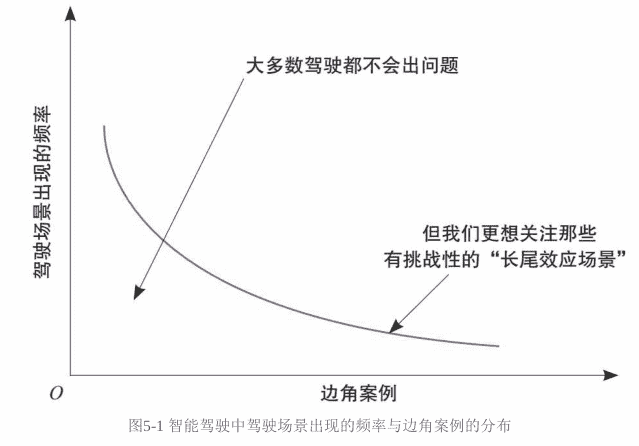

构成这个智能驾驶数据闭环的核心技术和模块都有哪些呢？首先，这个智能驾驶的算法和模块是用数据驱动的，其次，源源不断的数据需要以合理有效的方法去利用。

图5-2是数据闭环的整体流程图，主要包含的模块有：数据采集；真值处理；数据管理、数据预处理及数据标注；模型训练、模型管理、模型评测和模型部署。首先，通过智能驾驶车辆进行数据采集，在车辆中部署一套真值系统，用于生成所采集到的障碍信息的真实结果。这些采集到的真实场景的数据和结果会被存储到数据管理平台中，通过数据预处理进行数据挖掘等工作后，再回传到数据管理平台中，然后根据不同的感知任务进行数据标注，标注的真值结果会再次回传到数据管理平台中。根据不同驾驶功能定义的任务需要使用的真实数据进行模型训练，训练得到的模型会被存储到模型管理平台。最后模型会被放到模型评测中进行结果测试，优秀的模型会被部署到车上，然后再由车根据最新的模型采集新的数据。由此完成数据闭环。

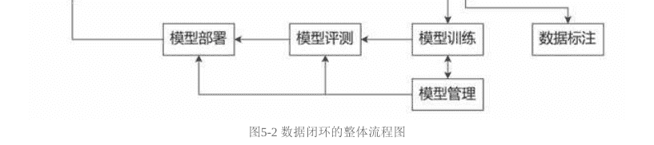

图5-3为数据闭环的具体部署实施方案，该方案的核心思路是本地端部署存储，云端部署大规模计算。其主要包含的模块及数据流包括：

（1）原始数据存储。在本地搭建一个存储系统，对车队中采集的数据以及通过真值系统处理的真值进行存储，本地的存储系统会和亚马逊云端的S3存储桶（全球数据存储服务）建立通路，可以实时上传本地数据。

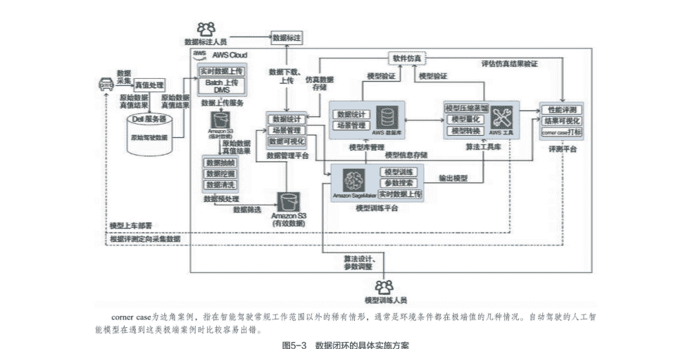

（2）数据上传。在本地通过搭建专线或代理网络将本地数据传输给亚马逊S3存储桶。

（3）数据预处理。亚马逊Kinesis提供的数据分析功能，可通过数据库或Apache Flink（开源的统一流处理和批处理框架）的实时处理数据流，同时进行数据抽帧、数据挖掘、数据清洗等一系列操作。

（4）训练数据存储。将通过数据预处理的数据（有效数据）存储到S3存储桶中，用于后续的训练、评测等一系列工作。

（5）数据管理。涉及数据的查询、统计、可视化、发布等。可以按照日期、场景、时间、天气等进行数据查询，统计不同场景、不同目标数量，也可以进行真值结果数据可视化，发布想要标注的数据。

（6）数据标注。使用Amazon SageMaker Ground Truth（构建训练数据集的标记工具）执行自动数据标记，也可以通过引入第三方供应商进行数据的标注。

（7）模型训练。Amazon SageMaker整合机器学习功能集，提供基于网页端的统一可视化界面，帮助数据科学家和开发人员快速准备、构建、训练和部署高质量的机器学习（ML）模型。

（8）模型存储。用于模型的文件管理和模型日志管理，主要关注模型训练中的各个环节，记录开发人员的开发流程，以便快速复盘训练细节。

（9）模型后处理。AWS Lambda（事件驱动、自动管理代码运行资源的计算服务平台）满足模型压缩、量化、部署模型转换（多平台适配）等功能。

（10）性能评测。能够进行开发周期内的模型评测，同时协助测试人员完成测试报告。收集评测环节中的特殊场景，通过开发人员手动打标发布新的数据采集需求，完成数据回灌。

（11）仿真闭环。真实数据的采集可以给仿真提供数据标签，用于仿真数据生成，同时仿真数据也可以用于算法的评测任务。

### 四、智能驾驶虚拟数据生成

“对于人工智能，技术不是壁垒，数据才是王道”，这种认知逐渐被智能驾驶从业者所接受。ImageNet有超过1 000万张图片，谷歌计划推出10亿个图像标签的数据库。有比数据更重要的东西吗？有，那就是更多的数据。

#### （一）数据少的负面影响

少量训练数据难以提供足够的信息给模型学习，容易造成过拟合（overfitting）；模型把训练数据完全不相关的信息（比如噪声）学习进去，容易陷入局部最优值 [1]（local optimum），难以衡量模型好坏。除了训练数据，测试数据也非常少，少量数据正确与否可能会对结果产生较大影响。解决数据少的负面影响的方式很多，但是最简单的方式就是生成更多虚拟数据。

顾名思义，生成数据是一个以编程方式生成的数据存储库。它不是通过任何真实的调查或实验收集的。它的主要目的是帮助机器学习实践者使用各种分类、回归和集群算法进行实验。我们期望的属性有数值的、二进制的或分类的（序数的或非序数的），数据集的特征数量和长度，应该是任意的，最好是随机的，用户应该能够选择各种各样的统计分布来根据这些数据进行控制和调整，使得底层的随机过程可以被精确地控制和调整。如果将其用于分类算法，那么类分离的程度应该是可控的。随机噪声能以可控的方式插入。对于回归问题，使用复杂的非线性生成过程来获取数据。数据生成的方式很多，包括人工设计规则、使用GAN生成等。

#### （二）GAN生成虚拟数据

自从Goodfellow在2014年提出这个想法之后，生成对抗网络（GAN）就成了深度学习领域内最火的一个概念。GAN构成分为两部分：生成器（generator）、辨别器（discriminator）。

GAN的思路是输入一组真实存在的数据，或者说是希望网络去模拟的数据。这组数据会被打上真值的标签，也就是标签等于1。然后将一些数据种子交给生成器G，让生成器生成和真实数据维度相同的新数据。在生成器接收种子并生成数据之后，将这段数据交给辨别器D，这段数据会被打上标签等于0。辨别器会分别计算真实数据和生成数据的误差，并反向传播误差之和以调整自身，最终被生成的数据达到以假乱真的效果，如图5-4所示。

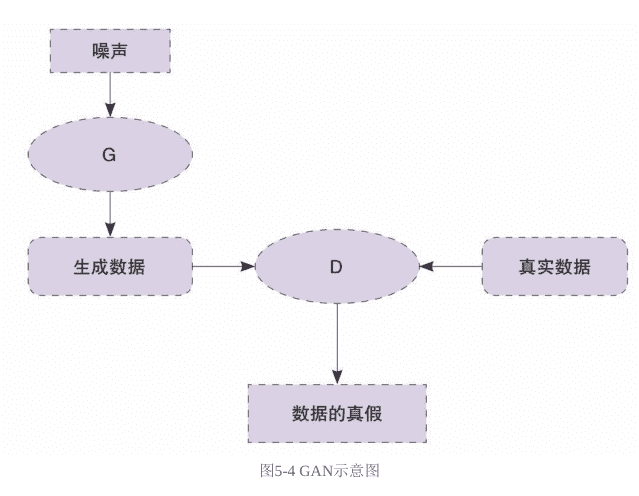

##### 1. 生成数据的优点

（1）可以减少对手工搜集和标注数据的依赖；无须采集更多数据，即可为模型获取更多样化的数据。如合成数据可以用同一个人的不同发型、头部姿势等来训练模型，还能以肤色、种族特征、骨骼结构等特征创造出不同面孔，使模型变得更加可靠。

（2）比“真实”数据获取速度更快，团队可以在短时间内生成大量的合成数据。当真实数据依赖于极少发生的事件时，这一点尤其有帮助，例如智能驾驶场景下的极端路况。数据科学家还可以设置算法，在合成数据创建时自动进行标注，从而减少标注过程的耗时。

对于边缘案例的补充，机器学习算法更喜欢均衡的数据集。例如补充肤色较深的面孔合成数据，不仅可以使模型的准确度提高，还会生成更符合道德标准的模型。合成数据可以帮助团队涵盖更多数据不足或根本不存在的边缘案例。从保护用户的个人信息方面来说，根据行业和数据类型的不同，企业在处理敏感数据时可能会面临不同的数据安全挑战。例如在医疗行业，患者数据通常包括个人健康信息。合成数据可以减轻对这类隐私问题的担忧，因为它不涉及真人的信息。

##### 2. 生成数据的缺点

（1）合成数据和真实数据之间存在数据分布差异，构造数据集时容易引入人工误差。

（2）设计特定的模型花费较大。

（3）难以评估合成数据和真实数据集之间的差异。

> [1] 局部最优值：对于一个问题的解在一定范围或区域内最优，或者说解决问题或达成目标的手段在一定范围或限制内最优。但往往并不是全局的最优。

## 第六章 聪明的汽车和智慧的道路

### 一、车路协同的意义

#### （一）实现对交通管理的提升

（1）通过智慧化道路基础设施（包括智能路侧终端、毫米波雷达、激光雷达、视频事件检测相机、边缘计算终端设备等），充分结合路侧通信单元和智能网联管理平台提供的信息，实现路口交通参与者的实时检测、分类与统计。

（2）通过智能网联云平台，实时获取车辆运行信息和设备状态信息，进一步支撑测试道路的交通状态分析、远程控制等各项功能，实现区域管控智能化、网联化、精细化。智能网联云平台以信息技术为主导，融合交通信号数据、视频检测数据、车辆运行数据、智能网联设备监控数据等信息，通过数据融合、分析和处理，为交通管理部门提供决策支持，是集多种高新技术应用于一体的智能化管理控制集成平台，支持信息交换与共享、快速反应决策与统一管理控制，实现交通管理现代化、信息数字化、设备网络化、决策自动化，提高管理部门的道路交通管理水平 [60-62]。

（3）车辆超速检测、车辆违停抓拍等智慧化交通管理应用系统，为交通管理部门的决策提供了数据支撑。

#### （二）实现对交通安全的提升

通过部署智能化道路基础设施，实现在交叉路口对运动目标（行人、机动车辆、非机动车辆）进行目标跟踪与轨迹研判等，并将信息推送给智能路侧单元（road side unit, RSU）进行发布，为网联车辆提供安全预警信息。通过建设V2X车路协同系统，可进行交通信号引导、车辆碰撞预警、道路拥堵提示、特种车辆行驶提醒、行人碰撞预警。

#### （三）实现对交通效率的提升

C-V2X（一种V2X通信技术）智能可变车道系统，可以根据实际交通情况，对可行驶车道进行调整，用以引导交通流速。通过改变车道指向实现交通路况的实时指挥，达到缓解交通、增加通行效率的效果。V2X智能限速牌系统，可以根据实际交通情况，对智能限速牌系统的限速值进行调整，用以引导交通流速，提高交通效率，还能根据实际道路的交通流量、交通事件等情况，经过大数据分析和评估，对当前道路进行合理的限速控制 [63-64]。

#### （四）实现对交通服务的提升

（1）通过智能交通信号系统实现车与信号灯系统的联动，解决了以往车辆仅能在靠近路口处接收信号灯信息的问题，使车辆在驶近路口前提前预知交通信号灯信号状态，给出倒计时和配时提示信息，提醒驾驶员或智能驾驶系统提前采取行驶决策。

（2）通过智慧信息板系统，结合当前道路情况与V2X大数据计算，进行实时路况信息、公告信息、违停信息、超速信息等的发布，提升了交通服务的送达时效性。

（3）部署智慧车位检测系统，通过V2X信息交互，实现网联车的空余车位提示和引导，并通过V2X管理平台，实现停车场车位信息实时监控 [65-66]。

### 二、车路协同系统技术概述

单车智能在现实场景应用中总是会遇到限制，如无法即时判断前方道路甚至后续路段的情况，无法精确判断其他车辆的行驶动态等。随着车联网（Internet of Vehicle，IoV）或计算和传输自动化的加速发展，智能交通系统将车到车（vehicle to vehicle，V2V）和车到基础设施（vehicle to infrastructure，V2I）等车辆可以连接的所有设施单元连接起来，大大提高了车辆行驶与通信的效率及安全性，缩减了传统汽车行业和智能汽车行业之间的差距 [67-68]。

车联网是由车辆自组网和物联网（Internet of Thing，IoT）结合而来的一个新概念，表示车辆与其他路侧单元之间的相互作用 [69-70]。这些单元可以是车辆、路边基础设施、行人、服务器等。

智能交通系统（intelligent transportation system，ITS）作为智能汽车通信的载体，可定制不同交通路网环境，有整体固定和模块化拼装两种方式。道路可设计成城市道路、高速路、潮汐道路、公交道路、生态道路、各种匝道等，配置各种道路设施和标志标线，以及各类传感器模块。可提供车辆位置信息读取、交通信号灯智能调度、停车位智能动态分配与充电等功能。ITS包含城市道路、绿化带、小区、可控制交通信号灯、停车场、路灯、典型建筑、显示牌、指示牌、检测器等，基于无线通信、传感探测等技术，获取车辆和道路信息，通过车到车、车到路等通信，进行交互和共享，实现人、车、路在信息技术下的协同与一体化管控。ITS作为一整套车联网技术和应用的集合，旨在提高交通安全和流动性，同时将意外情况降到最低限度。

#### （一）车联网的通信类型和分层架构

如图6-1所示，在智能交通系统中，有车到车和车到基础设施两种基本通信类型，随着车联网范围的拓展，车辆和环境之间的通信变得更多、更细致。

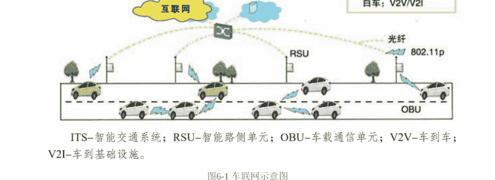

ITS-智能交通系统；RSU-智能路侧单元；OBU-车载通信单元；V2V-车到车；V2I-车到基础设施。

图6-1 车联网示意图

##### 1. 车联网通信类型

在车联网通信的分类中，车联网本质上以五种网络通信类型为基础（图6-2）。

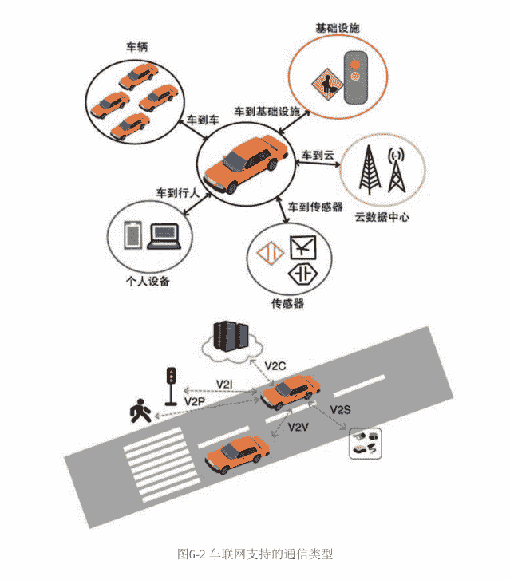

图6-2 车联网支持的通信类型

（1）车到车（V2V）。指自车（驾驶员在路上使用的车辆）与目标车（另一辆在路上的车辆）之间的无线通信。这种通信允许两辆车交换关于速度、加速度、位置和方向的信息，通信的速度要足够快，不能有太大的延迟，这样其他车辆接收到的信息就不会有任何延迟。因此，V2V旨在提供360°的智能视野，从而提供车辆周围的全景视野，以方便不同的驾驶员操作辅助功能。在V2V通信的帮助下，路线上的碰撞事件等信息可以快速地从一辆车传递到另一辆车。

（2）车到基础设施（V2I）。是指车辆与安装在道路上的基础设施（如道路标记、道路传感器、减速带、卫星系统、停车场和交通信号传感器）交换数据的通信类型。V2I通信的目的是提供包括车流密度、试图改变车道的车辆、高速车辆等当前道路状况的实时数据，以减少事故，让驾驶体验更安全、更高效。

（3）车到行人（V2P）。在这种类型的通信中，脆弱性道路用户（VRU，即行人、机动两轮车和骑自行车的人）与车辆交换数据。基于相同的参考，为了设计有效的V2P通信，开发人员必须考虑与三种VRU相关的场景，因为它们由于各自的特点、速度、旅行模式和移动性不同而不同。

（4）车到云（V2C）。这种通信基于云数据中心，负责分析从车辆接收到的数据，制订策略，然后做出良好的决策，以便更好地进行交通管理。此外，考虑到车联网中的海量数据流，在将本地数据发送到云层之前，会使用边缘设备来分析数据。

（5）车到传感器（V2S）。在车联网中，有几种类型的传感器用于感知目的。例如，利用摄像机对物体进行跟踪和分类；在三维测绘和定位时，使用激光雷达进行障碍物探测。来自这些传感器的数据融合有可能克服每个传感器自身的限制。此外，驾驶员智能设备（如智能手机、PC等）接收到的众包数据也被认为是V2S通信演化而来的可测量传感器输出。

##### 2. 针对车联网的分层架构

图6-3描述了分层的车联网通信模型架构。在车联网环境中，网络和数据广播的所有组件之间有7层半透明的相互关系。车联网模型建立在用户与车辆的界面上，指挥用户与车辆之间的通信，进行安全管理、交易授权，可提供它与其他网络通信的计费接口，以传递所收集的信息。

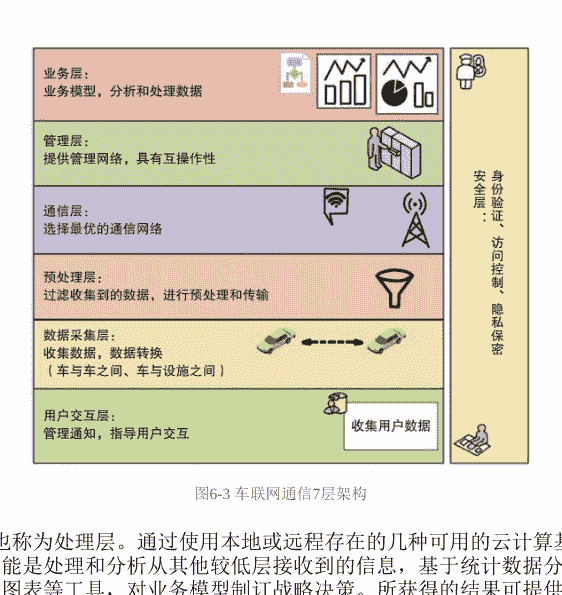

图6-3 车联网通信7层架构

（1）业务层，也称为处理层。通过使用本地或远程存在的几种可用的云计算基础设施，对大量信息负责。该层基本功能是处理和分析从其他较低层接收到的信息，基于统计数据分折，根据应用程序中的数据、流程图和图表等工具，对业务模型制订战略决策。所获得的结果可提供给许多机构（如城市管理部门）用于基础设施和车辆对业务（V2B）等的发展，以管理或改善道路交通。

（2）管理层。负责组织物联网环境中存在的多个网络服务提供商。诸如交通管理、工程管理、检查和功能管理等方法被用于以可管理的格式接收信息。管理层通过考虑互操作性需求帮助管理网络提供者。

（3）通信层。包含许多可用于创建异构通信网络的无线技术，每个网络都有自己的特点，因此，它们必须以一种不影响连接性的方式结合起来。应该根据不同环境的参数（如信息的相关性、安全性、隐私性和可用网络中的拥塞情况）提供服务的平滑连接。主要的挑战是通信层要通过接收所需的信息来选择合适的网络。当需要选择用于传输的网络时，车联网会考虑多种条件，以便应用的服务质量保持在较高的水平。

（4）预处理层。设备会产生大量的数据，系统需要对相关的数据进行处理。因此，收集数据、过滤数据，然后循环到网络中是建立车联网模型的一个重要过程。预处理层收集并过滤数据有助于让正确的数据在网络中流通。

（5）数据采集层。该层的目标是采集与娱乐、安全、交通或驾驶员所选择的兴趣区域等相关的数据，包括全球定位系统、车身控制模块、道路信号和车间通信数据。它将街道划分为相邻的簇，在簇头的帮助下进行数据包的传输。它支持两种类型的数据传输：车内交互和车间交互。在车内交互中，采用蓝牙、Wi Fi、ZigBee等技术，而在车间交互中，V2V、V2I、V2R、V2S和V2P传输利用了IEEE 802.11p通信协议。

（6）用户交互层。系统根据路线、交通堵塞情况、停车空间的可用性、事件发生时的警告和通知等提供所需的信息。此外，如果车辆或驾驶员处于危险之中，它还提供有关驾驶环境的信息。设计用户界面是一项具有挑战性的任务，需要考虑所有因素，比如不能转移驾驶员的注意力，在驾驶过程中满足用户的需求。

（7）安全层。安全对于每个用户都是必不可少的，因此，安全层与上述所有其他层都有直接的通信。安全层负责提供身份验证、访问控制、可用性及其他安全相关保障。这种设计方式可以将安全威胁降至最低。安全层还负责处理安全和隐私保密问题，保护网络免受任何未经身份验证的访问。

#### （二）车路协同系统设备组成

##### 1. 车端

针对L4级智能驾驶车辆、L2～L3级智能网联车、L0～L2级存量车，分别采用软、硬终端车机（新增车机/原有车机/车辆智能服务终端/导航/小程序/移动App）等形式实现车辆数字化（图6-4）。

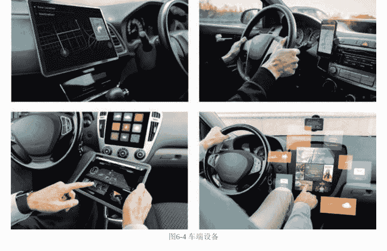

智能车载终端的加装主要实现与车辆运行系统和车端显示系统的对接，智能车载终端一方面获取自车运行状态信息，另一方面通过车-车/车-路交互技术获取周边动态目标信息、逻辑地图信息、道路基础设施信息、交通事件信息和路侧安全信息等。在辅助驾驶方面，智能车载终端基于上述信息通过内置智能应用进行计算，进而提供安全辅助、通行引导和信息服务 [71]；在智能驾驶方面，智能车载终端通过对接智能驾驶决策系统提供上述感知信息，为车辆决策提供信息支撑；在智慧管理方面，智能车载终端实时上传自车运行信息并接收中心平台下发的指令，实现管理者对智能车辆的远程跟踪与管理。未来将逐步采用5G-V2X通信方式，并依国家相应规范，具备型号核准认证、操作及一致性认证。

##### 2. 路端

智能路侧系统分为智能感知单元和智能通信单元。智能感知单元包含激光雷达、毫米波雷达、摄像头等智能感知设备，实现对交通事件的感知，并进行数字孪生 [1] 的实时控制管理；智能通信单元设备安装于路侧杆件上，与路侧感知设备、交通信号灯、电子标牌、摄像头等终端进行通信，实现车路互联互通、交通信号实时交互等功能，形成智慧路口整体解决方案。路侧加装人工智能计算设备，实现对交通事件的识别与判定；路端部署数字轨边缘计算平台，实现交通态势判断、警示信息生成、驾驶主体行为建议等（图6-5）。

智能路侧系统除了具备基于车路交互技术获取车辆的运行信息功能之外，还具备感知分析、融合处理、边缘计算、信息发布和数据上传的功能。该系统支持多种外部系统接入，能够实时感知道路状态、交通状态、运动目标状态。该系统具备多源数据融合处理功能，可以对交通数据、运动目标数据进行实时运算分析；同时，该系统支持多模式通信技术，能够通过基于端到端专用短程通信技术与周边的智能车载终端进行信息交互，通过基于有线通信方式（光纤）或蜂窝网络与区域协同控制器、网联云平台进行通信，并可通过本地信息发布系统进行信息发布。

智能路侧系统是一个综合的路侧平台，向上与管理中心进行对接，向下与路端基础设施、路端传感系统、路端发布系统等进行对接。在与管理中心对接方面，智能路侧系统会实时上传路侧感知处理的动态目标信息、道路信息和交通信息，同时接收管理中心下发的指令，并可控制路侧设施进行显示。在与路端基础设施对接方面，智能路侧系统能够与交通信号系统、差分定位基站等进行对接，实现交通信号灯信息的实时解析，并在必要时对信号系统进行反向控制，支持高精度定位应用。在软件方面，智能路侧系统对接逻辑地图系统，实现道路信息、交通标志标牌信息、交通信息、事件信息等信息感知，进一步满足辅助驾驶相关应用和智能驾驶测试对道路和地图信息的需求。在与路端传感系统对接方面，智能路侧系统能够与微波传感系统、视频传感系统等进行对接，并对传感系统的信息进行解析和融合处理，为智能驾驶提供必要的路侧感知信息支撑。在与路端发布系统对接方面，智能路侧系统能够与可变信息标志等进行对接，实现必要的路侧信息发布功能，为普通交通参与者提供信息服务。

智能网联路侧设备需具备丰富的硬件接口，方便后期功能扩展，包括LTE-V天线接口、RJ45网口、GPS天线接口、3G/4G天线接口。采用即插即用的架构，内置LTE-V通信技术。智能网联路侧终端具备型号核准认证及互联互通一致性认证，符合国家相应标准规范。

##### 3. 边端

智能路侧单元及智能路侧单元控制中心能根据路和车的复杂程度，决定单层实施（单车智能）、双层实施或者全部实施。例如，在单条运营线路、车辆较少的情况下，智能路侧单元融合计算可以满足一定距离内的全部车辆的动态信息需求，边缘融合计算就可以在距离路侧设施较远的中心机房完成；反之，则需将边缘融合计算设备部署至路侧。

智能路侧单元首先对摄像头图像、传感器点云信息与高精度地图进行第一次融合，生成局部动态地图，并传给移动边缘计算平台；移动边缘计算平台将DRSU生成的局部动态地图进行整合，生成全路段的动态地图。车载终端对全路段动态地图进行解析，获取有效路况信息。

边缘计算平台将下属多个智能路侧单元上传的结构化数据融合、计算生成车道级交通事件，如道路拥堵提醒、道路抛洒物提醒、违停车辆提醒等，分别提供给车端和智能管理服务平台，实现事件秒级发现和提醒，有效减少交通事件的发生，提高交通事件处理效率，从而提高城市道路整体通行效率和安全水平。

随着智能驾驶汽车市场占有量的增大，支持智能驾驶的线路及相关基础设施的不断完善，具有更强大的计算能力、并发终端支持能力和复杂路线辅助规划能力的边缘计算平台就需要对智能路侧单元传输来的信息做进一步融合计算，生成和下发全局的结构化动态地图，为区域内所有车辆规划自动通行路线，为具有优先通行权限的车辆规划最短路径，实现区域内的自动调度等。

##### 4. 网端

通过智慧汽车基础设施与信息基础设施一体化建设，交通专网与“天网”“公网”深度融合，推进车联网、5G、卫星通信信息网络等部署应用，形成多网融合的交通信息通信网络，提供广覆盖、低时延、高可靠、大带宽的网络通信服务。

##### 5. 云端

有了数字化和网络化，将生成实时更新的秒级和厘米级的动态地图数据，把无序的地面交通，通过数字孪生，变成有序的、可管控的数字交通系统，从而实现交通智能化。车路协同云管理平台负责接收车辆和智能路侧系统上报的信息，并经过边缘计算，将相关信息推送给车辆（图6-6）。

智能网联平台能够精细化感知宏观区域交通状态、道路状态、动态目标状态信息，具有进行实时和历史数据分析，进而实现宏观交通流优化的功能。部署智能网联云平台时，主要从地图可视化呈现、实时数据分析、历史数据统计、交通引导优化和管控指令发布几个方面进行，并通过蜂窝网络技术与智能车载终端和智能路侧系统进行信息交互，同时通过有线通信技术（光纤等）与区域协同控制器互联互通。

智能管理服务平台融合、交通拥堵、交通事件、施工占道、气象预警等信息，通过智能车载硬件终端、导航App，以文字、图片等形式发布给驾驶人员，起到引导交通流向、缓解通行压力、减少交通事故的作用。

> [1] 数字孪生：充分利用物理模型、传感器更新、运行历史等数据，集成多学科、多物理量、多尺度、多概率的仿真过程，在虚拟空间中完成映射，反映相对应的实体装备的全生命周期过程。

### 三、V2X典型应用场景介绍

#### （一）前向碰撞预警

追尾事故分为3个场景：前车停车、前车减速、前车正常行驶。前车停车和前车减速场景又分为两个子场景：视线内前车停车或减速和视线外前车停车或减速。

视线外场景需要利用智能感知单元的远距离感知能力，及时探测到红车停车或减速，及时通告后方车辆，蓝车虽然视野受限，但也能及时做出合理防碰撞规划（图6-7）。

#### （二）变道/超车辅助

蓝车视野受限，观测不到前方红车，也观测不到对向黄车，因此不能正确规划超车路线。智能感知单元依据远距离感知能力，能观测到范围内全部车辆，并对每辆车做初步规划。蓝车获取到DRSU观测的数据后，就可以做出正确规划（图6-8）。

#### （三）红灯预警

传统方案中，交通信号灯信息需要自车的视觉识别，受天气影响较大、可靠性不高。智能感知单元方案与交通管理部门交通信号灯系统对接，直接读取交通信号灯信息并广播给周边车辆，准确、高效。车辆也可以更早、更快地做出合理规划，确保驾驶更平稳（图6-9）。

#### （四）左转辅助

智能感知单元先感知左转/前行信号灯、对向来车等信息，预测对向来车轨迹。再根据信号灯、对向来车信息，将预测轨迹提供给蓝车，辅助蓝车做左转规划（图6-10）。

#### （五）高优先级/紧急车辆信号优先权车辆让行

智能感知单元感知到区域内有高优先级/紧急车辆信号优先权车辆时，及时通知相邻车辆，并建议避让。高优先级/紧急车辆信号优先权车辆附近的蓝车接收到信号，然后决定是否避让、如何避让（图6-11）。

图6-11 高优先级/紧急车辆信号优先权车辆让行场景

#### （六）异常车辆提醒

智能感知单元探测到附近车辆异常时，及时发布异常车辆提醒，并提供合理规避建议。蓝车根据异常车辆提醒信息和规避建议，制订规避方案（图6-12）。

图6-12 异常车辆提醒场景

#### （七）车辆失控预警

智能感知单元实时监控附近车辆，发现车辆失控，立刻发布车辆失控预警，并提供规避建议。蓝车根据失控预警信息和规避建议，制订规避方案（图6-13）。

图6-13 车辆失控预警场景

#### （八）基于信号灯的车速引导

智能感知单元为车辆提供前方路口的交通信号灯状态和交通信号灯的切换时间服务，提供合理的行车速度区间建议，实现最佳燃油经济性和优化交通流量方案，提升用户驾乘体验 [72]（图6-14）。

#### （九）前方拥堵提醒

智能感知单元利用其“看”得远的优势，为车辆提供前方拥堵提醒服务，提供合理的路线规划建议（图6-15）。

图6-14 基于信号灯的车速引导场景

图6-15 前方拥堵提醒场景

#### （十）限速/限行预警

车辆进入转弯，接收来自智能感知单元的限速预警。行驶至限速区域（如学校）附近，路边智能感知单元向车辆发出预警［图6-16（a）］。接近限行区域（如燃油车限行、单双号限行、货车限行、时间段限行区域）、施工区域附近，智能感知单元向车辆发出预警［图6-16（b）］。

（a）限速预警

（b）限行预警

图6-16 限速/限行预警场景

#### （十一）右转辅助

智能感知单元感知到人行横道为绿灯且没有其他交通参与者时，建议红车右转。红车接收到智能感知单元的感知信息后，结合自身感知信息，做右转规划（图6-17）。

图6-17 右转辅助且无交通参与者场景
注：车辆当前所在道路垂直方向上的过街人行道的信号灯为绿灯。

智能感知单元感知到人行横道为绿灯且感知到行人正在通过人行横道时，建议车辆停车。车辆接收到智能感知单元的感知信息后，结合自身感知信息，做停车规划（图6-18）。

图6-18 右转辅助且绿灯时行人过人行横道场景
注：车辆当前所在道路垂直方向上的过街人行道的信号灯为绿灯，行人正在该人行道上进行南北向（上下向）的通过。

智能感知单元感知到人行横道为红灯且感知到行人正在通过人行横道，建议红车停车。红车接收到智能感知单元的感知信息后，结合自身感知信息，做停车规划（图6-19）。

图6-19 右转辅助且行人闯红灯场景
注：车辆所在道路垂直方向上的过街人行道的信号灯为红灯，行人正在闯红灯。

#### （十二）十字路口辅助

智能感知单元感知到人行横道为绿灯且感知到行人正在通过人行横道，建议红车停车。红车接收到智能感知单元感知信息后，结合自身感知信息，做停车规划（图6-20）。

图6-20 十字路口辅助场景1
注：车辆当前所在道路垂直方向上的过街人行道的信号灯为绿灯，两拨行人分别在两段人行道上进行南北向（上下向）的通过。

智能感知单元感知到人行横道为绿灯且感知到行人正在通过人行横道（非车辆所在道路）时，建议红车减速慢行。红车接收到智能感知单元的感知信息后，结合自身感知信息，做减速慢行规划（图6-21）。

图6-21 十字路口辅助场景2
注：车辆当前所在道路方向上的两个过街人行道的信号灯为绿灯，两拨行人分别在两段人行道上进行东西向（左右向）的通过。

智能感知单元感知到人行横道为绿灯且感知到行人正在通过人行横道（非车辆所在道路），但是前向车道有人闯红灯时，建议减速停车。红车接收到智能感知单元的感知信息后，结合自身感知信息，做减速停车（图6-22）。

图6-22 十字路口辅助场景3
注：车辆所在道路垂直方向上的过街人行道的信号灯为红灯，行人正在闯红灯。

#### （十三）避障预警

智能感知单元感知到前方道路维修且邻近车道无行车时，建议蓝车变道绕过维修路段。蓝车接收到智能感知单元的感知信息后，结合自身感知信息，做变道规划（图6-23）。

蓝车通过障碍物后，需要变回车道。智能感知单元感知到原车道无障碍物后，建议蓝车快速变道。蓝车接收到智能感知单元的感知信息后，结合自身感知信息，做变道规划（图6-24）。

智能感知单元感知到前方道路维修且邻近车道有来车时，建议蓝车减速停车。蓝车接收到智能感知单元的感知信息后，结合自身感知信息，做减速停车规划（图6-25）。

图6-25 避障预警场景3

#### （十四）突发预警

智能感知单元感知到有行人横穿道路，建议蓝车紧急停车。蓝车接收到智能感知单元的感知信息后，结合自身感知信息，做停车规划（图6-26）。

图6-26 突发预警场景

## 第七章 未来生活和智能驾驶

虽然目前智能驾驶汽车更多的是承担将乘客安全、高效送至目的地的角色，但是在未来，随着高级别智能驾驶技术的落地和智能网联技术的发展，物联网、云计算、大数据、移动互联等新技术渗透至汽车行业的每个角落，未来汽车将成为除手机以外的另一大重要终端，连接用户的生活。

### 一、智能互联，核心终端

汽车有一个重要的属性，就是“连接性”，它是除了互联网以外，连接人类生活的一个重要物理工具，将我们和家人、朋友、同事甚至和世界连接到一起。正因为汽车的连接属性，汽车必将跨出其当下的生态链本身，依托大数据、云服务，逐步融合到智能交通、智能家居物联网等各种生态之中，发展为一种融合生态，实现端、管、云协调共生，最终实现全场景智能生态 [73-74]。

#### （一）智能交通

智能交通是智慧城市的一个重要组成部分。随着5G的逐渐普及，智能驾驶发展也将逐步向5G-V2X演进，通过专用通信技术，扩大车辆的感知范围，解决智能驾驶长尾效应问题。设想这样一个场景：当你的汽车正通过一个拥挤的路口，此时一辆自行车从被右侧前车遮挡的盲区突然冲出，而此时你的车已经提前收到右侧前车的预警通知，你的车便可以及时减速，躲开这个“不速之客”。再设想另一个场景：下班高峰期，主干道上异常拥堵，智能路侧系统立即根据拥堵情况，通知后续车辆绕行并选择最佳道路，整体提升道路通行效率，缓解拥堵现象。因此，通过“车—路—云”三者协同（图7-1），可有效提升智能驾驶的安全性、可靠性、稳定性，提升交通通行效率。

#### （二）智能网联

随着物联网的发展，现在人们生活中的很多家电、家居设施都已经连接上了互联网，可以通过手机这类移动终端进行远程操控。而汽车也即将加入物联网的大家庭，基于其物理移动特性，汽车将成为所有物联网设备的重要终端。未来车辆或许会与用户的其他设备绑定在一起，工作、生活、娱乐将通过智能驾驶汽车连成一个整体。

#### （三）软件定义汽车

随着智能驾驶技术的成熟，软件将成为差异化的根本所在，随着OTA升级技术的出现，一辆汽车被生产出来的瞬间，已不再是它最高光的一刻。车厂需要思考的不再只是如何将车卖出去，而是如何通过OTA升级，让车辆可以持续增加新的功能、快速更新迭代现有功能，让消费者持续保持新鲜感，让汽车持续保值，甚至越来越有价值 [75]。

### 二、生活第三空间

第一空间指家庭所在，第二空间指工作所在，而“第三空间”指家庭和工作以外的空间。对于上班族来说，除了工作和家庭，很多时间都是在车上度过的。而当未来高级别智能驾驶落地，结合5G技术，人们就可以有效利用在车上的时间和精力。

在高级别智能驾驶落地后，座舱内的空间能被最大化赋能，汽车将成为一个可以个性化设定的空间。对于上班族而言，汽车就是其办公空间，办公日程同步、视频会议、文件处理、微型3D打印都能够帮助车主随时随地进行办公；对于追求个性化、乐趣生活的年轻人而言，汽车就是其娱乐空间，VR影院、全息厅、车载KTV、AR/VR游戏应有尽有，潮流娱乐技术都可以被应用在座舱内；对于出行的家庭而言，汽车就是其家庭空间，远程学习、语音授课、视频教学帮助孩子随时随地完成学习任务。

总体而言，在高级别智能驾驶落地后，座舱内的空间将可以根据用户需求进行个性化设定，也只有这样，才能将汽车真正打造成人们的第三空间 [76-78]。

## 参考文献

- [1] 孙逢春. 电动汽车发展现状及趋势 [J]. 科学中国人, 2006 (8): 44-47.
- [2] 咸同庆. 最早的汽车：蒸汽汽车 [J]. 交通世界, 1994 (1): 29-32.
- [3] 杨忠敏. 汽车发动机的诞生和发展 [J]. 交通与运输, 2004 (2): 62-63.
- [4] 曹秉刚, 张传伟, 白志峰, 等. 电动汽车技术进展和发展趋势 [J]. 西安交通大学学报, 2004, 38 (1): 1-5.
- [5] 李克强. 智能网联汽车现状及发展战略建议 [J]. 经营者 (汽车商业评论), 2016 (2): 170-175, 15.
- [6] 陶明明, 张晓帆. 浅析智能驾驶技术的现状与未来发展趋势 [J]. 汽车实用技术, 2016 (11): 3-4.
- [7] 王田. 自动驾驶传感器技术 [J]. 汽车世界, 2020 (2): 16.
- [8] 党亚南, 田照星, 郭利强. 车载激光雷达点云数据处理关键技术 [J]. 计算机测量与控制, 2022, 30 (1): 234-238, 245.
- [9] 应欢. 低成本车载激光雷达系统设计 [D]. 合肥: 中国科学技术大学, 2014.
- [10] 杨艳, 高玉英. 智能网联产业链分析：激光雷达成关键部件 [J]. 汽车与配件, 2018 (18): 56-61.
- [11] 何松华, 郭桂蓉. FMCW毫米波雷达高分辨率目标距离像及其处理 [J]. 系统工程与电子技术, 1991, 13 (10): 33.
- [12] 祝彬. 国外毫米波雷达制导技术的发展状况 [J]. 中国航天, 2007 (1): 40-43.
- [13] 胡林慧, 惠坤龙, 杨博, 等. 超声波雷达测障装置的研究与设计 [J]. 数码世界, 2018 (7): 144-145.
- [14] 裴暑云, 谢强伟. 超声波雷达倒车系统的设计及其应用 [J]. 数字技术与应用, 2013 (8): 157.
- [15] 钱若愚. 车载ADAS传感器毫米波雷达解析 [J]. 汽车实用技术, 2020 (4): 26-29.
- [16] TI公司. 无人驾驶车辆：移动的传感器平台 [J]. 电子世界, 2015 (22): 12.
- [17] 郑继虎, 张庆余, 潘霞, 等. 定位自动驾驶领域的域控制器研究 [J]. 时代汽车, 2019 (9): 50-52.

[18] 冯晓辉，王哲，李雅琪. 智能驾驶领域发展态势与展望 [J]. 电子科学技术，2018（6）：26-36.

[19] 潘旭峰，马彪. 汽车电子控制系统的核心：ECU [J]. 电子科技导报，1996（8）：21-25.

[20] 王金强，黄航，郅朋，等. 自动驾驶发展与关键技术综述 [J]. 电子技术应用，2019，45（6）：28-36.

[21] 王艺帆. 自动驾驶汽车感知系统关键技术综述 [J]. 汽车电器，2016（12）：12-16.

[22] 崔硕，姜洪亮，戎辉，等. 多传感器信息融合技术综述 [J]. 汽车电器，2018（09）：41-43.

[23] 韩崇昭，朱洪艳，段战胜，等. 多源信息融合 [M]. 北京：清华大学出版社，2010.

[24] FAYYAD J, JARADAT M A, GRUYER D, et al. Deep learning sensor fusion for autonomous vehicle perception and localization: a review [J]. Sensors, 2020, 20 (15): 4220.

[25] 周文鹏，路林，王建明. 多传感器信息融合在无人驾驶中的研究综述 [J]. 汽车文摘，2022（1）：45-51.

[26] 胡昌振. 多传感器信息融合技术及其应用研究 [D]. 北京：北京理工大学，1996.

[27] VELASCO-HERNANDEZ G, YEONG D J, BARRY J, et al. Autonomous driving architectures, perception and data fusion: a review [C] //2020 IEEE 16th International Conference on Intelligent Computer Communication and Processing (ICCP). Cluj-Napoca, Romania: IEEE, 2020: 315-321.

[28] CHAVEZ-GARCIA R O, AYCARD O. Multiple sensor fusion and classification for moving object detection and tracking [J]. IEEE Transactions on Intelligent Transportation Systems, 2016, 17 (2): 525-534.

[29] FAYYAD J, JARADAT M A, GRUYER D, et al. Deep learning sensor fusion for autonomous vehicle perception and localization: a review [J]. Sensors, 2020, 20 (15): 4220.

[30] 刘经南，詹骄，郭迟，等. 智能高精地图数据逻辑结构与关键技术 [J]. 测绘学报，2019，48（8）：939-953.

[31] 贺文. 高精地图：自动驾驶商业化的“水电煤” [J]. IT经理世界，2017（14）：36-37.

[32] 訾璐，张江水，杨振凯，等. 高精地图交通要素对象化建模方法 [J]. 测绘科学技术学报，2020，037（6）：636-642.

[33] 刘经南，刘焱雄. GPS卫星定位技术进展 [J]. 全球定位系统，2000（2）：1-7.

[34] 马芮，董景新. GNSS/MIMU组合导航技术综述 [J]. 飞航导弹，2007（4）：42-46，62.

[35] 马春艳，王国锋，詹丽娟，等. MEMS组合惯导系统研究 [C] //全国第十二届空间及运动体控制技术学术会议论文集. 2006: 185-189.

[36] 张孝兵，周宣赤，夏云海，等. 基于GPS/MEMS惯性传感器的车载组合惯导系统的设计实现 [J]. 传感器技术与应用，2017（1）：1-9.

[37] SCHWARTING W, ALONSO-MORA J, RUS D. Planning and decision-making for autonomous vehicles [J]. Annual Review of Control, Robotics, and Autonomous Systems, 2018, 1 (1): 187-210.

[38] 王梓强，胡晓光，李晓筱等. 移动机器人全局路径规划算法综述 [J]. 计算机科学，2021，48（10）：19-29.

[39] 陈宝林. 最优化理论与算法 [M]. 北京：清华大学出版社，2005.

[40] ROSENBERG A, HALLAK A, MANNOR S, et al. Planning and learning with adaptive lookahead [J/OL]. (2023-01-18) [2023-03-06]. https://arxiv.org/abs/2201.12403.

[41] 宗长富，刘凯. 汽车线控驱动技术的发展 [J]. 汽车技术，2006（3）：1-5.

[42] 吴蒙，张飞铁，文桂林. 无人驾驶汽车线控转向系统控制策略的研究 [J]. 计算机仿真，2016，33（12）：163-168.

[43] 熊璐，杨兴，卓桂荣，等. 无人驾驶车辆的运动控制发展现状综述 [J]. 机械工程学报，2020，56（10）：127-143.

[44] 钱玉宝，余米森，郭旭涛，等. 无人驾驶车辆智能控制技术发展 [J]. 科学技术与工程，2022，22（10）：3846-3858.

[45] 刘向杰，周孝信，柴天佑. 模糊控制研究的现状与新发展 [J]. 信息与控制，1999，28（4）：283-292.

[46] WANG C Y, BOCHKOVSKIY A, LIAO H. YOLOv7: Trainable bag-of-freebies sets new state-of-the-art for real-time object detectors [J]. arXiv/2207.02696 (2022).

[47] MISRA I, GIRDHAR R, JOULIN A. An end-to-end transformer model for 3D object detection [J]. 2021 IEEE/CVF International Conference on Computer Vision (ICCV). 2021: 2886-2897.

[48] SAGAR A, SOUNDRAPANDIYAN R K. Semantic segmentation with multi scale spatial attention for self driving cars [C] //2021 IEEE/CVF International Conference on Computer Vision Workshop (ICCVW). Montreal, Canada: IEEE, 2021: 2650-2656.

[49] ZHOU J, TAN X, SHAO Z, et al. FVNet: 3D front-view proposal generation for real-time object detection from point clouds [J]. 2019 12th International Congress on Image and Signal Processing, BioMedical Engineering and Informatics (CISP-BMEI), 2019: 1-8.

[50] JIANG Q, ZHANG L, MENG D. 3D vehicle object detection based on monocular vision and lidar fusion [C] //2019中国汽车工程学会年会论文集（1）. 北京：机械工业出版社，2019: 72-79.

[51] 伍锡如，雪刚刚. 基于图像聚类的交通标志CNN快速识别算法 [J]. 智能系统学报，2019，14（04）：670-678.

[52] 蒋芸，张海，陈莉，等. 基于卷积神经网络的图像数据增强算法 [J]. 计算机工程与科学，2019，41（11）：2007-2016.

[53] 吴天雨，许英朝，晁鹏飞. 一种提高目标图像识别准确率的数据增强技术 [J]. 激光杂志，2020，41（5）：96-100.

[54] 王新成. 高级图像处理技术 [M]. 北京：中国科学技术出版社，2001.

[55] INOUE H. Data augmentation by pairing samples for images classification [J/OL]. (2018-04-11) [2023-02-06]. https://arxiv.org/abs/1801.02929.

[56] SUMMERS C, DINNEEN M J. Improved mixed-example data augmentation [C] //In 2019 IEEE Winter Conference on Applications of Computer Vision (WACV) HI, USA: IEEE, 2019: 1262-1270.

[57] TAKAHASHI R, MATSUBARA T, UEHARA K. Data augmentation using random image cropping and patching for deep CNNs [J]. IEEE Transactions on Circuits and Systems for Video Technology, 2020 (9): 2917-2931.

[58] ZHONG Z, ZHENG L, KANG G, et al. Random erasing data augmentation [J/OL]. (2017-11-16) [2023-02-06]. https://arxiv.org/abs/1708.04896.

[59] 梁观术, 曹江中, 戴青云, 等. 一种基于GAN的数据增强的无监督商标检索系统及方法: CN111274429A [P]. 2020-06-12.

[60] 张杰. C-V2X与智能车路协同技术的深度融合 [J]. 中兴通讯技术, 2020, 26 (1): 19-24.

[61] 李凯旋. 智慧城市: 车路协同技术对智能交通管理的贡献与影响 [J]. 中华建设, 2019 (5): 85-89.

[62] 王建强, 李世威, 曾俊伟. 车联网发展模式探析 [J]. 计算机技术与发展, 2011, 21 (12): 235-238.

[63] 程刚, 郭达. 车联网现状与发展研究 [J]. 移动通信, 2011, 35 (17): 23-26.

[64] 吴冬升, 王传奇, 金伟, 等. 高速公路5G智能网联技术、方案和应用 [J]. 电信科学, 2020, 36 (4): 46-52.

[65] 赵福全, 匡旭, 刘宗巍. 面向智能网联汽车的汽车产业升级研究: 基于价值链视角 [J]. 科技进步与对策, 2016, 33 (17): 56-61.

[66] 宋娟. “互联网+”背景下的智能网联汽车 [J]. 软件和集成电路, 2016 (1): 36-37.

[67] 戴一凡, 李克强. 智能网联汽车发展现状与趋势分析 [J]. 汽车制造业, 2015 (18): 14-17.

[68] 陈荆花, 黄晓彬, 李洁. 面向智能网联汽车的V2X通信技术探讨 [J]. 电信技术, 2016 (5): 24-27.

[69] PROTZMANN R, SCHUUNEMANN B, RADUSCH I. The influences of communication models on the simulated effectiveness of V2X applications [C] //2010 IEEE Vehicular Network Conference. NJ, USA: IEEE, 2010: 102-109.

[70] 王莹, 叶雷. ADAS和V2X技术市场走势 [J]. 电子产品世界, 2015, 22 (8): 10-14, 17.

[71] 董馨, 南洋, 陈博, 等. C-V2X应用场景的算法建模及评价模型综述 [J]. 汽车文摘, 2020 (5): 13-17.

[72] 戴方, 马锋. V2X的应用场景介绍 [J]. 中国新通信, 2018, 20 (19): 99.

[73] 屈艺多, 胡琳. 智能驾驶技术的现状与未来发展趋势 [J]. 电子技术与软件工程, 2019 (11): 243.

[74] 赵鹏, 胡梅娟. 发展车路云融合的智能网联汽车 [J]. 瞭望, 2022 (24): 14-17.

[78] 王保东. 智能座舱的前世今生和未来 [J]. 时代汽车, 2022 (7): 167-168.