# 口袋里的人工智能：智能驾驶

## “口袋里的人工智能”丛书编委会

总顾问 戴琼海

主任 陈俊龙 王桂林

副主任 弓鸿午 吴汉荣 严奉强

委员（按姓氏笔画顺序排列）

马晶 王蕾 车文荃 史颖欢 刘伟 杜卿 李姝萌

沈文浩 张通 张小川 罗子章 郭继舜 谭明奎

丛书总主编 陈俊龙

执行总主编 车文荃

## 《智能驾驶》

主编 郭继舜

副主编 王艳明 郑鑫宇

编委（按姓氏笔画顺序排列）

王佛伟 李培杰 陈泽 彭钟钟 程伟 樊洪志

## 序言

科学日进月异，社会样态随之加速更迭，人类文明正不断迎来超出预期的转折点。曾经司空见惯的事物，如今已显陌生。

> —— [美] 约翰·冯·诺依曼

“科技的光芒来自内部，智能的绽放亦源于内核。”能与顶尖围棋大师对弈的 AlphaGo、方兴未艾的无人驾驶汽车、已渗入日常的智能家居，共同宣告智能化时代的到来。借助大数据、云计算、边缘计算与移动互联网的协同赋能，人工智能凭借丰富的应用场景持续改写生产与生活的形态。它既是引领未来发展的战略性方向，也是推动新一轮科技进步与产业重构的核心动力。

人工智能具有显著的溢出带动与头雁效应，能够赋能众多行业，在全球科技版图上占据关键位置。《中华人民共和国国民经济和社会发展第十四个五年规划和2035年远景目标纲要》提出要推进人工智能与各产业深度融合。依托移动互联网、大数据、云计算等领域的积累，我国人工智能已走过理论积淀与平台搭建的准备阶段，迈入产业赋能期，机器视觉与自然语言处理达到世界先进水准，智能驾驶及生物化学交叉领域也收获良好成效。为贯彻落实《新一代人工智能发展规划》，2022年7月科技部等六部门联合发布《关于加快场景创新以人工智能高水平应用促进经济高质量发展的指导意见》，明确围绕高端高效智能经济、安全便捷智能社会、高水平科研、国家重大活动和重大工程打造重点场景。场景创新的深化将进一步提升人工智能赋能百业的质效，也为公众带来更深刻、更便利的生活体验。面对人工智能的快速演进，做好科普是每位从业者的职责。响应国家对新时代科普的新要求，构建社会化科普格局，普及相关知识势在必行。

在上述背景下，广东科技出版社牵头组织“口袋里的人工智能”系列丛书的编写出版，邀请华南理工大学计算机科学与工程学院院长、欧洲科学院院士、欧洲科学与艺术院院士陈俊龙教授担任总主编，目标是打造面向公众的人工智能科普读物。丛书聚焦人工智能的场景化落地，既覆盖机器视觉、自然语言处理、计算机博弈等基础方向，也关注智能驾驶、AI 化学与生物、智慧城轨、医疗健康等热点领域。共设《千才百智》《智能驾驶》《机器视觉》《AI化学与生物》《自然语言处理》《AI与医疗健康》《智慧城轨》《计算机博弈》八册，以科普视角通俗、简明、系统地介绍关键内容，准确把握行业痛点及演进趋势，分析融合人工智能的利弊与挑战，既为大众提供便捷的知识入口，也为相关从业者提供参考。丛书有助于激发青少年对科技的兴趣，引导更多年轻人投身科研，直面未知与挑战，拥抱变革、敢于创新，这体现了编写团队与广东科技出版社的社会责任与担当。

该套丛书不仅展示了人工智能对社会与生活的积极意义，也对技术带来的伦理议题作出探讨。技术进步必须以人为本，面向社会的智能应用不能缺少伦理审视，需要设置必要的安全机制，以保证技术与应用的健康发展，实现智能社会的和谐美好。

科技千帆竞，智能万木春。人工智能的大幕已徐徐拉开，新时代已经到来。正如冯·诺依曼所言，未来将持续变化，让我们共同努力创造新的未来，共同期待新的明天。

戴琼海

（中国工程院院士）

2023年3月

## 第一章 智能驾驶汽车的时代

智能驾驶汽车在当下已不陌生。国内百度、小马智行、文远知行，海外 Waymo、Uber、Aurora 等，均已深耕多年。在中国北京、上海、广州、深圳等一线城市，道路上已能见到智能驾驶测试车辆，部分企业甚至已向公众开放无人驾驶体验。多项迹象表明，以智能驾驶为代表的新汽车时代正快速临近。

### 一、汽车的进化史

#### （一）蒸汽机时代

说到汽车，绕不开“蒸汽机之父”詹姆斯·瓦特，正因他改进的瓦特蒸汽机，人类才掀起第一次工业革命浪潮。随后瓦特研发出齿轮联动装置、连杆曲柄机构、离心调速器等，并多次改进蒸汽机，彻底取代纽科门蒸汽机。

1769年，法国陆军技术军官尼古拉斯·居组在政府支持下试制成功一台三轮蒸汽机车。

此后1804年，理查德·特里维希克造出世界上首台可实用化的轮轨蒸汽机车，这是真正意义上的首台实用轮轨蒸汽机车（图1-1）。

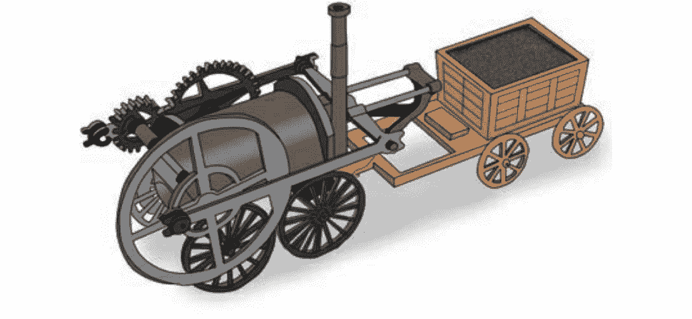

其后1825年，英国嘉内爵士制造出首辆蒸汽公共汽车，1831年他以该车开启了世界上最早的公共汽车运营（图1-2）。

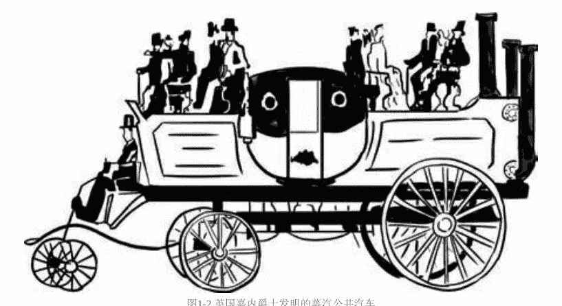

随着瓦特蒸汽机的普及，19世纪中期欧洲与美国对蒸汽机车的研发制造进入高峰期。蒸汽机被广泛应用于火车、轮船、公共汽车等交通工具，迎来蒸汽机车全盛期 [1]。但蒸汽机车存在笨重、惯性大、制动困难、转向迟钝、需大量水煤、锅炉压力高易爆炸、车轴易断、易熄火、受天气影响大、舒适性差、污染严重、启动缓慢需30至45分钟、热效率仅约10% 等缺陷 [2]。受此制约，19世纪中期后蒸汽机车逐渐衰落，社会亟需更稳定可靠的新型动力。

#### （二）内燃机时代

蒸汽机将锅炉产生的蒸汽送入气缸推动机械做功，属于外燃机。该过程存在大量热能损失，热效率很低。若让气体燃料直接在气缸内燃烧，利用膨胀力驱动活塞做功，则可大幅提升效率，这一思路催生内燃机 [3]。

内燃机的诞生是多位科学家的共同成果，大致经历四个阶段：

##### 1. 奠定基础

早在1670年，荷兰物理学家、数学家、天文学家惠更斯尝试让火药在气缸内燃烧，制成借助气体膨胀推动活塞做功的装置并绘制原理图。因火药危险且当时缺乏应用场景，该发明未受重视，却为内燃机问世奠定基础。

##### 2. 引入气体燃料

1794年，英国的斯特里特首次提出燃料与空气混合形成可燃混合气的原理。1801年，法国化学家菲利普·勒本采用煤干馏得到的煤气和氢气作燃料，制成将煤气与氢气和空气混合点燃产生膨胀力推动活塞的发动机，被誉为内燃机发展史上的开创性一步。

##### 3. 内燃机问世

1859年，比利时工程师埃蒂安·勒努瓦制成二冲程卧式内燃机。1862年，法国科学家阿方斯·博·德·罗沙在卡诺热力学研究基础上提出四冲程内燃机工作原理，当时仅完成设计，未制造实物。德国发明家尼古劳斯·奥托提出内燃机四冲程理论——奥托循环，一个循环由吸气、压缩、膨胀做功、排气四个行程构成，为现代内燃机奠定理论基础。1876年，奥托依据该循环设计制造出世界上首台水平四冲程往复活塞式内燃机（图1-3）。该机以煤气为燃料，体积大、质量重，尚不能装车使用。

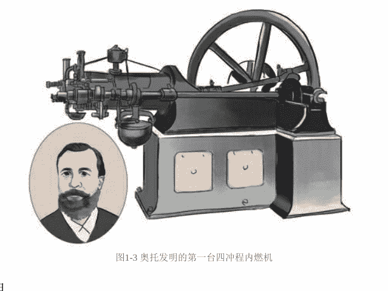

图1-3 奥托发明的第一台四冲程内燃机

##### 4. 完善与应用

1885年，曾在奥托工作的德国工程师卡尔·本茨与戈特利布·戴姆勒分别独立发明汽油内燃机。戴姆勒与其助手威廉·迈巴赫改进开发出世界首台化油器式电点火小型汽油机，转速可达创纪录的750 r/min，是世界上第一台立式发动机，取名“立钟”，戴姆勒将其装在一辆自行车上。这实际上是世界上第一辆摩托车（图1-4），因此戴姆勒被称为“摩托车之父”。同期，另一位奥托下属、现代汽车工业先驱之一、被誉为“汽车之父”的卡尔·本茨也在推进研究。1879年，卡尔·本茨研制成功火花塞点火内燃机，随后改进为汽油发动机。1885年，他制造出世界上第一辆三轮汽油车，车上装有三个实心橡胶轮胎和一台卧置单缸二冲程汽油发动机。卡尔·本茨于1886年1月29日向德国皇家专利局申请专利并获批，故1月29日被视为世界汽车诞生日，1886年为世界汽车诞生年。这辆车即大名鼎鼎的“奔驰1号”，现藏于梅赛德斯-奔驰博物馆（图1-5）。

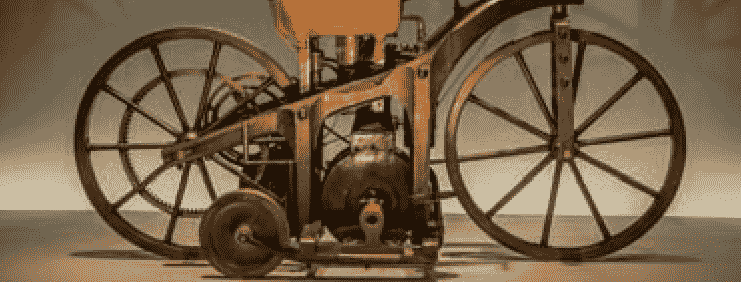

图1-4 世界上第一辆摩托车

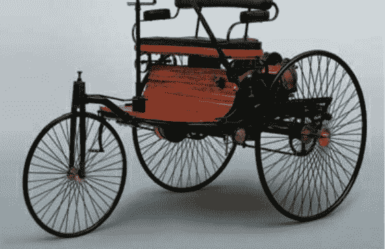

图1-5 世界上第一辆汽车“奔驰一号”

### 二、汽车技术的发展趋势

自1886年第一辆汽车诞生以来，汽车产业已走过百余年历程，从萌芽到高速发展再到如今趋于成熟稳定，奔驰、宝马、大众、通用、丰田、本田等一批传统巨头相继崛起。

近年来受能源紧张与科技进步的双重推动，电动车与智能驾驶汽车进入视野，逐渐成为行业新宠。回顾近年生产经营与前沿研究，未来汽车技术将主要朝电动化、智能化、网联化三个方向演进 [4-5]。

#### （一）电动化

电动汽车以车载电源为动力，用电机驱动车轮行驶，符合道路交通安全法规要求。主流类型包括纯电动汽车 BEV、混合动力汽车 HEV、燃料电池汽车 FCEV。

在中国，2010年底全国已有25个城市加入“十城千辆”节能与新能源汽车示范推广工程，50多家企业的184个车型入选《节能与新能源汽车示范推广应用工程推荐车型目录》。各地示范运行的电动汽车超1万辆，累计里程超2亿公里，累计载客超90亿人次。此后十年间，国家出台多项免税与补贴政策，推动车企向新能源研发制造转型，鼓励消费者购买。为缓解里程焦虑，国家标准化管理委员会协调下，工业和信息化部、国家能源局组织全国汽车标准化技术委员会牵头起草《电动汽车传导充电用连接装置 第1部分：通用要求》《第2部分：交流充电接口》《第3部分：直流充电接口》三项国家标准，以及《电动汽车非车载传导式充电机与电池管理系统之间的通信协议》国家标准。四项标准2011年12月22日公告发布，2012年3月1日起实施，2015年有更新。统一充电标准后充电设施加速建设，到2022年充电桩已遍布城市。中国也涌现出小鹏、蔚来、零跑等自主电动车品牌，已能与传统一线车企同台竞争。

国外方面，日本出于能源危机与环境保护以及占领未来市场的考量，一直高度重视电动汽车研制。当前日本在电动汽车技术发展速度居前，尤其在混合动力产品方面领先。1997年丰田推出混合动力轿车 PRIUS，当时日本许多出租车已开始试用混合动力。美国和欧洲传统车企在电动汽车产业化方面相对滞后，奔驰、宝马、大众、福特、通用等仅小批量生产销售过纯电动车型，混合动力与燃料电池电动车尚未实现规模化。

总体看，消费者对电动汽车的接受度在提升。据 CleanTechnica 数据，2022年7月全球电动汽车销量占整体汽车销量的约14%，其中纯电动占比约10%。纯电动7月销量同比增长73%，高于插电式混合动力 PHEV 36%的增幅。2022年1至7月全球电动汽车销量为4,928,376辆，占汽车市场份额12%，中国市场贡献巨大。若剔除中国市场，2022年7月 PHEV 销量同比下降约20%。

随着销量攀升，行业电动化趋势愈发明显，各大传统车企纷纷推出电动旗舰，如奔驰 EQS、宝马 iX、大众奥迪 e-Tron 系列。从发展路径看，当前正由传统混合动力、插电式混合动力向纯电动发展，未来将迈向更清洁的燃料电池汽车。电动化已成为所有车企必须走的道路。

#### （二）智能化

在传统汽车技术基础上融合电子技术、智能算法、信息技术，形成的新一代智能汽车，是未来发展的另一大趋势。

为支撑智能化发展，2015年工业和信息化部首次提出智能网联汽车概念，明确发展目标。2017年发布的《中国智能网联汽车技术路线图》界定了定义、技术架构、发展路径与重点创新行动。同年7月8日，《新一代人工智能发展规划》国发〔2017〕35号提出到2020年人工智能总体技术与应用达到世界先进水平。2018年工信部发布《促进新一代人工智能产业发展三年行动计划2018—2020年》，其中八大重点智能产品首位即为智能网联汽车，要求到2020年建立可靠、安全、实时性强的智能化平台并形成相关标准，支撑高度智能驾驶。《新一代人工智能发展规划》还提出2020年初步建立部分领域人工智能伦理规范和政策法规，2025年初步建立法律法规、伦理规范和政策体系，形成安全评估和管控能力。

智能驾驶是指车辆通过增加雷达、摄像头等传感器、控制器、执行器及车载环境感知系统与信息终端，使车辆具备智能环境感知能力，能自动分析行驶安全与危险状态，并根据乘客设定目的地自动规划行驶路线。最终目标是实现程序替代驾驶员操纵车辆，即无人驾驶，车辆可在道路上自主通行，无需人类司机参与。

#### （三）网联化

当前汽车智能化多采用“单车智能”方案。为解决智能驾驶过程中的长尾问题 [1]，未来需通过车—车联网、车—路联网形成协同效应，弥补单车智能的不足。“十二五”期间，国家“863计划”部署智能车路协同关键技术研发并取得初步成果。基于车路交互技术的合作系统已在实际道路开展应用试验，国家在北京、上海、广州、深圳、苏州、无锡、长沙等十余个城市建立智能驾驶及车路协同示范区。此外，《合作式智能运输系统 专用短程通信》等一批自主知识产权国家标准于2014年正式发布。2015年《中国制造2025》明确提出到2025年掌握智能驾驶总体及关键技术，建立智能网联汽车自主研发体系、生产配套体系及产业群，基本完成汽车产业转型升级。在市场与政策共同作用下，我国智能汽车技术发展迅速，相关系统及应用软件开发已初步成形。

随着智能驾驶推进，除满足网联化需求外，高级别智能驾驶落地后，汽车还将演变为除手机外的重要移动终端，被接入互联网成为物联网、互联网的服务节点，这也将是未来一大趋势。

> [1] 长尾效应：指在解决主要头部问题后，还需面对大量细小零散问题，而这些小问题累加起来耗费的时间精力往往超过主要问题。

## 三、智能驾驶的起源、现状与未来

### （一）智能驾驶的起源

智能驾驶最早应用于20世纪90年代美国的军事领域，产业化起步于本世纪初谷歌 Moonshot 计划中的无人车项目。谈及车辆智能化，不得不提美国国防部高级研究计划局 DARPA 举办的无人驾驶挑战赛。该赛事虽起初为军方打造可批量生产的智能车，但第一次实现了真正意义上的智能驾驶，成为推动技术快速发展的关键力量。

追溯至2004年3月，首届 DARPA 无人驾驶挑战赛在美国莫哈维沙漠举行。赛道上设急弯、隧道、下坡、路口、沟壑和遍布仙人掌，还需识别可能突然出现的动物和火车。比赛共收到106支队伍报名，预选赛时25支车队通过安全与技术测试，随后在加州高速公路上进行约1.6公里自主导航与障碍测试的资格赛。15支车队进入决赛，但最终没有队伍完成全程。卡内基梅隆大学 Red Team 的赛车 Sandstorm 改装自悍马，行驶距离最长，完成11.78公里路程，却不足全程5%。

沙漠擂台到城市路考：智能驾驶拐点

2005年10月，DARPA第二届无人驾驶赛事在美国莫哈维沙漠开赛，有23支队伍进入决赛。比赛依旧在沙漠区进行，但越野难度较上一届显著提升，爬坡更陡、通道更窄、曲折路段更多。出人意料的是，这次较量成为智能驾驶发展史上的关键节点。最终跑完全部路线的仅剩5辆车，分别是Stanley、Sandstorm、H1ghlander、Kat-5和Terramax，其中斯坦福大学的Stanley以不足7小时的用时夺魁，图1-6即为这台冠军座驾。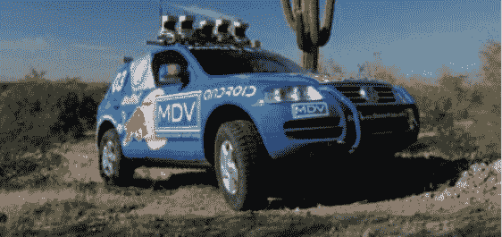

2005年更多是证明机器能应对静态环境，而2007年的DARPA城市挑战赛则把能力推向动态交互。赛道包含双向车流、蜿蜒国道、十字路口等要素，要求参赛车遵守全部交通法规，同时识别并规避其他车辆，并依据对方行驶动作实时做出判断与路径规划，逼近真实驾驶场景。53支车队报名，11支通过预选，6支完成全程，卡内基梅隆大学的Boss以4小时10分29秒摘得冠军。此后DARPA不再举办相关主题赛事，该届已验证了机器驾驶具备类人类潜能，后续工作在于资金介入与持续打磨。

赛事之后谷歌等大小企业纷纷入局。受此影响，2014年1月SAE International首次发布J3016自动驾驶分级，按自动化程度划分为L0至L5共六级。历经数次修订后，2021年4月第四次更新仍维持六级划分：
L0：无自动化驾驶；L1：驾驶辅助；L2：部分自动化驾驶；L3：有条件自动化驾驶；L4：高度自动化驾驶；L5：完全自动化驾驶。
第四版明确，自动化等级取决于在动态驾驶任务DDT及DDT后备支援中主要操作者的职责边界，图1-7予以说明。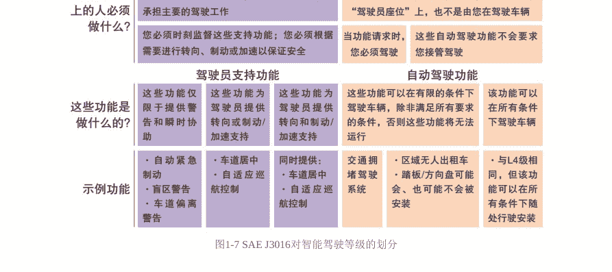

### （二）智能驾驶的现状
当下工程化多沿DARPA思路，先以摄像头、毫米波雷达、激光雷达等高精度器件配合高精地图搭建感知层，再据此推理可行路径，最后由执行层跟随行驶。

#### 1. 感知模块
感知即系统从外部采集信息并提炼知识的过程，广义涵盖环境感知与自定位。环境感知可拆分为目标识别与运动分析。目标分为静态类，如路面、车道线、路缘、信号灯、标志、施工提示，和动态类，如车辆、行人。识别多基于卷积神经网络的深度学习，图像处理常见候选区域、回归与强化学习等路线。

运动分析聚焦三维运动特性，最基础的是区分静止与运动，运动目标需估计速度、加速度、行驶方向及未来轨迹，近年研究进一步延伸至意图辨识，如变道、横穿、让行等。基础分析多用卡尔曼滤波，结合恒速、恒加速度、恒转率恒速、恒转率恒加速度等模型，对位置、朝向、速度、加速度等状态进行估计。轨迹预测与意图分析多采用数据驱动，依据历史轨迹推演未来行为。

#### 2. 决策规划模块
环境感知与定位为车辆提供道路结构、交通态势及周边参与者状态，决策规划据此做量化评估并向执行控制下发轨迹。按SAE分级，L0以预警为主，L1、L2属辅助驾驶，L3及以上为车辆自主。随着等级提升，行驶主责与决策权逐步由人转向车，自主决策规划是研发难点之一。

智能车运行于复杂动态环境，需应对城市道路等不可预测场景以达到类人可靠与安全。良好决策的前提是精准感知，即便顶尖机器视觉也难以做到极低误检，这对决策规划的鲁棒性提出更高要求。

#### 3. 执行控制模块
执行控制位于系统最底层。结合底盘与定位反馈的实际状态，以及规划层给出的参考轨迹，计算可直接作用于执行机构的控制指令，保证车辆平稳、低误差地跟踪规划路线。

总体来看，市场以单车智能为主。受法规与责任限制，主流车企聚焦L3以下辅助驾驶，海外特斯拉、国内小鹏、蔚来、理想、华为等均已推出L2++乘用车，实现高速领航的脱手脱脚，并持续攻关城市领航。另一阵营为科技公司，多先攻L4再下沉至L0-L3，代表有谷歌、AutoX安途、小马智行、文远知行、百度等。

### （三）智能驾驶的未来
自2007年至今，行业已行进十余年，L2与L4均有成熟产品，但尚无企业敢承诺L5落地时间。长尾效应明显，边界场景持续涌现。未来L2仍需人类随时接管，L4或需远程接管应对运行设计域ODD外的工况。

随着5G普及，车路协同将更好地弥补单车感知的局限。总体而言，智能驾驶仍将长期处于人机共驾阶段，需不断完善以覆盖更多场景。

> [1] 鲁棒源自Robust，意为健壮强韧，指系统在异常危险情况下仍能存续的能力，即鲁棒性。

## 第二章 智能驾驶的感官和大脑

### 一、智能驾驶的感官——车载传感器
智能驾驶融合感知、决策、执行与多级辅助，依托现代传感器，结合视觉计算、通用计算、神经网络计算进行信息融合，并辅以V2X与人工智能实现自动控制，环境感知是基础。不同技术路线与等级对应不同传感器配置。

#### （一）车载摄像头
摄像头像人眼，计算芯片像大脑。为给大脑提供决策所需视觉信息，摄像头需克服环境干扰，在复杂恶劣条件下快速识别车辆、行人及交通标志，为现阶段自动驾驶提供感知保障。

##### 1. 摄像头的基本工作原理
工作流程可描述为目标经镜头成像投射到图像传感器形成光信号，转为电信号，经模数转换器A/D转为数字图像信号，再由数字信号处理芯片DSP加工，形成特定格式图像输出显示或参与算法。

主要硬件包含：
- （1）镜头组。由光学镜片、滤光片与保护膜组成。
- （2）图像传感器CIS。采用互补金属氧化物半导体工艺制作的成像器件，如图2-1所示，CIS集模拟与数字电路于一体，主要由微透镜、彩色滤光片、光电二极管、像素阵列构成。

图像传感器结构
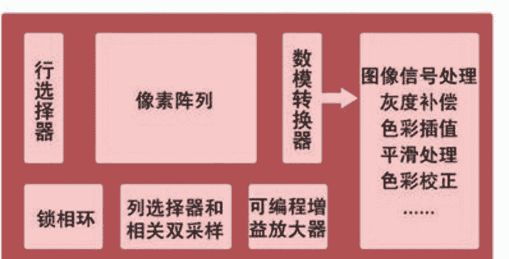
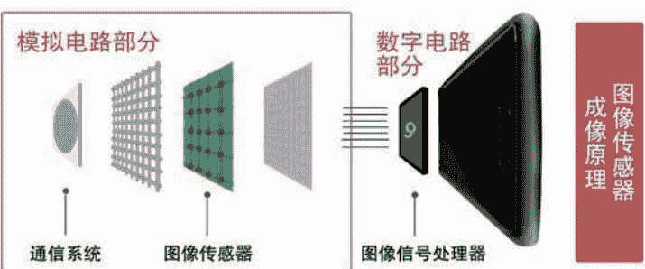
图2-1 图像传感器结构和成像原理
- （3）数字信号处理芯片。基于车载摄像头的感知解决方案如图2-2所示，DSP可分为上游材料、中游元件、下游产品三部分，按不同应用功能搭配上中游器件及算法实现视觉感知。

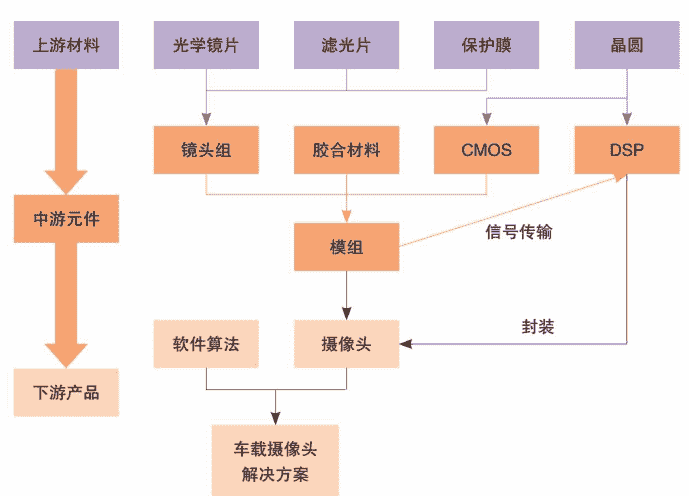
CMOS-图像传感器；DSP-数字信号处理芯片。
图2-2 车载摄像头的感知解决方案

##### 2. 摄像头的类别
按安装位置分前视、侧视、后视、内视，具体功能见表2-1。

表2-1 车载摄像头类型及功能
| 功能 | 摄像头类型 | 具体功能简介 |
| :--- | :--- | :--- |
| 车道偏离预警（LDW） | 前视 单目/双目 | 当前视摄像头检测到车辆即将偏离车道线时，就会发出警报 |
| 前向碰撞预警（FCW） | 前视 单目/双目 | 当前视摄像头检测到与前车距离过近，可能发生追尾时，就会发出警报 |
| 车道保持辅助（LKA） | 前视 单目/双目 | 当前视摄像头检测到车辆即将偏离车道线时，就会向控制中心发出信号，然后由控制中心发出指令，及时纠正行驶方向 |
| 行人碰撞预警（PCW） | 前视 单目/双目 | 前视摄像头会标记前方道路行人，并在可能发生碰撞时及时发出警报 |
| 交通标志识别（TSR） | 前视 单目/双目 | 识别前方道路两侧的交通标志 |
| 盲点监测（BSD） | 侧视 广角 | 利用侧视摄像头，将后视镜盲区内的影像显示在驾驶舱内 |
| 泊车辅助（PA） | 后视 广角 | 泊车时将车尾的影像显示在驾驶舱内，预测并标记倒车轨迹，辅助驾驶员泊车 |
| 驾驶员注意力监测（DM） | 内视 广角 | 安装在车内，用于检测驾驶员是否疲劳、闭眼等 |
| 360°环视（AVM） | 前/侧/后 广角 | 利用车辆前后左右的摄像头获取的影像，通过图像拼接技术，输出车辆周边全景图 |

#### （二）车载激光雷达
##### 1. 激光雷达的基本原理
激光雷达向一定视场角FOV内发射光线，同时接收范围内反射回的光，利用发射与反射光的相关信息计算反射点速度、距离、高度、反射强度等。

构成一般包括发射模块、接收模块、扫描模块与控制模块：
- （1）发射模块：激光器、发射光学系统。
- （2）接收模块：接收光学系统、光学滤光装置、光电探测器。
- （3）扫描模块：改变激光束空间投射方向，可用电机、微型谐振镜、相控阵等方式实现，Flash方案不含扫描模块。
- （4）控制模块：完成对各模块控制，以及数据处理和外界系统数据传输。

##### 2. 激光雷达的分类
按内部是否含旋转部件可分为机械旋转式、混合式与固态式。

- （1）机械旋转式激光雷达。通过机械旋转实现激光扫描，激光发射单元在竖直方向排成线阵，经透镜产生不同指向光束，在步进电机驱动下持续旋转，把竖直线束扩展为面，形成三维扫描。
- （2）混合式车载激光雷达。将MEMS与振镜结合形成MEMS振镜，通过振镜旋转完成扫描，驱动电路产生激光脉冲并驱动MEMS振镜旋转，经发射光学单元准直后射出。工作原理如图2-3所示。

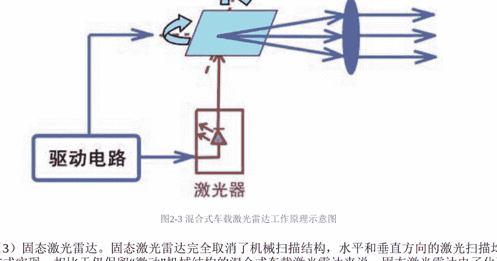
- （3）固态激光雷达。完全取消机械扫描，水平与垂直扫描均电子化。主流有光学相控阵OPA激光雷达与泛光面阵式Flash激光雷达。
①光学相控阵激光雷达。
- a. 相控激光发射器由若干收发单元组成矩形阵列，通过改变各单元发射光相位差调节波束角度与方向。
- b. 激光经分束器进入光波导阵列，外加控制改变波导中光波相位，利用波导间相位差实现光束扫描，原理类似多缝干涉。
- c. 每根波导相当于光发射源，空间传播干涉使光在特定方向加强、其他方向抵消，从而改变传播方向实现扫描。
②Flash激光雷达。
- a. 工作类似相机，每个像素可记录光子飞行时间信息。
- b. 非扫描式，直接发射覆盖探测区域的大面积激光，由高灵敏接收阵列计算各像素对应距离，完成环境绘制。

##### 3. 激光雷达的关键参数
- （1）视场角，包括水平视野和垂直视野。
- （2）分辨率，包括水平分辨率和垂直分辨率。
  - ①水平方向由电机带动，易做得很高，多数产品水平分辨率为0.1°。
  - ②垂直分辨率与发射器几何大小相关，也与其排布有关，相邻发射器间隔越小分辨率越高。
  - ③减小垂直分辨率的方法，针对机械式：a. 改变发射与接收单元排布，排布更密分辨率更高；b. 多个16线激光雷达耦合，单体不变整体分辨率提升。
- （3）测距范围。Flash方案一般约50m，高线束激光雷达可达300～350m。
- （4）距离精度。一般2～5cm。
- （5）刷新频率。一般15～20Hz。
- （6）扫描频率。10～20Hz。
- （7）激光波长。常见905nm与1550nm。

#### （三）车载毫米波雷达
##### 1. 毫米波雷达的基本结构
基本结构包括单片微波集成电路芯片MMIC和天线印制电路板PCB，如图2-4所示。以调频连续波FMCW车载雷达为例，包含天线、收发模块、信号处理模块。

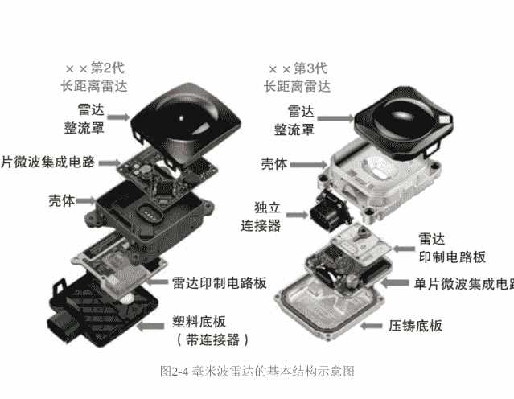
- （1）单片微波集成电路。包括低噪声放大器LNA、功率放大器、混频器、收发系统等。特点是电路损耗小、噪声低、频带宽、动态范围大、功率大、附加效率高、抗电磁辐射能力强。
- （2）雷达天线高频PCB板。主流方案为微带阵列，把高频PCB集成在普通PCB上实现天线功能，需在小空间内保持足够信号强度。

##### 2. 毫米波雷达的基本工作原理
如图2-5所示，利用高频电路产生特定调制电磁波，经天线发送并接收目标反射波，通过发射与接收参数计算目标参数，可同时对多目标测距、测速、测方位角。测速基于多普勒效应，测方位角依靠天线阵列。

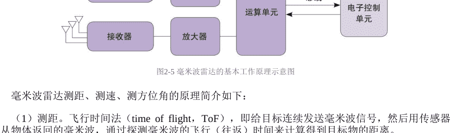
原理简介：
- （1）测距。飞行时间法ToF，连续发送毫米波信号，接收物体返回波，通过往返时间计算距离。
- （2）测速。依据多普勒效应，通过返回波频率变化计算目标相对雷达运动速度。
- （3）测方位角。通过并列接收天线接收同一目标反射波的相位差计算方位角。

##### 3. 毫米波雷达的工作体制
按辐射电磁波方式分脉冲体制与连续波体制。连续波可分为频移键控FSK、相移键控PSK、恒频连续波CW、调频连续波等。工作体制见表2-2。

表2-2 毫米波雷达不同工作体制
| 工作体制 | 脉冲体制（脉冲多普勒雷达） | 连续波体制 | 连续波体制 | 连续波体制 |
| :--- | :--- | :--- | :--- | :--- |
| | | CW | FSK | FMCW |

感知硬件对比速览
不同体制在应用侧重点上差异明显。近距离信息采集类方案技术成熟、操作简洁、精度可观；擅长测速的类型能捕捉目标运动信息；融合测距与测速的类型在探测时长与精度上更有优势；多目标连续跟踪类方案具备高灵敏度、低误报、抗电磁干扰、远距离高分辨率、低功耗、低成本、信号处理易实现等特点。

局限方面，近距方案在目标很近时收发间隔极短，需要高速处理与复杂结构，成本攀升；高分辨率对带宽需求大；发射功率受限作用距离有限。测速为主的方案无法提供距离信息。仅能单目标测量的方案难以兼顾多目标。

两种体制的毫米波雷达电磁波辐射能量
 

四、车载超声波感知
大家熟知的倒车辅助设备，本质就是超声波传感器，只是名字更亲民。停车、倒车或起步时，它作为安全补充，用声响或画面提醒周边障碍，弥补视线盲区和模糊感。

实现逻辑很直观：发射单元向外发声，回波被接收单元捕捉，通过时间差换算距离 [13]。市面上探头频率常见三档：40kHz、48kHz、58kHz。频率越高灵敏度越好但探测锥角越窄，量产倾向选用58kHz。超声波频率低、成本友好、能耗缓慢、测距原理简洁，0.1～3m区间精度稳定，非常贴合泊车 [14]。

五、主流感知单元的边界
1. 视觉摄像头
摄像头提供丰富的纹理与特征，比纯激光、毫米波更能实现：
- 目标识别与分类。3D毫米波只能判断前方有无物体，摄像头可进一步分辨车道线、信号灯、路牌、施工标识等。
- 通行空间划分。对可行驶区域、路缘、侧石、无可见障碍的边界、未知边界进行分割。
- 横向移动目标捕捉。如十字路口横穿的行人、车辆的探测与跟踪。
- 定位建图。视觉同步定位与地图构建VSLAM虽历史晚于毫米波SLAM，但成熟度与落地性更强。
短板在于受光照影响大，强光直射或逆光阴影下成像下降，高速运动易产生运动模糊。

2. 激光雷达
激光雷达对光照变化不敏感，夜间也能全天候运行；测距精度领先，抗干扰能力不错。点云信息丰富，但雨雪、大雾、粉尘会明显衰减；对低反射材质测距偏差；硬件成本高，普及受限。

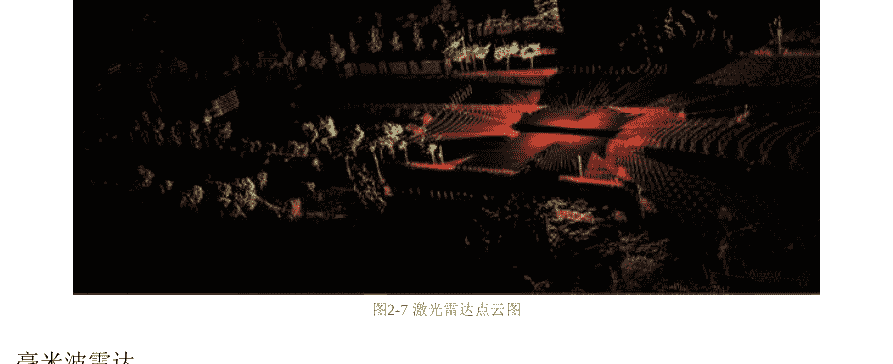
3. 毫米波雷达
如图2-8所示，毫米波雷达探测距离可达200m左右，雨雪雾尘穿透性好。不足在于对行人、锥桶、塑料等低回波材质识别率低，对金属异常敏感导致虚警偏高；采样稀疏噪声大、目标抖动；对切向运动敏感度差；原始输出仅距离与角度，缺少高度信息 [15]。

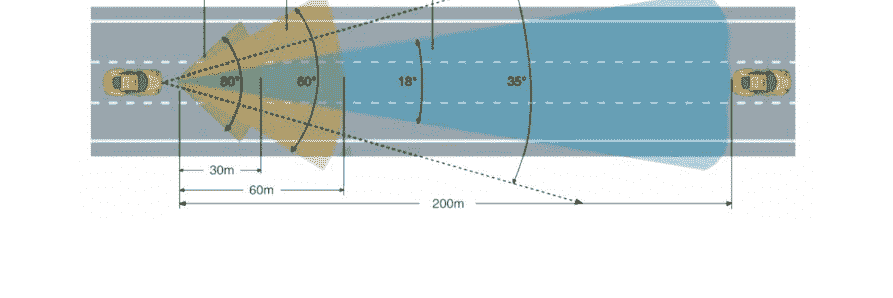
图2-8 毫米波雷达探测范围

4. 超声波雷达
该装置受雨水、粉尘、泥沙干扰小，空气穿透强衰减低，短距离精度高，常用于泊车。缺陷是声传播易受温度影响，冷热环境误差变大；声速远低于光速，车速快时难实时跟上距离变化；输出仅为视野内的距离，定位不精。如图2-9所示，泊车布局多为车身周围12个。车头车尾各4个短距，左右各2个长距。短距量程多在3m以内，装于前后保险杠，用于倒车近距预警；长距量程约5m以内，装于左右，用于判空位与辅助泊入。

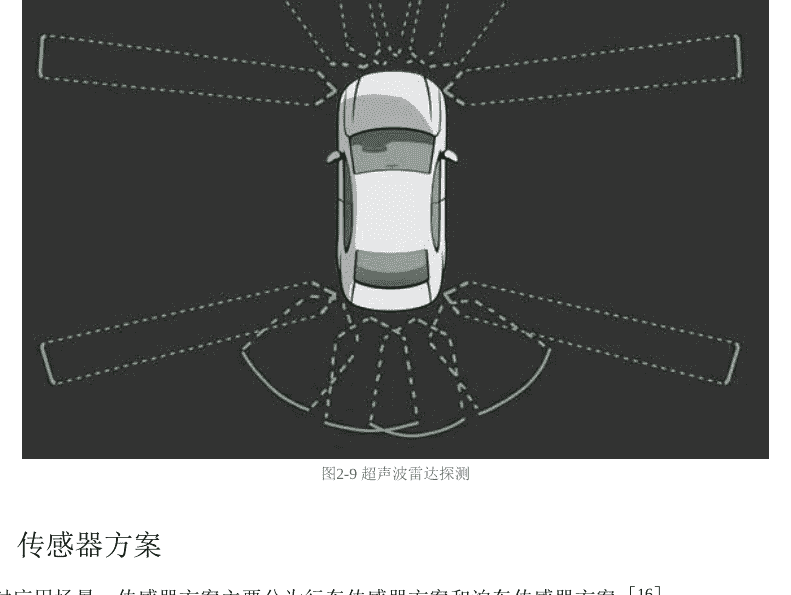
图2-9 超声波雷达探测

六、传感器方案搭配逻辑
按场景分为行车方案与泊车方案 [16]。

1. 行车传感器方案
- 单车道智能驾驶辅助。前视单目摄像头或前向毫米波雷达可实现AEB自动紧急制动与ACC自适应巡航。毫米波擅长测速，摄像头擅长识别车道线与障碍分类。两者结合可实现高速巡航辅助HWA与拥堵辅助TJA。
- 多车道智能驾驶辅助。实现变道需感知邻道，常在车尾两侧各加一个毫米波雷达。再增加前向角雷达拓展侧前视野，可实现路口辅助JA、紧急车道保持ELK、紧急转向辅助ESA等。
- 点对点自动导航驾驶。需全方位感知加冗余，前视配激光雷达，侧视后视配摄像头与毫米波，并配合高精地图与惯导定位。主流配置为激光雷达1～3个+毫米波雷达5～8个+ADAS摄像头7～10个。

2. 泊车传感器方案
- 倒车辅助。倒车雷达+全景影像实现碰撞预警与四周影像。倒车雷达前、后各4个超声波，全景影像四周4个鱼眼摄像头。
- 自动泊车。在倒车雷达基础上，车侧各增2个长距超声波，共12个识别车位。可再融合全景摄像头感知平行车位，也可与钥匙、手机App联动实现驾驶员监护下的遥控泊车。
- 记忆泊车。100m内寻迹泊车，无需额外硬件，需融合前视行车摄像头数据做视觉定位与建图。进一步可融合后视行车摄像头实现寻迹倒车。
- 代客泊车。1km内自动泊车，需高精地图与惯导定点，并与停车场系统联动实现园区内智能泊车。

七、市场现状与展望
智能驾驶自2021年起加速，头部企业公开技术进展并推进前装量产。代表方案包括百度Apollo Moon、小马智行Pony Alpha X、文远知行WeRide Sensor Suite 4.0、AutoX AutoX Gen5。

表2-3对比显示，百度Apollo Moon第五代方案搭载4个激光雷达、5个毫米波雷达、13个摄像头，支持V2X，算力800 TOPS；小马智行Pony Alpha X搭载7个激光雷达、4个毫米波雷达、11个摄像头，无超声波；文远知行WeRide Sensor Suite 4.0搭载1个顶置激光雷达+1个固态激光雷达+2～4个盲区激光雷达，4D毫米波雷达数量未详，摄像头数量未详；AutoX Gen5搭载6个激光雷达、无普通毫米波、8个4D毫米波雷达、28个800万像素摄像头，支持V2X，算力2200 TOPS。

百度Apollo Moon套件包含1个激光雷达、5个毫米波雷达、13个摄像头，算力超800 TOPS，支持5G云代驾与V2X协同，智能驾驶能力较上一代提升约10倍。

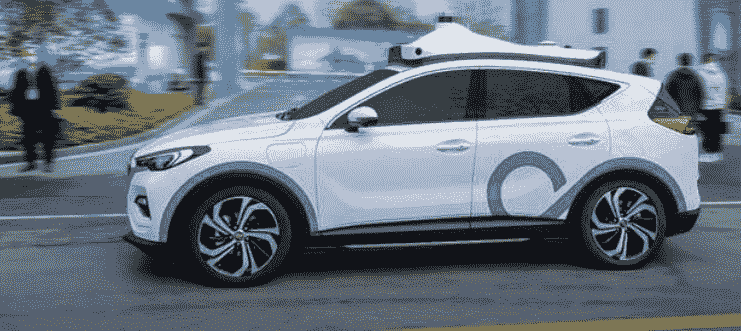
图2-10 百度Apollo Moon智能驾驶车辆及传感器

小马智行Pony Alpha X配备4个探测距离达200m的激光雷达、4个广角摄像头、1个交通信号灯识别摄像头、1个中距摄像头、4个毫米波雷达。

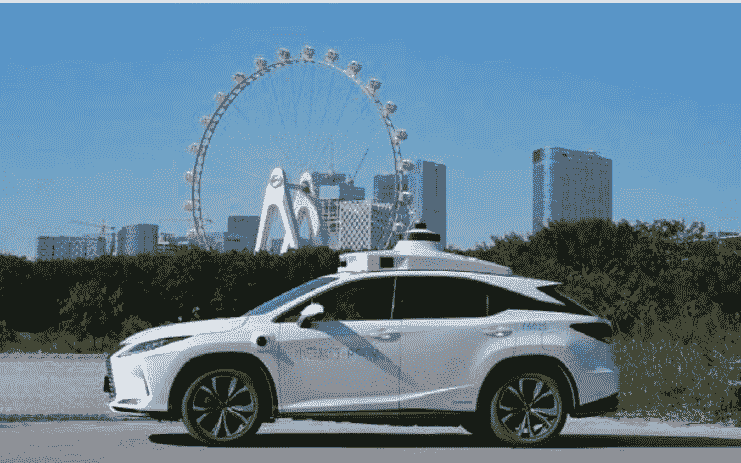
图2-11 小马智行Pony Alpha X智能驾驶车辆及传感器

文远知行WeRide Sensor Suite 4.0集成激光雷达、4D毫米波雷达与自研相机模块，实现360°覆盖，最远前向300m、无盲区，可精准判断物体及运动状态与特殊交通场景，具备传感器自清洁功能。

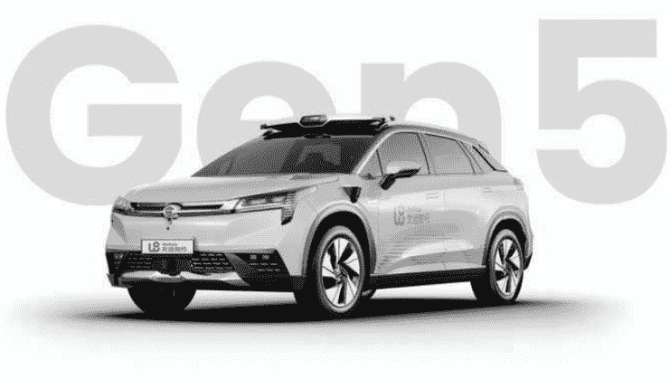
图2-12 文远知行WeRide Sensor Suite 4.0智能驾驶车辆及传感器

AutoX Gen5搭载超50个传感器，像素总量达2.2亿/帧，4D毫米波雷达分辨率0.9°，激光雷达点云15百万点/秒，算力平台2200 TOPS。

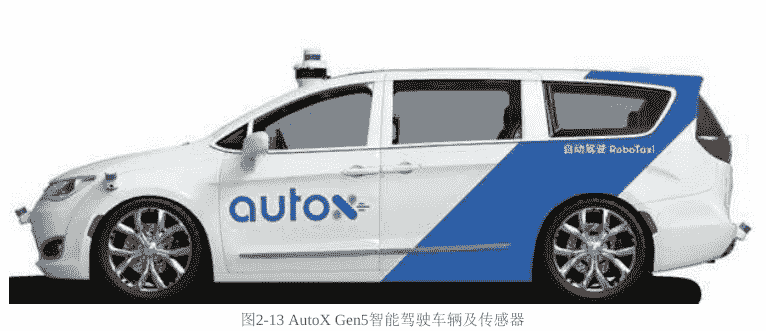

总体看，Robotaxi基本标配1个360°顶置激光雷达+1个前向激光雷达，多配盲区激光雷达；超声波在Robotaxi方案中逐步被舍弃；毫米波正向4D毫米波迁移。激光雷达+4D毫米波雷达+摄像头的组合正成为主流，方案同质化加深，前装量产可行性提升。

二、智能驾驶的大脑——智能驾驶域控制器
（一）从分散到集中的演进
一辆普通家用车搭载数十甚至上百个ECU，各自独立通过预定义总线通信。分布式架构靠增量扩展功能，ECU增多后系统复杂度飙升，线束成本与工作量大幅增加，跨ECU通信需反复定义信号，替换ECU要重做大量定义。点火自检和运行时诊断需逐个检测ECU，启动时延增加。OTA升级时，OTA Master要对几十上百个ECU逐一刷写校验并保证版本一致，失败时需重刷或回滚，易导致升级耗时长、甚至耗尽电瓶 [17-19]。

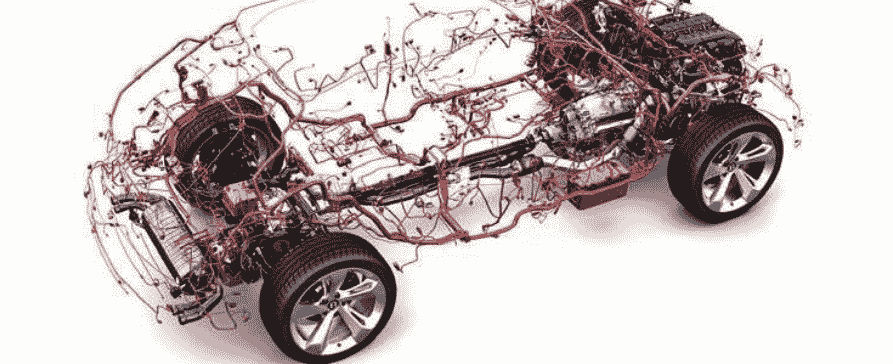
集中式电子电气架构由此兴起。博世2017年发布的EEA路线图将架构分为分布式、跨域集中式、车辆集中式三类。硬件上超大算力芯片涌现，英伟达Xavier、OrinX，高通SA8540、SA9000，国产地平线J3、J5等；软件上软件定义汽车SDV与SOA兴起，行业正从模块化集成迈向跨域集中式。蔚来ET5/ET7、小鹏P7/P5、长城GEEP4.0、比亚迪E3.0、大众ICAS1~ICAS3等均属此类。

整车按功能划分为智能驾驶域、座舱域、车身域、底盘域、动力域，部分厂商合并域。华为CC架构将整车分为智能座舱域CDC、整车控制域VDC、智能驾驶域MDC，其中MDC在智能驾驶热潮下长期独立存在。

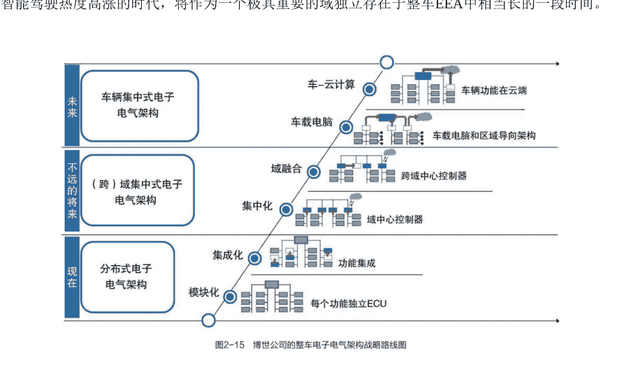
（二）智能驾驶域控制器的构成与作用
如图2-16所示，域控硬件核心是两颗芯片：算力强的SoC，功能安全等级ASIL-B/C；微控制器MCU，功能安全等级ASIL-D。二者成本约占域控物料的1/3~1/2。其余关键部件包括连接视觉传感器的SerDes、连接激光雷达和其他域控的以太网交换机，以及eMMC、Flash、UFS、SDRAM等非易失存储。运行中芯片与传感器尤其是激光雷达、4D毫米波雷达产生海量数据，需千兆以太网或PCIe总线承载，通常依赖8层甚至12层PCB支撑高速信号。高规格带来可靠性提升的同时也推高了成本。

從整體架構來看，智能駕駛域控制器的硬件提供算力和執行基礎，軟體負責資源調度與功能銜接，演算法才決定最終的智能表現，三者缺一不可，而軟體正處於中間的協調位置。沒有軟體作為載體，演算法無法落地，硬件算力也調不起來，感知、預測、決策等內部模組更無法互通。按自下而上的思路，域控軟件一般分成系統層、中间層、服務層、應用層四個部分。

最底部的系統層由作業系統及對應的板級支援包構成，直接接觸硬件資源。這類控制器通常同時搭載高算力 SoC 與功能安全 MCU，因此系統適配會隨著芯片差異而調整。MCU 的核心職責是監控 SoC 的運行狀態、處理外部診斷請求、對 SoC 產出的感知與規劃結果進行校驗、接入車載 CAN 網絡並向執行器發送指令；SoC 則要把各路傳感器的數據帧在時間維度上同步後進行融合，識別出目標的距離、速度、大小和類別，並據此規劃出合適的行駛路徑返回 MCU。在車輛高速行駛時，這類信息能否做到精確且及時傳遞尤為關鍵。

運行在 MCU 與 SoC 上的滿足 ASIL-D 等級的即時作業系統及 BSP 驅動，從底層保證了對事件的快速響應與數據傳輸的即時性。市場上已通過安全認證的通訊協議棧、日誌處理、記憶體管理、加解密、SOA 通訊等商用軟體模組，避免了整車廠重複開發的投入，也提升了安全性與可靠性，並且標準化程度高，便於後續變更與平台移植時的復用。

服務層向上隱藏了下層實現細節，把繁瑣的接口調用與時序關係封裝起來，抽象成一個個服務請求，從而大幅降低上層開發複雜度，讓演算法與應用可以專注於駕駛業務本身，無需關心如何建立通訊鏈路、如何呼叫加密庫、如何啟動系統診斷等底層事務。

應用層位於最頂端，主要承載與智能駕駛相關的各種演算法，例如視覺中對障礙物的識別、規控中對軌跡線的擬合，以及建立在演算法之上的業務功能，例如自動代客泊車、車道居中保持等。

系統層、中间層、服務層、應用層在強大的硬件基礎上協同運作，才能讓智能駕駛系統發揮應有的能力。

#### （三）智能駕駛域控制器的未來形態
目前整車電電氣架構持續演進。按博世的路線圖，跨域融合是必然方向，當下已能看出端倪。在實際運行中，智能駕駛域控制器與智能座艙域控、底盤域控或更高集成的整車中央域控制器關聯最緊密。

運行中產生的交互信息需要經座艙域反饋給駕駛員，駕駛員也可以通過座艙設備設定駕駛參數，例如自適應巡航的跟車距離與巡航車速；駕駛控制輸出時則要與底盤域協同，涉及前輪轉角、車速、制動狀態等。一般來說底盤域對芯片算力的需求不高，但對即時性、安全性和可靠性要求極高，短期內不適合直接與駕駛域合併。

與此同時，座艙域 SoC 的能力快速提升。以高通 SA8155P 為例，其 AI 算力已達 8 TOPS，下一代 SA8295 甚至可達 30 TOPS，遠超當前眾多 ADAS 方案採用的 TI TDA4VM 及 Mobileye Q4 等 SoC。利用這部分富餘算力，可以先從低速泊車等相對簡單場景切入融合，這就是業界提到的艙泊一體跨域融合。

座艙域的強算力還可作為駕駛域的一種備援。當駕駛域失效時，搭載功能安全 MCU 的座艙域依託剩餘傳感器可在一定條件下執行失效運行策略，使車輛實現本車道安全停車或靠邊停車，最大程度保障安全。這也可視為座艙域與駕駛域的跨域融合。

## 第三章 神奇的智能駕駛算法
### 一、智能駕駛演算法簡介
如圖3-1所示，智能駕駛的典型架構包括環境感知、決策規劃與運動控制，其中廣義的感知除了環境狀態感知，還包括依定位信息通過地圖檢索獲得的環境信息。

感知層負責對車輛周圍環境的識別，核心是獲取與處理環境信息。常用設備包括攝像頭、毫米波雷達、激光雷達、超聲波雷達、紅外夜視儀，以及用於定位導航的全球定位系統 GPS 與組合慣導 IMU。

決策層實現對下一步行動的決策與規劃，尋找合理路徑到達目標。狹義的行為決策系統根據感知層輸出結果合理決策當前車輛行為，據不同行為確定軌跡規劃的約束條件，指導軌跡規劃模組產出路徑、車速等信息後下發控制層。

控制層依託線控技術完成執行機構電控化，實現電子制動、電子驅動、電子轉向，控制車輛響應，保證控制精度，對目標車速與路徑進行跟蹤。

### 二、感知融合
智能駕駛常用攝像頭、毫米波雷達、激光雷達等，各類設備的特性差異在第二章已述，針對單一設備的局限，多源融合感知方案受到關注。

多源融合的主要收益為提升感知準確度、拓展感知維度、增強環境適應能力並有效降低成本。

#### （一）多傳感器融合結構
按信息融合層次，可分為集中式、分布式與混合式。

##### 1. 集中式融合結構
集中式屬於較低信息層次融合，將各路設備原始數據直接送入融合模組，由融合演算法處理後做出最終決策。其結構如圖3-2所示，如採用卡爾曼濾波作為融合演算法，可得到全局狀態估計。優點是計算速度快、可即時融合、演算法靈活；缺點是原始數據量大，對硬件要求高，可靠性偏低。

##### 2. 分布式融合結構
分布式屬於較高語義層次融合，如圖3-3所示。在每個設備後設信息處理單元，先對原始信息做局部處理，再將結果送融合模組決策。每個設備具備處理能力，單一設備失效不會導致整體崩潰，增強了設備間關聯，提升了可靠性和容錯性，但目標跟蹤精度會有所下降。

##### 3. 混合式融合結構
混合式由集中式與分布式組合而成，如圖3-4所示，部分設備採用集中式，其餘採用分布式。兼具較強可靠容錯性與工程即時性，但複雜度高於前兩種，對結構設計要求高，計算成本也相應增加。

##### 4. 三種融合結構的比較

| 体系结构 | 集中式 | 分布式 | 混合式 |
| :--- | :--- | :--- | :--- |
| 信息損失量 | 小 | 大 | 中 |
| 精度 | 高 | 低 | 中 |
| 通信帶寬 | 大 | 小 | 中 |
| 可靠性 | 低 | 高 | 高 |
| 计算速度 | 慢 | 快 | 中 |
| 可扩充性 | 差 | 好 | 一般 |
| 融合处理 | 复杂 | 容易 | 中等 |
| 融合控制 | 容易 | 复杂 | 中等 |

#### （二）多傳感器融合演算法
多源融合演算法大致分為隨機類方法與人工智能方法。隨機類代表有卡爾曼濾波，另有加權平均法、貝葉斯估計法、D-S 証據理論；人工智能方法常用專家系統、模糊邏輯理論、人工神經網絡、遺傳演算法等。

##### 1. 隨機類方法
加權平均法。思路直觀簡便，對多個設備獨立探測的冗餘數據賦權求和取平均作為融合值。實現容易、即時性好，但權重分配主觀性強，融合效果一般，實用性受限。

貝葉斯估計法。由 Thomas Bayes 提出，基於先驗概率不斷結合新數據更新概率。融合過程中對設備輸出不確定性做似然估計，以條件概率表達，並在工作中持續更新以做最優決策。其局限在於依賴先驗概率，若無先驗需大量統計數據支撐，耗時耗力。

D-S 証據理論。是貝葉斯估計的拓展，用於決策層信息融合，核心要素為基本概率賦值函數、信任函數和似然函數。突破了先驗概率限制，引入置信區間與不確定區間概念。推導過程為多設備對同一被測物提供數據，形成各自証據即支持度，按規則組合後得到一致決策。不必對未知事件逐一賦值，僅把信任值賦給可信命題，其餘歸為未知命題，通過証據組合逐步縮小未知範圍直至滿足判斷條件。

卡爾曼濾波法。本質是最小均方誤差準則下的最優線性估計，通過狀態方程與觀測方程逐步更新目標信息，可把多設備觀測方程視作不同時刻的觀測方程，從而實現多源融合感知。

##### 2. 人工智能方法
模糊邏輯理論。基於多值邏輯，打破二值邏輯傳統思維，模仿人腦不確定概念的推理方式。其實質是通過模糊邏輯把輸入空間映射到特定輸出空間，適合高層融合如決策級融合。相比概率統計，模糊邏輯用模糊量表徵設備信息不確定性，將融合轉化為確定輸出隸屬函數位置問題，在一定程度上擺脫傳統概率論局限，提升融合精度。但推理主觀性強、客觀性不足，計算量大、即時性不高。

人工神經網絡。模擬人腦神經網絡設計的數據模型，具有容錯性、自學習、自組織與非線性映射能力，在設備融合中優勢明顯。對不完整或帶噪聲的數據，神經網絡通常優於傳統聚類方法。融合過程本質是不確定性推理，神經網絡基於大量設備輸出信息不斷訓練、更新權值，採用判別式學習獲取知識，形成不確定性推理機制，憑藉信號處理與自動推理能力實現多源數據融合。

### 三、地圖定位
準確可靠的車輛位姿信息是自駕導航功能的前提。自駕要求定位系統能準確即時感知自身在全局環境中的相對位置，定位精度達厘米級，並對可靠性與安全性提出極高要求。普通導航地圖、衛星定位、基站定位等現有方案難以滿足，多種感知技術與定位技術融合成為發展趨勢。

按設備技術原理，自駕定位可分為三類：

基於信號的定位。採用飛行時間測距法獲取汽車與衛星間距離，再用三球定位原理求得空間絕對位置，典型代表為全球導航衛星系統 GNSS，常用 GPS 即其一種。

航跡推算 Dead Reckoning。依賴加速度計、陀螺儀、里程計等，根據上一時刻位置與航向遞推當前時刻位置與航向。

地圖匹配 Map Matching。將激光雷達或攝像頭採集的數據特徵與高精度地圖數據庫中存儲的特徵進行匹配，得到即時位姿。

實踐中通常採用多種技術融合定位。

#### （一）高精度地圖的定義及價值
##### 1. 定義
高精度地圖又稱高分辨率地圖 HD map 或高度自動駕駛地圖 HAD map。與普通導航地圖不同，它面向自駕汽車，通過特有的定位導航體系幫助自駕系統解決性能瓶頸、拓展傳感器檢測範圍。

通俗講，高精度地圖在精度與數據維度上遠超普通導航地圖，精度達厘米級，數據維度除道路信息外還涵蓋與交通相關的周邊靜態信息。普通導航地圖與高精度地圖示例如圖3-5所示。高精度地圖由靜態數據與動態數據構成，靜態數據包括道路層、車道層、交通設施層等；動態數據包括即時路況層、交通事件層等。

與普通導航地圖相比差異體現在：精度上普通為米級，高精度為厘米級；使用對象上普通面向人類駕駛員，高精度面向機器；時效性上普通靜態數據更新以季度或月度為主，高精度為保障安全要求周級或日級更新，動態數據普通不做要求，高精度要求車道、路況、交通事件等即時更新；數據維度上普通僅記錄道路等級、幾何形狀、坡度、曲率、方向等，高精度在此基礎上增加車道及車道線類型、寬度等屬性，並細化到護欄、路沿、交通標誌牌、信號燈、路燈等信息。

##### 2. 價值
高精度地圖是自駕的稀缺資源與必備構件，能夠滿足行駛過程中對地圖精確定位匹配、即時路徑規劃導航、輔助環境感知、駕駛決策輔助與控制的需求，在各環節發揮關鍵作用，如圖3-6所示。

輔助環境感知。傳感器作為自駕的「眼睛」存在局限，如惡劣天氣影響。高精度地圖可補充傳感器無法探測或精度不足的部分，實現即時狀況監測與外部信息反饋，獲取當前位置精準交通狀況。通過提取道路、交通設施、基礎設施元素及其拓撲關係，若行駛中檢測到地圖中不存在的元素，可視作障礙物，幫助感知系統提升識別精度與速度，節約計算資源。

輔助定位。受各類定位誤差影響，車輛在地圖上的位置關係並非始終正確。行駛中借助地圖匹配可精確定位車輛在車道內的具體位置，提升定位精度。相比普通導航地圖更多依賴 GNSS 提供定位信息，高精度地圖定位更多依賴其準確豐富的先驗信息，如車道形狀、曲率、標誌牌等，結合高維度數據與高效匹配演算法實現更高精度匹配與定位。

輔助路徑規劃。普通導航地圖僅能提供道路級規劃，高精度地圖提升至車道級，例如確定車道中心線，使車輛盡可能靠近中心行駛。在人行橫道、低速限制區或減速帶，高精度地圖可讓車輛提前預判並提前減速；對附近障礙物，高精度地圖可縮小路徑選擇範圍，助力選擇最佳避障方案。

輔助決策與控制。高精度地圖是對物理環境道路信息的精準還原，為加減速、並道、轉彎等駕駛決策與控制提供關鍵道路信息，並能提供超視距信息，與其他傳感器形成互補，輔助系統控制車輛。

#### （二）衛星定位技術
在任何駕駛條件下，自駕汽車均依賴精準位姿信息，包括位置、速度與姿態。獲取這些信息需整合多種複雜技術，其中 GNSS 功不可沒。如圖3-7所示，當前 GNSS 定位技術融合多套衛星導航系統，可為自駕汽車提供更精準位置信息。

##### 1. 全球四大衛星定位系統
美國全球定位系統 GPS、俄羅斯格洛納斯導航衛星系統 GLONASS、中國北斗衛星導航系統 BDS 與歐盟伽利略導航衛星系統 Galileo 并稱為全球四大衛星定位系統。

GPS 提供具有全球覆蓋、全天時、全天候、連續性等優點的三維導航和定位能力，作為先進
##### 2. GNSS定位原理

卫星定位底层逻辑：GNSS如何锁定位置

GNSS的出发点很简单，把绕地球飞行的卫星当成空间参照物，用它们来反推地面一点的三维坐标。几何上，一个点到三颗卫星的距离一确定，就能在空间里唯一确定位置，这就是GNSS定位最基础的三角思想。真正落地时却多了时钟的问题。

GNSS测的是单程伪距，卫星钟和用户接收机钟不可能完全同步。卫星钟差可以在导航电文里用播发的钟差参数修正，接收机钟差却很难做到精确同步，常用做法是把接收机钟差当成一个未知数，和三维坐标一起求解。这样一个观测站要解4个未知量：经纬高三轴坐标加一个钟差。于是最少需要4次同步伪距观测，也就是同时看见4颗卫星。

按运动状态分，静止不动的叫静态定位，把接收机固定在待定点上做大量重复观测；待定点在动就是动态定位，要在每个时刻给出坐标，还要给出速度、时间、航向等状态。按模式分，有绝对定位即单点定位，只用一台接收机求出天线在坐标系里的绝对位置；相对定位是用两台接收机同步观测，一个基准点固定或已知，另一个作为流动点，通过同步观测解出相对位置，精度更高。

3. 差分GNSS技术解析
定位误差想靠后处理消除，差分GNSS是最成熟的一条路。在一定范围内布设一台或多台已知精密坐标的基准站，基准站实时接收卫星信号，把实测伪距与根据已知坐标算出的理论伪距对比，就能算出当前时刻的公共误差校正量，再把校正量发给范围内的流动站。流动站用这份校正量改正自己的观测，就能削弱卫星钟、星历、电离层、对流层延迟带来的误差。

距离是性能的关键。流动站离基准站越近，两者看到的误差关联性越强，差分效果越好，离开太远相关性下降，精度收益就打折。

（三）惯性导航技术原理
惯性是质量体固有的属性。基于牛顿定律的惯性导航系统不依赖任何外部光电信号，完全靠自身工作就能实现连续的三维定位与三维定向。这种自主隐蔽、能持续输出位姿信息的特性，是GNSS难以替代的，也是智能驾驶中获取车辆姿态数据的重要手段。技术跨度大，涉及数学、物理、力学、光学、材料、微电子和计算机等领域，整体架构如图3-10所示。

惯性测量单元的核心是3个相互正交的单轴加速度计加3个相互正交的单轴陀螺仪。原始信号要先经过预处理，包括信号调理、误差补偿和量程检查，保证IMU输出稳定可靠。

（四）地图匹配技术详解
地图匹配是用实时道路物理信息去拟合预制的高精度地图，从而修正定位。卫星定位和惯导在隧道、高架或遮挡场景下误差放大时，地图匹配就能提供修正。

流程是先用GNSS和INS给出一个初始位姿，确定地图局部搜索范围，再把激光雷达等传感器的实时点云转换到同一坐标系，与高精度地图对比，匹配成功后确认车辆位置。

高精度地图的价值在于语义与统计信息。常用的匹配特征有车道线、停止线、导流线、路灯、线杆等结构化元素，同时还记录平均反射率、方差、平均高度等统计量。

举例来说，GNSS可能把车放到前进方向的左侧车道。传感器检测到的车道线与地图里的车道线匹配后，会发现车实际在中间车道，从而修正横向误差。纵向修正则靠广告牌、信号灯、标志牌等道路要素与地图匹配来完成。

（五）多传感器融合定位方案
GNSS更新频率低，受隧道、建筑群遮挡会中断。INS自带高频传感器，能在短时间内给出连续的高精度位置、速度和航向，但误差会随时间累积。把两者结合，用不随时间漂移的GNSS来校正INS累积误差，用INS来填补GNSS盲区，实时性和精度都得到保证。再叠加地图匹配，高精度地图的信息能进一步提升定位可信度。

融合架构主要有三种。

松耦合里GNSS和INS硬件独立，各自输出位置、速度到融合滤波器，滤波后结果反馈给INS修正。GNSS/INS松耦合原理如图3-14所示。

紧耦合把GNSS跟踪环解算的伪距、伪距率与INS结合星历预测的伪距、伪距率做差，得到残差作为滤波器的观测量，用来估计INS误差和传感器偏差，完成校正并给出最优位置速度估计。GNSS/INS紧耦合原理如图3-15所示。

深耦合在紧耦合基础上让INS单元辅助GNSS接收机，利用星历信息预估伪距和载波多普勒频移，辅助捕获与跟踪环路，提升接收机在动态和弱信号下的跟踪灵敏度。

> [1]授时：提供标准时间信号。授时过程其实就是一个通信的过程。
> [2] 卫星钟差：GPS卫星上原子钟的钟面时间与GPS标准时间的差别。为了保证时钟的精度，GPS卫星均采用高精度的原子钟，但它们与GPS标准时间之间的偏差和漂移总量仍在0.1～1ms以内，由此导致定位误差，必须修正。
> [3] 耦合：在软件工程中，耦合表示两个子系统之间的关联程度，当一个子系统发生变化时对另一个子系统的影响很小，则称它们是松耦合的；反之，如果变化的影响很大时，则称它们是紧耦合的。

四、决策规划

（一）智能驾驶决策规划的核心矛盾
决策规划是智能汽车导航和控制的地基。从轨迹看，可分为全局规划和局部规划。全局规划依赖地图信息，规划从起点到终点的无碰撞粗略路径，像常规导航。局部规划则基于局部环境和自身状态，实时生成一段可执行的无碰撞路径。因为行驶中会遇到不可预测的障碍和自身状态不确定，必须做局部闭环。

在模块划分里，决策规划分为上层智能决策和下层轨迹规划，角色如图3-16所示。

（二）行为决策算法

1. 基于规则的行为决策
核心思想是分治，把周边场景拆分，每个场景用独立规则算出针对元素的个体决策，再汇总成总体的综合决策。涉及三个概念：综合决策、个体决策、场景。

综合决策是行为层的最高指令，如当前车道跟车保持车距、向左或向右变道、停车到停止线等。指令要和下游运动规划接口一致，通常还带参数，例如跟车时要给出目标车辆ID、目标速度、期望车距等，下游就能直接规划。

个体决策是对每个重要输入个体的决策，如路面车辆、行人、交通信号灯、人行横道停止线等。综合决策是在场景划分后对各个体决策的归纳，个体决策也一并传给下游，便于路径求解和调试。个体决策自带参数，例如超车的个体决策会附带距离和时间限制，即自车需至少超越多少距离并维持多久的安全间隔。

场景是把环境划分为相对独立的意义单元。底层是自车位置，其上第一层是信号灯、前后车、左右车道等，第二层是路口等复合场景。一个典型路口场景包含自车右转意图、红灯允许右转但需避让他车、行人横穿等，综合后指令是避让行人在人行横道前停车。场景复合和决策汇总能保证最终指令最安全，也最大程度避免不同规则对同一物体给出矛盾指令。

2. 基于动态规划的行为决策
动态规划是求解多阶段最优化问题的通用思路，不是单一算法。从初始状态出发，通过选择中间阶段决策到达终态，形成决策序列，目标是得到最优路线。

（三）路径规划算法

1. 智能驾驶运动规划的本质
运动规划把上游孤立、异构、模糊的信息整合成自洽的运动轨迹，核心是安全性和舒适性。时域通常需要8到10秒，才能应对城市复杂公开道路。

业界一般拆成路径规划和速度规划。路径规划生成与时间无关的空间几何线形，速度规划生成沿路径的速度曲线。

2. 二次规划在运动规划中的应用
决策规划常拆成决策器和优化器，分别处理路径和速度。障碍物先映射到SL空间和ST空间，决策器据此给出变道、借道、靠边停车或跟车等参考线和可行驶区域，优化器为每种情况生成候选路径，路径决策挑选最优，再与速度规划融合输出轨迹给控制。

二次规划在代价函数为凸函数时才能收敛到最优解。这要求解空间是凸的，实际中常先用决策把空间约束为凸，例如前方有静止障碍物时先判断左绕还是右绕，再进行优化。建模包括代价函数和约束，约束包含边界约束和动力学可行性。

（四）基于学习的决策规划算法

1. 传统机器学习在决策规划中的应用

支持向量机。换道决策是典型的分类问题，SVM通过寻找一个超平面把不同类别样本分开。传感器信息转为多维特征向量，用预训练超平面做判断。线性可分不足以处理换道这类非线性问题，需要核映射把样本送到高维空间线性可分。

贝叶斯网络。针对双车道场景，用贝叶斯概率构建风险评估网络，考虑量测不确定性，能发出换道指令并量化风险等级。为评估风险，常用碰撞时间TTC和车头时距THW。TTC是两车相撞前的剩余时间，THW是前车经过某点到后车经过该点的间隔，两者反映速度差和空间接近性。

XGBoost。2016年提出的极致梯度提升算法，基于GBDT。GBDT用前向分布贪婪学习，每轮用CART树拟合残差。XGBoost在二阶泰勒展开优化损失、加入正则项抑制过拟合、提升并行计算等方面做了改进，效率和精度更高，常用于换道决策特征重要性分析。

2. 深度强化学习在智能驾驶决策规划算法中的应用

强化学习：动作要等奖励才知道对不对

强化学习的核心逻辑是靠奖励来指导行为，但奖励的回馈永远滞后于动作本身。换句话说，它像一种带延迟标签的监督学习，教训只有在行为完成后才送达。更麻烦的是，强化学习不仅要面对奖励的滞后，还要处理奖励值本身的不确定性带来的探索与利用冲突。通常状态-动作对对应的收益并不是一个定值，而是一个概率分布。

如果采取纯探索策略，会给每个动作均等的尝试机会，让期望收益慢慢逼近真实值，可代价是牺牲了最优动作的即时使用频率。如果采取纯利用策略，则直接挑目前估计收益最高的动作执行，虽然看起来高效，却因为对各动作的期望估计不足，容易卡在局部最优里，错过真正最好的选择。

深度强化学习：算力解开了特征提取的瓶颈

得益于硬件的爆发式提升，深度强化学习的计算瓶颈被打破，一批又一批的框架涌现，为实际落地提供了平台。通俗讲，深度强化学习就是借助深层神经网络和梯度优化，让机器自动完成复杂问题的特征抽取，学习出输入到输出之间复杂的非线性映射，并在诸多场景下展现出很强的任务完成能力。跟传统机器学习比，它在自动提特征这件事上具备天然优势 [40]。

传统求解路径先为场景搭建马尔可夫决策过程模型 MDP，再通过动态规划或策略优化的方式迭代状态价值函数和状态-动作价值函数。其中最具代表性的就是 Q 学习 QL。QL 的基本思路是维护一张包含全部状态-动作对及其累积奖励的表，即 Q 表。随着时间步的推进，Q 表不断更新 Q(s,a)，策略 π 不断被优化，直到收敛。图3-19 QL 算法框架

> [1] 过拟合：指模型对特定训练集过度贴合，导致泛化能力下降，无法很好地适应新数据或未来观测。

### 五、运动控制

#### （一）线控系统：智能驾驶的“手脚”

若把环境感知比作驾驶员的眼睛，决策规划比作大脑，那么控制执行系统就是手脚。它在决策规划下发后，代为操控车辆，并把指令传递到底层执行单元。控制指令来自相应的算法，车辆的执行机构必须配合，通过总线与算法系统互联，按照总线指令精确调节加速、制动、转向、灯光、人机交互等动作，从而实现自主行驶。随着 L0 到 L5 各等级智能驾驶的推进，传统底盘必须完成线控化改造，对响应速度和控制精度提出更高要求。

线控概念源自航空。飞行员的操作被转成电信号，经控制器驱动飞机。汽车线控沿用相同思路：传感器捕捉驾驶意图，通过线路传给控制器，再驱动执行机构完成驱动、制动、转向等功能，取代了传统机械或液压信号传递方式。

智能驾驶控制执行的核心可归结为纵向控制、横向控制及车身信号控制，对应的硬核执行单元是线控驱动、线控制动、线控转向和车身控制系统。下面简要梳理这些线控技术。

##### 1. 线控驱动系统
线控驱动也称电子油门或电机控制。对传统燃油车，线控油门在乘用车和商用车上已普及，技术成熟，市场渗透率超 90%。对新能源车，线控驱动已全面应用，目前集中在集中电机驱动阶段，未来将向轮边电机、轮毂电机为代表的分布式驱动演进 [41]。

##### 2. 线控制动系统
线控制动主攻车辆减速，目前主流是电子液压制动。制动系统正走向智能化和线控化，未来或将取代液压、气压类传统方案，成为主流。电子控制大幅缩短了制动反应时间，提升建压速度，满足高度自动驾驶需求。从渗透看，线控制动仍处早期，装车量有限，新能源车配置相对更高，随着 L3、L4 及以上需求放量，有望迎来爆发。

线控驱动主要负责纵向控制。结合电机-发动机-传动模型、整车运行模型、刹车过程模型与不同控制算法，便形成了多样化的纵向控制方案，典型结构见图3-20。

##### 3. 线控转向系统
线控转向负责横向控制，即转向控制。其目标是让汽车稳定保持期望行驶轨迹，在不同车速、载荷、风阻、路况下兼顾舒适性和稳定性。典型横向控制结构见图3-21。

发展历程经历四个阶段：机械转向 → 液压转向 → 电控液压助力转向 → 主流的电动助力转向。

电动助力转向系统核心部件包括扭矩传感器、车速传感器、电动机、减速机构和电子控制单元 [42]。驾驶员转动方向盘时，扭矩传感器把转向角度和扭矩大小转为电压信号发送至电子控制单元。控制单元综合扭矩、转向方向、车速等信息，向助力电机发出指令，输出相应大小和方向的助力转矩，实现辅助转向。

##### 4. 车身控制系统
车身控制系统聚焦人机交互 HMI。用以实现智能驾驶系统与驾驶员的沟通，保证系统安全运行，同时提供语音交互、多模态识别等舒适安全功能，为用户打造更安全的智能驾驶体验。

#### （二）智能驾驶控制技术的现状与展望

##### 1. 智能驾驶控制技术的现状
当前车辆控制算法是在传统动力和横向控制研究基础上，结合模糊逻辑、仿真、模糊控制、模型预测控制等手段对智能驾驶车辆进行优化 [43]。

（1）PID 控制。PID 即比例-积分-微分，由比例单元 P、积分单元 I、微分单元 D 组成，效果主要受 PI 参数影响。以纵向控制为例，P 参数让节气门快速响应，使车速逼近决策规划给出的期望值；I 参数消除稳态误差，让实际车速无限接近期望；D 参数则用来抑制 PI 带来的超调 [11]。

PID 简单有效，理论上基于模型整定参数可取得较好效果 [2]。但模型未知或时变时，整定往往依赖经验试凑 [3]，工作量巨大，且在不确定性和外部扰动下难以针对性补偿，难以保证大范围渐进稳定。此外，执行器饱和易导致积分 windup，需额外抗饱和措施。

为克服局限，智能 PID 应运而生。为满足巡航需求，研究中引入 PID 控制器使车辆行驶中自调节。如自适应巡航系统采用速度和距离双稳态模式，下层 PID 调节节气门和制动输入，实现自主控制。无人驾驶研发多基于电动车平台，但燃油车仍是主流，针对其能量管理，研究人员借助道路需求模型和智能系统构建能量管理系统，通过智能 PID 调节加速踏板角度来控制发动机空燃比，提升节能性。

（2）全状态反馈控制。线性二次型调节器 LQR 利用全状态线性反馈构成闭环最优控制，求解过程已标准化，可得到解析最优解并兼顾多项性能指标（图3-23）。

LQR 本质是线性系统无约束优化，假设控制量无约束且依赖精确模型，在参数时变和扰动下鲁棒性不足，极限工况下跟踪精度下降。此外，全状态反馈需要质心侧偏角等难以直接获取的状态量，依赖高精度估计或高成本传感器。

（3）滑模控制。考虑车辆相对路径的运动学和非线性动力学，控制维度较高。对这类高维非线性且受扰动和模型不确定性影响的系统，可降维后用非线性控制理论进行鲁棒分析。滑模控制利用不连续特性迫使系统沿预设滑动模态运动，该模态可设计且对参数变化和扰动不敏感，故在运动控制中应用广泛。

分层控制思路常将侧向位移误差作为虚拟控制量，先生成参考横摆角速度，再用滑模控制使实际横摆角速度跟踪参考值。李雅普诺夫理论可证明侧向误差渐进收敛，仿真验证了有效性。

滑模虽鲁棒性强，但系统存在延迟和惯性时，易受传感器波动或执行器不佳影响产生抖振，影响稳定。常用缓解手段：一是把控制拆分为连续部分和切换部分，降低切换幅度；二是把符号函数换成饱和函数。

（4）模型预测控制 MPC。智能驾驶环境动态复杂，需满足安全和执行器约束。MPC 能系统性利用预测信息处理多约束优化问题，随着理论和算力提升，实时应用范围扩大，近年研究热度持续攀升 [44]。

挑战在于，随着动力学模型和约束维度增加，优化计算量上升，车速提升进一步加剧实时性压力。传统 MPC 对不确定性处理能力有限，模型不准或存在扰动时难以达成目标。为此，鲁棒 MPC RMPC 和随机 MPC SMPC 是未来方向。此外，MPC 渐进稳定性证明困难，常需终端等式约束和终端域约束。

（5）模糊控制。有研究以航向角误差和侧向位移误差为输入、前轮转角为输出构建模糊逻辑实现路径跟踪。大连理工大学刘向杰团队利用遗传算法优化横向模糊控制器的隶属度函数和规则，实现了基于速度分区的智能车遗传模糊侧向控制 [45]。

模糊控制无需精确建模，但依赖先验知识构建规则库，且理论稳定性证明不足。

##### 2. 智能驾驶控制技术的展望
运动控制研究正从常规工况向极限工况拓展，但现有工作多停留在仿真和典型试验，复杂工况下的适用性和鲁棒性验证仍不足。极限工况面临时变不确定性、强非线性和纵侧垂多维耦合等挑战，需要深入分析非线性影响与耦合机制，构建高保真易控模型，并设计鲁棒性好、计算成本低的控制律。

运动规划若未充分考虑车辆动力学，可能输出不可行轨迹，导致跟踪、稳定、避障等多目标冲突。可借助模型预测控制实现局部规划与控制集成，但当前场景有限，仍属起步阶段。在城市复杂交通中，结合实时感知预测研究环境不确定性下的规划控制一体化，对落地至关重要。

增加控制自由度，如直接横摆力矩控制，能提升极限工况侧向响应并扩大控制裕度 [4]，但多执行器协调下的极限工况研究有限。如何结合轮胎力耦合和执行器动态特性进行冗余执行器分配，以及突破故障诊断与容错控制，是提升可靠性的关键。

还需探讨观测器与控制器闭环稳定性，建立实时估计与控制一体化方案。随着车载芯片算力提升，先进控制理论、深度学习在实车落地的可行性增强，将机器学习引入运动控制是重要发展方向。

> [1] 超调：系统输出偏离最终稳态值的最大瞬时偏差，常以百分比表示，用于衡量调节品质。
> [2] 参数整定：通过调整控制器参数如比例、积分时间、微分时间改善系统动态静态特性。
> [3] 试凑：一种经验调节法，通过不断尝试参数并观察过程响应直至满足要求。
> [4] 裕度：控制系统允许的误差余量。

## 第四章 深度学习与智能驾驶

### 一、深度学习与人工智能简介
第三章介绍了智能驾驶如何通过相机、雷达等传感器采集外部信息。要让汽车“像人一样开”，还需其“大脑”具备学习和处理能力。

深度学习源于人工神经网络，是无人驾驶的基础技术。与传统方法不同，它能提升车辆对道路、行人、障碍物的识别速度和准确率。通过海量数据训练，汽车可把图像等原始信息转为可用数据，并用深度学习算法实现智能驾驶。

数据采集后需预处理：计算均值并做均值标准化、对原始数据做主成分分析、使用 PCA 白化以降低冗余，或使用 ZCA 白化。例如，激光数据转为车物距离，摄像头图像转为路障、信号灯、行人判断，雷达数据转为物体间距离。

在智能驾驶中应用深度学习主要包括：
- （1）准备数据，先预处理，再选择合适结构存储训练集和测试元组。
- （2）用大量数据对第一层神经网络做无监督学习。
- （3）第一层网络对数据聚类，把相似样本归为一类并初步判断。
- （4）用监督学习调整第二层网络节点阈值，提升输入正确率。
- （5）逐层无监督训练，每层结果作为下一层输入，最后用监督学习微调全网。

在智能驾驶领域，深度学习主要用于感知。感知是智能驾驶三大支柱之一，深度学习在相机图像和激光雷达点云处理上优势明显。下面逐项介绍其在感知中的作用。

### 二、深度学习应用——相机视觉感知
相机视觉感知主要依赖目标检测。任务示意图如图4-1。

#### （一）目标检测
基于深度学习的目标检测分为两阶段和单阶段。两阶段先做区域提议，再用卷积神经网络 CNN 分类识别，也称基于候选区域的检测，代表有 R-CNN 系列：R-CNN、Fast R-CNN、Faster R-CNN。

单阶段只需一次特征提取即可完成检测，速度更快、精度略低。开山之作是 YOLO，随后 SSD、RetinaNet 持续改进。YOLO 团队把多种性能提升技巧融入后续版本，推出 YOLO v2 至 v5。尽管精度不及两阶段，但因速度优势，YOLO 在工业界占主流 [46]。图4-2 为 YOLO v3 网络架构。

近年 Transformer 因注意力机制在深度学习中大热，使模型能选择性聚焦输入关键部分，推理更高效，如图4-3。Relation Net 利用 Transformer 建模目标间关系，增强特征表达。DETR 即检测 Transformer，是基于 Transformer 的全新检测架构，开创了目标检测新范式 [47]。

#### （二）目标跟踪
智能驾驶输入为视频流，需同时关注车辆、行人、自行车等多类目标，属于典型的多目标跟踪 MOT。当前主流架构是 tracking-by-detection，流程如下：
1. 目标检测器在单帧图像中输出目标框。
2. 提取每个目标的视觉特征和运动特征。
3. 计算相邻帧检测结果的相似度，判断是否属于同一目标。
4. 对同目标匹配分配相同 ID，实现持续跟踪。

#### （三）语义分割

车道线检测和可行驶区域判断在智能驾驶里都依赖像素级语义理解。常见方案以 FCN、U-Net 以及 DeepLab 系列为代表。DeepLab 采用扩张卷积配合 ASPP 空洞金字塔池化，对输入图像做多尺度特征提取 [48]，随后用语义分割领域常用的条件随机场 CRF 对结果进行平滑优化。图 4-4 为 DeepLab v3+ 的结构示意。

#### （四）3D目标检测
纯视觉在感知周边车辆时易受遮挡和距离估计不准的影响，实践中常把透视图像转成鸟瞰表示。一种做法是逆透视映射 IPM，假设地面为平面且相机参数准确，利用单应变换生成鸟瞰图 BEV，再以 YOLO 类检测器预测物体的接地框。另一种做法是正交特征变换 OFT，先用 ResNet-18 提取透视图像特征，再在投影体素上累积图像特征得到体素特征，随后沿高度方向折叠成正交地平面特征，最后由类 ResNet 的自顶向下网络完成三维目标检测。这类思路主要适用于贴地行使的车辆、行人。对于路牌、信号灯等非贴地目标，可先做深度估计生成伪点云再进行三维检测 [49]。

### 三、深度学习应用——激光雷达感知
在 L3/L4 级别，激光雷达因能提供稠密的三维点云、精确定位物体空间位置和形状而不可或缺，这是相机和毫米波雷达难以替代的。点云感知主要分为目标检测和语义分割两大方向。

#### （一）基于激光雷达的目标检测算法
激光雷达点云中每个点均包含 X、Y、Z 坐标及反射强度 R，强度类似毫米波雷达的 RCS。检测任务是从点云中找出车辆、行人、静态障碍等感兴趣目标，并输出多个三维包围盒。

点云检测可粗分为多视角、体素、点-based 以及点体素混合四类。2017 年前多借鉴视觉经验：VeloFCN、MV3D 等把点云投影到正视或俯视平面转为二维图像，再用 R-CNN 类方法检测，见图 4-5。

2017 年 VoxelNet 与 PointNet++ 同时出现，成为里程碑。VoxelNet 将点云量化为体素网格，PointNet++ 直接处理无结构点集。此后 SECOND、PIXOR 等工作在此基础上改进不足。PointPillar 也是把三维点云量化到二维网格，但不同于 PIXOR 的手工特征，它把落在每个网格内的点堆叠成“柱子”，再用类似 PointNet 的方式学习特征，最后映射回网格坐标得到类图像特征图，见图 4-6。优点是避开了 VoxelNet 的三维卷积和无效空洞计算，也避免了手工特征带来的信息损失与适应性差；缺点是点特征学习局限在网格内部，邻域上下文提取受限。

#### （二）基于激光雷达的语义分割算法
检测只给出稀疏的位置、尺寸、类别、速度等信息，点云中仍保留大量未被利用的细节。因此环境感知还需语义分割。严格说包含语义分割、实例分割和全景分割三类。语义分割为每个点赋予类别标签；实例分割在类别基础上再区分实例；全景分割融合两者，需区分前景与背景点并为前景点分配实例，点云分割效果见图 4-7。雷达语义分割亦可分为点法、网格法、投影法三类。

##### 1. 基于点的方法
直接处理点的代表是 PointNet 与 PointNet++。先用共享 MLP 提取单点特征，再经池化聚合为全局向量，如图 4-8。随后将点特征与全局特征拼接，经 MLP 为每个点分配语义标签。

##### 2. 基于网格的方法
VoxelNet 将点云量化为均匀三维体素，结合三维卷积和全卷积结构处理体素数据。FCN 在三维空间均匀采样，每个采样位置收集邻域固定数目的点并用三维卷积提取特征，再经 U-Shape Net 融合多尺度信息，最终在原始量化尺度得到分割结果。每个体素分配一个类别，内部点共享该标签。

##### 3. 基于投影的方法
点云具有完整三维空间信息，可投影到不同二维视图。设想多个虚拟相机，各视角的点云形成二维图像，包含深度、颜色等信息。对二维图像做语义分割后再投影回三维空间即可得到点云标签。

RangeNet++ 是基于 RangeView 的典型网络。点云转 range 图像后，用 hourglass 全卷积网络分割，再投影回三维并做后处理提升局部一致性，网络架构见图 4-10。

### 四、深度学习应用——目标预测

#### （一）预测方式
预测可分为模型驱动与数据驱动。举例，车辆在 T 型路口看到侧方来车，不确定是右转还是直行。模型驱动会构建两个候选假设：绿色轨迹表示右转，蓝色轨迹表示直行，初始概率相同。持续观测车辆运动，与两条轨迹匹配度更高者被强化；若车辆驶向直行车道则倾向直行，若保持在右转车道则倾向右转。该方式直观，且融合物理规律、交通规则和人类行为知识。数据驱动则用机器学习从观测数据训练模型，数据越多效果越好。

行驶中驾驶员会综合朝向、位置、速度、加速度判断行为。智能系统除了状态观测，还要考虑车道段内的相对位置，如到车道线边界的纵向、横向距离，并结合历史时段的状态信息提升精度。

下一步是选择最可能的车道序列，可通过计算各序列概率挑选。将车辆状态与车道段作为输入，模型输出各序列概率。为获得泛化能力，需用观测数据经验训练，训练时提供真实行为，不仅包含车道段与目标状态，还包含最终选择的序列。随着样本积累，模型可迭代更新。每个样本由目标跟随的车道序列及对应状态组成，记录每个时刻占据的车道段与状态。

#### （二）递归神经网络
可用递归神经网络 RNN 建立车道预测模型，一个 RNN 建模车道序列，另一个 RNN 编码车辆状态。图 4-11 为基础 RNN 结构。两路输出拼接后输入另一网络，估计各序列概率，概率最高者即为预测结果。用历史记录训练，每条记录包含车道序列、对象状态及是否遵循的标签，训练通过输出与真值的对比和反向传播完成。

最后可加约束剔除低概率轨迹。假设车辆会贴近目标车道中心，剔除不可行轨迹，再结合当前速度与加速度从剩余轨迹中筛选。

## 第五章 数据是智能驾驶进步的燃料

### 一、智能驾驶数据
高质量数据集对智能驾驶研发起关键推动作用。近十年数据集大量涌现，高校、企业等纷纷开源，推动技术进步。这些数据多为多传感器融合，覆盖不同环境、类别与场景，提供图像、点云、IMU 等，为检测、分割、跟踪等任务提供支撑。

公开数据集以视频和图像为主，近两年雷达数据增多。多个大型项目采用众包方式，数据规模与种类快速扩张 [51]。主要分为驾驶类与交通标志类，如 nuScenes、KITTI、Cityscapes、Mapillary、Comma.ai、Udacity、百度 Apollo、BDDV、Oxford Robot Car 等。

#### （一）深度学习大数据的必要性
深度神经网络参数量通常以百万计。如表 5-1 所示，VGGNet 用于千类图像识别需约 1.4 亿参数，视频识别网络用于 47 类也需近 1 亿参数。表 5-1 表明，优化百万级参数需要数万张标注样本，数据规模直接决定模型上限。

表 5-2 列出常见网络的规模与精度，参数量和深度共同反映模型复杂度。

#### （二）深度学习网络的参数
网络本质是拟合训练数据的分布，参数即学到的分布表征。训练即调整参数以逼近数据分布。随着数据复杂度与特征维度上升，经验上参数越多表征能力越强，有效参数越多学习信息越多，理论上分类性能越好。

### 二、智能驾驶数据增强
数据增强通过对有限样本做等价变换扩充训练集。在深度学习时代，规模与质量决定模型能力上限。实际采集难以覆盖全部场景，例如光照变化会导致同场景图像差异大，需引入光照增强。即便数据充足，增强仍有助于扩充多样性、抑制过拟合。增强大致分图像处理类与深度学习类。

基于图像处理的方法对单图做几何与颜色变换。几何变换包括翻转、旋转、裁剪、形变、缩放等，对不敏感方向的任务如分类，翻转、旋转常用。裁剪改变图像尺寸，训练常用随机裁剪，测试常取中心或不裁剪，有助于缓解位置偏差。网络输入尺寸固定时，可对不等尺寸图像裁剪或缩放。

颜色变换包括像素强度调整、模糊、加噪声、擦除等。噪声增强在原图叠加高斯噪声等；更复杂做法是在随机位置矩形区域内置换像素，产生彩色噪声。颜色扰动则在某颜色空间增减分量或改变通道顺序。

不同于输入空间变换，基于深度学习的增强把样本映射到网络低维特征空间再做组合。SMOTE 通过合成新样本缓解类别不平衡，提升分类器性能。生成模型如 GAN 也常用于增强。此外，神经网络可实现风格迁移，在保留内容的基础上把图像转为另一种风格。

### 三、打造智能驾驶的数据闭环
智能驾驶被视为解决长尾分布问题的典型任务，corner case 是驱动数据闭环升级的重要来源，如图 5-1 所示：

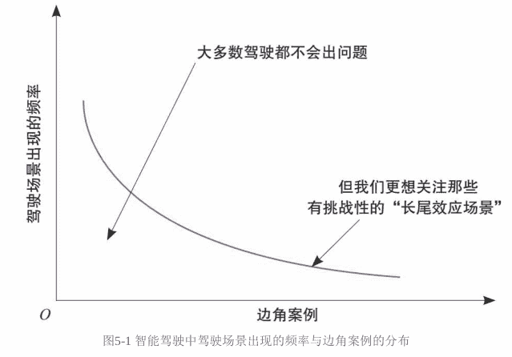

数据闭环的核心在于算法数据驱动以及持续有效利用数据。

图 5-2 为整体流程，主要模块包括数据采集、真值处理、数据管理、预处理与标注、模型训练、管理、评测与部署。车辆采集真实场景数据并通过车载真值系统生成障碍物的真实结果，数据存入管理平台。经预处理挖掘后回传平台，按感知任务标注，真值再次入库。按驾驶功能需求选取真实数据训练模型，模型存入模型管理平台。模型经评测后优秀者部署到车辆，车辆基于新模型采集新数据，完成闭环。

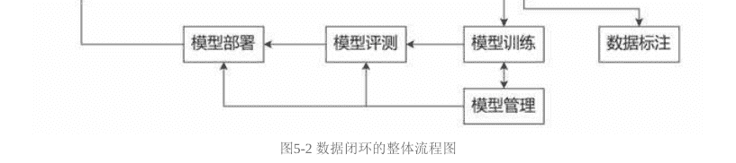

图 5-3 为具体部署方案，采用本地存储、云端计算的思路。主要数据流为：

（1）原始数据存储。本地搭建存储系统保存车队采集数据及真值系统处理结果，本地系统与亚马逊云端 S3 存储桶建立通道，可实时上传。

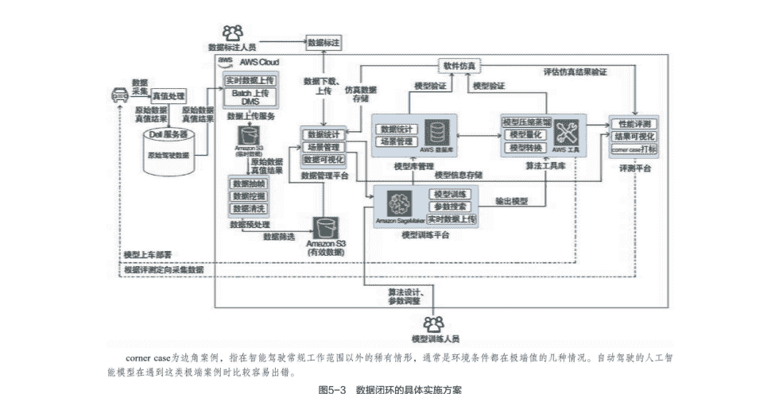

（2）数据上传。本地通过专线或代理网络将数据传至亚马逊 S3 存储桶。

（3）数据预处理。依托亚马逊 Kinesis 的实时分析能力，数据流可借助数据库或开源统一流批处理引擎 Apache Flink 进行在线计算，同时完成抽帧、挖掘、清洗等一系列前置处理。

（4）训练数据存储。经前处理筛选出的可用数据会写入 S3 桶，作为后续训练、评测等工作的统一数据源。

（5）数据管理。覆盖查询、统计、可视化与发布全链路。可按日期、场景、时段、天气等维度检索，统计不同场景与目标数量差异，呈现真值结果的可视化视图，并对外发布待标注数据集。

（6）数据标注。通过 Amazon SageMaker Ground Truth 实现自动化标记，也可引入第三方供应商完成人工标注，以构建高质量训练集。

（7）模型训练。Amazon SageMaker 将机器学习能力集成在网页端统一可视化界面，助力数据科学家与开发者快速完成数据准备、模型构建、训练与部署。

（8）模型存储。负责模型文件与训练日志的管理，重点记录训练全流程的开发轨迹，便于复盘细节。

（9）模型后处理。AWS Lambda 这一事件驱动的无服务器计算服务，可支撑模型压缩、量化、跨平台部署转换等任务。

（10）性能评测。支持开发周期内的模型评估，并协助测试人员生成测试报告。针对评测中出现的特殊场景，可由开发人员手动标注后发布新的采集需求，实现数据回灌。

（11）仿真闭环。真实采集数据为仿真提供标签支撑仿真数据生成，而仿真数据也能反哺算法评测，形成闭环。

### 四、虚拟数据如何成为智能驾驶的燃料
业内共识正在转向：对人工智能而言，技术门槛已不算壁垒，决定上限的是数据。ImageNet 超过一千萬张图，谷歌曾提出十亿级图像标签库。比数据更重要的，恐怕只有更多的数据。

#### （一）小数据带来的困境
训练样本不足时模型难以学到足够规律，容易出现过拟合；模型甚至会把噪声等无关信息学进去，陷入局部最优值 [1]，难以判断好坏。测试集同样稀缺，少量的对错就能显著影响结论。要破解这一困局，最直接的办法就是创造更多虚拟数据。

所谓生成数据，是通过程序化方式构建的数据集，并非来自真实调研或实验。其核心价值在于为机器学习提供实验素材，支持分类、回归、聚类等算法验证。期望的属性可以是数值型、二元型或分类型，特征数与样本长度可任意设定，最好具备随机性。用户应能调节统计分布，精确控制底层随机过程；用于分类时类别可分程度可控，噪声也可按需注入；回归问题则可采用复杂的非线性生成机制。常见做法包括人工规则设计与 GAN 等生成式方法。

#### （二）GAN 驱动的虚拟数据
自 Goodfellow 2014 年提出以来，生成对抗网络迅速成为深度学习热点。GAN 由生成器 Generator 与判别器 Discriminator 两部分组成。

整体思路是先输入一组希望模仿的真实数据并标记为真值 1，再把随机种子交给生成器 G 生成同维度的伪数据。将伪数据标记为 0 后喂给判别器 D，D 分别计算真假数据的误差并回传，促使 G 不断优化直至生成数据以假乱真，如图5-4所示。

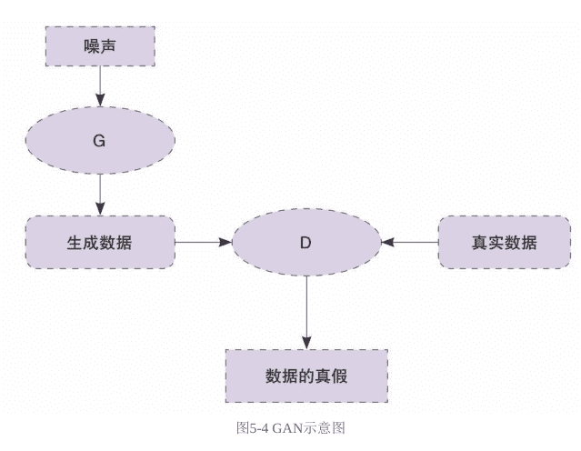

##### 1. 生成数据的优点
其一，降低对人工采集与标注的依赖，无需额外采集即可获得更多样的数据。比如用同一人不同发型、头部姿态训练，或按肤色、种族、骨骼结构合成不同面孔，提升模型鲁棒性。
其二，获取速度远快于真实数据，短时间内即可批量生产。尤其在依赖小概率极端路况的智能驾驶场景中优势明显，且合成时可自动标注，大幅节省标注成本。
其三，便于补充边缘案例。机器学习偏爱均衡数据集，补充深肤色面孔等稀缺样本可同时提升精度与公平性。合成数据还能覆盖数据匮乏或几乎不存在的边缘情况。
其四，规避隐私风险。医疗等敏感领域常涉及个人健康信息，合成数据不关联真实个体，有助于降低合规压力。

##### 2. 生成数据的缺点
其一，合成数据与真实数据分布存在差异，人工构造易引入偏差。
其二，针对性模型设计成本较高。
其三，难以客观衡量合成集与真实集的差距。

> [1] 局部最优值：解在特定范围或约束内最优，却不一定是全局最优。

## 第六章 车路协同重塑出行生态
### 一、车路协同的核心价值
#### （一）实现对交通管理的提升
通过智慧化道路基础设施，包含智能路侧终端、毫米波雷达、激光雷达、视频事件检测相机、边缘计算终端等，结合路侧通信单元与智能网联管理平台，实现路口参与者的实时检测、分类与统计。
智能网联云平台实时汇聚车辆运行与设备状态，支撑测试道路态势分析与远程控制，推动区域管控向智能化、网联化、精细化迈进。平台以信息技术为核心，融合信号、视频、车辆运行、设备监控等多源数据，经融合分析为管理部门提供决策支撑，实现信息共享、快速决策与统一管控，提升管理现代化水平 [60-62]。
智慧化应用如车辆超速检测、违停抓拍等，为决策提供数据依据。

#### （二）实现对交通安全的提升
部署智能化路侧设施后，可在交叉路口对行人、机动车、非机动车等运动目标进行跟踪与轨迹研判，并将结果推送至智能路侧单元 RSU 发布，为网联车辆提供安全预警。V2X 系统可实现信号引导、碰撞预警、拥堵提示、特种车辆提醒、行人碰撞预警等功能。

#### （三）实现对交通效率的提升
基于 C-V2X 的智能可变车道系统可根据实时交通状况动态调整可行驶车道，引导车流速度，缓解拥堵并提升通行效率。V2X 智能限速牌可随流量、事件变化动态调整限速值，经大数据评估实现合理限速控制 [63-64]。

#### （四）实现对交通服务的提升
智能交通信号系统实现车与信号灯联动，车辆在驶近路口前即可获知信号状态、倒计时与配时，提前决策。
智慧信息板结合 V2X 大数据实时发布路况、公告、违停、超速等信息，提高服务时效。
智慧车位检测系统通过 V2X 交互为网联车提示空闲车位并引导，并借助 V2X 管理平台实现停车场车位实时监控 [65-66]。

### 二、车路协同技术全景
单车智能在复杂场景受限，难以即时感知前方及后续路段、精确判断他车动态。随着车联网 IoV 与自动化计算传输加速，智能交通系统将车到车 V2V、车到基础设施 V2I 等连接方式串联，大幅提升行驶与通信效率与安全性，缩小传统汽车与智能汽车差距 [67-68]。

车联网是车辆自组网与物联网 IoT 融合的概念，描述车辆与其他路侧单元的交互，这些单元包括车辆、路边基础设施、行人、服务器等。

智能交通系统 ITS 作为智能汽车通信载体，可按城市道路、高速、潮汐路、公交路、生态路、匝道等定制路网，提供位置读取、信号灯智能调度、停车位动态分配与充电等功能。ITS 汇聚无线通信与传感探测技术，获取车路信息，通过车到车、车到路通信实现人车路一体化协同，核心目标是提升安全与通行效率并降低意外。

#### （一）车联网的通信类型和分层架构
如图6-1所示，ITS 中存在 V2V 与 V2I 两类基础通信，随着范围扩展，车环境交互愈发细化。

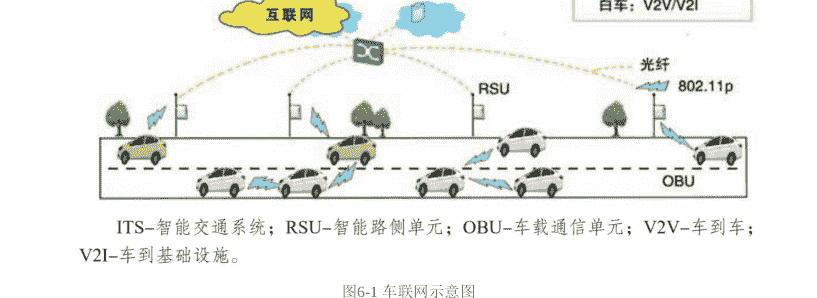
ITS-智能交通系统；RSU-智能路侧单元；OBU-车载通信单元；V2V-车到车；V2I-车到基础设施。
图6-1 车联网示意图

##### 1. 车联网通信类型
在车联网分类中，核心依赖五类通信，如图6-2所示。

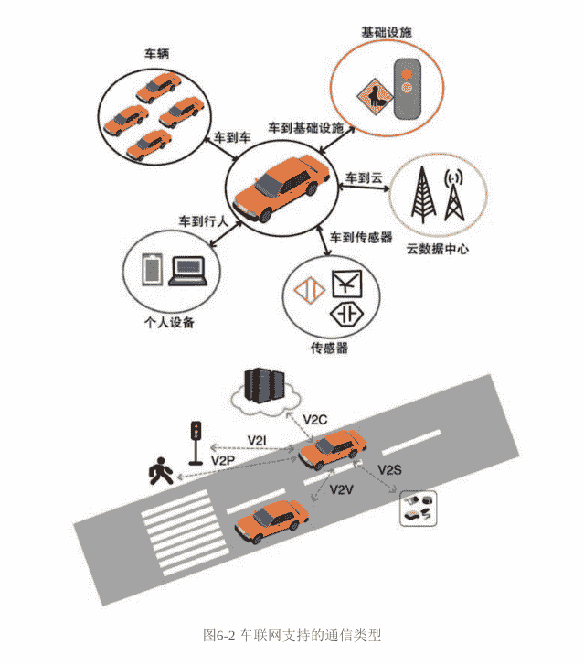
图6-2 车联网支持的通信类型
（1）车到车 V2V。自车与目标车间无线通信，交换速度、加速度、位置、方向等信息，要求低时延以提供近似实时的360°智能视野，用于辅助驾驶与快速传递碰撞等事件。
（2）车到基础设施 V2I。车辆与道路侧基础设施如标志、传感器、减速带、卫星、停车场、信号传感器交换数据，提供车流密度、变道意图、高速车辆等实时路况，提升安全与效率。
（3）车到行人 V2P。脆弱道路使用者 VRU 如行人、两轮车、骑行者与车辆间数据交换，需针对不同 VRU 的特性、速度与移动模式设计场景。
（4）车到云 V2C。基于云数据中心接收车辆数据、制定策略并决策。鉴于数据规模，边缘设备会先行分析再上传。
（5）车到传感器 V2S。用于感知的各类传感器如摄像头跟踪分类、激光雷达三维测绘与障碍探测，通过数据融合克服单传感器局限；众包数据如手机、PC 也被视为可测量输出。

##### 2. 针对车联网的分层架构
图6-3 展示了分层车联网通信模型，网络与数据广播间存在7层半透明关系，模型建立在用户与车辆界面之上，负责安全管理、交易授权与计费接口。

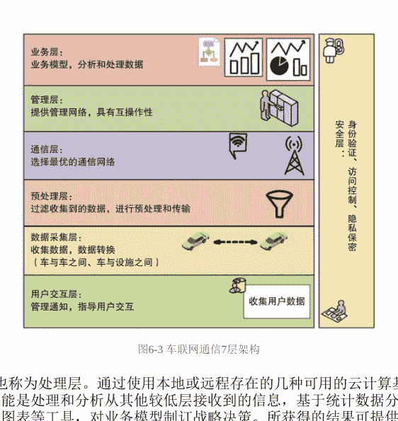
图6-3 车联网通信7层架构
（1）业务层。利用本地或远程云基础设施处理海量信息，基于统计分析与图表工具制定业务决策，结果可供给城市管理等机构用于基础设施与车辆对业务 V2B。
（2）管理层。统筹物联网环境中多网络服务提供商，涵盖交通管理、工程管理、检查与功能管理，确保信息以可管理格式呈现并兼顾互操作性。
（3）通信层。整合多种无线技术构建异构网络，需在相关性、安全、隐私、拥塞等约束下保持平滑连接，核心挑战是根据需求选择合适网络以维持服务质量。
（4）预处理层。针对设备产生的大量数据进行采集与过滤，保证网络中流通的是相关数据。
（5）数据采集层。采集与娱乐、安全、交通、驾驶员兴趣相关的数据，包括 GNSS、车身控制模块、道路信号、车间通信等。街道被划分为簇并由簇头转发，支持车内交互如蓝牙、Wi-Fi、ZigBee，以及车间交互 V2V、V2I、V2R、V2S、V2P，采用 IEEE 802.11p。
（6）用户交互层。提供路线、拥堵、停车可用性、事件警告等信息，并在危险时提示驾驶环境。界面设计需避免分心并满足驾驶场景需求。
（7）安全层。与各层直连，负责身份验证、访问控制、可用性等保障，降低安全威胁并处理隐私保密。

#### （二）车路协同系统设备组成
##### 1. 车端
针对 L4 智能驾驶、L2~L3 智能网联、L0~L2 存量车，分别以软硬终端车机、车辆智能服务终端、导航、小程序、移动 App 等方式实现数字化，如图6-4所示。

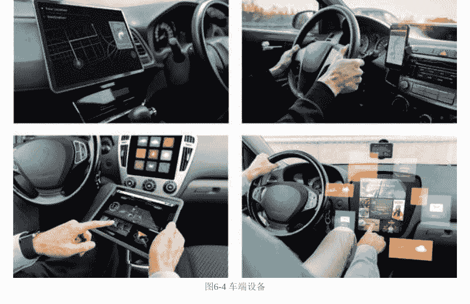
智能车载终端一方面采集自车运行状态，另一方面通过车车/车路交互获取周边目标、逻辑地图、道路基础设施、交通事件与路侧安全信息。辅助驾驶方面，终端基于上述信息进行计算，提供安全辅助、通行引导与信息服务；智能驾驶方面，终端对接决策系统提供感知支撑；智慧管理方面，终端实时上传运行信息并接收平台指令，实现远程跟踪与管理。未来逐步采用5G-V2X 并符合型号核准与一致性认证要求。

##### 2. 路端
智能路侧系统由感知单元与通信单元组成。感知单元含激光雷达、毫米波雷达、摄像头等，实现交通事件感知与数字孪生实时管控；通信单元部署于路侧杆件，与感知设备、信号灯、电子标牌、摄像头互联，实现车路互通与信号实时交互，形成智慧路口方案。本地部署人工智能计算设备完成事件识别判定，数字孪生边缘计算平台进行态势判断、警示生成与行为建议，如图6-5所示。

系统除车路交互获取车辆运行信息外，还具备感知分析、融合处理、边缘计算、信息发布与数据上传能力。支持多系统接入，实时感知道路、交通与运动目标状态，具备多源数据融合处理能力，可通过端到端专用短程通信与车载终端交互，通过光纤或蜂窝网络与区域控制器、网联云平台通信，并通过本地发布系统推送信息。

智能路侧平台向上对接管理中心，向下连接路侧基础设施、传感与发布系统。对管理中心实时上传动态目标、道路与交通信息并接收指令控制路侧设施；对基础设施可对接交通信号系统与差分定位基站，实现信号解析与必要反向控制，支持高精度定位；软件层面对接逻辑地图系统，满足辅助驾驶与测试需求；对传感系统可对接微波与视频传感并融合处理，为智能驾驶提供路侧感知支撑；对发布系统可对接可变信息标志，为普通参与者提供服务。

路侧智能网联设备的接口规划要为后续功能扩展预留空间，常用的物理接口包括 LTE-V 天线接口、RJ45 网口、GPS 天线接口以及 3G/4G 天线接口。整体方案采用即插即用设计，内置 LTE-V 通信能力。路侧终端已完成型号核准认证与互联互通一致性认证，符合国家相关标准规范。

##### 3. 边端
路侧单元与其控制中心会依据道路的复杂程度和车流规模，灵活选择单层部署、双层协同或全量覆盖的策略。以车流稀少的单条运营线路为例，路侧单元自身的融合算力足以支撑一定范围内所有车辆的动态信息需求，此时边缘融合任务可由远端的中心机房移动边缘计算节点承担；当路况复杂、交通量大时，则需要把边缘融合设备下沉到路侧。

路侧单元先把摄像头图像、传感器点云与高精度地图进行首次融合，生成局部动态地图后上报移动边缘计算平台；平台再将各 DRSU 产生的局部地图整合，形成整段路线的动态地图。车载终端解析该全路段地图后即可提取可用路况。

边缘平台汇总旗下多个路侧单元上传的结构化数据，经融合计算可生成车道级交通事件，例如拥堵提醒、路面抛洒提醒、违法停车提醒等，并分别推送给车端和智能管理服务平台，实现秒级发现与告警，有效降低事件发生率、提升处置效率，从而提高城区道路整体的通行效率与安全水平。

随着智能网联汽车渗透率提升，自动驾驶线路与配套设施逐步完善，对算力、并发终端承载能力和复杂路线辅助规划的需求也在提高。边缘计算平台需对路侧单元传输的信息做二次融合，生成并下发全局结构化动态地图，为区内所有车辆规划自动通行路线，为具有优先通行权的车辆规划最短路径，实现区域自动调度。

##### 4. 网端
依托智慧汽车基础设施与信息基础设施一体化建设，推动交通专网与“天网”“公网”深度融合，加速车联网、5G、卫星通信等信息网络的部署应用，形成多网融合的交通信息通信网络，为业务提供广覆盖、低时延、高可靠、大带宽的通信服务。

##### 5. 云端
在数字化和网络化基础上，可实时生成秒级、厘米级的动态地图数据，通过数字孪生将地面无序交通转变为有序可控的数字交通系统，实现交通智能化。车路协同云管理平台负责接收车辆和智能路侧系统上报的信息，经边缘计算后推送给车辆。

智能网联平台能够精细感知宏观区域的交通状态、道路状态、动态目标状态信息，具备实时与历史数据分析能力，进而实现宏观交通流优化。部署时主要围绕地图可视化呈现、实时数据分析、历史数据统计、交通引导优化和管控指令发布展开，通过蜂窝网络技术与智能车载终端和智能路侧系统交互，同时通过有线通信技术如光纤与区域协同控制器互联互通。

智能管理服务平台融合拥堵、事件、施工占道、气象预警等信息，通过车载硬件终端、导航 App 以文字、图片形式发布给驾驶者，起到引导流向、缓解通行压力、减少交通事故的作用。

> [1] 数字孪生：充分利用物理模型、传感器更新、运行历史等数据，集成多学科、多物理量、多尺度、多概率的仿真过程，在虚拟空间中完成映射，反映相对应的实体装备的全生命周期过程。

### 三、V2X典型应用场景介绍

#### （一）前向碰撞预警
追尾可分为前车停车、前车减速、前车正常行驶三类。前车停车与减速又可细分为视线内和视线外两种子情境。

视线外情境需借助智能感知单元的远距离感知能力，及时探测到前方车辆停车或减速并通知后方，蓝车即使视野受限也能提前进行防碰撞规划。

#### （二）变道/超车辅助
蓝车视野受限，无法观测到前方红车和对向黄车，难以正确判断超车路线。智能感知单元凭借远距离感知可覆盖范围内车辆并进行初步推演，蓝车获取 DRSU 观测数据后即可做出正确规划。

#### （三）红灯预警
传统方案依赖自车视觉识别灯色，易受天气影响可靠性不足。智能感知单元方案直接对接交通管理部门信号灯系统，读取灯态并广播给周边车辆，使车辆能更早更快地进行合理规划，确保行驶更平稳。

#### （四）左转辅助
智能感知单元先感知左转/直行信号灯及对向来车信息，预测对向来车轨迹，再结合信号灯与来车信息将预测轨迹提供给蓝车，辅助其完成左转规划。

#### （五）高优先级/紧急车辆信号优先权车辆让行
智能感知单元探测到区域内出现高优先级或紧急车辆时，及时通知相邻车辆并给出避让建议。附近蓝车接收信号后可决定是否避让及如何避让。

图6-11 高优先级/紧急车辆信号优先权车辆让行场景

#### （六）异常车辆提醒
智能感知单元探测到附近车辆行为异常时及时发布异常提醒并提供规避建议。蓝车据此制定规避方案。

图6-12 异常车辆提醒场景

#### （七）车辆失控预警
智能感知单元实时监控周边车辆，发现失控迹象立刻发布失控预警并提供规避建议。蓝车根据预警信息和建议制定规避方案。

图6-13 车辆失控预警场景

#### （八）基于信号灯的车速引导
智能感知单元为车辆提供前方路口信号灯状态及切换时间服务，并给出合理车速区间建议，实现最佳燃油经济性和交通流量优化，提升驾乘体验。

图6-14 基于信号灯的车速引导场景

#### （九）前方拥堵提醒
依托远距离感知优势，智能感知单元为车辆提供前方拥堵提醒服务，并给出合理路线规划建议。

图6-15 前方拥堵提醒场景

#### （十）限速/限行预警
车辆进入弯道时可接收智能感知单元的限速预警；行驶至学校等限速区附近，路侧感知设施发出预警。接近燃油车限行、单双号限行、货车限行或时段限行区域、施工区附近时，智能感知单元同样发出预警。

（a）限速预警

（b）限行预警

图6-16 限速/限行预警场景

#### （十一）右转辅助
智能感知单元检测到人行横道为绿灯且无其他交通参与者时，建议红车右转。红车结合自身感知信息后完成右转规划。

注：车辆所在道路垂直方向过街人行道信号灯为绿灯。

智能感知单元在人行横道绿灯且检测到行人通行时，建议车辆停车。车辆结合自身感知后执行停车规划。

注：垂直方向人行道信号灯为绿灯，行人正南北向通过。

智能感知单元在人行横道红灯且仍检测到行人闯行时，建议红车停车。红车结合自身感知后执行停车规划。

注：垂直方向人行道信号灯为红灯，行人正在闯红灯。

图6-17 右转辅助且无交通参与者场景

图6-18 右转辅助且绿灯时行人过人行横道场景

图6-19 右转辅助且行人闯红灯场景

#### （十二）十字路口辅助
智能感知单元检测到人行横道绿灯且行人通行时，建议红车停车。红车结合感知信息执行停车规划。

注：垂直方向人行道信号灯为绿灯，两拨行人分别在两段人行道南北向通过。

图6-20 十字路口辅助场景1

智能感知单元在非本车道方向的人行横道绿灯且行人通行时，建议红车减速慢行。

注：本车道方向两个过街人行道信号灯为绿灯，两拨行人东西向通过。

图6-21 十字路口辅助场景2

智能感知单元在人行横道绿灯且行人通行，同时前方车道有人闯红灯时，建议减速停车。

注：车辆所在道路垂直方向过街人行道信号灯为红灯，行人正在闯红灯。

图6-22 十字路口辅助场景3

#### （十三）避障预警
智能感知单元感知到前方道路维修且邻近车道畅通时，建议蓝车变道绕行。蓝车结合自身感知完成变道规划；通过障碍后原车道恢复畅通时，设施建议快速变回。

智能感知单元感知到前方道路维修且邻近车道有来车时，建议蓝车减速停车。蓝车结合感知信息执行减速停车规划。

图6-25 避障预警场景3

#### （十四）突发预警
智能感知单元感知到行人横穿道路时，建议蓝车紧急停车。蓝车结合自身感知执行停车规划。

图6-26 突发预警场景

## 第七章 未来生活和智能驾驶
目前智能驾驶汽车主要承担安全高效送达乘客的任务。未来随高级别智能驾驶落地与智能网联技术发展，物联网、云计算、大数据、移动互联将渗透至汽车全产业链，汽车除手机外将成为另一大重要个人终端，连接用户生活。

### 一、智能互联，核心终端
汽车的重要属性是“连接性”，它是除互联网外连接人类生活的重要物理载体。正因如此，汽车将突破现有生态边界，依托大数据与云服务逐步融入智能交通、智能家居物联网等生态，形成端管云协同共生的融合生态，最终实现全场景智能。

#### （一）智能交通
智能交通是智慧城市的重要组成。5G普及推动智能驾驶向5G-V2X演进，通过专用通信技术扩大感知范围，缓解智能驾驶长尾效应。设想场景：车辆通过拥挤路口时，自行车从右侧盲区突然出现，车辆可提前收到前车预警及时减速；高峰期主干道拥堵时，路侧系统可通知后方车辆绕行并推荐最佳路径，提升整体通行效率。通过车路云协同，可有效提升智能驾驶的安全性、可靠性、稳定性，并提高交通效率。

#### （二）智能网联
物联网发展使家电、家居设备均可通过手机远程操控。汽车也将加入物联网阵营，凭借物理移动特性成为物联网关键终端。未来车辆或将与其他个人设备深度绑定，实现工作、生活、娱乐在车内融为一体。

#### （三）软件定义汽车
智能驾驶成熟后，软件成为核心差异点。OTA技术出现使车辆出厂不再是终点，车企需思考如何通过持续OTA新增功能、迭代现有功能，保持用户新鲜感，提升保值率甚至增值。

### 二、生活第三空间
家庭为第一空间，工作为第二空间，第三空间指二者之外。上班族大量时间在车内度过。高级别智能驾驶落地结合5G后，车内时间可被高效利用。

座舱可被高度个性化赋能。对上班族而言，车内即移动办公空间，支持日程同步、视频会议、文件处理、微型3D打印等；对追求个性与乐趣的年轻人而言，车内即娱乐空间，VR影院、全息厅、车载KTV、AR/VR游戏等潮流体验均可落地；对家庭出行而言，车内即学习生活空间，远程教学、语音授课、视频教学可让孩子随时学习。总体来看，高级别智能驾驶落地后，座舱将按用户需求灵活定制，真正成为人们的第三空间。

## 参考文献

- [1] 孙逢春. 电动汽车发展现状及趋势 [J]. 科学中国人, 2006 (8): 44-47.

- [2] 咸同庆. 最早的汽车：蒸汽汽车 [J]. 交通世界, 1994 (1): 29-32.

- [3] 杨忠敏. 汽车发动机的诞生和发展 [J]. 交通与运输, 2004 (2): 62-63.

- [4] 曹秉刚, 张传伟, 白志峰, 等. 电动汽车技术进展和发展趋势 [J]. 西安交通大学学报, 2004, 38 (1): 1-5.

- [5] 李克强. 智能网联汽车现状及发展战略建议 [J]. 经营者 (汽车商业评论), 2016 (2): 170-175, 15.

- [6] 陶明明, 张晓帆. 浅析智能驾驶技术的现状与未来发展趋势 [J]. 汽车实用技术, 2016 (11): 3-4.

- [7] 王田. 自动驾驶传感器技术 [J]. 汽车世界, 2020 (2): 16.

- [8] 党亚南, 田照星, 郭利强. 车载激光雷达点云数据处理关键技术 [J]. 计算机测量与控制, 2022, 30 (1): 234-238, 245.

- [9] 应欢. 低成本车载激光雷达系统设计 [D]. 合肥: 中国科学技术大学, 2014.

- [10] 杨艳, 高玉英. 智能网联产业链分析：激光雷达成关键部件 [J]. 汽车与配件, 2018 (18): 56-61.

- [11] 何松华, 郭桂蓉. FMCW毫米波雷达高分辨率目标距离像及其处理 [J]. 系统工程与电子技术, 1991, 13 (10): 33.

- [12] 祝彬. 国外毫米波雷达制导技术的发展状况 [J]. 中国航天, 2007 (1): 40-43.

- [13] 胡林慧, 惠坤龙, 杨博, 等. 超声波雷达测障装置的研究与设计 [J]. 数码世界, 2018 (7): 144-145.

- [14] 裴暑云, 谢强伟. 超声波雷达倒车系统的设计及其应用 [J]. 数字技术与应用, 2013 (8): 157.

- [15] 钱若愚. 车载ADAS传感器毫米波雷达解析 [J]. 汽车实用技术, 2020 (4): 26-29.

- [16] TI公司. 无人驾驶车辆：移动的传感器平台 [J]. 电子世界, 2015 (22): 12.

- [17] 郑继虎, 张庆余, 潘霞, 等. 定位自动驾驶领域的域控制器研究 [J]. 时代汽车, 2019 (9): 50-52.

[18] 冯晓辉，王哲，李雅琪. 智能驾驶领域发展态势与展望 [J]. 电子科学技术，2018（6）：26-36.

[19] 潘旭峰，马彪. 汽车电子控制系统的核心：ECU [J]. 电子科技导报，1996（8）：21-25.

[20] 王金强，黄航，郅朋，等. 自动驾驶发展与关键技术综述 [J]. 电子技术应用，2019，45（6）：28-36.

[21] 王艺帆. 自动驾驶汽车感知系统关键技术综述 [J]. 汽车电器，2016（12）：12-16.

[22] 崔硕，姜洪亮，戎辉，等. 多传感器信息融合技术综述 [J]. 汽车电器，2018（09）：41-43.

[23] 韩崇昭，朱洪艳，段战胜，等. 多源信息融合 [M]. 北京：清华大学出版社，2010.

[24] FAYYAD J, JARADAT M A, GRUYER D, et al. Deep learning sensor fusion for autonomous vehicle perception and localization: a review [J]. Sensors, 2020, 20 (15): 4220.

[25] 周文鹏，路林，王建明. 多传感器信息融合在无人驾驶中的研究综述 [J]. 汽车文摘，2022（1）：45-51.

[26] 胡昌振. 多传感器信息融合技术及其应用研究 [D]. 北京：北京理工大学，1996.

[27] VELASCO-HERNANDEZ G, YEONG D J, BARRY J, et al. Autonomous driving architectures, perception and data fusion: a review [C] //2020 IEEE 16th International Conference on Intelligent Computer Communication and Processing (ICCP). Cluj-Napoca, Romania: IEEE, 2020: 315-321.

[28] CHAVEZ-GARCIA R O, AYCARD O. Multiple sensor fusion and classification for moving object detection and tracking [J]. IEEE Transactions on Intelligent Transportation Systems, 2016, 17 (2): 525-534.

[29] FAYYAD J, JARADAT M A, GRUYER D, et al. Deep learning sensor fusion for autonomous vehicle perception and localization: a review [J]. Sensors, 2020, 20 (15): 4220.

[30] 刘经南，詹骄，郭迟，等. 智能高精地图数据逻辑结构与关键技术 [J]. 测绘学报，2019，48（8）：939-953.

[31] 贺文. 高精地图：自动驾驶商业化的“水电煤” [J]. IT经理世界，2017（14）：36-37.

[32] 訾璐，张江水，杨振凯，等. 高精地图交通要素对象化建模方法 [J]. 测绘科学技术学报，2020，037（6）：636-642.

[33] 刘经南，刘焱雄. GPS卫星定位技术进展 [J]. 全球定位系统，2000（2）：1-7.

核心文献速览

34. 马芮、董景新撰写的《GNSS/MIMU组合导航技术综述》发表于2007年《飞航导弹》第4期，页码42-46及62。
35. 马春艳、王国锋、詹丽娟等在2006年《全国第十二届空间及运动体控制技术学术会议论文集》中的论文《MEMS组合惯导系统研究》，页码185-189。
36. 张孝兵、周宣赤、夏云海等人于2017年《传感器技术与应用》第1期发表《基于GPS/MEMS惯性传感器的车载组合惯导系统的设计实现》，页码1-9。
37. SCHWARTING W、ALONSO-MORA J、RUS D在2018年《Annual Review of Control, Robotics, and Autonomous Systems》第1卷第1期发表《Planning and decision-making for autonomous vehicles》，页码187-210。
38. 王梓强、胡晓光、李晓筱等撰写的《移动机器人全局路径规划算法综述》刊于2021年《计算机科学》第48卷第10期，页码19-29。
39. 陈宝林著《最优化理论与算法》，2005年由北京清华大学出版社出版。
40. ROSENBERG A、HALLAK A、MANNOR S等人在线发表《Planning and learning with adaptive lookahead》，发表日期2023-01-18，访问于2023-03-06，链接https://arxiv.org/abs/2201.12403。
41. 宗长富、刘凯在2006年《汽车技术》第3期发表《汽车线控驱动技术的发展》，页码1-5。
42. 吴蒙、张飞铁、文桂林于2016年《计算机仿真》第33卷第12期刊登《无人驾驶汽车线控转向系统控制策略的研究》，页码163-168。
43. 熊璐、杨兴、卓桂荣等在2020年《机械工程学报》第56卷第10期发表《无人驾驶车辆的运动控制发展现状综述》，页码127-143。
44. 钱玉宝、余米森、郭旭涛等发表于2022年《科学技术与工程》第22卷第10期的《无人驾驶车辆智能控制技术发展》，页码3846-3858。
45. 刘向杰、周孝信、柴天佑在1999年《信息与控制》第28卷第4期发表《模糊控制研究的现状与新发展》，页码283-292。
46. WANG C Y、BOCHKOVSKIY A、LIAO H于2022年在arXiv上发布《YOLOv7: Trainable bag-of-freebies sets new state-of-the-art for real-time object detectors》，编号2207.02696。
47. MISRA I、GIRDHAR R、JOULIN A在2021年IEEE/CVF国际计算机视觉会议ICCV上发表《An end-to-end transformer model for 3D object detection》，页码2886-2897。
48. SAGAR A、SOUNDRAPANDIYAN R K在2021年于加拿大蒙特利尔举办的IEEE/CVF计算机视觉研讨会ICCVW上发表《Semantic segmentation with multi scale spatial attention for self driving cars》，页码2650-2656。
49. ZHOU J、TAN X、SHAO Z等在2019年第12届国际图像与信号处理、生物医学工程与信息学大会CISP-BMEI上发表《FVNet: 3D front-view proposal generation for real-time object detection from point clouds》，页码1-8。
50. JIANG Q、ZHANG L、MENG D的论文《3D vehicle object detection based on monocular vision and lidar fusion》收录于2019年《中国汽车工程学会年会论文集（1）》，由北京机械工业出版社出版，页码72-79。
51. 伍锡如、雪刚刚在2019年《智能系统学报》第14卷第04期发表《基于图像聚类的交通标志CNN快速识别算法》，页码670-678。
52. 蒋芸、张海、陈莉等于2019年《计算机工程与科学》第41卷第11期发表《基于卷积神经网络的图像数据增强算法》，页码2007-2016。
53. 吴天雨、许英朝、晁鹏飞在2020年《激光杂志》第41卷第5期发表《一种提高目标图像识别准确率的数据增强技术》，页码96-100。
54. 王新成著《高级图像处理技术》，2001年由北京中国科学技术出版社出版。
55. INOUE H在线发表《Data augmentation by pairing samples for images classification》，发布于2018-04-11，检索于2023-02-06，链接https://arxiv.org/abs/1801.02929。
56. SUMMERS C、DINNEEN M J在2019年于美国夏威夷举办的IEEE计算机视觉应用冬季会议WACV上发表《Improved mixed-example data augmentation》，页码1262-1270。
57. TAKAHASHI R、MATSUBARA T、UEHARA K在《IEEE Transactions on Circuits and Systems for Video Technology》2020年第9期发表《Data augmentation using random image cropping and patching for deep CNNs》，页码2917-2931。
58. ZHONG Z、ZHENG L、KANG G等在线发布《Random erasing data augmentation》，时间2017-11-16，访问时间2023-02-06，链接https://arxiv.org/abs/1708.04896。
59. 梁观术、曹江中、戴青云等申请的专利《一种基于GAN的数据增强的无监督商标检索系统及方法》，专利号CN111274429A，授权公布日2020-06-12。
60. 张杰在2020年《中兴通讯技术》第26卷第1期发表《C-V2X与智能车路协同技术的深度融合》，页码19-24。
61. 李凯旋于2019年《中华建设》第5期发表《智慧城市: 车路协同技术对智能交通管理的贡献与影响》，页码85-89。
62. 王建强、李世威、曾俊伟在2011年《计算机技术与发展》第21卷第12期发表《车联网发展模式探析》，页码235-238。
63. 程刚、郭达于2011年《移动通信》第35卷第17期发表《车联网现状与发展研究》，页码23-26。
64. 吴冬升、王传奇、金伟等在2020年《电信科学》第36卷第4期发表《高速公路5G智能网联技术、方案和应用》，页码46-52。
65. 赵福全、匡旭、刘宗巍于2016年《科技进步与对策》第33卷第17期发表《面向智能网联汽车的汽车产业升级研究: 基于价值链视角》，页码56-61。
66. 宋娟在2016年《软件和集成电路》第1期发表《“互联网+”背景下的智能网联汽车》，页码36-37。
67. 戴一凡、李克强于2015年《汽车制造业》第18期发表《智能网联汽车发展现状与趋势分析》，页码14-17。
68. 陈荆花、黄晓彬、李洁在2016年《电信技术》第5期发表《面向智能网联汽车的V2X通信技术探讨》，页码24-27。
69. PROTZMANN R、SCHUUNEMANN B、RADUSCH I在2010年于美国新泽西举办的IEEE车联网会议上发表《The influences of communication models on the simulated effectiveness of V2X applications》，页码102-109。
70. 王莹、叶雷于2015年《电子产品世界》第22卷第8期发表《ADAS和V2X技术市场走势》，页码10-14、17。
71. 董馨、南洋、陈博等在2020年《汽车文摘》第5期发表《C-V2X应用场景的算法建模及评价模型综述》，页码13-17。
72. 戴方、马锋于2018年《中国新通信》第20卷第19期发表《V2X的应用场景介绍》，页码99。
73. 屈艺多、胡琳在2019年《电子技术与软件工程》第11期发表《智能驾驶技术的现状与未来发展趋势》，页码243。
74. 赵鹏、胡梅娟于2022年《瞭望》第24期发表《发展车路云融合的智能网联汽车》，页码14-17。
78. 王保东在2022年《时代汽车》第7期发表《智能座舱的前世今生和未来》，页码167-168。