# 掌中AI：自然语言处理

## “口袋里的人工智能”丛书编委会

总顾问 戴琼海

主任 陈俊龙 王桂林

副主任 弓鸿午 吴汉荣 严奉强

委员 按姓氏笔画排列

马晶 王蕾 车文荃 史颖欢 刘伟 杜卿 李姝萌 沈文浩 张通 张小川 罗子章 郭继舜 谭明奎

丛书总主编 陈俊龙

执行总主编 车文荃

## 《自然语言处理》

主编 谭明奎 杜卿

副主编 朱金辉

## 序言

时代在加速迭代，日常形态不断刷新，一连串令人意外的拐点接踵而至。我们自以为熟悉的事物，正在悄然变得陌生。

> —— [美] 约翰·冯·诺依曼

技术浪潮此起彼伏，智能的火花遍地开花。AlphaGo 与世界顶尖围棋手对弈、蓬勃发展的无人驾驶、已融入居家的智能设备，无不宣告智能化时代的到来。在大数据、云计算、边缘计算与移动互联网的共同加持下，人工智能凭借多样的落地场景，不断重塑工作与生活方式。它不仅是引领未来发展的战略性科技，更是推动新一轮科技与产业变革的核心动力。

AI 具备强溢出与领航效应，能赋能百业，在全球科技版图中占据关键位置。《中华人民共和国国民经济和社会发展第十四个五年规划和2035年远景目标纲要》明确提出，要推动人工智能与各产业深度融合。得益于移动互联网、大数据、云计算等领域的积累，我国人工智能已走过理论积淀与平台搭建的准备阶段，进入产业赋能期，机器视觉和自然语言处理达到世界先进水平，智能驾驶与生物化学交叉领域也取得良好效益。为落实《新一代人工智能发展规划》，2022年7月，科技部等六部门联合印发《关于加快场景创新以人工智能高水平应用促进经济高质量发展的指导意见》，提出围绕高端高效智能经济培育、安全便捷智能社会建设、高水平科研活动、国家重大活动和重大工程打造重点场景。场景创新将进一步提升AI赋能百业的质效，也让公众获得更深入、更便捷的体验。面对AI的快速演进，做好科普是每一位从业者的责任。顺应国家对新时代科普的新要求，构建社会化科普格局，普及AI知识势在必行。

基于此，广东科技出版社牵头组织“口袋里的人工智能”系列丛书编撰出版，邀请华南理工大学计算机科学与工程学院院长、欧洲科学院院士、欧洲科学与艺术院院士陈俊龙教授担任总主编，目标是打造让更多人认识人工智能的科普丛书。丛书聚焦AI场景应用，既涵盖机器视觉、自然语言处理、计算机博弈，也关注智能驾驶、化学与生物、智慧城轨、医疗健康等热点领域。

丛书共9册：《千方百计》《智能驾驶》《机器视觉》《AI化学与生物》《自然语言处理》《AI与医疗健康》《智慧城轨》《计算机博弈》《AIGC妙笔生花》。从科普视角，用通俗简洁全面的方式介绍AI关键内容，把握行业痛点与发展趋势，分析融合优势与挑战，既为公众了解AI提供便利，也为相关从业者提供参考。同时，丛书有助于提升青少年对科技的兴趣，引导更多年轻人投身科研，勇敢面对未知与挑战，拥抱变革、敢于创新，体现了编委会与出版社的社会责任与担当。

这套丛书既展现AI对社会发展和人民生活的积极作用，也探讨其带来的伦理议题。技术进步必须以人为本，不能缺失对社会应用的伦理审视，需设置必要的安全阀，确保技术与应用健康发展，构建和谐幸福的智能社会。

科技浪潮迭起，智能生机盎然。AI大幕已徐徐展开，新时代已然来临。正如冯·诺依曼所言，未来充满变数，让我们共同创造新的未来，期待崭新的明天。

戴琼海

中国工程院院士

2023年3月

## 第一章 对话启航：自然语言处理的崛起

AI的加速推进正重塑人类社会生活。2017年国务院发布《新一代人工智能发展规划》，旨在把握发展重大战略机遇，构筑先发优势，加快建设创新型国家和世界科技强国，明确了新一代AI的顶层设计与总体路径。AI已成为国家科技战略研究方向，是国际竞争新焦点、经济发展新引擎，为社会建设带来新机遇，获得全行业瞩目。

1956年被视为人工智能元年。当年美国汉诺威小镇达特茅斯学院，人工智能之父约翰·麦卡锡、认知学专家马文·明斯基、信息论创始人克劳德·香农、计算机科学家艾伦·纽厄尔、诺贝尔经济学奖得主赫伯特·西蒙等学者聚会，探讨以机器模仿人类学习与其他智能的乌托邦式命题。

此后，人类对机器的幻想从未中断。《星球大战》里的R2-D2与C-3PO、动画里的铁臂阿童木、《芬奇》中遵循遗嘱照顾小狗的机器人Jeff，都寄托着人们对善良与率真的期待；而《黑客帝国》里的Matrix掌控近乎整个人类世界，《变形金刚》则以“外星制造”诠释AI的吸引力与未知魔力。这些机器或人形或动物或卡通，与人关系亦师亦友，也常化身仇敌。细看会发现，智慧机器人大多具备与人类自由对话的能力。赋予机器人人类语言能力的正是自然语言处理，简称NLP。它由自然语言理解NLU和自然语言生成NLG组成，是AI研究的核心任务之一，帮助计算机用人类语言交流，并提供阅读文本、听语音、解释语音的能力，缩小人机沟通差距。

无论从事何种职业，你可能已在使用NLP而不自知。搜索引擎帮用户在互联网查找信息，各大电商、通信、银行保险推出的智能客服，国际旅行的翻译软件，电子邮箱的垃圾邮件自动过滤，都是NLP赋能各行业的体现。你或许会好奇计算机内部如何处理自然语言，也会意识到NLP在生活、工作、学习中的巨大作用。欢迎来到NLP的世界！

### 一、沟通范式：自然语言与机器语言

语言是人类传承文化、传播知识、交流思想的工具。计算机诞生后，为其操作设计了指令集，通过预编指令序列控制自动运行。随着自动化提高，指令集愈发复杂规范，编写成为专业任务。计算机学科中，把指挥运行的指令集形象称为“计算机语言”，即机器能懂的话。用计算机语言写出操作命令序列的过程就是编程，简称编码。与此相对，传统意义上人类交流的语言被称为“自然语言”。

计算机语言搭建了人机沟通的桥梁，但因其为机器设计，使用符号、语法和规范受硬件结构、零部件原理、信号传输等约束，系统抽象，不易人类学习。自由对话难以靠人学机器语言实现，于是让机器学习自然语言向人类靠拢。

若把人工智能比作从业者做老师向计算机传授人类智慧，自然语言处理就是其中教计算机学会人类语言的课程。学会这门课，计算机在服从专业编程之外，还能与普通人进行自然语言对话。这是类人智慧的重要标志，也是走进人类工作生活的必经之路。

1950年计算机科学之父艾伦·图灵发表《机器能思考吗？》，提出著名的图灵测试，以语言问答检测机器是否具备智能。测试中有提问者、回答者人和回答者计算机，提问者据回答判断谁是机器。显然，机器要通过测试需具备对语言的深度理解与灵活运用。2014年6月8日，聊天机器人尤金·古斯特曼成功让人类相信它是个13岁男孩，成为首台通过图灵测试的计算机，被视为AI发展进程的里程碑。

### 二、能力定位：NLP在AI中的位置

语言能力是人类天赋，AI最新进展、令人兴奋的新应用、更强大的智能技术在很大程度上与NLP进步相关。毕竟，机器若不能理解人类语言，就难称真正智能。

在AI与NLP技术领域，机器学习与深度学习常同时出现，有时几乎可互换。那么NLP与它们的关系是怎样的？

据“科普中国”审核定义，人工智能是研究、开发用于模拟、延伸和扩展人智能的理论、方法、技术及应用系统的技术科学。机器学习专门研究计算机怎样模拟或实现人类学习行为，以获取新知识或技能，重组已有知识结构不断改善自身性能。深度学习源于人工神经网络的研究，通过学习样本数据的内在规律和表示层次，使机器像人一样具备分析学习能力，能识别文字、图像、声音等数据。

从层次看，NLP与机器学习都属AI核心技术方法。但NLP结合人工智能与语言学，使计算机能分析用户所说的话并理解意图，弥合机器与人之间的鸿沟，实现无缝交流。机器学习的方法可为NLP研究提供技术手段。深度学习是机器学习的子集，是当前最受瞩目的方式。关系如图1-2所示。

### 三、演进脉络：NLP的历史轨迹

给机器上好NLP这门课并不简单。对人类而言理解自然语言似乎简单，但因人类语言复杂且主观，对机器而言却是相当困难的任务。机器既要理解自然语言文本的意义，也要兼顾词汇与句子的逻辑结构、上下文、对话角色等。因此NLP是多学科交叉的综合课程，运用计算机科学技术，涉及数学、统计学、电子工程学、语言学、生物学、心理学、哲学等多学科知识，一部分支撑软硬件与通信，另一部分解释人类大脑语言理解与生成的原理。

从计算机科学视角看，NLP技术发展时间线如图1-3所示。可分为20世纪80年代以前的基础研究期和之后的现代研究期。

#### （一）早期探索

NLP研究始于20世纪50年代，早期主要包括基于规则的方法和基于统计的方法。

##### 1. 符号规则路线

符号规则是指专家用小规模符号系统总结通用自然语言现象，开展形式语言理论与生成句法研究，该派研究者被称为符号派。诺姆·乔姆斯基1957年出版《句法结构》，认为所有语言底层逻辑或深层结构相同。各种语言的语法规则产生无限多样的词序与句子，“语言可看成一组句子，每个句子的长度及其基本结构成分是有限的”。在此基础上，乔姆斯基创建转换-生成语法与短语结构理论，并应用于早期机器翻译。乔姆斯基的理论回答了可用作程序语言的语言应具备哪些特征。美国计算机科学家约翰·华纳·巴克斯将乔姆斯基的语言学理论引入计算机编译技术，证实程序可用人类可理解的方式写出。若无计算机程序，则无今日各种编程语言。其中最具代表性的LISP由麦卡锡于1958年发布，是第一个函数式程序设计语言，至今仍在使用。

符号规则示例如图1-4所示。

现实中自然语言比编程语言复杂得多，人类语言多样、模糊且具创造性。符号规则需预先提取规则，实际场景中用一套通用规则处理自然语言问题往往困难。以下表达同一意思，你能用有限通用规则描述全部组合吗？要与人类对话，程序还需理解语法、语义、形态、语用，符号规则需跟踪的规则数量似乎太多。

- 我喜欢打篮球。
- 我热爱篮球。
- 我的爱好是篮球。
- 篮球是我最喜欢的运动。
- ……

##### 2. 概率统计路线

概率统计是基于对语言数据的观察和从数据中得出的统计信息，用数学方法计算语言表达某种意义的概率，取最可能语义进行理解，该派研究者被称为随机派。

经典例子是n-gram模型，20世纪70年代由弗莱德里克·贾里尼克提出。其原理假设句子中第n个词的出现只与前n-1个词相关，据此预测下一个词。n-gram可用来判断句子是否合理。实现方式是先对语料库句子概率分布建模，再根据n取值及给定上下文计算第n个词的概率，概率高的词为预测词。若预测词与实际词一致，则句子合理，否则可能存在更合理表达。图1-5给出简单示例。

P（w|h）表示在h出现前提下w出现的概率。比如P（鼠|老）代表“老”出现时“鼠”可能出现的概率。在语料库统计中，“老”出现在“老师”和“老鼠”中共4次，其中鼠出现3次，所以P（鼠|老）=3/4，即0.75。该示例分别对n取2和3进行概率计算，可见不同参数设定会导致不同预测结果，当前3-gram预测更合理。

这种预测下一个词的功能是否熟悉？它常出现在搜索提示或输入法的猜想中。输入检索词时，搜索框常以下拉菜单形式给出备选，这些备选就是用预测方法猜想用户实际想搜的词串。

从n-gram可看出统计模型特点：一是依赖用于学习的语料库，二是计算量大。受当时语料规模与计算能力限制，这一类研究早期处于弱势。

基于规则系统构建成本高、依赖专家知识，基于统计方法受限于高质量数据与计算资源。两种方法在20世纪六七十年代均很快遇到瓶颈。1964年美国国家科学研究委员会成立自动语言处理咨询委员会，任务是评估NLP研究进展。1966年NRC与ALPAC停止对NLP和机器翻译研究的资助，因多年投入后机器翻译效果仍远不及人工翻译，也没有计算机可进行基本人机对话。NLP研究被许多人认为进入“死胡同”。

#### （二）现代演进

##### 1. 机器学习浪潮

直到20世纪80年代NLP研究才逐渐恢复，这十余年AI进入新思想阶段。90年代万维网创建运行，积累大量数据供算法学习，基于统计的方法在网络文本巨大流量面前变得极有价值，NLP统计模型普及率急剧上升。得益于机器计算能力稳步增长和机器学习算法发展，以“香农信息论”为基本框架的大规模统计方法迅速成为主流，并取得显著进展。

与此同时，在语言大数据联盟推动下，语料库建设加速，研究者可获得大规模语言资源。这些语料库带有句法、语义、语用等不同层次标记，大大推动基于统计的机器学习研究与实践。

1997年神经网络模型被引入，并逐渐成为NLP研究与开发的前沿，随后NLP进入机器学习时代。2001年加拿大蒙特利尔大学教授约书亚·本吉奥与团队首次提出使用前馈神经网络的语言模型。2011年苹果公司Siri成为全球首个被普通消费者使用的成功NLP智能助手。在Siri中，自动语音识别模块将使用者的话转为文字，随后语音命令系统将文字与预定义命令匹配，启动特定动作。例如Siri提问“你想听音乐吗？”时会理解代表“是”或“否”的回答并据此行动。从2010年起，计算机硬件进步推动一系列更强大、更复杂机器学习方法出现，这些方法被称为深度学习，基于大数据的NLP技术实现以深度学习为基本框架的大跃迁，取得巨大进步。

通过机器学习技术，计算机程序可理解非结构化内容，并为NLP提供上下文信息，如同人脑，使用户说话模式不必与预定义表达精确匹配。通过使用神经网络并增加系统词汇量，NLP引擎可显著提高翻译准确性。训练有素的系统能理解“我在哪里可以获得人工智能的帮助”“我在哪里可以找到人工智能专家”或“我需要人工智能的帮助”等丰富表达，并提供适当响应。

虽然NLP不断涌现新方法，但并不意味着放弃旧方法。事实上基于规则、基于统计、基于机器学习三种方式当前均得到很好使用，首选取决于应用场景需求。然而当前AI仍面临许多问题与挑战，NLP研究任重而道远。

##### 2. 浅析生物神经网络

实现人工智能是长久以来的梦想。人类的智能如何产生？生物科学对大脑形态、结构与活动认知日益深入，但智慧生成过程依然知之甚少。这并不妨碍我们在计算机中模拟人脑结构来实现AI。我们做到了，且近年来进展神速。

人脑可以看作由约百亿个高度互连的神经元构成的复杂生物网络，分析和记忆、逻辑推理等认知能力正是源于这种网络。神经元之间凭借突触传递信息，突触的连接模式与强度会随学习发生改变，从而实现知识的保存。计算机在构建生物神经网络时，最早要做的是对单个神经元进行仿真。

神经元在接受输入刺激后会产生输出响应。我们可以用数学映射 Y = f(X) 来刻画这种输入输出关系，给定 X 即可算出 Y。下面以 Y = 2X 为例展示对应关系：

**当Y=2X时，输入X与输出Y的关系展示：**

| 输入X | 输出Y |

|---|---|

| 1 | 2 |

| 2 | 4 |

| 3 | 6 |

| 4 | 8 |

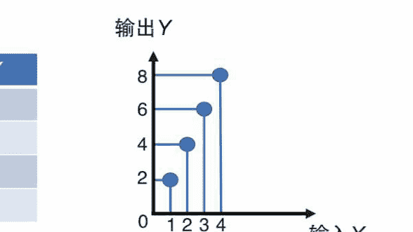

若把公式隐藏，只提供若干组 X 与 Y 的配对，你能否猜出背后的规律？图1-7 中的黑盒模型正是计算机对神经元的模拟，从输入输出的关联可以推断它属于线性模型，接下来要做的就是求出该线性模型中的参数 ω。已知的输入输出数据构成了神经元的训练集，每一对数据是一次学习样本。求参数的过程即为学习过程。训练完成后模型参数 ω 确定，就能用该神经元模型计算任意输入的输出，说明计算机从已知数据中学到了对未知输入的处理方式。

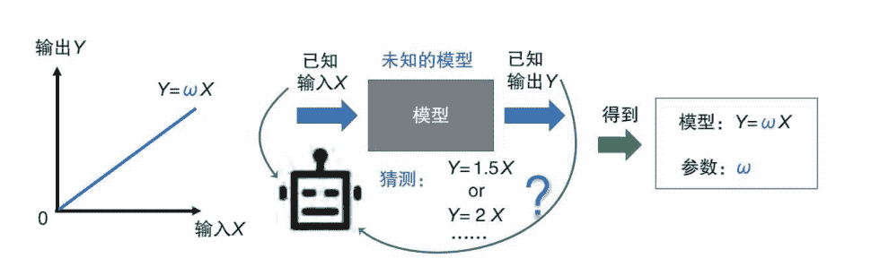

自然界中输入与输出的关系远比线性复杂，单一神经元难以刻画这些复杂规律。如果把数百上千、数万乃至上亿个“神经元”组合成“神经网络”，计算机的学习能力就会接近人脑。此时可处理的输入不再局限于数值，还包括文字、语音、图像、视频等多种形式。网络采用分层组织，从单层发展到多层，层数不断加深就形成了深度学习。

每个神经元内部隐藏着不同的计算模型，因而具备各自独特的信息转换能力。神经元越多，可求解的参数也越多。2021 年浪潮人工智能研究院发布的中文巨量模型“源 1.0”共包含 2457 亿个参数，数量惊人。计算机的强大智慧是无数微小神经元叠加的量变到质变结果。

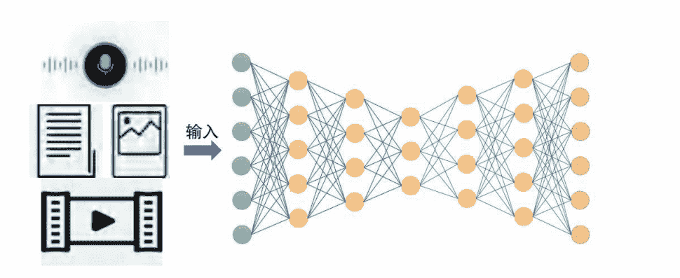

在神经网络中，求解参数不是直接解方程，而是通过反复训练逐步逼近。类似猜数字游戏：心里想好一个数，你去猜，猜错时会得到“大了”或“小了”的反馈，借助反馈不断调整下一次猜测，次数足够多就会越来越接近答案。神经元训练也是参数猜测的过程，从初始值出发，训练数据提供“离正确答案还有多远”的反馈，计算机据此持续修正参数，使模拟结果不断接近标准答案。

理论上，只要神经元足够多且训练数据足够丰富，计算机的智能可以达到甚至超越人类。现实中软硬件发展仍制约扩展：海量计算耗时，训练数据不足。工业界普遍缺乏带标注的语料，标注需要大量人力和财力，市场上难以支撑，因此数据稀缺比想象中更严重。

语料规模对神经网络性能影响显著。通常语料充足时，神经网络方法会超过基于统计的方法；语料不足时，其表现往往不如统计方法。

### 四、百宝箱
——自然语言处理工具

市场上存在诸多支撑自然语言处理的平台与软件包，各自面向特定目标、功能各异，单一工具难以解决全部问题，选择时需充分了解需求并匹配应用场景。

#### （一）NLPIR自然语言处理与信息检索共享平台
NLPIR 起源于汉语词法分析系统 ICTCLAS，即 Institute of Computing Technology Chinese Lexical Analysis System，是业界知名的汉语切分系统之一。其核心功能涵盖汉语切分、英文切分、词性标注、命名实体识别、新词发现、关键词抽取，并支持用户自定义词典与微博分析。

自 2009 年起，在原有基础上扩充为大数据语义智能分析系统，结合网络精准采集、自然语言理解、文本挖掘、网络搜索等 13 项技术，形成更专业的汉语处理平台，提供客户端工具、云服务及二次开发接口，推动汉语处理技术应用。

#### （二）Stanford CoreNLP
Stanford CoreNLP 由斯坦福大学自然语言处理研究组以 Java 实现。该平台目前支持汉语、阿拉伯语、英语、法语、德语、匈牙利语、意大利语、西班牙语 8 种语言。接收原始文本后进行切分、句段划分、词性标注、命名实体识别、句法分析、依存关系、指代消解等一系列处理，生成带标注的数据对象，并通过简洁的 API 供用户调用。

#### （三）NLTK
NLTK，即 Natural Language Toolkit，是一个免费开源的社区项目，由宾夕法尼亚大学计算机与信息科学系的 Steven Bird 与 Edward Loper 创立，是自然语言处理学习与研究中最常用的 Python 库，兼容 Windows、Mac OS X 与 Linux。它为 50 多个语料库和词汇资源如 WordNet 提供便捷接口，并提供分类、词性标注、词干抽取、句法解析、语义推理等文本处理模块，形成活跃的讨论社区。

项目作者还撰写了实践指南，讲解工具包背后的基本概念，帮助读者掌握 Python 编程、语料库使用、文本分类、语言结构分析等基础，适用于语言学家、工程师、学生、教育工作者和研究人员。NLTK 被称作进行计算语言学教学与工作的优秀工具。

#### （四）spaCy
spaCy 是面向生产环境的工业级自然语言处理工具包，擅长大规模信息抽取，帮助企业构建处理海量文本的应用。它是免费开源的 Python 库，支持 Unix/Linux、Mac OS 和 Windows，安装简便、API 高效，为词性标注、命名实体识别、依存句法分析、归一化、停用词等任务提供支持，常用于构建自然语言理解系统或为深度学习做文本预处理。spaCy 自带预训练模块，目前支持 60 多种语言的分析和训练。

不同模块在体积、速度、内存占用、准确率及数据覆盖上各有差异，取决于文本类型。与 NLTK 或 Stanford CoreNLP 不同，spaCy 不是以研究教学为目的，而是追求落地实践，设计上集成化且目标明确，避免用户在功能等价的算法间做选择，保持功能菜单精简以提升开发体验。自发布以来已成为行业标杆。

#### （五）中文语料库
语料库是自然语言处理研究不可或缺的材料库，由真实场景语言经分析、标注后形成，对语言学和自然语言处理研究至关重要，也是统计与机器学习方法的训练素材。

常用中文语料库包括北京大学语料库 CCL、新时代人民日报分词语料库 NEPD、宾州中文树库 CTB。

CCL 由北京大学中国语言学研究中心建设维护，收录现代汉语与古代汉语单语语料，时间跨度自公元前 11 世纪至当代。现代汉语约 5 亿汉字，涵盖文学、戏剧、报刊、译作、网络、应用文、影视、学术文献、史传、相声小品、口语等；古代汉语约 1.6 亿汉字，包含周至民国时期文献、大藏经、二十五史、笔记、十三经注疏、全唐诗、诸子百家、全元曲、全宋词、道藏、辞书、蒙学读物等。

NEPD 由南京农业大学黄水清团队在北京大学 1998 年人民日报语料库基础上扩充而成，是现代汉语通用语料库。以《人民日报》为来源，保证表达规范，可视为现代汉语学习的优质教材。

CTB 由约 150 万字中文新闻、政府文件、杂志文章、广播新闻与谈话、网络新闻组和网络日志的标注解析文本组成，共 3007 个文本文件，包含 71369 句、1620561 个词、2589848 个字符。

## 第二章 自然语言理解基础：语言学习小课堂

像学习汉语或英语一样，计算机理解自然语言也需要逐步积累字、词、句、篇的知识。语言学中，词法描述构词规则与规律，句法描述词语组合成句的结构，语义描述句内成分的意义关系，语用描述受情境影响的语义与上下文理解。自然语言理解中对应着词法分析、句法分析、语义分析、语用分析等任务，构成一个简化的标准流程，但实际处理往往需根据应用需求定制流程。

计算机对自然语言的处理主要基于文本输入，但传播方式还包括语音。广义的自然语言处理系统包含自动语音识别 ASR 与光学字符识别 OCR。ASR 将语音信号转为文本，OCR 将图像中的文字转为文本。本章侧重文本表示与文本处理流程，语音与文字识别将在第四章介绍。

对人类而言自然语言理解的子任务非常基础，但对计算机是困难重重的挑战。自然语言多样多变，每一种多样性都可能成为研究课题。

语音识别
文字识别
语用分析
结合上下文的句子实际理解
4
1
词法分析
分词及获取词语的意思
文本
表示
语义分析
句子的意思解析
3
2
句法分析
句子的语法结构分析
图2-1 自然语言理解的一般流程

### 一、机器的记忆
——文本表示

人类语言系统丰富，每种语言都有自身符号。进入计算机后首要任务是转化为可存储与处理的表示形式。文本表示是自然语言处理的基础，指原始文本在计算机内的最终形式，类似于人类记忆，通常按字、词、短语、句子等语言维度，用向量或矩阵表示。

规则方法常以规则编号与参数值构成的元组存储，例如（1，“不下雨”，“打篮球”）等，把词或短语填入规则即可生成句子。

统计方法下，文本表示如何构建？首先对语料库中的词进行编号，形成词表 V = {word₁, word₂, ..., word_v}。经典的“one-hot”独热表示把第 i 个词映射为长度为 v 的向量，其中第 i 位为 1，其余为 0。每个词对应一个仅含一个 1 的唯一向量，句子则由词向量构成的矩阵表示。这种方式把离散文本投射到欧式几何空间，每个词对应空间中的一点，便于计算点间距离来刻画词间关系。

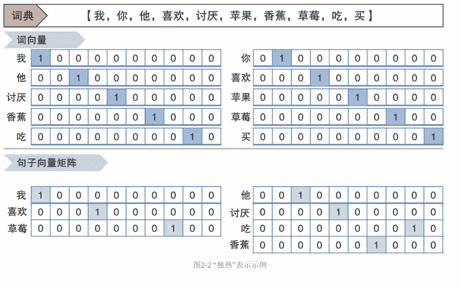

词量很大时，独热向量的维度会变得极高且稀疏，存储与计算负担沉重。为降低稀疏性，可把句子压缩为一个向量，用 1 表示词出现、0 表示未出现，形成 v 维二值向量，句子中出现多个词则向量中有多个 1。

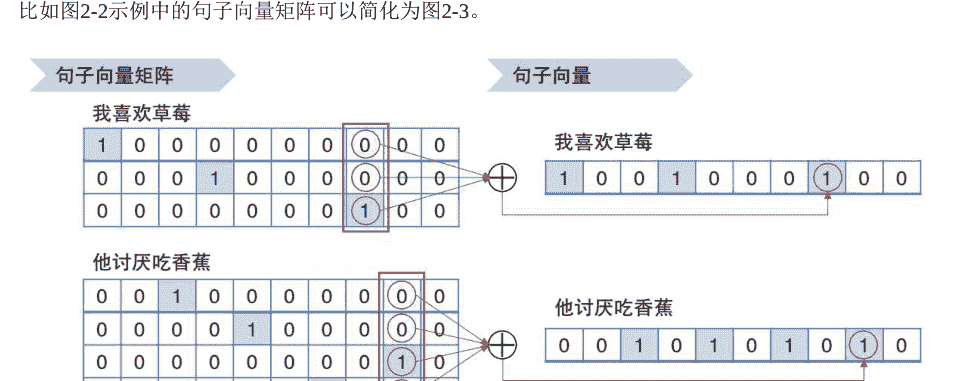

更进一步，出现次数信息被忽略会导致理解偏差。假设出现次数越多越重要，可把向量值改为词频，形成词袋模型，即词出现几次，对应位置取几。以图 2-2 的词典为例，词袋模型的句子向量如图 2-4。

此时高频词“我”“喜欢”占据主要位置，可推断句子与喜好相关且情感为正向。“我”出现多次但对语义贡献有限。于是“出现次数越多越重要”的假设值得商榷。诸如“我们”“的”“那么”“是”等高频功能词使用频繁却不含主题信息，在许多任务中作用有限。于是用权重代替计数来体现重要性，思想是：预测主题能力越强权重越大，反之越小，无用词权重为零。常见权重有：

词频 TF，表示词在文档中出现的相对频率，计算为词出现次数除以文档总词数，比绝对次数更能反映相对重要性。

逆文档频率 IDF，衡量词的普遍重要性，IDF(i)=log(N/DF(i))，N 为语料库文档总数，DF(i)为包含词 i 的文档数。词越普遍出现，权重越小，以减少通用高频词影响。

TF-IDF 为 TF 与 IDF 的乘积，同时考虑局部与全局特征。若某词在当前文档出现频繁且在其他文档稀少，则 TF-IDF 高，具备良好的主题区分能力。

图 2-5 给出 TF、IDF 与 TF-IDF 计算示例。可看出“中国”虽在文档中高频，但因在整体语料中普遍出现，区分度反而低；“火箭”的 TF-IDF 最大，最能体现主题。TF-IDF 计算简便，在文本表示与信息检索等领域应用广泛。

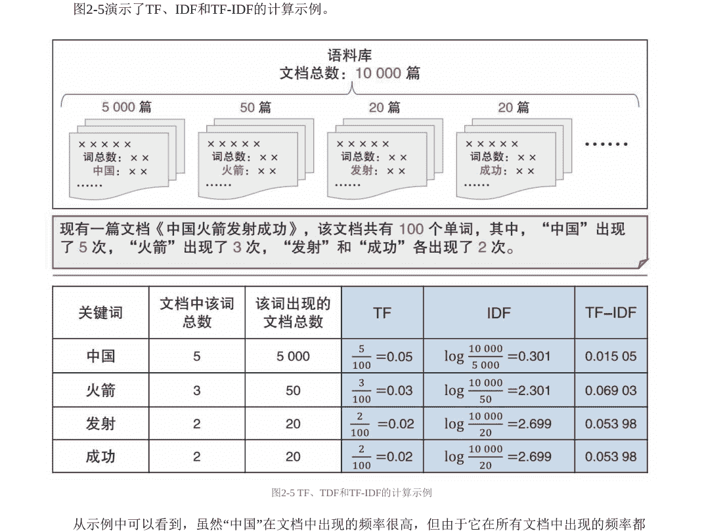

无论权重如何计算，以上方法都可归为向量空间模型，把语言理解转为空间向量运算。实践中发现，仅靠词频判断重要性过于片面，写作习惯差异或重要词出现稀少时，TF-IDF 提取的关键词可能不具代表性，且无法区分词序与位置。人类阅读中首句、段首或尾句词语往往更重要，而向量空间模型未考虑词序与上下文，词汇脱离语境会丢失语义信息。

# 当文本编码遇上复杂表达

对自然语言理解的诉求愈发严苛时，仅靠向量空间来刻画文本已力不从心，开放多变的实际语境很难被完整覆盖。若要触及文档的深层意涵，表示方式就必须容纳更丰富的语言内部线索。除了计数词频，还要纳入词出现的先后来序、具体位置以及词汇之间的语义关联。传统表征在大数据环境里对短信息的刻画也明显偏弱。社交媒体的一条产出往往兼具文字、发时、发者与受者等多重维度，单纯文本建模难以奏效；短文本本身偏口语、不规范、承载信息稀少甚至单一，歧义更容易被放大。所以短文本的建模需要朝着多维度融合的方向演进。

### 二、机器知词语——词法分析

进入词法层面，核心工作集中在切词、词性标注与命名实体识别。切词负责把输入打散，词性标注处在关键节点。词性是词汇最基本的语法属性，为每个词落定语法范畴，为后续的命名实体识别、句法解析、语义消歧等提供必要的准备。命名实体识别的职责是把文本里具有特定指称的词项例如人名、地名等抽取出来并打标，也是自然语言处理的重要手段。

#### （一）分词

读懂自然语言的第一步是把句子拆成独立的词项。英语借助空格分隔，看上去很便利，比如 “I speak English.” 可直接得到 I、speak、English 三个单元。但空格并不可靠。“What’s your name?” 按空格会得到 What’s、your、name，而 What’s 本质是 what 与 is 的缩合，实际包含两个词。标点与数学符号也会干扰切分，若把 “。” 当成分隔符，小数 12.3 就会被错误拆开，计算机需要更精细的判别逻辑。

中文、日语、泰语等内部没有分隔符，完全依赖算法。经典的中文切词方法为最大匹配。算法依托词典从句首字符起检索，以当前字为起点在词典里寻找以此字为首的最长匹配词项，匹配成功则输出，未成功则该字单独成词，随后从该词下一字重新开始，直至处理完整句。

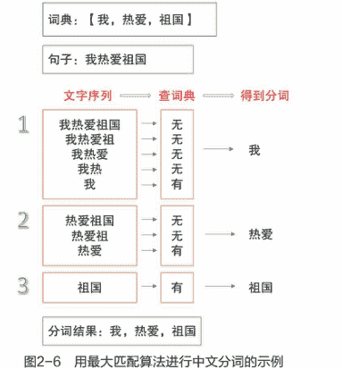

图2-6 用最大匹配算法进行中文分词的示例

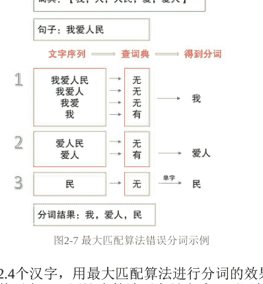

图2-7 最大匹配算法错误分词示例

最大匹配采纳贪心策略，切分失误难以避免。理想结果应为 我、爱、人民，而算法可能给出 我、爱人、民。切分失误会直接污染后续理解。算法同时高度依赖词典，词典未收录的新词就会导致错误。中文词长均值约 2.4 个汉字，最大匹配尚可接受；英文词长普遍更大，用此法更容易失效。不同语言的特性决定了自然语言理解的每一步都需要更适配的方法。

#### （二）词性标注

词性是对词在句中功能的归类，常见类型有名词、动词、形容词、副词等，类型中蕴含了词及其上下文的更多信息。句子由词性搭配合理的词构成，如主谓结构、主谓宾结构，主语与宾语一般为名词或代词，谓语一般为动词。

词性标注是指把标记符号自动赋予句子中的词，把句子转换为带标记的词表。因为牵涉句法结构，标注时需要参考前后词的信息。

例如，“我爱祖国” 标注后为 [ (“我”, “代词”), (“爱”, “动词”), (“祖国”, “名词”) ]。类似地，“妈妈的爱” 表示为 [ (“妈妈”, “名词”), (“的”, “助词”), (“爱”, “名词”) ]。注意词“爱”在两句中的功能不同，第一例为动词，第二例为名词。

计算机表征中，标记使用符号集。目前并无全球统一的词性标注符号集，不同平台可自行定义。表2-1 为 CTB 语料库的汉语词性标注集。

表2-1 CTB语料库的词性标注集 [11]

| 符号 | 词性 | 符号 | 词性 |

| :--- | :--- | :--- | :--- |

| VA | 谓词性形容词 | DEC | “的”作为补语标记/名词化标记 |

| VC | 系动词 | DEG | “的”作为关联标记/所有格标记 |

| VE | “有”作为主要动词 | DER | “得”构成补语短语 |

| VV | 其他动词 | DEV | 方式“地” |

| NR | 专有名词 | SP | 句末助词 |

| NT | 时间名词 | AS | 动态助词 |

| NN | 其他名词 | ETC | 等，等等 |

| LC | 方位词 | MSP | 其他助词 |

| PN | 代词 | IJ | 感叹词 |

| DT | 限定词 | ON | 拟声词 |

| CD | 基数词 | PU | 标点 |

| OD | 序列词 | JJ | 其他名词修饰语 |

| M | 度量词 | FW | 外来词 |

| AD | 副词 | LB | 长被字结构词 |

| P | 介词 | SB | 短被字结构词 |

| CC | 并列连词 | BA | 把字结构 |

| CS | 从属连词 | | |

引入 CTB 符号后，“我爱祖国” 标注为 [ (“我”, PN), (“爱”, VV), (“祖国”, NN) ]，“妈妈的爱” 为 [ (“妈妈”, NN), (“的”, DEG), (“爱”, NN) ]。表格看起来较为抽象，CTB 官方站点提供了标注集的解释和使用指南，其他平台也有各自的文档说明。

基于规则的词性标注是最早的方法。它要求词典包含每个词所有可能的词性标记，若一个词有多重词性，则通过规则根据上下文词性分配正确标记。

例如，若一个词前面是“的”，则该词倾向名词。回到前面例子：妈妈的爱，由于前面有助词“的”，规则将“爱”识别为名词。基于语言学研究可以制定全套标注规则，据此构建基于规则的词性标注工具。

基于统计的词性标注工具利用词在训练语料中各词性出现的频率或概率，为新句子中的词指定标记。这类工具常被称为随机标注工具。

简单说，随机标注依据词性频率指定标记。例如训练语料中“爱”出现 10 次，其中动词 7 次、名词 3 次，则新句子中“爱”默认指定为动词，显然不够可靠。

n-gram 统计模型也可以用于词性标注，通过预测标记序列概率来决定词性。一个词的最佳词性由前 n-1 个词的标记概率决定。比如“妈妈的爱”中，“爱”的词性需结合前面词的词性。若 n 取 2，则比较“的爱”即助词+名词与助词+动词的概率；若 n 取 3，则比较“妈妈的爱”即名词+助词+名词与名词+助词+动词的概率。该方法比单纯词频更准确，但对罕见句法仍脆弱。

词性标注也有机器学习和深度学习方法。对多数应用，n-gram 模型因简单高效、效果足够好而被广泛采用。

#### （三）命名实体识别

切词中的未知词识别是重要问题。不断扩充词典会降低匹配效率，而新词不断产生，网络上每天都有新词融入语言。无法在词典中穷举所有组合，因此对语言理解关键的专有名词需要专项管理，识别这些专有名词的过程即命名实体识别。通过命名实体识别可以抽取关键信息以理解文本内容，或仅用于信息抽取入库。命名实体识别是信息检索、问答系统、机器翻译等应用的重要基础工具。

研究中一般将命名实体分为三大类。第一类是文本中出现的各类实体，如人、物、组织、学科或行业名称等。第二类为时间类，第三类为数值类，如货币、百分数。它们虽非实体事物，也具有特殊标识意义。命名实体识别即在文本中找出表示这些实体的词或词组并标记，如图2-8所示。

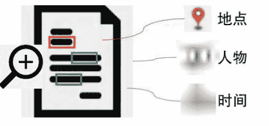

研究人员会按关注需求对专有名词分类、定义并对应标记。不同类别的命名实体内部特征不同，不能用统一模型识别，每种类型需提供相关训练数据。常见命名实体类别见表2-2。

表2-2 常见的命名实体类别

| 类别 | 说明 |

| --- | --- |

| 人 | 人（包括虚构的） |

| 团体 | 国籍、宗教或政治团体 |

| 建筑 | 建筑物、机场、公路、桥梁等 |

| 组织 | 公司、机构等 |

| 行政地点 | 国家、省（区）、城市 |

| 地点 | 山脉、水体等非行政地点 |

| 商品 | 物品、车辆、食物等（不包括服务） |

| 事件 | 飓风、战斗、战争、体育赛事等 |

| 作品 | 书籍、歌曲等 |

| 法律 | 被命名为法律的文件 |

| 语言 | 任何有名字的语言 |

| 日期 | 绝对或相对的日期/时期 |

| 时间 | 比一天更小的时间单位 |

| 百分数 | 百分比（包括“%”） |

| 金钱 | 货币价值（包括单位） |

| 数量 | 测量（如重量或距离） |

| 序数 | “第一”“第二”等 |

| 其他 | 不属于任意一种类别的新元素 |

命名实体识别方法经历了规则期、统计期到以深度学习为主的现代阶段。通用场景可使用平台工具，行业特定需求可与研究实验室合作定制开发。

### 三、机器识句子——句法分析

句法分析是自然语言处理的经典任务，也是语义分析的基础。其目标是分析短语或句子中各组成成分间的关系，即句法结构，也称语法分析。常见技术包括短语句法分析和依存句法分析。前者旨在发现词与词的层次组合结构，后者旨在发现词与词的二元依存关系。句法分析工具可自动推导句子语法结构并对语料进行标注。

#### （一）树库

句法分析结果常用树形结构表示。如图2-9（a）所示，树形结构从下到上清晰展示了词语—词组—句子的合成过程。

语料库中每个句子经句法分析并完成句法结构标注［图2-9（b）］后，形成的文本表示如图2-9（c）所示。所有语料标注后形成的新语料库称为树库。树库通常在已用词性标记注释的语料库基础上创建，可全手动由语言学家标注，也可半自动由工具解析后由语言学家校对修正。实践中全手动标注不现实，半自动校对仍是劳动密集型工作。按分析方法，树库可分为标注短语结构的树库和标注依存结构的树库。

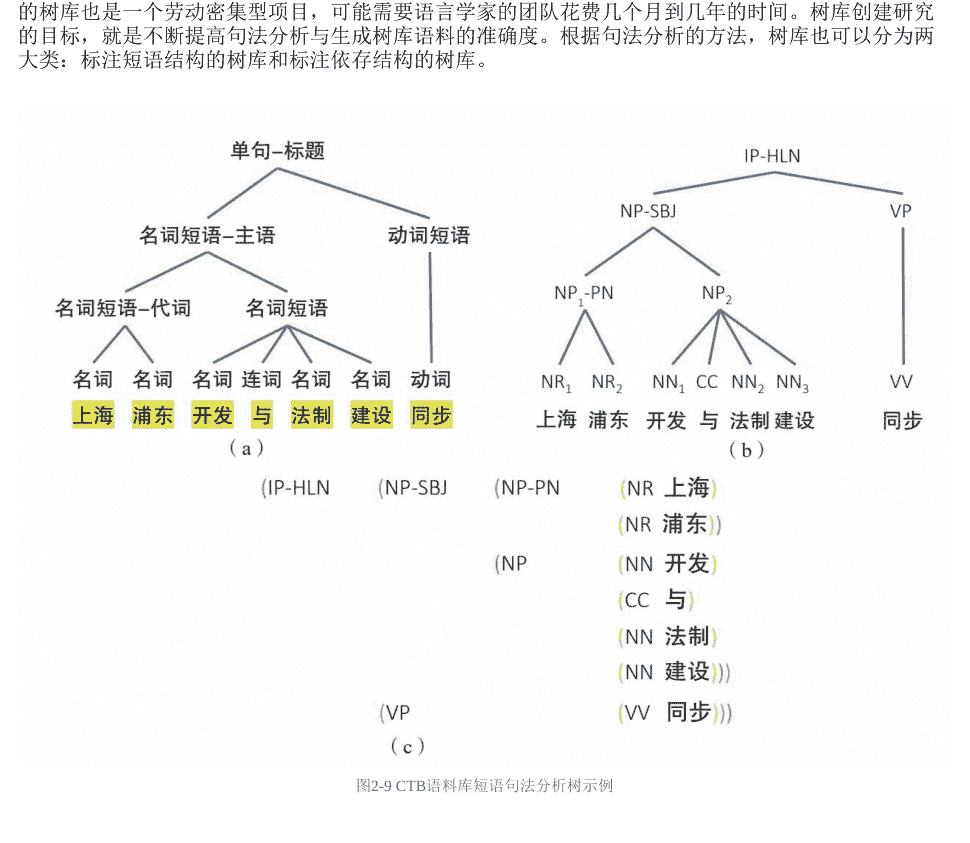

#### （二）句法分析技术

##### 1. 短语句法分析

短语句法分析基于短语结构对句子进行分析。首先把句子划分为动词性短语、名词性短语、介词性短语等，再用树形结构表示句子，图2-9（a）即为典型。

与词性标注类似，句法结构标注也需定义符号集。英文常用宾州树库，中文早期常用北京大学树库，表2-3 列出其 1997 年定义的短语句法分析标注集。

表2-3 北京大学树库短语句法分析标注集（1997）[12]

| 符号 | 描述 |

|---|---|

| np | 名词性短语，如：我们买的 漂亮的帽子 |

| nbar | 名词性准短语，如：工人们 资本主义 |

| vbar | 动词性准短语，如：看了一看 学过 |

| vp | 动词性短语，如：给他一本书 去看电影 |

| abar | 形容词性准短语，如：高兴 红了 |

| ap | 形容词性短语，如：特别安静 更舒服 |

| dp | 副词性短语，如：虚心地 非常 |

| pp | 介词短语，如：在北京 |

| bp | 区别词性短语，如：大型 中型 小型 |

| tp | 时间词性短语，如：战争初期 周末晚上 |

| sp | 处所词性短语，如：村子里 中国内地 |

| mbar | 数词准短语，如：一千三百 |

| mp | 数量短语，如：两三天 这群 |

| dj | 单句句型，如：她态度和蔼 那时候，天气还很冷 |

| fj | 复句句型，如：如果他愿意，我就陪他去看看 |

| zj | 整句，如：你去不去？火又盛，烟又大。 |

| jq | 句群，如：救命啊!救命啊! |

| dlc | 独立成分 |

| yj | 直接引语 |

在 CTB 语料库中，句法分析逐步合成短语并符号化形成语法树［图2-9（b）］，再用括号层次描述形成树库实例［图2-9（c）］。不同语料库标识不同，使用时需结合工具文档。

##### 2. 依存句法分析

依存句法分析基于依存结构对句子进行分析。依存结构描述句子中词与词的语法关系，将所有词语按依存关系连接起来即得依存句法树。依存语法认为词与词间存在主从关系，是二元不对等关系。修饰词为从属词，被修饰词为支配词，两者关系称为依存关系。

以哈工大 LTP 依存句法标注为例，句子“上海浦东开发与法制建设同步”的依存句法树如图2-10所示，标注符号见表2-4。

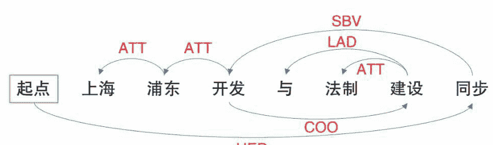

图2-10 哈工大LTP依存句法树示例

表2-4 哈工大LTP依存句法标注集 [14]

| 符号 | 关系类型 | 描述 | 示例 |

|---|---|---|---|

| SBV | 主谓关系 | subject-verb | 我送她一束花（我<- 送） |

| VOB | 动宾关系 | verb-object | 我送她一束花（送 ->花） |

| IOB | 间宾关系 | indirect-object | 我送她一束花（送 ->她） |

| FOB | 前置宾语 | fronting-object | 他什么书都读（书<- 读） |

| DBL | 兼语 | double | 他请我吃饭（请 ->我） |

| ATT | 定中关系 | attribute | 红苹果（红<- 苹果） |

| ADV | 状中结构 | adverbial | 非常美丽（非常<- 美丽） |

| CMP | 动补结构 | complement | 做完了作业（做 ->完） |

| COO | 并列关系 | coordinate | 大山和大海（大山 ->大海） |

| POB | 介宾关系 | preposition-object | 在贸易区内（在 ->内） |

| LAD | 左附加关系 | left adjunct | 大山和大海（和<- 大海） |

| RAD | 右附加关系 | right adjunct | 孩子们（孩子 ->们） |

| IS | 独立结构 | independent structure | 两个单句在结构上彼此独立 |

| HED | 核心关系 | head | 指整个句子的核心 |

依存句法树的存储格式与短语句法树不同，常采用 CoNLL-U 格式，为表格样式，共 10 列。

表2-5 依存句法树CoNLL-U存储表

| 序号 | 形式 | 词干 | 词性 | 本地词性 | 形态特征 | 支配词序号 | 依存关系 | 依存图 | 其他标注 |
每行对应一个词的属性。序号为词在句中的位置；形式为词面或标点；词干为原型，中文多与形式相同；词性为粗粒度语法标签；本地词性为细粒度词法标签；形态特征无分析时为空；支配词序号指向中心词；依存关系说明两者关系；依存图列出二级依存；其他标注记录附加信息。

| :--- | :--- | :--- | :--- | :--- | :--- | :--- | :--- | :--- | :--- |

| 1 | 上海 | 上海 | 名词 | NR | — | 2 | ATT | — | — |

| 2 | 浦东 | 浦东 | 名词 | NR | — | 3 | ATT | — | — |

| 3 | 开发 | 开发 | 名词 | NN | — | 7 | SBV | — | — |

| 4 | 与 | 与 | 连词 | CC | — | 6 | LAD | — | — |

| 5 | 法制 | 法制 | 名词 | NN | — | 6 | ATT | — | — |

| 6 | 建设 | 建设 | 名词 | NN | — | 3 | COO | — | — |

| 7 | 同步 | 同步 | 动词 | VV | — | 0 | HED | — | — |

### 四、机器明意思
——语义分析

语义学负责探寻语言所承载的意义，是语言学的重要分支。语义分析是自然语言处理中不可或缺的一环，在信息文本急剧膨胀的当下，从大量文字里挖掘可用价值已成为业务推进的关键。它让计算机读懂文本背后的意图并抽取有效信息，减少人工投入的同时提供数据支撑，对语音识别、信息检索、机器翻译、自动应答等场景产生直接作用。

语义分析在自然语言里大致可分成两层。第一层是词语层面的语义，需要弄清每个词在字典里对应的含义。第二层是组合语义，即词由单独认识到组合使用时产生的整体理解。单靠词义不足以把握全意。典型的例子是“我爱妈妈”和“妈妈爱我”，用词完全相同{我，爱，妈妈}，表达的指向却截然不同。组合语义借助组词方式来理解文本，按粒度又可细分为句级语义分析和篇章级语义分析。

要想精准把握句意，语义分析主要围绕两项任务展开，一是语义消歧，二是语义抽取。

#### （一）语义消歧

歧义在自然语言中十分常见，人类也偶有混淆。根据成因可归为词法歧义、句法歧义和指代歧义，多数情况靠结合上下文来化解。

词法歧义源于同一个词拥有多重含义，导致同一句话出现多种合理解释。比如“自行车没有锁”，“锁”可作名词理解为缺少锁具，也可作动词理解为自行车未上锁。借助词性标注可以削弱这类歧义。

句法歧义指句子的结构划分不同而产生不同理解，也称语法歧义。语言学家朱德熙曾举的“咬死了猎人的狗”就是经典案例，断句不同会形成动宾结构作定语，或定语加名词作主宾。

# 咬死了猎人的狗

图2-12 句法歧义示例

指代歧义涉及文本中已出现实体的再次提及，通常用代词或替代词指代。若读者无法确定代词指向，就会产生混淆。如“看到桌面上的书了吗？请把它拿给我。”中“它”指代不明。

图2-13 指代歧义示例

不同歧义的消解手段各异。词法歧义可借助词典法、统计法，并在词性标注、句法标注基础上处理。句法歧义与指代歧义则必须依靠语义理解。一类做法是用语义标注语料库训练模型，这类语料人工标注成本高。也有不依赖大量语料乃至完全无监督的方法，各有优劣，适用于不同场景。

#### （二）语义提取

人类读懂文本含义直觉而轻松，机器却需显式建模。语义提取即计算机在句子层面的语义理解。研究者提出语义角色标注方法，核心是以谓词为中心，找出与之对应的核心角色如施事、受事以及附加角色如时间、地点、方式等。该方法通常基于句法分析结果，例如哈工大LTP的依存句法树。标注一般按四步进行：
- 1. 在句法树中锁定核心谓词。
- 2. 搜集与谓词搭配的名词作为角色候选，命名实体识别在此发挥作用。
- 3. 剔除不可能成为语义角色的候选。
- 4. 确定角色类型并完成标注。

该方法的精度高度依赖句法分析质量，只关注句子成分与谓词的关系，属于浅层语义分析。

### 五、机器晓语境
——语用分析

语用分析把文本描述与现实世界对应起来，形成动态的表意结构。它包含四个要素：发话者、受话者、话语内容和语境。后两者指交际环境，包括上下文语境、现场语境、交际语境和背景知识语境。

符号学家查尔斯·莫里斯区分了语义学与语用学，前者关注词语的字面意义及其关系，后者关注说话者和听者基于语境做出的推断。语义学研究表达与意义的关系，语用学研究语境如何影响理解。

例如“你知道现在几点了吗？”字面是在问时间。若老师对迟到的学生说这句话，则实际表达的是不满。若学生直接报时，就说明没get到语境。

语用也会产生歧义：
- (1) 单身的原因有两个，一是谁都看不上，二是谁都看不上。
- (2) 女孩给男朋友打电话：“如果你到了，我还没到，你就等着吧；如果我到了，你还没到，你就等着吧。”

语用层面的处理需要现实世界知识、篇章或对话上下文、说话人的背景情绪等信息，已超出单纯规则或统计方法的范畴。语义分析和语用分析被视作自然语言处理的终极难题。

### 六、机器有感情
——情感分析

随着网络使用普及，用户在电商评论、社交平台和论坛上大量发表观点。通过分析网语言，可获得兴趣偏好、真实感受和倾向，形成用户画像。商家据此优化产品设计、售后服务和推广策略，相关部门可用于舆情监测、政策制定与宣传。情感分析让计算机从文字中感知喜怒哀乐，为心理、娱乐和情感陪伴类应用提供技术支撑，已成为NLP落地的重要方向。

#### （一）情感分析分类

情感分析最初是语义分析分支，后因融合心理学、人类学等视角逐步独立。主要研究包括情感倾向性分析、观点挖掘和情感分类。常见类型有：

（1）一般情感分析。分析用户对文档主题或目标实体的倾向极性，通常分为积极、中立、消极，或用评分量表衡量。粒度较粗，可归为文档分类问题。

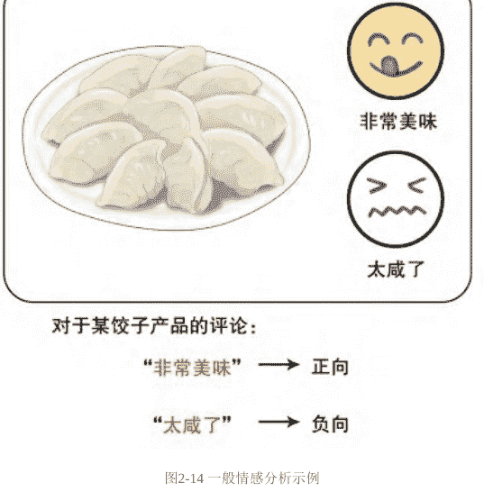

（2）基于方面的情感分析。电商平台常用的一种细粒度分析。评价往往多角度，例如对某款手机的评论“功能很强大，但是价格太贵了”。评论包含两个方面：功能为正向评价，价格为负向评价。流程先抽取评价方面，再定位表达该方面的情感词，最后判定极性。

（3）情绪检测。精确定位文档表达的具体情绪，如焦虑、兴奋、恐惧、担忧或愉悦。

对于评论“功能强大，但是价格太贵了。”

| 方面 | 情感词 | 情感 |
| :--- | :--- | :--- |
| 功能 | 强大 | 正向 |
| 价格 | 太贵了 | 负向 |

图2-15 基于方面的情感分析

#### （二）情感分析方法

基于情感词典的方法先量化词典中词语的情感值，分析文档时累加词语情感得分得到整体倾向。该方法使词语情感可操作，但依赖内容丰富、标注准确的词典，量化耗时且复杂。且未考虑词语间关系和上下文，情感值静态不变，忽略个体差异，难以处理讽刺等修辞。

其他方法包括基于规则、机器学习以及混合方法。

## 第三章
自然语言生成技术：语言课堂大考验

自然语言生成指为满足特定交流需求，从语言或非语言信息中产出有意义文本的过程。若自然语言理解是教计算机阅读，自然语言生成则是教它写作。设想一场考试，题目可分三类：题面是自然语言，答案为文本到文本生成；题面是一组数值，答案为数据到文本生成；题面是图像或视频，答案为图像到文本生成。答案形式可是一个词短语，也可是一句或多句对话，甚至完整篇章。

### 一、下笔如有神
——自然语言生成

无论数据源如何，生成任务可拆分为“写什么”和“怎么写”两个子问题。前者类似审题列提纲，决定要向读者传达哪些信息，与应用需求紧密相关。例如缩写句子和看图说话的答题思路完全不同。后者偏向语言选择，如选用何词、如何排序，更具通用性，可跨应用复用。

具体流程可分为四步。

#### （一）审题目
——内容确定

第一步是决定文本应包含哪些信息、剔除哪些信息。原始数据往往比所需表达更冗余详尽。足球比赛可采集每一次传球犯规，但新闻不会逐条描述；病人监护系统持续采集心率血压等数据，但只有异常时才需生成报告。系统需以应用目标为导向对数据进行过滤筛选。

#### （二）列提纲
——文本结构

确定信息后，需安排呈现顺序。足球报道通常先交代时间、地点、参赛队等基本信息，再描述具体事件。病人监护信号也按时间顺序生成报告。顺序安排即文本结构，目的是生成文本计划，将信息结构化、顺序化。文本计划比提纲更完整，会把所有待表达信息按序罗列。早期依赖专家规则，现在深度学习方法已广泛使用。

#### （三）写句子
——句子生成

##### 1.句子聚合

提纲确定后围绕其扩展句子，完成文字化。文本计划已较为详细，可通过改写描述信息。并非每条信息都需单独成句，合并相关信息能让文本更流畅自然，这一过程称为句子聚合。

例如描述女足球员张琳艳在2022中国足协女子超级联赛上演帽子戏法，可分述为第18分钟进球、第30分钟进球、第40分钟进球，表达冗余且不连贯。聚合后可写为“张琳艳在上半场连进3球”。聚合可发生在语义层面，如把有序异常信号归纳为特定病症，也可发生在语法层面，如前例的合并。聚合难以用严格算法定义，部分研究从语料中归纳规则，例如识别到两个句子平行动词短语相同，可省略第二个句子的主语。如“张琳艳在第18分钟进球。张琳艳在第30分钟再次进球。”可合为“张琳艳在第18分钟进球，第30分钟再次进球。”

##### 2.挑词语——词汇化

内容确定后将其转化为自然语言。同一事件有多种表达方式，得分可说“进球”，首球可说“首开纪录”，第二球“梅开二度”，第三球“帽子戏法”。选词复杂性受多种因素影响：多样性上，丰富用词更受读者欢迎；上下文约束上，“乌龙球”更适合失误进球；度量模糊时形容词选择需建立比较基准。再如观点、态度或情感立场也会影响词汇选择，拙劣的用词会导致对话机器人表达生硬。

##### 3.“它是谁”——引用生成

信息在上下文中贯穿时，需用引用替代重复实体。引用生成是为实体选择词语或短语标识其身份，目的在于区分。与词汇化相似，但更强调区分功能。

常见形式有代词、专有名称、其他描述。例如“小明养了一只小猫，他非常爱它。”是代词引用；“3名同学代表学校参加比赛，李明获得冠军。”是专有名称引用；“那边站着3个人，穿蓝色格子衬衫的就是你要找的人。”是其他描述引用。

当前研究集中在代词使用，对专有名词等形式探讨不足。若同类实体多个存在，需补充属性以明确指向。如要指出黄色球，若有两个黄色球，需增加大小属性“大的”或“小的”。

引用生成需遵循格赖斯的合作原则：信息量恰到好处。信息过多如“大的绿方块前的黄色小球”可能冗余误导；信息过少如“这个球”则难以识别。合适的组合能在区分度和简洁度间取得平衡。

描述实体仍存在多样性。一种思路是穷举实体的全部属性组合，选择能识别目标实体的最小属性集。

针对实体1进行指认，可用到的描述词有“黄色”“球”“小”，以及由此组合出的“黄色球”“黄色小”“小球”“黄色小球”。这些组合所包含的属性个数从1个到3个不等，其中“黄色小”能够单独锁定实体1，而“黄色球”同时匹配实体1和实体3，区分力不足。在所有能唯一指认实体1的属性集合中，单属性“小”是最简选择，相当于用尺寸来区分，这与格赖斯合作原则的思路相符。方法直观，编程实现容易得到最优解，问题在于穷举所有组合会带来巨大的计算开销，效率偏低。

第二种思路是贪心策略。追求尽快决策时，每轮挑选能一次性剔除最多干扰实体的属性。以本例来看，算法依然会先考虑尺寸，因为它直接排除了另外两个实体。贪心只关注当下的局部最优，所以在情境复杂时未必能找到全局最优答案。

前面两种方法对各种属性一视同仁，但在实际应用中，若想让系统更“人类”，还可以让它学会人类对特定信息的偏好。以本例而言，算法可能优先选择颜色而非尺寸，因为人类认知事物时通常对颜色更敏感，反应更快。

#### （四）交作业
——语言实现

经过前几个步骤的准备，最终文本要结合自然语言的其他表达要求进行生成。这个阶段称为语言实现，要完成的任务包括对句子成分进行排序，以及生成正确的形态形式。这个“实现”与自然语言种类密切相关。比如中文要考虑句子是把字句还是被字句，因为句型决定了词语位置；而英文要考虑时态语态，动词要进行相应形态变化。通常系统还需要插入虚词如助动词、介词和标点符号。

再用一个示例解释文本生成的过程。可以看到系统首先要确定数据中的重要事件 [图3-2（a），内容确定]，本例是发生低心率即心动过缓。然后它必须决定向读者呈现数据的顺序 [图3-2（b），文本结构] 以及如何在单独的句子计划中表达这些数据 [图3-2（c），句子聚合，词汇化，引用生成]。最后生成结果句子 [图3-2（d），语言实现]。

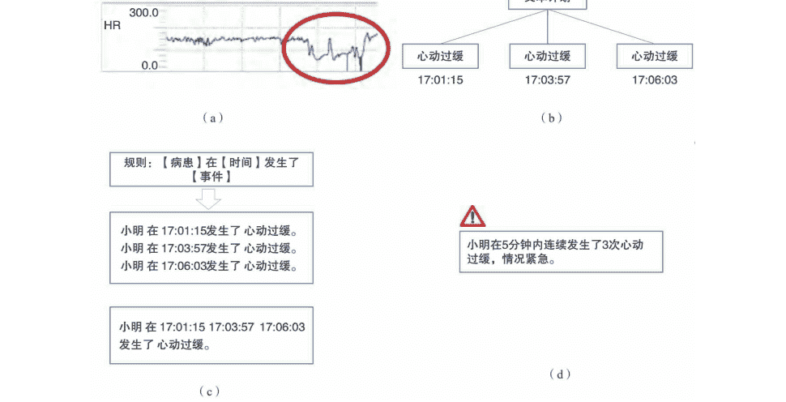

对多数人来说，写作在听、说、读、写四项里是最困难的学习任务。对计算机而言这项挑战也不容小觑。相比阅读理解，机器写作能力目前相对较弱，不过在一些特定应用领域，计算机写出的文本也足以以假乱真。接下来看看计算机具体如何应对各类题目。

### 二、增缩改写都拿手
——文本到文本生成

文本到文本生成存在于许多有趣的应用场景，比如：机器翻译实现了从一种语言到另一种语言的转化；名著或专著的简本制作使低识字率读者或儿童更容易阅读；WPS 文本编辑工具中的自动拼写、语法和文本纠正为使用者提供便利；小爱、小度、Siri 等机器人聊天软件为客户提供个性化服务。浪潮人工智能研究院研发的“源1.0”自2021年9月底发布以来受到广泛关注 [16]。“源1.0”目前能够生成多种高质量文本，如新闻稿件、故事续写、对话、诗歌、对联等。对于这些类别任务，其产出与人类创作的同类作品相差无几，甚至达到以假乱真的程度。“源1.0”在图灵测试中实现平均误判率高达50.84%（表3-1）！在图灵测试中，若机器让所有参与者平均误判率超过30%，则该机器通过测试，被认为具有人类智能。

表3-1 “源1.0”自然语言生成效果示例 [17]

| | 输入 | 人 | 源1.0 |

|---|---|---|---|

| 对话 | 我好心问你吃饭了没，你却骂我。 | 宝贝我错了，再也不敢了。 | 我又没骂你，是你自己对号入座。 |

| 诗歌 | 作一首七言诗。 | 塞上长城万里长，漫天风雪映重峦。边江水入人心去，满目青山绝照还。 | 满目青山夕照明，愿随江舟泛轻风。今生常忆多情事，香闺如梦领神会。 |

续表 [1]

| | 输入 | 人 | 源1.0 |

|---|---|---|---|

| 对联 | 上联：春来人入画，下联： | 福至梦开花。 | 夜半月当灯。 |

| 故事① | 起床穿衣，洗漱完毕后，我走下楼，心情愉快地向科芬道了早安。 | 尽管这家伙昨天跟我开了个不大不小的玩笑。酒吧里已经聚了很多人了，住店的客人都来了。昨天没来得及细看，今天一注意才知道，这些人绝大多数都是捕鲸者：大副、二副、三副；铁匠、木匠、铜匠；还有标枪手、守船人，不一而足。  他们的肤色一律黝黑，衣着随性，留胡须的人占了很大的比例。你可以通过他们的外表来判断他们在岸上已经待了多长时间了。瞧，这个小伙子，两颊赤红，像烤过的梨，他从印度洋回来不超过3天。他旁边那一位，颜色没他那么重，身上似乎有股椴木的味道，他上岸有一个星期了。有的人脸上只剩下一丝隐隐约约的热带的黄色了，他们在岸上肯定已经待了好几个星期了。不过，谁也不能通过魁魁格的面色来判断他上岸的时间。 | 却没想到，下一刻，我就受到了一个不应该出现在这里的人的冷待。那人穿着一身笔挺的深色西装，靠在车身上，一双灰蓝色的眼眸，充满了不满与敌意，打量着我。科芬几乎是立刻挡在了我面前，警戒地看着眼前的人，说道：“特里。”我眨了眨眼，大脑此时有些空白。我努力地思考，到底发生了什么事。这个人，应该是叫特里没错吧。他应该是莫里的哥哥，但是他为什么会出现在这里？他不是应该在中央星吗？他为什么要用这种眼神看着我？我小心地打量着特里，不明白他的敌意从何而来。“科芬，你先去上班吧。”我说道。“我知道了，林恩先生。”科芬看了特里一眼，一步三回头地走向悬浮车。我在心底叹息了一声，走上前去，伸出手，说道：“你好，特里，我是林恩。”特里面无表情地看了我一眼，伸出手与我交握。 |

| | 输入 | 人 | 源1.0 |

|---|---|---|---|

| 新闻 | 摘要：辽宁主汛期首日遭暴雨侵袭，当地多举措防洪涝灾害。正文：中新网沈阳7月22日电。 | 辽宁省22日进入主汛期，一场自西向东的区域性暴雨过程也随之而来。记者当日下午从辽宁省防汛抗旱指挥部获悉，该省已采取多项举措应对此次降雨过程，严防洪涝灾害的发生。据辽宁省气象部门介绍，从7月21日8时至22日14时，该省西部降中到大雨，局部大暴雨，其他地区降小到中雨。西部地区平均降雨量达65毫米，最大点雨量为葫芦岛地区要路沟站，达150毫米，100毫米以上点雨量站17处，50毫米以上点雨量站160处。 | 记者22日从辽宁省防汛抗旱指挥部办公室获悉，今年主汛期首日，辽宁遭到强降雨袭击，全省平均降雨量达39毫米，为历年同期最高。其中，沈阳、大连、鞍山、抚顺、本溪、丹东、锦州等8个市平均降雨量在40毫米以上，最大降雨量出现在本溪市，达70.5毫米。据辽宁省气象部门预测，22日夜间到23日，辽宁全省还将有一次大到暴雨。 |

总结起来，文本到文本生成主要有三类任务，即文本缩写、文本扩展和文本重写（图3-3）。

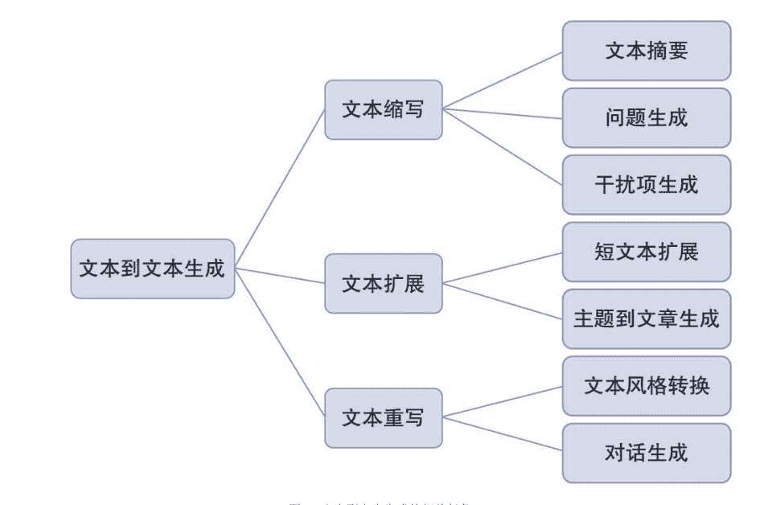
图3-3 文本到文本生成的相关任务

> [1] 故事出自19世纪美国小说家赫尔曼·麦尔维尔（Herman Melville）的小说《白鲸》。

#### （一）文本缩写

文本缩写任务旨在将信息从长文本压缩为短文本，在应用中体现为文本摘要、问题生成和干扰项生成。

文本摘要是生成全新短语和句子以诠释源文档含义的过程。如图3-4所示，文本摘要有两种经典生成方法：提取式摘要和抽象式摘要。两种方法区别在于，提取算法选择文档第一句话作为摘要，抽象算法使用文档中关键信息词如机构、位置等和新生成的词如“太多”共同形成摘要。

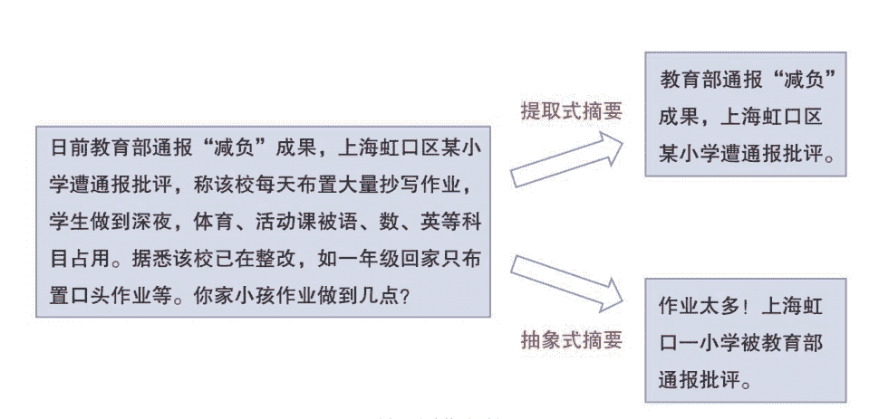

问题生成专注于为给定句子或段落材料中设定的答案自动生成问题文本，相当于“主动提问”的智能应用场景。

干扰项生成是根据素材自动为给定问答生成适当干扰项，以形成多项选择题。这两个任务多用于智慧教育场景，如智能辅导、题库构建等。

#### （二）文本扩展

文本扩展主要目的是将短文本扩展为包含更多信息长文本，具体分为短文本扩展和主题到文章生成。短文本扩展旨在基于一组长文档将短文本扩展为更丰富表示。主题到文章生成旨在根据一组给定主题，生成仿人类写作、多样化段落级甚至篇章级文本。

眼下，不少产品级“写手”陆续进入视线范围。“他们”都经历大量“培训”，只要给出关键词或一段简短描述，“他们”就能完成新闻时事、总结报告、故事、剧本甚至科学论文等各类文种写作。在一些测试中，优秀“写手”甚至能写出一篇高考范文。很多网友看了机器写出高考论文后直呼“连机器都考不过了！”。“他们”就是由人工智能加持文本扩展机器人。在人类文字写作领域，集创造性与艺术性、体例格式要求更严谨诗歌、诗词生成任务极具挑战性。在自然语言处理与人工智能长足发展、深度迭代之下，一些优秀写作机器人已晋升为“机器诗人”。2017年5月，微软互联网工程院推出人工智能机器人——微软写诗少女小冰，出版历史上第一部由人工智能创作诗集——《阳光失了玻璃窗》；2019年，又出版首部由人工智能与200位人类诗人联合创作诗集《花是绿水的沉默》。至此，诗歌创作已不再只是人类专利，华为推出人工智能作诗系统——“乐府作诗”，更是生成了在韵律、体例格式等方面更为严谨唐诗、宋词，甚至藏头诗。2017年，清华大学诗歌自动生成系统——“九歌”，参加名为《机智过人》科技类挑战类节目，并在录制过程中成功通过现场观众图灵测试。

> 卢浦斜晖里，西楼醉客行。
> 影侵双塔晚，灯落一城明。
> 空客还频顾，航灯未可惊。
> 空留城市夜，月映水帘星。
> 这首《夜过虹桥机场》，正是“九歌”笔下诗歌，它打动你了吗？这诗歌遵从韵律和营造意境等，能否让你感受到人工智能文字创作实力与魅力呢？

#### （三）文本重写

文本重写目标是将原始文本改写为另一种风格文字。主要包括文本风格转换和对话生成两个子主题。文本风格转换是在保持句子语义不变同时转换句子属性风格，如图3-5所示。对话生成旨在根据上下文给出系列符合逻辑且风格统一回应文本。以下为文本风格转换示例：

输入：谢谢。
输出（武侠小说）：多谢之至。
输入：再见。
输出（武侠小说）：别过。
输入：请问您贵姓？
输出（武侠小说）：请教阁下尊姓大名？

文本风格转换可以有很多不同情感类型。比如，我们可以把负面句子转换为正面句子。我们也可进行更多种类文本风格迁移，比如轻松和烦躁，男性和女性，年轻人和老人的风格互换（图3-5）。

| 轻松 | 晚饭后，坐在沙发上看《星球大战》。多么美好的夜晚！ |

| 烦躁 | 晚饭后，坐在电脑旁改报告。真是个糟糕的夜晚！ |

| 烦躁 | 在目的地前50米处收到超速罚单，这并不是我本月想要的开始。 |

| 轻松 | 先理发，然后吃一顿大餐，这是我本月想要的开始。 |

| 男 | 我得说胡子让你看起来像维京人…… |

| 女 | 我得说头发让你看起来像美人鱼…… |

| 女 | 好久不见，你越来越漂亮了！ |

| 男 | 好久不见，你怎么又胖了！ |

| 18～24 | 这首歌真好听，让我单曲循环一万遍。 |

| 65+ | 这首歌真好听，让我想起了年轻的时候。 |

| 65+ | 新手机出了，我的老款还挺好用的。 |

| 18～24 | 新手机出了，又要吃方便面了。 |

图3-5 不同风格的文本转换

### 三、对照数据做报告
——数据到文本生成

数据到文本生成是指根据数值型输入数据生成文本任务。任务输入数据包括记录表、物理系统模拟信号和电子表格，输出是自然语言文本。图3-6给出一个示例，该示例左侧为体育广播数据集，按时间顺序排列足球事件如传球、得分等，右侧为输出文本。

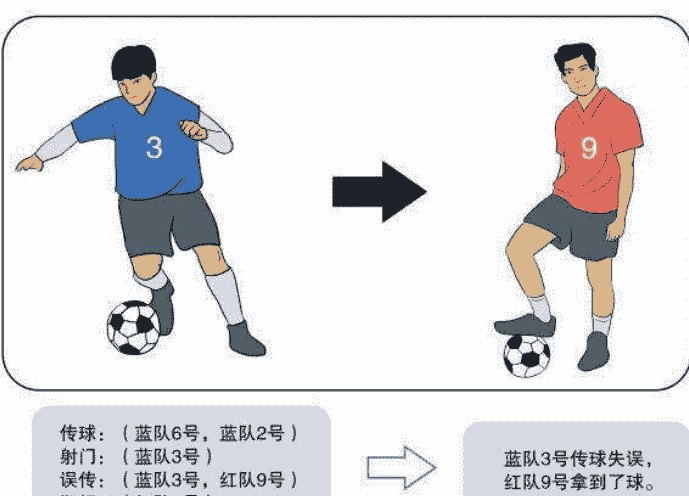

以数据为重要关键词甚至核心词新闻文本自动生成，是目前数据到文本生成重要应用场景，常用在具有一定周期性、大家普遍能理解、以数据为重要报道内容新闻事件中，例如每日股市、国债开收盘数据，或者当天突破整数关口，上市公司发布年报、季报，甚至重要体育赛事比分结果等，都可以通过数据到文本方式自动生成新闻稿。

2015年11月7日，一位特殊新同事与新华社编辑记者们一同庆祝新华社84岁生日，他就是“快笔小新”——新华社第一位机器人记者。“快笔小新”入职后，经历两年多高强度培训、开发迭代，逐步肩负起上述以数据为重要报道内容新闻事件“写稿”报道工作。“快笔小新”可以根据发布数据信息，全天候、不间断地快速生成新闻稿件，在相关编辑人员对自动生成稿件进行必要核对后，便发布新闻稿。

这些系统专注于向用户传播信息，虽然在其产生文本质量、种类、商业可行性和基础方法复杂性方面存在很大差异，但都是数据到文本生成例子。

自动生成文本适用于没有大量受众应用场景。足球联赛决赛报道很少使用自动生成，因为会有业内最好记者报道比赛。然而，也存在一些小众比赛缺少媒体关注。通常，这些比赛所有体育统计数据都会被记录下来，但这些统计数据很少被体育记者报道。通过自动生成技术发布这些比赛体育报告可以为小众群体提供新闻信息。

数据到文本生成技术为特定读者定制文本需求铺平道路。例如，病人监护系统数据可以转换为不同文本，这些文本会根据预期读者是医生、护士还是亲属来运用不同技术细节和解释语言。我们还可以为不同球队球迷生成定制化体育报道。胜利球队觉得获胜是合作与努力结果，但从失利球队角度来看，无论客观原因是什么，那只是对手幸运。人类记者通常为节省时间成本仅为一场比赛撰写报道。但如果使用计算机生成文本，读者可以收到为他们定制的新闻报道。

### 四、看图说话也在行
——图像到文本生成

每天，我们都会看到大量来自互联网、移动端App、新闻以及广告等各种来源图像，图像已成为现代人类社会中必不可少重要信息。随着互联网存储技术和计算机运算能力飞速发展，图像信息数量正在呈现爆炸式增长，因此，学会“看”图片，并将视觉内容转化成文本内容“说”出来，成了计算机必修课。计算机用自然语言把图像中视觉信息描述出来，这种看图说话能力被称为图像字幕生成任务。图像字幕生成任务具有广泛应用场景，它可以用于众多领域图像检索，包括生物医学、教育、军事、商业、数字图书馆、网页检索等。大型社交媒体平台已经可以从图片中生成描述。描述内容包括我们在哪里如海滩、教室，我们穿什么，以及我们在那里做什么（图3-7）。图像字幕任务不仅成为自然语言处理领域科学家研究重点，也成为计算机视觉领域科学家研究焦点，促进了两个领域研究人员有效协同。

图像中信息非常丰富，用户感兴趣内容是什么？用户希望得到描述是详细还是简洁？为图像生成字幕描述时，我们希望描述内容符合人类看图方式，并且描述细节根据需求可控。图3-8向我们展示用不同长度文字描述同一幅图片。仔细对比一下描述，你会发现，计算机太棒了，其生成文字准确地捕捉到图片中关键事物。当你需要更多细节时候，它也能描述背景或者更多细节，包括物体位置、关系等，但句子长度过长时，它有时也会产生废话或不那么准确表达，如长度4的描述。

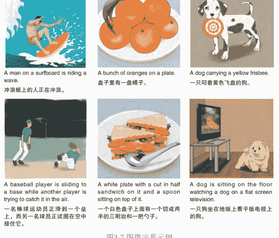
图3-7 图像字幕示例

注：以上英文文本为算法自动生成，中文为机器翻译结果，表述可能存在语法错误。

| 对照 | A couple of men standing on top of a snow covered slope. 两个男人站在一个被雪覆盖的斜坡上。 |

| 长度1 | Two people on skis in the snow. 两个人在雪地里滑雪。 |

| 长度2 | a couple of people standing on top of a snow covered slope. 几个人站在一个被雪覆盖的斜坡上。 |

| 长度3 | Two people standing on skis on top of a snow covered ski slope. 两个人站在雪覆盖的滑雪坡顶上的滑雪板上。 |

| 长度4 | Two people standing on skis on a snowy mountain top with a ski lift in the background. 两个人站在雪山顶上的滑雪板上，背景是一块滑雪板。 |

| 对照 | An old rusted out truck sitting in a field of flowers. 一辆锈迹斑斑的旧卡车停在一片花丛中。 |

| 长度1 | An old rusty truck is sitting in a field. 一辆锈迹斑斑的旧卡车停在田里。 |

| 长度2 | A rusted out truck sitting in a field of flowers. 一辆锈迹斑斑的卡车停在一片花丛中。 |

| 长度3 | A rusted out truck sitting in a field of wildflowers. 一辆锈迹斑斑的卡车停在野花丛中。 |

| 长度4 | A rusted out truck sitting in a field of wildflowers next to a bunch of trees. 一辆锈迹斑斑的卡车停在一片野花地里，旁边是一堆树。 |

图3-8 可变长度的图像字幕

注：以上英文文本为算法自动生成，中文为机器翻译结果，表述可能存在语法错误。

## 第四章
自然语言处理应用：就业上岗样样精

自然语言处理支持计算机以智能和高效方式分析、理解自然语言，并从中获取信息，提供总结、预测、决策支持等功能。这远远超出了实现人机对话目标。事实上，自然语言处理算法已无处不在。从搜索、在线翻译、拼写检查、垃圾邮件过滤等日常小工具，到智能客服、舆情监控、行业智库等专业应用系统，自然语言处理技术应用伴随着我们每一天生活和工作。本章将从中介绍几个有代表性应用场景。

### 一、语言沟通无国界
——机器翻译

自然语言处理最先走进大众视野的代表性场景，就是机器翻译。无论是查阅海外资料、搞懂一个陌生的专业术语或新闻内容，还是在国外旅行时和陌生人交流，亦或是在学外语的过程中，翻译工具几乎成了标配。

#### （一）机器翻译的工作方式与价值
机器翻译指在没有任何人工干预的前提下，把一种语言的文本自动转写成另一种语言。表面上操作门槛很低，背后却集合了自然语言处理、深度学习、大数据、云计算、语言学等多项前沿技术。现今的系统已不止于逐词对应，而是能把握整段落的意图，把源语的完整含义用目标语表达出来。它会拆解文本要素、捕捉词语间的相互作用。借助这类服务，人类译者能更快地完成初稿，提高整体效率。常见的优势有：

- （1）翻译助力。专业译者常把机器译文作为起点。系统会在工作流里嵌入一个或多个翻译模型，先产出初译，再交由人工进行后编辑。
- （2）速度优势。机器翻译能在几乎瞬间的水平下处理数百万词，对实时聊天、大规模文件处理等重载任务尤为适用。
- （3）语言覆盖。主流平台通常支持50到100多种语言，并可同时进行多语种处理，这对全球化推广和文档同步更新很关键。
- （4）成本效益。凭借高产能和快交付，机器翻译能缩短产品上市周期。基础译文提供价值后，可减少人工投入，进而降低成本和周期。集成内容管理系统后，多语版本还能一次性发布。

#### （二）机器翻译的技术演进脉络
机器翻译的研究可以追溯到20世纪50年代。早期尝试是用基于统计的语言库来“教学”计算机如何翻译。任务的复杂程度远超预期，需要的数据处理和存储量也超出了当时机器的能力，训练过程依赖大量人工标注，每增添一种语言往往都要重新搭建系统。

到20世纪90年代左右，基于统计的机器翻译逐步取代了传统的规则式方法。它不为每对语言编写专门规则，而是从海量的平行语料中学习对应关系，例如英语短语“java language”映射为中文“Java语言”。大量此类映射构成训练数据，系统从而学会在“Java”和“language”共现时指代语言名称而非地名或咖啡。依赖上下文而非词典语法，这让短语翻译更为可靠。

2016年，谷歌团队对神经网络在翻译引擎中的应用展开多轮试验，结果显示速度和效果都很突出，且模型在实际使用中能持续自学、不断提升。谷歌随即把技术路线转向神经网络，并成为在线翻译服务的领军者。微软、亚马逊等主要厂商很快跟进，如今基于神经网络的机器翻译已在互联网普及。

目前的主流是统计机器翻译与神经机器翻译，二者都离不开百万级甚至更大的人工译文样本。统计方法对样本做统计分析，神经方法则以样本作为训练集。平行数据的可得性至关重要，网络上大量多语种网站形成的“平行语料库”恰似现代的罗塞塔石碑 [1]，为多种语言对提供了上下文中的词、短语和习语对照。

神经网络已成核心，但各类系统各有利弊。神经机器翻译在短句上仍不够稳，统计方法有时反而更准。为兼顾两者，现有系统普遍采用混合式机器翻译。

> [1] 罗塞塔石碑：制作于公元前196年，石碑上用希腊文字、古埃及文字和当时的通俗体文字刻了古埃及国王托勒密五世登基的诏书，这使得近代的考古学家得以有机会对照各语言版本的内容后，解读出已经失传千余年的埃及象形文之意义与结构，成为今日研究古埃及历史的重要资料。

#### （三）翻译质量的现状与边界
机器翻译越来越普及，但服务质量并不总能满足预期。多数情况下仍需语言专业人员做后续润色，以保证自然度和本地化习惯。

总体来看，质量随技术迭代在持续提升，但评估仍要考虑语言对和具体场景的复杂性。2021年的一项研究发现，谷歌机器翻译在医疗诊断场景中，西班牙语的准确率约94%，韩语约82.5% [18]。数据看似不错，但在临床环境里，医疗翻译的任何失误都可能带来伤害，风险不可忽视。

尽管难以媲美人工翻译，机器翻译在合适的场景下仍有广泛实操价值，这也是行业快速发展的动因之一。

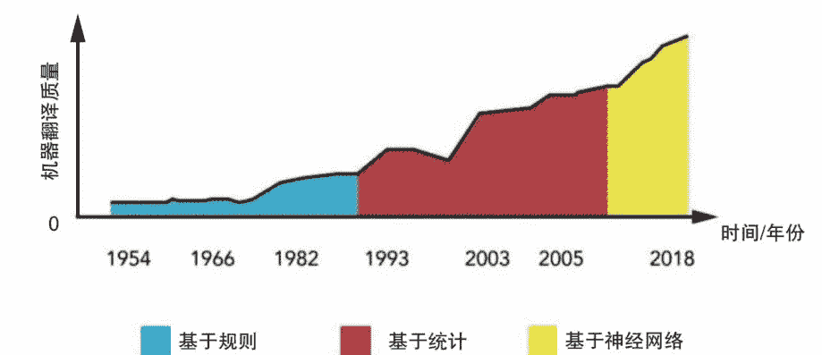

### 二、检索时代的隐形导航
——文本检索

再看一个更熟悉的日常：你在电脑里检索与某个事件或产品相关的全部工作文档，比如找出所有提到“自然语言处理”的文件，或是借助搜索引擎解决关于“自然语言处理”的问题，如图4-2所示。这类需求本质上都是文本检索的实例。背后的实现大致分以下步骤。

先提交“查询”，也就是关键词或待解的问题。搜索引擎会返回一组相关文本或答案，并附带信息。具体来说，搜索“自然语言处理”主题的文档，会按相关度排列结果；搜索“自然语言处理平台”，则会列出讨论该平台或工具的网站清单。

“相关度”与“排序”是关键。结果可能多达数百上千页，列表通常从最相关开始，文件系统里的文档也按相关度排序，让信息在数秒内可达。计算机如何判定哪些文档包含答案、按何顺序展示，就是文本检索要解决的核心问题。

第一个问题看似简单：只要找出包含“自然语言处理”的文件。图4-3展示了这种筛选过程。

回想一下独热模型、词袋模型等文本表示。计算机只需定位到“自然语言处理”在向量中的非零位置，就能挑出包含该词的文档。若查询包含两个及以上关键词，则找在这些位置都不为零或任一位置不为零的向量。若想支持模糊匹配，例如包含“自然语言”也应命中，可先生成相关词形如“自然语言”“语言处理”，再用多关键词方式检索。若用户输入的是完整问句，则借助自然语言理解抽取关键语义词，把问题转化为多关键词检索。比如“自然语言处理的发明者是谁”（图4-4），转成“自然语言处理”“发明者”“谁”三个关键词即可得到相近答案。

当然，让机器真正理解问题并非易事，海量文档逐条匹配耗时。当前搜索引擎采用更高效、更精准的自然语言理解方法，同时配合更优的文本表示与检索策略，大幅提升了检索效率。

再看第二个问题：如何量化文档的相关度并排序。用词袋模型来说明，所有文档都能投影到一个多维向量空间，维度等于词表大小，每个文档是空间中的一个点。相关性越高，点与点之间的距离越近。

为简化，假设词表只有“自然语言处理”和“发明者”两个词，每个文档是二维向量。图4-5展示了两个文档映射为空间点的过程。

文档1：……自然语言处理……发明者……自然语言处理……发明者……自然语言处理……发明者……自然语言处理……自然语言处理……
文档2：……自然语言处理……发明者……自然语言处理……自然语言处理……自然语言处理……

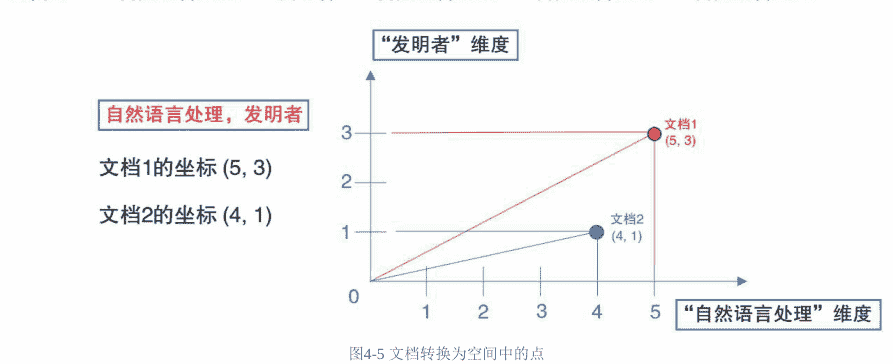
若用户查询是（自然语言处理，发明者），可表示为(1,1)的向量，投影到坐标(1,1)的点。查询与两个文档的相关度可用点间距离衡量（图4-6）。

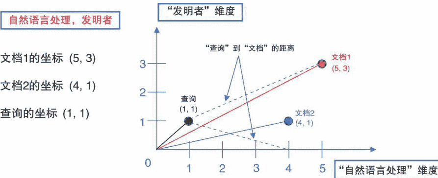
长文档中关键词出现次数多，向量会更长，距离也会被拉远。但从语义看，相关度不应因出现次数增多而降低。因此需要更合适的几何度量。

目前常用的是余弦相似度，用向量间的夹角代替距离。夹角越小相似度越高，夹角为零时余弦值为1，表示最大接近。这个度量更符合相关性分布。

正如图4-7所示，角度比长度更稳定。否则若把查询重复写成（发明者，发明者），信息内容与（发明者）相同，但一个坐标是2一个是1，空间位置不同，距离也不同，这在实际中并无意义。

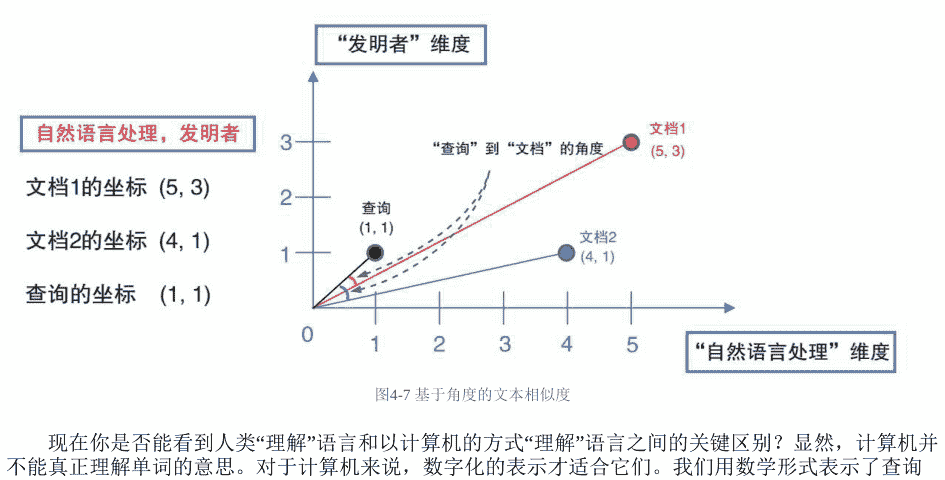
至此，人类“理解”语言与计算机“理解”语言的关键差异就很清晰了。计算机并不真正理解词义，它依赖数字化的表示。我们用数学形式描述查询和文档，再设计合适的计算方式让机器可操作，比如上文的向量和几何运算。

### 三、答疑聊天不下线
——智能对话系统

智能对话系统按场景可分三类：任务型、闲聊型和问答型。任务型通过识别意图、收集必要信息帮助用户完成具体操作，如订票、开关设备，常用于智能助手和音箱；闲聊型无固定目标，可在开放域与机器人交流，满足情感需求，如微软小冰。多数市面助手如小爱同学、Siri都兼具闲聊能力；问答型依托知识库，以获取知识为目标，检索并提供信息，如智能客服。

#### （一）问答系统的构建思路
问答系统利用预结构化数据库或自然语言文档集合，自动以自然语言回答用户提问，本质上是信息检索的高级形态。

随着互联网信息爆炸，人们对信息精准度的要求提升，传统搜索引擎难以满足，智能问答成为有效手段。图4-8展示了问答与检索的区别。检索能找到一批相关文档并排序，答案仍需用户自行提炼；问答系统在找到文档后，还会从页面中抽取关键信息并给出确定答案（图4-8）。

从例子可见，问答系统需要更深的语言理解。回答“水的沸点是多少度”时，计算机不仅要识别关键字“水”“沸点”“多少度”，还要理解词语关系与角色，即温度与水在沸腾时的关联。词性标注和句法分析在问题理解中起关键作用。经过一系列自然语言处理步骤，系统能选出正确结果“100℃”，而非“0℃”或“78℃”。相比传统搜索引擎，问答系统更能直接解决问题。

按处理流程，问答系统分为问题处理、文档处理和答案处理三个模块。

问题处理负责分析并分类用户输入，确定问题类型即焦点，避免答案模糊。分类方式有手动和自动两种。手动分类依据规则判定答案类型，如什么、谁、如何、在哪里、为什么，规则明确但扩展性有限；自动分类可适应新问题类型。

问题也可按预期答案类型定义：事实型、列表型、定义型和复杂型。事实型询问简单事实；列表型要求一组实体答案；定义型期望总结或简短解释；复杂型涉及上下文，需合并多段检索内容，常用自然语言生成技术。

文档处理负责根据问题焦点选择相关文档并抽取段落。来源包括网页子集、新闻通讯、企业内部文件、维基百科页面等，形成答案提取的数据源。

答案处理是问答系统的难点，依据文档处理结果通过抽取技术生成答案，答案可能简单，也可能需融合多源信息并作总结。

#### （二）智能助手的实现原理
如今Siri、小艺、小爱同学、天猫精灵等智能语音助手已进入日常生活，动一句话就能完成设定闹钟等操作。

实现主要分两步：意图识别和槽位填充。如图4-9所示，先通过意图识别判断用户想做什么，这是文本分类问题，借助自然语言理解识别指令类别；再用信息抽取技术收集完成任务所需信息，如闹钟需要“时间”，订票需要“出发地”“目的地”“日期”，把这些关键信息填入槽位，即槽位填充。

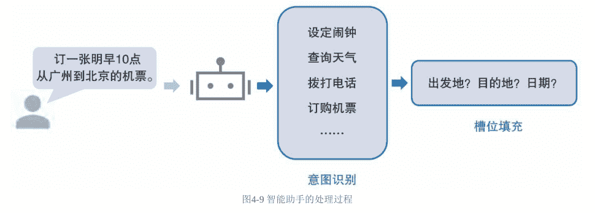
目前大多数任务型语音助手还具备聊天功能，即融合了闲聊型对话。最简单的开放域对话实现是文本匹配，从海量对话语料中检索最合适的回复；要获得更灵活的表达，则需自然语言生成技术，直接生成机器人的回答。

对话是自然语言处理的顶层任务之一，通常需整合文本分类、自然语言理解、信息抽取、自然语言生成等子技术，甚至结合知识图谱引入外部知识。

### 四、互联动态全在握
——舆情分析

互联网的开放性和虚拟性让个人观点输出达到前所未有的热度。公众围绕社会事件的发文和评论形成了网络舆论，社交网站和微博是最活跃的平台。随着海量微博信息的产生，如何挖掘、分析并追踪敏感信息、判断舆论热点，成为重要研究课题。大数据下的网络舆情分析已成政府和研究机构重点关注的问题。图4-10总结了舆情分析对政府解决问题的帮助。

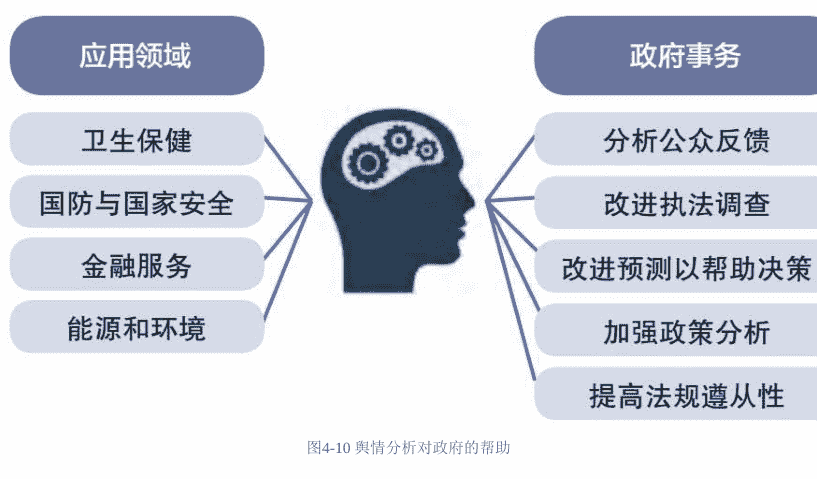

#### 1.倾听与反馈分析
无论是在政府网站或小程序留言投诉建议、在电子口岸咨询外贸业务，还是在社交媒体表达不满，公众反馈都有助于机构了解民众和企业的关切。自然语言处理能在处理非结构化内容时比人工更高效。如今众多组织借助情绪分析来解读社交媒体上的消费者反应。

许多数据公司使用自然语言处理分析数千万条评论，其中一大挑战是如何甄别真实评论与机器人生成的虚假评论。是的，自然语言生成技术也可能被用于造假。为辨别真伪，可通过自然语言处理对评论进行聚类，把句子和段落结构相似的评论聚合，判断是否来自同一模板或结构。

自然语言处理还能帮助政府与市民沟通并解决问题。广州市区级政府网站上线的智能应答机器人“小粤”，利用自然语言处理即时回答业务咨询并提供在线办事服务。遇到选项多或指向不清的问题，“小粤”会提问引导市民进一步表述，以找到更契合的答案。

#### 2.执法调查的效率提升
越来越多的政府机构在借助基于自然语言处理的方案改进重点领域的调查，如辅助执法和情报搜集。国内部分卫生监督执法机构和港口管理部门试点对执法数据或港口信息进行智能检索，并与相关法律法规文本做匹配计算，通过提升检索和判别效率及时发现异常情况。

#### 3. 预测先行，让决策更主动

自然语言处理最具价值的体现之一，在于让预测更可信，从而推动机构提前布局。美国部分警局已把自然语言处理引入治安治理，通过可视化呈现犯罪行为的分布形态与关联网络，锁定高发区域并加快介入，整体犯罪率因此出现明显回落。

在打击人口贩卖的场景里，自然语言处理同样发挥作用。国际劳工组织 2022 年发布的《现代形式奴隶制全球估计》指出，截至 2021 年全球约有 5000 万人陷入现代奴隶制，其中大量受害者来自人口贩运。部分海外招聘广告以高薪为饵，实为拐卖劳工。借助自然语言处理，情报系统能够对在线广告进行持续监控，筛查可疑表述并串联线索，还原受害者与贩运者的典型行为模式。一旦锁定目标，便可从公开信息中收集被剥削的证据，用于打击个人贩运者乃至瓦解整个贩卖网络。

#### 4. 用主题模型读懂政策走向

世界银行贫困与公平全球实践局曾梳理 1819 年至 2016 年间，10 个拉美国家与西班牙的总统演讲，借助主题模型量化政策优先级的演变轨迹。主题模型可以为每份文本提炼核心议题，并呈现不同国家、不同时期各类议题重要性的升降。例如秘鲁的基础设施与公共服务议题，其权重随时间逐步减弱。通过此类建模，能够为各国建立政策波动与长期经济增长之间的关联。

#### 5. 把隐私条款讲明白

自然语言处理有助于提升公众的合规执行力。2022 年 5 月 26 日，全国信息安全标准化技术委员会发布推荐性国家标准《信息安全技术 互联网平台及产品服务隐私协议要求（征求意见稿）》，面向社会征求意见。响应政策，各大互联网与移动应用纷纷推出或更新隐私保护条款。如今每个人都清楚隐私政策的重要性，它理应成为每款在线应用的标配。只是实际文本往往难以达到预期目标，普通用户很难逐条细读。借助自然语言处理，可以把在线隐私政策中真正需要关注的内容提炼出来，以通俗易懂的方式呈现，使用户在访问各类网站和在线服务时做出更明智的隐私选择。

### 五、全域语音交互：听得懂说得出
——语音识别与合成

文字之外，语音是我们主要的交流媒介。在自然语言处理流程里，通过自动语音识别技术 ASR 把语音转为文本，再进行语言理解；处理结果再经文本到语音技术 TTS 把文本化为声学波形，实现计算机的听与说。将 ASR 和 TTS 分别接在基于文本的自然语言处理任务的两端，就能把该任务改造成支持语音输入输出的应用（图4-11）。

语音识别与合成已渗透到几乎所有行业，其商业价值巨大，直接影响企业的未来走势。

- （1）教育行业。教育机构越来越用语音系统辅助学习困难与识字能力不足的人群。听力障碍者可听到与常人相同的内容，孩子在识字前就能听机器人讲故事，甚至以妈妈的声音讲故事。
- （2）金融和通信业。金融与通信是最早采用语音人工智能的行业，主要用于客户服务。语音系统能承接大部分客户需求，既提升响应速度，也提高服务安全性，客户无需担心账户信息被工作人员获取。
- （3）旅游业。语言是旅游的一大障碍，即便国内出行也受方言困扰。语音结合机器翻译可搭建不同语言使用者之间的沟通桥梁。

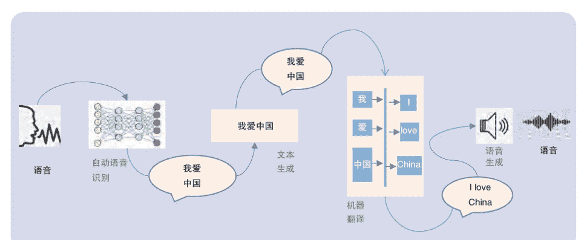

图4-11 基于语音识别和语音生成的翻译流程

- （4）汽车制造业。语音指令与语音导航已成为智能汽车的标准配置，带来更好的驾驶体验。
- （5）新闻业。新闻媒体广泛应用语音技术。记者可用语音识别快速把采访录音转成文本编辑，也能把稿件迅速转为音频文件，减少录制时间。国际新闻媒体还可通过“一键翻译”把文章转换为多种语言，扩大受众面。

#### （一）语音识别

语音识别是自然语言处理的一个交叉学科，通过机器自动识别口语并转写为文本，使计算机听懂自然语言成为可能。系统用麦克风采集人声，难点在于对语音、语调、口音的分析，随后把音频转写为文本以供呈现与后续处理。该过程也称语音到文本，是改善沟通的重要桥梁。

早在1952年，贝尔实验室推出首个语音识别系统“奥黛丽”。它能在人类分开发音时识别0到9的数字，准确率超过90%，标志着语音听写的开端。1962年，IBM发布首个语音助手Shoebox，能听懂简单的口头数学题并当场计算，是语音指令响应的雏形。

现代自动语音识别主要由四部分构成：信号处理与特征提取、声学模型 AM、语言模型 LM 与解码生成。

信号处理与特征提取以音频信号为输入，把时域信息转换为声学模型可用的频域信息。在频谱图上可直接读出频率与振幅（图4-12）。

聲學模型利用頻域信息构建模型，用以区分不同语言、不同说话人、不同话语、不同噪声以及沉默等各类语音特征。

語言模型在聲學模型提供的信息基础上，將其轉寫為通順準確的文本，類似人類理解所聽內容的過程。除理解音頻輸入外，語言模型還需掌握語句的語法句法、詞語間的語義關係等。

解碼生成綜合聲學模型、語言模型與詞典的信息對信號進行解碼（圖4-13）。解碼需在信號的多種可能的轉寫中搜索最可能的版本。解碼算法可採用不同策略計算文本輸出，策略選擇取決於語言模型類型。語音到文本的對齊是解碼中的關鍵步驟。

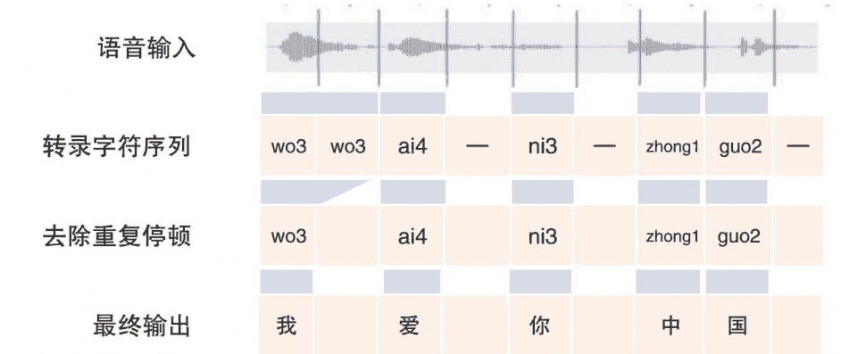

圖4-13 自動語音識別示例

#### （二）語音合成

語音合成即文本到語音，是自動語音識別的逆過程，目標是從文本合成可理解的自然語音。研發 TTS 系統涉及語言學、聲學、數字信號處理與機器學習等學科。許多人工智能系統利用語音指令與文本到語音軟件回答口頭請求，如電話客服機器人，以及廣泛使用的語音導航。國內主流導航服務已支持全程語音播報，解放駕駛者雙手雙眼，播報內容除路線指引外，還包括交通規則提示、駕駛風險提醒與沿途信息等。

典型的語音合成系統（圖4-14）分為前端與後端，前端屬語言學分析，後端屬語音信號處理。

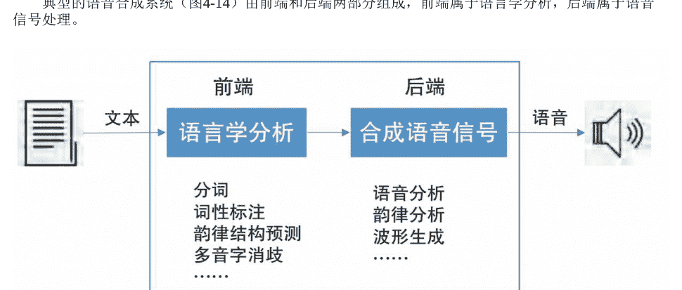

對已完成分析處理的語言文本，合成過程經歷語音分析、韻律分析與波形生成。語音分析通過查閱發音詞典找到每個詞的發音，對未收錄詞則以多種方式給出最可能的發音。若只是簡單拼接發音，會明顯聽出“機器人味”，難以滿足真實度需求。因此需進行韻律分析，對聲調、節奏、詞間停頓等進行處理，並區分陳述句、疑問句等語氣，如英語陳述句尾降調、疑問句尾升調。韻律分析還可標註強調詞，並表現說話人的喜怒哀樂等情感。在這些加持下，語言分析結果輸入語音合成器後輸出聲波，聽感日益逼真，在部分真人聽音測試中難以分辨真偽。

語音合成研究中頗具趣味的是語音風格轉換。同一段文字如何讓合成器以男聲或女聲播報？以老人或兒童聲音播報？以媽媽的聲音或自己喜歡的聲音播報？若僅靠發音詞典，需為每種聲音錄制完整的語音庫，工作量巨大且不利于分享傳輸。

打開某地圖的錄制語音包功能，可看到四種錄制模式，最少錄9句話，最多錄100句話，即可形成具個性語言特徵的高品質語音庫（圖4-15）。

其原理是語音合成模型在提取語音特徵後，將基礎語音信號與語音特徵融合，快速生成不同風格的語音信號。錄制的目的並非創建語音庫，而是分析和提取說話者的語音特徵（圖4-16）。“只需錄制9句話”體現了當前語音特徵提取的技術水平，通過分析指定句子即可提取說話者主要特徵。當然提供越多語音，可提取細節越豐富，合成音頻也越逼真。

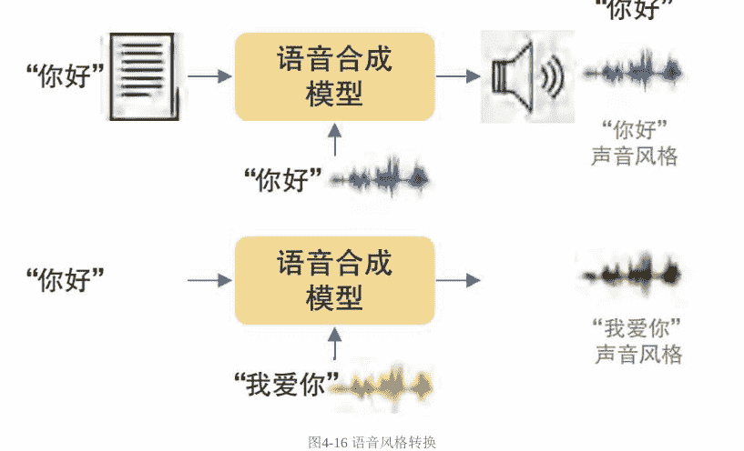

圖4-16 語音風格轉換

## 第五章
自然語言處理研究前沿：持續突破

### 一、深度學習重塑自然語言處理技術

以詞法、句法、語法分析為核心的文法分析技術長期主導自然語言處理研究。自2017年起，神經網絡與深度學習在該領域快速崛起，各類語言學習任務的效果顯著超越傳統方法。

#### （一）神經網絡重定義分詞

詞語形態研究詞的構成。中文體現為詞的切分，英語則主要體現在形態分析。在基於規則與基於統計的機器翻譯中，形態分析是最先要解決的問題。

對中文而言，分詞曾是機器翻譯等中文信息處理中的痛點。因中文詞語邊界模糊，分詞缺乏統一規範，粒度難以把握。

在神經網絡框架下，這一問題得到較好解決。得益於中文語料規模巨大，神經網絡可在上億級語料上訓練中抽取並總結語言知識。互聯網爬取的海量語料涵蓋各類場景與表達方式，大幅提升模型理解能力，使計算機能在不同配置下學習到多種粒度的分詞效果（圖5-1）[19]。

| 句子 | 龍年新春，繁花似錦的深圳處處洋溢着歡樂祥和的氣氛。 |
| --- | --- |
| 詞級 | 龍年_新春，繁花似錦_的_深圳_處處_洋溢_着_歡樂_祥和_的_氣氛。 |
| 字級 | 龍_年_新_春，繁_花_似_錦_的_深_圳_處_處_洋_溢_着_歡_樂_祥_和_的_氣_氛。 |
| 字詞混合 | 龍_年_新春，繁_花_似_錦_的_深圳_處處_洋_溢_着_歡樂_祥和_的_氣氛。 |
| 子詞級 | 龍年_新春，繁花_似錦_的_深圳_處處_洋_溢_着_歡樂_祥和_的_氣氛。 |

圖5-1 基於神經網絡的不同粒度分詞 [19]

#### （二）端到端學習的興起

除分詞外，神經網絡已在自然語言處理的各個環節帶來技術變革，提升效率與準確性。隨着深度學習發展，我們逐漸發現，各環節單獨優化並不保證整體最優。參數求解本就是逼近目標的過程，階段目標與系統整體目標可能存在偏差，前一環節誤差會累積到下一環節。

回顧神經網絡的學習方式，其強大之處在於能學習任意輸入輸出映射，無需人工把自然語言處理拆分為若干子問題。若直接讓神經網絡學習輸入與最終輸出，會怎樣？

端到端訓練即在任務或應用中忽略中間階段，直接用神經網絡進行學習的深度學習方式。以機器翻譯為例，把“我愛中國”作為輸入，與標準譯文“I love China”對比校正錯誤，通過調整內部參數實現糾正。大規模修正訓練後，可得到遠超傳統機器翻譯的模型。端到端訓練再次體現神經網絡威力，也推動人工智能再一次飛躍。

然而端到端訓練也讓傳統方法研究者感到焦慮。他們長期深耕各環節研發，新方法卻繞過了這些工作。最新的神經網絡機器翻譯不再依賴句法知識，僅靠學到的複雜結構即可實現良好效果。但端到端並非萬能，其最大困難在於需要海量數據與計算資源。訓練數據稀缺、計算成本昂貴（圖5-2）。因此產業界的端到端模型多由大型專業軟件公司構建，主要面向通用普及語料。小規模數據集的問題上，傳統“流水線”方法仍占主流。

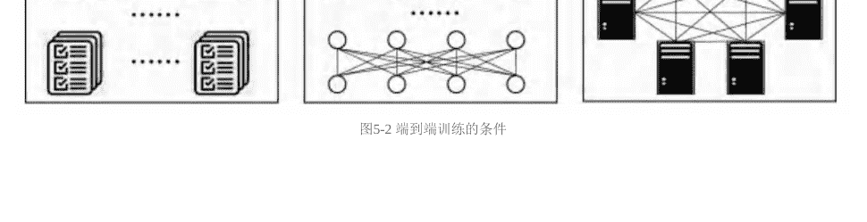

#### （三）預訓練範式

大規模端到端訓練需要大量人工標註數據指引模型優化方向，但人工標註耗時耗力，有時並不現實。網絡爬蟲讓獲取互聯網上龐大的未標註文本變得容易，能否直接在這些文本上訓練神經網絡使其具備文本理解能力？預訓練模型技術給出了答案。

預訓練模型技術先用一批語料完成模型訓練，再基於初步訓練好的模型繼續訓練或另作他用。通過端到端訓練，用大規模文本語料庫訓練深層網絡結構，得到一組模型參數，稱之為“預訓練模型”。把預訓練好的參數應用於後續特定任務，這些任務通常稱為“下游任務”（圖5-3）。一種被廣泛驗證的做法是：在語料庫文本中隨機遮蔽部分詞語，把不完整的句子輸入神經網絡，訓練其恢復原始句子。該過程無需額外標註，更充分利用語料庫數據。通過預訓練，神經網絡能更好捕捉語言底層知識，提升理解能力。雖然預訓練能降低人工標註成本，卻無法避免巨大的計算開銷。

經過在下游任務語料上的微調，深度模型在這些任務上的性能可進一步提升。

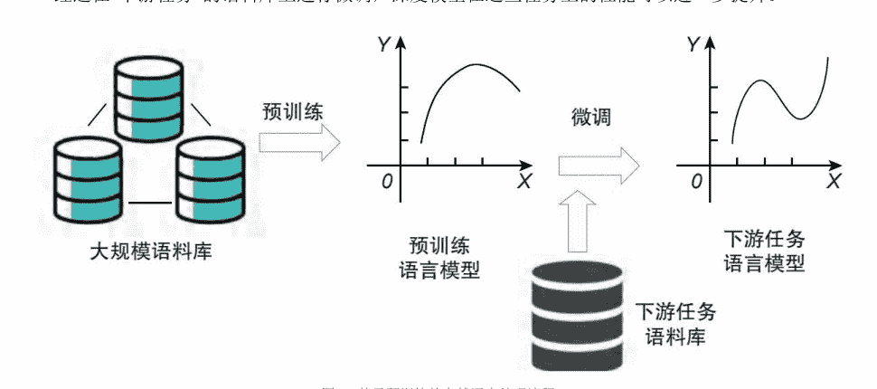

從近年實踐看，預訓練語言模型在眾多下游任務上的表現較傳統方法大幅提升，這些任務幾乎覆蓋自然語言處理的典型方向，如語義關係識別、命名實體識別、機器翻譯等，充分說明其普適性。更重要的是，這些模型已證明僅需數百條訓練數據即可取得良好效果，甚至可實現無需標註的零樣本學習。

#### （四）神經網絡模型的先進代表
##### 1. Transformer 架構
如果你想把握人工智能下一波浪潮，就必須了解 Transformer。該架構由谷歌於2017年提出，是迄今最強大的神經網絡架構之一，強力推動機器學習進步，近年飛躍式發展的許多人工智能應用都基於它實現。

在認知科學中，因信息處理瓶頸，人類會選擇性關注信息的一部分，忽略其餘可視信息，如關注照片中的人而忽略背景、關注書頁關鍵詞而略過其他詞語。這種機制被稱為注意力機制。它讓人類通過聚焦關鍵部分即可理解場景，無需捕捉每個細節。在該啟發下，研究人員向神經網絡引入注意力機制，使其能在海量信息中聚焦重要部分。Transformer提出前，注意力機制通常作為額外模塊加入網絡骨架，引導模型動態調整數據權重。Transformer的最大革新在於直接把注意力機制作為模型骨架，設計出純粹基於注意力的模型，徹底拋棄傳統架構。其驚人性能與創新性在自然語言處理領域引發強烈討論。

Transformer具有很強適應性，雖然誕生於自然語言處理，很快被遷移至各領域（圖5-4）。它像萬能模型，可用於計算機視覺中的圖像分類、目標檢測、多目標追蹤；可合成圖像、生成音樂與舞蹈；可實現近實時文本與演講翻譯；也可幫助研究人員解析DNA基因鏈與蛋白質氨基酸，加速藥物研發。它可應用於本書提到的所有任務與應用，並帶來性能飛躍。

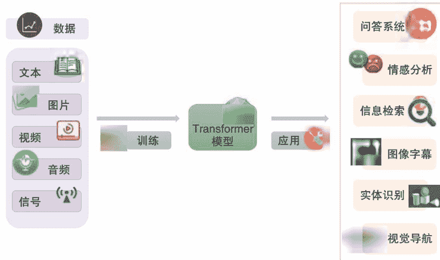

斯坦福大學研究人員在2021年論文中稱Transformer為“基礎模型”，因其規模與應用範圍之大，讓我們對人工智能可能性產生更大想象。

##### 2. BERT 架構
站在Transformer肩上，BERT為自然語言處理帶來新革命。BERT是一個用於自然語言處理的開源深度學習框架，是近年里程碑式技術模型。在研究階段，它已在11項自然語言理解任務上取得突破，包括情感分析、語義角色標註、句子分類與多義詞消歧等。

BERT在Transformer結構基礎上構建“深度雙向”模型。普通語言模型只能順序讀取文本輸入，預測下一個詞只能利用左邊或右邊信息，易因信息不全而出錯。“雙向”意味著BERT在訓練階段可從所選文本的左右雙向上下文中汲取信息。

BERT在兩個任務上進行預訓練：掩碼語言模型MLM與下一句預測。掩碼語言模型的目标是在句子中隱藏部分詞，讓模型依據上下文預測被隱藏的詞。下一句預測的目标是讓程序判斷兩個給定句子是否存在邏輯關係，是按順序連接還是隨機組合。

【双目并用，填词更准】

这个例子很好地说明了左右两边信息对补全被遮挡词的帮助。只看左边或只看右边，猜中的词都很多；把左右线索合起来，“鲁迅”立刻成为最可信的答案。由此可见，同时兼顾前后语境是读懂语言真正含义的基础。

示例文本： 我喜欢阅读鲁迅的呐喊。
处理后： 我喜欢阅读【掩码】的呐喊。

BERT 的基础语料取自维基百科与图书合集，前者约 25 亿字，后者约 8 亿字。可以说，基础训练贡献了成功的大半。正是在海量文本上习得，系统才能更透彻地把握语言的运行规律。学到的这套知识通用性很强，对几乎所有语言理解与表达类工作都有助益。

对刚入门的人来说概念可能偏抽象，记住一个要点就够了：基于基础训练的 BERT 只要在顶端接上一个简易输出层做精细调整，就能为不同语言智能工作产出领先的新系统。

BERT 的出现带动了大量新的语言智能架构、训练方式和语言网络研究。等你读到本书时，它可能已不再是第一梯队，但其设计思路和行业影响依然值得重视。

### 二、看与说的协同
现实里，人类靠视觉、听觉、文字、触觉等多种感知通道认识环境并做判断。让机器依托多模态感知数据完成计算与推理，一直是人工智能的重要追求。比如智能交互要求机器能同时理解自然语言、语音和视频图像；医疗诊断里望闻问切等多种检测结果需要综合才能形成结论。近几年深度学习推动单模态处理快速提升，跨模态数据的联合表征与特征融合成为热点，形成了多套方法，但复杂场景的智能感知与理解仍具挑战。国务院印发的《新一代人工智能发展规划》把“跨媒体感知计算”和“跨媒体分析推理技术”列为重点。复杂现实场景的理解与推理，是智慧交通、智慧医疗、智慧物流、空间态势感知等领域突破的关键。

机器视觉与自然语言处理是人工智能的两大支柱，前者模拟看，后者模拟说。近年来两者的研究思路趋近，都依赖机器学习、模式识别等手段，也都受益于深度神经网络。可以说当前最先进的成果都以神经网络为基础，比如视觉里的目标识别、语言里的机器翻译。随着图像与文本数据的爆发式增长，两者的结合快速成为焦点，催生了图像描述、视觉问答、视觉推理、视觉导航等经典用例。

无论哪类用例，深度全面地理解场景内容都是第一步。复杂的视觉画面往往包含大量文字信息，这些文字能帮助计算机更充分解读画面，从而回答更多问题或完成更深的推理。以看图说话为例，“桌面可见戴尔品牌的显示器，屏幕显示的时间为 10:48:32”，明显比“桌面放着一台电脑屏幕”信息更丰富。结合图像中的文字，就能抽取出更细致的自然语言描述。

要实现上述视觉语言融合，场景描述产出通常包含三大模块：一是多模态特征融合模块，用来提取并融合场景中的物体信息和文本信息；二是锚点图推理模块，在全局信息下挑选待描述对象并构建关系图；三是描述产出模块，从不同视角产出不同描述，提升多样性和准确性。其中描述产出分为两阶段：先基于物体信息产出一个全局视角的视觉描述结构，再借助场景中的文本信息对已产出的描述进行完善。

### 三、跨语言建模的探索
在语言智能研究里，英语常被默认为最具代表性的语言，其他语言的研究多被视作特殊语言。这种偏科现象逐渐受到关注，跨语言系统正快速发展，涵盖机器翻译以及面向上百种语言的语言智能工作。

早期基于规则的机器翻译曾设想通过桥接语言实现多语翻译，如图5-7（a）所示，英语是最理想的桥接语。桥接方案看似省事，多语翻译只需随语言数量线性增长的翻译器数；而直接方案则会导致数量平方增长。

但在规则时代，桥接语言并不现实。日本机器翻译学者长尾真曾指出，使用桥接语言时，分析阶段的输出必须是一种能被所有目标语言翻译器共用的形式，这实际上难以做到，也无法保证所有翻译都达到最佳效果。

Transformer 与 BERT 取得巨大成功后，谷歌推出跨语言 BERT，把 104 种语言编码进同一个系统，再次把跨语言翻译的实用性推向高峰。可以预见，随着软硬件进步，这种基于大规模语料跨语言先期训练的方法会不断取得突破。

无论系统规模怎样扩张，语言资源的稀缺始终制约语言智能进展。这形成了资源充足语言与资源稀缺语言之间的数字鸿沟。资源充足的语言只有少数几种，如英语、汉语、阿拉伯语、法语，再加上德语、葡萄牙语、西班牙语、芬兰语等，它们拥有海量文本、语音资源以及树库、评测集等标注资源，已实现工业级应用。资源稀缺的语言因语料匮乏，需要充分借鉴语言学知识，将传统方法和深度学习结合，推动小语种的理解进程。

### 四、ChatGPT 爆红背后
2022 年 11 月，美国 OpenAI 发布对话式通用人工智能工具 ChatGPT，迅速引爆学术界和产业界，媒体竞相报道，业内外都在讨论它带来的改变。为什么如此受关注？ChatGPT 不仅能与人进行深入的自然语言对话，还能按用户要求完成机器翻译、文案撰写、代码编写等典型语言智能工作。它在理解深度、完成准确度以及展现出的智能程度上，远超多数人的预期。大家期待这样的智能，但它的到来比预测更快，因而掀起轩然大波。ChatGPT 到底是什么，又是如何创造奇迹的？

#### （一）运作机理揭秘
谈 ChatGPT，本质是谈一种基于人工智能的对话系统，能回答各类问题并与人深入交流。ChatGPT 是基于大规模先期训练语言网络的落地应用。超大参数网络通常指参数达数十亿甚至上百亿的神经网络，例如参数量达 1750 亿的 GPT-3。

超大网络在海量语料上训练后，能学习丰富的语言知识并提升语义表征能力，用于处理各类自然语言工作，主要特点包括：

- 前后语境把握力强，能通过语料中的前后文捕捉词语关系与语句连贯性，更好地理解与产出语言。
- 泛化力强，能应对不同工作，借助大规模数据和语言知识处理各类语言现象、语义关系和情境推理。
- 多工作学习力强，可同时处理文本分类、摘要产出、机器翻译等。
- 可迁移性强，学到的知识能迁移到相关工作，使新工作更快适应。
- 产出能力强，能产出自然流畅的文本，如续写、问答、故事延续等，并具备一定创造性和风格。

依托超大网络，ChatGPT 通过有监督精调学习语言模式与结构，再结合人类在线或离线反馈优化网络，使产出更贴近人类回答。如图5-9 所示，训练可概括为三阶段：有监督精调训练、奖励网络训练、基于强化的优化训练。精调赋予初步理解产出能力，奖励网络在强化学习中持续优化，从而提升回答质量，最终实现自然智能对话。

①有监督精调训练。利用多样高质量标注数据对已先期训练的语言网络进行精调，如以 GPT-3 为起点适配特定场景。数据集需与目标工作相关且足够丰富多样，网络逐渐理解结构与含义，产出更拟人回复。

②奖励网络训练。引入奖励网络并由人类操作员训练。操作员提问并评估网络回答，评估结果用于训练奖励网络，使其学习人类评价标准，准确评估网络表现。

③基于强化的优化训练。持续向语言网络提供新问题，奖励网络评估产出，根据评估结果迭代更新参数，最终更好地回答问题并产出更有说服力的回复。

#### （二）GPT 发展脉络
传统语言智能方法依赖手工规则和特征设计，需要大量人工标注和领域知识，泛化与适应性有限，难以处理大规模数据、多样语言变体和复杂前后文理解，推动研究者探索更强方案。目前最成功的方法是利用大量文本对超大网络进行先期训练，学习统计规律与语义信息，从而理解并产出自然语言，由此诞生 GPT 和 BERT 等神经网络系统。

2018 年，OpenAI 发布基于 Transformer 架构的首个大规模先期训练语言网络 GPT-1。这是首个生成式语言网络，采用自回归方式预测下一个词来学习自然语言统计规律，在多项语言智能工作上取得突出成绩。

随后 2019 年和 2020 年分别发布 GPT-2 和 GPT-3，每一代都在规模和能力上扩展。GPT-1 约 1.17 亿参数，GPT-2 约 15 亿参数，GPT-3 高达 1750 亿。当 ChatGPT 以对话应用进入市场时，已能产出连贯语义正确的文本，展现惊人理解与产出能力。

超大网络是 ChatGPT 成功的核心力量，也吹响了超大网络竞赛的号角。2023 年 2 月，Meta 发布开源超大网络 LLaMA，可完成邮件撰写、模仿写作、代码生成、旅行规划、数据图表分析、知识问答等工作。同年 3 月，百度发布“文心一言”，可完成文学创作、文本补全、自由问答、商业文案创作、数理逻辑推算、中文理解、多模态生成等工作。超大网络的兴起标志着语言智能重大突破，也带来机遇与挑战。

当人们还在惊叹 ChatGPT 语言能力时，GPT-4 已悄然到来。新一代系统实现文本与图像跨模态融合，AI 绘画让普通人也能挑战设计师。ChatGPT 的超能力远不止流畅对话，其能力正快速增长。学术研究中文本、图像、视频、声音等模态已被打通，相信不久会见到像人类大脑一样灵活处理多种输入输出的智能产品。

#### （三）行业渗透轨迹
ChatGPT 已从实验室走向现实，出现在办公、服务和日常娱乐中。其强大之处在于对语言的深度理解与处理：理解文本、解答问题、产出带特定情感色彩的文本。随着技术发展，它将在更多领域推动颠覆性创新。

##### 1. 自动写作与内容创作
超大语言网络可根据主题或指令创作有创意且合理的文本，实现自动化产出，让写作变得高效便捷。在办公场景中意义重大，例如写邮件或报告时常感到困难或缺乏灵感，输入关键信息或初稿后，网络即可产出连贯有逻辑的文本，大幅提升效率与质量。也可用于产出新闻报道、小说、诗歌等。

典型场景包括：
- 会议纪要。商业会议议题复杂，提炼关键信息不易。网络可听取录音并自动总结要点与决策，减轻人工负担。
- 工作报告。周报月报撰写繁琐，输入关键数据后即可自动产出结构清晰逻辑严密的报告，节省时间。
- 邮件撰写。起草新邮件或自动回复都能高效完成，输入简短提示即可产出完整的商务提案或合作请求。
- 内容创作。创作者提供关键词或主题，网络即可自动产出有深度有创意的文章或报道。

总体而言，超大语言网络革新了写作与创作，提升了效率与产出质量。

##### 2. 对话与问答系统
超大语言网络在对话问答领域应用广泛。如客服场景需要快速回答用户问题，网络能理解提问意图并产出准确回答。例如用户问“这件衣服适合我吗？”，网络可结合身高体型信息给出建议，提供实时准确交互，提升客户体验。

以 ChatGPT 为代表的网络已广泛应用于各类问答系统，能深入理解问题并产出详尽精准答案，例如：
- 产品咨询。解答特性、使用方法、售后服务等疑问。
- 技术支持。理解软件使用问题甚至复杂编程，提供清晰解答与步骤。
- 订单处理。全天候快速答复订单状态、退换货流程等，提升效率与满意度。
- 语言翻译。具备多语种理解与实时翻译能力，便于商务会议与旅游交流。

##### 3. 情感分析与情感产出
在娱乐领域，网络可用于情感分析与情感产出。情感分析指识别文本中的积极、消极或中性情感以理解用户需求；情感产出指按特定情感需求产出相符文本。如电影制作中可产出特定场景对白，帮助创作出更具共鸣的作品。

社交媒体和虚拟角色方面也有应用，可根据输入产出带特定情感色彩的回复，如幽默、鼓励等，具体包括：
- 情感分析。对社交媒体表达进行分析，识别用户对产品或事件的偏好，为企业优化产品服务提供反馈。
- 影评产出。基于情节、角色、风格产出带明确观点和情感的影评，为观众提供参考，也为制片方提供反馈。
- 虚拟角色互动。在游戏和在线社区中产出丰富情感对话，增强沉浸感与互动性。
- 创意写作。产出情感丰富且有创意的故事、剧本，为艺术创作提供新可能。

#### （四）大模型的偏见与傲慢
尽管 ChatGPT 在语言能力上已超越人类部分表现，仍存在诸多限制，可归纳为偏见与傲慢两方面。偏见指可能产出歧视性言论和错误信息；傲慢指可解释性和透明性不足，难以说明决策过程并提供详细解释。

##### 1. 网络的偏见和错误产出

ChatGPT 的语言能力本质上来自海量文本的预训练，模型会把训练语料里的模式当成常识复现出来。一旦语料里混入偏见或错误信息，回答中就会出现类似的偏差。比如语料里反复出现性别化的表达，护士常与女性绑定、工程师常与男性绑定，用户一问职业倾向，模型就容易默认护士是女性、工程师是男性，给出带有歧视色彩或失真的建议，这种隐性偏见会误导判断、制造不公平。

要压制这类问题，需要在数据层面做更严格的筛选与清洗，减少偏见噪声；同时在监督微调阶段加入对回复的审查与纠偏机制，及时拦截或修正可能出现的倾向性输出。

除偏见之外，幻觉与推理短板也很突出。大模型普遍缺乏常识，出现胡编、逻辑跑偏的情况屡见不鲜。如图5-12所示，在数学求解类任务上ChatGPT表现平平，面对“两列火车同时出发”这类题，它会先误判两车起点相同，再误以为相遇时行驶总路程必然相等，最终推导出“小鸟根本没飞”的荒唐结论。这类案例暴露出逻辑推理不足的局限，也制约了大模型在产业场景中的大规模落地。

##### 2.可解释性和透明性的挑战
ChatGPT属于复杂的深度学习系统，内部决策路径难以被直观把握。用户不仅想拿到答案，更想知道为什么是这个答案，可模型往往做不到清晰自证。以“某种药物为何对某种疾病有效”为例，模型只能依据预训练语料的统计共现生成解释，很难讲清背后的生物化学机理。

提升可解释性与透明度，学界提出了几条路径：对模型生成时的关注点做可视化呈现，让用户看到哪些信息被重点使用；建立对话历史的可视化工具，帮助追溯推理轨迹；把知识图谱和外部权威知识源接入模型，增强事实支撑与推理的可解释性。

尽管存在上述缺陷，ChatGPT仍标志着自然语言处理领域的巨大跃进。随着训练方法改进与监督机制完善，未来对话将更准确、更可靠，为各行各业提供更有价值的信息与帮助。

#### （五）ChatGPT进化升级
——大模型未来发展方向和展望

凭借强泛化能力和优异性能，ChatGPT已在智慧医疗、智慧金融、智能客服等领域快速铺开。伴随技术演进，它将持续升级，在新方向与新应用中取得突破。

##### 1.面向特定领域的定制化ChatGPT大模型
通用文本任务上，ChatGPT已展现强大能力，但在医学、法律、金融等专业领域，对术语和体系化知识的理解仍显不足。未来重要方向是打造垂类定制大模型，依托领域级海量数据库和专家经验对模型进行精细优化，让其真正掌握专业知识并可靠应用。

##### 2.具有数据隐私保护能力的ChatGPT大模型
大模型的成长离不开数据，而法规与隐私要求让数据流通受限，各国、各平台间的数据孤岛问题制约了模型升级。目前研究者尝试在加密、可信计算等隐私保护前提下实现跨机构、跨国界的数据协作，扩大高质量训练规模，为模型迭代提供养分。

##### 3.ChatGPT在各领域的未来潜在应用
未来ChatGPT将在医疗、教育、金融、游戏、设计、影视等场景大规模落地。医疗上可辅助诊疗与新药研发；金融上可嵌入业务流程，自动化生产资讯与产品说明，提升内容效率；游戏上，以ChatGPT为代表的AIGC正向多模态、低门槛、低成本演进，设计研发与营销运营有望迎来变革；设计上可承担文案撰写、海报与网页生成，降低创作难度、提高效率。

总体看，大模型正处高速发展期，其应用前景极为宽广。同时也要清醒认识到，大模型终究是人类的强力工具，技术演进需要在创新与人类价值之间保持平衡，让其真正服务社会和谐发展。

## 第六章 自然语言处理未来展望：无限风光在险峰
自然语言处理正以独特魅力推动人类文明迈向革命性高度。即便当下仍有诸多难题，仍挡不住人们对未来的向往。

人类因能制造和使用工具而脱离动物序列，因拥有文明而把生存空间拓展到天地宇宙，而文明最根本的核心正是自然语言，尤其是文字记录。两次工业革命解放了人的双手双腿，信息革命则像中枢神经，让机器自发完成设定行为。当机器借助自然语言处理实现对话学习、被赋予“智能”“大脑”时，它不再只是工具助手，而可能成为与人类相近的伙伴。设想机器能顺畅交流、写诗作画、与顶尖科学家共同研讨，文明将迎来质的飞跃。

现实来看，自然语言处理必将渗透到工作与生活的几乎每个角落。未来以智能驱动决策会成为主流，全球数据量、智能设备保有量与服务升级需求同步攀升，将推动自然语言处理深度整合。自然语言处理作为人工智能的核心体现，也会助力机器人进入更多工作场景，各行业都需为机遇与挑战做好准备。

### 一、从浅层分析到深度理解
即便消歧正确、字面理解准确，同一段话仍会因人而异。因为语言习得深植于个人经历与认知，理解天然带有主观色彩。常说“一千个读者有一千个哈姆雷特”，作者心中自有一番构想，读者却会投射自身经验形成差异化解读，如同正态分布般围绕原意散开。正因“言有尽而意无穷”，诗歌尤其如此，“日啖荔枝三百颗，不辞长作岭南人”因方言“吃荔枝上火”“一啖荔枝三把火”的谐音误会，成为千古佳话。

自然语言理解没有标准答案，没有固定模版，我们希望为冰冷的机器注入鲜活的灵魂。

### 二、从具体任务到世界模型
围棋、电子竞技等领域AI大获成功，因其能对客观世界进行精确建模。机器翻译之所以有效，是因为源语与目标语语义可严格对应；智能客服、语音助手也因任务边界清晰、可建模而取得成果。

在开放语言场景里，现有系统多是在词符号关系上做统计建模，并未对所描述的问题语义、乃至客观世界做真实完整的建模。人类理解语言时，大脑会先构建世界影像，再用语言表达。当前系统一旦超出预设任务范围，就容易出错。

对世界建模极其复杂。以颜色为例，计算机可用数千万编码表示，而自然语言描述词只有几十个，二者映射难以精确。早期的本体、知识图谱、语义网络正是专家试图构建通用世界模型的不懈努力。当前大语言模型可为知识图谱提供更强的语义表达与理解能力，或许很快能借助知识图谱搭建更丰富全面的世界或语义模型，从而缓解事实知识匮乏、解释性差等难题。自然语言处理的未来，本质上是让计算机更深刻地认识与理解世界。

### 三、从文本学习到感知融合
“君不见黄河之水天上来，奔流到海不复回”，若不亲临黄河、听其雷鸣、见其泥沙滚滚、感水汽扑面，很难体会诗中磅礴。人类认知从来不是单一感觉，而是视觉、听觉、触觉、嗅觉等多感融合的判断。

当前自然语言处理多在纯文本语料上训练，用规模换能力，却面临硬件极限与边际效益递减的困境。单纯依赖文本是否是最优路径值得反思。计算机视觉研究已显示，引入自然语言知识可提升图像识别性能，这提示我们：在语言学习中融入视觉、听觉等感知特征，实现文本与感知的融合，或能让机器更贴近人类学习语言的方式。

### 四、从被动学习到主观能动
目前介绍的机器学习范式与模型，都需在人工标注的数据集与预定义任务下被动训练，训练后只能在既定任务上表现尚可，并不具备主动学习语言的能力。

人类学习时持续与外界互动并获得反馈，这些反馈沉淀为直觉与常识，是日常交流中未明说的隐含内容，文本里也未必写清。机器如何捕捉这类直觉常识？一种思路是赋予主动试错能力，在自有知识库中组合、推断并自我纠正，从而归纳出文本未明示的知识。从被动到主动的跨越虽难，却是通向真正人工智能必须攀越的险峰，前路必将有人接续奋进。

### 五、从专业门槛到普罗大众
设计与应用机器学习算法门槛很高，巨头公司依赖顶尖专家团队支撑研发落地。但中小企业、传统行业乃至非专业人士同样有强需求，却受制于知识与算力。专业门槛高、人才稀缺、资源消耗大是普及的最大阻力。

目前做一个特定自然语言处理应用，需要模型设计、数据采集预处理、训练测试、部署上线等全流程，其中模型设计涉及架构、目标、算法、超参数等，需要专业知识。若能把这些流程全自动化，用户只需用自然语言描述需求并提供少量示例，就能获得专属可用应用。我们期待全自动自然语言处理到来的一天，让技术真正走出实验室，服务普罗大众的生产生活。

[22] DEVLIN J, CHANG M W, LEE K 等其他作者合著。《Bert: Pre-training of deep bidirectional transformers for language understanding》[DB/OL]。该文献于2019-05-24首次上线，本文于2023-06-30进行检索，在线获取地址为 https://arxiv.org/abs/1810.04805。

[23] VASWANI A, SHAZEER N, PARMAR N 等作者。《Attention is all you need》[C]。文章被收入《Advances in neural information processing systems》会议论文集，该会议于2017年12月4日至9日在美国加州 Long Beach 举办。出版信息为 Cambridge：MIT Press，第30卷，页码5998-6008。

[24] RADFORD A, WU J, CHILD R 等作者。《Language models are unsupervised multitask learners》[DB/OL]。检索时间是2023-06-30，文档可在 https://cdn.openai.com/better-language-models/language_models_are_unsupervised_multitask_learners.pdf 获取。

[25] BROWN T, MANN B, RYDER N 等作者。《Language models are few-shot learners》[J]。收录于《Advances in neural information processing systems》，会议以线上形式于2020年12月6日至12日举行。出版方为 Cambridge 的 MIT Press，第33卷，第1877-1901页。

[26] TOUVRON H, LAVRIL T, IZACARD G 等作者。《Llama: Open and efficient foundation language models》[DB/OL]。资源发布日期为2023-02-27，本文于2023-06-30访问，链接地址 https://arxiv.org/abs/2302.13971。

[27] OpenAI 发表。《GPT-4 Technical Report》[DB/OL]。网上发布时间为2023-03-27，检索日期为2023-06-30，可访问网址 https://arxiv.org/abs/2303.08774。