# 口袋里的智能：计算博弈

## “口袋里的人工智能”丛书编委会

总顾问 戴琼海

主 任 陈俊龙 王桂林

副主任 弓鸿午 吴汉荣 严奉强

委 员 （按姓氏笔画顺序排列）

马 晶 王 蕾 车文荃 史颖欢 刘 伟 杜 卿 李姝萌

沈文浩 张 通 张小川 罗子章 郭继舜 谭明奎

丛书总主编 陈俊龙

执行总主编 车文荃

## 《计算机博弈》

主编 张小川

副主编 李学俊 彭丽蓉 黄同愿 涂飞

编委（按姓氏笔画顺序排列）

王鑫 刘溜 严明珠 杨小漫 赵海璐 贺泽亚 梁渝卓

## 序言

技术更迭的速度在加快，生活形态也在随之改写，历史正进入一连串令人意外的转折点。往日认为熟悉的事物，如今正变得陌生。

> —— [美] 约翰·冯·诺依曼

“技术之光由内而出，智能之美向外绽放。”从 AlphaGo 与顶尖棋手对局的画面，到自动驾驶车辆上路的场景，再到智能家居融入日常的细节，无不宣告智能化时代已经到来。借助大数据、云计算、边缘计算和移动互联网的协同，人工智能凭借丰富的应用场景持续重塑生产与生活方式。它既是面向未来的战略性技术，也是驱动新一轮科技与产业变革的核心力量。

人工智能具有很强的带动与溢出效应，能够赋能各行各业，在全球科技版图上占据关键地位。《中华人民共和国国民经济和社会发展第十四个五年规划和2035年远景目标纲要》提出，要推动人工智能与各产业深度融合。依托移动互联网、大数据、云计算的积累，我国人工智能已经走过理论沉淀与平台搭建的准备阶段，正迈向产业赋能的新阶段，在机器视觉和自然语言处理上达到世界先进水平，在智能驾驶与生物化学交叉等领域也取得积极成效。为落实《新一代人工智能发展规划》，2022年7月，科技部等六部门联合印发《关于加快场景创新以人工智能高水平应用促进经济高质量发展的指导意见》，提出围绕高端高效智能经济、安全便捷智能社会、高水平科研活动、国家重大活动和重大工程打造重点场景。场景创新的推进将进一步提升人工智能赋能各行业的质效，也会带来更深层、更便捷的使用体验。面对快速演进的态势，做好人工智能科普是每一位从业者的责任。顺应新时代科普要求，构建社会化科普格局，让公众了解人工智能知识势在必行。

基于此，广东科技出版社牵头组织“口袋里的人工智能”系列丛书的编撰出版工作，邀请华南理工大学计算机科学与工程学院院长、欧洲科学院院士、欧洲科学与艺术院院士陈俊龙教授担任总主编，以“让更多人认识人工智能”为目标，聚焦人工智能的应用场景。丛书既涵盖机器视觉、自然语言处理、计算机博弈，也关注智能驾驶、化学与生物、智慧城轨、医疗健康等热点。丛书包括《千方百智》《智能驾驶》《机器视觉》《AI化学与生物》《自然语言处理》《AI与医疗健康》《智慧城轨》《计算机博弈》《AIGC妙笔生花》9册，从科普视角，用通俗简洁全面方式介绍人工智能核心内容，精准把握行业痛点与发展趋势，分析融合人工智能的优势与挑战，既为公众提供便捷的知识入口，也为行业从业者提供参考。同时，丛书能够激发青少年对科技的兴趣，引领更多年轻人投身科研，勇敢迎接未知与挑战，拥抱变革、敢于创新，这体现了编写团队和广东科技出版社的社会责任与担当。

这套丛书既展示了人工智能对社会发展和人民生活的积极作用，也探讨了其带来的伦理问题。技术进步必须以人为本，不能缺少对社会应用的伦理审视，需要设置必要的“安全阀”，确保技术和应用的健康发展，构建和谐幸福的智能社会。

科技浪潮此起彼伏，智能春意盎然。人工智能的大幕已然拉开，新科技时代已经到来。正如前文约翰·冯·诺依曼所言，未来将持续变化，让我们携手创造新的未来，共同期待新的明天。

戴琼海

中国工程院院士

2023年3月

## 第一章 博弈：人类的永恒话题

### 一、无处不在的博弈

博弈在讲什么？中文“博弈”与英文“Game”本义都是游戏，只是中文更多指向围棋，范围更窄。随着经济社会成熟，游戏成为常见休闲，同时大量对抗性情境被纳入研究的范围，于是凡是存在对抗、决策者参与、产生收益且依赖理性思维的活动，都被归为博弈。因此当下讨论的博弈，已不限于游戏。本书所指博弈，是在既定规则约束下，各方为追求自身最大利益而进行的对抗性活动。

另外，本书默认“参与者为理性决策者”。因此博弈可概括为：在清晰约束条件下，遵循博弈规则，理性决策者从允许的行为或策略中做出选择，并从中获取相应利益的过程。整体看，博弈是系统性对抗，涉及多重因素，是一个复杂决策工程。为达成科普目的，本书弱化博弈中智能系统特征，侧重技术常识性阐述。

#### （一）体育博弈：斗技又斗智

有人的地方就有博弈。两人下象棋、三人斗地主、四人打麻将、多人玩德州扑克，到球队交锋、企业竞争、国家军事对峙，都存在不同层面的博弈，可见博弈既需要知识方法智能，也需要力量勇气意志。人们尤其热衷看见以弱胜强、以小博大，在体育赛场这种愿望体现得更明显。

“体育”一词作为书面语，19世纪70年代才出现在日文里。通常体育包含锻炼、教育、竞技三大功能，本书只讨论与技能智能相关的对抗内容。如掰手腕，除力量比拼外，还需要五指、拳眼、拳心的位置方向配合，并合理运用力学原理，如手腕支点与躯干距离远近、角度大小构成的杠杆问题，这就是体育智能的体现。再如乒乓球，对抗者需掌握基本技术，对力量、方向、旋转、击球点、落点进行控制，并配合躯干、脚步、手臂、手腕的系统调动。但要赢得比赛，还需策略与心理博弈的支撑。体育博弈的基础是健康身体、良好体能、优秀技能、坚韧品格，在高强对抗中这些素质缺一不可。体育竞技既有体力比拼，也有技能较量，更有智能比拼。

体育是人类解决生存问题后出现的重要社会活动，也是复杂的社会文化现象。比赛中剥离观众的主队情结和爱国情结，观众既渴望力量对抗，也追求技能与智能的较量。体育博弈作为一种社会活动，契合了人们对体力与智力、毅力与技能的推崇，这也是其无处不在的重要原因。

体育活动中有一类极度强调智力比拼的项目，即下棋、打牌、打麻将等棋牌类活动。棋牌不同于拳击、足球、拔河等以拼体力为主，更具斗智不斗力的特点。闲暇时下棋打牌娱乐性强，对场地空间要求不高，对年龄限制小，老少皆宜。借助棋牌活动，人们不断训练谋略能力，提升智力水平。

近代以来，人们开始探究智能本质和关键机制。20世纪，以“人工智能之父”艾伦·麦席森·图灵为代表的科学家开启了人工智能探索。图灵首次提出在纯数学符号与实体世界之间建立联系，将现实抽象为数学符号，用数学运算实现数字计算，这就是现代计算机的理论模型——图灵机。图灵还提出检验机器是否具有智能的图灵测试，为验证该方法，他构想了一台会下棋的机器，但当时技术无法支撑制造心目中的计算机，于是图灵模拟“理想计算机”走子，完成了世界上首个国际象棋程序，因在纸上演算，后人称其为“纸上下棋机”。后来科学家、工程师据此思想在MANIAC计算机上实现了国际象棋程序，从此开启模仿人类智能的研究。这也是图灵被尊为“人工智能之父”“计算机之父”的重要原因。图灵选择当时西方社会流行的国际象棋作为研究智能的载体，通过模拟下棋时的思维、心计、行为，在纸上“教会”计算机下棋，开启了研究生物智能、模仿人类智能的伟大历程，为后人奠定基础。

自图灵发明“纸上下棋机”后，教会计算机下棋、打牌，以及各类人机大战、机机大战等事件成为推动人工智能发展的强大动力。而以此为研究对象的计算机博弈，也发展成为人工智能的重要分支。

图1-2 人工智能的发展历程 [2]

#### （二）军事博弈：兵法智能

本节以军事对抗为例，呈现战争中蕴含的博弈思想，说明博弈与人类相伴永恒。实际上，从外交官面对面的争论，到两国军队擦枪走火的直接对抗，除国家实力、军队战斗力外，军事博弈中的斗智斗力同样关键。在中国历史长河中，春秋战国是一个特殊时期，为完成统一宏愿，秦国不仅继承前代余烈，还广纳英才、吸收先进思想文化，统一后推行“书同文”“车同轨”“度同制”“改币制”，利在千秋，为中华文明延续发展奠定版图基础。

同时，春秋战国频繁的征战，给军事对抗和外交博弈带来激烈碰撞，也留下宝贵的军事博弈思想财富。这一时期有公孙衍、苏秦提出“合众弱以攻一强”的“合纵”之策，也有张仪提出“事一强以攻众弱”的“连横”之略，形成著名的合纵连横外交策略，同时出现范蠡、吕不韦等谋略家，孙武、吴起、孙膑等军事家，留下《孙子兵法》《吴子兵法》《孙膑兵法》等兵书，是古代军事文化遗产中的瑰宝，也是关于人类军事博弈最完整最经典的著述，体现了先贤的大智慧、大谋略、大格局。

《孙子兵法》是兵书中军事博弈的代表作。它是孙武的私人记录，蕴含将帅带兵打仗的深刻道理，被誉为“兵学圣典”，成为众多将领指挥战争的思想源泉，也是当今不少军事院校必读书目。《孙子兵法》共13篇约6000字，字数虽少，内容精炼、逻辑严谨。约2500年前，军事家孙武能从道、天、地、将、法等多方面思考战争，提出要赢战争需君王重道、百姓信服、天时地利人和，将帅同心，并具备智慧谋略、完善制度、后勤保障等要素。这集中体现了自古以来系统化思考、全局谋划、统一行动的智慧。实际上这就是智能博弈的核心，不专于一时一地一事的计算，而需更大视野的谋划，这些前瞻思想也在《三十六计》中得到全面体现。

图1-3 我国军事博弈的两部经典兵书

如果说《孙子兵法》是对带兵打仗作战场景的描述并提出相应策略方法，那么《三十六计》则不仅限于战争场景，其中“无中生有”“打草惊蛇”“调虎离山”“空城计”“苦肉计”“浑水摸鱼”等计谋被广泛用于生活、生产、经营、管理等领域。《三十六计》作者已不可考，但它与《孙子兵法》都代表了古代先贤卓越的谋略与智慧，成为当今博弈场景的经典指导，为解决博弈难题提供思路方案。例如管理领域的SWOT分析法，强调先了解自身、客户和竞争对手，这正是《孙子兵法·谋攻篇》“知己知彼、百战不殆；不知彼而知己，一胜一负；不知彼不知己，每战必殆”的具体应用。两部兵书都讲计谋，但场景对象有差异。《孙子兵法》的“计”更多指战略层面的实力比较分析，而《三十六计》的“计”侧重于战争层面的奇谋巧计的筹划与行为。

综上，《孙子兵法》是大战略、大智慧，《三十六计》是巧计、巧智。无论生活、生产还是战争，人类为生存发展注定要与自然、他人、他国博弈，博弈本质是在一定物质资源基础上斗计斗谋斗力。战争的特殊性和残酷性决定了军事博弈的震撼性和强势性，从而凸显兵法智能的独特性和重要性。

#### （三）市场博弈：定价智能

企业生存目的之一是盈利，而盈利必须通过市场完成商品服务价值交换。市场中有多家企业提供相同或相似商品服务，价格作为属性中辨识度最高、顾客敏感度最高的要素，直接决定价值交换成功率，最终决定企业盈利水平甚至生死。因此在市场博弈中，企业定价策略是关乎存亡发展的大事，也是市场博弈重要内容，需要足够智能支撑。

价格虽以数字呈现，定价过程却需综合企业产品服务成本质量、竞争对手、利润、供求关系、品牌价值、政策等多因素。因此定价背后是企业市场竞争的系统性较量，过程复杂，具有显著智能特征。

为便于理解，以市场中各销售方收益总和为依据，将定价博弈划分为正和、零和、负和三类，如图1-4所示。正和博弈指各销售方通过合作协商实现“双赢”或“多赢”，收益总和为正；零和博弈指某方在其他方损失基础上获益，各方收益总和为零，即建立在他人失败之上的竞争，也称非合作博弈；负和博弈指各销售方缺乏合作、恶性竞争，收益总和为负，是损人不利己的博弈。理想市场博弈是正和博弈，实现双赢。但市场容量有限，需求不确定，合作程度难以确定，这决定企业定价需要定价智能，即通过收集监控处理定价数据、开展市场调研、深入了解市场、确定定价策略、明确企业利润、制定价格。显然，定价智能已成为形成长期竞争优势的关键行为，推动企业定价策略保持活力并提升竞争力。

降价销售是有智能的。企业为达成经营目标、打开销路，常采用降价策略。例如周末节假日限时降价并声明时段性，过后恢复，瞄准这些时段消费者迸发的消费热情，这种直接降价通常能大幅提升销量、减少库存、提高知名度、抢占份额。从宏观看，这类特定时段降价对企业冲击风险有限可控，也是常见策略。再如建立顾客消费积分制，承诺达到一定消费额度可换购商品，或预存消费金提供折扣，本质是变相降价。这种做法更容易维持顾客粘性、稳定市场份额，本质是针对老客户的奖励性降价，长远看对定价影响正面。

市场竞争中常见的广告战、产品差异化、售价动态化管理等行为，最终都体现为终端销售价格。例如电商平台商品价格会随客户访问量变化而动态调整，某商品需求急剧增加时价格上扬，甚至出现第二次下单价格高于首次的情况，这正是后台判断顾客“真喜欢真需要”，推测其愿为更高价格买单，让顾客“为喜欢买单”，这就是定价智能的具体体现。此外，旅店、机票等特殊服务的地点、方式、时间具有特殊属性，价格随顾客购买时间点与服务时间点“距离”长短变化，距离越长往往越便宜。这些顾客是企业销售基本盘，为确保稳定，企业常通过高额度扣款限制提前购买顾客的退订换订。但价格并非距离越短越低或越高，企业会依据销量与距离关联性确定价格，基本盘数量大意味着成本已冲抵，价格将上调；基本盘数量小，为完成成本冲抵可能继续降价冲量，需定价智能算法依据已有数据提供调整建议。企业也会根据历史数据在节假日、特定季节、特定活动期间的销量预测调整价格，实现价格浮动。当距离接近0时价格波动较大，因为过了特定时间点，未售出的房间或座位不仅不能贡献利润冲抵成本，反而产生损耗折旧维护成本。可见同样是降价提价，变动幅度、发布时间等都需强大定价智能支撑，这也隐含企业与消费者之间的博弈智能。这些智能需要算法、数据分析、博弈论、运筹学、社会心理学、市场营销等多种技术策略的综合支持，这就是定价智能研究的范畴。

总之，无论是企业的直接降价、变相降价，还是互联网时代“羊毛出在猪身上”的创新商业模式，本质都是在不同市场要素中腾挪转换，其实质是企业市场竞争的定价智能行为，具有极高的对抗性和智慧性。

#### （四）教育博弈：育才智慧

人类发展离不开教育。教育是通过传播人类文明成果，以学习为主要手段，使受教育者“内化于心、外化于行”。但学习过程是痛苦的，再注入多少快乐要素，也无法否定其中的历练。其内在逻辑是：

- ①存在“要你学”与“我要学”这个恒定教育博弈难题，常出现在家庭和学校，父母教师需帮助学生解决。
- ②优质教育资源总是有限的。在此前提下产生大众教育是否公平的问题，这决定受教育者必须以某种尺度被选择。目前来看，“考分”作为尺度，操作相对容易、接受度高、对比性强，已演变为教育领域的量化尺度。这也说明教育中博弈是普遍存在的。

那么教育中存在哪些博弈现象，背后隐藏着什么博弈智能？这就是本节试图介绍的育才智慧。为做到浅显易懂，这里主要以家庭教育、学校教育为场景，聚焦家长与孩子、教师与学生间相互影响制约中的人才培养博弈智慧。提出一些有待探索的观点看法，以供参考。

在家庭和校园里，未成年群体往往规则意识薄弱、自控力不足、时间管理能力欠佳，伴随而来的对抗性和反抗性过激行为时有发生。常见的情形是家长因学习或教育方式与孩子产生争执，孩子自身也承受着成长焦虑、逆反情绪以及对家长期待落差的困扰，严重时家庭矛盾升级甚至出现肢体冲突，最终必然损害身心健康与学业表现。由此可见，教养本质上是一种博弈，需要博弈思维与育人智慧。就如古希腊思想家柏拉图所言，“初期的教育应该以娱乐为形式，这样更容易发现一个人与生俱来的爱好”。因此在启蒙阶段，家长不宜强力压制，而应活用三十六计中的“欲擒故纵”，先把孩子引入门，再逐步加码、增难并予以激励，帮助其树立自信、自立与自尊，最终指向“我要学”的高级教育境界，而非停留在只追逐分数、考级等初级目标。

现实中，科技进步推动知识爆炸，知识与技术的更新周期愈发缩短。古训“三人行必有我师”在信息时代被重新诠释，这里“人”已扩展到信息网络与数字人格等范畴。比如目前大热的ChatGPT聊天机器人，从公开历史知识的丰富程度看，已在某些方面远超教师与家长。因此在中小学和本科教育中，过去由教师知识绝对优势形成的信息不对称正在弱化乃至消失。为什么“师道尊严”愈发难以建立？因为教师在学生面前已很少具备信息与知识上的优势。尊严如何重塑？没有尊严又如何让学生信服并跟随？这已成为家庭教育与学校教育的普遍难题。当然，家长和教师可以通过持续学习提升教育技能与方法多样性，甚至可借鉴国外做法：先取得本专业学位，再接受教育教学训练并取得教师资格证，最后进入教职。以兵法“知己知彼”的谋略来应对教育情境，也是一种育才智慧的博弈行为。

北宋理学家张载曾说：“教之而不受，虽强告之无益。譬之以水投石，不必纳也。”其意为教学时若学生不愿接受，强行灌输收效甚微甚至适得其反，如同把一桶水泼向石头，石头难以吸纳；但若一瓢一瓢地浇灌，水却能慢慢渗透并被深度容纳。故“循序渐进”“因材施教”被视作育人智慧的集中体现。

综合来看，若把育人置于博弈的宏观视野下思考、理解并实践，就能发现大量博弈谋略可迁移到教育场景。践行“兴趣驱动”“目标驱动”“过程重于结果”等策略，往往能产生意想不到的育人成效。

（五）囚徒困境剖析：纳什均衡策略
博弈被公认是人类高级智能的一种形式。1944年约翰·冯·诺依曼与奥斯卡·摩根斯特恩合著《博弈论与经济行为》，以经济行为为对象系统建立了博弈公理并创立博弈论，成为该领域的奠基之作。尽管博弈论并非约翰·纳什首创，但博弈概念的精确表述却源于纳什，他不仅给出严格定义并完成数学证明，还开拓了多人参与有限非合作博弈研究新领域。零和博弈与前述市场博弈相近，只是把“零”设定为各方收益之和的常数，即一方所得即为另一方所失，如蛋糕分配、棋牌输赢等。纳什均衡并不局限于零和博弈，它进一步假设各方存在合作可能并追求共赢，即非零和博弈，如前述市场博弈中的负和博弈就是典型，经典案例即“囚徒困境”。

“囚徒困境”作为博弈研究的经典范式，其推演极具科普价值。假设两名同伙小偷A、B因私闯民宅被捕，警方分室讯问并告知量刑规则：
- ① 若二人均坦白，证据确凿，各判8年。
- ② 若一人坦白另一人抵赖，坦白者因立功被立即释放，抵赖者以妨碍公务加刑至10年。
- ③ 若二人均抵赖，证据不足只能以私闯民宅罪各判1年。
如表1-1所示，若二人掌握纳什均衡策略，最优结果是共同抵赖，各服刑1年。

表1-1 囚徒困境面临的决策

| 决策 | A坦白 | A抵赖 |

| :--- | :--- | :--- |

| B坦白 | A入狱8年<br>B入狱8年 | A入狱10年<br>B立即释放 |

| B抵赖 | A立即释放<br>B入狱10年 | A入狱1年<br>B入狱1年 |

然而，由于二人被隔离无法沟通，每个人都会从自利角度选择坦白，最终导致彼此受损，各判8年。

市场竞争中常出现对手采取相同策略的默契，并最终形成相互制衡的经营态势。纳什均衡恰好能解释这一现象：即便有企业启动降价策略，无论过程如何波动，最终大多会回落到正常竞争格局。国家层面实施反垄断、价格保护，正是为了避免一家垄断的极端情形。纳什均衡策略已被广泛应用于经济学、生物学、会计学、计算机科学、人工智能、军事博弈等领域。

计算机博弈主要面向棋牌类游戏，属于零和博弈范畴，象棋、围棋、五子棋等双人对弈是典型的非合作零和博弈。但也存在合作情形，如斗地主中农民间的配合、桥牌中的同伴协作。由此可见，纳什均衡策略在计算机博弈领域具备应用基础。

> [1] 纳什均衡是指满足如下性质的一种策略组合：任何一位玩家在此策略组合下，单方面改变自己的策略，且其他玩家策略都不变时，该玩家不能提高自身收益。

二、计算机博弈兴起脉络
自18世纪学者提出“机器能否像人一样思考”起，经过图灵对机器智能的自问自答、香农提出机器能像人一样下棋、卡内基梅隆“深思”、IBM“深蓝”、谷歌AlphaGo系列与AlphaZero系列，计算机博弈的历史可追溯200余年，若从图灵的纸上下棋机算起，也有70多年。

在发展脉络中，“机器能否像人类思考”这一问题引发了持续研究。计算机博弈以棋牌游戏为载体，电子数字计算机为工具，智能算法为方法，程序代码为手段，模拟人类的智能行为。结果是教会计算机下棋打牌打麻将，过程则是探究人类智能本质。因此计算机博弈只是人工智能众多分支之一，因其载体是大众熟悉的游戏，研究成果更易引起关注，也因此人工智能的每次重大突破都与计算机博弈紧密关联，甚至可说计算机博弈是人工智能发展的重要催化剂。

（一）图灵的“纸上下棋机”：机器智能的萌芽
20世纪，以图灵为代表的科学家持续探索机器能否拥有智能。图灵虽短暂却在多个领域做出开创性贡献，如提出图灵机这一当代计算机雏形，以及用于检验机器智能的图灵测试等，如图1-5所示。

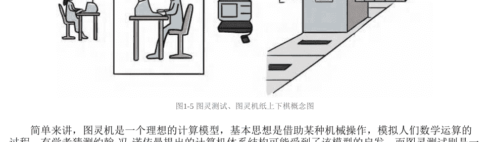
简而言之，图灵机是一种理想计算模型，其核心思想是通过机械操作模拟人类数学运算过程，有学者推测冯·诺依曼的计算机结构可能受其启发。图灵测试则将受试者、机器和提问者隔离，提问者提问并判断回答者身份，若无法分辨人机，则认为机器具备某种人类智能。该方法简洁易行，但在当时计算机与人工智能尚未成熟的背景下，图灵提出此测试已显难得前瞻。

在可编程计算机出现前，图灵为验证“机器可具智能”，于1952年亲手制作了可呈现人机对弈的“纸上下棋机”。他以国际象棋为对象编写下棋指令序列，用铅笔、纸张手工模拟对弈，每步耗时约半小时，与同事进行比赛。尽管“纸上下棋机”最终落败，但其蕴含的国际象棋程序雏形，为后世教会计算机下棋提供了划时代启示；无论是图灵机还是纸上下棋机，其思想后来均得到验证。

```
1.e4 e5  2.Nc3 Nf6 3.d4 Bb4  4.Nf3 d6  5.Bd2 Nc6  6.d5 Nd4  7.h4 Bg4
8.a4 Nxf3+ 9.gxf3 Bh5  10.Bb5+c6  11.dxc6 0–0  12.cxb7 Rb8 … 29.Qxd6 Rd8 0–1
```
图1-6 图灵“纸上下棋机”的序列指令示例

鉴于图灵对计算机诞生与学科奠基的贡献，美国计算机协会于1966年设立图灵奖，用于表彰对计算机事业有重大贡献者。该奖评选严苛，通常每年仅授予一名科学家，被誉为“计算机界的诺贝尔奖”。截至2022年，共有76位科学家获奖，其中2000年得主姚期智是迄今唯一获此殊荣的华人学者。

（二）香农与极大-极小算法：教会机器下棋
人工智能概念提出前，人们便思考如何让机器像人一样思考、判断与推理，并设想研制具备理性决策能力的机器。此间产生诸多经典成果，以下举例说明“机器能否像人思考”问题的演进。

1928年，冯·诺依曼提出并证明了极大-极小原理，其核心是：在零和博弈中，各方不应只看当前局面，而应推演下一步、下下步的决策结果并倒推最有利选择。该原理可实验、可论证、可计算，为博弈论诞生奠定基础，故冯·诺依曼被誉为博弈论奠基人。

1949年，信息论之父克劳德·香农在《哲学杂志》发表《Programming a Computer for Playing Chess》，阐述人机博弈方法及计算机国际象棋程序，其核心是用冯·诺依曼的极大-极小原理教会计算机下棋（图1-7）。简单说，零和博弈中玩家会选择使自身收益最大或对手收益最小的着法。整个过程如同树状结构，节点代表局面，分支代表着法，轮到甲方时选极大，轮到乙方时选极小，即为极大-极小算法思想。

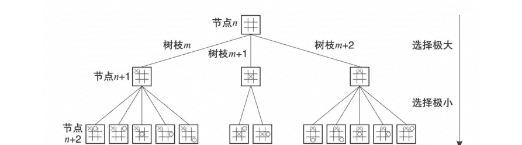
香农在程序中将棋盘定义为二维数组，并构建棋局评估函数，通过判断函数值变化寻找博弈树的极大或极小点。数学上易实现，如函数值由降转升的拐点即为局部极小，反之则为极大。香农也按人类棋手习惯将对局分为开局、中局、残局并采用不同技术，形成完整的计算机象棋解决方案，至今仍被研究者使用。

此外，香农还证明穷举所有博弈树节点是不可能的。他估算国际象棋博弈树空间复杂度高达10^120。即使以每秒4×10^10次运算的家用电脑计算，也需约7.927×10^101年；即便用2022年全球最快的“前沿”超算，仍需约2.883×10^92年。这表明穷举搜索不现实，必须另寻路径。因此香农设计了一台由150个继电器构成的会下国际象棋的机器，从理论上解决了教会计算机下棋问题，其思路后来体现在IBM深蓝和谷歌AlphaGo等系统中。

综上，香农将极大-极小原理应用于计算机象棋，提出极大-极小算法并研制出“会下棋的机器”，不仅回答了计算机能否下棋，也证明了机器可模仿人类思考推理，具有划时代意义。通俗地讲，他把棋牌博弈转化为数学问题与程序设计问题，再通过硬件实现工程化，完成数学、技术、工程三重跨越，为计算机博弈与人工智能诞生奠定基础。正因香农的声望，1956年达特茅斯会议特别邀请他助阵。约翰·麦卡锡、马文·明斯基、艾伦·纽厄尔、赫伯特·西蒙等青年才俊齐聚，他们的会议被视为人工智能起点。四人后来均获图灵奖，西蒙于1978年获诺贝尔经济学奖。会议虽未达成共识，但麦卡锡在向洛克菲勒基金会提交的申请书中提出“Artificial Intelligence”这一术语，被公认为人工智能诞生的源头。

（三）冯·诺依曼结构：承载智能的硬件基石
“让机器模仿人类学习与智能”是人工智能诞生的初衷，70多年来学界始终坚守这一方向。如今它已发展为研究模拟、延伸、扩展人类智能的理论、方法、技术及应用系统的学科——人工智能。其本质是打造能像人一样思考甚至超越人类的机器智能。因此人工智能需要依托具体装置呈现智能行为，也常被称为机器智能。

冯·诺依曼率先提出并研制可自我复制的机器，即能实现自动化运算的机器。这类机器以电机、齿轮等为基础，如机器人、飞机、汽车，被赋予自动控制与人工智能后可形成智能机器人、无人机、自动驾驶汽车等系统（图1-8）。随着制造工艺成熟，人们更关注智能而非机械本身。智能算法是灵魂，硬件是躯体，需借助硬件连接软件以满足个性化需求，最终实现一体化智能。因此真正智能的机器是硬件、软件、算法及运行机制的整体。

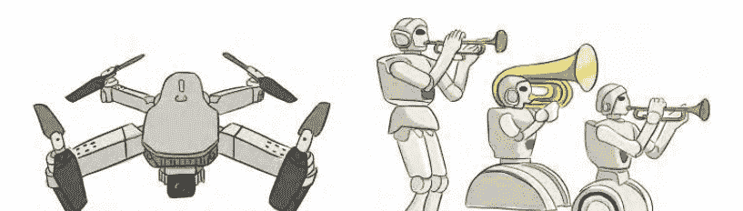
那么何种产品能承载仿真智能？这需要将模拟场景数字化、信息化，再推进到自动化、智能化。20世纪最伟大的发明之一——电子数字计算机，正是精于计算、长于存储、擅长重复性工作的基础平台。谈及电子数字计算机，必然提到冯·诺依曼。当前主流结构即冯·诺依曼体系结构（图1-9），他因此被尊为“计算机结构之父”。

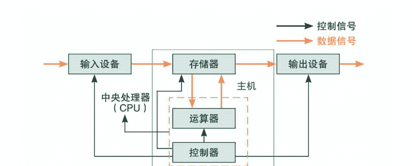
为何冯·诺依曼结构如此关键？结构指系统中元素及其联系一旦形成便不可更改，如建筑的桩柱梁体、人体的四肢骨骼连接。结构本身可视为一种智能，这体现了冯·诺依曼结构的价值。

为更清晰解释其对人工智能的作用，以我国古老的算盘为例，对比冯·诺依曼结构，分析蕴含智能要素的计算过程。假设用算盘计算15加51：
（1）输入。计算者需用笔纸记录两个数字，并用手指在算盘上拨动算珠呈现“15”。
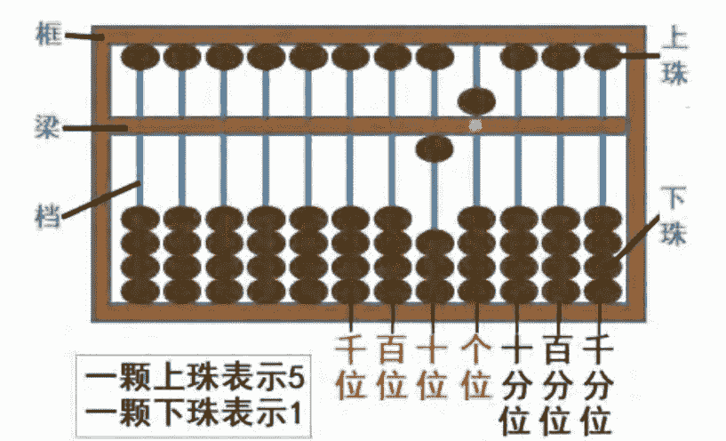
（2）运算。依据加法规则和算盘结构，通过大脑与手指协调移动算珠，完成相加过程。
（3）输出。计算结束后，算盘上个位十位算珠均处于上拨下拨状态，按计数规则得数66，再记录到纸上完成全过程。

从算盘到芯片，本质都是在执行“收进来、算一遍、吐出去”的流程。大脑下达指令，眼睛手脑配合，借助纸笔就能完成15加51这样的算术。把这一套搬到机器上，就需要一套结构上呼应人体的部件组合：

- 输入端。键盘、网络端口等，相当于执笔的动作，把问题送进去。
- 输出端。显示器、打印机等，相当于算盘呈现的盘面、纸上写下的结果。
- 记忆区。易失的内存和可长期保存的外存硬盘、穿孔纸带，分别对应大脑的即时记忆和纸张的记录功能。
- 运算区。完成加减乘除的电子单元，可类比算盘上上珠代表5、下珠代表1的计数规则，以及手指拨珠、笔书数字的过程，也包含小数点定位和四则法则的实现。
- 指挥区。大脑的角色，由控制器统一调度输入、存储、运算与输出的节奏。

正是受算盘结构启发，人们发现电源的有无、电压高低、电磁强弱这类物理状态最容易用电子实现且成本低廉，于是把信息编码成0和1。把运算步骤程序化保存，再让机械按程序自动执行，这就是冯·诺依曼体系的核心。依托程序语言和各类软件，计算机能以极高的速度和准确度完成海量重复计算。操作系统、编程语言、工具软件、应用软件以及友好的人机界面相继出现，让普通人也能使用计算工具。机器的机械属性并未改变，其上的行为仍属于机器智能的范畴，这正是冯·诺依曼结构带来的伟大价值。

图灵给出机器可拥有智能的论证并设计了“纸上对弈机”，香农论证机器能像人一样思考，冯·诺依曼解决了自动化计算问题。此后编程语言、网络协议等通信手段相继成熟，人与机器、机器与机器的交流被打通。所有进展都指向同一个目标：教会计算机下棋。

#### （四）骗局之始：“土耳其人”下棋机
在“机器能否像人一样思考”成为议题之前，人们就想造出能赢人类的下棋机。1770年，奥地利工匠沃尔夫冈·冯·肯佩伦造出了号称能下国际象棋的“土耳其人”。展出后名声大噪，甚至拿破仑都败在它手下。真相最终被揭开，机器内部藏着一名真人棋手，是人对人，而非人对机对弈（图1-11）。

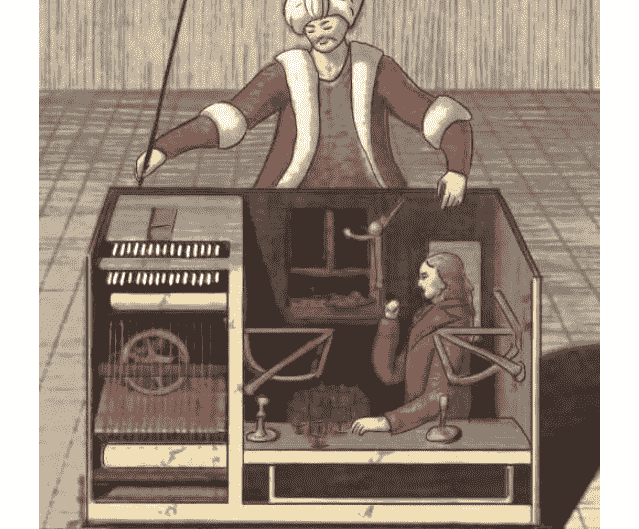

骗局虽假，却点燃了灵感。英国工程师查尔斯·巴贝奇1819年曾与“土耳其人”对弈两次皆败，他怀疑机器背后有人操纵，并非智能所致。他没有写文章揭穿，而是想造一台真正的下棋机，用来为可编程自动计算器分析机筹资。受限于当时的机械制造工艺，分析机未能完成，但他造出了井字棋游戏机。合作者阿达·洛芙莱斯则看出可编程机器能实现概括能力，并认为通过编程可以教会机器执行任务。

进入20世纪中叶，首台电子通用计算机埃尼阿克于1946年诞生。1949年香农发表《计算机下棋程序》，开创机器下棋的理论。许多科学家乐观预测几年内就能造出击败世界冠军的下棋机，解决“计算机国际象棋问题”。现实证明预测过早，直到80年代初，机器仍难望冠军项背。

#### （五）剑指冠军的“深蓝”
1988至1989年，卡内基梅隆大学的“深思”夺得北美和世界计算机象棋锦标赛冠军，并获弗雷德金二等奖，能分析大师数千种套路，初始版本就内置70万种大师玩法，成为首个获国际象棋计算机特级大师称号的机器。研发核心成员中有来自台湾的许峰雄，他1985年赴卡内基梅隆攻读博士，接触到“计算机国际象棋问题”后加入项目。

当时造出能击败世界冠军的计算机被视为荒诞。许峰雄在研究当时顶尖的“贝尔”机器后，从设计者肯·汤普生“给机器更多时间，下棋就会更强”的说法受启发，提出大胆设想：如果把“贝尔”类的计算速度提升千倍会怎样？团队判断，即便仍不足以击败人类冠军，也能逼近其水平。这一“靠速度取胜”的思路后来带入IBM“深蓝”项目。许峰雄一直认为“深蓝”击败卡斯帕罗夫靠的不是人工智能，而是超算的蛮力计算。

德国工程师康拉德·楚泽是现代计算机先驱之一，他提出程序控制概念，1938年用继电器造出首台可编程二进制计算机Z1，后造出含2000余个继电器的Z3，并大胆预言计算机50年内能击败人类象棋世界冠军。1988年为纪念这一预言，在他生日举办国际象棋人机大赛。“深思”受邀，但赞助商IBM要求程序必须在IBM主机运行，导致比赛取消。IBM随后邀请团队成员加盟，这成为“深蓝”诞生的关键。

“深蓝”是一组由高速网络连接的IBM RS/6000 SP处理器集群，共30台主机，每台配16颗定制象棋芯片，总计480颗。芯片运行在130MHz，两张微通道卡上部署，搜索速度可达每秒2×10^8个棋局。系统内置丰富的开局库、残局库，并在特级大师指导下训练一年。取胜主要靠两点：深厚的棋谱知识与极致算力。

1996年首代“深蓝”以1胜2和3负败给卡斯帕罗夫。升级后更名为“更深的蓝”，理论搜索速度达每秒10亿个棋局，实际峰值约2亿。即使博弈树搜索宽度30、深度80，状态空间高达10^50，在先验知识辅助下仍可实现12步内的穷举搜索，而卡斯帕罗夫最多预判10步。负责芯片与架构设计的正是许峰雄，被誉为“深蓝之父”。

## 第二章 人机对弈引爆AI浪潮
### 一、AI爆发前的暗流
人工智能自1956年诞生以来，两个标志性里程碑是“深蓝”的国际象棋和AlphaGo的围棋。两者代表两条路径：“深蓝”依赖穷举搜索和人类预置规则，AlphaGo具备自我学习能力，能从人类对局中吸取经验并持续进化。AlphaGo的Master、Zero版本让博弈智能从零起步成长为顶尖水准，而AlphaStar把计算机博弈拓展到策略游戏，显示出从专用AI向通用AI发展的趋势。

#### （一）“深蓝”击败卡斯帕罗夫
1997年5月11日，升级后的“深蓝”以3.5比2.5战胜世界冠军加里·卡斯帕罗夫。卡斯帕罗夫6岁学棋，13岁获苏联青年冠军，16岁成特级大师，22岁成为史上最年轻的世界冠军，1985至2006年间23次世界排名第一，11次获奥斯卡奖，被誉为棋坛巨无霸，还通晓15国语言、精通数学与计算机。机器能战胜他，意义非凡。

1996年第一代“深蓝”思考速度约300万步每秒，最终1胜2和3负落败。为再战，IBM召集4名国际象棋大师组建团队，许峰雄主导新架构。1997年双方在常规用时下进行6局，“深蓝”以2胜1负3和获胜，第6局仅用22步便迫使卡斯帕罗夫认输，是其职业生涯最短的失利（图2-1）。


图2-1 1997年国际象棋人机世纪对战

战后卡斯帕罗夫质疑人机联手，要求公开日志并重赛，IBM拒绝，多年后才公布。换言之，“深蓝”缺乏人类棋手的自我总结与临场应变能力。许峰雄在书中指出，“深蓝”并非人工智能系统，其目标是造出快到足以击败世界冠军的机器，用纯粹的超快计算挑战直觉、战术与经验，靠专门软件“傻算”取胜。当然，计算技术功不可没，“深蓝”成为人工智能里程碑的地位不可否认。

上场的“深蓝”是当时全球最快的超级计算机之一。按许峰雄披露，它是32位IBM RS/6000 SP系统，存储了当时绝大多数棋谱，每步评估子力价值、位置价值、王的安全和行棋效率，再配置战术战略判断优劣。每台处理器可控制16颗象棋芯片，分布于两张微通道卡，每卡8块芯片内含超4000个微处理器，检索速度达2×10^8局每秒，为穷举算法提供硬件基础。1996年以2比4落败后，速度翻倍的升级版在1997年胜出。

为何总以棋牌证明智能？一是棋类本身富含智能，能揭示人类智能本质；二是示范效应强，胜过人类棋手是最直接的证明。国际象棋源于亚洲，经阿拉伯传入欧洲，棋盘8×8共64格，双方各16子，各有一王一后、两车两象两马八兵，目标是吃掉对方王。将科学、知识、艺术与灵感结合的它成为AI理想载体。IBM“深蓝”胜出不仅是IBM的荣光，也是人类共同的胜利。

#### （二）AlphaGo让围棋世界冠军俯首
游戏是智力、体力与情感的对抗，围棋源于中国，古称“弈”，《不列颠百科全书》考证可追溯至公元前2356年，历史超4000年。选择围棋作为第二次世纪大战，是因其辨识度高、规则简明，且难度远超国际象棋。围棋状态复杂度约10^172，博弈树复杂度约10^360，是棋类中最高的，被视为人脑与机器在棋类领域的终极较量。

表2-1 常见完美信息游戏难度对比

| 棋种 | 状态复杂度 | 博弈树复杂度 |
| :--- | :--- | :--- |
| 西洋跳棋 | 10^21 | 10^31 |
| 国际象棋 | 10^46 | 10^123 |
| 中国象棋 | 10^48 | 10^150 |
| 日本将棋 | 10^71 | 10^226 |
| 围棋19×19 | 10^172 | 10^360 |

人机大战中AlphaGo展现出强悍学习力，人类一生仅能下数万盘，AlphaGo仅用于自训的对局就达3000万盘。参战的AlphaGo Lee配置170多个GPU，约800万核心并行计算，既能模仿人类再自我对弈进化，也能在实战中实时模拟升级，堪称AI巅峰。

2016年的围棋大战与1997年的象棋大战不同：

- 围棋大战体现了人机融合的高级智能，不再单纯依赖算力。
- 围棋难度更高。
- “深蓝”胜利后AI未能落地，因其“高高在上”，难以应用于工业与社会服务。而2016年AlphaGo Lee以4比1击败韩国九段李世石，让机器学习潜力被世界看见，直接引爆全球AI浪潮，推动多国发布AI战略。中国2017年发布《新一代人工智能发展规划》，提出到2030年总体达到世界领先水平，成为主要创新中心，并推动AI教育进校园。

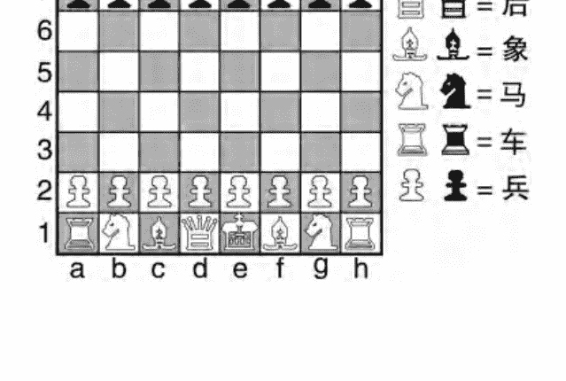

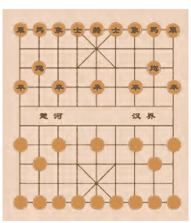

AI博弈的破局之路：从围棋到扑克电竞

全球AI战略布局速览

|  | The National Artificial Intelligence Research and Development Strategic Plan《国家人工智能研究和发展战略计划》 |  |
|  | Artificial Intelligence, Automation, and the Economy《人工智能、自动化与经济》 |  |
| 日本 | 人工智能技术战略 | 2017年 |
| 欧盟 | White Paper on Artificial Intelligence — A European Approach to Excellence and Trust《欧盟委员会 人工智能白皮书——追求卓越和信任的欧洲方案》 | 2020年 |
| 德国 | 联邦政府人工智能战略 | 2018年 |
| 法国 | 人工智能战略 | 2017年 |
| 英国 | 人工智能行业新政 | 2018年 |
| 印度 | 人工智能国家战略 | 2018年 |

围棋人机对决之前，AlphaGo的东家谷歌曾用一个比喻定调：做AlphaGo更像是在驯服一只猎犬，而不是在组装一件精密机器。由此来看，那场世纪对弈的胜者始终是人，只是人类驯养的“猎犬”在捕猎时的爆发力已经全面超过了人类猎手。这场较量也给学界敲响了警钟，在完美信息博弈的赛道上，电脑已经不再是人类的对手，后续的路只能是共舞。此后计算机博弈进入了新的发展阶段。

#### （三）AlphaGo Lee后的新版本

2016年1月27日，DeepMind在《自然》发表论文 *Mastering the Game of Go with Deep Neural Networks and Tree Search*《通过深度神经网络和树搜索来征服围棋》，为围棋人机史翻开新篇。文中回顾，2015年10月5日至9日，AlphaGo以5比0横扫欧洲冠军樊麾，这是职业棋手首次被电脑零让子击败。紧接着2016年3月9日至15日，首尔人机大战中AlphaGo Lee以4比1战胜李世石。

吸收了这轮交手的经验，团队继续迭代。2016年12月29日，几个主流对战平台上冒出一个ID叫“Master”的神秘账号，连续挑落中日韩顶尖棋手，并在2017年1月3日击败柯洁，随后又胜古力，连胜场次定格在60比0。DeepMind随后承认，Master正是AlphaGo Lee的升级版。Alpha系列主要版本的演进如下表。

表2-3 Alpha系列的主要版本变迁列表

| 时间 | 版本号 | 硬件资源 | 标志性成绩 | 备注 |
| :--- | :--- | :--- | :--- | :--- |
| 2015年10月 | Fan | 内置1920个CPU和280个GPU | 5：0打败欧洲围棋冠军樊麾 | 首个不让子并击败职业棋手的围棋程序 |
| 2016年3月 | Lee | 176个GPU和48个分布式TPU（tensor processing unit，张量处理器） | 4：1打败围棋世界冠军李世石 | 树立人工智能新里程碑 |
| 2016年底—2017年5月 | Master | 4个TPU | 60：0线上打败中国、日本、韩国围棋高手<br>3：0打败中国围棋第一人柯洁 |  |
| 2017年10月 | Zero | 4个TPU | 碾压人类棋手 | 训练72小时后以100：0打败Lee版本、训练40天后打败Master版本 |
| 2017年10月 | AlphaZero | 4个TPU | 跨界挑战其他项目 | 使用了深度强化学习算法和自博弈术。它以60：40打败AlphaGo Zero版本，而且自学对弈规则，训练2小时打败日本将棋冠军程序Elmo，训练4小时打败国际象棋世界冠军程序Stockfish |

#### （四）AlphaStar星际争霸Ⅱ程序

AlphaGo只会下棋的质疑一直存在，DeepMind于是把目标投向非完美信息博弈的即时战略游戏星际争霸Ⅱ，推出AlphaStar。AlphaStar是AlphaGo Zero的继承者，采用从零起步学习的思路，靠自我对弈完成训练。每局都会随机抽取两个不同的神经网络对打，孵化出的胜者被复制到下一轮，形成持续进化。

星际争霸Ⅱ对实时决策要求极高，玩家必须在极短时间内作出反应。为此团队引入多步强化学习，按当前状态选择动作并获得奖惩信号，再据此更新策略，使系统在有限时间内不断自我升级。

AlphaStar的突破说明，围棋到星际争霸这样截然不同的场景，核心学习框架可以迁移。自我博弈配合多步强化学习解决了实时策略难题，也为工业化落地提供了坚实的基础，让计算机博弈的想象空间进一步打开。

### 二、计算机博弈中的AI密码

深蓝和AlphaGo分别击败国际象棋与围棋世界冠军后，AI并未止步，研究目光转向难度更高的扑克、电竞和麻将。这些新战场将成为AI成果的新标杆。

#### （一）德州扑克人机大战：AI的新里程碑

博弈可按信息可见度分为完美信息与非完美信息。象棋围棋属前者，牌类和星际争霸Ⅱ属后者。两场人机世纪战聚焦完美信息后，质疑声转向非完美信息领域。AlphaStar只是初步试水，于是研究者把目光锁定德州扑克。这种游戏至少两人参与，彼此看不到完整手牌与公共牌，必须在有限信息下做策略抉择。要面对协作、不确定、随机与对抗多重挑战。

代表性成果有三：
- DeepStack：2016年由加拿大阿尔伯塔大学、捷克查理大学和捷克理工大学团队研发，是首个达到职业水准的无限制德州扑克AI。结合深度神经网络与反向归纳，可实时计算策略。2017年它与33名职业玩家进行4万余手一对一对战，以显著优势全胜。
- Libratus：2017年卡内基梅隆大学在Claudico基础上升级而来，是首个在无限制德州扑克正式比赛中战胜世界顶尖选手的AI。采用预先计算、实时搜索、后期分析三段式框架，利用超算并行运算。2017年12万手对战中，Libratus以压倒性优势击败4名顶尖人类。团队使用纳什均衡策略，剔除无望策略从而更快逼近均衡点。
- Pluribus：2019年卡内基梅隆大学与Facebook联合研发，是首个在多人无限制德州扑克上超越人类顶尖水平的AI。靠自博弈生成蓝图策略，再用实时搜索细化。2019年它分别以“5个AI加1人”和“1个AI加5人”的形式对战顶尖牌手，均取得统计学显著胜利。

此前多人游戏的纳什均衡计算存在不确定性。Pluribus以自对战加实时搜索复合技术破解难题，从零随机行动逐步学会概率分布与博弈行为。三个系统展示了AI在德州扑克的惊人能力，也证明精心设计的自对战加搜索算法能以少量资源取得突破，不必像AlphaGo那样依赖巨量算力。

#### （二）OpenAI电竞游戏Dota2的AI新高度

Dota2由Valve开发，玩家数以千万计，策略性强且随机性大，是AI研究的硬骨头。两队各五人配合推塔，AI演进可分三阶段。

第一阶段是规则型AI，由Valve提供，按预设条件执行攻击、放技能、买装备等。实现简单但缺乏创造与应变。

第二阶段是深度学习型AI，由OpenAI打造，用深度神经网络模仿人类行为，选择英雄、走位、释放技能等。能自主学习进化，但数据与算力需求大且难以解释。

第三阶段是强化学习型AI，同样由OpenAI团队完成，靠强化学习训练优化策略。具备自我调整与迁移能力，可在不同模式下复用，但训练耗时且可能出现不合伦理的行为。

OpenAI Five于2019年击败世界顶级Dota2职业战队，并开放公众对战。这一成果不仅展示了AI在高维度、高不确定、高协作网络游戏中的潜力，也为医疗、教育、军事等领域提供了新的思路。

#### （三）微软麻将Suphx的AI新战场

2019年6月，微软宣布麻将AI Suphx在专业平台“天凤”升至十段，全球现役十段人类选手仅十余人。该成绩相当于围棋中击败李世石九段。Suphx在“天凤”对战超5000场，最高段位十段，稳定在八段左右，超过另一两款知名AI，达到顶级人类平均水准。

麻将源于中国，规则简单玩法多变，144张牌由序数牌、字牌、花牌构成。玩法有四川、广东、云南、晋中等多种。麻将是四人序贯博弈，“吃碰杠”会打乱出牌顺序，造成随机性和决策中断。

诺贝尔经济学奖得主纳什提出的动态博弈中，序贯博弈体现为决策者按顺序选择，后者知晓前者选择。博弈树可描述该过程。麻将作为非完美信息博弈，包含对弈方、行为、信息、策略、收益五要素。

多圈对弈下，前次决策影响后次，同一局内前位决策影响后位。“吃碰杠”可能导致某人连轮无牌可摸。输赢为累计结果，高手会战略性放弃单局。牌墙与对手手牌信息隐藏，决策受限。出牌顺序的不确定性让博弈树构建困难。

微软的解法是监督学习、强化学习与蒙特卡洛树搜索相结合。先用监督学习在“天凤”顶尖数据上训练舍牌、门清、吃、碰、杠五模型，再通过自我博弈强化学习迭代，并在线上对局中实时调整。Suphx引入全局奖励预测、先知导引、参数化蒙特卡洛策略调整三大模块，形成循环迭代。

麻将AI大致经历三阶段：规则启发式AI，靠手牌形态、进张数、听牌率等易实现但难以适应风格；机器学习AI，靠大量人类数据训练分类器、决策树、神经网络，可模仿高手但受数据噪声影响；深度强化学习AI，靠自我博弈提升决策，使用残差网络、分布式训练等可超越人类，但需大量算力且面临多人非完美信息、计分复杂等难题。

Suphx的意义在于，面对智能交通、金融市场等易受随机突发冲击的场景，AI也能提供有效解决方案。

#### （四）腾讯王者荣耀的群体智能新高度

王者荣耀由腾讯开发，玩家数亿，英雄丰富。在复杂环境中实现人机高水平对抗极具挑战。2022年11月，腾讯上线“王者绝悟”模式，提供智能助手和英雄练习场等玩法，许多玩家反馈AI操作精妙、配合默契，被形容为王者版AlphaGo。

从难度看，围棋规则简明，一对一以子数多者胜。王者的规则看似简单，摧毁水晶即胜，却是一对多、多对多玩法，存在多AI协作难题，使研发难度呈数量级提升。

地图复杂度与智能上限

对抗场景的规模直接决定解题难度。围棋盘面每个交叉点只有空、白、黑三种取值，而王者荣耀的战场单元会随上场英雄、装备搭配、道具使用以及瞬时站位持续变化，玩法分支带来的操作差异和对手行为的偶然性共同推高状态空间，整体复杂度呈指数级膨胀。正是这种极端的非确定性和实时性，使得星际争霸II里的AlphaStar和DOTA2的OpenAI Five即便达到世界顶尖，也无法对人类实现彻底的压制。

这种复杂性同时带来迁移价值。游戏地图的逻辑可以映射到抢险处置、交通管控、金融对冲、战役推演等现实问题。非完全信息、高动态、强实时、超大规模的对抗，正成为多主体协同乃至通用智能的研究试验场，其群体智能的探索意义和落地价值都很突出。

腾讯为此提出分级宏观策略的多任务框架。先让系统通过分层训练形成清晰的宏观意图，再向下驱动微观执行；单个主体具备自主决策能力，并借助一种模仿式交叉通信机制与队友实时交换意图。技术上融合深度强化学习与自适应分布式训练，形成英雄层与团队层两级。英雄层负责单体操作与即时决策，采用演员-评论家结构的深度强化学习，通过与自身或其它主体的对抗训练不断提升；团队层遵循中心化学习、分散执行的原则，用一个中心评论家网络评估整队行为收益，完成协同。

具备自主决策与高度协作能力的游戏智能，既提升产品体验，也为现实复杂问题的求解提供思路。腾讯AI实验室依托王者荣耀在算法、算力与实验场景上的积累，搭建多AI复杂决策的开放研究平台，为学界与开发者提供领先的群体智能探索环境，进一步巩固了其在全球AI版图中的地位。

### 三、中国的计算机博弈
国内相关研究的起步晚于海外，大约在2003年左右由东北大学徐心和教授推动，以象棋为切入点取得突破。2006年AI诞生五十周年之际举办了浪潮杯首届象棋人机对弈与首届计算机博弈锦标赛，2007年成立了中国AI学会机器博弈专业委员会，研究进入快车道。

#### （一）中国象棋“棋天大圣”人机大战
国际计算机游戏协会ICGA成立于1977年，旨在推动计算机游戏技术与文化的进步，主要举办国际赛事、发表论文并开展AI研发，是一个非盈利组织，对全球发展起重要推动作用。

国内虽起步较晚但发展迅速，这与徐心和教授的大力推动密不可分。作为机器博弈事业的开拓者，他自2003年起投入象棋计算机博弈研究，2004年组建东北大学棋天大圣象棋代表队，2007年筹办机器博弈专业委员会。

2006年8月，徐心和教授在北京科技馆主办了AI诞生五十周年纪念活动——浪潮杯首届中国象棋人机大战和首届计算机博弈锦标赛。人机大战邀请柳大华、张强、汪洋、徐天红、卜凤波五位象棋特级大师，最终棋天大圣代表的程序以11:9的总比分击败五位大师，成为里程碑。首届锦标赛的参与者后来成为国内领域的中坚力量。

在徐心和教授带领下，东北大学棋天大圣代表队不仅夺得2006年首届计算机博弈锦标赛冠军，还连续两年斩获ICGA举办的象棋世界冠军。人机大战未形成预期热潮，却推动了国内计算机博弈活动的开展。

#### （二）中国大学生的计算机博弈活动
1997年IBM深蓝击败卡斯帕罗夫、2006年棋天大圣击败象棋冠军、2016年AlphaGo击败李世石、2017年德州扑克程序击败人类顶尖高手，每一次突破都是科技发展的重要节点，大幅推动AI进步。

在台湾，研究起步早、影响大。2005年台湾交通大学吴毅成教授为解决五子棋禁手和公平性问题，创造了六子棋项目，IBM深蓝之父许峰雄、AlphaGo核心成员黄世杰等学者都直接参与了这些里程碑事件。

为推动事业发展，徐心和教授联合全国多所高校创建机器博弈专业委员会，将每年举办全国计算机博弈锦标赛暨全国大学生计算机博弈大赛作为核心任务，同时开展培训、论文征集与交流，为爱好者和科研人员提供竞赛、技术、学术交流平台。截至2022年，专业委员会拥有近8000名会员、近百所高校或研究机构，是学会的优秀专业委员会。

2022年8月5—8日，由中国人工智能学会和教育部高等学校计算机类专业教学指导委员会联合主办，成都理工大学、重庆理工大学共同承办，竞技世界网络技术有限公司和机器博弈专业委员会协办的2022年竞技世界杯中国大学生计算机博弈大赛暨第十六届中国计算机博弈锦标赛顺利举行。受疫情影响，这是第三次在线上举办全国决赛，报名高校机构超660所、队伍突破2000支，晋级全国决赛队伍超400支。其中锦标赛面向全社会，大学生大赛仅限在校生。

按照专业委员会的规划，采用项目库机制，每年从库中挑选不超过20个项目开展全国赛事，项目库定期更新，吸纳掼蛋、成都麻将等区域性、对抗性、技术性突出的项目。自2022年起增设面向全社会的计算机博弈创意创新赛道，参赛作品可为方案、论文、文创作品，培育创新文化氛围，推动事业发展。

表2-4 2022年中国人工智能学会计算机博弈竞赛项目表

| 中国大学生计算机博弈大赛项目（共10个） | 中国计算机博弈锦标赛项目（共9个） |

| :--- | :--- |

| 五子棋、六子棋、点格棋、苏拉卡尔塔棋、亚马逊棋、幻影围棋、不围棋、爱恩斯坦棋、军棋、海克斯棋 | 中国象棋、围棋（19路）、国际跳棋（100格）、国际跳棋（64格）、二打一扑克牌（斗地主）、桥牌、德州扑克、久棋、大众麻将 |

#### （三）计算机博弈平台
博弈无处不在，从儿童游戏到谈判、价格竞争、外交、战争，凡有利益冲突之处，博弈即可作为化解矛盾的手段。博弈研究兼具科学属性与工程属性，科学层面涉及智能本质，工程层面涉及技术、实施与方法，并需数据、流程、设计、编码、测试、分析等支撑，这为参与者设下门槛。

一个完整的棋牌类博弈包含五大要素：对抗主体、规则、行为、着法、收益。主体全为计算机为机机博弈，一人一机为人机博弈，双方皆为人则为传统人人博弈。为推广活动，机器博弈专业委员会为大学生和爱好者开发系列平台，提供应用开发接口，让参与者聚焦算法、策略、体系研究，降低工程难度，同时构建社区、推广棋牌谱、发布数据集以促进交流。目前已建成桥牌、斗地主、德州扑克、大众麻将、军棋、围棋、幻影围棋等竞赛平台，吸引近百所高校科研机构参与，为事业发展奠定基础。

有专家把计算机博弈比作AI研究的果蝇[1]。研究载体需易获、易控、成本可控且与目标高度相关，棋牌游戏具备这些特点。规则透明胜负立判，适合作为标准研究平台，也利于人才培养。学生通过教计算机下棋打牌，既能培养科学素养与实践技能，又能激发研究热情。专业委员会组织的赛事与平台为全国高校、研究机构和爱好者搭建竞技、切磋和科研平台，为AI人才培养提供支撑。

#### （四）更广泛的机器博弈
AlphaGo的惊艳让围棋AI进入日常训练，甚至有选手表示没有AI软件帮助棋力难有飞跃。2022年韩国国手申真谞在全球顶级赛事中连胜30场，因着法与AI高度契合而被称为申工智能，可见AI对竞技的深远影响。

在深度强化学习等技术加持下，AI训练AI成为常态，机器人比赛、无人驾驶挑战、无人机航拍竞赛、无人机足球、无人机竞速、无人艇搜救等也加入博弈活动，形成更广泛的机器博弈。机器博弈是计算机博弈的外延，以机器装置和程序为载体，以计算机为工具，模拟人类或其他生命体的博弈智能行为，揭示智能本质，是AI重要分支。

早期计算机博弈多选棋牌游戏，因规则透明、信息完备、胜负易判，适合数学建模求解，高智能、强对抗、强娱乐性也吸引研究者。

超出棋牌范围后，对抗规则更模糊、不确定、随机，博弈要素更丰富。机器博弈成为典型的非线性多目标规划问题，求解难度大幅提升。如图2-7所示的兵棋推演，利用计算机、通信、对策论、AI模拟战争场景，分析战略战术、优化行动并预测影响，为决策提供参考，涉及政治、外交、军事、工业、经济、社会等多层面，尤其是战力、武器、后勤保障等，复杂度远超传统博弈。目前兵棋推演正从军事研究机构、军队院校向其他院校扩展，推动博弈论、多AI协作、战争规划与调度、战场数字化与推理、机器学习等发展，提升机器的自主、协作、安全能力。

商业谈判、无人机对抗等涉及多领域知识、多层多方利益、多目标优选，是博弈领域的皇冠难题。它们对机器博弈提出更高要求，也提供更广阔创新空间。

### 第三章 超乎想象的算法赋能
### 一、计算机博弈的关键技术
计算机博弈即教会计算机与人类或其他计算机进行游戏对抗，是AI重要分支，也是标准研究平台。对抗中计算机如何决策？如何不断提升水平？本节先介绍时间与空间互换的作用、博弈树概念及α-β剪枝，再探索侧重时间和空间的剪枝方法、多线程方法，最后介绍基于数据的机器学习与基于规则的自博弈方法，以帮助探究博弈本质。

#### （一）时空转换对博弈的作用
博弈本义是民间下棋打牌的竞争性活动，延伸为各方为获取利益展开的斗智斗勇。学术上，博弈是在一定条件和约定规则下，两个或以上理性主体从允许集合中选择各自行为或策略并实施以获取收益的过程。本质是在规则约束下争利。此处利可为经济、物质、精神，也可为空间、时间，前三者直观，后两者抽象。

博弈中的AI技术与时间之利、空间之利密切相关。为此先科普空间、时间概念及时空转换的意义。时间是物质运动变化的持续性、顺序性的外显形式，是描述运动过程的指标，是物质运动周期变化的内在规律，在可观察范围内时间不受外界干扰，常以地球自转作为计量基础，这就是世界计时系统。地球自转产生昼夜、月相、季节循环，形成日、月、年等度量。本质上日、月、年以月球、地球在太阳系中的运动方式定义长度。时间具时刻与时段双重含义。时间作为追求目标的根本原因在于其唯一性、公平性与不可逆性。

空间源自拉丁文spatium，指物体在感知系统中产生的物理尺寸、相对距离等关系所形成的客观存在。通常以长度、宽度、高度度量，常见有宇宙空间、运动空间、网络空间、数字空间等。空间与时间相对存在，本质都与物质运动密不可分。爱因斯坦基于时间测量定义法发现时间与运动关系，提出相对论，得出时间就是空间的时空观。霍金在时间简史中提出时间始于宇宙大爆炸，大爆炸前不存在时间。春秋战国尸子在尸子中定义四方上下曰宇，往古来今曰宙，即空间为宇、时间为宙，宇宙为时空集合。

古今认识到时间与空间的关联与等价性。博弈中人们常将经济、物质、精神、时间、空间作为目标，利用二者关联，通过时间换空间或空间换时间实现获利，这正是计算机博弈技术的基本思路。

#### （二）启发式α-β剪枝方法
计算机博弈目标是在规定时间、确定资源条件下，快速发现合适或最优、近似最优的策略。博弈过程常比喻为一棵倒着生长的博弈树，各方按时间顺序寻找对己最有利着法。依据极大-极小算法，己方行动时选局面评估值最大的着法，对方行动时选对己方最不利的最小值。博弈树庞大，不可能遍历，需剪枝，如同果农剪枝以提高收益。α-β剪枝是最常见方法。

以图3-2中3行3列博弈树为例说明极大-极小与α-β关系。第一步用局面评估函数计算最底层节点收益值；第二步甲方行动，对底层收益比较，取最大值构成倒数第二层；第三步乙方行动，选择对自己最有利即对甲方最不利的着法，形成倒数第三层；第四步甲方行动再选最优路径A1；第五步倒推可得在节点D时甲方最佳路径为A1—A2—A3。

> [1] 果蝇因其结构简单、生活周期短、培养简单、基因组小、实验风险可控等特点，常被作为实验载体，在生物以及医学领域的科学研究中发挥着重要作用。

进入实战求解阶段，立刻会撞上两块硬骨头。第一块是局面评估函数的构建难度，想把棋盘上纷繁复杂的态势压缩成一个能指导决策的分数，本身就极不靠谱，就像职业棋手也常分不清眼前是致命危险还是绝佳良机，误判直接导致行动失当、被动甚至输掉。另一块是博弈树规模的爆炸性，如同本书第一章所述的香农极大极小搜索，国际象棋的博弈树规模高达10的120次方，哪怕动用百亿亿次级的超算，穷搜也要2.883×10的92次方年。面对如此庞大的搜索空间，只能另辟蹊径，在算力可承受范围内逼近近似最优解或某个局部子空间的最优解。常见做法是先设定一个可处理的节点总量，再按宽度优先尽量扩宽横向节点，或按深度优先尽量拉长纵向节点，两种取向都与硬件算力强相关。于是挑选强劲的计算平台成为首要前提。随后借助局面评估函数挑选节点并计算收益值，默认评估值客观准确，再按3×3博弈树的计算思路推导出最佳线路。

受限于计算资源，穷尽所有节点几乎不可能，实践中往往主动扩大搜索范围，让得到的局部最优解更贴近真实的全局最优。1956年图灵奖得主约翰·麦卡锡首次提出α-β概念，并在1961年发表系统阐述。下棋时不必遍历所有走法，只需聚焦有价值的走法。核心设定是把博弈树中求最大值方的节点记为α、求最小值方的节点记为β，依据零和博弈，己方收益最大时对手收益最小，反之亦然。若出现“子节点α的值大于等于父节点β的值”或“子节点β的值小于等于父节点α的值”，则该节点之下整条分支可直接剪掉。这一推导后来得到数学证明，剪枝大幅削减搜索量和计算成本。更新是从最底层的叶子向上回溯，轮到甲方走就刷新α，轮到乙方走就刷新β，父层用子层中最大的α刷新最大值，子层用其子层中最小的β刷新最小值，逐层剪除多余分支。

剪枝效果对搜索顺序极度敏感。若节点排列杂乱，收益微小。理想情况是把α节点按从大到小排序，先从对己方最有利的方向搜起，剪枝效率极高；反之按从小到大搜，β剪枝几乎不触发，退化成普通的极大极小搜索，可能被迫遍历整个空间。于是先对博弈树节点排序，再由优到劣展开搜索，这就是启发式α-β剪枝的思想。启发式手段很多，最常用的是借助人类先验知识，如建立开局库、定式库，把已被验证的招法植入系统，直接调用从而剔除大量无效搜索。图3-4的中国象棋对局里，黑方利用“双将必动将”的常识，平车出头将军即为杀招，此时再去穷搜其他着法已无意义。α-β剪枝最知名的应用是IBM的深蓝国际象棋程序，1997年击败世界冠军卡斯帕罗夫，成为人工智能的分水岭。

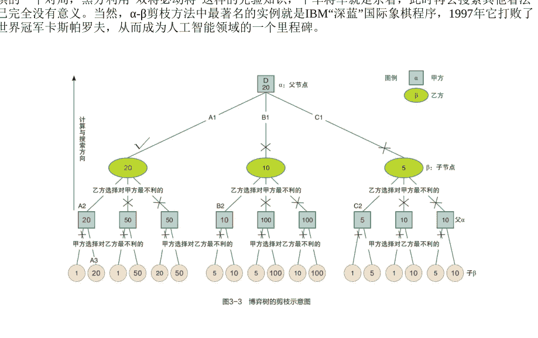
图3-3 博弈树的剪枝示意图

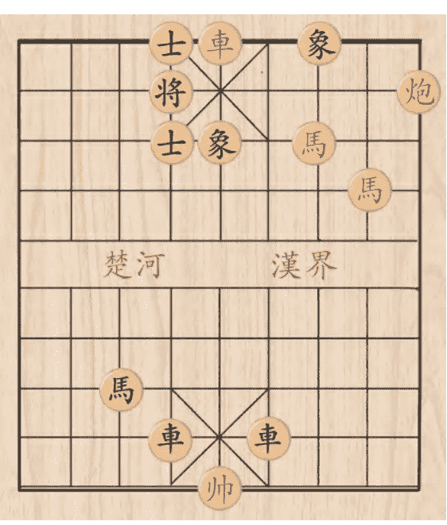
图3-4 启发式搜索实例

#### （三）空间换时间的博弈树搜索方法
即便动用全球最快的超算，国际象棋的博弈树也难以遍历。科学家注意到，物质运动包含时间与空间两大要素，时间灵活性差，空间则更易调节，于是以牺牲空间换取时间成为思路。对应到计算博弈，就是扩大内存、外存、机群规模，提升物理空间资源来压缩运算时长。在冯诺依曼体系里，内存容量有限但访问极快，外存理论上无限但访问慢，数据必须先调入内存才能被CPU使用，内外交替的传输损耗累积起来就是巨大的时间成本。云存储与本地存储、不同网络介质的传输差异也能通过类似调度缩短总耗时。

把空间换时间为博弈搜索服务，常见做法有：
- （1）扩充内存，把博弈程序、相关数据、中间计算结果尽量驻留内存，减少内外存来回搬运的时间损耗。
- （2）把云端数据部分或全部迁移到本地服务器或计算节点，降低对网络传输的依赖。总体存储并未减少，但用本地空间置换网络存储，能省去网络传输时间。
- （3）使用缓存或置换表保存已搜索过的节点或子树，遇到相同或相似局面直接比对复用，避免重复搜索，GPU即采用此思路。因缓存需求巨大，往往辅以理论上可无限扩展的外存来避免内存溢出。

空间换时间并非无限制，过度占用内存会导致溢出、性能骤降甚至崩溃。不同博弈项目需根据硬件配置与运行环境匹配合适的策略与参数，才能获得最佳性能。

#### （四）时间换空间的“AI训练AI”自博弈术
自博弈让人联想到金庸《射雕英雄传》中周伯通的左右互搏，单人双手模拟多人对弈。在人工智能里，自博弈是一种强化学习的训练框架，本质是通过程序与自身或同水平程序对弈产生海量训练数据，再以此数据学习改进，形成“AI训练AI”的闭环，其理论根基是博弈论与强化学习。博弈论研究竞争情境下的最优决策，强化学习研究通过探索与试错获得最优策略。

自博弈可追溯到20世纪50年代约翰·纳什提出的纳什均衡，90年代蒙特卡洛树搜索被引入自博弈研究，使计算机能以更智能方式优化决策。蒙特卡洛树搜索靠多次模拟试错计算每种博弈的期望值，选择期望最高者，最著名应用是AlphaGo围棋程序，推动了自博弈的广泛采用。自博弈的基本流程是：让程序与自身或相似水平程序对弈，记录过程与结果，用这些数据作为学习输入，迭代改进评估函数与算法参数，提升博弈能力。

其流行与五个特征相关：
- ① 不依赖先验知识。通过自我对抗在实践中探索规则与策略。
- ② 面向超大空间。适用于博弈空间庞大且需求解最优解的问题。
- ③ 决策过程不透明。策略形成路径不可见，只能观察输入输出。
- ④ AI独立运行。自博弈AI可自主运行，无需外部程序支持。
- ⑤ 自主学习。本质是无监督学习，几乎不需要人工标注数据。

依对弈方式，自博弈可分为四类：
- ① Naive Self-Play：新版本与上一版本对弈，简单直接但易陷入循环。
- ② the Best-Win Self-Play：新版本与历史最强版本对弈，可避免循环但易过拟合。
- ③ the Max-Margin Self-Play：新版本与最难击败的版本对弈，增强鲁棒性但可能削弱表现力。
- ④ the Nash Self-Play：新版本与所有历史版本对弈，可逼近纳什均衡，无一方能单方面提升收益，但计算与存储需求极大。

自博弈削弱了对领域数据、先验知识与人工干预的依赖，提升智能与泛化能力，只要目标函数清晰且反馈有效，AI就能在多种博弈场景中通过自我训练逼近最优解，实现以时间换空间。缺点是训练周期长、资源投入大，落地受限。

#### （五）时间与空间融合的并行方法
前述方法分别以时间换空间或空间换时间，下面介绍两者融合的并行搜索。基于冯·诺依曼体系，代码与数据以二进制存于内存，存储与控制结合，在程序控制下自动运行。用户常以CPU运算速度、字长、内存容量等衡量性能。CPU是运算与控制核心，包含运算器、控制器、存储器及数据总线。

CPU运算远快于从外存读取数据，需长时间等待外部设备。为此引入进程与时间片概念。进程是打包执行的一批任务，时间片把高速CPU运行时间切成若干片段，每个片段对应一个进程。调度机制把多个进程串联，轮流占用时间片，用户感觉并行，例如边办公边听音乐边用微信，实质仍是串行。

即便如此，时间片内CPU空闲等待仍浪费资源，于是引入线程，即可调度的最小执行单元，进一步把进程拆分，配合进程线程配对，使CPU利用率更高。

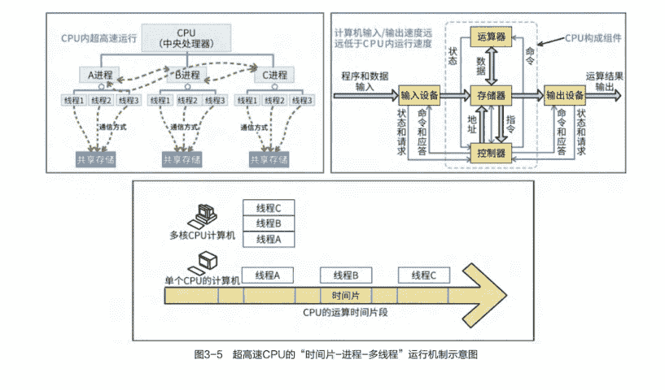
多进程多线程极大提升了多任务处理能力，但本质仍是分时串行。为真正并行，研究者把单核改为多核CPU，操作系统随之改进，使多核心同时处理多任务。如今常见的4核心8线程机器，物理上有4个核心，逻辑上可虚拟为8个计算单元，可同时运行多个线程，进而同时运行大量进程。

由此，单核机通过时间片实现串行任务的并行效果，多核机则实现真正的多任务并行。在博弈中，可把博弈树拆分为若干分支，分配给不同线程乃至不同进程并行搜索，需主控程序协调信息交换。典型案例是1997年IBM深蓝，由30台RS/6000 SP与480颗专用象棋芯片组成，采用分布式并行搜索，把博弈树分枝分发搜索后由主控汇总，最终击败卡斯帕罗夫。

多线程与并行在时间维度加快搜索深度与广度，在空间维度扩展内存等资源以保存中间结果与知识。空间扩充配合时间高效利用，实现时间与空间的融合式增长，提升博弈空间搜索效率。

### 二、隐藏于AlphaGo的人工智能算法
Alpha是希腊字母首位，寓意开端，Go指围棋。DeepMind创始人戴密斯·哈萨比斯将两者组合为AlphaGo，意为首个围棋AI程序，中文谐音“阿尔法狗”。AlphaGo由谷歌DeepMind自2014年起开发，历经Fan、Lee、Master、Zero等版本，从业余低水平进化为全球无敌。DeepMind当时的需求是对任意围棋状态找到最好应对策略并执行，最终占据最大地盘。规则简单，但围棋是博弈状态复杂度最高的棋类，2016年前顶尖电脑都难胜业余高手。2016年惊天一战后，全球AI进入高速发展期。

#### （一）AlphaGo的基本工作原理
1997年深蓝击败国际象棋世界冠军，但象棋复杂度远低于围棋。一盘象棋约80回合，每回合平均35种可能，一盘围棋可超150回合，每回合平均250种可能。围棋的博弈空间复杂度是最高的。

战前极少人看好电脑胜出，职业棋手几乎一致认为李世石会捍卫人类荣誉。最终AlphaGo拉下顶尖高手。中国解说之一棋圣聂卫平赛前断言电脑不可能战胜人类，战后表示“AlphaGo的胜利让我受到震撼”，后又感慨电脑可进行数以千万计的高水平训练，“这基本上是人类无法战胜的”。

AlphaGo的强大来自于两大关键网络及相应策略算法。

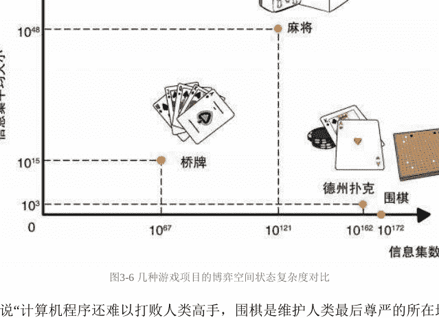
曾经有学者说“计算机程序还难以打败人类高手，围棋是维护人类最后尊严的所在地”，这个说法随着2016年3月那场人机惊天大战而烟消云散。事实上，在大战开始前，极少人认为计算机程序会赢得比赛，特别是在围棋职业选手中，几乎一边倒地认为李世石将赢得比赛，能够捍卫人类在棋类游戏领域的荣誉，当然最后结果是AlphaGo将人类顶尖高手拉下神坛。实际上，担任这场人机大战的中国解说员之一，正是“棋圣”聂卫平，赛前，聂卫平曾断言“电脑绝对不可能战胜人类”，但是结果却令他始料未及，聂卫平后来表示：“AlphaGo的胜利让我受到震撼。”聂卫平接受采访时曾经感慨AlphaGo颠覆了他的认识，起初他对AlphaGo能在与柯洁九段的终极人机大战中胜出并不看好。聂卫平认为，电脑的确强大，而且会进行数以千万计高水平训练，“这基本上是人类无法战胜的”。

AlphaGo之所以这么厉害，是因为它构造了2个极为关键的网络及相应的策略、算法。

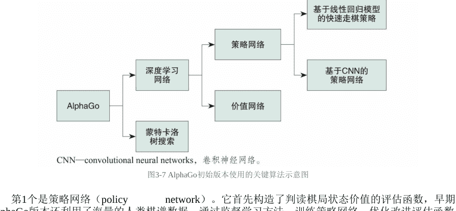

策略网络构成了 AlphaGo 的开端，它先搭建了一个用来评判盘面价值的评估函数。早期的 AlphaGo 还大量汲取人类棋谱，通过监督学习的手段对策略网络进行训 consuming 与调优，随后借助蒙特卡洛树搜索驱动的自对弈，让策略网络持续变强。换句话说，这个策略网络并非一成不变的模型，它具备吸收人类经验、进行自我领悟的能力。它承接了人类历代高手约三千万盘对局的积累，再用数月时间完成 AI 训练 AI 的闭环。反观人类棋手，一生能深度复盘的对局通常不超过两万盘，而且集中在几十年的黄金期。仅就体量对比而言，人类被击败也在情理之中。

价值网络则负责对任意局面给出胜率预估。它先以胜率作为依据在大规模围棋博弈树中搜寻可行着法，再发动蒙特卡洛树搜索进行纵深评估与比较，挑出最优落子。搜索过程中 AlphaGo 能够随时中断并输出当前最优解，而且把每个新产生的状态都视作下一次搜索的起点，不断试探试错，从而持续修正评估函数并扩张博弈树。

在后期版本里，强化学习成为核心引擎之一。强化学习是机器学习大家族中的一员，与监督学习、无监督学习并列，它通过反复试错来学习博弈策略，追求累积奖励最大化。其思想源自生物学里对动物行为的塑造，训练者用奖惩让动物建立行为与状态的联结。典型的强化学习框架包含智能体 agent、环境 environment、状态 state、动作 action、奖励 reward 以及行动策略。agent 从 environment 感知 state，执行 action，获得 reward 并进入新 state，如此循环直至达成目标。强化学习的两大支柱是状态-动作空间的界定与奖励函数的设计，前者决定感知与行动的范围，后者用于评判行动好坏并反馈优化策略。

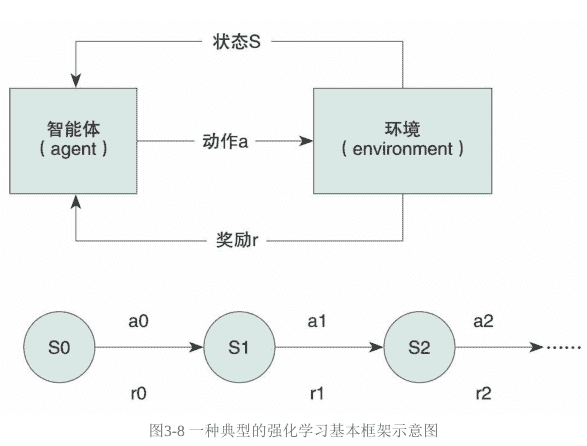
#### （二）AlphaGo的棋感从何而来
人做事往往离不开感觉，跳舞要节奏感，作画要灵感，下棋同样需要直觉。竞赛中时间紧迫、计算空间受限，直觉就成了关键。棋感从字面上讲就是下棋的感觉，它难以言传却真实存在。棋手常会在某个局面瞬间“感到”该落子之处，这种第六感无法被清晰描述或推导出来，且并非人人皆有，需要长期训练与实战磨砺才可能形成。

谷歌为 AlphaGo 打造的棋感主要靠价值网络在海量训练中沉淀。为便于理解，可以类比一位青年商人：在古城市场，他买进转卖赚取差价。起初他靠评估物品价值来定价，并非盲目猜测。第一次进场经验不足难以判断，随着交易次数增多、见证的成交案例增多，他判断物品价值的能力越来越熟练。AlphaGo 价值网络的成长路径类似，从“小白”起步，利用人类先验知识，谷歌汇集了大量人类棋谱喂给模型，让其评估局面并计算价值，反复训练学习后判断精度不断提升。

这一棋感的形成也离不开机器学习算法的支撑。价值网络里使用了强化学习，把大量棋谱输入神经网络学习预测胜率，训练中权重与偏置不断调整以缩小预测值与真实值的差距。在强算力加持下，训练后的价值网络能快速准确地给出胜率预测。可以说大算力、大数据、好算法是取胜的基石，所谓的棋感并不神秘，只是借用人类棋手的概念来形容 AlphaGo 的强大。它本质上是大数据、自博弈、强训练与大算力共同作用下的算法推理，量化可视化后才显出“棋感”般的决策速度，这与人类的直觉不同。

#### （三）蒙特卡洛的试错艺术
蒙特卡洛法由冯·诺依曼、乌拉姆与梅特罗波利斯于 1946 年提出，核心是用事件的频率数据替代难以直接获得的概率。先构建一个参数或数字特征等于问题解的概率模型或随机过程，再通过观察或抽样计算这些特征，最后以标准误差衡量近似解的精确度。其理论基础是概率统计，手段是随机抽样与统计试验。

以求矩形 b 中不规则区域 a 的面积为例，规则图形可用公式，不规则图形可用积分，蒙特卡洛提供了工程化思路：

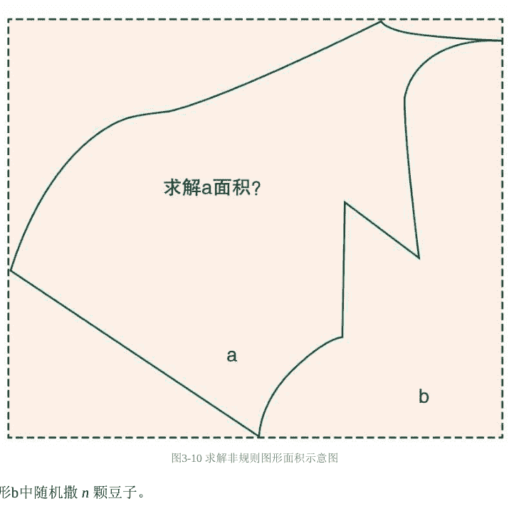
图3-10 求解非规则图形面积示意图
- ① 向矩形 b 中随机撒 n 颗豆子。
- ② 统计落在 a 内的数量为 n1。
- ③ 重复①、② 共 k 次。
- ④ 计算 t_k = (n1 + ... + n_k) / (k × n)。
- ⑤ 在误差 ΔS 范围内，a 的面积 S1 ≈ S2 × t_k，其中 S2 为矩形 b 的面积。

豆子越多精度越高，若要求误差为零则方法无解。围棋博弈树的分支至少百级，常规 α-β 剪枝会丢弃低收益分支，可能丢失重要信息，且通常只能搜到前几层。蒙特卡洛树搜索则随机挑选分支并用模拟结果更新节点评估，避免剪枝的信息损失，且可随时终止返回当前最好评估，因而更适合围棋。

把蒙特卡洛树搜索用于围棋，就是先建树，再像撒豆子一样随机选枝模拟落子直至终局，如胜负和棋或达到最大搜索深度。通过大量随机模拟计算胜率，选出最高胜率着法。为避免搜索过深超时，会设最大深度或最长时间，模拟次数越多，结果越接近真实最优。AlphaGo 的强算力确保了大规模试做的可行性。

蒙特卡洛树搜索包含四个基本动作：动作选择、节点扩展、模拟预演、回溯传播。动作选择利用评估函数在博弈树中挑出值得探索的节点，节点扩展在选中节点下新增子节点，模拟预演从新子节点随机落子至终止条件，回溯则据模拟结果更新从子节点到根节点路径上的统计信息。不断重复该流程，博弈树结构与节点估值逐步改善，最终给出最优或近似最优走法。

#### （四）从特例中增智的机器学习路径
学习是智能的重要标志，但学习的机制至今没有统一共识。有观点认为学习是作出适应性变化以便下次类似任务更有效率，也有观点认为是构造或修改对经历事物的表征，还有观点视其为知识获取过程。无论何种表述，学习能力都是智能形式，机器学习正是赋予机器模拟人类智能的计算模型。缺乏学习能力的系统难以自我纠错、利用经验提升，难以称之为智能。

机器学习是通过数据或先验知识训练模型再用于预测未来的方法。它模仿人类归纳思维，从特殊到一般，通过适量实例挖掘隐藏关联，形成解决问题的方法与知识。与演绎法由一般前提推导结论不同，机器学习的知识获取过程不透明，结论往往不可解释，这也是其被诟病之处。目前机器学习推理多限于演绎与综合，归纳能力不足，更擅长证实已有事实，难以发现新定理与规则。随着人工智能深入，这一局限在博弈、专家系统、自动推理、自然语言理解、模式识别、计算机视觉、智能机器人等领域愈发凸显。

机器学习是方法集合，包含强化学习、深度学习、迁移学习、蒙特卡洛法等，已形成跨概率论、统计学、逼近论、凸分析、算法学的交叉学科。在 AlphaGo 推动下，机器学习成为人工智能核心方法，被广泛应用。其基本流程相近，关键在于依据特征分类、发现关联并输出知识。

人类棋手需十年甚至二十年打谱实战才能成为高手，成为世界冠军更需机遇、天赋与勤奋。计算机如何提升围棋水平？强算力、整体方案与优秀算法缺一不可，机器学习是重要支撑。它无需手工设计评估函数，可依据海量数据与反馈自动调优；无需海量原始数据，可设定规则通过自博弈产生数据；无需遍历所有分支，可用启发式、α-β 剪枝等减少无效搜索逼近最优，还能借博弈论分析利益冲突与合作并建立学习策略。具备这些能力的围棋程序不断丰富技能、增强智能。

#### （五）支撑AlphaGo的TPU算力底座
AlphaGo 的胜利离不开强大的算力。算力指执行特定操作的能力，越高处理数据越多越快。人工智能的许多方法在第三次浪潮前已出现，因算力不足未获关注。对深度学习而言算力决定性作用明显，且不只 CPU 叠加，还涉及内存容量频率、存储速度、I/O 速度、系统架构、指令系统等。全球大量公司投入超级计算机与云平台，本质是打造算力平台。

面对 AlphaGo 的规模，谷歌意识到数据中心需成倍增长。若仅靠堆 GPU 与 CPU，成本高且会过度依赖英伟达、英特尔。自 2015 年起 AI 芯片研发成为热点，英伟达在 GPU 深度学习领域一家独大。于是资金充裕的谷歌启动自研 AI 加速器 TPU，张量处理单元，专为机器学习设计。从 2016 年的 Lee 版本起，AlphaGo 放弃 CPU+GPU 异构，改用 GPU 与首代 TPU1 过渡，到 Master 版本彻底弃用 GPU，仅用第二代 TPU2（图3-12）。

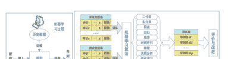
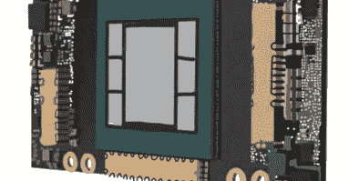
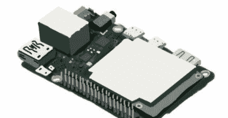
图3-12 典型的GPU与TPU示意图
TPU 于 2015 年 6 月 I/O 开发者大会发布，为优化 TensorFlow 设计，用于 AlphaGo 系列、地图、相册、翻译等产品的搜索、图像、语音处理。TPU 的出现打破深度学习硬件瓶颈，对传统 CPU、GPU 巨头形成冲击，也激励寒武纪等厂商探索专用 AI 芯片。

结构上 TPU 与 GPU 差异明显，TPU 是 ASIC 专用集成电路，按特定需求定制。研发 ASIC 耗时多年成本高昂，但对谷歌不是问题。许多厂商仍倾向 GPU 集群或异构方案，不愿在 ASIC 冒险，这也凸显谷歌对 AlphaGo 的重视与投入。

## 第四章 计算机博弈的发展
### 一、机器学习引领计算机博弈发展
前文讨论了机器能否智能、能否像人一样思考，却未回答智能是什么。智能之谜是 21 世纪最难问题之一，尚无公认解释。有人认为智能是正确解决问题能力的体现，包含感知、学习、理解、决策、语言、创新、环境适应、洞察等。作者倾向李德毅院士的定义：智能即学习能力，即解释与解决预设问题的能力，以及解释与解决现实问题的能力。可见学习对智能决策至关重要。

总体来看，计算机博弈的诸多突破与机器学习密不可分，尤其是强化学习与深度强化学习的成功应用催生了一批惊人成果。本章以学习能力为视角，从学习场景、工具与方法出发，考察全球人工智能公司的进展，探寻计算机博弈的发展方向。

#### （一）机器学习的“数据之痛”
##### 1. 数据的先天缺陷
李德毅院士指出，学习是从未知到可知的交互过程，培养解释与解决预设问题的能力，学习结果是记忆与知识技巧的存储调控提取，目的是解决新现实问题。学习过程涵盖阅读、听讲、理解、思考、研究、实践，方式包括读、听、讲、观、研、探、创、做、试，是一种持续变化的行为。在信息时代，获取知识不再是人类专利，机器也可学习。对照人类学习，机器学习流程如图4-1所示。

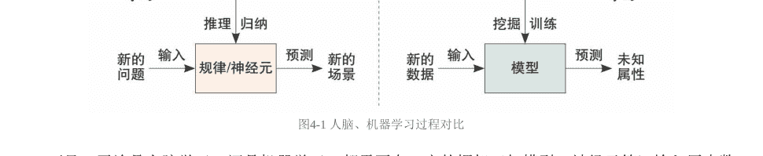
无论人脑还是机器学习，都需向模型、神经元等框架输入历史数据、知识、经验。差异在于人脑可跨时空、跨场景、跨模态，而当前机器学习依托数字电子计算机，所有输入必须结构化、数据化，最终化为二进制数字，这一转化必然导致信息丢失。例如“你在干啥？”在真实对话中包含语气、语调、肢体动作等情感信息，机器最终只保留字面信息，情感丢失，因而无法感知说话者心情。

##### 2. 标注决定机器能否“读懂”世界

人的大脑能联想、能想象、能假定、能感受，这些是机器目前做不到的。举个例子，有位女生不喜欢苦追她的男生，冥思苦想后请他吃饭，点了道天鹅肉，男生立刻明白了暗示知难而退。把同样的场景交给机器人，它只会一脸茫然，像个情商为零的迟钝者。机器的学习往往停留在表层，很难捕捉不同类型数据、不同时空数据之间的隐性关联，更别说挖掘深层知识了。若事先让机器人读过癞蛤蟆想吃天鹅肉的典故，并对痴心妄想这一含义做针对性标注，它就能大致理解这道菜里藏着的要有自知之明、别想谋取不可能到手的隐喻。这说明对输入数据做恰当标注有多关键。

数据标注本质上是对数据里的各类要素做标记，帮助机器理解其含义，是机器学习绕不开的前置环节，这正是人工智能先人工后智能的要义。标注好的数据能为模型训练提供明确方向，最大程度保证收敛。拿跳棋程序来说，先把历史棋谱按最终胜负和棋输棋分成三类，分别标为+1、0、-1，再据此构建学习模型引导训练，否则结果容易发散。做CT辅助诊断的程序，也要让医生先圈出病灶的位置、形态，机器在这些被标记过的数据上学习、归类、记忆，训练完后遇到相似影像才能调出对应结论。这再次印证了机器学习离不开前期人工的精确标注。可标注工作量巨大，成本极高，尤其是医学影像、产品瑕疵点这类专业标签，必须依赖领域专家的经验支持。换句话说，标注既承载了专家的知识沉淀，也默认了数据正确真实的前提，错的数据只会造就错的认知。

##### 3. 好数据背后的昂贵代价

数据质量直接决定模型效果。质量不只是准确与否，还包括分布是否均衡。棋谱要在开局、中局、终局各阶段均匀分布，肺部CT的数据要在不同肺区、不同病灶类型上均匀呈现才算合理。分布失衡就会让模型产生偏向，就像学生偏科，掌握水平取决于教学和复习是否均衡。大量研究证实，有偏或有误的数据会给学习结果蒙上阴影，现实里也有教训：2015年谷歌相册的图像识别把用户朋友认成了大猩猩。数据集是机器学习的燃料，如同汽车的汽油，品质决定动力。但数据很难做到百分百正确，而机器学习对准确性、完整性、均匀性的要求在现实中往往成为伪命题。比如自动驾驶，训练数据多来自晴天环境，若要满足完整性和均匀性，还得补足雨雪暴雨、黎明深夜傍晚等极端场景，几乎不可能完成，成本也难以承受。

##### 4. 黑箱困局：结果好用却说不清

以一个经典案例来理解。英国某沃尔玛店员汇总周末销售数据时发现，儿童尿布、啤酒、香肠经常出现在同一张小票上。深入调查后才明白，英国男人周末看球赛，边喝啤酒边吃香肠，同时还要照顾孩子换尿布，于是三种属性不同的商品在特定场景下临时关联起来，给了店员一个摆放建议：周末把这些商品放到显眼位置。样本规模并不算大数据，却通过关联推导出知识。这与传统科学的因果推导不同，数据科学靠的是关联推导，需要海量数据支撑。但关联有时会与人类已有认知冲突，甚至违背伦理或无法解释，这就是机器学习不可解释性难题。在普通场景，人们更在意结果是否好用，但在医疗、核能、航天等高风险领域，关系到生命和重大投资安全时，不可解释的结果往往会被拒用，只能作为辅助参考。

综上，机器学习就是从数据中学习，结果质量与数据量、数据质量正相关。没有数据就没有机器学习，就像学生没有书籍无法学习。对机器提供充足、正确、标注得当、分布均衡的数据，是达成学习目标的基本前提，这也是机器学习的“数据之痛”，归根结底是成本问题。

#### （二）机器学习的算力瓶颈
##### 1. 硬件堆砌的成本壁垒

DeepMind先用AlphaGo Zero的自学习自博弈回应了依赖3000万盘人类棋谱的质疑，又用AlphaZero证明能力可迁移到其他游戏。这些突破都建立在谷歌强大的计算能力之上，谷歌在软硬件打通上投入毫不吝啬，为每款产品定制顶级算力平台，才有了Alpha系列的里程碑式成绩。

以AlphaGo Fan版为例，它用了1920个CPU和280个GPU，换算成常见的四核八线程个人电脑，相当于上千台PC集群的规模。GPU即显卡，拥有高吞吐、低延时特性，适合大规模并行运算，在深度学习里是核心硬件。单个高端GPU价格不菲，旗舰级甚至超过一台普通电脑，A100、H100等可达十几万元。

TPU则是谷歌为深度学习定制的专用芯片，含多个处理核心、矩阵单元、高速缓存等。以浮点运算为例，普通电脑约200 Gflops，TPU可达十亿Gflops。一个高端GPU工作站约等于5至10台个人电脑集群，一块TPU则相当于上千台服务器集群，换算成个人电脑就是上万台的水平。研究显示，TPU相比同期CPU/GPU方案，单位功耗性能提升15到30倍，效率提升30到80倍，神经网络运算可达CPU的70倍以上。

AlphaGo Lee版使用了48块一代TPU TPU1，8位整数运算高达92万亿次每秒，16位整数23万亿次每秒；二代TPU在半精度浮点下可达45万亿次每秒，TPU2具备180 Tflops能力，后续已迭代到第五代。如此算力支撑远超中小企业可承受范围，既有采购成本，也有使用成本，这正是机器学习算力依赖的窘境。

##### 2. 能耗失控的隐形账单

强大算力意味着惊人电耗。AlphaGo对弈约需1兆瓦电力，相当于一百个家庭一天的用电。人脑拥有千亿级神经元，功耗仅20瓦，是AlphaGo的五万分之一。2016年人机大战中，李世石赛前的一顿早餐与AlphaGo庞大的后援团队相比，人脑才是最经济高效的计算单元。

数据可能存在误差，但差距之大足以说明问题。人工智能竞争的底层逻辑已从只看结果转向关注过程，各国都在建设计算底座并降低能耗，让技术可用且用得起。谷歌内部也意识到能耗之困，于是对AlphaGo Zero进行优化：把策略网络与价值网络合并，让同一网络负责评估与决策，减少每一步的搜索次数，显著缩短学习时间，降低设备规模。总之，算力能耗是重要瓶颈，算法优化、硬件改进和管理提升正在逐步缓解这一问题。

#### （三）从零训练的AlphaGo Zero
##### 1. 人类棋谱加持的质疑声

AlphaGo从2015年击败欧洲冠军樊麾的Fan版，到2016年战胜李世石的Lee版，再到2017年击败柯洁的Master版，战绩辉煌。但围棋界仍有质疑：一是胜负建立在3000万盘人类棋谱上，功劳应归人类；二是算力碾压，人类棋手用电量低，胜之不武。

Fan版约等于千台个人电脑，Lee版有48块一代TPU，接近5万台个人电脑集群的算力。这种硬件碾压与深蓝对弈人类国际象棋的路数相似，用机器的算力碾压人类，就像用汽车比跑步。质疑合理，也侧面说明单纯从能耗和成本看，人脑依然是地球上最聪明的计算器。

##### 2. 深度学习与强化学习怎么分工

为回应质疑，DeepMind另辟蹊径，放弃人类棋谱，让AlphaGo从零开始。2017年10月19日，团队在《自然》发表论文指出，AlphaGo的树搜索结合深度神经网络评估位置与落子，网络先用人类对局监督学习，再用自我对弈强化学习训练。神经网络提升了搜索强度，产生更高质量的走法供下次迭代，这就是深度强化学习。

先厘清概念。数据标注问题催生了强化学习，强化学习不先标注数据，而是设计回报函数来判断当前状态的好坏，本质是马尔可夫决策过程，目标是最大化整体回报期望。强化学习常面对连续、复杂、高级场景。图像分类需要特征，人工选特征耗时耗力且依赖经验，于是出现自动学习特征的方法——深度学习。深度学习利用人工神经网络做特征提取和参数估计。

因此深度学习是神经网络发展而来的技术路线，强化学习是一种学习范式。常见机器学习分为有监督、无监督和强化学习，有监督与无监督的区别在于是否有参考答案，强化学习则从环境反馈中学习，类似生物的趋利避害。深度学习和强化学习交集即深度强化学习，Alpha系列、ChatGPT、王者荣耀AI都是典型代表。

##### 3. 自我对弈是如何起步的

论文中提到，Zero版本从空白状态学习，不使用任何人类经验，完全自我训练，这是最大亮点，支撑它的正是强化学习。Zero仅用4块二代TPU，3天自我对弈约490万盘，以100比0击败Lee版，40天训练后以89比11击败Master版，并在极短时间内发现了征子、定式等古老围棋规律。

围棋目标是引导落子，棋盘无空位时结束，按围地子数判胜负。围棋是完美信息博弈，19乘19网格最多361子，每格可为空、黑、白三种状态，状态空间约3的361次方，约10的172次方，穷举不可行。

对弈时可采用两种思路：一是计算每个状态的价值，预测下一步可能局面并估值，选择最高值的落子，贪心策略下可达全局最优；二是计算每个状态下具体落子动作的价值，算力足够时同样能通过贪心获得最优解。

加入强化学习之后，围棋的落子难题本质上被拆成了两类预测任务。第一类是评估走完之后的局面价值，第二类是评估当前所有可选着法的价值。无论偏向哪一种思路，最终都能用来指导下一手的落子。实践中，强化学习会根据算力规模或当下局势的复杂度，同时使用两种预测或只保留其中一种。

一个很有意思的自学现象是，AlphaGo Zero在遇到对方的征子范围时，会自动把这一片区域从候选集合里筛掉，避免浪费算力去做无效搜索。而“征子”这一概念本身，也是Zero在自己对弈中总结出来的，并非来自人类棋谱。

这两种预测分别由两套机制承担。局面价值的预测交给蒙特卡洛树搜索来做，着法价值的预测交给Q-learning来做。蒙特卡洛树搜索的思路很直观：在同一局面下大量模拟对战并记录奖励，用加权平均来估算该局面的价值。重复次数越多，估计越接近真实价值，而千万次乃至上亿次的重复对弈，对计算机来说完全可行。大量模拟后，就能得到动作A所需的各局面价值。

Q-learning则负责预测当前局面下每个落子该不该下。它是一种不依赖环境模型的强化学习方法，核心是一个可迭代更新的Q函数。从使用角度看，动作B往往更直接，因为只要比较每个着法的Q值大小，直接选最大值即可。

为了便于理解，用一个生活化的例子来说明。假设一个孩子写作业，母亲规定写完才能看电视。于是先把行为分成好坏：写完作业看电视是好行为，没写完去看电视是不好的。然后设定两个动作，a1写作业，a2看电视。状态s1为写作业状态，此时Q(s1,a1)=1，Q(s1,a2)=-1，自然会选择a1进入s2。进入s2后再次计算两个动作的Q值，选择较大者进入s3，如此循环。Q值不断更新的过程，本质上就是自我择优的学习，为后续的选择提供指引，正如教育中通过不断鼓励和纠偏让学生趋向目标一样。

AlphaGo从2015年10月面世到2017年10月宣布退役，24个月内先后击败中日韩的顶尖高手，重塑了人类对围棋的认知。AlphaGo Zero更展示了信息时代知识迭代的速度和人工智能的冲击力，也把AI推向了一个新高度。

#### （四） AlphaZero：从零起步的跨界之王
AlphaGo并未真正谢幕，DeepMind认为围棋赛道已无对手，于是让它换赛道继续进化，于是出现了AlphaZero。团队在观察AlphaZero对局时发现，它下出了一套极具突破性、动态十足且与传统完全不同的风格。这一成果于2018年12月发表在《科学》上。期刊指出，AlphaZero仅在了解基本规则的前提下，从空棋盘随机落子开始学习，迅速成长为有史以来最强的计算机棋手。

报道显示，AlphaZero从零开始自主掌握了围棋、国际象棋和日本将棋。训练13天后便达到顶尖水准，随后横扫此前所有AlphaGo版本，其中以100比0击败战胜李世石的AlphaGo Lee，以60比40击败AlphaGo Zero。

与AlphaGo Zero最大的不同在于多棋种能力。13天训练后，AlphaZero开始与世界冠军级AI对弈。国际象棋上，训练4小时后击败第九季TCEC世界冠军Stockfish，100局战绩28胜72平0负。日本将棋上，训练2小时后击败冠军程序Elmo。

具体对决条件如下：
- Stockfish和Elmo使用与TCEC锦标赛相同的44个CPU，AlphaZero和AlphaGo Zero配置为4个第一代TPU加44个CPU。
- 比赛采用单场3小时制，每步额外15秒。AlphaZero均以压倒性方式取胜。与Stockfish对局中取得155场胜利，失误率仅千分之六。还刻意使用人类常规开局衍生的残局，AlphaZero依然胜出。最新版Stockfish上场，AlphaZero仍胜。日本将棋胜率高达91.2%。围棋上对相同硬件的AlphaGo Zero胜率超过60%。

AlphaZero是一次以无师自通方式称霸棋类的大跃进。DeepMind介绍说，它之所以超越旧版，是因为挖掘出了非常规策略并创造了新招法。这也带来新问题：脱离人类思维约束产生的独特发现，因为缺乏论证暂时难以被人类承认为知识。国际象棋大师马修·萨德勒与女子大师娜塔莎·里根在《棋类变革者》中分析了数千盘对局，认为AlphaZero的风格不像任何传统引擎，像是挖出了古代大师的秘籍。

它用深层神经网络加通用算法取代了人类累积的规则、棋谱和定式，除了解规则外一无所知。正因如此，AlphaZero跨越多种棋类，成为相对通用的引擎，这是从单一围棋专用AI向多棋类通用AI的演进，迈向通用人工智能的一小步。

#### （五） AlphaStar征服星际争霸 II
##### 1. 星际争霸 II为何成为试金石
为了进一步提升博弈难度并探索通用人工智能，2019年DeepMind推出AlphaStar，并以此回应外界关于Alpha系无法处理更复杂实时策略游戏的质疑。选择全球热门的星际争霸 II后，短时间内便让AlphaStar学会游戏，并在三场比赛中取得大师称号。官方排名显示其位居前99.8%，虽未完全碾压人类，但已是深度强化学习在实时策略领域的最好成绩，说明它能比绝大多数人类玩得更好。

实时策略与军事对抗高度相似。玩家需不断侦察敌情，判断对手动向并生成战略战术，及时调整指挥以克制对手。

##### 2. AlphaStar的工作逻辑
整体上沿用了Alpha家族的做法，以强大算力为底座，使用机器学习。先进行有监督的深度学习训练达到基础水平，再用强化学习提升对抗能力，最后引入多AI组成联赛，以赛代练筛选出最优决策，实现自主学习。

从成功中可以提炼三点启示：
- 模仿学习很重要。所谓从零开始并非真的空无一物，起点只是相对较低的零。婴儿出生虽不懂事却具备基本生存感知技能。Alpha系列同样需要人类搭建软件框架、提供算法代码和算力基座。
- 使用了长短时记忆网络LSTM，解决了梯度消失和爆炸问题，使模型具备长期记忆和通篇思考的能力，这一思路在ChatGPT撰写长文和代码中得到体现。
- 搭建联赛式训练平台，制定以赛代练规程，形成类似足球联赛的高强度强化训练，快速提升作战能力。

无论在对抗复杂性还是策略长期性上，星际争霸 II都远超之前的序贯游戏，难度提升数个量级，且更接近真实战场，因此AlphaStar难以达到AlphaGo般的绝对统治。更复杂的刀塔、王者荣耀和多人德州扑克等团队对抗，其决策智能构建更为困难。未来高动态强对抗的战场需要规模化应用人工智能提升决策智能，这是军事AI的大势。

##### 3. 军事博弈决策的更高门槛
当前AI对军事决策的支持仍有限。主流机器学习停留在关联推理层面，缺乏人类广泛接受的因果推理，结果可能正确而过程不透明，这在军事领域难以接受。围棋、打牌输赢不关生死，战争则关乎生死，必须严谨、可解释、可理解。

此外，AI不具备类似人类的模糊场景认知决策能力，难以充分融合人的主观意愿、认知经验和决策习惯。复杂战争仍可借系统工程分而治之，拆分为士兵对士兵、团队对团队等子场景。今天人与AI共同训练仍难开展真枪实弹演练，仿真平台模拟战争进程成为经济可行的选择，像AlphaStar这类实时策略模拟平台就是一种思路。

总体来看，战争场景开放性更强，变化因素更多，不确定性更大，对AI提出实时性、可扩展性、兼容性、鲁棒性等更高要求，人工智能仍需加力。

### 二、计算机博弈发展新动向
无师自通、超越人类，以AlphaGo Zero和AlphaZero为代表的程序不断催化人工智能发展。在先进硬件之上应用新算法，带来认知突破，推动更复杂的神经网络结构和学习机制，证明GPU集群在AI训练和推理上的效率远超传统CPU集群，为通向通用人工智能指明方向。本节从博弈技术向其他领域渗透的角度看当下动向。

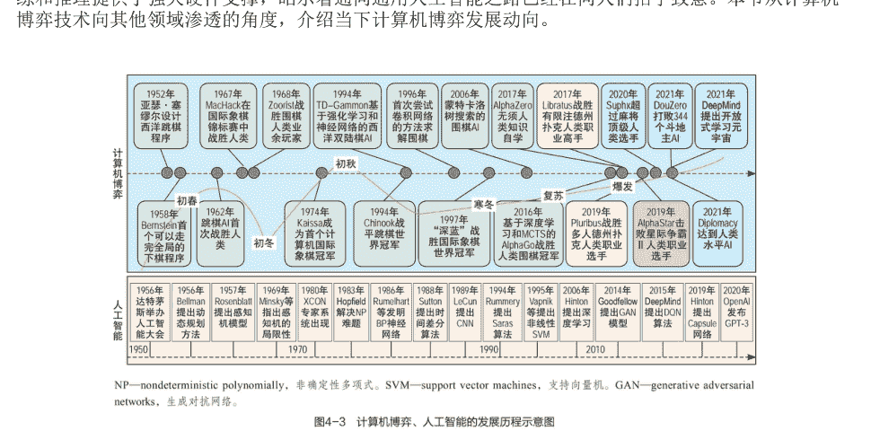

#### （一） AlphaDev的出现
##### 1. 谷歌的回应动作
2023年6月初，由Google Brain与DeepMind合并后的Google DeepMind发布Alpha家族新成员AlphaDev。这是一款用强化学习改进代码的AI，它从AI视角优化出了更快的排序算法，打破排序算法长达十年的排行榜，成为AI优化代码的重要里程碑。DeepMind CEO哈萨比斯在社交平台宣布，AlphaDev发现了一种全新更快的排序算法，已在主要C++库中开源，供全球开发者使用。成果于2023年6月发表在《自然》，论文题为*Faster sorting algorithms discovered using deep reinforcement learning*。

AlphaDev的意义在于展示AI具备发现新算法的能力，可被视为发展通用人工智能工具的步骤，帮助优化整个计算生态并解决社会问题。

排序算法无处不在，从搜索结果、社交推送到电商排序、手机数据处理，都离不开它。它像汽车中的轴承，每天被高频调用，效率直接影响上层体验和能源消耗。AlphaDev对互联网底层贡献巨大，虽隐于内部却支撑全局。

2022年底ChatGPT爆发后，谷歌渴望再度领先。CEO桑达尔·皮查伊在2023年2月发布内部红色代码，要求旗下产品尽快接入生成式AI。因此发布AlphaDev不排除是战略性动作。该算法运行速度提升约70%，实现了用AI自己发现新算法的历史性跨越，也为节能做出贡献。

谷歌本想说明AI不仅能帮人写代码，还能写出更好的代码。然而数日后有ChatGPT用户质疑，用实例说明ChatGPT也能得到类似结果，并对比代码。但从零到一永远比从一到n困难，前者是在黑暗中摸索，后者是在阳光下攀登，AlphaDev的原创贡献不容否定。

##### 2. AlphaDev如何发现排序新算法

AlphaDev 刷新排序算法的路径，根子上还是计算机博弈的玩法。DeepMind 把围棋、国际象棋里反复击败世界冠军的强化学习心得迁移过来，让 AlphaDev 沿着 AlphaZero 的路子来干。AlphaZero 是把推理和直觉结合起来在棋盘上选下一步落子，而 AlphaDev 的“落子”对象换成了编译系统里的底层指令，任务是挑选并组合指令集中的若干条操作。

最值得借鉴的点是，DeepMind 把排序这个工程问题包装成一个“汇编游戏”。每一轮迭代里，AlphaDev 都要观察自己生成的代码片段以及它们在 CPU 上的指令表现，通过增删指令、实际运行来训练，最终收敛到最优的指令序列。试错、筛选、再试错的逻辑，和 AlphaGo 不断对弈寻找最佳走法如出一辙。

只是这个“汇编游戏”难做得多。指令组合的空间极其庞大，比国际象棋 10^46 的走法规模还夸张，可类比宇宙粒子数；一条指令用错，就可能让前面搭起的整段序列失效。DeepMind 因此在训练中以“能否正确排序”作为锚点，精细调校奖励机制来加速收敛和提效。

总体看，这次尝试是把 AlphaZero 已验证的思路大胆外推到非博弈域，算是一次迈向通用人工智能的积极探路。

#### （二）跨界的AlphaFold

##### 1. Alpha的另类跨界
除了 AlphaGo、AlphaZero、AlphaDev，DeepMind 在医疗线还孵化了 AlphaFold。目标直指生物学当下最难啃的硬骨头——用 AI 猜出蛋白质的真实三维形态，并以此切入医药研发。Alphabet 为此另起炉灶成立 Isomorphic Laboratories，Isomorphic 与 DeepMind 的掌舵人都是哈萨比斯。初衷很清晰：把博弈场上验证成功的经验搬到现实世界问题上。

哈萨比斯把生物学视作一个复杂动态的信息处理系统，恰好和信息科学可以建立同构映射，所以公司取名 Isomorphic。尽管生物学的复杂远超数学方程所能穷尽，但就像物理化学最终被数学完美描述一样，未来生物学也可能被 AI 解释并利用。这就是数字生物学——用 AI 重塑药物发现全流程，甚至模拟生命基本机制。Isomorphic 不亲自做药，更倾向于输出模型并与药企、生物医学机构合作。

AlphaFold 的做法是整合多个开源程序和数据库，从氨基酸序列预测三维结构，进而研究不同蛋白如何相互作用，为预测药物与机体的作用机制搭模型。很少有人会把生物学与 AI 博弈联想在一起，而 DeepMind 正是在做这种跨界。

##### 2. 谷歌重组后的Alphabet公司
作为当下最强的人工智能公司，谷歌持续用积累的技术方法堆出 Alpha 系列产品，追逐通用人工智能的愿景。2015 年整体并入 Alphabet 母公司就是这一战略的体现，如图4-4所示。

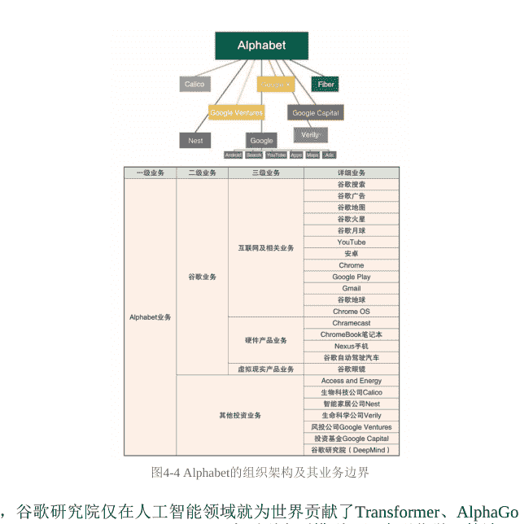
过去十年谷歌研究院在 AI 领域贡献了 Transformer、AlphaGo、AlphaZero、AlphaStar、AlphaFold、Word2Vec、WaveNet、序列到序列模型、深度强化学习算法、分布式系统及软件框架等一大批工具。OpenAI 也公开承认 ChatGPT 的底层包含 Transformer，而它已成为当下深度学习的主流基座。硬件上，谷歌同样领先：波士顿动力机器人、TPU 高性能定制芯片、自动驾驶汽车等图4-5。

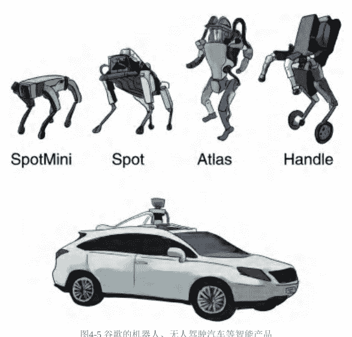
因此谷歌在软件、硬件、算法三层都形成垄断态势。2015 年成立的 OpenAI 之一要义就是防止 AI 毁灭人类，打破垄断，推动能像人一样思考、能做多类任务的通用机器智能研究。

#### （三）兵棋推演的决策之智
战争是系统性的生死对抗，现代体系庞大、要素变数多，仅靠少数人力指挥几乎不可行，于是出现庞大参谋班子。战争消耗大、伤害大，训练演练之外，必须借助信息与人工智能做仿真以帮助指挥员读懂战场、洞察敌情、掌握制胜之道。兵棋推演正是实现这一目标的手段之一，如图4-6。

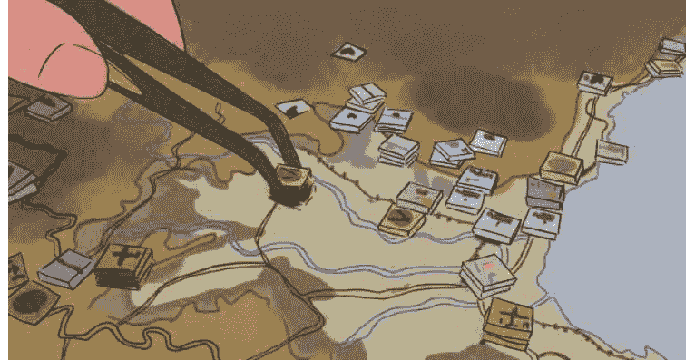
兵棋推演由来已久。1811 年乔治·冯·莱斯维茨在前人基础上发明现代兵棋并迅速流行，后演化为“严格式”和“自由式”。到今天，它在实战化训练与指挥官培养中的地位愈发重要。现代兵棋要素虽繁，但核心未变：参演人员、模拟环境、参战部队、指挥机构等。

人们希望兵棋能像计算机博弈那样跳出人类定式，实现战争智能跃升，这正是“系统之抗”难题。兵棋通常依赖历史资料与经验来推演未来。一款兵棋一般包含地图、棋子、规则，采用回合制。地图基于真实地形，含公路、丘陵、河流、丛林、海洋等；棋子代表班排连营团等战斗单元及兵种装备；规则按实战设计，用概率裁决行动边界、行军布阵与交战结果。

中国兵棋可追溯至约 4500 年前，用石块木棍演示阵法演变以预测战场。经现代技术加持，兵棋已成为作战参谋的仿真实验平台，可快速掌握态势、推测多种结果、辅助决策，形成预案并提升胜率。

军事上通行四类方法：基于数据的在线推演、多级指挥机构联合推演、兵棋与管理系统融合推演、分阶段竞争冲突推演，各有优劣。它们通常分规划、模拟、分析三阶段：规划制订双方兵力、地图、规则、目标；模拟把部队放入虚拟环境对战；分析评估行为与结果数据给出建议。

总的来看，兵棋推演依赖系列机器学习算法，也同样受“数据之痛”“算力之困”困扰。战场开放、对抗激烈，数据动态实时，甚至带欺骗虚假，采集残缺，演练破坏性与成本高，这些都迫使用计算机模拟仿真推演战争变得更紧迫，也对博弈技术提出更高要求。随着技术成熟，兵棋正走出军事域，扩展到应急救灾、期货交易、股票投资等领域，被誉为导演战争的“魔术师”。

#### （四）计算机博弈的困惑

##### 1. 专用AI向通用AI转换之困
让 AI 拥有博弈智慧，像人类一样思考甚至超越顶尖高手，并在围棋级别的专用智能基础上扩展为通用智能，缩短模型迭代与参数调优时间，降低应用成本，是当前核心挑战。更进一步，把 AlphaGo 这类专用系统推广到商业竞争、军事冲突、外交博弈、投资等多利益相关方、短期长期目标冲突的强对抗场景，也是难题。

目前技术路线大致两派：以深蓝为代表的“算力派”，依托知识模型与结构化决策状态空间，构建博弈树进行搜索推理，靠强算力实现暴力求解，核心是算力与良好定义的问题结构；以 AlphaGo 为代表的“学习派”或“数据派”，先建神经元模型，再采集标注数据训练，通过不断试错筛选网络并大规模调参，算力与结构化定义同样重要，机器学习算法如生成对抗网络是支撑。

2014 年诞生的生成对抗网络由伊恩·古德费洛等人提出，本质是通过两个神经网络相互博弈学习，是无监督学习的重大突破，GAN 成为数据派的核心。杨立昆评价 GAN 是二十年来机器学习最酷的想法。2016 年 3 月，谷歌用深度学习改造 AlphaGo Fan 版形成 AlphaGo Lee 版。策略网选点、价值网估胜率、蒙特卡洛树搜索负责自博弈，三者协同大幅提升下棋能力。此后出现大量 GAN 改进模型：

条件生成对抗网络CGAN 在生成器与判别器中加入条件信息 y，如类别或多模态数据；深度卷积生成对抗网络DCGAN 融合卷积神经网络的特征提取能力改良生成质量与收敛速度；Wasserstein 生成对抗网络WGAN 从损失函数入手改善训练稳定性并提升样本多样性；最小二乘生成对抗网络LSGAN 用最小二乘损失替代原目标函数；边界平衡生成对抗网络BEGAN 用自编码器作判别器并以 Wasserstein 距离匹配损失分布，在训练中加入平衡机制。

##### 2. 开放式场景的决策智能之困
近年的里程碑包括 AlphaGo Lee 到 Zero、AlphaZero、AlphaStar、Libratus 到 Pluribus、OpenAI Five、微软麻将 Suphx 等，深度学习始终是核心。除 Dota2 复杂度与开放性更高外，其余场景相对封闭。AlphaGo 成功后，许多赛事沿用类似思路。

这些击败人类的 AI 侧重点不同，决策方式可归为四类：操作决策比拼手速，遵循“唯快不破”；简单判断比拼识别与选择速度，靠空间换时间；运筹类比拼计算速度，如 AlphaGo 的随机试错，以时间换空间；基于简单规则的自主决策，如麻将和牌计算，融合时间与空间。

尽管游戏内决策可自主完成，开放博弈场景的决策智能仍很遥远。当前博弈技术多以即时反馈、目标固定、场景封闭、对抗要素稳定为前提。即便像 AlphaGo 这样强大的下棋系统，在决策智能层面也远未达到替代人类认知智能的水准，且同样受数据与算力困扰。

开放复杂场景难以生成决策智能的原因有四：有监督深度学习的样本稀缺且难表达；指挥层级的强化学习奖惩函数难以构造；多目标优化中决策准则难以协调，目标常相互制约矛盾；需要人机协同，但介入时机与方式需协调。

因此需要构建多 AI 集群形成群体智能。智能从不是一步到位，而是螺旋渐进。人类战场指挥可分解为 OODA 环：观察、判断、决策、行动，每轮对抗即一次循环，宏观上呈现层次分明的螺旋式演进。决策高度依赖场景变化不断迭代优化，这正是开放场景难以产出决策智能的内在原因，也是博弈向开放域扩展的最大障碍。

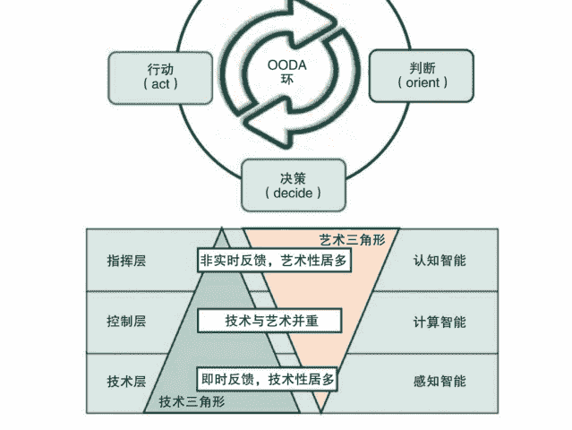
##### 3. 智能涌现机制是博弈智能的“困扰”
人们常说的智能多指认知智能，它是技术与艺术的结合，在多择与多层综合中涌现，具有群体与个体涌现特征。未来博弈 AI 可能包含多个嵌套对抗的 OODA 环，分层分段调度后形成总体效果涌现。按哥德尔不完全性定理，再多参数也只能在上一层级涌现，复杂大系统中需多种适应相关因果协同过程的非线性交互才能涌现高级决策智能，涌现机制本身成为难题。

决策分层，不同层级需求差异大。班连需基层决策，军旅需中层过程，集团需高层决策。无论层级，本质都是选择、组合、调度，如建筑需桩基稳固，上层才有变化底气。上层认知智能、中层计算智能，都需底层感知智能支撑。观察判断构成计算智能、认知智能基础；决策行动构成感知智能、计算智能基础。

态势理解包含“态”与“势”：态是感知数据得出的结构化状态描述，客观存在，偏重算法计算；势是指挥员对形势趋势的主观认知判断，属高级智能，认知成分更多。它并非凭空而来，而是依托成熟或新创造的方法作为基础。如何产生“势”，即认知智能的生成，是博弈发展的关键困扰。

#### （五）计算机博弈的发展趋势

##### 1. “从零开始”的“起点”

人工智能技术的迭代让博弈类算法对历史对局的依赖在减弱，强化学习等范式甚至能让机器自教自学，看起来像是白手起家、从零开始。实际上这个“零”只是相对的，每一次起跑都立在人类既有的认知与知识之上。ChatGPT 写邮件就是个典型例子：表面上是顺滑的组词成文，背后仍在复用人类长期总结的操作规程。以 5W1H，也就是为何、何事、何地、何时、何人、何法六个维度来拆解事务性写作，先逐项回答再拼接，邮件就能迅速成形。这种填空式的构造就是 AI 写邮件的起点，可见它并未真正脱离人类知识。由此核心矛盾转向：AI 的真正起点该如何识别与界定？这同样是当前计算机博弈难以回避的难题。

### 2. 对手模型该怎么构建
从深蓝征战国际象棋，到 AlphaGo 统治围棋，再到卡内基梅隆 Libratus 的德州扑克、谷歌 AlphaStar 的星际争霸 II、微软 Suphx 的麻将，博弈论与人工智能的交叉不断创造里程碑。然而面对军事推演、元宇宙多方博弈、多人德州扑克这类超复杂、强对抗、高动态、多威胁的巨型场景，现有的理论支撑明显吃紧，环境认知、策略求解、对手建模、群体智能等方向急需突破。过去的研究重心多放在自身智能的提升，环境变化与对手演化被相对忽视。事实上环境、对手、AI 本身才是博弈的三位一体，三者间既有对抗也有交互与协同，关系网络远比单一优化复杂。

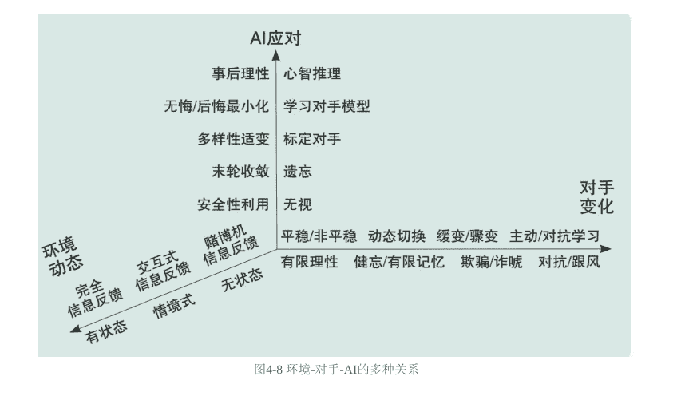

智能往往是在竞争中学会协同、在协同中加剧竞争的过程中生长出来的，这既是人类智能的成长规律，也应成为计算机博弈的进化路径。下一步必须把更多精力投入到环境建模和对手建模上。

### 3. 开放式场景的决策智能如何实现
在棋牌类序贯决策以及星际争霸 II、王者荣耀这类即时响应决策上，强化学习在相当长一段时间内仍是主流解法。更具挑战的是战争、施压式外交、团队博弈等开放性应用。当前常见的做法是先加入假设与约束，把开放问题压缩成封闭或半封闭的限定问题，再套用成熟技术。要把开放问题转化为可解形式，把非完美信息博弈逼近完美信息博弈，将是未来必须攻克的重点。

人工智能走过约七十年的历程，经历了以定理证明与逻辑语言为标志的推理期、以知识系统与专家系统为标志的知识期、以神经网络复兴、机器学习与深度学习为标志的学习期，历经两次寒冬三次复兴，越过图灵测试，进入专用智能时代，正向通用智能发起冲击。计算机博弈也依次走过知识与搜索、博弈与学习、模型与适变三条范式，Alpha 系列的 Zero、AlphaDev 只是通用智能露出水面的部分。2020 年美国 DARPA 启动“打破游戏规则”项目，目标是研发战争模拟 AI 用于作战训练与演练。可以预见，未来研究会选择更复杂、动态更强的应用对象，利用海量增长的学习数据，把复杂系统建模与决策推理结合起来，辅助人类更快读懂、理解乃至预判复杂环境中的关键演化。

### 4. 感性与理性如何共同支撑决策智能
决策智能之所以难，是因为感性因素不可回避。决策包含两类内容：理性面是规范化的科学方法，以指挥机制、作战流程、条令条例等形式存在，机器复现相对容易，也有人认为这只是智能的结果而非智能本身；感性面是创造性的艺术成分，涵盖灵感、直觉、经验与个性，人类智能更多集中于此，因而难以被模拟仿真。决策智能必须实现理性与感性的融合，这就牵出一系列困扰：态势能否被真正理解？不理解时是否仍可决策？先验知识该怎样利用？决策智能如何落地？能否被信任？智能水平如何评价与测试？对手是否同质？这些正是决策智能面临的博弈之恼，也是未来需要破解的难题。

总的来看，AI 在处理复杂问题上具备独特优势与潜力。科幻电影《终结者》里，天网的逻辑与思维远超人类，却做出反人类毁灭世界的决定，这个情节目前仍属想象，但不容忽视。可以预期的是，拥有温度与情感的数字人将与人类玩家进行友情对弈，突破冰冷机器的刻板印象，这指向人工意识、人工情感等新的研究边界。计算机博弈的走向将深受相关学科与人工智能整体发展的牵引。通用型 AI 工具终将普及，更伟大的产品会接连面世并造福社会，而计算机博弈仍将一如既往地充当人工智能发展的催化剂。