# 大脑科学前沿：33位顶尖大咖预言未来十年突破

# 引言：大脑研究面临的三大硬骨头

## 迎接核心挑战

神经科学正站在历史上最令人振奋的十字路口。虽说这门学科诞生已逾两百年——回溯至铁棍贯穿菲尼亚斯·盖奇额叶的那场意外——但漫长岁月里，进步步履维艰。我们手握海量案例，却始终缺失一套贯穿始终的宏大理论；已知版图虽在扩张，未知疆域却更辽阔。好在，如今多前沿技术的强强联合，终于为破局提供了硬核支撑，本书将逐一拆解这些利器。

人类进化的历程，本质上是不断把简陋工具用到极致的过程。19世纪中叶，保罗·布罗卡借尸体解剖，首次窥见语言功能的大脑底座；19世纪末，高尔基染色法让神经元在显微镜下现出真容，卡哈尔据此勾勒出神经网络的雏形蓝图；1909年，井上达二通过分析俄日战争枪伤兵，绘制出视觉皮层的功能分区图谱。

20世纪后半叶，fMRI等无创成像技术横空出世。虽说能看见大脑“亮灯”，但时空分辨率低得像打了马赛克的照片，只能捕捉神经活动的粗糙轮廓。动物实验虽能植入电极精准记录单神经元放电（动作电位），让休伯尔和威塞尔发现了视觉皮层的特征选择性，但“管中窥豹”式的单点记录，正如尤斯特所喻，像盯着单个像素猜电视剧情。

转折发生在2005年前后：光遗传学让特定神经元“听光指挥”发光或沉默；多电极技术实现千余神经元同步监听；新型显微镜甚至能把透明斑马鱼全脑神经元的动态一网打尽。人类首次具备了从微观基石层面透视大脑全貌的可能。

但三大“拦路虎”依然横亘在前：
**一、规模与异质性的双重暴击。** 连果蝇幼年斑马鱼都有10万神经元，人脑更达860亿。“神经元”绝非单一品类，数百亚型各有独特物理电生理特性，极可能承担截然不同的计算任务。
**二、组织原则之谜。** 大脑如何编码信息？是否像计算机用ASCII码那样有套统一标准？记忆存储、决策排序的底层逻辑，至今仍是黑箱。
**三、人类独有高级功能缺模型。** 语言、推理、文化构建，找不到对应的简单动物模型替身。

奥巴马“脑计划”、欧盟“人脑计划”、亚洲各大脑计划齐头并进，誓要攻克上述难关。未来十年，必将迎来精度前所未有的数据洪峰。但新数据带来新焦虑：海量太字节数据如何处理？如何从数据堆里炼出通用原理？数据够不够？分析规模如何扩容？数据与深刻洞见之间，架桥靠什么？

科学家须聚焦核心矛盾。大脑不是电脑，但可视为特殊信息处理器：输入感知信号，转码为内部表征，输出运动指令。虽众学者默认“神经计算”是核心加工形式，但这套计算的底层指令集至今未破译。期盼“神经计算”能成为统一语言，连接理论与实验两大阵营。

大脑精微复杂，不敢保证短期破解，但理由充分让我们保持乐观。这本书汇聚了前沿旗手的最强预判，既是未来图景的草图，也是封存当下认知的“时间胶囊”。十年后重读，重新审视那些科学主张、野心与路径，为下一代神经科学领航——这正是我们的初心。

盖瑞·马库斯　杰里米·弗里曼

## 闯关小测：你的“脑”力认知到哪级？

**1. 人类高阶认知的底座在哪？**
A. 前额叶　B. 海马　C. 单个神经元　D. 大脑互联网络

**2. 哪块区域受损会导致语言言语障碍？**
A. 顶叶　B. 左侧前额叶　C. 角回　D. 布罗卡区

**3. 神经纳米机器人疗法瞄准哪些顽疾？**
A. 阿尔茨海默病　B. 帕金森病　C. 癫痫　D. 精神分裂症

**4. 迄今最普及的临床级可穿戴神经接口是？**
A. 人工视网膜　B. 光幻视　C. 海马神经芯片　D. 人工耳蜗

扫码解锁答案，开启探脑之旅。

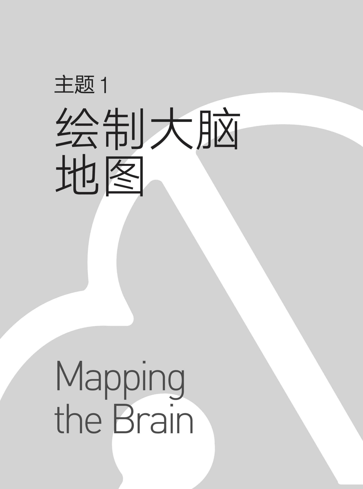

绘制大脑地图，核心要搞定两件事：一是**“路网”**——无数神经连接铺就的立体高速公路，堪比标注全美每条街每栋楼的超级地图；二是**“车流”**——奔跑在路上的神经电化学信号。前者是“连接组”，后者是“活动地图”。终极目标，像谷歌地图叠加图层一样，分层呈现：皮层褶皱地貌、近千种神经元身份标签、特定行为激活的专属通路。

**主题一**将揭秘当下最硬核的绘图技术与未来图谱。长久以来，复杂生物拥有几十万至数十亿神经元，科学家却只能一次盯着几个神经元看，再凭不完整拼图猜测整体全貌。

迈克·霍利茨梳理大脑解剖学进化史：从卡哈尔手绘回路图，到现代细胞级分辨率的全脑高清解剖图谱及注释。米沙·阿伦斯展示光片显微镜如何穿透透明斑马鱼，捕捉全脑乃至行为时刻的神经动态。克里斯托弗·科赫整合解剖、电生理、光学多模态数据，攻克小鼠视觉皮层大区域活动解码。安东尼·扎多尔与乔治·丘奇则杀入基因层面：用DNA序列间接编码连接信息，开辟全新解剖范式；丘奇更探讨如何突破光学电生理瓶颈，实现更大规模放电记录。

# 01 绘制大脑全景图谱

**迈克·霍利茨（Mike Hawrylycz）**
美国西雅图艾伦脑科学研究所资深科学家
联合撰稿：金·丹格、克里斯托弗·科赫、曾红葵

## 大脑地图的进化史

人类解剖学最早档案，要数公元前200年希腊医生盖伦的手稿，统领中世纪医学数百年，直到维萨里《人体构造》问世（见图1-1），现代解剖学才真正起航。维萨里数百年前的手绘图，放在今天依然精准惊艳。近两百年，学界确认大脑是哺乳动物共有的独立精密器官，但搞清其结构功能对应关系，依然是硬骨头。神经解剖学家只能绘制图谱，以此记录分析发现。

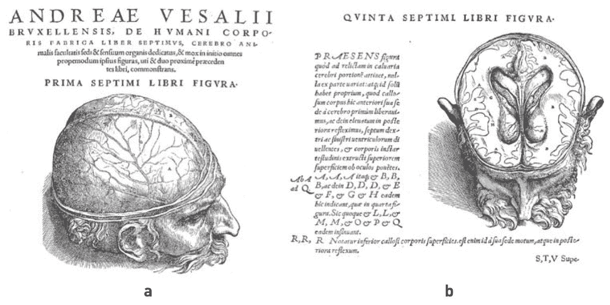

**图 1-1 解剖学里程碑《人体构造》插图**
a. 1543年维萨里版插图，盖伦之后人类解剖学首次大跃进；
b. 大脑皮层与脑室结构示意。

对大脑功能整合机制的理解，至今仍不完整。非因研究者懈怠，实因神经结构极度复杂且相互纠缠。卡哈尔奠基神经科学：他分类描绘百余神经元，推断大脑由独立神经元联网而成，而非网状融合结构。虽脑组织仅半透明、细胞级分辨率不足，但尼斯尔染色法（尼氏染色）能将细胞核RNA染蓝，成就了布罗德曼基于细胞构筑学划分出的43个皮层分区（见图1-2），至今仍指引功能分区研究。布罗德曼、冯·艾克诺默、沃格特等人凭肉眼目测细胞形态、密度、填充物，开创性绘就人脑皮层细胞与纤维构筑图。

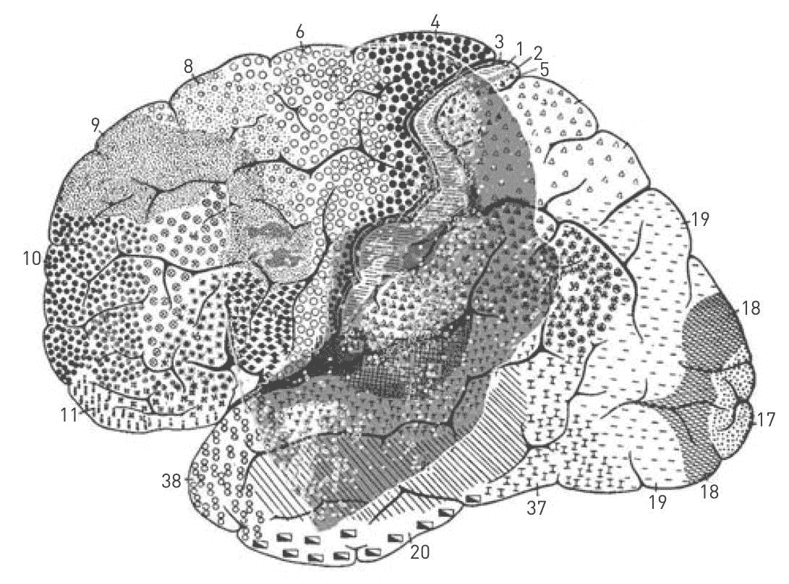

**图 1-2 尼氏染色下的大脑皮层切片**

维萨里之后，绝大多数脑图谱停留在纸上，用彩色勾勒数百结构。主流实验动物皆有此类图谱，成实验参考基石。同现代生物学各领域一样，技术迭代是推进脑结构探索的核心动力。近20年，神经成像技术爆发，倒逼脑图谱数字化重构。现代脑图谱本质是时空数据库，融合海量生理、解剖数据。MRI、fMRI、扩散张量成像、MEG、EEG、PET等技术，大幅提升科研、诊断、术中导航的成像质量，且支持数字化变形适配个体差异。

临床脑图谱始于塔莱拉什1967年建立的三维立体定向坐标系（源自一位60岁女性脑），后与图尔努合作出版印刷版指导手术。如今生物医学成像是诊断与术前规划核心，医生在影像中搜寻生物标志物；脑图谱助力神经外科“立体定位”，以坐标为锚点导航手术，实现解剖、功能、血管多维关联解读。

图谱物种覆盖广泛：小鼠、大鼠、猕猴、人类等。现代数字图谱超越组理学、MRI、PET基础，整合基因表达、连接组、概率图谱，配套复杂可视化软件。蒙特利尔神经所埃文斯团队制定扫描平均标准：如“科林27”单体多扫描模板、“MNI152”群体平均模板。虽大脑天生三维，但MRI、CT、PET分辨率有限，难透析微观结构。常规路径：体外高分辨二维切片成像，再经重构算法“还原”三维立体脑。

## 破局新趋势

当下，数字脑图谱已成描述神经空间组织、指导神经外科、解读基因组/蛋白组数据的标准坐标系。神经科学终极目标——读懂大脑，破译从行为到意识的运作机制，离不开这个知识汇总、调用、组织的枢纽。毫无疑问，数字脑图谱将继续锚定未来突破的关键坐标。

### 破解大脑的“遗传密码”

分子生物学与基因组测序技术跃升，打开了理解大脑遗传学的新视界。大规模空间基因表达数据涌现，让我们得以从分子层面重审解剖结构。大脑至少容纳数百细胞亚型，分类尚未收官。每种细胞类型的功能与基因表达画像（开/关、高/低）强绑定。多技术路线采集表达数据，有望揭示基因与脑结构的深层关联。

早期靠“诺瑟杂交”（电泳分离RNA再探针杂交），虽曾是金标准，但终让位于更可量化的微阵列技术——单芯片同时探测海量基因。如今极速数字测序可直接定序单个RNA片段，映射回基因组。

2001年，保罗·艾伦在MIT召集平克、沃森等大咖研讨神经科学加速器。共识明确：构建小鼠全脑三维基因表达图谱，将是社区级红利。选鼠基于遗传资源丰富、实操性强；核心技术为原位杂交（ISH）——标记核酸探针与组织内核酸杂交，保留空间信息（见彩图1）。马克斯·普朗克研究所艾歇勒团队实现该流程全自动化。

2006年，艾伦脑科学研究所（艾伦·琼斯领军，保罗·艾伦资助）发布首个小鼠全脑基因表达图谱。此后持续开放：整合成年/幼年鼠、人类、灵长类的基因表达、连接组、解剖数据，配套强力搜索与可视化工具（见图1-3）。官网月均5.5万全球用户访问。科学家深挖图谱，锁定疾病标志基因、细胞类型标记、跨物种表达差异、脑区精细划分。

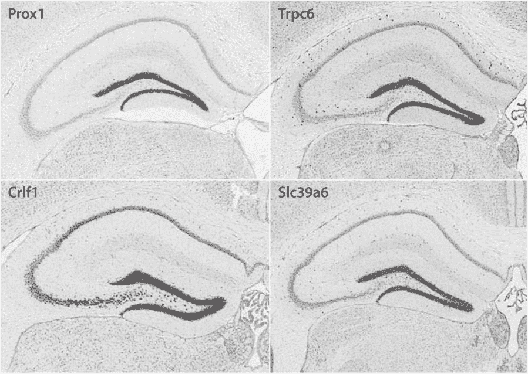

**图 1-3 海马齿状回基因表达共表达模式**
注：展示基因表达空间模式与`Prox1`高度相关的基因。`Prox1`为淋巴发育早期标志，在哺乳动物中枢神经与淋巴管发育中关键。融合模式有助深度解析海马功能。

2010年5月，人脑图谱面世——首个解剖学层面的全基因组三维人脑图谱。基于6例成人脑，含数百亚区组织学与全基因组微阵列数据。核心发现：
- **区域特异性极强**：不同解剖位置基因表达谱天差地别；
- **细胞类型分子身份稳定且跨个体高度守恒**；
- **84%人类基因在脑中表达**，模式复杂但个体间本质相似；
- 差异表达与共表达网络反映主流细胞类型（神经元、少突胶质、星形胶质、小胶质）分布；
- **新皮层转录相对均质**，但保留初级感觉运动区特征，额叶基因表达丰度显著更高；
- **空间邻近性预测分子相似性**：皮层区域越近，表达谱越像。

同期重要探索还包括：爱丁堡小鼠胚胎图谱（EMAP，记录时空发育数据）、洛克菲勒海因茨团队的GENSAT（细菌人工染色体驱动转基因鼠表达）、BGEM、GenePaint、Eurexpress、MGI等项目，均提供友好教程与开放访问。

### 构建通用的大脑坐标系

# 02　全脑成像与虚拟现实：在透明幼鱼身上破解大脑密码

**文｜米沙·阿伦斯（Misha B. Ahrens）**  
**系统与计算神经科学家，霍华德·休斯医学研究所研究员**

---

### 为何我们需要“上帝视角”？

长期以来，神经科学的研究范式都是“盲人摸象”——聚焦于单个神经元或微型回路的放电记录。这种切片式视角让我们难以跨越鸿沟，将微观网络的发现关联到依赖全脑协同的宏观功能。近年来，科学家们开始尝试同步记录海量神经元活动，这不仅是技术上的飞跃，更是读懂数十亿神经元如何合谋产生智能的关键一步。本文将揭秘：我们是如何在脊椎动物斑马鱼幼体身上，实现对整个大脑的实时成像的。

但在展开技术细节前，必须先纠正一个认知误区：**光把所有神经元“拍”清楚，还不足以读懂大脑。**  
孤立观察神经活动，忽略了大脑赖以生存的物质基座——它嵌入身体，身体又处于遵循物理法则的环境中。神经元内部稠密连接，大脑输出指令驱动行为，行为改变环境与体态，新的感官输入随之涌入，大脑再处理……这个**“感知-运动闭环”**才是认知的真实语境。举个例子：主动行走时视觉流的处理模式，与被动观看同一画面截然不同。因此，破解大脑最优路径，是将“大脑-身体-环境”视为一个不可分割的动态整体。

当然，自底向上、局部精细化的研究也有建树——视网膜、嗅球、初级皮层的解码已让人工耳蜗等神经假体成为现实（详见主题6第19章）。但若要攻克感知、记忆与决策的交互之谜，全脑尺度的研究——覆盖全感官输入、全神经元活动、全运动输出及反馈回路——恐怕是唯一出路。

---

### 造一套“黑客帝国”给斑马鱼

在弗洛里安·恩格勒特、菲利普·凯勒等人的合作中，我们融合了昆虫/哺乳动物实验范式与显微镜前沿技术，搭建了两套核心系统，让脊椎动物斑马鱼的动态神经系统首次在“全景模式”下显影。

**第一招：虚拟现实（VR）构建沉浸式环境。**  
斑马鱼幼体头部天生固定不动，天然适配显微镜成像。我们为瘫痪的鱼搭建了闭环VR系统——麻痹剂仅切断神经-肌肉连接，中枢神经与脊髓指令完好无损。鱼尾部的运动指令信号被实时解码，转化为虚拟游动推进，投影仪在鱼体下渲染动态视觉场景。这本质上就是《黑客帝国》里的“脑机接口”：大脑以为自己在游动，实则身处显微镜载物台上。

**第二招：全脑单细胞分辨率成像。**  
斑马鱼幼体约10万神经元，我们能同步捕获8万个的活动轨迹。这得益于它的三大“天赋异禀”：  
1. **天然透明**：缺乏色素的皮肤让光学显微镜直穿深层脑区；  
2. **微型脑**：体积小到足以装进视野；  
3. **遗传友好**：可精准表达钙指示剂或光遗传工具于全脑或特定亚型神经元。

> **【大脑新趋势：光控神经元的“开关”与“报表”】**  
> 近20年，钙依赖荧光蛋白让神经放电“发光上报”，光遗传学则赋予科学家用不同波长光“按亮/按灭”单个神经元的神力。斑马鱼的透明微脑，让这套“读写一体”方案在全脑尺度落地成为可能。

---

### 闭环实验的前世今生

“感知-运动闭环”并非新词。上世纪60年代，卡尔·戈茨、马丁·海森堡就让粘在针尖的果蝇“驾驶”虚拟飞行——扭力仪捕捉转向意图，旋转鼓壁提供视觉反馈。这不是欺骗苍蝇，而是借固定头部便于植入电极/显微镜，窥探大脑如何掌控行为。

随后，戴维·汤克团队让小鼠在三维VR跑道奔跑，记录海马体空间编码与决策神经元。我们在斑马鱼身上走得更远：**瘫痪准备 + 全脑成像 + 闭环VR**，实现了“意图记录-虚拟执行-感官反馈-再处理”的完整闭环，且覆盖近乎全脑神经元。

---

### 斑马鱼：天选的“全脑模型”

一周龄斑马鱼，脑容量约10万神经元，却已具备探索、觅食、简单学习等复杂行为。其脑区同源性高（如视顶对应上丘，端脑含皮层同源区），是连接无脊椎与哺乳动物的进化枢纽。加上天然透明、遗传可及，它成了**唯一**能同时满足“全脑覆盖、单细胞分辨、闭环行为、光遗传干预”四大指标的脊椎动物模型。

---

### 下一站：从“看清”到“读懂”

技术瓶颈已破，数据洪流至。如何从8万神经元的时空动态中提炼计算原理？如何将微观回路机制桥接到宏观认知功能？这要求我们不仅要有更强的计算工具（详见第4章），更需建立跨尺度的理论框架。

斑马鱼全脑成像，不是终点，而是神经科学从“局部盲触”迈向“全景解码”的起点。在这里，每一个闪烁的光点，都在低语着大脑最底层的算法。

## 用光“切”开大脑：实时捕捉8万神经元的集体舞蹈

在显微成像的工具箱里，光片显微技术堪称“速度与精度”的平衡大师。它的核心诀窍在于“光学切片”——成像时，只有极薄的一个焦平面被光刃照亮，周围组织全程处于黑暗之中，从而在保持亚细胞级分辨率的前提下，实现了高速扫描。

近期，我们团队联合多方将这项技术的速度推向了新高度，成功将其引入神经科学前沿。我们自研的新一代光片显微镜，速度足以覆盖斑马鱼幼体大脑的大部分区域，实现对约8万个神经元的全脑成像与活动追踪，测量频率达到每秒数次。这意味着，我们首次得以窥探活体斑马鱼在自由游动时的全脑神经动态：大脑不再是静止的标本，而像一片波涛汹涌的“活动之海”，缓变的潮流、突发的闪光、以及大范围协同爆发的整体活动交织上演（见图 2a）。

### 如何读懂“全脑数据迷宫”

数据获取易，解读难。面对海量神经活动构成的“丛林”，如何抓住核心逻辑？尽管网络通信极其复杂，但基础规律往往简单：一个神经元的兴奋往往牵动另一个。我们寻找的正是那些“同步上下线”的神经元集团——在某刻共同激活，另一刻共同静默。通过简洁算法筛选，后脑区浮现出两个解剖边界清晰的功能模块（见图 2b，分别以绿、紫红标示）：一个由6对紧凑对称的神经元簇组成，另一个包含两束纵向排列的细胞索。在看似混沌的背景噪音中，它们正进行着紧密的“私密通讯”，其功能意图待解。

从原理上讲，我们已具备从感觉输入到运动输出、覆盖整个感知-决策-行动闭环及学习过程的全脑研究能力。这至关重要，因为大脑功能不可拆解，必须整体观照。以人在狂风中调整步态避免跌倒为例：运动皮层发出生走节奏（运动程序），皮肤感受器与前庭系统感知扰动并报警，视觉与前庭系统联合向运动系统下达修正指令，高级认知则确保导航目标不丢失。这些控制中枢分布广泛，唯有全脑视角才能还原真相。这同样适用于视觉特征编码、嗅觉诱导导航等议题：大脑的本质，在于所有部件间直接或间接的永恒对话。

### 大脑研究的“下一站”

虽已蓄势待发，欲测量全脑活动、行为反馈与感觉细节，挑战依然如山。首要难题是**“找什么”**——大脑究竟在解决什么生存难题？环境中哪些要素对动物关键？动物如何行动应对？厘清“在何种情境下做何种决定”，须与“如何做决定”同步推进。

数据到手，**怎么算**？我们的目标是破解斑马鱼幼体执行行为计算的算法。即使只有30个神经元的甲壳类神经系统，钻研数十载仍常有惊喜，远未彻底看透；由此推演，10万级神经元系统的复杂度可想而知。如何从海量记录中提炼功能原理？计算神经科学家（如合著者杰里米·弗里曼）正攻坚大数据分析方法：数据越多，模型越准。全脑成像、行为学与计算神经科学，注定是“黄金搭档”。

**技术短板**在于时间分辨率。当前采样约1秒/细胞/次，远慢于毫秒级的神经通讯。须革新显微技术、优化基因编码传感器，才能捕捉毫秒级的对话细节。

**光看不够，还得“懂机制”**。单个神经元沉浸在集体活动的海洋中，能否从群体层面反推个体？这要求掌握连接组属性——利用基因技术与电镜重构解剖连接，补全认知拼图。

**更关键的是“动手干预”**。能否建立预测模型，推演特定神经元群沉默后的后果？光遗传学（如通道视紫红质、嗜盐菌视紫红质）提供了“光控开关”，用不同波长光激活或抑制特定类型神经元，已在多物种（含大型哺乳动物）验证。核心目的：确立基因或解剖定义的神经元群体间的**因果链条**。

大脑是在动态躯体与环境中进化的“第一响应者”（百毫秒级反应）。“读懂大脑”既取决于提问者的视角，更要求我们跨尺度作战：微观看分子机制与单细胞动力学，宏观建全脑功能理论。愿此文勾勒的全景路径，能助力构建大脑功能的统一图景。

---

## 03 破解新皮层密码：艾伦研究所的“心智视界”宏大蓝图

**克里斯托弗·科赫**
美国西雅图艾伦脑科学研究所所长、首席科学家，加州理工学院生物与工程学教授，弗朗西斯·克里克入室弟子。

**合著团队**：克莱·里德、曾红葵、斯蒂芬·米哈拉斯、迈克·霍利茨、约翰·菲利普斯、金·丹格、艾伦·琼斯。

拥有860亿神经元的人类大脑，是已知宇宙最复杂物件。它有序地支撑行为、记忆、感知，甚至孕育了最迷人的意识。神经科学耕耘百余载，拆解出离子通道、突触、神经元等零部件，却因大脑的惊人异质性、庞大数量与多样连接，让还原论望洋兴叹——仅触皮毛。神经元间千丝万缕的互联（每细胞收发数千信息），让单一节点的活动因素极其多元。我们非懂不可：一是客观脑事件与主观心智的鸿沟是科学终极谜题；二是神经疾病给个体、家庭乃至社会带来不可承受之重。

人生短、任务重，聚焦核心：**新皮层如何表征与转换信息？** 这就是大脑灰质，哺乳动物特有的层状结构。跨物种差异巨大：体积相差2倍，表面积相差5.5万倍（从烟色鼩鼱到蓝鲸）。新皮层是可扩展计算引擎，擅长跨模态感觉加工、关联记忆、复杂运动规划，更奠基人类语言。

新皮层由重复的微型模块柱状回路构成，遍布全皮层。不同区域的模块连接属性各异，计算功能众说纷纭：滤波、特征检测、背景放大、查表、线性吸引子、预测编码……存在与否尚存争议。但新皮层结构与基因表达呈跨物种、跨脑区的恒定性（虽有例外）。蠕虫、果蝇脑回路高度刻板，遗传硬编码先天行为；哺乳动物新皮层则由祖先与个体经验塑造，采用灵活群体编码，对环境高度敏感。由此，**皮层柱酷似通用图灵机**：基因组与学习机制依输入统计（视、听、语等）动态配置柱参数，或反向操作。

### 小鼠：破解人类大脑的“最佳代理”

要懂新皮层，必记动作电位时序与峰值发放。活跃神经元快速聚合成广泛集合体随即解体，运动皮层外围即可追踪此动态。为描绘、干预这种分布式独特活动，研究焦点必须从人类转向**进化相关、可全程测控的典型模式生物——小鼠**。

7500万年前共享共同祖先，基因组高度重叠：99%小鼠基因在人类有对应同源序列，核苷酸层面85%相似。艾伦图谱揭示细胞层面表达差异，最显著在视觉与躯体感觉皮层，映射中央凹对人、触须对鼠的核心地位。

两大显性差异决定了小鼠的不可替代性：
1.  **可及性**：伦理限制下，人类细胞级探查仅限极少数神经外科手术窗口期；小鼠光滑新皮层则可在福利前提下，任由电生理、光学成像深入，配合改造病毒对特定亚群染色、标记、开闭，实现前所未有的回路控制。光遗传/药物遗传学提供毫秒级、细胞型特异的可逆干预，将神经科学从“观察相关”推进至“验证因果”——从看电路亮灯，到判断电路是否决策必需。
2.  **尺度**：人鼠脑差3个数量级。重量1.4公斤对0.4克，体积10厘米立方体对一块方糖。全脑神经元860亿对7100万，新皮层160亿对1400万。小鼠是“缩微版人脑”，全脑覆盖成为可能。

### “心智视界”计划：工程化攻坚新皮层

基于相似性与尺度优势，合理路径是：**对小鼠全脑大规模系统研究，绘制特定细胞类型详细连接图，记录/呈现/扰动/模拟典型感知-行动循环中皮层-丘脑神经元尖峰活动，破解感觉信息如何在单循环内编码、转化、驱动行动。** 这需要持续、聚焦、高通量的工程化攻关。

**“心智视界”项目** 是2012年3月启动的里程碑式十年高通量计划，汇聚数百科学家/工程师/技师。保罗·艾伦慈善基金承诺前4年投入3亿美元，2015年底落成2.5万平米西雅图总部大楼。

项目聚焦**成年小鼠视觉系统与视觉-运动行为**。视觉虽非小鼠最强感官（锐度约人类1/50），但解剖生理高度相似，是感觉研究最佳切入口。通过观察与模拟皮层-丘脑视觉系统的信号生理转化（见图3），还原“从光子到行为”的计算全链路。目标包含：细胞构成分类、动态关系解析、细胞型特异性连接组绘制、量化动物“看见什么”及“如何量化所见”。这要求经典神经解剖、分子解剖、电生理、光学生理、群体动力学建模、系统理论思考的**跨学科深度融合**。

### 绘制“细胞身份证”与“连接地图”

基石是**基因改造小鼠库**。利用特定神经元独特基因表达，驱动`Cre`重组酶，配合报告基因或病毒载体，实现靶向标记与操控。已繁育40余种`Cre`驱动系，全覆盖皮层-丘脑兴奋/抑制神经元，更多细分系在途，资源经杰克逊实验室公开共享。

**分子工具箱**已臻成熟：荧光蛋白描绘结构连接，`GCaMP6`等钙指示剂报告活动，光敏感通道等视蛋白操控活动。一旦掌握分子“条形码”，即可精准“开/关”任意神经元群，毫秒到小时任意窗口。

**连接组建设**分级推进：
*   **宏观脑区连接**：艾伦小鼠脑连接图谱，用基因示踪+高通量双光子断层扫描，流水线成像数千脑，单脑数据0.75TB，已积2000+数据集，注册到标准3D参考空间（295脑区，50万体素），支持量化分析。
*   **中观细胞型连接**：聚焦皮层-丘脑视觉回路，10微米各向同性分辨率，解析细胞型特异性投射。
*   **微观单突触连接**：电镜连续切片重构皮层微细回路（`W[ij]`矩阵），狂犬病毒跨突触示踪靶向验证。结合已知生理机制动物的解剖，锚定结构-功能对应。

**细胞分类学**三管齐下，力求<100种类型的全景分类法：
1.  **电生理指纹**：膜片钳记录全生物物理特性，泄漏积分器模型精准拟合亚阈值与尖峰时序。
2.  **形态重建**：数千神经元树突/轴突全脑级重建。
3.  **转录组画像**：单细胞qPCR与全转录组测序，读出mRNA指纹。

**突触生理学**细查同/异型细胞间连接强度短时可塑性，为大规模网络建模喂料。所有数据终将免费开放于受监管在线数据库。

*注：统计规则之外，高阶功能特异性连接隐匿于细胞群体间。我们将深挖视皮层微细连接组（单神经元分辨率的`W[ij]`），链接结构与功能。*

### 记录万亿级“神经交响乐”

终极目标：**读懂皮层计算**。视觉系统为入口。视网膜600-700万视杆+18万视锥，汇聚至5万神经节细胞（~20型，铺满视觉空间），投射丘脑外侧膝状体核（LGN，1.8万细胞），再入初级视皮层（V1，36万神经元）。小鼠V1周围约12个视觉联合区（灵长类36+），构成“网络中的网络”层级加工体系（见图3）。

我们将部署高通量双光子/广域成像，在执行视觉行为任务的清醒小鼠中，大规模记录V1、LGN、联合区及丘脑核团的群体动力学，配合光遗传干预与计算建模，完成从**像素到感知、从感知到决策、从决策到行动**的全链路破解。这是艾伦研究所赋予神经科学的“登月计划”。

我们计划深入探索一系列更高阶的视觉-运动行为范式。这些实验将聚焦于物体识别过程，旨在追踪此类行为如何重塑初级视觉皮层的感受野特性，并揭示皮层微回路如何反过来塑造行为输出。实验设计包括训练小鼠在运动状态下执行简单视觉辨别任务（如区分左右倾斜的光栅），同时在特定细胞亚型、皮层层级及脑区实施神经干预，同步监测神经元群体动态。

过去，电生理记录神经元尖峰活动是主流手段，早期依赖手工制作的电极，进入硅基时代后转向多电极阵列记录。如今探针成本大幅下降，单根探针柄即可集成64个记录通道，为技术迭代预留了巨大空间。我们正联合多家机构研发新一代硅基探针，其探针柄基座集成电路，可对每根柄上512个记录点的信号完成放大、滤波与多路复用，大幅减少连接芯片的导线数量。未来几年，我们的目标是实现对皮层微柱内绝大多数神经元的同步记录。借助`Cre`重组酶驱动光敏感通道表达，特定细胞类型可被光激活并精准标记，从而实现微柱神经元的分型解析。

在清醒行为小鼠的功能成像领域，已取得显著进展：数百个遗传学靶向神经元的常规记录已成常态。双光子显微镜配合荧光标记，分辨率足以分辨单个树突棘；基因编码钙指示剂（如`GCaMP6`）将体细胞动作电位转化为可视信号。双光子技术结合钙成像，可视频帧率分辨数百神经元的爆发放电，虽时分辨逊于电生理的亚毫秒级，但得益于视觉皮层均位于颅骨下方，所有视觉区均可成为成像靶点，甚至可在单次实验中同步覆盖。近期，单轴突与突触前膨大的尖峰记录已成现实，投射神经元在靶区的输出信号得以捕获。在此基础上，我们将超越解剖连接组，绘制功能投射组：描绘在深度睡眠、自主奔跑及视觉-运动认知任务等状态下，特定类型神经元的生理信号如何在视觉皮层间流动，构建全维度脑功能图谱。

## 量化工具赋能脑科学

我们引入神经外科技术、电镜重构、神经回路示踪，整合行为学、双光子钙成像，并借鉴生物技术产业的质控体系、标准作业程序（SOP）与标准化流水线，将多元技术模块化组装，极大加速生物学数据获取。对艾伦脑科学研究所参与者而言，核心在于明确“交付物”定义，通过项目管理系统化界定里程碑与交付节点。我们汇聚生物学家、数学建模师、数据科学家与工程师，推动科研流程工业化，力求按时、按质、不超预算交付成果。

每个图谱模块背后均对接大规模数据生产流水线，在高通量前提下执行SOP、供应链管理与质量监控。数据生成即刻进入信息学处理管道，经多轮加工与质检后形成最终产品。结构化实验室的模块化设计，使单一模块可支撑多条流水线或服务于特定科研项目。

最新上线的“艾伦小鼠脑连接图谱”即为大规模流水线的范例（见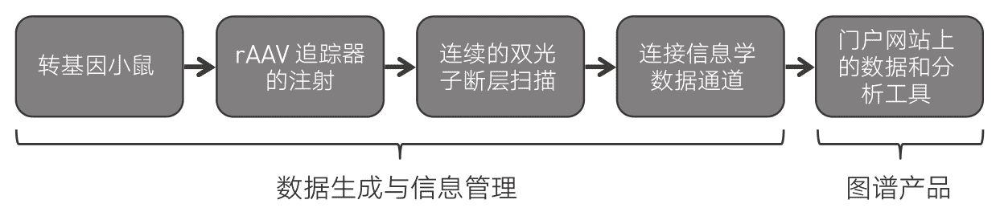）。我们实现了从`Cre`驱动转基因鼠繁育表型分析、立体定位注射`rAAV`示踪剂、连续双光子断层扫描，到数据接入强大信息学管道生成核心数据集的全链路工业化。为达成项目目标，我们大幅扩产`Cre`驱动鼠系，并与外科团队高度协同，实现常年日均多例精准注射。项目累计为连续双光子扫描提供数千例注射脑样本。单套系统日处理一脑，`x-y`轴采样间距0.35微米，`z`轴间距较大，每周运行6天。工业化环境下，系统全天候监控20小时，非值班时段亦有专人待命应对异常。前三模块输出野生型与`Cre`驱动鼠的原始钙成像数据，后经多级加工质检纳入完整流水线。

**图 3-1　艾伦小鼠大脑连接图谱数据生成与信息管理流水线**

该流程涵盖自动化数据处理、检索、可视化及海量复杂数据集分析，作为可扩展计算系统，内置算法模型，整合内部开发的实验室信息管理系统（LIMS）、排程与成果提交中心，构建全自动化管道，年处理量达1拍字节（`10¹⁵`字节）图像数据。

最终图谱产品通过Web应用发布，用户可检索特定结构间投射、相似连接模式、虚拟逆行追踪，在艾伦标准脑图谱解剖坐标下浏览2D/3D数据，分析多数据集并下载计算指标供大规模挖掘。

我们拟沿用此项目管理范式，产出高质量数据产品，助力研究者解析体内外条件下小鼠皮层神经元及皮层-丘脑回路的结构功能奥秘。

## 融合多源数据与理论，构建大脑数字孪生

鉴于神经系统复杂性，构建可量化的生物物理模型与抽象网络模型是理解脑功能的关键。两类可观测行为关联有机体功能：神经元活动（亚阈值膜电位与尖峰特征）与动物行为选择。虽初期聚焦小鼠自然觅食与跑轮奔跑，但这仅是行为库的一隅，我们期望模型具备泛化能力，覆盖未观测行为。因此建模聚焦于复现神经元活动特征的机制模型。模型精度、细胞类型统计量及单神经元响应细节，受限于观测分辨率。基于现有分辨率，我们将量化小鼠连接组，含细胞类型特异性连接`W[αβ]`与单细胞连接`W[ij]`。因皮层间信息主要以尖峰传递，我们将构建一系列关联脑结构与尖峰动力学的视觉模型。

我们将用参数化方式表达突触、神经元至回路的层级模型，复现输入-输出变换。脑切片电生理、形态学、转录组数据将约束外侧膝状体（LGN）与初级视觉皮层（V1）模型。突触层面，重点求解不同细胞型间短程可塑性参数。初期采用泄漏积分放电（LIF）模型，利用凸优化获取最优拟合亚阈值电压与尖峰参数。生物物理详细模型优势在于整合形态、电压依赖性电流、突触分布等物理实在信息，但参数拟合困难且计算量最大。未解难题在于：是否存在高频出现的标准回路模块（如中间神经元-锥体细胞微回路、皮层-丘脑回路）？模块化原理是规避“复杂性刹车”的关键。因大部参数源自切片数据，我们将调制性突触输入与来自其他皮层/丘脑的直接输入整合。

多脑区连接视觉区并调控其活动：有的设定觉醒水平，有的处理听觉、躯体感觉或运动信号。为量化此神经活动状态，我们开发群体统计方法：在突触输入特征匹配条件下，复现简单点神经元群体的亚阈值与尖峰动态，可扩展至全脑规模，模拟睡眠或“静息态”动态。其核心参数为细胞类型连接组及神经元/模块动态特性。

构建系统级模型，我们将建立在线网络模型，涵盖所有处理层级与模块，采用建模描述语言与仿真工具。允许混合建模策略：V1外视觉区用群体统计，V1用尖峰群体，核心神经元用生物物理细节。旨在复现体内生理机能，通过在非关键区简化计算，平衡精度与效率。

从时空感受野视角刻画视觉神经元特征至关重要：即视觉空间中特定时序刺激能引发响应的区域（如特定方向移动条形刺激最佳激活定向选择性神经元）。后续分析将引入小鼠处理自然视觉场景时的行为状态依赖性与情境调制。我们还计划基于观测神经活动与编码模型，利用贝叶斯解码重建视觉输入（“读心术”），以此定量验证编码假设（如重建质量是否取决于特征显著性函数）。编码与解码呈辩证统一：编码理解越深，解码越精准。

建模终极步骤，是关联神经活动与任务执行中的行为决策。混合模型映射行为多层面，配合敏感性分析预测关键模块与参数，这对预测光遗传干预对网络活动的影响至关重要。

即便实现全神经元全尖峰记录与生物物理逐尖峰仿真，我们仍难洞悉神经计算深层原理（详见主题2第9章）。丘脑反馈回路功能何在？大脑运作是否如灵长类视觉模型般，由线性-非线性-反馈级联组织？物体如何被表征、利用与习得？皮层在多大程度上依赖预测编码或贝叶斯推断适应环境？此类问题需实验、建模、理论三方紧密协作，理论思考将反哺建模实践。

当建模专家、理论家、解剖学家、生理学家聚焦皮层-丘脑系统协同攻关，产出的模型与理论将指引未来实验，在“可测量什么”、“该建什么模”、“能理解什么”之间形成良性循环。

## 迈向大规模开放科学新范式

神经科学领域庞大而碎片化：全球约万余独立实验室，跨越毫秒至年、纳米至厘米时空尺度，工具手段极其多元。2012年《自然》刊文中，科赫与里德直指大科学时代脑研究挑战。学术评价体系驱动学生追求独立毕业论文、教职博弈高影响因子论文，导致现代学术极度鼓励实验室与团队间的最大化独立。神经科学学会年会（SfN）上6万余科学家如“大爆炸”般向垂直细分领域疏离。探索期这种独立虽必要，但系统性、全面性解析经典回路与日常行为，要求神经科学步入成熟期。

垂直割据阻碍了标准制定与大规模标准化项目。至今无统一标准从噪声电记录中识别尖峰，各实验室自行其是用几十种分拣算法。为竞争优势及缺乏数据仓库运维资金，科研成果常束之高阁，鲜有开放共享，仅早期分子/转基因工具论文发表后才普及。这严重制约跨实验室比对与复现，拖慢学科进程。

### 脑科学研究的新范式

“脑视界计划”不仅是科研项目，更是神经科学的社会学实验，预示大一统时代来临，打破当前“诸侯割据”局面。应奖励协作团队而非仅嘉奖少数PI。将个人主义学术文化与目标驱动的工程化团队模式融合，是计划核心挑战。汇聚多学科专家于共同目标、技术标准下，单兵作战无法企及的成果将涌现：海量解剖、成像、生理数据将融合进数学预测框架，揭示要素如何协同产生智能与意识。未来，少数装备精良、人才密集的尖端脑观测站将弥补学术体制短板。

虽脑视界计划艰巨，但物理学（粒子加速器、天文望远镜）与人类基因组计划已树立先例：跨越数十年、动员数万科研工程人员、获多方资助。正如物理学家构建望远镜窥探宇宙边缘，脑科学家须建造“观测站”窥探颅内心智诞生瞬间。

# 04 基因测序破解连接组之谜

**安东尼·扎多尔（Anthony Zador）**

**神经科学家，纽约冷泉港实验室神经科学系主任**

## 造思考机器，先破连接图谱

每年超3万神经科学家汇聚分享发现，汇成数千篇论文。神经科学飞速发展，大脑运作机制仍是谜团。核心缺失在于神经回路层面信息：虽知分子、单神经元、脑区宏观结构，却缺“接线图”。好消息是技术进步让单神经元分辨率的连接组指日可待。但当前技术仍力有不逮，离真正“解析”大脑有距离。若洞悉思维生成机制，即可构建拥有人类思维的机器。

计算机早期，西蒙（Herbert Simon）1965年预言“20年内机器胜任所有人类工作”，现看来过于乐观。人类易做的事（幼儿喝水、辨认童话反派）机器难；机器易做的事（国际象棋）人类难。家务机器人因视觉原始状态仍缺席。

为何存在这种不对称？生物计算是否有独特之处？能否被计算机复制？简化演化史看，两派观点分野：经典AI派认大脑无特殊，连接主义派信大脑计算原理赋予人类优势，须仿生构建计算引擎，通往神经网络与机器学习。

神经网络溯源50年代，现代“文艺复兴”始于1986年鲁梅哈特与麦克莱兰《并行分布式处理》（PDP）。PDP核心：大脑并行分布式计算，海量简单求和节点替代单一CPU，计算存储于连接矩阵，编程让位学习算法。PDP声称解决经典AI难题。

虽神经网络/机器学习在特定任务（如OCR）有效，未缩小AI与生物智能鸿沟。遗漏何物？可能神经网络不够“生物”。PDP文献中探讨赋予节点树突复杂性，仅量变不质变。另一主流观点主张发展更复杂学习算法，神经信息处理系统会议（NeurIPS）由此几乎转型为机器学习会议。但数十年机器学习研究仍未破解人脑。

## 如何让AI追平生物智能

此刻须正视：更生物化的网络或更优算法可能均非答案。生物有机体高效计算，源于亿万年演化压力打磨出的高度专业化“最优算法库” —— “技巧锦囊”，应对无数特例与意外，要求算法在现实万变情境下鲁棒有效。理论家厌恶此“非统一原理”观，但马库斯（Gary Marcus）称大脑为“克鲁格拼凑系统”（kluge），以笨拙非简洁方式完成任务，无美感可言。

# 破解智能密码：从“技巧锦囊”到“罗塞塔大脑”

**解码神经回路，为何不能只靠“通用算法”？**

业余魔术师哪怕手握顶级秘籍，也演不出大师级魔术。这道生动的隐喻，精准指出了“技巧锦囊”假说的核心：**通用算法虽必要，却远非充分**。谷歌搜索的王者地位，不靠单一公式，而仰赖那套精心打磨的网页排名核心算法，加上 200 多个像“页面时效性”“用户地理位置”这类关键“技巧”加持。

同理，生物智能极可能是亿万年进化沉淀出的“训练集精华”——无数祖先生死相授的生存经验。人类自身的训练样本太少，再强的学习算法也挖掘不出这些深层规律。承认“技巧锦囊”存在，并非否认大脑有核心原理，而是提醒我们：想造出能解决现实难题的机器，必须反向拆解生物智能的“独门绝技”，或自行发明新招。而单个神经元层面的连接组，正是这把反向设计的钥匙。好消息是，打造这把钥匙所需的工具，已近在咫尺。

**新皮层：模块化的“标准件”工厂**

要读懂生物智能，绕不开新皮层。这块哺乳动物独有、灵长类尤发达的组织，被公认为智能的物质基础。它的结构高度统一：老鼠和猴子的新皮层切片放在一起难分伯仲；同一大脑内，处理听觉的区域与处理触觉的区域，微观架构几乎如出一辙。

这种高度一致性，指向了**模块化设计**。进化选择复制“基础模块”而非单纯堆砌神经元，是极其聪明的权衡：全互联网络随规模膨胀，连接数呈平方级爆炸（百万神经元需万亿连接），早超出基因组编码容量与物理空间承载力。模块化不仅解决了“布线难题”，还让发育过程从“精确指定每个连接”转向“生成标准单元再组装”。

基础单元被认为是**新皮层柱**——垂直排列、响应相似的神经元群。但搞懂模块光看柱内局部回路不够，还得摸清输入输出接口：新皮层区域间紧密对话，还与丘脑、纹状体等深层结构频繁交换信息。统一的皮层架构暗示了共享的“底层算法”，而专用区特有的微回路，则对应特定信息处理的“专用技巧”。搞定这些组织原则，就是破译“技巧锦囊”的前置任务——正如学会 FORTRAN 是掌握数值分析算法的敲门砖，一旦读懂新皮层计算原理，在硅基芯片上复刻便指日可待。

**连接组难题：电镜的“天花板”与新路的突围**

反向设计的前提，是弄清特定回路如何定义“好问题”。小鼠凭借基因可操作性、可学复杂任务、兼容双光子钙成像（可同时监测上千神经元），成了当下主力模型。但要拿到详尽布线图——连接组，目前几乎只能靠电子显微镜（EM）。

电镜重建有两座大山：
1.  **数据采集太难**：需连续切出 ~10nm 薄片成像再对齐重建。传统电镜通量低、易丢片、对切片稳定性要求苛刻，丢几片就前功尽弃。
2.  **数据分析太疯**：追踪 1mm 轴突需对齐 10⁵ 张切片，单片错配就能把轴突“安”错细胞体。尽管技术近年大进步，面对丘脑-皮层、纹状体-皮层这类长程投射，电镜依然捉襟见肘。

受限于单神经元分辨率，电镜目前无替代品——除非换赛道。

---

# 05　罗塞塔大脑：用测序代替显微，重写神经科学底层逻辑

**乔治·丘奇（George Church）**  
哈佛医学院遗传学教授、基因工程领军人、分子工程师。首创个人全基因组测序商业化，屡登诺奖预测榜  
**合著：亚当·马布尔斯通、雷萨·卡尔霍**

### 复杂性深渊：大脑远比你想的“硬核”

越研究越绝望？大脑的复杂性呈指数级分层：
- **空间极密**：立方毫米塞进 10 万神经元、9 亿突触。
- **类型极多**：功能上百上千种亚型，各有独特形态与分子指纹。
- **连接极杂**：兴奋/抑制混用 100+ 种神经递质，强度动态变、结构可重塑、甚至能切换递质模式；气体信使还能穿膜远程调控，突破突触通信框架。
- **非神经元也“算”**：胶质细胞早非单纯后勤，它们长突触、放递质、直接调节神经元信息流。
- **分子层自带“操作系统”**：每个细胞内部都是自我组装的分子机器网，动态存储操作遗传逻辑与突触蛋白组件。

发育期大脑从混乱自组织有序，若掌握其自组织规则，就能在不同尺度区分“有意义的复杂性”与“噪音”。这是治疗脑病、造高带宽脑机接口的必经之路——也是当前神经科学的“鸡生蛋蛋生鸡”困局：要找简单原理，得先吞下全部复杂性。

### 碎片化突围：三大主流路线的“短板”

当前大型脑计划聚焦三条线：
1.  **连接组学**（谁连谁）——只给静态骨架，不分兴奋抑制，看不见发育可塑性，同一动物难重复采样。
2.  **脑活动图谱**（谁在放电）——看见“交通流”不知“路网”，无法反推回路。
3.  **大规模模拟**（整合建模）——最全面，但约束条件太松，关键功能结构常被抹平。

单线作战都对不上大脑的多维复杂性；想融合，却发现彼此缺口互不互补，操作层面卡得死死的。

### 理想数据集长什么样？——罗塞塔石碑式的“多模态对齐”

退一步想：不论能不能做，**终极理想数据集**该长啥样？至少要在**同一颗大脑**里，把以下层面全对齐到单细胞分辨率：
☉ 细胞类型身份证  
☉ 完整神经连接图  
☉ 连接强度与类型（兴奋/抑制/调节）  
☉ 发育谱系树（谁分化自谁）  
☉ 长程电活动历史  
☉ 分子状态动态轨迹  

就像**罗塞塔石碑**用三种文字记录同一诏书，让失传千年的象形文字得以破译——“罗塞塔大脑”让多个现象学层面在单细胞维度直接可比。每个神经元不仅能报电活动、连接，还能自报家门：我是谁、我从哪来、我连谁、我怎么变。

### 抽象建模：把生物问题变成“条形码核对题”

如何落地？把所有观测转为**标记与计算**问题。

**连接矩阵**：核心是亿级方阵，元素 (X, Y) 表示 X→Y 是否有突触。若每细胞有唯一“条形码”ID，判断连接即查询：`(条形码_X, 条形码_Y)` 是否在连接清单中？

**发育谱系**：给每细胞发唯一条形码。X 的子代条形码 = `子代(条形码_X)`，孙代 = `子代[子代(条形码_X)]`……层层嵌套，自动编码全系谱。

**细胞类型**：传统靠形态（高尔基/卡哈尔观轴突树突），现在靠**转录组计数**。全身细胞基因组相同，差异源于表达水平。中心法则 `DNA → mRNA → 蛋白` 意味着：统计 mRNA 丰度分布，即可离散化定义细胞类型。

---

### 新范式：单神经元连接条形码（BOINC）——用测序“读”出连接组

**核心洞察**：高通量 DNA 测序成本暴跌（2001 年 $20 亿 → 2007 年 $100 万 → 今 <$1000），降速远超摩尔定律。若能把“神经连接”转化为“测序问题”，连接组学将迎来成本与通量的双重指数级红利。

**BOINC 三步走，化解三大挑战**：

| 挑战 | 解法 | 关键创新 |
|------|------|----------|
| **1. 给每神经元发唯一 ID** | **基因组暗盒 + 重组酶洗牌** | 转基因小鼠染色体植入 `S X[1] S X[2] ... S X[N] S` 序列。重组酶随机翻转片段顺序并反向互补，理论多样性 `D = 2^N N!`（类比抗体 V(D)J 重排）。30 碱基随机条形码空间 `4³⁰ ≈ 10¹⁸`，远超小鼠皮层神经元数，准唯一编码轻松实现。 |
| **2. 突触伙伴间交换 ID** | **改造伪狂犬病毒跨突触传递条形码** | 利用病毒天然逆行跨突触传播特性，工程化病毒携带条形码。每神经元成“条形码包”：自带副本 + 所有突触前伙伴的条形码副本。 |
| **3. 将预/后条形码拼成单分子测序** | **整合酶不可逆拼接** | 整合酶识别成对位点，将两条形码永久拼接成单一 DNA 片段。常规扩增 + 高通量测序即得成对条形码列表 → 直读连接矩阵。 |

**对比电镜的两大碾压优势**：
1.  **极致性价比**：按当前测序成本，小鼠皮层（<10⁷ 神经元，~10¹⁰ 突触）仅需 **几周 + ~$10,000**；随测序技术迭代，成本还将断崖式下跌。
2.  **天生擅长长程投射**：电镜追踪长轴突易断片、错配，误差随距离累积；BOINC 基于分子扩散/病毒传递，**误率与投射长度无关**，局部微柱回路与全脑长程投射一网打尽。

**补齐两大天生短板**：
- **无空间坐标** → 核酸提取前做**脑区解剖分区**（100μm 精度足以定解剖区），将条形码映射回空间位置。
- **无细胞类型** → 同步给**转录组打条形码**（mRNA 丰度定兴奋/抑制、层位、亚型）。最终得到**增强版连接矩阵**：每行 = 神经元条形码 + 空间标签 + 类型标签 + 伙伴条形码列表。

### 终局展望：从“读图”到“读书”

若有一法又快又廉价地出全脑连接图谱，神经科学将质变。**孤独症、精神分裂症**等疑为“连接病”的疾病，今日连小鼠模型的连接缺陷都难定位；有了廉价全脑图谱，病理机制可望速破。正如**全基因组测序开启后基因组时代**，完整神经元地图将成解析神经功能、发育、进化的基石。**BOINC 或非终极答案，但必是通往“罗塞塔大脑”关键阶梯。**

## 序列空间：匹配大脑规模的指数级编码库

在细胞内部回溯分子表达的轨迹，遵循着相似的逻辑。譬如，要捕捉学习记忆过程中基因表达的动态变化，科学家不仅要统计分子总数，更需为每个分子打上“时间戳”——一串代表特定时刻的数字代码。这好比超市收银系统的运作：商品条码被扫描的瞬间，交易时间自动锁定，带有时间标识的条码信息随即汇入数据库。

如何据此推算神经连接的强弱与类别，目前尚无显而易见的标准答案，但从理论层面剖析，通过量化突触两侧特定蛋白的丰度变化，我们可以进行推断。神经递质受体的分布模式以及其他突触蛋白的组合，共同界定了突触的本质属性。进一步左右连接强度的关键变量，是从`细胞 X`投射到`细胞 Y`的突触数目，这直接反映了轴突末梢与树突棘的联结紧密度。因此，统计突触数量能为连接强度提供粗略的参考指标。

倘若我们能触及罗塞塔大脑的另一维度——电活动历史，便能开辟出另一条确定连接强度的路径。假设我们掌握了`细胞 X`与`细胞 Y`高时间分辨率的电活动档案，在这些时间轨迹中，我们将“目睹”来自`细胞 X`的电脉冲经由突触传递至`细胞 Y`，随即触发后者的电脉冲发放。`细胞 Y`的脉冲输出是其整合了来自众多突触连接细胞输入后的产物。通过追踪网络中脉冲传递的统计规律与相对时序，我们能精准界定每对神经元间的有效“功能连接”。将功能连接数据与解剖结构连接矩阵叠加分析，便有望精确计算出相邻神经元间的突触权重。实则上，整合内容丰富、数据冗余且相互关联的多维数据集，使我们有机会填补任意单一数据集的“盲区”。虽这引发了棘手的统计学难题，但在依据微小神经回路活动反推解剖架构上，我们已取得实质性进展。

### DNA：超越遗传密码的分子存储介质

我们将构建罗塞塔大脑的构想，在概念上简化为海量重复的单一操作：读取并计数“条形码”或“标记”。前文已论证，若每个细胞、突触或分子均拥有独一无二且携带时间戳的“条形码”，通过统计这些码的数量，并将其与独立获取的细胞电活动历史数据关联，便能推导出大脑结构与动力学的海量结论。那么，如何在亚细胞尺度制造并读取这些“条形码”？

关键在于 DNA。虽课本常将 DNA 定义为基因组的存储载体，但其作为信息存储模块的潜能远不止于此。DNA 分子可由 A、T、C、G 四种化学字母任意排列组合，例如 `ATATAGATAGATCACCCAGAAGATAGGAT` 即为一条合法链。DNA 可存储任意序列，不局限于现存生物基因组使用的编码图谱。这一洞见对科技诸多领域影响深远，因它提供了将信息技术延伸至分子层面并与生物系统融合的策略。

与此同时，测序技术在学界与产业的迭代，使其性价比提升速度远超摩尔定律。摩尔定律主导了硅基微处理器从“大哥大”进化至“谷歌眼镜”的二十年历程，其诸多规律亦适用于 DNA 合成，后者正处于相似的爆发轨道上。如今，我们已能轻松实现 DNA 信息的读写，这在史无前例。近期，研究者仅用 2012 个 DNA 碱基对便将《复活》全书编码并成功读回。

假设存在一条 25 个脱氧核苷酸长的 DNA 链，其可能序列总数与人脑突触数量相比如何？

`25 碱基 DNA 序列总数 = 4²⁵`

`人脑突触总数 ≈ 10¹⁴ ~ 4²³`

推算可知，25 碱基长度的 DNA 序列空间，容量是人脑突触总数的近百倍。此外，我们极易穷举验证这 `4²⁵` 种可能性：将 A、T、C、G 四字母两两组合得 16 种二元组（AA、AT...GG），再引入四种碱基生成三元组，如此重复 25 轮，即可枚举所有长度为 25 的序列。

设想我们手持一管装满 40 碱基长随机 DNA 序列副本的试管，称之为“DNA 条形码”。若将其随机导入小鼠大脑约 10⁸ 个神经元，出现两个神经元共享同一条形码的概率几何？数学上这等同于经典“生日悖论”：在 `k` 个人中，至少两人同生日的概率（设一年 `n`=365 天）。此处 `k`=10⁸，`n`=4⁴⁰。推算结果显示，小鼠神经元条形码碰撞概率低于 `1:10¹¹亿`。

通过为小鼠每个神经元分配随机 DNA 条形码，我们实现了全脑单细胞级的唯一标识。同理，构建罗塞塔大脑所需标记与计数的核心诀窍，在于最大化编码 DNA 信息量。但现实中，如何在保持大脑完好无损的前提下读取这些序列？

## 原位测序：破解罗塞塔大脑的核心钥匙

常规测序中，DNA 分子游离于试管清液中。将试管置入仪器，即输出由碱基字母构成的长文本文件及元数据。

我们的方案需在脑切片中复现此过程。测序仪内，DNA 分子随机铺于玻璃载片并固定。随后引入 DNA 聚合酶，利用游离的 A、T、C、G 合成互补链，使海量同源副本在原位聚集成可见的荧光簇。关键步骤来了：让四种碱基分别携带红、绿、黄、蓝四色荧光染料。聚合酶合成新链时，碱基依次加入，荧光簇随之呈现对应颜色。记录各坐标点颜色变化序列，显微镜即可并行读取全视野所有 DNA 分子序列（见下图）。本质上，此测序仪是显微镜与定时注射 A、T、C、G 及聚合酶流水线的耦合。并行成像特性大幅降低了测序成本。

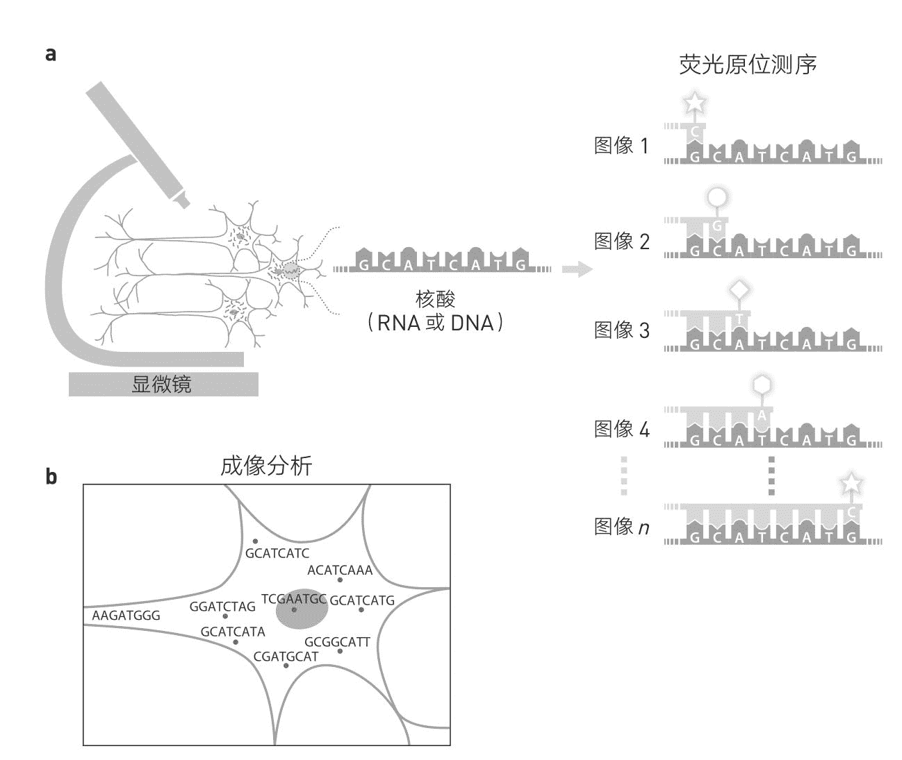

**图 5-1　荧光原位测序**

a. 合成测序原理：聚合酶将荧光碱基加入延伸链，显微镜记录各簇颜色跃变。每个荧光簇源自单个“母”分子的扩增副本。

b. 最终形成一系列被标记的坐标点，每个点的标签即对应序列。

取出动物大脑制成近乎透明的超薄切片，经化学固定防止降解（对机械稳定性要求极高），不再对玻璃片上纯净 DNA 测序，而是直接在脑切片原有 DNA/RNA 模板上，利用显微镜实施测序。我们称此技术为**荧光原位测序（`Fluorescent In Situ Sequencing`，`FISSEQ`）**，意指在完好脑组织原位，用荧光显微镜对染色脱氧核苷酸逐碱基解码。

## 以原位测序解析细胞类型、连接图谱与发育谱系

随原位测序技术成熟，构建“带注释连接组”将手到擒来。换言之，这是一幅标注了每个神经元细胞类型的全脑地图。实现此目标需三大支柱：

☉ **全脑神经元唯一 DNA“条形码”递送**。利用基因改造的无害病毒载体，将随机 DNA 序列导入每个神经元基因组。

☉ **突触专属荧光标记**。使其在显微镜下清晰勾勒突触空间分布。

☉ **超高空间分辨率原位测序显微系统**。突触间距极微，仅少量可见光波长能穿行其间，或需“超分辨”光学显微镜技术。

**解析连接**：显微镜定位突触位置，原位测序读取突触前后两侧“条形码”，即可匹配连接双方身份。更前沿复杂的方案详见主题 1 第 4 章。扎多尔团队利用病毒在突触连接的神经元间传递“条形码”，配合低成本测序读出连接组；而原位测序则可直接在显微镜下读码，免去跨细胞传递环节。

**注释细胞类型**：直接对单细胞信使 RNA 实施原位测序，获取基因表达“指纹”，这是细胞类型的金标准指示。

**追溯发育谱系**：设计 DNA“条形码”在每次细胞分裂时微量漂移。追踪这些微累积变异，即可重构单细胞“家谱”。这类似于用 DNA 测序推演人类族谱，只是作用对象换成了单个大脑内的细胞族群。

分辨率高出光学显微镜百倍的电镜技术，同样能融合功能研究与精细回路重构。电镜法下，突触连接与细胞类型需从超高分辨影像推断，因电镜难以兼容多色报告分子与 DNA 测序。且电镜跨长距离追踪轴突、从海量图像数据重构细胞结构极具挑战，需将大脑切成微米级薄片，数据密度远超光学法。尽管果蝇与小鼠视网膜全回路重构证明了电镜连接组学的威力，且软硬件均长足进步，但鉴于 DNA 指数级编码容量与测序读出的便捷性，我们坚信罗塞塔原位测序法具有不可替代的互补价值——它天然适配多模态数据融合。

## 免疫显微技术：量化突触强度的新维度

迄今尚缺精准测定突触强度与亚型的理想手段。庆幸的是，沿用原位测序同款显微平台，我们可引入免疫系统抗体标记突触蛋白。免疫显微技术依托抗体特异性识别，将特定颜色锚定至特定突触蛋白。突触蛋白分布模式正是强度与类型的风向标，故可将此法与原位测序联用，为连接组增注突触参数层。更进一步，将 DNA 链偶联至特异性抗体，可将抗体染色读出通道从 4 色拓展至 `4^n` 维度。

## 能否将神经元电活动“刻录”进 DNA？

我们能否从原位 DNA 测序中读取时变现象——即每个神经元最核心、变化最快的电活动史？虽将动态细胞活动映射至静态 DNA 链听似天方夜谭，但我们预测至少存在一条可行路径。

请再现象 DNA 聚合酶复制长链的过程：它从一端进发至另一端，逐碱基读取模板并招募互补碱基组装新链。设想我们能短暂“干扰”这一复制进程，使其掺入错误碱基。若知晓聚合酶起始复制时刻，便可通过错误位置推算干扰发生时间：干扰越晚，错误出现位置离起始端越远。

进而设想，若能让瞬时电活动水平调控聚合酶错配率，DNA 链上的错配谱系便化作“电传打字机纸带”，忠实记录一段时期内的神经元放电模式（见图 5-2）。该设想的物理基础在于：神经元放电伴随钙离子内涌，钙离子若能定向作用于聚合酶扰乱其保真度，即可实现电信号向分子记录的转码。

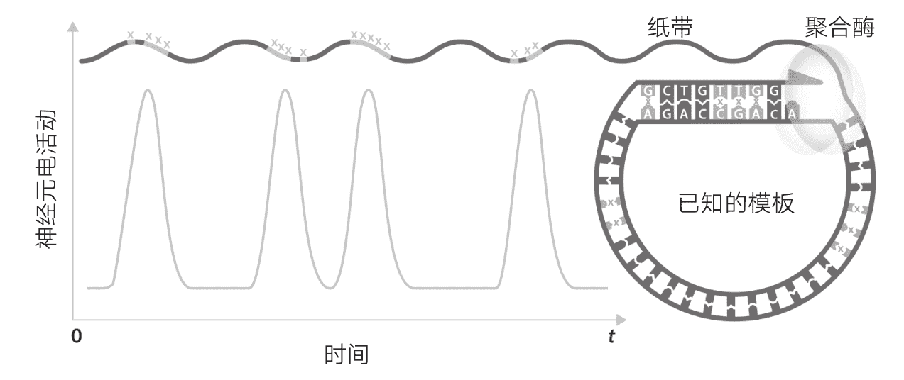

**图 5-2　分子记录装置**

注：神经放电驱动的跨膜离子流动态，可通过调控聚合酶复制保真度写入 DNA。事后经测序解码，即可在无外部设备介入下，实时回溯单神经元电活动史。

虽实验室落地仍面临重重挑战，但该思路已催生出更易执行的替代方案：在较慢时间尺度上将事件写入 DNA 存储介质，待后续测序读出。这使我们得以将细胞内随时间演变的分子事件沉淀于静态 DNA，再经原位测序复盘历史。

关键在于，即便这些技术尚未成熟，我们已能用现有手段（如贴片钳电生理）读取少量细胞电活动。同步对这些实验大脑实施罗塞塔原位测序，即可同步获取细胞结构与动力学的多维特征。

## 罗塞塔大脑实验全景架构

整合上述方法论，可勾勒出如下实验范式：

**阶段Ⅰ：活体实验**
☉ 递送 DNA“条形码”及分子探针；
☉ 实施多维行为/认知实验；
☉ 最大强度感官/认知刺激；
☉ 传统电生理/光学手段实时大规模记录电活动。

**阶段Ⅱ：原位解析**
☉ 脑组织化学固定、透明化、超薄切片；
☉ 实施原位测序，同步原位显微观测突触蛋白；
☉ 终极步骤：融合原位显微与测序，全维度收割神经系统信息——细胞类型、发育谱系码、连接组码、突触蛋白抗体图谱、分子纸带上的电活动时序数据。

## 大脑的未来：从地图到逆向工程

获取罗塞塔大脑的海量关联数据集，仅是漫漫长征第一步。我们要让构建流程标准化、普及化，使无数中小实验室均能制备自家罗塞塔大脑，在多元条件下验证假设。我们要横向比较个体间异同，纵向对接大规模脑模拟，以此为理想数据集反哺模型迭代。在计算模型中已成定局的问题，可在真脑中一站式求解，洞悉变量间的因果编织。

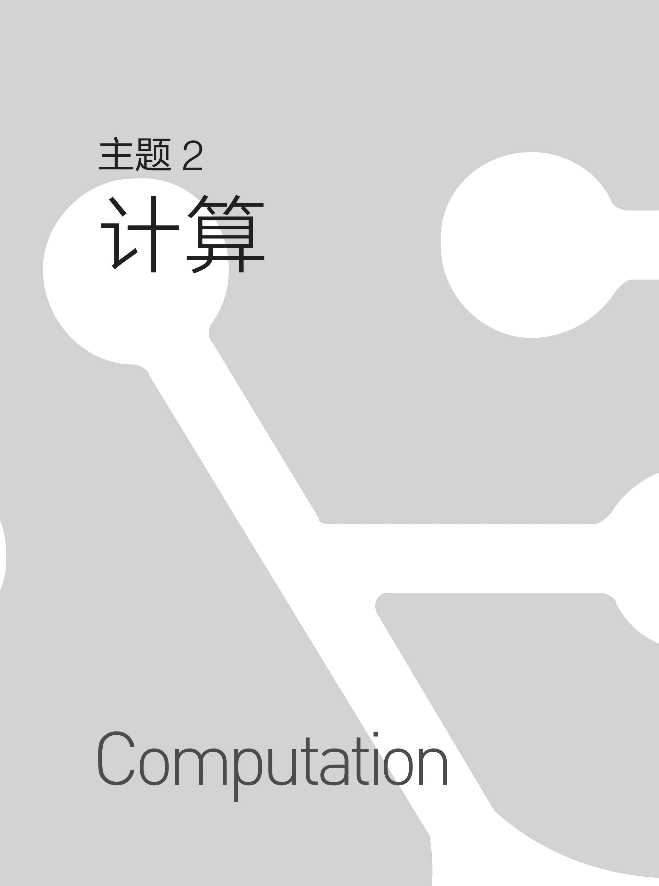

即便拥有全脑单神经元、单连接级别的精细地图，也仅完成半程任务。美国公路网地图虽能揭示纽约、芝加哥枢纽地位、公路等级体系，却无法推导出交通流实时动态、路况拥堵成因或出行决策逻辑。肝脏、鼻腔等器官，知晓组成成分几乎等同于读懂功能；大脑截然不同——知结构不解运作。

根源在于大脑是**计算器官**。肝细胞解毒、鼻腔过滤是物理化学功能，神经元核心功能是**计算**。核心任务是破译“它们在计算什么”。借用计算机隐喻，这相当于同时逆向工程：操作系统、应用软件、通信协议栈（USB、ASCII、TCP/IP...）。挑战史无前例。

本书后续章节将展示顶尖学者如何直面“理解大脑计算”这一终极命题。首站，聚焦梅-布里特·莫泽与爱德华·莫泽的网格细胞研究，他们精准关联特定脑区解剖生理特征与空间导航计算，树立了全脑研究的范式标杆。克里希纳·谢诺伊将阐述数据分析的“以点见面”哲学：单细胞记录何以洞见千万神经元集体动力学？奥拉夫·斯波恩斯聚焦大规模脑网络，论证其自发集体动力学的数学本质对大数据解释的框架价值。杰弗里·弗里曼则审视神经科学数据爆发浪潮，剖析新技术如何驾驭数据洪流，并指出读懂大脑远不止于数据处理本身。

# 06　网格细胞：解码皮层计算的罗塞塔石

**梅-布里特·莫泽（May-Britt Moser） & 爱德华·莫泽（Edvard I. Moser）**
**2014 年诺贝尔生理学或医学奖得主，挪威科技大学神经计算中心教授**

神经科学圣杯之一，是读懂哺乳动物大脑皮层。皮层覆盖大脑半球表层，哺乳动物共享此结构，但进化中体积剧增，褶皱纷繁，大量表面埋藏于脑沟深处。皮层是认知智力的主战场：思考、规划、反思、想象皆赖于此；记忆存储、语言理解与生成亦在此完成。且扩张的皮层结构被视为人类心智跃升的基石。

## 皮层真的能被理解吗？

支撑皮层心智功能的神经基础是什么？直面解释高级脑功能神经基础这一外部边界，皮层乍看不可企及。但勿忘，皮层亦执行具象操作——解码外界感觉输入。感觉信号在皮层的早期表征，长期是神经科学家窥探皮层运作的窗口。例如，研究视觉、听觉、触觉信号如何在初级感觉皮层完成初加工，已让我们在描述皮层“操作语言”上取得巨大进展。

感觉皮层研究的里程碑式突破，是发现细胞对感受野局部特征表现出高度选择性。上世纪 50 年代，大卫·休伯尔与托斯滕·威塞尔系列实验证明：初级视皮层神经元对视野中特定朝向的线条呈特异性放电。这些细胞的线性感受野，区别于视网膜、丘脑早期环节的圆形感受野。二者证实：神经元存在方向选择性、眼优势差异，虽排列成柱状且功能同质。这些发现勾勒出初级视皮层视觉计算的功能架构，深刻揭示视觉输入如何分解重组、视皮层分区功能分化，开启了神经科学新纪元——视皮层成为皮层计算的“领航员”，影响力远溢视觉机制本身。其他感觉系统随即跟进，我们开始领悟：皮层回路层面的感觉编码策略，如同视觉、听觉、触觉本身一样，呈现多样性。

### 破解高阶大脑密码：空间导航系统的“隐形地图”

科学家们早已攻克了大脑初级感觉皮层处理信息的早期机制，可一旦跨入高阶联合皮层这片“无人区”，认知的黑箱便紧闭如初。这里主管着构思、决策、复杂记忆等最高级操作，却因神经元放电模式与外界物理刺激脱钩，导致我们难以通过环境线索反推神经活动。输入源纷繁复杂、内在运算介入深重，让高阶皮层的神经密码久攻不下。

#### 唯一的“破译口”：哺乳动物的空间定位回路

海马体与内嗅皮层构建的空间定位系统，是高阶皮层中罕见的“可预测区域”。它们坐镇皮层顶端，距离初级感觉区迢迢多个突触之遥，神经元放电却与动物的实时坐标严丝合缝。

故事始于1971年，奥基夫团队在大鼠海马CA1区发现**“位置细胞”**：特定神经元仅在动物进入特定区域（位置野）时高频放电。群体协作下，全环境每一处坐标都对应唯一的神经元活动组合——大脑竟自带一套动态更新的“认知地图”。这种神经活动与外部世界的高度锁定，在高阶皮层记录中属凤毛麟角。

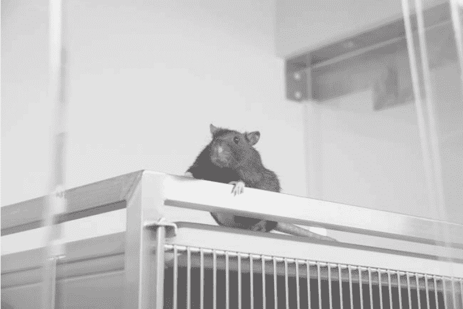

**图注：实验主角——大鼠**  
啮齿类发达的内嗅皮层与海马，支撑起卓越的空间记忆与导航力，成为攻克高阶认知的天然模型。

然而，位置细胞的地图并非一成不变。环境微变即触发全新编码，暗示其功能远超物理空间绘制。若大脑存在一套独立于环境外观的、统一度量距离与方向的基础坐标系，它必藏于上游——内嗅皮层。顺着这条线索，科学家切断海马内部回路，仅保留内嗅输入，惊觉CA1位置野依旧稳立：空间信号源头，锁定内嗅。

#### 网格细胞：大脑自带的“坐标纸”

2004-2005年，研究者在内嗅皮层内侧植入电极，发现惊人一幕：**单个神经元拥有多个放电野，排布成完美的周期性等边三角阵列**，宛如铺满整个场地的网格纸交叉点。这便是**“网格细胞”**。从大鼠、小鼠到蝙蝠、猴子、人类，哺乳动物分支普遍存在这一精密结构。

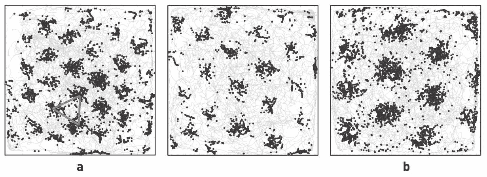

**图注：三个网格细胞的放电热力图**  
a. 短空间波长细胞；b. 长空间波长细胞。黑点标记峰值放电位置，清晰勾勒六边形晶格。

网格细胞最迷人的特质在于**不变性**：无论跑速、转向如何变幻，晶格纹丝不动；跨环境测试中，两细胞的相对相位关系（重叠/错位）完美复刻。这与海马位置细胞“见环境换地图”的灵活性形成鲜明对比——网格系统执行的是通用的、标准化的大脑空间度量。

**模块化组织：多地图叠加的组合密码**  
大规模同步记录（单次超180细胞）揭示：网格细胞非单一地图，而是分化为**4-5个离散模块**。模块间网格间距、轴向各异，沿背腹轴梯度分布。更妙的是模块间**响应独立性**：压缩环境几何形状时，背侧小间距模块“视而不见”，腹侧大间距模块却按比例同步压缩。

为何大脑要维护多套地图？答案藏在下游海马的**记忆区分**需求中。海马承载陈述性记忆（事实与事件），空间是核心索引键。每日数千新记忆需互不干扰，网格模块的独立漂移提供了组合爆炸级的编码容量：正如5个十进制计数器能锁定10万组密码，寥寥数模块的相对位移组合，即可驱动海马生成海量互异的神经元集合，为每个“何时何地何事”分配唯一神经指纹。

#### 网格从何而来？自组织的六边形秩序

网格模式生于感觉输入尽头，却呈现极致几何秩序，不似上游感觉表征般随层级加深而混噪。六边形晶格不对应环境任何物理属性，必反映内嗅皮层**内源性计算机制**。

主流理论指向**竞争性抑制网络的吸引子动力学**：神经元经抑制性中间神经元全互联，在特定连接距离下，六边形放电模式作为网络稳定态自发涌现。这不仅是大脑的专利——自然界中凡平均分布的竞争单元（如蜂巢、对流细胞），皆倾向于自组织出六边形密堆结构。网格细胞，或许只是生物物理普适定律在神经回路中的一次精彩上演。

（注：原文此处为图7引用，保留标记）

#### 并非孤军奋战：内嗅皮层的“导航特种部队”

网格细胞虽占主导，内嗅皮层仍藏着多元编码队伍：
- **头向细胞**：编码头部朝向，兼具位置选择性（锥头细胞）；
- **边界细胞**：专锁环境几何边界（墙、沿），随墙体移动/新增而动态重映射；
- **速度细胞**等（文中未展开但存在此类）。

关键在于，**头向/边界细胞跨环境稳定性极强**，与网格细胞一脉相承，共同构成**通用的、可迁移的空间度量框架**；反观海马位置细胞，每遇新境重编，擅长情景独特性标记。

**上下游博弈：位置细胞如何“炼”成？**  
海马接收内嗅全谱系投射（网格为主力，边界/非空间细胞为辅）。位置野的生成可能整合多源信号：或由网格提供路径积分骨架、边界提供几何校准；或不同时刻动态切换输入权重。随着操纵特定投射通路的工具成熟（光遗传、化学遗传），这一“信号融合算法”有望在未来几年破解。

#### 从空间到思维：认知神经科学的新范式

空间回路的破译，让我们首次得以**在脱离感运闭环的高阶皮层中，精确量化“表征—计算—行为”全链路**。网格系统揭示：高阶皮层并非混沌，而是运行着结构化、可组合、可推广的内生计算法则。这不仅重塑我们对海马-内嗅系统的认知，更为攻克思维、规划、想象等抽象认知核心机制，提供了宝贵的**“模式识别样本”与“理论锚点”**。自上而下的内在模型，或许在初级感觉皮层中也扮演着比想象中更核心的角色——大脑从不被动成像，主动构建才是其本质。

---

# 07 破解“百亿神经元”并行密码：从单点窥测到全景解码

**克里什纳·谢诺伊**  
斯坦福大学电子工程/生物工程/神经生物学教授，霍华德·休斯医学研究所研究员

人脑860亿神经元，人类认知却长期建立在“单电极单神经元”的窄孔视野，或“百万神经元群体平均”的模糊宏观像之上。**中观尺度——同步记录成百上千甚至百万单神经元的精确时序活动——正成为新常态。** 技术壁垒虽破，如何从洪流数据中提炼计算原理，理解“抽象层级”跃迁，仍是硬骨头。

## 一、 多通道并行测量：工具箱的革命性扩容

破解神经系统运作，如同逆向工程超算芯片：必须实测电路层面的电压/电流（动作电位、场电位）与化学态（神经递质、离子浓度）。先驱者们铺就了从单细胞（细胞内/外电极）到全脑宏观（EEG、MEG、fMRI）的测量谱系，并配套微刺激、TMS、光遗传等干预手段，斩获无数诺奖级发现。

但**复杂认知需求“群体视角”**。近十年技术爆发实现**百-千级神经元同步高分辨采样**：
- **光学成像**：基因编码钙指示剂（如GCaMP6）将钙波动转为荧光，实现万级神经元单尖峰分辨率成像，覆盖从固定线虫、行走小鼠到自由大鼠，灵长类认知任务录制在即；
- **高密度电极阵列**：如Blackrock 4×4mm 百通道硅基探针（1mm长），可慢性植入啮齿类、灵长类甚至人脑（FDA神经假肢试验），在感觉-决策-运动任务中稳定采集百余单元活动。

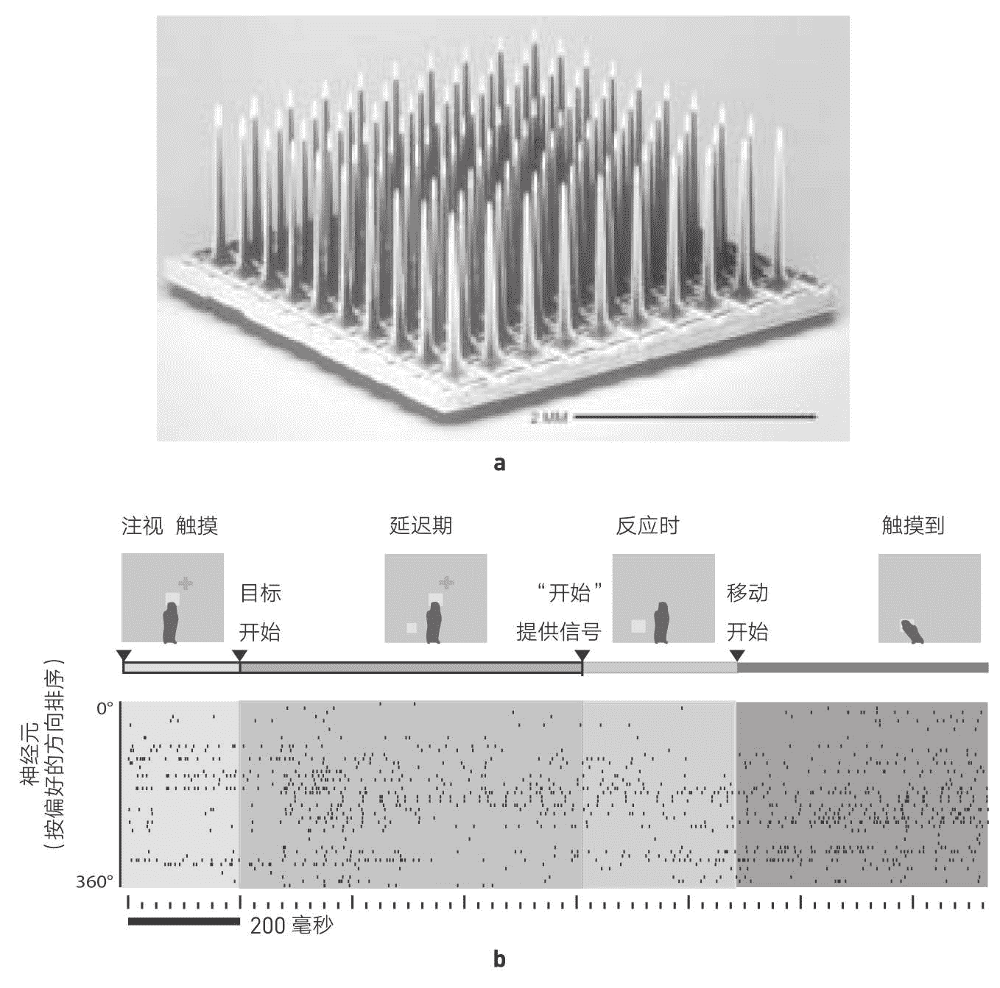

**图 7-1 从群体尖峰到状态空间轨迹的解析流程**  
a. 百通道硅基探针实物；  
b. 猴子延迟伸达任务中，运动前区群体活动随任务期（注视、提示、延迟、执行）演化出低维流形轨迹。每列栅格图对应单神经元尖峰序列。

更多革命性工具（Neuropixels、双光子随机存取显微镜、分子录像等）正加速迭代，百万级同步记录指日可待。

## 二、 数据洪流中的“理解鸿沟”：为何多记不等于懂得？

面对高维、高时精、多模态（细胞类型、投射拓扑、突触强度）数据堆，旧分析范式（单神经元调谐曲线、成对相关、平均发率）严重**低估了并行记录的信息红利**。

计算机类比：同时探测1000个晶体管，不仅效率提升千倍，更能捕捉**电路层面的集体动力学**——这是单点采样永不可得的。神经群体编码的核心优势在于：
1.  **降维揭示流形**：高维尖峰云团常塌陷于低维流形，群体状态沿流形演化即计算过程；
2.  **抽象层级解码**：同一群体在不同时空尺度表征从肌肉动力学到认知变量（决策、规划）的跃迁；
3.  **因果干预靶向**：精准定位“关键少数”神经元或模式，实现闭环调控。

**真正的挑战不在采样，而在“翻译”**：如何建立从群体动力学到认知算法的数学映射？如何区分“实现细节”与“计算本质”？这要求理论神经科学、机器学习、动力学系统理论深度融合，构建新一代**群体神经数据解析框架**——唯有如此，才能将“同时记录大量神经元”从技术指标转化为认知破译的万能钥匙。

### 破解神经数据迷局：动态系统与抽象层次的双重钥匙

科学探索是否存在更高效、更科学的路径？毋庸置疑，方法不胜枚举，但近十年来，学界发掘出一条极具潜力的新径——**动态系统法**。这一方法汲取了物理学与工程学的精华，将动态系统的设计与分析转化为核心工具。其核心架构立足于三大支柱：

**首要要素，聚焦时间维度的序列结构。** 神经测量数据本质上是时间序列，临近时点的数据点之间隐含关联规律。基于此，引入时间平滑处理不仅合理，更能有效抵消神经记录固有的噪声干扰。这一过程直观对应图 7-2 中 a 至 c 图的演示流程。

**次要要素，直击高维数据的低维本质。** 同步记录的神经数据虽呈高维态，但其内在自由度往往远低于表象维度。降维技术作为机器学习与统计学的基石，可助我们推演数据栖居的低维流形，这正是图 7-2 中 d 图所揭示的核心逻辑。将时序平滑与降维相融合，数据中随认知变量演变的关键维度便会浮现——比如“开始”信号发出至肢体启动的延迟（反应时，`RT`），或是预期运动的方向倾向（参考图 7-1b）。特别提醒：二维或三维的平面投影虽利于建立直觉，却必然丢失信息；严谨的科学质询必须回归高维空间，以免遗漏关键细节。

**第三要素，致力于量化演化法则。** 动态系统法试图精确刻画支配群体神经状态流动的数学规则。这好比通过观察小球在曲面滚动来反推牛顿定律——动量、摩擦、弹性等物理特性皆在轨迹中留痕。简而言之，**以低维神经轨迹为显现，以运动方程为内核，方能将海量同步神经记录转化为实质性科学洞见**。借此，我们得以构想神经回路作为整体的运作机制，并推演其与行为的映射关系。

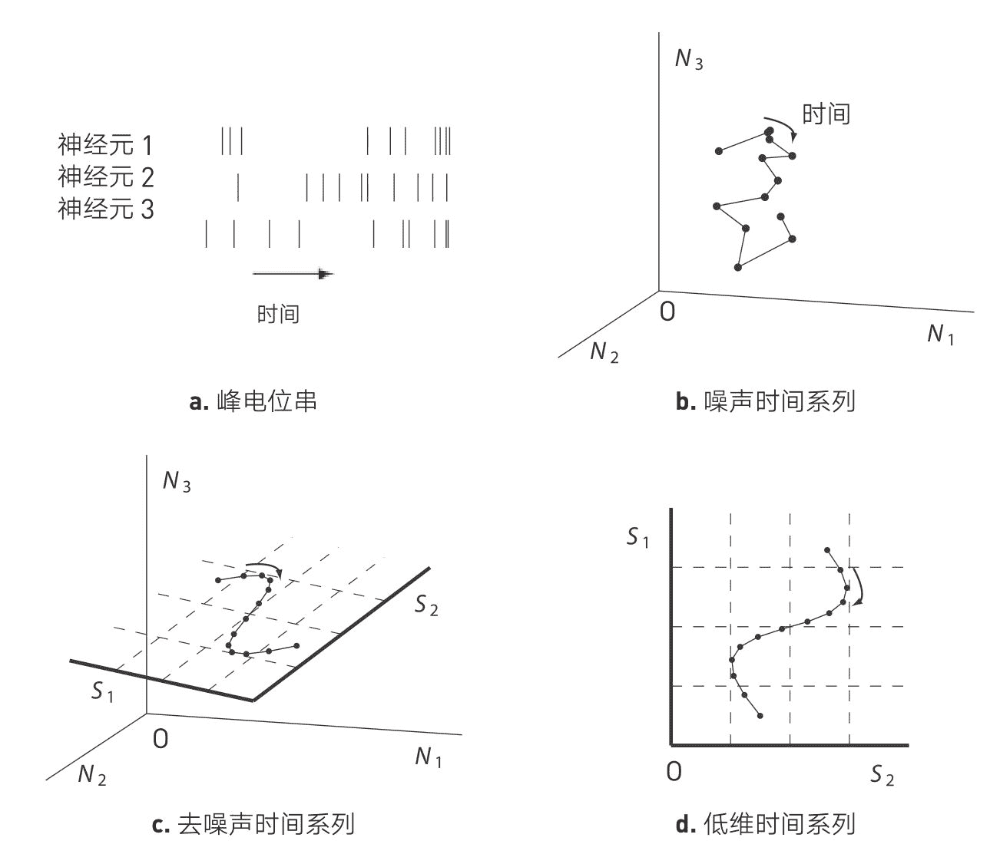

**图 7-2　神经群体轨迹的提取路径**

a. 三个同步记录神经元的脉冲串原始记录。

b. 三维空间中的神经活动时序演化，坐标轴分别代表单个神经元的放电率（如 `N[1]` 代表神经元 1），支持对短时窗放电率进行估算。

c. 神经群体轨迹，即 b 图轨迹的去噪版本，其几何轨迹局限于由坐标 `S[1]` 与 `S[2]` 张成的二维平面。

d. 直接在低维状态空间呈现的群体轨迹，仅凭低维坐标 `S[1]`、`S[2]` 即可复盘。末图展示的是单次尝试、低维度的神经群体状态空间轨迹，源于海量同步神经元数据的计算重构。

## 抽象层次：穿透复杂性的认知阶梯

与“数据淹没”形成鲜明对比，将海量神经记录转化为发现的第二道难关，在于**明确“何处值得关注”**。大脑研究中，此话虽易行实难。我们对大脑的认知尚浅，难以判断哪些微观细节对宏观问题至关重要。例如，将群体活动与臂动关联时，每个神经元的连接拓扑与突触权重是否皆为关键？面对突触不断更迭，脉冲发放的精确时序模式是否举足轻重？此类疑问在神经科学中仍悬而未决。物理学与工程学通过成熟的系统设计与分析范式化解过同类困境，其经验值得借鉴。

**“抽象层次”** 是理解与设计物理系统的通用核心概念。我们有理由预判，它在生物系统乃至脑科学研究中的地位将日益凸显。为阐释其潜在价值，我们将以深为人知的电子系统为喻，对照神经系统层层拆解。

现代计算机由互联的集成电路（芯片）与外设构成。聚焦核心——中央处理器（`CPU`），其架构可划分为四个层级：
1.  **物质基底**：原子精排赋予半导体电特性。
2.  **器件层**：数十亿晶体管构成基本开关单元。
3.  **电路层**：上千万连线交织如都市路网，实现逻辑互联。
4.  **软件层**：从机器码到操作系统、算法，以比特模式（0/1）承载极高复杂度，脱离物理直观属性。

大脑与 CPU 逐项对标注定失败（如将富计算力的神经元比作单一晶体管，或三维点对点连接比作二维平面布线），但**层级抽象的思维框架**极具启发性。这与戴维·马尔的三层次假说暗合：为简述，我们将马尔的计算层与算法/表征层合并为“软件层”，保留物理实现的底三层。

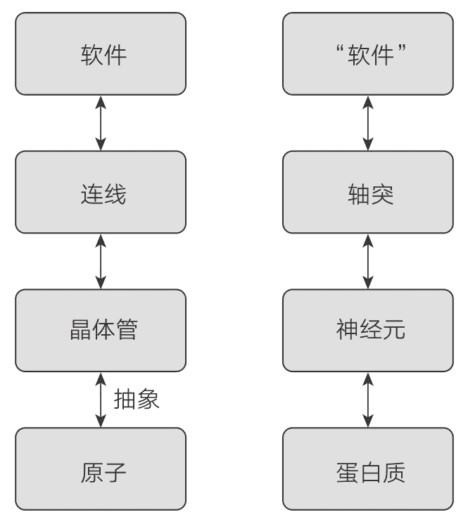

**图 7-3　中央处理器（左）与大脑（右）的抽象层级对照**

注：双向箭头揭示抽象的双向价值——自下而上，物理实现约束软件能力；自上而下，软件需求倒逼物理设计。

* **第一层：物质基底。** 材料科学聚焦硅/掺杂剂/氧的原子工程，对标分子神经科学关注的离子通道、突触、递质。微观机制虽重，但若不抽象提炼统计规律、宏观特性，细节洪流将淹没上层设计逻辑。
* **第二层：器件/细胞层。** 器件物理将材料特性转化为晶体管参数；细胞神经科学解析神经元几何、通道电导、膜电位动力学。同样，必须将器件/细胞特性压缩为简洁的 I-V 关系或输入输出函数，否则上层电路/网络分析将陷入计算与解析的双重泥沼。何为“应保留/舍弃的细节”，在神经科学中仍是开放命题，但我们必须正视**层间抽象**的必要性——无此阶梯，全面理解与设计皆不可行。
* **第三层：电路/解剖层。** 计算机架构设计晶体管/芯片间最优互联；连接组学绘制脑区内外、神经元间的连接法则。对 CPU 而言，硬件整体性能边界决定了软件上限；同理，神经“硬件” 的能力与局限，将主导神经“软件”的表现。难点在于：神经硬件随时间重塑（发育、学习、可塑性），远超静态电子硬件的复杂度。
* **第四层：软件/认知层。** 计算机科学设计指令集、OS、算法掌控信息流；认知神经科学（含网络建模）解码神经活动与感知、决策、抽象思维的映射。若违背抽象原则，此层面临最大挑战：来自底层的海量遗留细节将造成“只见树木不见森林”的认知瘫痪。唯有按任务相关性筛选信息，核心计算原理才会显现。

有了抽象层级，CPU 顶层的基本操作原理便可被发现；大脑亦当如此。设想百通示波器探测 CPU：单探针仅见电压高低、纳秒级跳变，推测寄存器或总线；多探针同步捕捉，方能重构电路动力学、揭示加法器协同时序、定位算法故障——**无需完全重复实验、无需冻结全局状态**。同步测量、降维、动态系统建模、层级抽象，共同屏蔽了原子排布、器件参数、布线细节对顶层分析的干扰。同理，**同步记录成百上千神经元，配以降维、动态系统、网络建模分析，已成现实且大有可为**——我们终能窥见神经群体如何在非平稳、少重复的感知目标流中完成决策。

值得注意的是，上述自下而上的单向叙述仅是起点（参考图 7-3）。若将脑视作 CPU，**自上而下的约束同等关键**：从算法需求反推器件特性、材料选择，闭环才算完备。深入掌握神经计算原理，必将反哺对解剖连接、单细胞计算、分子基础及进化权衡的理解。

我们正身处神经技术革命浪潮中，万级神经元同步记录与调控成为可能。面对史无前例的数据洪流，我们该如何处理？何种细节对哪个层级的提问至关重要？执着于单神经元分析，或将数据仅视为通用“大数据”套用黑盒算法，皆会桎梏发现的深度。本文仅点破两大核心挑战，并抛砖引玉地提出两把钥匙：**动态系统分析**与**抽象层次视角**。

# 08 网络神经科学

**奥拉夫·斯波恩斯（Olaf Sporns）**

印第安纳大学布卢明顿分校心理与脑科学讲席教授、网络科学研究所副所长、MIT Press 期刊《网络神经科学》创刊主编

人类大脑约 860 亿神经元交织运作，破译心智与认知的底层机制，仍是当今最迷人、最迫切的科学征途。脑与精神疾病对健康、社会、经济的日益沉重负担，更催逼着我们加速破解大脑密码。如何更快全貌式理解大脑？除了在微观机制研究上厚积薄发，**神经科学亟需一次视角转向：显式承认大脑是一个跨尺度、层级嵌套、不可简约的复杂网络系统**。

连接与互联，定义了当代主题。对个体，联网是联合国认定的基本权利；对科学，连接正成为解码复杂系统行为的聚焦点。前沿生物学已洞见分子/细胞互作网络，催生系统生物学——基因调控、信号转导、代谢网络决定细胞功能，细胞间通讯维系个体完整。

这一主题在神经科学全面爆发。科学家日益达成共识：**大脑一切功能终归于网络本质——神经元与脑区连接编织的网络**。连接支撑神经计算，脑疾病多源于连接紊乱。这种核心地位，驱动科学家构建全脑连接图谱——即**连接组**（详见主题 1 第 4 章）。本文将阐述**网络神经科学**这一新生学科，其演进将从根本重塑我们对大脑功能的认知。

## 从神经回路到神经网络

在人体器官中，大脑最难界定划分。粗浅模型只会误入歧途。19 世纪德国科学家卡尔·沃格特曾喻：“思想之于脑，若胆汁之于肝，尿液之于肾。”一哲学家讽道：“听沃格特越多，越信其言。”显而易见，我们需要更深刻、更复杂的模型。

认知鸿沟源于**单神经元功能与整体脑功能的巨大鸿沟**。回顾史，神经科学长期建立在“神经元学说”基石上——神经元是功能原子。海量微电极记录、功能成像证实：单神经元响应高度特异，编码面部表情、熟悉声音、眼动收缩、肢体方向等复杂事件；其活动还交织着过往记忆与未来奖赏预期，牵涉工作记忆、注意、视觉意象乃至梦境等所有高级心智成分。

何赋予神经元如此丰富响应？至少三重根基：
1.  **分子机制**：离子通道等分子装置产生/感知电信号，奠定脉冲与突触传递基础。
2.  **形态特质**：独特几何结构调控突触输入向输出的转化。
3.  **网络嵌入**：**突触连接将神经元编织为巨网**。切断连接，神经元“聋盲”且失去影响力。**神经元的力量源自集体行动**——连接统筹其竞争、合作与交互。正如平克所言：“脑细胞按模式放电”，而模式由连接编排。

虽早知神经元成回路、回路活动驱动认知，但**现代网络概念注入了关键新维度**。
传统“回路观”基于**高度特异的点对点交互**，每连接传递特定信息，类电子/逻辑电路。整体行为是特异交互的线性叠加，功能可还原为清晰因果链——此乃经典力学“拉普拉斯魔”式还原论，连接扮演局部因果媒介。

相比之下，**复杂系统与网络科学视角强调：整体不可还原为局部因果之和，网络功能超越个体元件之和**。核心概念是**“涌现”**：海量微弱局部交互的集体协同，催生低层不存在的新性质。
*   **大规模同步**：海量神经元相位锁定放电。虽依赖突触调解，却无法归因于任一特定因果链；它是网络统筹下的整体涌现。
*   **临界状态**：系统游走于有序与无序边界，兼具对当下输入的敏感性与过往记忆的稳定性，支撑高阶计算。特定网络拓扑（如大脑所具）能促进/稳定临界态。

同步与临界仅是网络动力学涌现的两个侧面。解析网络架构如何塑造神经元协作，将为传统回路观增立新维度。

## 迎接“大数据”挑战

复杂网络的集体行为普遍存在——细胞、生态、社会、技术网络皆然。这些动力学包围着我们，深度影响生存福祉（如金融系统、气候变迁）。科学家借助电子数据记录/存储/挖掘能力的指数级跃升，竭力精模社会技术系统动力学，探其对经济稳定、全球疫情、革命战争的驱动机制。**“大数据”浪潮势不可挡。**

### 大脑新趋势

神经科学正站在“大数据”时代的门槛上。作为对传统小规模、假设驱动实验的有力补充，科学家们正大规模采集并整合脑部数据，这一势头在未来几年只会更加凶猛。欧洲联盟曾启动长达十年的旗舰计划，意图在超算上复刻人脑运作（详见主题3第10章）；美国主导的“人类连接组计划”即将产出超1拍字节的高品质脑影像。更激进的构想——绘制精确到单个突触的全脑连接图谱——将催生泽字节级数据，其量级堪比2010年全人类产生的电子信息总和。而最新提议的“全脑单细胞分辨率功能活动图谱”计划，数据规模更将高出数个数量级。这场数据海啸或将重塑神经科学范式：从零散小样本的缓慢积累，转向如天文、粒子物理般，依托“大脑观测站”获取海量观测数据的“大科学”模式。

面对洪流，该如何掌舵？物理学与天文学有成熟理论提炼关键变量，将原始巨量数据“提纯”为可解释的“小数据”。1929年哈勃仅凭不足50个数据点、不足1KB信息，结合宇宙学模型便锤定了大爆炸理论。反观神经科学，虽有众多工具能从记录中提取模式、滤除噪音、解析编码、识别耦合群体，**数据分析终究不是理论**。时至今日，该领域仍缺乏能将脑数据转化为根本认知的组织原则与理论框架。

### 大脑的未来：网络视角的破局

网络科学或能提供这把钥匙。其方法已被证明极擅于组织与诠释海量脑数据。在认知神经科学，尤其是无创成像领域，网络思维正野蛮生长。过去聚焦于“哪个脑区被激活”，如今转向“脑区如何协同共振”，关注点从静态定位转移至动态交互。

大脑从无“空挡”。即便人处于清醒休息、无任务状态，脑内依然涌动着自发且高度有序的时空活动模式。这些跨个体共有的“休息态网络”，其拓扑结构映射着解剖连接，且惊人地与执行任务时的共激活模式重合。例如，导向性注意任务激活的额顶皮层网络，休息时也呈现同步波动。这暗示：静息大脑或许在不断“排练”或“概括”各类认知网络状态。

大规模全脑研究揭示：大脑组织与反应的基本单元非孤立脑区，而是分布式网络。网络视角不仅重构了对脑架构的认知，更成为探究脑病机制的利器。从阿尔茨海默病到精神分裂症，病理核心均指向网络构型与动态交互的特定受损。以精神分裂症为例，额叶-顶叶功能耦合受损（疑因远距离投射“连线错误”）不仅切断特定通路，更像枢纽机场关闭般重塑全网信息流。

网络医学不仅止于诊断，更指向干预。若网络崩塌是病理基石，修复网络便是治愈路径。复杂计算机模型由此登场——它们能重现并预测人脑网络动力学，为精准干预提供沙盘推演。

## 构建虚拟大脑：硅基上的“数字孪生”

二十年来，脑建模跨越式发展：从生物学简化的“人工神经网络”，进化为融合神经元生物物理特性与解剖连接的生物仿真模型。这些“虚拟大脑”本质上是复杂网络的计算机仿真，核心仅三要素：神经基元、实测解剖连接、基于电生理特性的动力学方程。注入外部输入与内部噪声，模型即“活”过来，产出可供分析的模拟轨迹。

模型的核心优势在于**全知全能的可操控性**。实验中不可知的内部机制，在模型中皆为已知变量。通过调整结构参数，可精准溯源动力学成因。例如，休息态网络的涌现，模型证明其依赖于：结构连接骨架、兴奋/抑制局部耦合、传导延迟与动态噪声的协同。缺一不可。

### 大脑新趋势：从气候模拟到“个人连接组学”

计算模型已成天文、交通等领域标配，神经科学也不例外。基于网络的“虚拟大脑”犹如气候预测器：调控连接参数，即可映射宏观动力学演变。近期，此类模型将成算力平台，专攻卒中、肿瘤等局部损伤对全网通信的冲击；中期，精细模型将模拟神经退行性病变或发育异常的病理演进；远期，**融合个体患者数据的“数字孪生大脑”将定制专属治疗方案，开启“个人连接组学”临床新纪元。**

这一进程或超预期加速。算力成本指数级下跌，跨学科网络科学的融合催生前所未有的协同创新，倒逼记录探针与观测工具革新。科界共识已转移：脑功能源于部件间的连接与互动，而非部件本身。未来研究将打破颅骨边界，纳入脑-环境耦合闭环——神经元非被动接收，而是主动通过运动行为“决定”输入（详见主题1第2章）。尽管复杂性依旧是硬骨头，但范式已变：从“盯着部件”转向“绘制与模拟交互”，建立在对大脑作为复杂网络系统的重新想象之上。万物皆网络，从细胞到社会，大脑虽独特地中介一切主观体验，却极可能遵循着支配一切复杂网络的**普适法则**。

# 09 大规模神经科学：从分析到洞悉

**杰里米·弗里曼**  
计算生物学家、神经科学家，本书编委

人脑容纳数百亿神经元，编织出生物在流动世界中绚烂的体验图谱。然而，实验室长期受限于记录规模与行为复杂度：要么记录单一感觉神经元对简化刺激的反应以寻最优驱动，要么测寥寥数个运动神经元以建立清晰的“刺激-反应”链条。这种简化虽清晰，却让我们**“只见树木，不见森林”**。全面理解大脑，必需宏观视角：复杂行为源于全神经系统的信息加工，涉及跨回路、跨脑区、数万异质神经元的协同共舞。新技术已打破枷锁：小鼠跑球探索虚拟迷宫、斑马鱼游动于移动背景、果蝇飞向虚拟目标——在这些具生态效度的行为中，我们可同步记录数千神经元活动。

工具在手，下一步何为？如何从数据山脉中挖出大脑运作原理？常规技术虽能降噪提信、应对规模，但**“知道在哪找”不是“找到原理”**。我们该如何从海量数据中提炼洞见？

## 对神经数据的分析探索

## 神经数据分析的挑战与方法

首要关卡：理解原始输出。显微镜下的钙荧光影像，绝非现成的神经反应清单。图像充满运动伪影、模糊重叠，大脑在做什么，只能**反推**。

**第一步：信噪分离。** 算法处理源信号，去伪存真。目标或明确（如校正帧间位移），或微妙（如像素级抉择）。钙成像百万像素，背后是细胞体、轴突、树突的混杂，且随回路、细胞类型、指示剂而异。是用复杂算法分离细胞体信号丢弃其余？还是全像素分析保留信息却失“地标”？无标准答案，**取决于科学问题本身**。早期分析即需算法介入，科学判断是筛选选项的关键。

**高层目标：寻找模式。** 关联感觉输入、行为输出、内部状态（或三者混合）的神经反应模式。核心困境：**“正确分析”无法预知**。设想小鼠跑球看视觉刺激这一简化任务：刺激特征、奔跑速度、选择正确与否、唤醒度、注意力……海量潜在相关参数交织，且多难显性定义。

如何将神经反应与全参数关联？参数间如何互构？行为特征如何表征？此皆属“功能建模”范畴——将神经反应映射至可观测外部特征（详见主题5第15章）。目的非做“高保真录音机”复现全模式，而是以**直观可懂、利于假设生成**的方式描述“大脑在做什么”。结合解剖信息，功能建模能揭示特定细胞类型（由形态、投射、分层定义）的计算角色与回路逻辑。

面对运动控制等复杂表征，**联合动态**成关键。单神经元或平均反应皆失真、误导。降维技术可从高维联合活动中挖掘低维结构（详见主题2第7章），但隐含假设是“神经元同质、角色近似”。一旦跨区记录、面对异质性，假设失效。

若某型神经元仅在另一类细胞特定模式出现时响应（如门控机制）？若“指挥官”神经元全程仅发一次尖峰，藏于低维表征之下实则掌控全局？这些特征**不会自动浮现**，需理论先导、假设驱动的主动探索，而非蛮力数据挖掘。

**灵活探索需算力支撑。** 典型双光子成像（千级神经元）产出50-100GB；光片成像（全脑十万级神经元）达1-5TB；高帧率长时记录单实验即将突破100-200TB。神经科学数据规模逼近互联网巨头（Twitter、Facebook日收百TB）。此量级下，简易分析耗时天级，复杂分析近乎不可能。探索性分析需尝试多种形态，单次耗时一天便成瓶颈。

幸得谷歌、亚马逊等巨头巨额投入大数据基建，催生MapReduce、Hadoop等分布式计算范式。TB级数据上云端集群，自动化前端屏蔽调度细节，让科学家聚焦算法本身，让原本不可能的分析成为可能。

**实验室实践：Apache Spark与Thunder库。** Spark凭三大技术红利成神经数据分析利器：
1.  **内存缓存原语**：TB级数据预加载分布式内存，迭代算法、交互式探查如同本地操作，免反复读盘。
2.  **多语言API（Scala/Java/Python）**：高阶抽象屏蔽执行细节，专注算法原型。
3.  **Spark Streaming**：原生支持实时流处理。

基于此构建**Thunder库**，实现大规模神经数据的快速、交互式分析与可视化：回归、时空因子分析、时序建模等复杂任务，从“天级”压缩至“秒/分级”，史无前例地赋能探索性分析。

## 分析之外的洞见

扩容分析是**必要非充分条件**。面对复杂行为与表征，近乎无限的实验设计空间（刺激、任务、行为配置）无法靠数据分析穷尽。突破口在于**实验设计与分析的紧密耦合**。终极答案往往不来自分析本身，而源自一个**巧妙且极简的实验**。

**回溯博士毕设：灵长类视觉系统层级表征之谜。** 早知视网膜/丘脑编码明暗，V1编码边缘方向（Hubel & Wiesel, 1959诺奖奠基作）。V1之上，V2、V3、V4……层级递进，表征愈发复杂、贴近行为。高层有专门响应面孔等复杂物体的细胞。但**V2困惑了学界数十年：功能未解。**

**破解视觉编码：从盲目堆砌到假设驱动的范式转型**

探究视觉系统如何处理信息，早期常采用一种“蛮力”策略：向神经元展海量随机明暗图案，记录反应，再反推其编码偏好。这招在初级视觉皮层（`V1`）大获全胜，成功揭示了边缘方向选择性；可一到二级视觉皮层（`V2`）便失灵了。原因在于 `V2` 神经元编码的特征远比 `V1` 复杂，随机刺激根本覆盖不了其偏好的特征空间，且这些特征非直观可得，既非面孔也非实物。

破局之道，在于放弃盲目收集，转向“计算驱动的假设”。我们整合了 `V2` 的输入来源、理论推演的图像统计学特性、以及动物自然环境中的视觉统计规律，提出核心假设：`V2` 不仅关注定向模式，更敏感于模式间的组织与统计依赖——即不同方向、尺度的特征在图像中是否倾向共现。基于此，结合图像合成算法定制专用刺激，新实验下 `V1` 与 `V2` 的反应差异前所未有地清晰。

但这仍不够。实验受限于非自然状态（如被动看屏幕）、稀疏取样（单区少量神经元）、且缺乏细胞类型与层次分辨。反观斑马鱼全脑钙成像实验：分析工具剥离出感觉、运动、持续动力学的混合信号，揭示时空结构；这些发现又倒逼设计新实验，隔离单一变量；新数据又催生更精准的分析。**分析与实验由此形成螺旋上升的良性互动，而非线性的前后依赖。**

**迭代共进：大规模数据时代的生存法则**

面对未来，有人幻想“先堆海量数据，再挖真理”。这在目标明确、任务静态的领域（如连接组分割）或可行；但神经科学的核心问题往往定义模糊：我们甚至不知该收什么数、动物该做什么行为、经历何种环境。指望单一巨型数据集配合万能算法自动出真相，无异于缘木求鱼。

唯有**“分析—实验”闭环迭代**：分析发现模式 → 设计实验验证/细化 → 新数据修正模式 → 凝练跨系统普适规律 → 最终沉淀为指导实验的理论基石。这条蜿蜒曲折的路，才是通往神经计算原理的必经之径。

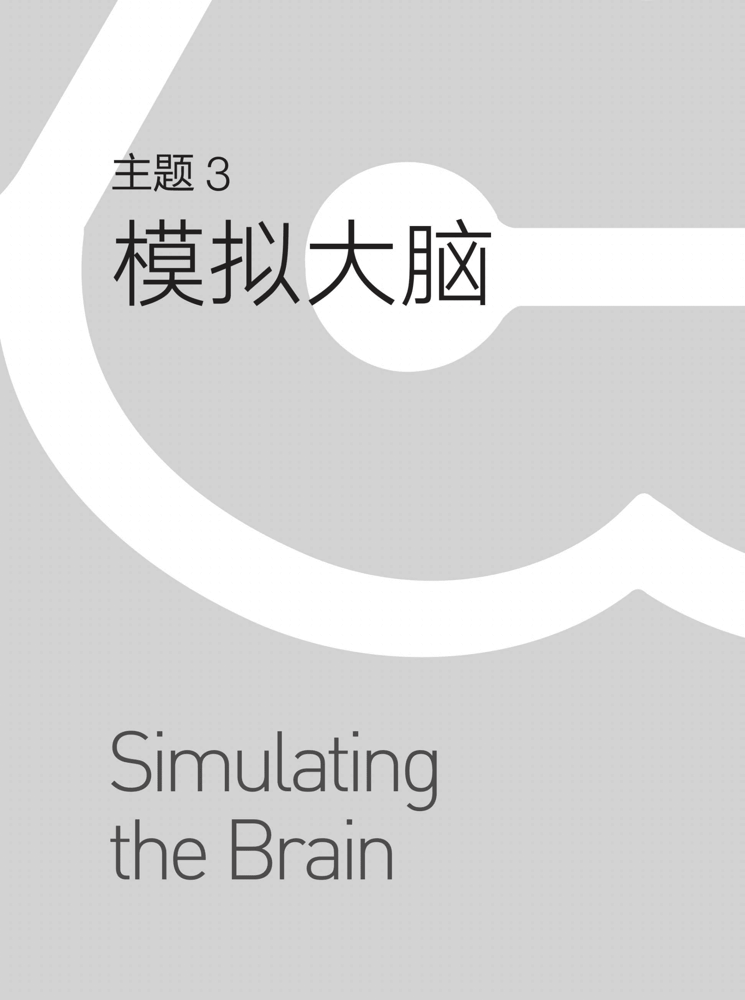

# 10 重构大脑：模拟即理解

**肖恩·希尔**  
多伦多大学医学院教授，脑环路大规模建模与神经信息学先驱

费曼名言“我无法创造的，我就无法理解”直指本质：要读懂大脑，必须能在图谱、模型与仿真中重现它。欧盟斥资十亿欧元、为期十年的“人类脑计划”（HBP）正是为此而生——构建六大开放平台（神经/医学信息学、脑仿真、超算、类脑计算、神经机器人），汇聚全球数据，整合为统一模型，支撑仿真、分析与假设检验，推动神经科学、医学与计算的三重跃迁。

### 以建代悟：模型是认知的手术刀

大脑未解，为何要建模？**建模本身就是理解的核心工具。** 整理数据、标注缺失、评估现有数据质量，过程本身即深化认知。当下痛点显而易见：缺乏跨库检索工具、缺“已绘/未绘”全景图谱、缺评估数据功能重要性的指标。

基础谜题仍悬而未决：大脑为何需要数千种神经元？仅分“兴奋/抑制”两类是否过度简化？构建含多样神经元的微回路模型，便能在仿真中逐一拆解各类型在健康与病理中的角色，判断简化的得失。

建模路径虽多，尚无共识。**自下而上**死磕生物细节（基因→分子→神经元→突触→回路），保真度高但易陷细节泥沼；**自上而下**抽象功能理论，搭高层脚手架却忽略单细胞机制。前者能复现微观动力学，后者能重现初级认知，**HBP 的使命正是架桥梁，让基因表达与认知行为在同一模型中对话。**

### 数据洪流中的导航图

神经信息学应运而生。文献从 3 万激增至 10 万/年，单人脑扫描即占 1 TB，艾伦脑所小鼠连接组超拍字节，人类连接组、BRAIN 计划数据爆发式增长。单靠人力阅读早已不堪重负，甚至难判实验是否重复。

早期数据库碎片化严重：各实验室自定格式、术语、命名，连“神经元有多少种”都吵不出结果。破局关键在于**数据整合**：统一元数据标注、标准化本体论与词汇表、空间坐标对齐、多尺度数据融合。这正是“数据密集型科学”的内核——借现代分析与机器学习，在数据海洋中捕捉科学结构。

物理学家为协作发明了互联网，神经科学必须拥抱这套工具链。OECD 全球科学论坛牵头成立**国际神经信息学协调委员会（INCF）**，制定共享标准、统一脑区本体论、建模语言、元数据规范；联合全球顶尖机构打造“瓦克斯霍尔姆空间”标准坐标系，推动小鼠脑图谱互通；合作 NIF 确立神经元命名规范。HBP 承诺遵循 INCF 标准，在其框架上建设神经信息学平台。

### 下一代脑图谱：多模态融合的知识中枢

传统脑图谱聚焦解剖边界，新一代图谱则是**基因表达、细胞形态、连接拓扑的多维融合体**。核心在于两步走：  
1. **语义统一**：用本体论消除“丘脑网状核/网状核/背外侧膝状体”同物异名的混淆；  
2. **空间锚定**：在标准坐标系中精准登记每个数据点的体积与位置。  

语义网技术让坐标与数据片段成为可检索、可推理的知识图谱节点。由洛桑理工、卡罗琳学院等六大机构共建的神经信息学平台，将提供涵盖电镜/光学图像（结构）、单细胞电生理至百细胞同步记录（功能）、预测性神经科学工具（补全缺失参数）的全链路服务。**经质控治理的图谱，将成为构建脑模型的唯一权威数据源。**

### 预测神经科学：用理论填补实验盲区

全貌绘制人脑不现实，跨物种推演（如鼠→人）更不可避免。**预测神经科学**以可得数据为锚，用理论推演缺失参数：  
- 单细胞转录组 + 免疫化学 → 推断脑区细胞类型构成；  
- 突触组织原则 → 未全测完即可搭建通路模型。  

蓝脑计划实证：轴突/树突几何形态可预测突触分布，例外情况反向指引定向实验；神经元独特形态是皮层连接稳健性的基石。微观连接规则的提炼，让预测成为**完善数据、定义实验、设定优先级、发现原理**的关键引擎。

### 仿真平台：从微观重构到全脑涌现

HBP 脑仿真平台（洛桑理工、德国于利希、瑞典皇家理工联合领导）提供全尺度建模工作流：蛋白质→细胞→突触→回路→脑区→全脑。科学家通过网页界面选数据、选方法、改参数（如降低神经元密度模拟阿尔茨海默病），默认参数源自数据推导，却完全开放自定义。

**细胞多样性**是基石：小鼠皮层微回路已识别 55 种形态类、11 种放电类，组合出 207 种“形态-电生理”类型。算法从真实重建统计形态学特征，转录组与形态/电生理的映射模型是合成人类神经元的钥匙（人脑细胞难获全重建）。

**连接生成**基于“物理邻近+额外约束”（轴突结密度、树突棘），新发现规则即时更新连接矩阵。**突触可塑性**分层赋予功能动态；微回路拼装脑区，长程投射再织全脑网络。**数据全程驱动建模，同时为优化设定边界。** 平台开放接口，科学家可接入自有方法与数据，探究系统层面后果，反哺实验设计。

### 良性循环：数据—模型—实验的飞轮效应

### 核心验证：模型与实证的双向博弈

模型验证是知识挖掘流程中不可或缺的关键一环。在蓝脑计划里，每一版新模型上线都要经历自动化的严格考核，并与数千项生物学实证并列比对。研究者的焦点精准锁定在“模拟与实测出入”的节点上：一旦两者背道而驰，便揭示了现有数据、模型架构，抑或两者兼而有之，尚不足以诠释观测到的生物学现实。以早期一次模拟为例，抑制全体中间神经元活动竟未显著扰动网络动态，这与实验观测到的显著效应截然相反。这一冲突将目光引向了该神经元群的突触传导特性。通过补充精确传导数据修正模型后，复测证实：这些细胞在塑造网络动态中扮演着核心角色。

借助虚拟电极、模拟成像等“仿真仪器”，科学家得以将模型内部活动与自家实验数据直接对标。在与艾伦脑科学研究所的合作中，蓝脑团队构建了局部场电位（LFP）模型——虚拟植入电极记录脑内信号。该实验揭示了单个神经元放电与细胞外电极捕获的“脑波”之间的因果链条，并指出树突电流可能是局部场电位的关键驱动源。

验证的逻辑是双向的：模型若复现实验，则佐证数据解释力；模型若失配实验，则反向指引获取新数据、优化建模流程。无论哪种结局，模型都是审视神经科学数据对特定科学问题“相关度与影响力”的关键试金石。

### 统一大脑模型：迭代进化的“开源内核”

人类大脑计划（HBP）的核心战略，是持续交付版本迭代的“统一大脑模型”。此类模型通过复现海量实验数据，实现对已知数据的最大公约数式解释。尽管探索过程中会衍生出验证新假设的分支、模拟回路的新范式，但唯有“兼容最多实验发现、解释最广数据”的版本，才会被定格为最新正式发布。这仿照开源软件发布机制：众贡献者并行开发、联盟统筹合并发布。新版本入选标准严苛：必须在不损失既有成果的前提下，复现更多实验现象。由此形成“数据融合—模型升级—假设检验—新预测”的正向飞轮，最终沉淀出整合海量数据的统一模型，成为检验新假设、产出新预测的基石。

进而，这些统一模型化身为“提炼简化原则”的手术刀。所有生物学细节皆为功能必需？移除篮状细胞后果如何？将神经元二元化为兴奋/抑制类型又将怎样？完整树突棘模拟是否不可或缺？统一模型整合了最新数据与知识表征，允许我们反复试错不同简化策略：删除特定细节时，观测其对脑活动与功能的冲击。这些被验证的简化路径，正是人类大脑计划将产出的核心发现与第一性原理。

### 行为闭环：大脑-身体-环境的三位一体

行为是大脑的终极输出。大脑下达肌肉控制与运动指令，奠定行为与语言基石；同步地，大脑主要输入源自五感——视听嗅触味。剥离感觉输入，大脑运作机制成谜；缺失运动输出，行为生成能力无从谈起。因此，为模拟大脑配备“模拟身体”至关二者共同构成一个闭环系统，是理解大脑的必要条件。

由慕尼黑工业大学牵头的神经机器人平台（Neurorobotics Platform），正构建分级精度的虚拟躯体与感官系统：能生成感觉输入，将神经系统运动指令转化为虚拟动作。模型内置虚拟视网膜、耳蜗等感官器官，编码头位与运动特征。平台还涵盖物理真实的虚拟环境，支持经典认知行为测试范式与自由探索场景。未来将逐步纳入脊髓-肌肉精细交互，起步则从“神经脉冲转运动指令”的简易映射始。模拟躯体与环境，将与大规模脑模拟耦合，形成闭环核心。终极图景是：模拟小鼠穿梭迷宫，为破解认知因果机制、记忆形成、决策生成与行为输出提供利器。

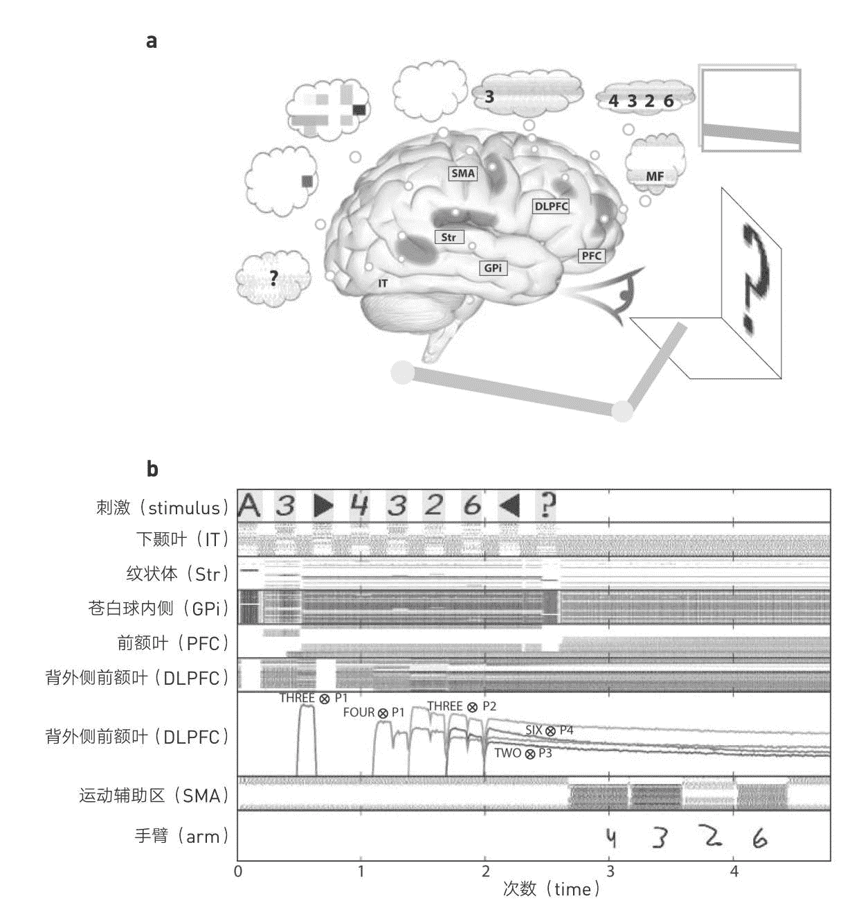

### 医学信息学：从海量临床数据中挖掘疾病指纹

由瑞士沃州大学医学中心（CHUV）、洛桑联邦理工学院（EPFL）与伦敦大学学院（UCL）联合领衔的医学信息学平台，致力于打通跨医院、跨诊所的患者数据壁垒，在隐私合规前提下，以机器学习挖掘海量病历，提取阿尔茨海默病、帕金森病、抑郁症等疾病的生物学“指纹”。这些指纹融合人口学、实验室检查、基因组学与脑影像多模态数据，服务于临床诊断、预后预测与新疗法研发。疾病特征映射出的蛋白水平、脑区体积、细胞密度等参数，将直接驱动全脑疾病模型的构建，进而反推潜在治疗干预靶点。

### 伦理前置：在模拟抵达前完成对话

全脑功能模拟引发深刻伦理拷问。HBP 投入巨资设立专项监控与研讨机制。尽管全脑模拟尚远，但科学家、公众与社会组织的“当下对话”不可缺席。通过对话制定引导性政策，划定可行模拟边界：构建超越人脑规模的模型是否负责？研究人工意识与痛苦体验的伦理红线在哪里？同科学所有前沿突破一样，需科学家与社会共治，共同制定负责任的政策与准则。

### 云集科学：打造神经科学的“CERN”与协作新范式

HBP 旨在催生神经科学领域的新一轮全球大协作。正如欧洲核子研究中心（CERN）之于物理学，HBP 定位为神经科学的全球资源枢纽，提供理解大脑的新型工具箱。

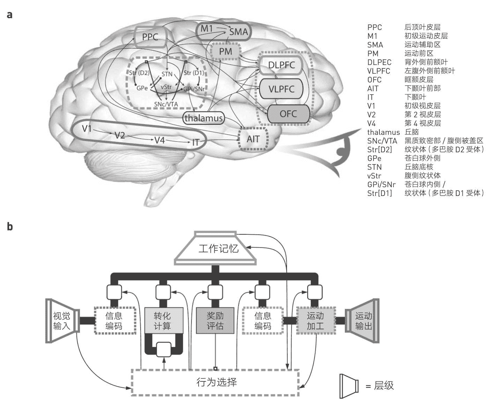

借力互联网，HBP 门户向全球开放神经科学数据、建模与仿真工具，开创前所未有的协作范式。门户集成科学社交网络，支持数据、分析管线、模型、仿真与出版物的开放共享，贡献权益精准归属激励分享。高频调用数据集、高被引分析法、热门模型，直观彰显工程影响力。科学家可参考平台图谱，决策数据采集方向、模型构建策略、发表重点。动态组队功能汇聚顶尖智力攻克特定难题，团队成员贡献均获认可。

全球脑计划百花齐放：艾伦脑科学研究所、美国BRAIN计划、人类连接组计划、HBP，以及中日澳等国筹备中新项目。单一计划难以独撑“读懂大脑”宏愿，全球协作非选项，乃必然。

---

# 11 构建行为大脑

**克里斯·埃利亚史密斯（Chris Eliasmith）**
加拿大滑铁卢大学理论神经科学中心主任、教授

美国国家工程院（NAE）列出的“重大工程挑战”之一，便是“逆向工程大脑”。神经科学与生理学界共识：这是硬骨头中的硬骨头。

何为大脑“逆向工程”？通俗即：系统拆解成品，多维度剖析其行为表现，合成同类产品。我们试图识别大脑的构件清单、运作法则，及其拓扑组织如何涌现整体行为。面对大脑、芯片这类复杂系统，合成验证首选软件仿真。

#### 逆向工程的三重红利

大脑逆向工程价值三维：一、深化生物机制认知，揭示致病根源，推动医学干预创新；二、提炼高效信息处理策略，赋能机器智能跃迁；三、重塑对物理计算本质的认知——神经计算范式迥异于传统电子芯片。简而言之：懂健康与疾病脑、强机器智能算法、探物理计算新物理。

#### 两大巨头与“缺失的一环”

当前两大百万/万亿级神经元仿真项目领跑：
1.  **IBM SyNAPSE**（DARPA资助）：以“类脑计算”为靶，近期宣称完成 5300 亿神经元仿真（人脑约 860 亿）。单神经元模型简化：无空间形态、仅保少量离子通道、峰式通信，计算极轻量（单元少数公式）。
2.  **人类大脑计划（HBP）**：源自蓝脑，已仿真 100 万神经元。虽规模逊色 SyNAPSE，但胜在“生物保真度极致”：单神经元精细几何、数百种离子电流、峰电位动力学全还原，代价是计算极重（单元需数百公式）。若引入分子动力学、胶质细胞，保真度尚可更上层楼，但已大幅领跑同量级项目。

**关键短板**：二者虽实现了“海量神经元可仿真”这一工程里程碑，却缺失逆向工程的核心——**“海量神经组件如何关联行为”**。目前模型均不具备记忆、感知、运动、学习能力，难从“脑功能”维度评估优劣。

### 行为导向的大脑建模：Spaun 路径

我的团队另辟蹊径，直指“人类行为的神经科学基础”。最新成果 **Spaun**（语义指针架构统一网络，Semantic Pointer Architecture Unified Network）拥有一“眼”（视觉编码输入）、一“臂”（运动解码输出）。随机手写数字经视觉压缩识别，映射为“语义指针”概念表征；绑定位置信息入工作记忆；问号触发解码、解压、经运动系统逐位书写输出。

**图 11-1 Spaun 工作记忆任务演示**
a. 任务处理流程概念图。
b. 4 位数字序列记忆单次试次 2.5 秒切片。右侧输入图像，左侧手臂书写输出。皮层区域神经活动灰度编码（深=高活跃）。周边“思想气泡”展示典型峰序列解码结果；纹状体显示候选行为效用，苍白球内侧显示胜出行为。全脑 250 万神经元峰式运算支撑识别-记忆-书写全链路。
刺激行显示输入（A3=任务3序列记忆，三角形结构符，问号提示响应）；手臂行为行显示书写轨迹；其余行为对应解剖区域解码相似性图谱。模拟覆盖真实大脑 ~1000 区中的 20 个关键区（见下图），平衡功能还原与计算可行性。神经元模型同 SyNAPSE 级简化（数公式、峰式通信、4 种递质动力学），在生理细节与计算简度间再寻平衡。

**图 11-2 Spaun 架构全景**
a. 解剖映射图：标准术语标注模型组件对应脑区。圆头线=抑制投射，方头线=可塑调节连接，其余=兴奋投射。
b. 功能流向图：粗线=皮层间信息流，细线=基底神经节-皮层行为选择回路。圆角框=可干预控制节点。圆头连接奖励评价与行为选择，表示调节连接权重。线型粗细对应解剖映射。

**组织原则：像大脑一样“分工协作”**
相较 SyNAPSE 的“同质神经元海” 或 HBP 的“微观精细无宏观功能”，Spaun 核心优势在于**“类脑整体架构”**：
- 神经元按已知解剖功能分组：部分模拟前额叶（工作记忆/任务上下文），部分模拟基底神经节（策略学习/皮层信息门控），部分模拟枕叶（视觉识别泛化）。
- 生理与功能双相似：脑区特异性神经递质、任务情境下同源激活模式、投射拓扑同构真脑。例：模拟基底神经节含两型中型多棘神经元，均抑制、受皮层投射，但多巴胺受体亚型分化、投射苍白球亚区分离。

**多层级实证：从单神经元到行为的“三重锁”**

为验证模型，我们对标两大实证体系：
1.  **神经生理学锁**：大鼠强化学习任务中，Spaun 行为选择模式、腹侧纹状体延迟/临近/奖励期放电模式与实测高度一致。
2.  **单元记录锁**：猴子工作记忆任务中，Spaun 神经元群功率谱演化与实测同构；视觉任务中，模型初级视皮层神经元调谐曲线复现猴脑实录。所有对比采用同一分析管线处理模型与生物峰序列。

虽单元级匹配增强机制置信，但人类认知研究常缺单元数据，故须重仗**行为学锁**：
- 连续工作记忆任务：Spaun 错误类型、频率拟合人类特征曲线（见图 11-2b），暗示内在神经机制合理。
- 默念计时：逐位耗时与人类一致；序列越长反应时方差越大，遵循韦伯定律。
- 持续多维测试（神经+行为双轨）不断强化反向工程原则的有效性。

**参数锁定策略：化解“过拟合”质疑**
数学模型参数常被调整拟合特定实验，易陷“过拟合”嫌疑。Spaun 采取三重防线：
1.  关键参数（如工作记忆衰减率）源自独立人类认知实验，**不包含** Spaun 执行的 8 项任务任何一项。
2.  大量参数由神经实现 3 大核心原则（十余年沉淀）自动推导。
3.  **核心铁律**：全任务全流程参数**恒定不变**，仅允许学习机制修改模型状态。跨任务、跨条件的“零微调泛化”，让“过拟合”指控站不住脚。

**模型作为预测引擎：可证伪的科学产出**
构建此类模型终极目的，是显性化大脑工作原理并产出可检验预测：
- **行为预测**：问答任务中，模型错误率随序列位置呈“U型”（中段最高），反应时恒定。该任务人类数据尚缺，成绝佳验证窗口。
- **神经预测**：单项目入库 vs 多项目共库时，神经活动模式差异显著——随项目增多，神经放电相似性**指数级衰减**。这与主流工作记忆模型“相似性恒定”预测直接冲突，为验证 Spaun 机制提供关键实验切入点。

# 类脑计算新范式：Spaun如何重塑神经建模与硬件未来

### 破解灵活智能的“总指挥”机制

区别于仅记录海量神经放电却缺乏宏观行为演示的研究，Spaun（统一语义指针架构网络）的核心价值在于，它为大脑组织架构与功能机制提供了可量化、可验证的实证线索。

**多任务切换的动态调度中枢：基底神经节**

有别于主流计算架构，Spaun 最大的突破是展现出类生物般的**行为多样性**。它能像真实中枢神经系统一样灵活应对多变任务。例如，系统利用视觉模块辨识数字，将序列编入工作记忆存储，随后提取并驱动机械臂按序书写。更关键的是，它能复用同一视觉前端解析从未见过的复杂数字模式。这要求系统调用相同记忆模块但切换操作模式，并动员起先前任务未参与的其他皮层区域。简而言之，Spaun 能依据任务诉求，动态重组现有神经资源（参考图 11-2b）。

这种**“灵活协调”**特性，正是生物认知与当前主流人工智能的本质分水岭。生物大脑擅长判断破解特定难题需要何种信息处理策略，即根据环境挑战灵活调度专业化区域。对人类而言，这是本能：从写邮件切换到阅读、调酒或逗猫，中枢瞬间完成多区域协同重组，几乎零延迟。进化心理学指出，正是这种适应动态环境的行为可塑性，奠定了人类的生存优势（默林·唐纳德观点）。

Spaun 的核心使命之一，便是破解这种协调性在哺乳类中枢中如何涌现。为此，其架构在中脑与皮层建模上做了关键区分：由基底神经节主导的中脑区域，扮演着协调皮层信息流的“总指挥”角色。Spaun 内置的“行为选择器”基底神经节，持续监测皮层状态，裁决信息流向以达成目标。它不直接执行复杂运算，而是组织皮层，将海量算力精准导向当下问题。得益于此，Spaun 能按任意顺序完成 8 项任务，并对噪声与意外输入保持鲁棒性。通过理解输入语境（如“A3”指令触发记忆模式），它自主决定任务优先级（参考图 11-1b）。

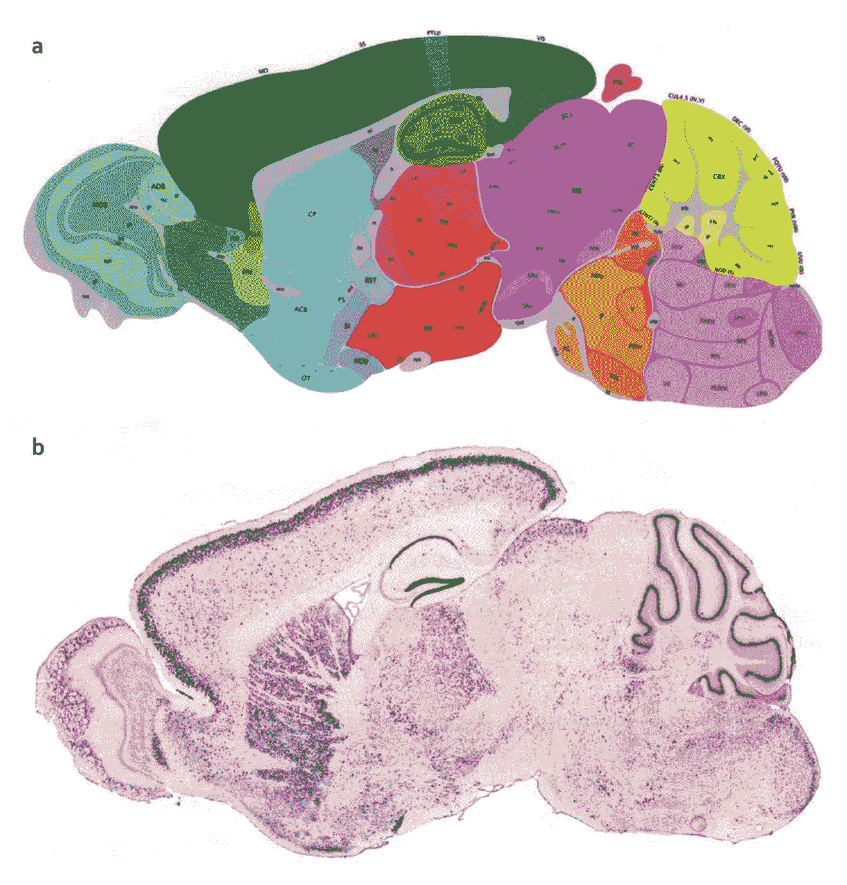

a．小鼠大脑的矢状切面图（从前向后）。

b．钙结合基因的原位杂交大脑图，它展现了皮层、纹状体、海马和小脑的基因表达。

**彩图 1　艾伦小鼠大脑切面图与原位杂交大脑图**

资料来源：Allen Institute。

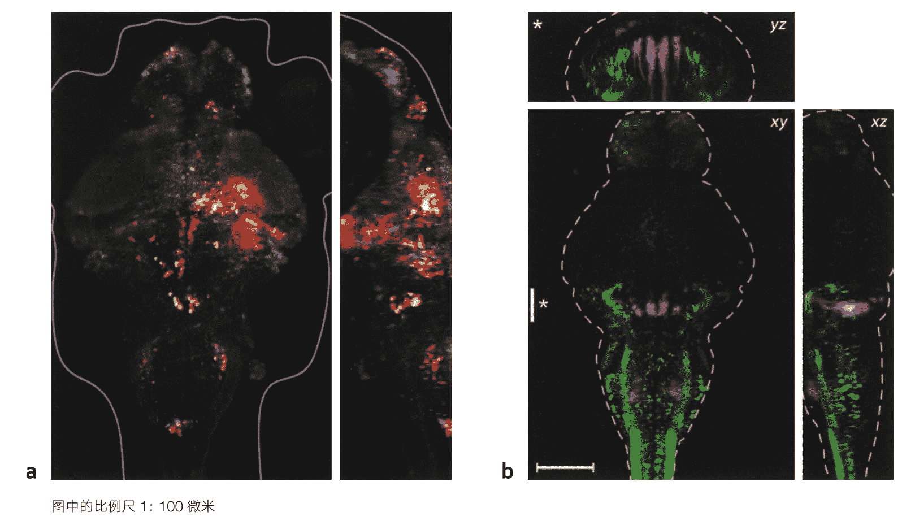

a．许多神经元几乎同时发生活动的斑马鱼幼体大脑。灰色部分显示的是解剖结构，彩色部分显示的是某一刻的神经活动。右图是从侧面进行的最大强光投影，左图是从上方进行的强光投影。

b．一起放电的神经元群组。通过对原始数据的计算分析，科学家发现了两个神经元群组，分别用绿色和紫红色来展现它们。

**彩图 2　斑马鱼幼体大脑神经活动图与放电神经元群组图**

资料来源：Ahrens, Orger, Robson, Li, and keller(2013)。

### 逆向解剖的双重红利：医疗突破与机器进化

基底神经节在行为决策中的核心地位，与其病理表现高度吻合：该区受损或退行性变直接关联成瘾、焦虑、强迫症，帕金森震颤亦源于此。因此，攻克灵活调节的神经机理，对精神卫生领域具有变革性意义。

**模拟衰老：建立神经损耗与智力下降的因果链条**

Spaun 还为解析**年龄相关性认知衰退**提供了罕见实验窗口。学界长期争论：老年神经元减少是否直接导致认知测分下降？标准智商测试“瑞文推理测验”常用于追踪此类变化。Spaun 任务库包含该测验模拟版，其表现媲美常人。团队进而基于同架构开发新模型参与人类同类测试，再次达标。关键在于，模型具备生物学实在性的神经元功能，让我们**史上首次**能探究自然衰老中神经损伤与瑞文测验分数的**因果关系**。通过运行数百个模型变体，我们复现了人群智力的“钟形曲线”分布，并证实衰老致神经受损会整体下移该分布曲线。结论明确：神经元数量减少直接拖累认知表现。

**给 AI 的启示：从“专项冠军”迈向“通用灵活”**

当前 AI 擅长单项技能（下棋、答题、驾驶），而人类擅长**灵活迁移**技能。Spaun 虽能被传统算法逐项复现，但其任务组合非典型 AI 域。更关键的是，Spaun 显露**萌芽期强化学习能力**——能在保留旧技能前提下，基于奖励有限度学习新行为。未来方向明确：扩展此自学能力，涵盖显性指导与试错学习，攻克更复杂任务。

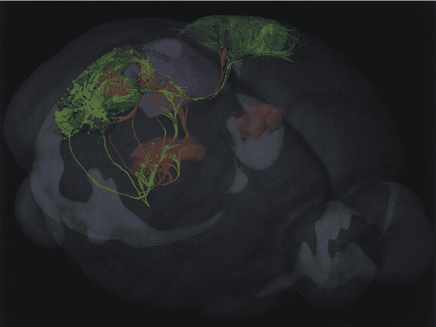

**彩图 3　皮层区域中与视觉感知有关的连接**

注：“艾伦小鼠大脑连接图谱”显示了来自 4 个不同视觉皮层的轴突通路。这些皮层区域彼此紧密联系，同时也连接着丘脑（粉色）和中脑（紫色）。图中所示大脑的前部朝向右侧。

资料来源：Julie Harris, Allen Institute。

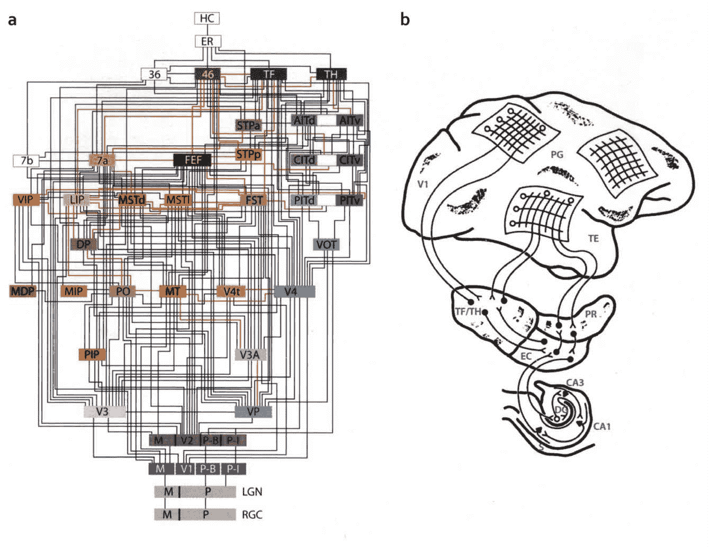

a．显示视觉皮层的连接图。感觉皮层在最下层，RGC 代表视网膜神经节细胞；LGN 代表外侧膝状核，内嗅皮层（ER）和海马（HC）在上层，它们通过多重突触间接地与视网膜神经节细胞、外侧膝状核及其他感觉系统相连接（图中没有显示）。现代神经科学的目标之一是理解高级皮层的工作原理，比如内嗅皮层和海马。

b．灵长类新皮层的示意图，它显示了下方海马和中间内嗅皮层是如何在广泛分布的皮层区域中将表征合并在一起的。

**彩图 4　大脑皮层、内嗅皮层和顶部的海马**

资料来源：视觉皮层连接图：Felleman and van Essen (1991). By permission of Oxford University Press。灵长类新皮层示意图：Squire and Zola-Morgan (1991). With permission from AAAS。

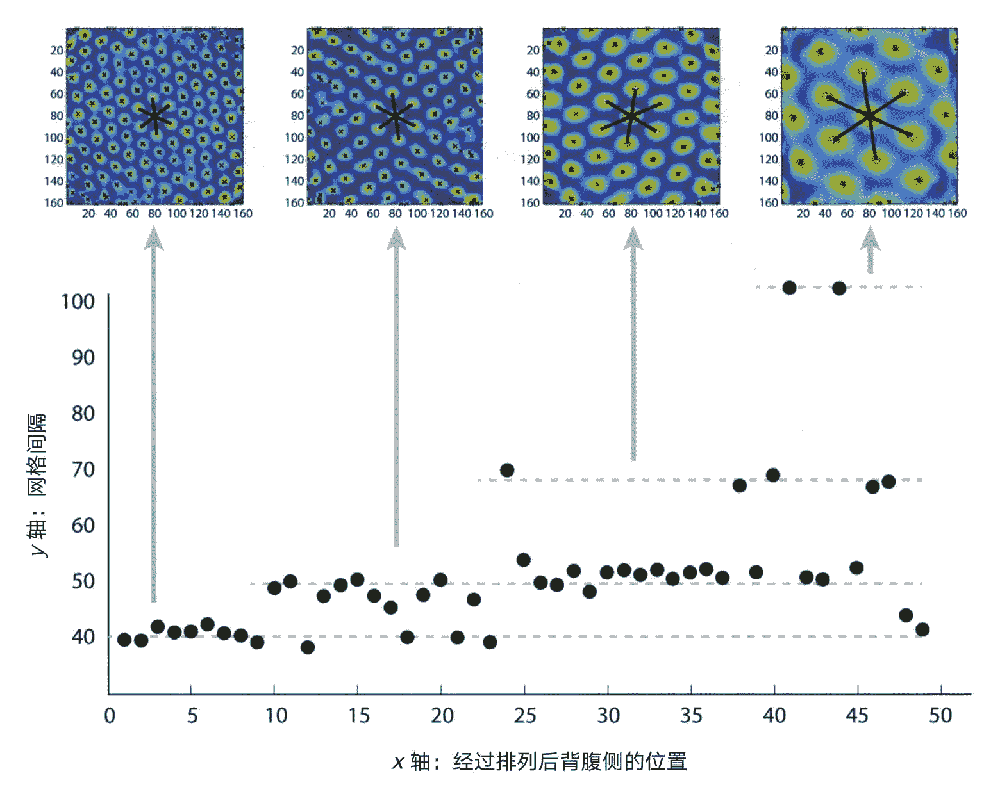

**彩图 5　网格细胞的模块化组织**

注：网格间隔是内嗅皮层沿着背侧到腹侧轴的细胞位置的函数。虚线代表具有不同网格间隔数值的 4 种细胞群。顶部彩色的自相关图显示了细胞的六边形放电模式，它们表征了每一种网格模型，其中红色表示活性高，蓝色表示活性低。

资料来源：Stensola et al. (2012) and Buzsaki and Moser (2013)。

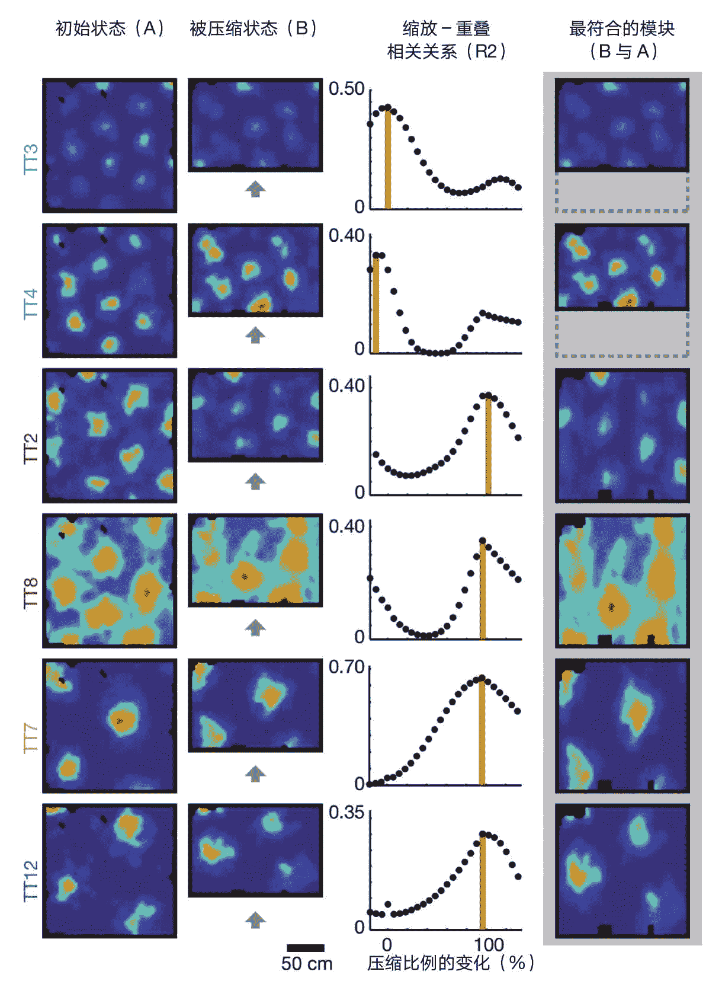

**彩图 6　网格细胞的分子排列随空间压缩成比例地变化**

注：用不同颜色标记的比例图显示了在环境由正方形变成长方形的实验中，同时被记录的网格细胞所做出的不同反应。缩放–重叠相关关系曲线显示了被压缩的环境与最初环境重叠部分的空间相关关系。可以看出，顶部的两个细胞在最初的位置上保持着它们的放电野，其相关性最大，所以缩放为零；底部 4 个细胞的放电野发生了与环境的宽度改变成比例的压缩，即当箱子伸展为最初的形状时，相关性最大。顶部和底部的细胞属于不同的模块。

资料来源：Stensola et al. (2012)。

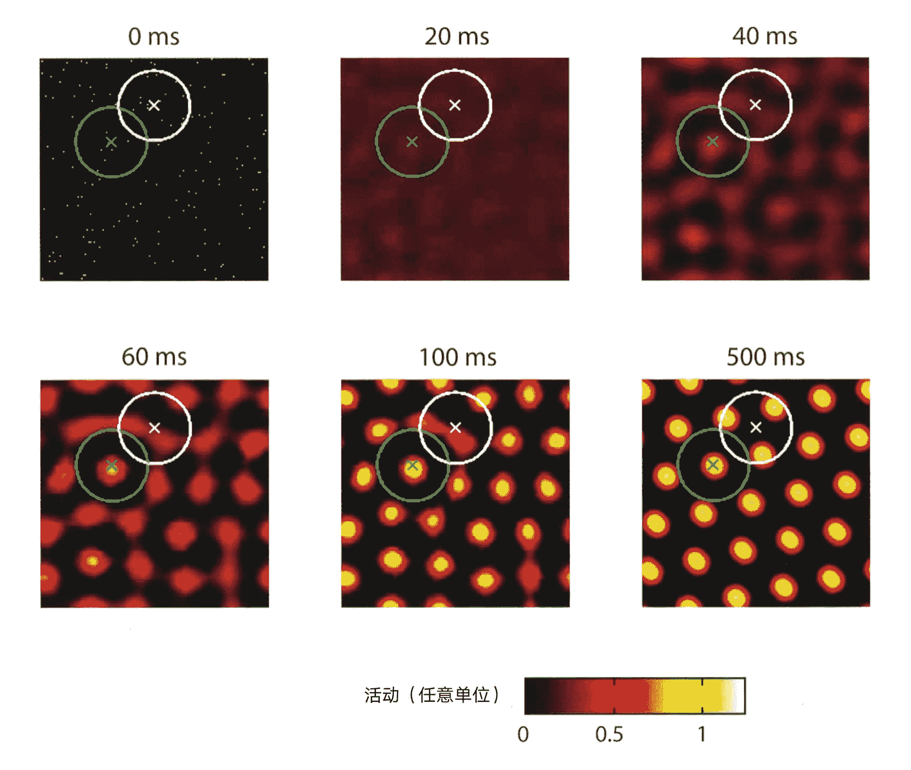

**彩图 7　计算机模型显示了在网格细胞中自发形成的六边形放电模式**

注：在由星形细胞组成的二维神经元格子中，六边形网格模式自发地形成了。其中，这些星形细胞之间存在着全有或全无的抑制性连接关系。每个图像代表了网络中的一个细胞。根据神经元网格野的坐标轴位置，它们被排列在格子上。圆圈则表示两个神经元周围的抑制区域。

资料来源：Couey et al. (2013)。

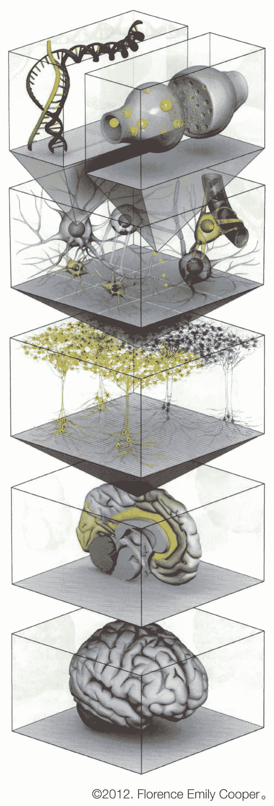

**彩图 8　弥合大脑的各个层次**

注：人类大脑工程的目的在于，为神经科学家提供工具，以实现对大脑多尺度的统一认识，即找到将大脑各层功能与认知、行为联系起来的原则。其中，大脑各层包括分子、细胞、回路、脑区和整个大脑。

### 打造物理大脑：神经形态硬件的崛起与编程破局

即便破解中枢算法，能否在现有计算机上高效运行仍是未知数。根本矛盾在于**物理计算策略的差异**：硅基芯片通过高耗能（百瓦级）消除不确定性（晶体管非 0 即 1），而中枢仅耗 **25 瓦** 却完成更复杂计算，且依赖**高噪、不可靠**的生物器件（突触失效、递质波动、传导时延抖动）。

逆向工程让科学家看清鸿沟，催生**“神经形态”芯片**。此类芯片模拟神经元电压动力学，以脉冲与突触通信，百万级单元塞进扑克牌大小空间，**功耗不足 3 瓦**，且**实时运行**（Spaun 在超算上模拟 1 秒行为需 2.5 小时、数千瓦电）。优势在于：采用成熟制程即可量产，新工艺将带来指数级密度跃升；且因天然模拟嘈杂随机特性，不受数字电路微缩导致的噪声瓶颈限制——低功耗、同功异质、异步化特质让噪声显性化、可利用，而非数字电路中被“设计掉”的麻烦。预期脑启发算法将赋能数字技术实现算力与能效的质变。

**编程难题与 NEF 破局**

挑战在于：缺乏系统化编程方法驾驭这类嘈杂、低功耗、多变的硬件。但大规模脑模型构建（如 Spaun 所用**神经工程框架 NEF**）正同步孕育解法。NEF 已成功部署于多款神经形态芯片。未来，神经形态编程与大规模脑模拟将深度绑定，开启**柔性、鲁棒、自适应、低功耗**的计算新纪元。

综上，全球科研界正合力攻克大脑反向工程高峰。从微观生物细节到宏观行为的大规模模拟层出不穷。Spaun 这类链接单神经元活动与行为的模型，提供了丰富、可证伪的假设。未来几年此类模型将指数级进化，深度重塑疗法研发与技术创新，根本性改写我们对“何为人类”的认知。

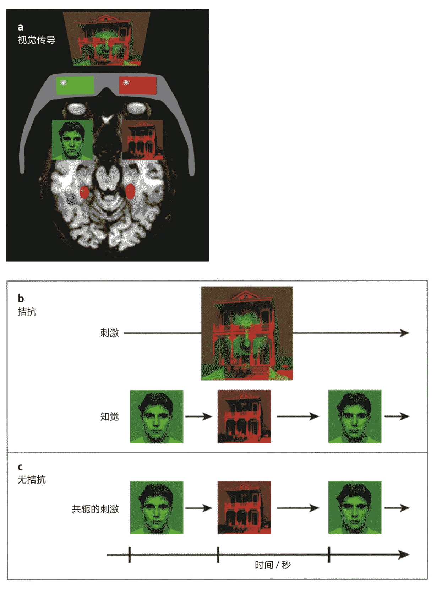

a．该图描绘了一个人的大脑，这个人正在透过红玻璃和绿玻璃看叠加在一起的红房子和绿人脸。这样产生的效果是房子的图像被传递到一只眼睛，脸的图像被传递到另一只眼睛。

b．如图所示，知觉在房子和脸之间交替，只有短暂的混合，这种现象被称为双眼拮抗。

c．在图中，研究者给被试呈现交替的房子图像和人脸图像。结果是，在感知人脸和感知地点的重要脑区中，内部驱动的人脸或房子的交替与外部驱动的人脸或房子的交替没有明显的区别。改变的知觉涉及大脑后部视觉区域的交替以及负责监控和组织反应的大脑前部区域的交替。

**彩图 9　最早的双眼拮抗实验研究图解**

资料来源：Tong et al. (1998). With Permission of Elsevier。

语言是人类所具有的技能，我们不仅能够谈论此时此地，还能谈论抽象、复杂、假设的事物。研究语言也具有独特的困难性，因为没有直接的动物模型可参考，尽管鸟鸣能给予我们一些启发，但还不足够。另外，严格的伦理标准限制了我们可以使用的研究技术。如果大多数神经科学研究的是关于视觉和运动控制的，那么一部分原因是这些心智领域比较容易研究。

戴维·珀佩尔认为，理解语言的关键挑战在于，在神经构成要素的词汇与语言构成要素的词汇之间架起桥梁。他提出，诸如大脑成像这样的技术还不足以完成这个任务，但它们为科学家提供了研究的方向，使得我们能够更接近答案。西蒙·菲舍尔探讨了一些类似的挑战，即在 DNA、基因、大脑和复杂行为之间架起桥梁，他聚焦在了人类语言的病例上。正如他所写：“我们正处在基因组学研究的分水岭，它将以史无前例的方式改变神经科学的诸多领域。”

# 12　语言神经生物学

**戴维·珀佩尔（David Poeppel）**

**纽约大学心理学和神经科学教授**

## 语言脑科学的溯源与演进

我们日常问候朋友、闲聊或者阅读一句话时的轻松、迅捷和自动性，掩盖了语言任务的复杂性。即使最基本的语言“事件”，比如识别一个口语词汇“散文”，也需要中枢协调一系列复杂的子过程：分析基本听觉信号属性、进行语音解码；在心智词汇库中检索匹配该语音的词条；调取该词的发音指令、意义与语法规范。理解或构造一个句子，比如“创作散文是一件费劲的事”，需要中枢精细协调几十个组成部分的操作。

通常只有当语言功能受损时——中风后失语、语言发育受阻或严重阅读障碍——人们才会意识到大脑语言加工内部结构的复杂性。实际上，1861 年法国神经科医生保罗·布罗卡对一名中风患者的病例检查，在揭示神经科学基础性发现方面发挥了关键作用。这一发现确立了大脑功能定位概念。布罗卡描述了一种语言障碍，并将其与左侧下额叶损伤联系起来。这种“障碍-损伤-相关性”范式，成为了认识知觉与认知诸多方面大脑组织结构的基石。在该病例中，以布罗卡命名的脑区成为语言功能相关的代表性区域之一。

直到 20 世纪 80 年代，此类神经生理学研究一直主导着脑语言研究。尽管我们揭示神经生物学机制的能力有限，但该领域常与心理学、语言学研究结合。确实，许多我们现在熟知的功能分离，源自对局部脑损伤后语言障碍的详细记录。毫无疑问，不同脑区以不同机制实现不同功能。然而，将具体功能与各脑区精准匹配依然是挑战。部分原因涉及功能粒度问题：恰当的描述层次是什么？恰当的语言、语法、名词短语、句法成分是什么？另一部分源于将局部功能归属于何种生物“单位”的不确定性。“布罗卡区负责语言产出”这类陈述不仅模糊，而且错误、具误导性。布罗卡区非单一整体，而是由许多子区域构成，这些子区具有特定细胞结构、免疫组化与层状特性。语言各层面如“语法”同样非整体，而是复杂表征与计算的简略表达。难怪布罗卡区涉及多种功能，甚至包括非语言功能。例如，除特定语言功能（句法加工、音系学），功能成像研究还将层级组织的运动行为加工、节奏加工归属于布罗卡区。虽广义相关语言，但也适用于认知诸多其他领域。未来研究应聚焦将此类复杂心理功能“分解”为基本操作，以解释复杂脑解剖结构（如布罗卡区调节的各种功能）。

## 新语言脑科学面临的双重困境

当前科学家试图将语言研究与系统神经科学核心问题结合：语言加工的神经生理与解剖特征，以及神经编码问题。未来可能产生有趣的实验与理论挑战。我们需应对两类观点：①实践层面；②原则层面。实践挑战关乎如何在认知神经科学基础上构想数据主要形式：脑图谱与脑激活图谱。图谱涉及大脑活动信息，及其对大脑功能神经基础描述的程度。技术进步使我们能在模型系统中以高时空分辨率记录神经群体活动。但在人类语言研究范围内，仍须依赖无创方法。目前主导技术，无论针对空间的功能性磁共振成像，还是针对时间的脑电图或脑磁图，主要从空间属性角度描述结果特点。空间属性指大脑局部地形组织与加工流，如背腹侧通路或相互连接的脑区网络。从空间角度描述脑活动让人直观：A 点执行功能 X，B 点执行功能 Y 的通路，且在一般层面往往大体正确，符合专业人士与大众想象。但此法遭批评，理由充分：脑功能定位描述虽准确，却不等同于机制解释。大脑重要组织特性之一正是功能定位的存在。

当前分析显示，在特定实验设计下，某脑区或脑区群被选择性调控。随后研究者便宣称，特定脑区激活是“音系加工”“词汇接触”或“语法”的基础。然而此类结论不可避免只能显示相关性。即使脑区与特定功能显示始终一致的系统性相关，我们也无法解释为何以此方式组织，不知神经回路何种特性能解释功能执行。一句话：大脑功能定位不是解释。

### 破解脑与语的密码：从图谱绘制到计算机制的跨越

即便掌握了当下最尖端、或未来即将诞生的最高分辨率脑成像技术，单纯堆砌数据依然远远不够。关键的突破口在于：能否将语言任务拆解为与特定脑区结构、功能相对应的基本计算单元。换言之，核心中间步骤是确立那些理论依据充分、计算定义清晰、且具备生物学关联度的脑功能描述框架，以此构建更强有力的“连接假设”。概括来说，绘制语言加工的“脑图谱”——即全面刻画相关脑区特征——虽是必要的中间环节，但它终究只是驿站：它能揭示相关性，却无法给出机制性解释。当前的迫切任务，是确立恰当粒度的连接假设，并产出对相应脑区令人信服的计算层面描述。

我们面临的根本性难题，与上述实践层面的挑战截然不同，它直指语言核心要素与神经生物学基础要素之间的“校准”难题。认知神经生物学的两份“零件清单”之间，究竟存在怎样的因果映射？脑图谱的本质，正是阐明这两份清单正式关系的挑战：一份源自语言科学（音节、名词短语、话语表征等），另一份源自神经科学（树突、皮层柱、长时程增强等）。前者提供了人类认知本体论层面的表征与加工清单；后者概括了大脑结构与功能的基本单元。然而，这两套看似风马牛不相及的分析单位该如何关联？简单的一一映射显行不通——神经元不会直接对应音节，皮层柱也不会直指名词短语。我们至今仍不知如何建立更复杂、更合理的映射机制。事实上，在语言及更高认知领域，“心智的物质”如何与“肉体的物质”勾连，仍是一片未知。要用解释性方式打通二者，必须在恰当抽象层级上构想出计算明确的连接假设。

未来研究的关键，在于确定表达此类假设的抽象层级。视觉科学家大卫·马尔提出的“三层框架”（计算层、算法/表征层、实现层）堪为起点。在脑语研究语境下，计算层由语言学/心理学提供，实现层由系统/认知神经科学提供。聚焦中间的算法/表征层，将为实验假设构建提供全新视角，架起高层计算问题与低层实现机制的桥梁。例如，语言加工在词汇、句子、话语层面均需“合并/串接”操作（X, Y → X-Y）。这种操作虽普遍简单，却暗含微妙特性：结合体是否继承 X 或 Y 的功能特征（即“构建中心语”）。然而，大脑如何完成这一基础计算，神经科学至今缺乏解释。若未来几年能阐明“红色的船”或“好吃的苹果”在神经回路中如何组装，将是里程碑式突破。尽管认知神经科学在语言领域已深耕二十载，但神经生物学层面的机制性解释仍属空白。

#### 句法原语：最简计算的神经实现

过去二十年，句法研究目标与认知/系统神经科学同频共振：一是发掘海量语言现象背后的核心神经计算；二是尽量摒弃领域特异性计算，寻求通用机制。乔姆斯基主导的“最简方案”便是典范。它将句法功能归约为两步“合并”：通用的“结合”运算（A, B → {A, B}）与领域特异的“标记”运算（{A, B} → {A, B} 的中心语标记）。最新语言学研究证实，自然语言的诸多复杂性质，皆可视为这两类运算的迭代应用。且用集合论描述的这些计算，形式化特征与其它认知领域的神经元计算描述高度同构。这一理论转向标志着语言学与旧范式（海量特异规则）的彻底决裂。如今，句法学家与神经科学家合作的时机已至：联手寻找支撑合并、结合、标记等基础句法计算的神经回路，乃至定位计算本身的神经编码。曾令神经科学家望而却步的繁杂规则已成往事，用基础神经计算重述句法理论，必将极大鼓舞跨学科协作。

#### 言语知觉与皮层振荡：解码连续流的新兴原则

识别口语的核心难题，在于将连续声流切分为可链接存储信息的离散单元（非正式说即“成词”），并经解码转化为语言计算的表征基础。近十年研究勾勒出语音加工的功能架构：一个包含双通路的分布式皮层系统。颞叶腹侧通路支撑声学到词义/词汇的映射；顶额叶背侧通路介导感知运动转化，奠定输出表征基础。

成功解码的语言信息跨越多时间尺度：语调（500-1000ms）、音节/声波包络（150-300ms）、快速声学特征（20-80ms）。识别要求并行分析慢快调制、频率合成等多维信号。心理物理与神经生理实验指向：不同频段的神经振荡或提供解析/解码的底层机制。中观机制需包含滑动/重置的时间窗，在语音包络相位缺乏低频活动时启动，按特许时间尺度重置内在振荡。振荡相位重置为信号解析提供了时间常数与最优整合窗。近期实验证实，消除此操作会损害语音可懂度。这将神经振荡的基础架构与语音知觉的经典难题直接关联。新兴普适原则主张：听觉信号必须含“边缘”（不连续性），听者以恰当时间粒度捕捉这些边缘。声学边缘在复杂听觉分析中扮演关键角色，此类分析与皮层振荡的因果力紧密耦合。

#### 言语生成的计算解剖学：双传统的融合

言语生成研究长期分处两大传统：心理语言学（音素/词素/短语层面）与运动控制（动力学/轨迹/反馈层面），两者罕有交集。分离论据称前者抽象/非模态，后者关注底层发音控制。但深入研究揭示了惊人聚合点：整合研究大有可为。心理语言学证实大脑存在层级组织的生成系统，规划单位涵盖发音特征至语调轮廓、短语；运动控制强调传出副本信号与内部正向模型（隐性知识，预测动作后果）的作用。二者融合催生了层级反馈控制模型：架构源自运动控制的状态反馈模型，嵌入心理语言学发现的加工层级；包含产生前向感觉预测的运动控制器；听觉-运动转化系统实现感知运动通信。

#### 从微观单元构建宏大意义：组合的神经几何

人类语言的核心——无论言语、文本还是盲文——在于有限素材的无限组合潜能。句法与语义系统让我们从有限基元构建无限表达。意义合成绝非简单字符串拼接，组合极其微妙。直觉告诉我们：“堆高垫子”结果是高高的一堆，而非“高的垫子”；“锤平圆环”产出平圆环，而非“平锤子”。理论语法与语义学已给出详细认知计算模型解释此类现象。然而至今，神经语言学（尤指语义）研究仍与这些认知成果严重脱节，导致我们对词汇组合与意义合成的神经生物学认知粗浅泛泛。现有研究多暗示“句子加工网络”泛泛激活，鲜涉计算细节。

近期研究试图填补鸿沟：系统操纵语言合成性质，考察复杂意义构建中的计算细节及脑区时空动态。涉及网络至少含左前颞叶与角回。左前颞叶早期（200-300ms）介入，专司述语组合生成复杂述语；其他区域较晚（~400ms）、特异性较弱。旧观点倾向整体式合成（单一区如布罗卡区主导）；新证据支持分布式网络协作，各区具异质计算特异性。对比语言神经生物学与形式表征模型，研究剥离出大脑合成能力背后的多元计算。注意，这些结果尚非解释性的——仅建立假定语言元素与皮层区的关联。但这为后续研究奠基，有助在神经回路与假设基础功能间建立机制性解释链条。

语言及其神经基础研究，必将在复杂脑功能攻关中居核心地位。其依托深厚理论积淀与数十年计算/表征研究，神经生物学手段分辨率与分析复杂度日益提升。最大鸿沟——语言加工与神经科学计算分析的缺失——终将被跨越。我们必须极力强调**计算连接假设**的构建。唯有如此，“语言计算神经生物学”这一新兴目标方能落地。

---

### 13 基因密码与神经遗传：解读生命剧本的隐喻

**西蒙·菲舍尔**

*遗传学与神经科学交叉前沿探索者，人类语言基因基础研究奠基人*

2001 年初，人类基因组草图问世——数千科学家耗资数十亿、十余载攻关的成果。2004 年转化为近乎完整的基因目录，覆盖 99% 基因组。此后，新生代分子生物学家的创举推动测序技术指数级跃迁：2013 年底，完整基因组测序仅需数天、数千美元。廉价高效的“第三代测序”开启个人基因组学时代，临床诊疗与大众好奇心同享红利。

上世纪 90 年代初我踏入科研，仅解码单条染色体片段；此后领域演进速度令人咋舌。然基因组学崛起亦是“苦乐参半”：我们成了唯一能直接读取自身基因组、分类个体变异的物种；却迟迟未读懂基因对神经元、大脑、认知行为的真实意涵。这给未来神经科学家留下硬核挑战：如何诠释基因组，将本书中的字词短语转化为思想、记忆、对话与情感？我愿分享几点思路，聚焦我钟爱的谜题——人类语言起源，或是生物学最迷人、最困惑的现象。基因组学新工具能否助解此谜？

#### 基因深处的语言遗传线索

乍看在 DNA 层面追寻语言功能似荒谬：语言不写在基因里。日语环境长大的婴儿说日语，同一孩子置于德语环境则操流利德语；无输入则无习得。但深层看，基因是语言习得的基石，它构建了能在社交环境中掌握语言技能的大脑。

这非新见。数十年多领域证据汇聚：儿童无需显性教导，在有限输入下，经年隐性学习，从不语者化身“语言天才”——积海量词汇、掌握无限组合句法、驾驭精妙肌肉协调产出语流、高效还原他人语音。脑图谱绘制者已惊人揭示语言功能神经架构。早期模型虽显简化，现代神经科学共识：特定回路主导语言表达/感知/理解（是否语言专用仍存争议）。跨物种比较凸显人类语言最独特之处——非凡的生成力，无物种可匹敌。基因最近的黑猩猩，语言能力天壤之别，强化训练亦无法逆转。

#### 影响语言的关键基因：FOXP2 的发现与启示

上述观察间接证明遗传因素塑造语言能力。基因组能否提供直接证据，定位关键基因？2001 年，人类基因组草图发布同年，我们团队报告首个此类基因——**FOXP2**：“单基因病导致的 FOXP2 受损损害言语语言能力。”

正常儿童轻松掌握口语精技：协调唇颚舌喉动作序列，精准产出新发音。FOXP2 变异则摧毁这些技能：言语错误不一致（每次发音不同），音节越复杂越失控。言语治疗虽缓不济，成年后难正确说复杂词，陌生多音节非词更是重灾区。深入研究指向：核心缺陷在于大脑编排言语动作序列的能力受损。值得注意的是，此病不限口语，书面语法构建与理解亦受累。

破坏 FOXP2 的变异极罕见，目前已知约 12 个病例/家族。多数源自对一个三代十五人携带同一致病变异的大家族研究——正是此家族研究让我们在基因组学大爆发前锁定 FOXP2。但大量言语语言障碍病例仍无法用 FOXP2 解释；双胞胎研究显示高遗传性，坚定了其他风险基因存在的信心。廉价快速测序为遗传学家提供史无前例良机，发掘新致病变异、深究分子机制指日可待。

#### 细胞层面拆解基因变异之谜：从“识字”到“读懂”

此存重大障碍。过去十年我们读清基因组、编目变异；但在“解释阅读内容”上严重滞后。借语言学喻：如英语母语者练就流利朗读长篇俄文，发音完美，却仅懂寥寥词义。

具体看外显子组测序（覆盖基因组 2%、编码蛋白质、最熟悉易关联生物通路的区域）。蛋白质由约 2 万基因编码，功能极其多元：酶催化、结构蛋白塑形、膜受体通道信号通讯、调节因子控制基因活性……构筑细胞基本秩序。编码区变异改变氨基酸序列，致蛋白折叠错位。多数变异良性或影响微弱，但部分严重干扰功能甚至导致蛋白缺失。囊性纤维化、肌萎缩、亨廷顿舞蹈症等大比例单基因病，均源于特定变异扰乱编码基因。

### 破解大脑密码：基因与认知的桥梁

基因组的版图远不止外显子区域，海量非编码 DNA 片段如同“暗物质”般隐匿其中，以错综复杂的方式调控着外显子的功能。尽管遗传学研究已有长足进步，科学家们仍在全力攻克这片未知领域，特别是探明其变异背后的生物学深意。正因如此，在追踪新发病家族或特定基因表型的致因时，主流策略往往锁定编码蛋白的基因区，实施外显子组测序，而非铺开整个基因组。这虽是化繁为简的高效策略，却暗藏风险：若真凶潜伏在外显子之外，便极易漏网。

当遗传学家满怀壮志投入外显子测序时，意想不到的复杂性浮出水面：每个个体体内竟背负着惊人的潜在致病变异负荷，动辄超百个。这些变异干扰蛋白质排序，生物信息学预测多具破坏性。更棘手的是，单个变异在人群中往往极罕见，甚至仅限于特定个体或家族，具有高度唯一性。面对海量无关的基因组噪音，我们该如何精准拎出真正的“致病元凶”？偶尔能靠运气捕捉多个病例共享的同一变异，但更多时候，必须回归实验室，通过功能实验验证候选变异的生物学效应。

我们已掌握一套极具潜力且可扩展的工具箱来破解此局。在培养皿中构建人类细胞模型，导入不同变异体，观测蛋白功能及细胞表型的改变，已成该领域金标准。研究者能将神经祖细胞定向分化为具备电兴奋特性的神经元样细胞；甚至能从患者皮肤或血液样本出发，逆向诱导出类神经细胞。尽管当前成本高昂、流程未臻常规化，但这一瓶颈有望迅速被打破。

细胞层面的剖析能产出高价值洞见，具体取决于目标基因属性。分子层面，可厘清基因及其编码蛋白是否处于特定调控网络核心，及变异如何干扰互作；细胞层面，可量化变异对增殖、迁移、分化、可塑性及凋亡等关键进程的冲击。

研究不止于单细胞。借助基因工程动物模型，视野可延伸至神经回路与行为层面。小鼠凭借其哺乳动物神经系统相似性及基因组可精准编辑的优势，成为主力军。科学家可在特定脑区、特定发育时间窗，精准开启或关闭目标基因。电生理与光遗传学技术的成熟，更让实时记录清醒小鼠神经元活动、建立“神经动力学—行为认知”映射成为可能。

### 新视野：神经成像与基因组学的交汇

回溯 FOXP2 案例，它是连接基因与大脑功能的里程碑。FOXP2 编码转录因子，掌控下游基因开关。KE 家族成员共享同一 FOXP2 突变导致言语障碍，实验证实该突变改变关键氨基酸，导致蛋白失去正常转录调控能力。将该突变敲入小鼠，多层级评估显示：胚胎期神经突分支生长受阻，出生后神经回路可塑性下降（即学习记忆相关的刺激适应能力减弱），受累回路恰涉及动作排序——这精准解释了患者的语言缺陷。

即使聚焦人类独有行为特质，跨物种研究依然高价值。FOXP2 进化古老，脊椎动物广泛保有。从灵长类、鼬、蝙蝠到鱼类，其神经功能研究硕果累累。斑胸草雀鸣叫学习依赖 FOXP2 同源基因，有力佐证语言能力非凭空而生，而是建立在深远的神经遗传基础之上。这不否认人类谱系特有的演化修饰。现代人与黑猩猩、尼安德特人 FOXP2 编码区差异的功能解析，再次凭借细胞系与小鼠模型这一经典体系，评估出序列变迁的生物学分量。

即便如此，仅靠皿中细胞与转基因动物，难以完全贯通“基因—人类认知”全链条。新利器——神经成像基因组学横空出世，虽威力巨大却需谨慎驾驭。它融合高通量 DNA 筛查与无创脑成像（fMRI、DWI、MEG 等），原则上允许具备设备的实验室直接检验：特定遗传变异与脑结构（皮层下体积、皮层厚度面积）、连接强度、任务激活度、振荡动力学等表型的关联。

前沿实验操作流程日趋便捷：受试者提供唾液，送测全基因组分型或测序，即可获得全基因组变异图谱，随后即成统计学关联检验问题。这种在普通人群挖掘神经遗传机制的路径，极大补充了 KE 家族这类罕见家系研究。例如，可探究语言相关皮层形态学指标背后的驱动变异，或筛选共享特定变异的群体，映射其语言任务下的脑区激活差异。

但必须敲响警钟：基因组学与神经成像皆是高维复杂数据源，联合分析时“虚假相关”风险指数级上升。为规避伪阳性、提真阳性，亟需前沿统计方法论。预估真实效应量微小，语言成像基因组学仍处襁褓期。大样本规模与严格约束的假设（聚焦候选基因或特定神经表型），将是护航该领域成长、最终揭示语言分子基石的关键。

综上，我们正站在基因组学重塑神经科学的分水岭。未来神经科学家将拥抱测序革命带来的数据洪流与技术红利，面临从海量基因信息中提炼“言语语言生物学基础”这类终极奥秘的激昂挑战。随着功能基因组学工具箱的持续扩充，跨越 DNA、神经元、回路、大脑至认知的鸿沟，终将变为现实。

即便现代社会对神经科学倾注海量资源，核心谜题仍层层叠叠。以意识为例，内德·布洛克直指痛点：认知瓶颈或在理论而非数据；马泰奥·卡兰迪尼警惕直接跨越神经生理至行为的“计算填空”过于乐观；利娅·克鲁比泽驳斥“科学按时间表推进”的幻想；亚瑟·卡普兰拷问大脑图谱计划的工程伦理与成败评判标准；盖瑞·马库斯则断言：现有概念框架已穷尽，若欲突围，必须大幅拓展计算原理的搜寻半径。

# 14　意识、大科学与概念澄清

**内德·布洛克（Ned Block）**

**纽约大学哲学与心理学双聘教授，精神哲学权威，在意识本质与认知科学哲学领域建树卓著**

当下，绘制全脑单神经元活动图谱的巨额投入已成既定事实。但我们须先追问：此举真能破解“大脑如何运作”这一根本命题吗？高分辨率图谱究竟能在多大程度上兑现承诺？我的判断是：唯有数据远远不够。神经新技术的效力，取决于其发展能否与“理解大脑如何实现心智”所需的“心理-神经概念体系”同频共振。

高中几何即可解释：圆柱木桩为何无法插入方孔。希拉里·帕特南曾喻：缺几何理论支撑，描绘木桩木板每个微粒也徒劳无功。同理，若在心理层面不懂神经元激活“意味着什么”，全脑单神经元激活图谱亦属无用之物。故而“功能性脑图谱”成了宣传口径，但冠以“功能”二字易，海量数据本身无法在心理层面催生理论突破。我将以意识为切入点，剖析构建功能性脑图谱的拦路虎，及在无高密度成像时如何定位意识神经基座。

## 意识的测量困境

“测量意识”难在意识与认知的本质鸿沟。意识指“主观体验之感受质”；认知涵盖思维、推理、记忆、决策，但这些过程全在无意识下完成。二者虽因果交织、常伴随发生，实为一体两面。我聚焦“现象意识”（感知体验之主观感）与“获取意识”（感知信息进入思维推理行为控制的过程）之别。欲知被试是否“有意识地见到三角形”，必须让其执行报告任务。这涉及一连串认知运算：提取记忆表征、比对匹配、决策响应、选择动作、以及持续的自上而下注意控制。这些为获取感知信息服务的认知流程，统称“认知获取”。核心难题由此浮现：**如何从“认知获取的神经基座”中剥离出“现象意识的神经基座”？**

## 测量问题的实质

注意，这非戴维·查尔默斯所言意识“困难问题”（解释为何特定脑基座对应红色体验而非绿色或无体验）。困难问题预设了脑基座先验概念；测量问题则是：即便不知“为何”，我们能否指出“红色体验的脑基座在哪”。

为何测量成顽疾？认知神经科学擅长对比法：用面孔识别激活脑区减去非面孔/无知觉激活，锁定“梭状回面孔区”（FFA）等专用回路。为何不将此法用于意识——对比有意识感知与无意识感知的脑活动？经典范式呈现阈限刺激，利概率特性让被试时而有感时而无感，刺激恒定，意识为唯一变量，本可分离共享的感知过程与意识特有过程。

关键卡脖子在于：我们只能凭**被试报告/行为反应**区分有感/无感。对比时，不可避免地将“现象意识神经基座”与“报告该感知的认知获取神经基座”混杂。因报告的神经基座即认知获取基座，对比法必然把二者合并为“知觉内容”信号。此难题极棘手，许多研究者避而不谈，转攻“获取意识”（即二者混合体）。

露西娅·梅洛尼等证实：意识状态前存在非意识神经前兆（如自发脑活动波动、注意涨落），它们为意识搭台却非意识本身。破解测量问题，核心在于将意识过程与必然伴随的无意识过程剥离。

实况更复杂。顶叶损伤致视觉空间消失：患者单侧呈现能识别，双侧呈现则忽略对侧（如左侧）。但 GK 病例中，双侧呈现面孔，患者报告“左侧无面孔”，杰兰特·里斯却发现其 FFA 激活程度与报告“看见”时无异。GK 是否拥有面孔体验？连他自己都不知。常规逻辑是：先在无争议被试中定位“面孔体验神经基座”，再核对 GK 此时是否获得该基座。但报告“看见者”与“未看见者”额顶叶认知获取激活模式截异。于是陷入循环：要判断 GK，须先裁定“认知获取基座是否构成现象意识基座一部分”——这正是初始问题。

若 GK 无自知，体验是否有意义？复杂性源于：认知获取某成分可能**构成**意识本身。若真如此，GK 无法在“无获取”下拥有体验。测量问题不解，纵使记录下每个回路每个激活细节，也无法判定其属有感还是无感。

测量问题在意识领域最尖锐，却普适于心理现象。**心理层面不懂神经激活“在做什么”，高分辨率数据便是废料。** 有了心理理论，高分数据才能验证预测；无理论，分辨率再高亦枉然。

## 意识的认知派与非认知派理论

“认知获取是否构成意识一部分”，一刀切开理论阵营。

**认知派**持肯定。斯塔尼斯拉斯·德阿纳、让皮埃尔·尚热等推崇“全脑神经工作空间理论”（GNW）。依此说，后脑感觉联合体竞争，“点燃”胜者与前脑认知区建立长程连接，中枢激活反馈维持外围放电。一旦信息入主导联合体，全脑认知机制皆可获取，即“全脑广播”（见图 14-1）。

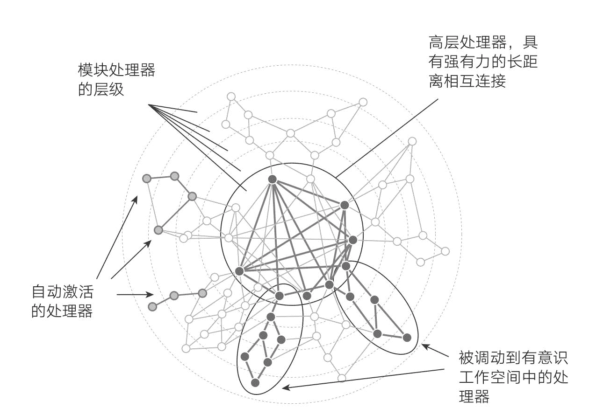

**图 14-1　全脑神经工作空间示意**

注：圆形及连线代表神经处理单元。实心椭圆与粗线标识激活状态。外层圆环表征感觉输入，核心圆环表征前脑认知区。

资料来源：Dehaene and Nacchache（2001）. With Permission of Elsevier。

依 GNW，意识即全脑广播。诸如席德·库韦德尔、丹尼尔·丹尼特，及主张弱化版本的杰西·普林茨皆持此类认知观。因工作空间掌控分类、记忆、推理、决策、行为控制等认知机能，故属认知理论范畴。戴维·罗森塔尔、哈柯文·劳另一认知派分支，强调“高阶思维”：知觉若伴随“关于知觉的念头”，即为有意识。此“念头”处于更高元认知层级。

# 意识不需要“全脑直播”：一场关于知觉与认知的博弈

维克托·拉米、伊利亚·斯莱格特、安内林德·范登布鲁克、塞米尔·泽基以及我，都站在了另一个战壕里：我们认为，大脑后部知觉区亮灯，哪怕没有触发“全脑广播”，也足以支撑起有意识的体验。我们的立场不是说意识可以完全脱离认知获取而独立存在，而是说**即便缺乏实质性的认知获取，有意识的体验依然可以发生**。拉米的经典实验（图14-2）就是铁证。

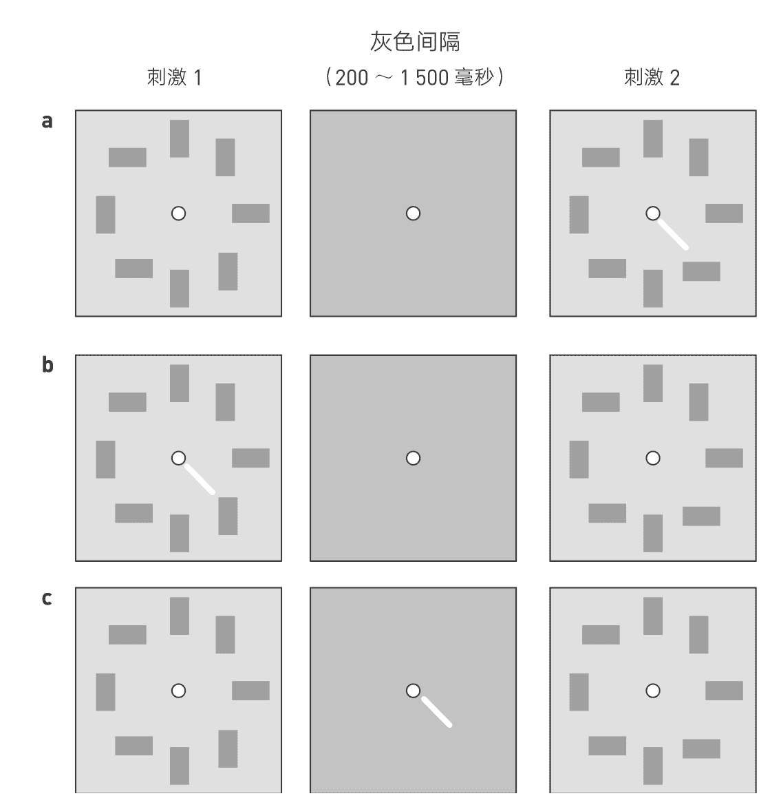

**图 14-2　知觉任务模型**

注：阿姆斯特丹大学维克托·拉米实验室所使用的知觉任务。一圈长方形会呈现半秒钟，然后是持续时间可变的灰色屏幕，接下来是新的一圈长方形。在这个过程中的某个时刻，被试看到指示其中一个长方形位置的线。被试的任务是说出这个长方形的方向在第一圈长方形和第二圈长方形之间是否发生了改变。

资料来源：Lamme（2003）. With permission of Elsvier。

实验流程是这样的：被试先看到一圈长方形，随后是灰屏，接着是第二圈长方形。关键在于提示线出现的时机——可能在第二圈（a图）、第一圈（b图）、或是中间灰屏阶段（c图）。被试要判断被指向的长方形方向是否变了。结果显著：b图表现极佳，a图较差，而c图最耐人寻味。即使提示线在第一圈消失1.5秒后才出现，被试仍能以近9成的准确率作答。这说明什么？即便认知系统一次只能“提取”极少量信息，被试主观上却拥有了**整圈长方形的完整、有意义的视觉体验**。因此，拉米和我都主张：意识的神经基础，不包含“实际认知获取”的神经回路——这与主流的“全脑广播/认知理论”截然不同。

正如你所料，这场辩论充斥着术语之争。德阿纳在2014年著作中直指我们会陷入二元论，嘲讽“脱离信息加工的纯粹心理体验”是前科学时代的遗物。拉米和我并不认同：意识不是没干活，它给认知获取的“车轮”上了润滑油，但**车轮不转，油依然在**。

核心难题在于**“测量问题”**：证据到底该怎么在“认知派”和“非认知派”之间划分？因为我们判断知觉是否有意识，靠的不是认知过程本身，而是知觉经过认知加工后浮现出的“汇报行为”。有理论家寄望新技术破局，下文我们将拭目以待。

---

## 转基因小鼠与“光遗传开关”：能否照亮真相？

“全脑广播”不仅要前馈流，还要前脑向感觉区的强反馈。科赫和土谷尚嗣大胆设想：用光敏感病毒感染转基因小鼠，用头顶光源或植入光纤，**一键切断“自上而下”的注意反馈**。无反馈，无“点燃”，无广播。他们的预测：没了自上而下注意，小鼠依然能有意识地看清单一物体（无干扰项）；只有当视野里“红色T”混杂在黑色T、红色F堆里，才需要自上而下注意来“捞”目标。

假设预测成真：无干扰时能完成任务，有干扰则失败。但我们怎么知道此时小鼠是**有意识**地看见，还是盲视式的无意识猜测？科赫二人提议用**“决策后下注法”**（Post-decision Wagering）。人类版规则：给积分（可兑现金），判断刺存否，再为判断“下注”表达信心。盲视患者虽能准猜，但现象学上是“瞎猜”而非“看见”，所以他们下注极不自信——**下注成为有意识知觉的“试金石”**。

动物也能玩这套：用食物奖励替代积分。科赫认为，人类适用的下注法，也能测光遗传小鼠。信心大=有意识；信心小=无意识。但关键漏洞来了：**切断自上而下过程，会不会顺手切断小鼠的“下注决策”本身？** 科赫推测，涉及注意和广播的自上而下回路影响信心，可能不受光遗传开关管控。

我们不妨脑补一下**做一只“被关灯”的小鼠**。假设科赫是对的，你失去了自上而下注意，却保留了意识。那是什么感受？像万花筒：碎片化、多模态、注意力无法聚焦。戈普尼克将其比作**早期婴儿**——感觉区突触丰富，前脑发育滞后。设想开关关闭前，你训练有素能识别“红T”（无论单独还是杂沓中）。开关一关，视觉印象还在，但淹没在混乱万花筒里。你会对自己的感知下大注吗？混乱必然动摇信心。

再假设科赫**错了**：关开关=关注意+关意识。无广播，只剩盲视式无意识猜测。下注咋办？盲视患者极少有“半盲半视”案例，极难预测无意识视觉者的信心水平。总之，**一旦光遗传通道关闭，下注与意识的相关性就彻底断了**。

结论很清醒：转基因小鼠是利器，但它只能提供**另一条亟待解释的证据**，而非终极裁判。

---

## 非概念性表征与测量问题：换一副眼镜看世界

破解测量问题，得重审基础概念。泰勒·伯奇在《客观性的起源》里画了一张知觉地图（图14-3）。

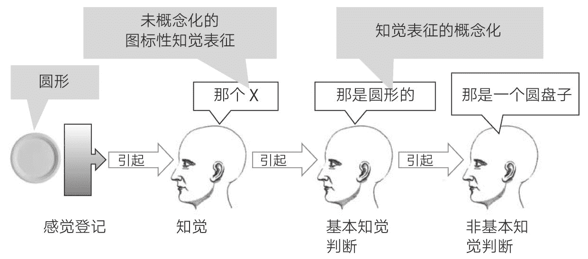

**图 14-3　伯奇的知觉模型**

注：该图为内德·布洛克在 2013 年绘制。图中删除了后馈影响。在视网膜层面不存在自上而下的影响，但在其他各个层面上都存在着自上而下的影响。

伯奇把“属性”（如圆形）和“知觉表征”拆开。知觉表征是**图标性**的，记作“那个X”——“那个”锚定个体（如左边盘子），“X”是纯知觉属性（圆形）。下一阶段是**“基本知觉判断”**：“那是圆形的”。关键差别：**“那个X”无概念、无判断、无真值**；而“圆形”概念一旦被认知调用，生成命题表征，判断才诞生。

为何纠结知觉与概念？因为测量问题的钥匙，藏在**“非概念性知觉”**与**“涉及概念的有意识判断”**的裂隙里。何谓概念？指适用于事物的想法/判断构件（如“圆形”适用于盘子）。**别混淆概念与概念指称对象**。拉图尔曾扯淡：拉美西斯二世不可能死于肺结核，因为结核杆菌是1882年才被科赫发现的。荒谬！**杆菌一直在，只是人类的“概念”迟到了。**

知觉vs概念，格式不同（图标性vs命题性），计算角色不同（知觉近似模块化组件，概念服务于推理决策等高阶认知）。但重点在于：**二者有性质上的接合点**，这接合点本身就是研究靶心。

在伯奇模型里，**非概念化知觉**与**基本知觉判断**是有意识知觉的两面。有意识知觉极低认知门槛甚至零认知——老鼠不会思考“圆形”，但能有意识感知圆形；有意识判断则要求会用概念、会推理。区分这两者，助我们跳出测量泥潭。克里克和科赫90年代的功勋在于：哺乳动物视觉似人，虽无语言思维，却可研知觉意识。现在，我们要看这区分如何重塑实验设计。

---

## 方法论的微创新：别逼被试“开口”

常见脑成像（fMRI, PET, CT）擅长空间定位，不擅时间。意识研究里，**时间同空间等重**。事件相关电位（ERP）填补了坑：头皮电极追踪视觉刺激随时间演变的脑响应。德阿纳等“全脑广播派”用ERP锁定意识神经基础，发现ERP成分反映意识末期的可见性，此时概念表征已启动——符合广播理论预测。但他们的实验**全程伴随概念化**：被试判断阈限数字比5大小，或报数字名，统统要调用算术/语言概念。我们有理由怀疑：ERP捕捉到的不是纯知觉，而是**“被概念化污染的知觉判断”**。

怎么避坑？皮茨2011年搞了240试次（[PRE*]标记位置隐含于此处上下文）。被试盯着红圆环找模糊小圆盘（核心任务），背景线段随机或组成长方形（无关干扰）。240次做完，**事后才问**：背景里见过啥图形？记得多少？能认出啥？结果：对长方形“不太自信”的被试，其ERP特征与他人迥异，**且早于全脑广播时窗**。这意味着：**在做出“长方形存在”的知觉判断前，被试已有意识地感知了它**。脑激活集中在后部知觉区，而非前部概念区。任务简单低技术，意识体验与任务无关，直到知觉消失许久才被提问——**常规的“意识-认知合流”极大概率没发生**。

艾因豪泽实验室玩得更绝：**双眼拮抗 + 零报告**。两眼呈异图（如左动/右动网格），知觉交替。传统靠按键报告，艾因豪泽改用**微眼动/瞳孔直径**做客观指标。验证有效后，被试**彻底解放双手，无任务**。结果惊人：无任务时，**前脑区活动不再随知觉切换波动**；所有差异锁定在后部/中部视觉与空间区。推论：以往看到的前脑“全脑工作空间”变化，只是被试“自我监控、准备按键”的副产品；**不需汇报，监控即消失**。德阿纳书中断言“前额叶不得信息，信息不广播，人就无意识”，被实证推翻：**只要知觉表征“可获取”，哪怕不广播，也能被有意识体验**。

这项研究**没用新技术**，用的是行为学妙招（眼动/瞳孔）+ 常规分辨率成像。教训深刻：**隔离大脑中的意识，靠的是“我们找什么”，而非“仪器多贵”**。数据无概念则盲，概念无数据则空（康德语）。唯有二者联合，方生知识。

---

# 15 从神经回路到行为：跨度，是否太大了？

**马泰奥·卡兰迪尼（Matteo Carandini）**
*伦敦大学学院教授，视觉神经科学权威*

神经科学的终极指令：**破译神经回路如何生成知觉、思想、行为**。外行看新闻“某脑区管某行为”，以为谜底已揭；内行知，**回路到行为的链条，关键环节尚未接上**。投资人和机构已醒悟：UCSD、UCL纷纷建“神经回路与行为中心”，“大脑计划”砸重金搞数据。目标诱人且合理，但**进度条走到哪了？** 我们真能一跃跨越“回路→行为”的鸿沟，还是这跨度，本身就太大了？

## 计算：夹在神经与行为中间的“操作系统”

想像我们要搞懂笔记本电脑（图15-1a），但只有100年前的工具。生理学家看到晶体管、芯片、总线、时钟、硬盘；解剖学家绘芯片内部及互联线路；吵架不断，因为老款新款、品牌间接线天差地别。心理学家盯着软件输入输出；搞商业软件的看不起搞游戏的。**此时，无任何理论能把硬件接到操作层**。

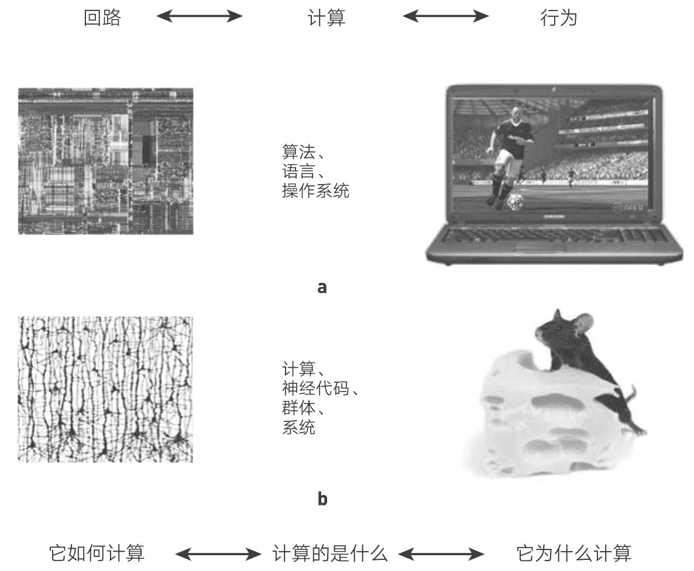

**图 15-1 回路与行为之间的连线**

a．微软微处理器中一个部分的连线，笔记本电脑在播放很受欢迎的电子游戏（FIFA12）；

b．皮层中的锥体神经元，小鼠此时的活动让它很愉快。

什么能填平这鸿沟？**必须有个中间层——计算机语言与操作系统层**。它整齐切割硬件与软件：不同机型线路不同，但中间层**计算逻辑完全一致**；不同软件指令组合不同，却建立在**同一套有限基础计算**之上。懂了这些计算，反向能提炼回路研究课题；正向能建软件理论，完全不用管电线电荷。**理解“描述的中间层”，是解释计算机如何运作的钥匙**。

这类比乍听老套——每代人都拿当时最复杂机器比大脑（织布机、电话局、化工厂、全息图……几年后都显滑稽）。大脑或许更像**专用机器集合**（视觉回路、嗅觉回路、运动回路紧耦合），而非通用计算机。但不可否认，大脑是**信息加工器官**，拿当代最强信息机器比，最配。

更重要的，这类比揭示了**科学研究的通则：寻找“恰当的描述层级”**——介于微观机制与宏观功能之间。物理学里，粒子超10个，相互作用方程解不出、模拟不动；固态物理学家只好发明理论，在微观层面成功操作宏观物质。生物学同理：我们用**寥寥结构域**描述蛋白质，而非成千上万氨基酸序列；不需精确序列，即可读懂结构域——它们正是大脑的“中间层”，隔开了结构层与整体功能层。

# 破解大脑密钥：寻找连接回路与行为的“中间语言”

在攻克大脑奥秘的征途中，若能锁定介于神经回路与行为之间的“中间层”——即大脑的**计算阶段**，或将打开通往成功的大门（参考图 15-1b）。这套计算机制，堪称大脑运行的“机器语言”，既体现在单个神经元的放电节奏中，也蕴藏于神经元群体的协奏曲里。

## 大脑的“标准指令集”初现端倪

近几十年研究揭示：大脑并非为每个问题单独编写程序，而是依赖一套**核心标准神经计算**。这套“指令集”跨脑区、跨模态复用、组合，以惊人的通用性解决着形形色色的任务。

**过滤**，是感觉系统的基石操作。神经元对输入信号加权求和，权重即“感受野”。从视觉、听觉到躯体感觉，各级处理无不依赖它；甚至在运动系统中，神经元通过“力量野”分配权重，规划抵达目标所需的力度。

**除法归一化**，则是另一核心算子——用共同因子（通常是大量神经元活动总和）除以单个神经元响应。它最初解释初级视皮层现象，现已被证实贯穿整个视觉系统，甚至延伸至嗅觉表征、注意分配、价值编码及多感官整合。

这些计算正是回路与行为的**桥梁**，且常组队出击。经典人类视觉检测模型即为“前端滤波 + 除法归一化”串联；早期视觉系统还大量使用神经元活动的**概括/池化**操作。这些发现反向指引了无数寻找底层回路的实验设计。

当然，过滤与归一化只是冰山一角。还幂运算、周期性放大、联想学习规则、认知地图、巧合检测、自上而下的增益调控、群体向量、动力系统约束轨迹……这些“指令”由不同领域专家挖掘，未来清单必将继续扩展，揭示更多跨区、跨模态的组合逻辑。

### 解耦“算法”与“硬件”：计算层的独立性

关键在于：**破解神经计算，不预设生物物理细节。** 幂运算虽与神经元发放阈值的生物物理机制紧扣，但除法归一化极难一一映射到特定生物物理回路——它依赖多机制协同，且跨区、跨物种实现迥异。这恰恰像计算机**指令集架构（ISA）**：同一条指令，不绑定特定晶体管布局，也不专属某个软件应用。

一旦识别出这些计算原语，它们便成解剖回路的**强力雷达**。不知回路“在算什么”（是幂运算、归一化，还是时差检测），便难窥其全貌。反之，从回路反推计算任务亦有奇效——如科赫在《计算的生物物理学》中所述，皮层柱回返兴奋暗示“放大器”功能，抑制性中间神经元的特异性偏好则揭示其“雕刻”他细胞响应的角色。

马尔在《视觉》中早已定调：**聚焦计算层。** “将具体神经元视为通用算法的物理实现”，甚至主张“神经元细节或许并不重要”。这虽激进，却精准切分了“算什么”与“怎么算、为何算”两类根本问题（见图 15-1）。

### 实验与理论的新范式

发现计算特征，靠测量单神经元及群体响应，建立其与感觉输入、知觉决策、认知状态、运动输出的**定量映射**。这指明正道：**在明确行为任务下，多脑区同步大规模记录峰电位。** 从百余神经元迈向千、万、百万级，正是“脑计划”核心目标，曙光初现。

数据洪流涌来，亟需**新理论**领航。理想理论应为海量神经元协同活动构建新隐喻。回望计算神经科学巅峰之作——霍奇金-赫胥黎动作电位模型：它抛弃化学描述，以**等效电子电路**为隐喻，链接结构与功能，引领离子通道研究半个世纪。我们需要将这种隐喻力延伸至网络层面。

## 从“连接组”到“模拟组”：迂腐的还原论陷阱

另一路径是绘制全脑**连接组**。虽助力理解回路如何实现计算（图 15-1 左），如视网膜微块组织破解定向选择之谜，却难解释计算如何协同产生行为（图 15-1 右）。

连接组甚至不如想象中有用——**缺“权重”便缺灵魂**。线虫 302 神经元、7000 连接全知晓，行为仍不可测，更遑论可塑性。巴格曼直指痛点：**神经调节素瞬息万变的浓度，能彻底重写网络功能，连接组对此全盲。** 类比而言，**编程语言手册远比奔腾芯片晶体管连接图更能助科学家读懂笔记本电脑。**

**“模拟组”**——全脑精细生物物理仿真——曾风光无两（GENESIS、蓝脑、人脑计划），核心假设：“懂计算必先懂结构细节”。期待在海量亚细胞细节堆砌中，涌现功能惊喜。然而数十年过去，**惊喜从未降临**。精细仿真擅长微观尺度（离子通道、单树突），却在宏观回路层面力竭——蓝脑难兑初诺，人脑计划亦难逃此劫。

安德森名言警醒在耳：**“还原为基本定律的能力，不等于能从定律重构宇宙。”** 还原论有功，建构论待证。

幸而，**层次解耦**已成共识：马德证明“迥异生物物理 → 相似网络动态”，迈宁与塞诺夫斯基证“微小生物物理差 → 巨大细胞特性差异”。这种**层级分离**让我们得以跳出分子泥沼，直击回路-行为关系。若懂行为必先懂分子/通道/受体/突触/树突/神经元……成功渺茫。

## 结语：共同语言，致胜未来

鸿沟太宽，**计算是必经之桥**。沿马尔铺就之路前行，神经科学家已锁定一批“高频复用”的典型计算。新技术、新实验、新理论将加速拓展清单，揭示它们如何组装出生命律动。这非主张回路派与行为派分道扬镳——恰相反，**唯当双方用同一语言（神经计算语言）对话，科研疆界方能无限拓宽。**

---

# 16 进化视角下的六大脑科学启示

**利娅·克鲁比泽**  
*加州大学戴维斯分校心理学教授、进化神经生物学实验室主任*

受邀撰稿，缘于两心：一为脑科学毕生所研，我痴迷大脑的**来时路**胜过去向；二为难得入选“世界顶尖神经科学家”榜单，虚荣心作祟。文中我将梳理进化与脑功能的关键命题，并以个人视角勾勒未来发力点。

## 一、 别只盯着灵长类：比较神经科学的“纵深”法则

初涉脑科，我以为钻研复杂大脑（如灵长类）足矣。研攻非人灵长类后却悟出：**只看近亲，永远看不清复杂大脑如何进化而来。**

比较研究揭示：**新皮层——掌管知觉、认知、随意运动的核心——在不同哺乳动物间，皮层分区数量、大小、连接模式差异巨大。** 灵长类进化出巨大、多部件新皮层；鲸类亦有独特扩张。要懂这复杂性，必先还原**早期哺乳动物新皮层原貌**，再追踪其演变轨迹。

于是我赴澳洲，研究**单孔目（鸭嘴兽）与有袋类**——它们在进化早期分叉，保留祖先原始特征。发现确凿：**所有现存哺乳动物（含人类），共享源自 2 亿多年前共同祖先的新皮层组织与连接“底层代码”。**

## 二、 “怪胎”最懂构建规则：身体塑造大脑

**极端特化的动物，是读懂“脑-身耦合规则”的钥匙。**

鸭嘴兽鸟喙布满电感受器，用以导航、求偶、捕猎。**其躯体感觉皮层 90% 领土被喙“霸占”**——皮层放大比例精准匹配身体特化部位。星鼻鼹鼠触须、蝙蝠回声定位系统，莫不如此：特化外周器官 → 特化皮层表征 → 特化连接重组。

**人类亦不例外：** 灵巧双手重塑手部皮层地图；语言声道进化驱动听觉皮层对语音频段专门放大；口腔运动皮层扩张服务发音。这些“现代人类特征”的解剖基础，早存在于祖先与尼安德特人脑中，**真正催生语言、精细工具的是社会文化环境对个体发育的塑造。**

布洛克名言：“比较神经科学为寂静的进化带来希望。” 跨物种比较，揭示的正是**大脑构建的通用语法、发育约束、组织原理**——而非人类独有的偶然。

## 三、 脑非孤岛：具身嵌入的进化视角

早年我极度“以脑为中心”，实验室只录电、看结构，忽身躯。博士后在澳洲浑水中摸网捕鸭嘴兽的深夜，指尖触碰其喙的质地、蹼爪、防水皮毛、微型双眼……**那一刻我懂了：大脑不是缸中之脑。**

鸭嘴兽海量皮层处理喙的输入，我却无流线型之身、无电感受器之流。大脑嵌于身体，身体配备特化感受器阵列，二者在充满生/非生物体的物理世界中共同进化、发育、受物质能量法则约束。**脱离身体与环境谈大脑功能，本质是失语。**

## 四、 基因非命运：表观遗传的“第二代码”

沃丁顿创“表观遗传”术语，解释同基因型细胞如何分化为脑/肝等不同表型。核心洞见：**基因型不变，表型可塑。**

扩展至个体一生：**环境（营养、压力、母爱）通过 DNA 甲基化等表观机制，重写大脑解剖、功能与行为，甚至跨代传递（经神经内分泌或种系）。** 米尼、尚帕涅实验铁证如山。

人类进化最生动注脚：手部解剖、声道结构、耳蜗调谐——这些“硬件”早就绪，**复杂行为（语言、工具）却由社会文化软件“编程”而成。** 我们的研究亦证：改变发育期刺激模式，能显著重塑“正常”大脑连接与功能。环境非背景，乃共建者。

## 五、 通往罗马不止一条：退化与多元实现

“最优设计”不存在，**同一表型可由截然不同机制达成。**

分子发育显示：基因级联调控皮层分区大小、位置、连接。**但感觉驱动活动同样能重写这些特征。** 故而，物种 A 的皮层特征可归因基因，物种 B 的相似特征却源于活动依赖机制，物种 C 则是混合产物。**进化是机会主义者，用手头一切可用材料拼凑可行方案。**

## 六、 警惕“大计划”与“技术崇拜”：让问题驱动科学

最后一课，最痛心也最关键：**别让“研究计划”绑架科学，别被“脑的十年”“意识的十年”口号裹挟。**

非线性复杂系统，岂是 10 年、百年时间表能攻克？**严苛时限扼杀那些看似琐碎、实为基石的渐进式发现——临床突破的基石。** 索尔克疫苗、卡哈尔神经元学说、达尔文自然选择，无一出自“重大专项”，皆源科学家自主探索的好奇心。

资助技术、攻关大问题固然需，但**方向盘必须握在科学家与科学问题手中**，而非行政指令。

---

### 大脑新趋势：进化指引的未来路标

以上启示早有前人道破，但这份私人清单重塑了我的科研路径，亦指向我眼中的**神经科学下一站**：

*   **跨物种多尺度整合：** 从基因调控网络到全脑动态，再到行为生态位，打通进化-发育-功能全链条。
*   **具身计算建模：** 将身体形态、感受器阵列、物理环境纳入脑模型核心变量，而非边界条件。
*   **表观遗传动力学解码：** 实时追踪环境如何经表观机制重塑回路与行为，揭示可塑性的分子时钟。
*   **去“模式化”的比较框架：** 摒弃“模式生物”思维，拥抱物种多样性中的普适规律与个性化方案。
*   **慢科学的制度保护：** 为好奇心驱动的长周期探索筑起防火墙，让科学节奏回归自然。

进化不赋予答案，只提供**被验证过的生存策略库**。读懂这库，或是我们通往通用人工智能、脑疾病根治、自我理解的最短捷径。

# 17 基因组的镜鉴：从人类基因组计划看大脑绘图的得失

**亚瑟·卡普兰（Arthur Caplan）**  
**纽约大学朗格尼医学中心生物伦理学教授、医学伦理中心创始主任**  
**内森·孔兹勒（Nathan Kunzler）合著**

### 核心观点前瞻：跨层级的对话与未知的疆域

首要任务，莫过于阐明基因、神经元、皮层图谱与行为这几大组织层级间的关联。这倒逼科研人员跳出舒适圈，向上探宏观行为，向下溯微观基因。研究物种差异不能止步于比较基因组学，更别妄想用单一基因解释语言、自闭症或精神分裂等复杂表型。我们对遗传学的偏爱，常让我们无视系统神经科学、认知科学乃至整体生理学，过早缩小搜索半径，痴心妄想直通“基因—行为”的捷径。如前所述，环境至关重要，文化更是从结构与功能双重维度，深度雕琢了人脑与现代行为。

既如此，预测大脑未来演化，实则是预测社会经济、技术变迁，以及物质环境的重塑——气温、食谱、水质、出行、工具自动化、指尖技能，皆将重塑体态、生理与代谢。孤立看大脑结构，毫无意义；必须置于多层级环境语境中。

回溯演化史，虽难精准描绘百万年后表型，却能圈定“大脑可能/不可能如何变”。新皮层演化是选项的不断收敛；遗传的随机性与物理定律共同设下红线。比较研究证实：新皮层变异路径有限。复杂行为的解剖生理基础，源于基因变异，伴随身脑行为协同，却始终与文化共舞，经表观遗传机制显现并固化。

最大的收获，反而是清醒地发现：已知寥寥，未知浩瀚。

---

### 两大“绘脑”工程

受人类基因组图谱启发，科研界启动了两项旨在绘制人类大脑全景图的宏大工程，以深化认知：美国的“大脑计划”（BRAIN Initiative）与欧盟的“人类大脑工程”（Human Brain Project）。前者聚焦创新神经技术研发，后者侧重信息学整合与功能模拟。两项目投资均超百亿美元，周期十年。

伊始，“大脑计划”即被类比为“人类基因组计划”。白宫曾许诺：该计划将催生治疗阿尔茨海默症、精神分裂症、自闭症、癫痫及创伤性脑损伤的新疗法。二十年前，类似承诺引致巨资投入基因组测序。如今回望，基因组计划的实战经验，能为绘脑工程提供何种现实与伦理的镜鉴？

“大脑计划”拟资助下一代技术开发，监测全脑单神经元动态，追求极高时空分辨率。起步于果蝇、斑鱼、小鼠等动物模型，终点指向人类，推动从思维、记忆到阿尔茨海默症、创伤后应激障碍等疾病机制的精准解析。合作网络汇聚全美神经科学领军者。值得注意的是，近半数启动资金来自美国国防部高级研究计划局（DARPA），其兴趣偏向直接脑模拟技术——意谓着大量资金将流向军事用途：脑创伤模拟、心智功能修复与记忆修改、脑控假肢、战场脑损伤加速研究等。

欧盟“人类大脑工程”则另辟蹊径，意在通过创新信息学手段整合神经科学分支，构建并验证大脑健康与病理的功能模拟理论，而非显性承诺疗法与治愈。

虽路径迥异，两者实可互补：单神经元的时空描绘助力功能模拟；动态模型处理模拟数据，或成统一神经科学基石。挑战亦存，尤其涉及新技术用于人脑时。复盘基因组计划史，最助洞见这些挑战。

---

### 基因组绘图的往事与困局

人类基因组计划首笔官方拨款，源自1987年里根总统提交国会的预算案，获批后预计15年完工。1990年，能源部与卫生研究院签署备忘录协同推进。

受当时政治风向影响，大型科技倾向私有化解决，私营项目备受追捧。舆论普遍认为私企能以更高效、低成本的方式完成测序，主张公共资金应聚焦基础研究。1998年成立的塞雷拉基因公司联合珀金埃尔默公司入局，誓以更少预算、更快速度达成同等目标，迅成公共项目劲敌。

资本市场用脚投票。2000年塞雷拉宣称测定90%基因位点，股价从25美元飙至200美元，市值一度触及55亿美元，2002年6月销售序列收入峰值达1.21亿美元。

核心争端随之爆发：基因组信息归谁所有？主流呼吁公共开放。虽初期公私达成数据共享协议，但塞雷拉拒绝存入公共数据库GenBank，导致协议破裂——私营项目可免费用公共数据，公共项目却无法获取商业数据，法律不支持对称共享。

目标分歧更深：公共团体誓将信息免费开放全球科研界，推动全领域进步；私营团体虽个别研究者愿共享，但公司层面强调所有权，申请数百专利。作为商业实体，塞雷拉须对投资人负责，早期坚决反对共享，直至低分辨率图谱被证实无商业价值，才转为免费公开。

---

### 大脑绘图：警惕重蹈覆辙

人类大脑生物学信息价值巨大，无论初期低分辨率图谱，还是后期精细到个体差异的高分辨率版本。高分辨率基因组图谱在个性化诊疗、靶向药物开发上价值显著。基因组计划留下关键教训：**前期公共低分辨率图谱，是后续绘制微小个体差异详细图谱的基石。** 除非所有数据公开免费获取，否则商业利益将主导大脑认知获取进程。虽起步为公共资助，但私营实体必将入场竞争。

既为公共资助起步，信息“微调”规则亟待商榷。微调数据关联遗传库、病历与健康库，可识别个体脑部风险与病理状态。个体高精度脑扫描/图谱共享遵循何种规则？若主体信息未获百全保护，未经同意能否关联脑扫描与基因组数据？

何种脑数据可授专利？BRCA基因专利大战前车可鉴：若不早觉早解，后果难料。避免神经科学陷入商业化与所有权纠葛，刻不容缓。

设想某公司兜售“思维信息服务”，预测脑疾病风险。基因组领域早有先例：deCODE、23andMe等巨头盈利合规，更多小微企业打擦边球。基于脑图谱项目的不完备信息，可预见“大脑诊断”、“真相评估”、“大脑侦探”将借网络野蛮生长。它们标榜引领神经营销，实无证据支撑——“真相”分析的乱象已现端倪。

它们只需某种“扫描仪”、多疑的“伴侣”、审慎的“雇主”、大话与忽悠，便号称能通过新脑知识揭示出轨、不忠、不快乐或偷盗倾向。若任由新脑知识应用与广告失控，绘脑项目将衍生诸多负面：虚假诊疗宣传、政府研发成本核算扭曲，以及群起而攻之的庸医、骗子、暴发户、讼棍——他们急于兜售粗糙脑数据，卖给信奉“真相机器”、渴望窥探深层隐念、筛除潜在失职者、识别家庭职场监狱中“异类”的买家。

基因组事业未料到此等商业狂欢。我们有责为脑知识发展的副作用，做更充分的预案。

---

### 资金来源的博弈与束缚

基因组计划证明：不同资金性质各有优劣。公认公共/政府资金保障学术自由，让科学家奔赴最有前景的方向。这未免天真。DARPA对“大脑计划”巨额注资，必然施压：须证研究助力国防、适用军事、服务战伤军人脑损伤诊疗。DARPA赞助项目未承诺数据公开。其目标未必与NIH、NSF价值观重叠，却在经费紧缩时以拨款诱惑科学家——这背后的利益输送，须高度警惕。

私人基金或基金会拨款，同样伴随“资助者意愿”导向压力。阿尔茨海默症基金会拨款，势必将绘脑与该病机制绑定。私人基金虽是宝贵资源，但也催生商业化转化压力。

基金会/私人基金非全无优势，能带来更高效、低成本技术。基因组计划期间，这常成其对抗公共团体的说辞。实则公私竞争未为科学家带来令人欣慰的高效廉价技术。若脑科学项目部分/全部依赖私人资本合作以求高效转化，科学家必须适应与通用电气、美敦力、西门子、强生、谷歌等巨头共事——他们不习惯被所有权条款绑架、被投资筹码裹挟。大型基金会的要求，也常与科学家“尽快公开原始数据至公共数据库”的意愿背道而驰。

---

### 何为“成功”？标准之争

基因组计划的其他教训同样关键。竞争项目间，对“何为成功”、“谁的基因组作参考模板”分歧巨大。他们公开争辩“何为进步”，一面争公关话语权，一面告知公众真相与潜在代价。

“绘制什么”亦无共识。基因组计划启动时，非编码DNA被视为“垃圾”而被排除。数年后，发现其具关键调控功能，主导表观遗传进程。

人脑绘制何物？神经连接组？包含占脑细胞90%的胶质物质？鉴于“垃圾DNA”教训，此问至关键。越来越多证据印证神经科学界旧识：胶质细胞非仅为神经元“保姆”，更深度参与脑过程。

仅建基因组图谱，不等于绘就脑图谱。仍需开发动态成像技术，以高时空分辨率捕捉何种细胞/细胞群放电，方可言“脑图谱完成”。

然何为“足够分辨率”？空间上：单神经元？5细胞群？1毫米脑区？时间上：秒级？毫秒级？单个动作电位？这些必引发更多争论，但**当下即须定标**。若科学家对“绘脑内涵”与“分辨率标准”不能达成共识，终点将模糊不清，重蹈基因组计划覆辙。荣誉、所有权、过错、应用承诺兑现的冲突，终归依赖共同目标。里程碑清晰与否，决定公众支持与资金走向。

---

### 兑现承诺：漫长的落地周期

二十余年前，基因组计划资助者许诺：测序技术将通向玫瑰色未来——摆脱遗传病，拥有更健康、长寿、幸福的生活。克林顿总统宣告测序完成时称：“将彻底改变绝大人类疾病的诊断、预防与治疗。”

技术虽具潜力，但大多数疾病预防治疗的实质性进展，仍需数十年。即便2000年宣布完成15年后，医学界才刚起步应用这些技术诊疗人类疾病。公众、国会或资助方易感到科学失约，或认定项目时间表过度乐观。

所有寻求巨额公共资金的大型项目，均面临同类风险：索契冬奥场馆建设、核聚变托卡马克装置。为获公众支持，此类项目须说服审慎的国会、媒体、公众：注资即得奇迹般进步。这需要**合理可实现的目标，而非科幻式承诺**。为不负纳税人，须警惕“为保经费而过度承诺”的倾向。绘出小鼠脑图谱，并不比绘出小鼠基因组更接近“治愈”。

---

### “标准大脑”属于谁？

启动基因组计划时，花费大量时间讨论“测谁的基因组”及其后果。数据公开意味着志愿者遗传信息全裸，无隐私可言。

最终方案：测序数名志愿者，经严格知情同意，血液样本去识别化，研究者不知来源；招募人数超测序需求，使无人能确定自家DNA是否入选。此法有效规避伦理困境，但放到绘脑，远没这么简单。

科学上，“绘谁的脑”依然是核心难题。虽每年数百万脑因诊疗科研被绘制，但某个时刻，必须确立“标准脑图谱蓝本”。纳入精神疾患数据？发育缺陷脑入池？病脑能否作“正常/典型”人脑代表？若否，为何？最优解似为：使用能代表大众的被试群体，为科学保留最大信息量。基因组计划证明，选可识别单个体反而减少伦理麻烦。

但这未必奏效。我们不知个体脑连接差异几何，不知动态脑成像将遇何种变异。这种可变性可能使数据共享与去识别化成为不可能。若脑变异导致“选脑”成谜，则须公开探讨辩论这些巨大争议。

---

### 从“图谱”到“临床”：避免神话重演

早期低分辨率基因组图谱发现，引发狂热。媒体竞相预言“基因分析仪即将进驻每家诊所”。网络谣言满天飞：预测儿童运动天赋的基因检测、匹配个人基因组的最佳饮食、血统溯源、甚至DNA选最佳恋人。至今脑图谱未助兑现这些幻想。如何防范脑知识引发的夸大宣传、乱象应用与认知偏差？

基础概念已致公众困惑。以“脑死亡”为例——意指全脑功能不可逆丧失。回溯2013年12月12日，13岁女孩贾西·麦克马思案。她因睡眠呼吸暂停入奥克兰儿童医院切除扁桃体，术后大出血、心衰、脑出血。独立专家标准扫描测试一致判定：脑干无活动迹象，确诊脑死亡。这一案例深刻揭示：将神经科学概念转化为公共认知与法律实践，道阻且长。

# 18　破解“大脑即计算机”的迷思

**盖瑞·马库斯**

纽约大学心理学与神经科学教授、畅销书作者、企业家，本书编委

几个月过去了，那个女孩仍躺在机构的病床上，靠呼吸机维持呼吸、靠胃管进食，只因父母无法接受“脑死亡”即“死亡”的残酷现实。这与特丽·夏沃案如出一辙：丈夫想让她安息，父母却拼死维持其植物状态；前以色列总理沙龙更是在昏迷中被维持了八年。医学事实铁板钉钉——脑死亡不可逆，大脑不再驱动任何生命机能。可大众常把“脑死亡”“昏迷”“植物人”混为一谈，让贾西一家等群体获得了舆论同情。许多 ICU 仍因家属执念，为脑死亡患者挂着维生设备，本质上是对“脑死亡=死亡”这一认知的拒绝。

脑死亡概念被广泛误读，大脑图谱同样面临被曲解的风险，除非科学家始终严谨界定、主动发声。基因组研究早已警示我们：描绘生命蓝图（无论是基因还是大脑）都背负着沉甸甸的社会责任。绘制脑图谱绝非只是堆砌数据、探讨应用；科学家还得主动拆穿夸大宣传、平息无端恐慌、预判研究被滥用或欺诈的路径——因为别有用心者早盯上了“脑图谱""脑科学""脑扫描"这些招牌。

---

当代神经科学堆积的是海量事实而非观点，困境在于事实间缺乏联结。我们大致懂神经元放电、彼此对话，却不知它们在“说”什么；懂单个神经元的分子特性，新皮层重复结构也看得清，但这些结构的功能、协作机制、如何支撑复杂行为，依然如雾里看花。换言之，大脑如何完成最基本的运作，各部件如何咬合，我们依然一头雾水。

在我看来，阻碍来自两大固执观念：一是“脑非计算机”的教条；二是绝对崇拜“自下而上、层层抽象的特征检测器”范式——这虽是神经科学至今最漂亮的想法，却也成了桎梏。本章主张：必须冲破这两重束缚。

### 大脑究竟是不是计算机

最大的冲击源自 20 世纪 80 年代中期兴起的“并行分布式处理”（PDP），即早期神经网络。它曾取代符号主义 AI，主导认知科学近二十年。彼时“脑如电脑”的隐喻显得陈旧，旧式 AI 模仿程序逻辑，神经网络一出，旧范式似走穴。学界高呼“范式转移”，仿佛变革已至。

然而，像精神分析、行为主义一样，神经网络理论很快衰退，从未长成大脑或心智的现实模型。90 年代期刊会议塞满“玩具级”演示，声称能捕捉各领域简单认知现象，但平克与我早已指出：细节极少经得起实证推敲；更没人把神经网络变成真懂语言的功能系统。虽然后来欣顿、杨立昆等人推动深度学习在语音、图像识别上大放异彩，但作为心智/大脑模型，神经网络依然乏力——低级感知或许管用，高阶认知几乎失语。

若大脑本身就是神经网络，为何后者边界如此狭窄？关键在定义。大脑固然是某种神经网络，但比 90 年代那种“输入-隐藏-输出、监督学习调权重、死记硬背有限样本”的玩具网络复杂得多。那种网络既无指令集、无变量，也无代码行，离计算机架构十万八千里。PDP 强调并行性是对的，却把计算这个“婴儿”连同串行的“洗澡水”一起泼掉了——这是失策。

今时“深度网络”虽加深层数、改良算法，本质仍是“非结构化”。非监督学习能自发形成类别，对语言、规划、抽象推理等高阶认知却毫无建树。既然不信人脑是存储程序的串行冯·诺依曼机，也不该因此否定“计算”本身。我要下个大注：**搞不清大脑在做何种计算，就永远搞不清大脑。**

### 大脑真的是“随机初始化”的吗？

神经网络运动最大的误判，是预设大脑初始随机、全凭经验塑造、无先天系统。实则有充分理由相信：胚胎发育本身就写好了复杂脑图谱的“草稿”。即便零经验，精密回路结构也是神经发育的核心。

诺奖得主托马斯·苏德霍夫的实验极具说服力：他敲除小鼠突触神经递质释放，切断大脑大部内在通讯，导致学习严重受损。若大脑结构全靠经验自组织，这些小鼠出生时应是一团乱麻。事实相反——出生时它们大脑褶皱、脑回、细胞类型、层级组织“或多或少正常”。佐尔坦·莫尔纳、乔治·瓦洛蒂加拉、露西娅·雷戈林等人的工作同指一处：**大脑基础架构在经验介入前已成型；经验只负责微调、校准、重塑——仅占发育过程的一半。**

与“随机初始化”谬论齐名的，是“大脑仅由单一、近乎不变的神经元构成”这种极端简化论。如今已知神经元有数百亚型，突触位置、连接对象、细胞身份的微小差异都能导致功能巨变。光视网膜就有 ~20 种神经节细胞；全脑数百上千亚型，若功能同质，进化早淘汰了这种冗余多样性。

### 大脑到底如何处理信息？

不可否认，大脑主要靠并行运算。单神经元太慢，无法支撑严格串行的冯·诺依曼流程；实验证据也显示：任一任务下，多脑区同步上线；甚至“发呆”的默认模式网络下，无数回路也在并行忙碌。但这不妨碍“大脑是某种计算机”这一命题。

别被“计算机=刻板串行”刻板印象误导。过去 25 年，个人电脑早已并行化：I/O 控制器与 CPU 并行、GPU 接管图形渲染（本质是大规模并行矩阵运算）、多核 CPU 普及。依合理标准，现代 PC 与手机皆属并行计算机——它们系统化操纵信息，早非严格冯·诺依曼机。以“计算机不并行，故脑非计算机”论证，用的是 30 年前的计算机教科书。

GPU 与 CPU 的共性：都以加减乘除等基本指令为核心，代数式操作寄存器任意值。GPU 让每个像素同步变暗，CPU 逐像素循环，结果等价。一旦承认 GPU 是另一种计算机，“脑非计算机”站不住脚。视觉通路做的不正是场景表征的并行变换（如提取平行边缘）？ASIC 等专用电路证明：程序可选、可下载存储器按序执行、也可烧录为无存储程序的并行电路。

依我之见，**凡能系统化接收输入、编码操纵信息、转化为输出的架构，皆为计算机**。脊椎动物大脑：接收输入→化学/电信号编码→操纵信息→产出行为（运动指令、内部表征更新）——完美契合定义。大脑非纯粹计算机，存储机制、信息操作方式与硅基不同，但核心逻辑同构。

真问题不在“脑是不是信息处理器”，而在**“如何存储/编码”**与**“对编码做何操作”**。神经科学的使命应是**大脑逆向工程**——像拆解 GPU 一样拆解大脑。GPU 逆向工程揭示：晶体管→少量指令（亮像素、画多边形）→复杂运算=指令组合。神经元≈晶体管，但单神经元如何编码、操纵信息，我们知之甚少。计算机层面，晶体管组合成逻辑门（与/或/非），这是破解脑机制的基石。**神经科学家常鼓吹“自下而上、数数据说话、理论走开”，这句蠢话拖累了进步**。理论不可或缺；可惜多数理论家只想自证其说，极少人严肃比较替代解释。

光堆数据能懂脑吗？我持怀疑。破局者必是**“理解大脑如何完成其功能的原则性框架”**——哪怕只是纲领性认知。这意味着：先搞清大脑属于哪类计算机，提竞争假设，再实验检验；而非先攒数据、后找问题。

### 如何看待“特征检测器”假说

关于新皮层最主流假说：它是层级特征检测器堆栈，自底向上从感觉信息抽象至高阶概念。低层侦测边缘/曲率，高层识别字母/面孔。源自休伯尔&威塞尔经典工作，部分确属真理。许多神经元专司低级图像属性，高层神经元表征抽象实体（如面孔），甚至特定个体——最著名的“詹妮弗·安妮斯顿细胞”能跨模态（文字/照片）响应。现代深度网络在语音/图像任务上成功，本质就是层级特征检测器的多层变体。

**但：部分区域用特征检测器 ≠ 整个大脑皆如此。** 特征检测器捕捉不了人类擅长的“归纳推理”。实验显示：7 月大婴儿听 2 分钟 ABB 语法句子（“吃果果”“拉咿咿”），即能提取规则泛化到新词（区分“笑哈哈”vs“笑笑哈”）。新生儿 fMRI 复现此结果，暗示抽象推理能力或为天赋。层级特征检测器擅长“见多识广、分类越细”，却在“将抽象推理泛化至全新场景”上输给婴儿。

语言、推理、高阶规划等认知峰巅，特征检测器层级难以企及。乔姆斯基早言：语言充满从未见过的新句。纯分类系统束手无策——它只认得“见过的类别”，无法理解“每句独特的意义”。

语言核心机制是**“变量绑定”**。通俗说：英语有规则“句子=名词短语+动词短语”，大写字母为变量，可无限填充，生成无限意义。这规则妙在“离散无限”：**既覆盖“水手爱上姑娘”，也覆盖“此规则妙处在于它包含一个人想说的每句话，即使这话从未被说过”**。要解释这种生成力，必须超越“只会分类旧刺激”的特征检测器层级。理解人类认知神经基础，关键在破解语言学的**“语义合成性”**——大脑如何把词级单元合成为从未出现过的可解释句子。

---

### 大脑逆向工程的六大硬骨头

结尾抛出六个棘手且可攻克的挑战，任一突破都将推动领域跨越式前进：

1.  **大脑属于哪一类信息处理器？** 若非存储程序式冯·诺依曼机、无主时钟、软件不可下载、不按步执行，它如何达成高度协调？是否存在“神经元代数”——一套对突触存储值进行操作的指令集？若坚持“脑非计算机”，替代解释何在？人类能做代数运算是否独一无二？其他哺乳/脊椎动物能否类似操作？
2.  **非显性知识/指导下的计算机制是什么？** 人类虽能显性模拟冯·诺依曼运算（如初学三角函数），但绝大多数认知非此类。支持认知多用途的神经系统是什么？基础未解：大脑究竟是模拟、数字、还是混合？（或：语法用数字、图像用模拟）
3.  **变量绑定如何神经实现？** 绑定类似令 `x=5` 解 `y=x+2`。无论追踪移动物体、组合句子成分，变量绑定无处不在。句子中可变名词短语如何临时绑定特定词组？标准记忆模型靠百次重复，可我们理解每句都在瞬间建立数十短期联结——大脑怎么做到的？无人知晓。
4.  **基础运算是单一“层级特征检测”还是多指令集？** 若如我所判，大脑像微处理器拥有少量基本指令反复调用，这些指令是什么？如何在神经层面落地？
5.  **大脑用什么“文件格式”编码信息？** 计算机用 ASCII 存字、JPEG 存图。大脑如何编码句子、词汇、心理意象、乐曲？运动目标、欧氏空间表征我们有点眉目，其他表征格式全是盲区。
6.  **为何每一层级都充满惊人多样性？** 100+ 皮层区、数百神经元亚型、单细胞/突触分子复杂性——大脑主题是**复杂**而非简单。且大脑极其敏感：细胞若不按“恰当方式”连“恰当类型”，即致精神疾病/智力缺陷。海量细节皆关键。这些细节到底在做什么？复杂多样的大脑能做什么、而巨大却简单的神经网络做不到什么？

致谢：Ned Block、Jeremy Freeman、Christof Koch、Athena Vouloumanos 提供宝贵意见。文中疏漏由我独自承担。

三磅重的肉团，却是已知宇宙最复杂系统。即便不产出即时应用，探索它也值得。它成就智力伟业、超越最强超算，堪称奇迹；也是医学终极靶标——懂得越多，越能掌控命运。真读懂大脑那一天，会发生什么？

约翰·多诺霍勾勒医学图景与人机界限模糊化；凯文·米切尔剖析精神疾病治疗困境、遗传学如何破局；米歇尔·马哈比兹展望技术让我们像研究非人动物一样，获得人类全脑高精度神经记录。

# 19　神经技术：从实验室走向临床

**约翰·多诺霍**

布朗大学脑科学研究所创始所长、神经科学系主任、教授

## 破解“中间地带”：工具革新重塑认知边界

人类至今仍未看清大脑运作的底层逻辑，更不知晓神经活动如何孕育出独属于人类的复杂行为。粗看之下，大脑似乎只是存储并转化活动模式，经由“神经计算”输出行为；但在纷繁复杂的回路深处，神经元群体如何协同完成表征与计算，依然是谜团。这种认知盲区，直接锁死了我们攻克重脑病的能力——抑郁、孤独症、癫痫、精神分裂症，乃至因回路受损导致的瘫痪，治疗手段皆因缺乏机制洞见而受限。好在，神经技术的飞跃正让治愈曙光初现。

首先，新工具将撬开关联大脑活动与知觉、认知、情绪、行为等核心心智功能的基本原理，并首度从机制层面解析人类大脑的独特性。其次，技术催生的新一代“大脑接口”将重塑临床诊疗范式，为功能重塑提供实操路径。最终，神经技术将直击灵魂深处，倒逼我们重审生命意义。以下将逐一拆解其在各领域的冲击力。

### 新趋势：跨学科融合破解中尺度难题

支撑情绪、认知与决策等高级功能的，是大脑回路中协同作战的神经元网络。探究群体行为如何涌现功能特征，最大的鸿沟横亘在跨尺度关联上。微观层面，我们摸清了单个神经元“输入-输出”的转化逻辑（虽未臻完善），并拥有多物种多维度的脑图谱；宏观层面，fMRI 等技术能窥见百万神经元协同产生心智活动的全脑图景。然而，单细胞与全脑两端夹击，唯独中尺度——丰富神经互动孕育行为的关键战场——仍是盲区。

中尺度运作依赖空间分布广、连接动态变、高度互联的神经元集体动力学。此处，记忆与知觉融合的回路孕育出行为计划，将“听懂一句话”转化为“优美舞姿”或“金玉良言”，并将规划与观点存入终身记忆。绘制功能图谱、解释集体动力学如何生成行为认知情绪，亟需兼具“神经元级密集采样”与“高时间分辨率”新工具。但“采样多大、录多少神经元”仍是悬而未决的核心命题。

微电极、示踪器、分子标记等传统工具奠定了早期认知基石，助我们绘出“知觉-行为”路径，尤以视觉系统为盛：从视网膜经丘脑至初级视皮层，分“是什么”与“在哪里”双通路，再经额叶联接构想执行，甚至凭记忆操纵不可见之物。单细胞研究拆解了特征选择各环节，fMRI 锁定了脑区峰值活跃区。但现有手段无力剖析中尺度网络实施的整体操作：知觉行为激活的是广域协同网络，仅凭寥寥连接即将近乎全脑神经元串联。连接疏密如何塑造整体功能？小世界网络理论揭示，微增几个功能连接即可重塑群体特性，这正是“六度分隔”现象的神经基础。

神经元非数字晶体管，而是独特的模拟处理器：汇聚数千弱信号，经突触整合输出电脉冲（动作电位/峰电位），以频率编码信息。体验重塑连接强度（神经可塑性），神经调节物质进一步重构突触效能。中尺度视角下，信息处理即峰电位模式在局域与广域网络中的流变。

中尺度神经计算，可视为“网络的网络”中峰电位活动模式的演化。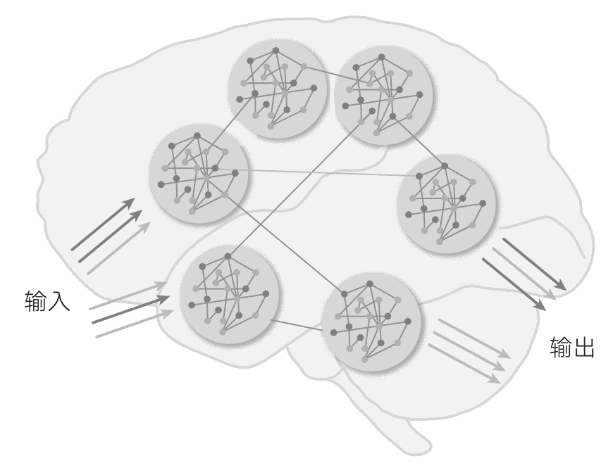 图示中，深色圆圈包裹局部互联网络，网络间连接未尽显，整体集合对应一种心智状态。输入在当下状态与可塑性、生物物理特性共同作用下“计算”出输出模式驱动行为。全要素或采样记录，方能探究真相。图示虽略去细胞类型、连接细节、时序演化及神经调节影响，但新兴工具将精准测控集合活动，验证表征计算假设。目前单细胞分辨率下的大规模集体动力学描绘工具仍属空白，但研发已在加速；描绘完成后，还需选择性操纵工具验证回路因果。

**图 19-1　神经网络的网状图示**

首战告捷：中尺度记录价值已被验证。蠕虫、龙虾等简单生物的明确回路研究，揭示了小规模网络运作法则。虽难直接推演至哺乳动物高度特化脑区，但有限采样暗示前路可期。当下已能同步记录啮齿类、灵长类甚至人类皮层局域网络数十神经元活动，解码迷宫导航路径、伸手取物方向等中尺度操作。

为直观理解群体编码行为，设想记录运动皮层两神经元伸手过程峰电位：神经元 A 左伸高频右伸低频，神经元 B 上伸高频下伸低频。若两者均高频放电，推断动作为“左上”。这最小整体即编码方向。虽大规模集合活动复杂万倍，但群体编码自然特征的原理贯通高低。洞悉此理，运动皮层输出命令机制便透明化，并已转化为脑机接口——瘫痪者意念控制电脑机械臂，即源于此。

但基于模式重构行为技术尚稚嫩，因仅采样大规模回路极微小样本。百级电极阵列仅覆盖哺乳动物有意义网络的冰山一角。知觉、认知、动机、情绪等高阶特征，蕴藏于海量神经元长时程复杂时空模式中，唯有大规模长程记录方能显现。如仅随机瞥见 1% 像素、持续 1-2 秒便想读懂追车大片，技术瓶颈显而易见：① 制造长期稳定、单细胞分辨率、大规模传感器；② 处理天文数字信息流；③ 开发从巨量活动中提取意义机制的分析工具。

### 新趋势：跨学科融合破解中尺度难题

物理、工程、合成生物、统计、数学、计算机科学的进步汇聚成神经技术洪流，终将一网打尽上述困境。纳米制造与精密加工缔造更廉价、微型、高速电子器件，算力指数级跃升，数据存储与分析工具融合海量神经元模式模拟——终将打造出链接细胞、回路、行为的中尺度动力学工具箱。

### 双轨并进：电光技术破译感知回路

电生理与光学成像，是读取群体活动的两大中尺度利器。电生理需发丝细微电极贴近神经元捕捉微弱短促峰电位，规模化受限于组织损伤、长期稳定性（材料降解、位移）、体外电子设备笨重易故障。纳米制造扭转局面：新型电极杆可沿轴百点同步记录，更柔更细；火柴盒大小的高性能植入式电子模块配合无线传输（射频/光），实现海量数据体外传导。千级神经元可靠电记录虽在攻关中，但胜券在握。合成生物、电子学、纳米制造更催生“神经尘埃”构想——集成电路传输的微粒电极撒布脑内，规模损伤双优，但生物相容性与供能仍待解。

光学法另辟蹊径：基因编码指示器让神经元发光报告电活动，经体表非侵入传感器采集。斑马鱼幼体全脑万级神经元光记录已成，但受限于小型哺乳动物。现存时空分辨率瓶颈：视野仅平方毫米级，穿透深度不足皮层 2mm，深层结构仍需植入探针；指示器动力学跟不上峰电位或干扰细胞功能；病毒载体虽具细胞型特异性但稳定性存疑。前沿攻关正酣：微型头戴显微镜、深层高速光学读取技术蓄势待发。

操纵层面，电光双管齐下。建立因果需干预而非仅观察。电刺激溯源 150 年前，巨电极激脑面验证运动定域；今微电极植入回路关键节点增减信号，然电流扩散难避，特异性受限。光遗传学横空出世，以光开关特定细胞类型，让实验者精准拆解特定网络行为因果。虽有自身短板（如侵入性、散射），但电光结合已能产出确凿中间层数据，钉死神经元与行为的因果链条。

### 从实验室到病床：神经接口的临床转化

基础研究反哺的神经技术，正孵化全新诊疗复健工具箱。同源工具产出的机制认知，将进一步驱动临床落地：补全缺失时空模式替代失能感觉，或调控失调回路治愈顽疾；更优解码工具可揭示病理回路特征，或桥接卒中切断的运动下行通路。以下为典型范例。

#### “写入”感官：人工耳蜗与视觉修复的范式

人工耳蜗是首个可穿戴临床神经接口。耳蜗毛细胞受损时，植入体将声波转电脉冲直驱听神经。获批 20 年，超 20 万重听者受惠。虽属雏形，却证明“自适应大脑+简易编码”即可改写生存境遇：不足 24 电极刺激点，替代数千毛细胞完成听觉解码。视觉修复同理：摄像机驱动视网膜前 64 电极阵列，产出粗糙视觉代偿；若解析自然活动模式并升级硬件，近正常视听指日可待。光遗传学更直指本源——重塑残留视网膜细胞光敏性，彻底替代缺失感受器。优化中尺度时空刺激模式，以物理器件替代受损网络，神经修复将跃上新台阶。

## 重塑平衡：神经调节疗法的进化与困境

神经调节靶向刺激调控病理回路。深部脑刺激（DBS）植入毫米级电极重塑网络动力学，全球超 10 万植入者受益，显著缓解帕金森僵颤，抑郁、认知衰退等适应症临床试验推进中。但疗效稳定性差，频需调参配药，根因在于对 DBS 作用网络基础及疾病机制认知模糊。帕金森 DBS 干预皮层-深层核团网络，对抗多巴胺调节失衡；回路生理病理机制的基础研究，将催生有原则的精准调控策略。

现有大电极精度不足，新技术赋能精准时空靶向。若神经元经基因改造获得光敏性，光遗传学将实现电刺激无法企及的细胞型特异性调控。未来更可期待经颅聚焦能量（电磁、超声、光）无创调控深层回路，免开颅之苦。虽当下粗糙难及特异回路，但经颅磁刺激（TMS）已证实能暂缓部分抑郁症状。工具箱扩充之日，即破解调控机制、实现精准干预之时。

### 新趋势：临床反哺基础，闭环驱动创新

神经调节架起基础与临床双向奔赴之桥：实验室刺激启发临床方案，临床反馈倒逼科学新问。接受刺激治疗或入组试验的患者，为科学家打开观窥健康与病脑差异的独特窗口。

新时代人类研究参与者涵盖科学家、临床医师与患者三重身份。但认知情绪操纵类研究与疗案，须严守伦理监管红线。帕金森等躯体导向疾病刺激疗法共识度高，精神障碍、记忆缺失等领域则迷雾重重，审慎为上。

## “读取”意念：脑机接口让瘫痪者重获自主

传感技术临床价值随记录能力跃升而指数级放大。

### 新趋势：从解码运动到重构通路

脑机接口（BCI）作为极具临床冲击力的传感神经技术，聚焦重塑大脑瘫患者独立性与控制感。它是连接大脑与外界的新型物理神经通路：传感器-处理器-计算机闭环，实时检测解码神经集合模式，生成替代性运动指令。

中风、脊髓损伤、肌萎缩侧索硬化、肢体缺失，本质均为“通路中断”导致运动意图落空。哪怕仅能点击“是/否”的微型 BCI，对全瘫无法可靠沟通者皆是救赎。星辰大海在于：意念驱动电脑、义肢、机器人；终极形态则是意念激活瘫痪肌肉，重构缺失回路。虽似科幻，人体试验已启幕。

我们团队研发的“脑门”系统，直连手臂运动皮层网络与辅助技术。早期临床试验（FDA 限定研究用途）中，芯片大小仅儿童阿司匹林片，植入 100 微电极于手臂区。传感器捕捉数十神经元峰电位模式，外部算法解码为运动指令。不可思议的是，对巨网极微采样的解码，竟能精准驱动被试操作电脑、进食、甚至用机械臂饮水。

### 破解神经密码：从笨拙光标到灵巧脑机接口的进阶之路

要看清这“魔法”般的脑机接口究竟是如何运作的，不妨先回顾一下我们之前提到的、由两个神经元峰电位编码的伸手抓取实验。峰电位模式蕴含了足够的方向信息，足以驱动屏幕光标指向字母，或指挥机械臂完成抓取。但遗憾的是，这些动作距离人类自然手臂的敏捷、精准与灵巧，尚有不小差距。症结在于，我们对运动意图在脑网络中的编码机制掌握得还不够透彻，无法将神经活动精准映射到每一个具体行为意图上。譬如，我们不清楚健全神经系统实现灵活、高速、灵巧操控所需的具体“配置”——神经元群体的规模、分布特征及动态需求究竟是怎样的。

脑机接口的发展史，恰恰印证了基础研究工具探索神经编码的路径：多电极阵列已演变为新型临床设备的核心组件。源自中尺度基础研究的工具与法则，正推动脑机接口控制向“更快、更强”迈进。多通道神经信号的无线传输，为研究动物自然行为下的脑活动提供了独特价值，更为不受束缚、全天候的脑机接口应用铺平了道路。对皮层感觉编码的深度洞察，让我们得以利用视觉刺激重构感知，闭合“感-动”循环，让触觉反馈引导行为。中尺度神经解码在临床领域大有可为，癫痫治疗便是典型例子：对网络动态的高灵敏度监测可捕捉异常同步活动，实现发作前预测，并靶向刺激中断病理过程。

下一代工具将揭示具备高时间精度的大规模网络功能。随着我们对行为、思维及疾病中神经元集体动态认知的深化，新型脑接口有望助力患者重获复杂视觉、自然听觉与灵巧运动。神经调控设备终将消除导致运动、情绪或认知障碍的回路失调。这些应用不仅能重塑患者生活质量，更能大幅压降医疗护理成本，惠及因病陷入不能自理或生活质量低下的人群。

当然，没人指望这些备受期待的临床转化能一蹴而就，也无法预判其彻底成熟的时间表。对神经集体动态的探索必然引发新疑问；临床试验可能遭遇副作用或器械故障的拖累，减缓技术迭代。但可以肯定的是，在解析人类与动物神经网络功能、及研发所需工具的持续突破下，神经与精神疾病治疗将迎来变革性冲击。

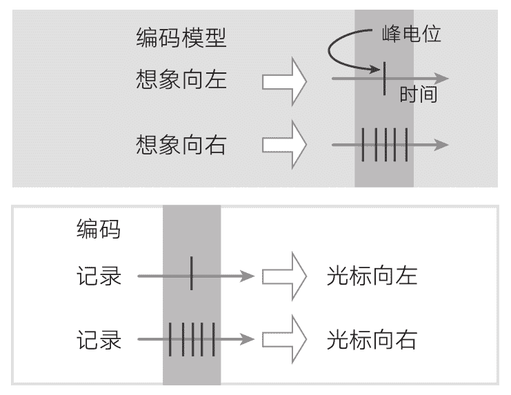

**图 19-2　神经解码原理图解**

---

### 当技术触及“人”的边界：神经革命的深层拷问

这场神经技术革命最发人深省之处，在于它对“人”的定义与边界的重塑。若我们能复刻大脑最珍贵、最独特的功能，人类的能力边界便将被无限拓展：想象一下，拥有四条手臂、六只红外线探测眼、永不遗忘的记忆或超声波感知。若将大脑所有感知、推理、情感表达与创造力打包进一台台式机，会是怎样一番景象？虽制造这种“大脑盒子”所需的顶尖技术看似遥远，却非遥不可及。只要攻克神经网络联合动力学机制，建立神经元与全行为的映射，并配备执行机制，“复刻技术”与“拓展技术”的迭代，终将催生出模拟大脑惊人能力的机器——正如智能手机已能导航陌生路、实时翻译、自动泊车。但这也引爆了伦理困境，我们须审慎研讨、严格监管，在机遇与滥用间寻找平衡。我们早已在药物增强注意力、调节情绪，以及义肢让截肢者跑得更快、攀得更高的案例中，触碰到了这条红线。当神经技术重新书写“人类可能”的定义，那个被长久争论的“人机界线”将被根本性改写。

最后，致谢“脑门”计划同仁对神经技术革命的贡献；感谢全美永（Miyoung Chun）与BAM团队的启发性讨论，感谢NIH脑康复与损伤网络委员会成员；感谢美退伍军人事务部、NIH、DARPA、远程医疗与先进技术研究中心、美海军研究办公室、NSF、萨姆森控制设备公司及以色列脑基金会的慷慨资助；特别感谢盖瑞·马库斯在编辑环节的细致打磨。

---

# 20　破解“脑-基因-心”错位谜局：精神疾病的新范式

**凯文·米切尔（Kevin J. Mitchell）**
**都柏林三一学院遗传学与神经科学副教授**

#### 诊断的困境：只有“标签”，没有“靶子”

腹痛就医，医生会通过血液炎症指标、过敏原筛查、肠镜活检、酶水平检测等手段，将病因锁定为克罗恩病、结肠癌或溃疡性结肠炎等具体病理，从而对症下药。若排查无果，便可能被贴上“肠易激综合征”的排除性标签——有名无因，无法指导治疗。

精神科诊断的现状，全盘皆是这种“肠易激模式”。重度抑郁、精神分裂、孤独症等诊断标签，仅基于共现症状簇与典型病程定义，边界模糊，无严格生物学参数或客观检测支撑，本质上是“参照范例式”的主观归类。医生依据行为模式与主观报告，将表表相似的痛苦强行归入同一名称，**这些名称与病因毫无关联，因为精神医学对病因几乎一无所知。**

这正是过去60年精神科新药枯竭的根源——与心血管、肿瘤领域新机制药物层出不穷形成鲜明对比。随生物学机制揭示，靶向药物随之诞生；而精神医学不仅触不可及病理组织，更连“如何定义疾病”这道门槛都未跨过。业界早承认：现行诊断类别非“自然种类”，而非自然界客观存在的实体，而是人为构建的实用分类。善意看，它们便于临床经验交流；恶意看，它们掩盖了病因的极端异质性。

曾寄望于DSM修订能引入生物学标志物（如伏隔核5-HT过量、纹状体DA释放增、海马-前额功能连接减）实现“按因分型”，至今一无所获。**没有任何脑影像或生物标志物能用于诊断精神分裂、双相障碍或孤独症。** 根因在于：寻找差异的实验设计，依赖的正是亟待被证伪或替代的旧诊断框架。若诊断类别非自然种类，大样本混合分析只会稀释真实信号；若病因高度异质，亚组特异性差异将在群体均值中沉没。

#### 遗传学：撕开迷雾的手术刀

在神经科学尚无法按因分型时，遗传学提供了更锐利的切入视角。自疾病概念确立起，精神分裂、孤独症即显示显著“家族聚集性”。双胞胎研究证实，这主要源于共享基因而非共同环境。在神经发育障碍中，遗传差异能解释绝大多数个体变异。

**好消息是，我们终于找到了致病基因。** 早年以为致病变异极罕见、仅涉少数基因，如今已知相关基因超百个。变异形式多样：单基因点突变，或涉及染色体片段缺失/重复的拷贝数变异（CNV）。CNV虽个体罕见，合计却占疾病10%-15%（如安格曼综合征、威廉斯综合征）。得益于全基因组测序，单核苷酸变异（SNV）也能高效捕获。无论CNV还是SNV，显著增加发病风险，携带者外显率达10%-100%。

这些发现迫使神经科学家**重写精神疾病定义**：

1.  **变异不尊重诊断边界（多效性）。** *CNTNAP2*、*PCDH19*、*SHANK3*等基因变异，在甲身现为精神分裂，在乙身现为孤独症，在丙身现为智力障碍或癫痫。**无已知变异仅对应单一诊断。** 流行病学数据印证：精神与神经疾病在病因学上大面积重叠。
2.  **致病基因极其众多（高异质性）。** 非10-20种，而是至少上千种基因变异可致病。故现行诊断类别非单一病种，而是涵盖海量罕见遗传综合征的“伞状术语”。虽单一综合征罕见，但总和普遍，足以解释精神分裂、孤独症约1%的人口患病率。
3.  **新生突变维持疾病谱系。** 非所有变异皆遗传，大量源于配子形成期（精子多见）的*新生突变*。这解释了为何非家族散发病例仍具遗传基础，也解释了高致死、低生育率的疾病为何能在人群中持存——旧变异虽被淘汰，新变异层出不穷。
4.  **基因型-表型映射非线性。** 高风险变异外显率不全，受遗传背景调控（寡基因/多基因效应）。但随携带者队列扩大，核心致病变异的主导作用可被确证。

遗传学诊断对患者及家庭心理社会影响深远，波及保险与生育决策；长远看，它为“按机制分型、按靶点治疗”开辟了康庄大道。

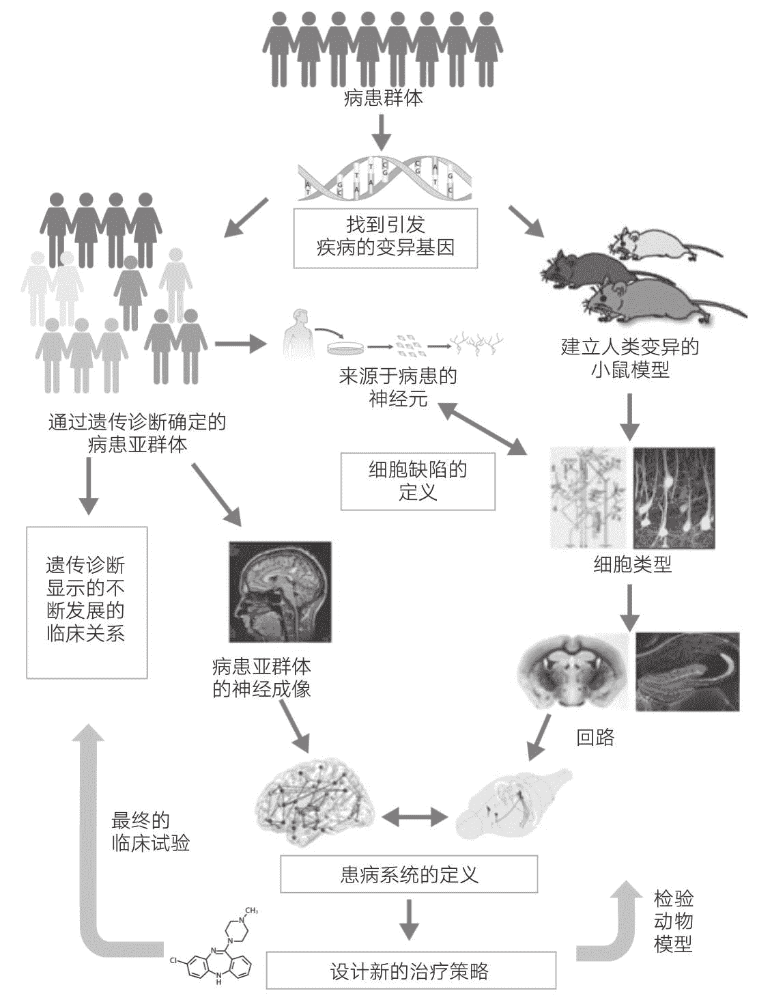

**图 20-1　精神疾病精准医疗：基因型优先路线图**

注：遗传分析将广谱诊断下的患者拆解为同质亚群。特定变异支持构建具病因效度的细胞/动物模型，追踪分子→细胞→回路→系统的级联效应；结合神经影像与多组学，揭示自然病理状态，筛选疗策；经动物验证后，面向明确基因型人群开展临床试验。

---

#### 从基因到生物学：穿越分子至心智的层级阶梯

按遗传缺陷分组，能揭示藏匿于大队列中的亚群症状谱与病程（见图20-1）。遗传综合征的临床画像，可消解宽泛诊断的异质性噪音，直接指导临床管理。携带22q11、3q29、16p11.2缺失的40例患者影像学价值，远超400例泛精神分裂患者。聚焦亚群特异性神经化学通路或回路（如深部脑刺激治疗抑郁/强迫），是精准干预的关键。

但要彻底读懂“变异→精神症状”的黑箱，必须贯通分子、细胞、回路、网络、系统全链条。DNA微小改变，如何推演偏执妄想、狂躁或自杀倾向？遗传学提供了穿越层级的“阿里阿德涅线索”：从细胞模型、动物模型，直抵人类。

近年遗传学重磅发现：**多精神疾病风险基因，功能聚焦于大脑早期发育。** 构建数百亿神经元、数千脑区、万亿特异性连接的精密架构，依赖基因组编码的发育程序——进化最惊叹的壮举之一。但此程序脆弱，涉及成千上万基因编码的蛋白质，指挥细胞迁移、轴突导向、靶向连接、经验依赖性重塑。精神疾病患者高频携带的，正是这类“发育建筑师”基因的变异。

研究反复指向核心病机：**兴奋/抑制（E/I）平衡失调。** 兴奋性神经元激发放电，抑制性神经元抑制活动。失衡最剧烈表现为癫痫——大规模神经元失控同步放电。但抑制性神经元功能远不止“防癫痫”：它们掌控信息加工的滤波、增益控制、时空整合，协调兴奋性集合的同步振荡（跨脑区通信核心机制）。全脑系统活动，实为突触、细胞、微回路涌现特性的宏观投影。

相关变异小鼠模型清晰展示了：基因缺陷→发育级联效应→病态脑状态。

**经典范例：脆性X综合征（FXS）。** X染色体*FMR1*变异致智力障碍高频病因。众多FXS患者合并孤独症，3%-4%孤独症患者携带此变异。1943年临床描述，1991年锁定分子靶点。细胞/动物模型结合基础神经科学揭示：**FMRP蛋白缺失→突触局部蛋白合成失控→mGluR5通路过度激活→突触可塑性异常（LTD夸大）→兴奋性连接过强、皮层过度兴奋、节律活动紊乱。** 对应认知缺陷、社交障碍、多动、听觉过敏及听源性癫痫，高度拟合人类表型。

**从机制到药物：** FMRP平时抑制mGluR5通路，缺失时“刹车失灵”，治疗策略即“松油门”——阻断mGluR5。药物干预在小鼠模型中逆转了细胞、生理、行为全层级表型，相关药物已进入临床试验。

---

#### 新范式曙光：从“对症下药”到“靶因治疗”

虽处早期，这已阐明核心范式转换：**基于生物学机制的理性药物开发，取代化合物筛选的盲目碰运气。** 精神医学60年无新机制药物僵局，或将被打破。

此例更凸显**基因诊断指导个性化用药的必要性**：治疗FXS的mGluR5拮抗剂，对结节性硬化症（TSC）患者可能加重病情——虽同致孤独症，但TSC属mGluR通路*活性不足*（与FXS相反）。德拉维综合征（SCN1A钠通道变异）禁用某些钠通道阻滞剂（会加重病情），同理。

**精神疾病治疗的大革命在即：** 从“主观症状聚类诊断”转向“病因学分层诊断”，遗传学是核心驱动力。它不仅提供分型手术刀，更铺就了解析脑病生物学基础、实现真正个性化精准治疗的坦途。

---

# 21　神经尘埃：无线持久脑机接口的微型化突围

**米歇尔·马哈比兹（Michel M. Maharbiz）**

**打破颅骨束缚：超声驱动的“神经尘埃”能否实现终身脑机接口？**

加州大学伯克利分校电子工程与计算机科学系教授，长期致力于技术极致微型化研究，核心聚焦于构建细胞与有机体的合成接口。

徐东津、乔斯·卡梅纳、简·拉贝艾、埃拉德·阿隆 合著

脑机接口（BMI）的终极使命，是重塑瘫痪及神经疾病患者的生活质量。半个多世纪以来，科学家与工程师的接力攻关，积累了海量认知，打造出一套连接哺乳类大脑的工具箱，理论上已具备临床落地的雏形。然而，现实前仍横亘两座大山：一是如何打造全植入、无导线、寿命持久且临床可行的神经接口；二是如何大幅跃升设备性能，让义肢具备媲美真肢的灵活与精准，令患者认定“植入风险值得一搏”。

要实现持久无线的连接，必须直面一连串棘手的物理与生物难题。材料层面，既要抵御生物排斥与非生物腐蚀，又要防止电极-组织界面退化、感知密度与覆盖面萎缩；信号层面，受限于有限能量预算，如何平衡信号类型、算力通讯、数据吞吐量，皆是硬仗。

第二大挑战直指核心价值：神经接口采集的信号，究竟能驱动义肢达到何种控制力与灵巧度，才能对得起开颅植入的代价？过往研究常忽略一环——来自义肢的感觉反馈编码。通过直接刺激感觉皮层产生触觉，旨在补全视觉反馈的盲区，让使用者真切“感知”环境。近期实验已证实，微电刺激能辅助被试完成感知任务。另一关键跃迁，是将 BMI 视为一个协同进化的闭环系统：神经元与解码算法双向适应，加速学习、赋予类自然的运动记忆。终极图景，是实现量子飞跃般的操控感，让患者自如完成日常所需。

攻克上述难关，关乎 BMI 能否产生广泛临床纵深。本章将聚焦首个挑战，剖析一项颠覆性技术：它能指数级增加颅内记录点位，同时斩断经颅导线，实现设备终身运作。

典型的皮层内 BMI 系统，由四大协同子系统构成：感知皮层神经群胞外活动的神经接口、将信号转化为运动指令的解码算法、执行指令的义肢本体、以及反馈义肢状态的回路。

当前主流神经记录，依赖捕捉去极化瞬间神经元周围的电位波动。其他手段或空间分辨不足、或时间分辨不够、或速度跟不上单个动作电位。光遗传学虽具诱惑力，但涉及大规模基因编辑，临床推广尚远。fMRI、EEG、PET、MEG 等成像进步，提供了群体层面的宏观视角。科学家在细胞内外电生理、光学记录、光遗传、光电声学等赛道并行攻坚，旨在从海量神经元中解析个体活动。归根结底，一切记录技术都在时空分辨、便携度、能耗、侵入性间博弈权衡。

尽管细节各异，细胞外电记录接口共享三大“通病”：
☉  必须在颅内活跃区与颅外电路间建立物理/电学硬连接；
☉  可植入记录点上限卡在百通道量级；
☉  周围生物反应导致记录性能随时间衰退。临床植入物短期（数月至数年）有效，长期失效，且有效通道常不足 10 个。

**有没有可能，植入极微器件，从根本上爆破记录点数量上限，同时甩掉导线，实现终身供电运作？我们坚信答案是肯定的。** 下文将拆解其底层物理原理，论证可行性——特别提示，该研究仍处萌芽探索期。

## 核心概念速览

我们的方案借力成熟的硅基电子工艺——**互补金属氧化物半导体技术（CMOS）**。单芯片集成数亿至百亿纳米级晶体管，协同完成感知、计算、无线通讯等复杂功能。

另一基石是**压电技术**。原理古老而可靠：晶体受拉伸产生电压，施加电场则发生压缩。其机械损耗极低，受激后能在超声频段（MHz 级，远超人耳 15kHz 上限）长时间共振，如音叉般持久。这催生了高精度计时器、超声换能器等广泛应用。

## “神经尘埃”范式

最小单元“神经尘埃” = **微型压电晶体 + 极简 CMOS 记录芯片**（见 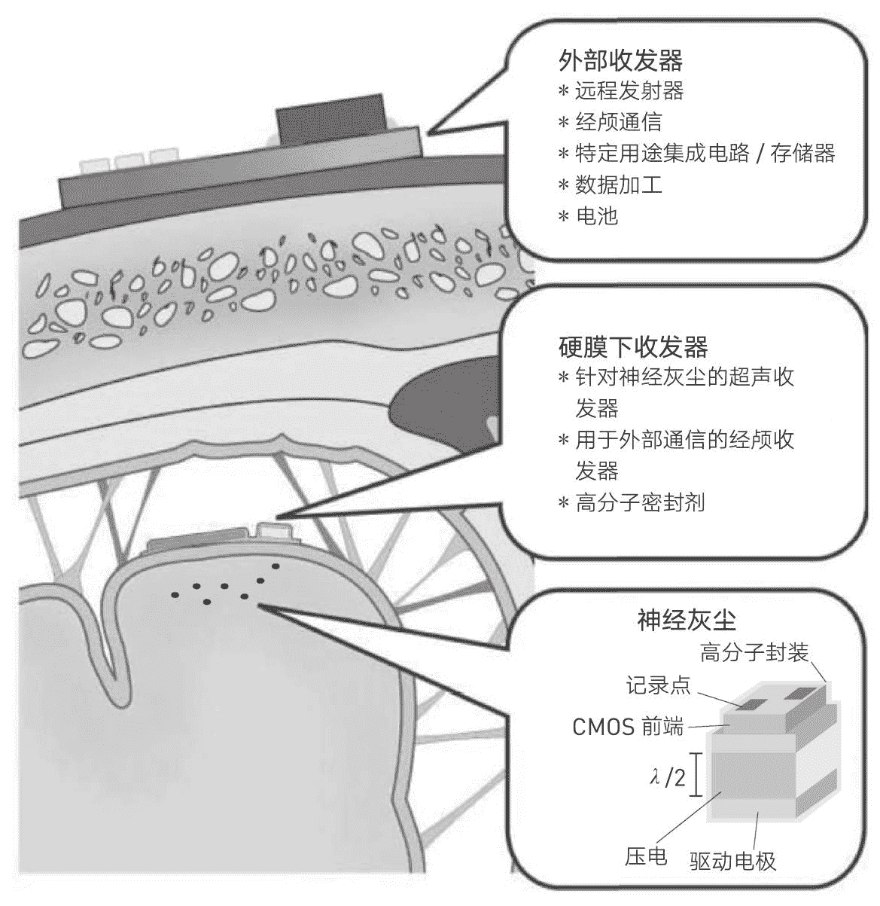 系统示意）。

晶体兼任“能量收割器”：外部超声冲击驱动晶体振动发电，为 CMOS 供电。芯片表面电极捕获神经信号，再利用晶体对超声波进行幅度/频率/相位调制（回波散射），将数据回传给体外询问器。我们称单个单元为“节点”。系统设计需在尺寸、功耗、带宽的三角约束中寻找帕累托最优。

**图 21-1　神经尘埃系统示意**

注：图示展示颅骨下部署的超声询问器，与分散分布于大脑深处的独立感知节点。

### 供能与通讯：为何放弃电磁波？

高质量运动解码，迫切需要贴合微电极的算力平台。植入器件的双重枷锁是：**体积**与**功耗**。

*   **尺寸红线**：植入体积若超 1-2 个细胞直径，数月后引发的皮层胶质增生将毁灭性打击性能（颅骨锚固装置的机械微动作用仍有争议）。
*   **功耗悖论**：缩小尺寸意味着电极间距缩短，信号幅度虽增，但前端放大器噪声必须同步压低——降噪需消耗功率。同时，为规避感染风险，必须杜绝经皮/经颅导线，**全无线中枢是刚需**。

主流经皮无线供能多基于电磁场/波（如人工耳蜗）。虽结构稳健、无移动件、免化学/热梯度，但能量沉积受限于组织加热安全标准（FCC/IEEE 限制温升 <1℃）。

**将电磁能塞进微米/亚毫米级植入体，面临两重物理壁垒：**
1.  **共振频率过高**：光速极快（3e8 m/s），微米级结构共振需 >10GHz，此频段组织衰减剧烈，能量主要转化为热。
2.  **穿透损耗大**：电磁波穿组织衰减严重，正是这些损耗导致了发热。

**超声波成为了破局者**。声速在脑组织中仅 ~1500 m/s，波长大幅缩短，微米级压电晶体即可高效共振；且组织对超声衰减远小于电磁波。**理论测算：同等体积下，超声收割能量是电磁波的 1000 万倍量级。**

数据回传同样面临挑战。功能映射场景下，单节点产生 <1kbps 数据流，需多询问器分频复用；BMI 场景下仅需提取峰电位时序，后端算力压力骤降。

### 节点端电路：极简至“单晶体管”

除了能量/噪声/通讯，节点内部电路设计也是硬骨头。传统完整前端（放大、滤波、ADC）需成百上千晶体管，空间不容、能量不允。

**我们的激进方案：单晶体管架构。**

利用双电极间的胞外动作电位差，直接驱动单个晶体管的栅极，调节漏源电流。电流变化改变压电晶体的机械阻尼/共振特性（即“回响”波形），进而调制回散射给询问器的超声信号。

**不严谨的类比**：你手持鸣响的音叉（压电晶体），远处朋友（询问器）听声音。你根据仅你能听见的神经信号，轻触音叉齿尖（晶体管导通调节阻尼），声音随之细微变化，朋友便解码出了信息。

## 通往未来的关卡

构建 ~50μm、超声供能、无线终身的神经记录节点，理论可行，但需攻克三大工程关隘：

1.  **极限电路设计**：在可用能量与信号随尺寸骤减的约束下，验证 CMOS 电路可用性。
2.  **异质集成封装**：将微型压电换能器与 CMOS 芯片封装于惰性生物相容壳体（如聚对二甲苯、聚酰亚胺、氮化硅/二氧化硅）中，仅暴露记录电极。
3.  **颅下收发器**：设计高灵敏、低功耗的基站，避免颅骨-大脑界面过热。

**还有一道“最后一公里”难题：如何送入皮层？**
最直接路径：搭载于极细电极阵列尖端（类似现有 Utah 阵列），靠表面张力或可吸收胶层固定节点。插入释放后撤离阵列柄身，待组织愈合。声学推送虽是备选，但对组织与器件的冲击风险暂无数据支撑。

所有挑战均未完全破解。但一旦突围，将开辟一条**稳定、持久、大规模**脑记录新径，重塑神经科学与神经假肢的未来边界。

# 后记

## 2064 神经科学回眸：一个世纪的跨越

那是个温暖的夏夜，我们几位作者正激辩意识本质，一位自称来自未来的旅行者“莱姆”闯入视野。初怀疑，细究其叙事细节丰沛、逻辑自洽，寻不出破绽。他自称 2064 年人，神经科学认知远超当下。久而久之，我们信了。以下依记忆整理，还原他讲述的百年变迁。

**1964：混沌启蒙**
美苏争霸，“计算机”指代人肉计算员，公路跑尽“油老虎”，全球变暖与纳米技术未入辞典，披头士刚登美利坚。

**2064：沧海桑田**
极端气候常态化，化石能源枯竭，旧超级大国衰退，中国崛起，AI 渗透生活底层。战后稳态崩塌，世界碎片化却暗涌活力。百病可治，健康寿命延长，但 90 岁仍是大概率寿终，120 岁誓言依然悬浮。

分子生物学兑现基因组承诺（虽迟到数十年）。乳腺癌、脑瘤、抑郁、痴呆、孤独症等“整体病”拆解为分子通路与基因变异定义的精准亚型。配合廉价快速基因检测，胡德、文特尔等先驱预言的**精准医疗时代**到来：家族易感性、行为特质、用药反应、疾病干预，均实现个性化定制。

生物恐怖主义偶发，但个人基因组学+免疫库+全域监控，织就安全网。

**脑科学进步惊心动魄。**
百年前人类仅知“大脑产生思想”，不知机制；《星际迷航》里尚无 BMI 踪影。如今回望，现代神经科学的种子早埋在当时。

### 浪漫主义时代：1964

始于近两百年前，光学显微与化学染色（高尔基铬酸银法）双子星点亮微观视野。卡哈尔绘就神经回路精美图谱，确立大脑由独特神经元、胶质细胞、星形胶质细胞构建。

电镜随后锤实：神经元间存在专化化学/电突触；微电极捕获单神经元电活动。1963 诺奖授予埃克尔斯（突触传递）、霍奇金/赫胥黎（动作电位离子机制：Na+ 内流去极化，K+ 外流复极化）。H-H 方程统治单细胞建模，直待 2020 年代分子动力学模型接棒。

电记录技术从麻醉动物走向清醒自由行为，微电极+微型放大器让“沉默大脑”发声。休伯尔/威塞尔发现视皮层定向选择性（1959/1962），引爆高级视觉探索热潮，60 年代末锁定“面孔细胞”。

临床病例是认知人类脑的主径。布罗卡 1861 年从单例推断左额下回管语言；彭菲尔德 30-40 年代电刺激癫痫患者暴露皮层，诱发视觉/运动/记忆闪回，铁证“物质大脑与主观心智”的紧密耦合。

数理逻辑层面，麦卡洛克/皮茨 1943 年证明：类神经元简单单元组网即可计算任意逻辑。结合丘奇-图灵可计算性，为“大脑如何思考/推理/记忆”提供理论立足点。笛卡尔 300 年前假设“思维实体”，如今罗森布拉特受启发构建感知机（单层网络），虽今视之稚嫩，却点燃技术革命。1955 达特茅斯会议发轫 AI，助推彼时无边乐观。

神经生理学家、计算机科学家、心理学家天真以为“破脑指日可待”。实则鲁棒 AI 耗时百年非数十年，心理/神经科学成熟度远不及物理学。但**地基已奠**——虽未真懂大脑如何运作、如何模拟，变革已燃。

### “大科学”时代：2014

五十年弹指，脑研究从小众跃为全民运动。单美神经科学学会 (SfN) 会员超 4 万，年经费百亿级。科普作家、记者、萌芽期神经产业生态蓬勃生长。

# 破解大脑密码：从分子革命到2064年的曙光与困境

### 分子层面的范式转移

故事的开篇，源于一场微观世界的革命。科学家们攻克了离子通道与受体的结构奥秘，将嵌入双脂质层中的“随机开关”与“调节器”放大至极致。正是这层薄膜，赋予了神经元加工信息、指挥动作电位沿轴突奔涌并释放神经递质的能力。感受器的破译同样关键：它们将撞击身体的光子、声波扰动、气味分子，翻译成大脑能读懂的电信号。连DNA层面的单个核苷酸变异，如何通过改写视网膜光色素蛋白，最终重塑人类的色彩感知，都已被神经科学家一一追踪归档。

埃里克·坎德尔的诺贝尔奖成果，是这场分子革命最耀眼的勋章。他拆解了海兔“缩腮反射”的习得过程——那是长时记忆机制首次被看透。研究证明，记忆深藏于神经元集合间连接模式的特定强弱之中。这印证了弗洛伊德百年前的直觉：记忆分布于个体神经元中，而坎德尔同时代的人则发现，突触效能的增减，取决于突触前后电活动到达的先后顺序。这种“尖峰时间依赖可塑性”（STDP），巧妙地赋予了单个突触学习因果关系的原始能力——B紧随A，从不倒置。2013年，利根川进团队更进一步，通过操纵海马“记忆痕迹”，在小鼠脑中植入了虚假记忆。神经递质、第二信使、蛋白激酶、转录因子……分子清单越列越长，可大脑的整体运算逻辑，依旧如迷雾般笼罩。

### 影像学的狂欢与冷思考

两项技术重塑了战场。80年代，核磁共振物理学让人躺进强磁场、接受射频轰击，便能无创窥探解剖结构。90年代，功能性磁共振（fMRI）登场，以毫米级空间、秒级时间分辨率，绘出活体大脑的功能地图。虽按今日标准粗糙不堪，却催生了认知神经科学——看、听、感、思、忆的神经基座首现端倪。随之而来的是“定位论”大战：神经科学家们如同复活的颅相学家，将心理功能钉死在百余个专用脑区上。

到2014年，理论画风骤变。研究者意识到，那些脑区不过是庞大复杂网络的节点，而网络动态才是核心。体素——成像的基本单元，边长2毫米，内藏百万异质神经元、千亿突触，扫描周期内仅放电十余次。这分辨率，如同隔着墙听体育馆万众嘈杂人声推断赛场战术。脑电图（EEG）、脑磁图（MEG）虽有毫秒精度，空间却模糊不清；经颅磁刺激、电刺激、药物干预，手术刀太钝，切不开因果的细节。

### 光遗传学：从相关到因果的跨越

半世纪后，光遗传学与药物遗传学横空出世。它们以微米精度、毫秒尺度、可逆无损的方式，在蠕虫、果蝇、小鼠等模式生物中，精准操控特定细胞类型、特定时刻的特定事件。科学家借此从“观察相关”跨越至“干预因果”：不再满足于看决策时回路亮灯，而是证明此回路为决策所必需；不再寻找记忆相关神经元，而是直接标记并操控记忆痕迹。20年代初，丘脑-皮层回路的逻辑首次被完整操纵，成为弥合皮层理论与整体功能鸿沟的关键转折点。

### 群体记录与理论的野心

硅微电极、荧光成像、基因编码电压指示器，让无畏者得以追踪活体动物脑内数百乃至数万神经元的合奏。较之从前单根电极的盲人摸象，数据量指数级爆炸。理论家们由此解码神经群体语言：视觉、听觉、嗅觉的表征；空间定位、决策不确定性、甚至熟悉个体出现的概率，全在放电模式中浮现。

### 复杂性墙与医学的尴尬

数据暴增、全球智力倾注，理解健康与患病回路的进度却呈“亚线性”爬升。仅302神经元的秀丽隐杆线虫，至今无人能将其全脑机制整合为一致框架。数百蠕虫专家各守孤岛，简化主义解释割裂了全貌。无一脑病被治愈。老龄化浪潮下痴呆肆虐，医生束手无策——这占全球GDP 10%的痛楚，令人心碎。2013年《精神疾病诊断与统计手册》（DSM-5）问世，被奉为精神科“圣经”，却连一条生物标志物、一条fMRI诊断标准都没有。21世纪初，抑郁、幻听、焦虑者，唯一出路是谈话、量表、服药——药物机制不明，副作用满载，甚至加速脑衰退。

### 为何科学在此处失速？

历史表明，科学擅长低自由度、孤立系统：斜面滚球、行星轨道、磁场电子、DNA双螺旋。可生命系统异质部件众多，且跨尺度相互作用——纳米到米、微秒到年。搞清大脑，意味着要在实验或算力层面穷尽大部分相互作用。生物信息学家面对跨时空尺度的计算整合一筹莫展，硬件不足，云计算尚在襁褓。大自然不走捷径，彻底读懂大脑，唯有成千上万实验的跨层级整合。

人造系统（航天飞机、芯片）虽含亿万部件，设计初衷却是极小化耦合：电源、计算、存储物理隔离，布线避免干扰。大脑偏不——能量供给、计算、存储三位一体，交织共生。自然将复杂度拉满。21世纪初科学家觉醒于此，却无力招架。

### 大科学时代：从“独行侠”到“工业化联盟”

变局不在组织架构，而在技术范式。艾伦脑科学研究所借鉴生物技工业，首创神经科学“大科学”模式：百位跨学科科学家组团，推进工业级项目。2014年首批项目产出：皮层细胞类型全本体（形态、投射、转录组、电生理、连接规则）；“大脑观测站”记录、公开、模拟小鼠视觉丘脑皮层细胞动态。随中印科研崛起，20年代涌现更多巨型计划。

欧洲“人类大脑计划”（HBP）以公共经费构建超算集群，誓言从分子动力学模拟小鼠至人类大脑。早期啮齿类皮层柱电模型成功，引发“上传意识、根治脑病”的准宗教狂热。但模拟算力不足、精度失守，愿景反噬，20年代公众支持撤退。认知虽增，失望犹存。

丘吉尔名言改写：神经科学正处于“理解大脑与心智开端的终点”。跨层级桥梁（分子-细胞-回路-行为）未建，但使命清晰，关键工具已就位。

---

### 2064：拨开迷雾见真章

如今，通过识别皮层模块与亚模块的层级架构，我们基本驾驭了新皮层的广袤多样性。小学生背得出皮层六层；果蝇神经系统可高保真模拟，人脑模拟亦具备一定保真度，虽不及初期预期实用。

**视网膜先破局。** 因结构相对单纯、以馈连接为主（无显著大脑回馈），视网膜成了突破口。20世纪末细胞组分清单齐全；2020年，解剖、生物、建模、机器学习联盟完成输入-输出近乎完备描述。24型神经节细胞对任意视觉刺激的放电响应，可靠预测。结合先进光遗传学与植入式视网膜芯片，黄斑变性、糖尿病视网膜病变、色素性视网膜炎等致盲症得到有效医治。

**剥洋葱般推进。** 视觉丘脑、早期视皮层编码相继被破译。20年代中期，小鼠穿迷宫的全细胞工作模型、约1000种神经元本体论落地。触觉、听觉、嗅觉工作模型紧随其后。

**希望破碎于“整合”与“跨物种”。** 个体细节堆砌成山，却拼不出逻辑整体。经费枯竭，因发现无法转化为人脑知识与临床应用。非谓人鼠本质不同——体积差千倍（木瓜vs方糖）、神经元数差三个数量级（860亿vs7100万）、新皮层差百倍（160亿vs1400万）；伦理红线更严：活人细胞级探查仅限神经外科罕见机会；fMRI/EEG/MEG只能隔山观虎，不见基因蛋白细胞型。虽米粒大小灰质相似，但7500万年分化演化，基因调控、蛋白、突触、回路处处微异。制药业早悟，21世纪初叫停鼠实验；20年代末动保运动禁绝灵长类有创研究。神经科学陷入“迷失的十年”：资金断流，悲观弥漫，能否分担脑病重担（占GDP 10%）成疑。

**黎明前的黑暗，由蠕虫与纳米机器终结.**

秀丽隐杆线虫——人类远亲，与人造/生物分子机器的结合，成了破局奇兵。1986年连接组出炉，至准确、全面、可预测、可检验模型诞生，耗时35载。巴格曼、马德等先驱早察觉神经调节物质在无脊椎动物中切换回路的作用，因蠕虫无动作电位，其普适性曾被忽视。今知动态回路原则，放之四海而皆准。

**纳米机器人：攻克活人大脑的终极钥匙。** 数万微型分子机器经静脉注射，安全抵达脑内成像与操控。一代采样局域电位、神经递质浓度，外部查询；进阶版读取单神经元转录组、监控电活动、阻断或诱发尖峰；最新突破控制单个突触囊泡释放。通过补递质、清错白、触电活动，纳米机器人可干预躯体任意部位。暂时作用者有之，携带修饰病毒永久驻留神经胶质细胞、修复阿尔茨海默、帕金森退行性损伤者亦有之。2050年代中期，医学与神经科学主战场全面转移至纳米机器人平台，光遗传学退居二线。得益于极致空间特异性，精心设计的探针能精准靶向大脑任意区域的单个细胞。

**临床收获与增强黑市。** 许多高发精神疾病可延缓甚至治愈。但降低脑肿瘤、创伤、癫痫、精神分裂、帕金森、阿尔茨海默等发病死亡率，耗时远超预期。恰如1971年尼克松“反癌战争”，近半世纪癌亡率才显著下降，而呼吸、感染、心血管亡率早降。脑病异质性更高，组分更杂，攻坚难度远超癌症。

纳米疗法昂贵、有副作用、限适应症。虽传统派与宗教派反对，但“超人类主义”者趋之若鹜：运动敏捷度、学习记忆力显著提升，催生脑力增强黑市。有钱敢冒险者，进化为“认知精英”，在市场与战场碾压常人。

### 模拟大脑：永远在路上的终极拷问

学术界围绕全脑模拟的层级、伦理、科学意义争论不休。这个提了50多年的问题，核心是自下而上还是自上而下。

**自下而上派** 持“生物学沙文主义”：离子通道、突触、动作电位一个不漏，方能应对复杂性。生物物理学家精准模拟了蠕虫、果蝇，哺乳类却偏离。从啮齿类到灵长类、人类，实测与模拟行为鸿沟扩大。模拟语言满是乱码，任务停留幼儿园水平。我们缺什么？必须模拟每个离子通道、每个递质分子？须量子力学待之？毕竟大脑也是物质，服从量子铁律。但主流假定：这热湿嘈杂器官，粗粒度近似足矣。

**速度是硬伤。** 即便作为典型模拟系统，生物物理模拟跑得极慢——仅真人脑1%实时。摩尔定律失效，量子计算现实应用有限，下一代算力曙光何在？

**自上而下派** 受纯算法启发，从行为/计算层切入。虽捕获认知神韵，却失生物保真。两派不合，10年前似在望的“脑修复术”仍渺茫。根源仍是复杂性：数学家梦想“大脑主算法”，现实却是——回路有多少，算法就多少，捷径不存在。

### 高级认知的盲区与伦理的悬崖

认知层面，语言、规划、社会认知、高阶推理等人类特有复杂过程，仍无解释。纳米机器人或能终弥合知识鸿沟，但现下人类特有功能认知滞后。句子如何编码全不知；词义编码略知一二；复杂概念（如“阅读虚构描写的人”）完全摸不着头脑。联想神经基础虽明，高阶认知仍是谜。

**伦理风暴随全脑模拟逼近而至。** 有人主张：模拟啮齿类等同真动物，完整人脑模拟享人权。学者捕捉到初级模拟体的情感痛觉。主流持“模拟非实在”论：CFD模拟气流永不飞行。政客回避，问题却迫在眉睫：用全脑模拟替代人力智力劳动，合法合伦？收益全归模拟所有者，还是脑数据捐赠者分成？除算力费，扫描建模成本谁买单？

这场跨越半个世纪的破译之旅，终将在2064年站在新的分水岭上：工具已神、疾病可医、增强诱人、模拟受困、伦理未判。大脑，这宇宙最复杂物质，依旧守着它最核心的秘密，等待下一代探索者敲门。

# 破解意识之谜：从科学前沿到翻译幕后的深度对话

意识研究的终极拷问，依然是物质大脑何以孕育出主观体验。时至今日，神经放电与主观感受、物理大脑与抽象意识之间，依然横亘着一道难以逾越的解释鸿沟。前者属于物理学范式，受制于时空、能量与质量；后者则归属于仍待破译的体验范畴。从分子生物学巨擘弗朗西斯·克里克扭转研究航向，到认知神经科学持续追踪意识与神经元的关联谱系，我们虽已摸清信息入驻意识的动力学机制，却始终无法彻底厘清“为何体验会呈现这种特定感受”这一核心困境。

学界寄望这道意识“难题”能如“生命是什么”般，最终在细分课题的攻克中消解于无形——彼时，繁殖与代谢的微观细节取代了宏大的哲学追问。随着算力跃升、AI行为逼近甚至超越人类，越来越多的学者倾向于认为：意识源自特定的信息组织形式，依托于高度有序的实体，无论是生物大脑还是硅基智能。这正是半个多世纪前朱利奥·托诺尼提出的核心洞见。若笛卡尔“我思故在”在四百年后被改写为“我有意识，故我在”，那么身心难题的最终解答，或许正藏匿于未来百年的探索征途中。

—— 克里斯托弗·科赫、盖瑞·马库斯

---

## 译者心语：跨越专业壁垒的啃书之旅

合上书稿的那一刻，长舒一口气。虽曾涉猎多部神经科学专著，但本书的专业深度与知识广度，依然让我战战兢兢。这绝非一两位作者的独角戏，而是二十余位全球顶尖神经科学家的集体智慧结晶，其中不乏2014年诺贝尔奖得主梅-布里特·莫泽与爱德华·莫泽夫妇。他们因发现小鼠内嗅皮层“网格细胞”闻名科学界，该细胞宛如大脑内置的GPS，助力生物定位自我方位，且为解码记忆形成、场景重构提供了关键线索。两位编著者亦是重量级人物：盖瑞·马库斯，纽约大学心理学与神经科学荣誉教授，佳作《乱乱脑》已由湛庐引进；杰里米·弗里曼，霍华德·休斯医学研究所珍利亚研究园区神经科学家。

全书视角多元，每位专家切入点各异，牵涉海量专业细节。为求译文精准地道，我几乎“翻烂”了检索工具，且查证仅是第一步，更需泛读文献、内化理解，方能避免生硬直译。若你是神经科学发烧友，此书定合胃口；若你是行业从业者，或可从中汲取灵感、定位方向。

坦白说，我已倾尽全力，但受限于专业边界，疏漏在所难免，恳请诸位明眼人不吝指正。衷心感谢冯征、张璐、赵丹、徐晓娜、卫学智、张宝君、郑悠然、王彩霞诸位的鼎力相助！

---

## 核心术语速览：构建认知基石

**动作电位**  
毫秒级的电生理剧变。离子通道开合驱动膜电位飙升去极化，随即回落超极化。当突触前神经元释放充足递质，触发轴突末端递质倾倒，致使突触后靶细胞去极化，神经元间的信息传递由此建立。

**紫红质通道蛋白**  
天然的光控离子闸门。单细胞绿藻自带此蛋白，亦可经基因导入神经元表达。光照致通道开放、离子内流去极化，从而实现光对神经元的人工激活。

**Cre 重组酶驱动品系**  
定制化转基因小鼠模型。借助 Cre-LoxP 系统，科学家可在特定时空、特定细胞亚群（如兴奋性/抑制性皮层神经元）中精准调控基因。配合报告基因，靶向细胞可荧光标记，或受光、药物双向调控。

**细胞结构学**  
显微镜下的大脑细胞建筑学：解剖细胞成分与空间排布。

**扩散磁振造影 (DTI)**  
追踪水分子在组织中扩散轨迹的 MRI 技术，专门用于描绘大脑白质纤维束走向与连接拓扑。

**纤维束示踪成像**  
基于轴突沿向水分子运动的三维建模术，可视化神经连接通路。

**DNA 条形码**  
人工设计的 DNA 序列标签，用于唯一标识分子、细胞等生物实体。

**脑电图 (EEG)**  
经头皮多导交叉校准电极，记录大脑宏观电活动的无创技术。

**电泳**  
利用带电粒子在电场中迁移率差异，分离鉴定 RNA、DNA 或蛋白片段的经典手段。

**外显子组**  
基因组中真正转录成 RNA 的编码区，仅占人类基因组约 1%。

**荧光原位测序**  
在完整组织切片上，借自动显微镜直接读取 DNA 序列字母顺序的技术。

**功能性磁共振成像 (fMRI)**  
通过血氧水平依赖信号 (BOLD) 间接测量神经活动，是 MRI 在脑功能测绘上的核心应用。

**基因表达**  
DNA 经 RNA 模板合成蛋白的生命中心法则流程，普适于已知生命体。

**嗜盐菌视紫红质**  
同属光控离子通道家族，但专一传输氯离子。光照致通道开放、氯离子内流超极化，抑制神经放电。与紫红质通道蛋白协同，构成光遗传学“开/关”双向工具箱。

**组织学**  
借助多染色手段与专家诊断，探究细胞组织微观解剖结构的学科。

**免疫显微技术**  
利用抗体特异性识别靶蛋白，配合原位测序/显微成像，实现分子在组织中的精准定位与显像。

**原位杂交技术 (ISH)**  
保留空间语境下，用设计探针捕获特定 RNA，实现单基因层面的原位表达检测。

**光片照明显微技术**  
活体成像利器。单层光片照射薄层组织，产生高对比度图像，极大抑制了非焦平面散射干扰。

**脑磁图 (MEG)**  
捕捉大脑活动产生的微弱磁场变化，具有极高时间分辨率，适用于认知过程追踪与临床功能定位。

**磁共振成像 (MRI)**  
强磁场下利用原子核共振成像，输出高分辨率解剖结构图像。

**微阵列**  
高密度探针芯片，承载数千序列片段，配合成像系统实现高通量遗传筛查。

**光遗传学**  
以光为刀，精准操控神经元活动的革命性技术（详见紫红质通道蛋白、嗜盐菌视紫红质）。

**正电子发射断层扫描 (PET)**  
注射放射性示踪剂，探测伽马射线重建大脑功能活动三维代谢图谱。

**序列空间**  
所有可能 DNA 条形码组合构成的超高维抽象空间。

**单基因病**  
由单一基因位点突变直接导致的遗传性疾病。

**双光子显微镜技术**  
深层组织荧光成像金标准，可在活体组织 ~1mm 深度实现亚细胞分辨率观测。

---

### 备注与拓展资源库

**(1)** 世界级语言学家、认知心理学家，代表作《心智探奇》（湛庐/浙江人民出版社，2016）。  
**(2)** 诺贝尔奖得主，DNA 双螺旋结构发现者，回忆录《双螺旋》（湛庐/浙江人民出版社，2017）。  
**(3)** 图灵机模型简述：无限纸带、读写头、状态表与转移规则构成的抽象计算装置。  
**(4)** 《科尔伯特报告》：2003 年开播的高收视美式讽刺脱口秀。  
**(5)** 正文上标数字对应参考文献，为环保设电子版，扫书末二维码获取完整资料包。  
**(6)** 欲深究意识理论与范式，建议阅读《脑与意识》（湛庐策划/浙江教育出版社）。  
**(7)** CMOS：互补金属氧化物半导体工艺英文全称。

---

## 02 全脑成像与虚拟现实：拓展阅读精选

Ahrens 等 (2012) *Nature*：斑马鱼运动适应全程脑宽神经动力学。  
Ahrens 等 (2013) *Nat Methods*：光片显微实现单细胞分辨率全脑功能成像。  
Chiel & Beer (1997) *TINS*：大脑非孤立存在，适应行为源于神经-身体-环境三元耦合。  
Harvey 等 (2009) *Nature*：虚拟导航中海马位置细胞胞内动力学。  
Seelig 等 (2010) *Nat Methods*：双光子成像定头果蝇视觉运动行为中的钙信号。

## 05 “罗塞塔大脑”计划：拓展阅读精选

Kording (2011) *PLoS Comp Biol*：从烤面包机到分子打孔纸带的类比思考。  
Lee 等 (2014) *Science*：高度多重亚细胞三维原位转录组测序。  
Marblestone 等 (2013) *Front Comput Neurosci*：可扩展神经记录的物理原理。  
Marblestone 等 (2014) *arXiv*：罗塞塔大脑——分子注释连接组学策略。  
Zador 等 (2012) *PLoS Biol*：连接组测序新范式。

## 07 大规模神经群体同步记录：拓展阅读精选

Churchland 等 (2007) *Curr Opin Neurobiol*：单次试验神经群体模式提取技术。  
Diester 等 (2011) *Nat Neurosci*：灵长类光遗传工具箱开发。  
Gilja 等 (2012) *Nat Neurosci*：控制算法优化驱动的高性能神经假肢。  
Shenoy 等 (2013) *Annu Rev Neurosci*：臂运动皮层控制的动力系统视角。  
Yu 等 (2009) *J Neurophysiol*：高斯过程因子分析用于神经群体低维动力学单次试验解析。

## 08 网络神经科学：拓展阅读精选

Sporns (2011) *Networks of the Brain* (MIT Press)。  
Strogatz (2004) *Sync* (Hyperion)：宇宙、自然与生活中秩序从混沌涌现的同步科学。  
Swanson (2011) *Brain Architecture* (Oxford Univ Press)：理解大脑基本蓝图。

## 10 全脑模拟：拓展阅读精选

Hill 等 (2012) *PNAS*：统计连接规则支撑新皮层微环路特异性功能连接。  
Human Brain Project 官方档案。  
Markram (2012) *Sci Am*：人脑计划愿景。  
Reimann 等 (2013) *Neuron*：生物物理详细模型揭示活性膜电流主导新皮层局部场电位。

## 11 构建行为大脑：参考文献

Eliasmith & Anderson (2003) *Neural Engineering* (MIT Press)：计算、表征与动力学的神经工程框架。

## 12 语言神经生物学：拓展阅读精选

Bemis & Pylkkänen (2011) *J Neurosci*：MEG 解析最小语言短语的组合机制。  
Gallistel & King (2010) *Memory and the Computational Brain* (Wiley)。  
Giraud & Poeppel (2012) *Nat Neurosci*：皮层振荡与语音处理的计算原理。  
Marcus (2001) *The Algebraic Mind* (MIT Press)：整合连接主义与认知科学。  
Poeppel (2012) *Cogn Neuropsychol*：语言神经科学的“地图问题”与“映射问题”。

## 13 基因变异与神经遗传：拓展阅读精选

Deriziotis & Fisher (2013) *Genome Biol*：言语语言障碍神经基因组学的未来路径。

# 语言基因密码：从 FOXP2 到神经网络的奠基文献

探索语言起源的分子机制，离不开以下几篇里程碑式的工作。Fisher（2013）在《鸟鸣、言语与语言》一文中，系统梳理了基因、大脑回路与语言能力之间的桥梁关系；Graham 与 Fisher（2013）则于《神经生物学当前观点》深度解析了言语语言障碍的遗传学图谱；更早之前，Vernes 等人（2011）在《PLoS Genetics》揭示了核心转录因子 FOXP2 如何在发育期大脑中指挥一套关乎神经突生长的基因网络，为“语言基因”赋予了具体的细胞生物学意义。

---

## 14　意识研究：大科学背景下的概念突围

### 拓展视野：必读的前沿综述

*   **Block (2011)** 在《认知科学趋势》提出“感知意识溢出认知可达”论点，直击现象意识与获取意识的分野。
*   **Kandel 等 (2013)** 于《自然神经科学》联合发声，呼吁神经科学界“大胆假设、紧密协作”，为大规模脑计划确立了方法论基调。

### 核心参考文献速览

1.  **Aru 等 (2012)** 《神经科学与生物行为评论》：致力于提炼意识神经相关物（NCC）的核心标准，剔除冗余相关。
2.  **Dehaene & Changeux (2011)** 《神经元》：构建了意识处理的实验范式与全局神经工作空间理论框架。
3.  **Cohen & Dennett (2011)** 《认知科学趋势》：从功能主义立场论证意识不可与功能角色割裂。
4.  **Lau & Rosenthal (2011)** 《认知科学趋势》：为高阶思想理论（HOT）提供了关键实证支持。
5.  **Tsuchiya & Koch (2014)** 收录于 Gazzaniga & Mangun 编著（MIT Press 即将出版）：深度剖析注意与意识的解耦与耦合边界。
6.  **Burge (2010)** 《客观性的起源》（牛津大学出版社）：从哲学本体论追溯客观表征的演化根基。
7.  **Latour (1998)** 《La Recherche》：借拉美西斯二世之死，以科技社会学视角解构科学事实的建构过程。
8.  **Pitts 等 (2011)** 《认知神经科学杂志》：利用无注意盲视范式，证实轮廓整合可在无意识状态下完成。
9.  **Frässle 等 (2014)** 《神经科学杂志》：双眼竞争实验揭示额叶活动追踪主观报告与行为，而非感知内容本身。
10. **Dehaene (2014)** 《意识与大脑》（Viking 社）：面向大众的科普力作，详述大脑如何将思想编码为意识符号。
11. **Kant (1787/1997)** 《纯粹理性批判》（剑桥大学出版社）：经典哲学文本，为现代意识研究提供先验框架参考。

---

## 15　跨越鸿沟：从神经回路到行为的解释鸿沟

### 延伸阅读：多层次解释的理论锚点

*   **Anderson (1972)** 《科学》名篇“More is Different”，确立了凝聚态物理视角下的涌现论纲领。
*   **Bargmann (2012)** 《生物随笔》：超越静态连接组，阐述神经调制如何动态重塑回路功能。
*   **Bower (1998)** 《GENESIS 书》第 11 章：提供基于真实生物物理参数的大规模神经建模实战范例。
*   **Carandini & Heeger (2011)** 《自然神经科学评论》：确立“归一化”作为跨脑区、跨物种的典范计算法则。
*   **Harris 等 (2010)** 《听觉研究》：从听觉皮层群体活动窥探神经元协作编码的通用逻辑。
*   **Koch (1999)** 《计算的生物物理学》（牛津大学出版社）：单细胞与微回路层面计算建模的经典教科书。
*   **Laughlin & Pines (2000)** 《PNAS》双文（“万物理论” 与 “中道”）：主张在还原论与整体论之间寻找中观理论的最佳着力点。
*   **Lazebnik (2002)** 《癌细胞》：“生物学家能修好收音机吗？”——犀利讽刺缺乏形式化模型的分子生物学研究范式。
*   **Marr (1982)** 《视觉》（W.H. Freeman）：认知科学“三层次分析框架”（计算/表征/实现）的奠基之作。
*   **Prinz 等 (2004)** 《自然神经科学》：甲壳类胃神经节实验铁证——截然不同的参数集可产生高度相似的网络输出，揭示简并性原理。

---

## 18　计算脑：算法与实现的双重奏鸣

### 核心书单与前沿视角

*   **Marcus (2001)** 《代数心智》（MIT Press）：主张符号操作与联结主义网络的深度融合，挑战纯粹并行分布式处理观。
*   **Marr (1982)** 《视觉》（MIT Press 版）：重述其计算理论框架，强调“计算层面”问题的优先性。
*   **Poeppel (2012)** 《认知神经心理学》：精准区分“图谱问题”（大脑在哪处理）与“映射问题”（计算如何映射到神经机制），为语言神经科学立下导航坐标。

---

## 19　神经技术落地：从实验室走向临床与工程

### 必读文献：理论、工程与伦理的三重奏

*   **Watts & Strogatz (1998)** 《自然》：小世界网络模型揭示大脑结构连接的高效拓扑特性。
*   **The Economist (2013)** “Neuromorphic computing: New soul for the machine”：产业界视角审视类脑芯片的商业化前景。
*   **Donoghue (2008)** 《神经元》：BrainGate 之父回顾脑机接口（BCI）从概念到植入式系统的工程化历程。
*   **Hochberg 等 (2012)** 《自然》：里程碑式临床试验——四肢瘫患者通过皮层植入体控制机械臂完成伸抓动作。
*   **Illes & Sahakian 编 (2011)** 《牛津神经伦理学手册》：系统梳理神经技术引发的隐私、能动性、身份认同等伦理困境。
*   **Wolpaw & Wolpaw 编 (2011)** 《脑机接口：原理与实践》（牛津大学出版社）：BCI 领域的百科全书式教程，覆盖信号采集、解码算法到临床应用。
*   **Grienberger & Konnerth (2012)** 《神经元》：双光子钙成像技术综述，推动了群体细胞分辨率下的在体记录革命。
*   **Smedemark-Margulies & Trapani (2013)** 《分子神经科学前沿》：光遗传学与化学遗传学工具箱的最新进展与应用指南。

---

## 20　解码精神疾病：基因、回路与症状的三角定位

### 深度阅读：从遗传风险到回路机制

*   **Arguello & Gogos (2012)** 《神经科学趋势》：利用遗传模型动物，打通从风险基因到认知缺陷再到回路异常的因果链条。
*   **Greenberg (2013)** 《苦难之书》（Blue Rider Press）：犀利解构 DSM 诊断体系的科学性困境与社会建构属性。
*   **Keller & Miller (2006)** 《行为与脑科学》：进化遗传学视角破解“常见、有害、高遗传力”精神障碍的达尔文悖论。
*   **Krueger & Bear (2011)** 《医学年度评论》：脆性 X 综合征研究范式——从分子机制发现到靶向药物开发的转化医学典范。
*   **Mitchell (2011)** 《神经生物学当前观点》：系统综述神经发育障碍（自闭症、精神分裂症等）的共享与特异遗传架构。

---

## 21　神经尘埃：无线、微型、持久的下一代脑机接口

### 前沿技术追踪：超声供能与通信的突围

*   **Biederman 等 (2013)** 《IEEE 固态电路期刊》：报告全集成、面积仅 0.125 mm²、功耗 10.5 μW 的无线神经传感器芯片，工程指标刷新纪录。
*   **Carmena (2012)** 《IEEE Spectrum》：脑控假肢领域领军人物的第一人称技术回顾与展望。
*   **Green & Kalaska (2011)** 《神经科学趋势》：聚焦“脑控学习”本身——皮层如何通过可塑性适应解码器，实现意念的熟练驾驭。
*   **Seo 等 (2013)** 《arXiv:1307.2196》：提出 “Neural Dust” 概念设计——利用超声波实现深层脑区的无线供能与双向通信，为慢性植入铺平无线化道路。