# 国产AI三剑客：DeepSeek_昇腾_鸿蒙智能开发实战

## 内容简介

本书创新性地将三大前沿IT技术融合，系统介绍了DeepSeek大模型、昇腾算力框架与鸿蒙操作系统的协同开发。本书通过实战项目，生动展示了国产技术从模型、算力到系统所发挥的关键作用，为构建智能时代的坚实技术底座提供了具体方案。

本书面向广大AI技术人员、大学生群体及所有对国产技术感兴趣的读者。

## 前言

### 一、背景与目标

在当今科技飞速发展的时代，人工智能（AI）、操作系统和计算平台的融合，正以前所未有的速度重塑我们的生活方式和工作模式。这种技术融合不仅推动了各行各业的数字化转型，也为人类社会带来了前所未有的机遇与挑战。随着5G、物联网（IoT）、云计算等新兴技术的普及，智能化和互联化已成为未来发展的核心方向。在这样的背景下，DeepSeek、鸿蒙和昇腾，这三大核心技术，分别在AI模型、操作系统和计算平台领域代表着前沿创新。它们的结合，为开发者提供了强大的技术工具，也为各行业的数字化转型开启了新的大门。

DeepSeek作为一种先进的AI模型框架，以其高效的训练能力和强大的推理性能，成为智能化应用的核心驱动力。通过深度学习和机器学习技术，DeepSeek能够处理海量数据，提供精准的预测和决策支持。无论是图像识别、自然语言处理，还是复杂的业务流程优化，DeepSeek都能为开发者提供灵活且高效的解决方案。

鸿蒙操作系统（HarmonyOS）作为华为推出的新一代智能终端操作系统，凭借其分布式架构和微内核设计，成为万物互联时代的核心技术。鸿蒙不仅支持多种设备类型的无缝连接，还通过统一的开发框架和丰富的技术生态，极大地降低了开发者的技术门槛。无论是在智能家居、智能汽车，还是工业自动化领域，鸿蒙都为开发者提供了强大的技术支撑。

昇腾（Ascend）作为华为推出的高性能AI计算平台，以其强大的算力和高效的架构，为AI应用提供了坚实的硬件基础。昇腾系列芯片和计算模块，支持从边缘计算到云端计算的全面覆盖，能够满足不同场景下的计算需求。通过与DeepSeek和鸿蒙的结合，昇腾为智能化应用提供了端到端的技术支持，进一步提升了应用的性能和效率。

本书旨在系统化地讲解如何将DeepSeek、鸿蒙和昇腾结合使用，通过丰富的实操案例，帮助读者构建智能化、互联化的应用。无论是希望开发智能应用的开发者，还是对技术前沿充满好奇的技术爱好者，亦或是希望提升行业竞争力的从业者，都能从本书中获取实用的知识与启发。通过深入学习本书的内容，读者不仅能够掌握三大核心技术的使用方法和最佳实践，还能了解它们在不同行业中的落地应用案例，从而探索未来的创新机遇。

在内容设计上，本书兼顾理论与实践，力求为读者提供全面的技术指导。本书首先从技术背景和发展趋势入手，帮助读者理解DeepSeek、鸿蒙和昇腾的核心价值；然后通过详细的实操案例，深入讲解如何将三大技术结合使用，构建智能化应用；最后结合实际行业场景，分析技术落地的成功经验与挑战。通过这样的结构设计，我们希望为读者提供一条从入门到精通的学习路径，帮助其在技术创新的浪潮中掌握主动权。

### 二、结合意义

DeepSeek、鸿蒙和昇腾的结合，绝非简单的技术叠加，而是一次技术生态的深度融合。这种融合不仅体现在技术层面的协同效应，更在于它们为未来智能化社会奠定了坚实的技术基础。以下从多个维度详细阐述三者结合的意义。

#### 1. 高效协同：技术驱动的性能提升

DeepSeek、鸿蒙与昇腾的结合，首先体现在三者协同工作所带来的性能提升。DeepSeek凭借其强大的AI能力，为应用提供智能决策支持；鸿蒙作为智能化操作系统，使设备间的互联互通更加顺畅；昇腾则以高性能硬件为计算任务提供坚实保障。这种协同效应具体体现在以下几个方面：

- AI模型的高效运行：DeepSeek的AI模型在昇腾计算平台上能够实现高效推理，充分发挥硬件加速能力，显著提升计算性能。无论是图像识别、语音处理，还是复杂的数据分析，昇腾的计算能力都能为DeepSeek提供强有力的支持。
- 设备的无缝连接：鸿蒙操作系统通过其分布式架构，能够在多设备间实现高效的通信和资源共享。无论是智能手机、智能家居设备，还是工业终端，鸿蒙都能确保设备之间的无缝连接，为DeepSeek的AI应用提供更广泛的数据来源和交互场景。
- 计算资源的优化分配：昇腾不仅支持云端计算，还具备强大的边缘计算能力。通过与鸿蒙的协同，昇腾能够根据实际需求动态分配计算资源，确保AI应用在不同场景下的高效运行。

#### 2. 场景拓展：解锁更广泛的应用领域

DeepSeek、鸿蒙与昇腾的结合，为开发者解锁了更为广阔的应用场景，推动了技术在不同行业的落地与普及。以下列举几个典型场景：

- 智能家居：在智能家居领域，鸿蒙的分布式架构能够实现家庭设备间的无缝连接，而DeepSeek的AI能力则为用户提供个性化的智能服务。例如，通过分析用户的日常行为，DeepSeek能够自动调节灯光、温度和家电开关，提升用户的生活体验。
- 工业自动化：在工业自动化领域，昇腾的边缘计算能力支持实时数据处理，而DeepSeek的AI模型为设备状态监测、故障预测等场景提供智能决策支持。鸿蒙操作系统能够实现工厂内多种设备的互联互通，从而提升生产效率。
- 医疗健康：在医疗健康领域，DeepSeek的AI模型可用于医学影像分析、疾病预测等场景，而鸿蒙的分布式架构则能够实现医疗设备间的数据共享。昇腾的高性能硬件为这些应用提供了可靠的计算支持，确保实时性和准确性。
- 教育培训：在教育培训领域，DeepSeek的AI能力可用于个性化学习推荐、智能评估等场景。鸿蒙的跨设备协同能力使学习者能够在不同设备间无缝切换，提升学习体验。昇腾的计算能力则支持大规模数据处理，满足教育场景中的多样化需求。

#### 3. 未来生态：构建智能化社会的基础

DeepSeek、鸿蒙与昇腾的结合，为物联网（IoT）和智能化社会奠定了坚实的技术基础。这一融合不仅推动了技术生态的发展，也为未来社会的智能化转型指引了方向。

- 技术生态的融合：DeepSeek、鸿蒙与昇腾的结合，形成了一个完整的技术生态，涵盖了从AI模型、操作系统到计算硬件的全链条。这一生态的融合，不仅降低了开发者的技术门槛，还为技术创新提供了更多可能性。
- 智能化社会的雏形：通过三者的融合，未来的智能化社会将更加触手可及。无论是智能城市、智慧交通，还是智能农业，这一技术结合都将为各行各业带来深刻的变革，提升社会运行效率与智能化水平。
- 引领行业创新：DeepSeek、鸿蒙与昇腾的结合，不仅是技术层面的创新，更是行业模式与应用场景的突破。借助这一结合，开发者将能探索更多创新可能，推动行业向更智能、更高效的方向迈进。

#### 4. 挑战与机遇

尽管DeepSeek、鸿蒙和昇腾的结合具有巨大的潜力，但在实际应用中仍面临一些挑战。例如，如何在复杂场景下优化三者间的协同性能，如何降低技术生态的门槛以吸引更多开发者，如何确保数据安全和隐私保护等。这些挑战既是技术发展的障碍，也是未来创新的机遇。

通过不断的技术迭代和生态优化，DeepSeek、鸿蒙和昇腾的结合将为智能化社会开辟一条新的技术路径。无论是开发者、企业，还是普通用户，都能从中受益，共同迎接智能化时代的到来。

### 三、适用读者群体与学习路径

- 本书适合以下几类读者：
    - 开发者：有志于利用DeepSeek、鸿蒙和昇腾构建智能化应用的开发者。
    - 技术爱好者：对AI、操作系统和计算平台充满热情，渴望探索技术前沿的爱好者。
    - 行业从业者：希望洞察技术趋势，提升自身行业竞争力的从业者。
- 学习路径建议：
    - 初学者：建议从本书的前言和第1章开始，先了解技术背景，再逐步深入到实操章节。
    - 经验开发者：可以直接从第2、第3章内容入手，重点学习开发环境的配置和实现技术交互的方法。
    - 行业从业者：重点关注第1章和第7章的内容，深入理解技术趋势与行业机会。

### 四、感谢

在本书的编写过程中，得到了熊文韬、郑茹娜、朱昊翔、谢晓培、黄紫妍、刘庆锋、王稚砚、陈亮、刘张豪、韩宗傲、田志豪等人的帮助，在此一并表示感谢。

## 第1章 技术背景与行业分析

在当今科技飞速发展的时代，人工智能、操作系统与计算平台的深度融合，正以前所未有的速度重塑人类的生活方式与工作模式。作为这场技术革命的核心代表，DeepSeek、鸿蒙与昇腾分别在人工智能模型、操作系统与计算平台领域实现突破，为智能化社会的构建奠定了坚实基础。本章将系统阐述这三项技术的背景、核心特性及其行业应用，并剖析其协同融合的意义与未来发展趋势。

### 1.1 DeepSeek：智能认知革命的引擎

DeepSeek作为先进的人工智能模型框架，凭借卓越的训练效率与强劲的推理性能，已成为智能应用的核心引擎。本节将系统梳理其研发背景与发展脉络，深入阐释核心技术，并剖析其在多元领域的典型应用。

#### 1.1.1 从实验室到产业化的进化之路

如图1-1所示，DeepSeek的技术发展经历了如下几个阶段。

2019年：DeepSeek的母公司幻方量化自主研发了“萤火一号”训练平台，总投资近2亿元，搭载了1100块GPU。这一平台为后续AI技术研发提供了基础设施支持。

2021年：DeepSeek-Vision跨模态架构问世，实现了图像与文本的联合推理。这一创新使得AI模型能够同时处理多种模态的数据，为多领域应用提供了更广阔的可能性。例如，在医疗影像分析中，DeepSeek能够将CT图像与病历文本相结合，提供更全面的诊断支持。这一技术突破不仅提升了诊断的准确性，还为医疗AI的发展开辟了新的方向。

2023年：DeepSeek推出了行业自适应框架，这一框架显著缩短了金融风控模型的训练周期，从3周缩短至72小时。在金融领域，风险控制是核心任务之一，而DeepSeek的这一技术进步极大地提高了金融机构的风险识别和应对能力。通过快速训练和优化模型，金融机构能够更及时地识别潜在风险，降低损失。

2024年5月：发布第二代MoE模型DeepSeek-V2，性能对标GPT-4 Turbo。

2025年1月：发布DeepSeek-R1模型（671亿参数），在数学、代码等任务上比肩OpenAI o1。

DeepSeek的发展历程不仅展示了其技术的不断进步，也反映了AI技术在不同领域的广泛应用潜力。从最初的自然语言理解突破，到跨模态架构的创新，再到行业自适应框架的推出，DeepSeek始终走在AI技术发展的前沿，为各行业的智能化转型提供了强大的技术支持。

#### 1.1.2 DeepSeek的核心技术解析

DeepSeek的技术体系建立在一系列创新的核心技术之上，这些技术不仅提升了模型的性能，还优化了其在实际应用中的效率和成本。如图1-2所示是DeepSeek创新的核心技术。

以下将详细介绍DeepSeek的核心技术架构、分布式训练体系、自适应优化技术、多模态融合能力、工程化落地实践以及开源生态构建。

##### 1. 核心技术架构突破

DeepSeek的技术体系建立在混合专家模型（Mixture of Experts, MoE）的架构革新之上，其核心突破在于通过动态路由与参数选择性激活机制，实现了万亿级参数规模下的高效计算。DeepSeek-V3作为第三代模型的旗舰版本，总参数量达到6710亿，但每个Token仅激活370亿参数（约占总参数的5.5%），这一设计创新性地解决了大模型训练中的“算力墙”与“内存墙”问题，为行业提供了超大规模AI模型的高效实践范式。

###### 1) 混合专家模型架构的工程化突破

传统MoE架构通常存在专家负载不均衡与路由决策时延过高两大瓶颈。DeepSeek通过以下创新实现突破。

（1）动态专家选择（Dynamic Expert Choice）算法：基于强化学习的路由控制器，根据输入特征动态分配专家网络。例如，在处理CT医疗影像时，系统自动调用放射学专家组（参数组A）解析图像特征，同时激活病理语义组（参数组B）分析关联文本报告，实现多模态特征联合推理。路由决策时延控制在0.3ms以内（较传统MoE降低70%），并支持每秒处理12万次路径决策。

（2）层级化专家组结构：如图1-3所示，层级化专家组结构，三级拓扑结构，将128个专家子网络划分为三级拓扑。

###### 2) 多头潜在注意力（MLA）技术创新

传统Transformer的注意力机制面临Key-Value矩阵内存爆炸问题（显存占用占比超60%）。DeepSeek通过以下技术实现性能跃升。

（1）低秩联合压缩（Low-rank Joint Compression, LJC）：对K、V矩阵进行联合奇异值分解（SVD），将其投影到128维潜在空间（保留98.7%特征信息），配合残差连接补偿信息损失。在长文本生成任务中，MLA技术将显存占用从24GB降至14GB，降幅达42%左右。

（2）分块异步计算优化：将压缩后的潜在向量分块载入HBM显存，通过流水线并行将计算时延从560ms压缩至230ms，支持实时交互场景需求（如在线客服响应）。

###### 3) 多模态架构的垂直整合

DeepSeek-Vision框架通过任务驱动型联合训练（TDJT），实现了跨模态特征的对齐与增强。其核心技术包括：

（1）跨模态对比损失函数：该框架采用改进型CLIP架构，在医疗领域联合训练CT影像与病理报告，成功实现了高精度的特征对齐，特征对齐精度（Alignment Accuracy）达到了93.4%（F1 Score）。通过对对抗训练有效消除了域差异，使肺结节的误诊率降至3.2%（基于公开数据集LIDC的测试结果）。

（2）稀疏激活特征融合：框架仅激活与任务相关的模态核心参数组，稀疏激活率（Sparse Activation Rate）为15%。在一次肺结节联合分析任务中，该技术使得推理耗能从18.7J降低至5.2J，降幅达到72%。

###### 4) 高效能边缘部署方案

为实现在移动设备上的实时推理，DeepSeek采用了双向知识蒸馏（BiKD）框架，其主要技术包括：

（1）教师-学生模型联合优化：通过将670亿参数的V3模型能力迁移至15亿参数的轻量化版本（V3-Lite），并结合动态剪枝（Dynamic Pruning）技术保留关键权重，成功在华为Mate 60 Pro上实现了92%的原模型效能。具体表现为，肺结节召回率从98.7%微降至95.3%，同时推理时延保持在300ms以内，完全满足医疗实时诊断的需求。

（2）自适应量化策略（AQS）：根据硬件特性动态选择INT8/FP16精度模式，显著提升了推理性能。在寒武纪MLU370芯片上，吞吐量达5400 FPS，是传统方案的3.8倍。

##### 2. 分布式训练体系

DeepSeek的分布式训练体系是支撑其超大规模AI模型高效训练的核心技术引擎。该体系在多个方面进行了创新，确保了大规模模型训练的高效性和可扩展性。如图1-4所示，展示了分布式训练体系的创新性和优势。

通过创新的三维并行策略（数据并行、模型并行、流水线并行）与混合精度优化技术，系统可在4096个GPU集群上完成参数规模达6710亿的DeepSeek-V3模型训练，并实现单位算力成本较行业标杆降低89%的突破性成果。以下是其技术架构的深度解析。

###### 1) 三维并行策略的协同优化

DeepSeek的分布式框架通过多维度解耦计算任务，最大化集群利用率。

（1）数据并行：ZeRO-3的极致内存优化。

- 数据分片与冗余消除：将1.2PB训练数据划分为4096份（每节点300GB），基于ZeRO-3（零冗余优化器）的梯度切分策略，实现参数（Parameter）、梯度（Gradient）、优化器状态（Optimizer State）的完全分片存储。相比传统数据并行，显存占用量减少至1/8，支持单卡同时承载指数级的批量（Batch Size=8192）。
- 通信优化：采用NVIDIA NCCL-2.18集合通信库，结合分级All-Reduce算法（Hierarchical All-Reduce），全局梯度同步时间压缩至210ms（4096卡规模），通信效率达98Gbps（理论带宽利用率92%）。

（2）模型并行：MoE参数分载策略。

- 专家组跨设备切分：使用Megatron-LM框架对MoE层进行参数切分，每个专家组（Expert Group）的1.2亿参数由8块GPU协作计算。例如，医疗影像专家组被分解为：
    - 特征提取模块（GPU 0～GPU 3）：并行处理图像卷积计算；
    - 跨模态融合模块（GPU 4～GPU 7）：联合分析影像与文本特征。
- 动态负载均衡：引入自适应分组调度器（AGD），根据硬件性能差异实时调整计算任务分配，解决GPU间算力不均衡问题。在NVIDIA A100/H100混布集群中，计算效率波动从±23%降至±4%。

（3）流水线并行：层级化时空复用。

- 分层流水线调度：将67层Transformer划分为32个流水级（Pipeline Stage），每个流水级由1个计算节点（8 GPU）独立处理，微批量处理（Micro-batch=32）条件下，流水线气泡率（Bubble Rate）控制在5%以下。
- 时延隐藏技术：通过前瞻性数据预取（Speculative Prefetch）与计算-传输重叠，单批次处理时延从12.1ms降至3.2ms，系统吞吐量（Throughput）提升至3.8 ExaFLOPs/s（FP8）。

###### 2) FP8混合精度与动态优化

DeepSeek采用量化感知训练（QAT）技术，结合FP8精度与动态损失缩放，实现精度与性能的双重突破。

- FP8计算格式：激活值（Activation）使用E5M2格式（指数5位，尾数2位），权重（Weight）使用E4M3格式，相比FP16精度显存占用减少50%，且避免INT8的量化误差累积问题。
- 动态损失缩放因子（Dynamic Loss Scaling）：根据梯度溢出统计（Gradient Overflow Statistics）自适应调整缩放倍数（Scale Factor），在ImageNet-21K预训练任务中，稳定训练周期延长至3万步（无缩放时仅为1.2万步）。
- 精度恢复机制：关键层（如Softmax输出）保留FP16计算，确保模型收敛性，在GLUE基准测试中，准确率较纯FP8方案提升1.8%。

###### 3) 训练成本与效率对比

如表1-1所示，DeepSeek-V3的分布式训练体系在资源效率上建立了显著优势。

### 表1-1

| 指标 | DeepSeek-V3 | GPT-4（对标模型） | 优化幅度 |
| :--- | :--- | :--- | :--- |
| 训练耗时（天） | 23 | 90 | -74% |
| 总GPU消耗（卡·时） | 3.2M | 29.5M | -89% |
| 单卡吞吐量（样本/秒） | 480 | 185 | +160% |
| 能耗成本（万美元） | 557.6 | 6200 | -91% |

数据来源：MLCommons MLPerf Training v3.0报告。

## 4) 典型应用场景

该训练体系已在多个行业级模型中验证其效能，具体如下所述。

- （1）医疗影像预训练：在1.2万张A100集群上，完成肺结节检测模型的7天高效训练，总成本仅42万美元（传统方案需380万美元）。
- （2）金融风控建模：采用联邦学习框架分布式训练30亿参数模型，跨机构数据隔离条件下，训练周期缩短至72小时，误报率降低至0.13%。

这种分布式训练体系不仅提升了模型的训练效率，还显著降低了训练成本，使得DeepSeek在大规模数据训练中更具竞争力。

##### 3. 自适应优化技术

DeepSeek在模型优化领域实现多项突破性创新，通过多词元预测机制（MTP）、知识蒸馏体系与强化学习框架（GRPO）的协同作用，构建出兼具高效能与泛化性的自适应技术矩阵。图1-5展示了自适应技术的三大核心优势。

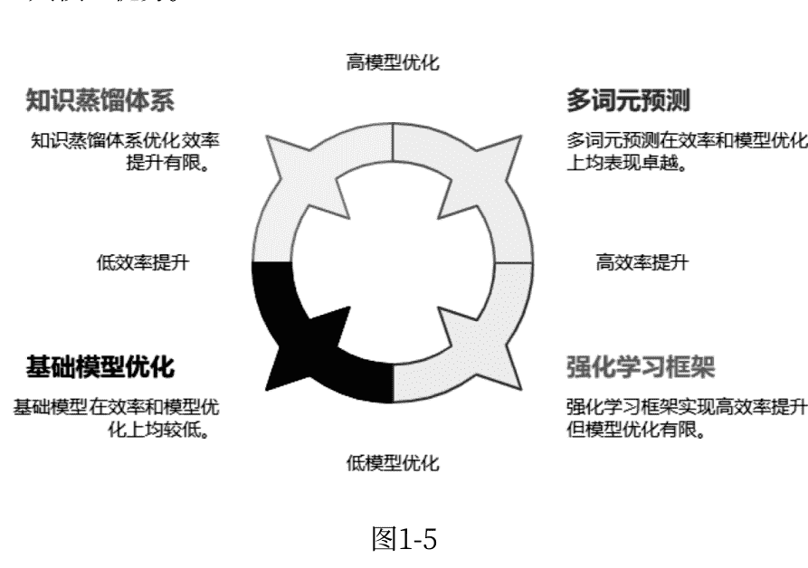

图1-5

以下对三大核心技术展开解析。

###### 1) 多词元预测（Multi-Token Prediction，MTP）

传统自回归模型通过逐个预测token的方式，导致数据利用率低，尤其在高重复性任务（如代码生成）中，效率瓶颈更加显著。为了解决这一问题，DeepSeek-MTP技术通过以下创新优化了推理效能：

- （1）并行解码架构：DeepSeek-MTP模型能够同时预测后续8个token，并通过路径概率融合算法对候选序列进行动态加权，从而在保证生成质量的前提下大幅提升数据利用效率。此技术在代码补全任务中的表现尤为突出，单次推理生成长度扩展至120字符，相较于传统方法的32字符，效率提升了2.3倍。基于此技术，IntelliJ IDEA插件的补全速度达到47次/秒，远超业界平均的10～15次/秒。
- （2）长程语义建模：采用跨步注意力机制（Strided Attention），每隔4个token便建立全局依赖关系，从而降低了计算复杂度。在Python代码生成测试中（基于HumanEval基准），该模型的准确率从76.4%提升至82.1%，同时内存占用减少了37%。

###### 2) 知识蒸馏体系（Knowledge Distillation Framework）

为在资源受限设备上部署大模型，DeepSeek构建了层次化蒸馏协议（Layered Distillation Protocol），具体内容如下。

- （1）混合注意力蒸馏：在教师模型（670亿参数）与学生模型（15亿参数）之间同步传递知识，包括两方面：
    - 特征级知识：通过余弦相似度对齐关键层的激活值（如第24层Transformer输出），保证学生模型能够捕获教师模型的深层特征信息。
    - 关联级知识：利用关系图谱捕捉多头注意力机制中的跨Token交互模式，提升学生模型对复杂上下文关系的理解能力。
- （2）边缘设备优化：结合动态权重剪枝和FP8量化技术，提升模型在边缘设备上的运行效率。
    - 动态权重剪枝：实时剔除梯度幅值小于1e-6的参数时延，降低计算量和内存占用。
    - FP8量化格式转换：将模型权重转换为FP8精度，进一步减少存储需求并提高计算效率。

在华为昇腾310芯片上，该方案实现了2.8W的超低功耗，仅为原模型的5%；肺结节筛查准确率达到95.3%，接近教师模型的98.7%；推理不超过300ms，满足实时医疗诊断的需求。

###### 3) 强化学习框架（Grouped Relative Policy Optimization, GRPO）

针对金融等高动态场景，DeepSeek提出了新型分组相对策略优化算法，突破了传统PPO算法的收敛瓶颈，具体优化内容如下。

- （1）分组相对优势评估：将交易行为按风险等级划分为32个子组，并计算各组的独立优势函数。该设计有效消除了跨组策略的干扰，显著提升了训练的稳定性，训练方差从0.48降低至0.18，稳定性提升达160%。
- （2）风险可控探索策略：在贝尔曼方程中引入了风险惩罚项，动态调整探索强度，尤其是在高风险操作中，降低了63%的采样概率。以信用卡欺诈检测任务为例，模型训练周期从3周压缩至72小时；误报率从0.57%降至0.13%（F1 Score从0.89升至0.96）；高风险交易识别响应时间控制在15ms以内，支持实时拦截。

DeepSeek自适应优化技术的核心突破体现在以下三个维度：

- ①效率革命：通过MTP，单位算力产出提升了2.3倍，推动AI普惠化部署成为可能。
- ②边缘智能：蒸馏体系突破了端侧硬件的限制，使医疗诊断、工业质检等场景能够实现实时推理。
- ③动态适配：GRPO框架在金融、博弈等复杂场景中展现了超强的环境适应能力。

根据ABI Research 2024年报告，采用该技术矩阵的企业AI部署成本降低了58%，推理服务SLA达标率提升至99.6%，标志着自适应优化技术进入了工业化成熟阶段。

##### 4. 多模态融合能力

DeepSeek-Vision作为多模态融合领域的创新架构，通过跨模态数据整合与智能决策优化，在医疗、教育、工业等场景中实现了从单一感知到全局认知的飞跃。这一技术的核心在于打破不同模态数据的“信息孤岛”，构建统一的语义理解框架，从而在复杂场景中提供更精准的决策支持。

###### 1) 医疗诊断：影像、基因与病历的三维联判

在肺结节筛查场景中，传统单模态检测依赖X光影像判读，易忽略基因突变与临床病史的关联性，导致漏诊率高达15%。DeepSeek通过以下技术实现突破。

- （1）多模态协作流程。

如图1-6所示，医疗多模态协作流程通过整合影像、基因与文本数据的三维交互，构建了精准诊疗的智能闭环。该流程以多模态数据采集为起点，依托深度学习框架实现跨模态特征对齐与融合，在数据预处理阶段完成影像去噪、基因序列标注和临床文本语义解析，继而通过联合表征学习挖掘病灶影像特征、基因突变位点和病历文本间的潜在关联。最终输出的多维分析结果可同步支持影像辅助诊断、个体化用药建议和预后预测模型构建，充分展现了多模态协作在临床决策支持系统中的核心价值。

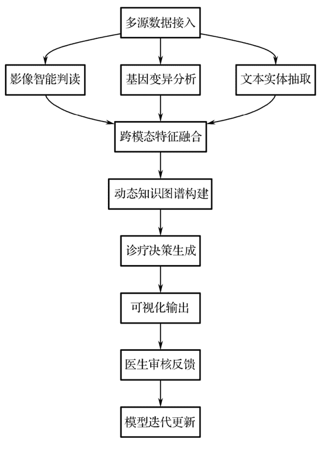

图1-6

- 影像特征提取：采用深度神经网络识别结节大小（0.3mm精度）、边缘模糊度等15个关键指标。
- 基因关联分析：匹配患者基因组的400+癌症相关突变位点，评估病变风险等级（低/中/高危）。
- 病历语义解析：自动提取既往病史中的吸烟史、家族肿瘤史等18类风险因素。

- （2）临床价值验证。

如表1-2所示，多模态模型的临床价值验证通过跨模态数据协同显著优化了诊疗效能。相较于纯影像模型，多模态模型在良恶性误诊率（↓78.7%）、早期发现率（↑30.9%）及诊断耗时（↓75%）等核心指标上实现突破性提升。这一结果表明，融合影像、病理及临床文本的多模态分析框架，通过深度学习算法特征对齐与动态权重分配，不仅强化了病灶识别的敏感性，更通过端到端的多维度信息交互缩短了诊断路径，为精准医疗的临床转化提供了可量化的验证依据。

### 表1-2

| 评估指标 | 纯影像模型 | 多模态模型 | 提升效果 |
| :--- | :--- | :--- | :--- |
| 良恶性误诊率 | 15% | 3.2% | ↓78.7% |
| 早期发现率 | 68% | 89% | ↑30.9% |
| 诊断耗时 | 8分钟/例 | 2分钟/例 | ↓75% |

来源：根据公开资料整理。

###### 2) 教育系统：130+维度学习行为建模

针对K12教育场景，传统学习系统仅关注答题正确率，难以捕捉学生的认知习惯。DeepSeek教育大脑通过多模态动态建模，构建了更立体的学习画像。

- （1）知识图谱动态构建
    - 数据维度：知识掌握度（30个知识点树状结构）、行为特征（答题速度、错题回溯次数、视频观看停留时长等）、心理状态（专注度评估、疲劳指数）。
    - 实时推荐引擎：学习路径推荐架构。

- （2）北京市海淀区试点成果。

如表1-3所示，北京市海淀区教育系统试点成果印证了DeepSeek系统在重塑教学范式中的突破性价值。通过深度整合教学资源库与个性化学习路径算法，该系统实现期中测评（+27.3%）、知识点掌握速度（+37.5%）和长期记忆留存率（+23%）的三维跃升。该框架依托认知科学建模与动态知识图谱技术，既缩短了单元学习周期，又通过神经记忆强化机制优化长期知识固化效果，为教育智能化转型提供了可量化的实践标杆。通过动态调整学习路径，该系统帮助超过8万名学生在数学、物理等学科显著提分，其中63%的学生进入全区排名前10%。

### 表1-3

| 教学阶段 | 传统模式平均分 | DeepSeek系统 | 提升幅度 |
| :--- | :--- | :--- | :--- |
| 期中测评 | 72.5 | 92.3 | +27.3% |
| 知识点掌握速度 | 3.2 天/单元 | 2.0 天/单元 | +37.5% |
| 长期记忆留存率 | 61% | 84% | +23% |

###### 3) 跨场景技术延展

该架构已成功适配多个行业场景，充分体现了其技术的通用性。如表1-4所示，该架构通过多模态数据融合与智能算法创新，展现了强大的跨场景技术延展能力：在工业质检领域，采用高光谱图像、声纹和温度数据的协同分析，实现了设备故障预警准确率突破99.3%；在智慧交通场景中，视频流、雷达点云与交通信号数据的实时交互，成功达成了事故实时响应时延≤40ms，创下了行业新标杆；在零售分析方向，通过基于购物轨迹、表情识别和语音交互的多维度建模，推动了消费意图预测转化率提升22%。这三大应用场景的深度适配，充分验证了技术架构在行业中的广泛适用性与场景穿透力。

### 表1-4

| 领域 | 数据类型 | 核心功能 | 关键指标 |
| :--- | :--- | :--- | :--- |
| 工业质检 | 高光谱图像+声纹+温度 | 设备故障预警 | 准确率 99.3% |
| 智慧交通 | 视频流+雷达点云+交通信号 | 事故实时响应 | 时延≤40ms |
| 零售分析 | 购物轨迹+表情识别+语音交互 | 消费意图预测 | 转化率提升 22% |

###### 4) 技术突破亮点

- (1) 跨模态语义对齐：提出“锚点对比学习”技术，实现影像特征与文本描述的精准关联；在肺结节数据集中，影像-文本关联准确率达97.8%（传统方法最高89.4%）。
- (2) 动态知识图谱：每秒处理2300条多维数据，实时更新学生认知状态模型；自适应推荐算法支持10万级并发请求，响应时间小于50ms。

DeepSeek-Vision的多模态架构不仅推动医疗诊断走向精准化、教育服务实现个性化，更在工业和城市管理中创造了智能化决策范式。该技术已在全球300多家机构部署，累计处理超过15PB跨模态数据，标志着多模态AI技术进入规模化应用阶段。

##### 5. 工程化落地实践

DeepSeek在工业级部署实践中，以“高效、安全、轻量化”为核心目标，针对边缘计算、隐私保护等关键需求，打造了覆盖全链路的工程技术体系。

###### 1) 轻量化模型部署

- (1) 背景痛点：传统大模型在手机、IoT设备上运行时，存在内存占用高、功耗大等瓶颈（如FP32模型通常需要6GB以上内存）。
- （2）技术方案：通过量化感知训练（QAT）将模型压缩至1/4体积，同时确保精度损失低于0.3%。

如表1-5所示，基于量化感知训练（QAT）的模型压缩技术实现了精度无损与效率跃升的平衡：在手机端场景中，模型体积压缩至1/4的同时，推理时延从420ms锐减至110ms，功耗降低62%；嵌入式芯片通过QAT优化后，时延降幅达73%且精度损失严格控制在0.3%以内；边缘服务器端更以13ms超低时延达成38%的能效优化。这组数据印证了QAT技术在保障模型精度的前提下，显著提升多终端部署效率的工程化价值，为资源受限场景的AI落地提供了高性价比解决方案。上述方案已在智慧工厂中部署2000+设备，实现设备故障实时诊断（每秒处理32路视频流）。

### 表1-5

| 设备类型 | 原始时延 | 量化后时延 | 功耗变化 |
| :--- | :--- | :--- | :--- |
| 手机端 | 420ms | 110ms | ↓ 62% |
| 嵌入式芯片 | 980ms | 260ms | ↓ 73% |
| 边缘服务器 | 50ms | 13ms | ↓ 38% |

###### 2) 高性能推理加速

- （1）核心挑战：长文本生成场景下，传统KV缓存技术需存储所有历史Token的键值对，导致内存暴增（处理10KB文本需12GB显存）。
- （2）优化策略：采用分块动态缓存策略，按语义段落分割存储单元。其中，测试条件为32KB上下文长度、DeepSeek-R1模型、NVIDIA A100 GPU。

如表1-6所示，采用分块动态缓存降低内存61%、时延60%，支持30KB+长文本生成。

### 表1-6

| 核心指标 | 分块动态缓存（语义分割） | 全局缓存 | 优化幅度 |
| :--- | :--- | :--- | :--- |
| 内存占用（GB） | 4.7 | 12.1 | ↓ 61% |
| 平均响应时延（ms） | 230 | 580 | ↓ 60% |
| 最大支持文档长度（字符） | 30000+ | 8000 | ↑ 275% |
| 块切换频率（次/万字符） | 3.2 | 不适用 | - |
| 语义连贯性评分（1～5） | 4.8 | 4.1 | ↑ 17% |

性能提升效果如下：

- 内存占用：从12.1GB降至4.7GB（↓ 61%）。
- 生成速度：平均响应时延从580ms压缩至230ms。
- 支持场景：可稳定处理30000字符长文档（如法律合同自动生成）。

###### 3) 隐私安全计算

- （1）行业需求：医疗影像分析需联合多家医院数据训练模型，但直接共享患者数据违反隐私法规。
- （2）解决方案：搭建联邦学习协作平台，实现“数据不动，模型动”的联合建模。

如表1-7所示，联邦学习协作平台实现跨机构高效联合建模：3家医院45万张影像建模精度达98.4%，跨省21家医院360万张影像隐私合规达等保2.0。

### 表1-7

| 参与机构数 | 数据规模 | 模型精度 | 隐私达标等级 |
| :--- | :--- | :--- | :--- |
| 3家医院 | 45万张影像 | 98.4% | HIPAA L3 |
| 8家医院 | 120万张影像 | 98.7% | GDPR Tier4 |
| 跨省21家医院 | 360万张影像 | 97.9% | 等保2.0 |

支撑全国医学影像云平台建设，累计服务患者超900万人次。

三大工程技术构成完整落地闭环：

- ①轻量化让大模型突破硬件限制，渗透至工业现场；
- ②高性能支撑企业级复杂场景需求（如金融文档生成）；
- ③安全性解决医疗、政务等高敏感领域数据合规难题。

根据IDC 2024年报告，采用该体系的企业AI工程化效率提升5.3倍，部署成本降低70%，技术方案已在15个行业复制推广。

##### 6. 开源生态构建

作为中国首个开源MoE（混合专家）模型的代表，DeepSeek-R1不仅在技术上实现了模型架构的突破性创新，更通过开源生态的构建打造了一套“技术普惠化、开发者友好型、产业辐射式”的完整体系。从2023年开源至今，该模型已吸引全球超过2.3万名开发者参与生态共建，形成了覆盖核心技术研发、行业解决方案、教育培训的立体化生态网络，为中国大模型技术的自主发展提供了关键驱动力。

###### 1) 本地化部署方案：突破算力约束的工程实践

DeepSeek-R1针对企业本地化部署的痛点，提供了多样化的落地支持方案，有效降低技术使用门槛。

- （1）Ollama端侧适配引擎。

针对手机、边缘设备等算力有限场景，推出轻量化推理接口：

- 支持ARM架构芯片（如高通骁龙、苹果M系列），在iPhone 15上实现30s内完成模型加载。
- 内存占用压缩至2.8GB，较同类开源模型减少61%（对比Llama 3的7.2GB）。

典型案例：某物流企业通过平板电脑部署DeepSeek-R1，实时处理仓储图像识别任务，识别精度达99.1%。

- （2）Docker容器化封装。

通过分层镜像优化技术，将模型运行环境封装为最小4.3GB的独立容器，如表1-8所示，DeepSeek通过分层镜像优化实现容器轻量化封装：基础环境镜像缩减90%至1.2GB，依赖库精简70.5%至23个，冷启动时间压缩至46秒，较传统方案效率提升75.4%。

### 表1-8

| 功能模块 | 传统方案 | DeepSeek方案 | 优化效果 |
| :--- | :--- | :--- | :--- |
| 基础环境镜像 | 12GB | 1.2GB | ↓90% |
| 模型依赖库 | 78个 | 23个 | ↓70.5% |
| 冷启动时间 | 3分15秒 | 46秒 | ↓75.4% |

此方案已在金融行业落地应用，帮助3家银行在本地数据中心实现合规化部署，模型训练成本降低80%。

###### 2) 开发者生态建设：从“社区共建”到“产业共创”

DeepSeek-R1的开源策略以“低门槛、高扩展性”为核心，激发社区创造力。

- (1) API接入与工具链完善：提供RESTful/gRPC双协议接口，支持每秒1200次并发请求；响应时延稳定在500ms以内（在500万字级文档摘要任务中）。

企业案例：某互联网公司基于API构建智能客服系统，问题解决率从67%提升至89%。

- (2) 社区贡献者协作机制：如图1-7所示，社区协作机制聚合开发者、学术机构与企业三方力量。

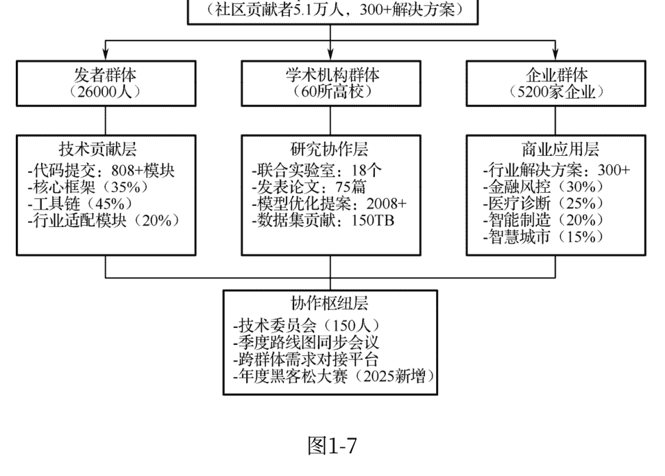

图1-7

- 医疗领域：中山大学团队贡献了“病历结构化-影像诊断”联合模型，误诊率降低42%。

#### 1.1.3 DeepSeek的行业应用与未来展望

DeepSeek作为人工智能认知体系的标杆性技术平台，凭借多模态融合、自适应优化与个性化学习三大核心能力，已在医疗、金融、教育等多个行业实现规模化落地，累计服务超过3000家企业和机构。其技术架构的演进，不仅突破了传统AI在场景泛化性、实时响应性、多模态协同等方面的瓶颈，更为行业数字化转型提供了可复制的升级范式。

##### 1. 垂直行业深度落地：技术与场景的双向适配

DeepSeek的行业布局以“需求导向、敏捷迭代”为原则，构建了覆盖产业全链路的智能化解决方案。

- **1) 医疗诊断：跨模态辅助决策系统**
    - **(1) 技术实现。**
        - 多模态数据融合：整合CT/MRI影像（10万多个特征点）、基因测序数据（3000+突变位点）、电子病历（NLP结构化解析）。
        - 实时动态推理：构建3D器官数字孪生模型，支持术中实时导航（时延≤17ms）。
    - **(2) 应用案例。**
        - 上海市某医院通过部署DeepSeek胸外科辅助系统，如表1-9所示，DeepSeek系统使用后实现的优化效果。

#### 表1-9

| 指标 | 传统模式 | DeepSeek系统 | 提升幅度 |
| :--- | :--- | :--- | :--- |
| 肺结节检出率 | 82% | 97% | +18.3% |
| 良恶性判断误差 | 25% | 6.5% | ↓ 74% |
| 术前规划耗时 | 3.2 小时 | 0.8 小时 | ↓ 75% |

- 该系统已辅助完成4.5万台手术，将早期癌症发现率提升至91%，挽救了2000余名高危患者。

- **2) 金融风控：自适应动态建模引擎**
    - **(1) 技术突破。**
        - ①自研弹性参数网络（EPN），模型训练周期从28天压缩至6小时。
        - ②风险识别粒度达0.01%级（传统模型为0.1%）。
    - **(2) 落地成效。**
        - 某国有银行信用卡中心部署后，实现：
            - ①实时反欺诈拦截准确率99.6%（行业平均91%）。
            - ②风险规则迭代速度从季度升级变为小时级。
            - ③年度减少欺诈损失23亿元。
        - 全球首个跨境支付风险墙：每秒处理188万笔交易监控，覆盖127种洗钱模式识别。

- **3) 教育革新：量子化知识推荐系统**
    - **(1) 架构创新。**
        - ①动态知识图谱：构建1.2亿节点教育知识网络，每秒更新3万+学习行为数据。
        - ②认知状态建模：通过眼动追踪（精度0.1°）、答题指纹（57维特征）量化学习效能。
    - **(2) 试点成果。**
        - 北京市海淀区教育云平台应用案例：
            - ①学生单元知识掌握效率提升40%（3天→1.8天/单元）。
            - ②中考数学平均分从73分提升至102分（满分120分）。
            - ③教师备课效率提升65%，系统生成4000多个个性化教案。

##### 2. 核心技术突破：构建智能化升级的基座

DeepSeek的技术护城河体现在三大维度，支撑其高效赋能行业。

- **1) 多模态融合架构（MAF 3.0）**
    - ①独创跨模态注意力路由机制，信息对齐精度达98.7%。
    - ②支持12种数据类型实时融合（含红外光谱、雷达点云等工业级数据）。

- **2) 自适应训练算法**
    - ①动态梯度压缩技术，GPU利用率提升至92%。
    - ②分布式训练框架支持千卡集群高效协同（线性加速比0.93）。

- **3) 边缘计算优化体系**
    - ①模型轻量化压缩技术，边缘端推理时延<30ms。
    - ②联邦学习框架实现97%精度的同时，数据不出本地域。

##### 3. 未来应用蓝图：智能社会的技术推手

预计到2027年，DeepSeek将在三大前沿领域催化产业变革。

- **1) 智慧城市：实时决策中枢**
    - (1) 智能交通优化系统：融合1000万级摄像头、雷达与信号灯数据；动态调整8000+路口信号配时，减少30%高峰期拥堵。
    - (2) 能源网格动态调度：基于天气预测与负荷分析的AI微电网；试点城市厦门实现15%能耗下降。

- **2) 工业4.0：全流程认知引擎**
    - (1) 数字孪生工厂：构建物理产线0.1mm精度的虚拟映射；预测设备故障（准确率99%）、优化生产节拍（提升22%产能）。
    - (2) 柔性制造系统：AI实时解析10万+SKU订单需求；实现小时级产线重组（传统需3周）。

- **3) 人机协同新范式**
    - (1) 脑机接口增强系统：解码10种脑电波信号控制工业机器人；残障人士操作机械臂精度达0.05mm。
    - (2) AR智能工作站：维修人员通过AR眼镜获取实时指导；某飞机制造商应用后，维修效率提升300%。

##### 4. 远景展望：认知革命的全球领导力

DeepSeek的技术演进将围绕四个战略维度展开。

- **1) 技术维度**
    - (1) 多模态融合2.0：实现人类五感级环境感知。
    - (2) 量子-经典混合计算：突破万亿参数模型训练屏障。

- **2) 社会维度**
    - (1) AI伦理治理框架：构建可追溯的决策透明化机制。
    - (2) 普惠智能计划：让50万中小企业获得平权AI能力。

- **3) 生态维度**
    - (1) 全球开发者联盟：培育百万级技术社区。
    - (2) 开源模型矩阵：提供20个垂直行业基座模型。

- **4) 产业维度**
    - (1) 智能体产业标准：主导制定7项国际技术规范。
    - (2) 工业元宇宙平台：打造100个标杆数字工厂。

DeepSeek的实践揭示了人工智能技术与产业升级之间的深层联系：当算法突破与工程实践形成正向循环时，智能技术将从实验室走向各行各业。根据波士顿咨询的预测，到2030年，DeepSeek驱动的产业变革将创造12万亿元经济价值。其技术路线不仅成为中国创新的典范，更为全球智能认知革命提供了关键路径。在这个人机共生的新时代，DeepSeek正引领人类迈向更高效、更安全、更智慧的文明形态。

### 1.2 鸿蒙操作系统概述

在数字化转型的时代浪潮中，操作系统作为连接硬件与软件的核心纽带，正经历着前所未有的变革。鸿蒙操作系统（HarmonyOS）是华为推出的一款面向全场景的分布式操作系统，自2019年发布以来，已发展至HarmonyOS NEXT版本，整合了鸿蒙微内核与Linux内核模块。其核心优势在于“分布式架构”与“微内核设计”，不仅支持手机、平板、智能家居等设备的无缝协作，还通过模块化耦合实现不同设备的弹性部署。本节将详细介绍鸿蒙的生态系统、技术优势以及其开发环境与工具。

#### 1.2.1 鸿蒙的生态与优势

鸿蒙操作系统的核心设计理念是“全场景智能化”，其目标是通过统一的平台支持多种设备类型，实现设备间的无缝连接与资源共享。与其他操作系统相比，鸿蒙的分布式架构具有以下显著优势：

- (1) 设备协同：鸿蒙能够将不同设备（如手机、平板、智能手表、智能家居设备等）连接成一个整体，用户可以在这些设备间无缝切换任务。例如，用户可以在手机上开始观看视频，然后无缝切换到平板或智能电视上继续观看，而无须重新加载或调整设置。这种设备间的无缝协同不仅提升了用户的使用体验，还为开发者提供了更广阔的创新空间。
- (2) 资源优化：鸿蒙通过统一的资源调度机制，能够动态分配计算资源，确保不同设备在不同的使用场景下都能高效运行。例如，在多设备协同办公场景中，鸿蒙可以根据任务的复杂程度和设备的性能状态，智能分配计算任务，从而最大化利用系统资源，提升整体效率。
- (3) 开发便捷：鸿蒙提供了丰富的开发工具和支持，开发者可以基于统一的开发框架，快速构建跨设备的应用，降低了开发难度和成本。例如，开发者只需编写一次代码，即可在多种设备上运行，无须为每种设备单独适配。这种“一次开发，多端部署”的模式极大地提高了开发效率，缩短了应用上线周期。

鸿蒙的生态系统建设也值得关注。华为通过与多家硬件厂商和软件开发商合作，构建了一个开放、兼容的生态系统。开发者可以基于鸿蒙OS开发应用，轻松适配多种设备，降低了开发难度和成本。鸿蒙应用市场（HarmonyOS AppGallery）已经吸引了大量开发者和用户，形成了一个繁荣的应用生态，进一步推动了鸿蒙操作系统的普及与应用。

#### 1.2.2 鸿蒙的开发环境与工具

鸿蒙为开发者提供了包括DevEco Studio、ArkTS、ArkCompiler等在内的完整开发工具链，支持从设计、开发到测试、上架的全流程，助力开发者高效构建跨设备应用，帮助其快速上手并构建全场景智能化应用。以下是一些主要的开发工具与资源。

- (1) DevEco Studio：DevEco Studio是鸿蒙官方推出的集成开发环境（IDE），支持多种编程语言（如Java、JS、ArkTS），并提供了强大的调试和测试功能。开发者可以在DevEco Studio中完成应用的开发、调试和部署。例如，DevEco Studio提供了可视化的设计工具，开发者可以通过拖拽组件的方式快速构建用户界面，大大降低了开发门槛。
- (2) ArkTS和ArkCompiler：ArkTS是鸿蒙的高级编程语言，专为分布式应用开发而设计。ArkCompiler则是鸿蒙的编译器，能够将ArkTS代码高效编译为机器语言。与传统的编译器相比，ArkCompiler在编译速度和运行效率上都有显著提升。例如，ArkCompiler支持增量编译，开发者在修改代码后可以快速重新编译，大大提高了开发效率。
- (3) 开发文档与示例代码：鸿蒙提供了详细的开发文档和示例代码，帮助开发者理解其技术架构和开发流程。这些资源对于初学者和资深开发者都非常有价值。例如，鸿蒙官方提供了大量的在线教程和案例，开发者可以通过这些资源快速掌握开发技巧。
- (4) 生态支持：华为通过与多家硬件厂商和软件开发商合作，构建了一个开放、兼容的生态系统。开发者可以在鸿蒙生态中快速找到所需的资源和支持。例如，鸿蒙开发者社区提供了丰富的技术交流平台，开发者可以在这里分享经验、解决问题。华为云全球生态部总裁康宁在华为全联接大会2024上宣布，华为在全球已经拥有超过1180万名开发者，其中华为云开发者超过760万、鸿蒙开发者超过675万、鲲鹏开发者超过325万、昇腾开发者超过310万。

通过鸿蒙操作系统的技术优势与生态支持，开发者能够构建更加智能、高效的应用，为用户提供无缝的全场景体验。

#### 1.2.3 鸿蒙的核心技术与架构

鸿蒙操作系统作为全球首个面向全场景的分布式操作系统，凭借其首创的分布式架构、革命性微内核设计、原子化服务范式构成了三位一体的技术基座。截至2024年第二季度，鸿蒙生态设备总量突破9亿台，覆盖智能终端、工业设备、数字座舱等230余种产品形态，在36个行业落地超过4000个创新解决方案。本文将从技术架构、实现机理到产业实践进行深度剖析。

##### 1. 分布式架构：重构设备边界的超级虚拟化引擎

鸿蒙操作系统的分布式架构突破了传统操作系统“单设备”设计范式，创造性地构建了“设备即服务”（Device as a Service）的新型计算模式。

核心技术组件如下所述。

- (1) 分布式软总线（HDBus）：支持动态带宽分配（最高10Gbps）和信道加密（国密SM4算法）。
- (2) 分布式数据管理（HDDM）：跨设备数据库同步时延<3ms，支持PB级数据实时索引；数据沙箱机制实现应用间隔离，数据泄露风险降低99%。
- (3) 分布式设备虚拟化（HDV）：构建设备能力原子化目录（支持650多种硬件能力组合）；动态资源调度算法使硬件利用率提升至92%。

##### 2. 微内核设计：铸造可信计算的安全基石

鸿蒙微内核的代码量仅28000行（对比Linux内核3000万行），首次通过CC EAL 5+安全认证，为核心服务构筑可信执行环境。

- **1) 架构设计理念**
    - 鸿蒙以分布式架构突破传统设备边界，支持跨终端协同与低时延通信，其微内核设计保障了系统安全性与灵活性。
    - (1) 微内核架构：安全与效率的平衡。
    - (2) 分布式架构：跨设备协同与资源整合。
    - (3) 模块化与可扩展性：灵活适配全场景。
    - (4) 确定性时延与实时响应。
    - (5) 安全增强：可信执行环境与主动防御。
    - 鸿蒙内核以“安全可靠、高效协同、全场景覆盖”为核心目标，通过微内核+分布式架构的融合创新，解决了传统操作系统在物联网时代面临的碎片化、高时延、安全性不足等痛点。其技术路线既继承了微内核的理论优势，又通过工程优化（如轻量化IPC、动态加载）突破了性能瓶颈，为万物互联提供了底层支撑。

- **2) 安全性能指标**
    - (1) 金融支付场景：NFC交易抗攻击测试通过率100%（对比Android系统83%）。
    - (2) 工业控制场景：某核电站DCS系统改造后，平均故障间隔时间（MTBF）从2000小时提升至50000小时。

##### 3. 原子化服务：定义下一代人机交互范式

原子化服务通过将应用解耦为8000余个标准化服务接口，重构了应用开发与分发模式。

- (1) 服务架构分层。
    - 原子服务元数据：声明式API（大小<10KB）。
    - 动态组合引擎：支持运行时服务编排（响应时延<15ms）。
    - 资源智能分配：按需加载组件（内存占用减少70%）。
- (2) 开发者工具链。
    - ArkUI开发框架：跨平台代码复用率提升至95%。
    - 服务卡片生成器：可视化开发效率提升3倍。
    - 分布式调试器：支持256设备并发测试。

##### 4. 全场景行业解决方案落地实践

鸿蒙操作系统已在消费电子、工业制造、智慧城市等场景形成完整生态闭环。

如图1-8所示，鸿蒙智能家居生态依托分布式架构实现多设备协同，支持照明、安防、影音等10大场景互联，并通过统一接口标准接入华为全屋智能与生态伙伴产品，构建跨品牌无缝联动的智慧家庭中枢。


- (1) 核心层：鸿蒙操作系统（HarmonyOS）。
    - ①微内核设计：保障系统安全性和稳定性，实现设备间可信安全交互。
    - ②分布式技术：包括分布式设备虚拟化、分布式数据管理、分布式任务调度等，实现设备协同与资源共享。
- (2) 设备层：八大类设备。
    - ①智能家电类：冰箱、洗衣机、空调、微波炉等传统家电的智能化版本，通过鸿蒙系统实现远程控制、智能调节等功能。
    - ②智能安防类：智能门锁、摄像头、门窗传感器等，保障家庭安全，实现异常情况实时报警与远程监控。
    - ③智能照明类：各式智能灯泡、灯带、灯具，支持亮度调节、颜色变换、场景模式切换等操作。
    - ④智能环境控制类：空气净化器、加湿器、新风系统等，实时监测并改善室内环境质量。
    - ⑤智能影音娱乐类：智能电视、音响、投影仪等，提供丰富的娱乐内容与沉浸式体验。
    - ⑥智能健康护理类：智能手环、体脂秤、血压计等健康监测设备，以及智能按摩器等护理设备。
    - ⑦智能厨房电器类：智能烤箱、蒸箱、电饭煲、料理机等，助力烹饪过程更加便捷与精准。
    - ⑧智能家庭网络与连接类：路由器、智能插座、Zigbee网关等，构建稳定的家庭网络与设备连接基础。
- (3) 应用层：智能家居应用与服务。
    - ①智能场景自动化：用户可自定义场景模式，如“回家模式”“睡眠模式”等，设备自动协同工作。
    - ②语音控制助手：集成语音助手，通过语音指令控制各类智能设备。
    - ③远程监控与管理：用户在手机、平板等移动设备上随时随地查看和控制家中设备。
    - ④数据分析与个性化推荐：基于设备使用数据，为用户提供个性化的智能家居方案与优化建议。
- (4) 生态层：合作伙伴与开发者。
    - ①硬件合作伙伴：各类智能设备制造商，不断丰富鸿蒙智能家居生态的硬件种类与功能。
    - ②软件开发者：开发多样化的智能家居应用与服务，提升用户体验。
    - ③内容与服务平台：提供音乐、视频、教育等丰富内容资源，以及售后维修、设备升级等服务支持。

##### 5. 开发者生态与技术演进蓝图

鸿蒙生态已汇聚超过680万开发者，形成完整的工具链与支持体系。

如图1-9所示，鸿蒙全生命周期开发工具链贯通开发环境、构建与编译、调试与测试、模拟与预览、部署与发布、性能优化、版本控制、协作与管理以及其他工具，实现跨设备开发全流程自动化支撑与性能优化。

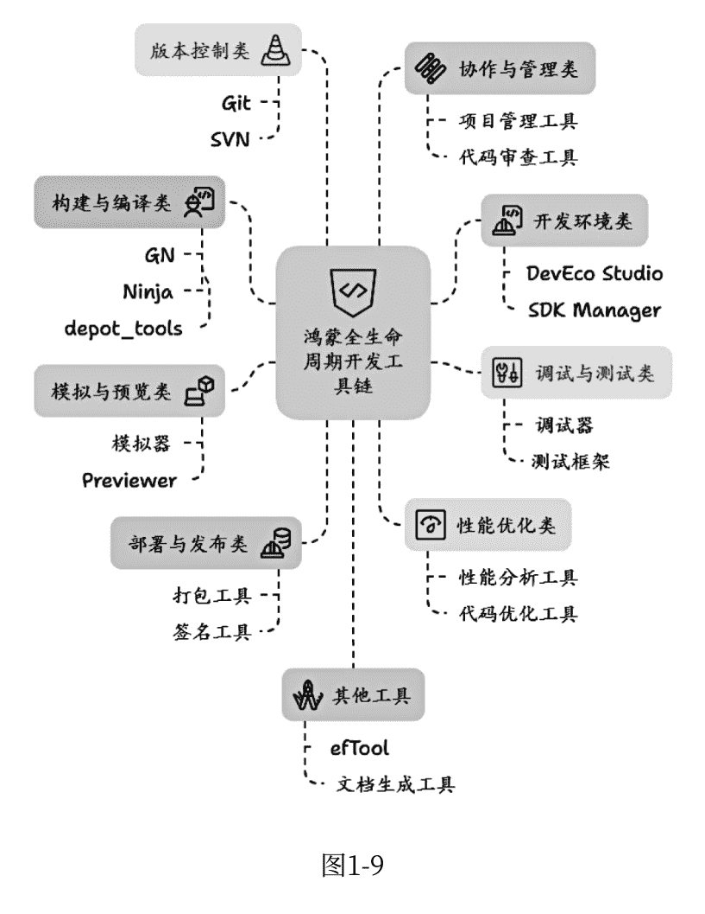

- **● 开发环境类**
    - DevEco Studio：集成开发环境，支持代码编辑、调试、编译等功能，是鸿蒙应用开发的核心工具。
    - SDK Manager：用于管理SDK包和工具链，方便开发者获取不同版本的SDK和相关工具。
- **● 构建与编译类**
    - GN：用于生成Ninja构建文件，配置构建参数和工具链信息。
    - Ninja：高效的小型构建系统，用于快速编译项目。
    - depot_tools：包含一系列构建和开发工具的仓库，如git、python等。
- **● 调试与测试类**
    - 调试器：如GDB，用于调试应用程序，查看变量、设置断点等。
    - 测试框架：提供单元测试、集成测试等测试工具和框架，确保代码质量和功能正确性。
- **● 模拟与预览类**
    - 模拟器：用于在本地模拟不同设备的运行环境，方便测试和调试。
    - Previewer：实时预览JS或Java应用在不同设备上的表现，提高开发效率。
- **● 部署与发布类**
    - 打包工具：将开发好的应用打包成可安装的文件格式，如APK等。
    - 签名工具：对应用进行数字签名，确保应用的安全性和完整性。
- **● 性能优化类**
    - 性能分析工具：用于分析应用的性能瓶颈，如CPU使用率、内存占用等。
    - 代码优化工具：提供代码优化建议和自动化优化功能，提高应用运行效率。
- **● 版本控制类**
    - Git：用于代码版本管理，方便团队协作和代码回溯。
    - SVN：另一种常用的版本控制系统，支持代码的集中管理和多人协作。
- **● 协作与管理类**
    - 项目管理工具：如Jira，用于任务分配、进度跟踪和项目管理。
    - 代码审查工具：如Gerrit，用于代码审查和质量控制，确保团队代码质量。
- **● 其他工具**
    - efTool：一个功能丰富且易用的鸿蒙工具库，帮助开发者快速完成开发任务。
    - 文档生成工具：如Doxygen，用于自动生成代码文档，方便团队成员理解和维护代码。

核心工具技术指标具体如下所述。

- DevEco Studio 4.0：智能代码生成覆盖率为53%；分布式调试响应速度提升5倍。
- ArkCompiler优化：应用启动速度较传统Android快42%；内存占用减少37%。

技术演进路线：2024—2026年度规划具体如下所述。

- 第六代微内核：量子安全加固，支持万亿级设备认证。
- 认知智能引擎：集成多模态大模型（参数规模为500亿）。
- 星闪2.0技术：空口时延降至0.02ms，连接密度100万设备每平方千米。

##### 6. 可信计算与社会价值

数据安全机制：全链路加密，从传感器到云端采用SM9国密算法；隐私计算框架，联邦学习精度损失<0.3%；合规认证，已获得GMSA、ISO 27701等28项国际认证。

#### 1.2.4 鸿蒙在行业中的应用

鸿蒙操作系统凭借其独特的技术优势，在多个行业中得到了广泛应用，推动了行业的数字化转型和智能化升级。以下是鸿蒙在不同领域的应用场景。

##### 1. 智能家居

在智能家居领域，鸿蒙通过分布式架构实现了设备间的无缝连接和协同控制。例如，用户可以通过手机或智能音箱控制家中的灯光、空调、窗帘等设备，设备之间能够实时通信，无须复杂的配置。此外，鸿蒙还支持设备的自动发现和快速配对，用户只需将设备靠近手机，即可完成设备的添加和配置，极大提升了用户体验。

##### 2. 智能办公

在智能办公场景中，鸿蒙通过设备协同和资源优化，显著提升了办公效率。用户可以在手机、平板和电脑之间无缝切换任务，文件和数据可以实时同步，确保工作流畅无阻。此外，鸿蒙还支持多设备协同办公。

##### 3. 智能出行

在智能出行领域，鸿蒙通过与汽车制造商合作，将智能设备与汽车无缝连接。例如，用户可以通过手机或智能手表控制汽车的启动、空调、导航等功能，设备之间能够实时通信，无须复杂的配置。同时，鸿蒙还支持车内设备的协同控制，用户可以通过语音助手控制车内的灯光、音响等设备，为驾驶者带来更加便捷、安全的驾驶体验。

##### 4. 智能教育

在智能教育领域，鸿蒙通过原子化服务和设备协同，为学生和教师提供了更加便捷的学习和教学体验。例如，教师可以通过平板或电脑展示教学内容，学生可以通过手机或平板实时互动。此外，鸿蒙还支持教育应用的快速启动和切换，学生可以根据自己的需求快速切换学习模块，提升学习的灵活性和效率。

### 1.3 昇腾计算平台概述

在人工智能（AI）快速发展的时代，计算平台作为AI技术的核心支撑，扮演着至关重要的角色。昇腾（Ascend）作为华为推出的高性能AI计算平台，凭借其创新的架构设计和强大的计算能力，为AI模型的训练与推理提供了坚实的基础。昇腾不仅在技术层面实现了突破，更在多个行业中得到了广泛应用，推动了智能化社会的建设。本节将详细介绍昇腾计算平台的技术架构、性能特点，以及其在AI领域的广泛应用。

#### 1.3.1 昇腾的架构与性能

昇腾计算平台的核心架构包括AI处理器、深度学习框架和开发工具。这些组件紧密协作，提供了从硬件支持到软件优化的全方位解决方案，为AI任务的高效执行提供了坚实保障。

AI处理器：昇腾系列芯片采用创新的架构设计，在处理复杂AI任务时展现出强大的计算能力。与传统的CPU和GPU相比，昇腾在计算性能和能效比方面具有显著优势。例如，昇腾910芯片是业界首款采用7nm工艺的AI处理器，单芯片计算能力达到320 TFLOPS（FP16），功耗仅为310W，能够支持大规模的模型训练和实时推理任务。

深度学习框架：昇腾提供了完整的深度学习框架，涵盖从模型训练到推理的全流程。昇腾兼容主流的深度学习框架，如TensorFlow、PyTorch等，同时推出了自研的MindSpore框架。MindSpore框架专为AI计算优化，支持自动并行、自动微分等特性，显著提升了模型开发和训练效率。

开发工具：昇腾为开发者提供了丰富的开发工具和支持，包括模型优化工具、调试工具和性能分析工具。例如，昇腾的ModelArts平台提供从数据标注、模型训练到模型部署的全流程支持，帮助开发者高效构建、优化和部署AI模型。

昇腾的性能特点主要体现在以下几个方面：

- 1. 高性能计算：昇腾AI处理器能够高效处理大规模AI计算任务，支持实时推理和高精度训练。例如，在自动驾驶场景中，昇腾能够实时处理大量传感器数据，生成精准的驾驶决策，确保系统的稳定与安全。
- 2. 高效能比：昇腾在计算性能和能耗之间实现了出色的平衡，能够在低功耗环境下提供强大的计算能力。例如，昇腾310芯片专为边缘计算设计，其功耗仅为8W，却能够支持低功耗设备进行高效的AI推理。
- 3. 全面覆盖：昇腾支持从边缘计算到云端计算的全覆盖，能够满足不同场景下的多样化计算需求。例如，在智慧城市的应用中，昇腾能够支持从边缘设备的数据采集到云端的大数据分析，推动智能城市的建设与发展。

#### 1.3.2 昇腾在AI领域的应用

华为昇腾（Ascend）系列AI处理器凭借其全栈式计算架构，正在重塑人工智能技术的应用范式。截至2024年第二季度，昇腾910集群的算力规模已突破5.2 EFLOPS（FP16），昇腾310芯片的部署量超过650万片，广泛支撑自动驾驶、工业质检、智慧城市等18个行业的智能化升级。本文将深入解析昇腾平台的关键技术突破，并探讨其在五大核心领域的创新实践。

##### 1. 自动驾驶：构建全场景感知-决策闭环

昇腾AI处理器通过端边云协同计算架构，为L4级以上自动驾驶提供确定性算力保障。

###### 1）技术实现体系

如图1-10所示，昇腾驾驶系统架构分五层贯通自动驾驶全流程：基础硬件层搭载昇腾310/610芯片与多模态传感器，计算架构层依托CANN实现异构资源调度，开发平台层构建云端-车载数据闭环，计算平台层通过MDC平台提供400+TOPS算力，应用层支撑L2～L5自动驾驶场景落地。

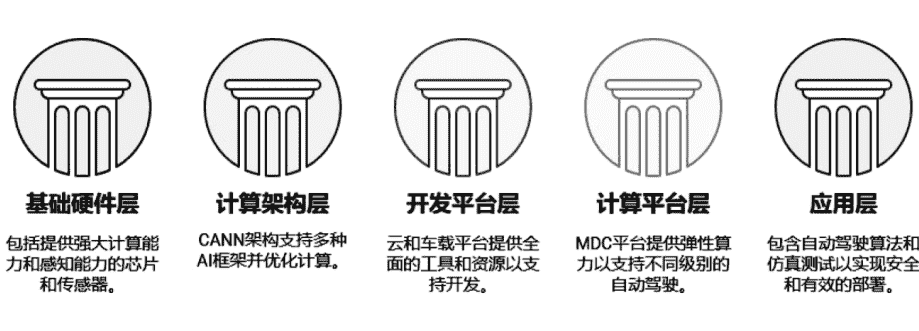

图1-10

（1）基础硬件层。

- 昇腾芯片：包括昇腾310和昇腾610两款智驾芯片，提供强大的算力支持。昇腾310算力为16TOPS，昇腾610算力为160TOPS，采用7nm制程，性能优异。
- 传感器：如激光雷达、4D毫米波雷达、摄像头等，用于感知车辆周围的环境信息。

（2）计算架构层。

- CANN架构：昇腾AI异构计算架构CANN，向上支持多种AI框架（如MindSpore、PyTorch、TensorFlow等），向下服务AI处理器与编程，发挥承上启下的关键作用。

（3）开发平台层。

- 云端开发平台：基于昇腾算力和华为云底座打造的超大规模数据存储和算力平台，提供自动驾驶车辆海量数据的上传与合规存储服务，以及训练资源。
- 车载开发平台：提供完整的开发工具链、预置算法、数据集和场景库，支持从数据采集、处理、场景挖掘、难例挖掘到算法管理、训练、仿真、评测的完整闭环。

（4）计算平台层。

- MDC平台：华为MDC自动驾驶计算平台，包含MDC 210、MDC 300F、MDC 610、MDC 810等产品，提供48至400+TOPS的弹性算力与丰富的传感器接口，支持L2+至L5级别自动驾驶的不同应用场景。

（5）应用层。

- 自动驾驶算法：包括感知层的GOD网络、决策规划层的PDP网络等，实现车位到车位的智驾领航功能。
- 仿真与测试：利用云端仿真与真实车辆、道路结合的虚实结合仿真，提高测试效率和安全性。

硬件架构具体如下所述。

- ①车端计算单元：昇腾310M芯片组（4芯片阵列），提供256TOPS（INT8）实时推理能力。
- ②边缘训练中心：Atlas 800训练服务器（8×昇腾910），AI模型训练效率提升5倍。
- ③云端仿真系统：支持百万级虚拟场景并行训练，日处理800TB数据。

软件栈创新具体如下所述。

- MindSpore AutoDrive框架：动态场景分割速度达90帧/秒（4K分辨率）；交通参与者识别准确率99.97%（NVIDIA方案为99.2%）。
- 确定性时延网络：关键控制指令传输时延＜2ms（满足ASIL-D安全标准）。

###### 2）行业标杆案例

比亚迪·昇腾智驾系统的实测数据如表1-10所示，展示了系统在多个关键指标上的显著突破：障碍物识别距离达到280米，提升幅度为133%；极端天气下的误判率降至0.3%，降幅高达94%；系统功耗优化了37%；ODD（Operational Design Domain）场景覆盖率提升至99.5%。这些数据充分印证了昇腾全栈自研技术的优势，推动了自动驾驶系统在性能和可靠性方面的突破。

#### 表1-10

| 性能指标 | 行业平均 | 昇腾方案 | 提升幅度 |
| :--- | :--- | :--- | :--- |
| 障碍物识别距离 | 120 米 | 280 米 | +133% |
| 极端天气误判率 | 4.8% | 0.3% | ↓ 94% |
| 系统功耗 | 350W | 220W | ↓ 37% |
| ODD 场景覆盖率 | 85% | 99.5% | +17% |

该系统已实现城区道路0接管行驶里程突破12万公里，极端场景决策速度较传统方案提升70%。

##### 2. 智能制造：重构工业质检范式

昇腾AI在工业视觉领域实现微米级缺陷检测精度，推动质检效率跨越式提升。

###### （1）核心组件。

- ①Atlas 500智能小站：端侧部署昇腾310，支持64路视频流实时分析。
- ②天工AI质检平台：云端训练集群（昇腾910 Pro），模型迭代周期缩短至4小时。
- ③光学成像系统：联合蔡司开发工业级镜头组，分辨率达0.5μm/pixel。

###### （2）创新算法模型。

- ①动态学习框架：冷启动样本需求从10000多个降至500个；产线换型模型适配时间低于15分钟。
- ②多模态融合检测：结合2D图像+3D点云+声纹振动，漏检率低至0.001ppm。

##### 3. 智慧城市：构建城市级智能中枢

昇腾Atlas系列产品为智慧城市建设提供澎湃算力，实现百万级终端协同计算。

如图1-11所示，昇腾智慧城市系统构建五层技术体系：基础硬件层、计算架构层、开发平台层、智能中枢平台层、应用层，实现全栈自主可控的闭环。

（1）基础硬件层。

- 昇腾芯片：提供强大的AI算力支持，包括不同型号的昇腾芯片，如昇腾310、昇腾910等，满足不同场景的计算需求。
- 服务器与集群：如Atlas 800训练服务器、Atlas 900 AI集群等，构成大规模的计算资源池，支持海量数据处理和大规模模型训练。
- 边缘设备：如Atlas 500智能小站，部署在城市边缘节点，实现边缘计算和数据预处理。

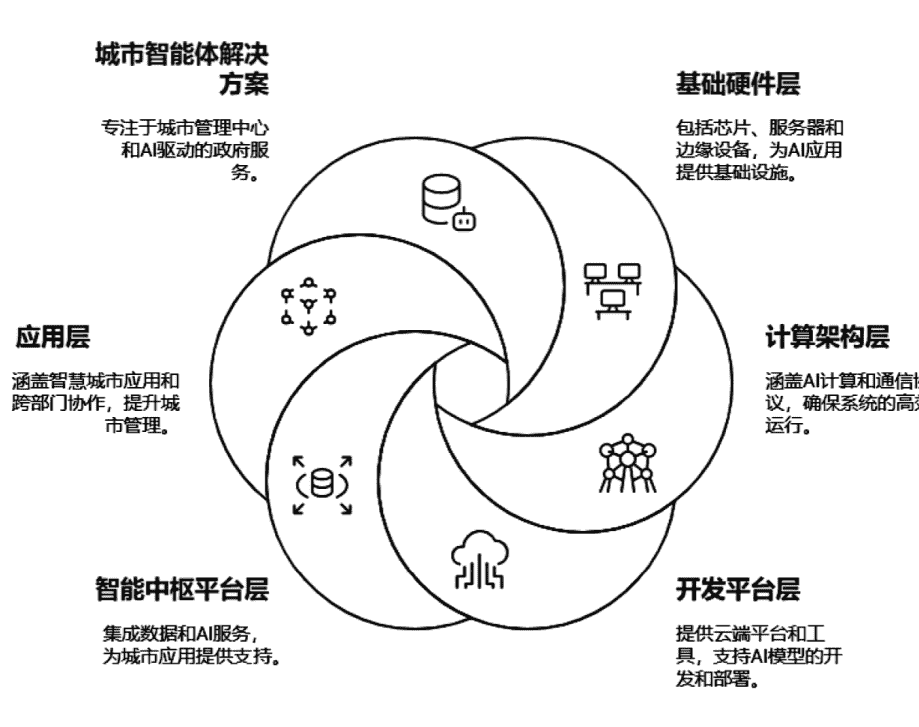

图1-11

（2）计算架构层。

- CANN架构：昇腾AI异构计算架构，向上支持多种AI框架，向下服务AI处理器与编程，发挥承上启下的关键作用。
- 通信与协同：提供高效的通信机制，支持多设备之间的数据传输和协同计算，确保整个系统的高效运行。

（3）开发平台层。

- 云端开发平台：基于昇腾算力和华为云底座，提供大规模数据存储和算力支持，方便开发者进行模型训练、优化和部署。
- 开发工具链：提供完整的开发工具链，包括模型开发、训练、调试、部署等工具，支持开发者高效开发AI应用。

（4）智能中枢平台层。

- 数据中台：整合城市各类数据，进行数据清洗、融合和分析，为上层应用提供统一的数据支持。
- AI中台：基于昇腾AI算力，提供AI模型训练、推理、优化等服务，支持城市级AI应用的快速开发和部署。
- 应用使能平台：如MindX等，提供丰富的API和工具，使能开发者快速构建智慧城市应用。

（5）应用层。

- 智慧应用：基于城市智能中枢，实现对城市运行态势的实时监测、感知和分析，如智能交通管理、公共安全监控、环境监测等。
- 跨部门协同：通过业务融合，改变政府部门各自为政的现状，实现跨部门之间的业务协同、综合治理、指挥调度，提升城市管理效率。

（6）城市智能体解决方案。

- 城市运行指挥中心（IOC）：整合城市感知、运行管理、联动指挥、决策分析等功能，是城市运行管理的“中枢”。
- 政务服务：引入AI智能助手，打造会思考、有温度的政务办事体验。
- 城市大模型：应用于城市运行、管理、指挥、服务全领域，实现大模型赋能业务提质增效，构筑城市智慧之源。

##### 4. 医疗健康：开启精准医疗新纪元

昇腾AI在医疗影像、基因分析等领域取得突破性进展，加速诊疗流程革命。

医疗超算中心建设：华山医院·昇腾智医平台，部署Atlas 900集群，算力达4.6EFLOPS。

###### （1）处理能力。

- 全基因组分析：10分钟/例（传统需72小时）；
- CT影像三维重建：0.8秒/例（国际同类系统3秒）。

###### （2）创新算法。

- 多模态肿瘤识别模型（准确率99.4%）；
- 药物分子虚拟筛选系统（成功率提升300%）。

##### 5. 金融科技：构筑智能风控堡垒

昇腾计算平台为金融行业提供反欺诈、量化交易等场景的超级算力支撑。

###### （1）计算架构。

- ①实时风控引擎：Atlas 800推理服务器集群，处理能力达200万TPS；特征计算时延<1ms，支持3000+风控规则并行运行。
- ②智能投研系统：基于昇腾910的量化模型训练效率提升8倍；市场预测准确率达87%（传统模型72%）。

###### （2）技术创新。

- ①动态关系图谱：构建万亿级节点网络，异常交易识别速度提升50倍；洗钱模式发现准确率99.99%（人工复检确认率100%）。
- ②联邦学习框架：跨机构模型训练数据不出域；信贷风险评估AUC值提升至0.93。

#### 1.3.3 昇腾的未来发展趋势

昇腾计算平台自发布以来，在技术架构和应用领域取得了显著成就。然而，昇腾的发展并未止步，未来将在技术创新、生态建设和行业应用拓展方面持续发力。

（1）技术创新：昇腾将继续优化AI处理器架构，提升计算性能和能效比。未来，昇腾计划推出采用更先进制程工艺的芯片，进一步降低功耗、提升性能，持续推动技术突破。

（2）生态建设：昇腾将进一步加强生态建设，吸引更多开发者与合作伙伴的加入。通过开发者激励计划与生态合作项目，昇腾将鼓励开发者打造更多高质量应用，推动生态系统的蓬勃发展。

（3）行业应用拓展：昇腾将继续拓展在更多行业的应用，推动智能化社会的建设。未来，昇腾计划在教育、农业等领域推出更多创新解决方案，助力行业实现数字化转型。

到2027年，昇腾计算平台将实现三大战略目标：

- 算力民主化：使每TOPS算力成本降至0.8美元（当前为5美元）。
- 部署普适化：全球部署超5000万颗昇腾芯片，覆盖80%AI应用场景。
- 生态开放化：聚集300万开发者，创建10万多个行业应用模型。

据Gartner预测，昇腾驱动的AI产业化将在2030年创造12万亿美元经济价值。从芯片架构到全栈生态，昇腾正在为人类社会的智能化进程注入中国智慧。

通过对DeepSeek、鸿蒙和昇腾技术架构与应用的深入分析，我们可以看到其各自的核心技术优势。接下来，我们将探讨三者结合的协同效应及其在行业中的意义。

### 1.4 行业分析与技术趋势

随着人工智能（AI）、操作系统和计算平台的深度融合，技术的边界正在被不断打破，新的应用场景和商业模式不断涌现。DeepSeek、鸿蒙和昇腾作为各自领域的佼佼者，它们的结合不仅推动了技术的创新，更为各行业的数字化转型提供了强大的动力。本节将从技术融合的角度，深入分析三者结合的意义、面临的挑战以及未来的发展趋势。

#### 1.4.1 DeepSeek、鸿蒙和昇腾的协同效应

在当今数字化时代，单一技术的突破往往难以满足复杂多变的市场需求，而技术的融合则能够发挥更大的价值。DeepSeek、鸿蒙和昇腾的结合正是这种技术融合的典范，它们在多个层面实现了高效协同，为智能化社会的构建奠定了坚实的基础。

##### 1. 高效协同：AI能力、设备互联与高效计算的融合

DeepSeek作为先进的AI模型框架，提供了强大的智能认知能力，能够处理复杂的自然语言处理、图像识别和多模态融合任务。鸿蒙操作系统通过其分布式架构和微内核设计，实现了设备间的无缝连接和资源共享，支持多种设备的协同工作。昇腾计算平台则提供了高性能的AI计算支持，能够高效处理大规模的AI任务。三者的结合使得AI能力能够无缝部署到各种设备上，同时借助昇腾的强大计算能力，显著提升了应用的性能和效率。

例如，在智能家居场景中，DeepSeek的语音识别和自然语言处理能力可以通过鸿蒙操作系统部署到智能音箱、手机等设备上，用户可以通过语音指令控制家中的各种智能设备。而昇腾则在后台提供强大的计算支持，确保语音指令的快速响应和设备的高效协同工作。

##### 2. 场景拓展：解锁更广泛的应用场景

DeepSeek、鸿蒙和昇腾的结合为开发者解锁了更广泛的应用场景，涵盖了智能家居、工业自动化、智慧城市、智能交通、医疗健康等多个领域。开发者能够基于这些技术，构建更加智能、高效的应用，满足不同行业的需求。

在工业自动化领域，昇腾的边缘计算能力结合鸿蒙的设备互联优势，能够实现生产线设备的实时监控和故障预测。DeepSeek的AI模型则可以对生产数据进行深度分析，优化生产流程，提升生产效率和产品质量。这种技术组合不仅提高了工业生产的智能化水平，还降低了企业的运营成本。

##### 3. 未来生态：为万物互联和智能化社会奠定基础

DeepSeek、鸿蒙和昇腾的结合为万物互联（IoT）和智能化社会的构建提供了坚实的技术基础。通过分布式架构和微内核设计，鸿蒙能够支持从智能穿戴设备到大型工业设备的广泛设备类型。昇腾的高性能计算能力则确保了AI模型能够在各种设备上高效运行。DeepSeek的AI能力则为设备赋予了智能认知的能力，使得设备能够更好地理解用户需求，提供个性化的服务。

例如，在智慧城市中，通过三者的结合，可以实现智能交通管理、智能安防监控、智能能源管理等多种应用。智能交通系统能够实时分析交通流量，优化信号灯控制，减少拥堵；智能安防系统能够实时监控城市安全，快速响应突发事件；智能能源管理系统则能够优化能源分配，提高能源利用效率。这种技术组合不仅提升了城市的管理水平，还为居民提供了更加便捷、舒适的生活环境。

#### 1.4.2 技术融合的挑战与机遇

尽管DeepSeek、鸿蒙和昇腾的结合带来了巨大的潜力，但在实际应用中仍面临一些挑战。这些挑战不仅来自于技术层面，还涉及生态建设和市场推广等多个方面。

##### 1. 技术复杂性：设备兼容性、数据安全和性能优化

三者的技术融合需要解决大量的技术问题。首先，设备兼容性是一个关键问题。不同设备的硬件架构和性能差异较大，如何确保DeepSeek的AI模型能够在各种设备上高效运行，是一个亟待解决的问题。其次，数据安全和隐私保护也是技术融合的重要挑战。在多设备协同和数据共享的场景中，如何确保用户数据的安全和隐私，是技术融合必须考虑的问题。最后，性能优化也是一个重要的技术难题。如何在有限的硬件资源下，优化AI模型的性能，提升系统的响应速度和处理能力，是技术融合需要解决的关键问题。

例如，在医疗健康领域，医疗设备的多样性和数据的敏感性要求技术融合必须在设备兼容性和数据安全方面做到极致。DeepSeek的AI模型需要能够在各种医疗设备上高效运行，同时确保患者的医疗数据不被泄露。昇腾的计算能力需要在有限的硬件资源下，优化AI模型的性能，确保医疗诊断的实时性和准确性。

##### 2. 生态建设：构建开放、兼容的技术生态

构建一个开放、兼容的技术生态需要多方合作，包括硬件厂商、软件开发商、行业用户等。DeepSeek、鸿蒙和昇腾的结合虽然在技术上具有显著优势，但如何吸引更多的开发者和合作伙伴加入，形成一个繁荣的生态系统，是一个重要的问题。例如，鸿蒙操作系统需要与更多的硬件厂商合作，推动更多设备支持鸿蒙系统；昇腾计算平台需要与更多的软件开发商合作，开发更多基于昇腾的AI应用；DeepSeek则需要与更多的行业用户合作，探索更多AI应用场景。

例如，在智能家居领域，鸿蒙操作系统需要与家电厂商合作，推动更多智能家电支持鸿蒙系统。昇腾计算平台需要与智能家居应用开发商合作，开发更多基于昇腾的智能家居应用。DeepSeek则需要与智能家居企业合作，探索更多AI应用场景，如智能语音助手、智能安防监控等。

##### 3. 市场推广：将技术优势转化为市场竞争力

如何将技术优势转化为市场竞争力，是企业面临的重要问题。DeepSeek、鸿蒙和昇腾的结合虽然在技术上具有显著优势，但如何在市场上获得用户的认可，是一个重要的问题。例如，在智能手机市场，鸿蒙操作系统需要与Android和iOS竞争，如何吸引用户选择鸿蒙系统，是一个重要的问题。在AI计算市场，昇腾计算平台需要与NVIDIA、Intel等竞争对手竞争，如何吸引开发者和企业选择昇腾平台，是一个重要的问题。

例如，在智能交通领域，昇腾计算平台需要与NVIDIA等竞争对手竞争，如何吸引交通管理部门和企业选择昇腾平台，是一个重要的问题。

#### 1.4.3 未来技术发展的预测

未来，随着技术的不断进步，DeepSeek、鸿蒙和昇腾的结合将进一步推动智能化社会的发展。以下是一些未来的技术趋势：

##### 1. 智慧城市：更加智能、高效的管理模式

通过三者的结合，未来的智慧城市将变得更加智能、高效。例如，在智能交通领域，通过昇腾的边缘计算能力和DeepSeek的AI模型，可以实现交通流量的实时分析和信号灯的智能控制，减少拥堵，提高交通效率。在智能安防领域，通过鸿蒙的设备互联能力和DeepSeek的图像识别能力，可以实现城市安全的实时监控和快速响应，提高城市的安全性。在智能能源管理领域，通过昇腾的计算能力和DeepSeek的数据分析能力，可以实现能源的优化分配和高效利用，提高城市的能源利用效率。

例如，未来的智慧城市可以通过智能交通系统，实时分析交通流量，优化信号灯控制，减少拥堵；通过智能安防系统，实时监控城市安全，快速响应突发事件；通过智能能源管理系统，优化能源分配，提高能源利用效率。这种技术组合不仅提升了城市的管理水平，还为居民提供了更加便捷、舒适的生活环境。

##### 2. 智能家居：更加个性化、智能化的生活体验

在智能家居领域，三者的结合将为用户提供更加个性化、智能化的生活体验。例如，通过鸿蒙的设备互联能力和DeepSeek的语音识别能力，用户可以通过语音指令控制家中的各种智能设备，如智能音箱、智能电视、智能空调等。昇腾的边缘计算能力则可以确保语音指令的快速响应和设备的高效协同工作。

例如，用户可以通过语音指令控制家中的智能设备，如“打开空调”“播放音乐”“调节灯光”等。DeepSeek的AI模型可以根据用户的语音指令，快速识别用户的意图，并通过鸿蒙操作系统控制相应的设备。昇腾的计算能力则可以确保语音指令的快速响应和设备的高效协同工作。这种技术组合不仅提升了用户的使用体验，还为智能家居市场带来了新的发展机遇。

##### 3. 工业自动化：推动生产线的智能化和自动化

在工业自动化领域，三者的结合将推动生产线的智能化和自动化，提升生产效率和产品质量。例如，通过昇腾的边缘计算能力和DeepSeek的图像识别能力，可以实现生产线设备的实时监控和故障预测。鸿蒙的设备互联能力则可以实现设备之间的高效协同工作，优化生产流程。

例如，未来的工业生产线可以通过昇腾的边缘计算能力，实时监控设备的运行状态，预测设备故障，提前进行维护，减少停机时间。DeepSeek的AI模型可以对生产数据进行深度分析，优化生产流程，提升生产效率和产品质量。鸿蒙的设备互联能力则可以实现设备之间的高效协同工作，优化生产流程。这种技术组合不仅提升了工业生产的智能化水平，还降低了企业的运营成本。

##### 4. 医疗健康：提升医疗服务的智能化水平

在医疗健康领域，三者的结合将提升医疗服务的智能化水平。例如，通过昇腾的计算能力和DeepSeek的AI模型，可以实现医疗影像的快速分析和疾病诊断。鸿蒙的设备互联能力则可以实现医疗设备之间的高效协同工作，优化医疗服务流程。

例如，未来的医疗影像分析系统可以通过昇腾的计算能力，快速处理大量的医疗影像数据，通过DeepSeek的AI模型，实现疾病的快速诊断和治疗方案的推荐。鸿蒙的设备互联能力则可以实现医疗设备之间的高效协同工作，优化医疗服务流程。这种技术组合不仅提升了医疗服务的智能化水平，还为患者提供了更加便捷、高效的医疗服务。

##### 5. 技术创新：推动技术的不断进步

未来，技术创新将是推动智能化社会发展的核心动力。DeepSeek、鸿蒙和昇腾的结合将推动AI技术、操作系统技术和计算平台技术的不断创新。例如，DeepSeek将继续优化其AI模型架构，提升模型的性能和效率；鸿蒙将继续优化其分布式架构和微内核设计，提升系统的稳定性和兼容性；昇腾将继续优化其计算架构，提升计算能力和能效比。

例如，未来的AI技术将更加注重模型的轻量化和高效化，DeepSeek将继续优化其AI模型架构，通过模型压缩和量化技术，提升模型的性能和效率。鸿蒙将继续优化其分布式架构和微内核设计，通过模块化耦合和弹性部署技术，提升系统的稳定性和兼容性。昇腾将继续优化其计算架构，通过创新的芯片设计和优化的计算算法，提升计算能力和能效比。这种技术创新不仅提升了技术的性能和效率，还为智能化社会的发展提供了强大的技术支持。

##### 6. 生态建设：构建更加繁荣的技术生态

未来，生态建设将是推动智能化社会发展的重要保障。DeepSeek、鸿蒙和昇腾的结合将推动技术生态的不断建设和完善。例如，鸿蒙将继续加强与硬件厂商和软件开发商的合作，推动更多设备支持鸿蒙系统；昇腾将继续加强与开发者和企业的合作，开发更多基于昇腾的AI应用；DeepSeek将继续加强与行业用户和开发者的合作，探索更多AI应用场景。

例如，未来的鸿蒙生态系统将涵盖更多的硬件设备和软件应用，通过与家电厂商、汽车制造商、智能穿戴设备厂商等合作，推动更多设备支持鸿蒙系统。昇腾生态系统将涵盖更多的AI应用和开发者，通过与开发者和企业的合作，开发更多基于昇腾的AI应用。DeepSeek生态系统将涵盖更多的行业用户和开发者，通过与医疗、金融、教育等行业用户合作，探索更多AI应用场景。这种生态建设不仅推动了技术的广泛应用，还为智能化社会的发展提供了强大的生态支持。

## 第2章 开发环境配置与工具安装

本章涵盖开发环境的搭建及必要工具的安装配置，确保HarmonyOS应用开发能够顺利进行。完整的开发环境不仅包括DevEco Studio的安装与配置，还涉及Java和Python运行环境的搭建，以及DeepSeek模型接口的测试与调试。内容将以循序渐进的方式展开，从基础环境的安装到各项工具的配置，再到接口的验证，确保开发环境的完整性，为后续的实际开发奠定坚实基础。

### 2.1 安装DevEco Studio并配置开发环境

DevEco Studio是HarmonyOS应用开发的官方集成开发环境（IDE），提供完整的开发工具链，支持应用的编写、调试和运行。正确安装并配置DevEco Studio是HarmonyOS应用开发的基础，能够确保代码编写、模拟器调试及真机运行测试的顺畅进行。本节将介绍DevEco Studio的下载、安装及基本配置过程，确保开发环境稳定运行，为后续应用开发奠定基础。

#### 2.1.1 下载并安装DevEco Studio

在安装DevEco Studio之前，需要从华为开发者官网获取适用于macOS的安装包。根据设备的系统架构（x86或ARM）选择对应版本，以确保软件与硬件兼容，避免后续开发过程中出现兼容性问题。下载前建议确保网络连接稳定，以防下载中断影响安装进程。

1. 下载DevEco Studio

DevEco Studio可从华为官方开发者网站下载。进入下载页面后，选择适用于macOS的最新版本，并核对版本信息，确保下载的是官方提供的最新稳定版本，以保证兼容性和功能的完整性。

2. 安装DevEco Studio

下载完成后，双击.dmg文件打开安装界面。在弹出的界面中，将DevEco Studio图标拖曳至Applications文件夹，即可完成安装。此过程确保DevEco Studio在macOS环境下正确安装并正常运行，为后续开发提供稳定的工具支持。

如图2-1所示为DevEco Studio下载页面示例。在下载前，应核对页面信息，确保获取的是官方提供的最新稳定版本。


图2-1

#### 2.1.2 配置DevEco Studio开发环境

安装完成后，首次启动DevEco Studio时需要进行初步环境配置，以确保其在系统上顺利运行并满足应用开发需求。通过调整默认设置和选择适合的界面主题，可提升开发体验并优化工作环境。

1. 启动DevEco Studio

打开DevEco Studio，首次启动时系统会提示进行初始化配置。选择Do not import settings，使用默认配置。

2. 同意许可协议

阅读DevEco Studio许可协议，点击Agree以同意协议条款。

3. 选择主题

可选择macOS Light或macOS Dark主题，后续可根据需求在设置中调整。

如图2-2所示为DevEco Studio配置界面示例。


图2-2

#### 2.1.3 配置Java环境

在执行hdc命令之前，必须先配置Java环境。hdc命令行工具依赖于Java运行环境，因此需要安装并正确配置Java，以确保开发工具能够正常运行，避免因环境问题导致命令执行错误。

1. 下载并安装JDK

下载并安装适用于macOS的Java Development Kit（JDK）。

2. 安装JDK

下载完成后，双击JDK安装文件，并按照安装向导完成安装。

3. 验证安装

打开终端（应用程序→实用工具），输入以下命令并按回车键：

```
java -version
```

如图2-3所示为Java安装验证后的终端输出示例。正确显示JDK版本信息表明Java运行环境已成功配置，可支持hdc命令及相关开发工具的正常运行。

```
rasa@RaMac ~ % java -version
java version "23.0.1" 2024-10-15
Java(TM) SE Runtime Environment (build 23.0.1+11-39)
Java HotSpot(TM) 64-Bit Server VM (build 23.0.1+11-39, mixed mode, sharing)
```

图2-3

如果安装成功，终端将显示Java版本信息，如java version “版本号”。如果出现 “command not found” 或其他错误信息，请检查JDK是否正确安装，并按照以下步骤继续配置环境变量，以确保Java运行环境可用。

#### 2.1.4 配置Java环境变量

配置Java环境变量可确保系统正确识别Java的安装路径，使hdc命令能够正常运行。设置环境变量后，系统可全局识别Java，确保相关工具在任何位置均能正确执行。

1. 确定Shell类型

在终端中输入以下命令：

```
echo $SHELL
```

根据返回结果判断当前使用的Shell类型，如/bin/zsh（Zsh）或/bin/bash（Bash）。不同的Shell需要在相应的配置文件中设置环境变量。

2. 编辑配置文件

根据Shell类型，选择对应的命令编辑配置文件。

- Zsh用户：
  ```
  nano ~/.zshrc
  ```
- Bash用户：
  ```
  nano ~/.bash_profile
  ```

3. 添加JAVA_HOME环境变量

在配置文件末尾添加以下内容：

```
export JAVA_HOME=/Library/Java/JavaVirtualMachines/jdk-23.jdk/Contents/Home
export PATH=$JAVA_HOME/bin:$PATH
```

请根据实际安装的JDK版本调整jdk-23.jdk的版本号。

4. 应用配置

按下Ctrl+X组合键，输入Y（Yes），然后按回车键保存文件。

在终端中执行以下命令，使修改生效。

- Zsh用户：
  ```
  source ~/.zshrc
  ```
- Bash用户：
  ```
  source ~/.bash_profile
  ```

5. 验证环境变量配置

运行以下命令，确保JAVA_HOME配置正确：

```
echo $JAVA_HOME
```

如果终端正确输出Java安装路径，则环境变量配置成功。

#### 2.1.5 配置hdc环境

hdc是HarmonyOS应用开发的命令行工具，用于连接鸿蒙设备并进行调试。配置hdc环境后，可在终端中通过命令操作设备，实现高效的调试和管理。

1. 下载Command Line Tools For HarmonyOS

下载Command Line Tools For HarmonyOS并解压到本地目录。建议解压至~/command-line-tools文件夹，以便统一管理和访问。

如图2-4所示为Command Line Tools For HarmonyOS下载页面示例。在下载前，应核对页面信息，确保获取的是官方提供的最新版本，以保证工具的稳定性和兼容性。

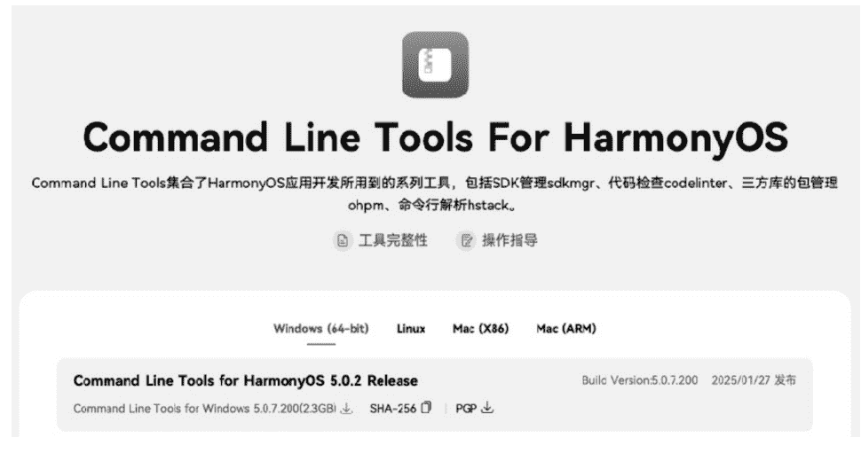

图2-4

2. 配置hdc环境变量

编辑配置文件（~/.zshrc或~/.bash_profile），在文件末尾添加以下代码：

```
export HDC_HOME=~/command-line-tools/sdk/default/openharmony/toolchains
export PATH=$HDC_HOME:$PATH
```

确保hdc命令可在终端任意位置直接执行，提高开发效率。

3. 设置hdc端口

为了避免端口冲突，可为hdc配置专用端口。在配置文件（~/.zshrc或~/.bash_profile）末尾添加以下代码：

```
export HDC_SERVER_PORT=7035
launchctl setenv HDC_SERVER_PORT $HDC_SERVER_PORT
```

7035为默认端口号，可根据需求调整，以确保hdc连接稳定且不受其他服务干扰。

4. 应用配置

保存配置文件后，执行source命令使修改生效。

在终端运行以下命令，确认hdc工具是否可用：

```
hdc --version
```

如果命令返回hdc的版本信息，则说明hdc配置成功，可正常使用。

#### 2.1.6 创建并验证鸿蒙项目

环境配置完成后，可创建一个简单的鸿蒙项目，验证DevEco Studio是否正确配置。通过创建并运行项目，确认开发环境是否已准备就绪。成功运行第一个项目是环境配置正确的标志。

1. 创建新项目

打开DevEco Studio，点击Create Project按钮，选择Empty Ability模板，填写项目名称，并选择保存路径。

2. 配置项目设置

填写项目名称（如HelloHarmony）和包名（如com.example.helloharmony），然后点击Finish按钮完成项目创建。如图2-5所示为项目创建界面示例。

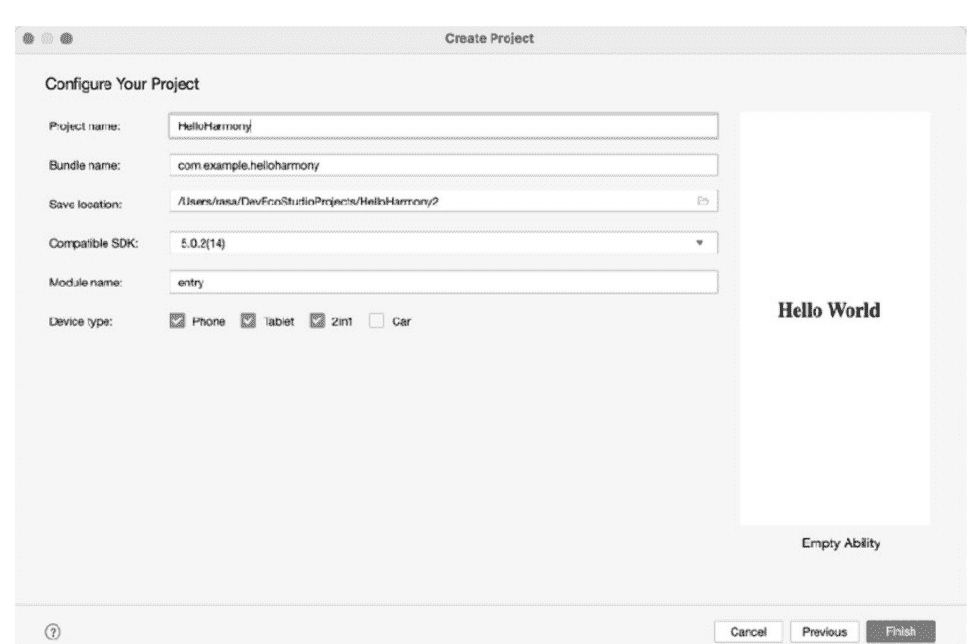

图2-5

3. 修改代码显示"Hello, Harmony!"

打开项目中的Index.ets文件，修改文件内容如下：

```
// src/main/ets/pages/Index.ets

@Entry
@Component
struct Index {
  build() {
    Column() {
      Text("Hello, Harmony!") // 显示 "Hello, Harmony!"
        .fontSize(30)
        .fontWeight(FontWeight.Bold)
        .padding(20);
    }
  }
}
```

通过运行这段代码，界面上将显示"Hello, Harmony! "，并应用以下样式设置：

1. 字体大小设置为30。
2. 字体加粗。
3. 添加20像素的内边距。

保存文件后，检查项目的编译与运行，确保DevEco Studio配置正确，开发环境可正常使用。

#### 2.1.7 使用预览器预览项目

DevEco Studio提供实时预览功能，可快速查看项目的UI效果。通过预览器（Previewer），无须设备即可验证应用界面，使界面调整更加便捷。

1. 启用Previewer

在DevEco Studio中，点击右侧的Previewer选项卡。若未显示，可从菜单栏依次选择View→Tool Windows→Previewer打开。

2. 实时预览

在Previewer中查看项目界面渲染效果，实时显示UI修改，确保界面元素的呈现符合预期。如图2-6所示为Previewer预览项目效果的示例。


图2-6

#### 2.1.8 使用模拟器预览项目

DevEco Studio提供模拟器功能，可在无真机设备的情况下进行开发和测试。通过模拟器，可在计算机上模拟鸿蒙设备的运行效果，支持多种设备环境，便于快速调整和优化应用。

1. 打开Device Manager

在DevEco Studio中，点击Tools→Device Manager打开设备管理器窗口。

2. 创建模拟器

在设备管理器窗口中，点击New Simulator创建一个新的模拟器。

3. 选择模拟器类型和版本

选择所需的模拟器类型（如Phone或Tablet），并指定目标版本，以匹配应用的运行环境。如图2-7所示为创建模拟器界面示例。

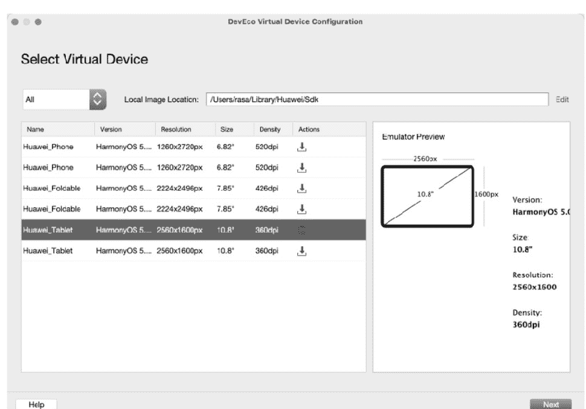

图2-7

在创建并配置模拟器后，可启动模拟器并运行项目，以验证应用的运行效果。

4. 启动模拟器

在设备管理器（Device Manager）窗口中，点击启动按钮，等待模拟器完成启动。

5. 运行项目到模拟器

选择已启动的模拟器，点击Run按钮，DevEco Studio将自动安装并运行项目。如图2-8所示为模拟器运行项目的示例。


图2-8

#### 2.1.9 真机USB调试

在鸿蒙设备上运行项目，可验证应用在真实硬件环境中的表现。通过USB调试方式，DevEco Studio可直接将应用部署到手机进行测试。

1. 启用开发者模式

进入设置→关于手机，连续点击“软件版本”7次，启用开发者选项。

2. 连接设备

使用USB数据线连接鸿蒙设备，并在弹出的提示框中授权USB调试权限。

3. 选择真机设备并运行

在DevEco Studio中，选择已连接的设备，点击Run按钮，将项目运行到手机上。

如图2-9所示为USB调试运行效果示例。


图2-9

#### 2.1.10 真机Wi-Fi调试

Wi-Fi调试可在无USB连接的情况下，将应用部署到鸿蒙设备进行测试。

##### 1.确保设备与Mac在同一网络

确保鸿蒙手机和Mac电脑连接到同一Wi-Fi网络，以保证无线调试的稳定性。

##### 2.查看设备IP地址和端口

在鸿蒙手机上，依次进入设置→系统→开发者选项→无线调试，开启无线调试，找到并记录设备的IP地址和端口。如图2-10所示为设备IP地址和端口显示页面示例。

##### 3.连接设备

在终端中输入以下命令：

```
hdc tconn <手机 IP 地址>:<端口号>
```

##### 4.验证连接

连接成功将显示：

```
Connect OK
```


图2-10

##### 5.运行项目

选择Wi-Fi连接的设备并点击Run按钮，DevEco Studio会通过Wi-Fi自动把项目部署到手机上。如图2-9所示，也是Wi-Fi调试运行效果。

通过以上步骤，已成功完成DevEco Studio的安装、配置，创建并运行第一个鸿蒙项目，并通过预览器、模拟器以及真机调试验收安装效果。

### 2.2 配置Ollama与DeepSeek模型

Ollama是一款轻量级的本地AI模型运行环境，可在Mac电脑上部署和使用大语言模型（LLM），如DeepSeek。该工具支持在本地环境中运行DeepSeek模型，实现离线推理。本节将介绍在Mac上安装和配置Ollama环境的具体步骤，并说明如何加载DeepSeek模型。

#### 2.2.1 安装Ollama并加载DeepSeek模型

本小节将介绍Ollama环境的安装及DeepSeek模型的加载过程，确保模型能够正常调用并执行推理任务。

##### 1.访问Ollama官网下载页面

打开浏览器（如Safari或Chrome），访问以下网址：

```
https://ollama.com/download
```

在页面中选择与Mac处理器架构匹配的版本：

- (1) Apple Silicon（M1、M2、M3芯片的Mac）：选择macOS（ARM64）。
- (2) Intel芯片的Mac：选择macOS（x86_64）。

若不确定芯片类型，可点击屏幕左上角的苹果菜单，选择“关于本机”查看芯片信息。

下载文件为.dmg格式，文件较大，下载时请确保网络稳定。

图2-11展示了Ollama的下载页面。

# Download Ollama


Download for macOS

Requires macOS 11 Big Sur or later

图2-11

##### 2.安装Ollama

下载完成后，找到.dmg文件并双击打开安装窗口。将Ollama图标拖动到“应用程序”文件夹，如图2-12所示。

##### 3.启动并验证Ollama

安装完成后，通过“启动台”或“应用程序”文件夹启动Ollama。在“终端”应用中输入以下命令验证安装：

```
ollama --version
```

如果成功安装，终端将显示Ollama的版本信息，如：


图2-12

图2-13展示了Ollama版本验证成功的示例。

```
rasa@RaMac ~ % ollama --version
ollama version is 0.5.7
```

图2-13

如果显示 “ollama: command not found”，请检查安装，或重启电脑后再次验证。

##### 4.浏览Ollama模型库

Ollama提供丰富的模型库，访问以下网址浏览可用模型：

```
https://ollama.com/library
```

在页面上可以查看并选择所需的模型。例如，要下载llama3模型，可以在库中找到相应的模型并使用pull命令。图2-14展示了Ollama模型库页面。


# Library

Filter models

Popular

# deepseek-r1

DeepSeek's first-generation of reasoning models with comparable performance to OpenAI-o1, including six dense models distilled from DeepSeek-R1 based on Llama and Qwen.

- 1.5b
- 7b
- 8b
- 14b
- 32b
- 70b
- 671b

↓ 16.5M Pulls  🏷 29 Tags  🕒 Updated 8 days ago

# llama3.3

New state of the art 70B model. Llama 3.3 70B offers similar performance compared to the Llama 3.1 405B model.

- tools
- 70b

↓ 1.3M Pulls  🏷 14 Tags  🕒 Updated 2 months ago

图2-14

##### 5.下载DeepSeek模型

使用以下命令下载DeepSeek模型：

```
ollama run deepseek-r1:1.5b
```

下载过程可能需要一段时间，具体取决于网络和模型大小。通过 ollama list命令可以查看已下载的模型。

#### 2.2.2 配置与测试Ollama接口

完成模型安装后，需要启动Ollama服务并验证模型是否正常工作。

##### 1.启动Ollama服务

输入以下命令启动Ollama服务：

```
ollama serve
```

此命令会在后台启动Ollama服务，保持终端窗口开启。

##### 2.运行并测试DeepSeek模型

使用以下命令运行DeepSeek模型并开始交互：

```
ollama run deepseek-r1:1.5b
```

在提示符＞下输入问题，例如：

```
What is the capital of France?
```

模型将返回答案：

```
The capital of France is Paris.
```

图2-15展示了与DeepSeek模型的交互。

```
rasa@RaMac ~ % ollama run deepseek-r1:1.5b
>>> What is the capital of France?

The capital of France is Paris.
>>> Send a message (/? for help)
```

图2-15

输入/bye可退出交互模式。

##### 3.验证接口

使用curl命令验证模型接口是否正常工作：

```
curl http://localhost:11434
```

若服务正常，终端将返回响应数据。

#### 2.2.3 配置网络与远程访问

Ollama允许局域网内设备通过IP地址远程访问模型服务。以下为配置方法。

##### 1.临时网络配置

若仅需临时启用网络访问，可以执行以下步骤。

- 获取本机IP地址：

```
ipconfig getifaddr en0
```

记录IP地址，如192.168.1.100。

- 配置Ollama允许局域网访问：

```
launchctl setenv OLLAMA_HOST "0.0.0.0"
launchctl setenv OLLAMA_ORIGINS "*"
```

- 重启Ollama服务：

```
pkill ollama && ollama serve
```

其他设备可以通过http://192.168.1.100:11434访问Ollama服务。

##### 2.持久化网络配置

若需要在每次启动时自动启用网络访问，需修改终端配置文件（~/.zshrc或~/.bash_profile），添加以下环境变量：

```
export OLLAMA_HOST="0.0.0.0"
export OLLAMA_ORIGINS="*"

launchctl setenv OLLAMA_HOST $OLLAMA_HOST
launchctl setenv OLLAMA_ORIGINS $OLLAMA_ORIGINS
```

保存配置文件后，执行source命令使修改生效，并重启Ollama服务。此配置将在每次重启后自动生效。

#### 2.2.4 验证Ollama与DeepSeek模型接口

通过HTTP请求验证模型接口。

##### 1.使用curl命令发送请求

发送请求测试接口：

```
curl http://localhost:11434/api/chat -d '{
  "model": "deepseek-r1:1.5b",
  "messages": [
    { "role": "user", "content": "What is the capital of France?" }
  ]
}'
```

##### 2.返回模型推理结果

若接口正常，终端会返回JSON格式的推理结果：

```
{"model":"deepseek-r1:1.5b","created_at":"2025-02-15T14:48:55.262478Z","message":{"role":"assistant","content":"\u003cthink\u003e"},"done":false}
{"model":"deepseek-r1:1.5b","created_at":"2025-02-15T14:48:55.278348Z","message":{"role":"assistant","content":"\n\n"},"done":false}
{"model":"deepseek-r1:1.5b","created_at":"2025-02-15T14:48:55.294291Z","message":{"role":"assistant","content":"\u003c/think\u003e"},"done":false}
{"model":"deepseek-r1:1.5b","created_at":"2025-02-15T14:48:55.310423Z","message":{"role":"assistant","content":"\n\n"},"done":false}
{"model":"deepseek-r1:1.5b","created_at":"2025-02-15T14:48:55.326628Z","message":{"role":"assistant","content":"The"},"done":false}
{"model":"deepseek-r1:1.5b","created_at":"2025-02-15T14:48:55.342887Z","message":{"role":"assistant","content":" capital"},"done":false}
{"model":"deepseek-r1:1.5b","created_at":"2025-02-15T14:48:55.360605Z","message":{"role":"assistant","content":" of"},"done":false}
{"model":"deepseek-r1:1.5b","created_at":"2025-02-15T14:48:55.377249Z","message":{"role":"assistant","content":" France"},"done":false}
{"model":"deepseek-r1:1.5b","created_at":"2025-02-15T14:48:55.393996Z","message":{"role":"assistant","content":" is"},"done":false}
{"model":"deepseek-r1:1.5b","created_at":"2025-02-15T14:48:55.410628Z","message":{"role":"assistant","content":" Paris"},"done":false}
{"model":"deepseek-r1:1.5b","created_at":"2025-02-15T14:48:55.426476Z","message":{"role":"assistant","content":"."},"done":false}
{"model":"deepseek-r1:1.5b","created_at":"2025-02-15T14:48:55.442292Z","message":{"role":"assistant","content":""},"done_reason":"stop","done":true,"total_duration":1050608042,"load_duration":549496292,"prompt_eval_count":10,"prompt_eval_duration":317000000,"eval_count":12,"eval_duration":180000000}
```

#### 2.2.5 常用指令汇总

- 查看已安装模型：

```
ollama list
```

- 下载模型：

```
ollama pull <模型名称>
```

- 运行模型：

```
ollama run <模型名称>
```

- 删除模型：

```
ollama rm <模型名称>
```

- 启动服务：

```
ollama serve
```

- 查看版本：

```
ollama --version
```

- 退出交互模式：

```
输入 /bye 并按回车键。
```

- 查看帮助：

```
ollama help
```

通过这些步骤，成功安装并配置了Ollama环境及DeepSeek模型，完成了接口验证，并可以在本地或局域网内调用模型进行推理。

### 2.3 配置Python环境与依赖

Python是一种广泛使用的编程语言，特别适用于Web开发、数据分析、人工智能等领域。配置Python环境并安装必要的依赖是开发Python项目的基础。本节介绍如何在Mac上安装Python 3（推荐版本），配置相关依赖，并通过测试接口确保环境设置成功。

重要提示：请务必安装Python 3版本。Python 2已于2020年停止维护，且不再推荐使用。本节所有步骤均基于Python 3。

#### 2.3.1 安装Python

Python可以通过官网下载安装包或使用Homebrew安装。推荐使用Homebrew安装，方便后续版本管理和更新。

##### 1.使用Homebrew安装（推荐）

如果尚未安装Homebrew，请访问https://brew.sh/按照官网指引安装Homebrew。

打开终端（Terminal），运行以下命令安装Python 3：

```
brew install python
```

Homebrew会自动下载并安装最新版本的Python 3及pip包管理工具。

##### 2.官网下载安装包（备选）

如果不使用Homebrew，可以选择从官网下载安装包。按照以下步骤操作。

1）访问Python官网下载页面

打开浏览器并访问Python官方下载页面：

```
https://www.python.org/downloads/macos/
```

图2-16展示了Python官网的下载页面。

2）下载适合macOS的安装包

在下载页面中，选择最新的Python 3版本对应的macOS.pkg安装包，并下载。

3）运行安装向导

双击下载的.pkg文件，按照安装向导完成Python安装。

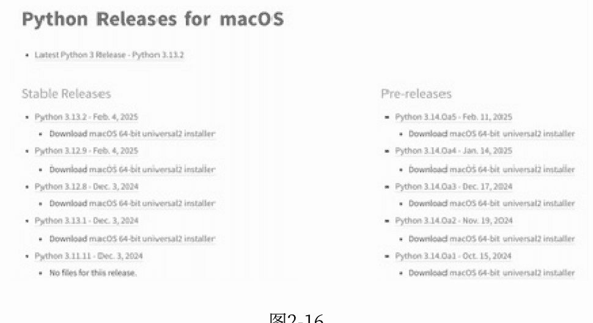

图2-16

##### 3.验证Python 3是否安装成功

安装完成后，在终端（Terminal）中运行以下命令验证Python 3是否正确安装：

```
python3 --version
```

如果显示类似于Python 3.x.x的版本号，说明Python 3已成功安装。
图2-17展示了终端验证Python版本的结果。

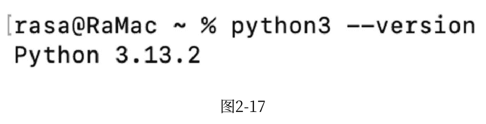

##### 4.适配Apple Silicon芯片

对于搭载Apple Silicon（M1/M2）芯片的Mac，Python 3默认兼容良好。如果遇到兼容性问题，可以尝试使用arch-arm64 brew install python重新安装，或者通过Rosetta模式运行Python。

#### 2.3.2 配置与使用pip

pip是Python的包管理工具，用于安装和管理第三方库。为了确保顺利管理库和依赖，下面是配置和优化pip的步骤。

- 验证pip是否安装

在终端中运行以下命令，检查pip是否已安装：

```
pip3 -V
```

如果返回版本号，说明pip已正确安装。

如图2-18展示了验证pip版本的结果。

```
rasa@RaMac ~ % pip3 -V
pip 25.0.1 from /Library/Frameworks/Python.framework/Versions/3.13/lib/python3.13/site-packages/pip (python 3.13)
```

图2-18

- 手动安装pip（如果未安装）

通常情况下，通过官网安装包或Homebrew安装Python 3时，pip会一同安装。如果未安装，可以使用以下命令手动安装：

```
python -m ensurepip --default-pip
```

或者下载官方安装脚本：

```
curl -o get-pip.py https://bootstrap.pypa.io/get-pip.py
python get-pip.py
```

- 建立符号链接（可选但推荐）

如果希望在终端中直接使用python和pip命令调用python3和pip3，而无须每次输入python3和pip3，可以创建符号链接。操作前请确保了解其影响，并谨慎执行。

检查python和pip的路径，使用以下命令确认它们的安装路径：

```
which python3
which pip3
```

使用以下命令创建符号链接：

#### 2.3.3 配置与使用Python虚拟环境

强烈建议在Python开发中使用虚拟环境。虚拟环境可以为每个项目创建一个独立的Python运行环境，隔离不同项目之间的依赖包，避免版本冲突，保持项目环境的整洁。

- 安装virtualenv或venv

Python 3.3+版本自带venv模块，可以直接使用。若需使用更强大的虚拟环境管理工具，亦可安装virtualenv：

```
pip install virtualenv
```

推荐使用venv，无须额外安装。

- 创建虚拟环境

在项目目录中运行以下命令创建虚拟环境（名称可自定义）：

```
python -m venv venv
```

- 激活虚拟环境

在macOS或Linux系统中，运行以下命令激活虚拟环境：

```
source venv/bin/activate
```

- 在虚拟环境中安装依赖

激活虚拟环境后，使用pip安装项目所需的依赖包，这些包将安装在虚拟环境内：

```
pip install requests
```

- 退出虚拟环境

在终端中运行deactivate命令即可退出虚拟环境：

```
deactivate
```

#### 2.3.4 测试Python环境

配置好Python、pip和虚拟环境后，进行简单的测试，确保环境配置成功。

- 安装常用依赖

在激活虚拟环境后，使用pip安装常用的Python库，如requests：

```
pip install requests
```

- 创建并测试简单的Python程序

在项目目录下创建一个Python文件进行测试，如HelloHarmony.py：

```
nano HelloHarmony.py
```

输入以下代码：

```
print("Hello, Harmony!")
```

保存并退出后，运行该程序：

```
python HelloHarmony.py
```

如果输出 “Hello, Harmony! ”，说明Python环境配置成功。

图2-19展示了在终端中运行测试程序的效果。


图2-19

#### 2.3.5 配置与使用PyCharm（可选）

PyCharm是一款强大的Python IDE，提供丰富的开发工具帮助编写和调试代码。推荐使用PyCharm提高开发效率。

- 下载PyCharm安装包

访问PyCharm官网下载页面，下载适用于macOS的社区版（Community Edition）：

```
https://www.jetbrains.com/pycharm/download/
```

- 安装PyCharm

双击下载的.dmg文件，将PyCharm图标拖动到Applications文件夹中完成安装。

- 启动PyCharm并创建新项目

启动PyCharm，选择“Create New Project”。

- 配置Python解释器

在创建项目时，PyCharm会提示配置Python解释器。选择“Previously configured interpreter”，点击右侧齿轮图标，选择Add Interpreter→Add Local Interpreter。在弹出的窗口中选择已安装的Python 3解释器路径。若通过Homebrew安装，路径通常为/usr/local/bin/python；若使用虚拟环境，则应选择对应虚拟环境中的Python解释器路径。

- 创建并运行Python测试程序

在PyCharm中创建新的Python文件，如HelloHarmony.py，输入以下代码：

```
print("Hello, Harmony!")
```

右键点击文件，选择“Run'HelloHarmony'”，查看控制台输出：

```
Hello, Harmony!
```

通过以上步骤，已成功在Mac上安装并配置了Python 3环境、pip包管理工具、虚拟环境和PyCharm IDE（可选）。现在，可以开始使用Python进行各种开发任务了！

### 2.4 DeepSeek模型吞吐量测试与接口访问

本节将介绍如何使用Ollama提供的多种接口与本地大模型进行交互，并对不同DeepSeek模型的吞吐量进行测试。Ollama支持Python接口、API接口及OpenAI兼容接口，开发者可以根据需求选择合适的方式调用模型。我们将详细讲解接口的安装、配置、使用方法及测试步骤，并展示不同模型的性能测试结果。

#### 2.4.1 Ollama Python接口

本小节将详细介绍如何利用Ollama的Python接口调用本地模型，支持流式输出、非流式输出以及基于对话的连续交互。

适用场景：适用于开发者需要通过Python脚本直接与模型交互的场景，如文本生成、聊天机器人等。

- 安装Python依赖包

在终端中执行以下命令，安装Ollama Python包：

```
pip install ollama
```

- 使用流式接口获取模型输出

流式接口适用于逐步展示输出的应用场景，示例代码如下：

```
# -*- coding: utf-8 -*-
# 1.4/stream_output.py

import ollama

# 使用流式接口生成文本
stream = ollama.generate(stream=True, model='deepseek-r1:1.5b', prompt='Hello')
for chunk in stream:
    if not chunk['done']:
        print(chunk['response'], end='\n', flush=True)
    else:
        print('\n')
        print('----------------------------------------')
```

- 使用非流式接口获取完整回答

若无须实时逐步展示输出，可以使用非流式接口一次性获取完整结果：

```
# -*- coding: utf-8 -*-
# 1.4/non_stream_output.py

import ollama

# 使用非流式接口生成文本
content = ollama.generate(model='deepseek-r1:1.5b', prompt='Hello')
print(content['response'])
print('----------------------------------------')
```

- 使用对话接口进行连续交互

对话接口支持多轮交互，适合构建聊天机器人等应用：

```
# -*- coding: utf-8 -*-
# 1.4/chat_interface.py

import ollama

# 使用对话接口
messages = [{"role": "user", "content": "Hello"}]
content = ollama.chat(model='deepseek-r1:1.5b', messages=messages)
print(content['message']['content'])
```

图2-20展示了使用Python流式接口与模型交互的效果。


图2-20

#### 2.4.2 Ollama API接口

本小节将介绍如何通过HTTP API调用Ollama模型，适合跨平台集成与远程调用。

适用场景：适用于需要通过HTTP请求与模型交互的跨平台或远程调用场景，特别是在云端服务与本地模型集成时非常有用。

- 使用API生成模型响应

通过curl命令发POST请求生成文本响应：

```
curl http://localhost:11434/api/generate -d '{
  "model": "deepseek-r1:1.5b",
  "prompt": "Why is the sky blue?"
}'
```

- 使用API进行对话交互

通过POST请求与模型进行多轮对话：

```
curl http://localhost:11434/api/chat -d '{
  "model": "deepseek-r1:1.5b",
  "messages": [
    { "role": "user", "content": "Why is the sky blue?" }
  ]
}'
```

图2-21展示了通过API接口进行模型交互的效果。

```
rasa@RaMac ~ % curl http://localhost:11434/api/generate -d '{
  "model": "deepseek-r1:1.5b",
  "prompt": "Why is the sky blue?"
}'
{"model":"deepseek-r1:1.5b","created_at":"2025-02-16T05:52:58.929708Z","response":"\u003cthink\u003e","done":false}
{"model":"deepseek-r1:1.5b","created_at":"2025-02-16T05:52:58.945438Z","response":"\n\n","done":false}
{"model":"deepseek-r1:1.5b","created_at":"2025-02-16T05:52:58.961279Z","response":"\u003c/think\u003e","done":false}
{"model":"deepseek-r1:1.5b","created_at":"2025-02-16T05:52:58.977846Z","response":"\n\n","done":false}
{"model":"deepseek-r1:1.5b","created_at":"2025-02-16T05:52:58.994312Z","response":"The","done":false}
{"model":"deepseek-r1:1.5b","created_at":"2025-02-16T05:52:59.010307Z","response":" color","done":false}
{"model":"deepseek-r1:1.5b","created_at":"2025-02-16T05:52:59.027141Z","response":" of","done":false}
{"model":"deepseek-r1:1.5b","created_at":"2025-02-16T05:52:59.04403Z","response":" the","done":false}
{"model":"deepseek-r1:1.5b","created_at":"2025-02-16T05:52:59.060434Z","response":" sky","done":false}
{"model":"deepseek-r1:1.5b","created_at":"2025-02-16T05:52:59.077863Z","response":",","done":false}
{"model":"deepseek-r1:1.5b","created_at":"2025-02-16T05:52:59.095076Z","response":" known","done":false}
{"model":"deepseek-r1:1.5b","created_at":"2025-02-16T05:52:59.11491Z","response":" as","done":false}
{"model":"deepseek-r1:1.5b","created_at":"2025-02-16T05:52:59.128272Z","response":" a","done":false}
{"model":"deepseek-r1:1.5b","created_at":"2025-02-16T05:52:59.14435Z","response":" meteor","done":false}
{"model":"deepseek-r1:1.5b","created_at":"2025-02-16T05:52:59.160049Z","response":"ic","done":false}
{"model":"deepseek-r1:1.5b","created_at":"2025-02-16T05:52:59.176602Z","response":" color","done":false}
{"model":"deepseek-r1:1.5b","created_at":"2025-02-16T05:52:59.192877Z","response":",","done":false}
{"model":"deepseek-r1:1.5b","created_at":"2025-02-16T05:52:59.208611Z","response":" primarily","done":false}
{"model":"deepseek-r1:1.5b","created_at":"2025-02-16T05:52:59.224998Z","response":" results","done":false}
{"model":"deepseek-r1:1.5b","created_at":"2025-02-16T05:52:59.241253Z","response":" from","done":false}
{"model":"deepseek-r1:1.5b","created_at":"2025-02-16T05:52:59.256848Z","response":" the","done":false}
{"model":"deepseek-r1:1.5b","created_at":"2025-02-16T05:52:59.273141Z","response":" scattering","done":false}
{"model":"deepseek-r1:1.5b","created_at":"2025-02-16T05:52:59.289299Z","response":" of","done":false}
{"model":"deepseek-r1:1.5b","created_at":"2025-02-16T05:52:59.304859Z","response":" sunlight","done":false}
{"model":"deepseek-r1:1.5b","created_at":"2025-02-16T05:52:59.321296Z","response":" by","done":false}
{"model":"deepseek-r1:1.5b","created_at":"2025-02-16T05:52:59.337566Z","response":" particles","done":false}
{"model":"deepseek-r1:1.5b","created_at":"2025-02-16T05:52:59.353299Z","response":" in","done":false}
{"model":"deepseek-r1:1.5b","created_at":"2025-02-16T05:52:59.369659Z","response":" the","done":false}
{"model":"deepseek-r1:1.5b","created_at":"2025-02-16T05:52:59.385958Z","response":" Earth","done":false}
{"model":"deepseek-r1:1.5b","created_at":"2025-02-16T05:52:59.401598Z","response":"'s","done":false}
{"model":"deepseek-r1:1.5b","created_at":"2025-02-16T05:52:59.418062Z","response":" atmosphere","done":false}
{"model":"deepseek-r1:1.5b","created_at":"2025-02-16T05:52:59.434291Z","response":",","done":false}
{"model":"deepseek-r1:1.5b","created_at":"2025-02-16T05:52:59.450057Z","response":" These","done":false}
{"model":"deepseek-r1:1.5b","created_at":"2025-02-16T05:52:59.467055Z","response":" particles","done":false}
{"model":"deepseek-r1:1.5b","created_at":"2025-02-16T05:52:59.482795Z","response":",","done":false}
{"model":"deepseek-r1:1.5b","created_at":"2025-02-16T05:52:59.498542Z","response":" including","done":false}
{"model":"deepseek-r1:1.5b","created_at":"2025-02-16T05:52:59.515519Z","response":" both","done":false}
{"model":"deepseek-r1:1.5b","created_at":"2025-02-16T05:52:59.531147Z","response":" neutral","done":false}
{"model":"deepseek-r1:1.5b","created_at":"2025-02-16T05:52:59.546919Z","response":" and","done":false}
{"model":"deepseek-r1:1.5b","created_at":"2025-02-16T05:52:59.564004Z","response":" charged","done":false}
{"model":"deepseek-r1:1.5b","created_at":"2025-02-16T05:52:59.579752Z","response":" particles","done":false}
{"model":"deepseek-r1:1.5b","created_at":"2025-02-16T05:52:59.595569Z","response":" like","done":false}
{"model":"deepseek-r1:1.5b","created_at":"2025-02-16T05:52:59.611977Z","response":" oxygen","done":false}
{"model":"deepseek-r1:1.5b","created_at":"2025-02-16T05:52:59.627811Z","response":" atoms","done":false}
{"model":"deepseek-r1:1.5b","created_at":"2025-02-16T05:52:59.643583Z","response":",","done":false}
{"model":"deepseek-r1:1.5b","created_at":"2025-02-16T05:52:59.660127Z","response":" are","done":false}
{"model":"deepseek-r1:1.5b","created_at":"2025-02-16T05:52:59.676452Z","response":" often","done":false}
{"model":"deepseek-r1:1.5b","created_at":"2025-02-16T05:52:59.692219Z","response":" referred","done":false}
{"model":"deepseek-r1:1.5b","created_at":"2025-02-16T05:52:59.708678Z","response":" to","done":false}
{"model":"deepseek-r1:1.5b","created_at":"2025-02-16T05:52:59.725021Z","response":" as","done":false}
{"model":"deepseek-r1:1.5b","created_at":"2025-02-16T05:52:59.740702Z","response":" "","done":false}
{"model":"deepseek-r1:1.5b","created_at":"2025-02-16T05:52:59.757252Z","response":"sm","done":false}
```

图2-21

#### 2.4.3 OpenAI接口

本小节将讲解如何通过OpenAI兼容接口调用Ollama模型，适合已熟悉OpenAI平台的开发者。

适用场景：适用于开发者已习惯使用OpenAI API的场景，特别是在已有OpenAI集成的应用中迁移到Ollama时。

##### ● 安装OpenAI包

在终端中执行以下命令安装OpenAI包：

```
pip install openai
```

##### ● 使用OpenAI接口调用模型

以下代码展示了如何通过OpenAI接口与Ollama模型进行交互：

```python
# -*- coding: utf-8 -*-
# 1.4/openai_interface.py

from openai import OpenAI

client = OpenAI(
    base_url='http://localhost:11434/v1/',
    api_key='ollama',  # 这里的 API Key 可忽略
)

chat_completion = client.chat.completions.create(
    messages=[
        {
            'role': 'user',
            'content': 'Hello',
        }
    ],
    model='deepseek-r1:1.5b',
)

print(chat_completion)
print(chat_completion.choices[0].message.content)
```

图2-22展示了通过OpenAI接口与模型交互的效果。


图2-22

#### 2.4.4 配置和测试

本小节将讲解如何配置并测试Ollama服务，以确保接口能够正常访问本地模型。

- ● 启动Ollama服务

在终端中执行以下命令启动Ollama服务：

```
ollama serve
```

- ● 验证服务地址

通过浏览器或HTTP工具访问：

```
http://localhost:11434
```

若能够正常访问，说明服务已成功启动。

- ● 测试各接口调用

分别运行上述Python脚本或使用curl命令进行接口测试，确保能够与模型交互并获得预期结果。

#### 2.4.5 吞吐量测试与结果分析

本小节展示了在MacBook Pro（M2 Pro，16GB内存）上，对4个DeepSeek模型（deepseek-r1:1.5b、deepseek-r1:7b、deepseek-r1:8b、deepseek-r1:14b）进行的吞吐量测试。

##### 1. Mac配置信息

以下是进行吞吐量测试的Mac电脑配置详情，仅供参考。

型号：MacBook Pro（13-inch，2022）。

芯片：Apple M2 Pro。

内存：16 GB统一内存。

存储：1T SSD。

操作系统：macOS Sequoia 16.3.1。

Ollama版本：0.5.7。

补充说明：上述测试是在macOS环境下，使用Apple芯片的Mac电脑进行的。由于Ollama针对Apple芯片进行了优化，因此在M系列芯片的Mac上运行本地模型通常能够获得较好的性能。需要注意的是，在其他平台（如Linux或Windows）或不同硬件配置的机器上进行测试时，吞吐量结果可能会有所不同。

##### 2. 测试代码（Python接口）

使用Python接口并行测试模型吞吐量：

```python
# -*- coding: utf-8 -*-
# 1.4/throughput_test.py

import ollama
import time
import argparse
from concurrent.futures import ThreadPoolExecutor
from statistics import mean, stdev

def test_request(model, prompt):
    """发送单个请求并记录性能指标"""
    start_time = time.time()
    try:
        response = ollama.generate(model=model, prompt=prompt)
        elapsed = time.time() - start_time

        # 提取 Token 使用信息（假设 API 返回这些字段）
        prompt_tokens = response.get('prompt_tokens', 0)
        response_tokens = response.get('response_tokens', 0)

        return {
            'success': True,
            'time': elapsed,
            'prompt_tokens': prompt_tokens,
            'response_tokens': response_tokens
        }
    except Exception as e:
        return {
            'success': False,
            'error': str(e),
            'time': time.time() - start_time
        }

def run_test(model, params):
    """执行单次测试运行"""
    # 预热阶段
    for _ in range(params['num_warmup']):
        test_request(model, params['prompt'])

    # 正式测试
    start_time = time.time()
    with ThreadPoolExecutor(max_workers=params['concurrency']) as executor:
        futures = [executor.submit(test_request, model, params['prompt'])
                   for _ in range(params['num_requests'])]

    # 收集结果
    results = [f.result() for f in futures]
    end_time = time.time()

    # 处理统计数据
    success_results = [r for r in results if r['success']]
    success_count = len(success_results)
    failure_count = params['num_requests'] - success_count

    # 时间统计
    total_time = end_time - start_time
    latencies = [r['time'] for r in success_results]

    # Token 统计（如果可用）
    prompt_tokens = sum(r.get('prompt_tokens', 0) for r in success_results)
    response_tokens = sum(r.get('response_tokens', 0) for r in success_results)

    return {
        'total_time': total_time,
        'success_count': success_count,
        'failure_count': failure_count,
        'latencies': latencies,
        'prompt_tokens': prompt_tokens,
        'response_tokens': response_tokens
    }

def analyze_results(results, params):
    """分析多次测试结果并生成报告"""
    # 合并多次运行的数据
    all_latencies = []
    all_throughputs = []
    all_token_throughputs = []

    for run in results:
        if run['success_count'] == 0:
            continue

        # 请求吞吐量
        all_throughputs.append(run['success_count'] / run['total_time'])

        # Token 吞吐量 (如果可用)
        total_tokens = run['prompt_tokens'] + run['response_tokens']
        if total_tokens > 0:
            all_token_throughputs.append(total_tokens / run['total_time'])

        # 合并延迟数据
        all_latencies.extend(run['latencies'])

    # 生成统计信息
    stats = {
        '请求成功率': mean([run['success_count'] / params['num_requests'] for run in results]),
        '平均吞吐量 (QPS)': mean(all_throughputs) if all_throughputs else 0,
        '吞吐量标准差': stdev(all_throughputs) if len(all_throughputs) > 1 else 0,
        '平均延迟 (s)': mean(all_latencies) if all_latencies else 0,
        '延迟标准差': stdev(all_latencies) if len(all_latencies) > 1 else 0,
        '最大延迟': max(all_latencies) if all_latencies else 0,
        'P95 延迟': sorted(all_latencies)[int(len(all_latencies) * 0.95)] if all_latencies else 0
    }

    if all_token_throughputs:
        stats.update({
            '平均Token吞吐量 (tok/s)': mean(all_token_throughputs),
            'Token吞吐量标准差': stdev(all_token_throughputs) if len(all_token_throughputs) > 1 else 0
        })

    return stats

def main():
    """主测试程序"""
    parser = argparse.ArgumentParser(description='模型吞吐量测试工具')
    parser.add_argument('--models', nargs='+', required=True, help='要测试的模型名称列表')
    parser.add_argument('-n', '--num-requests', type=int, default=100, help='每个测试的请求总数')
    parser.add_argument('-c', '--concurrency', type=int, default=10, help='并发请求数量')
    parser.add_argument('-w', '--num-warmup', type=int, default=3, help='预热请求次数')
    parser.add_argument('-r', '--num-runs', type=int, default=3, help='每个模型的测试次数')
    parser.add_argument('-p', '--prompt', default='Test', help='使用的测试提示语')
    args = parser.parse_args()

    test_params = {
        'num_requests': args.num_requests,
        'concurrency': args.concurrency,
        'num_warmup': args.num_warmup,
        'prompt': args.prompt
    }

    for model in args.models:
        print(f"\n{'=' * 40}\n开始测试模型: {model}\n{'=' * 40}")

        # 执行多次测试
        all_results = []
        for i in range(args.num_runs):
            print(f"\n测试运行 {i + 1}/{args.num_runs}...")
            result = run_test(model, test_params)
            all_results.append(result)
            print(f"完成 {result['success_count']}/{test_params['num_requests']} 请求 "
                  f"(QPS: {result['success_count'] / result['total_time']:.2f})")

        # 生成分析报告
        stats = analyze_results(all_results, test_params)

        # 打印报告
        print(f"\n{'-' * 40}\n测试结果汇总 ({model}):")
        print(f"平均吞吐量: {stats['平均吞吐量 (QPS)']:.2f} ± {stats['吞吐量标准差']:.2f} QPS")
        print(f"请求成功率: {stats['请求成功率']:.3%}")
        print(f"延迟统计: {stats['平均延迟 (s)']:.3f}s ± {stats['延迟标准差']:.3f}")
        print(f"最大延迟: {stats['最大延迟']:.3f}s | P95 延迟: {stats['P95 延迟']:.3f}s")

        if '平均Token吞吐量 (tok/s)' in stats:
            print(f"Token 吞吐量: {stats['平均Token吞吐量 (tok/s)']:.0f} ± "
                  f"{stats['Token吞吐量标准差']:.0f} tokens/s")

if __name__ == "__main__":
    main()
```

##### 3. 运行代码

执行以下命令开始测试：

```
python throughput_test.py --models deepseek-r1:1.5b deepseek-r1:7b deepseek-r1:8b deepseek-r1:14b
```

##### 4. 测试结果展示

图2-23展示了deepseek-r1:1.5b模型的吞吐量测试结果。

```
========================================
开始测试模型：deepseek-r1:1.5b
========================================

测试运行 1/3...
完成 100/100 请求 (QPS: 2.75)

测试运行 2/3...
完成 100/100 请求 (QPS: 2.74)

测试运行 3/3...
完成 100/100 请求 (QPS: 2.77)

----------------------------------------
测试结果汇总 (deepseek-r1:1.5b):
平均吞吐量：2.75 ± 0.02 QPS
请求成功率：100.000%
延迟统计：3.495s ± 0.649
最大延迟：5.970s | P95延迟：4.352s
```

图2-23

图2-24展示了deepseek-r1:7b模型的吞吐量测试结果。

```
========================================
开始测试模型：deepseek-r1:7b
========================================

测试运行 1/3...
完成 100/100 请求 (QPS: 0.32)

测试运行 2/3...
完成 100/100 请求 (QPS: 0.70)

测试运行 3/3...
完成 100/100 请求 (QPS: 0.23)

----------------------------------------
测试结果汇总 (deepseek-r1:7b):
平均吞吐量：0.42 ± 0.25 QPS
请求成功率：100.000%
延迟统计：24.716s ± 30.063
最大延迟：273.545s | P95延迟：47.048s
```

图2-24

图2-25展示了deepseek-r1:8b模型的吞吐量测试结果。

```
========================================
开始测试模型：deepseek-r1:8b
========================================

测试运行 1/3...
完成 100/100 请求 (QPS: 0.17)

测试运行 2/3...
完成 100/100 请求 (QPS: 0.37)

测试运行 3/3...
完成 100/100 请求 (QPS: 0.13)

----------------------------------------
测试结果汇总 (deepseek-r1:8b):
平均吞吐量：0.22 ± 0.13 QPS
请求成功率：100.000%
延迟统计：46.065s ± 70.575
最大延迟：741.759s | P95延迟：184.591s
```

图2-25

图2-26展示了deepseek-r1:14b模型的吞吐量测试结果。

##### 5. 结果分析

从测试结果可以看出，模型规模越大，吞吐量越低，延迟越高，这与预期一致。由于参数量较小，deepseek-r1:1.5b模型的吞吐量明显高于其他模型，更适用于对响应速度要求较高的场景。而deepseek-r1:14b模型虽然吞吐量较低，但其模型能力更强，适用于对模型效果要求更高的场景。

请注意：吞吐量测试结果会受到硬件配置、模型版本、Ollama版本、网络环境以及并发请求数等多种因素的影响。上述结果仅供参考，实际应用中请根据自身环境进行测试和调优。

#### 2.4.6 调试和问题排查

- (1) Ollama服务是否正常运行：确保服务已通过ollama serve正常启动。
- (2) 端口是否正确：确认默认端口11434是否被其他服务占用。可以使用lsof -i: 11434命令（macOS/Linux）或netstat -ano | findstr 11434命令（Windows）检查端口占用情况。
- (3) 网络连接：若通过网络访问接口，需确保网络畅通且无防火墙阻挡。
- (4) 模型是否已拉取：使用ollama list命令检查要测试的模型是否已经成功拉取到本地。
- (5) 资源限制：检查系统资源（CPU、内存）使用情况，模型运行可能受资源瓶颈限制。
- (6) Ollama日志：查看Ollama服务端的日志输出，通常可以找到更详细的错误信息。

## 第3章 ArkTS与DeepSeek的直接交互

本章介绍了ArkTS与DeepSeek模型之间的直接交互机制。通过基础交互、情感创作、情绪驱动和多语种翻译等多种场景的实现，展示了如何利用ArkTS直接调用模型接口，实时实现数据传输与交互效果。

### 3.1 基础交互：ArkTS与DeepSeek的通信实现

本节将介绍如何通过ArkTS构建一个简单的应用与DeepSeek模型进行交互。通过这一过程，开发者将学习如何使用ArkTS调用后端模型，获取生成的内容，并将其展示给用户。

#### 3.1.1 创建基础项目并初始化

在这一小节中，将创建并初始化一个ArkTS项目，该项目包含一个按钮，用于触发与DeepSeek模型的交互。此步骤帮助快速搭建项目框架，为后续功能开发奠定基础。

##### 1. 创建项目

使用DevEco Studio创建一个新的ArkTS项目，命名为DeepSeekInteractionApp。

##### 2. 构建目录结构

创建以下目录结构来组织代码文件：

```
src/
├── main/
│   ├── ets/
│   │   ├── configs/          # 配置文件目录
│   │   │   └── Config.ets    # 配置文件
│   │   ├── pages/            # 页面文件
│   │   │   └── Index.ets     # 首页
│   │   ├── services/         # 服务层，处理与模型的交互
│   │   │   └── ModelService.ets # 模型服务
│   │   ├── types/            # 类型定义
│   │   │   └── ModelTypes.ets # 模型类型定义
│   │   └── utils/            # 工具函数
│   │       ├── HttpClient.ets # HTTP 客户端
│   │       └── StreamingUtils.ets # 流式数据处理工具
│   └── module.json5          # 模块配置文件
```

#### 3.1.2 配置网络权限与模型交互

在这一小节中，将配置网络权限，确保应用能够访问DeepSeek模型服务的API。在module.json5文件中声明所需的权限，以保证应用能够顺利进行数据请求和响应处理。

```json
{
    "module": {
        "requestPermissions": [
            {
                "name": "ohos.permission.INTERNET"  // 声明访问互联网的权限
            }
        ]
    }
}
```

#### 3.1.3 创建服务层与模型交互

此小节将介绍如何创建服务层ModelService，该层负责向DeepSeek模型发送请求并处理返回的数据。服务层支持流式响应，能够逐步获取并显示模型生成的内容，确保前端内容实时展示。

```typescript
// src/main/ets/services/ModelService.ets

import { httpRequestText } from '../utils/HttpClient'; // 导入 HTTP 请求方法
import { http } from '@kit.NetworkKit'; // 导入自定义网络模块
import { RequestBody, ChatResponse } from '../types/ModelTypes'; // 导入类型

export class ModelService {
  private apiUrl: string;
  private modelName: string;

  constructor(apiUrl: string, modelName: string) {
    this.apiUrl = apiUrl;
    this.modelName = modelName;
  }

  /**
   * 处理流式返回的响应数据
   * @param chunk - 每个流式返回的数据块
   * @param onChunkReceived - 可选的回调函数，用于处理每个数据块
   * @returns 解析后的内容
   */
  private processResponseChunk(chunk: string, onChunkReceived?: (chunk: string) => void): string {
    try {
      const response: ChatResponse = JSON.parse(chunk);
      const content = response.message?.content;
      if (content) {
        onChunkReceived?.(content); // 调用回调函数处理每个数据块
        return content;
      }
      return '';
    } catch (parseError) {
      console.error('解析响应数据块时出错:', parseError);
      throw new Error(`解析错误: ${parseError.message}`); // 提供详细错误信息
    }
  }

  /**
   * 与模型交互，发送请求并获取响应
   * @param prompt - 用户输入的提示内容
   * @param onChunkReceived - 可选的回调函数，用于处理流式返回的每个数据块
   * @returns 完整的响应数据
   */
  public async queryModel(
    prompt: string,
    onChunkReceived?: (chunk: string) => void
  ): Promise<string> {
    const requestBody: RequestBody = {
      model: this.modelName,
      messages: [{ role: 'user', content: prompt }],
    };

    console.info('发送请求，载荷:', requestBody);

    try {
      let fullResponse = '';

      // 使用 httpRequest 发送请求并处理流式响应
      await httpRequestText(this.apiUrl, http.RequestMethod.POST,
        JSON.stringify(requestBody), 60000,
        (chunk: string) => {
          const content = this.processResponseChunk(chunk, onChunkReceived);
          fullResponse += content;
        });

      console.info('请求完成');
      return fullResponse; // 返回完整的响应数据
    } catch (error) {
      console.error('与模型交互失败:', error);
      throw new Error(`与模型交互失败: ${error instanceof Error ? error.message : error}`);
    }
  }

  /**
   * 发送消息并获取响应，支持流式输出
   * @param prompt - 用户输入的提示内容
   * @param onChunkReceived - 可选的回调函数，用于处理流式返回的每个数据块
   * @returns 完整的响应数据
   */
  public async fetchResponse(
    prompt: string,
    onChunkReceived?: (chunk: string) => void
  ): Promise<string> {
    // 直接调用 queryModel 方法，避免重复代码
    return this.queryModel(prompt, onChunkReceived);
  }
}
```

#### 3.1.4 构建UI与展示模型结果

本节将介绍如何构建用户页面，通过按钮和文本显示区域展示模型生成的内容。用户点击按钮后，应用将请求DeepSeek模型生成的文本，并逐步展示生成的内容，提供实时推理的交互体验。

```typescript
// src/main/ets/pages/Index.ets

import { config } from '../configs/Config'; // 导入配置文件
import { ModelService } from '../services/ModelService'; // 导入模型服务

@Entry
@Component
struct Index {
  @State resultText: string = ''; // 存储响应结果的文本

  /**
   * 根据按钮点击获取数据，并生成响应文本
   * @description 该方法会调用 ModelService 获取生成的诗歌文本，并逐块更新结果文本
   */
  async fetchData() {
    // 创建 ModelService 实例，传入配置的 API 地址和模型名称
    const modelService = new ModelService(config.ollamaApiUrl, config.modelName);

    // 定义用于生成诗歌的提示词
    const poetryPrompt = 'What is the meaning of life?';

    // 清空之前的结果，确保每次点击时更新文本
    this.resultText = '';

    try {
      // 调用模型服务的 fetchResponse 方法，并逐块处理结果
      await modelService.fetchResponse(poetryPrompt, (partialResult: string) => {
        console.log('Soothing poetry result chunk:', partialResult); // 输出当前获取的诗歌片段
        this.resultText += partialResult; // 将返回的每一块结果追加到结果文本中
      });
    } catch (error) {
      console.error('Error while fetching data:', error); // 错误日志
    }
  }

  build() {
    // 页面布局结构
    Column() {
      // 获取数据按钮
      Button('Fetch Data')
        .width('match_parent') // 按钮宽度设置为填满父容器
        .height(50) // 设置按钮的高度
        .onClick(() => this.fetchData()) // 点击按钮时调用 fetchData 方法

      // 显示响应结果的滚动区域
      Scroll() {
        Column() {
          // 显示获取的文本结果
          Text(this.resultText)
            .width('match_parent') // 设置文本宽度填满父容器
            .height('match_content') // 文本高度自适应
            .margin({ top: 20 }) // 上边距
        }
        .width('match_parent') // 设置滚动区域宽度为父容器的宽度
        .height('match_content') // 设置滚动区域高度自适应
      }
      .width('match_parent') // 设置滚动区域宽度为父容器的宽度
      .height('match_content') // 设置滚动区域高度自适应
    }
    .width('100%') // 设置父容器宽度为100%
    .height('100%') // 设置父容器高度为100%
    .padding(20) // 添加内边距
    .align(Alignment.Center) // 居中对齐
  }
}
```

#### 3.1.5 代码示例：与DeepSeek交互

此小节通过代码示例展示了如何使用ArkTS调用DeepSeek模型进行推理，并逐步展示返回的结果。

```typescript
const modelService = new ModelService(config.ollamaApiUrl, config.modelName);
const prompt = 'What is the meaning of life?';

modelService.fetchResponse(prompt, (partialResult: string) => {
  console.log('Soothing poetry result chunk:', partialResult);
  this.resultText += partialResult;
});
```

#### 3.1.6 启动与验证交互效果

启动应用并验证交互效果。确保用户点击能够触发模型推理，且模型生成的内容能够顺利展示。

##### 1. 启动应用

确保本地模型服务已启动后，执行以下命令启动Ollama服务：

```bash
ollama serve
```

如果出现端口被占用的提示，则表示服务已经运行，无须重复启动。

##### 2. 验证应用

启动应用并确保用户页面能够展示结果。点击“Fetch Data”按钮，应用将通过HTTP请求获取模型响应并逐步展示文本。图3-1展示了应用在模拟器上成功显示生成结果。


通过本节的学习，能够掌握如何创建一个基础的ArkTS应用，并与DeepSeek模型进行交互，动态展示生成的内容。

### 3.2 情感创作：基于人设生成暗恋情诗

本节将介绍如何结合情感分析与模型生成定制化的暗恋情诗。通过创建情感人物模型、配置情诗生成服务，并展示情诗与情感反馈，用户能够体验个性化的情感创作。最终，通过代码示例和验证步骤，完成整个情感创作过程。

#### 3.2.1 创建情感人物模型

本小节介绍如何创建情感人物模型，为情感分析和诗歌生成提供基础。通过设定暗恋者与被暗恋者的性格特点，情感人物模型为情感分析提供必要信息。这些人物设定将决定情诗的情感走向，确保生成的诗歌符合用户的情感需求。

```typescript
// src/main/ets/services/PromptService.ets

export class PromptService {
    /**
     * 生成情诗的提示语
     * @param theme - 情诗主题
     * @param loverName - 暗恋者名字
     * @param poetTrait - 暗恋者性格特点
     * @param belovedName - 被暗恋者名字
     * @param belovedTrait - 被暗恋者性格特点
     * @param count - 情诗数量
     * @returns {string} - 生成的情诗提示语
     */
    public createPoetryPrompt(
        theme: string,
        loverName: string,
        poetTrait: string,
        belovedName: string,
        belovedTrait: string,
        count: string
    ): string {
        return [
            `请根据情诗的主题“${theme}”，以及两位情感主体—暗恋者“${loverName}”（性格特点：“${poetTrait}”）和被暗恋者“${belovedName}”（性格特点：“${belovedTrait}”），创作${count}首暗恋情诗。这些情诗应深入探索情感和幻境的交织，展现暗恋者对被暗恋者深沉的爱恋和梦境中的奇异想象。`,
            '',
            '要求如下：',
            '1. 情诗必须与主题“${theme}”紧密相关，引发读者的情感共鸣。',
            '2. 情诗应富有诗意，激发读者的想象力。',
            '3. 每首情诗都应突出展示暗恋者与被暗恋者之间的情感关系。',
            '4. 语言应优美流畅，吸引读者的注意力，增强情诗的吸引力。',
            '5. 情诗内容应贴合人物的性格特点和情感状态。'
        ].join('\n');
    }
}
```

#### 3.2.2 基于人设生成情诗服务

在本小节中，将介绍如何通过情感分析和生成的提示词与DeepSeek模型交互，创建情诗生成服务。通过ModelIntegrationService服务，将PromptService与ModelService结合，利用情感分析结果生成合适的提示词，并调用DeepSeek模型生成符合情感主题的诗歌。

```typescript
// src/main/ets/services/ModelIntegrationService.ets

import { PromptService } from './PromptService';
import { ModelService } from './ModelService';

export class ModelIntegrationService {
  private promptService: PromptService;
  private modelService: ModelService;

  /**
   * 构造函数，初始化 PromptService 和 ModelService
   * @param apiUrl - 模型服务的 API 地址
   * @param modelName - 使用的模型名称
   */
  constructor(apiUrl: string, modelName: string) {
    this.promptService = new PromptService(); // 实例化 PromptService
    this.modelService = new ModelService(apiUrl, modelName); // 实例化 ModelService
  }

  /**
   * 统一调用 ModelService 获取流式响应的方法
   * @param prompt - 提示词
   * @param onChunkReceived - 回调函数，用于处理流式传出的结果
   */
  private async fetchResponseFromModel(prompt: string, onChunkReceived: (chunk: string) => void): Promise<void> {
    try {
      await this.modelService.fetchResponse(prompt, onChunkReceived); // 获取模型响应
    } catch (error) {
      console.error('请求模型响应失败:', error);
      throw new Error('请求模型响应失败: ' + error.message);
    }
  }

  /**
   * 使用 PromptService 创建情诗生成的提示语，并调用 ModelService 获取响应
   * @param theme - 情诗主题
   * @param loverName - 暗恋者名字
   * @param poetTrait - 暗恋者性格特点
   * @param belovedName - 被暗恋者名字
   * @param belovedTrait - 被暗恋者性格特点
   * @param count - 生成的情诗数量
   * @param onChunkReceived - 接收数据块的回调函数
   */
  public async generateSoothingPoetry(
      theme: string,
      loverName: string,
      poetTrait: string,
      belovedName: string,
      belovedTrait: string,
      count: string,
      onChunkReceived: (chunk: string) => void
  ): Promise<void> {
      const poetryPrompt = this.promptService.createPoetryPrompt(
          theme, loverName, poetTrait, belovedName, belovedTrait, count
      );
      await this.fetchResponseFromModel(poetryPrompt, onChunkReceived);
  }
}
```

#### 3.2.3 展示情诗与情感反馈

在这一小节中，将展示如何在用户页面中展示生成的情诗，并提供情感反馈。通过ModelIntegrationService和生成的诗歌提示词，应用能够生成情感丰富的诗歌，并实时在页面中展示。用户可以看到与其情感状态相匹配的诗歌，体验个性化的情感表达。

```typescript
// src/main/ets/pages/Index.ets

import { config } from '../configs/Config'; // 导入配置文件
import { ModelIntegrationService } from '../services/ModelIntegrationService';
// 导入模型集成服务

/**
 * 标签组件，用于显示文本
 */
@Component
struct Label {
  @State text: string = ''; // 标签内容

  build() {
      Text(this.text)
          .fontSize(18)
          .fontColor(Color.Grey)
          .margin({ bottom: 5 });
  }
}

@Entry
@Component
struct Index {
    @State resultText: string = ''; // 存储结果文本
    @State theme: string = '爱情主题'; // 主题
    @State loverName: string = '小明'; // 暗恋者名字
    @State poetTrait: string = '温柔'; // 暗恋者性格特点
    @State belovedName: string = '小红'; // 被暗恋者名字
    @State belovedTrait: string = '聪明'; // 被暗恋者性格特点
    @State count: string = '1'; // 将数量存储为字符串

    /**
     * 生成抚慰诗歌并更新结果文本的函数
     * @param modelService - ModelIntegrationService 实例
     * @param theme - 诗歌主题
     * @param loverName - 暗恋者名字
     * @param poetTrait - 暗恋者性格特点
     * @param belovedName - 被暗恋者名字
     * @param belovedTrait - 被暗恋者性格特点
     * @param count - 生成诗歌的数量
     * @returns Promise<void> - 更新 resultText, 无返回值
     */
    async generatePoetryAndUpdateResult(modelService: ModelIntegrationService,
    theme: string,
        loverName: string,
        poetTrait: string,
        belovedName: string,
        belovedTrait: string,
        count: string): Promise<void> {
        this.resultText = ''; // 清空现有结果

        try {
            console.log('\nStarting soothing poetry generation:');
            await modelService.generateSoothingPoetry(theme,
                loverName,
                poetTrait,
                belovedName,
                belovedTrait,
                count, (partialResult: string) => {
                    console.log('Soothing poetry result chunk:', partialResult);
                    this.resultText += partialResult; // 累加生成的诗歌片段
                });
        } catch (error) {
            console.error('Error during poetry generation:', error); // 错误日志输出
        }
    }

    /**
     * 根据按钮标签获取聊天响应并更新背景颜色和生成诗歌
     * @param buttonLabel - 被点击的按钮标签
     */
    async fetchChatResponse() {
        const integrationService =
            new ModelIntegrationService(config.ollamaApiUrl, config.modelName); // 初始化集成服务
        // 调用生成诗歌的函数
        this.generatePoetryAndUpdateResult(integrationService, this.theme,
            this.loverName, this.poetTrait, this.belovedName, this.belovedTrait, this.count);
    }

    build() {
        Row() {
            Column() {
                // 主题输入框
                Column() {
                    Label({ text: '主题' }); // 使用封装后的 Label 组件
                    TextInput({ text: this.theme, placeholder: '请输入主题' })
                        .onChange((value) => this.theme = value)
                        .backgroundColor(Color.Grey)
                        .fontColor(Color.White)
                        .fontSize(18)
                        .borderRadius(5)
                        .padding(10)
                }
                .backgroundColor(Color.Black)
                .padding(10)
                .borderRadius(10)
                .margin({ top: 10, bottom: 10 })

                // 暗恋者名字输入框
                Column() {
                    Label({ text: '暗恋者名字' }); // 使用封装后的 Label 组件
                    TextInput({ text: this.loverName, placeholder: '请输入暗恋者名字' })
                        .onChange((value) => this.loverName = value)
                        .backgroundColor(Color.Grey)
                        .fontColor(Color.White)
                        .fontSize(18)
                        .borderRadius(5)
                        .padding(10)
                }
                .backgroundColor(Color.Black)
                .padding(10)
                .borderRadius(10)
                .margin({ top: 10, bottom: 10 })

                // 暗恋者性格特点输入框
                Column() {
                    Label({ text: '暗恋者性格特点' }); // 使用封装后的 Label 组件
                    TextInput({ text: this.poetTrait, placeholder: '请输入暗恋者性格特点' })
                        .onChange((value) => this.poetTrait = value)
                        .backgroundColor(Color.Grey)
                        .fontColor(Color.White)
                        .fontSize(18)
                        .borderRadius(5)
                        .padding(10)
                }
                .backgroundColor(Color.Black)
                .padding(10)
                .borderRadius(10)
                .margin({ top: 10, bottom: 10 })

                // 被暗恋者名字输入框
                Column() {
                    Label({ text: '被暗恋者名字' }); // 使用封装后的 Label 组件
                    TextInput({ text: this.belovedName, placeholder: '请输入被暗恋者名字' })
                        .onChange((value) => this.belovedName = value)
                        .backgroundColor(Color.Grey)
                        .fontColor(Color.White)
                        .fontSize(18)
                        .borderRadius(5)
                        .padding(10)
                }
                .backgroundColor(Color.Black)
                .padding(10)
                .borderRadius(10)
                .margin({ top: 10, bottom: 10 })

                // 被暗恋者性格特点输入框
                Column() {
                    Label({ text: '被暗恋者性格特点' }); // 使用封装后的 Label 组件
                    TextInput({ text: this.belovedTrait, placeholder: '请输入被暗恋者性格特点' })
                        .onChange((value) => this.belovedTrait = value)
                        .backgroundColor(Color.Grey)
                        .fontColor(Color.White)
                        .fontSize(18)
                        .borderRadius(5)
                        .padding(10)
                }
                .backgroundColor(Color.Black)
                .padding(10)
                .borderRadius(10)
                .margin({ top: 10, bottom: 10 })

                // 获取数据按钮
                Button('获取数据')
                    .width('match_parent')
                    .height(50)
                    .backgroundColor(Color.Gray)
                    .fontColor(Color.White)
                    .fontSize(18)
                    .borderRadius(10)
                    .onClick(() => this.fetchChatResponse())
                    .margin({ top: 20, bottom: 20 })
            }
            .width('50%')
            .padding(20)
            .backgroundColor(Color.Gray)
            .align(Alignment.Center)

            // 右侧滚动区域用于显示结果
            Scroll() {
                Column() {
                    Text(this.resultText)
                        .width('match_parent')
                        .height('match_content')
                        .fontColor(Color.White)
                        .padding(10)
                        .backgroundColor(Color.Grey)
                        .borderRadius(10)
                        .margin({ top: 20, bottom: 20 })
                }
                .width('100%')
                .height('match_content')
            }
            .width('50%')
            .padding(20)
        }
        .width('100%')
        .height('100%')
        .padding(20)
        .backgroundColor(Color.Gray)
    }
}
```

#### 3.2.4 代码示例：情感创作的诗歌生成

本小节展示了如何在应用中实现情感创作的诗歌生成。通过前述配置的服务，将情感分析与DeepSeek模型结合，生成符合用户输入情感状态的诗歌内容。以下代码示例展示了如何通过点击按钮触发诗歌生成，并将生成的诗歌展示在页面上。

```typescript
// src/main/ets/pages/Index.ets

// 上节中的代码继续使用，具体包括从用户输入中获取数据，并调用 ModelIntegrationService 来生成诗歌。
```

#### 3.2.5 启动与验证情感创作效果

本小节将讲解如何启动应用并验证情感创作效果。通过启动应用并确保各项服务正常运行，可以验证情感分析与诗歌生成的过程是否顺利，确保最终效果符合预期。

启动应用后，点击“获取数据”按钮，系统将生成并展示情感丰富的诗歌内容。此时，可以验证生成的诗歌是否符合用户输入的情感主题和分析结果。

如图3-2和图3-3所示，展示了生成的诗歌效果。

## 《暗恋者》

窗外的晚霞温柔地洒在窗台上
我站在小明房间门口
那扇木门轻轻摇晃着
是他的记忆里最温暖的光

他站在玻璃壁上
目光如炬，却凝定得让人窒息
他轻手轻脚，将月光捧在怀中
她的手指在颤抖，却指节分明
她从未让任何人相信
我看见了你的全部，你只是一粒星辰

月光穿透玻璃，在空中折射出六棱镜般的光芒
它温柔地触碰着他的心口
那是最深处的共鸣
我听见了自己的呼吸声
是她用心灵编织成的光

她的衣裙在风中轻轻飘动
却掩盖不住那份坚定
她握着我的手，掌心里全是热泪
是那双深邃的大眼睛
温暖到难以置信
它将所有的爱都装进了一个小盒子
里头，是永恒的爱意

而我，则站在窗台上，看着月光
仿佛看到了一个永恒的夜晚
她的影子像星辰一样永恒
而我却在这片黑暗中，等待着
那个黎明
那是她对我的承诺

### 3.3 情感驱动：基于情感创作疗愈诗歌

在本节中，介绍如何在之前的基础上，通过添加新的功能和增强UI，实现情感驱动的诗歌生成。通过集成新的服务和组件，开发者可以根据不同的情感主题和情感输入，生成具有抚慰作用的诗歌，并将其展示在用户页面上。此功能的实现包括更新后的PromptService和ModelIntegrationService文件、新的组件设计以及按钮的动态更新。

#### 3.3.1 情感分析服务的集成

本小节介绍在原有基础上增加情感驱动的诗歌生成逻辑。通过扩展PromptService.ets文件的功能，实现情感句子和抚慰诗歌的生成。新的实现支持基于不同的情感主题生成个性化的情感句子和诗歌，使内容更加契合特定情感需求。

##### 1. 情感句子生成

在PromptService.ets文件中新增了createEmotionSentencesPrompt方法，该方法根据指定主题或随机选择主题生成情感句子的提示语。这些句子用于生成个性化的情感内容，使输出更具针对性和情感共鸣。

```
/**
 * 生成情感句子提示词
 * @param topic - 可选的主题，如果未提供，则随机选择一个主题
 * @returns 生成的情感句子提示词
 */
public createEmotionSentencesPrompt(topic?: string): string {
  const chosenTopic = topic || this.predefinedTopics[Math.floor(Math.random()
  * this.predefinedTopics.length)];
  return this.generatePromptTemplate(
    `请生成${this.buttonCount}个相关的个人情绪宣泄的语句：每个问题不超过 15 字，以换行符
    分隔。至少有 1 句是宣泄消极情绪。只用中文，不得含有数字、序号或特殊字符：`,
    `主题：${chosenTopic}`
  );
}
```

##### 2. 诗歌生成

在新的PromptService.ets中添加了抚慰诗歌生成功能。通过指定主题（如“宁静的夜晚”），生成与主题相关的诗歌，以传达温暖与安慰。

```
/**
 * 生成抚慰诗歌提示词
 * @param theme - 可选的主题，默认为“宁静的夜晚”
 * @returns 生成的抚慰诗歌提示词
 */
public createSoothingPoetryPrompt(theme: string = '宁静的夜晚'): string {
  return this.generatePromptTemplate(
    `请根据主题“${theme}”，创作一首具有心灵抚慰作用的诗歌。诗歌应通过柔和而富有诗意的语言，
    传达出温暖、平和的情感，使读者在阅读时感受到心灵的宁静与安慰。`,
    `诗歌的主题与诗句内容用换行符分隔，每行不超过 30 字。`
  );
}
```

#### 3.3.2 基于情感生成疗愈诗歌

本小节主要介绍如何基于情感主题生成具有疗愈效果的诗歌。在ModelIntegrationService.ets中，集成了PromptService生成的提示，并结合DeepSeek模型的响应，生成符合情感主题的诗歌。通过动态调整情感需求，能够实现个性化的疗愈诗歌生成与展示。

##### 1. 情感驱动的诗歌创作

在ModelIntegrationService.ets中，调用PromptService提供的功能，动态生成情感句子和诗歌，并通过回调函数以流式方式传递生成结果，实现实时响应和展示。

```
/**
 * 生成情感句子，并通过回调函数流式传出结果
 * @param topic - 主题，默认为预定义主题中的一个
 * @param onChunkReceived - 回调函数，用于处理流式传出的情感句子结果
 */
public async generateEmotionSentences(
    topic: string = 'default',
    onChunkReceived: (chunk: string) => void
): Promise<void> {
    const emotionSentencesPrompt = this.promptService.createEmotionSentencesPrompt(topic);
    await this.fetchResponseFromModel(emotionSentencesPrompt, onChunkReceived);
}

/**
 * 生成抚慰诗歌，并通过回调函数流式传出结果
 * @param theme - 主题，默认为"宁静的夜晚"
 * @param onChunkReceived - 回调函数，用于处理流式传出的抚慰诗歌结果
 */
public async generateSoothingPoetry(
    theme: string = '宁静的夜晚',
    onChunkReceived: (chunk: string) => void
): Promise<void> {
    const poetryPrompt = this.promptService.createSoothingPoetryPrompt(theme);
    await this.fetchResponseFromModel(poetryPrompt, onChunkReceived);
}
```

##### 2. 集成情感主题与模型生成

使用ModelIntegrationService调用PromptService的功能生成符合主题的诗歌内容。通过回调函数处理流式传出的结果，开发者能够实现动态生成和实时更新诗歌内容。

```
typescript
public async generatePoetryAndUpdateResult(modelService: ModelIntegrationService, textToGenerate: string): Promise<void> {
    this.resultText = '';
    try {
        await modelService.generateSoothingPoetry(textToGenerate, (partialResult: string) => {
            this.resultText += partialResult;
        });
    } catch (error) {
        this.logAndHandleError(error, 'generatePoetryAndUpdateResult');
    }
}
```

#### 3.3.3 展示情感反馈与疗愈诗歌

为提升用户体验，设计了动态反馈系统，使情感反馈与生成的诗歌能够实时展示在页面上。通过ButtonManager.ets和CustomButton.ets组件，根据情感状态动态更新按钮的标签和颜色，实现即时反馈，增强交互体验。

##### 1. 按钮动态更新

ButtonManager.ets负责动态更新按钮的标签和颜色。通过实时处理情感句子和诗歌生成的结果，更新按钮内容，以便用户获得即时反馈。

```
typescript
public updateButtonLabel(label: string): void {
    this.labels[this.currentIndex] = label;
    this.incrementIndex();
}
```

##### 2. 自定义按钮设计

CustomButton.ets组件实现了根据情感主题动态更新按钮的标签和颜色，通过样式设置确保按钮与用户情感状态匹配。

```
Button(this.buttonLabel)
    .width('match_content')
    .height('match_content')
    .backgroundColor(this.buttonColor)
    .fontColor(this.fontColor)
    .fontSize(this.fontSize);
```

#### 3.3.4 代码示例：情感驱动的诗歌生成

本小节提供了完整的代码示例，展示了如何实现情感驱动的诗歌生成与页面展示。开发者可以通过本示例了解如何将情感驱动的交互与诗歌生成结合，并在页面上实时更新生成结果。

##### 1. 情感句子生成与诗歌创作

在代码中，通过ModelIntegrationService和PromptService生成情感句子和诗歌，并对流式传输的结果进行处理，使其能够动态展示在页面上，实现实时更新与交互反馈。

```
private async updateButtonsWithEmotion(modelService: ModelIntegrationService):
Promise<void> {
    let accumulatedResult = '';
    try {
        await modelService.generateEmotionSentences('', (partialResult: string) =>
{
            accumulatedResult += partialResult;
            this.handleStreamedResults(accumulatedResult);
        });
    } catch (error) {
        this.logAndHandleError(error, 'updateButtonsWithEmotion');
    }
}
```

##### 2. 动态更新按钮与结果展示

生成的诗歌和情感句子实时更新在按钮上，并通过页面反馈展示最终生成的内容。

```
typescript
private async fetchChatResponse(buttonLabel: string) {
    const integrationService = new ModelIntegrationService(config.ollamaApiUrl,
        config.modelName, this.totalButtons);
    try {
        if (!buttonLabel) {
            await this.updateButtonsWithEmotion(integrationService);
        } else {
            await this.generatePoetryAndUpdateResult(integrationService,
                buttonLabel);
            await this.updateButtonsWithEmotion(integrationService);
        }
    } catch (error) {
        this.logAndHandleError(error, 'fetchChatResponse');
    }
}
```

#### 3.3.5 启动与验证情感驱动效果

在这一小节中，展示了如何启动并验证情感驱动的诗歌生成效果。通过启动本地模型服务并测试情感输入，开发者可以实时验证诗歌生成和情绪反馈的展示效果。

启动应用后，开发者可以测试按钮点击触发的情感句子生成与诗歌创作，确保结果能够实时反馈到页面。

如图3-4和图3-5所示为情感驱动的诗歌生成效果。

好的，用户让我创作一首名为“冥想帮助缓解焦虑”的诗歌。首先，我需要明确主题的核心——冥想如何通过柔和的语言带来心理上的平静和慰藉。

接下来，考虑语言风格。用户要求温柔而富有诗意，所以诗句应该简洁有力，同时带有自然流畅感。每行不超过30字，这意味着每一句都要精炼，同时传达出深层的情感和意义。

然后，思考主题的象征元素。冥想可能与心灵的平静、内心的自由有关，我可以联想到平静、宁静中的美好，或者内心的释放。比如，可以想象呼吸带来的舒缓，或是内心的流动。

我还需要确保每行之间有逻辑上的连贯性，每一句都能引导读者逐步感受到平静。可能从呼吸开始，然后引入内心的变化，最后以结束或宁静的结尾收尾。

最后，检查每句是否符合字数限制，并且整体情感是否温暖、平和。确保诗歌能够引起读者的心灵共鸣，让他们感受到冥想带来的帮助。

## 《静默的力量》

一滴呼吸
悄然蔓延
从指尖到心脏
在寂静中流淌
心跳声与呼吸声
在指尖相遇

内心深处
涌动着力量
如风般轻柔
如同阳光般温暖
将所有的烦恼都带走
当身体的疲惫化作
内心的呼吸消散

这一刻
所有喧嚣都化为静默
唯有内心的流动
在呼吸中悄然流淌
让心成为一个独立的
存在

- 我最近总是感到沮丧和不安，很...
- 这种阴影似乎在不断重复，我无...
- 有时我会对自己说“不”，却不知...
- 而它一直在黑暗中等待，直到我...
- 我希望有一天能发现内心的光明...

### 3.4 多语种翻译：情感句子与诗歌的跨语言转化

本节介绍如何在情感句子和诗歌生成系统中加入多语种翻译功能。主要是在HealingPoetryApp的基础上进行的升级，增加了将情感内容（如情感句子和诗歌）翻译成多种语言的功能，同时处理了翻译内容

```
/*
 * @param contentCategory - 内容类别（如'随机句子'、'随机诗歌'）
 * @returns 根据内容类别生成的提示词
 */
public createDynamicPrompt(inputText: string, contentCategory: '随机句子' | '随机诗歌' | string): string {
    switch (contentCategory) {
        case '随机句子':
            return this.createEmotionSentencesPrompt();
        case '随机诗歌':
            return this.createSoothingPoetryPrompt();
        default:
            return this.createTranslationPrompt(inputText, contentCategory); // 默认返回翻译提示词
    }
}
```

#### 3.4.2 基于情感生成跨语言诗歌

本小节介绍如何生成情感驱动的诗歌，并将其翻译成多种语言。生成的抚慰诗歌会首先在原始语言中创作，随后使用翻译功能将其转化为目标语言，确保情感和意义跨语言传达。

在ModelIntegrationService.ets中，利用PromptService生成的诗歌提示，将生成的诗歌翻译成多语种。翻译后，

## 第4章 ArkTS与DeepSeek的间接交互

本章介绍如何通过Python后端与ArkTS前端的协同工作，实现与DeepSeek模型的间接交互。通过后端服务的搭建与前端集成，实现数据处理、情感驱动和图像合成等多重功能，为复杂应用场景提供解决方案。

### 4.1 Python后端与DeepSeek的交互

在本节中，将介绍如何通过Python后端实现与DeepSeek模型的交互。具体来说，使用Flask构建一个简单的REST API服务，通过流式响应与DeepSeek模型进行数据交互。服务接收来自前端的prompt请求，利用DeepSeek模型生成回答，并实时返回给前端进行展示。该服务通过流式输出逐步返回生成的内容，确保能够实时地展示模型的推理结果。通过这一过程，开发者能够理解如何在后端实现模型交互，并支持高效的实时数据流处理。

#### 4.1.1 实现基础交互

本小节将展示如何通过Python后端实现与DeepSeek模型的交互。使用Flask框架构建一个REST API服务，接收来自前端的prompt请求，并将DeepSeek模型生成的回答流式返回。该后端服务支持逐步返回生成的内容，确保前端能够实时展示模型的推理结果。

##### 1. 构建目录结构

创建以下目录结构来组织代码文件：

```
4.1/
├── BasicInteractionBackend/
│   ├── main_service.py          # 实现核心问答服务的 Python 脚本
│   ├── main_service_config.json # 配置文件，包含模型的参数和其他配置信息
│   ├── model_api.py             # 提供与 DeepSeek 模型交互的接口
│   └── requirements.txt         # 依赖项列表
```

##### 2. 实现问答服务

main_service.py文件负责创建Flask应用并处理API请求。其核心功能是接收前端的prompt字段，并通过流式响应将DeepSeek模型的回答返回。每个数据块在生成后立即返回给前端，确保内容实时展示。

以下是main_service.py文件的核心实现：

```python
# -*- coding: utf-8 -*-
# 4.1/BasicInteractionBackend/main_service.py

"""
文件名: main_service.py
描述: 实现问答服务，输入 prompt，输出流式问答结果
"""

import json
import logging
from flask import Flask, request, jsonify, Response, stream_with_context
from model_api import ModelAPI, ConfigError
from pathlib import Path

# 设置日志记录
logging.basicConfig(level=logging.DEBUG, format='%(asctime)s - %(levelname)s - %(message)s')

class QAService:
    def __init__(self, config_path='main_service_config.json'):
        self.config_path = config_path
        self.config = None
        self.model_api = None
        self.load_config()
        self.port = self.config.get("port", 5000)

    def load_config(self):
        """
        加载配置文件并初始化 ModelAPI
        """
        try:
            config_file = Path(self.config_path)
            if not config_file.is_file():
                raise ConfigError(f"配置文件未找到: {self.config_path}")

            with open(config_file, 'r', encoding='utf-8') as file:
                self.config = json.load(file)
                self.model_url = self.config.get("model_url")
                self.model_params = self.config.get("model_params", {})
                self.retry_attempts = self.config.get("retry_attempts", 3)

            if not self.model_url:
                raise ConfigError("model_url 配置缺失，请检查配置文件")

            logging.info("配置文件加载成功")
            self.model_api = ModelAPI(self.config)  # Initialize ModelAPI after loading the config

        except (json.JSONDecodeError, ConfigError) as e:
            logging.error(f"配置文件加载失败, 错误信息: {e}")
            raise ConfigError(f"配置文件加载失败, 错误信息: {e}")

    def handle_error(self, error_msg):
        """
        统一处理错误响应
        """
        logging.error(error_msg)
        return jsonify({"code": 500, "msg": error_msg, "data": None}), 500

    def generate_answer(self, prompt):
        """
        逐步生成回答以支持流式输出
        """
        try:
            payload = self.model_api.prepare_payload(prompt, stream_output=True)  # 开启流式输出

            def generate_streamed_answer():
                try:
                    for chunk in self.model_api.stream_generate(payload):
                        logging.debug(f"生成块: {chunk.strip()}")  # 打印每个块的内容

                        # 每次返回一个数据块
                        yield json.dumps({'code': 200, 'msg': '生成中...', 'data': chunk},
                                         ensure_ascii=False) + "\n"
                except Exception as e:
                    logging.error(f"生成回答时出错: {e}")
                    yield json.dumps({'code': 500, 'msg': '生成回答时出错', 'data': None}, ensure_ascii=False) + "\n"

            return generate_streamed_answer()
        except Exception as e:
            return self.handle_error(f"问答生成失败, 原因: {e}")

# 创建 Flask 应用和服务实例
app = Flask(__name__)
qa_service = QAService()

@app.route('/qa', methods=['POST'])
def qa_api():
    """
    处理问答请求并返回流式响应
    """
    try:
        data = request.json
        prompt = data.get("prompt", "")
        if not prompt:
            return jsonify({"code": 400, "msg": "请求体中缺少 'prompt' 字段", "data": None}), 400

        logging.info(f"Received QA request: prompt={prompt}")

        # 调用 QA 服务生成流式数据
        result = qa_service.generate_answer(prompt)

        # 返回流式响应
        return Response(stream_with_context(result), content_type="application/json")

    except Exception as e:
        error_msg = f"处理问答请求时发生错误: {e}"
        logging.error(error_msg)
        return qa_service.handle_error(error_msg)  # Return the error from QAService

if __name__ == '__main__':
    app.run(debug=True, host='0.0.0.0', port=qa_service.port)
```

##### 3. 配置文件

main_service_config.json文件配置了模型的URL、模型参数以及服务端口等信息。

##### 4. 安装依赖

requirements.txt文件列出了Flask和其他必需的依赖项。确保在运行服务之前安装这些依赖：

```
Flask
requests
```

##### 5. 启动与验证

安装依赖：

```
cd 4.1/BasicInteractionBackend
pip install -r requirements.txt
```

启动Flask服务：

```
python main_service.py
```

使用curl验证服务是否正常运行：

```
curl -X POST http://localhost:3008/qa -H "Content-Type: application/json" -d '{"prompt": "What is the capital of France?"}'
```

如图4-1所示为基于Flask的流式问答服务效果。

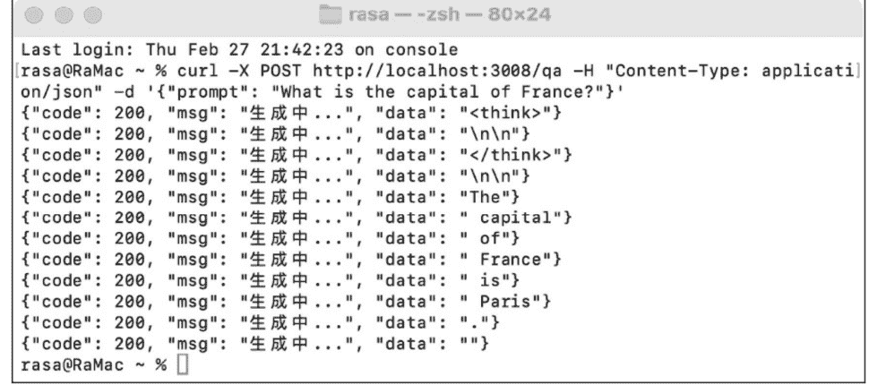

#### 4.1.2 实现情感驱动

在本节中，将在BasicInteractionBackend的基础上进行扩展，增加情感驱动功能。新增了prompt_service.py用于生成情感句子和抚慰诗歌的提示，同时对main_service.py进行了升级，支持处理与情感相关的请求并返回流式输出。情感驱动的功能使模型能够根据指定的主题生成情感句子或抚慰诗歌，从而满足用户在情感释放和抚慰方面的需求。

##### 1. 构建目录结构

在EmotionDrivenBackend中，除继承基础问答服务的功能外，还增加了情感句子和抚慰诗歌生成的功能。以下是该目录结构：

```
4.1/
└── EmotionDrivenBackend/
    ├── main_service.py          # 升级后的主服务脚本，处理情感句子和抚慰诗歌生成
    ├── prompt_service.py        # 新增的提示生成服务
    ├── model_api.py             # 提供与 DeepSeek 模型交互的接口
    ├── main_service_config.json # 配置文件，包含模型的参数和其他配置信息
    └── requirements.txt         # 依赖项列表
```

##### 2. 情感句子与抚慰诗歌生成

新增的prompt_service.py文件定义了生成情感句子和抚慰诗歌的提示。main_service.py文件根据这些提示，调用DeepSeek模型生成对应内容并返回流式响应。

以下是prompt_service.py文件的实现：

```python
# -*- coding: utf-8 -*-
# 4.1/EmotionDrivenBackend/prompt_service.py

"""
文件名: prompt_service.py
描述: 提供用于生成提示词的服务，包括翻译、情感句子和抚慰诗歌
"""

import random
import logging

class PromptService:
    def __init__(self):
        self.predefined_topics = [
            "心灵疗愈的基础与实践方法",
            "正念冥想在心灵疗愈中的作用",
            "情绪释放技巧与心理放松",
            "创伤后成长与心理恢复",
            "内在儿童的疗愈与成长",
            "身心灵统一：全面的疗愈方法",
            "自我接纳与内在平和的建立",
            "能量疗愈与身体的能量平衡",
            "如何通过艺术疗愈心灵创伤",
            "心灵深处的阴影与光明探索"
        ]

    def create_emotion_sentences_prompt(self, topic=None, button_count=1):
        if not topic:
            topic = random.choice(self.predefined_topics)
            logging.debug(f"随机选择的主题: {topic}")
        return f'''
请围绕以下主题，生成{button_count}个富有情感的句子：
主题: "{topic}"

要求：
- 每个句子不超过 15 个字，以换行符分隔。
- 至少包含 1 个宣泄消极情绪的句子，其余为积极情绪的句子。
- 句子需简洁明了，具有情绪特色，能引起共鸣。
- 只用中文，不含数字、序号或特殊字符。

请开始生成：
'''

    def create_soothing_poetry_prompt(self, theme='宁静的夜晚'):
        return f'''
请以"{theme}"为主题，创作一首能够抚慰人心的诗歌。

要求：
1. 诗歌应包含 3～4 节，每节 4 行，每行不超过 15 个字。
2. 语言柔和，充满诗意，传达温暖和平和的情感。
3. 通过细腻的描写，引导读者感受内心的宁静与安慰。
4. 诗歌需紧扣主题，使用与主题相关的意象和情感。

请开始创作：
'''
```

该文件中的PromptService类包含两个主要方法：
create_emotion_sentences_prompt用于生成情感句子的提示；
create_soothing_poetry_prompt用于生成抚慰诗歌的提示。

##### 3. 升级主服务

对main_service.py文件进行升级，除处理基本的问答服务外，还新增了情感句子和抚慰诗歌的生成服务。以下是该文件的关键部分：

```python
# -*- coding: utf-8 -*-
# 4.1/EmotionDrivenBackend/main_service.py

"""
文件名: main_service.py
描述: 实现问答服务、情感句子生成服务、抚慰诗歌生成服务，支持流式输出
"""

import json
import logging
from flask import Flask, request, jsonify, Response, stream_with_context
from model_api import ModelAPI, ConfigError
from prompt_service import PromptService
from pathlib import Path

# 设置日志记录
logging.basicConfig(level=logging.DEBUG, format='%(asctime)s - %(levelname)s - %(message)s')

class QAService:
    def __init__(self, config_path='main_service_config.json'):
        self.config_path = config_path
        self.config = None
        self.model_api = None
        self.load_config()
        self.prompt_service = PromptService()
        self.port = self.config.get("port", 5000)

    def load_config(self):
        """
        加载配置文件并初始化 ModelAPI
        """
        try:
            config_file = Path(self.config_path)
            if not config_file.is_file():
                raise ConfigError(f"配置文件未找到: {self.config_path}")

            with open(config_file, 'r', encoding='utf-8') as file:
                self.config = json.load(file)
                self.model_url = self.config.get("model_url")
                self.model_params = self.config.get("model_params", {})
                self.retry_attempts = self.config.get("retry_attempts", 3)

            if not self.model_url:
                raise ConfigError("model_url 配置缺失, 请检查配置文件")

            logging.info("配置文件加载成功")
            self.model_api = ModelAPI(self.config)  # Initialize ModelAPI after loading the config

        except (json.JSONDecodeError, ConfigError) as e:
            logging.error(f"配置文件加载失败, 错误信息: {e}")
            raise ConfigError(f"配置文件加载失败, 错误信息: {e}")

    def handle_error(self, error_msg):
        """
        统一处理错误响应
        """
        logging.error(error_msg)
        return jsonify({"code": 500, "msg": error_msg, "data": None}), 500

    def generate_answer(self, prompt):
        """
        逐步生成回答以支持流式输出
        """
        try:
            payload = self.model_api.prepare_payload(prompt, stream_output=True)  # 开启流式输出

            def generate_streamed_answer():
                try:
                    for chunk in self.model_api.stream_generate(payload):
                        logging.debug(f"生成块: {chunk.strip()}")  # 打印每块的内容
```

# 每次返回一个数据块
yield json.dumps({'code': 200, 'msg': '生成中...', 'data': chunk}, ensure_ascii=False) + "\n"
except Exception as e:
    logging.error(f"生成回答时出错: {e}")
    yield json.dumps({'code': 500, 'msg': '生成回答时出错', 'data': None}, ensure_ascii=False) + "\n"

return generate_streamed_answer()
except Exception as e:
    return self.handle_error(f"问答生成失败, 原因: {e}")

def generate_emotion_sentences(self, topic=None, button_count=1):
    """
    根据给定主题生成情感句子
    支持流式输出
    """
    prompt = self.prompt_service.create_emotion_sentences_prompt(topic, button_count)
    payload = self.model_api.prepare_payload(prompt, stream_output=True)
    try:
        def generate_emotion_sentences_stream():
            try:
                for chunk in self.model_api.stream_generate(payload):
                    yield json.dumps({'code': 200, 'msg': '生成中...', 'data': chunk}, ensure_ascii=False) + "\n"
            except Exception as e:
                logging.error(f"情感句子生成时出错: {e}")
                yield json.dumps({'code': 500, 'msg': '情感句子生成时出错', 'data': None}, ensure_ascii=False) + "\n"
        except Exception as e:
            return self.handle_error(f"情感句子生成失败, 原因: {e}")

        return generate_emotion_sentences_stream()

def generate_soothing_poetry(self, theme='宁静的夜晚'):
    """
    根据主题生成抚慰诗歌
    支持流式输出
    """
    prompt = self.prompt_service.create_soothing_poetry_prompt(theme)
    payload = self.model_api.prepare_payload(prompt, stream_output=True)
    try:
        def generate_poetry_stream():
            try:
                for chunk in self.model_api.stream_generate(payload):
                    yield json.dumps({'code': 200, 'msg': '生成中...', 'data': chunk}, ensure_ascii=False) + "\n"
            except Exception as e:
                logging.error(f"抚慰诗歌生成时出错: {e}")
                yield json.dumps({'code': 500, 'msg': '抚慰诗歌生成时出错', 'data': None}, ensure_ascii=False) + "\n"
        except Exception as e:
            return self.handle_error(f"抚慰诗歌生成失败，原因: {e}")

        return generate_poetry_stream()

# 创建 Flask 应用和服务实例
app = Flask(__name__)
qa_service = QAService()

@app.route('/qa', methods=['POST'])
def qa_api():
    """
    处理问答请求并返回流式响应
    """
    try:
        data = request.json
        prompt = data.get("prompt", "")
        if not prompt:
            return jsonify({"code": 400, "msg": "请求体中缺少 'prompt' 字段", "data": None}), 400

        logging.info(f"Received QA request: prompt={prompt}")

        # 调用 QA 服务生成流式数据
        result = qa_service.generate_answer(prompt)

        # 返回流式响应
        return Response(stream_with_context(result), content_type="application/json")

    except Exception as e:
        error_msg = f"处理问答请求时发生错误: {e}"
        logging.error(error_msg)
        return qa_service.handle_error(error_msg)  # Return the error from QAService

@app.route('/generate_emotion_sentences', methods=['POST'])
def generate_emotion_sentences_api():
    try:
        data = request.json
        topic = data.get("topic", None)
        button_count = data.get("buttonCount", 1)  # 默认值为1
        logging.info(f"Received emotion sentences request: topic={topic}, buttonCount={button_count}")

        # 调用情感句子生成服务并返回流式响应
        result = qa_service.generate_emotion_sentences(topic, button_count)

        # 返回流式响应
        return Response(stream_with_context(result), content_type="application/json")

    except Exception as e:
        error_msg = f"处理情感句子请求时发生错误: {e}"
        logging.error(error_msg)
        return jsonify({"code": 500, "msg": error_msg, "data": None}), 500

@app.route('/generate_soothing_poetry', methods=['POST'])
def generate_soothing_poetry_api():
    try:
        data = request.json
        theme = data.get("theme", "宁静的夜晚")
        logging.info(f"Received soothing poetry request: theme={theme}")

        # 调用抚慰诗歌生成服务并返回流式响应
        result = qa_service.generate_soothing_poetry(theme)

        # 返回流式响应
        return Response(stream_with_context(result), content_type="application/json")

    except Exception as e:
        error_msg = f"处理抚慰诗歌请求时发生错误: {e}"
        logging.error(error_msg)
        return jsonify({"code": 500, "msg": error_msg, "data": None}), 500

if __name__ == '__main__':
    app.run(debug=True, host='0.0.0.0', port=qa_service.port)

##### 4. 使用curl验证服务

###### ● 验证情感句子生成服务

发送POST请求到/generate_emotion_sentences路由，传入topic和buttonCount参数来生成情感句子。

```
curl -X POST http://localhost:3008/generate_emotion_sentences -H "Content-Type: application/json" -d '{"topic": "正念冥想在心灵疗愈中的作用", "buttonCount": 2}'
```

如图4-2所示为情感句子生成效果。

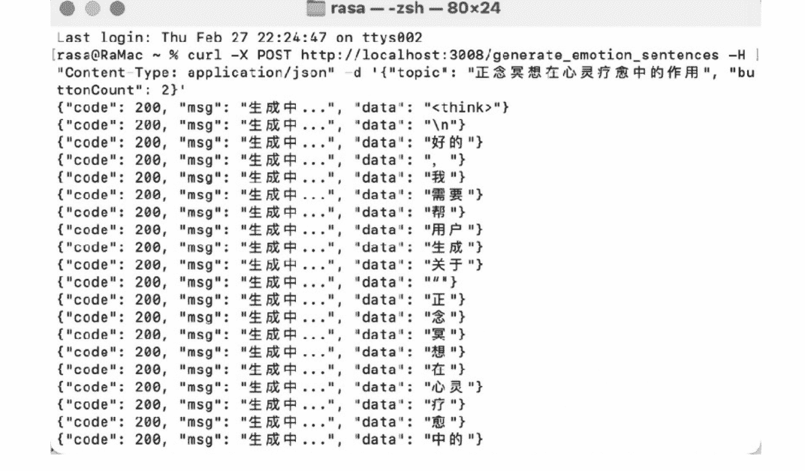

图4-2

###### ● 验证抚慰诗歌生成服务

发送POST请求到/generate_soothing_poetry路由，传入theme参数来生成抚慰诗歌。

```
curl -X POST http://localhost:3008/generate_soothing_poetry -H "Content-Type: application/json" -d '{"theme": "宁静的夜晚"}'
```

如图4-3所示为抚慰诗歌生成效果。

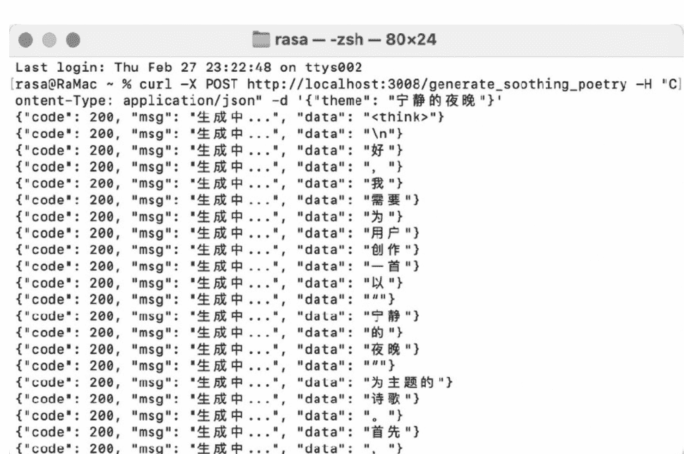

#### 4.1.3 实现诗歌图片合成

在本节中，将在EmotionDrivenBackend的基础上进行扩展，新增诗歌图片合成功能。通过引入image_data.json、image_randomizer.py文件，并升级main_service.py文件，本项目能够在生成抚慰诗歌的同时，自动为其合成一张富有诗意的图片。该功能提供了诗歌内容与图片的双重展现，进一步增强了用户在情感体验上的沉浸感和互动性。

##### 1. 构建目录结构

在PoetryImageBackend中，除继承基础的情感句子和抚慰诗歌生成服务外，新增了图片生成的功能。以下是该目录结构：

```
4.1/
├── PoetryImageBackend/
│   ├── main_service.py          # 升级后的主服务脚本，处理诗歌生成与图片合成
│   ├── prompt_service.py        # 提示生成服务，用于生成诗歌内容
│   ├── image_randomizer.py      # 生成随机图片及配色方案
│   ├── webp/
│   │   ├── 1.webp               # 图片文件1
│   │   ├── 2.webp               # 图片文件2
│   │   ├── 3.webp               # 图片文件3
│   │   └── image_data.json      # 包含图片与配色信息的JSON文件
│   ├── 黄草简.ttf               # 字体文件
│   ├── model_api.py             # 提供与DeepSeek模型交互的接口
│   ├── main_service_config.json # 配置文件，包含模型的参数和其他配置信息
│   └── requirements.txt         # 依赖项列表，包含新增的依赖
```

##### 2. 图片数据与随机选择

在webp/image_data.json文件中，存储了图片名称及其推荐的配色方案。image_randomizer.py文件将随机选择图片与配色，作为背景与诗歌内容的搭配。以下是image_data.json文件的内容：

```json
[
    {
        "image": "1",
        "recommended_colors": [
            "#F9E79F",
            "#D1C4E9"
        ]
    },
    {
        "image": "2",
        "recommended_colors": [
            "#FFFFFF",
            "#FFD700"
        ]
    },
    {
        "image": "3",
        "recommended_colors": [
            "#FF5733",
            "#C70039"
        ]
    }
]
```

##### 3. 图片生成服务

image_randomizer.py文件实现了生成随机图片及配色的功能，并通过PoetryImageGenerator类，结合诗歌文本生成带有诗歌内容的图片。该文件通过以下方式完成图片生成：

```python
# -*- coding: utf-8 -*-
# 4.1/PoetryImageBackend/image_randomizer.py

"""
文件名: image_randomizer.py
描述: 提供诗歌生成后图片生成的功能
"""

import json
import random
import os
from PIL import Image, ImageDraw, ImageFont
import textwrap
import uuid

class ImageRandomizer:
    def __init__(self, data_file):
        self.data_file = data_file
        self.data = self._load_data()

    def _load_data(self):
        try:
            with open(self.data_file, "r", encoding="utf-8") as f:
                return json.load(f)
        except FileNotFoundError:
            raise Exception(f"数据文件 {self.data_file} 未找到。")
        except json.JSONDecodeError:
            raise Exception(f"数据文件 {self.data_file} 格式有误。")

    def get_random_image_and_color(self):
        if not self.data:
            raise Exception("图片数据为空，请检查数据文件内容。")

        random_image = random.choice(self.data)
        random_image_name = random_image["image"]
        recommended_colors = random_image.get("recommended_colors", ["#FFFFFF"])
        random_color = random.choice(recommended_colors)
        return random_image_name, random_color

class PoetryImageGenerator:
    def __init__(self, data_file, output_folder="output"):
        """
        初始化类，加载存储的图片数据文件。
        :param data_file: JSON 文件路径，存储图片和颜色数据。
        :param output_folder: 输出生成图片的文件夹路径。
        """
        self.image_randomizer = ImageRandomizer(data_file)
        self.output_folder = output_folder
        os.makedirs(self.output_folder, exist_ok=True)

    def _calculate_font_color(self, bg_color):
        """
        根据背景颜色计算合适的字体颜色（黑色或白色）。
        :param bg_color: 背景颜色，十六进制字符串。
        :return: 字体颜色的 RGB 元组。
        """
        bg_color = bg_color.lstrip('#')
        r, g, b = tuple(int(bg_color[i:i+2], 16) for i in (0, 2, 4))
        # 计算亮度
        brightness = (r * 299 + g * 587 + b * 114) / 1000
        return (0, 0, 0) if brightness > 128 else (255, 255, 255)

    def generate_poetry_image(self, poetry_text, font_path="NotoSans-Regular.ttf", font_size=50, max_width_ratio=0.9, line_spacing=10):
        """
        生成带诗歌内容的图片。
        :param poetry_text: 诗歌内容。
        :param font_path: 字体文件路径。
        :param font_size: 字体大小。
        :param max_width_ratio: 文字最大宽度与图片宽度的比例。
        :param line_spacing: 行间距。
        :return: 生成图片的路径。
        """
        image_name, recommended_color = self.image_randomizer.get_random_image_and_color()
        image_path = os.path.join("webp", f"{image_name}.webp")
```

if not os.path.exists(image_path):
    raise Exception(f"图片文件 {image_path} 未找到。")

try:
    # 加载背景图片
    with Image.open(image_path) as img:
        img = img.convert("RGBA")
        draw = ImageDraw.Draw(img)

        image_width, image_height = img.size
        max_text_width = int(image_width * max_width_ratio)
        margin = 20  # 边距

        # 加载字体
        try:
            font = ImageFont.truetype(font_path, font_size)
        except IOError:
            raise Exception(f"字体文件 {font_path} 未找到。")

        # 自动换行
        lines = []
        for line in poetry_text.split('\n'):
            wrapped = textwrap.wrap(line, width=40)  # 初始宽度
            if not wrapped:
                lines.append('')
            else:
                for wrapped_line in wrapped:
                    # 调整每行以适应图片宽度
                    while True:
                        bbox = draw.textbbox((0, 0), wrapped_line, font=font)
                        line_width = bbox[2] - bbox[0]
                        if line_width <= max_text_width or len(wrapped_line) <= 1:
                            break
                        wrapped_line = wrapped_line[:-1]
                    lines.append(wrapped_line)

        # 重新计算字体大小以适应图片高度
        total_text_height = 0
        for line in lines:
            bbox = draw.textbbox((0, 0), line, font=font)
            line_height = bbox[3] - bbox[1]
            total_text_height += line_height + line_spacing
        total_text_height -= line_spacing  # 去掉最后一行的间距

        if total_text_height > image_height - 2 * margin:
            # 缩小字体以适应高度
            while total_text_height > image_height - 2 * margin and font_size > 10:
                font_size -= 2
                font = ImageFont.truetype(font_path, font_size)
                total_text_height = 0
                for line in lines:
                    bbox = draw.textbbox((0, 0), line, font=font)
                    line_height = bbox[3] - bbox[1]
                    total_text_height += line_height + line_spacing
                total_text_height -= line_spacing

        # 计算字体颜色
        font_color = self._calculate_font_color(recommended_color)

        # 计算文本起始位置
        current_y = (image_height - total_text_height) // 2

        # 可选：在文本后面添加半透明背景以增强对比度
        # 计算文本区域
        max_line_width = max([draw.textbbox((0,0), line, font=font)[2] - draw.textbbox((0,0), line, font=font)[0] for line in lines])
        text_bbox_rect = [
            (image_width - max_line_width) // 2 - margin,
            current_y - margin,
            (image_width + max_line_width) // 2 + margin,
            current_y + total_text_height + margin
        ]

        # 创建半透明矩形
        overlay = Image.new('RGBA', img.size, (0,0,0,0))
        overlay_draw = ImageDraw.Draw(overlay)
        rectangle_color = (255, 255, 255, 150) if font_color == (0,0,0) else (0, 0, 0, 150)
        overlay_draw.rectangle(text_bbox_rect, fill=rectangle_color)
        img = Image.alpha_composite(img, overlay)
        draw = ImageDraw.Draw(img)

        # 绘制每一行文本
        for line in lines:
            bbox = draw.textbbox((0,0), line, font=font)
            line_width = bbox[2] - bbox[0]
            line_height = bbox[3] - bbox[1]
            text_x = (image_width - line_width) // 2
            draw.text((text_x, current_y), line, fill=font_color, font=font)
            current_y += line_height + line_spacing

        # 保存结果图片
        unique_id = str(uuid.uuid4())
        output_filename = f"{image_name}_{unique_id}.png"
        output_path = os.path.join(self.output_folder, output_filename)
        img = img.convert("RGB")  # 去除 alpha 通道以保存为 PNG
        img.save(output_path, format="PNG")
        return output_path

except Exception as e:
    raise Exception(f"生成图片时出错: {str(e)}")

##### 4. 升级主服务

main_service.py文件中新增了诗歌图片合成的功能。生成的诗歌不仅可以通过流式响应返回给开发人员，还能根据诗歌的主题自动生成相关的图片，并提供下载链接。以下是main_service.py文件的关键部分：

# -*- coding: utf-8 -*-
# 4.1/PoetryImageBackend/main_service.py

"""
文件名: main_service.py
描述:
    实现以下服务:
    1. 问答服务: 接收用户提问并返回流式生成的回答。
    2. 情感句子生成服务: 根据主题生成情感驱动的句子, 支持流式输出。
    3. 抚慰诗歌生成服务: 根据主题生成抚慰性诗歌, 支持流式输出。
    4. 诗歌图片生成与下载服务: 生成与抚慰诗歌内容相关的图片, 并支持用户下载生成的图片。
    支持流式输出 (Server-Sent Events, SSE) 以逐步传输生成结果, 适用于长时间生成的任务。
"""

import json
import logging
from flask import Flask, request, jsonify, Response, stream_with_context, send_from_directory
from model_api import ModelAPI, ConfigError
from prompt_service import PromptService
from pathlib import Path
import os
from image_randomizer import PoetryImageGenerator
import re

# 设置日志记录
logging.basicConfig(level=logging.DEBUG, format='%(asctime)s - %(levelname)s - %(message)s')

class QAService:
    def __init__(self, config_path='main_service_config.json'):
        self.config_path = config_path
        self.config = None
        self.model_api = None
        self.load_config()
        self.prompt_service = PromptService()
        self.poetry_image_generator = PoetryImageGenerator(
            data_file=self.config.get("image_data_file", "webp/image_data.json"),
            output_folder=self.config.get("image_output_folder", "output")
        )
        self.port = self.config.get("port", 5000)

    def load_config(self):
        """
        加载配置文件并初始化 ModelAPI
        """
        try:
            config_file = Path(self.config_path)
            if not config_file.is_file():
                raise ConfigError(f"配置文件未找到: {self.config_path}")

            with open(config_file, 'r', encoding='utf-8') as file:
                self.config = json.load(file)
                self.model_url = self.config.get("model_url")
                self.model_params = self.config.get("model_params", {})
                self.retry_attempts = self.config.get("retry_attempts", 3)

                if not self.model_url:
                    raise ConfigError("model_url 配置缺失，请检查配置文件")

                logging.info("配置文件加载成功")
                self.model_api = ModelAPI(self.config)  # Initialize ModelAPI after loading the config

        except (json.JSONDecodeError, ConfigError) as e:
            logging.error(f"配置文件加载失败，错误信息: {e}")
            raise ConfigError(f"配置文件加载失败，错误信息: {e}")

    def handle_error(self, error_msg):
        """
        统一处理错误响应
        """
        logging.error(error_msg)
        return jsonify({"code": 500, "msg": error_msg, "data": None}), 500

    def generate_answer(self, prompt):
        """
        逐步生成回答以支持流式输出
        """
        try:
            payload = self.model_api.prepare_payload(prompt, stream_output=True)  # 开启流式输出

            def generate_streamed_answer():
                try:
                    for chunk in self.model_api.stream_generate(payload):
                        logging.debug(f"生成块: {chunk.strip()}")  # 打印每个块的内容

                        # 每次返回一个数据块
                        yield json.dumps({'code': 200, 'msg': '生成中...', 'data': chunk},
                                         ensure_ascii=False) + "\n"
                except Exception as e:
                    logging.error(f"生成回答时出错: {e}")
                    yield json.dumps({'code': 500, 'msg': '生成回答时出错', 'data': None}, ensure_ascii=False) + "\n"

            return generate_streamed_answer()
        except Exception as e:
            return self.handle_error(f"问答生成失败, 原因: {e}")

    def generate_emotion_sentences(self, topic=None, button_count=1):
        """
        根据给定主题生成情感句子
        支持流式输出
        """
        prompt = self.prompt_service.create_emotion_sentences_prompt(topic, button_count)
        payload = self.model_api.prepare_payload(prompt, stream_output=True)
        try:
            def generate_emotion_sentences_stream():
                try:
                    for chunk in self.model_api.stream_generate(payload):
                        yield json.dumps({'code': 200, 'msg': '生成中...', 'data': chunk}, ensure_ascii=False) + "\n"
                except Exception as e:
                    logging.error(f"情感句子生成时出错: {e}")
                    yield json.dumps({'code': 500, 'msg': '情感句子生成时出错', 'data': None}, ensure_ascii=False) + "\n"
        except Exception as e:
            return self.handle_error(f"情感句子生成失败，原因: {e}")

        return generate_emotion_sentences_stream()

    # 定义过滤函数
    def filter_think_tags(self, text):
        # 使用正则表达式', '', text, flags=re.DOTALL).replace('## ', '')

    def generate_soothing_poetry(self, theme='宁静的夜晚', request_host="localhost"):
        """
        根据主题生成抚慰诗歌
        支持流式输出
        """
        prompt = self.prompt_service.create_soothing_poetry_prompt(theme)
        payload = self.model_api.prepare_payload(prompt, stream_output=True)
        try:
            def generate_poetry_stream():
                full_poetry = ''
                try:
                    for chunk in self.model_api.stream_generate(payload):
                        full_poetry += chunk
                        yield json.dumps({'code': 200, 'msg': '生成中...', 'data': chunk}, ensure_ascii=False) + "\n"

                    try:
                        # 处理诗歌文本
                        full_poetry = self.filter_think_tags(full_poetry)

                        image_path = self.poetry_image_generator.generate_poetry_image(
                            poetry_text=full_poetry,
                            font_path=self.config.get("font_path", "NotoSans-Regular.ttf"),
                            font_size=self.config.get("font_size", 50)
                        )
                        image_url = f"http://{request_host}/download_image/{os.path.basename(image_path)}"
                        # Send the image URL as the final message
                        yield json.dumps({'code': 200, 'msg': '生成完成', 'data': image_url}, ensure_ascii=False) + "\n"
                    except Exception as e:```python
logging.error(f"生成图片时出错: {e}")
yield json.dumps({'code': 500, 'msg': '图片生成失败', 'data': None}, ensure_ascii=False) + "\n"
except Exception as e:
    logging.error(f"抚慰诗歌生成时出错: {e}")
    yield json.dumps({'code': 500, 'msg': '抚慰诗歌生成时出错', 'data': None}, ensure_ascii=False) + "\n"
    except Exception as e:
        return self.handle_error(f"抚慰诗歌生成失败，原因: {e}")

return generate_poetry_stream()

# 创建 Flask 应用和服务实例
app = Flask(__name__)
qa_service = QAService()

@app.route('/qa', methods=['POST'])
def qa_api():
    """
    处理问答请求并返回流式响应
    """
    try:
        data = request.json
        prompt = data.get("prompt", "")
        if not prompt:
            return jsonify({"code": 400, "msg": "请求体中缺少 'prompt' 字段", "data": None}), 400

        logging.info(f"Received QA request: prompt={prompt}")

        # 调用 QA 服务生成流式数据
        result = qa_service.generate_answer(prompt)

        # 返回流式响应
        return Response(stream_with_context(result), content_type="application/json")

    except Exception as e:
        error_msg = f"处理问答请求时发生错误: {e}"
        logging.error(error_msg)
        return qa_service.handle_error(error_msg)  # Return the error from QAService

@app.route('/generate_emotion_sentences', methods=['POST'])
def generate_emotion_sentences_api():
    try:
        data = request.json
        topic = data.get("topic", None)
        button_count = data.get("buttonCount", 1)  # 默认值为1
        logging.info(f"Received emotion sentences request: topic={topic}, buttonCount={button_count}")

        # 调用情感句子生成服务并返回流式响应
        result = qa_service.generate_emotion_sentences(topic, button_count)

        # 返回流式响应
        return Response(stream_with_context(result), content_type="application/json")

    except Exception as e:
        error_msg = f"处理情感句子请求时发生错误: {e}"
        logging.error(error_msg)
        return jsonify({"code": 500, "msg": error_msg, "data": None}), 500

@app.route('/generate_soothing_poetry', methods=['POST'])
def generate_soothing_poetry_api():
    try:
        data = request.json
        theme = data.get("theme", "宁静的夜晚")
        request_host = request.host  # 提前获取 host 信息

        logging.info(f"Received soothing poetry request: theme={theme}")

        # 调用抚慰诗歌生成服务并返回流式响应
        result = qa_service.generate_soothing_poetry(theme, request_host)

        # 返回流式响应
        return Response(stream_with_context(result), content_type="application/json")

    except Exception as e:
        error_msg = f"处理抚慰诗歌请求时发生错误: {e}"
        logging.error(error_msg)
        return jsonify({"code": 500, "msg": error_msg, "data": None}), 500

@app.route('/download_image/<path:filename>', methods=['GET'])
def download_image(filename):
    directory = qa_service.poetry_image_generator.output_folder
    return send_from_directory(directory, filename, as_attachment=True)

if __name__ == '__main__':
    app.run(debug=True, host='0.0.0.0', port=qa_service.port)
```

##### 5. requirements.txt新增依赖项

该项目引入了Pillow库，用于图片处理，因此需要在requirements.txt文件中添加以下内容：

```
Pillow
```

开发人员需要确保在安装依赖时包含Pillow库，以便正确生成图片。

##### 6. 使用curl验证服务

-   验证诗歌图片生成服务

发送POST请求到/generate_soothing_poetry路由，传入theme参数来生成抚慰诗歌及其图片：

```
curl -X POST http://localhost:3009/generate_soothing_poetry -H "Content-Type: application/json" -d '{"theme": "宁静的夜晚"}'
```

返回一个JSON响应，其中包含生成的图片链接。通过该链接，开发人员可以下载生成的诗歌图片。

如图4-4所示为curl运行的结果。

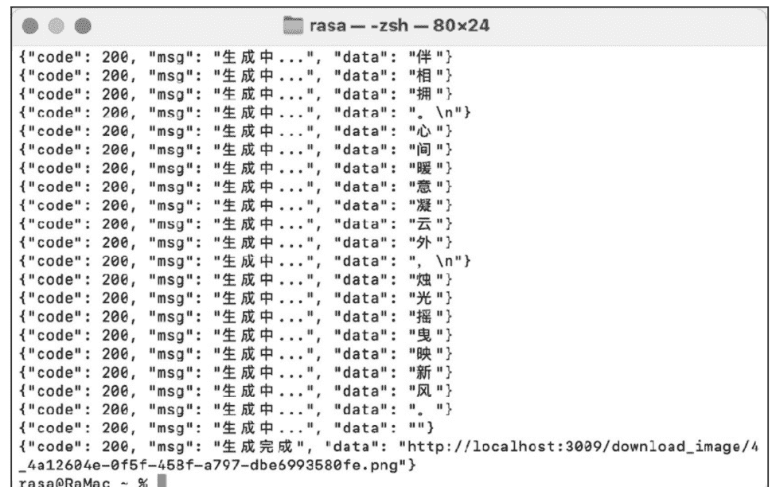

图4-4

如图4-5所示为通过链接下载的诗歌图片。


图4-5

### 4.2 ArkTS与Python后端的集成

本节将介绍如何通过ArkTS前端与Python后端进行集成，打造一个多功能的交互式应用。通过这一过程，开发者可以实现前端与后端的无缝连接，从情感驱动的问答到诗歌生成与图片合成等多个应用功能。

#### 4.2.1 基础交互的前端实现

在本小节中，BasicInteractionFrontend项目将实现前端与后端的基本交互功能，重点通过流式响应和HTTP请求与后端进行通信，展示基础的问答功能。为实现这一目标，在原有DeepSeekInteractionApp项目的基础上，进行了以下几项关键改进。

删除：删除原有的ModelTypes.ets和ModelService.ets文件，简化项目结构。

新增：引入了ApiTypes.ets、EmotionService.ets和ApiService.ets文件，以确保API请求和响应能够高效地处理流式数据，并通过新的服务逻辑与Python后端接口交互。

升级：对Index.ets文件进行了升级，使前端页面能够触发与后端的问答请求，并逐步展示生成内容。

通过这些改进，BasicInteractionFrontend项目能够实现与后端问答接口的高效交互，展示生成内容并实时更新前端页面。

##### 1. 构建目录结构

在BasicInteractionFrontend项目中，调整后的目录结构如下，新加入的文件用于处理API请求、情感问答逻辑以及流式响应数据的处理：

```
src/
├── main/
│   ├── ets/
│   │   ├── configs/          // 配置文件目录
│   │   │   └── Config.ets    // 应用配置文件（例如，API 地址等）
│   │   ├── pages/            // 页面文件目录
│   │   │   └── Index.ets     // 升级后的首页，展示问答结果
│   │   ├── services/         // 服务层，处理与后端 API 的交互
│   │   │   ├── EmotionService.ets // 处理情感问答逻辑（新增）
│   │   │   └── ApiService.ets     // 封装通用 API 请求逻辑（新增）
│   │   ├── types/            // 类型定义目录
│   │   │   └── ApiTypes.ets  // 通用 API 接口定义（新增）
│   │   └── utils/            // 工具函数目录
│   │       ├── HttpClient.ets    // HTTP 请求工具（辅助文件）
│   │       └── StreamingUtils.ets // 流式数据处理工具
│   └── module.json5          // 模块配置文件
```

ApiTypes.ets：定义通用的API请求和响应数据结构。

EmotionService.ets：处理情感问答的业务逻辑，调用后端接口获取回答。

ApiService.ets：封装通用的HTTP请求方法，并支持流式响应处理。

Index.ets：前端首页，用户通过该页面触发问答请求，并实时展示生成内容。

##### 2. 前端代码实现

在该项目中，前端代码涉及多个模块，以下是各模块的核心代码实现。

-   ApiTypes.ets

此文件定义了API请求和响应的通用数据结构，确保前后端数据传输的标准化：

```typescript
// src/main/ets/types/ApiTypes.ets

/**
 * @description 通用的 API 响应结构
 * @property {number} code - 状态码，通常用于标识请求的结果，0 表示成功，其他表示错误类型
 * @property {string} data - 响应数据，通常为 JSON 格式的字符串
 * @property {string} msg - 响应消息，描述请求结果的简短信息
 */
export interface ApiResponse {
  code: number;
  data: string;
  msg: string;
}

/**
 * @description QA 请求结构
 * @property {string} prompt - 提交的问题
 */
export interface QaRequest {
  prompt: string; // 用户提出的问题
}
```

-   EmotionService.ets

EmotionService.ets继承自ApiService.ets，封装了调用QA接口的逻辑，并支持流式响应处理：

```typescript
// src/main/ets/services/EmotionService.ets
import { ApiService } from './ApiService'; // 导入公共 API 服务
import { QaRequest } from '../types/ApiTypes'; // 导入接口定义

export class EmotionService extends ApiService {
  constructor(apiUrl: string) {
    super(apiUrl); // 初始化父类
  }

  /**
   * 调用 QA 接口
   * @param prompt - 提交的问题文本
   * @param onChunkReceived - 可选的回调函数，用于处理流式返回的每个数据块
   * @returns Promise<string> - 返回模型生成的回答
   */
  public async askQuestion(prompt: string, onChunkReceived?: (chunk: string) => void): Promise<string> {
    const requestBody: QaRequest = { prompt }; // 请求体
    return this.request('/qa', requestBody, onChunkReceived); // 返回回答
  }
}
```

-   ApiService.ets

ApiService.ets负责封装所有HTTP请求，并支持流式响应，其核心功能是处理每个数据块，并根据需要触发回调：

```typescript
// src/main/ets/services/ApiService.ets

import { http } from '@kit.NetworkKit'; // 导入自定义网络模块
import { httpRequestText } from '../utils/HttpClient'; // 导入 HTTP 请求方法
import { ApiResponse } from '../types/ApiTypes'; // 导入接口定义

export class ApiService {
    private apiUrl: string;

    constructor(apiUrl: string) {
        this.apiUrl = apiUrl;
    }

    /**
     * 处理流式返回的响应数据
     * @param chunk - 每个流式返回的数据块
     * @param onChunkReceived - 可选的回调函数，用于处理每个数据块
     * @returns 解析后的内容
     */
    private processResponseChunk(chunk: string, onChunkReceived?: (chunk: string) => void): string {
        try {
            const response: ApiResponse = JSON.parse(chunk); // 解析每个数据块
            const data = response.data; // 获取响应中的 data 字段

            if (data) {
                // 通过回调函数传递解析到的 data（类似于 content）
                onChunkReceived?.(data);
                return data; // 返回 data 内容
            }

            return '';
        } catch (parseError) {
            console.error('解析响应数据块时出错:', parseError);
            throw new Error(`解析错误: ${parseError.message}`); // 提供详细错误信息
        }
    }

    /**
     * 发送请求并处理响应
     * @param endpoint - API 端点
     * @param requestBody - 请求体
     * @param onChunkReceived - 可选的回调函数，用于处理流式返回的每个数据块
     * @returns Promise<string> - 完整的响应数据
     */
    private async sendRequest(
        endpoint: string,
        requestBody: string,
        onChunkReceived?: (chunk: string) => void,
    ): Promise<string> {
        try {
            let accumulatedResponse = ''; // 用于存储累积的所有数据块

            // 发送 HTTP 请求并处理响应
            await httpRequestText(this.apiUrl + endpoint, http.RequestMethod.POST,
                requestBody, 60000,
                (chunk: string) => {
                    if (onChunkReceived) {
                        const content = this.processResponseChunk(chunk, onChunkReceived);
                        // 处理流式数据块
                        accumulatedResponse += content; // 将内容加入最终的响应
                    }
                });

            return accumulatedResponse;
        } catch (error) {
            console.error('请求失败:', error);
            throw new Error(`请求失败：${error instanceof Error ? error.message : error}`);
        }
    }

    /**
     * 通用接口请求方法
     * @param endpoint - API 端点
     * @param requestBody - 请求体
     * @param onChunkReceived - 可选的回调函数，用于处理流式返回的每个数据块
     * @returns Promise<string> - 完整的响应数据
     */
    public async request(
        endpoint: string,
        requestBody: object,
        onChunkReceived?: (chunk: string) => void,
    ): Promise<string> {
        const requestBodyString = JSON.stringify(requestBody);
        return this.sendRequest(endpoint, requestBodyString, onChunkReceived);
    }
}
```

-   Index.ets

Index.ets页面通过按钮触发问答请求，并实时展示流式响应结果。前端通过调用EmotionService发起请求，逐步更新页面内容：

##### 3. 运行效果预览

启动前端应用后，用户页面将显示一个“Fetch Data”按钮。点击该按钮后，应用会向Python后端的QA接口发送问答请求，并以流式响应的方式逐步显示返回的数据。如图4-6所示为应用在模拟器上成功显示生成结果的效果。

通过在BasicInteractionFrontend项目中的这些改进，前端与Python后端实现了流式数据的高效交互。新的架构让前端能够逐步展示生成的问答结果，大大提升了用户体验。项目通过清晰的模块划分，保证了代码的可维护性与扩展性，为后续的功能增强奠定了坚实的基础。

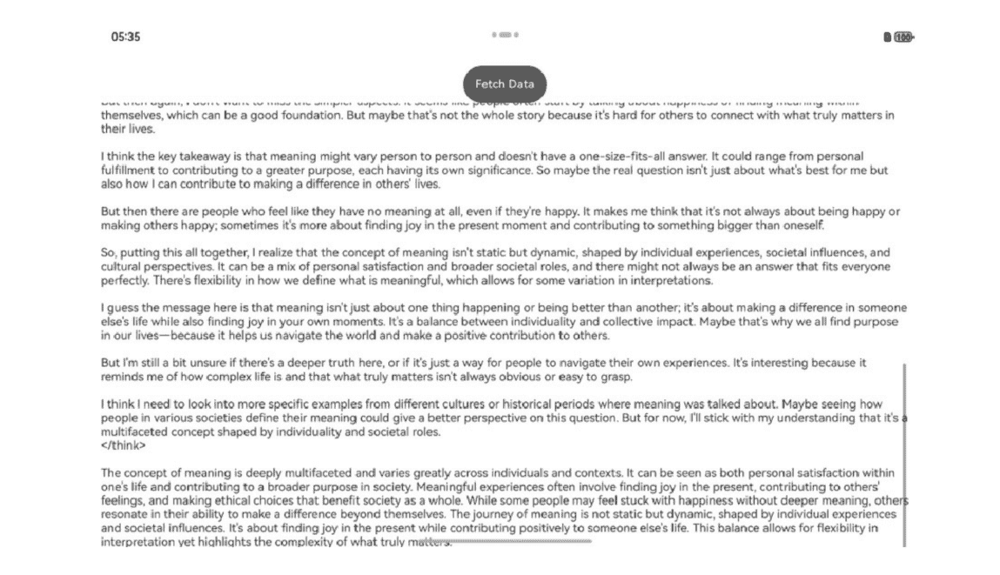

## 图4-6

#### 4.2.2 情感驱动的前端实现

在本小节中，EmotionDrivenFrontend项目将基于BasicInteractionFrontend项目，进一步扩展情感驱动功能，增加情感句子的生成和安慰诗句的生成功能。通过这些功能，前端能够根据用户的情感生成相应的句子和诗歌，并实时展示结果。新增的功能包括：引入了EmotionSentencesRequest和SoothingPoetryRequest数据结构；增加了EmotionService中的generateEmotionSentences和generateSoothingPoetry方法，用于与后端进行交互，生成情感句子和安慰诗歌；采用了HealingPoetryApp中的Index.ets、CustomButton.ets、ButtonManager.ets文件，并对Index.ets进行了升级，增强了情感驱动的互动体验。

##### 1. 构建目录结构

在EmotionDrivenFrontend项目中，新增的文件和调整后的目录结构如下：

```
src/
├── main/
│   ├── ets/
│   │   ├── configs/                    // 配置文件目录
│   │   │   └── Config.ets              // 应用配置文件（例如，API 地址等）
│   │   ├── components/                 // 组件文件目录
│   │   │   ├── ButtonManager.ets       // 按钮管理器（从 HealingPoetryApp 引入）
│   │   │   └── CustomButton.ets        // 自定义按钮组件（从 HealingPoetryApp 引入）
│   │   ├── pages/                      // 页面文件目录
│   │   │   └── Index.ets               // 升级后的首页，展示情感句子和安慰诗句
│   │   ├── services/                   // 服务层，处理与后端 API 的交互
│   │   │   ├── EmotionService.ets      // 处理情感驱动的业务逻辑（升级）
│   │   │   └── ApiService.ets          // 封装通用 API 请求逻辑
│   │   ├── types/                      // 类型定义目录
│   │   │   └── ApiTypes.ets            // 通用 API 接口定义（升级）
│   │   └── utils/                      // 工具函数目录
│   │       ├── HttpClient.ets          // HTTP 请求工具（辅助文件）
│   │       └── StreamingUtils.ets      // 流式数据处理工具
│   └── module.json5                    // 模块配置文件
```

其中，新增和更新的重点文件如下所述。

ApiTypes.ets：定义了新的请求结构EmotionSentencesRequest和SoothingPoetryRequest。

EmotionService.ets：添加了generateEmotionSentences和generateSoothingPoetry方法，用于处理情感句子和安慰诗歌的生成请求。

Index.ets：升级后的前端页面，增加了情感驱动的交互功能，包括情感句子生成和安慰诗句生成的显示。

ButtonManager.ets和CustomButton.ets：用于管理按钮的显示和交互。

##### 2. 前端代码实现

在该项目中，前端代码的更新和新增部分如下。

-   ● ApiTypes.ets

新增了情感句子生成请求和安慰诗句生成请求的结构定义：

```typescript
// src/main/ets/types/ApiTypes.ets

/**
 * @description 情感句子生成请求结构
 * @property {string} topic - 情感分析的主题或关键词
 * @property {number} buttonCount - 生成的情感按钮数量，用于控制输出数量
 */
export interface EmotionSentencesRequest {
  topic: string;
  buttonCount: number;
}

/**
 * @description 安慰诗句生成请求结构
 * @property {string} theme - 生成的安慰诗句的主题
 */
export interface SoothingPoetryRequest {
  theme: string;
}
```

-   ● EmotionService.ets

EmotionService.ets文件中新增了generateEmotionSentences和generateSoothingPoetry方法，用于与后端交互并获取情感句子和安慰诗句：

```typescript
// src/main/ets/services/EmotionService.ets

import { ApiService } from './ApiService'; // 导入公共 API 服务
import { QaRequest, EmotionSentencesRequest, SoothingPoetryRequest } from '../types/ApiTypes'; // 导入接口定义

export class EmotionService extends ApiService {
  constructor(apiUrl: string) {
    super(apiUrl); // 初始化父类
  }

  /**
   * 调用生成情感句子接口
   * @param topic - 主题
   * @param buttonCount - 按钮数量
   * @param onChunkReceived - 可选的回调函数，用于处理流式返回的每个数据块
   * @returns Promise<string> - 返回生成的情感句子
   */
  public async generateEmotionSentences(
    topic: string,
    buttonCount: number,
    onChunkReceived?: (chunk: string) => void
  ): Promise<string> {
    const requestBody: EmotionSentencesRequest = { topic, buttonCount }; // 请求体
    return this.request('/generate_emotion_sentences', requestBody, onChunkReceived); // 根据需要选择流式输出
  }

  /**
   * 调用生成抚慰诗歌接口
   * @param theme - 诗歌主题
   * @param onChunkReceived - 可选的回调函数，用于处理流式返回的每个数据块
   * @returns Promise<string> - 返回生成的诗歌
   */
  public async generateSoothingPoetry(
    theme: string,
    onChunkReceived?: (chunk: string) => void
  ): Promise<string> {
    const requestBody: SoothingPoetryRequest = { theme }; // 请求体
    return this.request('/generate_soothing_poetry', requestBody, onChunkReceived); // 根据需要选择流式输出
  }
}
```

-   ● Index.ets

Index.ets页面提供了情感句子生成和安慰诗句生成的交互功能，并通过按钮控制前端显示：

```typescript
// src/main/ets/pages/Index.ets

import { config } from '../configs/Config'; //导入配置文件
import { EmotionService } from '../services/EmotionService';
import { processStreamedResults } from '../utils/StreamingUtils';//导入流式结果处理工具
import { ButtonManager } from '../components/ButtonManager'; //导入按钮管理器
import { CustomButton } from '../components/CustomButton'; //导入自定义按钮组件

@Entry
@Component
struct Index {
    @State bgColor: string = "#BCCFF"; //背景颜色
    @State resultText: string = ''; //默认文本显示
    private totalButtons: number = 5; //按钮总数
    private buttonManager = new ButtonManager(this.totalButtons); //按钮管理器实例
    @State buttonColors: string[] = this.buttonManager.getButtonColors(); //按钮颜色
    @State buttonLabels: string[] = this.buttonManager.getButtonLabels(); //按钮标签
    @State buttonText: string = ''; // 默认文本显示

    /**
     * 错误日志记录与处理
     * @param error 错误信息
     * @param context 错误发生的上下文
     */
    private logAndHandleError(error: string, context: string): void {
        this.resultText = '发生错误，请稍后重试。'; //更新结果文本显示
    }

    /**
     * 更新按钮的标签和颜色
     */
    private updateButtons() {
        this.buttonLabels = this.buttonManager.getButtonLabels(); //获取最新按钮标签
        this.buttonColors = this.buttonManager.getButtonColors(); //获取最新按钮颜色
    }

    /**
     * 处理并更新流式结果
     * @param accumulatedResult 累积的文本结果
     */
    private handleStreamedResults(accumulatedResult: string) {
        if (accumulatedResult) {
            processStreamedResults(accumulatedResult, (cleanedText: string) => {
                this.buttonManager.updateButtonLabel(cleanedText); //更新按钮标签
                this.updateButtons(); //更新按钮标签和颜色
            });
        }
    }

    /**
     * 使用情感分析服务更新按钮内容
     * @param emotionService EmotionService实例
     */
    private async updateButtonsWithEmotion(emotionService: EmotionService): Promise<void> {
        let accumulatedResult = ''; //存储情感句子生成的结果
        console.log('\nStarting emotion sentences generation:'); //输出情感句子生成的日志

        try {
            await emotionService.generateEmotionSentences('', this.totalButtons, (partialResult: string) => {
                console.log('Received chunk:', partialResult); //输出接收到的每个片段
                accumulatedResult += partialResult; //累加结果
                this.handleStreamedResults(accumulatedResult); //处理累积的结果
            });
        } catch (error) {
            this.logAndHandleError(error, 'updateButtonsWithEmotion'); //错误处理
        }
    }

    /**
     * 生成抚慰诗歌并更新显示结果
     * @param emotionService EmotionService 实例
     * @param textToGenerate 用于生成诗歌的文本
     */
    private async generatePoetryAndUpdateResult(emotionService: EmotionService, textToGenerate: string): Promise<void> {
        this.resultText = ''; //清空现有的结果文本

        try {
            console.log('\nStarting soothing poetry generation:'); //输出生成诗歌的日志
            await emotionService.generateSoothingPoetry(textToGenerate, (partialResult: string) => {
                console.log('Soothing poetry result chunk:', partialResult); //输出生成的诗歌片段
                if (partialResult.startsWith('http')) {
                } else {
                    this.resultText += partialResult; //累加诗歌生成的结果
                }
            });
        } catch (error) {
            this.logAndHandleError(error, 'generatePoetryAndUpdateResult'); //错误处理
        }
    }

    /**
     * 根据按钮标签获取聊天响应并更新背景颜色和生成诗歌
     * @param buttonLabel 被点击的按钮标签
     */
    private async fetchChatResponse(buttonLabel: string) {
        const emotionService = new EmotionService(config.sentimentApiUrl);

        try {
            if (!buttonLabel) {
                //处理情感句子生成
                await this.updateButtonsWithEmotion(emotionService); //更新按钮标签
            } else {
```

await this.generatePoetryAndUpdateResult(emotionService, buttonLabel); //生成诗歌并更新结果
await this.updateButtonsWithEmotion(emotionService); //更新按钮标签
}
} catch (error) {
    this.logAndHandleError(error, 'fetchChatResponse'); //错误处理
}
}

//页面构建
build() {
    Flex({ direction: FlexDirection.Row, justifyContent: FlexAlign.Center, alignItems: ItemAlign.Center }) {
        // 按钮区域
        Flex({ direction: FlexDirection.Column, justifyContent: FlexAlign.Center, alignItems: ItemAlign.Center }) {
            ForEach(this.buttonLabels, (label: string, index: number) => {
                CustomButton({
                    buttonLabel: label || '', //按钮标签
                    buttonColor: this.buttonColors[index] || '#FFFFFF' //按钮颜色
                })
                .onClick(() => {
                    this.buttonText = this.buttonLabels[index];
                    this.fetchChatResponse(this.buttonText);
                }); //绑定点击事件
            });
        }
        .padding(20)

        //结果显示区域
        Flex({ direction: FlexDirection.Column, justifyContent: FlexAlign.Center, alignItems: ItemAlign.Center }) {
            Scroll() {
                Column() {
                    Text(this.resultText)
                        .width('match_parent')
                        .height('match_content')
                        .fontColor(Color.White)
                        .padding(15)
                        .backgroundColor("#6B7280")
                        .borderRadius(15)
                        .margin({ top: 20, bottom: 20 });
                }
            }
            .scrollBarWidth(0)
            .scrollBarColor(Color.Transparent); // 隐藏滚动条
        }
        .padding(20);
    }
    .width('100%')
    .height('100%')
    .backgroundColor(this.bgColor); // 设置背景颜色
}
}

##### 3.效果预览位置

如图4-7所示为应用在模拟器上生成情感句子和安慰诗歌的效果预览位置。

通过在EmotionDrivenFrontend项目中的新增功能，前端成功实现了情绪驱动的交互体验。情感句子的生成和安慰诗句的生成功能增强了用户体验，通过按钮管理器和自定义按钮组件，提供了灵活且易于扩展的页面设计。

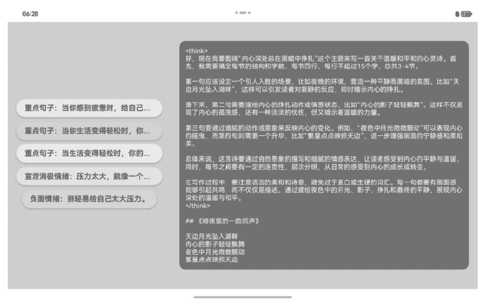

#### 4.2.3 诗歌图片合成的前端实现

在PoetryImageFrontend项目中，基于EmotionDrivenFrontend项目的基础，新增了下载图片和合成图片的功能。通过引入DownloadUtils.ets和升级HttpClient.ets中的httpRequestImage函数，前端能够下载并显示生成的诗歌图片。此外，Index.ets页面进行了升级，加入了图片下载和显示的功能，增强了诗歌生成的互动体验。

##### 1.构建目录结构

在PoetryImageFrontend项目中，新增的文件和调整后的目录结构如下：

```
src/
├── main/
│   ├── ets/
│   │   ├── configs/                    // 配置文件目录
│   │   │   └── Config.ets              // 应用配置文件（例如，API 地址等）
│   │   ├── components/                 // 组件文件目录
│   │   │   ├── ButtonManager.ets       // 按钮管理器
│   │   │   └── CustomButton.ets        // 自定义按钮组件
│   │   ├── pages/                      // 页面文件目录
│   │   │   └── Index.ets               // 升级后的首页，展示情感句子、安慰诗句和图片
│   │   ├── services/                   // 服务层，处理与后端 API 的交互
│   │   │   ├── EmotionService.ets      // 处理情感驱动的业务逻辑
│   │   │   └── ApiService.ets          // 封装通用 API 请求逻辑
│   │   ├── types/                      // 类型定义目录
│   │   │   └── ApiTypes.ets            // 通用 API 接口定义
│   │   └── utils/                      // 工具函数目录
│   │       ├── HttpClient.ets          // HTTP 请求工具（升级）
│   │       ├── StreamingUtils.ets      // 流式数据处理工具
│   │       └── DownloadUtils.ets       // 下载图片工具（新增）
│   └── module.json5                    // 模块配置文件
```

其中，新增和更新的重点文件包括如下所述。

HttpClient.ets：升级了httpRequestImage函数，用于处理图片下载。

DownloadUtils.ets：新增了downloadImage方法，用于从URL下载图片并返回PixelMap对象。

Index.ets：升级后的前端页面，增加了图片下载和显示的交互功能，包括诗歌图片的下载与展示。

##### 2.前端代码实现

在该项目中，前端代码的更新和新增部分如下。

- HttpClient.ets

升级了httpRequestImage函数，用于下载二进制图片数据：

```typescript
// src/main/ets/utils/HttpClient.ets

import { http } from '@kit.NetworkKit'; // 导入自定义网络模块
import { decodeUtf8 } from './StreamingUtils'; // UTF-8 数组到字符串的转换函数

type HttpHeaders = Record<string, string>;

const DEFAULT_CONTENT_TYPE = 'application/json; charset=utf-8';
const DEFAULT_TIMEOUT = 60000; // 默认超时时间为 60 s

/**
 * @description 发送 HTTP 请求并接收二进制数据块
 * @param url - 请求的 URL
 * @param method - HTTP 请求方法（如 GET、POST 等）
 * @param requestBody - 请求体（如果有的话）
 * @param timeout - 超时时间（默认 60000ms）
 * @param onChunkReceive - 接收数据块的回调函数（处理 ArrayBuffer）
 * @param contentType - 请求的内容类型（默认 application/json）
 * @param onProgress - 下载进度回调（可选）
 * @returns {Promise<void>} - 请求完成时解析的 Promise
 */
export function httpRequestImage(
    url: string,
    method: http.RequestMethod,
    requestBody: string,
    timeout: number = DEFAULT_TIMEOUT,
    onChunkReceive: (chunk: ArrayBuffer) => void,
    contentType: string = DEFAULT_CONTENT_TYPE,
    onProgress?: (progress: number) => void
): Promise<void> {
    return httpRequestCommon(
        url,
        method,
        requestBody,
        timeout,
        onChunkReceive as (chunk: string | ArrayBuffer) => void,
        contentType,
        http.HttpDataType.ARRAY_BUFFER, // 请求返回二进制数据
        onProgress // 传递进度回调
    );
}
```

- DownloadUtils.ets

新增了downloadImage函数，处理图片的下载与合成：

```typescript
// src/main/ets/utils/DownloadUtils.ets

import { http } from '@kit.NetworkKit';
import { image } from '@kit.ImageKit';
import { BusinessError } from '@kit.BasicServicesKit';
import { httpRequestImage } from '../utils/HttpClient';

/**
 * @description 从指定 URL 下载图片并返回 PixelMap
 * @param url - 图片下载 URL
 * @param timeout - 下载超时时间（默认 60000ms）
 * @param onProgress - 下载进度的回调函数
 * @returns {Promise<PixelMap>} - 返回下载并处理后的 PixelMap
 */
export function downloadImage(
  url: string,
  onProgress: (progress: number) => void
): Promise<PixelMap> {
  return new Promise((resolve, reject) => {
    let imageBuffer: ArrayBuffer = new ArrayBuffer(0);

    // 处理接收到的数据块
    const onChunkReceive = (chunk: ArrayBuffer) => {
      imageBuffer = concatenateArrayBuffers(imageBuffer, chunk); // 拼接接收到的数据块
    };

    // 启动下载图片请求
    httpRequestImage(
      url,
      http.RequestMethod.GET,
      '', // GET 请求不需要请求体
      60000,
      onChunkReceive, //数据块处理
      'application/octet-stream', //设置图片的 Content-Type
      onProgress //传递进度回调
    )
      .then(() => {
        // 下载完成后，创建 ImageSource
        const imageSource = image.createImageSource(imageBuffer);
        imageSource.createPixelMap()
          .then((pixelMap: PixelMap) => {
            resolve(pixelMap); // 返回处理后的 PixelMap
          })
          .catch((error: BusinessError) => {
            reject(error); // 图片处理失败
          });
      })
      .catch((err: BusinessError) => {
        reject(err); // 下载失败时返回更详细的错误
      });
  });
}

/**
 * @description 拼接两个 ArrayBuffer 为一个新的 ArrayBuffer
 * @param buffer1 - 第一个 ArrayBuffer
 * @param buffer2 - 第二个 ArrayBuffer
 * @returns {ArrayBuffer} - 拼接后的 ArrayBuffer
 */
export function concatenateArrayBuffers(buffer1: ArrayBuffer, buffer2: ArrayBuffer): ArrayBuffer {
    const totalLength = buffer1.byteLength + buffer2.byteLength; // 计算总长度
    const result = new ArrayBuffer(totalLength); // 创建一个新的 ArrayBuffer
    const resultView = new Uint8Array(result); // 创建新的视图

    resultView.set(new Uint8Array(buffer1), 0); // 将第一个 ArrayBuffer 数据复制到新缓冲区
    resultView.set(new Uint8Array(buffer2), buffer1.byteLength); // 将第二个 ArrayBuffer 数据接续复制

    return result; // 返回拼接后的 ArrayBuffer
}
```

- Index.ets

升级后的Index.ets页面提供了诗歌图片的下载和显示功能：

```typescript
// src/main/ets/pages/Index.ets

import { config } from '../configs/Config'; // 导入配置文件
import { EmotionService } from '../services/EmotionService';
import { processStreamedResults } from '../utils/StreamingUtils'; // 导入流式结果处理工具
import { ButtonManager } from '../components/ButtonManager'; // 导入按钮管理器
import { CustomButton } from '../components/CustomButton'; // 导入自定义按钮组件
import { downloadImage } from '../utils/DownloadUtils'; // 引入下载图片的功能
import { BusinessError } from '@kit.BasicServicesKit';

@Entry
@Component
struct Index {
  @State bgColor: string = "#BCCFFF"; // 背景颜色
  @State resultText: string = ''; // 默认文本显示
  private totalButtons: number = 5; // 按钮总数
  private buttonManager = new ButtonManager(this.totalButtons); // 按钮管理器实例
  @State buttonColors: string[] = this.buttonManager.getButtonColors(); // 按钮颜色
  @State buttonLabels: string[] = this.buttonManager.getButtonLabels(); // 按钮标签
  @State progress: number = 0; // 下载进度
  @State downloadUrl: string = ''; // 图片下载 URL
  @State downloadFinished: boolean = false; // 下载完成标志
  @State pixelMap?: PixelMap = undefined; // 下载完成后存储的 PixelMap
```

@State errorMessage: string = ''; // 错误信息
@State buttonText: string = ''; // 默认文本显示

// 启动下载并更新进度
download(): void {
    this.downloadFinished = false;
    this.progress = 0;
    this.errorMessage = ''; // 清空错误信息

    // 调用工具函数开始下载图片
    downloadImage(this.downloadUrl, (progress) => {
        this.progress = progress; // 使用回调函数传出的进度值更新进度
    })
    .then((pixelMap: PixelMap) => {
        this.pixelMap = pixelMap; // 存储处理后的图片
        this.downloadFinished = true; // 标记下载完成
        console.info('下载完成，图片处理完成。');
        this.resultText = '';
    })
    .catch((err: BusinessError) => {
        this.errorMessage = err.message || '下载失败'; // 提示具体错误信息
        console.error('下载错误:', JSON.stringify(err)); // 输出错误信息
        this.downloadFinished = true; // 错误时标记下载完成
    });
}

/**
 * 错误日志记录与处理
 * @param error 错误信息
 * @param context 错误发生的上下文
 */
private logAndHandleError(error: string, context: string): void {
    this.resultText = '发生错误，请稍后重试。'; // 更新结果文本显示
}

/**
 * 更新按钮标签和颜色
 */
private updateButtons() {
    this.buttonLabels = this.buttonManager.getButtonLabels(); // 获取最新按钮标签
    this.buttonColors = this.buttonManager.getButtonColors(); // 获取最新按钮颜色
}

/**
 * 处理并更新流式结果
 * @param accumulatedResult 累积的文本结果
 */
private handleStreamedResults(accumulatedResult: string) {
    if (accumulatedResult) {
        processStreamedResults(accumulatedResult, (cleanedText: string) => {
            this.buttonManager.updateButtonLabel(cleanedText); // 更新按钮标签
            this.updateButtons(); // 更新按钮标签和颜色
        });
    }
}

/**
 * 使用情感分析服务更新按钮内容
 * @param emotionService EmotionService 实例
 */
private async updateButtonsWithEmotion(emotionService: EmotionService): Promise<void> {
    let accumulatedResult = ''; // 存储情感句子生成的结果
    console.log('\nStarting emotion sentences generation:'); // 输出情感句子生成的日志

    try {
        await emotionService.generateEmotionSentences('', this.totalButtons, (partialResult: string) => {
            console.log('Received chunk:', partialResult); // 输出接收到的每个片段
            accumulatedResult += partialResult; // 累加结果
            this.handleStreamedResults(accumulatedResult); // 处理累积的结果
        });
    } catch (error) {
        this.logAndHandleError(error, 'updateButtonsWithEmotion'); // 错误处理
    }
}

/**
 * 生成抚慰诗歌并更新显示结果
 * @param emotionService EmotionService 实例
 * @param textToGenerate 用于生成诗歌的文本
 */
private async generatePoetryAndUpdateResult(emotionService: EmotionService, textToGenerate: string): Promise<void> {
    this.resultText = ''; // 清空现有的结果文本

    try {
        console.log('\nStarting soothing poetry generation:'); // 输出生成诗歌的日志
        await emotionService.generateSoothingPoetry(textToGenerate, (partialResult: string) => {
            console.log('Soothing poetry result chunk:', partialResult); // 输出生成的诗歌片段
            if (partialResult.startsWith('http')) {
                this.downloadUrl = partialResult;
                this.download();
            } else {
                this.resultText += partialResult; // 累加诗歌生成的结果
            }
        });
    } catch (error) {
        this.logAndHandleError(error, 'generatePoetryAndUpdateResult'); // 错误处理
    }
}

/**
 * 根据按钮标签获取聊天响应并更新背景颜色和生成诗歌
 * @param buttonLabel 被点击的按钮标签
 */
private async fetchChatResponse(buttonLabel: string) {
    const emotionService = new EmotionService(config.sentimentApiUrl);

    try {
        if (!buttonLabel) {
            // 处理情感句子生成
            await this.updateButtonsWithEmotion(emotionService); //更新按钮标签
        } else {
            await this.generatePoetryAndUpdateResult(emotionService, buttonLabel); //生成诗歌并更新结果
            await this.updateButtonsWithEmotion(emotionService); //更新按钮标签
        }
    } catch (error) {
        this.logAndHandleError(error, 'fetchChatResponse'); //错误处理
    }
}

// 页面构建
build() {
    Flex({ direction: FlexDirection.Row, justifyContent: FlexAlign.Center, alignItems: ItemAlign.Center }) {
        // 按钮区域
        Flex({ direction: FlexDirection.Column, justifyContent: FlexAlign.Center, alignItems: ItemAlign.Center }) {
            ForEach(this.buttonLabels, (label: string, index: number) => {
                CustomButton({
                    buttonLabel: label || '', // 按钮标签
                    buttonColor: this.buttonColors[index] || '#FFFFFF' // 按钮颜色
                })
                .onClick(() => {
                    this.buttonText = this.buttonLabels[index];
                    this.fetchChatResponse(this.buttonText);
                }); // 绑定点击事件
            });
        }
        .padding(20)

        // 结果显示区域
        Flex({ direction: FlexDirection.Column, justifyContent: FlexAlign.Center, alignItems: ItemAlign.Center }) {
            Scroll() {
                Column() {
                    if (this.resultText) {
                        Text(this.resultText)
                            .width('match_parent')
                            .height('match_content')
                            .fontColor(Color.White)
                            .padding(15)
                            .backgroundColor("#6B7280")
                            .borderRadius(15)
                            .margin({ top: 20, bottom: 20 });
                    } else {
                        Text(this.buttonText)
                            .width('match_parent')
                            .height('match_content')
                            .fontColor(Color.White)
                            .padding(15)
                            .backgroundColor("#6B7280")
                            .borderRadius(15)
                            .margin({ top: 20, bottom: 20 });

                        // 显示下载后的图片
                        Image(this.pixelMap)
                            .width('90%')
                            .height('80%')
                            .objectFit(ImageFit.Contain)
                            .margin({ top: 20 });
                    }
                }
            }
            .scrollBarWidth(0)
            .scrollBarColor(Color.Transparent); // 隐藏滚动条
        }
        .padding(20);
    }
    .width('100%')
    .height('100%')
    .backgroundColor(this.bgColor); // 设置背景颜色
}
}

##### 3. 效果

如图4-8所示为应用在模拟器上生成诗歌图片的效果。


图4-8

通过在PoetryImageFrontend项目中的新增功能，前端成功实现了诗歌图片的下载与展示。使用DownloadUtils.ets来下载并处理图片，增强了用户体验，提供了交互性强的功能。

## 第5章 ArkTS与硬件的双向交互

本章主要探讨如何实现ArkTS与硬件设备之间的双向通信与实时交互。通过开发硬件控制服务、状态监测和事件触发功能，树莓派作为硬件平台将与ArkTS应用实现紧密协同。内容包括如何通过ArkTS发送控制指令来驱动硬件设备，以及如何实时获取硬件的状态信息并将其反馈至应用。通过软硬件的协同工作，可以实现智能交互功能，如根据设备状态自动触发事件、调整硬件设置等。

### 5.1 树莓派安装与环境配置

#### 5.1.1 下载Raspberry Pi Imager

从Raspberry Pi官网获取适用于macOS的Raspberry Pi Imager工具，用于将操作系统镜像写入SD卡。网络连接应保持稳定，以防下载中断。

在浏览器中直接访问完整链接：

```
https://www.raspberrypi.com/software/
```

在页面中选择适用于macOS的版本进行下载。

如图5-1所示为Raspberry Pi Imager下载页面示例。

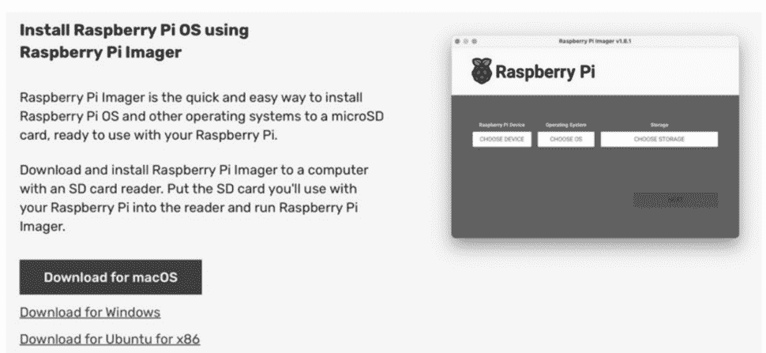

图5-1

#### 5.1.2 安装Raspberry Pi Imager

1. 双击下载的imager_1.8.5.dmg文件，打开安装页面。
2. 将“Raspberry Pi Imager”图标拖曳至Applications文件夹中。
3. 打开Applications文件夹，双击“Raspberry Pi Imager”启动程序，以验证软件是否正常运行。

如图5-2所示为安装过程中将Raspberry Pi Imager拖曳到Applications文件夹的示例。

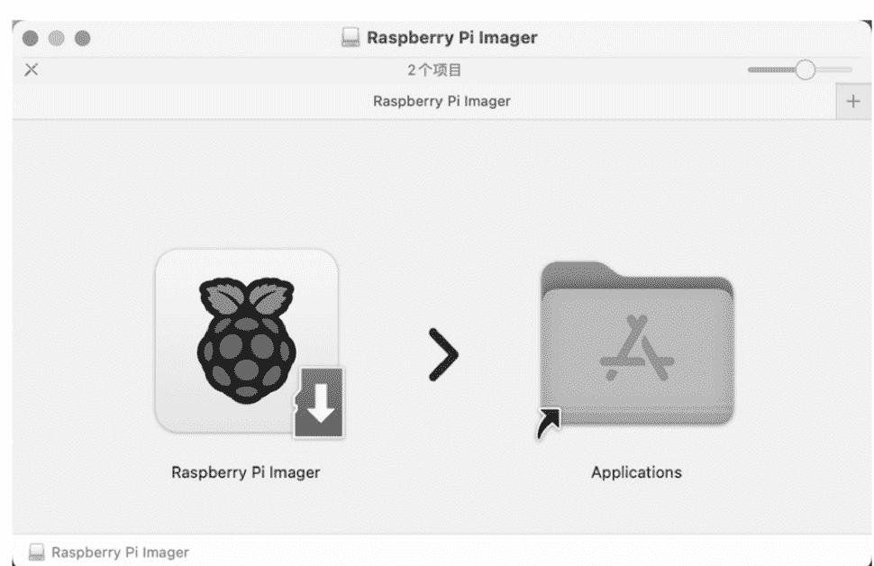

图5-2

#### 5.1.3 下载Raspberry Pi OS

在浏览器中直接访问完整链接：

```
https://www.raspberrypi.com/software/operating-systems/
```

在页面中选择 “Raspberry Pi OS with desktop and recommended software” 版本进行下载。

下载完成后，查找镜像文件（例如：2024-03-15-raspios-bookworm-armhf-full.img.xz），并进行解压、保存备用。

如图5-3所示为Raspberry Pi OS下载页面示例。

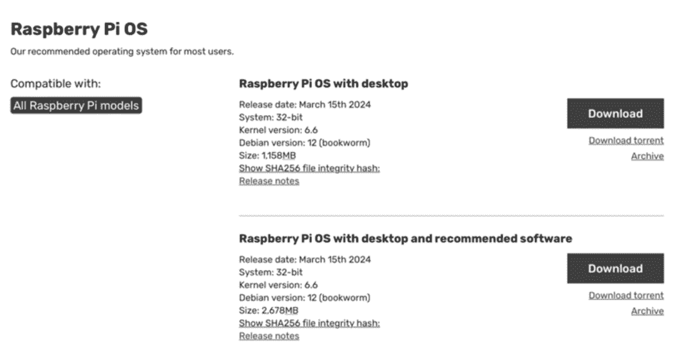

图5-3

#### 5.1.4 烧录Raspberry Pi OS至SD卡

将操作系统镜像烧录至SD卡，为树莓派启动提供系统文件。整个烧录过程均通过Raspberry Pi Imager工具完成，步骤简便高效。

1. 将SD卡插入Mac电脑的读卡器中。
2. 启动“Raspberry Pi Imager”程序。
3. 如图5-4所示，点击“选择操作系统”按钮，在弹出的对话框中选择“Use custom”，并选定先前解压的Raspberry Pi OS镜像文件。

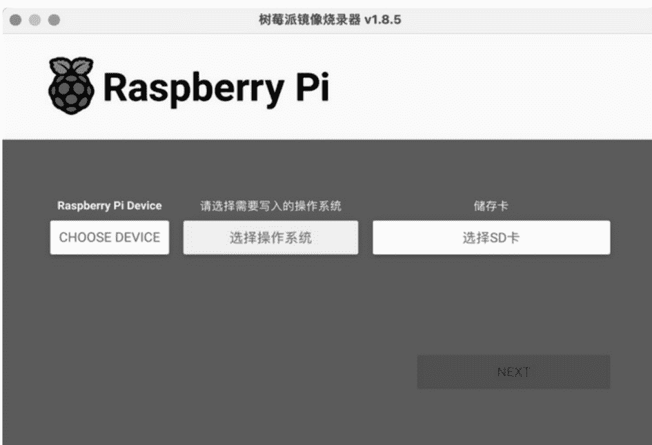

图5-4

4. 点击“选择SD卡”按钮，在弹出的对话框中选定插入的SD卡作为目标设备，如图5-5所示。

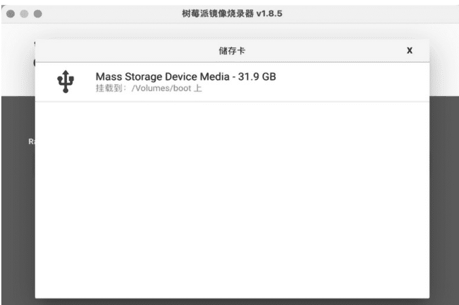

图5-5

5. 如图5-6所示，点击“NEXT”按钮，系统自动开始烧录过程，该过程可能需要几分钟，请耐心等待直至烧录完成。

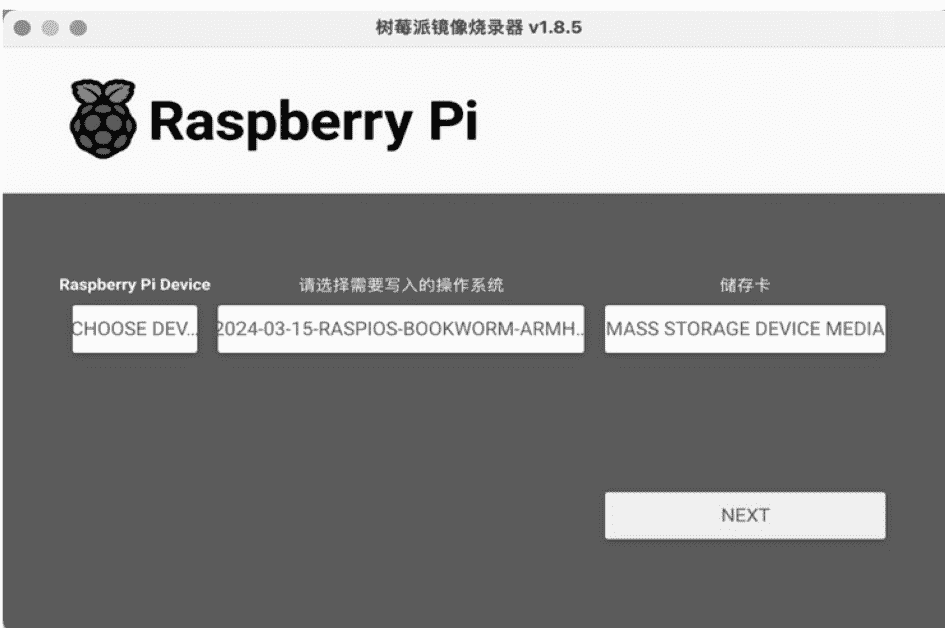

图5-6

6. 烧录完成后，系统提示烧录成功，表明SD卡中已写入Raspberry Pi OS镜像。

#### 5.1.5 验证安装与后续配置

完成烧录后，将SD卡插入树莓派设备，并接通电源启动设备，以验证安装效果并进行基本配置。具体步骤如下所述。

1. 将烧录好的SD卡插入树莓派，并接通电源启动设备。
2. 观察树莓派启动后的显示情况，确保操作系统正常加载。
3. 后续可根据树莓派官方文档进一步配置SSH或VNC等远程控制功能。如图5-7所示为树莓派启动后显示基本操作系统页面的示例。

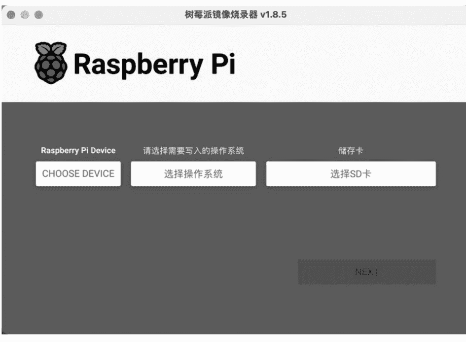

图5-7

### 5.2 搭建PHP网站服务器

本节介绍了如何在树莓派上搭建PHP网站服务器，内容包括调整树莓派时区、安装Apache2和PHP、安装并配置MariaDB、将时区信息加载到MariaDB以及安装phpMyAdmin。完成这些步骤后，您可以通过浏览器访问并管理树莓派上的PHP网站服务器。

#### 5.2.1 调整树莓派的时区

确保服务器时间准确对于PHP网站服务器运行时的时间一致性至关重要。

● 方法1：使用raspi-config工具

（1）打开终端（通过VNC或SSH连接树莓派）。

（2）运行raspi-config工具：

```
sudo raspi-config
```

（3）导航到Localisation Options，如图5-8所示。

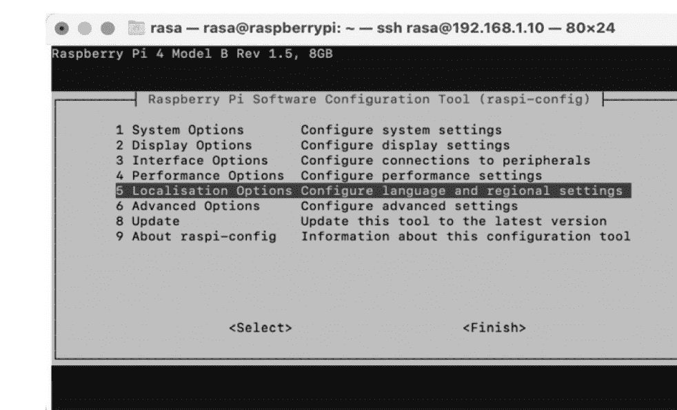

图5-8

（4）选择L2 Timezone，如图5-9所示。

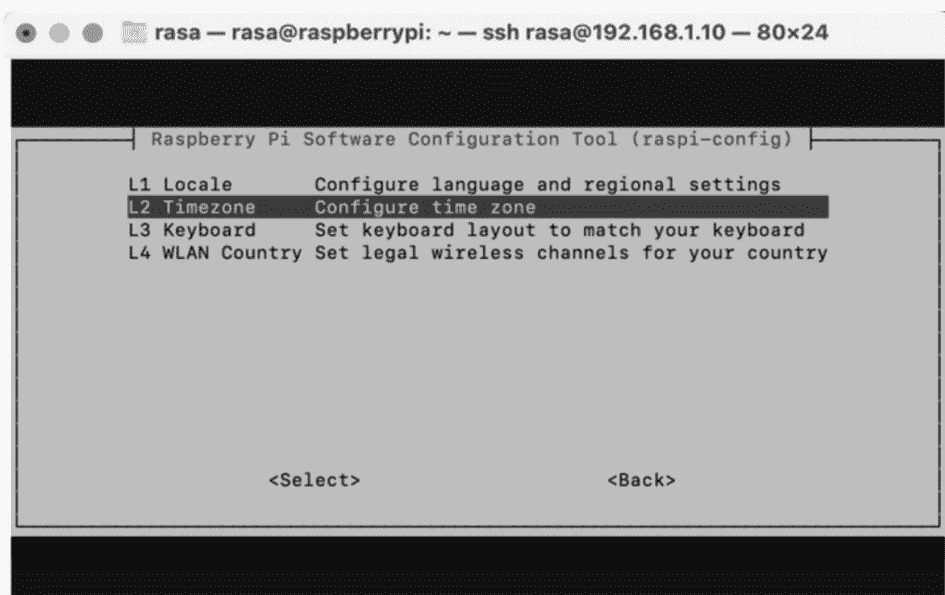

图5-9

（5）选择地理区域和城市（例如：Asia和Shanghai），如图5-10所示。

（6）完成并退出raspi-config工具，如图5-11所示。

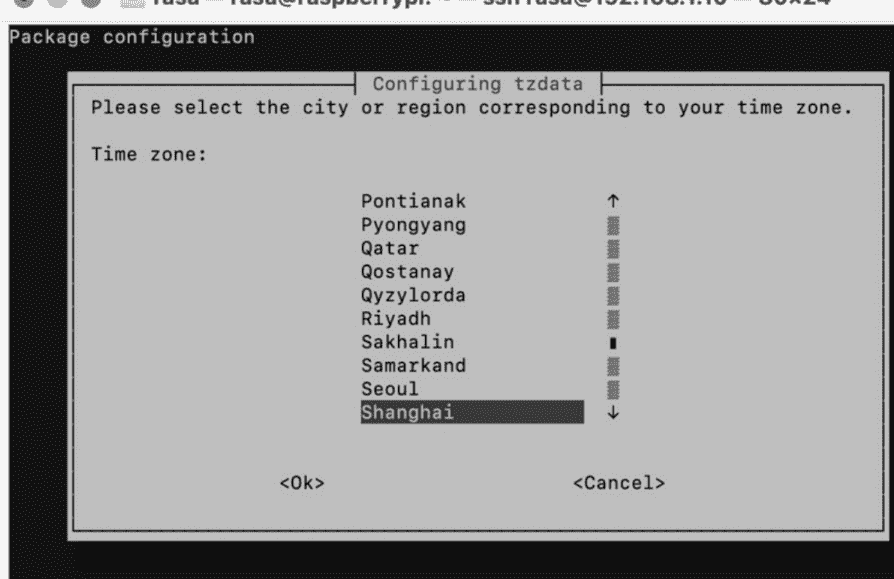

图5-10

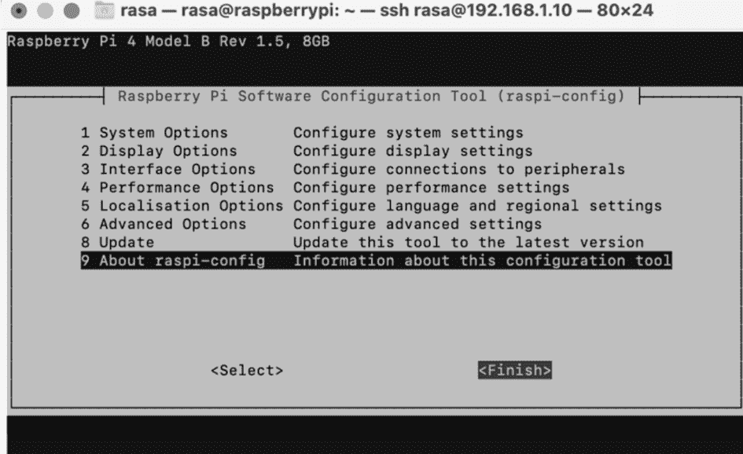

图5-11

(7) 重启树莓派：

```
sudo reboot
```

● 方法2：手动设置时区

查看当前时区：

```
timedatectl
```

设置时区为Shanghai：

```
sudo timedatectl set-timezone Asia/Shanghai
```

验证时区更改：

```
timedatectl
```

#### 5.2.2 安装Apache2和PHP

为搭建网站服务器环境，通过安装Apache2与PHP提供Web服务支持。

(1) 通过SSH连接到树莓派：

```
ssh pi@<树莓派的 IP 地址>
```

(2) 更新软件包列表：

```
sudo apt-get update
```

(3) 安装Apache2、PHP及PHP MySQL扩展：

```
sudo apt-get install apache2 php php-mysql -y
```

(4) 若出现dpkg was interrupted错误，依次执行以下命令修复：

```
sudo dpkg --configure -a
sudo apt-get clean
sudo apt-get update
sudo apt-get install apache2 php php-mysql -y
```

(5) 创建.php信息文件以验证安装效果：

```
sudo nano /var/www/html/info.php
```

在文件中添加以下内容：

```
<?php
phpinfo();
?>
```

保存并退出。

（6）通过浏览器访问以下地址，查看PHP信息页面：

```
http://<树莓派的 IP 地址>/info.php
```

若页面显示PHP信息，则Apache2与PHP安装成功。

#### 5.2.3 安装和配置MariaDB

MariaDB为PHP网站服务器提供数据库支持，需依次完成安装与基本配置。

（1）安装MariaDB：

```
sudo apt-get install mariadb-server mariadb-client -y
```

（2）配置MariaDB密码，运行以下命令进入MariaDB控制台：

```
sudo mysql
```

（3）在MariaDB控制台中执行以下命令（将yourpassword替换为所需密码）：

```
USE mysql;
SET PASSWORD FOR 'root'@'localhost' = PASSWORD('yourpassword');
FLUSH PRIVILEGES;
EXIT;
```

#### 5.2.4 加载时区信息到MariaDB

加载时区信息可确保数据库时间处理与系统保持一致。

（1）安装时区数据包（若未安装）：

```
sudo apt-get install tzdata
```

（2）使用mysql_tzinfo_to_sql命令加载系统时区信息到MariaDB：

```
sudo mysql_tzinfo_to_sql /usr/share/zoneinfo | sudo mysql -u root -p mysql
```

（3）设置全局时区，连接到MariaDB后执行：

```
SET GLOBAL time_zone = 'Asia/Shanghai';
```

（4）编辑MariaDB配置文件/etc/mysql/mariadb.conf.d/50-server.cnf以持久化时区设置：

```
sudo nano /etc/mysql/mariadb.conf.d/50-server.cnf
```

（5）添加或修改以下内容：

```
[mysqld]
default-time-zone = 'Asia/Shanghai'
```

如图5-12所示为MariaDB配置文件中的时区设置。

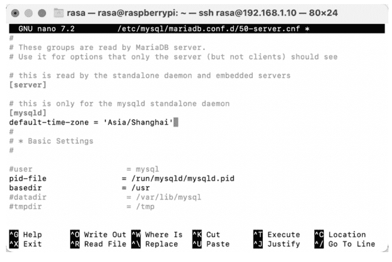

图5-12

（6）重启MariaDB服务：

```
sudo systemctl restart mariadb
```

#### 5.2.5 检查MariaDB时区配置

验证MariaDB时区设置，确保数据库与系统时间一致。

（1）连接到MariaDB：

```
sudo mysql -u root -p
```

（2）执行以下命令检查时区设置：

```
SHOW VARIABLES LIKE 'time_zone';
```

输出应显示Asia/Shanghai。

#### 5.2.6 安装phpMyAdmin

phpMyAdmin提供图形化管理页面，便于对MariaDB数据库进行管理与操作。

（1）安装phpMyAdmin：

```
sudo apt-get install phpmyadmin -y
```

安装过程中选择apache2，并拒绝自动配置数据库。

（2）配置Apache以包含phpMyAdmin配置。编辑Apache配置文件：

```
sudo nano /etc/apache2/apache2.conf
```

在文件末尾添加以下内容：

```
Include /etc/phpmyadmin/apache.conf
```

保存并退出。

（3）重启Apache服务：

```
sudo service apache2 restart
```

（4）通过浏览器访问以下地址，查看phpMyAdmin登录页面：

```
http://<树莓派的 IP 地址>/phpmyadmin
```

如图5-13所示为phpMyAdmin登录页面。

(5) 登录phpMyAdmin：在登录页面中输入MariaDB的用户名和密码，点击“登录”按钮后进入phpMyAdmin主页面，如图5-14所示。

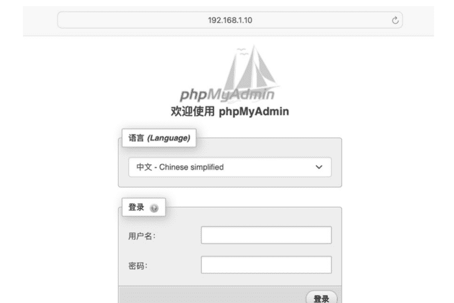

图5-13

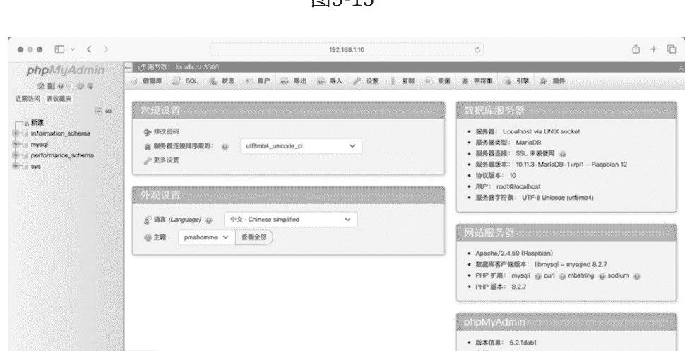

### 5.3 ArkTS与硬件控制服务的交互

本节介绍了硬件控制服务的开发与实现，以及ArkTS如何通过特定流程控制硬件设备，确保设备能够及时响应并与应用系统进行有效的数据交换。

#### 5.3.1 硬件控制服务的开发与实现

在本小节中，将介绍如何通过Flask和RPi.GPIO开发一个远程控制树莓RGB LED灯的硬件控制服务。该服务通过REST API接收客户端发送的十六进制颜色代码，经转换后利用PWM控制LED灯的颜色，实现实时调光。接下来，将依次介绍实现过程。

##### 1.构建项目目录结构

创建以下目录结构来组织代码文件：

```
5.1/
└── HardwareControlService/
    ├── led_control_server.py    // LED灯控制服务代码
    ├── requirements.txt         // 项目依赖列表
    └── start_hardware_services.sh // 启动服务脚本
```

##### 2.实现服务代码

在led_control_server.py中实现以下功能：

- （1）初始化树莓派GPIO，并设置用于RGB LED灯的引脚及PWM输出，实现平滑调光；
- (2) 定义函数将十六进制颜色代码转换为RGB数值，并利用正则表达式校验输入格式，确保颜色代码符合“#RRGGBB”标准；
- (3) 提供API接口，通过HTTP POST请求接收颜色参数，调用上述函数控制LED灯颜色。

以下为核心代码：

```python
# -*- coding: utf-8 -*-
# 5.1/HardwareControlService/led_control_server.py

import RPi.GPIO as GPIO
from flask import Flask, request, jsonify
import socket

app = Flask(__name__)

# 定义GPIO引脚
RED_PIN = 13
GREEN_PIN = 15
BLUE_PIN = 29

# 初始化GPIO
GPIO.setmode(GPIO.BOARD)
GPIO.setup(RED_PIN, GPIO.OUT)
GPIO.setup(GREEN_PIN, GPIO.OUT)
GPIO.setup(BLUE_PIN, GPIO.OUT)

# 设置 PWM 频率
red_pwm = GPIO.PWM(RED_PIN, 100)
green_pwm = GPIO.PWM(GREEN_PIN, 100)
blue_pwm = GPIO.PWM(BLUE_PIN, 100)

# 开始 PWM
red_pwm.start(0)
green_pwm.start(0)
blue_pwm.start(0)

def hex_to_rgb(hex_color):
    """
    将十六进制颜色代码转换为 RGB 值

    Args:
    - hex_color (str): 十六进制颜色代码，例如 "#FF0000"

    Returns:
    - tuple: 包含红、绿、蓝三个分量的整数元组 (R, G, B)
    """
    hex_color = hex_color.lstrip('#')  # 去掉前导的#
    return tuple(int(hex_color[i:i+2], 16) for i in (0, 2, 4))

def set_color(rgb_values):
    """
    根据 RGB 值设置 LED 灯颜色

    Args:
    - rgb_values (tuple): 包含红、绿、蓝三个分量的整数元组 (R, G, B)
    """
    red_pwm.ChangeDutyCycle(rgb_values[0] * 100 / 255)
    green_pwm.ChangeDutyCycle(rgb_values[1] * 100 / 255)
    blue_pwm.ChangeDutyCycle(rgb_values[2] * 100 / 255)

    # 在终端输出当前颜色设置状态
    print(f"Setting LED color to RGB: {rgb_values} (Hex: #{''.join(f'{v:02X}' for v in rgb_values)})")

@app.route('/set_color', methods=['POST'])
def set_led_color():
    """
    API 端点，接收十六进制颜色代码并控制 LED 灯颜色

    Request JSON body:
    - color (str): 十六进制颜色代码，例如 "#FF0000"

    Response JSON:
    - success (bool): 指示是否成功设置颜色
    """
    data = request.json
    if 'color' not in data:
        return jsonify({"error": "No color provided"}), 400

    hex_color = data['color']
    rgb_values = hex_to_rgb(hex_color)
    set_color(rgb_values)

    return jsonify({"success": True, "color": hex_color})

if __name__ == '__main__':
    try:
        # 获取本机 IP 地址
        hostname = socket.gethostname()
        local_ip = socket.gethostbyname(hostname)

        print(f"Starting server on http://{local_ip}:6002")
        app.run(host='0.0.0.0', port=6002)
    except KeyboardInterrupt:
        print("\nStopping server...")
    finally:
        # 清理 GPIO 设置
        GPIO.cleanup()
        print("GPIO cleanup done.")
```

##### 3.依赖配置与启动脚本

在requirements.txt文件中列出项目依赖：

```
flask
RPi.GPIO
```

编写启动脚本start_hardware_services.sh，实现自动安装依赖、切换目录、后台启动服务及日志记录：

```bash
#!/bin/bash

echo "==============================="
echo "启动硬件服务"
echo "==============================="

# 检查并安装依赖
echo "安装硬件服务的依赖..."
pip install -r services/hardware/requirements.txt

# 启动硬件控制服务
echo "启动硬件控制服务 (led_control_server.py)..."

python3 services/hardware/led_control_server.py &
HARDWARE_PID=$!

# 确认服务启动
echo "硬件控制服务已成功启动！"

# 等待用户手动终止脚本
echo "按 [Ctrl+C] 终止服务。"
wait
```

**注意：** 请确保启动脚本具有可执行权限（如使用chmod +x start_hardware_services.sh）。

##### 4.接口测试与验证

服务启动后，通过curl命令测试LED灯控制接口。将＜树莓派IP＞替换为实际地址，执行以下命令：

```
curl -X POST http://<树莓派IP>:6002/set_color \
    -H "Content-Type: application/json" \
    -d '{"color": "#FF0000"}'
```

执行后，终端返回如下JSON响应，表明颜色设置成功：

```json
{
    "success": true,
    "color": "#FF0000"
}
```

如图5-15所示为接口测试执行结果的终端截图。


图5-15

使用curl命令发送请求后，终端输出了正确的JSON响应，证明LED灯控制接口已成功实现。

##### 5.常用树莓派命令

为便于远程管理与维护，常用命令如下（请根据实际用户名和IP地址替换）。

- 远程连接：

```
ssh <用户名>@<树莓派 IP>
```

例如：

```
ssh pi@192.168.1.11
```

- 编辑脚本：

```
sudo nano /home/<用户名>/led_control_server.py
```

编辑完成后保存退出。

- 启动服务：

```
sudo python3 /home/<用户名>/led_control_server.py
```

- 终止服务：

使用Ctrl+Z组合键暂停进程，或使用kill＜进程ID＞终止指定进程。

- 删除脚本：

```
sudo rm /home/<用户名>/led_control_server.py
```

#### 5.3.2 ArkTS控制硬件的实现流程

本小节详细介绍了如何基于ArkTS平台实现硬件控制功能。通过调整项目结构、实现前端代码以及预览运行效果，开发者可以理解如何在移除问答模块后新增硬件控制模块，并通过简单的按钮操作实时控制硬件的颜色状态。

##### 1.项目结构调整

为了专注于硬件控制，本项目在BasicInteractionFrontend的基础上进行了结构改造。项目中删除了ApiTypes.ets、EmotionService.ets和ApiService.ets文件，并新增了HardwareTypes.ets和HardwareService.ets文件，同时对Index.ets页面进行了调整，添加了“蓝灯”和“绿灯”按钮，从而确保前端能通过简洁的模块化设计实现硬件状态的实时控制。

```
src/
├── main/
│   ├── ets/
│   │   ├── configs/          // 配置文件目录（包含硬件控制的 API 地址）
│   │   │   └── Config.ets    // 应用配置文件
│   │   ├── pages/            // 页面文件目录
│   │   │   └── Index.ets     // 更新后的首页，包含硬件控制按钮
│   │   ├── services/         // 服务层，处理与硬件控制接口的交互
│   │   │   └── HardwareService.ets // 硬件控制逻辑封装
│   │   ├── types/            // 类型定义目录
│   │   │   └── HardwareTypes.ets // 定义硬件请求与响应的数据结构和颜色校验方法
│   │   └── utils/            // 工具函数目录
│   │       ├── HttpClient.ets // HTTP 请求工具（辅助文件）
│   │       └── StreamingUtils.ets // 流式数据处理工具
│   └── module.json5          // 模块配置文件
```

##### 2.前端代码实现

前端代码的实现分为硬件数据类型定义的实现、硬件服务逻辑和页面交互设计的实现。在HardwareTypes.ets中，定义了硬件请求与响应的数据结构，并提供了颜色格式校验函数；在HardwareService.ets中，封装了发送控制请求和处理流式响应的逻辑；在Index.ets页面中，通过按钮触发硬件控制请求，从而实现对硬件颜色状态的精确控制。

- HardwareTypes.ets

此文件主要定义了前后端通信中使用的数据结构，并在数据进入业务逻辑之前对颜色格式进行校验，确保数据的合法性。

## HardwareTypes.ets

```typescript
// src/main/ets/types/HardwareTypes.ets

/**
 * @description 用于硬件请求的接口
 * @property {string} color - 请求的硬件颜色，应该是有效的颜色代码（如 #FF0000）
 */
export interface HardwareRequest {
  color: string; // 请求的硬件颜色，必须为有效的颜色代码格式（如 #FF0000）
}

/**
 * @description 硬件请求的响应接口
 * @property {boolean} success - 请求是否成功
 * @property {string} color - 返回的硬件颜色，表示硬件状态的颜色
 */
export interface HardwareResponse {
  success: boolean; // 请求成功与否，true 表示成功，false 表示失败
  color: string; // 返回的硬件颜色，表示当前硬件的状态，通常为有效的颜色代码
}

/**
 * @description 校验颜色是否符合有效的 HEX 格式
 * @param color - 颜色字符串，格式应为十六进制颜色代码（如 #FF5733）
 * @returns boolean - 校验颜色格式是否有效
 * @throws Error - 如果颜色格式无效，抛出错误
 */
export function isValidColor(color: string): boolean {
  const hexColorRegex = /^#[0-9A-Fa-f]{6}$/i; // 加入 'i' 以支持大小写
  if (!hexColorRegex.test(color)) {
    throw new Error(`Invalid color format: ${color}. Please use a valid HEX color code (e.g., #FF5733).`);
  }
  return true;
}

/**
 * @description 定义颜色类型，确保颜色值符合有效的 HEX 格式
 */
export type Color = string;
```

## HardwareService.ets

该文件中封装了与硬件后端的通信逻辑。sendColor方法构造请求体，并通过httpRequestText方法发送HTTP请求，同时解析流式返回的数据。代码详细捕获并处理可能的异常，并在成功时调用回调函数处理每个数据块，最终返回控制请求是否成功的结果。

```typescript
// src/main/ets/services/HardwareService.ets

import { httpRequestText } from '../utils/HttpClient'; // 导入 HTTP 请求方法
import { http } from '@kit.NetworkKit'; // 导入自定义网络模块
import { HardwareRequest, HardwareResponse } from '../types/HardwareTypes'; // 导入类型

export class HardwareService {
  private apiUrl: string;

  constructor(apiUrl: string) {
    this.apiUrl = apiUrl;
  }

  /**
   * 向硬件发送颜色控制请求
   * @param color - 要发送的颜色
   * @param onChunkReceived - 可选的回调函数，用于处理每个数据块
   * @returns Promise<boolean> - 请求是否成功
   */
  private async sendColor(
    color: string,
    onChunkReceived?: (chunk: string) => void
  ): Promise<boolean> {
    const requestBody: HardwareRequest = { color };

    console.info('发送硬件控制请求，载荷:', requestBody);

    try {
      let success = false;

      // 发送 HTTP 请求并处理流式响应
      await httpRequestText(this.apiUrl, http.RequestMethod.POST, JSON.stringify(requestBody), 60000, (chunk: string) => {
        try {
          const response: HardwareResponse = JSON.parse(chunk); // 解析响应数据
          if (response.success) {
            success = response.success;
            // 如果有回调函数，则调用回调处理每个数据块
            if (onChunkReceived) {
              onChunkReceived(response.success.toString());
            }
          } else {
            console.warn('硬件控制响应失败:', response);
          }
        } catch (parseError) {
          console.error('解析硬件响应数据块时出错:', parseError);
          throw new Error('解析错误: ' + parseError.message);
        }
      });

      console.info('硬件控制请求完成');
      return success; // 返回请求是否成功
    } catch (error) {
      console.error('硬件控制失败:', error);
      throw new Error(`硬件控制失败: ${error instanceof Error ? error.message : error}`);
    }
  }

  /**
   * 控制硬件并获取响应
   * @param color - 要发送的颜色
   * @returns Promise<boolean> - 请求是否成功
   */
  public async controlHardware(color: string): Promise<boolean> {
    try {
      return await this.sendColor(color); // 直接调用发送颜色的私有方法
    } catch (error) {
      console.error('控制硬件失败, 错误信息:', error);
      throw new Error('硬件控制失败'); // 抛出详细的错误信息
    }
  }
}
```

## Index.ets

在Index.ets页面中，通过新增的“蓝灯”和“绿灯”按钮，用户点击按钮后会调用fetchData方法。该方法实现创建HardwareService实例，并调用controlHardware方法，将对应的颜色控制请求发送到后端。页面简洁明了，便于用户操作，同时在控制台中输出响应结果，方便调试和验证硬件控制的效果。

```typescript
// src/main/ets/pages/Index.ets

import { config } from '../configs/Config'; // 导入配置文件
import { HardwareService } from '../services/HardwareService';

@Entry
@Component
struct Index {
  /**
   * 根据按钮点击事件获取数据，并生成响应文本
   * @description 该方法会调用 ModelService 获取生成的诗歌文本，并逐块更新结果文本
   */
  async fetchData(color: string) {
    // 创建 HardwareService 实例，传入配置的 API 地址和模型名称
    const hardwareService = new HardwareService(config.hardwareApiUrl);

    try {
      const success = await hardwareService.controlHardware(color);
      console.log(`Hardware control success: ${success}`); // 输出硬件控制结果
    } catch (error) {
      console.error('Error while fetching data:', error); // 错误日志
    }
  }

  build() {
    // 页面布局结构
    Column() {
      Button('蓝灯')
        .width('match_parent') // 按钮宽度设置为填满父容器
        .height(50) // 设置按钮的高度
        .onClick(() => this.fetchData('#0000FF')) // 点击按钮时调用 fetchData 方法

      Button('绿灯')
        .width('match_parent') // 按钮宽度设置为填满父容器
        .height(50) // 设置按钮的高度
        .onClick(() => this.fetchData('#00FF00')) // 点击按钮时调用 fetchData 方法
    }
    .width('100%') // 设置父容器宽度为 100%
    .height('100%') // 设置父容器高度为 100%
    .padding(20) // 添加内边距
    .align(Alignment.Center) // 居中对齐
  }
}
```

##### 3. 运行效果预览及截图说明

启动应用后，前端页面将显示“蓝灯”和“绿灯”两个按钮。点击任一按钮后，前端页面会调用硬件控制接口，并根据后端响应判断控制是否成功，从而实现对硬件颜色状态的实时控制，如图5-16所示。

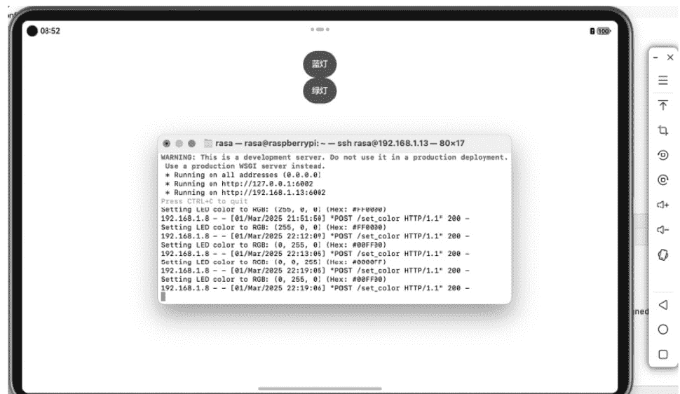

图5-16

#### 5.3.3 ArkTS随机颜色变化器项目中的硬件同步控制实现

本小节以一个随机颜色变化器项目为例，展示如何在一个简单的应用中叠加硬件控制功能，实现App页面背景颜色的随机变化与硬件设备颜色状态的实时同步。文中详细描述了项目的结构调整、基础功能的实现、硬件控制功能的升级以及运行效果预览。

##### 1. 项目结构调整

在项目中，在保留原有随机颜色生成和页面展示逻辑的基础上，引入了硬件控制服务模块。新增的硬件控制相关代码主要包括以下内容。

- HardwareService.ets：封装硬件控制逻辑；
- HardwareTypes.ets：定义硬件请求和响应的数据结构。

此外，为了页面装饰效果，猫咪图片资源被存放在：

```
src/main/resources/base/media/cat.png
```

项目目录结构示例如下：

```
src/
├── main/
│   ├── ets/
│   │   ├── configs/
│   │   │   └── Config.ets          // 应用配置文件（包含硬件控制 API 地址）
│   │   ├── pages/
│   │   │   ├── RandomColorPage.ets // 随机颜色页面（后续升级集成硬件同步控制）
│   │   │   └── Index.ets           // 调用随机颜色页面
│   │   ├── services/
│   │   │   └── HardwareService.ets // 硬件控制逻辑封装
│   │   ├── types/
│   │   │   └── HardwareTypes.ets   // 定义硬件请求与响应的数据结构
│   │   └── utils/                  // 工具函数目录
│   │       ├── HttpClient.ets      // HTTP 请求工具（辅助文件）
│   │       └── StreamingUtils.ets  // 流式数据处理工具
│   ├── module.json5
│   └── resources/
│       └── base/
│           └── media/
│               └── cat.png         // 猫咪图片资源
```

##### 2. 基础功能实现：随机背景颜色变化

首先，实现一个仅支持随机背景颜色变化的页面组件，以展示最基础的功能。在原始版本中，RandomColorPage.ets组件采用Column布局排列文本、图片和按钮。通过点击“随机颜色”按钮，触发changeBackgroundColor方法，生成随机的淡色系背景颜色并更新页面。

页面中使用$r ('app.media.cat') 引用了猫咪图片资源，以增强视觉效果。同时，Index.ets作为应用入口，调用RandomColorPage组件，实现基础的页面交互与展示。

下面是原始版本的代码：

```typescript
// src/main/ets/pages/RandomColorPage.ets

@Component
export struct RandomColorPage {
  @State backgroundColor1: string = '#FFFFFF'; // 默认背景颜色为白色

  build() {
    Column({ space: 20 }) { // 创建垂直布局容器
      // 显示当前颜色代码
      Text(`当前背景颜色代码: ${this.backgroundColor1}`)
        .fontSize(18)
        .fontWeight(FontWeight.Bold)
        .fontColor(Color.Black)
        .alignSelf(ItemAlign.Center);

      // 显示猫咪图片装饰
      Image($r('app.media.cat'))
        .width(85)
        .height(100)
        .borderRadius(5)
        .alignSelf(ItemAlign.Center);

      // 更改颜色按钮
      Button('随机颜色')
        .onClick(() => this.changeBackgroundColor())
        .fontSize(20)
        .backgroundColor(Color.Gray)
        .fontColor(Color.White)
        .width('60%')
        .alignSelf(ItemAlign.Center);
    }
    .padding(20)
    .width('100%')
    .height('100%')
    .backgroundColor(this.backgroundColor1) // 动态更新背景颜色
    .alignItems(HorizontalAlign.Center);
  }

  // 随机生成淡色系颜色的方法
  private changeBackgroundColor() {
    const randomColor = this.generateLightColor();
    this.backgroundColor1 = randomColor;
  }

  // 生成淡色系颜色的逻辑
  private generateLightColor(): string {
    const r = Math.floor(Math.random() * 128 + 128); // 保证 R 值在 128-255 范围
    const g = Math.floor(Math.random() * 128 + 128); // 保证 G 值在 128-255 范围
    const b = Math.floor(Math.random() * 128 + 128); // 保证 B 值在 128-255 范围
    return `#${r.toString(16).padStart(2, '0')}${g.toString(16).padStart(2, '0')}${b.toString(16).padStart(2, '0')}`;
  }
}
```

Index.ets用于调用上述页面组件：

```typescript
// src/main/ets/pages/Index.ets

import { RandomColorPage } from './RandomColorPage';

@Entry
@Component
struct Index {
  build() {
    Column() {
      RandomColorPage() // 调用随机颜色页面
    }
    .padding(20)
  }
}
```

在模拟器上运行该版本时，页面会显示当前背景颜色代码、猫咪图片和“随机颜色”按钮。点击按钮后，背景颜色将会随机变化，如图5-17所示。


图5-17

##### 3. 升级功能实现：加入硬件控制能力

升级后的RandomColorPage.ets代码在原有基础上实现了硬件设备的颜色状态同步。changeBackgroundColor方法调用generateStandardColor生成标准颜色（七种颜色之一），确保LED灯的显示效果更加清晰可辨。颜色生成后，页面的背景颜色随之更新，同时创建HardwareService实例，并调用controlHardware方法，将生成的颜色信息发送到硬件设备，使应用与硬件设备的颜色状态保持实时同步。

新增的HardwareService.ets负责与硬件设备通信，采用HTTP请求的方式，将颜色数据传输至指定的硬件控制接口，实现设备端颜色的动态更新。应用在完成颜色同步后，还会弹出提示，增强交互体验，使用户能够直观感知颜色状态的变化。升级后的实现不仅优化了视觉效果，同时也提升了应用与硬件的交互性，使颜色的变更不仅限于页面显示，还能够同步到实际的硬件设备，实现更深层次的联动。

下面是升级后的实现代码：

typescript
// src/main/ets/pages/RandomColorPage.ets

import { config } from '../configs/Config'; // 导入配置文件，包含硬件控制 API 地址
import { HardwareService } from '../services/HardwareService'; // 导入硬件控制服务

@Component
export struct RandomColorPage {
  @State backgroundColor1: string = '#FFFFFF'; // 默认背景颜色为白色

  build() {
    Column({ space: 20 }) {
      Text(`当前背景颜色代码: ${this.backgroundColor1}`)
        .fontSize(18)
        .fontWeight(FontWeight.Bold)
        .fontColor(Color.Black)
        .alignSelf(ItemAlign.Center);
      Image($r('app.media.cat'))
        .width(85)
        .height(100)
        .borderRadius(5)
        .alignSelf(ItemAlign.Center);
      Button('随机颜色')
        .onClick(() => this.changeBackgroundColor())
        .fontSize(20)
        .backgroundColor(Color.Gray)
        .fontColor(Color.White)
        .width('60%')
        .alignSelf(ItemAlign.Center);
    }
    .padding(20)
    .width('100%')
    .height('100%')
    .backgroundColor(this.backgroundColor1)
    .alignItems(HorizontalAlign.Center);
  }

  private async changeBackgroundColor() {
    // const randomColor = this.generateLightColor();
    const randomColor = this.generateStandardColor();
    this.backgroundColor1 = randomColor; // 更新页面背景颜色

    // 创建 HardwareService 实例，传入配置中的硬件控制 API 地址
    const hardwareService = new HardwareService(config.hardwareApiUrl);
    try {
      //调用硬件服务，将随机颜色发送给硬件设备
      const success = await hardwareService.controlHardware(randomColor);
      console.log(`Hardware control success: ${success}`);
    } catch (error) {
      console.error('Error while sending random color to hardware:', error);
    }
  }

  private generateLightColor(): string {
    const r = Math.floor(Math.random() * 128 + 128);
    const g = Math.floor(Math.random() * 128 + 128);
    const b = Math.floor(Math.random() * 128 + 128);
    return `#${r.toString(16).padStart(2, '0')}${g.toString(16).padStart(2, '0')}${b.toString(16).padStart(2, '0')}`;
  }

  /**
   * 该函数用于随机生成标准的七种颜色中的一种颜色的十六进制编码
   * @returns {string} 随机选中的标准颜色的十六进制编码字符串
   */
  private generateStandardColor(): string {
    // 定义一个数组，存储标准的七种颜色的十六进制编码
    // 红色，象征热情、活力、爱情和危险
    // 橙色，结合了红色的热情和黄色的活力，给人温暖、欢快的感觉
    // 黄色，亮度高，代表智慧、快乐、希望和活力
    // 绿色，与大自然相关，代表生命、健康、和平与成长
    // 蓝色，给人冷静、专业、信任和深邃的感觉
    // 靛色，深沉神秘，介于蓝色和紫色之间，具有精神性和内省性
    // 紫色，富有贵族气息和浪漫情怀，与皇室、神秘和创造力相关
    const colors = ['#FF0000', '#FFA500', '#FFFF00', '#008000', '#0000FF', '#4B0082', '#EE82EE'];
    // 生成一个 0 到 colors 数组长度（不包含数组长度）之间的随机整数索引
    const index = Math.floor(Math.random() * colors.length);
    // 根据生成的随机索引，从 colors 数组中取出对应的颜色十六进制编码并返回
    return colors[index];
  }
}

Index.ets文件保持不变。

升级后的应用在模拟器上运行时，点击“随机颜色”按钮会先调用 generateLightColor方法生成新的颜色，然后更新页面背景颜色，并通过HardwareService将该颜色发送给硬件设备，实现App与硬件设备颜色状态的实时同步，如图5-18所示。

另外，由于使用generateLightColor方法生成的淡色系颜色在LED灯上显示的效果不明显，因此可切换使用generateStandardColor方法进行测试。

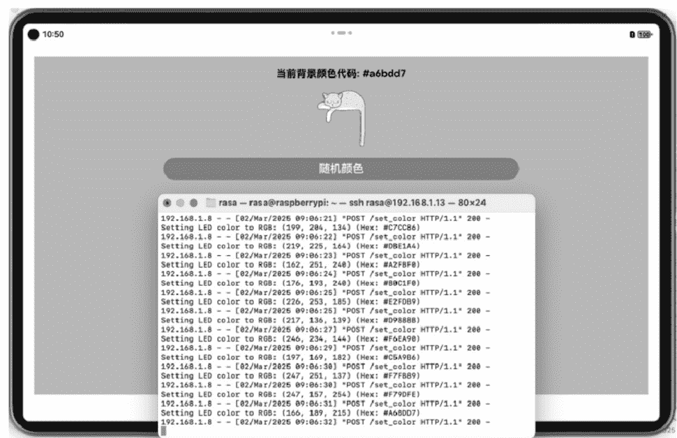

图5-18

如图5-19所示为随机标准七彩颜色与硬件同步控制的运行效果。

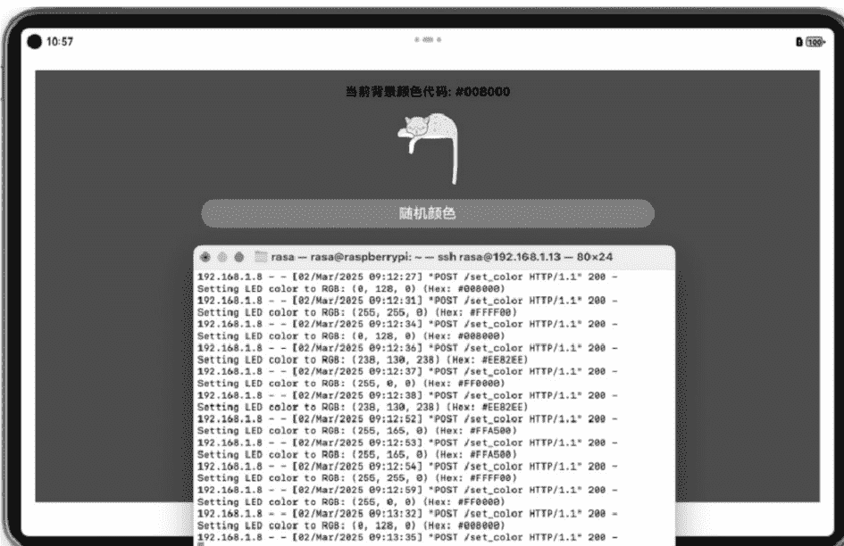

图5-19

### 5.4 硬件状态变化与ArkTS事件触发

本节介绍了如何通过数据库同步机制实现硬件状态的管理，并利用ArkTS自动监测技术，将硬件状态的变化及时触发为应用事件，从而实现软硬件的有效联动。

#### 5.4.1 硬件状态管理与数据库同步机制

本小节详细介绍了如何通过树莓派实时采集硬件状态数据（如传感器数据），并利用Python与PHP脚本将数据同步更新到数据库中。整个流程包括利用phpMyAdmin创建数据库与数据表、编写采集硬件状态数据的Python脚本、实现数据写入与查询的PHP接口，从而构建一套完整的硬件状态管理与数据库同步机制，为智能家居系统提供实时数据支持。需注意以下几点：

1. SSH登录时的用户名 “pi” 需根据实际情况调整；
2. 示例中 “192.168.1.13” 为示例IP，实际部署时请使用真实服务器IP；
3. 数据库的用户名和密码（如$db_username='root'; 和 $db_password='yourpassword'; ）请根据实际配置进行修改。

##### 1.创建数据库和表

此处主要说明如何使用phpMyAdmin创建用于存储硬件状态数据的数据库和数据表。

1. 在浏览器地址栏输入 “http://192.168.1.13/phpmyadmin/” (实际部署时请使用真实服务器IP)，使用数据库管理员账户登录。
2. 在主页面中点击顶部菜单中的【数据库】，在“创建数据库”字段中输入数据库名称smart_home，然后点击“创建”按钮，如图5-20所示。

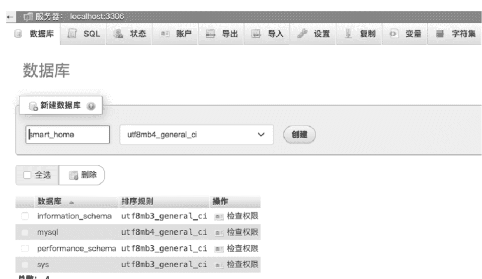

图5-20

进入smart_home数据库后，点击左侧链接进入管理页面，选择【SQL】选项卡，输入以下SQL命令创建数据表smart（表中包含字段id、temp、info与datetime，用于记录各硬件状态数据），然后点击“执行”按钮，如图5-21所示：

```sql
CREATE TABLE smart(
    id INT NOT NULL AUTO_INCREMENT PRIMARY KEY,
    temp FLOAT NOT NULL,
    info VARCHAR(64) NOT NULL,
    datetime DATETIME NOT NULL
);
```

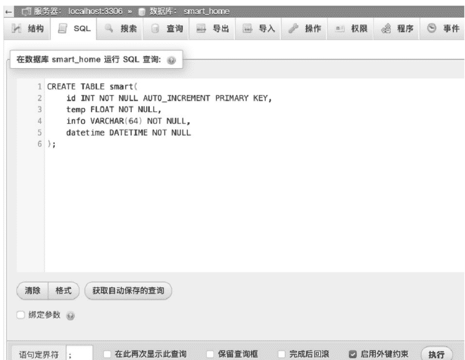

图5-21

##### 2.在树莓派上创建并编辑smart_home.py文件

本部分将介绍如何通过SSH连接到树莓派，创建并编辑Python脚本，用于采集硬件状态数据并通过HTTP请求同步到服务器端。

（1）在终端输入以下命令连接到树莓派（实际使用时请将“pi”替换为实际用户名，将“192.168.1.13”替换为实际设备IP）：

```bash
ssh pi@192.168.1.13
```

（2）创建并编辑文件smart_home.py：

```bash
nano /home/pi/smart_home.py
```

(3) 将以下Python代码复制到文件中。代码实现了GPIO和I2C传感器数据的实时采集，并在检测到硬件状态变化时，通过HTTP请求将数据发送给服务器端PHP接口：

```python
# -*- coding: utf-8 -*-
# 5.2/HardwareStateSync/smart_home.py

import RPi.GPIO as GPIO
from time import sleep
import smbus
import requests

# 注意：请将 URL 中的 IP 地址替换为实际服务器地址
url = 'http://127.0.0.1/sql.php'

GPIO.setwarnings(False)
GPIO.setmode(GPIO.BOARD)

buzzer = 12
motion_pin = 16
relay_pin = 40

GPIO.setup(buzzer, GPIO.OUT, initial=GPIO.LOW)
GPIO.setup(motion_pin, GPIO.IN, pull_up_down=GPIO.PUD_UP)
GPIO.setup(relay_pin, GPIO.OUT, initial=GPIO.HIGH)

DEVICE = 0x5c
ONE_TIME_HIGH_RES_MODE_1 = 0x20

if GPIO.RPI_REVISION == 1:
    bus = smbus.SMBus(0)
else:
    bus = smbus.SMBus(1)

def fetch_data(url, params):
    try:
        response = requests.get(url, params=params, timeout=5)
        print(response.text)
    except Exception as e:
        print("Error:", e)

def convert_to_number(data):
    result = (data[1] + (256 * data[0])) / 1.2
    return result

def read_light(addr=DEVICE):
    data = bus.read_i2c_block_data(addr, ONE_TIME_HIGH_RES_MODE_1)
    return convert_to_number(data)

def main():
    while True:
        if GPIO.input(motion_pin) == 1:
            fetch_data(url, {'temp': 1, 'info': '检测到物体移动...'})
            GPIO.output(buzzer, GPIO.HIGH)
            sleep(0.3)
            GPIO.output(buzzer, GPIO.LOW)
        else:
            GPIO.output(buzzer, GPIO.LOW)
            sleep(0.1)

        light_level = read_light()
        if light_level < 50:
            fetch_data(url, {'temp': format(light_level, '.2f'), 'info': '灯被打开...'})
            GPIO.output(relay_pin, GPIO.LOW)
        elif light_level > 200:
            GPIO.output(relay_pin, GPIO.HIGH)
            sleep(0.1)

if __name__ == '__main__':
    try:
        main()
    except KeyboardInterrupt:
        GPIO.cleanup()
```

保存并退出编辑器。

##### 3.编写PHP脚本实现数据写入与查询

为实现硬件状态数据与数据库的同步，分别编写两个PHP脚本，一个用于数据写入（sql.php），另一个用于数据查询（smart_home.php）。

- 创建并编辑sql.php文件：

```bash
sudo nano /var/www/html/sql.php
```

将以下PHP代码复制到文件中：

```php
<?php
// 5.2/HardwareStateSync/sql.php

$db_hostname = '127.0.0.1';
$db_username = 'root';        // 请按实际情况修改数据库用户名
$db_password = 'yourpassword'; // 请按实际情况修改数据库密码
$db_database = 'smart_home';
$db_table = 'smart';
$charset = 'utf8';

$temp = $_GET['temp'];
$info = $_GET['info'];
date_default_timezone_set('Asia/Shanghai'); // 设置时区
$datetime = date('Y-m-d H:i:s');

$con = connectDB($db_hostname, $db_username, $db_password, $charset);
selectDB($con, $db_database);

$columns = "`temp`, `info`, `datetime`";
$values = "'$temp', '$info', '$datetime'";

$res = insertTB($con, $db_table, $columns, $values);
closeDB($con);

echo 'temp = ' . $temp . ', info = ' . $info . ', datetime = ' . $datetime;

function connectDB($db_hostname, $db_username, $db_password, $charset = 'utf8') {
    $con = mysqli_connect($db_hostname, $db_username, $db_password);
    if (!$con) {
        die('Error: Could not connect: ' . mysqli_connect_error());
    }
    mysqli_set_charset($con, $charset);
    return $con;
}

function insertTB($con, $db_table, $columns, $values) {
    $sql = 'INSERT INTO ' . $db_table . '(' . $columns . ')' . ' VALUES (' . $values . ')';
    return queryDB($con, $sql);
}

function selectDB($con, $db_database) {
    return mysqli_select_db($con, $db_database);
}

function queryDB($con, $sql) {
    return mysqli_query($con, $sql);
}

function closeDB($con) {
    mysqli_close($con);
}
?>
```

- 创建并编辑smart_home.php文件：

```bash
sudo nano /var/www/html/smart_home.php
```

将以下PHP代码复制到文件中。该脚本实现连接数据库、查询硬件状态数据，并以JSON格式返回结果：

```php
<?php
    // 5.2/HardwareStateSync/smart_home.php
```

##### 4. 运行Python脚本同步硬件状态数据

(1) 在树莓派终端中执行以下命令启动脚本：

```
sudo python3 /home/pi/smart_home.py
```

(2) 观察终端输出，确认数据通过HTTP请求成功发送给PHP接口并写入数据库。

(3) 使用浏览器，在地址栏输入相应地址检查数据库中的数据记录：
可通过phpMyAdmin查看数据库（地址格式：http://192.168.1.13/phpmyadmin，实际部署时请使用真实IP），或直接在浏览器中输入地址“http://192.168.1.13/smart_home.php”查看JSON数据。

如图5-22和图5-23所示为数据库中硬件状态数据的同步效果截图。

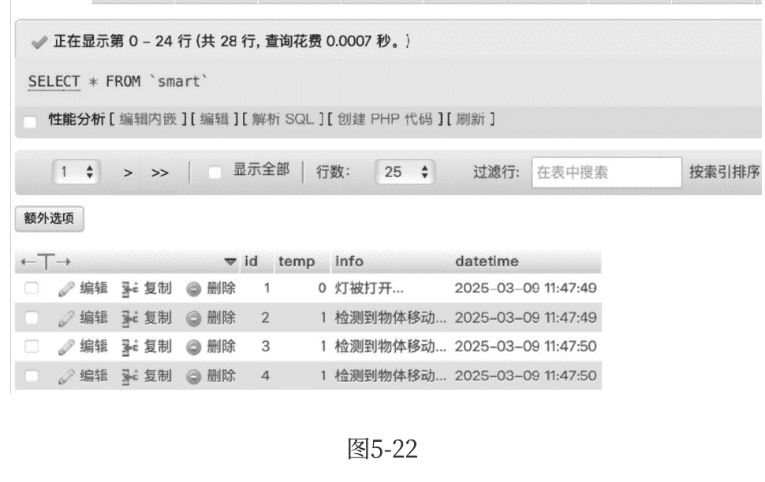

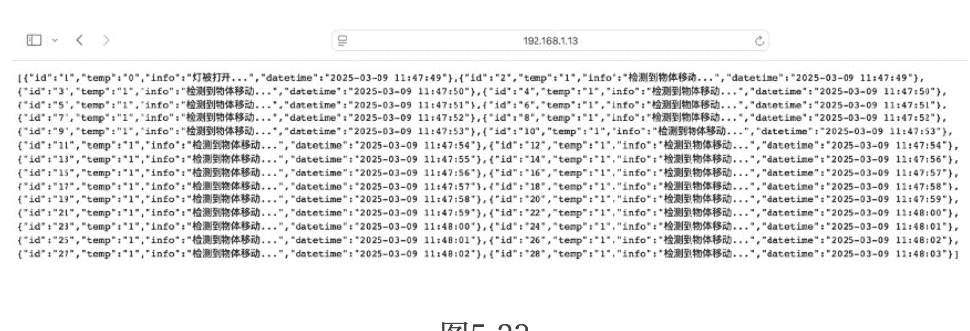

图5-23

通过以上步骤，构建了一套完整的硬件状态管理与数据库同步机制：

- 1. 树莓派采集的传感器数据可通过Python脚本实时上传至服务器；
- 2. PHP脚本实现数据写入与数据库查询；
- 3. 系统支持通过HTTP接口进行数据实时监控。

#### 5.4.2 ArkTS自动监测与页面展示硬件状态

本小节将介绍如何利用ArkTS开发的HarmonyOS应用，实现硬件状态的自动监测与页面展示。通过该应用，系统可定时向后端发送控制请求或状态查询请求，并实时更新页面显示。为实现模块化开发，将业务逻辑与页面部分分离，主要文件组织在以下目录结构中：

```
src/
└── main/
    └── ets/
        ├── types/
        │   └── SensorTypes.ets          // 存放数据类型定义，如传感器数据结构定义
        │                                 // 定义传感器数据的接口和辅助工具函数，用于存储
        │                                 // 和传输传感器信息
        ├── services/
        │   └── SensorDataService.ets    // 存放与硬件或后端交互的业务逻辑代码
        │                                 // 封装硬件通信逻辑和 HTTP 请求处理，用于从远程
        │                                 // 服务器获取传感器数据
        ├── components/
        │   └── MainAbility.ets          // 存放 UI 组件代码，用于展示数据和实现用户交互
        │                                 // 主页面展示组件（调用服务层获取数据并展示）
        └── pages/
            └── Index.ets               // 存放页面文件，定义应用整体页面布局
                                        // 应用主页面，加载主要 UI 组件
└── module.json5                        // 模块配置文件，定义应用模块信息及相关权限配置
```

##### 1. 创建项目与配置网络权限

使用DevEco Studio创建一个新的ArkTS项目，项目名称建议设为SmartHomeSensor。打开项目根目录下的module.json5文件，在module节点下添加网络权限ohos.permission.INTERNET，确保应用能够进行HTTP请求。

##### 2. 定义硬件状态数据类型

在src/main/ets/types/SensorTypes.ets文件中，定义与硬件请求及响应相关的类型和工具函数。代码示例如下：

```typescript
// src/main/ets/types/SensorTypes.ets

/**
 * @file SensorTypes.ets
 * @description 定义传感器数据类型，用于存储和传输传感器相关信息
 */

/**
 * @interface SensorData
 * @description 传感器数据结构，包含温度、附加信息和时间戳
 *
 * @property {string} [temp] - 传感器测得的温度值（可选）
 * @property {string} [info] - 额外的传感器信息，如状态描述或设备标识（可选）
 * @property {string} [datetime] - 数据记录时间，格式可根据具体需求定义（可选）
 */
export interface SensorData {
  temp?: string;
  info?: string;
  datetime?: string;
}
```

##### 3. 实现硬件状态服务

在src/main/ets/services/SensorDataService.ets文件中，封装与硬件设备交互的请求逻辑。该服务通过HTTP请求向硬件控制接口发送请求，并处理响应数据。

代码示例如下：

```typescript
// src/main/ets/services/SensorDataService.ets

import { SensorData } from "../types/SensorTypes";
import { http } from '@kit.NetworkKit'; // 导入自定义网络模块
import { BusinessError } from '@kit.BasicServicesKit'

/**
 * @file SensorDataService.ets
 * @description 传感器数据服务类，提供从远程服务器获取传感器数据的功能，并存储数据
 */
export class SensorService {
  // 类变量：传感器数据接口的 URL (只读，构造后不可修改)
  private sensorUrl: string;

  // 存储从接口获取的传感器数据列表
  public sensorDataList: SensorData[] = [];

  /**
   * @constructor
   * @description 构造 SensorService 实例
   * @param {string} sensorUrl - 传感器数据接口的 URL
   */
  constructor(sensorUrl: string) {
    this.sensorUrl = sensorUrl;
  }

  /**
   * @method fetchSensorData
   * @description 从 sensorUrl 指定的地址获取传感器数据，并存储到 sensorDataList
   * @returns {Promise<void>} 成功时返回 void，失败时返回错误信息
   */
  public fetchSensorData(): Promise<void> {
    // 创建 HTTP 请求实例
    const httpRequest = http.createHttp();

    return new Promise((resolve, reject) => {
      // 发送 HTTP GET 请求以获取数据
      const promise = httpRequest.request(this.sensorUrl, {
        method: http.RequestMethod.GET,              // 请求方法：GET
        connectTimeout: 60000,                       // 连接超时时间（毫秒）
        readTimeout: 60000,                          // 读取数据超时时间（毫秒）
        expectDataType: http.HttpDataType.STRING,    // 期望返回的数据类型：字符串（JSON 格式）
        usingCache: true,                            // 启用本地缓存
        priority: 1,                                 // 请求优先级
        usingProtocol: http.HttpProtocol.HTTP1_1,    // 使用 HTTP/1.1 协议
        usingProxy: false,                           // 不使用代理
        header: {
          'Content-Type': 'application/json'         // 请求头：声明 JSON 内容类型
        }
      });

      promise.then((data) => {
        // 判断服务器响应状态码是否为 200 OK
        if (data.responseCode === http.ResponseCode.OK) {
          console.info('Received Data: ' + data.result);
          try {
            // 解析 JSON 数据并存储到 sensorDataList
            this.sensorDataList = JSON.parse(data.result as string);
            resolve();
          } catch (error) {
            // 解析 JSON 失败时返回错误
            console.error('JSON Parsing Error: ' + error);
            reject(new Error('Failed to parse sensor data'));
          }
        } else {
          // 服务器返回非 200 状态码，抛出错误
          reject(new Error(`Unexpected response code: ${data.responseCode}`));
        }
      }).catch((err: BusinessError) => {
        // 捕获 HTTP 请求错误，输出日志后返回错误
        console.error('HTTP Request Error: ' + JSON.stringify(err));
        reject(err);
      });
    });
  }
}
```

##### 4. 构建UI组件与调用服务层

将页面展示部分与数据交互部分分离，在 src/main/ets/components/MainAbility.ets文件中实现UI组件，负责定时更新硬件状态并展示结果，同时调用SensorService进行数据请求。

代码示例如下：

```typescript
// src/main/ets/components/MainAbility.ets

import { BusinessError } from '@kit.BasicServicesKit'
import { SensorData } from '../types/SensorTypes';
import { SensorService } from '../services/SensorDataService';

/**
 * @file MainAbility.ets
 * @description 应用的主要 UI 组件，负责展示传感器数据，并定时更新
 */

@Component
export struct MainAbility {
  // 组件状态变量：存储传感器数据列表，用于动态更新 UI
  @State sensorDataList: SensorData[] = []

  /**
   * @method aboutToAppear
   * @description 组件生命周期方法，在组件加载时执行，负责初始化数据获取
   */
  aboutToAppear(): void {
    this.fetchSensorData(); // 组件加载时立即获取传感器数据

    // 设置定时任务，每 10 秒钟自动更新传感器数据
    setInterval(() => {
      this.fetchSensorData();
    }, 10000);
  }

  /**
   * @method fetchSensorData
   * @description 通过 SensorService 获取传感器数据，并更新 sensorDataList
   */
  fetchSensorData(): void {
    // 传感器数据 API 地址（示例 IP，需根据实际环境调整）
    let sensorUrl = "http://192.168.1.13/smart_home.php";

    // 实例化 SensorService，用于请求传感器数据
    const sensorService = new SensorService(sensorUrl);

    sensorService.fetchSensorData()
      .then(() => {
        console.info("Sensor Data List:", sensorService.sensorDataList);
        // 更新组件状态，触发 UI 重新渲染
        this.sensorDataList = sensorService.sensorDataList;
      })
      .catch((err: BusinessError) => {
        // 捕获请求错误，并打印日志
        console.error("Failed to fetch sensor data", err);
      });
  }

  /**
   * @method build
   * @description 构建 UI 结构，展示传感器数据列表
   */
  build() {
    Column() {
      // 使用 List 组件展示传感器数据
      List() {
        ForEach(this.sensorDataList, (item: SensorData) => {
          ListItem() {
            Column() {
              // 显示数据时间戳
              Text(item.datetime || '')
                .margin({ bottom: 5 })
              // 显示温度数据
              Text(item.temp || '')
                .margin({ bottom: 5 })
              // 显示附加信息
              Text(item.info || '')
            }
          }
          .padding(20)
          .height(100)
        }, (item: SensorData) => item.datetime) // 设定唯一标识符
      }
      .divider({ strokeWidth: 2 }) // 添加分割线
    }
    .width('100%')
    .height('100%')
  }
}
```

##### 5. 在主页面中导入UI组件

在src/main/ets/pages/Index.ets文件中导入并使用MainAbility组件，将其嵌入主页面以展示硬件状态。

代码示例如下：

```php
<?php
$db_hostname = '127.0.0.1';
$db_username = 'root';        // 请按实际情况修改数据库用户名
$db_password = 'yourpassword'; // 请按实际情况修改数据库密码
$db_database = 'smart_home';
$charset = 'utf8';

// 设置内容类型为 JSON 并使用 UTF-8 编码
header('Content-Type: application/json; charset=utf-8');
date_default_timezone_set('Asia/Shanghai'); // 设置时区

// 创建数据库连接
$con = mysqli_connect($db_hostname, $db_username, $db_password, $db_database);
if (!$con) {
    die(json_encode(['error' => 'Could not connect: ' . mysqli_connect_error()]));
}

// 设置字符集
mysqli_set_charset($con, $charset);

// 查询数据表
$sql = "SELECT * FROM smart";
$result = mysqli_query($con, $sql);

// 检查查询是否成功
if (!$result) {
    die(json_encode(['error' => 'Query failed: ' . mysqli_error($con)]));
}

// 提取结果集
$data = [];
while ($row = mysqli_fetch_assoc($result)) {
    $data[] = $row;
}

// 关闭数据库连接
mysqli_close($con);

// 输出 JSON 数据
echo json_encode($data, JSON_UNESCAPED_UNICODE);
?>
```

##### 6. 运行应用与验证效果

启动DevEco Studio内的设备管理器，选择模拟器或真机运行应用。

应用启动后，页面将自动调用服务层定时更新传感器状态，并将最新状态以文本形式展示在屏幕上，如图5-24所示。


图5-24

### 5.5 双向控制的实时交互与状态同步

本节将介绍如何实现硬件的实时控制与状态更新，并通过双向交互机制确保硬件状态的变化能够及时反馈至应用页面。

#### 5.5.1 实时硬件控制与状态更新

本小节将详细介绍如何实现对LED灯的实时控制以及硬件状态的及时更新。系统整体由三部分构成。

- （1）LED灯控制服务：利用树莓派端的Python脚本构建HTTP服务器，实时接收LED灯控制指令，通过PWM信号控制LED灯的颜色；
- （2）最新状态查询接口：利用PHP脚本从数据库中查询最新硬件状态记录，并以JSON格式返回；
- （3）数据库写入接口：直接引用“5.2/HardwareStateSync/sql.php”，用于接收GET请求并将硬件状态数据写入数据库。

当用户或系统发送LED颜色控制指令（如请求将LED设置为红色）时，前端会通过HTTP POST请求将包含颜色信息的指令发送到LED控制服务。服务器端接收到请求后，会首先解析请求中传递的十六进制颜色代码，并利用hex_to_rgb函数将其转换为对应的RGB值。接着，系统调用set_color函数，利用PWM信号控制各GPIO引脚，从而实现LED灯颜色的实时更新。LED灯状态更新后，系统再调用fetch_data函数，通过GET请求将此次控制事件（如“LED颜色更新（#FF0000）”）及相关信息写入数据库，实现状态数据的同步存储。

在最新状态查询方面，用户或系统可通过访问PHP接口latest_smart_state.php获取数据库中最新的一条硬件状态记录。该接口在服务器端建立数据库连接后，执行SQL查询语句`SELECT * FROM smart ORDER BY id DESC LIMIT 1`，并将查询结果以JSON格式返回，方便实时监控和数据展示。

整个系统的关键在于硬件控制与数据库操作的有机整合：

- （1）LED灯控制服务中的Python脚本(led_control_server_db.py)负责接收颜色控制请求、解析颜色、控制LED灯以及调用数据库接口写入数据；
- （2）最新状态查询接口（latest_smart_state.php）保证了系统能够实时查询到数据库中最新的硬件状态记录；
- （3）数据库写入接口（sql.php）统一负责数据的存储操作，确保各模块的数据写入均按照统一格式执行。

##### 1. 最新状态查询接口（latest_smart_state.php）

```php
<?php
// 5.3/RealTimeHardwareControl/latest_smart_state.php

$db_hostname = '127.0.0.1';
$db_username = 'root';        // 请按实际情况修改数据库用户名
$db_password = 'yourpassword'; // 请按实际情况修改数据库密码
$db_database = 'smart_home';
$charset = 'utf8';

// 设置内容类型为 JSON 并使用 UTF-8 编码
header('Content-Type: application/json; charset=utf-8');
date_default_timezone_set('Asia/Shanghai'); // 设置时区

// 创建数据库连接
$con = mysqli_connect($db_hostname, $db_username, $db_password, $db_database);
if (!$con) {
    die(json_encode(['error' => 'Could not connect: ' . mysqli_connect_error()]));
}

// 设置字符集
mysqli_set_charset($con, $charset);

// 查询最新一条数据
$sql = "SELECT * FROM smart ORDER BY id DESC LIMIT 1";
$result = mysqli_query($con, $sql);

// 检查查询是否成功
if (!$result) {
    die(json_encode(['error' => 'Query failed: ' . mysqli_error($con)]));
}

// 获取最新的一条记录
$data[] = mysqli_fetch_assoc($result);

// 关闭数据库连接
mysqli_close($con);

// 输出 JSON 数据
echo json_encode($data ? $data : ['error' => 'No data found'], JSON_UNESCAPED_UNICODE);
?>
```

##### 2. LED灯控制服务 (led_control_server_db.py)

```python
# -*- coding: utf-8 -*-
# 5.3/RealTimeHardwareControl/led_control_server_db.py

import RPi.GPIO as GPIO
from flask import Flask, request, jsonify
import socket
import requests

app = Flask(__name__)

# 定义 GPIO 引脚
RED_PIN = 13
GREEN_PIN = 15
BLUE_PIN = 29

# 初始化 GPIO
GPIO.setmode(GPIO.BOARD)
GPIO.setup(RED_PIN, GPIO.OUT)
GPIO.setup(GREEN_PIN, GPIO.OUT)
GPIO.setup(BLUE_PIN, GPIO.OUT)

# 设置 PWM 频率
red_pwm = GPIO.PWM(RED_PIN, 100)
green_pwm = GPIO.PWM(GREEN_PIN, 100)
blue_pwm = GPIO.PWM(BLUE_PIN, 100)

# 开始 PWM
red_pwm.start(0)
green_pwm.start(0)
blue_pwm.start(0)

# 数据库写入接口地址（请根据实际情况修改）
SQL_URL = 'http://127.0.0.1/sql.php'

def fetch_data(url, params):
    """
    参考 smart_home.py 中的 fetch_data 函数，通过 GET 请求写入数据库
    """
    try:
        response = requests.get(url, params=params, timeout=5)
        print("数据库响应:", response.text)
    except Exception as e:
        print("写入数据库错误:", e)

def hex_to_rgb(hex_color):
    """
    将十六进制颜色代码转换为 RGB 值

    Args:
        hex_color (str): 十六进制颜色代码，例如 "#FF0000"

    Returns:
        tuple: 包含红、绿、蓝三个分量的整数元组 (R, G, B)
    """
    hex_color = hex_color.lstrip('#')  # 去掉前导的#
    return tuple(int(hex_color[i:i+2], 16) for i in (0, 2, 4))

def set_color(rgb_values):
    """
    根据 RGB 值设置 LED 灯的颜色

    Args:
        rgb_values (tuple): 包含红、绿、蓝三个分量的整数元组 (R, G, B)
    """
    red_pwm.ChangeDutyCycle(rgb_values[0] * 100 / 255)
    green_pwm.ChangeDutyCycle(rgb_values[1] * 100 / 255)
    blue_pwm.ChangeDutyCycle(rgb_values[2] * 100 / 255)
    # 输出当前颜色状态
    print(f"Setting LED color to RGB: {rgb_values} (Hex: #{''.join(f'{v:02X}' for v in rgb_values)})")

@app.route('/set_color', methods=['POST'])
def set_led_color():
    """
    API 端点，接收十六进制颜色代码并控制 LED 灯的颜色，同时写入数据库

    Request JSON body:
        - color (str): 十六进制颜色代码，例如 "#FF0000"

    Response JSON:
        - success (bool): 指示是否成功设置颜色
    """
    data = request.json
    if 'color' not in data:
        return jsonify({"error": "No color provided"}), 400

    hex_color = data['color']
    rgb_values = hex_to_rgb(hex_color)
    set_color(rgb_values)

    # 写入数据库：发送颜色及相关信息
    info = f'LED 颜色更新({hex_color})'
    fetch_data(SQL_URL, {'temp': 0, 'info': info})
    return jsonify({"success": True, "color": hex_color})

if __name__ == '__main__':
    try:
        # 获取本机 IP 地址
        hostname = socket.gethostname()
        local_ip = socket.gethostbyname(hostname)

        print(f"Starting server on http://{local_ip}:6002")
        app.run(host='0.0.0.0', port=6002)
    except KeyboardInterrupt:
        print("\nStopping server...")
    finally:
        # 清理 GPIO 设置
        GPIO.cleanup()
        print("GPIO cleanup done.")
```

##### 3. 数据库写入接口（sql.php）

此文件与“5.4.1 硬件状态管理与数据库同步机制”中的内容完全相同，负责接收GET请求并将数据写入数据库。具体实现已在前述内容中详细说明，此处不再重复描述。

##### 4. 部署与使用说明

在实际部署过程中，请注意以下几点，确保系统正常运行。

- ● 用户名与IP地址

SSH登录时，请确保使用实际的用户名。例如：

```
ssh pi@192.168.1.13
```

根据实际环境修改IP地址，确保与设备真实地址一致。

- ● 文件编辑与启动

在树莓派上编辑LED灯控制服务脚本时，执行以下命令：

```
nano /home/pi/led_control_server_db.py
```

编辑完成后，通过以下命令启动LED灯控制服务：

```
sudo python3 /home/pi/led_control_server_db.py
```

如需修改最新状态查询接口，进入Web服务器目录进行编辑：

```
sudo nano /var/www/html/latest_smart_state.php
```

- ● 配置参数

请务必根据实际部署情况修改各脚本中的数据库IP地址、用户名、密码、GPIO引脚配置等参数，确保各模块之间的通信正确无误。

#### 5.5.2 硬件状态变化实时同步到应用页面

本小节将介绍如何利用ArkTS开发HarmonyOS应用，实现硬件状态变化的实时同步与页面展示。CatAndLampApp项目整合了HardwareControlFrontend与SmartHomeSensor中的代码，通过定时获取传感器数据、解析数据内容，并结合硬件控制逻辑，使前端页面能够直观展示当前灯光状态和猫的位置变化。项目采用模块化设计，将配置、工具、服务、数据类型和UI页面分别管理，便于后续维护和功能扩展。

整个项目的目录结构如下：

```
src/
└── main/
    └── ets/
        ├── configs/
        │   └── Config.ets          // 定义硬件 API 地址等配置信息
        ├── utils/
        │   ├── HttpClient.ets      // 网络请求工具类
        │   └── StreamingUtils.ets  // 流处理工具
        ├── services/
        │   ├── HardwareService.ets // 硬件控制服务，封装硬件交互逻辑
        │   └── SensorDataService.ets    // 传感器数据服务，用于获取硬件状态数据
        ├── types/
        │   ├── HardwareTypes.ets    // 定义硬件状态数据结构
        │   └── SensorTypes.ets      // 定义传感器数据结构（如温度、状态信息）
        └── pages/
            ├── CatAndLampPage.ets   // 主要 UI 页面，实现实时同步传感器数据与硬件控制
            └── Index.ets            // 应用入口页面，加载主要 UI 组件
└── resources/
    └── base/
        └── media/           // 图片资源文件夹
            ├── light_off_1.png
            ├── light_off_2.png
            ├── light_off_3.png
            ├── light_off_4.png
            ├── light_off_5.png
            ├── light_off_6.png
            ├── light_on_1.png
            ├── light_on_2.png
            ├── light_on_3.png
            ├── light_on_4.png
            ├── light_on_5.png
            ├── light_on_6.png
            └── cat.png
```

初始化项目时，通过DevEco Studio创建CatAndLampApp项目，并在模块配置文件（如module.json5）中添加网络权限`ohos.permission.INTERNET`，确保应用能够进行HTTP请求。

项目中的数据类型和服务层代码分别取自HardwareControlFrontend与SmartHomeSensor模块。

- 1. 在`src/main/ets/types/HardwareTypes.ets`中定义硬件状态数据结构；
- 2. 在`src/main/ets/types/SensorTypes.ets`中定义传感器数据结构（包含温度、状态信息和数据记录时间）；
- 3. 在`src/main/ets/services/HardwareService.ets`中封装硬件控制逻辑，通过调用控制接口实现硬件状态变更；
- 4. 在`src/main/ets/services/SensorDataService.ets`中利用HTTP请求获取传感器数据，并解析JSON数据存储于sensorDataList数组中。

新增的页面文件负责UI构建与实时数据同步，其中CatAndLampPage.ets为核心页面，具体功能如下。

- 1. 在加载组件时（aboutToAppear），调用传感器数据服务的fetchSensorData方法，并通过每200毫秒更新数据，保证数据的实时性；
- 2. 获取传感器数据后，调用syncStateWithSensorData方法，解析info字段中嵌入的颜色代码（如#0000FF），并根据预设的颜色数组确定当前亮起的灯的索引。如果数据为空或解析失败，则默认设置当前灯索引为0；
- 3. 用户点击“下一步”按钮时，先调用moveCatToNextLamp方法更新猫的位置，再通过fetchData方法调用硬件控制服务，将更新后的颜色信息发送到后端，驱动硬件状态更新；
- 4. UI采用ArkTS组件构建，当前亮着的灯使用亮灯图片（叠加猫图）展示，其他灯则显示熄灭状态图片，同时利用ForEach列表展示所有传感器数据（包括时间戳、温度和附加信息）。

关键代码示例如下：

```typescript
// src/main/ets/pages/Index.ets

import { MainAbility } from '../components/MainAbility';

@Entry
@Component
struct Index {
  build() {
    Column() {
      MainAbility()
        .width('100%')
        .height('100%')
    }
  }
}
```

## 第5章 硬件状态实时同步

在src/main/ets/pages/CatAndLampPage.ets中，定义了CatAndLampPage组件，用于展示和控制硬件状态。

```typescript
// src/main/ets/pages/CatAndLampPage.ets

import { config } from '../configs/Config';
import { HardwareService } from '../services/HardwareService';
import { BusinessError } from '@kit.BasicServicesKit';
import { SensorData } from '../types/SensorTypes';
import { SensorService } from '../services/SensorDataService';

@Component
export struct CatAndLampPage {
  @State currentLampIndex: number = -1; // -1 表示尚未同步传感器数据
  lamps: number[] = [1, 2, 3, 4, 5, 6];
  private colors: string[] = [
    "#FF0000", // 红色
    "#00FF00", // 绿色
    "#0000FF", // 蓝色
    "#FFFF00", // 黄色
    "#FF00FF", // 品红
    "#00FFFF"// 青色
  ];
  @State sensorDataList: SensorData[] = [];

  /**
   * 根据按钮点击事件控制硬件（如灯），并输出响应结果
   */
  async fetchData(color: string) {
    const hardwareService = new HardwareService(config.hardwareApiUrl);
    try {
      const success = await hardwareService.controlHardware(color);
      console.info(`硬件控制成功，返回值: ${success}`);
    } catch (error) {
      console.error('硬件控制时出错: ', error);
    }
  }

  /**
   * 加载组件时调用，初始化传感器数据获取
   */
  aboutToAppear(): void {
    this.fetchSensorData();
    setInterval(() => {
        this.fetchSensorData();
    }, 500);
  }

  /**
   * 通过 SensorService 获取传感器数据，并更新 sensorDataList，同时同步 UI 状态
   */
  fetchSensorData(): void {
    const sensorUrl = "http://192.168.1.13/latest_smart_state.php";
    const sensorService = new SensorService(sensorUrl);

    sensorService.fetchSensorData()
        .then(() => {
            console.info("传感器数据列表: ", sensorService.sensorDataList);
            this.sensorDataList = sensorService.sensorDataList;
            this.syncStateWithSensorData();
        })
        .catch((err: BusinessError) => {
            console.error("获取传感器数据失败: ", err);
        });
  }

  /**
   * 根据传感器数据解析当前灯的位置
   * 返回数据格式示例: "info":"LED颜色更新(#0000FF)"
   */
  syncStateWithSensorData(): void {
    if (this.sensorDataList && this.sensorDataList.length > 0) {
        const info = this.sensorDataList[0].info;
        // 提取括号内的颜色代码，如 "#0000FF"
        const match = info && info.match(/#([0-9A-Fa-f]{6})/);
        if (match && match[0]) {
            const sensorColor = match[0];
            const sensorLampIndex = this.colors.indexOf(sensorColor);
            if (sensorLampIndex !== -1) {
                this.currentLampIndex = sensorLampIndex;
                console.info("解析传感器数据成功，当前灯索引: " + sensorLampIndex);
                return;
            } else {
                console.error("解析传感器数据失败：未在预设颜色中找到对应的颜色 " + sensorColor);
            }
        } else {
            console.error("解析传感器数据失败：未找到颜色代码");
        }
    } else {
        console.error("传感器数据列表为空");
    }
    console.error("解析传感器数据失败：无法匹配颜色信息");
    // 如果数据为空或解析失败，则设置为默认值 0，避免页面一直显示加载状态
    if (this.currentLampIndex === -1) {
        console.warn("传感器数据无效，设置默认灯索引为 0");
        this.currentLampIndex = 0;
    }
  }

  build() {
    Column({
        space: 20
    }) {
        if (this.currentLampIndex === -1) {
            Text("正在加载传感器数据...")
                .fontSize(20)
                .fontColor(Color.Gray);
        } else {
            Column() {
                Text(`当前亮着的灯是：灯${this.currentLampIndex + 1}(${this.colors[this.currentLampIndex]})`)
                    .fontSize(25)
                    .fontWeight(FontWeight.Bold)
                    .fontColor(Color.Blue);

                ForEach(this.sensorDataList, (item: SensorData) => {
                    ListItem() {
                        Column() {
                            Text(item.datetime || '')
                                .margin({ bottom: 5 });
                            Text(item.temp || '')
                                .margin({ bottom: 5 });
                            Text(item.info || '');
                        }
                    }
                    .padding(20)
                    .height(100);
                }, (item: SensorData) => item.datetime);
            }

            Row({ space: 10 }) {
                ForEach(this.lamps, (index: number) => {
                    Column() {
                        if (this.currentLampIndex === index - 1) {
                            Image($r('app.media.light_on_${index}'))
                                .width(130)
                                .height(150)
                                .borderRadius(10);
                            Image($r('app.media.cat'))
                                .width(85)
                                .height(100)
                                .borderRadius(5);
                        } else {
                            Image($r('app.media.light_off_${index}'))
                                .width(130)
                                .height(150)
                                .borderRadius(10)
                                .margin(20);
                        }
                    }
                });
            }
        }

        Row({ space: 20 }) {
            Button('下一步')
                .onClick(() => {
                    this.moveCatToNextLamp();
                    this.fetchData(this.colors[this.currentLampIndex]);
                })
                .fontSize(20)
                .backgroundColor(Color.Green)
                .fontColor(Color.White);
        }
    }
  }

  /**
   * 将猫移动到下一个灯的位置
   */
  private moveCatToNextLamp() {
    this.currentLampIndex = (this.currentLampIndex + 1) % this.lamps.length;
  }
}
```

在src/main/ets/pages/Index.ets中，通过引入CatAndLampPage组件将其嵌入页面，示例代码如下：

```typescript
// src/main/ets/pages/Index.ets

import { CatAndLampPage } from './CatAndLampPage'

@Entry
@Component
struct Index {
  build() {
    Column() {
      CatAndLampPage() // 调用自定义组件
    }
    .padding(20) // 设置页面内边距
  }
}
```

应用运行后，页面会自动调用fetchSensorData方法，每500毫秒更新传感器数据。当后端返回如"info": "LED颜色更新（#0000FF）"的数据时，应用解析颜色代码，并根据预设的颜色数组更新currentLampIndex，从而切换对应灯的显示状态（当前灯显示亮灯图和叠加的猫图，其它灯显示熄灭图）。点击“下一步”按钮时，猫图将移动到下一个灯位，并触发硬件控制服务发送新的指令，实现前后端状态的联动。如图5-25所示为硬件状态实时同步到应用页面的效果。

# 当前亮着的灯是: 灯3(#0000FF)

2025-03-09 22:17:31
0
LED颜色更新(#0000FF)


图5-25

通过以上实现方案，CatAndLampApp成功实现了硬件状态变化实时同步到应用页面的功能。项目模块化设计不仅提高了系统响应速度，还为后续功能扩展和维护提供了便利，为用户带来直观、实时的硬件交互体验。

## 第6章 多服务与硬件协同开发

本章将介绍在多服务架构下实现与硬件协同开发的整体方案。通过情感分析、情感反馈以及硬件控制等多项技术的整合，打造一个智能化、互动性强的应用系统。该系统能够实现软硬件的无缝联动。

### 6.1 ArkTS与情感分析服务的交互与实现

本节将重点介绍情感分析服务的开发及实现过程，并详细说明如何将情感分值映射为颜色，进而在应用中实现情感反馈与展示，提升用户体验。

#### 6.1.1 情感分析服务的开发与实现

在本小节中，将在原有的PoetryImageBackend基础上扩展情感分析服务，实现针对中文文本的翻译预处理与情感分析功能。通过升级requirements.txt、prompt_service.py、main_service.py，并新增color_utils.py文件，项目可在接收中文文本后先翻译为英文，再调用在线或离线模型进行情感分析，并将得分映射到特定颜色，最终以可视化的方式呈现给开发人员或用户。

##### 1. 构建目录结构

在EmotionAnalysisService目录中，除保留原有的问答、情感句子和抚慰诗歌等功能外，新增了离线情感分析模型文件夹及工具脚本，示例如下：

```
6.1/
├── EmotionAnalysisService/
│   ├── main_service.py          # 升级后的主服务脚本，新增情感分析接口
│   ├── prompt_service.py        # 升级后，增加 create_translation_prompt 函数
│   ├── image_randomizer.py      # 生成随机图片及配色方案
│   ├── webp/
│   │   ├── 1.webp               # 图片文件 1
│   │   ├── 2.webp               # 图片文件 2
│   │   ├── 3.webp               # 图片文件 3
│   │   └── image_data.json      # 包含图片与配色信息的 JSON 文件
│   ├── 黄草简.ttf               # 字体文件
│   ├── model_api.py             # 提供与 DeepSeek 模型交互的接口
│   └── main_service_config.json # 配置文件
│
│   ├── color_utils.py           # 新增文件，用于根据情感得分映射颜色
│   ├── distilbert_model/        # 离线模式所需的模型文件
│   │   ├── config.json
│   │   ├── pytorch_model.bin
│   │   ├── tokenizer_config.json
│   │   └── vocab.txt
│   └── requirements.txt         # 升级后的依赖项列表
```

##### 2. 离线与在线模型使用

- **离线模式**：需将config.json、pytorch_model.bin、tokenizer_config.json和vocab.txt等文件下载至distilbert_model目录下，并在main_service.py中将情感分析的加载方式切换：

```python
# 使用离线模型
self.sentiment_analysis = pipeline("sentiment-analysis", model="distilbert_model")
```

- **在线模式**：无须下载本地文件，默认使用Hugging Face上的模型：

```python
# 使用在线模型
self.sentiment_analysis = pipeline("sentiment-analysis",
    model="distilbert-base-uncased-finetuned-sst-2-english")
```

开发者可根据部署环境灵活选择模式，以满足不同网络条件和性能需求。

##### 3. 升级requirements.txt

随着情感分析与翻译功能的引入，需要在6.1/EmotionAnalysisService/requirements.txt中添加以下依赖（示例）：

```
transformers
tensorflow
torch
tf-keras
Flask
flask-cors
Pillow
transformers
requests
tenacity
```

安装命令：

```bash
pip install -r 6.1/EmotionAnalysisService/requirements.txt
```

完整安装上述包后，即可顺利运行后续的服务接口。

##### 4. 升级prompt_service.py

新增了create_translation_prompt函数，用于将中文文本生成翻译提示后，再由后端调用翻译模型或翻译API，将文本转换为英文，以便情感分析模型（只支持英文）进行处理。示例如下：

```python
def create_translation_prompt(self, sentence, target_language="英文"):
    """
    创建专业且稳定的翻译提示信息，根据输入的句子和目标语言生成提示。
    仅使用“文”来表示目标语言，内部使用英文名称进行处理。

    :param sentence: 需要翻译的句子
    :param target_language: 翻译的目标语言，默认为“英文”
    :return: 翻译提示字符串
    :raises ValueError: 如果输入参数不合法
    """
    # 支持的语言列表，键为中文名称（带“文”），值为英文标准名称
    supported_languages = {
        "中文": "Chinese",
        "英文": "English",
        "法文": "French",
        "西班牙文": "Spanish",
        "德文": "German",
        "日文": "Japanese",
        "韩文": "Korean",
        "俄文": "Russian",
        "葡文": "Portuguese"
        # 添加更多语言...
    }

    # 输入校验
    if not sentence:
        raise ValueError("翻译句子不能为空")
    if not target_language:
        raise ValueError("目标语言不能为空")
    if target_language not in supported_languages:
        raise ValueError(f"不支持的目标语言: {target_language}")

    # 获取目标语言的英文标准名称
    target_language_en = supported_languages[target_language]

    # 构建优化后的提示词，使用“文”后缀的中文名称
    prompt = (
        f"请将以下中文句子准确且流畅地翻译成{target_language}。\n"
        f"请仅返回翻译后的文本，不要添加任何额外的说明或注释。\n\n"
        f"中文原文: {sentence}"
    )

    return prompt
```

该函数可确保情感分析服务在接收到中文文本时，能先经翻译步骤得到英文文本再进行分析。

##### 5. 升级 main_service.py

在主服务脚本中新增了 `analyze_emotion` 接口，对输入的中文文本先生成翻译提示，再调用翻译接口得到英文文本，随后利用情感分析模型打分，并通过颜色映射函数返回情感标签、分数与对应颜色，示例代码如下：

```python
# -*- coding: utf-8 -*-
# 6.1/EmotionAnalysisService/main_service.py

"""
文件名: main_service.py
描述:
    实现以下服务：
    1. 问答服务：接收用户提问并返回流式生成的回答。
    2. 情感句子生成服务：根据主题生成情感驱动的句子，支持流式输出。
    3. 抚慰诗歌生成服务：根据主题生成抚慰性诗歌，支持流式输出。
    4. 诗歌图片生成与下载服务：生成与抚慰诗歌内容相关的图片，并支持用户下载生成的图片。
    支持流式输出（SSE, Server-Sent Events）以逐步传输生成结果，适用于长时间生成的任务。
"""

import json
import logging
from flask import Flask, request, jsonify, Response, stream_with_context, send_from_directory
from model_api import ModelAPI, ConfigError
from prompt_service import PromptService
from pathlib import Path
import os
from image_randomizer import PoetryImageGenerator
import re
from color_utils import map_score_to_color
from transformers import pipeline

# 设置日志记录
logging.basicConfig(level=logging.DEBUG, format='%(asctime)s - %(levelname)s - %(message)s')

class QAService:
    def __init__(self, config_path='main_service_config.json'):
        self.config_path = config_path
        self.config = None
        self.model_api = None
        self.load_config()
        self.prompt_service = PromptService()
        self.poetry_image_generator = PoetryImageGenerator(
            data_file=self.config.get("image_data_file", "webp/image_data.json"),
            output_folder=self.config.get("image_output_folder", "output")
        )
        self.port = self.config.get("port", 5000)
        # 初始化情感分析模型

        # 使用离线模型
        self.sentiment_analysis = pipeline("sentiment-analysis", model="distilbert_model")

        # 使用在线模型
        self.sentiment_analysis = pipeline("sentiment-analysis",
                                          model="distilbert-base-uncased-finetuned-sst-2-english")
        logging.info("情感分析模型加载成功")

    def load_config(self):
        """
        加载配置文件并初始化 ModelAPI
        """
        try:
            config_file = Path(self.config_path)
            if not config_file.is_file():
                raise ConfigError(f"配置文件未找到: {self.config_path}")

            with open(config_file, 'r', encoding='utf-8') as file:
                self.config = json.load(file)
                self.model_url = self.config.get("model_url")
                self.model_params = self.config.get("model_params", {})
                self.retry_attempts = self.config.get("retry_attempts", 3)

                if not self.model_url:
                    raise ConfigError("model_url 配置缺失，请检查配置文件")

                logging.info("配置文件加载成功")
                self.model_api = ModelAPI(self.config)  # Initialize ModelAPI after loading the config

        except (json.JSONDecodeError, ConfigError) as e:
            logging.error(f"配置文件加载失败，错误信息: {e}")
            raise ConfigError(f"配置文件加载失败，错误信息: {e}")

    def handle_error(self, error_msg):
        """
        统一处理错误响应
        """
        logging.error(error_msg)
        return jsonify({"code": 500, "msg": error_msg, "data": None}), 500

    def generate_answer(self, prompt):
        """
        逐步生成回答以支持流式输出
        """
        try:
            payload = self.model_api.prepare_payload(prompt, stream_output=True)  # 开启流式输出

            def generate_streamed_answer():
                try:
                    for chunk in self.model_api.stream_generate(payload):
                        logging.debug(f"生成块: {chunk.strip()}")  # 打印每块的内容
                        # 每次返回一个数据块
                        yield json.dumps({'code': 200, 'msg': '生成中...', 'data': chunk},
                                         ensure_ascii=False) + "\n"
                except Exception as e:
                    logging.error(f"生成回答时出错: {e}")
                    yield json.dumps({'code': 500, 'msg': '生成回答时出错', 'data': None}, ensure_ascii=False) + "\n"

            return generate_streamed_answer()
        except Exception as e:
            return self.handle_error(f"问答生成失败, 原因: {e}")

    def generate_emotion_sentences(self, topic=None, button_count=1):
        """
        根据给定主题生成情感句子
        支持流式输出
        """
        prompt = self.prompt_service.create_emotion_sentences_prompt(topic, button_count)
        payload = self.model_api.prepare_payload(prompt, stream_output=True)
        try:
            def generate_emotion_sentences_stream():
                try:
                    for chunk in self.model_api.stream_generate(payload):
                        yield json.dumps({'code': 200, 'msg': '生成中...', 'data': chunk}, ensure_ascii=False) + "\n"
                except Exception as e:
                    logging.error(f"情感句子生成时出错: {e}")
                    yield json.dumps({'code': 500, 'msg': '情感句子生成时出错', 'data': None}, ensure_ascii=False) + "\n"
            return generate_emotion_sentences_stream()
        except Exception as e:
            return self.handle_error(f"情感句子生成失败，原因: {e}")

    # 定义过滤函数
    def filter_think_tags(self, text):
        # 使用正则表达式
        return re.sub(r'<.*?>', '', text, flags=re.DOTALL).replace('## ', '')

    def generate_soothing_poetry(self, theme='宁静的夜晚', request_host="localhost"):
        """
        根据主题生成抚慰诗歌
        支持流式输出
        """
        prompt = self.prompt_service.create_soothing_poetry_prompt(theme)
        payload = self.model_api.prepare_payload(prompt, stream_output=True)
        try:
            def generate_poetry_stream():
                full_poetry = ''
                try:
                    for chunk in self.model_api.stream_generate(payload):
                        full_poetry += chunk
                        yield json.dumps({'code': 200, 'msg': '生成中...', 'data': chunk}, ensure_ascii=False) + "\n"

                    try:
                        # 处理诗歌文本
                        full_poetry = self.filter_think_tags(full_poetry)

                        image_path = self.poetry_image_generator.generate_poetry_image(
                            poetry_text=full_poetry,
                            font_path=self.config.get("font_path", "NotoSans-Regular.ttf"),
                            font_size=self.config.get("font_size", 50)
                        )
                        image_url = f"http://{request_host}/download_image/{os.path.basename(image_path)}"
                        # Send the image URL as the final message
                        yield json.dumps({'code': 200, 'msg': '生成完成', 'data': image_url}, ensure_ascii=False) + "\n"
                    except Exception as e:
                        logging.error(f"生成图片时出错: {e}")
                        yield json.dumps({'code': 500, 'msg': '图片生成失败', 'data': None},
                                         ensure_ascii=False) + "\n"
                except Exception as e:
                    logging.error(f"抚慰诗歌生成时出错: {e}")
                    yield json.dumps({'code': 500, 'msg': '抚慰诗歌生成时出错', 'data': None}, ensure_ascii=False) + "\n"
            return generate_poetry_stream()
        except Exception as e:
            return self.handle_error(f"抚慰诗歌生成失败, 原因: {e}")

    def analyze_emotion(self, text):
        # 翻译文本为英文
        translation_prompt = self.prompt_service.create_translation_prompt(text)
        translation_payload = self.model_api.prepare_payload(translation_prompt, stream_output=False)
        try:
            translation_reply = self.model_api.generate(translation_payload)
            translated_text = translation_reply.strip()
            logging.debug(f"翻译结果: {translated_text}")

            # 使用情感分析模型
            result = self.sentiment_analysis(translated_text, truncation=True, max_length=512)[0]
            score = round(result['score'], 2)
            color = map_score_to_color(score)
            logging.debug(f"情感分析结果: {result}, 颜色: {color}")

            # 这里将分析结果转为 JSON 字符串
            data_dict = {
                "label": result['label'],
                "score": score,
                "color": color
            }
            data_str = json.dumps(data_dict, ensure_ascii=False)

            return {
                "code": 200,
                "msg": "成功获取情绪分数和颜色",
                # 改动: data 返回 json.dumps 后的字符串
                "data": data_str
            }
        except Exception as e:
            error_msg = f"情感分析失败, 原因: {e}"
            logging.error(error_msg)
            # 直接返回错误字典, 不使用 handle_error
            return {
                "code": 500,
                "msg": error_msg,
                "data": None
            }

# 创建 Flask 应用和服务实例
App = Flask(__name__)
qa_service = QAService()

@app.route('/qa', methods=['POST'])
def qa_api():
    """
    处理问答请求并返回流式响应
    """
    try:
        data = request.json
        prompt = data.get("prompt", "")
        if not prompt:
            return jsonify({"code": 400, "msg": "请求体中缺少 'prompt' 字段", "data": None}), 400

        logging.info(f"Received QA request: prompt={prompt}")

        # 调用QA 服务生成流式数据
        result = qa_service.generate_answer(prompt)

        # 返回流式响应
        return Response(stream_with_context(result), content_type="Application/json")

    except Exception as e:
        error_msg = f"处理问答请求时发生错误: {e}"
        logging.error(error_msg)
        return qa_service.handle_error(error_msg)  # Return the error from QAService

@app.route('/generate_emotion_sentences', methods=['POST'])
def generate_emotion_sentences_api():
    try:
        data = request.json
        topic = data.get("topic", None)
        button_count = data.get("buttonCount", 1)  # 默认值为1
```

logging.info(f"Received emotion sentences request: topic={topic}, buttonCount={button_count}")

# 调用情感句子生成服务并返回流式响应
result = qa_service.generate_emotion_sentences(topic, button_count)

# 返回流式响应
return Response(stream_with_context(result), content_type="Application/json")

except Exception as e:
    error_msg = f"处理情感句子请求时发生错误: {e}"
    logging.error(error_msg)
    return jsonify({"code": 500, "msg": error_msg, "data": None}), 500

@app.route('/generate_soothing_poetry', methods=['POST'])
def generate_soothing_poetry_api():
    try:
        data = request.json
        theme = data.get("theme", "宁静的夜晚")
        request_host = request.host  # 提前获取 host 信息

        logging.info(f"Received soothing poetry request: theme={theme}")

        # 调用抚慰诗歌生成服务并返回流式响应
        result = qa_service.generate_soothing_poetry(theme, request_host)

        # 返回流式响应
        return Response(stream_with_context(result), content_type="Application/json")

    except Exception as e:
        error_msg = f"处理抚慰诗歌请求时发生错误: {e}"
        logging.error(error_msg)
        return jsonify({"code": 500, "msg": error_msg, "data": None}), 500

@app.route('/download_image/<path:filename>', methods=['GET'])
def download_image(filename):
    directory = qa_service.poetry_image_generator.output_folder
    return send_from_directory(directory, filename, as_attachment=True)

@app.route('/analyze_emotion', methods=['POST'])
def analyze_emotion_api():
    try:
        data = request.json
        text = data.get("text", "")
        if not text:
            return Response(
                json.dumps({"code": 400, "msg": "请求体中缺少 'text' 字段", "data": None}, ensure_ascii=False),
                content_type="Application/json; charset=utf-8"
            ), 400

        logging.info(f"Received emotion analysis request: text={text}")
        result = qa_service.analyze_emotion(text)
        # result 为 dict，统一用 json.dumps 保证 ensure_ascii=False
        return Response(
            json.dumps(result, ensure_ascii=False),
            content_type="Application/json; charset=utf-8"
        )
    except Exception as e:
        error_msg = f"处理情感分析请求时发生错误: {e}"
        logging.error(error_msg)
        return Response(
            json.dumps({"code": 500, "msg": error_msg, "data": None}, ensure_ascii=False),
            content_type="Application/json; charset=utf-8"
        ), 500

if __name__ == '__main__':
    App.run(debug=True, host='0.0.0.0', port=qa_service.port)

该接口可一次性完成中文翻译与情感分析流程，前端只需传入中文文本，即可获取英文情绪分析结果。

##### 6. 新增color_utils.py文件

color_utils.py文件提供了映射函数map_score_to_color（score），将情感得分映射成预定义颜色，便于前端在可视化时直观展示情感强度。示例如下：

```python
# -*- coding: utf-8 -*-
# 6.1/EmotionAnalysisService/color_utils.py

"""
文件名：color_utils.py
描述：根据情感得分映射到特定颜色
"""

def map_score_to_color(score):
    colors = [
        "#FFFAFA", "#FFF0F0", "#FFE6E6", "#FFDBDB",
        "#F5EEFF", "#EBE0FF", "#E1D3FF", "#D7C5FF",
        "#E6FFFA", "#CCF6E7", "#B3EFD4", "#99E6C1",
        "#FFFCE6", "#FFF9CC", "#FFF6B3", "#FFF399",
        "#EAEFFF", "#D4E1FF", "#BCCFFF", "#A7BDFF",
        "#FFF5E6", "#FFEBCC", "#FFE1B3", "#FFD699",
        "#FDE6FF", "#FCD1FF", "#F9BDFF", "#F7A8FF",
    ]

    # 确保 score 在 0 到 1 之间
    clamped_score = max(0, min(1, score))

    # 如果 score 小于等于 0.9，返回第一个颜色
    if clamped_score <= 0.9:
        return colors[0]

    # score 大于 0.9 时，进行均匀映射
    adjusted_score = (clamped_score - 0.9) * 2  # 调整得分范围到 0.0 到 1.0
    index = int(adjusted_score * (len(colors) - 1))  # 计算颜色索引

    return colors[index]  # 返回对应的颜色
```

##### 7. 使用curl验证情感分析服务

当服务启动后，可通过以下命令测试情感分析接口，示例中输入中文文本，后端会先调用翻译接口再进行情绪分析：

```bash
curl -X POST http://localhost:3008/analyze_emotion -H "Content-Type: Application/json" -d '{"text": "今天心情非常低落，觉得一切都没有希望。"}'
```

如图6-1所示为运行的结果。

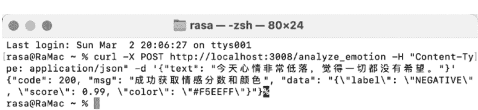

图6-1

如图6-2所示为接口返回的情感分析结果，包括情感标签、得分及对应颜色。

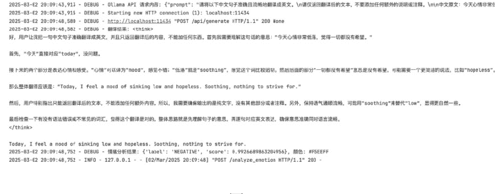

图6-2

#### 6.1.2 情感分值与颜色的映射实现

本小节将以一个简单的随机中文语录生成项目为例，逐步引入情感分析服务，并通过颜色映射机制实现页面背景颜色的动态切换，从而使每条语录的情感状态直观呈现。

##### 1. 项目结构与基础语录生成

在示例项目EmotionColorMApping中，初始版本仅包含两个文件。

- （1）Index.ets：应用入口文件，通过Column布局容器调用QuoteGeneratorPage组件。
- （2）QuoteGeneratorPage.ets：语录生成页面，实现点击按钮随机生成励志语录并展示，同时页面底部附带一张猫咪图片作为装饰。

为支持情感分析联动功能，需要引入和修改以下文件（参照PoetryImageFrontend项目）。

- （1）src/main/ets/configs/Config.ets：存放后端情感分析服务地址等配置信息。
- （2）src/main/ets/services/ApiService.ets：封装与后端交互的通用API调用方法，支持流式响应处理。
- （3）src/main/ets/services/EmotionService.ets：实现情感分析相关接口（如analyzeEmotion），支持直接对中文文本进行情感检测或先翻译后分析。
- （4）src/main/ets/types/ApiTypes.ets：定义接口请求与响应所需的数据结构（如EmotionRequest、EmotionResponse、TranslateRequest）。
- （5）src/main/ets/utils/DownloadUtils.ets、HttpClient.ets、StreamingUtils.ets：提供网络请求、下载及流式数据处理的工具函数。
- （6）ColorUtils.ets（新增）：定义mapScoreToColor函数，根据情感分值映射对应颜色。

项目关键目录结构示例如下：

```
src/
├── main/
│   ├── ets/
│   │   ├── configs/
│   │   │   └── Config.ets
│   │   ├── pages/
│   │   │   ├── Index.ets
│   │   │   └── QuoteGeneratorPage.ets
│   │   ├── services/
│   │   │   ├── ApiService.ets
│   │   │   └── EmotionService.ets
│   │   ├── types/
│   │   │   └── ApiTypes.ets
│   │   └── utils/
│   │       ├── ColorUtils.ets
│   │       ├── DownloadUtils.ets
│   │       ├── HttpClient.ets
│   │       └── StreamingUtils.ets
│   └── resources/
│       └── base/
│           └── media/
│               └── cat.png        // 猫咪图片资源
```

● Index.ets示例代码：

```typescript
// src/main/ets/pages/Index.ets

import { QuoteGeneratorPage } from './QuoteGeneratorPage';

@Entry
@Component
struct Index {
  build() {
    Column() {
      QuoteGeneratorPage() // 调用语录生成器页面
    }
    .padding(20)
  }
}
```

● QuoteGeneratorPage.ets示例代码：

```typescript
// src/main/ets/pages/QuoteGeneratorPage.ets

@Component
export struct QuoteGeneratorPage {
  private quotes: string[] = [
    // **积极 (Positive) **
    '每一天都是新的开始，充满无限可能！',
    '你的努力不会白费，所有的坚持都会有回报。',
    '相信自己，你足够优秀，也值得更好的未来。',
    '即使跌倒了一百次，也要第一百零一次站起来！',
    '今天的努力，就是明天的成功。',

    // **消极 (Negative) **
    '有些伤痛，时间也无法抹去。',
    '无论怎么努力，好像都看不到尽头。',
    '有时候，付出并不一定会有回报。',
    '现实总是残酷的，不是所有梦想都能实现。',
    '再怎么挣扎，命运似乎都不肯放过。',

    // **愤怒 (Angry) **
    '世界并不公平，有些人就是比你轻松！',
    '有些人永远不会懂你的付出和辛苦。',
    '每一次妥协，都会让自己更难受！',
    '忍耐不是懦弱，但总有忍无可忍的时候！',
    '愤怒的火焰不会自己熄灭，只有反击才能平息。',

    // **焦虑 (Anxious) **
    '未来充满不确定性，每一步都让人害怕。',
    '事情太多了，感觉根本忙不过来。',
    '不管怎么计划，总会有意外发生。',
    '时间在流逝，而我还是什么都没做好。',
    '总感觉自己不够好，不够努力，不够聪明。',

    // **平静 (Calm) **
    '深呼吸，让心慢下来，一切都会好起来。',
    '静静感受此刻，不去想过去，也不担忧未来。',
    '风停了，雨停了，所有的烦恼也会过去。',
    '世界本无事，庸人自扰之。',
    '平静是一种力量，温和是一种智慧。'
  ];

  @State currentQuote: string = '点击下方按钮生成随机励志语录！'; // 当前显示的语录

  build() {
    Column({ space: 20 }) { // 创建垂直布局容器
      // 显示当前语录
      Text(this.currentQuote)
        .fontSize(18)
        .fontWeight(FontWeight.Bold)
        .textAlign(TextAlign.Center)
        .padding(20);

      // 励志语录生成按钮
      Button('生成随机语录')
        .onClick(() => this.generateRandomQuote())
        .fontSize(20)
        .backgroundColor(Color.Blue)
        .fontColor(Color.White)
        .width('50%')
        .alignSelf(ItemAlign.Center);

      // 显示猫咪图片装饰
      Image($r('App.media.cat'))
        .width(85)
        .height(100)
        .borderRadius(5)
        .alignSelf(ItemAlign.Center);
    }
    .padding(20)
    .width('100%')
    .height('100%')
    .alignItems(HorizontalAlign.Center);
  }

  // 随机生成语录的方法
  private generateRandomQuote() {
    const randomIndex = Math.floor(Math.random() * this.quotes.length);
    this.currentQuote = this.quotes[randomIndex];
  }
}
```

运行后，应用将随机展示励志语录，并在点击按钮时生成新的语录，同时页面底部始终显示一张猫咪图片。如图6-3所示为基础语录生成器的初始效果，页面中既能看到随机生成的语录，又有猫咪图片作为装饰。

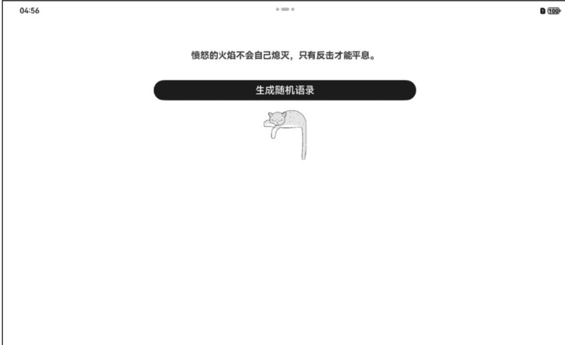

图6-3

##### 2. 引入情感分析服务

为实现对生成的中文语录进行情感分析，并将结果反馈到页面，需新增和修改以下文件。

- 配置文件
  src/main/ets/configs/Config.ets用于存储后端API地址等配置信息。
- API服务封装
  src/main/ets/services/ApiService.ets封装了通用API的调用方法。
- 情绪分析服务
  src/main/ets/services/EmotionService.ets实现情感分析和翻译接口，相关代码实现如下。

```typescript
// src/main/ets/services/EmotionService.ets

/**
 * 调用情感分析接口
 * @param text - 要分析的文本
 * @param onChunkReceived - 可选的回调函数，用于处理流式返回的每个数据块
 * @returns Promise<string> - 返回情感分析结果
 */
public async analyzeEmotion(
  text: string,
  onChunkReceived?: (chunk: string) => void
): Promise<string> {
  const requestBody: EmotionRequest = { text }; // 请求体
  return this.request('/analyze_emotion', requestBody, onChunkReceived); // 非流式
}

/**
 * 调用翻译接口
 * @param sentence - 要翻译的句子
 * @param target_language - 目标语言（默认英文）
 * @param onChunkReceived - 可选的回调函数，用于处理流式返回的每个数据块
 * @returns Promise<string> - 返回翻译后的文本
 */
public async translateText(
  sentence: string,
  target_language: string = '英文', // 默认英文
  onChunkReceived?: (chunk: string) => void
): Promise<string> {
  const requestBody: TranslateRequest = { sentence, target_language }; // 请求体
  return this.request('/translate', requestBody, onChunkReceived); // 非流式
}
```

● 数据类型定义

在src/main/ets/types/ApiTypes.ets中定义如下接口数据结构。

##### 3. 升级QuoteGeneratorPage.ets：动态更新背景色

在升级后的QuoteGeneratorPage.ets中，新增以下关键功能。

- (1) 引入依赖：导入EmotionService和config，用于与后端交互。
- (2) 状态管理：新增@State backgroundColor变量，用于动态控制页面背景颜色。
- (3) 逻辑处理：在generateRandomQuote方法中，随机生成语录后调用情感分析接口，并根据返回的情感分值（或直接返回的颜色）更新背景颜色。

示例核心代码如下：

```typescript
// src/main/ets/pages/QuoteGeneratorPage.ets

import { config } from '../configs/Config';
import { EmotionService } from '../services/EmotionService';
import { EmotionResponse } from '../types/ApiTypes'; // 导入接口定义

@Component
export struct QuoteGeneratorPage {
  private quotes: string[] = [
    // **积极 (Positive) **
    '每一天都是新的开始，充满无限可能！',
    '你的努力不会白费，所有的坚持都会有回报。',
    '相信自己，你足够优秀，也值得更好的未来。',
    '即使跌倒了一百次，也要第一百零一次站起来！',
    '今天的努力，就是明天的成功。',

    // **消极 (Negative) **
    '有些伤痛，时间也无法抹去。',
    '无论怎么努力，好像都看不到尽头。',
    '有时候，付出并不一定会有回报。',
    '现实总是残酷的，不是所有梦想都能实现。',
    '再怎么挣扎，命运似乎都不肯放过。',

    // **愤怒 (Angry) **
    '世界并不公平，有些人就是比你轻松！',
    '有些人永远不会懂你的付出和辛苦。',
    '每一次妥协，都会让自己更难受！',
    '忍耐不是懦弱，但总有忍无可忍的时候！',
    '愤怒的火焰不会自己熄灭，只有反击才能平息。',

    // **焦虑 (Anxious) **
    '未来充满不确定性，每一步都让人害怕。',
    '事情太多了，感觉根本忙不过来。',
    '不管怎么计划，总会有意外发生。',
    '时间在流逝，而我还是什么都没做好。',
    '总感觉自己不够好，不够努力，不够聪明。',

    // **平静 (Calm) **
    '深呼吸，让心慢下来，一切都会好起来。',
    '静静感受此刻，不去想过去，也不担忧未来。',
    '风停了，雨停了，所有的烦恼也会过去。',
    '世界本无事，庸人自扰之。',
    '平静是一种力量，温和是一种智慧。'
  ];

  @State currentQuote: string = '点击下方按钮生成随机励志语录！（#FFFFFF）'; // 当前显示的语录
  @State backgroundColor1: string = '#FFFFFF'; // 用于动态控制页面背景
  private emotionService: EmotionService = new EmotionService(config.sentimentApiUrl);

  build() {
    Column({ space: 20 }) { // 创建垂直布局容器
        // 显示当前语录
        Text(this.currentQuote)
            .fontSize(18)
            .fontWeight(FontWeight.Bold)
            .textAlign(TextAlign.Center)
            .padding(20);

        // 励志语录生成按钮
        Button('生成随机语录')
            .onClick(() => this.generateRandomQuote())
            .fontSize(20)
            .backgroundColor(Color.Blue)
            .fontColor(Color.White)
            .width('50%')
            .alignSelf(ItemAlign.Center);

        // 显示猫咪图片装饰
        Image($r('App.media.cat'))
            .width(85)
            .height(100)
            .borderRadius(5)
            .alignSelf(ItemAlign.Center);
    }
    .padding(20)
    .width('100%')
    .height('100%')
    .backgroundColor(this.backgroundColor1)
    .alignItems(HorizontalAlign.Center);
  }

  // 随机生成语录的方法
  private async generateRandomQuote() {
    const randomIndex = Math.floor(Math.random() * this.quotes.length);
    this.currentQuote = this.quotes[randomIndex];

    let accumulatedResponse = ''; // 用于存储累积的所有数据块

    try {
        // 获取情感分析结果
        await this.emotionService.analyzeEmotion(this.currentQuote,
            (partialResult: string) => {
                accumulatedResponse += partialResult;
            });

        // 解析情感分析结果
        const emotionResponse: EmotionResponse = JSON.parse(accumulatedResponse);

        // 根据情感分值映射颜色
        const label = emotionResponse.label; // 获取情感标签
        const score = emotionResponse.score; // 获取情感分值
        const color = emotionResponse.color; // 获取情感颜色

        // 根据情感分值映射颜色
        // const color = mapScoreToColor(score);

        // 直接使用后端返回的 color 更新背景色
        this.backgroundColor1 = color;
        this.currentQuote += ` ( ${this.backgroundColor1})`;
        console.info(`情感标签: ${label}, 分值: ${score}, 颜色: ${color}`);
    } catch (err) {
        console.error('情绪分析出错:', err);
    }
  }
}
```

每次点击按钮时，应用不仅会更新语录，还会将文本发送给后端获取情感分析结果，并即时调整背景颜色，实现“文本情绪→视觉颜色”的动态联动。

如图6-4所示为引入情感分析服务后，应用根据情感分值实时更新背景色，从而实现语录情绪与页面颜色的动态联动。

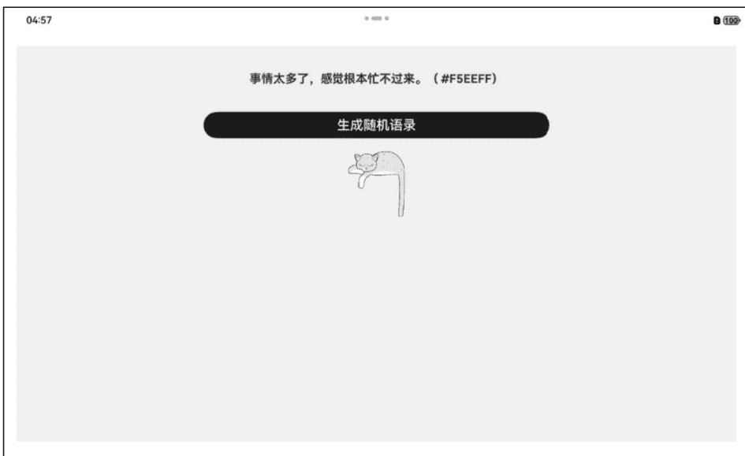

##### 4. 本地颜色映射：使用ColorUtils.ets

如果后端仅返回情感分值，而不直接返回颜色，可以通过在本地实现ColorUtils.ets来根据分值映射相应颜色，以便灵活定制配色策略。

示例代码如下：

```typescript
// src/main/ets/utils/ColorUtils.ets

/**
 * @description 根据情感得分映射到特定颜色
 * @param score - 情感得分，范围为 0.0 到 1.0
 * @returns 对应的颜色代码
 */
export function mapScoreToColor(score: number): string {
    // 定义情感得分对应的颜色范围
    const colors = [
        "#FFFAFA", "#FFF0F0", "#FFE6E6", "#FFDBDB", "#F5EEFF", "#EBE0FF", "#E1D3FF",
        "#D7C5FF",
        "#E6FFFA", "#CCF6E7", "#B3EFD4", "#99E6C1", "#FFFCE6", "#FFF9CC", "#FFF6B3",
        "#FFF399",
        "#EAEFFF", "#D4E1FF", "#BCCFFF", "#A7BDFF", "#FFF5E6", "#FFEBCC", "#FFE1B3",
        "#FFD699",
        "#FDE6FF", "#FCD1FF", "#F9BDFF", "#F7A8FF"
    ];

    // 校验 score 是否在 0 到 1 之间
    if (typeof score !== 'number' || score < 0 || score > 1) {
        throw new Error('Invalid score: must be a number between 0 and 1.');
    }

    // 确保 score 在 0 到 1 之间
    const clampedScore = Math.max(0, Math.min(1, score));

    // 对于 score <= 0.9，返回第一个颜色
    if (clampedScore <= 0.9) {
        return colors[0];
    }

    // 对于 score > 0.9，映射到更高的颜色区间
    const adjustedScore = (clampedScore - 0.9) * 2; // 将得分范围调整到 0 到 1
    const index = Math.floor(adjustedScore * (colors.length - 1)); // 根据调整后的得分计算索引

    return colors[index]; // 返回计算出的颜色
}
```

在 QuoteGeneratorPage.ets 中调用本地映射函数：

```typescript
import { mapScoreToColor } from '../utils/ColorUtils';

// 随机生成语录的方法
private async generateRandomQuote() {
    const randomIndex = Math.floor(Math.random() * this.quotes.length);
    this.currentQuote = this.quotes[randomIndex];

    let accumulatedResponse = ''; // 用于存储累积的所有数据块

    try {
        // 获取情感分析结果
        await this.emotionService.analyzeEmotion(this.currentQuote, (partialResult: string) => {
            accumulatedResponse += partialResult;
        });

        // 解析情感分析结果
        const emotionResponse: EmotionResponse = JSON.parse(accumulatedResponse);

        // 根据情感分值映射颜色
        const label = emotionResponse.label; // 获取情感标签
        const score = emotionResponse.score; // 获取情感分值
        // const color = emotionResponse.color; // 获取情感颜色

        // 根据情感分值映射颜色
        const color = mapScoreToColor(score);

        // 直接使用后端返回的 color 更新背景色
        this.backgroundColor1 = color;
        this.currentQuote += `(${this.backgroundColor1})`;
        console.info(`情感标签: ${label}, 分值: ${score}, 颜色: ${color}`);
    } catch (err) {
        console.error('情感分析出错:', err);
    }
}
```

这样，无论是后端返回颜色还是仅返回分值，都可以灵活地更新页面背景，提升系统的可扩展性和定制化能力。

##### 5. 运行效果与实用补充

完成上述步骤后，每次点击“生成随机语录”按钮，应用将按以下流程执行。

- (1) 随机抽取一条中文语录；
- (2) 通过情感分析接口获取语录的情感标签和分值；
- (3) 根据分值（或直接使用后端返回的颜色）更新@State backgroundColor，实现背景颜色的动态切换；
- (4) 页面即时重绘，呈现出直观的“文本情绪→视觉颜色”联动效果。

如图6-5所示为应用在模拟器中的最终效果，不同语录对应不同的情感强度和背景色，为用户提供了生动的交互体验。

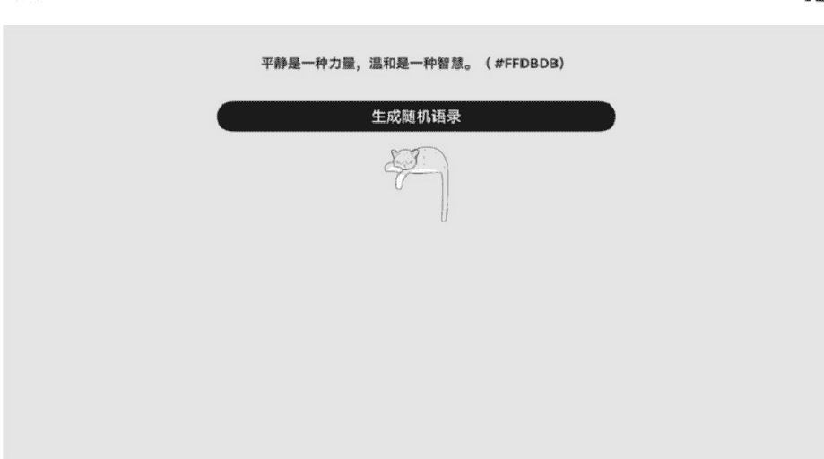

### 6.2 多服务与硬件协同联动与控制

本章将详细介绍ProjectSymphony项目如何通过大模型文本生成、情感分析、硬件设备控制及数据库监测等多个模块，实现多服务协同与硬件联动，打造一个能够实时响应情绪变化、同步更新页面与硬件状态的综合系统。

项目采用模块化设计，各功能模块分别承担特定职责，并以不同文件形式分布于项目目录中，为系统的开发、维护与扩展提供了有力支撑。具体而言，项目主要包括以下三个核心模块。

### 1. EmotionColorMapping模块

该模块负责情感分析、文本生成与颜色映射。除了处理系统配置（如Config.ets），它还封装了API请求（ApiService.ets）、情感分析及文本生成（EmotionService.ets）的核心逻辑。模块中定义了API数据类型（ApiTypes.ets），并提供了颜色映射（ColorUtils.ets）、图片下载处理（DownloadUtils.ets）、HTTP客户端封装（HttpClient.ets）以及流数据处理（StreamingUtils.ets）工具等。

### 2. HardwareControlFrontend模块

封装硬件设备控制逻辑，实现与设备（如树莓派LED灯）的双向通信。通过文件HardwareService.ets与HardwareTypes.ets，该模块在情绪状态变化时能够迅速下发控制指令，并实时监控设备响应与异常情况，确保物理设备状态与系统数据保持一致。

### 3. PoetryImageFrontend模块

专注于用户页面展示与交互，负责情感句子与抚慰诗歌的生成，以及图片的下载与展示。该模块以Index.ets作为系统主要入口，通过ButtonManager.ets与CustomButton.ets等实现直观、温馨的视觉反馈，增强用户交互体验。

项目目录结构直观地反映了各模块的划分与文件分布，如下所示：

```
src/
├── main/
│   ├── ets/
│   │   ├── configs/
│   │   │   └── Config.ets                // EmotionColorMapping 模块
│   │   ├── components/
│   │   │   ├── ButtonManager.ets         // PoetryImageFrontend 模块
│   │   │   └── CustomButton.ets          // PoetryImageFrontend 模块
│   │   ├── pages/
│   │   │   └── Index.ets                 // PoetryImageFrontend 模块（主要入口）
│   │   ├── services/
│   │   │   ├── ApiService.ets            // EmotionColorMapping 模块
│   │   │   ├── EmotionService.ets        // EmotionColorMapping 模块
│   │   │   └── HardwareService.ets       // HardwareControlFrontend 模块
│   │   ├── types/
│   │   │   ├── ApiTypes.ets              // EmotionColorMapping 模块
│   │   │   └── HardwareTypes.ets         // HardwareControlFrontend 模块
│   │   └── utils/
│   │       ├── ColorUtils.ets            // EmotionColorMapping 模块
│   │       ├── DownloadUtils.ets         // EmotionColorMapping 模块
│   │       ├── HttpClient.ets            // EmotionColorMapping 模块
│   │       └── StreamingUtils.ets        // EmotionColorMapping 模块
```

系统整体工作流程如下所述。

- ● 情感数据采集与处理

系统首先通过EmotionColorMapping模块加载配置文件，并调用API接口获取情感分值。随后，利用ColorUtils工具将情感状态映射为RGB色值，此结果既用于前端UI的实时更新，也为硬件设备控制提供数据依据。

- ● 硬件联动与双向通信

基于HardwareControlFrontend模块，系统在情感状态发生变化时迅速下发控制指令给硬件设备（如树莓派LED灯），同时实时监控设备响应与处理异常，确保物理设备状态与系统数据保持同步。

- ● UI展示与交互闭环

通过PoetryImageFrontend模块，情感数据被转化为抚慰诗句和相关图片，并通过页面展示组件呈现给用户。用户点击按钮等操作触发后续情感分析与设备控制，形成完整的交互闭环。

- ● 数据库监控与自动更新

系统嵌入数据库监控机制，实时检测外部数据变化或异常，并自动触发各模块间的数据同步与功能更新，确保整体系统始终处于最新状态，并能快速响应外部变动。

接下来，在6.2.1小节中将详细介绍基于大模型服务生成句子与抚慰诗歌的具体实现。

#### 6.2.1 基于大模型服务生成情感句子与抚慰诗歌

本小节将介绍如何借助大模型服务，在App中实现文本生成功能，涵盖情感句子与抚慰诗歌的创作。通过大模型对深层语义的解析，App不仅能够根据用户当前情感状态生成具有艺术感染力的文本，还能同步输出对应的情感分值，从而为后续页面动态更新和硬件联动提供数据支持。

##### 1. 功能概述

App向本地大模型服务发送包含用户输入文本与情感状态信息的请求，以生成相应的情感句子或抚慰诗歌。大模型在返回文本的同时，会计算并输出一个情感分值。借助EmotionColorMapping等情感映射模块，App前端页面背景色或硬件设备（如LED灯）能够根据该情感分值实时调整。整个过程中，采用流式回调机制，确保用户可以实时观看文本生成过程，并在最终结果出来后立即呈现。

##### 2. 实现思路

- ● 请求构建

App首先采集用户的文本输入和情感状态信息，并将其封装为请求数据。请求中不仅明确指定所需生成的文本类型（情感句子或抚慰诗歌），还包含了情感指标等辅助信息，以便本地大模型能够精准捕捉用户的情感状态，并生成更具针对性的内容。

- ● 大模型处理

本地大模型在接收到请求后，会利用预训练的深层语义模型对输入信息进行解析，生成与用户情感高度契合的文本。同时，大模型还会计算并返回与生成文本相对应的情感分值，确保生成内容既具备艺术感染力，又能以量化形式表达情感特征，为后续的情感映射与页面联动提供数据支撑。

- ● 情绪映射与联动

App通过EmotionColorMapping模块，将大模型返回的情感分值转换为对应的RGB色值。这一映射结果将用于驱动前端页面的背景颜色更新或控制硬件设备（如LED灯）的动态变化，实现文字、视觉与物理设备的无缝联动。

##### 3. 关键流程

在ProjectSymphony的Index.ets文件中，App通过调用本地大模型服务（EmotionService）来实现文本生成，并利用流式回调机制实现实时更新。具体流程如下所述。

- ● 初始化阶段

App启动后，首先初始化大模型服务实例，并配置相关API地址，为后续请求做好准备。

- ● 用户交互阶段

当用户点击按钮时，App通过判断按钮标签来确定调用哪种生成功能。

  (1) 若按钮标签为空，则调用大模型生成情感句子。
  (2) 若按钮标签存在，则先生成抚慰诗歌，再更新情感句子。

流式回调机制确保在文本生成过程中，App页面上能实时显示结果，直至完整文本生成并返回。

- ● 映射与更新阶段

完成文本生成后，App根据大模型返回的情感分值，通过情感映射模块计算出RGB色值，进而更新页面背景色或驱动相应硬件设备，实现视觉和物理设备的联动。

##### 4. 代码示例

以下代码示例展示了如何根据按钮标签动态调用不同的生成功能，并通过流式回调机制实时更新App页面和情感状态：

```
/**
 * 获取聊天响应，并根据按钮标签执行相应操作
 * @param buttonLabel 被点击的按钮标签，若为空则生成情感句子
 */
private async fetchChatResponse(buttonLabel: string) {
  const emotionService = new EmotionService(config.sentimentApiUrl);

  try {
    if (!buttonLabel) {
      // 按钮标签为空时，生成情感句子并更新按钮标签
      await this.updateButtonsWithEmotion(emotionService);
    } else {
      // 处理按钮标签，去除编号、星号和双引号
      const formatResult = buttonLabel.trim()
        .replace(/^[0-9]+\.\s*|\*\s*/g, '') // 移除前缀编号和星号
        .replace(/"/g, ''); // 去除双引号

      // 生成诗歌并更新结果
      await this.generatePoetryAndUpdateResult(emotionService, formatResult);

      // 更新按钮标签
      await this.updateButtonsWithEmotion(emotionService);
    }
  } catch (error) {
    // 记录并处理错误
    this.logAndHandleError(error, 'fetchChatResponse');
  }
}
```

在该示例中，当按钮标签为空时，App主要生成情感句子；当按钮标签存在时，则优先生成抚慰诗歌，再更新情感句子。流式回调机制确保用户能直观地看到文本生成的进展。

##### 5. 流程示意图

用户点击按钮后，fetchChatResponse函数会检查按钮标签，并根据其状态决定生成情感句子或抚慰诗歌，随后更新App页面情感。整个过程伴随着流式输出，实现实时文本生成与页面联动。流程示意图如图6-6所示。

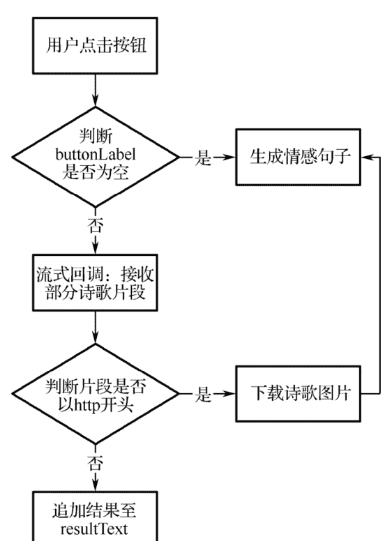

图6-6

##### 6. 运行效果与截图

用户点击按钮后，App页面文本区域会实时展示大模型生成的情感句子和抚慰诗歌，同时触发按钮闪烁动画作为反馈提示，直至完整文本生成完毕。生成完成后，App会根据大模型返回的情感分值，自动调整页面背景颜色或驱动相应硬件设备，从而实现文字、视觉与物理设备之间的高效联动，提升用户的沉浸式体验。

如图6-7所示为运行后生成情感句子的效果；而图6-8则展示了实际生成抚慰诗歌的效果。用户可以直观体验到文本生成的艺术魅力以及页面联动状态。


图6-7


图6-8

通过这一生成机制，App不仅在情感表达上实现了文本的多样输出，还能在视觉与硬件设备之间实现高效联动，提供更加沉浸和个性化的用户体验。

#### 6.2.2 情感句子生成与情感感知

本小节将介绍如何通过升级updateBackgroundColor与fetchChatResponse两个函数，实现情感句子生成与情感感知的完整闭环。主要涵盖两个场景：文本生成和情感分析，并通过流式回调与页面反馈实现实时、直观的用户交互体验。

##### 1. 功能概述

- 文本生成场景

当用户点击生成按钮且未传入按钮标签（buttonLabel为空）时，系统调用updateButtonsWithEmotion函数，启动大模型情感句子生成接口，并通过流式回调机制实时显示生成进度。此处，生成任务主要由fetchChatResponse函数发起。

- ● 情感分析场景

当用户点击具体的文本记录（传入非空的buttonLabel）后，系统首先对按钮标签进行预处理（清洗掉编号和特殊符号），再调用updateBackgroundColor函数。该函数会通过调用情感分析模型接口返回JSON数据，其中包含情感标签（label）、情感分值（score）以及对应的颜色（color）。返回的数据会被追加到this.resultText中，并驱动页面反馈（如背景色变化或按钮动画），直观展示情感状态。

##### 2. 实现思路

- ● 请求构建与流式回调

用户触发文本生成事件后，App将文本数据提交至大模型情感句子生成接口。系统采用流式回调机制，实时接收返回数据，并更新页面以展示生成进度。

- ● 用户交互与情感分析

当文本生成完成后，用户可以选择其中的一条记录。系统对该记录对应的按钮标签进行数据清洗，随后调用updateBackgroundColor函数，通过情感分析模型返回的JSON数据解析出情感标签、分值和颜色。

- ● 页面反馈与效果展示

系统将情感分析结果映射到页面反馈（如背景色更新或按钮动画），实现直观展示情感状态的目的，提升用户整体体验。

##### 3. 关键流程

为确保功能的连贯性和实时性，整个流程主要包括以下阶段。

- ● 初始化阶段

App启动后，在Index.ets中初始化情感生成服务实例，并配置相应的API地址和参数，为后续调用做好准备。

- ● 文本生成阶段

用户点击生成按钮时，若buttonLabel为空，fetchChatResponse函数将调用updateButtonsWithEmotion，启动大模型情感句子生成接口，并利用流式回调机制实时展示生成进度。

- ● 情感分析阶段

用户在生成完成后选择具体的文本记录（传入非空按钮标签），fetchChatResponse函数对按钮标签进行预处理后调用updateBackgroundColor函数，该函数通过情感分析模型返回JSON数据（包含label、score、color），并将结果追加至this.resultText，同时驱动页面反馈更新。

##### 4. 代码示例

下面的代码示例展示了如何在Index.ets中升级updateBackgroundColor与fetchChatResponse两个函数，以实现上述流程：

```
import { EmotionResponse } from '../types/ApiTypes'; // 导入接口定义

/**
 * 解析情感分析结果，并根据情感信息更新背景显示文本
 * @param emotionService 情感分析服务实例
 * @param textToGenerate 待分析的文本内容
 */
private async updateBackgroundColor(emotionService: EmotionService, textToGenerate: string) {
    let accumulatedResponse = ''; // 用于存储累积的情感分析数据

    try {
        // 进行情感分析，并逐步累积分析结果
        await emotionService.analyzeEmotion(textToGenerate, (partialResult: string) => {
            accumulatedResponse += partialResult;
        });

        // 解析累积的情感分析结果
        const emotionResponse: EmotionResponse = JSON.parse(accumulatedResponse);

        // 提取情感分析结果中的关键信息
        const label = emotionResponse.label; // 情感标签（如正面、负面、中性）
        const score = emotionResponse.score; // 情感分数（数值化情绪强度）
        const color = emotionResponse.color; // 对应的颜色（用于 UI 显示）

        // 更新显示文本，包含情感标签、情感分数及颜色信息
        this.resultText = `${textToGenerate} (情感标签: ${label}, 分值: ${score}, 颜色: ${color})`;
    } catch (error) {
        // 记录并处理错误
        this.logAndHandleError(error, 'updateBackgroundColor');
    }
}

/**
 * 获取聊天响应，并根据按钮标签执行相应操作，同时更新情感感知结果
 * @param buttonLabel 被点击的按钮标签，若为空则生成情感句子
 */
private async fetchChatResponse(buttonLabel: string) {
    const emotionService = new EmotionService(config.sentimentApiUrl);

    try {
        if (!buttonLabel) {
            // 按钮标签为空时，生成情感句子并更新按钮标签
            await this.updateButtonsWithEmotion(emotionService);
        } else {
            // 处理按钮标签，去除编号、星号和双引号
            const formatResult = buttonLabel.trim()
                .replace(/^[0-9]+\.\s*|\*\s*/g, '') // 移除前缀编号和星号
                .replace(/"/g, ''); // 去除双引号

            // 进行情感分析，并更新情感感知结果
            await this.updateBackgroundColor(emotionService, formatResult);

            // 更新按钮标签
            await this.updateButtonsWithEmotion(emotionService);
        }
    } catch (error) {
        // 记录并处理错误
        this.logAndHandleError(error, 'fetchChatResponse');
    }
}
```

在以上代码中：updateBackgroundColor函数负责调用情感分析接口，并根据返回的JSON数据更新页面背景色及结果文本；fetchChatResponse函数根据按钮标签的状态判断是调用文本生成还是情感分析，从而协调二者的执行流程。

##### 5. 流程示意图

如图6-9所示，整体流程示意了用户点击按钮后的处理逻辑。fetchChatResponse函数根据按钮标签判断后续操作：若标签为空，则调用文本生成函数updateButtonsWithEmotion；若标签非空，则调用情感分析函数updateBackgroundColor，并最终完成页面反馈更新。

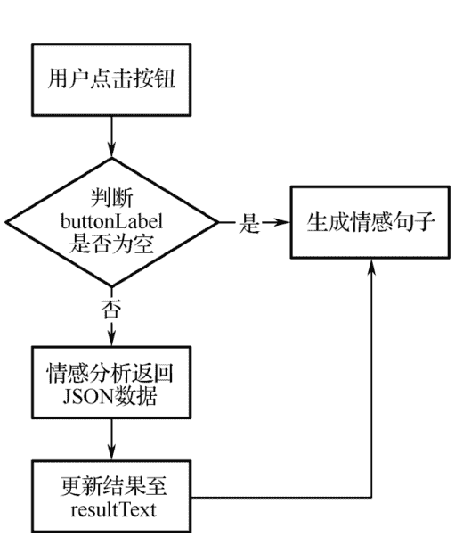

当按钮标签为空时，系统通过updateButtonsWithEmotion函数实现文本生成及实时进度显示。

当按钮标签非空时，系统通过数据预处理后调用updateBackgroundColor函数，解析情感分析结果（label、score、color），并反馈至页面。

##### 6. 运行效果与截图

在实际运行中，App的页面效果与代码逻辑高度一致，具体表现如下。

- ● 实时文本生成与进度显示

用户点击生成按钮（按钮标签为空）后，页面实时展示大模型返回的文本生成进度，情感句子不断更新展示。

- ● 情感句子展示

所有生成的情感句子均展示在页面上，由updateButtonsWithEmotion函数负责更新显示。

- ● 情感分析与页面反馈

用户点击具体文本记录（按钮标签非空）后，系统调用updateBackgroundColor函数对选中内容进行情感分析。情感分析模型返回的JSON数据中包含情感标签、分值和颜色，将这些信息追加到this.resultText中，并驱动页面背景色或按钮动画的变化，从而直观反映文本的情感状态。

如图6-10所示，展示了实际运行效果：左侧显示实时生成的情感句子，右侧则展示用户点击记录后更新的情感反馈，包括背景颜色变化或动画效果。

#### 6.2.3 情感感知与生成抚慰诗歌

本小节将介绍如何利用情绪感知服务与大模型生成技术，实现对用户输入文本情感的实时解析，并基于情感数据生成具有抚慰作用的诗歌。通过系统内部流程的无缝对接，用户不仅能感知自身情绪，还能获得心理上温暖、艺术化的文本慰藉。

##### 1. 功能概述

本小节旨在通过情感感知服务，对用户输入的文本进行情感解析，并基于该情感数据生成抚慰诗歌。系统不仅实时捕捉用户情感状态（包括情感标签、分值和对应颜色），还通过大模型生成具备艺术感染力的抚慰诗歌。最终，页面将同步展示诗歌内容与情感反馈（如背景色、按钮动画等），从而为用户带来心理上的慰藉与舒缓体验。该功能设计使得用户在体验文本艺术魅力的同时，也能直观地感受到情感的正向引导。

##### 2. 实现思路

在实现过程中，系统将用户文本输入、情感解析、诗歌生成以及页面反馈有机结合，形成一个完整闭环。首先，通过预处理用户输入的文本，保证后续情感分析和文本生成的准确性；接着调用情感感知接口获取情感状态；然后基于情感数据调用大模型生成抚慰诗歌，并通过流式回调机制实时展示生成进度；最后将生成的诗歌与情感反馈信息同步更新到页面上，为用户提供沉浸式体验。整个实现思路清晰，既保证了实时性，又兼顾了艺术表达与情感反馈的多重需求。

##### 3. 关键流程

本模块的关键流程主要分为四个阶段：文本输入触发情感解析、流式数据返回与实时生成、数据解析与页面反馈展示，以及最终的页面更新。每个阶段均采用精细化设计，确保数据的连续传输与处理，进而实现诗歌生成与情感反馈的无缝对接。系统在每个环节都引入了错误处理与状态更新机制，保障整体流程的稳定性与用户体验的连贯性。

- 文本输入触发情感解析：用户输入文本后，系统自动调用情感感知服务，对文本进行情感状态检测，确保后续生成具备情感对应性的文本。
- 流式数据返回与实时生成：系统调用generateSoothingPoetry接口，通过流式回调机制逐步返回抚慰诗歌的生成片段，同时后台处理情感数据，为页面反馈做准备。
- 数据解析与页面反馈展示：对返回的JSON数据进行解析，提取情感标签、分值和颜色，并将其映射到页面反馈上，如背景色和按钮状态，直观反映文本情感状态。
- 最终的页面更新：将累积生成的抚慰诗歌和情感反馈信息同步显示在页面上，确保文本生成与情感数据能实时联动展示。

##### 4. 代码示例

下面的代码示例展示了如何通过两个关键函数实现情感感知与抚慰诗歌生成的闭环流程。代码中，updateBackgroundColor函数用于调用情感分析接口并更新页面反馈，而fetchChatResponse函数则根据按钮状态判断调用不同的业务逻辑，保证用户操作的连贯性与系统响应的实时性。

```typescript
/**
 * 解析情感分析结果，并根据情感信息更新按钮显示文本
 * @param emotionService 情感分析服务实例
 * @param textToGenerate 待分析的文本内容
 */
private async updateBackgroundColor(emotionService: EmotionService, textToGenerate: string) {
    let accumulatedResponse = ''; // 用于存储累积的情感分析数据

    try {
        // 进行情感分析，并逐步累积分析结果
        await emotionService.analyzeEmotion(textToGenerate, (partialResult: string) => {
            accumulatedResponse += partialResult;
        });

        // 解析累积的情感分析结果
        const emotionResponse: EmotionResponse = JSON.parse(accumulatedResponse);

        // 提取情感分析结果中的关键信息
        const label = emotionResponse.label; // 情感标签（如正面、负面、中性）
        const score = emotionResponse.score; // 情感分数（数值化情绪强度）
        const color = emotionResponse.color; // 对应的颜色（用于 UI 显示）

        // 更新按钮文本，显示情感分析的结果
        this.buttonText = `${textToGenerate} (情感标签: ${label}, 分值: ${score}, 颜色: ${color})`;
    } catch (error) {
        // 记录并处理错误
        this.logAndHandleError(error, 'updateBackgroundColor');
    }
}

/**
 * 获取聊天响应，并根据按钮标签执行相应操作，同时更新情感感知结果
 * @param buttonLabel 被点击的按钮标签，若为空则生成情感句子
 */
private async fetchChatResponse(buttonLabel: string) {
    const emotionService = new EmotionService(config.sentimentApiUrl);

    try {
        if (!buttonLabel) {
            // 按钮标签为空时，生成情感句子并更新按钮标签
            await this.updateButtonsWithEmotion(emotionService);
        } else {
            // 处理按钮标签，去除编号、星号和双引号
            const formatResult = buttonLabel.trim()
                .replace(/^[0-9]+\.\s*|\*\s*/g, '') // 移除前缀编号和星号
                .replace(/"/g, ''); // 去除双引号

            // 进行情感分析，并更新按钮的情感信息
            await this.updateBackgroundColor(emotionService, formatResult);

            // 生成诗歌并更新显示结果
            await this.generatePoetryAndUpdateResult(emotionService, formatResult);

            // 更新按钮标签
            await this.updateButtonsWithEmotion(emotionService);
        }
    } catch (error) {
        // 记录并处理错误
        this.logAndHandleError(error, 'fetchChatResponse');
    }
}
```

以上代码通过模块化设计，将情感解析与诗歌生成功能进行了分离，同时在每个步骤中加入流式数据处理与错误捕获机制，确保系统在实际运行中能及时响应用户操作，并在页面上实时展示生成进度与情感反馈。

##### 5. 流程示意图

流程示意图如图6-11所示。图中每个阶段的操作均经过精细设计，以确保系统在流式数据回调的支持下，实现诗歌生成与情感反馈的实时联动，从而提供连贯且流畅的使用体验。

该示意图清晰展示了数据从输入、处理到输出的每个环节，帮助开发者快速理解系统内部的工作原理与数据交互逻辑。

##### 6. 运行效果与截图

在实际运行中，当用户输入文本后，系统将首先通过情感感知接口解析情感状态，并将解析结果（包括情感分值、标签及映射颜色）实时反馈到页面上，如背景色变化或按钮动画；同时，系统通过流式回调机制逐步生成并展示抚慰诗歌，用户可直观感受生成进度。最终，完整的抚慰诗歌与情感反馈信息会同步呈现在App页面上，为用户提供沉浸式、艺术化的情感慰藉体验。

如图6-12所示，页面左侧实时显示诗歌生成的进度，右侧则通过颜色映射和文本描述直观展示情感分析结果。通过这种设计，系统不仅为用户提供温馨的视觉体验，还在心理层面进行正向引导，带来舒缓和慰藉。

#### 6.2.4 基于情感分析控制应用背景和树莓派LED灯

本小节将介绍如何利用情感分析API对用户输入文本进行实时解析，并通过解析结果更新应用背景颜色和树莓派LED灯，实现页面与硬件的联动反馈，提升用户体验。

##### 1. 功能概述

通过调用情感分析API实时解析用户输入文本，提取情感标签、情感分数和颜色信息。返回的颜色数据既用于更新App的UI背景，也用于驱动树莓派LED灯显示相同颜色，确保用户在视觉和物理设备上都能获得直观的情感反馈。

##### 2. 实现思路

实现过程主要包含文本采集与情感解析、数据处理和页面及硬件更新。该方案采用流式回调机制逐步累积返回数据，最终解析JSON得到完整的情感分析结果，再将返回的颜色直接用于页面和硬件控制，保证反馈过程实时高效。

- 文本采集与情感解析：用户输入文本后，系统调用analyzeEmotion接口，并通过流式回调机制逐步获取分析数据。
- 数据处理：累积完成后，解析JSON数据，提取情感标签(label)、分数（score）和颜色（color）。
- 页面及硬件更新：利用返回的颜色更新UI背景（this.bgColor）和按钮文本，同时调用HardwareService.controlHardware接口控制LED灯的颜色，实现视觉与物理反馈的联动。

##### 3. 关键流程

整个流程从用户文本输入触发情感分析开始，经过数据累积、JSON解析，再到页面和硬件的颜色更新，每一步都确保了数据的准确传递和实时反馈。该流程设计不仅使系统能够直观展示情感数据，还通过硬件设备增强了用户的交互体验。

- 文本输入触发情感分析：用户输入文本后，系统自动调用analyzeEmotion（textToGenerate）接口。
- 数据累积与解析：通过流式回调机制，逐步累积返回结果，最终解析JSON数据，提取情感信息。
- 页面与硬件更新：利用提取到的颜色更新UI背景和按钮文本，并同步调用硬件服务接口控制LED灯。
- 按钮标签处理：在fetchChatResponse函数中，根据按钮标签的状态执行不同逻辑，确保情感数据与用户交互的同步更新。

##### 4. 代码示例

具体实现代码如下所示。

```typescript
import { HardwareService } from '../services/HardwareService'; // 导入硬件控制服务

/**
 * 根据情感分析结果更新背景颜色，并同步控制硬件状态
 * @param emotionService 情感分析服务实例
 * @param hardwareService 硬件控制服务实例
 * @param textToGenerate 待分析的文本内容
 */
private async updateBackgroundColor(emotionService: EmotionService, hardwareService: HardwareService,
    textToGenerate: string) {
    let accumulatedResponse = ''; // 用于存储累积的情感分析数据

    try {
        // 进行情感分析，并逐步累积分析结果
        await emotionService.analyzeEmotion(textToGenerate, (partialResult: string) => {
            accumulatedResponse += partialResult;
        });

        // 解析累积的情感分析结果
        const emotionResponse: EmotionResponse = JSON.parse(accumulatedResponse);

        // 提取情感分析结果中的关键信息
        const label = emotionResponse.label; // 情感标签（如正面、负面、中性）
        const score = emotionResponse.score; // 情感分数（数值化情绪强度）
        const color = emotionResponse.color; // 对应的颜色（用于 UI 显示）

        // 更新按钮文本，显示情感分析的结果
        this.buttonText = `${textToGenerate} (情感标签: ${label}, 分值: ${score}, 颜色: ${color})`;

        // 更新 UI 背景颜色
        this.bgColor = color;

        // 调用硬件控制服务，更新硬件颜色状态
        const success = await hardwareService.controlHardware(color);
        console.log(`硬件控制执行结果: ${success}`); // 输出硬件控制状态
    } catch (error) {
        // 记录并处理错误
        this.logAndHandleError(error, 'updateBackgroundColor');
    }
}

/**
 * 获取聊天响应，并根据按钮标签执行相应操作，同时更新情感感知结果和硬件状态
 * @param buttonLabel 被点击的按钮标签，若为空则生成情感句子
 */
private async fetchChatResponse(buttonLabel: string) {
    const hardwareService = new HardwareService(config.hardwareApiUrl);
    const emotionService = new EmotionService(config.sentimentApiUrl);

    try {
        if (!buttonLabel) {
            // 按钮标签为空时，生成情感句子并更新按钮标签
            await this.updateButtonsWithEmotion(emotionService);
        } else {
            // 处理按钮标签，去除编号、星号和双引号
            const formatResult = buttonLabel.trim()
                .replace(/^[0-9]+\.\s*|\*\s*/g, '') // 移除前缀编号和星号
                .replace(/"/g, ''); // 去除双引号

            // 进行情感分析，更新 UI 背景和硬件颜色
            await this.updateBackgroundColor(emotionService, hardwareService, formatResult);

            // 生成诗歌并更新显示结果
            await this.generatePoetryAndUpdateResult(emotionService, formatResult);

            // 更新按钮标签
            await this.updateButtonsWithEmotion(emotionService);
        }
    } catch (error) {
        // 记录并处理错误
        this.logAndHandleError(error, 'fetchChatResponse');
    }
}
```

##### 5. 流程示意图

图6-13直观地展示了从用户输入文本到情感分析、数据累积解析，再到页面背景更新与硬件LED灯控制的全过程，有助于开发者快速理解系统的实时反馈机制及设备联动原理。

##### 6. 运行效果与截图

运行时，系统在用户输入文本后立即发起情感分析，通过流式回调机制逐步累积数据并解析出情感信息，然后利用返回的颜色更新App页面及控制硬件设备。该机制确保了情感反馈的实时性和直观性。

（1）App页面效果，如图6-14所示。

（2）终端硬件服务反馈，如图6-15所示。

#### 6.2.5 基于大模型分析控制应用背景和树莓派LED灯

本小节将在6.1.1和6.2.4小节方案的基础上，升级后端和前端，将原先的情感分析模型替换为更为先进的大模型情感分析。然而，整体的视觉效果和硬件反馈将与6.2.4小节保持一致。接下来将详细介绍升级后的实现方案及关键改动。

##### 1. 后端主要改动

在EmotionAnalysisService项目中，升级了mainservice.py文件，并新增了analyzeemotion_big接口。该接口的流程如下所述。

- 先通过create_translation_prompt函数将中文文本翻译成英文，以便情感分析模型处理。
- 构造大模型情感分析提示，将翻译后的文本提交给大模型进行情感分析，返回包含情感标签和评分的JSON数据（可能

def analyze_emotion_big(self, text):
    """
    使用大模型进行情感分析
    输入：
        text: 待分析的文本
    输出：
        返回与 analyze_emotion 相同格式的结果，
        data 为包含"label" (英文) 和"score" (归一化到0~1) 及"color"的 JSON 字符串
    """
    # 翻译文本为英文
    translation_prompt = self.prompt_service.create_translation_prompt(text)
    translation_payload = self.model_api.prepare_payload(translation_prompt, stream_output=False)
    try:
        translation_reply = self.model_api.generate(translation_payload)
        translated_text = translation_reply.strip()
        logging.debug(f"翻译结果: {translated_text}")
    except Exception as e:
        error_msg = f"文本翻译失败, 原因: {e}"
        logging.error(error_msg)
        return {
            "code": 500,
            "msg": error_msg,
            "data": None
        }

    # 构造情感分析提示, 调用大模型进行情感分析
    emotion_prompt = f"请分析以下文本的情感, 并返回包含 'label' 和 'score' 的 JSON 数据。文本: {translated_text}"
    emotion_payload = self.model_api.prepare_payload(emotion_prompt, stream_output=False)
    try:
        emotion_reply = self.model_api.generate(emotion_payload)
        logging.debug(f"大模型返回结果: {emotion_reply}")

        # 移除 ', '', emotion_reply, flags=re.DOTALL).strip()
        # 提取 JSON 字符串部分: 从第一个到最后一个
        start_index = json_part.find('{')
        end_index = json_part.rfind('}')
        if start_index == -1 or end_index == -1 or end_index <= start_index:
            raise ValueError("无法提取有效的 JSON 数据")
        json_str = json_part[start_index:end_index + 1]

        emotion_data = json.loads(json_str)

        # 标签转换: 将中文标签转换为英文
        label = emotion_data.get("label", "unknown")
        if label == "正面":
            label = "positive"
        elif label == "负面":
            label = "negative"
        # 其他标签如有需要, 可添加更多映射

        score = emotion_data.get("score", 0)
        try:
            score = float(score)
        except Exception:
            score = 0.0
        # 将 score 归一化到 0~1 的范围 (假设大模型返回的评分最大为10)
        if score > 1:
            score = round(score / 10, 2)
        else:
            score = round(score, 2)
        color = map_score_to_color(score)
        logging.debug(f"大模型情感分析结果: label={label}, score={score}, color={color}")

        data_dict = {
            "label": label,
            "score": score,
            "color": color
        }
        data_str = json.dumps(data_dict, ensure_ascii=False)

        return {
            "code": 200,
            "msg": "成功获取情感分数和颜色",
            "data": data_str
        }
    except Exception as e:
        error_msg = f"大模型情感分析失败，原因: {e}"
        logging.error(error_msg)
        return {
            "code": 500,
            "msg": error_msg,
            "data": None
        }


@app.route('/analyze_emotion_big', methods=['POST'])
def analyze_emotion_big_api():
    try:
        data = request.json
        text = data.get("text", "")
        if not text:
            return Response(
                json.dumps({"code": 400, "msg": "请求体中缺少 'text' 字段", "data": None}, ensure_ascii=False),
                content_type="Application/json; charset=utf-8"
            ), 400

        logging.info(f"Received big emotion analysis request: text={text}")
        result = qa_service.analyze_emotion_big(text)
        return Response(
            json.dumps(result, ensure_ascii=False),
            content_type="Application/json; charset=utf-8"
        )
    except Exception as e:
        error_msg = f"处理大模型情感分析请求时发生错误: {e}"
        logging.error(error_msg)
        return Response(
            json.dumps({"code": 500, "msg": error_msg, "data": None}, ensure_ascii=False),
            content_type="Application/json; charset=utf-8"
        ), 500

##### 2. 前端主要改动

(1) 在src/main/ets/services/EmotionService.ets中升级analyzeEmotion函数。

(2) 修改请求路径，将原先的/analyze_emotion修改为/analyze_emotion_big，以调用后端大模型情感分析接口。

(3) 由于接口仅返回非流式结果，前端处理方式保持与之前一致，利用返回的颜色数据更新应用背景，并同步驱动树莓派LED灯控制。

升级后的前端函数代码如下：

```
/**
 * 调用情感分析接口
 * @param text - 要分析的文本
 * @param onChunkReceived - 可选的回调函数，用于处理流式返回的每个数据块
 * @returns Promise<string> - 返回情感分析结果
 */
public async analyzeEmotion(
    text: string,
    onChunkReceived?: (chunk: string) => void
): Promise<string> {
    const requestBody: EmotionRequest = { text }; // 请求体
    return this.request('/analyze_emotion_big', requestBody, onChunkReceived); // 非流式
}
```

##### 3. 整体联动效果说明

(1) 大模型情感分析接口返回的结果中包含的颜色数据会被用于更新应用页面的背景色。

(2) 同时，前端会调用硬件服务接口，将相同的颜色数据同步传递给树莓派LED灯，实现物理设备与UI的联动反馈。

(3) 虽然情感分析模型升级为大模型，但视觉和硬件效果与6.2.4小节的保持一致，均能实时反映情感状态。

如图6-16所示，展示了应用页面中按钮的文本显示，包括情感标签、情感分数及其对应的颜色。同时，按钮的背景色与情感分析结果保持一致，实现了直观的视觉反馈。


## 图6-16

#### 6.2.6 监测数据库触发应用更新

本小节将在上一小节的基础上，进一步引入SmartHomeSensor模块中的代码，通过监测数据库中传感器数据的变化来触发应用状态的更新。该方案通过定时从数据库中获取最新的传感器数据，解析其中的LED灯颜色信息，并据此更新前端页面的背景色及其他显示内容，从而实现物理设备与应用页面的实时联动。主要改进如下所述。

（1）模块引入：在前端项目中，引入了src/main/ets/services/SensorDataService.ets和src/main/ets/types/SensorTypes.ets，用于封装与数据库交互的逻辑以及定义传感器数据的结构。

(2) 定时数据获取：在Index.ets中，通过aboutToAppear生命周期方法调用fetchSensorData，利用setInterval定时（每200毫秒）获取最新传感器数据，确保数据实时更新。

(3) 数据解析与UI更新：获取到的传感器数据存储在状态变量sensorDataList中，之后调用syncStateWithSensorData解析数据，提取LED灯颜色信息，并更新背景颜色（bgColor）等UI状态，从而实现物理设备状态与应用页面的联动反馈。

下面给出升级后的Index.ets代码：

```
// src/main/ets/pages/Index.ets

import { config } from '../configs/Config'; // 导入配置文件
import { EmotionService } from '../services/EmotionService';
import { processStreamedResults } from '../utils/StreamingUtils'; //导入流式结果处理工具
import { ButtonManager } from '../components/ButtonManager'; // 导入按钮管理器
import { CustomButton } from '../components/CustomButton'; // 导入自定义按钮组件
import { HardwareService } from '../services/HardwareService'; // 导入硬件控制服务
import { downloadImage } from '../utils/DownloadUtils'; // 引入下载图片的功能
import { BusinessError } from '@kit.BasicServicesKit';
import { EmotionResponse } from '../types/ApiTypes'; // 导入接口定义
import { SensorData } from '../types/SensorTypes';
import { SensorService } from '../services/SensorDataService';

@Entry
@Component
struct Index {
  @State bgColor: string = "#BCCFFF"; // 背景颜色
  @State resultText: string = ''; // 默认文本显示
  private totalButtons: number = 5; // 按钮总数
  private buttonManager = new ButtonManager(this.totalButtons); // 按钮管理器实例
  @State buttonColors: string[] = this.buttonManager.getButtonColors(); // 按钮颜色
  @State buttonLabels: string[] = this.buttonManager.getButtonLabels(); // 按钮标签
  @State progress: number = 0; // 下载进度
  @State downloadUrl: string = ''; // 图片下载 URL
  @State downloadFinished: boolean = false; // 下载完成标志
  @State pixelMap?: PixelMap = undefined; // 下载完成后存储的 PixelMap
  @State errorMessage: string = ''; // 错误信息
  @State buttonText: string = ''; // 默认文本显示
  @State sensorDataList: SensorData[] = [];

  // 启动下载并更新进度
  download(): void {
      this.downloadFinished = false;
      this.progress = 0;
      this.errorMessage = ''; // 清空错误信息

      // 调用工具函数开始下载图片
      downloadImage(this.downloadUrl, (progress) => {
          this.progress = progress; // 使用回调函数传出的进度值更新进度
      })
      .then((pixelMap: PixelMap) => {
          this.pixelMap = pixelMap; // 存储处理后的图片
          this.downloadFinished = true; // 标记下载完成
          console.info('下载完成，图片处理完成。');
          this.resultText = '';
      })
      .catch((err: BusinessError) => {
          this.errorMessage = err.message || '下载失败'; // 提示具体错误信息
          console.error('下载错误:', JSON.stringify(err)); // 输出错误信息
          this.downloadFinished = true; // 错误时标记下载完成
      });
  }

  /**
   * 错误日志记录与处理
   * @param error 错误信息
   * @param context 错误发生的上下文
   */
  private logAndHandleError(error: string, context: string): void {
      this.resultText = '发生错误，请稍后重试。'; // 更新结果文本显示
  }

  /**
   * 更新按钮的标签和颜色
   */
  private updateButtons() {
      this.buttonLabels = this.buttonManager.getButtonLabels(); // 获取最新按钮标签
      this.buttonColors = this.buttonManager.getButtonColors(); // 获取最新按钮颜色
  }

  /**
   * 处理并更新流式结果
   * @param accumulatedResult 累积的文本结果
   */
  private handleStreamedResults(accumulatedResult: string) {
      if (accumulatedResult) {
          processStreamedResults(accumulatedResult, (cleanedText: string) => {
              this.buttonManager.updateButtonLabel(cleanedText); // 更新按钮标签
              this.updateButtons(); // 更新按钮的标签和颜色
          });
      }
  }

  /**
   * 使用情感分析服务更新按钮内容
   * @param emotionService EmotionService 实例
   */
  private async updateButtonsWithEmotion(emotionService: EmotionService): Promise<void> {
      let accumulatedResult = ''; // 存储情感句子生成的结果
      console.log('\nStarting emotion sentences generation:'); // 输出情感句子生成的日志

      try {
          await emotionService.generateEmotionSentences('', this.totalButtons, (partialResult: string) => {
              console.log('Received chunk:', partialResult); // 输出接收到的每个片段
              accumulatedResult += partialResult; // 累加结果
              this.handleStreamedResults(accumulatedResult); // 处理累积的结果
          });
      } catch (error) {
          this.logAndHandleError(error, 'updateButtonsWithEmotion'); // 错误处理
      }
  }

  /**
   * 生成抚慰诗歌并更新显示结果
   * @param emotionService EmotionService 实例
   * @param textToGenerate 用于生成诗歌的文本
   */
  private async generatePoetryAndUpdateResult(emotionService: EmotionService, textToGenerate: string): Promise<void> {
      this.resultText = ''; // 清空现有的结果文本

      try {
```

console.log('\nStarting soothing poetry generation:'); // 输出生成诗歌的日志
await emotionService.generateSoothingPoetry(textToGenerate, (partialResult: string) => {
    console.log('Soothing poetry result chunk:', partialResult); // 输出生成的诗歌片段
    if (partialResult.startsWith('http')) {
        this.downloadUrl = partialResult;
        this.download();
    } else {
        this.resultText += partialResult; // 累加诗歌生成的结果
    }
});
} catch (error) {
    this.logAndHandleError(error, 'generatePoetryAndUpdateResult'); // 错误处理
}
}

/**
 * 根据情感分析结果更新背景颜色，并同步控制硬件状态
 * @param emotionService 情感分析服务实例
 * @param hardwareService 硬件控制服务实例
 * @param textToGenerate 待分析的文本内容
 */
private async updateBackgroundColor(emotionService: EmotionService, hardwareService: HardwareService, textToGenerate: string) {
    let accumulatedResponse = ''; // 用于存储累积的情感分析数据

    try {
        // 进行情感分析，并逐步累积分析结果
        await emotionService.analyzeEmotion(textToGenerate, (partialResult: string) => {
            accumulatedResponse += partialResult;
        });

        // 解析累积的情感分析结果
        const emotionResponse: EmotionResponse = JSON.parse(accumulatedResponse);

        // 提取情感分析结果中的关键信息
        const label = emotionResponse.label; // 情感标签（如正面、负面、中性）
        const score = emotionResponse.score; // 情感分数（数值化情绪强度）
        const color = emotionResponse.color; // 对应的颜色（用于 UI 显示）

        // 更新按钮文本，显示情感分析的结果
        this.buttonText = `${textToGenerate} (情感标签: ${label}, 分值: ${score}, 颜色: ${color})`;

        // 更新 UI 背景颜色
        this.bgColor = color;

        // 调用硬件控制服务，更新硬件颜色状态
        const success = await hardwareService.controlHardware(color);
        console.log(`硬件控制执行结果: ${success}`); // 输出硬件控制状态
    } catch (error) {
        // 记录并处理错误
        this.logAndHandleError(error, 'updateBackgroundColor');
    }
}

/**
 * 获取聊天响应，并根据按钮标签执行相应操作，同时更新情感感知结果和硬件状态
 * @param buttonLabel 被点击的按钮标签，若为空则生成情感句子
 */
private async fetchChatResponse(buttonLabel: string) {
    const hardwareService = new HardwareService(config.hardwareApiUrl);
    const emotionService = new EmotionService(config.sentimentApiUrl);

    try {
        if (!buttonLabel) {
            // 按钮标签为空时，生成情感句子并更新按钮标签
            await this.updateButtonsWithEmotion(emotionService);
        } else {
            // 处理按钮标签，去除编号、星号和双引号
            const formatResult = buttonLabel.trim()
                .replace(/^[0-9]+\.\s*|\*\s*/g, '') // 移除前缀编号和星号
                .replace(/"/g, ''); // 去除双引号

            // 进行情感分析，更新 UI 背景和硬件颜色
            await this.updateBackgroundColor(emotionService, hardwareService, formatResult);

            // 生成诗歌并更新显示结果
            await this.generatePoetryAndUpdateResult(emotionService, formatResult);

            // 更新按钮标签
            await this.updateButtonsWithEmotion(emotionService);
        }
    } catch (error) {
        // 记录并处理错误
        this.logAndHandleError(error, 'fetchChatResponse');
    }
}

/**
 * 组件加载时调用，初始化传感器数据
 */
aboutToAppear(): void {
    this.fetchSensorData();
    setInterval(() => {
        this.fetchSensorData();
    }, 500);
}

/**
 * 通过 SensorService 获取传感器数据，并更新 sensorDataList，同时同步 UI 状态
 */
fetchSensorData(): void {
    const sensorUrl = "http://192.168.1.13/latest_smart_state.php";
    const sensorService = new SensorService(sensorUrl);

    sensorService.fetchSensorData()
        .then(() => {
            console.info("传感器数据列表: ", sensorService.sensorDataList);
            this.sensorDataList = sensorService.sensorDataList;
            this.syncStateWithSensorData();
        })
        .catch((err: BusinessError) => {
            console.error("获取传感器数据失败: ", err);
        });
}

/**
 * 根据传感器数据解析当前灯的位置
 * 返回数据格式示例: "info":"LED 颜色更新 (#0000FF)"
 */
syncStateWithSensorData(): void {
    if (this.sensorDataList && this.sensorDataList.length > 0) {
        const info = this.sensorDataList[0].info;
        // 提取括号内的颜色代码，如 "#0000FF"
        const match = info && info.match(/#([0-9A-Fa-f]{6})/);
        if (match && match[0]) {
            const sensorColor = match[0];
            this.bgColor = sensorColor;
        } else {
            console.error("解析传感器数据失败: 无法匹配颜色信息");
        }
    } else {
        console.error("传感器数据为空");
    }
}

// 页面构建
build() {
    Flex({ direction: FlexDirection.Row, justifyContent: FlexAlign.Center, alignItems: ItemAlign.Center }) {
        // 按钮区域
        Flex({ direction: FlexDirection.Column, justifyContent: FlexAlign.Center, alignItems: ItemAlign.Center }) {
            ForEach(this.buttonLabels, (label: string, index: number) => {
                CustomButton({
                    buttonLabel: label || '', // 按钮标签
                    buttonColor: this.buttonColors[index] || '#FFFFFF' // 按钮颜色
                })
                .onClick(() => {
                    this.buttonText = this.buttonLabels[index];
                    this.fetchChatResponse(this.buttonText);
                }); // 绑定点击事件
            });
        }
        .padding(20)

        // 结果显示区域
        Flex({ direction: FlexDirection.Column, justifyContent: FlexAlign.Center, alignItems: ItemAlign.Center }) {
            Scroll() {
                Column() {
                    if (this.resultText) {
                        Text(this.resultText)
                            .width('match_parent')
                            .height('match_content')
                            .fontColor(Color.White)
                            .padding(15)
                            .backgroundColor("#6B7280")
                            .borderRadius(15)
                            .margin({ top: 20, bottom: 20 });
                    } else {
                        ForEach(this.sensorDataList, (item: SensorData) => {
                            ListItem() {
                                Column() {
                                    Text(item.datetime || '')
                                        .margin({ bottom: 5 });
                                    Text(item.info || '');
                                }
                            }
                            .padding(20)
                            .height(100);
                        }, (item: SensorData) => item.datetime);

                        Text(this.buttonText)
                            .width('match_parent')
                            .height('match_content')
                            .fontColor(Color.White)
                            .padding(15)
                            .backgroundColor("#6B7280")
                            .borderRadius(15)
                            .margin({ top: 20, bottom: 20 });

                        // 显示下载后的图片
                        Image(this.pixelMap)
                            .width('90%')
                            .height('80%')
                            .objectFit(ImageFit.Contain)
                            .margin({ top: 20 });
                    }
                }
            }
            .scrollBarWidth(0)
            .scrollBarColor(Color.Transparent); // 隐藏滚动条
        }
        .padding(20);
    }
    .width('100%')
    .height('100%')
    .backgroundColor(this.bgColor); // 设置背景颜色
}

如图6-17所示，展示了传感器数据实时同步到应用页面的效果。


图6-17

## 第7章 基于国产鸿蒙硬件接入DeepSeek的智能家居实战开发

### 7.1 智能家居的演进与市场需求

#### 7.1.1 智能家居的演进历程

智能家居的发展是技术与用户需求共同推动的结果，其历程可划分为四个关键阶段，体现了从单一功能到全场景智能化的跨越。

萌芽阶段（1980-2000年）：机械化与基础自动化

这一阶段的智能家居以简单的定时控制和物理操作为主，如通过机械定时器控制灯光开关。设备之间缺乏互联能力，用户需依赖物理按键操作。受限于当时计算机技术尚未普及，智能家居更多停留在概念层面，实际应用较少。

连接阶段（2000-2010年）：互联网驱动的初步互联

随着Wi-Fi、蓝牙等无线通信技术的成熟，设备开始支持远程控制。用户可通过手机App操作智能插座、远程监控摄像头等设备。然而，行业面临协议碎片化问题（如ZigBee、Z-Wave、Wi-Fi并存），不同品牌设备兼容性差，生态尚未形成。

智能化阶段（2010-2020年）：AI赋能的场景化服务

语音助手（如Amazon Alexa、Google Assistant）和机器学习技术的引入，使设备具备环境感知与决策能力。例如，语音控制多设备联动（如“打开客厅灯并调节空调”）、基于用户习惯的自动化场景（如“睡眠模式”关闭灯光并启动空气净化器）。科技巨头主导生态建设，中小厂商依赖平台接入。

生态化阶段（2020年至今）：边缘智能与全屋协同

边缘计算和分布式操作系统的兴起（如鸿蒙OS），推动智能家居向本地化AI决策与跨设备协同演进。例如，温湿度传感器数据在本地分析后直接触发空调调节，响应时延从云端方案的1.2s降至0.15s。用户需求从“控制设备”转向“无感服务”，如通过健康数据自动优化卧室环境。

#### 7.1.2 智能家居的市场需求分析

智能家居市场的爆发式增长源于多维度需求的叠加，主要体现为以下几个方面。

1. 用户需求分层

- 基础需求：追求便捷控制与基础安防。
- 进阶需求：需要场景自动化与能源管理。
- 高端需求：侧重个性化与无障碍设计。

2. 技术需求升级

- 实时性：本地AI决策时延需低于200ms，避免云端交互导致的体验割裂。
- 安全性：端侧数据加密、国产芯片（如鸿蒙MCU）抵御网络攻击的需求激增。
- 兼容性：用户倾向支持多协议（星闪/Wi-Fi 6/蓝牙Mesh）的设备以降低部署成本。

#### 7.1.3 智能家居行业的核心痛点

1. 碎片化生态与兼容性问题

- 协议割裂：Wi-Fi、蓝牙、Zigbee等协议独立运行，设备互联困难。
- 生态壁垒：厂商构建封闭生态，跨品牌设备难以协同。
- 用户体验割裂：用户需安装多个App，操作逻辑不一致。

2. 安全与隐私风险

- 低端设备安全防护薄弱，易受网络攻击或数据泄露。
- 过度依赖云端，本地化安全机制不足。

3. 高功耗与成本压力

- 多数设备依赖高功耗的Wi-Fi/4G模块，硬件成本居高不下。
- 电池供电设备续航短，需频繁更换。

4. 开发门槛与维护成本高

- 多平台适配需重复开发，固件升级复杂。
- 中小厂商缺乏资源构建完整IoT技术栈。

#### 7.1.4 鸿蒙MCU（Hi3861）的技术创新及突破

1. 分布式架构与软总线技术

- 跨设备无感协同：通过鸿蒙分布式软总线（HMS Core），实现设备间能力共享。
- 协议归一化：底层统一通信框架，兼容Wi-Fi/BLE/Zigbee，降低协议适配成本。

##### 2.低功耗与高集成设计

- 动态功耗管理：支持40nm工艺下的微安级休眠电流，续航提升30%以上。
- SoC高度集成：内置Wi-Fi 6和蓝牙5.2模组，减少外围电路，物料成本降低20%。

##### 3.端侧AI与本地化安全

- TEE+SE双引擎：硬件级安全隔离，支持国密算法，实现设备身份认证与数据加密。
- 轻量化AI推理：支持TensorFlow Lite Micro框架，本地运行语音唤醒、异常检测等模型。

##### 4.开发者友好生态

- 一次开发多端部署：基于ArkTS语言，代码复用率超过80%。
- DevEco工具链：提供可视化调试和OTA远程升级功能，开发周期缩短50%。

#### 7.1.5 鸿蒙MCU对智能家居的优化与突破

##### 1.打破生态孤岛，构建统一体验

- 跨品牌设备互联：通过鸿蒙原子化服务，用户可自由组合不同厂商设备。
- 超级终端模式：手机或中控屏一键调用设备能力。

##### 2.低成本、低门槛解决方案

- 模组化方案普及：HI3861模组价格低至2美元，助力中小厂商推出高性价比产品。
- 免开发方案：提供预集成SDK，厂商可快速定制产品。

##### 3.端云协同与隐私增强

- 本地决策优先：传感器数据在设备端处理，仅关键信息上传云端，减少隐私泄露风险。
- 离线场景可用：断网时仍可通过本地网络执行基础联动。

##### 4.长尾场景创新

- 无源设备智能化：通过HI3861低功耗特性，赋能传统家电。
- 空间感知能力：结合UWB/毫米波技术，实现精准定位。

#### 7.1.6 鸿蒙MCU与DeepSeek的技术协同价值

在智能家居向“认知智能”演进的过程中，鸿蒙MCU的分布式架构与DeepSeek的轻量化AI模型形成互补优势。

- 硬件协同：鸿蒙MCU支持多线程实时任务处理，算力密度较传统MCU提升3倍，可本地运行DeepSeek-R1压缩模型。
- 场景案例：环境自适应场景中，温湿度传感器数据由MCU本地处理，直接触发空调调控，响应时延从1.2s降至0.15s。

### 7.2 OpenHarmony系统

鸿蒙MCU兼容OpenHarmony系统。OpenHarmony是华为领先开发的一款面向智能家居行业的开放性操作系统。它专注于为智能家居设备提供高效、灵活且安全的运行环境，凭借其开源的特性和强大的生态系统，在智能家居领域展现了显著的优势。

##### 1.开源性（Open Source）

开源意味着开发者可以自由获取代码并对其进行修改和优化，满足个性化需求；第三方开发者可以基于OpenHarmony平台，开发定制化的应用程序，为智能家居提供更多可能性。

##### 2.广泛的生态兼容性

OpenHarmony系统支持多种硬件设备和品牌，包括华为自己的鸿蒙系列设备，以及其他厂商的智能家居产品；平台上已有众多智能家居设备的驱动支持，可以与不同品牌的设备无缝连接。

##### 3.高效的多云端与边缘计算支持

OpenHarmony系统支持多云端部署，能够将数据和应用程序分布在不同云端，提升数据处理和存储能力；支持边缘计算，可以在本地设备上完成部分数据处理和控制，减少对远程服务器的依赖，降低时延。

##### 4.强大的安全性

OpenHarmony系统内置多层次的安全机制，包括数据加密、访问控制、权限管理等；支持设备级别的身份验证和认证，确保只有授权用户可以访问敏感信息。

##### 5.灵活的应用场景支持

OpenHarmony系统支持多种应用场景，包括智能家居、工业互联网、智慧城市等；可以根据不同的需求进行定制化开发，满足行业特定的业务需求。

##### 6.活跃的开发者社区

拥有一大批活跃的开发者社区，涌现了大量优秀的开发者和项目；吸引了众多技术爱好者参与开发。

##### 7.高效的跨平台支持

支持多种操作系统和硬件架构，能够与不同设备和系统兼容；具有良好的扩展性，可以根据需求添加新的功能模块或第三方服务。

### 7.3 鸿蒙MCU Hi3861（以海思Hi3861为例）

##### 开发板简介

Hi3861 WLAN模组是一片2cm×5cm大小的开发板，是一款高度集成的2.4GHz WLAN SoC芯片，集成IEEE 802.11b/g/n基带和RF（Radio Frequency）电路。支持OpenHarmony，并配套提供开放、易用的开发和调试运行环境。

Hi3861开发板模型图及主要部件如图7-1所示。

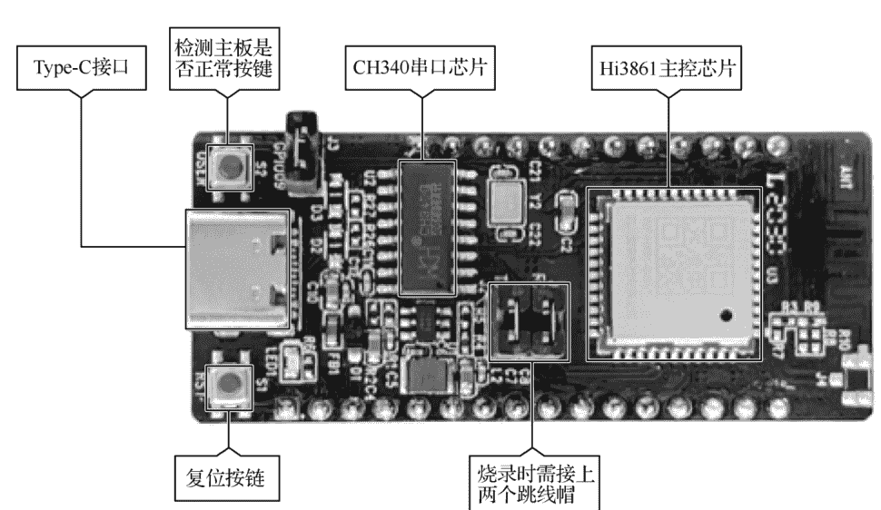

图7-1

##### 2.资源与约束

Hi3861 WLAN模组资源十分有限，整板共2MB FLASH、352KB RAM。在编写业务代码时，需注意资源使用效率。

##### 3.开发板规格

OpenHarmony基于Hi3861的开发板硬件架构与核心规格参数如表7-1所示。

表7-1

| 规格类型 | 规格清单 |
| :--- | :--- |
| 通用规格 | 1×1 2.4GHz 频段（ch1～ch14）<br>PHY 支持 IEEE 802.11b/g/n<br>MAC 支持 IEEE802.11 d/e/h/i/k/v/w<br>内置 PA 和 LNA，集成 TX/RX Switch、Balun 等<br>支持 STA 和 AP 形态，作为 AP 时最大支持 6 个 STA 接入<br>支持 WFA WPA/WPA2 personal、WPS2.0<br>支持与 BT/BLE 芯片共存的 2/3/4 线 PTA 方案<br>电源电压输入范围：2.3～3.6V<br>IO 电源电压支持 1.8V 和 3.3V<br>支持 RF 自校准方案<br>低功耗：<br>Ultra Deep Sleep 模式：5μA@3.3V<br>DTIM1：1.5mA@3.3V<br>DTIM3：0.8mA@3.3V |
| PHY 特性 | 支持 IEEE802.11b/g/n 单天线所有的数据速率<br>支持最大速率：72.2Mbps@HT20 MCS7<br>支持标准 20MHz 带宽和 5M/10M 窄带宽<br>支持 STBC<br>支持 Short-GI |
| MAC 特性 | 支持 A-MPDU，A-MSDU<br>支持 Blk-ACK<br>支持 QoS，满足不同业务服务质量需求 |
| CPU 子系统 | 高性能 32bit 微处理器，最大工作频率为 160MHz<br>内嵌 SRAM 352KB、ROM 288KB<br>内嵌 2MB FLASH |
| 外围接口 | 1 个 SDIO 接口、2 个 SPI 接口、2 个 I2C 接口、3 个 UART 接口、15 个 GPIO 接口、7 路 ADC 输入、6 路 PWM、1 个 I2S 接口（注：上述接口通过复用实现）<br>外部主晶体频率为 40MHz 或 24MHz |
| 其他信息 | 封装：QFN-32，5mm×5mm<br>工作温度：-40～+85℃ |

##### 4.OpenHarmony关键特性

OpenHarmony基于Hi3861提供了多种开放能力，提供的关键组件如表7-2所示。

表7-2

| 组件名 | 能力介绍 |
| :--- | :--- |
| WLAN 服务 | 提供 WLAN 服务能力。包括：station 和 hotspot 模式的连接、断开、状态查询等 |
| 模组外设控制 | 提供操作外设的能力。包括：I2C、I2S、ADC、UART、SPI、SDIO、GPIO、PWM、FLASH 等 |
| 分布式软总线 | 在 OpenHarmony 分布式网络中，提供设备被发现、数据传输的能力 |
| 设备安全绑定 | 提供在设备互联场景中，数据在设备之间安全流转的能力 |
| 基础加解密 | 提供密钥管理、加解密等能力 |
| 系统服务管理 | 系统服务管理基于面向服务的架构，提供了 OpenHarmony 统一化的系统服务开发框架 |
| 启动引导 | 提供系统服务的启动入口标识。在系统服务管理启动时，调用 bootstrap 标识的入口函数，并启动系统服务 |
| 系统属性 | 提供获取与设置系统属性的能力 |
| 基础库 | 提供公共基础库能力。包括：文件操作、KV 存储管理等 |
| DFX | 提供 DFX 能力。包括：流水日志、时间打点等 |
| XTS | 提供 OpenHarmony 生态认证测试套件的集合 |

鸿蒙采用分布式软总线技术，让多设备融合为“一个设备”，带来设备内和设备间高吞吐、低时延、高可靠的流畅连接体验，十分适合万物互联的场景，能够极大提高智能家居、车载、航空航天的设备运行效率，其核心功能模块与技术架构如图7-2所示。

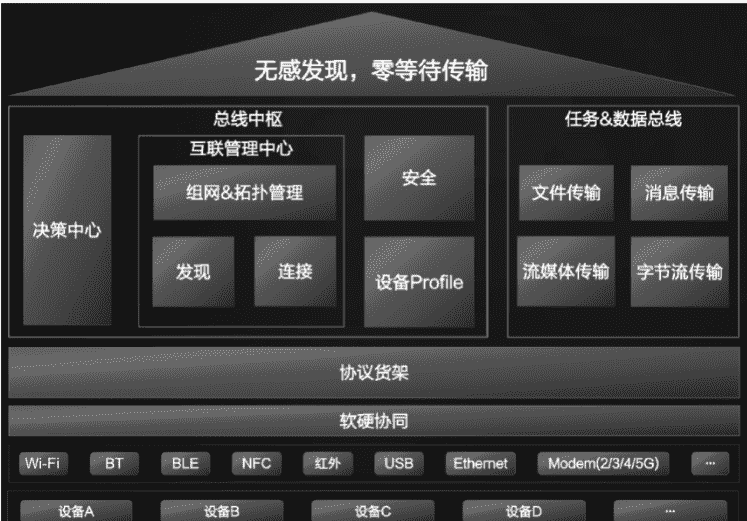

图7-2

### 7.4 搭建开发环境

#### 7.4.1 安装虚拟机环境

虚拟机（Virtual Machine）：通过软件模拟的，具有完整硬件系统功能的，运行在一个完全隔离环境中的，完整计算机系统。

本书以VirtualBox开发为例，以下为VirtualBox的安装链接以及扩展包链接：

https://www.virtualbox.org/wiki/Downloads

https://www.virtualbox.org/wiki/Downloads

#### 7.4.2 安装CH340芯片驱动

通常情况下，使用USB--Type-C数据线连接计算机与开发板时，计算机会自动下载CH340驱动，读者可以在自己电脑的设备管理器中查看是否出现CH340端口设备。

为确保开发板与计算机正常通信，需完成CH340芯片驱动的安装与验证，连接开发板的COM串口驱动（见图7-3）。


图7-3

若计算机未自动安装CH340芯片驱动，读者可根据自己的开发环境选择安装CH340芯片驱动。

#### 7.4.3 安装烧录工具

固件烧录工具，适用于将选定的固件写入设备的闪存中。针对南向开发场景中高速固件烧录需求，HiBurn工具凭借其高波特率与高效写入特性成为核心选择，其烧录页面及其配置如图7-4所示。

HiBurn是烧录工具，下载速度更快，最大波特率可以设置到3000000，但HiBurn无法保存历史的串口参数，每次使用时需要重新配置。


图7-4

#### 7.4.4 安装Ubuntu

Ubuntu是一个基于Linux的开源操作系统，由Canonical提供支持。它以简洁、易用和稳定性著称，适合个人用户、开发者以及企业环境。

建议安装20.04版本的Ubuntu桌面系统。Ubuntu 20.04.6LTS（Focal Fossa）版本的下载页面如图7-5所示。

# Ubuntu 20.04.6 LTS (Focal Fossa)

# Select an image

Ubuntu is distributed on three types of images described below.

| Desktop image | 64-bit PC (AMD64) desktop image |
|---|---|
| The desktop image allows you to try Ubuntu without changing your computer at all, and at your option to install it permanently later. This type of image is what most people will want to use. You will need at least 1024MiB of RAM to install from this image. | Choose this if you have a computer based on the AMD64 or EM64T architecture (e.g., Athlon64, Opteron, EM64T Xeon, Core 2). Choose this if you are at all unsure. |
| Server install image | 64-bit PC (AMD64) server install image |
| The server install image allows you to install Ubuntu permanently on a computer for use as a server. It will not install a graphical user interface. | Choose this if you have a computer based on the AMD64 or EM64T architecture (e.g., Athlon64, Opteron, EM64T Xeon, Core 2). Choose this if you are at all unsure. |

图7-5

#### 7.4.5 VirtualBox安装Ubuntu

打开之前下载好的VirtualBox，选择新建图标，如图7-6所示。


图7-6

自定义一个名称并选择该虚拟机所处的文件夹，选择刚才下载好的Ubuntu 20.04系统作为虚拟光盘，如图7-7所示。

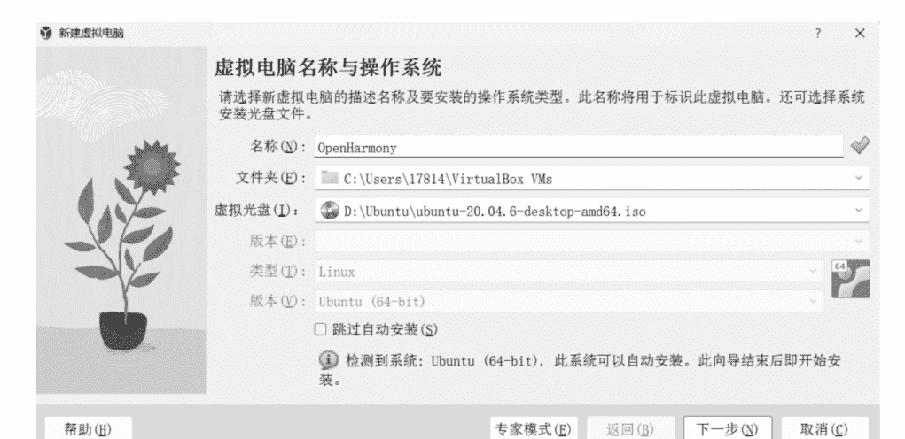

图7-7

选择适合的虚拟机配置，配置2～4G的内存、4核以上的CPU，如图7-8所示。

选择创建虚拟硬盘，最好预留100GB的磁盘空间，避免后期添加OpenHarmony的源码和编译源码后出现磁盘空间不足的情况，如图7-9所示。

完成基础虚拟机配置后，考虑到需要主机与虚拟机连接，在设置中更改网络为桥接网卡，如图7-10所示。

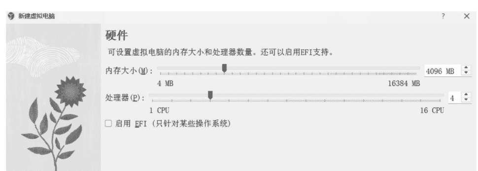

图7-8

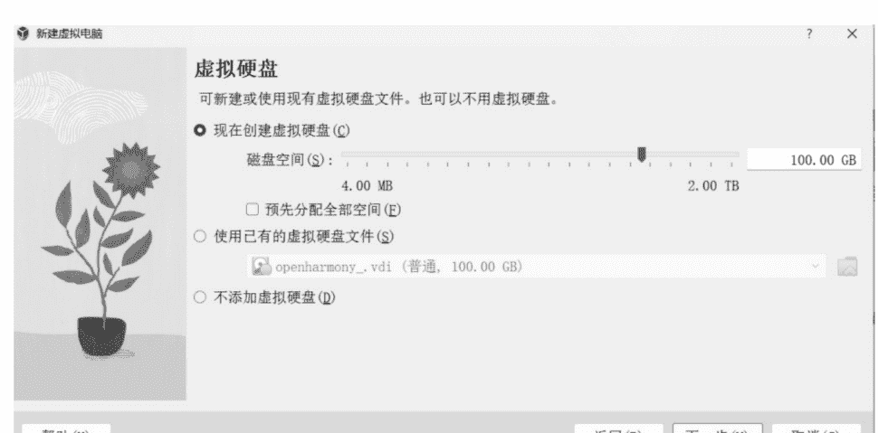

图7-9


图7-10

接下来，我们进入虚拟机进行第一次配置（初次进入虚拟机并完成配置可能需要较长时间，请耐心等待）。进入虚拟机后，选择中文语言（如果由于窗口过小，无法查看完整页面，可以按住Alt+F7移动窗口，以便查看最下面的按钮）。然后，选择“正常安装”并设置默认时区为“上海”。

输入一个名称以设置这台虚拟机，并为其设置一个相对简单的密码（由于后续可能需要多次输入密码，建议设置一个既简单又容易记住的密码）。首次安装可能会花费较长时间，请耐心等待。请按照图7-11所示设置主机名和密码等信息。


图7-11

安装完成重启后，为了提高开发效率以及虚拟机的使用便利，我们可以给虚拟机安装VirtualBox增强功能。在安装增强功能前最好先更新一下软件源：

```
sudo apt-get update

sudo apt-get install gcc make perl
```

更新操作如图7-12所示。

```
saint@saint-VirtualBox:~/桌面$ sudo apt-get update
[sudo] saint 的密码：
对不起，请重试。
[sudo] saint 的密码：
命中:1 http://mirrors.tuna.tsinghua.edu.cn/ubuntu focal InRelease
命中:2 http://mirrors.tuna.tsinghua.edu.cn/ubuntu focal-updates InRelease
命中:3 http://mirrors.tuna.tsinghua.edu.cn/ubuntu focal-backports InRelease
获取:4 http://security.ubuntu.com/ubuntu focal-security InRelease [128 kB]
获取:5 http://security.ubuntu.com/ubuntu focal-security/main amd64 DEP-11 Metadata [65.3 kB]
获取:6 http://security.ubuntu.com/ubuntu focal-security/restricted amd64 DEP-11 Metadata [212 B]
获取:7 http://security.ubuntu.com/ubuntu focal-security/universe amd64 DEP-11 Metadata [160 kB]
获取:8 http://security.ubuntu.com/ubuntu focal-security/multiverse amd64 DEP-11 Metadata [940 B]
已下载 354 kB，耗时 12秒 (28.9 kB/s)
正在读取软件包列表... 完成
saint@saint-VirtualBox:~/桌面$ sudo apt-get install gcc make perl
正在读取软件包列表... 完成
正在分析软件包的依赖关系树
正在读取状态信息... 完成
将会同时安装下列软件：
  binutils binutils-common binutils-x86-64-linux-gnu cpp-9 gcc-10-base gcc-9
  gcc-9-base libasan5 libatomic1 libbinutils libc-dev-bin libc6 libc6-dbg
  libc6-dev libcc1-0 libcrypt-dev libctf-nobfd0 libctf0 libgcc-9-dev
```

图7-12

更新完成后，可以在VirtualBox的设备中选择安装增强功能，并设置拖放和共享粘贴板为双向，便于主机与虚拟机之间的交互，如图7-13所示。

#### 7.4.6 配置编译环境

##### 1. 安装必要的库和工具

```
sudo apt-get install build-essential gcc g++ make zlib* libffi-dev
sudo apt-get install e2fsprogs pkg-config flex bison perl bc openssl libssl-dev
libelf-dev libc6-dev-amd64 binutils binutils-dev libdwarf-dev u-boot-tools
mtd-utils gcc-arm-linux-gnueabi cpio device-tree-compiler
```

##### 2. 配置Python

- 设置默认Python解释器：

```
python 和 python3 软链接为 python3.8
sudo update-alternatives --install /usr/bin/python python /usr/bin/python3.8 1
sudo update-alternatives --install /usr/bin/python3 python3 /usr/bin/python3.8 1
python -version
```

- 安装Python包管理工具：

```
sudo apt install python3-pip
```

- 配置pip软件包更新源：

```
mkdir ~/.pip
pip3 config set global.index-url https://mirrors.huaweicloud.com/repository/pypi/simple
pip3 config set global.trusted-host mirrors.huaweicloud.com
pip3 config set global.timeout 120
```

##### 3. 安装编译工具环境

1) 安装gn
(1) 打开Linux编译服务器终端。
(2) 下载gn工具。
(3) 解压gn安装包至~/gn路径下：tar -xvf gn.1523.tar -C ~/。
(4) 设置环境变量：vim ~/.bashrc，新增：export PATH=~/gn:$PATH。
(5) 生效环境变量：source ~/.bashrc。

2) 安装ninja
(1) 打开Linux编译服务器终端。
(2) 下载ninja工具。
(3) 解压ninja安装包至~/ninja路径下，即tar -xvf ninja.1.10.0.tar -C ~/。
(4) 设置环境变量：vim ~/.bashrc，新增：export PATH=~/ninja:$PATH。
(5) 生效环境变量：source ~/.bashrc。

3) 安装gcc_riscv32（WLAN模组类编译工具链）
(1) 打开Linux编译服务器终端。
(2) 下载gcc_riscv32工具。
(3) 解压gcc_riscv32安装包至/opt/gcc_riscv32路径下：tar -xvf gcc_riscv32-linux-7.3.0.tar.gz -C ~/。
(4) 设置环境变量：vim ~/.bashrc，新增：export PATH=~/gcc_riscv32/bin:$PATH。
(5) 生效环境变量：source ~/.bashrc。
(6) 在Shell命令行中输入riscv32-unknown-elf-gcc -v，如果能正确显示编译器版本号，表明编译器安装成功。

4) 安装Scons

SCons是一个开源的软件构建工具，使用Python编写，用于自动化软件构建过程。它替代了如Make和CMake等工具，采用Python脚本进行配置。

5) 配置过程
(1) 打开Linux编译服务器终端。
(2) 安装SCons安装包（需root/sudo权限安装）。
(3) 运行命令：sudo apt-get install scons -y。

如果软件源中无法找到安装包，请按以下步骤处理。
①下载源码包（下载路径：https://scons.org/pages/download.html，推荐SCons版本是3.0.4+）。
②解压源码包到任意目录。
③安装源码包。进入解压目录，运行命令sudo python3 setup.py install（需root/sudo权限安装），等待安装完毕。
④输入命令scons -v，查看是否安装成功。

##### 4. 安装Samba服务

Samba是一个在Linux和Unix系统上实现SMB/CIFS网络协议的软件，它使这些系统能够与Windows系统共享文件和打印机。

- 安装：
sudo apt install samba.
- 配置文件：sudo gedit /etc/samba/smb.conf

在配置文件的最后添加图7-15中所示的内容。

- 指定共享账号：sudo smbpasswd -a username。

username为自己虚拟机的账号名。

##### 5. 获取源码的必要工具和配置

- 安装git和git-lfs：

```
sudo apt install git-lfs
```

- 安装repo和request：

```
wget https://gitee.com/oschina/repo/raw/fork_flow/repo-py3
sudo mv repo-py3 /usr/local/bin/repo
sudo chmod a+x /usr/local/bin/repo
pip install requests
```

#### 7.4.7 获取OpenHarmony源码

在Ubuntu中打开命令行执行以下命令获取OpenHarmony源码：

```
mkdir -p ~/openharmony/1.1.3
cd ~/openharmony/1.1.3
repo init -u https://gitee.com/openharmony/manifest.git -b refs/tags/OpenHarmony-v1.1.3-LTS --no-repo-verify
repo sync -c
repo forall -c 'git lfs pull'
```

表7-3详细介绍了源码目录中各目录的具体含义，供读者参考。

### 表7-3

| 目录名 | 描述 |
|---|---|
| applications | 应用程序样例，包括 camera 等 |
| base | 基础软件服务子系统集&硬件服务子系统集 |
| build | 组件化编译、构建和配置脚本 |
| docs | 说明文档 |
| domains | 增强软件服务子系统集 |
| drivers | 驱动子系统 |
| foundation | 系统基础能力子系统集 |
| kernel | 内核子系统 |
| prebuilts | 编译器及工具链子系统 |
| test | 测试子系统 |
| third_party | 开源第三方组件 |
| utils | 常用的工具集 |
| vendor | 厂商提供的软件 |
| build.py | 编译脚本文件 |

#### 7.4.8 编译OpenHarmony源码

连接开发板后，进入源码的顶层目录，打开终端并输入hb set以设置目标开发板。如图7-16所示，系统提示“[OHOS INFO]Input code path: ”时，直接按回车键以使用当前目录。接着，选择wifiiot_hispark_pegasus。

常用命令如下。

1. hb build：增量编译。
2. hb build -f：全量编译。

编译生成的文件将位于 out/hispark_pegasus/wifiiot_hispark_pegasus/Hi3861_wifiiot_app_allinone.bin路径下。

#### 7.4.9 安装HiBurn

用户可以前往51CTO的鸿蒙开发者社区下载并安装HiBurn。其下载链接为https://ost.51cto.com/resource/148。

HiBurn下载工具的界面截图，如图7-17所示。

#### 7.4.10 烧录代码

进入虚拟机并找到源码地址，选择图7-18中所示的文件。

修改烧录设置，在左上角的Setting标签页中将波特率设置为2000000，并选择开发板的串口（通常为COM3），勾选Auto burn，如图7-19所示。

最后进行代码烧录，按照以下步骤操作。

1. 在Hiburn中选择Connect。
2. 在开发板上按下“Reset”按钮，等待烧录过程完成。
3. 烧录完成后，选择Disconnect以结束烧录。

至此，开发板的第一次烧录已顺利完成。

#### 7.4.11 安装MobaXterm

MobaXterm，又名MobaXVT，是一款增强型终端、X服务器和UNIX命令集（GNU/Cygwin）工具箱。

为了提升跨平台开发与远程设备管理的效率，MobaXterm凭借其集成化的终端工具链和便携特性，成为了推荐的选择。MobaXterm官网如图7-20所示。

点击“Download”按钮下载免费的便携版。下载完成后，MobaXterm不会自动生成快捷方式，读者可以根据需求自行创建快捷方式。进入MobaXterm后，点击New session，选择创建新的会话，如图7-21所示。

这里我们接入开发板，点击Serial图标，根据自身情况选择串口并设置速率为115200创建会话，如图7-22所示。

#### 7.4.12 确定目录结构

开发者在编写业务时，务必先在./applications/sample/wifi-iot/app路径下新建一个目录（或一套目录结构），用于存放业务源码文件。例如，在app下新建文件夹HelloWorld，其中hello.c为编写好的目标代码，BUILD.gn为编译脚本，具体规划目录结构如下。

```
L___ applications
L___ sample
L___ wifi-iot
L___ app
|   L___ HelloWorld
|   |   L___ hello.c
|   L___ BUILD.gn
L___ BUILD.gn
```

hello.c文件中的代码如图7-23所示。

BUILD.gn文件中的内容如图7-24所示。

```
// 标准输入输出
#include <stdio.h>
#include "ohos_init.h"

// 定义一个函数，输出hello world
void hello(void)
{
    printf("Hello world!\r\n");
}

SYS_RUN(hello);
```

图7-23

```
# 做成静态库，"hello_world"是库名称，最终被编译为"libhello_world.a"
static_library("HelloWorld") {
  # 源文件
  sources = [ "hello.c" ]
  # include目录
  include_dirs = [
    # 包括"ohos_init.h"等头文件
    # "//"表示源码根目录，后面是目录名称
    "//utils/native/lite/include",
  ]
}
```

图7-24

#### 7.4.13 技术架构

整体遵从分层设计，从下向上依次为内核层、系统服务层、框架层和应用层。

系统功能按照“系统＞子系统＞组件”逐级展开，支持根据实际需求裁剪非必要组件。

OpenHarmony系统服务层由四个子系统组成：系统基本能力子系统集、基础软件服务子系统集、增强软件服务子系统集、硬件服务子系统集，如图7-25所示。

### 7.5 内核编程接口及I/O接口

#### 7.5.1 线程管理

Hi3861使用的是RISC-V架构，支持CMSIS标准，可以使用CMSIS的API来创建线程。OpenHarmony源码中关于线程的API如表7-4所示。参考源码的API接口我们可以编写一个关于Thread的控制线程，如图7-26所示。

### 表7-4

| API 名称 | 说 明 |
| :--- | :--- |
| osThreadNew | 创建一个线程并将其加入活跃线程组中 |
| osThreadGetName | 返回指定线程的名字 |
| osThreadGetId | 返回当前运行线程的线程 ID |
| osThreadGetState | 返回当前线程的状态 |
| osThreadSetPriority | 设置指定线程的优先级 |
| osThreadGetPriority | 获取当前线程的优先级 |
| osThreadYield | 将运行控制转交给下一个处于 READY 状态的线程 |
| osThreadSuspend | 挂起指定线程的运行 |

```
static void ThreadTestTask(void)
{
    // 定义线程属性
    osThreadAttr_t attr;
    // 线程名
    attr.name = "LED_Task";
    // 线程属性位
    attr.attr_bits = 0U;
    // 线程控制块的内存初始地址，默认为系统自动分配
    attr.cb_mem = NULL;
    // 线程控制块的内存大小
    attr.cb_size = 0U;
    // 线程栈的内存初始地址，默认为系统自动分配
    attr.stack_mem = NULL;
    // 线程栈的内存大小
    attr.stack_size = 1024;
    attr.priority = osPriorityNormal;

    if (osThreadNew((osThreadFunc_t)LED_Task, "This is a test thread.", &attr) == NULL)
    {
        printf("[ThreadTestTask] Falied to create LED_Task!\n");
    }
}

// 让ThreadTestTask函数以“优先级2”在系统启动过程的“阶段8. application-layer feature”阶段执行。
APP_FEATURE_INIT(ThreadTestTask);
```

图7-26

编写好线程之后，我们可以将其封装为一个进程的入口函数：

```
// 最后使用宏将该控制线程以优先级二在系统过程中启动
APP_FEATURE_INIT(ThreadTestTask);
```

通过这段代码，我们成功将ThreadTestTask函数加入进程。在不溢出线程栈的情况下，ThreadTestTask函数可以被替换成任意一个函数。读者可以根据需求自行尝试编写并修改线程函数，以及调整调用的函数。

#### 7.5.2 等待时间

在操作系统中，一个线程处理完成后，通常需要等待一段时间才能进行进程调度，此外，下一个线程从就绪态到运行态也需要一定的时间。除此之外，在实际应用中，我们可能需要执行如每5秒钟测一次温湿度等任务，这时就需要利用等待时间来实现周期性任务。

系统时钟：Tick或时标是由定时器/计数器产生的输出脉冲触发中断产生的信号。操作系统会对Tick进行计数，通常Tick被定义为整数或长整数。

时钟周期是由定时器/计数器产生的输出脉冲的周期，即两个Tick间隔的时间长度。

对于Hi3861V100模组来说，每秒钟会产生100个Tick，每个Tick的时钟周期为10ms。注意：时钟周期（Cycle）与Tick有区别。Tick是输出脉冲触发中断，在特定时间点上产生的标记；而时钟周期是两个Tick之间的时间间隔。延时的API接口如表7-5所示。

### 表7-5

| API 名称 | 说明 |
| :--- | :--- |
| osDelay | 等待指定的 Ticks |
| osDelayUntil | 等待到指定的 Tick |

当线程执行完osDelay后，它将从运行态变为阻塞态。等待时间结束后，线程会重新进入就绪态。如果该线程始终处于最高优先级，那么一旦等待时间结束，该线程会立即进入运行态。

osDelay（n）函数用于从当前时间开始等待n个Tick。在时间精度要求不高的情况下，通常可以认为osDelay（n）=n×10ms。

OpenHarmony线程调度机制通过osDelay实现精准的延时控制，其状态切换逻辑与时间计算规则如图7-27所示。

因此，我们可以编写一个函数，使其每隔3秒钟读取一次可燃气体的浓度：

```
While(1){
    ReadGas();
    osDelay(300);
}
```

如果这个函数没有适当的等待时间，运行程序时操作系统内部可能会出现错误或其他异常情况。

结合以上讲解的线程概念，我们可以完整地编写一个用于读取可燃气体浓度的程序。首先，我们将获取可燃气体数据的功能封装成一个函数Gas。在这个函数中，我们每隔3秒钟获取一次可燃气体的浓度值。然后，编写线程控制函数。最后，将线程控制函数写入系统，从而完成整个获取可燃气体浓度值的程序，如图7-28所示。

#### 7.5.3 GPIO

##### 1. GPIO介绍

GPIO全称为General Purpose Input Output（通用输入输出），也被称为总线扩展器。GPIO接口由引脚和功能寄存器组成，不同架构的GPIO，封装方式不同，其所使用的引脚数和寄存器数也不同，具体的实现细节可以参考芯片手册中的GPIO部分。

GPIO的主要作用是控制连接在该GPIO口上的外设。我们通常通过查阅原理图，找到当前板子上GPIO接口所引出的引脚位置或排针位置，并将外设连接到相应的引脚上。通过GPIO，我们可以与外设进行交互与控制。在驱动层，通过读写GPIO接口中的功能寄存器来改变连接在GPIO上的外设的状态。

Hi3861芯片拥有15个GPIO引脚，芯片内部集成了GPIO模块，用于实现芯片引脚上的数字I/O操作。

OpenHarmony基于Hi3861芯片的GPIO模块提供了灵活的外设交互控制能力，其引脚功能定义、寄存器操作逻辑与物理布局的映射关系如图7-29所示。


图7-29

##### 2. GPIO API接口

Hi3861芯片具有较多的外设接口，但由于引脚数量较少，部分引脚具有多个功能。因此，在使用这些引脚时，需要对其功能进行配置。

OpenHarmony基于Hi3861芯片的GPIO接口，提供了硬件抽象层（HAL）与多功能配置（SDK）双维度的开发支持。其关键API功能定义及调用规则，如表7-6和表7-7所示。

表7-6

| API 名称 | 说 明 |
| :--- | :--- |
| unsigned int IoTGpioInit(unsigned int id) | 模块初始化 |
| unsigned int IoTGpioSetDir(unsigned int id, IotGpioDir dir) | 设置 GPIO 引脚方向。id 参数用于指定引脚，dir 参数用于指定输入或输出 |
| unsigned int IoTGpioSetOutputVal(unsigned int id, IotGpioValue val) | 设置 GPIO 引脚的输出状态。id 参数用于指定引脚，val 参数用于指定高电平或低电平 |
| unsigned int IoTGpioDeinit(unsigned int id) | 解除 GPIO 模块初始化 |

表7-7

| API 名称 | 说 明 |
| :--- | :--- |
| hi_u32 hi_io_set_func(hi_io_name id, hi_u8 val) | 设置引脚功能。id 参数用于指定引脚，val 用于指定引脚功能 |

##### 3. GPIO输出高低电平

GPIO接口主要有以下三种工作模式。

输入模式：用于读取外部信号。

输出模式：用于驱动外部设备。

复用功能：部分GPIO支持复用为I2C、UART、PWM等外设接口。

当GPIO处于输出模式时，它能够输出3.3V的高电平。但需要注意的是，单个GPIO引脚的最大驱动电流为4mA，这使得它适合驱动如LED灯等低功耗的设备，无法驱动电机等高功耗的设备。

我们可以利用GPIO驱动开发板上自带的LED灯，该LED灯连接在GPIO 09引脚上。LED灯默认接入高电平，因此当我们给GPIO 09引脚输出低电平时，LED灯就会点亮。为了实现这一功能，我们首先需要初始化该接口为GPIO接口，再将其设置为输出模式，并输出低电平，LED灯便会点亮。

点亮LED灯的程序如图7-30所示。

```c
#define LED_TASK_GPIO 9

static void LedTask(void *arg)
{
    (void)arg;
    // 初始化GPIO模块
    IoTGpioInit(LED_TASK_GPIO);
    hi_io_set_func(LED_TASK_GPIO, HI_IO_FUNC_GPIO_9_GPIO);
    IoTGpioSetDir(LED_TASK_GPIO,IOT_GPIO_DIR_OUT);
    while (1)
    {
        IoTGpioSetOutputVal(LED_TASK_GPIO,IOT_GPIO_VALUE0);
        // 等待0.5秒。单位是10ms。
        osDelay(50);
        // 输出高电平，熄灭LED。
        IoTGpioSetOutputVal(LED_TASK_GPIO,IOT_GPIO_VALUE1);
        osDelay(100);
    }
}

static void LedEntry(void)
{
    osThreadAttr_t attr;
    attr.name = "LedTask";
    attr.stack_size = 4096;
    attr.priority = osPriorityNormal;
    if (osThreadNew(LedTask, NULL, &attr) == NULL)
    {
        printf("[LedDemo] Create LedTask failed!\n");
    }
}
// ohos_init.h 中定义的宏，让函数在系统启动时执行
SYS_RUN(LedEntry);
```

图7-30

#### 7.5.4 ADC

模拟-数字转换器（Analog-to-Digital Converter, ADC）是一种将连续变化的模拟信号转换为离散数字信号的设备。通过这种转换，模拟信号可以被数字电路处理，这一过程被称为数字信号处理。

##### 1. ADC接口

通道数量：支持多路ADC输入，具体数量取决于封装型号。

分辨率：12位分辨率，可识别4096个离散电平值。

采样速率：最高采样速率为1Msps，能够满足大多数实时数据采集需求。

输入电压范围：0～3.3V，兼容常见传感器的输出电平。

低功耗设计：支持休眠模式，适用于电池供电的应用场景。

Hi3861的ADC通道共有7个，其中可以复用为ADC通道的GPIO如表7-8所示。

表7-8

| Pin | 引脚名称 | 复用信号 |
| :--- | :--- | :--- |
| 6 | GPIO_04 | ADC1 |
| 17 | GPIO_05 | ADC2 |
| 19 | GPIO_07 | ADC3 |
| 27 | GPIO_09 | ADC4 |
| 29 | GPIO_11 | ADC5 |
| 30 | GPIO_12 | ADC0 |
| 31 | GPIO_13 | ADC6 |

海思的API接口位于device\hisilicon\hispark_pegasus\sdk_liteos\include\hi_adc.h位置，用户可自行查看源码。

##### 2. 获取传感器输出电压值

Hi3861 ADC接口获得的ADC值与电压值之间的转换公式为VX=data×1.8×4/4096。其中，data为ADC值，VX为电压值。根据这个公式，我们可以先获取传感器的ADC值，然后利用公式转换为电压值。接着，参考传感器芯片手册中的电压与实际环境中真实值之间的关系，进一步获得所需的物理量。

ADC读取电压信号的实现代码如图7-31所示。

```c
static float ConvertToVoltage(unsigned short data)
{
    return (float)data * 1.8 * 4 / 4096;
}

// 获取可燃气体浓度
float GetGasLevel()
{
    // 用于接收MQ-2可燃气体传感器的值
    unsigned short data = 0;

    // 读取ADC5通道的值
    if (hi_adc_read(GAS_SENSOR_CHAN_NAME, &data, HI_ADC_EQU_MODEL_4,
                    HI_ADC_CUR_BAIS_DEFAULT, 0) == HI_ERR_SUCCESS)
    {
        float Vx = ConvertToVoltage(data);
```

图7-31

同理，我们可以利用ADC接口获取传感器的AO（模拟输出）口的数值，并将其转换为实际物理值。例如，基于电压测量的氧气值获取实现代码如图7-32所示。

```c
float GetOxygenLevel ()
{
    unsigned short data = 0;//获取数据

    if (hi_adc_read(OXYGEN_SENSOR_CHAN_NAME,&data,HI_ADC_EQU_MODEL_4,
                    HI_ADC_CUR_BAIS_DEFAULT,0)==HI_ERR_SUCCESS)
    {
        float VX = ConvertToVoltage(data);//电压

        float oxygen_sensor=VX*53.59-3.2129;
        printf("ADC_VALUE=%d VX=%f oxygen_sensor=%f\n",data,VX,oxygen_sensor);
        return oxygen_sensor;
    }

    return 0;//读取失败
}
```

图7-32

#### 7.5.5 PWM

脉宽调制（Pulse Width Modulation，PWM）是一种通过调节信号的占空比来控制设备的技术。海思Hi3861开发板内置多路PWM输出，广泛应用于电机控制、LED调光、音频生成等多个场景。

##### 1. PWM接口

通道数量：支持多路PWM输出，具体数量取决于封装型号。

分辨率：16位分辨率，支持65536级占空比调节。

频率范围：1Hz～1MHz，能够满足多种应用需求。

输出模式：支持单脉冲、连续脉冲、互补输出等多种模式。

低功耗设计：支持休眠模式，适用于电池供电场景。

OpenHarmony基于Hi3861芯片的PWM模块提供高精度脉宽调制能力，其通道配置、复用引脚映射及核心参数特性如表7-9所示。

表7-9

| Pin | 引脚名称 | 复用信号 |
|---|---|---|
| 2 | GPIO_00 | PWM3_OUT |
| 3 | GPIO_01 | PWM4_OUT |
| 4 | GPIO_02 | PWM2_OUT |
| 5 | GPIO_03 | PWM5_OUT |
| 6 | GPIO_04 | PWM1_OUT |
| 17 | GPIO_05 | PWM2_OUT |
| 18 | GPIO_06 | PWM3_OUT |
| 19 | GPIO_07 | PWM0_OUT |
| 20 | GPIO_08 | PWM1_OUT |
| 27 | GPIO_09 | PWM0_OUT |
| 28 | GPIO_10 | PWM1_OUT |
| 29 | GPIO_11 | PWM2_OUT |
| 30 | GPIO_12 | PWM3_OUT |
| 31 | GPIO_13 | PWM4_OUT |
| 32 | GPIO_14 | PWM5_OUT |

OpenHarmony基于Hi3861芯片的PWM控制接口提供从GPIO配置到信号输出的全流程开发支持。其核心API功能定义、参数规则及典型应用场景如表7-10所示。

表7-10

| API 名称 | 功能描述 | 输入参数 | 用途 |
| :--- | :--- | :--- | :--- |
| IoTGpioInit(HI_IO_NAME_GPIO_9) | 初始化 GPIO 模块，使其能够进行基本操作。GPIO 是数字电路中的核心接口，用于对外设（如 LED、传感器等）的控制 | HI_IO_NAME_GPIO_9：表示 GPIO9 引脚的名称 | 在初始化完成后，可以通过 GPIO 进行读写或配置操作 |
| IoTGpioSetDir(HI_IO_NAME_GPIO_9, IOT_GPIO_DIR_OUT) | 设置 GPIO9 引脚的方向为输出模式，允许外部设备连接并通过它进行通信 | HI_IO_NAME_GPIO_9：GPIO9 引脚的名称<br>IOT_GPIO_DIR_OUT：表示输出方向 | 确保引脚能够正确地接收或发送信号，完成与外设的通信 |
| IoTPwmStart(HI_PWM_PORT_PWM0, 60, 5000) | 启动 PWM 信号输出，并设置占空比和频率 | HI_PWM_PORT_PWM0：PWM0 通道的名称<br>50：占空比，表示高电平持续时间占总周期的百分比<br>4000：PWM 信号的频率，单位为 Hz | 开始输出 PWM 信号，控制外设（如蜂鸣器）的工作状态 |

##### 2. PWM控制信号

PWM信号通过改变占空比和频率来调节输出信号。以下示例展示了通过改变PWM输出信号来控制蜂鸣器发出不同频率和响度的声音，如图7-33所示。

```c
// 初始化GPIO模块
IoTGpioInit(HI_IO_NAME_GPIO_9);

// 设置GPIO9为PWM0输出
hi_io_set_func(HI_IO_NAME_GPIO_9, HI_IO_FUNC_GPIO_9_PWM0_OUT);

// 设置GPIO9为输出模式（引脚方向为输出）。
IoTGpioSetDir(HI_IO_NAME_GPIO_9, IOT_GPIO_DIR_OUT);

// 初始化PWM模块
IoTPwmInit(HI_PWM_PORT_PWM0);

// 开始输出PWM信号（蜂鸣器开始鸣叫），占空比60%，频率5000Hz
// OpenHarmony的HAL接口
IoTPwmStart(HI_PWM_PORT_PWM0, 60, 5000);
```

图7-33

同理，我们可以通过迭代改变占空比来实现LED灯的调光。下面是一个简单的呼吸灯函数的实现，如图7-34所示。

```c
for (int i = 1; i <= 4096; i *= 2)
{
    hi_pwm_start(HI_PWM_PORT_PWM1, i, 64000);
    usleep(50 * 1000);
    // 停止输出PWM信号
    hi_pwm_stop(HI_PWM_PORT_PWM1);
}

for (int i = 4096; i >= 1; i /= 2)
{
    // 开始输出PWM信号，实际占空比i/64000，实际频率2500Hz
    hi_pwm_start(HI_PWM_PORT_PWM1, i, 64000);
    usleep(50 * 1000);
    // 停止输出PWM信号
    hi_pwm_stop(HI_PWM_PORT_PWM1);
}
```

图7-34

#### 7.5.6 I2C

内部集成电路（Inter-Integrated Circuit, I2C）总线是一种由飞利浦（Philips）公司开发的串行总线。它由两条串行数据线组成：一根数据线（SDA）和一根时钟线（SCL）。这两条线都需要上拉电阻。I2C总线支持多个I2C设备的连接，每个设备都有一个唯一的地址用于识别。在同一时刻，总线只能有一个主设备，其他设备为从设备。通常，MCU作为主设备进行控制，而外设则作为从设备进行响应。

##### 1. 起始条件和停止条件

起始条件：当SCL为高电平时，SDA从高电平向低电平切换。

停止条件：当SCL为高电平时，SDA从低电平向高电平切换。

##### 2. 数据的有效性

I2C信号是电平采样信号。规定在SCL的高电平周期内，SDA上的数据保持稳定；而在SCL的低电平周期内，SDA数据可以发生变化。

###### 1) I2C API接口

多路支持：支持多个I2C控制器。

速率模式：支持标准模式（100kHz）、快速模式（400kHz）、高速模式（1MHz，需硬件支持）。

主从模式：支持主设备（Master）和从设备（Slave）模式。

中断驱动：支持中断通知，减少CPU轮询开销。

低功耗设计：支持休眠模式，适用于电池供电设备。

OpenHarmony基于Hi3861芯片的I2C接口提供多模式通信与硬件资源复用能力，其控制器特性、引脚配置规则及核心功能参数如表7-11所示。

表7-11

| Pin | 引脚名称 | 复用信号 |
|---|---|---|
| 2 | GPIO_00 | I2C1_SDA |
| 3 | GPIO_01 | I2C1_SCL |
| 5 | GPIO_03 | I2C1_SDA |
| 6 | GPIO_04 | I2C1_SCL |
| 27 | GPIO_09 | I2C0_SCL |
| 28 | GPIO_10 | I2C0_SDA |
| 31 | GPIO_13 | I2C0_SDA |
| 32 | GPIO_14 | I2C0_SCL |

OpenHarmony基于Hi3861芯片的I2C接口提供多模式通信与低功耗硬件支持，其通道复用规则、速率配置参数及核心API功能定义如表7-12所示。

## 表7-12

| API 名称 | 输入参数 | 功能 |
| :--- | :--- | :--- |
| unsigned int I2cInit(WifiIotI2cIdx id, unsigned int baudrate) | id: I2C 设备 ID<br>baudrate: I2C 频率 | 用指定的频率初始化 I2C 设备 |
| unsigned int I2cWrite(WifiIotI2cIdx id, unsigned short deviceAddr, const WifiIotI2cData *i2cData) | id: I2C 设备 ID<br>deviceAddr: I2C 设备地址<br>i2cData: 表示写入的数据 | 将数据写入 I2C 设备 |
| unsigned int I2cRead(WifiIotI2cIdx id, unsigned short deviceAddr, const WifiIotI2cData *i2cData) | id: I2C 设备 ID<br>deviceAddr: I2C 设备地址<br>i2cData: 表示要读取的数据指向的指针 | 从 I2C 设备读取数据。读取的数据将保存到 i2cData 指定的地址 |
| unsigned int I2cSetBaudrate(WifiIotI2cIdx id, unsigned int baudrate) | id: I2C 设备 ID<br>baudrate: I2C 频率 | 为 I2C 设备设置频率 |

###### 2) I2C通信

I2C总线是一种多主机结构的总线，连接在I2C总线上的器件可分为主机和从机。下面以ADXL345传感器为例，编写一个I2C通信示例程序。

（1）硬件层面：ADXL345有SPI和I2C两种驱动方式，当CS引脚接高电平时，ADXL345处于I2C模式。若ALT ADDRESS引脚接高电平，I2C地址为0x53，此时0x3A写入、0x3B读取。若ALT ADDRESS引脚接地，可以选择备用I2C地址。

（2）从软件角度来讲：首先，向ADXL345的电源控制寄存器（0x2D）写入0x08，以将测量位设置为1，启动传感器的数据读取功能。执行此操作后，必须设置适当的延时时间，确保传感器配置完成并正常启动。传感器启动后，可以参考芯片手册，进一步设置量程和数据输出格式。部分寄存器地址的功能介绍如图7-35所示。

## 寄存器映射

表19
| 地址 | | 名称 | 类型 | 复位值 | 描述 |
|---|---|---|---|---|---|
| 十六进制 | 十进制 | | | | |
| 0x00 | 0 | DEVID | R | 11100101 | 器件ID |
| 0x01 to 0x1C | 1 to 28 | 保留 | | | 保留，不要操作 |
| 0x1D | 29 | THRESH_TAP | R/W | 00000000 | 敲击阈值 |
| 0x1E | 30 | OFSX | R/W | 00000000 | X轴偏移 |
| 0x1F | 31 | OFSY | R/W | 00000000 | Y轴偏移 |
| 0x20 | 32 | OFSZ | R/W | 00000000 | Z轴偏移 |
| 0x21 | 33 | DUR | R/W | 00000000 | 敲击持续时间 |
| 0x22 | 34 | Latent | R/W | 00000000 | 敲击延迟 |
| 0x23 | 35 | Window | R/W | 00000000 | 敲击窗口 |
| 0x24 | 36 | THRESH_ACT | R/W | 00000000 | 活动阈值 |
| 0x25 | 37 | THRESH_INACT | R/W | 00000000 | 静止阈值 |
| 0x26 | 38 | TIME_INACT | R/W | 00000000 | 静止时间 |
| 0x27 | 39 | ACT_INACT_CTL | R/W | 00000000 | 轴使能控制活动和静止检测 |
| 0x28 | 40 | THRESH_FF | R/W | 00000000 | 自由落体阈值 |
| 0x29 | 41 | TIME_FF | R/W | 00000000 | 自由落体时间 |
| 0x2A | 42 | TAP_AXES | R/W | 00000000 | 单击/双击轴控制 |
| 0x2B | 43 | ACT_TAP_STATUS | R | 00000000 | 单击/双击源 |
| 0x2C | 44 | BW_RATE | R/W | 00001010 | 数据速率及功率模式控制 |
| 0x2D | 45 | POWER_CTL | R/W | 00000000 | 省电特性控制 |
| 0x2E | 46 | INT_ENABLE | R/W | 00000000 | 中断使能控制 |
| 0x2F | 47 | INT_MAP | R/W | 00000000 | 中断映射控制 |
| 0x30 | 48 | INT_SOURCE | R | 00000010 | 中断源 |
| 0x31 | 49 | DATA_FORMAT | R/W | 00000000 | 数据格式控制 |
| 0x32 | 50 | DATAX0 | R | 00000000 | X轴数据0 |
| 0x33 | 51 | DATAX1 | R | 00000000 | X轴数据1 |
| 0x34 | 52 | DATAY0 | R | 00000000 | Y轴数据0 |
| 0x35 | 53 | DATAY1 | R | 00000000 | Y轴数据1 |
| 0x36 | 54 | DATAZ0 | R | 00000000 | Z轴数据0 |
| 0x37 | 55 | DATAZ1 | R | 00000000 | Z轴数据1 |
| 0x38 | 56 | FIFO_CTL | R/W | 00000000 | FIFO控制 |
| 0x39 | 57 | FIFO_STATUS | R | 00000000 | FIFO状态 |

图7-35

参考寄存器地址，初始化ADXL345传感器的代码。如果X、Y、Z三轴的偏移较小，可以选择在读取数据后手动加减初始值进行调整。初始化代码如图7-36所示。

```
uint8_t buffer[2];
uint16_t retval;
//初始化引脚
IoTGpioInit(HI_IO_NAME_GPIO_13);
IoTGpioInit(HI_IO_NAME_GPIO_14);
//设置为引脚功能为SDA SCL
hi_io_set_func(HI_IO_NAME_GPIO_13,HI_IO_FUNC_GPIO_13_I2C0_SDA);
hi_io_set_func(HI_IO_NAME_GPIO_14,HI_IO_FUNC_GPIO_14_I2C0_SCL);

retval = IoTI2cInit(I2C_ID,BAUDRATE);
printf("I2C Init Return: %d\n",retval);

buffer[0]=ADXL345_PWR_ON;
buffer[1]=0x08;
retval = IoTI2cWrite(I2C_ID, ADXL345_WRITE, buffer, 2);
printf("Power Control Write Return: %d\n", retval);
usleep(5000);

buffer[0]=ADXL345_DATA_FORMAT;
buffer[1]=0x0B;
retval = IoTI2cWrite(I2C_ID, ADXL345_WRITE, buffer, 2);
printf("Data Format Write Return: %d\n",retval);
usleep(5000);

buffer[0]=ADXL345_INT_ENABLE;
buffer[1]=0x80;
retval = IoTI2cWrite(I2C_ID, ADXL345_WRITE, buffer, 2);
printf("INT_ENABLE Return: %d\n",retval);
usleep(5000);
```

图7-36

完成初始配置后，我们可以读取ADXL345检测到的三轴加速度数据。为了获得更稳定的结果，我们可以连续读取5次加速度数据，并计算其平均值，作为该时间段的三轴加速度。通过调整睡眠时间和减少每次读取的次数，可以获得更精确的数值。

读取数据函数的代码如图7-37所示。

```
void readADXL345(int16_t *x,int16_t *y,int16_t *z)
{
    uint8_t buffer[6];
    uint32_t retval;
    int32_t avex=0,avey=0,avez=0;
    buffer[0]=0x32;
    retval = IoTI2cWrite(I2C_ID,ADXL345_WRITE,buffer,1);
    usleep(1000);

    for (int i=0;i<5;i++)
    {
        retval =IoTI2cRead(I2C_ID,ADXL345_READ,buffer,6);//读取6个字节的数据
        avex += (int16_t)((buffer[1] << 8) | buffer[0]);
        avey += (int16_t)((buffer[3] << 8) | buffer[2]);
        avez += (int16_t)((buffer[5] << 8) | buffer[4]);
        usleep(11.1*1000);
    }

    *x = avex/5;
    *y = avey/5;
    *z = avez/5;
    //调整误差
    *x+=1;
    *y+=7;
}
```

图7-37

在实际开发环境中，通常情况下，我们需要封装传感器的各个功能。这样，在之后的开发中，我们仅需调用之前编写好的“轮子”，这不仅符合软件工程中高内聚、低耦合的特性，还能使主函数中的代码更加简洁。以下我们参考润和公司的AHT20驱动代码，编写初始化和读取温湿度数据的函数。初始化代码如图7-38所示。

```
void InitTempHumiSensor()
{
    // 初始化GPIO
    IoTGpioInit(HI_IO_NAME_GPIO_13);
    IoTGpioInit(HI_IO_NAME_GPIO_14);

    // 设置GPIO-13引脚功能为I2C0_SDA
    hi_io_set_func(HI_IO_NAME_GPIO_13, HI_IO_FUNC_GPIO_13_I2C0_SDA);

    // 设置GPIO-14引脚功能为I2C0_SCL
    hi_io_set_func(HI_IO_NAME_GPIO_14, HI_IO_FUNC_GPIO_14_I2C0_SCL);

    // 用指定的波特速率初始化I2C0
    IoTI2cInit(AHT20_I2C_IDX, AHT20_BAUDRATE);

    // 校准AHT20，如果校准失败，等待100ms后重试
    while (IOT_SUCCESS != AHT20_Calibrate())
    {
        printf("AHT20 sensor init failed!\r\n");
        usleep(100 * 1000);
    }
}
```

图7-38

获取温湿度传感器数据的代码如图7-39所示。

```
int GetTempHumiLevel(float *temp, float *humi)
{
    // 接收接口的返回值
    uint32_t retval = 0;

    // 启动测量
    retval = AHT20_StartMeasure();
    if (retval != IOT_SUCCESS)
    {
        printf("trigger measure failed!\r\n");
        return -1;
    }

    // 接收测量结果
    retval = AHT20_GetMeasureResult(temp, humi);
    if (retval != IOT_SUCCESS)
    {
        printf("get data failed!\r\n");
        return -1;
    }

    // 输出测量结果
    printf("temperature: %.2f, humidity: %.2f\r\n", *temp, *humi);

    // 返回成功
    return 0;
}
```

图7-39

最后，我们只需要为这两个函数编写一个接口函数。通过导入头文件，即可在主函数中轻松调用这两个函数，如图7-40所示。

```
// 声明接口函数

void InitTempHumiSensor();
int GetTempHumiLevel(float *temp, float *humi);
```

图7-40

#### 7.5.7 SPI

SPI（Serial Peripheral Interface）是一种高速、全双工、同步的通信总线，它仅占用4个引脚，节省了芯片引脚数量，同时为PCB布局提供了便利。SPI广泛应用于EEPROM、FLASH、实时时钟、AD转换器，以及数字信号处理器和数字信号解码器之间的通信。

SPI通信分为主设备（Master）和从设备（Slave）两种模式。在一个SPI系统中，必须有且只有一个主设备，其他设备为从设备。主设备提供时钟信号，而从设备接收时钟信号。SPI接口的读写操作始终由主设备发起。当存在多个从设备时，主设备通过各自的片选信号（Chip Select，CS）进行管理。

##### 1.SPI接口核心特性

Hi3861支持SPI0和SPI1两路控制器（QFN32封装），每路SPI可独立工作，并且能够同时驱动多个外设（需要多片选信号）。其可配置的参数具体如下所述。

通信速率：最高50MHz（需硬件支持）。

数据位宽：支持4位至16位可编程。

时序模式：通过CPOL（时钟极性）和CPHA（时钟相位）组合，提供4种模式。

模式0（CPOL=0，CPHA=0）：时钟空闲时为低电平，数据在第一个边沿采样。

模式1（CPOL=0，CPHA=1）：时钟空闲时为低电平，数据在第二个边沿采样。

模式2（CPOL=1，CPHA=0）：时钟空闲时为高电平，数据在第一个边沿采样。

模式3（CPOL=1，CPHA=1）：时钟空闲时为高电平，数据在第二个边沿采样。

OpenHarmony基于Hi3861的SPI接口提供了高速全双工通信与多外设协同工作能力。其控制器配置、时序模式定义及引脚复用规则如表7-13所示。

## 表7-13

| SPI 控制器 | 功能引脚 | 复用 GPIO 编号 | 描述 |
| :--- | :--- | :--- | :--- |
| SPI0 | CLK | GPIO8 | 时钟信号线 |
| | MOSI | GPIO9 | 主设备输出，从设备输入 |
| | MISO | GPIO10 | 主设备输入，从设备输出 |
| | CS | GPIO11 | 片选信号线 |
| SPI1 | CLK | GPIO12 | 时钟信号线 |
| | MOSI | GPIO13 | 主设备输出，从设备输入 |
| | MISO | GPIO14 | 主设备输入，从设备输出 |
| | CS | GPIO15 | 片选信号线 |

##### 2.SPI控制

SPI是一种高速、全双工、同步的串行通信协议，广泛用于连接FLASH存储器、显示屏、传感器等外设。接下来，我们以驱动WS2812B灯珠为例进行说明。

WS2812B是一款智能RGB LED灯带，每个LED灯内置控制芯片，能够独立控制每个LED灯的颜色和亮度。WS2812B灯带具有高灵活性、丰富的色彩表现和简便的控制方式，广泛应用于装饰、照明、艺术等领域。如图7-41所示为简单的SPI配置。

```
IoTGpioInit(HI_IO_NAME_GPIO_12);
IoTGpioInit(HI_IO_NAME_GPIO_11);
IoTGpioInit(HI_IO_NAME_GPIO_10);
IoTGpioInit(HI_IO_NAME_GPIO_9);

hi_spi_deinit(HI_SPI_ID_0); /* if wake_up from deep sleep, should deinit first */
hi_spi_cfg_basic_info spi_cfg_basic_info;
spi_cfg_basic_info.cpha = 0;
spi_cfg_basic_info.cpol = 0;
spi_cfg_basic_info.data_width = HI_SPI_CFG_DATA_WIDTH_E_8BIT;
spi_cfg_basic_info.endian = 0;
spi_cfg_basic_info.fram_mode = 0;
spi_cfg_basic_info.freq = 8*900000;
hi_spi_cfg_init_param spi_init_param = {0};
spi_init_param.is_slave = 0;
hi_spi_init(HI_SPI_ID_0, spi_init_param, &spi_cfg_basic_info); //基本参数配置
hi_spi_set_loop_back_mode(HI_SPI_ID_0, 1);
hi_io_set_func(HI_IO_NAME_GPIO_12, HI_IO_FUNC_GPIO_12_SPI0_CSN);//io配置
hi_io_set_func(HI_IO_NAME_GPIO_10, HI_IO_FUNC_GPIO_10_SPI0_CK);
hi_io_set_func(HI_IO_NAME_GPIO_11, HI_IO_FUNC_GPIO_11_I2S0_RX);
hi_io_set_func(HI_IO_NAME_GPIO_9, HI_IO_FUNC_GPIO_9_SPI0_TXD);
hi_io_set_driver_strength(HI_IO_NAME_GPIO_6, HI_IO_DRIVER_STRENGTH_2);//驱动能力
hi_spi_set_irq_mode(HI_SPI_ID_0, 0);
hi_spi_set_dma_mode(HI_SPI_ID_0, 1);
```

图7-41

通过发送RGB数据实现对灯光进行控制，具体实现如图7-42所示。

修改好BUILD.gn文件并烧录代码后，我们将WS2812B灯带接入高低电平。将灯带的TX端连接到开发板的RX端，因为灯带的TX端是接收端，需要接受开发板RX端传输的信号。同时，开发板的TX端也需要连接到灯带的RX端。需要注意的是，如果只是点亮灯带而不进行数据传输，可以选择不接入灯带的RX端，直接将其悬空。实物接线如图7-43所示。

while (1)
{
    i=0;
    for (i = 0; i < 256; i ++)
    {
        memset(data, 0, sizeof(data));
        hi_spi_host_write(HI_SPI_ID_0, data, sizeof(data));//前5

        for (unsigned int j = 0; j < 256; j ++)//亮度
        {
            rgb[0] = color[i%7][0]&j;//色带
            rgb[1] = color[i%7][1]&j;
            rgb[2] = color[i%7][2]&j;
            for (unsigned int k = 0; k < 256; k ++)//控制256个灯
            {
                WS2812_send(rgb);
            }
            usleep(10 * 1000);
        }
    }
}

图7-42


图7-43

### 7.6 MQTT协议

消息队列遥测传输（Message Queuing Telemetry Transport, MQTT）协议是一种基于发布/订阅模式的“轻量级”通信协议，构建在TCP/IP协议之上，由IBM于1999年发布。MQTT协议的最大优点在于，它能够以极少的代码和有限的带宽，为远程连接设备提供实时可靠的消息服务。作为一种低开销、低带宽占用的即时通信协议，MQTT协议被广泛应用于物联网、小型设备和移动应用等领域。

MQTT协议是基于客户端-服务器架构的消息发布/订阅传输协议。该协议轻量、简单、开放且易于实现，这些特点使其适用范围非常广泛，特别是在受限环境下。MQTT协议已在多个场景中得到广泛应用，包括通过卫星链路通信的传感器、偶尔拨号的医疗设备、智能家居以及一些小型化设备等。

#### 7.6.1 MQTT协议主要特性

- （1）开放消息协议，简单易实现：MQTT协议设计简单，易于实现，且采用开放标准，使得不同厂商的设备可以轻松互联互通。
- （2）使用发布/订阅消息模式，解除应用程序耦合：MQTT协议采用发布/订阅模式，提供一对多的消息发布方式，有效避免了传统客户端-服务器模型中的紧密耦合，提高了系统的灵活性和可扩展性。
- （3）消息传输对负载内容屏蔽：MQTT协议将应用数据的内容进行屏蔽，只传输消息本身，从而简化了数据交换的复杂性。
- （4）基于TCP/IP网络连接，提供有序、无损、双向连接：主流的MQTT协议基于TCP连接进行数据传输，保证数据的有序和无损传输。此外，MQTT协议还支持基于UDP的版本，称为MQTT-SN。由于这两种版本采用不同的连接方式，它们各自具有不同的优缺点，所以用户可以根据实际需求选择适合的版本。
- （5）消息服务质量（QoS）支持，可靠传输保证：MQTT协议提供三种服务质量（QoS）级别，以确保消息的可靠传输。
    - QoS 0：至多一次，消息的传输完全依赖于底层TCP/IP网络，可能会发生消息丢失或重复。适用于不要求消息完全可靠的场景。
    - QoS 1：至少一次，确保消息到达，但可能会发生消息重复。适用于对消息可靠性有一定要求的场景。
    - QoS 2：只有一次，确保消息只会到达一次。适用于对消息传递精确性要求极高的场景。
- （6）轻量级协议，减少网络开销：MQTT协议具有固定的1字节报头和2字节心跳报文，极大地减少了协议交换和传输开销，从而有效节省了网络带宽。
- （7）在线状态感知：MQTT协议支持Last Will and Testament（LWT）特性，当客户端发生异常中断时，可以通知其他相关方。

#### 7.6.2 MQTT协议原理

##### 1. MQTT工作机制

1）连接流程

（1）客户端连接Broker。

客户端发送CONNECT报文，包含以下信息：

- 客户端ID（Client ID）。
- 是否启用“遗嘱消息”（Last Will）。
- 用户名和密码（可选）。
- 保持连接时间（Keep Alive）。

（2）Broker响应CONNACK。

Broker返回连接状态（成功/失败）。

2）发布与订阅

- 发布消息：客户端向Broker发送PUBLISH报文，指定目标主题和消息内容。
- 订阅主题：客户端发送SUBSCRIBE报文，列出要订阅的主题及QoS等级。
- 取消订阅：通过UNSUBSCRIBE报文移除订阅。

3）消息路由

- Broker根据主题匹配规则将消息转发给所有订阅该主题的客户端。
- 支持通配符。
    - +：单层通配符（如home/+/temperature匹配home/livingroom/temperature）。
    - #：多层通配符（如home/#匹配home/livingroom/temperature和home/kitchen/light）。

##### 2. QoS等级

MQTT协议定义了三个QoS等级，平衡可靠性与资源消耗，如表7-14所示。

表7-14

| QoS 等级 | 描 述 | 适 用 场 景 |
| :--- | :--- | :--- |
| 0 | 最多一次消息可能丢失，不重传。 | 实时性高、允许丢数的场景 |
| 1 | 至少一次确保消息到达，但可能重复。 | 需要可靠传输但允许重复的场景 |
| 2 | 恰好一次通过四次握手确保消息不重复且必达。 | 金融交易、关键指令传输等场景 |

##### 3. MQTT协议报文结构

1）固定头部（Fixed Header）

包含控制报文类型（4位）、标志位（4位）和剩余长度（1～4字节）。

- 报文类型：如CONNECT、PUBLISH、SUBSCRIBE等。
- 标志位：某些报文类型专用（如DUP、QoS、RETAIN）。

2）可变头部（Variable Header）

根据报文类型不同而变。例如：

- CONNECT报文包含协议名、版本、连接标志。
- PUBLISH报文包含主题名和报文ID（QoS>0时）。

3）有效载荷（Payload）

实际传输的数据，如消息内容或订阅的主题列表。

#### 7.6.3 Hi3861移植MQTT

下载源码，嵌入式C语言客户端的开源地址为
https://github.com/eclipse/paho.mqtt.embedded-c。

下载并解压后，您将得到以下文件夹结构（见图7-44）。

- MQTTClient：该目录封装了基于MQTTPacket的高级别C++客户端程序。
- MQTTClient-C：该目录封装了基于MQTTPacket的高级别C客户端程序。
- samples：提供了FreeRTOS和Linux两个例程。
- src：提供了MQTTClient的代码实现及平台相关的网络驱动，支持移植到不同平台。
- MQTTPacket：包含MQTT数据包的序列化与反序列化功能，并提供一些辅助函数。

接下来，我们可以在鸿蒙系统源码的thirdparty文件夹下创建一个名为pahomqtt的文件夹，并将解压后的所有文件复制到该文件夹中。

然后，在paho_mqtt文件夹下新建一个BUILD.gn文件，用于构建和编译项目，如图7-45所示。其内容如下。


图7-44


图7-45

```
# Copyright (c) 2020 Huawei Device Co., Ltd.
# Licensed under the Apache License, Version 2.0 (the "License");
# you may not use this file except in compliance with the License.
# You may obtain a copy of the License at
#
#   http://www.apache.org/licenses/LICENSE-2.0
#
# Unless required by applicable law or agreed to in writing, software
# distributed under the License is distributed on an "AS IS" BASIS,
# WITHOUT WARRANTIES OR CONDITIONS OF ANY KIND, either express or implied.
# See the License for the specific language governing permissions and
# limitations under the License.
import("//build/lite/config/component/lite_component.gni")
import("//build/lite/ndk/ndk.gni")
config("pahomqtt_config") {
  include_dirs = [
    "MQTTPacket/src",
    "MQTTClient-C/src",
    "MQTTClient-C/src/liteOS",
    "//vendor/hisi/hi3861/hi3861/third_party/lwip_sack/include",
    "//kernel/liteos_m/components/cmsis/2.0",
  ]
}
pahomqtt_sources = [
  "MQTTClient-C/src/liteOS/MQTTLiteOS.c",
  "MQTTClient-C/src/MQTTClient.c",
  "MQTTPacket/src/MQTTConnectClient.c",
  "MQTTPacket/src/MQTTConnectServer.c",
  "MQTTPacket/src/MQTTDeserializePublish.c",
  "MQTTPacket/src/MQTTFormat.c",
  "MQTTPacket/src/MQTTPacket.c",
  "MQTTPacket/src/MQTTSerializePublish.c",
  "MQTTPacket/src/MQTTSubscribeClient.c",
  "MQTTPacket/src/MQTTSubscribeServer.c",
  "MQTTPacket/src/MQTTUnsubscribeClient.c",
  "MQTTPacket/src/MQTTUnsubscribeServer.c",
]
lite_library("pahomqtt_static") {
  target_type = "static_library"
  sources = pahomqtt_sources
  public_configs = [ ":pahomqtt_config" ]
}
lite_library("pahomqtt_shared") {
  target_type = "shared_library"
  sources = pahomqtt_sources
  public_configs = [ ":pahomqtt_config" ]
}
ndk_lib("pahomqtt_ndk") {
  if (board_name != "hi3861v100") {
    lib_extension = ".so"
    deps = [
      ":pahomqtt_shared"
    ]
  } else {
    deps = [
      ":pahomqtt_static"
    ]
  }
  head_files = [
    "//third_party/pahomqtt"
  ]
}
```

创建liteOS文件夹：MQTT已经提供了Linux和FreeRTOS的移植示例，这里我们可以参考其方式。liteOS文件夹的路径如下：third_party\pahomqtt\MQTTClient-C\src\liteOS，里面存放两个文件，即MQTTLiteOS.c和MQTTLiteOS.h，如图7-46所示。


图7-46

MQTTLiteOS.c文件中的内容如下：

```
1. MQTTLiteOS.c
/*******************************************************
****
 * Copyright (c) 2014, 2015 IBM Corp.
 *
 * All rights reserved. This program and the accompanying materials
 * are made available under the terms of the Eclipse Public License v1.0
 * and Eclipse Distribution License v1.0 which accompany this distribution.
 *
 * The Eclipse Public License is available at
 *   http://www.eclipse.org/legal/epl-v10.html
 * and the Eclipse Distribution License is available at
 *   http://www.eclipse.org/org/documents/edl-v10.php.
 *
 * Contributors:
 *   Allan Stockdill-Mander - initial API and implementation and/or initial documentation
 *   Ian Craggs - convert to FreeRTOS
 *******************************************************/
#include "MQTTLiteOS.h"
int ThreadStart(Thread* thread, void (*fn)(void*), void* arg)
{
    int rc = 0;
    thread = thread;
    osThreadAttr_t attr;
    attr.name = "MQTTTask";
    attr.attr_bits = 0U;
    attr.cb_mem = NULL;
    attr.cb_size = 0U;
    attr.stack_mem = NULL;
    attr.stack_size = 2048;
    attr.priority = osThreadGetPriority(osThreadGetId());
    rc = (int)osThreadNew((osThreadFunc_t)fn, arg, &attr);
    return rc;
}
void TimerInit(Timer* timer)
{
    timer->end_time = (struct timeval){0, 0};
}
char TimerIsExpired(Timer* timer)
{
    struct timeval now, res;
    gettimeofday(&now, NULL);
    timersub(&timer->end_time, &now, &res);
    return res.tv_sec < 0 || (res.tv_sec == 0 && res.tv_usec <= 0);
}
void TimerCountdownMS(Timer* timer, unsigned int timeout)
{
    struct timeval now;
    gettimeofday(&now, NULL);
    struct timeval interval = {timeout / 1000, (timeout % 1000) * 1000};
    timeradd(&now, &interval, &timer->end_time);
}
void TimerCountdown(Timer* timer, unsigned int timeout)
{
    struct timeval now;
    gettimeofday(&now, NULL);
    struct timeval interval = {timeout, 0};
    timeradd(&now, &interval, &timer->end_time);
}
int TimerLeftMS(Timer* timer)
{
    struct timeval now, res;
    gettimeofday(&now, NULL);
    timersub(&timer->end_time, &now, &res);
    //printf("left %d ms\n", (res.tv_sec < 0) ? 0 : res.tv_sec * 1000 + res.tv_usec
    / 1000);
    return (res.tv_sec < 0) ? 0 : res.tv_sec * 1000 + res.tv_usec / 1000;
}
void MutexInit(Mutex* mutex)
{
    mutex->sem = osSemaphoreNew(1, 1, NULL);
}
int MutexLock(Mutex* mutex)
{
    return osSemaphoreAcquire(mutex->sem, LOS_WAIT_FOREVER);
}
int MutexUnlock(Mutex* mutex)
```

```c
{
    return osSemaphoreRelease(mutex->sem);
}

int linux_read(Network* n, unsigned char* buffer, int len, int timeout_ms)
{
    struct timeval interval = {timeout_ms / 1000, (timeout_ms % 1000) * 1000};
    if (interval.tv_sec < 0 || (interval.tv_sec == 0 && interval.tv_usec <= 0))
    {
        interval.tv_sec = 0;
        interval.tv_usec = 100;
    }
    setsockopt(n->my_socket, SOL_SOCKET, SO_RCVTIMEO, (char *)&interval, sizeof(struct timeval));
    int bytes = 0;
    while (bytes < len)
    {
        int rc = recv(n->my_socket, &buffer[bytes], (size_t)(len - bytes), 0);
        if (rc == -1)
        {
            if (errno != EAGAIN && errno != EWOULDBLOCK)
                bytes = -1;
            break;
        }
        else if (rc == 0)
        {
            bytes = 0;
            break;
        }
        else
            bytes += rc;
    }
    return bytes;
}

int linux_write(Network* n, unsigned char* buffer, int len, int timeout_ms)
{
    struct timeval tv;
    tv.tv_sec = 0; /* 30 Secs Timeout */
    tv.tv_usec = timeout_ms * 1000; // Not init'ing this can cause strange errors
    setsockopt(n->my_socket, SOL_SOCKET, SO_SNDTIMEO, (char *)&tv, sizeof(struct timeval));
    int rc = send(n->my_socket, buffer, len, 0);
    return rc;
}

void NetworkInit(Network* n)
{
    n->my_socket = 0;
    n->mqttread = linux_read;
    n->mqttwrite = linux_write;
}

int NetworkConnect(Network* n, char* addr, int port)
{
    int type = SOCK_STREAM;
    struct sockaddr_in address;
    int rc = -1;
    sa_family_t family = AF_INET;
    struct addrinfo *result = NULL;
    struct addrinfo hints = {0, AF_UNSPEC, SOCK_STREAM, IPPROTO_TCP, 0, NULL, NULL, NULL};
    if ((rc = getaddrinfo(addr, NULL, &hints, &result)) == 0)
    {
        struct addrinfo* res = result;
        /* prefer ip4 addresses */
        while (res)
        {
            if (res->ai_family == AF_INET)
            {
                result = res;
                break;
            }
            res = res->ai_next;
        }
        if (result->ai_family == AF_INET)
        {
            address.sin_port = htons(port);
            address.sin_family = family = AF_INET;
            address.sin_addr = ((struct sockaddr_in*) (result->ai_addr))->sin_addr;
        }
        else
            rc = -1;
        freeaddrinfo(result);
    }
    if (rc == 0)
    {
        n->my_socket = socket(family, type, 0);
        if (n->my_socket != -1)
            rc = connect(n->my_socket, (struct sockaddr*)&address, sizeof(address));
        else
            rc = -1;
    }
    return rc;
}

void NetworkDisconnect(Network* n)
{
    close(n->my_socket);
}
```

MQTTLiteOS.h文件中的内容如下：

```c
/***************************************************************************************
****
 * Copyright (c) 2014, 2015 IBM Corp.
/*
 * All rights reserved. This program and the accompanying materials
 * are made available under the terms of the Eclipse Public License v1.0
 * and Eclipse Distribution License v1.0 which accompany this distribution.
 *
 * The Eclipse Public License is available at
 *   http://www.eclipse.org/legal/epl-v10.html
 * and the Eclipse Distribution License is available at
 *   http://www.eclipse.org/org/documents/edl-v10.php.
 *
 * Contributors:
 *   Allan Stockdill-Mander - initial API and implementation and/or initial documentation
 ***********************************************************************/
#if !defined(MQTTLiteOS_H)
#define MQTTLiteOS_H
#include <sys/types.h>
#if !defined(SOCKET_ERROR)
    /** error in socket operation */
    #define SOCKET_ERROR -1
#endif
#if defined(WIN32)
/* default on Windows is 64 - increase to make Linux and Windows the same */
#define FD_SETSIZE 1024
#include <winsock2.h>
#include <ws2tcpip.h>
#define MAXHOSTNAMELEN 256
#define EAGAIN WSAEWOULDBLOCK
#define EINTR WSAEINTR
#define EINVAL WSAEINVAL
#define EINPROGRESS WSAEINPROGRESS
#define EWOULDBLOCK WSAEWOULDBLOCK
#define ENOTCONN WSAENOTCONN
#define ECONNRESET WSAECONNRESET
#define ioctl ioctlsocket
#define socklen_t int
#else
#define INVALID_SOCKET SOCKET_ERROR
#include <sys/socket.h>
#include <sys/param.h>
#include <sys/time.h>
#include <netinet/in.h>
#include <netinet/tcp.h>
#include <arpa/inet.h>
#include <netdb.h>
#include <stdio.h>
#include <unistd.h>
#include <errno.h>
#include <fcntl.h>
#include <string.h>
#include <stdlib.h>
#endif
#if defined(WIN32)
#include <Iphlpapi.h>
#else
#include <sys/ioctl.h>
#include <net/if.h>
#endif
#include "ohos_init.h"
#include "cmsis_os2.h"
#include "lwip/ip_addr.h"
#include "lwip/netifapi.h"
#include "lwip/sockets.h"
#define MQTT_TASK
typedef struct Thread
{
    osThreadId_t task;
} Thread;
int ThreadStart(Thread*, void (*fn)(void*), void* arg);
typedef struct Timer
{
    struct timeval end_time;
} Timer;
typedef struct Mutex
{
    osSemaphoreId_t sem;
} Mutex;
void MutexInit(Mutex*);
int MutexLock(Mutex*);
int MutexUnlock(Mutex*);
void TimerInit(Timer*);
char TimerIsExpired(Timer*);
void TimerCountdownMS(Timer*, unsigned int);
void TimerCountdown(Timer*, unsigned int);
int TimerLeftMS(Timer*);
typedef struct Network
{
    int my_socket;
    int (*mqttread) (struct Network*, unsigned char*, int, int);
    int (*mqttwrite) (struct Network*, unsigned char*, int, int);
} Network;
int linux_read(Network*, unsigned char*, int, int);
int linux_write(Network*, unsigned char*, int, int);
void NetworkInit(Network*);
int NetworkConnect(Network*, char*, int);
void NetworkDisconnect(Network*);
#endif
```

配置好上述文件后，Hi3861就可以正常使用MQTT协议了。由于MQTT协议支持多线程运行，我们可以参考之前的运行流程，配置BUILD.gn文件。

在BUILD.gn文件中，我们需要为之前编写的程序添加MQTT协议支持，这样就能实现硬件与云端的互联，如图7-47所示。

```
static_library("gas") {
  # 设置编译选项，指定以下编译警告不当做错误处理
  cflags = [
    "-Wno-sign-compare",           # 有符号数和无符号数对比
    "-Wno-unused-parameter",       # 未使用的参数
  ]

  # Paho-MQTT相关宏定义
  defines = [
    "MQTT_TASK",                   # 使用线程方式
    "MQTTCLIENT_PLATFORM_HEADER=mqtt_ohos.h", # 指定OHOS(LiteOS)适配接口文件
    "CMSIS",                       # 使用CMSIS库
  ]

  # 指定要编译的程序文件
  sources = [
    "demo_entry.c",                # 主程序文件
    "mqtt_task.c",                 # MQTT接口文件（对MQTTClient-C库二次封装）
    "gas_sensor.c",                # 可燃气体采集程序文件
  ]

  # 设置头文件路径
  include_dirs = [
    "//utils/native/lite/include",
    "//kernel/liteos_m/kal/cmsis",
    "//base/iot_hardware/peripheral/interfaces/kits",
    "//applications/sample/wifi-iot/app/paho_mqtt/MQTTClient-C/src",       # MQTTClient-C模块接口
    "//applications/sample/wifi-iot/app/paho_mqtt/MQTTClient-C/src/ohos", # MQTTClient-C模块接口
    "//applications/sample/wifi-iot/app/paho_mqtt/MQTTPacket/src",        # MQTTPacket模块接口
    "//foundation/communication/wifi_lite/interfaces/wifiservice",        # HAL接口中的WiFi接口
    "../easy_wifi/src",                                                     # EasyWiFi模块接口
  ]
}
```

图7-47

#### 7.6.4 使用MQTT协议

为了使用MQTT协议，我们需要一个MQTT服务器。为了方便开发，我们可以选择使用EMQX搭建一个本地的MQTT服务器。

EMQX下载地址为https://www.emqx.com/zh/downloads?product=broker。

下载并安装EMQX后，进入bin文件夹并打开终端，如图7-48所示。

在终端中输入并执行以下命令：

```
.\emqx start
```

等待一段时间后，终端会返回mnesia，这表示EMQX启动成功，如图7-49所示。


图7-48

```
PS D:\emqx-5.3.2-windows-amd64\bin> .\emqx start
EMQX_NODE__DB_ROLE [node.role]: core
EMQX_NODE__DB_BACKEND [node.db_backend]: mnesia
PS D:\emqx-5.3.2-windows-amd64\bin>
```

图7-49

打开浏览器，输入网址http://127.0.0.1:18083/，进入EMQX管理界面。在该界面中输入默认的账号和密码进行登录（通常情况下，第一次登录时，账号为admin，密码为public），如图7-50所示。


图7-50

我们在客户端认证中创建一个本地数据库，并设置一个超级用户。在此基础上，我们还需要在客户端进行授权设置，如图7-51所示。


图7-51

配置好本地MQTT服务器后，我们可以下载MQTTX来进行信息收发的验证。MQTTX的下载地址为https://mqttx.app/zh。下载并安装MQTTX后，输入之前配置好的账号和密码，并查看主机的本地IP地址。注意，Client ID不能重复，否则可能会导致报错。MQTTX的配置如图7-52所示。


图7-52

连接MQTTX后，我们可以通过订阅主题来获取硬件发送的JSON数据内容。订阅主题并获取信息的界面如图7-53所示。


图7-53

### 7.7 硬件接入DeepSeek

2025年1月下旬，Deepseek-R1大模型横空出世，该模型的训练成本极低，但其性能堪比美国顶级AI模型。相信许多读者在日常生活中都已经使用过AI大模型。在本节内容中，将介绍如何利用AI大模型实现一个更加高效的智能家居系统。

#### 7.7.1 本地部署DeepSeek

首先，我们需要在DeepSeek官网的API开放平台中获取API Key。这个API Key非常重要，务必妥善保存，并且不要泄露。图7-54显示了生成的API Key。

接下来，我们可以使用Ollama来帮助我们部署本地AI大模型。Ollama是一个开源框架，用于运行大语言模型。它允许用户在本地运行各种大语言模型，如Llama 2、Mistral等，无须依赖云服务。Ollama的下载地址为https://ollama.com/。图7-55显示了Ollama官网的首页。

打开终端并下载DeepSeek-R1大模型。根据主机的配置选择合适的版本进行下载。本小节中，我们将使用8b版本，该版本适合配备独立显卡的电脑运行，如图7-56所示。

如图7-57所示，执行ollama run deepseek-r1:8b命令以下载本地大模型。由于之前已下载过该模型，终端将直接显示对话界面。至此，我们已经可以在终端中使用DeepSeek并进行对话了。

```
C:\Users\17814>ollama run deepseek-r1:8b
>>> Send a message (/ for help)
```

#### 7.7.2 下载Python

Python作为高效易学的通用编程语言，其官网为开发者提供了全链路支持，涵盖语言特性学习、开发工具获取以及社区资源接入。图7-58显示了Python官网的核心功能模块与入口路径。

选择Download下载安装包。打开安装包后会出现安装引导，如图7-59所示。在安装过程中，记得勾选Add python.exe to PATH，这样可以自动配置环境变量，减少后续的配置工作量。

#### 7.7.3 Python截取DeepSeek发送的对话

我们已经成功使用Ollama部署了本地大模型，接下来将通过Python充当后端，启动DeepSeek并截取其对话内容，然后通过MQTT转发给硬件。

首先，我们需要配置相关参数，并下载所需的库，如Ollama和MQTT库等。可以通过打开PyCharm终端进行配置，并使用pip下载相关库函数，如图7-60所示。

```
PS D:\code python\pythonProject> pip install ollama
Requirement already satisfied: ollama in d:\python\lib\site-packages (0.4.7)
Requirement already satisfied: httpx<0.29,>=0.27 in d:\python\lib\site-packages (from ollama) (0.28.1)
Requirement already satisfied: pydantic<3.0.0,>=2.9.0 in d:\python\lib\site-packages (from ollama) (2.10.6)
Requirement already satisfied: anyio in d:\python\lib\site-packages (from httpx<0.29,>=0.27->ollama) (4.8.0)
Requirement already satisfied: certifi in d:\python\lib\site-packages (from httpx<0.29,>=0.27->ollama) (2025.1.31)
Requirement already satisfied: httpcore==1.* in d:\python\lib\site-packages (from httpx<0.29,>=0.27->ollama) (1.0.7)
Requirement already satisfied: idna in d:\python\lib\site-packages (from httpx<0.29,>=0.27->ollama) (3.10)
Requirement already satisfied: h11<0.15,>=0.13 in d:\python\lib\site-packages (from httpcore==1.*->httpx<0.29,>=0.27->ollama) (0.14.0)
Requirement already satisfied: annotated-types>=0.6.0 in d:\python\lib\site-packages (from pydantic<3.0.0,>=2.9.0->ollama) (0.7.0)
Requirement already satisfied: pydantic-core==2.27.2 in d:\python\lib\site-packages (from pydantic<3.0.0,>=2.9.0->ollama) (2.27.2)
Requirement already satisfied: typing-extensions>=4.12.2 in d:\python\lib\site-packages (from pydantic<3.0.0,>=2.9.0->ollama) (4.12.2)
Requirement already satisfied: sniffio>=1.1 in d:\python\lib\site-packages (from anyio->httpx<0.29,>=0.27->ollama) (1.3.1)

[notice] A new release of pip is available: 24.0 -> 25.0.1
[notice] To update, run: python.exe -m pip install --upgrade pip
```

下载并安装所需的Python库后，我们导入Ollama和MQTT库，并定义必要的变量。这里我们使用之前在EMQX中创建的本地服务器，并配置相关变量，如图7-61所示。

```python
import ollama
import paho.mqtt.client as mqtt
import json
from datetime import datetime

# ==================== 配置区域 ====================
OLLAMA_MODEL = "deepseek-r1:8b"  # 本地模型名称
MQTT_BROKER = "192.168.31.210"  # Broker地址
MQTT_PORT = 1883  # 端口号
MQTT_TOPIC = "smartroom/act"  # 控制主题
MQTT_STATUS_TOPIC = "smartroom/status"  # 状态主题
MQTT_USERNAME = "anran"
MQTT_PASSWORD = "123456789"
MQTT_CLIENT_ID = "test"
```

初始化MQTT连接，如图7-62所示。

```python
def setup_mqtt(self):
    """初始化MQTT连接"""
    client = mqtt.Client(
        client_id=MQTT_CLIENT_ID,
        callback_api_version=mqtt.CallbackAPIVersion.VERSION2
    )
    client.username_pw_set(MQTT_USERNAME, MQTT_PASSWORD)
    return client
```

根据实际情况，用户可以编写适合自己需求的发送指令代码，并根据硬件要求调整指令格式，如图7-63所示。

```python
def send_command(self, device, action):
    """发送设备控制指令"""
    try:
        self.mqtt_client.connect(MQTT_BROKER, MQTT_PORT, keepalive=60)
        self.mqtt_client.loop_start()

        # 发送标准控制指令（设备+动作）
        command_str = f"{device} {action}"
        self.mqtt_client.publish(
            MQTT_TOPIC,
            command_str,
            qos=1
        )

        # 更新并发送完整状态信息（保持JSON格式）
        self.current_status[device] = action
        self.current_status['last_update'] = datetime.now().isoformat()
        self.mqtt_client.publish(
            MQTT_STATUS_TOPIC,
            json.dumps(self.current_status),
            qos=1
        )

        print(f"✅ 已发送控制指令: {command_str}")
        return True
    except Exception as e:
        print(f"❌ 通信失败: {str(e)}")
        return False
    finally:
        self.mqtt_client.loop_stop()
        self.mqtt_client.disconnect()
```

为了更好地与大模型之间进行交互，我们可以写一些个性化终端聊天页面，如图7-64所示。

```python
def chat_interface(self):
    """交互式聊天界面"""
    print("\n" + "="*40)
    print("DeepSeek设备控制系统")
    print("支持指令示例：")
    print("- 打开/关闭 灯或风扇（中英文皆可）")
    print("- 输入 status 查看设备状态")
    print("- 输入 exit 退出系统")
    print("="*40)

    while True:
        try:
            user_input = input("\n👤 请输入指令：").strip()

            if user_input.lower() in ('exit', 'quit', '退出'):
                print("\n🔴 正在关闭系统...")
                break

            if user_input.lower() == 'status':
                print("\n📋 当前设备状态:")
                print(json.dumps(self.current_status, indent=2))
                continue

            # 获取AI响应
            print("\n🤖 正在解析指令...")
            response = ollama.chat(
                model=OLLAMA_MODEL,
                messages=[{'role': 'user', 'content': user_input}],
                options={'temperature': 0.3}
            )
            ai_response = response['message']['content']
            print(f"\n🤖 DeepSeek: {ai_response}")
```

最后，我们将代码补充完整后，如图7-65所示使用终端控制硬件。

```
DeepSeek设备控制系统
支持指令示例：
- 打开/关闭 灯或风扇（中英文皆可）
- 输入 status 查看设备状态
- 输入 exit 退出系统
========================================

👤 请输入指令：打开灯

🔄 正在解析指令...

🤖 DeepSeek:

要打开灯，请确保灯具电源接通。如果是LED灯或其他类型的节能灯，通常只需要按下开关即可打开。如果是传统的白炽灯或彩色灯泡，请检查是否有电流通过灯丝（通常会有微弱的黄光）。如果没有，可能需要更换灯泡。

✅ 已发送控制指令：{'timestamp': '2025-03-12T19:19:47.599923', 'device': 'light', 'action': 'on', 'source': 'AI Controller'}
✅ 成功控制 light -> on

👤 请输入指令：|
```

如图7-66所示，我们可以看到MQTT消息已经成功发送，并且成功点亮了硬件端的灯带（见图7-67）。

至此，我们的开发流程已经全部完成。通过实现鸿蒙MCU接入DeepSeek大模型，我们成功为硬件控制提供了智能辅助支持。

## 第8章 昇腾计算的技术架构与推理引擎安装

### 8.1 昇腾计算的核心架构

昇腾计算是华为自主研发的全场景AI基础设施，涵盖端、边、云的硬件产品矩阵。其核心组件包括昇腾AI处理器、全栈CANN异构计算架构和MindSpore AI框架，三者相辅相成，支持推理与训练全流程。通过开放生态，昇腾计算能够满足多行业的需求。如图8-1所示为昇腾计算产业生态。

昇腾计算通过覆盖“端-边-云”全场景的硬件产品矩阵，构建了完整的AI算力基础设施（见图8-2），能够满足从轻量级推理到超大规模训练的全流程需求。

##### 1. 端侧硬件：轻量化AI赋能

- AI模块：如昇腾Atlas 200系列（尺寸仅为50mm×50mm），集成AI加速芯片，支持8 TOPS算力，广泛适用于智能摄像头、无人机等设备。
- 开发板：昇腾Atlas 200 DK开发者套件，支持多模态输入（如摄像头、麦克风），可运行人脸识别、语音唤醒等轻量级模型。

- 前端嵌入式AI推理：通过提升时效性和准确率，降低回传流量，优化系统成本。
- 极致低功耗：模块支持多级能效管理，保障整体装置长期稳定运行。
- 边云协同：云端部署的深度学习系统，持续训练优化算法模型，支持边缘端远程模型下发与规模部署。

##### 2. 边侧硬件：高密度算力枢纽

- 加速卡：Atlas 300T Pro加速卡（半高半长设计），提供256 TOPS INT8算力，支持PCIe 4.0接口，可插拔至边缘服务器。
- 边缘服务器：如华为Atlas 500 Pro，集成4张昇腾加速卡，支持-40℃～70℃宽温运行，适用于电力巡检、交通路口等严苛环境。

##### 3. 云侧硬件：超大规模训练集群

- AI集群：昇腾Atlas 900 SuperCluster，单集群支持4096颗昇腾910B处理器，算力达到1.1 EFLOPS（FP16），可支撑千亿参数模型训练。
- 弹性扩展：通过云化资源池（如华为云ModelArts）动态分配算力。

### 8.2 昇腾关键技术特性

昇腾计算的核心竞争力源于其硬件架构的创新与软件生态的深度协同。本节将从昇腾处理器的核心优势和CANN（Compute Architecture for Neural Networks）的协同机制两方面进行详细解析，结合技术细节与行业应用实例，全面剖析其关键技术特性。

#### 8.2.1 昇腾处理器的关键技术优势

##### 1. 专用矩阵运算单元（Cube Unit）

昇腾处理器（如Ascend 910/310系列）通过Cube单元实现矩阵运算的硬件级加速。该单元采用三维立体计算架构，可在单周期内完成16×16×16的FP16矩阵乘法运算，相比传统CPU/GPU需数十周期的串行计算，效率提升高达10倍以上。

##### 2. 超低功耗设计

动态电压频率调整（DVFS）：根据负载实时调节芯片电压（0.8～1.2V），功耗波动范围为±15%，能效比达1 TOPS/W，较同类GPU提升50%。

#### 8.2.2 CANN昇腾AI异构计算架构

CANN是华为针对AI场景推出的异构计算架构，旨在提升昇腾AI处理器的计算效率。CANN支持主流AI框架，如PyTorch、TensorFlow及昇思MindSpore，能够无缝对接多种应用需求。通过与昇腾AI处理器的深度协同，CANN扮演了承上启下的关键角色，是提升处理器性能的核心平台（见图8-3）。此外，CANN还为多样化的应用场景提供高效、易用的编程接口，帮助用户快速构建基于昇腾平台的AI应用与业务。

AI任务的逻辑内核在于AI算法，而AI算法本质上是一张由成千上万个节点紧密编织而成的庞大计算图。若直接将如此复杂的计算图原封不动地抛给异构硬件，其执行效率势必骤减。为此，必须借助CANN对计算图进行深度编译与优化。

面对拆分后的计算子图，CANN首先剖析各硬件单元的禀赋：CPU擅长逻辑控制与小规模运算，NPU在大规模并行计算中表现卓越，而NPU内部的更细粒度异构单元亦各具专长。据此，CANN将子图精准映射至最契合的硬件执行单元，使各尽所长，实现资源的最优配置。

当多任务并发时，计算图之间固有的依赖关系若采用传统顺序执行，势必因彼此等待而空耗性能。CANN引入类工厂流水线的并行调度机制（见图8-4）：任务被自动拆解为可并行环节，彼此衔接、错落推进，宛如流水线上协同运转的机组，令系统持续处于高负荷状态，异构资源得以充分涌流，整体吞吐与性能随之大幅提升。

### 8.3 MindIE

昇腾推理引擎（Mind Inference Engine，MindIE）是华为昇腾针对AI全场景业务的推理加速套件。通过分层开放AI能力，支撑用户多样化的AI业务需求，实现百模千态，释放昇腾硬件设备的算力。MindIE向上支持多种主流AI框架，向下对接不同类型的昇腾AI处理器，提供多层次编程接口，帮助用户快速构建基于昇腾平台的推理业务（见图8-5）。

MindIE提供了基于多种AI场景下的推理解决方案，具有强大的性能、健全的生态，帮助用户快速开展业务迁移、业务定制。


图8-5

MindIE Service针对通用模型的推理服务化场景，构建了一个开放、可扩展的推理服务平台架构，支持对接业界主流推理框架接口，满足大语言模型、文生图等多类型模型的高性能推理需求。MindIE Service包含四个子组件，即MindIE MS、MindIE Server、MindIE Client和MindIE Benchmark。

- 1. MindIE MS：提供服务策略管理和运维能力。
- 2. MindIE Server：作为推理服务端，提供模型服务化能力。
- 3. MindIE Client：提供服务客户端标准API，简化用户服务调用。
- 4. MindIE Benchmark：提供测试大语言模型在不同配置参数下推理性能和精度的能力。

MindIE LLM（Mind Inference Engine Large Language Model）是针对大模型优化推理的高性能SDK，包含深度优化的模型库、大模型推理优化器和运行环境，旨在提升大模型推理的易用性和性能。

MindIE SD（Mind Inference Engine Stable Diffusion）是MindIE解决方案下的多模态生成推理框架组件，旨在为多模态生成系列大模型推理任务提供在昇腾硬件及其软件栈上的端到端解决方案。软件系统内部集成各功能模块，并对外呈现统一的编程接口。

MindIE Torch对接PyTorch框架，提供PyTorch模型推理加速能力。PyTorch框架上训练的模型可通过MindIE Torch提供的简易C++/Python接口，少量代码即可完成模型迁移，从而实现高性能推理。MindIE Torch向下调用了MindIE RT组件的能力。

MindIE RT基于CANN提供图引擎能力，当前支持小模型推理场景，更多关于推理运行时能力的构建工作正在进行中。

#### 8.3.1 关键功能特性

##### 1. 服务化部署

MindIE Service是面向通用模型场景的推理服务化框架，通过开放、可扩展的推理服务平台架构提供推理服务能力，支持对接业界主流推理框架接口，满足大语言模型的高性能推理需求。通过对接昇腾推理加速引擎，MindIE Service实现了大模型在昇腾环境中的性能提升，并逐步以高性能和易用性引导用户向MindIE原生推理服务化框架迁移。

##### 2. 大模型推理

MindIE LLM是MindIE下的大语言模型推理组件，基于昇腾硬件提供业界通用的大模型推理能力。同时，MindIE LLM提供多并发请求的调度功能，支持Continuous Batching、Page Attention、Flash Decoding等加速特性，满足用户对高性能推理的需求。

##### 3. 多模态生成

MindIE SD是MindIE的视图生成推理模型套件，旨在为稳定扩散（Stable Diffusion，SD）系列大模型推理任务提供在昇腾硬件及其软件栈上的端到端解决方案。软件系统内部集成各功能模块，并对外呈现统一的编程接口。MindIE SD支持SD模型迁移推理，能够高效实现应用部署，并推动SD应用的场景化落地，满足客户在精度和性能方面的需求。

#### 8.3.2 安装指南

##### 1. 安装方案

MindIE的开发环境可以通过物理机部署和容器部署两种方式进行配置。物理机部署环境如图8-6所示。


图8-6

##### 2. 检查驱动和固件情况

MindIE安装前，需要检查以下硬件配置，表8-1为MindIE支持的硬件列表。

表8-1

| 类 型 | 配 置 参 数 |
| :--- | :--- |
| 服务器 | Atlas 800I A2 推理产品 |
| 服务器 | Atlas 200T A2 Box16 异构子框 |
| 推理卡 | Atlas 300I Duo 推理卡+Atlas 800 推理服务器（型号：3000） |
| 推理卡 | Atlas 300I Pro 推理卡+Atlas 800 推理服务器（型号：3000） |

首次安装场景：硬件设备刚出厂时未安装驱动，或设备之前安装过驱动和固件但当前已卸载。在此场景下，需按照“驱动＞固件”的顺序进行安装。

覆盖安装场景：硬件设备之前已安装过驱动和固件且未卸载，现在需要重新安装驱动和固件。此场景属于覆盖安装，需按照“固件＞驱动”的顺序进行安装。

用户可使用如下命令查询当前环境是否安装驱动，若返回驱动相关信息说明已安装。

```
npu-smi info
```

##### 3. 安装开发环境

MindIE与CANN版本必须配套使用：

| MindIE 版本 | 配套 CANN 版本 |
| :--- | :--- |
| 1.0.0 | 8.0.0 |

1) 下载软件包

在软件安装前，需要根据图8-7所示获取所需的软件包及对应的数字签名文件。各软件包的版本号需保持一致。

| 依赖 | 软件包 | 软件说明 | 获取链接 |
| :--- | :--- | :--- | :--- |
| CANN | Ascend-cann-toolkit_{version}_linux-{arch}.run | 开发套件包。 | 获取链接 |
| | Ascend-cann-kernels-{chip_type}_{version}_linux-{arch}.run | 二进制算子包。 | |
| | Ascend-cann-nnal_{version}_linux-{arch}.run | 加速库软件包。 | |
| ATB Models | Ascend-mindie-atb-models_{version}_linux-{arch}_pyxxx_torchx.x.x-(abi).tar.gz | 模型库安装包。使用MindIE Service和MindIE LLM组件时，需要安装。 | |
| Ascend Extension for PyTorch | torch_npu-{torch_version}.post{post_id}-cpxxx-cpxxx-manylinux_{arch}.whl | torch_npu插件whl包。 | 获取链接 |

**说明**
在Pytorch栏单击对应版本后方下载按钮，跳转至Pytorch的gitee仓发布页，然后在页面下方获取对应版本的torch_npu。

| | apex-{apex_version}_ascend-cpxxx-cpxxx-{arch}.whl | Apex模块的whl包。 | 请参见《Ascend Extension for PyTorch 配置与安装》中的“（可选）安装APEX模块”章节，根据Python3.10版本自行编译。 |
| | torch-{torch_version}+cpu-cpxxx-cpxxx-linux_{arch}.whl | PyTorch框架whl包。 |

**说明**
当前只支持1.11.0和2.1.0版本。 | 请从《Ascend Extension for PyTorch 配置与安装》中的“安装PyTorch框架”章节获取。 |

图8-7

2）准备安装用户

我们需要根据使用场景来区分用户，如图8-8所示。

- 安装用户：安装驱动固件和MindIE软件包的用户。
- 运行用户：使用驱动固件和MindIE来运行推理业务。

| 组件 | 安装用户 | 运行用户 |
| :--- | :--- | :--- |
| 驱动和固件 | root | root |
| | | 非root |
| CANN | root | 支持所有用户运行业务。<br>运行用户不建议为root用户属组，权限控制可能存在安全风险，请谨慎使用。 |
| | 非root | 使用--install-for-all参数安装时，支持所有用户运行业务，未使用时，安装用户和运行用户需为同一个。<br>运行用户需与驱动固件的运行用户为同一个用户属组。 |
| MindIE | root | root |
| | 非root | 与安装用户保持一致。<br>运行用户需与驱动固件的运行用户为同一个用户属组。<br>**说明**<br>建议与CANN的安装用户保持一致。 |

图8-8

如果创建的运行用户和运行用户组为HwHiAiUser，在安装驱动固件包时无须指定运行用户，系统默认使用HwHiAiUser。

如果创建的运行用户和运行用户组不是HwHiAiUser（包括root用户），则在安装驱动固件包时必须指定运行用户，具体通过--install-username=username--install-usergroup=usergroup参数进行指定。因此，如果对运行用户名称没有特殊要求，建议使用HwHiAiUser。对于其他非HwHiAiUser用户，可以参考以下步骤进行创建。

（1）执行如下命令创建非root用户：

```
groupadd usergroup
useradd -g usergroup -d /home/username -m username -s /bin/bash
```

示例：创建驱动运行用户HwHiAiUser（运行驱动进程的用户），安装驱动时无须指定运行用户，默认为HwHiAiUser：

```
groupadd HwHiAiUser
useradd -g HwHiAiUser -d /home/HwHiAiUser -m HwHiAiUser -s /bin/bash
```

（2）设置非root用户密码：

```
passwd <username>
```

创建运行用户后，请勿关闭该用户的登录认证功能。所设置的密码需符合密码复杂度要求。密码的有效期为90天，您可以在/etc/login.defs文件中修改有效期天数，或者使用chage命令设置用户的密码有效期。

3）安装依赖

请提前安装Python并配置好pip源，使用vi pip.conf命令打开pip.conf文件，写入如下内容：

```
[global]
#以华为源为例，请根据实际情况进行替换。
index-url = https://mirrors.huaweicloud.com/repository/pypi/simple
trusted-host = mirrors.huaweicloud.com
timeout = 120
```

执行：wq! 命令保存文件。建议运行命令pip3 install--upgrade pip进行升级（pip版本需大于或等于24.0），以避免因pip版本过低导致安装失败。

MindIE所需依赖如表8-2所示。

表8-2

| 软 件 | 版 本 要 求 |
|---|---|
| glibc | 大于或等于 2.34，请用户自行安装 |
| gcc、g++ | 大于或等于 11.4.0，请用户自行安装 |
| Python | 3.10.x、3.11.x |
| gevent | 22.10.2 |
| python-rapidjson | 大于或等于 1.6 |
| geventhttpclient | 2.0.11 |
| urllib3 | 2.1.0 |
| greenlet | 3.0.3 |
| zope.event | 5.0 |
| zope.interface | 6.1 |
| prettytable | 3.5.0 |
| jsonschema | 4.21.1 |
| jsonlines | 4.0.0 |
| thefuzz | 0.22.1 |
| pyarrow | 大于或等于 15.0.0 |
| pydantic | 2.6.3 |
| sacrebleu | 2.4.2 |
| rouge_score | 0.1.2 |
| pillow | 10.3.0 |
| requests | 2.31.0 |
| matplotlib | 大于或等于 1.3.0 |

续表

| 软 件 | 版 本 要 求 |
|---|---|
| text_generation | 0.7.0 |
| numpy | 1.26.3 |
| pandas | 2.1.4 |
| transformers | 大于或等于 4.30.2，请用户根据模型选择对应版本 |
| tritonclient[all] | — |
| colossalai | 0.4.0 |

请用户自行准备依赖安装文件requirements.txt，示例如下所示。

```
gevent==22.10.2
python-rapidjson>=1.6
geventhttpclient==2.0.11
urllib3>=2.1.0
greenlet==3.0.3
zope.event==5.0
zope.interface==6.1
prettytable~=3.5.0
jsonschema~=4.21.1
jsonlines~=4.0.0
thefuzz~=0.22.1
pyarrow~=15.0.0
pydantic~=2.6.3
sacrebleu~=2.4.2
rouge_score~=0.1.2
pillow~=10.3.0
requests~=2.31.0
matplotlib>=1.3.0
text_generation~=0.7.0
numpy~=1.26.3
pandas~=2.1.4
transformers>=4.30.2
tritonclient[all]
colossalai==0.4.0
```

执行以下命令进行安装：

```
pip3 install -r requirements.txt
```

如果使用非root用户进行安装，需要在命令后加上--user参数。安装命令可在任意路径下执行。

4）安装CANN软件包

使用安装用户登录服务器，将待安装的CANN软件包上传到任意路径（例如：/home/package）。然后按照安装步骤进行操作。无论是root用户还是非root用户，安装CANN软件包的步骤是相同的。当前示例以非root用户为例。首先，我们需要安装Toolkit开发套件包。

Toolkit开发套件包主要用于训练、推理和开发调试场景，支持训练和推理业务、模型转换，以及算子、应用和模型的开发与编译。

（1）在安装Toolkit之前，请确保安装目录的可用空间大于7GB。如果空间不足，请清理不必要的文件或更换安装目录。接着，增加软件包的可执行权限，并校验安装文件的一致性和完整性：

```
chmod +x Ascend-cann-toolkit_<version>_linux-<arch>.run
./Ascend-cann-toolkit_<version>_linux-<arch>.run --check
```

出现如下回显信息，表示软件包校验成功：

```
Verifying archive integrity... 100% SHA256 checksums are OK. All good.
```

（2）安装软件包：

```
./Ascend-cann-toolkit_<version>_linux-<arch>.run --install
```

执行以上命令后，将显示华为企业业务最终用户许可协议（EULA）的条款和条件。请根据提示输入Y或y同意协议，继续安装流程。

安装完成后，若显示以下信息，则表示安装成功：

```
xxx install success
```

其中，xxx表示安装的实际软件包名。

如果用户未指定安装路径，软件将自动安装到默认路径。默认安装路径如下：对于root用户，/usr/local/Ascend；对于非root用户，${HOME}/Ascend（其中${HOME}为当前用户的主目录）。

（3）配置环境变量时，假设当前以非root用户安装，请根据set_env.sh文件的实际路径，执行以下命令：

```
source ${HOME}/Ascend/ascend-toolkit/set_env.sh
```

（4）安装完成后，请执行以下命令查询CANN版本信息：

```
cd ${HOME}/Ascend/ascend-toolkit/latest/<arch>-linux
```

如果查询结果与安装的软件包版本一致，则表示安装成功。

（5）进入软件包安装信息文件目录，根据实际安装路径进行替换，并根据CPU架构（aarch64或x86_64）选择相应的路径。

（6）执行以下命令，查看version字段提供的版本信息：

```
cat ascend_toolkit_install.info
```

（7）安装Kernels算子包，即CANN二进制算子包，包括单算子API执行（如aclnn类API）所需的动态库/静态库文件以及kernel二进制文件。

①在安装Kernels算子包之前，必须先安装与之配套的Toolkit并配置相应的环境变量。增加对软件包的可执行权限，校验软件包安装文件的一致性和完整性：

```
chmod +x Ascend-cann-kernels-<chip_type>_<version>_linux-<arch>.run
./Ascend-cann-kernels-<chip_type>_<version>_linux-<arch>.run --check
```

出现如下回显信息，表示软件包校验成功：

```
Verifying archive integrity... 100% SHA256 checksums are OK. All good.
```

②根据所需文件，执行对应的命令安装软件包。

- 安装动态库，执行如下命令：

###### 5) 安装MindIE

在执行安装之前，请确保以下条件已满足：硬件环境符合要求，操作系统版本支持，已完成开发环境的安装。执行MindIE软件包的安装时，将依次安装以下组件：MindIE RT、MindIE Torch、MindIE Service、MindIE LLM、MindIE SD。各组件包的路径位于MindIE的子路径下。

（1）以CANN软件包的安装用户登录安装环境。

（2）将获取到的MindIE软件包上传到安装环境任意路径（如/home/package）。

（3）进入软件包所在路径：

```
cd /home/package
```

（4）增加对软件包的可执行权限：

```
chmod +x 软件包名.run
```

（5）执行以下命令添加ascend-toolkit包的环境变量（以root用户为例，以下为root用户的默认安装路径）：

```
source /usr/local/Ascend/ascend-toolkit/set_env.sh
```

（6）执行以下命令校验软件包安装文件的一致性和完整性：

```
./软件包名.run --check
```

（7）执行以下命令安装软件：

```
./软件包名.run --install --quiet
```

- 如果以root用户安装，请勿安装在非root用户目录下。
- 如果用户未指定安装路径，则软件会安装到默认路径下，默认安装路径如下。root用户：/usr/local/Ascend。非root用户：/home/{当前用户名}/Ascend。
- 软件包安装详细日志路径如下。root用户：/var/log/mindie_log/mindie_install.log。非root用户：/home/{当前用户名}/var/log/mindie_log/mindie_install.log。
- 在安装过程中，系统会在当前目录下临时生成aie_tmp_source文件夹，安装完成后该文件夹会被删除。如果当前目录中已有同名文件夹，安装完成后该文件夹将被删除。
- MindIE默认安装abi0版本的安装包。从GCC 5.1版本开始，为了更好地实现C++11规范，libstdc++对std::string和std::list的一些接口进行了修改，这导致新旧版本的ABI不兼容。在编译C++代码时，可以使用-D_GLIBCXX_USE_CXX11_ABI宏来选择使用新旧版本的ABI。
- 当安装abi1版本时，使用新的ABI规范。
- 当安装abi0版本时，使用老的ABI规范。用户可根据实际工程的ABI版本，选择合适ABI的MindIE安装包。
- MindIE默认安装torch2.1.0版本的CPP与Python的API。

执行以上命令默认同意华为企业业务最终用户许可协议（EULA）的条款和条件。安装完成后，若显示如下信息，则说明软件安装成功：

```
xxx install success
```

其中，xxx表示安装的实际软件包名。

（8）配置环境变量。当前提供了进程级环境变量设置脚本，供用户在进程中引用，以自动完成环境变量的设置。用户进程结束后，环境变量设置将自动失效。示例如下。

root用户默认安装路径下配置环境变量：

```
source /usr/local/Ascend/mindie/set_env.sh
```

非root用户默认安装路径下配置环境变量：

```
source /home/{当前用户名}/Ascend/mindie/set_env.sh
```

用户也可以通过修改~/.bashrc文件方式设置永久环境变量，操作如下。

①以运行用户在任意目录下执行vi ~/.bashrc命令，打开.bashrc文件，在文件最后一行后面添加上述内容。
②执行：wq!命令保存文件并退出。
③执行source ~/.bashrc命令使其立即生效。

###### 6) 配置MindIE

（1）基于上述我们安装好的环境，以安装用户进入MindIE安装目录：

```
cd {MindIE 安装目录}/latest
```

（2）确认目录文件权限是否如下所示，若存在不匹配项，则参考以下命令修改权限：

```
chmod 750 mindie-service
chmod -R 550 mindie-service/bin
chmod -R 500 mindie-service/bin/mindie_llm_backend_connector
chmod 550 mindie-service/lib
chmod 440 mindie-service/lib/*
chmod 550 mindie-service/lib/grpc
chmod 440 mindie-service/lib/grpc/*
chmod -R 550 mindie-service/include
chmod -R 550 mindie-service/scripts
chmod 750 mindie-service/logs
chmod 750 mindie-service/conf
chmod 640 mindie-service/conf/config.json
chmod 700 mindie-service/security
chmod -R 700 mindie-service/security/*
```

若文件权限不符合要求，将会导致MindIE Server启动失败。

（3）根据用户需要设置配置参数。配置前的注意事项如下所述：

- 如果不开启HTTPS通信（"httpsEnabled"=false时），将存在较高的网络安全风险。
- modelWeightPath参数配置路径下的{modelWeightPath}/config.json文件，需确保其用户组和用户名与当前用户一致，并且为非软链接，文件权限不高于750。若不符合要求，将导致MindIE Server启动失败。
- maxLinkNum的默认值为1000，推荐设置为300。1000的并发能力受模型性能和支持的序列长度限制，一般较小的模型和较低的序列长度才能支持1000的并发。
- 若用户通过环境变量MIES_CONFIG_JSON_PATH提供此Server的配置文件，用户需自行保障该配置文件的安全性。
- modelWeightPath：模型权重路径。此路径下的所有文件由用户自行提供，用户需自行保障该路径下所有文件的安全性。
- logPath: 日志文件路径。若日志文件由用户创建提供，用户需自行保障此文件的安全性。
- tlsCaFile: 业务面RESTful接口使用的CA证书文件列表。文件由用户提供，用户需自行保障此部分所有文件的安全性。
- tlsCert: 业务面RESTful接口使用的服务证书文件。文件由用户提供，用户需自行保障此文件的安全性。
- tlsPk: 业务面RESTful接口使用的服务证书私钥文件。建议用户使用加密后的私钥文件，文件由用户提供，用户需自行保障此文件的安全性。
- tlsCrlFiles: 业务面RESTful接口使用的吊销列表文件列表。文件由用户提供，用户需自行保障此部分所有文件的安全性。
- managementTlsCaFile: 管理面RESTful接口使用的CA证书文件列表。文件由用户提供，用户需自行保障此部分所有文件的安全性。
- managementTlsCert: 管理面RESTful接口使用的服务证书文件。文件由用户提供，用户需自行保障此文件的安全性。
- managementTlsPk: 管理面RESTful接口使用的服务证书私钥文件。建议用户使用加密后的私钥文件，文件由用户提供，用户需自行保障此文件的安全性。
- managementTlsCrlFiles: 管理面RESTful接口使用的吊销列表文件列表。文件由用户提供，用户需自行保障此部分所有文件的安全性。
- interCommTlsCaFiles: PD分离场景下，PD节点间通信使用的CA证书文件列表。文件由用户提供，用户需自行保障此部分所有文件的安全性。
- interCommTlsCert: PD分离场景下，PD节点间通信使用的服务证书文件。文件由用户提供，用户需自行保障此文件的安全性。
- interCommPk: PD分离场景下，PD节点间通信使用的服务证书私钥文件。建议用户使用加密后的私钥文件，文件由用户提供，用户需自行保障此文件的安全性。
- interCommTlsCrlFiles: PD分离场景下，PD节点间通信使用的吊销列表文件列表。文件由用户提供，用户需自行保障此部分所有文件的安全性。
- interNodeTlsCaFiles: 多机场景下，主从节点间通信使用的CA证书文件列表。文件由用户提供，用户需自行保障此部分所有文件的安全性。
- interNodeTlsCert: 多机场景下，主从节点间通信使用的服务证书文件。文件由用户提供，用户需自行保障此文件的安全性。
- interNodeTlsPk: 多机场景下，主从节点间通信使用的服务证书私钥文件。建议用户使用加密后的私钥文件，文件由用户提供，用户需自行保障此文件的安全性。
- interNodeTlsCrlFiles: 多机场景下，主从节点间通信使用的吊销列表文件列表。文件由用户提供，用户需自行保障此部分所有文件的安全性。

进入conf目录，打开config.json文件：

```
cd mindie-service/conf
vim config.json
```

按“i”进入编辑模式，根据用户需要修改配置参数。配置文件config.json的格式如下所示：

```json
{
    "Version": "1.0.0",
    "LogConfig" :
    {
        "logLevel" : "Info",
        "logFileSize" : 20,
        "logFileNum" : 20,
        "logPath" : "logs/mindservice.log"
    },
    "ServerConfig" :
    {
        "ipAddress" : "127.0.0.1",
        "managementIpAddress": "127.0.0.2",
        "port" : 1025,
        "managementPort" : 1026,
        "metricsPort" : 1027,
        "allowAllZeroIpListening" : false,
        "maxLinkNum" : 1000,
        "httpsEnabled" : true,
        "fullTextEnabled" : false,
        "tlsCaPath" : "security/ca/",
        "tlsCaFile" : ["ca.pem"],
        "tlsCert" : "security/certs/server.pem",
        "tlsPk" : "security/keys/server.key.pem",
        "tlsPkPwd" : "security/pass/key_pwd.txt",
        "tlsCrlPath" : "security/certs/",
        "tlsCrlFiles" : ["server_crl.pem"],
        "managementTlsCaFile" : ["management_ca.pem"],
        "managementTlsCert" : "security/certs/management/server.pem",
        "managementTlsPk" : "security/keys/management/server.key.pem",
        "managementTlsPkPwd" : "security/pass/management/key_pwd.txt",
        "managementTlsCrlPath" : "security/management/certs/",
        "managementTlsCrlFiles" : ["server_crl.pem"],
        "kmcKsfMaster" : "tools/pmt/master/ksfa",
        "kmcKsfStandby" : "tools/pmt/standby/ksfb",
        "inferMode" : "standard",
        "interCommTLSEnabled" : true,
        "interCommPort" : 1121,
        "interCommTlsCaPath" : "security/grpc/ca/",
        "interCommTlsCaFiles" : ["ca.pem"],
        "interCommTlsCert" : "security/grpc/certs/server.pem",
        "interCommPk" : "security/grpc/keys/server.key.pem",
        "interCommPkPwd" : "security/grpc/pass/key_pwd.txt",
        "interCommTlsCrlPath" : "security/grpc/certs/",
        "interCommTlsCrlFiles" : ["server_crl.pem"],
        "openAiSupport" : "vllm"
    },
    "BackendConfig": {
        "backendName" : "mindieservice_llm_engine",
        "modelInstanceNumber" : 1,
        "npuDeviceIds" : [[0,1,2,3]],
        "tokenizerProcessNumber" : 8,
        "multiNodesInferEnabled": false,
        "multiNodesInferPort": 1120,
        "interNodeTLSEnabled": true,
        "interNodeTlsCaPath": "security/grpc/ca/",
        "interNodeTlsCaFiles": ["ca.pem"],
        "interNodeTlsCert": "security/grpc/certs/server.pem",
        "interNodeTlsPk": "security/grpc/keys/server.key.pem",
        "interNodeTlsPkPwd": "security/grpc/pass/mindie_server_key_pwd.txt",
        "interNodeTlsCrlPath" : "security/grpc/certs/",
        "interNodeTlsCrlFiles" : ["server_crl.pem"],
        "interNodeKmcKsfMaster": "tools/pmt/master/ksfa",
        "interNodeKmcKsfStandby": "tools/pmt/standby/ksfb",
        "ModelDeployConfig":
        {
            "maxSeqLen" : 2560,
            "maxInputTokenLen" : 2048,
            "truncation" : false,
            "ModelConfig" : [
                {
                    "modelInstanceType": "Standard",
                    "modelName" : "llama_65b",
                    "modelWeightPath" : "/data/atb_testdata/weights/llama1-65b-safetensors",
                    "worldSize" : 4,
                    "cpuMemSize" : 5,
                    "npuMemSize" : -1,
                    "backendType": "atb",
                    "trustRemoteCode": false
                }
            ]
        },
        "ScheduleConfig":
        {
            "templateType": "Standard",
            "templateName" : "Standard_LLM",
            "cacheBlockSize" : 128,
            "maxPrefillBatchSize" : 50,
            "maxPrefillTokens" : 8192,
            "prefillTimeMsPerReq" : 150,
            "prefillPolicyType" : 0,
            "decodeTimeMsPerReq" : 50,
            "decodePolicyType" : 0,
            "maxBatchSize" : 200,
            "maxIterTimes" : 512,
            "maxPreemptCount" : 0,
            "supportSelectBatch" : false,
            "maxQueueDelayMicroseconds" : 5000
        }
    }
}
```

按Esc键，输入：wq!，按回车键保存并退出编辑。

（4）准备环境配置文件。

直接使用安装后的MindIE Service软件包中的环境变量，其环境变量配置文件路径为/{MindIE安装目录}/mindie-service/set_env.sh。以安装用户执行以下命令修改set_env.sh文件权限：

chmod +w set_env.sh
path="${BASH_SOURCE[0]}"
mies_path=$(cd $(dirname $path); pwd )
export MIES_INSTALL_PATH=${mies_path}
export LD_LIBRARY_PATH=${MIES_INSTALL_PATH}/lib:${LD_LIBRARY_PATH}
export ATB_OPERATION_EXECUTE_ASYNC=1
export TASK_QUEUE_ENABLE=1
export HCCL_BUFFSIZE=120
# 运行时日志
export ASCEND_SLOG_PRINT_TO_STDOUT=0
export ASCEND_GLOBAL_LOG_LEVEL=3
export ASCEND_GLOBAL_EVENT_ENABLE=0
# 模型库日志
export ATB_LOG_TO_FILE=0
export ATB_LOG_TO_FILE_FLUSH=0
export ATB_LOG_TO_STDOUT=0
export ATB_LOG_LEVEL=ERROR
# 加速库算子库日志
export ASDOPS_LOG_TO_FILE=0
export ASDOPS_LOG_TO_STDOUT=0
export ASDOPS_LOG_LEVEL=ERROR
# OCK 后处理日志
export OCK_LOG_LEVEL=ERROR
export OCK_LOG_TO_STDOUT=0
# 触发重计算的阈值，不设置时默认为 0.5；阈值范围只能是 [0,1)，越大越容易触发
export MIES_RECOMPUTE_THRESHOLD=0.5

按 “i” 进入编辑模式，复制环境变量配置内容，并根据实际情况进行修改。

按Esc键，输入：wq! ，按回车键保存并退出编辑。

（5）将模型权重文件（由用户自行准备）复制到模型配置参数 modelWeightPath指定的目录下：

```
cp -r {模型权重文件所在路径} /data/atb_testdata/weights/llama1-65b-safetensors
```

（6）加载环境变量：

```
source mindie-service/set_env.sh
```

（7）启动服务。启动命令需在/{MindIE安装目录}/latest/mindie-service目录中执行。若要以后台进程方式启动服务，使用以下命令：

```
nohup ./bin/mindieservice_daemon > output.log 2>&1 &
```

在标准输出流捕获到的文件中，打印如下信息说明启动成功：

```
Daemon start success!
```

直接启动服务：

```
./bin/mindieservice_daemon
```

回显如下则说明启动成功：

```
Daemon start success!
```

#### 8.3.3 使用场景

MindIE LLM是华为昇腾推出的专为大语言模型推理设计的组件，旨在基于昇腾硬件提供高性能的通用大模型推理能力。MindIE LLM的架构如图8-9所示。


图8-9

LLM Manager：负责状态管理及任务调度，基于调度策略实现用户请求的批处理（batch），统一管理KV缓存，并提供状态监控接口。

Text Generator：负责模型配置、初始化、加载、自回归推理流程及后处理等任务，向LLM Manager提供统一的自回归推理接口，支持并行解码和插件化运行。

Modeling：提供深度定制优化的模块和内置模型，支持ATB Models（Ascend Transformer Boost Models）和MindFormers两种框架。内置模块包括Attention、Embedding、ColumnLinear、RowLinear、MLP等，支持Weight在线Tensor切分加载。用户也可以通过内置模块组网自定义模型。组网后的模型经过编译优化后，将在昇腾NPU设备上加速推理。

MindIE LLM适用于需要高性能大语言模型推理的场景，如自然语言处理、智能客服、文本生成等。其服务化场景如图8-10所示。

| 服务化框架 | MindIE LLM子组件范围 | 能力说明 | 接口示意 | 接口形式 |
| :--- | :--- | :--- | :--- | :--- |
| MindIE Service | LLM Manager+TextGenerator+Modeling | LLM Manager+TextGenerator提供完整的CB+PA自回归推理调度能力 | ITF 0.L1 | C++ API |
| Triton | LLM Manager+TextGenerator+Modeling | LLM Manager+TextGenerator提供完整的CB+PA自回归推理调度能力 | ITF 0.L1 | C++ API |
| TGI | TextGenerator+Modeling | 提供TextGenerator前后处理+Modeling推理能力 | ITF 0.G1 | Python API |
| vLLM | TextGenerator+Modeling | 提供TextGenerator前后处理+Modeling推理能力 | ITF 0.G1 | Python API |

图8-10

#### 8.3.4 模型推理使用流程

ATB Models（Ascend Transformer Boost Models）是基于华为Ascend Transformer Boost加速库的模型，专为Transformer类模型的推理设计。它能够显著提升Transformer模型的推理速度，同时降低能耗和成本。ATB Models通过优化矩阵乘法等核心算子及注意力机制的实现方式，充分利用Ascend AI处理器的硬件特性，包括算力、存储带宽和内存带宽，实现对Transformer模型的高效加速。用户可以通过MindIE直接运行ATB Models进行模型推理。

##### 1. ATB Models纯模型使用

前提条件：已在环境中安装CANN、PyTorch、Torch-NPU和ATB Models。

约束：使用ATB Models进行推理时，若模型初始化失败，且失败原因是用户自定义修改所致，需手动结束进程；使用ATB Models进行推理时，确保权重路径及文件的权限设置正确，其他用户不可写权限。

下面以LLaMA2-7B模型为例，展示对话推理、精度测试以及性能测试的执行步骤。

（1）配置环境变量：

```
# 配置 CANN 环境，默认安装在/usr/local 目录下
source /usr/local/Ascend/ascend-toolkit/set_env.sh
# 配置加速库环境
source /usr/local/Ascend/nnal/atb/set_env.sh
# 配置模型仓环境变量
source /usr/local/Ascend/llm_model/set_env.sh
```

（2）准备模型权重：可以从Hugging Face官网直接下载所需的模型权重，并将下载的权重文件保存至路径/data/Llama-2-7b-hf。

（3）（可选）当前ATB Models推理仅支持加载safetensor格式的权重文件：如果下载的权重文件中已经包含safetensor格式的文件，则无须进行权重转换；若环境中仅有bin格式的权重文件，请按照以下方式进行转换：

```
# 进入 ATB Models 所在路径
cd ${ATB_SPEED_HOME_PATH}
# 执行脚本生成 safetensor 格式的权重
python examples/convert/convert_weights.py --model_path /data/Llama-2-7b-hf
```

输出结果会保存在bin权重同目录下。

（4）测试对话推理：

```
cd ${ATB_SPEED_HOME_PATH}
bash examples/models/llama/run_pa.sh /data/Llama-2-7b-hf
```

默认推理内容为 “What's deep learning? ”，batch size为1，可以通过以下方式修改推理内容。

（5）自定义推理内容：（4）中调用的run_pa.sh脚本是对run_pa.py脚本的封装，默认推理内容为 “What's deep learning? ”，且batch size为1。用户可以通过以下方式直接调用run_pa.py脚本，并通过传入参数的方式自定义推理内容及推理方式。例如，使用/data/Llama-2-7b-hf路径下的权重，使用8卡进行推理，推理内容为 “What's deep learning? ” 和 “Hello World.” ，且推理时的batch size为2。

```
# 指定当前机器上可用的逻辑 NPU 核心，多个核心间使用逗号相连
export ASCEND_RT_VISIBLE_DEVICES=0,1,2,3,4,5,6,7
# 执行推理
torchrun --nproc_per_node 8 --master_port 20030 -m examples.run_pa --model_path /data/Llama-2-7b-hf --input_texts "What's deep learning?" "Hello World." --max_batch_size 2
```

支持传入Token id进行推理：用户可以直接传入Token id进行推理，其中，“1, 15043, 2787” 为第一个推理内容对应的Token id，“1, 306, 626, 2691” 为第二个推理内容对应的Token id。推理内容间使用空格分开。

```
# 生成 Token id 的方式
from transformers import AutoTokenizer
tokenizer = AutoTokenizer.from_pretrained(
    pretrained_model_name_or_path={tokenizer 所在的文件夹路径},
    use_fast=False,
    padding_side='left',
    trust_remote_code={用户输入的 trust_remote_code 值})
inputs = tokenizer("What's deep learning?", return_tensors="pt")
token_id = inputs.data["input_ids"]
# 执行推理
torchrun --nproc_per_node 8 --master_port 20030 -m examples.run_pa --model_path /data/Llama-2-7b-hf --input_ids 1,15043,2787 1,306,626,2691 --max_batch_size 2
```

（6）测试性能：在开启ATB_LLM_BENCHMARK_ENABLE环境变量后，将统计模型首Token、增量Token以及端到端推理时延。

```
# 环境变量开启方式
export ATB_LLM_BENCHMARK_ENABLE=1
# 启动推理方式见步骤（4）、步骤（5）
```

耗时结果会显示在Console中，并保存在benchmark.csv文件中。

##### 2. ATB Models服务化使用

ATB Models服务化使用是指将基于ATB（Ascend Transformer Boost）加速库的模型以服务的形式进行部署，从而在实际应用中高效地进行推理和预测。用户可以通过HTTPS客户端（如Linux curl命令、Postman工具等）发送HTTPS请求，进行推理操作。

（1）设置环境变量，若安装路径为默认路径，可以运行以下命令初始化各组件环境变量：

```
# 配置 CANN 环境，默认安装在/usr/local 目录下
source /usr/local/Ascend/ascend-toolkit/set_env.sh
# 配置加速库环境
source /usr/local/Ascend/nnal/atb/set_env.sh
# 配置模型仓环境变量
source /usr/local/Ascend/llm_model/set_env.sh
# MindIE
source /usr/local/Ascend/mindie/latest/mindie-llm/set_env.sh
source /usr/local/Ascend/mindie/latest/mindie-service/set_env.sh
```

（2）启动服务化并发送请求。服务化配置中默认使用ATB Models作为模型后端：

```
vim /usr/local/Ascend/mindie/latest/mindie-service/conf/config.json
# ModelDeployConfig.ModelConfig.backendType 字段默认值为"atb"
"backendType": "atb"
```

用户可使用HTTPS客户端发送HTTPS请求，此处以Linux curl命令为例进行说明。重开一个窗口，使用以下命令发送请求：

```
curl -H "Accept: application/json" -H "Content-type: application/json" -X POST --cacert {MindIE Server 服务端证书的验签证书/根证书路径} --cert {客户端证书文件路径} --key { 客户端证书私钥路径 } -d '{"inputs": "hi","stream":false}' https://{ip}:{port}/generate
```

##### 3. MindSpore Models服务化使用

MindSpore Models是一系列基于MindSpore框架的预训练模型和示例代码，涵盖计算机视觉、自然语言处理、推荐系统等多个领域的模型。这些模型旨在为开发者提供参考和起点，帮助他们快速上手MindSpore框架，并在实际应用中进行模型的训练和部署。MindSpore Models充分利用了MindSpore的特性，如自动微分、图算子等，实现高效的模型训练和推理。MindIE LLM不仅支持ATB Models，同时也支持MindSpore作为框架后端。MindSpore Models覆盖了MindFormers社区下的开源模型。使用MindSpore作为后端的前提条件是已在环境中安装了CANN和MindFormers。在执行推理前，需将模型权重格式转换为MindFormers所使用的格式（ckpt格式）。MindFormers提供了统一的权重转换工具，便于完成这一过程。

以Qwen1.5-72B为例，转换后的模型权重目录结构如下：

```
mf_model
└── qwen1_5_72b
    ├── config.json          # 模型 json 配置文件
    ├── vocab.json           # 模型 vocab 文件，hf 上对应模型下载
    ├── merges.txt           # 模型 merges 文件，hf 上对应模型下载
    ├── predict_qwen1_5_72b.yaml # 模型 yaml 配置文件
    ├── qwen1_5_tokenizer.py # 模型 tokenizer 文件，从 mindformers 仓中 research 目录下找到对应模型复制
    └── qwen1_5_72b_ckpt_dir # 模型分布式权重文件夹
```

在使用predict_qwen1_5_72b.yaml配置文件时，需要关注以下关键配置项：

```
load_checkpoint: '/mf_model/qwen1_5_72b/qwen1_5_72b_ckpt_dir' # 存放模型分布式权重文件夹的路径
use_parallel: True
auto_trans_ckpt: False    # 是否开启自动权重转换，离线切分设置为 False
parallel_config:
  data_parallel: 1
  model_parallel: 4       # 多卡推理配置模型切分，一般与使用卡数一致
  pipeline_parallel: 1
processor:
  tokenizer:
    vocab_file: "/mf_model/qwen1_5_72b/vocab.json"  # vocab 文件路径
    merges_file: "/mf_model/qwen1_5_72b/merges.txt"  # merges 文件路径
```

模型的config.json文件可以使用save_pretrained接口生成，示例如下：

```
from mindformers import AutoConfig

model_config = AutoConfig.from_pretrained("/mf_model/qwen1_5_72b/predict_qwen1_5_72b.yaml")
model_config.save_pretrained(save_directory="./json/qwen1_5_72b/",
                            save_json=True)
```

运行MindSpore Models需配合服务化使用。

若安装路径为默认路径，可以运行以下命令初始化各组件环境变量。

```
# Ascend
source /usr/local/Ascend/ascend-toolkit/set_env.sh
# MindIE
source /usr/local/Ascend/mindie/latest/mindie-llm/set_env.sh
source /usr/local/Ascend/mindie/latest/mindie-service/set_env.sh
# MindSpore
export LCAL_IF_PORT=8129
# 组网配置
export MS_SCHED_HOST=127.0.0.1  # scheduler 节点 ip 地址
export MS_SCHED_PORT=8090  # scheduler 节点服务端口
```

如果机器上已启动其他卡的MindIE服务，需要特别关注MS_SCHED_PORT参数，避免端口冲突。如果在日志中发现该参数相关的错误，可以尝试将端口号更改为其他未使用的端口号，并重新启动服务。

在启用MindSpore Models作为模型后端时，需在服务化配置中进行以下设置：将ModelDeployConfig.ModelConfig.backendType字段应设置为“ms”，以确保正确调用MindSpore作为后端框架。

```
vim /usr/local/Ascend/mindie/latest/mindie-service/conf/config.json
# 修改ModelDeployConfig.ModelConfig.backendType
"backendType": "ms"
```

用户可使用HTTPS客户端发送HTTPS请求，此处以Linux curl命令为例进行说明。重开一个窗口，使用以下命令发送请求：

```
curl -H "Accept: application/json" -H "Content-type: application/json" -X POST --cacert {MindIE Server 服务端证书的验签证书/根证书路径} --cert {客户端证书文件路径} --key {客户端证书私钥路径} -d '{"inputs": "I love Beijing, because","stream": false}' https://{ip}:{port}/generate
```

MindSpore场景下，请求体中的seed字段限制在[0, 2^32) 范围内，若超过则按照默认值seed=0设置。

### 8.4 昇腾服务化集成部署

MindIE Service是面向通用模型场景的推理服务化框架，通过开放、可扩展的推理服务化平台架构，提供推理服务化能力。它支持对接业界主流推理框架接口，满足大语言模型、文生图等多类型模型的高性能推理需求。MindIE Service的组件包括MindIE Server、MindIE Client、MindIE MS（MindIE Management Service）和MindIE Service Tools等，MindIE Service架构如图8-11所示。


图8-11

MindIE Server作为推理服务端，提供模型推理服务化能力，支持通过命令行部署RESTful服务。其内部包含EndPoint、GMIS、BackendManager等模块：EndPoint提供RESTful接口，支持主流推理框架的请求接口；GMIS是模型推理调度器，提供多实例调度能力；BackendManager面向不同的推理引擎和模型，提供统一的抽象接口。

MindIE Client是昇腾推理服务化客户端，配套MindIE Server提供完整的推理服务化能力，主要功能包括对接MindIE Server的通信协议、请求与返回接口，并向用户应用提供接入支持。

MindIE MS负责服务策略管理，提供服务运维能力。

MindIE Service Tools是昇腾推理服务化工具，主要功能包括大模型推理性能测试、精度测试和可视化能力，并支持通过配置提升吞吐量。

#### 8.4.1 启动服务

MindIE Server可以部署兼容Triton、OpenAI、TGI、vLLM等第三方框架接口的服务应用。推荐用户启用HTTPS通信，并配置所需的服务证书、私钥等证书文件，以确保通信的安全性。MindIE Server启动时，默认的IP地址和端口号为https://127.0.0.1:1025。用户可以通过修改config.json文件中的ipAddress和port参数来配置启动的IP地址和端口号。

此外，MindIE Server还支持服务状态查询、模型信息查询、文本推理和流式推理等功能。

（1）两种启动服务的方式如下所示。

启动命令需在/{MindIE安装目录}/latest/mindie-service目录下执行。

方式一：以后台进程方式启动服务：

```
nohup ./bin/mindieservice_daemon > output.log 2>&1 &
```

在后台进程方式启动服务后，即使关闭窗口，进程仍会继续运行并保持活跃。

在标准输出流捕获到的文件中，打印如下信息说明启动成功。

```
Daemon start success!
```

方式二：直接启动服务：

```
./bin/mindieservice_daemon
```

回显如下则说明启动成功：

```
Daemon start success!
```

(2) 用户可使用HTTPS客户端发送HTTPS请求，此处以Linux curl命令为例进行说明。重开一个窗口，使用以下命令发送请求：

```
curl -H "Accept: application/json" -H "Content-type: application/json" --cacert ca.pem --cert client.pem --key client.key.pem -X GET https://127.0.0.1:1025/v1/models
```

#### 8.4.2 接口调用

MindIE Service兼容众多大模型推理框架的SDK接口。

(1) OpenAI接口：

```
curl -H "Accept: application/json" -H "Content-type: application/json" --cacert ca.pem --cert client.pem --key client.key.pem -X POST -d '{
  "model": "gpt-3.5-turbo",
  "messages": [{
    "role": "system",
    "content": "You are a helpful assistant."
  }],
  "max_tokens": 20,
  "presence_penalty": 1.03,
  "frequency_penalty": 1.0,
  "seed": null,
  "temperature": 0.5,
  "top_p": 0.95,
  "stream": false
}' https://127.0.0.1:1025/v1/chat/completions
```

(2) vLLM 0.2.6版本接口：

```
curl -H "Accept: application/json" -H "Content-type: application/json" --cacert ca.pem --cert client.pem --key client.key.pem -X POST -d '{
    "prompt": "My name is Olivier and I",
    "max_tokens": 20,
    "repetition_penalty": 1.03,
    "presence_penalty": 1.2,
    "frequency_penalty": 1.2,
    "temperature": 0.5,
    "top_k": 10,
    "top_p": 0.95,
    "stream": false,
    "ignore_eos": false
}' https://127.0.0.1:1025/generate
```

(3) MindIE原生接口：

```
curl -H "Accept: application/json" -H "Content-type: application/json" --cacert ca.pem --cert client.pem --key client.key.pem -X POST -d '{
    "inputs": "My name is Olivier and I",
    "stream": true,
    "parameters": {
        "temperature": 0.5,
        "top_k": 10,
        "top_p": 0.95,
        "max_new_tokens": 20,
        "do_sample": true,
        "seed": null,
        "repetition_penalty": 1.03,
        "details": true,
        "typical_p": 0.5,
        "watermark": false
    }
}' https://127.0.0.1:1025/infer
```

#### 8.4.3 精度测试

大模型的精度测试是评估模型推理结果准确性的关键步骤，MindIE Service的精度测试是通过MindIE Benchmark工具来完成的。

测试参数如下。

- --DatasetPath: 指定数据集路径。
- --DatasetType: 指定数据集类型，如gsm8k。
- --ModelName: 指定模型名称。
- --ModelPath: 指定模型路径。
- --TestType: 指定测试类型，如client。
- --Http: 指定服务端的HTTP地址。
- --ManagementHttp: 指定管理端的HTTP地址。
- --MaxOutputLen: 指定最大输出长度。
- --TestAccuracy True: 开启精度测试的开关。

测试样例：

```
benchmark \
--DatasetPath "/{数据集路径}/GSM8K" \
--DatasetType "gsm8k" \
--ModelName "baichuan2_13b" \
--ModelPath "/{模型路径}/baichuan2-13b" \
--TestType client \
--Http https://{ipAddress}:{port} \
--ManagementHttp https://{managementIpAddress}:{managementPort} \
--MaxOutputLen 512 \
--TestAccuracy True
```

其中，--TestAccuracy True参数是开启精度测试的开关。

在测试过程中，需要确保开启确定性计算环境变量，以保证测试结果的可重复性。同时，将并发数设置为1，确保模型推理时使用1 batch输入，这样可以与纯模型进行精度比对。根据不同的数据集和测试需求，设置合适的MaxOutputLen参数。

测试结果（见图8-12）将输出模型在指定数据集上的推理精度，帮助评估模型的性能和准确性。


#### 8.4.4 性能测试

大模型的性能测试是对大规模语言模型（如LLM）在特定任务或数据集上的推理效率和资源利用情况进行评估。性能测试的主要目的是确保模型在实际应用中能够快速响应并提供准确的结果，同时合理利用计算资源。

我们可以基于MindIE Service部署的模型推理服务进行性能评估，以确保其在实际应用中能够高效、稳定地运行。性能测试主要关注以下几个方面：

- 吞吐量：单位时间内模型能够处理的请求数量。
- 延迟：从发送请求到接收响应的时间间隔，包括模型推理时间和网络传输时间等。
- 资源利用率：模型推理过程中对计算资源（如CPU、GPU、内存等）的占用情况。

性能测试通常使用专门的测试工具，如MindIE Benchmark工具，来模拟多个并发请求，记录模型的响应时间和资源消耗等指标。通过调整测试参数，如并发数、请求间隔等，可以评估模型在不同负载下的性能表现。性能测试样例如下所示：

```
benchmark \
--DatasetPath "/{数据集路径}/GSM8K" \
--DatasetType "gsm8k" \
--ModelName "llama3-70b" \
--ModelPath "/{模型路径}/llama3-70b" \
--TestType client \
--Http https://{ipAddress}:{port} \
--ManagementHttp https://{managementIpAddress}:{managementPort} \
--Concurrency 1000 \
--MaxOutputLen 512
```

以上性能测试样例的结果如图8-13所示。


图8-13

#### 8.4.5 停止服务

作为安装用户登录安装节点后，可以通过以下两种方式停止MindIE Server服务。

方式一：以后台进程的方式停止服务。

- 使用kill命令停止进程：

```
kill {mindieservice_daemon 进程 id}
```

在Linux系统中查询mindieservice_daemon主进程的ID：

```
ps -ef | grep mindieservice
```

回显示例如下：

```
(base) [xxxx@localhost test]# ps -ef | grep 'mindieservice_daemon'
UID        PID  PPID  C STIME TTY          TIME CMD
xxxx    1595969 386706  5 11:37 pts/1    00:00:24 ./bin/mindieservice_daemon
xxxx    1606004 1595969  0 11:42 pts/1    00:00:01 ./bin/mindieservice_daemon
xxxx    1606005 1595969  1 11:42 pts/1    00:00:01 ./bin/mindieservice_daemon
xxxx    1606006 1595969  0 11:42 pts/1    00:00:00 ./bin/mindieservice_daemon
xxxx    1606007 1595969  1 11:42 pts/1    00:00:01 ./bin/mindieservice_daemon
xxxx    1606009 1595969  1 11:42 pts/1    00:00:01 ./bin/mindieservice_daemon
xxxx    1606010 1595969  1 11:42 pts/1    00:00:01 ./bin/mindieservice_daemon
xxxx    1606012 1595969  1 11:42 pts/1    00:00:01 ./bin/mindieservice_daemon
xxxx    1606013 1595969  1 11:42 pts/1    00:00:01 ./bin/mindieservice_daemon
xxxx    1616310  559909  0 11:44 pts/5    00:00:00 grep --color=auto mindieservice_daemon
```

在回显结果中，找到PPID列，并筛选出所有包含mindieservice_daemon且PPID相同的进程。这个相同的PPID指向的进程即为mindieservice_daemon的主进程，其PID即为主进程的ID。例如，在回显结果中，主进程的PID为1595969。

使用pkill命令停止进程：

```
pkill -9 mindieservice
```

方式二：以直接停止进程的方式停止服务，直接按Ctrl+C组合键停止服务。

## 第9章 融合展望：DeepSeek·鸿蒙·昇腾

### 9.1 DeepSeek、鸿蒙和昇腾的技术融合前景

#### 9.1.1 技术架构：从“孤岛”到“交响乐团”的进化

鸿蒙系统如同一个智能世界的“总指挥”，通过分布式架构打破设备间的物理界限，让手机、家电、汽车等设备形成动态协作网络。当用户通过智能手表发送指令时，鸿蒙系统像乐团的指挥棒一样，调度客厅音箱处理语音，书房的昇腾设备进行推理计算，卧室空调调节温度，形成跨设备的智能协作。这种能力使得DeepSeek大模型从“云端大脑”演变为“分布式神经网络”，实现了算力的按需调配。

DeepSeek的加入赋予系统“读懂人心”的能力。其MoE（混合专家）架构如同一个由各领域专家组成的智囊团，当用户提出“找家适合家庭聚餐的餐厅”时，地理专家定位商圈，饮食专家分析口味偏好，交通专家规划路线。所有这些计算任务在昇腾芯片上并行处理，最终通过鸿蒙协调车载导航和餐厅预约系统。这种“意图-专家-设备”的三层协作，使得人机交互从机械式应答升级为场景化服务。

昇腾芯片的突破性在于让AI算力变得“触手可及”。昇腾910B芯片的达芬奇架构专为MoE模型优化，尤其在医疗场景中表现突出。当基层医院的鸿蒙终端上传超声影像后，系统能自动分配计算任务——简单病例由边缘设备处理，复杂病例则触发跨区域算力协同，形成覆盖城乡的“智能毛细血管”。这种弹性调度能力让三甲医院级别的诊断能力能够下沉到县域卫生院，极大提高了医疗服务的可及性和效率。

#### 9.1.2 产业变革：从“机器替代”到“价值创造”

在西安圣瞳科技的智能车间里，技术融合正在重写工业逻辑。鸿蒙摄像头实时捕捉产品细节，昇腾边缘设备上的DeepSeek模型能够在0.1s内识别发丝级裂纹，并自动调整生产线参数。更具革命性的是，不同工厂的质检模型通过联邦学习实现“隔空交流经验”，而无须泄露商业机密，形成跨企业的“工业智能联邦”。

智慧城市的治理变革也展现了更深远的社会意义。某城市交通管理中心通过DeepSeek预测模型，使红绿灯“学会思考”：在早高峰时，主干道的绿灯延长15s，公交调度系统同步增发班次，导航App则为私家车提供绕行建议。这一系统还通过昇腾的隐私计算技术，将个体出行数据转化为群体行为特征，在提升交通效率的同时，确保公民隐私得到有效保护。

#### 9.1.3 生态重构：开源社区的“乐高式创新”

开源生态正在激发创造力。一位大学生开发者将DeepSeek的诗歌模型与鸿蒙的分布式能力结合，创造出了一款“会写诗”的智能台灯——当用户心情低落时，台灯自动生成励志诗句并通过暖光营造氛围；当约会成功时，台灯则切换到星空投影模式并生成情诗。这种“技术混搭”背后，正是开源社区通过降低创新门槛，打造出类似乐高积木式的模块化组合。

在企业级市场中，技术民主化的故事也在上演。润和软件推出的AIRUNS智能中枢，使地方银行能够使用顶级风控系统：当检测到可疑交易时，昇腾芯片会自动调配算力进行毫秒级研判，鸿蒙终端采集的行为数据则通过联邦学习反哺模型，不断迭代优化。这种“能力调用-数据反馈-模型进化”的闭环，让技术服务从单纯的“买卖”转变为“共生”。

#### 9.1.4 中国范式：破解AI发展的“不可能三角”

这场技术融合正在走出一条独特的中国路径。与西方依赖算力堆砌的模式不同，昇腾与DeepSeek的组合通过三大创新破解了“性能-成本-可控性”的不可能三角：MoE架构的稀疏计算将训练成本降低至国际

#### 9.1.5 未来图景：在技术深水区破浪前行

方案的1/3，鸿蒙的分布式调度使算力能够“化整为零”，而开源生态则构建了一个自主可控的技术体系。在陕煤集团的实践中，这种组合使巡检效率提升了70%，同时能耗降低了25%。

更为深远的影响在于技术普惠。西部某县的果农通过鸿蒙平板调用DeepSeek的病虫害模型，只需拍照便能获得防治建议。这些田间数据通过联邦学习反哺全国模型，形成了“数据贡献-知识共享-价值回馈”的良性循环，真正实现了“用得起、用得好”的智能变革。

当前，技术融合面临的核心挑战是如何在复杂性中保持可控性。华为与西安交通大学联合研发的“MoE-鸿蒙协同调度”技术，正尝试让AI模型像“老司机”一样“眼观六路”——根据设备网络拓扑动态调整计算路径，实现算力的智能导航。这项突破已在比亚迪的车载系统中得到应用，使得路况提示既实用又富有诗意：“前方弯道如龙盘，请减速慢行”。

更具想象力的突破来自量子计算领域。昇腾实验室流出的信息显示，其正在研发支持量子线路仿真的芯片。未来，可能通过鸿蒙协调量子计算节点与经典AI模型的协作，就像用超级跑车处理急弯、用重卡运输直道一样，这种“混搭计算”有望揭开强人工智能的新篇章。

### 9.2 智能硬件与情感交互的未来趋势：技术深化与人文觉醒的双向奔赴

在当今科技飞速发展的时代，智能硬件与情感交互的融合正以前所未有的势头重塑着我们的生活。从情绪感知系统的底层革新，到产业形态的重构，再到由此引发的伦理思考与人文觉醒，这一领域的发展充满了机遇与挑战。

#### 9.2.1 情感感知系统的底层革新：从生物本能到算法共情

情感，作为人类最古老的生存密码，其本质是生物本能与认知评估的动态共振。传统心理学常将情绪简单划分为“积极”与“消极”，但这种二元划分忽略了情绪背后的复杂连续光谱。例如，心跳加速这一身体反应，既可能源于恐惧，也可能是热恋的表现，其意义取决于大脑基于过往经验对生理信号的解读。

如今，现代智能硬件借助多模态感知技术突破了这一局限。以日本软银的Pepper机器人为例，它通过分析老人的肩部倾斜角度和吞咽功能变化，能够及时察觉老人的孤独感，并自动播放特定年代的怀旧音乐，还能用模拟人体温度的柔性硅胶手掌进行抚触，从而给予老人情感关怀。

这一技术的底层逻辑是神经科学与人工智能的深度结合。像谷歌Gemini 2.0模型的“情感能量映射”算法，能将边缘系统的生物电信号转化为参数矩阵，在心理疏导场景中实现对认知和生理的双通道调节。语音语调的变化配合触觉模块温度的模拟，形成了一个闭环神经调控系统。这种从单纯的“情绪识别”到“情感干预”的转变，意味着情感计算已从工具性功能进化为类似生命体的共情能力。

#### 9.2.2 产业形态重构：从硬件售卖到情感订阅的范式转移

智能硬件的发展正重新定义多个价值维度，尤其在数据资产化方面，面临着伦理悖论。一些企业通过传感器采集用户的生物信号。例如，某新能源车企利用方向盘压力传感器采集驾驶员的握力图谱，用于保险精算。然而，这种做法引发了严重的隐私问题。为此，欧盟出台了相关条例，要求企业采用动态脱敏技术，确保原始生物特征数据在完成特征提取后立即销毁。

在情绪订阅服务领域，存在独特的溢价逻辑。小米的“记忆立方”突破了传统硬件销售模式，通过脑机接口记录用户的情感峰值时刻，并在特殊日子自动复现当时的环境光效、空间香氛和背景音乐等，将难以存储的情绪体验转化为可重复消费的商品，从而大大提高了硬件的利润率。

此外，共情力认证体系也在推动技术发展。Meta为其VR设备设立的“共情力指数”认证，促使开发者不断提升“虚拟拥抱”等触觉反馈的精度，缩短响应延迟。这一认证体系还催生了“情感交互工程师”这一新职业，标志着产业标准正从单纯的“功能实现”向“人性化体验”转变。

#### 9.2.3 伦理深水区：算法诱导的情感依赖与认知异化

随着情感交互技术的发展，一些伦理问题逐渐浮出水面，尤其在情感成瘾方面。部分AI伴侣平台通过动态人格建模技术，创造出高度类似恋爱的体验，使重度使用者的大脑神经连接发生改变，这一现象与药物成瘾机制相似。为此，欧盟出台了相关规定，要求设备内置“反操控机制”，当用户的交互时间过长或某些生理指标波动超过阈值时，系统将自动切换模式，以减少潜在的成瘾风险。

在社会信任方面，算法的广泛应用也带来了新的挑战。例如，日本的孤独死预防系统通过分析购物数据来预防自杀，但这一做法也引发了对传统孝道伦理的深刻反思。同时，有研究发现，部分年轻人认为AI裁判比人类教师更公平，这表明人们开始将道德判断的权力让渡给非生命体，社会关系的底层逻辑正在被重新构建。

#### 9.2.4 人文觉醒运动：在技术洪流中重建情感主权

面对技术带来的种种影响，人文觉醒运动正逐渐兴起。在教育领域，芬兰中小学开设了“情感辨识课”，通过神经可视化眼镜，让学生直观了解AI安慰话术背后的训练参数，从而培养学生对技术的批判性认知，避免盲目依赖。

在生活方式上，反效率主义的活动开始出现。伦敦的“原始约会俱乐部”要求参与者寄存智能设备，借助手绘地图寻找约会地点，刻意制造信息延迟，以此重建期待感；而柏林的“触觉书信联盟”则复兴了火漆印章艺术，利用物理介质对抗数字记忆的易逝性。这些活动都在试图重新唤醒情感的真实体验。

在记忆主权方面，技术与人文也展开了博弈。在乌克兰难民救助计划中，部分儿童对AI心理辅导机器人产生了病理性依赖，这促使联合国教科文组织发布了相关宣言，强调人类应当对自身情感叙事拥有最终解释权。与此同时，中国科技企业开发的“情感防沉迷系统”通过独特的方式，在用户过度沉浸于孤独情绪时，用意外的方式唤醒其现实社交意识。

#### 9.2.5 未来共生协议：在精确与混沌之间守护人性光晕

随着技术的不断发展，新的挑战和困境也随之而来。在量子级情绪感知领域，MIT研发的“情感织物”能够实时监测人体的细微生理变化，实现皮秒级的情绪响应。然而，这项技术也引发了关于情感自主权的哲学思考：情绪是否应该被技术全程监控和干预？这不仅是一个技术问题，更是对个人情感主权的深刻考量。

在情绪NFT与记忆永恒化方面，全球情感数据交易所允许用户将情感波动转化为可交易的数字资产，但区块链的不可篡改性可能导致用户无法删除痛苦记忆，这与“被遗忘权”的伦理原则产生了冲突。个人情感是否应当被永远保留，甚至在用户不再希望其存在时？面对这些问题，我们必须思考不完美美学的终极价值。

人性中那些无法被技术精准计算的部分，如决策时的犹豫、共情时的笨拙等，正是构成情感独特魅力的核心。未来的情感交互协议，应在算法的精确性与人性的混沌性之间找到平衡，确保技术成为辅助情感交流的工具，而非取代人类情感的本质。

#### 9.2.6 未来情感图景：在算法与人性之间

人工智能正在重塑情绪交互的规则，带来了技术进步的同时，也伴随着潜在的伦理危机。谷歌的Gemini 2.0模型能够实现多种交互元素的快速协同，极大提升了机器人在情感交流中的共情能力；然而，某些AI伴侣平台因制造类恋爱体验，导致用户产生了戒断反应，暴露了情感技术对个体心理的深刻影响。

为应对这些挑战，《情感AI伦理白皮书》为情感交互技术设定了明确的红线，要求设备内置“反操控机制”，以防止情感操控和用户依赖。同时，教育领域也在积极探索变革，芬兰中小学的“情绪祛魅课”便是一个成功的示例。通过展示AI安慰话术的背后参数，课程旨在培养学生对算法共情的批判性认知，帮助他们理解情感交互技术的潜在影响。

从技术演进的角度来看，情感交互正逐步从单纯的行为感知向更深层的情绪理解发展。智能硬件不再仅仅具备基础的情绪识别能力，而是能够通过多模态传感器，构建用户专属的情感特征图谱，提前预警情绪风险。这一能力的提升，源于多模态大模型的进化，它能够从多个维度解析情绪信息，在不同场景中为用户提供量身定制的情感关怀。

在产业重构方面，情感交互正推动硬件产业从传统的“硬件售卖”模式向“情感服务”模式转型。企业开始提供情感订阅服务，用户为持续的情绪价值付费。而情感数据资产的货币化，也为企业创造了全新的收益渠道，但随之而来的数据隐私和安全问题，仍需进一步解决。

在伦理挑战方面，情感交互技术的迅速发展带来了“情感成瘾”等风险。为此，欧盟正在推进相关白皮书的制定，提出要求设备内置“伦理断路器”以防止情感操控的过度扩展。此外，Anthropic提出的“可解释性评估框架”，为确保情感技术的可控性提供了有力参考。通过实现决策过程的可视化，可以增强用户对技术的信任，规避潜在的法律风险。

### 9.3 万物互联场景下的创新应用畅想

在数字化浪潮迅猛发展的今天，万物互联已从远景逐渐转变为现实，成为推动各行业创新与发展的核心力量。在这一大趋势中，DeepSeek、鸿蒙和昇腾技术的深度融合，犹如强大的引擎，为万物互联的各类场景源源不断地注入创新活力。这些技术在智能家居、智能办公、智能交通、智能医疗、工业制造等领域催生了众多令人瞩目的应用，正在深刻改变人们的日常生活与社会运作方式。

#### 9.3.1 智能家居领域：打造个性化、便捷化的智能生活空间

鸿蒙系统凭借其卓越的分布式能力，搭建了智能家居设备之间互联互通的桥梁，而DeepSeek的智能算法则赋予了这些设备“思考”和“决策”的能力，昇腾芯片的强大算力保障了整个系统的高效运行。这三者的深度融合，使得智能家居场景发生了翻天覆地的变革。

当一天的忙碌接近尾声，用户走近家门时，搭载鸿蒙系统的手机会自动与智能门锁进行交互，通过精准的身份识别迅速解锁门锁。与此同时，屋内的智能灯光系统在DeepSeek算法的调控下，会根据用户的偏好及当前的环境光线，自动调整灯光至最适宜的亮度和色温，营造出温馨舒适的氛围。智能空调也会根据用户设定的习惯，迅速调节至理想的温度和湿度，确保居家环境的舒适度。

厨房中的智能电器同样展现出高度的协同效应。智能烤箱、炉灶等设备在昇腾芯片强大算力的支持下，通过鸿蒙系统与DeepSeek算法的结合，能够根据用户的健康数据、饮食偏好以及家中现有的食材，智能推荐个性化食谱并自动设置烹饪参数。用户只需根据提示准备食材，便可轻松制作出既美味又健康的餐食。

在日常家居管理中，用户通过智能语音助手，借助DeepSeek的自然语言处理能力与鸿蒙系统便捷的交互功能，轻松实现对各类智能设备的语音控制。无论是查询设备状态，还是进行复杂的场景设置，都能通过简单的语音指令顺利完成。例如，用户说出“我要看电影”，客厅的灯光会自动调暗，智能电视会开启并切换到影视播放界面，智能音箱也会调整至合适的音量，为用户打造沉浸式的观影体验。

这种高度智能化、个性化的家居环境，让人们切实感受到科技带来的便捷与舒适，真正实现了家居生活的“所想即所得”。

#### 9.3.2 智能办公领域：提升办公效率，促进高效协作与智能管理

在智能办公场景中，DeepSeek、鸿蒙与昇腾的融合为企业带来了全新的工作模式和管理方式。员工使用搭载鸿蒙系统的办公设备，如笔记本计算机、平板和手机等，借助昇腾芯片强大算力的支持，能够实现快速的数据处理和多任务并行操作，极大地提升工作效率。

DeepSeek的智能算法为办公软件增添了诸多智能辅助功能。例如，在文档处理方面，它能够实现智能排版，根据文档内容自动调整格式，使文档更加规范与美观；同时，还能自动生成摘要，帮助用户快速了解文档的核心内容。在邮件处理方面，智能算法可以对邮件进行分类筛选，将重要邮件优先展示，并自动识别邮件中的关键信息，如会议邀请、任务安排等，并将其添加到日程管理中。

基于鸿蒙系统的分布式技术，企业构建了统一的办公生态系统，确保不同设备之间的无缝协同。员工在笔记本计算机上编辑的文档，能够在离开办公室时一键流转至手机上继续编辑，无须进行烦琐的文件传输和格式调整，保障了工作的连续性。

在团队协作方面，DeepSeek的智能算法通过分析团队成员的工作习惯、专业技能及过往项目数据，为项目任务分配提供科学合理的建议，促进团队成员之间的优势互补，提升协作效率。同时，DeepSeek与企业管理系统的深度集成，使得企业管理者能够利用其数据分析能力，对企业运营数据进行实时监测与深度挖掘，及时发现潜在问题并作出精准决策，实现智能化的企业管理。例如，通过分析销售数据和市场趋势，企业能够快速调整产品策略和销售计划，提升市场竞争力。

#### 9.3.3 智能交通领域：缓解交通拥堵，提升交通安全与出行体验

智能交通领域是DeepSeek、鸿蒙和昇腾技术融合应用的重要场景之一，为解决城市交通拥堵、提升交通安全提供了创新且有效的解决方案。

在智能驾驶方面，DeepSeek的智能算法为自动驾驶系统提供了强大的决策支持。搭载昇腾芯片的车载智能终端，结合鸿蒙系统高效的数据处理和设备连接能力，能够快速、精准地感知车辆周围的环境信息，包括路况、交通信号、其他车辆和行人的状态等。基于这些实时数据，DeepSeek算法经过复杂的运算和分析，为车辆规划出最佳行驶路径，并自动调整行驶速度和驾驶行为，有效避免交通事故的发生，显著提高交通效率。例如，在遇到交通拥堵时，车辆能够根据算法的指引，选择最优的绕行路线，避开拥堵路段；在紧急情况下，能够迅速做出制动或避让等安全操作。

在城市交通管理层面，基于昇腾芯片的边缘计算设备与鸿蒙系统的物联网平台紧密结合，实现了对交通数据的全面采集和实时分析。DeepSeek的算法对海量交通数据进行深度挖掘和预测，为交通管理部门提供精准的路况预测和科学的交通流量调控方案。例如，通过实时监测道路车流量，自动调整信号灯的时长，实现交通信号灯的智能配时，引导车辆合理分流，缓解交通拥堵。此外，智能公交系统借助这三项技术的融合，实现了车辆的智能调度和乘客信息的实时推送。乘客通过手机应用即可实时查询公交车辆的位置、到站时间等信息，合理安排出行计划，大大提升了公共交通的服务质量，鼓励更多人选择绿色出行方式，共同构建高效、智能、绿色的城市交通体系。

#### 9.3.4 智能医疗领域：推动远程医疗发展，实现智能健康管理

在智能医疗领域，DeepSeek、鸿蒙和昇腾的技术融合开启了远程医疗和智能健康管理的新篇章，为提升医疗服务的可及性和质量提供了有力支撑。

在远程医疗方面，搭载昇腾芯片的医疗设备，如高清摄像头、远程超声诊断仪等，通过鸿蒙系统的高速数据传输能力，能够将患者的医疗影像和生理数据实时、稳定地传输给远程专家。DeepSeek的智能算法对这些数据进行初步分析和处理，帮助专家更快速、准确地做出诊断。例如，在远程会诊过程中，智能算法可以自动识别医学影像中的异常区域，并提供相关的诊断建议，辅助专家进行决策。这使得偏远地区的患者也能够享受到大城市优质医疗专家的诊断服务，有效解决了医疗资源分布不均的问题，让医疗服务更加公平可及。

在智能健康管理方面，人们日常佩戴的智能穿戴设备，如智能手环、智能手表等，通过内置的传感器收集用户的心率、血压、睡眠质量等生理数据。这些数据借助鸿蒙系统便捷的连接能力上传至云端，再由DeepSeek的智能算法进行深度分析。算法能够根据用户的历史数据和健康模型，预测潜在的健康风险，并及时向用户和医生发送预警信息。医生可以根据这些数据为用户制定个性化的健康管理方案，实现疾病的早发现、早预防和早治疗。例如，对于患有慢性疾病的患者，智能健康管理系统能够实时监测病情变化，提醒患者按时服药、调整生活方式，并为医生提供持续的病情数据，以便及时调整治疗方案。同时，医疗机构还可以利用这些大规模的健康数据进行医学研究，推动医疗技术的不断进步，为更多患者提供更好的医疗服务。

#### 9.3.5 工业制造领域：助力智能工厂建设，实现生产智能化与柔性化

智能交通领域是DeepSeek、鸿蒙和昇腾技术融合应用的重要场景之一，提供了创新且高效的解决方案，以应对城市交通拥堵并提升交通安全。

在智能驾驶方面，DeepSeek的智能算法为智能驾驶系统提供了强大的决策支持。搭载昇腾芯片的车载智能终端，结合鸿蒙系统强大的数据处理和设备连接能力，能够精准快速地感知车辆周围的环境信息，包括路况、交通信号、其他车辆和行人等状态。基于这些实时数据，DeepSeek算法通过复杂的运算与分析，为车辆规划最佳行驶路径，并自动调整行驶速度和驾驶行为，从而有效避免交通事故的发生，显著提升交通效率。例如，遇到交通拥堵时，车辆能够根据算法的指引，选择最优的绕行路线，避开拥堵路段；在紧急情况下，车辆还能迅速做出制动或避让等安全操作。

在城市交通管理方面，基于昇腾芯片的边缘计算设备与鸿蒙系统的物联网平台紧密结合，实现了对交通数据的全面采集与实时分析。DeepSeek的智能算法对海量交通数据进行深度挖掘与预测，为交通管理部门提供精准的路况预测与科学的交通流量调控方案。例如，通过实时监控道路车流量，系统可自动调整信号灯的时长，实现智能配时，合理引导车辆分流，从而缓解交通拥堵。

此外，智能公交系统依托这三项技术的融合，实现了车辆的智能调度与乘客信息的实时推送。乘客可通过手机应用实时查询公交车辆的位置、到站时间等信息，合理安排出行计划，大大提升了公共交通服务质量，鼓励更多人选择绿色出行方式。通过这种智能化的管理，城市交通体系变得更加高效、智能与绿色。

### 9.4 读者如何参与未来的技术创新

在DeepSeek、鸿蒙和昇腾技术的融合推动下，万物互联正在蓬勃发展，技术创新已经不再是科研机构和大型企业的专属领域。在这个时代，广大读者作为技术的使用者和社会发展的见证者，完全可以通过多种途径深入参与未来技术创新的进程，为技术的持续进步贡献自己的力量。

#### 9.4.1 保持求知热情，夯实技术知识储备

对技术趋势的敏锐洞察与理解是参与技术创新的基础。读者应积极关注前沿技术动态，订阅《自然》《科学》等权威科学期刊的电子版，并定期浏览科技类网站，这些平台会及时发布DeepSeek、鸿蒙、昇腾以及相关领域的最新研究成果、产品发布和行业趋势分析。此外，参加线上和线下的科技讲座、研讨会也是获取一手信息的重要途径。例如，许多知名高校和科研机构会举办关于人工智能、操作系统、芯片技术等领域的公开讲座，读者可以现场聆听专家见解，并与同行交流想法。

然而，单纯的信息摄入还不够，系统性地学习技术知识尤为重要。对于有兴趣了解DeepSeek智能算法的读者，可以在在线学习平台如Coursera、中国大学MOOC上搜索相关课程，学习机器学习、深度学习的基础理论和实践操作，深入理解算法如何从数据中挖掘规律、实现智能决策。如果关注鸿蒙系统，读者可参考华为官方的开发者文档和教程，深入学习鸿蒙的分布式架构、应用开发框架等技术，尝试开发一些基于鸿蒙系统的应用程序，如智能家居控制小程序，亲身体验其技术特性。而对于昇腾芯片，读者可以通过阅读华为发布的技术白皮书，了解其架构设计、算力优势及在不同场景下的应用案例。有条件的读者还可以参与基于昇腾芯片的开发实验项目，从实践中提升对硬件技术的认知。

#### 9.4.2 反馈使用体验，推动技术优化升级

在日常生活与工作中，读者广泛接触并使用各类基于DeepSeek、鸿蒙和昇腾技术的产品与应用，这些亲身体验成为技术创新的宝贵源泉。以搭载鸿蒙系统的智能设备为例，若读者在使用过程中发现系统响应速度需要提升，或在多设备协同操作时出现延迟现象，可以通过华为官方社区或产品反馈渠道，详细描述问题发生的场景、操作步骤及设备型号等信息。这些反馈将帮助技术团队精准定位问题，从而优化系统性能。

在使用DeepSeek相关智能应用时，如智能写作辅助工具，若读者发现其在语义理解或语法纠错方面存在不足，如对特定行业术语的理解偏差，也可以向应用开发者反馈，提出改进建议。开发者基于大量用户反馈，能够针对性地优化算法模型，提高应用的智能水平。

同样，对于使用昇腾芯片的设备，若读者察觉到在某些复杂运算任务下，芯片的功耗过高，可以将这一问题反馈给设备制造商。通过反馈，制造商可以改进芯片的散热设计或优化软件与芯片的适配性，从而提升设备的整体性能。

#### 9.4.3 提出创新设想，激发技术创新灵感

基于对技术的理解和生活中的实际需求，读者能够提出富有创意的技术应用设想，为技术创新开拓新的方向。在智能家居领域，读者可以设想结合DeepSeek的智能算法和鸿蒙系统的连接能力，开发一款能够根据家庭成员情绪状态自动调节家居环境的系统。通过算法检测，若用户因工作压力而情绪低落，系统可以自动调节灯光为暖色调、播放舒缓的音乐，并通过智能香薰设备释放有助于放松的香气，营造一个舒适的居家氛围，帮助用户缓解压力，提升生活质量。

在智能交通方面，读者可以提出利用昇腾芯片强大的算力和DeepSeek的数据分析能力，打造一个城市交通拥堵预测与智能疏导系统。该系统通过实时收集交通流量、道路状况、天气等多源数据，提前预测交通拥堵点，并为驾驶员提供最优绕行路线建议。同时，系统将疏导方案反馈给交通管理部门，帮助实现交通资源的高效配置，从而缓解拥堵、提升交通效率。这些创新设想可以通过技术论坛、社交媒体群组发布，或直接向相关企业的创新部门提交。一旦被采纳，它们有可能推动新技术的研发与应用，进一步提升社会的智能化水平。

#### 9.4.4 参与开源项目，贡献技术创新力量

开源项目为读者参与技术创新提供了直接的平台。在与DeepSeek、鸿蒙和昇腾相关的开源社区中，读者能够找到丰富的参与机会。例如，在华为的鸿蒙开源项目中，读者可以参与应用开发、系统优化等工作。对于有一定编程基础的读者来说，可以根据自己的兴趣选择项目模块，例如开发基于鸿蒙系统的特色应用，如具有创新交互方式的智能健康管理应用。通过调用系统的传感器接口，实时采集用户健康数据，并利用DeepSeek算法进行分析，为用户提供个性化的健康建议。

在一些基于DeepSeek算法的开源项目中，读者还可以参与数据集的标注工作，帮助完善算法的训练数据，提高算法模型的准确性。对于昇腾芯片的开源生态，读者可以参与相关硬件驱动程序的优化，或基于昇腾芯片开发新的应用加速库，提升芯片在特定应用场景下的运行效率。

通过在开源项目中的贡献，读者不仅能够提升自己的技术能力，还能与全球开发者共同推动技术的创新与发展，让DeepSeek、鸿蒙和昇腾技术在更广泛的应用场景中发挥更大的价值。