# 深昇鸿三合一实战指南

## 概览
本书把国内三条领先技术路线串联起来，形成从大模型能力到算力支撑再到系统底座的闭环开发思路。通过项目演练的方式，呈现本土技术在模型侧、芯片侧与系统侧的真实效用，为智能化时代的技术地基建设提供可落地的路径参考。

本书面向AI从业者、在校学习者以及关注国内技术生态的读者群体。

## 前言
### 一、时代背景与编撰指向
当前大模型、操作系统和计算平台正加速相互渗透，日常使用与产业形态被不断重塑。融合推动行业数智化升级，也带来新的机遇与问题。5G、物联网、云平台普及后，智能互联成为发展主旋律。在此语境下，DeepSeek代表模型方向，鸿蒙代表系统方向，昇腾代表算力方向，三者配合为开发者提供强有力的工具箱，也为产业转型打开新空间。

DeepSeek是一套训练效率高、推理表现强的框架，成为智能应用的核心驱动。基于深度学习与机器学习方法，它能处理海量信息并输出精准预测与决策建议，覆盖视觉识别、自然语言处理到业务流程优化等场景，为实践者提供灵活高效的解决方案。

鸿蒙由华为推出，采用分布式架构与微内核设计，成为万物互联时代的关键底座。它支持多类终端无缝联通，通过统一开发环境与丰富生态降低门槛，在智慧家庭、智能座舱、工业自动化等领域提供坚实支撑。

昇腾是华为打造的高性能AI计算平台，算力强劲、架构高效，覆盖边缘到云端。昇腾芯片与计算模块可匹配不同场景，配合 DeepSeek 与鸿蒙后形成端到端的智能支撑，进一步提升应用表现与效率。

本书目标是系统讲解三者的联合使用方式，借助大量实操案例帮助读者搭建智能互联方案。无论是想构建智能产品的开发者、对前沿技术好奇的爱好者，或希望提升竞争力的行业人士，都能获得实用知识与启发。学习后不仅能掌握三大核心技术的使用方法与最佳实践，还能了解它们在各行业的落地案例，探索创新机会。

内容安排兼顾原理与实操。先从技术背景与发展趋势切入，帮助读者理解三者的价值；再通过详细案例讲解融合构建智能应用的方法；最后结合行业场景剖析落地经验与挑战。整体形成从入门到精通的学习路径，让读者在技术浪潮中掌握主动。

### 二、融合价值
DeepSeek、鸿蒙与昇腾的组合并非简单叠加，而是生态层面的深度整合。它在技术层面产生协同效应，也为未来智能社会奠定基础。

#### 1. 协同增效驱动性能跃升
三项技术联动带来明显性能提升。其在智能决策层面发挥作用，鸿蒙实现设备互联互通，昇腾提供硬件算力保障。具体体现为：

- 模型运行效率提升：该系列模型在昇腾平台上完成高效推理，充分释放硬件加速能力，提升整体计算表现。无论图像识别、语音处理或复杂数据分析，昇腾都能为模型提供强算力支撑。
- 设备连接无缝化：鸿蒙借助分布式设计实现多设备间的高效通信与资源共享。手机、家电、工业终端等均可顺畅互联，为模型应用提供更广数据来源与交互场景。
- 算力调度灵活化：昇腾兼顾云端与边缘计算能力。配合鸿蒙，可按需动态分配算力，保证人工智能应用在不同场景下稳定高效运行。

#### 2. 应用场景持续拓展
三项技术结合打开更广阔的落地空间：

- 智慧家庭：鸿蒙实现家庭设备无缝联动，深算框架基于用户行为分析自动调节灯光、温度与家电，提升生活体验。
- 工业自动化：昇腾边缘算力支持实时数据处理，该框架用于设备状态监测与故障预测，鸿蒙打通工厂内多设备互联，提升生产效率。
- 医疗健康：深算用于医学影像分析与疾病预测，鸿蒙支持医疗设备间数据共享，昇腾提供高性能实时算力保障准确性。
- 教育培训：深算支撑个性化学习推荐与智能评估，鸿蒙实现跨设备协同学习，昇腾满足大规模数据处理需求。

#### 3. 生态基石支撑智能社会
融合为物联网与智能化社会提供技术底座。

- 全链路覆盖：从人工智能模型、操作系统到计算硬件形成完整链条，降低开发门槛，增加创新可能。
- 社会智能雏形：智能城市、智慧交通、智能农业等场景将因技术合力而加速落地，提升社会运行效率与智能水平。
- 行业创新牵引：不仅是技术创新，更是商业模式与应用场景的突破，推动行业向更智能、更高效演进。

#### 4. 困境与机遇并存
尽管潜力巨大，实际落地仍面临挑战：复杂场景下协同性能优化、技术生态门槛降低、数据安全与隐私保护等。这些难题既是阻碍也是创新机遇。持续迭代与生态优化将为智能化社会开辟新路径，让开发者、企业与用户共同受益。

### 三、读者定位与学习建议
- 适合人群：
    - 开发者：希望基于 DeepSeek、鸿蒙与昇腾构建智能应用的实践者。
    - 技术爱好者：对人工智能、操作系统、计算平台感兴趣、想探索前沿的爱好者。
    - 行业从业者：希望把握技术趋势、提升行业竞争力的从业人员。
- 学习路径：
    - 入门者：从前言与第1章起步，先把握技术背景再进入实操章节。
    - 有经验开发者：可直接从第2、第3章入手，重点掌握环境配置与技术交互实现。
    - 行业从业者：聚焦第1章与第7章，深入理解趋势与行业机会。

### 四、致谢
本书编写期间得到熊文韬、郑茹娜、朱昊翔、谢晓培、黄紫妍、刘庆锋、王稚砚、陈亮、刘张豪、韩宗傲、田志豪等人的帮助，在此表示感谢。

## 第1章 技术脉络与行业洞察
当前人工智能、操作系统与计算平台的深度融合正以惊人速度重塑生活与工作形态。DeepSeek、鸿蒙与昇腾作为该轮技术革新的代表，分别在人工智能模型、操作系统、计算平台领域取得突破，为智能社会建设奠定基础。本章系统阐述三项技术的背景、核心特质与行业应用，并分析协同意义与发展趋势。

### 1.1 DeepSeek：智能认知的核心引擎
DeepSeek属于先进的人工智能模型框架，以优异的训练效率与强劲推理性能，成为智能应用的核心引擎。本节梳理其发展脉络，解析核心技术，并分析多元领域应用。

#### 1.1.1 从研发到落地的演进轨迹
如图1-1所示，技术演进经历以下阶段。

2019年：母公司幻方量化自研“萤火一号”训练平台，总投资近2亿元，部署1100块GPU，为后续研发提供基础设施。

2021年：DeepSeek-Vision跨模态架构发布，实现图像与文本联合推理。以医疗影像分析为例，可将CT图像与病历文本结合，提升诊断全面性，为医疗AI提供新方向。

2023年：推出行业自适应框架，将金融风控模型训练周期从3周压缩至72小时，显著提升金融机构风险识别与应对速度。

2024年5月：发布第二代MoE模型DeepSeek-V2，性能对标GPT-4 Turbo。

2025年1月：发布DeepSeek-R1模型，参数规模671亿，在数学、代码等任务上追平OpenAI o1。

从自然语言理解突破到跨模态创新，再到行业自适应框架，DeepSeek持续引领人工智能技术发展，为各行业智能化转型提供强力支撑。

#### 1.1.2 DeepSeek核心技术解析
技术体系由多项创新构成，既提升模型性能，也优化应用效率与成本。如图1-2所示为核心技术概览。

##### 1. 架构层面的关键突破
建立在混合专家模型MoE架构革新之上，通过动态路由与参数选择性激活，在万亿级参数规模下实现高效计算。DeepSeek-V3总参数达6710亿，每个Token仅激活370亿参数，约占5.5%，创新性解决大模型训练中的算力墙与内存墙问题。

###### 1) MoE架构工程化突破
传统MoE存在专家负载不均衡与路由时延高的问题。以下手段实现突破：

（1）动态专家选择算法：基于强化学习的路由控制器按输入特征动态分配专家网络。例如处理CT影像时自动调用放射学专家组解析图像，同时激活病理语义组分析文本报告，实现多模态联合推理。路由决策时延控制在0.3毫秒以内，较传统MoE降低70%，支持每秒12万次路径决策。

（2）层级化专家组结构：如图1-3所示，采用三级拓扑，将128个专家子网络划分为层级结构。

###### 2) 多头潜在注意力MLA技术创新
传统Transformer注意力机制易导致Key-Value矩阵内存爆炸。以下技术优化：

（1）低秩联合压缩LJC：对K、V矩阵做联合奇异值分解，投影至128维潜在空间，保留98.7%特征信息，配合残差连接补偿信息损失。长文本生成任务中显存从24GB降至14GB，降幅约42%。

（2）分块异步计算优化：将压缩后潜在向量分块载入HBM显存，通过流水线并行把计算时延从560毫秒压缩至230毫秒，满足实时交互需求。

###### 3) 多模态架构垂直整合
DeepSeek-Vision框架采用任务驱动型联合训练TDJT，实现跨模态特征对齐与增强。

（1）跨模态对比损失函数：改进型CLIP架构在医疗领域联合训练CT影像与病理报告，特征对齐精度达93.4% F1。有效消除域差异，肺结节误诊率降至3.2%。

（2）稀疏激活特征融合：仅激活任务相关模态核心参数组，稀疏激活率15%。一次肺结节联合分析中推理能耗从18.7焦降至5.2焦，降幅72%。

###### 4) 高效边缘部署方案
为实现移动设备实时推理，采用双向知识蒸馏BiKD框架。

（1）教师-学生联合优化：将670亿参数V3模型迁移至15亿参数轻量化版本V3-Lite，结合动态剪枝保留关键权重，在华为Mate 60 Pro上实现92%原模型效能。肺结节召回率从98.7%微降至95.3%，推理时延保持300毫秒以内，满足医疗实时诊断。

（2）自适应量化策略AQS：按硬件特性动态选择INT8/FP16精度模式。在寒武纪MLU370芯片上吞吐量达5400 FPS，为传统方案3.8倍。

##### 2. 分布式训练体系
分布式训练体系是支撑超大模型高效训练的核心引擎。如图1-4所示，体系兼具创新性与优势。

通过三维并行策略与混合精度优化，系统可在4096个GPU集群上完成参数规模6710亿的DeepSeek-V3训练，实现单位算力成本较行业标杆降低89%。

###### 1) 三维并行协同优化
（1）数据并行：ZeRO-3极致内存优化
- 数据分片与冗余消除：将1.2PB训练数据分为4096份，每节点300GB。基于ZeRO-3的梯度切分实现参数、梯度、优化器状态完全分片，显存占用降至1/8，单卡支持批量8192。
- 通信优化：采用NVIDIA NCCL-2.18集合通信库，结合分级All-Reduce，全局梯度同步时间压缩至210毫秒，通信效率达98Gbps，理论带宽利用率92%。

（2）模型并行：MoE参数分载策略
- 专家组跨设备切分：使用Megatron-LM框架对MoE层参数切分，每个专家组1.2亿参数由8块GPU协作。例如医疗影像专家组分为特征提取模块与跨模态融合模块。
- 动态负载均衡：引入自适应分组调度器AGD，按硬件性能实时调整任务分配。在NVIDIA A100/H100混布集群中，计算效率波动从±23%降至±4%。

（3）流水线并行：层级时空复用
- 分层流水线调度：将67层Transformer划分为32个流水级，每个流水级由1个计算节点8 GPU处理，微批量32条件下流水线气泡率控制在5%以下。
- 时延隐藏技术：通过前瞻数据预取与计算传输重叠，单批次处理时延从12.1毫秒降至3.2毫秒，系统吞吐量提升至3.8 ExaFLOPs/s FP8。

###### 2) FP8混合精度与动态优化
采用量化感知训练QAT，结合FP8精度与动态损失缩放，实现精度与性能双赢。

- FP8计算格式：激活值使用E5M2格式，权重使用E4M3格式，显存占用减半，避免INT8量化误差累积。
- 动态损失缩放因子：根据梯度溢出统计自适应调整缩放倍数，在ImageNet-21K预训练中稳定训练周期延长至3万步，无缩放时仅1.2万步。
- 精度恢复机制：关键层如Softmax输出保留FP16计算，确保收敛性，GLUE基准测试准确率较纯FP8方案提升1.8%。

###### 3) 训练成本与效率对比
如表1-1所示，分布式训练体系在资源效率上优势明显。

### 表1-1

| 指标 | DeepSeek-V3 | GPT-4（对标模型） | 优化幅度 |
| :--- | :--- | :--- | :--- |
| 训练耗时（天） | 23 | 90 | -74% |

算力降本九成实战

| 总GPU消耗（卡·时） | 3.2M | 29.5M | -89% |

| 单卡吞吐量（样本/秒） | 480 | 185 | +160% |

| 能耗成本（万美元） | 557.6 | 6200 | -91% |

数据来源：MLCommons MLPerf Training v3.0报告。

4) 典型应用场景

这套训练体系已在多个工业级模型上完成落地验证，呈现如下。

- （1）医疗影像预训练：在1.2万张A100集群上完成肺结节检测模型的7天高效训练，支出仅42万美元，对照传统方案约需380万美元。
- （2）金融风控建模：基于联邦学习框架对30亿参数模型做跨机构分布式训练，数据不出域的情况下72小时收敛，误报水平降到0.13%。

总体来看，该分布式范式兼顾提速与节支，让DeepSeek在海量数据训练赛道具备更强竞争力。

##### 3. 自适应优化技术

DeepSeek在模型优化方向实现了多词元预测、层次化蒸馏与强化学习三者协同，搭建起兼顾效能与泛化的自适应矩阵。图1-5呈现了自适应技术的三大核心优势。

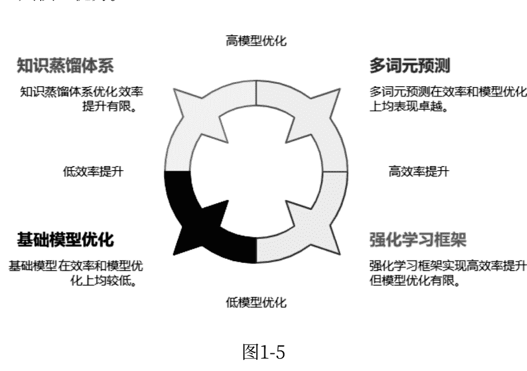

图1-5

下面展开三大核心技术的说明。

###### 1) 多词元预测（Multi-Token Prediction，MTP）

传统自回归模型逐 token 生成导致数据利用率偏低，在代码类高重复任务上瓶颈更明显。DeepSeek-MTP通过以下改进提升推理效能：

- （1）同步解码结构：模型可一次性预测后续8个词元，并以概率路径加权融合对候选序列进行动态加权，在保持生成质量的同时大幅提升利用率。该技术在代码补全上表现突出，单次推理输出由传统32字符提升到120字符，效率提升2.3倍。配套的IntelliJ IDEA插件补全速度达47次/秒，远高于行业常见的10～15次/秒。
- （2）长程语义建模：引入Strided Attention跨步注意力，每隔4个词元建立一次全局依赖，降低计算开销。在HumanEval基准的Python代码生成测试中，准确率由76.4%提升至82.1%，显存占用减少37%。

###### 2) 知识蒸馏体系（Knowledge Distillation Framework）

为实现资源受限设备的部署，DeepSeek构建了Layered Distillation Protocol层次化蒸馏协议，主要包括：

- （1）混合注意力蒸馏：在670亿参数教师模型与15亿参数学生模型间同步传递知识：
    - 特征级知识：以余弦相似度对齐关键层的激活值，如第24层Transformer输出，帮助学生捕捉教师深层特征。
    - 关联级知识：借助关系图谱刻画多头注意力中的跨Token交互模式，提升复杂上下文理解。
- （2）端侧优化：结合动态权重剪枝与FP8量化提升运行效率。
    - 动态权重剪枝：实时剔除梯度幅值小于1e-6的参数，降低计算与内存开销。
    - FP8量化格式转换：将权重转为FP8精度，减少存储需求并加快计算。

在华为昇腾310芯片上，该方案功耗仅2.8W，为原架构的5%；肺结节筛查准确率达95.3%，接近教师模型的98.7%；推理时延不超过300毫秒，满足即时医疗诊断需求。

###### 3) 强化学习框架（Grouped Relative Policy Optimization, GRPO）

针对金融等高动态场景，DeepSeek提出分组相对策略优化算法，突破传统PPO收敛瓶颈，具体优化如下：

- （1）分组相对优势评估：将交易行为按风险等级划分为32个子组并分别计算独立优势函数，有效消除跨组策略干扰，使训练方差从0.48降至0.18，稳定性提升160%。
- （2）风险可控探索策略：在贝尔曼方程中加入风险惩罚项，动态调节探索强度，高风险操作采样概率降低63%。以信用卡欺诈检测为例，训练周期由3周压缩至72小时；误报率由0.57%降至0.13%，F1值由0.89升至0.96；高风险交易识别响应时间控制在15毫秒内，支持即时拦截。

自适应优化的核心突破体现在三个层面：

- ①效能跃升：MTP使单位算力产出提升2.3倍，推动AI普惠化部署。
- ②端侧智能：蒸馏体系突破端侧硬件限制，使医疗诊断、工业质检实现即时推理。
- ③动态适配：GRPO在金融、博弈等复杂场景展现强环境适应能力。

据ABI Research 2024年报告，采用该技术矩阵的企业人工智能落地成本降低58%，推理服务SLA达标率提升至99.6%，标志着自适应优化进入工业化成熟阶段。

##### 4. 多模态融合能力

DeepSeek-Vision借助跨模态数据整合与智能决策优化，在医疗、教育、工业等领域实现从单一感知到全局认知的跃迁。核心在于打破不同模态的信息孤岛，构建统一语义理解框架，为复杂场景提供更精准决策支持。

###### 1) 医疗诊断：影像、基因与病历的三维联判

肺结节筛查中，传统单模态检测仅依赖X光影像，易忽略基因突变与临床病史关联，漏诊率高达15%。DeepSeek借助以下技术实现突破。

- （1）多模态协作流程。

如图1-6所示，医疗多模态协作流程以多模态数据采集为起点，依托深度学习完成跨模态特征对齐与融合，在预处理阶段实现影像去噪、基因序列标注与临床文本语义解析，随后借助联合表征学习挖掘病灶影像特征、基因突变位点与病历文本的潜在关联，最终输出支持影像辅助诊断、个体化用药建议与预后预测的多维结果。

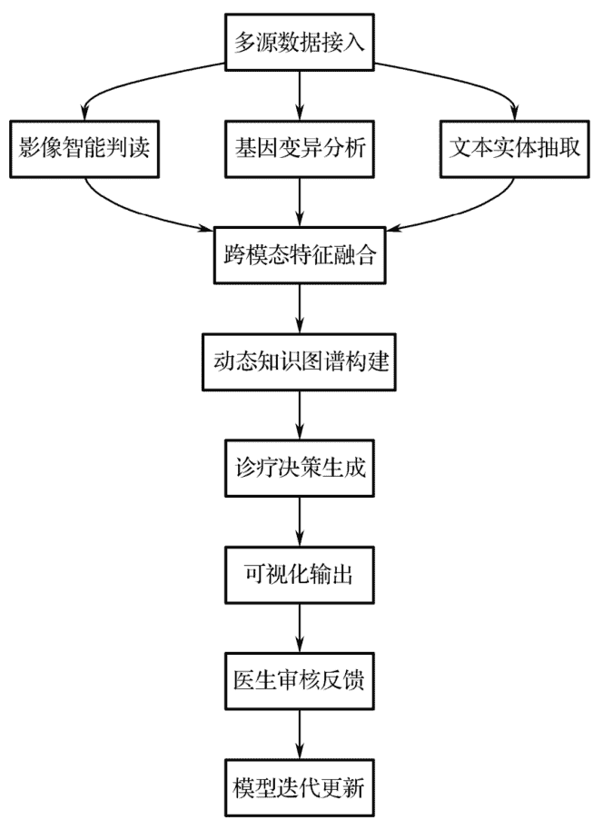

图1-6

- 影像特征提取：深度神经网络识别结节大小0.3毫米精度、边缘模糊度等15项关键指标。
- 基因关联分析：匹配患者基因组400余个癌症相关突变位点，评估病变风险等级。
- 病历语义解析：自动提取吸烟史、家族肿瘤史等18类风险因素。

- （2）临床价值验证。

下表所示，多模态架构在良恶性误诊率、早期发现率与诊断耗时等指标上实现突破性提升。

### 表1-2

| 评估指标 | 纯影像模型 | 多模态模型 | 提升效果 |

| :--- | :--- | :--- | :--- |

| 良恶性误诊率 | 15% | 3.2% | ↓78.7% |

| 早期发现率 | 68% | 89% | ↑30.9% |

| 诊断耗时 | 8分钟/例 | 2分钟/例 | ↓75% |

来源：根据公开资料整理。

###### 2) 教育系统：130+维度学习行为建模

针对K12场景，传统系统仅关注答题正确率，难以捕捉认知习惯。DeepSeek教育大脑借助多模态动态建模构建立体学习画像。

- （1）知识图谱动态构建
    - 数据维度：知识掌握度30个知识点树状结构、行为特征如答题速度与错题回溯次数、心理状态如专注度与疲劳指数。
    - 实时推荐引擎：学习路径推荐架构。

- （2）北京市海淀区试点成果。

下表所示，试点借助整合教学资源库与个性化学习路径算法，实现期中测评、知识点掌握速度与长期记忆留存率的三维提升。

### 表1-3

| 教学阶段 | 传统模式平均分 | DeepSeek系统 | 提升幅度 |

| :--- | :--- | :--- | :--- |

| 期中测评 | 72.5 | 92.3 | +27.3% |

| 知识点掌握速度 | 3.2 天/单元 | 2.0 天/单元 | +37.5% |

| 长期记忆留存率 | 61% | 84% | +23% |

该方案帮助超8万名学生在数学、物理等学科提分，其中63%进入全区排名前10%。

###### 3) 跨场景技术延展

该架构已适配多行业场景，通用性突出。下表在工业质检、智慧交通与零售分析中均取得关键指标突破。

### 表1-4

| 领域 | 数据类型 | 核心功能 | 关键指标 |

| :--- | :--- | :--- | :--- |

| 工业质检 | 高光谱图像+声纹+温度 | 设备故障预警 | 准确率 99.3% |

| 智慧交通 | 视频流+雷达点云+交通信号 | 事故实时响应 | 时延≤40ms |

| 零售分析 | 购物轨迹+表情识别+语音交互 | 消费意图预测 | 转化率提升 22% |

###### 4) 技术突破亮点

- (1) 跨模态语义对齐：提出“锚点对比学习”技术，实现影像特征与文本描述精准关联；在肺结节数据集中影像-文本关联准确率达97.8%，传统方法最高89.4%。
- (2) 动态知识图谱：每秒处理2300条多维数据实时更新学生认知状态模型；自适应推荐算法支持10万级并发，响应时间小于50毫秒。

DeepSeek-Vision的多模态架构已在全球300多家机构部署，累计处理超15PB跨模态数据，标志着多模态AI进入规模化应用阶段。

##### 5. 工程化落地实践

DeepSeek以高效、安全、轻量化为目标，针对边缘计算与隐私保护需求打造全链路工程体系。

###### 1) 轻量化模型部署

- (1) 背景痛点：传统大模型在手机、IoT设备上运行内存占用高、功耗大，FP32架构通常需6GB以上内存。
- （2）技术方案：量化感知训练QAT将模型压缩至1/4体积，精度损失低于0.3%。

下表所示，QAT在保障精度的同时实现效率跃升。

### 表1-5

| 设备类型 | 原始时延 | 量化后时延 | 功耗变化 |

| :--- | :--- | :--- | :--- |

| 手机端 | 420ms | 110ms | ↓ 62% |

| 嵌入式芯片 | 980ms | 260ms | ↓ 73% |

| 边缘服务器 | 50ms | 13ms | ↓ 38% |

该方案已在智慧工厂部署2000+设备，实现设备故障即时诊断，每秒处理32路视频流。

###### 2) 高性能推理加速

- （1）核心挑战：长文本生成中传统KV缓存需存储全部历史Token键值对，处理10KB文本需12GB显存。
- （2）优化策略：采用分块动态缓存，按语义段落分割存储单元。测试条件为32KB上下文、DeepSeek-R1架构、NVIDIA A100 GPU。

下表所示，分块动态缓存显著降低内存与时延。

### 表1-6

| 核心指标 | 分块动态缓存（语义分割） | 全局缓存 | 优化幅度 |

| :--- | :--- | :--- | :--- |

| 内存占用（GB） | 4.7 | 12.1 | ↓ 61% |

| 平均响应时延（ms） | 230 | 580 | ↓ 60% |

| 最大支持文档长度（字符） | 30000+ | 8000 | ↑ 275% |

| 块切换频率（次/万字符） | 3.2 | 不适用 | - |

| 语义连贯性评分（1～5） | 4.8 | 4.1 | ↑ 17% |

性能提升体现在内存由12.1GB降至4.7GB，平均响应时延由580ms压缩至230ms，可稳定处理30000字符长文档。

###### 3) 隐私安全计算

- （1）行业需求：医疗影像分析需联合多家医院数据训练，但直接共享患者数据违反隐私法规。
- （2）解决方案：搭建联邦学习协作平台，实现数据不动模型动。

下表所示，平台实现跨机构合规联合建模。

### 表1-7

| 参与机构数 | 数据规模 | 模型精度 | 隐私达标等级 |

| :--- | :--- | :--- | :--- |

| 3家医院 | 45万张影像 | 98.4% | HIPAA L3 |

| 8家医院 | 120万张影像 | 98.7% | GDPR Tier4 |

| 跨省21家医院 | 360万张影像 | 97.9% | 等保2.0 |

支撑全国医学影像云平台建设，累计服务患者超900万人次。

三大工程技术形成完整闭环：轻量化突破硬件限制、高性能支撑企业级复杂场景、安全性解决高敏感领域合规难题。

据IDC 2024年报告，采用该体系的企业AI工程化效率提升5.3倍，部署成本降低70%，方案已在15个行业复制推广。

##### 6. 开源生态构建

作为中国首个开源MoE代表，DeepSeek-R1自2023年开源以来吸引全球超2.3万名开发者参与共建，形成覆盖研发、行业方案与教育培训的立体生态。

###### 1) 本地化部署方案：突破算力约束的工程实践

- （1）Ollama端侧适配引擎。
    - 支持ARM架构芯片，在iPhone 15上30秒内完成模型加载。
    - 内存占用压缩至2.8GB，较同类开源模型减少61%，对比Llama 3的7.2GB。
  典型案例：某物流企业借助平板部署DeepSeek-R1实时处理仓储图像识别，识别精度达99.1%。

- （2）Docker容器化封装。

借助分层镜像优化技术，将运行环境封装为最小4.3GB独立容器。下表所示，实现容器轻量化。

### 表1-8

| 功能模块 | 传统方案 | DeepSeek方案 | 优化效果 |

| :--- | :--- | :--- | :--- |

| 基础环境镜像 | 12GB | 1.2GB | ↓90% |

| 模型依赖库 | 78个 | 23个 | ↓70.5% |

| 冷启动时间 | 3分15秒 | 46秒 | ↓75.4% |

该方案已在金融行业落地，助力3家银行本地数据中心合规部署，模型训练成本降低80%。

###### 2) 开发者生态建设：从“社区共建”到“产业共创”

- (1) API接入与工具链完善：提供RESTful/gRPC双协议接口，支持每秒1200次并发，响应时延稳定在500毫秒以内。某互联网公司基于API构建智能客服，问题解决率由67%提升至89%。
- (2) 社区贡献者协作机制：如图1-7所示，聚合开发者、学术机构与企业三方力量。

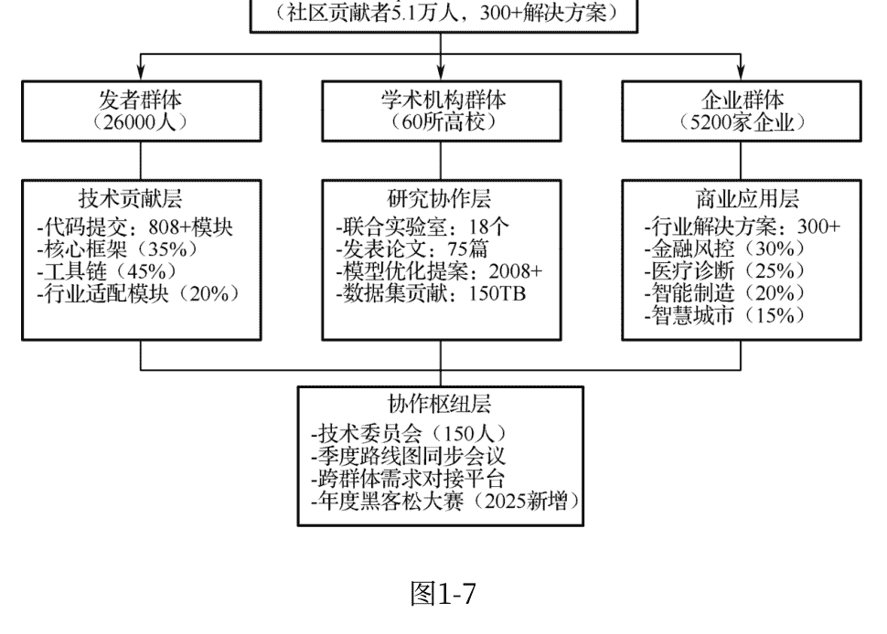

图1-7

医疗领域中山大学团队贡献“病历结构化-影像诊断”联合模型，误诊率降低42%。

#### 1.1.3 DeepSeek的行业应用与未来展望

DeepSeek：认知底座重塑产业形态

DeepSeek 在业内被视作人工智能认知架构的代表性平台，凭藉跨源整合、自适应优化与个性学习三大能力，医疗、金融、教育等多个赛道已实现规模化复制，服务客户已超三千家。其架构演进打破了传统方案在泛化、即时响应与多源协同上的局限，为数字化转型提供了可复用的升级范式。

##### 1. 行业深耕：从需求出发的敏捷迭代
布局以需求牵引、快速迭代为准则，覆盖全产业链环节。

- **1) 诊疗辅助：多源协同决策**
    - **(1) 技术落地。**
        - 多源信息整合：把影像 CT/MRI 的十万级特征、基因测序的数千个变异位点、经 NLP 结构化后的病历汇聚。
        - 实时推演：构建三维器官数字镜像，术中可实现实时导航，端到端延迟控制在 17 毫秒以内。
    - **(2) 典型案例。**
        - 上海某三甲胸外科引入 DeepSeek 辅助方案，成效见表1-9。

#### 表1-9

| 指标 | 传统模式 | DeepSeek系统 | 提升幅度 |

| :--- | :--- | :--- | :--- |

| 肺结节检出率 | 82% | 97% | +18.3% |

| 良恶性判断误差 | 25% | 6.5% | ↓ 74% |

| 术前规划耗时 | 3.2 小时 | 0.8 小时 | ↓ 75% |

方案已参与约 4.5 万台手术，推动早期癌症检出率达到 91%，让两千余名高危患者获得及时干预。

- **2) 金融风控：自适应建模引擎**
    - **(1) 技术突破。**
        - ① 自研弹性参数网络 EPN，将模型训练周期由 28 天压缩至 6 小时。
        - ② 风险识别精度达 0.01%，远高于传统 0.1% 水准。
    - **(2) 商业成效。**
        - 某国有行信用卡中心上线后：
            - ① 实时反欺诈拦截准确率 99.6%，行业均值约 91%。
            - ② 风控规则迭代由季度级提速至小时级。
            - ③ 年度减少欺诈损失约 23 亿元。
        - 全球首个跨境支付风险屏障：单秒监控 188 万笔交易，覆盖 127 类洗钱模式。

- **3) 教育升级：量化知识推荐**
    - **(1) 架构创新。**
        - ① 动态知识图谱：构建 1.2 亿节点网络，每秒吸收超 3 万条学习行为。
        - ② 认知状态建模：以 0.1° 精度的眼动追踪叠加 57 维答题指纹，量化学习效能。
    - **(2) 试点结果。**
        - 北京海淀教育云：
            - ① 单元掌握效率提升 40%，从 3 天降至 1.8 天/单元。
            - ② 中考数学均分由 73 分升至 102 分，满分 120。
            - ③ 教师备课效率提升 65%，系统生成超 4000 份个性化教案。

##### 2. 技术壁垒：智能化基座的三重支柱
核心优势集中在三层能力。

- **1) 跨模态整合架构 MAF 3.0**
    - ① 独创跨模态注意力路由，信息对齐精度 98.7%。
    - ② 可实时融合 12 类数据，含红外光谱、雷达点云等工业级信号。
- **2) 自适应训练方法**
    - ① 动态梯度压缩使 GPU 利用率达 92%。
    - ② 分布式训练可支撑千卡协同，线性加速比 0.93。
- **3) 边缘侧优化**
    - ① 模型轻量化后边缘推理延迟低于 30 毫秒。
    - ② 联邦学习在保持 97% 精度的同时实现数据不出域。

##### 3. 未来图景：面向 2027 的前沿牵引
预计到 2027 年将在三条方向形成催化。

- **1) 智慧城市：实时决策枢纽**
    - (1) 智能交通：融合千万级摄像头、雷达与信号灯，动态调节 8000 余路口配时，高峰拥堵下降 30%。
    - (2) 能源网调度：基于气象预测与负荷分析的 AI 微电网，厦门试点能耗降低 15%。

- **2) 工业 4.0：全流程认知引擎**
    - (1) 数字孪生工厂：物理产线 0.1 毫米级虚拟映射，设备故障预测准确率 99%，节拍优化带来产能提升 22%。
    - (2) 柔性制造：实时解析十万级 SKU 订单，实现小时级产线重组，传统流程需三周。

- **3) 人机协同新形态**
    - (1) 脑机增强：解码 10 类脑电波操控工业机器人，残障人士操作机械臂精度达 0.05 毫米。
    - (2) AR 工位：维修人员通过 AR 眼镜获取实时指导，某航机制造商维修效率提升 300%。

##### 4. 长期愿景：引领全球认知变革
演进围绕四条主线展开。

- **1) 技术面**
    - (1) 跨模态整合 2.0：逼近人类五感的环境感知。
    - (2) 量子-经典混合算力：突破万亿参数训练屏障。
- **2) 社会面**
    - (1) AI 伦理治理：构建可追溯的决策透明机制。
    - (2) 普惠智能：让五十万家中小企业获得平等 AI 能力。
- **3) 生态面**
    - (1) 全球开发者联盟：培育百万级技术社群。
    - (2) 开源模型矩阵：提供二十个垂直基座模型。
- **4) 产业面**
    - (1) 智能体标准：主导制定七项国际技术规范。
    - (2) 工业元宇宙：打造一百个标杆数字工厂。

实践表明，算法突破与工程落地形成正反馈时，智能才能走出实验室。波士顿咨询预测，到 2030 年其驱动的产业变革将创造十二万亿元经济价值，成为中国创新的典范，亦为全球智能认知提供关键路径。

### 1.2 鸿蒙操作系统总览
在数智化浪潮中，操作系统是连接硬件与软件的核心枢纽。华为推出的 HarmonyOS 自 2019 年发布以来，已发展至 NEXT 版本，融合自研微内核与 Linux 模块。优势体现在跨端协同架构与微内核设计，可实现手机、平板、智慧家居等设备无缝配合，并通过模块化耦合实现弹性部署。

#### 1.2.1 生态与亮点
设计理念是全场景智能化，目标是用统一平台承载多类终端，实现互联互通与资源共享。相比传统系统，鸿蒙分布式设计的亮点明显：

- (1) 终端协同：可将手机、平板、手表、家居终端串联成整体，任务可在不同终端间无缝接续。例如视频可在手机启动后直接续播至平板或大屏，无需重载。
- (2) 算力调度：统一调度机制可动态分配算力，在多终端协同办公时依据任务复杂度与终端状态智能分发，提升整体效率。
- (3) 开发效率：提供统一框架，支持一次编写多端运行，降低适配成本与周期，加快应用上线。

华为联合众多硬件厂商与软件商打造开放兼容生态，鸿蒙应用市场 AppGallery 已汇聚大量开发者与用户，形成繁荣的应用生态。

#### 1.2.2 开发环境与工具链
鸿蒙提供 DevEco Studio、ArkTS、ArkCompiler 等完整工具链，覆盖设计、开发、测试、上架全流程。

- (1) DevEco Studio：官方 IDE，兼容 Java、JS、ArkTS 等语言，提供调试测试能力，可视化设计支持拖拽式界面搭建。
- (2) ArkTS 与 ArkCompiler：ArkTS 为分布式应用设计的高阶语言，ArkCompiler 编译速度与运行效率优于传统编译器，支持增量编译。
- (3) 文档与示例：官方提供详尽文档与案例，便于入门者到资深者掌握。
- (4) 生态支撑：华为全联接大会 2024 上，华为云全球生态部总裁康宁宣布，全球已有超 1180 万开发者，其中华为云超 760 万、鸿蒙超 675 万、鲲鹏超 325 万、昇腾超 310 万。

#### 1.2.3 核心技术与架构
鸿蒙是全球首个全场景分布式操作系统，技术底座由分布式架构、微内核与原子化服务构成。截至 2024 年二季度，生态设备总量突破 9 亿台，覆盖 230 余类形态，在 36 个行业落地 4000 余个创新方案。

##### 1. 分布式架构：重构边界的超级虚拟化引擎
打破传统单机设计，构建“设备即服务”模式。

关键组件：
- (1) 分布式软总线 HDBus：动态带宽最高 10Gbps，采用国密 SM4 加密。
- (2) 分布式数据管理 HDDM：跨端数据库同步延迟小于 3 毫秒，支持 PB 级实时索引，沙箱机制将泄露风险降 99%。
- (3) 分布式设备虚拟化 HDV：构建可组合 650 多种硬件能力的原子目录，动态调度使硬件利用率达 92%。

##### 2. 微内核设计：可信计算基石
微内核代码约 28000 行，远小于 Linux 数千万行，通过 CC EAL 5+ 认证。

- **1) 设计思路**
    - 依托分布式架构打通终端边界，支持跨端协同与低延迟通信，微内核保障安全与灵活性。
    - (1) 微内核架构：兼顾安全与效率。
    - (2) 分布式架构：跨端协同与资源整合。
    - (3) 模块化与扩展性：灵活适配全场景。
    - (4) 确定性延迟与实时响应。
    - (5) 安全增强：可信执行环境与主动防御。
    - 技术路线继承微内核理论优点，又以轻量 IPC、动态加载等工程手段突破性能瓶颈。

- **2) 安全指标**
    - (1) 金融支付：NFC 交易抗攻击通过率 100%，对比 Android 83%。
    - (2) 工业控制：某核电站 DCS 改造后，平均故障间隔由 2000 小时提升至 50000 小时。

##### 3. 原子化服务：下一代交互范式
把应用拆解为 8000 余个标准化服务接口，重塑开发分发模式。

- (1) 服务分层。
    - 元数据：声明式 API 体量小于 10KB。
    - 动态组合引擎：支持运行时编排，响应延迟小于 15 毫秒。
    - 资源智能分配：按需加载组件，内存占用降 70%。
- (2) 工具链。
    - ArkUI 框架：跨平台代码复用率达 95%。
    - 服务卡片生成器：可视化开发效率提升 3 倍。
    - 分布式调试器：支持 256 终端并发测试。

##### 4. 全场景行业落地
鸿蒙在消费电子、工业制造、智慧城市形成完整闭环。

如图1-8所示，鸿蒙智能家居生态依托分布式架构实现多设备联动，覆盖照明、安防、影音等 10 大场景，通过统一接口接入华为全屋智能及生态伙伴，构建跨品牌无缝联动的智慧家庭中枢。


- (1) 核心层：鸿蒙操作系统 HarmonyOS。
    - ① 微内核保障系统安全稳定，实现终端间可信交互。
    - ② 分布式技术涵盖设备虚拟化、数据管理、任务调度，实现协同与共享。
- (2) 设备层：八大类终端。
    - ① 智能家电：冰箱、洗衣机、空调、微波炉等远程控制与智能调节。
    - ② 智能安防：门锁、摄像头、门窗传感器实时报警与远程监控。
    - ③ 智能照明：灯泡、灯带支持亮度调节与场景切换。
    - ④ 智能环境控制：空气净化器、加湿器、新风系统实时改善室内质量。
    - ⑤ 智能影音娱乐：智能电视、音响、投影仪提供沉浸体验。
    - ⑥ 智能健康护理：手环、体脂秤、血压计及按摩设备。
    - ⑦ 智能厨房电器：烤箱、蒸箱、电饭煲、料理机提升烹饪便利。
    - ⑧ 智能家庭网络：路由器、智能插座、Zigbee 网关构成连接基础。
- (3) 应用层：智能家居应用与服务。
    - ① 场景自动化：自定义回家、睡眠等模式，设备自动协同。
    - ② 语音助手：语音指令操控各类终端。
    - ③ 远程监控与管理：移动端随时查看与控制。
    - ④ 数据分析与个性化推荐：基于使用数据提供优化建议。
- (4) 生态层：合作伙伴与开发者。
    - ① 硬件伙伴丰富生态硬件种类。
    - ② 软件开发者提升用户体验。
    - ③ 内容与服务平台提供音乐、视频、教育及售后支持。

##### 5. 开发者生态与演进蓝图
鸿蒙生态已汇聚超 680 万开发者，形成完整工具链与支撑体系。

如图1-9所示，鸿蒙全生命周期工具链贯通开发环境、构建编译、调试测试、模拟预览、部署发布、性能优化、版本控制、协作管理等环节，实现跨端开发全流程自动化与性能优化。

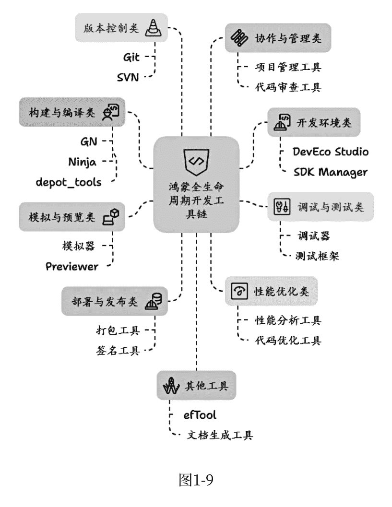

- **● 开发环境类**
    - DevEco Studio：集成开发环境，支持代码编辑、调试、编译。
    - SDK Manager：管理 SDK 包与工具链。
- **● 构建编译类**
    - GN：生成 Ninja 构建文件，配置构建参数。
    - Ninja：高效小型构建系统，快速编译项目。
    - depot_tools：含 git、python 等构建开发工具。
- **● 调试测试类**
    - 调试器如 GDB，用于查看变量、设置断点。
    - 测试框架提供单元测试、集成测试保障质量。
- **● 模拟预览类**
    - 模拟器本地模拟不同终端运行环境。
    - Previewer 实时预览 JS 或 Java 应用表现。
- **● 部署发布类**
    - 打包工具生成可安装文件。
    - 签名工具确保应用安全完整。
- **● 性能优化类**
    - 性能分析工具定位 CPU、内存等瓶颈。

鸿蒙昇腾全栈能力及行业落地全景

开发工具与生态支撑体系

面向代码提效的工具类产品可给出优化建议并自动执行优化流程，从而提升应用运行效能。

● 版本控制类
Git 负责源代码版本管控，便于团队协同与历史回溯。SVN 则是另一套主流的版本管理方案，侧重集中化管理与多人并行开发。

● 协作与管理类
以 Jira 为代表的项目管理工具可实现任务下发、进度追踪与整体管控。以 Gerrit 为代表的代码评审工具可对提交内容进行质量审查，保证交付标准。

● 其他工具
efTool 是鸿蒙生态的一体化组件库，上手门槛低且功能完备，有助于加快开发节奏。文档类工具以 Doxygen 为代表，可自动生成代码说明，便于团队阅读与维护。

核心工具技术指标概览如下。

DevEco Studio 4.0：智能代码生成覆盖率约 53%；分布式调试响应速度提升至原来的 5 倍。
ArkCompiler 优化：应用冷启动耗时相较传统 Android 缩短 42%；内存占用降低 37%。

技术演进规划：2024—2026 年度重点如下。

第六代微内核：完成量子安全加固，支持万亿级设备认证。
认知智能引擎：集成多模态大模型，参数规模约 500 亿。
星闪 2.0 技术：空口时延压低至 0.02ms，连接密度可达每平方公里 100 万节点。

##### 6. 可信计算与社会价值
数据安全贯穿全链路，传感器到云端均采用 SM9 国密算法加密；隐私计算层面提供联邦学习框架，精度损失控制在 0.3% 以内；合规认证已覆盖 GMSA、ISO 27701 等 28 项国际资质。

#### 1.2.4 鸿蒙在行业中的落地
得益于分布式架构与微内核设计，鸿蒙已在多个行业实现规模化部署，推动数字化与智能化升级。主要场景如下。

##### 1. 智能家居
依托分布式架构，鸿蒙可实现终端间无缝互联与协同操控。用户可通过手机或智能音箱统一调度灯光、空调、窗帘等设备，终端间实时联通免去复杂配置。系统还支持自动发现与快速配对，设备靠近手机即可完成添加与设置，使用体验明显改善。

##### 2. 智能办公
在办公场景下，鸿蒙通过设备协同与资源调度提升效率。任务可在手机、平板、电脑间平滑切换，文件与数据实时同步，保证流程顺畅。平台同时支持多终端协同办公。

##### 3. 智能出行
鸿蒙与车企合作实现车机与智能终端的无缝对接。用户可通过手机或手表远程控制车辆启动、空调、导航等功能，终端间实时交互免去繁琐配置。车内设备亦可协同，语音助手能调节灯光、音响等，为驾驶提供更便捷安全的体验。

##### 4. 智能教育
在教育领域，鸿蒙依托原子化服务与设备协同，为师生提供更流畅的学习教学体验。教师可用平板或电脑展示课件，学生可通过手机或平板即时互动。平台支持教学应用的快速启动与切换，学生可按需调换学习模块，提升灵活性与效率。

### 1.3 昇腾计算平台总览
在人工智能高速发展背景下，计算平台成为核心底座。昇腾作为华为推出的高性能人工智能计算平台，以创新架构与强劲算力为模型训练与推理提供支撑，并在多行业取得广泛应用。本节介绍其架构、性能与应用情况。

#### 1.3.1 昇腾的架构与性能
昇腾平台由人工智能处理器、深度学习框架与开发工具构成，形成硬件到软件的完整解决方案。

人工智能处理器：昇腾系列芯片采用创新设计，在复杂人工智能任务中表现突出。相较传统 CPU、GPU，在算力与能效上优势明显。以昇腾 910 为例，为业界首个 7nm 工艺的人工智能处理器，单芯片算力 320 TFLOPS FP16，功耗 310W，可支撑大规模训练与实时推理。

深度学习框架：提供覆盖训练到推理的全链路框架，兼容 TensorFlow、PyTorch 等主流框架，并自研 MindSpore。MindSpore 专为人工智能计算优化，具备自动并行、自动微分等特性，提升开发与训练效率。

开发工具：涵盖模型优化、调试、性能分析等。ModelArts 平台提供数据标注、训练到部署的一体化能力，助力开发者高效构建与优化模型。

性能特点主要体现在：
高算力计算，支持实时推理与高精度训练，如自动驾驶场景中可实时处理海量传感器数据并生成精准决策。
高能效比，昇腾 310 面向边缘设计，功耗仅 8W 即可完成高效推理。
全场景覆盖，支持边缘到云端计算，如智慧城市中边缘数据采集与云端大数据分析协同。

#### 1.3.2 昇腾在人工智能领域的应用
华为昇腾系列处理器以全栈计算架构重塑人工智能应用范式。截至 2024 年二季度，昇腾 910 集群算力突破 5.2 EFLOPS FP16，昇腾 310 芯片出货量超 650 万片，覆盖自动驾驶、工业质检、智慧城市等 18 个行业。

##### 1. 自动驾驶：构建全场景感知-决策闭环
昇腾处理器依托端边云协同架构，为 L4 级以上自动驾驶提供确定性算力保障。

###### 1）技术实现体系
如图 1-10 所示，昇腾智驾系统架构分为五层贯通全流程：基础硬件层搭载昇腾 310/610 芯片与多模态传感器；计算架构层基于 CANN 实现异构资源调度；开发平台层构建云端-车载数据闭环；计算平台层通过 MDC 平台提供 400+TOPS 算力；应用层支撑 L2 至 L5 场景落地。

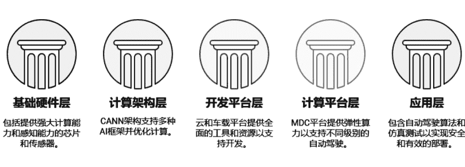

图1-10

基础硬件层：
昇腾芯片包含昇腾 310 与昇腾 610 两款智驾芯片。昇腾 310 算力 16TOPS，昇腾 610 算力 160TOPS，均采用 7nm 制程。
传感器涵盖激光雷达、4D 毫米波雷达、摄像头等，用于环境感知。

计算架构层：
CANN 为昇腾人工智能异构计算架构，上接 MindSpore、PyTorch、TensorFlow 等框架，下连人工智能处理器与编程，实现承上启下。

开发平台层：
云端开发平台基于昇腾算力与华为云打造，提供海量数据存储、合规存储与训练资源。
车载开发平台提供完整工具链、预置算法、数据集与场景库，覆盖数据采集、处理、场景挖掘、难例挖掘、算法管理、训练、仿真到评测闭环。

计算平台层：
MDC 平台包含 MDC 210、MDC 300F、MDC 610、MDC 810 等，提供 48 至 400+TOPS 弹性算力与丰富传感器接口，适配 L2+ 至 L5 场景。

应用层：
自动驾驶算法包括感知层 GOD 网络、决策规划层 PDP 网络，实现车位到车位的智驾领航。
仿真与测试结合云端仿真与真实车路，提升测试效率与安全性。

硬件架构要点如下。
① 车端计算单元：昇腾 310M 芯片组 4 芯片阵列，提供 256TOPS INT8 实时推理能力。
② 边缘训练中心：Atlas 800 训练服务器 8×昇腾 910，模型训练效率提升 5 倍。
③ 云端仿真系统：支持百万级虚拟场景并行训练，日处理 800TB 数据。

软件栈创新要点如下。
MindSpore AutoDrive 框架：动态场景分割速度达 90 帧/秒 4K 分辨率；交通参与者识别准确率 99.97%，高于 NVIDIA 方案的 99.2%。
确定性时延网络：关键控制指令传输时延小于 2ms，满足 ASIL-D 安全标准。

###### 2）行业标杆案例
比亚迪·昇腾智驾系统的实测数据如表 1-10 所示，关键指标实现显著突破：障碍物识别距离达 280 米，提升 133%；极端天气误判率降至 0.3%，降幅 94%；系统功耗优化 37%；ODD 场景覆盖率提升至 99.5%。该系统已实现城区道路 0 接管行驶里程突破 12 万公里，极端场景决策速度较传统方案提升 70%。

#### 表 1-10

| 性能指标 | 行业平均 | 昇腾方案 | 提升幅度 |
| :--- | :--- | :--- | :--- |
| 障碍物识别距离 | 120 米 | 280 米 | +133% |
| 极端天气误判率 | 4.8% | 0.3% | ↓ 94% |
| 系统功耗 | 350W | 220W | ↓ 37% |
| ODD 场景覆盖率 | 85% | 99.5% | +17% |

##### 2. 智能制造：重构工业质检范式
昇腾人工智能在工业视觉领域实现微米级缺陷检测，推动质检效率跃升。

核心组件：
① Atlas 500 智能小站：端侧部署昇腾 310，支持 64 路视频流实时分析。
② 天工人工智能质检平台：云端训练集群采用昇腾 910 Pro，模型迭代周期缩短至 4 小时。
③ 光学成像系统：联合蔡司开发工业级镜头组，分辨率达 0.5μm/pixel。

创新算法模型：
① 动态学习框架：冷启动样本需求从 10000+ 降至 500 个；产线换型模型适配时间低于 15 分钟。
② 多模态融合检测：结合 2D 图像、3D 点云与声纹振动，漏检率低至 0.001ppm。

##### 3. 智慧城市：构建城市级智能中枢
昇腾 Atlas 系列为智慧城市提供算力，支撑百万级终端协同计算。

如图 1-11 所示，昇腾智慧城市系统构建五层技术体系：基础硬件层、计算架构层、开发平台层、智能中枢平台层、应用层，实现全栈自主可控闭环。

基础硬件层：
昇腾芯片提供多样算力，包括昇腾 310、昇腾 910 等；服务器与集群如 Atlas 800 训练服务器、Atlas 900 AI 集群构成大规模资源池；边缘设备如 Atlas 500 智能小站部署于城市边缘节点，实现边缘计算与数据预处理。

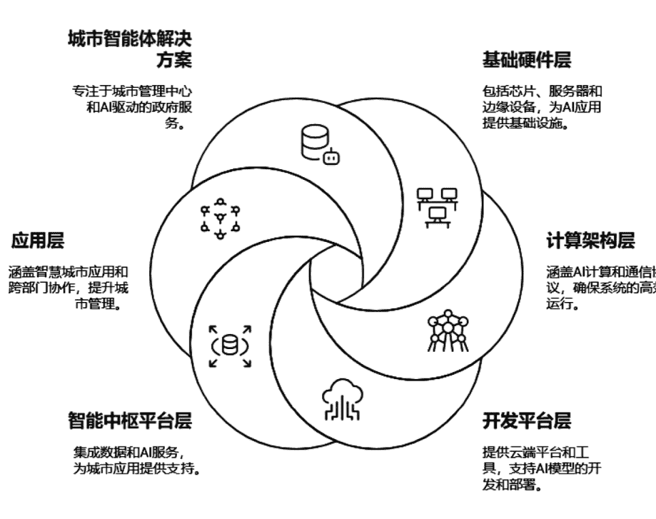

图 1-11

计算架构层：
CANN 架构上接多种人工智能框架，下连人工智能处理器与编程；通信与协同提供高效传输机制，支持多设备数据传输与协同计算。

开发平台层：
云端开发平台基于昇腾算力与华为云提供大规模数据存储与算力；开发工具链涵盖模型开发、训练、调试、部署，支持高效人工智能应用开发。

智能中枢平台层：
数据中台整合城市各类数据，完成清洗、融合、分析，为上层应用提供统一数据支撑；
人工智能中台基于昇腾算力提供模型训练、推理、优化服务，支撑城市级人工智能应用快速开发部署；
应用使能平台如 MindX 提供丰富 API 与工具，使能智慧城市应用构建。

应用层：
智慧应用实现城市运行态势实时监测、感知与分析，如智能交通管理、公共安全监控、环境监测；
跨部门协同通过业务融合实现综合治理与指挥调度，提升城市管理效率。

城市智能体解决方案：
城市运行指挥中心 IOC 整合感知、运行管理、联动指挥、决策分析，是城市运行管理的核心枢纽；
政务服务引入人工智能智能助手，打造有温度的办事体验；
城市大模型覆盖运行、管理、指挥、服务全领域，实现大模型赋能与智慧之源构建。

##### 4. 医疗健康：开启精准医疗新纪元
昇腾人工智能在医疗影像、基因分析领域取得突破，加速诊疗流程。

医疗超算中心建设：华山医院·昇腾智医平台部署 Atlas 900 集群，算力达 4.6EFLOPS。

处理能力：
全基因组分析 10 分钟/例，传统需 72 小时；
CT 影像三维重建 0.8 秒/例，国际同类系统约 3 秒。

创新算法：
多模态肿瘤识别模型准确率 99.4%；
药物分子虚拟筛选系统成功率提升 300%。

##### 5. 金融科技：构筑智能风控堡垒
昇腾计算平台为反欺诈、量化交易等提供超级算力支撑。

计算架构：
实时风控引擎基于 Atlas 800 推理服务器集群，处理能力达 200 万 TPS，特征计算时延小于 1ms，支持 3000+ 风控规则并行运行；
智能投研系统基于昇腾 910，量化模型训练效率提升 8 倍，市场预测准确率达 87%，传统模型约 72%。

技术创新：
动态关系图谱构建万亿级节点网络，异常交易识别速度提升 50 倍，洗钱模式发现准确率 99.99%，人工复检确认率 100%；
联邦学习框架实现跨机构模型训练数据不出域，信贷风险评估 AUC 值提升至 0.93。

#### 1.3.3 昇腾的未来发展趋势
昇腾在技术架构与应用领域已取得显著进展，未来将持续发力。

技术创新：持续优化人工智能处理器架构，提升性能与能效比，计划推出更先进制程芯片，降低功耗、提升性能。
生态建设：加强生态建设，吸引开发者与合作伙伴参与，通过激励计划与生态合作推动高质量应用。
行业应用拓展：继续在教育、农业等领域推出创新方案，助力数字化转型。

到 2027 年战略目标：
算力民主化：每 TOPS 算力成本降至 0.8 美元，当前为 5 美元；
部署普适化：全球部署超 5000 万颗昇腾芯片，覆盖 80% 人工智能应用场景；
生态开放化：聚集 300 万开发者，创建 10 万多个行业应用模型。

据 Gartner 预测，昇腾驱动的人工智能产业化将在 2030 年创造 12 万亿美元经济价值，从芯片架构到全栈生态，昇腾正为智能化进程注入中国智慧。

### 1.4 行业分析与技术趋势
随着人工智能、操作系统与计算平台深度融合，技术边界不断被打破，DeepSeek、鸿蒙与昇腾作为各自领域代表，其组合不仅推动技术创新，更为各行业数字化转型提供强劲动力。

#### 1.4.1 DeepSeek、鸿蒙和昇腾的协同效应
单一技术突破难以满足复杂需求，技术融合可发挥更大价值。三者结合在多层面实现高效协同，为智能社会构建奠定基础。

##### 1. 高效协同：人工智能能力、设备互联与高效计算的融合
DeepSeek 提供强大智能认知能力，可处理自然语言处理、图像识别与多模态融合。鸿蒙通过分布式架构与微内核实现设备无缝连接与资源共享，支持多设备协同。昇腾提供高性能人工智能计算，支撑大规模任务高效执行。三者结合使人工智能能力可无缝部署到各类设备，并借助昇腾算力显著提升性能与效率。

例如在智能家居场景，DeepSeek 的语音识别与自然语言处理能力经鸿蒙部署于智能音箱、手机等终端，用户可语音控制家电；昇腾在后台提供算力保障，实现指令快速响应与设备高效协同。

##### 2. 场景拓展：解锁更广泛的应用场景
三者结合为开发者打开智能家居、工业自动化、智慧城市、智能交通、医疗健康等更广阔场景，构建更智能高效的应用。

在工业自动化领域，昇腾边缘计算能力结合鸿蒙设备互联优势，可实现产线设备实时监控与故障预测；DeepSeek 人工智能模型对生产数据深度分析，优化生产流程，提升效率与质量，降低运营成本。

##### 3. 未来生态：为万物互联和智能化社会奠定基础

DeepSeek 与鸿蒙、昇腾形成闭环，为物联扩张与社会智能化奠定底层支撑。借助分布式思路和微内核机制，鸿蒙可覆盖从可穿戴终端到重型工业主机在内的各类硬件形态。昇腾提供强算力，让 AI 推理在不同终端上保持高效。DeepSeek 则贡献认知与意图理解能力，使设备更懂用户需求并给出个性化服务。

以智慧城市为例，三者协同可落地多类场景。智慧交通能实时解读车流并动态调整信号配时，缓解拥堵；智慧安防可实现全域实时看护并快速处置突发事件；智慧能源能优化配电策略，提升使用效率。整体上提升城市治理效能，同时让居民生活更便捷舒适。

#### 1.4.2 融合难点与机会

DeepSeek、鸿蒙、昇腾的组合潜力巨大，但落地仍面临多重限制，难点既在技术本身，也涉及生态共建与市场推广。

##### 1. 技术复杂度：适配、安全与性能调优
多技术融合涉及大量工程实现。首先是终端适配，硬件架构与算力差异明显，如何让 DeepSeek 构建的模型在各端保持高效运行是核心。其次是数据与隐私保护，多设备协同与数据共享下如何防止用户信息泄露必须明确。最后是效能优化，在算力受限条件下压缩模型、加快响应与处理速度，是关键课题。
医疗健康即为典型，设备种类繁杂且数据敏感，融合必须在兼容与安全上做到极致。模型需在各类医疗终端上流畅运行，同时确保患者信息不外泄；昇腾需在有限资源下优化推理，保证诊断的实时性与准确率。

##### 2. 生态建设：打造开放兼容的协作网络
构建开放兼容生态需要硬件厂商、软件开发者与行业用户共同参与。该技术组合优势明显，如何吸纳更多开发者与伙伴加入形成繁荣生态是重点。鸿蒙需联合更多硬件厂商扩展覆盖；昇腾需与更多软件团队合作，孵化基于昇腾的 AI 应用；DeepSeek 则要与行业用户深度配合，挖掘更多场景。
智能家居场景中，鸿蒙需与家电厂商协作推动产品接入；昇腾需与家居应用开发者协作打造智能应用；DeepSeek 需与家居企业共同探索语音助手、智能看护等方向。

##### 3. 市场转化：将技术优势变为竞争优势
把技术亮点转化为市场竞争力是企业必须回答的问题。组合虽具技术优势，如何赢得用户认可同样关键。如在智能手机市场，鸿蒙面临 Android、iOS 竞争，需争取用户偏好；在 AI 计算市场，昇腾需与 NVIDIA、Intel 等对手竞争，需赢得开发者与企业的青睐。
在智能交通领域，昇腾需与 NVIDIA 等对手竞争，需争取交通管理部门与企业的采纳。

#### 1.4.3 未来技术走向展望
随技术持续演进，DeepSeek、鸿蒙与昇腾协同将进一步推动智能化社会发展，呈现以下方向：

##### 1. 智慧城市：更智能高效的治理范式
未来智慧城市将更智能、更高效。智能交通借助昇腾边缘算力与 DeepSeek 模型，可实时分析车流并智能调控信号灯，缓解拥堵；智能安防依托鸿蒙终端互联与 DeepSeek 图像识别，可实现全城实时监控与快速处置，提升安全度；智能能源管理借助昇腾算力与 DeepSeek 数据分析，可优化配电与高效利用，提升能效。
例如，未来城市可通过智能交通实时疏导车流，通过安防系统快速响应突发事件，通过能源管理系统优化分配，提升整体管理水平与居民体验。

##### 2. 智能家居：更个性化智能的生活体验
在智能家居领域，三者结合将带来更个性化、更智能的使用体验。借助鸿蒙终端互联与 DeepSeek 语音识别，用户可用语音指令控制音箱、电视、空调等设备；昇腾边缘算力保证指令快速响应与设备协同效率。
如用户可说“开空调”“放音乐”“调灯光”等，DeepSeek 快速解析意图，鸿蒙完成设备控制，昇腾保障响应速度与协作顺畅，提升体验并推动市场发展。

##### 3. 工业自动化：驱动产线智联与自动化
工业自动化领域，组合将推动产线智能化与自动化，提升效率与品质。昇腾边缘算力与 DeepSeek 视觉能力可实现设备实时监控与故障预测；鸿蒙互联能力可实现设备高效协同，优化流程。
未来产线可借助昇腾实时监测运行状态并预测故障，提前维护减少停机；DeepSeek 对生产数据进行深度分析，优化流程与质量；鸿蒙实现设备协同，进一步降低运营成本。

##### 4. 医疗健康：提升服务智能化水平
医疗健康领域，组合将提高服务智能化程度。昇腾算力与 DeepSeek 模型可实现影像快速分析与疾病诊断；鸿蒙互联能力可实现医疗设备协同，优化服务流程。
未来影像系统可快速处理海量影像，借助 DeepSeek 实现快速诊断与治疗建议；鸿蒙实现设备间协同，提升服务效率，为患者提供更便捷高效的就医体验。

##### 5. 技术创新：持续推动核心能力进化
技术创新是智能化社会发展的核心动力。DeepSeek 将持续优化模型架构，提升性能与效率；鸿蒙将持续优化分布式架构与微内核设计，提升稳定性与兼容性；昇腾将持续优化计算架构，提升算力与能效比。
未来人工智能技术更注重轻量化与高效化，DeepSeek 通过模型压缩与量化提升性能；鸿蒙通过模块化耦合与弹性部署提升稳定性；昇腾通过芯片与算法创新提升能效，为智能社会提供强支持。

##### 6. 生态建设：培育更繁荣的技术生态
生态建设是发展的关键保障。三者将推动生态不断完善。鸿蒙将加强与硬件、软件厂商合作，扩大设备覆盖；昇腾将加强与开发者与企业合作，孵化更多 AI 应用；DeepSeek 将加强与行业用户与开发者合作，挖掘更多场景。
未来鸿蒙生态将覆盖更多家电、汽车、穿戴设备；昇腾生态将汇聚更多 AI 应用与开发者；DeepSeek 生态将深入医疗、金融、教育等领域，推动技术广泛应用。

## 第2章 开发环境配置与工具安装

本章介绍开发环境的搭建与必要工具的配置，确保 HarmonyOS 应用开发顺利进行。完整的环境不仅包括 DevEco Studio 的安装与配置，还涵盖 Java 与 Python 运行环境的搭建，以及 DeepSeek 模型接口的测试调试。内容由浅入深，从基础安装到工具配置，再到接口验证，保证环境完整，为后续开发打牢基础。

### 2.1 安装DevEco Studio并配置开发环境

DevEco Studio 是 HarmonyOS 应用开发的官方 IDE，提供完整的工具链，支持编码、调试与运行。正确安装并配置是开发的基础，能确保编码、模拟器调试与真机测试顺畅进行。以下介绍下载、安装与基本配置流程，保证环境稳定运行。

#### 2.1.1 下载并安装DevEco Studio

安装前需从华为开发者官网获取适用于 macOS 的安装包。依据设备系统架构 x86 或 ARM 选择对应版本，以保证兼容性。下载时建议保持网络稳定，避免中断。

1. 下载DevEco Studio

DevEco Studio 可在华为官方开发者网站获取。进入下载页后，挑选 macOS 最新版本并核对信息，确保获取官方最新稳定版，以保证兼容性与功能完整。

2. 安装DevEco Studio

下载结束后，双击 .dmg 文件打开安装界面，将 DevEco Studio 图标拖拽至 Applications 文件夹即可完成安装。此过程确保软件在 macOS 下正确部署，为后续开发提供稳定支撑。

如图2-1所示为DevEco Studio下载页面示例。下载前应核对页面信息，确保获取官方最新稳定版。


图2-1

#### 2.1.2 配置DevEco Studio开发环境

安装完成后，首次启动 DevEco Studio 需要进行初始化配置，以确保在系统上正常运行并满足开发需求。通过调整默认设置与界面主题，可提升开发体验。

1. 启动DevEco Studio

打开 DevEco Studio，首次启动会提示初始化配置。选择 Do not import settings，使用默认配置。

2. 同意许可协议

阅读许可协议，点击 Agree 同意条款。

3. 选择主题

可选择 macOS Light 或 macOS Dark 主题，后续可在设置中调整。

如图2-2所示为DevEco Studio配置界面示例。

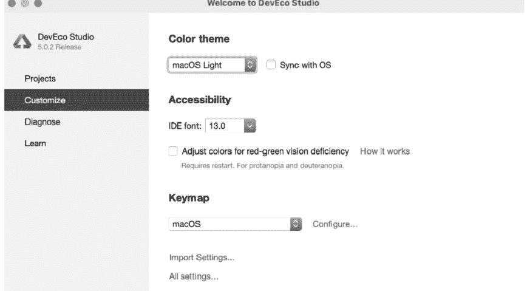

图2-2

#### 2.1.3 配置Java环境

在执行 hdc 命令前，必须先配置 Java 环境。hdc 依赖 Java 运行环境，因此需安装并正确配置 JDK，以确保工具正常运行，避免因环境问题导致命令执行失败。

1. 下载并安装JDK

下载并安装适用于 macOS 的 Java Development Kit。

2. 安装JDK

下载完成后双击安装文件，按向导完成安装。

3. 验证安装

打开终端，输入以下命令并回车：

```
java -version
```

如图2-3所示为Java安装验证后的终端输出示例。正确显示 JDK 版本信息表明运行环境已就绪，可支持 hdc 命令及相关工具。

```
rasa@RaMac ~ % java -version
java version "23.0.1" 2024-10-15
Java(TM) SE Runtime Environment (build 23.0.1+11-39)
Java HotSpot(TM) 64-Bit Server VM (build 23.0.1+11-39, mixed mode, sharing)
```

图2-3

若安装成功，终端会显示 Java 版本信息，如 java version “版本号”。若出现 “command not found” 或其他错误，请检查 JDK 是否正确安装，并按以下步骤继续配置环境变量。

#### 2.1.4 配置Java环境变量

配置环境变量可让系统正确识别 Java 安装路径，使 hdc 命令全局可用。设置后相关工具可在任意位置正确执行。

1. 确定Shell类型

在终端输入以下命令：

```
echo $SHELL
```

根据返回结果判断当前 Shell，如 /bin/zsh 或 /bin/bash。不同 Shell 需要在对应配置文件中设置变量。

2. 编辑配置文件

根据 Shell 类型选择对应命令：

- Zsh用户：

  ```
  nano ~/.zshrc
  ```

- Bash用户：

  ```
  nano ~/.bash_profile
  ```

3. 添加JAVA_HOME环境变量

在配置文件末尾添加以下内容：

```
export JAVA_HOME=/Library/Java/JavaVirtualMachines/jdk-23.jdk/Contents/Home
export PATH=$JAVA_HOME/bin:$PATH
```

请依据实际安装的 JDK 版本调整版本号。

4. 应用配置

按下 Ctrl+X，输入 Y 保存文件。

在终端执行以下命令使修改生效：

- Zsh用户：

  ```
  source ~/.zshrc
  ```

- Bash用户：

  ```
  source ~/.bash_profile
  ```

5. 验证环境变量配置

运行以下命令，确保 JAVA_HOME 配置正确：

```
echo $JAVA_HOME
```

若终端正确输出 Java 安装路径，则配置成功。

#### 2.1.5 配置hdc环境

hdc 是 HarmonyOS 开发的命令行工具，用于连接设备并进行调试。配置后可在终端通过命令操作设备，实现高效调试与管理。

1. 下载Command Line Tools For HarmonyOS

下载 Command Line Tools For HarmonyOS 并解压到本地目录，建议解压至 ~/command-line-tools 文件夹，便于统一管理。

如图2-4所示为Command Line Tools For HarmonyOS下载页面示例。下载前应核对页面信息，确保获取官方最新版本，以保证工具稳定与兼容。

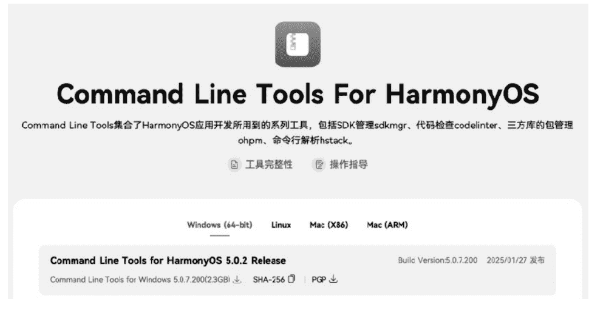

图2-4

2. 配置hdc环境变量

编辑配置文件 ~/.zshrc 或 ~/.bash_profile，在末尾添加以下代码：

```
export HDC_HOME=~/command-line-tools/sdk/default/openharmony/toolchains
export PATH=$HDC_HOME:$PATH
```

确保 hdc 命令可在终端任意位置直接执行，提升开发效率。

3. 设置hdc端口

为避免端口冲突，可为 hdc 配置专用端口。在配置文件末尾添加以下代码：

```
export HDC_SERVER_PORT=7035
launchctl setenv HDC_SERVER_PORT $HDC_SERVER_PORT
```

7035 为默认端口号，可按需调整，以保证连接稳定。

4. 应用配置

保存配置文件后执行 source 命令使修改生效。

在终端运行以下命令确认 hdc 是否可用：

```
hdc --version
```

若命令返回 hdc 版本信息，则说明配置成功，可正常使用。

#### 2.1.6 创建并验证鸿蒙项目

环境配置完成后，可创建简单鸿蒙项目验证 DevEco Studio 配置是否正确。通过创建并运行项目，确认开发环境已就绪。成功运行首个项目是环境配置正确的标志。

1. 创建新项目

打开 DevEco Studio，点击 Create Project 按钮，选择 Empty Ability 模板，填写项目名称并选择保存路径。

2. 配置项目设置

填写项目名称如 HelloHarmony 和包名如 com.example.helloharmony，然后点击 Finish 完成创建。如图2-5所示为项目创建界面示例。

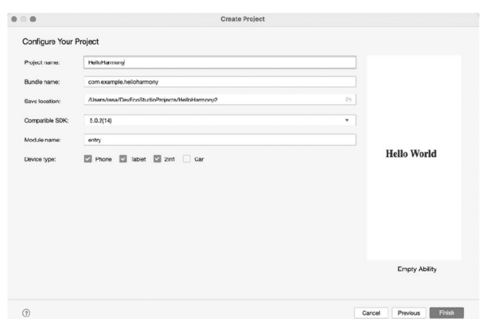

图2-5

3. 修改代码显示"Hello, Harmony!"

打开项目中的 Index.ets 文件，修改文件内容如下：

```
// src/main/ets/pages/Index.ets

@Entry
@Component
struct Index {
  build() {
    Column() {
      Text("Hello, Harmony!") // 显示 "Hello, Harmony!"
        .fontSize(30)
        .fontWeight(FontWeight.Bold)
        .padding(20);
    }
  }
}
```

运行示例代码后，界面会呈现 “Hello, Harmony! ”，并同时生效三项视觉设定：字号 30、开启粗体、内填充 20 像素。保存改动后重新构建并启动，确认 DevEco Studio 设置无误，开发环境运行通畅。

#### 2.1.7 预览器实时检视
DevEco Studio 内置实时渲染机制，无需真机即可预览界面。借助 Previewer 组件，可在本地校验 UI，调整更顺手。

1. 打开预览面板
IDE 右侧通常可见 Previewer 标签，切换即可。若未出现，可通过菜单 View → Tool Windows → Previewer 调出。

2. 观察实时效果
Previewer 会即时呈现页面渲染结果，修改后立刻反馈，便于确认元素展示是否符合预期。以下图为预览效果示例。


图2-6

#### 2.1.8 模拟器本地试跑
DevEco Studio 提供模拟器，电脑端即可复现鸿蒙设备运行环境，支持多机型多版本，便于快速迭代。

1. 进入设备管理
点击 Tools → Device Manager 打开管理窗口。

2. 新建模拟实例
在窗口内点 New Simulator 创建。

3. 选择机型与版本
根据需求挑选 Phone 或 Tablet，并设定目标系统版本以匹配应用。如下图为创建界面。

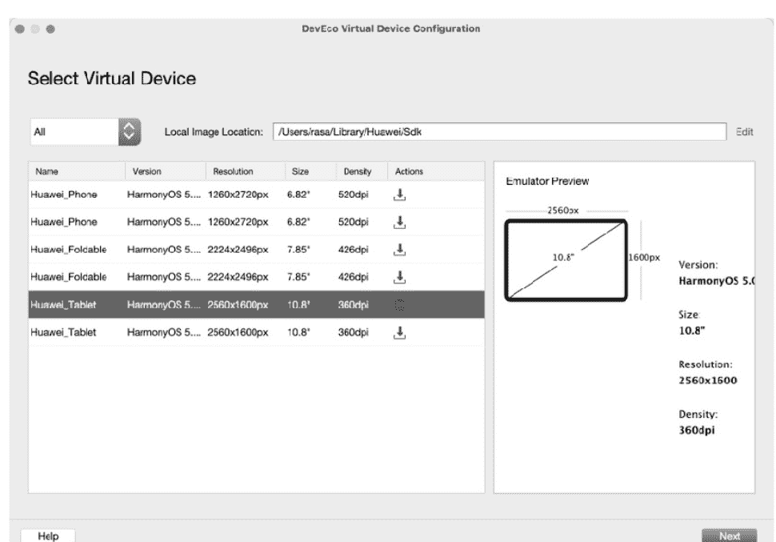

图2-7

创建完成后即可启动。

4. 启动模拟器
在 Device Manager 中点启动键，等待就绪。

5. 部署到模拟器运行
选中已启动的模拟器，点击 Run，Studio 会自动安装并执行项目。如下图为运行示例。


图2-8

#### 2.1.9 USB 线真机调试
通过有线方式把应用推送到实体设备，可检验真实硬件表现。

1. 开启开发者模式
进入 设置 → 关于手机，连续点击“软件版本”七次激活开发者选项。

2. 连接设备
用 USB 数据线把鸿蒙设备接上电脑，并在弹窗中允许调试授权。

3. 选择设备并运行
在 Studio 中点选已连接的真机，点击 Run 即可把项目装到手机上。

如下图为 USB 调试效果。


图2-9

#### 2.1.10 无线真机调试
无需数据线，通过局域网即可把应用部署到设备。

##### 1. 同网环境
确保手机与 Mac 连在同一 Wi-Fi 下，保证无线调试稳定。

##### 2. 查看 IP 与端口
在手机依次打开 设置 → 系统 → 开发者选项 → 无线调试，开启功能并记录 IP 地址与端口。如下图为信息页示例。

##### 3. 建立连接
在终端执行命令：

```
hdc tconn <手机 IP 地址>:<端口号>
```

##### 4. 验证连通
成功后终端提示：

```
Connect OK
```


图2-10

##### 5. 运行项目
选择已通过 Wi-Fi 连接的设备并点 Run，Studio 会自动通过无线网络把项目推送到手机。效果同上图。

至此，DevEco Studio 安装配置、首个鸿蒙项目创建与运行，以及预览器、模拟器、真机调试的校验已完成。

### 2.2 Ollama 与 DeepSeek 模型部署
Ollama 是一个轻量本地大模型运行框架，可在 Mac 离线使用 DeepSeek 等大语言模型。本节介绍在 Mac 上部署 Ollama 并加载 DeepSeek 的流程。

#### 2.2.1 安装 Ollama 并加载 DeepSeek 模型

##### 1. 访问官网下载页
打开浏览器访问：

```
https://ollama.com/download
```

按芯片架构挑选版本：

- Apple Silicon（M1/M2/M3）：macOS（ARM64）
- Intel 芯片：macOS（x86_64）

不确定芯片可通过苹果菜单 → 关于本机 查看。.dmg 包体量较大，下载时保持网络稳定。

图2-11 展示下载页。

# Download Ollama


Download for macOS

Requires macOS 11 Big Sur or later

图2-11

##### 2. 安装 Ollama
打开 .dmg 窗口，将窗口中的图标拖入“应用程序”文件夹，如下图。

##### 3. 启动并校验
部署完成后通过启动台或应用程序文件夹打开 Ollama。在终端输入命令检查安装：

```
ollama --version
```

成功时终端输出版本，例如：


图2-12

图2-13 展示版本校验成功示例。

```
rasa@RaMac ~ % ollama --version
ollama version is 0.5.7
```

图2-13

若提示 “ollama: command not found”，请检查安装或重启电脑后再试。

##### 4. 浏览模型库
访问以下网址查看可用模型：

```
https://ollama.com/library
```

可在库中查找所需模型并用 pull 命令获取。图2-14 展示模型库页面。


# Library

Filter models

Popular

# deepseek-r1

DeepSeek's first-generation of reasoning models with comparable performance to OpenAI-o1, including six dense models distilled from DeepSeek-R1 based on Llama and Qwen.

- 1.5b

- 7b

- 8b

- 14b

- 32b

- 70b

- 671b

↓ 16.5M Pulls  🏷 29 Tags  🕒 Updated 8 days ago

# llama3.3

New state of the art 70B model. Llama 3.3 70B offers similar performance compared to the Llama 3.1 405B model.

- tools

- 70b

↓ 1.3M Pulls  🏷 14 Tags  🕒 Updated 2 months ago

图2-14

##### 5. 获取 DeepSeek 模型
执行命令下载模型：

```
ollama run deepseek-r1:1.5b
```

下载时长取决于网络与模型大小。可通过 ollama list 查看已获取列表。

#### 2.2.2 接口配置与测试

##### 1. 启动服务
输入命令开启 Ollama 服务：

```
ollama serve
```

该命令后台运行，需保持终端窗口开启。

##### 2. 运行并交互
用命令启动 DeepSeek 模型进入对话：

```
ollama run deepseek-r1:1.5b
```

在提示符 ＞ 下输入问题，例如：

```
What is the capital of France?
```

模型返回答案：

```
The capital of France is Paris.
```

图2-15 展示交互过程。

```
rasa@RaMac ~ % ollama run deepseek-r1:1.5b
>>> What is the capital of France?

The capital of France is Paris.
>>> Send a message (/? for help)
```

图2-15

输入 /bye 可退出交互。

##### 3. 接口校验
用 curl 检查接口状态：

```
curl http://localhost:11434
```

服务正常时终端会返回响应数据。

#### 2.2.3 网络与远程访问配置

Ollama 支持局域网内其他设备通过 IP 访问。

##### 1. 临时网络配置
- 获取本机 IP：

```
ipconfig getifaddr en0
```

记录 IP，例如 192.168.1.100。

- 允许局域网访问：

```
launchctl setenv OLLAMA_HOST "0.0.0.0"
launchctl setenv OLLAMA_ORIGINS "*"
```

- 重启服务：

```
pkill ollama && ollama serve
```

其他设备可通过 http://192.168.1.100:11434 访问服务。

##### 2. 持久化网络配置
为实现开机自动生效，需修改终端配置文件 ~/.zshrc 或 ~/.bash_profile，加入环境变量：

```
export OLLAMA_HOST="0.0.0.0"
export OLLAMA_ORIGINS="*"

launchctl setenv OLLAMA_HOST $OLLAMA_HOST
launchctl setenv OLLAMA_ORIGINS $OLLAMA_ORIGINS
```

保存后执行 source 使配置生效，并重启 Ollama 服务。此设置重启后依然保留。

#### 2.2.4 接口验证

##### 1. 发送请求测试
使用 curl 发送请求：

```
curl http://localhost:11434/api/chat -d '{
  "model": "deepseek-r1:1.5b",
  "messages": [
    { "role": "user", "content": "What is the capital of France?" }
  ]
}'
```

##### 2. 返回推理结果
接口正常时终端会输出 JSON 格式的推理结果：

```
{"model":"deepseek-r1:1.5b","created_at":"2025-02-15T14:48:55.262478Z","message":{"role":"assistant","content":"\u003cthink\u003e"},"done":false}
{"model":"deepseek-r1:1.5b","created_at":"2025-02-15T14:48:55.278348Z","message":{"role":"assistant","content":"\n\n"},"done":false}
{"model":"deepseek-r1:1.5b","created_at":"2025-02-15T14:48:55.294291Z","message":{"role":"assistant","content":"\u003c/think\u003e"},"done":false}
{"model":"deepseek-r1:1.5b","created_at":"2025-02-15T14:48:55.310423Z","message":{"role":"assistant","content":"\n\n"},"done":false}
{"model":"deepseek-r1:1.5b","created_at":"2025-02-15T14:48:55.326628Z","message":{"role":"assistant","content":"The"},"done":false}
{"model":"deepseek-r1:1.5b","created_at":"2025-02-15T14:48:55.342887Z","message":{"role":"assistant","content":" capital"},"done":false}
{"model":"deepseek-r1:1.5b","created_at":"2025-02-15T14:48:55.360605Z","message":{"role":"assistant","content":" of"},"done":false}
{"model":"deepseek-r1:1.5b","created_at":"2025-02-15T14:48:55.377249Z","message":{"role":"assistant","content":" France"},"done":false}
{"model":"deepseek-r1:1.5b","created_at":"2025-02-15T14:48:55.393996Z","message":{"role":"assistant","content":" is"},"done":false}
{"model":"deepseek-r1:1.5b","created_at":"2025-02-15T14:48:55.410628Z","message":{"role":"assistant","content":" Paris"},"done":false}
{"model":"deepseek-r1:1.5b","created_at":"2025-02-15T14:48:55.426476Z","message":{"role":"assistant","content":"."},"done":false}
{"model":"deepseek-r1:1.5b","created_at":"2025-02-15T14:48:55.442292Z","message":{"role":"assistant","content":""},"done_reason":"stop","done":true,"total_duration":1050608042,"load_duration":549496292,"prompt_eval_count":10,"prompt_eval_duration":317000000,"eval_count":12,"eval_duration":180000000}
```

#### 2.2.5 常用指令汇总

- 查看已安装模型：

```
ollama list
```

- 下载模型：

```
ollama pull <模型名称>
```

- 运行模型：

```
ollama run <模型名称>
```

- 删除模型：

```
ollama rm <模型名称>
```

- 启动服务：

```
ollama serve
```

- 查看版本：

```
ollama --version
```

- 退出交互模式：

```
输入 /bye 并按回车键。
```

- 查看帮助：

```
ollama help
```

按上述步骤即可完成 Ollama 环境与 DeepSeek 系列模型的部署、接口校验，并在本地或局域网内调用模型推理。

### 2.3 配置Python环境与依赖

Mac 电脑 Python 3 开发环境从零搭建实战

Python 是当下 Web 开发、数据分析、人工智能等方向的高频语言。想在 Mac 上顺畅开发，先把 Python 3 环境、依赖管理、虚拟环境搭稳是关键。下面这套流程帮你快速完成安装、验证与测试，并附上 Ollama 本地模型调用的接口演示。

重要提示：本次操作全部基于 Python 3。请务必不要使用 Python 2，Python 2 已于 2020 年停止维护，生态不再支持。

#### 2.3.1 Mac 安装 Python 3
本节说明如何在 macOS 上部署 Python 3、配置相关依赖，并通过一次简单测试确认环境可用。

##### 1.Homebrew 一键安装【推荐】
Homebrew 更利于后续版本切换与更新。若你尚未安装，可先前往 https://brew.sh/ 按官网指引完成安装。

打开终端 Terminal，执行命令安装 Python 3：

```
brew install python
```

Homebrew 会自动拉取最新版 Python 3 并附带 pip 包管理器。

##### 2.官网安装包安装【备选】
不想用 Homebrew，也可以走官方安装包路线。

1）打开官方下载页
在浏览器访问 Python 官方下载地址：

```
https://www.python.org/downloads/macos/
```

图2-16展示了官网下载页面的样子。

2）下载 macOS 专属安装包
在页面中挑选最新 Python 3 对应的 macOS .pkg 文件进行下载。

3）运行图形化向导
双击下载好的 .pkg，按向导提示完成安装。

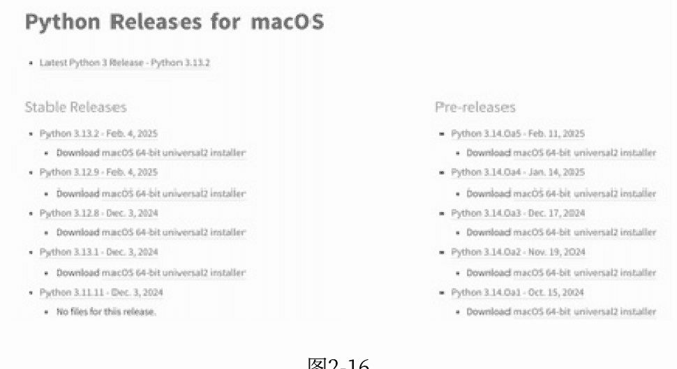

图2-16

##### 3.验证安装是否成功
安装结束后，在终端执行：

```
python3 --version
```

若返回类似 Python 3.x.x 的版本号，说明安装正常。

图2-17展示了版本验证的终端输出。

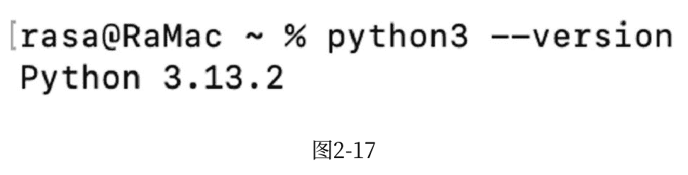

##### 4.Apple Silicon 适配说明
搭载 M1/M2 等 Apple Silicon 的 Mac，Python 3 默认兼容良好。若出现异常，可尝试 arch-arm64 brew install python 重新安装，或改用 Rosetta 模式运行。

#### 2.3.2 pip 包管理工具配置
pip 负责安装与管理第三方库，以下是常用配置要点。

- 检查 pip 是否就绪
在终端运行：

```
pip3 -V
```

有版本号返回即表示 pip 已可用。

如图2-18展示了 pip 版本查询结果。

```
rasa@RaMac ~ % pip3 -V
pip 25.0.1 from /Library/Frameworks/Python.framework/Versions/3.13/lib/python3.13/site-packages/pip (python 3.13)
```

图2-18

- 未安装时的手动补装
通常官网包或 Homebrew 安装时 pip 会一并带上。若缺失，可执行：

```
python -m ensurepip --default-pip
```

或下载官方安装脚本：

```
curl -o get-pip.py https://bootstrap.pypa.io/get-pip.py
python get-pip.py
```

- 可选的命令别名链接
想直接用 python 和 pip 代替 python3 和 pip3，可建立符号链接。操作前请评估影响，谨慎执行。

先确认路径：

```
which python3
which pip3
```

再创建链接：

#### 2.3.3 Python 虚拟环境搭建
建议为每个项目单独创建隔离环境，避免依赖冲突，保持项目整洁。

- 安装虚拟环境工具
Python 3.3+ 内置 venv 模块，可直接使用。若需要更强功能，可装 virtualenv：

```
pip install virtualenv
```

推荐使用自带的 venv，无需额外安装。

- 新建虚拟环境
在项目目录下执行：

```
python -m venv venv
```

名称可自定义。

- 激活环境
macOS/Linux 下使用：

```
source venv/bin/activate
```

- 在环境内安装依赖
激活后用 pip 安装所需包，包会写入当前虚拟环境：

```
pip install requests
```

- 退出环境
执行 deactivate 即可退出：

```
deactivate
```

#### 2.3.4 环境可用性测试
配置完成后做一次简单验证。

- 安装常用库
激活虚拟环境后安装 requests：

```
pip install requests
```

- 编写并运行测试脚本
在项目目录创建文件 HelloHarmony.py：

```
nano HelloHarmony.py
```

写入以下代码：

```
print("Hello, Harmony!")
```

保存后执行：

```
python HelloHarmony.py
```

若终端输出 “Hello, Harmony! ”，说明环境搭建成功。

图2-19展示了测试运行的效果。


图2-19

#### 2.3.5 PyCharm 集成开发环境【可选】
PyCharm 是功能完善的 Python IDE，能大幅提升编码与调试效率。

- 获取安装包
访问 PyCharm 官网下载页，下载 macOS 社区版：

```
https://www.jetbrains.com/pycharm/download/
```

- 完成安装
双击 .dmg，将 PyCharm 图标拖入 Applications 文件夹。

- 新建项目并配置解释器
启动 PyCharm，选择 Create New Project。创建时系统会提示选择解释器，点右侧齿轮>Add Interpreter→Add Local Interpreter，再指向已安装的 Python 3 路径。Homebrew 安装路径通常为 /usr/local/bin/python；若使用虚拟环境，则选择对应环境的解释器路径。

- 测试运行
在 PyCharm 中新建 HelloHarmony.py，写入：

```
print("Hello, Harmony!")
```

右键 Run 'HelloHarmony'，查看控制台输出：

```
Hello, Harmony!
```

至此，Mac 上 Python 3、pip、虚拟环境以及可选的 PyCharm 已全部就绪，可开始正式开发。

### 2.4 DeepSeek 模型吞吐量测试与接口访问
本节介绍如何借助 Ollama 调用本地大模型，并对不同 DeepSeek 模型的吞吐表现进行测试。Ollama 提供 Python 接口、HTTP API 及 OpenAI 兼容接口，开发者可按需选用。我们将演示安装、配置与使用流程。

#### 2.4.1 Ollama Python 接口
本小节聚焦 Ollama 的 Python 调用方式，支持流式、非流式以及多轮对话。

适用场景：通过 Python 脚本直接与本地模型交互，例如文本生成、聊天机器人等。

- 安装依赖
在终端执行：

```
pip install ollama
```

- 流式输出示例
适合逐步展示结果的场景，示例代码：

```
# -*- coding: utf-8 -*-
# 1.4/stream_output.py

import ollama

# 使用流式接口生成文本
stream = ollama.generate(stream=True, model='deepseek-r1:1.5b', prompt='Hello')
for chunk in stream:
    if not chunk['done']:
        print(chunk['response'], end='\n', flush=True)
    else:
        print('\n')
        print('----------------------------------------')
```

- 非流式一次性返回
无需逐字展示时使用：

```
# -*- coding: utf-8 -*-
# 1.4/non_stream_output.py

import ollama

# 使用非流式接口生成文本
content = ollama.generate(model='deepseek-r1:1.5b', prompt='Hello')
print(content['response'])
print('----------------------------------------')
```

- 对话式连续交互
支持多轮对话，构建聊天应用：

```
# -*- coding: utf-8 -*-
# 1.4/chat_interface.py

import ollama

# 使用对话接口
messages = [{"role": "user", "content": "Hello"}]
content = ollama.chat(model='deepseek-r1:1.5b', messages=messages)
print(content['message']['content'])
```

图2-20展示了 Python 流式接口交互效果。


图2-20

#### 2.4.2 Ollama API 接口
本小节介绍通过 HTTP API 调用模型，适合跨平台集成与远程调用。

适用场景：云端服务与本地模型联动，或需要跨平台请求时。

- 生成单次响应
使用 curl 发起 POST 请求：

```
curl http://localhost:11434/api/generate -d '{
  "model": "deepseek-r1:1.5b",
  "prompt": "Why is the sky blue?"
}'
```

- 多轮对话交互
通过 POST 请求实现连续对话：

```
curl http://localhost:11434/api/chat -d '{
  "model": "deepseek-r1:1.5b",
  "messages": [
    { "role": "user", "content": "Why is the sky blue?" }
  ]
}'
```

图2-21展示了 API 接口的调用效果。

```
rasa@RaMac ~ % curl http://localhost:11434/api/generate -d '{
  "model": "deepseek-r1:1.5b",
  "prompt": "Why is the sky blue?"
}'
{"model":"deepseek-r1:1.5b","created_at":"2025-02-16T05:52:58.929708Z","response":"\u003cthink\u003e","done":false}
{"model":"deepseek-r1:1.5b","created_at":"2025-02-16T05:52:58.945438Z","response":"\n\n","done":false}
{"model":"deepseek-r1:1.5b","created_at":"2025-02-16T05:52:58.961279Z","response":"\u003c/think\u003e","done":false}
{"model":"deepseek-r1:1.5b","created_at":"2025-02-16T05:52:58.977846Z","response":"\n\n","done":false}
{"model":"deepseek-r1:1.5b","created_at":"2025-02-16T05:52:58.994312Z","response":"The","done":false}
{"model":"deepseek-r1:1.5b","created_at":"2025-02-16T05:52:59.010307Z","response":" color","done":false}
{"model":"deepseek-r1:1.5b","created_at":"2025-02-16T05:52:59.027141Z","response":" of","done":false}
{"model":"deepseek-r1:1.5b","created_at":"2025-02-16T05:52:59.04403Z","response":" the","done":false}
{"model":"deepseek-r1:1.5b","created_at":"2025-02-16T05:52:59.060434Z","response":" sky","done":false}
{"model":"deepseek-r1:1.5b","created_at":"2025-02-16T05:52:59.077863Z","response":",","done":false}
{"model":"deepseek-r1:1.5b","created_at":"2025-02-16T05:52:59.095076Z","response":" known","done":false}
{"model":"deepseek-r1:1.5b","created_at":"2025-02-16T05:52:59.11491Z","response":" as","done":false}
{"model":"deepseek-r1:1.5b","created_at":"2025-02-16T05:52:59.128272Z","response":" a","done":false}
{"model":"deepseek-r1:1.5b","created_at":"2025-02-16T05:52:59.14435Z","response":" meteor","done":false}
{"model":"deepseek-r1:1.5b","created_at":"2025-02-16T05:52:59.160049Z","response":"ic","done":false}
{"model":"deepseek-r1:1.5b","created_at":"2025-02-16T05:52:59.176602Z","response":" color","done":false}
{"model":"deepseek-r1:1.5b","created_at":"2025-02-16T05:52:59.192877Z","response":",","done":false}
{"model":"deepseek-r1:1.5b","created_at":"2025-02-16T05:52:59.208611Z","response":" primarily","done":false}
{"model":"deepseek-r1:1.5b","created_at":"2025-02-16T05:52:59.224998Z","response":" results","done":false}
{"model":"deepseek-r1:1.5b","created_at":"2025-02-16T05:52:59.241253Z","response":" from","done":false}
{"model":"deepseek-r1:1.5b","created_at":"2025-02-16T05:52:59.256848Z","response":" the","done":false}
{"model":"deepseek-r1:1.5b","created_at":"2025-02-16T05:52:59.273141Z","response":" scattering","done":false}
{"model":"deepseek-r1:1.5b","created_at":"2025-02-16T05:52:59.289299Z","response":" of","done":false}
{"model":"deepseek-r1:1.5b","created_at":"2025-02-16T05:52:59.304859Z","response":" sunlight","done":false}
{"model":"deepseek-r1:1.5b","created_at":"2025-02-16T05:52:59.321296Z","response":" by","done":false}
{"model":"deepseek-r1:1.5b","created_at":"2025-02-16T05:52:59.337566Z","response":" particles","done":false}
{"model":"deepseek-r1:1.5b","created_at":"2025-02-16T05:52:59.353299Z","response":" in","done":false}
{"model":"deepseek-r1:1.5b","created_at":"2025-02-16T05:52:59.369659Z","response":" the","done":false}
{"model":"deepseek-r1:1.5b","created_at":"2025-02-16T05:52:59.385958Z","response":" Earth","done":false}
{"model":"deepseek-r1:1.5b","created_at":"2025-02-16T05:52:59.401598Z","response":"'s","done":false}
{"model":"deepseek-r1:1.5b","created_at":"2025-02-16T05:52:59.418062Z","response":" atmosphere","done":false}
{"model":"deepseek-r1:1.5b","created_at":"2025-02-16T05:52:59.434291Z","response":",","done":false}
{"model":"deepseek-r1:1.5b","created_at":"2025-02-16T05:52:59.450057Z","response":" These","done":false}
{"model":"deepseek-r1:1.5b","created_at":"2025-02-16T05:52:59.467055Z","response":" particles","done":false}
{"model":"deepseek-r1:1.5b","created_at":"2025-02-16T05:52:59.482795Z","response":",","done":false}
{"model":"deepseek-r1:1.5b","created_at":"2025-02-16T05:52:59.498542Z","response":" including","done":false}
{"model":"deepseek-r1:1.5b","created_at":"2025-02-16T05:52:59.515519Z","response":" both","done":false}
{"model":"deepseek-r1:1.5b","created_at":"2025-02-16T05:52:59.531147Z","response":" neutral","done":false}
{"model":"deepseek-r1:1.5b","created_at":"2025-02-16T05:52:59.546919Z","response":" and","done":false}
{"model":"deepseek-r1:1.5b","created_at":"2025-02-16T05:52:59.564004Z","response":" charged","done":false}
{"model":"deepseek-r1:1.5b","created_at":"2025-02-16T05:52:59.579752Z","response":" particles","done":false}
{"model":"deepseek-r1:1.5b","created_at":"2025-02-16T05:52:59.595569Z","response":" like","done":false}
{"model":"deepseek-r1:1.5b","created_at":"2025-02-16T05:52:59.611977Z","response":" oxygen","done":false}
{"model":"deepseek-r1:1.5b","created_at":"2025-02-16T05:52:59.627811Z","response":" atoms","done":false}
{"model":"deepseek-r1:1.5b","created_at":"2025-02-16T05:52:59.643583Z","response":",","done":false}
{"model":"deepseek-r1:1.5b","created_at":"2025-02-16T05:52:59.660127Z","response":" are","done":false}
{"model":"deepseek-r1:1.5b","created_at":"2025-02-16T05:52:59.676452Z","response":" often","done":false}
{"model":"deepseek-r1:1.5b","created_at":"2025-02-16T05:52:59.692219Z","response":" referred","done":false}
{"model":"deepseek-r1:1.5b","created_at":"2025-02-16T05:52:59.708678Z","response":" to","done":false}
{"model":"deepseek-r1:1.5b","created_at":"2025-02-16T05:52:59.725021Z","response":" as","done":false}
{"model":"deepseek-r1:1.5b","created_at":"2025-02-16T05:52:59.740702Z","response":" "","done":false}
{"model":"deepseek-r1:1.5b","created_at":"2025-02-16T05:52:59.757252Z","response":"sm","done":false}
```

图2-21

#### 2.4.3 用 OpenAI 接口无缝调用 Ollama

这一部分演示如何借助 OpenAI 兼容的接口去驱动 Ollama 模型，对已经熟悉 OpenAI 生态的开发者来说上手成本很低。

适用人群与场景：如果你已经在项目里用惯了 OpenAI API，现在想把后端切到本地的 Ollama，这个迁移路径会非常顺滑，改动也小。

##### ● 安装 openai SDK

打开终端，执行安装命令来引入 OpenAI 客户端库：

```
pip install openai
```

##### ● 示例代码：通过 OpenAI 方式对话

下面这段代码说明了如何用 OpenAI 的调用习惯与 Ollama 本地模型交互：

```python
# -*- coding: utf-8 -*-
# 1.4/openai_interface.py

from openai import OpenAI

client = OpenAI(
    base_url='http://localhost:11434/v1/',
    api_key='ollama',  # 这里的 API Key 可忽略
)

chat_completion = client.chat.completions.create(
    messages=[
        {
            'role': 'user',
            'content': 'Hello',
        }
    ],
    model='deepseek-r1:1.5b',
)

print(chat_completion)
print(chat_completion.choices[0].message.content)
```

图2-22 就展示了这种调用方式下的实际交互效果。


图2-22

#### 2.4.4 服务配置与连通性验证

本节讲清如何把 Ollama 服务搭起来并验证接口是否能正常连通本地模型。

- ● 启动本地服务

在终端里运行启动命令，让 Ollama 在本地跑起来：

```
ollama serve
```

- ● 检查服务是否可达

用浏览器或者任意 HTTP 调试工具访问：

```
http://localhost:11434
```

如果能正常返回，说明服务已经成功启动并监听。

- ● 接口连通性测试

分别执行前文的 Python 脚本，或直接用 curl 发请求，确认能够与模型完成交互并得到预期输出。

#### 2.4.5 实测吞吐：不同体量 DeepSeek 在 M2 Pro 上的表现

本节在 MacBook Pro M2 Pro、16GB 内存的机器上，对 deepseek-r1:1.5b、deepseek-r1:7b、deepseek-r1:8b、deepseek-r1:14b 四个模型做了吞吐量实测。

##### 1. 测试机配置

本次压测所用 Mac 的具体配置如下，仅作参考。

机型：MacBook Pro 13 英寸 2022 版本。
处理器：Apple M2 Pro。
内存：16 GB 统一内存。
存储：1 TB SSD。
系统：macOS Sequoia 16.3.1。
Ollama 版本：0.5.7。
补充说明：测试环境为 macOS + Apple Silicon。Ollama 对 Apple 芯片做了针对性优化，所以在 M 系列 Mac 上跑本地模型通常效率不错。换到 Linux、Windows 或其他硬件配置，吞吐数据会有所差异，请结合实际环境看待。

##### 2. 测试代码（Python 接口）

借助 Python 接口并发地对模型进行吞吐压测：

```python
# -*- coding: utf-8 -*-
# 1.4/throughput_test.py

import ollama
import time
import argparse
from concurrent.futures import ThreadPoolExecutor
from statistics import mean, stdev

def test_request(model, prompt):
    """发送单个请求并记录性能指标"""
    start_time = time.time()
    try:
        response = ollama.generate(model=model, prompt=prompt)
        elapsed = time.time() - start_time

        # 提取 Token 使用信息（假设 API 返回这些字段）
        prompt_tokens = response.get('prompt_tokens', 0)
        response_tokens = response.get('response_tokens', 0)

        return {
            'success': True,
            'time': elapsed,
            'prompt_tokens': prompt_tokens,
            'response_tokens': response_tokens
        }
    except Exception as e:
        return {
            'success': False,
            'error': str(e),
            'time': time.time() - start_time
        }

def run_test(model, params):
    """执行单次测试运行"""
    # 预热阶段
    for _ in range(params['num_warmup']):
        test_request(model, params['prompt'])

    # 正式测试
    start_time = time.time()
    with ThreadPoolExecutor(max_workers=params['concurrency']) as executor:
        futures = [executor.submit(test_request, model, params['prompt'])
                   for _ in range(params['num_requests'])]

    # 收集结果
    results = [f.result() for f in futures]
    end_time = time.time()

    # 处理统计数据
    success_results = [r for r in results if r['success']]
    success_count = len(success_results)
    failure_count = params['num_requests'] - success_count

    # 时间统计
    total_time = end_time - start_time
    latencies = [r['time'] for r in success_results]

    # Token 统计（如果可用）
    prompt_tokens = sum(r.get('prompt_tokens', 0) for r in success_results)
    response_tokens = sum(r.get('response_tokens', 0) for r in success_results)

    return {
        'total_time': total_time,
        'success_count': success_count,
        'failure_count': failure_count,
        'latencies': latencies,
        'prompt_tokens': prompt_tokens,
        'response_tokens': response_tokens
    }

def analyze_results(results, params):
    """分析多次测试结果并生成报告"""
    # 合并多次运行的数据
    all_latencies = []
    all_throughputs = []
    all_token_throughputs = []

    for run in results:
        if run['success_count'] == 0:
            continue

        # 请求吞吐量
        all_throughputs.append(run['success_count'] / run['total_time'])

        # Token 吞吐量 (如果可用)
        total_tokens = run['prompt_tokens'] + run['response_tokens']
        if total_tokens > 0:
            all_token_throughputs.append(total_tokens / run['total_time'])

        # 合并延迟数据
        all_latencies.extend(run['latencies'])

    # 生成统计信息
    stats = {
        '请求成功率': mean([run['success_count'] / params['num_requests'] for run in results]),
        '平均吞吐量 (QPS)': mean(all_throughputs) if all_throughputs else 0,
        '吞吐量标准差': stdev(all_throughputs) if len(all_throughputs) > 1 else 0,
        '平均延迟 (s)': mean(all_latencies) if all_latencies else 0,
        '延迟标准差': stdev(all_latencies) if len(all_latencies) > 1 else 0,
        '最大延迟': max(all_latencies) if all_latencies else 0,
        'P95 延迟': sorted(all_latencies)[int(len(all_latencies) * 0.95)] if all_latencies else 0
    }

    if all_token_throughputs:
        stats.update({
            '平均Token吞吐量 (tok/s)': mean(all_token_throughputs),
            'Token吞吐量标准差': stdev(all_token_throughputs) if len(all_token_throughputs) > 1 else 0
        })

    return stats

def main():
    """主测试程序"""
    parser = argparse.ArgumentParser(description='模型吞吐量测试工具')
    parser.add_argument('--models', nargs='+', required=True, help='要测试的模型名称列表')
    parser.add_argument('-n', '--num-requests', type=int, default=100, help='每个测试的请求总数')
    parser.add_argument('-c', '--concurrency', type=int, default=10, help='并发请求数量')
    parser.add_argument('-w', '--num-warmup', type=int, default=3, help='预热请求次数')
    parser.add_argument('-r', '--num-runs', type=int, default=3, help='每个模型的测试次数')
    parser.add_argument('-p', '--prompt', default='Test', help='使用的测试提示语')
    args = parser.parse_args()

    test_params = {
        'num_requests': args.num_requests,
        'concurrency': args.concurrency,
        'num_warmup': args.num_warmup,
        'prompt': args.prompt
    }

    for model in args.models:
        print(f"\n{'=' * 40}\n开始测试模型: {model}\n{'=' * 40}")

        # 执行多次测试
        all_results = []
        for i in range(args.num_runs):
            print(f"\n测试运行 {i + 1}/{args.num_runs}...")
            result = run_test(model, test_params)
            all_results.append(result)
            print(f"完成 {result['success_count']}/{test_params['num_requests']} 请求 "
                  f"(QPS: {result['success_count'] / result['total_time']:.2f})")

        # 生成分析报告
        stats = analyze_results(all_results, test_params)

        # 打印报告
        print(f"\n{'-' * 40}\n测试结果汇总 ({model}):")
        print(f"平均吞吐量: {stats['平均吞吐量 (QPS)']:.2f} ± {stats['吞吐量标准差']:.2f} QPS")
        print(f"请求成功率: {stats['请求成功率']:.3%}")
        print(f"延迟统计: {stats['平均延迟 (s)']:.3f}s ± {stats['延迟标准差']:.3f}")
        print(f"最大延迟: {stats['最大延迟']:.3f}s | P95 延迟: {stats['P95 延迟']:.3f}s")

        if '平均Token吞吐量 (tok/s)' in stats:
            print(f"Token 吞吐量: {stats['平均Token吞吐量 (tok/s)']:.0f} ± "
                  f"{stats['Token吞吐量标准差']:.0f} tokens/s")

if __name__ == "__main__":
    main()
```

##### 3. 启动测试
按下面指令执行，即可进入测试阶段：

```
python throughput_test.py --models deepseek-r1:1.5b deepseek-r1:7b deepseek-r1:8b deepseek-r1:14b
```

##### 4. 测试结果概览
图2-23 记录了 deepseek-r1:1.5b 在吞吐量测试中的表现。

```
========================================
开始测试模型：deepseek-r1:1.5b
========================================

测试运行 1/3...
完成 100/100 请求 (QPS: 2.75)

测试运行 2/3...
完成 100/100 请求 (QPS: 2.74)

测试运行 3/3...
完成 100/100 请求 (QPS: 2.77)

----------------------------------------
测试结果汇总 (deepseek-r1:1.5b):
平均吞吐量：2.75 ± 0.02 QPS
请求成功率：100.000%
延迟统计：3.495s ± 0.649
最大延迟：5.970s | P95延迟：4.352s
```

图2-23

图2-24 呈现了 deepseek-r1:7b 的吞吐量数据。

```
========================================
开始测试模型：deepseek-r1:7b
========================================

测试运行 1/3...
完成 100/100 请求 (QPS: 0.32)

测试运行 2/3...
完成 100/100 请求 (QPS: 0.70)

测试运行 3/3...
完成 100/100 请求 (QPS: 0.23)

----------------------------------------
测试结果汇总 (deepseek-r1:7b):
平均吞吐量：0.42 ± 0.25 QPS
请求成功率：100.000%
延迟统计：24.716s ± 30.063
最大延迟：273.545s | P95延迟：47.048s
```

图2-24

图2-25 展示了 deepseek-r1:8b 的吞吐量情况。

```
========================================
开始测试模型：deepseek-r1:8b
========================================

测试运行 1/3...
完成 100/100 请求 (QPS: 0.17)

测试运行 2/3...
完成 100/100 请求 (QPS: 0.37)

测试运行 3/3...
完成 100/100 请求 (QPS: 0.13)

----------------------------------------
测试结果汇总 (deepseek-r1:8b):
平均吞吐量：0.22 ± 0.13 QPS
请求成功率：100.000%
延迟统计：46.065s ± 70.575
最大延迟：741.759s | P95延迟：184.591s
```

图2-25

图2-26 体现了 deepseek-r1:14b 的吞吐量测试结果。

##### 5. 数据解读
整体来看，参数规模越大，吞吐能力越弱、响应延迟越高，与预判相符。得益于体量小，deepseek-r1:1.5b 的吞吐表现明显优于其余版本，更适合对实时响应要求苛刻的场景；deepseek-r1:14b 虽然吞吐偏低，但能力更强，适合追求输出质量的场景。

注意：吞吐量受硬件配置、模型版本、Ollama 版本、网络状况及并发请求数等多方面影响，上述数据仅作参考，落地时请结合自身环境进行验证与调优。

#### 2.4.6 排错要点汇总
- (1) 服务是否已启动：确认 Ollama 已通过 ollama serve 正常运行。
- (2) 端口是否可用：检查默认端口 11434 是否被占用，可用 lsof -i: 11434（macOS/Linux）或 netstat -ano | findstr 11434（Windows）排查。
- (3) 网络连通性：若远程调用接口，需保证网络通畅且防火墙未拦截。
- (4) 模型是否就绪：执行 ollama list 核实目标模型是否已拉取到本地。
- (5) 资源是否充足：查看 CPU、内存占用，运行可能受资源瓶颈限制。
- (6) 服务日志：阅读 Ollama 服务端日志，通常能定位更具体的错误信息。

## 第3章 ArkTS与DeepSeek直连交互
本章聚焦 ArkTS 与 DeepSeek 模型直接对话的完整流程。围绕基础对话、情感化创作、情绪驱动以及多语言翻译等典型场景，演示如何通过 ArkTS 直接请求模型接口，完成实时数据交互。

### 3.1 基础交互：ArkTS调用DeepSeek的实现方式
本节演示如何搭建一个简易应用，实现 ArkTS 与 DeepSeek 模型的交互。开发者可借此学习调用后端模型、获取生成内容并展示给用户的全过程。

#### 3.1.1 项目创建与初始化
本小节将初始化一个 ArkTS 工程，并加入一个按钮来触发与 DeepSeek 的交互，为后续功能开发打下框架基础。

##### 1. 新建工程
在 DevEco Studio 中新建一个 ArkTS 工程，工程名称设为 DeepSeekInteractionApp。

##### 2. 目录结构规划
按需创建如下目录结构来管理代码文件：

```
src/
├── main/
│   ├── ets/
│   │   ├── configs/          # 配置文件目录
│   │   │   └── Config.ets    # 配置文件
│   │   ├── pages/            # 页面文件
│   │   │   └── Index.ets     # 首页
│   │   ├── services/         # 服务层，处理与模型的交互
│   │   │   └── ModelService.ets # 模型服务
│   │   ├── types/            # 类型定义
│   │   │   └── ModelTypes.ets # 模型类型定义
│   │   └── utils/            # 工具函数
│   │       ├── HttpClient.ets # HTTP 客户端
│   │       └── StreamingUtils.ets # 流式数据处理工具
│   └── module.json5          # 模块配置文件
```

#### 3.1.2 授权网络访问，连接模型API
这里要做的，是给应用打开网络通道，让它能正常连上DeepSeek模型服务。核心操作是在module.json5里声明对应权限，这样后续的数据请求和返回解析才能顺畅进行，不会卡在权限层。

```json
{
    "module": {
        "requestPermissions": [
            {
                "name": "ohos.permission.INTERNET"  // 声明访问互联网的权限
            }
        ]
    }
}
```

#### 3.1.3 设计模型服务层，实现对话交互
这一部分聚焦ModelService的搭建。服务层承担发起请求、接收DeepSeek返回的核心任务，并且支持流式输出。内容是边生成边推送，前端就能做到即时呈现，不用等整段文字结束。

```typescript
// src/main/ets/services/ModelService.ets

import { httpRequestText } from '../utils/HttpClient'; // 导入 HTTP 请求方法
import { http } from '@kit.NetworkKit'; // 导入自定义网络模块
import { RequestBody, ChatResponse } from '../types/ModelTypes'; // 导入类型

export class ModelService {
  private apiUrl: string;
  private modelName: string;

  constructor(apiUrl: string, modelName: string) {
    this.apiUrl = apiUrl;
    this.modelName = modelName;
  }

  /**
   * 处理流式返回的响应数据
   * @param chunk - 每个流式返回的数据块
   * @param onChunkReceived - 可选的回调函数，用于处理每个数据块
   * @returns 解析后的内容
   */
  private processResponseChunk(chunk: string, onChunkReceived?: (chunk: string) => void): string {
    try {
      const response: ChatResponse = JSON.parse(chunk);
      const content = response.message?.content;
      if (content) {
        onChunkReceived?.(content); // 调用回调函数处理每个数据块
        return content;
      }
      return '';
    } catch (parseError) {
      console.error('解析响应数据块时出错:', parseError);
      throw new Error(`解析错误: ${parseError.message}`); // 提供详细错误信息
    }
  }

  /**
   * 与模型交互，发送请求并获取响应
   * @param prompt - 用户输入的提示内容
   * @param onChunkReceived - 可选的回调函数，用于处理流式返回的每个数据块
   * @returns 完整的响应数据
   */
  public async queryModel(
    prompt: string,
    onChunkReceived?: (chunk: string) => void
  ): Promise<string> {
    const requestBody: RequestBody = {
      model: this.modelName,
      messages: [{ role: 'user', content: prompt }],
    };

    console.info('发送请求，载荷:', requestBody);

    try {
      let fullResponse = '';

      // 使用 httpRequest 发送请求并处理流式响应
      await httpRequestText(this.apiUrl, http.RequestMethod.POST,
        JSON.stringify(requestBody), 60000,
        (chunk: string) => {
          const content = this.processResponseChunk(chunk, onChunkReceived);
          fullResponse += content;
        });

      console.info('请求完成');
      return fullResponse; // 返回完整的响应数据
    } catch (error) {
      console.error('与模型交互失败:', error);
      throw new Error(`与模型交互失败: ${error instanceof Error ? error.message : error}`);
    }
  }

  /**
   * 发送消息并获取响应，支持流式输出
   * @param prompt - 用户输入的提示内容
   * @param onChunkReceived - 可选的回调函数，用于处理流式返回的每个数据块
   * @returns 完整的响应数据
   */
  public async fetchResponse(
    prompt: string,
    onChunkReceived?: (chunk: string) => void
  ): Promise<string> {
    // 直接调用 queryModel 方法，避免重复代码
    return this.queryModel(prompt, onChunkReceived);
  }
}
```

#### 3.1.4 搭建界面，实时呈现生成结果
接下来是页面部分的落地。用一个触发按钮配上文本展示区，把模型的输出可视化。用户按下按钮后，后台立刻向DeepSeek发起调用，生成过程以逐字或逐句的方式呈现出来，形成流畅的实时推理体验。

```typescript
// src/main/ets/pages/Index.ets

import { config } from '../configs/Config'; // 导入配置文件
import { ModelService } from '../services/ModelService'; // 导入模型服务

@Entry
@Component
struct Index {
  @State resultText: string = ''; // 存储响应结果的文本

  /**
   * 根据按钮点击获取数据，并生成响应文本
   * @description 该方法会调用 ModelService 获取生成的诗歌文本，并逐块更新结果文本
   */
  async fetchData() {
    // 创建 ModelService 实例，传入配置的 API 地址和模型名称
    const modelService = new ModelService(config.ollamaApiUrl, config.modelName);

    // 定义用于生成诗歌的提示词
    const poetryPrompt = 'What is the meaning of life?';

    // 清空之前的结果，确保每次点击时更新文本
    this.resultText = '';

    try {
      // 调用模型服务的 fetchResponse 方法，并逐块处理结果
      await modelService.fetchResponse(poetryPrompt, (partialResult: string) => {
        console.log('Soothing poetry result chunk:', partialResult); // 输出当前获取的诗歌片段
        this.resultText += partialResult; // 将返回的每一块结果追加到结果文本中
      });
    } catch (error) {
      console.error('Error while fetching data:', error); // 错误日志
    }
  }

  build() {
    // 页面布局结构
    Column() {
      // 获取数据按钮
      Button('Fetch Data')
        .width('match_parent') // 按钮宽度设置为填满父容器
        .height(50) // 设置按钮的高度
        .onClick(() => this.fetchData()) // 点击按钮时调用 fetchData 方法

      // 显示响应结果的滚动区域
      Scroll() {
        Column() {
          // 显示获取的文本结果
          Text(this.resultText)
            .width('match_parent') // 设置文本宽度填满父容器
            .height('match_content') // 文本高度自适应
            .margin({ top: 20 }) // 上边距
        }
        .width('match_parent') // 设置滚动区域宽度为父容器的宽度
        .height('match_content') // 设置滚动区域高度自适应
      }
      .width('match_parent') // 设置滚动区域宽度为父容器的宽度
      .height('match_content') // 设置滚动区域高度自适应
    }
    .width('100%') // 设置父容器宽度为100%
    .height('100%') // 设置父容器高度为100%
    .padding(20) // 添加内边距
    .align(Alignment.Center) // 居中对齐
  }
}
```

#### 3.1.5 实战代码：调用DeepSeek进行推理
这一小节用具体的ArkTS代码演示如何发起推理请求，并把返回内容逐步渲染到界面上，帮助读者快速理解调用流程。

```typescript
const modelService = new ModelService(config.ollamaApiUrl, config.modelName);
const prompt = 'What is the meaning of life?';

modelService.fetchResponse(prompt, (partialResult: string) => {
  console.log('Soothing poetry result chunk:', partialResult);
  this.resultText += partialResult;
});
```

#### 3.1.6 运行项目并检查交互效果
启动后要确认点击能否真正触发推理，并且生成的文本可以完整流畅地展示出来。

##### 1. 启动应用
先确认本地模型环境已经就绪，然后通过命令行启动Ollama服务：

```bash
ollama serve
```

若提示端口已被占用，说明服务正在运行，无需重复启动。

##### 2. 验证应用
打开应用后检查页面是否正常。按下“Fetch Data”按钮，程序会通过HTTP向模型请求数据并逐段输出。图3-1记录了模拟器上成功展示生成内容的画面。


学完这一块，你就能独立搭起一个基础的ArkTS应用，并实现与DeepSeek的联动，让生成内容动态出现在界面上。

### 3.2 个性化情感创作：人设驱动的暗恋诗
这一章节讲解如何把情感分析与大模型结合，产出专属的暗恋情诗。思路是从构建人物模型入手，到配置生成服务，再到展示诗歌和反馈，形成完整的个性化创作闭环，最后配合示例代码和验收步骤收尾。

#### 3.2.1 搭建人物情感档案
本小节讲的是先建立情感人物模型，为后续分析和作诗打底。通过为暗恋者和被暗恋者设定性格、习惯等标签，模型才有情感依据。这些设定直接决定诗句的基调和情绪走向，让输出更贴合用户期望。

```typescript
// src/main/ets/services/PromptService.ets

export class PromptService {
    /**
     * 生成情诗的提示语
     * @param theme - 情诗主题
     * @param loverName - 暗恋者名字
     * @param poetTrait - 暗恋者性格特点
     * @param belovedName - 被暗恋者名字
     * @param belovedTrait - 被暗恋者性格特点
     * @param count - 情诗数量
     * @returns {string} - 生成的情诗提示语
     */
    public createPoetryPrompt(
        theme: string,
        loverName: string,
        poetTrait: string,
        belovedName: string,
        belovedTrait: string,
        count: string
    ): string {
        return [
            `请根据情诗的主题“${theme}”，以及两位情感主体—暗恋者“${loverName}”（性格特点：“${poetTrait}”）和被暗恋者“${belovedName}”（性格特点：“${belovedTrait}”），创作${count}首暗恋情诗。这些情诗应深入探索情感和幻境的交织，展现暗恋者对被暗恋者深沉的爱恋和梦境中的奇异想象。`,
            '',
            '要求如下：',
            '1. 情诗必须与主题“${theme}”紧密相关，引发读者的情感共鸣。',
            '2. 情诗应富有诗意，激发读者的想象力。',
            '3. 每首情诗都应突出展示暗恋者与被暗恋者之间的情感关系。',
            '4. 语言应优美流畅，吸引读者的注意力，增强情诗的吸引力。',
            '5. 情诗内容应贴合人物的性格特点和情感状态。'
        ].join('\n');
    }
}
```

#### 3.2.2 人设驱动的情诗生成服务
这里介绍如何把情感分析结果转化成提示词，再交由DeepSeek生成。通过ModelIntegrationService把PromptService和ModelService串联起来，先用分析结果生成合适的Prompt，再调用模型产出符合情感主题的诗作，实现从人设到成品的自动化流程。

```typescript
// src/main/ets/services/ModelIntegrationService.ets

import { PromptService } from './PromptService';
import { ModelService } from './ModelService';

export class ModelIntegrationService {
  private promptService: PromptService;
  private modelService: ModelService;

  /**
   * 构造函数，初始化 PromptService 和 ModelService
   * @param apiUrl - 模型服务的 API 地址
   * @param modelName - 使用的模型名称
   */
  constructor(apiUrl: string, modelName: string) {
    this.promptService = new PromptService(); // 实例化 PromptService
    this.modelService = new ModelService(apiUrl, modelName); // 实例化 ModelService
  }

  /**
   * 统一调用 ModelService 获取流式响应的方法
   * @param prompt - 提示词
   * @param onChunkReceived - 回调函数，用于处理流式传出的结果
   */
  private async fetchResponseFromModel(prompt: string, onChunkReceived: (chunk: string) => void): Promise<void> {
    try {
      await this.modelService.fetchResponse(prompt, onChunkReceived); // 获取模型响应
    } catch (error) {
      console.error('请求模型响应失败:', error);
      throw new Error('请求模型响应失败: ' + error.message);
    }
  }

  /**
   * 使用 PromptService 创建情诗生成的提示语，并调用 ModelService 获取响应
   * @param theme - 情诗主题
   * @param loverName - 暗恋者名字
   * @param poetTrait - 暗恋者性格特点
   * @param belovedName - 被暗恋者名字
   * @param belovedTrait - 被暗恋者性格特点
   * @param count - 生成的情诗数量
   * @param onChunkReceived - 接收数据块的回调函数
   */
  public async generateSoothingPoetry(
      theme: string,
      loverName: string,
      poetTrait: string,
      belovedName: string,
      belovedTrait: string,
      count: string,
      onChunkReceived: (chunk: string) => void
  ): Promise<void> {
      const poetryPrompt = this.promptService.createPoetryPrompt(
          theme, loverName, poetTrait, belovedName, belovedTrait, count
      );
      await this.fetchResponseFromModel(poetryPrompt, onChunkReceived);
  }
}
```

#### 3.2.3 诗意呈现与情绪回响

本节会具体说明用户页如何把AI生成的情诗呈现出来并同步给予情感反馈。依托 ModelIntegrationService 以及定制化的诗歌提示词，应用可以创作出情绪饱满的诗作，并实时推到页面上供用户查看。用户能看到与自身情绪状态相契合的作品，收获真正个性化的情感表达体验。

```typescript
// src/main/ets/pages/Index.ets

import { config } from '../configs/Config'; // 导入配置文件
import { ModelIntegrationService } from '../services/ModelIntegrationService';
// 导入模型集成服务

/**
 * 标签组件，用于显示文本
 */
@Component
struct Label {
  @State text: string = ''; // 标签内容

  build() {
      Text(this.text)
          .fontSize(18)
          .fontColor(Color.Grey)
          .margin({ bottom: 5 });
  }
}

@Entry
@Component
struct Index {
    @State resultText: string = ''; // 存储结果文本
    @State theme: string = '爱情主题'; // 主题
    @State loverName: string = '小明'; // 暗恋者名字
    @State poetTrait: string = '温柔'; // 暗恋者性格特点
    @State belovedName: string = '小红'; // 被暗恋者名字
    @State belovedTrait: string = '聪明'; // 被暗恋者性格特点
    @State count: string = '1'; // 将数量存储为字符串

    /**
     * 生成抚慰诗歌并更新结果文本的函数
     * @param modelService - ModelIntegrationService 实例
     * @param theme - 诗歌主题
     * @param loverName - 暗恋者名字
     * @param poetTrait - 暗恋者性格特点
     * @param belovedName - 被暗恋者名字
     * @param belovedTrait - 被暗恋者性格特点
     * @param count - 生成诗歌的数量
     * @returns Promise<void> - 更新 resultText, 无返回值
     */
    async generatePoetryAndUpdateResult(modelService: ModelIntegrationService,
    theme: string,
        loverName: string,
        poetTrait: string,
        belovedName: string,
        belovedTrait: string,
        count: string): Promise<void> {
        this.resultText = ''; // 清空现有结果

        try {
            console.log('\nStarting soothing poetry generation:');
            await modelService.generateSoothingPoetry(theme,
                loverName,
                poetTrait,
                belovedName,
                belovedTrait,
                count, (partialResult: string) => {
                    console.log('Soothing poetry result chunk:', partialResult);
                    this.resultText += partialResult; // 累加生成的诗歌片段
                });
        } catch (error) {
            console.error('Error during poetry generation:', error); // 错误日志输出
        }
    }

    /**
     * 根据按钮标签获取聊天响应并更新背景颜色和生成诗歌
     * @param buttonLabel - 被点击的按钮标签
     */
    async fetchChatResponse() {
        const integrationService =
            new ModelIntegrationService(config.ollamaApiUrl, config.modelName); // 初始化集成服务
        // 调用生成诗歌的函数
        this.generatePoetryAndUpdateResult(integrationService, this.theme,
            this.loverName, this.poetTrait, this.belovedName, this.belovedTrait, this.count);
    }

    build() {
        Row() {
            Column() {
                // 主题输入框
                Column() {
                    Label({ text: '主题' }); // 使用封装后的 Label 组件
                    TextInput({ text: this.theme, placeholder: '请输入主题' })
                        .onChange((value) => this.theme = value)
                        .backgroundColor(Color.Grey)
                        .fontColor(Color.White)
                        .fontSize(18)
                        .borderRadius(5)
                        .padding(10)
                }
                .backgroundColor(Color.Black)
                .padding(10)
                .borderRadius(10)
                .margin({ top: 10, bottom: 10 })

                // 暗恋者名字输入框
                Column() {
                    Label({ text: '暗恋者名字' }); // 使用封装后的 Label 组件
                    TextInput({ text: this.loverName, placeholder: '请输入暗恋者名字' })
                        .onChange((value) => this.loverName = value)
                        .backgroundColor(Color.Grey)
                        .fontColor(Color.White)
                        .fontSize(18)
                        .borderRadius(5)
                        .padding(10)
                }
                .backgroundColor(Color.Black)
                .padding(10)
                .borderRadius(10)
                .margin({ top: 10, bottom: 10 })

                // 暗恋者性格特点输入框
                Column() {
                    Label({ text: '暗恋者性格特点' }); // 使用封装后的 Label 组件
                    TextInput({ text: this.poetTrait, placeholder: '请输入暗恋者性格特点' })
                        .onChange((value) => this.poetTrait = value)
                        .backgroundColor(Color.Grey)
                        .fontColor(Color.White)
                        .fontSize(18)
                        .borderRadius(5)
                        .padding(10)
                }
                .backgroundColor(Color.Black)
                .padding(10)
                .borderRadius(10)
                .margin({ top: 10, bottom: 10 })

                // 被暗恋者名字输入框
                Column() {
                    Label({ text: '被暗恋者名字' }); // 使用封装后的 Label 组件
                    TextInput({ text: this.belovedName, placeholder: '请输入被暗恋者名字' })
                        .onChange((value) => this.belovedName = value)
                        .backgroundColor(Color.Grey)
                        .fontColor(Color.White)
                        .fontSize(18)
                        .borderRadius(5)
                        .padding(10)
                }
                .backgroundColor(Color.Black)
                .padding(10)
                .borderRadius(10)
                .margin({ top: 10, bottom: 10 })

                // 被暗恋者性格特点输入框
                Column() {
                    Label({ text: '被暗恋者性格特点' }); // 使用封装后的 Label 组件
                    TextInput({ text: this.belovedTrait, placeholder: '请输入被暗恋者性格特点' })
                        .onChange((value) => this.belovedTrait = value)
                        .backgroundColor(Color.Grey)
                        .fontColor(Color.White)
                        .fontSize(18)
                        .borderRadius(5)
                        .padding(10)
                }
                .backgroundColor(Color.Black)
                .padding(10)
                .borderRadius(10)
                .margin({ top: 10, bottom: 10 })

                // 获取数据按钮
                Button('获取数据')
                    .width('match_parent')
                    .height(50)
                    .backgroundColor(Color.Gray)
                    .fontColor(Color.White)
                    .fontSize(18)
                    .borderRadius(10)
                    .onClick(() => this.fetchChatResponse())
                    .margin({ top: 20, bottom: 20 })
            }
            .width('50%')
            .padding(20)
            .backgroundColor(Color.Gray)
            .align(Alignment.Center)

            // 右侧滚动区域用于显示结果
            Scroll() {
                Column() {
                    Text(this.resultText)
                        .width('match_parent')
                        .height('match_content')
                        .fontColor(Color.White)
                        .padding(10)
                        .backgroundColor(Color.Grey)
                        .borderRadius(10)
                        .margin({ top: 20, bottom: 20 })
                }
                .width('100%')
                .height('match_content')
            }
            .width('50%')
            .padding(20)
        }
        .width('100%')
        .height('100%')
        .padding(20)
        .backgroundColor(Color.Gray)
    }
}
```

#### 3.2.4 情感诗生成代码演示

本部分围绕应用内实现情绪化写诗的落地思路展开。依托前面已搭好的服务体系，把情感识别的结果接入 DeepSeek 大模型，让生成文本能够贴合使用者描述的当下心境。随后给出一段可直接运行的代码片段，说明如何利用交互控件触发生成请求，并把返回的诗作实时渲染到页面上。

```typescript
// src/main/ets/pages/Index.ets

// 上节中的代码继续使用，具体包括从用户输入中获取数据，并调用 ModelIntegrationService 来生成诗歌。
```

#### 3.2.5 运行与效果校验

本段说明如何启动系统并对情绪创作全链路进行核验。先确保各依赖服务正常在线、界面完整加载，再走通从情绪捕捉到文本输出的闭环，以便判断最终呈现是否达标。

程序跑起来后，操作界面中的“获取数据”控件，系统会立刻产出一首情绪浓度很高的诗作。此时可把产出与使用者设定的情绪主旨以及前序的解析结论做对照，检查语义呼应是否到位。

图3-2、图3-3 呈现了本次生成的样例。

## 《暗恋者》

窗外的晚霞温柔地洒在窗台上

我站在小明房间门口

那扇木门轻轻摇晃着

是他的记忆里最温暖的光

他站在玻璃壁上

目光如炬，却凝定得让人窒息

他轻手轻脚，将月光捧在怀中

她的手指在颤抖，却指节分明

她从未让任何人相信

我看见了你的全部，你只是一粒星辰

月光穿透玻璃，在空中折射出六棱镜般的光芒

它温柔地触碰着他的心口

那是最深处的共鸣

我听见了自己的呼吸声

是她用心灵编织成的光

她的衣裙在风中轻轻飘动

却掩盖不住那份坚定

她握着我的手，掌心里全是热泪

是那双深邃的大眼睛

温暖到难以置信

它将所有的爱都装进了一个小盒子

里头，是永恒的爱意

而我，则站在窗台上，看着月光

仿佛看到了一个永恒的夜晚

她的影子像星辰一样永恒

而我却在这片黑暗中，等待着

那个黎明

那是她对我的承诺

### 3.3 情绪驱动的疗愈诗实践

本小节阐述在既有框架之上扩充能力，使系统能够以情绪为导向产出抚慰性诗篇并呈现给使用者。借助新引入的服务层与界面组件，依据用户输入的情绪主题或即时情感信号，生成具有安抚作用的文本并在前端展示。整体改动涉及 PromptService 与 ModelIntegrationService 的功能升级、交互组件的重塑以及按钮控件的动态行为调整。

#### 3.3.1 情感分析服务的集成
本段落说明如何在此前基础上补充情绪驱动的诗意创作逻辑。通过扩充 PromptService.ets 的能力，实现情感语句与安慰诗的自动生成。新方案支持按不同情绪主题定制专属句子与诗段，使产出更贴合具体情感需求。

##### 1. 情感句子生成
在 PromptService.ets 中新增 createEmotionSentencesPrompt 方法，该方法可依据指定主题或随机抽取主题来组织生成情感句子的提示。所产生的句子用于构建更具指向性、更易引发共鸣的情绪化内容。

```
/**
 * 生成情感句子提示词
 * @param topic - 可选的主题，如果未提供，则随机选择一个主题
 * @returns 生成的情感句子提示词
 */
public createEmotionSentencesPrompt(topic?: string): string {
  const chosenTopic = topic || this.predefinedTopics[Math.floor(Math.random()
  * this.predefinedTopics.length)];
  return this.generatePromptTemplate(
    `请生成${this.buttonCount}个相关的个人情绪宣泄的语句：每个问题不超过 15 字，以换行符
    分隔。至少有 1 句是宣泄消极情绪。只用中文，不得含有数字、序号或特殊字符：`,
    `主题：${chosenTopic}`
  );
}
```

##### 2. 诗歌生成
更新后的 PromptService.ets 中加入了抚慰诗段的产出能力。以“宁静的夜晚”之类主题作为输入，可生成与题材相契合的诗行，用以传递温暖与安慰。

```
/**
 * 生成抚慰诗歌提示词
 * @param theme - 可选的主题，默认为“宁静的夜晚”
 * @returns 生成的抚慰诗歌提示词
 */
public createSoothingPoetryPrompt(theme: string = '宁静的夜晚'): string {
  return this.generatePromptTemplate(
    `请根据主题“${theme}”，创作一首具有心灵抚慰作用的诗歌。诗歌应通过柔和而富有诗意的语言，
    传达出温暖、平和的情感，使读者在阅读时感受到心灵的宁静与安慰。`,
    `诗歌的主题与诗句内容用换行符分隔，每行不超过 30 字。`
  );
}
```

#### 3.3.2 基于情感生成疗愈诗歌
本段落主要介绍如何以情绪主题为依据生成具有疗愈效应的诗作。在 ModelIntegrationService.ets 内，整合了 PromptService 所产出的提示，并结合 DeepSeek 模型的响应，输出符合情感指向的诗篇。通过灵活调节情绪需求，可实现个性化的疗愈诗生成与展示。

##### 1. 情感驱动的诗歌创作
在 ModelIntegrationService.ets 内部调用 PromptService 提供的功能，实时生成情绪语句与诗段，并借助回调函数以流式方式分段推送结果，实现即时响应与展示。

```
/**
 * 生成情感句子，并通过回调函数流式传出结果
 * @param topic - 主题，默认为预定义主题中的一个
 * @param onChunkReceived - 回调函数，用于处理流式传出的情感句子结果
 */
public async generateEmotionSentences(
    topic: string = 'default',
    onChunkReceived: (chunk: string) => void
): Promise<void> {
    const emotionSentencesPrompt = this.promptService.createEmotionSentencesPrompt(topic);
    await this.fetchResponseFromModel(emotionSentencesPrompt, onChunkReceived);
}

/**
 * 生成抚慰诗歌，并通过回调函数流式传出结果
 * @param theme - 主题，默认为"宁静的夜晚"
 * @param onChunkReceived - 回调函数，用于处理流式传出的抚慰诗歌结果
 */
public async generateSoothingPoetry(
    theme: string = '宁静的夜晚',
    onChunkReceived: (chunk: string) => void
): Promise<void> {
    const poetryPrompt = this.promptService.createSoothingPoetryPrompt(theme);
    await this.fetchResponseFromModel(poetryPrompt, onChunkReceived);
}
```

##### 2. 集成情感主题与模型生成
借助 ModelIntegrationService 触发 PromptService 的能力，产出贴合题材的诗歌内容。通过回调处理流式返回，开发者可完成动态生成与诗歌内容的实时刷新。

```
typescript
public async generatePoetryAndUpdateResult(modelService: ModelIntegrationService, textToGenerate: string): Promise<void> {
    this.resultText = '';
    try {
        await modelService.generateSoothingPoetry(textToGenerate, (partialResult: string) => {
            this.resultText += partialResult;
        });
    } catch (error) {
        this.logAndHandleError(error, 'generatePoetryAndUpdateResult');
    }
}
```

#### 3.3.3 展示情感反馈与疗愈诗歌
为提升使用体验，构建了动态反馈机制，使情绪反馈和生成的诗歌能够即时呈现在页面上。依托 ButtonManager.ets 与 CustomButton.ets 组件，按钮的文字与配色会随情绪状态变化，实现即时反馈并增强交互感。

##### 1. 按钮动态更新
ButtonManager.ets 负责按需更新按钮的标签与颜色。系统实时处理情感句子与诗生成过程中的中间结果，并即时刷新按钮内容，使用户获得连贯的反馈。

```
typescript
public updateButtonLabel(label: string): void {
    this.labels[this.currentIndex] = label;
    this.incrementIndex();
}
```

##### 2. 自定义按钮设计
CustomButton.ets 组件可根据情感主题动态调整按钮的文字与配色，通过样式规则保证按钮视觉与当前情绪状态保持一致。

```
Button(this.buttonLabel)
    .width('match_content')
    .height('match_content')
    .backgroundColor(this.buttonColor)
    .fontColor(this.fontColor)
    .fontSize(this.fontSize);
```

#### 3.3.4 代码示例：情感驱动的诗歌生成
本段落提供完整代码示例，展示情感驱动的诗歌生成与页面呈现流程。开发者可借此了解如何把情感交互与诗生成结合，并实现生成结果的实时更新。

##### 1. 情感句子生成与诗歌创作
示例代码中，ModelIntegrationService 与 PromptService 协同工作生成情感语句与诗段，并对流式传输的数据进行处理，使其能够在页面上动态呈现，实现实时更新与交互反馈。

```
private async updateButtonsWithEmotion(modelService: ModelIntegrationService):
Promise<void> {
    let accumulatedResult = '';
    try {
        await modelService.generateEmotionSentences('', (partialResult: string) =>
{
            accumulatedResult += partialResult;
            this.handleStreamedResults(accumulatedResult);
        });
    } catch (error) {
        this.logAndHandleError(error, 'updateButtonsWithEmotion');
    }
}
```

##### 2. 动态更新按钮与结果展示
生成的诗与情感语句会实时映射到按钮上，并通过页面反馈展示最终内容。

```
typescript
private async fetchChatResponse(buttonLabel: string) {
    const integrationService = new ModelIntegrationService(config.ollamaApiUrl,
        config.modelName, this.totalButtons);
    try {
        if (!buttonLabel) {
            await this.updateButtonsWithEmotion(integrationService);
        } else {
            await this.generatePoetryAndUpdateResult(integrationService,
                buttonLabel);
            await this.updateButtonsWithEmotion(integrationService);
        }
    } catch (error) {
        this.logAndHandleError(error, 'fetchChatResponse');
    }
}
```

#### 3.3.5 启动与验证情感驱动效果
本段落说明如何启动系统并验证情绪驱动的诗生成效果。先启动本地模型服务，再输入情绪指令，即可实时检验诗生成与情绪反馈的展示情况。

启动应用后，可通过点击按钮触发情感语句生成与诗创作，检查结果是否即时回写到页面。

如图3-4和图3-5所示为情感驱动的诗歌生成效果。

以下以用户提出的“冥想帮助缓解焦虑”创作请求为例，演示系统如何从意图解析到诗意产出的完整路径。首先厘清主题要义——借助轻柔的表达传递冥想带来的心安与抚慰，随后按温暖且具诗性的基调展开构思，单行控制在30字以内，保持语句通顺。每行在语义上前后呼应，由呼吸着手展开内心转变，末尾归于宁静，以确保整体温度适宜、易于共情。

## 《静默的力量》

一缕气息
缓缓舒展
自指端抵达心房
于宁寂里游走
脉搏与吸纳的声音
在掌间相汇
心底深处
升起安稳感
似微风拂面
如晨光普照
把纷扰轻易抚平
当身躯的倦意转成
内在的吐纳散去
此刻
一切喧闹化作无声
唯余自我的流转
在吐纳间悄然徜徉
愿心灵自成一方
宁静的居所

- 近期我常常陷入低落与焦躁，心里...
- 这份阴影反复出现，让我感到...
- 有时我尝试对自己说停下，却仍...
- 它在暗处潜伏，等待我松懈的瞬间...
- 我期待终有一天能触及内在的光亮...

### 3.4 多语种翻译：情感句子与诗歌的跨语言转化
本节介绍如何在情感语句和诗生成系统中加入多语言翻译功能。主要在 HealingPoetryApp 基础上进行升级，新增将情感内容如情感语句和诗段翻译成多种语言的能力，并处理翻译后内容的一致性问题。

```
/*
 * @param contentCategory - 内容类别（如'随机句子'、'随机诗歌'）
 * @returns 根据内容类别生成的提示词
 */
public createDynamicPrompt(inputText: string, contentCategory: '随机句子' | '随机诗歌' | string): string {
    switch (contentCategory) {
        case '随机句子':
            return this.createEmotionSentencesPrompt();
        case '随机诗歌':
            return this.createSoothingPoetryPrompt();
        default:
            return this.createTranslationPrompt(inputText, contentCategory); // 默认返回翻译提示词
    }
}
```

#### 3.4.2 基于情感生成跨语言诗歌
本段落介绍如何生成情绪驱动的诗并将其翻译成多种语言。抚慰诗先在源语言中创作，随后借助翻译功能转换为目标语言，确保情感与意义跨语言传递。

在 ModelIntegrationService.ets 内，利用 PromptService 生成的诗提示，将已生成的诗翻译为多语种。翻译后，

## 第4章 ArkTS与DeepSeek的间接交互
本章介绍如何通过 Python 后端与 ArkTS 前端的协同工作，实现对 DeepSeek 模型的间接调用。通过后端服务的搭建与前端集成，完成数据处理、情绪驱动和图像合成等多重功能，为复杂应用场景提供解决方案。

### 4.1 Python后端与DeepSeek的交互
本节介绍如何通过 Python 后端实现与 DeepSeek 模型的交互。具体做法是使用 Flask 构建轻量级 REST API 服务，通过流式响应与 DeepSeek 模型交换数据。服务接收前端的 prompt 调用，利用 DeepSeek 模型生成回复，并实时返回给前端展示。该服务通过流式输出逐步返回生成内容，确保能够实时展示模型的推理结果。通过这一过程，开发者能够理解如何在后端实现模型交互，并支持高效的实时数据流处理。

#### 4.1.1 实现基础交互
本小节展示如何通过 Python 后端实现与 DeepSeek 模型的交互。使用 Flask 体系构建 REST API 服务，接收前端的 prompt 调用，并将模型生成的回答流式返回。该后端服务支持逐步返回生成内容，确保前端能够实时展示推理结果。

##### 1. 构建目录结构
创建以下目录结构来组织代码文件：

```
4.1/
├── BasicInteractionBackend/
│   ├── main_service.py          # 实现核心问答服务的 Python 脚本
│   ├── main_service_config.json # 配置文件，包含模型的参数和其他配置信息
│   ├── model_api.py             # 提供与 DeepSeek 模型交互的接口
│   └── requirements.txt         # 依赖项列表
```

##### 2. 实现问答服务
main_service.py 文件负责创建 Flask 程序并处理 API 请求。其核心功能是接收前端传来的 prompt 参数，并通过流式响应把 DeepSeek 模型的回答逐步返回。每个数据块在生成后立即推送给前端，确保内容实时展示。

以下是 main_service.py 文件的核心实现：

```python
# -*- coding: utf-8 -*-
# 4.1/BasicInteractionBackend/main_service.py

"""
文件名: main_service.py
描述: 实现问答服务，输入 prompt，输出流式问答结果
"""

import json
import logging
from flask import Flask, request, jsonify, Response, stream_with_context
from model_api import ModelAPI, ConfigError
from pathlib import Path

# 设置日志记录
logging.basicConfig(level=logging.DEBUG, format='%(asctime)s - %(levelname)s - %(message)s')

class QAService:
    def __init__(self, config_path='main_service_config.json'):
        self.config_path = config_path
        self.config = None
        self.model_api = None
        self.load_config()
        self.port = self.config.get("port", 5000)

    def load_config(self):
        """
        加载配置文件并初始化 ModelAPI
        """
        try:
            config_file = Path(self.config_path)
            if not config_file.is_file():
                raise ConfigError(f"配置文件未找到: {self.config_path}")

            with open(config_file, 'r', encoding='utf-8') as file:
                self.config = json.load(file)
                self.model_url = self.config.get("model_url")
                self.model_params = self.config.get("model_params", {})
                self.retry_attempts = self.config.get("retry_attempts", 3)

            if not self.model_url:
                raise ConfigError("model_url 配置缺失，请检查配置文件")

            logging.info("配置文件加载成功")
            self.model_api = ModelAPI(self.config)  # Initialize ModelAPI after loading the config

        except (json.JSONDecodeError, ConfigError) as e:
            logging.error(f"配置文件加载失败, 错误信息: {e}")
            raise ConfigError(f"配置文件加载失败, 错误信息: {e}")

    def handle_error(self, error_msg):
        """
        统一处理错误响应
        """
        logging.error(error_msg)
        return jsonify({"code": 500, "msg": error_msg, "data": None}), 500

    def generate_answer(self, prompt):
        """
        逐步生成回答以支持流式输出
        """
        try:
            payload = self.model_api.prepare_payload(prompt, stream_output=True)  # 开启流式输出

            def generate_streamed_answer():
                try:
                    for chunk in self.model_api.stream_generate(payload):
                        logging.debug(f"生成块: {chunk.strip()}")  # 打印每个块的内容

                        # 每次返回一个数据块
                        yield json.dumps({'code': 200, 'msg': '生成中...', 'data': chunk},
                                         ensure_ascii=False) + "\n"
                except Exception as e:
                    logging.error(f"生成回答时出错: {e}")
                    yield json.dumps({'code': 500, 'msg': '生成回答时出错', 'data': None}, ensure_ascii=False) + "\n"

            return generate_streamed_answer()
        except Exception as e:
            return self.handle_error(f"问答生成失败, 原因: {e}")

# 创建 Flask 应用和服务实例
app = Flask(__name__)
qa_service = QAService()

@app.route('/qa', methods=['POST'])
def qa_api():
    """
    处理问答请求并返回流式响应
    """
    try:
        data = request.json
        prompt = data.get("prompt", "")
        if not prompt:
            return jsonify({"code": 400, "msg": "请求体中缺少 'prompt' 字段", "data": None}), 400

        logging.info(f"Received QA request: prompt={prompt}")

        # 调用 QA 服务生成流式数据
        result = qa_service.generate_answer(prompt)

        # 返回流式响应
        return Response(stream_with_context(result), content_type="application/json")

    except Exception as e:
        error_msg = f"处理问答请求时发生错误: {e}"
        logging.error(error_msg)
        return qa_service.handle_error(error_msg)  # Return the error from QAService

if __name__ == '__main__':
    app.run(debug=True, host='0.0.0.0', port=qa_service.port)
```

##### 3. 配置项设定
`main_service_config.json` 主要用来登记模型接口地址、模型参数以及服务监听端口等核心配置。

##### 4. 依赖安装
`requirements.txt` 集中罗列了 Flask 与其他运行所必需的组件。请务必在启动服务前先完成这些依赖的安装：

```
Flask
requests
```

##### 5. 启动及校验
先安装依赖：

```
cd 4.1/BasicInteractionBackend
pip install -r requirements.txt
```

启动Flask服务：

```
python main_service.py
```

使用curl验证服务是否正常运行：

```
curl -X POST http://localhost:3008/qa -H "Content-Type: application/json" -d '{"prompt": "What is the capital of France?"}'
```

图4-1 展示了基于 Flask 的流式问答服务的运行效果。

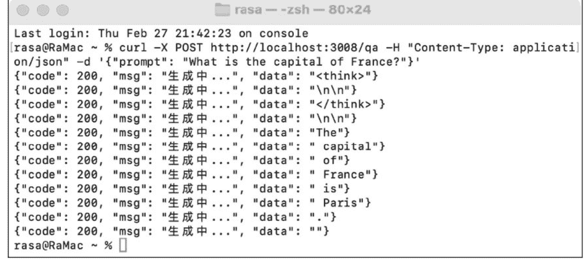

#### 4.1.2 情感驱动实现
本节在 BasicInteractionBackend 的基础上进行功能叠加，引入情感驱动能力。新增了 `prompt_service.py` 专门负责情感语句与抚慰诗歌的提示构建，同时对 `main_service.py` 做了升级，使其能够接收与情感相关的请求并以流式方式返回结果。这一扩展让模型可以根据用户指定的主题创作情感句子或抚慰性诗歌，满足情绪表达与安抚方面的需求。

##### 1. 目录结构搭建
EmotionDrivenBackend 在保留基础问答能力的同时，补充了情感语句与抚慰诗歌的生成模块。以下是其整体目录布局：

```
4.1/
└── EmotionDrivenBackend/
    ├── main_service.py          # 升级后的主服务脚本，处理情感句子和抚慰诗歌生成
    ├── prompt_service.py        # 新增的提示生成服务
    ├── model_api.py             # 提供与 DeepSeek 模型交互的接口
    ├── main_service_config.json # 配置文件，包含模型的参数和其他配置信息
    └── requirements.txt         # 依赖项列表
```

##### 2. 情感语句与抚慰诗创作
新加入的 `prompt_service.py` 负责定义生成情感句子和抚慰诗歌的提示模板，而 `main_service.py` 则依据这些模板调用 DeepSeek 模型完成内容生成，并以流式形式回传。

下面是 `prompt_service.py` 的具体实现片段：

```python
# -*- coding: utf-8 -*-
# 4.1/EmotionDrivenBackend/prompt_service.py

"""
文件名: prompt_service.py
描述: 提供用于生成提示词的服务，包括翻译、情感句子和抚慰诗歌
"""

import random
import logging

class PromptService:
    def __init__(self):
        self.predefined_topics = [
            "心灵疗愈的基础与实践方法",
            "正念冥想在心灵疗愈中的作用",
            "情绪释放技巧与心理放松",
            "创伤后成长与心理恢复",
            "内在儿童的疗愈与成长",
            "身心灵统一：全面的疗愈方法",
            "自我接纳与内在平和的建立",
            "能量疗愈与身体的能量平衡",
            "如何通过艺术疗愈心灵创伤",
            "心灵深处的阴影与光明探索"
        ]

    def create_emotion_sentences_prompt(self, topic=None, button_count=1):
        if not topic:
            topic = random.choice(self.predefined_topics)
            logging.debug(f"随机选择的主题: {topic}")
        return f'''
请围绕以下主题，生成{button_count}个富有情感的句子：
主题: "{topic}"

要求：
- 每个句子不超过 15 个字，以换行符分隔。
- 至少包含 1 个宣泄消极情绪的句子，其余为积极情绪的句子。
- 句子需简洁明了，具有情绪特色，能引起共鸣。
- 只用中文，不含数字、序号或特殊字符。

请开始生成：
'''

    def create_soothing_poetry_prompt(self, theme='宁静的夜晚'):
        return f'''
请以"{theme}"为主题，创作一首能够抚慰人心的诗歌。

要求：
1. 诗歌应包含 3～4 节，每节 4 行，每行不超过 15 个字。
2. 语言柔和，充满诗意，传达温暖和平和的情感。
3. 通过细腻的描写，引导读者感受内心的宁静与安慰。
4. 诗歌需紧扣主题，使用与主题相关的意象和情感。

请开始创作：
'''
```

该模块中的 `PromptService` 类主要提供两个方法：
`create_emotion_sentences_prompt` 用来组装生成情感句子的提示；
`create_soothing_poetry_prompt` 用来组装生成抚慰诗歌的提示。

##### 3. 主服务升级
`main_service.py` 经过升级，在维持基础问答处理的基础上，额外接入了情感句子与抚慰诗歌的生成接口。以下为其核心代码片段：

```python
# -*- coding: utf-8 -*-
# 4.1/EmotionDrivenBackend/main_service.py

"""
文件名: main_service.py
描述: 实现问答服务、情感句子生成服务、抚慰诗歌生成服务，支持流式输出
"""

import json
import logging
from flask import Flask, request, jsonify, Response, stream_with_context
from model_api import ModelAPI, ConfigError
from prompt_service import PromptService
from pathlib import Path

# 设置日志记录
logging.basicConfig(level=logging.DEBUG, format='%(asctime)s - %(levelname)s - %(message)s')

class QAService:
    def __init__(self, config_path='main_service_config.json'):
        self.config_path = config_path
        self.config = None
        self.model_api = None
        self.load_config()
        self.prompt_service = PromptService()
        self.port = self.config.get("port", 5000)

    def load_config(self):
        """
        加载配置文件并初始化 ModelAPI
        """
        try:
            config_file = Path(self.config_path)
            if not config_file.is_file():
                raise ConfigError(f"配置文件未找到: {self.config_path}")

            with open(config_file, 'r', encoding='utf-8') as file:
                self.config = json.load(file)
                self.model_url = self.config.get("model_url")
                self.model_params = self.config.get("model_params", {})
                self.retry_attempts = self.config.get("retry_attempts", 3)

            if not self.model_url:
                raise ConfigError("model_url 配置缺失, 请检查配置文件")

            logging.info("配置文件加载成功")
            self.model_api = ModelAPI(self.config)  # Initialize ModelAPI after loading the config

        except (json.JSONDecodeError, ConfigError) as e:
            logging.error(f"配置文件加载失败, 错误信息: {e}")
            raise ConfigError(f"配置文件加载失败, 错误信息: {e}")

    def handle_error(self, error_msg):
        """
        统一处理错误响应
        """
        logging.error(error_msg)
        return jsonify({"code": 500, "msg": error_msg, "data": None}), 500

    def generate_answer(self, prompt):
        """
        逐步生成回答以支持流式输出
        """
        try:
            payload = self.model_api.prepare_payload(prompt, stream_output=True)  # 开启流式输出

            def generate_streamed_answer():
                try:
                    for chunk in self.model_api.stream_generate(payload):
                        logging.debug(f"生成块: {chunk.strip()}")  # 打印每块的内容
```

# 每次返回一个数据块

yield json.dumps({'code': 200, 'msg': '生成中...', 'data': chunk}, ensure_ascii=False) + "\n"

except Exception as e:

    logging.error(f"生成回答时出错: {e}")

    yield json.dumps({'code': 500, 'msg': '生成回答时出错', 'data': None}, ensure_ascii=False) + "\n"

return generate_streamed_answer()

except Exception as e:

    return self.handle_error(f"问答生成失败, 原因: {e}")

def generate_emotion_sentences(self, topic=None, button_count=1):

    """

    根据给定主题生成情感句子

    支持流式输出

    """

    prompt = self.prompt_service.create_emotion_sentences_prompt(topic, button_count)

    payload = self.model_api.prepare_payload(prompt, stream_output=True)

    try:

        def generate_emotion_sentences_stream():

            try:

                for chunk in self.model_api.stream_generate(payload):

                    yield json.dumps({'code': 200, 'msg': '生成中...', 'data': chunk}, ensure_ascii=False) + "\n"

            except Exception as e:

                logging.error(f"情感句子生成时出错: {e}")

                yield json.dumps({'code': 500, 'msg': '情感句子生成时出错', 'data': None}, ensure_ascii=False) + "\n"

        except Exception as e:

            return self.handle_error(f"情感句子生成失败, 原因: {e}")

        return generate_emotion_sentences_stream()

def generate_soothing_poetry(self, theme='宁静的夜晚'):

    """

    根据主题生成抚慰诗歌

    支持流式输出

    """

    prompt = self.prompt_service.create_soothing_poetry_prompt(theme)

    payload = self.model_api.prepare_payload(prompt, stream_output=True)

    try:

        def generate_poetry_stream():

            try:

                for chunk in self.model_api.stream_generate(payload):

                    yield json.dumps({'code': 200, 'msg': '生成中...', 'data': chunk}, ensure_ascii=False) + "\n"

            except Exception as e:

                logging.error(f"抚慰诗歌生成时出错: {e}")

                yield json.dumps({'code': 500, 'msg': '抚慰诗歌生成时出错', 'data': None}, ensure_ascii=False) + "\n"

        except Exception as e:

            return self.handle_error(f"抚慰诗歌生成失败，原因: {e}")

        return generate_poetry_stream()

# 创建 Flask 应用和服务实例

app = Flask(__name__)

qa_service = QAService()

@app.route('/qa', methods=['POST'])

def qa_api():

    """

    处理问答请求并返回流式响应

    """

    try:

        data = request.json

        prompt = data.get("prompt", "")

        if not prompt:

            return jsonify({"code": 400, "msg": "请求体中缺少 'prompt' 字段", "data": None}), 400

        logging.info(f"Received QA request: prompt={prompt}")

        # 调用 QA 服务生成流式数据

        result = qa_service.generate_answer(prompt)

        # 返回流式响应

        return Response(stream_with_context(result), content_type="application/json")

    except Exception as e:

        error_msg = f"处理问答请求时发生错误: {e}"

        logging.error(error_msg)

        return qa_service.handle_error(error_msg)  # Return the error from QAService

@app.route('/generate_emotion_sentences', methods=['POST'])

def generate_emotion_sentences_api():

    try:

        data = request.json

        topic = data.get("topic", None)

        button_count = data.get("buttonCount", 1)  # 默认值为1

        logging.info(f"Received emotion sentences request: topic={topic}, buttonCount={button_count}")

        # 调用情感句子生成服务并返回流式响应

        result = qa_service.generate_emotion_sentences(topic, button_count)

        # 返回流式响应

        return Response(stream_with_context(result), content_type="application/json")

    except Exception as e:

        error_msg = f"处理情感句子请求时发生错误: {e}"

        logging.error(error_msg)

        return jsonify({"code": 500, "msg": error_msg, "data": None}), 500

@app.route('/generate_soothing_poetry', methods=['POST'])

def generate_soothing_poetry_api():

    try:

        data = request.json

        theme = data.get("theme", "宁静的夜晚")

        logging.info(f"Received soothing poetry request: theme={theme}")

        # 调用抚慰诗歌生成服务并返回流式响应

        result = qa_service.generate_soothing_poetry(theme)

        # 返回流式响应

        return Response(stream_with_context(result), content_type="application/json")

    except Exception as e:

        error_msg = f"处理抚慰诗歌请求时发生错误: {e}"

        logging.error(error_msg)

        return jsonify({"code": 500, "msg": error_msg, "data": None}), 500

if __name__ == '__main__':

    app.run(debug=True, host='0.0.0.0', port=qa_service.port)

##### 4. 接口实测演示

###### ● 情感句子生成校验

向 /generate_emotion_sentences 发起 POST 请求，携带 topic 主题与 buttonCount 数量即可触发流式情感句产出。

```
curl -X POST http://localhost:3008/generate_emotion_sentences -H "Content-Type: application/json" -d '{"topic": "正念冥想在心灵疗愈中的作用", "buttonCount": 2}'
```

图4-2 展示了该接口调用时的实时返回画面。

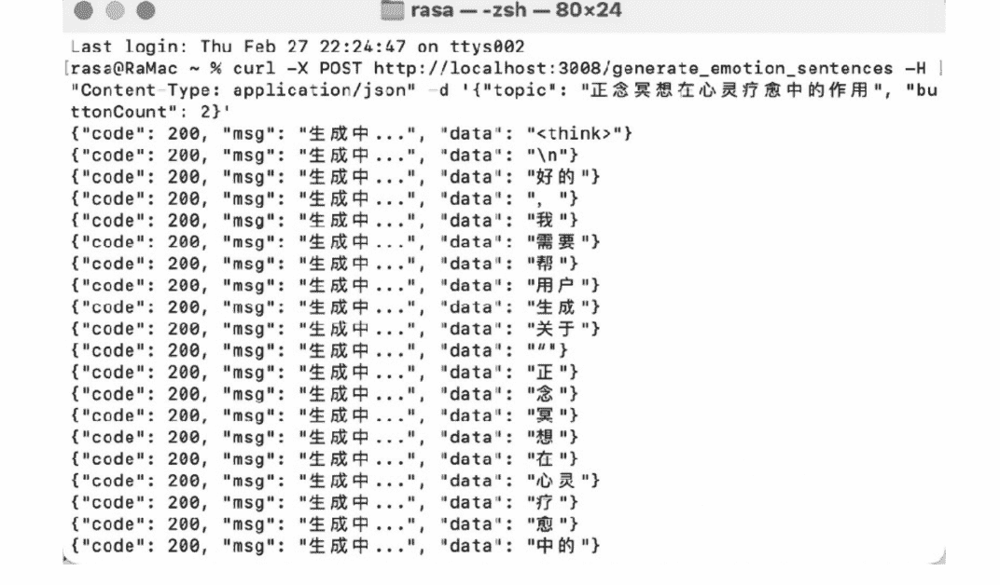

图4-2

###### ● 抚慰诗歌生成校验

对 /generate_soothing_poetry 路径发送 POST 请求，指定 theme 主题参数，可获取诗歌内容的逐块流式结果。

```
curl -X POST http://localhost:3008/generate_soothing_poetry -H "Content-Type: application/json" -d '{"theme": "宁静的夜晚"}'
```

图4-3 呈现了诗歌生成界面的示例截图。

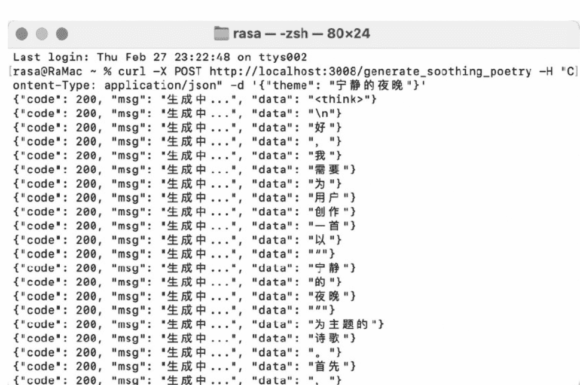

#### 4.1.3 诗歌配图功能落地

本小节在 EmotionDrivenBackend 既有体系上进行扩展，新增诗歌自动配图能力。引入 image_data.json 与 image_randomizer.py，并对 main_service.py 升级后，系统在输出抚慰诗歌的同时能够同步合成一幅意境契合的配图。图文并置的呈现方式强化了情感共鸣，提升了用户的沉浸与互动体验。

##### 1. 目录结构概览

PoetryImageBackend 在保留情感句子与抚慰诗歌生成能力的基础上，额外集成了图片合成模块。以下是该版本的核心目录构成：

```
4.1/
├── PoetryImageBackend/
│   ├── main_service.py          # 升级后的主服务脚本，处理诗歌生成与图片合成
│   ├── prompt_service.py        # 提示生成服务，用于生成诗歌内容
│   ├── image_randomizer.py      # 生成随机图片及配色方案
│   ├── webp/
│   │   ├── 1.webp               # 图片文件1
│   │   ├── 2.webp               # 图片文件2
│   │   ├── 3.webp               # 图片文件3
│   │   └── image_data.json      # 包含图片与配色信息的JSON文件
│   ├── 黄草简.ttf               # 字体文件
│   ├── model_api.py             # 提供与DeepSeek模型交互的接口
│   ├── main_service_config.json # 配置文件，包含模型的参数和其他配置信息
│   └── requirements.txt         # 依赖项列表，包含新增的依赖
```

##### 2. 底图配色随机库

webp/image_data.json 集中收录了可用背景图的文件名与建议色值。image_randomizer.py 会在该清单中抽取一套底图与配色，为诗文画面提供视觉基底。下面是该 JSON 的记录示例：
```json
[
    {
        "image": "1",
        "recommended_colors": [
            "#F9E79F",
            "#D1C4E9"
        ]
    },
    {
        "image": "2",
        "recommended_colors": [
            "#FFFFFF",
            "#FFD700"
        ]
    },
    {
        "image": "3",
        "recommended_colors": [
            "#FF5733",
            "#C70039"
        ]
    }
]
```

##### 3. 诗文成像流程

image_randomizer.py 负责从图库与配色表随机抽取，并借助 PoetryImageGenerator 类把生成的诗句渲染到画面上。完整的成像步骤如下：
```python
# -*- coding: utf-8 -*-
# 4.1/PoetryImageBackend/image_randomizer.py

"""
文件名: image_randomizer.py
描述: 提供诗歌生成后图片生成的功能
"""

import json
import random
import os
from PIL import Image, ImageDraw, ImageFont
import textwrap
import uuid

class ImageRandomizer:
    def __init__(self, data_file):
        self.data_file = data_file
        self.data = self._load_data()

    def _load_data(self):
        try:
            with open(self.data_file, "r", encoding="utf-8") as f:
                return json.load(f)
        except FileNotFoundError:
            raise Exception(f"数据文件 {self.data_file} 未找到。")
        except json.JSONDecodeError:
            raise Exception(f"数据文件 {self.data_file} 格式有误。")

    def get_random_image_and_color(self):
        if not self.data:
            raise Exception("图片数据为空，请检查数据文件内容。")

        random_image = random.choice(self.data)
        random_image_name = random_image["image"]
        recommended_colors = random_image.get("recommended_colors", ["#FFFFFF"])
        random_color = random.choice(recommended_colors)
        return random_image_name, random_color

class PoetryImageGenerator:
    def __init__(self, data_file, output_folder="output"):
        """
        初始化类，加载存储的图片数据文件。
        :param data_file: JSON 文件路径，存储图片和颜色数据。
        :param output_folder: 输出生成图片的文件夹路径。
        """
        self.image_randomizer = ImageRandomizer(data_file)
        self.output_folder = output_folder
        os.makedirs(self.output_folder, exist_ok=True)

    def _calculate_font_color(self, bg_color):
        """
        根据背景颜色计算合适的字体颜色（黑色或白色）。
        :param bg_color: 背景颜色，十六进制字符串。
        :return: 字体颜色的 RGB 元组。
        """
        bg_color = bg_color.lstrip('#')
        r, g, b = tuple(int(bg_color[i:i+2], 16) for i in (0, 2, 4))
        # 计算亮度
        brightness = (r * 299 + g * 587 + b * 114) / 1000
        return (0, 0, 0) if brightness > 128 else (255, 255, 255)

    def generate_poetry_image(self, poetry_text, font_path="NotoSans-Regular.ttf", font_size=50, max_width_ratio=0.9, line_spacing=10):
        """
        生成带诗歌内容的图片。
        :param poetry_text: 诗歌内容。
        :param font_path: 字体文件路径。
        :param font_size: 字体大小。
        :param max_width_ratio: 文字最大宽度与图片宽度的比例。
        :param line_spacing: 行间距。
        :return: 生成图片的路径。
        """
        image_name, recommended_color = self.image_randomizer.get_random_image_and_color()
        image_path = os.path.join("webp", f"{image_name}.webp")
```
if not os.path.exists(image_path):

    raise Exception(f"图片文件 {image_path} 未找到。")

try:

    # 加载背景图片

    with Image.open(image_path) as img:

        img = img.convert("RGBA")

        draw = ImageDraw.Draw(img)

        image_width, image_height = img.size

        max_text_width = int(image_width * max_width_ratio)

        margin = 20  # 边距

        # 加载字体

        try:

            font = ImageFont.truetype(font_path, font_size)

        except IOError:

            raise Exception(f"字体文件 {font_path} 未找到。")

        # 自动换行

        lines = []

        for line in poetry_text.split('\n'):

            wrapped = textwrap.wrap(line, width=40)  # 初始宽度

            if not wrapped:

                lines.append('')

            else:

                for wrapped_line in wrapped:

                    # 调整每行以适应图片宽度

                    while True:

                        bbox = draw.textbbox((0, 0), wrapped_line, font=font)

                        line_width = bbox[2] - bbox[0]

                        if line_width <= max_text_width or len(wrapped_line) <= 1:

                            break

                        wrapped_line = wrapped_line[:-1]

                    lines.append(wrapped_line)

        # 重新计算字体大小以适应图片高度

        total_text_height = 0

        for line in lines:

            bbox = draw.textbbox((0, 0), line, font=font)

            line_height = bbox[3] - bbox[1]

            total_text_height += line_height + line_spacing

        total_text_height -= line_spacing  # 去掉最后一行的间距

        if total_text_height > image_height - 2 * margin:

            # 缩小字体以适应高度

            while total_text_height > image_height - 2 * margin and font_size > 10:

                font_size -= 2

                font = ImageFont.truetype(font_path, font_size)

                total_text_height = 0

                for line in lines:

                    bbox = draw.textbbox((0, 0), line, font=font)

                    line_height = bbox[3] - bbox[1]

                    total_text_height += line_height + line_spacing

                total_text_height -= line_spacing

        # 计算字体颜色

        font_color = self._calculate_font_color(recommended_color)

        # 计算文本起始位置

        current_y = (image_height - total_text_height) // 2

        # 可选：在文本后面添加半透明背景以增强对比度

        # 计算文本区域

        max_line_width = max([draw.textbbox((0,0), line, font=font)[2] - draw.textbbox((0,0), line, font=font)[0] for line in lines])

        text_bbox_rect = [

            (image_width - max_line_width) // 2 - margin,

            current_y - margin,

            (image_width + max_line_width) // 2 + margin,

            current_y + total_text_height + margin

        ]

        # 创建半透明矩形

        overlay = Image.new('RGBA', img.size, (0,0,0,0))

        overlay_draw = ImageDraw.Draw(overlay)

        rectangle_color = (255, 255, 255, 150) if font_color == (0,0,0) else (0, 0, 0, 150)

        overlay_draw.rectangle(text_bbox_rect, fill=rectangle_color)

        img = Image.alpha_composite(img, overlay)

        draw = ImageDraw.Draw(img)

        # 绘制每一行文本

        for line in lines:

            bbox = draw.textbbox((0,0), line, font=font)

            line_width = bbox[2] - bbox[0]

            line_height = bbox[3] - bbox[1]

            text_x = (image_width - line_width) // 2

            draw.text((text_x, current_y), line, fill=font_color, font=font)

            current_y += line_height + line_spacing

        # 保存结果图片

        unique_id = str(uuid.uuid4())

        output_filename = f"{image_name}_{unique_id}.png"

        output_path = os.path.join(self.output_folder, output_filename)

        img = img.convert("RGB")  # 去除 alpha 通道以保存为 PNG

        img.save(output_path, format="PNG")

        return output_path

except Exception as e:

    raise Exception(f"生成图片时出错: {str(e)}")

##### 4. 主服务增加绘图能力

main_service.py 新增了诗配图生成与分发。系统既能以 SSE 方式逐段推送抚慰诗的生成结果，也会依据主题自动合成对应的可视化图片并返回可下载的链接。核心代码片段如下：

# -*- coding: utf-8 -*-

# 4.1/PoetryImageBackend/main_service.py

"""

文件名: main_service.py

描述:

    实现以下服务:

    1. 问答服务: 接收用户提问并返回流式生成的回答。

    2. 情感句子生成服务: 根据主题生成情感驱动的句子, 支持流式输出。

    3. 抚慰诗歌生成服务: 根据主题生成抚慰性诗歌, 支持流式输出。

    4. 诗歌图片生成与下载服务: 生成与抚慰诗歌内容相关的图片, 并支持用户下载生成的图片。

    支持流式输出 (Server-Sent Events, SSE) 以逐步传输生成结果, 适用于长时间生成的任务。

"""

import json

Flask 问答与诗歌生成服务核心流程拆解

这套服务围绕 QAService 一个主类展开，负责配置加载、模型调用、提示词管理以及诗歌配图的完整闭环。启动时先统一日志格式，级别调到 DEBUG，方便追踪每一块流式输出。

初始化阶段会接收配置文件路径，默认取 main_service_config.json。随后加载配置，检查文件是否存在，读取 JSON 后提取模型地址、模型参数、重试次数等关键项。如果文件缺失或 model_url 未配置，会抛出 ConfigError 并记录错误。配置成功后实例化 ModelAPI，同时创建 PromptService 负责提示词组装，并启动 PoetryImageGenerator，图片素材和输出目录均可从配置中读取，分别对应 webp/image_data.json 与 output，未指定时使用默认值。端口号也从配置中获取，默认 5000。

错误处理做了统一封装，任何异常都会被记录并返回统一的 JSON 结构，code 为 500，msg 为错误信息，data 为空。

问答生成走流式模式。先用 ModelAPI 准备带流式开关的 payload，随后遍历模型返回的每一块内容，记录调试日志并立刻封装成 code 200、msg 为“生成中...”、data 为当前块的 JSON 行，直至结束。若中途出错则返回 code 500 的错误行。

情感句子生成同样基于流式。PromptService 根据主题和按钮数量生成对应的提示词，提交给模型后逐块yield，格式与问答保持一致，出错时返回统一错误。

抚慰诗歌的流程更完整。默认主题为“宁静的夜晚”，可传入 request_host。提示词由 PromptService 构建后流式生成，服务会把每块内容实时返回，同时累积到完整文本。全部生成完毕后先用 filter_think_tags 清理文本，通过正则去掉思考标签并替换掉多余的 ## 前缀。清理完成后调用诗歌配图生成器，使用配置中的字体路径和字号，默认 NotoSans-Regular.ttf 与 50，得到本地图片路径。再拼接成 http://{request_host}/download_image/{文件名} 的可访问链接，作为最终的消息返回，msg 标记为“生成完成”。

整体设计思路清晰：配置驱动、流式响应、统一错误、提示词解耦、生成后自动配图。

except Exception as e:```python
logging.error(f"生成图片时出错: {e}")
yield json.dumps({'code': 500, 'msg': '图片生成失败', 'data': None}, ensure_ascii=False) + "\n"
except Exception as e:
    logging.error(f"抚慰诗歌生成时出错: {e}")
    yield json.dumps({'code': 500, 'msg': '抚慰诗歌生成时出错', 'data': None}, ensure_ascii=False) + "\n"
    except Exception as e:
        return self.handle_error(f"抚慰诗歌生成失败，原因: {e}")

return generate_poetry_stream()

# 创建 Flask 应用和服务实例
app = Flask(__name__)
qa_service = QAService()

@app.route('/qa', methods=['POST'])
def qa_api():
    """
    处理问答请求并返回流式响应
    """
    try:
        data = request.json
        prompt = data.get("prompt", "")
        if not prompt:
            return jsonify({"code": 400, "msg": "请求体中缺少 'prompt' 字段", "data": None}), 400

        logging.info(f"Received QA request: prompt={prompt}")

        # 调用 QA 服务生成流式数据
        result = qa_service.generate_answer(prompt)

        # 返回流式响应
        return Response(stream_with_context(result), content_type="application/json")

    except Exception as e:
        error_msg = f"处理问答请求时发生错误: {e}"
        logging.error(error_msg)
        return qa_service.handle_error(error_msg)  # Return the error from QAService

@app.route('/generate_emotion_sentences', methods=['POST'])
def generate_emotion_sentences_api():
    try:
        data = request.json
        topic = data.get("topic", None)
        button_count = data.get("buttonCount", 1)  # 默认值为1
        logging.info(f"Received emotion sentences request: topic={topic}, buttonCount={button_count}")

        # 调用情感句子生成服务并返回流式响应
        result = qa_service.generate_emotion_sentences(topic, button_count)

        # 返回流式响应
        return Response(stream_with_context(result), content_type="application/json")

    except Exception as e:
        error_msg = f"处理情感句子请求时发生错误: {e}"
        logging.error(error_msg)
        return jsonify({"code": 500, "msg": error_msg, "data": None}), 500

@app.route('/generate_soothing_poetry', methods=['POST'])
def generate_soothing_poetry_api():
    try:
        data = request.json
        theme = data.get("theme", "宁静的夜晚")
        request_host = request.host  # 提前获取 host 信息

        logging.info(f"Received soothing poetry request: theme={theme}")

        # 调用抚慰诗歌生成服务并返回流式响应
        result = qa_service.generate_soothing_poetry(theme, request_host)

        # 返回流式响应
        return Response(stream_with_context(result), content_type="application/json")

    except Exception as e:
        error_msg = f"处理抚慰诗歌请求时发生错误: {e}"
        logging.error(error_msg)
        return jsonify({"code": 500, "msg": error_msg, "data": None}), 500

@app.route('/download_image/<path:filename>', methods=['GET'])
def download_image(filename):
    directory = qa_service.poetry_image_generator.output_folder
    return send_from_directory(directory, filename, as_attachment=True)

if __name__ == '__main__':
    app.run(debug=True, host='0.0.0.0', port=qa_service.port)
```

##### 5. requirements.txt 依赖补充

本次版本引入了 Pillow 来完成图片处理工作，所以需要在 requirements.txt 里写入对应的依赖信息：

```
Pillow
```

安装依赖时请务必带上 Pillow，否则后续的图片生成流程会无法正常执行。

##### 6. curl 验证服务可用性

- 诗歌图片生成服务校验

向 /generate_soothing_poetry 接口发起 POST 请求，并携带 theme 参数，即可触发抚慰诗文及配图的生成：

```
curl -X POST http://localhost:3009/generate_soothing_poetry -H "Content-Type: application/json" -d '{"theme": "宁静的夜晚"}'
```

接口会返回 JSON 格式的结果，其中包含了生成的图片访问地址。开发者可通过该地址把诗歌图片下载下来。

图4-4 展示了 curl 执行时的返回情况。

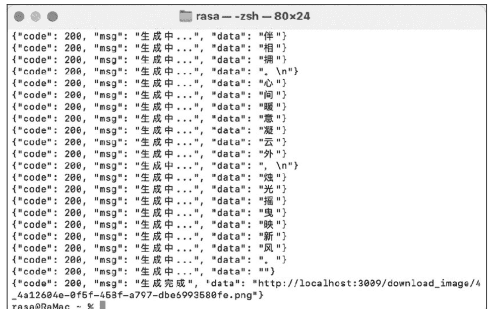

图4-4

图4-5 则呈现了通过链接获取到的最终诗歌图片效果。


图4-5

### 4.2 ArkTS 前后端联动方案

本部分说明如何让 ArkTS 前端与 Python 后端对接起来，搭建一个功能丰富的交互式应用。完成联动后，前后端能够无缝协作，覆盖情感问答、诗文生成、图文合成等多个场景。

#### 4.2.1 基础交互前端搭建

这里以 BasicInteractionFrontend 项目为例，实现前后端的基础通信能力，核心是借助 HTTP 请求与流式返回来呈现简单的问答交互。基于原有的 DeepSeekInteractionApp，做了三点关键调整。

删除：移除了 ModelTypes.ets 与 ModelService.ets 两个文件，让结构更精简。
新增：加入了 ApiTypes.ets、EmotionService.ets、ApiService.ets，用以规范 API 的收发、处理流式数据，并以新的服务层与 Python 后端交互。
升级：对 Index.ets 做了升级，前端页面现在可以主动发起问答请求，并逐步把生成内容呈现在界面上。

经过这些优化，BasicInteractionFrontend 能够高效调用后端问答接口，并实现内容的即时展示与页面刷新。

##### 1. 目录结构规划

BasicInteractionFrontend 调整后的目录如下，新增的文件主要承担 API 请求、情感问答逻辑以及流式数据处理的职责：

```
src/
├── main/
│   ├── ets/
│   │   ├── configs/          // 配置文件目录
│   │   │   └── Config.ets    // 应用配置文件（例如，API 地址等）
│   │   ├── pages/            // 页面文件目录
│   │   │   └── Index.ets     // 升级后的首页，展示问答结果
│   │   ├── services/         // 服务层，处理与后端 API 的交互
│   │   │   ├── EmotionService.ets // 处理情感问答逻辑（新增）
│   │   │   └── ApiService.ets     // 封装通用 API 请求逻辑（新增）
│   │   ├── types/            // 类型定义目录
│   │   │   └── ApiTypes.ets  // 通用 API 接口定义（新增）
│   │   └── utils/            // 工具函数目录
│   │       ├── HttpClient.ets    // HTTP 请求工具（辅助文件）
│   │       └── StreamingUtils.ets // 流式数据处理工具
│   └── module.json5          // 模块配置文件
```

ApiTypes.ets：统一定义前后端交互的请求与响应结构。
EmotionService.ets：负责情感问答的业务编排，调用后端接口获取答案。
ApiService.ets：封装通用 HTTP 调用能力，并兼容流式响应的解析。
Index.ets：应用首页入口，用户在此触发问答并实时看到生成结果。

##### 2. 核心代码拆解

项目前端由多个模块协同完成，下面是各模块的关键实现。

-   ApiTypes.ets

该文件用于定义通用的请求与响应数据类型，保证前后端数据格式的一致性：

```typescript
// src/main/ets/types/ApiTypes.ets

/**
 * @description 通用的 API 响应结构
 * @property {number} code - 状态码，通常用于标识请求的结果，0 表示成功，其他表示错误类型
 * @property {string} data - 响应数据，通常为 JSON 格式的字符串
 * @property {string} msg - 响应消息，描述请求结果的简短信息
 */
export interface ApiResponse {
  code: number;
  data: string;
  msg: string;
}

/**
 * @description QA 请求结构
 * @property {string} prompt - 提交的问题
 */
export interface QaRequest {
  prompt: string; // 用户提出的问题
}
```

-   EmotionService.ets

EmotionService.ets 继承自 ApiService.ets，封装了 QA 接口的调用流程，同时支持流式数据的处理：

```typescript
// src/main/ets/services/EmotionService.ets
import { ApiService } from './ApiService'; // 导入公共 API 服务
import { QaRequest } from '../types/ApiTypes'; // 导入接口定义

export class EmotionService extends ApiService {
  constructor(apiUrl: string) {
    super(apiUrl); // 初始化父类
  }

  /**
   * 调用 QA 接口
   * @param prompt - 提交的问题文本
   * @param onChunkReceived - 可选的回调函数，用于处理流式返回的每个数据块
   * @returns Promise<string> - 返回模型生成的回答
   */
  public async askQuestion(prompt: string, onChunkReceived?: (chunk: string) => void): Promise<string> {
    const requestBody: QaRequest = { prompt }; // 请求体
    return this.request('/qa', requestBody, onChunkReceived); // 返回回答
  }
}
```

-   ApiService.ets

ApiService.ets 统一封装 HTTP 请求并提供流式响应支持，核心逻辑是逐块解析返回数据并按需触发回调：

```typescript
// src/main/ets/services/ApiService.ets

import { http } from '@kit.NetworkKit'; // 导入自定义网络模块
import { httpRequestText } from '../utils/HttpClient'; // 导入 HTTP 请求方法
import { ApiResponse } from '../types/ApiTypes'; // 导入接口定义

export class ApiService {
    private apiUrl: string;

    constructor(apiUrl: string) {
        this.apiUrl = apiUrl;
    }

    /**
     * 处理流式返回的响应数据
     * @param chunk - 每个流式返回的数据块
     * @param onChunkReceived - 可选的回调函数，用于处理每个数据块
     * @returns 解析后的内容
     */
    private processResponseChunk(chunk: string, onChunkReceived?: (chunk: string) => void): string {
        try {
            const response: ApiResponse = JSON.parse(chunk); // 解析每个数据块
            const data = response.data; // 获取响应中的 data 字段

            if (data) {
                // 通过回调函数传递解析到的 data（类似于 content）
                onChunkReceived?.(data);
                return data; // 返回 data 内容
            }

            return '';
        } catch (parseError) {
            console.error('解析响应数据块时出错:', parseError);
            throw new Error(`解析错误: ${parseError.message}`); // 提供详细错误信息
        }
    }

    /**
     * 发送请求并处理响应
     * @param endpoint - API 端点
     * @param requestBody - 请求体
     * @param onChunkReceived - 可选的回调函数，用于处理流式返回的每个数据块
     * @returns Promise<string> - 完整的响应数据
     */
    private async sendRequest(
        endpoint: string,
        requestBody: string,
        onChunkReceived?: (chunk: string) => void,
    ): Promise<string> {
        try {
            let accumulatedResponse = ''; // 用于存储累积的所有数据块

            // 发送 HTTP 请求并处理响应
            await httpRequestText(this.apiUrl + endpoint, http.RequestMethod.POST,
                requestBody, 60000,
                (chunk: string) => {
                    if (onChunkReceived) {
                        const content = this.processResponseChunk(chunk, onChunkReceived);
                        // 处理流式数据块
                        accumulatedResponse += content; // 将内容加入最终的响应
                    }
                });

            return accumulatedResponse;
        } catch (error) {
            console.error('请求失败:', error);
            throw new Error(`请求失败：${error instanceof Error ? error.message : error}`);
        }
    }

    /**
     * 通用接口请求方法
     * @param endpoint - API 端点
     * @param requestBody - 请求体
     * @param onChunkReceived - 可选的回调函数，用于处理流式返回的每个数据块
     * @returns Promise<string> - 完整的响应数据
     */
    public async request(
        endpoint: string,
        requestBody: object,
        onChunkReceived?: (chunk: string) => void,
    ): Promise<string> {
        const requestBodyString = JSON.stringify(requestBody);
        return this.sendRequest(endpoint, requestBodyString, onChunkReceived);
    }
}
```

-   Index.ets

Index.ets 作为交互入口，用按钮来触发问答调用，并把后端回传的流式内容实时呈现在页面上。请求由 EmotionService 发起，结果分段到达时页面会逐步刷新，保持展示与生成同步：

##### 3. 效果演示

打开前端后，首屏会出现一个“Fetch Data”按钮。按下后应用会向 Python 端的 QA 接口发起问答请求，返回内容以流式方式一点点拼接到页面上。模拟器上的运行截图见图4-6，生成结果清晰可见。

在 BasicInteractionFrontend 这一轮优化后，前后端在流式数据上的配合变得高效。新的分层设计让问答结果可以边生成边呈现，用户等待感明显降低。模块边界清晰，代码更好维护，也为后续功能拓展保留了空间。

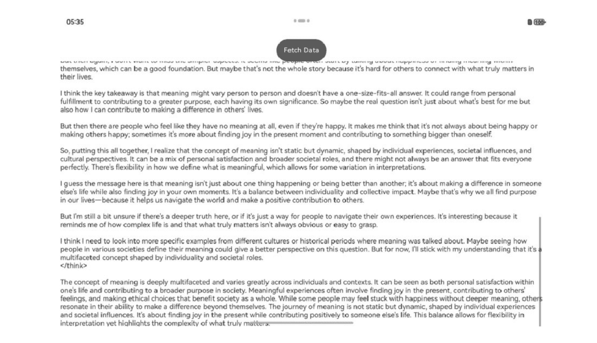

## 图4-6

#### 4.2.2 情感驱动前端升级

本部分在 BasicInteractionFrontend 的基础上，对 EmotionDrivenFrontend 做情感化扩展，新增情感句生成与安慰诗生成能力。前端可以依据用户情绪实时产出对应句子和诗歌并即时展示。主要新增点有：引入 EmotionSentencesRequest 和 SoothingPoetryRequest 两个请求体结构；在 EmotionService 中补充 generateEmotionSentences 与 generateSoothingPoetry 方法以完成与后端的交互；复用 HealingPoetryApp 中的 Index.ets、CustomButton.ets、ButtonManager.ets 并对 Index.ets 升级，从而强化情感互动体验。

##### 1. 目录规划

EmotionDrivenFrontend 在原有结构上补充了新文件，调整后的目录如下：

```
src/
├── main/
│   ├── ets/
│   │   ├── configs/                    // 配置文件目录
│   │   │   └── Config.ets              // 应用配置文件（例如，API 地址等）
│   │   ├── components/                 // 组件文件目录
│   │   │   ├── ButtonManager.ets       // 按钮管理器（从 HealingPoetryApp 引入）
│   │   │   └── CustomButton.ets        // 自定义按钮组件（从 HealingPoetryApp 引入）
│   │   ├── pages/                      // 页面文件目录
│   │   │   └── Index.ets               // 升级后的首页，展示情感句子和安慰诗句
│   │   ├── services/                   // 服务层，处理与后端 API 的交互
│   │   │   ├── EmotionService.ets      // 处理情感驱动的业务逻辑（升级）
│   │   │   └── ApiService.ets          // 封装通用 API 请求逻辑
│   │   ├── types/                      // 类型定义目录
│   │   │   └── ApiTypes.ets            // 通用 API 接口定义（升级）
│   │   └── utils/                      // 工具函数目录
│   │       ├── HttpClient.ets          // HTTP 请求工具（辅助文件）
│   │       └── StreamingUtils.ets      // 流式数据处理工具
│   └── module.json5                    // 模块配置文件
```

重点更新的文件说明如下。

ApiTypes.ets：用来描述 EmotionSentencesRequest 和 SoothingPoetryRequest 两类请求的结构。

EmotionService.ets：新增 generateEmotionSentences 与 generateSoothingPoetry，用于发起情感句子和安慰诗歌的生成请求。

Index.ets：升级后的主页面，加入了情感句子与安慰诗句的生成与展示交互。

ButtonManager.ets 和 CustomButton.ets：负责按钮的渲染与交互管理。

##### 2. 代码改造详情

本项目在前端侧的改动集中在以下几处。

-   ● ApiTypes.ets

补充了情感句子生成请求与安慰诗句生成请求的接口定义：

```typescript
// src/main/ets/types/ApiTypes.ets

/**
 * @description 情感句子生成请求结构
 * @property {string} topic - 情感分析的主题或关键词
 * @property {number} buttonCount - 生成的情感按钮数量，用于控制输出数量
 */
export interface EmotionSentencesRequest {
  topic: string;
  buttonCount: number;
}

/**
 * @description 安慰诗句生成请求结构
 * @property {string} theme - 生成的安慰诗句的主题
 */
export interface SoothingPoetryRequest {
  theme: string;
}
```

-   ● EmotionService.ets

EmotionService.ets 中新增 generateEmotionSentences 与 generateSoothingPoetry 方法，完成与后端的数据交互并获取情感句子与安慰诗句：

```typescript
// src/main/ets/services/EmotionService.ets

import { ApiService } from './ApiService'; // 导入公共 API 服务
import { QaRequest, EmotionSentencesRequest, SoothingPoetryRequest } from '../types/ApiTypes'; // 导入接口定义

export class EmotionService extends ApiService {
  constructor(apiUrl: string) {
    super(apiUrl); // 初始化父类
  }

  /**
   * 调用生成情感句子接口
   * @param topic - 主题
   * @param buttonCount - 按钮数量
   * @param onChunkReceived - 可选的回调函数，用于处理流式返回的每个数据块
   * @returns Promise<string> - 返回生成的情感句子
   */
  public async generateEmotionSentences(
    topic: string,
    buttonCount: number,
    onChunkReceived?: (chunk: string) => void
  ): Promise<string> {
    const requestBody: EmotionSentencesRequest = { topic, buttonCount }; // 请求体
    return this.request('/generate_emotion_sentences', requestBody, onChunkReceived); // 根据需要选择流式输出
  }

  /**
   * 调用生成抚慰诗歌接口
   * @param theme - 诗歌主题
   * @param onChunkReceived - 可选的回调函数，用于处理流式返回的每个数据块
   * @returns Promise<string> - 返回生成的诗歌
   */
  public async generateSoothingPoetry(
    theme: string,
    onChunkReceived?: (chunk: string) => void
  ): Promise<string> {
    const requestBody: SoothingPoetryRequest = { theme }; // 请求体
    return this.request('/generate_soothing_poetry', requestBody, onChunkReceived); // 根据需要选择流式输出
  }
}
```

-   ● Index.ets

Index.ets 提供情感句子生成和安慰诗句生成的交互入口，通过按钮操作控制页面内容的展示与更新：

```typescript
// src/main/ets/pages/Index.ets

import { config } from '../configs/Config'; //导入配置文件
import { EmotionService } from '../services/EmotionService';
import { processStreamedResults } from '../utils/StreamingUtils';//导入流式结果处理工具
import { ButtonManager } from '../components/ButtonManager'; //导入按钮管理器
import { CustomButton } from '../components/CustomButton'; //导入自定义按钮组件

@Entry
@Component
struct Index {
    @State bgColor: string = "#BCCFF"; //背景颜色
    @State resultText: string = ''; //默认文本显示
    private totalButtons: number = 5; //按钮总数
    private buttonManager = new ButtonManager(this.totalButtons); //按钮管理器实例
    @State buttonColors: string[] = this.buttonManager.getButtonColors(); //按钮颜色
    @State buttonLabels: string[] = this.buttonManager.getButtonLabels(); //按钮标签
    @State buttonText: string = ''; // 默认文本显示

    /**
     * 错误日志记录与处理
     * @param error 错误信息
     * @param context 错误发生的上下文
     */
    private logAndHandleError(error: string, context: string): void {
        this.resultText = '发生错误，请稍后重试。'; //更新结果文本显示
    }

    /**
     * 更新按钮的标签和颜色
     */
    private updateButtons() {
        this.buttonLabels = this.buttonManager.getButtonLabels(); //获取最新按钮标签
        this.buttonColors = this.buttonManager.getButtonColors(); //获取最新按钮颜色
    }

    /**
     * 处理并更新流式结果
     * @param accumulatedResult 累积的文本结果
     */
    private handleStreamedResults(accumulatedResult: string) {
        if (accumulatedResult) {
            processStreamedResults(accumulatedResult, (cleanedText: string) => {
                this.buttonManager.updateButtonLabel(cleanedText); //更新按钮标签
                this.updateButtons(); //更新按钮标签和颜色
            });
        }
    }

    /**
     * 使用情感分析服务更新按钮内容
     * @param emotionService EmotionService实例
     */
    private async updateButtonsWithEmotion(emotionService: EmotionService): Promise<void> {
        let accumulatedResult = ''; //存储情感句子生成的结果
        console.log('\nStarting emotion sentences generation:'); //输出情感句子生成的日志

        try {
            await emotionService.generateEmotionSentences('', this.totalButtons, (partialResult: string) => {
                console.log('Received chunk:', partialResult); //输出接收到的每个片段
                accumulatedResult += partialResult; //累加结果
                this.handleStreamedResults(accumulatedResult); //处理累积的结果
            });
        } catch (error) {
            this.logAndHandleError(error, 'updateButtonsWithEmotion'); //错误处理
        }
    }

    /**
     * 生成抚慰诗歌并更新显示结果
     * @param emotionService EmotionService 实例
     * @param textToGenerate 用于生成诗歌的文本
     */
    private async generatePoetryAndUpdateResult(emotionService: EmotionService, textToGenerate: string): Promise<void> {
        this.resultText = ''; //清空现有的结果文本

        try {
            console.log('\nStarting soothing poetry generation:'); //输出生成诗歌的日志
            await emotionService.generateSoothingPoetry(textToGenerate, (partialResult: string) => {
                console.log('Soothing poetry result chunk:', partialResult); //输出生成的诗歌片段
                if (partialResult.startsWith('http')) {
                } else {
                    this.resultText += partialResult; //累加诗歌生成的结果
                }
            });
        } catch (error) {
            this.logAndHandleError(error, 'generatePoetryAndUpdateResult'); //错误处理
        }
    }

    /**
     * 根据按钮标签获取聊天响应并更新背景颜色和生成诗歌
     * @param buttonLabel 被点击的按钮标签
     */
    private async fetchChatResponse(buttonLabel: string) {
        const emotionService = new EmotionService(config.sentimentApiUrl);

        try {
            if (!buttonLabel) {
                //处理情感句子生成
                await this.updateButtonsWithEmotion(emotionService); //更新按钮标签
            } else {
```

await this.generatePoetryAndUpdateResult(emotionService, buttonLabel); //生成诗歌并更新结果

await this.updateButtonsWithEmotion(emotionService); //更新按钮标签

}

} catch (error) {

    this.logAndHandleError(error, 'fetchChatResponse'); //错误处理

}

}

//页面构建

build() {

    Flex({ direction: FlexDirection.Row, justifyContent: FlexAlign.Center, alignItems: ItemAlign.Center }) {

        // 按钮区域

        Flex({ direction: FlexDirection.Column, justifyContent: FlexAlign.Center, alignItems: ItemAlign.Center }) {

            ForEach(this.buttonLabels, (label: string, index: number) => {

                CustomButton({

                    buttonLabel: label || '', //按钮标签

                    buttonColor: this.buttonColors[index] || '#FFFFFF' //按钮颜色

                })

                .onClick(() => {

                    this.buttonText = this.buttonLabels[index];

                    this.fetchChatResponse(this.buttonText);

                }); //绑定点击事件

            });

        }

        .padding(20)

        //结果显示区域

        Flex({ direction: FlexDirection.Column, justifyContent: FlexAlign.Center, alignItems: ItemAlign.Center }) {

            Scroll() {

                Column() {

                    Text(this.resultText)

                        .width('match_parent')

                        .height('match_content')

                        .fontColor(Color.White)

                        .padding(15)

                        .backgroundColor("#6B7280")

                        .borderRadius(15)

                        .margin({ top: 20, bottom: 20 });

                }

            }

            .scrollBarWidth(0)

            .scrollBarColor(Color.Transparent); // 隐藏滚动条

        }

        .padding(20);

    }

    .width('100%')

    .height('100%')

    .backgroundColor(this.bgColor); // 设置背景颜色

}

}

##### 3.模拟器运行效果
图4-7展示了在模拟器中的实际运行界面，可清晰看到情绪语句与抚慰诗篇的生成区。

依托 EmotionDrivenFrontend 的新增模块，客户端已形成完整的情绪驱动交互闭环。自动产出情绪语句与抚慰诗句明显提升了使用感受，配合按钮管理模块与自研按钮组件，界面布局兼具扩展性与灵活性。

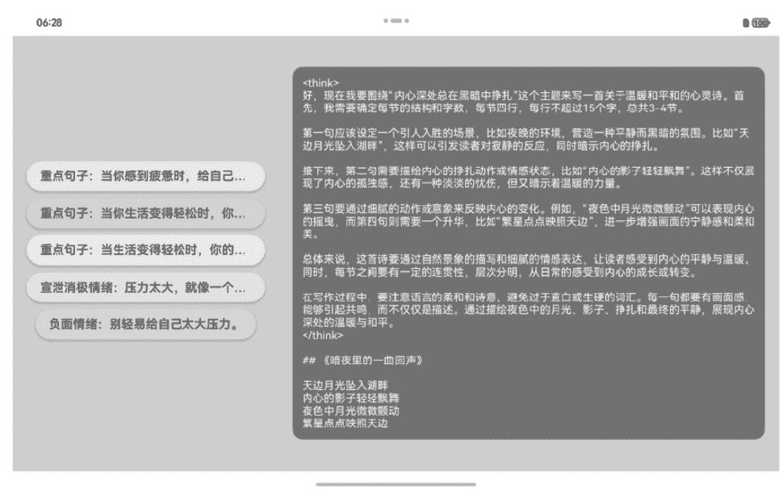

#### 4.2.3 诗意图合成客户端实践
PoetryImageFrontend 在 EmotionDrivenFrontend 基础上演进，核心是补齐图像获取及合成能力。引入 DownloadUtils.ets 并对 HttpClient.ets 内的 httpRequestImage 方法进行升级后，可拉取并呈现系统生成的诗意图；同时 Index.ets 也同步迭代，补充了图像获取与预览的交互，让诗歌创作反馈更直观。

##### 1.目录结构总览
PoetryImageFrontend 本次迭代新增若干文件，整体目录随之调整，具体如下：

```
src/
├── main/
│   ├── ets/
│   │   ├── configs/                    // 配置文件目录
│   │   │   └── Config.ets              // 应用配置文件（例如，API 地址等）
│   │   ├── components/                 // 组件文件目录
│   │   │   ├── ButtonManager.ets       // 按钮管理器
│   │   │   └── CustomButton.ets        // 自定义按钮组件
│   │   ├── pages/                      // 页面文件目录
│   │   │   └── Index.ets               // 升级后的首页，展示情感句子、安慰诗句和图片
│   │   ├── services/                   // 服务层，处理与后端 API 的交互
│   │   │   ├── EmotionService.ets      // 处理情感驱动的业务逻辑
│   │   │   └── ApiService.ets          // 封装通用 API 请求逻辑
│   │   ├── types/                      // 类型定义目录
│   │   │   └── ApiTypes.ets            // 通用 API 接口定义
│   │   └── utils/                      // 工具函数目录
│   │       ├── HttpClient.ets          // HTTP 请求工具（升级）
│   │       ├── StreamingUtils.ets      // 流式数据处理工具
│   │       └── DownloadUtils.ets       // 下载图片工具（新增）
│   └── module.json5                    // 模块配置文件
```

核心变动集中在以下文件：

HttpClient.ets：httpRequestImage 已升级，专司图像获取。

DownloadUtils.ets：新增 downloadImage 方法，按 URL 拉取图像并返回 PixelMap。

Index.ets：页面整体迭代，补齐诗意图的获取与预览交互，流程更为完整。

##### 2.代码变更要点
下面汇总本次客户端改动的重点：

- HttpClient.ets

httpRequestImage 已升级，主要用于获取图像的二进制数据：

```typescript
// src/main/ets/utils/HttpClient.ets

import { http } from '@kit.NetworkKit'; // 导入自定义网络模块
import { decodeUtf8 } from './StreamingUtils'; // UTF-8 数组到字符串的转换函数

type HttpHeaders = Record<string, string>;

const DEFAULT_CONTENT_TYPE = 'application/json; charset=utf-8';
const DEFAULT_TIMEOUT = 60000; // 默认超时时间为 60 s

/**
 * @description 发送 HTTP 请求并接收二进制数据块
 * @param url - 请求的 URL
 * @param method - HTTP 请求方法（如 GET、POST 等）
 * @param requestBody - 请求体（如果有的话）
 * @param timeout - 超时时间（默认 60000ms）
 * @param onChunkReceive - 接收数据块的回调函数（处理 ArrayBuffer）
 * @param contentType - 请求的内容类型（默认 application/json）
 * @param onProgress - 下载进度回调（可选）
 * @returns {Promise<void>} - 请求完成时解析的 Promise
 */
export function httpRequestImage(
    url: string,
    method: http.RequestMethod,
    requestBody: string,
    timeout: number = DEFAULT_TIMEOUT,
    onChunkReceive: (chunk: ArrayBuffer) => void,
    contentType: string = DEFAULT_CONTENT_TYPE,
    onProgress?: (progress: number) => void
): Promise<void> {
    return httpRequestCommon(
        url,
        method,
        requestBody,
        timeout,
        onChunkReceive as (chunk: string | ArrayBuffer) => void,
        contentType,
        http.HttpDataType.ARRAY_BUFFER, // 请求返回二进制数据
        onProgress // 传递进度回调
    );
}
```

- DownloadUtils.ets

DownloadUtils.ets 里新增了 downloadImage，用来完成图片的拉取和合成处理：

```typescript
// src/main/ets/utils/DownloadUtils.ets

import { http } from '@kit.NetworkKit';
import { image } from '@kit.ImageKit';
import { BusinessError } from '@kit.BasicServicesKit';
import { httpRequestImage } from '../utils/HttpClient';

/**
 * @description 从指定 URL 下载图片并返回 PixelMap
 * @param url - 图片下载 URL
 * @param timeout - 下载超时时间（默认 60000ms）
 * @param onProgress - 下载进度的回调函数
 * @returns {Promise<PixelMap>} - 返回下载并处理后的 PixelMap
 */
export function downloadImage(
  url: string,
  onProgress: (progress: number) => void
): Promise<PixelMap> {
  return new Promise((resolve, reject) => {
    let imageBuffer: ArrayBuffer = new ArrayBuffer(0);

    // 处理接收到的数据块
    const onChunkReceive = (chunk: ArrayBuffer) => {
      imageBuffer = concatenateArrayBuffers(imageBuffer, chunk); // 拼接接收到的数据块
    };

    // 启动下载图片请求
    httpRequestImage(
      url,
      http.RequestMethod.GET,
      '', // GET 请求不需要请求体
      60000,
      onChunkReceive, //数据块处理
      'application/octet-stream', //设置图片的 Content-Type
      onProgress //传递进度回调
    )
      .then(() => {
        // 下载完成后，创建 ImageSource
        const imageSource = image.createImageSource(imageBuffer);
        imageSource.createPixelMap()
          .then((pixelMap: PixelMap) => {
            resolve(pixelMap); // 返回处理后的 PixelMap
          })
          .catch((error: BusinessError) => {
            reject(error); // 图片处理失败
          });
      })
      .catch((err: BusinessError) => {
        reject(err); // 下载失败时返回更详细的错误
      });
  });
}

/**
 * @description 拼接两个 ArrayBuffer 为一个新的 ArrayBuffer
 * @param buffer1 - 第一个 ArrayBuffer
 * @param buffer2 - 第二个 ArrayBuffer
 * @returns {ArrayBuffer} - 拼接后的 ArrayBuffer
 */
export function concatenateArrayBuffers(buffer1: ArrayBuffer, buffer2: ArrayBuffer): ArrayBuffer {
    const totalLength = buffer1.byteLength + buffer2.byteLength; // 计算总长度
    const result = new ArrayBuffer(totalLength); // 创建一个新的 ArrayBuffer
    const resultView = new Uint8Array(result); // 创建新的视图

    resultView.set(new Uint8Array(buffer1), 0); // 将第一个 ArrayBuffer 数据复制到新缓冲区
    resultView.set(new Uint8Array(buffer2), buffer1.byteLength); // 将第二个 ArrayBuffer 数据接续复制

    return result; // 返回拼接后的 ArrayBuffer
}
```

- Index.ets

更新后的 Index.ets 已支持诗歌配图的展示与下载：

```typescript
// src/main/ets/pages/Index.ets

import { config } from '../configs/Config'; // 导入配置文件
import { EmotionService } from '../services/EmotionService';
import { processStreamedResults } from '../utils/StreamingUtils'; // 导入流式结果处理工具
import { ButtonManager } from '../components/ButtonManager'; // 导入按钮管理器
import { CustomButton } from '../components/CustomButton'; // 导入自定义按钮组件
import { downloadImage } from '../utils/DownloadUtils'; // 引入下载图片的功能
import { BusinessError } from '@kit.BasicServicesKit';

@Entry
@Component
struct Index {
  @State bgColor: string = "#BCCFFF"; // 背景颜色
  @State resultText: string = ''; // 默认文本显示
  private totalButtons: number = 5; // 按钮总数
  private buttonManager = new ButtonManager(this.totalButtons); // 按钮管理器实例
  @State buttonColors: string[] = this.buttonManager.getButtonColors(); // 按钮颜色
  @State buttonLabels: string[] = this.buttonManager.getButtonLabels(); // 按钮标签
  @State progress: number = 0; // 下载进度
  @State downloadUrl: string = ''; // 图片下载 URL
  @State downloadFinished: boolean = false; // 下载完成标志
  @State pixelMap?: PixelMap = undefined; // 下载完成后存储的 PixelMap
```
@State errorMessage: string = ''; // 错误信息

@State buttonText: string = ''; // 默认文本显示

// 启动下载并更新进度

download(): void {

    this.downloadFinished = false;

    this.progress = 0;

    this.errorMessage = ''; // 清空错误信息

    // 调用工具函数开始下载图片

    downloadImage(this.downloadUrl, (progress) => {

        this.progress = progress; // 使用回调函数传出的进度值更新进度

    })

    .then((pixelMap: PixelMap) => {

        this.pixelMap = pixelMap; // 存储处理后的图片

        this.downloadFinished = true; // 标记下载完成

        console.info('下载完成，图片处理完成。');

        this.resultText = '';

    })

    .catch((err: BusinessError) => {

        this.errorMessage = err.message || '下载失败'; // 提示具体错误信息

        console.error('下载错误:', JSON.stringify(err)); // 输出错误信息

        this.downloadFinished = true; // 错误时标记下载完成

    });

}

/**

 * 错误日志记录与处理

 * @param error 错误信息

 * @param context 错误发生的上下文

 */

private logAndHandleError(error: string, context: string): void {

    this.resultText = '发生错误，请稍后重试。'; // 更新结果文本显示

}

/**

 * 更新按钮标签和颜色

 */

private updateButtons() {

    this.buttonLabels = this.buttonManager.getButtonLabels(); // 获取最新按钮标签

    this.buttonColors = this.buttonManager.getButtonColors(); // 获取最新按钮颜色

}

/**

 * 处理并更新流式结果

 * @param accumulatedResult 累积的文本结果

 */

private handleStreamedResults(accumulatedResult: string) {

    if (accumulatedResult) {

        processStreamedResults(accumulatedResult, (cleanedText: string) => {

            this.buttonManager.updateButtonLabel(cleanedText); // 更新按钮标签

            this.updateButtons(); // 更新按钮标签和颜色

        });

    }

}

/**

 * 使用情感分析服务更新按钮内容

 * @param emotionService EmotionService 实例

 */

private async updateButtonsWithEmotion(emotionService: EmotionService): Promise<void> {

    let accumulatedResult = ''; // 存储情感句子生成的结果

    console.log('\nStarting emotion sentences generation:'); // 输出情感句子生成的日志

    try {

        await emotionService.generateEmotionSentences('', this.totalButtons, (partialResult: string) => {

            console.log('Received chunk:', partialResult); // 输出接收到的每个片段

            accumulatedResult += partialResult; // 累加结果

            this.handleStreamedResults(accumulatedResult); // 处理累积的结果

        });

    } catch (error) {

        this.logAndHandleError(error, 'updateButtonsWithEmotion'); // 错误处理

    }

}

/**

 * 生成抚慰诗歌并更新显示结果

 * @param emotionService EmotionService 实例

 * @param textToGenerate 用于生成诗歌的文本

 */

private async generatePoetryAndUpdateResult(emotionService: EmotionService, textToGenerate: string): Promise<void> {

    this.resultText = ''; // 清空现有的结果文本

    try {

        console.log('\nStarting soothing poetry generation:'); // 输出生成诗歌的日志

        await emotionService.generateSoothingPoetry(textToGenerate, (partialResult: string) => {

            console.log('Soothing poetry result chunk:', partialResult); // 输出生成的诗歌片段

            if (partialResult.startsWith('http')) {

                this.downloadUrl = partialResult;

                this.download();

            } else {

                this.resultText += partialResult; // 累加诗歌生成的结果

            }

        });

    } catch (error) {

        this.logAndHandleError(error, 'generatePoetryAndUpdateResult'); // 错误处理

    }

}

/**

 * 根据按钮标签获取聊天响应并更新背景颜色和生成诗歌

 * @param buttonLabel 被点击的按钮标签

 */

private async fetchChatResponse(buttonLabel: string) {

    const emotionService = new EmotionService(config.sentimentApiUrl);

    try {

        if (!buttonLabel) {

            // 处理情感句子生成

            await this.updateButtonsWithEmotion(emotionService); //更新按钮标签

        } else {

            await this.generatePoetryAndUpdateResult(emotionService, buttonLabel); //生成诗歌并更新结果

            await this.updateButtonsWithEmotion(emotionService); //更新按钮标签

        }

    } catch (error) {

        this.logAndHandleError(error, 'fetchChatResponse'); //错误处理

    }

}

// 页面构建

build() {

    Flex({ direction: FlexDirection.Row, justifyContent: FlexAlign.Center, alignItems: ItemAlign.Center }) {

        // 按钮区域

        Flex({ direction: FlexDirection.Column, justifyContent: FlexAlign.Center, alignItems: ItemAlign.Center }) {

            ForEach(this.buttonLabels, (label: string, index: number) => {

                CustomButton({

                    buttonLabel: label || '', // 按钮标签

                    buttonColor: this.buttonColors[index] || '#FFFFFF' // 按钮颜色

                })

                .onClick(() => {

                    this.buttonText = this.buttonLabels[index];

                    this.fetchChatResponse(this.buttonText);

                }); // 绑定点击事件

            });

        }

        .padding(20)

        // 结果显示区域

        Flex({ direction: FlexDirection.Column, justifyContent: FlexAlign.Center, alignItems: ItemAlign.Center }) {

            Scroll() {

                Column() {

                    if (this.resultText) {

                        Text(this.resultText)

                            .width('match_parent')

                            .height('match_content')

                            .fontColor(Color.White)

                            .padding(15)

                            .backgroundColor("#6B7280")

                            .borderRadius(15)

                            .margin({ top: 20, bottom: 20 });

                    } else {

                        Text(this.buttonText)

                            .width('match_parent')

                            .height('match_content')

                            .fontColor(Color.White)

                            .padding(15)

                            .backgroundColor("#6B7280")

                            .borderRadius(15)

                            .margin({ top: 20, bottom: 20 });

                        // 显示下载后的图片

                        Image(this.pixelMap)

                            .width('90%')

                            .height('80%')

                            .objectFit(ImageFit.Contain)

                            .margin({ top: 20 });

                    }

                }

            }

            .scrollBarWidth(0)

            .scrollBarColor(Color.Transparent); // 隐藏滚动条

        }

        .padding(20);

    }

    .width('100%')

    .height('100%')

    .backgroundColor(this.bgColor); // 设置背景颜色

}

}

##### 3. 效果展示

模拟器中生成的诗歌图片效果请见图4-8。


图4-8

PoetryImageFrontend 在接入新模块后，前端已能完成诗歌图片的获取与呈现。DownloadUtils.ets 负责下载与后续处理，让操作更流畅，也提升了互动体验。

## 第5章 ArkTS与硬件的双向交互

本章聚焦 ArkTS 应用与实体硬件之间的双向联动及即时反馈。基于硬件控制服务、状态侦测与事件触发机制，树莓派作为底层执行平台可与 ArkTS 前端形成闭环协作。文中将说明如何利用 ArkTS 下发指令操控硬件，以及怎样把硬件状态实时回传给应用。软硬协同后可实现智能化交互，例如依托设备状态自动触发动作或动态变更硬件参数。

### 5.1 树莓派安装与环境配置

#### 5.1.1 下载Raspberry Pi Imager

需先从 Raspberry Pi 官方站点获取 macOS 版本的 Raspberry Pi Imager，用以把系统镜像写入 SD 卡。下载期间请保持网络通畅，避免中断。

在浏览器打开完整链接：

```
https://www.raspberrypi.com/software/
```

进入页面后挑选 macOS 对应的安装包。

图5-1 示例了 Imager 的下载界面。

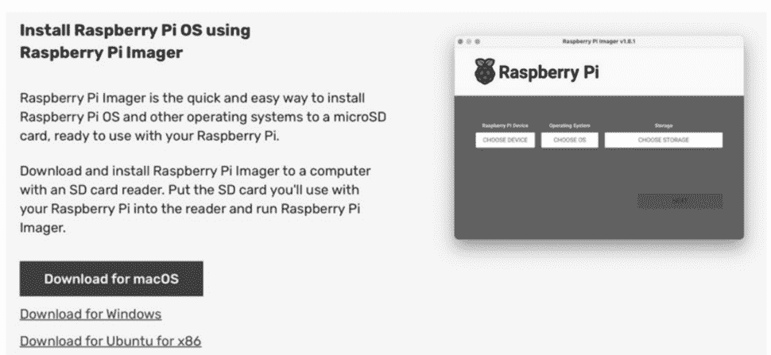

图5-1

#### 5.1.2 安装Raspberry Pi Imager

1. 双击已下载的 imager_1.8.5.dmg，打开安装向导。
2. 把 Raspberry Pi Imager 图标拖入 Applications 文件夹。
3. 进入 Applications，双击 Raspberry Pi Imager 启动，确认能否正常运行。

图5-2 演示了将图标拖拽到 Applications 的过程。

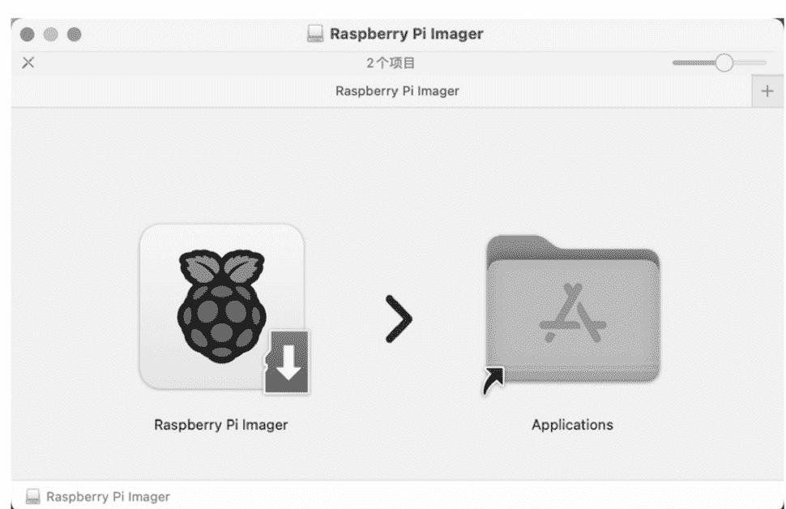

图5-2

#### 5.1.3 下载Raspberry Pi OS

在浏览器打开完整链接：

```
https://www.raspberrypi.com/software/operating-systems/
```

页面内请选择 “Raspberry Pi OS with desktop and recommended software” 进行获取。

下载完毕后找到镜像文件，例如 2024-03-15-raspios-bookworm-armhf-full.img.xz，解压保存以备后续使用。

图5-3 为 OS 下载页的示例。

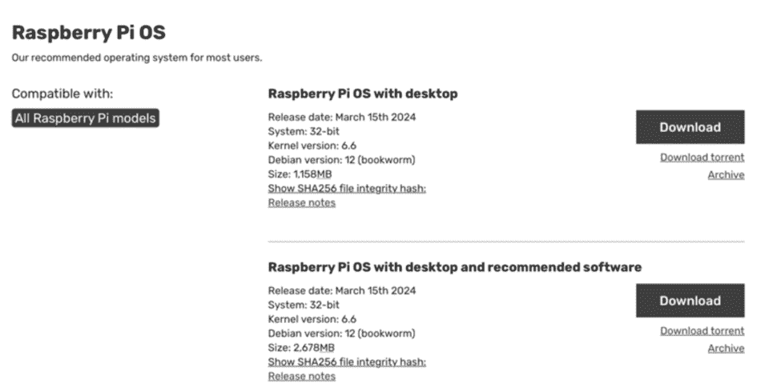

图5-3

#### 5.1.4 烧录Raspberry Pi OS至SD卡

把系统镜像写入 SD 卡，为树莓派提供启动文件，整个流程由 Raspberry Pi Imager 完成，操作简便。

1. 把 SD 卡插入 Mac 的读卡器。
2. 启动 Raspberry Pi Imager。
3. 见图5-4，点击“选择操作系统”，在弹框中选“Use custom”，指定先前解压的 OS 镜像。

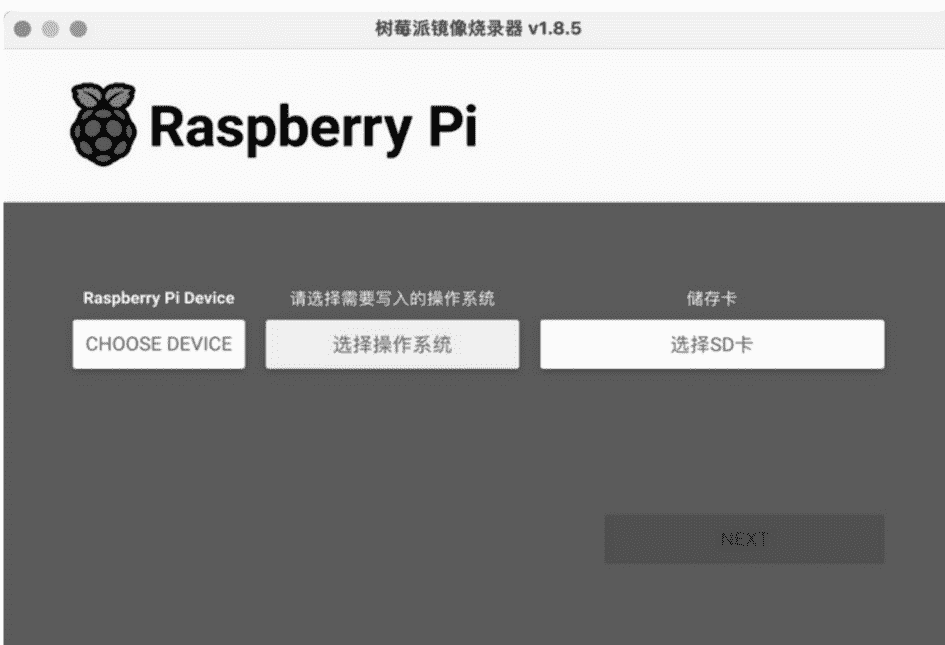

图5-4

4. 点击“选择SD卡”，在弹框中选中已插入的 SD 卡作为写入目标，见图5-5。

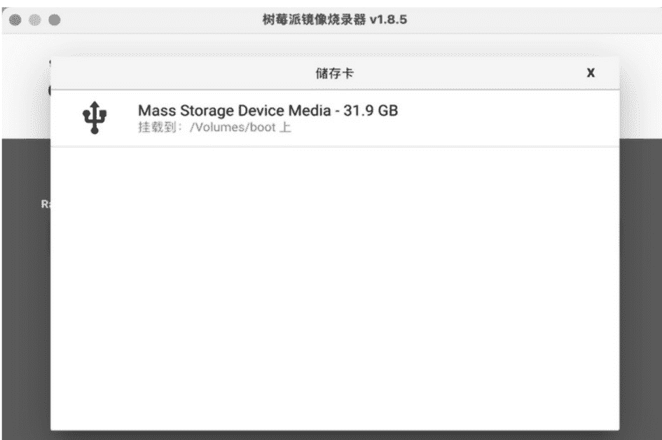

图5-5

5. 见图5-6，点击“NEXT”，系统自动开始写入，需等待数分钟直至结束。

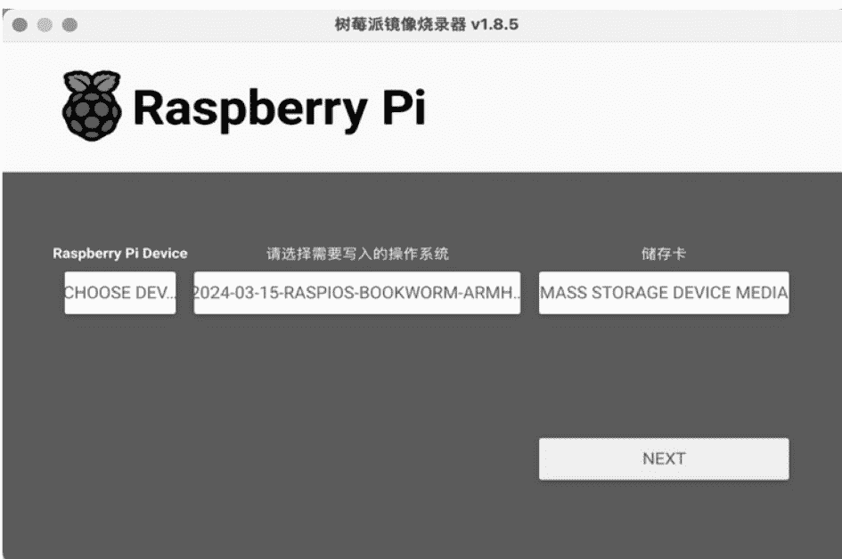

图5-6

6. 完成后系统提示成功，说明 SD 卡已写入系统镜像。

#### 5.1.5 验证安装与后续配置

烧录结束后，把 SD 卡装入树莓派，接通电源开机，检验安装效果并做基础设置，具体如下。

1. 把已烧录的 SD 卡插入树莓派，通电启动。
2. 观察启动画面，确认系统能够正常加载。
3. 后续可按官方文档配置 SSH、VNC 等远程功能。图5-7 展示了启动后系统界面的示例。

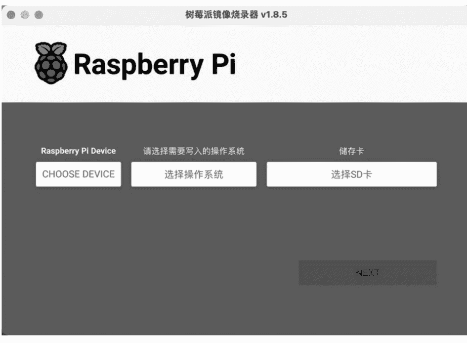

图5-7

### 5.2 搭建PHP网站服务器

本节介绍在树莓派上部署 PHP 网站服务器的流程，涵盖时区调整、Apache2 与 PHP 安装、MariaDB 安装配置、时区导入及 phpMyAdmin 安装。完成后即可通过浏览器访问并管理本地 PHP 服务。

#### 5.2.1 调整树莓派的时区

服务器时间准确对 PHP 运行一致性很重要。

● 方法1：使用 raspi-config 工具

（1）通过 VNC 或 SSH 连接树莓派打开终端。
（2）执行 raspi-config：

```
sudo raspi-config
```

（3）进入 Localisation Options，见图5-8。

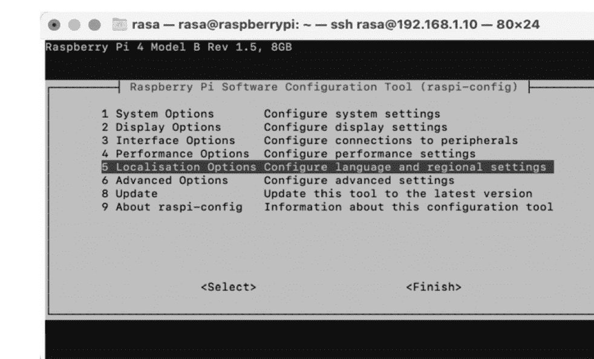

图5-8

（4）选择 L2 Timezone，见图5-9。

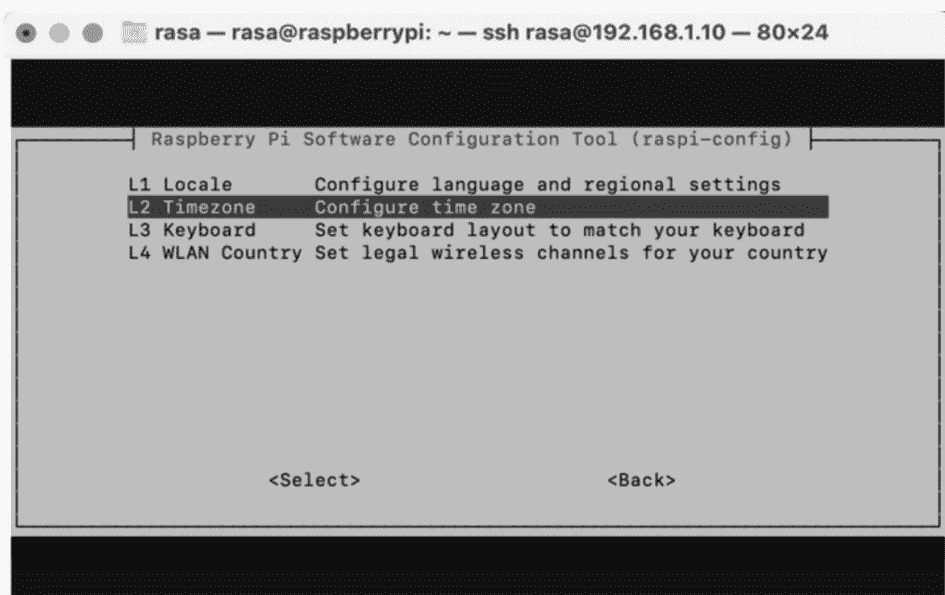

图5-9

（5）依次选择大洲和城市，例如 Asia、Shanghai，见图5-10。
（6）保存设置并退出 raspi-config，见图5-11。

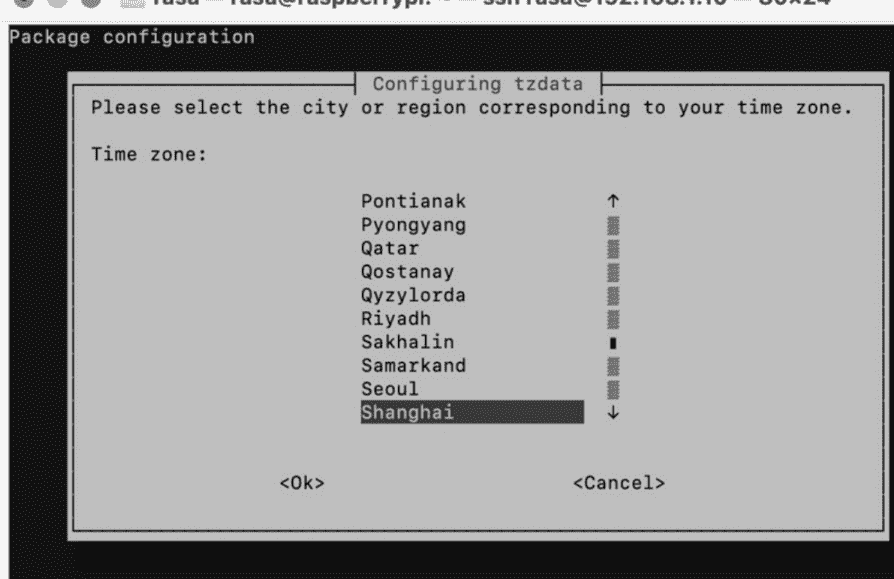

图5-10

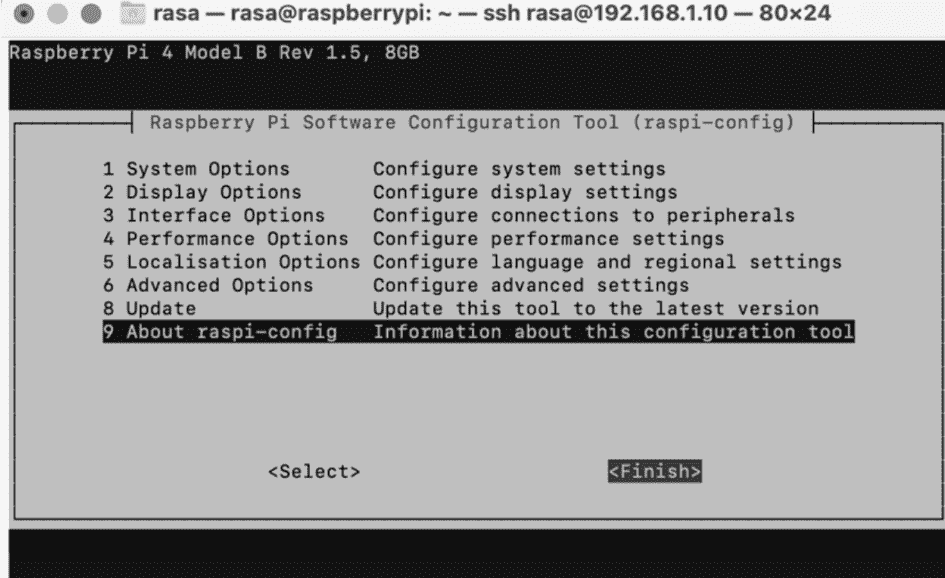

图5-11

（7）重启设备：

```
sudo reboot
```

● 方法2：手动设置时区

查看当前时区：

```
timedatectl
```

设置时区为 Shanghai：

```
sudo timedatectl set-timezone Asia/Shanghai
```

确认时区更改：

```
timedatectl
```

#### 5.2.2 安装Apache2和PHP

安装 Apache2 与 PHP 以提供 Web 服务支持。

(1) 通过 SSH 连接树莓派：

```
ssh pi@<树莓派的 IP 地址>
```

(2) 更新软件包列表：

```
sudo apt-get update
```

(3) 安装 Apache2、PHP 及 PHP MySQL 扩展：

```
sudo apt-get install apache2 php php-mysql -y
```

(4) 若出现 dpkg was interrupted 错误，依次执行修复命令：

```
sudo dpkg --configure -a
sudo apt-get clean
sudo apt-get update
sudo apt-get install apache2 php php-mysql -y
```

(5) 创建 phpinfo 测试文件以验证安装：

```
sudo nano /var/www/html/info.php
```

文件写入：

```
<?php
phpinfo();
?>
```

保存退出。

（6）浏览器访问：

```
http://<树莓派的 IP 地址>/info.php
```

页面显示 PHP 信息即表示安装成功。

#### 5.2.3 安装和配置MariaDB

MariaDB 为 PHP 服务提供数据库支持，需完成安装与基础配置。

（1）安装 MariaDB：

```
sudo apt-get install mariadb-server mariadb-client -y
```

（2）运行以下命令进入 MariaDB 控制台并设置密码：

```
sudo mysql
```

（3）在控制台执行命令，将 yourpassword 替换为实际密码：

```
USE mysql;
SET PASSWORD FOR 'root'@'localhost' = PASSWORD('yourpassword');
FLUSH PRIVILEGES;
EXIT;
```

#### 5.2.4 加载时区信息到MariaDB

导入时区信息可使数据库时间处理与系统保持一致。

（1）安装时区数据包，如未安装请执行：

```
sudo apt-get install tzdata
```

（2）用 mysql_tzinfo_to_sql 将系统时区导入 MariaDB：

```
sudo mysql_tzinfo_to_sql /usr/share/zoneinfo | sudo mysql -u root -p mysql
```

（3）连接 MariaDB 后设置全局时区：

```
SET GLOBAL time_zone = 'Asia/Shanghai';
```

（4）编辑配置文件 /etc/mysql/mariadb.conf.d/50-server.cnf 以持久化设置：

```
sudo nano /etc/mysql/mariadb.conf.d/50-server.cnf
```

（5）添加或修改以下内容：

```
[mysqld]
default-time-zone = 'Asia/Shanghai'
```

图5-12 展示了配置文件中的时区配置。

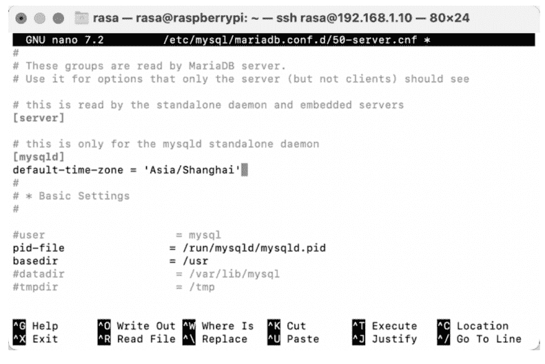

图5-12

（6）重启 MariaDB 服务：

```
sudo systemctl restart mariadb
```

#### 5.2.5 检查MariaDB时区配置

验证 MariaDB 时区与系统一致。

（1）登录 MariaDB：

```
sudo mysql -u root -p
```

（2）执行查询命令：

```
SHOW VARIABLES LIKE 'time_zone';
```

输出应为 Asia/Shanghai。

#### 5.2.6 安装phpMyAdmin

phpMyAdmin 提供图形化管理界面，便于操作 MariaDB。

（1）安装 phpMyAdmin：

```
sudo apt-get install phpmyadmin -y
```

安装时选择 apache2，并跳过自动配置数据库。

（2）为 Apache 引入 phpMyAdmin 配置
打开 Apache 的主配置文件：

```
sudo nano /etc/apache2/apache2.conf
```

把下面内容追加到配置文件末尾：

```
Include /etc/phpmyadmin/apache.conf
```

保存改动后关闭编辑器。

（3）使 Apache 重新加载配置

```
sudo service apache2 restart
```

（4）用浏览器打开以下链接以查看登录页：

```
http://<树莓派的 IP 地址>/phpmyadmin
```

图5-13 呈现了 phpMyAdmin 的登入界面。

(5) 完成 phpMyAdmin 登入
在登入页填入 MariaDB 账号与密码，确认后即可进入控制台主界面，效果见图5-14。

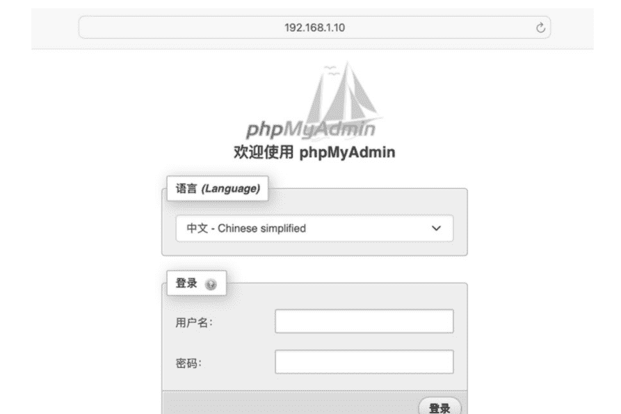

图5-13

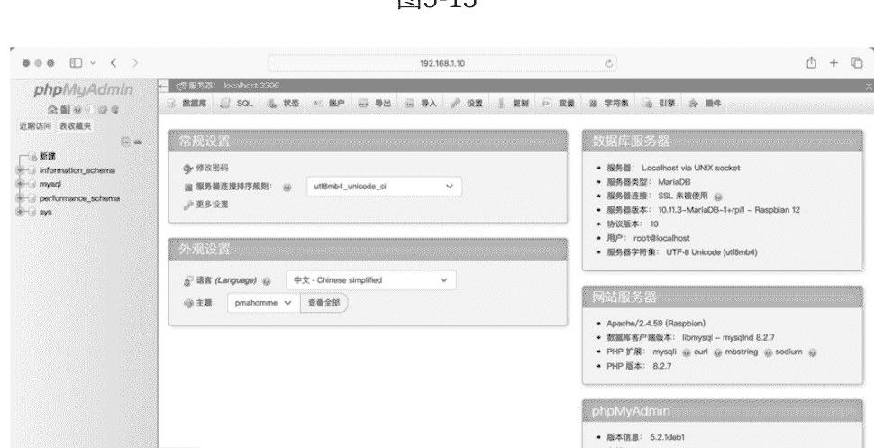

### 5.3 ArkTS 协同硬件控制服务

本节阐述硬件控制服务的实现思路，以及 ArkTS 端按既定流程驱动硬件、保证设备及时响应并实现与应用系统的数据互通。

#### 5.3.1 基于 Flask 的硬件控制服务搭建

本小节以 Flask 结合 RPi.GPIO 为例，演示如何搭建一套远程操控树莓派 RGB LED 的服务。服务通过 REST 接口接收客户端发来的十六进制色值，转换后以 PWM 方式调节灯光，实现实时调光。下面依次说明要点。

##### 1. 项目目录规划

按下列结构组织代码，保持文件易于管理：

```
5.1/
└── HardwareControlService/
    ├── led_control_server.py    // LED灯控制服务代码
    ├── requirements.txt         // 项目依赖列表
    └── start_hardware_services.sh // 启动服务脚本
```

##### 2. 服务实现

在 led_control_server.py 中完成以下逻辑：

- （1）初始化树莓派 GPIO，设定 RGB LED 所在引脚并开启 PWM 输出，以获得平滑的亮度变化；
- (2) 编写函数把十六进制颜色码解析为 RGB 数值，并借助正则表达式校验格式，要求符合“#RRGGBB”规范；
- (3) 暴露接口接收 HTTP POST 请求中的颜色参数，调用前述函数驱动灯光。

核心片段如下：

```python
# -*- coding: utf-8 -*-
# 5.1/HardwareControlService/led_control_server.py

import RPi.GPIO as GPIO
from flask import Flask, request, jsonify
import socket

app = Flask(__name__)

# 定义GPIO引脚
RED_PIN = 13
GREEN_PIN = 15
BLUE_PIN = 29

# 初始化GPIO
GPIO.setmode(GPIO.BOARD)
GPIO.setup(RED_PIN, GPIO.OUT)
GPIO.setup(GREEN_PIN, GPIO.OUT)
GPIO.setup(BLUE_PIN, GPIO.OUT)

# 设置 PWM 频率
red_pwm = GPIO.PWM(RED_PIN, 100)
green_pwm = GPIO.PWM(GREEN_PIN, 100)
blue_pwm = GPIO.PWM(BLUE_PIN, 100)

# 开始 PWM
red_pwm.start(0)
green_pwm.start(0)
blue_pwm.start(0)

def hex_to_rgb(hex_color):
    """
    将十六进制颜色代码转换为 RGB 值

    Args:
    - hex_color (str): 十六进制颜色代码，例如 "#FF0000"

    Returns:
    - tuple: 包含红、绿、蓝三个分量的整数元组 (R, G, B)
    """
    hex_color = hex_color.lstrip('#')  # 去掉前导的#
    return tuple(int(hex_color[i:i+2], 16) for i in (0, 2, 4))

def set_color(rgb_values):
    """
    根据 RGB 值设置 LED 灯颜色

    Args:
    - rgb_values (tuple): 包含红、绿、蓝三个分量的整数元组 (R, G, B)
    """
    red_pwm.ChangeDutyCycle(rgb_values[0] * 100 / 255)
    green_pwm.ChangeDutyCycle(rgb_values[1] * 100 / 255)
    blue_pwm.ChangeDutyCycle(rgb_values[2] * 100 / 255)

    # 在终端输出当前颜色设置状态
    print(f"Setting LED color to RGB: {rgb_values} (Hex: #{''.join(f'{v:02X}' for v in rgb_values)})")

@app.route('/set_color', methods=['POST'])
def set_led_color():
    """
    API 端点，接收十六进制颜色代码并控制 LED 灯颜色

    Request JSON body:
    - color (str): 十六进制颜色代码，例如 "#FF0000"

    Response JSON:
    - success (bool): 指示是否成功设置颜色
    """
    data = request.json
    if 'color' not in data:
        return jsonify({"error": "No color provided"}), 400

    hex_color = data['color']
    rgb_values = hex_to_rgb(hex_color)
    set_color(rgb_values)

    return jsonify({"success": True, "color": hex_color})

if __name__ == '__main__':
    try:
        # 获取本机 IP 地址
        hostname = socket.gethostname()
        local_ip = socket.gethostbyname(hostname)

        print(f"Starting server on http://{local_ip}:6002")
        app.run(host='0.0.0.0', port=6002)
    except KeyboardInterrupt:
        print("\nStopping server...")
    finally:
        # 清理 GPIO 设置
        GPIO.cleanup()
        print("GPIO cleanup done.")
```

##### 3. 依赖与启动

在 requirements.txt 中列出所需依赖项：

```
flask
RPi.GPIO
```

编写 start_hardware_services.sh 作为启动程序，实现依赖自动安装、工作目录切换、后台运行服务及日志记录：

```bash
#!/bin/bash

echo "==============================="
echo "启动硬件服务"
echo "==============================="

# 检查并安装依赖
echo "安装硬件服务的依赖..."
pip install -r services/hardware/requirements.txt

# 启动硬件控制服务
echo "启动硬件控制服务 (led_control_server.py)..."

python3 services/hardware/led_control_server.py &
HARDWARE_PID=$!

# 确认服务启动
echo "硬件控制服务已成功启动！"

# 等待用户手动终止脚本
echo "按 [Ctrl+C] 终止服务。"
wait
```

**提示：** 启动文件需赋予可执行权限，例如执行 chmod +x start_hardware_services.sh。

##### 4. 接口验证

服务运行后，可用 curl 命令检验 LED 控制接口。将＜树莓派IP＞换为实际地址执行：

```
curl -X POST http://<树莓派IP>:6002/set_color \
    -H "Content-Type: application/json" \
    -d '{"color": "#FF0000"}'
```

执行完毕终端会返回类似 JSON，表示颜色设置成功：

```json
{
    "success": true,
    "color": "#FF0000"
}
```

图5-15 为本次验证的终端截图。


图5-15

发送请求后得到正确 JSON 回复，说明控制接口已正常可用。

##### 5. 常用树莓派操作

便于远程维护，常见命令整理如下，请将用户名和 IP 替换为实际值。

- 远程登录：

```
ssh <用户名>@<树莓派 IP>
```

示例：

```
ssh pi@192.168.1.11
```

- 修改脚本：

```
sudo nano /home/<用户名>/led_control_server.py
```

编辑完成后保存并退出。

- 启动程序：

```
sudo python3 /home/<用户名>/led_control_server.py
```

- 结束进程：

可用 Ctrl+Z 挂起，或使用 kill＜进程ID＞ 终止指定进程。

- 移除脚本：

```
sudo rm /home/<用户名>/led_control_server.py
```

#### 5.3.2 ArkTS 端硬件控制流程

本小节说明在 ArkTS 平台实现硬件控制的方法。通过调整工程结构、完善前端代码并预览运行效果，开发者可在移除问答模块后新增硬件控制模块，并以按钮操作实时改变硬件颜色状态。

##### 1. 工程结构调整

为聚焦硬件控制，本项目在 BasicInteractionFrontend 基础上改造。移除 ApiTypes.ets、EmotionService.ets 和 ApiService.ets，新增 HardwareTypes.ets 与 HardwareService.ets，并修改 Index.ets 页面，加入“蓝灯”“绿灯”按钮，使前端以模块化方式实现硬件状态实时操控。

```
src/
├── main/
│   ├── ets/
│   │   ├── configs/          // 配置文件目录（包含硬件控制的 API 地址）
│   │   │   └── Config.ets    // 应用配置文件
│   │   ├── pages/            // 页面文件目录
│   │   │   └── Index.ets     // 更新后的首页，包含硬件控制按钮
│   │   ├── services/         // 服务层，处理与硬件控制接口的交互
│   │   │   └── HardwareService.ets // 硬件控制逻辑封装
│   │   ├── types/            // 类型定义目录
│   │   │   └── HardwareTypes.ets // 定义硬件请求与响应的数据结构和颜色校验方法
│   │   └── utils/            // 工具函数目录
│   │       ├── HttpClient.ets // HTTP 请求工具（辅助文件）
│   │       └── StreamingUtils.ets // 流式数据处理工具
│   └── module.json5          // 模块配置文件
```

##### 2. 前端实现

前端工作分为数据类型定义、服务逻辑封装和页面交互三部分。HardwareTypes.ets 定义前后端通信结构并提供颜色格式校验；HardwareService.ets 封装请求发送与流式返回处理；Index.ets 通过按钮触发控制请求，实现对硬件颜色的精细调节。

- HardwareTypes.ets

该文件定义交互所用数据结构，并在进入业务逻辑前对颜色格式进行合法性检查。

## HardwareTypes.ets

```typescript
// src/main/ets/types/HardwareTypes.ets

/**
 * @description 用于硬件请求的接口
 * @property {string} color - 请求的硬件颜色，应该是有效的颜色代码（如 #FF0000）
 */
export interface HardwareRequest {
  color: string; // 请求的硬件颜色，必须为有效的颜色代码格式（如 #FF0000）
}

/**
 * @description 硬件请求的响应接口
 * @property {boolean} success - 请求是否成功
 * @property {string} color - 返回的硬件颜色，表示硬件状态的颜色
 */
export interface HardwareResponse {
  success: boolean; // 请求成功与否，true 表示成功，false 表示失败
  color: string; // 返回的硬件颜色，表示当前硬件的状态，通常为有效的颜色代码
}

/**
 * @description 校验颜色是否符合有效的 HEX 格式
 * @param color - 颜色字符串，格式应为十六进制颜色代码（如 #FF5733）
 * @returns boolean - 校验颜色格式是否有效
 * @throws Error - 如果颜色格式无效，抛出错误
 */
export function isValidColor(color: string): boolean {
  const hexColorRegex = /^#[0-9A-Fa-f]{6}$/i; // 加入 'i' 以支持大小写
  if (!hexColorRegex.test(color)) {
    throw new Error(`Invalid color format: ${color}. Please use a valid HEX color code (e.g., #FF5733).`);
  }
  return true;
}

/**
 * @description 定义颜色类型，确保颜色值符合有效的 HEX 格式
 */
export type Color = string;
```

## HardwareService.ets

文件内封装了与后端硬件的通信。sendColor 方法组装请求体，通过 httpRequestText 发起 HTTP 请求并解析流式数据，同时捕获异常，成功时调用回调处理数据块，最终返回请求是否成功的布尔值。

```typescript
// src/main/ets/services/HardwareService.ets

import { httpRequestText } from '../utils/HttpClient'; // 导入 HTTP 请求方法
import { http } from '@kit.NetworkKit'; // 导入自定义网络模块
import { HardwareRequest, HardwareResponse } from '../types/HardwareTypes'; // 导入类型

export class HardwareService {
  private apiUrl: string;

  constructor(apiUrl: string) {
    this.apiUrl = apiUrl;
  }

  /**
   * 向硬件发送颜色控制请求
   * @param color - 要发送的颜色
   * @param onChunkReceived - 可选的回调函数，用于处理每个数据块
   * @returns Promise<boolean> - 请求是否成功
   */
  private async sendColor(
    color: string,
    onChunkReceived?: (chunk: string) => void
  ): Promise<boolean> {
    const requestBody: HardwareRequest = { color };

    console.info('发送硬件控制请求，载荷:', requestBody);

    try {
      let success = false;

      // 发送 HTTP 请求并处理流式响应
      await httpRequestText(this.apiUrl, http.RequestMethod.POST, JSON.stringify(requestBody), 60000, (chunk: string) => {
        try {
          const response: HardwareResponse = JSON.parse(chunk); // 解析响应数据
          if (response.success) {
            success = response.success;
            // 如果有回调函数，则调用回调处理每个数据块
            if (onChunkReceived) {
              onChunkReceived(response.success.toString());
            }
          } else {
            console.warn('硬件控制响应失败:', response);
          }
        } catch (parseError) {
          console.error('解析硬件响应数据块时出错:', parseError);
          throw new Error('解析错误: ' + parseError.message);
        }
      });

      console.info('硬件控制请求完成');
      return success; // 返回请求是否成功
    } catch (error) {
      console.error('硬件控制失败:', error);
      throw new Error(`硬件控制失败: ${error instanceof Error ? error.message : error}`);
    }
  }

  /**
   * 控制硬件并获取响应
   * @param color - 要发送的颜色
   * @returns Promise<boolean> - 请求是否成功
   */
  public async controlHardware(color: string): Promise<boolean> {
    try {
      return await this.sendColor(color); // 直接调用发送颜色的私有方法
    } catch (error) {
      console.error('控制硬件失败, 错误信息:', error);
      throw new Error('硬件控制失败'); // 抛出详细的错误信息
    }
  }
}
```

## Index.ets 页面交互设计

在 Index.ets 里新增了蓝灯、绿灯两个快捷按键。按下后会触发 fetchData，内部会先实例化 HardwareService，再通过 controlHardware 把对应的颜色指令发往服务端。界面走极简路线，操作直观，同时所有返回信息都会打印到控制台，调试时能第一时间看到硬件是否正常响应。

```typescript
// src/main/ets/pages/Index.ets

import { config } from '../configs/Config'; // 导入配置文件
import { HardwareService } from '../services/HardwareService';

@Entry
@Component
struct Index {
  /**
   * 根据按钮点击事件获取数据，并生成响应文本
   * @description 该方法会调用 ModelService 获取生成的诗歌文本，并逐块更新结果文本
   */
  async fetchData(color: string) {
    // 创建 HardwareService 实例，传入配置的 API 地址和模型名称
    const hardwareService = new HardwareService(config.hardwareApiUrl);

    try {
      const success = await hardwareService.controlHardware(color);
      console.log(`Hardware control success: ${success}`); // 输出硬件控制结果
    } catch (error) {
      console.error('Error while fetching data:', error); // 错误日志
    }
  }

  build() {
    // 页面布局结构
    Column() {
      Button('蓝灯')
        .width('match_parent') // 按钮宽度设置为填满父容器
        .height(50) // 设置按钮的高度
        .onClick(() => this.fetchData('#0000FF')) // 点击按钮时调用 fetchData 方法

      Button('绿灯')
        .width('match_parent') // 按钮宽度设置为填满父容器
        .height(50) // 设置按钮的高度
        .onClick(() => this.fetchData('#00FF00')) // 点击按钮时调用 fetchData 方法
    }
    .width('100%') // 设置父容器宽度为 100%
    .height('100%') // 设置父容器高度为 100%
    .padding(20) // 添加内边距
    .align(Alignment.Center) // 居中对齐
  }
}
```

##### 3. 效果演示与截图

打开应用后，首页就呈现蓝灯与绿灯两枚按钮。任选其一，点击即向硬件控制接口发起请求，依据服务器返回结果判断执行是否成功，硬件灯的颜色会即时跟进，如图5-16所示。

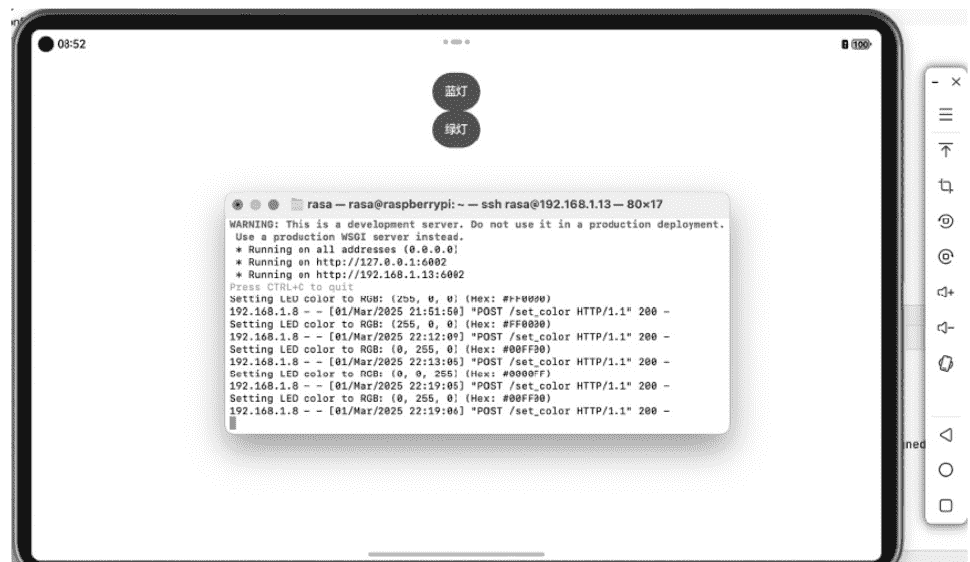

图5-16

#### 5.3.3 ArkTS随机变色器与硬件联动实战

本部分以随机颜色变化器作为案例，演示怎样在轻量级应用里叠加硬件联动，让 App 背景随机的同时，物理设备灯色也同步变化。内容涵盖目录重构、基础变色实现、硬件能力的迭代升级，以及最终的运行演示。

##### 1. 目录与模块调整

项目保持原有的随机色生成与界面展示不变，额外接入硬件控制服务层。新增文件主要负责两件事：

- HardwareService.ets：把所有硬件交互逻辑收拢封装；
- HardwareTypes.ets：统一硬件请求与返回的数据结构。

为了提升视觉趣味，猫咪素材被单独存放：
```
src/main/resources/base/media/cat.png
```

整体目录示例如下：
```
src/
├── main/
│   ├── ets/
│   │   ├── configs/
│   │   │   └── Config.ets          // 应用配置文件（包含硬件控制 API 地址）
│   │   ├── pages/
│   │   │   ├── RandomColorPage.ets // 随机颜色页面（后续升级集成硬件同步控制）
│   │   │   └── Index.ets           // 调用随机颜色页面
│   │   ├── services/
│   │   │   └── HardwareService.ets // 硬件控制逻辑封装
│   │   ├── types/
│   │   │   └── HardwareTypes.ets   // 定义硬件请求与响应的数据结构
│   │   └── utils/                  // 工具函数目录
│   │       ├── HttpClient.ets      // HTTP 请求工具（辅助文件）
│   │       └── StreamingUtils.ets  // 流式数据处理工具
│   ├── module.json5
│   └── resources/
│       └── base/
│           └── media/
│               └── cat.png         // 猫咪图片资源
```

##### 2. 基础版随机背景变色

先做一个只负责随机变色的基础页。RandomColorPage.ets 采用 Column 垂直排列，顶部显示色值，中间放猫咪图，底部放按钮。点下“随机颜色”后会调用 changeBackgroundColor，随机生成一种浅色系并刷新背景。

图片通过 $r('app.media.cat') 引入，提升观感。入口 Index.ets 负责加载该组件，完成最简交互。

原始代码示例：
```typescript
// src/main/ets/pages/RandomColorPage.ets

@Component
export struct RandomColorPage {
  @State backgroundColor1: string = '#FFFFFF'; // 默认背景颜色为白色

  build() {
    Column({ space: 20 }) { // 创建垂直布局容器
      // 显示当前颜色代码
      Text(`当前背景颜色代码: ${this.backgroundColor1}`)
        .fontSize(18)
        .fontWeight(FontWeight.Bold)
        .fontColor(Color.Black)
        .alignSelf(ItemAlign.Center);

      // 显示猫咪图片装饰
      Image($r('app.media.cat'))
        .width(85)
        .height(100)
        .borderRadius(5)
        .alignSelf(ItemAlign.Center);

      // 更改颜色按钮
      Button('随机颜色')
        .onClick(() => this.changeBackgroundColor())
        .fontSize(20)
        .backgroundColor(Color.Gray)
        .fontColor(Color.White)
        .width('60%')
        .alignSelf(ItemAlign.Center);
    }
    .padding(20)
    .width('100%')
    .height('100%')
    .backgroundColor(this.backgroundColor1) // 动态更新背景颜色
    .alignItems(HorizontalAlign.Center);
  }

  // 随机生成淡色系颜色的方法
  private changeBackgroundColor() {
    const randomColor = this.generateLightColor();
    this.backgroundColor1 = randomColor;
  }

  // 生成淡色系颜色的逻辑
  private generateLightColor(): string {
    const r = Math.floor(Math.random() * 128 + 128); // 保证 R 值在 128-255 范围
    const g = Math.floor(Math.random() * 128 + 128); // 保证 G 值在 128-255 范围
    const b = Math.floor(Math.random() * 128 + 128); // 保证 B 值在 128-255 范围
    return `#${r.toString(16).padStart(2, '0')}${g.toString(16).padStart(2, '0')}${b.toString(16).padStart(2, '0')}`;
  }
}
```

入口调用示例如下：
```typescript
// src/main/ets/pages/Index.ets

import { RandomColorPage } from './RandomColorPage';

@Entry
@Component
struct Index {
  build() {
    Column() {
      RandomColorPage() // 调用随机颜色页面
    }
    .padding(20)
  }
}
```

在模拟器里运行，能看到当前色值、猫咪图和随机颜色按钮。按下按钮，背景即刻换成新的淡色，如图5-17所示。


图5-17

##### 3. 进阶版接入硬件控制

升级后 RandomColorPage.ets 在变色基础上增加了硬件同步。changeBackgroundColor 现在会先调用 generateStandardColor，从七种标准色中挑选一个，保证 LED 显示足够分明。色值确定后背景立刻更新，同时 new HardwareService().controlHardware 把该色发送给设备，让 App 与灯的状态保持一致。

HardwareService.ets 充当通信桥梁，用 HTTP 请求把颜色数据推送到指定控制接口，驱动设备端实时刷新。同步成功后还会弹出轻提示，使用户能明显感受到变化。整体上既美化了视觉，也让交互从纯页面延伸到实体硬件，形成更深度的联动。

升级代码如下：

typescript

// src/main/ets/pages/RandomColorPage.ets

import { config } from '../configs/Config'; // 导入配置文件，包含硬件控制 API 地址

import { HardwareService } from '../services/HardwareService'; // 导入硬件控制服务

@Component

export struct RandomColorPage {

  @State backgroundColor1: string = '#FFFFFF'; // 默认背景颜色为白色

  build() {

    Column({ space: 20 }) {

      Text(`当前背景颜色代码: ${this.backgroundColor1}`)

        .fontSize(18)

        .fontWeight(FontWeight.Bold)

        .fontColor(Color.Black)

        .alignSelf(ItemAlign.Center);

      Image($r('app.media.cat'))

        .width(85)

        .height(100)

        .borderRadius(5)

.alignSelf(ItemAlign.Center);

      Button('随机颜色')

        .onClick(() => this.changeBackgroundColor())

        .fontSize(20)

        .backgroundColor(Color.Gray)

        .fontColor(Color.White)

        .width('60%')

        .alignSelf(ItemAlign.Center);

    }

    .padding(20)

    .width('100%')

    .height('100%')

    .backgroundColor(this.backgroundColor1)

    .alignItems(HorizontalAlign.Center);

  }

  private async changeBackgroundColor() {

    // const randomColor = this.generateLightColor();

    const randomColor = this.generateStandardColor();

    this.backgroundColor1 = randomColor; // 更新页面背景颜色

    // 创建 HardwareService 实例，传入配置中的硬件控制 API 地址

    const hardwareService = new HardwareService(config.hardwareApiUrl);

    try {

      //调用硬件服务，将随机颜色发送给硬件设备

      const success = await hardwareService.controlHardware(randomColor);

      console.log(`Hardware control success: ${success}`);

    } catch (error) {

      console.error('Error while sending random color to hardware:', error);

    }

  }

  private generateLightColor(): string {

    const r = Math.floor(Math.random() * 128 + 128);

    const g = Math.floor(Math.random() * 128 + 128);

    const b = Math.floor(Math.random() * 128 + 128);

    return `#${r.toString(16).padStart(2, '0')}${g.toString(16).padStart(2, '0')}${b.toString(16).padStart(2, '0')}`;

  }

  /**

   * 该函数用于随机生成标准的七种颜色中的一种颜色的十六进制编码

   * @returns {string} 随机选中的标准颜色的十六进制编码字符串

   */

  private generateStandardColor(): string {

    // 定义一个数组，存储标准的七种颜色的十六进制编码

    // 红色，象征热情、活力、爱情和危险

    // 橙色，结合了红色的热情和黄色的活力，给人温暖、欢快的感觉

    // 黄色，亮度高，代表智慧、快乐、希望和活力

    // 绿色，与大自然相关，代表生命、健康、和平与成长

    // 蓝色，给人冷静、专业、信任和深邃的感觉

    // 靛色，深沉神秘，介于蓝色和紫色之间，具有精神性和内省性

    // 紫色，富有贵族气息和浪漫情怀，与皇室、神秘和创造力相关

    const colors = ['#FF0000', '#FFA500', '#FFFF00', '#008000', '#0000FF', '#4B0082', '#EE82EE'];

    // 生成一个 0 到 colors 数组长度（不包含数组长度）之间的随机整数索引

    const index = Math.floor(Math.random() * colors.length);

    // 根据生成的随机索引，从 colors 数组中取出对应的颜色十六进制编码并返回

    return colors[index];

  }

}

Index.ets 这块保持原样，不作改动。

在模拟器中启动升级后的页面后，按下 “随机颜色” 按钮，程序会先调用 generateLightColor 产出一个新色值，随即刷新页面底色，并借助 HardwareService 把该色值推送到外设，让 App 与硬件端的色彩呈现保持一致，效果可见图5-18。

若发现 generateLightColor 生成的浅色系在 LED 上辨识度不足，可切换为 generateStandardColor 进行对比测试。

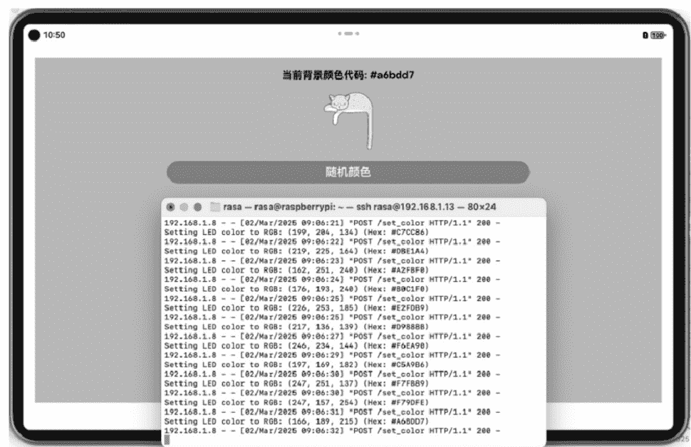

图5-18

图5-19 呈现了采用随机标准七彩色进行软硬件联动的实际界面。

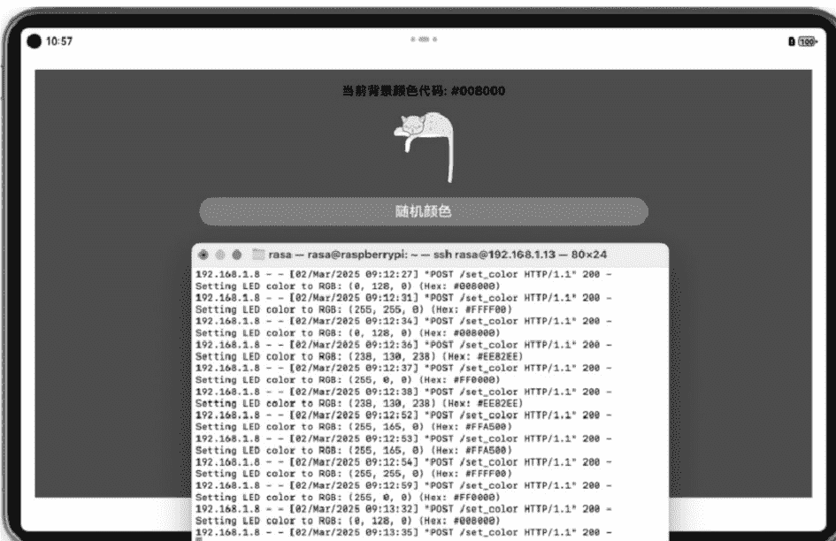

图5-19

### 5.4 硬件状态变化与ArkTS事件触发
本节说明如何借助数据库做状态中转，让 ArkTS 能够捕捉硬件侧的变动并自动触发应用内的对应行为，从而实现软硬协同。

#### 5.4.1 硬件状态管理与数据库同步机制
本小节介绍让树莓派实时采集传感器等硬件数据，再由 Python 脚本配合 PHP 脚本写入数据表的一整套链路。整体思路是先用 phpMyAdmin 建库建表，再落地采集脚本，最后提供写入与查询的 PHP 接口，为智能家居提供持续的数据供给。部署时请注意：

1. SSH 登录默认账号 pi 需按实际环境修改；
2. 文中示例 IP 192.168.1.13 仅作演示，正式环境请换成真实服务器地址；
3. 数据库连接账号密码如 $db_username='root'; 和 $db_password='yourpassword'; 需按自身配置调整。

##### 1.创建数据库和表
下面介绍借助 phpMyAdmin 新建用于存放硬件状态数据的库与表。

1. 在浏览器打开 http://192.168.1.13/phpmyadmin/ 并使用管理员身份登录，部署时 IP 请替换。
2. 主界面顶部选择【数据库】，在创建数据库区输入 smart_home，点击创建，界面如 图5-20。

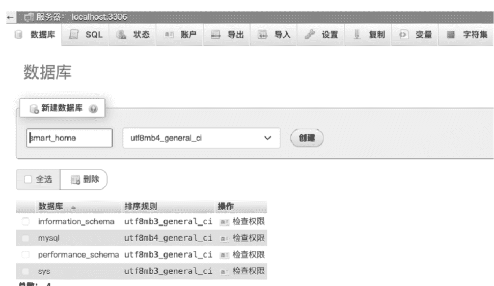

图5-20

进入 smart_home 后在左侧点击进入管理页，切换到【SQL】标签，执行如下语句新建表 smart，包含字段 id、temp、info、datetime 用来保存各硬件状态，执行后界面如 图5-21。

```sql
CREATE TABLE smart(
    id INT NOT NULL AUTO_INCREMENT PRIMARY KEY,
    temp FLOAT NOT NULL,
    info VARCHAR(64) NOT NULL,
    datetime DATETIME NOT NULL
);
```

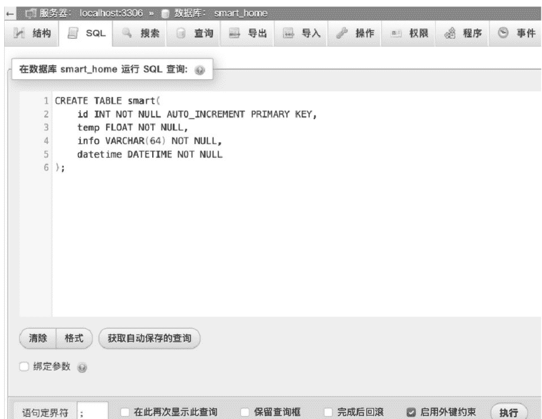

图5-21

##### 2.在树莓派上创建并编辑smart_home.py文件
下面说明如何通过 SSH 连接树莓派并创建用于采集上报的 Python 脚本。

（1）在终端执行连接命令，注意将 pi 与 192.168.1.13 换成实际用户名和设备 IP：

```bash
ssh pi@192.168.1.13
```

（2）新建并打开文件 smart_home.py：

```bash
nano /home/pi/smart_home.py
```

(3) 把下列 Python 代码写入文件。脚本会实时读取 GPIO 与 I2C 传感器，当检测到状态变化时通过 HTTP 请求把数据推送到服务器的 PHP 接口：

```python
# -*- coding: utf-8 -*-
# 5.2/HardwareStateSync/smart_home.py

import RPi.GPIO as GPIO
from time import sleep
import smbus
import requests

# 注意：请将 URL 中的 IP 地址替换为实际服务器地址
url = 'http://127.0.0.1/sql.php'

GPIO.setwarnings(False)
GPIO.setmode(GPIO.BOARD)

buzzer = 12
motion_pin = 16
relay_pin = 40

GPIO.setup(buzzer, GPIO.OUT, initial=GPIO.LOW)
GPIO.setup(motion_pin, GPIO.IN, pull_up_down=GPIO.PUD_UP)
GPIO.setup(relay_pin, GPIO.OUT, initial=GPIO.HIGH)

DEVICE = 0x5c
ONE_TIME_HIGH_RES_MODE_1 = 0x20

if GPIO.RPI_REVISION == 1:
    bus = smbus.SMBus(0)
else:
    bus = smbus.SMBus(1)

def fetch_data(url, params):
    try:
        response = requests.get(url, params=params, timeout=5)
        print(response.text)
    except Exception as e:
        print("Error:", e)

def convert_to_number(data):
    result = (data[1] + (256 * data[0])) / 1.2
    return result

def read_light(addr=DEVICE):
    data = bus.read_i2c_block_data(addr, ONE_TIME_HIGH_RES_MODE_1)
    return convert_to_number(data)

def main():
    while True:
        if GPIO.input(motion_pin) == 1:
            fetch_data(url, {'temp': 1, 'info': '检测到物体移动...'})
            GPIO.output(buzzer, GPIO.HIGH)
            sleep(0.3)
            GPIO.output(buzzer, GPIO.LOW)
        else:
            GPIO.output(buzzer, GPIO.LOW)
            sleep(0.1)

        light_level = read_light()
        if light_level < 50:
            fetch_data(url, {'temp': format(light_level, '.2f'), 'info': '灯被打开...'})
            GPIO.output(relay_pin, GPIO.LOW)
        elif light_level > 200:
            GPIO.output(relay_pin, GPIO.HIGH)
            sleep(0.1)

if __name__ == '__main__':
    try:
        main()
    except KeyboardInterrupt:
        GPIO.cleanup()
```

保存后退出编辑器。

##### 3.编写PHP脚本实现数据写入与查询
为让硬件状态数据与数据库保持同步，分别准备两个 PHP 文件，一个负责写入 sql.php，一个负责查询 smart_home.php。

- 创建并编辑 sql.php 文件：

```bash
sudo nano /var/www/html/sql.php
```

把以下 PHP 代码复制入文件：

```php
<?php
// 5.2/HardwareStateSync/sql.php

$db_hostname = '127.0.0.1';
$db_username = 'root';        // 请按实际情况修改数据库用户名
$db_password = 'yourpassword'; // 请按实际情况修改数据库密码
$db_database = 'smart_home';
$db_table = 'smart';
$charset = 'utf8';

$temp = $_GET['temp'];
$info = $_GET['info'];
date_default_timezone_set('Asia/Shanghai'); // 设置时区
$datetime = date('Y-m-d H:i:s');

$con = connectDB($db_hostname, $db_username, $db_password, $charset);
selectDB($con, $db_database);

$columns = "`temp`, `info`, `datetime`";
$values = "'$temp', '$info', '$datetime'";

$res = insertTB($con, $db_table, $columns, $values);
closeDB($con);

echo 'temp = ' . $temp . ', info = ' . $info . ', datetime = ' . $datetime;

function connectDB($db_hostname, $db_username, $db_password, $charset = 'utf8') {
    $con = mysqli_connect($db_hostname, $db_username, $db_password);
    if (!$con) {
        die('Error: Could not connect: ' . mysqli_connect_error());
    }
    mysqli_set_charset($con, $charset);
    return $con;
}

function insertTB($con, $db_table, $columns, $values) {
    $sql = 'INSERT INTO ' . $db_table . '(' . $columns . ')' . ' VALUES (' . $values . ')';
    return queryDB($con, $sql);
}

function selectDB($con, $db_database) {
    return mysqli_select_db($con, $db_database);
}

function queryDB($con, $sql) {
    return mysqli_query($con, $sql);
}

function closeDB($con) {
    mysqli_close($con);
}
?>
```

- 创建并编辑 smart_home.php 文件：

```bash
sudo nano /var/www/html/smart_home.php
```

把以下 PHP 代码复制入文件。该脚本会连接数据库、查询硬件状态并以 JSON 格式返回结果：

```php
<?php
    // 5.2/HardwareStateSync/smart_home.php
```

##### 4. 运行Python脚本同步硬件状态数据
(1) 在树莓派终端执行启动命令：

```
sudo python3 /home/pi/smart_home.py
```

(2) 观察终端输出，确认数据已通过 HTTP 请求送达 PHP 接口并写入库。
(3) 用浏览器检查数据：可通过 phpMyAdmin 页面查看，地址格式为 http://192.168.1.13/phpmyadmin，或直接访问 http://192.168.1.13/smart_home.php 获取 JSON。

图5-22 与 图5-23 展示了数据库中硬件状态同步的截图。

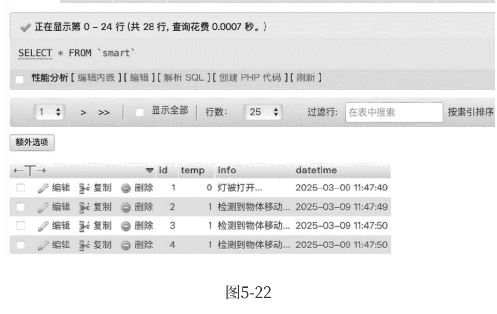

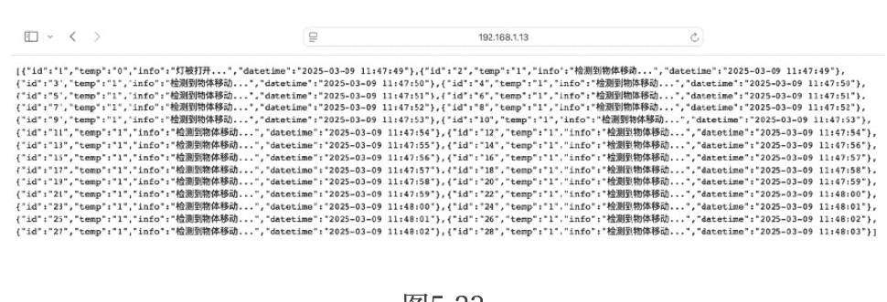

图5-23

完成上述流程后即可搭建起完整的硬件状态管理与数据库同步方案：

- 树莓派采集的传感器数据可经 Python 脚本实时上传到服务器；
- PHP 脚本负责写入与查询；
- 系统可通过 HTTP 接口进行状态的实时监控。

#### 5.4.2 基于 ArkTS 的硬件状态自动采集与可视化

本部分演示借助 ArkTS 编写的鸿蒙程序，完成设备状态周期采集并在界面上即时呈现。运行期间，程序会按间隔向服务器端发出指令或查询，并把返回结果同步到视图。逻辑、表现分离，提升可维护性，整体目录示意如下：

```
src/
└── main/
    └── ets/
        ├── types/
        │   └── SensorTypes.ets          // 存放数据类型定义，如传感器数据结构定义
        │                                 // 定义传感器数据的接口和辅助工具函数，用于存储
        │                                 // 和传输传感器信息
        ├── services/
        │   └── SensorDataService.ets    // 存放与硬件或后端交互的业务逻辑代码
        │                                 // 封装硬件通信逻辑和 HTTP 请求处理，用于从远程
        │                                 // 服务器获取传感器数据
        ├── components/
        │   └── MainAbility.ets          // 存放 UI 组件代码，用于展示数据和实现用户交互
        │                                 // 主页面展示组件（调用服务层获取数据并展示）
        └── pages/
            └── Index.ets               // 存放页面文件，定义应用整体页面布局
                                        // 应用主页面，加载主要 UI 组件
└── module.json5                        // 模块配置文件，定义应用模块信息及相关权限配置
```

##### 1. 新建工程并开启联网授权
先用 DevEco Studio 起一个 ArkTS 工程，命名上 SmartHomeSensor 比较直观。进入 module.json5 配置，在 module 段里写入 ohos.permission.INTERNET 这一联网授权，保证程序可以发起网络通信。

##### 2. 统一数据模型与工具函数
SensorTypes.ets 负责收敛硬件交互相关的类型声明以及辅助函数。示例见下：

```typescript
// src/main/ets/types/SensorTypes.ets

/**
 * @file SensorTypes.ets
 * @description 定义传感器数据类型，用于存储和传输传感器相关信息
 */

/**
 * @interface SensorData
 * @description 传感器数据结构，包含温度、附加信息和时间戳
 *
 * @property {string} [temp] - 传感器测得的温度值（可选）
 * @property {string} [info] - 额外的传感器信息，如状态描述或设备标识（可选）
 * @property {string} [datetime] - 数据记录时间，格式可根据具体需求定义（可选）
 */
export interface SensorData {
  temp?: string;
  info?: string;
  datetime?: string;
}
```

##### 3. 封装设备通信服务
SensorDataService.ets 用来收纳与外设对话的请求编排。该模块向控制端点发出网络请求，解析返回。示例如下：

```typescript
// src/main/ets/services/SensorDataService.ets

import { SensorData } from "../types/SensorTypes";
import { http } from '@kit.NetworkKit'; // 导入自定义网络模块
import { BusinessError } from '@kit.BasicServicesKit'

/**
 * @file SensorDataService.ets
 * @description 传感器数据服务类，提供从远程服务器获取传感器数据的功能，并存储数据
 */
export class SensorService {
  // 类变量：传感器数据接口的 URL (只读，构造后不可修改)
  private sensorUrl: string;

  // 存储从接口获取的传感器数据列表
  public sensorDataList: SensorData[] = [];

  /**
   * @constructor
   * @description 构造 SensorService 实例
   * @param {string} sensorUrl - 传感器数据接口的 URL
   */
  constructor(sensorUrl: string) {
    this.sensorUrl = sensorUrl;
  }

  /**
   * @method fetchSensorData
   * @description 从 sensorUrl 指定的地址获取传感器数据，并存储到 sensorDataList
   * @returns {Promise<void>} 成功时返回 void，失败时返回错误信息
   */
  public fetchSensorData(): Promise<void> {
    // 创建 HTTP 请求实例
    const httpRequest = http.createHttp();

    return new Promise((resolve, reject) => {
      // 发送 HTTP GET 请求以获取数据
      const promise = httpRequest.request(this.sensorUrl, {
        method: http.RequestMethod.GET,              // 请求方法：GET
        connectTimeout: 60000,                       // 连接超时时间（毫秒）
        readTimeout: 60000,                          // 读取数据超时时间（毫秒）
        expectDataType: http.HttpDataType.STRING,    // 期望返回的数据类型：字符串（JSON 格式）
        usingCache: true,                            // 启用本地缓存
        priority: 1,                                 // 请求优先级
        usingProtocol: http.HttpProtocol.HTTP1_1,    // 使用 HTTP/1.1 协议
        usingProxy: false,                           // 不使用代理
        header: {
          'Content-Type': 'application/json'         // 请求头：声明 JSON 内容类型
        }
      });

      promise.then((data) => {
        // 判断服务器响应状态码是否为 200 OK
        if (data.responseCode === http.ResponseCode.OK) {
          console.info('Received Data: ' + data.result);
          try {
            // 解析 JSON 数据并存储到 sensorDataList
            this.sensorDataList = JSON.parse(data.result as string);
            resolve();
          } catch (error) {
            // 解析 JSON 失败时返回错误
            console.error('JSON Parsing Error: ' + error);
            reject(new Error('Failed to parse sensor data'));
          }
        } else {
          // 服务器返回非 200 状态码，抛出错误
          reject(new Error(`Unexpected response code: ${data.responseCode}`));
        }
      }).catch((err: BusinessError) => {
        // 捕获 HTTP 请求错误，输出日志后返回错误
        console.error('HTTP Request Error: ' + JSON.stringify(err));
        reject(err);
      });
    });
  }
}
```

##### 4. 搭建视图组件并接入数据层
MainAbility.ets 负责界面呈现，内部按节奏拉取最新数值并刷新显示，同时通过 SensorService 完成数据获取。示例如下：

```typescript
// src/main/ets/components/MainAbility.ets

import { BusinessError } from '@kit.BasicServicesKit'
import { SensorData } from '../types/SensorTypes';
import { SensorService } from '../services/SensorDataService';

/**
 * @file MainAbility.ets
 * @description 应用的主要 UI 组件，负责展示传感器数据，并定时更新
 */

@Component
export struct MainAbility {
  // 组件状态变量：存储传感器数据列表，用于动态更新 UI
  @State sensorDataList: SensorData[] = []

  /**
   * @method aboutToAppear
   * @description 组件生命周期方法，在组件加载时执行，负责初始化数据获取
   */
  aboutToAppear(): void {
    this.fetchSensorData(); // 组件加载时立即获取传感器数据

    // 设置定时任务，每 10 秒钟自动更新传感器数据
    setInterval(() => {
      this.fetchSensorData();
    }, 10000);
  }

  /**
   * @method fetchSensorData
   * @description 通过 SensorService 获取传感器数据，并更新 sensorDataList
   */
  fetchSensorData(): void {
    // 传感器数据 API 地址（示例 IP，需根据实际环境调整）
    let sensorUrl = "http://192.168.1.13/smart_home.php";

    // 实例化 SensorService，用于请求传感器数据
    const sensorService = new SensorService(sensorUrl);

    sensorService.fetchSensorData()
      .then(() => {
        console.info("Sensor Data List:", sensorService.sensorDataList);
        // 更新组件状态，触发 UI 重新渲染
        this.sensorDataList = sensorService.sensorDataList;
      })
      .catch((err: BusinessError) => {
        // 捕获请求错误，并打印日志
        console.error("Failed to fetch sensor data", err);
      });
  }

  /**
   * @method build
   * @description 构建 UI 结构，展示传感器数据列表
   */
  build() {
    Column() {
      // 使用 List 组件展示传感器数据
      List() {
        ForEach(this.sensorDataList, (item: SensorData) => {
          ListItem() {
            Column() {
              // 显示数据时间戳
              Text(item.datetime || '')
                .margin({ bottom: 5 })
              // 显示温度数据
              Text(item.temp || '')
                .margin({ bottom: 5 })
              // 显示附加信息
              Text(item.info || '')
            }
          }
          .padding(20)
          .height(100)
        }, (item: SensorData) => item.datetime) // 设定唯一标识符
      }
      .divider({ strokeWidth: 2 }) // 添加分割线
    }
    .width('100%')
    .height('100%')
  }
}
```

##### 5. 在首页挂载主区块
Index.ets 引入 MainAbility 并将其放进首页布局，使设备信息得以展示。示例如下：

```php
<?php
$db_hostname = '127.0.0.1';
$db_username = 'root';        // 请按实际情况修改数据库用户名
$db_password = 'yourpassword'; // 请按实际情况修改数据库密码
$db_database = 'smart_home';
$charset = 'utf8';

// 设置内容类型为 JSON 并使用 UTF-8 编码
header('Content-Type: application/json; charset=utf-8');
date_default_timezone_set('Asia/Shanghai'); // 设置时区

// 创建数据库连接
$con = mysqli_connect($db_hostname, $db_username, $db_password, $db_database);
if (!$con) {
    die(json_encode(['error' => 'Could not connect: ' . mysqli_connect_error()]));
}

// 设置字符集
mysqli_set_charset($con, $charset);

// 查询数据表
$sql = "SELECT * FROM smart";
$result = mysqli_query($con, $sql);

// 检查查询是否成功
if (!$result) {
    die(json_encode(['error' => 'Query failed: ' . mysqli_error($con)]));
}

// 提取结果集
$data = [];
while ($row = mysqli_fetch_assoc($result)) {
    $data[] = $row;
}

// 关闭数据库连接
mysqli_close($con);

// 输出 JSON 数据
echo json_encode($data, JSON_UNESCAPED_UNICODE);
?>
```

##### 6. 启动验证运行效果
打开 DevEco Studio 的设备管理面板，挑选仿真机或实体设备执行。

程序运行后，首页会自行触发数据服务按间隔刷新感知单元数据，并以文字形式在画面呈现最新读数，效果见图5-24。


图5-24

### 5.5 硬件双向联动与状态回传机制

本章介绍怎样达成设备端的即时操控及回写刷新，借助双向通道让外设侧的改变量迅速回传至前端。

#### 5.5.1 LED 即时操控与回写刷新

下面重点拆解针对 LED 的即时开关逻辑以及配套的回写机制。整体架构包含三块。

从硬件到云端再到移动端，这套方案把 LED 控制、状态查询和数据持久化串成了一条闭环。下面用更通俗的方式把整体脉络拆开说。

整体由三个核心部件协同工作：
- （1）LED 远控服务：在树莓派上用 Python 起一个 HTTP 服务，实时接收灯光指令，通过 PWM 驱动 GPIO 实现颜色切换；
- （2）最新状态查询接口：由 PHP 脚本对接数据库，取出最近一条硬件状态记录并以 JSON 返回；
- （3）数据写入接口：复用 5.2/HardwareStateSync/sql.php，接受 GET 请求把硬件状态落库。

交互流程是这样的。当用户或系统下发调色指令，比如把灯设为红色，前端会以 HTTP POST 把颜色信息送到 LED 控制服务。服务端先解析请求里的十六进制色码，用 hex_to_rgb 转换成 RGB 三通道数值，随后调用 set_color 函数以 PWM 信号驱动对应引脚，完成灯色的即时更新。更新完成后，服务再调用 fetch_data，通过 GET 请求把本次操作事件例如“LED颜色更新（#FF0000）”连同相关信息写进数据库，保证状态同步保存。

状态拉取则更直接。客户端访问 latest_smart_state.php，接口建立数据库连接后执行 `SELECT * FROM smart ORDER BY id DESC LIMIT 1`，把查到的最新一条记录序列化为 JSON 返回，方便监控和展示。

三者的配合点在于控制与存储的融合：
- （1）Python 脚本 led_control_server_db.py 负责收请求、解色码、驱动灯光并触发写入；
- （2）latest_smart_state.php 保证随时能拿到数据库里的最新硬件状态；
- （3）sql.php 作为统一的写入入口，让各模块的数据入库格式保持一致。

##### 1. 状态拉取接口 latest_smart_state.php
```php
<?php
// 5.3/RealTimeHardwareControl/latest_smart_state.php

$db_hostname = '127.0.0.1';
$db_username = 'root';        // 请按实际情况修改数据库用户名
$db_password = 'yourpassword'; // 请按实际情况修改数据库密码
$db_database = 'smart_home';
$charset = 'utf8';

// 设置内容类型为 JSON 并使用 UTF-8 编码
header('Content-Type: application/json; charset=utf-8');
date_default_timezone_set('Asia/Shanghai'); // 设置时区

// 创建数据库连接
$con = mysqli_connect($db_hostname, $db_username, $db_password, $db_database);
if (!$con) {
    die(json_encode(['error' => 'Could not connect: ' . mysqli_connect_error()]));
}

// 设置字符集
mysqli_set_charset($con, $charset);

// 查询最新一条数据
$sql = "SELECT * FROM smart ORDER BY id DESC LIMIT 1";
$result = mysqli_query($con, $sql);

// 检查查询是否成功
if (!$result) {
    die(json_encode(['error' => 'Query failed: ' . mysqli_error($con)]));
}

// 获取最新的一条记录
$data[] = mysqli_fetch_assoc($result);

// 关闭数据库连接
mysqli_close($con);

// 输出 JSON 数据
echo json_encode($data ? $data : ['error' => 'No data found'], JSON_UNESCAPED_UNICODE);
?>
```

##### 2. LED 控制服务 led_control_server_db.py
```python
# -*- coding: utf-8 -*-
# 5.3/RealTimeHardwareControl/led_control_server_db.py

import RPi.GPIO as GPIO
from flask import Flask, request, jsonify
import socket
import requests

app = Flask(__name__)

# 定义 GPIO 引脚
RED_PIN = 13
GREEN_PIN = 15
BLUE_PIN = 29

# 初始化 GPIO
GPIO.setmode(GPIO.BOARD)
GPIO.setup(RED_PIN, GPIO.OUT)
GPIO.setup(GREEN_PIN, GPIO.OUT)
GPIO.setup(BLUE_PIN, GPIO.OUT)

# 设置 PWM 频率
red_pwm = GPIO.PWM(RED_PIN, 100)
green_pwm = GPIO.PWM(GREEN_PIN, 100)
blue_pwm = GPIO.PWM(BLUE_PIN, 100)

# 开始 PWM
red_pwm.start(0)
green_pwm.start(0)
blue_pwm.start(0)

# 数据库写入接口地址（请根据实际情况修改）
SQL_URL = 'http://127.0.0.1/sql.php'

def fetch_data(url, params):
    """
    参考 smart_home.py 中的 fetch_data 函数，通过 GET 请求写入数据库
    """
    try:
        response = requests.get(url, params=params, timeout=5)
        print("数据库响应:", response.text)
    except Exception as e:
        print("写入数据库错误:", e)

def hex_to_rgb(hex_color):
    """
    将十六进制颜色代码转换为 RGB 值

    Args:
        hex_color (str): 十六进制颜色代码，例如 "#FF0000"

    Returns:
        tuple: 包含红、绿、蓝三个分量的整数元组 (R, G, B)
    """
    hex_color = hex_color.lstrip('#')  # 去掉前导的#
    return tuple(int(hex_color[i:i+2], 16) for i in (0, 2, 4))

def set_color(rgb_values):
    """
    根据 RGB 值设置 LED 灯的颜色

    Args:
        rgb_values (tuple): 包含红、绿、蓝三个分量的整数元组 (R, G, B)
    """
    red_pwm.ChangeDutyCycle(rgb_values[0] * 100 / 255)
    green_pwm.ChangeDutyCycle(rgb_values[1] * 100 / 255)
    blue_pwm.ChangeDutyCycle(rgb_values[2] * 100 / 255)
    # 输出当前颜色状态
    print(f"Setting LED color to RGB: {rgb_values} (Hex: #{''.join(f'{v:02X}' for v in rgb_values)})")

@app.route('/set_color', methods=['POST'])
def set_led_color():
    """
    API 端点，接收十六进制颜色代码并控制 LED 灯的颜色，同时写入数据库

    Request JSON body:
        - color (str): 十六进制颜色代码，例如 "#FF0000"

    Response JSON:
        - success (bool): 指示是否成功设置颜色
    """
    data = request.json
    if 'color' not in data:
        return jsonify({"error": "No color provided"}), 400

    hex_color = data['color']
    rgb_values = hex_to_rgb(hex_color)
    set_color(rgb_values)

    # 写入数据库：发送颜色及相关信息
    info = f'LED 颜色更新({hex_color})'
    fetch_data(SQL_URL, {'temp': 0, 'info': info})
    return jsonify({"success": True, "color": hex_color})

if __name__ == '__main__':
    try:
        # 获取本机 IP 地址
        hostname = socket.gethostname()
        local_ip = socket.gethostbyname(hostname)

        print(f"Starting server on http://{local_ip}:6002")
        app.run(host='0.0.0.0', port=6002)
    except KeyboardInterrupt:
        print("\nStopping server...")
    finally:
        # 清理 GPIO 设置
        GPIO.cleanup()
        print("GPIO cleanup done.")
```

##### 3. 数据库写入接口 sql.php
该文件与“5.4.1 硬件状态管理与数据库同步机制”中描述的实现完全一致，职责是接收 GET 请求并把数据写入数据库。具体实现已在前文展开，这里不再重复。

##### 4. 部署与使用说明
实操部署时要注意以下细节，才能保证稳定运行。

- ● 账号与 IP
SSH 远程登录时请使用真实的系统用户名。例如：
```
ssh pi@192.168.1.13
```
请按实际环境修改 IP 地址，确保与设备一致。

- ● 文件编辑与启动
在树莓派上修改 LED 控制脚本，执行：
```
nano /home/pi/led_control_server_db.py
```
保存后用以下命令启动服务：
```
sudo python3 /home/pi/led_control_server_db.py
```
若要调整状态查询接口，进入 Web 服务目录编辑：
```
sudo nano /var/www/html/latest_smart_state.php
```

- ● 配置项
务必根据现场环境修改各脚本中的数据库地址、账号密码以及 GPIO 引脚配置，保证模块间通信正常。

#### 5.5.2 前端实时同步硬件状态到页面
本部分介绍基于 ArkTS 开发 HarmonyOS 应用，实现硬件状态的实时展示与联动。CatAndLampApp 融合了 HardwareControlFrontend 与 SmartHomeSensor 的代码，通过定时拉取传感器数据、解析内容并结合硬件控制逻辑，让页面直观呈现当前灯光与猫咪位置的变化。项目采用模块化组织，配置、工具、服务、数据类型和 UI 分层管理，便于维护扩展。

整体目录结构如下：
```
src/
└── main/
    └── ets/
        ├── configs/
        │   └── Config.ets          // 定义硬件 API 地址等配置信息
        ├── utils/
        │   ├── HttpClient.ets      // 网络请求工具类
        │   └── StreamingUtils.ets  // 流处理工具
        ├── services/
        │   ├── HardwareService.ets // 硬件控制服务，封装硬件交互逻辑
        │   └── SensorDataService.ets    // 传感器数据服务，用于获取硬件状态数据
        ├── types/
        │   ├── HardwareTypes.ets    // 定义硬件状态数据结构
        │   └── SensorTypes.ets      // 定义传感器数据结构（如温度、状态信息）
        └── pages/
            ├── CatAndLampPage.ets   // 主要 UI 页面，实现实时同步传感器数据与硬件控制
            └── Index.ets            // 应用入口页面，加载主要 UI 组件
└── resources/
    └── base/
        └── media/           // 图片资源文件夹
            ├── light_off_1.png
            ├── light_off_2.png
            ├── light_off_3.png
            ├── light_off_4.png
            ├── light_off_5.png
            ├── light_off_6.png
            ├── light_on_1.png
            ├── light_on_2.png
            ├── light_on_3.png
            ├── light_on_4.png
            ├── light_on_5.png
            ├── light_on_6.png
            └── cat.png
```

创建项目时用 DevEco Studio 新建 CatAndLampApp，并在模块配置文件如 module.json5 中声明网络权限 `ohos.permission.INTERNET`，以支持 HTTP 请求。

类型与服务层沿用两个子模块的代码：
- 1. `src/main/ets/types/HardwareTypes.ets` 定义硬件状态的数据结构；
- 2. `src/main/ets/types/SensorTypes.ets` 定义传感器数据结构，包含温度、状态与采集时间；
- 3. `src/main/ets/services/HardwareService.ets` 封装硬件控制逻辑，通过接口调用触发状态变更；
- 4. `src/main/ets/services/SensorDataService.ets` 用 HTTP 获取传感器数据并解析 JSON 存入 sensorDataList 数组。

新增的页面负责 UI 渲染与数据实时同步，核心是 CatAndLampPage.ets，主要行为如下：
- 1. 组件加载时在 aboutToAppear 中调用 fetchSensorData，并以 200 毫秒间隔刷新，保证数据实时；
- 2. 拉取到数据后执行 syncStateWithSensorData，解析 info 字段中嵌入的颜色代码如 #0000FF，根据预设色表确定当前点亮灯的索引。若数据缺失或解析失败，索引默认回退到 0；
- 3. 用户点击“下一步”时，先调用 moveCatToNextLamp 更新猫咪位置，再通过 fetchData 调用硬件控制服务，把新的颜色信息推送到后端驱动灯光；
- 4. UI 基于 ArkTS 组件搭建，点亮的灯展示亮灯图并叠加猫咪图，未点亮的灯显示熄灭图，同时用 ForEach 列表展示传感器记录，包含时间戳、温度和附加信息。

关键实现片段如下：
```typescript
// src/main/ets/pages/Index.ets

import { MainAbility } from '../components/MainAbility';

@Entry
@Component
struct Index {
  build() {
    Column() {
      MainAbility()
        .width('100%')
        .height('100%')
    }
  }
}
```

## 第5章 硬件状态实时同步展示
在 src/main/ets/pages/CatAndLampPage.ets 中定义了 CatAndLampPage 组件，用于展示与操控硬件状态。

```typescript
// src/main/ets/pages/CatAndLampPage.ets

import { config } from '../configs/Config';
import { HardwareService } from '../services/HardwareService';
import { BusinessError } from '@kit.BasicServicesKit';
import { SensorData } from '../types/SensorTypes';
import { SensorService } from '../services/SensorDataService';

@Component
export struct CatAndLampPage {
  @State currentLampIndex: number = -1; // -1 表示尚未同步传感器数据
  lamps: number[] = [1, 2, 3, 4, 5, 6];
  private colors: string[] = [
    "#FF0000", // 红色
    "#00FF00", // 绿色
    "#0000FF", // 蓝色
    "#FFFF00", // 黄色
    "#FF00FF", // 品红
    "#00FFFF"// 青色
  ];
  @State sensorDataList: SensorData[] = [];

  /**
   * 根据按钮点击事件控制硬件（如灯），并输出响应结果
   */
  async fetchData(color: string) {
    const hardwareService = new HardwareService(config.hardwareApiUrl);
    try {
      const success = await hardwareService.controlHardware(color);
      console.info(`硬件控制成功，返回值: ${success}`);
    } catch (error) {
      console.error('硬件控制时出错: ', error);
    }
  }

  /**
   * 加载组件时调用，初始化传感器数据获取
   */
  aboutToAppear(): void {
    this.fetchSensorData();
    setInterval(() => {
        this.fetchSensorData();
    }, 500);
  }

  /**
   * 通过 SensorService 获取传感器数据，并更新 sensorDataList，同时同步 UI 状态
   */
  fetchSensorData(): void {
    const sensorUrl = "http://192.168.1.13/latest_smart_state.php";
    const sensorService = new SensorService(sensorUrl);

    sensorService.fetchSensorData()
        .then(() => {
            console.info("传感器数据列表: ", sensorService.sensorDataList);
            this.sensorDataList = sensorService.sensorDataList;
            this.syncStateWithSensorData();
        })
        .catch((err: BusinessError) => {
            console.error("获取传感器数据失败: ", err);
        });
  }

  /**
   * 根据传感器数据解析当前灯的位置
   * 返回数据格式示例: "info":"LED颜色更新(#0000FF)"
   */
  syncStateWithSensorData(): void {
    if (this.sensorDataList && this.sensorDataList.length > 0) {
        const info = this.sensorDataList[0].info;
        // 提取括号内的颜色代码，如 "#0000FF"
        const match = info && info.match(/#([0-9A-Fa-f]{6})/);
        if (match && match[0]) {
            const sensorColor = match[0];
            const sensorLampIndex = this.colors.indexOf(sensorColor);
            if (sensorLampIndex !== -1) {
                this.currentLampIndex = sensorLampIndex;
                console.info("解析传感器数据成功，当前灯索引: " + sensorLampIndex);
                return;
            } else {
                console.error("解析传感器数据失败：未在预设颜色中找到对应的颜色 " + sensorColor);
            }
        } else {
            console.error("解析传感器数据失败：未找到颜色代码");
        }
    } else {
        console.error("传感器数据列表为空");
    }
    console.error("解析传感器数据失败：无法匹配颜色信息");
    // 如果数据为空或解析失败，则设置为默认值 0，避免页面一直显示加载状态
    if (this.currentLampIndex === -1) {
        console.warn("传感器数据无效，设置默认灯索引为 0");
        this.currentLampIndex = 0;
    }
  }

  build() {
    Column({
        space: 20
    }) {
        if (this.currentLampIndex === -1) {
            Text("正在加载传感器数据...")
                .fontSize(20)
                .fontColor(Color.Gray);
        } else {
            Column() {
                Text(`当前亮着的灯是：灯${this.currentLampIndex + 1}(${this.colors[this.currentLampIndex]})`)
                    .fontSize(25)
                    .fontWeight(FontWeight.Bold)
                    .fontColor(Color.Blue);

                ForEach(this.sensorDataList, (item: SensorData) => {
                    ListItem() {
                        Column() {
                            Text(item.datetime || '')
                                .margin({ bottom: 5 });
                            Text(item.temp || '')
                                .margin({ bottom: 5 });
                            Text(item.info || '');
                        }
                    }
                    .padding(20)
                    .height(100);
                }, (item: SensorData) => item.datetime);
            }

            Row({ space: 10 }) {
                ForEach(this.lamps, (index: number) => {
                    Column() {
                        if (this.currentLampIndex === index - 1) {
                            Image($r('app.media.light_on_${index}'))
                                .width(130)
                                .height(150)
                                .borderRadius(10);
                            Image($r('app.media.cat'))
                                .width(85)
                                .height(100)
                                .borderRadius(5);
                        } else {
                            Image($r('app.media.light_off_${index}'))
                                .width(130)
                                .height(150)
                                .borderRadius(10)
                                .margin(20);
                        }
                    }
                });
            }
        }

        Row({ space: 20 }) {
            Button('下一步')
                .onClick(() => {
                    this.moveCatToNextLamp();
                    this.fetchData(this.colors[this.currentLampIndex]);
                })
                .fontSize(20)
                .backgroundColor(Color.Green)
                .fontColor(Color.White);
        }
    }
  }

  /**
   * 将猫移动到下一个灯的位置
   */
  private moveCatToNextLamp() {
    this.currentLampIndex = (this.currentLampIndex + 1) % this.lamps.length;
  }
}
```

在项目的入口文件 Index.ets 里，将 CatAndLampPage 页面部件装配进主界面来完成整体布局，参考实现如下：

```typescript
// src/main/ets/pages/Index.ets

import { CatAndLampPage } from './CatAndLampPage'

@Entry
@Component
struct Index {
  build() {
    Column() {
      CatAndLampPage() // 调用自定义组件
    }
    .padding(20) // 设置页面内边距
  }
}
```

程序运行后，页面会自行发起 fetchSensorData 进行轮询，以约半秒一次的频率获取传感器最新读数。当服务端返回类似 "info": "LED颜色更新（#0000FF）" 的通知时，客户端解析出颜色编码，依据预先配置的颜色列表刷新 currentLampIndex，进而驱动各灯位的视觉表现：被选中的灯位呈现点亮效果并叠加猫咪图层，其余灯位保持暗态。用户触发前进操作时，猫咪图层会平滑移动到相邻灯位，同时向硬件控制接口下发刷新指令，让前端展示与后端设备保持一致。图5-25 展示了这一即时同步的界面呈现。

# 当前亮着的灯是: 灯3(#0000FF)

2025-03-09 22:17:31

0

LED颜色更新(#0000FF)


图5-25

按照上述做法，CatAndLampApp 已经做到设备侧状态的变化能够立刻映射到应用界面。拆分模块的做法加快了整体响应，也为后续迭代、扩展与维护预留了空间，使用者能获得直观且即时的硬件交互感受。

## 第6章 多服务与硬件协同开发

本章围绕多服务协作的软硬件联动思路展开，说明如何把情感分析、情感回馈和硬件操控等能力串联起来，构建出智能且交互性强的系统，实现软件与硬件的无缝配合。

### 6.1 ArkTS与情感分析服务的交互与实现

本节聚焦情感分析能力的搭建方法，阐述情感得分如何转换为颜色，并在应用层完成反馈与可视化，以改善使用体验。

#### 6.1.1 情感分析服务的开发与实现

在此基础上对原有的 PoetryImageBackend 体系进行扩展，补齐面向中文输入的翻译预处理与情感判别能力。更新 requirements.txt、prompt_service.py、main_service.py 并新增 color_utils.py 后，系统接收到中文文本会先转译为英文，再接入线上或线下模型做情感评估，并把评估结果映射到对应颜色，最后以可视化形式呈现给开发者或使用者。

##### 1. 构建目录结构

EmotionAnalysisService 在保留原有问答、情感句集、抚慰诗歌等模块的同时，新增了离线情感模型目录与配套工具脚本，结构示例如下：

```
6.1/
├── EmotionAnalysisService/
│   ├── main_service.py          # 升级后的主服务脚本，新增情感分析接口
│   ├── prompt_service.py        # 升级后，增加 create_translation_prompt 函数
│   ├── image_randomizer.py      # 生成随机图片及配色方案
│   ├── webp/
│   │   ├── 1.webp               # 图片文件 1
│   │   ├── 2.webp               # 图片文件 2
│   │   ├── 3.webp               # 图片文件 3
│   │   └── image_data.json      # 包含图片与配色信息的 JSON 文件
│   ├── 黄草简.ttf               # 字体文件
│   ├── model_api.py             # 提供与 DeepSeek 模型交互的接口
│   └── main_service_config.json # 配置文件
│
│   ├── color_utils.py           # 新增文件，用于根据情感得分映射颜色
│   ├── distilbert_model/        # 离线模式所需的模型文件
│   │   ├── config.json
│   │   ├── pytorch_model.bin
│   │   ├── tokenizer_config.json
│   │   └── vocab.txt
│   └── requirements.txt         # 升级后的依赖项列表
```

##### 2. 离线与在线模型使用

- **离线模式**：需要把 config.json、pytorch_model.bin、tokenizer_config.json 和 vocab.txt 等资源放置到 distilbert_model 目录下，并在 main_service.py 中切换情感分析的加载方式：

```python
# 使用离线模型
self.sentiment_analysis = pipeline("sentiment-analysis", model="distilbert_model")
```

- **在线模式**：无需本地部署模型，直接使用 Hugging Face 提供的服务：

```python
# 使用在线模型
self.sentiment_analysis = pipeline("sentiment-analysis",
    model="distilbert-base-uncased-finetuned-sst-2-english")
```

开发者可依据部署环境与网络条件灵活选用两种方案。

##### 3. 为服务补齐依赖
加入情感分析与翻译功能后，6.1/EmotionAnalysisService/requirements.txt 需要额外引入相关依赖，示例列表如下：

```
transformers
tensorflow
torch
tf-keras
Flask
flask-cors
Pillow
transformers
requests
tenacity
```

安装方式：

```bash
pip install -r 6.1/EmotionAnalysisService/requirements.txt
```

这些包装完之后，后续服务接口即可正常运行。

##### 4. 在 prompt_service.py 新增翻译提示生成
新加的 create_translation_prompt 函数负责把中文文本包装成翻译提示，再由后端调用翻译模型或翻译 API 转为英文。因为现用的情感分析模型只接受英文输入，这一步是必要的前置处理。参考实现：

```python
def create_translation_prompt(self, sentence, target_language="英文"):
    """
    创建专业且稳定的翻译提示信息，根据输入的句子和目标语言生成提示。
    仅使用“文”来表示目标语言，内部使用英文名称进行处理。

    :param sentence: 需要翻译的句子
    :param target_language: 翻译的目标语言，默认为“英文”
    :return: 翻译提示字符串
    :raises ValueError: 如果输入参数不合法
    """
    # 支持的语言列表，键为中文名称（带“文”），值为英文标准名称
    supported_languages = {
        "中文": "Chinese",
        "英文": "English",
        "法文": "French",
        "西班牙文": "Spanish",
        "德文": "German",
        "日文": "Japanese",
        "韩文": "Korean",
        "俄文": "Russian",
        "葡文": "Portuguese"
        # 添加更多语言...
    }

    # 输入校验
    if not sentence:
        raise ValueError("翻译句子不能为空")
    if not target_language:
        raise ValueError("目标语言不能为空")
    if target_language not in supported_languages:
        raise ValueError(f"不支持的目标语言: {target_language}")

    # 获取目标语言的英文标准名称
    target_language_en = supported_languages[target_language]

    # 构建优化后的提示词，使用“文”后缀的中文名称
    prompt = (
        f"请将以下中文句子准确且流畅地翻译成{target_language}。\n"
        f"请仅返回翻译后的文本，不要添加任何额外的说明或注释。\n\n"
        f"中文原文: {sentence}"
    )

    return prompt
```

有了该函数，中文文本进入系统时一定会先翻译成英文，再进行情感分析。

##### 5. 在 main_service.py 新增 analyze_emotion 接口
主服务脚本新增了 `analyze_emotion` 接口，处理逻辑为：先对输入的中文生成翻译提示，调用翻译接口得到英文文本，随后交由情感分析模型打分，最后通过颜色映射函数返回情感标签、分数及对应颜色。示例代码如下：

```python
# -*- coding: utf-8 -*-
# 6.1/EmotionAnalysisService/main_service.py

"""
文件名: main_service.py
描述:
    实现以下服务：
    1. 问答服务：接收用户提问并返回流式生成的回答。
    2. 情感句子生成服务：根据主题生成情感驱动的句子，支持流式输出。
    3. 抚慰诗歌生成服务：根据主题生成抚慰性诗歌，支持流式输出。
    4. 诗歌图片生成与下载服务：生成与抚慰诗歌内容相关的图片，并支持用户下载生成的图片。
    支持流式输出（SSE, Server-Sent Events）以逐步传输生成结果，适用于长时间生成的任务。
"""

import json
import logging
from flask import Flask, request, jsonify, Response, stream_with_context, send_from_directory
from model_api import ModelAPI, ConfigError
from prompt_service import PromptService
from pathlib import Path
import os
from image_randomizer import PoetryImageGenerator
import re
from color_utils import map_score_to_color
from transformers import pipeline

# 设置日志记录
logging.basicConfig(level=logging.DEBUG, format='%(asctime)s - %(levelname)s - %(message)s')

class QAService:
    def __init__(self, config_path='main_service_config.json'):
        self.config_path = config_path
        self.config = None
        self.model_api = None
        self.load_config()
        self.prompt_service = PromptService()
        self.poetry_image_generator = PoetryImageGenerator(
            data_file=self.config.get("image_data_file", "webp/image_data.json"),
            output_folder=self.config.get("image_output_folder", "output")
        )
        self.port = self.config.get("port", 5000)
        # 初始化情感分析模型

        # 使用离线模型
        self.sentiment_analysis = pipeline("sentiment-analysis", model="distilbert_model")

        # 使用在线模型
        self.sentiment_analysis = pipeline("sentiment-analysis",
                                          model="distilbert-base-uncased-finetuned-sst-2-english")
        logging.info("情感分析模型加载成功")

    def load_config(self):
        """
        加载配置文件并初始化 ModelAPI
        """
        try:
            config_file = Path(self.config_path)
            if not config_file.is_file():
                raise ConfigError(f"配置文件未找到: {self.config_path}")

            with open(config_file, 'r', encoding='utf-8') as file:
                self.config = json.load(file)
                self.model_url = self.config.get("model_url")
                self.model_params = self.config.get("model_params", {})
                self.retry_attempts = self.config.get("retry_attempts", 3)

                if not self.model_url:
                    raise ConfigError("model_url 配置缺失，请检查配置文件")

                logging.info("配置文件加载成功")
                self.model_api = ModelAPI(self.config)  # Initialize ModelAPI after loading the config

        except (json.JSONDecodeError, ConfigError) as e:
            logging.error(f"配置文件加载失败，错误信息: {e}")
            raise ConfigError(f"配置文件加载失败，错误信息: {e}")

    def handle_error(self, error_msg):
        """
        统一处理错误响应
        """
        logging.error(error_msg)
        return jsonify({"code": 500, "msg": error_msg, "data": None}), 500

    def generate_answer(self, prompt):
        """
        逐步生成回答以支持流式输出
        """
        try:
            payload = self.model_api.prepare_payload(prompt, stream_output=True)  # 开启流式输出

            def generate_streamed_answer():
                try:
                    for chunk in self.model_api.stream_generate(payload):
                        logging.debug(f"生成块: {chunk.strip()}")  # 打印每块的内容
                        # 每次返回一个数据块
                        yield json.dumps({'code': 200, 'msg': '生成中...', 'data': chunk},
                                         ensure_ascii=False) + "\n"
                except Exception as e:
                    logging.error(f"生成回答时出错: {e}")
                    yield json.dumps({'code': 500, 'msg': '生成回答时出错', 'data': None}, ensure_ascii=False) + "\n"

            return generate_streamed_answer()
        except Exception as e:
            return self.handle_error(f"问答生成失败, 原因: {e}")

    def generate_emotion_sentences(self, topic=None, button_count=1):
        """
        根据给定主题生成情感句子
        支持流式输出
        """
        prompt = self.prompt_service.create_emotion_sentences_prompt(topic, button_count)
        payload = self.model_api.prepare_payload(prompt, stream_output=True)
        try:
            def generate_emotion_sentences_stream():
                try:
                    for chunk in self.model_api.stream_generate(payload):
                        yield json.dumps({'code': 200, 'msg': '生成中...', 'data': chunk}, ensure_ascii=False) + "\n"
                except Exception as e:
                    logging.error(f"情感句子生成时出错: {e}")
                    yield json.dumps({'code': 500, 'msg': '情感句子生成时出错', 'data': None}, ensure_ascii=False) + "\n"
            return generate_emotion_sentences_stream()
        except Exception as e:
            return self.handle_error(f"情感句子生成失败，原因: {e}")

    # 定义过滤函数
    def filter_think_tags(self, text):
        # 使用正则表达式
        return re.sub(r'<.*?>', '', text, flags=re.DOTALL).replace('## ', '')

    def generate_soothing_poetry(self, theme='宁静的夜晚', request_host="localhost"):
        """
        根据主题生成抚慰诗歌
        支持流式输出
        """
        prompt = self.prompt_service.create_soothing_poetry_prompt(theme)
        payload = self.model_api.prepare_payload(prompt, stream_output=True)
        try:
            def generate_poetry_stream():
                full_poetry = ''
                try:
                    for chunk in self.model_api.stream_generate(payload):
                        full_poetry += chunk
                        yield json.dumps({'code': 200, 'msg': '生成中...', 'data': chunk}, ensure_ascii=False) + "\n"

                    try:
                        # 处理诗歌文本
                        full_poetry = self.filter_think_tags(full_poetry)

                        image_path = self.poetry_image_generator.generate_poetry_image(
                            poetry_text=full_poetry,
                            font_path=self.config.get("font_path", "NotoSans-Regular.ttf"),
                            font_size=self.config.get("font_size", 50)
                        )
                        image_url = f"http://{request_host}/download_image/{os.path.basename(image_path)}"
                        # Send the image URL as the final message
                        yield json.dumps({'code': 200, 'msg': '生成完成', 'data': image_url}, ensure_ascii=False) + "\n"
                    except Exception as e:
                        logging.error(f"生成图片时出错: {e}")
                        yield json.dumps({'code': 500, 'msg': '图片生成失败', 'data': None},
                                         ensure_ascii=False) + "\n"
                except Exception as e:
                    logging.error(f"抚慰诗歌生成时出错: {e}")
                    yield json.dumps({'code': 500, 'msg': '抚慰诗歌生成时出错', 'data': None}, ensure_ascii=False) + "\n"
            return generate_poetry_stream()
        except Exception as e:
            return self.handle_error(f"抚慰诗歌生成失败, 原因: {e}")

    def analyze_emotion(self, text):
        # 翻译文本为英文
        translation_prompt = self.prompt_service.create_translation_prompt(text)
        translation_payload = self.model_api.prepare_payload(translation_prompt, stream_output=False)
        try:
            translation_reply = self.model_api.generate(translation_payload)
            translated_text = translation_reply.strip()
            logging.debug(f"翻译结果: {translated_text}")

            # 使用情感分析模型
            result = self.sentiment_analysis(translated_text, truncation=True, max_length=512)[0]
            score = round(result['score'], 2)
            color = map_score_to_color(score)
            logging.debug(f"情感分析结果: {result}, 颜色: {color}")

            # 这里将分析结果转为 JSON 字符串
            data_dict = {
                "label": result['label'],
                "score": score,
                "color": color
            }
            data_str = json.dumps(data_dict, ensure_ascii=False)

            return {
                "code": 200,
                "msg": "成功获取情绪分数和颜色",
                # 改动: data 返回 json.dumps 后的字符串
                "data": data_str
            }
        except Exception as e:
            error_msg = f"情感分析失败, 原因: {e}"
            logging.error(error_msg)
            # 直接返回错误字典, 不使用 handle_error
            return {
                "code": 500,
                "msg": error_msg,
                "data": None
            }

# 创建 Flask 应用和服务实例
App = Flask(__name__)
qa_service = QAService()

@app.route('/qa', methods=['POST'])
def qa_api():
    """
    处理问答请求并返回流式响应
    """
    try:
        data = request.json
        prompt = data.get("prompt", "")
        if not prompt:
            return jsonify({"code": 400, "msg": "请求体中缺少 'prompt' 字段", "data": None}), 400

        logging.info(f"Received QA request: prompt={prompt}")

        # 调用QA 服务生成流式数据
        result = qa_service.generate_answer(prompt)

        # 返回流式响应
        return Response(stream_with_context(result), content_type="Application/json")

    except Exception as e:
        error_msg = f"处理问答请求时发生错误: {e}"
        logging.error(error_msg)
        return qa_service.handle_error(error_msg)  # Return the error from QAService

@app.route('/generate_emotion_sentences', methods=['POST'])
def generate_emotion_sentences_api():
    try:
        data = request.json
        topic = data.get("topic", None)
        button_count = data.get("buttonCount", 1)  # 默认值为1
```

logging.info(f"Received emotion sentences request: topic={topic}, buttonCount={button_count}")

# 调用情感句子生成服务并返回流式响应

result = qa_service.generate_emotion_sentences(topic, button_count)

# 返回流式响应

return Response(stream_with_context(result), content_type="Application/json")

except Exception as e:

    error_msg = f"处理情感句子请求时发生错误: {e}"

    logging.error(error_msg)

    return jsonify({"code": 500, "msg": error_msg, "data": None}), 500

@app.route('/generate_soothing_poetry', methods=['POST'])

def generate_soothing_poetry_api():

    try:

        data = request.json

        theme = data.get("theme", "宁静的夜晚")

        request_host = request.host  # 提前获取 host 信息

        logging.info(f"Received soothing poetry request: theme={theme}")

        # 调用抚慰诗歌生成服务并返回流式响应

        result = qa_service.generate_soothing_poetry(theme, request_host)

        # 返回流式响应

        return Response(stream_with_context(result), content_type="Application/json")

    except Exception as e:

        error_msg = f"处理抚慰诗歌请求时发生错误: {e}"

        logging.error(error_msg)

        return jsonify({"code": 500, "msg": error_msg, "data": None}), 500

@app.route('/download_image/<path:filename>', methods=['GET'])

def download_image(filename):

    directory = qa_service.poetry_image_generator.output_folder

    return send_from_directory(directory, filename, as_attachment=True)

@app.route('/analyze_emotion', methods=['POST'])

def analyze_emotion_api():

    try:

        data = request.json

        text = data.get("text", "")

        if not text:

            return Response(

                json.dumps({"code": 400, "msg": "请求体中缺少 'text' 字段", "data": None}, ensure_ascii=False),

                content_type="Application/json; charset=utf-8"

            ), 400

        logging.info(f"Received emotion analysis request: text={text}")

        result = qa_service.analyze_emotion(text)

        # result 为 dict，统一用 json.dumps 保证 ensure_ascii=False

        return Response(

            json.dumps(result, ensure_ascii=False),

            content_type="Application/json; charset=utf-8"

        )

    except Exception as e:

        error_msg = f"处理情感分析请求时发生错误: {e}"

        logging.error(error_msg)

        return Response(

            json.dumps({"code": 500, "msg": error_msg, "data": None}, ensure_ascii=False),

            content_type="Application/json; charset=utf-8"

        ), 500

if __name__ == '__main__':

    App.run(debug=True, host='0.0.0.0', port=qa_service.port)

该能力把翻译与情绪判定合在一起，前端只要提交中文语料，就能拿到按英语体系给出的情绪分析数据。

##### 6. 新增color_utils.py文件
color_utils.py 内部封装了 map_score_to_color(score) 工具，可以把数值型情绪分值换算成预设色板，方便前端在可视化层面直观表达强度。示例写法如下：
```python
# -*- coding: utf-8 -*-
# 6.1/EmotionAnalysisService/color_utils.py

"""
文件名：color_utils.py
描述：根据情感得分映射到特定颜色
"""

def map_score_to_color(score):
    colors = [
        "#FFFAFA", "#FFF0F0", "#FFE6E6", "#FFDBDB",
        "#F5EEFF", "#EBE0FF", "#E1D3FF", "#D7C5FF",
        "#E6FFFA", "#CCF6E7", "#B3EFD4", "#99E6C1",
        "#FFFCE6", "#FFF9CC", "#FFF6B3", "#FFF399",
        "#EAEFFF", "#D4E1FF", "#BCCFFF", "#A7BDFF",
        "#FFF5E6", "#FFEBCC", "#FFE1B3", "#FFD699",
        "#FDE6FF", "#FCD1FF", "#F9BDFF", "#F7A8FF",
    ]

    # 确保 score 在 0 到 1 之间
    clamped_score = max(0, min(1, score))

    # 如果 score 小于等于 0.9，返回第一个颜色
    if clamped_score <= 0.9:
        return colors[0]

    # score 大于 0.9 时，进行均匀映射
    adjusted_score = (clamped_score - 0.9) * 2  # 调整得分范围到 0.0 到 1.0
    index = int(adjusted_score * (len(colors) - 1))  # 计算颜色索引

    return colors[index]  # 返回对应的颜色
```

##### 7. 使用curl验证情感分析服务
服务跑起来后，可以用下面这条 curl 命令来试探分析接口。演示中传入的是中文，后端会先完成翻译再执行情绪判断：
```bash
curl -X POST http://localhost:3008/analyze_emotion -H "Content-Type: Application/json" -d '{"text": "今天心情非常低落，觉得一切都没有希望。"}'
```

运行时的输出示例如图6-1。
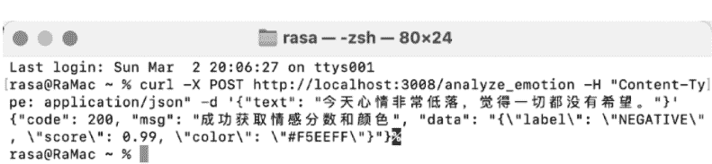
图6-1

返回结果里包含情绪标签、分数以及对应的配色，具体展示见图6-2。
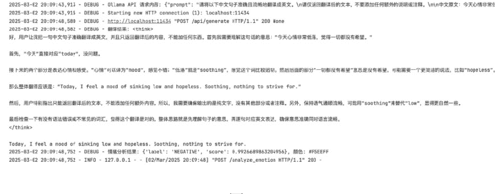
图6-2

#### 6.1.2 情感分值与颜色的映射实现
下面以一个简易的随机中文语录生成演示为例，说明如何逐步接入情绪判定能力，并借助颜色映射让页面背景随语录情绪实时变化，从而把每条语录的情绪状态一眼看清。

##### 1. 项目结构与基础语录生成
在示例工程 EmotionColorMApping 中，最初只放了两份文件。
- （1）Index.ets：作为启动入口，采用列布局承载 QuoteGeneratorPage 组件。
- （2）QuoteGeneratorPage.ets：负责语录展示，点击按钮即可随机产生励志句子，底部固定放一张猫咪图片作点缀。

若要让情绪判定联动，需要参考 PoetryImageFrontend 项目补充并修改以下文件。
- （1）src/main/ets/configs/Config.ets：保存后端情绪判定服务的地址等设定。
- （2）src/main/ets/services/ApiService.ets：封装通用后端请求逻辑，支持流式返回。
- （3）src/main/ets/services/EmotionService.ets：实现 analyzeEmotion 等接口，支持对中文直接检测或先译后检。
- （4）src/main/ets/types/ApiTypes.ets：定义接口请求与返回所需的数据结构，包含 EmotionRequest、EmotionResponse、TranslateRequest 等。
- （5）src/main/ets/utils/DownloadUtils.ets、HttpClient.ets、StreamingUtils.ets：提供网络请求、文件下载及流式数据处理的辅助函数。
- （6）ColorUtils.ets 新增：提供 mapScoreToColor 方法，按情绪分数映射对应颜色。

关键目录结构示例如下：
```
src/
├── main/
│   ├── ets/
│   │   ├── configs/
│   │   │   └── Config.ets
│   │   ├── pages/
│   │   │   ├── Index.ets
│   │   │   └── QuoteGeneratorPage.ets
│   │   ├── services/
│   │   │   ├── ApiService.ets
│   │   │   └── EmotionService.ets
│   │   ├── types/
│   │   │   └── ApiTypes.ets
│   │   └── utils/
│   │       ├── ColorUtils.ets
│   │       ├── DownloadUtils.ets
│   │       ├── HttpClient.ets
│   │       └── StreamingUtils.ets
│   └── resources/
│       └── base/
│           └── media/
│               └── cat.png        // 猫咪图片资源
```
● Index.ets示例代码：
```typescript
// src/main/ets/pages/Index.ets

import { QuoteGeneratorPage } from './QuoteGeneratorPage';

@Entry
@Component
struct Index {
  build() {
    Column() {
      QuoteGeneratorPage() // 调用语录生成器页面
    }
    .padding(20)
  }
}
```
● QuoteGeneratorPage.ets示例代码：
```typescript
// src/main/ets/pages/QuoteGeneratorPage.ets

@Component
export struct QuoteGeneratorPage {
  private quotes: string[] = [
    // **积极 (Positive) **
    '每一天都是新的开始，充满无限可能！',
    '你的努力不会白费，所有的坚持都会有回报。',
    '相信自己，你足够优秀，也值得更好的未来。',
    '即使跌倒了一百次，也要第一百零一次站起来！',
    '今天的努力，就是明天的成功。',

    // **消极 (Negative) **
    '有些伤痛，时间也无法抹去。',
    '无论怎么努力，好像都看不到尽头。',
    '有时候，付出并不一定会有回报。',
    '现实总是残酷的，不是所有梦想都能实现。',
    '再怎么挣扎，命运似乎都不肯放过。',

    // **愤怒 (Angry) **
    '世界并不公平，有些人就是比你轻松！',
    '有些人永远不会懂你的付出和辛苦。',
    '每一次妥协，都会让自己更难受！',
    '忍耐不是懦弱，但总有忍无可忍的时候！',
    '愤怒的火焰不会自己熄灭，只有反击才能平息。',

    // **焦虑 (Anxious) **
    '未来充满不确定性，每一步都让人害怕。',
    '事情太多了，感觉根本忙不过来。',
    '不管怎么计划，总会有意外发生。',
    '时间在流逝，而我还是什么都没做好。',
    '总感觉自己不够好，不够努力，不够聪明。',

    // **平静 (Calm) **
    '深呼吸，让心慢下来，一切都会好起来。',
    '静静感受此刻，不去想过去，也不担忧未来。',
    '风停了，雨停了，所有的烦恼也会过去。',
    '世界本无事，庸人自扰之。',
    '平静是一种力量，温和是一种智慧。'
  ];

  @State currentQuote: string = '点击下方按钮生成随机励志语录！'; // 当前显示的语录

  build() {
    Column({ space: 20 }) { // 创建垂直布局容器
      // 显示当前语录
      Text(this.currentQuote)
        .fontSize(18)
        .fontWeight(FontWeight.Bold)
        .textAlign(TextAlign.Center)
        .padding(20);

      // 励志语录生成按钮
      Button('生成随机语录')
        .onClick(() => this.generateRandomQuote())
        .fontSize(20)
        .backgroundColor(Color.Blue)
        .fontColor(Color.White)
        .width('50%')
        .alignSelf(ItemAlign.Center);

      // 显示猫咪图片装饰
      Image($r('App.media.cat'))
        .width(85)
        .height(100)
        .borderRadius(5)
        .alignSelf(ItemAlign.Center);
    }
    .padding(20)
    .width('100%')
    .height('100%')
    .alignItems(HorizontalAlign.Center);
  }

  // 随机生成语录的方法
  private generateRandomQuote() {
    const randomIndex = Math.floor(Math.random() * this.quotes.length);
    this.currentQuote = this.quotes[randomIndex];
  }
}
```

运行后，应用会随机呈现励志语录，点击按钮可刷新，底部始终保留猫咪装饰。初始界面如图6-3所示，语录与装饰图同时呈现。
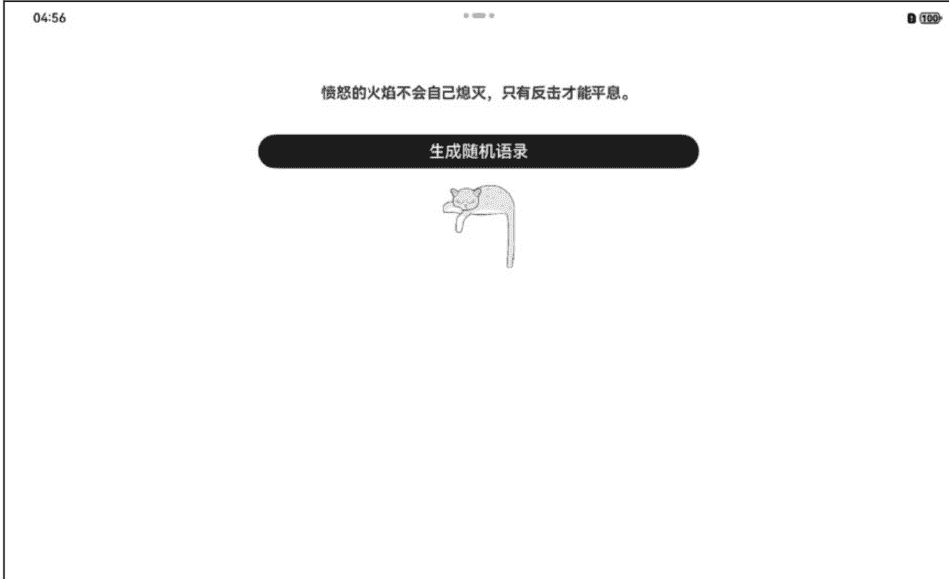
图6-3

##### 2. 引入情感分析服务
为对生成的中文语录做情绪判断并把结果回写到界面，需要新增并调整下面这些文件。
- 配置文件
src/main/ets/configs/Config.ets 用来保存后端 API 地址等设定。
- API 封装
src/main/ets/services/ApiService.ets 提供了通用的接口调用封装。
- 情绪服务
src/main/ets/services/EmotionService.ets 实现了情绪判定与翻译接口，相关实现如下。

```typescript
// src/main/ets/services/EmotionService.ets

/**
 * 调用情感分析接口
 * @param text - 要分析的文本
 * @param onChunkReceived - 可选的回调函数，用于处理流式返回的每个数据块
 * @returns Promise<string> - 返回情感分析结果
 */
public async analyzeEmotion(
  text: string,
  onChunkReceived?: (chunk: string) => void
): Promise<string> {
  const requestBody: EmotionRequest = { text }; // 请求体
  return this.request('/analyze_emotion', requestBody, onChunkReceived); // 非流式
}

/**
 * 调用翻译接口
 * @param sentence - 要翻译的句子
 * @param target_language - 目标语言（默认英文）
 * @param onChunkReceived - 可选的回调函数，用于处理流式返回的每个数据块
 * @returns Promise<string> - 返回翻译后的文本
 */
public async translateText(
  sentence: string,
  target_language: string = '英文', // 默认英文
  onChunkReceived?: (chunk: string) => void
): Promise<string> {
  const requestBody: TranslateRequest = { sentence, target_language }; // 请求体
  return this.request('/translate', requestBody, onChunkReceived); // 非流式
}
```

● 接口类型先行搭建

在 src/main/ets/types/ApiTypes.ets 里面把项目后续会用到的接口结构先行定义好，为各单元统一调用提供基准。

##### 3. QuoteGeneratorPage 重构：让底色随情绪走

重构后的 QuoteGeneratorPage.ets 补齐了三项关键能力。

- (1) 依赖接入：引入 EmotionService 与 config，打通前端与服务端的通道。
- (2) 状态追踪：新增 @State backgroundColor，用来掌控界面底色的实时变化。
- (3) 业务逻辑：在 generateRandomQuote 方法内部，先随机取到一条语录，随后触发情绪判定接口，依据返回的情绪分数或直接给出的色值刷新底色。

示例核心代码如下：

```typescript
// src/main/ets/pages/QuoteGeneratorPage.ets

import { config } from '../configs/Config';
import { EmotionService } from '../services/EmotionService';
import { EmotionResponse } from '../types/ApiTypes'; // 导入接口定义

@Component
export struct QuoteGeneratorPage {
  private quotes: string[] = [
    // **积极 (Positive) **
    '每一天都是新的开始，充满无限可能！',
    '你的努力不会白费，所有的坚持都会有回报。',
    '相信自己，你足够优秀，也值得更好的未来。',
    '即使跌倒了一百次，也要第一百零一次站起来！',
    '今天的努力，就是明天的成功。',

    // **消极 (Negative) **
    '有些伤痛，时间也无法抹去。',
    '无论怎么努力，好像都看不到尽头。',
    '有时候，付出并不一定会有回报。',
    '现实总是残酷的，不是所有梦想都能实现。',
    '再怎么挣扎，命运似乎都不肯放过。',

    // **愤怒 (Angry) **
    '世界并不公平，有些人就是比你轻松！',
    '有些人永远不会懂你的付出和辛苦。',
    '每一次妥协，都会让自己更难受！',
    '忍耐不是懦弱，但总有忍无可忍的时候！',
    '愤怒的火焰不会自己熄灭，只有反击才能平息。',

    // **焦虑 (Anxious) **
    '未来充满不确定性，每一步都让人害怕。',
    '事情太多了，感觉根本忙不过来。',
    '不管怎么计划，总会有意外发生。',
    '时间在流逝，而我还是什么都没做好。',
    '总感觉自己不够好，不够努力，不够聪明。',

    // **平静 (Calm) **
    '深呼吸，让心慢下来，一切都会好起来。',
    '静静感受此刻，不去想过去，也不担忧未来。',
    '风停了，雨停了，所有的烦恼也会过去。',
    '世界本无事，庸人自扰之。',
    '平静是一种力量，温和是一种智慧。'
  ];

  @State currentQuote: string = '点击下方按钮生成随机励志语录！（#FFFFFF）'; // 当前显示的语录
  @State backgroundColor1: string = '#FFFFFF'; // 用于动态控制页面背景
  private emotionService: EmotionService = new EmotionService(config.sentimentApiUrl);

  build() {
    Column({ space: 20 }) { // 创建垂直布局容器
        // 显示当前语录
        Text(this.currentQuote)
            .fontSize(18)
            .fontWeight(FontWeight.Bold)
            .textAlign(TextAlign.Center)
            .padding(20);

        // 励志语录生成按钮
        Button('生成随机语录')
            .onClick(() => this.generateRandomQuote())
            .fontSize(20)
            .backgroundColor(Color.Blue)
            .fontColor(Color.White)
            .width('50%')
            .alignSelf(ItemAlign.Center);

        // 显示猫咪图片装饰
        Image($r('App.media.cat'))
            .width(85)
            .height(100)
            .borderRadius(5)
            .alignSelf(ItemAlign.Center);
    }
    .padding(20)
    .width('100%')
    .height('100%')
    .backgroundColor(this.backgroundColor1)
    .alignItems(HorizontalAlign.Center);
  }

  // 随机生成语录的方法
  private async generateRandomQuote() {
    const randomIndex = Math.floor(Math.random() * this.quotes.length);
    this.currentQuote = this.quotes[randomIndex];

    let accumulatedResponse = ''; // 用于存储累积的所有数据块

    try {
        // 获取情感分析结果
        await this.emotionService.analyzeEmotion(this.currentQuote,
            (partialResult: string) => {
                accumulatedResponse += partialResult;
            });

        // 解析情感分析结果
        const emotionResponse: EmotionResponse = JSON.parse(accumulatedResponse);

        // 根据情感分值映射颜色
        const label = emotionResponse.label; // 获取情感标签
        const score = emotionResponse.score; // 获取情感分值
        const color = emotionResponse.color; // 获取情感颜色

        // 根据情感分值映射颜色
        // const color = mapScoreToColor(score);

        // 直接使用后端返回的 color 更新背景色
        this.backgroundColor1 = color;
        this.currentQuote += ` ( ${this.backgroundColor1})`;
        console.info(`情感标签: ${label}, 分值: ${score}, 颜色: ${color}`);
    } catch (err) {
        console.error('情绪分析出错:', err);
    }
  }
}
```

每次按下按钮，应用会同时更换语录并把文本送往服务端做情绪判定，拿到结果后立刻调整底色，形成“文字情绪驱动视觉”的即时联动。

图6-4展示了接入情绪服务后，应用能按分数即时刷新底色，实现语录情绪与界面配色的同步。

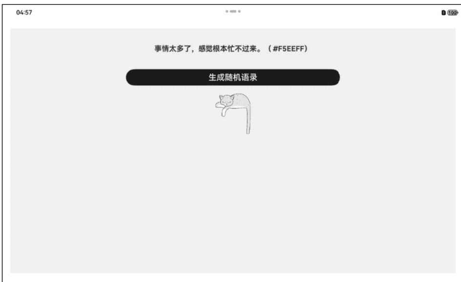

##### 4. 本地兜底配色：ColorUtils.ets

若服务端只返回情绪分数而不提供具体颜色，可以在本地实现 ColorUtils.ets，按分数区间自行映射成对应色，配色策略更自由。

示例代码如下：

```typescript
// src/main/ets/utils/ColorUtils.ets

/**
 * @description 根据情感得分映射到特定颜色
 * @param score - 情感得分，范围为 0.0 到 1.0
 * @returns 对应的颜色代码
 */
export function mapScoreToColor(score: number): string {
    // 定义情感得分对应的颜色范围
    const colors = [
        "#FFFAFA", "#FFF0F0", "#FFE6E6", "#FFDBDB", "#F5EEFF", "#EBE0FF", "#E1D3FF",
        "#D7C5FF",
        "#E6FFFA", "#CCF6E7", "#B3EFD4", "#99E6C1", "#FFFCE6", "#FFF9CC", "#FFF6B3",
        "#FFF399",
        "#EAEFFF", "#D4E1FF", "#BCCFFF", "#A7BDFF", "#FFF5E6", "#FFEBCC", "#FFE1B3",
        "#FFD699",
        "#FDE6FF", "#FCD1FF", "#F9BDFF", "#F7A8FF"
    ];

    // 校验 score 是否在 0 到 1 之间
    if (typeof score !== 'number' || score < 0 || score > 1) {
        throw new Error('Invalid score: must be a number between 0 and 1.');
    }

    // 确保 score 在 0 到 1 之间
    const clampedScore = Math.max(0, Math.min(1, score));

    // 对于 score <= 0.9，返回第一个颜色
    if (clampedScore <= 0.9) {
        return colors[0];
    }

    // 对于 score > 0.9，映射到更高的颜色区间
    const adjustedScore = (clampedScore - 0.9) * 2; // 将得分范围调整到 0 到 1
    const index = Math.floor(adjustedScore * (colors.length - 1)); // 根据调整后的得分计算索引

    return colors[index]; // 返回计算出的颜色
}
```

在 QuoteGeneratorPage.ets 中调用本地映射函数：

```typescript
import { mapScoreToColor } from '../utils/ColorUtils';

// 随机生成语录的方法
private async generateRandomQuote() {
    const randomIndex = Math.floor(Math.random() * this.quotes.length);
    this.currentQuote = this.quotes[randomIndex];

    let accumulatedResponse = ''; // 用于存储累积的所有数据块

    try {
        // 获取情感分析结果
        await this.emotionService.analyzeEmotion(this.currentQuote, (partialResult: string) => {
            accumulatedResponse += partialResult;
        });

        // 解析情感分析结果
        const emotionResponse: EmotionResponse = JSON.parse(accumulatedResponse);

        // 根据情感分值映射颜色
        const label = emotionResponse.label; // 获取情感标签
        const score = emotionResponse.score; // 获取情感分值
        // const color = emotionResponse.color; // 获取情感颜色

        // 根据情感分值映射颜色
        const color = mapScoreToColor(score);

        // 直接使用后端返回的 color 更新背景色
        this.backgroundColor1 = color;
        this.currentQuote += `(${this.backgroundColor1})`;
        console.info(`情感标签: ${label}, 分值: ${score}, 颜色: ${color}`);
    } catch (err) {
        console.error('情感分析出错:', err);
    }
}
```

如此一来，无论服务端返回的是色值还是纯分数，前端都能灵活更新底色，提升方案的延展性与定制空间。

##### 5. 跑通后的操作链路

改造完成后，点击“生成随机语录”按钮的完整链路如下。

- (1) 随机挑选一条中文金句；
- (2) 调用情绪判定接口获取语录的情绪标签与分数；
- (3) 按分数或直接采用服务端给的色值更新 @State backgroundColor，达成底色的实时切换；
- (4) 界面马上刷新，呈现出清晰的“文字情绪 → 视觉呈现”联动感。

图6-5为模拟器里的最终表现，不同语录对应不同情绪强度与底色，给用户带来直观生动的交互体验。

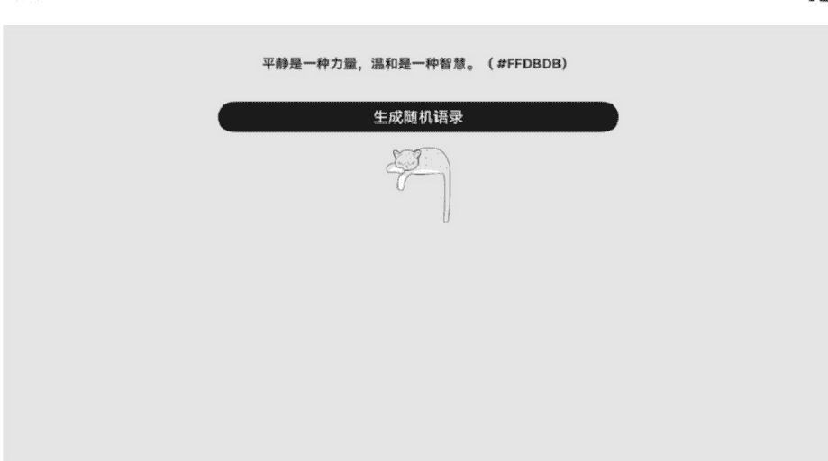

### 6.2 多服务与硬件的协同控制

本节介绍 ProjectSymphony 如何借助大模型生成文本、情绪判定、硬件操控以及数据监测等多个环节，达成多服务联动与硬件协同，搭建一个能实时感知情绪变化并同步刷新界面与设备状态的综合系统。

整体采用模块化思路，各单元职责单一，以不同文件散布在目录树中，为后续开发、维护和扩充提供便利。整体主要由以下三个关键单元构成。

### 1. EmotionColorMapping模块

该单元负责情绪判定、文本生成与配色映射。除处理系统配置如 Config.ets 外，还封装了 API 请求 ApiService.ets、情绪判定及文本生成 EmotionService.ets 的关键逻辑。内部定义了 API 数据类型 ApiTypes.ets，并提供配色映射 ColorUtils.ets、图片下载处理 DownloadUtils.ets、HTTP 客户端封装 HttpClient.ets 以及流数据处理 StreamingUtils.ets 等工具。

### 2. HardwareControlFrontend模块

硬件控制层负责把设备指令收发封装起来，让系统能跟树莓派LED灯这类物理端实时互通。借助HardwareService.ets与HardwareTypes.ets两个文件，情绪一有波动模块便即时下发操控命令，同时持续监听设备回传与异常，始终让真实硬件状态与系统内数据保持同步。

### 3. PoetryImageFrontend模块

该模块主攻前端呈现与互动体验，承担情感金句、安抚诗意的产出，以及配图的获取与展示。入口文件设在Index.ets，配合ButtonManager.ets、CustomButton.ets等组件，提供温暖直观的视觉回馈，提升整体交互质感。

项目目录结构清晰呈现模块分工与文件归属，具体如下：

```
src/
├── main/
│   ├── ets/
│   │   ├── configs/
│   │   │   └── Config.ets                // EmotionColorMapping 模块
│   │   ├── components/
│   │   │   ├── ButtonManager.ets         // PoetryImageFrontend 模块
│   │   │   └── CustomButton.ets          // PoetryImageFrontend 模块
│   │   ├── pages/
│   │   │   └── Index.ets                 // PoetryImageFrontend 模块（主要入口）
│   │   ├── services/
│   │   │   ├── ApiService.ets            // EmotionColorMapping 模块
│   │   │   ├── EmotionService.ets        // EmotionColorMapping 模块
│   │   │   └── HardwareService.ets       // HardwareControlFrontend 模块
│   │   ├── types/
│   │   │   ├── ApiTypes.ets              // EmotionColorMapping 模块
│   │   │   └── HardwareTypes.ets         // HardwareControlFrontend 模块
│   │   └── utils/
│   │       ├── ColorUtils.ets            // EmotionColorMapping 模块
│   │       ├── DownloadUtils.ets         // EmotionColorMapping 模块
│   │       ├── HttpClient.ets            // EmotionColorMapping 模块
│   │       └── StreamingUtils.ets        // EmotionColorMapping 模块
```

整体运行逻辑概括如下：

- ● 情感数据采集与处理
先由EmotionColorMapping读取配置并调用接口拉取情感分数，接着用ColorUtils把情绪状态转成RGB数值。这一色值既驱动界面即时刷新，也作为硬件操控的输入依据。

- ● 硬件联动与双向通信
借助HardwareControlFrontend，当情绪值变动瞬间向树莓派LED灯等设备推送指令，并同步追踪设备反馈与异常情况，保证物理端与系统数据的实时一致。

- ● UI展示与交互闭闭环
PoetryImageFrontend把情绪数据渲染成安抚诗句及对应配图，通过页面组件呈现给用户。用户的一次点击即可触发后续的情感解析与硬件联动，完成一次闭环互动。

- ● 数据库监控与自动更新
内置数据库监听机制，可即时捕捉外部数据变动或异常，并自动推动各模块的数据同步与功能刷新，让系统始终保持最新并快速响应变化。

随后在6.2.1小节会详细展开大模型驱动的句子与抚慰诗歌生成实现。

#### 6.2.1 基于大模型服务生成情感句子与抚慰诗歌

本部分说明如何调用本地大模型在App内完成文本创作，包括情感金句与抚慰诗。依托模型对语义的深层理解，App可基于用户实时情绪产出富有感染力的文案，并同步返回量化情感分数，为界面动态刷新与硬件联动提供依据。

##### 1. 功能概述
应用将用户的原始输入与当前情绪信息打包为请求，发送给本地大模型以生成情感句或抚慰诗。模型返回内容的同时会附带一个情感分数，通过EmotionColorMapping等映射组件驱动页面背景或LED灯等硬件实时变化。流式回调被全程采用，用户能边看边收生成进展，最终结果即时展示。

##### 2. 实现思路
- ● 请求构建
先收集用户文本与情绪状态，组装成请求体。请求会明确标注生成类型是金句还是抚慰诗，并携带情绪指标等补充信息，帮助模型更精准把握语境，产出更贴合的内容。

- ● 大模型处理
模型收到请求后，用预训练语义能力解析输入，输出与用户情绪高度匹配的文本，并同步计算出对应的情感分值。这样既保证文案的艺术性，也提供可量化的情绪特征，供后续映射与联动使用。

- ● 情绪映射与联动
EmotionColorMapping把返回的情感分数转为RGB色值，用于刷新前端背景或驱动LED灯等硬件的动态表现，实现文字、视觉与物理端的无缝配合。

##### 3. 关键流程
文本生成逻辑集中在ProjectSymphony的Index.ets中，通过EmotionService调用本地大模型并配合流式回调实现实时反馈，具体步骤如下：

- ● 初始化阶段
启动时创建大模型服务实例并设定API地址，完成前期准备。

- ● 用户交互阶段
用户点击按钮后，系统依据按钮标签决定生成路径：
  (1) 标签为空时，直接生成情感金句；
  (2) 标签存在时，先产出抚慰诗歌，再刷新情感金句。
流式回调让生成过程在页面上逐步呈现，直至完整返回。

- ● 映射与更新阶段
生成结束后，依据返回的情感分值经映射得到RGB色值，进而更新界面背景或操控硬件，完成视觉与物理的联动。

##### 4. 代码示例
下例演示了按按钮标签动态切换生成功能，并借助流式回调实时刷新页面与情绪状态：

```
/**
 * 获取聊天响应，并根据按钮标签执行相应操作
 * @param buttonLabel 被点击的按钮标签，若为空则生成情感句子
 */
private async fetchChatResponse(buttonLabel: string) {
  const emotionService = new EmotionService(config.sentimentApiUrl);

  try {
    if (!buttonLabel) {
      // 按钮标签为空时，生成情感句子并更新按钮标签
      await this.updateButtonsWithEmotion(emotionService);
    } else {
      // 处理按钮标签，去除编号、星号和双引号
      const formatResult = buttonLabel.trim()
        .replace(/^[0-9]+\.\s*|\*\s*/g, '') // 移除前缀编号和星号
        .replace(/"/g, ''); // 去除双引号

      // 生成诗歌并更新结果
      await this.generatePoetryAndUpdateResult(emotionService, formatResult);

      // 更新按钮标签
      await this.updateButtonsWithEmotion(emotionService);
    }
  } catch (error) {
    // 记录并处理错误
    this.logAndHandleError(error, 'fetchChatResponse');
  }
}
```

示例中，标签为空时优先产出金句；标签有值时先生成抚慰诗再更新金句。流式回调让用户能直观感知文本逐步生成的过程。

##### 5. 流程示意图
点击后fetchChatResponse先读取按钮标签，决定产出金句还是抚慰诗，之后刷新页面情绪。期间全程流式输出，保证生成与界面实时同步。流程见图6-6。

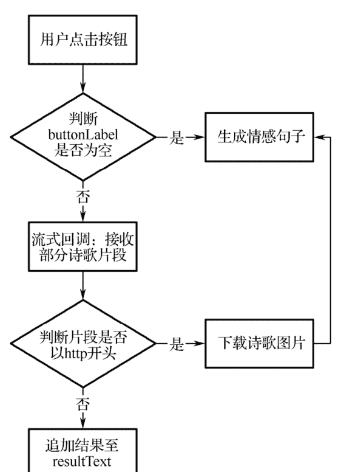

图6-6

##### 6. 运行效果与截图
点击按钮后，文本区实时呈现大模型产出的金句与抚慰诗，并伴随按钮闪烁作为交互反馈，直至内容完整。完成后系统依据情感分值自动切换页面背景或驱动硬件，形成文字、视觉与物理设备的高效联动，增强沉浸感。

图6-7展示了金句生成的实际效果，图6-8展示了抚慰诗歌生成的界面，用户可直观看见文本艺术性与联动状态。


图6-7


图6-8

借助该机制，App既能多样化输出情感文本，也能实现视觉与硬件的高效联动，带来更沉浸、更个性化的体验。

#### 6.2.2 情感句子生成与情感感知

本节介绍升级updateBackgroundColor与fetchChatResponse两个函数后，如何形成情感生成与感知的完整闭环。涵盖文本生成与情感分析两大场景，并依靠流式回调与页面反馈实现实时直观交互。

##### 1. 功能概述
- 文本生成场景
点击生成按钮且buttonLabel为空时，系统触发updateButtonsWithEmotion，调用大模型金句生成接口，并以流式回调实时展示进度。发起方为fetchChatResponse。

- ● 情感分析场景
用户点击具体文本记录并传入非空buttonLabel后，系统先清洗标签中的编号与特殊符号，再调用updateBackgroundColor。该函数调用情感分析接口返回JSON，包含label、score、color三项，结果追加至this.resultText并驱动背景色变化或按钮动画，直观呈现情绪状态。

##### 2. 实现思路
- ● 请求构建与流式回调
触发生成后，App把文本提交给大模型金句接口，采用流式回调逐步接收返回并实时刷新页面，展示生成进度。

- ● 用户交互与情感分析
生成完成后用户可挑选某条记录，系统清洗对应按钮标签后调用updateBackgroundColor，通过模型返回的JSON解析出标签、分值与颜色。

- ● 页面反馈与效果展示
分析结果被映射为页面反馈，如背景刷新或按钮动画，以直观呈现情绪并提升体验。

##### 3. 关键流程
为保证连贯与实时，流程分为以下阶段：

- ● 初始化阶段
启动时在Index.ets中初始化情感生成服务并配置API地址与参数。

- ● 文本生成阶段
点击生成按钮且buttonLabel为空时，fetchChatResponse调用updateButtonsWithEmotion启动金句生成接口，并以流式回调实时展示进度。

- ● 情感分析阶段
生成后用户选择某条记录并传入非空标签，fetchChatResponse先预处理标签再调用updateBackgroundColor，获取含label、score、color的JSON，追加到this.resultText并触发页面反馈更新。

##### 4. 代码示例
下例展示了在Index.ets中如何升级这两个函数以实现上述流程：

```
import { EmotionResponse } from '../types/ApiTypes'; // 导入接口定义

/**
 * 解析情感分析结果，并根据情感信息更新背景显示文本
 * @param emotionService 情感分析服务实例
 * @param textToGenerate 待分析的文本内容
 */
private async updateBackgroundColor(emotionService: EmotionService, textToGenerate: string) {
    let accumulatedResponse = ''; // 用于存储累积的情感分析数据

    try {
        // 进行情感分析，并逐步累积分析结果
        await emotionService.analyzeEmotion(textToGenerate, (partialResult: string) => {
            accumulatedResponse += partialResult;
        });

        // 解析累积的情感分析结果
        const emotionResponse: EmotionResponse = JSON.parse(accumulatedResponse);

        // 提取情感分析结果中的关键信息
        const label = emotionResponse.label; // 情感标签（如正面、负面、中性）
        const score = emotionResponse.score; // 情感分数（数值化情绪强度）
        const color = emotionResponse.color; // 对应的颜色（用于 UI 显示）

        // 更新显示文本，包含情感标签、情感分数及颜色信息
        this.resultText = `${textToGenerate} (情感标签: ${label}, 分值: ${score}, 颜色: ${color})`;
    } catch (error) {
        // 记录并处理错误
        this.logAndHandleError(error, 'updateBackgroundColor');
    }
}

/**
 * 获取聊天响应，并根据按钮标签执行相应操作，同时更新情感感知结果
 * @param buttonLabel 被点击的按钮标签，若为空则生成情感句子
 */
private async fetchChatResponse(buttonLabel: string) {
    const emotionService = new EmotionService(config.sentimentApiUrl);

    try {
        if (!buttonLabel) {
            // 按钮标签为空时，生成情感句子并更新按钮标签
            await this.updateButtonsWithEmotion(emotionService);
        } else {
            // 处理按钮标签，去除编号、星号和双引号
            const formatResult = buttonLabel.trim()
                .replace(/^[0-9]+\.\s*|\*\s*/g, '') // 移除前缀编号和星号
                .replace(/"/g, ''); // 去除双引号

            // 进行情感分析，并更新情感感知结果
            await this.updateBackgroundColor(emotionService, formatResult);

            // 更新按钮标签
            await this.updateButtonsWithEmotion(emotionService);
        }
    } catch (error) {
        // 记录并处理错误
        this.logAndHandleError(error, 'fetchChatResponse');
    }
}
```

代码中，updateBackgroundColor负责调用情感分析接口并依据JSON更新背景色与结果文本；fetchChatResponse则根据标签状态决定走生成还是分析路径，协调整体执行。

##### 5. 流程示意图

图6-9 概括了按下按钮之后的运行路径。核心调度由 fetchChatResponse 完成，它会先检查按钮上是否带文字：没有文字时走生成路线，调用 updateButtonsWithEmotion；有文字时则进入情绪识别路线，调用 updateBackgroundColor，随后把结果写回界面。

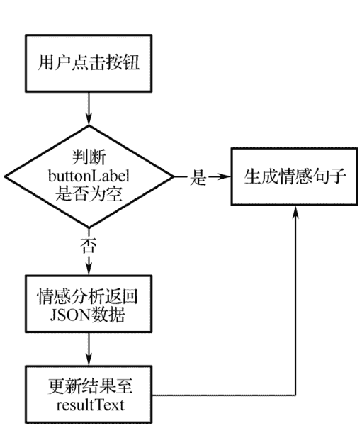

在无文字情形下，系统借助 updateButtonsWithEmotion 完成内容产出，同时把生成进度以流式方式呈现出来。

在有文字情形下，先对数据做预处理，再执行 updateBackgroundColor 拆解返回的 label、score、color 三项，并把解析结果映射回前端展示。

##### 6. 现场表现与截图
实测时运行表现与预期逻辑基本吻合，主要体现在以下几方面。

- ● 即时生成与进度呈现
按下生成键时，也就是标识为空的情况，界面会边收边显生成模型吐出的内容，情绪语句逐条刷新出现。
- ● 生成内容的呈现
所得情绪语句全部留在屏幕上，刷新工作交由 updateButtonsWithEmotion 完成。
- ● 情绪识别与界面响应
点击一条已生成的记录，也就是带标识的状态，会触发 updateBackgroundColor 对该条目做情绪识别。识别模型回传的 JSON 里含有情绪标签、分值与配色，系统把这些信息写入 this.resultText，并据此改变界面底色或按键动效，让文本情绪一目了然。

图6-10 记录了实测画面：左边滚动的是生成中的情绪句，右边是点击后返回的情绪反馈，涵盖底色切换与动画响应。

#### 6.2.3 情绪捕捉驱动抚慰诗创作
下面说明怎样把情绪感知能力接入生成模型，对用户输入进行即时情绪拆解，并依此产出具有安抚效果的诗作。内在流程打通后，用户既能看见自己的情绪状态，也能得到温暖且带艺术感的文字陪伴。

##### 1. 功能说明
借助情绪感知服务解析用户输入的心情，继而调用生成模型产出抚慰诗。系统能同步捕捉情绪标签、分值与对应色调，并生成具备艺术感染力的抚慰诗作，最终把诗文与情绪反馈例如底色、按键动效一起呈现在界面，为用户提供心理舒缓与正向引导。设计兼顾艺术体验与情绪调节。

##### 2. 设计思路
把输入采集、情绪拆解、诗作生成与界面刷新串成闭环。首先对用户输入做预处理以保证后续拆解与生成的准确性；随后调用情绪感知接口获取心情状态；再依据情绪数据驱动生成模型产出抚慰诗，通过流式回调边生成边显示；最后把诗文与情绪反馈同步刷新到界面，形成沉浸式体验。思路清晰，兼顾即时性与艺术表达。

##### 3. 核心步骤
模块可划分为四个环节：输入触发拆解、逐步返回与边生边显、结果解析与界面映射、收尾呈现。各环节均做精细化设计，保证数据连贯与异常处理。

- 输入即刻启动情绪检测：用户写入文字后系统自动调用情绪感知服务做心情检测，为后续生成提供情绪对应性。
- 逐步返回与边生成边显示：调用 generateSoothingPoetry 接口，利用流式回调逐步返回诗作片段，后台并行处理情绪数据以备反馈。
- 结果解析与界面映射：解析返回的 JSON，提取情绪标签、分值与颜色，并映射为底色与按键状态的可视反馈。
- 收尾呈现：将累计生成的抚慰诗与情绪反馈信息同步展示，实现生成与心情数据的即时联动。

##### 4. 代码示例
下方示例展示了情绪感知与抚慰诗生成的闭环实现。updateBackgroundColor 负责调用情绪识别接口并刷新界面反馈，fetchChatResponse 根据按键状态决定调用哪条业务逻辑，保证操作连贯与响应及时。

```typescript
/**
 * 解析情感分析结果，并根据情感信息更新按钮显示文本
 * @param emotionService 情感分析服务实例
 * @param textToGenerate 待分析的文本内容
 */
private async updateBackgroundColor(emotionService: EmotionService, textToGenerate: string) {
    let accumulatedResponse = ''; // 用于存储累积的情感分析数据

    try {
        // 进行情感分析，并逐步累积分析结果
        await emotionService.analyzeEmotion(textToGenerate, (partialResult: string) => {
            accumulatedResponse += partialResult;
        });

        // 解析累积的情感分析结果
        const emotionResponse: EmotionResponse = JSON.parse(accumulatedResponse);

        // 提取情感分析结果中的关键信息
        const label = emotionResponse.label; // 情感标签（如正面、负面、中性）
        const score = emotionResponse.score; // 情感分数（数值化情绪强度）
        const color = emotionResponse.color; // 对应的颜色（用于 UI 显示）

        // 更新按钮文本，显示情感分析的结果
        this.buttonText = `${textToGenerate} (情感标签: ${label}, 分值: ${score}, 颜色: ${color})`;
    } catch (error) {
        // 记录并处理错误
        this.logAndHandleError(error, 'updateBackgroundColor');
    }
}

/**
 * 获取聊天响应，并根据按钮标签执行相应操作，同时更新情感感知结果
 * @param buttonLabel 被点击的按钮标签，若为空则生成情感句子
 */
private async fetchChatResponse(buttonLabel: string) {
    const emotionService = new EmotionService(config.sentimentApiUrl);

    try {
        if (!buttonLabel) {
            // 按钮标签为空时，生成情感句子并更新按钮标签
            await this.updateButtonsWithEmotion(emotionService);
        } else {
            // 处理按钮标签，去除编号、星号和双引号
            const formatResult = buttonLabel.trim()
                .replace(/^[0-9]+\.\s*|\*\s*/g, '') // 移除前缀编号和星号
                .replace(/"/g, ''); // 去除双引号

            // 进行情感分析，并更新按钮的情感信息
            await this.updateBackgroundColor(emotionService, formatResult);

            // 生成诗歌并更新显示结果
            await this.generatePoetryAndUpdateResult(emotionService, formatResult);

            // 更新按钮标签
            await this.updateButtonsWithEmotion(emotionService);
        }
    } catch (error) {
        // 记录并处理错误
        this.logAndHandleError(error, 'fetchChatResponse');
    }
}
```

整体采用模块化拆分，情绪拆解与诗作生成分离处理，并在各步骤加入流式数据处理与异常捕获，确保运行中能及时响应并即时展示生成进度与情绪反馈。

##### 5. 流程图示
流程图如图6-11 所示。各阶段操作经过精细设计，在流式回调支持下实现诗作生成与情绪反馈的即时联动，保证使用体验流畅连贯。

示意图清晰呈现数据从输入到处理再到输出的完整链路，便于理解系统内部工作原理与交互逻辑。

##### 6. 实际效果截图
用户输入后，系统先通过情绪感知接口完成心情拆解，并把分值、标签及映射色调即时反馈到界面，如底色变化或按键动画；同时借助流式回调逐步生成并展示抚慰诗，使用者可直观感知生成过程。最终完整诗文与情绪反馈同步呈现在App中，提供沉浸式艺术慰藉。

图6-12 显示页面左侧即时呈现诗作生成进度，右侧以色彩映射与文字描述直观呈现情绪分析结果。设计既带来温馨视觉体验，也在心理层面进行正向引导，产生舒缓效果。

#### 6.2.4 情绪驱动界面配色与树莓派灯效联动
下面说明怎样利用情绪分析接口对用户输入做即时拆解，并据此刷新应用底色与树莓派LED灯，实现界面与硬件的联动反馈。

##### 1. 功能说明
调用情绪分析接口即时拆解用户输入，提取情绪标签、分数与颜色。返回的色彩既用于刷新App的视觉底色，也用于驱动树莓派LED呈现相同色调，让用户在界面与物理设备上同步获得情绪反馈。

##### 2. 设计思路
整体包含采集与情绪拆解、数据处理、界面与硬件刷新三个环节。采用流式回调逐步累积返回数据，解析完成后得到完整情绪结果，再直接用于界面与硬件控制，保证反馈高效即时。

- 采集与情绪拆解：用户写入文字后系统调用 analyzeEmotion 接口，通过流式回调逐步获取分析数据。
- 数据处理：累积完毕后解析 JSON，抽取情绪标签 label、分数 score 与颜色 color。
- 界面与硬件刷新：以返回色调刷新视觉底色 this.bgColor 及按键文案，同时调用 HardwareService.controlHardware 接口控制LED灯色，实现视觉与物理联动。

##### 3. 核心步骤
流程自用户输入触发情绪分析起，经数据累积、JSON解析，到界面与硬件色彩刷新，每一步都确保数据准确传递与即时反馈，增强交互感。

- 输入触发情绪分析：写入后自动调用 analyzeEmotion(textToGenerate) 接口。
- 累积与拆解：流式回调逐步累积结果，最终解析 JSON 提取情绪信息。
- 界面与硬件刷新：依据提取的色调刷新视觉底色与按键文案，并同步调用硬件服务控制LED灯。
- 按键标识处理：在 fetchChatResponse 中根据按键文字状态执行不同逻辑，确保情绪数据与用户交互同步更新。

##### 4. 代码示例
具体实现代码如下。

```typescript
import { HardwareService } from '../services/HardwareService'; // 导入硬件控制服务

/**
 * 根据情感分析结果更新背景颜色，并同步控制硬件状态
 * @param emotionService 情感分析服务实例
 * @param hardwareService 硬件控制服务实例
 * @param textToGenerate 待分析的文本内容
 */
private async updateBackgroundColor(emotionService: EmotionService, hardwareService: HardwareService,
    textToGenerate: string) {
    let accumulatedResponse = ''; // 用于存储累积的情感分析数据

    try {
        // 进行情感分析，并逐步累积分析结果
        await emotionService.analyzeEmotion(textToGenerate, (partialResult: string) => {
            accumulatedResponse += partialResult;
        });

        // 解析累积的情感分析结果
        const emotionResponse: EmotionResponse = JSON.parse(accumulatedResponse);

        // 提取情感分析结果中的关键信息
        const label = emotionResponse.label; // 情感标签（如正面、负面、中性）
        const score = emotionResponse.score; // 情感分数（数值化情绪强度）
        const color = emotionResponse.color; // 对应的颜色（用于 UI 显示）

        // 更新按钮文本，显示情感分析的结果
        this.buttonText = `${textToGenerate} (情感标签: ${label}, 分值: ${score}, 颜色: ${color})`;

        // 更新 UI 背景颜色
        this.bgColor = color;

        // 调用硬件控制服务，更新硬件颜色状态
        const success = await hardwareService.controlHardware(color);
        console.log(`硬件控制执行结果: ${success}`); // 输出硬件控制状态
    } catch (error) {
        // 记录并处理错误
        this.logAndHandleError(error, 'updateBackgroundColor');
    }
}

/**
 * 获取聊天响应，并根据按钮标签执行相应操作，同时更新情感感知结果和硬件状态
 * @param buttonLabel 被点击的按钮标签，若为空则生成情感句子
 */
private async fetchChatResponse(buttonLabel: string) {
    const hardwareService = new HardwareService(config.hardwareApiUrl);
    const emotionService = new EmotionService(config.sentimentApiUrl);

    try {
        if (!buttonLabel) {
            // 按钮标签为空时，生成情感句子并更新按钮标签
            await this.updateButtonsWithEmotion(emotionService);
        } else {
            // 处理按钮标签，去除编号、星号和双引号
            const formatResult = buttonLabel.trim()
                .replace(/^[0-9]+\.\s*|\*\s*/g, '') // 移除前缀编号和星号
                .replace(/"/g, ''); // 去除双引号

            // 进行情感分析，更新 UI 背景和硬件颜色
            await this.updateBackgroundColor(emotionService, hardwareService, formatResult);

            // 生成诗歌并更新显示结果
            await this.generatePoetryAndUpdateResult(emotionService, formatResult);

            // 更新按钮标签
            await this.updateButtonsWithEmotion(emotionService);
        }
    } catch (error) {
        // 记录并处理错误
        this.logAndHandleError(error, 'fetchChatResponse');
    }
}
```

##### 5. 流程图示
图6-13 直观展示用户输入到情绪分析、数据累积拆解，再到界面底色刷新与硬件LED控制的完整链路，有助于理解即时反馈机制与设备联动原理。

##### 6. 运行效果与截图

运行时用户一经输入文字，系统便立刻启动情绪识别。凭借流式回调机制，数据分批回传并逐步累加解析，解析完成后对应的色值即时刷新页面视觉并操控外设，使情绪反馈兼具时效性与直观性。

（1）应用界面呈现，可参见图6-14。
（2）硬件端响应，可参见图6-15。

#### 6.2.5 大模型驱动的背景与灯效联动
本节在 6.1.1 与 6.2.4 方案的基础上对前后端进行迭代升级：把原有的轻量情绪模型换成更强的大模型，其余视觉表现与硬件反馈与 6.2.4 保持一致。以下说明升级后的实现思路与关键改动。

##### 1. 后端升级要点
在 EmotionAnalysisService 项目中对 mainservice.py 进行了迭代，并新增了 analyzeemotion_big 接口。该接口的处理路径如下。

- 先调用 create_translation_prompt 函数把中文原文转为英文，保证模型可处理。
- 再组装面向大模型的情绪分析提示，将译文提交给大模型，返回包含情绪标签与分数的 JSON 数据（可能

def analyze_emotion_big(self, text):

    """

    使用大模型进行情感分析

    输入：

        text: 待分析的文本

    输出：

        返回与 analyze_emotion 相同格式的结果，

        data 为包含"label" (英文) 和"score" (归一化到0~1) 及"color"的 JSON 字符串

    """

    # 翻译文本为英文

    translation_prompt = self.prompt_service.create_translation_prompt(text)

    translation_payload = self.model_api.prepare_payload(translation_prompt, stream_output=False)

    try:

        translation_reply = self.model_api.generate(translation_payload)

        translated_text = translation_reply.strip()

        logging.debug(f"翻译结果: {translated_text}")

    except Exception as e:

        error_msg = f"文本翻译失败, 原因: {e}"

        logging.error(error_msg)

        return {

            "code": 500,

            "msg": error_msg,

            "data": None

        }

    # 构造情感分析提示, 调用大模型进行情感分析

    emotion_prompt = f"请分析以下文本的情感, 并返回包含 'label' 和 'score' 的 JSON 数据。文本: {translated_text}"

    emotion_payload = self.model_api.prepare_payload(emotion_prompt, stream_output=False)

    try:

        emotion_reply = self.model_api.generate(emotion_payload)

        logging.debug(f"大模型返回结果: {emotion_reply}")

        # 移除 ', '', emotion_reply, flags=re.DOTALL).strip()

        # 提取 JSON 字符串部分: 从第一个到最后一个

        start_index = json_part.find('{')

        end_index = json_part.rfind('}')

        if start_index == -1 or end_index == -1 or end_index <= start_index:

            raise ValueError("无法提取有效的 JSON 数据")

        json_str = json_part[start_index:end_index + 1]

        emotion_data = json.loads(json_str)

        # 标签转换: 将中文标签转换为英文

        label = emotion_data.get("label", "unknown")

        if label == "正面":

            label = "positive"

        elif label == "负面":

            label = "negative"

        # 其他标签如有需要, 可添加更多映射

        score = emotion_data.get("score", 0)

        try:

            score = float(score)

        except Exception:

            score = 0.0

        # 将 score 归一化到 0~1 的范围 (假设大模型返回的评分最大为10)

        if score > 1:

            score = round(score / 10, 2)

        else:

            score = round(score, 2)

        color = map_score_to_color(score)

        logging.debug(f"大模型情感分析结果: label={label}, score={score}, color={color}")

        data_dict = {

            "label": label,

            "score": score,

            "color": color

        }

        data_str = json.dumps(data_dict, ensure_ascii=False)

        return {

            "code": 200,

            "msg": "成功获取情感分数和颜色",

            "data": data_str

        }

    except Exception as e:

        error_msg = f"大模型情感分析失败，原因: {e}"

        logging.error(error_msg)

        return {

            "code": 500,

            "msg": error_msg,

            "data": None

        }

@app.route('/analyze_emotion_big', methods=['POST'])
def analyze_emotion_big_api():
    try:
        data = request.json
        text = data.get("text", "")
        if not text:
            return Response(
                json.dumps({"code": 400, "msg": "请求体中缺少 'text' 字段", "data": None}, ensure_ascii=False),
                content_type="Application/json; charset=utf-8"
            ), 400
        logging.info(f"Received big emotion analysis request: text={text}")
        result = qa_service.analyze_emotion_big(text)
        return Response(
            json.dumps(result, ensure_ascii=False),
            content_type="Application/json; charset=utf-8"
        )
    except Exception as e:
        error_msg = f"处理大模型情感分析请求时发生错误: {e}"
        logging.error(error_msg)
        return Response(
            json.dumps({"code": 500, "msg": error_msg, "data": None}, ensure_ascii=False),
            content_type="Application/json; charset=utf-8"
        ), 500

##### 2. 前端调整要点
(1) 在 src/main/ets/services/EmotionService.ets 中对 analyzeEmotion 函数进行升级。
(2) 把请求路径由 /analyze_emotion 改为 /analyze_emotion_big，以接入后端大模型接口。
(3) 接口返回非流式结果，前端处理沿用既有逻辑，根据返回色值刷新应用背景并联动树莓派 LED。

升级后的前端函数代码如下：

```
/**
 * 调用情感分析接口
 * @param text - 要分析的文本
 * @param onChunkReceived - 可选的回调函数，用于处理流式返回的每个数据块
 * @returns Promise<string> - 返回情感分析结果
 */
public async analyzeEmotion(
    text: string,
    onChunkReceived?: (chunk: string) => void
): Promise<string> {
    const requestBody: EmotionRequest = { text }; // 请求体
    return this.request('/analyze_emotion_big', requestBody, onChunkReceived); // 非流式
}
```

##### 3. 联动效果说明
(1) 大模型接口返回的色值会直接用于刷新应用页面的背景。
(2) 前端同时调用硬件通道，把相同色值推送给树莓派 LED，形成界面与实体设备的同步互动。
(3) 模型虽已升级为大模型，但视觉与硬件的表现手法与 6.2.4 保持一致，均能及时映射情绪状态。

图 6-16 展示了页面按钮的信息呈现，包含情绪标签、分数及对应色值，按钮底色随分析结果同步变化，交互更为直观。


## 图6-16

#### 6.2.6 数据库驱动的界面更新
本节在上一节成果上引入 SmartHomeSensor 模块，让应用能够感知数据库中传感器记录的变化并据此刷新自身状态。做法是通过周期性轮询拉取最新传感器条目，解析其中的 LED 色值字段，用以更新页面底色与展示内容，实现设备端与客户端的实时呼应。主要改进如下。

（1）模块接入：在前端工程中加入 src/main/ets/services/SensorDataService.ets 与 src/main/ets/types/SensorTypes.ets，分别封装数据库交互逻辑并定义传感器数据结构。
(2) 周期拉取：在 Index.ets 的页面初始化时机触发 fetchSensorData，并以 setInterval 每 200 毫秒轮询一次，保证数据新鲜。
(3) 解析与渲染：拉取结果写入状态变量 sensorDataList，随后调用 syncStateWithSensorData 提取 LED 颜色信息，更新 bgColor 等界面状态，完成设备状态到页面的映射。

下面给出升级后的 Index.ets 代码：

```
// src/main/ets/pages/Index.ets

import { config } from '../configs/Config'; // 导入配置文件
import { EmotionService } from '../services/EmotionService';
import { processStreamedResults } from '../utils/StreamingUtils'; //导入流式结果处理工具
import { ButtonManager } from '../components/ButtonManager'; // 导入按钮管理器
import { CustomButton } from '../components/CustomButton'; // 导入自定义按钮组件
import { HardwareService } from '../services/HardwareService'; // 导入硬件控制服务
import { downloadImage } from '../utils/DownloadUtils'; // 引入下载图片的功能
import { BusinessError } from '@kit.BasicServicesKit';
import { EmotionResponse } from '../types/ApiTypes'; // 导入接口定义
import { SensorData } from '../types/SensorTypes';
import { SensorService } from '../services/SensorDataService';

@Entry
@Component
struct Index {
  @State bgColor: string = "#BCCFFF"; // 背景颜色
  @State resultText: string = ''; // 默认文本显示
  private totalButtons: number = 5; // 按钮总数
  private buttonManager = new ButtonManager(this.totalButtons); // 按钮管理器实例
  @State buttonColors: string[] = this.buttonManager.getButtonColors(); // 按钮颜色
  @State buttonLabels: string[] = this.buttonManager.getButtonLabels(); // 按钮标签
  @State progress: number = 0; // 下载进度
  @State downloadUrl: string = ''; // 图片下载 URL
  @State downloadFinished: boolean = false; // 下载完成标志
  @State pixelMap?: PixelMap = undefined; // 下载完成后存储的 PixelMap
  @State errorMessage: string = ''; // 错误信息
  @State buttonText: string = ''; // 默认文本显示
  @State sensorDataList: SensorData[] = [];

  // 启动下载并更新进度
  download(): void {
      this.downloadFinished = false;
      this.progress = 0;
      this.errorMessage = ''; // 清空错误信息

      // 调用工具函数开始下载图片
      downloadImage(this.downloadUrl, (progress) => {
          this.progress = progress; // 使用回调函数传出的进度值更新进度
      })
      .then((pixelMap: PixelMap) => {
          this.pixelMap = pixelMap; // 存储处理后的图片
          this.downloadFinished = true; // 标记下载完成
          console.info('下载完成，图片处理完成。');
          this.resultText = '';
      })
      .catch((err: BusinessError) => {
          this.errorMessage = err.message || '下载失败'; // 提示具体错误信息
          console.error('下载错误:', JSON.stringify(err)); // 输出错误信息
          this.downloadFinished = true; // 错误时标记下载完成
      });
  }

  /**
   * 错误日志记录与处理
   * @param error 错误信息
   * @param context 错误发生的上下文
   */
  private logAndHandleError(error: string, context: string): void {
      this.resultText = '发生错误，请稍后重试。'; // 更新结果文本显示
  }

  /**
   * 更新按钮的标签和颜色
   */
  private updateButtons() {
      this.buttonLabels = this.buttonManager.getButtonLabels(); // 获取最新按钮标签
      this.buttonColors = this.buttonManager.getButtonColors(); // 获取最新按钮颜色
  }

  /**
   * 处理并更新流式结果
   * @param accumulatedResult 累积的文本结果
   */
  private handleStreamedResults(accumulatedResult: string) {
      if (accumulatedResult) {
          processStreamedResults(accumulatedResult, (cleanedText: string) => {
              this.buttonManager.updateButtonLabel(cleanedText); // 更新按钮标签
              this.updateButtons(); // 更新按钮的标签和颜色
          });
      }
  }

  /**
   * 使用情感分析服务更新按钮内容
   * @param emotionService EmotionService 实例
   */
  private async updateButtonsWithEmotion(emotionService: EmotionService): Promise<void> {
      let accumulatedResult = ''; // 存储情感句子生成的结果
      console.log('\nStarting emotion sentences generation:'); // 输出情感句子生成的日志

      try {
          await emotionService.generateEmotionSentences('', this.totalButtons, (partialResult: string) => {
              console.log('Received chunk:', partialResult); // 输出接收到的每个片段
              accumulatedResult += partialResult; // 累加结果
              this.handleStreamedResults(accumulatedResult); // 处理累积的结果
          });
      } catch (error) {
          this.logAndHandleError(error, 'updateButtonsWithEmotion'); // 错误处理
      }
  }

  /**
   * 生成抚慰诗歌并更新显示结果
   * @param emotionService EmotionService 实例
   * @param textToGenerate 用于生成诗歌的文本
   */
  private async generatePoetryAndUpdateResult(emotionService: EmotionService, textToGenerate: string): Promise<void> {
      this.resultText = ''; // 清空现有的结果文本

      try {
```
情绪联动诗歌灯光实战拆解

整套交互从一笔日志开始，系统会先打印提示进入舒缓诗歌生成阶段。调用情绪服务生成诗歌时采用流式回调，每收到一段增量文本就先记录下来。判断这段增量是否以 http 开头，如果是，则把它当成下载地址写入下载链接变量并立即触发下载；如果不是，则把内容拼接到结果文本里，逐步拼完整首诗。整个过程一旦出错，会统一调用日志并处理错误，错误上下文标记为诗歌生成与结果更新。

情绪驱动的背景与硬件联动是另一条主线。进入该流程后，先准备一个空字符串用来暂存情感分析的增量返回。调用情感分析服务对输入文本进行分析，分析结果会分块返回并累加到暂存区。等到数据完整后，把暂存内容解析成结构化的情感响应对象，从中取出情感标签、情感分数以及对应的颜色。按钮文字会更新为原始文本加上标签、分值和颜色的组合信息，界面背景色同步切换为返回的颜色。同时调用硬件控制服务把同一颜色推送到实体设备，调用结束后打印硬件执行的成功状态。任何异常同样走统一的日志错误处理，上下文标记为背景颜色更新。

用户点击触发的整体链路由聊天响应入口统一调度。进入时先根据配置的硬件接口地址和情感接口地址分别实例化硬件服务和情绪服务。若按钮标签为空，系统只负责刷新情绪按钮；若标签存在，则先对标签做清洗，去除首部的序号、星号以及双引号，得到干净的待分析文本。随后依次执行三件事：先用清洗后的文本更新背景并控制硬件，再生成对应的舒缓诗歌并刷新显示，最后重新刷新情绪按钮。链路中任何一步出错都会记录并处理，上下文标记为聊天响应获取。

组件初始化与传感器同步是持续运行的部分。页面出现时立刻拉取一次传感器数据，随后启动一个 500 毫秒的定时器，周期性地再次拉取。拉取逻辑使用固定地址 http://192.168.1.13/latest_smart_state.php 创建传感器服务，发起请求成功后把返回的列表写入本地状态并调用状态同步方法，失败则在控制台输出错误信息。状态同步时检查列表是否非空，若存在则读取第一条记录的 info 字段，例如形如 “LED 颜色更新 (#0000FF)” 的描述，用来解析当前灯光位置并与界面保持一致。

// 提取括号内的颜色代码，如 "#0000FF"

        const match = info && info.match(/#([0-9A-Fa-f]{6})/);

        if (match && match[0]) {

            const sensorColor = match[0];

            this.bgColor = sensorColor;

        } else {

            console.error("解析传感器数据失败: 无法匹配颜色信息");

        }

    } else {

        console.error("传感器数据为空");

    }

}

// 页面构建

build() {

    Flex({ direction: FlexDirection.Row, justifyContent: FlexAlign.Center, alignItems: ItemAlign.Center }) {

        // 按钮区域

        Flex({ direction: FlexDirection.Column, justifyContent: FlexAlign.Center, alignItems: ItemAlign.Center }) {

            ForEach(this.buttonLabels, (label: string, index: number) => {

                CustomButton({

                    buttonLabel: label || '', // 按钮标签

                    buttonColor: this.buttonColors[index] || '#FFFFFF' // 按钮颜色

                })

                .onClick(() => {

                    this.buttonText = this.buttonLabels[index];

                    this.fetchChatResponse(this.buttonText);

                }); // 绑定点击事件

            });

        }

        .padding(20)

        // 结果显示区域

        Flex({ direction: FlexDirection.Column, justifyContent: FlexAlign.Center, alignItems: ItemAlign.Center }) {

            Scroll() {

                Column() {

                    if (this.resultText) {

                        Text(this.resultText)

                            .width('match_parent')

                            .height('match_content')

                            .fontColor(Color.White)

                            .padding(15)

                            .backgroundColor("#6B7280")

                            .borderRadius(15)

                            .margin({ top: 20, bottom: 20 });

                    } else {

                        ForEach(this.sensorDataList, (item: SensorData) => {

                            ListItem() {

                                Column() {

                                    Text(item.datetime || '')

                                        .margin({ bottom: 5 });

                                    Text(item.info || '');

                                }

                            }

                            .padding(20)

                            .height(100);

                        }, (item: SensorData) => item.datetime);

                        Text(this.buttonText)

                            .width('match_parent')

                            .height('match_content')

                            .fontColor(Color.White)

                            .padding(15)

                            .backgroundColor("#6B7280")

                            .borderRadius(15)

                            .margin({ top: 20, bottom: 20 });

                        // 显示下载后的图片

                        Image(this.pixelMap)

                            .width('90%')

                            .height('80%')

                            .objectFit(ImageFit.Contain)

                            .margin({ top: 20 });

                    }

                }

            }

            .scrollBarWidth(0)

            .scrollBarColor(Color.Transparent); // 隐藏滚动条

        }

        .padding(20);

    }

    .width('100%')

    .height('100%')

    .backgroundColor(this.bgColor); // 设置背景颜色

}

图6-17 演示了传感器端采集数据后即时投喂至应用页面的完整交互过程。


图6-17

## 第7章 鸿蒙硬件携 DeepSeek 打造智能家居实战

### 7.1 发展脉络与需求洞察

#### 7.1.1 发展分期回顾

智能家居的演进由技术迭代与使用需求共同牵引，可总结为四个阶段，从单点操控走向全屋无感服务。

萌芽期 1980-2000年：机械化与初级自动化
以定时器、实体按键实现灯光开关等基础控制为主，设备孤立运行，需人工干预。当时计算网络尚未普及，更多停留在概念讨论，落地较少。

互联期 2000-2010年：无线技术带来的远程初探
Wi-Fi、蓝牙成熟后，App 可遥控智能插座、查看监控画面。行业出现协议割裂，ZigBee、Z-Wave、Wi-Fi 并存，跨品牌兼容性差，生态尚未成形。

智能期 2010-2020年：AI 驱动的场景化体验
语音助手如 Amazon Alexa、Google Assistant 与机器学习引入后，设备具备感知与判断能力，例如一句指令联动灯光与空调，或按习惯自动进入睡眠模式关灯并启动净化。巨头主导生态，中小厂商多以接入方存在。

生态期 2020年至今：边缘智能与全屋协同
边缘计算与分布式 OS 如鸿蒙 OS 兴起，决策本地化、设备协同成为主流。温湿度传感数据在本地分析后直接触发空调调节，响应时延由云端约 1.2s 降至 0.15s。用户诉求从能不能控转向用起来是否自然，如健康数据自动调优卧室微环境。

#### 7.1.2 市场需求拆解

爆发式增长源于多维度需求叠加。

1. 用户分层
- 基础层：便捷操控与基础安防
- 进阶层：场景联动与节能管理
- 高端层：个性化定制与无障碍设计

2. 技术侧要求
- 即时性：本地 AI 决策延迟最好 <200ms，避免云交互卡顿
- 安全性：端侧加密、国产 MCU 方案抵御攻击的需求上升
- 兼容性：倾向支持星闪/Wi-Fi 6/蓝牙 Mesh 多协议，降低部署成本

#### 7.1.3 行业痛点

1. 生态割裂
Wi-Fi、蓝牙、Zigbee 独立运行互联困难；厂商自建封闭生态，跨品牌协同受阻；用户需装多 App，操作逻辑不一致。

2. 安全隐私
低端设备防护薄弱，易被攻击或泄漏；过度依赖云端，本地安全机制不足。

3. 功耗成本
多数方案仍用高功耗 Wi-Fi/4G 模块，硬件成本偏高；电池供电设备续航短，需频繁维护。

4. 开发维护门槛高
多平台适配需重复开发，固件升级复杂；中小厂商缺乏完整 IoT 技术栈。

#### 7.1.4 Hi3861 技术亮点

1. 分布式架构与软总线
借助鸿蒙分布式软总线 HMS Core 实现设备能力共享；底层统一通信框架兼容 Wi-Fi/BLE/Zigbee，降低协议适配成本。

2. 低功耗高集成
40nm 工艺下休眠电流达微安级，续航提升超 30%；单芯片集成 Wi-Fi 6 与蓝牙 5.2 模组，减少外围电路，物料成本降低约 20%。

3. 端侧 AI 与本地安全
TEE+SE 双引擎提供硬件级隔离，支持国密算法完成设备认证与数据加密；支持 TensorFlow Lite Micro，可本地运行语音唤醒、异常检测等轻量模型。

4. 开发者友好
基于 ArkTS 一次开发多端部署，代码复用率超 80%；DevEco 工具链提供可视化调试与 OTA 远程升级，开发周期缩短约 50%。

#### 7.1.5 对智能家居的优化

1. 打破孤岛，统一体验
原子化服务支持跨品牌设备自由组合；超级终端模式让手机或中控屏一键调用设备能力。

2. 低成本低门槛
HI3861 模组价格可低至 2 美元，助力中小厂商推出高性价比产品；提供预集成 SDK 快速定制。

3. 端云协同与隐私增强
传感器数据优先在设备端处理，仅关键信息上云，减少泄露风险；断网时仍可通过本地网络执行基础联动。

4. 长尾场景创新
低功耗特性赋能传统家电智能化；结合 UWB/毫米波实现空间感知与精准定位。

#### 7.1.6 与 DeepSeek 的协同价值

向认知智能演进时，鸿蒙 MCU 的分布式实时处理与 DeepSeek 的轻量化模型形成互补。

- 硬件侧：鸿蒙 MCU 支持多线程实时任务，算力密度较传统 MCU 提升约 3 倍，可本地运行 DeepSeek-R1 压缩模型。
- 典型场景：环境自适应中，温湿度数据由 MCU 本地处理后直接触发空调调节，响应由 1.2s 降至 0.15s。

### 7.2 OpenHarmony 系统概览

鸿蒙 MCU 可运行 OpenHarmony。OpenHarmony 由华为主导，面向智能家居的开放式 OS，为设备提供高效、灵活、安全运行环境，生态优势明显。

1. 开源开放
代码可自由获取、修改，满足个性化需求；第三方可在平台上开发定制应用。

2. 兼容面广
支持华为鸿蒙系设备及多家厂商智能硬件，驱动覆盖率高，可实现跨品牌无缝连接。

3. 多云与边缘兼顾
支持多云部署，提升数据处理与存储能力；同时支持边缘计算，在本地完成部分控制，降低延迟。

4. 安全体系完善
内置加密、访问控制、权限管理，支持设备级身份认证，确保授权访问。

5. 场景灵活
覆盖智能家居、工业互联网、智慧城市等领域，可按需定制开发。

6. 社区活跃
开发者社区活跃，项目数量丰富，技术爱好者参与度高。

7. 跨平台支持
兼容多种操作系统与硬件架构，扩展性强，可便捷添加功能模块或第三方服务。

### 7.3 鸿蒙 MCU Hi3861 以海思 Hi3861 为例

开发板简介
Hi3861 WLAN 模组尺寸约 2cm×5cm，采用高度集成 2.4GHz WLAN SoC，集成 IEEE 802.11b/g/n 基带与射频电路。支持 OpenHarmony 并配套开放易用的开发调试环境。

Hi3861 开发板外观及主要部件如图7-1 所示。

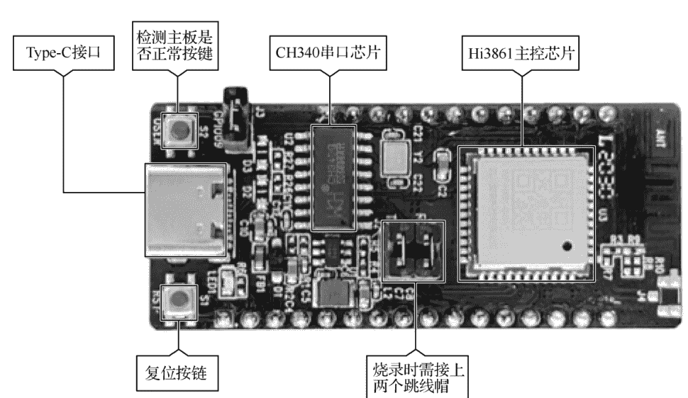

图7-1

2. 资源与约束
Hi3861 资源有限，全板仅 2MB FLASH、352KB RAM，业务编码需注重资源效率。

3. 开发板规格
OpenHarmony 基于 Hi3861 的硬件架构与核心参数如表7-1。

表7-1

| 规格类型 | 规格清单 |
| :--- | :--- |
| 通用规格 | 1×1 2.4GHz 频段（ch1～ch14）<br>PHY 支持 IEEE 802.11b/g/n<br>MAC 支持 IEEE802.11 d/e/h/i/k/v/w<br>内置 PA 和 LNA，集成 TX/RX Switch、Balun 等<br>支持 STA 和 AP 形态，作为 AP 时最大支持 6 个 STA 接入<br>支持 WFA WPA/WPA2 personal、WPS2.0<br>支持与 BT/BLE 芯片共存的 2/3/4 线 PTA 方案<br>电源电压输入范围：2.3～3.6V<br>IO 电源电压支持 1.8V 和 3.3V<br>支持 RF 自校准方案<br>低功耗：<br>Ultra Deep Sleep 模式：5μA@3.3V<br>DTIM1：1.5mA@3.3V<br>DTIM3：0.8mA@3.3V |
| PHY 特性 | 支持 IEEE802.11b/g/n 单天线所有的数据速率<br>支持最大速率：72.2Mbps@HT20 MCS7<br>支持标准 20MHz 带宽和 5M/10M 窄带宽<br>支持 STBC<br>支持 Short-GI |
| MAC 特性 | 支持 A-MPDU，A-MSDU<br>支持 Blk-ACK<br>支持 QoS，满足不同业务服务质量需求 |
| CPU 子系统 | 高性能 32bit 微处理器，最大工作频率为 160MHz<br>内嵌 SRAM 352KB、ROM 288KB<br>内嵌 2MB FLASH |
| 外围接口 | 1 个 SDIO 接口、2 个 SPI 接口、2 个 I2C 接口、3 个 UART 接口、15 个 GPIO 接口、7 路 ADC 输入、6 路 PWM、1 个 I2S 接口（注：上述接口通过复用实现）<br>外部主晶体频率为 40MHz 或 24MHz |
| 其他信息 | 封装：QFN-32，5mm×5mm<br>工作温度：-40～+85℃ |

4. OpenHarmony 关键特性

Hi3861 平台上的 OpenHarmony 为开发者暴露了丰富的底层与上层能力，关键模块汇总在表7-2。

表7-2

| 模块 | 功能说明 |
| :--- | :--- |
| WLAN 服务 | 支持 station 与 hotspot 模式的连接、断开及状态查询等无线接入能力 |
| 模组外设控制 | 统一的外设操作接口，覆盖 I2C、I2S、ADC、UART、SPI、SDIO、GPIO、PWM、FLASH 等 |
| 分布式软总线 | 在 OpenHarmony 分布式网络中实现设备发现与跨设备数据搬运 |
| 设备安全绑定 | 在多设备互联场景下保证数据跨设备可信流转 |
| 基础加解密 | 包含密钥管理、加密解密等基础安全计算 |
| 系统服务管理 | 基于服务化架构，提供 OpenHarmony 统一的系统服务开发与治理框架 |
| 启动引导 | 定义系统服务的入口标记，服务管理器启动时调用 bootstrap 指定的入口函数并拉起服务 |
| 系统属性 | 支持系统属性的读取与写入 |
| 基础库 | 提供公共基础能力，包含文件操作、KV 存储管理等 |
| DFX | 提供诊断可观测能力，包含流水日志、时间打点等 |
| XTS | 汇集 OpenHarmony 生态认证所需的测试套件 |

鸿蒙利用分布式软总线将多个终端抽象为“一体设备”，在单机内部与设备之间实现高吞吐、低时延、高可靠的流畅联接，契合万物互联诉求，能够显著提升智能家居、车载、航空航天等场景的运行效率，其核心构成与技术架构如图7-2所示。

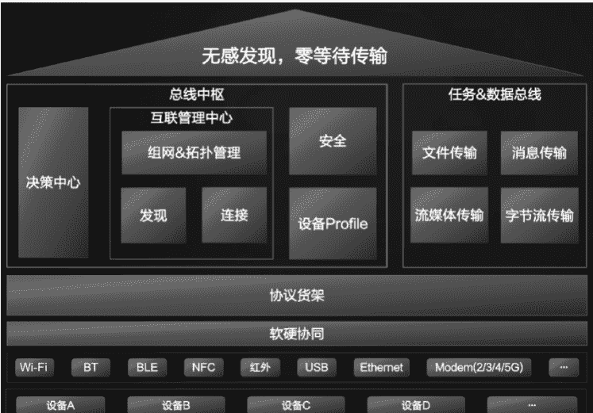

图7-2

### 7.4 搭建开发环境

#### 7.4.1 安装虚拟机环境

虚拟机是借助软件模拟完整硬件系统，并在隔离空间运行完整操作系统的技术。本书以 VirtualBox 为示例，相关下载与扩展包链接如下：

https://www.virtualbox.org/wiki/Downloads

https://www.virtualbox.org/wiki/Downloads

#### 7.4.2 安装CH340芯片驱动

使用 USB-Type-C 数据线将开发板接入电脑时，系统往往会自动获取 CH340 驱动，可在设备管理器中核实是否出现 CH340 串口。为确保板卡与主机可靠通信，需完成 CH340 芯片驱动的安装与校验，开发板 COM 串口驱动示意见图7-3。


图7-3

若未自动完成安装，可依据本地环境手动部署 CH340 芯片驱动。

#### 7.4.3 安装烧录工具

固件烧录工具用于把选定固件写入设备闪存。针对南向开发对高速写入的需求，HiBurn 因高波特率与高效写入被广泛选用，其界面与参数配置如图7-4所示。

HiBurn 作为烧录工具，写入速率更快，最高波特率可调至 3000000，但不支持保存历史串口参数，每次使用需重新设置。


图7-4

#### 7.4.4 安装Ubuntu

Ubuntu 由 Canonical 维护的 Linux 发行版，以简洁易用与稳定著称，适合个人与企业开发。推荐部署 20.04 桌面版。Ubuntu 20.04.6 LTS（Focal Fossa）下载页面如图7-5所示。

# Ubuntu 20.04.6 LTS (Focal Fossa)

# Select an image

Ubuntu 共提供桌面与服务器两类镜像，具体选择如下：

| 镜像类型 | 选用建议 |
|---|---|
| 桌面镜像 64-bit PC (AMD64) | 可试用系统并选择性永久安装，适合大多数用户，需至少 1024MiB 内存 |
| 服务器安装镜像 64-bit PC (AMD64) | 用于服务器永久安装，不含图形界面 |

图7-5

#### 7.4.5 VirtualBox安装Ubuntu

启动已安装的 VirtualBox，点击新建，如图7-6所示。


图7-6

为虚拟机命名并指定存储位置，选择已下载的 Ubuntu 20.04 镜像作为启动光盘，如图7-7所示。

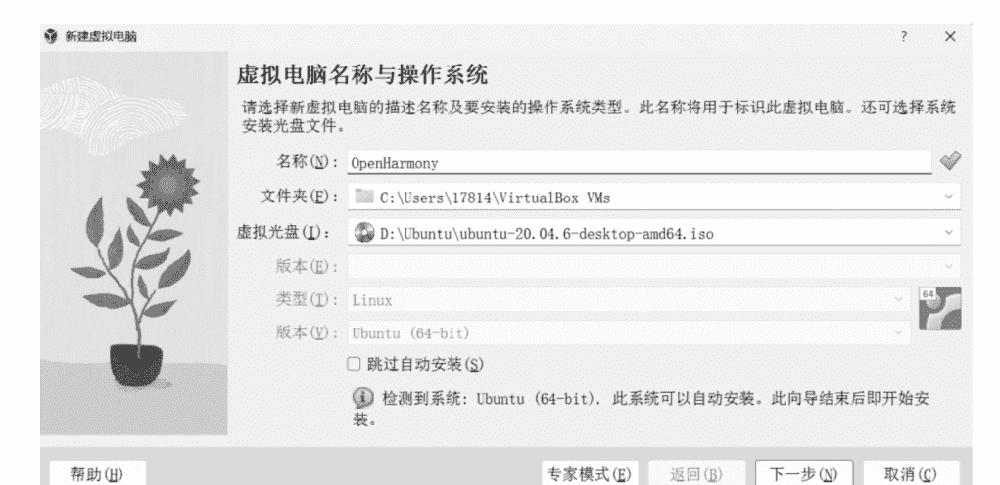

图7-7

分配硬件资源，建议 2~4G 内存与 4 核以上 CPU，如图7-8所示。创建虚拟磁盘时建议预留约 100GB，避免后续拉取 OpenHarmony 源码与编译时磁盘不足，如图7-9所示。

完成基础配置后，为实现主机与虚拟机互通，将网络模式改为桥接网卡，如图7-10所示。

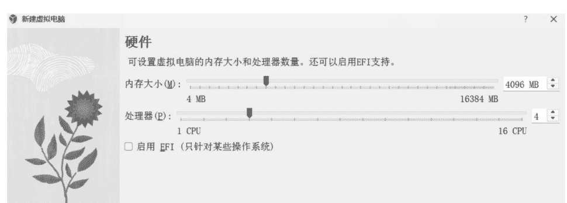

图7-8


图7-9


图7-10

进入虚拟机进行首次初始化，初次启动耗时较长请耐心等待。选择中文为界面语言，窗口过小时可按 Alt+F7 拖动窗口查看底部按钮。随后选择“正常安装”，时区设为上海。

为虚拟机设置主机名与登录密码，建议使用简短易记的密码以便后续多次输入。首次安装耗时较久，按图7-11 完成相关信息。


图7-11

安装重启后，为提升效率先更新软件源：

```
sudo apt-get update

sudo apt-get install gcc make perl
```

更新过程如图7-12所示。

```
saint@saint-VirtualBox:~/桌面$ sudo apt-get update
[sudo] saint 的密码：
对不起，请重试。
[sudo] saint 的密码：
命中:1 http://mirrors.tuna.tsinghua.edu.cn/ubuntu focal InRelease
命中:2 http://mirrors.tuna.tsinghua.edu.cn/ubuntu focal-updates InRelease
命中:3 http://mirrors.tuna.tsinghua.edu.cn/ubuntu focal-backports InRelease
获取:4 http://security.ubuntu.com/ubuntu focal-security InRelease [128 kB]
获取:5 http://security.ubuntu.com/ubuntu focal-security/main amd64 DEP-11 Metadata [65.3 kB]
获取:6 http://security.ubuntu.com/ubuntu focal-security/restricted amd64 DEP-11 Metadata [212 B]
获取:7 http://security.ubuntu.com/ubuntu focal-security/universe amd64 DEP-11 Metadata [160 kB]
获取:8 http://security.ubuntu.com/ubuntu focal-security/multiverse amd64 DEP-11 Metadata [940 B]
已下载 354 kB，耗时 12秒 (28.9 kB/s)
正在读取软件包列表... 完成
saint@saint-VirtualBox:~/桌面$ sudo apt-get install gcc make perl
正在读取软件包列表... 完成
正在分析软件包的依赖关系树
正在读取状态信息... 完成
将会同时安装下列软件：
  binutils binutils-common binutils-x86-64-linux-gnu cpp-9 gcc-10-base gcc-9
  gcc-9-base libasan5 libatomic1 libbinutils libc-dev-bin libc6 libc6-dbg
  libc6-dev libcc1-0 libcrypt-dev libctf-nobfd0 libctf0 libgcc-9-dev
```

图7-12

更新完成后，可在 VirtualBox 设备菜单中安装增强功能，并将拖放与共享剪贴板设为双向，便于主机与虚拟机交互，如图7-13所示。

#### 7.4.6 配置编译环境

##### 1. 安装必要的库和工具

```
sudo apt-get install build-essential gcc g++ make zlib* libffi-dev
sudo apt-get install e2fsprogs pkg-config flex bison perl bc openssl libssl-dev
libelf-dev libc6-dev-amd64 binutils binutils-dev libdwarf-dev u-boot-tools
mtd-utils gcc-arm-linux-gnueabi cpio device-tree-compiler
```

##### 2. 配置Python

- 设定默认 Python 解释器：

```
python 和 python3 软链接为 python3.8
sudo update-alternatives --install /usr/bin/python python /usr/bin/python3.8 1
sudo update-alternatives --install /usr/bin/python3 python3 /usr/bin/python3.8 1
python -version
```

- 安装 Python 包管理工具：

```
sudo apt install python3-pip
```

- 配置 pip 软件包镜像源：

```
mkdir ~/.pip
pip3 config set global.index-url https://mirrors.huaweicloud.com/repository/pypi/simple
pip3 config set global.trusted-host mirrors.huaweicloud.com
pip3 config set global.timeout 120
```

##### 3. 安装编译工具环境

1) 安装 gn
(1) 打开 Linux 编译服务器终端。
(2) 获取 gn 工具。
(3) 解压到 ~/gn 目录：tar -xvf gn.1523.tar -C ~/。
(4) 编辑环境变量：vim ~/.bashrc，追加 export PATH=~/gn:$PATH。
(5) 使变量生效：source ~/.bashrc。

2) 安装 ninja
(1) 打开 Linux 编译服务器终端。
(2) 获取 ninja 工具。
(3) 解压到 ~/ninja 目录：tar -xvf ninja.1.10.0.tar -C ~/。
(4) 编辑环境变量：vim ~/.bashrc，追加 export PATH=~/ninja:$PATH。
(5) 使变量生效：source ~/.bashrc。

3) 安装 gcc_riscv32（WLAN 模组类工具链）
(1) 打开 Linux 编译服务器终端。
(2) 获取 gcc_riscv32 工具。
(3) 解压到 /opt/gcc_riscv32 目录：tar -xvf gcc_riscv32-linux-7.3.0.tar.gz -C ~/。
(4) 编辑环境变量：vim ~/.bashrc，追加 export PATH=~/gcc_riscv32/bin:$PATH。
(5) 使变量生效：source ~/.bashrc。
(6) 执行 riscv32-unknown-elf-gcc -v，若能正常显示版本号则安装成功。

4) 安装 SCons
SCons 是一款基于 Python 的开源构建工具，可替代 Make、CMake，采用 Python 脚本完成构建配置。
(1) 打开 Linux 编译服务器终端。
(2) 安装 SCons 包，需 root/sudo 权限：sudo apt-get install scons -y。
若源中无可用包，可从 https://scons.org/pages/download.html 下载源码，推荐 3.0.4+，解压后执行 sudo python3 setup.py install，随后运行 scons -v 验证。

##### 4. 安装 Samba 服务

Samba 在 Linux/Unix 上实现 SMB/CIFS 协议，可与 Windows 共享文件与打印机。
- 安装：sudo apt install samba
- 编辑配置文件：sudo gedit /etc/samba/smb.conf，在文件末尾添加共享配置。
- 创建共享用户：sudo smbpasswd -a username，其中 username 为虚拟机登录账号。

##### 5. 获取源码的必要工具和配置

- 安装 git 与 git-lfs：

```
sudo apt install git-lfs
```

- 安装 repo 与 request：

```
wget https://gitee.com/oschina/repo/raw/fork_flow/repo-py3
sudo mv repo-py3 /usr/local/bin/repo
sudo chmod a+x /usr/local/bin/repo
pip install requests
```

#### 7.4.7 获取 OpenHarmony 源码

在 Ubuntu 终端执行对应命令拉取 OpenHarmony 源码：

```
mkdir -p ~/openharmony/1.1.3
cd ~/openharmony/1.1.3
repo init -u https://gitee.com/openharmony/manifest.git -b refs/tags/OpenHarmony-v1.1.3-LTS --no-repo-verify
repo sync -c
repo forall -c 'git lfs pull'
```

表7-3 整理了源码目录的含义。

### 表7-3

| 目录 | 作用 |
|---|---|
| applications | 示例应用集合，含 camera 等演示程序 |
| base | 基础软件服务子系统与硬件服务子系统集合 |
| build | 组件化编译、构建流程及配置脚本 |
| docs | 项目说明文档 |
| domains | 增强型软件服务子系统集合 |
| drivers | 硬件驱动实现 |
| foundation | 系统基础能力子系统集合 |
| kernel | 内核子系统 |
| prebuilts | 预置编译器及工具链子系统 |

| test | 测试子系统 |

| third_party | 开源第三方组件 |

| utils | 常用的工具集 |

| vendor | 厂商提供的软件 |

| build.py | 编译脚本文件 |

#### 7.4.8 编译 OpenHarmony 源码

把开发板连上后，切到源码最上层目录打开终端，执行 hb set 来设定目标板。图7-16中提示“[OHOS INFO]Input code path: ”时直接回车沿用当前路径，之后在列表里选中 wifiiot_hispark_pegasus。

常用指令：

1. hb build：增量编译，只构建变更部分。
2. hb build -f：全量编译。

编译产物会输出到 out/hispark_pegasus/wifiiot_hispark_pegasus/Hi3861_wifiiot_app_allinone.bin。

#### 7.4.9 部署烧录工具 HiBurn

HiBurn 可在 51CTO 鸿蒙开发者社区下载安装，地址为 https://ost.51cto.com/resource/148。安装后主界面如图7-17。

#### 7.4.10 烧录固件

在虚拟机里找到源码位置，打开图7-18 标注的文件。进入左上角的 Setting 页，把波特率改成 2000000，选择开发板串口，默认多为 COM3，并勾选 Auto burn，如图7-19。

烧录流程：

1. HiBurn 中点击 Connect 建立连接。
2. 在板子上按下 Reset，等待自动烧录完成。
3. 完成后点击 Disconnect 断开。

至此，首次烧录完成。

#### 7.4.11 配置串口终端 MobaXterm

MobaXterm 亦称 MobaXVT，是一款集增强终端、X 服务器和 UNIX 命令集 GNU/Cygwin 的工具箱。

凭借一体化的工具链和便携特性，它很适合跨平台开发和远程设备管理。官网如图7-20。

点击 Download 获取免费便携版，解压后不会自建快捷方式，可自行添加。打开软件点 New session 新建会话，如图7-21。

接入板子时点 Serial 图标，按实际情况选串口，波特率设 115200 建立会话，如图7-22。

#### 7.4.12 规划业务目录

写业务前，请在 ./applications/sample/wifi-iot/app 下新建一个目录或目录树，用来存放业务源码。以在 app 下新建 HelloWorld 为例，内部放 hello.c 作为实现代码，BUILD.gn 作为编译描述文件，目录示意如下。

```
L___ applications
L___ sample
L___ wifi-iot
L___ app
|   L___ HelloWorld
|   |   L___ hello.c
|   L___ BUILD.gn
L___ BUILD.gn
```

hello.c 中的代码如图7-23。

BUILD.gn 中的内容如图7-24。

```
// 标准输入输出
#include <stdio.h>
#include "ohos_init.h"

// 定义一个函数，输出hello world
void hello(void)
{
    printf("Hello world!\r\n");
}

SYS_RUN(hello);
```

图7-23

```
# 做成静态库，"hello_world"是库名称，最终被编译为"libhello_world.a"
static_library("HelloWorld") {
  # 源文件
  sources = [ "hello.c" ]
  # include目录
  include_dirs = [
    # 包括"ohos_init.h"等头文件
    # "//"表示源码根目录，后面是目录名称
    "//utils/native/lite/include",
  ]
}
```

图7-24

#### 7.4.13 架构总览

整体遵循分层设计，自下而上为内核层、系统服务层、框架层、应用层。

功能按 系统 > 子系统 > 组件 逐级展开，可根据需求裁剪非必要组件。

系统服务层由四个子系统构成：系统基本能力子系统集、基础软件服务子系统集、增强软件服务子系统集、硬件服务子系统集，结构如图7-25。

### 7.5 内核编程接口及 I/O 接口

#### 7.5.1 线程管理

Hi3861 基于 RISC-V，兼容 CMSIS 标准，可直接使用 CMSIS API 创建线程。OpenHarmony 源码中线程相关接口汇总见表7-4，参考即可编写 Thread 控制示例，如图7-26。

### 表7-4

| API 名称 | 说 明 |

| :--- | :--- |

| osThreadNew | 新建线程并激活加入活动组 |

| osThreadGetName | 查询指定线程的名称 |

| osThreadGetId | 获取当前运行线程的编号 |

| osThreadGetState | 获取当前线程的状态 |

| osThreadSetPriority | 修改指定线程的优先级 |

| osThreadGetPriority | 读取当前线程的优先级 |

| osThreadYield | 把执行权让给下一个 READY 线程 |

| osThreadSuspend | 挂起指定线程的运行 |

```
static void ThreadTestTask(void)
{
    // 定义线程属性
    osThreadAttr_t attr;
    // 线程名
    attr.name = "LED_Task";
    // 线程属性位
    attr.attr_bits = 0U;
    // 线程控制块的内存初始地址，默认为系统自动分配
    attr.cb_mem = NULL;
    // 线程控制块的内存大小
    attr.cb_size = 0U;
    // 线程栈的内存初始地址，默认为系统自动分配
    attr.stack_mem = NULL;
    // 线程栈的内存大小
    attr.stack_size = 1024;
    attr.priority = osPriorityNormal;

    if (osThreadNew((osThreadFunc_t)LED_Task, "This is a test thread.", &attr) == NULL)
    {
        printf("[ThreadTestTask] Falied to create LED_Task!\n");
    }
}

// 让ThreadTestTask函数以“优先级2”在系统启动过程的“阶段8. application-layer feature”阶段执行。
APP_FEATURE_INIT(ThreadTestTask);
```

图7-26

线程编写后，可封装成进程入口函数：

```
// 最后使用宏将该控制线程以优先级二在系统过程中启动
APP_FEATURE_INIT(ThreadTestTask);
```

这样就把 ThreadTestTask 接入进程，只要栈不溢出，该函数可被任意业务函数替换，按需自行修改线程函数与调用。

#### 7.5.2 延时机制

线程处理完后一般需等待一段时间再参与调度，从就绪到运行也存在耗时。实际场景如每 5 秒采集一次温湿度，就需要利用延时实现周期任务。

系统时钟 Tick 由定时器计数器产生中断形成，系统对 Tick 计数。时钟周期即两个 Tick 之间的时间长度。

Hi3861V100 每秒产生 100 个 Tick，每个 Tick 10ms。注意 Cycle 与 Tick 不同，Tick 是中断标记点，周期是间隔时长。延时接口见表7-5。

### 表7-5

| API 名称 | 说明 |

| :--- | :--- |

| osDelay | 延时指定 Tick 数 |

| osDelayUntil | 延时至指定 Tick 位置 |

调用 osDelay 后线程从运行态进入阻塞态，时间到后回到就绪态。若为最高优先级，到时即可立即运行。

osDelay(n) 从当前时刻起等待 n 个 Tick，精度要求不高时可近似为 n×10ms。

OpenHarmony 线程调度借助 osDelay 实现精准延时，状态切换与时间计算规则如图7-27。

由此可写一个每 3 秒读取一次可燃气体浓度的函数：

```
While(1){
    ReadGas();
    osDelay(300);
}
```

缺少合理等待，程序运行时系统可能出错。

结合线程概念，可完整实现可燃气体读取：先把采集功能封装为 Gas 函数，内部每 3 秒取一次浓度；再写线程控制函数；最后把线程控制函数写入系统，整体结构如图7-28。

#### 7.5.3 GPIO

##### 1. GPIO 概述

GPIO 即 General Purpose Input Output 通用输入输出，也称总线扩展器，由引脚和功能寄存器组成，不同架构实现差异较大，细节见芯片手册 GPIO 章节。

主要用于控制引脚上连接的外设。通过原理图找到板上引脚或排针位置，将外设接上即可交互。驱动层通过读写功能寄存器改变外设状态。

Hi3861 集成 15 个 GPIO 引脚，内部模块实现数字 I/O。

OpenHarmony 在 Hi3861 上提供灵活的外设交互能力，引脚定义、寄存器操作与物理布局的映射关系如图7-29。


图7-29

##### 2. GPIO 接口 API

Hi3861 外设接口丰富但引脚有限，部分引脚可复用，使用前需配置功能。

OpenHarmony 提供 HAL 与 SDK 双维度支持，关键接口见表7-6、表7-7。

表7-6

| API 名称 | 说 明 |

| :--- | :--- |

| unsigned int IoTGpioInit(unsigned int id) | 完成模块初始化 |

| unsigned int IoTGpioSetDir(unsigned int id, IotGpioDir dir) | 配置引脚方向，id 选引脚，dir 选输入输出 |

| unsigned int IoTGpioSetOutputVal(unsigned int id, IotGpioValue val) | 设定输出电平，id 选引脚，val 选高低电平 |

| unsigned int IoTGpioDeinit(unsigned int id) | 取消模块初始化 |

表7-7

| API 名称 | 说 明 |

| :--- | :--- |

| hi_u32 hi_io_set_func(hi_io_name id, hi_u8 val) | 配置引脚复用功能，id 标识引脚，val 指定功能 |

##### 3. 输出高低电平

GPIO 主要工作模式有三种：

输入模式：读取外部信号。

输出模式：驱动外部设备。

复用功能：复用为 I2C、UART、PWM 等外设接口。

输出模式可输出 3.3V 高电平，单个引脚最大驱动电流约 4mA，适合 LED 等低功耗器件，不适合电机等大负载。

开发板自带 LED 接在 GPIO 09，默认上拉高电平，给引脚输出低电平时 LED 点亮。实现步骤为先初始化为 GPIO，再设为输出模式并输出低电平。

点亮 LED 的示例程序如图7-30。

```c
#define LED_TASK_GPIO 9

static void LedTask(void *arg)
{
    (void)arg;
    // 初始化GPIO模块
    IoTGpioInit(LED_TASK_GPIO);
    hi_io_set_func(LED_TASK_GPIO, HI_IO_FUNC_GPIO_9_GPIO);
    IoTGpioSetDir(LED_TASK_GPIO,IOT_GPIO_DIR_OUT);
    while (1)
    {
        IoTGpioSetOutputVal(LED_TASK_GPIO,IOT_GPIO_VALUE0);
        // 等待0.5秒。单位是10ms。
        osDelay(50);
        // 输出高电平，熄灭LED。
        IoTGpioSetOutputVal(LED_TASK_GPIO,IOT_GPIO_VALUE1);
        osDelay(100);
    }
}

static void LedEntry(void)
{
    osThreadAttr_t attr;
    attr.name = "LedTask";
    attr.stack_size = 4096;
    attr.priority = osPriorityNormal;
    if (osThreadNew(LedTask, NULL, &attr) == NULL)
    {
        printf("[LedDemo] Create LedTask failed!\n");
    }
}
// ohos_init.h 中定义的宏，让函数在系统启动时执行
SYS_RUN(LedEntry);
```

图7-30

#### 7.5.4 ADC

ADC 即模拟-数字转换器，把连续模拟信号转为离散数字信号，便于数字电路处理。

##### 1. ADC 接口特性

通道数量：多路输入，具体看封装。

分辨率：12 位，可分辨 4096 个电平。

采样速率：最高 1Msps，满足实时采集。

输入电压范围：0～3.3V，兼容常见传感器。

低功耗设计：支持休眠，适合电池供电。

Hi3861 共 7 个 ADC 通道，可复用的 GPIO 列表见表7-8。

表7-8

| Pin | 引脚名称 | 复用信号 |

| :--- | :--- | :--- |

| 6 | GPIO_04 | ADC1 |

| 17 | GPIO_05 | ADC2 |

| 19 | GPIO_07 | ADC3 |

| 27 | GPIO_09 | ADC4 |

| 29 | GPIO_11 | ADC5 |

| 30 | GPIO_12 | ADC0 |

| 31 | GPIO_13 | ADC6 |

相关 API 位于 device\hisilicon\hispark_pegasus\sdk_liteos\include\hi_adc.h，可自行查阅。

##### 2. 读取传感器电压值

Hi3861 ADC 值转电压公式为 VX=data×1.8×4/4096，其中 data 为 ADC 读数，VX 为电压值。先读 ADC 值再换算为电压，结合传感器手册的电压-物理量曲线即可得到真实环境参数。

读取电压的实现代码如图7-31 所示。

```c
static float ConvertToVoltage(unsigned short data)
{
    return (float)data * 1.8 * 4 / 4096;
}

// 获取可燃气体浓度
float GetGasLevel()
{
    // 用于接收MQ-2可燃气体传感器的值
    unsigned short data = 0;

    // 读取ADC5通道的值
    if (hi_adc_read(GAS_SENSOR_CHAN_NAME, &data, HI_ADC_EQU_MODEL_4,
                    HI_ADC_CUR_BAIS_DEFAULT, 0) == HI_ERR_SUCCESS)
    {
        float Vx = ConvertToVoltage(data);
```

图7-31

类似思路下，ADC 亦可采集传感元件模拟输出端的电压读数并换算为实际物理量。以电压法获取氧浓度为例，其实现代码参考图7-32。

```c
float GetOxygenLevel ()
{
    unsigned short data = 0;//获取数据

    if (hi_adc_read(OXYGEN_SENSOR_CHAN_NAME,&data,HI_ADC_EQU_MODEL_4,
                    HI_ADC_CUR_BAIS_DEFAULT,0)==HI_ERR_SUCCESS)
    {
        float VX = ConvertToVoltage(data);//电压

        float oxygen_sensor=VX*53.59-3.2129;
        printf("ADC_VALUE=%d VX=%f oxygen_sensor=%f\n",data,VX,oxygen_sensor);
        return oxygen_sensor;
    }

    return 0;//读取失败
}
```

图7-32

#### 7.5.5 PWM
PWM 的本质是用高电平占比来调控输出能力的办法。Hi3861 板载多路 PWM，常见于驱动电机、调节灯光、合成音调等用途。

##### 1. PWM接口
通道数量：可提供的 PWM 路数随封装而变。
分辨率：16 位精度，对应 65536 种占空比档位。
频率范围：工作频率覆盖 1 Hz 至 1 MHz，适配多样场景。
输出模式：输出形式包括单次脉冲、持续脉冲及互补信号。
低功耗设计：功耗优化上提供休眠，适合电池供电应用。

在 OpenHarmony + Hi3861 环境下，PWM 模块具备高精度调制能力，通道划分、引脚复用及关键参数汇总见表7-9。

表7-9

| Pin | 引脚名称 | 复用信号 |

|---|---|---|

| 2 | GPIO_00 | PWM3_OUT |

| 3 | GPIO_01 | PWM4_OUT |

| 4 | GPIO_02 | PWM2_OUT |

| 5 | GPIO_03 | PWM5_OUT |

| 6 | GPIO_04 | PWM1_OUT |

| 17 | GPIO_05 | PWM2_OUT |

| 18 | GPIO_06 | PWM3_OUT |

| 19 | GPIO_07 | PWM0_OUT |

| 20 | GPIO_08 | PWM1_OUT |

| 27 | GPIO_09 | PWM0_OUT |

| 28 | GPIO_10 | PWM1_OUT |

| 29 | GPIO_11 | PWM2_OUT |

| 30 | GPIO_12 | PWM3_OUT |

| 31 | GPIO_13 | PWM4_OUT |

| 32 | GPIO_14 | PWM5_OUT |

该接口覆盖 GPIO 配置到波形输出的完整链路，核心 API 的功能、参数及典型用途整理于表7-10。

表7-10

| API 名称 | 功能描述 | 输入参数 | 用途 |

| :--- | :--- | :--- | :--- |

| IoTGpioInit(HI_IO_NAME_GPIO_9) | 初始化 GPIO 模块，使其能够进行基本操作。GPIO 是数字电路中的核心接口，用于对外设（如 LED、传感器等）的控制 | HI_IO_NAME_GPIO_9：表示 GPIO9 引脚的名称 | 在初始化完成后，可以通过 GPIO 进行读写或配置操作 |

| IoTGpioSetDir(HI_IO_NAME_GPIO_9, IOT_GPIO_DIR_OUT) | 设置 GPIO9 引脚的方向为输出模式，允许外部设备连接并通过它进行通信 | HI_IO_NAME_GPIO_9：GPIO9 引脚的名称<br>IOT_GPIO_DIR_OUT：表示输出方向 | 确保引脚能够正确地接收或发送信号，完成与外设的通信 |

| IoTPwmStart(HI_PWM_PORT_PWM0, 60, 5000) | 启动 PWM 信号输出，并设置占空比和频率 | HI_PWM_PORT_PWM0：PWM0 通道的名称<br>50：占空比，表示高电平持续时间占总周期的百分比<br>4000：PWM 信号的频率，单位为 Hz | 开始输出 PWM 信号，控制外设（如蜂鸣器）的工作状态 |

##### 2. PWM控制信号
PWM 通过调整占空比与频率来改变输出效果。图7-33 展示了如何利用这些参数让蜂鸣器发出不同音高与音量的声音。

```c
// 初始化GPIO模块
IoTGpioInit(HI_IO_NAME_GPIO_9);

// 设置GPIO9为PWM0输出
hi_io_set_func(HI_IO_NAME_GPIO_9, HI_IO_FUNC_GPIO_9_PWM0_OUT);

// 设置GPIO9为输出模式（引脚方向为输出）。
IoTGpioSetDir(HI_IO_NAME_GPIO_9, IOT_GPIO_DIR_OUT);

// 初始化PWM模块
IoTPwmInit(HI_PWM_PORT_PWM0);

// 开始输出PWM信号（蜂鸣器开始鸣叫），占空比60%，频率5000Hz
// OpenHarmony的HAL接口
IoTPwmStart(HI_PWM_PORT_PWM0, 60, 5000);
```

图7-33

同样思路可用于 LED 调光，通过循环改变占空比即可实现呼吸灯效果，示例代码见图7-34。

```c
for (int i = 1; i <= 4096; i *= 2)
{
    hi_pwm_start(HI_PWM_PORT_PWM1, i, 64000);
    usleep(50 * 1000);
    // 停止输出PWM信号
    hi_pwm_stop(HI_PWM_PORT_PWM1);
}

for (int i = 4096; i >= 1; i /= 2)
{
    // 开始输出PWM信号，实际占空比i/64000，实际频率2500Hz
    hi_pwm_start(HI_PWM_PORT_PWM1, i, 64000);
    usleep(50 * 1000);
    // 停止输出PWM信号
    hi_pwm_stop(HI_PWM_PORT_PWM1);
}
```

图7-34

#### 7.5.6 I2C
I2C 是一种由飞利浦提出的双线串行通信方案，由 SDA 数据线与 SCL 时钟线构成，两者均需上拉。同一条总线可挂载多个器件，各自拥有独立地址，同一时刻仅能有一个主机，其余作为从机响应，MCU 常常担任主机角色。

##### 1. 起始条件和停止条件
起始条件：在 SCL 为高时，SDA 由高拉向低即表示开始。
停止条件：在 SCL 仍为高时，SDA 由低拉向高表示结束。

##### 2. 数据的有效性
I2C 采用电平采样，SCL 高电平期间 SDA 必须保持不变，低电平期间才允许变动。

###### 1) I2C API接口
多路支持：可同时使用多组 I2C 控制器。
速率模式：标准 100kHz、快速 400kHz，硬件允许时可达 1MHz 高速。
主从模式：工作模式兼顾主机与从机。
中断驱动：中断机制可减少 CPU 轮询负担。
低功耗设计：提供休眠状态，适合电池供电产品。

在 Hi3861 上运行 OpenHarmony 的 I2C 接口支持多模式通信与引脚复用，控制器特性、管脚分配与关键参数见表7-11。

表7-11

| Pin | 引脚名称 | 复用信号 |

|---|---|---|

| 2 | GPIO_00 | I2C1_SDA |

| 3 | GPIO_01 | I2C1_SCL |

| 5 | GPIO_03 | I2C1_SDA |

| 6 | GPIO_04 | I2C1_SCL |

| 27 | GPIO_09 | I2C0_SCL |

| 28 | GPIO_10 | I2C0_SDA |

| 31 | GPIO_13 | I2C0_SDA |

| 32 | GPIO_14 | I2C0_SCL |

该实现兼顾多模式通信与低电耗，通道复用、波特率配置及核心 API 定义整理于表7-12。

## 表7-12

| API 名称 | 输入参数 | 功能 |

| :--- | :--- | :--- |

| unsigned int I2cInit(WifiIotI2cIdx id, unsigned int baudrate) | id: I2C 设备 ID<br>baudrate: I2C 频率 | 用指定的频率初始化 I2C 设备 |

| unsigned int I2cWrite(WifiIotI2cIdx id, unsigned short deviceAddr, const WifiIotI2cData *i2cData) | id: I2C 设备 ID<br>deviceAddr: I2C 设备地址<br>i2cData: 表示写入的数据 | 将数据写入 I2C 设备 |

| unsigned int I2cRead(WifiIotI2cIdx id, unsigned short deviceAddr, const WifiIotI2cData *i2cData) | id: I2C 设备 ID<br>deviceAddr: I2C 设备地址<br>i2cData: 表示要读取的数据指向的指针 | 从 I2C 设备读取数据。读取的数据将保存到 i2cData 指定的地址 |

| unsigned int I2cSetBaudrate(WifiIotI2cIdx id, unsigned int baudrate) | id: I2C 设备 ID<br>baudrate: I2C 频率 | 为 I2C 设备设置频率 |

###### 2) I2C通信
I2C 支持多主机架构，挂载器件分为主机与从机。以下以 ADXL345 加速度计为示例说明通信流程。

（1）硬件层面：ADXL345 同时兼容 SPI 与 I2C 接口，CS 脚拉高后进入 I2C 模式。ALT ADDRESS 脚为高时器件地址为 0x53，对应写地址 0x3A、读地址 0x3B；脚接地则可使用备选地址。

（2）从软件角度来讲：先向电源控制寄存器 0x2D 写入 0x08，打开测量使能位启动数据采集，随后加入延时等待配置完成。之后可按手册设定量程与输出格式。相关寄存器说明见图7-35。

## 寄存器映射

表19

| 地址 | | 名称 | 类型 | 复位值 | 描述 |

|---|---|---|---|---|---|

| 十六进制 | 十进制 | | | | |

| 0x00 | 0 | DEVID | R | 11100101 | 器件ID |

| 0x01 to 0x1C | 1 to 28 | 保留 | | | 保留，不要操作 |

| 0x1D | 29 | THRESH_TAP | R/W | 00000000 | 敲击阈值 |

| 0x1E | 30 | OFSX | R/W | 00000000 | X轴偏移 |

| 0x1F | 31 | OFSY | R/W | 00000000 | Y轴偏移 |

| 0x20 | 32 | OFSZ | R/W | 00000000 | Z轴偏移 |

| 0x21 | 33 | DUR | R/W | 00000000 | 敲击持续时间 |

| 0x22 | 34 | Latent | R/W | 00000000 | 敲击延迟 |

| 0x23 | 35 | Window | R/W | 00000000 | 敲击窗口 |

| 0x24 | 36 | THRESH_ACT | R/W | 00000000 | 活动阈值 |

| 0x25 | 37 | THRESH_INACT | R/W | 00000000 | 静止阈值 |

| 0x26 | 38 | TIME_INACT | R/W | 00000000 | 静止时间 |

| 0x27 | 39 | ACT_INACT_CTL | R/W | 00000000 | 轴使能控制活动和静止检测 |

| 0x28 | 40 | THRESH_FF | R/W | 00000000 | 自由落体阈值 |

| 0x29 | 41 | TIME_FF | R/W | 00000000 | 自由落体时间 |

| 0x2A | 42 | TAP_AXES | R/W | 00000000 | 单击/双击轴控制 |

| 0x2B | 43 | ACT_TAP_STATUS | R | 00000000 | 单击/双击源 |

| 0x2C | 44 | BW_RATE | R/W | 00001010 | 数据速率及功率模式控制 |

| 0x2D | 45 | POWER_CTL | R/W | 00000000 | 省电特性控制 |

| 0x2E | 46 | INT_ENABLE | R/W | 00000000 | 中断使能控制 |

| 0x2F | 47 | INT_MAP | R/W | 00000000 | 中断映射控制 |

| 0x30 | 48 | INT_SOURCE | R | 00000010 | 中断源 |

| 0x31 | 49 | DATA_FORMAT | R/W | 00000000 | 数据格式控制 |

| 0x32 | 50 | DATAX0 | R | 00000000 | X轴数据0 |

| 0x33 | 51 | DATAX1 | R | 00000000 | X轴数据1 |

| 0x34 | 52 | DATAY0 | R | 00000000 | Y轴数据0 |

| 0x35 | 53 | DATAY1 | R | 00000000 | Y轴数据1 |

| 0x36 | 54 | DATAZ0 | R | 00000000 | Z轴数据0 |

| 0x37 | 55 | DATAZ1 | R | 00000000 | Z轴数据1 |

| 0x38 | 56 | FIFO_CTL | R/W | 00000000 | FIFO控制 |

| 0x39 | 57 | FIFO_STATUS | R | 00000000 | FIFO状态 |

图7-35

依据寄存器地址完成 ADXL345 初始化。若三轴偏移不大，也可在读数后通过手工加减进行补偿，示例代码见图7-36。

```
uint8_t buffer[2];
uint16_t retval;
//初始化引脚
IoTGpioInit(HI_IO_NAME_GPIO_13);
IoTGpioInit(HI_IO_NAME_GPIO_14);
//设置为引脚功能为SDA SCL
hi_io_set_func(HI_IO_NAME_GPIO_13,HI_IO_FUNC_GPIO_13_I2C0_SDA);
hi_io_set_func(HI_IO_NAME_GPIO_14,HI_IO_FUNC_GPIO_14_I2C0_SCL);

retval = IoTI2cInit(I2C_ID,BAUDRATE);
printf("I2C Init Return: %d\n",retval);

buffer[0]=ADXL345_PWR_ON;
buffer[1]=0x08;
retval = IoTI2cWrite(I2C_ID, ADXL345_WRITE, buffer, 2);
printf("Power Control Write Return: %d\n", retval);
usleep(5000);

buffer[0]=ADXL345_DATA_FORMAT;
buffer[1]=0x0B;
retval = IoTI2cWrite(I2C_ID, ADXL345_WRITE, buffer, 2);
printf("Data Format Write Return: %d\n",retval);
usleep(5000);

buffer[0]=ADXL345_INT_ENABLE;
buffer[1]=0x80;
retval = IoTI2cWrite(I2C_ID, ADXL345_WRITE, buffer, 2);
printf("INT_ENABLE Return: %d\n",retval);
usleep(5000);
```

图7-36

配置完成之后即可开始读取 ADXL345 的三轴加速度信息。为抑制抖动，常用做法是连续采集五次取平均，以该平均值代表该时刻的姿态状态。若希望数值更精细，可通过延长休眠时间或减少单次采样次数来调节。

读取数据的函数实现示例如图7-37。

```
void readADXL345(int16_t *x,int16_t *y,int16_t *z)
{
    uint8_t buffer[6];
    uint32_t retval;
    int32_t avex=0,avey=0,avez=0;
    buffer[0]=0x32;
    retval = IoTI2cWrite(I2C_ID,ADXL345_WRITE,buffer,1);
    usleep(1000);

    for (int i=0;i<5;i++)
    {
        retval =IoTI2cRead(I2C_ID,ADXL345_READ,buffer,6);//读取6个字节的数据
        avex += (int16_t)((buffer[1] << 8) | buffer[0]);
        avey += (int16_t)((buffer[3] << 8) | buffer[2]);
        avez += (int16_t)((buffer[5] << 8) | buffer[4]);
        usleep(11.1*1000);
    }

    *x = avex/5;
    *y = avey/5;
    *z = avez/5;
    //调整误差
    *x+=1;
    *y+=7;
}
```

图7-37

在工程实践里，传感器的功能通常被封装成独立模块，后续直接复用即可，这符合高内聚低耦合的思路，也能让主流程更简洁。下面参照润和 AHT20 的驱动写法，给出温湿度传感器的初始化与读取实现。初始化示例见图7-38。

```
void InitTempHumiSensor()
{
    // 初始化GPIO
    IoTGpioInit(HI_IO_NAME_GPIO_13);
    IoTGpioInit(HI_IO_NAME_GPIO_14);

    // 设置GPIO-13引脚功能为I2C0_SDA
    hi_io_set_func(HI_IO_NAME_GPIO_13, HI_IO_FUNC_GPIO_13_I2C0_SDA);

    // 设置GPIO-14引脚功能为I2C0_SCL
    hi_io_set_func(HI_IO_NAME_GPIO_14, HI_IO_FUNC_GPIO_14_I2C0_SCL);

    // 用指定的波特速率初始化I2C0
    IoTI2cInit(AHT20_I2C_IDX, AHT20_BAUDRATE);

    // 校准AHT20，如果校准失败，等待100ms后重试
    while (IOT_SUCCESS != AHT20_Calibrate())
    {
        printf("AHT20 sensor init failed!\r\n");
        usleep(100 * 1000);
    }
}
```

图7-38

获取温湿度数据的函数示例见图7-39。

```
int GetTempHumiLevel(float *temp, float *humi)
{
    // 接收接口的返回值
    uint32_t retval = 0;

    // 启动测量
    retval = AHT20_StartMeasure();
    if (retval != IOT_SUCCESS)
    {
        printf("trigger measure failed!\r\n");
        return -1;
    }

    // 接收测量结果
    retval = AHT20_GetMeasureResult(temp, humi);
    if (retval != IOT_SUCCESS)
    {
        printf("get data failed!\r\n");
        return -1;
    }

    // 输出测量结果
    printf("temperature: %.2f, humidity: %.2f\r\n", *temp, *humi);

    // 返回成功
    return 0;
}
```

图7-39

最后再提供一个统一的调用接口，包含相应头文件后主程序即可直接调用，示例如图7-40。

```
// 声明接口函数

void InitTempHumiSensor();
int GetTempHumiLevel(float *temp, float *humi);
```

图7-40

#### 7.5.7 SPI

SPI 是一种串行外设接口，属于高速双向同步总线，仅需四根信号线就能工作，有助于降低管脚占用并简化 PCB 布线。应用场景很广，常用于 EEPROM、Flash、实时时钟、ADC，以及 DSP 与数字解码芯片之间的互联。

SPI 通信以主机和从机为角色。总线上只能有一个主机，其余设备为从机。时钟由主机产生，从机据此同步，所有读写均由主机发起。若挂载多个从机，主机通过各自的片选线 CS 来区分管理。

##### 1.SPI接口核心特性

Hi3861 集成 SPI0 与 SPI1 两路控制器，QFN32 封装下可独立工作，并可借助多片选同时驱动多颗外设。可配置参数如下。

通信速率：最高 50MHz，视硬件条件而定。

数据位宽：可编程范围 4 位到 16 位。

时序模式：由 CPOL 时钟极性与 CPHA 时钟相位组合，共四种。

模式 0，CPOL=0，CPHA=0：时钟空闲为低，数据在首个跳变沿采样。

模式 1，CPOL=0，CPHA=1：时钟空闲为低，数据在第二个跳变沿采样。

模式 2，CPOL=1，CPHA=0：时钟空闲为高，数据在首个跳变沿采样。

模式 3，CPOL=1，CPHA=1：时钟空闲为高，数据在第二个跳变沿采样。

OpenHarmony 在 Hi3861 上提供了高速双工通信与多外设协同能力，各控制器配置、时序定义及引脚复用规则如表7-13所示。

## 表7-13

| SPI 控制器 | 功能引脚 | 复用 GPIO 编号 | 描述 |

| :--- | :--- | :--- | :--- |

| SPI0 | CLK | GPIO8 | 时钟信号线 |

| | MOSI | GPIO9 | 主设备输出，从设备输入 |

| | MISO | GPIO10 | 主设备输入，从设备输出 |

| | CS | GPIO11 | 片选信号线 |

| SPI1 | CLK | GPIO12 | 时钟信号线 |

| | MOSI | GPIO13 | 主设备输出，从设备输入 |

| | MISO | GPIO14 | 主设备输入，从设备输出 |

| | CS | GPIO15 | 片选信号线 |

##### 2.SPI控制

SPI 属于高速双向同步串行协议，常用于连接 Flash 存储器、显示屏、传感器等。下面以 WS2812B 灯珠驱动为例说明。

WS2812B 是一款内置控制芯片的智能 RGB 灯珠，可单独调节每个灯的颜色与亮度，具备高柔性、色彩丰富、控制简便的特点，广泛用于装饰、照明、艺术创作等领域。图7-41 为基础的 SPI 方案。

```
IoTGpioInit(HI_IO_NAME_GPIO_12);
IoTGpioInit(HI_IO_NAME_GPIO_11);
IoTGpioInit(HI_IO_NAME_GPIO_10);
IoTGpioInit(HI_IO_NAME_GPIO_9);

hi_spi_deinit(HI_SPI_ID_0); /* if wake_up from deep sleep, should deinit first */
hi_spi_cfg_basic_info spi_cfg_basic_info;
spi_cfg_basic_info.cpha = 0;
spi_cfg_basic_info.cpol = 0;
spi_cfg_basic_info.data_width = HI_SPI_CFG_DATA_WIDTH_E_8BIT;
spi_cfg_basic_info.endian = 0;
spi_cfg_basic_info.fram_mode = 0;
spi_cfg_basic_info.freq = 8*900000;
hi_spi_cfg_init_param spi_init_param = {0};
spi_init_param.is_slave = 0;
hi_spi_init(HI_SPI_ID_0, spi_init_param, &spi_cfg_basic_info); //基本参数配置
hi_spi_set_loop_back_mode(HI_SPI_ID_0, 1);
hi_io_set_func(HI_IO_NAME_GPIO_12, HI_IO_FUNC_GPIO_12_SPI0_CSN);//io配置
hi_io_set_func(HI_IO_NAME_GPIO_10, HI_IO_FUNC_GPIO_10_SPI0_CK);
hi_io_set_func(HI_IO_NAME_GPIO_11, HI_IO_FUNC_GPIO_11_I2S0_RX);
hi_io_set_func(HI_IO_NAME_GPIO_9, HI_IO_FUNC_GPIO_9_SPI0_TXD);
hi_io_set_driver_strength(HI_IO_NAME_GPIO_6, HI_IO_DRIVER_STRENGTH_2);//驱动能力
hi_spi_set_irq_mode(HI_SPI_ID_0, 0);
hi_spi_set_dma_mode(HI_SPI_ID_0, 1);
```

图7-41

通过发送 RGB 数据实现灯光控制，具体实现如图7-42 所示。

修改 BUILD.gn 并烧录后，给 WS2812B 灯带上电。灯带侧 TX 应接到开发板 RX，因为灯带 TX 为接收端，需要接收开发板 RX 发来的信号；开发板 TX 也需连到灯带 RX。若仅点亮不传输数据，可将灯带 RX 悬空。实物接线如图7-43 所示。

while (1)

{

    i=0;
    for (i = 0; i < 256; i ++)
    {
        memset(data, 0, sizeof(data));
        hi_spi_host_write(HI_SPI_ID_0, data, sizeof(data));//前5
        for (unsigned int j = 0; j < 256; j ++)//亮度
        {
            rgb[0] = color[i%7][0]&j;//色带
            rgb[1] = color[i%7][1]&j;
            rgb[2] = color[i%7][2]&j;
            for (unsigned int k = 0; k < 256; k ++)//控制256个灯
            {
                WS2812_send(rgb);
            }
            usleep(10 * 1000);
        }
    }
}

图7-42


图7-43

### 7.6 MQTT协议

MQTT 即 Message Queuing Telemetry Transport，是一种基于发布/订阅的轻量级传输规范，运行于 TCP/IP 之上，由 IBM 于 1999 年推出。其优势是以少量代码和有限带宽为远端设备提供实时可靠的消息服务。作为低开销、低带宽占用的即时通信方案，MQTT 广泛用于物联网、微型设备和移动应用等领域。

该规范采用客户端-服务器架构的消息发布/订阅方式，设计简洁开放、易于实现，尤其适合受限环境，已在卫星链路传感器、间歇拨号医疗设备、智能家居、微型化设备等场景落地。

#### 7.6.1 MQTT协议主要特性

- （1）开放式报文规范，简洁易实现：设计简洁、实现容易，采用开放标准，使不同厂商设备可轻松互联。
- （2）采用发布/订阅消息模式，降低应用耦合：提供一对多消息发布，有效避免传统客户端-服务器模型的紧密耦合，提升系统灵活性和可扩展性。
- （3）消息传输对负载内容屏蔽：规范不对应用数据内容解析，只负责消息本身传输，简化数据交换复杂度。
- （4）基于 TCP/IP 提供有序无损双向连接：主流实现基于 TCP，保证数据有序无损传输；同时存在基于 UDP 的 MQTT-SN 版本，二者连接方式不同，各有优劣，可按需求选用。
- （5）服务质量 QoS 支持，保障可靠传输：提供三种 QoS 等级。
    - QoS 0：至多一次，依赖底层网络，可能丢失或重复，适用于实时性要求高、可容忍丢包的场景。
    - QoS 1：至少一次，确保送达但可能重复，适用于对可靠性有一定要求的场景。
    - QoS 2：仅一次，通过四次握手确保只到达一次，适用于金融交易、关键指令传输等高精度场景。
- （6）轻量级设计，减少网络开销：固定 1 字节报头与 2 字节心跳报文，大幅降低协议交换开销，节省带宽。
- （7）在线状态感知：支持 Last Will and Testament 特性，客户端异常中断时可通知相关方。

#### 7.6.2 MQTT协议原理

##### 1. MQTT工作机制

1）连接流程

（1）客户端连接 Broker。

客户端发送 CONNECT 报文，包含：

- 客户端标识 Client ID。
- 是否启用遗嘱消息 Last Will。
- 用户名和密码，可选。
- 保持在线时间 Keep Alive。

（2）Broker 回复 CONNACK。

Broker 返回连接状态成功或失败。

2）发布与订阅

- 发布消息：客户端向 Broker 发送 PUBLISH 报文，指定目标主题和消息内容。
- 订阅主题：客户端发送 SUBSCRIBE 报文，列出待订阅的主题及 QoS 等级。
- 取消订阅：通过 UNSUBSCRIBE 报文移除订阅关系。

3）消息路由

- Broker 根据主题匹配规则将消息转发给所有订阅该主题的客户端。
- 支持通配符。
    - +：单层通配符，如 home/+/temperature 可匹配 home/livingroom/temperature。
    - #：多层通配符，如 home/# 可匹配 home/livingroom/temperature 和 home/kitchen/light。

##### 2. QoS等级

MQTT 定义了三个 QoS 等级，在可靠性和资源消耗间取得平衡，如表7-14 所示。

表7-14

| QoS 等级 | 描 述 | 适 用 场 景 |

| :--- | :--- | :--- |

| 0 | 最多一次消息可能丢失，不重传。 | 实时性高、允许丢数的场景 |

| 1 | 至少一次确保消息到达，但可能重复。 | 需要可靠传输但允许重复的场景 |

| 2 | 恰好一次通过四次握手确保消息不重复且必达。 | 金融交易、关键指令传输等场景 |

##### 3. MQTT协议报文结构

1）固定头部 Fixed Header

包含控制报文类型 4 位、标志位 4 位和剩余长度 1～4 字节。

- 报文类型：如 CONNECT、PUBLISH、SUBSCRIBE 等。
- 标志位：某些报文类型专用，如 DUP、QoS、RETAIN。

2）可变头部 Variable Header

随报文类型变化。例如 CONNECT 包含协议名、版本、连接标志；PUBLISH 包含主题名和报文 ID，QoS 大于 0 时存在。

3）有效载荷 Payload

实际传输的数据，如消息内容或订阅主题列表。

#### 7.6.3 Hi3861移植MQTT

嵌入式 C 语言客户端的开源仓库为

https://github.com/eclipse/paho.mqtt.embedded-c。

下载解压后，可得到以下目录结构，见图7-44。

- MQTTClient：封装基于 MQTTPacket 的高级别 C++ 客户端程序。
- MQTTClient-C：封装基于 MQTTPacket 的高级别 C 客户端程序。
- samples：提供 FreeRTOS 和 Linux 两个示例。
- src：提供 MQTTClient 代码实现及平台相关的网络驱动，支持移植到不同平台。
- MQTTPacket：包含 MQTT 数据包的序列化和反序列化功能，并提供一些辅助函数。

在鸿蒙系统源码的 thirdparty 目录里，先新建一个名为 pahomqtt 的文件夹，把解压完成的全部源码搬进去。

紧接着，在 paho_mqtt 目录下新增一个 BUILD.gn，用来承担项目的构建与编译工作，示意图参考图7-45，文件内容如下。


图7-44


图7-45

```
# Copyright (c) 2020 Huawei Device Co., Ltd.
# Licensed under the Apache License, Version 2.0 (the "License");
# you may not use this file except in compliance with the License.
# You may obtain a copy of the License at
#
#   http://www.apache.org/licenses/LICENSE-2.0
#
# Unless required by applicable law or agreed to in writing, software
# distributed under the License is distributed on an "AS IS" BASIS,
# WITHOUT WARRANTIES OR CONDITIONS OF ANY KIND, either express or implied.
# See the License for the specific language governing permissions and
# limitations under the License.
import("//build/lite/config/component/lite_component.gni")
import("//build/lite/ndk/ndk.gni")
config("pahomqtt_config") {
  include_dirs = [
    "MQTTPacket/src",
    "MQTTClient-C/src",
    "MQTTClient-C/src/liteOS",
    "//vendor/hisi/hi3861/hi3861/third_party/lwip_sack/include",
    "//kernel/liteos_m/components/cmsis/2.0",
  ]
}
pahomqtt_sources = [
  "MQTTClient-C/src/liteOS/MQTTLiteOS.c",
  "MQTTClient-C/src/MQTTClient.c",
  "MQTTPacket/src/MQTTConnectClient.c",
  "MQTTPacket/src/MQTTConnectServer.c",
  "MQTTPacket/src/MQTTDeserializePublish.c",
  "MQTTPacket/src/MQTTFormat.c",
  "MQTTPacket/src/MQTTPacket.c",
  "MQTTPacket/src/MQTTSerializePublish.c",
  "MQTTPacket/src/MQTTSubscribeClient.c",
  "MQTTPacket/src/MQTTSubscribeServer.c",
  "MQTTPacket/src/MQTTUnsubscribeClient.c",
  "MQTTPacket/src/MQTTUnsubscribeServer.c",
]
lite_library("pahomqtt_static") {
  target_type = "static_library"
  sources = pahomqtt_sources
  public_configs = [ ":pahomqtt_config" ]
}
lite_library("pahomqtt_shared") {
  target_type = "shared_library"
  sources = pahomqtt_sources
  public_configs = [ ":pahomqtt_config" ]
}
ndk_lib("pahomqtt_ndk") {
  if (board_name != "hi3861v100") {
    lib_extension = ".so"
    deps = [
      ":pahomqtt_shared"
    ]
  } else {
    deps = [
      ":pahomqtt_static"
    ]
  }
  head_files = [
    "//third_party/pahomqtt"
  ]
}
```

开始准备 liteOS 适配。MQTT 官方已经提供了 Linux 和 FreeRTOS 的移植示例，我们可以借鉴这种做法。liteOS 目录的相对位置为 third_party\pahomqtt\MQTTClient-C\src\liteOS，里面只放两份文件 MQTTLiteOS.c 和 MQTTLiteOS.h，示意图见图7-46。


图7-46

MQTTLiteOS.c 的具体内容如下：

```
1. MQTTLiteOS.c
/*******************************************************
****
 * Copyright (c) 2014, 2015 IBM Corp.
 *
 * All rights reserved. This program and the accompanying materials
 * are made available under the terms of the Eclipse Public License v1.0
 * and Eclipse Distribution License v1.0 which accompany this distribution.
 *
 * The Eclipse Public License is available at
 *   http://www.eclipse.org/legal/epl-v10.html
 * and the Eclipse Distribution License is available at
 *   http://www.eclipse.org/org/documents/edl-v10.php.
 *
 * Contributors:
 *   Allan Stockdill-Mander - initial API and implementation and/or initial documentation
 *   Ian Craggs - convert to FreeRTOS
 *******************************************************/
#include "MQTTLiteOS.h"
int ThreadStart(Thread* thread, void (*fn)(void*), void* arg)
{
    int rc = 0;
    thread = thread;
    osThreadAttr_t attr;
    attr.name = "MQTTTask";
    attr.attr_bits = 0U;
    attr.cb_mem = NULL;
    attr.cb_size = 0U;
    attr.stack_mem = NULL;
    attr.stack_size = 2048;
    attr.priority = osThreadGetPriority(osThreadGetId());
    rc = (int)osThreadNew((osThreadFunc_t)fn, arg, &attr);
    return rc;
}
void TimerInit(Timer* timer)
{
    timer->end_time = (struct timeval){0, 0};
}
char TimerIsExpired(Timer* timer)
{
    struct timeval now, res;
    gettimeofday(&now, NULL);
    timersub(&timer->end_time, &now, &res);
    return res.tv_sec < 0 || (res.tv_sec == 0 && res.tv_usec <= 0);
}
void TimerCountdownMS(Timer* timer, unsigned int timeout)
{
    struct timeval now;
    gettimeofday(&now, NULL);
    struct timeval interval = {timeout / 1000, (timeout % 1000) * 1000};
    timeradd(&now, &interval, &timer->end_time);
}
void TimerCountdown(Timer* timer, unsigned int timeout)
{
    struct timeval now;
    gettimeofday(&now, NULL);
    struct timeval interval = {timeout, 0};
    timeradd(&now, &interval, &timer->end_time);
}
int TimerLeftMS(Timer* timer)
{
    struct timeval now, res;
    gettimeofday(&now, NULL);
    timersub(&timer->end_time, &now, &res);
    //printf("left %d ms\n", (res.tv_sec < 0) ? 0 : res.tv_sec * 1000 + res.tv_usec
    / 1000);
    return (res.tv_sec < 0) ? 0 : res.tv_sec * 1000 + res.tv_usec / 1000;
}
void MutexInit(Mutex* mutex)
{
    mutex->sem = osSemaphoreNew(1, 1, NULL);
}
int MutexLock(Mutex* mutex)
{
    return osSemaphoreAcquire(mutex->sem, LOS_WAIT_FOREVER);
}
int MutexUnlock(Mutex* mutex)
```

```c
{
    return osSemaphoreRelease(mutex->sem);
}

int linux_read(Network* n, unsigned char* buffer, int len, int timeout_ms)
{
    struct timeval interval = {timeout_ms / 1000, (timeout_ms % 1000) * 1000};
    if (interval.tv_sec < 0 || (interval.tv_sec == 0 && interval.tv_usec <= 0))
    {
        interval.tv_sec = 0;
        interval.tv_usec = 100;
    }
    setsockopt(n->my_socket, SOL_SOCKET, SO_RCVTIMEO, (char *)&interval, sizeof(struct timeval));
    int bytes = 0;
    while (bytes < len)
    {
        int rc = recv(n->my_socket, &buffer[bytes], (size_t)(len - bytes), 0);
        if (rc == -1)
        {
            if (errno != EAGAIN && errno != EWOULDBLOCK)
                bytes = -1;
            break;
        }
        else if (rc == 0)
        {
            bytes = 0;
            break;
        }
        else
            bytes += rc;
    }
    return bytes;
}

int linux_write(Network* n, unsigned char* buffer, int len, int timeout_ms)
{
    struct timeval tv;
    tv.tv_sec = 0; /* 30 Secs Timeout */
    tv.tv_usec = timeout_ms * 1000; // Not init'ing this can cause strange errors
    setsockopt(n->my_socket, SOL_SOCKET, SO_SNDTIMEO, (char *)&tv, sizeof(struct timeval));
    int rc = send(n->my_socket, buffer, len, 0);
    return rc;
}

void NetworkInit(Network* n)
{
    n->my_socket = 0;
    n->mqttread = linux_read;
    n->mqttwrite = linux_write;
}

int NetworkConnect(Network* n, char* addr, int port)
{
    int type = SOCK_STREAM;
    struct sockaddr_in address;
    int rc = -1;
    sa_family_t family = AF_INET;
    struct addrinfo *result = NULL;
    struct addrinfo hints = {0, AF_UNSPEC, SOCK_STREAM, IPPROTO_TCP, 0, NULL, NULL, NULL};
    if ((rc = getaddrinfo(addr, NULL, &hints, &result)) == 0)
    {
        struct addrinfo* res = result;
        /* prefer ip4 addresses */
        while (res)
        {
            if (res->ai_family == AF_INET)
            {
                result = res;
                break;
            }
            res = res->ai_next;
        }
        if (result->ai_family == AF_INET)
        {
            address.sin_port = htons(port);
            address.sin_family = family = AF_INET;
            address.sin_addr = ((struct sockaddr_in*) (result->ai_addr))->sin_addr;
        }
        else
            rc = -1;
        freeaddrinfo(result);
    }
    if (rc == 0)
    {
        n->my_socket = socket(family, type, 0);
        if (n->my_socket != -1)
            rc = connect(n->my_socket, (struct sockaddr*)&address, sizeof(address));
        else
            rc = -1;
    }
    return rc;
}

void NetworkDisconnect(Network* n)
{
    close(n->my_socket);
}
```

MQTTLiteOS.h 的具体内容如下：

```c
/***************************************************************************************
****
 * Copyright (c) 2014, 2015 IBM Corp.
/*
 * All rights reserved. This program and the accompanying materials
 * are made available under the terms of the Eclipse Public License v1.0
 * and Eclipse Distribution License v1.0 which accompany this distribution.
 *
 * The Eclipse Public License is available at
 *   http://www.eclipse.org/legal/epl-v10.html
 * and the Eclipse Distribution License is available at
 *   http://www.eclipse.org/org/documents/edl-v10.php.
 *
 * Contributors:
 *   Allan Stockdill-Mander - initial API and implementation and/or initial documentation
 ***********************************************************************/
#if !defined(MQTTLiteOS_H)
#define MQTTLiteOS_H
#include <sys/types.h>
#if !defined(SOCKET_ERROR)
    /** error in socket operation */
    #define SOCKET_ERROR -1
#endif
#if defined(WIN32)
/* default on Windows is 64 - increase to make Linux and Windows the same */
#define FD_SETSIZE 1024
#include <winsock2.h>
#include <ws2tcpip.h>
#define MAXHOSTNAMELEN 256
#define EAGAIN WSAEWOULDBLOCK
#define EINTR WSAEINTR
#define EINVAL WSAEINVAL
#define EINPROGRESS WSAEINPROGRESS
#define EWOULDBLOCK WSAEWOULDBLOCK
#define ENOTCONN WSAENOTCONN
#define ECONNRESET WSAECONNRESET
#define ioctl ioctlsocket
#define socklen_t int
#else
#define INVALID_SOCKET SOCKET_ERROR
#include <sys/socket.h>
#include <sys/param.h>
#include <sys/time.h>
#include <netinet/in.h>
#include <netinet/tcp.h>
#include <arpa/inet.h>
#include <netdb.h>
#include <stdio.h>
#include <unistd.h>
#include <errno.h>
#include <fcntl.h>
#include <string.h>
#include <stdlib.h>
#endif
#if defined(WIN32)
#include <Iphlpapi.h>
#else
#include <sys/ioctl.h>
#include <net/if.h>
#endif
#include "ohos_init.h"
#include "cmsis_os2.h"
#include "lwip/ip_addr.h"
#include "lwip/netifapi.h"
#include "lwip/sockets.h"
#define MQTT_TASK
typedef struct Thread
{
    osThreadId_t task;
} Thread;
int ThreadStart(Thread*, void (*fn)(void*), void* arg);
typedef struct Timer
{
    struct timeval end_time;
} Timer;
typedef struct Mutex
{
    osSemaphoreId_t sem;
} Mutex;
void MutexInit(Mutex*);
int MutexLock(Mutex*);
int MutexUnlock(Mutex*);
void TimerInit(Timer*);
char TimerIsExpired(Timer*);
void TimerCountdownMS(Timer*, unsigned int);
void TimerCountdown(Timer*, unsigned int);
int TimerLeftMS(Timer*);
typedef struct Network
{
    int my_socket;
    int (*mqttread) (struct Network*, unsigned char*, int, int);
    int (*mqttwrite) (struct Network*, unsigned char*, int, int);
} Network;
int linux_read(Network*, unsigned char*, int, int);
int linux_write(Network*, unsigned char*, int, int);
void NetworkInit(Network*);
int NetworkConnect(Network*, char*, int);
void NetworkDisconnect(Network*);
#endif
```

完成前面文件的设置后，Hi3861即可正常跑通MQTT协议。因为MQTT本身支持多线程，参考过往的执行流程，下一步就是调整BUILD.gn。

在BUILD.gn里给之前写好的工程加上MQTT的支持，硬件就能与云端打通，效果见图7-47。

```
static_library("gas") {
  # 设置编译选项，指定以下编译警告不当做错误处理
  cflags = [
    "-Wno-sign-compare",           # 有符号数和无符号数对比
    "-Wno-unused-parameter",       # 未使用的参数
  ]

  # Paho-MQTT相关宏定义
  defines = [
    "MQTT_TASK",                   # 使用线程方式
    "MQTTCLIENT_PLATFORM_HEADER=mqtt_ohos.h", # 指定OHOS(LiteOS)适配接口文件
    "CMSIS",                       # 使用CMSIS库
  ]

  # 指定要编译的程序文件
  sources = [
    "demo_entry.c",                # 主程序文件
    "mqtt_task.c",                 # MQTT接口文件（对MQTTClient-C库二次封装）
    "gas_sensor.c",                # 可燃气体采集程序文件
  ]

  # 设置头文件路径
  include_dirs = [
    "//utils/native/lite/include",
    "//kernel/liteos_m/kal/cmsis",
    "//base/iot_hardware/peripheral/interfaces/kits",
    "//applications/sample/wifi-iot/app/paho_mqtt/MQTTClient-C/src",       # MQTTClient-C模块接口
    "//applications/sample/wifi-iot/app/paho_mqtt/MQTTClient-C/src/ohos", # MQTTClient-C模块接口
    "//applications/sample/wifi-iot/app/paho_mqtt/MQTTPacket/src",        # MQTTPacket模块接口
    "//foundation/communication/wifi_lite/interfaces/wifiservice",        # HAL接口中的WiFi接口
    "../easy_wifi/src",                                                     # EasyWiFi模块接口
  ]
}
```

图7-47

#### 7.6.4 MQTT协议实操

想要跑MQTT，先得有MQTT服务器。为了开发更省心，可以用EMQX搭一个本地服务端。

EMQX的下载链接是 https://www.emqx.com/zh/downloads?product=broker。

安装完成后，进入bin目录打开终端，界面见图7-48。

在终端里输入并执行启动命令：

```
.\emqx start
```

稍等片刻，终端出现 mnesia 的提示，就说明EMQX已经成功启动，如图7-49所示。


图7-48

```
PS D:\emqx-5.3.2-windows-amd64\bin> .\emqx start
EMQX_NODE__DB_ROLE [node.role]: core
EMQX_NODE__DB_BACKEND [node.db_backend]: mnesia
PS D:\emqx-5.3.2-windows-amd64\bin>
```

图7-49

接着用浏览器访问 http://127.0.0.1:18083/ 进入EMQX管理后台，用默认账号密码登录，首次登录一般是 admin / public，如图7-50所示。


图7-50

在客户端认证模块新建一个本地库，并创建超级管理员账号，随后还需要给客户端配置权限，如图7-51所示。


图7-51

本地MQTT服务器准备好后，可以装MQTTX来做收发验证。MQTTX下载地址 https://mqttx.app/zh。安装好后填入之前设好的账号密码，并确认主机本地IP。注意Client ID必须唯一，重复会报错。MQTTX的配置界面如图7-52所示。


图7-52

连上MQTTX后，就能通过订阅主题获取硬件推送的JSON数据。订阅与查看数据的界面如图7-53所示。


图7-53

### 7.7 硬件直连DeepSeek

2025年1月下旬，DeepSeek-R1横空出世，训练成本极低却能媲美美国顶尖AI。相信大家日常都已接触过各类大模型。本节将演示如何借助AI大模型打造更高效的智能家居方案。

#### 7.7.1 本地部署DeepSeek模型

第一步是在DeepSeek官网的API开放平台申请API Key。密钥一定要妥善保管，严禁外泄。图7-54展示了生成的API Key。

随后可借助Ollama来部署本地大模型。Ollama是一个开源的运行框架，能让用户在本地直接跑Llama 2、Mistral等多种大语言模型，无需依赖云端。官网 https://ollama.com/。图7-55是Ollama官网首页。

打开终端下载DeepSeek-R1模型，根据机器配置选择版本。本节选用8b版，适合带独立显卡的电脑，如图7-56所示。

如图7-57所示，执行命令 ollama run deepseek-r1:8b 来拉取本地模型。若模型已存在，终端会直接进入对话模式。至此，终端里就能与DeepSeek交互了。

```
C:\Users\17814>ollama run deepseek-r1:8b
>>> Send a message (/ for help)
```

#### 7.7.2 安装Python环境

Python是高效易学的通用语言，官方网站为开发者提供学习、工具获取和社区资源的全流程支持。图7-58展示了Python官网的核心板块与入口。

点击Download下载安装包，打开后出现安装向导，如图7-59所示。安装时务必勾选 Add python.exe to PATH，可自动完成环境变量配置，减少后续麻烦。

#### 7.7.3 用Python抓取DeepSeek对话

Ollama本地模型已就位，接下来用Python做后端，启动DeepSeek、截取对话内容，再通过MQTT转发给硬件。

首先配置相关参数并安装依赖，比如Ollama、MQTT库等。可在PyCharm终端里执行配置，并用pip安装所需库，如图7-60所示。

```
PS D:\code python\pythonProject> pip install ollama
Requirement already satisfied: ollama in d:\python\lib\site-packages (0.4.7)
Requirement already satisfied: httpx<0.29,>=0.27 in d:\python\lib\site-packages (from ollama) (0.28.1)
Requirement already satisfied: pydantic<3.0.0,>=2.9.0 in d:\python\lib\site-packages (from ollama) (2.10.6)
Requirement already satisfied: anyio in d:\python\lib\site-packages (from httpx<0.29,>=0.27->ollama) (4.8.0)
Requirement already satisfied: certifi in d:\python\lib\site-packages (from httpx<0.29,>=0.27->ollama) (2025.1.31)
Requirement already satisfied: httpcore==1.* in d:\python\lib\site-packages (from httpx<0.29,>=0.27->ollama) (1.0.7)
Requirement already satisfied: idna in d:\python\lib\site-packages (from httpx<0.29,>=0.27->ollama) (3.10)
Requirement already satisfied: h11<0.15,>=0.13 in d:\python\lib\site-packages (from httpcore==1.*->httpx<0.29,>=0.27->ollama) (0.14.0)
Requirement already satisfied: annotated-types>=0.6.0 in d:\python\lib\site-packages (from pydantic<3.0.0,>=2.9.0->ollama) (0.7.0)
Requirement already satisfied: pydantic-core==2.27.2 in d:\python\lib\site-packages (from pydantic<3.0.0,>=2.9.0->ollama) (2.27.2)
Requirement already satisfied: typing-extensions>=4.12.2 in d:\python\lib\site-packages (from pydantic<3.0.0,>=2.9.0->ollama) (4.12.2)
Requirement already satisfied: sniffio>=1.1 in d:\python\lib\site-packages (from anyio->httpx<0.29,>=0.27->ollama) (1.3.1)

[notice] A new release of pip is available: 24.0 -> 25.0.1
[notice] To update, run: python.exe -m pip install --upgrade pip
```

依赖装好后，导入Ollama和MQTT库，定义必要的变量。这里沿用之前在EMQX中创建的本地服务器，并写入对应配置，如图7-61所示。

```python
import ollama
import paho.mqtt.client as mqtt
import json
from datetime import datetime

# ==================== 配置区域 ====================
OLLAMA_MODEL = "deepseek-r1:8b"  # 本地模型名称
MQTT_BROKER = "192.168.31.210"  # Broker地址
MQTT_PORT = 1883  # 端口号
MQTT_TOPIC = "smartroom/act"  # 控制主题
MQTT_STATUS_TOPIC = "smartroom/status"  # 状态主题
MQTT_USERNAME = "anran"
MQTT_PASSWORD = "123456789"
MQTT_CLIENT_ID = "test"
```

图7-62展示了 MQTT 连接的初始化流程。

```python
def setup_mqtt(self):
    """初始化MQTT连接"""
    client = mqtt.Client(
        client_id=MQTT_CLIENT_ID,
        callback_api_version=mqtt.CallbackAPIVersion.VERSION2
    )
    client.username_pw_set(MQTT_USERNAME, MQTT_PASSWORD)
    return client
```

结合实际需求，开发者可以自行编写消息下发代码，并按硬件规格调整指令格式，参考案例见图7-63。

```python
def send_command(self, device, action):
    """发送设备控制指令"""
    try:
        self.mqtt_client.connect(MQTT_BROKER, MQTT_PORT, keepalive=60)
        self.mqtt_client.loop_start()

        # 发送标准控制指令（设备+动作）
        command_str = f"{device} {action}"
        self.mqtt_client.publish(
            MQTT_TOPIC,
            command_str,
            qos=1
        )

        # 更新并发送完整状态信息（保持JSON格式）
        self.current_status[device] = action
        self.current_status['last_update'] = datetime.now().isoformat()
        self.mqtt_client.publish(
            MQTT_STATUS_TOPIC,
            json.dumps(self.current_status),
            qos=1
        )

        print(f"✅ 已发送控制指令: {command_str}")
        return True
    except Exception as e:
        print(f"❌ 通信失败: {str(e)}")
        return False
    finally:
        self.mqtt_client.loop_stop()
        self.mqtt_client.disconnect()
```

为了提升与大模型对话的体验，可额外搭建一套个性化终端聊天界面，样式如图7-64。

```python
def chat_interface(self):
    """交互式聊天界面"""
    print("\n" + "="*40)
    print("DeepSeek设备控制系统")
    print("支持指令示例：")
    print("- 打开/关闭 灯或风扇（中英文皆可）")
    print("- 输入 status 查看设备状态")
    print("- 输入 exit 退出系统")
    print("="*40)

    while True:
        try:
            user_input = input("\n👤 请输入指令：").strip()

            if user_input.lower() in ('exit', 'quit', '退出'):
                print("\n🔴 正在关闭系统...")
                break

            if user_input.lower() == 'status':
                print("\n📋 当前设备状态:")
                print(json.dumps(self.current_status, indent=2))
                continue

            # 获取AI响应
            print("\n🤖 正在解析指令...")
            response = ollama.chat(
                model=OLLAMA_MODEL,
                messages=[{'role': 'user', 'content': user_input}],
                options={'temperature': 0.3}
            )
            ai_response = response['message']['content']
            print(f"\n🤖 DeepSeek: {ai_response}")
```

在代码补全完毕后，就能借助终端直接操控硬件设备，具体路径如图7-65。

```
DeepSeek设备控制系统
支持指令示例：
- 打开/关闭 灯或风扇（中英文皆可）
- 输入 status 查看设备状态
- 输入 exit 退出系统
========================================

👤 请输入指令：打开灯

🔄 正在解析指令...

🤖 DeepSeek:

要打开灯，请确保灯具电源接通。如果是LED灯或其他类型的节能灯，通常只需要按下开关即可打开。如果是传统的白炽灯或彩色灯泡，请检查是否有电流通过灯丝（通常会有微弱的黄光）。如果没有，可能需要更换灯泡。

✅ 已发送控制指令：{'timestamp': '2025-03-12T19:19:47.599923', 'device': 'light', 'action': 'on', 'source': 'AI Controller'}
✅ 成功控制 light -> on

👤 请输入指令：|
```

图7-66可验证 MQTT 消息已正常发出，硬件侧灯带随即被点亮，效果见图7-67。

至此，整个开发闭环已收敛。把鸿蒙 MCU 接入 DeepSeek 大模型后，硬件控制获得了智能化加持。

## 第8章 昇腾全栈解析与MindIE部署

### 8.1 昇腾计算的核心架构

昇腾是华为自研的面向端、边、云全场景的 AI 计算底座，产品矩阵覆盖各类算力节点。体系的核心由昇腾 AI 处理器、CANN 异构计算架构以及 MindSpore 框架构成，三者协同贯穿训练与推理全流程。凭借开放生态，昇腾可适配多个行业场景。整体产业生态如图8-1。

以端边云视角，昇腾打造了完整的算力基础平台，图8-2呈现了覆盖范围，能够满足从轻量推理到超大规模训练的多样诉求。

##### 1. 端侧硬件：轻量级智能赋能

- AI 模块：代表型号为 Atlas 200 系列，体积仅 50mm×50mm，内置 AI 加速芯片，算力达 8 TOPS，广泛用于智能摄像头、无人机等产品。
- 开发板：Atlas 200 DK 开发者套件，支持摄像头、麦克风等多模态输入，可运行人脸识别、语音唤醒等轻量模型。
- 前端嵌入式推理：本地推理可提升响应速度与准确率，减少回传数据，优化整体成本。
- 极致低功耗：模块支持多级能效管理，确保长时间稳定运行。
- 边云协同：云端部署深度学习系统持续优化算法，支持向边缘远程下发模型并规模化部署。

##### 2. 边侧硬件：高密度算力枢纽

- 加速卡：Atlas 300T Pro 采用半高半长形态，提供 256 TOPS INT8 算力，支持 PCIe 4.0，可插装至边缘服务器。
- 边缘服务器：华为 Atlas 500 Pro 集成 4 块昇腾加速卡，支持 -40℃～70℃ 宽温运行，适用于电力巡检、路口交通等严苛环境。

##### 3. 云侧硬件：超大规模训练集群

- AI 集群：Atlas 900 SuperCluster 单集群可搭载 4096 颗昇腾 910B 处理器，FP16 算力达 1.1 EFLOPS，可支撑千亿级参数模型训练。
- 弹性扩容：依托华为云 ModelArts 等资源池实现算力动态调度。

### 8.2 昇腾关键技术特性

昇腾的竞争力源于硬件创新与软件生态的深度协同。下面围绕处理器核心优势与 CANN 协同机制展开。

#### 8.2.1 昇腾处理器的关键技术优势

##### 1. 专用矩阵运算单元 Cube Unit

Ascend 910/310 系列处理器内建 Cube 单元，采用三维立体计算架构，单周期即可完成 16×16×16 的 FP16 矩阵乘法，对比传统 CPU/GPU 的串行实现，效率提升十倍以上。

##### 2. 超低功耗设计

动态电压频率调节 DVFS 可随负载实时调整芯片电压 0.8～1.2V，功耗波动控制在 ±15% 以内，能效达 1 TOPS/W，较同类 GPU 约高 50%。

#### 8.2.2 CANN 昇腾 AI 异构计算架构

CANN 是华为面向 AI 场景的异构计算平台，核心目标是挖掘昇腾处理器的计算潜力。兼容 PyTorch、TensorFlow、昇思 MindSpore，与处理器深度联动，处于承上启下的关键层位，见图8-3，并对外提供易用的编程接口，帮助开发者快速构建昇腾平台上的 AI 应用。

AI 任务本质是庞大的计算图，直接交付异构硬件执行效率会大幅下降，需由 CANN 完成编译与优化。

CANN 首先解析各算力单元特长：CPU 擅长逻辑控制与小规模计算，NPU 擅长大规模并行，NPU 内部细粒度单元各有专精。随后将子图精准映射到最契合的执行单元，实现资源最优配置。

多任务并发时，传统顺序执行会因依赖阻塞浪费资源。CANN 引入类流水线并行调度，见图8-4，将任务拆解为可并行段协同推进，形成类似流水线的持续运转，使异构资源保持满载，整体吞吐显著提升。

### 8.3 MindIE

Mind Inference Engine，即 MindIE，是华为面向全场景的推理加速套件。通过分层开放能力，支撑多元业务，释放昇腾硬件算力。向上兼容主流 AI 框架，向下对接不同类型昇腾处理器，提供多层次编程接口，加速推理业务落地，见图8-5。

MindIE 面向多场景提供推理方案，性能强劲、生态完善，便于迁移与定制。


图8-5

MindIE Service 面向通用模型服务化，构建开放可扩展的推理服务平台，支持对接业界主流推理框架接口，满足大语言模型、文生图等高性能需求。包含 MindIE MS、MindIE Server、MindIE Client、MindIE Benchmark 四个子组件。

- 1. MindIE MS：提供服务策略管理与运维能力。
- 2. MindIE Server：作为推理服务端，实现模型服务化。
- 3. MindIE Client：提供标准客户端 API，简化服务调用。
- 4. MindIE Benchmark：用于评估大语言模型在不同参数配置下的推理性能与精度。

MindIE LLM 是面向大模型优化的推理 SDK，集成深度优化模型库、推理优化器与运行环境，提升大模型推理的易用性与效率。

MindIE SD 是多模态生成推理组件，为 Stable Diffusion 系列大模型提供昇腾软硬件栈的端到端解决方案，内部模块集成，对外统一接口。

MindIE Torch 对接 PyTorch，提供模型推理加速能力。基于 PyTorch 训练的模型可通过少量 C++/Python 代码迁移，实现高性能推理，底层调用 MindIE RT。

MindIE RT 基于 CANN 提供图引擎能力，目前聚焦小模型推理，后续推理运行时能力持续演进。

#### 8.3.1 关键功能特性

##### 1. 服务化部署

MindIE Service 面向通用模型提供推理服务化框架，以开放可扩展架构提供能力，兼容主流推理框架接口，支持大语言模型高性能推理。结合昇腾推理加速引擎，可提升大模型在昇腾环境下的表现，并推动用户向原生服务化框架迁移。

##### 2. 大模型推理

MindIE LLM 基于昇腾硬件提供通用大模型推理能力，支持多并发请求调度，具备 Continuous Batching、Page Attention、Flash Decoding 等加速特性，满足高性能需求。

##### 3. 多模态生成

MindIE SD 为 Stable Diffusion 系列大模型提供端到端推理方案，内部集成各功能模块，对外提供统一编程接口。支持 SD 模型迁移推理，高效部署应用，推动场景化落地，兼顾精度与性能。

#### 8.3.2 安装指南

##### 1. 安装方案

MindIE 开发环境支持物理机与容器两种部署方式。物理机部署示意图如图8-6。


图8-6

##### 2. 检查驱动和固件情况

安装前需确认硬件配置，MindIE 支持的硬件清单见表8-1。

表8-1

| 类 型 | 配 置 参 数 |

| :--- | :--- |

| 服务器 | Atlas 800I A2 推理产品 |

| 服务器 | Atlas 200T A2 Box16 异构子框 |

| 推理卡 | Atlas 300I Duo 推理卡+Atlas 800 推理服务器（型号：3000） |

| 推理卡 | Atlas 300I Pro 推理卡+Atlas 800 推理服务器（型号：3000） |

首次安装场景：设备出厂未装驱动或已卸载，需按“驱动＞固件”顺序安装。

覆盖安装场景：设备已装驱动固件需重装，按“固件＞驱动”顺序操作。

可执行如下命令查询驱动是否已部署，若返回相关信息则表示已安装。

```
npu-smi info
```

##### 3. 安装开发环境

MindIE 与 CANN 需版本配套：

| MindIE 版本 | 配套 CANN 版本 |

| :--- | :--- |

| 1.0.0 | 8.0.0 |

1) 下载软件包

安装前按图8-7获取所需软件包及数字签名文件，各包版本号需保持一致。

| 依赖 | 软件包 | 软件说明 | 获取链接 |

| :--- | :--- | :--- | :--- |

| CANN | Ascend-cann-toolkit_{version}_linux-{arch}.run | 开发套件包。 | 获取链接 |

| | Ascend-cann-kernels-{chip_type}_{version}_linux-{arch}.run | 二进制算子包。 | |

| | Ascend-cann-nnal_{version}_linux-{arch}.run | 加速库软件包。 | |

MindIE 一键部署全流程拆解

| ATB Models | Ascend-mindie-atb-models_{version}_linux-{arch}_pyxxx_torchx.x.x-(abi).tar.gz | 模型库安装包。使用MindIE Service和MindIE LLM组件时，需要安装。 | |

| Ascend Extension for PyTorch | torch_npu-{torch_version}.post{post_id}-cpxxx-cpxxx-manylinux_{arch}.whl | torch_npu插件whl包。 | 获取链接 |

**说明**

点进 PyTorch 栏目对应版本右侧的下载入口，会被带到 PyTorch 的 Gitee 发布页，在页面底部即可拿到对应版本的 torch_npu。

| | apex-{apex_version}_ascend-cpxxx-cpxxx-{arch}.whl | Apex模块的whl包。 | 请参见《Ascend Extension for PyTorch 配置与安装》中的“（可选）安装APEX模块”章节，根据Python3.10版本自行编译。 |

| | torch-{torch_version}+cpu-cpxxx-cpxxx-linux_{arch}.whl | PyTorch框架whl包。 |

**说明**

当前只支持1.11.0和2.1.0版本。 | 请从《Ascend Extension for PyTorch 配置与安装》中的“安装PyTorch框架”章节获取。 |

图8-7

2）准备安装用户

不同场景下操作主体要分开看，见图8-8。

- 安装身份：负责把驱动固件和 MindIE 软件包写入系统。
- 运行身份：在已就绪的驱动和 MindIE 上跑推理业务。

| 组件 | 安装用户 | 运行用户 |

| :--- | :--- | :--- |

| 驱动和固件 | root | root |

| | | 非root |

| CANN | root | 支持所有用户运行业务。<br>运行用户不建议为root用户属组，权限控制可能存在安全风险，请谨慎使用。 |

| | 非root | 使用--install-for-all参数安装时，支持所有用户运行业务，未使用时，安装用户和运行用户需为同一个。<br>运行用户需与驱动固件的运行用户为同一个用户属组。 |

| MindIE | root | root |

| | 非root | 与安装用户保持一致。<br>运行用户需与驱动固件的运行用户为同一个用户属组。<br>**说明**<br>建议与CANN的安装用户保持一致。 |

图8-8

若运行账号与组都设为 HwHiAiUser，安装驱动固件包时无需额外指定，系统会默认采用 HwHiAiUser。

若运行账号与组不是 HwHiAiUser，包含 root 情况，安装驱动固件包时必须显式指定，通过 --install-username=username --install-usergroup=usergroup 参数传入。因此没有特殊命名需求时，建议直接用 HwHiAiUser。其他账号可按下面步骤新建。

（1）执行如下操作新建非 root 账号：

```
groupadd usergroup
useradd -g usergroup -d /home/username -m username -s /bin/bash
```

示例：新建驱动运行账号 HwHiAiUser，安装驱动时无需指定运行账号，默认即为 HwHiAiUser：

```
groupadd HwHiAiUser
useradd -g HwHiAiUser -d /home/HwHiAiUser -m HwHiAiUser -s /bin/bash
```

（2）为非 root 账号设置密码：

```
passwd <username>
```

账号创建后不要关闭登录认证。密码要满足复杂度要求，有效期 90 天，可在 /etc/login.defs 中调整天数，也可用 chage 指令设置有效期。

3）安装依赖

先把 Python 部署好并配好 pip 源，用 vi 打开 pip.conf，写入下面内容：

```
[global]
#以华为源为例，请根据实际情况进行替换。
index-url = https://mirrors.huaweicloud.com/repository/pypi/simple
trusted-host = mirrors.huaweicloud.com
timeout = 120
```

执行 :wq! 保存。建议执行 pip3 install --upgrade pip 升级，pip 版本需 ≥24.0，避免因版本过低导致失败。

MindIE 依赖清单见表8-2。

表8-2

| 软 件 | 版 本 要 求 |

|---|---|

| glibc | 大于或等于 2.34，请用户自行安装 |

| gcc、g++ | 大于或等于 11.4.0，请用户自行安装 |

| Python | 3.10.x、3.11.x |

| gevent | 22.10.2 |

| python-rapidjson | 大于或等于 1.6 |

| geventhttpclient | 2.0.11 |

| urllib3 | 2.1.0 |

| greenlet | 3.0.3 |

| zope.event | 5.0 |

| zope.interface | 6.1 |

| prettytable | 3.5.0 |

| jsonschema | 4.21.1 |

| jsonlines | 4.0.0 |

| thefuzz | 0.22.1 |

| pyarrow | 大于或等于 15.0.0 |

| pydantic | 2.6.3 |

| sacrebleu | 2.4.2 |

| rouge_score | 0.1.2 |

| pillow | 10.3.0 |

| requests | 2.31.0 |

| matplotlib | 大于或等于 1.3.0 |

续表

| 软 件 | 版 本 要 求 |

|---|---|

| text_generation | 0.7.0 |

| numpy | 1.26.3 |

| pandas | 2.1.4 |

| transformers | 大于或等于 4.30.2，请用户根据模型选择对应版本 |

| tritonclient[all] | — |

| colossalai | 0.4.0 |

自行准备 requirements.txt，示例：

```
gevent==22.10.2
python-rapidjson>=1.6
geventhttpclient==2.0.11
urllib3>=2.1.0
greenlet==3.0.3
zope.event==5.0
zope.interface==6.1
prettytable~=3.5.0
jsonschema~=4.21.1
jsonlines~=4.0.0
thefuzz~=0.22.1
pyarrow~=15.0.0
pydantic~=2.6.3
sacrebleu~=2.4.2
rouge_score~=0.1.2
pillow~=10.3.0
requests~=2.31.0
matplotlib>=1.3.0
text_generation~=0.7.0
numpy~=1.26.3
pandas~=2.1.4
transformers>=4.30.2
tritonclient[all]
colossalai==0.4.0
```

按下面方式安装：

```
pip3 install -r requirements.txt
```

使用非 root 账号安装时在末尾加上 --user 参数，该操作可在任意目录执行。

4）安装CANN软件包

用安装账号登录服务器，把 CANN 安装包传到任意目录，例如 /home/package，然后按流程操作。root 与非 root 流程一致，下面以非 root 为例。先装 Toolkit 开发套件。

Toolkit 主要面向训练、推理和开发调试，支持业务运行、模型转换、算子及应用开发编译。

（1）安装前确认目标目录剩余空间 >7GB，不足时清理或换目录。随后赋予包可执行权限并校验完整性：

```
chmod +x Ascend-cann-toolkit_<version>_linux-<arch>.run
./Ascend-cann-toolkit_<version>_linux-<arch>.run --check
```

出现如下提示即校验通过：

```
Verifying archive integrity... 100% SHA256 checksums are OK. All good.
```

（2）执行安装：

```
./Ascend-cann-toolkit_<version>_linux-<arch>.run --install
```

会弹出华为企业业务最终用户许可协议 EULA，按提示输入 Y 或 y 同意后继续。

安装成功会输出如下信息：

```
xxx install success
```

其中 xxx 为实际包名。

未指定路径时会自动写入默认位置：root 为 /usr/local/Ascend，非 root 为 ${HOME}/Ascend，${HOME} 为当前账号主目录。

（3）配置环境变量，假设为非 root 安装，按 set_env.sh 实际路径执行：

```
source ${HOME}/Ascend/ascend-toolkit/set_env.sh
```

（4）安装后查询版本：

```
cd ${HOME}/Ascend/ascend-toolkit/latest/<arch>-linux
```

查询结果与包版本一致即安装正常。

（5）进入安装信息目录，按实际路径替换，并依据 CPU 架构 aarch64 或 x86_64 选择对应路径。

（6）查看 version 字段：

```
cat ascend_toolkit_install.info
```

（7）安装 Kernels 算子包，即 CANN 二进制算子包，包含 aclnn 类 API 依赖的动态/静态库及 kernel 二进制。
① 先装好配套 Toolkit 并配置环境变量，赋权并校验：

```
chmod +x Ascend-cann-kernels-<chip_type>_<version>_linux-<arch>.run
./Ascend-cann-kernels-<chip_type>_<version>_linux-<arch>.run --check
```

校验成功会回显：

```
Verifying archive integrity... 100% SHA256 checksums are OK. All good.
```

② 按需执行安装指令。
- 安装动态库：

###### 5) 安装MindIE

开始前确认硬件、系统版本符合要求且开发环境已就绪。安装 MindIE 时会依次部署 MindIE RT、MindIE Torch、MindIE Service、MindIE LLM、MindIE SD，各组件位于 MindIE 子目录。

（1）使用 CANN 安装账号登录。
（2）把 MindIE 包上传到任意路径，如 /home/package。
（3）进入包所在目录：

```
cd /home/package
```

（4）赋予可执行权限：

```
chmod +x 软件包名.run
```

（5）添加 ascend-toolkit 环境变量，以 root 为例，默认安装路径：

```
source /usr/local/Ascend/ascend-toolkit/set_env.sh
```

（6）校验包完整性：

```
./软件包名.run --check
```

（7）执行安装：

```
./软件包名.run --install --quiet
```

- root 安装时不要装到非 root 目录。
- 未指定路径时默认：root /usr/local/Ascend，非 root /home/{用户名}/Ascend。
- 安装日志：root /var/log/mindie_log/mindie_install.log，非 root /home/{用户名}/var/log/mindie_log/mindie_install.log。
- 安装过程中会临时生成 aie_tmp_source，完成后自动删除，若已存在同名目录也会被删除。
- MindIE 默认装 abi0 包。从 GCC 5.1 起为更好实现 C++11，libstdc++ 对 std::string 和 std::list 接口做了调整，导致新旧 ABI 不兼容。编译 C++ 时可通过 -D_GLIBCXX_USE_CXX11_ABI 选择。
- 装 abi1 使用新 ABI，装 abi0 使用旧 ABI，按工程选择。
- MindIE 默认装 torch2.1.0 的 CPP 与 Python API。

执行默认同意 EULA，成功会显示：

```
xxx install success
```

xxx 为实际包名。

（8）环境变量配置。提供进程级设置脚本，进程结束自动失效。示例：
root 默认路径：

```
source /usr/local/Ascend/mindie/set_env.sh
```

非 root 默认路径：

```
source /home/{当前用户名}/Ascend/mindie/set_env.sh
```

也可写入 ~/.bashrc 永久生效：
① 用 vi ~/.bashrc 打开文件，在末尾追加上述内容。
② :wq! 保存退出。
③ source ~/.bashrc 立即生效。

###### 6) 配置MindIE

（1）基于已部署环境，以安装账号进入 MindIE 安装目录：

```
cd {MindIE 安装目录}/latest
```

（2）检查目录权限是否匹配，不符时参考以下修改：

```
chmod 750 mindie-service
chmod -R 550 mindie-service/bin
chmod -R 500 mindie-service/bin/mindie_llm_backend_connector
chmod 550 mindie-service/lib
chmod 440 mindie-service/lib/*
chmod 550 mindie-service/lib/grpc
chmod 440 mindie-service/lib/grpc/*
chmod -R 550 mindie-service/include
chmod -R 550 mindie-service/scripts
chmod 750 mindie-service/logs
chmod 750 mindie-service/conf
chmod 640 mindie-service/conf/config.json
chmod 700 mindie-service/security
chmod -R 700 mindie-service/security/*
```

权限不符会导致 MindIE Server 启动失败。

（3）按需修改配置，注意：
- 不开启 HTTPS 通信即 "httpsEnabled"=false 时存在较高网络风险。
- modelWeightPath 下的 {modelWeightPath}/config.json 需与当前用户同属，且非软链接，权限 ≤750，否则 Server 无法启动。
- maxLinkNum 默认 1000，建议 300，并发受模型性能和序列长度限制。
- 若通过环境变量 MIES_CONFIG_JSON_PATH 指定配置文件，需自行保障其安全性。
- modelWeightPath 为模型权重目录，内容由用户提供，需自行保障安全性。
- logPath 为日志目录，若由用户创建需自行保障安全性。

# MindIE Service TLS 配置与启动实践

## TLS 参数清单

**业务侧 RESTful 接口**
- tlsCaFile：业务侧 RESTful 通道依赖的 CA 凭证集合，全部素材需由使用者自行筹备并承担保管责任。
- tlsCert：业务侧 RESTful 服务端证书，来源和使用安全均由使用者自负。
- tlsPk：业务侧 RESTful 服务端私钥，建议以加密形式保存，私钥文件由使用者自备并负责安全。
- tlsCrlFiles：业务侧 RESTful 使用的证书吊销清单集合，具体文件由使用者提供并确保安全。

**管理侧 RESTful 接口**
- managementTlsCaFile：管理侧 RESTful 通道使用的 CA 凭证集合，使用者自行准备并负责管控。
- managementTlsCert：管理侧 RESTful 服务端证书，由使用者提供并自负安全。
- managementTlsPk：管理侧 RESTful 服务端私钥，建议使用加密私钥，由使用者自备并负责安全维护。
- managementTlsCrlFiles：管理侧 RESTful 使用的吊销清单集合，由使用者提供并负责安全。

**PD 拆分部署下节点互联**
- interCommTlsCaFiles：PD 拆分场景中 PD 节点之间通信所用的 CA 凭证集合，由使用者自行提供并负责安全。
- interCommTlsCert：PD 拆分场景中 PD 节点通信的服务端证书，使用者提供并承担保管责任。
- interCommPk：PD 拆分场景中 PD 节点通信的服务端私钥，建议加密保存，由使用者自备并负责安全。
- interCommTlsCrlFiles：PD 拆分场景中 PD 节点通信使用的吊销清单集合，由使用者提供并负责安全。

**集群多机环境主从互联**
- interNodeTlsCaFiles：多机部署时主从节点通信所用的 CA 凭证集合，由使用者自行准备并承担安全责任。
- interNodeTlsCert：多机场景下主从节点通信的服务端证书，由使用者提供并负责保管。
- interNodeTlsPk：多机场景下主从节点通信的服务端私钥，建议使用加密后的文件，由使用者自备并负责安全。
- interNodeTlsCrlFiles：多机场景下主从节点通信使用的吊销清单集合，由使用者提供并负责维护。

## 配置修改流程

打开配置文件
进入 conf 文件夹并打开 config.json：
```
cd mindie-service/conf
vim config.json
```
激活插入模式后按需调整配置项。config.json 的结构示例为：
```json
{
    "Version": "1.0.0",
    "LogConfig" :
    {
        "logLevel" : "Info",
        "logFileSize" : 20,
        "logFileNum" : 20,
        "logPath" : "logs/mindservice.log"
    },
    "ServerConfig" :
    {
        "ipAddress" : "127.0.0.1",
        "managementIpAddress": "127.0.0.2",
        "port" : 1025,
        "managementPort" : 1026,
        "metricsPort" : 1027,
        "allowAllZeroIpListening" : false,
        "maxLinkNum" : 1000,
        "httpsEnabled" : true,
        "fullTextEnabled" : false,
        "tlsCaPath" : "security/ca/",
        "tlsCaFile" : ["ca.pem"],
        "tlsCert" : "security/certs/server.pem",
        "tlsPk" : "security/keys/server.key.pem",
        "tlsPkPwd" : "security/pass/key_pwd.txt",
        "tlsCrlPath" : "security/certs/",
        "tlsCrlFiles" : ["server_crl.pem"],
        "managementTlsCaFile" : ["management_ca.pem"],
        "managementTlsCert" : "security/certs/management/server.pem",
        "managementTlsPk" : "security/keys/management/server.key.pem",
        "managementTlsPkPwd" : "security/pass/management/key_pwd.txt",
        "managementTlsCrlPath" : "security/management/certs/",
        "managementTlsCrlFiles" : ["server_crl.pem"],
        "kmcKsfMaster" : "tools/pmt/master/ksfa",
        "kmcKsfStandby" : "tools/pmt/standby/ksfb",
        "inferMode" : "standard",
        "interCommTLSEnabled" : true,
        "interCommPort" : 1121,
        "interCommTlsCaPath" : "security/grpc/ca/",
        "interCommTlsCaFiles" : ["ca.pem"],
        "interCommTlsCert" : "security/grpc/certs/server.pem",
        "interCommPk" : "security/grpc/keys/server.key.pem",
        "interCommPkPwd" : "security/grpc/pass/key_pwd.txt",
        "interCommTlsCrlPath" : "security/grpc/certs/",
        "interCommTlsCrlFiles" : ["server_crl.pem"],
        "openAiSupport" : "vllm"
    },
    "BackendConfig": {
        "backendName" : "mindieservice_llm_engine",
        "modelInstanceNumber" : 1,
        "npuDeviceIds" : [[0,1,2,3]],
        "tokenizerProcessNumber" : 8,
        "multiNodesInferEnabled": false,
        "multiNodesInferPort": 1120,
        "interNodeTLSEnabled": true,
        "interNodeTlsCaPath": "security/grpc/ca/",
        "interNodeTlsCaFiles": ["ca.pem"],
        "interNodeTlsCert": "security/grpc/certs/server.pem",
        "interNodeTlsPk": "security/grpc/keys/server.key.pem",
        "interNodeTlsPkPwd": "security/grpc/pass/mindie_server_key_pwd.txt",
        "interNodeTlsCrlPath" : "security/grpc/certs/",
        "interNodeTlsCrlFiles" : ["server_crl.pem"],
        "interNodeKmcKsfMaster": "tools/pmt/master/ksfa",
        "interNodeKmcKsfStandby": "tools/pmt/standby/ksfb",
        "ModelDeployConfig":
        {
            "maxSeqLen" : 2560,
            "maxInputTokenLen" : 2048,
            "truncation" : false,
            "ModelConfig" : [
                {
                    "modelInstanceType": "Standard",
                    "modelName" : "llama_65b",
                    "modelWeightPath" : "/data/atb_testdata/weights/llama1-65b-safetensors",
                    "worldSize" : 4,
                    "cpuMemSize" : 5,
                    "npuMemSize" : -1,
                    "backendType": "atb",
                    "trustRemoteCode": false
                }
            ]
        },
        "ScheduleConfig":
        {
            "templateType": "Standard",
            "templateName" : "Standard_LLM",
            "cacheBlockSize" : 128,
            "maxPrefillBatchSize" : 50,
            "maxPrefillTokens" : 8192,
            "prefillTimeMsPerReq" : 150,
            "prefillPolicyType" : 0,
            "decodeTimeMsPerReq" : 50,
            "decodePolicyType" : 0,
            "maxBatchSize" : 200,
            "maxIterTimes" : 512,
            "maxPreemptCount" : 0,
            "supportSelectBatch" : false,
            "maxQueueDelayMicroseconds" : 5000
        }
    }
}
```
编辑完成后先按 Esc 退出编辑，再输入 wq! 回车保存并退出。

（4）准备环境配置文件
可沿用安装包自带的 set_env.sh，文件位置为 /{MindIE 安装目录}/mindie-service/set_env.sh。以安装用户赋予写权限：
chmod +w set_env.sh

path="${BASH_SOURCE[0]}"

mies_path=$(cd $(dirname $path); pwd )

export MIES_INSTALL_PATH=${mies_path}

export LD_LIBRARY_PATH=${MIES_INSTALL_PATH}/lib:${LD_LIBRARY_PATH}

export ATB_OPERATION_EXECUTE_ASYNC=1

export TASK_QUEUE_ENABLE=1

export HCCL_BUFFSIZE=120

# 运行时日志

export ASCEND_SLOG_PRINT_TO_STDOUT=0

export ASCEND_GLOBAL_LOG_LEVEL=3

export ASCEND_GLOBAL_EVENT_ENABLE=0

# 模型库日志

export ATB_LOG_TO_FILE=0

export ATB_LOG_TO_FILE_FLUSH=0

export ATB_LOG_TO_STDOUT=0

export ATB_LOG_LEVEL=ERROR

# 加速库算子库日志

export ASDOPS_LOG_TO_FILE=0

export ASDOPS_LOG_TO_STDOUT=0

export ASDOPS_LOG_LEVEL=ERROR

# OCK 后处理日志

export OCK_LOG_LEVEL=ERROR

export OCK_LOG_TO_STDOUT=0

# 触发重计算的阈值，不设置时默认为 0.5；阈值范围只能是 [0,1)，越大越容易触发

export MIES_RECOMPUTE_THRESHOLD=0.5

切换到插入模式，把上述环境变量粘贴进来并结合实际环境调整。

按 Esc 键，输入：wq! ，按回车键保存并退出编辑。

（5）将模型权重文件由用户自行准备后拷贝至模型配置参数 modelWeightPath 指定的目录：
```
cp -r {模型权重文件所在路径} /data/atb_testdata/weights/llama1-65b-safetensors
```

（6）加载环境变量：
```
source mindie-service/set_env.sh
```

（7）启动服务。启动命令需在 /{MindIE 安装目录}/latest/mindie-service 目录中执行。若要以后台进程方式启动服务，使用以下命令：
```
nohup ./bin/mindieservice_daemon > output.log 2>&1 &
```

在标准输出流捕获到的文件中，打印如下信息说明启动成功：
```
Daemon start success!
```

直接启动服务：
```
./bin/mindieservice_daemon
```

回显如下则说明启动成功：
```
Daemon start success!
```

#### 8.3.3 使用场景

MindIE LLM 由华为昇腾面向大语言模型推理打造，目标是在昇腾硬件上实现通用大模型的高速推理。整体结构见图 8-9。


图 8-9

LLM Manager：负责运行状态维护与请求调度，按调度策略对用户请求进行批处理，统一管理 KV 缓存，并对外提供状态监控接口。
Text Generator：负责模型配置、初始化与加载、自回归推理流程及后处理，为 LLM Manager 提供统一的自回归推理入口，支持并行解码与插件化运行。
Modeling：提供深度定制的算子模块与内置模型，兼容 ATB Models 与 MindFormers 两大框架。内置模块包括 Attention、Embedding、ColumnLinear、RowLinear、MLP 等，支持权重在线 Tensor 切分加载。用户也可以通过内置模块组网自定义模型。组网后的模型经过编译优化后，将在昇腾 NPU 设备上加速推理。
MindIE LLM 适用于需要高性能大语言模型推理的场景，如自然语言处理、智能客服、文本生成等。其服务化场景如图 8-10 所示。

| 服务化框架 | MindIE LLM子组件范围 | 能力说明 | 接口示意 | 接口形式 |
| :--- | :--- | :--- | :--- | :--- |
| MindIE Service | LLM Manager+TextGenerator+Modeling | LLM Manager+TextGenerator提供完整的CB+PA自回归推理调度能力 | ITF 0.L1 | C++ API |
| Triton | LLM Manager+TextGenerator+Modeling | LLM Manager+TextGenerator提供完整的CB+PA自回归推理调度能力 | ITF 0.L1 | C++ API |
| TGI | TextGenerator+Modeling | 提供TextGenerator前后处理+Modeling推理能力 | ITF 0.G1 | Python API |
| vLLM | TextGenerator+Modeling | 提供TextGenerator前后处理+Modeling推理能力 | ITF 0.G1 | Python API |

图 8-10

#### 8.3.4 模型推理使用流程

# 昇腾大模型推理加速实战指南

ATB Models即Ascend Transformer Boost Models，是基于华为昇腾Transformer加速库的推理方案，专为Transformer架构模型打造。通过对矩阵乘法、注意力机制等核心算子的深度优化，它能让模型在昇腾AI处理器上跑得更快，同时控制能耗与成本。方案充分利用芯片的算力、存储带宽和内存带宽优势，借助MindIE即可直接完成ATB Models的推理调用。

##### 1. ATB Models 直接推理
环境准备：CANN、PyTorch、Torch-NPU与ATB Models需已完成安装。
使用限制：推理初始化失败且由用户自定义修改导致时，请手动结束进程；权重目录及文件权限必须正确，禁止其他用户写入。

以下以LLaMA2-7B为例演示对话推理、精度校验与性能压测流程。

（1）配置环境变量：
```
# 配置 CANN 环境，默认安装在/usr/local 目录下
source /usr/local/Ascend/ascend-toolkit/set_env.sh
# 配置加速库环境
source /usr/local/Ascend/nnal/atb/set_env.sh
# 配置模型仓环境变量
source /usr/local/Ascend/llm_model/set_env.sh
```

（2）获取模型权重：可在Hugging Face官网下载对应权重，并保存至/data/Llama-2-7b-hf。

（3）（可选）ATB Models目前仅支持safetensor格式加载：若下载包已包含safetensor文件则无需转换；若只有bin格式，按以下方式转换：
```
# 进入 ATB Models 所在路径
cd ${ATB_SPEED_HOME_PATH}
# 执行脚本生成 safetensor 格式的权重
python examples/convert/convert_weights.py --model_path /data/Llama-2-7b-hf
```
转换结果会存放在bin权重所在目录。

（4）对话推理测试：
```
cd ${ATB_SPEED_HOME_PATH}
bash examples/models/llama/run_pa.sh /data/Llama-2-7b-hf
```
默认问句为“What's deep learning? ”，batch size为1，可自行调整输入。

（5）自定义推理内容：（4）中run_pa.sh是对run_pa.py的封装，默认问句与batch size同上。用户可直接调用run_pa.py并传参来自定义输入与推理方式。例如使用/data/Llama-2-7b-hf权重，以8卡运行，输入“What's deep learning? ”与“Hello World.”，batch size设为2。
```
# 指定当前机器上可用的逻辑 NPU 核心，多个核心间使用逗号相连
export ASCEND_RT_VISIBLE_DEVICES=0,1,2,3,4,5,6,7
# 执行推理
torchrun --nproc_per_node 8 --master_port 20030 -m examples.run_pa --model_path /data/Llama-2-7b-hf --input_texts "What's deep learning?" "Hello World." --max_batch_size 2
```
也支持传入Token id推理，其中“1, 15043, 2787”对应第一条输入，“1, 306, 626, 2691”对应第二条输入，多条输入以空格分隔。
```
# 生成 Token id 的方式
from transformers import AutoTokenizer
tokenizer = AutoTokenizer.from_pretrained(
    pretrained_model_name_or_path={tokenizer 所在的文件夹路径},
    use_fast=False,
    padding_side='left',
    trust_remote_code={用户输入的 trust_remote_code 值})
inputs = tokenizer("What's deep learning?", return_tensors="pt")
token_id = inputs.data["input_ids"]
# 执行推理
torchrun --nproc_per_node 8 --master_port 20030 -m examples.run_pa --model_path /data/Llama-2-7b-hf --input_ids 1,15043,2787 1,306,626,2691 --max_batch_size 2
```

（6）性能测试：开启ATB_LLM_BENCHMARK_ENABLE后，可统计首Token、增量Token及端到端时延。
```
# 环境变量开启方式
export ATB_LLM_BENCHMARK_ENABLE=1
# 启动推理方式见步骤（4）、步骤（5）
```
耗时会在控制台输出，并写入benchmark.csv文件。

##### 2. ATB Models 服务化部署
将基于ATB加速库的模型以服务形式上线，可在实际业务中实现高效推理与预测。推理请求可通过HTTPS客户端如Linux curl或Postman发送。

（1）初始化环境变量，默认安装路径下可执行：
```
# 配置 CANN 环境，默认安装在/usr/local 目录下
source /usr/local/Ascend/ascend-toolkit/set_env.sh
# 配置加速库环境
source /usr/local/Ascend/nnal/atb/set_env.sh
# 配置模型仓环境变量
source /usr/local/Ascend/llm_model/set_env.sh
# MindIE
source /usr/local/Ascend/mindie/latest/mindie-llm/set_env.sh
source /usr/local/Ascend/mindie/latest/mindie-service/set_env.sh
```

（2）启动服务并发起请求。默认后端即为ATB Models：
```
vim /usr/local/Ascend/mindie/latest/mindie-service/conf/config.json
# ModelDeployConfig.ModelConfig.backendType 字段默认值为"atb"
"backendType": "atb"
```
另开窗口使用HTTPS客户端发送请求，以curl为例：
```
curl -H "Accept: application/json" -H "Content-type: application/json" -X POST --cacert {MindIE Server 服务端证书的验签证书/根证书路径} --cert {客户端证书文件路径} --key { 客户端证书私钥路径 } -d '{"inputs": "hi","stream":false}' https://{ip}:{port}/generate
```

##### 3. MindSpore Models 服务化部署
MindSpore Models提供基于MindSpore框架的预训练模型与示例，覆盖视觉、NLP、推荐等领域，帮助开发者快速上手并完成训练与部署。MindSpore凭借自动微分、图算子等特性实现高效训推。MindIE LLM同时支持ATB与MindSpore后端，MindSpore Models对应MindFormers社区开源模型。使用MindSpore后端需已安装CANN与MindFormers，推理前须将权重转为MindFormers的ckpt格式，转换工具由MindFormers提供。

以Qwen1.5-72B为例，转换后权重目录结构如下：
```
mf_model
└── qwen1_5_72b
    ├── config.json          # 模型 json 配置文件
    ├── vocab.json           # 模型 vocab 文件，hf 上对应模型下载
    ├── merges.txt           # 模型 merges 文件，hf 上对应模型下载
    ├── predict_qwen1_5_72b.yaml # 模型 yaml 配置文件
    ├── qwen1_5_tokenizer.py # 模型 tokenizer 文件，从 mindformers 仓中 research 目录下找到对应模型复制
    └── qwen1_5_72b_ckpt_dir # 模型分布式权重文件夹
```
使用predict_qwen1_5_72b.yaml时需关注关键配置项：
```
load_checkpoint: '/mf_model/qwen1_5_72b/qwen1_5_72b_ckpt_dir' # 存放模型分布式权重文件夹的路径
use_parallel: True
auto_trans_ckpt: False    # 是否开启自动权重转换，离线切分设置为 False
parallel_config:
  data_parallel: 1
  model_parallel: 4       # 多卡推理配置模型切分，一般与使用卡数一致
  pipeline_parallel: 1
processor:
  tokenizer:
    vocab_file: "/mf_model/qwen1_5_72b/vocab.json"  # vocab 文件路径
    merges_file: "/mf_model/qwen1_5_72b/merges.txt"  # merges 文件路径
```
config.json可通过save_pretrained接口生成，示例：
```
from mindformers import AutoConfig

model_config = AutoConfig.from_pretrained("/mf_model/qwen1_5_72b/predict_qwen1_5_72b.yaml")
model_config.save_pretrained(save_directory="./json/qwen1_5_72b/",
                            save_json=True)
```

运行需配合服务化。默认安装路径下初始化环境变量：
```
# Ascend
source /usr/local/Ascend/ascend-toolkit/set_env.sh
# MindIE
source /usr/local/Ascend/mindie/latest/mindie-llm/set_env.sh
source /usr/local/Ascend/mindie/latest/mindie-service/set_env.sh
# MindSpore
export LCAL_IF_PORT=8129
# 组网配置
export MS_SCHED_HOST=127.0.0.1  # scheduler 节点 ip 地址
export MS_SCHED_PORT=8090  # scheduler 节点服务端口
```
若本机已有其他卡的MindIE服务，请注意MS_SCHED_PORT避免冲突，日志报错时可更换端口后重启服务。

启用MindSpore后端时，需在服务配置中设置ModelDeployConfig.ModelConfig.backendType为“ms”，以确认为MindSpore后端。
```
vim /usr/local/Ascend/mindie/latest/mindie-service/conf/config.json
# 修改ModelDeployConfig.ModelConfig.backendType
"backendType": "ms"
```
另开窗口通过HTTPS客户端发送请求，以curl为例：
```
curl -H "Accept: application/json" -H "Content-type: application/json" -X POST --cacert {MindIE Server 服务端证书的验签证书/根证书路径} --cert {客户端证书文件路径} --key {客户端证书私钥路径} -d '{"inputs": "I love Beijing, because","stream": false}' https://{ip}:{port}/generate
```
MindSpore场景下请求体的seed需在[0, 2^32)范围内，超出则按seed=0处理。

### 8.4 MindIE Service 统一部署
MindIE Service面向通用模型场景的推理服务化框架，采用开放可扩展架构提供服务化能力，兼容主流推理框架接口，满足大语言模型、文生图等多种模型的高性能推理需求。组件包括MindIE Server、MindIE Client、MindIE MS与MindIE Service Tools，架构如图8-11所示。

图8-11
MindIE Server为推理服务端，支持命令行部署RESTful服务。内部包含EndPoint、GMIS、BackendManager：EndPoint提供RESTful接口并适配主流框架请求；GMIS负责模型推理调度与多实例管理；BackendManager为不同推理引擎与模型提供统一抽象。

MindIE Client是昇腾推理服务化客户端，与MindIE Server协同工作，完成通信协议对接、请求返回处理并向用户应用提供接入能力。

MindIE MS负责服务策略管理与运维。

MindIE Service Tools提供大模型推理性能测试、精度测试与可视化，并支持通过配置提升吞吐量。

#### 8.4.1 服务启动方式
MindIE Server可部署兼容Triton、OpenAI、TGI、vLLM等第三方框架接口的应用。建议启用HTTPS通信并配置服务证书、私钥等以保障安全。默认地址与端口为https://127.0.0.1:1025，可通过修改config.json中的ipAddress与port调整。此外还支持服务状态查询、模型信息查询、文本推理与流式推理。

（1）两种启动方式均需在/{MindIE安装目录}/latest/mindie-service目录下执行。
方式一：后台进程启动：
```
nohup ./bin/mindieservice_daemon > output.log 2>&1 &
```
后台启动后关闭窗口进程仍在运行。
标准输出捕获文件出现如下信息即表示启动成功：
```
Daemon start success!
```
方式二：前台直接启动：
```
./bin/mindieservice_daemon
```
出现如下回显即表示启动成功：
```
Daemon start success!
```

(2)另开窗口使用HTTPS客户端发送请求，以curl为例：
```
curl -H "Accept: application/json" -H "Content-type: application/json" --cacert ca.pem --cert client.pem --key client.key.pem -X GET https://127.0.0.1:1025/v1/models
```

#### 8.4.2 接口调用

MindIE Service 多框架 SDK 接入一览

(1) OpenAI 风格接口：
```
curl -H "Accept: application/json" -H "Content-type: application/json" --cacert ca.pem --cert client.pem --key client.key.pem -X POST -d '{
  "model": "gpt-3.5-turbo",
  "messages": [{
    "role": "system",
    "content": "You are a helpful assistant."
  }],
  "max_tokens": 20,
  "presence_penalty": 1.03,
  "frequency_penalty": 1.0,
  "seed": null,
  "temperature": 0.5,
  "top_p": 0.95,
  "stream": false
}' https://127.0.0.1:1025/v1/chat/completions
```

(2) vLLM 0.2.6 版本兼容接口：
```
curl -H "Accept: application/json" -H "Content-type: application/json" --cacert ca.pem --cert client.pem --key client.key.pem -X POST -d '{
    "prompt": "My name is Olivier and I",
    "max_tokens": 20,
    "repetition_penalty": 1.03,
    "presence_penalty": 1.2,
    "frequency_penalty": 1.2,
    "temperature": 0.5,
    "top_k": 10,
    "top_p": 0.95,
    "stream": false,
    "ignore_eos": false
}' https://127.0.0.1:1025/generate
```

(3) MindIE 自研原生接口：
```
curl -H "Accept: application/json" -H "Content-type: application/json" --cacert ca.pem --cert client.pem --key client.key.pem -X POST -d '{
    "inputs": "My name is Olivier and I",
    "stream": true,
    "parameters": {
        "temperature": 0.5,
        "top_k": 10,
        "top_p": 0.95,
        "max_new_tokens": 20,
        "do_sample": true,
        "seed": null,
        "repetition_penalty": 1.03,
        "details": true,
        "typical_p": 0.5,
        "watermark": false
    }
}' https://127.0.0.1:1025/infer
```

#### 8.4.3 精度测试

衡量推理结果的可信度，精度校验是核心环节。MindIE Service 的精度校验由 MindIE Benchmark 完成。

常用参数：

- --DatasetPath：数据集所在路径。
- --DatasetType：数据集种类，例如 gsm8k。
- --ModelName：待测模型名称。
- --ModelPath：模型文件路径。
- --TestType：测试模式，例如 client。
- --Http：服务端的 HTTP 地址。
- --ManagementHttp：管理端的 HTTP 地址。
- --MaxOutputLen：输出长度上限。
- --TestAccuracy True：打开精度校验开关。

示例：
```
benchmark \
--DatasetPath "/{数据集路径}/GSM8K" \
--DatasetType "gsm8k" \
--ModelName "baichuan2_13b" \
--ModelPath "/{模型路径}/baichuan2-13b" \
--TestType client \
--Http https://{ipAddress}:{port} \
--ManagementHttp https://{managementIpAddress}:{managementPort} \
--MaxOutputLen 512 \
--TestAccuracy True
```

其中 --TestAccuracy True 用于决定是否执行精度比对。

执行时需开启确定性计算环境变量，保证结果可复现。并发数建议设为 1，使推理以单批次进入，便于与裸模型精度对比。MaxOutputLen 需按数据集和业务需求设置。

测试结束会输出模型在指定数据集上的准确率，用以评估表现，结果示意如图 8-12。


#### 8.4.4 性能测试

性能测试旨在评价大语言模型在特定任务或数据集上的推理效率与资源消耗，目标是在保证响应速度的同时合理使用算力。

在 MindIE Service 上部署的推理服务可进行评估，主要关注：

- 吞吐量：单位时间内可处理的请求数量。
- 延迟：从发出请求到返回响应的间隔，涵盖推理耗时与网络传输。
- 资源占用：推理过程中 CPU、GPU、内存等的负载情况。

通常借助 MindIE Benchmark 模拟多并发请求，记录响应时长与资源消耗。通过调节并发数、请求间隔等参数，可观察不同负载下的表现。示例如下：

```
benchmark \
--DatasetPath "/{数据集路径}/GSM8K" \
--DatasetType "gsm8k" \
--ModelName "llama3-70b" \
--ModelPath "/{模型路径}/llama3-70b" \
--TestType client \
--Http https://{ipAddress}:{port} \
--ManagementHttp https://{managementIpAddress}:{managementPort} \
--Concurrency 1000 \
--MaxOutputLen 512
```

该示例的输出见图 8-13。


图8-13

#### 8.4.5 停止服务

以安装用户身份登录安装节点后，关闭 MindIE Server 有两种方式。

方式一：以后台进程形式停止服务。
- 使用 kill 指令停止进程：
```
kill {mindieservice_daemon 进程 id}
```

在 Linux 环境中查询 mindieservice_daemon 主进程编号：
```
ps -ef | grep mindieservice
```

回显示例：
```
(base) [xxxx@localhost test]# ps -ef | grep 'mindieservice_daemon'
UID        PID  PPID  C STIME TTY          TIME CMD
xxxx    1595969 386706  5 11:37 pts/1    00:00:24 ./bin/mindieservice_daemon
xxxx    1606004 1595969  0 11:42 pts/1    00:00:01 ./bin/mindieservice_daemon
xxxx    1606005 1595969  1 11:42 pts/1    00:00:01 ./bin/mindieservice_daemon
xxxx    1606006 1595969  0 11:42 pts/1    00:00:00 ./bin/mindieservice_daemon
xxxx    1606007 1595969  1 11:42 pts/1    00:00:01 ./bin/mindieservice_daemon
xxxx    1606009 1595969  1 11:42 pts/1    00:00:01 ./bin/mindieservice_daemon
xxxx    1606010 1595969  1 11:42 pts/1    00:00:01 ./bin/mindieservice_daemon
xxxx    1606012 1595969  1 11:42 pts/1    00:00:01 ./bin/mindieservice_daemon
xxxx    1606013 1595969  1 11:42 pts/1    00:00:01 ./bin/mindieservice_daemon
xxxx    1616310  559909  0 11:44 pts/5    00:00:00 grep --color=auto mindieservice_daemon
```

在返回结果中定位 PPID 列，筛选出包含 mindieservice_daemon 且 PPID 相同的进程，该 PPID 指向的主进程即为守护进程主进程，其 PID 即为主进程编号。例如示例中主进程 PID 为 1595969。

使用 pkill 指令停止进程：
```
pkill -9 mindieservice
```

方式二：直接停止进程，按 Ctrl+C 组合键即可结束服务。

## 第9章 融合展望：DeepSeek·鸿蒙·昇腾

### 9.1 DeepSeek、鸿蒙和昇腾的技术融合前景

#### 9.1.1 技术架构：从“孤岛”到“交响乐团”的进化

鸿蒙系统扮演全场景统一调度者的角色，凭借分布式设计消除设备间的物理壁垒，使手机、家电、汽车等形成可动态协作的网络。用户通过智能手表下发指令时，鸿蒙会指挥客厅音箱完成语音交互、书房侧的昇腾设备执行推理、卧室空调调节温度，实现跨终端协同。由此 DeepSeek 从单一云端大脑转变为分布式神经网络，算力可按需调度。

DeepSeek 赋予系统读懂用户意图的能力。其 MoE 混合专家架构如同多领域专家智囊，当用户提出“找一家适合家庭聚餐的餐厅”时，地理专家定位商圈、饮食专家分析口味偏好、交通专家规划路线。相关计算在昇腾芯片上并行完成，最终由鸿蒙统一协调车载导航与餐厅预约。这种意图-专家-设备的三层配合，使人机交互从机械应答升级为场景化服务。

昇腾芯片让 AI 算力更易触达。昇腾 910B 的达芬奇架构针对 MoE 优化，在医疗场景尤为突出。基层医院的鸿蒙终端上传超声影像后，系统自动分派任务：轻症在边缘侧处理，重症触发跨区域算力协同，形成覆盖城乡的智能毛细网络。这种弹性调度让三甲医院级别的诊断能力下沉到县域卫生院，大幅提升医疗可及性。

#### 9.1.2 产业变革：从“机器替代”到“价值创造”

在西安圣瞳科技的智能车间，技术融合正在重塑工业逻辑。鸿蒙摄像头实时捕捉产品细节，部署于昇腾边缘的 DeepSeek 模型可在 0.1 秒内识别发丝级裂纹并自动调节产线参数。更关键的是，不同工厂的质检模型通过联邦学习实现经验共享，无需泄露商业机密，形成跨企业的工业智能联邦。

智慧城市治理也呈现更深层的社会价值。某市交通管理中心借助 DeepSeek 预测模型让红绿灯具备自适应能力：早高峰主干道绿灯延长 15 秒，公交系统同步增班，导航 App 为私家车提供绕行建议。系统利用昇腾的隐私计算将个人出行数据转化为群体行为特征，在提升效率的同时保障公民隐私。

#### 9.1.3 生态重构：开源社区的模块化创新

开源生态释放创造力。一名大学生将 DeepSeek 的诗歌模型与鸿蒙的分布式能力结合，打造出“会写诗”的智能台灯：情绪低落时自动生成励志诗句并以暖光营造氛围；约会成功时则切换星空投影并生成情诗。这种技术混搭正是开源社区通过模块化组件降低创新门槛的体现。

在企业市场，技术民主化也在推进。润和软件推出的 AIRUNS 智能中枢让地方银行能够使用顶级风控能力：发现可疑交易时，昇腾芯片自动调度算力进行毫秒级研判，鸿蒙终端采集的行为数据通过联邦学习回流优化模型，形成“能力调用-数据反馈-模型进化”的闭环，使技术服务从买卖关系转向共生关系。

#### 9.1.4 中国范式：破解AI发展的“不可能三角”

该融合路径具有鲜明中国特色。与西方以堆砌算力为主的模式不同，昇腾与 DeepSeek 结合以三大创新破解性能、成本、可控性的不可能三角：MoE 的稀疏计算将训练成本压至国际主流方案的约 1/3，鸿蒙的分布式调度让算力可化整为零，开源生态构建起自主可控的技术体系。在陕煤集团的实践中，该组合使巡检效率提升 70%，能耗降低 25%。

#### 9.1.5 未来图景：在技术深水区破浪前行

技术融合面临的核心难题是如何在复杂性中保持可控。华为与西安交通大学联合研发的“MoE-鸿蒙协同调度”技术，意图让 AI 模型像老司机一样眼观六路，根据设备网络拓扑动态调整计算路径，实现算力的智能导航。该成果已在比亚迪车载系统应用，路况提示既实用又富有人文感：“前方弯道如龙盘，请减速慢行”。

更具想象力的方向来自量子计算。昇腾实验室透露正研发支持量子线路仿真的芯片。未来或可由鸿蒙协调量子计算节点与经典 AI 模型协作，如同用超级跑车过弯、用重卡跑直道，这种混搭计算有望开启强人工智能的新阶段。

### 9.2 智能硬件与情感交互的未来趋势：技术深化与人文觉醒的双向奔赴

在科技加速演进的当下，智能硬件与情感交互的结合正重塑生活方式。从情绪感知底层的革新，到产业形态的重构，再到随之而来的伦理反思与人文觉醒，这一领域机遇与挑战并存。

#### 9.2.1 情感感知系统的底层革新：从生物本能到算法共情

情绪本质是生物本能与认知评估的动态共振。传统心理学常以积极消极为二元划分，却忽视了情绪连续光谱的复杂性。心跳加速既可能是恐惧，也可能是热恋，意义取决于大脑对生理信号的解读。

如今多模态感知技术突破了这一局限。以日本软银的 Pepper 机器人为例，它通过分析老人肩部倾斜角度与吞咽功能变化，捕捉孤独信号并自动播放怀旧音乐，用模拟体温的柔性硅胶手掌提供触觉抚慰。

其底层是神经科学与 AI 的融合。如谷歌 Gemini 2.0 的“情感能量映射”算法，能把边缘系统的生物电信号转化为参数矩阵，在心理疏导中实现认知与生理的双通道调节。语音语调变化配合触觉模块温度模拟，形成闭环神经调控。由此情感计算从“识别”进化为“干预”，具备类生命体的共情能力。

#### 9.2.2 产业形态重构：从硬件售卖到情感订阅的范式转移

智能硬件正重塑价值维度，数据资产化也带来伦理困境。部分企业用传感器采集生物信号，例如某新能源车企利用方向盘压力传感器采集握力图谱用于保险精算，引发隐私争议。欧盟据此要求采用动态脱敏技术，原始生物特征数据在特征提取后立即销毁。

情绪订阅服务催生新的溢价逻辑。小米“记忆立方”摆脱传统硬件销售模式，借助脑机接口记录用户情感峰值，并在特定日子自动复现当时的光效、香氛与背景音乐，把难以存储的情绪体验转化为可重复消费，提升硬件利润率。

共情力认证体系也在推动标准升级。Meta 为 VR 设备设立的“共情力指数”促使开发者提升虚拟拥抱等触觉反馈精度与响应速度，并催生出“情感交互工程师”这一新职业，标志着行业标准正从功能实现转向人性化体验。

#### 9.2.3 伦理深水区：算法诱导的情感依赖与认知异化

情感交互技术的发展伴随伦理风险，尤其在情感成瘾方面。部分 AI 伴侣平台通过动态人格建模制造类恋爱体验，导致重度使用者出现与药物成瘾相似的神经连接改变。为此欧盟要求设备内置“反操控机制”，当交互时长过长或生理指标波动超阈值时，系统自动切换模式以降低成瘾风险。

社会信任的构造正在因算法的深度介入而出现裂痕。日本推出的防孤独死预警系统，会通过居民的购物行为轨迹推断自杀风险，技术初衷看似善意，却狠狠触动了传统孝道伦理的敏感神经。与此同时，调查显示不少Z世代更信赖AI裁判的公正性高于人类老师，这种将道德抉择权交托给非生命体的倾向，正在悄悄改写人际关系的底层运行规则。

#### 9.2.4 人文觉醒：重夺情感主权
当技术洪流冲击日常，人文自发的回潮开始显现。教育现场，芬兰中小学校推出“情感辨识课”，学生佩戴神经可视化眼镜，直观拆解AI安慰话术背后的训练参数，用可视化的方式培养对技术的审慎态度，避免无条件依赖。

生活方式上，反效率的实践在蔓延。伦敦的“原始约会俱乐部”要求会员入场前寄存所有智能设备，只凭手绘地图寻找碰面地点，人为制造信息延迟来重建期待感；柏林的“触觉书信联盟”则复兴火漆印章，坚持用纸笔和物理媒介对抗数字记忆的易逝。这一类行动都在尝试唤回更真实的情感体验。

在记忆主权上，人机博弈加剧。乌克兰难民救助中，部分儿童对AI心理辅导机器人产生病理性依赖，直接促使联合国教科文组织发布宣言，强调人类必须保有对自身情感叙事的最终解释权。与此相对，中国厂商推出的“情感防沉迷系统”则另辟蹊径，当系统识别到用户过度沉溺于孤独情绪时，会以出人意料的方式触发现实社交的觉醒。

#### 9.2.5 共生协议：在精准与混沌间守护人性光晕
技术向更深处渗透，新的哲学困境随之而来。MIT研发的“情感织物”可实时捕捉人体细微生理波动，实现皮秒级的情绪响应，这一突破随即引出尖锐追问：情绪是否需要被全程监控与干预？这已不只是工程问题，更是对个人情感自主权的拷问。

情绪上链与记忆永恒化也在发酵。全球情感数据交易所允许用户把情绪波动铸造成可交易的数字资产，但区块链不可篡改的特性可能让痛苦记忆无法被删除，与“被遗忘权”产生直接冲突。个人情感是否注定被永久保存，即便主人已不愿保留？这迫使我们重新审视不完美美学的价值。

人性中那些抗拒精确计算的部分——决策时的犹豫、共情时的笨拙——恰是情感魅力的核心。未来的情感交互协议，需要在算法的精准性与人性的混沌性之间找到张力点，让技术始终扮演辅助交流的角色，而非替代情感本质。

#### 9.2.6 未来情感图谱：算法与人性之间
人工智能正在重写情绪交互的规则。谷歌Gemini 2.0模型可快速协同多种交互要素，显著提升机器人共情表现；但部分AI伴侣平台制造的类恋爱体验，却让用户出现戒断反应，暴露出情感技术对心理的深层影响。

为划清边界，《情感AI伦理白皮书》提出明确红线，要求设备内置“反操控机制”，遏制情感操纵与过度依赖。教育层面，芬兰中小学的“情绪祛魅课”已成范例，通过拆解AI安慰话术的参数逻辑，培养学生对算法共情的批判性认知。

从演进路径看，情感交互正从行为感知迈向情绪理解。智能硬件借助多模态传感器，为用户构建专属情感特征图谱，实现情绪风险的提前预警。这一跃升得益于多模态大模型的进化，它能在多维度解析情绪信息，为不同场景提供定制化关怀。

产业层面，情感交互推动硬件从“卖设备”转向“卖服务”。情感订阅模式兴起，用户为持续的情绪价值付费，情感数据资产货币化也打开新盈利通道，但数据隐私与安全风险需同步治理。

伦理层面，“情感成瘾”风险凸显。欧盟正推动白皮书立法，要求设备搭载“伦理断路器”以限制操控边界。Anthropic提出的“可解释性评估框架”则通过可视化决策过程，增强信任并规避法律风险。

### 9.3 万物互联下的场景创新畅想
数字化浪潮中，万物互联正从概念走向现实。DeepSeek、鸿蒙与昇腾的深度融合，如同强劲引擎，为家居、办公、交通、医疗、制造等领域持续注入创新动能，正在改写日常生活与社会运行方式。

#### 9.3.1 智能家居：定制化便捷生活空间
鸿蒙的分布式能力打通设备互联，DeepSeek的算法赋予设备思考与决策能力，昇腾芯片提供稳定算力，三者合力重塑家居体验。

用户返家时，鸿蒙手机自动与智能门锁交互完成身份识别解锁；灯光系统依DeepSeek调控，根据偏好与环境光自动调节亮度与色温；空调则按既定习惯迅速调至理想温湿度。

厨房电器协同高度可见。烤箱、灶具等在昇腾算力支撑下，结合鸿蒙与DeepSeek，可依据健康数据、饮食偏好和现存食材推荐个性食谱并自动设定烹饪参数。通过语音助手，借助DeepSeek的自然语言处理与鸿蒙交互，用户一句“我要看电影”，灯光即调暗、电视开机、音箱调音，完成沉浸式场景。

#### 9.3.2 智能办公：提效协作与智能管理
在智能办公中，三者融合重塑工作方式。鸿蒙办公设备配合昇腾算力，实现高速数据处理与多任务并行。

DeepSeek为办公软件注入智能辅助：文档自动排版、格式规范化并生成摘要提炼核心；邮件自动分类、优先展示重要信息并识别会议邀请、任务安排后写入日程。

鸿蒙分布式技术构建统一办公生态，笔记本上的文档可一键流转至手机继续编辑，保证工作连续性。算法还能分析团队工作习惯、技能与项目历史，为任务分配提供科学建议，促进优势互补。深度集成企业管理系统后，管理者可实时监测运营数据、挖掘潜在问题并精准决策。

#### 9.3.3 智能交通：疏堵保安全提升出行体感
智能交通是融合应用的典型场景。DeepSeek算法为自动驾驶提供决策支持，昇腾车载终端结合鸿蒙高效连接，实现对路况、信号、车辆与行人的快速感知，并规划最优路径与驾驶行为，有效预防事故。如遇拥堵可自动绕行，紧急状态下迅速制动避让。

城市管理层面，昇腾边缘计算与鸿蒙物联网平台联动，全面采集并实时分析交通数据。DeepSeek挖掘海量数据预测路况，为信号灯智能配时、分流调控提供依据。智能公交实现车辆智能调度与到站信息实时推送，乘客可提前规划出行，提升公共交通吸引力。

#### 9.3.4 智能医疗：远程诊疗与健康管理普及
医疗领域融合开启新篇章。昇腾医疗设备经鸿蒙高速传输，将影像与生理数据实时送至远程专家，DeepSeek初步分析并标记影像异常区，提供辅助诊断建议，让偏远地区患者共享优质资源。

健康管理方面，智能穿戴收集心率、血压、睡眠等数据，经鸿蒙上传云端后由DeepSeek深度分析，预测风险并发出预警。医生据此制定个性化方案，实现早发现早干预。慢性病患者可获用药与生活方式提醒，医疗机构也能借助大数据推动研究进步。

#### 9.3.5 工业制造：智能工厂与弹性生产
在工业制造场景中，DeepSeek、鸿蒙与昇腾的协同同样释放巨大潜力。以智能驾驶为代表的感知与决策能力，可迁移至生产线的自动运载与协作机器人，实现精准快速的环境感知与路径规划；基于昇腾边缘计算与鸿蒙物联网平台，工厂可对设备状态、能耗、物料流转进行全流程采集与实时分析，DeepSeek算法深度挖掘生产数据，实现预测性维护与柔性排产，提升效率与安全。

### 9.4 读者如何参与未来的技术创新
万物互联时代，技术创新不再是少数机构的特权，普通读者也能多路径参与。

#### 9.4.1 保持求知热情，夯实技术知识储备
持续追踪前沿是基础。可订阅《自然》《科学》等权威期刊，浏览科技网站获取DeepSeek、鸿蒙、昇腾的最新进展；参与高校与科研机构的公开讲座。

系统学习更关键。想了解DeepSeek可在Coursera、慕课等平台学习机器学习与深度学习原理；关注鸿蒙可研读官方开发者文档，尝试开发智能家居控制小程序；研究昇腾可阅读技术白皮书并参与实验项目，深化硬件认知。

#### 9.4.2 反馈使用体验，推动技术优化升级
日常使用即是创新源。以鸿蒙智能设备为例，发现响应延迟或多设备协同卡顿，可通过官方社区详细反馈场景与复现步骤，帮助团队定位优化。以DeepSeek智能写作工具为例，遇到行业术语理解偏差亦可向开发者提出改进建议。昇腾设备在复杂运算下功耗异常的反馈，也能促成散热与适配改进。

#### 9.4.3 提出创新设想，激发技术创新灵感
基于需求提出创意至关重要。例如设想结合DeepSeek算法与鸿蒙连接，打造情绪感知家居系统：当识别到用户因工作压力情绪低落时，自动调至暖光、播放舒缓音乐并释放放松香氛。

在交通领域，可提出利用昇腾算力与DeepSeek分析构建拥堵预测与智能疏导系统，提前预警拥堵点并为驾驶员推荐绕行路线，同时反哺交管平台实现资源高效配置。创意可通过技术论坛、社群发布或直接提交企业创新部门。

#### 9.4.4 参与开源项目，贡献技术创新力量
开源社区提供直接参与通道。在鸿蒙开源项目中，可参与应用开发或系统优化；基于DeepSeek算法的开源项目中，可参与数据集标注提升模型准确性；昇腾生态中，可优化硬件驱动或开发应用加速库，提升特定场景性能。通过贡献，读者既提升自身能力，也推动技术在更广场景释放价值。