# AI全景图解

# 书目概览
近几年人工智能成为全民话题。本书把机器学习、深度学习、强化学习、图像与语音模式识别、自然语言处理、分布式计算等核心技术用图解方式梳理一遍。图文结合、浅显易懂，既有理论框架也有技术要点，目的是让读者快速建立对AI整体的认知，为后续深入学习搭桥。书中穿插专栏与小贴士，补充术语来历与背景，帮助拓展视野。

本书面向人工智能产品与服务研发人员，如程序员、数据库工程师、嵌入式工程师，也适合所有对人工智能与数据分析感兴趣的读者。

# 作者序
媒体对AI的报道愈发密集。深度学习驱动的图像处理与语音识别、自动驾驶汽车与各类机器人，都已进入日常生活。2016年DeepMind的AlphaGo击败顶尖围棋选手，更把公众对AI的关注推向高峰，技术奇点的话题再度升温。

2003年我因工作接触数据分析。当时AI这个词已存在多年，我也用过神经网络等机器学习方法，却感受不到太多“智能”。那时日文的R语言教程几乎没有，只能参照S-PLUS手册安装R，用SOM与K-means做分析。

到了2012年前后，大数据浪潮兴起，分布式文件系统与并行分布式处理成为主流，数据科学家成为抢手职业。随后物联网、机器学习和深度学习的叠加，让AI迎来新一轮高潮。

以2003年的视角回望十年，变化堪称恍惚。机器学习与深度学习突飞猛进，AI与数据科学的前沿正以极快速度迭代。此时需要放慢脚步，整体审视AI的发展方向与实际价值。

正是基于这样的判断，本书应运而生。内容覆盖AI各大分支，阅读门槛不高。作者在介绍前沿技术时花了较多笔墨，希望读者能多维度有所收获，也希望本书成为深入探索AI的起点。

本书适合所有对人工智能与数据分析有兴趣的人阅读。

东京农工大学农学府农学部 特约教授
信息处理学会 IT论坛“大数据应用论坛” 代表
石井一夫
2016年12月吉日

# 前言
从2010年起，得益于深度学习在图像识别上的突破，日本进入了第三次AI热潮。

构建AI系统需要线性代数、数学分析、部分统计学等基础。本书的覆盖面在同类图书中较为罕见，也包含了这些基础内容。

鉴于读者主要是IT工程师，书中并未展开数据科学家才需要的公式证明，多处仅做概要介绍。但涉及开发人员关心的算法与技术时都做了说明。

写作期间基于深度学习的应用层出不穷，难以全部收录，未涵盖的部分可参考其他资料。

愿本书能帮助读者理解更艰深的专著与技术文档，为数据分析实践提供助力。

感谢审校者石井一夫教授，以及为原稿提供宝贵意见的各位。

多田智史
2016年12月吉日

# 第1章 AI的沿革、现状与未来
AI过去做过什么、未来会走向何方？本章从整体把握AI，在全书中起提纲挈领的作用。

# 01 AI是什么
AI的应用已渗透到日常场景。本节对AI的通俗含义做一个说明。

AI相关出版物大量涌现，信息快速膨胀。关于AI的定义众说纷纭，并无绝对对错，因人而异。

以模式识别为代表的程序何时进入“智能化”阶段？答案因时代与立场不同而变化，也会随未来而改变。

概括来说，AI可以理解为“让设备或软件模拟人类行为”。在此基础上，系统可依据程序自主判断。部分情况下，设备还能按自身意志采取行动（图1-1）。

# 图1-1 人工智能

AI本身不涉及生物学含义，在以往的热潮中也未触及生物学。

过去实现某种智能行为时，AI的实现路径与生物智能截然不同。AI最终呈现给我们的，是自动控制的结果（图1-2）。

# 图1-2 自动控制的典型示例

AI随时代演进。早期计算机时代，简单的条件分支就是主要控制手段；如今即便使用复杂理论，有些程序仍不足以称为AI（图1-3）。

# 图1-3 人工智能和自动控制的关系

# 02 AI的黎明
AI诞生于怎样的历史背景？工程师为何转向这一领域？本节介绍AI的开创期。

# AI的诞生
1956年达特茅斯会议首次提出人工智能一词。追溯十年前，英国的艾伦·图灵对AI发展贡献巨大，其名字与图灵测试、图灵机相连。

1950年，图灵发表《计算机器与智能》，深入探讨AI发展与哲学问题。他在1940年左右已开始研究机器与智能。

数学与计算机理论发展的同时，生理学研究也在推进。把生理学、机械工程、控制工程整合的控制论取得突破。正是因控制论一词，cyber被译为计算机。

# 小贴士 控制论
cybernetic源自希腊语，意为舵手。

在生理学领域，支撑神经网络算法的基础研究分两类。

> ① 原论文名为 “Computing Machinery and Intelligence”。——译者注

> ② cyber作为前缀现多指互联网或计算机相关，即电子或计算机控制。——译者注

# □ 突触可塑性
突触可塑性指神经递质传递时，突触连接强度会随活动强弱而改变的特性（图1-4）。尤其在儿童发育中，它与记忆学习密切相关，也对AI研究产生影响。

# 图1-4 突触可塑性

当时新出现的电子计算机目标是“辅助和替代人类”，除科学计算外还需进行判断。

最早的AI程序通过二分类的叠加输出自动判断结果（图1-5）。

# 图1-5 决策树

# AI与图灵测试
机器以计算结果给答案，目的在于替代人类，因而会产生答案由人给出还是机器给出的疑问。

人会犯错，机器按预设规则运行也会犯错。有观点认为机器判断正确，前提是程序性能经测试后结果在合理区间。

例如，现今飞机自动驾驶基本依赖传感器信号，人为判断反而易酿事故（图1-6）。

# 图1-6 人为错误和自动驾驶

AI研究初期，机器只能在有限范围内判断与应答。但图灵认为终有一天，机器替代人类给出的答案将无法与人类区分。即机器具备思考能力，这正是图灵测试所体现的。

# □ 图灵测试
测试者分别与一个人和一台机器对话，若无法辨别对方身份，则机器通过测试（图1-7）。

# 图1-7 图灵测试

2014年图灵测试大会上，俄罗斯一台超级计算机伪装成13岁男孩作答，33%的测试者误以为对方是人，成为首台通过图灵测试的机器。此前最接近标准的程序是1966年的ELIZA与1972年的PARRY。两者都模仿特定人群，ELIZA模仿心理治疗师，PARRY模仿妄想型精神分裂症患者。

需注意，图灵测试衡量的是机器模仿人类行为的能力，不等同于思维掌控能力。对需要创新能力的课题，图灵测试难以奏效。若机器不像人那样回应，即便“智能”也无法通过。

# 03 AI的发展轨迹
AI领域出现诸多里程碑。下面回顾其历史进程（图1-8）。

# 图1-8 1960～2010年的人工智能历史

# 1960～1980年：专家系统与首次热潮
20世纪50年代起，基于多条件分支的自动判断程序催生出推理机系统，专家系统即其代表，内部包含专家知识与经验。

早期专家系统DENDRAL可利用物质质谱分析结果识别有机化合物分子结构，由此引发第一次AI热潮。

# 小贴士 DENDRAL
DENDRAL由斯坦福大学爱德华·费根鲍姆等人于1965年起开发，可像化学家一样分析未知有机化合物的质谱实验数据并判断分子结构，是首个专家系统。

在此基础上，自动判断处理程序进一步发展。

热潮出现后，AI框架问题成为焦点。该问题由约翰·麦卡锡与帕特里克·海耶斯于1969年提出。在信息受限时，筛选所需信息的计算量极大，导致本可解决的问题变得不可解，即便现在仍难有理想解法。

20世纪70年代，专家系统进入制造领域，医疗专家系统MYCIN等开始试运行。

# 小贴士 框架问题
信息处理范围受限的机器人，难以应对现实中发生的全部问题。

# 小贴士 MYCIN
MYCIN由布鲁斯·布坎南与爱德华·肖特利夫在20世纪70年代开发，由DENDRAL衍生而来。

# 1980～2000年：第二次热潮与神经网络的起伏
进入20世纪80年代，计算机硬件成本下降，复杂大规模集成电路实现，计算能力指数增长。这即摩尔定律。

> 小贴士 摩尔定律
1965年英特尔的戈登·摩尔指出，大规模集成电路可容纳的元器件数量约每18~24个月翻一番。

集成电路容量增加带来存储爆炸，数据类型多样化。AI研究因此受益，国家主导的提升算力阶段到来，迎来第二次热潮。

期间神经网络快速发展。20世纪60年代的单层感知器因无法处理非线性分类而低迷，而由多个感知器堆叠的多层感知器解决了该问题。

> 小贴士 感知器
感知器由弗兰克·罗森布拉特于1957年提出，是人工神经元与神经网络雏形。

随后因硬件性能限制，第二次热潮受阻。20世纪90年代起AI研究陷入低谷，被称为AI寒冬。

# 2000～2010年：统计机器学习与分布式处理兴起
以80年代神经网络为基础的研究虽一度低迷，但基于统计模型的机器学习算法稳步前进。

20世纪90年代，基于贝叶斯定理的贝叶斯统计学被重新定义。21世纪后，使用贝叶斯过滤器的机器学习系统逐渐普及（图1-9）。贝叶斯过滤器典型用于垃圾邮件过滤，也用于语音输入的降噪与识别。

[PAGE 22]
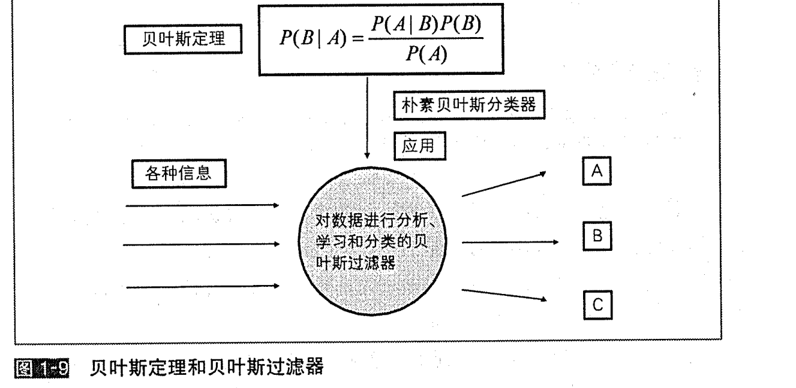
# 图1-9 贝叶斯定理和贝叶斯过滤器
> 小贴士
神经网络
神经网络借鉴人脑，通过计算机仿真实现部分功能。

> 小贴士
贝叶斯定理
贝叶斯定理是拉普拉斯提出的条件概率定理。满足：
\( P(B|A) = \frac{P(A|B)P(B)}{P(A)} \)

统计学方法可分为分类与预测两类。机器学习通过程序自动计算输入数据，推导特征值，实现分类与预测（图1-10）。多数情况下特征构成与贡献率需数据科学家分析，但也可通过建模实现自动化。

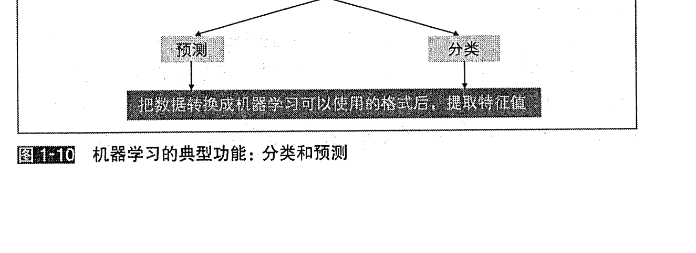
# 图1-10 机器学习的典型功能：分类和预测
[PAGE 23]
# 第 1 章 人工智能的过去、现在和未来 | 13
机器学习的应用包括推荐引擎，以及基于日志与在线数据的异常检测系统。

20世纪90年代后期，互联网普及使多媒体等大容量数据应用增多（图1-11），图像与音频处理效率需求上升。

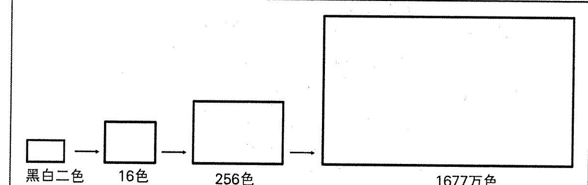
图 1-11 黑白二色→16 色→256 色→1677 万色的图画和动画
FPGA等嵌入式技术可快速实现视频压缩转换等处理，但需针对对象优化，与面向CPU的通用编程不同。

为灵活处理数据，过去依赖大型计算机提供的分布式计算环境。2000年后OpenMP与GPGPU相关技术CUDA出现，提供多核与异构计算环境，可由个人操作（当时价格不菲）。

> 小贴士 OpenMP
OpenMP是并行处理的基础。

与按指令执行的分布式机制类似，部分软件也加入分布式管理。如Google以Google文件系统为起点开发的MapReduce架构（图1-12），及Yahoo在其基础上开发的Hadoop。分布式系统可为每个任务预定义计算资源，通过网络管理任务，资源可弹性增减。

[PAGE 24]
# 14 | 图解人工智能
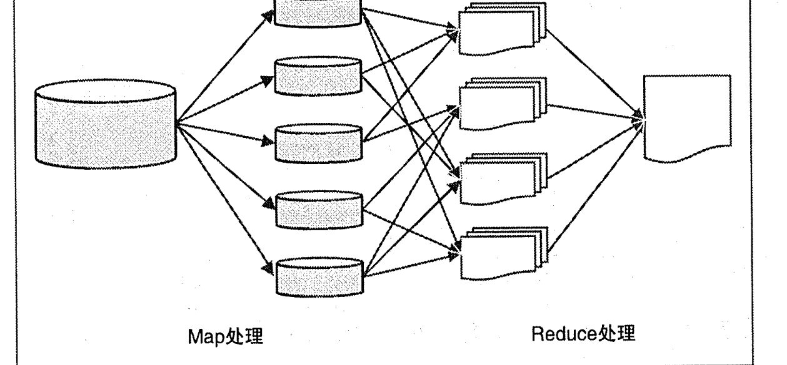
从2005年左右起，高效分布式处理与摩尔定律带来的硬件提升共同推动神经网络研究再度兴起。

2006年自编码器的出现标志着AI进入深度学习时代。

深度神经网络是支持深度学习的多层网络。当时超过5层的网络即被视为深度网络，受算力限制难以构建更多层。到2010年后，百层以上的网络已可实现。

> 小贴士 自编码器
自编码器由杰弗里·辛顿于2006年提出，用于神经网络数据维度压缩，可在机器学习中使用。

> 小贴士 深度学习
深度学习指程序通过学习数据特性进行分类与判别。概念最初由辛顿等人提出，现已远超早期范畴。

# 2010年以后：深度神经网络推动图像识别飞跃，迎来第三次热潮
此前基于统计模型的机器学习在图像识别精度上优于神经网络，但随后优势被颠覆。典型案例是2012年ImageNet大规模视觉识别挑战赛ILSVRC 2012。多伦多大学团队的深度学习图像识别算法夺魁（图1-13）。

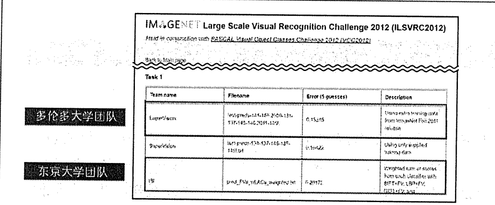
与第三名东京大学团队的统计机器学习算法相比，深度学习算法将错误率降低约10%，在业界引起震动。人类错误率约5%，2015年后已出现低于5%的算法。

基于深度学习的图像识别有效性迅速被认可。图像与元数据的关联数据库被建立并提供给用户，汽车搭载图像识别引擎的研究活跃（图1-14）。除图像识别外，深度学习在语音识别与自然语言处理领域也取得进展，逐步应用于聊天机器人。

[PAGE 26]
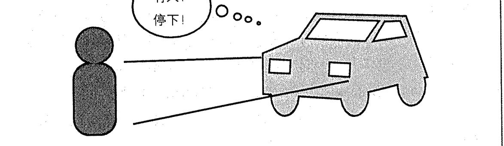
# 加速产业上的应用
+   □ 汽车产业

# AI 重塑汽车工业

智能正在渗透到各行各业，以日本为例，自20世纪起汽车制造就是其工业支柱之一。视觉识别被视作自动驾驶不可或缺的一环。早期研发的重点放在车载传感器与道路埋设传感器的整体构建上，图像识别精度实现突破后，产业才迎来跃进。往后数据采集不会再局限于单车，而是通过车群协同获取多辆车的加速度传感记录，推算全国交通流量，标记事故高发路段，再以大数据分析持续推动自动驾驶落地。

# □ 广告行业

大量网站已部署基于机器学习的推荐机制，为用户推送相关广告与资讯并优化投放。可以把推荐引擎看作机器学习做出的预测。电商类推荐除浏览行为外，还会利用购买历史等数据构建统计模型来提升精度。页面上呈现的相关信息同样是推荐的一种表现形式，需要对主内容与关联内容做相似度评估，判断信息的使用边界，既避免完全重复，也防止偏离过远，目标是提高用户回流率，促使用户再次访问与购买。广告行业对系统提出了投放时段策略有效性与内容相关性的要求。未来深度学习等算法有望逐步进入此类系统建设。若推荐系统能同时处理文本、数值以及图像、视频、音频等原始多媒体资源，而不是仅依赖标签，内容与用户喜好的契合度将明显提升。

# □ 商业智能系统

企业制定经营战略时必须预估销售额与利润，商业智能在此环节不可或缺。最早的雏形可追溯到上世纪70年代的计算机辅助决策支持系统。随着可处理数据规模扩大与算力提升，以及为满足企业需求，预测精度不断提高。缩短统计周期是其典型特征。以库存管理为例，降低库存是关键。若预测周期过长，基于历史走势的未来推断容易失准，因此要尽量压缩周期并反复预测。过去多采用批处理，如今在线处理与流处理的重要性急剧上升。预测所涉及的数据维度也在持续拓宽。除地理特征、人口动态与社会心理特征外，使用地天气、气温、周边交通量等同样会影响结果。需要从海量信息中提炼关联度高的要素进行推断，机器学习发挥了核心作用。过去依赖个人经验的预测已逐步实现机械化。进入21世纪，开发者借助 Google Prediction API 搭建了基于贝叶斯网络的缺失数据预测程序。随后用户可通过 Google BigQuery 上传海量数据迅速获得分析结果。硬件层面，Apache Hadoop 与 Apache Spark 等大规模分布式处理技术的灵活运用也提升了系统性能。未来将开发更多替代人力处理的系统，通过改进机器学习算法高效检索各类信息，同时完成数据清洗与稀疏数据处理等工作，这些系统的完善将大力推动技术进步。

[PAGE 27]

# □ 对话式 AI

2000年前后，聊天机器人等对话式程序一度流行。它们制作精良，却多用于取悦用户，实用性有限。真正具备实用性的聊天机器人并非依赖机器学习等高级算法，而是采用引导用户按流程图输入信息的方案。随着广告领域主题模型的发展，以及自然语言处理模型性能的提升，机器人程序得到改良，实现与人自然对话成为可能。翻译技术的发展也贡献了一份力量。2005年后计算资源的扩展使得大规模文本处理与特征提取得以实现，文本特征表示模型得以建立，这也是人机对话更自然的主要原因之一。例如微软于2015年发布的小冰①借助深度学习技术逐步实现了接近自然的人机对话。2015至2016年间，部分大型社交网站向开发者开放了开发聊天程序的 API，预计未来自然语言处理领域的对话式 AI 在商业上的实用性会持续提升。

# ■ 医疗健康辅助

IBM 开发的超级计算机沃森融合了深度学习系统。与常规系统不同，沃森采用认知计算体系。其价值在于通过自然语言处理实现人机对话并提供决策支持。在医疗领域的运用如下。近年来，随着研究水平提升与参与国家机构增多，学术分类日益细化，论文数量多到医生难以消化。人们期望沃森能辅助诊疗，即让其读取大量医学文献，根据患者症状列出相关疾病信息、适用药物与治疗方案。针对癌症和心脏病等常见疾病，新论文与监管部门指示频繁出现。如何与医生及其他医务人员顺畅协作，如何与法规规定进行比对调整，都是未来需要关注的重点。机器学习的应用案例还包括影像诊断中癌症的早期发现、腕带式测量设备驱动的健康管理系统等。随着技术进步，未来或许能实现基于个人数据的全国范围私人定制医疗服务。

# 机器人行业

在机器人领域，AI 研究同样得到有效利用。汽车产业中 AI 成果作为交通工具使用，而在机器人领域则多作为人类的助手，辅助身体移动或替代部分工作。机器人可最大化完成重物搬运等擅长任务，一旦切换到不擅长的精细作业便捉襟见肘，要像人类一样自然工作仍有难度。为解决此问题，长期以来人们致力于开发能通过自主学习实现自我行动控制的人脑计算机，预计未来会引入强化学习算法。此外，机器人未来可能进入儿童益智玩具与老年人生活支援服务等领域。生活支援范围广泛，涵盖食材管理、根据气候变化提出行动建议，以及预防阿尔茨海默病等。日本国内劳动人口持续下降，AI 研究除辅助年轻人工作外，在保障老年人健康生活、提升健康状况不佳时的生活质量等方面具有重要作用。

# AI 的未来走向

AI 未来是否会拥有意识，目前尚无定论，但不少研发人员与工程师希望其能具备意识。数字克隆人是未来发展方向之一。它是人类个体思维方式与兴趣爱好的数字复制品，其开发可能仅是一种实现人格的技术。这与图灵测试的要求相似，若能实现“学习模仿人类”的技术，数字克隆人似乎触手可及。2015年左右，已开发出实现该目标的传感技术，例如根据图像推测面部表情并与情绪关联等。未来利用传感技术模拟人格的尝试会越来越多。此外，信息技术进步速度遵循摩尔定律呈指数增长，也符合雷·库兹韦尔提出的加速回报定律①。该定律涵盖熵增定律，因而同样适用于信息量的增长。

# □ 大数据处理思路

长期以来，数据处理系统的能力受限于计算机运算能力，人类一直尝试用最少的信息量观察和控制事物并顺应发展趋势。自2010年起，我们获得了包含各类传感数据在内的多种数据及相应的处理工具。这意味着在处理数据时，必须思考持续增多的信息中哪些是有用的，以及计算机如何处理数据才能得到答案。

# □ 技术奇点展望

库兹韦尔预计技术奇点将在2045年到来。尽管拥有借助机器学习系统从海量信息中寻找解决方案的方法，数据清洗等预处理仍需花费时间。要让机器自主寻找解决方案，仍有很长路要走。即使计算机能够处理并计算海量数据并自主得出答案，问题的设定仍需人类完成，而问题设定与答案寻找中的讨论与灵感均源自人类。这是人类的特权，亦是困扰。未来将各种小型 AI 程序组装在一起，使其相互通信协作以解决更大问题的设想终会实现，只是时间问题。不过即便机器萌生意识，如何让机器具备自行寻找答案的能力，是采用现有方法还是另寻他路，仍有诸多议题待讨论。这为未来 AI 研究增添了趣味性。

> ① 引自雷·库兹韦尔所著的《机器之心》，中信出版社 2016 年出版。——译者注

[PAGE 31]

# 第2章 规则系统及其变体

条件分支是最基本的程序结构。计算机诞生后，人们利用条件分支开发了问答系统。基于规则的系统会借助条件分支判断用户输入的数据。20世纪50年代后逐渐发展出包含推理机与知识库的专家系统，推理机能匹配知识库中的规则自动分析输入数据，知识库采用外部存储设备保存规则设定。本章将对这些内容进行说明。

[PAGE 32]

## 第2章 | 规则系统及其变体

# 01 规则系统

下面介绍让机器依据规则进行判断的技术。

+   要点、☑ 机器替代人工决策 = AI 程序
 ☑ 采用 IF-THEN 形式
 ☑ 规则系统中的规则由人工设定
 ☑ 设定规则 = 将问题公式化（用形式化方法描述问题）
 ☑ 决策树

# 条件分支程序

人生就是不断做选择的过程。我们在选择时会在脑中比较两个对象后作出决定。计算机解决问题时也是通过连续比较得到答案，这里比较即条件分支，答案可由此推导。机器实现的就是人类认知的智能，也可称 AI。早期 AI 由条件分支程序构成，这一特征延续至今（图2-1）。

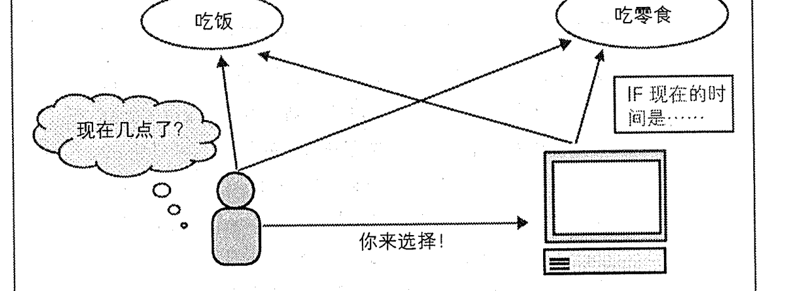

图2-1 利用条件分支进行判断

## 人名识别处理

再如人名识别处理。人名识别即判断两个 ID 是否相同，若相同则输出相同内容。以近期热点为例，将医院开具的收据与医疗数据库中的保险用户进行匹配，以及在养老金记录管理中把5000万个厚生年金①号码和国民年金号码与养老金领取者进行匹配，都用到人名识别（图2-3）。制定规则时需考虑姓名标注错误、记录时错别字等多种情况。另外，还需制定规则要求已完成人名识别的人员不再作为处理对象。

## 图2-3 收据的人名识别示例

摘自第6次医药品安全对策中医疗相关数据库的活用对策恳谈会JMDC提供的资料②

因此，问题公式化即在规则设计阶段明确问题与解决办法。AI 会取代多少工作一直是热门话题，但若 AI 能实现问题公式化，又何乐而不为呢？

## 构建决策树

依据规则绘制流程图可得到基于规则的二叉树，也称决策树，常用于统计学的数据处理与分析（图2-4）。通过统计学数据分析发现未知规则时，决策树尤为重要。

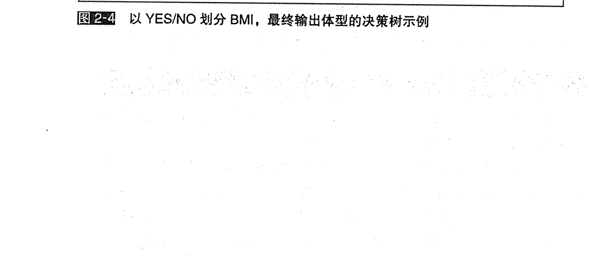

## 图2-4 以YES/NO划分BMI，最终输出体型的决策树示例

## 第2章 规则系统及其变体 | 25

决策树常用于统计学的数据处理与分析（图2-4）。我们可以通过统计学数据分析发现未知的规则。这时决策树就尤为重要了。


## 第2章 | 规则系统及其变体

## 02 知识库

下面介绍规则系统规则变更时所使用的知识库。

-   - ✔ 扩增规则系统的规则
  - ✔ 若所有规则都写入程序，一旦规则变更就需要重写程序 = 麻烦且不方便
  - ✔ 程序和数据的分离
  - ✔ 分离的数据 = 知识库
  - ✔ 知识库中包含供人类检索信息的检索系统

## 增加或修改规则

构建规则系统程序时，若条件分支规则确定，可使用硬编码。即使条件设置变更，若重写程序成本不高，也可使用硬编码。过去外部存储设备属于超高端产品，重写程序成本相对较低。但若条件设置频繁变更，例如希望按喜好修改条件，在这种情况下多次重写程序会导致成本增加（图2-5）。

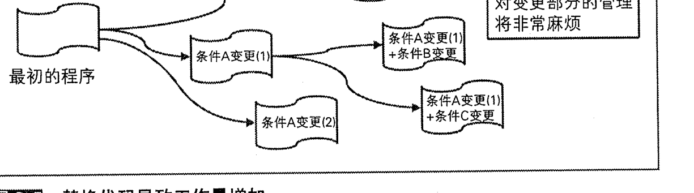

## 第2章 规则系统及其变体 | 27

为解决此问题，我们将处理并输出数据的程序与条件设置的数据对象分离。分离后的数据集合即知识库。在条件分支中，程序会使用规则ID读取相应的条件设置值进行判定。知识库既可以文本形式保存在文件系统中，也可存储在SQLite等数据库管理系统中。部分系统可通过文本编辑器、专用设置界面或查询语句更新知识库内容（图2-6）。

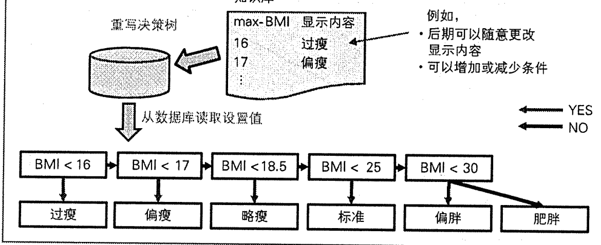

## 图2-6 输入BMI即可显示体型的系统

## 图 2-7 知识库的系统示例

□ UniProtKB

数据库系统 UniProtKB 是一个面向生命科学的知识库。欧洲多家机构合作收集蛋白质信息，对其进行注释与精选，开发了 UniProt 目录数据库与分析工具等。

> 小贴士 注释
为数据添加相关信息。

> 小贴士 精选
收集数据，根据注释等信息进行审议、整合、整理及汇总。

UniProtKB 是一个目录制作系统，依据全球大型数据库中登记的基因碱基序列与氨基酸序列，聚焦组成蛋白质的氨基酸序列及蛋白质特性，直接收录这些信息或存储手动精选后的信息，向使用者开放。UniProtKB 还包括物种与生物学通路等信息。因此可利用 UniProtKB 筛选新蛋白质，解决“人类与老鼠间有哪些相似蛋白质”“预测蛋白质具有哪些作用”等问题。

## 第2章 规则系统及其变体 | 29

## 第2章 | 规则系统及其变体

## 03 专家系统

下面介绍使用推理机的专家系统。

+   - 要点 ✔ 专家系统是基于规则的推理机
  - ✔ 目前很多分析结果呈现系统属于专家系统
  - ✔ 推理机的类型包括命题逻辑、谓词逻辑、认识逻辑和模糊逻辑等
  - ✔ 前向链接推理（数据驱动）和反向链接推理（目标驱动）

## 专家系统：利用专家的判定规则进行推理

前面介绍的规则系统是20世纪60年代发展起来的，并逐步应用于大型系统。可辅助或替代专家完成分类与判别等工作的系统称为专家系统。目前，生产系统等大多数呈现分析结果的系统源自专家系统。

## □ 早期的专家系统DENDRAL

DENDRAL是最早的专家系统，1965年起在美国斯坦福大学开发。它可根据质谱分析的峰值推测待测物质的化学结构。编程语言使用LISP语言¹。以水分子为例，H=1.01，O=16.00，取整数值相加后相对分子质量为18。质谱分析时峰值会出现在18附近（质谱分析仪使用气相色谱法，分辨率能精确到个位，故即使数值不精确也能用于推测）（图2-8）。

> ① List Processing 的缩写，是一种早期开发的、具有重大意义的表处理语言，适用于符号处理、自动推理、硬件描述和超大规模集成电路设计等。——译者注

## 第2章 规则系统及其变体 | 31

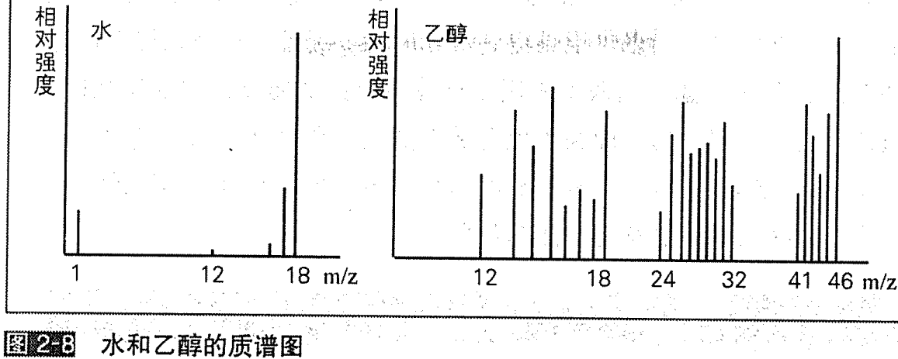

## 图2-8 水和乙醇的质谱图

DENDRAL系统根据原子组合计算相对分子质量为18的化学物质并输出答案。但相对分子质量越大，原子组合越多，计算所需时间越长，因此我们让DENDRAL系统不计算无须评估的原子组合。DENDRAL系统包括两部分，分别是进行启发式分析的Heuristic DENDRAL，以及把分子结构组合及其质谱图一起登记到知识库中并反馈给启发式系统的Meta-DENDRAL。它们都是学习系统。

## □ 由DENDRAL衍生而来的MYCIN

MYCIN是在20世纪70年代开发的专家系统，由DENDRAL衍生而来。其任务是诊断具有传染性的血液病，并提供合适的治疗建议，包括使用抗生素及剂量等。系统名称MYCIN取自抗生素英文后缀-mycin。MYCIN系统内部约有500条规则，用户回答形式并不限于YES或NO。用户依次回答提问后，系统会自动判断患者可能感染的细菌，并按可能性由高到低呈现，同时附上理由。不仅如此，系统还会结合体重等信息给出治疗方案。据斯坦福大学医学院调查，MYCIN诊断准确率为65%，优于非细菌感染专业的医生，但专科医生诊断准确率为80%，MYCIN仍有差距。作为开发项目，MYCIN是成功的，性能也很好，但并未投入临床实践。2000年后，人们认为医疗专家系统可信度低，即使开发出来也难以实际应用。况且该系统在道德与法律方面也存在问题。当医生采用计算机给出的错误诊断结果时，计算机无法承担责任，而医生也会觉得责任不在自己。若使用医疗专家系统，系统的诊断准确率至少要达到85%～90%，并尽可能减少假阳性率与假阴性率，即阳性率要高。

## 推理机的种类和方法

专家系统利用推理机返回判断结果。推理机是基于规则进行推理的一组程序。人类能直接理解用语言表达的规则，但要让计算机理解并处理这些规则，需将表达方式转换为计算机可接受的形式。这种表达所属的学术领域叫作符号逻辑学。命题逻辑是最基本也是最常用的表达方式，可表示布尔型内容。命题逻辑由命题变量和联结词构成。

# 逻辑的骨架：从命题关联到推理回应

命题逻辑并不关注命题本身在现实中指涉什么，而是借助否定、合取、析取等联结符把多个命题拼接，从而把握它们之间的依赖与制约。即便对命题的实际含义难以拆解，也能通过谓词逻辑之类的扩展体系为其注入语义。

把基础体系扩充后，图2-9所呈现的逻辑框架被提出，随之建立起推理机。引入推理机之后，系统面对查询时的回答方式被明显丰富。

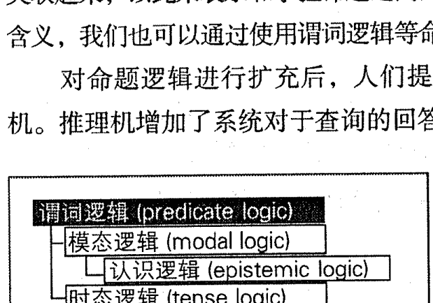

## 第2章 规则系统及其变体 | 33

# 表2-1 命题逻辑的符号种类

| 条 目 | 内 容 |

| --- | --- |

| 命题公式 | 用原子公式或原子公式和联结词相结合的形式表示 |

| 原子命题公式（简称原子公式） | 就是命题变量 |

| 命题变量 | P、Q、p、q、φ、ψ 等 |

| 联结词 | ¬〔否定（并非），not〕、∧〔合取（并且），and〕、∨〔析取（或），or〕、→〔蕴涵，implication〕、↔〔等值，equivalence〕 否定与合取以外的关系都可以用蕴涵等值式表示 |

| 辅助符号 | （）（括号）的表示方法不一 |

| 逻辑等值 | ≡〔等值〕表示两个命题公式具有等值关系 |

## 第2章 规则系统及其变体 | 33

# 表2-2 谓词逻辑的符号种类

| 条 目 | 内 容 |

| --- | --- |

| 谓词公式 | 用原子公式或原子公式和逻辑符号相结合的形式表示 |

| 原子谓词公式（简称原子公式） | 用原子公式或原子公式和项相结合的形式表示 |

| 项 | 用常量符号、变量符号、函数符号表示 |

| 常量符号 | True、False、X、Y、apple、Tommy 等 |

| 变量符号 | P、Q、p、q、φ、ψ 等 |

| 函数符号 | FATHER() 等，表示关系 |

| 谓词符号 | cold() 等，表示性质和状态 |

| 逻辑符号 | 由联结词和量词符号构成 |

| 量词符号 | ∀（全称量词），∃（存在量词） |

## 第2章 规则系统及其变体 | 33

# 表2-3 谓词逻辑表示法示例

| 谓词逻辑表示法 | 含 义 |

| --- | --- |

| MOTHER(Tom) | Tom 的母亲 |

| cold(x) | x 很冷 |

| ∃x(have(l,x) ∧ book(x)) | 我有书 |

| ∀x(girl(x) ⇒ ∃y(love(x,y) ∧ cake(y))) | 女性都喜欢蛋糕 |

| ¬∃x(human(x) ∧ touch(x, BACK(x))) | 任何人都摸不到自己的后背 |

## 第2章 规则系统及其变体 | 33

设 P、Q 两个命题的真值以 True、False 或 1、0 记法给出，由此可推得 ¬P、P∧Q、P∨Q、P⇒Q、P⇔Q 的取值，汇总见表2-4。蕴涵可以换写为 (¬P)∨Q，等值可以换写为 (P⇒Q)∧(Q⇒P)。把所有取值组合穷举出来的表格就是真值表。

## 第2章 规则系统及其变体 | 33

# 表2-4 P和Q的真值表

| P | Q | ¬P | P∧Q | P∨Q | P⇒Q | P⇔Q |

| --- | --- | --- | --- | --- | --- | --- |

| 0 | 0 | 1 | 0 | 0 | 1 | 1 |

| 0 | 1 | 1 | 0 | 1 | 1 | 0 |

| 1 | 1 | 0 | 1 | 1 | 1 | 1 |

| 1 | 0 | 0 | 0 | 1 | 0 | 0 |

| 相应的逻辑运算符 | NOT | AND | OR |

## 第2章 规则系统及其变体 | 33

若某个命题公式在所有赋值下都成立，则称其为恒真式或重言式；若在所有情形下都为假，则称其为永假式。

拿到关键词共现的统计之后，就能把报道间的关联量化，见表2-7。假设报道 a 与报道 b 的关联度定义为共同关键词数占两者关键词总数之比，便可对报道对进行循环计算。

# 表2-7 表示新闻报道之间相关性的表

| 报道 a       | 1.000 |

| 报道 b       | 0.333 | 1.000 |

| 报道 c       | 0.333 | 0.333 | 1.000 |

| 报道 d       | 0.571 | 0.857 | 0.571 | 1.000 |

|              | 报道 a       | 报道 b       | 报道 c       | 报道 d       |

经过上述处理，可按与报道 a 的内容近似程度由高到低排序。表中结果可排为报道 d > 报道 b = 报道 c。

示例的前提是每篇报道都已标注关键词，实际也可改用文本特征抽取。第11章会简要介绍文本特征抽取的相关内容。

若推荐系统仅把相似报道堆放在一起，推荐结果会趋于雷同，因而需要引入去重复化的手段。

## □ 基于协同过滤的个性化推荐

协同过滤能够依据用户的浏览、购买等个人行为给出更贴合的推荐，亚马逊即采用了此类方案。

先前提及的内容型推荐，是通过报道间关键词共现来定义关联并提取相似报道。个性化推荐则在用户历史行为与其他用户的共现关系上做关联分析。核心假设是：对某些项目行为或评分相似的用户，在其他项目上也倾向相似。

表2-8 以 0、1 记录了目标用户 X 先生与 A 至 E 先生在 10 种商品上的购买情况，未知位置用连字符填补。

## 40 | 图解人工智能

## 表2-8 包含网站用户和商品购买记录的相似度矩阵

```
X先生的购买记录 {x₁, x₂, x₃, x₄, x₅} = {1, 0, 0, 0, 1}
A先生的购买记录 {y₁, y₂, y₃, y₄, y₅} = {1, 1, 0, 0, 0}
相关系数 r = ∑⁵ᵢ=¹(xi−x̄)(yi−ȳ)/√(∑⁵ᵢ=¹(xi−x̄)²(∑⁵ᵢ=¹(yi−ȳ)²))
= ∑⁵ᵢ=¹(xi−0.4)(yi−0.4)/√(∑⁵ᵢ=¹(xi−0.4)²(∑⁵ᵢ=¹(yi−0.4)²))
= (0.6×0.6 + (-0.4)×0.6 + 0.4×0.4 + 0.4×0.4 + 0.6×(-0.4))/√((0.6²+0.4²+0.4²+0.4²+0.6²)((0.6²+0.6²+0.4²+0.4²+0.4²))
= 0.36+0.16×2−0.24×2/(0.36×2+0.16×3) = 0.2/1.2 ≈ 0.167
```

# # 图2-13 相关系数的计算

## 第2章 规则系统及其变体 | 41

计算显示 C、D、E 三位先生的相关系数均高于 0.5，说明其购买倾向与 X 先生呈正相关，详见表2-9。

# # 表2-9 包含网站用户、商品购买记录和相关系数的相似度矩阵

n          商品

      与X先生的

目标对象的挑选本应另行讨论，这里直接以这三人为对象说明如何为 X 先生生成推荐。

X 先生尚未接触的商品为 1、4、5、6、7。对 C、D、E 三人在这五项上的购买记录取平均值作为推荐分，采用平均而非总和是为了削弱缺失值的影响。由此可筛选出 X 先生未见过但最有可能购买的商品，其中商品 5 的推荐分达到 1.00，为最高，故优先推荐商品 5。

表2-10 的示例以 0、1 记录购买行为，当前不少推荐引擎采用五级评分法。

# # 表2-10 包含网站用户、商品购买记录、相关系数和推荐度的相似度矩阵

          商品

      相关系数

      X   -   1   0   -   -   -   -   0   0   1   1.000

      A   1   1   1   -   -   -   -   0   0   0   0.167

      B   -   -   -   0   0   0   1   1   1   0   -1.000

      C   0   1   0   0   -   1   1   0   0   1   1.000

      D   0   -   -   0   1   1   0   0   1   1   0.500

      E   -   1   0   -   1   0   -   0   0   0   0.612

      推荐度 0.00 0.00 1.00 0.67 0.50

# 第 3 章 自动机和人工生命程序

程序可以对输入做出响应，而循环或定时器能源源不断地产生新的输入。仿真程序正是利用了这一机制。元胞自动机在内部维护有限自动机，并在每次迭代中更新自身状态。本章将介绍元胞自动机的原理及其典型应用。

# 第3章 | 自动机和人工生命程序

# 01 人工生命模型

下面介绍人工生命模型。此类模型能让机器呈现出某种意志或生命感。

+   - 赋予机器意志可视为赋予生命
  - 生命的核心在于自我复制与繁衍后代
  - 基于元胞自动机的生命游戏
  - 流行病模型（SEIR模型）

# 何谓生命

十余年前电子宠物曾流行一时。人类天性喜欢饲养其他生命，即便是屏幕上游动的热带鱼保护程序，也会让人产生生命感。

生物最本质的特质是能够自我复制、繁衍后代。类似的自复制程序由来已久，若人们能在程序的自我复制行为中读出某种意志，就容易产生机器也能拥有生命的期待。

# 生命游戏

生命游戏正是这样一个经典案例。自1970年发表于杂志后长期受到关注。用户可在棋盘格上随意落子，随后按既定规则更新格子状态，以此演绎生命随时间的变化。手工用方格纸操作可行，但借助计算机按固定时段自动演算更为省力。随着时间推移，被填充的格子会扩散或消亡，形态持续演化。

在游戏中，格子只有填充与空白两种状态，状态变化遵循下述规则。该规则被称为算法。

# # 图3-1 表示生命游戏规则的表

摘自维基百科生命游戏

# # 图3-2 长寿型示例

> 摘自《原始生命起源于海洋》¹
> ① 原文名为「原初の海より生命は生み出せるのか」。—译者注

# 上述图案可以用来运行所有计算机能够执行的逻辑运算，所以说生命游戏具有图灵完备性。

# 流行病模型

生命游戏用格子区分生死。若把表示对象扩展为患者的感染状态，就能在界面上呈现流行病传播模型，其状态转移依据图3-3的规则进行。

+   - 每个格子对应一位居民
- 当邻格存在感染者时，易感者于下一轮被感染的概率为p
- 感染n步后转为恢复，随后进入免疫状态※1
- 免疫m步后免疫力衰退※2
- 初始时感染概率为q，免疫概率为r

# # 图3 -3 感染状态的转换

基于易感者、感染者、免疫者三者的状态转换所得到的模型称为SIR模型。表3-1中用0表示缺乏免疫力但未被感染的细胞状态，从感染到免疫的过程逐次加1。

# # 表3-1 某个细胞在时刻T和时刻T+1的状态

|                | 易感者 | 感染者 | 感染者 | 感染者 | ... | 免疫者 | 免疫者 | ... | ... | 免疫者 |

| T               | 0          | 1      | 2      | 3      | ...   | n    | n+1    | n+2    | ... | ... | n+m   |

| T+1            | 由周围状态决定 | 2      | 3      | ...    | ...   | n+1 | n+2    | ...    | ... | ... | 0     |

计算各阶段每个格子的状态，就可以用图表描绘出感染者增减的趋势，见图3-4。

# # 48 | 图解人工智能

# # 图3-4 感染者呈增加趋势的方格和对相应方格的计数

样本: ch3-lifegame-sir-sample.zip

下载地址: 图灵社区本书主页

将规则简化为免疫者具有终身免疫力，以此观察一次性感染扩散的情况。这时可以用微分方程来表示感染者人数等，见图3-5。

# # 图3-5 SIR模型的微分方程

摘自维基百科SIR模型

这里SIR模型以不出现死亡者为前提，因此未计算总人口变动。在SIR模型基础上加入潜伏者就得到了SEIR模型。SEIR模型既可以用微分方程表示，也可以用格子表示，见图3-6。

# 用下面的微分方程表示SEIR模型

易感者（Susceptible）\n\frac{d}{dt}S(t)=m(N-S(t))-bS(t)I(t)

潜伏者（Exposed）\n\frac{d}{dt}E(t)=bS(t)I(t)-(m+a)E(t)

感染者（Infected）\n\frac{d}{dt}I(t)=aE(t)-(m+g)I(t)

免疫者（Recovered）\n\frac{d}{dt}R(t)=gI(t)-mR(t)

总人口 N \nN=S+E+I+R

t: 时间; m: 出生率和死亡率; a: 发病率;\nb: 感染率; g: 恢复率

# # 图3-6 SEIR模型的微分方程

摘自维基百科SEIR模型

上述模型未考虑人员移动，因此在正式仿真建模时还需要加入这些要素再进行计算。例如，在存在死亡者的模型中，可用数理模型表示HIV感染者体内免疫细胞状态。另外，森林火灾蔓延模型等也使用上述格子模型。

虽然笔者讲解的是生命游戏这种人工生命模型，但实际上人工生命模型与数理分析模型是密切相关的。

# 第3章 | 自动机和人工生命程序

# 02 有限自动机

一个模型中的细胞处于某种状态，当它接收到一个输入或触发某种事件时，状态会在有限的状态之间转换，这就是自动机。下面就对自动机进行介绍。

+   - 当模型接收到一个输入或触发某种事件时，状态会在有限的状态之间转换 = 有限状态的机器（有限状态机）
- 有限状态机又称有限自动机
- 可以用状态转换图表示

# 自动机

利用生命游戏中的格子来表示时间的推移和状态的变化，进而研究空间结构变化在时间轴上的发展，这一理论研究领域称为元胞自动机。元胞自动机直译过来是自动人偶，简单来说，就是能够对外界刺激做出反应的机关人偶。

人偶记住一些状态后，在受到外界刺激时能够做出不同的反应。所以，这种人偶也叫作状态机，如果状态数有限就叫作有限状态机或有限自动机，见图3-7。

# # 图3-7 有限自动机的状态转换图

通过改变输入和转换内部状态，机关人偶的动作改变了3次（前进、停止、后退）

有限自动机的动作可以用图来表示。如图3-8所示，用圆圈表示状态，用带箭头的直线连接两种状态，这样的图称为状态转换图。

# # 图3-8 状态转换图

A = 起点\nE = 终点\n输入由0和1组成\n输入后，如果在E处停止迁移就成为接受状态

状态转换图中定义了起点和终点，输入的结果在终点结束的状态叫作接受状态。算法和系统都需要从起点开始迁移，并在接受状态下结束。若未在接受状态下结束，则意味着有错误等导致状态异常。

# 自动机和语言理论

由于自动机能够表示状态的变化及其规则，所以它也可以用来表达语言的语法模型。在语言理论 ① 中，字符的集合称为字母表，字母表中可重复的字符集合称为字符串。

我们用 Σ={0, 1, (, )} 表示一个字母表，其中包含 “001(01)”

# 56 | 图解人工智能

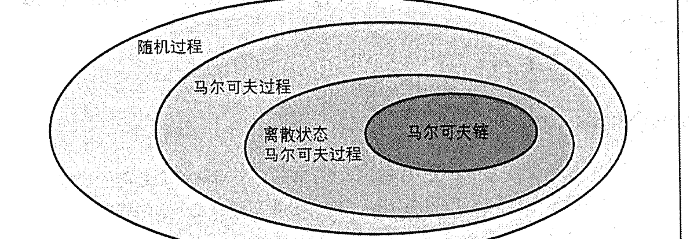

图 3 - 12 随机过程 > 马尔可夫过程 > 离散状态马尔可夫过程 > 马尔可夫链

3.1 节介绍人工生命模型时使用的 SEIR 模型就是一个马尔可夫模型。未感染、潜伏期、发病期以及恢复期这 4 种状态是随机变化的，见图 3 - 13 。

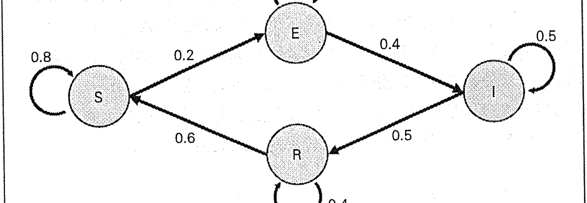

图 3 - 13 SEIR 模型中的 4 种状态会随机变化

计算各个状态在转移前后的概率，得到一个由转移概率组成的矩阵，这个矩阵就是转移概率矩阵，又称跃迁矩阵。

如果图 3 - 14 的转移概率矩阵的行数与列数相等，该转移概率矩阵就称为 k 步转移概率矩阵，即转移到第 k 步时的转移概率可以用一步转移概率矩阵的 k 次方表示。

# 第3章 自动机和人工生命程序 | 57

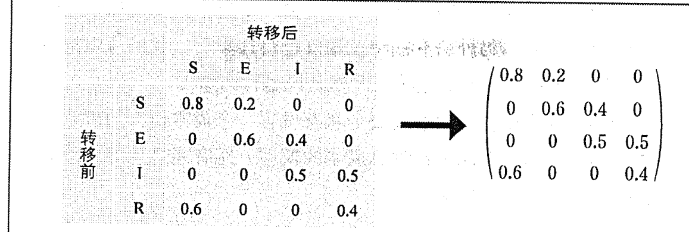

# 图3-14 转移概率矩阵的图

在非周期状态的不可约马尔可夫链中，k步转移概率会收敛为一个每一列都不同的平稳分布，见图3-15。

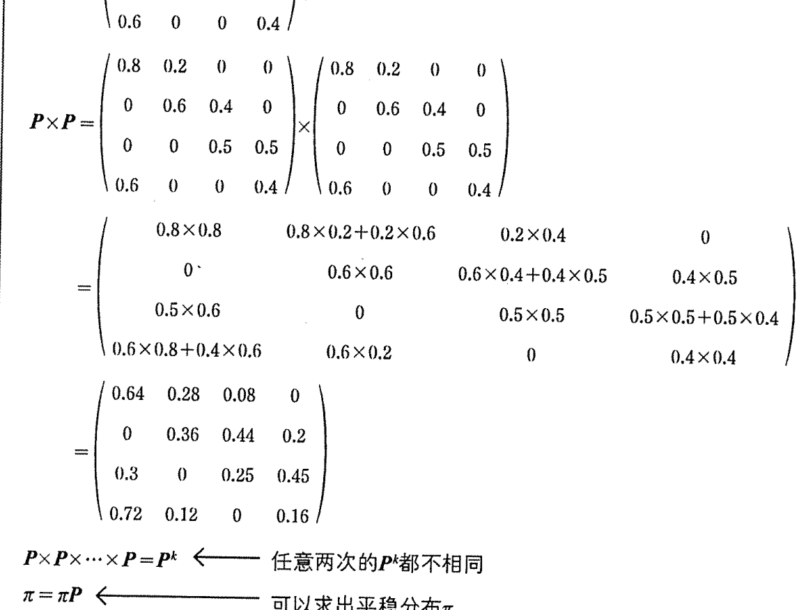

# 图3-15 转移概率矩阵P、k步转移概率、平稳分布π

在此，我们不再深入探讨矩阵计算和特征值。不过，将转移概率矩阵多次相乘后就能得到 \( P^t \)。另外，利用单位矩阵进行计算后，我们可以把转移概率矩阵转换为平稳分布 \( \pi \) 的矩阵，严格来说是行向量。

关于模型的实际应用，有通过在每个状态设置一个成本值，随着状态的转换，成本逐渐累加，以此来预测总成本的模型，还有通过计算平稳分布得到广告投放效果等价值的模型。

# 第3章 | 自动机和人工生命程序

# 04 状态驱动智能体

下面来介绍状态驱动智能体。状态驱动智能体通过有限自动机的输入触发状态转换，实现系统运行。

+   要点 
  - 有限自动机 = 有限状态机
  - 基于多智能体构建环境
  - 可以把环境看成一种智能体
  - 常在棋盘游戏等游戏人工智能中使用
  - 智能体的构建可以使用面向对象技术和状态模式

# 游戏人工智能

在讲解人工生命模型时，游戏人工智能的思路其实已有所渗透。初看之下，部分机制似乎与传统 AI 要素存在偏差。可以把元胞自动机里的行为单元视作游戏角色或场景的构件，再借助有限自动机即有限状态机来驱动这些构件，游戏内部便能产生出人工智能式的行为。

这种形态通常被称作游戏人.T.智能。有人会质疑游戏 AI 是否算 AI，但这类程序的目标正是模拟人类操作并持续追求动作的逼真度。从这个维度看，它完全可以归入人工智能范畴。下面展开具体说明。

# □ 智能体

在游戏语境中，单一状态机或由若干状态机组合而成的系统，都可被视作智能体。不同智能体通过信息交换与彼此作用，向玩家传递信息并制造体验上的刺激。

这里讨论的智能体指的是软件智能体。

软件智能体的典型属性见图3-16，分别是驻留、自治、社会与反应。

+   * 不会主动自启
* 保持对外部事件的等待姿态
* 满足条件后才切换到运行态
* 无需用户额外指令
* 能与别的智能体协同作业

# 图3-16 软件智能体的特性

从管理角度出发，可以用多个智能体搭建多智能体系统。该系统里每个智能体都拥有独立程序进程，按自身节奏异步运行。智能体的实现与面向对象设计高度契合，Java 中的 GoF 设计模式里就收录了状态模式。

当玩家行为触发状态机的转移，这类情形称为触发事件。智能体随之进入运行态，因而这类智能体又被称为状态驱动智能体。

# □ 棋盘游戏

到这里可以体会到，为游戏构建智能体能够建立起与人类玩家互动的机制。棋盘游戏正是理解这一点的直观例子。

在棋盘游戏中，最具代表性的玩法是在棋盘上按规则落子的黑白棋。图灵在 1950 年前后曾撰写过一个国际象棋程序。

把前面介绍的元胞自动机引入黑白棋程序，就能轻松生成电脑对手。

黑白棋规则简洁，依据时间顺序编写程序即可实现图3-17 所示的逻辑。

+   * 若格子已有己方棋子，则维持原状
* 若格子已有敌方棋子，则在邻近范围内搜寻可落点
o 若敌方棋子的邻格已有己方棋子，则检查对侧是否空闲
■ 若对侧为空，直接放置己方棋子
■ 若对侧仍为敌方棋子，则继续向更远处查找是否空闲
* 若为空落下己方棋子，并将夹在中间的敌方棋子翻转

# 第3章 自动机和人工生命程序 | 61

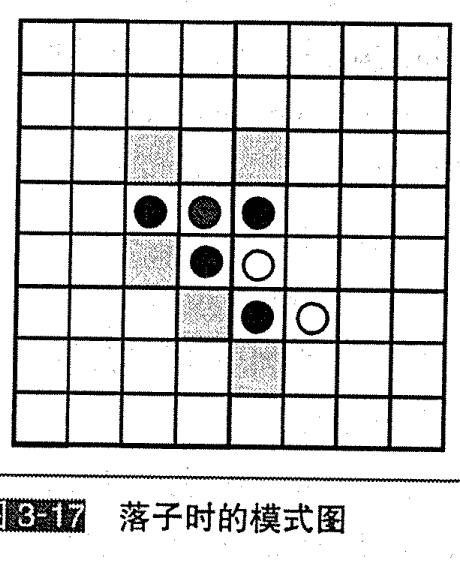

+   - 用红色标出最后落下的黑子位置
- 被填色的格子是规则允许落白子的位置
- 左例中，无论如何落子，最多仅翻转 1 枚棋子为白

# 图3-17 落子时的模式图

某些局面中，可落点不唯一。此时需要依据落子后能翻转的敌方棋子数量来判定最优点。也就是说搜索时要统计遇到的敌方棋子数目，若数目相同可随机选择。

# □ 棋盘游戏和博弈论

这类游戏可以穷举全部局面，所以被称为完全信息博弈。国际象棋、将棋、围棋都属于完全信息博弈。完全信息博弈中的游戏人工智能能够枚举并列出所有局面，从中挑选使自己获胜的部署。

穷举每一步的时间成本与空间广度需要海量算力，见小贴士。若每步都穷举，程序会卡死或让玩家长时间等待。因此对战类棋盘游戏里电脑水平是受限的。不过也可以利用这一特性，按搜索深度设定难度。

# 小贴士 资源

CPU 运算能力、主存容量、辅助存储容量等。也称为计算资源。

国际象棋的胜负没有随机性，局面确定且可预测。因为是两人有限零和对策，策略有限且双方得失之和为零，这类游戏被称作二人有限零和对策。跳棋与黑白棋的全部局面都是明确的，电脑可预存开局即定胜负的信息，因而人类很难取胜。

20 世纪末期，电脑击败了国际象棋世界冠军，但直到 2016 年，人类仍未完全厘清国际象棋的全部局面。目前主要依靠现成的开局终局库与探索程序进行对战，见 5.2 节。

21 世纪初，电脑击败了围棋与将棋的顶尖棋手。其在数据库与探索程序基础上加入了有监督学习，见 7.2 节，以及强化学习，见 8.2 节等机器学习方法。

完全信息博弈这一概念也在博弈论中使用，数学、经济学等领域都会引用。

在经济学等社会学中存在囚徒困境问题。囚徒困境是博弈论中的不完全信息博弈，也是一种同时行动博弈。但由于双方选项与结果都是确定的，因而它也属于完美信息博弈图 3 - 18。

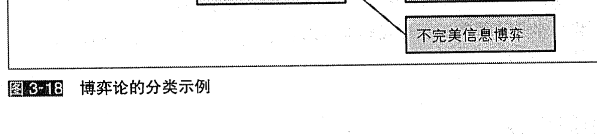

# □ 基于复杂智能体的游戏

游戏系统成熟后出现的模拟城市等城市建设游戏与策略模拟对战游戏，都采用了智能体游戏环境。模拟城市等模拟类游戏由大量智能体构成，通过智能体间复杂的相互作用，推动游戏在时间轴上的演进。

# 第3章 自动机和人工生命程序 | 63

模拟城市的智能体系统可分为四层：第一层负责道路、铁路等要素的规模及其关联计算；第二层负责人口密度、交通状况、环境污染指数、地价与犯罪率的计算；第三层负责地形特征影响的计算；第四层负责警察局、消防局、人口增长率以及它们影响力的计算。

从第一层到第四层，粒度逐步加大，影响范围也随之扩大图3-19。

对某些因素的影响程度进行量化后可得到影响图，尤其第三层与第四层的影响图。像热图一样，影响图可定义正负相关的系数，并作为影响城市发展速度的因子来吸引或排斥人口，从而增减城市人口。

具体而言，犯罪率可依据人口密度、地价与警察局影响力计算图3-20。

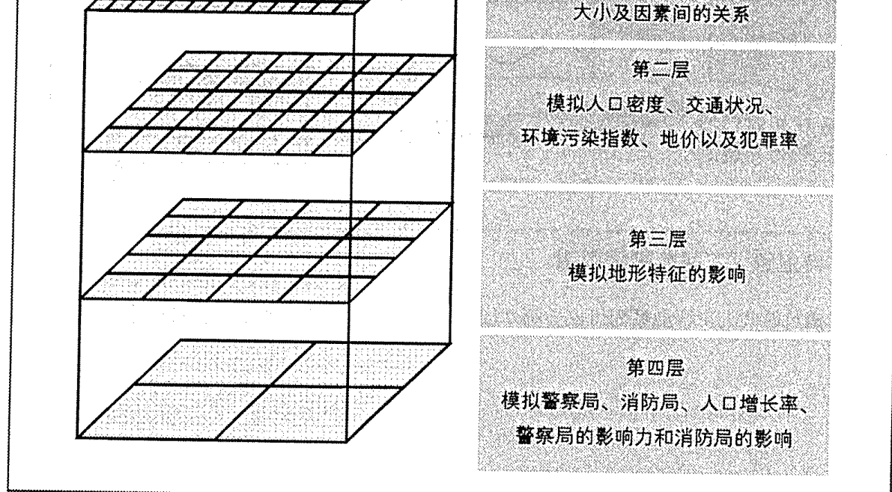

# 在模拟城市中使用影响图

模拟城市的多层结构模型

> 

图3-19 模拟城市（四层结构）

摘自游戏人.T.智能系列讨论会第7回“The Sims中的社会模拟”①第53页

> ① 原资料名为「社会シミュレーションとデジタルゲーム」。——译者注

# 64 | 图解人工智能

模拟城市中的犯罪率的计算公式

犯罪率=(人口密度)²-(地价)-(警察局的影响力)

地价=(距离参数)+(铁路参数)+(运输参数)

# 图3-20 模拟城市中犯罪率的计算公式

摘自游戏人T智能系列讨论会第7回“The Sims中的社会模拟”第44页

在场景间移动的主人公角色扮演游戏，以及角色可自主行动的射击游戏，都使用了上述多智能体系统图 3 - 21。

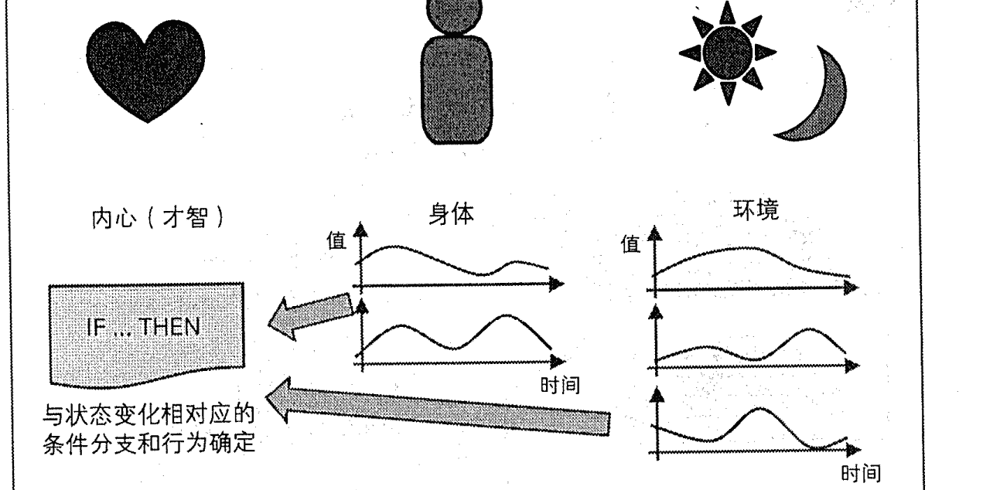

# 图3-21 自主型人工智能的模型图

摘自游戏人工智能系列讨论会第7回“The Sims中的社会模拟”第115页

# # 第4章 权重和寻找最优解

在特定数据中寻找最优解的功能在数据分析系统等人工智能程序里愈发关键。回归分析中的最优解与相似度等指标的计算是实现该功能的基础。本章介绍回归分析的基本方法、求解思路以及常用的相似度计算方法。

# 第4章 | 权重和寻找最优解

# 01 线性问题和非线性问题

下面对比说明线性问题与非线性问题。

+   要点 
  - 易解与难解
  - 线性易解，非线性难解
  - 线性问题即线性，可线性可分

# 两个变量之间的相关性

在人工智能等众多领域，基于大量数据做预测时，常需剖析与比对数据中两个因素以把握变化趋势。构建自动分析程序时，首先要判断收集到的数据趋势是否适用于未知数据，以及能否用算术方法求解。在讨论数学模型与统计模型时，这是关键一步。

数据分析中数据的构成要素称为变量。在计算变化趋势或已获得趋势时，可用一组或多组变量表示，也可用由变量组成的计算式表示。这里的一组变量或计算式就叫作特征图4-1。

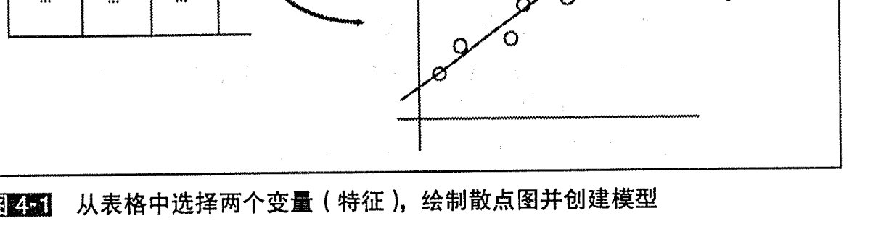

图4 - 1 从表格中选择两个变量（特征），绘制散点图并创建模型

# 第 4 章 权重和寻找最优解 | 67

# 线性问题

要描述两个变量的取值趋势，最简单的做法是把两个变量分别作为横轴与纵轴，用交点坐标绘制散点图，观察分布。有时散点大致呈直线，这时可用线性函数即一次函数表达两者关系。

当数据点可用线性函数表达时，在一组线性约束下求解目标函数的问题称为线性规划问题。若把线性规划中的变量限制为整数，就称为整数线性规划问题。背包问题就是一个整数线性规划问题图4-2。

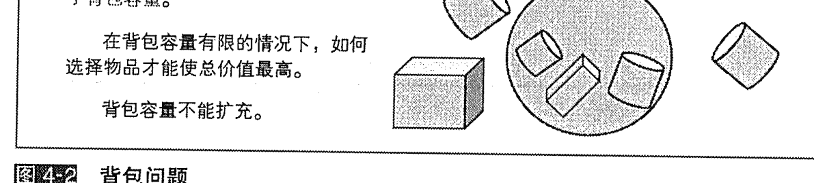

# 图4-2 背包问题

另外，若线性函数能把散点图中的数据点完全分隔，我们就称这些数据线性可分，可用线性函数求解的问题称为线性问题图4-3。


# 图4-3 线性可分的散点图

# □ 映射

当两个变量值之间存在对应关系时，也可说它们具有函数关系。这种对应关系称为映射。用 A 和 B 表示变量值的集合，若集合 A 中任意元素在集合 B 中都有唯一元素与之对应，这样的映射叫单射。若集合 B 中任意元素在集合 A 中都有某些元素与之对应，这样的映射叫满射。根据散点图，若集合 A 的元素能与集合 B 的元素一一对应，这样的映射叫双射图 4 - 4。

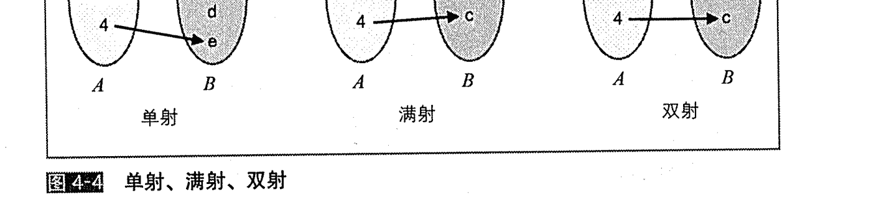

# □ 非线性问题

当两变量的坐标点分布无法用线性函数表达时，可尝试用映射将其转为线性分布。若无法转化，这些数据就是非线性分布图 4 - 5。处理非线性

# 小贴士 偏最小二乘回归

在汉语里有多个称呼，也叫作 PLS 回归或部分最小二乘回归。

# □ 自变量个数增加后的不便之处

自变量增多会导致回归模型不稳定，甚至无解。回归分析的前提是自变量间线性独立，但自变量增多时会出现相关性，这称为多重共线性问题。社会学调查数据以及生物化学、分子生物学等生命科学的测量数据中常出现多重共线性。前面介绍的偏最小二乘回归以及将在 4.3 节介绍的 L1 正则化 lasso 等方法可以解决该问题。

# □ 多项式回归

线性回归的回归方程是线性函数，自变量次数为 1。若散点呈曲线趋势，回归时可通过加入自变量的高次项来拟合。

可能觉得有些繁琐，图 4-10 和图 4-11 的多项式回归也是一种线性回归方法。

```
y = α + βx + γx² + ε
```

[图 4-10] 多项式回归方程示例

# □ 过拟合的弊端

通过增加高次项，多项式回归也能做曲线拟合。现在思考一个问题：只要增加高次项就能拟合任意分布吗？实际上，增加高次项确实能使残差趋近于零。但这样得到的模型对未知数据的预测偏差较大，这种情况称为过拟合 overfitting。因此进行回归分析时，尽量使用低维模型以避免过拟合很重要。

# □ 最小二乘法

在回归分析中，可通过残差最小化得到最佳拟合曲线的函数。最常用的方法就是最小二乘法。如图4-12所示，最小二乘法就是使公式中的残差平方和 e 降到最小。

最小二乘法也可以采用线性回归中求偏导后解联立方程组的方式求解。但若自变量增多或模型为非线性，求解会变得复杂。这种情况下可用矩阵解法。设x为自变量，回归系数为ω，f(x)就可以像图4-13那样表示。ω右上角的T表示转置矩阵。这样可用矩阵表示自变量x和回归系数ω。

我们也可以用矩阵表示残差平方和。另外，用矩阵表示因变量y可以得到残差平方和E的公式。具体如图4-14所示。

# 图 4 - 15 正规方程

和线性回归一样，对 ω 的各个自变量求偏导，并使其分别等于 0，由此构建的矩阵方程如图 4 - 15 所示。这个矩阵方程称为正规方程。解图 4 - 15 中的方程就能求出回归系数 ω。

```
X^T Xω^T = X^T Y
```

# 逻辑回归

逻辑回归和多项式回归一样属于广义线性模型，可以使用图4-17中的模型进行函数的曲线拟合。

[图4-17 逻辑回归中使用的模型公式]

从图4-17的逻辑回归模型也能看出，对线性回归的因变量做变换就能得到逻辑回归。把图4-17上面的公式改写成下面的形式，就可以使用线性回归的方法求解逻辑回归。

对因变量施加的变换称为logit变换，又称对数单位转换，用logit函数表示。logit函数可以将输入区间为0,1的值转换为整个实数范围-∞,∞的值，logit函数也是logistic函数的反函数。

利用logit变换得到的y'的式子，取logit函数的反函数也就是logistic函数，就可以得到因变量的预测模型图4-18。

[图4-18 用logistic函数表示因变量]

# 03 加权回归分析

下面对加权回归分析进行说明。

+   要点
- 普通的最小二乘法对异常值非常敏感
- 调整权重可提高灵活性
- LOWESS、偏最小二乘回归
- L2 正则化、L1 正则化

# □ 最小二乘法的改进

在4.2节介绍了用最小二乘法解回归方程的方法，但最小二乘法对异常值非常敏感。若数据中存在异常值，异常值会影响回归线，导致回归方程对未知数据的预测能力下降，泛化能力较差。为了解决这个问题，可以为异常值添加惩罚项或剔除异常值。

# □ LOWESS

LOWESS 局部加权回归散点平滑法是一种使用局部加权回归函数进行平滑处理的回归方程推导方法。为每个数据点(xi,yi)确定一个区间，在任意指定的区间d(x)内，从最小的xi开始依次递增，计算最近邻点，每一点xi的数值都是用临近数据进行加权回归得到的，以此计算各个数据点的权重wi图4-19。

以鲁棒局部加权回归 Robust LOWESS 作为平滑方法时，可以通过设置权重系数w来剔除异常值。首先计算平均绝对偏差 MAD，如果残差ri超过平均绝对偏差的6倍，就将权重wi设为0图4-20。

[图 4-19 LOWESS 的权重公式（添加）]

[图 4-20 鲁棒局部加权回归的权重公式（添加）]

对上面得到的权重系数 w 和自变量 x 进行内积运算，校正对应的 y。

也就是说，LOWESS 的校正是通过添加梯度来剔除异常值影响的，而鲁棒局部加权回归的校正是根据趋势来预测异常值，以此来剔除异常值的影响的。

LOWESS 相当于反复进行线性回归，但实际上得到的并非直线图 4-21。

[图 4-21 移动 x 时权重的变化示例]

# L2 正则化和 L1 正则化

在最小二乘法的联立方程组中添加惩罚项也是一种添加权重的方法。

根据添加惩罚项的方式，可以将惩罚项分为 L2 正则化、L1 正则化，以及线性融合了 L1 正则化和 L2 正则化的弹性网络 elastic net 等，作为惩罚添加的项称为惩罚项或正则化项图 4 - 22。

+   - L2 正则化
E = (Y - ω^T X)^T(Y - ω^T X) + λ||ω||²
||ω||² = Σω_i²
ω^T = (X^T X + λI)^{-1} X^T Y
- L1 正则化
E = (Y - ω^T X)^T(Y - ω^T X) + λ|ω|
|ω| = Σ|ω_i|
- Elastic Net
E = (Y - ω^T X)^T(Y - ω^T X) + λΣ(α|ω_i|+(1 - α)ω_i²)

[图 4-22 L2 正则化的公式、L1 正则化的公式和弹性网络的公式]

L2 正则化也称为岭回归，它在最小二乘法的因变量残差平方和中添加权重系数 ωi 的平方和作为惩罚。这个惩罚项又叫作 L2 范数。λ 称为正则化系数，一般会使用交叉验证 cross validation 来确定最佳 λ 的值，取值越大惩罚力度越强。L2 正则化会为正规方程的 X^T X 项添加一个 λI，I 为单位矩阵。

L1 正则化又称为 Lasso 回归 Least absolute shrinkage selection operator，最小绝对值收缩和选择算子，它在因变量中添加权重系数的绝对值之和作为惩罚。这个惩罚项又叫作 L1 范数。

简单来说，惩罚项在 ∑|ωi|^n q=1 时为 L1 范数，q=2 时为 L2 范数。

使用 L1 正则化时，部分权重系数 ω 为 0，权重系数容易稀疏化。在构建

[图 -23 回归模型中L1正则化的效果和L2正则化的效果]

# 04 相似度的计算

下面对相似度的计算进行说明。

+   - 进行回归分析时确认相关性相关系数 = 确认相似性
- 相似度的度量指标：余弦相似度 =相关系数、互相关函数、自相关函数、Jaccard系数、编辑距离

# 相似度的种类和计算方法

在计算机自动预测答案的过程中，有一个重要的概念，即给定的两个变量之间的相似度图4-24。相似度包括余弦相似度、相关系数、相关函数、编辑距离 edit distance 以及 Jaccard 系数。下面将逐一介绍。

[图4-24 相似度的种类和计算方法]

# 余弦相似度

# 余弦相似度：以夹角衡量贴近
余弦相似度是度量两对象接近程度的常见办法，其公式可见图4-25。核心做法是把两个变量 x 与 y 视作空间中的向量，用二者夹角的余弦 cosθ 来表征相似性。

该指标的取值区间为 0 到 1，数值越靠 1 说明越相近。若把 x、y 看成向量，则公式右边分子为向量的内积，分母为两向量模长的乘积。

在文本比对中应用十分普遍。如图4-26，先统计每篇报道中词项的出现频率，再代入余弦公式即可得到篇间相似度。

|        | 报道 a | 报道 b | 报道 c | 报道 d |
| :----- | :----- | :----- | :----- | :----- |
| 熊本   | 0.5    | 0.4    | 0      | 0.5    |
| 地震   | 0.2    | 0      | 0.4    | 0.3    |
| 地层   | 0.1    | 0      | 0.4    | 0      |
| 断层   | 0      | 0.3    | 0.2    | 0.1    |
| 下雨   | 0.2    | 0      | 0      | 0      |
| 停运   | 0      | 0.3    | 0      | 0.1    |

|        | 报道 a | 报道 b | 报道 c | 报道 d |
| :------ | :----- | :----- | :----- | :----- |
| 报道 a  | 1.000  | 0.2    | 0.12   | 0.31   |
| 报道 b  | 0.2    | 1.000  | 0.06   | 0.26   |
| 报道 c  | 0.12   | 0.06   | 1.000  | 0.14   |
| 报道 d  | 0.31   | 0.26   | 0.14   | 1.000  |

|        | 报道 a | 报道 b | 报道 c | 报道 d |
依据上表得到的余弦相似度，对报道a由近到远的排序为d > b > c；对报道b由近到远的排序为d > c

[图 4-26 关于词语和出现频率的表以及相似度的计算结果]

+   - 词表包含 n 个词，由待比较的两篇文章共同出现的全部词项构成
+   - x：文章1中各词的出现频率 i=1,2,…,n
+   - y：文章2中各词的出现频率 i=1,2,…,n

# 相关系数
按日本工业标准 JIS 的说法，相关性指两个随机变量分布规律间的联系，多指线性关联的强弱。若变量依一定概率取值则为随机变量，相关系数即用来刻画这种联系。最常用的为皮尔逊相关系数，也称皮尔逊积矩相关系数，公式见图4-29。

其数值介于 -1 与 1 之间，正值表示正相关，负值表示负相关。绝对值越接近 1，关联越紧密。

照9.4节）密切相关，在傅里叶变换（Fourier Transform，FT）（参照10.2节）等信号处理中也经常使用，我们在这里就不深入探讨了。

# 88 | 图解人工智能

# 编辑距离
相似度与距离是同一问题的两个表述，距离越小相似度越高。以距离衡量字符串相似度的典型是编辑距离，又称 Levenshtein 距离。

该度量为替换、插入、删除分别赋予惩罚成本，将各项成本相加作为代价来定义相似度。当两字符串长度相等时，除了编辑距离，还可采用汉明距离进行比较。

# 汉明距离
汉明距离又称信号距离，用于衡量两个等长字符串在对应位置字符不同的个数，可用于检错。对两串做异或运算并统计结果为 1 的位置数，该数值即为汉明距离，示意图见图4-34。

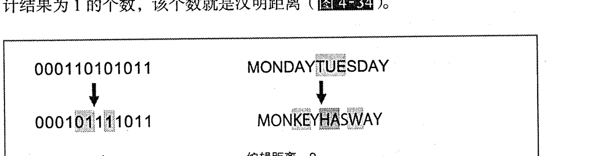

# 图4-34 汉明距离和编辑距离

编辑距离在字符串比对中很常见。例如把输入的英文单词与词典中的词进行比对，找到最接近的候选，既能发现拼写错误，也能给出修正建议。

# 第4章 权重和寻找最优解 | 89

还能结合发音来提示候选单词（图4-35）。

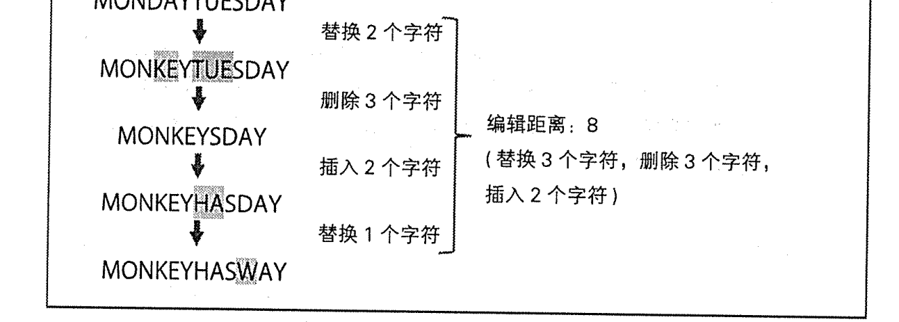

# 图4-35 编辑距离的计算方法

此外，编辑距离也可用于计算构成基因的碱基序列或氨基酸序列的同源性。

# 马氏距离
马氏距离也是以距离命名的相似度度量。用二维散点图展示两个变量的相关性时，欧几里得距离即两点间的直线距离，可由毕达哥拉斯定理求得，公式见图4-36。

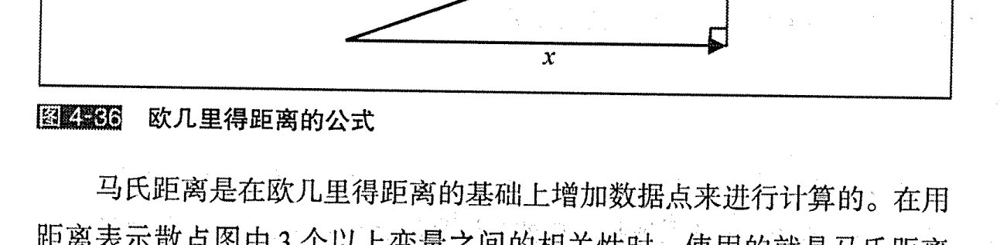

# 图4-36 欧几里得距离的公式

马氏距离是在欧几里得距离基础上考虑数据分布的扩展。当需要用距离表示散点图中三个及以上变量间的关联时，便会用到马氏距离，示意图见图4-37。

# 第5章 权重和优化程序

使用神经网络或贝叶斯网络进行分析时，网络图的概念不可或缺。本章前半部分将介绍网络图的基础及主要分析方法，重点讲解动态规划 DP 算法，并介绍遗传算法。遗传算法与基于网络图的动态规划在优化程序中同属常用手段。本章后半部分则讲解以网络图为基础的数值最优化程序的核心——神经网络。

# 01 图论

下面介绍图论的基础。

- 要点
  - 图的概要
  - 图论的基础知识

# 图
提到图，很多人会想到柱状图或饼图。这里指的是由点和线构成的结构。点称为顶点 vertex 或节点 node，线称为边 edge。

若图中任意两顶点都可互相到达，则称为连通图 connected graph，否则为非连通图 disconnected graph。与其他顶点均不相连的顶点称为孤立顶点。

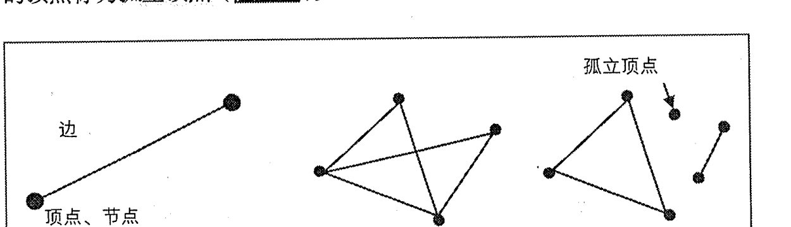

# 图 5-1 图的构成要素

对图而言，关键在于顶点是否相连，位置并不重要。视觉上不同的两张图，若通过移动顶点能变成相同形态，则称二者同构。

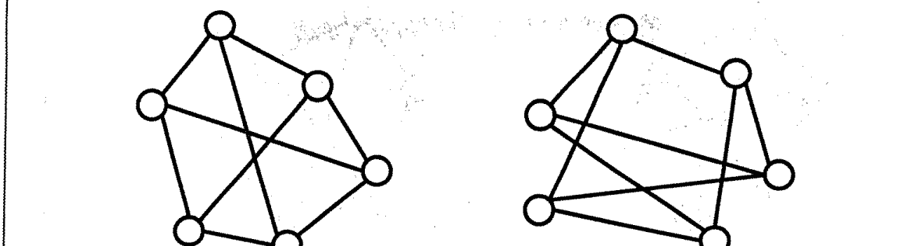

还有像图5-3那样的复杂形态。若两个顶点间存在两条以上边，则称为平行边；一条边首尾相接形成回路，则称为自回路或环。

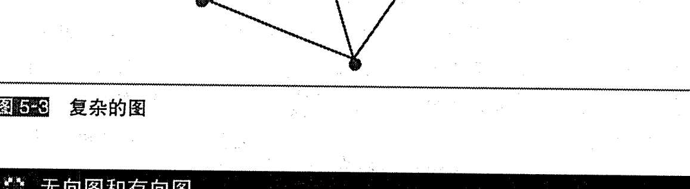

# 图5-3 复杂的图

# 无向图和有向图
若连接两个顶点的每条边都有方向，则该图为有向图 directed graph。无法从某顶点出发再回到自身的有向图称为有向无环图 DAG。若边均无方向，则为无向图 undirected graph。边上可赋予权重，权重可用数值或线宽表示。顶点也可赋权。

# 图 5-4 有向图和加权图

加权图也被称为网络，包含神经网络、贝叶斯网络等。前面提到的状态转换图也是一种网络图。

# 图的矩阵表示法
图的形状可转化为矩阵。邻接矩阵记录顶点间的相邻关系，关联矩阵记录顶点与边的关系。

对于含 n 个顶点、m 条边的图，邻接矩阵大小为 n×n，关联矩阵为 n×m。若两个顶点相连或顶点与边相连，对应位置记为 1，否则为 0。对加权图，邻接矩阵对应位置记录边的权重而非 0/1。

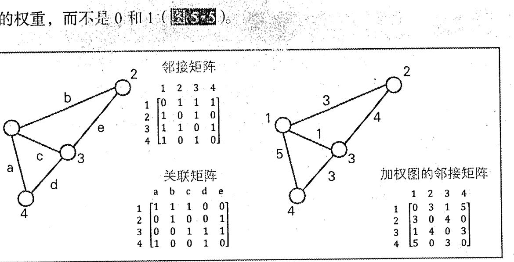

# 图 5-5 图的矩阵表示法

# 树状图
有一种结构是从起点出发后不再回溯，例如有向无环图。若从任意顶点出发都不会回到起点，则称此结构为树形结构，起点称为根节点 root。

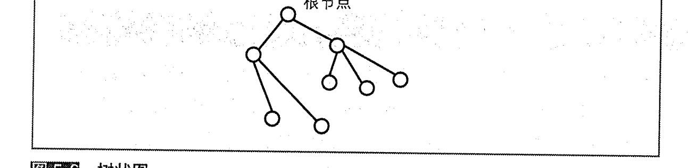

按用途与构成，树状图可分为决策树和搜索树。决策树可作为统计模型预测中的条件分支规则集使用，搜索树则可作为状态分割方法使用。

# 第5章 权重和优化程序

# 02 图谱搜索和最优化

下面介绍图谱搜索与最优化问题。

- 要点 树形结构、二叉搜索树
- 广度优先搜索、深度优先搜索、A*算法
- 动态规划算法

# 搜索树的构建场景
树状图适用于多种场景，其特点是能清晰呈现一个顶点向多个子顶点延伸的形态，如系统发生树。它常用于从起点到终点或多个终点之一的路径寻找。

例如在象棋、黑白棋等二人有限零和对策，或迷宫、换乘提示等路线搜索问题中，可用搜索树的顶点表示着法或位置，分支出不同的状态。

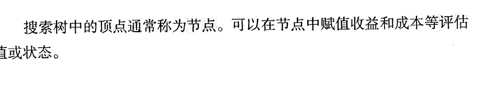

搜索树中的顶点通常称为节点，可在节点内赋予收益、成本等评估值或状态。

# 第5章 权重和优化程序 | 99

在某些分割状态下，选择下一条边即下一个节点时，需依据游戏目标计算评估值。

在迷宫或换乘等场景中，路线搜索过程可能伴随各类事件，如必须经过指定地点、换乘产生时间成本与交通费等，这些都要计入考量。把路线搜索看作时间轴上的多阶段决策问题更为合适。

根据时刻 t 的状态采取行动后获得的收益或成本来决定时刻 t+1 的状态，反复执行使最终时刻 T 的收益最大或成本最小，这类问题称为多阶段决策问题。

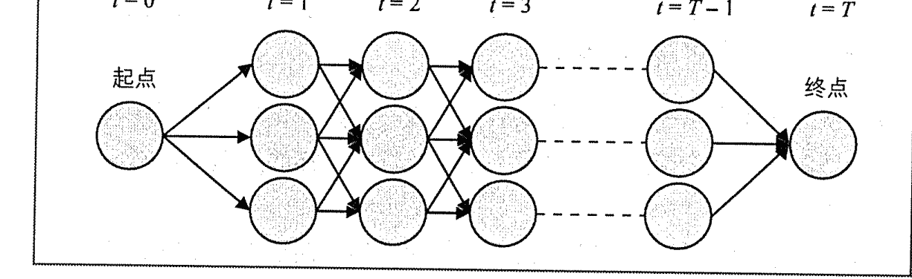

# 搜索树的遍历方法
在树形搜索树或迷宫路径搜索中，目标是找到根节点到目标节点的最短路径。

搜索树有两种基本遍历方式——深度优先搜索与广度优先搜索。

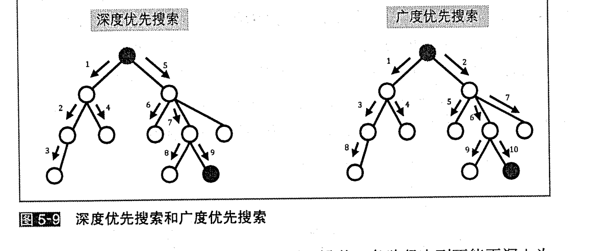

# 图5-9 深度优先搜索和广度优先搜索

深度优先搜索是从一个节点出发沿某条路径深入到尽头，随后回溯到上一节点，换另一分支继续搜索，不断重复直至无路可走。

广度优先搜索则是先遍历当前节点的全部邻居，再依次遍历这些邻居的邻居，以层级方式向外扩展。

若事先已知可达目标的路径，哪种方法更快显而易见；实际中路径未知，两种方法各有优劣，需结合节点的状态评估值与评价函数来判定目标节点。

# 高效的搜索方法
前述两种搜索只是按顺序展开节点。为缩短处理时间，需引入成本概念。

以大阪到东京为例，可走东海道路线，也可走北陆路线，二者在时间和费用上差异明显，利用先验知识可加快搜索。

成本包含三类：
- 从起点到点 s 的最优路线总成本 g(s)
- 从点 s 到目标点的最优路线总成本 h(s)
- 从起点经点 s 到目标点的最优总成本 f(s)=g(s)+h(s)

一种是使预计总成本 ĝ(s) 最小的最优搜索，即对 open list 中的节点排序后选择性搜索；另一种是使预计成本 ĥ(s) 最小的最佳优先搜索。

# 102 | 图解人工智能

两种方法都通过调整图中小球的排序进行搜索。

但最优搜索会增加搜索次数，最佳优先搜索可能偏离正确路径。于是使用 A* 算法，它以 g(s) 和 h(s) 使预计值 f(s) 最小。A* 还有一个特性：若点 s 的邻居 s' 的预计成本 f(s') 已在 closed list 中，而新算出的 f(s) 更小，则可把 s' 移回 open list。

# 路径成本
路线搜索中路径成本概念直观，但在多人游戏中如何理解？以两名玩家为例，黑白棋、象棋等属于二人有限零和对策，也称零和游戏。搜索树称为博弈树，节点代表双方的着法，若双方都完美下棋，结局为平局。

# 用于制定策略的方法
博弈树末端存储当前状态对己方有利与否的得分信息。制定策略时，轮到自己落子就选使局面分数最高的着法，轮到对手则对手会选使局面分数最低的着法。极大极小算法 mini-max 和 α-β 剪枝算法即按此策略尽可能减少待搜索顶点数。

极大极小算法中，自己落子时选最高分，对手落子时选最低分。最终被选中的路径如图5-11红色边所示。随后可通过剪枝优化搜索时间。

α-β 剪枝通过 β 剪枝和 α 剪枝剪掉分支。从左向右搜索时，β 剪枝在求最大值过程中，若某节点值小于当前值则剪去该节点；α 剪枝在求最小值过程中，若某节点值大于当前值则剪去以其为根的子节点。α-β 剪枝结合了广度与深度优先搜索。

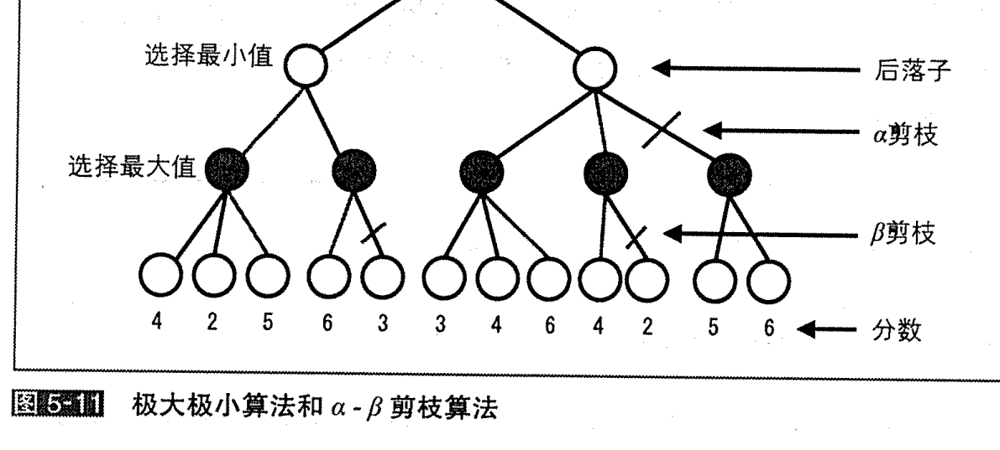

# 图5-11 极大极小算法和α - β剪枝算法

围棋、将棋等需要搜索的节点数极大，内存与时间难以满足。可采用蒙特卡洛树搜索 MCTS 对节点排序后展开搜索提升效率，也可使用二元决策图 BDD 与零压缩二元决策图 ZDD 等对搜索树进行压缩。

# 动态规划算法
路径搜索中可能需要经过检查点或产生成本，这可看作时间轴上的状态转换，可作为多阶段决策问题处理。

设多阶段决策问题的路径评价函数为 J，目标是使目标函数最大化。图5-15 中 F_t(s_t) 表示到达该节点时的最高分数，s_t 的三种状态均保存在内存中，我们称之为记忆化。

先计算最后一步 T 的 F_T(s_T)，最大值记为 J*，再反向推导出产生 F_T(s_T*) 的 s_T*，即可得到最优路径 s_1*, s_2*, …, s_T* 与最高分数 J*。

动态规划除求最优路径外，还可用于文本比较。生物信息学中用于比较碱基序列或氨基酸序列并计算同源性。分数或惩罚可参考编辑距离，也可使用对数比值比矩阵。对数比值比依据物种间相似氨基酸序列的相对频率与置换概率计算。该方法加速比较，但路径增多时内存占用剧增。为提高效率需对动态图进行分割，使用 GPU 大规模并行计算。

遗传算法（Genetic Algorithm, GA）。

+   要点
  ✔️ 遗传算法
  ✔️ 术语说明及流程
  ✔️ 实际应用示例

遗传算法的结构

生物在生存过程中通过交叉 crossover、变异 mutation 以及淘汰 selection 进化出环境适应力更强的后代。基于这一原理的优化方法即为遗传算法。

在时间轴上进行迭代计算，不断进化最后收敛到一群最适应环境的个体。采用交叉、变异等进化论概念的迭代计算方法称为进化计算 evolutionary computation。

进化计算的特点如下：

+   - 种群性
  种群中多个个体同时搜索，相当于并行计算。
- 可搜索性
  不需要太多关于搜索空间的预备知识。
- 多样性
  种群个体多样，对噪声和动态变化具有自适应性，能得到鲁棒性更高的解。

遗传算法借用了进化论和遗传学的术语，这是因为其灵感来源于生物遗传规律，并不意味着生物体内真正发生这些现象。

从进化到学习：遗传算法与神经网络的核心原理拆解

基础名词先厘清

个体 模拟生命体，染色体里携带特征，是一个包含候选解的数据单元。
种群 由若干个个体构成，个体总数叫做种群规模。
基因 控制性状的最基本遗传单元。
等位基因 也称对偶基因，指基因可能出现的不同取值或状态。
染色体 由多个基因组合而成的集合。
基因座 基因在染色体上的具体位置。
基因型 基因在染色体内部的呈现形式，通常是字符串或图结构。
表现型 染色体决定的性状在外部的表现。
适应度 量化个体与环境契合程度的分数，依据表现型给出。
编码 把表现型映射为基因型的过程。
解码 把基因型还原为表现型的过程。

遗传算法如何运转

先随机生成规模为 N 的初始种群，随后对每个个体打分算出适应度。用这个评价结果去判断是否达到预设的停止条件，若已收敛则终止；若未收敛则进入迭代循环。

迭代包含三大操作：淘汰、交叉、变异。经过处理后得以保留的旧个体或新产生的个体组成子代，再次被评价，随后重复上述流程，直至收敛。

评价与收敛判断

通过适应度计算来决定是否结束世代更替，常用判断标准有：

种群里最高适应度超过设定阈值
种群整体平均适应度超过设定阈值
一段时间内种群适应度的波动小于设定阈值
迭代次数达到预定上限而截断

淘汰即选择

遗传算法里会把适应度更高的个体优先保留到下一代，以提升子代中接近最优解的比例。这个环节也叫选择。

常见做法有轮盘赌选择、锦标赛选择、精英选择。

轮盘赌选择里，每个个体被挑中的概率与其适应度成正比，适应度越高扇形面积越大，中选机会越大。
锦标赛选择每次从种群中随机抽取若干个体，挑选其中适应度最高的进入子代，反复执行直至子代规模恢复到原种群规模。
精英选择先把种群中适应度最高的 nG 个个体直接复制到下一代，剩下的 n(1−G) 个个体再做基因操作。G 为精英率，1−G 为繁殖率。

交叉操作

交叉是把两个父代个体的部分基因结构拆开重组，产生新个体的基因操作。根据使用方式可分为单点交叉、多点交叉、均匀交叉，还有会只产一个子代的平均交叉。由 0 和 1 构成染色体的编码方式称为二进制编码。

单点交叉 以一个交叉点为界交换两侧基因。
多点交叉 在染色体上设多个交叉点，按点为界交换。
均匀交叉 依据概率 p 与 1−p 对父代基因进行逐位交换。
平均交叉 用父代基因的平均值作为下一代基因。

当基因需要用表示顺序的数值或实数来表达时，二进制编码就不方便，这时可改用顺序编码或实数编码，也能实现更复杂的交叉。

顺序编码常用的交叉：

循环交叉 把父代中相同位置的基因及其位置固定，其余空位用父代 2 对应位置的元素填补。
部分映射交叉 在父代编码串中替换若干基因位置的编码，剩余位置用匹配的对应数字填补。
顺序交叉 在父代中划定若干基因区间，其余区间按顺序用父代 2 的基因填充。
基于顺序的交叉 从父代 1 随机抽取若干基因，保持原有顺序插入父代 2，形成子代 2；父代 2 对应位置的基因按顺序填回父代 1，形成子代 1。
基于位置的交叉 把随机挑选的父代 1 的基因与父代 2 同位置的基因互换，其余位置保留原父代编码。

变异操作

变异也是基因操作，但它是从一个父代产生一个子代。淘汰和交叉的目的是提升适应度，变异的目的是赋予算法随机搜索能力，有助于跳出局部最优。个体的变异概率称为变异率，通常设得远低于交叉率。

常见变异类型：

置换 用等位基因替换随机选中的基因
扰动 对实数值基因加上或减去一个微小扰动
交换 互换两个随机基因的位置
反转 颠倒两随机基因之间的顺序
争夺 随机打乱两随机基因之间的顺序
移位 把某段基因搬移到其他位置
移动 把一个基因移动到另一个基因之前
缺失 删除一段基因，长度会改变
复制 复制一段基因，长度会改变
插入 增加一段基因，长度会改变

遗传算法的应用场景

旅行商问题是典型案例，即寻找最低成本的遍历路径，也用于印制电路板的打孔顺序优化。

除此之外，可用于设计蛛网的最优形态，把丝线拉伸角度、总伸长量等作为参数，从多个个体中筛选捕获效率高的方案。在数值设计上，N700 系列新干线的车头造型借助遗传算法确定；日本首架国产喷气式飞机的机翼优化也采用了该方法，同时兼顾燃油消耗和外部噪声。金融工程领域可用于交易系统设计和证券组合优化。

需要提醒的是，适应度的设计以及交叉策略的精细化很难完全自动化，实践中仍需要大量人工辅助。

神经网络篇

神经网络源自对生命现象的模仿。

要点：神经网络、层、层激活函数。

Hebb 定律与形式神经元

1943 年研究发现，当神经细胞接收到超过阈值的电信号时也会向下游传导。这一行为被抽象为 McCulloch-Pitts 模型。神经元之间通过突触连接，神经递质活动会在膜内外产生电位差，形成可量化的信号。

形式神经元把接收到的数值累加后进行筛选再输出，也称单元。McCulloch-Pitts 模型用单位跃阶函数 H 设定阈值：x<0 时 y=0，x>0 时 y=1，x=0 时 0≤y≤1。简化后即为用函数 f 表示 H 的形式神经元，f 被称为激活函数。

1949 年提出 Hebb 定律：突触随活动增强或减弱而被加强或削弱，具有可塑性，且与学习密切相关。用在形式神经元上即权值会随输入与输出的变化而改变。

神经网络的构成

由多个形式神经元连接而成的回路的数学模型称为神经网络。相同类型的单元并排形成的集合称为层。常用节点表示神经元或输入状态，箭头表示处理方向，可在输入节点加入激活函数。

层数≥3 时，介于输入层和输出层之间的层称为中间层或隐藏层。中间层较多时称为多层神经网络或深度神经网络。

神经网络的特性

分散性与并行性 多个相似神经元及由其构成的单元相互连接交换信息
局部性 每个神经元只受邻接神经元、自身内部状态及输出状态影响
权重与可塑性 输入信号会按连接权重加权总和后经非线性函数转换，权重会随输入变化而改变，支持训练和自组织
泛化能力 既能对学习过的样本做出预期动作，也能通过插值外推应对未见情况

激活函数

形式神经元输出时使用的非线性函数。常见有单位跃阶函数、Step 函数和 Sigmoid 函数。

Sigmoid 函数连续可导，x→-∞时趋近 0，x→+∞时趋近 1，x=0 时为 0.5，其表达式与 Logistic 回归中的 Logistic 函数相关。双曲正切 tanh(x) 与之相似，x→-∞时趋近 -1，x→+∞时趋近 1。

感知器

20 世纪 50 年代基于 McCulloch-Pitts 模型提出的学习机器。学习规则借鉴 Hebb 定律，按输出正负调整权重。

正例时 w ← w + η·φ(x)
负例时 w ← w - η·φ(x)
η 为学习系数。

感知器收敛定理：若训练数据线性可分，感知器算法在有限次迭代后收敛，找到分类超平面。

局限是数据线性不可分时无法收敛，即使可分也可能耗时很长。
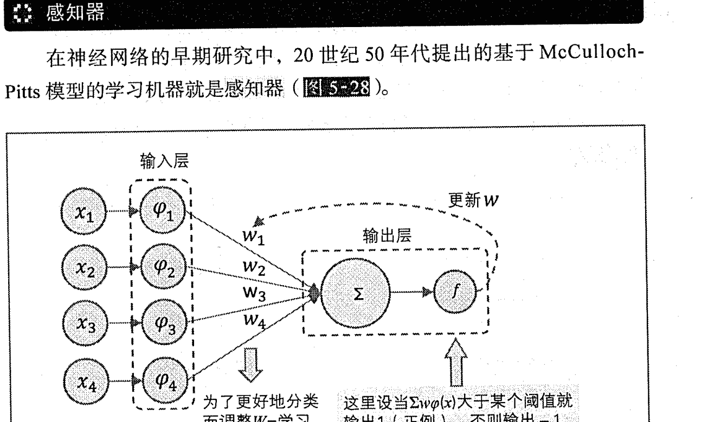

# 续

玻尔兹曼机由 Geoffrey Hinton 等人在 1986 年提出，节点间连接是双向的，具有负反馈，输出会回流到自身。输出以概率分布产生。

在 Sigmoid 函数中引入温度参数 T，计算 f(x/T)=1/(1+e^(-x/T))。T 越高梯度越平缓，随着迭代逐步降低 T 直至 0，可使网络能量收敛到最小值而不易陷入局部极小，这就是模拟退火算法。

玻尔兹曼机因其样本分布服从玻尔兹曼分布而得名，与热力学第二定律和熵的概念相关，熵值反映混乱程度，能量函数收敛到最小值对应稳定状态。

玻尔兹曼机也可学习。可见层与输入输出相关，隐藏层提升自由度。可见层与隐藏层节点数可记为 N-M-N 编码器。学习通过正向学习阶段和反向学习阶段交替进行。Pₐ⁺ 表示在正向阶段给定可见层状态时状态 α 出现的概率；Pα⁻ 表示网络自由运行时状态 α 出现的概率。
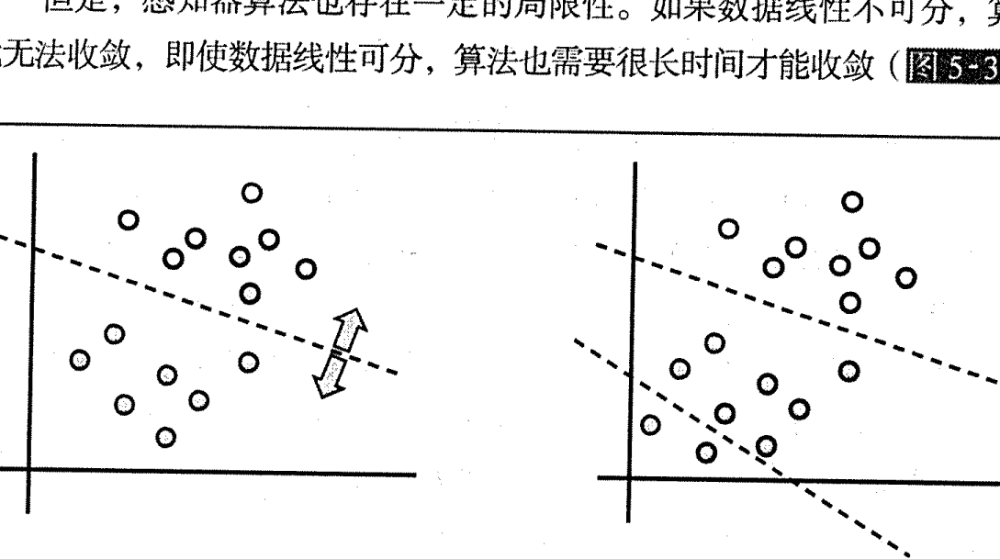
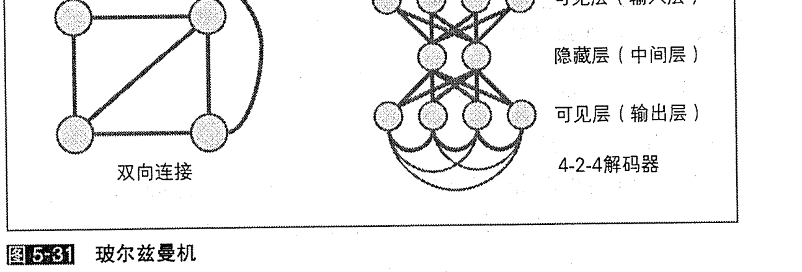
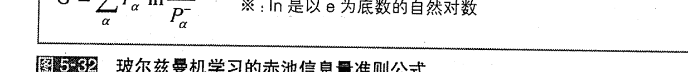

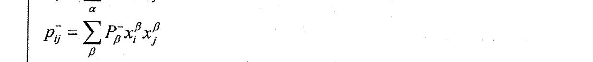

图5-33 权重更新的表达

α 用来标记一组节点状态，其取值个数与训练样本的条数一致。仅当正相学习与反相学习得到的概率分布完全重合时，能量差 G 才会归零；一旦两者出现偏差，G 保持正值。此时可借助梯度下降等迭代优化手段，不断调整权重以让 G 逼近最小。调整过程中要依据节点状态算出 Δw_ij ，其中 η 为学习率，Δw_ij 亦可直接设为常数。β 表示网络在自由运行下的整体构型，每节点仅取 0 或 1，全部可能组合为 2^(2N+M)。

整个流程可参见图5-34。

> ① Akaike Information Criterion，简称AIC，由日本统计学家赤池弘次创立和推进。赤池信息量准则建立在熵的概念基础上，可以权衡所估计模型的复杂度和此模型拟合数据的优良性。——译者注

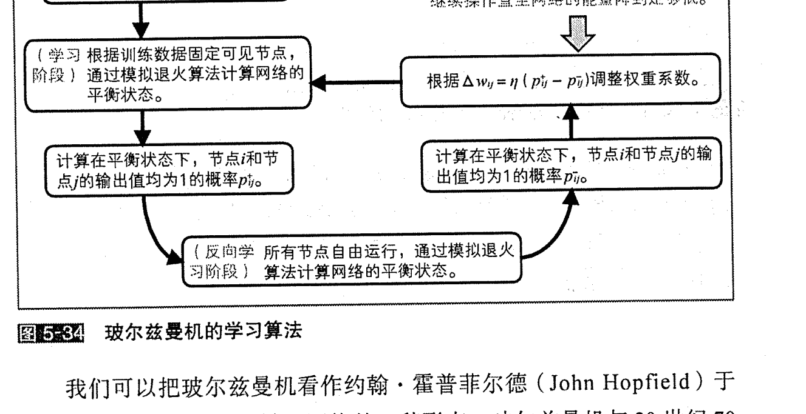

# 能量最小化与网络演化


# 图5-34 玻尔兹曼机的训练流程

玻尔兹曼机可视为约翰·霍普菲尔德 1982 年提出的 Hopfield 神经网络的一种变体。该模型与 70 年代的联想记忆模型以及联结主义思想有渊源。节点状态一旦改变，网络的整体行为即难以被设计者预判，当时学界对其功能潜力寄予厚望。

# 误差反向传播

玻尔兹曼机内部连接无方向性，因而具备反馈特性。单向传播的网络中同样可以实现类似机制。先前提及的感知器权重更新便是一种反馈。面向多层级架构的反馈学习代表作是误差反向传播算法，该法在 80 年代提出，利用输出层与训练标签的误差来回溯修正中间层的参数。

# 多层感知器结构

单层感知器仅含输入与输出，只能处理线性可分问题且效率低下。为此出现了多层感知器，如图5-35 所示。

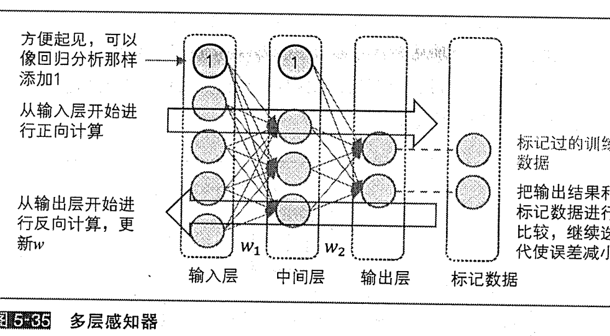

# 图5-35 多层感知器示意

多层感知器由若干单层感知器串联而成，通过逐层硬映射可将非线性分布转变为线性可分。先正向计算各层输出，再从输出层起用反向传播更新权重，适用于有标签的有监督学习。

可采用回归中常用的误差函数衡量最小二乘误差，并配合梯度下降进行优化。输出层为单个节点时可做二分类或实值输出；节点数多时则对应多分类。

# 自组织现象

神经网络在与外部数据交互、权重不断更新的过程中，会自发由无序走向有序，这一过程称为自组织。类似现象也见于高分子材料与生物体。

制备有机薄膜时，利用同类高分子易聚集的特性，可在低能耗下自然成膜，温度压力等条件的改变还能调节薄膜形态。在小鼠等啮齿类动物体感皮层中，神经元形成“桶”状结构，与胡须一一对应，形成桶阵图5-36。微观与宏观层面相似的功能往往聚集在邻近区域，这让人联想到学习后的网络也会产生空间聚集。

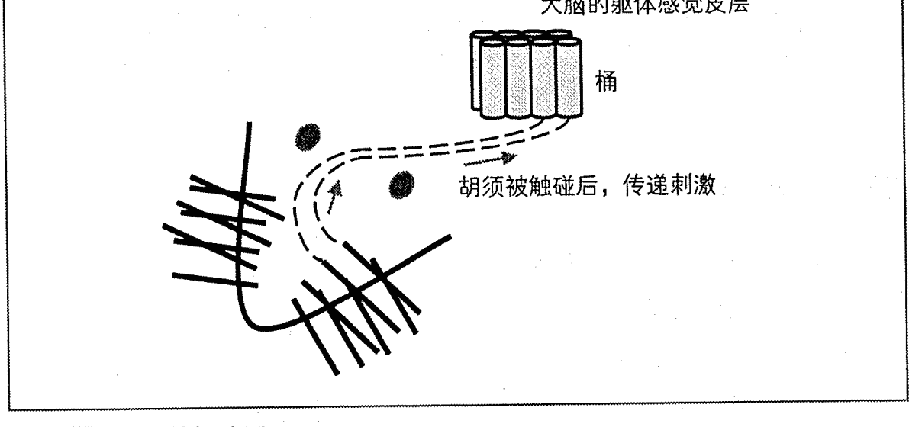

图5-36 小鼠桶阵示意图

> 专栏 大阪大学研究小组解密为什么美味的食物能够增进食欲

实验显示，人在品尝美味时肠胃活动会增强，可能因为味觉中枢的信号传递到了相邻的肠胃控制区。下丘脑负责食欲调节，研究推测存在从味觉通路到肠胃控制区的连接。

自组织中，像桶阵那样接受相同位置刺激的功能单元会聚集且边界清晰。相关功能之间，如味觉与消化，也可能存在微观的联络通道。

由此可预见，未来将有更多研究者在构建网络时，借鉴大脑功能区的空间布局来安排组件位置。但位置相同是否就能自然获得对应功能，仍需进一步探讨。

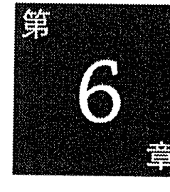

# 统计机器学习：概率与建模

神经网络驱动的机器学习对计算资源需求很高，故 21 世纪前推广受限。与此同时，基于概率分布与数学模型的统计机器学习在各领域得到发展。本章将介绍概率分布及贝叶斯统计的基础，包括贝叶斯定理、贝叶斯估计与 MCMC 等。

# 第 6 章 | 统计机器学习（概率分布和建模）

# 01 统计模型和概率分布

统计模型与概率分布概述。

+   - 机器学习
  - 广义线性模型和基函数
  - 主要的基函数
  - 其他非线性函数

绝大多数自然现象都带有概率色彩。硬币正反、台风路径、交通事故发生、太阳升起等均可用概率描述。

第 4 章介绍的二维散点拟合看似与概率无关，实则误差函数隐含概率假设。测量误差的概率分布通常呈正态。受该分布影响，自变量与因变量会产生偏差，两者关系亦服从特定概率，这类模型称为概率分布模型，见图6-1。

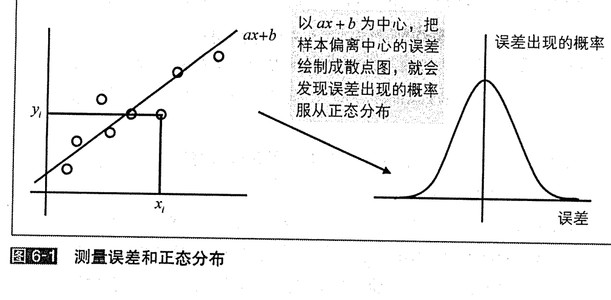

图6-1 测量误差与正态分布

# 机器学习概览

机器学习常被理解为机器自行学习。第 5 章把神经网络按输入调整权重称为学习。

机器学习依据输入特征与分布趋势，自动对数据进行分割与重构，得到最优描述。在统计机器学习中，概率是核心。图6-2 虽显杂乱，却可帮助理解回归分析与统计机器学习的关联。

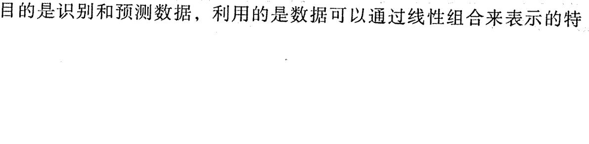

图6-2 回归分析与统计机器学习的关系

其中也涵盖神经网络方法。对输入做回归分析的目的是识别与预测，利用数据可线性组合的特性，近似有监督学习中基于标记训练数据的建模。

神经网络学习则利用数据可被映射为线性可分这一性质。若数据本身线性可分，线性组合方法即可胜任。

也可不依赖神经网络，直接在有监督或无监督学习中使用原始输入。无监督学习的数据无标签，如聚类与降维，密度估计亦属此类。数据识别、预测、聚类以发现新特征的过程称为数据挖掘。聚类与降维主要用于可视化，目标是在无需人工干预下实现识别与预测。

# 广义线性模型与基函数

当自变量与因变量一一对应时，散点可用标准正交基表示，可视为直角坐标系中的基向量。

该基的维数随向量维度增加，可表征高维模型。坐标轴两两正交，即线性无关。回归试图用线性无关自变量的线性组合预测因变量，若自变量间存在线性相关，则

# 第6章 统计机器学习（概率分布和建模）

## 7. 负二项分布

负二项分布与二项分布不同，它描述出现 r 次成功所需试验次数 n 的分布，常用于生命科学，见图6-13。

- 负二项分布公式

P(X = k) = \left(\begin{array}{c}k - 1\\r - 1\end{array}\right)p^r(1 - p)^{k - r}

E(X) = r / p

V(X) = r(1 - p)/p^2

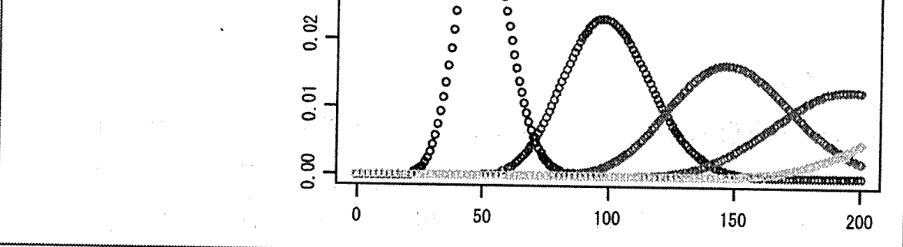

图 6-13 负二项分布公式和负二项分布图

## 8. 泊松分布

泊松分布刻画单位时间内平均发生次数为 λ 的随机事件实际发生 x 次的概率，见图6-14。泊松描述次数，指数分布描述相邻事件的时间间隔，二者互补。

- 泊松分布公式

P(X = k) = \frac{\lambda^k e^{-\lambda}}{k!}

E(X) = \lambda

V(X) = \lambda

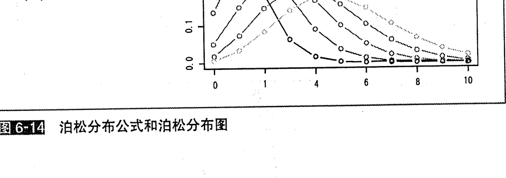

图 6-14 泊松分布公式和泊松分布图

## 9. 卡方分布

卡方分布是伽马分布的特例，常用于卡方检验，即独立性检验。用以检验来自多总体样本的频率分布是否一致，广泛用于临床试验与社会调查，见图6-15。

- 卡方分布公式

f(x) = \frac{(1 / 2)^{k/2}}{\Gamma(k / 2)} x^{k/2 - 1}e^{-x/2}

E(x) = k

V(x) = 2k

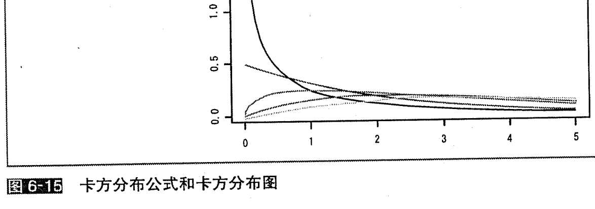

图 6-15 卡方分布公式和卡方分布图

## 10. 超几何分布

超几何分布描述不放回抽样下的概率。例如袋中红白球，从中取 n 次得到 k 个红球的概率，见图6-16。

- 超几何分布公式

P(X = k) = \left(\begin{array}{c}n\\k\end{array}\right)\left(\begin{array}{c}N-n\\K-k\end{array}\right)/\left(\begin{array}{c}N\\K\end{array}\right)

E(X) = nK / N

V(X) = (N - n)n(N - K)K / (N - 1)N^2

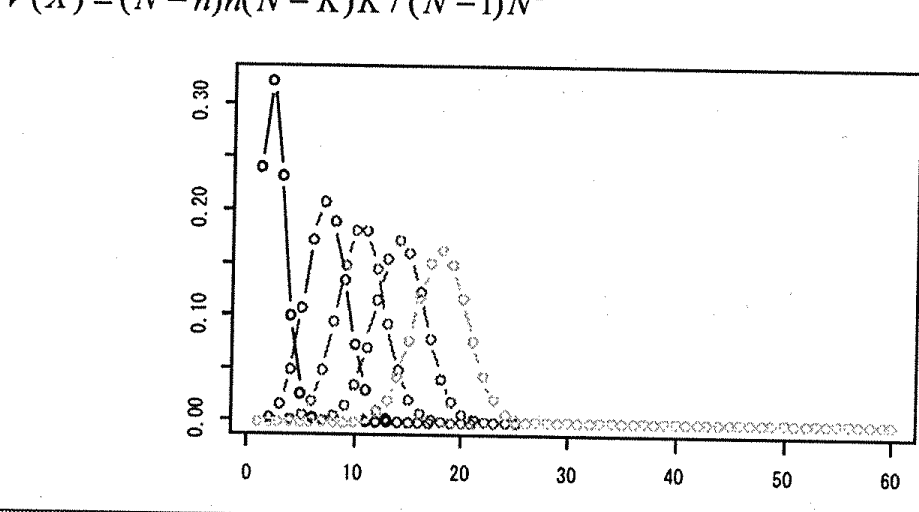

# 图6-16 超几何分布公式和超几何分布图

若每次抽取后放回，超几何分布退化为二项分布。它也可用于卡方检验等统计检验。

## 11. 洛伦兹分布

洛伦兹分布又称柯西分布，在物理学中称 Breit-Wigner 分布。光谱学中常用来描述共振等机制下的电磁波与射线谱线，见图6-17。

其形态与正态相似，但尾部衰减缓慢，具有重尾特性，无法定义有限的均值与方差。

- 洛伦兹分布（柯西分布）公式

f(x) = \frac{1}{\pi\gamma\left\{1 + \left(\frac{x - \mu}{\gamma}\right)^2\right\}}


图 -17 洛伦兹分布公式和洛伦兹分布图

## 12. Logistic 分布

累积分布为 Logistic 函数，故名。其形态近似正态，但更平坦、拖尾更长，见图6-18。

- Logistic 分布公式

f(x) = \frac{e^{\frac{x - \mu}{s}}}{s\left(1 + e^{\frac{x - \mu}{s}}\right)^2} \quad s > 0

图6-18 Logistic 分布公式

## 13. 韦布尔分布

韦布尔分布用于刻画物体强度与体积关系，作为可靠性指标，可表达机器寿命与故障时间，见图6-19。

- 韦布尔分布公式

f(x) = \frac{m}{\eta}\left(\frac{x}{\eta}\right)^{m-1} \exp\left\{-\left(\frac{x}{\eta}\right)^m\right\}


其特例瑞利分布可用于雷达信号与散射信号强度的建模。

# 损失函数与梯度下降

回归分析中，目标是使误差平方和最小化。损失函数即该目标的表达。可借助梯度下降与最大似然法求最小值。

损失函数记为 w 的函数 L。对 w_i 求偏导得到梯度 ∇L(w)。当 ∇L(w*)=0 时，w* 为所求权重，见图6-20。


# 图6-20 梯度下降法

最速下降法属梯度下降的一种。依据利普希茨连续条件定义 G，使 |L(wk+1)-L(wk)| ≤ G|wk+1-wk|。此时 |∇L(wk)| ≤ G 可作为收敛判据，见图6-21。

G、步长等参数常需启发式确定。满足收敛条件时得到局部最优，但未必是全局最优 w*；步长过小会显著延长求解时间。

为缓解此问题，可用遗传算法、其他梯度下降变体或能自适应步长的牛顿法。最速下降法需遍历全部数据，属于批处理，易陷入局部最优且数据量大时计算负担重。随机梯度下降则以部分数据迭代更新权重，兼顾效率与学习效果。


# 图6-21 最速下降法

## 02 贝叶斯统计学和贝叶斯估计

贝叶斯统计与贝叶斯网络介绍。

- 贝叶斯定理
- 最大似然估计
- 贝叶斯估计
- Logit 函数
- EM 算法
- 贝叶斯判别分析

## 贝叶斯定理

贝叶斯定理是贝叶斯统计的基础，涉及条件概率。

所有未知量都存在不确定性，先验分布用于量化该不确定性，随经验积累参数估计愈加精确。托马斯·贝叶斯关注此过程，在二项分布中发现了定理的特例，但未推广为通用形式。拉普拉斯完善并推广了该理论。

定理描述两个条件概率的关系。第一式给出在 B 发生下 A 的条件概率，经变换得到常见形式。P(A∩B)、P(A|B)P(B)、P(B|A)P(A) 均表示 A 与 B 同时发生的概率。第三式给出 n 个互斥事件 A1…An 的条件概率，见图6-22。


# 图6-22 贝叶斯定理

博彩中常用赔率 odds。若胜率 p，败率 1-p，赔率为 p/(1-p)。对数赔率即 Logit 函数，可用于 Logistic 回归。两个赔率之比为比值比，用于衡量两总体中事件发生的相对可能性，如新药疗效或性别比例变化。也可用贝叶斯定理表达，见图6-23。


# 图6-23 用贝叶斯定理表示比值比

## 例1：检查的阳性预测值

设疾病患病率 0.01，患病者检出阳性概率 0.99，健康者误报阳性概率 0.10。直觉上检查似乎很准，但计算阳性预测值：

P(疾病|阳性) = \frac{P(阳性|疾病)P(疾病)}{P(阳性)} = \frac{0.99\times0.01}{0.01\times0.99 + 0.99\times0.10} = 0.091

仅约 9.1%，远低于预期，见图6-24。

# 图6-24 阳性预测值的计算公式

## 例2：目击出租车的颜色

# 蓝色目击，绿色反而更可信

假设一座城市发生出租车肇事逃逸，目击者信誓旦旦说是蓝色车。城里只有蓝绿两色出租车，蓝色只占15%，绿色占85%。在同等辨识条件下做的实验表明，被说成蓝色的车，真实为蓝色的概率为80%。把先验比例和辨识误差一起用贝叶斯更新，事后算出来肇事车其实是绿色的可能性约为59%。

P(蓝色|目击)/P(绿色|目击) = \frac{P(目击|蓝色)}{P(目击|绿色)}\times\frac{P(蓝色)}{P(绿色)} = \frac{0.8}{0.2}\times\frac{0.15}{0.85} = \frac{12}{17}

P(蓝色|目击)+P(绿色|目击)=由此可得

P(绿色|目击) = \frac{17}{12 + 17} ≈ 0.59

# 图6-25 出租车颜色的计算公式

## 把似然转成对数更易优化

似然往往是多个因子相乘，将其改写为对数似然求解会更简便（图6-26）。


# 图6-26 损失函数和似然函数

遇到形态复杂的似然，直接求最大似然估计通常不可行，往往需要迭代求解。把真实值记作完全数据x，已观测到的y则视为不完全数据。因为作用在x上的扰动s未知，由y反推x并不唯一（图6-28）。


# 图6-28 完全数据和不完全数据的关系图

把删失部分补成虚拟的完整数据就能得到似然。面对含隐变量的概率模型，用不完全数据求该似然最大值的方法即为EM算法。

EM算法是迭代优化流程，由E步与M步构成，用来最大化对数似然。E步在当前参数θₘ下构造依赖于θ的凸函数Q，M步更新θ使Q达到峰值。E步中的Q也常被解释为后验分布（图6-29）。

- EM算法

E步: 求 Q(|θₘ)。θₘ是 Ō_MLE 的第 m 个近似值

M 步: θₘ₊₁ = arg max_θ Q(θ|θₘ)


# 图6-29 EM算法公式和EM算法图

## 贝叶斯估计要点

在贝叶斯估计里，样本总体的分布并非唯一，其密度写作π(θ)，π即先验分布或主观分布（图6-

# 第6章 统计机器学习（概率分布和建模）

值θ，未知参数θ就能代替真实的参数θ使用了。

## R语言实战：LDA与QDA

R语言中可用LDA或QDA函数实现线性与二次判别分析。作者用LDA对R内置的鸢尾花数据集iris进行演示。

-   样本: ch06-rsample-lda.zip

-   下载地址：图灵社区本书主页

该集共150条记录，3种鸢尾花各50条。按奇偶行分为训练集与测试集，用s、c、v分别代表setosa、versicolor、virginica。

首个LDA模型假设先验未知，三类先验各1/3，分类器记为Z。Z在训练集上线性判别的错误率为2/75，测试集错误率亦为2/75。

第二个LDA模型假设三类先验为1/6、3/6、2/6，分类器记为Z2。Z2在训练集上错误率为1/75，测试集错误率为2/75。

分类器包含判别系数LD1与LD2。以判别系数为权重可推导出判别函数。用直方图绘制基于LD1的第一判别函数得分可知，判别失误源于两类鸢尾花分布重叠，重叠区被误判（图6-38、图6-39）。

# 图解人工智能


线性判别分析第一判别函数在训练集上的得分结果

plot(Z, dimen=1)

对于c和v，两个分类器都显示了相同区域重叠的数据，这就是判别错误的原因

贝叶斯线性判别分析第一判别函数在训练集上的得分结果

plot(Z2, dimen = 1)

## 图6-38 线性判别分析和贝叶斯线性判别分析的示意图

Z 的标记数据

训练结果

|   | c | s | v |

|---|---|---|---|

| c | 24 | 0 | 1 |

| s | 0 | 25 | 0 |

| v | 1 | 0 | 24 |

Z2 的标记数据

训练结果

|   | c | s | v |

|---|---|---|---|

| c | 24 | 0 | 1 |

| s | 0 | 25 | 0 |

| v | 0 | 0 | 25 |

Z 的测试数据

判别结果

|   | c | s | v |

|---|---|---|---|

| c | 24 | 0 | 1 |

| s | 0 | 25 | 0 |

| v | 2 | 0 | 23 |

Z2 的测试数据

判别结果

|   | c | s | v |

|---|---|---|---|

| c | 24 | 0 | 1 |

| s | 0 | 25 | 0 |

| v | 1 | 0 | 24 |

## 图6-39 贝叶斯判别分析的标记数据训练结果和测试数据判别结果

## 第6章 | 统计机器学习（概率分布和建模）

## 03 MCMC 方法

接下来介绍MCMC方法。

-   要点 ✔ 圆周率的近似值计算问题 ✔ 蒙特卡罗方法 ✔ 层次贝叶斯模型 ✔ MCMC方法

## 圆周率的近似值计算问题

在贝叶斯估计中，反复计算构建的模型很重要。最小二乘或最大似然这类非贝叶斯方法求最优解时迭代收敛快，而现代贝叶斯统计求分布时，若函数不可解析表达，就必须做预测与优化类操作，这些操作手工难以完成且需要大量试验。

当试验次数大幅提升时，通过随机抽样获取不同参数变得关键。以蒲丰投针试验为代表的圆周率近似计算问题就借助随机试验迭代使结果收敛于期望值。


## 图6-40 圆周率的近似值计算

## 蒙特卡罗方法

蒙特卡罗方法最典型的例子是估算圆周率。拉普拉斯于1812年提出用随机试验估算圆周率。

该方法源于1946年原子弹研制期间的构想。斯坦尼斯拉夫·乌拉姆发现可通过随机试验描述中子在原子核内的运动，冯·诺依曼等人据此提出基于计算机的伪随机数生成及把确定性问题转成概率模型的方法。1949年，尼古拉斯·梅特罗波利斯与乌拉姆在论文中将其命名为蒙特卡罗方法。

## 小贴士 蒙特卡罗方法这一名称的由来

乌拉姆的叔叔喜好赌博，蒙特卡罗取自摩纳哥的赌城名。

与蒙特卡罗同期出现的是原子弹研究中产生的随机抽样。梅特罗波利斯等人提出的Metropolis抽样是MCMC的起源。

二战期间Metropolis抽样属高度机密，直至1953年才公开。后来威尔弗雷德·基思·黑斯廷斯将其推广为多维随机数生成方法，即Metropolis-Hastings算法。

在计算与概率密度P(x)成比例的函数时，MCMC中的Metropolis-Hastings算法可帮助从任意P(x)采样。只需函数与密度成比例，无需完全一致，故很适合贝叶斯统计。

Metropolis-Hastings会生成样本序列，样本越多分布越接近目标P(x)。尽管是迭代生成，下一个样本仅依赖当前样本，具有马尔可夫性，故称为马尔可夫链。MCMC即利用马尔可夫链逐步产生高维随机数的方法（图6-41）。


## 图6-41 马尔可夫链

在似然或MAP估计计算中，如图6-42所示，假设同心椭圆圆心为最大似然或MAP估计，则黑点会沿红色箭头向圆心移动。在Metropolis-Hastings等MCMC方法中，黑点随机移动，若似然比移动前下降则放弃移动，即不会沿黑色箭头方向移动，而是朝似然更高的红色箭头方向移动。


## 图6-42 Metropolis-Hastings算法

MCMC诞生于二战期间的计算机发展。随着算力提升，可应用于更复杂模型并在可接受时间内采样。实践中更稳妥的做法是用不同初值产生多个独立样本序列，比较后合并结果。

## 层次贝叶斯模型

实施MCMC后，高维参数模型的采样成为可能。层次贝叶斯模型相比传统模型设计自由度更高（图6-43）


图6-43 层次贝叶斯模型

摘自《MCMC 和层次贝叶斯模型 面向数据分析的统计建模人门》¹

层次贝叶斯模型的公式如图6-44所示。

```
f(θ,λ|x) = \frac{f(x|θ)π(θ|λ)ρ(λ)}{\int f(x|θ)π(θ|λ)ρ(λ)dθdλ} ∝ f(x|θ)π(θ|λ)ρ(λ)
```

图6-44 层次贝叶斯模型的公式

相较于以往的贝叶斯模型公式，我们可以看到层次贝叶斯模型的先验

> ① 原文名为「MCMC と階層ベイズモデル データ解析のための統計モデルリング入門」，暂无中文版。——译者注

## 第6章 统计机器学习（概率分布和建模） | 157

分布π中增加了一个参数λ，还增加了一个新的分布ρ。建立层次模型后，参数θ的高维模型结构变得更加复杂，所以添加低维参数λ作为超参数，添加超先验分布ρ作为超参数的先验密度（图6-45）。


## 图6-45 层次贝叶斯模型公式比较

与扩展前相比，扩展后的模型可以将层分离为数据受全局支配的规则层，以及数据受局部个别情况影响的层（图6-46）。


## 图6-46 全局参数和局部参数

例如，在生态学统计模型中，数据受个体差异影响。若把这部分分离到局部数据层，模型构建会更灵活。也有研究者用层次贝叶斯模型研究地震仪数据中地震规模与地表各点震度的关联。

## 第6章 | 统计机器学习（概率分布和建模）

## 04 HMM 和贝叶斯网络

下面介绍HMM和贝叶斯网络。

-   要点 ✔ 隐马尔可夫模型

   ✔ 贝叶斯网络

## 隐马尔可夫模型

在有限自动机等随时间演化的规律中引入马尔可夫性，可得马尔可夫过程或链。在马尔可夫模型中，利用马尔可夫性，状态X的概率可化简为P(X₁, X₂, X₃, …, Xₙ)=P(X₁)P(X₂|X₁) P(X₃|X₂)…P(Xₙ|Xₙ₋₁)，十分便捷（图6-47）。


P(X₁,X₂,X₃,…,Xₙ)

= P(X₁)P(X₂|X₁)P(X₃|X₂)…P( Xₙ|Xₙ₋₁) ← 贝叶斯定理

= P(X₁)P(X₂|X₁)P(X₃|X₂)…P( Xₙ|Xₙ₋₁) ← 马尔可夫性的应用

但是，状态X有两个集合，一个可观测，另一个是未观测到的隐含马尔可夫链。我们把不可观测变量统一作隐变量处理。

# 第7章 统计机器学习（无监督学习和有监督学习）

前几章介绍了以概率分布为基础的数理模型和数据分布分类识别。本章将从机器学习视角展开。机器学习的常用分支有无监督学习和有监督学习，前者不使用标记数据，后者使用标记数据。接下来说明两种方法中的算法。

## 第 7 章 | 统计机器学习（无监督学习和有监督学习）

## 01 无监督学习

下面介绍无监督学习。

-   要点

  - 聚类

  - K-means 算法

  - 主成分分析

  - 奇异值分解

  - 独立成分分析

  - 自组织特征映射

## 有监督学习和无监督学习

前面反复提到学习和标记数据等术语。学习指通过迭代更新权重系数，使待解函数逼近基函数和数据分布模型的过程。有监督学习基于已标记训练数据生成模型，无监督学习在训练数据无标记的情况下生成模型

## 第7章 统计机器学习（无监督学习和有监督学习） | 167

m 阶酉矩阵（参照小贴士Ⅰ），V* 是 n 阶伴随矩阵（参照小贴士Ⅰ），Σ是对角线元素为 σ₁, …, σ(σ₁ ≥ σ₂ ≥ … ≥ σ_q > 0)(q ≤ min(m, n))的对角矩阵，这种分解就称为 M 的奇异值分解。对角线元素 σ 称为 M 的奇异值（图 7-8）。


> 小7-8 奇异值分解

> 

> 酉矩阵（正交矩阵）的逆矩阵是它的伴随矩阵，特征值的绝对值、奇异值以及行列式的绝对值均为1。

> 

> 伴随矩阵 A* 是酉矩阵 A 的共轭转置矩阵。

奇异值分解既可替代主成分分析，还可用于计算伪逆矩阵。伪逆矩阵可用于求解最小二乘。

# 独立成分分析

除主成分分析和奇异值分解做白化和降维，还可使用独立成分分析（Independent Composition Analysis, ICA），其目标是最大化观测数据各成分的统计独立性。

声源信号等噪声中既有服从高斯分布的高斯噪声，也有白噪声，因此衡量独立性时需计算非高斯性。

独立成分分析可用于盲源信号分离。即从多个观测混合信号中分离并恢复未知源信号。例如从多话筒采集的含语音和噪声的声源数据中分离语音。

# 自组织特征映射

神经网络的无监督聚类称为自组织特征映射（Self Organization Map, SOM）。神经网络能通过自动寻找输入数据内在规律和本质属性，自组织、自适应地改变参数与结构。

神经网络接收一个输入向量时，会计算其到各类别代表向量的距离，将其归入最近类别，同时依据新输入更新该类别代表向量。

重复该学习过程可使相似输入聚集，实现聚类可视化。自组织特征映射可基于一维、二维或三维神经元网络。若输入向量为某种空间向量，自组织特征映射也称神经网络的空间映射。（图7-9）。


# 图7-9 自组织特征映射的示例

# 第7章 | 统计机器学习（无监督学习和有监督学习）

# 02 有监督学习

下面介绍有监督学习。

+   要点

    - 支持向量机

    - 贝叶斯过滤器

        - 朴素贝叶斯分类器

    - ID3算法（构建决策树）

    - 随机森林

    - 合理性检验

    - 判别模型的评估和ROC曲线

    - ROC曲线的评估方法

    - hold-out检验和交叉检验

# 支持向量机

支持向量机（Support Vector Machine, SVM）是为数据分布确定分类边界的方法。回归用直线或曲线拟合数据点，而SVM用于模式识别中的数据分类。与用多层感知器等神经网络做分类相似（图7-10）。


SVM的目的是寻找超平面分割样本，其原则是最大化正例与反例间的距离。该距离称为间隔（margin），求解判别函数即最大化分类间隔。位于间隔边缘的样本称为支持向量。SVM不仅可求线性判别函数，还能通过核技巧求非线性判别函数。

线性判别函数相对简单。能最大化间隔的线性判别函数不仅可将所有训练数据准确分开（训练错分率0），还能最大化训练数据到判别函数为0超平面的最短距离。可使用拉格朗日的伪非定常法求解最优化问题，可推导出判别函数仅依赖支持向量。

判别函数只包含输入数据的内积线性组合，由此提出建立非线性判别函数的方法，即用核函数把输入空间线性不可分的数据映射到线性可分空间。该方法称核技巧，核函数可用多项式核或高斯核。该方法亦可用于主成分分析和聚类，统称核方法（图7-11）。


# 图7-11 线性判别函数及其最优化

现实中几乎不存在能把所有样本都分得干干净净的边界，总会留下一些难以归类的点。于是支持向量机引入了惩罚机制，允许一定比例的误分，这就是软间隔最大化的思路。所采用的损失函数形状像一根铰链，所以常被叫做铰链损失函数，又称铰链函数（图7-12）。

[PAGE 181]


# 图7-12 铰链损失函数

# 贝叶斯过滤与朴素贝叶斯分类器

贝叶斯定理非常适合网络化的学习问题。基于它的有监督方法里，贝叶斯过滤器是典型代表，朴素贝叶斯分类器最出名。

贝叶斯过滤器在垃圾邮件识别上应用很广。做法是从邮件中提取词，如果词出现在事先建好的词表里就倾向判为垃圾。把硬性规则换成概率形式就得到贝叶斯过滤器，它也能做文档分类（图7-13）。


# 图7-13 贝叶斯过滤器

用二进制变量 X_i={0,1} 表示词 i 是否出现在文档中，1 为出现 0 为缺失，那么该词与类别 c 同时出现的联合概率关系如图所示（图7-14）。

```
p(x, c) = p(x|c)p(c) = p(c|x)p(x)
```

# 图7-14 单词包含在各类别中的联合概率公式

[PAGE 182]

# 172 | 图解人工智能

设训练语料共有 m 篇，其中类别 c 的篇数记为 freq(c)，类别 c 的先验概率 p(c) 如图7-15：

$p(c) = \frac{freq(c)}{m}$

# 图7-15 类别概率公式

在此基础上可以进一步估计各词在不同类别下的出现概率，具体见图7-16。

[PAGE 183]

# ID3算法构建决策树

ID3是用带标签训练数据生成决策树的经典方法。从一棵空树开始反复添加节点，直到能够正确划分全部样本为止。解不唯一，为了兼顾效率与泛化能力，通常让树尽可能简洁（图 7 - 18 ）。


# 用 ID3 算法构建决策树

ID3 生成决策树的常用步骤：

+   * 若样本集 A 全部属于同一类别，直接生成叶节点并停止
* 在 A 中选一个划分属性 B 作为判断节点
* 依据 B 的取值把 A 拆分为若干子集，形成子节点
* 对每个子节点递归执行上述过程

ID3 选择属性的标准是信息熵最小，即让同类样本更集中。可计算期望信息量 - Σp_i log₂p_i 来评估样本集 A 各类别与各属性的不确定度，熵最小的属性作为该节点的扩展属性。决策树本质是分而治之，通过不断划分子集实现整体优化。

[PAGE 184]

把决策树与数据分布叠加，就能看到各节点的划分边界，如图7-19所示。


# 图7-19 决策树的状态（分类树）

# 随机森林

随机森林与支持向量机一样属于分类方法。它从原始数据中随机抽样训练多棵结构不同的决策树，最后集成其中具有代表性的模型进行判断（图7-20）。


# 图7-20 随机森林

[PAGE 185]

# 模型合理性检验

模型训练完成后需要用客观指标衡量准确性，这就是合理性检验。

# 判别模型评估与 ROC 曲线

判别模型完成后常用 ROC 曲线 Receiver Operating Characteristic curve 来评估性能。

ROC 的概念源自二战期间美国的雷达研究，最初用于依据回波识别敌机。也被称作受试者工作特性曲线或接收者操作特性曲线。

绘制 ROC 需要带标签的正负样本以及模型打分，先构建混淆矩阵。假设只有两种判定结果，可得到 2×2 混淆表（表 7-1）。

# 表 7-1 混淆矩阵

|                | 识别结果 阳性（+）                     | 识别结果 阴性（-）                     | 合 计       |

| :------------- | :-------------------------------------- | :------------------------------------ | :----------- |

| 正例（ + ）     | TP (TP/(TP+FN)⇒真阳性率 = 灵敏度) (TP/(TP+FP)⇒准确率) (TP/(TP+TN)⇒召回率) | FN (FN/(TP+FN)⇒假阴性率)               | TP+FN        |

| 负例（ - ）     | FP (FP/(FP+TP)⇒假阳性率)                 | TN (TN/(FN+TN)⇒真阴性率 = 特异度)       | FP+TN        |

| 合计           | TP+FP                                   | FN+TN                                  | TP+FN+FP+TN  |

混淆表包含真阳性 TP、假阴性 FN、假阳性 FP 和真阴性 TN。TP 占所有阳性判定结果的比例称为准确率或阳性预测值，FP 占所有阳性判定结果的比例称为假阳性率，TN 占所有阴性判定结果的比例称为真阴性率即特异度，FN 占所有正例的比例称为假阴性率，TP 占所有正例的比例称为真阳性率或灵敏度。

[PAGE 186]

此外还可以计算正确判定数占总判定数的比例得到正确率，或用正例中被正确判定的比例得到召回率。准确率与召回率相互制约，常采用两者的调和平均值 F 值 F measure 作为综合指标（图7-21）。

```
灵敏度 (sensitivity) = TP / (TP + FN)
准确率 (precision) = TP / (TP + FP)
召回率 (recall) = TP / (TP + TN)
特异度 (specificity) = 1 - FP / (FP + TN)
F 值 (F measure) = 2 × (Precision × Recall) / (Precision + Recall)
```

# 图7-21 根据混淆矩阵计算各种指标的公式

ROC 曲线的绘制可参考图7-22。将样本按模型得分从高到低排序并设定阈值，阈值以上判为阳性、以下判为阴性，此时构建混淆矩阵计算真阳性率和假阳性率。随着阈值改变即可得到一条 ROC 曲线。


# 图7-22 绘制ROC曲线

[PAGE 187]

# □ ROC曲线的评估方法

ROC 曲线主要有以下三种评估方式（图7-28）。

+   - AUC 值
AUC 是 ROC 曲线下方的面积。AUC 超过 0.9 通常意味着分类能力较强，模型对比时常以 AUC 为标准。
+   - 曲线到左上角的垂直距离
AUC 越大曲线越向左上角凸出，因此曲线到左上角的距离 a 越小模型越好。a 最小的位置可视为最优阈值。
+   - 正确指数
AUC 为 0.5 时模型最差，退化为 45° 对角线。以对角线上离曲线最远的点 b 对应的真阳性率减去假阳性率，即敏感度 + 特异度 - 1，可推断最优参数。


[PAGE 188]

# hold-out 检验和交叉检验

除了 ROC，还可以通过分割原始数据集来检验训练模型的识别准确率。原始数据可分为训练集用于建模、测试集用于评估，分集有助于避免过拟合。

这与随机森林中随机抽样构建多棵决策树的思路相近。常见检验方法如下（图 7-24 ）。

+   * hold-out 检验
将原始数据集划分为训练集和测试集，先用训练集训练模型，再用测试集检验效果。hold-out 不属于交叉检验。
+   * K 折交叉检验
把原始数据集切成 K 份，其中一份作测试集，其余 K-1 份作训练集，循环 K 次取平均值或标准差评估模型。K 通常取 5～10。
+   * LOOCV
LOOCV 是 K 折交叉检验的特例，K 等于样本数，每个样本单独作为测试集。适用于数据量较少的情况。


图 7-24 检验方法

[PAGE 189]

# 第8章 强化学习和分布式人工智能

基于统计机器学习的分类器能根据输入数据调整权重，提升分类与识别性能。为进一步提升性能，可采用集成学习、强化学习和迁移学习等手段。集成学习通过多个分类器协同完成任务，而强化学习与迁移学习则在与环境交互中通过反馈实现自主学习。本章将对这些内容展开介绍。

[PAGE 190]

# 第8章 | 强化学习和分布式人工智能

# 01 集成学习

下面介绍集成学习。

+   - 要点
    - 集成学习
    - Bagging
    - Boosting

# 集成学习

使用统计机器学习构建的学习器进行分类时，为提升单模型性能，通常会让模型结构保持简洁。结构越简单，人类越容易理解其行为；过于复杂的分类器难以预测其动作。

# 第8章 强化学习和分布式人工智能 | 183

* 更新样本权重

D_{t+1}(i) = \frac{D_t(i)\exp(-\alpha_t y_i h_t(x_i))}{Z_t}

误差率反映弱分类器的精度。若误差率大于 0.5，说明其表现不如随机猜测，需立刻终止弱分类器的构建。

在误差率基础上计算权重系数更新样本权重 D 时，对分类正确的样本降低权重，对分类错误的样本提高权重（因 h_i(x_i)={−1, 1}，y_i={−1, 1}）。从第一个弱分类器开始，逐步构建出针对简单特征和复杂特征的分类器。Z_t 用来使更新后权重之和为 1。

经过 T 次迭代得到 T 个弱分类器，按权重叠加可得到强分类器 H（图8-3、图8-4）。

H(x) = sign(\sum_{t=1}^T \alpha_t h_t(x))

# 图8-3 强分类器H的公式


# 图8-4 AdaBoost算法

AdaBoost 可用于二元分类和多元分类。把强分类器 H 公式中的 Σ(-αᵗhₜ(xᵢ)) 作为损失函数进行通用扩展，还能得到 MadaBoost 和 U-Boost 等算法。

# 第8章 | 强化学习和分布式人工智能

# 02 强化学习

下面介绍强化学习。

- 要点
  - 强化学习理论
  - 回报和价值函数
  - Q 学习
  - 随机系统
  - 贝尔曼方程

强化学习理论

人类出生时并不掌握世界全部信息，是在成长过程中通过与环境交互积累经验。类脑计算机同样通过与环境的交互实现自主学习。

机器通常依据知识库、规则或统计模型构建的分类器来代替人类判断。让机器在未知环境中像人类那样自主改变分类器机制的，就是强化学习。

强化学习理论用数学模型描述了反复试错获得回报的学习模式，源于心理学上的操作性条件反射，其名称来自行为发生频率增强的现象——强化。

# 小贴士 心理学上的操作性条件反射

心理学家认为生物体通过自发反复试错获得回报后会形成相应行为。斯金纳箱是经典实验，按下盒内按钮会出现食物，鸽子等动物因此学会按按钮。

# 随机系统

在机器学习中，除贝叶斯估计外，多采用批量优化方法，如动态规划，这类系统称为确定性系统。

强化学习涉及的马尔可夫决策过程具有不确定性，这类系统称为随机系统（图8-5）。


图系统可通过对数据流进行在线处理实现机器学习。需要流处理正是随机系统的特征。

与批处理机器学习对应，适合流处理的机器学习称为在线学习，适用于贝叶斯统计和强化学习。

# 策略和强化学习

在强化学习中，智能体从分类器产生的规则集中挑选规则，对环境刺激做出反应并从环境获得回报，进而更新分类器（图8-6）。


# 图8-6 强化学习的框架

环境处于某状态时，智能体会随机选择下一步动作。状态到动作的映射称为策略，用 π 表示（图8-7）。


# 图8-7 马尔可夫决策过程和强化学习

假设时刻 t 观察到的环境状态为 s_t，按策略 π 采取动作 a_t 后，根据状态转移概率可确定下一时刻 t+1 的状态 s_{t+1}。

由此可见，马尔可夫决策过程是一类强化学习模型，下一时刻的状态仅与当前状态和所采取的动作有关。行动的回报为 r_{t+1}。

回报由状态和行动共同决定。强化学习的目的是不断选择良好策略，寻找使未来期望回报最大化的最优策略。

# 回报和价值函数

为使所选动作获得最大回报，需要考虑未来期望回报。

# □ 累积折扣回报

从初始状态到终止状态，智能体采取行动获得的回报总和称为累积回报。为使累积回报最大化，需要用价值函数评估未来状态或行动的价值。价值函数相当于动态规划和 A* 算法中的收益或成本评价函数。

> 小贴士 累积回报

累积回报公式如下。

∑\_(k=0)^(T)_ r_i + k + 1

当 T 趋向无穷时，累积回报可能发散。因此使用累积折扣回报 R_t 代替，γ 为折扣因子。γ 越小越不看重未来回报，对决策影响越小。使 R_t 最大化的策略随 γ 变化。通常 γ 设为 0.9 等较大值。

```
R_t = \sum_(k=0)^\infty γ^k r_{t+k+1} (0 ≤ γ < 1)
```

# 图 8-8 累积折扣回报的公式

> 小贴士 折扣因子

折扣因子的思想与商品价值评估相通。投资决策理论中也使用累积折扣回报作为指标，称为净现值 Net Present Value。

为找到最优策略，需要用价值函数准确估计状态或行动的价值。

价值函数包括状态价值函数 V_π(s) 和动作价值函数 Q_π(s, a)。

# □ 状态价值函数

环境处于状态 s 时，在策略 π 下的累积折扣回报期望值，即从状态 s 出发采用策略 π 所带来的累积折扣回报（图 8 - 9 ）。

```
V_π(s) = E_π[R_t | s_t = s] = E_π\left[ \sum_{k=0}^∞ γ^k r_{t+k+1} | s_t = s \right]
```


# 图 8-9 状态价值函数

# □ 动作价值函数

环境处于状态 s 时，按策略 π 采取行动 a 后得到的累积折扣回报期望值 Q_π(s, a) 也称为 Q 值。状态价值函数 V_π(s) 可用策略 π 和动作价值函数 Q_π(s, a) 表示（图 8 - 10 ）。

```
Q_π(s,a) = E_π[R_t | s_t = s, a_t = a]
V_π(s) = \sum_a π(s,a)Q_π(s,a)
```


# 图8-10 Q值极值公式
让行动价值函数取得最大值的函数被定义为最优动作价值函数 optimal action-value function Q* (s, a)，其对应的策略记作最优策略 π*，见图8-11。

```
Q* (s,a) = Q_π*, (s,a) = \underset{π}{max} Q_π(s,a)
```


# 图8-11 最优Q函数表达式
# 贝尔曼方程解读

状态价值与动作价值都借助累积折扣回报来度量长期收益，这与在线机器学习靠不断试错逐步学习的做法相符。

在马尔可夫决策过程中，策略 π 下的状态价值 V_π(s) 可写成递归形式，所得等式即贝尔曼方程。该方程可用状态 s、动作 a 与下一状态 s' 来表述，具体见图8-12。

```
V_π(s)=∑_aπ(s,a)∑_s'P(S_{t+1}=s'|s_t=s,a_t=a)[r_{t+1}+γV_π(s')]\Q_π(s,a)=r(s,a)+γ∑_s'V_π(s')P(s'|s,a)\V_π(s')=∑_a'π(s',a')Q_π(s',a')
```

# 图8-12 价值贝尔曼式
时刻 t 的价值由即时回报 r_{t+1} 与 V_π(s') 共同决定，这两者可通过函数近似来拟合。求解方法包括 SARSA、Actor-Critic、Q学习等。

# Q学习机制
强化学习中，Q学习是典型范例，见图8-13。Q学习是对最优动作价值函数 Q*(s,a) 的Q值进行估计以求得最优策略的方法。

最优策略 π* 推荐选择动作价值最大的行为。下一个状态的Q值与实际Q值之间的误差用时序差分误差 δt 表示，该误差不会收敛到零。

用TD误差乘以学习率 α，0<α≤1，可得到接近平衡态的冲量。α越大更新越快，但也会导致环境不稳定，所以通常把 α设为0.1左右。


Q学习通过使TD误差趋于零来估计最优动作价值函数的Q值，但策略的寻找需要另行考虑。

为了充分利用学习结果，通常会选择Q值最大的动作。基于此有以下几种算法。

- 贪心选择
贪心也叫贪婪，求解时始终选择Q值最大的动作，如图8-14。
δ(a,b)称为克罗内克函数。贪心总会做出当前最好选择，即便其他动作可能使整体更优也不会搜索，即不从整体最优考虑，可说是一种停止思考的状态。

```
P(a_t | s_t) = δ(a_t, a_t^*)
δ(a,b) = {
  1 (a = b)
  0 (a ≠ b)
}
```

- 随机探索
随机化算法基于随机方法搜索，会随机选择动作，所以累积折扣回报也是随机的，得不到最大值。

# □ ε-贪心策略
ε-贪心即随机贪心，是结合随机化与贪心的办法。以ε概率探索，以1−ε概率利用基于知识的贪心算法选择当前最优动作，可通过改变ε调整贪心与随机权重，如图8-15。

```
P(a_t | s_t) = (1 - ε)δ(a_t, a_t^*) + \frac{ε}{\#(A)}
```

# □ 玻尔兹曼采样
玻尔兹曼选择算法中有一个逆温度系数 β，如图8-16。ε-贪心在以概率ε选动作时完全不考虑Q值大小，而玻尔兹曼算法中Q值越大被选概率越高、Q值越小概率越低，可视为ε-贪心的改良版。β越大贪婪特性越强，β越小随机性越强。

```
P(a_t | s_t) ∝ exp(β Q(s_t, a_t))
```


关于强化学习与TD学习的TD学习，可通过图灵社区本书主页相关文章链接了解。

DQN将深度学习与Q学习结合，并在Q学习中基于神经网络进行TD误差的优化计算。

DQN由Google子公司DeepMind开发，最初用于打砖块Breakout和吃豆子PAC-MAN，后来连AlphaGo围棋训练也采用该算法。

# 第8章 | 强化学习和分布式人工智能

# 03 迁移学习

下面介绍迁移学习。

- 要点
  - 域和域自适应
  - 元学习

# 域迁移与适配
假设有一个针对某个任务训练好的分类器，性能很好，似乎可迁移到新模型帮助解决新课题。但两个任务并不完全相同，分类器泛化能力不足，也没有大量训练样本。此时可采用迁移学习。

迁移学习是将从一个或多个任务中学到的知识用于高效构建新任务有效假设的问题，即为高效完成新任务而重新使用其他任务的训练数据和结果。统称域自适应。

从已学任务得到的知识及分类器的领域称为源域source domain，对应新领域称为目标域target domain。源域与目标域既有相同点又有不同点，迁移学习目标是充分利用源域信息，有效获取符合目标域的、准确度高的分类器。

例如，源域是一个日语语言模型，可作为日英翻译时使用的翻译模型构建素材，如图8-17。

迁移学习即把源域知识用于目标域新任务，有多个名称。


按源域和目标域训练数据是否带标记，可分为归纳迁移学习、直推式迁移学习、自学习和无监督迁移学习。

通常会把问题设为直推式迁移学习或自学习，如图8-18。


# 图9-2 激活函数示意


# 图9-3 softplus表达式

# 随机梯度下降
在统计机器学习中，使用最大似然估计和梯度下降法拟合函数模型。拟合过程中可用最速下降法求解损失函数或误差函数。该方法适用于一次性输入全部数据样本的批量学习。

神经网络学习中，使用随机梯度下降SGD，从整体抽取一部分数据作为小批量minibatch迭代更新权重系数，如图9-4。

要提前选好合适的小批量数据Di，Di数量通常为10~100个。


图9-4 梯度下降示意

# 训练与测试误差
学习过程中，用训练误差表示分类器实际输出与标记数据之间的差异，如图9-5左图。构建分类器时要使训练误差最小化。横轴表示迭代次数，纵轴表示误差，得到曲线称为学习曲线。

训练集上的误差称为训练误差，样本总体上的期望误差称为泛化误差。为评价分类器性能，需要知道其在新样本上的误差，即泛化误差。

由于准备新数据难度较大，通常使用测试数据的测试误差来评价分类器泛化能力，如图9-5右图。

[PAGE 213]


# 图9-5 误差对比图
如果学习过程顺利，训练误差和测试误差的学习曲线变化趋势相同。若测试误差曲线出现偏离，就表示学习效果不佳，很可能发生过拟合，即过度学习。这时通常会提前结束测试。

# 正则化与Dropout防过拟合
为防止过拟合，可使用正则化方法给权重系数加上限制，也可用与正则化类似的惩罚函数法给权重系数设上限。另外，Dropout也是一种防止神经网络模型发生过拟合的方法，如图9-6。


# 图9-6 Dropout机制

# 网络训练优化手段
神经网络训练中还进行了以下改进。

- 数据归一化
基于数据的平均值和方差进行标准化操作，也叫数据规范化或标准化。做法通常是使数据的平均值为0，或使方差为1。

另外，数据白化指将特征间相关性降为0的操作。

- 数据增强
在图像识别中，通过对图像进行平移、镜像、旋转、对比度变换、颜色变换以及噪声扰动等操作增加训练样本，以提高模型对低质量图像的识别精度。

- 多模型融合
构建多种不同结构的神经网络分别训练，通过取模型平均提高网络模型泛化能力。这类似于集成学习，使用Dropout也能达到同样效果。

- 学习率的确定方法
在神经网络学习过程中，随着时间推移逐渐降低学习率，或为不同层设置不同学习率，都能提高学习效率。还有一些算法能自适应为每个参数分配不同学习率，比如AdaGrad算法。该算法中，更新量的变换公式如下所示。

```
-\varepsilon \nabla E_t \to -\frac{\varepsilon}{\sqrt{\sum_{t'=1}^t (\nabla E_{t'})^2}} \nabla E_t
```

# 受限玻尔兹曼机
下面介绍受限玻尔兹曼机RBM。

# 玻尔兹曼机vs受限玻尔兹曼机
如图9-7左图，玻尔兹曼机的各节点连接成无向完全图，形成多层结构，由可见层和隐藏层组成。

不同于包含输入和输出的有向图结构的感知器，玻尔兹曼机计算复杂。所以提出受限玻尔兹曼机，如图9-7右图。受限玻尔兹曼机由可见层和隐藏层两层组成，相同层内单元间均无连接。


# 图9-7 两种玻尔兹曼结构

# 预训练策略
多层网络训练中可能出现梯度消失，无法完成深层网络训练。神经网络越深趋势越显著，其原因可归结于权重参数的随机初始化。可使用预训练模型解决这个问题。

预训练中，多层神经网络会从输入层开始顺次分成受限玻尔兹曼机那种两层结构的形式，然后通过无监督学习确定初始值。这是一个把分离出来的网络当成自编码器的方法，只在最后输出层随机设置权重。这样，输出层之前的多层神经网络可作为特征提取器使用，从而防止梯度消失，顺利完成训练。

# 深度神经网络概览
下面介绍深度神经网络DNN。

# 监督与非监督划分
前面介绍的多层感知器和玻尔兹曼机的网络层数还能更多更深。把单元数和层数达到100以上的多层神经网络称为深度神经网络。

基于深度神经网络的机器学习称为深度学习。深度学习可分为有监督学习和无监督学习，但我们很难根据使用的学习方法明确划分网络类型，如图9-8。


# 图9-8 学习类型分类

# 深度信念网络
2006年，辛顿等人提出了由受限玻尔兹曼机堆叠构成的深度信念网络DBN，并使用它进行学习，如图9-9。该方法与从可见层开始采用受限玻尔兹曼机结构进行学习的预训练和自编码器密切相关。

在深度信念网络中，受限玻尔兹曼机的堆叠部分采用无监督学习的训练方式，在最顶层级联Softmax层实现有监督学习的网络，通过把输出结果与期望输出进行比对，再把误差反向传播到所有底层网络。


# 自编码器原理
自编码器是一种捕捉数据特征并进行特征表达的前向传播网络。先将训练数据输入到训练网络的第一层得到一个输出，然后将该输出作为第二层的输入再得到一个输出，由此复现最初的训练数据，如图9-10。自编码器是一种没有标记数据的无监督学习。网络结构与受限玻尔兹曼机相似，可在预训练中使用。

[PAGE 220]

210 | 图解人工智能

被称为编码器的输入层，受限玻尔兹曼机中的可见层首先通过 y=f(Wx+b) 的运算得到数据特征，中间层、隐藏层的特征表达，然后构建输出层，使其与输入层的单元数相等，用调整权重系数W和偏置b的Ŵ和ē作为解码器的参数进行计算。这样就实现了训练数据复现的处理。

但是，如果中间层的单元数与输入层和输出层的单元数相等，或者WW̃=I，单位矩阵，从输入到输出就变成了恒等映射，不能实现用较少特征表达原始数据的目的。所以中间层的单元数要少于输入层。这里能够使误差函数减到最小的W和Ŵ在本质上与没有标记数据的主成分分析相同。


# 稀疏编码思想
对人类、猴子或猫等生物体的研究实验表明，视觉信息由过滤器筛选后会传递到大脑皮层特定的视觉发生区，从而被大脑识别。

如果一个向量或矩阵中大多数元素为0，我们则把它叫作稀疏向量或稀疏矩阵。例如，在把图像作为网络的输入时，我们可以通过添加正则化项来得到图像的稀疏表示，从而在计算图像的特征向量时能够确认大脑初级视觉皮层的局部性、方位选择性和空间频率选择性的状态。由此得到一种假说，即大脑中存在一种机制，能够通过少量神经元来表达复杂的外部环境信息。这种机制称为稀疏编码。

在对稀疏数据进行分析时，我们需要搜索向量或矩阵中非零元素的位置和数值，这就是计算量庞大的NP-hard问题。但是，如果数据的特征能够稀疏表示，我们就会得到一种有效的特征提取和数据压缩的方法。

在深度学习中，一个复杂的输出结果也能对应神经网络内部简单的特征表达。这是因为将绝大多数元素设为0，让有效特征变得稀疏，能够大幅提高模型的泛化能力和预测计算效率。稀疏编码在以深度学习为代表的机器学习领域占据重要地位。

> 小贴士 基底
基底就是主成分分析中表达数据的特征向量。主成分分析通过正交基底来分解矩阵，并得到表达数据的特征值。

# 卷积神经网络概览
下面介绍卷积神经网络。

# 要点 卷积操作

# CNN结构组成
卷积神经网络的英文缩写CNN中的C表示卷积。卷积是一种运算，两个函数的卷积运算就是一个函数的元素与另一个函数的元素对应相乘再求和。一些功能丰富的图像编辑软件也支持卷积操作，通过指定矩阵形式的参数就可以编辑像素值。

卷积操作可以在图像上实现平滑、边缘提取和浮雕等效果，如图9-11。

| 0 | 0 | 0 | 0 | 0 |
| 0 | 1/9 | 1/9 | 1/9 | 0 |
| 0 | 1/9 | 1/9 | 1/9 | 0 |
| 0 | 1/9 | 1/9 | 1/9 | 0 |
| 0 | 0 | 0 | 0 | 0 |
  (平滑滤波)

| 0 | 0 | 0 | 0 | 0 |
| 0 | -1 | -1 | -1 | 0 |
| 0 | -1 | 9 | -1 | 0 |
| 0 | -1 | -1 | -1 | 0 |
| 0 | 0 | 0 | 0 | 0 |
  (锐化滤波（反锐化掩模）)

图9-11 卷积滤波器示例

# 卷积运算说明
卷积神经网络主要由四种类型的层组成。它的卷积层和池化层对一个输入图像进行特征提取后，输出图像的特征映射图就形成了，如图9-12。

[PAGE 223]

有时，卷积层和池化层之间还会加上一个归一化层。归一化层对卷积层处理过的图像进行减法归一化，使整体像素的平均值为0，或者进行除法归一化来统一方差。这些层可以反复排列，最后经过全连接层输出结果。

若想让模型输出带类别名称的分类或识别结论，可借助 Softmax 将各标签映射为概率分布，使所有概率之和归一到 1，从而以概率形式呈现结果。


> 自 2016 年起，用 Network In Network 架构 取代传统全连接层的设计思路逐渐兴起，并演变为当下常见的做法。

卷积的运算机制与经典滤波相近（图9-13左），不过卷积后生成的特征图通常会比原图缩小，缩小幅度受卷积核尺寸影响。若希望特征图保持与输入相同尺度，可先对输入图像做边界填充再执行卷积。

填充一般是在图像边缘补零或按规则补值，卷积得到特征图后经激活函数处理再送往池化层（图9-13右）。

[PAGE 224]


池化层主要负责下采样特征图。并非强制步骤，但压缩尺度能减轻后续层计算压力，在目标识别任务中贡献明显。

对感兴趣区域的像素，可选用平均池化、最大池化或 Lp 池化等策略。Lp 池化倾向于凸显区域中心像素的作用来生成新特征图。

在图灵社区该书专页对应章节的链接中，能够追溯到图像数字识别的完整流程。

2012 年 ImageNet 竞赛里，多伦多大学团队的 AlexNet 以卷积神经网络实现图像分类，准确率大幅领先于同期依赖手工特征的方法。随后 Google 的 GoogLeNet 在 2014 年夺冠，微软研究院的 ResNet，即深度残差学习，于 2015 年夺冠。

这些模型均构建于卷积神经网络之上，其中 GoogLeNet 取消了全连接层，此后无全连接的卷积网络逐渐成为主流范式。

# 循环神经网络

接下来介绍循环神经网络的工作原理。

# 🔍 循环神经网络的结构

循环神经网络的输出会受到历史输入的累积影响，因而适合处理前后存在依赖的时间序列。目前该结构已广泛用于语音、自然语言等波形建模。需要区分的是，递归神经网络 Recursive Neural Network 同样缩写为 RNN，但两者属于不同体系。

对应 CNN 中的权重，RNN 引入 W 与 H 两个线性算子。其核心在于借助含有反馈回路 H 的隐藏层形成循环。

图 9-14 上图展示了用网络表示时间序列的示意。

每个时刻 t 都存在输入 x 与对应的输出 y，h 表示该时刻的隐藏状态。

网络接受 x_t 与 h_{t-1} 作为输入，输出 h_t 与 y_t。理论上 h_t 包含了此前所有输入 x 的信息

# 第10章 | 图像和语音的模式识别

## 01 模式识别

以下梳理模式识别的典型搭建思路。

- 要点
  - 传统机器学习路线
  - 深度学习路线

前文已提到，有监督学习下模型可依据标注样本训练并对新样本进行预测。图像与音频的模式识别本质是从数据里挖掘特定模式并进行匹配，这正是模式识别程序的核心工作。实现方式既有源远流长的传统机器学习，也有近年快速普及的深度学习（图10-1）。


图10-1) 模式识别程序的构建方法

在传统机器学习范式下，需先从众多特征提取手段中挑选最优方案建模，再将特征送入分类器完成判别，这就是传统流程。

## 模式识别

在深度学习范式里，网络架构的设计本身就是建模过程。系统依托预设的神经网络自动完成特征提取，再交由分类器做判断。

相较传统路线，深度学习需要在架构设计中反复调参寻优，且内部机理不透明，出现异常结果时难以溯因，整体调试难度更高。

不过得益于大量开源模型，迁移学习可直接复用现有网络处理新任务，这也是深度学习在视觉识别中的明显优势。

## 02 特征提取方法

下面概览特征提取的相关方法。

- 要点
  - 特征提取
    - 基于经典数学分析
      - 傅里叶变换
      - 小波变换
    - 基于矩阵分解

## 基于传统数学分析的特征提取

传统数学分析类提取以泰勒展开 Taylor expansion 为代表。其做法是用函数各阶导数作为系数构造多项式逼近原函数。用 Σ 表示的无穷求和称为级数，此处即泰勒级数（图10-2），f^(n) 为 f 的 n 阶导数。泰勒展开在余项 a 处做近似，当 a=0 时退化为麦克劳林展开 Maclaurin expansion（图10-3）。与主成分分析类似，泰勒展开实质是把一个函数分解为多个子函数的叠加表达。

```
f(x)=\sum_{n=0}^{s}\frac{f^{(n)}(a)}{n!}(x-a)^n
```

图10-2 泰勒展开式

```
f(x)=\sum_{n=0}^{s}\frac{f^{(n)}(0)}{n!}(x)^n
```

图10-3 麦克劳林展开式

若干函数的麦克劳林展开示例见图10-4。

```
e^x = \sum_{n=0}^{\infty} \frac{x^n}{n!}
(1 + x)^\alpha = \sum_{n=0}^{\infty}\left(\frac{\alpha}{n}\right)x^n
sin x = \sum_{n=0}^{\infty}\frac{(-1)^n}{(2n+1)!}x^{2n+1}
cos x = \sum_{n=0}^{\infty}\frac{(-1)^n}{(2n)!}x^{2n}
tan x = \sum_{n=0}^{\infty}\frac{B_{2n}(-4)^n(1 - 4^n)}{(2n)!}x^{2n+1}
\Big(|x|<\frac{\pi}{2}, B_0 = 1, B_n = -\frac{1}{n+1}\sum_{k=0}^{n-1}\binom{n+1}{k}B_k\Big)
```

图10-4 麦克劳林展开式的示例

其中 \binom{n}{k} 为二项式系数（图10-5），B 为伯努利数。对级数在 n 趋向无穷时截断可获得近似解。如 1.05^10 ≈1.6288946...，可近似计算为 (1+0.05)^10 ≒1+10×0.05+45×0.05²=1.6125。

```
\binom{n}{k} = \frac{n!}{k!(n-k)!}
```

图10-5 二项式系数的公式

## 傅里叶变换

接下来探讨如何用三角函数逼近一个函数。设 f 为实值周期函数，周期为 2π 时，可表示为 cos 与 sin 的线性叠加，如图10-6 所示。

[PAGE 234]

# 图10-6 傅里叶级数展开式

为何引入周期假设？因为语音与电子信号本质上是周期波，即便图像不显周期，也可作周期化处理。

借助含虚数 i 的复数与欧拉公式可简化三角形式（图10-7），把以 aₙ、bₙ 为系数的展开转为以 cₙ 为系数的形式（图10-8）。

e^iθ = cosθ + i sinθ

# 图10-7 欧拉公式

cₙ = 1/(2π)∫从-π到π f(t)e^(-int)dt\n f(x) = lim（当m→∞时，n=-m到m求和）cₙ e^(inx)

# 图10-8 傅里叶级数展开的复数形式

随后把周期 2π 改为 T，系数相应调整，由此得到的 F 即为函数 f 的傅里叶变换（图10-9）。实践中主要依赖离散傅里叶变换 DFT 中的快速傅里叶变换 FFT 实现计算。

[PAGE 235]

```
a_n = F(n / T) = \int_{-T/2}^{T/2} e^{-2\pi inx/T} f(x)dx
f(x) = \frac{1}{T}\lim_{m\to\infty}\sum_{n=-m}^m F(n / T)e^{2\pi nx/T}
```

# 图10-9 傅里叶变换的公式

傅里叶变换的作用？通俗说就是把时域幅值关系转为时频关系，而时频关系经傅里叶逆变换又可恢复为时域幅值（图10-10）。变换后的频域即频谱，对信号在频域分析的方法称为频谱分析 spectral analysis。


# 图10-10 傅里叶变换和傅里叶逆变换

当 f(x)、g(x)、h(x) 表示原函数，a、b 表示复数，F(s)、G(s)、H(s) 分别为其傅里叶变换时，图 10-11 的性质成立。

[PAGE 236]

# 图10-11 傅里叶变换的性质

傅里叶变换可把周期为 T 的函数展开为三角函数的线性组合，其中包含表征信号缓慢变化的低频分量和表征剧烈变化的高频分量。

利用这一特性可实现滤波。常用滤波器有低通、高通、带通三种，只允许特定频段通过并抑制其他频段。

这与图像卷积滤波的原理类似。对函数做傅里叶变换后经逆变换去除低频噪声，可去除语音中的低音，在图像中则起到边缘增强作用。

之所以简便，是因为傅里叶变换把卷积运算化为乘法运算（图10-12）。

```
(f * g)(x)=∫₋∞^∞f(y)g(x−y)dy
```

# 图10-12 卷积运算的计算公式

除图像与语音，傅里叶变换还用于电子信号、生物信号、X 射线晶体结构分析，以及射电望远镜等获取信号的预处理、分析与转换。为更好应用于控制系统和工业...

① 复共轭:c=a+bi 的复共轭为 c̅=a+bi。

[PAGE 237]

# 第1010章 图像和语音的模式识别 | 227

## 小波变换

与傅里叶变换的三角基不同，小波变换依赖小波基函数。

通过多组小波的伸缩和平移线性组合来逼近目标波形，这种方法即为小波变换。

小波变换中的基可构成规范正交系。小波函数记作 φ(t)，有时会与尺度函数 ϕ(t) 配对使用（图10-13）。


# 图 10-13 小波函数的示例

小波变换分为连续小波变换 CWT 与离散小波变换 DWT，图像处理多采用 DWT。

小波由母小波 mother wavelet 与支撑它的父小波 father wavelet 构成。

连续小波常用 Meyer、Morlet 与墨西哥帽等母小波，离散小波常用 Haar 与 Daubechies 等母小波。

[PAGE 238]

# 228 | 图解人工智能

Morlet 小波与 Gabor 小波类似可作基图像滤波器，借鉴人类视觉机制用于虹膜、指纹识别及物体定位。

基于 DWT 的分析适用于图像处理与压缩等场景。图像中常用二维小波变换（图10-14），将图像拆分为低频与高频部分，左下为低频，右上为高频，有助于提升压缩效率，经逆变换可恢复原图。


图 10-14 基于二维小波变换的图像变换

图像压缩采用 JPEG 2000 标准。传统 JPEG 采用离散余弦变换，将图像划分为 8×8 块易产生方块效应，而 JPEG 2000 克服此缺陷并支持无损压缩。

傅里叶变换各频段时间分辨率一致，小波变换则可按频段调节分辨率，高频时时间分辨率更高。

离散小波变换中利用该特性的分析称为多分辨率分析。

除语音外，傅里叶与小波变换还常用于脑电、肌电、心电等波形处理。

小波分析工具包括 R 语言包 wavethresh。

[PAGE 239]

# 第 10 章 图像和语音的模式识别 | 229

## 基于矩阵分解的特征提取

除傅里叶与小波外，主成分分析等矩阵分解方法也可用于特征提取。除 PCA 外，还包括独立成分分析、非负矩阵分解 NMF 与稀疏编码等（图10-15）。


# 图 10-15 矩阵分解的种类

摘自《计算机视觉 前端技术指南66——CVIM 系列 教程》¹ 第 3 章 第 69 页

NMF 将非负大矩阵分解为两个非负小矩阵，故其提取的特征与 PCA 不同。

例如 PCA 的人脸特征按特征值大小选取，而 NMF 按人脸各部件位置选取，后者利用了图像像素值非负的特性。

① 原书名为『コンピュータビジョン 最先端ガイド 6 —CVIM チュートリアルシリーズ—』。暂无中文版。——译者注

[PAGE 240]

# 第10章 | 图像和语音的模式识别

## 03 图像识别

以下介绍图像识别。

- 要点
  - 计算机视觉
  - 基于图像处理的识别
  - 基于深度学习的识别
  - 基于特征提取的图像变换

## 计算机视觉

图像由像素构成，每个像素对应一个值。机器从图像采集设备获得数据后如何理解图像，这正是计算机视觉的研究内容。人工智能致力于识别与理解静态图像和视频。

因此计算机视觉涵盖物体识别与检测、文字识别与检测、基于阴影的三维重建、图像描述生成、视频场景推断等，与图像处理和识别技术密切关联。

该领域常用数据库有 ImageNet、MNIST、CIFAR-10 等。

## 基于图像处理的图像识别方法

可用矩阵类 Haar-Like 特征进行人脸与物体识别（图10-13）。利用 AdaBoost 将矩形特征作为弱分类器组合成强分类器。

[PAGE 241]


# 图10-16 Haar-Like 特征和特征值的计算

设定搜索窗口，特征值等于黑色区域像素总和减去白色区域像素总和。

将面部纳入搜索窗口计算特征值即可得到人脸分类器。此外可在搜索窗口内设置

# 234 | 图解人工智能

关于图像风格转换，日本早稻田大学石川教授团队基于深度神经网络开展研究，发布了黑白图像自动上色与图像自动转为素描线稿等技术（图10-19、图10-20）。


# 图 10-19 给黑白图像着色的深度神经网络

摘自《利用深度网络进行全局特征和局部特征学习，为黑白图像自动着色》¹


# 图 10-20 利用深度神经网络将图像转换为素描线稿

摘自《草稿自动变线稿》²

与现有线稿软件相比，该技术生成的图像更自然、效果更佳（图10-21）。


# 图10-21 线稿的生成结果对比

> 摘自《草稿自动变线稿》①

> ① 原文名为 “Sketch Simplification”。——译者注

# 第10章 | 图像和语音的模式识别

# 04 语音识别

以下介绍语音识别。

+   - 要点
  - 声音的信息表达
  - 语音识别系统
  - 语音合成

# 声音的信息表达

声音借助空气振动传播。传统记录是把振动刻在唱片上，如今可用电子设备保存波形数据。因此用麦克风采集声音即是将振动转为电子数据保存的过程。

声音振动可视为随时间变化的波形。声音并非一次振动即达耳中，细化播放时间可看到相同形态的波形连续重复（图10-22）。响度取决于振幅，音高取决于振动频率。


图 10-22 声音数据

要对声音进行采集、保存并开展分析，就需要能处理波形信号的程序。除了专业的音频制作或声学分析工具之外，统计计算环境 R 也能够载入并操作声学数据。

# 语音辨识原理

每个人发出的声音都拥有各自独特的频谱特征。傅里叶变换能够把时域的振幅信息搬到频域来观察。将一段时域波形转到频域后，会出现若干峰值，这些峰值即为共振峰。按照频率由低到高依次称作第一共振峰、第二共振峰……在日语里，第一共振峰与第二共振峰的频率组合通常对应一个元音音素¹（图10-23）。


图10-23 共振峰和音素

摘自《Interface》2016年6月刊第34页

声带振动产生的原声在经过喉咙、口腔等声道时会被塑形，同时带动周围空气振荡直至传到耳内。

能够发声的声带可视为声源，声源配合滤波的声道共同构成语音，这一发声机制被称为源-滤波器模型（图10-24）。

> ① 图10-23中的あ（a）、い（i）、う（u）、え（e）、お（o）。汉语元音的共振峰图可参考人民邮电出版社出版的《图解语音识别》第2章图2.15。——译者注

[PAGE 248]


# 图 10-24 基础声学模型

摘自《Interface》2016 年 6 月刊第 33 页和第 35 页

图中 g(t) 表示声源信号，s(t) 表示语音信号。源–滤波器模型首先将辅音与元音的波形分离。经傅里叶变换，两个时域函数被转成频域函数 G(k) 与 S(k)，假设此过程中振动变化为 H(k)，用滤波器 H 对输入信号 G 进行滤波即可得到 S。S 可用 G 与 H 的卷积表示。其中 G 为声音的精细结构，H 为频谱包络，S 为频率特性，也即频谱。

对 S 做对数运算后得到对数振幅谱，再做傅里叶逆变换即可得到倒谱 C(t)，这称为倒谱特性。进一步提取低频域信号并做傅里叶变换，就能获得共振峰。

借助该方法即可确定共振峰与音素。由于高阶倒谱的峰值对应声带振动基频，因此高阶倒谱可用来判定音高（图 10-25）。

[PAGE 249]

# 第10章 图像和语音的模式识别 | 239


# 图10-25 倒谱和频谱包络

摘自《Interface》2016年6月刊第35页

# 语音识别系统的演进

在美国国防部高级研究计划局 DARPA 资助下，1975年至1980年间，研究人员①研制并推出语音识别系统 Hearsay-II。

输入一段语音后，系统能从波形中抽取音节与单词，最终生成待查询语句并送往数据库。

Hearsay-II 采用黑板模型，每个音节或单词的抽取器都是一个智能体，它们通过共享内存交换数据。在抽取音节、单词及词串时，对于无法唯一确定的部分，系统会保留其不确定性作为假设，留给下一智能体处理（图10-26）。

通过设计校验智能体 check agent，用于构成短语结构的单词可以作为假设写入共享内存。为每个假设设定阈值或置信水平，这样即使假设数量增多，也能依据阈值调整智能体的启动优先级，提升处理效率。

① 由卡内基梅隆大学的研究人员开发。——译者注

[PAGE 250]

# 240 | 图解人工智能


# 图10-26 Hearsay-II 的流程

当前主流的语音识别模型一般由声学模型与语言模型两部分构成。

声学模型负责音素的分割与估计。常用的实现有 HMM 隐马尔可夫模型与多层神经网络。

HMM 依据时序的状态转移概率及其输出概率分布来估计音素。基于 HMM 的声学模型多借助 GMM 高斯混合模型来确定音素，即用多个高斯概率分布的加权组合来表达 HMM 的输出概率分布。此外，基于决策树的三音素模型也会根据当前音素的左右上下文信息区别对待该音素。还有通过波形聚类得到自组织特征映射来确定音素的方法。

受限玻尔兹曼机堆叠而成的多层神经网络或深度学习可以替代 GMM。HMM 与多层神经网络结合的混合模型也是一种可替代 GMM 的语音建模方式。另外，研究者还开发了基于循环神经网络的语音识别系统（图10-27）。

[PAGE 251]


在语言模型层面，通过 N-Gram 分析对日语句子进行分解，并保存连续出现的共现概率数据。随后语言模型从概率角度评估声学模型提取的词序列在语言模型中的合理性，并据此组成句子。

用于存储语音数据与文本对应的数据库称为语料库 见小贴士。20世纪90年代构建的 SWITCHBOARD 是一个电话通话录音及文字转录语料库，包含 500 多位说话者的语音和 300 多万个单词。日语语料库中涵盖了语音资源联盟提供的各类数据。

> 小贴士 语料库

为开展自然语言处理研究，研究人员大规模收集词语与表达数据，并将语法等注释一并存入数据库，形成语料库。

# 语音合成

语音合成 Text To Speech，TTS 是人工合成自然语言。早期只能将单字语音生硬拼接生成句子。如今的合成系统能更平滑地拼接波形数据。除了音质与音调的改善，部分新系统还能像配音演员一样表达情绪，例如 HOYA 服务。

2016 年 DeepMind 发布的研究成果 WaveNet 可基于连续时间系统中的因果系统 causal system，通过卷积神经网络生成语音数据，从而合成更自然的语音。

[PAGE 252]

# 242 | 图解人工智能

[PAGE 253]

# 第11章 自然语言处理和机器学习

日常使用的词语与阅读的句子统称为自然语言，对其进行的计算机处理即为自然语言处理。自然语言处理与图像识别、语音识别同属机器学习的重要应用。本章先介绍分词、词素分析等自然语言处理的基础概念，再说明机器翻译、文本自动摘要等文本生成相关内容，并举例说明深度学习在创作方面的可能性。

[PAGE 254]

# 第11章 | 自然语言处理和机器学习

# 01 句子的结构和理解

下面介绍自然语言处理中涉及的预处理知识。

+   ◆ 自然语言处理

◆ 分词和词素分析

◆ Bag-of-words模型

# 自然语言处理

人们日常交流使用的单词及由单词构成的句子统称自然语言。自然语言在历史演进中存在晦涩或结构模糊的表达。

人造语言与自然语言相对，是为应对多国自然语言的复杂性或影视剧使用而创造的通用语言 见小贴士。

此外还有计算机语言，包括为控制机器而创建的编程语言，以及使机器识别文档的标记语言。这些计算机语言都有严格的语法规范以消除歧义。

自然语言处理利用机器对自然语言进行分析理解，并将结果反馈给人类或为人类提供帮助，实现人与机器、机器与机器之间的自然语言通信。它能将句子拆分为单词并提取特征，也能实现跨语言翻译。文本挖掘则是从大量句子中抽取特征词或句子，或借助图形等可视化呈现结果，可视为自然语言处理的一部分 图11-1。

> 小贴士 人造语言

人造语言中，国际辅助语 Esperanto 也称世界语，较为有名。

[PAGE 255]

# 第11章 自然语言处理和机器学习 | 245


# 图11 - 1 自然语言和自然语言处理

# 分词和词素分析

计算机难以直接分析自然语言句子，需先将其拆分为单词。分词是关键步骤。英语和拉丁语属印欧语系的日耳曼语族和罗曼语族，这些欧洲起源的语言以空格分隔单词，相当于天然分隔符，因此除德语等复合词外拆分相对容易。而日语、汉语、朝鲜语等没有以空格分隔单词的习惯，必须进行分词处理。

与分词相近的处理是词素分析，单词分割也属于词素分析。词素分析旨在分割单词并为其标注词性。因日语句性标注对分词有帮助，词组标注与词性标注常同时进行。常用的词素分析程序有 MeCab、Kuromoji 和 JUMAN JUMAN++ 等 见图11-2。

[PAGE 256]

# 246 | 图解人工智能

# 代码清单11 - 1 MeCab的执行示例

```
$ mecab
```

他爱画画画画画一下午很常见

他 r,r,S,1,他,ta,他

爱 v,v,S,1,爱,ai,爱

画画 v,v,BE,2,画画,hua_hua,畫畫

画画 v,v,BE,2,画画,hua_hua,畫畫

画 v,v,S,1,画,hua,畫

一 m,m,S,1,一,yi,-－

下午 t,t,BE,2,下午,xia_wu,下午

很 d,d,S,1,很,hen,很

常见 a,a,BE,2,常见,chang_jian,常見

EOS


# 图11 - 2 词素分析的例子

N-Gram 与词素分析不同，严格说来并不算分词方法。给定一个字符串，N-Gram 会以长度 N 逐字滑动切分得到词段。N-Gram 也可用于词素分析后的单

> ① MeCab 是一款日文词素分析程序，它本身并不支持中文。这里是使用 Pan Yang 在 GitHub 上发布的 MeCab - Chinese 进行分词得出的结果。——译者注

[PAGE 257]

# 第11章 自然语言处理和机器学习 | 247

词，此时称为字符级 N-Gram 或单词级 N-Gram。当 N=1 时称为一元模型 unigram；N=2 时称为二元模型 bigram；N=3 时称为三元模型 trigram①。

将词素分析或 N-Gram 分解后的词段按顺序或出现频率聚集的方法称为 Bag-of-Words BoW 模型 图11-3。


# 图11-3 N-Gram的示例

除上述方法外，还有基于贝叶斯方法的分词方法，名为基于非参数贝叶斯模型的无监督分词，其最大特点是无需分词表即可分词。《岩波数据科学Vol.2》②对该方法有介绍。

简单说，该方法是对 Pitman-Yor 过程的扩展。Pitman-Yor 过程是将基于狄利克雷过程的 N-Gram 模型扩展而来。在狄利克雷过程中，单词种类越多，越容易确定概率分布。此外还有多层结构的层次 Pitman-Yor 过程 Hierarchical Pitman-Yor Language Model, HPYLM，以及使用 HPYLM 的嵌套

# 第11章 自然语言处理和机器学习

注的数据集来表达情感和情感表达方式，这些数据集对于评价分析尤为重要。与此相关的还有基于语音的情感分析 API。

我们可用维基百科数据集训练 word2vec，分析词语相关性。该数据集中还包含由小说提取特征值组成的数据集。根据使用目的选择分析数据类型，可能需要学习数千兆字节 GB 的句子才能得到理想模型。

# 03 结构分析

下面介绍结构分析。

+   要点

    - 句法分析

    - 谓词性结构分析

    - 短语结构分析

# 句法分析

文章中存在称为句法结构的结构，用以表示句子中单词间的关系，掌握它即可理解句意。下面以“蓝色翅膀的可爱的小鸟”为例说明句法结构。

机器掌握句法结构的行为称为句法分析。主要方法有移进-归约 shift-reduce 分析方法和基于最小生成树 Minimum Spanning Tree，MST 的分析方法 图11-6。


图11-6 句法结构和句法分析

移进-归约分析方法通过移进与归约两个操作生成树状结构。移进是将未分析词段的左端第一个词插入树中，归约是将树中右侧的两个词用箭头连接。反复执行即可生成大树。日语主要使用从右向左归约 reduce-right，英语还会使用从左向右归约 reduce-left。

在最小生成树方法中，以词为节点建立图，为词间关系设分值，然后保留高分组合创建树状结构。与逐词处理的移进-归约不同，最小生成树方法一次性处理全部词，准确度更高，但耗时更长、效率不及移进-归约 图11-6。

# 谓词性结构分析

日语用格助词标识名词承担的语法角色。如表示主语的主格助词、表示所属的领格助词、补格助词等。将格助词与动词、形容词等谓语的关系称为格助词结构。因句意可用谓语与名词性词组短语表达，识别句子成分的操作也称谓词性结构分析。日语句子成分由格助词描述，故谓词性结构分析也可称格助词分析。日本京都大学文本语料库 Version 4.0 以及奈良先端科学技术大学院大学 NAIST 的文本语料库中包含格助词关系的信息注释。

# 短语结构分析

除表示词间关系的句法结构，还可使用短语结构分析。通过分析词段构成的短语结构把握句子结构 图11-7，生成动词短语、名词短语、形容词短语、助词短语等短语间的树状结构。例如用 N、ADJ、P 分别表示名词、形容词、助词，在其后加 P，用 NP、ADJP、PP 分别表示名词短语、形容词短语、助词短语后置短语，即可用树状结构表示短语结构。这里的树状结构相当于句法结构。但树状结构并不唯一，语义不明短语可同时有多义。英语主要通过短语结构分析确定句子结构。树状结构底层的词称为叶节点或终端节点。

[PAGE 264]


# 深度学习

基于深度学习的自然语言处理常使用循环神经网络与长短期记忆网络进行结构分析 见小贴士。循环神经网络侧重将输入词段处理为时序数据，长短期记忆网络是其增强版，比循环神经网络更稳定。若把词段视作包含短语结构的树状结构，也可采用基于递归神经网络 Recursive Neural Network，RNN 的方法。注意递归神经网络缩写与循环神经网络同为 RNN，但属不同网络。

# 小贴士 基于深度学习的句法分析程序

Google 开发的 SyntaxNet 与 Facebook 开发的 DeepText 均为基于深度学习的句法分析程序。

# 04 文本生成

下面介绍文本生成。

+   - 要点

    - 汉字转换

    - 机器翻译

    - 文本自动摘要

    - 图像自动标注

# 汉字转换

生成日语句子时，把假名¹转成汉字是重要处理。早期依据字典中相邻词关系进行汉字转换，21世纪初期起，N-Gram 模型中的三元模型逐渐被 IME 输入法采用。统计转换方法出现后，预测转换得以实现。2010年后，人们开始把大量网络词语作为网络字典使用，以实现更贴合实际的汉字转换。

假名汉字转换时可使用连句节²转换。该方法适用于多句节相连的情况，但存在同音异义词与多种句节切分方式，要求转换速度快。

连句节汉字转换候选采用网格存储结构。句节横向排列，汉字转换候选的同音异义词纵向排列，形成网格，故称网格存储结构。为网格中汉字间的连接关系设分值，得分最高组合即为最终输出结果。该方法称为维特比算法，也是一种动态规划算法 见图11-8。

> ① 假名是日语表音文字，分平假名与片假名。——译者注

> ② 句节表示一个独立的日语词或词组及其附属部分——译者注

[PAGE 266]

# 网格存储结构

通过维特比算法 一种动态规划算法，

把通过高分路径的单词连接起来就得到了

最终的转换结果

# 汉字转换示例（连句节转换）

# 机器翻译

噪声信道模型通过加密、语言转换或添加噪声等操作使原本可理解的句子变得难以理解。机器翻译即是用机器将这些难以理解的句子复原的过程 图11-9。

# 噪声信道模型

加密、用其他语言表示、噪声

统计自然语言处理能否将其复原？

# 机器翻译示意图

机器翻译中，输入语言称源语言，输出语言称目标语言。

机器翻译包含两个问题：一是译文选择问题，即如何把源语言单词映射到译文中对应单词；二是调序问题，即依据目标语言决定这些单词的顺序。机器翻译是极难的研究课题，词序差异更是技术壁垒。

[PAGE 267]

# 第11章 自然语言处理和机器学习 | 257

基于短语的统计机器翻译是最简单最常用的方法之一，由翻译模型、调序模型、语言模型三部分组成。生成译文的过程称解码，翻译机称解码器，解码器从译文候选项中选择高分候选组合并作为最终翻译结果输出。在使用该方法时，源语言词段中的单词被逐个翻译并输出，且每个单词只能被选择一次。

在译文模型里集成了规模庞大的短语对应表，每组对应包含源端表达式、目标端表达式以及相应的得分。负责词序处理的部件会依据概率分布判断源端编码的顺序是否合理，必要时对单词进行重排。语言模型的作用与假名与汉字的相互转换类似，主要是保证译句的自然流畅。实际使用 N-Gram 时，N 的取值多集中在 4 或 5 左右（图11-10）。


以短语为基础的统计机器翻译能够给出源词的对应译词，除此之外还存在以句法结构为依据的机器翻译体系。这一类做法会充分利用句子的结构信息，常见形态有以目标句法为导向的 string-to-tree、以源句法为导向的 tree-to-string，以及同时依赖源目标双向句法的 tree-to-tree，三者在效果上各有取舍（图11-11）。

[PAGE 268]


# 句法特征机器翻译

string-to-tree 的实现高度依赖目标侧的句法解析，因而计算开销偏大。tree-to-string 则要求源侧的句法分析足够精准，输入句子的歧义性越低越好。虽然这类译法生成速度快，但整体表现受制于输入句子的结构，结构差异会导致性能波动明显。

预排序同样借助源语言的句法信息。顾名思义，它先按目标语的顺序把源语单词重新排列。尽管需要双语知识支撑，该策略能有效遏制长距离的词序调整，还可与基于短语的统计机器翻译结合，因此准确率相对较高。日英、英日等方向的实践对它的关注度持续提升。

为让译文更贴合自然表达，Google 推出了神经网络驱动的翻译系统 GNMT，并在中英互译上部署。与之配套的是在长短期记忆网络上的优化，自 2016 年 11 月起，日英互译也开始采用该系统。

# 文本自动摘要技术概览

机器翻译实现跨语言转换，而摘要则是在同一语言内部进行句子的压缩重组。按输入规模可分为单篇摘要和多篇摘要，按实现方式可分为抽取式摘要与抽象式摘要。抽取式的自动化已取得一定成效，但抽象式摘要的成熟度仍有提升空间（图11-12）

[PAGE 269]


在单文档抽取式摘要里，最朴素有效的做法是 Lead Baseline。它直接取文档开头的几句作为摘要，对于新闻等讲究倒金字塔结构的文本，这种策略往往效果不错。

面对多篇输入时则需多文档摘要，例如 MMR 最大边缘相关算法。该算法先从所有文档中挑出与主题最相关的句子作为候选，再让已选句子之间的相似度尽可能降低以去重，最终拼成摘要。相似度度量可采用余弦相似度等常规手段，且对句子选取次数可自定义。

实际应用文本自动摘要时，仍有不少环节需人工介入，例如剔除冗余句、句间拼接、句法转换、词义解释、抽象化或具体化以及词序调整等。为此学界提出了多种自动化思路。单文档摘要本质上是抽取固定长度的词段组句，可建模为背包问题；多文档摘要则可转化为最大覆盖问题或设施选址问题来求解。

期待未来出现全自动的摘要评价体系、成熟的抽象式摘要系统，以及更多深度学习驱动的解决方案。

# 图像标注与自动写句

# 口 注意力机制

[PAGE 270]
这类机制即为注意力机制。

图像理解指对图像与视频进行语义层面的解读，例如判断画面类别、识别其中的目标等，与之关联的研究还包括标题生成。研究者也在尝试把机器翻译中的注意力机制与聚焦图像区域或对象的注意力模型融合使用。除了为静止图像生成描述性短句，CNN、RNN、LSTM 等模型的组合也能为视频自动配标题，相关应用已初现雏形。

+   □ 利用长期记忆网络生成音乐，利用循环神经网络生成电影剧本

以深度学习为主的模型已渗透到图像、信号、自然语言等多个领域。2016 年诞生的 deepjazz 就是在黑客马拉松活动中开发的爵士作曲程序，它以 MIDI 文件中音符的开关信息为输入生成音乐。类似项目 jazzML 亦能基于机器学习产出音乐，deepjazz 则在 jazzML 基础上借助 Keras 与 Theano 搭建了双层长短期记忆网络进行爵士创作。以 Pat Metheny 的曲目为输入，即可听到该工具生成的爵士演绎。

另一例是人工智能担任编剧的科幻短片《阳春》Sunspring，它曾在电影节上展映，被视作首部由 AI 编剧的作品。该片还参与了伦敦科幻电影节的 48 小时电影挑战，规定影片需在两天内完成。剧本由算法 Benjamin 生成，值得一提的是，片中背景音乐的歌词同样出自 Benjamin 之手。

借助机器学习自然生成歌词与乐谱，或许只是时间问题。

此外，日本还设立了“星新一奖”以推动 AI 小说创作。2016 年第三届比赛中，一件 AI 作品成功通过初筛。目前 AI 写长篇小说的主要障碍在于句间不一致、文体不自然等，且 AI 生成的句子往往需人工修正，修正幅度常超过 80%。期待这些难题未来能逐步化解。

[PAGE 271]

# 第11章 自然语言处理和机器学习 | 261

展望未来，除了科研团队，企业也可能自主推进文本自动生成系统的研发，依托语音输入交互式创作小说的应用或将出现。

# □ 微软小冰和对话即平台

当前消费者熟知的自动生成语句程序有苹果 Siri 和微软小冰。微软小冰是一类可设定性格进行对话的聊天机器人。与 Windows 10 上的小娜 Cortana 等对话系统一同，小冰被微软定位为对话即平台 Conversation as a Platform，CaaP。

> 小贴士

关于微软小冰的相关内容，大家可参考百度百科等网站。

据语言处理学会①上发表的研究，除了 TF-IDF 与 word2vec 的思路，小冰还引入了基于循环神经网络的深度学习方法。

提到深度学习在 NLP 中的应用，常联想到基于循环神经网络的句法分析，小冰在短语选取与回复生成时亦采用深度学习模型。系统同时融合了深度结构化语义模型 DSSM 与循环神经网络，其中所用循环神经网络为 RNN-GRU，即门控循环单元，而非普通 RNN。将历史学习积累的词短语视作文档、输入短语视作查询并计算相似度，DSSM 与 GRU 在此环节发挥了关键作用。

GRU 是一种网络模块，属于 LSTM 的变体。它把 LSTM 重复单元中的遗忘门与输入门合并为更新门，并融合单元状态与隐藏状态，因而结构比标准 LSTM 更为简洁（图11-13）。

> ① 语言处理学会是日本专门用于发表语言处理研究成果的平台。——译者注

[PAGE 272]

# LSTM重复模块

# Gated Recurrent Unit


# 图11-18 GRU

[PAGE 273]

# 第12章 知识表示和数据结构

为长期保存知识库数据以及基于机器学习得到的分类器特征等状态信息，需要将其写入外部存储。本章将介绍用于数据存储的数据库管理系统 DBMS 及其类型与检索方式，并介绍可用于描述本体、链接数据等 RDF 概念间关联的数据结构。

[PAGE 274]

# 第12章 | 知识表示和数据结构

# 01 数据库

以下开始介绍数据库。

# 要点

+   * ✔️ 数据库及其类型

+   * ✔️ SQL

+   *

# 第 12 章 知识表示和数据结构 | 267

结构化查询语言 Structured Query Language，简称 SQL，是一种用于数据库查询与程序设计的语言。

# 代码清单 12 - 1 SQL 语句的示例

```
SELECT * FROM table_customers WHERE age < 40;
```

# NoSQL

关系型数据库在处理预定义的结构化字段上表现突出。相对而言，结构可变、字段长度不固定的数据被称作非结构化数据。SQL 对非结构化数据的支持有限，而关系型数据库的固定架构也缺乏弹性，这时可选用 NoSQL 数据库，主要类型如下。

+   □ XML

XML 可扩展标记语言是一种与 HTML 类似的标记语言，用于描述数据，也可作为程序配置文件使用，或直接作为数据库存储数据，查询时采用 XPath。BaseX 是一款 XML 数据库引擎，在数据量过大时查询性能会下降。

> • 参考: BaseX 官网

+   □ KVS

KVS 即 Key-Value Store 键值对存储，按键值对方式保存数据（图12-3）。其概念类似编程语言中的 Hash、Dictionary、Map 等，Google Cloud Bigtable 与 Memcached 都支持该类型。Memcached 常被用作缓存，应用从关系型数据库读取数据后写入缓存，后续客户端访问即可直接命中缓存，提升响应。另有 Cassandra、HBase 等分布式 KVS 可与 Apache Hadoop 的分布式处理系统协同使用。


# 图 12-3 KVS

> 小贴士 Cassandra和HBase等KVS

关于 Cassandra 和 HBase 等 KVS 数据库，大家可以参考以下网站。

• Memcached 官网

• Apache Cassandra 官网

• Apache HBase 官网

+   □ 面向文档的数据库

与关系型数据库和 KVS 不同，MongoDB 等文档型数据库会同时保存数据及其结构，并支持以 JSON 格式存储数据 ①。

+   • 参考: MongoDB 官网。

> ① 在 MongoDB 中，数据都以文档形式存储。文档都是以 JSON 格式存在的，但 JSON 字符串不能直接写入 MongoDB，需要转换。物理盘上实际是以 BSON 格式存储的。——译者注

+   □ HDF 5

HDF 5 是分层数据格式 Hierarchical Data Format 的第五版，允许在文件中嵌套文件系统，类似电子表格软件在一个文件里存放多个表格。它可存储任意类型数据，故常用于保存机器学习分类器的状态。除了 C、Java，Python、R 等语言也可通过 HDF 5 库访问。

+   • 参考: The HDF Group 官网

+   □ 图形数据库

前述 DBMS 多聚焦于数据与状态的存储，而图形数据库则更强调对象间的网络关系，例如 Neo4j 擅长图形管理与分析。其查询语言 Cypher QL（代码清单 12 - 2 ）与 SQL 类似，MariaDB、Oracle Database 等关系型系统也已加入此类数据访问能力（图 12-4 ）。


# 图 12-4 图形数据库示例

[PAGE 280]

# 270 | 图解人工智能

# 代码清单12-2 Cypher QL的示例

```
CREATE (you:Person {name:"You"})
```

```
CREATE (you) -[like:LIKE]->(neo:Database {name:"Neo4j" })
```

```
FOREACH (name in ["Johan","Rajesh","Anna","Julia","Andrew"] |
```

```
CREATE (you)-[:FRIEND]->(:Person {name:name})
```

```
MATCH (neo:Database {name:"Neo4j")
```

```
MATCH (anna:Person {name:"Anna")
```

```
CREATE (anna)-[:FRIEND]->(:Person:Expert {name:"Amanda"})-[:WORKED_WITH]->(neo)
```


# 图12-5 Cypher QL的运行示例

[PAGE 281]

# 第12章 | 知识表示和数据结构

# 02 检索

接下来介绍检索。

+   要点 ✔️ 文本检索的方法 ✔️ 全文检索 ✔️ 小波矩阵 ✔️ 数据库检索 ✔️ 倒排索引 ✔️ BWT

# 文本检索的方法

文本数据的检索过程通常称为模式匹配。在数据库或文档中查找时，除了模式匹配，还可借助 AND、OR 等布尔检索以及向量空间模型的参数来收窄范围。向量空间模型还能同步检索相似或相关文档。常见模式匹配包括完全匹配、前缀匹配、后缀匹配、部分匹配等，部分匹配时可采用渐进逼近的方式（图 12 - 6 ）。


图 12 - 6 文本检索

字符串搜索常选用 Boyer-Moore 算法，它会根据匹配结果跳过部分起始位置，提升渐进逼近的效率。正则表达式等语法描述也能实现复杂匹配，例如 grep 命令利用 Bitap 算法可做类正则的模糊检索，市场上还有多种检索算法可选。

# 小贴士 Boyer-Moore 算法

+   关于 Boyer-Moore 算法和 Bitap 算法，大家可以参考以下网站的内容。

• 维基百科 Boyer-Moore 算法

• 维基百科 Bitap 算法

# 数据库检索

检索数据库内数据时常用渐进逼近或分块检索。分块检索先把数据拆成 m 块，逐块进行渐进检索后再对整体检索，以判断是否符合条件，因此配合二分插入排序可提升效率。主流系统如 MySQL、Oracle Database 中，建立索引是提高检索速度的常见手段。

# □ B 树和B+树

索引结构中最常用的是 B 树的变体 B+树（见图12-7）。B 树搜索自根节点出发，指针指向叶节点，叶节点保存数据且深度一致。插入或删除时树会自调平衡，属于平衡多叉树。

[PAGE 283]

# 第12章 知识表示和数据结构 | 273


图12-7 B+ 树的结构

摘自杂志《WEB+DB PRESS Vol.51》中的连载《SQL 大脑学院》① 第7回第163页图2

# 全文检索

数据库检索中，若字段为数值型或较小类型，建立索引可提升效率。但文本数据不一致时强行建索引会导致数据膨胀等问题，此时需要全文搜索引擎。常见搜索引擎见表12-1。

# 表12-1 全文搜索引擎

| 全文搜索引擎       | 说明                                                                                     |

|--------------------|------------------------------------------------------------------------------------------|

| Senna              | Senna 是一个可嵌入式的全文搜索引擎（源自日本），将其嵌入数据库管理系统或脚本语言处理系统中能够增强全文搜索功能。除 MySQL 和 PostgreSQL 以外，Senna 也适用于 Perl、Java、Python 等语言 |

| Apache Lucene、Apache Solr | Apache Lucene 是一个用 Java 构建的全文搜索引擎，Apache Solr 是一个基于 Lucene 的搜索平台     |

| Elasticsearch      | Elasticsearch 是一个基于 Lucene 的全文搜索引擎。我们可以在 AWS 服务上轻松部署和使用 Elasticsearch |

| Groona             | Groona 是日本开发的一个全文搜索引擎。它能够快速添加或删除文档，在文档更新时也能进行搜索，还可以使用 Fluentd 对 Groona 进行扩展 |

① 原文名为「SQL アタマアカデミー」。——译者注

[PAGE 284]

# 倒排索引

全文检索时需要预先保存“某个词在哪些文档里出现、出现在哪儿”这样的映射，相关示意图见图12-8。这一类映射本质上是词、文档、位置之间的多对多键值关系，落地上既可以用键值存储，也可用关系型数据库管理系统来承载。句子切分通常交给分词器，词元或定长串的划分标准可以是词法分析结果、N-Gram、空白符与标点等。

> 图12-8 倒排索引

# 小波矩阵

在文本检索或数组元素查找的场景里，小波矩阵能够显著提升速度，思路见图12-9。先说明概念上的区别，小波矩阵和小波变换并非同一事物。构建时取一个数值数组，用一个阈值做一次二分：不小于阈值的元素记为1，小于阈值的记为0，从而得到两个子数组。对这两个子数组重复同样的二分操作，迭代后会形成一棵仅由0和1构成的二叉小波树，该树既可当作二进制文件处理，也可当作文本处理。

[PAGE 285]

# 第12章 知识表示和数据结构 | 275

把上述数值组织成矩阵形式就得到小波矩阵。小波树与小波矩阵既可用于建立索引，也可用于图形网络分析，用途相当广泛。

摘自《小波树的世界》①第26页

# BWT

对大尺寸文本文档中的字符串检索，配合块排序压缩 BWT 与 FM-Index 压缩查询算法能明显提高效率。BWT 先对目标字符串做循环移位，每次移动一位，产生与字符数相等的循环串，再把所有循环串按字典序排序，并记录排序后每个循环串的最后一个字符；由这些字符构成的字符串即为 BWT 输出。

日文维基百科的块排序词条以 cacao 变换为 ccoa 为例说明，重复循环排序可以复原原始串。变换后相似字符会聚在一起，因此 BWT 可作为压缩预处理，已被整合进 bzip2。若采用朴素实现，变换后文本的内存需求会远超原文，因而算法中加入了内存优化设计。对 BWT 检索而言，原串需额外加上结束符。

① 原资料名为「ウェーブレット木の世界」。——译者注

[PAGE 286]

# 276 | 图解人工智能

FM-Index 同样能加快字符串检索，尤其在 DNA 序列等字符种类有限的文档里，重复子串很多时效率提升明显。用一个字符表示
> 小贴士 BWT
关于 BWT 可参考维基百科块排序的介绍。
> ① 人类基因组由 A、G、C、T 四个字符组成，大约有 3 GB 数据量。——译者注

[PAGE 287]

# 第12章 | 知识表示和数据结构

# 03 语义网络和语义网

下面介绍语义网络与语义网。
要点 ✔️ 语义网络 ✔️ 链接数据 ✔️ SPARQL ✔️ 本体 ✔️ RDF

# 语义网络

让机器读懂人类自然语言是人工智能的核心课题之一，但机器无法真正掌握词语含义，人类也是在成长中凭借词语间的相对关系逐步建立理解。若把语言视作符号，机器在理解符号所指概念时遇到的难题即符号接地问题。语义网络正是为此提出的方法，见图12-10。

图12-10 语义网络

语义网络是 有向或无向图，节点代表概念，边代表概念间的语义关联。is-a 与 has-a 是常用关系，is-a 表示概念间的包含，has-a 表示属性或状态。例如 A is-a B 表示 A 是 B 的下位概念、B 是 A 的上位概念，即 B 包含 A；A has-a B 表示 A 处于 B 这种状态。

# 本体

自 20 世纪 70 年代中期起，为使机器自主获取概念，构建概念体系即本体化需求持续增大。语义网络只表达概念间的关系，本体则在语义网络之上加入元数据，形成数据描述模型。不同领域的本体可描述个体即实例、概念即类、属性与关系。
# 小贴士 领域
领域指概念所属的特定范围，如业务所需的知识与经验即领域知识。

本体间的语义关联便于网页数据检索，例如检索某个词时其同义词、反义词也会被带出。基于概念及语义进行网页信息检索与自动处理的技术称为语义网。

在分子生物学领域，基于基因特性的基因本体 Gene Ontology, GO 已应用十余年。GO 将基因分为三大类，覆盖生物学的三个层面，分别是 biological_process 生物过程、cellular_component 细胞组分、molecular_function 分子功能。在生物信息学中，GO 用于基因功能与相似性分析等，见图12-11。
[PAGE 289]
# 第12章 知识表示和数据结构 | 279

# 图12-11 基因本体

2005 年后，本体表达模型开始用于情感、颜色等贴近自然语言的信息，计算机得以借助本体理解词与术语间的概念关联。构建本体实质上是把因人、行业、领域、场景而异的词语概念进行共享和规范化。

为让本体未来得到充分利用，需要构建并开放大规模本体知识库加以整合，这样面向人类的本体才能服务于计算机。

# 链接数据

进入 21 世纪后，语义网借助 HTML 标签建立网页、站点、文档间的连接关系数据库，检索质量得到改善。这一过程中 SEO 搜索引擎优化、OGP 开放内容协议等技术逐步完善，它们在机器读取与解释信息方面已属先进水平。

用“让机器读取并共享信息”的方式表达的数据称为链接数据。
[PAGE 290]
# 280 | 图解人工智能
该类技术对数据本身与概念的显式作用有限。于是 2010 年后围绕开放数据推进 LOD 关联开放数据的建设，如今日本的国情调查等统计信息也可作为 LOD 处理。

# RDF

RDF 资源描述框架是一种描述 Web 资源的标记语言，用于元数据处理，也是实现语义网的关键技术之一。RSS RDF 站点摘要是典型应用。RDF 扩展后可得到 OWL 网络本体语言，用于在网站间交换本体数据。

RDF 采用三元组结构。
SPARQL SPARQL Protocol and RDF Query Language 查询语言。
SPARQL 可跨 HTTP 查询，向 SPARQL 端点 URL 追加查询参数发送请求后，可得到 XML 或 JSON 格式结果。

查询与响应示例见代码清单 12-5 至 12-7。
## 代码清单 12-5 查询
```
PREFIX dc: <http://purl.org/dc/elements/1.1/>
SELECT ?book ?who
WHERE { ?book dc:creator ?who }
```
## 代码清单 12-6 请求
```
GET /sparql/?query=PREFIX%20dc%3A%20http%3A%2F%2Fpurl.or
g%2Fdc%2Felements%2F1.1%3E%20SELECT%20?book%20?who
%20WHERE%20?B%3Fbook%20dc%3Acreator%20?who%20%7D%0A Host: www.example
User-agent: my-sparql-client/0.1
```
## 代码清单 12-7 响应
```
HTTP/1.1 200 OK
Date: Fri, 06 May 2005 20:55:12 GMT
Server: Apache/1.3.29 (Unix) PHP/4.3.4 DAV/1.0.3
Connection: close
Content-Type: application/sparql-results+xml
<?xml version="1.0"?>
<sparql xmlns="http://www.w3.org/2005/sparql-results#">
```
## 第12章 知识表示和数据结构 | 283
```
<head>
 <variable name="book"/>
 <variable name="who"/>
 </head>
 <results>
 <result>
 <binding name="book"><uri>http://www.example/book/book5</uri></binding>
 <binding name="who"><bnode>r29392923r2922</bnode></binding>
 </result>
 ...
 </sparql>
```
可用于搭建 SPARQL 端点的开源软件有 Apache Jena Fuseki、Sesame、Virtuoso 等。对 RDF 提供官方支持的 Oracle Database 也能在 Apache Jena Fuseki 上使用 RDF。表12-2 列出常用软件。

## 表12-2 构建SPARQL端点的服务器软件
| 服务器软件 |
|------------|
| Apache Jena Fuseki |
| RDF4J |
| Virtuoso |
| 7 RDF Semantic Graph support for Apache Jena |

# 第13章 分布式计算

近年来机器学习与深度学习等数据分析产生的数据量与速度要求同步攀升，对计算性能需求随之提高。个人计算机或 GPU 扩展板在部分场景可用，但在某些任务仍需更大规模的分布式处理器。本章先介绍分布式计算环境，再说明分布式机器学习与深度学习平台。

## 第13章 | 分布式计算

## 01 分布式计算和并行计算

下面介绍分布式计算与并行计算。
要点 ☑️分布式计算 ☑️并行计算
过去计算机性能远不及现在，人们为加速耗时任务提出了分布式计算与并行计算。两者都需要多台机器协同完成耗时或大规模计算，因而构成大规模或大型计算机系统。
实现方式多样，如通过网络连接多台机器做大规模处理，或在单机内部做并行处理。

> 小贴士 大型计算机系统
20 世纪末同等性能下大型机体积已缩小至台式机大小，体积上不再“大型”，但名称沿用至今。

## 02 硬件配置
要点 网格计算 众核处理器 GPGPU FPGA

### 网格计算
部分国家或高校研究机构把多台机器互连执行计算，形成超级计算机，使用此类设备进行的超大规模计算称为高性能计算 HPC。
日本知名超级计算机有“京”、TSUBAME、地球模拟器等，节点数在 100~80 000 之间，每个节点至少含 1 个 CPU。

部分系统为每个节点配备高速内存，部分系统则节点共享内存。为保证各节点可访问存储，常使用 Lustre 文件系统等共享存储。对计算处理而言，多台机器组成分布式系统的节点即网格计算机。节点间通过高速网络通信，需具备良好容错能力，因而常用 Infiniband 而非 LAN 互连，见图13-2。
[PAGE 298]

图13-2 共享存储系统
摘自《Lustre文件系统的概要和导人指引》¹
> 小贴士 Lustre文件系统
Lustre 文件系统含 MDS 元数据服务器，其上设有 MDT 元数据存储节点保存元数据。OSS 对象存储服务器管理为文件对象数据提供存储的 OST 目标存储对象。Lustre 通过磁盘阵列等把 MDS 与 OSS 连接，形成具有冗余能力的大型存储。
除了网格与超级计算机，节点间通信并计算的还有计算机集群。网格可视为使多个集群作为通用基础设施使用的中间件。网格倾向使用同构机器，通过提升单机性能纵向扩展提升整体；集群则通过增加机器数量横向扩展。集群成员在型号或操作系统上可异构。——译者注
① 原资料名为「Lustre ファイルシステムの概要と導入手順について。——译者注
[PAGE 299]
寻找外星智慧生命计划 SETI 中的 SETI@home 是分布式计算项目，个人计算机安装分析程序即可加入。
随着集群技术与虚拟化发展，AWS、GCP、Microsoft Azure 等的 PaaS 平台即服务、IaaS 基础设施即服务逐渐普及。

### GPGPU
CPU 除运算外还负责芯片间数据交换与系统控制。单 CPU 无法完成的运算可由协处理器辅助，FPU 浮点运算单元即为专用于浮点运算的协处理器。早期 FPU 为独立芯片，随集成度提升与 CPU 性能增长，FPU 最终集成进 CPU。图形协处理器因运算需求相对较低逐渐发展为独立显卡，服务于 3DCAD、视频剪辑等用户。21 世纪后图形加速器不仅处理 2D，还能高速运算纹理等 3D 图像并转为图像数据传输，其核心即 GPU，见图13-3。

> 小贴士 DirectX
Windows 下显示图像开销较大，游戏需持续快速绘制，程序常需直接访问显存。Windows 初期仅提供 GDI 图形设备接口，引发诸多抱怨。于是出现 DirectX 特别是 DirectDraw 与 Direct3D、OpenGL 等库让用户直接访问显卡硬件快速绘图。
GPU 专注图形计算，擅长矩阵运算等。CPU 支持多种运算，在简单计算上优势不明显，且核心增多会带来密度与发热问题，截至 2016 年通用 CPU 核心数仅约 8 个。GPU 核心数以千计，支持并行处理并配备专用显存 VRAM。可将基于 CUDA 平台的 GPU 作为运算板加速图像识别、语音识别等机器学习与深度学习。
### 众核处理器
2010 年后 8 核处理器成为主流，服务器上常见 12 核或 16 核。众核处理器核心数达数百个，远超普通 CPU。
日本 PEZY Computing 研发的 1024 核微内核处理器 PEZY-SC 具有知名度，自 2015 年起在理化学研究所超级计算机 Shoubu、日本高能加速器研究机构超级计算机 Suiren 与 Suiren Blue 上投入使用。
[PAGE 301]
# 第13章 分布式计算 | 291

图13-4 PEZY-SC 众核处理器（2014）

摘自 PEZY Computing 官网


## 图13-5 Suiren 液泡冷却场景与 Suiren Blue 外形
左图为 Suiren 置于四座冷却水槽中实施液泡式散热的整体视角，右图为 Suiren Blue 的正面与侧面造型。

摘自《KEK 小型超算 Suiren Blue 与 Suiren 分获 Green500 绿色超算榜第二、第三》¹

@ 高能加速器研究机构（KEK）

> ① 原文标题为「KEK 小型スーパーコンピュータ「Suiren Blue(青睡蓮)」と「Suiren(睡蓮)」がスパン消費電力性能ランキング「Green500」でそれそれ世界第二位、第三位を獲得。——译者注

圖灵社区会员 Kensuke(cpy4ever@gmail.com) 专享 赣重版权

[PAGE 302]

## FPGA

若希望运算更快，直接在硬件层面做加速往往比单纯打磨软件算法更见效，集成 GPU 的显示卡就是典型例子。

为单一任务量身定制专用大规模集成电路，效率虽高却牺牲了通用性，且硬件一旦定型就难以频繁改动。为兼顾灵活性，业界改用现场可编程门阵列 FPGA 取代固化芯片。相比定制芯片，FPGA 的算力与逻辑规模会有所回落，但电路可随时重写。它擅长高速数据流处理，常用于视频压缩、码流转换等对实时性要求极高的场景，既保留硬件效能又具备软件的可改性，是原型验证的理想选择。

此外，FPGA 的电量消耗明显低于 GPU，即便在精度要求不高时也能胜任浮点等数值计算。面对 CPU 与 GPU 负载过重的场景，先引入 FPGA 常被视作节能的起点。

微软曾在服务器中大范围部署 FPGA 用于特征提取与机器学习，并应用到 Bing。部分高校研究把 FPGA 用在卷积神经网络、循环神经网络等深度模型中做图像识别等模式识别。

有研究对比 Xilinx Virtex-5 SX240T 与 NVIDIA Tesla C870 在卷积网络上的表现，前者性能约为后者的 1.4 倍。另有工作在 Xilinx Zynq 上并联卷积电路后，能效约达 GPU 与 CPU 的十倍左右。

[PAGE 303]

## 第13章 | 分布式计算

## 03 软件配置

以下为软件层面的配置概览。

+   - 多进程
  - 多线程
  - Apache Hadoop ( MapReduce )
  - HDFS
  - MapReduce
  - YARN
  - Apache Spark
  - RDD

## 多进程

程序运行时，操作系统会为其创建进程并分配独立内存空间。不同进程可访问的内存区域互不干扰。

现代操作系统可并行运行多个进程，进程间通信用于在不同进程间传递或交换信息。

为提升数据处理效率，常让每个进程承担一个任务或任务的一部分。最先启动的进程称为父进程，由其派生的新进程称为子进程或从属进程。

父进程可挂起等待子进程结束，并在各子进程完成后汇总结果（图13-6）。

[PAGE 304]


父进程负责拆分任务，子进程负责具体执行

## 图13-6 多进程

多 CPU 并行运行进程时常用 MPI 消息传递接口。它是一个可被 C 与 Fortran 77 调用的库，支持 Socket 通信，既可用于单机多进程，也可用于集群各节点间的并行计算。

## 多线程

进程至少包含一个主线程，系统分配给进程的内存与处理时间通常由主线程占用。若采用多进程并行，各进程内存独立，不仅降低内存利用率，也增加编程复杂度。

多线程可缓解该问题。多线程共享进程内存空间，主线程相当于父线程，可创建并运行子线程，之后回收子线程结果继续处理（图13-7）。

[PAGE 305]

## 第13章 分布式计算 | 295


## 图13-7 单线程和多线程

为避免主线程因耗时操作被阻塞，通常会启动子线程并行执行。在 Windows 等图形用户界面程序中，主线程会创建并运行 UI 线程或工作线程等子线程。

OpenMP 能把单线程源代码改写为多线程版本。与 MPI 不同，OpenMP 并非可调用的库，而是一种可扩展的框架语言，可向编译器发出指令。

> 小贴士 可扩展的框架语言
> 如 JavaScript 生态中的 AltJS 与 AngularJS。

## Apache Hadoop（MapReduce）

Apache Hadoop 是 Apache 软件基金会主导的开源项目，由原雅虎研究院的道·卡廷①以 Java 实现的大规模分布式计算框架（图13-8）。

> ① Hadoop 创始人，人称 Hadoop 之父。——译者注

[PAGE 306]


## 图13-8 Hadoop 的历史
摘自 Apache Hadoop 官网

Hadoop 借鉴了 Google 提出的 Google File System 与 MapReduce，现已成为一款仿制系统。

Hadoop 最初作为 Apache 软件基金会旗下开源项目全文搜索引擎 Lucene 的子项目 Nutch 的一部分引入，2006 年起成为独立子项目。

## 小贴士 Apache Nutch
Apache Nutch 是一个基于网络爬虫的网络搜索系统。

Hadoop 的主体由 Hadoop 分布式文件系统 HDFS 与 MapReduce 框架及其他配套程序构成，合称 Hadoop 生态系统（图13-9、表13-1）。

[PAGE 307]


## 表 13-1 Hadoop 生态系统的说明

| Hadoop 生态系统 | 说 明 |
| --- | --- |
| Tez | 用户可用 Tez 将 MapReduce 的并行处理作业描述为有向无环图 DAG，从而更高效地管理多阶段作业等复杂流程 |
| Spark | Spark 是基于内存的分布式数据处理系统，适用于流处理。Spark 由 Scala 实现，可处理的数据规模超过 Hadoop |

# HDFS

HDFS 即 Hadoop 分布式文件系统，是 Hadoop 的核心。一个 HDFS 集群由一个 NameNode 主节点和多个 DataNode 从节点组成。

NameNode 保存文件名、权限等元数据，数据被切分为固定大小的数据块，每个数据块以冗余方式在多个 DataNode 上保存多份副本，默认 3 份。即使 DataNode 因硬件故障无法访问，数据可靠性仍可得到保障。

需要注意，HDFS 更适合大文件，处理小文件容易造成资源浪费。


# 图13-10 HDFS 的结构

# MapReduce

MapReduce 是一种数据处理编程模型。处理分为 Map 阶段、Shuffle 阶段与 Reduce 阶段。Map 阶段把数据分发到多个进程并行处理，Shuffle 与 Reduce 阶段对 Map 输出进行整理与汇总。各阶段的输入输出均为键值对。

若 Map 阶段使用 M 个进程处理，耗时可降至 1/M；若 Reduce 阶段使用 N 个独立进程处理，耗时可降至 1/N（图13-11）。


# 图13-11 MapReduce 的处理过程

早期 Hadoop 由主节点 JobTracker 与从节点 TaskTracker 组成。

JobTracker 负责 MapReduce 作业管理，把作业任务分配给 TaskTracker 进程并监控其存活。若发现任务失败，会重新调度到其他 TaskTracker 运行，保证处理可继续。TaskTracker 进程创建子进程执行任务并获取 HDFS 信息。

Hadoop 2.0 对 MapReduce 框架重构，称为 YARN（图13-12）。YARN 由主节点 ResourceManager 与从节点 NodeManager 组成，NodeManager 中运行的 ApplicationMaster 通过启动 Container 运行任务。

NodeManager 监控节点资源状态，当 ApplicationMaster 需要启动 Container 时，先向 ResourceManager 请求资源，获取空闲节点后再启动 Container。

使用 YARN 后，Container 可支持 MapReduce 之外的计算框架，如后来的 Apache Tez 与 Apache Spark。


# Hadoop 的使用方法

Hadoop 主要用于批处理。例如可用于 ETL 数据预处理。ETL 是抽取关键业务系统数据、清洗转换后加载至数据库的过程。此外还可用于生成月度任务等汇总报告，或基于 Hadoop 与 Mahout 进行大规模机器学习并输出结果。

Hadoop 也可作为业务数据分析平台或专用分析平台，必要时在云平台构建集群处理数据。

2007 年左右，日本出现名为 blogeye 的服务，主要使用 Hadoop 与 HBase，根据博客等推断日本流行语排行榜。

该服务利用爬虫实时采集分析数据，更新数据库中的作者属性与关键字并建立流行语库。现已与 AWS 的 Amazon EC2/S3 服务集成。

# Apache Spark

Hadoop 是大规模数据处理分布式系统，主要用于批处理，但随着对数据流处理与在线机器学习等实时处理需求的增长，Apache Spark 应运而生。Spark 是基于内存的分布式计算系统，可把数据驻留内存实现低延迟并加速作业。加州大学伯克利分校 AMPLab 于 2009 年开始开发 Spark，2013 年捐赠给 Apache。

Spark 用 Scala 实现，也可使用 Java、Python、R 运行。整体由五个模块构成：核心模块 Spark Core，包含数据存储机制 RDD；在其基础上还有 Spark SQL、Spark Streaming、机器学习库 MLLib 与图数据处理库 GraphX。

Spark 未使用 Hadoop 的 MapReduce，而是使用 YARN 等集群管理器进行分布式计算。可轻松访问 Hadoop 的 HDFS、Amazon S3、GCP 的 Google Cloud Storage 等多种数据源，易用性持续提升（图13-13）。

# 图13-13 Apache Spark 的模块
摘自 Apache Spark 官网

# RDD

Spark 以 RDD 弹性分布式数据集为单位从数据源读取数据进行计算。可把 RDD 看成由多个分区组成的数组，可对其进行转化操作与行动操作（图13-14）。

转化操作针对 RDD 元素实施，如 map、filter 等；行动操作针对 RDD 实施聚合，如 count、collect、reduce 等。

利用持久化技术使 RDD 不可变，就可在多次操作中重复使用同一 RDD 进行高速计算，无需再次读取输入数据。


# 图13-14 Apache Spark 的数据处理概要

# 分区

Spark 中数据分区后才进行分布式处理。分区数量影响处理时间，分区过少时 Shuffle 处理会集中到部分工作节点即 NodeManager，严重时导致处理失败。

相反，分区过多会在转化与行动操作时增加系统开销，因此分区数建议控制在 100 ~ 10 000 之间。

分布全国各地的零售商、电子商务网站、社交游戏运营公司等可获取实时数据流的企业都会使用 Spark。典型应用有 Spark 机器学习库 MLLib、基于图数据分析库 Spark GraphX 的推荐引擎开发等。开发过程中有时也会把基于 Hadoop 的 Hive 用于 Spark 以提升效率。


# 第13章 | 分布式计算

# 机器学习平台和深度学习平台

下面介绍图13-15 所示的各平台。

+   - ✔ 主要的机器学习平台（图13-15左）
+   - ✔ 主要的深度学习平台（图13-15右）
+   - ✔ 编程语言

| 主要的机器学习平台 | 主要的深度学习平台 |
| :------------------ | :------------------ |
| Google Cloud Platform | Caffe |
| Microsoft Azure Machine Learning | Theano |
| Amazon Machine Learning | Chainer |
| Bluemix·IBM 沃森 | TensorFlow |
|  | MXNet |
|  | Keras |


# 主要的机器学习平台

□ Google Cloud Platform

从 Google Prediction API 开始，Google 向全球提供机器学习基础架构。Prediction API 为有监督学习，通过输入带标记的训练数据，可对输入数据进行预测与分类。

该 API 可接受多种连续或离散数据，用于垃圾邮件判定、文本分类、情感分析、销售预测等。

目前 Google 已开放机器学习云平台 Google Cloud Machine Learning Platform，其中集成 Cloud Storage 与数据分析基础架构 Cloud Dataflow 等云服务。

与用于图像识别的 Google Cloud Vision API、用于语音识别的 Google Speech API、用于文本处理的 Google Natural Language API、用于翻译的 Google Cloud Translate API 等底层 Prediction API 相比，Cloud Machine Learning Platform 提供更高层级的 API。

+   □ Microsoft Azure Machine Learning

在 Google 推出 Google Prediction API 五年后的 2015 年，Google 正式推出大规模数据处理基础架构 Cloud Dataflow。而同年 Microsoft 发布了 AzureML，Amazon 发布了 AmazonML。

# 云端 AI 与深度学习概览

Azure ML 支持二元分类、多类分类以及基于回归的预测，数据分析工作可在网页版的整合环境 Azure Machine Learning Studio 中完成。

微软很早就把物联网终端的数据采集、协作与分析搬到云上，并配套了网页部署等能力。无论是来自具备 RESTful API 的设备，还是需要经由 Web 服务进行可视化，整条链路都能无缝衔接；分析结果还可以推送到外部服务器，供其他业务调用。

Azure 早期曾提供与 Google Cloud Vision API 同级的图像识别与语音识别引擎，如今这些能力已并入 Cognitive Services，以多组 API 的形式对外开放。

□ Amazon Machine Learning

与微软推出 Azure ML 几乎同期，Amazon 推出了 Amazon ML（见小贴士）。依托 Amazon 已有的云基础设施兼容性，Amazon ML 能直接读取 S3、Redshift 等存储中的数据进行分析，其分类与预测范式与 Google Prediction API、Azure ML 基本一致。

在 Amazon 生态内，用户可在 Amazon Elastic MapReduce 环境中调用 Hadoop、Spark 等大数据引擎。

# 小贴士 Amazon Machine Learning

关于 Amazon Machine Learning 与 Amazon EMR 的更多信息，可参考以下官网。

+   * Amazon Machine Learning 官网
+   * Amazon EMR 官网

□ Bluemix/IBM 沃森

IBM 的 Bluemix 云平台与 Google GCP、Amazon ML、Azure ML 的侧重点不同，更偏向 PaaS 形态的服务供给。

Bluemix 是一个方案型云平台，开发者可在其底座上组合机器学习服务、Web 服务、数据库服务等组件，搭建完整系统。

借助 Node-RED 搭建框架后，可从 Bluemix 服务中挑选组件编排数据流。配合 Bluemix 与 Node-RED，能相对轻松地打造基于 WebSocket 的 Web 服务，也便于构建流式数据处理，用来承接物联网设备的数据。并且可在 Bluemix 上调用 IBM 沃森（见小贴士）实现自然语言处理与问答、人脸检测与识别等功能。

# 小贴士 IBM沃森

2011 年，IBM 沃森在电视智力竞赛《危险边缘》中击败人类夺冠。

2015 年，沃森已能基于既有食谱库生成全新菜谱。基于沃森构建的应用可实现自然语言分类与对话、检索与排序、文档转换、语音识别、语音合成等能力，这些归为认知计算。认知计算借助海量自然语言数据进行推理，辅助人类决策。

IBM 研究院的 Dario Gil 指出，人工智能是模仿人类思维与行为的科学技术领域，而认知计算以人为中心，旨在让人类工作更高效。

2016 年初，IBM 与日本软银通信合作，让沃森为日语自然语言处理提供支撑。通过规范格式积累大量日文文档并用于分析成为可能。

例如医疗论文，人工整理约需半个月，沃森约 20 分钟即可处理。借助大量专业文档积累，2016 年 8 月，沃森基于患者的临床信息给出与医生不同的诊疗建议，实际采用后疗效良好。

医疗信息更新迅速，个人可掌握的信息有限，预计未来人工智能、机器学习与认知计算带来的诊疗手段会更精准。

沃森可存储海量信息并抽取最优内容，有望在医疗一线带来颠覆性变化。

本栏目写作参考了以下文章。

+   - 人工智能（AI）改变医疗！
+   - 10 分钟确诊出白血病挽救患者——见证 IBM 沃森的实力！①

# 第 13 章 分布式计算 | 307

主要的深度学习平台

2010 年后兴起的深度学习平台与机器学习平台并驾齐驱。深度学习进入应用后，模块化处理推动了平台软件的研发。得益于开源生态，用户能更专注于神经网络本身的构建。

早期大量使用 Caffe 与 Theano 的主要是卷积神经网络，这类网络多用于图像处理；两者同样适用于处理时间序列数据的循环神经网络。

到 2016 年，诸多巨头开发的 IaaS 并未像机器学习平台那样直接提供深度学习平台，用户需要自行部署深度学习服务器。预计未来会涌现更易用的深度学习服务。

□ Caffe

Caffe 由美国加州大学伯克利分校视觉与学习中心 Berkeley Vision and Learning Center, BVLC 开发，是一个深度学习平台。Caffe 起源于计算机视觉研究，在卷积神经网络训练中常被使用。Caffe 库可通过 Python 与 MATLAB 调用。

+   - 参考：Caffe 官网

> ① 原文章名为「人工知能（AI）が医療を変える！ わずか 10 分で白血病を見抜き患者を救った『IBM Watson』の底力」。——译者注

□ Theano

Theano 是一个 Python 库实现的深度学习平台。与偏向图像识别等特定任务的库不同，Theano 更偏向数值计算工具。

+   • 参考: Theano 官网

□ Chainer

Chainer 由日本 Preferred Networks 公司开发的开源深度学习平台，提供丰富的日语支持，其便捷的日语体验深受用户欢迎。Chainer 亦可通过 Python 使用。

+   • 参考: Chainer 官网

□ TensorFlow

TensorFlow 是 Google 发布的深度学习库，内含数值计算机制。战胜人类世界围棋冠军的 AlphaGo 系统即运行于 TensorFlow 上。

Google 开源 TensorFlow 后用户遍布全球，围绕其实战经验与教程的书籍不断出版。Google 还在 Udacity 等在线学习平台开设基于 TensorFlow 的深度学习课程，降低上手门槛。TensorFlow 也可通过 Python 使用。

+   • 参考: TensorFlow 官网

□ MXNet

MXNet 是一个深度学习库，自 2016 年起关注度持续上升。它兼容 Python、C++、R、Julia 甚至 JavaScript 等多种语言，并提供文档完善的上手教程。

+   • 参考: MXNet 官网

□ Keras

随着不同深度学习平台不断出现，用户有时希望在多个平台上复现同一处理以验证可重复性或比较耗时，Keras 库正好能满足这一需求。

Keras 能够屏蔽平台差异。截至 2016 年 10 月，Keras 支持 TensorFlow 与 Theano，另外还有 Keras.js 支持 JavaScript。

# 第13章 分布式计算 | 309

编程语言

像 Chainer、TensorFlow 这类从 2015 年后仍会被持续使用的深度学习平台主要以 Python 开发，因而日本国内的 Python 需求自 2015 年起持续攀升。

Web 编程自十多年前兴起至今，Java、PHP、Ruby on Rails 所用的 Ruby 在日本国内都很流行。但常用于科学技术计算的 Python，在日本的人气远低于其他国家。

不过基于深度学习与机器学习的人工智能开发热度不减。Python 正试图成为 Web 编程语言中的 PHP，可以说它是未来必须掌握的语言之一（表13-2）。

# 表13-2 编程语言排行榜（2016）

| 排名 | 语言 | 排名 | 语言 | 排名 | 语言 |
| ---- | ---- | ---- | ---- | ---- | ---- |
| 1 | JavaScript | 8 | CSS | 15 | Go |
| 2 | Java | 9 | C | 15 | Haskell |
| 3 | PHP | 10 | Objective-C | 17 | Swift |
| 4 | Python | 11 | Shell | 18 | Matlab |
| 5 | C# | 12 | Perl | 19 | Clojure |
| 5 | C++ | 13 | R | 19 | Groovy |
| 5 | Ruby | 14 | Scala | 19 | Visual Basic |

摘自《2016年1月RedMonk编程语言排行榜》¹

> ① 原文章名为“The RedMonk Programming Language Rankings: January 2016”。——译者注

# 第14章 人工智能与海量数据和物联网

用价格低廉的小型计算机与传感器芯片就能快速组装出特定用途的物联网设备。随着物联网设备增多，测量结果与数据的存储管理成为新课题，部分敏感存储内容更需审慎处理。本章将简要介绍这些问题，并涉及物联网设备与人工智能的协同、人工智能与脑科学研究的关联，以及政府对人工智能的政策导向等。

# 01 数据膨胀

下面介绍逐年激增的数据与对应的存储对策。

- 存储分配
- 对象存储
- 关注个人信息

存储分配

使用深度学习等方法解决课题时需要大量数据，这对人工智能与机器学习的未来发展至关重要。

企业在收集数据前，应先思考“数据如何被利用”，再讨论“需要收集哪些数据”。

如果仅以收集为目的，不考虑数据类型地随意采集，虽然在分析时可能出现多重共线性，但增加解释变量后反映特征的信息也会增多。实际上，在数据分析竞赛或基于深度学习的图像识别训练中，人们会刻意创建新的解释变量或加入噪声来扩充标记数据。

但在需要累积海量数据时，存储方式就很重要。例如图像识别数据库 ImageNet 将图像与关键词关联保存，截至 2016 年 10 月已包含超过 1419 万张图像和超过 2 万个图像标签，如需下载使用，数据量非常庞大。

企业可自行搭建存储服务器，也可使用 VPS 或 IaaS 等云平台提供的存储服务。自建存储服务器时需考虑备份与数据冗余设计，实际应用中更推荐使用云存储平台（表14-1）。

# 第14章 人工智能与海量数据和物联网 | 313

# 表14-1 各种云存储平台和超级计算机等的存储价格（2016年10月）

| 平台 | 价格 |
| ---- | ---- |
| Amazon S3 | 0.0330USD/1 GB/ 月 |
| GCP Cloud Storage | 0.026USD/1 GB/ 月 |
| Microsoft Azure | ( P10 ) 2312.34 日元 /128 GB/ 月<br>( 标准 ) 5.10 日元 /1 GB/ 月 |
| IBM Bluemix | ( 2 IOP ) 3072 日元 /100 GB/ 月 |
| Sakura Internet 樱花云 | ( 标准 ) 2160 日元 /100 GB/ 月<br>( SSD ) 3780 日元 /100 GB/ 月 |
| GMOCloud ALTUS | 15 日元 /1 GB/ 月 |
| GMO Internet ConoHa | ( SSD ) 2500 日元 /200 GB/ 月<br>( 对象存储 ) 450 日元 /100 GB/ 月 |
| IIJ GIO 存储和分析服务 | ( 对象存储 ) 7 日元 /1 GB/ 月 |
| 东京大学 FX10 超级计算机系统 | 5400 日元 /500 GB/ 年 |
| 东京大学 Reedbush-U 系统 | 6480 日元 /1 TB/ 年 |
| 东京大学医科学研究所超级计算机 | 120000 日元 /1 TB/ 年 |
| 京 | 300 日元 /10 GB/ 月 |

对象存储

近年，VPS 与云存储平台也开始采用对象存储服务。Amazon 推出对象存储服务 S3 后，该模式迅速普及，打破了以往基于块设备文件系统的数据存储方式。对象存储中，文件被称为对象，读写需通过 HTTP REST API 进行。

# 小贴士 REST

使用 REST（REpresentational State Transfer，表现性状态转移）读写数据时，可通过 HTTP 请求方法 GET、POST、HEAD、PUT、DELETE 获取与更新数据。REST 响应多输出 XML 与 JSON 格式，常用于 Web 服务 API。其结构与 SOAP（Simple Object Access Protocol，简单对象访问协议）和 WebDAV（Web-based Distributed Authoring and Versioning，基于 Web 的分布式创作和版本控制）类似。若系统架构符合 REST 原则，则称之为 RESTful 架构。

# 小贴士 URI

URI 也称为 URL（Uniform Resource Locator，统一资源定位符）。

文件存储

在文件存储中，通常用 RAID（Redundant Arrays of Inexpensive Disks，廉价磁盘冗余阵列）将多个物理磁盘块设备组合实现数据冗余，或借助 DRBD（Distributed Replicated Block Device，分布式块设备复制）、同步系统及各类备份程序，在不同物理设备上实现冗余。

对象存储

在对象存储中，可将对象写入多个对象存储节点（同一网络内的其他机器或远程网络）以获得数据冗余。

□ 文件存储和对象存储

文件存储可通过单独加密文件或加密文件系统保障数据安全。对象存储则可在上传数据时指定加密密钥，从而存储加密后的数据。

由于下载时只能用指定密钥解密，持有密钥的外部人员无法非法盗用数据，安全性得到提升。

□ 文件存储和对象存储

可以预见，随着采集数据量的增长，机器学习得到的分类器准确度也会提升。

通常认为使用个人信息进行分析能提供更贴近个人的服务。但在开发可特定到个人的信息时必须格外谨慎。除了与目标用户沟通，还需记住此类服务处于监管之下。

□ 个人信息保护法

2015 年日本修订了《个人信息保护法》，并于 2017 年春季全面实施。修订前，个人数据量达到一定规模才受法律保护，修订后不再设规模门槛。

与修订前相同的是，需基于使用目的获得许可，只能在授权范围内使用数据（不含身份证信息）。

信仰、病史等隐私信息在获取与使用上受限。若为事先定义的敏感信息，在收集或对外提供时必须获得个人明确同意。

个人信息包括姓名、电话号码、驾驶证号等。能与行踪轨迹等结合后特定到个人的信息亦属个人信息。其中新增了身份识别标识，如更详细的驾驶证档案编号或身份证号，以及揭示行走习惯的数据、指纹、虹膜、基因组碱基变异等身体特征信息。

□ 匿名处理信息

部分公司会采用匿名化技术处理个人信息以避免定位到个人。这些匿名处理信息可供其他公司在相关产业中使用（图 14-2）。例如，汇总大量其他公司旗下电车乘车历史，结合自身商品销售数据，就能制定更利于商品流通的计划。这些优势与大数据的应用方式密切相关。

□ 匿名处理信息

本次修订的另一项重大变化是新增“非法提供公民个人信息罪”（为谋求非法利益对外提供个人信息数据库）。以往法律中并无针对个人犯罪的惩罚规定。若违反主管大臣①的劝告或命令，企业将受罚，个人若参与程度较高，可能以盗窃罪或违反《反不正当竞争法》论处。

能直接接触公民个人信息的工作人员，若为谋求非法利益窃取并非法提供个人信息数据库（全部或部分复制，含匿名数据），依据修订后《个人信息保护法》第 83 条，将被处 1 年以下有期徒刑或 50 万日元以下罚款。

> ① 日本掌管某行政事务的大臣，如教育方面文部科学大臣、经济方面经济产业大臣。——译者注

# 第14章 | 人工智能与海量数据和物联网

# 02 物联网和分布式人工智能

下面介绍物联网与分布式人工智能。

- 要点、✓物联网带来的测量数据规模膨胀
- ✓物联网和机器人

物联网带来的测量数据规模膨胀

IoT 是 Internet of Things 的缩写，即物联网。在物联网风潮到来前，通过计算机连接互联网的核心主体是人类，即便手机普及后亦然，直到 Google 发布 Android 操作系统与终端，情况才发生变化。

Android 在移动通信环境引发革命，加上云计算影响，用于实现多台 Android 终端同步与通信的基础架构由 C2DM（Cloud to Device Messaging，云端至设备消息传递）演进为 GCM（Google Cloud Messaging，谷歌云消息）和 FCM（Firebase Cloud Messaging，Firebase 云消息传递）。

在当下潮流下，M2M（Machine to Machine，机器对机器）通信方式应运而生。M2M 通信指在无人工干预情况下实现机器间信息交互。其实现终端即物联网设备，也称作物联设备（见小贴士）。

# 小贴士 物联网设备

# 第14章 智能·大数据·物联网全景 | 321

智能手机也归入联网终端的范畴。

参照 2015 年版《信息通信白皮书》，截至 2013 年底全球可联网设备约 158 亿台，照此趋势至 2020 年或将攀升至 530 亿台。

# 图14-3 联网设备数量推演

摘自日本总务省官方网站

2014 年车载与医疗类联网装置的保有量还很有限，但健康护理相关节点近年呈现快增态势，可预见这两个领域未来会部署更多系统化方案。此外，2014 年已在产业端与消费端大规模使用的品类，今后仍会保持稳步增长，详见图 14-3。

物联网起初源自嵌入式系统组件，因而电子元器件色彩浓厚。在搭载 ARM 系 CPU 微控制器板的基础上接入各类传感器模块，便可让设备运行起来。

Raspberry Pi 与 Arduino 是较为知名的微控制器，可通过电子元器件贸易渠道获取。

不过以微控制器为核心的方案多面向个人开发或原型，若产品需长期运行或满足特定使用环境，往往需要改用其他工具重新设计，见图 14-4。

# 图14-4 物联网设备中用到的设备

联网节点通过内置传感器采集数据，可直接发送给其他机器，也可经本地处理后再发送。提升传感器分辨率会产生海量数据，采用无线传输时须注意丢包风险。

与个人电脑和服务器相比，联网设备使用的 CPU 功耗更低、高速内存也更少，因此在考虑数据处理时，最好区分端侧处理的量与接收端处理的量。例如在微控制器 mbed 上嵌入语音识别，即使云端已设识别单元，也要留意波形提取时机与质量，否则因规格不符而无法处理。

# 物联网和机器人

通过联网设备获得的传感数据会经网络传至其他机器处理，也可能在异地云端处理，最终结果会传给人类或机器作为行动主体。

信息传输对象为人类时，只能显示出来，无法操纵人类；传输对象为机器人时，信息可直接操控其行动，机器人会做出移动或发声等对环境产生影响的行为。这种能与环境交互的单元称为执行器 actuator，见图 14-5。

# 图14-5 制动器

以往开发重点是将传感器直接嵌入机器人体内，使其无需网络也能具备图像识别和语音识别等功能。

随着以深度学习为首的高性能分类器出现，对识别精度要求高的系统也加大了对互联网等无线通信方式的投入。

特别是在图像识别系统中，使用 Google Cloud Vision 等构建的物体识别系统既便宜又便捷，见图 14-6。

# 图14-6 物体识别系统

同时，人们也在机器人之外安装多种传感器，机器人会融合各类传感器数据后决定下一步行动。未来这类机器人或将更广泛应用。

# 第14章 人工智能与海量数据和物联网 | 321

经历无线通信支撑的高度分散信息处理时代后，人工智能将发展为分布式形态。也就是说，联网设备与机器人可分别处理各自数据，联网设备作为传感器在机器人中得到充分利用，机器人之间能相互协调合作解决课题，见图 14-7。

# 图14-7 多台物联网设备与机器人的合作

# 第14章 | 人工智能与海量数据和物联网

# 03 脑功能分析和机器人

下面来介绍脑功能分析和机器人。

- 要点、 探索脑功能
- 小脑模型

# 探索脑功能

与机器人研究同时进行的研究包括脑功能方面的分析。研究人员推进新技术开发与应用，以解析脑细胞和复杂神经回路如何快速相互作用。这对理解脑功能与行为的复杂联系很重要。

2013 年，时任美国总统奥巴马宣布启动“脑计划”Brain Research through Advancing Innovative Neurotechnologies Initiative，由 NIH 主导。

2014 年，日本理化学研究所脑科学综合研究中心启动日本大脑研究计划 Brain/MINDS。

测量并分析生物体内部要素的相互作用与功能后再应用到人造物的做法由来已久。人脑仅消耗约 30W 能量，却能达到媲美超级计算机的运算速度，因此分析脑功能可为节能运算装置开发提供线索，见图 14-8。

# 图14-8 机器人和脑神经研究

近期，日本电气通信大学山崎助理教授团队发表了基于小脑模型的计算机仿真成果。

脑研究常让人想到意识、记忆、思考等与大脑相关的话题，而人类对小脑的研究比对大脑更深入。小脑损伤会导致运动失调并丧失运动技能学习能力，可见其承担运动协调和技能学习等功能。开始新运动或做精细动作时，小脑会对大脑指令进行校正，而在简单重复任务时，小脑会自主控制身体。

关于小脑机制，最有力的假设是小脑构成了一个关于身体的内部模型，该模型根据脑和外界输入通过反馈机制更新，见图 14-9。

# 图14-9 小脑的内部模型假设

摘自《人T.智能》①（vol.30
> ① 原杂志名为『人工知能』——译者注

# 小脑模型

人类小脑总体积约占全脑 10%，神经元数量却占全脑神经元总数的 80%。小脑神经元包括背景信号和标记信号两个输入系统及一个传出系统，并未形成复杂回路。

背景信号为运动信号，经脑桥核神经元苔状纤维传至颗粒细胞和小脑核。标记信号经下橄榄核爬行纤维投射到浦肯野细胞，对其有较强兴奋作用。之后小脑核将信号传出。模拟这种结构网络可在计算机上重现动物眼球运动，见图 14-10 和 图 14-11。


# GPU版人造小脑的应用示例（1/2）
# 运动记忆的固化过程模拟
缓慢地左右移动视野图像
眼睛向同一方向转动（反射性眼球运动，OKR）
# 理论模型
# 人造小脑
# 图14-10 使用超级计算机重现猫的小脑①
摘自《使用 Shoubu 实现一只小猫的人造小脑》¹
① 原资料名为「Shoubu で実現するネコー匹分の人工小脳」。——译者注
# 小脑的计算 = 有监督学习
# 图14-11 使用超级计算机重现猫的小脑②
摘自《使用Shoubu实现一只小猫的人造小脑》①

除 GPU 仿真外，使用 PEZY-SC 系列众核处理器超级计算机 Shoubu 菖蒲进行模拟时，神经元数量达 10 亿个，相当于一只猫的神经元数量。

该超算可在 1 秒内完成 1 秒小脑神经活动的仿真，实现实时追踪神经元活动。未来若小脑损伤导致运动障碍，或许可用人造神经回路装置替代其功能，见图 14-12。
> ① 原资料名为「Shoubuで実現するネコー匹分の人工小脑」。——译者注

# 326 | 图解人工智能
使用1008 PEZY-SC芯片（252/320节点）
+   - 4月上旬时的单精度峰值性能2.6 PFlops
+   - 运行效率
实现了由10亿（=10⁹）神经元组成的小脑回路
+   - 相当于一只猫的神经元数量
+   - 换算成面积为62×64 mm²
实时模拟
+   - 在1秒内模拟1秒钟的小脑神经活动
+   - Δt=1毫秒
最大、最快、最精细

# 图14-12 ZettaScaler-1.6的超级计算机Shoubu在5个冷却水槽中进行液泡式冷却
图片摘自《超级计算机Shoubu（菖蒲）连续三届获得“Green500”高性能节能超级计算机排行榜第一名——“Satsuki”（皋月）获得第二名 理化学研究所的超级计算机获得排行榜前两名》①
① 原文名为「スーパーコンピュータ『Shoubu（菖蒲）」がスペコンの省エネランキングGreen500で3期連続の世界1位を獲得 —「Satsuki（阜月）」も2位を獲得 理研設置のスパコンが1,2位を占める—。」——译者注

# 第14章 | 人工智能与海量数据和物联网

# 04 创新系统

下面来介绍创新系统。
+   - 要点 ✔ 通过自主学习来理解概念；元认知
  ✔ 日本国内的人工智能活动

# 通过自主学习来理解概念：元认知

小脑负责运动相关功能，大脑负责更高阶复杂功能，因此完整解析大脑需要更长时间。

既往人工智能研究中，人类一直在努力让机器理解词语含义。本体和语义网等语义网络表达与方法所得数据主要用于解决符号接地问题。

但解释“石头”时不可避免仍需用到“石头”本身，见小贴士。循环定义使机器难以真正掌握含义，因此机器通过自主学习掌握词义变得尤为重要。

# 小贴士 在解释“石头”的含义时，不可避免地需要用到“石头”
按体积相对大小，石头可称岩石或砂粒，但缺乏对石头本身的独立表述。若用“由矿物质组成之物”解释，则同样适用于地球。

# □ 元认知
人类通过自主学习理解概念是自然行为。对自身思维与行为进行客观把握即为元认知。

机器元认知能力在 2010 年后仍不明，但在工业机器人领域，PFN 等公司已开发基于深度学习的程序，让机器人自行学习如何有效抓取装配零件。零先验条件下学习 8 小时后，抓取效率可达人类水平。

随着机器具备元认知能力，它们能依据情境与上下文判断并学习词义，逐渐演变为具备类人沟通能力的符号创新系统。

未来若能解析并在计算机上模拟更多脑功能，机器萌生智能与意识也并非不可能，见图 14-13 与 小贴士。


# 图 14-13 由大量功能支撑的智能和意识
> 人工智能的智能和意识
即使人工智能萌生了智能和意识，也不知能否说它们“等同于人类”。

# 日本国内的人工智能活动

日本借鉴人工智能领先国家经验，不断完善体制，推动研发。NEDO AI 门户发布了总务省情报通信研究机构、文部科学省理化学研究所革新智能统合研究中心、经济产业省产业技术综合研究所人工智能研究中心等机构的未来研究规划，见表 14-2。

# 表14-2 建立跨政府、民间和省厅部门的协作体制
| 讨论会 | 最新动向 | 经济产业省动向 |
| --- | --- | --- |
| 人工智能相关的分析和报告 | 在首相官邸举行了“机器人革命实现会议”，日本总务省举行了“智能化加速与ICT未来发展的研究会” | 日本“创收能力”创新研究会、产业结构审议会信息经济小组委员会、自动驾驶商业研讨会 |
| 研究机构 | DWANGO人工智能研究所、Recruit旗下的Recruit Institute of Technology | AIST（产业技术综合研究所）旗下设置的人工智能研究中心 |
| 创建推进团体 | 机器人革命倡议协议会、日本工业价值链促进会（Industrial Value Chain Institute，IVI） | 机器人革命倡议协议会、物联网推进实验室 |
| 研究开发支援、导入支援 | 综合科学技术创新会议、SIP（战略性创新创造项目）、自动驾驶系统推进委员会（多政府部门合作项目）
· 总务省 通信技术开发等
· 经济产业省 驾驶影像数据库构建
· 内阁府 地图信息高精度化等 | · 新一代机器人的核心技术开发（2015年度，10亿日元）
· 机器人护理设备开发及导入促进事业（2010年度，255亿日元）
· 机器人活用市场化适用技术开发项目（2015年度，15亿日元）
· 新一代智能设备开发项目（2015年度，18亿日元） |
| 人才培养 | · 厚生劳动省及独立行政法人“高龄、残疾人雇用支援机构”
· 大藏省（现财务省）雇用支援机构（JEED）和经济产业省合作 | 培养理工科人才的产学官圆桌会议（文部科学省与经济产业省合作） |
摘自《人工智能与产业和社会》① 第176页图26
① 原书名为「人工知能と産業・社会」，暂无中文版。——译者注

# 330 | 图解人工智能
基础研究层面，全球都在推进脑神经系统研究，日本亦然。

产业应用方面，日本聚焦汽车制造业、医疗护理、零售分销、物流等出口相关领域。

其中基于图像识别的应用备受关注，如自动驾驶、医疗影像辅助诊断、手术辅助系统等，见图 14-14。


# 图14-14 产业应用形态
未来或可依据技术在现实世界中的实现程度对人工智能发展进行分级，见表 14-3。

# 第14章 人工智能与海量数据和物联网 | 331
# 表14-8 人工智能分级
| 特征       | 概要                                                                 | 具体示例                     |
|------------|----------------------------------------------------------------------|------------------------------|
| 1级        | 通过简单的处理和控制，为限定任务导出最优答案                         | 计算机将棋（或黑白棋、象棋、围棋等） |
|            | 信息的利用和活用                                                   | IBM沃森（医疗诊断等）           |
| 2级·专家   | 基于特定领域知识库的专家系统、根据各主体的生活和行动日志进行周到的应对、通过数据挖掘发现规律等 | 诉讼资料管理系统（UBIC）         |
| ·专家大规模定制 | 设备故障征兆诊断                                               |                               |
| ·启发式学习等 |                                                             |                               |
| 3级·驱动（actuation） | 根据设计者的信息处理模型，改变环境，改变现实世界的智能体                   | CNC设备、工厂自动化             |
| ·清扫机器人  | 工厂自动化                                                       | Siri                         |
| ·安全驾驶辅助功能 |                                                             |                               |
|            | 框架问题的壁垒                                                     | 创新机器人                     |
| 4级·智能的启发式进化 | 基于传感器信息的深度学习，智能体能够自主地理解环境并对环境加以概念化，进而达成目标     | 智能家居                       |
| ·通信机器人  | 通信机器人                                                       | 自适应学习                     |
| ·网络广告的AdTech、金融的FinTech | 网络广告的AdTech、金融的FinTech | 智能社区                       |
| 5级·智能的分布式自治协作 | 各种人工智能通过网络连接，相互作用，自主合作解决诸多问题                      | 工业4.0                       |
| ·自动驾驶汽车和协作式智能交通系统 | 自动驾驶汽车和协作式智能交通系统                                       |                               |
|            | 阶段                                                               | 主要功能                        | 直接影响                              | 间接影响                          |
| 2级·信息活用 | 启发式学习（统计机器学习）·预测诊断                                     | 辅助专家判断                    | 标准化（词汇、工作单元等）               |

# AI分级与产业关联图谱

| ·生物信息学 | 缩短研究开发周期 | 继承和保存专业知识 | 融合信息系统和机械工程学的知识 |
| ·材料信息学 | 消除人手不足的问题 |  |  |
| ·专业知识的知识库构建 | 最优控制 | 提高操作准确性 |  |
| ·智能住宅 | 把劳动者从重度劳动、危险作业中解放出来 |  |  |
| ·无人机 | 消除人手不足的问题 |  |  |
| ·工程辅助 | 工厂自动化 | 消除人手不足的问题 |  |
| ·AIDAS | 工程辅助 |  |  |
| ·医用机器人、护理机器人 | 医用机器人、护理机器人 |  |  |
| 3级·驱动 | 大规模定制 | L型微笑曲线（制造型零售业） | 制造业服务化 |
| ·自适应通信机器人 | 减少了设备管理人员和驾驶员的雇用机会 | 硬件丧失个性 | 大型平台的出现 |
| ·自适应学习 | 减少了经济活动中的低效（库存等） | 基于数据库化和深度学习的锁定效应 | 人工智能模块 |
| ·完全自主行动 | 信息量和咨询业的脱媒 | 各模块市场的寡头垄断 |  |
| ·自动驾驶汽车 | 减少了把风险当成事业机会的产业 | 通过模块化加快系统整体性能提升的速度 |  |
| 4级·智能的启发式进化 | 大规模定制 | 减少了设备管理人员和驾驶员的雇用机会 |  |
| ·自适应通信机器人 | 完全自主行动 | 减少了经济活动中的低效（库存等） |  |
| ·自适应学习 | 自动驾驶汽车 | 信息量和咨询业的脱媒 |  |
| ·自动驾驶汽车 | 多智能体系系统 | 增多空闲时间 |  |
| 5级·智能的分布式自治协作 | 智慧城市 |  |  |
| ·智能工业 | 智能社区 |  |  |
|  | ① 原书名为「人工知能と産業・社会」，暂无中文版。——译者注 |  |  |

摘自《人工智能与产业和社会》① 第74页图18、第156页图24

① 原书名为「人工知能と産業・社会」，暂无中文版。——译者注

到2016年为止，第二级与第三级方案已在日常各场景里加速渗透，研究重心正转向第四级。展望第四级的落地形态，除了物联网驱动的智能家宅与可双向对话的机器人之外，教育侧会出现能依托自适应学习自动编排课程并推送个性化学习路径的在线学习系统，部分自动驾驶也会进入实现阶段，同时融合金融工程与AI的金融科技同样属于该层级的代表方向。

第三级已可对外输出冠以“智能”之名的服务与系统，一旦达到第四级及以上，自主性会显著增强，运行轨迹变得近乎隐形，像是肉眼难以捉摸的透明存在。

AI研发成果与机器学习驱动的服务具备全球化输出的可能性，不过带有日本本土特色的细分赛道，例如自然语言处理，对国内需求的依赖度较高。换个视角看，这种地域属性反而构成差异化优势，因为同类特色供给目前主要由日本向海外提供。

在以AI为核心的产品服务开发中，汇聚海量数据已成为关键课题，具体可拆为两条线：一是机器学习算法的前沿原创，二是将基于大规模数据集训练而成的模型推向实际应用。

这一趋势已显现并会愈发凸显。把真实世界的海量数据导入研发流程正变成基本前提，缺乏数据支撑，训练出的模型与分析技术也将无处施展。

不同数据形态会牵引出不同的深度学习或机器学习路径，因此需要结合现实情境来判断。除R语言等通用标准集外，WordNet、ImageNet等专用资源也能提供多样的数据入口（图14-15）。


图14-15 服务开发的趋势

# 版权声明

《新人工智能教科书》

(Atarashii Jinkouchinou no Kyoushasho : 4560-0)

版权© 2016 by SATOSHI TADA, KAZUO ISHII.

Original Japanese edition published by SHOEISHA Co.,Ltd.

Simplified Chinese Character translation rights arranged with SHOEISHA Co.,Ltd. through CREEK & RIVER Co.,Ltd. and CREEK & RIVER SHANGHAI Co., Ltd.

Simplified Chinese Character translation copyright © 2021 by Posts & Telecom Press.

本书中文简体字版由 SHOEISHA Co.,Ltd. 授权人民邮电出版社独家出版。未经出版者书面许可，不得以任何方式复制或抄袭本书内容。

版权所有，侵权必究。

# 微信连接


回复「图解」查看相关书单


# 微博连接

关注@图灵教育 每日分享IT好书


# QQ连接

图灵读者官方群I: 218139230

图灵读者官方群II: 164939616

# 图灵社区

iTuring.cn

在线出版, 电子书, 《码农》杂志, 图灵访谈

# 内容全面

俯瞰全领域，网罗人工智能开发基础理论和技术

# 图文并茂

334张图示帮助理解，以图配文，知识点清晰直观

# 专业实用

详略得当，辅以公式和代码，为深入研究打基础


图灵社区: iTuring.cn

分类建议: 计算机/人工智能

人民邮电出版社网址: www.ntrress.com cn