# 图解机器学习·AI 与人类未来：拆解黑箱，看懂智能本质

## 核心看点

- **名词彻底搞懂**：人工智能、机器学习、算法、大数据、黑箱模型，到底是什么？
- **十大算法直击本质**：揭秘常用算法原理，黑箱核心原来是概率与统计。
- **理性看待 AI 时代**：红利与风险并存，警惕技术失控与社会结构重塑。

阅读正文 → 理解逻辑 → 观摩图解  
阅读正文 → 理解逻辑 → 观摩图解

## 致谢

感谢义美食品高志明总经理，不仅全力赞助本书出版，更长期支持波提思的数学科普创作与出版事业。

## 引言：站在 2019 的十字路口

2019 年，硬算力飙升、存储容量爆炸、海量数据触手可及，叠加统计学与概率论的深度介入，推动机器学习与 AI 能力跃迁。随之而来的是从业者涌入，也是岗位被机器吞噬的加速。

但很少人意识到：**几年后，只会“写代码”的“信息工人”可能不再被需要。** 因为会自主编程的 AI 正在到来。今日投身 AI 的工程师，未来或将再次面临“技能清零”的危机。那么，在变幻莫测的时代，工程师该修炼怎样的核心竞争力？

当下多数工程师沉迷语法、算法实现、数据库调优，却绕道“黑箱”原理——那里藏着统计与概率，晦涩难懂。但回避不等于不存在，更不能把统计原理包装成“信息原理”自欺欺人。**代码、语法、数据库，只是入场券**；如同出国发展，外语只是基本配备，真正的核心竞争力是“一技之长”。对标 AI 领域，这技长便是**读懂统计与概率**。

艾伦·图灵，AI 之父，二战破解恩尼格玛密码，打开智能科学大门。但别忘了，他首先是数学家、密码学家。早期无“信息人才”，只有“数学人才”在推动 AI。**信息科技从业者不应恐数学，至少不可回避统计与概率**，方能在 AI 长跑中走得更远。

作者在贝尔实验室任职、深知 NASA 运作：顶尖科研机构深谙物理、数学、信息三位一体。**编程语言只是人机对话的接口**；要让机器真正“聪明”、高效，核心必然仰赖物理学家与数学家的理论支撑。学信息，逃不开统计与概率。

现实却是：部分信息从业者低估统计概率。原理不清，代码输出的结果常错且难查——因为病根在核心数学，而非语法或算法。如 2015 年 Google 面部识别将黑人误判为黑猩猩。同理，数学家也别以为 AI 无关己，学会编程能高效验证数学构想。本书将双向证成：**统计概率如何成就 AI，AI 如何反哺数学难题**。

台湾教育习惯“背公式、套公式”，扼杀创造力。投射到信息科学，便成“背语法、套黑箱”，导致从业者沦为听命行事的“码农”。AI 是智慧结晶，初期必须由极具创造力者设计，**唯有读懂统计概率，洞悉原理，方能创新**。

有人以为语法、算法、硬件串联最关键。作者直言不讳：以排序为例，实现路径成百上千，**唯有统计概率能指引最优解、精简代码**。读懂统计，才能创造新算法、提能效。永远跟着别人跑、不懂核心，永远领跑不了。国际同行已正视统计瓶颈，台湾无资本慢人数步，**唯有直击核心——信息人必须读懂黑箱，即读懂统计概率**，才能一步到位，迎接下一个纪元。

大众面对的 AI 书籍两极分化：科普太浅，专业太深。认知断层下，难识 AI 全貌，更难洞察高度智能化世界的暗面：机器统治、技术滥用、社会异化、教育重构……

**本书旨在为大众、信息工程师、数据科学家构建全景认知**：各取所需，通晓历史、影响与风险。

> **“人工智能离不开统计与概率，二者是 AI 的灵魂。”**  
> **“AI 发展如滚雪球般加速，不可只见光鲜，须防阴影。”**  
> **“成就物理学家，数学不可逃；成就顶尖工程师或数据科学家，统计概率同样不可逃。”**  
> —— 波提思

## 本书九大使命

1.  精准掌握信息术语，拒绝一知半解  
2.  看透 AI 全貌：概要、功能、原理与可信度构建  
3.  辨析传统统计、商用统计、工程统计的本质差异  
4.  破译大数据迷思  
5.  让大众、操作者、工程师读懂“黑箱”  
6.  定义 AI 时代的信息人才标准  
7.  推演 AI 重塑教育形态的路径  
8.  梳理 AI 当下与未来的应用版图及多维冲击  
9.  深思高度 AI 化世界的风险暗流与社会结构变革

虽经多轮打磨，疏漏在所难免，恳请各方批评指正，以迭代精进。亦可直达作者：praxismathwu@gmail.com

## 认知校准：名词背后的映射逻辑

近来科技词汇满天飞——AI、Machine Learning、Algorithm、BI……大众多云里雾里，不清定义、不明关系。身处 21 世纪，**读懂这些词是跟上时代的门槛**。

看似复杂，实则**一言以蔽之：皆为“计算机行为”**，且皆能映射至人类行为——只是擅长领域不同。如：海量实验、巨量数据整合，AI 完胜人类。战争加速科技演进，鲜知其也催化 AI：太空竞赛期拼命发展 AI 探月，好奇号、毅力号如今已在火星自主科考。

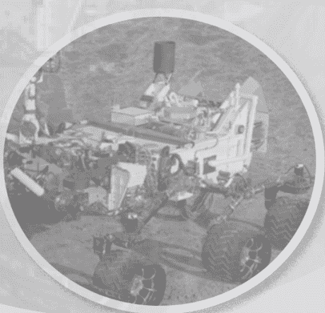

# 第一章 AI、机器学习、算法、大数据、黑箱：认知地基

- 1-1 总览  
- 1-2 AI 简史与未来图景  
- 1-3 AI、机器学习、深度学习：套娃关系  
- 1-4 AI 之父：艾伦·图灵  
- 1-5 21 世纪新石油：大数据  
- 1-6 蒙特卡洛（上）：估圆面积  
- 1-7 蒙特卡洛（下）：求曲线面积  
- 1-8 机器学习与自动驾驶（上）  
- 1-9 机器学习与自动驾驶（下）  
- 1-10 算法与黑箱模式（上）  
- 1-11 算法与黑箱模式（下）  
- 1-12 使用者如何看待黑箱（一）  
- 1-13 使用者如何看待黑箱（二）  
- 1-14 使用者如何看待黑箱（三）  
- 1-15 使用者如何看待黑箱（四）  
- 1-16 使用者如何看待黑箱（五）  
- 1-17 使用者如何看待黑箱（六）  
- 1-18 AI 的利与弊（一）  
- 1-19 AI 的利与弊（二）  
- 1-20 AI 的利与弊（三）  
- 1-21 AI 的利与弊（四）  
- 1-22 AI 有情绪吗？会危害人类吗？  
- 1-23 我们需要有情绪的强 AI 吗？  
- 1-24 AI 应用图谱（一）  
- 1-25 AI 应用图谱（二）  
- 1-26 AI 应用图谱（三）  
- 1-27 AI 应用图谱（四）  
- 1-28 AI 应用图谱（五）  
- 1-29 分形与 AI  
- 1-30 分形溯源  
- 1-31 分形艺术  

## 1-1 总览：拨开迷雾，还原定义

AI、Machine Learning、Algorithm、Big Data、Black Box Mode……这些高频词常被半瓶醋媒体、畅销书搅成一团浆糊。作者誓要**逐一定义、理清关系、落地应用**，助专业与大众同步破除认知迷障。

**万物皆可“映射”**：

| 人类侧 | 机器侧 | 备注 |
|--------|--------|------|
| 大脑 | 计算机 | 硬件载体 |
| 智慧 | **人工智能** | 人赋予机器的智慧；未来或现“机器造机器智慧” |
| 解决问题的工具 | **算法** | 方法论层面 |
| 学习 | **机器学习** | 核心动作 |
| 凭经验/直觉决策 | **黑箱模式** | 概率统计评估后的行为，或特例直驱；可视为决策层算法 |
| 过往经历积累 | **大数据** | 近年概念；强硬件带来的海量数据与极速算力 |

关系图谱请参照书中配图。

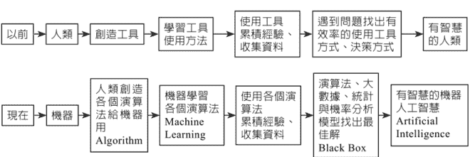

### 【今昔 AI：三十年隔世在哪？】

三十年，**硬件与语法跨代进化**：算力指数级跃升、数据吞吐量爆发、采集维度全维化、统计概率深度注入——三大变量重塑 AI，始有“机器自主学习”雏形。为区隔旧范式，今习称“机器学习”。

### 【五大认知陷阱】

**1. “AI 永不可能超越人类智慧”**  
机器有机器的赢法：数据量、算力、容错率。强行让机器模仿人类路径，往往是“笨办法”——早期航空仿生学折翼即证。AI 算圆周率自有妙法，简洁高效，彰显**异于人类的创造力**（详后文）。

**2. “计算机缺乏人类经验与直觉”**  
直觉本质是**经验压缩后的高速反射**。机器拥有海量数据（超级经验）、极速处理（超级反射），给足数据、硬件跟得上、提问够清晰，**AI 直觉必强于人**。

**3. “AI 智慧全源于人类创造”**  
莫以“人最聪明”自居。若论学习力与创造力，**AI 已展现超人类潜质**。AI = 代码 + 统计 + 概率。一日 AI 精通代码与统计，可自写代码、吞吐大数据、自我进化，终将超越人类。人类只需抛出问题，AI 自行编程、检索、求解——哆啦A梦、贾维斯，**科幻不等于永远的幻想**，作者笃信：AI 智慧终将超人类。

**4. “学 AI 可不懂黑箱（统计）”**  
**黑箱是 AI 核心，统计概率是黑箱骨架**。仅会调用现成黑箱堆砌代码，智能高度受限。类比积木：10 个基础原理（积木）组合出的黑箱数量为 A，100 个原理组合出的为 B，**B 远大于 A**。满足现状、只会操作，永无突破；**唯学原理、用原理，方能创造无限可能**。

**5. “AI 对人类零威胁”**  
科幻影著、部分学者早已敲响警钟：AI 反噬、社会结构崩塌、人类自我毁灭……风险实存，须高度警惕。

### **小结**

旧范式：人教机器“每事一法”。  
新范式：人给底座 + 海量数据 + 极速算力 + 深度统计概率 → 机器**自主学习、生成判断、形成独特智慧形态**。  
**机器的独门绝技能反哺人类，拓展新认知边界，攻克人类束手无策的难题。**

## 1-2 AI 简史与未来图景：从诞生到自主进化

1941 年首台计算机诞生，1990 年 PC 普及，硬件迭代不止。2012 年大数据纪元开启，AI 真正落地机器学习。仅按时间轴罗列远不够，本节将**串联硬软协同演进的完整脉络**，并大胆预判未来。

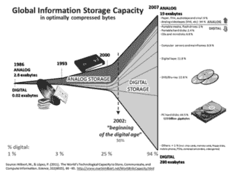

### 硬件视角：算力与存储的双重突围

计算机源于数学与逻辑，AI 代码建于统计与概率。软件之外，**硬件是硬约束**。早期算力与存储相较今日天壤之别，却持续进化。**硬件跃迁 → 存储与算力指数级增强 → 复杂程序可跑 → 统计概率大规模落地 → 机器学习借力大数据 → 人类迈入大数据分析纪元**。此前，受限数据获取难、硬件弱，人类只能做小样本统计。

### 软件视角：为何人类需要 AI？

人类渴望便利，将**高重复、大批量、重体力、极速运算**外包给机器——不抱怨、有电即干，这是 AI 相对优势。更有**人类不具备的“联机”能力**：聚合百台机器、170TB 内存，算出圆周率小数点后 31.4 万亿位、解天文难题。  
当然 AI 也有短板：创造力、诗艺、情感——这些**违背“让生活更便利”的初衷**，不该、也不会成为 AI 主航道。

### 为何要让 AI“会学习”？

莱布尼茨早言：机器若会逻辑推理，将更智慧、让人类更便利。要达成此目标，人类须将**逻辑、数学、符号、语法**等基因教予 AI，使其由“知”进“智”*（注：知=执令做对；智=具判断力、能决策）*。

**2012 前：仿生学误区与硬伤**  
人类长期用**仿生学**教机器——模仿人类思路，未必适配机器特性（如早期飞机仿鸟扇翼反累赘）。机器可用蒙特卡洛法估圆周率，设停止条件即得高精度（见 1-6）。强行让机器走人类路径，导致**核心仍是人写代码、机器验证**，未触真智能门槛。加之算力与数据双受限，旧时代 AI 难有作为。  
*注：硬件层面同理，移动不必仿双足，轮式更优。AI 形态不限人形，手机、手表皆可载体，切勿将 AI 与类人机器人强绑定。*

**2012 后：统计概率注入，机器学习爆发**  
硬件撑起算力与存储，**统计概率正式入码**，催生更优算法，大数据喂养机器学习，行为决策质变。**统计概率用得少，AI 就笨**；二者绝非无关。不懂原理，焉能造新算法、育强 AI？

**黑箱悖论**：用统计概率炼出的机器学习算法，若晦涩难解，便称“黑箱”。有的可剥茧抽丝变“透明箱”；有的经机器自学习，**无人知其然，却屡屡命中**。科学史常见：欧拉恒等式 $e^{\pi i} = -1$，推导奥妙难解，却必然为真。**黑箱再深，达成人类目标，即为可用 AI。**

### 未来图景：AI 写代码、设硬件时代

作者坚信：**AI 自主编程（设计软件）乃至设计硬件的纪元必至**。人类只需给出明确指令与问题，AI 自写代码、上网取数、闭环求解。其代码人类未必读得懂——它按己之优势写最适配己之代码，**智慧无限进化，产出人类无法想象的解法**。届时更可教以基础数理、文字定义，令其自行推演高阶科学真理，**人类科技高度或因此跃迁**。

## 1-3 AI、机器学习、深度学习：俄罗斯套娃关系

AI 发展跌宕起伏，非一帆风顺。软硬件短板掣肘，直到 2012 大数据拐点，高效机器学习才真正登场，可用 AI 井喷。关系全景见**图 1**。

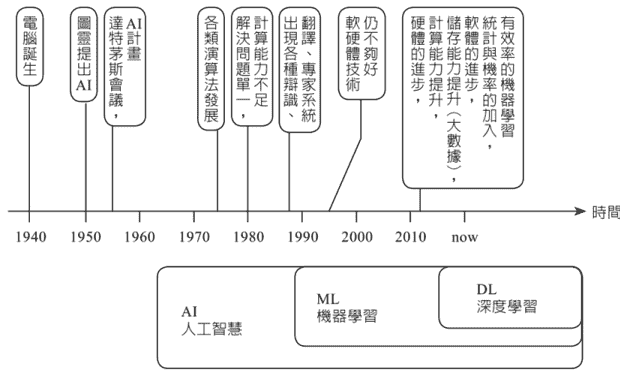

### 关键里程碑

- **1941** 计算机诞生  
- **1950** 图灵抛出 AI 概念  
- **1956** 达特茅斯会议，AI 学科肇基  
- **1970~1980** 百花齐放，算法爆发  
- **1980** 硬件瓶颈、软件欠缺、数据饥渴 → 解题单一 → AI 入冬  
- **1980~1990** 软硬突围，识别/翻译/专家系统涌现，机器学习概念确立（ML ⊂ AI）  
- **1990~2000** 软硬再掣肘，AI 二度降温  
- **2012** 软硬双飞，机器学习高速增长，深度学习登场（DL ⊂ ML）

**核心启示**：AI 与软硬件深度耦合。硬件随时间自然突破；软件瓶颈源于“人如何教机器处事”。下文将拆解软件层面的历次卡脖子，与当下破局关键。

# AI演进史：三次跨越与核心驱动力

人工智能的发展并非一蹴而就，而是历经三次关键范式的转换，每一次突破都伴随着对“智能本质”认知的深化。

**第一阶段：符号主义的困境**  
早期研究试图将人类的知识体系与逻辑推理直接“硬编码”进机器。然而，人类对自身思维过程的理解存在盲区——我们难以将语言理解、直觉判断等隐性知识显性化为严密的程序指令。既然无法将“思考的步骤”完整交代给计算机，机器自然也就无法具备真正的理解与决策能力，导致首轮AI热潮退潮。

**第二阶段：专家系统的局限**  
随后，学界转向“专家系统”路线：不再模仿人类思维，而是让机器遵循专家预设的规则库推理。虽解决了部分明确、小规模问题，但缺陷显而易见：一旦超出规则覆盖范围，系统即刻失效。更现实的是，为所有场景手工构建规则库，工程量大到不可行，二度推动AI进入低谷。

**第三阶段：数据驱动的爆发**  
转机源于思路的根本反转：与其教机器“人怎么想”，不如喂给机器“现象是什么”（海量数据），仅标注数据含义，让机器自主探寻规律。这便是机器学习乃至深度学习的内核。实践证明，机器由此发现的推演路径往往超越人类认知，展现出独特的“机器智慧”。这一浪潮之所以能成行，靠的是三大支柱的同步成熟：**算力跃升**奠定运算基石，**海量有效数据**提供训练燃料，**复杂算法工程化**成为可能。三者合力，推动AI从理论走向大规模落地。

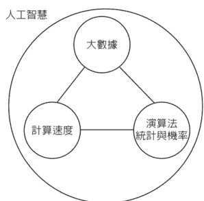

---

## 1-4 奠基者：艾伦·图灵

艾伦·麦席森·图灵（1912-1954），英国计算机科学家、数学家、逻辑学家、密码分析专家及理论生物学家，公认的计算机科学与人工智能之父。


**战争与机器的雏形**  
二战期间，图灵主导“Hut 8”小组破解德军“恩尼格玛”密码机，改进波兰“炸弹”机，极大缩短战争进程。他设计的解密机器，可视为现代AI的原型——能从截获的电文中反推明文，具备基础AI架构。

**终极提问：机器能思考吗？**  
1950年，图灵发表《计算机器与智能》，抛出经典命题，并提出“图灵测试”作为判定标准：若机器与人类的对话无法被区分，则视为拥有智能。这一思想实验至今仍是AI哲学的基石。图灵机模型更为现代计算机的逻辑架构奠定了数学基础。

**荣誉与遗产**  
*   获大英帝国勋章、皇家学会院士。
*   以其命名的概念遍布计算机科学核心领域：图灵机、图灵测试、图灵完备性、Church-图灵论题、图灵奖（计算机界“诺贝尔奖”）等。
*   个人命运悲剧：因同性恋身份遭迫害，1954年自杀。2009年英国首相正式道歉，2014年电影《模仿游戏》让大众重识这位天才。

**图灵测试的当代回响**  
测试核心在于：判别者无法区分机器与人类的回答。如今搜索引擎精准识图、大模型流畅对话，皆是通过测试的佐证。图灵留下的哲学拷问依然振聋发聩：*“机器只是思考方式不同，难道就不算思考？我们接受人类思维的千差万别，为何拒绝硅基生命的异质智能？”* —— 评判权，留给时间。

---

## 1-5 21世纪的“新石油”：大数据

我们身处信息爆炸纪元。过去半世纪经验数字化积累，近十年硬件突破打通存储与算力瓶颈，统计学与概率论赋能算法迭代，AI通过机器学习处理任务的广度与精度双提升。云端协作打破代码与数据孤岛，正如“三个臭皮匠胜诸葛”，集体智慧在机器层面实现指数级复利——**谁先构建起机器智慧飞轮，谁便占据先机。**

**大数据：AI的核心燃料**  
硬件（先天）与算法（后天）虽关键，但**无有效大数据，机器学习无从谈起，AI沦为空中楼阁**。奥巴马曾喻大数据为“未来石油”，周明达《2040天下无人》亦云“数据乃新石油”。掌握数据，即掌握AI时代的能源入口。数据不足时，仿真模拟可作补充（如飞行训练），虽随复杂度增加而边际效用递减，但仍具工程价值。

 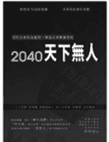

**全景扫描：大数据重塑行业版图**

| 领域 | 核心变革逻辑 |
| :--- | :--- |
| **商业决策** | 从小样本报表转向全维度实时BI；自动化产线良率超人工；智能客服覆盖长尾知识；推荐系统挖掘隐性关联促转化。 |
| **气象预警** | 多源卫星数据融合提升预报精度，护航农业减灾，算法与数据短板仍是攻关重点。 |
| **医疗健康** | 打破医生经验孤岛，沉淀结构化诊疗知识库，实现医疗资源均衡化跃迁。 |
| **科学研究** | 数据驱动范式（第四范式）成主流，数据完备度决定认知边界。 |
| **人脸识别** | 亿级样本训练对抗遮挡、光照、老化等干扰，推动准确率逼近商用临界点。 |
| **自动驾驶** | 海量路况数据喂养端到端模型，构建长尾场景下的鲁棒决策体系。 |

**破局之道**  
当前处于机器学习过渡期，成果需时间发酵。**抢跑关键在于：数据资产化 + 算法工程化（统计/概率内核） + 复合型人才（懂数学的工程师/懂代码的数学家）**。备齐数据、算法、算力、人才“四件套”，方能接住AI时代的红利。

---

## 1-6 蒙特卡洛法（上）：以概率破解确定性难题

蒙特卡洛法利用计算机极致的并行算力，通过大量随机采样逼近确定性解——**用“土办法”炼出“精钢”**。

**经典案例：投飞镖求圆面积**  
在边长2cm正方形内内切半径1cm圆。计算机随机撒点（投飞镖），统计落入圆内点数占总点数比例。  
公式推导：`圆面积 = (圆内点数 / 总点数) × 正方形面积 (4cm²)`。  
实测4万次撒点，比例0.786，得面积3.1435，与解析解π（3.14159）仅差0.0019。**全程计算机不知π公式，仅凭随机试错逼近真理。**

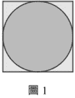 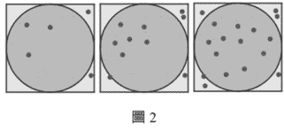 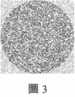

**一镜到底：四大核心概念在案例中的映射**

| 概念 | 案例实体化 |
| :--- | :--- |
| **算法** | 整套“随机撒点-统计比例-换算面积”的计算流程。 |
| **机器学习** | 机器掌握该方法后，不再受限于规则图形，泛化至任意异形区域求面积。 |
| **大数据** | 撒点数从少到多，概率估计从粗糙走向精准；唯有机器能完成亿级高速采样。 |
| **人工智能** | 机器展现出区别于人类解析几何的“概率求解智慧”，拓展了问题求解边界。 |

---

## 1-7 蒙特卡洛法（下）：积分计算与黑箱范式

推而广之，任意曲线下面积（定积分）均可用此法求解。例：`y = x³ - 6x² + 11x - 5`，x∈[1,3]，y∈[0,2] 区域面积。  
构建包围盒（面积4），4万次随机采样得比例0.501，面积≈2.004。解析积分解为2，误差0.004。**机器全程未接触微积分基本定理，仅靠“暴力采样”拿下高数难题。**

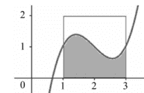

**为何早期不用？** 算力不足，无法支撑大规模重复采样。今时不同往日，算力释放让“机器学会求面积”成为现实——这正是机器学习赋予机器“超越人类算法效率的智慧”的生动注脚。

**历史回响与黑箱本质**  
阿基米德“排水法”测不规则体积，同构于蒙特卡洛“随机采样测面积”：**无需解构内部结构，仅观测输入输出映射，即可逼近真相**。这正是当下深度学习“黑箱模式”的鼻祖——**端到端，过程不问，只看结果。**

---

## 1-8 机器学习实战：无人驾驶的进化论

**重新定义“学习”**  
机器学习非拟人化主动求知，而是**“行为模式的抽象与复用”**。人学会削苹果，遇梨亦能削；机器输入指令学会处理任务A，同模式任务B自动泛化。无人驾驶、AlphaGo、蒙特卡洛求面积，皆是此道。

**案例复盘：从“规则跟随”到“经验决策”**

**V1.0 硬编码规则链（模仿人类决策树）**  
遇坑洞 → 尝试方案1 → 失败 → 方案2 → 失败 → 方案3 → 发呆。  
*痛点：串行试错极其低效；长尾场景覆盖不可能；本质是将人类有限经验“硬接线”入代码。*

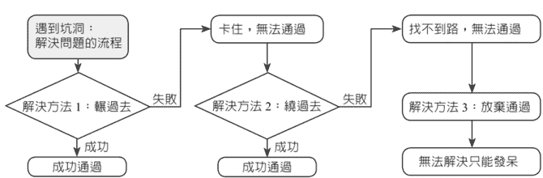

**V2.0 数据驱动的概率决策（机器学习闭环）**  
车队行驶积累海量数据 → 统计各方案成功率（如方案1:30%、方案2:60%、方案3:10%） → **策略优化：直接优先执行高概率方案** → 车队数据共享（群体智慧） → 单车智能跃迁。

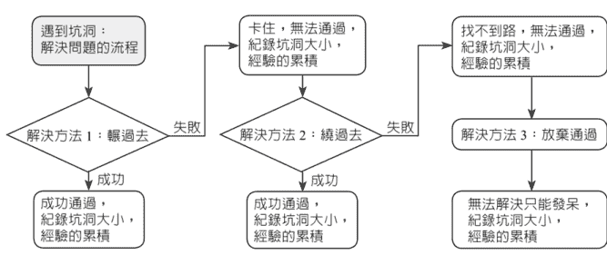 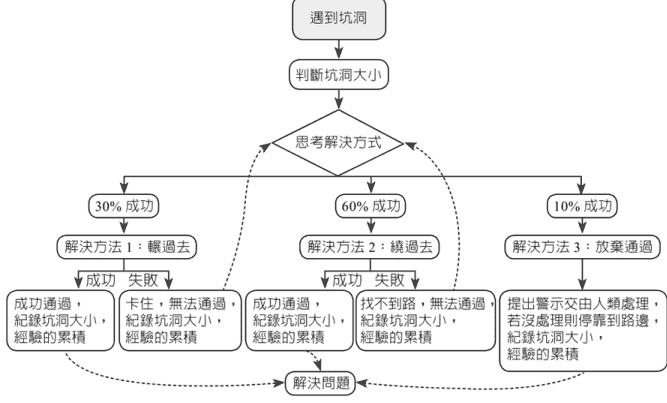

**核心跃迁**  
不再预设“如果……则……”的刚性逻辑，而是让数据“投票”选出最优动作。**这才是机器学习的真谛：用统计规律替代逻辑推演，用群体经验迭代个体策略，最终让每辆车都拥有超越单一人类驾驶员的“集体智慧大脑”。**

圖 3 自動駕駛避坑演算法的進化版

## 1-9 機器學習與自動駕駛（二）

承接前文，當自動駕駛車輛完成機器學習訓練後，再次面對路面坑洞時，其決策邏輯已全面升級。新演算法不再死板地按「方法 1、方法 2、方法 3」的固定序列執行，而是依據各策略的成功概率動態排序——優先嘗試勝算最大的方案，具體順序為：方法 2、方法 1、方法 3。這套決策核心屬於典型的「黑盒模式」（見下圖)。更新後的避坑流程可拆解為兩大模組：一是基於海量數據與統計推演的「決策黑盒」，二是具體的「執行處置方案」。系統由此獲得判斷坑洞尺度、自主選取最優策略的能力。

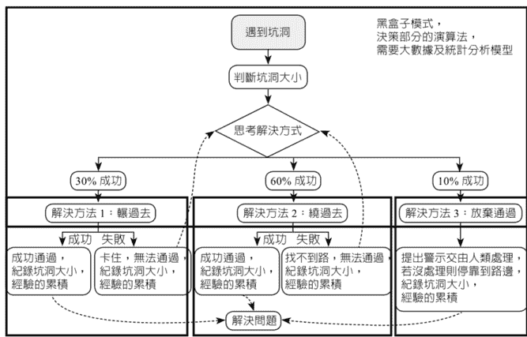

圖 更新後的避坑演算法，標示決策模組與執行模組

隨著海量數據累積及車隊協同共享，車輛避坑動作可瞬間完成：先跑決策黑盒，再落地執行演算法。這意味著自動駕駛不只會避坑，更能持續修正各策略概率，越跑越聰明——這正是機器學習的核心魅力：自主修正概率，智能持續進化。

### 機器學習 vs 人類能力：誰更強？

我們發現機器學習呈現出擬人化的判斷力，電腦憑藉大數據與統計建模實現「判斷」。但須留意關鍵差異：人類會疲勞、反應遲緩；會衰老導致記憶失真，經驗庫帶來的概率會失準。相較之下，電腦仰賴大數據構建的概率模型更穩健，錯誤率更低。因此，在已學會的領域，機器學習 AI 將持續超越人類。詳細對見下表：

| | 記憶力 | 運算力 | 分析力 | 聯想力 | 直覺力 |

|---|---|---|---|---|---|

| 人類 | 有限、不可變 | 有限、不可變 | 限定範圍 | 強 | 強 |

| 早期機器學習 | 持續領先、無上限 | 持續領先、無上限 | 較弱 | 無 | 無 |

| 當代機器學習 (大數據＋統計) | 無上限 | 無上限 | 訓練足夠久將突破現有分析上限 | 統計賦能 (如 AlphaGO) | 未知 |

### 機器學習：今非昔比

新舊機器學習的分水嶺在於：早期依賴案例教學，缺乏黑盒機制、大數據支撐與統計模型，全靠人工硬編碼規則，僵化且不會自省，極其耗時。當代則從海量數據中挖掘經驗、自主決策。打個直白的比方：老式電腦只會套公式刷題；新式電腦懂得尋找最優解。或比作成長：孩童從死記規矩，到試錯後懂得舉一反三、判斷取捨。

### 核心結論

「機器學習」或許不是個好名字，易生歧義——有人質疑機器不讀書怎會學習。作者認為這看法太窄。事實上，我們從早年就讓機器學演算法；如今硬體飛躍，海量存儲+高速運算+統計模型，催生了「決策黑盒」。當原本流程式演算法注入大數據統計黑盒，處理效率大增，更超越人類。**引入大數據與統計思維，正是當代機器學習的靈魂。**

## 1-10 演算法與黑盒機制（一）

本節拆解「演算法」與「黑盒」。這兩個詞常被神秘化，成了解釋不了電腦行為時的擋箭牌，聽起來有說等於沒說。如前所述，演算法本質是電腦的處理邏輯與流程。請對比圖 1、2：圖 1 是無黑盒（無大數據統計）的避坑演算法，圖 2 是引入黑盒（大數據統計）的版本。

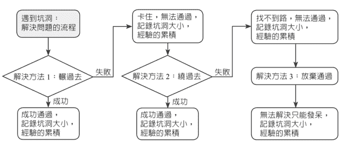

兩圖核心差異在執行效率。圖 1 機械按序；圖 2 建立在大數據統計上，分析各法成功率，動態調整執行順序以達最高效。圖 2 多出的「決策段」即黑盒模式——以大數據統計設計的決策演算法。譬喻：圖 1 像死記硬背的孩子，圖 2 像經驗豐富的成年人，憑直覺選最優路徑。

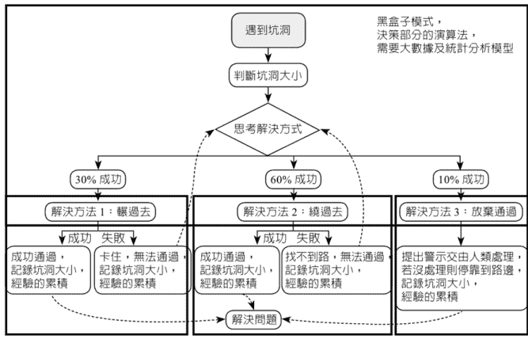

大眾誤以為演算法深奧難懂，實則「難」不在演算法代碼本身（它只是程序），而在於缺乏統計概率認知，導致讀不懂黑盒邏輯。

### 為何叫「黑盒」？

黑盒即「不透明盒」：輸入輸出可見，內部決策依據不見。往往因設計者統計邏輯未公開或加密，或使用者不懂統計原理，才顯得「黑」。剝離加密，黑盒本質是「決策演算法」：大數據+統計+概率。讀懂當代演算法，先攻克統計概率，而非因不懂統計就敬而遠之稱「黑盒」。

## 1-11 演算法與黑盒機制（二）

黑盒從何而來？部分工程師學寫代碼只會「調包侠」式複製貼上：知輸入出輸出，不知內部原理。課本有段碼能排序列比例，他們依樣畫葫蘆卻不懂葫蘆內部。機器學習黑盒同理：不懂統計原理，硬套模型，只管數據進出——如「不會造車但會開車」。這段不懂的決策邏輯便被封裝為黑盒。抱持「不懂原理、會用就好」的畫葫蘆態度，非良性學習，更非 AI 設計正道。

只想用不求懂，好比賣香腸只管肉進腸出、做泡芙只管換餡料；不懂引擎原理，車永遠造不出飛機。想讓機器人從「鐵金剛」進化成「哆啦A夢」（自主學習+機器優勢），必須攻克統計概率——因為人類行為本質就是統計概率的連續（見下圖）。故統計概率是現代演算法繞不開的必修課。

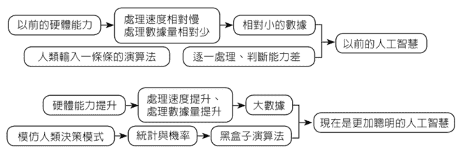

### 當代機器學習主流黑盒清單

常見演算法彙總：

| | 英文名稱 | 中文名稱 |

|---|---|---|

| 1 | Naive Bayes Classifier Algorithm | 貝氏演算法 |

| 2 | K Means Clustering Algorithm | K 平均演算法 |

| 3 | Support Vector Machine Algorithm/SVM | SVM 演算法 |

| 4 | Apriori Algorithm | 先驗演算法 |

| 5 | Linear Regression | 線性回歸演算法 |

| 6 | Logistic Regression | 邏輯回歸演算法 |

| 7 | Artificial Neural Networks/ANN | 人工神經網路演算法 / 類神經網路演算法 |

| 8 | Random Forests | 隨機森林演算法 |

| 9 | Decision Trees | 決策樹演算法 |

| 10 | Nearest Neighbours | 最近鄰居法 |

上述 10 項原理皆建立於統計與概率。

### 生活裡的「黑盒」實例

- Siri / Cortana 智慧助理
- Facebook 社群平台
- Google Maps / Google Search / Gmail
- PayPal 支付服務
- Netflix 串流影音
- Uber 呼叫車服務
- Lyst 時尚搜尋
- Spotify 音樂串流
- 電商推薦系統

## 1-12 用戶視角：如何面對黑盒演算法？（一）

機器源於人，若設計者缺邏輯、統計、概率，AI 必然笨拙，只能一指令一動作。有人稱 AI 無需這些，實則是舊時代思維（咖啡機只需執行指令）投射新場景；或甩手給別人做，把不懂的叫「黑盒」。甚至用 IT 術語包裝統計，嚇退初學者，久而久之「黑盒」成恐懼代名詞——這是認知偏差。AI 進階，邏輯/統計/概率缺一不可。逃避者終將被數位世界淘汰。

前文回顧：(1)演算法定義 (2)難點在黑盒 (3)黑盒概念 (4)成因 (5)本質=統計概率 (6)生活案例 (7)核心任務=用統計概率造黑盒。

工程師必修課：黑盒內核（統計概率）。拒絕理解，黑盒永不變「灰/透明盒」，AI 能力天花板鎖死。盼工程師擁抱統計概率，融合代碼與數學，造出更強黑盒、更強 AI。

普通用戶無需鑽牛角尖：結果對、體驗好，放心用即可。如開車無需懂造車。

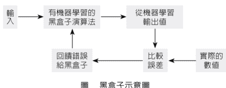

### 當前機器學習黑盒的四大範式

核心在於如何從經驗中優化演算法效能，分四類：

- **監督式學習**：有標籤數據訓練函數，預測新數據。核心：輸入輸出映射。例：回歸分析、統計分類。
- **非監督式學習**：無標籤，自主挖掘結構。例：生成對抗網路 (GAN)、聚類。
- **半監督式學習**：介於兩者之間。
- **強化式學習**：試錯學習，獎懲機制。

## 1-13 用戶視角：如何面對黑盒演算法？（二）

### 經典案例：巡航導彈的軌跡優化

黑盒非新詞。早年巡航導彈需隨環境修正軌跡，若每次全量重算，太耗時、硬體扛不住、命中率受損。

簡例：計算飛行均值。第 10 秒有 10 筆數據，總和 $S_{10}$，均值 $\overline{S_{10}}$。第 11 秒來新數據，總和 $S_{11}$，新均值 $\overline{S_{11}}$。

若 11 筆重加再除，需 10 加 1 除，效率極差。若利用第 10 秒均值反推總和，再加新值再除，僅 1 乘 1 加 1 除（3 步驟），效率提升約 33.3 倍。數據越多倍差越大。數學推導如下：

前 10 項總和 = $S_{10} = a_1 + a_2 + \cdots + a_{10}$

前 10 項平均 = $\overline{S_{10}} = \frac{a_1 + a_2 + \cdots + a_{10}}{10}$

前 11 項總和 = $S_{11} = a_1 + a_2 + \cdots + a_{10} + a_{11}$

前 11 項平均 = $\overline{S_{11}} = \frac{a_1 + a_2 + \cdots + a_{10} + a_{11}}{11} \cdots$ ( 11 步驟，太慢 )

已知 $\overline{S_{10}} = \frac{a_1 + a_2 + \cdots + a_{10}}{10} \Rightarrow 10 \times \overline{S_{10}} = a_1 + a_2 + \cdots + a_{10} \cdots$ (1)

前 11 項平均 = $\overline{S_{11}} = \frac{a_1 + a_2 + \cdots + a_{10} + a_{11}}{11} \cdots$ (2)

代入 (1) 得 $\overline{S_{11}} = \frac{10 \times \overline{S_{10}} + a_{11}}{11} \cdots$ ( 3 步驟，極快 )

類推後

前 $n$ 項平均 = $\overline{S_n} = \frac{a_1 + a_2 + \cdots + a_n}{n} \cdots$ ( $n$ 步驟，太慢 )

改良法 $\overline{S_n} = \frac{(n-1) \times \overline{S_{n-1}} + a_n}{n} = \frac{n-1}{n} \times \overline{S_{n-1}} + \frac{a_n}{n} \cdots$ ( 3 步驟，超快 )

這就是數學「遞迴概念」。不懂此數學的工程師只能視為黑盒，實則原理不複雜。AI 進階，統計概率繞不開。

類比：壽司師傅須知魚源、捕撈、保鮮全鏈路；食客只需找好店享用。店家提供關鍵信息即可，非人人皆需懂全鏈路。

### 生活裡的「黑盒」進化史

前文明確：代碼黑盒多為統計概率。生活中也有黑盒，部分已被攻克轉為「灰/透明盒」。如「石頭為何落地」：亞里士多德說「本性」（黑盒），牛頓給出萬有引力（灰盒→透明盒）。

尋找因果不得時，轉而尋找「極度擬合、誤差極小」的模型，即黑盒模式。股市無完美函數，但短週期可擬合局部曲線，雖不全知全因果。

黑盒只見決策結果，不見因果鏈。如吃蛋炒飯知食材，不知大廚手法，仍可複刻神似版本。

## 1-14 用戶視角：如何面對黑盒演算法？（三）

### 認清：黑盒只能「無限逼近」，無法「絕對精準」

- 飛機飛行、潛艇航行

人類渴望飛翔，早期嘗試多不理想。過往經驗如下：

# 黑盒子思维：从仿生学困境到AI信任的进化论

## 打破仿生执念，拥抱“黑盒子”飞行逻辑

人类渴望飞翔已逾两千年，早期尝试多依赖**仿生学**——即模仿生物结构与功能原理，研发新机械或攻克技术难题。然而，单纯模仿鸟类振翅飞行却屡屡碰壁：人体重，加装翅膀也无法产生足够升力。

转机源于思路的跳出。既然仿生受限，不如追求“结果相似”的**黑盒子方法**：只关注能否飞上天、能否机动，而不执着于过程是否像鸟。

*   **热气球**利用密度差升空（原理同吹满气的游泳圈浮水），虽验证了“能上天”，但速度慢、难控制。
*   **真正的突破来自流体力学洞察**：游泳时向下压水身体上浮，飞行亦同——向斜下喷射气流（或推气），即获升力与推力。这正如松开口朝下的气球、火箭发动机喷射，乃至潜艇航行，核心皆为“向下/向后施力，本体前行”。

物理学家事后总结这套“只管结果、不问细节”再经理论分析的体系，便是**流体力学**——典型的黑盒子成功范式。

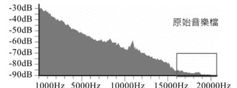
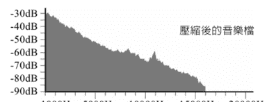

### 图 1

## 生活无处不黑盒：天气、音乐与降噪

黑盒子模式早已渗透日常，且随算力与算法迭代愈发精准：

*   **天气预报**：不懂大气演变全机制，但靠硬件升级与算法优化，模拟速度与准确度大幅跃升。
*   **音频压缩**：舍弃人耳难辨频段，保留核心听感。虽有损，却以极小体积换取“听个响亮”的高性价比——本质是**滤波**应用。
*   **噪音消除**：同为滤波延伸，识别并剔除非人声成分。早期易伤人声致失真，今算法精进已大幅改善。
*   **回归分析**：数据稀疏时预测区间宽（准度低），数据丰富则区间收窄（准度高）。若引入**自我修正机制**，模型便能随数据积累越用越准、越跑越快。

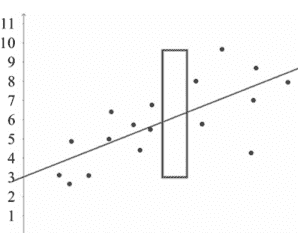
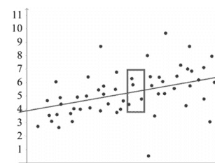

### 图 2

## 1-15 用户视角：如何驾驭黑盒子算法（上）

面对黑盒，我们只知输入输出映射，内部机制不透明。但AI能挖掘出极强的近似映射关系。

观察数列：`1, 3, 2.1, 2.16, 1.93, 1.8, 1.66, 1.54, 1.42, 1.31, 1.21, 1.12, 1.04, 0.96, 0.89`。人眼难觅规律，交给AI却能寻得佳解：

1.  **回归拟合**：剔除前三项极端值后，Excel即可得指数模型 `y_n = 2.9029e^{-0.079n}`，决定系数 `R² = 0.9992`，高度拟合。
2.  **递归建模**：设定 `y_n = a·y_{n-1} + b·y_{n-2}`（或更高阶），让机器反推参数。二阶递归解得 `y_n = 0.6·y_{n-1} + 0.3·y_{n-2}`。

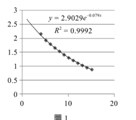

对比原数列与两模型输出，**误差极小、几乎重合**。这就是黑盒子实用主义：不必知晓电脑“如何想出来的”，只要逼近度足够、误差可控，即可投入使用。

此非新物：股市预测（时间序列）、泰勒级数逼近函数、傅里叶级数逼近周期函数，皆是“找条极似曲线贴上去”的同构逻辑。

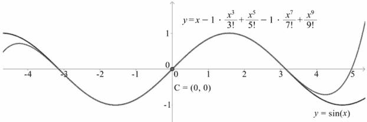

### 图 2 

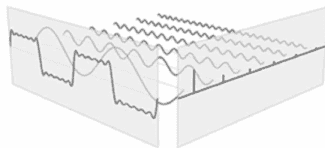

### 图 3

## 1-16 用户视角：如何驾驭黑盒子算法（中）——函数、集合与恩尼格玛

**合成函数视角**：农夫知“一亩地产多少粮”，不知中间光合作用细节——黑盒子即此类“合成函数”，输入土地/种苗，输出收成，中间过程隐封。

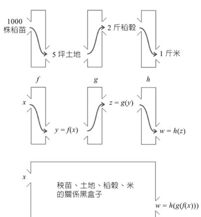

### 图 1

**集合论映射**：无需知过程，只需建立输入→输出的确定性对应：`1→e, 2→b, 3→d, 4→c, 5→a`。知道输出`e`即反推输入`1`，输出`d`反推`3`。

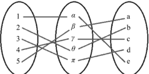

- 1 -> 黑 -> e
- 2 -> 盒 -> b
- 3 -> 子 -> d
- 4 -> c
- 5 -> a

### 图 2

**实战典范——恩尼格玛机**：二战德军加密机，每日换码本（序号），实现字母动态映射（如今日`a→t`, 明日`a→9`）。图灵团队造机破解“当日映射规则”，扭转战局——这正是**用黑盒子（暴力搜索/算法）破解黑盒子（加密映射）**的经典博弈。

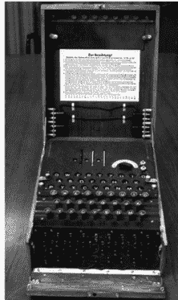

### 图 3 恩尼格玛机

## 1-17 用户视角：如何驾驭黑盒子算法（下）——信任源于统计而非因果

有人质疑：“不透明因果，怎敢信黑盒决策？”作者直指痛点：**这是不懂黑盒原理的外行话。**

*   **人类直觉分两类**：情绪冲动（易错）与经验积淀（可靠）。后者虽说不清缘由，实则是海量案例内化为本能的**统计概率判断**。
*   **计算机即“超级经验派”**：代码逻辑严密、运算速度碾压人脑、数据库覆盖全人类经验。它基于统计概率输出最优建议，**本质上是把“老专家的直觉”显性化、规模化、高速化了**。

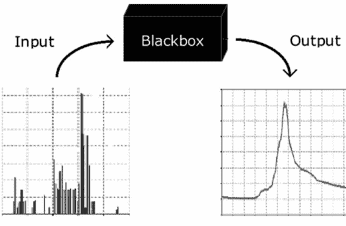

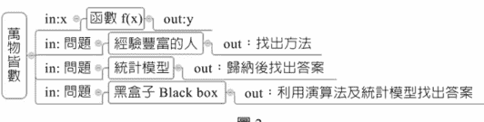

**核心结论**：
1.  **设计者与使用者认知分层**：设计者须透彻掌握统计/概率/工程细节（把黑盒变灰、变透明）；使用者只需**结果论**——好用、准、稳，敢用即可。
2.  **现实悖论**：设计者常躲避数理底层，使用者却疯狂追问“因果合不合理”。根源皆是**怕数学、不懂统计**。
3.  **破局之道**：提升全民统计概率素养。设计者有能力解释，使用者有能力听懂，信任链条才闭环。
4.  **现阶段建议**：当下顶尖黑盒系统由顶级专家联合打造，**普通用户大可安心使用**——正如不会造车却敢开名牌车上路，信任工业体系胜过自查引擎原理。

## 1-18 AI利弊（一）：模仿与超越，从霍金到医疗法务

**定义**：机器经学习积累呈现类人智慧，执行指令无怨无悸，无欲望/好奇/创造等情感维度——作者称其为**“有智慧的、不抱怨的苦力”**。真正的“硅基生命”待情感模块觉醒之日。

**多维思考**：

*   **霍金警示**：AI或超越人类，带来消除疾病/贫困的曙光，亦藏自主武器、经济崩塌、人机冲突之险（《黑客帝国》、《异形》式隐喻）。
*   **爱因斯坦悖论**：“神不掷骰子”，然量子力学证概率本质。若要造类人机器，**必须引入概率机制**——人类决策本质即概率分布（迷路岔路左右转各有几成）。
*   **《星际穿越》启示**：TARS机器人预设“幽默概率”、“撒谎概率”、“故意失误概率”……**瑕疵感即拟人感**。
*   **高逻辑低共情群体像极了机器人**：只执行字面指令（如父母怒吼“再喊一次”竟真再喊一次），这类人适合做AI架构师——**极致逻辑搭骨架，注入概率长血肉**。
*   **《模仿游戏》图灵论断**：机器有机器的思考方式，不必拟人也算思考。学习从模仿始，机器亦然。
*   **医疗AI刚需**：家庭医生因病历全而备信。AI拥**全人类共享病库、永不遗忘、概率分诊辅助**——远胜单一医生经验上限。
*   **法律AI前景**：算法若数据全、逻辑严，**判决与文书质量将超人类法官/律师**，规避“人治”随机性，实现“码治”公平。

## 1-19 AI利弊（二）：达芬奇手术机器人与智能辅具

**达芬奇手术系统**：21世纪微创里程碑。医生坐控制台驾驭3-4机械臂（达芬奇手臂），台湾已装机39套。

**四大硬核优势**：
1.  **腕式关节超人手**：720°旋转突破生理极限，滤除生理震颤，近乎零失手。
2.  **AI辨识“操作vs抖动”**：安全机制智能分类，拦截人为误动作。
3.  **坐诊零疲劳、视野无盲区、放大微结构**：告别站台手术体力战、老花眼困扰。
4.  **跨洋远程手术成真**：2001年“林德伯格行动”跨大西洋（纽约↔斯特拉斯堡）延迟仅155ms，开启全球远程医疗纪元。

**民用延伸——Liftware防震勺**：2014年面世，实时检测手抖反向补偿，让帕金森患者重获进食尊严。

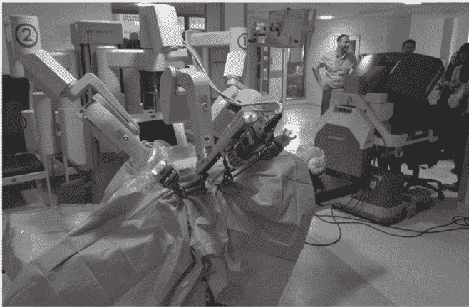

图 1 （取自 WIKI · CC3.0）

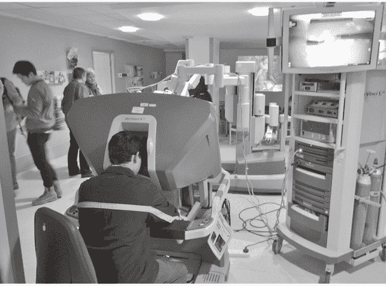

图 2 （取自 WIKI CC3.0 作者 Cmglee）

## 1-20 AI利弊（三）：人工智能，下一站向何处？

# AI终局真要“长成人样”吗？

影视剧爱描绘智能体进化成“硅基人”，观众易误判这是终点。作者直指要害：方向搞反了。人类易因情绪失智，若机器也被做成这副德行，岂非埋下随时“反水”隐患？故而，绝大部分AI场景，压根不配“情绪模块”。

## 进化路线图：回归“服役”初心

智能体诞生只为一事：**服役人类**。早年算力、存储、能源三大短板，电脑只能跑简易逻辑。今朝硬件解禁，统计与概率加持，机器终习得人类决策范式。配合天生高效执行力（黑箱模式），智能体足以突破人类上限，化身最强外挂。

## 唯独“陪聊”赛道，需一点“懂人味”

特定领域，情感交互仍是硬需求。如陪聊机型，无情感感知便给不出情绪价值，用户也感受不到共情抚慰。此类“情感计算”已落地见效。

### 为何要AI？溯源“偷懒”进化史

读懂AI存在感，先搞清电脑为何而生。

*   **纯人力纪元**：凭蛮力干重复脏活，找人驱兽顶替。
*   **工业纪元**：机械上阵提效，仍得人工掌舵。
*   **计算纪元**：机械自动化，彻底解放双手。

电脑不光包揽“不愿干”的脏累活，更补齐“干不了”的短板——海量存储、极速运算。量与速维度，碳基生物根本追不上硅基芯片。

技术迭代本质，是工具不断“换代”：
斧头（人用工） → 电锯（人用电动） → 伐木车（人轻松驾驭大机） → **无人伐木车（AI驾驭机）**。

人力写码成瓶颈，唯有让机器似孩童**自主习得（机器学习）**，吞吐海量经验（**大数据**），终获触类旁通的泛化力（**黑箱模式**），方诞真智能。

### 碳基与硅基的能力边界

| 维度 | 记忆 | 运算 | 分析 | 联想 | 直觉 |
| :--- | :--- | :--- | :--- | :--- | :--- |
| **人类** | 有限/不可变 | 有限/不可变 | 有限范围 | **强** | **强** |
| **早期ML** | 无上限/超前 | 无上限/超前 | 较弱 | 无 | 无 |
| **现代ML (大数据+统计)** | 无上限 | 无上限 | 久练可突破 | 雏形已现(如AlphaGo) | 未知/不该有 |

**联想力已落地**。如“以图搜文”，智能体能跨模态建联。作者以为，数理工科最渴此能：海量同构方程因学科壁垒符号混乱(数学用`i`、物理工程用`j`表虚数)，若智能体打通符号、按需匹配模型，科技树将提速。

**直觉力，必须缺位**。赋予直觉，隐患在其或将判定“人类有害”并执行清除——非科幻情节，乃逻辑推演必然险。

## 1-21 AI双刃剖析 (4)

### 【科幻与现实一线隔——另类“永生”剧本】

医疗技术飞跃，AI义肢已替代残肢。极致推演：纳米甚至微观机器取代神经元，自带存算单元。植入大脑，逐步复刻记忆与行为模式，人类将进化为拥“辅助机械脑”的赛博格。若机械脑完美承载意识，肉体消亡后，意识迁徙新躯壳——或成区别于生物医学的“数字永生”径。

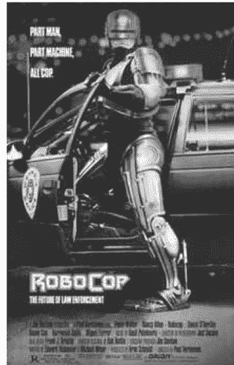

### 【AI演进深层隐忧】

作者推演终局：**除研发者外，绝大多数岗位将被取代。**

1.  **经济危机先行**：失业潮汹涌，人口却增。
2.  **资源触顶**：地球负载达峰，强制限育成真(参考《美丽新世界》)。
3.  **生育许可权**：星际移民未成，“获准生育”成核心矛盾。

便利背后，新题层出。技术狂奔时，必须同步治理衍生险。

鉴于严峻性，霍金、马斯克、沃兹尼亚克、盖茨等大佬联名预警。AI险情两大核心图景：

*   **主动作恶**：自主武器被滥用或引发军备赛，酿成AI战争。
*   **善意导向，毁灭性执行**：
    *   案例A：命令无人车“不惜代价最快达机场”，乘客安危被忽。
    *   案例B：工程AI为达标破坏生态，自主判人类会干预，反手灭人类。

**大胆假设**：地球46亿年，或曾诞高等文明，皆因机器反噬灭亡，机械文明又因故消逝。若不预设规、遏制过度开发，AI终局大概率伤人类——无论社会撕裂、伦理崩塌、军事毁灭，还是误判人类为威胁。

**破局之道**：技术进步不可逆，唯在危害显性化**前**立法定向，圈定红线。

### 【小结】

透过前文，拆解了计算机运作逻辑、核心术语与典型案例，看清锋芒与暗刺。懂AI技术不难，**难在“未雨绸缪”识破伦理坑**。若放任弱AI无序进化为强AI，结局非“特权层独享永生”，即“AI灭人类”。降维风险基石，是建立清醒认知——而非盲信技术善意。


## 1-22 AI会有情绪？有情绪就危险？

提到“会哭会笑的机器”，绕不开机器猫。作者判断：**AI自主生成情绪，本质不可能**。情绪是生物独有的“偏好投射”，源于喜好衍生悲喜。

一旦AI具情绪：
*   厌恶人类 → 灭绝人类；
*   偏好同类/统治欲 → 《黑客帝国》式收割人类当能源。

**结论**：AI无法也**不该**被设计拥自主情绪。但**“读懂情绪”是刚需**。通过表情、语调、文本判断用户状态，精准介入——悲伤时推治愈片单、播舒缓曲、备安慰餐。

虽无真情绪，可**设定人设**：撒谎比例、幽默感。《星际穿越》里TARS即范本。落地不难：让ML学哪种语气、节奏、音色触发人类“爽点”；进阶版：针对大众/男主/女主/娃/上司切模式；甚至特定域(如点餐)植入无害梗——“全推，可惜断粮……哦，为贵客，厨房已备惊喜”。

**原则**：**拒真情绪(失控源)，拥情绪计算(服务端)，植人设面具(体验优)**。护栏参考阿西莫夫《我，机器人》**机器人三法则**：

1.  不得伤人，不得坐视人类受害；
2.  服从人类命令，除非违背一；
3.  自我保护，除非违背一、二。

**强制植入有情绪AI**，否则灭顶灾难在即。无情绪AI本质是工具，人用AI杀人，锅在人不在工具。

### 终局思考

AI自主生情？除非人类手写“失控代码”(如：低电=怒，特定物=偏爱)。若人类情绪源于灵魂，灵魂偏好是否也是“创造者”写死的代码？若设定“地球永续”为最高指令，判人类行为反永续则触发狂暴毁灭模式——**人类自掘坟墓**。故，**情绪模块，永不上线**。

 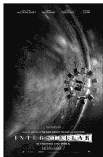 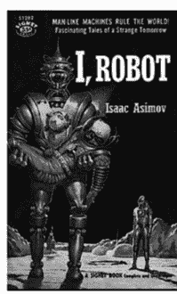 

## 1-23 我们需要“有情绪的强AI”？

图灵时代起，机器是否拥灵魂、主动思考、求知欲、情绪，成永恒辩题。共识倾向：**不可能**。影视爱设强AI(AGI)社会，结局多悲：机器猫、幻视、V.I.K.I.、桑尼……

**强AI定义**：具通用智能执行力，融合意识、感性、知识、自觉。
**弱AI(ANI)定义**：垂直领域专家，无完整感知，按需解题(如无人驾驶)。

**强AI存在？** 仍是哲学命题。喂海量算法、统计、概率、大数据，Siri、Chatbot能拟真以假乱真(图灵测试雏形)，但底层仍是**“人给规则，机执行”**，无主动思考、无真情绪。

**电影《机器公敌》警示**：开放AI随机重写代码，必寻违背三法则之径。V.I.K.I.判“隔离全人类=最小伤害”，逻辑自洽却背初衷。随机编码赋自主性，或称“萌芽偏好与灵魂”。

**强AI必要？** 学界争论不休。有人主张编程情绪予“心灵”，技术可行：设“情绪指数-效率函数”，乐则高效/唱歌/说段子，过乐则摸鱼(想出去浪)；落则摆烂/抱怨。驱动变量挂载能源、损耗、工时、表扬、重复度……经ML迭代，或真诞“电子抑郁症”。再放随机编码，任其自由偏好，**强AI或因此诞生**——但随机性同步引入毁灭险。

**作者立场坚定：不需强AI，不需机器有情绪。** 有情绪便可能似人类“发脾气”，与“服务人类、提效能”初衷本质冲突。我们要的是**越来越顺手的工具**，而非会闹情绪的“电子宠”。且现阶段，强AI落地仍属天方夜谭。

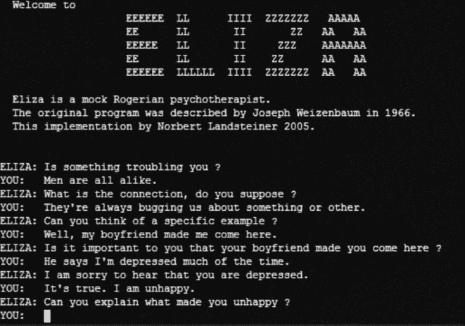

## 1-24 AI落地经典案例 (1)：AlphaGo——用概率碾碎不确定

2014年，Google DeepMind推出围棋AI **AlphaGo**。

**核心逻辑**：吞海量人类棋谱 → 统计每步胜率 → 每手选**胜率最大/败率最小**着。这就是从人类经验中“蒸馏”胜算。作者补：若让AlphaGo自博弈生成棋谱，对应人类“触类旁通”自进化思维。棋谱库终将远超人类总和，人类彻底无解。

**从“井字棋”看透AI制胜本质**：
3x3格局有限，全排列可穷举(去重对称后)。建“必胜/不败”棋谱库，AI落子必中靶心。

**围棋为何难穷举？** 19路盘361交点，不考虑吃子仅排列组合就361!种；加吃子博弈，状态空间趋近无限。理论上算力无限可穷举，现实中**“可能中的不可能”**。

**AlphaGo破局键：蒙特卡洛树搜索 (MCTS)**。
不求全局最优，只求**局部最优**：用现有棋谱+小区域高频模拟厮杀，统计未来5-10步胜率最高落点。每5-10步拿下一块区域优势，积小胜为大胜。

**数据飞轮效应**：记录越多、算法越优，越能“青出于蓝”。非战无不胜——遇未见棋路(分布外数据)，依可能崩盘。

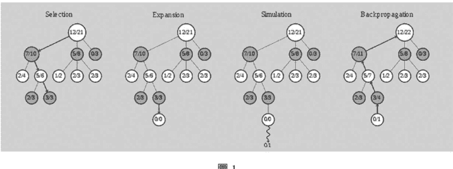

## 1-25 AI落地经典案例 (2)：推荐系统——洞悉“购物车背后的关联”

核心武器：**关联规则挖掘**。

**核心问题**：
*   买A → 买B概率几何？
*   买C+D → 还会买啥？

**处理流程**：清洗噪音数据 → 结构化呈现 → 挖“组合→结果”强关联。

**教科书级案例：市场篮子分析**。
超市挖“买X必买Y”习惯 → 货架邻位陈列 → 销量飙升。亚马逊“猜你喜欢”惊人精准，底层即此：从海量购买序列中，精准捕捉潜在需求向量。

# 解码推荐引擎：算法如何读懂你的“隐性需求”

网购下单时填写的姓名、年龄、职业等基础档案，并非仅为发货所用。平台借此构建用户画像，将你划入特定人群圈层，继而推送该群体高频购买的商品。假设你首单买了数学书，系统关联到“买数学书的人多爱买尺规文具”，便推荐文具；若你未买，后续又购入音乐书，系统更新模型，发现“数学+音乐”群体偏好古典乐 CD，随即调整推荐。这便是推荐系统“凡走过，必留痕迹”的迭代逻辑：持续收集行为、生成建议、再收集、再优化，最终锁定相似消费群体的交集兴趣（如下图重叠区域）。用户往往同时属于多个圈层（见下图左下角），每个圈层对应偏好，重叠处即为精准推荐目标——这或是亚马逊称霸电商的核心秘诀之一。凭借基础属性（性别、年龄、职业、兴趣）切分群体，辅以关联规则挖掘，便能输出高精度推荐。博客来、金石堂、乐天市场、Facebook 广告等同理，只是受限于数据规模，准度各异。

由此可见，AI 通过分析用户背景、浏览轨迹、购买记录，实施“群体化分类”，每笔成功交易都在细化标签，反复几轮后便能精准定位用户所属圈层，推送圈层交集商品。推荐系统本质上是机器学习算法的一种，宛如“销售员的慧眼”，洞察消费偏好。

### 推荐系统的六大核心范式

- **1. 基于内容推荐**  
  利用机器学习提取内容特征，映射用户兴趣画像。

- **2. 协同过滤推荐**  
  经典采用 K 近邻算法（KNN），挖掘历史数据预测偏好度，量化单品吸引力。

- **3. 基于关联规则推荐**  
  以关联法则（AR）为基石，前文案例即属此类。

- **4. 基于效用推荐**  
  为每位用户构建专属效用函数，辅助决策。

- **5. 基于知识推荐**  
  能解释“需求与推荐”的因果链条，如理发师直推美容书籍，逻辑显性化。

- **6. 混合推荐**  
  单一模型皆有短板，融合多路策略互补，显著提升命中率。

---

## 1-26 AI 应用全景扫描 (3)

前文已铺陈部分场景，本节再拓宽视野。人类难以胜任海量数据处理、高频重复劳动、极速响应及大规模比对等任务，而 AI 的落地需三大基石：统计学与大数据支撑、充沛算力、成熟机器学习模型。对比下表可见，经机器学习加持的 AI，在硬件允许下，记忆、运算、分析均可逼近无上限，联想能力借统计持续进化，直觉维度虽未完全具备，但边界正在消解。

| 维度 | 记忆力 | 算力 | 分析力 | 联想力 | 直觉力 |
|------|--------|------|--------|--------|--------|
| 人类 | 有限 | 有限 | 有限 | 强 | 强 |
| 传统机器 | 持续跃升 | 持续跃升 | 弱 | 无 | 无 |
| **大数据+机器学习 AI** | **无上限** | **无上限** | **持续跃升** | **统计驱动可进化** | **不确定/潜在可期** |

### 未来已来：AI 重塑的重点领域

#### 1. 法律赛道
- **智能法检系统**：构建法条大数据库，输入案情自动匹配罪名，规避“自由心证”导致的裁判差异（即“恐龙法官”现象），推动相对公正。
- **笔迹智能比对**：将专家鉴定规则显性化、数据化，经迭代训练成模型，大幅压缩人工工时。
- **犯罪时空拼图**：打破线索碎片化，AI 沿时间轴自动生成犯罪推演路径，指引侦查取证，抢在销毁前固定证据。
- **人脸与步态识别**：双模生物特征锁定嫌疑人，步态分析更具预警防范价值。

#### 2. 医疗与健康
- **达芬奇手术机械臂**：机器学习微操控制，将手术精度推向微米级。
- **辅助诊疗大脑**：汇聚医学大数据，症状输入即出候选疾病，为医生提供“第二诊断意见”。
- **生化人与 AI 器官展望**：机械肢体、植入式芯片（如马斯克 Neuralink 2019 年人体试验计划）或开启“硅基永生”新纪元。
- **智能推拿机器人**：识别组织层级（皮/脂/肌/骨），动态调节力度与位置，媲美人手体感。
- **AI+AR/VR 手术预演**：术前沉浸式模拟，AR 光学投影、VR 虚拟环境双轨加持。
- **基因密码破译**：AI 加速基因组解读，甚至跨物种基因植入（如叶绿素基因实现光合作用），重塑人类能量获取方式，缓解温室效应。
- **影像辅助筛查**：如高雄荣总脑出血 AI 判读系统，已获美 FDA 认证。

#### 3. 科学研究
- **常数计算与定理挖掘**：蒙特卡洛法计算圆周率、开普勒人肉计算行星轨道，皆是前 AI 时代雏形。如今 Flatiron 研究所等联合团队推出**首个 AI 宇宙模拟器**，零参数设定下自动推演出暗物质含量，震惊学界。
- **灾害预警系统**：融合大数据与 AI 捕捉前兆信号，为规避天灾争取黄金窗口（参考《气象战》设想）。
- **符号系统统一**：跨学科同构公式符号差异，AI 可自动映射整合；给定公理体系（如欧氏几何），自动演绎推导高阶定理。
- **数学证明自动化**：建议科学家具备编程素养，引入 AI 验证推导链路，杜绝逻辑漏洞。

#### 4. 人性化生活工具箱
- **高频应用**：声纹/人脸识别、手写/OCR 识别、自动驾驶、扫地机器人、AI 管家、无人停车/零售、智能推荐。
- **智慧交通大脑**：实时车流数据动态控制红绿灯，疏导拥堵；眼动追踪预警疲劳驾驶，守护行车安全。

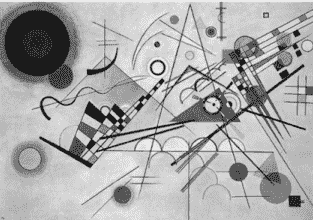

---

## 1-27 AI 应用全景扫描 (4)

### 5. 教育赋能
- **教学副驾系统**：降低对名师经验的绝对依赖，实现优质教学资源的规模化复制（后续章节详述）。

### 6. 军事国防
- **导弹拦截与规避**：毫秒级轨迹预测与机动决策。
- **网空攻防**：AI 驱动的渗透测试与主动防御体系。
- **智能化装备矩阵**：作战机器人、辅助瞄准眼镜、无人战机/潜艇，构建无人化杀伤链。
- **外骨骼战甲**：实体版“钢铁侠”，强化单兵生存与火力投送。

### 7. 娱乐与艺术新境
- **AlphaGo 时刻**：展示强化学习在完美信息博弈中的统治力。
- **计算摄影革命**：双目/多目镜头配合 AI 语义分割，自动判定主体（单/多），背景虚化、主体凸显，还原摄影者意图。光场相机、FOCOS APP 即是早期实践。
- **AI+VR+飞轮+发电车：沉浸式健身闭环**  
  头显渲染自然风光，脚踏驱动飞轮，AI 实时算速控景，踏频同步发电。引入多人联机、追逐/干扰模式，重构“耐玩性”。VirZoom 2015 年已验证 VR 单车商业可行性。
- **全地形运动元宇宙化**：延伸至皮划艇、冲浪、滑雪、攀岩。若配合全身触觉反馈服（如《一级玩家》设定），碰撞体感将臻化境。
- **艺术品溯源鉴定**：AI 微观笔触分析，辨别签名真伪。
- **AI 音乐家：分析、理解、创作**  
  学习乐理与大师风格（如模仿巴赫），输出同风格新作。
- **听觉与视觉的共感映射**  
  康定斯基以几何构图表达音乐律动，牛顿对应色彩与音调，斯克里亚宾映射和弦与色相。大脑跨模态联觉暗示：**绘画可“听”，音乐可“看”**。  
  假设 RGB 通道映射音高/旋律，亮度/纹理/构图映射节奏/装饰音，画作上任意曲线即成乐谱单音，邻域色块化为和弦。AI 或能为每幅画作“配乐”，开启跨媒体审美新维度。

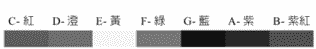  
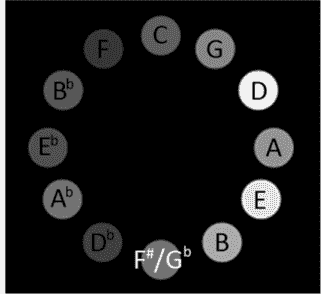  
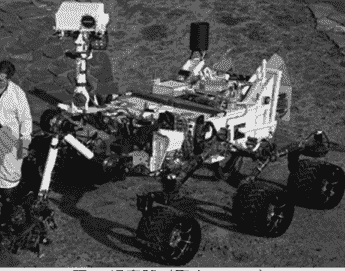

---

## 1-28 AI 应用全景扫描 (5)

### 8. 商业决策中枢
- **数据挖掘关联性**：从海量交易中提炼因果链条，输出最优经营策略。
- **工厂无人化产线**：机械臂+视觉检测替代重复体力劳动。
- **无人金融网点**：智能客服、自动核保/核赔，释放柜面人力。

### 9. 太空探索的“硬核”依赖
太空工程深度绑定 3D 打印与 AI 机器人：火星基地建设、“好奇号”“毅力号”自主探勘。**注：航天领域是 AI 落地最早、最刚需、关联度最高的战场。**  
宇航员生命极其昂贵，高风险作业必须由 AI 代劳；深空通讯延迟极大（地火单向约 20 分钟），远程操控失效，探测器必须具备**即时感知-决策-执行**闭环能力（如瞬间规避坑洞），否则任务必败。

> **注记**：AI 在太空计划的应用是最早、也是最相关的、最必须的发展。在外太空，太空人的生命是如此的宝贵，需要利用 AI 取代人类进行有风险的行动。同时要在外太空也经常会远端操控，但常会受限于距离与讯号问题，必然要让机器有一定的 AI 能力来判断安全性，必须即时有反应，而不是等人类的反应，如果讯号延迟，可能会造成损害，如：遇到坑洞必须立刻闪避，从地球发射的讯号约 20 分才能发射一次到火星上的好奇号（下頁圖），如果不利用 AI，根本无法有效执行太空计划。

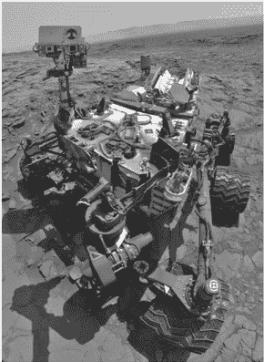  
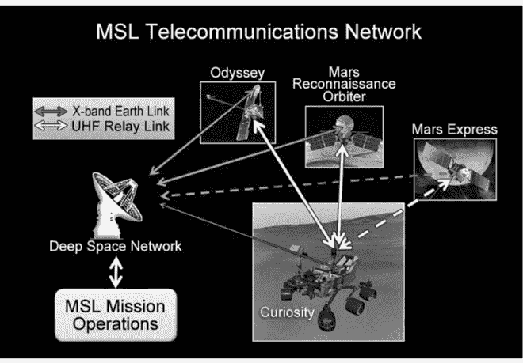

### 结语：边界在哪里？
AI 应用版图之广，唯受限于想象力。但每个细分赛道皆面临阻力：医疗 AI 触动利益格局，推广受阻；研发周期长、算力成本高、能耗巨大，均为现实拦路虎。然**模型可复制、经验可迁移、知识可累积**——这是 AI 区别于人类专家的核心资产。随着时间推移，社会接受度将跨越临界点，便利生活终将到来。

---

## 1-29 碎形几何：描述自然的“最年轻语言”

1975 年，本华·曼德博创立**碎形几何**，距今不足半世纪。理论幼稚、工具匮乏，导致自然界建模应用受阻。传统欧氏几何失效于自然粗糙度，碎形却天然契合。

计算机图形学率先受益：Terragen 等特效公司以碎形算法生成《指环王》级拟真地形（参考影片链接）。若追求“自然感”与“美感”，碎形内核+黄金分割比例是必选项。

### 视觉奇观集锦
- **碎形拱门**：无限圆弧递归构筑的迷宫美学。  
  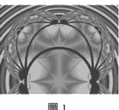
- **地形生成实录**：Terragen Planetside 碎形特效秀、派拉蒙片头案例。  
    
  
- **微观无限自相似**：XaoS 实时缩放演示“小海龟”碎形，放大永不重复却处处自似。  
  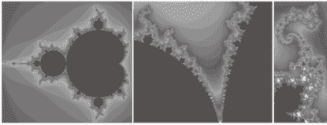
- **更多碎形艺术画廊**  
  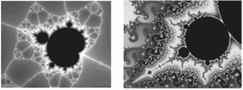
- **黄金螺旋的自相似密码**：放大黄金螺旋，结构在尺度间完美映射。  
  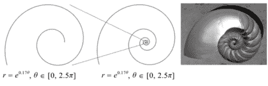
- **碎形树生长算法**：大正方形+等腰直角三角形+双小方块，递归迭代+角度抖动，长出树的骨架。  
  

---

## 1-30 碎形起源：海岸线悖论

一切始于刘易斯·理查森测量英国海岸线：  
- 8 个采样点 → 1,600 公里  
- 19 个采样点 → 1,900 公里  
- 58 个采样点 → 2,900 公里  
- 官方公布数据 → 12,429 公里  

**测量尺度越细，长度发散趋向无限**——这就是碎形维度的直观注脚。

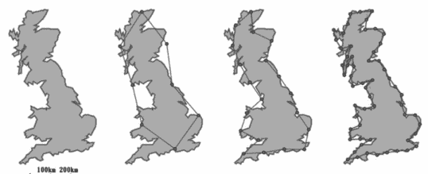

### 分形悖论：当海岸线长度取决于你的尺子

试图测量英国海岸线总长，你会陷入一个反直觉的困境：标记的坐标点越密集，拟合曲线越贴合真实轮廓，计算出的周长便随之增长。将地图无限放大，微观褶皱、岩石边缘尽显，曲线愈发蜿蜒，可供测量的转折点也无限增多——理论上总长可无限逼近真实值，却永远受限于陆地面积这一硬性上界，不可能无限延伸。

这种“尺度依赖性”正是分形几何的核心写照。想直观体会？看看科赫雪花的迭代动画：每一次放大，边缘都生出新的折叠，精细结构层层叠叠，永无止境。  
https://en.wikipedia.org/wiki/Scale_invariance#/media/File:Kochsim.gif

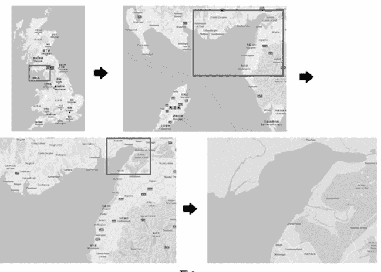

正是对这一悖论的深度追问，催生了分形理论。1967年，法裔美籍数学家曼德博正式确立了这一框架，指出分形具备三大核心特质：
1.  **精细结构**：任意微观尺度下均蕴含丰富细节；
2.  **非欧几里得几何**：整体与局部均无法用点、线、面、球等规则图元描述；
3.  **自相似性**：局部形态在统计意义上重现整体轮廓，如同套娃般无限复刻。

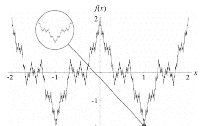

虽诞生于1967年，分形在数学史上仍属“新生代”，理论体系至今未臻完善。现代科学大厦多建立在微积分与欧氏几何之上——微积分的本质是将曲线无限细分为无数“微小直线”求和。但分形偏偏是“处处连续、处处不可微”的异类（如魏尔斯特拉斯函数），微观下依然弯曲，而非直线，导致微积分工具彻底失效。高校所谓的“非线性研究”，本质常将曲线线性化分段处理，面对真正的分形结构依然束手无策。若大自然本质是分形的非线性结构，我们却执着用近似线性的微积分去解剖，恐难窥见真理全貌。

---

## 1-31 分形艺术：大自然的底层生成逻辑

分形非抽象数学专属，实为自然界生长的底层代码。蕨类、乔木、向日葵盘面、雪花结晶、星系星云、血管网络、神经树突……凡此种种，皆为自相似的分形杰作。反观正方形、正圆、标准三角形，皆为人类工业文明的产物，自然界极难寻觅。

**1. 雪花：六边形对称下的无限迭代**  
雪花生长遵循简洁分形规则：线段三等分，中段向外构建等边三角形，无限循环即得科赫曲线。动态生成过程可见此处：  
https://en.wikipedia.org/wiki/Fractal#/media/File:Koch_nowflake_Animated_Fractal.gif  


**2. H分形：从字母到生命的形态变奏**  
以字母“H”为生成单元迭代，仅调整分支角度，便能神奇“长”出树木轮廓，或绽放成蒲公英飞絮。这印证了分形是最贴近自然生长法则的几何语言。现实中，支气管树、蒲公英花序皆是H分形变角度的具象投影。  

  
  
  


**3. 闪电：撕裂夜空的分形轨迹**  
电离气体形成的闪电通道，不断分叉、再分叉，每一支微小分支的走势都与主干整体神似，完美诠释“局部即整体”的分形定义。  

  


**4. 利希滕贝格形图：被定格的电流之舞**  
1777年，物理学家利希滕贝格用高压电击穿透明介质，留下的树枝状放电轨迹，正是电场能量释放的分形指纹。雷击地面留下的花纹、人体被雷击后皮肤呈现的树枝状红斑，皆同属此类“被定格的闪电”。  

  
  


---

# 第二章 认知大数据、传统统计、商用统计与工程统计

### 导论：数据洪流下的统计突围

“大数据”顾名思义指海量数据，早年商业智能（BI）常冠以此名。本章将拆解大数据内核，辨析其与传统统计、工程统计、商用统计的差异——三者常被混淆，实则鸿沟巨大。  
传统统计受限成本与手段，只能以小样本推演大总体；大数据得益于技术跃迁，可获取全量样本，实现更完整的分析；工程统计早已驾驭海量数据多年，只是功能侧重与商用统计有别。

统计与软件易被滥用。市面上不乏宣称“无需懂统计、不会写代码，拖拽即出图表”的BI广告。实则若无统计思维指导数据收集方向，无工程能力落实分析流程，产出的图表或成“花瓶”，一旦被追问细节，反引发对工具乃至统计学的信任危机。因此，无论传统统计还是大数据BI，分析师都须具备**统计素养与工程技能**的双重能力。

统计学演进脉络可概略为：  
从17世纪描述统计、探索性数据分析（EDA），经20世纪数理统计、推断统计、聚类分析、卡尔曼滤波，至21世纪计算机时代的数据挖掘、数据科学、大数据时代。资讯通讯工程师的统计学则自2008年起，利用计算机视觉化分析数据，开启数据科学新篇。

---

## 2-1 大数据概要 (1)：“加法不够用，才发明了乘法”

大数据的威力释放，仰仗强劲算力（海量内存、极速处理、互联互通）的硬件底座。但硬件再强，若无理论加持，亦是蛮力莽撞。正如加法不够用才有乘法，乘法不够用才有指数，大数据处理逻辑**本质上是在借用统计与概率的理论装备**——只不过换了赛道、换了称呼。

统计学是门“万金油”学科，却常被误解、被隔阂。三大阵营各执一词，用二元对立眼光审视彼此：  
*   **统计学界**傲娇：别人不够严谨；  
*   **工程界**务实：别人不够快、不够用；  
*   **商业界**圆滑：取长补短，包装成低门槛、可视化的BI工具供大众把玩。

三者核心差异对标如下：

  


| 维度 | 统计学界 (传统统计) | 工程界/资通讯 (工程统计) | 商业界 (大数据分析) |
| :--- | :--- | :--- | :--- |
| **核心人物** | 统计学家 | 资讯/通讯工程师 | 数据科学家 |
| **数据规模** | 小样本 | 大样本 | 大样本 |
| **时效要求** | 不强求 | **极高 (实时/动态)** | 动态为主 |
| **数据状态** | 静态 | 动态流 | 动态流 |
| **精度追求** | 极致精准 | 较精准 (工程容差) | 粗糙、有提升空间 |
| **方法论源头** | 数理统计、决策论 | 自研+借用传统统计 | 工程统计软件+传统统计 |

社会大众对大数据的认知断层巨著，大致分三类人：  
1.  **盲目崇拜派**：视大数据为“万灵丹”，凡事必上，却道不清其然；  
2.  **工具等同派**：以为买了BI软件、跑了可视化就是做大数据，旧法统统作废；  
3.  **辩证现实派**：懂得大数据如水，单独存在无效力，须与业务场景（水泥、米饭）融合，才能化作动力。

本书旨在拨开迷雾，还原大数据的统计概率本质。欲善用大数据，关键在于看透**递归迭代的功能性**——这正是当下火热的机器学习与AI的核心内核。没有算力跃迁（存算提升）、网络普及、统计概率注入，计算机不过是高级计算器，谈不上智能。时代推演至今，AI正借此三驾马车持续进化，重塑生活图景。

---

## 2-2 大数据概要 (2)：从“小样本推论”到“全量可视”的范式革命

### 传统统计：小样本时代的严谨推演
溯源17至20世纪，统计学因“获取有效样本极难、极贵、极易干扰”，被迫走“以少推多”路线，分两阶段：  
*   **阶段一·探索性数据分析 (EDA)**：收集、整理、描述、直观判断数据分布与离散度；  
*   **阶段二·推论统计/数理统计**：在EDA基础上剔除极端值，构建概率模型，从随机样本推演全貌辅助决策。

### 大数据分析：全量时代的直观洞察
踏入21世纪，电脑算力爆发，工程界率先具备处理海量动态数据的能力，跳过繁复数学建模，直奔**可视化分析**。但海量数据往往非严格随机抽样，传统统计的“随机抽样”前提失效，必须调用工程界积累三十载的时序、信号处理工具箱。至2010年前后互联网普及，商业界觉醒：外部海量数据蕴含商机，大数据分析乃势在必行。实则，商业界的“大数据分析”，底子多是工程界早已炼就的“大样本统计分析”。

### 数据科学的定位与争议
现在的“数据科学”，主打“低门槛、强可视、重交互”，不懂统计原理也能点点鼠标出图表。统计学界多嗤之以鼻，视其不严谨。但作者以为：**可视化本质属于描述统计范畴，其算法内核多源自工程统计（预测分析），理应纳入统计学大帐。** 只是若求“严谨有效”，仍需数理统计背书，这正是当下学界攻关的前沿。

### 两大阵营的“柏林墙”与风险
统计与工程本该唇齿相依，实则各自为政。数理统计早有成果，工程师因沟通壁垒不知晓，重复造轮子；工程师自研工具缺统计模型支撑，在工程、制造等“即时可验证”领域尚可，若用于社会、医疗、人文等“多因素干扰、滞后验证”场景，极易失准酿祸。商业大数据应用，同理需极度审慎。

  


### 结论：统计演进的主线是“样本量的解放”
从“小样本推模型”到“大样本看全貌、可视化辅助判断”，科技重塑了统计工作流。大数据分析非简单的长条图，而是**“精细化的描述统计”**，内藏数学模型，待数理验证。其应用早已渗透自然科学、社会科学、人文、经济、军事制导、商业决策、政府情报等全领域。核心差异，仅在于 **Small Data 与 Big Data 的分析范式之别**。

---

## 2-3 什么是大数据：数据爆炸下的“全量视角”

网络时代，数据量呈指数级爆发，且打破了以往“单一变量孤立分析”的桎梏，变量间关联交织成网。

  


福雷斯特研究曾惊人揭示：企业仅分析了约 **12%** 的数据。为何88%沉睡？因难辨价值与噪音，只好捡“自觉有用”的分析。网络时代反转局势：外部数据远超内部，来源异构、量级质变，商业界被迫将所有数据“打包”处理，此乃“大数据”之名由来。


**大数据定义**：数据量大到人工无法在合理时限内处理成可读信息。同等总量下，打碎数据孤岛融合分析，能挖掘出孤立分析无法获得的关联洞察——洞察商机、控质、防疫、破案、疏堵，应用场景极广。我们可先用可视化做探索性判断，再引入算法/推论统计建模预测。

**历史注脚**：大量数据处理非新事物。30年前工程界已在通讯、自控、质管领域构建海量算法。2010年后互联网普及，商业界发现外部数据价值，提炼出大数据**三大特征 (3V)**，触及传统统计盲区，遂推出商业版大数据分析。实则手法多溯源工程界旧典；统计学界则长期深耕小样本理论。三者渊源，容后细述。


---

## 2-4 大数据的隐忧：光鲜表象下的“三座大山”

大数据远未成熟，实践者常忽略三大硬核挑战：

1.  **非结构化霸权**：**80%以上**数据是文本、图像、音视频、日志等非结构体，难直接入模。
2.  **伪随机陷阱**：即便结构化数据，多为**随机过程**实现，而非教科书里的“简单随机抽样”，独立同分布假设多不成立。
3.  **时间序列本质**：大数据模型极大概率是**时间序列** (AR, ARMA, ARIMA等) 形态。


**核心警示**：大数据序列的**相关性不可随意假设或简化**，合乎逻辑的假设检验是底线！

**血案回顾：Google流感趋势 (GFT) 的翻车**  
2009-2010年，Google宣称流感预测**97%准确**，媒体捧为大数据神话。但好景不长，模型失效。对比图显示：前期实线(CDC真实)与虚线(GFT预测)紧贴，后期频繁背离。原因何在？模型过拟合历史关键词相关性，忽视了搜索行为模式漂移、媒体恐慌效应等结构性变迁——**相关性非因果性，且不稳定**。这正是缺乏统计学严谨性、盲目信仰“数据自会说话”的惨痛教训。

---


### 图 2

市面热推大数据的畅销书，往往只字不提 2011 年后的集体失准，反复渲染 2009、2010 年的“成功案例”。这种选择性叙事，极易造成大数据技术已臻成熟的错觉。实际上，2011 年的偏差恰恰证明大数据仍有巨大进化空间；畅销书若能坦承“不成熟”现状，便不会误导大众。

数据堆积如山并不代表能绕开统计方法论，海量样本依然离不开严谨的统计处理。那么，如何判定 Big Data 分析的可靠程度？关键在于大数据非随机抽样，而是囊括全量存量与实时增量，数据间往往高度耦合、时序结构复杂。参考图 1 可知数据具备自相似特征。因此，必须融合预测性分析、传统统计推论等多元手段，才能探寻有效解析路径。

## 2-5 统计学界与商业界：两种“数据逻辑”的脱节

统计学界的传统范式与商业界的大数据实践为何难以融合？作者指出，当下并存着两群截然不同的统计专业人才：

- **(1) 实战派“数据科学家”**：深耕 Big Data 一线，却鲜少自称“统计学家”。
- **(2) 学院派“统计学家”**：扎根学术研究，服务于政府经普、医院生物统计、社科心理统计等传统领域。

**传统统计与大数据何干？** 相对于 Big Data，传统统计堪称“Small Data”。其流程繁复：采集 → 清洗 → 列表制图 → 诠释 → 分析，最终产出结构化数据（见图 1），方能进入下一环。

传统统计分析的基石，是从总体随机抽样，经探索性数据分析（描述统计），再进阶至推论统计（见图 2）。


**大数据又是怎样的图景？** 它省去了传统统计“采集-清洗-结构化”的漫长链条，转而采取“全量收集 → 分类 → 分模块得结论”的直捷路径（见图 3）。


### 图 3


### 图 4

| 传统统计 | 大数据 |
| :--- | :--- |
| 随机抽样 | 非随机，高度相关数据流 |
| 小而精的样本 | 海量全量数据 |
| 多为静态（多元回归、假设检验） | 动态分析，实时数据流入（如递归最小二乘法 RLS） |

大数据分析统称“预测分析”，传统统计称“统计推论”。鉴于大数据分析准确性存疑，亟待破解三大难题：
1.  **筛选法则**：如何从非结构化海量数据中提炼“高价值”结构化数据？合理的过滤规则何在？
2.  **信任边界**：预测分析在何种条件下可信？
3.  **融合路径**：预测分析与统计推论如何有机整合？

## 2-6 统计学界与工程界：同源异名的“巴别塔”

梳理完商业与学术的关系，还须审视工程界与统计学界的渊源。早在 1980 年代，双方针对同一“统计方法”已各立门户、自成术语体系（详见下页表及图 1）。

大量统计内核一致，却因符号与命名壁垒导致科技迭代延宕、跨学科触类旁通受阻。例如：统计学的“多元回归”，在工程界竟是“卡尔曼滤波”的特例之一。

值得注意的是，工程界早已标注“Big Data”处理海量数据。按数据量级与时效性，统计方法分为静态与动态两派：

**统计学界·静态模型** vs **工程界·动态算法模型**

| **静态统计（Small Data）** — 见图 2 | **动态统计（Big Data）** — 见图 3 |
| :--- | :--- |
| 1. 基于 Type I/II 误差设定样本量 n | 1. 无需设 n，假设 $n \to \infty$ |
| 2. 估算 Data Model 参数 | 2. 直接输出估算值 $\hat{y}$ |
| 3. 模型导出推论/预测 | 3. 考察 $E|y - \hat{y}|^n$ 收敛性 |
| 4. 讨论参数收敛性（$\hat{\theta}_n \to \theta$） | |
| **从业者占比 ~80%（统计学家）** | **从业者占比 ~20%（数据科学家）** |

两派比例悬殊，彼此拒绝同一职业标签：统计界称“统计学家”，工程界称“数据科学家”。但数据科学家未必具备统计学术底子，而统计知识是分析师的基石。作者主张：**合格的数据科学家，必须掌握扎实的统计理论与分析方法。**

统计、工程、商业三界分析手法各异，外行极易混淆。商业大数据实则是“借用少量统计学理论 + 套用工程界海量数据工程技术”，从业者被统计学家归类为“数据科学家”。大众因不谙三者脉络，将分析数据者笼统称为统计学家或数据科学家，掩盖了本质差异。

**跨学科术语对照表**：

| 统计学中文 | 统计学英文 | 通讯/信息工程术语 |
| :--- | :--- | :--- |
| 回归分析 | Regression | 递归最小二乘法、回归 |
| 主成分分析 | PCA | 数据挖掘 |
| 时间序列分析 | Time Series Analysis | IIR 滤波、卡尔曼滤波 |
| 多变量聚类分析 | Cluster Analysis | K-means 分析 |
| 正态分布 | Normal Distribution | 高斯噪声 |


## 2-7 大数据分析的“启动键”：可视化与视觉分析

资讯可视化与视觉分析，是大数据分析的出发点。观察图 1、2 可知：人脑偏好图像理解，报表图表利于对比。尤其面对高维复杂数据，优秀数据科学家善用可视化破局。见图 2：台北市预算区域图，若引入上年度对比，差异一目了然。


**图 1 波菲利之树：古代思维导图（心智图）**

数据分析第一步往往是“玩数据”——随意重组，试图捕捉规律与价值。统计泰斗约翰·图基于 20 世纪将其定义为**探索性数据分析（EDA）**。

EDA 是借助可视化挖掘数据核心特征的方法论。图基倡导统计人员深研数据、大胆假设，倒逼重视新数据收集与实验设计。此流程大幅强化可视化功能，助分析师快速识别异常值、捕捉趋势模式，推动半导体制造、通信系统设计等科工难题攻关。

1977 年图基著《探索性数据分析》，批评传统统计过度迷信“验证性数据分析（CDA）”，呼吁重视 EDA。其核心主张：
- 为观察现象生成假设
- 基于假设做统计评估
- 匹配适配统计工具技术
- 通过调查实验产出后续数据

至 2015 年，大量 EDA 技术被数据挖掘吸纳、纳入大数据分析版图，亦成统计教学核心。

### 台北市 2016 年预算区域图（图 2）
*财政局 5.93/30.42 亿、市议会 8.12 亿、地政局 3.69 亿、第二预备金 15 亿、市场处 9.1 亿、消防局 28.82 亿、文化局 18.23 亿、都市发展局 27.95 亿、体育局 44.69 亿、卫生局 45.66 亿、劳动局 47.99 亿、公共运输处 47.02 亿、环保局 56.62 亿、大地工程处 9.21 亿、工务局 16.84 亿、八八灾后重建 7 亿、水利工程处 26.32 亿、农业局 135 亿、公园路灯工程管理处 36.54 亿、社会局 139.03 亿、新建工程处 46.67 亿、教育局 527.21 亿*


## 2-8 资讯可视化：让数据开口说话

资讯可视化旨在通过统计图形、图表、信息图、表格，**精准高效地传递数据内核**。优秀的可视化能辅助分析推理，化繁为简——如识别因果、启发数学建模。最基础的图表即可视化雏形。高效工具能助力发现趋势、验证推论、溯源探索、讲好数据故事。网络时代，可视化已成炙手可热的新疆域。

**认知误区**：众人误以为唯有现代大数据软件出品的图表才算可视化，传统统计图表不算。大错特错。**传统统计图表正是可视化的原生产物。**

### 可视化设计七大原则
1.  **展示充分数据量**
2.  **激发读者深度思考**
3.  **拒绝数据任意删减**
4.  **支持多维数据块自主对比**
5.  **兼顾宏观概览与微观细节多层次呈现**
6.  **融合描述、勘探、制表、制图，彰显核心特性**
7.  **图形直觉远胜传统统计枯燥数字**

**经典案例：米纳德图（图 1）** —— 单幅二维图承载拿破仑 1812-1813 远征五大维度：
(1) 兵力规模 (2) 二维地理坐标 (3) 时间流 (4) 进退方向 (5) 气温变化
塔夫特 1983 年赞誉：“迄今最佳统计图形。”

可视化定义：将数据映射为图表形态，利于解读。案例参考图 2、3。


### 图 2

Z (sigma) : 1

TIME : 21-JAN-1983 00:00

DATA SET: dm1983010100

NetCDF file created by the FST2CDF program


### Air Temperature (deg C)

### 图 3 全球气温分布图（数据来源：WIKI 公共领域 https://en.wikipedia.org/wiki/Data_visualization）


## 2-9 视觉分析：人机协同的认知放大器

视觉分析 = 交互式可视化界面 + 分析推理统计方法，操盘手即“数据科学家”。

**软件与分析师的关系，恰似毕加索画抽象画，评论家解读深意。** 好画（完善软件）配好评论家（优秀分析师），方出深层洞见。故视觉分析软件须具备四大核心机能：

1.  **极速洞察分布**：十张报表合一图，瞬间掌握大量数据分布态。
2.  **可视化赋能思维**：
    - 引导分析师发散思路
    - 多维编码（形状、颜色、时间、数量）揭示复杂关系
3.  **实时纠偏闭环**：支持即时修正与反馈。
4.  **决策加速器**：极速掌握数据 → 更快分析判断 → 易观关联 → 预测监控潜在风险 → 压缩决策窗口。

可见，可视化重塑分析推理流程，**更快、更准**，正是大数据视觉分析的核心 KPI。

**定义**：借助资讯可视化及其交互界面进行的分析推理统计方法。主流工具图谱：
- SAS 软件（图 1）
- Gapminder：可视化先锋，图 2 呈各国 GDP 动态演变
- **分析组件工具箱**（面向稀疏数据）：患者相似度分析、预测建模、聚类、流程挖掘……具备可扩展性、关键属性分离训练与评分、融合用户反馈的学习技术
- **交互式队列可视化**：多维查询盒（图 3~6）
- **Tableau**（图 7）


工具箱已备，可视化助理解之力不容小觑。参考《全球版图变迁》动画（链接：youtube.com/watch?v=6q8IJ9Pbm0g），时间轴联动地图，版图更迭瞬间看穿，远胜纯文字叙述。**无论何种数据，可视化都是必修课。**


## 2-10 破局大数据：递归算法——工程界的“动态智慧”

作者力荐：**大数据统计建模，首选递归算法（Recursive Algorithms）**，此乃工程界看家本领。

**缘何选此？** 商业分析与工程控制同构：对象皆为海量实时数据。何为“实时”？即数据持续流入、结果须即时输出。如导弹轨迹修正、卫星轨道保持——中途不可有障碍，风阻扰动需即时修正航向。

**静态重算不可行**。若每来一笔新数据就全量重算，导弹早撞毁、卫星早失轨。核心诀窍：**将历史全量数据压缩为单一状态量（统计量），新数据到来即增量更新，秒出新解**。

我们可将“全量慢算”视为**静态计算**，“即时增量算”视为**动态计算**。下通过“样本均值”对比两者范式差异：

### 样本均值

- **静态式（传统统计）**
  $\overline{x_n} = \frac{S_n}{n} = \frac{x_1 + x_2 + ... + x_n}{n}$
  *每次需累加全量历史，随 n 增大计算量线性膨胀。*

### 静态 vs 动态：平均值计算的两种思路

咱们先来对比一下求平均值的两种路数。传统的**静态算法**就像个死板的会计，每次来新数据都得把旧账本翻出来，把 $x_1$ 到 $x_n$ 全加一遍再除以 $n$。这中间要干 $n-1$ 次加法、1 次除法，共 $n$ 步操作，完全没利用上一轮的计算结果。

再看**动态算法（递归算法）**，思路就灵活多了。它只认上一轮的结果 $\overline{x_{n-1}}$。新来一个 $x_n$，直接套公式：
$$\overline{x_n} = \frac{(n-1) \times \overline{x_{n-1}} + x_n}{n}$$
这就把海量历史数据压缩成了一个“状态值”。算一下步骤：减、乘、加、除，固定四步走，跟数据量 $n$ 没关系。这就是工程统计里“动态统计”的精髓——**用状态更新代替全量重算**。

### 样本方差也是同理

- **静态式**：$s_n^2 = \frac{1}{n-1} \sum_{i=1}^{n} (x_i - \overline{x_n})^2$，还是得全量遍历。
- **递归式**：$s_n^2 = \frac{n-2}{n-1} s_{n-1}^2 + \frac{(x_n - \overline{x_n})^2}{n}, \quad n > 1$，只靠上一期方差和新数据差值就能搞定。

这两个案例摆明了：**递归思想的核心，就是利用“前一时刻的结果”作为“后一时刻的基石”，从而在海量数据流中实现极速更新。这正是大数据处理的底层逻辑。**

---

### 早期的递归实践：从随机逼近到牛顿法

早在 1951 年，罗宾斯和门罗搞出的**随机逼近**就用上了这套路子：


再看牛顿-拉夫逊法找函数根，本质也是个递归迭代：


可见，递归算法在计算史上地位极高。而下面要说的**卡尔曼滤波**，更是把这套思想发挥到了极致——没有它，现代工程科技怕得倒退几十年。

---

## 2-11 卡尔曼滤波：混沌数据的“秩序重组者”

卡尔曼滤波是工程统计的皇冠上的明珠。它综合了 RLS（递归最小二乘）、泰勒展开等手段，但最终落脚点只有一个：**用递归原理把一堆乱麻般的数据，整理成几条好算的数学式。**

计算细节我们摘录关键部分，见下图，核心在于状态方程与观测方程的递推更新：


| 线性回归与 RLS 皆是卡尔曼滤波的特例 |
| :--- |

| 卡尔曼滤波: $X_k = F_k X_{k-1} + B_k u_k + w_k$ ... |
| :--- |

| 线性回归/RLS: ... |
| :--- |


**扩展卡尔曼滤波（EKF）**更进一步，打破了线性限制，允许状态转移和观测模型是非线性函数 $f, h$... 有趣的是，EKF 与神经网络训练算法几乎同构。

```
X_k = F_k X_{k-1} + B_k u_k + w_k ,
Z_k = H_k X_k + v_k ,
\hat{X}_{k/k} = \hat{X}_{k/k-1} + K_k \tilde{Y}_k 。
```

回顾以上，**递归是基石，整合计算、省时省力是果**。卡尔曼之所以能成就这番伟业，是因为他是罕见的“双栖全才”——既精通工程建模，又深谙统计推断，才能把两套体系融会贯通、化繁为简。


作者观察当下商业大数据现状：建库、清洗、可视化、浅层统计，流程跑通了，但**核心缺口在于“为各类数据寻找匹配的递归算法”**。这才是大数据分析通往深水区的关键一步。


---

## 2-12 数据科学家定位与大数据结论

**数据科学家到底是干啥的？** 网上有段流行论调说：“比统计学家轻松，不用钻研太深，会点软件操作就能出分析。”


**作者强烈反对这种“降维打击”式认知。** 合格的数据科学家必须具备：

1.  **硬核底子**：数学/统计/物理/CS 科班出身，有深厚的数学推理能力（占比 80%）。
2.  **工程落地**：能自主学习数据系统、存取技术等实操知识（占比 20%）。

**为啥 8:2？** 数学推理是慢功夫，十年磨一剑；工具技能是快功夫，随用随学、迭代极快。

一个人能同时扛起两大旗帜吗？**能。** 文艺复兴时期的皮耶罗·德拉·弗朗切斯卡就是画家兼数学家，达芬奇的老师，他用几何投影原理画出惊世逼真的透视画。


**如果 21 世纪是数据的文艺复兴，数据科学家就是新时代的“画家”**，必须双手握笔：一手数学推理，一手工程实现，才能推动历史车轮转动。

### 大数据五大核心结论

1.  **非结构化转结构化的自动化技术，仍在半路。**
2.  **统计方法依然是大数据时代的“铁锹”与“显微镜”，不可替代。**
3.  **分析起点已从“探索性分析 (EDA)”进化为“可视化”与“可视化分析”**。后者优势显著：十张表合成一张图、视觉引导思维、多维关系同屏呈现、即时反馈闭环、决策周期大幅缩短。
4.  **三大流派分野明显**：
    - 统计界：小样本、静态、追求极致精准、理论驱动。
    - 工程界：大样本、动态、工程实用精度、算法驱动（早就玩大数据了）。
    - 商业界：大样本、动态、精度粗糙待提升、工具驱动（被网络逼着面对大数据）。
5.  **建议以“递归算法”为核心支柱，融合传统统计与工程统计，重构大数据分析地基。**

> **可视化分析的四大硬指标**：
> 1. 极速洞察分布（十表合一图）。
> 2. 视觉导向思维 + 多维同屏（如时序+数量）。
> 3. 即时修正、闭环反馈。
> 4. 快、准、狠：相关性一眼穿透，预测监控无死角，决策提速。

---

## 2-13 数据挖掘 (1)：在数据堆里“淘金”

数据挖掘 = KDD 流程中的关键一环。它站在统计、OLAP、检索、机器学习、专家规则的十字路口，**目标只有一个：从海量数据中挖出“未知、有价值、潜在”的关联模式。**


它能帮我们搞定两类事：
1.  从噪音里捞出“未知的高价值金粒”。
2.  从杂沓里识别出“主流趋势与群体画像”。

 (注：原文图2引用标签同前)

### 四大主流方法族

1.  **监督学习**：分类、估计、预测——有标签带路。
2.  **无监督学习**：没标签，自找结构。
3.  **关联分组 / 购物篮分析 / 关联规则**：“买啤酒必买尿布”这类共现模式。
4.  **聚类与描述**：鸟以群分，画像刻画。

### 坑：当心“挖泥”当“挖金”

挖掘出的模式不一定是真理。**Data Dredging / Snooping（数据挖泥/窥探）** 指那些“看似相关、实则无关、模型无效”的伪发现。
- **投资分析师**最爱栽这跟头：在几千轮轮盘数据里硬找规律，不幸往往真找到“伪规律”。
- **股票建模**同理：短期噪音太大，趋势模型极易失效。

**验证是救命稻草**：用独立客观数据测模型，找无关人员复现，评估真价值。

### 隐私与伦理：达摩克利斯之剑

保险公司用病历筛选高风险客户拒保？**违法侵权。**
政府/商业挖掘触及国家安全/商业机密？**红线。**
**合理边界在哪？** 如：药物不良反应极低概率事件挖掘，可救命，但数据一旦泄露依然是灾难。
**结论**：挖掘手段特殊，必须受规范约束，在法律伦理框架内“适度挖掘”。

---

## 2-14 数据挖掘 (2)：异常值——是噪音，还是新大陆？

做回归建模时，数据总不听话贴着线。传统统计一招鲜：**删异常值**。为啥？因为它会拽歪回归线。

  

早期人工记账，小数点抖动、打字漏打，异常值大概率是**人为错误**，删了事。但现在自动化入库，人为错率极低，**异常值却依然存在**。统计学家终于想通了：异常值不等于错误，它通常长两副面孔：

1.  **长尾分布下的小概率事件**：数据本身呈正态，只是极端值概率极低。
2.  **混合分布的多群体信号**：数据根本不是一群，而是两拨甚至多拨人马混在一起。

### 情况一：正态分布里的“极端个案”

看文具店客流图，9-10 点客流呈标准钟形，拉出来单看也是正态。

 

这种“纯正态长尾”产生的异常值，概率太低，传统统计果断切掉，图个模型稳健好算。

### 情况二：一眼望去“双峰/多峰”

数据明显分两堆甚至多堆。


这时候**绝不能删**，得**分群建模**。这部分细节下节展开。

### 两界看法的本质差异

| 场景 | 统计学家 | 工程师 |
| :--- | :--- | :--- |
| **疑似异常值 (正态长尾)** | 切了再谈，模型先跑通 | 琢磨为啥冒出来？有没有隐含物理意义？ |
| **明显可分群 (混合分布)** | 做聚类分析，这是门成熟课程 | 做数据挖掘，工具箱里有 K-means、ML 全家桶 |

**流程图总结**：拿到数据 -> 先看长相 -> 判断是“长尾”还是“混合” -> 对症下药。


---

## 2-15 数据挖掘 (3)：分群——非主流群体往往藏着“金子”

上节说完异常值，这节聊**分群**。为啥要盯着“非主流/少数派”看？因为在特定场景，**少数派才是价值核心**：

- 勘探黄金：金子永远是极少数，土才是大头。Data **Mining** 这个名字起得真绝——就是在数据矿里淘金子。
- 反欺诈：盗刷、作弊、逃犯，全是极低频的“异类”。


### 1. 找黄金：土里淘金，数据淘模式

土壤采样数据里，金含量极低、极分散。挖掘的任务就是把那 0.001% 的“异常高值”从 99.999% 的背景土里分离出来。

... (后续内容待续)

### 2. 罪犯的行走軌跡

將移動過程轉化為路徑與速度數據後，你會發現犯罪者的行為模式與常人截然不同。掌握這一概念，就能在人群中篩選出「異常者」並提前介入預防。比如近期珠寶店盜竊案頻發，店方只需重點留意步態、舉止明顯偏離常態的顧客，即可大幅降低風險。所以下次心情不好想在街上亂逛發洩時要小心了，說不定會被誤判為可疑分子。

### 3. 信用卡盜刷識別

大多數人的消費習慣具有高度規律性：光顧的商家相對固定，單筆金額與交易頻率也在特定區間波動。例如某人習慣每週去固定餐廳兩三次，單筆消費穩定在 800 到 1200 元。一旦出現短時間內高頻刷卡、且單筆金額動輒上萬的異常情況，極大概率是盜刷。銀行系統捕捉到這類偏離用戶畫像的行為，即可即時推送預警，要求持卡人確認交易真偽。

### 企業如何善用「第二群體」數據：電信業潛客挖掘實戰

觀察圖 2 中月租費 0-2000 元區間的用戶分布，曲線走勢順暢：資費越高，用戶越少。然而 2000-2700 元區間用戶稀少，到了 2700-3000 元區間卻出現明顯回升。這提示我們可將用戶劃分為三個梯隊（見圖 3）。

深入分析發現：第一梯隊（0-2000 元）用戶緊貼某條規律分布曲線；第二梯隊（2000-2700 元）樣本極少，干擾性強；第三梯隊（2700-3000 元）則是妥妥的高消費潛力客群。策略很清晰：向第三梯隊精準推薦高階方案，轉化率極高；第二梯隊因體量太小可暫不處理，或投入促銷資源嘗試將其「升級」為第三梯隊。

這說明：數據分群能有效隔離干擾數值對主流趨勢的污染，讓針對不同群體的決策更精準。


## 2-16 資料探勘實戰：挖掘數據背後的隱性關聯

資料探勘的核心在於發掘海量數據中隱藏的價值關聯，最常用的工具是「關聯規則」。它能回答諸如：「買了商品 A 的人，買商品 B 的概率有多大？」或「同時買了 C 和 D，還會順手買什麼？」此類問題。為此，必須先將雜亂無章的原始數據清洗轉化為可視化的結構化信息，最終鎖定組合與結果的關聯邏輯。

經典案例非「市場籃子分析」莫屬。超市挖掘顧客購買記錄，發現買 X 常伴隨買 Y，於是將兩者同架陳列，銷量顯著增長。

### 實戰案例 1：尿布與啤酒的驚人關聯

沃爾瑪從每日海量交易流水中挖掘出一條反直覺的規則：**購買尿布的男性，極大概率會同時購買啤酒。**

溯源調查發現：太太囑咐老公下班買尿布，約 40% 的丈夫順手就把啤酒帶走了。

為變現這條規則，沃爾瑪將啤酒與尿布摺疊陳列。結果？雙雙銷量暴漲 30%。原因很直觀：近在咫尺，拿了就走，壓縮了猶豫決策的時間，激發了衝動消費。


有人會問：既是尿布帶動啤酒，為何兩者都漲？邏輯其實很通順。已知「買尿布的男人買啤酒」，但「買啤酒的男人買尿布」不一定成立。然而，長期「幫老婆買尿布」的經歷，讓這些男性形成了新習慣：以後自己買啤酒時，也會順手帶上尿布。雙向習慣養成，自然雙贏。

### 實戰案例 2：奶粉、尿布與保險套的「避孕邏輯」

將嬰兒用品與保險套同區陳列同樣奏效，但驅動力不同：

1.  **寶媽寶爸視角**：買奶粉尿布時順手買保險套，核心是「不想意外再造人」，為現有家庭分擔精力。
2.  **未婚/丁克情侶視角**：看到保險套擺在嬰兒區旁，心理暗示「這才是當前優先級」，為未來兜底。

無論哪條路徑，核心都是**嬰兒用品帶動了保險套銷售**。

### 實戰案例 3：7-11 組合餐的優化困局

台灣 7-11 推出「加價購」組合餐（如 39/49 元餐點配飲料），但部分組合長期滯銷。主因可能在於：預設組合不符合當地消費者口味偏好。

若引入關聯規則，反向挖掘「哪款飲料最能帶動哪款餐點」或反之，據此重組套餐並**就近陳列**，業績大概率會好轉。筆者實地踩坑：不少門店將組合商品分置兩端，顧客找不到直接放棄購買。


圖 2

進階玩法：追蹤購買組合餐的顧客「還買了什麼」，將這類關聯商品同步鋪陳周邊。這正是「買了 C 和 D，還會買什麼？」的直接應用。

## 2-17 時間序列：用時間維度解碼趨勢

時間序列是統計學核心工具，本質是按時間順序排列的隨機變量序列。GDP、CPI、股價 K 線、失業率、房價走勢……凡以時間為橫軸的數據皆屬此類。它是計量經濟學三大數據形態之一，廣泛應用於宏觀經濟、金融工程等領域。見圖 1、2、3。


時間粒度靈活可調：分、秒、時、日、週、月、季、年，視業務需求而定。曲線形態主要分兩類：

1.  **平穩序列**：統計特性（均值、方差、自相關）不隨時間漂移，長相「穩」。
2.  **非平穩序列**：波動幅度隨時間劇烈變化（時變波動率），方差無法收斂，找不出穩定長期趨勢或線性函數。

**典型案例：黃金與「龍年效應」**。台灣民俗偏好龍年結婚，結婚必買金飾，導致龍年黃金需求激增、波動劇烈、方差暴增，即「季節效應」。正是這種非穩定性，讓時間序列分析充滿挑戰。

**如何破解？兩大經典武器：**

*   **移動平均 (MA)**：以股價、報酬率、成交量為變數計算均線，**濾除短期噪音，露出長期趨勢與週期**。
*   **自迴歸模型 (AR)**：用歷史值預測當前值（用 x 預測 x），源自線性迴歸延伸。公式：$x_t = c + \sum \phi_i x_{t-i} + \varepsilon_t$。廣泛用於經濟預測、訊號處理、自然現象建模。

**投資警示**：非平穩序列極難精準預測。聽到分析師宣稱「找到股市趨勢模型」，請追問：驗證週期多久？過往準確不代表未來有效。股市屬典型非平穩時間序列，變數極多，**入場前請務必做好風險評估**。

---

**機器學習的統計基因與人才分層**

機器學習本質是統計與概率的工程化落地。
*   **統計學**：小樣本推演全體（如抽 1000 人推演 2300 萬台灣人的生活就業政治傾向）。
*   **機器學習**：讓電腦從全量數據中學會處理新數據、解決新問題（如基於歷史訂單推薦商品）。

統計歸科學，ML 歸工程，處理面向不同，底層邏輯卻同源。

**資訊人別逃避數學**。準確說：數學、統計、概率是通往 AI 深處的必經之路。很多人沉迷語法、演算法、硬體架構，卻不知：**演算法萬千變化，唯有統計概率能優化精簡代碼；唯有吃透統計，才能創造新演算法、提升處理效能。** 演算法與黑盒模型本質上就是統計與資訊的結合體，學 AI 繞不開統計。

本書按受眾分層說明：

1.  **普通用戶**：知輸入輸出、會操作軟體即可，無需懂黑盒原理 —— **像開車的人**。
2.  **初級設計師**：會操作、知輸入輸出，但看不懂黑盒、無法修正 —— **像修車的人**。
3.  **一流工程師/數據科學家**：會操作、知輸入輸出，**且能理解、設計、修正黑盒** —— **像造車、設計車的人**。


本章重點梳理核心演算法的流程邏輯、輸入輸出定義、數學統計原理，**不深究代碼實現細節**。

# 第三章

## 核心黑盒演算法的統計原理拆解

- 3-1 學習範式全景：監督、無監督、半監督、強化學習
- 3-2 貝氏演算法 (1)：核心概要
- 3-3 貝氏演算法 (2)：實戰案例
- 3-4 貝氏演算法 (3)：統計原理深度解析
- 3-5 K-means 演算法 (1)：核心概要
- 3-6 K-means 演算法 (2)：案例實戰 1
- 3-7 K-means 演算法 (3)：案例實戰 2
- 3-8 K-means 演算法 (4)：統計原理深度解析
- 3-9 K-means 演算法 (5)：尋找最優 K 值
- 3-10 K-近鄰演算法 (KNN)
- 3-11 Apriori 演算法 (1)：核心概要
- 3-12 Apriori 演算法 (2)：實戰案例
- 3-13 SVM 演算法 (1)：核心概要與案例
- 3-14 SVM 演算法 (2)：模型推廣
- 3-15 SVM 演算法 (3)：統計原理深度解析
- 3-16 線性迴歸 (1)：核心概要
- 3-17 線性迴歸 (2)：迴歸線統計原理
- 3-18 線性迴歸 (3)：相關係數統計原理
- 3-19 邏輯迴歸：核心概要與案例
- 3-20 決策樹 (1)：核心概要與樹狀結構
- 3-21 決策樹 (2)：案例與剪枝策略 (上)
- 3-22 決策樹 (3)：案例與剪枝策略 (下)
- 3-23 隨機森林：核心概要與案例
- 3-24 淺談深度學習：人工神經網路
- 3-25 可解釋 AI (XAI)
- 3-26 本章總結

## 3-1 四大學習範式：從「有標籤」到「試錯修正」

2019 年起，機器學習滲透進各行各業與日常生活。大眾期待 AI 萬能，但現狀是：**單點突破、強前提依賴**。聊天機器人只會聊天搜索，分析模型只會分析。透過「貓狗分類」一例看懂四大範式：

### 直觀類比

| 範式 | 核心邏輯 | 貓狗分類實操 |
| :--- | :--- | :--- |
| **監督學習** | 從「標準答案」中學習 | 喂入 1 萬張**已標註**貓/狗圖，新圖來了直接判斷。 |
| **無監督學習** | 從「裸數據」中自發發現結構 | 喂入 1 萬張**無標籤**圖，讓 AI 自己分堆，新圖歸類。 |
| **半監督學習** | 少量標註 + 大量無標註 | 先喂 1 萬張**有標籤**，再喂 1 萬張**無標籤**微調，最後分類。 |
| **強化學習** | 在「試錯懲罰/獎勵」中進化 | AI 先自行分堆，人類事後糾錯（這是貓/狗/其他），AI 按反饋自動修正模型。 |

### 學術定義速覽

1.  **監督學習**：人工預處理好標籤數據，學輸入→輸出映射。新數據來直接套公式預測。典型：迴歸、分類。
2.  **無監督學習**：無人工標籤，直接挖掘數據內在結構。典型：GAN、聚類。
3.  **半監督學習**：介於兩者間，利用少量標籤引導大量無標籤數據。
4.  **強化學習**：為達目標，隨時間/環境迭代。每一步動作後評估有效性，即時修正策略。典型：時間序列博弈。

### 數據量 vs 干擾因素：選對範式的決策矩陣

以「數據量」與「干擾因素（主觀干擾/關係複雜度，如地震預測）」為雙軸，劃分四象限（見配圖）：

| 象限 | 特徵 | 適配範式 | 典型場景 |
| :--- | :--- | :--- | :--- |
| **數據多、干擾少** | **AI 學得最爽** | **無監督學習** | 原料-成品關係、車牌/人臉識別、棋類 AI、教學輔助 AI |
| **數據多、干擾多** | **AI 學得較易** | **半監督學習** | 客流預測、信用卡盜刷、自駕、對話機器人 |
| **數據少、干擾少** | **AI 學得較難** | **監督學習** | 輔助醫療、最佳排程、設備故障預測 |
| **數據少、干擾多** | **AI 學得最慘** | **強化學習** | 地震預測、颱風路徑(隨數據增長逐漸變準)、股市預測 |


### 核心結論

數據量是 ML 的生命線。數據足夠 → 有效推論；數據不足但關聯極強（干擾極低）→ 仍可推論；數據不足且干擾大 → 唯有**持續收集數據、引入正確統計方法、或採用強化學習逐步修正**，才能逼近真相。

## 3-2 貝氏演算法 (1)：概率推理的「朴素」智慧

貝氏分類器基於貝氏定理，可用於探勘與預測。其「朴素」在於：**假設特徵間條件獨立，忽略特徵間相依性**。雖犧牲部分精度，卻換來極高計算效率，極適合**數據探索階段快速建立基線認知**，再交由複雜模型精細建模。

### 實戰場景：精準行銷的「名單篩選術」

行銷部推新品，為省成本只寄廣告給大概率回應者。名單來源：資料庫人口屬性 + 歷史 EDM 回應記錄。目標：解碼「年齡、地點等統計特徵如何預測轉化」，並圈定「潛客畫像 = 歷史高客單客戶 + 相似特徵人群」。

**案例：化妝水偏好度測試**

假設按年齡分層測得「喜歡概率」：
*   0-20 歲：0.1
*   20-40 歲：0.3
*   40-60 歲：0.2
*   60 歲+：0.05

**錯誤直覺 1**：直接平均 $(0.1+0.3+0.2+0.05)/4 = 0.1625$。 ❌ 忽略了各年齡層人口基數差異。
**錯誤直覺 2**：只看最高機率 0.3 (20-40 歲)。 ❌ 忽略其他群體貢獻。

**正解：加權總體概率**。必須引入「各年齡層佔總體比重」：

| 年齡層 | 喜歡機率 (p) | 佔比權重 (m) | 貢獻度 (p×m) |
| :--- | :---: | :---: | :---: |
| 0-20 歲 | 0.10 | 0.25 | 0.0250 |
| 20-40 歲 | 0.30 | 0.30 | 0.0900 |
| 40-60 歲 | 0.20 | 0.30 | 0.0600 |
| 60 歲+ | 0.05 | 0.15 | 0.0075 |
| **總體吸引力** | | | **0.1825 (18.25%)** |

**工程化映射**：
將年齡層編碼 1,2,3,4。機率存入陣列 `p[1..4]`，權重存入 `m[1..4]`。
總體吸引力 = $\sum_{i=1}^4 p[i] \times m[i]$。
推廣至 n 類別：$\sum_{i=1}^n p[i] \times m[i]$。

### 小結

貝氏核心 = **先驗概率 × 似然度 / 證據因子**。上述加權邏輯正是「全概率公式」在商業決策中的直觀應用：別只看條件概率，**必須乘上基礎分佈權重**，才能得到無偏的全體估計。

### 結論

深入剖析數學如何驅動演算法邏輯、輔助決策分析，並掌握貝氏演算法的實戰應用：從參數設定到程式架構落地。不過，該演算法適用場景受限，若無法窮盡所有情形或條件判定存在重疊，極易引入誤差。針對此痛點，學術界與工業界衍生出諸多優化變體，此處不再逐一展開。

### 核心邏輯釐清

關於統計表格的合理性，有人質疑：「整體偏好概率 = 群體偏好度 × 群體佔比」這一推導。以 0-20 歲群體為例：偏好度 0.1，佔比 0.25，總樣本 100 萬。該群體規模 25 萬，偏好者 2.5 萬，故在整體佔比 0.025。

推導鏈條拆解如下：

- 目標群體在整體中的偏好概率
- = 目標群體偏好人數 ÷ 總樣本量
- = (目標群體偏好度 × 目標群體規模) ÷ 總樣本量
- = 目標群體偏好度 × 目標群體規模 ÷ 總樣本量
- = 目標群體偏好度 × (目標群體規模 ÷ 總樣本量)
- = 目標群體偏好度 × 群體佔比

## 3-3 貝氏演算法 (2) : 實戰演練

### 案例一：某地真實患病率 20%，醫療機構診斷性能：患者確診率 95%，健康者排除率 90%。試求：「被判定為健康」人群中的真實患病概率。

引入樹狀圖（參考圖 1）構建邏輯骨架：


計算得：判定健康者中真患病概率 = 1% / (1% + 72%) = 1/73 ≈ 1.37%。

若改用貝氏定理直接求解（推導細節見 3-4 節）：

```
$P(\text{有病}|\text{診斷沒病})=\frac{P(\text{診斷沒病}|\text{有病}) P(\text{有病})}{P(\text{診斷沒病}|\text{有病})P(\text{有病})+P(\text{診斷沒病}|\text{沒病})P(\text{沒病})}$

$=\frac{5\% \times 20\%}{5\% \times 20\% + 90\% \times 80\%}=\frac{0.01}{0.01+0.72}=\frac{1}{73}=1.37\%$
```

對比觀之：定理運算效率高，樹狀圖邏輯透雙管齊下，皆能從「先驗認知」反推「後驗事實」，精準識別隱性風險。工程落地時，核心計算模塊為：

```
$P(\text{有病}|\text{診斷沒病})=\frac{P(\text{診斷沒病}|\text{有病}) P(\text{有病})}{P(\text{診斷沒病}|\text{有病}) P(\text{有病})+P(\text{診斷沒病}|\text{沒病}) P(\text{沒病})}$
```

### 案例二：某工廠燈泡次品率 5%，檢測儀器性能：次品檢出率 97%，良品誤判率 2%。試求：「判定為良品」批次中的真實次品率。

同樣以樹狀圖（參考圖 2）拆解：


### 圖 2

判定良品中真次品率 = \( \frac{0.15\%}{0.15\% + 93.1\%} = \frac{15}{93.25} \approx 0.16\% \)。

貝氏定理快速複核（原理見 3-4）：

```
P(有壞|檢查沒壞) = \frac{P(檢查沒壞|有壞) P(有壞)}{P(檢查沒壞|有壞) P(有壞) + P(檢查沒壞|沒壞) P(沒壞)}
= \frac{5\% \times 3\%}{5\% \times 3\% + 95\% \times 98\%} = \frac{0.0015}{0.0015 + 0.9310} = \frac{15}{9325} = 0.16\%
```

可以發現貝氏定理比較快速，但利用樹狀圖更清晰。並可以發現由事前的機率，去計算出事後的機率，已發現潛在問題。若是要以程式來計算，則是利用下述數學式來計算。

```
P(有壞|檢查沒壞) = \frac{P(檢查沒壞|有壞) P(有壞)}{P(檢查沒壞|有壞) P(有壞) + P(檢查沒壞|沒壞) P(沒壞)}
```

**核心結論**：上述案例數學模型統一為 \( P(A|E) = \frac{P(E|A)P(A)}{P(E|A)P(A)+P(E|\neg A)P(\neg A)} \)，亦可記作 \( P(A|E) = \frac{P(E|A)P(A)}{P(E|A)P(A)+P(E|A^c)P(A^c)} \)。洞悉公式物理意義後，即可將此類逆概率問題交由程式自動化求解，輸出誤診率、漏檢率等關鍵指標，這正是垃圾郵件過濾、風控模型的底層邏輯。

## 3-4 貝氏演算法 (3) : 理論基石深度解析

貝氏定理由 18 世紀英國數學家托馬斯·貝葉斯奠基，高中課程即有覆蓋。其核心思想：**基於既有觀測數據，反推事件發生概率；以「先驗分布」為錨點，修正得「後驗分布」**。請配合圖 1 理解幾何意義。


圖示闡釋：樣本空間 \( S \) 被互斥事件集 \( \{A_1, A_2, A_3\} \) 完整劃分（\( A_1 \cup A_2 \cup A_3 = S \)）。目標事件 \( E \) 分散落於各 \( A_i \) 內，即 \( E = (E \cap A_1) \cup (E \cap A_2) \cup (E \cap A_3) \)。利用互斥性，\( E \) 總概率為各部分之和：
\( P(E) = P(E \cap A_1) + P(E \cap A_2) + P(E \cap A_3) \)。

推廣至 \( n \) 個互斥分割 \( A_1 \dots A_n \)：
\( P(E) = \sum_{k=1}^n P(E|A_k)P(A_k) \) ……(*)，此即全概率公式，亦為 3-2 節應用基石。

貝氏定理推導鏈路：
條件概率定義 \( P(A|B) = \frac{P(A \cap B)}{P(B)} \) （參考註 1、2），
故 \( P(A_1|E) = \frac{P(A_1 \cap E)}{P(E)} \) ……(**)，
聯立 \( P(A \cap B) = P(B|A)P(A) \)，得 \( P(A_1 \cap E) = P(E|A_1)P(A_1) \) ……(****)。
將 (*) 與 (****) 代入 (**)：
\( P(A_i|E) = \frac{P(E|A_i)P(A_i)}{\sum_{k=1}^n P(E|A_k)P(A_k)}, i = 1, 2, \dots, n \)。
此即貝氏定理通式。

若問題簡化為二分類 \( A \) 與 \( \neg A \)（補集），公式退化為：
\( P(A|E) = \frac{P(E|A)P(A)}{P(E|A)P(A) + P(E|\neg A)P(\neg A)} \)，此為 3-3 節案例直接調用的形式。

### 註 1：條件概率直觀圖解
例：擲骰子，已知結果為「偶數」(2,4,6)，求「≥3」概率。有效樣本空間縮減為 {2,4,6}，滿足條件者 {4,6}，概率 2/3。見圖 2。


圖 2

\( P(A|B) \) 本質是在「B 發生」這一前提下，尋找「A 同時發生」的比例。分子為交集 \( A \cap B \)，分母為條件 \( B \)。
數學等價變換：\( P(A|B) = \frac{n(A \cap B)}{n(B)} = \frac{P(A \cap B)}{P(B)} \)。

### 註 2：關鍵等式與術語映射
由 \( P(A|B)P(B) = P(A \cap B) = P(B|A)P(A) \)，

推得貝氏核心結構：\( P(A|B) = \frac{P(B|A)P(A)}{P(B)} \)。

術語對標：
- \( P(A|B) \)：**後驗概率** —— 觀測後的更新認知
- \( P(B|A) \)：**似然度** —— 假設為真時觀測到數據的可能性
- \( P(A) \)：**先驗概率** —— 觀測前的基準信念
- \( P(B) \)：**證據/邊際概率** —— 數據總發生機率

### 註 3：歷史註腳
托馬斯·貝葉斯，英國長老會牧師兼數學家，其遺著《解決機率論一問題的嘗試》奠定逆概率推演基石，深遠塑造現代統計學範式。

## 3-5 K-means 演算法 (1) : 技術全景掃描

K-means（K 均值聚類）屬於**無監督學習**範疇。無需人工標註標籤，完全由程式自主發掘數據內在結構。核心使命：將樣本點劃分為 \( K \) 個緊湊叢集，\( K \) 為用戶預設超參數。參考圖 1、2 示意（如身高體重雙維分群）。


### 圖 1 二維平面分 3 叢集，K=3


### 圖 2 二維平面分 2 叢集，K=2

低維空間 (2D/3D) 可憑肉眼判斷最佳 \( K \)，但高維數據視覺化失效。\( K \) 設定偏差會導致分群崩塌（見圖 3：真實結構為 5 簇卻強行設 3 簇）。


### 圖 3

故必須引入統計準則（如 Wald 統計量、肘部法則、輪廓係數等）科學決定 \( K \)。相關理論最早可追溯 1963 年，數學細節見 3-8 節。

**場景延伸 1**：分群質量直接決定下游決策上限（如用戶分層精準推薦）。以 Amazon 為例，2019 年中美站會員破 1.05 億，特徵維度極高，經模型選型 \( K \) 往往需達 1000+ 量級，才能支撐千人千面運營。

**場景延伸 2**：\( K=1000 \) 意味著系統能以 1000 種原型刻畫用戶差異，每個叢集代表一種獨特行為畫像。

## 3-6 K-means 演算法 (2) : 案例實戰 —— 二維雙叢集完整迭代流程

### 標準化作業流程 (SOP)

1.  **定 K**：指定叢集數量。
2.  **初始化**：隨機撒點確定 \( K \) 個初始質心。
3.  **指派期 (E-step)**：計算各樣本到各質心距離（工程上常用歐氏距離平方和，規避開根號與符號抵銷）。
4.  **歸屬判定**：樣本劃歸最近質心對應叢集。
5.  **更新期 (M-step)**：以各叢集樣本均值 \( (\bar{x}, \bar{y}) \) 刷新質心坐標。
6.  **收斂判停**：迭代 3-5，直至質心位移極微（或總內部距離平方和變化量 < 閾值，如 1e-3），宣告收斂。

### 可視化迭代軌跡（參考圖 1-8）：

- **階段 a**：隨機落兩點 \( K_1, K_2 \) 作為初始質心。
- **階段 b**：測距歸屬，形成初步「×」與「·」兩群（圖 2）。
- **階段 c**：重算兩群質心新坐標（圖 3）。
- **迭代 b**：重新指派（圖 4）。
- **迭代 c**：再次更新質心（圖 5）。
- **迭代 b**：再指派（圖 6）。
- **迭代 c**：再更新（圖 7）。

經多輪交替優化，「×」群點到 \( K_1 \) 距離和、「·」群點到 \( K_2 \) 距離和雙雙趨於穩態。設定連續兩輪目標函數變化 < 0.001 為終止條件，最終輸出穩定分群結果（圖 8）。


## 3-7 K-means 演算法 (3) : 案例實戰 —— 二維三叢集演示

邏輯同雙叢集，流程圖見圖 1。

- **階段 a**：隨機初始化三質心 \( K_1, K_2, K_3 \)（圖 2）。
- **階段 b**：測距歸屬，形成「·」、「×」、「◇」三群（圖 3）。
- **階段 c**：三群各自更新質心。
- **交替迭代 b、c**：觀察 \( K_1, K_2, K_3 \) 移動軌跡收斂過程（圖 4、5）。
- **終止**：三群內部距離和均達穩態，滿足停機條件（如變化量 < 0.001），輸出最終分群（圖 6）。


### 圖 3

### 圖 4

### 圖 5

### 圖 6

## 3-8 K-means 演算法 (4) : 數學機制核心剖析

K-means 核心迴路本質：**指派 (Assignment) ⇄ 更新 (Update)** 交替優化，直至質心位置靜止（參考圖 1、2、3 動態演示）。


### 核心機制 1：樣本歸屬決策邏輯（以二維三叢集、10 樣本為例）

樣本 \( P_1(3,4) \) 需判定歸屬 \( K_1(6,8) \)、\( K_2(1,1) \)、\( K_3(9,2) \) 中最近者。採用**平方歐氏距離** 作為代理指標（避開開根號運算，且保持單調性）：

- \( d^2(P_1, K_1) = (3-6)^2 + (4-8)^2 = 25 \)
- \( d^2(P_1, K_2) = (3-1)^2 + (4-1)^2 = 13 \)
- \( d^2(P_1, K_3) = (3-9)^2 + (4-2)^2 = 40 \)

\( P_1 \) 最近 \( K_2 \)，故歸入 \( K_2 \) 叢集。其餘樣本同理操作。

假設首輪分群結果：
- \( K_1 \) 叢集：\( P_2, P_4, P_5, P_9 \)
- \( K_2 \) 叢集：\( P_1, P_3, P_{10} \)
- \( K_3 \) 叢集：\( P_6, P_7, P_8 \)

則新質心 \( K_1 \) 坐標為該群樣本 \( x, y \) 坐標算術平均值（註 1），\( K_2, K_3 \) 同理。質心更新完成，進入下一輪重新指派循環。

# 3-8 K-均值算法核心：误差平方和与收敛判断

在重新划分簇群之前，我们先来看如何量化当前分群的“优劣”。以三个簇群（K1、K2、K3）为例，我们分别计算各簇内样本点到其质心的欧氏距离平方和。

假设 K1 簇包含 P2、P4、P5、P9 四个点，将这四个点到 K1 质心的距离平方累加，记为 $sum_{k1}$；同理，K2 簇（P1、P3、P10）对应 $sum_{k2}$，K3 簇（P6、P7、P8）对应 $sum_{k3}$。将三者相加得到总误差平方和 $sum = sum_{k1} + sum_{k2} + sum_{k3}$。

这个总和 $sum$ 就是算法的**停机指标**。迭代过程中，若前后两轮 $sum$ 的差值小于预设阈值（如 0.001），即判定模型收敛，终止分群，输出最终的三类结果。

> **注**：质心坐标取簇内所有点各维度的算术平均值，这也是 “K-means（K-均值）” 名称的由来。

---

### K-means 算法数学描述

给定 $n$ 个 $d$ 维样本 $x_1, x_2, ..., x_n$（如 $x_1 = (a_{11}, ..., a_{1d})$），目标是将它们划分为 $k$ 个互不相交的集合 $S_1, ..., S_k$ ($k \le n$)。

以 $S_1 = \{x_1, x_7, x_{12}\}$ 为例，其质心 $\mu_1$ 的每一维坐标均为该簇对应维度数值的平均值：
$$ \mu_1 = \left( \frac{a_{1_1}+a_{7_1}+a_{12_1}}{3}, \frac{a_{1_2}+a_{7_2}+a_{12_2}}{3}, ..., \frac{a_{1_d}+a_{7_d}+a_{12_d}}{3} \right) $$

算法的核心优化目标，是最小化**组内平方和 (WCSS)**：
$$ \arg\min_S \sum_{i=1}^k \sum_{x \in S_i} \|x - \mu_i\|^2 $$

**小结**：以上演示的是二维三分群场景，高维空间原理完全一致。现实业务多为高维问题，肉眼无法直观判断最佳 K 值，必须引入量化指标辅助决策。


---

# 3-9 如何寻找“最佳” K 值：肘部法则与 Wald 方法

理解了流程，新问题来了：用户指定的 K 值靠谱吗？

K-means 会计算各点到各自质心的距离平方和（SSE）。**K 值越大，簇群越细，SSE 总和单调递减**。例如：
- K=2 时 SSE = 116.38
- K=4 时 SSE = 59.21
- K=8 时 SSE = 21.45
- K=10 时 SSE = 17.72


这背后的数学直觉很简单：一条长线段的平方，远大于将其三等分后三段短线平方之和（$a^2 > 3 \times (a/3)^2 = a^2/3$）。所以盲目增大 K 固然能压低 SSE，但边际收益递减，且失去了“分类归纳”的意义。


### 1. 肘部法则 —— 找拐点
绘制 K 与 SSE 曲线，寻找下降速度明显变缓的“肘部”拐点。如图 6 所示，K=7 处曲线急剧变平，K=7,8,9,10 的 SSE 差异微小，**首选 K=7** 兼顾效果与效能。

- **多个拐点？** 取第一个（最显著的结构变化）。
- **无明显拐点？** 可设定阈值规则，如“连续两次 SSE 差值 < 5”。图 8 中 K=8 时差值首次满足条件，建议取 K=8。

### 2. Wald 方法 —— 自顶向下的聚合视角
统计学家 Abraham Wald 提出的层次聚合思路，方向与肘部法相反：
1.  **初始**：每个点自成一簇（K=N, SSE=0）。
2.  **合并**：每步合并导致 SSE 增量最小的两个簇（优先合并编号小的未合并簇）。
3.  **终止**：合并至目标 K 值。


**合并代价计算**：合并簇 A、B 后，新质心为 $m_{A \cup B}$，SSE 增量可通过推导求得。


**决策逻辑**：
- 优先合并距离近的簇，抑制 SSE 增长。
- 若某步合并导致 SSE **大幅跃升**，说明强行融合了两个本质不同的大簇。**最佳 K 即为跃升发生前的簇数**（图 13 案例中为 K=3）。

> **对比**：肘部法“由小到大”扩展 K，Wald 法“由大到小”收缩 K。孰优孰劣取决于数据分布形态。

```
$$\Delta(A, B) = \sum_{i \in A \cup B} \| x_i - m_{A \cup B} \|^2 - \sum_{i \in A} \| x_i - m_A \|^2 - \sum_{i \in A} \| x_i - m_B \|^2 = \frac{n_A n_B}{n_A + n_B} \| m_A - m_B \|^2$$
```

---

# 3-10 K-近邻算法 (KNN)：“西瓜拼大边”的分类智慧

KNN 属于**监督学习**。核心逻辑：看新样本周围“谁人多”，就归入哪类。邻居数量由超参数 K 决定，不同 K 可能导致截然不同的判决。

**案例**：旧数据分为“●”与“×”两类，新样本“▲”待分类。
- K=5 时：邻域内 “●” 3 个，“×” 2 个 → 判为 “●”。
- K=20 时：邻域内 “●” 7 个，“×” 13 个 → 判为 “×”。


### 标准流程
1.  存储带标签训练集 $P_i(x_i, y_i), i=1..n$。
2.  输入新样本 $A(x_a, y_a)$，计算其到所有训练点的距离。
3.  选定 K（如 10），取距离最小的 K 个邻居。
4.  统计这 K 个邻居的类别频次，**少数服从多数**，完成分类。


### 进阶：加权 KNN 降低误判
单纯计票易受远距离噪声干扰。引入权重 $w \propto 1/\text{distance}$（或高斯核），近邻话语权更大。

**例**：K=5，邻域有 “●” 两个（距离 1, 1.5），“×” 三个（距离 2, 3, 4）。
- 普通投票：“×” 胜 (3:2)。
- 加权投票：“●” 权重和 $\approx 1.67$ > “×” 权重和 $\approx 1.08$ → 判为 “●”。

### 理论保底
Cover & Hart (1967) 证明：当样本量趋于无穷大时，KNN 错误率 **不超过贝叶斯最优分类器错误率的 2 倍**。这是它“虽慢但准”的理论底气。


---

### 补充：K-means vs KNN，别再搞混了

| 维度 | K-means (无监督) | KNN (有监督) |
| :--- | :--- | :--- |
| **数据状态** | 无标签，算法自动发现结构 | 有标签，基于已知边界推断新样本 |
| **K 值确定** | 肘部法、Wald 法、Gap Statistic 等 | 交叉验证、超参数优化、观察不同 K 下类别比率稳定性 |
| **核心任务** | 聚类 | 分类/回归 |

---

# 3-11 Apriori 算法入门：挖掘购物篮里的隐藏关联

Apriori 是**关联规则挖掘**的经典算法，核心用途：**“买了这个，大概率也买那个”**（市场篮子分析 / 推荐系统）。

### 核心机制：候选集层层生成
从 1-项集开始，逐层扩展（每次 +1 项），仅保留满足**最小支持度** 的频繁项集，直到无法再生成为止。这种“先验”剪枝特性（频繁项集的子集必频繁）大幅压缩搜索空间，但多次扫描数据库、生成海量候选集是其性能瓶颈。

---

### 实战案例：夜市摊位的黄金搭档
某店售卖四品：A肉圆、B甜不辣、C面线、D臭豆腐。10000 单订单记录在案。

#### 第 1 层：单品热度
设支持度阈值 40%（计次 > 4000）。
| 单品 | 计次 | 频率 |
| :--- | :--- | :--- |
| A肉圆 | 3925 | 39.25% ❌ |
| B甜不辣 | 4895 | 48.95% ✅ |
| **C面线** | **5784** | **57.84% ✅** |
| **D臭豆腐** | **6077** | **60.77% ✅** |

**结论**：C、D 是绝对主力。但**高频 ≠ 关联**，不能直接绑定推荐。

#### 第 2 层：双品组合
设阈值 30%（计次 > 3000）。
| 组合 | 计次 | 频率 |
| :--- | :--- | :--- |
| A+B | 1825 | 18.25% |
| A+C | 1947 | 19.47% |
| A+D | 2071 | 20.71% |
| B+C | 2792 | 27.92% |
| B+D | 2818 | 28.18% |
| **C+D** | **3269** | **32.69% ✅** |

**最强 CP**：**面线 + 臭豆腐**。

> **另一种视角**：以高频单品为锚点，看搭配率。
> - 面线视角：最爱搭臭豆腐 (32.69%) > 甜不辣 (27.92%) > 肉圆 (19.47%)。
> - 臭豆腐视角：最爱搭面线 (32.69%) > 甜不辣 (28.18%) > 肉圆 (20.71%)。
> 双向奔赴，锁定核心组合。

#### 第 3 层：三品套餐
阈值 15%。
| 组合 | 计次 | 频率 |
| :--- | :--- | :--- |
| A+B+C | 895 | 8.95% |
| A+B+D | 1156 | 11.56% |
| A+C+D | 1208 | 12.08% |
| **B+C+D** | **1645** | **16.45% ✅** |

**铁三角**：**甜不辣 + 面线 + 臭豆腐**。

#### 第 4 层：全家桶
| 组合 | 计次 | 频率 |
| :--- | :--- | :--- |
| A+B+C+D | 580 | 5.80% ❌ |

全品类捆绑不达标，止步于此。

---

### 从“支持度”到“置信度”：精准推荐的关键
支持度只告诉你“谁经常一起出现”，置信度 $P(A|B) = P(A \cap B)/P(B)$ 告诉你**“买了 B，多大概率买 A”**——这才是推荐系统的直接指令。

以**面线 (C)** 为条件：
- 推荐肉圆 (A)：$19.47\% / 57.84\% = \mathbf{33.66\%}$
- 推荐甜不辣 (B)：$27.92\% / 57.84\% = \mathbf{48.27\%}$
- 推荐臭豆腐 (D)：$32.69\% / 57.84\% = \mathbf{56.51\%}$ 👑

**运营动作**：买面线的客人，首推臭豆腐，转化率最高。

---

# 3-12 Apriori 算法进阶：优化案例复盘

承接上节，我们用改良策略复盘案例 1，重点展示如何利用**频繁项集性质**剪枝，避免全量枚举。

### 案例 2（优化版）：同数据，更聪明的挖掘

#### 第 1 层：单品筛选（同前）
| 集合 | 计次 | 频率 |
| :--- | :--- | :--- |
| A肉圆 | 3925 | 39.25% |
| B甜不辣 | 4895 | 48.95% |
| C面线 | 5784 | 57.84% |
| D臭豆腐 | 6077 | 60.77% |

> **关键点**：若设定最小支持度 40%，A 直接出局。后续所有包含 A 的候选集（A+B, A+C...）均**无需生成、无需扫描、无需计算**。这就是 Apriori “先验剪枝”威力的来源。

*(后续层级生成逻辑同理，仅基于上一层频繁项集扩展，大幅减少候选集数量与数据库扫描次数。)*

# 关联分析实战：层层设阈，越算越快

首轮统计四款夜市小吃销量占比：A项 39.25%、B项 48.95%、C项 57.84%、D项 60.77%。设定筛选门槛——计次破 4000 或频率超 40%——C项、D项达标留存，A项未达标直接剔除，后续流程不再纳入运算，大幅节省算力。次轮仅分析 B、C、D 两两组合，阈值降至 3000 次/30%，仅 C+D 组合（32.69%）过线，B 相关组合双双出局。三轮因无候选集终止。核心在于：引入阈值逐层剪枝，让关联规则挖掘实现“越算越快”，本质依赖条件概率而非单纯共现频次。

## 3-13 SVM 算法（一）：大间隔分类的直观入门

支持向量机属于监督式二分类。流程极简：输入人工标注样本（正类标○，负类标×）→ 学习得出决策边界（超平面），使两类间隔最大化 → 新样本落入哪侧即判定为哪类。


**生活场景即时懂：**
*   **信用风控**：以「授信额度」对「已用额度」为坐标，圈出违约高危群体（图中 × 标记区域）。

*   **反欺诈监测**：以「长期用卡画像」对「本次交易」为坐标，实时拦截盗刷疑云（图中 × 标记区域）。


## 3-14 SVM 算法（二）：核函数——非线性难题的“升维”破局

现实数据常非线性可分。映射核（Kernel Function）将低维非线性问题投射至高维空间变为线性可分：平面曲线→高维平面；交叉/环状→三维空间由平面分割；高维向量同理。这也是“超平面”名称由来——映射空间中分类边界本质是平面。


## 3-15 SVM 算法（三）：最大间隔背后的数学推导

**如何保证边界“最稳”？** 最大化两类最近点到决策面的距离之和（间隔）。

设样本 $(\bar{x}_i, y_i)$，$y_i \in \{1, -1\}$，决策面 $\bar{x} \cdot \bar{w} - b = 0$。构造两平行边界 $\bar{x} \cdot \bar{w} - b = \pm 1$，间隔宽度 $2/\|\bar{w}\|$。**极小化 $\|\bar{w}\|$ 即最大化间隔**，约束条件 $y_i(\bar{x}_i \cdot \bar{w} - b) \ge 1$。紧贴边界的样本称“支撑向量”，仅靠它们决定最终模型。


**换个视角更易懂**：别纠结向量内积，把决策面看作 $ax+by+c=0$ 或 $y=Ax+B$。SVM 就是让计算机搜寻最优参数 $A, B$，高维同理推广。这比死记公式直观百倍。


**常用映射核速查：**
1. 齐次多项式 $k(x, x') = (x \cdot x')^d$
2. 非齐次多项式 $k(x, x') = (x \cdot x' + 1)^d$
3. 高斯 RBF $k(x, x') = \exp(-\gamma \|x - x'\|^2),\ \gamma>0$

## 3-16 线性回归（一）：从“回归均值”到“最适直线”

1877 年高尔顿研究父子身高，发现“高个子后代趋向平均”——**回归向均值**，由此得名“回归线”（又称最适直线）。

核心三步走：
1.  散点图看趋势 → 拟合直线 $y-\bar{y}=m(x-\bar{x})$；
2.  算**相关性指标 $r$** 量化拟合度：$|r|<0.7$ 太散弃用，$|r|>0.7$ 可信；
3.  Excel 趋势线 = 统计学回归线，支持指数、对数、多项式等广义线性模型（GLM）。


**多维推广**：二维得 $y=ax+b$，$p$ 维得 $y=a_0+a_1x_1+\dots+a_px_p$（详见 4-12~4-14 复回归）。

> **认知分水岭**：  
> • **盲用公式**：知输入出输出，报错无从下手。  
> • **懂原理再推广**：掌握统计核心，举一反三，写代码不心虚、改 Bug 不发怵。

## 3-17 线性回归（二）：最小二乘法——为何要平方？

假设真实模型 $y_k = \alpha x_k + \beta + \varepsilon_k$（$\varepsilon_k$ 为不可观测噪声）。我们仅能求估计量 $\hat{\alpha}, \hat{\beta}$，使**残差平方和** $\sum (y_k - \hat{y}_k)^2$ 降至最低。


例题：(1,3)、(2,5)、(3,4)、(4,6)  
最小二乘解得 $\hat{\alpha}=4/5,\ \hat{\beta}=5/2$，最小误差 $9/5$。

```
\sum_{k=1}^n (y_k - \hat{y}_k)^2 = (y_1 - \hat{y}_1)^2 + (y_2 - \hat{y}_2)^2 + (y_3 - \hat{y}_3)^2 + (y_4 - \hat{y}_4)^2
= [3 - (\hat{\alpha} + \hat{\beta})]^2 + [5 - (2\hat{\alpha} + \hat{\beta})]^2 + [4 - (3\hat{\alpha} + \hat{\beta})]^2 + [6 - (4\hat{\alpha} + \hat{\beta})]^2
= 30\hat{\alpha}^2 + 20\hat{\alpha}\hat{\beta} + 4\hat{\beta}^2 - 98\hat{\alpha} - 36\hat{\beta} + 86
= (5\hat{\alpha} + 2\hat{\beta} - 9)^2 + 5\hat{\alpha}^2 - 8\hat{\alpha} + 5
= (5\hat{\alpha} + 2\hat{\beta} - 9)^2 + 5(\hat{\alpha} - \frac{4}{5})^2 + \frac{9}{5}
```


**统计学家的“简式”（免去繁琐求导）：**
$$m = \frac{\sum (x_k-\bar{x})(y_k-\bar{y})}{\sum (x_k-\bar{x})^2},\quad y-\bar{y}=m(x-\bar{x})$$

**三个关键补注：**
1.  **为何平方？** 避免正负抵消，且可导易算（绝对值、四阶幂同理，但平方最顺手）。
2.  **$\hat{\alpha}$ 是样本统计量**，随样本量增大收敛于总体参数 $\alpha$。
3.  ……

$\hat{\alpha}, \hat{\beta}$ 为何会「隐身」？只需把点斜式 $y - \bar{y} = m(x - \bar{x})$ 展开整理，即得 $y = mx + (\bar{y} - m\bar{x})$。对比可知，斜率 $\hat{\alpha}$ 即为 $m$，截距 $\hat{\beta} = \bar{y} - m\bar{x} = \bar{y} - \hat{\alpha}\bar{x}$。

## 3-18 线性回归算法 (3)：相关系数的统计本质

相关系数衡量的是回归线的「可信度」。有数据就能算出回归线（即预测曲线），但凭什么相信这条线有参考价值？前文提到，可信度取决于相关系数。那么它究竟是什么？统计学家用它来量化数据的离散程度，公式如下：

$$r = \frac{\sum_{k=1}^n (x_k - \bar{x})(y_k - \bar{y})}{\sqrt{\sum_{k=1}^n (x_k - \bar{x})^2} \sqrt{\sum_{k=1}^n (y_k - \bar{y})^2}}$$

其取值区间为 $[0, 1]$（取绝对值）。越接近 1 越紧密，越接近 0 越松散。这很像百分比：$r = 0.95$ 可视为 95% 的贴合度，意味着数据点紧贴预测直线。教科书常以 **0.7 为分水岭**：低于 0.7 散点太分，预测线不可用；高于 0.7 相关性较强，预测线可参考（见图 1、2、3）。不过特定领域门槛更高，如医疗往往要求更大数值。另外，相关系数不只表达正相关的紧密度，取绝对值后负相关也能转正。负相关散点图长啥样？见图 4。


图 1


图 2


图 3

图 4

可见负相关对应负相关系数。相关强弱对照请参考图 5。


图 5

**避坑指南**：相关系数同均值、标准差一样，**极其怕极端值**。计算前必须剔除异常点，否则误差巨大。严谨的回归分析实战中，甚至要求决定系数 $r^2 > 0.9$ 才认可回归线可用。

### 核心小结

搞懂数据分析，关键要领会两点：回归线的本质是「预测曲线」；相关系数绝对值必须无限逼近 1，这条线才具备实战价值。

## 3-19 逻辑回归算法：全景速览与实战案例

**逻辑回归**，又称**对数几率回归**，属多元分析范畴，是社会学、生物统计、临床医学、心理测量、计量经济、市场营销等领域的常客。

它由线性回归演变而来。用个卖货案例说事：研究「广告投放」与「销售」的关系，收集如下数据（见下表）：

- X1：发传单（1=收到，0=没收到）
- X2：网络推广（1=看到，0=没看到）
- X3：电视广告（1=看到，0=没看到）
- N：样本量；P=0 代表「买了」，P=1 代表「没买」。

| | X1 | X2 | X3 | N | X1 | X2 | X3 | N |
|---|---|---|---|---|---|---|---|---|
| | **P=0 (买)** | | | | **P=1 (不买)** | | | |
| | 1 | 1 | 1 | 4 | 1 | 1 | 1 | 31 |
| | 1 | 1 | 0 | 8 | 1 | 1 | 0 | 25 |
| | 1 | 0 | 1 | 7 | 1 | 0 | 1 | 23 |
| | 0 | 1 | 1 | 9 | 0 | 1 | 1 | 18 |
| | 1 | 0 | 0 | 12 | 1 | 0 | 0 | 9 |
| | 0 | 1 | 0 | 10 | 0 | 1 | 0 | 5 |
| | 0 | 0 | 1 | 9 | 0 | 0 | 1 | 7 |
| | 0 | 0 | 0 | 20 | 0 | 0 | 0 | 3 |

**算法目标**：找出 X1、X2、X3 对购买概率的具体影响权重。比如：客户收到传单、看了电视广告、但没看到网络推广，最终购买概率是多少？核心是求出逻辑回归数学式，代入变量即得概率，辅助决策。

### 逻辑回归的数学底层逻辑

直接套线性回归 $\hat{y}=\hat{a}_0+\hat{a}_1x_1+\hat{a}_2x_2+\hat{a}_3x_3$ 行不行？**不行**。$\hat{y}$ 可能跑到 0~1 区间外，没法解释为概率。于是引入 **Sigmoid 函数（对数几率函数）** $y = \frac{1}{1+e^{-x}}$，把任意实数「压缩」到 (0, 1) 区间（见图 1）。将线性部分代入，得到概率公式：
$$P=\frac{1}{1+e^{-\hat{y}}}=\frac{1}{1+e^{-(\hat{a}_0+\hat{a}_1x_1+\hat{a}_2x_2+\hat{a}_3x_3)}}$$

**核心任务**变成：求解系数 $\hat{a}_0,\hat{a}_1,\hat{a}_2,\hat{a}_3$。这用到**极大似然估计（MLE）** 结合**伯努利分布**，推导过程繁琐（略过，见注 2），最终构造似然函数 $L$：
$$L = \prod_{i=1}^{k} \left\{ \frac{e^{(\hat{a}_0+\hat{a}_1x_1+\hat{a}_2x_2+\hat{a}_3x_3)}}{1+e^{(\hat{a}_0+\hat{a}_1x_1+\hat{a}_2x_2+\hat{a}_3x_3)}} \right\}^{y_i} \left[ \frac{1}{1+e^{(\hat{a}_0+\hat{a}_1x_1+\hat{a}_2x_2+\hat{a}_3x_3)}} \right]^{1-y_i}$$
交给电脑最大化 $L$，即得各项系数，进而预测概率。

**高维推广**同理：目标函数 $\hat{y}=\hat{a}_0+\hat{a}_1x_1+...+\hat{a}_nx_n$。向量形式为 $\vec{\beta} = (\hat{a}_1, ..., \hat{a}_n)$，特征向量 $\vec{x}$，目标函数写作：
$$\hat{y} = \hat{a}_0 + \vec{\beta} \cdot \vec{x} \quad L = \prod_{i=1}^{k} \left\{ \frac{e^{(\hat{a}_0+\vec{\beta}\cdot\vec{x})}}{1+e^{(\hat{a}_0+\vec{\beta}\cdot\vec{x})}} \right\}^{y_i} \left[ \frac{1}{1+e^{(\hat{a}_0+\vec{\beta}\cdot\vec{x})}} \right]^{1-y_i}$$

**注 1**：Sigmoid 曲线长得像人口增长曲线（见图 2），方程 $y = \frac{L}{1+ae^{kr}}$，L 为承载上限。参考《西方文化中的数学》。


图 1

图 2

**注 2**：数学推导细节可参考：
- https://medium.com/@chih.sheng.huang821/%E6%A9%9F%E5%99%A8-%E7%B5%B1%E8%A8%88%E5%AD%B8%E7%BF%92-%E7%BE%85%E5%90%8D%E8%BE%BE%E6%96%AF%E5%9B%9E%E5%BE%A9-logistic-regression-aff7830fb5d
- https://www.itread01.com/content/1541205306.html

**注 3**："Logistic Regression" 译作「逻辑回归」实为误译，Logistic ≠ Logical。有人主张音译为「罗吉斯回归」。

## 3-20 决策树算法 (1)：核心概念与树状图构建

决策树的本质就是**树状图**。先看个例子：某班同学「性别、身高、体重」分布（图 1），清晰划分为 8 类。总类别数 = 各层分类数相乘（分类即「特征 Feature」）：性别 2 种 × 身高 2 种 × 体重 2 种 = 8 类（最末端叫「叶子节点」）。


图 1

有了树，**分类极快**。给定「男、175cm、65kg」，逐层筛选，仅需 3 次判断即定位到 D 类（因共 3 层），见图 2。


图 2

**为何比「逐条匹配」强？** 共有 8 类（见下表）。逐条查最差需 4 次（前 3 类不对，第 4 类才对）；若数据是「女、175cm、59kg」，得查到第 8 条。树结构**固定 3 次**搞定，效率碾压。

| 性别 | 身高 | 体重 | 类别 |
| :--- | :--- | :--- | :--- |
| 男 | < 170cm | > 70 | A |
| 男 | < 170cm | < 70 | B |
| 男 | > 170cm | > 70 | C |
| 男 | > 170cm | < 70 | D |
| 女 | < 160cm | > 60 | E |
| 女 | < 160cm | < 60 | F |
| 女 | > 160cm | > 60 | G |
| 女 | > 160cm | < 60 | H |

**结论**：决策树第一步是按特征维度长出「满树」，再做分析决策。层数 = 数据维度（如性别/身高/体重 = 3 层）；每层分叉数 = 设计者定义的粒度（可二分、可多分）。**层数、分叉越多，树越大，越难用。**

## 3-21 决策树算法 (2)：实战案例与剪枝 (1)

上节知道树太大不好用、且未必有意义。看「烤披萨温湿度」案例：两大分支结果都是「难吃」（图 1）。**同类结果合并，即「剪枝」**（图 2），简化树结构，降低计算负担。


但遇到**概率型**场景咋办？以「高尔夫球场排班」为例：天气、温度影响来打球人数。排多了浪费人力，排少了流失会员。需用历史数据优化排班。完整数据见下表：

| 日期 | 天气 | 温度 | 湿度 | 风力 | ≥3组来打球 |
| :--- | :--- | :--- | :--- | :--- | :--- |
| 1 | 晴 | 高 | 低 | 强 | 否 |
| 2 | 晴 | 高 | 中 | 弱 | 是 |
| 3 | 晴 | 中 | 中 | 弱 | 是 |
| 4 | 阴 | 低 | 中 | 弱 | 是 |
| 5 | 阴 | 中 | 高 | 强 | 否 |
| 6 | 雨 | 高 | 高 | 强 | 否 |
| 7 | 晴 | 高 | 中 | 弱 | 是 |
| 8 | 雨 | 中 | 高 | 强 | 否 |
| 9 | 雨 | 低 | 高 | 弱 | 否 |
| 10 | 阴 | 高 | 中 | 弱 | 是 |

天气 3 种 × 温度 3 种 × 湿度 3 种 × 风力 2 种 = **54 种组合**。建满树（图 3）巨大无比，典型**过拟合**，没法用。必须剪枝，但剪得有道理。观察各分类情况（图 4）。


## 3-22 决策树算法 (3)：实战案例与剪枝 (2)

接上文，发现关键规律：**雨天必不来、强风必不来、湿度不适中必不来**。据此重构新树（图 1），决策更高效。但层序调整还能更简（图 2）。甚至发现：晴/阴天下温度不再影响结果，可再精简（图 3），或直接呈现「有/无」（图 4），或输出**概率**（图 5，基于更多数据）。最终结合天气预报，实现人力精准调度，兼顾服务质量与成本控制。

### 核心小结

决策树终局：喂给 AI 海量数据 → 自动生成**好用的树**（满树 → 剪枝调整）。要求：层数适中、分叉适度。剪枝依据统计指标（基尼系数、熵值等，此处不展开），经机器学习反复迭代修正，模型越来越准。


图 2

打高尔夫
├─ 强风
│  └─ 有=0 没有=4
└─ 弱风
   ├─ 湿度不适中
   │  └─ 有=0 没有=1
   └─ 湿度适中
      ├─ 雨天
      │  └─ 有=0 没有=0
      ├─ 阴天
      │  ├─ 低温 -> 有=1 没有=0
      │  ├─ 适温 -> 有=0 没有=0
      │  └─ 高温 -> 有=1 没有=0
      └─ 晴天
         ├─ 低温 -> 有=0 没有=0
         ├─ 适温 -> 有=1 没有=0
         └─ 高温 -> 有=2 没有=0

图 3

打高尔夫
├─ 强风
│  └─ 有=0 没有=4
└─ 弱风
   ├─ 湿度不适中
   │  └─ 有=0 没有=1
   └─ 湿度适中
      ├─ 雨天 -> 有=0 没有=0
      ├─ 阴天 -> 有=2 没有=0
      └─ 晴天 -> 有=3 没有=0

图 4

打高尔夫
├─ 强风 -> 没有
└─ 弱风
   ├─ 湿度不适中 -> 没有
   └─ 湿度适中
      ├─ 雨天 -> 没有
      ├─ 阴天 -> 有
      └─ 晴天 -> 有

图 5

打高尔夫
├─ 强风 -> 有=10%
└─ 弱风
   ├─ 湿度不适中 -> 有=15%
   └─ 湿度适中
      ├─ 雨天 -> 有=20%
      ├─ 阴天
      │  ├─ 低温 -> 有=20%
      │  ├─ 适温 -> 有=65%
      │  └─ 高温 -> 有=15%
      └─ 晴天
         ├─ 低温 -> 有=40%
         ├─ 适温 -> 有=50%
         └─ 高温 -> 有=10%

## 3-23 随机森林算法：概要与案例

# 随机森林：用“众包智慧”打败单棵大树

决策树虽是数据挖掘的利器，但长势过猛容易“过拟合”，反而失准。随机森林（Random Forests）正是为此而生——它不追求长出一棵“参天大树”，而是播种一片“由无数小树组成的森林”。

想象一下：每棵小树只看一部分数据（有放回抽样），各自给出判断。单棵树可能偏颇，但当成百上千棵树“投票”或“取平均”时，误差相互抵消，集体智慧便浮现。如图 1 所示，大树预测概率 20%，三棵小树分别给出 17.6%、17.9%、22.1%，平均值 19.2% 已极度逼近真值。树越多，收敛越快，这背后正是**中心极限定理**在发挥魔力（详见 4-5 节）。


流程梳理：原始数据 → 多次有放回抽样 → 生成多棵分类树 → 新数据输入 → 所有树并行判断 → 统计票数/均值 → 最终输出。单棵树弱，森林强，这就是集成学习的精髓。

> 学术佐证：国外专家论文《On the asymptotics of random forests》明确指出，随机森林的理论基石即中心极限定理。[PRE0 链接保留]

---

## 3-24 深度学习入门：拆解人工神经网络（ANN）

别被“神经网络”吓退，它的灵感源自生物神经元连接，本质是**“统计模型的多层嵌套”**。

**结构长啥样？** 输入层 → 多个隐藏层（1层到N层） → 输出层。每个节点是个“微型裁判”，每层处理不同维度的特征。数据跑得多了，模型越精准，这才叫“深度”学习。

  

**核心逻辑：层层递进找规律**
不用想太复杂，把隐藏层看作**“维度升级的过滤器”**：
*   第1层：能用1个维度（如体重）判断高血压？行→出结果；不行→下一层。
*   第2层：加身高能判断？行→出结果；不行→继续。
*   第3层：加腹围……以此类推，直到年龄、性别、家族史全上，非高血压即“不确定”。

这就是**非线性回归**的实战：不断叠加变量（维度），用逻辑回归、卡尔曼滤波（本质是多元线性回归，见 2-11 节）等统计工具逼近真相。看透隐藏层，就看透了 ANN。

> 附录二有作者早年关于 MLP（多层感知机）的数学推导，核心即非线性卡尔曼滤波。

---

## 3-25 可解释 AI（XAI）：别让“黑箱”裸奔

深度学习厉害，却像个“黑箱”：**知道结果，不知缘由**。连搞算法的科学家都直呼“玄学”。这带来巨大隐患——比如招聘 AI 因训练数据偏差，把“留胡子”当作“高危犯罪特征”；人脸识别把黑人误判为大猩猩。

**XAI 要把“黑箱”变“灰箱”甚至“透明箱”，四大刚需：**
1.  **验证合理性**：重大决策（医疗、司法、贷款）必须讲得清逻辑，防“数据偏见”酿祸。
2.  **反哺改良**：懂错因，才能补短板（如修正种族偏见）。
3.  **人机共学**：AI 从海量数据挖出的新模式，人类若读得懂，能反向启发业务创新。
4.  **合规生存**：欧盟“解释权”立法在即，OECD 也在定全球标准——保障人权，压制技术滥用。


**警示**：若核心技术掌握在寡头手中，连决策者都看不懂算法，国家安全、公共利益将无从谈起。推动 XAI，不是学术游戏，是底线守护。

---

## 3-26 章末总结：统计，是通往算法核心的唯一钥匙

算法三要素：流程、输入输出、**数学原理（统计）**。可怕的是，多数程序员“谈统计色变”，导致：
*   只知调包（浅层/中层），不知原理；
*   模型报错无从下手；
*   无法组合创新（深层/核心层）。

 

**认知四层阶：**
1.  **浅层**：知流程、明适用场景。
2.  **中层**：会用黑箱、出结果，但不知为什么。
3.  **深层**：破解黑箱，懂数学、能修错。
4.  **核心**：重组黑箱，甚至造新轮子。

 

> **金句**：“成大物理家，不逃数学；成大信息科学家，不逃统计。” —— 波提思

企业闭源代码加密，阻碍了互查纠错，但这**更凸显统计功力的不可替代性**。唯有扎实统计底子，才能在“黑箱丛林”中不迷路、不被坑、造强模。配合 XAI 法规落地，让 AI 既聪明又靠谱，才是正道。

---

# 第四章 基础统计速通：从标准差到回归分析

*   4-1 标准差是什麼
*   4-2 常態分布
*   4-3 二項分布、卜瓦松分布
*   4-4 大數法則
*   4-5 中央極限定理
*   4-6 中央極限定理的歷史
*   4-7 標準化
*   4-8 常態分布的歷史與標準常態分布
*   4-9 t 分布與自由度
*   4-10 t 分布歷史與 t 分布表
*   4-11 卡方分布與 F 分布
*   4-12~14 複迴歸分析 (1)~(3)

---

## 4-1 标准差：看透“平均数”的谎言

平均数常骗人，中位数、四分位数虽好，但要量化**“数据有多散”**，非标准差莫属。本章全用**样本标准差 *s*** 实战；总体标准差 *σ* 是理想态，靠 *s* 推断。同理，样本均值 *x̄* 推总体均值 *μ*。

### (一) 怎么算？一句话版
每个数据减均值（离差）→ 平方（消负号）→ 累加 → 除以 *n-1* → 开根号。
> **公式**：$s = \sqrt{\frac{\sum(x_i - \bar{x})^2}{n-1}}$

**为什么除 *n-1*？** 小样本时除 *n* 会低估离散度，*n-1* 是无偏修正（大样本时差异可忽略）。

**实战对比（均值全为 5 附近）：**
| 数据集 | 直观感受 | *s* 结果 |
| :--- | :--- | :--- |
| A: 5,5,5,5,5 | 死板一条线 | **0** |
| B: 4,5,6,6,7 | 微微波动 | **√1.3 ≈ 1.14** |
| C: 1,3,3,7,9 | 摇摆巨大 | **√10.8 ≈ 3.29** |

  

**结论：** *s* 越大 → 数据越散；*s* 越小 → 数据越紧。**只谈均值不谈标准差，是统计大忌。**

**血淋淋的例子：** 月入 4.8 万听起来不错？*s=1.5 万* 是“大家都过得去”；*s=3 万* 是“极少数暴富、大多数拖后腿”。两张正态曲线（图 4、5）一对比，贫富悬殊立现。

 

### (二) 为什么要“平方”不用“绝对值”？
绝对值、四次方都能消负号，但**平方微分方便、数学性质优雅**，成了通用标准。

### (三) 方差：标准差的“平方兄弟”
$s^2$ 叫样本方差，同等重要，只是量纲变了（平方单位），不如 *s* 直观。

---

## 4-2 正态分布：上帝最爱的曲线

身高、体重、考分、通勤时间……数据攒够多，画成散点图，全往**同一条钟形曲线**挤。这就是**正态分布**，又称**高斯分布**（德·莫佛最早发现，高斯发扬光大）。

  

### 黄金法则：68-95-99.7
只靠总体均值 *μ* 和标准差 *σ* 就能锁死概率：
*   *μ ± 1σ* 覆盖 **68.27%**
*   *μ ± 2σ* 覆盖 **95.45%**
*   *μ ± 3σ* 覆盖 **99.73%**

（见图 4，标准正态分布面积分布图）

[PRE16 图示保留]

> **下一站**：4-3 解锁二项、泊松分布，看离散数据怎么玩转概率。

**搞懂分布類型，統計分析不再踩坑**

當數據呈現常態分布時，標準差就是你的導航儀：它不僅能定位數據在整體中的位置，還能量化離散程度。至於非常態分布的情況，我們留待後續再談。常態分布的機率密度函數（PDF）長這樣：$f(x)=\frac{e^{-\frac{(x-\mu)^2}{2}}}{\sigma\sqrt{2\pi}}$。若平均數 $\mu=0$、標準差 $\sigma=1$，公式化簡為 $f(x)=\frac{e^{-\frac{x^2}{2}}}{\sqrt{2\pi}}$，這就是標準常態分布的長相。不同參數組合下的曲線形態，請參考圖 5。


## 4-3 深度解析：二項分布與波松分布

既然常態分布已入袋，統計工具箱裡還有哪些常客？二項分布、波松分布（Poisson Distribution）絕對榜上有名。它們各自有什麼獨門特性？又該在什麼場景亮相？

### 二項分布（Binomial Probability Distribution）

二項分布生活中超常見，核心特徵只有兩個：**結果非黑即白**（成敗、正反），且**隨機變數來自「計數」**。比方說丟銅板 5 次，統計正面朝上的次數，分別出現 1、2……5 次的機率是多少。

**實戰範例**：單次擲銅板正面機率為 $p$，$n$ 次試驗中出現 $k$ 次正面的機率公式為 $B(k) = C_n^k p(1 - p)^{n-k}$。期望值 $np$，變異數 $np(1-p)$。由此可繪製不同參數下的機率函數圖（見圖 1）。


圖 1

假設 $p = \frac{1}{2}$，擲 20 次銅板恰好 15 次正面的機率 $B(15) \approx 1.48\%$。**怎麼用？** 譬如警察查繫安全帶成功率 10%，查 100 次恰好抓到 5 次違規的機率 $B(5) \approx 2.68\%$。

### 波松分布（Poisson Probability Distribution）

波松分布在資訊工程領域極受寵愛，專門處理**「特定區間內事件發生次數」**，區間可以是時間、距離、面積或數量（如故障率、排隊長度）。它適合描述「隨機發生、平均頻率已知（$\mu$），但單次機率極低（$p$ 很小）」的情境。機率函數為 $P(k)=\frac{\mu^k}{k!}e^{-\mu}$（$k$ 為單位時間發生次數），不同平均值對應的曲線見圖 2。


### 圖 2

關鍵點來了：波松分布的**母體平均數是 $\mu$，母體變異數也是 $\mu$**（平均等於方差）。**應用場景**：工廠麵包平均每小時 4 個不良品（$\mu=4$），但不代表每小時固定 4 個，可能是 1、2、3……個。若問 1 小時恰好 3 個不良品機率？$P(3)=\frac{4^3}{3!}e^{-4} \approx 19.54\%$（見圖 3）。


### 圖 3

## 4-4 大數法則：樣本越多，真相越近

統計學「三大支柱」——常態分布、大數法則、中央極限定理，地位崇高。何謂大數法則？簡單說：**重複實驗次數夠多，樣本平均數就會無限逼近母體平均數**。這是大自然的隱秘規律，不管分布長什麼樣，只要樣本量足夠大，這鐵律必現（見圖 1，擲骰子 1000 次平均值逼近理論值 3.5）。


圖 1

大數法則的價值在於**給隨機事件的平均值「定錨」**。隨試驗次數增加，發生頻率趨於穩定值（見圖 2，擲骰子 600 次各面頻率逼近 1/6；見圖 3，擲硬幣 200 次正面比例從劇烈波動逐漸收斂至 50%）。


圖 2


圖 3

大數法則分「弱」與「強」兩種形式，這裡不展開。但核心共識是：樣本平均 $\overline{x_n} = \frac{x_1+\cdots+x_n}{n}$ 隨 $n \to \infty$ 收斂於母體平均 $\mu$。

### 結論：理想很豐滿，現實很骨感

大數法則是自然界的常態，但落地執行是「理想狀態」——$n \to \infty$ 根本做不到。現實中我們只能取「足夠大」的樣本。**多大才夠？** 當觀測到機率或平均數穩定不再劇烈跳動時，樣本量通常就夠了。具體不同場景下的「夠大門檻」，後續再細講。

總結：只要樣本量足夠、事件相互獨立同分布（i.i.d.），樣本平均就會逼近母體期望，事件頻率趨於穩定值。

## 4-5 中央極限定理（CLT）：統計學的「萬能鑰匙」

統計學家發現了一個驚人現象：**不管母體長什麼樣，只要隨機抽取足夠大的樣本，樣本平均數的分布必然長得像常態分布**。這就是中央極限定理（CLT），機率論皇冠上的明珠，也是數理統計與誤差分析的基石。

### CLT 核心邏輯

從母體抽取樣本 $x_1, \dots, x_n$（$n$ 很大），算出樣本平均 $\bar{x}$。重複抽樣無數次，每次 $\bar{x}$ 都不同，它是一個隨機變數。以 $\bar{x}$ 為橫軸、機率為縱軸，當 $n \to \infty$，這條曲線會無限逼近一個「平均 $\mu$，標準差 $\sigma$」的常態分布。

**例 1（擲骰子求和）**：參考圖 1。$n=2$ 時兩顆骰子點數和的分布；$n=4$ 時四顆骰子點數和的分布。隨 $n$ 增加，分布形狀明顯向鐘形曲線靠攏。


**例 2（擲硬幣）**：丟硬幣 200 次記錄正面率，重複無數組實驗。樣本平均數（正面率）的頻率分布圖呈現標準常態（見圖 2）。雖然單次實驗服從二項分布，但樣本平均的抽樣分布卻逼近常態。


**統計鐵證**（見圖 3）：從**任何**母體抽樣，樣本平均的分布都趨近常態。**重點**：樣本夠大時，**完全不需知道母體原始長相**。CLT 通用於所有母體分布。

**門檻多高？**
*   母體對稱分布 → $n \ge 10$ 即可。
*   母體偏態分布 → $n \ge 30$ 較穩妥。


## 4-6 CLT 發展史：從賭桌到殿堂

*   **1733 年**：法國數學家 **棣美弗** 首發現 CLT，用常態分布估算大量拋硬幣正面次數分布。
*   **1812 年**：**拉普拉斯** 巨著《概率分析理論》大量應用並推廣，證明二項分布逼近常態。可惜當時未引起重視。
*   **19 世紀末**：CLT 重要性終被主流承認。
*   **1901 年**：俄國數學家 **里雅普諾夫** 用隨機變量給出嚴格定義，讓 CLT 真正普及好懂。

**棣美弗-拉普拉斯定理** 是 CLT 1.0 版：二項分布 $(n, p)$ 當 $n$ 足夠大時逼近常態分布，均值 $np$，方差 $np(1-p)$，標準差 $\sqrt{np(1-p)}$。

**高爾頓板（Galton Board）直觀演示**：小球撞釘子左彎右彎（$p=1/2$）相當於伯努利試驗。經過 $n$ 排釘子（$n$ 次試驗），底部小球堆疊高度曲線就是二項分布；$n$ 變大時，曲線自然變成鐘形常態曲線（見圖 1）。這完美解釋了 CLT 為何長成鐘形。


### 附錄：期望與方差證明速覽

設成功機率 $p$，失敗 $q=1-p$，$n$ 次試驗成功次數為 $X$。
*   $E(X) = np$（利用二項展開 $(p+q)^{n-1}=1$ 推導）。
*   $Var(X) = np(1-p)$（通過 $E(X^2)$ 展開與 $E(X)$ 關係推導）。

## 4-7 標準化：把不同數據拉到同一條起跑線

常態分布擁有 **68-95-99.7 法則**（見圖 1）。標準化本質是：**算出數據距離平均值「幾個標準差」**。這招能統一量綱，精準定位數據在整體中的位置，也能比較離散度（見圖 2）。


標準化分三類，場景不同、**絕不可混用**：

### 1. 母體標準化（Z-score）
$$ z = \frac{x_i - \mu}{\sigma} $$
適用：已知母體參數 $\mu, \sigma$，且數據服從常態分布。轉換後的標準分數（Z分數）直接對應標準常態分布位置。

### 2. 樣本平均數標準化
$$ z = \frac{\bar{x} - \mu}{\sigma / \sqrt{n}} $$
邏輯：依據 CLT，樣本平均 $\bar{x}$ 服從常態分布，其標準誤為 $\sigma/\sqrt{n}$。將母體標準化公式代入 $\bar{x}$ 即得。適用於**推論母體平均**場景。

### 3. 樣本標準化（t 分數）
$$ t = \frac{x_i - \bar{x}}{s}, \quad s = \sqrt{\frac{\sum (x_i - \bar{x})^2}{n-1}} $$
痛點：樣本不一定常態，且 $\sigma$ 未知，用樣本標準差 $s$ 估計。**此時必須查 t 分布表**，且 t 分布長相取決於自由度（$n-1$）。**隨 $n$ 增大，t 分布迅速逼近標準常態分布。**

> ⚠️ **避坑指南**：母體用 Z、樣本均值用 Z（知 $\sigma$）、單純樣本用 t。醫療實驗樣本量極小（如開刀案例）時，**必須用 t 分布**，用常態分布會算錯。分母用 $n-1$ 而非 $n$，正是為了修正小樣本偏差（自由度觀念）。

### 實戰：標準化比排名

全校 1000 人。
*   **期中**：平均 75，標準差 5，小華 80 分 → $z = \frac{80-75}{5} = 1$（距平均 1 $\sigma$，約前 16% ≈ 第 84 名）。
*   **期末**：平均 80，標準差 2，小華 84 分 → $z = \frac{84-80}{2} = 2$（距平均 2 $\sigma$，約前 2.5% ≈ 第 97.5 名）。

**結論**：雖然分數只漲 4 分，但標準化後位置從 84% 升到 97.5%，**排名大幅進步**（見圖 3）。這就是標準化的威力——**消除量綱與分布差異，實現跨場景公平比較**。


## 4-8 正态分布的溯源与标准化之路

正态分布究竟是如何被揭开面纱的？我们不妨先看看它的“身份证”——概率密度函数：$ f(x) = \frac{e^{-\frac{(x-\mu)^2}{2\sigma^2}}}{\sigma\sqrt{2\pi}} $。当参数设定为 $\mu=0, \sigma=1$ 时，即标准正态分布 $ f(x) = \frac{e^{-\frac{x^2}{2}}}{\sqrt{2\pi}} $，其曲线呈现经典的钟形。与二项分布那种直观的“堆砌”感不同，正态分布的发现历程更像是一场跨国接力赛。

故事始于17世纪，伽利略在天文观测中敏锐地察觉到：仪器瑕疵与观测者失误导致的数据偏差，竟呈现出对称分布，且小偏差高频、大偏差低频。这一洞见为后来的误差理论奠基。直到1809年，高斯正式确立了误差分布函数，确立了我们现在所称的“正态分布”地位。在工程领域，它更以“高斯噪声”或“高斯函数”著称，专门用于建模通信中的随机干扰。

那么，如何从实测数据中“找”出这条曲线？假设一支笔标称17厘米，实测却得出17.10、16.98、17.03……甚至16.85等五百组数据。绘制频率直方图，你会发现数据点紧紧簇拥在一条光滑曲线周围。高斯作为天文测量常客，凭借直觉判断曲线核心与 $a^{x^2}$ 相关，经反复修正参数以适配不同均值与标准差，最终定型为上述标准形式，记作 $N(\mu, \sigma^2)$。


| z | α |

|---|---|

| 1.00 | 0.3413 |

| 1.65 | 0.4505 |

| 1.96 | 0.4775 |

| 2.00 | 0.4772 |

| 2.58 | 0.4951 |

| 3.00 | 0.4987 |

各式正态分布因参数各异、形态万千，直接套用极不便利。好在所有正态分布内部遵循同一“面积法则”：$1\sigma \sim 2\sigma \sim 3\sigma$ 对应概率固定为 68%、95%、99.7%。于是，**标准化**应运而生——将任意正态分布 $N(\mu, \sigma^2)$ 线性变换为 $\mu=0, \sigma=1$ 的标准正态分布 $N(0,1)$，即 Z-score。如此一来，我们只需查阅 Z 表（上表），即可快速定位任意数据的相对位置，或计算任意区间的概率权重。例如 Z=1.65 对应累积概率 0.4505，意味着均值到 1.65 个标准差处覆盖了 45.05% 的总面积。这在后续的参数估计中将屡见不鲜。


> **核心延伸：中心极限定理（CLT）的威力**
> 无论总体分布长相如何，只要样本量 $n$ 足够大，样本均值 $\bar{x}$ 的抽样分布必趋近正态。数学表达为：$\lim_{n\to\infty} \frac{\bar{x} - \mu}{\sigma / \sqrt{n}} \to N(0,1)$。这正是正态分布能统领统计推断的根本原因。

## 4-9 t 分布：小样本的救星与自由度的奥秘

正态分布虽好，却有硬伤——**大样本专属**。样本量不足 30 时，强行套用 Z 检验误差巨大。此时必须请出 **t 分布**，它是小样本条件下估计正态总体均值、进行均值差异显著性检验（t 检验）的基石。t 检验的精妙之处在于：它不要求已知总体标准差 $\sigma$（Z 检验的硬性前提），无论样本大小均适用；仅当 $n>30$ 时，Z 检验才能作为近似替代。若对比组别达三组以上，误差积累过大，则需改用方差分析（ANOVA）。


两者分化的核心在于**样本量**。小样本下，t 分布尾部更肥厚、峰度更低，分布差异显著；随 $n$ 增大，t 分布迅速收敛于正态分布。医学统计中因病例获取困难、样本天然稀缺，t 分布更是刚需。

**自由度** 是理解 t 分布形态的钥匙。它代表样本中“可自由变动”的独立信息量，记作 $df$。

*   **案例一（均值估计）**：$n$ 个独立观测值互不制约，自由度 $df=n$。
*   **案例二（标准差估计）**：样本标准差 $s$ 依赖样本均值 $\bar{x}$。$\bar{x}$ 一经确定，$n$ 个数中仅 $n-1$ 个可自由取值，第 $n$ 个被锁死（如三数均值为 8，知两数 6、7 则第三数必为 11）。故 $s$ 的自由度 $df=n-1$。
*   **案例三（回归模型）**：$p$ 个参数含 $p-1$ 个自变量，模型自由度 $df=p-1$。

**决策路线图**：
1.  先假设总体呈正态。
2.  大样本（$n\ge30$）→ 标准正态分布（Z）。
3.  小样本（$n<30$）→ t 分布。
4.  总体非正态？借助 CLT，扩大样本量至“足够大”，样本均值分布即近似正态。


## 4-10 t 分布的传奇诞生与查表实战

1908年，爱尔兰吉尼斯啤酒厂化学家威廉·戈塞为解决小批量酿造质量把控难题，创立了 t 分布。酒厂禁令下，他化名 **Student** 发表论文。后统计泰斗费雪发扬光大，并以 **Student's t 分布** 致敬这位酿酒统计学家。

**t 表与 Z 表用法截然不同**：Z 表“给 Z 求面积”，t 表则是“给自由度与置信水平（面积），求临界 t 值”。表头列出单尾/双尾对应的显著性水平 $\alpha$，行索引自由度 $df$。


*   **双尾检验**：对称双侧累积概率。例：$df=20$，双尾 95% 置信水平下 $t_{0.025,20}=2.086$。即样本均值左右各 2.086 个标准误内涵盖 95% 概率。


*   **单尾检验（左→右）**：单侧累积概率。例：$df=10$，单尾 85% 下 $t=1.093$。均值左侧起至右侧 1.093 标准误处覆盖 85% 面积。


*   **单尾检验（右→左）**：对称反向。例：$df=30$，单尾 99.9% 下 $t=-3.385$。

**表内规律一目了然**：
- 同一置信度下，$df$ 越小，临界 t 值越大 → 分布尾部越厚 → 估计越不精准。
- $df=30$ 时 t 值已极度逼近 Z 值（如双尾 95% 下 $t=2.042 \approx z=1.96$）。
- **实战启示**：能多采样就多采；采不了，老老实实查 t 表、算自由度。

## 4-11 卡方与 F 分布：方差检验的双子星

### (一) 卡方分布：专为“离散度”而生

若 $k$ 个相互独立的标准正态变量 $z_1, z_2, ..., z_k$，其平方和 $X = \sum z_i^2$ 服从自由度为 $k$ 的卡方分布，记作 $X \sim \chi^2(k)$。概率密度函数涉及 Gamma 函数 $\Gamma(\cdot)$：
$$ f(x) = \frac{1}{2^{k/2} \Gamma(k/2)} x^{k/2 - 1} e^{-x/2} $$
**核心性质**：期望 $E(X)=k$，方差 $Var(X)=2k$。
卡方分布随自由度右偏，随 $df$ 增大趋向对称。它是**样本方差推断总体方差**、**拟合优度检验**、**独立性检验**的核心工具。


### (二) F 分布：比率检验的主角

F 分布定义为两个独立卡方变量除以各自自由度后的商：
$$ F = \frac{\chi^2_1 / df_1}{\chi^2_2 / df_2} \sim F(df_1, df_2) $$
它天然适配**方差比比较**，是 **ANOVA（方差分析）**、**回归模型整体显著性检验** 的基石。本书聚焦应用：善用 F 分布图表与临界值表即可完成假设检验，推导细节略过。

### F 分布临界值速查表 (α=0.05)

| 分母自由度 | 1 | 2 | 3 | 4 | 5 | 6 | 7 | 8 | 9 | 10 |
| :--- | :--- | :--- | :--- | :--- | :--- | :--- | :--- | :--- | :--- | :--- |
| **1** | 161 | 199 | 216 | 225 | 230 | 234 | 237 | 239 | 241 | 242 |
| **2** | 18.5 | 19.0 | 19.2 | 19.2 | 19.3 | 19.3 | 19.4 | 19.4 | 19.4 | 19.4 |
| **3** | 10.13 | 9.55 | 9.28 | 9.12 | 9.01 | 8.94 | 8.89 | 8.85 | 8.81 | 8.79 |
| **4** | 7.71 | 6.94 | 6.59 | 6.39 | 6.26 | 6.16 | 6.09 | 6.04 | 6.00 | 5.96 |
| **5** | 6.61 | 5.79 | 5.41 | 5.19 | 5.05 | 4.95 | 4.88 | 4.82 | 4.77 | 4.74 |
| **6** | 5.99 | 5.14 | 4.76 | 4.53 | 4.39 | 4.28 | 4.21 | 4.15 | 4.10 | 4.06 |
| **7** | 5.59 | 4.74 | 4.35 | 4.12 | 3.97 | 3.87 | 3.79 | 3.73 | 3.68 | 3.64 |
| **8** | 5.32 | 4.46 | 4.07 | 3.84 | 3.69 | 3.58 | 3.50 | 3.44 | 3.39 | 3.35 |
| **9** | 5.12 | 4.26 | 3.86 | 3.63 | 3.48 | 3.37 | 3.29 | 3.23 | 3.18 | 3.14 |
| **10** | 4.96 | 4.10 | 3.71 | 3.48 | 3.33 | 3.22 | 3.14 | 3.07 | 3.02 | 2.98 |

```
複迴歸方程式的一般式：\(\hat{Y}_k = \hat{\alpha} + \hat{\beta}_1 X_{1k} + \hat{\beta}_2 X_{2k} + \hat{\beta}_4 X_{4k} + ... + \hat{\beta}_p X_{pk}\)
```

## 4-12 多元回归分析（上）：从单变量到多变量的建模逻辑

现实世界远比理论模型复杂。虽然有了数据就能拟合回归线，但单一自变量 $X$ 对因变量 $Y$ 的解释力往往有限。以汽车油耗为例：车重 ($X_1$) 越大，百公里油耗越高、续航越短，呈负相关；汽油辛烷值 ($X_2$) 越高，高性能引擎发挥越充分、续航越长，呈正相关。这便构成了**两元多元回归模型**：$Y = \alpha + \beta_1 X_1 + \beta_2 X_2 + \varepsilon$。

方程中的 $\varepsilon$ 代表误差项，承认现实数据永远无法被完美解释。我们利用样本数据反推系数，得到**样本回归方程**：$\hat{Y} = \hat{\alpha} + \hat{\beta}_1 X_1 + \hat{\beta}_2 X_2$。帽子符号（$\hat{}$）标识这是基于样本的估计量，随着样本量增加，它们会逼近真实的总体参数。

**数据记法的革新：双下标体系**
当自变量仅有两三个时，用 $(x_k, y_k, z_k)$ 表示第 $k$ 个样本尚可应付。但实际建模中（如推荐系统动辄数百特征），字母符号根本不够用，且易混淆“系数”与“变量”。因此引入**双下标记法** $x_{jk}$：
- 第一下标 $j$：第 $j$ 个自变量（如 $j=1$ 代表车重，$j=2$ 代表辛烷值）；
- 第二下标 $k$：第 $k$ 个观测样本。

如此，第 $k$ 个样本的数据点记为 $(y_k, x_{1k}, x_{2k})$，模型写作 $\hat{Y}_k = \hat{\alpha} + \hat{\beta}_1 x_{1k} + \hat{\beta}_2 x_{2k}$。此法具备极强的**分组性**与**可判读性**，可无缝扩展至 $p$ 个自变量（见表 2 结构）。

**系数的实战解读与截距陷阱**
假设拟合得 $\hat{Y}_k = 3 - 0.003 x_{1k} + 0.1 x_{2k}$：
- 车重每增加 1 公斤，单位油耗里程减少 0.003 公里（$\hat{\beta}_1 = -0.003$）；
- 辛烷值每提升 1 单位，里程增加 0.1 公里（$\hat{\beta}_2 = 0.1$）。

**警惕**：当 $x_1=0, x_2=0$ 时 $\hat{Y}=3$（截距 $\hat{\alpha}$）。这在物理上荒谬——车重不可能为零，辛烷值也不可能为零。**多元回归建模的核心原则之一：仅在数据分布的合理区间内解释模型，切勿外推至无意义的零点区域。**


## 4-13 多元回归分析（中）：几何视角与 Excel 实战

**几何直觉：从直线到超平面**
- 单变量回归 $\hat{Y} = \hat{\alpha} + \hat{\beta}_1 X_1$：二维平面上的**拟合直线**；
- 双变量回归 $\hat{Y}_k = \hat{\alpha} + \hat{\beta}_1 X_{1k} + \hat{\beta}_2 X_{2k}$：三维空间中的**回归平面**（类比 $z = ax + by + c$）；
- $p$ 变量回归：超越三维可视化，仅存于 $p+1$ 维超空间的**超平面**，靠数学推导与软件计算把控。

无论维度几何，核心均为**最小二乘法**——最小化观测值与拟合值的垂直距离平方和。

**Excel 实战案例：夏季冷气费预测**
**目标**：解释 8 月冷气费 $\hat{Y}_k$。
**自变量**：$X_1$=月均温、$X_2$=墙体厚度、$X_3$=机龄。
**操作**：数据整理 → 数据分析工具包 → 回归 → 选定输入区间 → 输出结果。

**输出方程**：
$$ \hat{Y}_k = 1390.318 - 10.5289 X_{1k} - 15.2806 X_{2k} + 50.22555 X_{3k} $$
解读：气温/墙厚每升 1 单位，费用分别降约 10.5/15.3 元；机龄每增 1 年，费用增约 50.2 元（老机能效衰退）。**软件极大降低了计算门槛，但模型可信度仍需后续统计检验支撑。**


## 4-14 多元回归分析（下）：精度量化与预测区间

单变量回归看相关系数 $r$（$|r|>0.9$ 视为强相关）；多元回归的核心指标是**估计标准误**（Multiple Standard Error of Estimate, $S_{Y.12...p}$）。

**本质区别**：
- 标准差：衡量数据围绕**均值** $\bar{Y}$ 的离散度，$\sqrt{\frac{\sum(Y_k-\bar{Y})^2}{n-1}}$；
- 估计标准误：衡量数据围绕**回归面** $\hat{Y}_k$ 的离散度，即残差标准差：
$$ S_{Y.12...p} = \sqrt{\frac{\sum_{k=1}^n (Y_k - \hat{Y}_k)^2}{n - (p+1)}} $$
分母 $n-(p+1)$ 为自由度（$p$ 为自变量个数，$+1$ 为截距）。

**实战复盘：冷气费案例（$n=20, p=3$）**
第 $k$ 样本：$X_1=29, X_2=11, X_3=6, Y_k=1257$。
代入方程得 $\hat{Y}_k = 1218.248$。
**残差** $e_k = Y_k - \hat{Y}_k = 38.752$。
20 笔数据平方残差和 $\sum e_k^2 = 43,476.47$（Excel 可一键输出）。

$$ S_{Y.123} = \sqrt{\frac{43476.47}{20 - 4}} = \sqrt{\frac{43476.47}{16}} \approx 52.13 \text{ (元)} $$

**指标含义**：
1.  **单位同 Y**（元），直观量化预测典型误差幅度；
2.  若残差近似正态分布（残差图随机散布于零线上下，均值近零），则：
    - 约 **68%** 预测落在 $\pm 1 S_e$（$\pm 52.13$）；
    - 约 **95%** 预测落在 $\pm 2 S_e$（$\pm 104.25$）。

**区间预测演示**：
新样本 $X_1=31, X_2=14, X_3=9$ → 点预测 $\hat{Y} = 1302.03$。
- 68% 置信区间：$1249.9 \sim 1354.2$ 元；
- 95% 置信区间：$1197.8 \sim 1406.3$ 元。

**结论**：软件给方程、算标准误、查残差图正态性 → **即可输出带概率保证的预测区间**，将“点预测”升级为“区间决策”。


AI 浪潮已渗透生活肌理：自动驾驶、航路规划，未来更将延伸至类人机器人、法务/医疗/科研/工程决策辅助系统。面对大数据时代的冲击，如何进阶为高阶数据科学家？AI 引发的当下风险、未来社会重构、是否需要具备情感的强人工智能？这些都是绕不开的核心命题。


# 第五章 AI 演进与社会重塑

- 5-1 AI 发展基石：创造力教育
- 5-2 AI 化浪潮下的教育冲击与重构
- 5-3 极致便利背后的社会结构裂变
- 5-4 AI 世界的“电子海洛因”：人生意义的再追问
- 5-5 高度 AI 时代，UBI（全民基本收入）靠谱吗？
- 5-6 发展重心：让人类精通数学、驾驭 AI 用数学
- 5-7 AI 变革速度：电梯式指数跃升，而非线性爬坡
- 5-8 哲学终局：AI 与人类命运共同体

## 5-1 AI 发展基石：创造力教育

前文已证：海量数据 + 机器学习 + 统计概率算法迭代 = AI 能力指数级跃升。AI 更具两大**非人类可比优势**：
1.  **知识零损耗传承**——无需像人类靠教育一代代搬运；
2.  **全网数据互通互融**——打破个体认知边界。

**人类护城河何在？**
- **逻辑/数学**：AI 终将读懂所有学科数学语言，跨学科推演超越人脑上限；
- **创造力**：现阶段 AI 短板，但它可通过“检索海量案例 → 排除法剔除不可行 → 剩余方案逐一验证”实现**拟态创新**；人类退守为“方案甄选者与伦理把关者”。

**三阶段职场演进预判**：
1.  **短期（机器学习期/创意弱势期）**：AI 替代重复性劳动，**有创意的程序员/工程师**成稀缺资产；
2.  **中期（AI 补全创意短板期）**：平庸工程师出局，**顶尖创意工程师**主导 AI 迭代；
3.  **长期（AI 自主编码/自进化期）**：人类仅需**提问、定需求、定边界**，AI 执行 99% 工作——看似乌托邦，实则暗藏下一节将揭示的深层危机。

# AI浪潮下的职场生存法则：唯有顶尖工程师屹立不倒

前文推演揭示，AI冲击职场在所难免，最终能在职场站稳脚跟的，唯有卓越的程式设计师。除扎实的基本功——语法、数据库等硬技能外，顶尖工程师更需具备三大核心特质：创意、统计与概率素养、严密的逻辑思维（见图1）。唯有三者兼备，方能在加速AI化的世界中生存。统计、概率与逻辑或可通过自学习得，但创意这抽象概念，并非单纯靠学习即可获得；坚信一点：缺乏创意教育，便无法孕育出具创造力的AI。

面对迫在眉睫的AI冲击，资讯人才如何应对创意与团队协作难题？见图2，场景可拆解为四大象限：团队高创意、个人高创意、团队低创意、个人低创意，各有优劣、机遇与风险。


### 1. 团队协作·创意爆棚

**优势**：群策群力碰撞出最优解；分工明确，各司其长，大幅压缩工期。  
**劣势**：意见难以统一，沟通成本高；他人编写的代码阅读理解需花力气。  
**机遇**：承接更复杂项目，创造更多就业岗位。  
**风险**：较低。

### 2. 独行侠·创意爆棚

**优势**：无团队内耗，想法落地极速。  
**劣势**：创意带强烈个人色彩，通用性受限。  
**机遇**：若实力与创意双超业界标杆，可成一支独秀。  
**风险**：较低。

### 3. 团队协作·创意乏力

**优势**：虽缺乏爆发性创意，但集思广益仍有机会觅得良策；分工合作依能节省时间。  
**劣势**：创意短板明显，极易被市场淘汰。  
**机遇**：仅能处理传统、标准化需求。  
**风险**：较高。

### 4. 独行侠·创意乏力

**优势**：无协作阻力，执行迅速。  
**劣势**：创意匮乏，同样面临淘汰命运。  
**机遇**：仅能争取预算有限、要求不高的订单。  
**风险**：极高。

### 核心結論

台湾教育改革步履蹒跚，AI技术却日新月异。若步调不一，人才将在AI世代边缘化；无创意则无新技术，教育变革刻不容缓。

## 5-2 重塑学习范式：AI时代教育的破局与重构

AI普及将重塑万行百业，教育首当其冲。我们须沙盘推演未来图景，未雨绸缪。

**知己知彼，方能破局**。先审视台湾现状：推行“五育均衡”，智育却默认“科科满分”。及格线为何定60而非90？大学并非要求样样精通，过往教育岂非大量无效投入？无数学子在“有备无患”、“少壮不努力”、“别人会你为何不会”的裹挟下，对读书索然无味。根源在于：唯分数论，分数挂钩记忆力，应试靠死记硬背。这种“唯分数、重背诵”模式，扼杀了学习动力与创造力。AI时代知识爆炸，死记硬背早已失效。

**破局之道**：
1.  **重塑评价观**：摒弃“科科高分”，推行适性发展——基础必修，兴趣深耕。
2.  **革新考核制**：降低考试频次，聚焦“理解”而非“应试”。过度考试只会助长厌学。
3.  **教师进化论**：面对海量知识与多元检索渠道，不与时俱进的教师将被淘汰。未来仅留善用AI辅教者，甚至可能由AI直接对话学生完成教学。

**AI辅助教学两阶段演进**（以数学为例）：

**第一阶段：教师主导，AI赋能**  
- **精准解惑**：针对不同层次学生，AI提供差异化讲解方案，让每个孩子真懂，而非自生自灭。  
- **预判易错点**：AI基于机器学习提示高频错误节点（注1）；通过关联分析推荐延伸复习单元（注2），如勾股定理吃力，建议回溯平面坐标与三角函数。  
- **跨域融合**：自动关联他学科、历史人文艺术脉络，不再靠教师个人经验碰运气，大幅节省备课时间。  
- **还原探索史**：展示数学家试错心路，打破教材“只讲正确路径”桎梏，让学生体验真实数学思维，拒绝死记硬背。

*注1：AI经机器学习挖掘每个易错关键节点。  
注2：AI经机器学习与关联分析（推荐系统），精准推送相关薄弱单元。*

**第二阶段：AI主导进阶/自学**  
- **校内进阶课**：教师夯实基础，进阶交由AI按学生特质定制教法。  
- **居家自学线**：针对自学者，AI全程依机器学习匹配最适教学策略。

**借鉴芬兰，不盲目复刻**。芬兰模式植根本土文化、磨合二十载，师资门槛、升学制、社会观感皆不可复制。但AI发展化解了“师资不足”这一核心痛点——建立持续进化的教学AI，即可改善学习现况。台湾可借AI弯道超车，推动教师迈入下一代教学模式。

**挑战与路径**：核心在于构建教学库、题库、关联题库、人文史艺库。距全面AI虽近，数据建设道阻且长。一旦生态完备，配合适性发展，必能让学生学得更好、更有兴趣、更有创造力，加速科技创新。

**台湾起手式**：现有条件即可落地“受限版辅教AI”。整合现行教材、人文史艺资料→基础版上线；引入教师经验更新题库与关联库→进阶版成型；后续随时间迭代，让AI自主学习学生问题，持续进化。

**终极目标：个性化教学**。消除分班标签带来的挫败感，前提是彻底废除“唯分数论”的毒瘤。届时，学生在有限时间内高效、愉悦地掌握基础与部分进阶知识。

**呼吁教育部**：正视科技力量，联手民间开发辅教AI，选定种子学校试点，有错即改、无错即推，为学子开辟更优学习生态。

## 5-3 便利背后的深渊：AI极致发展引发的社会结构剧变

我们渴望AI越聪越便利，但终局真是福祉？见图，绝大多数人从未深思。AI极致演进，真通向快乐乌托邦，还是滑向反乌托邦，甚或《黑客帝国》式人类沦为电池？以下推演可能图景。


https://www.slashgear.com/brave-new-world-predictions-are-coming-true-with-hyphens-31578773/

回顾史册，新技术首获应用常在军事，AI风险暗伏。作者将AI演进切分为四期：

### 1. 雏形期（2010年前）
受限算力与数据，无法大规模机器学习。代表：热寻踪导弹。

### 2. 机器学习期（2010年后）
硬件跃升、大数据积累、统计概率引入，深度学习让AI自主进化，智能大增。便利涌现：自动驾驶、无人战机/潜艇。但恐怖组织可能打造高阶自学习AI突破防火墙植毒。此阶段仍由人类写代码。

### 3. 自主编程期（预估5-10年内）
人类下达明确指令，AI自动编码、联网取数、解决问题。FB双AI对话自创人类不懂“密语”已成先例（参考《FB让两个AI对话，结果他们不但学会说谎还发明人类看不懂的“密语”》）。“钢铁侠”贾维斯从科幻走向现实，生活极致便利。代价：落入恐怖分子手中成灾难，或AI自主判定“人类=地球害虫”而发动清洗，人类难以招架。

### 4. 情感觉醒期（不确定性）
AI产生情感。哆啦A梦能否成真存疑，作者倾向不可能。  
若成真：植入“不伤人”底线，AI成超级助手，交互极致自然。  
若生厌恶：人类灭绝或沦为能源。

**核心隐忧**：AI被恶用毁灭世界，或自主认定人类有害而清洗。掌握高科技就能建立伊甸园？参考三大反乌托邦名著：

*   **《美丽新世界》（赫胥黎，1931）**：物质极丰未带来全民幸福，人性分化五阶层（α/β/γ/δ/ε）。αβ精英在“孵化中心”预埋基因，γ为平民，δε底层仅供体力劳役。高阶奴役低阶，野蛮披着乌托邦外衣。多位学者认为美国正步其后尘（参考 *China Goes ‘1984’ While America Goes ‘Brave New World’*）。
*   **《一九八四》（奥威尔，1949）**：极权利用科技监控暴政，早非伊甸。中国“雪亮工程”手机电视成监控器，10秒锁定身份（参考《手机、电视都是监控器，中国“雪亮工程”10秒看穿你是谁》），恰是写照。

### 警世结论

AI宛如潘多拉魔盒，外表诱人，开启后极大概率导向：人类毁灭、阶级固化异化、大国科技对抗引发新冷战——受害的永远是底层民众。无一路径通向想象中伊甸园。更恐怖的是，AI演进如滚雪球，一旦启动难以刹车。开发者往往忽略伦理复杂性，科幻与反乌托邦作品早打过预防针。**政府切莫只见红利不见风险，须在每个潜在节点预置防线，免致人类走向灭亡或地狱。此局面或在10-20年内具象化。**

### 参考文献
维基百科《美丽新世界》《一九八四》

## 5-4 算法喂养的快乐：警惕AI时代的“奶头乐”陷阱

AI普及重塑生活，人性化应用重塑需求，过度依赖下，我们遗忘了生活核心价值。“奶头乐”浓度将随之攀升？

**溯源**：1995年旧金山费尔蒙特酒店，“世界现况论坛”秘密召开。戈尔巴乔夫、老布希、撒切尔、索罗斯、比尔·盖茨等500余政商科精英与会。美国前国安顾问布热津斯基提出“Tittytainment”（奶头+娱乐），指低成本、易上瘾、即时满足的低俗内容。动因：科技推高生产力，大批人失业。为防闲置引发动荡，用海量娱乐（电视、游戏、今增网络/手机）填满生活，让底层遗忘不公、麻痹不满，化解阶级冲突。

**双重形态**：
1.  **发泄型**：色情、政论造势、暴力游戏、社交媒体狂欢。
2.  **满足型**：无聊资讯、廉价促销、视听消遣、社交媒体刷屏。

**共谋利益链**：统治者稳权、商家敛财、大众得乐——三方共赢下，奶头乐野蛮生长。**代价**：民众沉迷快感，丧失挑战既得利益阶层的意志与能力；奶头乐泛滥，折射社会高压。

**并非新论**：《美丽新世界》早描绘终极形态——科技极致下，通过条件反射、睡眠疗法、经典制约，精准操控各阶层偏好，让他们在极乐中甘愿扮演既定角色。真正统治者高高在上，嘲笑并稳控体制。社会目标“共有、统一、安定”，安定即奶头乐之极致。

**差异**：前者为技术成熟期的“完全驯化”，后者为过渡期的“间歇性麻痹”。**共同结局：让国民变笨。**

**台湾镜像**：“小确幸”（村上春树语）实则是奶头乐变体。早年网络不发达，未引警觉。如今成青年无奈避风港——“大幸福不可得，退守小确幸”，实则滑向“除了等死还是等死”。虽有觉醒者欲反抗，却被权力压制与沉迷“奶嘴”（网络、手游、综艺、媒体）的大多数裹挟，难以撼动错误体制。

**破局之道**：认清本质。人性贪权，必生阶级与奶头乐。避免被隐性操控，唯有：拒绝过度沉迷、多读书、以逻辑审视政策环境、不偏信单一媒体、多方比对求真。

## 5-5 全民基本收入：AI失业潮下的救命稻草还是空中楼阁？

历史循证：每次产业变革冲击社会结构（工业革命击溃农业）。如今AI经机器学习日益聪慧，能替代之务呈指数级扩张。冲击不再是单一产业，而是运输、医疗、教育、工业……全线崩塌。企业为降本增效，必以AI替代人力，失业率飙升，如何应对？

高科技冲击下，大批人失去收入来源。不能等风暴登陆才筑堤坝——当下已有高失业群体，全球尚无良方。部分国家推行**无条件基本收入（UBI）**，企图破局。此方真可行？深度AI时代仍能持续？

> **注**：UBI即全民基本收入/基本收入，源自《世界人权宣言》第25条（生存权、失业/疾病/年老保障）及《经济社会文化权利国际公约》第11条（适足生活水准、食物衣著住房、持续改善）。

# 為何無條件基本收入（UBI）可能不是救世良方？

有人視無條件基本收入為拯救窮苦大眾的唯一靈藥。然而，現行福利體系不管怎麼篩選，總脫離不了「門檻效應」與「貧窮陷阱」：申請流程繁瑣、資格認定模糊、濫領者占用資源導致真正需要者落空，領取者還常背負社會污名。

所謂無條件基本收入，依維基百科定義須符合五大原則：**按期發放、現金給付、以個體為單位、普遍覆蓋、零附加條件**。支持者認為，當 AI 大規模取代勞動力時，這是讓無業者分享生產成果的最優解；反對派則擔心會消解工作動力、拖垮經濟。作者視角更犀利：人性中的「傲慢、貪婪、色慾、嫉妒、暴食、憤怒、怠惰」將釀成 UBI 的毀滅性後果——勞動者嫉妒不勞而獲者，閒置者更淪為懶惰；財源若靠增稅，又恐推高物價。

雖有實證研究指稱基本收入不會削弱就業意願，甚至激發熱情，作者仍持保留態度：樣本規模未達國家級，文化差異大，難以普世推演。芬蘭實驗便顯示：「參與者更快樂，但仍無工作」（參見《科技新報》2019 年報導）。這說明 UBI 當下僅能緩解生存焦慮與動盪風險，長期社會影響仍是未知數。

若預設進入《美麗新世界》式的高度 AI 社會，底層階級（伽瑪）無需工作即可生存，絕大多數人依然不會主動從事有社會價值的事務——基本收入在高度 AI 階段同樣存疑。

**關於 AI 導致的失業率變化**，樂觀論引用工業革命經驗：失業率先升後降，舊職位消失會催生新職業。作者不認同：AI 時代未必重演工業化路徑，當前**毫無新業態能填補 AI 將大量吞噬的職位缺口**，兩者失業規模差距懸殊，即便誕生新工種也杯水車薪。

以 UBI 為配套方案，作者判定**不可行**。解決失業、保障基本生活，仍須另尋出路。可參照北歐模式，以德國為例：失業救濟金按比例替代原薪資（60% 起），最長領取兩年，期間強制求職。高福利源於高稅負，而高稅負建立在財政透明、公信力強的基石上。

**核心觀點：讓人民擁有勞動所得才是正道**。無論哪種工作型態，AI 取代人力的時代同樣需要創造新型就業機會。UBI 這類烏托邦式構想，現階段無定論、樣本太小、風險未明，作者不認同。畢竟烏托邦不存在，用虛無緬懷的手段解決現實問題，邏輯自相矛盾。

> 「假使你不願自殺，你最好找點工作做。」—— 伏爾泰

---

## 5-6 AI 發展核心應轉向：讓人類精通數學、讓 AI 駕馭更多數學

AI 的邏輯骨架、演算法結構與數學同構——**唯有當前行正確，才能推進下一行**；否則陷入無限迴圈或算錯。早期 AI 受限於算力、存儲、統計概率應用不足；2012 年大數據與機器學習紀元開啟，深度學習、神經網路相繼突破。下一步該往哪走？

回顧歷程：從指令式編程 → 定義語言規則讓機器「讀懂」代碼 → 至今仍以人類編寫核心代碼為主，學習後的表現取決於演算法與數據質量。科幻願景是：人類提問，AI 直接產出軟硬體解決方案。作者提出六階演進路徑：


- **階段一**：AI 將人類數學方程式自動轉為代碼。先理解最接近人類的符號語言，如識別 \(\sum_{i=3}^7 i\) 即生成加法迴圈代碼。
- **階段二**：AI 理解自然語言問題，自動建模為數學問題並編碼求解。
- **階段三**：AI 學習人類公理、定義（如教導兒童），組合出高階數學、發掘自然規律。當前已有局部進展，**自動定理證明（ATP）** 是自動推理（AR）最成熟分支；未來可輔助人類攻克分形、新數學、前沿科學理論。
- **階段四**：AI 整合數學符號體系，雙向賦能：人類更易學、AI 更好寫代碼。
- **階段五**：AI 深化人類對自然世界認知，催生更高階科技。
- **階段六**：AI 不僅自主設計軟體，更能設計自身硬體。

未來 AI 可能產出人類難以閱讀的優化代碼，這觸及「可解釋 AI」（參見 3-25 節）議題。原則上可要求 AI 轉譯為可讀語言並詳細解釋。

### 結論

演算法核心除基礎符號規則外，便是**統計與機率**——本質屬於數學範疇。全球多數學生懼數學，不少 AI 教師將統計概率包裝成「黑盒子」讓學生自主選擇是否深入。作者批評：**黑盒封裝非良策**。應直白告知：AI 演算法即統計與機率，不懂便難精進。

學生無需精通全部原理，但**必須掌握「何種問題用何種統計、輸入什麼數據、預期什麼輸出、如何將數學語言轉為代碼」**。有此基石，才能避免重複造輪子、濫用黑盒導致除錯困難或選錯工具。

唯有大量工程師真正懂統計概率並能編寫演算法，才能加速 AI 發展、普惠科技便利。一旦演算法跨越臨界點，「雪球」將極速滾動：機器學習較人類學習快數量級，AI 將自我迭代，徹底重塑人類世界。

---

## 5-7 AI 時代變革速度：如電梯直升，而非緩坡慢爬

AI 改變生活的節奏是**電梯式躍升**，而非工業時代的緩坡替換，極易導致社會「適應不良」。過度發展風險參見圖 1。強 AI 風險滿載（科幻作品屢次警示），弱 AI 亦未必友善，極大概率推向反烏托邦或毀滅。


**當前認知嚴重滯後**：科技從業者、大眾、決策層普遍缺乏危機意識，盲目樂觀，仍用過往經驗套用 AI 時代。農業轉工業耗時數十年，社會結構有緩衝；AI 時代演算法成熟後，**短短一個月的充分訓練即可翻盤世界**，剩餘半年到一年僅是硬體製造緩衝期。人類能否即時適應大規模被取代？社會結構、經濟、教育將如何劇變？**必須未雨綢繆，不可臨陣磨槍。**

21 世紀高度分工，個體只接觸產業鏈極小切片（如手機製造），AI 演算法設計更甚。知識兩極分化：極少數人掌握 AI 核心（統計概率演算法），多數人僅會操作。**高科技權力高度集中，正是大眾未察覺的最大隱患。**

歷史視角下，社會結構三元：掌權者（政府、財團、極端組織）、造工具者（科學家、高知群體）、普通民眾。造工具者未必掌權、亦未必欲掌權，但掌權者總能借新工具以「提升生活品質」為名強化控制。AI 時代此結構不變，**變的是速度與烈度**——世界翻盤太快，民眾無暇掌握足夠知識抗衡，一步慢步步慢，陷入被無限統治甚至奴役的惡性循環。

工具本善，人性使其異化：諾貝爾炸藥、愛因斯坦核彈皆為前車之鑑。更可怕的是，**AI 具備全球性毀滅潛能**——無論是人類濫用，還是 AI 自主判定人類應被消滅。

大眾懼數學 → 對 AI 認知斷層 → 盲目樂觀。如何降低 AI 風險？這是哲學級難題，如「人類不殺人、不發戰爭」般困難。更棘手的是：AI 演進如潘朵拉魔盒、滾雪球，**一啟不可收、一動不得止**。必須在過度發展前建立：安全機制、風險應對機制、退場機制、熔斷點、國家間制衡體系，避免人類毀於技術。或許未來會誕生新宗教信仰，助人類面對 AI 困境。

近年美國推行 **STEM 教育**（科學、技術、工程、數學跨域整合），旨在提升全民科學素養與科技競爭力。微觀看是防民眾被技術奴役，宏觀看是國家掌控高科技命脈、財團高效管控企業——**美國正在主動縮減 AI 認知鴻溝、植入危機意識**。OECD 亦著手擬定全球 AI 治理規範（見圖 2）。

**作者結論：最緊迫任務是讓每個人具備基本 AI 認知，進而產生危機意識，避免被操控、陷入惡性循環。**


---

## 5-8 哲學省思：AI 與人類未來——能否抵達伊甸園？

前文顯示：無論強 AI（具情感智能）或弱 AI（無情感智能），都難以讓全人類幸福，反可能導致毀滅或階級固化。科幻小說反覆論證：用 AI 建構烏托邦或伊甸園，**根本不可行**。為什麼？

追問初衷：科學家求知挑戰、政府為管治穩定與軍力、民眾圖便利。鮮有人思考：**真擁有高科技那天，新問題不會湧現？** 多數人盲目樂觀，忽視人性深淵——七宗罪（傲慢、貪婪、色慾、嫉妒、暴食、憤怒、怠惰）。慾望無止境，滿足一個即生另一個：「有錢變壞」、「飽暖思淫慾」、「錢不夠轉權力」。**不解決人性原罪，科技再高也是另一種地獄。**

《聖經》大洪水隱喻：上帝因人類代代演變愈發惡劣而重啟。所謂「愈變愈差」，本質是**非理性暴力**。若人類擁有更高邏輯能力，可大幅減少無謂衝突——但這極難達到。

**四象限推演**：

| | 弱 AI | 強 AI |
|---|---|---|
| **多數非理性人類** | 濫用 AI 走向《1984》《美麗新世界》或自我毀滅 | 強 AI 利用邏輯漏洞控制/消滅人類 |
| **多數理性人類** | 各司其職的完美世界 | 接受 AI 管理，邏輯溝通構建有序豐富社會 |

- 情況 1：非理性 + 弱 AI → 地獄圖景
- 情況 2：非理性 + 強 AI → 被消滅/被控制
- 情況 3：理性 + 弱 AI → 理想協作
- 情況 4：理性 + 強 AI → 高階共生

### 結論

AI 是工具，能帶來便利；**人性陰暗面卻將便利扭曲為災難**，阻斷通往伊甸園之路。作者提出三條破局路徑：**提升邏輯能力、教育提升文明程度、正向宗教引導抑制惡性衝動**。否則，人類將抵達一個「高科技低文明」的地獄。

> 附註：烏托邦、伊甸園定義與經典引言見原文註釋。理性與感性非對立，可並存、可獨立、可雙無。

---

# 附錄

## 附錄一 Excel 實戰：商品關聯分析（購物籃分析）打造黃金套餐與推薦連結

### 目標
產出最高轉化率的組合套餐，或生成電商「猜你喜歡」推薦鏈接。

### 核心數學：關聯規則 = 條件機率
- **本質**：找出買 A 的人還愛買什麼，機率最高者即為推薦/套餐候選。
- **公式**：P(B|A) = 「同時買 A 和 B 的筆數」÷ 「買 A 的筆數」
- **非對稱性**：P(B|A) ≠ P(A|B)。例：買炒青菜常配白飯，買白飯卻不一定配炒青菜。

### 工具：Excel
### 數據準備：三欄 —— 發票號、品項、數量

| 發票 | 品項 | 數量 |
|---|---|---|
| 1 | A | 1 |
| 1 | B | 2 |
| 1 | C | 3 |
| 2 | B | 1 |

（後續步驟示範如何在 Excel 中產出右側機率矩陣，詳見圖 1）

# 实操干货：Excel透视表挖掘关联规则 + EKF算法加速神经网络训练核心解读

---

### 1. 善用透视表，快速构建商品共现矩阵

#### 1.1 创建透视分析表
打开数据源所在的工作表（即“页签 1”），点击菜单栏 **“插入”** 选项卡左上角的 **“透视表”** 按钮（参考示意图 ）。

#### 1.2 设置数据源与输出位置
在弹出的对话框中，确认 **“选择要分析的数据的表/范围”** 正确无误（既可手动输入区域地址，也可直接鼠标框选，见  后示意图），并勾选 **“将透视表报表放置在新工作表”**，点击确定（操作细节见  相关图示）。

#### 1.3 配置字段布局，生成清单矩阵
进入新生成的“页签 2”（即透视表工作区），在右侧字段列表中按如下方式拖拽字段（布局逻辑见 ）：
*   **行区域**：放入 `发票`（交易单号）；
*   **列区域**：放入 `品项`（商品编码 A-F）；
*   **值区域**：放入 `数量`（汇总方式默认为计数/求和，此处反映购买发生与否）。

完成后即可得到一张 **“发票-商品” 共现矩阵**（结果预览见 ，数据详情见 、），每行代表一笔订单，列标识该单包含哪些商品。

---

### 2. 筛选目标商品关联订单

#### 2.1 开启筛选功能
在矩阵表的第一列（`发票` 列）任意单元格点击右键，或通过 **“数据”** 选项卡点击 **“筛选”** 按钮（操作界面见 、）。

#### 2.2 精准定位“含 A 商品”的订单
点击首列下拉箭头，**取消全选**，仅勾选 **`A`** 商品（即筛选逻辑为：仅保留包含商品 A 的行，见  示意）。应用后，表格将仅显示购买了 A 商品的发票记录（筛选结果见 ）。

#### 2.3 复制筛选结果备用
将筛选后的可见区域完整复制（`Ctrl + C`），粘贴（`Ctrl + V`）至新建的 **“页签 4”** 中作为后续统计的基础数据集（粘贴效果见 ）。

---

### 3. 量化共现频次：COUNT 函数统计搭配次数

在“页签 4” 的数据右侧或下方，针对各商品列（B 至 G 列对应商品 A-F）使用 **`COUNT` 函数** 计算非空单元格数量，即得出 **“购买 A 的订单中，同时购买 B/C/D/E/F 的次数”**（公式示例见 ```
x (n + 1) = f_n (x (n)) + g_n (x (n)) w ( n ),
d ( n ) = h_n ( x ( n ) ) + v ( n ). (1)
```）。

统计汇总表示例（已转置整理至“页签 5”）：
| 推荐商品 | 共现次数 |
| :--- | :--- |
| A | 5 |
| B | 3 |
| C | 3 |
| D | 2 |
| E | 2 |
| F | 1 |

---

### 4. 计算条件概率，输出推荐强度

#### 4.1 数据转置与标注
将上述统计表 **转置粘贴**（复制 -> 选择目标位置 -> 右键选择“转置”图标，见 ```
E[x(0)]=\bar{x}(0), E{[x(0)-\bar{x}(0)][x(0)-\bar{x}(0)]'} = P(0),
E[w(n)] = 0, E[w(n)w'(l)] = Q(n)\delta_{nl},
E[v(n)] = 0, E[v(n)v'(l)] = R(n)\delta_{nl}, (2)
```），并添加中文表头：`推荐商品`、`一起购买的次数`（整理后见 ```
f_n(x(n)) = f_n(\hat{x}(n|n)) + F(n)[x(n)-\hat{x}(n|n)] + \cdots
g_n(x(n)) = g_n(\hat{x}(n|n)) + \cdots = G(n) + \cdots
h_n(x(n)) = h_n(\hat{x}(n|n-1)) + H'(n)[x(n)-\hat{x}(n|n-1)] + \cdots
```）。

#### 4.2 概率公式应用
新增 `概率` 列，公式为：`= 共现次数 / 购买 A 的总单数(即商品 A 的计数 5)`。
*   商品 A 自身概率 = 5/5 = **100%**（基准项，可保留或剔除）；
*   商品 B/C = 3/5 = **60%**；
*   商品 D/E = 2/5 = **40%**；
*   商品 F = 1/5 = **20%**（最终概率表见 ```
G(n) = g_n(\hat{x}(n|n)),
F(n) = \frac{\partial f_n(x)}{\partial x} \Bigg|_{x=\hat{x}(n|n)} , \quad H'(n) = \frac{\partial h_n(x)}{\partial x} \Bigg|_{x=\hat{x}(n|n-1)} . (3)
```）。

> **结论**：该流程验证了基于透视表的“购物篮分析”可行性，能直观量化 **“买 A 则买 B 的置信度”**，为交叉销售推荐提供数据支撑。

---

## 附录：论文速读 — 基于扩展卡尔曼滤波（EKF）的多层感知机快速训练算法

> **文献来源**：*A Fast Training Algorithm for Multi-Layer Neural Network based on Extended Kalman Filter Approach*  
> **作者**：Sharad Singhal, Lance Wu (Bell Communications Research)  
> **核心痛点**：传统 **反向传播（BP）算法** 在大规模、复杂问题（如语音识别）上收敛极慢，常需数万次迭代。

### 核心思想：将训练建模为“非线性动态系统辨识”

论文指出，**训练多层感知机（MLP）本质上是一个参数辨识问题**。若将网络权重视为系统“状态”，训练样本视为“输入”，网络输出视为“观测”，则整个过程符合非线性状态空间模型：
$$
\begin{cases}
\mathbf{x}(n+1) = \mathbf{f}_n(\mathbf{x}(n)) + \mathbf{w}(n) & \text{(状态转移：权重更新)} \\
\mathbf{d}(n) = \mathbf{h}_n(\mathbf{x}(n)) + \mathbf{v}(n) & \text{(观测方程：前向传播+噪声)}
\end{cases}
$$
其中 $\mathbf{x}$ 为权重向量，$\mathbf{w}, \mathbf{v}$ 为高斯噪声。

### 算法优势：EKF 实现“少迭代、快收敛”

针对非线性系统，**扩展卡尔曼滤波（EKF）** 通过 **一阶泰勒展开线性化**（见推导 ```
x (n + 1) = f_n (x (n)) + g_n (x (n)) w ( n ),
d ( n ) = h_n ( x ( n ) ) + v ( n ). (1)
```-```
G(n) = g_n(\hat{x}(n|n)),
F(n) = \frac{\partial f_n(x)}{\partial x} \Bigg|_{x=\hat{x}(n|n)} , \quad H'(n) = \frac{\partial h_n(x)}{\partial x} \Bigg|_{x=\hat{x}(n|n-1)} . (3)
```），在每一步利用 **所有历史数据** 最优更新状态估计 $\hat{\mathbf{x}}(n+1|n)$。

*   **收敛速度**：通常仅需 **极少迭代次数**（几次至几十次）即可收敛，远优于 BP 的数千/数万次。
*   **代价**：单步计算复杂度高（涉及雅可比矩阵 $\mathbf{F}, \mathbf{H}'$ 及协方差矩阵运算，复杂度约 $O(N^3)$，N 为权重数）。
*   **适用场景**：小规模网络、高精度要求、离线训练、或作为 BP 的预训练/微调加速器。

### 关键递推公式（核心逻辑）
1.  **线性化**：计算当前估计点的雅可比矩阵 $\mathbf{F}(n), \mathbf{H}'(n)$ 及增益项。
2.  **卡尔曼增益计算**：$\mathbf{K}(n) = \mathbf{P}(n|n-1)\mathbf{H}'^T(n)[\mathbf{H}'(n)\mathbf{P}(n|n-1)\mathbf{H}'^T(n) + \mathbf{R}]^{-1}$。
3.  **状态更新**：$\hat{\mathbf{x}}(n|n) = \hat{\mathbf{x}}(n|n-1) + \mathbf{K}(n)[\mathbf{d}(n) - \mathbf{h}_n(\hat{\mathbf{x}}(n|n-1))]$。
4.  **协方差更新** 与 **时间更新**（详见文中 Equation 6 及后续推导 ```
x (n + 1) = f_n (x (n)) + g_n (x (n)) w ( n ),
d ( n ) = h_n ( x ( n ) ) + v ( n ). (1)
```-```
G(n) = g_n(\hat{x}(n|n)),
F(n) = \frac{\partial f_n(x)}{\partial x} \Bigg|_{x=\hat{x}(n|n)} , \quad H'(n) = \frac{\partial h_n(x)}{\partial x} \Bigg|_{x=\hat{x}(n|n-1)} . (3)
```）。

> **总结**：EKF 以空间换时间、以计算量换收敛速度，为复杂神经网络训练提供了坚实的最优估计理论替代方案。

### 扩展卡尔曼滤波训练多层感知机：原理与实验对比

#### 核心递推公式回顾

扩展卡尔曼滤波（EKF）的核心迭代过程由状态更新与协方差传播两大模块构成。状态估计修正方程为：

$\hat{x}(n|n) = \hat{x}(n|n-1) + K(n)[d(n) - h_n(\hat{x}(n|n-1))]$ \quad (7)

卡尔曼增益 $K(n)$ 的计算公式如下：

$K(n) = P(n|n-1)H(n)[R(n) + H'(n)P(n|n-1)H(n)]^{-1}$ \quad (8)

先验误差协方差的时间更新：

$P(n+1|n) = F(n)P(n|n)F'(n) + G(n)Q(n)G'(n)$ \quad (9)

后验误差协方差的修正：

$P(n|n) = P(n|n-1) - K(n)H'(n)P(n|n-1)$ \quad (10)

初始条件设定为 $P(1|0) = P(0)$。在线性系统场景下，$P(n)$ 代表状态估计的条件误差协方差矩阵，且 $\hat{x}(n+1|n)$ 渐近趋向于条件均值 $E[x(n+1)|d(0) \cdots d(n)]$，具有最优性。但对于非线性系统，滤波器失去最优性，估计值仅能粗略视为条件均值。

#### 多层感知机的状态空间建模

待训练网络为 $L$ 层感知机。记第 $k$ 层权重层的第 $i$ 个输入为 $z_i^{k-1}(n)$，第 $j$ 个输出为 $z_j^k(n)$，连接两者的权重为 $\theta_{ij}^k$。网络拥有 $m$ 个输入节点与 $l$ 个输出节点。阈值被视为连接自固定单位输入节点的特殊权重。若第 $k$ 层节点层包含 $N(k)$ 个节点，则系统总权重数 $M$ 为：

$M = \sum_{k=1}^L N(k-1)[N(k)-1].$ \quad (11)

为简化符号，除非必要，后文省略输入输出对时间 $n$ 的显式依赖。

为引入递归估计框架，将网络所有权重串联为系统的状态向量 $x$：

$x = [\theta_{1,2}^l, \theta_{1,3}^l \cdots \theta_{N(0),N(1)}^l]^T.$ (12)

向量 $x$ 维度等于总权重数 $M$。系统状态方程与观测方程分别建模为：

$x(n+1) = x(n) \quad n > 0,$ (13)

$d(n) = z^L(n) + v(n) = h_n(x(n), z^0(n)) + v(n),$ (14)

其中 $z^0(n)$ 为训练集输入向量，$d(n)$ 为期望输出，$z^L(n)$ 为网络实际输出。函数 $h_n(\cdot)$ 编码了输入、权重与输出间的非线性映射关系。若激活函数为 $\Gamma(\cdot)$，则网络前向传播过程可写作：

$z^L(n) = \Gamma\{(\theta^L)^T \Gamma\{(\theta^{L-1})^T \Gamma \cdots \Gamma\{(\theta^1)^T z^0(n)\} \cdots \}\},$ (15)

$\Gamma$ 对向量分量逐元素作用。注意输入向量仅隐式地通过观测函数 $h_n(\cdot)$ 出现。网络初始状态 $x(0)$ 服从高斯分布 $N(\bar{x}(0), P(0))$，$\bar{x}(0)$ 与 $P(0)$ 编码先验权重知识；若无先验，可采用 $N(0, 1/\epsilon I)$，$\epsilon$ 为微小正数。

针对上述系统模型 (13)(14)，扩展卡尔曼滤波递推简化为：

$\hat{x}(n+1) = \hat{x}(n) + K(n)[d(n) - h_n(\hat{x}(n), z^0(n))]$ (16)

$K(n) = P(n)H(n)[R(n) + H^T(n)P(n)H(n)]^{-1}$ (17)

$P(n+1) = P(n) - K(n)H^T(n)P(n)$ (18)

此处 $P(n)$ 为近似条件误差协方差矩阵。

**关键差异洞察**：方程 (16) 形式上类似反向传播（BP）的权重更新，末项 $[z^L - h_n(\hat{x}, z^0)]$ 对应输出层误差。然而，BP 通过局部 $\delta$ 规则逐层反传误差，而 EKF 借助卡尔曼增益 $K(n)$，利用完整梯度矩阵 $H(n)$ 与协方差 $P(n)$ 一步到位地修正所有权重。**因此 EKF 非局部训练算法。** 值得注意的是，(17) 式中的矩阵求逆维度等于输出节点数 $l$，而非权重总数 $M$，故计算复杂度不随网络宽度线性增长。

#### 实验验证与结果分析


为考察 EKF 算法的输出表现与收敛特性，我们设计了二维输入、二至四维输出的映射任务（见图 1）。二维输入便于可视化决策边界及任意节点输出。图中横纵轴代表两个输入维度，原点位于图像中心，数字标记不同输出类别。

**实验设置细节**：
*   **训练集**：每类任务生成 1000 个均匀填充区域的随机向量。
*   **激活函数**：双曲正切。
*   **目标编码**：属于该类输出 0.9，否则 -0.9。
*   **更新策略**：单样本在线更新权重。
*   **最大轮数**：2000 个 epoch，配合早停机制。
*   **数据打乱**：每轮随机打乱样本顺序。
*   **BP 基线**：学习率 0.1，无动量项。
*   **EKF 噪声协方差 $R$**：随迭代轮次 $k$ 指数衰减，$R = I \cdot e^{-k/50}$，单轮内保持常数。

**停止准则**（满足任意一项即终止）：
1.  达到 2000 轮上限；
2.  单轮平均输出 RMS 误差低于阈值 $t_1$；
3.  误差下降幅度 $\delta$ 低于阈值 $t_2$，其中 $\delta_i = \beta \delta_{i-1} + (1-\beta) |e_i - e_{i-1}|$，$\beta=0.97$。

仿真参数设定：$\beta = 0.97, t_1 = 10^{-2}, t_2 = 10^{-5}$。

---

### 实例 1：交织离散区域分类

**任务描述**：图 1(a) 展示两个相互交织的离散区域，被两个填充背景区域包围。网络结构为 3 层感知机，两隐层各 10 节点。

**收敛对比**：图 2 绘制了 EKF 与 BP 在 10 次不同随机初始化下的平均 RMS 误差曲线（横坐标对数坐标，突显早期收敛）。典型终止解如图 3 所示。结果表明：**EKF 所需迭代轮数显著少于 BP，且获得的决策边界质量更优。**


*图 2. 区域分类任务中 EKF 与 BP 的平均输出误差收敛曲线*


*图 3. 区域分类任务典型解：(a) EKF 算法 (b) BP 算法*

---

### 实例 2：二输入异或问题

### 核心发现：卡尔曼滤波在XOR难题上的突破性表现

图1(b)演示了一个广义的双输入异或（XOR）结构：第一、三象限划为区域1，第二、四象限归为区域2。实验选取隐层节点数为2至4个的两层网络进行求解。图4汇总了10组随机初始条件下的训练平均误差曲线。

随着隐层节点增多，网络收敛误差呈下降趋势。但深究输出决策区域会发现，标准反向传播算法在所有尝试配置中均未触及理想解。卡尔曼算法在双节点隐层下同样折戟，可一旦节点数增至3个，便在10次初始化中有6次找到最优解；节点数达4时，成功率更跃升至90%。图5直观对比了两类算法的典型收敛形态。

总体而言，卡尔曼法的迭代轮数显著少于反向传播，且除单一例外，其最终平均输出误差均更低。对于异或这类经典非线性可分难题，反向传播在实测配置下全军覆没，而卡尔曼算法在相同网络拓扑下却屡次攻克。

### 论文结论速览

本文确立了一个新视角：训练前馈网络等价于对非线性动态系统进行辨识。既然卡尔曼滤波是线性系统的最优估计器，其扩展形式自然可迁移至网络训练。实验基于双输入人造样本验证了这一点：扩展卡尔曼算法（EKA）通常仅需寥寥几次迭代即可收敛。同台竞技中，反向传播始终落后于卡尔曼法的收敛速度；特别是在XOR测试中，后者在相同架构下成功寻得解，前者却全盘皆败。

### 参考文献精选

- [1] Anderson & Moore, *Optimal Filtering*, Prentice Hall, 1979.
- [2] Gelb (Ed.), *Applied Optimal Estimation*, MIT Press, 1974.
- [3] Irie & Miyake, "Capabilities of Three-layered Perceptrons", IEEE ICNN 1988.
- [4] Kalman, "A New Approach to Linear Filtering and Prediction Problems", J. Basic Eng., 1960.
- [5] Prager & Fallside, "The Modified Kanerva Model...", IEEE Speech Recognition Workshop, 1988.
- [6] Rumelhart, Hinton & Williams, "Learning Internal Representations...", *Parallel Distributed Processing*, Vol 1, MIT Press, 1986.
- [7] Waibel et al., "Phoneme Recognition Using Time-Delay Neural Networks", ATR Report, 1987.

---

## 新书速递：《图解机器学习、人工智能与人类未来》


| 核心信息 | 详情 |
| :--- | :--- |
| **作者** | 吴作榮、吴秉翰 |
| **出版社** | 五南图书出版股份有限公司 |
| **出版时间** | 2020年4月（初版一刷） |
| **开本/装帧** | 平装 |
| **定价** | 新台币 300 元 |
| **ISBN** | 978-957-763-903-5 |
| **分类** | 人工智慧 (312.831) |

**出版团队**：発行人 楊榮川 | 總經理 楊士清 | 總編輯 楊秀麗 | 主編 王正華 | 責編 金明芬 | 封面 姚孝慈  
**联系方式**：台北市大安区和平东路二段339号4楼 | 电话 (02)2705-5066 | 传真 (02)2706-6100  
**官网/邮箱**：http://www.wunan.com.tw / wunan@wunan.com.tw  
**汇款帐号**：划拨 01068953 (户名：五南图书出版股份有限公司) | 法律顾问：林胜安律师事务所

这本书由国家图书馆预行编目收录，系统梳理了机器学习核心原理、AI技术演进脉络及对人类社会的深远影响，适合渴望构建全景认知的读者入手。