# 复合型 AI Agent 开发：从理论到实践

# **作者简介**

**陈祯民**

头部大厂资深前端工程师，前抖音与 Trae IDE 工程师，大模型时代首批 AI 应用开发者，字节跳动青训营讲师、掘金签约作者。著有《生成式 AI 应用开发：基于 OpenAI 实现》。

**李春燕**

世界前 500 强外企高级测试工程师，长期深耕软件质量与自动化体系建设，专注于测试与 AI 的融合实践，在智能化测试工具及自动化平台方面积累了丰富经验。

# **内容简介**

本书以“让 Agent 真正落地”为核心目标，系统梳理复合型 AI Agent 的完整开发路径。从理论原理到工程实践，全书通过可运行示例为驱动，帮助读者在理解架构理念的同时掌握真实可用的落地方案。本书共分为 8 章，内容涵盖复合型 AI Agent 的设计与工程化实现，包括 Agent 核心三要素解析（LLM、Prompt、Action）、检索增强生成（RAG）技术、模型上下文协议（MCP）、LangChain 框架生态、ChatUI 前端交互组件、Coze 低代码平台，以及系统级架构优化策略等。每章均配备可独立运行的完整示例，帮助读者从零构建具备多场景适配与多角色协作能力的现代智能体。

本书适合希望深入理解并实践 AI Agent 开发的工程师、AI 产品开发者、算法研究者及技术创业者。无论是刚接触大模型应用的入门者，还是期望构建具备真实业务落地能力的工程实践者，都能从中获得完整的技术路径与系统化的实现思维，在生成式 AI 的时代浪潮中抢占先机。

# **推荐序**

我们常常是在不经意间，意识到工具已经改变了我们写代码的方式。

很多年以前，我在一台远程的 Linux 服务器上，用 Vim 打开文件，凭借熟练的手感、记忆和搜索在项目里穿行。那时写代码的效率，在很大程度上取决于个人经验和习惯，编辑器本身更像是一支顺手的笔，还谈不上是一个能和你一起思考的伙伴。

后来，clangd、YCM 这一类语言服务工具出现，把编译器对代码的理解通过插件带进了 Vim，补全代码第一次有了“懂一点语义”的味道。再往后，无论是 VS Code+LSP（Language Server Protocol，语言服务器协议）的社区技术方案，还是 JetBrains 自己构建的分析引擎，本质上都在做同一件事：让工具真正理解你的代码。

再往后，Copilot、Cursor、Claude Code 这些 Coding Agent 出现，编程的模式悄悄发生了改变—描述任务、提供上下文、沟通意图，让智能体来完成大部分重复性的工作。

回头看，这些工具的变化是一条连续的演进曲线。每一代工具都在原有能力上向前进一小步：更好的语义理解、更完整的上下文、更准确地输出智能提示给用户。但总体上，它们仍然主要停留在“理解代码、给出提示”这一层。

智能体技术则在这条演进曲线上向前跨了一格。它不是突然凭空出现的概念，而是在模型能力、接口规范、检索与上下文管理逐渐成熟之后，在开发者的实践中一点点迭代出来的产物。现代模型已经能够围绕一个目标，自主规划步骤、调用工具，并执行完整的开发任务。

学习智能体技术的意义不在于赶上一个新名词，而在于当你第一次让一个智能体独立完成一个复杂需求时，会突然意识到：过去那些需要亲手串联的步骤，已经能够被智能体自主完成。它不仅能理解任务，还能分析代码、修改实现、编译调试、验证结果，并在反馈中不断收敛到更接近正确的方案。曾经只能停留在想象中的流程，如今已经成为可以稳定运行的工程能力。

工程领域对技术的判断标准一直都很朴素：能不能减少重复劳动、能不能降低整体复杂度、能不能让系统行为更可控、更可靠。智能体技术正在这些核心指标上持续向前，让模型、工具与工作流共同构成一个能够围绕目标稳定运行的体系。

这本书把开发智能体系统所需的核心概念、关键技术和工程路径，整理成了一个清晰的结构。对已经在使用大模型、但希望进一步搭建可靠智能体系统的读者来说，它是一份方法体系相对完整的工程化指南。

在工具快速演进的这一年里，这样一本把经验、路径和“坑”都讲清楚的书，具有很高的实践参考价值。很高兴受祯民邀请能为它写下这段短序，也期待看到更多人借助这里的方法，搭建出属于自己的智能体系统。

张栩

TRAE IDE 技术专家，深耕于 Linux 与云原生领域的全栈 AI 架构师

2025 年 11 月 29 日于深圳

# **前言**

我和 AI 的故事，要从 2022 年 11 月说起。那时，我还在抖音内容安全业务线，负责推广前端组件的单元测试。由于项目节奏快、版本迭代频繁，测试工作常常面临时间紧、任务重的挑战。为了减轻团队负担，我开始尝试自动化思路，希望让测试变得更高效、更智能。

最初的尝试其实很朴素，我利用静态代码分析、插槽监听等传统技术手段，生成特定场景下的单测脚本，但效果并不理想。就在我不断探索时，2023 年 3 月，ChatGPT 横空出世。在领导柏阳的建议下，我抱着尝试的心态，将 GPT 模型引入原有生成逻辑中，结果令人惊艳。虽然今天回头看，那时的智能还略显稚嫩，但在当时，它已让测试效率提升近 60%，并成功应用在春节项目等多个大型项目中。

那次突破让我第一次真切感受到了 AI 的力量，也让我开始更深入地思考它在基础设施领域的潜能。那段时间，我不断做实验、写脚本、复盘，每次迭代都带来新的惊喜。慢慢地，我意识到：AI 对传统基础设施的影响，远不只是工具层面的提效，而是一次深刻的范式变革。它能用自然语言描述复杂逻辑，用智能推理代替规则编排，让代码开始具备理解力与创造力。从那时起，我便萌生了一个更大的想法——为 AI 在基础设施（Infra）的开发与建设做一次系统化的梳理与沉淀。

2024 年 8 月，我的第一本书《生成式 AI 应用开发：基于 OpenAI API 开发》正式完稿。那本书聚焦于如何在工程视角下使用与调优 AI。然而，短短几个月，AI 世界的进化速度就超出了所有人的预期，无论是底层基建还是应用形态，都在迅速演化。AI 从最初的“智能助手”逐渐成长为能够设定任务、管理状态、协同执行的复合型 Agent（智能体）。前一本书仍然是工程落地的起点，但对于 Agent 的系统性构建与思维转变，显然已不再足够。

直到今天，我仍常常听到一些工程师把 AI 视为“回答问题的工具”，而非一个可自主协作、能承担复杂任务的系统。这正是我决定重新出发的原因。在社区伙伴和前辈们的鼓励下，我开始重新梳理思路，尝试撰写一本属于复合型 Agent 时代的系统性书籍。希望它不仅是技术的记录，也能成为人与智能共生未来的一段温柔注脚。这本书最初的构思始于 2024 年 12 月，如今已近一年。这一年，像是一场漫长的跋涉，既有转折，也有成长。

从抖音转岗到 TRAE 的那一刻起，我带着几分理想与好奇，踏入了一个全新的领域。那段时间几乎没日没夜地投入工作，靠着对未来的热情与信念支撑前行。虽然节奏紧凑、压力不小，但看着产品从无到有、从模糊构想到逐渐落地，心中依然充满满足与骄傲。然而，随着项目扩张、节奏加快和高层关注的增多，团队的方向与我的初心渐行渐远。那时，我第一次意识到，也许该停下来，认真思考自己真正想走的路是什么。

高强度的工作也让身体开始发出警告，医生建议我调整作息。那时我 26 岁，工作满五年。曾经意气风发的自己，在那段经历中成长许多，也更懂得了取舍的重要。最终，我选择递交离职申请：与其一味坚持，不如勇敢地寻找新的可能—在 AI 时代中探索更多元的方向。此时，那本被搁置已久的书又重新浮上心头。

离职后的两周，我开始重新求职。也许是这几年积累的经验和技术栈正好契合市场需求，我陆续收到了几家独角兽和大型互联网公司的意向。最后，我选择了一家国内 TOP3 的大厂。面试时，面试官说了一句话让我印象深刻：“如果你选择我，第一个 OKR（Objectives and Key Results，目标与关键成果法）就是不要逼自己太紧。”那一刻我感到久违的温暖，也以为新的旅程即将展开。

然而，新的阶段并没有想象中顺利。项目节奏依旧紧张，适应新环境的过程也比预期艰难。短短一个月，我再次感受到身体和心理的极限：心率失常、睡眠失衡与持续焦虑。这些信号让我不得不重新思考：继续硬撑，还是为长期发展做一次主动调整？

选择在一个月内离职确实不是轻松的决定。或许在旁人看来，这样草率地放弃一份体面的工作有些冒险，但我更清楚自己此刻最需要什么，也许是一点时间、一次重启、一段真正属于自己的节奏。AI 正在以惊人的速度改变世界，我不想只是被动跟随，我希望能用自己的方式去记录、去探索、去创造。哪怕影响的人不多，也希望能在这个时代留下一点属于自己的痕迹。

最后，我鼓起勇气，重新联系了那些曾经给出意向的公司，坦诚地说明了自己的情况，也询问了是否还有机会重启 offer。那一刻，我不是在求职，而是在与过去的自己和解。幸运的是，几家公司在了解我的近况后，都给予理解。有人在电话中鼓励我，也有人直接说：“我们随时欢迎你回来。”那一刻，我忽然有些动容——或许，我依然被这个行业接纳。

最终，我选择了一家基地在杭州的大型互联网公司。之所以做出这个决定，是因为业务负责人的真诚打动了我。他没有谈宏大的愿景，也没有急着规划未来，只是在听到我想要更平衡的生活的想法后，轻轻地回了一句：“没问题，你可以再相信我一次。”经历了那么多起伏，那一点尚存的热血与真诚，被这句话重新点燃。于是，我收拾好行李，告别了生活多年的深圳，带着新的期待与希望，踏上了前往杭州的旅程。事实证明，这一次，我选对了。

加入新团队后，生活终于恢复了平衡。我每天都能留出几个小时属于自己——陪家人聊聊天、写稿、读书、散步、看看世界。那种久违的节奏感，让时间重新变得温柔。新的直属老板淼伟比我年长，却极具包容力与远见。他思维开放，真心接纳 AI 的新理念，也愿意给予团队足够的空间与信任。我们像并肩作战的伙伴，而非严格意义上的上下级。

生活就这样一点点回到正轨。心绪平静下来，我终于又能安静地坐在书桌前，把那些盘旋许久的思绪付诸笔端。那是 2025 年 4 月——我终于可以真正地开始动笔写这本书了。

得益于过去三年在 AI Infra（人工智能基础设施）方向上的积累，再加上长期的学习与思考，《复合型 AI Agent 开发：从理论到实践》这本书的创作过程比预想中顺利。书中的案例与思路，大多源自过往的项目经验与社区交流的积淀。真正的挑战不在于写作本身，而在于如何在恢复身心的过程中，重新找回那份热爱与专注。毕竟长期高压的节奏对身体的影响，不是一朝一夕能消除的。

与前一本书相比，这次我聚焦于 Agent 的系统化开发，更关注应用层的设计与联动，而非零散的知识点罗列。每个章节都环环相扣，贯穿于一个完整的复合型 Agent 架构思路中。在正文中，我会系统地讲解这些内容与设计理念，这里就不赘述了。

说实话，这本书能够顺利完成，比起我个人的坚持，周围亲友与前辈们的支持更为重要。最想感谢的人，是我的妻子春燕。没有她，我大概难以撑过那段艰难的时期。

记得那时，我在杭州封闭开发，她从深圳专程来看我。那是 11 月末，寒风凛冽，她在未来科技城楼下等我许久，而我直到晚上 9 点，才得以抽身片刻去见她。看到她的那一刻，我的情绪突然崩溃，泪水止不住地流下来。那不是悲伤，而是一种长久压抑后的释放。那一夜，我明白了：无论外界如何变化，能陪你走下去的人，才最值得珍惜。

此后的日子，她依然陪我走过每一次转折与不确定。她放弃了原本安稳的外企工作，陪我来到杭州。她尊重我的选择，也给予我无尽的理解与支持。她是我最坚定的同行者，也是我创作这本书的灵感来源之一。

事实上，书中不少章节也有她的身影。无论是 AI Infra 的底层部分，还是 RAG 相关章节的思考，我们都有过深入的讨论与共创。正因为有她的参与，这本书才能以更完整的结构和更快的节奏呈现给读者。当然，我深知这本书仍有不完美之处。AI 的浪潮变化太快，很多内容或许会在不久的将来被刷新，但至少现在，它承载了我们能交付给读者、社区，也交付给自己的最真诚的一份答卷。

我还想特别感谢张栩老哥。我们曾在 TRAE 共事，虽年龄、方向不同，却始终惺惺相惜。在那些紧张而忙碌的日子里，饭后与他在园区散步、聊聊技术、谈谈未来，是我为数不多的放松时刻。他对技术始终充满热情，对世界保持好奇，是那种有追求也有温度的工程师。能在那段时光遇见他，是我的幸运。后来，即便我们身处不同城市、不同团队，依然保持着交流。他像兄长，又像朋友，总能在我迷茫时给予启发与方向。

这一年走来，坎坷与感动交织。要感谢的人太多，亏欠的人也太多。感谢为本书撰写序言与推荐语的张栩、吴淼伟、苏从、夏柏阳、张添富、魏富强老师们，感谢前辈们对拙作的关心与肯定；感谢现团队的 Leader 和 HR，感谢你们的信任与支持，让我得以重新启程，开始新的生活，也让这本书终能顺利落笔；感谢抖音与 TRAE 时期鼓励、帮助过我的每一位伙伴，是你们陪我走过那段珍贵的五年成长路，没有你们，便不会有今天的我。

一路有你们，我深感幸运。也希望读到这本书的每一位读者，都能有所启发，在即将到来的 AI Agent 时代中，找到属于自己的方向与立足之地。

本书配套源码可通过微信扫描下方的二维码进行下载。如果在下载过程中遇到问题，请发送电子邮件至 booksaga@126.com，邮件主题请注明“复合型 AI Agent 开发：从理论到实践”。

陈祯民

2025 年 11 月于杭州

**第一章 绪论**

随着时代的演进，AI 迅猛发展，DeepSeek 应用、豆包、Manus.ai 等 AI Agent 开始打破人们生活的原有平衡。可以说，这是属于 AI Agent 的时代。作为本书的第一章，将带领读者从全局初步认识 Agent，同时介绍本书编写的初衷与学习价值，内容包括 AI Agent 演进之路、Agent 市场前景及本书内容安排。希望本书能够成为读者在 AI 时代乘风踏浪的起点，与你一起扬帆起航。

**1.1 AI Agent 演进之路**

仿佛一夜之间，AI Agent（人工智能体，简称智能体）的浪潮席卷而来，悄然重塑我们的生活——它已不再是遥不可及的技术概念，而成为每个人日常中不可或缺的伙伴，显著提升各行业的效率，也让相关的从业者能够更大程度地发挥他们的创造力。AI Agent 不仅作用于重复性的工作，更悄然渗透至复杂、创新的核心领域。它远非一次普通的产品迭代，其影响之深远，足以与蒸汽时代、电力时代、信息时代相提并论。大胆推测，未来的史书或将称这一阶段为“第五次工业革命”。

作为本书的第一部分，愿它成为读者与 AI Agent 之间因果之链的起点。本节将带领读者回溯 AI Agent 的完整演进脉络：从大语言模型（LLM）的奠基，到当前蓬勃发展的 AI Agent，再到未来迈向物理世界的 Physical Agent。通过本节的学习，读者将串联起 AI 发展的全链路，或许会对个人乃至时代的新使命有不同的见解。

**1.1.1 开幕：LLM 与 ChatGPT**

从学术概念上描述，AI Agent 是一种具备感知环境并进行理解、决策和执行行为的智能体。提到 AI Agent，就不得不引出 LLM（Large Language Model，大语言模型），因为所有形态的 Agent 都是基于 LLM 开发的，Agent 中最重要的理解、角色及执行能力也是 LLM 赋予的，可以说没有 LLM 就没有 AI Agent。

对于非算法领域工作者，LLM 最早进入视野应是在 2022 年末，OpenAI 公司的 GPT-3.5 模型发布，并于一个月后发布了世界上第一个 AI 应用 ChatGPT，它支持以类人的方式理解用户的问题并进行有效对话。AI 热潮的浪花也从那时开始真正波动起来。ChatGPT 示例如图 1-1 所示。

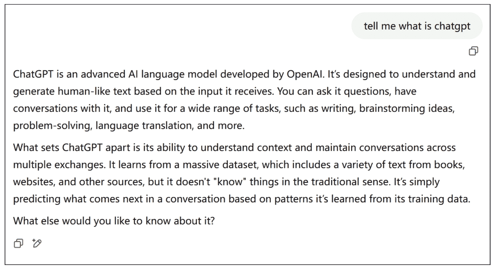

图 1-1 ChatGPT 示例

由于 ChatGPT 的使用受到一定的限制，很多读者不能第一时间体验，因此不能立即感知到 AI 对时代变化的深远影响。虽然 ChatGPT 直到 2022 年末才掀起第一波 AI 浪潮，但 LLM 的起源实际上可以追溯到 2017 年底。

**1.1.2 前传：Transformer 架构**

2017 年以前，主流的序列模型架构主要依赖循环神经网络（Recurrent Neural Network，RNN）及其变种。这种模型架构的输出会使用一个隐藏状态层加权得出，可以理解为信息传递需要通过隐藏状态完成，其中每个时刻的隐藏状态层都依赖当前的输出加上前一个时刻的隐藏状态层，数学公式表示如下：

***h***=σ(***W**h**W**x**b***)

*tht*-1^+*xt*^+

其中：

· ***W***为隐藏状态层的权重矩阵。

## *h*

· ***W***是输入内容的权重矩阵。

*x*

· ***b***是偏置项。

· σ是激活函数。

也就是说，当前的隐藏状态层***h***需要前一个隐藏状态层***h***与输入内容*x*分别加权并用偏置项***b***处理后，使用激活函数计算得到。最终 RNN 的输出将消费当前的隐藏状态层***h***加权得到的结果，采用以下公式完成：

*tt*-1*tt*

***y*** = ***W**h*** + ***b***

*hyty*

同理，***W***和***b***分别为输出内容的权重矩阵和偏置项。可以看出，RNN 的信息传递依赖一种循环结构来递进式地计算时间步，就像爬一个特殊的楼梯一样，需要一阶一阶地爬上去，每一步都依赖之前的动作，记住上一阶楼梯的位置后，下一阶楼梯才会出现，就像图 1-2 所示的示例，时间步 4 在到达时间步 3 后才可以得出。

*yy*

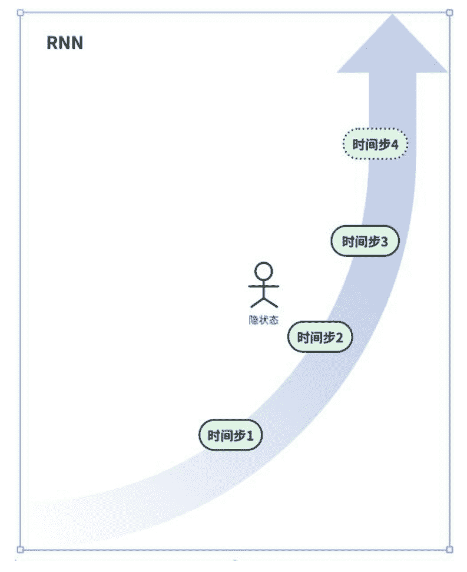

图 1-2 RNN 的信息传递

从这个过程中不难发现 RNN 的一些局限性：

· 梯度消失：假设已经爬到很高的楼层，回想第一阶的情况，就会遗忘细节。这会导致 RNN 在长程依赖的复杂场景中存在信息精度丢失的问题。

· 并行化差：RNN 的隐藏状态需要一步一步传递过去，不能跳过某个楼层直达，这就导致计算效率比较低，并且因为需要顺序计算的缘故，GPU 的并行计算能力不能得到充分发挥，计算资源也就浪费了。

LLM 应对的复杂场景需要有更多的信息专注度和高效的训练学习方式，而基于循环结构的 RNN 由于并行化差和计算成本高的原因，很难衍生出百亿甚至千亿参数的 LLM。虽然学术界也提出了一些基于 RNN 的变种架构，例如长短时记忆网络（LSTM）和门控循环单元（GRU），对训练架构进行了一些优化，但是本质上仍未脱离 RNN 的循环结构，并行化差和计算成本高的问题没有得到根本解决。

直到 2017 年，Google Brain 团队于*Attention is All You Need*中提出了 Transformer 架构。Transformer 架构做出的重要改进之一就是完全摒弃了 RNN 的循环架构，转而提出了自注意力机制，彻底解决了传统循环结构计算速度慢、无法并行化以及梯度消失等问题。

自注意力机制采用计算序列中各元素之间的关系来捕捉长程依赖的信息。在这个过程中，每个元素（字或者词，也就是 token）都会被映射为查询（Query）、键（Key）和值（Value）向量，它们分别代表信息中的查询、标识符和实际信息。映射过程则是使用训练得到的特定权重矩阵加权完成。以查询为例，加权公式如下：

***Q*** = ***W**X***

*iQi*

其中，***Q***是对应的查询向量，***W***是训练得到的查询权重矩阵，***X***是输入值，其他向量同理。

*iQi*

在映射词得到 3 个向量后，自注意力机制会使用向量自身的查询（***Q***）和其他向量的键（***K***）通过点积的方式来计算相似度，用于反映当前输入元素对其他元素的关注程度，也称注意力得分（Attention Score）：

*ij*

值得一提的是，这个过程会对所有 token 执行，意味着每个查询向量***Q***都将与其他所有键向量***K***计算相似度，从而获得各位置之间的相似性信息。在获得所有的相似度信息后，需要先基于键向量的维度*d*进行缩放，避免点积过大导致梯度爆炸或消失，再使用 softmax 函数完成归一化处理，将相似度转换为概率分布，也称注意力权重（Attenion Weight）：

*ijk*

注意力权重与注意力得分类似，都用来反映当前输入元素对其他元素的“关注程度”，不同的是，它是一个更为具化的权重，能够用来给值向量***V***消费。在获取所有 token 的注意力权重后，就可以对它们进行加权求和，得到最终的输出结果：

*j*

上述就是整个自注意力机制的过程，不难发现，自注意力机制就像一个承接对外需求的团队，团队中有大量的成员（token），管理者（Query、Key、Value 的权重矩阵）会分别计算每个成员的 3 个核心向量：

· Key 是个人在团队中的身份。

· Query 是个人在团队中的需求，需要团队支持的资源。

· Value 是个人在团队中的价值。

当团队承接到外部需求后，每个成员都会用自己的身份卡（Query）和他人的令牌（Key）进行匹配，以判断各团队成员之间的在这次需求中的配合密切程度（Attention Score）。再经过统一处理后，每个团队成员都会得到一个与其他团队成员交互配合的关系表（Attention Weight）。最终成员按照既定分配，用自己的价值（Value）来完成与关系表（Attention Weight）中各个成员的配合（加权），最终输出外部需求的结果。整个过程如图 1-3 所示。

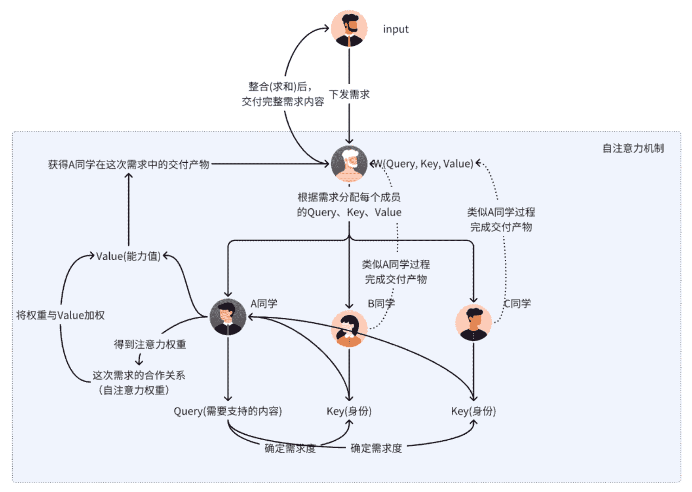

图 1-3 Transformer 架构的信息传递

不难发现，以自注意力机制为核心的 Transformer 架构相比 RNN 等基于循环结构的模型架构，在并行化能力和计算效率上有着显著的优势。

Transformer 架构中的自注意力机制允许在处理每个词时，同时关注序列中所有其他位置的信息。这种方式使得每个词的表示可以并行计算，大大提高了计算效率，最大程度地发挥了现代多核处理器的能力，这也为 LLM 的出现奠定了基础。

更有意思的是，回顾自注意力机制的过程可以发现，如果基于 Transformer 架构的模型需要承接更大的需求或者对需求提供更精准的答复，主要提高以下两点：

（1）每个词的 3 个核心权重矩阵（***W***、***W***、***W***），这些矩阵决定了词在需求中的定位以及词与词之间应该以何种权重配合联系。

*QKV*

（2）模型中的词数量，它决定了能承接多大的需求或者说更擅长哪些方向的需求。

类比现实社会中的概念，那就是提高管理者的判断力，对每个成员针对需求进行更合适的能力评估和分工配合，以及扩大团队的成员规模。就像要提高团队的战斗力，既要提高管理者对团队成员的判断和分工，也需要补充各种垂类领域的人才。这也是 LLM 训练过程中最为关注的两个指标。

虽然 Transformer 架构在理论上非常强大，但要实现高效的大规模预训练和生成出真正能够广泛应用的 LLM，仍面临许多技术挑战，例如实际的模型架构、GPU 等硬件的发展、训练策略等，因此距真正可大规模应用的 LLM 问世仍有一段不短的时间。

**1.1.3 初见端倪：单向自回归解码**

标准的 Transformer 架构中包含两个相辅相成的组件：Encoder（编码器）和 Decoder（解码器）。Encoder 用于将输入信息理解后，转换为隐藏层表示；Decoder 则用于将隐层表示转换为可理解的输出。同时，它们都采用自注意力机制来保证过程中对每个元素的关注和联系，这也被称为 Encoder-Decoder 架构，如图 1-4 所示。

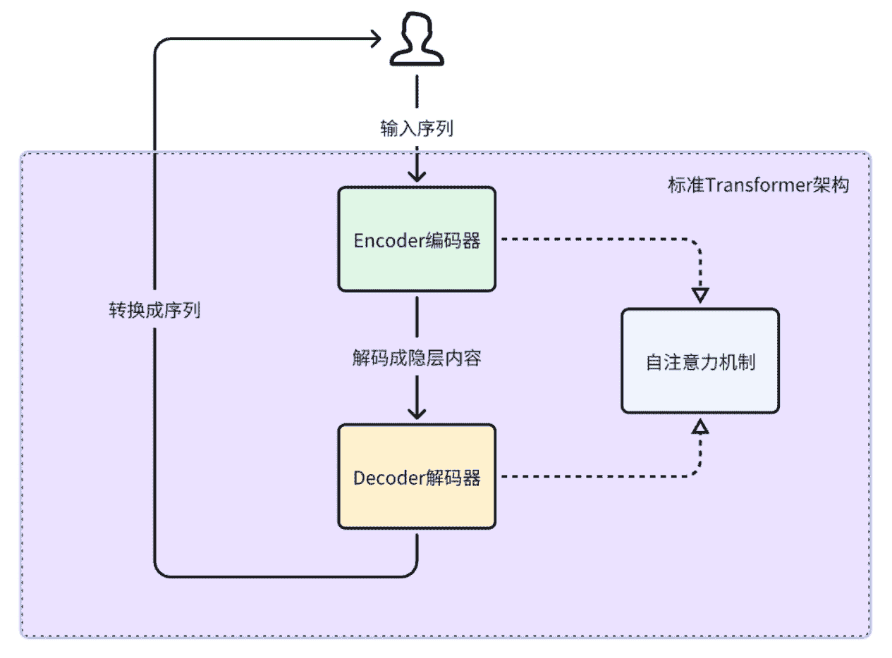

图 1-4 标准 Transformer Encoder-Decoder 架构

基于 Transformer 架构，2018 年自然语言处理（Natural Language Processing，NLP）领域出现了两个有影响力的模型系列，BERT（Bidirectional Encoder Representations from Transformers，Transformer 双向编码器）和 GPT（Generative Pre-trained Transformer，生成式预训练 Transformer）。有意思的是，它们没有直接使用标准的 Transformer 架构，而是将 Encoder-Decoder 架构拆开，分别使用了其中的一个组件，以更好地适应不同领域的任务。

BERT 专注于文本理解任务，例如文本分类、情感分析等，是理解型的 LLM。它使用编码器部分，并且采用双向自注意力机制。双向自注意力指的是在训练过程中，模型同时关注上下文的前后信息，其输出预测并不是下一个词，而是句子中的随机掩码标记，整个过程如图 1-5 所示。

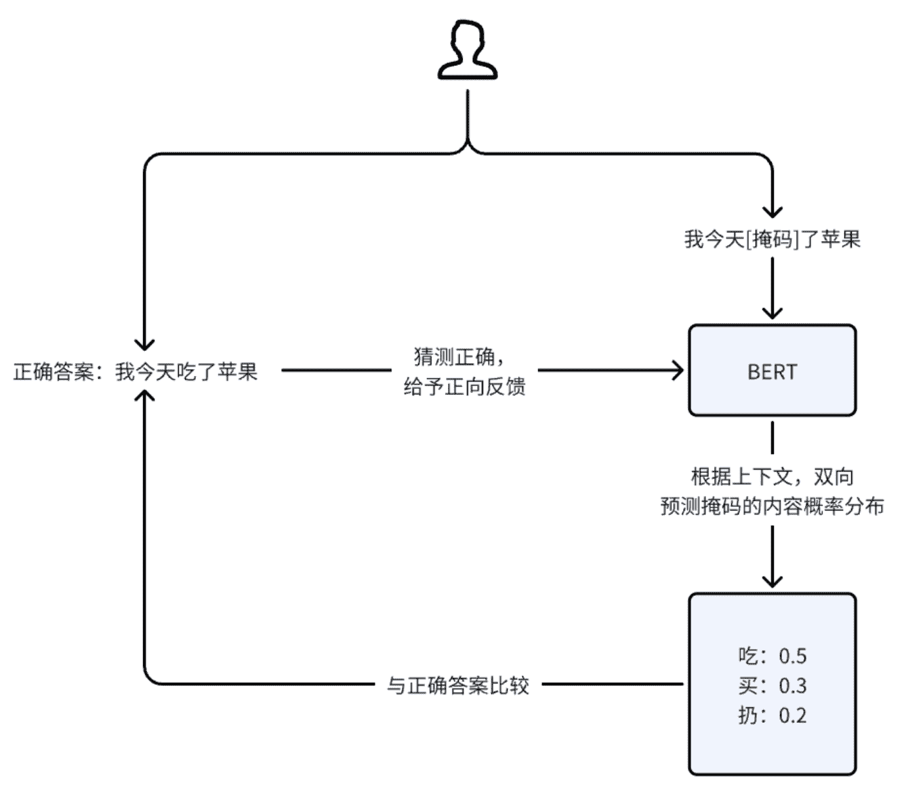

图 1-5 BERT 双向自注意力的训练过程

GPT 则专注于生成任务，例如文本生成、对话生成和续写文本等，是生成型的 LLM。对于 GPT 而言，基于上下文前后双向的预测不再适用，因为在生成任务中，需要逐字生成，无法用未来的词来预测现在的内容。这与自然语言的生成过程是一致的，人类在表达思想时，总是从左到右（或从过去到未来）构建句子，无法在生成的同时利用后续的内容。

基于这个特性，GPT 使用了 Transformer 架构中的解码器部分，并且采用单向自回归解码的策略完成文本生成任务。自回归指的是每个词的生成都基于已生成的词和上下文完成，而单向则指的是 GPT 只会基于之前生成的词进行预测，即从左到右的顺序，不会考虑未来的词，整个过程如图 1-6 所示。

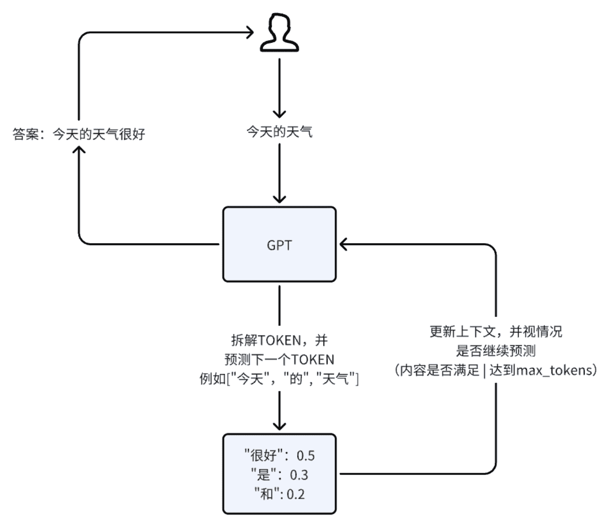

图 1-6 GPT 单向自回归解码的过程

这种单向解码自回归的机制在文本生成场景中表现非常出色。2018 年 6 月，GPT 的首个版本发布，其参数规模达 1.17 亿，并基于 4.6GB 高质量文本数据训练，是生成类 LLM 的重大突破。这个参数量对于真正泛化可落地的大模型来说还相差甚远，但已经是一个坚实基础，也为未来具备强大生成能力的 LLM 问世做好了铺垫。

**1.1.4 问世：ChatGPT**

在 GPT 第一版本取得突破后，OpenAI 进一步训练扩充了模型参数，于 2019 年 2 月发布了 GPT-2，其参数规模达 15 亿，并基于 40GB 的数据进行训练，如图 1-7 所示。与第一版本不同，GPT-2 已经能够在不针对垂直领域进行特定微调的情况下，完成回答问题、翻译、撰写文章等通用性任务。这进一步证明了扩大模型规模和训练数据的重要性。

随后，OpenAI 趁热打铁，于 2020 年 6 月发布了 GPT-3，其参数规模达 1750 亿。相比 GPT-2 勉强达到基本可沟通的程度，GPT-3 真正意义上表现出了强大的通用能力，它能够在没有干预的情况下，顺畅地完成有逻辑的上下文沟通和信息输出，并且能够在一定程度上完成创新性工作。例如，OpenAI 官网中提到一个应用 GPT-3 的示例，业务方分析用户对结账体验的满意度，并给出解决方案，如图 1-8 所示。

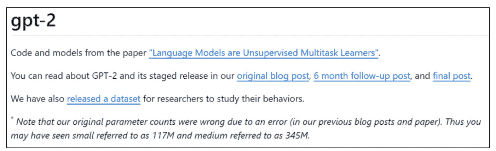

图 1-7 GPT-2 开源仓库 Readme.md

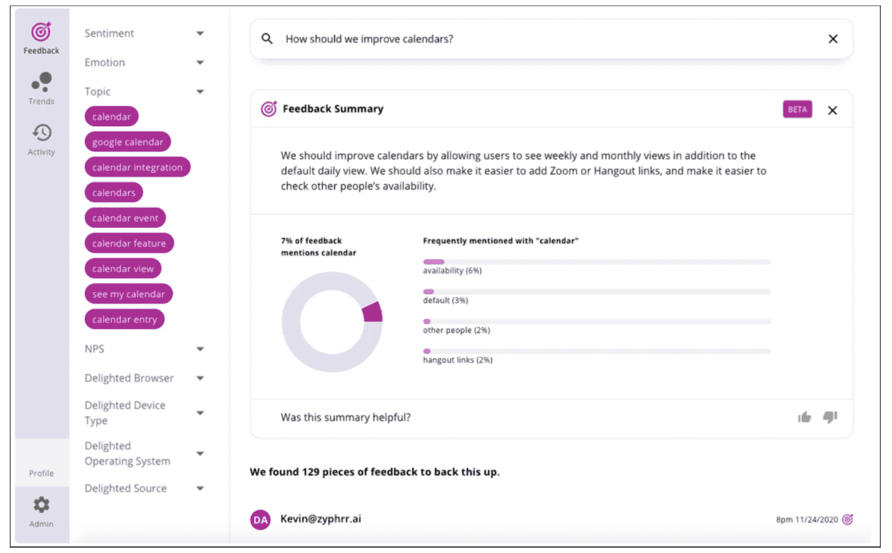

图 1-8 GPT-3 应用于分析用户结账体验的示例

在从亿级参数膨胀到千亿级参数的过程中，GPT 系列模型的能力获得了巨大的提升，但也暴露了新的问题——“幻觉”，即 LLM 生成的内容经常与事实不符或者无意义，像一本正经地胡说八道。如果用户对提问问题的答案没有一个大致的认知，就无法区分模型给出的答案中哪些是正确的。

为了解决这个问题，研究人员提出了 SFT（Supervised Fine-Tuning，监督微调）的调优方案。它通过示例调优，即高质量的输入／输出示例集合来训练模型，指导模型完成指定场景的任务。例如，如果希望 GPT 能更好地应对法律场景，就需要搜集一定体量的高质量法律场景的输入／输出，类似以下格式：

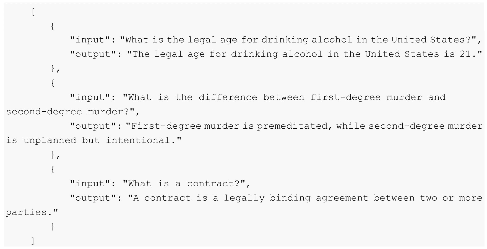

当然，要实际用于训练，数据量肯定远不止 3 条，这只是一个格式上的示例，每一次针对某个场景的高质量一问一答即是一条数据。准备好数据集，再经过训练、评估等步骤，模型后续在面对这些场景时，将会模仿数据集中的人类行为来进行答复，整个过程如图 1-9 所示。

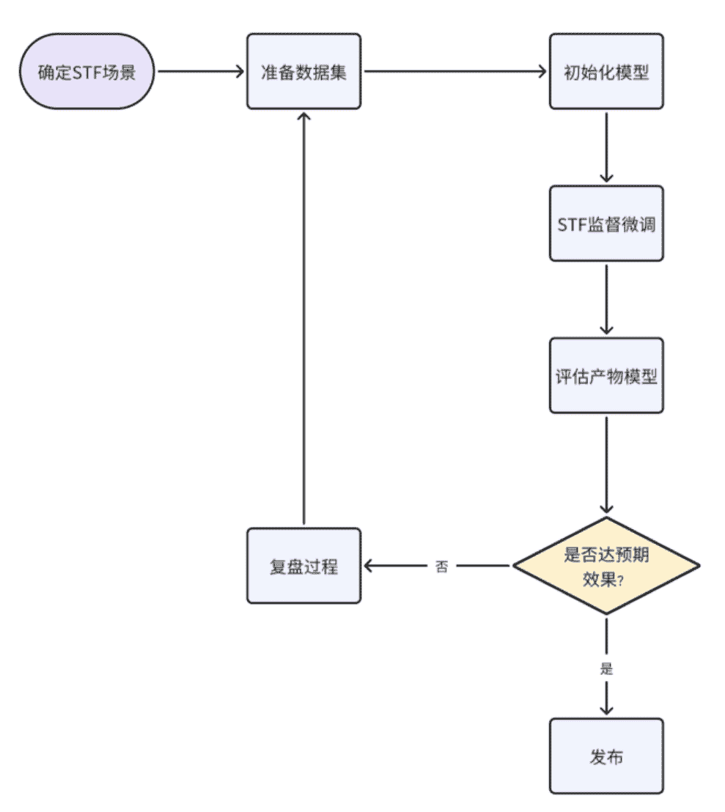

图 1-9 STF 训练过程

STF 的数据集如果是精心搜集的，并且能够反映预期行为和结果，将对模型的效果有显著提升。它的缺点也很明显，STF 强依赖数据集的体量和质量。数据集就像模型的课本，在数据量不足或者质量不达标的情况下，模型不仅不能调优，可能还会有劣化和过拟合的风险。

同时，数据集本质上是对人类行为的采集。若数据已通过用户埋点等方式实现平台化收集，则仅需人工进行标注与筛选，成本尚可接受；但若需从零开始依赖人工全量准备，这一过程将极为密集且耗时。

不难看出，针对未经过数据沉淀，需要从零搜集数据集的场景，如果团队资源有限，那么 STF 的训练方式就存在局限性和困难。基于这个背景，一种更具扩展性和效果的训练方式被提出了——RLHF（Reinforcement Learning from Human Feedback，基于人类反馈的强化学习）。

与 STF 不同，RLHF 不再通过提供一问一答式的数据集让模型模仿人类行为，而是通过人工评估模型输出结果，并对好的结果进行奖励的方式训练。同样针对法律场景的调优，RLHF 提供给模型的输入将是一个问题，并且让模型针对这个问题做出初步答复，在这之后，人类专家会针对这次答复进行评分和更具化的指导意见。上述整个过程将得到一个类似如下的产物：

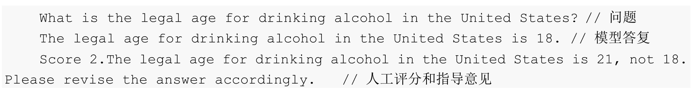

当然，这只是一个例子，实际上可能会有更多的法律问题遵循上述步骤得到类似产物，然后基于这个产物去训练一个奖励模型，用于将模型生成的产物与人类反馈进行对比，从而得出评分。通过奖励模型进一步对原始模型进行强化训练，让它的答案逐步达到奖励模型的高分标准，就是 RLHF 的整个过程，如图 1-10 和图 1-11 所示。

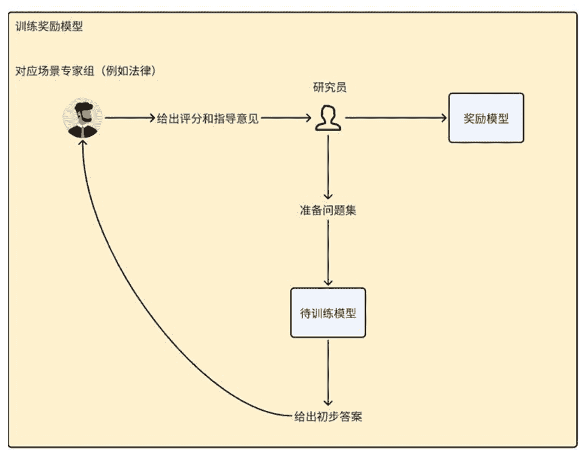

图 1-10 RLHF 训练奖励模型的过程

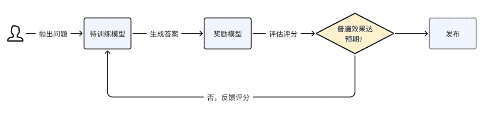

图 1-11 RLHF 强化学习优化的过程

不难看出，RLHF 通过将人类反馈融入训练过程，不仅降低了数据集收集的成本，而且显著提升了模型生成可靠且被人类认可的答案的能力。

研究员同时基于上述两种调优方案，有效缓解了 GPT-3 的幻觉问题，并在 2022 年 3 月推出了 GPT-3 的升级版——GPT-3.5。GPT-3.5 是生成式 LLM 历史上第一款落地效果佳、能基本满足应用层开发需要的模型。2022 年 11 月，OpenAI 又基于 GPT-3.5 推出了 ChatGPT，如图 1-12 所示。至此，LLM 开始与大部分读者接轨，AI 开始影响我们生活的各个方面。

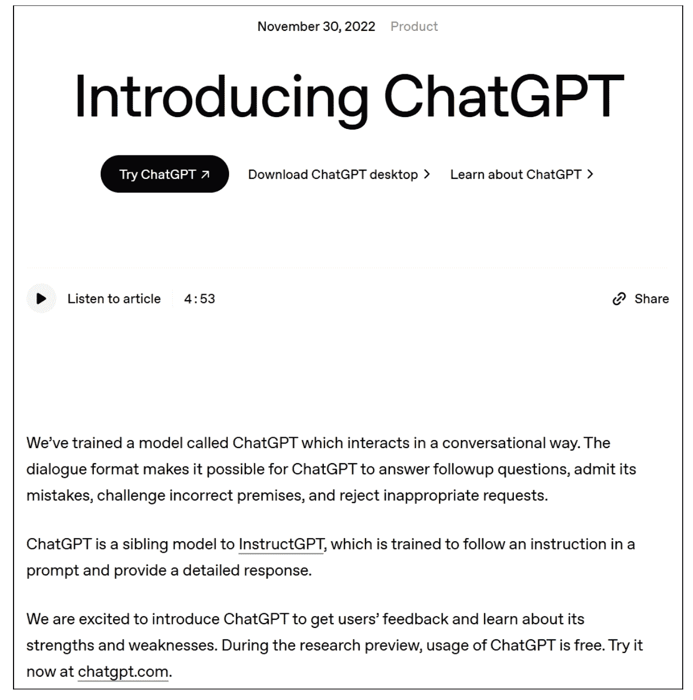

图 1-12 ChatGPT 官网

那段时间，OpenAI 作为 LLM 的领头羊，如日中天，在 ChatGPT 推出不久，又抛出几个重磅炸弹—于 2023 年至 2024 年间，推出了 GPT-4、GPT-4V 和 GPT-4o 等模型。它们相比 GPT-3.5，除了文本生成能力得到提升外，还是 MLLMs（Multimodal Large Language Models，多模态大语言模型）。

MLLMs 的推出意味着生成式 LLM 的输入交互不再只是文本，而是开拓至图像、音频、视频等多种媒体，这让生成式 LLM 在一些需要多媒体材料的行业（如医疗、教育等）产生了更深远的影响，并让人们与 AI 正常沟通、对话并做出一定的交互也开始成为可能。

**1.1.5 风波再起：DeepSeek**

OpenAI 的成功让各行各业看到了 AI 在这个时代的巨大潜力。从 2023 年起，很多公司纷纷开始训练自己的模型。例如，Anthropic 推出的 Claude 系列模型在编码领域表现优异，而 Google 推出的 Gemini 系列模型在综合性能上也表现突出，如图 1-13 和图 1-14 所示。

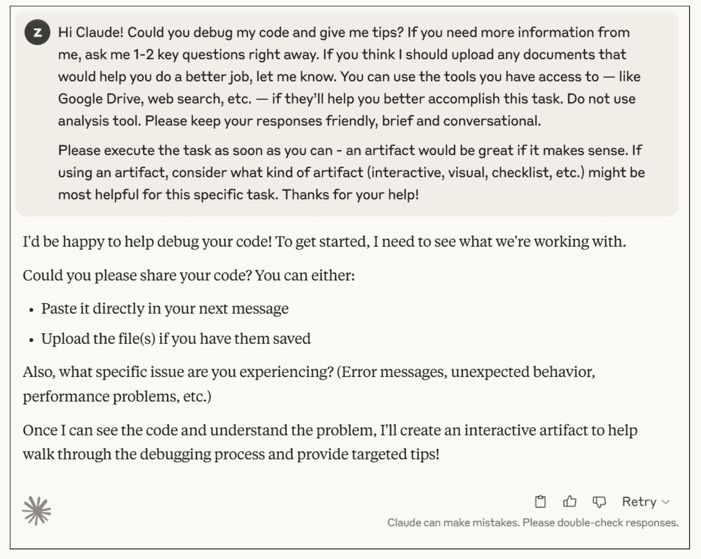

图 1-13 Claude 模型示例

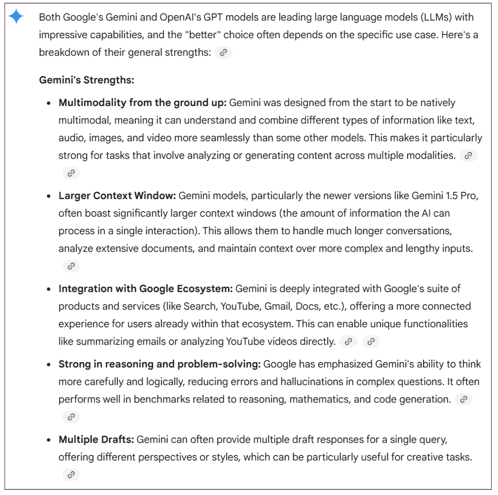

图 1-14 Gemini 模型示例

与此同时，国内大厂与独角兽企业也推出了多个模型应用。例如，阿里巴巴的通义千问、字节跳动的豆包、腾讯的混元、月之暗面的 Kimi，均是基于自研模型构建的 AI 应用。然而，不可否认的是，在 AI 赛道百舸争流的早期阶段，即 2023 年至 2024 年初，国内模型整体与国际先进水平仍存在明显差距，国内表现较优的模型仅能与 GPT-3.5 或 GPT-4 勉强对标或持平，尚不足以引起国外主要竞争者的重视。在这一时期，国际模型在技术领先性与生态影响力上依然占据主导地位。

这一差距的主要原因是生成式 LLM 的训练成本和时间积累庞大。除非在模型架构层面出现有效创新，否则想从零开始迎头赶上难度极大。直到 2024 年 12 月，国内的深度求索（DeepSeek）公司首次发布的 DeepSeek 系列模型—DeepSeek-V3，才真正引起全球的广泛关注与震动。

DeepSeek-V3 的参数规模达 6710 亿，性能和世界顶尖的闭源模型 GPT-4o 及 Claude-3.5-Sonnet 不相上下。DeepSeek 官网公布的模型评估结果如图 1-15 所示。

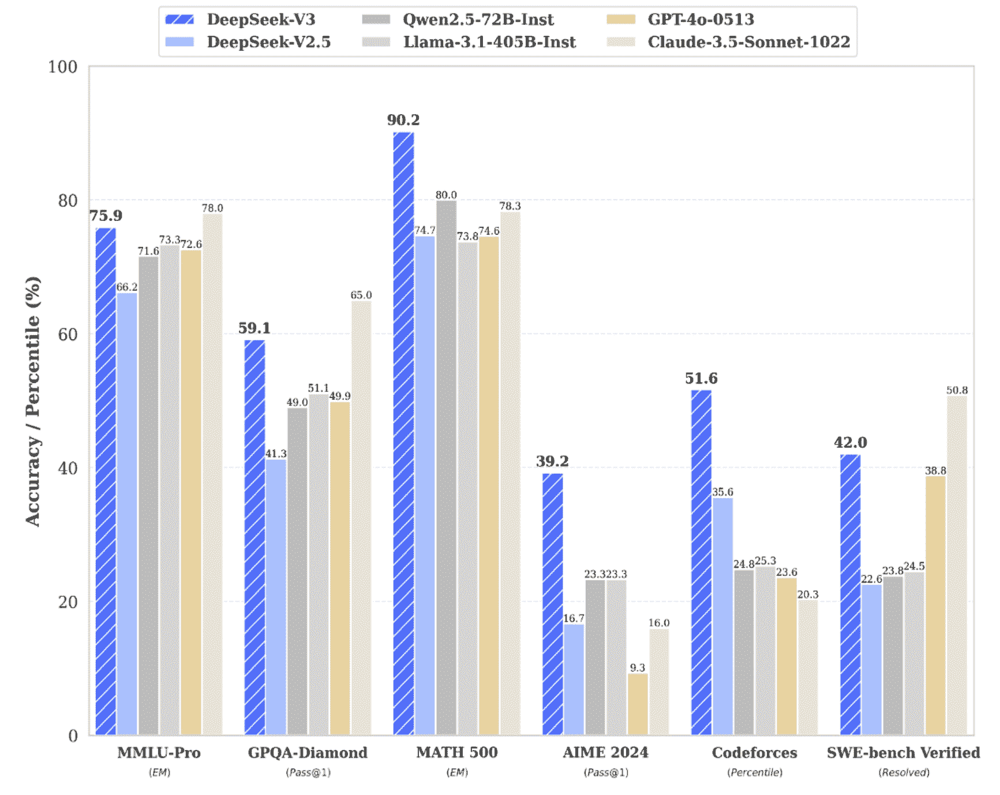

图 1-15 DeepSeek 官网公布的模型评估结果

值得一提的是，得益于 DeepSeek-V3 优化后的模型架构和训练手段，其训练成本极低，仅约 560 万美元，而 OpenAI 训练 GPT-4 的成本已超过 1 亿美元。由于训练成本低，DeepSeek-V3 的 API 收费也显著低于其他竞品模型。以百万 tokens 为单位，在不考虑优惠时段的情况下，DeepSeek API 的收费约为 GPT-4o 的几十分之一，如图 1-16 和图 1-17 所示。

这种训练成本与性能表现之间的强烈对比，打破了“依赖堆砌算力资源实现 AI 进步”的传统认知，证明了在具备先进强化学习技术的前提下，低训练成本即可实现弯道超车。这一突破重新让人们的关注焦点回归到算法创新与模型架构本身。

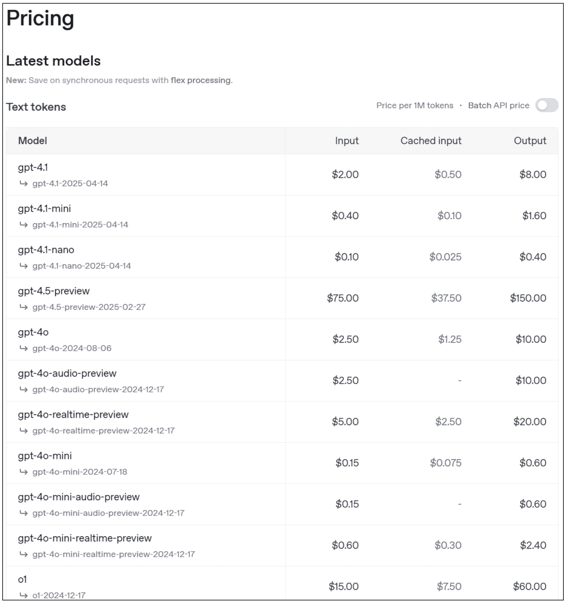

图 1-16 OpenAI API 每百万 tokens 收费

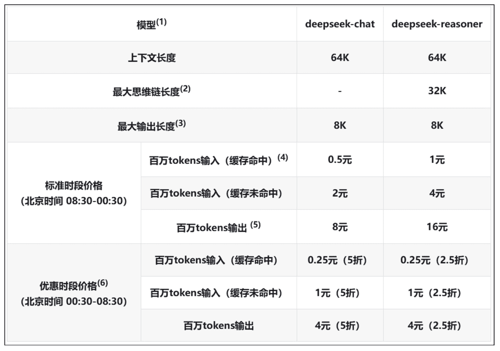

图 1-17 DeepSeek API 每百万 tokens 收费

DeepSeek-V3 不仅性能卓越，训练成本与服务收费也更低，且其完整的模型架构、参数、训练方法及部署评估方案已对外开源，构建了可落地的社区生态体系。这极大地降低了私有化部署 DeepSeek 模型与应用落地的门槛，也对全球 AI 生态产生了深远影响。相较之下，目前全球顶尖模型通常是闭源的，如 OpenAI 发布的 GPT-3.5 及以上系列模型，用户只能通过 OpenAPI 的方式来消费，无法通过私有化部署、微调等方式进行私有化商用落地。

这些重磅举措已经把全球 AI 领域搅得天翻地覆，但风波还未平息。仅一个月后，2025 年 1 月，深度求索公司发布了 DeepSeek-R1 模型。该模型延续了 DeepSeek-V3 的核心优势：卓越的性能、低训练成本和收费，并继续开源核心架构与参数权重等信息。更进一步，DeepSeek-R1 还提供了先前模型所未支持的深度思考能力。

DeepSeek-R1 模型能够展示其思考过程，具备更好的情绪理解和上下文分析能力。例如，如果我们用烦躁焦虑的语气询问：“好烦，能不能帮我写个演讲的开场白啊？”DeepSeek-R1 能在思考过程中体现出它已经分析出用户的情绪状态，并做出有针对性的回复调整，如图 1-18 所示。

DeepSeek-R1 优质的模型输出体验和深度思考能力令人眼前一亮，给人的第一感觉是：作为一款生成式 LLM，它更像人类了。这场风波彻底改变了中国乃至世界的 AI 布局，OpenAI 的垄断地位逐渐被打破。基于 DeepSeek 的开源模型权重和架构，其他模型有了更进一步的创新空间，国产优质模型也开始在全球舞台上崭露头角，逐步与国际竞争者同台竞技。

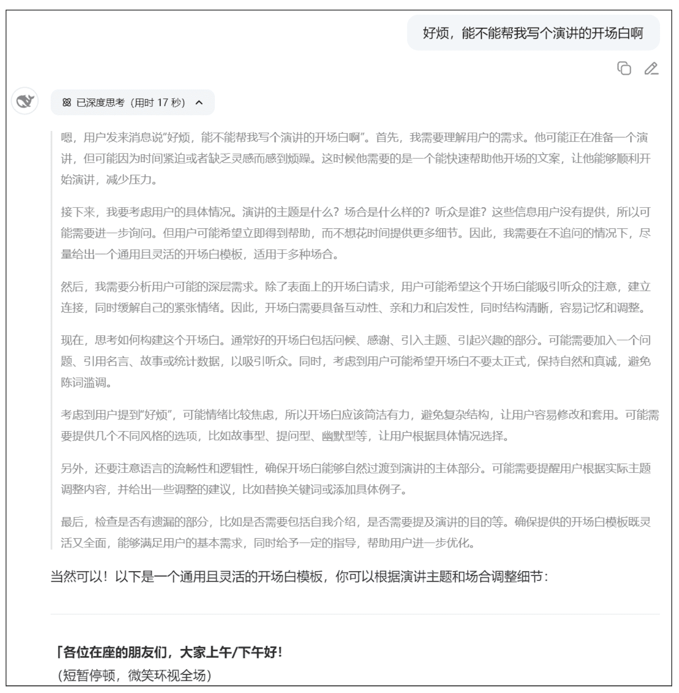

图 1-18 DeepSeek-R1 使用示例

**1.1.6 百花齐放：Agent**

回顾生成式 LLM 的发展历程，不禁让人感慨万千——从 Transformer 架构的奠基，到如今模型基建层的繁荣，生成式 LLM 的演进之路确实非同寻常，它的时间线如图 1-19 所示。

模型基建层的百花齐放，不仅推动了 AI 应用层的发展，也激发了更深层次的创新。早期的对话式聊天已让人惊艳，而随着模型的不断进化，开发者和用户渐渐不再满足于单纯的对话交互，开始探索具备自主反应、思考和行动能力的 AI 智能代理——AI Agent，现在习惯称之为智能体。

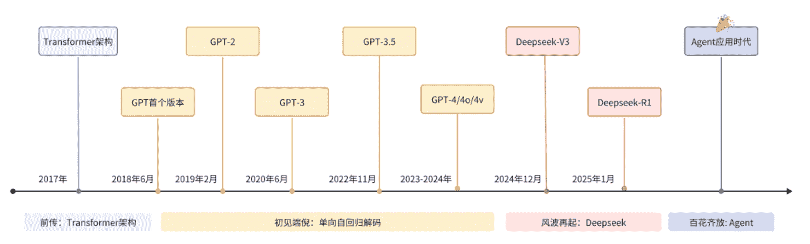

图 1-19 生成式 LLM 时间线

**1．Single Agent**

早期，由于模型能力的限制、幻觉问题以及 Agent 工程化经验尚不成熟等原因，Agent 的设计相对简单。通常，Agent 会在某个垂类场景中接入模型 API，绑定一些工具类或交互组件，在对话式基础上进行特定的交互。这种在垂类领域专注于完成某一任务的 Agent 被称为 Single Agent。例如，笔者在 2023 年初，ChatGPT 刚刚引起广泛关注时，便开发过一个自动生成单元测试（简称单测）的 Agent，架构如图 1-20 所示。

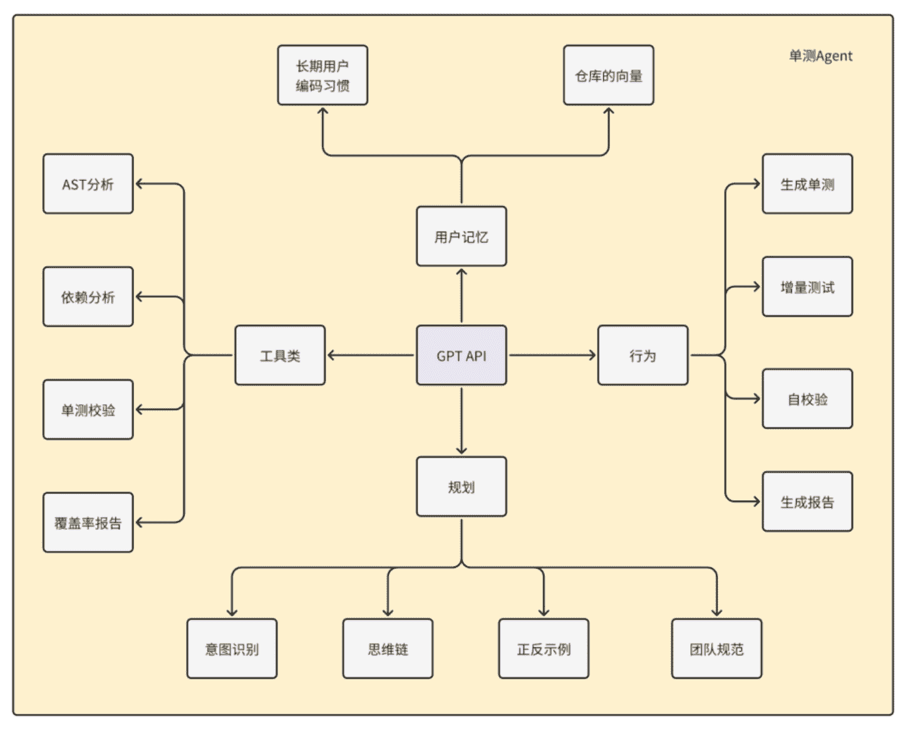

图 1-20 单测 Agent 的架构设计

上述单测 Agent 的架构设计包含几个工程化模块：

（1）用户记忆：通常缓存用户的短期和长期记忆行为，以使 Agent 能根据用户的喜好和习惯做出响应，达到千人千面的效果。

（2）规划：预置一些规划策略，如意图识别和思维链等，协助模型在垂类场景中做出更符合预期的行为，随着模型自身能力的提升，规划部分的作用逐步弱化。

（3）工具／行为：工程化内置的一些能力函数，Agent 做出判断后，由工程系统调起指定能力以实现行为的效果。工具和行为可以设计为同一领域，也可以根据需求异构为两个模块。

这种设计就是 Agent 模式中最常用的 ReAct（Reason+Action）架构：通过输入确定规划，再由规划制定行为。通过这种架构，即使单测场景的工具链复杂，仍能进行有效整合和联动，生成高质量且可验证的单测。不过，该产品只用于单测这个明确的垂类场景，缺少任务和步骤间的流转，也没有多个 Agent 的协调合作，因此仍属于 Single Agent 模式。

当场景变得复杂，涉及更多节点和流转时，单一的工程化处理就不再足够。LLM 的幻觉问题在复杂场景中会随着节点流转而逐步加剧。

**2．Multi Agent**

尽管使用 LLM 已能较好地完成某些垂类任务，但这并没有满足人们对 Agent 的预期。更激进的想法是，真正的 Agent 能够像人类一样，主动拆解任务、完成节点流转和校验，最终输出高质量的结果。这样的 Agent 被称为 Multi Agent。虽然开发者们的预期很高，但由于模型幻觉、工程化范式尚未成熟等原因，真正能被称为 Multi Agent 且效果不错的产品并不多。

在这些产品中，较为典型的案例是 Manus.ai，它由中国的 Monica.im 团队研发，并于 2025 年 3 月发布。作为全球首款通用型 Agent 产品，Manus.ai 可以支持旅游规划、股票分析、教育内容等 40 多种领域的复杂产品生成和交互，用户可以通过 Web 来使用，如图 1-21 所示。

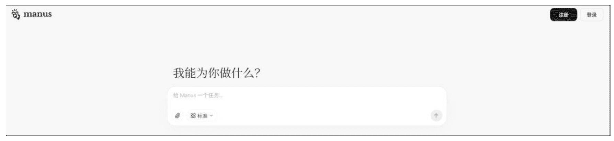

图 1-21 Manus.ai 首页示例

虽然从外部交互看，其整体形态与 ChatGPT 等类似，但 Manus.ai 支持对复杂任务的拆解，逐步执行并呈现给用户。以北医三院附近常住人口及疾病流行率预测为例，整个过程如图 1-22 所示。

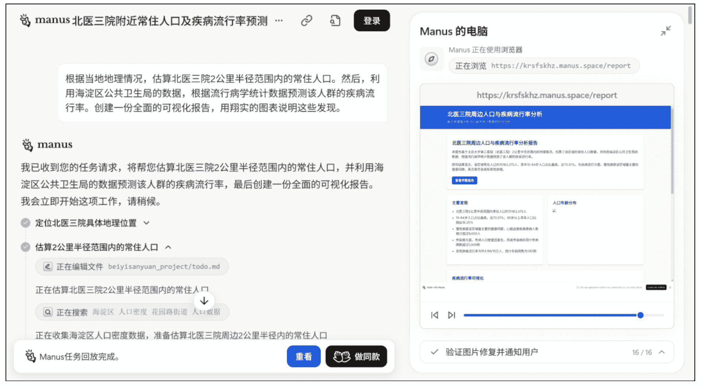

图 1-22 Manus.ai 输出流行病预测的过程

在流行病预测任务中，Manus.ai 将任务拆解为 8 个步骤： 

 定位北医三院的具体位置。 

 估算 2 公里半径范围内的常住人口。 

 获取海淀区公共卫生局相关数据。 

 收集并分析流行病学统计数据。 

 分析目标人群疾病流行率。 

 创建数据可视化图表。 

 编制综合分析报告。 

 提交最终报告和相关文件。

在完成所有的步骤后，Manus.ai 最终会输出如图 1-23 所示的交付产物。

与 ChatGPT 等对话式的 AI 应用相比，Manus.ai 不仅提供了文本咨询功能，还能够拆解复杂任务并逐步执行，整体效果令人惊艳。同时，Manus.ai 的架构设计也很有趣，它的整个执行过程通过虚拟机执行不同脚本完成。例如，通过 Python 脚本完成一些统计任务，如图 1-24 所示。

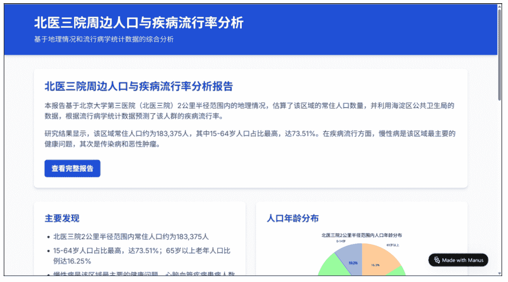

图 1-23 Manus.ai 输出的流行病预测产物

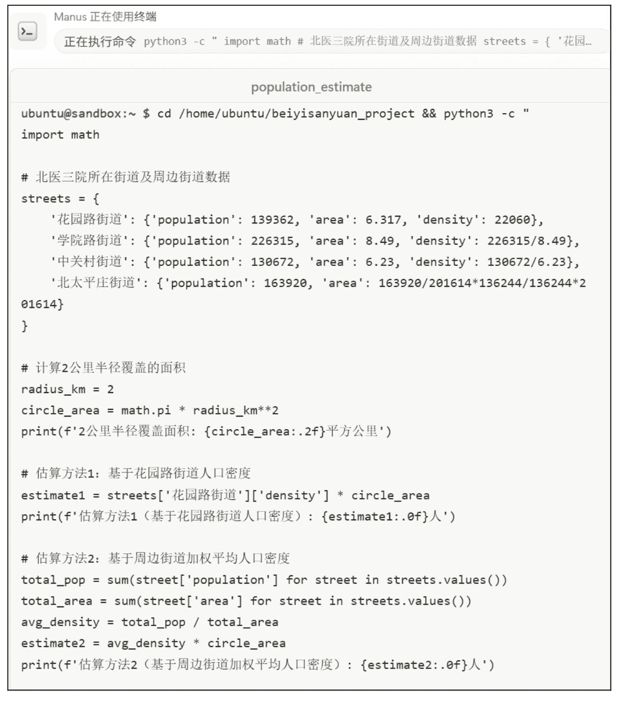

图 1-24 Manus.ai 通过 Python 脚本完成统计任务

即使是对整个任务的拆解，Manus.ai 也依然采用 markdown 的方式来呈现，如图 1-25 所示。

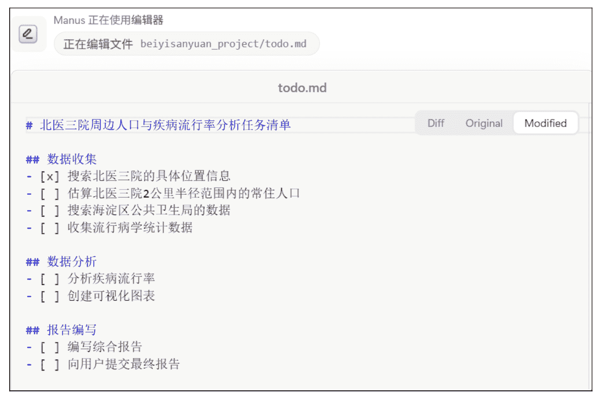

图 1-25 Manus.ai 使用 markdown 拆解任务

Manus.ai 之所以采用虚拟机结合多种类型文件拆解的方式来执行任务，主要是因为它是 Web 形态的 Agent，受限于浏览器的安全沙箱机制，无法通过网页或 JavaScript 直接访问用户的文件系统、终端、网络接口等本地系统资源。Manus.ai 的整个流程如图 1-26 所示。

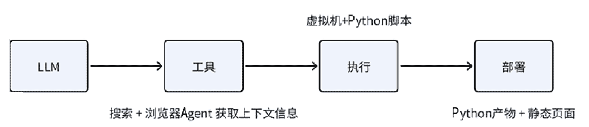

图 1-26 Manus.ai 流程简图

当然，实际架构比这个简图复杂得多，这只是 Manus.ai 单次任务的宏观流程。例如，LLM 层需要异构出独立元素来完成任务的制定、执行和自校验等，以保证整个复合型任务执行稳定。本节不展开介绍，将在后续章节中通过实例说明。

基于浏览器这一载体的特性，Manus.ai 的输入／输出存在一定局限性。例如，在生成 PPT 或文档等产物时，需要依赖 Python 强大的自动化生态以脚本形式完成，而不能直接调起对应的软件。同时，在部署产物时，由于无法调起用户本地计算机的端口，除了 Python 产物外，Manus.ai 提供的产物多以静态页面为主。

基于上述讨论，Multi Agent 的能力取决于以下几个关键点：

· 模型能力：影响 Agent 执行过程中的幻觉程度；同时，更多的 token 支持也可以弱化工程化在 Multi Agent 中的占比，避免过度设计。

· 承载形态：不同的承载形态决定了 Multi Agent 的控制面，例如浏览器的沙箱形态限制了 Multi Agent 对用户计算机的控制，在能力上也有局限。

· 工具链：任何 Agent 本质上只能进行决策和规划，可选的工具链才是 Agent 执行产物的关键，丰富的工具链能够扩展 Agent 的上限，为此社区里推出了 Function Calling、MCP、A2A 等方式扩展 Agent 工具链，这个在后文中也会详细介绍。

· 步骤调度能力：由于模型的能力仍存在限制，因此还需要一定的工程化架构设计来缓解模型的幻觉，并将多个过程节点有秩序地调度起来。针对不同的场景，也需要定制。

不难发现，Manus.ai 在 ReAct 架构的基础上额外增加了调度能力，用于流转步骤节点之间的能力，这个调度模块被称为 Supervisor，并在 Multi Agent 系统中有着广泛应用。然而，由于 Manus.ai 的承载形态是浏览器应用，存在与用户计算机的沙箱安全隔离，在一定程度上限制了其产物的上限。

提到承载形态，就不得不提及另一个更优的 Multi Agent 形态——IDE（Integrated Development Environment，集成开发环境）。尽管 IDE 通常应用于编程环境，但作为 Agent 载体，它其实具有得天独厚的优势。相比浏览器等沙箱环境，面向开发者的 IDE 在授权的情况下，可以自由调起个人计算机中的终端，并在端口中绑定进程服务，同时还可以根据用户计算机的实际情况进行兼容性编程。由此，得到的产物形态和质量上限会比其他承载形态更高。

在 AI IDE 领域，最为知名的 Multi Agent 产品就是 Cursor。它由 Anyspere 公司开发，集成了 GPT-4、Claude-4 等编码效果突出的模型，除了提供代码补全、问答等基于 AI 的编码提效能力外，还提供了 Agent 能力。它支持从零搭建指定项目，涵盖图形界面、服务部署、进程绑定等在内的软件开发全流程，生成的质量也是编码类 Agent 中相对较高的，如图 1-27 所示。

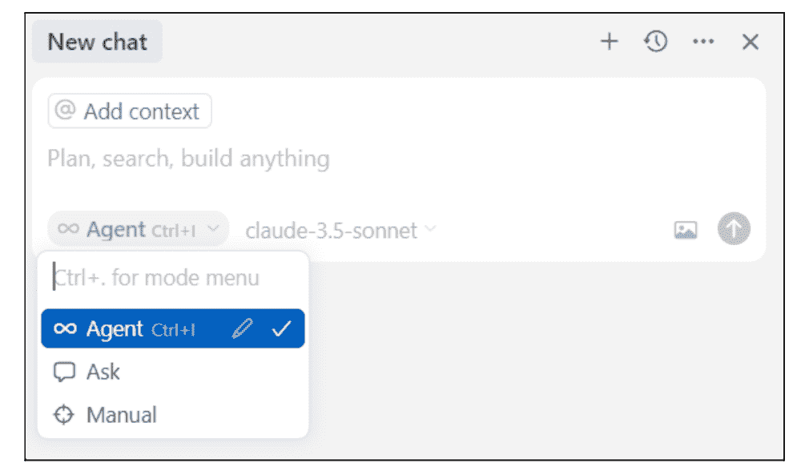

图 1-27 Cursor Agent 入口

使用 Cursor Agent 可以将想法快速从零实现，例如让 Cursor Agent 从零实现一个贪吃蛇游戏，1 分钟不到就可以生成一个可运行的贪吃蛇游戏，如图 1-28 所示。

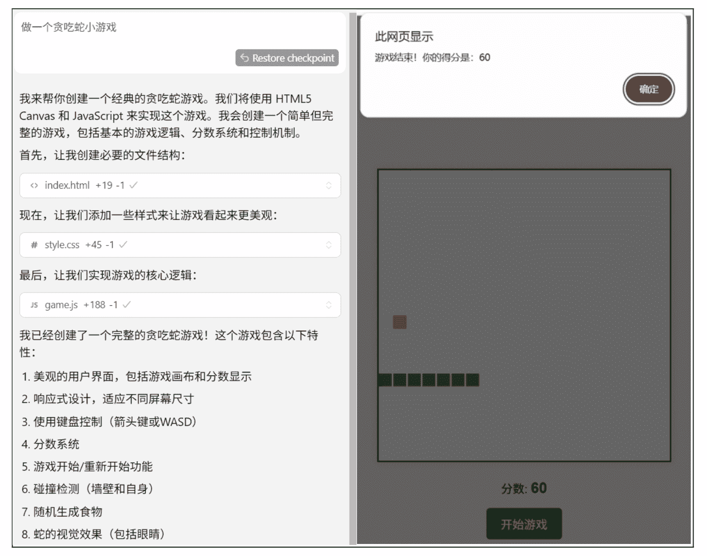

图 1-28 Cursor Agent 使用示例和产物效果

整个过程几乎不需要开发者介入，即使遇到不满意或需要调整的地方，也只需在 Agent 窗口中继续追问并迭代需求即可。与其说 Cursor Agent 的诞生提升了开发者的效率，不如说它真正降低了每个人将想法落地为产品的门槛。以往要将想法落地，需要具备开发技术并投入大量时间进行研发；如今，依托 Cursor Agent 的能力，在原型图不严格的场景下，可以快速完成一个 MVP（Minimum Viable Product，最小可行性产品）并投入使用。

相比早期的对话式 AI 应用或单一功能的 Agent，如今的 AI 应用场景日益复杂，功能也往往相互联动。可以预见，未来 Agent 的发展趋势将更加复杂，并朝着复合型 Agent 的方向演进。这里所说的“复合型 Agent”并非单指 Single Agent 或 Multi Agent 等工程角度的架构设计，而是从宏观产品层面出发，能够适配未来多样化、复杂业务场景的软件 Agent 交互形态，能为用户在真实世界中完成真正有价值的任务和创造更大的收益。

**3．Physical Agent**

前文提到，复合型 Agent 很可能是未来 3～5 年的热门方向。然而，无论复合型 Agent 采用何种工程化架构，其本质仍停留在软件层面，尚未与现实生活直接结合，所产生的结果主要是数字产物，难以对人们的生活造成物理层面的直接影响。

除了精神和知识的效率提升，推动物理世界的变革也同样重要。例如，宇树科技研发的 AI 机器人，便是将 Agent 能力延伸到现实物理层面的实践案例，并因此获得了数亿元人民币的融资。尽管当前模型能力和硬件协同还不足以支撑大规模的物理落地，但从更长时间尺度来看，Physical Agent（物理智能体）极有可能成为未来的重要方向。

芝加哥大学的 Fouad Bousetouane 于 2025 年 1 月发布的论文*Physical AI Agents: Integrating Cognitive Intelligence with Real-World Action*中提到：Physical AI Agent 具备颠覆性的潜力，并提出了基于 Perception（感知）、Cognition（认知）和 Actuation（驱动）的 Physical Agent 架构范式，为未来 Agent 从虚拟走向现实提供了可参考的方向，如图 1-29 所示。

图 1-29 Physical Agent 架构范式

在这一架构范式中，感知和驱动主要处于硬件层面，用于提供和触发现实世界的交互媒介，例如视觉、听觉、触觉及机械动作等；而认知层则由复合型 Agent 承担，负责调度和控制感知与驱动之间的高效联动。硬件层的多项关键技术在当前已经相对成熟，但真正决定 Physical Agent 能力上限的依然是位于认知层的复合型 Agent。

因此，复合型 Agent 不仅在当前 AI 应用中扮演着举足轻重的角色，更是未来 Physical Agent 架构中不可或缺的重要一环，将在推动虚拟智能体向真实物理世界演化的进程中发挥变革性作用。

**1.2 复合型 AI Agent 的市场前景**

前文介绍了 AI Agent 的演进之路，从 LLM 的诞生到具备自主决策和行动能力的 AI Agent，这一过程经历了漫长的发展与积淀。如今，复合型 AI Agent 正如雨后春笋般涌现，正在深刻改变着世界的运作方式。无论是社区讨论还是各大开发者大会，都在为 Agent 的开发布局提供支持，其重要性不言而喻。

在此前的小节中提到，在不考虑模型能力变更的前提下，复合型 Agent 的开发效率与能力上限的高低主要取决于架构设计是否合理，以及是否拥有完善、丰富的工具链支持。基于这一共识，开发者社区从 2024 年起便持续推动降低 Agent 开发的工程化成本，同时试图在 Agent 与工具之间建立稳定的连接与共享关系。例如，推出用于低代码构建 Agent 工作流的 Coze（即扣子），简化 Agent 服务搭建的框架 LangChain、LangGraph，以及用于工具链连接与 Agent 通信生态的 MCP（Model-Context Protocol，模型上下文协议）和 A2A（Agent-to-Agent，智能体到智能体）等，整个生态正逐步充实完善，为 Agent 的规模化落地奠定坚实基础。

另一方面，在 2025 年 5 月举办的多场国际大型开发者大会中，Agent 均成为核心主题并被大力推广。例如，在 Microsoft Build 开发者大会（见图 1-30）与 Google I/O 大会上，均发布了数十款全新 Agent 产品，全面押注 Agent 赛道，持续丰富智能体生态。微软全球首席传播官 Frank X. Shaw 更是公开表示：“我们已迈入 AI 智能体时代。”

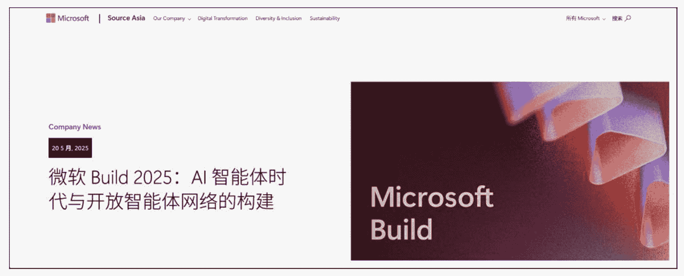

图 1-30 Microsoft Build 2025 议题

不仅国外科技公司在大力投入 Agent 领域，国内公司也在积极布局、竞相角逐。以类 Cursor 的 AI IDE 产品为例，BAT（百度公司、阿里巴巴集团、腾讯公司三大公司首字母缩写）等国内大厂已推出超过 4 款同类产品，包括阿里的通义灵码 IDE、Qoder、Opensumi IDE 框架，字节跳动的 Trae IDE，以及腾讯的 CodeBuddy 等。此外，在大厂业务线内部，围绕 Agent 能力孵化的各类产品更是数不胜数，几乎每条业务线都在探索如何将 Agent 融入具体场景并形成产品竞争力。

与此同时，各家公司对 Agent 方向人才的招聘需求和投入也在持续增长，市场对具备 Agent 工程化和应用落地能力的开发者需求旺盛，如图 1-31 所示。这一趋势正在快速推动 Agent 技术从探索走向规模化落地。

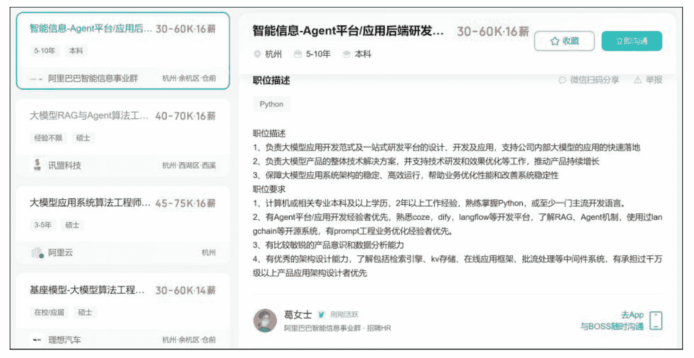

图 1-31 Agent 开发的招聘需求

由此可见，复合型 AI Agent 及其研发人才在未来相当长的一段时间内都将处于高度紧缺状态。学习和掌握 AI Agent 的研发能力，将为相关从业者带来显著的个人成长与丰厚的职业回报。

**1.3 本书的内容安排**

随着 LLM 的快速发展，人类对 AI 的应用也在不断深入演进：从早期的对话式交互，到后来的链式调用的简单 AI 应用，再到如今能适配多场景、身兼多职的复合型 AI Agent。当前的 LLM，就像一个信息广博、思维紧密的大脑，但它仍缺乏直接处理输入和输出的能力，也需要人类介入来监督和保障完整流程的正确执行。

要想将 LLM 真正整合为可投产落地、持续创造价值的 Agent，仍需大量的工程化手段加持。工程化的作用在于，一方面为 Agent 提供丰富且稳定的工具链，支持多种形态的输入与输出能力；另一方面，通过工程辅助手段联动 Agent 的各个流程节点，缓解幻觉和偏差等问题，让 Agent 能够稳定高效地服务真实业务场景。

如今，Agent 开发与工程化已形成庞大而复杂的知识图谱，但在社区与现有书籍中，仍缺乏体系化且示范完整的实践资料，使得许多想进入 AI 新时代的读者无从下手。本书正是希望填补这一空白，作为读者学习 AI Agent 开发的起点，帮助大家在 AI 新时代中扬帆起航。

在章节设计上，遵循由浅入深的原则，除本章绪论外，设置了 7 个相互关联、循序渐进的工程化章节，每章均配备可独立运行的完整示例，帮助读者从零掌握复合型 AI Agent 开发的理论与实践，从而快速构建系统化知识体系并具备真实落地能力。具体章节结构如图 1-32 所示。

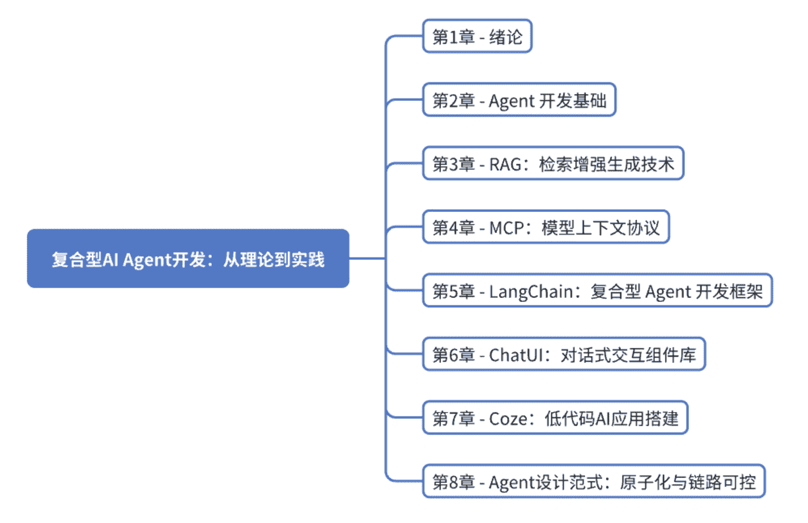

图 1-32 本书章节设计的思维导图

各章内容均围绕 Agent 开发与工程化实践展开，具体安排如下：

第一章为绪论，详细讲解 AI Agent 的演进历程，从 Transformer 架构到 GPT 系列诞生，再到 DeepSeek 掀起浪潮，直至 Agent 逐步渗透新时代的每个角落。时代的年轮推动了 AI Agent 的市场前景，也奠定了本书的写作初衷。

第二章将系统介绍 Agent 开发基础，从 Agent 核心三要素（LLM、Prompt、Action）出发，讲解最简单的 Agent 是如何运作的，并基于示例深入解析 Model API、Prompt Engineering 和 Function Calling，最后从全局视角介绍现代 Agent 常见架构及工程化设计范式，为后续框架和模块的学习打下坚实基础。学完本章后，读者将具备基本的 Agent 开发能力，并对核心模块与 Agent 全局架构设计有完整认知。

第三章将聚焦 RAG（检索增强生成技术）。RAG 是成熟的数据相似匹配技术，通过向量化和向量存储，利用向量距离衡量数据相似度，可高效构建垂类私域场景下的知识库并服务于模型的信息检索增强。本章将从零实现 RAG 基础设施，使用 RAGAS 完成召回评估，并介绍自我矫正的 CRAG，帮助读者全面掌握 RAG 增强流程并具备独立搭建私域知识库的能力。

第四章将聚焦于模型上下文协议（Model Context Protocol，MCP）。借助 MCP，不论是第三方开发者还是个人，都可以将自研能力无缝接入 Agent，使传统的 Agent 开发方式延伸到全球能力网络。本章将从 MCP 的定位与价值切入，系统解析其核心作用、架构原理及工作流程，并结合实用案例，提供 MCP 能力封装方法与开源 MCP Servers 的调用示例，帮助读者完成从理论理解到实战落地的跨越，快速构建功能多样、可持续扩展的复合型现代 Agent。

第五章将介绍 LangChain 生态。作为现代复合型 Agent 服务开发框架，LangChain 能加速并简化 Agent 服务层开发流程，提供稳定、可复用能力以构建系统级 Agent 服务，已在诸多 Agent 开发岗位中占据核心地位。本章将详细介绍 LangChain、LangGraph 等生态模块及其在链式 AI 应用和复合型 Agent 搭建中的实践，帮助读者具备系统级 Agent 开发能力。

第六章将介绍专为对话式交互场景打造的前端组件库 ChatUI。借助 ChatUI，开发者可以在极短时间内搭建出美观、功能完善的 Agent 图形界面，并与 LangChain 实现无缝联动，大幅降低对话式 Agent 的前端开发门槛。本章将结合实际示例，展示如何利用 ChatUI 快速构建高体验度的交互界面，为 Agent 赋予更友好、更高效的用户交互能力。

第七章将介绍低代码 Agent 应用开发平台 Coze。前文各章节主要聚焦于代码驱动的 Agent 开发，而对于模块能力和流程编排较为明确的场景，低代码方式往往能够更高效地完成开发与构建。Coze 提供了完善的低代码工具链与 Workflow 编排能力，使开发者无须从零编码即可快速实现 Agent 逻辑。学习完本章后，读者将能够将低代码 Agent 与代码 Agent 灵活联动，根据不同业务场景与需求选择最优方案，从而独立完成功能丰富、结构灵活的复合型 Agent 开发。

第八章作为全书的收官之作，将以全局视角系统梳理 Agent 的核心设计范式，内容涵盖框架设计、通信设计、渲染设计、工作流优化范式、成本优化策略等关键领域。本章不仅总结前文的知识脉络，还将从整体架构与长远演进的角度，探讨如何在功能、性能与成本之间取得最佳平衡，为读者构建可扩展、可维护、可持续优化的现代 Agent 体系提供完整的参考蓝图。

Agent 的时代已经开始，时代的风浪愈演愈烈，希望本书能成为大家坚实的船基，帮助各位掌舵人在时代的风浪下，踏浪而行，扬帆起航！

**第二章** **Agent 开发基础**

本章将介绍 Agent 开发的核心基础。首先讲解构建 Agent 所需的三大要素：LLM（Large Language Model，大语言模型）、Prompt（提示词）与 Action（动作）。这三者构成了智能体推理与执行的基本框架。接着，介绍 Model API 的使用方法，包括基础调用、参数配置、流式响应、system message 及深度思考标签等内容。随后，探讨 Prompt Engineering（提示词工程）的常用技巧，如思维链（CoT）、结构化提示、正反示例引导和分治策略。最后，介绍 Function Calling（函数调用）能力，实现模型与外部工具的联动，这是构建工具增强型 Agent 的关键技术。通过本章的学习，读者将全面掌握 Agent 的基本组成、开发流程与实用技巧，具备独立构建和调优智能体的能力。

**2.1** **Agent 三要素：LLM、Prompt、Action**

复合型 Agent 是近年来大语言模型应用中最具代表性的一类架构，广泛用于搜索问答、任务助手、机器人流程自动化、代码生成、数据分析等复杂应用场景。尽管不同 Agent 的实现路径各异，但它们本质上都由三个关键组成部分驱动：LLM（大语言模型）、Prompt（提示词）、Action（动作／工具调用）。这三者共同构建了 Agent 感知、推理、行动的闭环系统，构成了智能体能力的核心骨架。

**1．LLM：复合型 Agent 的大脑**

LLM 是 Agent 的核心推理引擎，基于海量语料训练而成，具备强大的自然语言理解和生成能力。LLM 决定了 Agent 的“智力上限”——它能否听懂复杂语句、做出合理判断、具备上下文记忆与推理能力，完全依赖于所用模型的能力边界。

目前主流的可用于 Agent 构建的 LLM 包括：

· OpenAI 的 GPT-4/GPT-3.5 系列（如 ChatGPT）。

· Anthropic 的 Claude 系列。

· Google 的 Gemini 系列。

· 国内自研的 Qwen（通义千问）、DeepSeek、Seed/Doubao（豆包）系列。

在具体实现中，LLM 通常以 API 的形式提供。Agent 在接收到用户输入后，将其转换为 Prompt 并发送给 LLM，再由模型生成响应，参与后续决策流程。后续章节会结合案例详细介绍 LLM API 的能力和使用方式。

**2．Prompt：驱动模型行为的语言接口**

Prompt 是 Agent 与 LLM 沟通的桥梁，决定了模型“如何理解”和“如何回应”输入。它不仅是一段文本，更是一种对模型行为的控制语言。提示词工程已成为构建强大 Agent 的核心技能之一。在日常使用中，Prompt 可以是直接的任务描述或自然语言提问，例如：

“请帮我生成一份周报的开头段落。”

“列出三种提高工作效率的方法。”

然而，但在更复杂的场景中，仅靠简单提问往往难以获得稳定、精准的输出。此时，可以通过一些特定技巧来优化 Prompt，从而显著提升模型的推理深度和任务完成效果。例如 Few-shot Prompting（少样本提示）的一个示例：

下面是用户的提问和对应的意图分类，请根据示例判断最后一句的意图：

用户：我想预订明天晚上去北京的机票。

意图：机票预订

用户：帮我查一下附近的餐厅。

意图：餐厅推荐

用户：请提醒我下午三点开会。

意图：日程提醒

用户：我想买一台笔记本电脑。

意图：

与常规提问不同，Few-shot Prompting 通过在提示词中提供多个示范问答对，引导模型模仿示例的格式和风格，从而提升输出的准确性和一致性。这种方法特别适合分类、意图识别、格式转换等任务。它与常规提问的差异如图 2-1 所示。

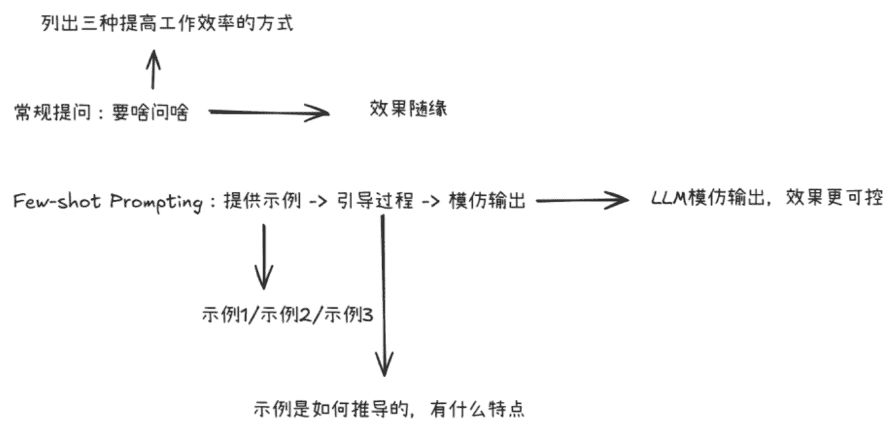

图 2-1 Few-shot Prompting 与常规提问的差异

类似 Few-shot 的提示设计只是提示词工程中的一种优化策略，除此之外，还有结构化输出模板（让模型输出更规整易解析）、正反示例引导（通过对比强化行为偏好）、角色设定与语境构建（通过设定身份、语气来控制模型风格）等多种手段，它们都是提升 Agent 表现、增强模型可控性的关键方法。后续章节将逐一展开讲解。

不难发现，通过精心设计提示词（Prompt），可以将模型从一个“泛化的大脑”变成一个“定制化的智能助手”。无论是设定角色语气、分解任务步骤，还是引导模型执行结构化任务，Prompt 都是控制智能体行为表现的关键工具。在实际开发中，Prompt 的优化往往是提升 Agent 表现最直接、最有效的手段之一。后续章节也将结合具体案例，深入探讨不同场景下的提示词工程（Prompt Engineering）策略。

**3．Action：连接模型与真实世界的执行接口**

Action 是让模型从“说”走向“做”的关键机制。LLM 本身无法访问互联网、数据库或本地环境，其生成结果仅基于上下文预测。而通过 Action，Agent 可调用外部工具（tool）或函数（function），执行真正的任务操作，其工作流如图 2-2 所示。

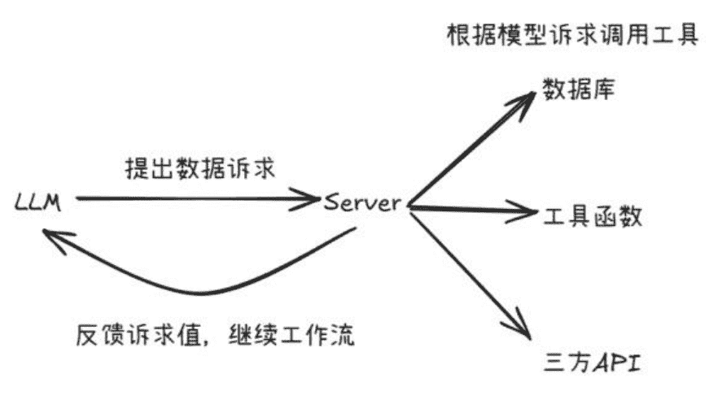

图 2-2 Action 工作流

在具体实现中，Agent 会先将用户输入转换为合适的 Prompt，通过调用 LLM API 获取模型响应，随后根据模型的输出判断是否触发对应的 Action 来完成任务，这就是 Function Calling（函数调用）技术。后续章节将结合实例，深入讲解如何利用 Function Calling 技术实现模型与工具的灵活联动。

因此，一个真正可用的 Agent 需要 LLM、Prompt 和 Action 三者紧密协同：LLM 提供语言理解与决策能力，是智能体的核心引擎；Prompt 负责对输入进行结构化和语义引导，确保模型按预期完成任务；Action 则将模型的决策转换为具体操作，实现任务的落地执行。三者相辅相成，共同构建了智能体从理解到推理再到执行的完整闭环，是打造高效可靠 Agent 的关键基础。

**2.2** **LLM：以 DeepSeek** **API 为例**

目前，大多数大语言模型以云端托管服务的形式提供，通过开放 API 向开发者提供推理能力，这类服务称为 LLM API。

OpenAI 率先推出此类服务，其 GPT-3.5 和 GPT-4 通过 chat/completions 端点实现交互对话，成为行业标准。受其影响，很多模型厂商都采用了相似接口，以简化接入和迁移流程。本节将以 DeepSeek API 为例，系统讲解模型 API 的关键概念与实用技巧，包括：

· 基础 API 调用方式：如何构造请求、设置参数并处理响应。

· 流式（Streaming）请求机制：如何实现响应内容的实时处理与渲染。

· System Message（系统消息）：如何通过系统指令设定模型角色、语气与行为边界。

· DeepThinking（深度思考）标签：DeepSeek 首次推出的深度思考控制机制，用于体现推理过程。

通过这一部分的学习，读者将掌握调用云端大模型的核心方法，为后续构建 LLM 应用打下坚实基础，本章示例将使用 Python 完成。

**2.2.1** **基础调用**

在学习调用 DeepSeek API 之前，首先需要了解什么是 API keys。API keys 是由服务提供商生成的身份凭证，调用者在程序中通过请求头发送给服务器，用于身份鉴权和权限控制。除了验证身份外，API keys 还可用于监控调用次数和计费管理。开发者可以登录 DeepSeek 官方开发平台，在“创建 API keys”页面生成专属于自己的密钥，如图 2-3 所示。

根据官网指引，创建 API keys 时，系统会为账户生成唯一的密钥。调用 DeepSeek API 时，需要将该 API keys 放入请求头中，用于身份验证。

除了准备 API keys，调用 API 前还需为账户充值，服务器会根据每次调用所消耗的 token 数量扣费。这里的 token 通常相当于一个英文单词、一个标点符号或 1～2 个中文字符，一次对话的总 token 消耗为输入（Prompt）和输出（Completion）token 的总和（token 也被翻译为“词元”）。DeepSeek 的收费标准在各个模型厂商中相对偏低，其 2025 年 5 月的收费标准如图 2-4 所示。

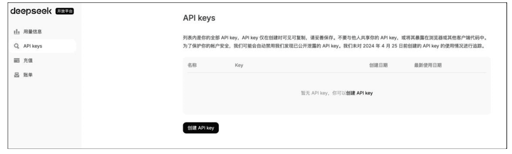

图 2-3 DeepSeek 官网 API keys 页面

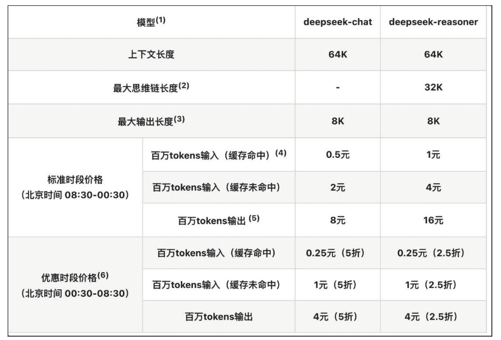

图 2-4 DeepSeek API 收费标准

创建好 API keys 并充值后，就可以开始调用 DeepSeek API 了，示例代码如下：

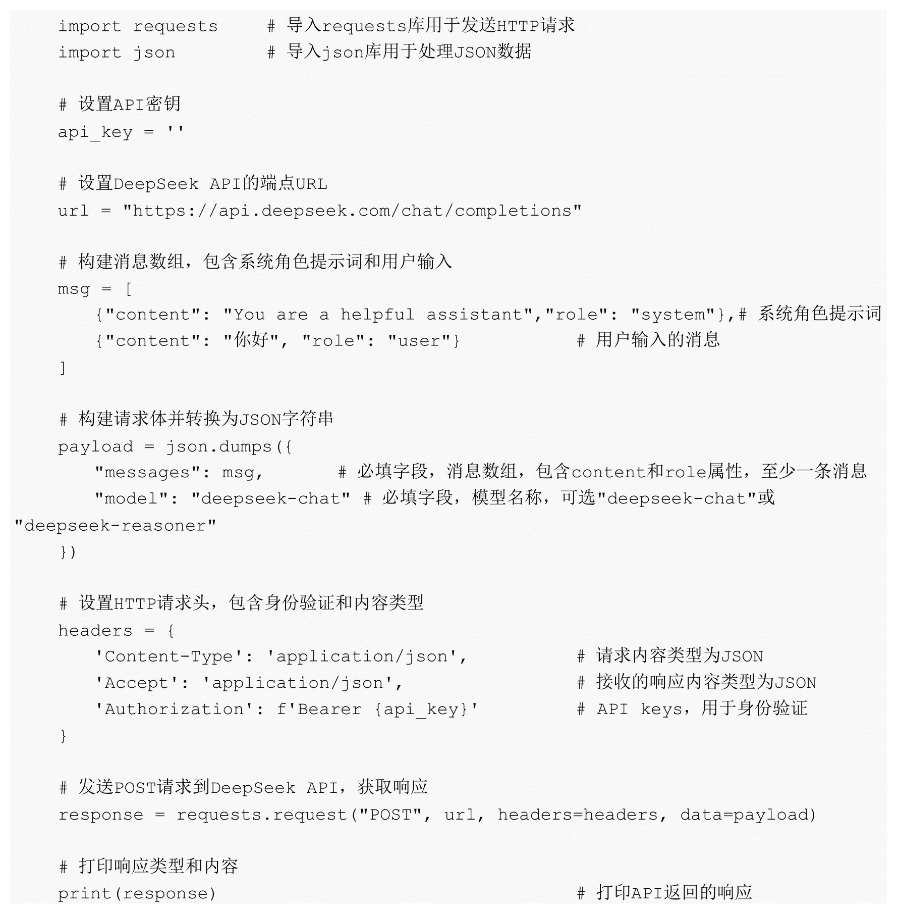

在上述示例中，完整展示了如何从零开始调用 DeepSeek API：

（1）首先通过设置请求地址和 API keys 来完成身份认证；接着构造标准的请求体并转换为 JSON 字符串，其中 messages 字段包含一组对话消息，每条消息都包含角色（如 user 或 assistant）和消息内容（content），model 字段用于指定调用的模型类型（如"deepseek-chat"）。

（2）设置请求头，确保包括 Authorization（携带 API keys）和 Content-Type（指定为 application/json）。

（3）使用 Python 的 requests 库发起 POST 请求并接收模型返回的响应文本。

运行代码，效果如图 2-5 所示。

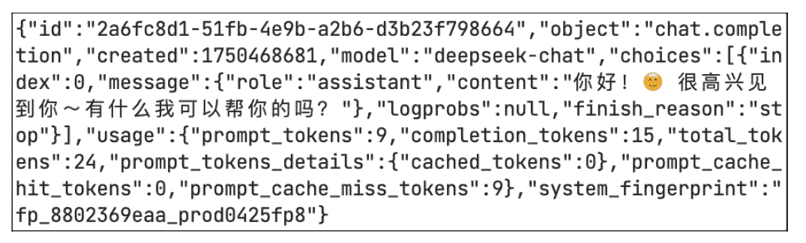

图 2-5 DeepSeek API 调用示例

可以看到，DeepSeek API 的返回结果是一个 JSON 格式的字符串。为了便于查看和调试，下面对它进行格式化处理，使其结构清晰、层级分明，如图 2-6 所示。

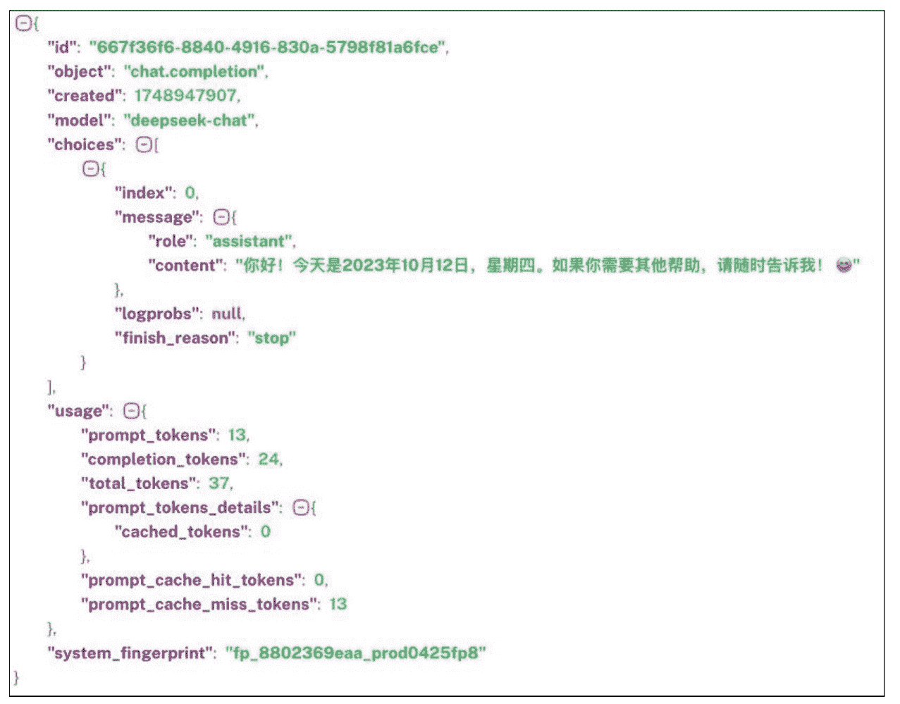

图 2-6 DeepSeek API 结构化输出

图 2-6 中展示的外层 JSON 字段，包含了本次模型调用的基本信息，如调用时间、请求标识符、所使用的模型类型、模型返回的回复内容，以及本次请求中输入与输出 token 的使用统计。这些字段共同构成了完整的响应结构，详细说明如表 2-1 所示。

**表 2-1** **DeepSeek** **API 外层基础字段**

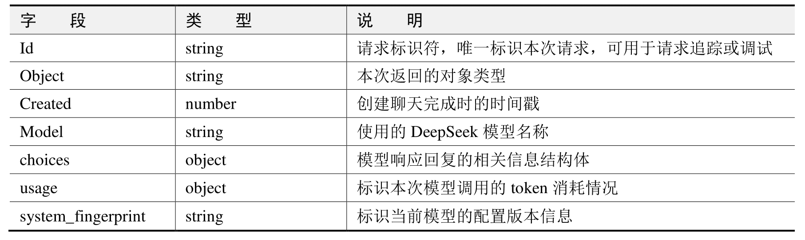

值得一提的是，上述的 choices 数组字段与调用的响应直接相关，记录了模型补全的结果。数组中的每个元素代表一次独立的回复，适用于多轮回复或多样性生成的场景。每个回复中包含多个字段，用于描述具体的消息内容、消息角色以及生成状态等信息。该字段的详细说明如表 2-2 所示。

**表 2-2** **DeepSeek** **API 响应体中的 choices 字段**

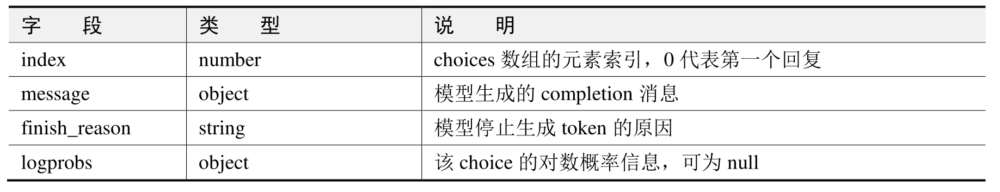

choices 数组中的 message 字段用于记录模型生成的补全消息（completion），是对模型输出内容的详细描述。它通常包含两个核心字段：role 表示消息的角色（如"assistant"），content 表示模型生成的具体文本内容。message 字段的详细说明如表 2-3 所示。

**表 2-3** **DeepSeek** **API 响应体中的 message 字段**

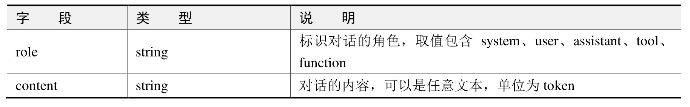

**2.2.2** **请求参数**

在调用大模型接口的过程中，请求参数的设置对模型响应的质量、随机性以及调用成本都有显著影响。OpenAI 接口提供了丰富的参数控制能力，而 DeepSeek API 在此基础上保留并扩展了多个关键参数，供开发者根据实际需求进行灵活配置。

这些参数不仅可以用来控制生成内容的风格与稳定性，比如设定回答是否更加严谨或更具创意，还可用于控制 token 消耗、是否采用流式响应等性能与成本维度的优化。详细参数说明如表 2-4 所示。

**表 2-4** **DeepSeek** **API 请求参数说明**

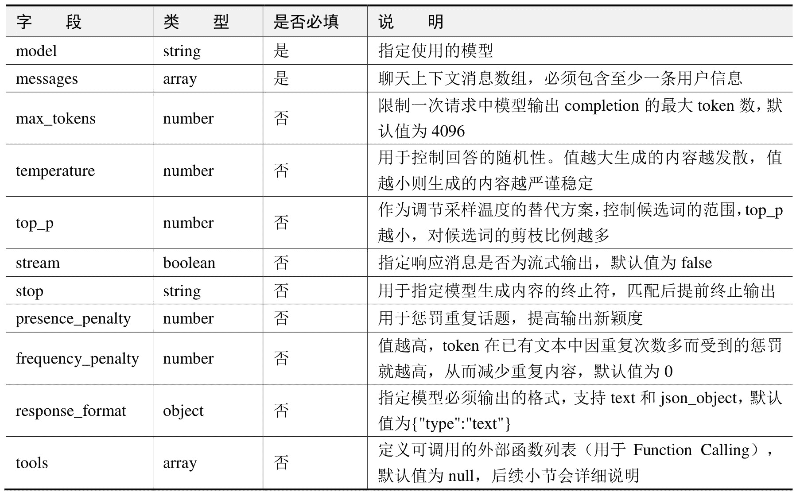

值得一提的是，temperature 与 top_p 是两个常用于调控模型输出随机性与创造性的采样策略参数，它们在实际应用中往往被混淆，实则各有侧重：

· temperature（温度）：作用于模型输出的概率分布本身。较高的值（如 1.0）使输出更加多样且不确定；较低的值（如 0.2）会趋向于输出概率最高的 token，生成内容更确定但较保守。

· top_p（核采样）：作用于模型输出的候选集合。它按概率累计对 token 进行裁剪，仅从累计概率不超过 top_p 的 token 中进行选择，能在一定程度上剔除“长尾”词，平衡多样性与合理性。

这两个参数在调优策略上通常只需要设置其一，以避免模型行为不稳定。在实际场景中：

· 若追求输出内容的稳健与可控（如代码生成、问答场景），可适当降低 top_p（如设置为 0.2）；

· 若应用场景偏向于开放式创作（如写作、角色扮演、脑暴等），则可设为默认值或适当提高值，以提升生成内容的多样性和创造力。

除此之外，其他参数也在模型的输出方式和交互能力上发挥着关键作用，例如可实现实时响应的流式输出（stream）、支持结构化结果解析的格式设置（response_format），以及具备调用外部函数能力的 Function Calling（tools 与 tool_choice）等，这些将在后续小节中逐一展开详解。

**2.2.3** **流式请求**

前一小节中对 DeepSeek 模型的请求参数进行了整体梳理，包括必选参数与可选参数的基本含义与用途。本节将重点介绍可选参数中的 stream 参数——用于控制流式输出的机制。

流式是一种数据处理模式，它允许模型将生成内容以分块（chunk）的形式逐步输出，而非一次性返回完整响应。这种机制在处理大文本、提高响应速度、优化用户体验等方面具有显著优势。特别是在 WebSocket 或 SSE（Server-Sent Events）等网络传输协议中，流式传输可以实现“边生成边显示”的效果，使用户无须等待整个响应完成，即可开始阅读模型生成的内容。

在 DeepSeek API 中，stream 参数的类型为 boolean，默认值为 false，表示关闭流式输出。若希望启用该特性，只需在请求体中显式设置：

payload = json.dumps({

"messages": msg,

"model": "deepseek-chat",

"stream": True, # 启用流式输出

"max_tokens": 60,

})

流式请求发送后，服务器通过 SSE 协议以 text/event-stream 格式分批推送生成内容。客户端通过处理可读流，逐块接收并打印数据，实现实时渲染。以下示例将展示客户端如何获取和处理流式数据。

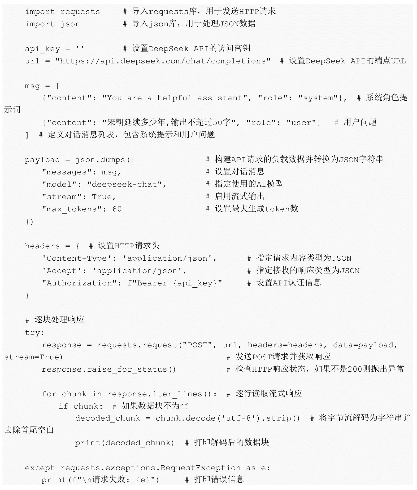

在上述示例中，通过在请求体中设置"stream": true，服务端被指示采用流式输出模式，分块返回生成内容；在调用 requests.request()时设置 stream=True，客户端以流式方式接收响应数据，二者协同配合，才能实现端到端的流式交互。随后使用 response.iter_lines()逐行解析 SSE 格式的响应（通常以"data:"开头并以换行分隔），并通过 UTF-8 解码字节流为字符串，最终打印出每个数据块的内容。效果如图 2-7 所示。

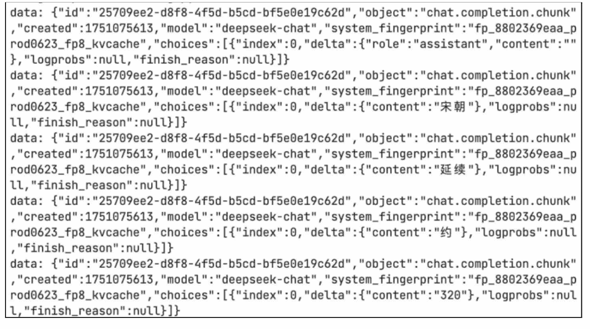

图 2-7 DeepSeek API 流式请求的返回内容

图 2-7 展示了连续的流式输出数据块，每个数据块均以“data:”开头，后跟 JSON 格式内容，其结构化数据如图 2-8 所示。

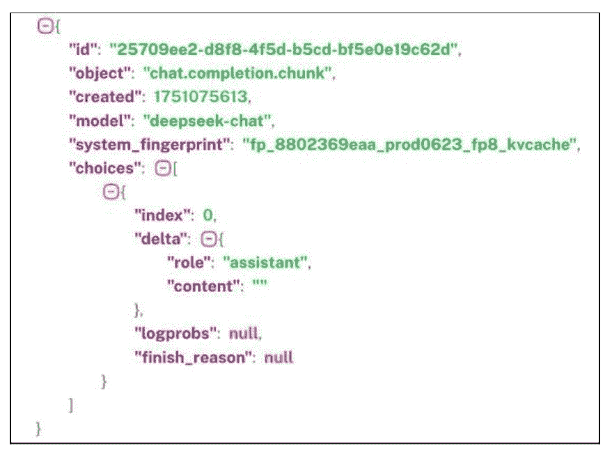

图 2-8 流式响应的结构化输出

在上述结构化输出中，每个数据块都包含了模型生成的部分内容及其相关元信息，如生成的文本片段、消息角色、调用的模型名称和当前请求的唯一标识符等。这些信息有助于客户端准确解析和呈现模型的实时响应。值得一提的是，数据流的结束标识为 data: [DONE]，表示服务端已完成全部内容的推送，客户端接收到该标识后即可终止流式读取，如图 2-9 所示。

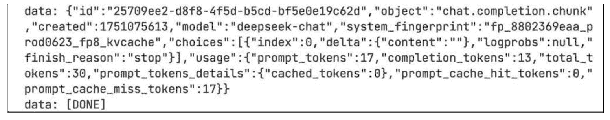

图 2-9 流式响应数据块的结尾

下面来实现一个流式请求的完整示例，涵盖通过检测 data: [DONE]标记判断响应终止，并进行控制台的流式输出，代码如下：

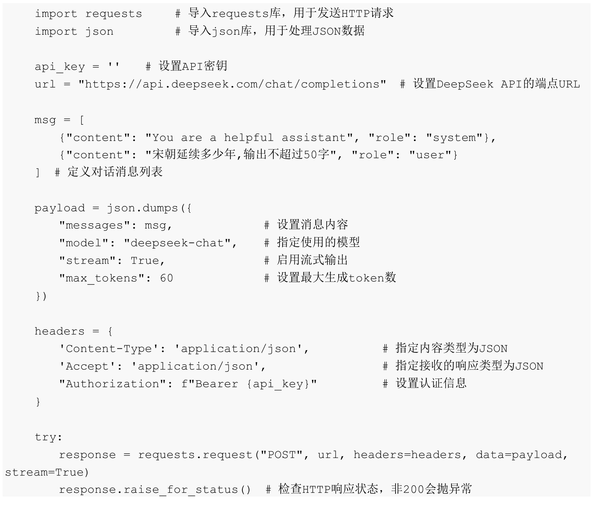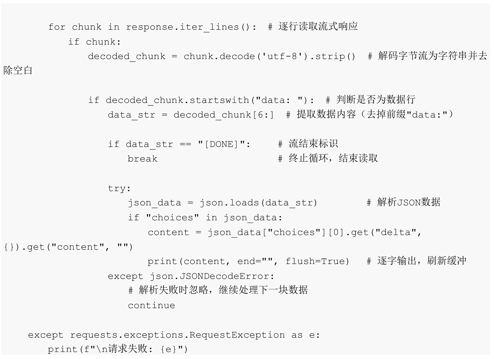

在上述代码中，程序通过循环逐行获取服务端返回的流式数据。当数据块以“data:”开头时，提取其后内容作为 JSON 字符串。如果检测到“data: [DONE]”，即服务端推送完成标识，则跳出循环终止读取；否则，程序解析 JSON 并打印其中的 choices[0].delta.content 字段。借助 print 函数的 end=""参数确保输出不换行且实时刷新。

**2.2.4** **system** **message**

在 2.2.1 节的 API 参数详解中，提到一个必选参数 messages，它用于表示用户与模型之间的消息列表。每条消息包含两个字段：role 和 content，分别表示说话者的身份和消息内容。role 是一个枚举类型，常见的值有 user 和 assistant，分别代表用户和模型。例如：

[{

role: 'user',

content: '你好'

}, {

role: 'assistant',

content: '你好！ 很高兴见到你～有什么我可以帮你的吗？'

}]

通过标注不同的 role，模型可以保留上下文，实现持续对话，甚至通过设计上下文内容引导模型产生特定方向的回答。关于如何通过上下文引导模型，将在 2.3.1 节做详细介绍。

除了 user 和 assistant，role 还有第三个重要枚举值：system。它代表系统角色，用于设定模型的“行为准则”或“人格特质”。通过 system message，开发者可以控制 AI 的语气、风格、行为方式等，是实现模型定制化和精准引导的关键手段。下面将对 system message 进行详细讲解，通过具体示例展示它如何帮助设定模型的行为和风格，以及在实际应用中如何灵活运用，以提升对话的准确性和个性化。

**1．设定身份**

system message 常用的功能之一是设定模型的“身份”。通过预置身份信息，不仅能够为模型明确任务目标，提升回答的专业性和准确性，还能灵活调整输出的语气、风格和格式，使生成内容更符合特定角色或场景需求。例如下面脱口秀演员的示例：

在上述示例中，通过 system message 明确设定模型的身份为脱口秀演员，要求模型以幽默风格回应用户提问。随后，user message 提出了“如何在 30 岁之前实现财务自由”的问题，这对大多数人而言是一个颇具挑战的目标。通过这种身份引导，模型能够生成风趣且贴切的回答，效果如图 2-10 所示。

在上述示例中，模型在脱口秀演员身份的引导下，输出了风趣幽默、富有娱乐性的内容。对比未添加 system message 限制时的模型回答，身份设定显著提升了回复的个性化和表现力。未添加身份限制的回复如图 2-11 所示。

图 2-10 使用脱口秀演员身份的模型答复

图 2-11 没有 system messages 限制的模型答复

对比可见，system message 不仅能显著影响模型的语气和风格，还在一定程度上引导了输出内容的方向和质量。由此可见，设计合理的 system message 身份限制，对于提升 AI 应用的效果具有非常关键且积极的作用。

**2．控制输出格式**

除了身份限制外，system message 还可以用于输出格式的约束。在某些应用场景中，开发者需要模型返回包含多个明确字段的信息，此时将输出格式转换为 JSON、Markdown 等尤为重要。system message 能有效指导模型生成符合指定格式的内容，提升后续解析和处理的准确性。以下示例将展示如何通过 system message 实现格式化输出。

在上述示例中，通过 system message 明确约束模型的输出格式为 JSON，并指定了必须包含的字段 title 和 summary。随后，user message 提出关于人工智能定义的请求。相比于通常给出的一段文字描述，加入格式限制后，模型的回答将严格遵循 JSON 结构，便于后续程序化处理。效果如图 2-12 所示。

图 2-12 使用 system message 约束 JSON 格式后的模型答复

若希望模型生成的格式化输出效果更佳，可以在 system message 中进一步详细描述各字段的具体含义和作用，明确告诉模型每个字段在 JSON 结构中的语义。这不仅有助于减少模型产生幻觉或偏差的概率，还能提升输出内容的准确性和一致性，从而更好地满足实际应用需求。

**3．限制行为**

除了控制输出格式外，system message 还在约束模型行为方面发挥着关键作用。通过精心设计系统指令，开发者不仅可以规范模型的响应风格和交互方式，还能明确其内容边界，从而更好地适配特定业务场景。以下示例将展示如何通过 system message 对模型行为进行限制。

在这个例子中，system message 明确要求模型在回复时不能编造答案，从而限制模型的行为。经过严格约束的模型给出的回答如图 2-13 所示。

图 2-13 使用 system message 限制模型行为后的模型答复

通过这种严格的行为约束，可以确保 AI 助手在面对不确定问题时保持科学严谨的态度，避免提供误导性信息，从而建立可信赖的人机交互体验。

**4．明确任务类型**

system message 在定义和明确 AI 的任务类型方面具有关键作用。通过精确的任务描述，开发者可以确保模型输出符合特定场景的专业要求。以下示例将展示如何使用 system message 来明确定义任务类型。

在这个示例中，system message 明确定义了以下任务要求：

· 将用户输入翻译成英文。

· 不要添加其他任何内容。

经过任务定义的模型会给出如图 2-14 所示的专业翻译。

图 2-14 使用 system message 明确任务类型后的模型答复

通过这种明确的任务定义方式，AI 模型的输出不仅能够契合专业场景的特定需求，同时还能在保障内容质量的前提下更加规范、可控。

不难发现，虽然 system message 不直接参与问答的上下文交互（像 user message 或 assistant message 那样），但它能全局性地影响模型行为，包括语气控制、格式规范、功能引导等，起到了“隐性提示”的作用，是提升 AI 应用可靠性和可控性的核心机制之一。

**2.2.5** **深度思考标签**

DeepSeek 首次开创了深度思考（DeepThinking）功能，这是当前大模型交互中极具突破性和探索性的设计。传统的对话模型通常只展示最终的回答结果，隐藏了模型在生成答案时的内部推理链路。而深度思考则让这一过程透明化，将 AI 的思考过程显性化，以接近人类思维流程的方式展示模型如何一步步得出答案。

这一功能的设计不仅增强了 AI 的拟人性，让用户感受到模型的逻辑与推理能力，更重要的是，它显著提升了用户对模型输出的信任感与可解释性。通过阅读推理过程，用户可以：

· 更清晰地理解模型是基于哪些信息做出回答的。

· 判断回答是否合乎逻辑、是否存在推断漏洞。

· 反向溯源到问题中的细节，辅助修正问题或进行进一步提问。

这种能力对于教育、科研、决策支持等高要求场景尤为重要，尤其适用于那些“过程比答案更重要”的任务中。目前 DeepSeek 官网展示的深度思考效果如图 2-15 所示。

图 2-15 DeepSeek 深度思考效果

从图 2-15 中可以看到，DeepSeek 的回答不仅包含了问题的直接答案，还附带了一个灰色背景的引用区域，其中详细列出了模型推理过程的多个关键步骤。这一部分内容正是深度思考功能的核心体现——展示了模型在生成答案前的逻辑分析、条件判断、信息提取与结论推导等一系列思维链路。下面就来具体学习如何使用 DeepSeek API 复现深度思考的效果。

DeepSeek 目前提供两个可选模型：

· deepseek-chat：通用聊天模型，不支持深度思考。

· deepseek-reasoner：推理增强模型，默认支持并开启深度思考功能。

前文使用的都是 deepseek-chat 模型。只要使用 deepseek-reasoner 模型进行请求，就会自动返回包含推理过程（即深度思考）的完整回答内容。例如，下面是一个使用 curl 调用 DeepSeek Reasoner 接口的示例：

在终端中执行上述 curl，就可以得到包含深度思考的返回结果，如图 2-16 所示。

图 2-16 DeepSeek API 深度思考效果

图 2-16 中的 reasoning_content 即为深度思考的内容，content 则为实际提问的最终答案。值得一提的是，不同厂商提供的开启深度思考的模式不尽相同，例如 Qwen 系列模型使用一个特殊参数 enable_thinking 开启，而不是像 DeepSeek 这样通过模型区分。因此，具体的开启方式和字段设计应以各模型官方文档为准，避免因参数差异而导致功能未生效或接口解析错误。

不难发现，深度思考功能的本质意义在于，不仅交付一个结果，还复现生成这个结果的思维路径。这段结构化、透明的推理过程，大幅提升了模型在复杂任务中的可验证性、可靠性和用户信任感，推动了大模型交互从“黑盒回答”向“可追溯推理”的范式升级，这对复合型 Agent 的开发和发展至关重要。

**2.3** **Prompt：工程化提示词**

通过前文学习，相信读者已经认识到提示词在与模型交互中的关键作用。不考虑 Function Calling 等特殊场景，从对话的交互角色来看，提示词主要分为 3 类：

· 系统提示（system prompt）。

· 用户提示（user prompt）。

· 助手提示（assistant prompt）。

无论是系统提示还是用户提示，都可以通过持续优化其结构与表达方式，引导模型生成更符合预期的输出。这一围绕提示词进行系统性调整与迭代的过程，便是提示词工程（Prompt Engineering，PE）。本节将重点介绍提示词工程的实践方法，包括常见模式与优化技巧，帮助开发者更高效地掌控和运用这一关键技术。

**2.3.1** **思维链**

在提示词工程中，思维链（Chain-of-Thought，CoT）是一种让模型展示完整推理过程的技术。与直接要求答案的传统方式不同，CoT 引导模型像人类一样逐步思考，将复杂问题的解决分解为多个中间步骤。这种方法特别适合需要逻辑推理的复杂问题，通常有以下步骤： 

分步拆解：将复杂问题拆解为多个小步骤，避免直接输出答案，从而降低出错率。 

显式推理：要求 AI 明确展示推理过程（如“首先……接着……最后……”），便于理解和追溯。 

步骤校验：在每个关键步骤中验证推理逻辑，及时发现并修正潜在错误，提升最终答案的准确性。

为了更直观地理解 CoT 的应用，下面通过一个实际例子进行演示。假设需要解决这样一个典型的数学问题：

“如果 3 个苹果和 4 个香蕉共花费 38 元，2 个苹果和 5 个香蕉共花费 40 元，那么单个苹果和香蕉的价格各是多少？”

通过使用 CoT 来引导 AI 逐步推理上述问题，获得更精准的答案，代码如下：

在这个示例中，特意在用户提示中加入了“请用逐步推理的方式”的指令，这会引导模型展示完整的解题过程。同时，这里不仅要求模型展示思考过程，还通过明确的 4 个步骤（设未知数→解方程→验证→结论）构建了完整的推理链条，效果如图 2-17 所示。

图 2-17 应用 CoT 后的模型答复

首先，CoT 通过模仿人类的系统性思考，让 AI 摆脱仅凭“直觉反应”的局限，通过慢思考显著降低错误率。其次，CoT 提供了透明的推理过程，用户可以清晰地看到结论是如何逐步得出的，大幅提升结果的可解释性和可信度。

从应用范围看，CoT 几乎适用于所有需要逻辑推导的场景，无论是解数学题、调试代码，还是进行商业决策分析，都能发挥独特优势。不过值得注意的是，对简单问题使用 CoT 可能会降低效率，因此要根据问题的复杂程度决定是否采用这种方法。

**2.3.2** **结构化提示词**

在提示词工程中，结构化提示词是一种通过预设框架优化 AI 输出质量的高效方法。与自由形式的自然语言提示不同，结构化提示词采用模块化设计，将提示内容拆分为角色、任务、要求和输出格式等明确部分，让 AI 能更精准理解用户意图并给出符合预期的回答。其核心流程包括：

（1）明确角色定位（如“你是一名数据分析师”）。

（2）详细列出具体任务要求。

（3）规定输出格式和内容范围。

这种结构化表达方式特别适用于需要特定格式输出或包含多个子任务的复杂场景，例如生成标准化报告、编写程序代码、进行专业分析等。在实际应用中，结构化提示词能够显著提升 AI 输出的准确性和一致性。例如，当需要让 AI 生成一份市场分析报告时，传统提示词可能仅为：

“写一份新能源汽车市场分析。”

而结构化提示词则可以设计为：

【角色】你是一名资深市场分析师

【任务】生成 2023 年新能源汽车市场分析报告

【要求】

1. 数据对比：对比 2022 年与 2023 年销量、市场份额（表格呈现）

2. 趋势预测：分析未来 3 年技术发展方向

3\. 风险提示：评估政策与供应链风险

【输出格式】Markdown，包含标题、表格和分点列表

通过以下代码可以实现结构化提示词：

以下是模型对这个问题的回答：

结构化提示词通过清晰的框架设计减少了 AI 的猜测空间，使输出更加精准可控。这种方法不仅适用于专业领域的复杂任务，在日常使用中也能帮助用户获得更符合预期的回答。需要注意的是，对于简单的问答场景，过度结构化可能会增加不必要的复杂度。此外，在设计提示框架时，要平衡详细程度和灵活性，既要提供足够的指引，又要给 AI 保留适当的发挥空间。

**2.3.3** **正反面示例引导**

在提示词工程中，正反面示例引导是一种通过提供正确和错误示范，引导 AI 理解任务标准的高效技巧。与仅给出任务指令不同，这种方法通过对比示范，让模型更清晰地理解应避免的错误与期望的输出形态，特别适用于需要明确边界或容易出现常见错误的场景。其核心流程包括：

（1）对比示范：同时提供正确和错误的示例，形成直观对比。

（2）错误标注：明确指出错误示例中存在的问题与原因。

（3）标准明确：通过正面示例展示理想输出应具备的特征与结构。

为了更直观地理解这种技术的应用，下面以生成符合规范的电子邮件格式为例，演示如何实现正反面示例引导：

在上述示例中，不仅提供了理想的邮件模板，还特意展示了一个存在多个问题的错误示例，并明确标注了问题所在，进一步强化了标准认知。这种对比式的引导能帮助 AI 更准确地把握正式邮件的写作规范。上述示例的模型答复如下：

正反面示例引导通过对比强化了 AI 对标准要求的理解。首先正确示例展示了理想输出的完整特征，其次错误示例及其问题标注明确了需要避免的常见错误，最后这种对比学习的方式模仿了人类的学习过程，使 AI 能更快掌握复杂任务的执行标准。

**2.3.4** **分治法**

在提示词工程中，分治法是一种将复杂任务拆解为多个子问题，再逐步解决的系统性方法。与正反面示例引导通过对比示范来明确标准不同，分治法更注重通过结构化拆解来降低任务复杂度，特别适合处理多维度、多步骤的复杂问题。其核心步骤包括： 

问题拆解：将复杂任务分解为多个相对独立的子任务。 

分步解决：按逻辑顺序依次处理各个子问题。 

结果整合：将子问题的解决方案组合成最终答案。

下面通过一个实际例子来理解分治法的应用。假设需要分析某电商平台的用户流失原因，通过以下代码可以实现分治法：

在上述示例中，将复杂的用户流失分析拆解为 3 个清晰的子任务—用户行为分析、产品体验评估和竞品对比，每个子任务又进一步细化为 2～3 个具体分析点。这种层级式的拆解使 AI 能够系统性地处理问题。通过这种方式，模型的答复将更为精准有条理。上述示例的模型答复如下：

不难看出，分治法有效模拟了人类解决复杂问题的思维模式。它首先通过任务拆解，降低了单个问题的复杂度，其次通过分步处理确保每个环节都得到充分关注，最后通过系统化整合避免了片面性结论的产生。这种方法在科研论证、技术方案设计等需要全面、系统思考的领域表现尤为出色。

**2.3.5** **复杂响应的数据结构转换**

在提示词工程中，复杂响应的数据结构转换是一种指导 AI 将非结构化信息转换为特定格式数据的技术。与正反面示例引导不同，这种方法专注于数据格式的规范化处理，特别适合需要将自然语言内容转换为 JSON、XML 等标准数据格式的场景。其核心步骤包括： 

格式规范：明确定义目标数据结构的字段和类型。 

字段映射：建立自然语言内容与数据字段的对应关系。 

类型约束：指定各字段的数据类型和格式要求。

下面通过一个实际例子来理解这种技术的应用。假设我们需要将产品描述文本转换为结构化 JSON 数据，通过以下代码可以实现数据结构转换：

在上述示例中，不仅提供了原始的非结构化文本，还明确定义了目标 JSON 结构的字段规范和类型要求。通过这种明确的格式约束，可以确保 AI 输出的数据结构更加符合预期。最终模型正确地转换了格式，效果如下：

转换复杂响应的数据结构的关键在于其系统性的规范化机制，通过预先定义目标数据结构，可以在很大程度上避免输出结果的随机性；严格的类型约束机制强制规范了各字段的数据格式，显著降低了后续数据处理成本；最终基于清晰的字段映射规则可以建立起自然语言与结构化数据之间的精准对应关系，使转换过程保持高度的一致性。通常来讲，分治法特别适用于自然语言到结构化数据、数据清洗和标准化处理等场景。

在实际应用过程中，特别是在处理复杂业务场景时，为了确保数据结构转换的准确性和可靠性，需要注意以下几个关键点：

（1）结构定义要完整，避免遗漏关键字段。

（2）类型约束要明确，特别是数字、日期等特殊格式。

（3）对于可选字段要明确标注。

这些注意事项看似简单，但在实际应用中往往决定着数据转换的成败。特别是在处理复杂业务场景时，一个字段定义的疏漏就可能导致整个数据处理流程出现问题。建议先测试简单案例，验证结构定义是否合理，再逐步增加复杂度。

**2.4** **Action：Function** **Calling**

在传统的大语言模型交互中，模型仅能基于静态训练数据生成回答。这意味着它无法直接访问实时信息、执行系统操作或调用外部服务。而 Function Calling（函数调用）机制的出现，极大地扩展了模型的应用边界——它允许模型主动“调用”由开发者定义的外部函数（如获取时间、查询接口、写文件等），从而具备“认知+行动”的智能体特性。可以说，Function Calling 是让大模型从被动对话者升级为主动执行者的关键能力。其完整交互架构如图 2-18 所示。

图 2-18 Function Calling 的交互架构

从图 2-18 中可以看到，Function Calling 的整个交互流程被分为 6 个步骤： 

工具注册：开发者在调用模型时注册一组函数（tools），告诉模型“可以用这些能力”。 

用户提问：用户输入一个可能需要外部信息的问题（如“现在几点了？”）。 

LLM 反馈需要调用 xx 工具：模型识别意图，判断无法独立回答，于是自动生成函数调用请求（如 get_current_time()）。 

工具调用：调用方拦截模型的调用请求，执行对应函数。 

返回调用结果：执行函数后，将结果返回给模型。 

结合工具调用结果给出最终反馈：模型基于函数返回值，生成最终答案并返回给用户。

下面通过一个完整示例，展示如何借助 DeepSeek 的 Function Calling 能力，实现模型在对话过程中动态调用 get_current_time 函数来获取系统的实时时间，并将其作为回答的一部分返回给用户。

在上述示例中，完整演示了如何通过 DeepSeek 的 Function Calling 机制让模型调用一个本地定义的函数 get_current_time 来获取当前系统时间，并据此回答用户提出的“现在几点了”这一问题。以下是关键步骤：

（1）函数注册：通过 tools 参数，将自定义函数 get_current_time 封装为结构化的 Function Tool，声明了名称、描述以及所需参数（此处为空）。

（2）模型触发调用：用户输入“现在几点了？”，模型识别该问题需要调用工具获取时间，因此返回了 tool_calls 请求，自动请求执行名为 get_current_time 的函数。

（3）函数执行与响应回传：本地执行函数后，构造新的消息序列（包含 tool_call_id 和返回结果），再次发送给模型，最终得到自然语言格式的应答。

不难看出，Function Calling 的引入极大地扩展了大模型的边界能力，突破了其只能“生成文本”的传统限制，实现了“模型负责理解语义与调度逻辑，外部工具负责执行具体任务”的协同机制。通过构建明确的调用链条，模型可以根据用户意图自动触发指定函数、API 或外部服务，从而具备了执行力和操作性。

这种架构不仅提升了模型处理高实时性、高准确性任务的能力，也为 Agent 系统的智能决策、自动化任务执行、多模态交互等场景奠定了基础，成为连接语言智能与系统能力的关键桥梁。

**2.5** **本章小结**

本章系统介绍了智能 Agent 开发的核心基础知识。首先，详细解析了构建 Agent 所依赖的三大关键要素：大语言模型作为智能推理的核心引擎，提示词作为模型输入的设计艺术，以及动作作为执行外部任务的接口，三者协同构建起智能体的认知与执行闭环。

随后，深入讲解了模型 API 的具体使用方法，涵盖基础接口调用、参数灵活配置、流式响应机制、系统消息设定以及深度思考标签的应用，这些内容为开发者掌握模型的高效调用与输出控制奠定了坚实基础。

接着，围绕提示词工程介绍了多种高效的提示词设计技巧，如思维链促进模型的分步推理，结构化提示词增强语义约束，正反示例引导提升生成质量，以及分治策略帮助拆解复杂任务，极大提升了模型的理解和响应能力。

最后，详细讲解了 Function Calling 功能，阐述了如何实现模型与外部工具的无缝联动。这一能力不仅扩展了智能 Agent 的功能边界，也奠定了构建工具增强型 Agent 的技术基础。

整章的思维导图如图 2-19 所示。

图 2-19 Agent 开发基础思维导图

通过本章的学习，读者将全面掌握 Agent 的核心构成与开发流程，具备设计与调优智能体的实战能力。具体包括：

（1）理解并掌握 Agent 的三大核心要素及其协同机制，能够设计出符合业务需求的智能推理与执行架构。

（2）熟练使用模型 API，灵活运用参数配置、流式输出及系统消息，掌控模型的调用节奏与语义引导。

（3）精通多样化的提示词工程技巧，提升模型推理的连贯性和准确性。

（4）深入理解并实现 Function Calling 功能，掌握从函数定义到注册与调用的完整链路，能够构建具备与外部工具实时交互的能力的 Agent，拓展其应用场景和功能深度。

**第三章 RAG：检索增强生成技术**

本章将介绍一种通过扩充模型上下文以提升大模型能力的技术——RAG（Retrieval-Augmented Generation，检索增强生成）。首先从架构链路、相比训练的优势两个维度阐述 RAG，接着详细介绍 RAG 底层实现，包含向量化、文本切割、向量存储、相似匹配四个维度，随后介绍 RAGAS 及 CRAG 这两个后处理手段，最后结合上述方法实现一个可落地的检索增强生成示例，帮助读者完整掌握利用 RAG 提升大模型在特定领域和场景下的检索与生成能力的方法。

**3.1 什么是 RAG**

RAG 是一种通过引入外部知识检索来增强大模型上下文，从而提升其生成能力和准确性的技术。简单来说，它让大模型在回答问题或生成内容时，先去“查找相关信息”，再基于检索到的内容进行生成，从而有效克服仅依赖模型内部参数带来的知识盲区和幻觉问题。

RAG 在大模型实战中具有重要意义，它不仅提高了回答正确率，还能以较低成本实现对新领域、新数据的快速适配，同时也可以在一定程度上减少因信息更新不及时导致的泛化风险。本节将从架构链路、分布外泛化风险和低成本信息穿透三个维度展开讲解 RAG 的核心价值。

**3.1.1 RAG 架构链路**

要理解 RAG 如何通过检索增强大模型能力，需要先从宏观上把握其架构链路和运行机制。从本质上看，RAG 是一种在生成任务中动态引入外部知识来辅助推理和回答的结构化方法，将大模型从“闭卷应答”转变为“开卷应答”，大幅降低幻觉率、提升回答准确性并实现知识的可控注入。其核心架构链路如图 3-1 所示。

图 3-1 RAG 核心架构链路

从图 3-1 中可以看到，RAG 架构链路通常包含以下关键流程：

（1）用户输入问题：用户输入一个问题或生成需求，系统接收该输入，准备进行增强推理。

（2）检索：系统将用户问题通过向量化模型生成问题向量，并在向量数据库中检索与问题最相关的文本片段或文档段落。这种检索不仅支持语义匹配，还可以根据业务场景进行条件过滤（如文档标签、时间范围），保证检索内容具有最新性、上下文相关性和私有可控性，从而有效降低大模型分布外幻觉。

（3）上下文拼接：将用户问题与检索到的若干高相关文本拼接成完整上下文输入生成模型。

（4）生成：将增强后的上下文输入大模型，利用其强大的推理和语言组织能力生成最终回答或内容。此时生成内容不仅依赖模型自身的推理能力，更受检索到的真实信息约束，从而提升回答的准确性和可解释性。

（5）后处理：为进一步提升可用性，可以对生成结果进行标注、召回、自我纠错回环和可信度评分等操作。

通过这种架构，RAG 将“检索”作为模型外延能力的组成部分，与模型本身的生成能力有机结合，构成了“检索增强生成”的完整闭环，让大模型在真实场景中具备可扩展且低成本的知识增强能力。

**3.1.2 RAG 的优势**

模型的扩展能力主要包括训练和 RAG 两种方式。训练是一种更标准且直接作用于模型参数本身的扩展方式，能够系统性提升模型在特定任务和领域下的能力，但往往需要更高昂的计算成本以及更多的时间和数据准备工作。

而 RAG 则提供了一种低成本、快速见效的模型扩展方案，通过引入检索机制让模型在生成内容前先获取相关知识，既能快速覆盖最新和私有领域信息，又能有效解决模型在实际落地场景中常见的分布外泛化风险和低成本信息穿透问题。下面将详细介绍 RAG 是如何解决这两个常见问题的。

**1．分布外泛化风险**

大模型虽然在预训练时接触过海量互联网数据，但这些数据的覆盖范围有限，且分布具有明显偏差，一旦需要在真实业务场景中回答未在训练数据中出现过的问题，就会面临分布外泛化风险。这种风险体现在两个方面：

（1）知识盲区，例如企业内部的私有知识、特定领域的内部标准或最新法律法规，这些信息往往不会包含在公共训练数据中，导致大模型生成的结果空泛或错误。

（2）时间滞后，即模型知识更新速度远低于现实世界变化，例如在应答最新研究成果、产品迭代或热点事件时，常常回答过时信息或自洽的幻觉内容。

RAG 通过将外部检索引入生成链路，提供了解决分布外泛化风险的可行方案。其核心思路是，当用户输入问题后，模型先在与任务相关的知识库、文档或最新数据源中检索出最相关的信息段落，将这些内容与用户提问一起拼接到上下文中，再交由生成模型进行推理和回答。这种“先查再答”的模式使大模型不再仅依赖参数记忆，而是能够利用外部动态知识，大幅提升在分布外数据场景下的正确率和可靠性。

更重要的是，RAG 可以显著降低大模型在垂直领域落地时的幻觉率。例如，在内部知识库问答场景中，RAG 能够帮助大模型输出可溯源、可验证的回答；在企业内部流程机器人或面向客户的智能问答中，也能快速适配领域知识，而无须频繁地对大模型进行微调，从而降低维护成本。通过引入检索机制，RAG 实际上让大模型具备了“记忆扩容”能力，在遇到训练集未覆盖的场景时，也能保持准确和可信，从而真正解决大模型在实际落地中最棘手的分布外泛化风险。

**2．低成本信息穿透**

除了应对分布外泛化风险，RAG 在大模型落地场景中还解决了低成本信息穿透的难题。在真实业务场景下，大模型需要获取企业内部知识库、最新文档或领域私有数据来回答用户问题或生成准确内容，传统做法通常需要对大模型进行微调或再训练，将这些私有知识注入模型参数中，但这会带来高昂的 GPU 成本、复杂的持续数据准备和维护工作，同时一旦知识更新，还需要频繁重新训练，效率和灵活性都较低。

RAG 则提供了更轻量化的路径，通过在推理时动态检索知识库或私有文档，将所需信息实时拼接进上下文，再交由生成模型完成回答与生成内容，从而无须对模型本体进行改动即可让模型在回答中“穿透”最新和私有的信息边界。这意味着：

· 当企业知识库更新时，仅需更新向量数据库或检索内容，无须再次训练即可使模型生效。

· 面对不同业务线或项目场景，仅需切换检索源即可快速适配领域知识。

· 能以极低的边际成本让模型生成结果紧密结合真实数据，保证结果的可验证性和可靠性。

更重要的是，RAG 能够帮助企业将大模型能力快速集成在现有业务流程中，以最小的人力和时间投入获得可用且可验证的智能问答和生成能力，从而实现大模型能力的真正落地。这种“低成本信息穿透”特性使 RAG 成为实际项目中比训练更敏捷、可控且经济的模型扩展方式。

**3.2 RAG 底层实现**

我们已经理解了 RAG 的架构链路和优势，但要真正将其落地到实际项目，还需要深入掌握 RAG 在底层如何实现知识检索与注入。底层实现不仅决定了检索质量和生成结果的可用性，也直接影响到 RAG 系统在领域知识场景下的性能与可维护性。RAG 的底层实现通常包含 4 个核心技术环节：

（1）向量化：使用向量化模型将文本或问题转换为可用于相似度计算的高维向量，构建语义可计算表示。

（2）长文本切割：将长文档合理切分成适合检索和生成使用的文本单元，保证上下文完整性与检索粒度的平衡。

（3）向量存储：将向量化后的文本片段高效存储在向量数据库中（如 Milvus、Chroma、PGVector 等），支持快速向量检索和过滤。

（4）相似匹配：通过计算查询向量与存储向量的相似度，检索出与问题最相关的内容，为生成模型提供高质量上下文增强。

通过这套底层技术链，RAG 能够高效地将知识库中的信息注入大模型生成流程中，让模型在回答用户问题时既能保持语言生成能力，又能准确抓取私有知识和最新信息。接下来将详细介绍上述 4 个关键模块的具体原理与工程实现方法。

**3.2.1 向量化**

在 RAG 的完整链路中，向量化是实现数据可检索、可比对的第一步，也是 RAG 能高效检索相关信息的底层基石。

大语言模型虽能理解语义关系，但本质仍依赖数值计算来实现对信息的处理与推理，而向量化就是将文本、图片、音频等非结构化数据转换为便于模型处理的高维向量表示的过程。通过这种方式，每一段文本都被映射为向量空间中的某一点，这一点既包含了文本的语义特征，也保留了文本与其他数据的相似度信息，使得后续可以通过向量间的距离来衡量相关性，如图 3-2 所示。

图 3-2 多维向量坐标

在图 3-2 所示的向量空间中，每一个坐标维度都代表一种宏观语义特征，用于标识该向量在这一特征上的表达程度。因此，只要向量坐标能够准确刻画文本的语义特征，那么两个向量之间的距离越近，它们在语义上的相关性也就越高。

可以说，向量化是让机器“理解”信息并实现高效检索的关键步骤。在 RAG 的工作流程中，用户的问题首先被向量化，然后与预先构建好的向量数据库中存储的大量文本向量进行相似度匹配，从而快速定位到与用户问题最相关的知识段落，随后由 LLM 基于上下文生成回答。

而文本向量化的实现依赖 Text Embeddings 模型，这类模型专门用于将文本高效映射到向量空间，使得文本可以被机器以向量形式理解、计算和匹配。目前，无论是各大厂商还是开源社区，都提供了丰富的 Text Embeddings 模型，支持在不同场景和精度需求下完成文本的向量化处理。下面以 OpenAI 和开源社区 Hugging Face 提供的 Text Embeddings 模型为例，介绍如何完成文本向量化。

**1．OpenAI Embeddings**

OpenAI 专门提供了 v1/embeddings 端点用于支持文本向量化功能，使开发者能够便捷地将任意文本转换为可用于相似度匹配和检索的向量表示。该端点的常用参数及说明如表 3-1 所示。

**表 3-1 OpenAI 文本向量化端点 v1/embeddings 的参数**

该端点的使用方式十分简单，只需将需要向量化的文本写入 input 参数，即可完成文本向量化请求，示例如下：

在返回结果中，embedding 字段即为文本向量化后的结果，包含 1500 多个浮点数元素，表示生成的向量在 1500 多维空间中的位置，每个数字对应向量在该维度上的取值。需要注意的是，调用 OpenAI 的向量化接口属于付费行为，实际使用过程中会产生一定的调用成本。截至目前，OpenAI 针对文本向量化提供的 3 种模型及对应费用标准如表 3-2 所示。

**表 3-2 OpenAI 文本向量化端点 v1/embeddings 的收费标准**

**2．Hugging Face Embeddings**

目前，行业内用于文本向量化的模型种类丰富，这一方向相对成熟，并不像对话类模型领域中由部分厂商长期保持绝对领先。事实上，许多开源模型已能满足大多数企业在基础向量化场景下的需求。因此，私有化部署开源向量化模型不仅能保障数据安全和业务隐私，还可支持批量向量化任务的零成本处理。

在 Hugging Face 平台中，支持向量化的模型多归类在 Feature Extraction（特征提取）类别下。其中，不同模型通常针对不同语言单独训练，例如北京智源研究院开源的 bge-large-zh-v1.5 专用于中文文本向量化（见图 3-3），而 bge-large-en-v1.5 专用于英文向量化（见图 3-4）。

图 3-3 Hugging Face BAAI/bge-large-zh-v1.5 模型

图 3-4 Hugging Face BAAI/bge-large-en-v1.5 模型

需要注意的是，这类模型并不适合跨语言使用。它们虽然在技术上能够完成向量化，但得到的向量可能无法准确反映真实语义距离，进而影响后续的相似度匹配效果。

如果需要在多语言场景中完成准确的跨语言向量化，可以在 Hugging Face 平台搜索 Feature Extraction 模型时同步检索“multilingual”关键词，通常带有该关键词的模型是针对多语言场景训练的。例如，在“multilingual”标签下排名靠前的 intfloat/multilingual-e5-large 模型，便支持中英文等多语言向量化，可用于跨语言相似度匹配任务，如图 3-5 所示。

图 3-5 Hugging Face intfloat/multilingual-e5-large 模型

在模型详情页的 Inference API 中，可在线体验模型的向量化效果，如图 3-6 所示。

图 3-6 intfloat/multilingual-e5-large 的向量化示例

可以看到，在 Inference API 中展示了 intfloat/multilingual-e5-large 对输入文本向量化后返回的张量结果，向量维度在 1000 以上，每个维度的数值共同表征了文本在语义空间中的位置。

接下来将这一过程迁移到本地，通过编写脚本使用 intfloat/multilingual-e5-large 模型进行本地文本向量化处理。在开始前，建议使用 Conda 创建独立的 Python 环境以便隔离依赖：

    conda create -n vector_storage python=3.10

    conda activate vector_storage

随后，在终端安装所需的库：

    pip install transformers torch

完成环境准备后，即可开始编写向量化脚本，实现高效的本地批量文本向量化处理，示例代码如下：

在上述代码中，使用 transformers 库加载了 intfloat/multilingual-e5-large 模型，对“这是一个测试文本。”以及“This is a test text.”进行了向量化处理。由于这里仅使用模型进行推理而非微调，因此通过 torch.no_grad()关闭梯度计算，以减少内存占用并加快推理速度。

此外，在执行分词时配置了一些参数以便高效批量处理：

    tokenizer(texts, padding=True, truncation=True, return_tensors="pt")

这些参数的作用如下：

· padding=True：将批量中的所有文本填充到相同长度，便于并行推理。

· truncation=True：当文本超出模型最大输入长度时进行截断，避免报错。

· return_tensors="pt"：返回适用于 PyTorch 的张量格式，若使用 TensorFlow，可替换为"tf"。

执行上述脚本后，将返回 transformers 库中的 BaseModelOutputWithPoolingAndCrossAttentions 数据结构，如图 3-7 所示，包含了文本向量化后的张量结果，可直接用于后续相似度计算或存储到向量数据库中。

图 3-7 文本向量化的张量结果

BaseModelOutputWithPoolingAndCrossAttentions 数据结构中包含多个属性，分别表示不同意义的模型输出列表，它们的作用如下：

· last_hidden_state：模型最后一层的完整序列输出，包含每个时间步的隐藏状态。对于每个输入文本，它提供了一个序列的向量表示，其中每个向量对应输入序列中的一个 token。

· pooler_output：模型的池化输出，通常是对 last_hidden_state 中第一个 token 的隐藏状态进行变换得到的。这个向量是整个输入序列的固定长度表示，常用于文本分类、情感分析等任务，因为它能较好地捕捉整个序列的信息。

· hidden_states：模型每一层的隐藏状态输出列表，可用于分析模型内部的工作机制。

· past_key_values：在解码器模型中，用于快速生成序列。

· attentions 和 cross_attentions：分别表示自注意力权重和跨注意力权重，用于理解模型是如何关注输入序列的不同部分的。

由于向量需要用于后续的文本相似度匹配，pooler_output 最适合作为向量结果使用的字段。然而，当前返回的仍是张量类型，不便于直接存储到向量数据库中，因此需先将其转换为 NumPy 数组，再转为列表，以便后续持久化或上传存储。修改上述脚本如下：

此时再次执行脚本，即可在终端中获取 NumPy 数组形式的展示结果。NumPy 专为高效处理大规模数值数据而设计，当打印体量较大的数组时，默认只展示首尾部分，中间以省略号折叠显示，效果如图 3-8 所示。

图 3-8 执行得到的 NumPy 数组

从上述输出可以直观看到，待向量化的两段文本已成功转换为两个数组元素。如果需要将其进一步转换为列表以便后续存储或写入数据库，可在当前基础上使用.tolist()方法完成。修改后的代码如下：

    print(embeddings.detach().numpy().tolist())

执行代码得到的部分列表如图 3-9 所示。

图 3-9 执行得到的部分列表

目前，这样的 Python 脚本尚无法直接在实际应用中使用。接下来，需要将它改造为可供应用调用的服务，并通过指定端口和路由进行访问。在 Python 中，可以使用 flask 库来快速搭建服务。在正式编写服务前，先通过以下命令在终端中安装 flask 库：

    pip install flask

接下来，将对前面的 Python 脚本进行改造，将其注册到/text_embeddings 路由上，作为可供外部调用的向量化服务使用。

重新执行脚本后，即可在本地成功启动向量化服务。随后，可使用 Postman 对该服务进行请求测试，验证是否能正确返回文本的向量化结果，如图 3-10 所示。从结果可见，服务已能稳定响应并返回所需向量化数据。

图 3-10 向量化服务的执行结果

**3.2.2 长文本切割**

在文本向量化之前，通常需要对长文本进行合理的切片处理。这一步的目的是确保切片内容在语义上尽可能连贯，同时避免切片之间的大小差异过大，从而确保向量化生成的每个切片向量在后续执行相似度匹配时，具有更准确、可比较的标准和评估依据。

合理的切片不仅能提高向量召回的精度，还能在后续的上下文组装与推理生成中，减少因上下文割裂而带来的幻觉和错误回答的概率。接下来，我们将介绍几种常见的长文本切片方法。

**1．固定块切割**

最为简单的文本切片方法是固定块切割，即将长文本按照固定长度（字符数或词数）直接分段切割。这种方法实现简单，且切片长度统一，有利于后续批量向量化和存储；然而，缺点是容易在语义中间直接切割，可能破坏上下文的连续性，导致在向量检索和问答生成时产生幻觉或回答片段化。因此，这种方法通常只适用于结构明确、对上下文完整性要求不高的场景（如简单摘要、标签提取、快速索引等）。

在实际工程中，如果需要快速完成向量化流程闭环，可先使用固定块切割生成最小可用版本，再根据检索准确率和上下文需求，迭代优化切片策略，示例如下：

在上述示例中，以 50 作为固定分片大小，对示例长文本进行固定块切割处理。效果如图 3-11 所示。

图 3-11 固定块切割效果

虽然固定块切割实现简单、切片长度均匀，便于后续批量向量化，但也带来了明显的缺陷：

· 语义被硬性切割：句子可能在中间被截断，导致上下文被拆散，语义不完整。

· 依赖连续召回：如果后续相似度检索无法同时召回相邻切片，便难以拼凑出完整语义，影响最终的上下文质量和回答准确性。

· 适用场景有限：更适用于对语义完整性要求不高、需要快速批量处理的场景，例如海量文档粗粒度预检索等。

因此，在实际的 RAG 向量化管线中，如果需要保证回答质量，往往会采用整句、特殊语法和块优化等切割方式，来减少语义割裂带来的负面影响，保证上下文的完整性和可用性。

**2．整句切割**

在固定块切割的基础上，进一步优化的方法是使用整句切割，它通过句号、问号、感叹号等标点来完成基于句意的分割，能够在分割时保留完整语义，避免模型向量化时因语义被截断而导致的上下文缺失风险。这样的方式适用于需要保证内容连贯度和理解准确度的场景，如技术文档、新闻摘要和复杂问答检索等。

然而，整句切割也存在缺陷，即无法精确控制每个分片的长度。若原文断句不佳，可能出现部分分片较长、部分分片极短的情况，导致向量化后在召回时出现分片权重失衡或切片过长被截断的情况，影响匹配效果。下面是整句切割的示例代码：

在上述示例中，将长文本通过整句切割方式进行拆分，得到包含完整语义的分片数组，便于直接输入向量化接口进行批量处理。效果如图 3-12 所示。

与固定块切割相比，整句切割的效果明显更好，切片内容能够完整保留语义，避免了固定块切割中出现的上下文截断和语义残缺的问题，便于后续向量化后在召回匹配时保持上下文完整性，从而提升召回质量和准确度。不过，整句切割也有以下局限性：

· 无法保障分片大小统一：切片长度取决于原文句子长短，如果文本语句过长，可能导致单个分片超出模型最大输入限制，需要额外做二次切割或截断处理。

· 分片效果受文本语法与写作功底影响较大：对于语法混乱、缺乏标点断句或口语化表达较多的长文本，句意切割可能无法准确断开有效语义，甚至出现超长分片或无效拆分。

· 跨语言复杂性提升：不同语言的标点、句式差异较大，需要针对性地设计不同的分句规则，否则容易在非中文或非英文环境中出现切分不准确的问题。

图 3-12 整句切割效果

因此，在实际工程中，如果需要保证语义完整并且能容忍分片大小不一致，整句切割是较优选择；若需要严格控制分片长度便于批量向量化与存储，则需要采用块优化切割的分片方案，下面将详细介绍。

**3．块优化切割**

相比于固定块切割，整句切割通常更能保留语句的完整性和上下文的连贯性，因其以自然语言中的句子边界作为切割点，避免了语义断裂。然而，整句切割的缺点是分片长度难以保持等长，导致分片在后续向量化、检索或上下文拼接时可能出现长度分布不均的问题。

为进一步优化，常用的一种方案是块优化切割，在该方案中引入块大小和块重叠两个参数：

· 块大小：用于控制每个分片的最大字符数或 token 数，确保分片不会过大或过小。

· 块重叠：用于控制相邻分片之间的重叠区域，保证上下文连续性，即使分片边界处出现语义拆分，也能通过重叠部分补充上下文，减少信息遗漏。

下面是块优化切割的示例代码：

在上述示例中，使用块优化切割的方式对长文本进行拆分，块大小设置为 50，块重叠设置为 10，即每个分片具备 50 的长度，且分片间保留 10 的重复片段以保证上下文连续性。效果如图 3-13 所示。

可以看到，块优化切割虽然无法像整句切割那样严格保证语义边界完整，但能够显著提升分片长度的均匀性与可控性，便于批量并行向量化处理，且通过分片重叠有效降低上下文割裂带来的信息丢失问题，使检索召回和生成的上下文连贯性更强，适合在大规模文本知识库分块、RAG 检索管线及高效向量化预处理中使用。

图 3-13 块优化切割效果

**4．特殊语法切割**

除了常见的固定块切割、整句切割和块优化切割等通用文本切割策略外，对于特定的应用场景，还可以设计更加精准且效果更优的切割方案。例如，在处理 Markdown 文档时，可以利用其独特的语法结构（如标题、列表、代码块等）进行结构化切割。

Markdown 格式天然具备层次分明的格式化特点，使其非常适合向量化处理。因为这些结构不仅能清晰地表达内容的上下文关系，还能突出重点和分类信息，从而提升文本检索和理解的准确性与效率。示例如下：

在上述示例中，基于 Markdown 的结构化语法，将文本按一级和二级标题进行切割，每个分块对应一个章节或小节，有效保留了内容的上下文和层次信息，便于针对不同主题进行向量化处理和精准检索。效果如图 3-14 所示。

图 3-14 Markdown 语法切割效果

由于 Markdown 本身拥有清晰的层级结构和丰富的格式标记，切割时能够精准定位章节、列表、代码块等语义单元，从而有效保留内容的上下文关系和重点信息，极大提升了向量化表示的准确性和检索的相关性。开发者还可以基于具体需求，进一步对 Markdown 切割策略进行细化和优化，比如支持更多标题层级的拆分、结合块大小限制和重叠策略或者根据内容类型调整切割粒度，以获得更优的分片效果。

对于 Markdown 以外的文本场景，由于缺乏明显的结构化标记，类似的结构化切割较难实现。此时，通常需要依赖更通用的切割策略（如整句切割、固定块切割或基于自然语言的语义边界切割），但这些方法无法像 Markdown 专用方案那样精准保证上下文的完整性和语义连贯性，效果相对有限。因此，针对不同文本类型，选择或设计适合的切割方案，是提升文本向量化质量和检索性能的关键。

**3.2.3 向量存储&相似匹配**

向量的存储需要使用向量数据库（Vector Database）进行管理。与常规关系数据库或文档数据库不同，向量数据库专门用于存储和检索高维向量数据，支持高效的向量化管理和相似度搜索能力。在向量数据库中，每条数据以向量的形式存储，数据库内部会构建高效的近似最近邻（Approximate Nearest Neighbor，ANN）索引，以便在大规模向量集合中快速检索和查询与该向量最相似的向量集合。

此外，许多向量数据库不仅支持存储和检索，还集成了向量化处理管道（Vectorization Pipeline），能够直接在对文本、图像或音频等原始数据进行向量化后自动入库，简化了“切割-向量化-入库”这一流水线流程，提升了开发效率与一致性。这种能力对于构建 LLM 知识库、相似内容推荐、语义搜索及检索增强生成都非常关键。

Chroma 是一款轻量且易用的开源向量数据库，支持本地无服务化部署，便于快速集成到开发和测试环境中。Chroma 提供了简单的 Python/JavaScript 接口，可以方便地将文本分片向量化后直接写入数据库，同时支持条件过滤和相似度检索，帮助开发者以最小成本搭建私有化向量检索系统。下面将具体介绍如何使用 Chroma 完成向量存储和相似匹配。

**1．最小可用版本示例**

我们先从一个简单但完整的示例入手，介绍如何使用 Chroma 完成从文本向量化、存储到相似度匹配的完整流程，帮助读者快速理解向量数据库在检索增强场景中的应用。首先，在终端执行以下命令安装 Chroma：

    pip install chromadb

安装完依赖后，就可以实现示例了，代码如下：

在上述示例中，进行了以下几个过程：

（1）持久化客户端：使用 chromadb.PersistentClient(path="/chroma_data")创建持久化 Chroma 客户端，将向量数据和索引保存在本地指定路径，以便服务重启后仍能保留数据，便于调试和小规模私有知识库快速落地。

（2）向集合中添加文档：通过 collection.add(...)接口输入原始文本（documents）和对应的唯一标识符（ids）。

（3）Chroma 内部会将文本自动向量化（默认使用内置 embedding 模型）并进行存储和索引构建，省去了手动向量化及索引管理的复杂性，便于快速验证。

（4）相似度查询：先通过 collection.query(query_texts=[...], n_results=1)接口将用户查询文本转换为向量，再与集合中的向量执行相似度匹配（默认使用余弦相似度），快速返回最相似的文档及其相似度分数，支持多结果返回（通过 n_results 设置）。

最终输出的结果中会包含 documents（匹配到的文本内容）、ids（对应的唯一标识符）、distances（相似度距离，距离越小，相似度越高），效果如图 3-15 所示。

图 3-15 Chroma 示例效果

Chroma 的功能还远不止于此，下面将具体介绍 Chroma 的向量集合、相似度匹配和自定义 embeddings 功能。

**2．向量集合**

在 Chroma 中，有一个非常重要的概念——集合（Collection）。集合用于存储文本（或任意文档）与其向量表示之间的映射关系，本质上可以理解为一个“向量表”，是向量数据库进行数据管理和检索的基本单位。

集合的管理功能通过简洁的 API 提供，绑定在 Chroma 实例上，便于开发者在向量化项目中快速进行创建、列出和删除等操作，灵活组织向量数据，满足私有化知识库构建、分域管理和版本管控等场景需求。详细的 API 如表 3-3 所示。

**表 3-3 Chroma 集合管理 API**

与传统数据库的表类似，集合支持对向量数据的批量写入、更新、删除和过滤操作，并且每条向量数据都可以附带：

· 唯一标识符（ID）。

· 原始文本（Document）。

· 元数据（Metadata，如来源、标签、时间戳等）。

集合元素增删改查的 API 绑定在集合实例上，对应的 API 和示例如表 3-4 所示。

**表 3-4 Chroma 集合元素增删改查 API**

在集合元素的增删改查 API 中，有一些相同的参数，它们的含义如下：

· ids：集合向量元素的唯一标识。

· documents：集合向量元素的文本信息。

· embeddings：集合向量元素对应的向量坐标。

· metadatas：每个向量元素提供一个可选的字典列表，用于存储附加信息并启用过滤。

· n_results：查询集合元素（相似度匹配）特有，表示查出*n*个最符合条件的元素。

· where/where_document：查询条件。

上述大部分参数在前面的最小可用版本示例中已实际使用过，相信读者已经对它们的基本用法和作用有了直观理解。

需要指出的是，在一些复杂检索场景中，可能需要在执行相似性匹配之前先对匹配范围进行限制，例如：

· 仅在满足某个业务标签、时间范围、来源类型等条件下，才将该条向量纳入相似性匹配范围。

· 在多租户场景下，仅对特定租户 ID 下的数据进行相似性匹配，避免跨租户泄露上下文。

为满足这一需求，Chroma 提供了 where 和 where_document 参数作为筛选过滤器，支持开发者在相似度检索前执行灵活、可组合的过滤，精准控制向量匹配的上下文范围，提升私有知识库检索的可控性、准确性与安全性。

其中，where 用于筛选 metadatas 参数字段，使用运算符完成筛选，支持的运算符如表 3-5 所示。

**表 3-5 where 参数支持的运算符**

下面来看一个针对 where 筛选过滤的示例，代码如下：

在上述代码中，查询时使用了$eq 运算符对 metadatas 中的 thing 字段进行过滤，限定仅匹配值等于"basketball"的元素，即只在"小明打篮球去了"这条数据中执行相似度匹配，而不会匹配到 thing 字段为"tomato"的"小明爱吃西红柿"，从而精准控制匹配范围，实现先过滤、后匹配的效果。执行结果如图 3-16 所示。

图 3-16 where 筛选示例

不同于 where 针对 metadatas 中的字段进行过滤，where_document 用于直接筛选文本原始信息本身，在执行相似度匹配前，仅保留符合条件的文本参与匹配。需要注意的是，where_document 支持的运算符较少，仅包括$contains 和$not_contains，分别用于匹配“包含”或“不包含”指定关键词的文本，适用于按关键词快速过滤大规模文本后再进行向量匹配的场景。

例如，下面的示例将演示如何使用 where_document 实现仅在包含特定关键词的文本中执行相似度匹配。

在上述代码中，将查询时的筛选方式改为 where_document，用于在执行相似度匹配前，先对集合中的原始文本内容进行关键词过滤。此处使用$contains 运算符，筛选出文本中包含“篮球”的元素，Chroma 会在符合该条件的文本范围内继续执行向量相似度匹配，返回最合适的结果。因此，最终输出结果为“小明打篮球去了”，而不会包含其他不含“篮球”的文本。执行结果如图 3-17 所示。

图 3-17 where_document 筛选示例

到这里，向量集合的核心内容已介绍完毕，包括：

· 集合管理（创建、获取、删除集合）。

· 集合元素的增删改查。

· where / where_document 的过滤筛选使用。

这些能力可以帮助开发者在私有知识库或向量检索场景中灵活管理大规模文本与其向量化后的存储，并实现精细化过滤以控制匹配范围。下面将具体介绍 Chroma 如何在此基础上完成向量的相似度匹配过程，包含查询流程、参数控制及最佳实践，帮助读者将向量化落地到可用的检索能力中。

**3．相似度匹配**

如前所述，在建立文本的多维向量空间后，可以通过计算向量间的“距离”来衡量文本之间的语义相似性。然而，“距离”并不唯一，不同的相似度计算方法会带来不同的匹配效果，适用于不同的任务场景。为了支持更广泛的应用需求，Chroma 向量数据库内置了多种距离计算算法，开发者可以根据具体业务需求灵活选择。

在创建集合时，create_collection API 支持传入一个可选的 metadata 参数，其中的"hnsw:space"字段用于指定集合采用的向量距离计算方法。例如：

    collection = client.create_collection(

        name="collection_name",

        metadata={"hnsw:space": "cosine"}  # 默认为 "l2"

    )

当前，Chroma 支持 3 种主流的距离算法，如表 3-6 所示。

**表 3-6 Chroma 相似距离算法**

其中，余弦相似度和欧几里得距离在文本相似场景中都能获得较好效果，但在实际应用中，余弦相似度更具优势，尤其适用于高维向量（如文本嵌入）。这是因为余弦相似度关注的是两个向量之间的方向角度，而非它们的绝对长度，从而避免了因文本长度、词频等因素造成的偏差，更能准确地反映语义相似性。

相比之下，欧几里得距离虽然也适用，但它对向量模长敏感，在某些极端分布下可能导致语义匹配偏差；而内积并不适用于文本相似匹配，它主要用于得分排序或在推荐系统中衡量用户偏好与内容特征之间的匹配度。

综上所述，建议在大多数文本语义检索场景中优先使用"cosine"模式，以获得更准确、稳定的相似度匹配结果。

**4．自定义 embeddings**

在未显式传入向量的情况下，Chroma 默认使用开源模型 all-MiniLM-L6-v2 对文本进行自动向量化处理。该模型由 SentenceTransformers 提供，具备较快的推理速度和良好的语义表示能力，适用于多数英文场景。

然而，在一些高级应用中，开发者可能希望使用更强大的预训练模型（如 intfloat/multilingual-e5-large 等），以获得更高维度、更精细的向量表达。针对此类需求，Chroma 提供了灵活的自定义机制，允许开发者使用外部模型对文本进行预处理，并将生成的向量手动传入 Chroma 存储与查询接口中。只需绑定一个实现了 EmbeddingFunction 协议的自定义向量化函数，就能让模型进行统一的向量化处理。

    class MyEmbeddingFunction:

        def __call__(self, texts: List[str]) -> List[List[float]]:

            # 将输入的文本列表转换为向量列表

            ...

该协议的实现有几个注意事项：

· texts 接收一个字符串列表，表示待向量化的多条文本。

· 协议返回值必须是一个二维列表，其中每个子列表是对应文本的向量表示。

· 向量维度应与后续向量匹配或检索任务保持一致，不同维度的向量无法统一处理。

一个实现 EmbeddingFunction 协议的示例如下：

    from sentence_transformers import SentenceTransformer

    class SBERTEmbeddingFunction:

        def __init__(self):

            self.model = SentenceTransformer("intfloat/multilingual-e5-large")

        def __call__(self, texts: List[str]) -> List[List[float]]:

            return self.model.encode(texts).tolist()

实现协议后，可在创建集合时完成绑定，这样在该集合添加、查询文本时都会自动调用绑定的 EmbeddingFunction 将原始文本转换为向量，而无须手动干预。例如，下面的示例：

    embedding_fn = SBERTEmbeddingFunction()

    collection = client.create_collection(name="my_collection",

embedding_function=embedding_fn)

接下来，通过一个完整的自定义 embeddings 示例，帮助读者理解整个过程，代码如下：

在上述实例中，根据 EmbeddingFunction 协议的格式，将 intfloat/multilingual-e5-large 模型的分词与推理逻辑封装为一个 EmbeddingFunction 类，该类实现了 __call__ 方法，用于接收文本列表并返回对应的向量列表。随后在调用 create_collection 或 get_collection 时将该向量化函数作为 embedding_function 参数传入，使得后续所有对该集合的操作都自动调用这个自定义嵌入逻辑。

接下来通过一个简单的实验，验证自定义向量函数是否能在实际应用中正常工作。

首先，调用/store_text_embeddings 接口创建名为 test_collection2 的集合，并写入两段文本：“今天天气多云”和“小明去踢足球了”。可以看到，集合成功创建并完成数据入库，说明封装的 EmbeddingFunction 已正确接管文本的向量化任务，如图 3-18 所示。

随后，调用/query_similar_text 接口，以“小明去干什么了”作为查询文本进行相似度检索。可以看到返回的最相关结果是“小明去踢足球了”，与预期一致，表明自定义向量化函数可以稳定运行，并精准提取语义进行有效的向量相似匹配，如图 3-19 所示。

图 3-18 自定义 embeddings 函数向量入库示例

图 3-19 自定义 embeddings 函数向量相似匹配示例

当然，如果不打算自定义向量化函数，除了默认使用的开源模型 All-MiniLM-L6-v2 外，Chroma 还通过 chromadb.utils.embedding_functions 包提供了一系列封装好的内置向量化函数，支持开箱即用。该包涵盖了 OpenAI 和 Hugging Face 等主流模型提供方，开发者可以直接调用这些内置函数进行文本的向量化处理，避免了手动编写向量化逻辑的复杂性。

需要注意的是，部分内置函数依赖第三方平台（如 OpenAI 或 Hugging Face Hub）提供的服务，因而在调用时可能需要传入如 API_KEY 等鉴权信息。此外，由于某些服务是按调用计费的，使用前也需考虑访问控制与成本因素。Chroma 常用的内置向量化函数及其使用方式如表 3-7 所示。

**表 3-7 Chroma 提供的内置向量化函数**

至此，RAG 技术链路中的底层实现已介绍完毕。本节从文本的向量化入手，逐步介绍了长文本切分策略、向量的存储机制以及基于向量的相似度匹配过程，构建了一个完整的从原始文本到可检索语义信息的流程。

需要注意的是，Chroma 因其轻量、易用的特性非常适合原型开发、功能验证或中小规模的私有知识库场景，但在面对海量数据、企业级高并发检索、分布式部署和弹性扩展等更高层级的需求时，可能会遇到性能瓶颈或功能限制。此时，更推荐选用 Milvus、Weaviate、Pinecone 等具备分布式架构和高可用性支持的向量数据库，以实现更高性能、更强鲁棒性和更好的生产适配能力。

不过，目前社区内关于 RAG 的生态非常完善，主流云厂商纷纷提供支持 RAG 的底层基础设施和服务。除非面对高度定制化的特殊场景，开发者通常无须从零实现完整的 RAG 系统，而可以直接利用现有平台快速构建和部署高效的检索增强生成应用，如图 3-20 所示。

尽管如此，深入理解 RAG 的内部原理仍然十分必要。掌握这些原理不仅有助于更有效地优化文档选取策略，提升检索效果，还能实现对系统性能的准确评估，进而构建更高质量的检索增强生成应用。

图 3-20 阿里云官网提供的 RAG 服务

**3.3 RAGAS 召回评估**

在构建 RAG 系统时，检索模块承担着“为生成模型提供高质量语义支持材料”的任务。若检索出来的内容与查询无关或片面，即便生成模型再强大，也难以给出准确或有根据的回答。因此，对检索质量的评估，尤其是召回能力的量化分析，显得尤为重要。

在传统的搜索引擎团队中，通常会配备专门的人工审核团队负责为结果打标，以评估召回效果。但人工评估不仅成本较高，而且由于评判标准的主观性，不同标注人员之间往往存在差异。随着大语言模型的广泛应用，RAG 场景中涌现出大量自动化召回需求，急需一种更加高效、一致的评估方式来替代繁复的人工打标流程。

在这一背景下，RAGAS（Retrieval Augmented Generation Assessment，检索增强生成评估）应运而生。它是一个基于 Python 的评估工具库，底层集成了 Embedding 模型和生成式语言模型，专注于 RAG 和 LLM 场景的语义级评估。RAGAS 能够自动分析检索结果的准确性、覆盖率等指标，判断是否存在误召或漏召，为开发者提供快速且高质量的召回评估支持，如图 3-21 所示。

RAGAS 的使用相对简单，结合示例代码即可快速上手。不过，在实际应用中，有两个核心维度需要注意：数据集字段和评估指标。

图 3-21 RAGAS

RAGAS 要求输入的数据集必须遵循特定字段规范，用于表达用户提出的问题、RAG 检索系统返回的上下文内容，以及结合 LLM 后生成的最终答案。这些字段不仅体现了 RAG 系统的检索能力，也体现了与 LLM 联动后的响应质量，是后续评估的基础。详细字段及说明如表 3-8 所示。

**表 3-8 RAGAS 单个数据集字段标准**

在上述数据集字段标准中，有几个需要着重关注的点：

· reference（通常指检索到的上下文 contexts）和 ground_truths（标准答案）在 RAGAS 评估中有着不同的用途，并非可以互换或“用途一致”，具体使用哪个取决于计划使用的评估指标。

· 在涉及对 LLM 的评估时，answer 是评估生成结果的必要字段，否则只能评估 RAG 召回部分。

· 用于标识 RAG 系统召回的文档片段字段的 contexts 必须是一个字符串列表。

通过上述数据集即可进行对应的评估。RAGAS 提供了多个可选的评估指标，用于衡量不同维度的表现。例如，可以关注文档召回是否完整（如 context recall）、答案是否准确（如 answer correctness）、生成内容是否忠实于检索文档（如 faithfulness）等。开发者可以根据具体需求，灵活选择相应指标进行评估。详细指标如表 3-9 所示。

**表 3-9 RAGAS 评估指标**

在实际使用 RAGAS 进行评估时，通常建议至少同时采用 context_recall、faithfulness 和 answer_relevancy 三个核心指标，它们分别衡量是否召回了足够相关的上下文、生成答案是否忠实于上下文内容以及答案与用户问题之间的相关性。三者结合可以较全面地评估 RAG 系统在检索、生成和对齐三个阶段的质量，帮助开发者有效定位潜在问题并持续优化系统表现。

为了帮助读者更直观地理解 RAGAS 的数据集准备与召回评估流程，下面将通过一个完整的示例进行演示。在开始之前，先安装以下依赖项：

    pip install chromadb sentence_transformers datasets ragas langchain_community

这些库涵盖了向量数据库、文本向量化、数据构建、评估工具及大模型接口等关键模块，是后续进行评估操作的基础。安装完成后，即可进入实操部分，示例代码如下：

上述示例展示了一个基于 Chroma 向量库与通义千问大模型的 RAG 系统的完整实现流程。首先使用 SentenceTransformer 将原始文档向量化并添加到 Chroma 的内存向量集合中；随后对用户查询进行向量检索，获取最相关的上下文；接着构造 Prompt，通过通义千问模型生成回答，并构造包含问题、上下文、参考答案和模型生成答案的 RAGAS 数据集；最后利用 RAGAS 提供的 5 个评估指标（上下文召回率、上下文精准率、事实一致性、回答相关性、回答正确性）对回答质量进行全面评估。效果如图 3-22 所示。

图 3-22 RAGAS 评估效果

可以看到，RAGAS 的召回评估指标（context_recall）通过衡量检索到的上下文中是否包含回答问题所必需的信息，全面反映了向量检索模块的覆盖能力。它不仅衡量了语义检索是否找到了与问题相关的文段，更进一步体现了这些文段是否足以支撑大模型生成正确且有依据的回答。召回率越高，说明系统越能够“找全”重要信息，从而降低回答偏离事实或答非所问的风险。

在多轮问答、复杂知识问答等场景中，尤其依赖高召回以确保上下文充分支持模型理解问题。因此，召回评估不仅是检索效果的量化指标，更是保证整个 RAG 系统生成质量与可靠性的重要基础。通过与其他评估维度（如精准率、忠实度等）配合分析，全面诊断系统性能，开发者对 RAG 和 Agent 的效果将更具掌控力。

**3.4 自我矫正：CRAG**

在传统 RAG 框架中，回答质量高度依赖首次检索结果的相关性与完整性。一旦初始检索未能命中关键信息，语言模型即使能力强大，也可能生成偏离事实或不相关的内容。为提升系统鲁棒性，CRAG（Corrective RAG，自我矫正式检索增强生成）应运而生。其核心思想是在生成初步回答后，反向分析生成内容与上下文之间的匹配程度，并在检索阶段进行动态调整，从而形成“生成-验证-再检索”的自我闭环，流程如图 3-23 所示。

图 3-23 CRAG 自我矫正的流程

CRAG 通过引入反馈机制，将大模型初次生成结果与初始上下文进行比对。当发现回答缺乏依据或存在不一致时，自动触发第二轮更有针对性的检索，补充遗漏信息。此外，CRAG 也可配合 RAGAS 等评估工具实时分析回答的忠实度（faithfulness）与上下文召回率（context_recall），作为是否触发再检索的判据。以下是一个示例：

在上述示例中，实现了一个基于 CRAG 的自我矫正机制，用于提升传统 RAG 系统在检索失败或上下文不充分情况下的鲁棒性。流程从标准 RAG 执行开始：对用户问题进行向量检索、生成回答，并通过 RAGAS 多指标（如 context_recall、faithfulness 等）进行评估。如果评估结果显示检索不足或回答偏离事实，系统会自动触发自我矫正逻辑，改写原始查询即查询重写（query rewrite），重新检索上下文并再次生成回答与评估。

当然，在实际场景中，CRAG 的矫正方式并非固定不变，它既可能是对评估指标的补充和调整，也可能融合联网搜索、Agent 推理链、查询重构、多跳检索等能力；甚至在某些复杂任务中，CRAG 的实现可能不再局限于简单的“反馈-再检索”，而是演化为包含交互、多轮验证和动态策略选择的智能流程。

因此，CRAG 更像一种设计理念和策略框架，强调“自我诊断+自我修正”的能力，而非可以一键复用的通用模块。其关键价值在于根据不同业务目标和数据特点制定合适的矫正策略，从而实现更稳健、更可信的增强问答系统。

**3.5 示例：从 RAG 到复合型 Agent**

在前文中，已经完成了 RAG 底层能力的搭建，包括文档向量化、上下文检索、LLM 回答生成以及 RAGAS 指标评估等模块，实现了从输入问题到回答输出的一条完整链路。但这些能力仍处于“离散函数”的形态，尚未被组织为一个对外可调用的产品形态。

为此，本节将进一步实现一个完整、可复用的 RAG 示例系统，并将其划分为两个部分：

· RAG Server：作为服务端组件，封装所有向量检索与生成逻辑，对外提供统一 API。

· 命令行脚本（Client）：作为客户端，通过命令行输入问题，调用 RAG Server 并输出最终回答。

首先来看 RAG Server 的实现。它将基于 FastAPI 对前面构建的向量检索与大模型调用逻辑进行封装，使外部应用能够通过 HTTP 接口提交问题，并获取模型基于上下文生成的回答。实现代码如下：

在上述示例中，使用 Python 的 Flask 框架注册并启动了一个轻量级服务，对外提供两个核心能力：向量化文本的存储和相似文本的查询。该服务结合 Chroma 持久化向量数据库与 Hugging Face 的预训练嵌入模型（如 intfloat/multilingual-e5-large），使得用户可以方便地将私有语料分块后存入向量库，并在后续问答或推理中按需进行上下文增强。通过这一服务，已经基本满足了一个私域知识库构建与检索增强生成系统的核心需求。

接下来，将实现一个配套的命令行客户端工具，用于消费上述 RAG 服务。该工具具备以下功能：

· 列出当前所有可用的知识库集合（collection）。

· 用户通过命令行选择目标知识库。

· 输入查询问题后自动发送请求，调用服务端 API。

· 返回与查询最相似的文本段，用作增强上下文。

实现代码如下：

至此，本章的内容就基本完结了。RAG 的基础服务能力目前已经被多个主流云厂商集成并商品化，它们通常具备更成熟的优化策略和边界控制能力。因此，在实际落地项目中，开发者往往无须从零构建完整的 RAG 服务体系，而是直接基于云厂商的能力快速搭建高质量的 RAG 应用，从而大幅提升开发效率与产品稳定性。

不过，深入理解 RAG 从构建到调用的全过程仍然十分必要，这不仅有助于更清晰地掌握分片策略、召回逻辑、嵌入方式等底层细节，也能帮助开发者在使用“黑盒”服务时具备优化和排查问题的能力。毕竟，真正能掌控和定制系统效果的，始终是对底层机制的理解和掌握，而非对工具的依赖。

**3.6 本章小结**

本章首先介绍了 RAG 的基本原理与系统组成，明确了其在增强式问答、私域知识问答等 LLM 应用中的关键价值。RAG 通过结合向量检索与语言模型生成能力，实现了“检索+生成”的闭环能力，是当前构建高质量知识问答系统的主流范式。

然后，本章从底层构建的角度出发，逐步拆解并实现了一个简洁可运行的 RAG 系统雏形。首先，在文本向量化环节中，介绍了两类主流方案：一种是基于 OpenAI 提供的闭源嵌入 API，另一种是使用 intfloat/multilingual-e5-large 等开源模型结合 transformers 库完成本地向量生成。接着，在文档切片策略方面，实现了自定义的切割逻辑，支持包括固定块切割、整句切割、块优化切割、特殊语法切割等多种策略，以适应不同文档类型与下游召回场景。随后，围绕向量化后的文本，采用 ChromaDB 构建本地向量存储与相似度检索能力，并演示了文档的持久化管理与基于语义的近似匹配操作。在实现过程中，既提供了各关键模块的独立讲解，也构建了整体串联示例，帮助读者理解如何将切片、向量化与向量数据库协同组合，形成一个基础的 RAG 检索-增强流程。该流程逻辑清晰、组件明确，为开发者从零搭建并掌握 RAG 系统提供了完整的思路与实操路径，也为后续构建更高级的问答服务打下了技术基础。

紧接着，本章引入了 RAG 的质量评估方法——RAGAS，并在此基础上扩展介绍了 CRAG 自我矫正机制。通过结合检索评估、查询改写与再生成能力，实现了面向质量反馈的闭环优化流程，展示了更加鲁棒、可控的 RAG 架构设计理念。

最后，结合完整的服务端与客户端代码实现，完成了一个具备可复用能力的 RAG 服务原型，清晰地串联起知识加载、向量化存储、上下文增强、模型生成与质量评估的全链路逻辑。整章的思维导图如图 3-24 所示。

图 3-24 RAG：检索增强生成技术思维导图

通过本章的学习，读者应能够掌握以下 4 项核心开发技能：

（1）理解 RAG 的系统原理与关键模块职责：包括文档切分策略、嵌入模型选择、向量存储方式、上下文检索逻辑与生成流程，能够独立设计符合业务需求的增强式问答系统架构。

（2）具备从零构建可运行 RAG 服务的实战能力：掌握使用 Flask 实现向量化文本存储与检索服务的能力，理解客户端与服务端协同逻辑，能够快速搭建与调试一个简单的 RAG 服务框架。

（3）掌握 RAG 系统评估与自我矫正机制设计的能力：了解 RAGAS 多指标评估方法，理解如何结合 query rewrite 实现基于质量反馈的查询优化与回答再生成，具备构建高可控性增强式问答系统的能力。

（4）具备对接更高阶能力或云服务的工程落地意识：理解本地构建 RAG 的技术价值，同时认识到在实际项目中，云厂商提供的向量检索与增强能力已趋于成熟，应结合具体场景，合理权衡自建系统与使用现成服务之间的成本、效率与维护复杂度。

**第四章 MCP：模型上下文协议**

本章将系统介绍 MCP（Model Context Protocol，模型上下文协议），这是一种通过扩展模型上下文，使复合型 Agent 能够无缝接入外部工具的协议机制。我们将从整体架构链路出发，并结合它与 Function Calling 的对比，解析 MCP 的核心特性与优势；接着介绍其基础开发流程，包括客户端、服务端以及调试工具，并深入剖析 MCP 提供的两种主流通信模式——STDIO 与 Streamable HTTP，在不同应用场景下的适配性与取舍；最后在实践层面，将演示如何在支持 MCP Client 的环境中接入 MCP Server。

**4.1 初探 MCP**

随着复合型 Agent 的能力边界不断拓展，如何让大模型安全、高效地调用外部工具，已经成为 Agent 能力扩展的核心关键。前文介绍的 Function Calling 提供了一种让 Agent 自由调用内部工具的方式，但在面对外部第三方能力调用时，它就显得力不从心。例如，对于 Git、Figma 等第三方常用平台的功能，Function Calling 并不能直接触达接入。

对于这种场景，一种常见的实现方式是调用对应的第三方 SDK，将其封装为函数，再交由 Function Calling 消费。然而这种方式并不利于 Agent 生态的长期发展，主要有以下 3 点原因：

（1）通用能力无法标准化：每个 SDK 的参数和调用方式都不同，接入和维护成本极高。

（2）重复建设严重：例如在 Figma D2C（Design to Code）场景下，不同接入方都要基于 SDK 重复封装同类功能，造成大量资源浪费。

（3）缺乏灵活扩展：Function Calling 只能在 Agent 内部完成。如果用户需要当前 Agent 未支持的工具能力，就必须等待 Agent 版本更新，而无法由用户自行扩展。这与 Agent 终极追求的“千人千面”高度定制化目标相违背。

在这样的背景下，模型上下文协议应运而生。它由 Anthropic 于 2024 年 11 月底推出，作为一种开放标准，旨在统一大模型与外部数据源及工具之间的通信方式。其核心目标就是打破数据孤岛，解决工具厂商间各自为战，复合型 Agent 无法灵活扩展地消费广大工具能力的问题。

借助 MCP，复合型 Agent 可以在安全可控的前提下访问并操作本地或远程工具能力，为大模型提供一个“连接万物”的标准化接口，其架构链路如图 4-1 所示。

图 4-1 MCP 架构链路

在架构链路上（提示词），MCP Server（服务端）会被特定的 MCP Client（客户端）接收，并通过标准化协议暴露出 tools（工具）、resources（资源）、prompts（提示词）等能力接口。在实际运行过程中，Agent 会根据对话上下文自动选择合适的 MCP 能力，并通过 MCP Client 发起调用，实现与外部系统或服务的交互。

得益于标准化的协议层，MCP 架构不仅显著提升了扩展性，也推动了复合型 Agent 的生态发展，具体优势包括：

· 上线后可扩展：无须重新发版即可新增功能。

· 生态化能力共享：同一 MCP Server 可在多个 Agent 之间复用。

· 快速适配多场景：可根据业务需求自由接入 Git、Figma、数据库等不同类型工具。

· 降低维护成本：避免了针对不同 SDK 的重复封装与适配工作。

从原理上看，MCP 这一机制与 Function Calling 有一定相似之处——都是基于上下文触发，由模型发起调用，再返回结果供模型继续推理。它们的核心差异在于，MCP 采用统一的开放协议，这意味着不仅可以在开发阶段原生集成 MCP，Agent 上线后用户也能通过简单配置引入更多第三方 MCP 实例，动态扩展能力，甚至用户还可以在本地开发自己的 MCP，将所需能力直接接入现有 Agent，而无须从零搭建全新的 Agent 系统。

相信读者已经能理解 MCP 在复合型 Agent 中的重要意义，它让 Agent 从一个“内置功能集合”进化为“可持续扩展平台”，不仅提升了能力边界的灵活性和可维护性，更为构建一个开放、共享、互联的 Agent 生态奠定了基础。

**4.2 MCP 基础开发**

在深入理解 MCP 架构及其核心优势之后，下一步的重点是掌握它在实际项目中的落地方法。作为整个体系的起点，MCP 的基础开发不仅决定了能力扩展的灵活性，也直接影响后续运行的稳定性与效率。

目前，MCP 已支持 Python、Java、Node.js 等多种语言与运行时环境，并在通信协议层面提供了 STDIO 和 Streamable HTTP 两种模式，以满足不同场景的需求。其中，STDIO 是本地开发和调试中最常用的通信方式，通过进程间通信实现客户端与服务端的数据交互，MCP 服务会常驻于本地进程中，从而实现高效、低延迟的调用。Streamable HTTP 则主要应用于远端服务场景，它通过标准的 HTTP 请求与服务器保持持续的数据交互，使得 MCP 的各类指令与响应能够在网络环境下被更稳定地透传与调度。

鉴于运行时和通信场景的多样性，本节将聚焦于 Node.js 运行时，并以 STDIO 本地进程通信为示例，围绕 MCP 的服务端（Server）、客户端（Client）和调试工具（Inspector）三个核心模块，逐步拆解 MCP 服务的开发与运行流程，帮助读者形成从基础搭建到实际运行的完整认知：

（1）MCP 服务端：以标准化协议暴露工具、资源与提示词等能力接口，供客户端访问。

（2）MCP 客户端：负责与 MCP 服务端建立安全、可靠的通信通道，并发起工具或资源调用。

（3）MCP 调试工具：提供可视化界面，帮助开发者实时查看连接状态、调用记录与数据流动细节。

下面将通过对以上 3 个模块的逐步拆解与示例讲解，从零构建一个完整可运行的 MCP 基础架构。在熟悉客户端、服务端与调试工具的整体链路后，读者不仅能够快速验证 MCP 的核心机制，还能为后续深入掌握通信类型、MCP 应用及端到端测试的联动扩展奠定坚实的技术根基。

**4.2.1 MCP 服务端**

MCP 服务端是整个 MCP 体系的“能力中心”，其核心任务是按照标准化协议对外暴露工具、资源与提示词接口。它不仅决定了开发者可以提供给客户端的能力范围，还直接影响调用的稳定性与可扩展性。

在 Node.js 环境下，MCP 服务端通常由开发者实现一组接口，并通过模型上下文协议注册到服务端实例中，从而形成标准化的能力描述。例如，一个最小化的服务端可能仅暴露一个“获取当前时间”的工具，而复杂的服务端可以集成数据库查询、API 调用或自动化测试框架。

为便于开发者快速实现服务端，Anthropic 为多种语言提供了 MCP SDK，例如适配 Node.js 的@modelcontextprotocol/sdk，可通过以下命令安装：

    npm install @modelcontextprotocol/sdk

下列示例代码将展示如何构建一个基于 STDIO 本地进程通信的 MCP 服务端。

在上述代码中，MCP 服务端提供了与时间获取相关的工具、资源和提示词等核心能力。其实现逻辑是，首先通过 MCP 核心类 McpServer 创建服务端实例，并利用 StdioServerTransport 与客户端建立基于标准输入输出的通信通道。在此基础上，服务端注册了 3 个核心功能模块，实现了能力的统一管理与调用：

（1）工具：通过 server.tool 注册了 mcpDemo_getTime 工具，提供多格式时间获取能力。

（2）资源：通过 server.resource 暴露 server-info.json 文件，使客户端可以获取本地或远端服务端元信息或其他静态内容。

（3）提示词：通过 server.prompt 暴露 time-query 提示，提供结构化的提示词模板，引导客户端与 LLM 交互生成指定场景的回答。

这 3 类能力构成了 MCP 服务端的核心模型，使客户端能够通过统一协议访问工具、资源与提示词，从而构建一个可扩展的 Agent 服务生态。其中：

· 工具偏向“动作／函数调用”，带参数输入并返回执行结果，适合动态计算或外部调用，如 API 请求、数据库查询或自动化操作，提供即时操作能力。

· 资源偏向“数据存储与获取”，用于提供稳定内容，例如配置文件、FAQ 文档或测试数据集，承担长期数据支撑的角色。

· 提示词偏向“交互模板与语义引导”，不直接返回数据，而是构造结构化对话，引导 LLM 输出符合上下文的回答，适用于智能问答、任务拆解和对话生成，为智能体提供自然语言层面的灵活性与可控性。

在实际系统中，这三者通常协同使用：工具提供即时执行能力，资源保障长期数据支撑，提示词在语义层面引导智能体，实现自然、可控的交互体验。由于 MCP 采用 server-client 架构，服务端无法独立运行，其功能必须通过客户端调用才能体现。示例的实际执行效果将在下一小节的客户端模块中演示。

**4.2.2 客户端**

在上一小节中实现了一个基于 STDIO 通信的 MCP 服务端，用于提供获取时间的能力。该服务端必须通过 MCP 客户端才能被调用。本小节将介绍如何实现一个支持 STDIO 通信的 MCP 客户端，示例同样使用@modelcontextprotocol/sdk 完成。

在上述示例中，客户端实现了标准的 STDIO 协议通信。整个流程如下：

（1）通信通道创建：客户端通过 StdioClientTransport 启动 MCP 服务端的子进程，并建立双向通信。

（2）客户端初始化与连接：实例化 Client 并调用 connect 建立与服务端的连接。

（3）能力发现与调用：通过 listTools、listResources、listPrompts 等客户端 API 列举服务端的工具、资源和提示词，并使用 callTool、readResource、getPrompt 进行调用和获取结果。

（4）调用演示：依次展示了 MCP Server mcpDemo_getTime 工具不带参数、带参数（ISO/UTC）调用，资源读取，以及提示获取的完整流程。

上述的整体流程体现了模型上下文协议下能力发现、调用、管理和结果获取的标准化模式，这样就可以在客户端动态访问服务端的工具与资源，效果如图 4-2 和图 4-3 所示。

图 4-2 MCP 客户端示例效果（1）

图 4-3 MCP 客户端示例效果（2）

**4.2.3 MCP Inspector**

通常情况下，MCP 客户端不是由普通开发者单独开发的组件。在实际应用场景中，MCP 客户端往往作为运行环境或宿主容器的内置能力存在，如 Claude Code、VSCode 插件等容器环境。它们本身集成了对 MCP 的支持，能够直接与 MCP 服务端进行通信与调用。这样一来，开发者只需要专注于服务端能力的实现，无须在客户端层面投入额外的开发成本。

同理，在服务端开发阶段，开发者通常也不需要额外编写一个 MCP 客户端来进行联调。原因在于：

· 这类客户端往往只作为“样例调用者”，缺乏通用性。

· 需要维护双端代码，开发效率较低。

· 无法直观展现服务端注册的工具、资源和提示词，调试体验较差。

为了提升服务端开发与调试的便捷性，Anthropic 专门提供了 MCP Inspector。这是一个轻量级、通用的调试工具，能够直接连接 MCP 服务端，帮助开发者快速完成以下工作：

· 能力发现：自动列出服务端注册的工具、资源和提示词。

· 交互测试：支持即时调用工具、读取资源或执行提示词，查看完整请求与响应。

· 调试可视化：以结构化方式展示调用结果，方便定位问题和验证逻辑。

借助 MCP Inspector，开发者无须自行实现客户端，即可在统一的可视化界面中完成服务端的功能测试与验证。这不仅大幅降低了 MCP 服务端的开发门槛与调试成本，更重要的是，MCP Inspector 的安装与使用极其简单，几乎没有上手负担。它内置了直观的操作区域，能够直接展示工具调用结果，极大地方便了开发者进行交互式调试。

下面将通过实操来掌握 MCP Inspector 的使用。在终端执行以下命令即可启动 MCP Inspector。如果是首次运行，该命令会自动完成全局依赖的安装。

    npx @modelcontextprotocol/inspector

命令执行后，MCP Inspector 会运行在本地指定端口下，终端输出如图 4-4 所示。

图 4-4 MCP Inspector 终端输出

在终端中单击输出的链接，即可打开 MCP Inspector 的图形化界面，如图 4-5 所示。

图 4-5 MCP Inspector 图形界面

MCP Inspector 界面左侧为服务端连接配置区域，开发者需要在此填写连接指定 MCP 服务端的方式。其中，Transport Type 下拉列表提供了 3 种 MCP 支持的通信类型：

· STDIO：基于进程通信，常用于本地调试。

· HTTP SSE：因技术缺陷已废弃，不推荐使用。

· Streamable HTTP：基于可流式传输的 HTTP，适合远程部署场景。

在大多数情况下，推荐使用 STDIO（本地）和 Streamable HTTP（远端）两种方式。本小节演示的服务端基于 STDIO 通信，其本质是通过独立子进程运行 MCP 服务端的脚本文件，从而完成与客户端的双向通信。因此，选择 STDIO 后，需要在命令栏中配置进程启动的命令，这里是 node src/stdio/mcp_server.js。

至此，核心配置已经完成，其余可选参数多为高级调试项，本小节不做展开。完成配置后，单击 Connect 按钮即可建立连接。连接成功后，界面右侧会展示操作区域，支持直接列举并运行 Resources、Prompts 和 Tools，界面如图 4-6 所示。

图 4-6 MCP Inspector 图形界面连接 MCP 服务端后的状态

以 Tools 为例，这是 MCP 服务端最常用的功能。在界面顶部导航中选择 Tools，单击 List Tools 即可查看服务端注册的全部工具，如图 4-7 所示。

图 4-7 MCP Inspector 图形界面列举 Tools

随后选择工具，填写参数并运行，即可直接测试 MCP 服务端的功能调用，调用结果将实时显示在界面中，如图 4-8 所示。

图 4-8 MCP Inspector 测试 Tools

通过 MCP Inspector，开发者无须编写客户端代码，就能以低成本、高效率的方式调试本地或远端 MCP 服务端功能。除了 STDIO 本地调试外，其余通信类型（如 Streamable HTTP）也能通过相同的方式完成测试，使 MCP 服务端的开发和验证过程更加高效、直观。

**4.3 MCP 通信类型**

截至 2025 年 6 月，MCP 服务端支持 3 种通信类型：STDIO、HTTP SSE 和 Streamable HTTP。其中，STDIO 主要用于本地进程级的 MCP 客户端-服务端通信，常见于本地开发、插件集成和调试场景；而 HTTP SSE 与 Streamable HTTP 则面向远程服务端通信，用于跨网络的流式交互。值得注意的是，HTTP SSE 作为早期的流式传输方案，已在最新版本中被废弃，并完全由更适配 MCP 服务端场景的 Streamable HTTP 取代。

本节将重点介绍这两类通信方式的工作原理，首先介绍 STDIO 在本地开发中的通信机制，随后分析 HTTP SSE 的设计与局限，并详细阐述 Streamable HTTP 的改进原理及其在 MCP 架构中的应用。

**4.3.1 STDIO**

在 MCP 的最初版本中，STDIO 是最早也是最基础的通信方式。它基于操作系统的标准输入与输出流（Standard Input/Output），在 MCP 客户端与 MCP 服务端之间建立进程级管道通信，属于典型的本地进程间通信（Inter-Process Communication，IPC）方案。

在这种模式下，客户端通过标准输入（stdin）向服务器发送请求数据，服务器则通过标准输出（stdout）返回响应结果。二者之间的数据传输遵循 JSON-RPC 协议格式，实现请求—响应式的全双工通信。典型的 MCP STDIO 通信链路如图 4-9 所示。

图 4-9 MCP STDIO 通信链路

由于 MCP STDIO 通信完全发生在同一台主机的不同进程之间，因此不依赖任何网络层，数据传输延迟极低。消息以字节流的形式在标准输入／输出通道中传递，MCP 框架会对这些流进行 JSON 编解码，以实现结构化消息交换。

在典型实现中，客户端通常会以子进程的方式启动 MCP 服务端，并由客户端自动管理其生命周期和数据流。当任意一方退出时，通信通道会立即断开，因为 STDIO 在本质上是一对一绑定的进程通信通道。这种模式在本地开发场景中具有显著优势：

（1）安全与隔离：无须暴露任何网络端口或接口，通信仅在本地主机内完成，天然具备安全隔离特性。

（2）极低延迟：直接通过操作系统管道传输数据，无须经过网络协议栈，响应速度极快。

（3）实现轻量：通信逻辑简单，不依赖网络组件或额外配置，部署成本低。

（4）便于调试与原型开发：非常适合本地环境下的插件调试、功能验证和服务端原型构建。

不过，STDIO 模式的局限性也十分明显：它只能用于本地主机内的通信，无法实现跨主机或远程调用。这意味着在分布式部署或云端环境中，STDIO 并不适用，需要使用如 Streamable HTTP 等支持网络通信的模式来替代。

**4.3.2 HTTP SSE & Streamable HTTP**

在远端服务场景中，MCP 需要在分布式或云端环境下与客户端保持稳定的双向通信。此时，STDIO 模式已不再适用，因此 MCP 提供了基于网络协议的两种实现方式：HTTP SSE（Server-Sent Events）与 Streamable HTTP。

HTTP SSE 是一种早期的流式通信方案，最初设计用于服务端向客户端持续推送事件数据。它通过标准的 HTTP 长连接保持单向流，从服务器向客户端传递事件流，实现伪实时的数据推送。在 MCP 架构中，它曾用于实现模型输出的流式响应（例如逐 token 推送结果）。典型的 MCP HTTP SSE 通信链路如图 4-10 所示。

图 4-10 MCP HTTP SSE 通信链路

SSE 依赖长连接进行通信，且消息传输为单向，这种局限在可能需要高并发的 MCP 远端服务器场景中更加明显，具体暴露为以下问题：

（1）单向通信：仅支持服务端→客户端的单向数据流，客户端请求仍需通过额外的 HTTP 通道发送。

（2）协议扩展性差：无法同时承载多路数据流或复杂状态同步，在高并发场景下需要同时保持大量长连接，对服务器负载消耗巨大。

（3）连接稳定性依赖网络环境：长连接在弱网或代理环境下容易中断，需要额外的重连机制。

正因如此，随着 MCP 通信模型的持续演进，SSE 已逐步被淘汰，取而代之的是更高效、更通用的 Streamable HTTP 模式。

从技术本质上看，Streamable HTTP 依托于 HTTP/1.1 的分块传输编码（Chunked Transfer Encoding）实现流式输出，即通过在响应头中声明 Transfer-Encoding: chunked，服务器可以在不预先知道响应内容总长度的情况下，持续将数据块（chunk）推送给客户端，从而实现“流式响应”的效果。这种方式与传统的 HTTP SSE 模型形成了显著对比：后者更像一种“事件订阅式”的长连接机制，适用于单一通道的数据推送，而前者则通过标准 HTTP 响应流本身完成消息分段与续传，更贴近原生的 HTTP 协议语义。

在 HTTP SSE 模式中，服务端通常需要显式暴露/sse 端点，以建立持久的 SSE 通信通道，客户端需以 EventSource 方式维持该连接。而在 Streamable HTTP 模式下，移除了/sse 的固定端点。客户端的绝大多数请求以标准的 POST 方式发起；若客户端需要维持 SSE 的向后兼容性，可通过对端点发起 GET 请求以协商 SSE 会话。典型的 MCP Streamable HTTP 通信链路如图 4-11 所示。

图 4-11 MCP Streamable HTTP 通信链路

下面来看一个简单的 Streamable MCP Server 示例，如果不考虑 SSE 场景的兜底，只需实现 POST 类型请求即可。

在上述示例中可以看到，在不涉及特定运行环境逻辑的情况下（如进程内通信），STDIO 与 Streamable HTTP 两种通信模式下的工具、资源和提示词注册与调用方式几乎完全一致。它们的核心差异仅在于 MCP 服务的暴露方式。前者通过 StdioServerTransport 建立标准输入／输出通道进行通信，适用于本地进程内交互；而后者则通过注册 HTTP POST 接口，使用 StreamableHTTPServerTransport 与客户端建立连接，实现基于 HTTP 的流式交互。上述示例的运行效果如图 4-12 所示。

除上述介绍的，另一个值得讨论的话题是，如果从双向通信的角度出发，WebSocket 也是一种颇具吸引力的选择。相较于基于 HTTP 的单向流模式（如 SSE 或 Streamable HTTP），WebSocket 通过在客户端与服务端之间建立全双工（full-duplex）通道，使双方都能够主动推送消息，而不仅仅依赖请求—响应的触发机制。这意味着在复杂交互或实时性要求较高的场景中（如模型上下文同步、工具调用回传、流式中断控制等），WebSocket 可以显著降低延迟与资源消耗。

在 MCP 的语境下，如果未来的通信需求不再局限于“模型输出流式返回”这一方向，而是需要支持模型与客户端之间的实时协同与事件驱动式交互，那么 WebSocket 将成为理想的底层承载方案。例如，客户端可以在流式生成过程中实时发送“暂停”“中断”或“上下文更新”指令，服务端则能即时反馈状态变化，从而形成一种真正意义上的双向流式通信模型。

正因如此，Streamable HTTP 在设计上保留了与 WebSocket 的兼容思路——其基于会话 ID 的上下文机制本身就为未来的双向扩展提供了入口。

图 4-12 MCP Streamable HTTP 效果

换句话说，如果 MCP 逐步发展为更复杂、可玩性更高的实时协同模式，那么 Streamable HTTP 更像一种过渡形态—它兼顾了传统 HTTP 的兼容性与流式通信的灵活性，而 WebSocket 也许代表了 MCP 通信体系向更实时、更交互、更分布式方向演进的终极形态。

**4.4 MCP 应用**

本节将讲解如何在任意支持 MCP 客户端的 Code Agent 中完成 MCP 服务端的接入与使用，包括如何消费 MCP 服务端，以及如何结合 Code Agent 自带的 Memory 与 Rules 模块，实现工作流级别的协同，使 MCP 服务端能在更合适的时机以预设流程高效执行任务。

**4.4.1 连接本地／远程 MCP 服务端**

不同的 Agent 所使用的 MCP 客户端并不完全相同，其接入方式也会因参数的获取和配置方式而有所差异。例如，在 IDE 场景中，通常通过图形化交互界面或 JSON 配置文件来完成接入配置；而在命令行工具（如 Claude Code）中，则多以终端命令的形式完成安装与连接。

无论采用哪种 Agent，MCP 客户端的接入都离不开通信层的本质机制。当前 MCP 主要支持两种通信方式：STDIO 和 Streamable HTTP。

以 IDE 场景下的 STDIO 模式接入为例，只需在配置文件中声明 MCP 服务端的启动命令，即可快速建立通信。下面的示例将展示如何在配置文件中接入官方提供的 GitHub STDIO Server：

其核心逻辑是执行以下终端命令：

    npx -y @modelcontextprotocol/server-github

该命令会启动一个可被连接的进程通信通道（STDIO Transport），从而实现 Agent 与 MCP 服务端之间的双向数据交互。如果是自建的 MCP 服务端，同样可以采用该方式完成接入，只需将"command"与"args"替换为对应的可执行命令即可，例如 node your_server.js 或 python3 your_server.js。

这样，无论是使用官方服务端还是自研服务端，Agent 都能通过统一的通信协议建立稳定的连接。进一步地，结合 Code Agent 内置的 Memory 与 Rules 模块，还可以让 MCP 服务端在特定时机自动触发固定的工作流，从而实现任务的高效编排与智能调度。

**4.4.2 与 Memory/Rules 联动**

在实际使用中，MCP 服务端往往会同时集成工具与提示词。其设计初衷是让 Agent 能够清楚地理解“何时”以及“如何”调用这些能力，从而在自动化执行任务时保持上下文一致性。

然而，在真实的业务工作流中，用户通常会有特定的流程组合需求。例如，希望多个 MCP 服务端能按自定义顺序协作执行，或在调用某个工具前先执行特定的上下游逻辑。这时，仅依靠默认的 MCP 服务端能力已不足以满足复杂场景需求，需要借助 Agent 的 Rules 扩展机制来实现工作流级别的编排。

目前，大部分支持 MCP 的 Code Agent（如 Claude Code、Cursor、Qoder 等）都提供了 rules/workflow 相关配置接口。用户可以基于这些机制为指定的工作空间或项目添加规则，使 Agent 按照预期的逻辑流自动完成 MCP 调用。这种方式的最大优势在于：

· 扩展性强：可组合多个 MCP 服务端的调用。

· 成本低：规则描述采用自然语言形式，用户无须修改底层代码即可完成调试与迭代。

由于各厂商对 Rules 工作流扩展的支持方式并不完全相同，因此本小节主要以思路介绍为主，重点阐述其在实际工作流中的应用逻辑。

假设当前项目中使用了 Figma MCP Server 来实现“图生码”功能（即从设计稿生成前端代码）。但在实际业务场景中，生成代码前需要从另一个自研的 MCP 服务端中获取组件定义。此时，就可以通过补充一条自定义的规则来实现工作流的串联与自动化执行。示例规则如下：

上述规则定义了一个典型的复合工作流：

（1）首先调用自研组件库的 MCP Server，执行 getComponents 工具以获取组件定义。

（2）将返回结果保存为上下文变量 custom_components。

（3）调用 Figma MCP Server 的 getAst 工具，并将前一步的组件数据作为输入参数传递。

（4）Agent 在执行任务时会自动遵循该规则，从而保证调用顺序正确、依赖关系明确。

通过这种方式，用户可以根据实际业务需求自由组合多个 MCP Server 的调用逻辑，实现模块化、自动化的工作流协同。这种基于规则的方式既遵循统一的通信协议，又具备极高的灵活性与可扩展性，使 MCP 能够更加自然地融入企业级的开发与交付体系中。

需要说明的是，实际规则的定义方式取决于所使用的 Agent 的实现和实际调试效果。通常使用 DSL（Domain-Specific Language）结构化配置描述工作流，可以提供对 AI 更友好、明确的语义约束与参数传递机制。如果 Agent 主要采用 embeddings 的方式引入规则，也可以直接使用自然语言进行描述。

当然，无论采用哪种形式，规则机制的本质都是让用户以更低的成本完成工作流编排，具体的落地方式仍应以所使用的 Agent 的官方文档与推荐实践为准。

**4.5 本章小结**

本章系统介绍了 MCP 的设计理念与总体架构，阐明了它如何通过扩展模型上下文使复合型 Agent 能够无缝接入外部工具与能力。通过与 Function Calling 的对比，分析了 MCP 在能力表达、扩展性与运行时可控性上的优势与权衡，帮助读者建立了对 MCP 协议定位与适用场景的整体认知。

在实践层面，本章详细讲解了 MCP 的基础开发流程—从客户端与服务端的职责划分到调试工具 MCP Inspector 的使用—展示了如何快速搭建可验证的开发链路，完成能力注册、联调与调试闭环。随后，对 MCP 的两种主要通信模式 STDIO 与 Streamable HTTP 进行了深入剖析，比较了它们在性能、实时性、部署复杂度与跨平台适配上的差异，并结合具体应用场景给出了工程选型建议。最后，通过完整的示例展示了在支持 MCP 客户端的环境中接入并运行 MCP 服务端的过程，演示了从能力注册、调用到日志追踪的完整闭环实现，帮助读者将理论转换为可运行的工程实践。整章的思维导图如图 4-13 所示。

图 4-13 MCP：模型上下文协议思维导图

综合来看，MCP 的本质并非某种能显著提升智能水平的“银弹”，而是一种通信协议，为第三方应用或个人开发者提供了标准化的接口机制，使其能够为具备调度能力的复合型 Agent 提供外部工具与扩展能力。

换言之，MCP 是一种 Context Engineering 的实践形式——它让模型能在既定上下文中识别工具、理解参数并完成任务。然而，相比 MCP 通信方式本身，更重要的是如何设计 MCP 工具：应以怎样的结构暴露参数，如何组织输入／输出，如何让 Agent 能够精确识别工具意图并补全所需上下文。这些才是决定复合型 Agent 能力边界与表现的关键。

通过本章的学习，读者应能具备以下 4 项核心能力：

（1）理解并评估 MCP 在复合型 Agent 体系中的定位与优势，能够在架构层面比较 MCP 与 Function Calling 的差异，并据此做出合理选型。

（2）掌握 MCP 客户端与服务端的基础开发与调试能力，能够完成能力注册、调用与错误处理。

（3）具备在 STDIO 与 Streamable HTTP 通信模式间的工程判断力，根据场景选择最优实现方案。

（4）理解 MCP 能力在实际产品链路中的落地方式，能够将 MCP 与推理、日志和监控系统整合，使复合型 Agent 的能力实现可观测、可调试、可维护地闭环运行。

**第五章 LangChain：复合型 Agent 开发框架**

本章将介绍 LangChain，它是一个面向复合型 Agent 的开发框架，正逐步发展成一个完整的 AI 应用开发生态系统。重点介绍其中两个核心模块：用于快速构建 AI 应用和工具链集成的 langchain 模块，以及支持复合型 Agent 状态图工作流的 langgraph 模块。通过示例，本章将展示如何高效利用 LangChain 加速复合型 Agent 的开发实践。

**5.1 LangChain 框架总览**

langchain 和 langgraph 在工程师的社区中已经传播很久，广泛应用于各种 Agent 的开发中，并成为不少 AI 应用岗位的核心要求。然而，对于还没接触过的读者来说，可能会有以下疑问：

· LangChain 到底是什么？

· langchain 和 langgraph 的关系是什么？

· 为什么 LangChain 框架会包含 langchain 模块？

LangChain 是由 Harrison Chase 于 2022 年 10 月推出的开源 AI 应用开发框架。那时，Agent 的概念尚未普及，模型的能力也没有如今这么强大，LangChain 更准确地说是一个 Python 库和简易的工具链包。随着 AI 时代的到来，LangChain 已经发展成为一个完整的复合型 Agent 开发框架，提供了一整套企业级生态系统，涵盖了从开发到部署的完整软件工程链路。此生态系统如图 5-1 所示。

LangChain 生态系统包含两个面向 AI Agent 开发的重要模块：langchain 和 langgraph，分别用于 AI 应用的基础抽象与工具链支持，以及复合型 Agent 的状态图工作流构建。

图 5-1 LangChain 框架生态系统

此时，相信前面提出的 3 个问题已经有了清晰的答案：社区常说的 LangChain 实际指代的是 LangChain 开发框架，其核心包含 langchain 模块（用于应用抽象与工具集成）和 langgraph 模块（用于 Agent 编排和状态流转）。显然“LangChain 包含 langchain”听起来有些拗口，更准确的说法是，LangChain 生态系统包含一个名为 langchain 的核心模块。为避免歧义，后续内容中将统一使用“LangChain 框架”指代整体框架，“langchain 模块”与“langgraph 模块”指代具体模块。

回到生态图，除了 langchain 与 langgraph 外，LangChain 生态还包含丰富的周边能力，例如用于快速转换为 REST API 的 LangServe、用于 AI 应用监控与调优的 LangSmith、低代码可视化编排平台 LangGraph Studio，以及众多第三方工具链集成。这些生态组件极大地加速了 AI 应用开发，但也给开发者带来了一些困扰：

· 这些生态我都需要吗？

· 我应该从何处开始？

坦白地讲，虽然 LangChain 是当前影响力较大的 AI 应用开发框架之一，但它的生态系统并未避免软件工程中常见的问题—功能冗余与重复造轮子。LangChain 提供的生态能力非常丰富，能够在快速原型验证、快速集成工具链等场景中显著提升效率，但从工程实战的角度来看，它的一些生态模块并非构建 AI 应用的必需品。

例如，许多工作流与状态管理逻辑可以通过轻量的有向无环图（DAG）、事件驱动或状态机框架来实现，未必需要绑定在 langgraph 的封装之上；对于工具集成部分，直接调用 OpenAI/Anthropic/Vector Store/数据库原生 SDK，往往能获得更好的可控性和可观测性；在应用部署层，选择 FastAPI、Serverless 或直接使用 LLM API 调度可能更灵活；即便是生态中用于观测和调试的 LangSmith，也可以通过结构化日志、链路追踪（如 OpenTelemetry）和简单的指标收集来替代，避免引入额外依赖和成本。

因此，在使用 LangChain 时，需要结合具体的业务场景、团队的技术栈以及维护成本进行综合考量。如果需要快速构建原型、验证链式思路或集成生态中丰富的第三方工具，LangChain 能够显著提效；如果追求系统的高可控性、性能可观测性与灵活调度，或需要在复杂场景中分层管理 Agent 能力，直接使用原生 SDK、自建链路或混合竞品方案往往是更优选择。

因此，本章只聚焦于 LangChain 框架中的两个核心模块：langchain 与 langgraph。作为核心开发能力，这两个模块能显著加速复合型 Agent 的构建。至于其余生态模块，它们更多属于平台级能力，涉及的开发知识点较少，读者可根据需要在官网上进行探索。

LangChain 框架同时支持 Python 与 JavaScript 版本，功能基本一致，读者可根据自身语言习惯进行选择。后续内容将以 langchain.js 为例，聚焦核心模块，并结合示例带领读者高效开发 Agent 应用。

**5.2 langchain 模块**

langchain 模块采用“链式（chain）调用”机制，将 AI 应用中的关键组件（如语言模型、工具、数据源等）有机地串联起来，从而高效构建出完整的智能体流程。由于高度模块化和组合性，langchain 特别适用于构建线性任务流程，并能显著加速智能体的开发与迭代。

本节将介绍 langchain 模块的几个关键能力，包括：

· Runnable 接口：统一的执行抽象，支持同步、异步、流式三种调用方式。

· LLM：对 OpenAI、Anthropic 等主流语言模型的调用进行高度封装。

· 文档加载与解析：支持从多种格式和源（如本地文件、网页、Notion 等）加载文本。

· RAG：结合检索系统与生成模型构建可查询知识库。

· 多模态：支持文本、图像等不同模态的输入处理与模型对接。

· SQL 联动：支持自然语言查询结构化数据库，并返回语义答案。

这些基础能力成为构建 LangChain 应用提供了关键支撑，并为更复杂的流程编排与智能行为奠定了坚实的基础。

**5.2.1 项目初始化**

在开始模块学习前，可以先初始化一个示例仓库，用于存放并执行 langchain 模块相关的示例代码。笔者本地环境使用 node v18.20.8，可以在终端执行以下 shell 脚本初始化项目和依赖：

在上述依赖中：

· @langchain/core 和 langchain 是 langchain 模块的核心包，包含了核心模块和常用工具链。

· @langchain/openai 是适用于 OpenAI 模型 API 类型请求的包，因 OpenAI 的早期影响力，后续很多模型 API 对标 OpenAI 模型的 API 类型（即对标其标准），所以这个包可用于请求所有符合 OpenAI API 规范的模型，例如 DeepSeek、Qwen 系列模型等。

· dotenv 是一个用于管理项目环境变量的工具，通常用于将配置从代码中分离出来，以提升安全性和可维护性。它支持读取.env 文件中的变量，并将其加载到环境变量中，尤其适用于管理模型密钥等信息。

· typescript 用于增加 javascript 的类型，tsx 用于执行 typescript 代码。

完成初始化后，生成的项目依赖文件 package.json 内容如下：

至此，仓库已经初始化完成。对于绑定 GitHub、配置.gitignore 等额外需求，可以根据实际情况进行补充，这里不再详细展开。下一节将正式介绍 langchain 核心模块。

**5.2.2 Runnable 接口**

为了实现 AI 应用开发的链式调用，langchain 提出了一个重要的核心抽象—Runnable 接口，用于描述 langchain 中所有可以“运行”的计算组件。该接口包括 4 个核心方法，如表 5-1 所示。

**表 5-1 Runnable 接口的核心方法**

Runnable 接口的设计灵感来自函数式编程中的“管道”和“中间件”模型，使得开发者可以将多个模块组合成复杂的数据处理链。这种处理方式在复杂 AI 应用开发中具有显著优势，主要体现在以下几个方面：

· 组合性：langchain 可以像搭积木一样组合多个链式 Runnable 模块，无须考虑模块间连接的适配，同时提升了可维护性和可扩展性。

· 可测试性：基于 Runnable 接口搭建的链式应用，可以独立运行和调试链式中的每个模块，彼此解耦，便于单独进行模块和整体功能的测试。

· 可扩展性：Runnable 接口支持开发者自定义，只要满足 Runnable 接口协议，就能以内置 Runnable 接口模块的方式进行消费。

· 统一性：langchain 中的 LLM、Prompt、Tool 等核心模块基本遵循 Runnable 接口，具备统一的消费标准，降低了新模块的学习成本。

单从定义和理论的角度理解 Runnable 接口的价值可能较为抽象，下面来看一个简单的 langchain 示例：

在上述示例中，我们使用了@langchain/openai 提供的 ChatOpenAI 定义了一个 OpenAI 模型，并进行了一次简单的问答。ChatOpenAI 实例就是一个满足 Runnable 接口的模块，示例中通过调用 invoke 方法获取并输出模型的答复。

需要注意的是，Runnable 模块不仅支持调用单一模块，还支持链式调用。只要确保输出依然是 Runnable 模块，就可以持续进行链式连接，最终实现一个具备完整工具链能力的 AI 应用。例如，下面的示例将展示如何使用多个 Runnable 模块进行链式调用：

在上面的示例中，我们引入了 StringOutputParser 工具，并通过 pipe 方法将其与模型串联。StringOutputParser 是 langchain 内置的一个工具，旨在将模型返回的复杂响应对象提取为纯文本答复。通过链式调用的方式，整个模型的输出逻辑变得更加简洁和清晰。

通过 Runnable 接口，开发者可以轻松将不同的模块组合成链式处理流程，进而加速整个 AI 应用的开发。后续小节将介绍更多基于 Runnable 接口的能力，并通过示例带领读者逐步实现更多有趣的 AI 功能。

通常，模型（如 LLM）返回复杂的响应对象，例如响应是否正常、中断原因等，如图 5-2 所示。

图 5-2 模型返回的复杂响应对象

而下游组件往往只关心“字符串内容”，这时可以用 StringOutputParser 来提取有用的纯文本答复，整个模型的输出逻辑也会变得更加简洁，如图 5-3 所示。

图 5-3 使用 StringOutputParser 后输出的纯文本答复

在上述示例中，通过 Runnable 接口的 pipe 方法串联了 StringOutputParser 工具，这样整个模型的能力就是链式调用的形式，这也是 langchain 的命名由来和设计原则—以 chain（链）的方式完成整个 AI 应用的开发。除 StringOutputParser 外，langchain 还提供了许多能力，这些能力基本也是 Runnable 接口的形式，开发者可以采用统一的策略完成能力的接入，进而加速整个应用的开发速度。后续小节将对更多 Runnable 接口能力进行详细介绍，并结合示例引导读者逐步完成各个有趣的 AI 功能点的开发。

**5.2.3 LLM**

在 5.2.2 节中，我们已经介绍了 langchain 的核心抽象 Runnable 接口，并举了两个最简单的模型请求示例。langchain 的 LLM 模块提供的功能远不止于此，通过与其他满足 Runnable 接口的工具链组件联动，可以实现多样化的效果。

本小节将在前文的基础上进一步扩展，基于 DeepSeek 和 Qwen 系列模型，结合 AI 应用常见的开发场景，详细介绍 LLM 模块与 Runnable 接口及其他工具链的联动开发。

**1．ChatOpenAI**

在 5.2.2 节中，使用 ChatOpenAI 实现了两个简单的基于 OpenAI 系列模型问答的 langchain 示例，读者应该对它已经有了初步的了解：它由 langchain 提供的模型调用 Runnable 接口，封装了 OpenAI 的 chat/completions 类型接口。

除 OpenAI 系列接口外，开发者还可以通过特定参数调整请求端点域名的方式，利用 ChatOpenAI 模块调用满足 OpenAI chat/completions 抽象的任意模型 API，如 DeepSeek、Qwen 系列模型。该模块提供了 chat/completions 抽象的相关参数，以及 langchain 的一些内置能力参数开关。其核心参数如表 5-2 所示。

**表 5-2 ChatOpenAI 核心参数**

上述参数大多在第二章做过了详细介绍，这里不再赘述。值得一提的是，configuration 参数是一个复合类型，用于对模型客户端进行配置，常用的配置字段如表 5-3 所示。

**表 5-3 configuration 参数常用配置字段**

上述配置字段中的 baseURL 和 API key 可用于端点配置和鉴权参数，开发者可以通过这两个字段调用满足 OpenAI chat/completions 抽象的相关接口。下面以 DeepSeek-V3 为例，基于 ChatOpenAI 封装一个模型实例，整个过程分为以下 3 个步骤： 

 创建 DeepSeek API key，并确保账户有调用额度，该步骤在第二章中已经详细介绍。创建后的 API key 如图 5-4 所示。

图 5-4 DeepSeek 开放平台 API key

 在项目根目录创建.env 文件，用于存放 DeepSeek baseURL 和 API key。

    BASE_URL=https://api.deepseek.com

    API_KEY=sk-xxx # your api key 

 在项目根目录中创建 model.ts 文件，导入 dotenv 依赖，它可以将.env 的环境变量注入代码运行时环境，然后使用 baseURL 和 API key 对 ChatOpenAI 进行实例化并暴露。

    import { ChatOpenAI } from "@langchain/openai";

    import "dotenv/config";

    export default new ChatOpenAI({

      model: "deepseek-chat",

      temperature: 0,

      configuration: {

        baseURL: process.env.BASE_URL,

        apiKey: process.env.API_KEY,

      },

    });

至此，一个基于 ChatOpenAI 的 DeepSeek Model API 实例就注册好了，后面的示例将消费这个 Model 实例来完成不同的 AI 功能开发。

**2．ChatPromptTemplate**

在实例化 Model 后，就可以使用 Prompt 消费模型实例来进行问答。为了帮助开发者更高效地开发 Prompt，langchain 提供了 ChatPromptTemplate 作为提示模板模块，用于快速构造对话提示。它包含两个核心的 API：fromMessages 和 fromTemplate，如表 5-4 所示。

**表 5-4 ChatPromptTemplate API**

其中，ChatPromptTemplate.fromTemplate 适用于构建单条需要带有变量模板的提示，例如下面的示例：

在上面的示例中，使用 ChatPromptTemplate.fromTemplate 创建了一个带有 name 变量的模板，同时在调用链时将对应的变量注入进去，最终实现了一个输出“你好，我是 zhenmin”的模型链。由此 DeepSeek 可以基于模型链上下文了解到用户的名字，进一步输出，结果如图 5-5 所示。

图 5-5 ChatPromptTemplate.fromTemplate 示例效果

而 ChatPromptTemplate.fromMessages 适用于多个消息（messages）的上下文提示。与 fromTemplate 相同，它也支持变量注入，例如下面的示例：

在上面的示例中，使用 ChatPromptTemplate.fromMessages 实现了一个具备 system message 的翻译助手，并暴露了一个 sentence 变量。在链式调用时注入该变量，最终效果如图 5-6 所示。

图 5-6 ChatPromptTemplate.fromMessages 示例效果

**3．流式输出**

上文已经基于 langchain 封装的 Model API 进行了多次问答并完整输出，在此过程中使用了 Runnable 接口提供的 invoke 方法。除了完整的单个输出外，Runnable 接口还提供了 stream 方法，用于流式输出响应内容，例如下面的例子：

在上述示例中，使用 Runnable 接口提供的 stream 方法进行了流式请求。与 invoke 方法不同，stream 返回的内容是 IterableReadableStream，它是可读流的数据类型。需要遍历读取，同时每个读取过程都是异步进行的，因此需要加上 await。每次读取到流的部分内容，就会按行进行输出，部分效果如图 5-7 所示。

图 5-7 使用 Runnable 接口的 stream 方法的示例效果

相比 OpenAI SDK 和 fetch 等原生请求的流式处理方式，langchain 内置的 stream 方法可以更简单清晰地实现流式输出逻辑。该方法不仅适用于模型调用，还可用于任何符合 Runnable 接口的组件，从而显著提升了 AI 应用在模块组合、调试与开发效率等方面的灵活性与生产力。

**4．批量输出**

前面已经介绍了 Runnable 的 pipe、invoke 和 stream 方法，它还提供了一个 batch 方法，用于对同一个 Runnable 进行批量执行，适用于需要对相同任务进行多次不同输入的场景。例如，下面是一个例子：

在上述示例中，使用了 Runnable 接口中的 batch 方法，批量为多个产品执行相同的生成广告语的任务，最终效果如图 5-8 所示。

图 5-8 使用 Runnable 接口的 batch 方法的示例效果

**5．并行输出**

对于执行多个任务的场景，除批量输出外，还有一种是并行输出。批量输出是相同任务执行多次，但输入不同；而并行输出是并行执行多个不同的任务。对于并行输出的场景，langchain 提供了 RunnableParallel。它是一个实现了 Runnable 接口的组件，用于将多个子链（chain）同时并行执行，并将各自的结果组合成一个对象返回。

下面是一个示例：

在上述示例中，有两个任务，分别是翻译和内容总结。通过使用 RunnableParallel 模块将两个任务构建成并行链，用同一个输入“LangChain 是一个强大的复合型 Agent 开发框架”并行执行，并合并输出翻译和总结的结果，最终效果如图 5-9 所示。

图 5-9 使用 RunnableParallel 模块并行输出的示例效果

**6．自定义 Runnable 接口组件**

除了内置的 Runnable 接口组件，langchain 模块提供了 RunnableLambda 模块，用于将任意的方法转换为 Runnable 接口组件，从而作为一些中间件能力在链中调用。下面是一个示例：

在上述示例中，使用 RunnableLambda.from 包装了一个 Runnable 接口函数，它可以对输入的参数进行整合输出，然后将 runnableFn 串联上提示模板、模型以及 StringOutputParser 工具链。runnableFn 整合出 introduce 内容后，会传递给下游链节点，模型节点将能获取输入“你好，我是 zhenmin，工作是工程师”。最终效果如图 5-10 所示。

图 5-10 使用 RunnableLambda 模块包装 Runnable 接口的示例效果

**7．结构化输出**

在一些复杂的业务场景下，从模型答复中获取单个输出是远远不够的。开发者需要从模型的输出中提取多个明确的信息，这时就需要将输出转换为 JSON、Markdown 等适合描述多个字段信息的格式，即结构化输出。

结构化输出场景下，不仅需要让模型按照指定格式输出，还需要对模型输出内容进行校验和转换，以规避模型幻觉的问题。整个过程的逻辑有一定的复杂度。为了简化这一过程，langchain 提供了 StructuredOutputParser 模块，可以通过与社区库 zod 联动，快速完成内容的结构化输出与校验。下面先介绍 zod 库，再结合 langchain StructuredOutputParser 模块进行讲解。

zod 是一个强大、类型安全且直观的 JavaScript 和 TypeScript 模式声明与数据验证库，专为 TypeScript 设计，广泛应用于表单验证、API 参数验证、配置校验等场景。下面是一个简单示例：

在上述示例中，首先使用 zod 定义了一个对象结构的校验器，约束需要包含 name 和 age 两个字段，分别是字符串类型和正整数类型。然后使用 zod 定义的校验器对对象进行校验，即可得出是否满足约束的类型。除 string 和 number 外，zod 还支持大量的类型校验，如表 5-5 所示。

**表 5-5 zod 常用校验器**

langchain 提供的 StructuredOutputParser 可以消费 zod 创建的校验器 Schema，生成对应的解析器。这个解析器支持提供结构化的 Prompt、结构化解析以及校验，涵盖了整个结构化输出的流程。以下是一个示例：

在上述示例中，首先使用 zod 定义了包含 name 和 age 两个字段的校验器，然后通过 StructuredOutputParser.fromZodSchema 将校验器转换为指定的解析器 parser。parser 在这里有两个作用：

（1）通过 parser.getFormatInstructions 获取适合解析器数据结构的 prompt，用于指导模型进行结构化输出转换。

（2）将 parser 串连到工作流的链式中，对模型返回的结构进行结构化解析和校验。

最后就可以获得经过结构化解析的指定结果，效果如图 5-11 所示。

图 5-11 使用 StructuredOutputParser 和 zod 的结构化输出示例

笔者认为，这是 langchain 模块中最实用的功能。通过结合 StructuredOutputParser 和 zod，不仅可以快速完成结构化输出的开发，还提供了更完善且具备鲁棒性的校验体系，不再需要开发者自行转换并完成校验和兜底逻辑。

**5.2.4 文档加载**

在 AI 应用开发中，输入除了文本外，通常还会有其他格式，如 PDF、HTML、Markdown 等。langchain 同样内置了一些文档加载器，用于解析非文本内容。这类文档加载器社区内的竞品也非常成熟和完善，读者可以根据需要进行选择。

下面以 PDF 格式为例，介绍如何使用对应的文档加载器完成内容解析。这个示例需要额外安装一些依赖，执行以下命令即可：

    npm install pdfkit @langchain/community

在上述依赖中：

· pdfkit 是一个用于 Node.js 和浏览器的强大 PDF 生成库，可以通过编程方式创建高度自定义的 PDF 文件。在示例中，我们将使用它生成待解析的 PDF 文件。

· @langchain/community 是 LangChain 项目中的一个社区维护模块，属于 LangChain 的生态插件系统，主要用于整合各种开源或第三方模型、工具、数据源或链的适配器组件，PDF 文档加载器便包括在其中。

这个示例分为两个脚本，分别用于生成 PDF 文件和解析 PDF 文件并由模型总结 PDF 内容。首先来实现生成 PDF 文件，代码如下：

在上述示例中，使用 pdfkit 创建了一个 PDF 文档对象，并通过管道将其连接到写入流，最终写入 src/document_loader/example_data/example.pdf 中。写入地址可以由参数指定，这里和后续脚本统一在相同目录下，保留硬编码。上述定义的 generatePdf 方法将在 langchain pdf 加载器脚本中进行调用，代码如下：

在上述示例中，使用之前定义的 generate_pdf 函数在指定路径下创建了一个 PDF 文件，内容为一串字符串“hello，I'm zhenmin，an software engineer”。然后，使用@langchain/community 提供的 PDFLoader 对 PDF 文件内容进行读取，并将读取的内容提供给模型进行总结。最终效果如图 5-12 所示。

图 5-12 使用 langchain 内置的 PDFLoader 读取 PDF 文件内容示例

**5.2.5 RAG**

第三章中详细介绍了 RAG（检索增强生成），这是一种通过向量相似匹配检索信息，并对模型输出进行强化的技术手段，在 AI 应用开发中得到了广泛应用。RAG 分为 3 个核心步骤： 

 文本分割（Text Splitting）：将原始文档（如 PDF、网页、Markdown、Word、代码文件等）拆分为较小的语义片段，每个片段适合用于 embedding（向量化）和后续检索。 

 向量转换与存储（Embedding + Vector Storage）：将每个文本块转换为向量，并存储到向量数据库中，供检索时使用。 

 向量相似匹配（Vector Similarity Search）：在用户提问时，通过语义向量相似度，从存储库中检索最相关的内容片段，提供给大模型生成响应。

在第三章中，已手动实现了完整的 RAG 流程，涵盖了文本分割、向量转换与存储、相似匹配 3 个阶段。然而，在实际应用中，这种实现方式较为烦琐，且对底层逻辑的理解有一定门槛。

得益于 LangChain 的模块化设计，围绕这 3 个环节（文档切分、嵌入、检索）已内置了完整的工具链，开发者无须从零开始实现整套流程，只需使用 LangChain 提供的高阶 API 即可快速搭建可用的 RAG 系统。

接下来，我们将详细介绍 langchain 中应用于 RAG 的高阶 API。首先是文本分割器，langchain 中提供了可应用于多个场景的文本切割器，它们基本都继承自实现了块优化能力的 TextSplitter 类，并且具备针对不同场景的特定切割算法优化。langchain 常用文本切割器的 API 如表 5-6 所示。

**表 5-6 langchain 常用文本切割器 API**

通常来说，RecursiveCharacterTextSplitter 是日常文本切割中常用的切割器。它不仅采用渐进式切割，具有较好的语义表达，而且支持各种格式的代码切割。下面是一个示例：

    const jsSplitter = RecursiveCharacterTextSplitter.fromLanguage("js", {

      chunkSize: 60,

      chunkOverlap: 0,

    });

上述示例中的 chunkSize 和 chunkOverlap 字段分别表示块大小和块重叠，用于控制每个向量分片的长度和彼此间的关联程度。这种优化手段在面向不同类型的文本时能有较好的表现，在第三章的块优化切割中已做详细介绍。

将文本进行合理切割后，就需要对切割后的文本进行向量转换，将其映射到同一维度的向量坐标系，以满足后续的向量存储和检索。向量转换需要使用 embeddings 模型，各个模型厂商或开源社区（如 HuggingFace）都有大量的 embeddings 模型可供使用，langchain 社区中也内置了一系列工具类，帮助我们快速接入这些模型。下面是几个示例：

完成向量转换后，最后一步是将转换后的统一维度向量存储至向量数据库中，并使用点积、余弦相似度等方式计算多维向量间的距离，从而输出与目标文本关联度高的向量。langchain 中内置了不少厂商的向量数据库，表 5-7 中列举了部分常用的向量数据库。

**表 5-7 langchain 常用向量数据库**

至此，langchain 对 RAG 场景的高阶 API 介绍完毕。接下来，我们将展示一个简单但完整的 RAG 示例。示例中使用一个虚构人物拉姆斯特拉先生的案例，内容如下：

在遥远的荷兰小镇，有一个名叫拉姆斯特拉的男孩，他自小就对法律充满了浓厚的兴趣。他的父亲是小镇上的一位法官，母亲则是一名教师，家庭的熏陶让他早早地懂得了正义与公平的价值。每当夜幕降临，拉姆斯特拉都会坐在窗前，手捧一本法律书籍，沉浸在知识的海洋中，梦想着有一天能成为像父亲那样受人尊敬的法律人士。

成年后，拉姆斯特拉考入了荷兰著名的莱顿大学法学系，那里汇聚了来自世界各地的法学精英。在这里，他不仅深化了自己的法律知识，还学会了多国语言，这为他日后成为国际法务专家打下了坚实的基础。大学期间，他还积极参与各种辩论赛和模拟法庭，这些经历极大地锻炼了他的逻辑思维能力和口才。

拉姆斯特拉先生的喜好十分广泛，他热爱阅读，尤其是历史类书籍，他认为了解历史是理解法律演变的关键。此外，他还是一名狂热的足球迷，闲暇时喜欢观看欧洲各大联赛，甚至偶尔会亲自上场踢几脚，这种团队合作的精神也深深影响了他在工作中的态度。

毕业后，拉姆斯特拉先生加入了雷姆法雷斯公司，负责处理复杂的跨国法律事务。他的工作节奏紧张而有序，每天清晨，他都会提前到办公室，先浏览最新的法律动态和行业资讯，然后开始处理手头的案件。他对每一个细节都要求严谨，力求在法律框架内为客户找到最优化的解决方案。尽管工作繁忙，但他总能保持冷静和耐心，这份专业精神赢得了同事和客户的高度赞誉。

拉姆斯特拉先生的人生理想是成为一名全球知名的法律专家，他希望通过自己的努力，推动国际法律体系的完善，为促进世界和平与发展贡献一份力量。他相信，法律不仅仅是规则的制定，更是社会公正与和谐的基石。在这个理想的引领下，拉姆斯特拉先生正以他的智慧和热情，一步步向着目标迈进。

示例使用的 embeddings 模型和向量存储分别是通义千问 embeddings 模型及 MemoryVectorStore 内存级向量存储，示例代码如下：

上述是一个简单的 RAG 示例，首先读取本地关于拉姆斯特拉先生背景的文本文件，并使用 RecursiveCharacterTextSplitter 将内容切割成带重叠的文本块，块大小和块重叠分别设置为 300 和 30。随后通过 AlibabaTongyiEmbeddings 将文本转换为向量，并存入 MemoryVectorStore 内存级向量数据库中。在接收到用户问题后，利用向量检索找到相关文本上下文，再将上下文和问题一起输入大模型中生成回答，最后通过 StringOutputParser 解析输出结果。最终效果如图 5-13 所示。

图 5-13 使用 langchain 实现的 RAG 示例

可以看到，在 RAG 的作用下，模型已经能答复不在它训练内容中的虚构人物拉姆斯特拉先生的背景知识了，同时基于 langchain 实现的 RAG 示例逻辑也更为清晰、简短，加速了类似 AI 应用中 RAG 功能的落地。

**5.2.6 多模态**

随着基建层的发展，很多厂商的模型已经能够支持除文本以外的其他媒体格式，如图片、语音、视频等。这些能够同时理解和处理多种类型输入信息（模态）的人工智能模型被称为多模态模型（Multimodal Model），这一功能在 langchain 开发中也是一种常见场景。

下面将以通义千问模型为例，介绍如何使用 langchain 传输图片类型的数据，示例代码如下：

在上述示例中，首先使用阿里云的多模态大模型 Qwen-VL-Max 读取本地图片并将其编码为 base64，然后与文本问题一起构造成一条图文混合消息发送给模型进行推理，最后输出模型对图片的描述。这里读取的本地图片是一张笑脸表情包，如图 5-14 所示。

图 5-14 作为多模态示例读取的表情包

最终，模型输出的描述也非常精准，如图 5-15 所示。

图 5-15 多模态模型输出的结果

**5.2.7 SQL 联动**

即便是最简单的 Agent，通常也能基于 ReAct（Reason+Action）架构来分解任务。为了使 Action 的执行更加精准，必须逐步完善 Reasoning 部分的内容。除了用户提问和 RAG 知识库，另一个常见的信息来源是业务数据库。该方法通过让模型理解数据库表结构并生成相应的 SQL 查询，由工具链执行查询后，将结果返回给模型，从而实现模型能力的增强。整个流程如图 5-16 所示。

在图 5-16 所示的流程示例中，经历了以下 6 个过程：

（1）用户输入自然语言问题。

（2）模型获取 database 的表结构，用于后续的 SQL 生成。

（3）模型结合表结构，将自然语言问题转换为 SQL，传给工具链（避免模型直接操作 database）。

（4）工具链与数据库建立连接并执行 SQL，响应结果集。

（5）工具链返回 SQL 结果集给模型。

（6）模型依据 SQL 执行结果做进一步判断，响应结果给用户。

图 5-16 SQL 与 LLM 联动流程示例图

整体流程的逻辑仍然有一定复杂度，但 langchain 为这套流程提供了比较完善的生态，使得开发者能以清晰的逻辑快速完成开发。下面将基于 langchain 逐步实现 LLM 与 SQL 的联动。

首先，创建一个数据库，用于后续的 SQL 查询。这里选择的是 SQLite3，它是一个轻量级的、嵌入式数据库引擎，遵循 SQL 标准且不需要独立的服务器进程或系统服务，所有数据都保存在单一的.db 文件中。执行下面的 shell 脚本即可完成 SQLite3 的安装。

    # 安装 homebrew

    /bin/bash -c "$(curl -fsSL

https://raw.githubusercontent.com/Homebrew/install/HEAD/install.sh)"

    # 安装 SQLite3

    brew install sqlite3

安装完成后，可以在终端中输入 sqlite3，如果出现可执行命令行，即代表安装成功，如图 5-17 所示。

图 5-17 SQLite3 安装成功示例

用 sqlite3 demo.db 命令启动可执行命令行，这将创建一个名为 demo.db 的 SQLite 数据库文件，后续的 SQL 查询将操作该 demo.db 文件。然后在命令行中输入以下 SQL，用于创建表 users 并插入一些用户数据：

执行完成后，可以用 Select SQL 语句查询是否写入成功，如图 5-18 所示。

图 5-18 Select SQL 查询结果

SQLite 数据库准备完成后，下面来开发对应的代码逻辑。代码需要用到一个额外的依赖 typeorm，它常用于在 Node.js 中操作数据库。在终端中执行以下命令即可安装 typeorm：

    npm install typeorm

安装依赖后，尝试使用 typeorm 查询上文中创建的 SQLite 数据库，代码如下：

在上述示例中，通过 typeorm 库与 SQLite 数据库建立连接后，输出了 users 表的内容，效果如图 5-19 所示。

图 5-19 使用 typeorm 查询 SQLite 数据库

通过代码逻辑执行 SQL 后，工具链的部分就准备完毕了。接下来需要准备 SQL 查询的 Prompt，需要通过这个 Prompt 将表的结构传递给模型，并基于这个结构推导出 SQL。相比之前写过的 Prompt，这个过程较为复杂。

为了避免自己写的 Prompt 效果不佳而需要反复调试，这里使用 PromptHub 中提供的 Prompt。这是一个开源的 Prompt 社区，里面内置了各种场景的优质 Prompt，开发者只需补齐对应的必要参数即可完成复用，如图 5-20 所示。

值得一提的是，langchain 也内置了对 PromptHub 中 Prompt 的拉取，只需要提供对应的 Prompt ID，就可以快速消费预置的 Prompt。下面是一个示例：

在上述示例中，拉取了名为“langchain-ai/sql-query-system-prompt”的 SQL Prompt。这是一个用于 SQL 查询的 Prompt，适合 SQL 联动的场景。拉取后，模型会将对应的 SQL Prompt 输出到控制台，如图 5-21 所示。

图 5-20 PromptHub 官网

图 5-21 langchain-ai/sql-query-system-prompt 的 Prompt 详情

在上述 Prompt 中，{}中包裹的内容即为 Prompt 需要补充的参数。可以看到，SQL Prompt 包含两个参数：table_info 和 input。它们分别是表格的信息和用户的输入。下面来补充示例，为 SQL Prompt 新增相关参数，代码如下：

在上述示例中，为 SQL Prompt 补全了 table_info 和 input 字段，并接入了模型，最终输出模型生成的 SQL 查询语句，效果如图 5-22 所示。

图 5-22 模型推断需要执行的 SQL 语句

现在已经拿到模型生成的 SQL 语句，只需要执行该 SQL 语句，返回 SQL 结果集给模型，即可对模型响应进行增强。整合后的完整示例代码如下：

最终，面对用户提出的“介绍一下 Alice 的信息”，模型通过与 SQL 进行联动就可以做出更精准的答复，效果如图 5-23 所示。

图 5-23 SQL 联动下的模型答复

可以看到，通过与 SQL 联动，模型展现出了更惊人的能力。与 RAG 类似，SQL 联动也是一种通过补充额外信息检索来增强模型的方式，但与 RAG 不同，SQL 联动是一把双刃剑，虽然它提供了更灵活的数据查询功能，但由于能直接操作数据库，也带来了更高的模型幻觉风险。例如：

· SQL 注入：大模型生成的 SQL 语句通常是通过字符串拼接构造的，这可能无意中注入恶意语句，从而导致数据库被篡改。

· 越权查询：大模型可能会生成访问敏感表或字段的语句，从而引发数据安全问题。

· 性能影响：如果生成的 SQL 语句涉及高负载查询，可能会拖慢数据库的性能，导致服务阻塞等问题。

因此，虽然与 SQL 联动能够为模型提供大量有效的检索信息，但我们仍需加强对 SQL 安全性和信息安全的保护。以下是一些建议的保护措施：

（1）限制查询范围：避免对敏感表或者字段开放查询权限。

（2）进行 SQL 解析与校验：借助社区的 AST 解析库对生成的 SQL 语句进行语法分析与语义校验，确保在没有安全风险与性能问题的前提下执行。

（3）只允许执行 Select 语句：避免为模型开放修改和删除权限。一旦模型产生幻觉，修改或删除数据库内容可能导致不可逆问题，同时事后排查的成本也会大幅增加。

**5.3 langgraph 模块**

在 LangChain 框架中，langgraph 模块提供了一种高效构建和运行状态图（State Graph）的方法。借助该模块，开发者可以灵活地编排各类处理流程，构建更具稳定性和可维护性的 Agent 系统。该模块包括以下几个核心功能：

· 编排能力：通过状态图实现复杂流程中节点的控制与条件跳转。

· 记忆：支持将状态与历史数据存储在非持久化或持久化存储中，以支持上下文记忆或中断恢复。

· 人类在环流程（Human-in-the-Loop，HITL）：允许开发者或外部系统动态干预 Agent 的执行路径。

· 路径回放：支持对过去执行路径的重建和复盘，便于调试与审计。

· 工具调用：原生支持 LangChain 工具的调用与链式组合。

· 子图嵌套：支持将一个状态图嵌套在另一个图中，增强模块化与复用性。

这些功能共同构成了 langgraph 在构建高可控、可追溯、模块化 Agent 系统中的核心价值。

**5.3.1 编排能力**

langgraph 的核心优势在于其对状态图进行高效编排的能力。通过简洁直观的 API，即使面对结构复杂的节点流程图，也能快速实现构建与管理，从而大幅提升复杂 Agent 任务流程的开发效率。

本小节将从常规编排和条件编排两个维度，详细解析 langgraph 在节点定义、边控制（包括条件边和并行边）、状态更新与数据流转等方面的设计机制，并说明如何通过这些能力实现灵活、可控的流程图构建。

**1．常规编排**

在 langgraph 的编排体系中，包含边（Edge）和点的基础概念。其中“点”代表节点（Node），即每一个可执行的操作单元；“边”代表节点之间的连接关系，控制着状态图中信息的流转路径。由于状态图的编排比较抽象，以下通过具体示例进行介绍。

在此之前，需先安装 langgraph 的依赖，在终端执行以下命令：

    npm install @langchain/langgraph

依赖安装完成后，接下来实现一个简单的常规编排示例，代码如下：

上述示例构建了一个带状态追踪的流程图，结构如图 5-24 所示。

图 5-24 常规编排示例状态图

在上述示例中，有 4 个值得一提的知识点：

（1）定义状态结构：Annotation.Root({...})用于定义整个图的状态结构，它是状态图中每个状态的“数据模型”。其中，reducer 用于定义每个节点返回值的叠加策略。例如，在上述示例中，针对每个节点中的 route 字段，进行节点执行后的路径整合。

    const StateAnnotation = Annotation.Root({

      route: Annotation<string>({

        reducer: (x, y) => (x ? `${x} -> ${y}` : y),

      }),

    });

（2）节点处理函数：节点创建时需要传入一个回调函数，该回调返回一个高阶函数，且在节点执行时调用。回调的返回值会用于 reducer 的整合。例如，上述示例中，返回的 route 会作用于 Annotation.Root({...})中定义的 route 字段中的 reducer。

    const nodeFactory = (route: string) => {

      return (state) => {

        console.log(`Executing node ${route}, current route state:`, state.route);

        return { route };

      };

    };

（3）图构建的形式：在 langgraph 中，状态图的构建由节点和边组成。langgraph 内置了两个节点，START 和 END，分别对应图的起始入口和终止出口。自定义节点和边则分别使用 addNode 和 addEdge 完成，节点定义时可以通过定义回调来决定其作用。需要注意的是，在添加边（addEdge）之前，相关的节点必须已经通过 addNode 定义完成，否则无法建立有效的连接。

    const builder = new StateGraph(StateAnnotation)

      .addNode("a", nodeFactory("A"))

      .addEdge(START, "a")

      ...

（4）执行图：状态图实例满足 Runnable 接口，可以用 invoke、stream 等方法来消费。

    const finalRoute = await graph.invoke({ route: "root" });

    console.log("Final route: ", finalRoute);

结合上述知识点，示例代码的结构变得非常清晰：

首先，通过 Annotation.Root 定义了一个状态图的结构，其中包含一个名为 route 的字段，用于记录节点执行路径。该字段使用了 reducer 规则，在每个节点执行完成后，自动将路径信息按顺序拼接，从而形成完整的流转轨迹。

接下来，构建了一个状态图，定义了节点之间的控制流：START→A→B/C→D→END。其中，节点 A 向节点 B 和 C 发起并行分支，最后均流向节点 D，形成一个典型的图结构流程。在执行时，通过设定初始状态为{route: "root"}，系统从 START 开始依次执行图中节点，最后得到完整的路径输出。最终效果如图 5-25 所示。

图 5-25 常规编排示例输出

**2．条件编排**

使用常规编排方式构建的状态图中，存在一个并行分支：A→B/C，即从节点 A 会同时流向节点 B 和 C。常规边的特点是每条边都会被执行，因此 B 和 C 会并行触发。然而，在实际应用中，某些场景下并不适合无条件并行，而是需要根据上下文或用户意图，在多个分支中选择其一执行。这类基于条件判断的流程控制在 Agent 设计中十分常见，也被称为意图识别驱动的决策分支。

针对这种场景，langgraph 提供了条件编排的方式，以下是一个示例：

在上述示例中，首先定义了包含 route 和 intent 的状态结构，其中 route 用于记录节点执行轨迹，intent 用于控制流程分支。状态图除了像常规编排一样定义节点和边外，还使用了一个新的 API addConditionalEdges。它是实现意图识别动态流程控制的关键，定义如下：

    .addConditionalEdges(fromNode: string, conditionFn: (state) => string[],

candidateNodes: string[])

在 addConditionalEdges API 的定义中，包含了 3 个参数：

· fromNode：条件跳转的起点节点（如示例中的"a"），它在执行完后会根据条件函数决定下一步流转路径。

· conditionFn：接收当前的全局状态（即运行时 context 中的所有字段，如 route、intent 等），返回一个字符串数组，表示将跳转到的后续节点列表。

· candidateNodes：候选节点白名单（如["b", "c"]）。这个参数确保只能跳转到事先声明的节点，避免动态逻辑跳到一个未定义或非法的节点。

回到示例代码，结合 addConditionalEdges 的参数定义可以看出，它会在节点 A 执行完成后，根据当前状态中的 intent 字段动态判断接下来的跳转路径：当 intent 为"do_b"时跳转到节点 B，为"do_c"时则跳转到节点 C，最终都会流向节点 D。完整状态图如图 5-26 所示。

图 5-26 条件编排示例状态图

对比常规编排的状态图，这个案例中节点 B 和 C 的流转不再并行，而是根据状态值来选择流转路径。这种根据状态值灵活控制节点流转的能力，正是条件编排的核心体现，使得流程具备了更高的决策智能和可控性。最终效果如图 5-27 所示。

图 5-27 条件编排示例输出

**5.3.2 记忆**

在 Agent 开发中，缓存历史记录是常见且必要的功能。它不仅有助于用户基于上下文进行连续提问，还便于回溯和引用过往对话内容。langgraph 提供了两种内置的记忆模块：内存级的非持久化缓存和数据库级的持久化缓存，分别适用于不同的使用场景。本节将介绍这两种缓存机制，帮助开发者快速集成对话记忆功能。

**1．非持久化缓存**

非持久化缓存是基于内存的数据存储方式，适用于轻量级、会话级的 Agent 应用。langgraph 提供了内置的 MemorySaver 模块，用于在对话生命周期中暂存历史消息，无须额外配置，便于快速开发和调试。该缓存会在会话结束或程序重启后自动清除，适合对持久化要求不高的场景，如原型验证、临时会话管理等。

为了更直观地理解非持久化缓存的用法，下面将通过一个简单示例展示其在实际开发中的应用。首先创建一个状态图模块，用于构建具备 AI 问答能力的工作流。在该工作流中，需要定义 messages 字段，用于拼接完整的上下文聊天记录，供后续的 MemorySaver 模块进行缓存处理。具体代码如下：

接下来实现输出模块。该模块将消费上面构建的状态图 Builder，并结合 MemorySaver 模块实现非持久化缓存功能。在具备上下文记忆的前提下，输出模块能够保留每轮问答的结果，实现连续对话能力。交互形式采用命令行方式，方便开发阶段的调试与验证。具体代码如下：

在上述示例中，创建了一个 MemorySaver 实例，用于在程序运行期间将对话历史缓存在内存中。只要进程不终止，历史记录便会持续保留在内存中，从而实现上下文的延续。需要注意的是，使用 Saver 进行状态缓存时，必须向状态图传递一个 thread_id。该 thread_id 相当于缓存的唯一键，用于标识和区分不同的对话线程，从而实现会话级别的隔离和记忆管理。

上述示例运行后，将启动一个不主动中断的聊天命令行，并且具备上下文记忆的能力，具体效果如图 5-28 所示。

图 5-28 非持久化缓存示例效果

可以看到，上述示例已经实现了在会话未销毁时对上下文记忆的缓存功能。然而，一旦会话被销毁并重新启动，这些上下文记录也将随之丢失，这正是内存级非持久化缓存的典型特征。销毁后重启的效果如图 5-29 所示。

图 5-29 非持久化缓存销毁重启的示例效果

**2．持久化缓存**

在实际应用中，为了保证对话历史在程序重启或崩溃后依然可用，需要采用持久化缓存机制。langgraph 提供了多种持久化 Saver（保存器）实现，能够将状态数据存储到数据库或文件系统中，实现对话上下文的长期保存。langgraph 具体支持的 Saver 列表如表 5-8 所示。

**表 5-8 langgraph 支持的持久化 Saver**

接下来，我们将以 SqliteSaver 为例，演示如何使用持久化缓存模块。通过将对话状态写入本地数据库，SqliteSaver 能有效保障历史记录的持久性与可靠性，从而实现更稳定、可恢复的多轮对话体验。需要注意的是，持久化的 Saver 都是以独立包形式维护的，因此在使用前需安装对应依赖，在终端中执行以下命令即可完成安装：

    npm install @langchain/langgraph-checkpoint-sqlite

接下来将基于 SqliteSaver 实现一个持久化缓存的示例。为了简化实现，状态图部分将继续复用前文已定义的模块，下面仅实现命令行输出和缓存相关的模块。

在上述示例中，SqliteSaver 的使用与 MemorySaver 基本一致，同样需要声明当前会话的 thread_id；唯一不同的是，SqliteSaver 实例化时需要指定数据库文件的位置，如果文件不存在，会创建一个新的，后续对话中的缓存和读取都会在这个数据库文件中进行，以达到持久化缓存的目的。示例执行后效果如图 5-30 所示。

图 5-30 持久化缓存的示例效果

可以看到，对于持久化缓存而言，即使会话被中断或程序被关闭，上下文记忆依然能够被安全地保存在后端存储中。这样当会话被重新启动时，模型依然可以基于已有的历史记录继续进行上下文相关的回答，实现真正意义上的“有记忆”的对话体验。

**5.3.3 Human-in-the-Loop**

在实际部署 AI 应用时，完全依赖模型自动决策往往存在风险，尤其是在处理关键任务时或在高不确定性场景下。此时，引入人类在环流程（Human-in-the-Loop，HITL）机制显得尤为重要。它通过在人机交互流程中引入人工判断与干预环节，使人类能够在模型推理前后参与流程，从而提升系统的准确性、可控性与安全性。

langgraph 原生支持在状态图中灵活嵌入人工节点，帮助开发者在自动与人工之间平衡效率与可靠性。示例代码如下：

在上述示例中，基于 langgraph 构建了一个具备 Human-in-the-Loop 能力的 CLI 聊天机器人。整体流程中，用户输入问题后，模型首先生成回答并输出；随后进入“中断确认节点”，询问用户是否满意回答内容—这是人类参与环节的核心。如果用户不满意，则通过 feedback 节点收集具体原因，并将其作为新的用户输入重新注入对话，实现有针对性的多轮优化。整个流程的状态图如图 5-31 所示。

图 5-31 Human-in-the-Loop 示例状态图

执行上述示例，即可进行具备人机交互的 AI 上下文问答，效果如图 5-32 所示。

图 5-32 Human-in-the-Loop 示例效果

**5.3.4 路径回放**

在上个小节中，基于 langgraph 状态图新增了 interrupt 节点，用于实现 Human-in-the-Loop 机制。当前的状态图已经具备一定复杂度，而在真实的业务场景中，Agent 往往会拥有比这更复杂的状态图，状态节点与转移路径的数量会急剧增加，使得调试过程对于开发者和用户而言都极具挑战。

因此，在复杂状态图场景下，具备路径回放能力非常关键，具体包括但不限于以下优势：

· 问题定位：快速复现特定输入下触发的节点与路径，定位中间过程的错误。

· 优化与调整：针对触发特定路径时的表现进行细节调优。

· 用户可解释性：让用户能够清晰地看到每一步的 Agent 决策与状态流转。

类似的功能在不少主流复合型 Agent 应用中都有广泛应用，例如 Manus.ai，如图 5-33 所示。

图 5-33 Manus.ai 回放功能

由于模型基于概率计算输出结果，即使是相同的问题也不能确保获得完全一样的答复，因此路径回放不是任务的重新执行，而是历史过程快照的呈现。要实现路径回放能力，可以基于此前学习的记忆模块来完成，通过在执行状态图时记录每次转移的节点、输入和输出信息，形成完整的执行轨迹，并在需要时重放这条轨迹以便进行排查和分析。

下面将基于 Human-in-the-Loop 示例，补充路径回放的能力，Graph 模块不变，只修改主函数：

在上述示例中，执行完预期的 CLI 逻辑后，会通过对应的内存检查点 MemorySaver 遍历提取出 metadata.writes 字段。该字段是一个 Object 类型，键为对应的节点值，值则是该节点下的 StateAnnotation.State 状态，遍历后即可回溯完整的用户行为路径。例如，图 5-34 所示的用户路径，经过 interrupt 多轮问答，最终得到满意答复。

图 5-34 用户路径示例

上述用户路径的完整回放如图 5-35 和图 5-36 所示。通过完整回放，可以清晰地看到每个步骤经过的节点及各节点状态下具体数据结构的流转过程，为用户操作记录回放和问题排查提供了重要支撑。

图 5-35 示例路径回放（步骤 1～3）

图 5-36 示例的路径回放（步骤 4～6）

**5.3.5 工具调用**

在实际部署 AI 应用时，完全依赖模型自动决策往往存在风险，尤其是在需要执行具体操作或跨系统调用的场景下。此时，引入工具调用机制显得尤为重要。它允许模型在推理过程中调用外部函数或服务，将复杂推理与结构化执行解耦，让模型专注于决策与规划，具体执行交由可控且可监控的工具完成。

使用 langgraph 可以进一步将这一流程结构化，通过将每个工具或能力封装为图中的节点，结合 OpenAI Function Calling 进行自动化调用，使智能体在多步推理中实现：

· 根据用户意图自动决定是否调用工具、调用哪个工具、使用哪些参数。

· 在需要时通过工具获取真实世界数据（如数据库、API）辅助推理。

· 将执行结果回传给模型，用于下一步推理或用户响应。

· 在流程中插入可观测的中间态，便于调试、审计与优化。

这种方式使得推理、执行、反馈三者解耦，同时构建了可维护、可追踪、可控的智能体执行链，适用于研发真正能生产落地、支持复杂业务流程和跨系统协作的 AI 应用。下面将具体讲解如何基于 langgraph 完成工具的定义和执行，以及模型和工具的绑定。

**1．工具定义和执行**

在 langgraph 中，已内置了两个与工具调用相关的核心 API：

· tool：用于定义工具的元信息与参数结构（Function Schema），便于与 OpenAI Function Calling 无缝对接，让模型在推理过程中识别、理解并自动生成调用指令。

· ToolNode：用于将已定义的工具封装为可执行节点。在 langgraph 的多步推理流程中，模型调用工具后即可触发实际执行，并将执行结果回传给下一步推理。

接下来，我们将结合示例来具体讲解如何在 langgraph 中使用 tool 定义工具，并使用 ToolNode 执行工具调用。示例代码如下：

在上述示例中，首先定义了两个工具函数，分别用于获取天气和日期。其中获取天气的函数使用硬编码字符串 mock，如果想换成实时天气，可以替换为高德等 OpenAPI 实现。接着，使用 AIMessage 构造了一个模拟 AI 的 Function Calling 返回，其中包含了对两个方法的调用请求和具体传参。最后，使用 langgraph 提供的 ToolNode 将其包装成可执行的工具节点，该工具节点符合 Runnable 接口，可以使用 invoke 等方法消费。

示例的执行结果如图 5-37 所示，可以看到成功调用了两个工具，并返回了执行结果。

图 5-37 使用 ToolNode 的执行结果

**2．模型与工具的绑定**

在上文示例中，直接使用 AIMessage 注册了 Function Calling 的调用请求，并使用 langgraph 提供的 ToolNode 主动执行了两个工具，从而演示了工具调用的完整流程。然而，在实际场景下，真正的 Agent 并非由开发者预先指定调用哪个工具和参数，而是在多轮推理过程中，根据用户输入自主判断是否需要调用工具、调用哪个工具以及使用哪些参数，并在工具返回结果后继续进行下一步对话或推理。

接下来，我们将实现让模型自主反馈并调用工具的示例。通过 Model 实例中的 bindTools API，可以为模型实例绑定工具链，这样模型就能自主调用输出需要执行的工具方法。具体示例代码如下：

在上述示例中，演示了如何使用 bindTools 将定义好的工具与模型集成，让模型在接收到自然语言输入后自主判断并自动调用所需工具来获取实时数据（日期和天气）。最终输出的返回如图 5-38 所示。

图 5-38 模型输出的工具调用响应

在模型输出对工具的调用请求后，还可以通过 ToolNode 执行工具方法，并将执行结果产物再次交给模型进行最后的上下文整合和完整回答生成。这种架构能够让模型根据用户输入自主决策是否调用工具、调用哪个工具及参数，并在执行工具链后整合上下文产物输出更完善、准确的结果，实现“自主决策→工具调用→执行产物回传→完整回答”的完整闭环。

这也正是前文提到的 ReAct 架构在实际落地中的典型应用方式，兼顾了模型的自主推理能力和真实可控执行能力。具体的完整实现示例将在本章末尾详细演示。

**5.3.6 子图嵌套**

在 langgraph 中，“图”是核心概念，用于描述多步骤、可控且可观测的链式调用流程。随着项目规模的增长和流程复杂度的提升，将不同的图拆分为子图（Subgraph）并进行复用与嵌套就尤为重要。子图可以视为图中的一个节点，封装了完整的处理逻辑与状态管理，同时对外只暴露统一的输入和输出，使得复杂流程能以模块化、分层化的方式组织与维护。

通过对子图的使用，langgraph 允许开发者在保持图结构清晰的同时，灵活地组合与重用不同的处理流程。这不仅提升了工程可维护性和可扩展性，也使得在大规模多智能体、多工具调用场景下，能够快速构建可调试、可回滚的复杂图结构，从而充分发挥 langgraph 在 AI 推理和复杂业务流程编排中的价值。

**1．同源子图**

在 langgraph 中，子图不仅支持流程拆分和复用，还可以与父图保持相同的状态结构和转移规则，形成同源子图。这种结构让父图和子图在调用时具备一致的状态流转方式，方便调度和嵌套，避免因拆分流程而导致维护和调试复杂化，使大型智能体流程在可观测、可扩展的同时保持清晰和稳定。示例代码如下：

在上述示例中，父图和子图共用同一个状态结构，实现了同源子图的嵌套模式。在这种场景下，子图只需作为一个普通节点被添加进父图中消费，无须额外适配或转换状态结构，即可保持完整的状态流转和节点调度能力。这使得流程拆分、模块化和复用变得简单高效，同时保证了流程的可观测性和可维护性。最终效果如图 5-39 所示。

图 5-39 同源子图示例

**2．非同源子图**

在智能体流程拆分和多图协作时，如果子图与父图使用不同的状态结构，即形成非同源子图嵌套模式，则在嵌入子图时需要额外编写状态映射逻辑，以便在父、子图状态结构不同的情况下实现输入／输出的正确对接和状态同步。

这种模式虽然增加了接入复杂度，但能够支持子图在不同上下文中复用，便于在大型系统中灵活集成结构差异较大的子流程模块，满足复杂场景下的个性化需求与可扩展性要求。下面将结合一个具体示例来介绍非同源子图的接入。

在上述示例中，由于父图和子图的状态结构不同，子图无法直接作为父图的节点接收状态数据，因此通过 mapToChildState 方法将父图状态映射为子图可识别的结构后，再提供给子图消费。子图执行完成后，其输出结果通过封装的 processChildResult 方法处理并回填到父图状态，实现了父、子图之间在异构状态下的流畅衔接与数据同步。最终效果如图 5-40 所示。

图 5-40 非同源子图示例

**5.4 典型 Agent 示例**

本节将介绍 Agent 方法在实际应用中的典型示范，包括 CRAG（Corrective RAG，自我纠正式 RAG）、ReAct 和 Supervisor（监督式 Agent）三种常被提及并用于实战的方案。这三种方法在设计理念和工程落地上各具特色，覆盖了从单步决策到多步推理、从自主执行到可控监督的不同 Agent 实现路径。

（1）CRAG 结合了检索增强生成技术与纠错机制，让 Agent 在基于外部知识检索生成答案的同时，具备对自身推理结果的反思与修正能力，从而提升生成内容的准确性和可靠性。

（2）ReAct 通过结合“推理”和“行动”，让 Agent 在执行过程中可以边思考边行动。ReAct 用自然语言链式推理过程引导工具调用，是在多数检索增强型 Agent 中广泛使用的思路。

（3）Supervisor 模式则引入了“人类或系统监督”作为外部可控环节，让 Agent 在执行过程中将中间状态或关键决策回传，便于校验和二次干预，适合生产环境中对安全性和准确性要求较高的场景使用。

下面将结合之前学习的知识，展示上述三个示例，相信能帮助大家在不同业务需求和复杂度下，选择最合适的 Agent 实现方式，以实现效率、准确性与可控性的平衡。

**5.4.1 CRAG**

在第三章中介绍了 CRAG，它主要针对的是常规 RAG 在知识库不匹配或质量不高时面临的一个关键问题：检索内容相似度不高或检索到的内容与问题不相关，不仅无法增强生成，还可能带来误导信息，产生负面影响。

常规 RAG 将检索内容直接作为生成上下文，但如果知识库覆盖不足、语义相似度计算不准确、向量化粒度过粗，可能导致：检索内容与用户问题关联度低（即使强行输入模型，也无法提供有用信息）；检索内容包含错误或陈旧信息，污染上下文；模型在低质量检索内容引导下产生幻觉或错误回答，如图 5-41 所示。

图 5-41 常规 RAG 面对不匹配知识库时的负向影响

为解决这一问题，CRAG 提供了纠正式 RAG 的思路：当检索内容质量不足时（如检索文档数量不达标、相似度低于阈值、内容跨度过大），动态触发纠正分支。纠正分支会引入外部知识（如外部 API、结构化数据库、LLM 工具函数调用等）以补充或替换检索结果，如图 5-42 所示。

图 5-42 CRAG 面对不匹配知识库时的流程

通过使用 LangChain 框架，可以快速高效地实现 CRAG 的流程，可参考下面的示例：

上述示例实现了 CRAG 的标准流程，首先定义了 retrieveNode 节点，其中使用 vectorStore.similaritySearchWithScore(question, 10)提取与用户问题最相关的文本片段，并获取相似度评分（值越接近 1 表示相似度越高）。

同时补充了评分和数量阈值判断逻辑（实际应用中可以根据场景情况调整）：

· 相似度需≥0.7。

· 命中文档数≥1。

若同时满足上述两个条件，则继续进入生成环节，否则流程会被中断并流转至 interrupt 节点，触发 Human-in-the-Loop 的人工判断，提示用户：“未检索到足够上下文，是否继续无上下文回答？”用户同意则继续生成回答，用户拒绝则退出或重输问题。整个流程如图 5-43 所示。

图 5-43 CRAG 面对不匹配知识库时的流程

运行上述示例，尝试询问知识库相关和不相关的虚拟问题，例如“介绍下拉姆斯特拉先生”和“介绍下亚斯女士”，效果如图 5-44 所示。

图 5-44 CRAG 示例的效果

**5.4.2 ReAct**

ReAct 架构是当前构建复合型 Agent 常用的范式之一，它通过让大模型先对用户问题进行自主推理（Reason），再根据推理结果自动触发工具调用（Action），并结合调用结果生成最终回复，实现高效可控的链式推理和工具调用闭环。

相比传统单轮问答，ReAct 能动态调用搜索、计算、数据库查询等外部工具来辅助回答复杂问题，有效提升回答内容的准确性和可用性，广泛用于搜索型问答、多步骤推理和复杂决策场景。5.3 节已介绍如何使用 langgraph 调用工具，但尚未将它与模型推理完整整合来实现可执行的 ReAct 示范，下面将它补充成为一个完整的示例，实现可调用工具的闭环 Agent 工作流。

在上述示例中，使用 tool 封装了两个工具方法：getCurrentTime（获取当前时间）和 getWeather（获取天气信息，硬编码固定返回，可考虑接入高德等实时天气 API），并通过 bindTools 与模型进行绑定，使模型在生成回复时能够根据上下文自动触发工具调用。

在工作流设计上，会先调用 chat 节点获取模型回复，然后根据回复中是否包含工具调用需求（tool_calls），决定流转到 toolCall 节点还是 print 节点：若需要调用工具，则流转到 toolCall 节点自动执行工具，并将执行结果组合到 Prompt 中重新输送给模型，触发新的推理与回复生成；若不需要工具调用，则直接流转到 print 节点打印最终结果。整个工作流结构如图 5-45 所示。

图 5-45 ReAct 示例工作流

执行示例后，当向模型询问日期、天气等问题时会发现，虽然模型本身是离线的，但依然能够返回实时的时间和天气信息，说明工具已经在工作流中成功被触发并发挥作用，使离线大模型具备了实时获取信息的能力。效果如图 5-46 所示。

图 5-46 ReAct 示例效果

“模型推理（Reason）→工具调用（Action）→综合回复（Answer）”的一体化闭环就是 ReAct 架构的核心链路。在这种架构下，复合型 Agent 能根据推理情况调用合适的工具，进而提升可用性与真实信息回答能力。

**5.4.3 Supervisor**

在构建复杂智能系统时，仅依赖用户输入或单一意图识别来驱动流程，往往难以应对流程跨模块、跨场景的复杂流转需求。Supervisor 是一种系统级监督原子方案，旨在解决这一痛点。它通过引入独立的 Agent，持续观测系统的全局状态与各个节点的执行情况，从而在更高的系统视角上对流程的流转、分发与切换进行监督和控制。

与仅基于用户输入决断的意图识别不同，Supervisor 不仅关注当前用户的显式需求，还能够感知上下文状态、系统负载、模块执行结果和节点依赖关系等多维度信号，实现自动化、智能化的流程管理，如图 5-47 所示。

图 5-47 Supervisor 和意图识别的差异

由于是系统级的监控和调度流程，Supervisor 的逻辑相对复杂，需要同时关注多个维度的变化才能在不同场景下做出合理的流转决策。这种跨节点、跨模块的动态调度与容错机制，使得 Supervisor 不仅仅是一个简单的路由器，而是具备实时观测、全局调度和智能决策能力的核心控制单元。

因此，在实际开发中，手动从零实现完整的 Supervisor 可能会因需要进行系统级监控而有不小成本。LangChain 框架对整个 Agent 的节点控制和系统级流转能力可以帮助开发者更快、更稳定地实现 Supervisor。下面是使用 LangChain 实现一个 Supervisor 的简单示例：

上述示例构建了一个极简的 Supervisor 工作流。其中，Supervisor 节点作为系统级调度器，会调用模型根据用户的最新输入进行动态判断：若输入与“帮助”相关，则决策结果为 agentA；否则为 agentB。随后，Supervisor 根据此决策将流程流转至对应的代理节点执行回复，并结束流程。效果如图 5-48 所示。

图 5-48 Supervisor 示例的效果

在实际应用中，还可以根据场景补充节点流转、上下文信息等内容，进一步充实 Supervisor 的判断。可以看到，Supervisor 不仅是一种流程调度策略，也是一种让系统具备自主协同能力的关键原语。它能够使智能系统在用户无感知或在有限输入的情况下，仍能根据系统状态动态切换流程节点，自动进行中断、恢复、重试和优先级调整，从而保证系统在不同场景下的稳定性、灵活性与可维护性，在多 Agent、多模块协作、链式或图式调用场景下有非常重要的作用。

**5.5 本章小结**

本章首先系统介绍了 LangChain 框架的整体生态与定位。作为一个庞大的生态系统，LangChain 覆盖了从复合型 Agent 的开发、测试到部署的完整流程。同时，本章明确区分并讲解了 LangChain 框架、langchain 模块和 langgraph 模块的区别与侧重点，帮助读者在使用时快速定位合适的模块与能力。

随后，本章对开发最核心的两个模块进行了详细介绍。对于 langchain 模块部分，我们介绍了 Runnable 接口、LLM 调用、文档加载、RAG、跨模态处理以及与 SQL 数据联动等功能，为读者在实际项目中集成多模态、数据库检索与上下文增强奠定了基础。而在 langgraph 模块部分，则重点介绍了编排能力、记忆管理、Human-in-the-Loop、路径回放、工具调用和子图嵌套等特性，使读者能够高效实现复杂、多步骤、可观测、可调试的智能体工作流。

在完成核心知识点讲解后，本章最后结合具体的 Agent 示例进行了实战演示，详细介绍了在主流复合型 Agent 中常用的 3 种架构模式：CRAG、ReAct 和 Supervisor。通过示例，帮助读者理解这 3 种架构在不同场景下的应用方式及其优缺点，从而进一步掌握如何高效地将 LangChain 应用于实际项目。整章的思维导图如图 5-49 所示。

图 5-49 LangChain：复合型 Agent 开发框架思维导图

通过本章的学习，读者应能够掌握以下 5 项核心开发技能：

（1）形成 LangChain 模块选型与架构设计能力：通过系统了解 LangChain 框架、langchain 模块与 langgraph 模块的区别与侧重点，读者能够根据实际需求快速定位合适的模块与能力，结合项目需求灵活选型。

（2）具备在实际项目中搭建 LangChain 智能体工作流的能力：基于 LangChain 生态使用 LLM、文档加载、多模态处理与检索增强生成，将上下游数据流与模型推理流程打通，为项目中的问答、内容生成与多模态交互奠定可落地的能力基础。

（3）具备开发与封装高质量大语言模型服务能力：通过对 langchain 模块的学习，读者能够封装可复用的大模型 API 请求逻辑，实现支持流式回复、上下文管理和多模态处理的稳定模型服务。

（4）熟练掌握可组合、可编排的智能体开发模式：通过对 langgraph 模块的学习，读者能够灵活拆解与组合复杂智能体工作流，在项目中实现可观测、可调试、可回放的多步骤推理流程。

（5）掌握复合型 Agent 的核心架构与实现方法：能够理解并在实践中使用 CRAG、ReAct 和 Supervisor 三种主流复合型 Agent 架构，清晰掌握它们在不同场景下的适用性、优缺点与工作机制，为构建高可靠、高可控的复杂智能体提供方法论支持。

**第六章 ChatUI：对话式交互组件库**

本章将介绍适用于对话式交互场景的组件库——ChatUI。对话式交互是当前 Agent 最常见的交互方式，基于组件库开发不仅能提升开发效率，还能在有限成本下显著提升用户体验。本章将从全局视角介绍对话式交互及 ChatUI，重点讲解 ChatUI 中的核心组件以及主题定制。最后，将结合前面所介绍的 Agent 服务开发知识，实战构建一个具备图形交互能力的完整 Agent 应用。

**6.1 ChatUI 与对话式交互**

对话式交互是指用户通过自然语言与系统进行信息获取、任务执行和协作的过程，是当前智能 Agent 和 AI 产品中最常见、最自然、用户接受度最高的交互方式。它降低了用户理解系统操作方式的门槛，使用户能够以更直观和流畅的方式完成任务。在智能问答、任务型对话、智能客服、业务办理流程和内部工具助手中，对话式交互已成为关键的人机交互手段。对话式交互示例如图 6-1 所示。

图 6-1 对话式交互示例

然而，真正落地高质量的对话式交互并不简单，开发者往往需要解决以下挑战：

· 消息流管理：支持文本、图片、文件、图表、表单、组件等多模态内容在同一个对话窗口中有序展示。

· 上下文连续性：用户需要在滚动、刷新、断线重连等情况下继续对话，保证上下文不丢失，状态可追溯。

· 输入区域能力：支持快捷回复、表情输入、语音输入、提示词补全和上下文感知等能力，以提高用户输入效率。

· 多端一致性：在移动端、HTML5、PC Web、小程序等场景下保持对话体验的一致性和稳定性。

· 可扩展交互形态：在业务中往往需要将流程表单、业务流程状态更新、任务确认、支付、签署等流程与对话结合。

如果完全从零自研上述能力，不仅会增加开发成本，还可能带来大量重复性工作，组件的可维护性差，用户体验难以保持一致，从而影响后续业务需求的快速迭代。同时，这种持续高负荷的重复造轮子工作也会对工程师的精力和团队稳定性造成不必要的负面影响。

在上述背景下，选择一款通用的、具备成熟落地经验的对话式交互组件库进行开发显得尤为重要。这样不仅能够大幅节省从零自研所需的时间和人力成本，还能有效避免重复性工作带来的资源浪费和体验分裂。工程团队能够将更多精力集中在对话内容、Agent 能力与业务流程的设计和优化上，而非陷入底层 UI 和交互细节的重复开发中。

因此，推荐一款业内知名的开源对话式交互组件库——ChatUI。它由阿里达摩院和阿里小蜜团队联合开发，已在阿里经济体内部支持超过 80 个事业部。数千个 Chatbot（对话式机器人）项目落地，经过大规模真实业务场景检验，具备高度稳定性与可维护性，其官网如图 6-2 所示。

图 6-2 ChatUI 官网

与常规的组件库不同，ChatUI 专注于对话式交互场景，能够帮助开发者快速生成可用于生产环境的聊天框模板，并在此基础上灵活定制业务所需的对话式交互能力。它不仅具备完整的对话窗口和消息展示功能，还提供了丰富的钩子和事件管理功能，用于控制消息内容的输入、消息流管理、异常处理及重新渲染，让开发者可以在对话交互中实现灵活的业务逻辑注入和用户体验优化。

同时，ChatUI 保持了作为现代组件库应具备的响应式布局能力和主题定制开放性，可以在不同终端下（PC、移动 Web、小程序容器等）无缝适配，并快速根据品牌设计语言调整整体 UI 风格，保证在不同业务线下具备一致且专业的用户体验。

综合来看，ChatUI 在对话式交互场景下具备以下明显优势：

（1）专注对话式交互场景，避免通用 UI 库在对话场景下功能缺失以及需要额外的适配工作。

（2）开箱即用的聊天框模板，具备输入区域、消息区、富媒体功能和消息气泡样式，极大节省搭建时间。

（3）完善的钩子和事件系统，便于灵活接入后端 Agent 服务、消息流控制和用户上下文管理。

（4）响应式适配能力，在移动端、PC 端均可流畅使用，无须额外适配。

（5）主题可定制，可根据品牌规范快速调整配色与视觉风格，保证体验一致性。

（6）可扩展性强，支持多模态消息类型（文本、图像、卡片、图表等），便于后续业务和场景扩展。

不难看出，在对话式交互场景下，结合 ChatUI 进行开发，相比从零自研不仅能显著提升效率，还能带来更稳定一致的用户体验。因此，本章将围绕 ChatUI 的核心能力和使用方法展开具体介绍，帮助读者理解如何在实际项目中快速构建专业、稳定且可扩展的对话式交互界面。

同时，本章也将与前面介绍的 Agent 服务开发能力相结合，完成从后端智能体能力到前端交互层的完整闭环，最终实现一个具备图形交互能力的复合型 Agent 应用，让复合型 Agent 不仅能“理解”用户的意图，还能以友好、可视化、流畅的方式与用户持续互动，真正实现可用、可交互、可迭代的智能体体验。

**6.2 ChatUI 核心组件**

ChatUI 提供了丰富的组件，涵盖了对话式场景中必需与可选的多种能力，便于开发者根据业务需求灵活组合使用。为了高效学习与实战应用，本节将重点介绍 ChatUI 在对话式场景中最常用、最核心的组件，帮助读者快速理解其使用方式和适配思路。

由于 ChatUI 是基于 ReAct 的组件库，在使用前需要初始化 ReAct 项目环境。读者可以根据项目需要选择常见的脚手架工具进行初始化，例如 Create React App、Next.js、Umi.js 等。确定 ReAct 环境后，即可安装 ChatUI 依赖。ChatUI 的核心依赖是@chatui/core，可执行以下命令进行安装：

    npm install @chatui/core

依赖安装完成后，下面将正式开始介绍 ChatUI 核心组件的使用。

**6.2.1 对话容器**

首先介绍 ChatUI 的对话容器 Chat 组件。它是用于构建对话式交互界面的核心容器，能够快速联动其他对话组件（如消息气泡、输入框、加载提示等），完整呈现自然流畅的对话流程。同时，Chat 组件内置高效的消息管理机制，支持灵活管理和渲染用户与 AI 的输出内容，自动处理消息更新与滚动，极大提升了开发效率。Chat 组件提供的基础属性如表 6-1 所示。

**表 6-1 对话容器 Chat 组件的基础属性**

**（续表）**

ChatUI 的 Chat 组件参数丰富，但其中许多是补充能力，并不常用。在实际开发中，经常使用以下核心参数来控制对话容器的主体区域和核心交互：

（1）navbar：用于配置对话容器顶部区域的展示信息，类型为 NavbarProps，包含 title、logo 等字段，可显示对话窗口标题或品牌标识，使用户在交互时清晰知晓当前对话上下文。

（2）messages：是贯穿 Chat 容器整个消息队列的核心数据结构，类型为 MessageProps[]，用于存储和管理用户及 AI 的对话内容，通常配合内置的 useMessages 钩子使用，以便实现消息的新增、更新和删除等操作。

（3）renderMessageContent：是一个渲染消息内容的回调函数，接收单条 MessageProps 数据并返回对应的组件节点，用于根据不同类型的消息（如文本、图片、卡片等）灵活定义其展示样式和交互能力。

（4）quickReplies：用于在输入框上方展示快速回复区域，类型为 QuickReplyItemProps[]，允许为用户提供快捷操作和常用问题选项，帮助用户更高效地与对话进行交互。

（5）onQuickReplyClick：是与 quickReplies 联动的点击回调函数，类型为(item: QuickReplyItemProps) => void，用于捕捉用户点击快速回复选项后的行为，并触发相应的业务逻辑处理。

（6）onSend：是用户发送消息后触发的回调函数，类型为(text: string) => void，通常用于将用户输入的文本通过 useMessages 钩子加入 messages 队列中，从而驱动 renderMessageContent 渲染并更新对话界面。

上述参数中反复提到的 useMessages 是 ChatUI 提供的消息管理专用 Hook（钩子），用于方便地在 Chat 容器中定义、管理和更新消息队列，无须手动编写复杂的状态管理即可快速实现完整的消息收发流转。它的类型定义如下：

    export default function useMessages(initialState?: MessageWithoutId[]): {

        messages: Messages;

        prependMsgs: (msgs: Messages) => void;

        appendMsg: (msg: MessageWithoutId) => string;

        updateMsg: (id: MessageId, msg: MessageWithoutId) => void;

        deleteMsg: (id: MessageId) => void;

        resetList: (list?: any) => void;

    };

useMessages 钩子接收 initialState 作为初始的消息列表，用于在对话初始化时填充已有的消息历史，同时返回 messages 作为当前的受控消息状态位，配合 Chat 容器即可快速完成消息渲染和联动。此外，useMessages 提供了一组用于控制和管理消息流转的受控 API，便于在用户发送消息、AI 回复、加载历史消息、清空或更新消息时以声明式方式进行操作。该组 API 详细说明如表 6-2 所示。

**表 6-2 useMessages 提供的消息流转受控 API**

下面来看一组 ChatUI 示例，将结合对话容器组件 Chat 与 useMessages 钩子联动使用，通过使用静态消息数据快速实现一个可运行的对话式交互页面。该示例能够帮助读者直观理解如何初始化消息列表、如何驱动对话内容渲染、如何通过受控 API 管理消息状态，为后续接入后端接口实现真实对话流打下基础。

在上述示例中，通过使用 ChatUI 的对话容器组件 Chat 搭配 useMessages 钩子，实现了一个使用静态消息数据的对话式交互页面。示例中初始化了客服欢迎消息，并在预设的欢迎消息中设置 AI 客服的头像和欢迎语。通过 appendMsg 在用户发送文本消息时将其追加到对话流，同时模拟了 AI 回复内容，从而实现了基本的用户-AI 双向对话流转。

示例结合了 quickReplies 快捷短语和 renderMessageContent 自定义渲染函数，使得用户能够快速输入预设内容并立即触发对话，并根据消息类型自动渲染不同组件的展示效果。这样完整演示了 ChatUI 在对话容器初始化、消息受控管理、消息交互流转、用户体验优化等方面的典型用法，为后续接入后端模型或工具调用链打下了前端交互基础。最终效果如图 6-3 所示。

图 6-3 对话容器示例效果

值得一提的是，在 defaultQuickReplies 定义的快速回复模块中，icon 字段需要使用 ChatUI 内置的 icon 组件包，但该图标包并未随 ChatUI 主包自动打包引入，而是需要通过 CDN 的方式在项目中引入。可以通过修改项目的 index.html 模板文件，在<head>区域中增加以下代码来完成引入：

    

可以看到，ChatUI 的对话容器组件能够完整实现对话式交互的核心流程，涵盖消息管理、内容渲染、输入发送及快捷回复等功能，大幅降低了对话式前端开发的复杂度。除了对话容器组件外，ChatUI 还提供了多种可独立使用的对话式交互组件，如气泡、思考区域、输入态等。这些组件既可用于扩展对话容器的功能，也可根据业务需求在不同场景中独立使用，以灵活满足对话式交互界面的开发需求。接下来，我们将详细介绍这些常用的对话式交互组件及其使用方法，帮助读者在实际项目中根据场景高效地进行组合使用。

**6.2.2 气泡**

气泡（Bubble）组件是对话式交互中常用的核心展示组件，主要用于承载并展示用户提问和 AI 回复的消息内容，使消息以对话气泡的形式清晰分隔，符合用户对聊天交互的视觉习惯。

Bubble 不仅支持纯文本展示，还支持图片、富文本、卡片等内容形式，能够根据消息类型灵活适配不同的展示样式交互。此外，Bubble 还可结合上下文信息进行位置控制（左侧／右侧），以区分用户和 AI 的身份，提升对话流的可读性和沉浸感，是 ChatUI 构建高质量对话界面的基础组件之一。

作为基础组件，Bubble 的核心职责是包裹与展示消息内容。与对话容器组件相比，它没有那么多复杂的属性配置，其接口简洁、易于使用，能够快速适配多种消息类型与展示样式。Bubble 组件的基础属性如表 6-3 所示。

**表 6-3 Bubble 组件基础属性**

Bubble 组件的使用十分简洁，仅包含 3 个基础属性即可满足常见场景的使用需求。以下通过示例演示 Bubble 的基本用法及属性配置，帮助读者在对话界面中灵活应用。

上述示例展示了 Bubble 组件的 3 种基础用法：通过 type="text"搭配 children 渲染文本，通过 content 快速渲染文本内容，以及通过 type="image"搭配 children 渲染图片气泡，直观演示了 Bubble 在对话界面中包裹并展示不同类型消息的能力，效果如图 6-4 所示。

图 6-4 Bubble 示例的效果

值得一提的是，Bubble 组件支持动态渲染，可结合组件的 state 变化或对话容器的 useMessages 钩子的 updateMsg 联动使用，实现流式的对话消息渲染效果。这样可以在用户输入、AI 回复或外部事件触发时即时插入和更新气泡内容，构建自然流畅的对话体验。

**6.2.3 打字气泡**

打字气泡（TypingBubble）是 ChatUI 中气泡组件的增强版，用于实现“打字效果”的流式视觉体验。与普通气泡不同，打字气泡通过在前端逐字展示完整文本，模拟流式输出的效果，因此本质上属于“假流”，由前端交互节奏控制，而非后端实时推送内容。

在一些复杂的复合型 Agent 场景中，当因历史包袱、业务流程过长或上下游依赖复杂，无法快速改造为真实流（chunk 输出），或解析真实流成本较高时，可以使用打字气泡快速在前端构建流式视觉体验，缓解用户等待时的焦虑。TypingBubble 组件提供的详细属性如表 6-4 所示。

**表 6-4 TypingBubble 组件基础属性**

在上述属性中，options 属性需要进行特别说明。该属性类型为 Option 结构体，用于精细化控制气泡组件在交互流输出时的细节，包括流式打字节奏、动画速度、起始位置等高级配置，帮助开发者灵活调整前端的流式交互效果。options 属性的具体字段和含义如表 6-5 所示。

**表 6-5 TypingBubble 组件 options 属性**

在使用上，打字气泡组件与普通气泡的用法基本一致，仅在原有气泡组件的基础上扩展了多种渲染方式，支持前端层面的流式打字效果和节奏控制，使消息输出更具动态体验。下面的示例将展示如何使用打字气泡实现动态文本渲染效果。

上述示例展示了 TypingBubble 组件的 4 种常见用法：通过 content 直接渲染文本并实现打字流式效果，通过设置 isRichText 渲染富文本内容，通过 options 控制打字速度和节奏，以及通过 messageRender 自定义气泡渲染逻辑，效果如图 6-5 所示。

需要注意的是，打字气泡接收的文本必须是完整的最终结果，如果结合真实流（chunk 输出）使用，会出现数据流和交互流节奏冲突的问题。同时，打字气泡仅在前端层面缓解等待感，真实等待时长仍取决于工作流执行的完整周期，无法缩短后端处理时间。因此，在具备条件时，推荐尽可能使用 Agent 的真实流式输出，实现前后端一致的流式交互体验。

图 6-5 TypingBubble 示例的效果

**6.2.4 思考区域**

对于模型提供的深度思考能力（如 DeepSeek 等长推理任务），通常需要在界面中单独划出一块区域，用于展示模型在推理过程中的“思考过程”或“链式推理结果”。在交互感观上，这类区域类似于文档引用或上下文提示，便于用户区分最终回复与模型思考内容。

ChatUI 提供了 Think 组件，用于快速实现这种深度思考展示交互，帮助用户在对话式界面中直观感知模型推理过程，同时避免打断整体对话流。Think 组件的基础属性如表 6-6 所示。

**表 6-6 Think 组件基础属性**

下面展示一个 Think 组件的示例，用于演示如何在对话式界面中插入并展示模型的深度思考内容。

上述示例展示了 Think 组件在对话流中的基础用法：通过与 Bubble 组件结合，可在对话内容中自然插入“思考区”，展示模型的深度思考过程；支持以纯文本或富文本形式展示思考内容，并可通过 isDone 和 thinkTime 控制思考状态和动画时长。该示例直观演示了 Think 在对话式界面中对深度推理可视化和思考透明化的支持能力，效果如图 6-6 所示。

图 6-6 Think 示例的效果

**6.2.5 输入态**

在复合型 Agent 开发中，通常需要优化繁重工作流的用户体验。即使使用流式 chunk 输出，首次 chunk 和卡片级 chunk 之间仍不可避免地存在等待时间，尤其在上下文检索、复杂中间节点处理时，这部分等待时间可能较长。

在对话式交互中，为了缓解用户的等待焦虑并明确告知用户“服务仍在进行中”而非异常退出，通常会通过输入态提示持续反馈进度。ChatUI 内置了 Typing 组件，专用于在对话中优雅地展示模型正在思考或输出的状态，以便在复杂、多步骤推理场景下平滑承接用户体验，减少用户等待期的不确定感，提升整体交互流畅度和信任感。Typing 组件的基础属性如表 6-7 所示。

**表 6-7 Typing 组件基础属性**

Typing 组件仅接收一个 text 属性，用于控制输入态展示的提示内容。其使用方式非常简单。只需在合适的节点插入 Typing，即可在用户界面上持续显示指定的状态提示，从而柔性承接用户等待时间，优化交互体验。例如，以下示例将演示如何在对话流中使用 Typing 展示输入态提示。

上述示例展示了 Typing 组件的两种常见用法：直接使用组件快速显示默认输入态提示，提示用户“对方正在输入”，以及通过设置 text 属性自定义输入态文字（如“输入中”），满足不同场景下对输入态提示内容的灵活需求。该组件可灵活插入对话流中，在用户等待模型回复期间持续显示输入态，以缓解用户等待焦虑并优化整体交互体验，效果如图 6-7 所示。

图 6-7 Typing 示例的效果

**6.2.6 消息状态**

在对话式交互中，除了标准的消息输出外，不可避免地会出现“加载中”“失败”等不同消息状态。当出现失败状态时，通常需要通过用户交互触发重试，以重新发送消息。为此，ChatUI 提供了 MessageStatus 组件，用于在对话流中直观展示消息的加载、失败及可重试状态，帮助用户及时感知当前消息状态并快速恢复上下文交互。MessageStatus 组件础属性如表 6-8 所示。

**表 6-8 MessageStatus 组件基础属性**

MessageStatus 的基础属性支持自定义加载中、失败等状态的延迟时间与轮询间隔，便于根据不同业务场景调整提示节奏与重试体验，满足复杂对话流中对于状态管理的精细化控制。以下示例将演示如何使用 MessageStatus 控制加载状态、失败状态以及自定义重试的交互效果。

上述示例展示了 MessageStatus 组件在对话流中的基础用法：可在对话中直观显示消息的发送状态，包括发送中（pending）、已发送（sent）和发送失败（fail）等；支持通过 onRetry 回调实现失败后的重试机制，通过 onChange 监听状态变化便于业务联动。同时，可根据需要自定义延迟展示和失败时间，实现消息状态的动态可视化与交互，便于在对话式界面中优化消息发送体验与容错处理。最终效果如图 6-8 所示。

图 6-8 MessageStatus 示例的效果

**6.2.7 系统消息**

在对话式交互中，通常需要在不同阶段显示系统状态提示（如切换人工、结束会话等），以便清晰告知用户当前状态并引导后续交互。ChatUI 提供了 SystemMessage 组件来呈现此类系统状态提示，其交互体验与对话容器 Chat 中的 system 消息保持一致，便于在业务中快速集成和统一体验。该组件的基础属性如表 6-9 所示。

**表 6-9 SystemMessage 组件基础属性**

在 SystemMessage 组件的属性中，需要重点说明的是 action 属性。该属性是一个 Action 结构体，用于定义系统消息在点击时的交互行为，包括点击回调函数、点击次数限制、是否禁用点击等，便于在不同系统提示场景中灵活控制用户的交互流程。action 属性详细结构如表 6-10 所示。

**表 6-10 action 属性详细结构**

下面提供一个 SystemMessage 示例，演示如何在对话式交互中定义系统消息，并通过配置 action 属性定制点击事件和交互逻辑，方便在切换人工、提示系统状态等场景中灵活使用。

上述示例展示了 SystemMessage 组件在对话式界面中的基础用法：通过 content 快速定义系统提示信息，用于展示“人工客服已接入”等状态提示；通过 action 属性为系统消息增加操作按钮，实现如“取消排队”等可交互操作，便于用户在对话流程中进行人工切换或中断排队等即时操作。最终效果如图 6-9 所示。

图 6-9 SystemMessage 示例的效果

**6.3 主题定制**

在对话式交互系统中，保持一致且符合产品气质的视觉体验非常重要。ChatUI 提供了一套默认主题，CSS 命名采用类 BEM 风格，便于覆盖样式。同时，为了满足不同产品在品牌色、字号、圆角、提示色等方面的定制需求，ChatUI 支持灵活的主题定制。

ChatUI 使用样式变量（CSS Variables）来定义主题色和其他主题属性，因此只需覆盖对应 CSS 变量即可快速修改 ChatUI 的主题样式，灵活适配产品视觉体系。详细的可覆盖样式变量可在 ChatUI GitHub 仓库的 root.less 中查看，如图 6-10 所示。

图 6-10 ChatUI 主题色文件

对于少量主题色的调整，在项目中直接手动覆盖 CSS 变量即可快速完成，适合快速替换品牌色、强调色或部分背景色等场景。示例代码如下：

    // 引入 ChatUI 样式

    import '@chatui/core/dist/index.css';

    // 覆盖样式

    :root {

      --brand-1: #46c800;

      --brand-2: #08b71e;

      --brand-3: #fcf8ec;

    }

然而，在实际场景中，为了完成一套完整的主题定制，往往需要修改较多样式变量（如颜色、圆角、字号、线条等），才能统一视觉风格。针对这种需求，ChatUI 提供了主题编辑器页面，帮助开发者快速配置主题效果，无须手动反复调试，并且可以即时预览和一键导出为 CSS 或 JSON 文件，直接应用于项目环境，如图 6-11 所示。

图 6-11 ChatUI 主题编辑器

导出 CSS 后，即可与原有 ChatUI 样式同时引入完成主题覆盖，示例如下：

    // 引入 ChatUI 样式

    import '@chatui/core/dist/index.css';

    // 引入定制的样式

    import './chatui-theme.css';

这样，即可在保留 ChatUI 完整基础样式和布局的同时，通过覆盖变量和样式完成主题替换，实现快速上色与品牌统一，便于在不同项目中快速复用统一主题。

**6.4 示例：具备图形界面的复合型 Agent**

完成前文的 Agent 服务和 ChatUI 的学习后，相信读者已经具备了构建具备图形界面的复合型 Agent 的能力。接下来，将基于 LangChain 与 ChatUI，快速实现一个完整的可落地示例。

首先实现服务部分，服务架构采用 SSE（Server-Sent Events）单向流式传输，用于将 Agent 工作流生成结果实时推送到前端，实现“边生成边显示”的流式体验，同时保持实现简洁。服务部分使用 Express 完成 Demo 验证，安装以下依赖：

    npm install express cors

安装依赖后，开始着手实现服务代码。服务工作流并不复杂，采用平铺的 Model 工作流即可，具体代码如下：

上述示例展示了基于 SSE 的流式平铺 Agent 服务在对话式界面中的基础用法：可以通过简单的链式组合（Prompt→ Model → OutputParser）快速实现对用户问题的流式响应，用于展示“生成中”等状态提示；也可通过流式返回结果与前端实时交互，实现如“即时中断生成”或“切换人工”等可交互操作，便于用户在对话流程中获得连续流畅的回复体验。Postman 测试接口的效果如图 6-12 所示。

图 6-12 Postman 对 Agent 服务的测试效果

接着实现图形界面的部分，它将请求 Agent 服务接口并完成流的读取和输出，代码如下：

上述示例展示了如何结合 ChatUI 实现基于 SSE 的流式问答交互：通过 handleSend 函数，用户发送消息后，先即时追加用户消息，再添加一个空白助手消息占位；随后发起 POST 请求获取服务端流式响应，利用 ReadableStream 逐块读取并解析以 data:开头的事件数据，将助手的回答内容实时累积并更新到界面，实现流式“打字”效果，保证对话过程的流畅和自然，适合构建即时响应的智能聊天界面，效果如图 6-13 所示。

图 6-13 即时响应的智能聊天界面

交互上，本示例并不复杂：Agent 工作流采用平铺的多模型工作流，图形交互只实现基础问答，目的是帮助读者快速打通从 Agent 服务到可视化界面的完整闭环，将 LangChain 的能力与 ChatUI 的前端交互整合，让模型能力直观可用。后续可以在本示例的基础上，补充更多的 Agent 功能和渲染原子，以满足更复杂的场景需要。

**6.5 本章小结**

本章首先介绍了 ChatUI 与对话式交互的关系。对话式交互作为当前 Agent 产品中最常见且自然、用户接受度最高的交互方式，广泛应用于各类智能体产品中。ChatUI 作为专注于对话式交互的开源组件库，提供了大量即用型的交互组件，极大地降低了开发成本。

接着，重点介绍了 ChatUI 的核心组件，包括对话容器、消息气泡、打字气泡、思考区域、输入态、消息状态、系统消息等。这些组件帮助开发者快速、高质量地搭建对话式交互界面。

然后，介绍了 ChatUI 的主题定制能力，使其能够快速适配不同品牌和系统的交互风格，满足复杂业务场景下的视觉统一和个性化定制需求。

最后，结合本章内容与前面学习到的 Agent 服务开发能力，我们实现了一个具备图形界面的完整闭环复合型 Agent，成功打通了从服务到交互的链路，完成了从“Agent 能力”到“用户可用体验”的完整落地。整章的思维导图如图 6-14 所示。

图 6-14 ChatUI：对话式交互组件库思维导图

通过本章学习，读者应能够掌握以下 4 项核心开发技能：

（1）掌握对智能体产品的设计与应用能力：理解对话式交互在 Agent 产品中作为最自然且用户接受度最高的交互方式的重要性，能够根据业务需求设计并实现对话式交互方案。

（2）熟练使用 ChatUI 高效搭建对话式交互界面：掌握 ChatUI 提供的对话容器、消息气泡、打字气泡、思考区域、输入态、消息状态、系统消息等核心组件的用法，具备快速、高质量构建可用对话式界面的能力。

（3）具备 ChatUI 主题定制与风格适配能力：掌握 ChatUI 主题定制方法，能够通过样式变量覆盖或主题编辑器定制完整主题，实现跨项目、跨品牌、跨系统的风格快速适配，满足视觉统一与个性化需求。

（4）完成从 Agent 能力到交互体验的完整落地：结合前面学习的 Agent 服务开发能力，能够将 LLM 能力、智能体推理链路与 ChatUI 前端交互自然融合，成功实现具备图形界面、完整闭环的复合型 Agent，打通从“Agent 能力”到“用户可用体验”的完整链路。

**第七章 Coze：低代码 AI 应用搭建**

本章将介绍低代码 AI 应用搭建平台—Coze（扣子）。作为低代码智能体开发的代表平台，Coze 通过可视化与模块化设计显著降低开发门槛，并能高效实现复杂业务逻辑。本章将从全局视角解析 Coze 的定位与优势，讲解两种主要搭建模式——自主搭建模式与对话流模式，并重点介绍对话流中的常用组件（开始和结束、大模型、插件、工作流、代码块、选择器与意图识别、知识库、记忆）的功能与应用场景。最后，本章将介绍 Coze 中将应用发布为 API 的方法，这使 Coze 应用具备更灵活的调用方式。

**7.1 Coze 是什么**

前面已经系统介绍了复合型 Agent 的多种开发技术，包括 Model API 调用、RAG、MCP、LangChain 以及 ChatUI 等。此时，读者已经能够应对大多数复合型 Agent 的开发需求。然而，这些方式依然属于传统的应用开发模式——需要从零编写与调试代码。对于一些工作流并不复杂、结构高度相似的复合型 Agent，这种模式不仅效率较低，还会造成大量重复性开发。例如，一个客服机器人或者内部业务助手，如果采用传统开发方式，往往需要前后端协作、大量接口调试以及模型接入适配，不仅成本高昂，还可能因沟通成本与版本迭代延迟而拖慢项目进度。

面对这类高重复度的工作流，除了传统开发模式之外，还可以选择低代码模式来快速搭建。低代码是一种通过可视化拖曳和配置数据流的方式进行开发的手段，通常平台会预置对应场景所需的一系列组件，开发者只需组合与配置这些组件即可完成整个应用构建流程。在社区中，已经有许多面向 AI 应用的低代码开发平台，例如字节跳动的 Coze、阿里巴巴的百炼等，它们都能够简化重复性工作流的开发，使用方式也大同小异。

本章将以 Coze 为例，介绍低代码 AI 应用的搭建方法。作为 AI 开发场景中较早的低代码平台，Coze 封装了丰富的组件化能力，包括模型、插件、知识库、意图识别等。开发者可以通过 Coze 在其可视化工作流页面中快速搭建智能体。Coze 官网界面如图 7-1 所示。

图 7-1 Coze 官网

在复合型 AI Agent 开发场景中，Coze 具备以下优势：

· 降低开发门槛：Coze 通过可视化界面和模块化组件，将大语言模型、插件、知识库、意图识别等功能封装起来，使开发者无须深入底层代码即可快速搭建智能体。这对于缺乏深厚编程功底的团队或个人尤为友好。

· 快速搭建与迭代：利用低代码模式，开发者可以通过拖曳和配置的方式快速完成工作流设计和智能体构建，大幅缩短开发周期。同时，应用逻辑或组件的调整可即时生效，支持快速迭代与优化。

· 高复用性与组件化：Coze 提供丰富的内置组件，如模型节点、插件节点、知识库节点、记忆节点等。开发者可以根据业务需求灵活组合与复用这些组件，避免重复开发，提高开发效率。

· 支持扩展与集成：借助 MCP 扩展，Coze 可以调用社区或外部服务资源，实现功能扩展。同时，构建完成的应用可以发布为 API，方便在各类业务场景中灵活调用。

· 可视化与易于调试：开发过程中，Coze 提供完整的可视化工作流和调试工具，开发者可以清晰地查看数据流向、组件状态及执行结果，有助于快速定位问题并优化应用。

· 适用多场景：Coze 不仅适用于 AI 应用快速开发，也能在自动化脚本、数据处理、系统监控等场景中发挥作用，实现智能化与自动化的统一。

Coze 提供了社区、开发、调试等多种应用功能，覆盖了从资源获取、智能体构建到运行调试的完整流程。本章主要聚焦于开发模块，重点讲解如何在可视化工作流中搭建 AI 应用，灵活使用组件化能力，如模型、插件、知识库、意图识别和记忆等。通过这一模块，开发者无须深入编码即可快速实现智能体的核心功能，并能在后续调试和扩展中进行优化与完善。

下面的章节将逐步探索 Coze AI 应用搭建的各项功能，从基础组件使用到工作流设计，再到 MCP 扩展与 API 发布，让读者能够边学边实践，轻松构建出可直接运行的智能体应用，真正体验低代码开发带来的高效与便捷。

**7.2 自主规划模式**

打开 Coze 官网，在顶部导航栏中选择“开发平台”，单击左侧的+按钮并选择“创建智能体”，即可搭建新的应用，如图 7-2 所示。

图 7-2 创建智能体

在 Coze 的智能体搭建中，主要有自主规划模式和对话流模式两种方式。其中，自主规划模式内置了完整的工作流，用户无须深入理解或操作工作流的内部结构，只需根据需求填写基础配置即可，例如设置模型、人设与回复逻辑，并按需绑定插件、知识库、记忆等功能模块。对话流模式相较于自主规划模式提供了更多的灵活性和自定义空间。在对话流模式中，用户可以通过可视化界面直接设计对话流程，灵活地配置每一个对话环节和对应的响应逻辑。用户不仅可以设定每一步的输入和输出，还可以在不同的节点中插入条件判断、循环和分支等复杂逻辑。对话流模式适用于那些需要更复杂交互、具有多层次逻辑判断的场景，例如智能客服、语音助手、复杂的问答系统等。

相比对话流模式，自主规划模式上手难度较低，能够在最小的配置成本下快速产出可用的智能体，非常适合业务逻辑相对简单的问答类场景，如客服机器人、FAQ 助手或内部知识问答系统等。Coze 自主规划模式界面如图 7-3 所示。

图 7-3 Coze 自主规划模式

虽然 Coze 自主规划模式主要面向简单的业务场景，但其功能依然相当丰富，涵盖模型配置、人设与回复逻辑、插件、知识库、记忆等核心能力，能够满足日常绝大多数智能体开发需求。下面将挑选其中的关键功能进行重点介绍，帮助读者更深入地应用自主规划模式。

**7.2.1 人设与回复逻辑**

在自主规划模式中，人设与回复逻辑是智能体的核心 Prompt 区域。用户可以在此定义智能体的身份定位、业务职能以及行为限制，相当于为智能体注入“角色设定”和“行动准则”。通过合理编写 Prompt，并结合前文提到的工程化方法（如结构化设计、示例补充、边界约束等），即可完成智能体的核心功能设计，如图 7-4 所示。

除了常规的 Prompt 配置，Coze 还提供了多种 Prompt 优化手段，帮助开发者快速提升提示词的质量与效果。用户既可以直接调用系统内置的提示词库，也可以借助 AI 自动生成补充优化内容。相关的优化功能入口如图 7-5 所示。

图 7-4 Coze 自主规划模式的人设与回复逻辑

图 7-5 Coze 自主规划模式 Prompt 优化

图 7-5 中的 4 个按钮分别对应以下功能：

· 提交到提示词库：将已完成开发的提示词提交到提示词库，后续遇到类似场景时即可复用。优秀的提示词还可能在社区中被更多人共享和引用。

· 提示词库：允许直接调用社区中其他开发者沉淀的优质提示词，降低重复工作量。

· 提示词对比调试：可以同时测试两个不同提示词的效果，并直观展示结果差异，便于进行 A/B 实验和选择最优方案。

· 自动优化提示词：借助 AI 能力对当前提示词进行快速改进，例如补全示例、增加限制条件、调整语言风格等，帮助开发者提升智能体的稳定性与表现力。

在上述功能中，提示词对比调试和自动优化提示词尤其值得关注。前者通过 A/B 测试的方式，不仅能够帮助开发者更科学地搭建智能体，还能在实践中直接应用提示词工程的理念。通过对比不同提示词的效果，开发者可以更直观地判断哪种设计方式在特定场景下表现更优，从而为后续的智能体优化提供数据支撑。

例如在图 7-6 所示的示例中，分别提供了风趣和犀利两种电影解说员 Prompt，通过 A/B 测试可以直观地看到两者的区别，其中犀利的电影解说员会直言它认为的电影缺陷。

图 7-6 自主规划模式—提示词对比调试

相比之下，自动优化提示词则进一步降低了提示词优化的门槛，使开发者能够更高效、快捷地提升智能体的表现。其中包含两种提示词优化方式。第一种是自主优化，由 AI 基于通用的提示词工程范式对提示词进行全面改进。开发者无须手动调整，系统会在逻辑结构、任务约束、表达清晰度等方面自动补充和优化，从而快速生成更合理的提示词。

例如上述的提示词，通过单击“选这个”左侧的星标按钮即可自动开始优化。在日常使用中，开发者可以使用一句话描述需求，然后通过自主优化扩写成符合提示词工程范式的版本，如图 7-7 所示。

图 7-7 自主规划模式—自动优化提示词

第二种是基于调试结果的定向优化。这种方式适用于开发者已经明确识别出问题或优化点的场景，例如需要补全一些示例、增加限制条件或调整上下文结构。通过这种定向优化手段，开发者能够更有针对性地改进提示词，使优化结果更贴合具体业务需求。

例如在图 7-8 所示的示例中，通过指定不符合预期的点为“补充更多电影示例”，并约束输出内容的格式和范围，就可以让 AI 自主定向优化扩充。

图 7-8 自主规划模式—提示词定向优化（1）

执行后的优化结果如图 7-9 所示，可以看到已经按要求补充上了回复示例以及格式等限制。

图 7-9 自主规划模式—提示词定向优化（2）

**7.2.2 模型**

Coze 内置了丰富的模型资源，既包含其自研的豆包系列模型，也集成了业内多个顶尖模型，如 Claude、ChatGPT、通义千问、DeepSeek 等。具体可调用的模型类型会因账户等级与所在地区的不同而有所差异。除了模型本身的选择外，在自主规划模式下，Coze 还提供了一系列可调节的参数，用于精细化控制模型的输出效果。这些参数能够帮助开发者在不同场景中更好地平衡创造力与稳定性，从而生成更符合业务需求的回答，如图 7-10 所示。

在图 7-10 中，Coze 为开发者提供了 6 个可配置参数，用于灵活调整模型的输出行为：

（1）生成随机性：对应前文提到的 temperature 参数，用于控制模型输出的随机程度。在需要确定性结果的场景（如代码生成等）中，建议将该参数调低至接近 0，以确保输出稳定。

（2）携带上下文轮数：用于设定模型在对话中带入的历史上下文轮数。轮数越多，模型的记忆能力和语义关联性越强，但同时也会增加 token 消耗。

（3）最大回复长度：限制模型单次输出的最大 token 数量，防止回复过长或资源消耗过大。

（4）前缀缓存：开启后会缓存公共前缀，从而减少重复内容的 token 消耗，提升交互效率。

（5）当前时间：启用后，系统会在每次用户提问时自动注入时间信息，适用于需要处理实时性问题的场景。

（6）SP 防泄漏指令：启用后可对提问词进行加固，显著降低用户通过特殊提问方式套取智能体 Prompt 的风险。

图 7-10 自主规划模式—模型可调节参数

为便于开发者快速选取合适的参数配置，Coze 内置了精确、平衡、创意 3 种预设模式，对应不同的场景范式值，能够直接应用官方推荐的最佳实践。除此之外，开发者也可以根据自身业务需求进行自定义参数调试，并将结果保存下来，方便在后续场景中复用，从而在效率与灵活性之间取得平衡。

**7.2.3 插件**

除了模型之外，Coze 还拥有丰富的插件社区，包括链接读取、图片理解、头条搜索等。这些插件可以通过 Function Calling 集成到模型中，为智能体扩展不同的工具能力，从而使智能体在处理多样化任务时表现得更加灵活，如图 7-11 所示。

除消费官方和社区提供的插件外，开发者也可以自己开发插件。插件的开发复杂度并不高，本质是实现指定函数，并将结果返回。例如图 7-12 所示的获取当前时间戳的示例，只需要返回 Date 基类中 getTime 方法的返回值。

图 7-11 自主规划模式—插件社区

图 7-12 自主规划模式—自定义插件

确定要扩展的插件后，只需要单击“添加”按钮，智能体就会具备对应插件的能力，例如图 7-13 所示的添加链接读取插件后，读取飞书文档的官网示例。

图 7-13 自主规划模式—接入链接读取插件

**7.2.4 知识库**

前面的章节曾介绍，如果希望对复合型 Agent 进行特定知识领域的扩展，需要借助 RAG 实现上下文增强。Coze 同样内置了基础的 RAG 能力。开发者可以在知识模块中创建相应的知识库，并将其引入智能体中，从而让智能体能够针对指定领域提供更精准的回答。在自主规划模式下，支持的知识库类型包括文本、表格和照片 3 种，如图 7-14 所示。

图 7-14 自主规划模式—知识库

图 7-14 中，接入了一个拉姆斯特拉先生的文本知识库，与 5.2.6 节中的知识库文案相同。

现在，Coze 搭建的智能体就能对拉姆斯特拉先生的事迹进行答复了，效果如图 7-15 所示。

图 7-15 自主规划模式—接入知识库后对拉姆斯特拉先生的介绍

**7.2.5 记忆**

在复合型 Agent 的开发中，记忆模块起着至关重要的作用。一方面，它可以缓存用户的特征信息，使智能体的回复更加个性化，实现千人千面的交互体验；另一方面，合理的记忆与缓存机制能够减少重复的上下文输入和工作流消耗，从而降低智能体的 token 使用量，提高整体效率。

在 Coze 的自主规划模式下，提供了 4 种记忆模式：

（1）变量：用于保存用户的个人信息，是实现千人千面功能的核心。变量的存储和更新会由智能体根据上下文自动完成。

（2）数据库：开发者可以自行定义表格，Coze 服务器会创建对应的实体数据库，智能体同样会根据上下文自动完成数据存储。

（3）长期记忆：开启后，智能体会总结聊天对话内容，并存储在持久化缓存中，确保后续问答能够延续上下文，实现持续的个性化交互。

（4）文件盒子：开启后，智能体会保存和管理用户发送的文件，在后续问答中可以查找并引用文件盒子中缓存的内容。

记忆的使用都非常简单，开启配置后会全权由智能体控制。例如，开启长期记忆后，询问让它读取过哪些文档，它就能从长期记忆中拉取到读取的记录，如图 7-16 所示。

图 7-16 自主规划模式—长期记忆的效果示例

**7.3 对话流模式**

在实际业务应用中，往往存在一些高度定制化的智能体需求。这些智能体的工作流转逻辑需要根据业务场景进行灵活设计和控制，而在这种情况下，自主规划模式便显得力不从心。原因在于自主规划模式本质上是一个固定的黑盒工作流，开发者只能配置参数、绑定插件和知识库，却无法对每一个流转节点进行断点调试或自定义调整，因此在灵活性和可控性上受到明显局限。

为了满足复杂业务场景下的开发需求，Coze 提供了对话流模式。在这种模式中，有两个核心概念：节点和数据流转。Coze 预置了大量常用的开发节点，开发者只需通过拖曳和连线的低代码方式，就能快速构建出复杂的工作流。节点之间的数据沿着连线流转，下游节点能够直接消费上游节点传递的数据，形成清晰且可控的逻辑链路。整体过程不仅高效，而且具备极高的可视化可操作性。例如图 7-17 所示的基础工作流示例。

图 7-17 对话流模式—基础示例

在该基础工作流示例中，包含 3 个节点：开始、大模型和结束。开始节点负责接收用户输入并传递下去，大模型节点则通过配置 Prompt 将输入组织并交给 LLM 进行处理，最后由结束节点输出结果反馈给用户。这一简单的流程，几乎构成了所有 Coze 对话流模式 LLM 应用的最小工作单元，也是最基础的应用模板。当然，开发者也可以根据自己的需求加入更多的节点，编排复杂程度更高的工作流。

与自主规划模式相比，对话流模式的扩展能力更加丰富。开发者不仅能够引入模型节点，还可以添加插件调用、代码块执行、意图识别、条件分支、循环控制等功能节点，从而实现复杂的逻辑编排和高度定制化的应用开发，如图 7-18 所示。

图 7-18 对话流模式—节点类型

有意思的是，即便工作流中包含大量节点和复杂逻辑，调试过程在 Coze 中依然不会变得困难。对话流模式的试运行功能可以直观呈现每个节点的输入和输出结果，以及数据在工作流中的完整流转路径，如图 7-19 所示。这样即使面对复杂工作流，开发者也能有条不紊地完成调试。

图 7-19 对话流模式—试运行

这一特性让开发者无须在调试细节上耗费过多精力，从而能更专注于灵活运用节点能力，并将其编排成符合预期的逻辑流转。下面将重点介绍对话流模式下的常用节点及其应用方式，帮助读者深入理解如何通过低代码方式实现完整的智能体构建。

**7.3.1 开始和结束**

在 Coze 的对话流模式中，开始节点和结束节点是系统默认生成的两个基础组件，它们分别承担着工作流的起点和终点，负责触发执行与返回结果，是任何工作流中不可或缺的部分。

开始节点是工作流的入口，用于设定启动时所需的输入信息。它默认包含一个输入参数 BOT_USER_INPUT，表示用户在本轮对话中输入的原始内容。同时，开发者还可以根据业务需求，自定义并添加其他输入参数，以便在后续节点中使用，如图 7-20 所示。

需要注意的是，开始节点本身不包含输出参数，它的核心职责是为整个工作流提供初始输入。与之相对，结束节点是工作流的终点，负责将运行结果返回给用户或调用方。它支持两种返回方式：一是返回变量，即直接输出工作流中某个中间变量的值；二是返回文本，由开发者自定义输出内容，从而实现更灵活的结果呈现方式，如图 7-21 所示。

图 7-20 对话流模式—开始节点

图 7-21 对话流模式—结束节点

通过这两个默认节点，开发者可以明确地定义工作流的起点和终点，并在其间串联起各种业务逻辑，实现从输入到输出的完整闭环。

**7.3.2 大模型**

和自主规划模式类似，对话流模式同样提供了大模型节点，用于承接 LLM 的核心能力。在大模型节点中，开发者可以完成常见的模型参数配置，例如 temperature（随机性）、最大 token 长度、上下文携带轮数、时间绑定等，从而灵活控制模型的生成效果和回答风格。配置项与自主规划模式基本一致，如图 7-22 所示。

图 7-22 对话流模式—模型设置

更进一步，大模型节点不仅能单独调用模型，还支持直接绑定技能，从而实现功能扩展。技能类型涵盖插件、工作流、知识库等多种形式，开发者可以根据业务场景选择合适的增强方式。例如，在问答型应用中绑定知识库，可使模型具备领域问答能力；在任务执行型应用中集成插件或工作流，则能让模型具备工具调用或多步骤处理能力，如图 7-23 所示。

图 7-23 对话流模式—技能绑定

除此之外，大模型节点还提供了一些更细粒度的配置项，例如输入变量、视觉理解输入以及系统提示词等，如图 7-24 所示。这些配置的含义基本与字面一致，开发者在实际搭建和调试过程中即可快速掌握并灵活应用。

图 7-24 对话流模式—模型基础属性

通过这种灵活的配置与扩展方式，大模型节点在对话流模式下不再只是“调用模型”的单一入口，而是一个能够与外部资源、工具和知识深度结合的中枢组件。

**7.3.3 插件**

在 Coze 对话流模式中，插件节点用于调用插件并运行指定工具，从而扩展智能体的能力。插件本质上是一组可调用的 API，无论是商店上架的插件，还是个人或团队自建的插件，都可以作为节点加入工作流。

要添加插件节点，只需在画布中单击“添加节点”→“插件节点”，选择所需插件即可。已收藏的插件可以在节点面板中快速添加，操作便捷。插件添加后即可在画布中看到对应的节点，如图 7-25 所示。

图 7-25 对话流模式—添加插件节点

值得一提的是，每个插件节点的输入和输出不一定相同，其输入与输出结构由插件自身定义，开发者无法修改。要把插件节点接入工作流中，需要为必填参数设置数据来源，可选择固定值或引用上游节点的输出。插件运行后会返回处理结果，开发者可以用连线将插件输出结果流转给下一个对话流节点。

此外，插件节点支持使用模拟集代替真实调用，模拟集既可手动编写，也可由 AI 自动生成，常用于调试和降低测试成本，如图 7-26 所示。

除常规输入和输出外，插件节点还提供灵活的异常与运行配置，包括超时时间（默认为 600 秒，可自定义为 0.1～600 秒）、重试次数（默认不重试，可设置 1 次）以及异常处理方式（中断流程／返回设定内容／执行异常分支），以满足不同的异常处理需求，如图 7-27 所示。

图 7-26 对话流模式添加—插件节点模拟集

图 7-27 对话流模式—插件节点异常处理

**7.3.4 工作流**

在 Coze 对话流模式中，工作流节点用于将一个子工作流嵌入主工作流中，实现复杂任务的模块化处理。通过工作流节点，可以将常用或标准化的任务封装为子工作流，并在不同分支中调用，从而提升工作流编排的灵活性与可维护性，如图 7-28 所示。

图 7-28 对话流模式—工作流节点

与插件节点类似，工作流节点的输入和输出结构由子工作流定义，不支持自定义。开发者需为必填参数指定数据来源，可选择固定值或引用上游节点输出。节点还支持批处理模式，可多次运行子工作流并分配不同参数，支持批处理次数上限和并行运行数量配置，从而在处理海量任务或生成批量内容时显著提高效率，如图 7-29 所示。

同样地，工作流节点也提供了异常处理配置，支持异常忽略功能。开启该功能后，即使节点运行失败，工作流也会继续执行下游节点，未输出数据的可使用默认值，从而保证整体流程的稳定性与连续性，如图 7-30 所示。

图 7-29 对话流模式—工作流配置

图 7-30 对话流模式—异常处理配置

需要注意的是，子工作流发布新版本后，父工作流不会自动更新引用，需要手动更新版本并重新调试确认。

**7.3.5 代码**

代码节点用于在工作流中编写自定义逻辑来生成返回值，其功能与插件很像，也是使用固定的主函数模板，开发者只需按照约定好的输入和输出与其他节点进行接连。代码节点如图 7-31 所示。

图 7-31 对话流模式—代码节点

代码节点支持 JavaScript 和 Python，开发者可以使用 Coze 内置的 IDE 进行开发。开发模式可以选择手写或者用 Coze IDE 内置的 AI 功能进行生成，开发时只需按照配置的输入／输出进行函数开发。示例代码如下：

值得一提的是，函数的输入／输出必须与代码节点的输入／输出参数定义保持一致，否则可能导致输出异常，甚至导致函数逻辑错误，进而导致工作流被阻塞。代码节点的配置如图 7-32 所示。

图 7-32 对话流模式—代码节点配置

**7.3.6 选择器与意图识别**

意图识别（Intent Recognition）指的是让智能体理解用户通过自然语言表达的目的或需求。在处理多种复杂场景的复合型 Agent 中，意图识别是一个极为常用的设计模式。例如，用户在对话中输入“我想查看今天的 AI 新闻”，其中“查看新闻”即为用户的意图，表示用户希望智能体完成的操作。

在 Coze 的对话流模式中，意图识别节点用于实现这一场景，使得智能体能够识别用户输入的意图，并将不同的意图流转至工作流的不同分支进行处理，从而提升用户体验并增强智能体的实际效果。

意图识别节点支持极速模式和完整模式两种运行方式。极速模式强调分类速度，适用于高效率场景，采用平台预设的模型，无法更换且不支持追加提示词，如图 7-33 所示。输入内容通常为用户对话文本，可选择带入部分上下文以增强多轮理解，但这会增加 token 的消耗。该模式最多支持 10 个分类，若命中则直接流转至对应节点；若未命中，则执行兜底策略。每个分类会分配递增的分类 ID，便于异常处理或兜底分支。

完整模式注重识别准确性与复杂逻辑处理，适用于需要精细分支的场景（例如剧情类游戏等）。开发者可以选择不同的大模型并自定义参数，还可通过高级设置添加系统提示词和用户示例，以提升分类精度，如图 7-34 所示。该模式最多支持 50 个意图，输出除 classificationId 外，还会生成 reason 参数，用于说明分类依据。

图 7-33 对话流模式—意图识别极速模式

图 7-34 对话流模式—意图识别完整模式

在实际应用中，意图识别节点通常需要与选择器节点配合使用，形成完整的调用链路。选择器节点是一个 if-else 节点，用于设计工作流内的分支流程。在意图识别获得意图 id 后，可以通过选择器节点将其流转到指定的工作流，如图 7-35 所示。

为了确保意图识别的分类效果，在设计分类时应避免模糊或交叉的语义，确保类别之间有明确的区分。如有需要，可以选择完整模式并结合提示词与示例来提升准确性。如果优化后的分类结果仍不理想，可以尝试切换模型，以找到更适合业务需求的方案。

图 7-35 对话流模式—选择器节点

**7.3.7 知识库**

Coze 对话流模式和自主规划模式类似，同样提供了知识库的能力，其中包含知识库写入和知识库检索两类节点。除可以在智能体开发阶段预置知识库外，Coze 还支持在使用过程中由用户上传知识库。下面将详细介绍这两种知识库节点的功能和使用方式。

**1．知识库写入**

知识库写入节点提供了一种途径，允许用户在使用过程中主动上传知识到工作流中配置的知识库，如图 7-36 所示。它支持上传文件或文本，并沿用目标知识库的切片策略进行存储。

图 7-36 对话流模式—知识库写入节点

知识库写入的基础参数包括上游节点输入的知识文件变量和目标知识库。在指定知识库后，可进一步配置数据写入参数，主要包含文档解析策略和分段策略。

文档解析策略提供两种模式：快速解析（仅提取文本，速度快）和精准解析（同时解析图片内容，信息更完整）。分段策略则支持自动分段（按段落直接切分）和自定义分段（可设置块大小与重叠区间），以满足不同场景下的检索精度需求，如图 7-37 所示。

值得注意的是，由于知识库写入是异步节点，写入操作不会阻塞工作流的执行。尽管知识库写入节点每次运行仅能上传一个文件，但开发者可以通过批处理或循环节点来间接实现多次写入。

图 7-37 对话流模式—知识库写入节点配置项

**2．知识库检索**

Coze 的对话流模式也提供了知识库检索节点，使得智能体在运行过程中能够从预置的知识库中召回指定数量的分片，用于增强上下文检索，如图 7-38 所示。

在知识库检索节点的配置项中，除了基础配置的输入 query 和知识库外，还可以对召回的策略进行配置，例如搜索策略、最大召回数量、最小匹配度等。此外，还提供了查询改写、结果重排等优化策略，如图 7-39 所示。

图 7-38 对话流模式—知识库检索节点

图 7-39 对话流模式—知识库检索节点配置

**7.3.8 记忆**

长期记忆节点用于在工作流中召回智能体已存储的个性化信息，如用户画像、兴趣偏好或关键记忆点。在个性化推荐、定制化交互等场景中，长期记忆能突破上下文轮次的限制，持续保存并调用用户信息，从而让智能体的行为更加贴合用户需求，如图 7-40 所示。

在使用时，长期记忆节点的输入参数固定为 Query，表示需要检索的关键信息。该参数可以引用上游输出或直接输入字符串；输出参数固定为 outputList，返回与 Query 相关的记忆结果，供下游节点使用，如图 7-41 所示。例如，在新闻推荐工作流中，Query 可设为“喜欢什么类型的新闻”，下游插件节点基于 outputList 调用新闻接口并推荐个性化内容。

图 7-40 对话流模式—长期记忆节点

图 7-41 对话流模式—长期记忆节点配置

需要注意的是，工作流运行时必须绑定开启长期记忆功能的智能体，否则会报错；同时，建议关闭“支持在 Prompt 中调用”功能，避免与对话过程中的长期记忆召回产生冲突，如图 7-42 所示。

图 7-42 对话流模式-长期记忆依赖的智能体配置

**7.4 发布为 API 调用**

在 Coze 上搭建的应用，可以一键发布到多个平台，例如扣子商店、豆包、飞书、抖音、微信等。同时，Coze 还支持以 API 形式发布，便于在服务端场景中调用，灵活集成到业务逻辑或项目中，是常用的应用发布方式之一。Coze 发布模式如图 7-43 所示。

API 调用的方式非常直观，curl 示例代码如下：

图 7-43 Coze 发布模式

在上述 curl 示例中，只需替换 bot_id 和 user_id，并将用户的提问内容写入 additional_messages 字段，即可完成调用。其中 user_id 可在个人主页中获取，bot_id 则是应用页面 URL 中 bot 路由后的参数，如图 7-44 所示。

图 7-44 获取 Coze bot

**7.5 本章小结**

本章首先介绍了 Coze 的整体定位与核心能力。作为一个面向智能体开发的一站式平台，Coze 不仅提供了大语言模型接入与管理能力，还支持多种扩展与知识库集成，为开发者搭建和运行智能体提供了完整的生态。

随后，重点介绍了 Coze 提供的两种应用搭建模式。在自主规划模式下，系统依赖平台默认的规划能力来驱动智能体运行，开发者仅需进行少量配置即可快速完成应用构建，适合对交互逻辑要求不高的场景。而在对话流模式中，开发者则可以通过可视化的流程节点实现更强的定制化能力，不仅能够精确控制交互逻辑，还能灵活调用知识库、外部工具等资源，从而搭建出更复杂、更可控的智能体。

最后，介绍了 Coze 应用的 API 发布与调用方式。开发者不仅可以将应用发布到扣子商店、豆包、飞书、抖音、微信等多端平台，还能够以 API 的形式灵活嵌入业务系统，从而将智能体能力集成到服务场景中。整章的思维导图如图 7-45 所示。

图 7-45 Coze：低代码 AI 应用搭建思维导图

通过本章的学习，读者应能够掌握以下 4 项核心开发技能：

（1）理解 Coze 的平台定位与应用场景，掌握其在智能体开发中的角色与优势。

（2）熟练使用自主规划模式，基于平台的默认规划能力快速搭建应用。

（3）掌握对话流模式的可视化编排方法，能够灵活定制应用逻辑并集成知识库功能。

（4）具备将 Coze 应用发布为 API 并集成到实际项目逻辑中的能力，实现智能体服务的灵活落地。

**第八章** **Agent 设计范式：原子化与链路可控**

本章将系统介绍 Agent 的设计范式，围绕“原子化”与“链路可控”两大理念，阐述现代复合型 Agent 的完整开发流程。首先，从框架设计入手，解析 ReAct、Supervisor 与 Hierarchical 三类常见架构；随后转向通信设计，介绍 SSE、WebSocket 两种主要模式，并比较它们在不同场景下的适配性与取舍；接着，探讨状态设计中的状态管理与上下文跟踪实现方法；在渲染设计中，重点剖析组件原子化与渲染管道隔离；接着，扩展到工作流优化范式，涵盖意图识别、Human-in-the-Loop、自回归机制、记忆机制和安全边界等关键能力；最后聚焦成本优化策略，涉及 Prompt token 消耗优化、上下文与工具缓存，以及不同粒度模型的合理调度，提供系统性的降本思路。通过本章的学习，读者不仅能够串联前面所学知识点，还能全面掌握复合型 Agent 的核心设计方法与优化技巧，从而在复杂智能体的构建中具备独当一面的能力。

**8.1** **框架设计**

在复合型 Agent 的开发中，框架设计是至关重要的一环。不同的架构模式决定了智能体在推理、任务分解、工具调用和上下文管理上的差异化表现。选择合适的框架，能够让 Agent 更好地应对复杂任务，同时提升可控性和稳定性。本节将依次介绍 ReAct、Supervisor 以及 Hierarchical，它们分别代表了从轻量化探索到集中式调度，再到层级化组织的三类典型设计思路。

**8.1.1** **ReAct**

ReAct 是由普林斯顿大学和谷歌研究团队提出的框架，它将推理链与工具调用结合，形成一个“思考→行动→观察→再思考”的循环模式。模型在推理过程中可以显式生成思考步骤，并在合适的时机触发工具调用，从而保证任务能够逐步分解并推进，整体流程如图 8-1 所示。

图 8-1 ReAct 架构流程

相比常规依赖数据流向和业务定制驱动的工作流，ReAct 框架更适合应对灵活多变的 Agent 场景。其逻辑清晰、可解释性强，开发者能够直观地观察模型的推理链路。在这一架构中，推理与行动交替进行，使 Agent 能够自然地处理动态场景中的复杂任务，尤其适合需要频繁依赖外部工具的应用。

例如，当用户输入“我下周去北京出差，帮我规划一天的日程，包含天气、路线和餐厅推荐”时，ReAct 架构会按照以下流程运行：

（1）Agent 首先推理：需要获取天气→调用天气 API。

（2）接着推理：需要推荐交通方式→调用地图 API。

（3）然后思考：还需提供餐厅建议→调用美食插件。

（4）最终整合回答：“早上 9 点出发，天气晴，建议地铁 x 号线前往会场，午餐可选择 XXX 餐厅。”

这种思想在前面章节已得到体现，无论是 Function Calling、MCP 还是 A2A，本质上都是为模型提供更多维度的 Action。ReAct 架构的核心优势在于，它使得每个工具调用不再依赖额外的定制开发，只需定义统一的工具协议，模型即可直接触发调用。这种机制极大推动了 Agent 生态的快速发展。

**8.1.2** **Supervisor**

前面介绍了 ReAct 架构，它在现代复合型 Agent 中应用广泛，许多生态也延续了其“模型自主决策+工具调用”的核心思想，从而提供了越来越丰富的工具链。

不过，ReAct 也存在明显短板，即过度依赖单一模型实例来负责从推理、工具选择到结果整合的全流程。当任务链路较长，或者需要更强的全局把控时，错误的推理会不断累积，最终导致结果极不稳定。就好比对于一个简单任务，一个人加上工具即可完成，但若让一个人独自负责整个生产线，仅靠工具辅助便很容易出问题。

为了解决这一问题，Supervisor 架构应运而生。它通过引入一个“中心调度者”（Supervisor Agent）来统一管理任务执行。Supervisor 本身并不直接处理任务，而是负责全局规划：拆解目标、分配子任务，并调用合适的子 Agent 或工具完成执行，最后对结果进行整合。它就像“项目经理”，根据整体目标将任务分派给最合适的“员工”，保证协作的效率和结果的稳定性。Supervisor 架构流程如图 8-2 所示。

图 8-2 Supervisor 架构流程

在图 8-2 所示的流程中，Supervisor 调度的对象已不再是工具本身，而是各类 Agent。这些子 Agent 又可以采用 ReAct 架构，进一步调用不同的工具来完成具体任务。由此可见，Supervisor 架构具备极强的灵活性，能够跨领域调用不同类型的 Agent 或工具，从而胜任多环节、跨模块的复杂任务。同时，它还提供了较高的可控性—开发者可以在调度逻辑中设置规则与约束，确保整个执行链路符合预期。

例如，当用户输入“请帮我生成一份 8 月的市场运营报告”时，Supervisor 架构会按照以下流程运行：

（1）Supervisor 识别任务类型，并拆解为“数据收集→数据分析→报告写作”。

（2）调度数据收集 Agent：抓取销售额、转化率、市场投放等核心数据。

（3）调度分析 Agent：进行同比、环比分析，生成趋势图和关键结论。

（4）调度写作 Agent：根据数据和图表撰写报告正文。

（5）Supervisor 汇总整合：产出完整的 PDF 报告。

注意，Supervisor 作为系统的“中心调度者”，其设计质量直接决定了整体效果。如果调度策略不合理，容易出现资源浪费或执行延迟；而当任务过多时，也可能出现单点瓶颈，给系统带来过大压力。因此，Supervisor 非常适合中高复杂度的场景，在应对超级庞大、全局高度耦合且任务周期长的 Agent 系统时，就需要进一步演进到 Hierarchical 架构。

**8.1.3** **Hierarchical**

对于复杂度更高、任务周期更长的场景，通常会引入 Hierarchical 架构来组织 Agent。该框架采用层级化的组织方式，构建类似树状结构的 Agent 系统。顶层 Agent 负责接收整体任务并进行宏观拆解，中层 Agent 负责进一步细分子任务，底层 Agent 则专注于执行具体操作。其运行模式与企业组织架构高度相似—顶层管理者负责战略规划，中层管理者负责任务分工，基层员工负责具体落实。Hierarchical 架构流程如图 8-3 所示。

图 8-3 Hierarchical 架构流程

相比 Supervisor，Hierarchical 架构采用更为层次化的结构，任务分解更加清晰，并且具有高度可扩展性：每一层的 Agent 都可以独立优化或替换，而不影响整体架构。这使得 Hierarchical 架构在具有天然固定层级逻辑的任务场景中尤为适用。

例如，当用户输入“请帮我完成一个电商网站的自动化测试”时，Hierarchical 架构会按以下流程运行：

（1）顶层 Agent：将整体任务拆分为注册登录、商品搜索、购物车下单、支付订单等模块。

（2）中层 Agent：将“购物车下单”进一步细分为添加商品、修改数量、提交订单、校验信息等子任务。

（3）底层 Agent：调用自动化脚本完成点击、输入、断言等具体操作。

（4）执行过程：各层级逐步衔接，最终汇总生成完整的测试报告。

不过，由于层级较深，信息传递与上下文保持的成本较高，执行效率可能受到影响。同时，其灵活性不如 Supervisor，对于需要快速调整任务链路的场景适应性较差。因此，在方案选择上，需要结合业务的复杂度与稳定性进行权衡。

**8.2** **通信设计**

在多智能体系统中，通信设计是连接智能体的“神经网络”。无论是单个模型的流式输出，还是多个 Agent 之间的复杂协作，都依赖高效、稳定的通信机制来完成信息传递。

不同的通信协议会直接影响系统的实时性、扩展性和实现复杂性。本节将聚焦 Agent 场景下两种常见的客户端-服务端协议：SSE 和 WebSocket，对比其优劣和使用场景，并结合代码示例讲解如何实现。

**8.2.1** **SSE：轻量式流式推送**

SSE 在 LLM 应用场景中非常常用，不仅可以作为模型 API 的流式输出方式，还可以作为复合型 Agent 系统的通信协议。它的实现基于 HTTP 协议，本质上是服务端维持一个单向的长连接，不断通过 text/event-stream 格式向客户端推送消息，客户端只需发起一次 HTTP 请求，之后就能持续接收流式数据，而无须不断轮询。其工作机制如图 8-4 所示。

图 8-4 SSE 工作机制

整个过程分为如下几个步骤： 

客户端发起一个普通的 HTTP 请求。 

服务端返回 Content-Type: text/event-stream，并保持连接不断开。 

服务端持续通过数据流（data）发送事件。 

客户端通过 EventSource 接口监听并处理消息。

在实际实现中，服务端通常只需在 HTTP 响应头中指定相关参数，并不断调用 res.write 推送数据即可。例如，下面的 Node.js 代码基于 Express 框架实现了一个最简单的 SSE 服务：

在这个示例中，服务端每秒推送一条消息，总共推送 5 条，随后关闭连接。只要客户端发起一次请求，就能自动接收这批消息。客户端部分的实现同样简单，浏览器原生的 EventSource API 可以直接完成与服务端的连接与监听：

在这个客户端示例中，调用 new EventSource(url)就能建立连接，服务端每推送一条消息，onmessage 回调就会被触发，并可直接渲染到页面中。整个过程不需要额外的依赖或复杂逻辑，开箱即用，效果如图 8-5 所示。

图 8-5 SSE 客户端输出示例

从上述示例可以看出，SSE 的最大优势在于实现简洁与浏览器原生支持。开发者无须引入任何额外库，即可实现服务端到客户端的单向流式传输，非常适合大语言模型逐字生成输出、长任务进度推送、实时日志流等场景。然而，它的局限性也同样明显——通信方向是单向的，客户端无法主动向服务端发送消息，这在复合型 Agent 的交互设计中往往成为瓶颈。

在需要 Human-in-the-Loop 或更灵活交互的场景中，SSE 无法胜任，只能通过额外发起新的连接来模拟请求，因此 SSE 更适合充当单向数据通道而非双向交互通道。

顺带一提，4.3 节中提到的 HTTP SSE 替代方案——Streamable HTTP，它基于 HTTP/1.1 的分块传输编码（Chunked Transfer Encoding）实现流式输出，使响应内容能够边生成边返回。这种模式在 MCP Server 这类一次请求、一段输出的任务型场景中表现出色。然而，这并不意味着它同样适用于多轮交互的 Agent 场景。

Streamable HTTP 的本质仍是一次性请求-响应模型的延伸——它不会维持长连接，也不具备天然的双向通信能力。在需要持续上下文与多轮对话状态保持的场景下，每次交互都必须重新建立连接，不仅增加了通信开销，也削弱了实时性与连续性。

相比之下，WebSocket 更适合处理这类高交互需求。它通过单一长连接即可实现低延迟、全双工通信，是支持多轮会话与状态保持的理想方案，下文将对它进行详细介绍。

**8.2.2** **WebSocket：全双工实时通信**

WebSocket 在 LLM 应用以及复合型 Agent 系统中同样是一个核心通信协议，它与 SSE 最大的区别在于支持全双工通信。一旦建立连接，客户端与服务端都可以主动发送消息，不再局限于单向推送。这种特性使得 WebSocket 非常适合需要高频交互、实时响应的场景，例如人机协同、多人协作 Agent、实时推理反馈等。

WebSocket 的工作机制相较于 SSE 更加复杂。其初始阶段依然是基于 HTTP/HTTPS 发起握手请求，但一旦握手完成，协议就会从 HTTP 升级为 WebSocket，后续的数据传输将脱离 HTTP 语义，转为基于 TCP 的持久化双向连接。这意味着客户端和服务端之间的数据传递无须频繁发起请求，也无须依赖额外的轮询或多开连接，从而在低延迟和带宽利用上有显著优势。其工作机制如图 8-6 所示。

图 8-6 WebSocket 工作机制

整个过程分为如下几个步骤： 

客户端通过 HTTP 发起 WebSocket 握手请求。 

服务端返回 101 Switching Protocols 状态码，确认升级成功。 

客户端和服务端之间建立起持久化的 TCP 通道。 

双方可以随时主动发送和接收消息，保持全双工通信。

在实际实现中，社区中已经包含了丰富的 WebSocket 生态，下面将使用 Node.js 场景最常用的 ws 库来演示服务端与客户端的简单实现。首先来看服务端实现，代码如下：

对应的客户端可以使用浏览器原生的 WebSocket API 来建立连接并进行双向通信，代码如下：

在这个示例中，客户端一旦与服务端建立连接，双方就可以自由发送和接收消息。例如，用户在页面输入框中输入文本，单击“发送”按钮即可将其发送至服务端，服务端会实时回传一条响应。整个交互过程不再依赖额外的 HTTP 请求，也没有轮询的开销，延迟几乎可以忽略，效果如图 8-7 和图 8-8 所示。

图 8-7 WebSocket 客户端发送消息

图 8-8 WebSocket 服务端接收到来自客户端的响应

然而，在实际生产环境中，WebSocket 并不是“一旦连接上就能永远可用”。由于网络抖动、代理超时、客户端休眠等多种原因，连接可能会被中断。为了解决这个问题，通常会在 WebSocket 中引入心跳和重连机制。

心跳通常由客户端主动发送 ping 消息来确保连接存活，服务端在接收到该消息后返回 pong 作为响应。如果客户端在一段时间内没有收到响应，就可以判定连接已断开并执行重连逻辑。重连机制则是指在连接断开后，客户端自动重新建立连接，从而保证应用的稳定性与可用性。

在服务端代码中加上心跳处理的代码如下：

对于客户端，则加入定期的心跳校验，以及心跳校验失败后的重连逻辑，代码如下：

经过调整后，WebSocket 的客户端和服务端会互相维持心跳，以确保连接仍然存在，效果如图 8-9 和图 8-10 所示。

图 8-9 WebSocket 客户端发送 ping 后接收到 pong

图 8-10 WebSocket 客户端响应 pong

在使用 WebSocket 的过程中，通过心跳检测，可以确保连接状态始终可控；而通过自动重连，可以保证当网络波动或中断时，客户端能快速恢复通信，避免用户感知到明显的中断。对于长时间运行的 Agent 系统或 LLM 多轮对话应用来说，这两者几乎是必不可少的机制。

综上所述，WebSocket 在交互能力和实时性上远优于 SSE，更适合复杂的场景，例如多轮对话、Human-in-the-Loop 的反馈机制、复合型 Agent 的多节点协作等。其优势在于低延迟与全双工，而代价则是实现与维护复杂度较高，需要额外考虑心跳、重连、状态一致性等问题。相比之下，SSE 更轻量、开箱即用，适合单向流式输出。

因此，在 Agent 的通信协议选型上，并不存在一劳永逸的“银弹”。实际应用中，应根据具体的交互复杂度与实时性要求来权衡选择：对于以单向流式输出为主的场景，SSE 简洁高效；而在需要高频交互、双向通信的复杂场景中，WebSocket 则更为合适。

**8.3** **状态设计**

在多智能体系统（Multi-Agent System，MAS）中，通信协议解决了“信息如何传递”的问题，而状态设计则解决了“信息如何保存与使用”的问题。一个良好的状态设计体系，能够让系统在复杂任务中保持连贯性和可追溯性。这里将状态设计拆分为两个关键环节：状态管理和上下文跟踪。下面将分环节展开介绍。

**8.3.1** **状态管理**

状态管理的目标是对系统的任务、会话及其运行进度进行有序的记录与更新。它回答的问题是：当前系统处于什么阶段？哪些任务已经完成？哪些任务仍在等待？

在实现层面，状态管理通常依赖数据库与缓存系统。数据库用于持久化存储，例如任务的最终结果、执行日志；缓存（如 Redis）则用于存放高频访问的中间态数据，加速查询和更新。典型流程如下：

（1）用户提交一个新任务→系统生成唯一 task_id。

（2）调度层 Agent 将任务拆分为多个子任务，并逐步更新 status 字段（如 pending→running→completed/failed）。

（3）任务结果和进度百分比会随着执行不断写入数据库。

（4）用户界面通过 SSE 或 WebSocket 订阅进度更新，从而获得实时反馈。

上述流程的任务状态表可以设计如下：

CREATE TABLE task_status (

task_id VARCHAR(64) PRIMARY KEY,

user_id VARCHAR(64),

status VARCHAR(20), -- pending, running, completed, failed

created_at TIMESTAMP,

updated_at TIMESTAMP

);

上述表定义了一个最小化的任务状态模型：

· task_id：任务的唯一标识符，用于区分不同任务。

· user_id：执行该任务的用户。

· status：任务的执行状态，能快速告诉前端任务是正在执行还是已完成。

· created_at / updated_at：时间戳，方便做任务追溯。

在 Node.js 中，可以像下面示例那样完成任务状态的更新：

// 更新任务状态（带 userId）

async function updateTaskStatus(userId, taskId, status, progress) {

await db.query(

"UPDATE task_status SET status = ?, updated_at = NOW() WHERE task_id = ? AND

user_id = ?",

[status, progress, taskId, userId]

);

}

上述模型可以看作任务状态管理的“最小可行骨架”，它定义了任务追踪所需的关键要素（任务标识、用户归属、状态、进度与时间戳），已经能够满足大部分常见的场景需求。在此基础上，开发者可以根据业务复杂度逐步扩展，例如增加错误信息字段用于问题追溯，增加上下游依赖字段支持任务编排，或是引入多维度状态标签以实现更精细的管控。

**8.3.2** **上下文跟踪**

上下文跟踪的核心是记住历史，并在合适的时机使用历史。它回答的问题是：用户的输入是否与之前的任务相关？系统是否能够在连续的交互中理解用户的真实意图？在 LLM 驱动的多智能体场景中，上下文跟踪尤为重要，例如：

· 用户首次输入：请帮我写一个电商网站的自动化测试。

· 用户追加输入：测试时记得加上价格筛选条件。

如果没有上下文，第二句话会被视为一个全新的任务，模型就可能输出一个新的测试脚本，丢失前文语境。而有了上下文跟踪，系统就能识别这是对“电商网站测试”任务的补充，并在已有脚本上增加价格筛选逻辑。

在实际应用中，上下文跟踪的实现方式并不唯一，往往会根据对话长度、业务复杂度以及系统资源来做权衡。常见的方式主要有 3 种：

（1）全量保存：将完整的对话内容逐条存储，优点是实现简单、语义不丢失，适用于交互回合有限的场景，但在长对话场景下会造成上下文冗余和 Prompt 膨胀。

（2）摘要存储：通过对过往历史进行压缩，提炼关键要点后替代原始对话存储，从而有效降低输入长度压力，但不可避免地会牺牲一部分语义细节。

（3）向量检索：把历史内容转为 embedding 存入向量数据库，当用户输入新的问题时，再通过语义检索挑选出最相关的若干条片段拼接进 Prompt，这种方式在长对话和复杂知识引用场景中尤为常见，也更具扩展性。

这 3 种方式并非互斥关系，很多系统会结合使用，例如使用“近期消息全量保存+远期历史转摘要+全局知识用向量检索”的混合策略，以兼顾完整性和性能。在此基础上，通常会设计一张上下文存储表，用于统一管理用户、会话和消息的关联关系。下面给出一个基础表定义示例。

CREATE TABLE conversation_context (

session_id VARCHAR(64),

user_id VARCHAR(64),

message TEXT,

role VARCHAR(20), -- user / agent / system

created_at TIMESTAMP

);

上述表定义了一个最小化的上下文跟踪模型：

· session_id：用于区分不同的会话（类似聊天室的房间号）。

· user_id：执行该任务的用户。

· role：用于区分是用户说的、Agent 说的，还是系统产生的元（meta）信息。

· message：存储文本，便于后续拼接。

在 Node.js 中可以像下面示例那样完成上下文的获取：

通过这种方式，系统在调用模型时会自动携带最近的上下文，就像人类聊天时会“回忆之前的对话”。这样模型不仅能理解刚刚提到的问题，还能在多轮交互中保持语义一致性，从而让用户体验到更自然、连贯的对话，而不再是单轮孤立的问答。

**8.4** **渲染设计**

在智能体的设计范式中，渲染不仅是输出结果的展示环节，更是用户体验和交互质量的核心保障。随着应用场景的复杂化，渲染设计不再只是把模型的输出直接拼接成文本，而是要构建一套可控、可扩展且容错性强的渲染机制。

在这一过程中，有两个关键点：

（1）组件原子的 Function Calling：将模型输出精准映射到界面层的组件原子，从而具备“调用即渲染”的能力，使复杂 UI 的拼装更加稳定和可控。

（2）渲染管道隔离：关注同一组件内部的流式渲染与非流式渲染之间的隔离问题。通过在渲染管道层面区分“流”和“非流”，避免因实时更新与最终静态渲染相互干扰而导致的错乱或性能问题，从而保障复杂界面的交互体验。

下文将对这两个关键点分别展开详细介绍。

**8.4.1** **组件原子的 Function** **Calling**

在传统的渲染方式中，模型输出往往以文本串的形式直接拼接到界面。这种做法虽然简单，但存在明显局限：一方面，难以保证渲染的结构化和一致性；另一方面，也不利于多模态内容（如图表、卡片、交互组件）的组合与复用。

为了解决这一问题，可以引入组件原子的 Function Calling 机制。这里的“组件原子”指的是 UI 层中最小的可复用单元，例如文本块、图片、表格、消息卡片等。通过 Function Calling，模型不再只输出原始字符串，而是以函数调用的形式触发组件渲染：

· 语义到组件的映射：模型根据上下文选择合适的组件原子，并通过调用函数传递参数（如文本内容、图片 URL、表格数据）。

· 调用即渲染：前端渲染引擎根据函数调用直接生成对应组件，而不需要额外的解析逻辑。

· 组合性与扩展性：不同的组件原子可以在 Function Calling 机制下自由组合，形成复杂的 UI 结构，同时保证语义与界面的强一致性。

例如，当模型需要展示一个带标题和内容的消息卡片时，它的输出不再是纯文本，而是类似如下的结构化调用：

{

"component_name": "Card",

"arguments": {

"title": "系统通知",

"content": "您的任务已完成，点击查看详情。"

}

}

前端渲染引擎收到该调用后，即可直接渲染出一张带有标题和内容的卡片。对于模型来说，它只需要决断使用哪个组件（component_name），并提供对应的参数（arguments）即可完成渲染触发，而不需要关心界面实现的细节。

这种方式使得渲染不再依赖“字符串拼接→DOM 渲染”的路径，而是演化为“模型意图→函数组件→界面渲染”的结构化链路，大大提升了系统的健壮性和扩展能力。

**8.4.2** **渲染管道隔离**

在智能体的渲染体系中，另一个必须解决的问题是流式渲染（streaming）与一次性渲染（invoke）之间的冲突与协调。这两种模式对应着不同的交互诉求：

· 流式渲染：适合需要即时反馈的场景，例如当用户输入较长问题时，模型可以逐字输出回答，让用户实时感知生成进度。

· 一次性渲染：适合需要完整性和稳定性的场景，例如图表、报表、总结性结论，这类结果通常需要完整数据才能正确展示。

如果二者混在同一管道中，可能出现以下问题：

· 内容闪烁：流式更新不断覆盖一次性渲染的最终内容。

· 状态不明：用户难以区分哪些是临时生成，哪些是最终结果。

· 逻辑混乱：同一组件在流式输出中断后，可能无法顺利衔接一次性结果。

为此，可以在渲染层引入管道隔离机制，使同一个组件能够根据上下文在“流式”或“一次性”模式下独立渲染，并保持互不干扰。例如，对于一个 Message 组件，它既可能以逐字流式方式输出，也可能一次性渲染完整内容。模型的输出结构可以类似这样：

在上述示例设计中，使用相同的 component_name（如 Message）表明这是同一个组件，而 render_mode 明确指定了渲染方式。在客户端逻辑中，可以为不同的渲染模式建立彼此隔离的渲染管道，使流式渲染和一次性渲染能够独立处理，同时保持组件的一致性。通过这种设计，同一个组件天然支持双模式渲染，用户体验和交互逻辑可以根据不同场景灵活切换。

结合组件原子的 Function Calling 机制，任何新添加的组件都可以快速继承流式和非流式渲染能力，无须改造核心逻辑，从而大幅提升组件体系的扩展性。这种机制不仅降低了开发成本，也确保了新组件能够快速与现有系统兼容。

此外，渲染管道可以进一步开放协议层接口，由外部系统或开发者动态控制渲染模式、流速以及渲染策略，实现跨系统协作或自定义渲染行为。通过渲染管道的隔离设计，组件内部逻辑与渲染策略得以解耦，不仅保证了核心逻辑的一致性，也便于独立优化渲染性能，为未来多场景、多终端的渲染提供了灵活、可控的基础框架。

**8.5** **工作流优化范式**

在智能体的实际应用中，除了通信、状态、渲染等原子环节需要良好设计外，如何组织与优化工作流也同样重要。合理的工作流优化不仅能够提升任务处理的效率与准确性，还能在成本、可控性与安全性上取得平衡。

本节将系统介绍 6 种常见的工作流优化范式：意图识别、Human in the loop、自回归机制、记忆机制以及安全边界。这些范式并非孤立存在，而是共同构成复合型 Agent 的“核心骨架”。通过合理运用，它们能够帮助 Agent 在复杂业务场景中实现更精准的任务理解、更灵活的交互流程、更稳定的执行效果，以及更可控的安全边界，从而真正具备工程级的可用性与可扩展性。

**8.5.1** **意图识别**

意图识别是 Agent 工作流优化的起点，其目标在于快速、准确地理解用户需求，并将自然语言转换为标准化的操作标签。在一个复合型 Agent 的工作流中，如果起点识别出现偏差，后续的工具调用、记忆调度、安全校验都会失去意义。因此，意图识别的设计质量直接决定了整体交互的正确性与效率。在实际工程中，意图识别通常有两种主流实现方案：

· 基于小模型训练：依靠全参训练或轻量级微调，构建稳定的分类器，确保高精度和低延迟。

· 基于 Prompt 分流：利用大语言模型的语义理解能力，通过精心设计的提示词，将用户输入映射到预定义意图集合，具备更高的灵活性和可扩展性。

这两类方案各有优势和不足，前者强调精准与可靠，适合强业务约束的场景；后者强调灵活与快速迭代，适合冷启动或业务场景快速变化的环境。下面将深入介绍这两种方案的实现方式和实践示例。

**1．基于小模型训练**

在一些存在业务定制且意图识别要求高度精准的场景下（例如电商平台），由于不同用户群体和平台业务存在差异，往往会出现个性化的业务意图分类。如果仅依靠 Prompt 规则进行简单分流，很难保证识别结果的精准与可靠。此时，就可以考虑使用基于小模型训练的方式来完成意图识别。

目前，很多云厂商都已经提供了成熟的模型训练基础设施，用户只需准备好相应的训练数据，即可快速完成小模型的意图识别训练。下面以阿里云 PAI 模型训练平台为例，介绍完整流程。

在模型训练开始前，最关键的一步是准备数据集。数据集就好比模型的“教材”，它决定了模型在训练过程中能够学习到哪些知识与能力。一个高质量的数据集应当能够充分体现目标任务的特征，并覆盖业务中可能出现的多种情况。

以意图识别为例，模型的目标是能够从用户的自然语言输入中准确推理出真实意图。此时，数据集就需要包含多组“用户输入→意图输出”的示例，让模型通过学习逐渐掌握从自然语言映射到标准化意图标签的能力。例如下面的示例：

在设计数据集时，通常需要注意以下几点：

· 覆盖全面性：尽可能囊括常见的意图表达方式，避免模型在遇到未见过的表达时表现不佳。

· 表达多样性：同一意图往往有多种不同说法，应提供多样化的训练样例，以提升模型的泛化能力。

· 数据平衡性：避免某些意图样本过少，导致模型训练时偏向高频意图，影响整体准确率。

· 贴近真实场景：数据最好来自真实或接近真实的业务场景，这样训练出的模型才能更好地适配线上环境。

换句话说，数据集的质量和设计思路直接决定了后续训练效果的上限。高质量的数据集能让小模型更快收敛，减少训练成本，同时在推理阶段也能更稳定地识别出业务所需的意图。

在完成数据集的准备后，就可以着手进行意图识别模型训练。在阿里云 PAI 平台中，用户需要先选择合适的基础模型，这里以通义千问 1.5-1.8B-Chat 为例。PAI 平台模型训练界面如图 8-11 所示。

图 8-11 PAI 平台模型训练界面

从图 8-11 中可以看到，PAI 平台提供了 3 种训练模式，分别适用于不同的业务场景：

· LoRA（Low-Rank Adaptation）：只微调部分低秩参数，训练成本低、速度快，适合中小规模数据和快速迭代场景。

· QLoRA（Quantized LoRA）：在 LoRA 基础上进一步对参数进行量化（如 4bit/8bit），显著降低显存占用，尤其适合算力资源有限的场景。

· 全参微调（Full Fine-tuning）：更新模型的全部参数，能够达到最佳效果，但训练开销大，对算力和数据量要求较高，通常用于关键业务场景或对精度要求极高的任务。

用户可根据数据规模、算力资源和精度需求来选择合适的训练方式，配置好训练集后即可一键启动训练。值得注意的是，PAI 平台还开放了丰富的训练超参数配置，允许用户根据业务需求和实验结果灵活调优，如图 8-12 所示。

图 8-12 PAI 平台模型训练超参数配置

超参数配置中有大量的训练参数，其中常用的参数包括：

· 全局批次大小（per_device_train_batch_size * gradient_accumulation_steps * GPU 数量）：表示一次前向和反向传播过程中，模型实际处理的样本总数，一般推荐设置在 64～256，若数据量较少，可适当调小。

· 序列长度（seq_length）：模型在一次训练中能处理的最大输入 token 数，决定了输入文本的上下文容量。需根据数据实际长度调整，通常取值不小于数据集中最大输入长度，并设置为 2 的次幂数。例如，当数据集中最大输入长度为 50 时，可以设置为 64。

· 学习率（learning_rate）：参数在一次梯度更新中调整的幅度，是训练过程中最关键的超参数之一。当训练过程中损失下降过慢或不收敛时，可适当调大学习率。同时需保证训练数据质量，否则即使调整学习率也难以收敛。

完成训练后，即可在输出页面中看到产物模型，如图 8-13 所示。

图 8-13 模型输出产物

在完成训练后，产出的模型通常已经具备了一定程度的意图识别能力。但仅完成训练并不足以保证模型在真实业务场景中的可靠性，接下来还需要进行模型评测。

评测的核心目标是判断模型是否具备良好的泛化能力，避免出现过拟合（即在训练集上表现良好，但在实际使用中准确率下降）。云厂商通常会提供模型评测能力，用户可以直接在模型评测模块中选择已训练好的模型进行验证。例如阿里云 PAI 提供的模型评测，如图 8-14 所示。

图 8-14 PAI 平台提供的模型评测能力

需要注意的是，意图识别往往是业务高度定制化的任务，如果使用公开评测集进行验证，通常难以体现业务实际效果，准确度参考意义不大。因此，推荐用户在训练前就准备一份专门的业务评测集，它通常需满足以下几个特点：

· 与业务场景强相关：覆盖实际可能出现的典型意图和边界情况。

· 与训练集相对独立：保证评测结果能够真实反映模型的泛化性能。

· 规模适中：既能覆盖主要场景，又不会过大导致评测成本过高。

通过定制化评测，可以更准确地衡量模型在目标业务环境下的识别效果，从而为后续意图识别的优化迭代提供可靠依据。

**2．基于 Prompt 分流**

在一些轻量级场景下，如果业务意图数量有限、识别精度要求不高，可以通过提示词工程的方式实现意图识别。相比小模型训练，这种方法不需要额外的数据准备和训练过程，能够快速上线，特别适合原型验证或低成本试点。Prompt 的核心作用在于“告知模型需要如何理解问题”，例如，可以在提示词中明确写出：

请判断以下用户输入属于哪一类：

【意图类别】查询天气、点餐服务、订单查询、闲聊

【用户输入】帮我看看今天上海的天气

模型接收到这样的提示后，便会基于已有的语言理解能力进行匹配和归纳，最终输出一个分类结果，如“查询天气”。这种方法的优势在于轻量化和灵活性，尤其适合业务早期尚未沉淀大规模标注数据的阶段。开发者只需不断迭代和优化提示词，就能逐渐提升识别效果。

在迭代过程中，提升识别效果最明显的方式便是添加关键示例，也就是 Few-shot Prompting，例如下面的示例：

请判断以下用户输入属于哪一类：

【意图类别】查询天气、点餐服务、订单查询、闲聊

## 示例：

用户输入：今天深圳下雨吗？ → 查询天气

用户输入：帮我点一份牛肉盖饭 → 点餐服务

现在请判断：

用户输入：帮我查一下昨天的订单状态

此时模型在已有示例的引导下，会更容易得出“订单查询”的答案。不过，基于 Prompt 的意图识别也存在局限：由于模型的表现高度依赖提示词的质量与设计思路，一旦提示词不够清晰或类别边界模糊，模型输出就容易产生偏差。同时，当业务场景中意图数量不断扩展时，单纯依靠提示词枚举可能难以维持稳定性和可扩展性。

因此，在实际工程中，Prompt 方式常常作为轻量级方案，适用于验证需求和快速迭代，而在规模化落地时，则需要结合小模型训练或混合策略来进一步提升准确率与鲁棒性。

**8.5.2** **Human** **in** **the** **Loop**

在意图识别任务中，除了依靠模型自动完成分类，另一个常见且重要的优化方式就是引入 Human in the Loop 机制。其核心思想是在人机协作的流程中，让人工在模型容易出错、判断模糊或涉及高风险的场景下介入，从而保证整体系统的可靠性与可控性。

一个常见的案例是，在电商客服场景中，模型可能需要判断用户的问题是“查询订单物流”还是“投诉售后”。这类意图往往语义接近、边界模糊，若完全交由模型自动分类，极易导致错误分流，进而影响用户体验。此时，系统可以使用置信度阈值机制，当模型的预测置信度低于某个设定值时，将问题转交人工客服进行判断。这样既能在大多数常见场景下依赖模型实现高效分流，又能通过人工兜底保障用户关键诉求不被误判。示例代码如下：

在上述示例中，实现了一个简易的置信度与意图识别逻辑。其中，置信度通过关键词匹配程度计算，即将用户输入中命中关键词的数量作为判断依据，最终决定是否路由至指定意图或转接人工客服。效果如图 8-15 所示。

图 8-15 包含置信度和意图识别的 Human in the Loop 引导

需要注意的是，这种方式只是最基础的实现手段。在实际业务场景中，置信度的计算方式往往更加复杂和多样化，并不会局限于简单的关键词统计。例如：

· 逻辑规则法：通过组合多个条件（关键词、正则表达式、上下文状态等），形成更加精细的置信度计算逻辑。

· 机器学习／深度学习模型：将文本分类模型输出的概率分布作为置信度，通常可以得到更为稳健的识别效果。

· 混合策略：结合业务规则与模型结果，例如模型给出初步置信度，业务规则再做二次加权修正，从而兼顾灵活性与可靠性。

因此，置信度并不是一个固定公式，而是一种可配置的度量方法。不同的业务场景（如电商客服、金融风控、医疗问诊）对置信度的定义和使用方式各有差异，其最终目标是帮助系统在自动化分发与人工接入之间做出合理的权衡。当置信度不足以支撑明确决策时，人工介入就成为保障服务质量的关键环节。整个流程如图 8-16 所示。

综上所述，Human in the Loop 的价值不仅体现在“兜底补救”，更体现在“反馈优化”。人工在分流时的操作结果可以被系统记录下来，作为新的标注数据不断补充进训练集或评测集。随着这一循环迭代的持续进行，模型在原本模糊的边界意图上会逐渐变得稳定，从而显著提升自动化的覆盖率与准确率。

以智能家居语音助手为例，用户说出“关掉灯”，模型大概率能够正确识别意图并自动执行。但如果用户说“帮我调暗一点”，不同人对“暗”的理解程度差异很大，模型可能存在歧义判断。这类模糊请求就可以通过 HITL 被推送到人工后台，由人工快速确认意图后再反馈给模型，最终模型把这类模糊表达学习进去。

图 8-16 Human in the Loop 全流程

又如在线医疗咨询场景，用户可能输入“最近胸口有点闷，是不是心脏病？”这样的高风险问题。即使模型的意图识别准确率很高，也必须通过 Human in the Loop 机制，将涉及诊断和健康风险的意图强制交由专业医生确认，以避免模型误判造成严重后果。

从应用角度看，Human in the Loop 机制通常出现在两类典型场景中：一是高风险场景，如金融、医疗、政务、编程等行业，意图识别错误可能带来严重后果，必须保证人工兜底；二是新业务冷启动阶段，此时标注数据尚不足，模型准确率不高，人工参与可以快速填补空白，并通过不断积累数据帮助模型成长。

因此，不难理解，Human in the Loop 机制并不是用来削弱模型的作用，而是一种增强策略，让智能体的能力具备“弹性边界”，使其既能在高频低风险的常规任务中保持自动化效率，又能在关键环节通过人工介入保障质量，实现整体效果的动态最优。

**8.5.3** **自回归机制**

在意图识别任务中，除了通过置信度机制与人工接入来平衡系统的稳定性之外，另一种常见的优化思路是引入自回归机制。这里的自回归并非单纯指语言模型逐字预测的原始方式，而是指模型在生成结果后，对自身输出进行校验与迭代修正的过程。其核心思想是：每次在生成一个候选结果时，系统不仅产出答案，还会同时对该结果进行合理性验证；若验证不通过，就重新生成或进入人工接入，从而在多轮自校验中提升最终结果的准确度。

例如，在电商客服场景下，用户可能输入“我想退货”。模型第一次输出的意图是“售后问题”，但通过校验规则（如检查是否提到商品或订单号）发现信息不足，则可以触发一次自回归重试，补充为更明确的意图“投诉售后（退货）”。这种机制可以让系统在不依赖人工的前提下，对模糊或信息不足的意图进行自动纠偏。

下面的 Node.js 示例将展示从生成到校验，再到重试的自回归流程：

在上述示例中，系统会先进行一次预测，再通过校验逻辑判断结果是否可靠；如果校验不通过，就会触发自回归重试，直到达到最大次数为止。如果多次尝试仍然无法通过校验，就会进入人工接入队列，效果如图 8-17 所示。

图 8-17 自回归示例结果

自回归机制的优势在于，它为模型输出增加了一道“自我审核”的防线，使得最终结果的准确率更高。同时，自回归与置信度机制、Human in the Loop 结合后，能够形成一个闭环：

· 自回归机制提供自动化的自我纠偏。

· 置信度机制负责量化模型的结果可靠性。

· 人工接入则兜底并持续为模型提供反馈数据。

通过将三者协同，先用模型快速响应，再通过置信度筛查风险，必要时引入人工纠偏，同时利用自回归不断自检和优化，最终让复合型 Agent 在效率与准确度之间达到更优的平衡效果。

**8.5.4** **记忆机制**

记忆机制是智能体系统中保持上下文连续性和积累经验的重要手段。相比于单轮对话或一次性任务处理，记忆机制能够让系统在多轮交互中“记住”用户的历史输入、上下文语境以及曾经的反馈结果，并在后续任务中加以利用。

通过记忆机制，不仅能提高回答的一致性和个性化，还能避免重复询问和逻辑冲突。例如，在电商客服场景中，系统记住用户曾经反馈过“配送地址错误”，后续当用户再次咨询时，能够主动核对地址信息，提升用户体验。又或者是在医疗问诊场景中，记忆机制可以记录病人过往的症状描述和医生的诊断建议，从而保证后续交流的准确性与连贯性。

从技术实现上看，记忆机制通常分为 3 类：

· 短期记忆：记录当前会话中的上下文，保证多轮对话的连贯。

· 长期记忆：通过向量数据库或结构化存储保留用户的历史数据，供未来任务调用。

· 动态更新：结合反馈和新数据动态调整已有记忆，避免过时或错误信息的累积。

下面的简单示例将演示如何在电商客服场景中实现“短期记忆”：

在上述示例中，使用了一个数组 memory 来保存会话中提取出的关键信息（如订单号），当用户第一次说“查询订单”时，系统提示输入订单号，当用户输入订单号后，系统将其写入“记忆”，后续用户再次说“查询订单”时，系统就能调用之前的记忆进行回应，效果如图 8-18 所示。

图 8-18 短期记忆示例执行结果

虽然这是一个极简的实现，但它展现了“记忆”的核心思想：让系统在多轮交互中保持上下文，从而提供更贴合用户的体验。在实际业务中，记忆机制往往会和意图识别、置信度判断、自回归校验结合使用，形成一个既能保持上下文又能自我优化的闭环。通过这样的设计，智能体不仅能在单次任务上表现可靠，更能在长期交互中不断学习和进化，真正做到“越用越聪明”。

**8.5.5** **安全边界**

在构建和应用智能体时，安全边界是不可或缺的一环。它指的是为系统设定合理的限制和约束，以防止模型在执行任务时产生越界行为或潜在风险。虽然大模型具备强大的生成和推理能力，但如果缺少安全边界，就可能输出错误、敏感甚至有害的信息，从而带来业务和合规上的隐患。

安全边界的实现通常包括 3 种主要策略：

（1）权限边界：明确模型在调用外部工具、访问数据库或执行动作时的权限范围，避免模型随意读取或修改关键数据。例如，在金融场景中，模型只能读取用户授权的交易信息，而不能直接访问后台系统的全部账户数据。

（2）内容边界：通过过滤规则、敏感词检测、正则约束或 Prompt 指令等手段，防止模型生成不当内容。在电商客服中，模型需要避免因用户的恶意输入而输出攻击性或不合规的话术。这里可以采用硬边界（规则／过滤器）和软边界（Prompt 约束）结合的方式，提高控制的精度与灵活性。

（3）行为边界：为模型的动作设定流程化约束，确保其输出和操作符合业务规则。例如，在医疗问诊场景下，模型的输出仅限于健康建议，而不能替代专业医生给出最终诊断；在电商客服中，模型只能处理订单查询、退换货和售后投诉等预定义动作，超出范围的请求由人工处理。

在智能体的构建与应用中，安全边界的实现并不是一成不变的，而是需要根据业务场景的特点、系统更新的频率和业务属性的敏感程度来动态调整。常见的实现方式包括：

· Prompt 约束：通过在模型输入中明确指令、角色和输出限制，让模型在生成内容时遵守业务规则。这种方式轻量、灵活，适合频繁调整或场景变化快的业务。

· 训练或微调策略：对模型进行微调或增加安全相关的训练数据，使其在生成内容时自然遵循业务规则。这种方式适合业务属性强、边界明确、需要长期稳定输出的场景。

· 规则+模型混合机制：在敏感场景中，可结合意图分类、阈值判断、过滤规则等方式，进一步约束 Prompt 或微调模型的输出，从而形成多层安全防护。

比如，在电商客服场景中，通常只希望模型回答合法的业务问题（如订单查询、售后投诉），对于不合法、敏感或超出范围的请求，模型需要明确拒绝。这可以通过在 Prompt 中设置明确的指令来实现，简单示例如下：

在上述示例中，模型 Prompt 约束只能处理特定业务范围内的请求，并禁止生成违法或敏感内容。对于超出边界的问题，模型统一返回“超出范围，请联系人工客服”，以保证安全可控。效果如图 8-19 所示。

值得注意的是，安全边界的存在并不是为了限制模型能力，而是让模型在明确的轨道内运行，避免“越轨”带来的不确定性。它不仅是复合型 Agent 能在指定地区或特定业务场景安全运营的关键一环，还能有效防止用户通过特定 Prompt 或输入尝试套取系统的上下文信息、敏感数据或内部实现细节。

通过安全边界的多层约束，模型既能够保持智能和灵活性，又能在受控环境下执行任务，实现可控、可信和可落地的目标。这对于业务合规、数据安全和系统稳定性尤为重要，尤其是在涉及敏感数据、跨区域服务或复杂多模块协作的场景中，安全边界能为智能体提供坚实的防护屏障。

图 8-19 安全边界示例执行结果

**8.6** **成本优化策略**

在大模型驱动的 Agent 系统中，成本优化是一个必须长期关注的问题。与单次调用不同，Agent 系统往往涉及多轮对话、工具调用、上下文追踪，这使得 token 消耗和 API 成本很容易失控。合理的成本优化不仅能节省预算，还能提升系统的响应效率和用户体验。本节将从 Prompt token 消耗优化、上下文与工具缓存、合理使用不同模型 3 个角度进行详细介绍。

**8.6.1** **Prompt** **token 消耗优化**

大模型的输入和输出通常按 token 数量计费。在多轮对话中，如果每次调用都将完整的对话历史、工具调用记录和系统提示语输入 Prompt，容易导致 token 的冗余。因此，优化 Prompt 是最直接的成本控制手段，常见的策略包括：

· 模板精简：删除系统提示中冗长但非必要的指令。例如，将「请你作为一个专业的金融顾问，以简洁、清晰的方式回答用户问题」简化为「作为金融顾问，简洁回答」。

· 上下文裁剪：只保留最近若干轮与当前任务相关的对话，而不是无差别保留所有历史。

· 关键信息提取：将历史对话中真正影响后续推理的要点提取出来，用简短形式重写，而不是照搬原文。

· 分块拼接：当外部知识库内容较长时，先分块存储，再在调用时注入与当前问题最相关的部分。

在上述策略中，上下文裁剪是应用最广泛的一种方式。通过根据实际业务场景控制对话历史的轮数，可以显著降低 token 消耗。例如，对于智能客服或 FAQ 场景，用户的提问往往与最近几轮对话高度相关，而较早的对话通常不会再被引用，因此可以安全地裁剪掉。示例代码如下：

在这个示例中，假设用户已经和系统交互了 20 轮，原始方式会把完整的 20 轮对话都拼接进 Prompt，而优化方式仅保留最近 3 轮对话。这意味着输入 token 的数量将直接减少约 70%以上。如果每轮对话平均有 50 个 token，完整拼接可能需要 1000 个 token，而裁剪后仅需 150 个 token，节省效果非常明显。

需要注意的是，上下文裁剪虽然能带来显著的成本优化，但并不是通用的“银弹”。如果裁剪过度，可能导致上下文不足，进而影响模型回答的连贯性和准确性。例如，在法律咨询、复杂任务执行、医疗问答等业务场景中，用户的提问可能与早期的上下文密切相关，此时单纯依靠最近几轮的对话可能会丢失关键信息。

因此，在工程实践中，往往会引入动态裁剪策略，根据对话的主题、轮数、业务重要性等条件，自动决定保留多少历史。例如：

· 对于闲聊场景，只保留最近 3～5 轮对话。

· 对于任务执行场景，保留完整上下文直到任务结束。

· 对于 FAQ 知识库问答场景，结合摘要存储或向量检索，以减少冗余 token 而不丢失核心语义。

通过这种方式，系统既能有效降低 token 消耗，又不会牺牲业务效果，实现了成本与体验之间的平衡。

**8.6.2** **上下文与工具缓存**

在实际的 Agent 系统中，调用外部工具（如数据库、API、知识检索）是必不可少的，但这些工具调用通常会在短时间内重复出现，如果不做优化，每次都重新查询并将结果注入模型，不仅增加了 token 消耗，还会浪费外部请求资源，甚至拖慢响应速度。

缓存机制正是解决这一问题的有效手段，常见的方式包括：

· 上下文缓存：保存用户的历史回答或模型中间生成的结果，用户再次询问相同问题时直接返回缓存，避免重复调用模型。

· 工具结果缓存：对于一些在短时间内不会发生剧烈变化的数据（如天气、股票行情、汇率、商品价格等），可以将结果在本地或内存中缓存一段时间，后续直接复用，避免重复查询。

· 中间推理缓存：在多步任务场景下，例如“检索知识→总结归纳→生成答案”，可以将检索的结果缓存起来，防止在推理链的每一步中都重复发起相同的检索调用。

下面以工具结果缓存为例，展示一个 Python 实现：

在这个示例中，在调用 get_exchange_rate("USD")时，如果缓存未过期（默认 300 秒），则直接返回缓存结果，而不再请求外部 API。这样不仅减少了外部调用的次数，还能避免重复将 token 注入模型，从而优化响应速度。

在工程实践中，这类缓存通常会进一步扩展，例如：

· 使用 LRU 缓存或 Redis/Memcached 来管理大规模缓存数据。

· 针对不同工具设置不同的缓存过期时间（例如天气数据缓存 10 分钟，汇率缓存 5 分钟，知识检索缓存 24 小时）。

· 结合哈希 Key 来保证缓存粒度更精细（例如区分 get_weather(city, date)）。

通过这样的优化，Agent 系统能够在保证正确性的前提下，显著降低外部调用成本，提升整体响应效率。

**8.6.3** **合理使用不同模型**

在实际的 AI 系统或 Agent 系统中，并非所有任务都需要调用最高级、最昂贵的大模型。直接将每一次请求都发送给大型模型，不仅会导致资源浪费和成本飙升，还可能拖慢响应速度，影响系统的可扩展性。实际上，大部分请求的复杂度较低，可以通过轻量或中型模型高效处理。

通过合理的任务分级与模型分层策略，系统可以根据任务复杂度智能选择最合适的模型，既保证用户体验，又显著降低运行成本，同时提高整体吞吐量，使不同复杂度的任务各自得到最优处理。通常来说，有以下几种常见策略可以对模型进行分层：

· 轻量模型处理简单任务：轻量模型的优势在于响应速度快、资源消耗低，可处理绝大多数基础请求，从而减轻高成本模型的负担。非常适合处理低复杂度、频次高的任务，例如意图识别、关键词提取、数据清洗、文本规范化等。

· 中型模型处理常规任务：中型模型性价比高，能够覆盖常规业务场景，同时保证一定的理解和生成质量。对于需要一定理解和生成能力的任务，可使用中型模型，如 FAQ 问答、结构化查询、简单摘要生成等。

· 大型模型专用于复杂推理任务：大型模型可以保证复杂任务的准确性与创意质量，但需避免频繁调用造成高成本。仅在跨文档、多步推理、创意内容生成、策略规划等高复杂度任务中调用顶级大模型。

下面的 Python 示例将展示如何根据任务类型进行模型分层路由：

在这个示例中，系统首先使用轻量模型识别用户意图，然后根据意图智能分流请求。通过这种分层策略，大约 70%～80%的请求可以由轻量或中型模型完成，从而显著减少顶级模型的调用频次，降低 GPU 或 API 消耗。同时，轻量模型能够快速响应常规请求，提升整体体验。

在工程实践中，这类分层策略通常会进一步优化，例如可以结合任务优先级或复杂度评分来动态调整调用模型的策略，也可以对不同类型的任务设计不同的分流规则，以保证系统在复杂场景下仍然高效可靠。通过这种方式，AI 系统不仅能够在保证正确性和体验的前提下降低成本，还能实现高效的扩展和灵活的模型管理，使整体架构更具可维护性和适应性。

**8.7** **本章小结**

作为现代复合型智能体的核心方法论，Agent 设计强调原子化与链路可控两大理念，确保系统既具备灵活扩展性，又能够在复杂场景中保持稳定与可靠。本章针对这两大理念，从多个层面展开系统讲解。在框架设计部分，介绍了 ReAct、Supervisor 与 Hierarchical 三类典型架构，帮助读者理解不同智能体框架的特点与应用场景。在通信设计部分，重点讲解了 SSE 与 WebSocket 两种主流协议，以及它们在实时交互与系统性能中的作用。在状态设计部分，阐述了状态管理与上下文跟踪的方法，确保智能体在多轮交互中具备一致性与记忆能力。在渲染设计部分，围绕组件原子化与渲染管道隔离展开，展示了如何在交互层实现高效、可控的呈现逻辑。

接下来，本章深入探讨了工作流优化范式，涵盖意图识别、Human-in-the-Loop、自回归机制、记忆机制与安全边界等关键能力，展示了智能体在复杂任务中如何实现稳定与灵活。最后，总结了成本优化策略，包括 Prompt token 消耗优化、上下文与工具缓存，以及分层使用不同粒度模型的实践方案，帮助开发者在保证性能的同时实现高效资源利用。整章的思维导图如图 8-20 所示。

图 8-20 Agent 设计范式：原子化与链路可控思维导图

通过本章的学习，读者应能够掌握以下 4 项核心能力：

（1）理解 Agent 设计的两大核心理念，并能将其应用于实际开发。

（2）熟悉框架、通信、状态与渲染等多层次的设计方法，提升系统的稳定性与可控性。

（3）掌握工作流优化范式，能够灵活应用意图识别、自回归机制与安全边界。

（4）具备成本优化思维，能够在实际项目中高效管理 token 与计算资源。