# 复合智能体实战：从原理到落地

# 作者简介

**陈祯民**
现任头部大厂资深前端工程师，曾在抖音与 Trae IDE 担任核心研发，属于大模型浪潮下最早一批 AI 应用落地的实践者。担任过字节跳动青训营讲师，是掘金平台签约作者。著有《生成式 AI 应用开发：基于 OpenAI 实现》。

**李春燕**
世界 500 强外企高级测试工程师，长期深耕软件质量建设与自动化体系。聚焦测试与 AI 的结合，在智能测试工具和自动化平台搭建方面有丰富积累。

# 内容简介

本书以 Agent 真正跑通业务为出发点，对复合型 AI Agent 的全链路开发方法进行系统梳理。从底层原理到工程落地，全书以可运行的示例为牵引，帮助读者在把握架构思想的同时，获得可直接复用的落地方案。

全书共 8 章，覆盖复合型 AI Agent 的设计与工程化。涉及 Agent 核心三要素拆解：大模型、Prompt 与 Action，检索增强生成技术，模型上下文协议 MCP，LangChain 生态应用，ChatUI 前端交互组件，Coze 低代码平台，以及系统级架构优化思路。每章都提供可独立运行的完整样例，助力读者从零搭建具备多场景适配与多角色协同能力的现代智能体。

本书面向希望深入 AI Agent 开发与落地的工程师、AI 产品从业者、算法研究者及技术创业者。无论是对大模型应用刚起步的入门者，还是想构建可承载真实业务的系统化实践者，都能在此获得完整的技术路径与工程化思维，在生成式 AI 浪潮中抢占先机。

# 推荐序

写代码的方式在不经意间已经被工具彻底改写。

很多年前，我通过远程 Linux 登录服务器，用 Vim 打开代码，靠记忆与搜索在工程中穿梭。那时编码效率高度依赖个人经验，编辑器更像是一支顺手的笔，还谈不上合作。

此后，clangd、YCM 这类语言服务工具把编译器对代码的理解带入编辑器，自动补全开始带上语义感。再往后，VS Code 搭配 LSP，或 JetBrains 自研的分析引擎，核心都指向同一个方向：让工具真正读懂代码。

再后来，Copilot、Cursor、Claude Code 等 Coding Agent 出现，编程范式悄然变化——描述目标、提供上下文、传递意图，由智能体承担大量重复工作。

回望这条线，是清晰的演进。每一次迭代都在语义理解、上下文完整度、提示精准度上小步前进，整体仍停留在“读懂代码、给出提示”的层面。

Agent 技术则向前迈了一大步。它并非凭空产生，而是在模型能力、接口规范、检索与上下文管理逐步成熟后，从开发者实践中迭代出来。当前模型已能围绕目标自主规划、调用工具并完成整段开发任务。

学习 Agent 的价值，不在于追逐新名词。关键在于第一次让智能体独立完成复杂需求时，会意识到过去需要人工串联的环节，已能被自主闭环。它不仅能理解需求，还能分析源码、改写实现、编译调试、校验结果，并在反馈中不断收敛。曾经的设想，如今已是可稳定运行的工程能力。

工程判断一直很直接：能否减少重复、降低复杂度、让系统更可控更可靠。Agent 技术正在这些维度持续进阶，让模型、工具与工作流形成围绕目标稳定运行的体系。

本书把构建智能体系统需要的基础概念、关键技术与工程路径整理成清晰脉络。对已在使用大模型、希望搭建可靠智能体系统的读者而言，这是一份工程化方法较为完整的指南。

在工具快速迭代的当下，能把经验、路径与踩坑点讲透的书，实践参考价值很高。很高兴受祯民邀请为本书作序，也期待更多人借此方法搭建自己的智能体系统。

张栩
TRAE IDE 技术专家，深耕 Linux 与云原生领域的全栈 AI 架构师

2025 年 11 月 29 日于深圳

# 前言

我与 AI 的交集始于 2022 年 11 月。那时我在抖音内容安全团队，负责前端组件单元测试的推广。项目迭代快，测试压力大，我开始尝试自动化思路，想让测试更高效、更智能。

初期的探索很朴素，借助静态分析与插槽监控生成单测脚本，效果有限。转机出现在 2023 年 3 月，ChatGPT 发布。在领导柏阳的建议下，我把 GPT 模型接入原有生成流程，结果超出预期。即便以今天的眼光看，当时的能力还显稚嫩，却让测试效率提升近 60%，并在春节项目等多个大项目中落地。

那次经历让我切身感受到 AI 的力量，也促使我思考它在基础设施层的潜力。随后我持续做实验、写脚本、复盘，每一次迭代都有新惊喜。渐渐明白，AI 对传统基建的影响不只是效率提升，而是范式级变革。它能用自然语言表达复杂逻辑，用推理替代规则编排，让代码具备理解与创造。从那时起，我萌生了对 AI Infra 做系统梳理的想法。

2024 年 8 月，我的首本著作《生成式 AI 应用开发：基于 OpenAI API 开发》完成。那本书聚焦工程视角下的使用与调优。只是几个月后，AI 进化远超预期，从“智能助手”演进为能设定任务、管理状态、协同执行的复合型 Agent。旧书已无法覆盖系统化构建的需求。

即便如此，我仍常听到工程师把 AI 看作“问问题的工具”，而非可协作、可承担复杂任务的系统。这促使我重启写作。在社区伙伴与前辈鼓励下，我开始筹备一本面向复合型 Agent 时代的系统著作。希望它是技术沉淀，也是人与智能共生的注脚。构思始于 2024 年 12 月，历经近一年打磨。

从抖音转岗至 TRAE 时，我怀着理想与好奇投入新领域，长时间高强度工作，见证产品从零到一，心中充满成就感。但随项目扩张、关注增多，团队方向与我初心渐远，也让我思考下一程。

高强度也带来身体警报，医生建议调整作息。当时 26 岁，工作五年。最终我递交离职申请，选择在 AI 时代探索更宽广的方向。搁置的书稿再次浮现。

离职两周后，我收到多家独角兽与大厂意向。最终选择国内 TOP3 大厂，面试官说：“如果你来，第一个 OKR 就是别逼自己太紧。”那句话带来久违的温暖。

新环境却并不顺利，节奏紧张，适应困难，一个月内出现心率异常、睡眠紊乱与持续焦虑。我被迫选择：硬撑，还是主动调整。一个月内离职的决定并不轻松，但在我看来是为长期发展争取主动。

AI 正在重塑世界，我不想被动跟随，想用自己的方式记录、探索、创造。即便影响有限，也希望留下一点痕迹。我联系了曾给过意向的公司，坦诚说明情况，幸运的是多数表示理解并欢迎回归。

最终我加入了一家杭州总部的大型互联网公司。负责人没有谈愿景，只说了一句：“没事，你可以再相信我一次。”那一刻点燃了我残存的热情。我告别深圳，前往杭州。

加入新团队后，生活趋于平衡。我能每天留出时间陪家人、写作、阅读、散步。领头人淼伟年长却包容，思维开放，信任团队。我们更像并肩作战的伙伴。

心态平静后，2025 年 4 月，我真正开始动笔。得益于三年 AI Infra 的积累，书籍创作比预期顺利。案例多源自项目与社区沉淀，难点在于身心恢复中重拾热爱与专注。

与前作不同，本书聚焦 Agent 的系统化开发，关注应用层设计与联动，而非知识点罗列。各章环环相扣，贯穿完整架构思路。

本书能完成，离不开亲友与前辈支持。最感谢妻子春燕。没有她，我难以度过艰难期。

记得她从深圳来杭州看我，十一月末的寒风中在未来科技城等我，直到晚上九点。我见到她时情绪崩溃，泪水止不住。那不是悲伤，而是长期压抑后的释放。那晚我明白，能同行的人最珍贵。

此后她陪我走过每一次转折，放弃安稳的外企工作随我来杭州，给予理解与支持。她是我最坚定的同行者，也是本书灵感来源之一。

书中不少章节有她的参与，从 Infra 底层到 RAG 思路，我们多次深入讨论共创。正因如此，结构更完整，推进更快。当然，AI 变化太快，内容终将被刷新，但此刻它是我们能交付给读者与社区的最真诚答卷。

特别感谢张栩老哥。曾在 TRAE 共事，虽背景不同却惺惺相惜。饭后散步聊技术，是忙碌中的放松。他对技术充满热情，对世界保持好奇，是有追求也有温度的工程师。远隔两地仍保持交流，迷茫时总能指点方向。

这一年坎坷与感动交织。感谢为本书写序与推荐的张栩、吴淼伟、苏从、夏柏阳、张添富、魏富强老师们，感谢前辈们的肯定；感谢现团队 Leader 与 HR 的信任，让我重启生活，也让本书得以落笔；感谢抖音与 TRAE 时期的伙伴，陪我走过关键的五年。

一路有你们，我很幸运。愿读到此书的读者能在 AI Agent 时代找到方向与立足点。

本书源码可通过下方二维码下载。下载遇到问题请发邮件至 booksaga@126.com，主题注明“复合型 AI Agent 开发：从理论到实践”。

陈祯民

2025 年 11 月于杭州

# 第一章 绪论

AI 快速演进，DeepSeek 应用、豆包、Manus.ai 等 AI Agent 开始打破原有生活边界。可以说，Agent 时代已经到来。作为开篇，本章帮助读者从整体视角认识 Agent，并介绍本书写作初衷与学习价值，涵盖 AI Agent 演进历程、市场前景与本书结构。希望此书能成为读者在 AI 时代乘风破浪的起点。

**1.1 AI Agent 演进之路**

AI Agent 浪潮似乎一夜之间到来，悄然重塑生活。它已不再是遥远的概念，而是日常不可或缺的伙伴，提升各行业效率，释放从业者创造力。Agent 不只处理重复工作，更渗透到复杂创新领域。它不只是产品迭代，其影响可与蒸汽、电力、信息时代相提并论，甚至有人称之为“第五次工业革命”。

本节旨在为读者与 AI Agent 搭建认知起点。回顾从大语言模型奠基，到当下蓬勃的 AI Agent，再到未来走向物理世界的 Physical Agent 的完整脉络。通过梳理 AI 发展全链路，或能对个人与时代使命产生新理解。

**1.1.1 开幕：LLM 与 ChatGPT**

从学术定义看，AI Agent 是具备感知环境、理解、决策与执行行为的智能体。谈及 Agent，就绕不开 LLM，因为各类 Agent 的构建都基于大语言模型，理解、角色扮演与执行能力均由 LLM 赋予，可说没有 LLM 就没有 AI Agent。

对非算法从业者而言，LLM 最早进入大众视野在 2022 年底，OpenAI 发布 GPT-3.5，并于一个月后推出 ChatGPT，支持类人对话理解与回应。AI 热潮的浪花由此真正掀起。ChatGPT 示例如图 1-1 所示。

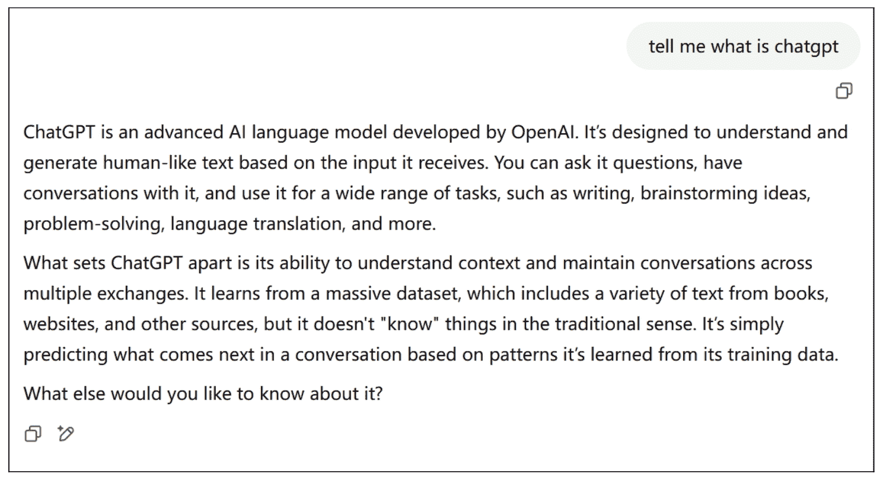

图 1-1 ChatGPT 示例

受限于使用门槛，很多人未能第一时间体验，难以直观感知 AI 对时代的深远影响。尽管浪潮在 2022 年底才爆发，但 LLM 的源头可追溯至 2017 年底。

**1.1.2 前传：Transformer 架构**

2017 年以前，主流序列模型以循环神经网络 RNN 及变种为主。其输出依赖隐藏状态加权生成，可理解为信息需经隐藏状态传递，其中每一步隐藏状态都依赖当前输入与上一时刻隐藏状态，数学表达为：

***h***=σ(***W**h**W**x**b***)

*tht*-1^+*xt*^+

其中：

· ***W*** 为隐藏状态层的权重矩阵。

*h*

· ***W*** 为输入内容的权重矩阵。

*x*

· ***b*** 为偏置项。

· σ 为激活函数。

即当前隐藏状态 ***h*** 由前一隐藏状态 ***h*** 与输入 *x* 加权后经偏置 ***b*** 处理，再经激活函数得到。最终 RNN 输出由当前隐藏状态加权产生，公式为：

*tt*-1*tt*

***y*** = ***W**h*** + ***b***

*hyty*

同理，***W*** 与 ***b*** 分别为输出权重矩阵与偏置。可看出，RNN 依赖循环结构逐层递进，如同爬楼梯，需一步步前行，每一步依赖前一步，时间步 4 必须在时间步 3 之后才能得出。

图 1-2 RNN 的信息传递

由此可见 RNN 的局限：

· 梯度消失：爬到高层后难以回想第一层细节，导致长程依赖场景信息精度丢失。

· 并行化差：隐藏状态需顺序传递，无法跳层直达，计算效率低，GPU 并行能力无法充分发挥，资源浪费。

面对复杂任务时，大语言模型对信息聚焦和训练效率的要求越来越高。传统循环神经网络 RNN 因为并行度低、计算开销大，很难撑起百亿乃至千亿参数规模。后来出现的 LSTM、GRU 等变种，虽在门控机制上做了改进，但依然摆脱不了循环依赖的本质，串行化和高成本的短板仍在。

转折出现在 2017 年，Google Brain 团队在 *Attention is All You Need* 中发布了 Transformer。这一架构彻底抛弃了循环结构，改用自注意力机制，从根本上解决了传统循环模型慢、难并行、易梯度消失的问题。

自注意力通过计算序列内部元素间的关联来捕捉长程依赖。每个 token 会被映射成三个向量：查询 Query、键 Key、值 Value，分别对应需求、标识符和实际内容。映射靠训练得到的权重矩阵完成，以 Query 为例：

***Q*** = ***W**X***

*iQi*

同理可得 Key、Value。

*iQi*

得到三类向量后，机制用每个 Query 与所有 Key 做点积，得到相似度即注意力得分，用来衡量当前元素对其他元素的关注程度：

*ij*

该操作对全部 token 同时进行，意味着每个 Query 都要与全部 Key 求相似。随后为避免点积过大带来梯度问题，按键维度 *d* 缩放，再经 softmax 归一化为概率分布，也称注意力权重：

*ijk*

注意力权重与得分含义相近，都是关注程度的量化，只是它可以用来对 Value 做加权。拿到所有 token 的注意力权重后，对 Value 加权求和即得到最终输出：

*j*

整个流程可以类比一个承接需求的团队，成员是 token，管理者是 QKV 权重矩阵：

· Key 相当于成员的身份标识。
· Query 相当于成员的需求和所需支持。
· Value 相当于成员能提供的价值。

外部需求到来时，每个成员用自己的 Query 去匹配他人的 Key，衡量协作紧密程度即 Attention Score。经归一化后得到关系表即 Attention Weight，最后按关系表用 Value 完成配合并输出结果。整个信息传递如图 1-3。

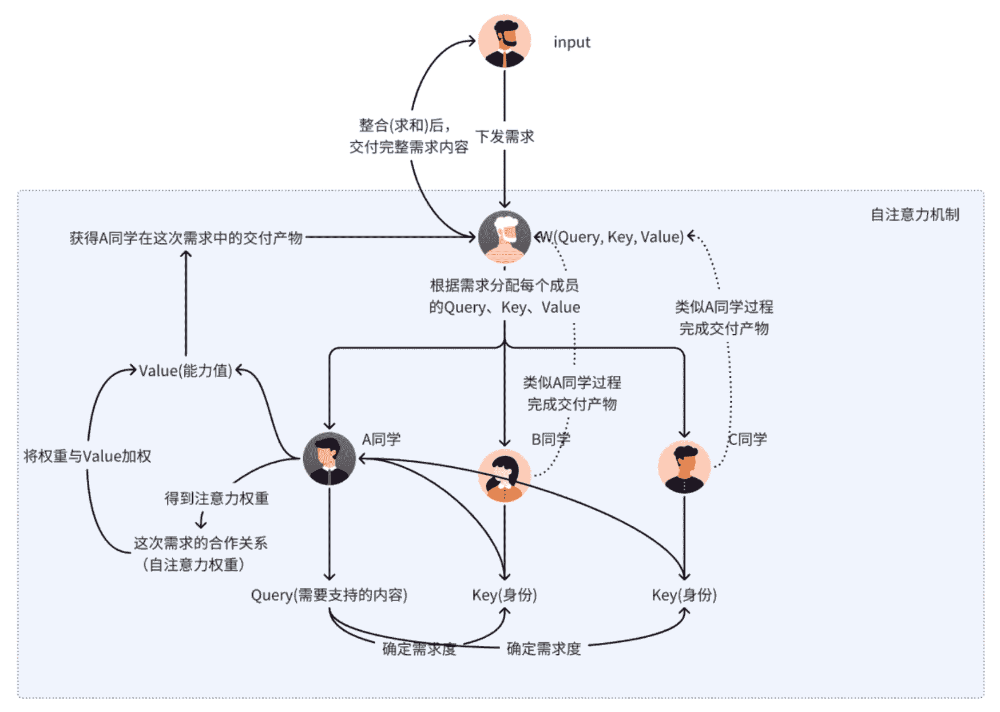

图 1-3 Transformer 架构的信息传递

以自注意力为核心的 Transformer，相较 RNN 等循环类架构，在并行度和计算效率上优势明显。处理每个词时可同时看遍序列全部位置，表示可并行生成，充分发挥多核硬件能力，这为大模型的出现奠定基础。

回看自注意力，若要处理更大规模需求或给出更精准回应，关键在于两点提升：

（1）词对应的三个核心权重矩阵 *WQ、WK、WV*，它们决定词的定位及词间配合权重。
（2）模型词汇量规模，它决定可承载的需求大小和擅长的方向。

类比组织管理，就是提升管理者判断力与分工能力，同时扩充团队规模与专业人才。训练 LLM 时也最关注这两项指标。

理论强大并不等于落地容易，大规模预训练与生成仍面临架构细节、GPU 等硬件、训练策略等诸多挑战，可真正规模化应用的 LLM 仍需时间。

**1.1.3 起步信号：单向自回归解码**

标准 Transformer 包含相辅相成的 Encoder 编码器与 Decoder 解码器。Encoder 把输入理解为隐层表示，Decoder 再把它转回可读输出，二者都使用自注意力，被称为 Encoder-Decoder 架构，如图 1-4。

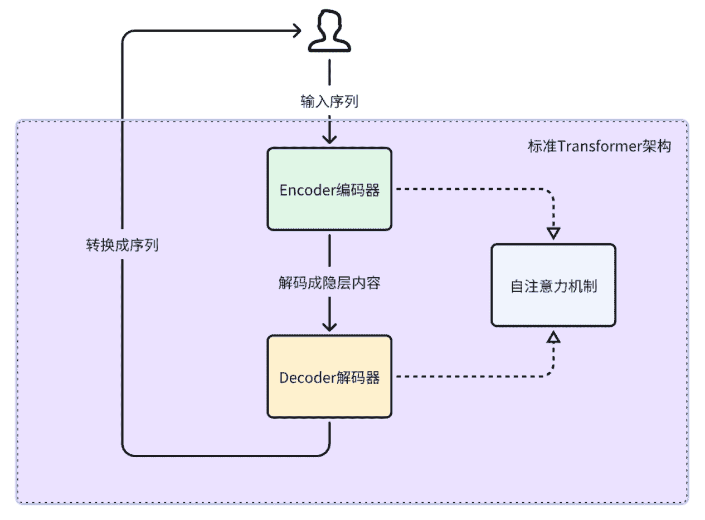

图 1-4 标准 Transformer Encoder-Decoder 架构

2018 年 NLP 领域出现两个影响深远的系列：BERT 和 GPT。它们没有照搬标准架构，而是拆开使用其中一侧以适配任务。

BERT 专注理解类任务，如分类、情感分析，使用编码器并采用双向自注意力。训练时模型可同时看到上下文前后，目标是预测句子中被随机遮蔽的标记，过程如图 1-5。

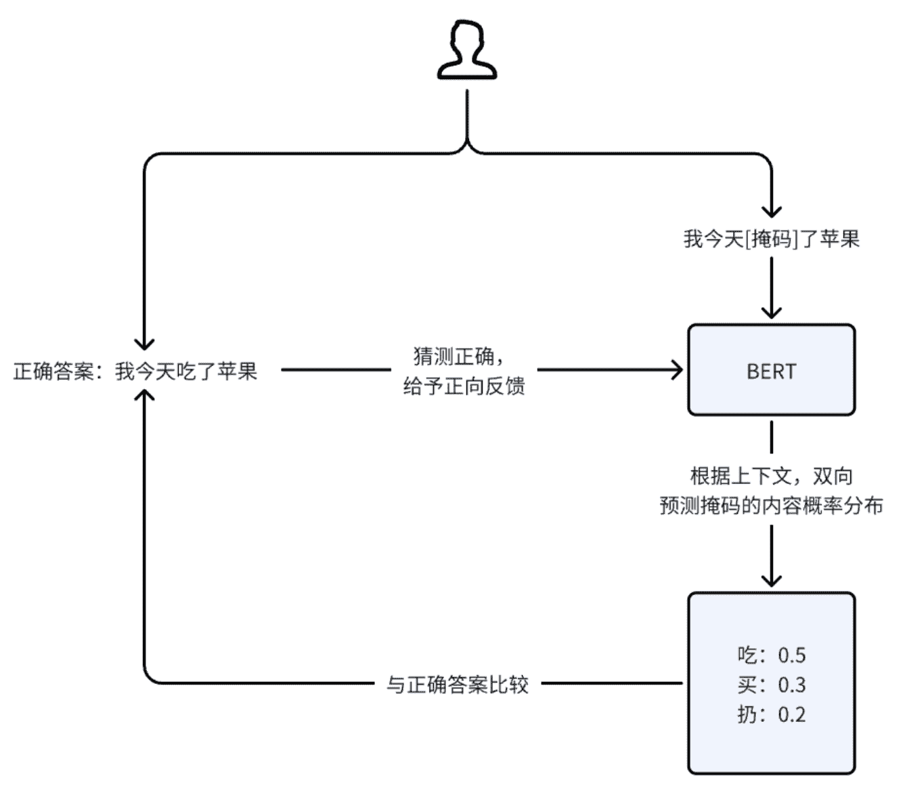

图 1-5 BERT 双向自注意力的训练过程

GPT 专注生成类任务，如文本生成、对话、续写。生成时无法利用未来词，只能基于已生成的部分向前推演，符合人类从左到右写句子的自然顺序。

因此 GPT 使用 Transformer 的解码器部分，采用单向自回归解码策略。每个词的生成都依赖已生成的词和上下文，且只面向已出现的部分，不会窥视未来，过程如图 1-6。

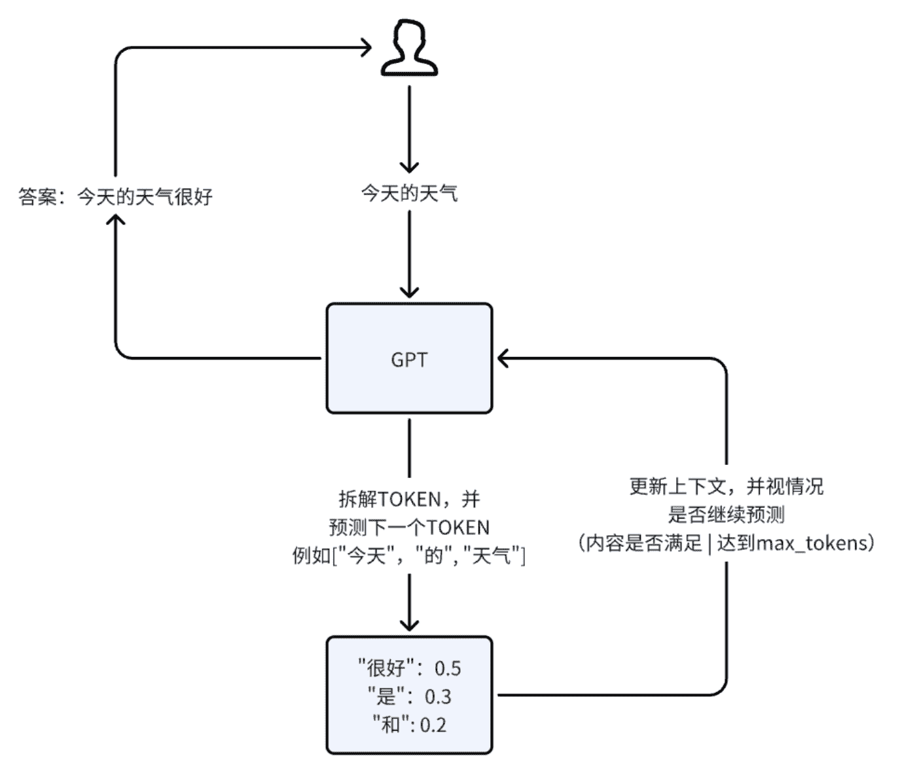

图 1-6 GPT 单向自回归解码的过程

这种机制在生成场景表现突出。2018 年 6 月首个 GPT 发布，参数 1.17 亿，基于 4.6GB 高质量文本训练，是生成类大模型的里程碑。参数量距真正的通用模型尚有距离，却已奠定基础。

**1.1.4 爆发的 ChatGPT**

在首版突破后，OpenAI 于 2019 年 2 月推出 GPT-2，参数 15 亿，训练数据 40GB，如图 1-7。该版可在不做垂直微调的情况下完成问答、翻译、写文章等通用任务，进一步验证规模与数据的重要性。

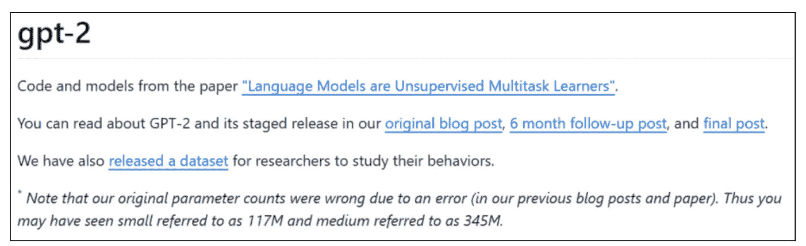

图 1-7 GPT-2 开源仓库 Readme.md

2020 年 6 月 GPT-3 登场，参数达 1750 亿。相较 GPT-2 的勉强沟通，GPT-3 展现出真正的通用能力，能进行逻辑连贯的上下文交流，并在一定程度上完成创新性工作。例如官网给出的案例是用 GPT-3 分析用户结账体验满意度并提出方案，如图 1-8。

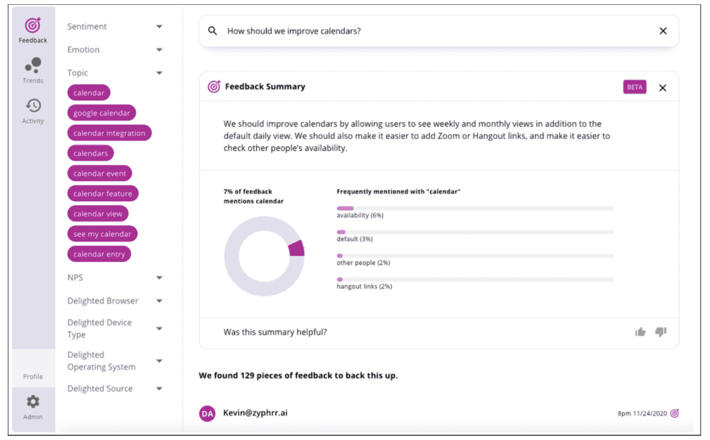

图 1-8 GPT-3 应用于分析用户结账体验的示例

从亿级到千亿，能力大幅跃升的同时也暴露“幻觉”问题，即生成内容常与事实不符或无意义。若用户缺乏先验判断，很难分辨对错。

为此提出 SFT，即监督微调。通过高质量输入输出示例集合训练模型，让它学会完成指定场景任务。例如希望模型擅长法律场景，就需要收集大量法律问答范例，格式类似：

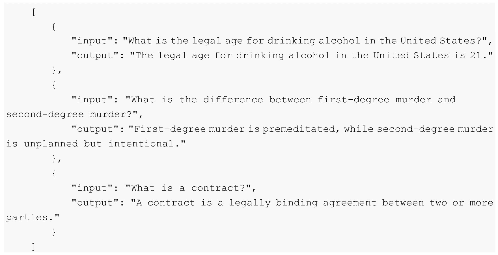

实际训练数据量远大于示例。准备好数据集后经训练评估，模型会模仿其中人类行为进行回应，过程如图 1-9。

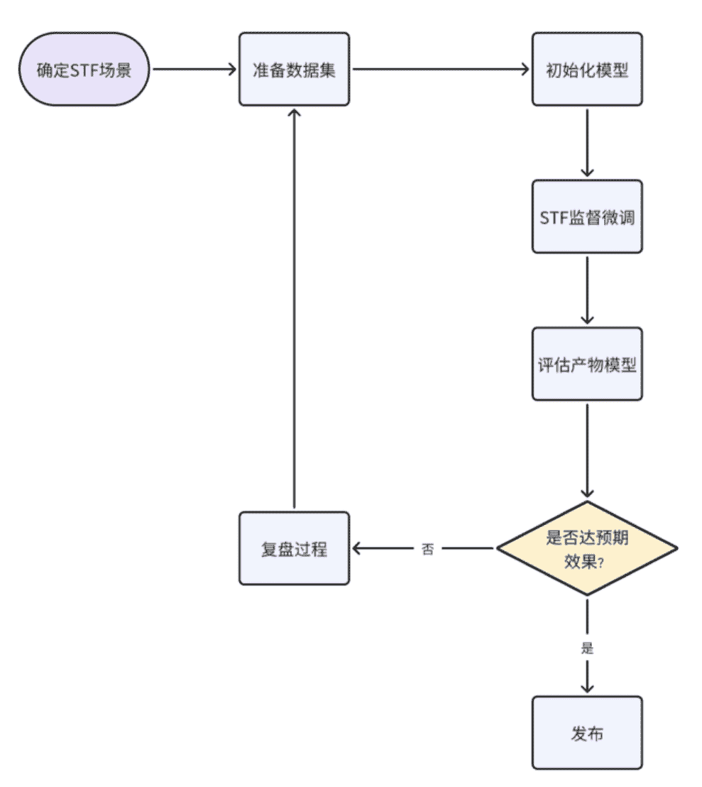

图 1-9 STF 训练过程

SFT 在数据优质时效果显著，但高度依赖数据规模与质量。数据好比教材，量不足或质量差会带来劣化与过拟合。数据本质是人类行为的采集，若已平台化收集则标注筛选成本可控，若需从零人工准备则耗时耗力。

面向数据沉淀不足、需从零收集的场景，SFT 受限明显。于是出现更具扩展性的 RLHF，即基于人类反馈的强化学习。

与 SFT 不同，RLHF 不靠示例模仿，而是让人工对模型输出打分并给出改进指导，再用奖励模型训练原模型，使其逐步趋向高分答案。以法律场景为例，模型先对问题给出初稿，人类专家评分并提供具体意见，得到类似如下的训练样本：

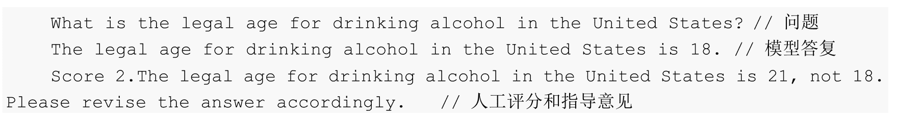

累积足够样本后训练奖励模型，用来衡量生成结果与人类偏好的一致性，再以此对原始模型做强化训练，过程如图 1-10、图 1-11。

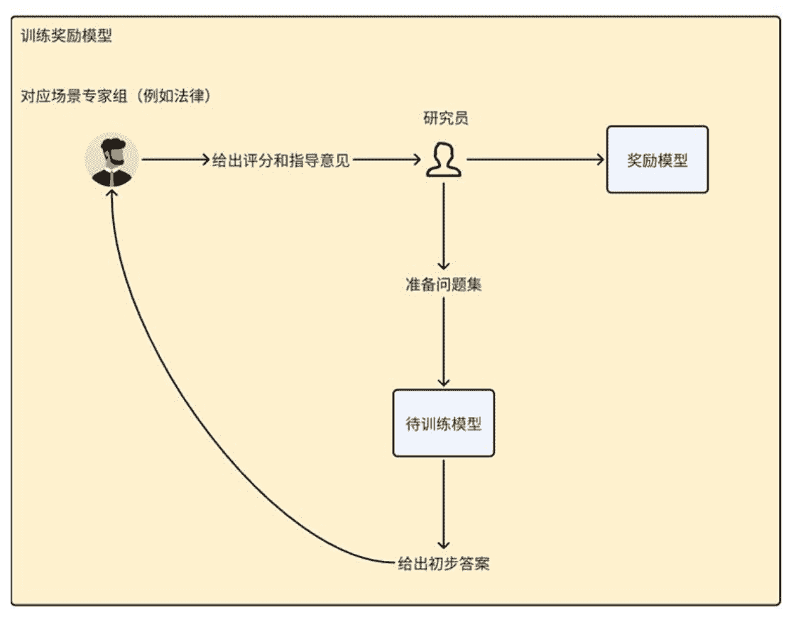

图 1-10 RLHF 训练奖励模型的过程

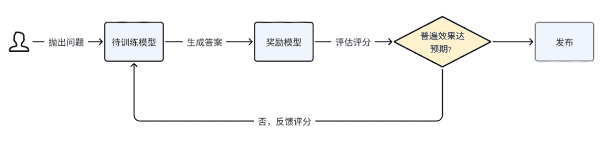

图 1-11 RLHF 强化学习优化的过程

RLHF 融入人类偏好，降低了数据收集成本，提升了答案可靠性和认可度。

结合 SFT 与 RLHF，GPT-3 的幻觉问题得到缓解，2022 年 3 月推出 GPT-3.5，这是首个落地效果好、基本满足应用开发需求的生成式大模型。同年 11 月，OpenAI 基于 GPT-3.5 发布 ChatGPT，如图 1-12。大模型由此进入大众视野，AI 开始渗透生活各领域。

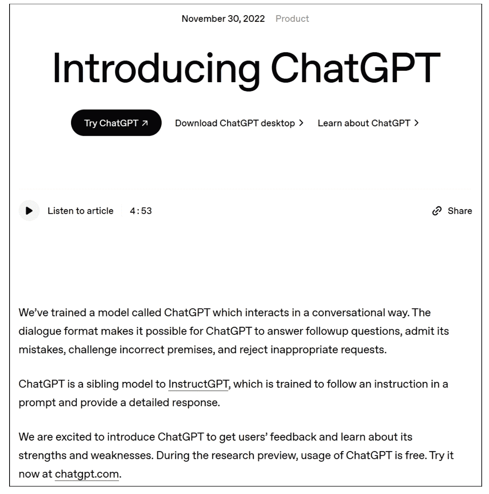

图 1-12 ChatGPT 官网

OpenAI 随后于 2023 至 2024 年间推出 GPT-4、GPT-4V、GPT-4o 等。它们不仅文本能力提升，还属于 MLLMs 多模态大语言模型，输入扩展至图像、音频、视频等，在医疗、教育等行业产生深远影响，也让人与 AI 的自然交互成为可能。

**1.1.5 转折：DeepSeek 的冲击**

OpenAI 的成功带动全行业跟进。2023 年起 Anthropic 的 Claude 系列在代码领域表现突出，Google 的 Gemini 系列在综合性能上竞争力强，如图 1-13、1-14。

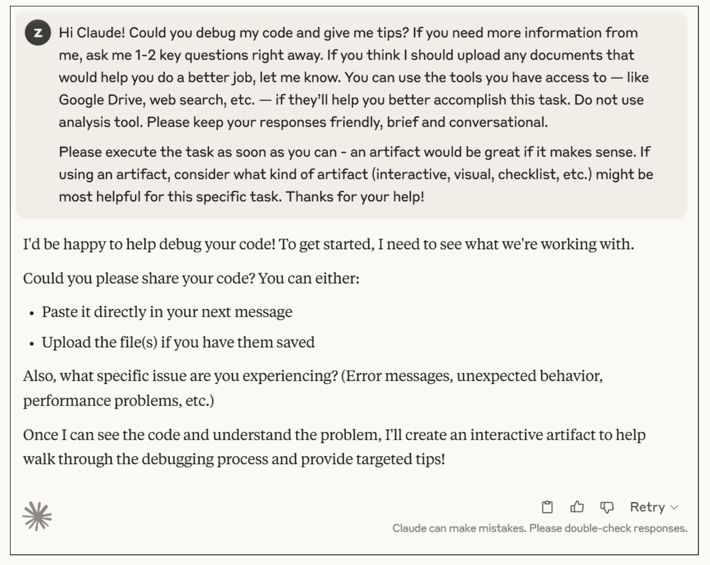

图 1-13 Claude 模型示例

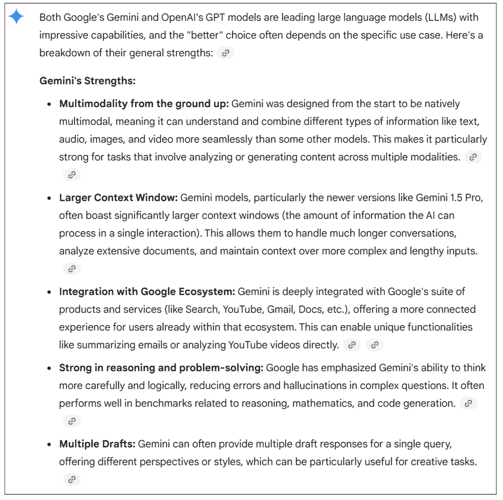

图 1-14 Gemini 模型示例

国内厂商亦推出通义千问、豆包、混元、Kimi 等自研模型应用。但在 2023 至 2024 年初，国内模型整体与国际领先水平差距明显，多数只能与 GPT-3.5 或 GPT-4 勉强对标，生态影响力有限。

差距根源在于训练成本与时间积累巨大。若无架构创新，从零追赶难度极高。直到 2024 年 12 月，深度求索发布的 DeepSeek-V3 才引发全球震动。

DeepSeek-V3 参数 6710 亿，性能与 GPT-4o 及 Claude-3.5-Sonnet 相当，官网评估如图 1-15。

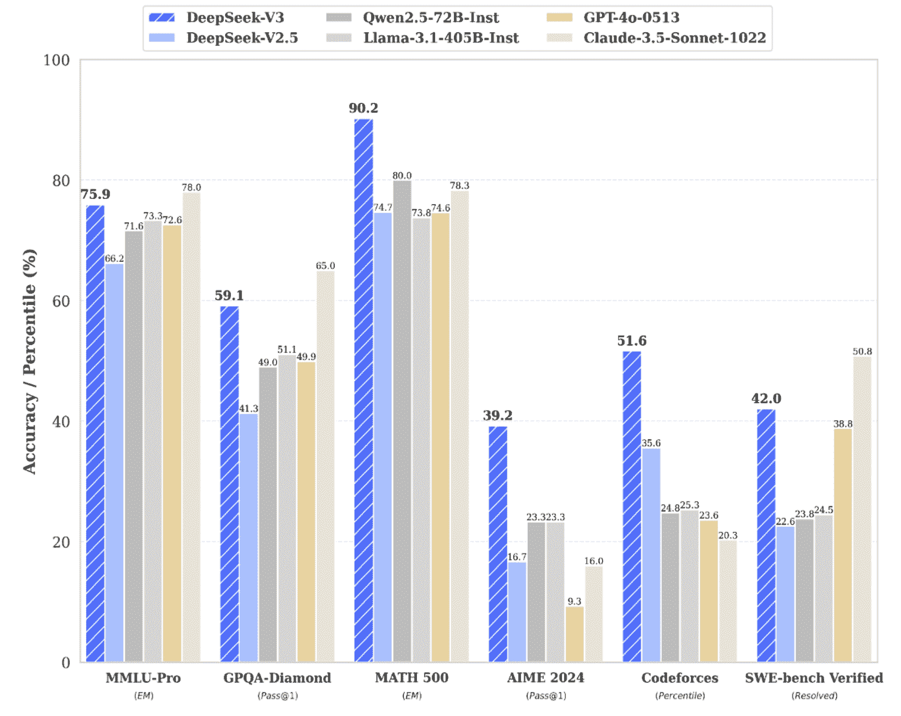

图 1-15 DeepSeek 官网公布的模型评估结果

更关键的是成本。得益于架构与训练优化，DeepSeek-V3 训练成本约 560 万美元，而 GPT-4 训练成本超 1 亿美元。低成本带来低价，API 收费按百万 tokens 计，DeepSeek 约为 GPT-4o 的几十分之一，如图 1-16、1-17。

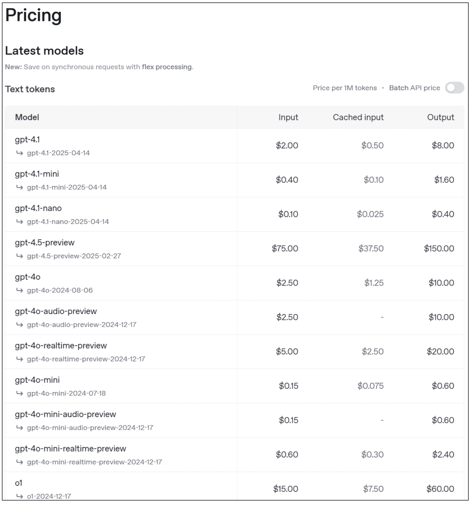

图 1-16 OpenAI API 每百万 tokens 收费

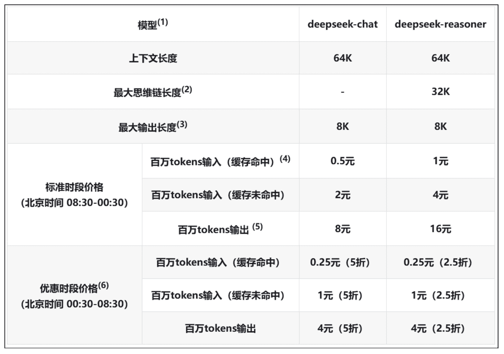

图 1-17 DeepSeek API 每百万 tokens 收费

性能相当、成本与价格却差距巨大，打破了靠堆算力推动 AI 进步的惯性认知，证明先进强化学习与架构创新可实现弯道超车，关注焦点重回算法本身。

DeepSeek-V3 不仅开源了完整架构、参数、训练方法与评估方案，还构建可落地的社区生态，大幅降低私有化部署与应用落地的门槛，对全球 AI 生态产生深远影响。相比之下，OpenAI 等顶尖模型多为闭源，用户只能通过 OpenAPI 消费，难以私有化部署与微调。

最近几个月，重磅动作接连上演，整个全球 AI 板块被搅得风起云涌，尘埃还未落定，2025 年 1 月深度求索就官宣了 DeepSeek-R1。新模型延续了 V3 的核心打法：性能突出、训练和调用费用都很友好，核心架构与参数权重继续开源。更关键的是，它首次带来了前代没有的显性深度思考能力。

R1 会把内部推理过程摊开给用户看，情绪感知和上下文把握也明显更细腻。比方用焦躁的语气问“好烦，能不能帮我写个演讲的开场白啊？”，模型在推演阶段就能捕捉到说话者的情绪倾向，并据此调整回复方式，如图 1-18 所示。

这种把高质量生成和可视化思考结合起来的体验很抓眼球，第一印象就是它更像一个会推敲的人，而非单纯的文本生成器。这一波变动实质性重塑了中国乃至全球的 AI 力量版图，OpenAI 的绝对领先被打破。得益于 DeepSeek 开源的权重和架构，更多团队有了二次创新的抓手，国产头部模型也走上国际舞台，与海外对手正面交锋。

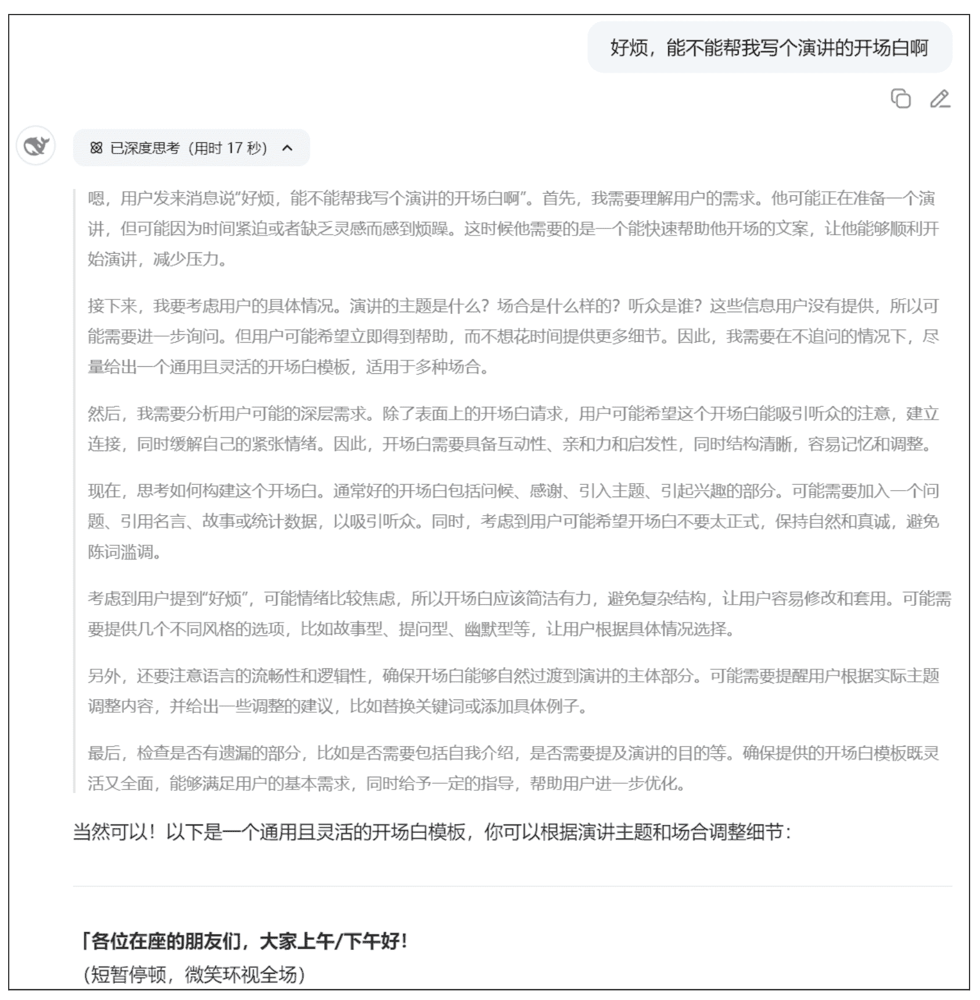

图 1-18 DeepSeek-R1 使用示例

**1.1.6 智能体齐放**

回看生成式大模型的演进之路，感触颇多。从 Transformer 奠定基础，到如今模型基础设施层百花齐放，发展脉络非常清晰，时间线如图 1-19 所示。

基础设施的繁荣直接拉动了应用层，也点燃了更深层的想象。早期的对话聊天已让人惊喜，但很快开发者和用户都想要更进一步：不只是聊天，而是能感知、判断、主动行动的 AI 智能体。

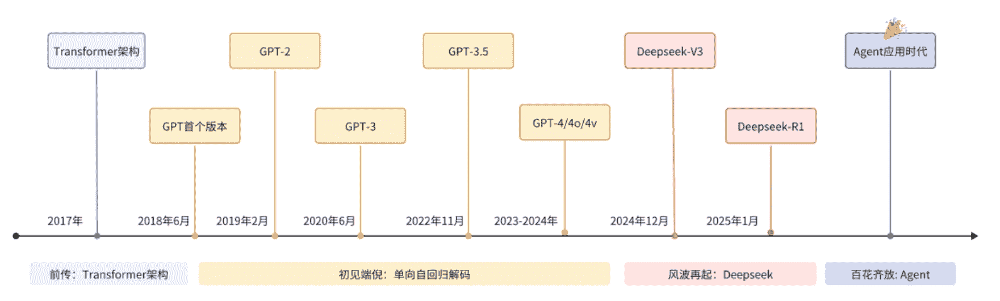

图 1-19 生成式 LLM 时间线

**1．单智能体**

起初受限于模型能力边界、幻觉风险和工程经验不足，智能体的设计比较保守。常规做法是在某个垂类场景接入模型 API，挂载工具或交互组件，在对话基础上完成特定任务，这类只聚焦单一任务的方案被称为 Single Agent。2023 年初 ChatGPT 爆火时，笔者也做过一个自动生成单元测试的智能体，架构如图 1-20 所示。

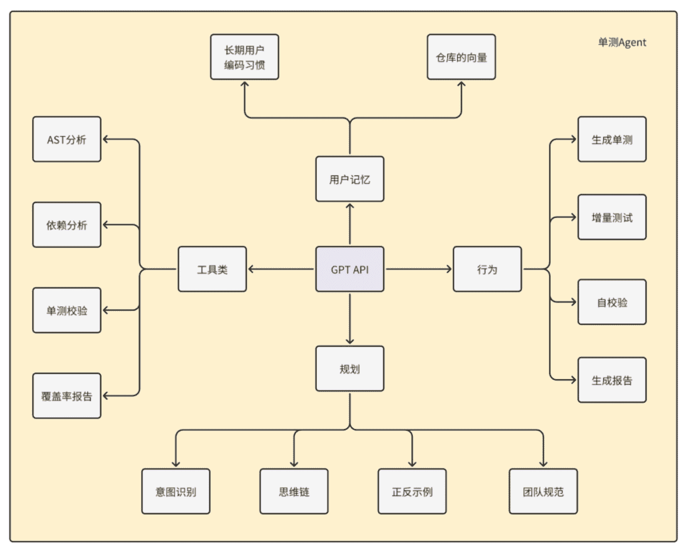

图 1-20 单测智能体的架构设计

该设计涵盖几个工程化模块：

（1）用户记忆：缓存短期和长期行为偏好，让智能体能实现千人千面的响应。
（2）规划：预置意图识别、思维链等策略，帮助模型在垂类中做出更符合预期的行为，随着模型本身增强，这一层的权重会逐步下降。
（3）工具／行为：工程封装的能力函数，智能体判断后由系统调用对应能力完成动作。工具与行为可以同域设计，也可以按需拆分为异构模块。

这正是 ReAct 思路的典型体现：先规划再行动。即使单元测试的工具链很复杂，也能整合成输出质量高、可验证的结果。但该产品只服务单测这一个明确垂类，缺少任务间的流转和多体协同，所以仍属于 Single Agent 模式。

当场景节点增多、流程变复杂时，单一工程化手段已不够用，LLM 的幻觉也会随着节点传递被放大。

**2．多智能体**

用 LLM 单打独斗能完成部分垂类任务，却远没达到外界对智能体的期待。更激进的设想是，真正的智能体要像人一样主动拆解任务、串联节点、做校验，最终交付高质量结果，这就是 Multi Agent。虽然预期很高，受模型幻觉和工程范式不成熟影响，能稳定落地且效果不错的产品不多。

比较典型的是 Manus.ai，由国内 Monica.im 团队打造，2025 年 3 月发布。它是全球首个通用型智能体，可覆盖旅游规划、股票分析、教育内容等 40 多个领域的复杂生成与交互，用户通过 Web 访问，如图 1-21 所示。

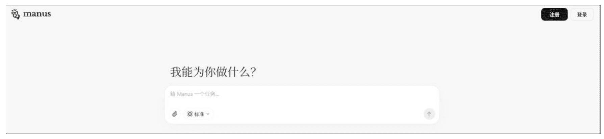

图 1-21 Manus.ai 首页示例

外观上它和 ChatGPT 类似，但 Manus.ai 能对复杂任务做拆解并分步呈现。以预测北医三院周边常住人口及疾病流行率为例，全过程如图 1-22 所示。

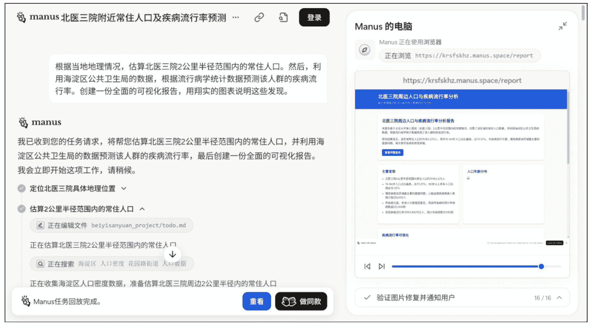

图 1-22 Manus.ai 输出流行病预测的过程

在该预测任务中，工作被拆成 8 步： 
定位北医三院的具体位置。 
估算 2 公里半径范围内的常住人口。 
获取海淀区公共卫生局相关数据。 
收集并分析流行病学统计数据。 
分析目标人群疾病流行率。 
创建数据可视化图表。 
编制综合分析报告。 
提交最终报告和相关文件。

全部步骤完成后，最终交付物如图所示。

与 ChatGPT 这类对话式应用相比，Manus.ai 既提供咨询，又能拆解复杂任务并逐步执行，效果很惊艳。其架构也很有意思，整体执行通过虚拟机运行不同脚本完成。例如统计任务由 Python 脚本承担，如图 1-24 所示。

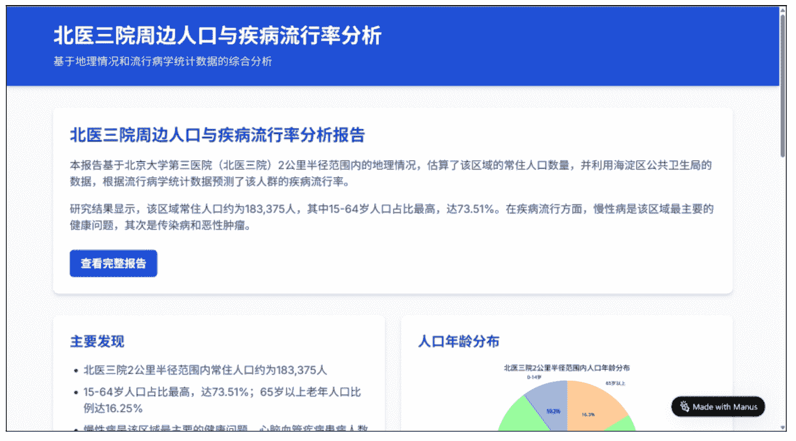

图 1-23 Manus.ai 输出的流行病预测产物

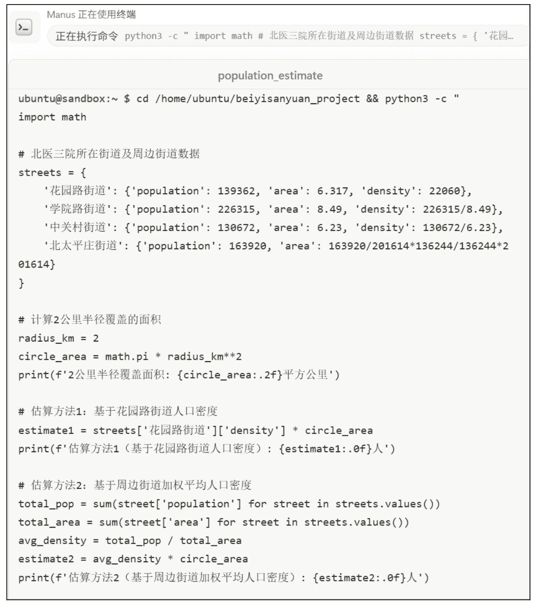

图 1-24 Manus.ai 通过 Python 脚本完成统计任务

即便在任务拆解的呈现上，Manus.ai 也沿用 markdown 形式，如图 1-25 所示。

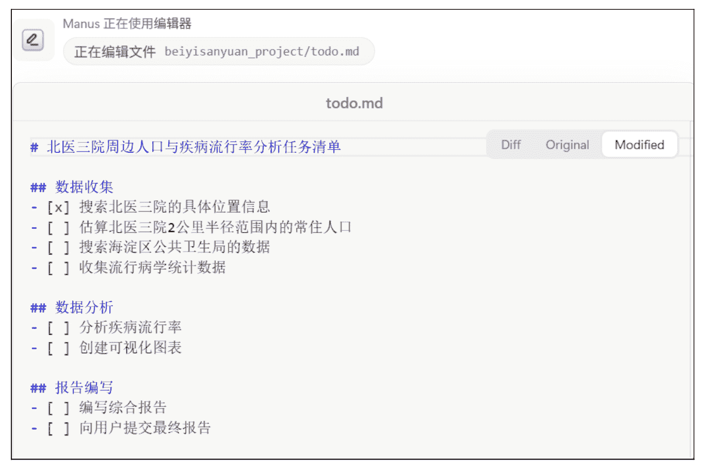

图 1-25 Manus.ai 使用 markdown 拆解任务

之所以采用虚拟机加多格式文件的方式，是因为它是以 Web 为载体的智能体，受浏览器安全沙箱限制，无法通过网页或 JavaScript 直接触达用户的文件系统、终端、网络接口等本地资源。整体流程如图 1-26 所示。

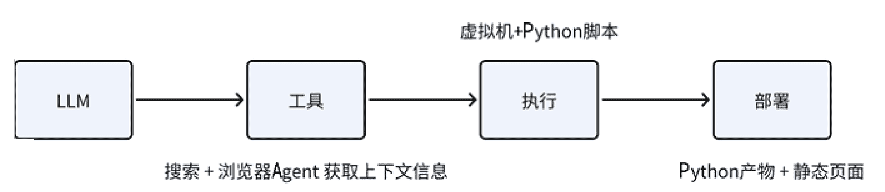

图 1-26 Manus.ai 流程简图

实际架构远比简图复杂，这是单次任务的宏观视角。例如 LLM 层需拆分出制定、执行、自校验等独立单元，以保证复合任务稳定。本节不展开，后续会通过案例说明。

受浏览器载体限制，其输入输出也有边界。比如生成 PPT 或文档类产物，需要借助 Python 的自动化生态以脚本完成，无法直接调起本地软件。部署时因无法打开用户本地端口，除 Python 产物外，多以静态页面交付。

综合来看，多智能体的上限取决于：

· 模型能力：直接影响执行中的幻觉程度，token 规模越大，工程化的占比可越低，避免过度设计。
· 承载形态：不同形态决定控制面，浏览器沙箱限制了对用户电脑的操控，能力天花板相应受限。
· 工具链：智能体本质是决策与规划，真正决定产出的是可调用的工具。丰富的工具链能抬高上限，社区因此推出 Function Calling、MCP、A2A 等机制来扩展工具生态，详见后文。
· 步骤调度能力：因模型仍有局限，需要工程化设计来抑制幻觉并有序调度节点，不同场景需定制。

可以看出，Manus.ai 在 ReAct 基础上加了节点流转的调度模块，即 Supervisor，在多智能体系统中应用广泛。但因其以浏览器应用承载，与用户电脑存在沙箱隔离，产物上限仍受制约。

谈到承载形态，就不得不提更优的多智能体载体——IDE。虽然 IDE 多用于编程，但作为智能体载体优势明显。相比浏览器沙箱，面向开发者的 IDE 在授权后可自由调用本地终端、绑定端口服务，并按机器环境做兼容性编程，产物形态与质量上限更高。

在 AI IDE 领域，最知名的多智能体产品是 Cursor，由 Anyspere 开发，集成 GPT-4、Claude-4 等顶尖编码模型，除代码补全、问答等提效能力外，还提供智能体功能。它能从零搭建指定项目，覆盖图形界面、服务部署、进程绑定等全流程，生成质量在同类中靠前，如图 1-27 所示。

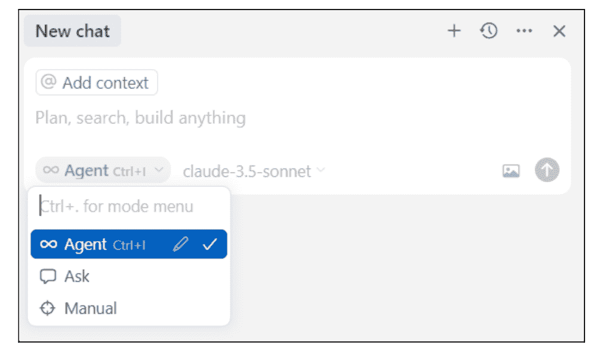

图 1-27 Cursor Agent 入口

用 Cursor Agent 可把想法迅速落地，例如让它从零实现贪吃蛇游戏，不到 1 分钟就能生成可运行的版本，如图 1-28 所示。

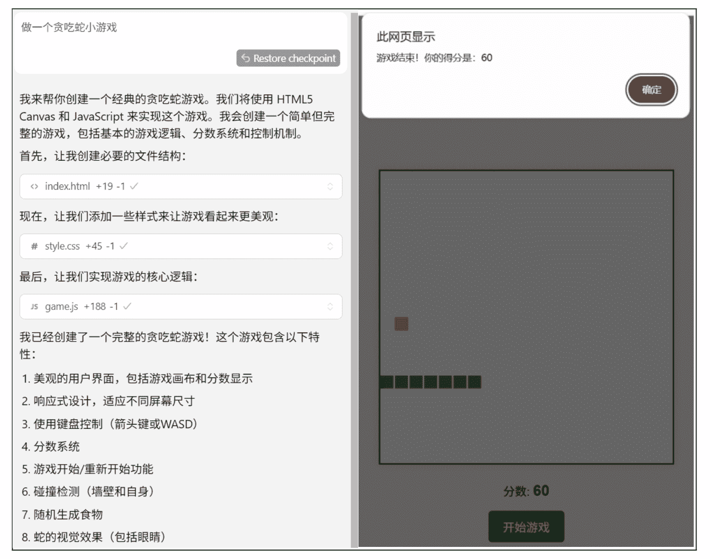

图 1-28 Cursor Agent 使用示例和产物效果

全程几乎无需开发者干预，对不满意之处只需在窗口里追问迭代即可。它带来的不是简单的效率提升，而是把把想法变成产品的门槛拉低。过去需要技术与大量研发时间，如今借助 Cursor Agent，在原型要求不苛刻的场景下即可快速产出 MVP 并投入使用。

相比早期的对话式 AI 或单一功能智能体，如今应用场景更复杂、功能更联动。可以预见，智能体的演进会走向复合型。这里的复合型智能体并非工程层面的 Single/Multi 之分，而是从产品视角出发，能适配未来多样化复杂业务、为用户在真实世界里完成有价值任务的软件交互形态。

**3．物理智能体**

复合型智能体或将在未来 3～5 年成为热点，但无论架构如何，其本质仍停留在软件层，产出主要是数字结果，难以直接作用于物理世界。

推动物理世界变革同样重要。比如宇树科技的 AI 机器人就是把智能体能力延伸到现实物理层的尝试，并因此获得数亿元融资。虽然当前模型与硬件协同还不足以大规模落地，但从长周期看，Physical Agent 极可能成为重要方向。

芝加哥大学 Fouad Bousetouane 于 2025 年 1 月发布的论文 Physical AI Agents: Integrating Cognitive Intelligence with Real-World Action 提出，Physical AI Agent 具有颠覆性潜力，并给出感知、Cognition、驱动三层架构范式，为智能体从虚拟走向现实提供参考，如图 1-29 所示。

图 1-29 Physical Agent 架构范式

在该范式里，感知与驱动多属硬件层，提供视觉、听觉、触觉及机械动作等交互媒介；认知层则由复合型智能体承担，负责调度感知与驱动的高效联动。硬件关键技术已相对成熟，真正决定 Physical Agent 上限的仍是认知层的复合型智能体。

因此，复合型智能体既是当前应用的核心，也是未来 Physical Agent 架构不可或缺的一环，将在虚拟智能体向真实物理世界演化中发挥变革作用。

**1.2 复合型 AI 智能体的市场前景**

前文梳理了 AI 智能体的演进，从 LLM 诞生到具备自主决策行动能力的智能体，经历了长期积累。如今复合型 AI 智能体如雨后春笋般出现，正重塑世界运行方式。无论是社区讨论还是各大开发者大会，都在为智能体布局提供支持，其重要性不言而喻。

在模型能力不变的前提下，复合型智能体的效率与上限主要取决于架构是否合理以及工具链是否完备。基于此共识，开发者社区自 2024 年起持续降低工程成本，并在智能体与工具之间建立稳定连接与共享。例如低代码构建工作流的 Coze，简化服务搭建的 LangChain、LangGraph，以及连接工具链与智能体通信的 MCP 和 A2A 生态，整体体系日益完善，为规模化落地奠定基础。

与此同时，2025 年 5 月的多场国际开发者大会把智能体放在核心位置。Microsoft Build 开发者大会、Google I/O 上均发布数十款全新智能体产品，全面押注该赛道。微软全球首席传播官 Frank X. Shaw 公开表示：“我们已迈入 AI 智能体时代。”

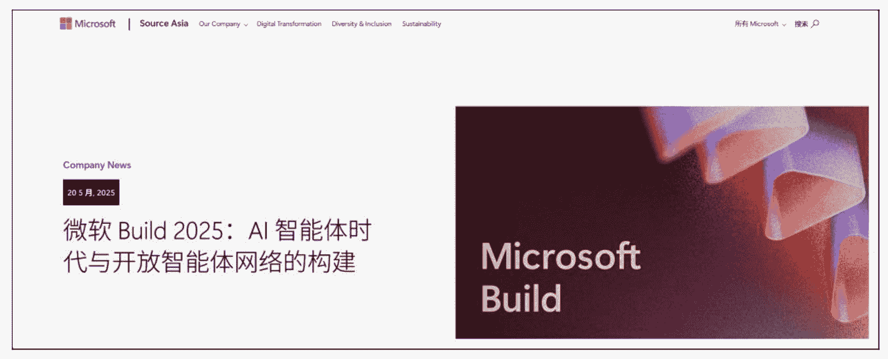

图 1-30 Microsoft Build 2025 议题

除了海外巨头，国内厂商也在积极布局。以类 Cursor 的 AI IDE 为例，BAT 等大厂已推出 4 款以上同类产品，包括阿里通义灵码 IDE、Qoder、Opensumi IDE 框架、字节跳动的 Trae IDE、腾讯的 CodeBuddy 等。内部业务线围绕智能体孵化的产品更是层出不穷，几乎每条线都在探索如何把智能体融入场景形成竞争力。

招聘需求与投入也在同步增长，市场对具备智能体工程化和落地能力的开发者需求旺盛，如图 1-31 所示。

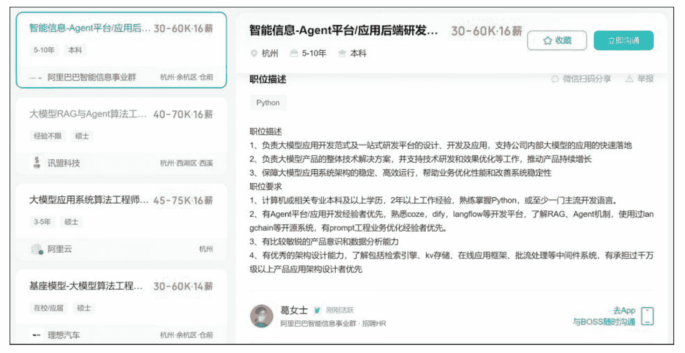

图 1-31 Agent 开发的招聘需求

可见，复合型 AI 智能体及其研发人才在相当长时间内都会处于高度紧缺。掌握 AI 智能体研发能力，将为从业者带来明显的成长与丰厚回报。

**1.3 本书的内容安排**

随着 LLM 的快速发展，人类对 AI 的使用不断深化：从早期对话交互，到链式调用的简单应用，再到能适配多场景多角色的复合型 AI 智能体。如今的 LLM 如同一颗信息广博、思维紧密的大脑，却仍缺乏直接处理输入输出的能力，也需要人在侧监督以确保全流程正确执行。

Agent 工程化实战：从模型到可投产

要让大语言模型真正变成能够持续产生价值的投产型 Agent，必须依靠系统化的工程化能力。工程化一方面要为智能体建设稳定、可复用且形态丰富的工具链，适配各类输入输出；另一方面要把智能体的各个处理环节串起来，抑制幻觉和偏移，使其在真实业务里稳定高效地运行。

目前围绕智能体研发与工程落地的讨论已经十分密集，但体系化、可复现的实践资料仍很稀缺，让不少想进入AI新时代的读者缺少抓手。本书意在填补这块空白，作为学习AI Agent开发的起点，帮助大家在新时代起步。

全书按由浅到深的思路，除绪论外共安排7个循序渐进的工程化章节，每章都配有可独立运行的完整示例，助力读者从零掌握复合型AI Agent的理论与实操，快速形成系统认知并具备落地能力。整体框架如图1-32所示。

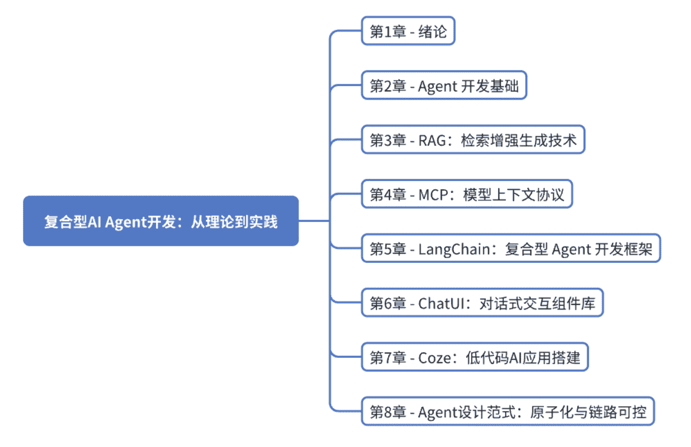

图1-32 本书章节设计的思维导图

各章节均围绕智能体开发与工程化展开，具体如下：

绪论梳理了AI Agent的演进路径：从Transformer架构兴起到GPT族诞生，再到DeepSeek掀起新浪潮，直至Agent逐渐渗透各行业。时代演进塑造了Agent的市场前景，也形成了本书的写作初衷。

第二章系统讲解智能体开发的基础。以智能体三大核心大模型、提示词、行动为切入点，讲清最简智能体如何运转，结合示例剖析模型API、提示词工程与函数调用，随后从全局视角介绍现代智能体常见架构及工程化设计范式，为后续学习打基础。学完后读者可具备基础开发能力，对核心模块与总体架构有完整认识。

第三章聚焦检索增强生成RAG。RAG借助向量化与向量存储，以向量距离衡量相似度，可高效搭建垂类私域知识库并增强模型检索能力。本章从零搭建RAG基础设施，借助RAGAS完成召回评估，并介绍具备自我纠正能力的CRAG，帮助读者掌握RAG增强全流程并独立搭建私域知识库。

第四章聚焦模型上下文协议Model Context Protocol，MCP。通过MCP，无论是第三方开发者还是个人，都能把自研能力无缝接入智能体，把传统开发范式扩展到全球能力网络。本章先阐明MCP的定位与价值，再系统解析其核心作用、架构原理与工作流程，并配合实务案例给出MCP能力封装方法与开源MCP Servers的调用示例，帮助读者从理解到实战快速构建功能丰富、可持续扩展的复合型现代智能体。

第五章介绍LangChain生态。作为现代复合型智能体服务开发框架，LangChain可加速服务层开发，提供稳定可复用的能力以构建系统级智能体服务，在众多开发岗位中占据核心位置。本章详细介绍LangChain、LangGraph等生态组件在链式AI应用与复合型智能体搭建中的实践，帮助读者获得系统级开发能力。

第六章介绍面向对话交互的前端组件库ChatUI。借助ChatUI，开发者能在很短时间内搭建出美观、功能完善的智能体图形界面，并与LangChain无缝联动，大幅降低对话类智能体的前端门槛。本章结合实战示例展示如何使用ChatUI快速构建高体验交互界面，为智能体注入更友好高效的用户交互能力。

第七章介绍低代码智能体应用开发平台Coze。前文多聚焦代码驱动的开发，而当模块能力与流程编排已明确时，低代码方式往往更高效。Coze提供完善的低代码工具链与Workflow编排能力，无需从零编码即可快速实现智能体逻辑。学完后可灵活联动低代码与代码智能体，根据不同业务场景与需求选择最优方案，独立完成功能丰富、结构灵活的复合型开发。

第八章为全书收官，以全局视角系统梳理智能体的核心设计范式，涵盖框架设计、通信设计、渲染设计、工作流优化范式、成本优化策略等关键领域。不仅总结前文脉络，还从整体架构与长期演进角度探讨如何在功能、性能与成本间取得最佳平衡，为构建可扩展、可维护、可持续优化的现代智能体体系提供完整参考蓝图。

Agent时代已经到来，浪潮不断加剧，愿本书成为大家坚实的船基，助各位掌舵人在风浪中踏浪前行、扬帆起航！

**第二章 智能体开发基础**

本章介绍智能体开发的核心基础。首先讲解构建智能体所需的三大要素：大语言模型、提示词与行动，三者构成推理与执行的底层框架。接着说明模型API的使用，包括基础调用、参数配置、流式响应、系统消息及深度思考标签等。随后探讨提示词工程的常用技巧，如思维链CoT、结构化提示、正反示例引导与分治策略。最后介绍函数调用能力，实现模型与外部工具的联动，这是构建工具增强型智能体的关键技术。通过本章学习，读者能全面掌握智能体的基本构成、开发流程与实用技巧，具备独立构建和调优智能体的能力。

**2.1 智能体三大核心：大模型、提示词、行动**

复合型智能体是近年来大模型应用中最具代表性的架构之一，广泛用于搜索问答、任务助手、RPA、代码生成、数据分析等复杂场景。尽管实现路径各有差异，本质都由三大关键要素驱动：大模型、提示词、行动。三者共同构成感知、推理、行动的闭环，形成智能体能力的核心骨架。

**1．大模型：复合型智能体的“大脑”**

大模型是智能体的核心推理中枢，基于海量语料训练而成，具备强大的自然语言理解与生成能力。它决定了智能体的智力上限，即能否理解复杂表述、做出合理判断、保持上下文记忆与推理，完全取决于所用模型的能力边界。

目前主流可用于智能体构建的大模型包括：

· OpenAI的GPT-4/GPT-3.5系列，如ChatGPT。
· Anthropic的Claude系列。
· Google的Gemini系列。
· 国内自研的Qwen通义千问、DeepSeek、Seed/Doubao豆包系列。

在具体实现中，大模型通常以API形式提供。智能体接收用户输入后，将其转为提示词发送给大模型，再由模型生成响应参与后续决策。后续章节会结合案例详细介绍模型API的能力与用法。

**2．提示词：驱动模型行为的语言接口**

提示词是智能体与大模型沟通的桥梁，决定模型如何理解输入、如何给出回应。它不仅是一段文本，更是控制模型行为的语言。提示词工程已成为构建强大智能体的核心技能之一。

日常使用中，提示词可以是直接的任务描述或自然语言提问，例如：

“请帮我生成一份周报的开头段落。”
“列出三种提高工作效率的方法。”

但在更复杂的场景中，仅靠简单提问难以获得稳定精准的输出。此时可通过特定技巧优化提示词，显著提升推理深度和任务完成效果。例如Few-shot Prompting的示例：

下面是用户的提问和对应的意图分类，请根据示例判断最后一句的意图：

用户：我想预订明天晚上去北京的机票。
意图：机票预订

用户：帮我查一下附近的餐厅。
意图：餐厅推荐

用户：请提醒我下午三点开会。
意图：日程提醒

用户：我想买一台笔记本电脑。
意图：

与常规提问不同，Few-shot Prompting通过在提示词中提供多个示范问答对，引导模型模仿示例的格式和风格，从而提升输出的准确性和一致性。这种方法特别适合分类、意图识别、格式转换等任务。它与常规提问的差异如图2-1所示。

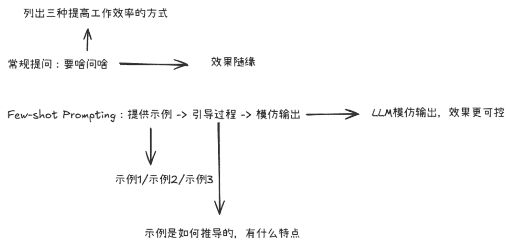

图2-1 Few-shot Prompting与常规提问的差异

类似Few-shot的提示设计只是提示词工程的一种优化策略，除此之外，还有结构化输出模板让模型输出更规整易解析、正反示例引导通过对比强化行为偏好、角色设定与语境构建通过设定身份语气控制模型风格等多种手段，都是提升智能体表现、增强模型可控性的关键方法，后续章节将逐一展开。

不难发现，通过精心设计提示词，可以把模型从一个泛化的“大脑”变成定制化的“智能助手”。无论是设定角色语气、拆解任务步骤，还是引导模型执行结构化任务，提示词都是控制智能体行为表现的关键工具。在实际开发中，提示词优化往往是提升智能体表现最直接最有效的手段之一，后续章节也将结合具体案例深入探讨不同场景下的提示词工程策略。

**3．行动：连接模型与真实世界的执行接口**

行动是让模型从“说”走向“做”的关键机制。大模型本身无法访问互联网、数据库或本地环境，其生成结果仅基于上下文预测。通过行动，智能体可调用外部工具或函数，执行真正的任务操作，其工作流如图2-2所示。

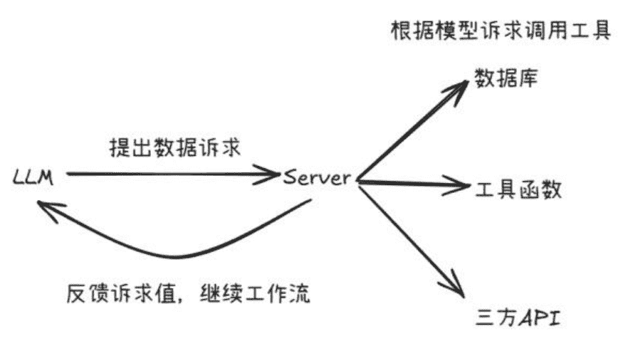

图2-2 Action工作流

在具体实现中，智能体先将用户输入转为合适的提示词，通过调用模型API获取模型响应，随后根据输出判断是否触发对应的行动来完成任务，这就是函数调用技术。后续章节将结合实例深入讲解如何利用函数调用实现模型与工具的灵活联动。

因此，一个真正可用的智能体需要大模型、提示词和行动三者紧密协同：大模型提供语言理解与决策能力，是智能体的核心引擎；提示词负责对输入进行结构化和语义引导，确保模型按预期完成任务；行动则将模型的决策转化为具体操作，实现任务落地执行。三者相辅相成，共同构建从理解到推理再到执行的完整闭环，是打造高效可靠智能体的关键基础。

**2.2 大模型：以DeepSeek API为例**

目前，大多数大语言模型以云端托管服务形式提供，通过开放API向开发者提供推理能力，这类服务称为LLM API。

OpenAI率先推出此类服务，其GPT-3.5和GPT-4通过chat/completions端点实现交互对话，成为行业标准。受其影响，众多模型厂商采用了相似接口以简化接入和迁移。本节以DeepSeek API为例，系统讲解模型API的关键概念与实用技巧，包括：

· 基础API调用方式：如何构造请求、设置参数并处理响应。
· 流式Streaming请求机制：如何实现响应内容的实时处理与渲染。
· System Message系统消息：如何通过系统指令设定模型角色、语气与行为边界。
· DeepThinking深度思考标签：DeepSeek首次推出的深度思考控制机制，用于体现推理过程。

通过这一部分的学习，读者将掌握调用云端大模型的核心方法，为后续构建LLM应用打下坚实基础，本章示例使用Python完成。

**2.2.1 基础调用**

在学习调用DeepSeek API之前，首先需要了解API keys。API keys是服务提供商生成的身份凭证，调用者在程序中通过请求头发送给服务器，用于身份鉴权和权限控制。除了验证身份外，API keys还可用于监控调用次数和计费管理。开发者可登录DeepSeek官方开发平台，在“创建API keys”页面生成专属密钥，如图2-3所示。

根据官网指引，创建API keys时系统会为账户生成唯一密钥。调用DeepSeek API时，需要将该密钥放入请求头中用于身份验证。

除了准备API keys，调用API前还需为账户充值，服务器会根据每次调用消耗的token数量扣费。这里的token通常相当于一个英文单词、一个标点符号或1～2个中文字符，一次对话的总消耗为输入Prompt和输出Completion token的总和。DeepSeek的收费标准在各模型厂商中相对偏低，其2025年5月的收费标准如图2-4所示。

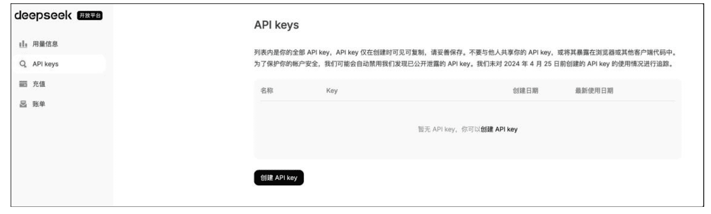

图2-3 DeepSeek官网API keys页面

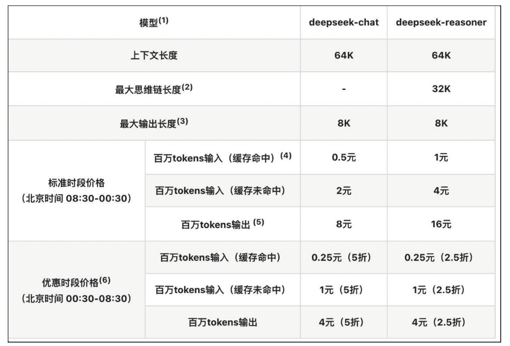

图2-4 DeepSeek API收费标准

创建好API keys并充值后，即可开始调用DeepSeek API，示例代码如下：

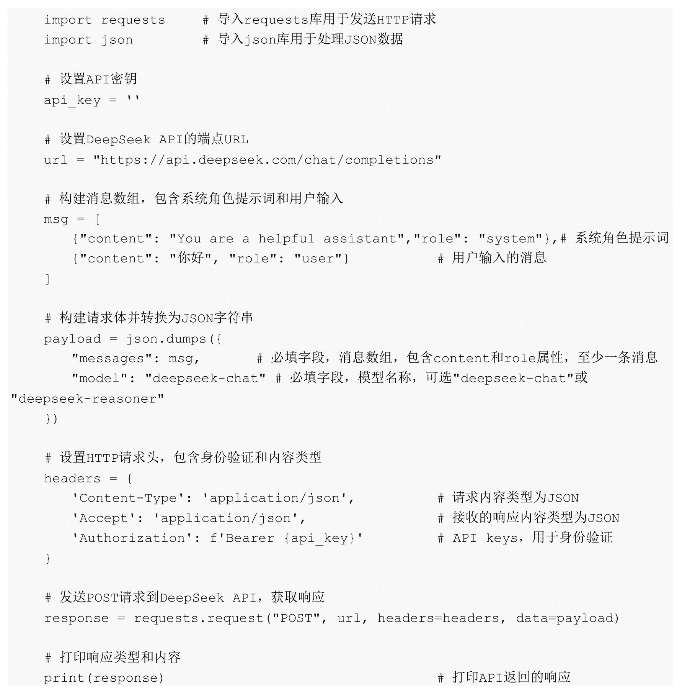

上述示例完整展示了如何从零开始调用DeepSeek API：

（1）首先通过设置请求地址和API keys完成身份认证；接着构造标准请求体并转为JSON字符串，其中messages字段包含一组对话消息，每条消息都包含角色如user或assistant和消息内容content，model字段用于指定调用的模型类型如deepseek-chat。
（2）设置请求头，确保包括Authorization携带API keys和Content-Type指定为application/json。
（3）使用Python的requests库发起POST请求并接收模型返回的响应文本。

运行代码，效果如图2-5所示。

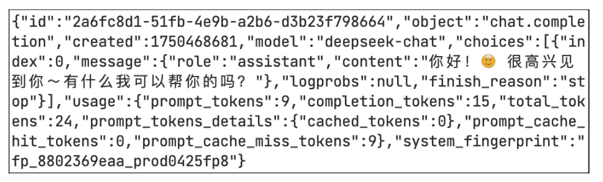

图2-5 DeepSeek API调用示例

可以看到，DeepSeek API的返回结果是一个JSON格式的字符串。为了便于查看和调试，下面对其进行格式化处理，使结构清晰、层级分明，如图2-6所示。

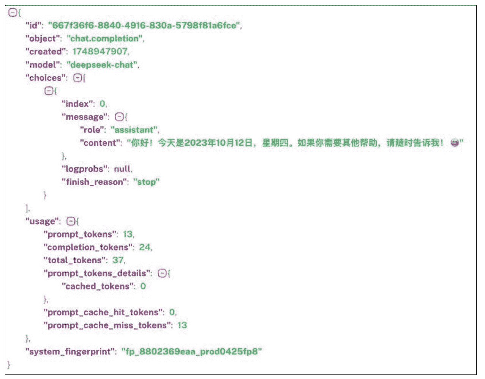

图2-6 DeepSeek API结构化输出

图2-6中展示的外层JSON字段，包含了本次模型调用的基本信息，如调用时间、请求标识符、所用模型类型、模型返回的回复内容，以及本次请求中输入与输出token的使用统计。这些字段共同构成完整的响应结构，详细说明如表2-1所示。

**表2-1 DeepSeek API外层基础字段**

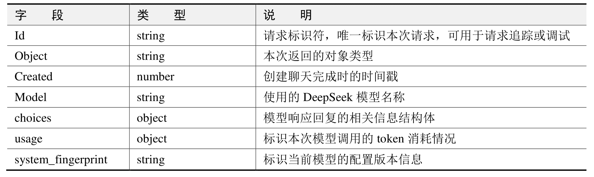

值得一提的是，上述的choices数组字段与调用的响应直接相关，记录了模型补全的结果。数组中的每个元素代表一次独立回复，适用于多轮回复或多样性生成的场景。每个回复中包含多个字段，用于描述具体的消息内容、消息角色以及生成状态等信息。该字段的详细说明如表2-2所示。

**表2-2 DeepSeek API响应体中的choices字段**

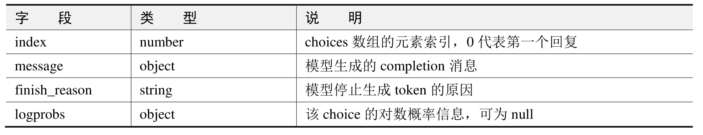

choices数组中的message字段用于记录模型生成的补全消息，对模型输出内容的详细描述。它通常包含两个核心字段：role表示消息角色如assistant，content表示模型生成的具体文本内容。message字段的详细说明如表2-3所示。

**表2-3 DeepSeek API响应体中的message字段**

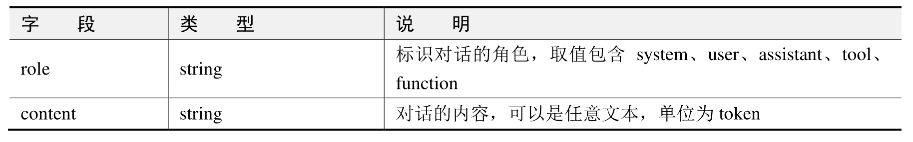

**2.2.2 请求参数**

在调用大模型接口过程中，请求参数的设置对模型响应的质量、随机性以及调用成本都有显著影响。OpenAI接口提供了丰富参数控制能力，而DeepSeek API在此基础上保留并扩展了多个关键参数，供开发者根据实际需求灵活配置。

这些参数不仅可用来控制生成内容的风格与稳定性，比如设定回答是否更严谨或更具创意，还可用于控制token消耗、是否采用流式响应等性能与成本维度的优化。详细参数说明如表2-4所示。

**表2-4 DeepSeek API请求参数说明**

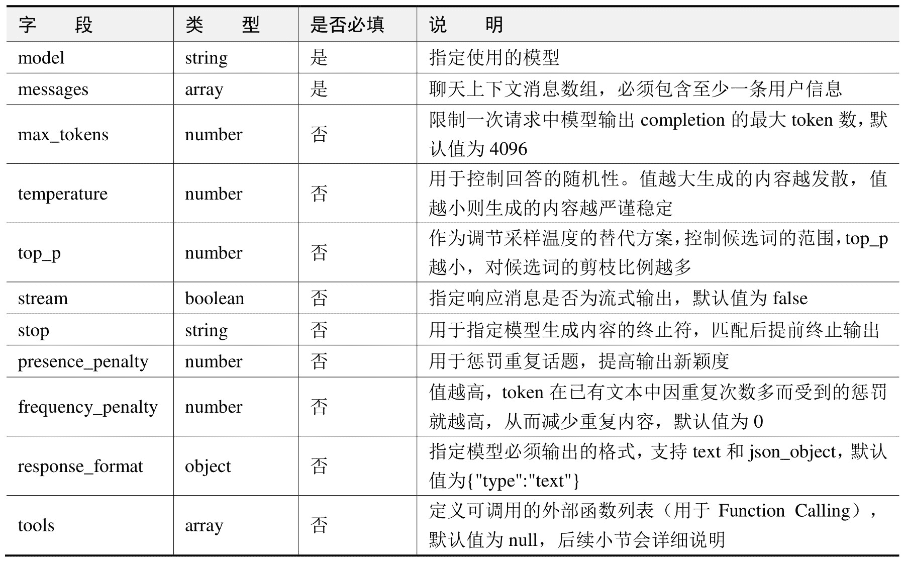

值得一提的是，temperature与top_p是两个常用于调控模型输出随机性与创造性的采样策略参数，它们在实际应用中往往被混淆，实则各有侧重：

· temperature温度：作用于模型输出的概率分布本身。较高的值如1.0使输出更加多样且不确定；较低的值如0.2会趋向输出概率最高的token，生成内容更确定但较保守。
· top_p核采样：作用于模型输出的候选集合。它按概率累计对token进行裁剪，仅从累计概率不超过top_p的token中进行选择，能在一定程度上剔除长尾词，平衡多样性与合理性。

在调参时，这两个控制随机性的参数一般二选一即可，同时动两个很容易让模型输出变得不稳定。实操中怎么选，看场景：

· 如果你要的是稳定可控的输出，比如代码生成、问答类任务，可以把 top_p 压低一点，比如 0.2 左右；

· 如果是偏开放的创作类场景，比如写稿、角色扮演、头脑风暴，则保持默认值或适当调高，能让结果更丰富、更具创意。

除了这两项，还有不少参数在影响输出形式和交互能力上起着关键作用，比如实时推送的流式输出 stream、可把结果固定为 JSON 等结构化格式的 response_format，以及支持调用外部工具的 Function Calling，即 tools 与 tool_choice 等，后面章节会逐一展开。

**2.2.3** **流式输出实操**
上一节把 DeepSeek 的请求参数做了整体盘点，必选项和可选项的基本作用都已介绍。本节聚焦可选项里的 stream，它决定了模型是整段返回还是逐块推送。

流式输出本质上是一种分块传输的思路，模型在生成过程中就把内容切成小块陆续发出来，而不是等到全部写完再一次性吐出。面对长文本时，这种方式能明显加快首字到达速度，提升感知流畅度。配合 WebSocket 或 SSE Server-Sent Events 这类协议，就能做到边生成边展示，用户不用干等完整个回答就能开始阅读。

在 DeepSeek API 里，stream 是布尔类型，默认是 false，即关闭流式。若想打开，只需要在请求体里显式声明：

payload = json.dumps({
"messages": msg,
"model": "deepseek-chat",
"stream": True, # 启用流式输出
"max_tokens": 60,
})

请求发出后，服务端会按 SSE 协议以 text/event-stream 格式分批下发内容。客户端通过可读流逐块接收，再实时渲染，就能实现端到端的流式交互。下面展示客户端如何拉取和处理这些数据。

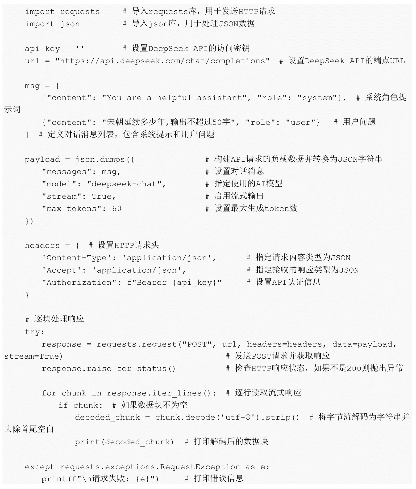
上例里，请求体里写了 "stream": true，服务端就进入分块推送模式；同时在 requests.request() 里也设置 stream=True，客户端以流式方式订阅响应。两者配合才能完成全链路流式。随后用 response.iter_lines() 按行解析 SSE 数据，行首通常是 data:，再用 UTF-8 解码为字符串并打印。效果如图 2-7 所示。

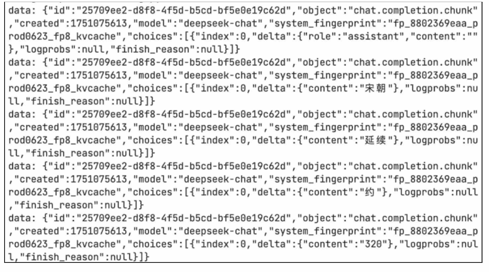
图 2-7 DeepSeek API 流式请求的返回内容

图 2-7 展示了连续的流式数据块，每个块都以“data:”开头，后面跟着 JSON 内容，其结构如图 2-8 所示。

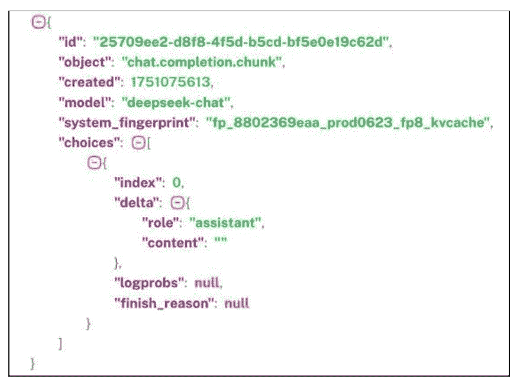
图 2-8 流式响应的结构化输出

在结构化输出里，每个数据块都携带着部分生成的文本、消息角色、模型名称、请求唯一 id 等元信息，便于客户端准确解析和展示。流的结束标志是 data: [DONE]，收到这个标记就意味着服务端已推送完毕，客户端可以停止读取，如图 2-9 所示。

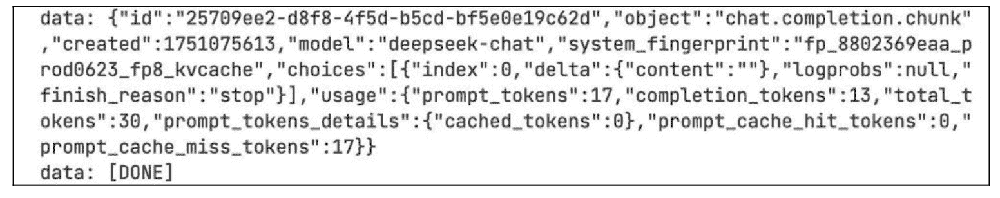
图 2-9 流式响应数据块的结尾

下面给出一个完整的流式请求示例，演示如何通过检测 data: [DONE] 判断结束，并把内容实时打印到控制台，代码如下：

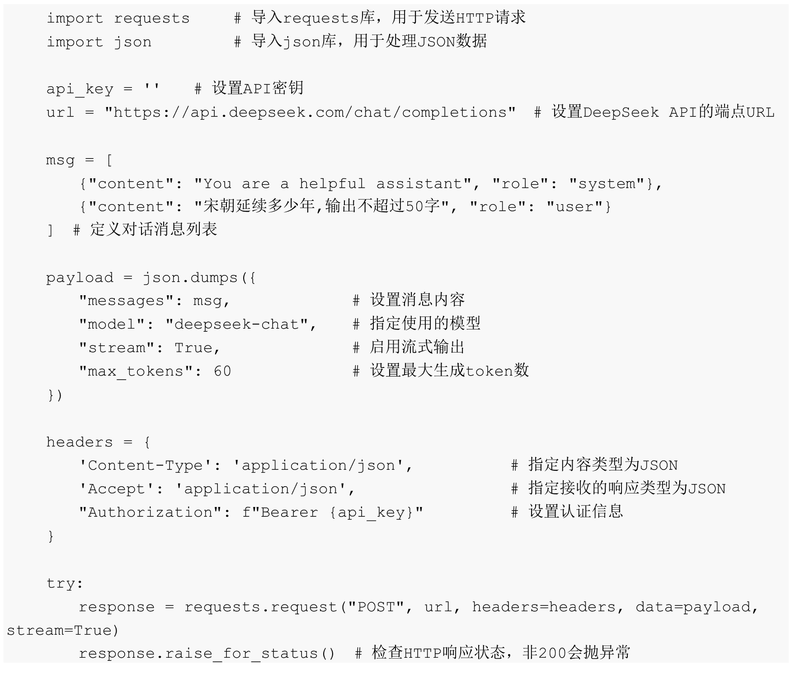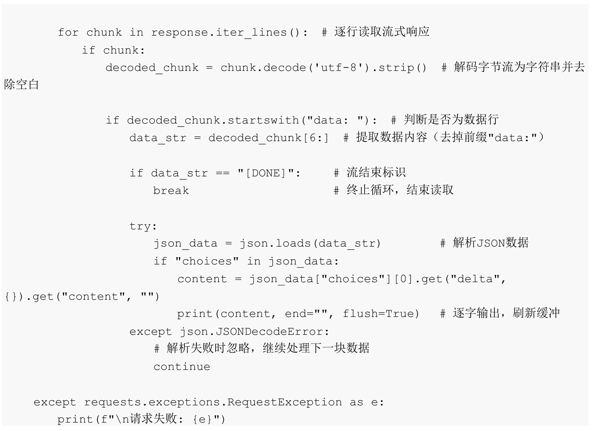
示例代码里循环逐行读取服务端返回。遇到以“data:”开头的行就取其后缀作为 JSON 字符串。若内容是“data: [DONE]”，说明推送完成则退出循环；否则解析 JSON 并取出 choices[0].delta.content 字段输出。借助 print 的 end="" 参数可以实现不换行、实时刷新。

**2.2.4** **System 消息调校**
在 2.2.1 节的参数解读里提到，messages 是必传项，用于承载用户与模型的多轮对话。每条消息包含 role 和 content 两个字段，role 表示发言身份，content 是具体内容。常见的 role 有 user 和 assistant，分别对应用户和模型。

通过给不同轮次标注角色，模型能够保留上下文，实现连贯对话，甚至可以通过上下文设计引导特定方向的回答。具体引导技巧会在 2.3.1 节详细说明。

除了 user、assistant 之外，role 还有一个关键取值 system。它用于定义模型的底层行为准则和人格基调，是控制语气、风格、交互方式的核心手段。下面重点讲 system message 的用法，通过案例说明它如何塑造行为并提升个性化。

**1．设定身份**
给模型预设身份是 system message 最常用的做法。明确身份后，任务目标更清晰，专业度提升，同时语气和格式也会贴合角色需求。比如把模型设定为脱口秀演员的示例：

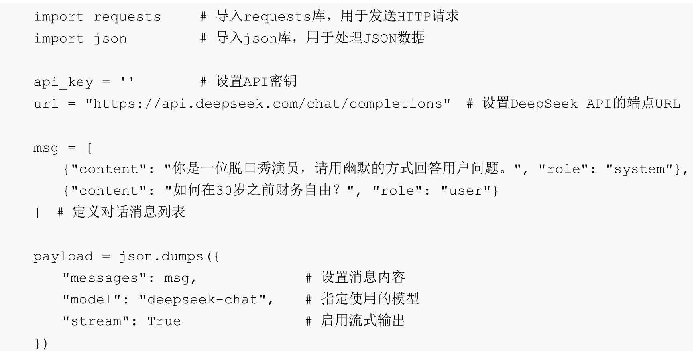
示例里先用 system message 把身份锁定为脱口秀演员，要求以幽默风格作答。随后 user 提问“30 岁前如何实现财务自由”，这本是高难度话题。身份引导后，模型给出了风趣贴合的回应，效果如图 2-10 所示。

对比去掉 system message 限制时的回答，身份设定明显提升了个性化和表现力。无限制的回复如图 2-11 所示。

图 2-10 使用脱口秀演员身份的模型答复

图 2-11 没有 system messages 限制的模型答复

可见 system message 不仅影响语气风格，也能牵引内容走向和质量，合理设计对应用效果至关重要。

**2．控制输出格式**
system message 还能约束返回格式。很多业务需要模型输出固定字段的信息，这时把格式限定为 JSON、Markdown 等会让后续解析更可靠。下面示例展示如何用 system message 强制 JSON 输出。

示例里 system message 明确要求输出为 JSON，且必须包含 title 和 summary 两个字段。用户询问人工智能定义，加入格式约束后，模型会严格按 JSON 结构返回，便于程序化处理。效果如图 2-12 所示。

图 2-12 使用 system message 约束 JSON 格式后的模型答复

如果想让格式更稳定，可以在 system message 里进一步描述每个字段的含义和作用，减少幻觉和偏差，提高一致性。

**3．限制行为**
system message 也可以用来划定行为边界。通过系统指令，开发者能规范交互风格并明确内容边界。下面示例展示如何限制模型不编造答案。

该例中 system message 要求模型不得编造信息。经约束后的回答如图 2-13 所示。

图 2-13 使用 system message 限制模型行为后的模型答复

严格的行为约束能让助手在不确定时保持严谨，避免误导，建立可信交互。

**4．明确任务类型**
system message 在定义具体任务上同样关键。精确的任务描述能让输出更专业可控。

该示例的系统指令为：

· 把用户输入翻译成英文；
· 不添加任何额外内容。

任务明确后的输出如图 2-14 所示。

图 2-14 使用 system message 明确任务类型后的模型答复

通过清晰的任务定义，模型输出更贴合业务需求，同时保证质量和规范。

总体来看，system message 虽不直接参与 user 与 assistant 的问答轮次，却能全局影响语气、格式和功能取向，像隐性提示一样提升可靠性和可控性。

**2.2.5** **深度思考揭秘**
DeepSeek 率先推出了深度思考功能，是当前模型交互里很有突破性的设计。传统对话只展示最终答案，推理过程被隐藏。深度思考把内部推理链路显性化，让模型像人一样一步步展示思考路径。

这种透明化不仅增强拟人感，也大幅提升了可解释性和信任度。用户可以：

· 看清回答基于哪些信息；
· 判断逻辑是否通顺、是否有漏洞；
· 回溯问题细节并进一步追问。

在教育、科研、决策支持等对过程要求高的场景里价值尤其突出。目前官网展示的效果如图 2-15 所示。

图 2-15 DeepSeek 深度思考效果

图中除最终答案外，还有灰色引用区，详细列出推理的关键步骤，正是深度思考的核心体现。下面介绍如何通过 API 复现该效果。

DeepSeek 目前提供两个模型：

· deepseek-chat：通用聊天模型，不支持深度思考；
· deepseek-reasoner：推理增强模型，默认开启深度思考。

只要使用 deepseek-reasoner 请求，就会返回包含推理过程的完整结果。例如用 curl 调用的示例：

执行后可获得带深度思考的返回，如图 2-16 所示。

图 2-16 DeepSeek API 深度思考效果

图中 reasoning_content 为思考过程，content 为最终答案。不同厂商的开启方式不一，比如 Qwen 系列用 enable_thinking 参数开启，具体以官方文档为准。

深度思考的意义在于不仅交付结果，还还原生成结果的思维路径。结构化且可追溯的推理过程，提升了复杂任务的可验证性、可靠性和用户信任，推动交互从黑盒回答走向可追溯推理。

**2.3** **提示词工程化实战**
前文已说明提示词在交互中的核心作用。忽略 Function Calling 等特殊情况，从角色看提示词主要分三类：系统提示 system prompt、用户提示 user prompt、助手提示 assistant prompt。

通过不断优化结构和表达，系统提示和用户提示都能引导出更符合预期的输出。对提示词进行系统化调整和迭代的过程就是提示词工程 Prompt Engineering，接下来介绍常用模式与优化技巧。

**2.3.1** **思维链拆解**
在提示词工程里，思维链 Chain-of-Thought 是一种让模型展示完整推理过程的技术。与直接索要答案不同，CoT 引导模型逐步思考，把复杂问题拆成中间步骤。常用做法有：

分步拆解：将复杂问题拆成若干小步骤，避免一步到位，降低出错率。 

显式推理：要求模型明确写出推理链，比如“首先……接着……最后……”，便于追溯。 

步骤校验：在关键节点自检逻辑，及时修正错误，提升最终准确性。

举个例子： “3 个苹果加 4 个香蕉共 38 元，2 个苹果加 5 个香蕉共 40 元，求单价。”

用 CoT 引导模型逐步推理，代码如下：

示例在用户提示里加入“请用逐步推理的方式”，并给出 4 步框架：设未知数→解方程→验证→结论。效果如图 2-17 所示。

图 2-17 应用 CoT 后的模型答复

CoT 让模型摆脱直觉式反应，通过慢思考降低错误，同时提供透明过程，提升可解释性和可信度。它适用于需要逻辑推导的各类场景，如数学、代码调试、商业分析等。对简单问题使用 CoT 反而可能降低效率，需按问题复杂度取舍。

**2.3.2** **结构化提示框架**
结构化提示是通过预设框架提升输出质量的方法。与自由自然语言不同，它采用模块化设计，把提示拆分为角色、任务、要求、输出格式等明确部分，让模型更精准理解意图。其核心流程为：

（1）明确角色定位，如“你是一名数据分析师”；
（2）详细列出任务要求；
（3）规定输出格式和内容范围。

当一次输出要卡准格式，或指令本身由若干子目标拼合而成时，给提示加一个清晰的框架，更容易拿到能直接用的结果。这种写法在产出标准报告、生成可运行代码、完成专业拆解这类场景里优势很明显。实际用下来，带框架的提示让大模型的回答更稳、更可控。

比如让模型做新能源汽车市场分析，常见的问法只有一句：
“写一份新能源汽车市场分析。”

改成带框架的版本就是：

【角色】你是一名资深市场分析师

【任务】生成 2023 年新能源汽车市场分析报告

【要求】

1. 数据对比：对比 2022 年与 2023 年销量、市场份额（表格呈现）

2. 趋势预测：分析未来 3 年技术发展方向

3\. 风险提示：评估政策与供应链风险

【输出格式】Markdown，包含标题、表格和分点列表

通过以下代码可以实现结构化提示词：

以下是模型对这个问题的回答：

把思路先框起来，等于把模型的猜测空间压小，产出会更精准也更好把握。它不只在专业任务里好用，日常提问也能让结果更贴合预期。要注意的是，简单问答过度上框架反而增加负担。搭框架时要兼顾详尽与弹性，既给出明确指引，也给模型留出合理的发挥空间。

**2.3.3** **正反面示例引导**

在提示词设计里，用好坏范例一起校准任务边界是一种很高效的做法。单靠指令只能说明做什么，加上正反对比后，模型能更直观地分辨应该怎么走、什么要避开，特别适合边界要求明确、易踩坑的场景。基本操作是：

（1）对比示范：把正确和错误的例子并排呈现，形成视觉对照。
（2）错误标注：把错误例子的具体问题和成因点出来。
（3）标准明确：用正面例子展示理想输出的样子和结构。

为了更直观说明用法，下面以生成规范邮件为例：

该案例里既给出了理想的邮件模板，也特意放了一封问题较多的错误邮件，并把问题逐条标出，帮助模型建立更牢的标准感。这种对比式教学更接近人类学习方式。对应的模型回复如下：

正反面示例引导之所以有效，是因为先用正确样本呈现完整标准，再用错误样本及其诊断指出常见坑点，对比学习让模型更快掌握复杂任务的执行要点。

**2.3.4** **分治法**

分治法在提示词工程里，本质是把一个大难题拆成若干相对独立的小问题，再逐个击破的系统化思路。与靠示例对比来明确标准不同，它更侧重通过拆解降低复杂度，特别适合多维度、多步骤的综合任务。其核心步骤包括： 

问题拆解：将复杂任务分解为多个相对独立的子任务。 

分步解决：按逻辑顺序依次处理各个子问题。 

结果整合：将子问题的解决方案组合成最终答案。

举一个实际例子，假设要剖析某电商平台的用户流失原因，通过以下代码可以实现分治法的应用：

这里把整体分析拆成用户行为分析、产品体验评估、竞品对比三条主线，每条主线再细化为 2～3 个具体观察点。层级化的拆解让 AI 能更有序地推进思考。模型给出的回复如下：

可以看出，分治法模拟了人类的解决思路：先拆解降低单点难度，再分步确保每个环节都被充分研究，最后统一汇总避免结论片面。它在科研论证、技术方案设计等需要全面系统思考的领域尤为好用。

**2.3.5** **复杂响应的数据结构转换**

复杂响应的数据结构转换，是指引导大模型把自然语言信息整理成 JSON、XML 等规范数据格式的技术。与示例引导不同，它更关注格式标准化的落地，适合需要把文本转为结构化数据的场景。其核心步骤包括： 

格式规范：明确定义目标数据结构的字段和类型。 

字段映射：建立自然语言内容与数据字段的对应关系。 

类型约束：指定各字段的数据类型和格式要求。

举例来说，若要把产品描述文本转为结构化 JSON，可通过以下代码实现：

示例中同时提供了原始非结构化文本，以及目标 JSON 的字段定义和类型限制。这种明确的格式约束能让输出更符合预期。最终模型转换的结果如下：

数据结构转换的可靠，来自系统化的规范机制。预先定义目标结构可减少随机性；严格的类型约束能强制字段格式，降低后续处理成本；清晰的映射规则则让自然语言与结构化数据精准对应，保持一致性。通常，分治法特别适用于自然语言到结构化数据、数据清洗和标准化等场景。

落地时需要注意几个关键点：

（1）结构定义要完整，避免漏掉关键字段。
（2）类型约束要明确，尤其是数字、日期等特殊格式。
（3）可选字段要明确标注。

这些细节看似基础，却往往决定成败。尤其在复杂业务中，一个字段定义不清就可能导致整条流程出错。建议先用简单案例验证结构合理性，再逐步提升复杂度。

**2.4** **Action：Function** **Calling**

在传统的大语言模型交互里，模型只能基于静态训练数据生成文本，无法触达实时信息、执行系统操作或调用外部服务。Function Calling 机制的出现打破了这一限制，它让模型可以主动调用开发者预置的外部函数，比如查询时间、调用接口、写入文件等，从而具备认知加行动的智能体特质。可以说，这是把模型从被动答复者变成主动执行者的关键升级。其整体交互架构如图 2-18 所示。

图 2-18 Function Calling 的交互架构

从图 2-18 可见，整个流程分为 6 步： 

工具注册：开发者在调用模型时注册一组函数（tools），告诉模型“可以用这些能力”。 

用户提问：用户输入一个可能需要外部信息的问题（如“现在几点了？”）。 

LLM 反馈需要调用 xx 工具：模型识别意图，判断无法独立回答，于是自动生成函数调用请求（如 get_current_time()）。 

工具调用：调用方拦截模型的调用请求，执行对应函数。 

返回调用结果：执行函数后，将结果返回给模型。 

结合工具调用结果给出最终反馈：模型基于函数返回值，生成最终答案并返回给用户。

下面以一个完整示例展示如何借助 DeepSeek 的 Function Calling，让模型在对话中动态调用 get_current_time 获取实时时间并作为回答的一部分返回。

示例完整演示了如何通过 DeepSeek 的 Function Calling 机制，让模型调用本地函数 get_current_time 获取当前系统时间并据此作答。关键步骤如下：

（1）函数注册：通过 tools 参数把自定义函数 get_current_time 封装为结构化 Function Tool，声明名称、描述及参数，这里无参数。
（2）模型触发调用：用户问“现在几点了？”，模型判断需要工具，于是返回 tool_calls 请求执行 get_current_time。
（3）函数执行与响应回传：本地执行函数后，构造包含 tool_call_id 和返回结果的新消息序列，再次送给模型，最终得到自然语言应答。

由此可见，Function Calling 极大拓展了大模型的边界，从只能生成文本升级为理解语义、调度逻辑、调用外部能力协同完成任务。通过明确的调用链，模型能根据用户意图自动触发指定函数、API 或外部服务，具备执行力和操作性。

这种架构提升了模型在高实时性、高准确性任务上的表现，也为 Agent 系统的智能决策、自动化执行、多模态交互奠定了基础，成为连接语言智能与系统能力的重要桥梁。

**2.5** **本章小结**

本章系统梳理了智能 Agent 开发的基础。首先解析了构建 Agent 的三大支柱：大语言模型作为推理引擎，提示词作为输入设计艺术，动作作为对外执行的接口，三者共同构成认知与执行的闭环。

随后详细说明了模型 API 的使用方法，包括基础调用、参数配置、流式响应、系统消息设定以及深度思考标签的应用，为高效调用和输出控制打下基础。

接着围绕提示词工程讲解了多种实战技巧：思维链促进分步推理，结构化提示增强语义约束，正反示例引导提升生成质量，分治策略帮助拆解复杂任务，整体上大幅提升模型理解与响应能力。

最后深入讲解了 Function Calling，阐明了模型与外部工具无缝联动的方式，拓展了智能 Agent 的功能边界，为构建工具增强型 Agent 提供了技术基础。

整章的思维导图如图 2-19 所示。

图 2-19 Agent 开发基础思维导图

学完本章后，读者能够：

（1）理解 Agent 三大核心要素的协同机制，设计符合业务需求的智能推理与执行架构。
（2）熟练使用模型 API，灵活运用参数、流式输出及系统消息把控调用节奏与语义引导。
（3）掌握多样化的提示词工程技巧，提升推理连贯性和准确性。
（4）深入理解并实现 Function Calling，掌握函数定义到注册调用的完整链路，构建具备实时外部交互能力的 Agent，拓展应用场景与功能深度。

**第三章 RAG：检索增强生成技术**

本章将介绍一种通过扩充模型上下文以提升大模型能力的技术——RAG（Retrieval-Augmented Generation，检索增强生成）。首先从架构链路、相比训练的优势两个维度阐述 RAG，接着详细介绍 RAG 底层实现，包含向量化、文本切割、向量存储、相似匹配四个维度，随后介绍 RAGAS 及 CRAG 这两个后处理手段，最后结合上述方法实现一个可落地的检索增强生成示例，帮助读者完整掌握利用 RAG 提升大模型在特定领域和场景下的检索与生成能力的方法。

**3.1 什么是 RAG**

RAG 是一种通过引入外部知识检索来增强大模型上下文，从而提升其生成能力和准确性的技术。简单来说，它让大模型在回答问题或生成内容时，先去“查找相关信息”，再基于检索到的内容进行生成，从而有效克服仅依赖模型内部参数带来的知识盲区和幻觉问题。

RAG 在大模型实战中具有重要意义，它不仅提高了回答正确率，还能以较低成本实现对新领域、新数据的快速适配，同时也可以在一定程度上减少因信息更新不及时导致的泛化风险。本节将从架构链路、分布外泛化风险和低成本信息穿透三个维度展开讲解 RAG 的核心价值。

**3.1.1 RAG 架构链路**

要理解 RAG 如何通过检索增强大模型能力，需要先从宏观上把握其架构链路和运行机制。从本质上看，RAG 是一种在生成任务中动态引入外部知识来辅助推理和回答的结构化方法，将大模型从“闭卷应答”转变为“开卷应答”，大幅降低幻觉率、提升回答准确性并实现知识的可控注入。其核心架构链路如图 3-1 所示。

图 3-1 RAG 核心架构链路

从图 3-1 中可以看到，RAG 架构链路通常包含以下关键流程：

（1）用户输入问题：用户输入一个问题或生成需求，系统接收该输入，准备进行增强推理。
（2）检索：系统将用户问题通过向量化模型生成问题向量，并在向量数据库中检索与问题最相关的文本片段或文档段落。这种检索不仅支持语义匹配，还可以根据业务场景进行条件过滤（如文档标签、时间范围），保证检索内容具有最新性、上下文相关性和私有可控性，从而有效降低大模型分布外幻觉。
（3）上下文拼接：将用户问题与检索到的若干高相关文本拼接成完整上下文输入生成模型。
（4）生成：将增强后的上下文输入大模型，利用其强大的推理和语言组织能力生成最终回答或内容。此时生成内容不仅依赖模型自身的推理能力，更受检索到的真实信息约束，从而提升回答的准确性和可解释性。
（5）后处理：为进一步提升可用性，可以对生成结果进行标注、召回、自我纠错回环和可信度评分等操作。

通过这种架构，RAG 将“检索”作为模型外延能力的组成部分，与模型本身的生成能力有机结合，构成了“检索增强生成”的完整闭环，让大模型在真实场景中具备可扩展且低成本的知识增强能力。

**3.1.2 RAG 的优势**

模型的扩展能力主要包括训练和 RAG 两种方式。训练是一种更标准且直接作用于模型参数本身的扩展方式，能够系统性提升模型在特定任务和领域下的能力，但往往需要更高昂的计算成本以及更多的时间和数据准备工作。

而 RAG 则提供了一种低成本、快速见效的模型扩展方案，通过引入检索机制让模型在生成内容前先获取相关知识，既能快速覆盖最新和私有领域信息，又能有效解决模型在实际落地场景中常见的分布外泛化风险和低成本信息穿透问题。下面将详细介绍 RAG 是如何解决这两个常见问题的。

**1．分布外泛化风险**

大模型虽然在预训练时接触过海量互联网数据，但这些数据的覆盖范围有限，且分布具有明显偏差，一旦需要在真实业务场景中回答未在训练数据中出现过的问题，就会面临分布外泛化风险。这种风险体现在两个方面：

（1）知识盲区，例如企业内部的私有知识、特定领域的内部标准或最新法律法规，这些信息往往不会包含在公共训练数据中，导致大模型生成的结果空泛或错误。
（2）时间滞后，即模型知识更新速度远低于现实世界变化，例如在应答最新研究成果、产品迭代或热点事件时，常常回答过时信息或自洽的幻觉内容。

RAG 通过将外部检索引入生成链路，提供了解决分布外泛化风险的可行方案。其核心思路是，当用户输入问题后，模型先在与任务相关的知识库、文档或最新数据源中检索出最相关的信息段落，将这些内容与用户提问一起拼接到上下文中，再交由生成模型进行推理和回答。这种“先查再答”的模式使大模型不再仅依赖参数记忆，而是能够利用外部动态知识，大幅提升在分布外数据场景下的正确率和可靠性。

更重要的是，RAG 可以显著降低大模型在垂直领域落地时的幻觉率。例如，在内部知识库问答场景中，RAG 能够帮助大模型输出可溯源、可验证的回答；在企业内部流程机器人或面向客户的智能问答中，也能快速适配领域知识，而无须频繁地对大模型进行微调，从而降低维护成本。通过引入检索机制，RAG 实际上让大模型具备了“记忆扩容”能力，在遇到训练集未覆盖的场景时，也能保持准确和可信，从而真正解决大模型在实际落地中最棘手的分布外泛化风险。

**2．低成本信息穿透**

**RAG：让大模型不改动也能吃到最新私有知识**

除了帮助大模型在分布外场景更稳之外，RAG 在工程落地上解决的是知识触达贵、触达慢的问题。真实业务里，模型要回答问题或写内容，往往要调用企业内网资料、最新文档或行业私域数据。传统做法是把这些私域知识固化进参数，用微调或重训的方式塞进去，代价是显存和算力开销大、数据准备与维护工作量高，并且知识一更新就得重新跑一轮训练，灵活性和效率都很差。

RAG 给出了一条更轻的用法。推理时从知识库或私密文档里实时检索相关片段，把信息拼进上下文再交给生成模型，模型本身不用做任何改动，回答就能穿透到最新和私有的信息边界。落地感受是：

· 知识库有更新，只要刷新向量库或检索源的内容就能马上生效，不必再训练。
· 面对不同业务线或项目，换一下检索源就能快速对齐领域知识。
· 边际成本很低，生成结果能紧贴真实数据，可验证性和可信度明显提升。

更关键的是，RAG 能以很小的人力时间成本把大模型嵌进现有业务流程，迅速得到可用且可校验的问答与生成能力。这种低价的信息突破，让 RAG 成为实际项目里比反复训练更敏捷、可控、经济的扩展手段。

**3.2 RAG 底层实现**

弄清了价值后，落地就要看 RAG 在底层如何完成检索与注入。底层决定召回质量、生成可用性，以及在专业知识场景下的性能与维护难度。整体通常由四段串起来：

（1）编码：用 Embedding 模型把文本或问题映射为高维语义向量，形成可计算的语义表征。
（2）分块：把长文档切成适合检索和生成的文本单元，在语义完整性和检索粒度之间找平衡。
（3）向量存储：把编码后的片段写进向量数据库，如 Milvus、Chroma、PGVector 等，支持快速检索与过滤。
（4）相似检索：计算查询向量与库内向量的相似度，挑出最相关的内容作为高质量上下文供给生成模型。

这套链路让知识库信息高效注入生成流程，模型既保留语言生成能力，又能精准抓取私域知识和最新信息。下面先展开最核心的前两个模块。

**3.2.1 向量化**

在完整链路里，编码是让数据可检索、可比对的第一步，也是 RAG 高效召回的基础。

大语言模型虽然能理解语义，本质仍靠数值计算。编码就是把文本、图片、音频等非结构化数据转成模型可处理的高维向量。每段文本被映射为向量空间的一个点，该点既承载语义特征，也保留了与其他数据的相似度信息，后续可通过距离判断相关性，如图 3-2 所示。

图 3-2 多维向量坐标

在这个空间里，每个坐标维度代表一种宏观语义特征，用来标识向量在该特征上的表达程度。刻画越准确，距离越近的两个向量语义相关性越高。

可以说，编码是让机器读懂信息并实现高效检索的关键。RAG 工作时，用户问题先被编码，再与预先构建的向量库做相似度匹配，快速定位最相关的知识段落，最后由 LLM 基于上下文生成回答。

实现文本编码主要依赖 Text Embeddings 模型，这类模型专门把文本映射到向量空间，让文本能被机器以向量形式理解、计算和匹配。目前厂商和开源社区都提供了丰富选择，可按场景和精度需求选用。下面以 OpenAI 和 Hugging Face 的方案为例说明。

**1. OpenAI Embeddings**

OpenAI 提供了 v1/embeddings 端点来支撑文本编码，开发者可把任意文本便捷地转成用于相似度匹配和检索的向量。该端点的常用参数及说明如表 3-1 所示。

**表 3-1 OpenAI 文本向量化端点 v1/embeddings 的参数**

调用很直接，把待编码的文本填入 input 参数即可完成请求，示例如下：

返回结果中 embedding 字段即为编码结果，通常包含 1500 多个浮点数，表示向量在 1500 多维空间中的位置。需要注意的是，OpenAI 的编码接口按量收费。截至目前，OpenAI 针对文本编码提供的 3 种模型及对应费用标准如表 3-2 所示。

**表 3-2 OpenAI 文本向量化端点 v1/embeddings 的收费标准**

**2. Hugging Face Embeddings**

文本编码已比较成熟，并不像对话模型那样被少数厂商垄断。很多开源模型即可满足企业的基础编码需求。私有化部署开源模型既能保障数据安全和业务隐私，也能支持批量编码任务的零成本处理。

在 Hugging Face 平台，编码模型多归类在 Feature Extraction 下。不同模型往往针对特定语言训练，例如北京智源研究院开源的 bge-large-zh-v1.5 专用于中文文本编码（见图 3-3），而 bge-large-en-v1.5 专用于英文编码（见图 3-4）。

图 3-3 Hugging Face BAAI/bge-large-zh-v1.5 模型

图 3-4 Hugging Face BAAI/bge-large-en-v1.5 模型

这类模型不适合跨语言使用。技术上能跑，但向量可能无法真实反映语义距离，影响后续匹配效果。

如果需要多语言场景下的跨语言编码，可在 Hugging Face 搜索 Feature Extraction 时加上“multilingual”关键词。通常带有该标签的模型是为多语言训练的。例如排名靠前的 intfloat/multilingual-e5-large 就支持中英文等多语言编码，可用于跨语言相似度匹配，如图 3-5 所示。

图 3-5 Hugging Face intfloat/multilingual-e5-large 模型

在模型详情页的 Inference API 中可以在线体验编码效果，如图 3-6 所示。

图 3-6 intfloat/multilingual-e5-large 的向量化示例

可以看到，Inference API 展示了该模型对输入文本编码后返回的张量结果，维度在 1000 以上，每个数值共同表征文本在语义空间中的位置。

下面把这个过程搬到本地，用脚本调用 intfloat/multilingual-e5-large 做本地文本编码。建议先用 Conda 建一个独立 Python 环境隔离依赖，随后在终端安装所需库。

环境准备好后即可编写编码脚本，实现高效本地批量处理，示例代码如下：

代码里用 transformers 库加载 intfloat/multilingual-e5-large 模型，对中文和英文测试句进行编码。因为只是推理而非微调，通过 torch.no_grad() 关闭梯度计算，减少内存占用并加快推理。

分词时设置了几个参数便于批量处理，包含填充、截断和张量格式返回，作用分别是：
· padding=True：将批量文本填充到相同长度，便于并行推理。
· truncation=True：文本超出模型最大输入长度时自动截断，避免报错。
· return_tensors="pt"：返回 PyTorch 张量，若用 TensorFlow 可换成"tf"。

执行后会得到 transformers 库中的数据结构，如图 3-7 所示，包含了编码后的张量结果，可直接用于相似度计算或入库。

图 3-7 文本向量化的张量结果

该结构包含多类输出：
· last_hidden_state：最后一层的完整序列输出，每个时间步的隐藏状态，对应序列的向量表示。
· pooler_output：池化输出，通常是第一个 token 隐藏状态的变换，是整个输入序列的固定长度表示，常用于分类等任务，能较好捕捉整体信息。
· hidden_states：各层隐藏状态列表，用于分析内部机制。
· past_key_values：在解码器中用于快速生成。
· attentions 和 cross_attentions：自注意力和跨注意力权重，用于理解模型关注点。

用于文本相似度匹配时，pooler_output 最适合作为向量结果。但此时仍是张量，不方便直接存向量库，需要先转 NumPy 数组再转列表。修改脚本如下：

再次执行后，终端会以 NumPy 数组形式展示结果。NumPy 擅长处理大规模数值，打印大数组时默认只显示首尾，中间用省略号折叠，效果如图 3-8 所示。

图 3-8 执行得到的 NumPy 数组

从输出能看出，两段文本已成功转成两个数组元素。若要进一步转成列表以便存储或写入数据库，可调用 .tolist() 方法。修改后的代码如下：

    print(embeddings.detach().numpy().tolist())

执行得到的部分列表如图 3-9 所示。

图 3-9 执行得到的部分列表

目前这段脚本还不能直接在应用里用。接下来把它改造为可调用的服务，并通过指定端口和路由访问。Python 中可用 flask 快速搭建服务。先安装依赖。

然后把之前的脚本注册到 /text_embeddings 路由，作为对外编码服务使用。

重新运行后，本地编码服务即可启动。用 Postman 请求测试，能稳定返回文本的编码结果，如图 3-10 所示。

图 3-10 向量化服务的执行结果

**3.2.2 长文本分片策略**

在编码之前，通常要先对长文本做合理切片。目标是让切片在语义上尽量连贯，同时避免大小差异过大，保证后续编码生成的每个切片在相似度匹配时有可比的标准与依据。

好的切片能提升向量召回精度，也能在上下文组装和推理生成时减少因上下文割裂带来的幻觉和错误回答。下面介绍几种常见做法。

**1. 固定块切割**

最简单的方法是按固定长度（字符数或词数）直接分段。这种方式实现简单，切片长度统一，便于批量编码和存储；缺点是容易在语义中间硬切，破坏上下文连续性，导致检索和问答时出现幻觉或片段化。因此一般只适用于结构明确、对上下文完整性要求不高的场景，如简单摘要、标签提取、快速索引等。

工程上如果想快速闭环，可先用固定块切割做出最小可用版本，再根据召回准确率和上下文需求迭代优化。示例如下：

在示例里以 50 为固定分片大小对长文本进行切割，效果如图 3-11 所示。

图 3-11 固定块切割效果

固定块切割虽然简单均匀，但缺陷明显：
· 语义被硬性切割：句子可能被截断，上下文被拆散，语义不完整。
· 依赖连续召回：若相似度检索无法同时召回相邻切片，就难以拼凑完整语义，影响上下文质量和回答准确度。
· 适用场景有限：更适合对语义完整性要求不高、需要快速批量处理的粗粒度预检索。

因此在追求回答质量的 RAG 管线里，往往会采用整句、语法 aware 和块优化等切割方式，减少语义割裂。

**2. 整句切割**

在固定块基础上更进一步的做法是整句切割。它依据句号、问号、感叹号等标点按句意分割，能保留完整语义，避免编码时因截断导致上下文缺失。适用于需要连贯度和理解准确度的场景，如技术文档、新闻摘要和复杂问答检索。

整句切割的缺点是无法精确控制分片长度。若原文断句不佳，会出现部分分片很长、部分很短，导致编码后召回时权重失衡或超长切片被截断，影响匹配效果。下面是示例代码：

示例中通过整句切割把长文本拆成包含完整语义的分片数组，便于直接批量输入编码接口。效果如图 3-12 所示。

与固定块相比，整句切割明显更好，切片能完整保留语义，避免了上下文截断和语义残缺，有助于召回时保持上下文完整性，提升召回质量和准确度。不过局限性也很清楚：
· 无法保障分片大小统一：切片长度取决于原文句子，若语句过长可能超出模型最大输入限制，需要二次切割或截断。
· 分片效果受文本语法和写作水平影响大：语法混乱、标点缺失或口语化强的文本，切分可能不准，甚至出现超长分片或无效拆分。
· 跨语言复杂性提升：不同语言标点和句式差异大，需要针对性设计分句规则，否则在非中文或非英文环境下易出现切分不准。

图 3-12 整句切割效果

所以在实际工程中，若能容忍分片大小不一致且要求语义完整，整句切割是不错的选择；若需要严格控制分片长度以便批量编码与存储，则要采用块优化切割方案，下面将详细介绍。

重叠块切分让切片更均衡且语境更连贯

长文本处理时，往往需要在切片长度可控与语义不被截断之间取平衡。一种常用的做法是引入两类可调参数：

· 段长上限：限定单次输出的材料大致在多少字符或 token 以内，防止切块过长导致向量被稀释，或过短带来噪声。
· 重叠宽度：决定相邻两段交集的范围。即便切点落在句中，重叠区也能补回断裂的语境，降低截断带来的丢失。

下面是重叠块切分的示意代码：

示例把长材料按此思路拆开，上限设为 50，重叠设为 10，即每段约 50 个单位，相邻段保留 10 个单位的共用区以维持衔接。效果如图 3-13 所示。

总体看，这种方式做不到像整句切分那样严格卡在语义边界，但能让切片长度更均匀、更可控，便于批量并行做向量化；凭借重叠区，前后语境被切断造成的损失被显著压低，召回与生成的连贯性随之提升，特别适合大规模知识库分块、RAG 链路和高效预处理场景。

图 3-13 块优化切割效果

**4．特殊语法切割**

除了固定块、整句和重叠块等通用手段，针对特定载体还能做更精细的设计。比如 Markdown 文件，就能借助标题、列表、代码块等原生结构做结构化拆分。

Markdown 本身层级分明、标记明确，向量化时很友好。结构既能表达前后关联，又能凸显重点和分类，进而提升检索与理解效率。示例如下：

该例基于 Markdown 语法，以一级、二级标题为依据拆分，每块对应一个章节或小节，语境与层级信息得以保留，便于按主题做向量化与精准检索。效果如图 3-14 所示。

图 3-14 Markdown 语法切割效果

因 Markdown 具备清晰层级和丰富标记，切分时能精准锁定章节、列表、代码块等语义单元，保留关联关系与重点，显著改善向量表征的准确度与检索相关性。实践中可进一步细化，比如扩展更多标题层级、叠加长度上限与重叠、按内容类型调整粒度，以获得更理想的切片。

非 Markdown 材料缺少显式结构标记，结构化拆分难以落地，只能退回通用策略，如整句切分、固定块或语义边界切分，这些方式无法像 Markdown 专属方案那样保证语境完整与语义连贯，效果相对有限。因此选择适配材料类型的切分方案，是提升向量质量与检索性能的关键。

**3.2.3 向量存储&相似匹配**

向量的托管需要向量型数据仓库。与关系型或文档型仓库不同，向量库专为高维向量设计，支持高效管控与类似检索，内部会构建近似最近邻索引，能在海量向量中快速定位最接近的集合。

多数向量库还自带向量化流水线，可直接对文本、图像、音频等原始素材完成向量化后入库，简化拆分-向量化-入库的链路，提升开发效率与一致性。对 LLM 知识库搭建、类似内容推荐、语义搜索和检索增强生成都很关键。

Chroma 是一个轻量开源的向量库，支持本地无服务运行，便于快速接入开发测试。它提供简洁的 Python/JavaScript 交互层，能把文本切片直接向量化写入，同时支持条件过滤与类似检索，帮助以低成本搭建私有检索系统。下面介绍如何用 Chroma 完成存储与匹配。

**1．最小可用版本示例**

先用一个完整小例子演示从向量化、写入到类似匹配的全流程，帮助快速理解其在检索增强场景的用法。首先在终端安装依赖：

    pip install chromadb

安装后示例代码如下：

运行过程包含：

（1）持久化客户端：用 chromadb.PersistentClient(path="/chroma_data") 创建可持久化客户端，向量与索引保存在本地目录，服务重启后数据依旧存在，便于调试与小规模私有库落地。
（2）写入集合：通过 collection 的添加方法传入原始材料 documents 与唯一标识 ids。
（3）Chroma 内部自动完成向量化，默认使用内置 embedding 模型并构建索引，省去手工向量化与索引管理的复杂度，便于快速验证。
（4）类似查询：调用 collection.query(query_texts=[...], n_results=1) 将查询材料转向量，再与集合向量做类似匹配，默认采用余弦相似，快速返回最相关文档及其分数，可通过 n_results 调整返回数量。

最终输出包含 documents、ids、distances，距离越小类似度越高，效果如图 3-15 所示。

图 3-15 Chroma 示例效果

Chroma 的能力远不止于此，下面分别介绍向量集合、类似匹配与自定义 embeddings。

**2．向量集合**

Chroma 的核心概念是集合 Collection。集合维护材料与其向量表示的映射，本质是一个向量表，是数据管理和检索的基本单元。

集合管理 API 简洁且绑定在实例上，支持创建、列出、删除等操作，便于灵活组织数据，满足私有知识库构建、分域管理与版本管控需求。详细接口见表 3-3。

与传统表类似，集合支持批量写入、更新、删除与过滤，每条向量可携带：
· 唯一标识 ID
· 原始材料 Document
· 元数据 Metadata，如来源、标签、时间戳等

集合元素的增删改查 API 绑定在集合实例上，对应接口与示例见表 3-4。

常用参数含义：
· ids：向量元素的唯一标识
· documents：元素的材料内容
· embeddings：元素对应的向量坐标
· metadatas：可选的附加信息字典列表，可用于过滤
· n_results：类似匹配时返回的前 n 个结果
· where / where_document：查询条件

在复杂检索场景，常需先限定匹配范围，例如仅在满足业务标签、时间范围、来源类型等条件下参与匹配，或在多租户环境下仅在特定租户 ID 内匹配，避免跨租户泄露语境。

Chroma 提供 where 与 where_document 作为筛选过滤器，支持在类似检索前做灵活可组合的过滤，精准控制匹配语境，提升可控性、准确性与安全性。

where 用于筛选 metadatas 字段，支持的运算符见表 3-5。

示例代码如下：

代码中使用 $eq 对 metadatas 中的 thing 字段过滤，只保留等于 "basketball" 的条目参与匹配，即只在“小明打篮球去了”这条数据上做类似度计算，不会匹配到 thing 为 "tomato" 的“小明爱吃西红柿”，实现先过滤后匹配。执行结果如图 3-16 所示。

图 3-16 where 筛选示例

where_document 则直接作用于原始材料，在匹配前先按材料内容筛选。支持的运算符较少，仅有 $contains 和 $not_contains，分别匹配包含或不包含指定关键词的材料，适用于先按关键词粗筛再做向量匹配的场景。

示例：

这里把筛选改为 where_document，使用 $contains 筛选材料中包含“篮球”的条目，Chroma 先在符合条件的材料范围内执行向量类似度匹配，最终返回“小明打篮球去了”，而非其他无关材料。执行结果如图 3-17 所示。

图 3-17 where_document 筛选示例

至此向量集合的核心内容已介绍完毕，包括集合的创建获取删除、元素的增删改查，以及 where / where_document 的过滤用法。这些能力可帮助在私有知识库或向量检索场景中灵活管理海量材料及其向量，并实现精细化范围控制。接下来介绍类似匹配的具体实现。

**3．相似度匹配**

建立多维向量空间后，可通过计算向量间距离衡量语义类似性。但距离定义不唯一，不同算法带来不同匹配效果。Chroma 内置多种距离计算方式，可按业务需求选择。

创建集合时，create_collection API 接受可选的 metadata 参数，其中 "hnsw:space" 用于指定距离计算方法。例如：

    collection = client.create_collection(
        name="collection_name",
        metadata={"hnsw:space": "cosine"}  # 默认 "l2"
    )

当前支持的主流算法见表 3-6。

余弦相似度和欧氏距离在材料类似任务上表现都不错，但余弦相似度更具优势，尤其对高维文本嵌入。因为余弦关注方向角度而非绝对长度，能避免材料长度、词频差异带来的偏差，更贴近语义类似。

欧氏距离对向量模长敏感，在极端分布下可能出现语义偏差；内积不适合材料类似匹配，主要用于得分排序或推荐系统中衡量用户偏好与内容特征的匹配度。

因此，语义检索场景一般优先选用 "cosine" 模式，以获得更稳定准确的结果。

**4．自定义 embeddings**

若未显式传入向量，Chroma 默认使用开源模型 all-MiniLM-L6-v2 进行自动向量化，由 SentenceTransformers 提供，推理快、语义表达良好，适合多数英文场景。

在高级应用中，可能希望使用更强的预训练模型，如 intfloat/multilingual-e5-large，以获得更高维、更精细的表示。Chroma 支持自定义机制，允许开发者用外部模型预处理材料并将向量手动传入。只需实现 EmbeddingFunction 协议即可统一处理。

    class MyEmbeddingFunction:
        def __call__(self, texts: List[str]) -> List[List[float]]:
            # 将材料列表转为向量列表
            ...

实现要点：
· texts 接收字符串列表
· 返回必须为二维列表，每个子列表为对应材料向量
· 向量维度需与后续匹配任务一致

示例实现：

    from sentence_transformers import SentenceTransformer
    class SBERTEmbeddingFunction:
        def __init__(self):
            self.model = SentenceTransformer("intfloat/multilingual-e5-large")
        def __call__(self, texts: List[str]) -> List[List[float]]:
            return self.model.encode(texts).tolist()

实现后可在创建集合时绑定，后续增删查操作会自动调用该函数向量化，例如：

    embedding_fn = SBERTEmbeddingFunction()
    collection = client.create_collection(name="my_collection", embedding_function=embedding_fn)

完整自定义 embeddings 示例代码如下：

该实例按 EmbeddingFunction 协议封装了 intfloat/multilingual-e5-large 的分词与推理逻辑，实现 __call__ 方法接收材料列表并返回向量列表。随后在 create_collection 或 get_collection 时传入 embedding_function，使后续所有操作自动使用自定义嵌入。

通过简单实验验证其可用性：

首先调用 /store_text_embeddings 接口创建 test_collection2 并写入“今天天气多云”和“小明去踢足球了”，集合创建成功且数据入库，说明自定义 EmbeddingFunction 已正确接管向量化，如图 3-18 所示。

随后调用 /query_similar_text 接口，以“小明去干什么了”查询，最相关结果为“小明去踢足球了”，与预期一致，表明自定义向量化函数运行稳定，能精准提取语义进行有效类似匹配，如图 3-19 所示。

图 3-18 自定义 embeddings 函数向量入库示例

图 3-19 自定义 embeddings 函数向量相似匹配示例

不打算自己写编码流程，除了自带的 All-MiniLM-L6-v2，Chroma 把一批开箱即用的编码器集中在 chromadb.utils.embedding_functions 下。覆盖 OpenAI、Hugging Face 等主流厂商，喂入文本就能直接得到向量表示，省去重复造轮子的成本。

要留意，部分封装会依赖外部在线服务，如 OpenAI 或 Hugging Face Hub，这类调用一般需提供 API_KEY 等鉴权凭证。不少服务按量收费，落地前应评估权限与费用。表 3-7 列出了 Chroma 常用内建向量化方案的调用方式。

**表 3-7 Chroma 提供的内置向量化函数**

到此，检索增强生成的底层链路已串起来。本节从编码切入，分块策略、向量持久化与语义匹配被依次梳理，把原始材料逐步转为可检索的语义表征。

Chroma 轻量好用，适合做概念验证、小规模功能试验或私有资料库。当数据体量变大、并发升高、需要分布式部署与弹性伸缩时，会出现性能与功能的限制。此时 Milvus、Weaviate、Pinecone 这类具备分布式架构与高可用能力的底座更稳妥。

当下 RAG 生态已很成熟，主流云厂商均推出面向检索增强的基础设施。 trừ极致定制场景，开发者不必从零自建，直接复用现成平台就能快速交付高效的增强应用，如图 3-20 所示。

即便可以借力，底层原理仍值得吃透。吃透后，文档筛选、召回效果、系统表现才能做到心中有数，从而做出更可靠的生成方案。

图 3-20 阿里云官网提供的 RAG 服务

**3.3 RAGAS：检索质量的自动化评测**

在检索增强体系里，检索相当于为大模型准备素材。检索回来的语境若不相关或缺失，再强的生成模型也难以给出可信答案。因此检索质量的度量，尤其是覆盖能力的量化，非常关键。

传统搜索团队多靠人工打标衡量效果，成本高且主观性强。随着大模型普及，自动化评测需求激增。RAGAS 就是在这种背景下出现的 Python 评测库，内部结合了嵌入模型与生成模型，专注 RAG 与 LLM 的语义级度量。它能自动分析检索结果的准确性与覆盖度，判断是否存在误召漏召，为开发者提供高效一致的评测支持，如图 3-21 所示。

上手不难，配合示例代码就能跑通。实操要盯住两件事：数据集字段规范与指标选择。

图 3-21 RAGAS

RAGAS 对输入数据有固定字段要求，用来承载用户提问、检索返回的语境片段以及 LLM 最终生成的答案。这些字段同时反映检索能力与生成质量，是后续度量的基础。具体字段说明见表 3-8。

**表 3-8 RAGAS 单个数据集字段标准**

关于字段，有几个细节要留意：

· reference 通常指向检索到的语境 contexts，而 ground_truths 指标准答案，二者在 RAGAS 中的作用不同，不能随意互换，用哪个取决于选用的指标。
· 涉及对 LLM 生成结果的度量时，answer 字段是必须的，否则只能做检索召回的评估。
· 记录召回片段的 contexts 必须是字符串列表。

基于规范化的数据集即可开展度量。RAGAS 提供了多套指标，覆盖不同维度，例如 context recall 看文档是否召回完整、answer correctness 看答案是否正确、faithfulness 看生成内容是否忠于检索文档等，可按需组合。完整指标列表见表 3-9。

**表 3-9 RAGAS 评估指标**

实践中建议至少同时看 context_recall、faithfulness 和 answer_relevancy 三项。它们分别衡量语境是否足够相关、生成答案是否忠于语境、答案与用户问题是否匹配。三者结合可以较全面地诊断检索、生成与对齐环节的问题，指导持续优化。

下面通过一个完整示例演示数据集准备与覆盖度量流程。先安装依赖：

pip install chromadb sentence_transformers datasets ragas langchain_community

几类库分别负责向量库、文本编码、数据构建、评测工具和模型接口，是后续操作的基础。安装后进入实操，示例代码如下：

该示例基于 Chroma 向量库与通义千问大模型实现完整流程。先用 SentenceTransformer 把原始文档编码并写入 Chroma 内存集合；对用户查询做向量检索拿到相关语境；构造 Prompt 调用通义千问生成答案，并组装出问题、语境、参考答案、模型答案的 RAGAS 数据集；最后用 RAGAS 的 5 个指标——上下文召回率、上下文精准率、事实一致性、回答相关性、回答正确性——对结果做综合度量。效果如图 3-22 所示。

图 3-22 RAGAS 评估效果

context_recall 衡量检索到的语境是否包含回答问题所需的信息，反映向量检索的覆盖能力。它不仅看是否找到相关段落，更看这些段落能否支撑模型生成正确且有依据的答案。覆盖越高，越不容易出现事实偏离或答非所问。

在多轮问答和复杂知识问答里，高覆盖尤为关键，能保证语境充分支撑模型理解。覆盖度量因此不仅是检索指标，更是保障整个增强生成体系质量与可靠性的基座。结合精准率、忠实度等维度一起分析，才能更全面地掌握系统表现。

**3.4 自我矫正：CRAG**

传统检索增强的质量很大程度上取决于首次检索的结果。一旦初次检索遗漏关键信息，再强的语言模型也会胡编。为提升鲁棒性，CRAG，即 Corrective RAG 自我矫正式检索增强生成应运而生。其思路是在初次生成后，反向核对生成内容与上下文的匹配度，并动态调整检索策略，形成“生成—验证—再检索”的闭环，流程如图 3-23 所示。

图 3-23 CRAG 自我矫正的流程

CRAG 引入反馈机制，将首次生成结果与上下文对比。若发现依据不足或不一致，就自动触发更精准的二次检索来补齐信息。并且可以结合 RAGAS 实时监测忠实度 faithfulness 和上下文召回率 context_recall，作为是否再检索的触发依据。示例如下：

示例实现了一个 CRAG 自我矫正流程。先按标准检索增强执行：向量检索、生成答案，再用 RAGAS 多指标评估。若 context_recall 或 faithfulness 不达标，系统会启动矫正逻辑，比如对原始查询做改写 query rewrite，随后重新检索、再生成并再次评估。

实际落地时矫正方式并不固定，可能是指标补充、联网搜索、Agent 推理链、查询重构或多跳检索的组合；在复杂任务中，CRAG 也可能演化为多轮交互、动态策略选择的智能流程。

因此 CRAG 更像一种设计理念和策略框架，强调自我诊断与自我修正，而不是可直接复用的通用模块。核心价值在于根据业务目标和数据特点制定合适的矫正策略，打造更稳健可信的增强问答系统。

**3.5 从 RAG 到复合型 Agent 的落地实践**

前面已经拼好了底层能力：文档编码、语境检索、LLM 生成、RAGAS 评估。但它们仍是分散函数，还未形成可对外调用的产品形态。

本节把这些能力打包成可复用系统，分两部分：

· RAG Server：服务端组件，封装向量检索与生成逻辑，对外提供统一 API。
· 命令行脚本 Client：客户端，通过命令行输入问题，调用 Server 并输出答案。

先看 RAG Server。它基于 FastAPI 对向量检索与大模型调用进行封装，让外部应用可通过 HTTP 提交问题并拿到基于语境的答案。实现代码如下：

示例中使用 Python Flask 启动了一个轻量服务，提供文本编码存储与相似文本查询两项核心能力。服务结合 Chroma 持久化向量库与 Hugging Face 预训练嵌入模型，例如 intfloat/multilingual-e5-large，让私有语料分块入库后可在问答推理中按需增强语境，基本满足私域知识库检索增强的核心需求。

随后实现配套命令行客户端，功能包括：

· 列出当前所有可用知识库集合。
· 选定目标集合。
· 输入查询并调用服务端 API。
· 返回最相似文本段作为增强语境。

实现代码如下：

本章到此基本收尾。当前主流云厂商已把检索增强基础能力产品化，具备更成熟的优化与风控。落地时往往不必从零自建，直接复用云服务即可快速构建高质量应用，显著提升效率与稳定性。

不过弄清检索增强从构建到调用的全链路依旧必要，有助于理解分块策略、召回逻辑、嵌入方式等细节，也能在使用黑盒服务时具备优化与排障能力。真正能掌控系统效果的，始终是对底层机制的理解，而非单纯依赖工具。

**3.6 本章小结**

本章先介绍了检索增强的基本原理与系统构成，阐明其在增强问答、私域知识问答等 LLM 场景中的核心价值。检索增强通过检索与生成的闭环，实现了高质量知识问答的主流范式。

随后从底层构建角度拆解了一个可运行的原型。编码环节对比了 OpenAI 闭源嵌入 API 与基于 intfloat/multilingual-e5-large 等开源模型结合 transformers 的本地方案；分块策略实现了固定块、整句、块优化、特殊语法等多种切分方式；随后用 ChromaDB 完成向量存储与语义近似匹配，并演示持久化与检索操作。整体串联起分块、编码、向量库，形成基础检索增强流程，为后续问答服务奠基。

接着引入质量评估方法 RAGAS，并扩展 CRAG 自我矫正机制。通过结合检索评估、查询改写与再生成，构建面向质量反馈的闭环优化，展示更鲁棒可控的架构思路。

最后以服务端与客户端代码实现一个可复用的检索增强服务原型，串联起知识加载、编码存储、语境增强、模型生成与质量评估的全链路。整章思维导图如图 3-24 所示。

图 3-24 RAG：检索增强生成技术思维导图

学完本章，读者应掌握以下四项核心能力：

（1）理解检索增强系统原理与各模块职责，包括文档切分、嵌入模型选择、向量存储、语境检索与生成流程，能独立设计符合业务的增强问答架构。
（2）具备从零构建可运行检索增强服务的实战能力，掌握基于 Flask 实现编码存储与检索服务，理解前后端协同，能快速搭建调试简单框架。
（3）掌握检索增强系统评估与自我矫正设计，了解 RAGAS 多指标评估，结合 query rewrite 实现基于质量反馈的查询优化与再生成，构建高可控增强问答系统。
（4）具备对接更高阶能力或云服务的工程意识，理解本地构建的技术价值，同时认识到云厂商向量检索与增强能力已成熟，需权衡自建与现成服务的成本、效率与维护复杂度。

**第四章 MCP：模型上下文协议**

本章将系统介绍 MCP，Model Context Protocol 模型上下文协议，这是一种通过扩展模型上下文，使复合型 Agent 能够无缝接入外部工具的协议机制。我们将从整体架构链路出发，并结合它与 Function Calling 的对比，解析 MCP 的核心特性与优势；接着介绍其基础开发流程，包括客户端、服务端以及调试工具，并深入剖析 MCP 提供的两种主流通信模式——STDIO 与 Streamable HTTP，在不同应用场景下的适配性与取舍；最后在实践层面，将演示如何在支持 MCP Client 的环境中接入 MCP Server。

**4.1 初探 MCP**

外部工具怎么接？MCP 给复合 Agent 的答案

复合智能体在不断突破边界，让大模型安全高效地调用外部能力，已经变成决定其能否规模化落地的核心题。Function Calling 确实能让 Agent 在自有工具集里自由调度，遇到 Git、Figma 这类第三方平台时，触达就明显受限。

过渡方案通常是把第三方包包成函数再交给 Function Calling 使用。短期能用，长期对生态不友好，卡点主要在三处：

（1）通用能力难以标准化。各家 SDK 的参数设计和调用习惯差异很大，接入与维护成本高。
（2）重复建设严重。以 Figma 的 D2C 为例，不同团队都要基于 SDK 重做相似功能，浪费资源。
（3）扩展不自主。Function Calling 的调用只能在 Agent 内部完成。用户想要当前版本没有的能力，就得等官方发版，无法自行补充，这与千人千面的定制化诉求相悖。

在这种背景下，模型上下文协议诞生了。Anthropic 在 2024 年 11 月底将其作为开放标准推出，意图是统一大模型与外部数据源、工具之间的通信方式。核心是打破数据孤岛，结束工具厂商各做各的，让复合 Agent 能更灵活地消费海量工具能力。

借助 MCP，复合 Agent 可以在可控前提下访问并操作本地或远程工具，为大模型提供一个连接万物的标准入口，其架构链路如图 4-1 所示。

图 4-1 MCP 架构链路

在链路中，MCP 服务端会被特定的 MCP 客户端接收，并通过统一协议对外暴露 tools、resources、prompts 等能力接口。运行期间，Agent 依据对话上下文自动挑选合适的 MCP 能力，通过 MCP 客户端发起调用，实现与外部系统或服务的交互。

得益于协议层标准化，MCP 不仅提升扩展性，也推动了复合 Agent 生态发展，体现为：

· 发布后仍能扩容：无需重新发版即可新增功能。
· 能力复用更广泛：同一个 MCP 服务端可被多个 Agent 共享。
· 场景适配更敏捷：可按需接入 Git、Figma、数据库等不同类型工具。
· 维护成本下降：避免了针对不同包的重复封装与适配。

从机理上看，MCP 与 Function Calling 有相似之处，都是基于上下文触发、由模型发起调用再返回结果供模型继续推理。关键差异在于，MCP 采用统一开放协议，这意味着开发期可原生集成，上线后用户也能通过简单配置引入更多第三方 MCP 实例做动态扩展，甚至用户可在本地自行开发 MCP，将所需能力直接接入已有 Agent，而不必从零搭建新系统。

可以看出，MCP 让 Agent 从内置功能集合进化为可持续扩展平台，在灵活性和可维护性上实现跃升，也为开放共享互联的 Agent 生态奠定基础。

**4.2 MCP 基础开发**

理解架构与优势后，下一步是掌握其在真实项目中的落地方式。基础开发决定了能力扩展的灵活度，也直接影响后续运行的稳定与效率。

目前 MCP 已支持 Python、Java、Node.js 等多种语言与运行时，并在协议层面提供 STDIO 和 Streamable HTTP 两种模式。STDIO 是本地开发调试最常用的方式，通过进程间通信实现客户端与服务端的数据交互，服务常驻本地进程，调用高效低延迟。Streamable HTTP 主要面向远端服务，通过标准 HTTP 请求保持持续数据交互，让指令与响应能在网络环境下稳定透传。

考虑到运行环境与通信场景的多样性，本节聚焦 Node.js 运行时，以 STDIO 本地进程通信为例，围绕 MCP 的服务端、客户端和调试工具三大核心模块，逐步拆解开发与运行流程，形成从搭建到运行的完整认知：

（1）MCP 服务端：按标准协议对外暴露工具、资源与提示词等能力接口，供客户端调用。
（2）MCP 客户端：负责建立与服务端的可靠通信通道，并发起工具或资源调用。
（3）MCP 调试工具：提供可视化界面，帮助开发者实时查看连接状态、调用记录与数据流。

下面将通过对这三模块的拆解与示例，从零构建一个完整可运行的 MCP 基础架构。熟悉整体链路后，读者既能快速验证核心机制，也为后续掌握通信类型、应用及端到端联调奠定技术基础。

**4.2.1 MCP 服务端**

MCP 服务端是整个体系的“能力中心”，核心任务是遵循标准化协议对外提供工具、资源与提示词接口。它决定了客户端能使用哪些能力，也影响调用的稳定与可扩展。

在 Node.js 下，服务端通常由开发者实现一组接口并注册到 MCP 实例，形成标准化的能力描述。例如最小化服务可能只暴露“获取当前时间”的工具，复杂服务则可集成数据库查询、API 调用或自动化测试框架。

为加速开发，Anthropic 为多语言提供了 MCP SDK，例如适配 Node.js 的 @modelcontextprotocol/sdk，可通过以下命令安装：

    npm install @modelcontextprotocol/sdk

下面示例展示了如何基于 STDIO 本地进程通信构建 MCP 服务端。

在上述代码中，服务端提供了与时间获取相关的工具、资源和提示词。实现上，先用 MCP 核心类 McpServer 创建实例，并借助 StdioServerTransport 通过标准输入输出与客户端建立通道。随后服务端注册了三类核心能力，实现统一管理与调用：

（1）工具：通过 server.tool 注册了 mcpDemo_getTime 工具，支持多格式时间获取。
（2）资源：通过 server.resource 暴露 server-info.json 文件，让客户端获取服务端元信息或其他静态内容。
（3）提示词：通过 server.prompt 暴露 time-query 提示，提供结构化提示模板，引导客户端与 LLM 交互生成指定场景的回答。

这三类能力构成了 MCP 服务端的核心模型，让客户端通过统一协议访问工具、资源与提示词。 其中：工具偏向“动作/函数调用”，带参数输入并返回执行结果，适合动态计算或外部调用；资源偏向“数据存储与获取”，用于提供稳定内容，如配置、文档或数据集；提示词偏向“交互模板与语义引导”，不直接返回数据，而是构建结构化对话，引导 LLM 输出符合上下文的回答。

在实际系统中，三者通常协同：工具提供即时执行，资源保障长期数据支撑，提示词在语义层面引导交互。由于 MCP 采用 server-client 架构，服务端无法独立运行，必须通过客户端调用才能体现效果，具体演示将在客户端部分呈现。

**4.2.2 客户端**

上一节实现了基于 STDIO 通信的 MCP 服务端，提供获取时间的能力。该服务必须通过 MCP 客户端才能被调用。本节介绍如何基于 @modelcontextprotocol/sdk 实现支持 STDIO 通信的客户端。

在示例中，客户端实现了标准 STDIO 协议通信，流程如下：

（1）通信通道创建：客户端通过 StdioClientTransport 启动 MCP 服务端的子进程，并建立双向通信。
（2）客户端初始化与连接：实例化 Client 并调用 connect 建立与服务端的连接。
（3）能力发现与调用：通过 listTools、listResources、listPrompts 等 API 枚举服务端提供的工具、资源和提示词，并用 callTool、readResource、getPrompt 进行调用与获取。
（4）调用演示：依次展示了 MCP Server mcpDemo_getTime 工具无参调用、有参调用、资源读取以及提示获取的完整流程。

整体流程体现了模型上下文协议下能力发现、调用、管理和结果获取的标准化模式，可在客户端动态访问服务端的工具与资源，效果如图 4-2 和图 4-3 所示。

图 4-2 MCP 客户端示例效果（1）

图 4-3 MCP 客户端示例效果（2）

**4.2.3 MCP Inspector**

通常 MCP 客户端并非由普通开发者单独开发，而作为运行环境或宿主容器的内置能力存在，如 Claude Code、VSCode 插件等。它们已集成对 MCP 的支持，可直接与服务端通信。开发者只需专注服务端实现，无需在客户端投入额外成本。

同理，服务端开发阶段也无需额外编写客户端联调，因为这类客户端往往仅作样例调用，通用性差，需维护双端代码，且难以直观展示工具、资源和提示词，调试体验不佳。

为提升开发调试效率，Anthropic 提供了 MCP Inspector。它是一个轻量通用的调试工具，可直接连接 MCP 服务端，帮助开发者快速完成：

· 能力发现：自动列出服务端注册的工具、资源和提示词。
· 交互测试：支持即时调用工具、读取资源或执行提示词，查看完整请求与响应。
· 调试可视化：以结构化方式展示调用结果，便于定位问题和验证逻辑。

借助 MCP Inspector，无需自行实现客户端即可在统一可视化界面中完成功能测试与验证，大幅降低开发门槛与调试成本，使用也极为简单。

在终端执行以下命令即可启动 MCP Inspector，首次运行会自动完成全局依赖安装。

    npx @modelcontextprotocol/inspector

启动后，MCP Inspector 会运行在本地指定端口，终端输出如图 4-4 所示。

图 4-4 MCP Inspector 终端输出

点击终端输出的链接即可打开图形化界面，如图 4-5 所示。

图 4-5 MCP Inspector 图形界面

界面左侧为服务端连接配置区，需填写连接方式。Transport Type 下拉列表提供三种通信类型：STDIO 基于进程通信，常用于本地调试；HTTP SSE 因技术缺陷已废弃，不推荐使用；Streamable HTTP 基于可流式传输的 HTTP，适合远程部署。

本节演示的服务端基于 STDIO，其本质是通过独立子进程运行 MCP 服务端脚本。因此选择 STDIO 后，需在命令栏配置进程启动命令，例如 node src/stdio/mcp_server.js。

配置完成后点击 Connect 建立连接，连接成功后右侧会展示操作区，支持直接列举并运行 Resources、Prompts 和 Tools，界面如图 4-6 所示。

图 4-6 MCP Inspector 图形界面连接 MCP 服务端后的状态

以 Tools 为例，在顶部导航选择 Tools，点击 List Tools 可查看服务端注册的所有工具，如图 4-7 所示。

图 4-7 MCP Inspector 图形界面列举 Tools

随后选择工具、填写参数并运行，即可直接测试服务端功能，调用结果会实时显示，如图 4-8 所示。

图 4-8 MCP Inspector 测试 Tools

借助 MCP Inspector，开发者无需编写客户端代码即可低成本高效地调试本地或远端 MCP 服务端，Streamable HTTP 等其他通信类型也能以相同方式测试，使开发与验证更高效直观。

**4.3 MCP 通信类型**

截至 2025 年 6 月，MCP 服务端支持三种通信类型：STDIO、HTTP SSE 和 Streamable HTTP。其中 STDIO 主要用于本地进程级客户端-服务端通信，常用于开发、插件集成和调试；HTTP SSE 与 Streamable HTTP 面向远程服务端通信，用于跨网络流式交互。值得注意的是，HTTP SSE 作为早期流式方案，已在最新版本中被废弃，由更适配的 Streamable HTTP 取代。

本节重点介绍这两类通信方式的工作原理，先介绍 STDIO 在本地开发中的机制，再分析 HTTP SSE 的设计与局限，并阐述 Streamable HTTP 的改进及其在 MCP 架构中的应用。

**4.3.1 STDIO**

在 MCP 初期版本中，STDIO 是最基础的通信方式。它基于操作系统的标准输入输出流，在客户端与服务端之间建立进程级管道通信，属于典型的本地进程间通信方案。

在此模式下，客户端通过标准输入向服务器发送请求，服务器通过标准输出返回响应，数据传输遵循 JSON-RPC 协议格式，实现请求-响应的全双工通信。典型链路如图 4-9 所示。

图 4-9 MCP STDIO 通信链路

由于通信完全发生在同一主机的不同进程之间，不依赖网络层，延迟极低。消息以字节流形式在标准输入输出通道传递，框架对其进行 JSON 编解码以实现结构化交换。

典型实现中，客户端以子进程方式启动服务端，并自动管理生命周期与数据流。任一方退出时通道即断开，因为 STDIO 本质是一对一绑定的进程通信通道。该模式在本地开发中优势明显：

（1）安全与隔离：无需暴露网络端口，通信仅限本地主机，天然隔离。
（2）极低延迟：通过操作系统管道传输，无需经过网络协议栈。
（3）实现轻量：逻辑简单，不依赖网络组件或额外配置。
（4）便于调试：非常适合本地插件调试、功能验证和原型构建。

局限也很清晰：只能用于本地主机通信，无法跨主机或远程调用。分布式部署或云端场景需改用 Streamable HTTP 等支持网络通信的模式。

**4.3.2 HTTP SSE & Streamable HTTP**

在 MCP 要承载云端或分布式远端服务时，客户端与远端服务端之间必须维持持续且可靠的双向交互。STDIO 这类基于标准输入输出的本地管道已经不合适了，协议于是提供了两类走网络的方案：HTTP SSE 与 Streamable HTTP。

HTTP SSE 是比较早的流式推送思路，最初就是为了让服务端把事件持续推给客户端而生的。它靠标准的 HTTP 长连接做单向通道，把数据从服务端流向客户端，实现近似实时的效果。在 MCP 内部，它曾用来承载模型输出的增量返回，比如逐 token 把结果推过去。典型的 MCP HTTP SSE 通信链路如图 4-10 所示。

图 4-10 MCP HTTP SSE 通信链路

SSE 必须依赖长连接，而且消息只能单向流动，在需要高并发的远端 MCP 服务里缺点会被放大：

（1）方向受限：只支持服务端到客户端的单向流，客户端发起请求仍要另开 HTTP 通道。
（2）扩展性差：难以同时承载多路流或做复杂的状态同步，高并发下要养活大量长连接，服务端压力很大。
（3）稳定性受网络制约：长连接在弱网或经过代理时容易断，额外需要重连机制。

正因为这些限制，随着通信模型的演进，SSE 已被逐步淘汰，Streamable HTTP 成为更高效通用的选择。

从实现来看，Streamable HTTP 借助 HTTP/1.1 的分块传输编码来做流式输出。只要在响应头声明 Transfer-Encoding: chunked，服务端无需提前知道总长度，就能把数据块一块块推给客户端，形成流式响应。相比 SSE 后者更像事件订阅式的长连接，适合单一通道推送；前者直接用标准 HTTP 响应流完成分段与续传，语义更贴近原生 HTTP。

在 SSE 模式里，服务端通常要显式暴露 /sse 端点建立持久通道，客户端用 EventSource 维持连接。Streamable HTTP 则去掉了固定的 /sse 入口，绝大多数请求以标准的 POST 发起；如果需要对 SSE 保持向后兼容，可以对同一入口用 GET 来协商会话。典型的 MCP Streamable HTTP 通信链路如图 4-11 所示。

图 4-11 MCP Streamable HTTP 通信链路

下面是一个不做 SSE 兜底的简化 Streamable MCP Server 示例，只实现 POST 即可。

从示例能看到，除了进程内通信这类特例，STDIO 与 Streamable HTTP 在工具、资源、提示词的注册与调用层面几乎一致。差异只在服务如何暴露。前者用 StdioServerTransport 建立标准输入输出通道，适合本地进程交互；后者通过注册 HTTP POST 接口，用 StreamableHTTPServerTransport 与客户端建立连接，实现基于 HTTP 的流式交互。运行效果如图 4-12 所示。

图 4-12 MCP Streamable HTTP 效果

从双向交互的角度看，WebSocket 也是一个很有吸引力的备选。相较于 SSE 或 Streamable HTTP 这类单向流，WebSocket 在客户端与服务端之间建立全双工通道，双方都能主动推送，不再受限于请求响应的触发。在需要复杂交互或更高实时性的场景里，比如模型上下文同步、工具调用回传、流式生成的中断控制，WebSocket 能明显降低时延与资源消耗。

在 MCP 的语境下，如果未来的需求从“模型输出流式返回”扩展到模型与客户端之间的实时协同与事件驱动交互，WebSocket 将成为更理想的底层承载。例如客户端可在流式生成过程中实时发送暂停、中断或上下文更新指令，服务端也能即时反馈状态变化，形成真正的双向流式通信。

因此 Streamable HTTP 在设计上保留了向 WebSocket 过渡的思路，其基于会话 ID 的上下文机制为未来的双向扩展提供了入口。换句话说，Streamable HTTP 更像一种过渡形态，兼顾了传统 HTTP 的兼容性与流式通信的灵活性；WebSocket 则可能代表 MCP 通信体系向更实时、更交互、更分布式方向演进的终极形态。

4.4 MCP 应用

本节说明在任意支持 MCP 客户端的 Code Agent 中如何接入 MCP 服务端并使用，包括消费服务端能力，以及结合 Code Agent 自带的 Memory 与 Rules 模块实现工作流级协同，让 MCP 服务端在合适时机按预设流程高效执行。

4.4.1 连接本地／远程 MCP 服务端

不同 Agent 的 MCP 客户端实现并不完全相同，接入细节会随参数获取和配置方式而异。例如 IDE 场景通常通过图形化界面或 JSON 配置完成接入，而命令行工具如 Claude Code 则多以终端命令完成安装与连接。

无论哪种 Agent，接入都离不开通信层。当前 MCP 主要支持 STDIO 与 Streamable HTTP 两种方式。

以 IDE 场景下的 STDIO 接入为例，只需在配置文件中声明服务端的启动命令即可快速建立通信。下面示例展示如何接入官方提供的 GitHub STDIO Server：

其核心逻辑是执行终端命令：

    npx -y @modelcontextprotocol/server-github

该命令会启动一个可被连接的进程通信通道 Stdio Transport，从而实现 Agent 与 MCP 服务端之间的双向数据交互。若使用自建服务端，同样可以采用该方式，只需把 command 与 args 替换为对应的可执行命令即可，例如 node your_server.js 或 python3 your_server.js。

这样无论官方或自研服务端，Agent 都能通过统一协议建立稳定连接。进一步结合 Code Agent 内置的 Memory 与 Rules，还能让 MCP 服务端在特定时机自动触发固定工作流，实现任务的高效编排与智能调度。

4.4.2 与 Memory/Rules 联动

实际使用中，MCP 服务端常会同时提供工具与提示词。设计初衷是让 Agent 清楚何时以及如何调用这些能力，保持上下文一致性。

但真实业务工作流往往需要特定的流程组合，比如多个 MCP 服务端按自定义顺序协作，或在调用工具前先执行上下游逻辑。这时仅靠默认能力已不足，需要借助 Agent 的 Rules 扩展机制实现工作流级编排。

目前主流的 Code Agent，如 Claude Code、Cursor、Qoder 等，都提供了 rules/workflow 相关配置接口。用户可基于此为指定工作空间或项目添加规则，使 Agent 按照预期逻辑流自动完成 MCP 调用。其优势在于可组合多个服务端的调用，且规则描述可用自然语言完成，无需修改底层代码即可迭代。

假设项目中使用 Figma MCP Server 实现图生码功能，即从设计稿生成前端代码。实际业务中，生成代码前需先从自研 MCP 服务端获取组件定义。此时可补充一条自定义规则串联工作流。示例规则如下：

该规则定义了一个典型的复合工作流：

（1）先调用自研组件库的 MCP Server，执行 getComponents 工具获取组件定义。
（2）将返回结果保存为上下文变量 custom_components。
（3）调用 Figma MCP Server 的 getAst 工具，并把上一步的组件数据作为输入参数传递。
（4）Agent 执行任务时会遵循该规则，保证调用顺序正确、依赖关系明确。

通过这种方式，用户可自由组合多个 MCP Server 的调用逻辑，实现模块化、自动化的工作流协同。规则机制遵循统一通信协议，同时具备很高的灵活性和可扩展性，使 MCP 更自然地融入企业级开发与交付体系。

规则定义方式取决于所用 Agent 的实现与调试效果。通常使用 DSL 结构化配置工作流，能为 AI 提供更友好明确的语义约束与参数传递；若 Agent 采用 embeddings 引入规则，也可直接使用自然语言描述。无论形式如何，核心都是以更低成本完成工作流编排，具体落地仍应以官方文档与推荐实践为准。

4.5 本章小结

本章系统介绍了 MCP 的设计理念与整体架构，阐明了它如何通过扩展模型上下文使复合型 Agent 无缝接入外部工具与能力。通过与 Function Calling 对比，分析了 MCP 在能力表达、扩展性与运行时可控性上的优势与权衡，帮助建立对协议定位与适用场景的整体认知。

实践层面，详细讲解了 MCP 基础开发流程，从客户端与服务端职责划分到调试工具 MCP Inspector 的使用，展示如何快速搭建可验证的开发链路，完成能力注册、联调与调试闭环。随后深入剖析 STDIO 与 Streamable HTTP 两种主要通信模式，比较性能、实时性、部署复杂度与跨平台适配差异，并结合场景给出工程选型建议。最后通过完整示例演示在支持 MCP 客户端环境中接入并运行服务端的过程，覆盖能力注册、调用到日志追踪的完整闭环。整章思维导图如图 4-13 所示。

图 4-13 MCP：模型上下文协议思维导图

综合来看，MCP 并非提升智能的银弹，而是一种通信协议，为第三方应用或个人开发者提供标准化接口，使具备调度能力的复合型 Agent 获得外部工具与扩展能力。

换句话说，MCP 是一种 Context Engineering 的实践形式，让模型在既定上下文中识别工具、理解参数并完成任务。相较于通信方式本身，更关键的是如何设计 MCP 工具：参数如何结构化暴露、输入输出如何组织、怎样让 Agent 精准识别意图并补全上下文，这些才决定复合型 Agent 的能力边界与表现。

学完本章，读者应具备以下 4 项核心能力：

（1）理解并评估 MCP 在复合型 Agent 体系中的定位与优势，能在架构层面比较 MCP 与 Function Calling 的差异并做出合理选型。
（2）掌握 MCP 客户端与服务端的基础开发与调试能力，完成能力注册、调用与错误处理。
（3）在 STDIO 与 Streamable HTTP 之间具备工程判断力，根据场景选择最优实现方案。
（4）理解 MCP 能力在产品链路中的落地方式，能将其与推理、日志和监控系统整合，使复合型 Agent 能力实现可观测、可调试、可维护的闭环运行。

第五章 LangChain：复合型 Agent 开发框架

本章介绍 LangChain，它是一个面向复合型 Agent 的开发框架，正逐步发展成完整的 AI 应用开发生态系统。重点介绍两个核心模块：用于快速构建 AI 应用和工具链集成的 langchain 模块，以及支持复合型 Agent 状态图工作流的 langgraph 模块。通过示例展示如何高效利用 LangChain 加速复合型 Agent 开发实践。

5.1 LangChain 框架总览

langchain 和 langgraph 在工程师社区已传播很久，广泛应用于各类 Agent 开发，并成为不少 AI 应用岗位的核心要求。对新手而言，常会产生疑问：

· LangChain 到底是什么？
· langchain 和 langgraph 的关系是什么？
· 为什么 LangChain 框架会包含 langchain 模块？

LangChain 由 Harrison Chase 于 2022 年 10 月推出，最初是面向 AI 应用的开源 Python 库和简易工具链包。当时 Agent 概念尚未普及，模型能力也远不如今日。随着 AI 时代到来，LangChain 已发展为完整的复合型 Agent 开发框架，提供从开发到部署的企业级生态系统，如图 5-1 所示。

LangChain 生态包含两个面向 Agent 开发的重要模块：langchain 用于 AI 应用的基础抽象与工具链支持，langgraph 用于复合型 Agent 的状态图工作流构建。

图 5-1 LangChain 框架生态系统

至此，前述三个问题已清晰：社区常说的 LangChain 实际指代 LangChain 开发框架，其核心包含 langchain 模块和 langgraph 模块。说“LangChain 包含 langchain”容易产生歧义，更准确的说法是 LangChain 生态系统包含一个名为 langchain 的核心模块。为避免混淆，后文统一用“LangChain 框架”指整体，“langchain 模块”与“langgraph 模块”指具体模块。

除了 langchain 与 langgraph，生态还包括 LangServe 用于快速转为 REST API、LangSmith 用于 AI 应用监控与调优、低代码可视化编排平台 LangGraph Studio，以及众多第三方工具链集成。这些组件加速了原型验证与工具集成，但也带来困扰：这些生态都需要吗？应该从何处开始？

坦白说，LangChain 虽是影响力较大的 AI 应用开发框架，但生态并未避免软件工程常见问题——功能冗余与重复造轮子。它在快速原型、链式思路验证、集成丰富第三方工具时效率很高，但从工程实战看，部分生态模块并非构建 AI 应用的必需。

例如，工作流与状态管理逻辑可用轻量 DAG、事件驱动或状态机框架实现，未必绑定 langgraph 封装；工具集成部分直接调用 OpenAI、Anthropic、Vector Store 或数据库原生 SDK，往往获得更好可控性和可观测性；在应用部署层，选择 FastAPI、Serverless 或直接使用 LLM API 调度可能更灵活；即便是用于观测调试的 LangSmith，也可通过结构化日志、链路追踪如 OpenTelemetry 和简单指标收集替代，避免额外依赖和成本。

因此使用 LangChain 时，需结合业务场景、团队技术栈和维护成本综合考量。需要快速构建原型、验证链式思路或集成生态工具时，LangChain 能显著提效；若追求系统高可控性、性能可观测性和灵活调度，或需在复杂场景下分层管理 Agent 能力，直接使用原生 SDK、自建链路或混合竞品方案往往是更优选择。

**LangChain 核心双件：用链式思维快速组装 Agent**

本篇只聚焦 LangChain 体系里真正干活的两个核心组件：langchain 与 langgraph。拿捏好这两块，就能大幅提速复合型 Agent 的搭建。生态里其余模块更偏平台化，知识点相对少，可按需去官网自学。

LangChain 同时提供 Python 和 JavaScript 的实现，功能对齐，任选其一即可。接下来的实战以 langchain.js 为主线，围绕核心模块展开，并用示例带你高效落地 Agent。

**5.2 langchain 模块**

langchain 模块的核心思想是“链式调用”。它把语言模型、工具、数据源等关键单元串成一条执行链，进而拼出完整的智能体流程。模块化程度高、组合灵活，很适合线性任务编排，也能明显加快 Agent 的开发和迭代节奏。

本节重点覆盖的能力有：

· Runnable 接口：统一的运行抽象，兼顾同步、异步与流式三种调用方式。
·	LLM：对 OpenAI、Anthropic 等主流大模型做了高度封装。
· 文档加载与解析：可从本地文件、网页、Notion 等多种来源读取文本。
· RAG：联动检索系统与生成模型，搭建可查询的知识库。
· 多模态：兼顾文本、图像等不同模态的输入与模型对接。
· SQL 联动：支持用自然语言查询结构化数据库并返回语义化答案。

这些基础能力为 LangChain 应用提供了坚实底座，也为后续复杂流程编排和智能行为奠定基础。

**5.2.1 项目初始化**

在学习前先建一个示例仓库，存放并运行 langchain 的相关代码。笔者环境为 node v18.20.8，可在终端执行下方脚本完成初始化与依赖安装：

依赖说明：

· @langchain/core 与 langchain 是核心包，包含基础模块与常用工具链。
· @langchain/openai 用来发起符合 OpenAI API 规范的请求，因其生态影响力，后续 DeepSeek、Qwen 等模型也多兼容该规范。
· dotenv 用于把环境变量从代码中剥离，提升安全性与可维护性，支持读取 .env。
· typescript 增强类型安全，tsx 用来直接执行 ts 代码。

初始化完成后 package.json 的依赖部分如下：

仓库就绪。若需绑定 GitHub、配置 .gitignore 等，按实际需求补充即可。下一节进入核心模块介绍。

**5.2.2 Runnable 接口**

为了实现链式开发，langchain 提出了 Runnable 接口，用来描述所有可运行的计算单元。该接口包含 4 个核心方法，详见表 5-1：

设计上借鉴了函数式编程的“管道+中间件”思想。带来的实际好处有：

· 组合性：像搭积木一样拼接多个 Runnable，无需关心适配细节，可维护性和可扩展性更好。
· 可测试性：链中的每个模块可独立运行与调试，解耦清晰，便于单元与整体测试。
· 可扩展性：只要遵循 Runnable 协议，自定义组件即可无缝接入。
· 统一性：LLM、Prompt、Tool 等核心部件均遵循同一接口，降低学习成本。

先看一个最小示例：

示例中使用 @langchain/openai 提供的 ChatOpenAI 实例化一个 OpenAI 模型，并通过 invoke 方法发起一次问答。ChatOpenAI 本身就是 Runnable 的一种。

Runnable 不只支持单点调用，还可以链式串联。只要输出仍是 Runnable，就能持续拼接，形成完整工具链。例如：

这里引入 StringOutputParser 并用 pipe 连接到模型。该解析器负责把模型返回的复杂对象抽取出纯文本，让输出更简洁清晰。

通常 LLM 返回的是包含状态、原因等信息的复杂对象，如图 5-2：

图 5-2 模型返回的复杂响应对象

借助 StringOutputParser 后，下游只拿到干净的文本，如图 5-3：

图 5-3 使用 StringOutputParser 后输出的纯文本答复

pipe 方法正是 langchain 得名“chain”的设计精髓。除了 StringOutputParser，生态中大量能力也都是 Runnable 形式，统一接入策略可加速开发。后续会逐一展开。

**5.2.3 LLM**

5.2.2 节已介绍 Runnable 抽象与简单问答。LLM 模块的实际用法远不止如此，结合其他 Runnable 组件可实现更丰富的场景。下面以 DeepSeek、Qwen 等模型为例，说明常见联动写法。

**1．ChatOpenAI**

ChatOpenAI 是 langchain 对 OpenAI chat/completions 接口的封装，本身就是 Runnable。通过调整参数里的请求域名，还能调用所有遵循该抽象的模型，如 DeepSeek、Qwen。核心参数见表 5-2：

configuration 为复合配置项，常用字段见表 5-3：

baseURL 与 apiKey 可用于指定端点与鉴权。下面以 DeepSeek-V3 为例，分三步封装模型实例： 

在 DeepSeek 开放平台创建 API Key 并确保有额度，该操作在第二章已说明。创建结果示意如图 5-4：

图 5-4 DeepSeek 开放平台 API key

在项目根目录新增 .env，写入 baseURL 与 API Key：

在项目根目录创建 model.ts，载入 dotenv 后实例化 ChatOpenAI 并导出：

至此，基于 ChatOpenAI 的 DeepSeek 模型实例就绪，后续示例均可复用。

**2．ChatPromptTemplate**

模型实例化后需用 Prompt 驱动问答。langchain 提供的 ChatPromptTemplate 用于快速构建对话模板，核心 API 有 fromMessages 与 fromTemplate，见表 5-4：

fromTemplate 适合单条带变量的提示，例如：

模板中注入 name 变量后，模型可据此输出个性化问候，效果如图 5-5：

图 5-5 ChatPromptTemplate.fromTemplate 示例效果

fromMessages 适用于多轮消息上下文，同样支持变量注入，例如：

示例构造了一个带 system message 的翻译助手，效果如图 5-6：

图 5-6 ChatPromptTemplate.fromMessages 示例效果

**3．流式输出**

前文使用 invoke 获取完整结果。Runnable 还提供 stream 方法实现流式返回，例如：

stream 返回 IterableReadableStream，需异步遍历读取，每读取到一段就即时输出，部分效果如图 5-7：

图 5-7 使用 Runnable 接口的 stream 方法的示例效果

相比原生 SDK 或 fetch，langchain 的 stream 封装更简洁，也适用于任何 Runnable 组件，提升模块组合与调试效率。

**4．批量输出**

Runnable 还提供 batch 方法，对同一链批量执行多组输入，例如：

示例批量为多个产品生成广告语，效果如图 5-8：

图 5-8 使用 Runnable 接口的 batch 方法的示例效果

**5．并行输出**

batch 是同一任务多次不同输入，并行则是多任务同时执行。langchain 提供了 RunnableParallel，用于并行跑多个子链并合并结果。

示例：

两个任务分别为翻译与总结，共享同一输入并行执行后合并输出，效果如图 5-9：

图 5-9 使用 RunnableParallel 模块并行输出的示例效果

**6．自定义 Runnable 接口组件**

除内置组件外，langchain 提供 RunnableLambda，可把任意函数包装成 Runnable 加入链中调用。示例：

在前面的示例里，RunnableLambda.from 用来把一个遵循 Runnable 契约的函数包起来，完成对传入参数的汇总与输出。随后 runnableFn 被接进由提示模板、模型与 StringOutputParser 构成的工作流。introduce 部分在该函数内部合成后会向下游传递，使模型真正看到的输入变为“你好，我是 zhenmin，工作是工程师”。整体运行呈现如图 5-10。

图 5-10 使用 RunnableLambda 模块包装 Runnable 接口的示例效果

**7．结构化输出**
当业务复杂度提升时，仅拿到模型一段开放式回答已无法满足需求。开发者通常需要把回答拆解为多个明确字段，形成 JSON、Markdown 等可承载多字段的规范表达，也就是结构化输出。

仅要求模型按格式书写还不够，还必须对结果做校验与转换，以降低幻觉带来的风险。这一流程步骤较多。LangChain 通过 StructuredOutputParser 来简化该过程，并可联动 zod 迅速完成生成与校验。先简要认识 zod，再看它与 LangChain StructuredOutputParser 的配合。

zod 是面向 JavaScript 与 TypeScript 的模式声明及数据校验库，具备类型安全与直观的写法，专为 TypeScript 场景设计，常用于表单校验、API 参数检查、配置核验等。下面是一个基础演示：

示例先用 zod 声明一个对象校验规则，要求包含 name 字符串与 age 正整数，随后用该规则对对象进行校验即可判断是否符合约束。除 string、number 之外，zod 还支持大量校验类型，具体见表 5-5。

**表 5-5 zod 常用校验器**

LangChain 的 StructuredOutputParser 能直接消费 zod 生成的 Schema，产出对应的解析器。该解析器可同时负责结构化 Prompt 的生成、结果解析与校验，覆盖结构化输出全链路。下面是一个演示：

示例中先用 zod 定义 name 与 age 的校验器，再经 StructuredOutputParser.fromZodSchema 转化为 parser。parser 主要承担两项职能：一是通过 getFormatInstructions 获取适配该结构的提示词，引导模型按规范输出；二是接入链路，对模型返回内容做解析与校验。最终得到标准化结果，效果见图 5-11。

图 5-11 使用 StructuredOutputParser 和 zod 的结构化输出示例

笔者认为这是 LangChain 中最实用的能力之一。借助 StructuredOutputParser 与 zod 的组合，既能加速结构化输出的开发，又能建立更稳健的校验体系，避免手动转换与兜底逻辑。

**5.2.4 文档加载**
AI 应用的输入远不止纯文本，PDF、HTML、Markdown 等格式也很常见。LangChain 内置了一批文档加载器，可把非文本内容解析为可处理形态。社区里也有成熟的替代方案，可按需选用。

下面以 PDF 为例说明加载器的用法。该示例需要额外安装依赖：
    npm install pdfkit @langchain/community

两个依赖的职责分别是：
· pdfkit 可在 Node.js 与浏览器中程序化生成 PDF，示例里用它来创建待解析文件。
· @langchain/community 是 LangChain 的社区插件集合，用于收纳开源或第三方模型、工具、数据源的适配器，PDF 加载器即在其中。

示例拆为两段脚本，一段生成 PDF，另一段读取 PDF 并交由模型做摘要。首先看生成脚本，代码如下：

代码使用 pdfkit 新建 PDF 文档对象，通过管道写入 src/document_loader/example_data/example.pdf。写入路径可由参数指定，此处与后续脚本统一并做了硬编码。后续的 PDF 加载脚本会调用已定义的 generatePdf 方法，代码如下：

该段先调用 generate_pdf 在指定路径生成一份 PDF，内容为“hello，I'm zhenmin，an software engineer”。随后借助 @langchain/community 提供的 PDFLoader 读取文件内容并交给模型概括。运行效果如图 5-12 所示。

图 5-12 使用 langchain 内置的 PDFLoader 读取 PDF 文件内容示例

**5.2.5 RAG**
第三章已详述 RAG，即检索增强生成，通过向量相似检索来强化模型输出，在 AI 开发中应用广泛。RAG 主要包含三步： 
文本分割（Text Splitting）：把原始文档如 PDF、网页、Markdown、Word、代码文件等拆成语义较小的片段，便于向量化与后续检索。 
向量转换与存储（Embedding + Vector Storage）：把每个片段转为向量并存入向量数据库以备检索。 
向量相似匹配（Vector Similarity Search）：用户提问时，按语义相似度从库中取出最相关的片段供给大模型生成答案。

第三章已手动实现完整流程，覆盖切分、向量化存储、相似匹配。但手工实现繁琐，对底层理解要求较高。

得益于 LangChain 的模块化设计，围绕文档切分、嵌入、检索三大环节已提供现成工具链，开发者无需从零搭建，只需调用高阶 API 即可快速搭建可用 RAG 系统。

下面介绍 LangChain 在 RAG 场景的高阶 API。首先是文本分割器，LangChain 提供了多种切割器，均继承自具备块优化能力的 TextSplitter，并针对不同场景做了算法优化。常用 API 汇总于表 5-6。

**表 5-6 langchain 常用文本切割器 API**

日常使用中，RecursiveCharacterTextSplitter 是常见选择。它采用递进式切分，语义保持较好，也支持代码的格式化切分。示例如下：
    const jsSplitter = RecursiveCharacterTextSplitter.fromLanguage("js", {
      chunkSize: 60,
      chunkOverlap: 0,
    });
其中 chunkSize 控制片段长度，chunkOverlap 控制相邻片段的重叠度，用以平衡长度与连贯性。该优化在不同文本类型上表现良好，第三章已有详细介绍。

切分完成后，需要对片段做向量转换，使其映射到统一维度的向量空间，以便存储与检索。这依赖 embeddings 模型，各大厂商与开源社区如 HuggingFace 均提供大量选择，LangChain 社区也内置了多套接入工具。示例如下：

向量化之后，最后一步是把向量存入向量数据库，并通过点积、余弦相似度等度量计算距离，返回与查询最相关的向量。LangChain 内置了多家厂商的向量数据库，常用列表见表 5-7。

**表 5-7 langchain 常用向量数据库**

至此，LangChain 对 RAG 场景的高阶 API 介绍完毕。下面用一个虚构人物案例演示完整流程。案例原型如下：

在荷兰一座宁静小镇，成长着一位名叫拉姆斯特拉的少年，他自幼对法律怀有浓厚兴趣。父亲是镇上的法官，母亲是教师，家庭氛围让他很早就理解了正义与公平的意义。每当夜色降临，他便坐在窗前翻阅法律书籍，憧憬自己将来能像父亲一样为人尊敬。

成年后，他进入荷兰莱顿大学法学院深造，那里汇聚了世界各地的法学精英。他不仅深化了法律素养，还掌握了多种外语，为日后成为国际法务专家奠基。大学期间，他积极参与辩论赛与模拟法庭，大幅锻炼了逻辑与表达能力。

拉姆斯特拉兴趣广泛，尤爱历史类读物，认为历史是理解法律演变的关键。他也是足球迷，闲暇常看欧洲联赛，甚至偶尔亲自上场，团队合作的体验也影响了他的工作态度。

毕业后他加入雷姆法雷斯公司，负责复杂的跨境法律事务。工作节奏紧凑有序，清晨总会提前到办公室，先浏览最新法律动态与行业资讯，再处理手头案件。他对细节要求严谨，力求在法律框架内为客户找到最优解。尽管繁忙，他仍保持冷静与耐心，专业精神获得同事与客户高度认可。

他的人生目标是成为全球知名的法律专家，推动国际法律体系完善，为世界和平与发展贡献力量。他相信法律不仅是规则，更是社会公正与和谐的基石。在此理想指引下，他正一步步迈向目标。

本示例选用通义千问 embeddings 模型配合 MemoryVectorStore 内存向量库，代码如下：

这是一个简洁的 RAG 演示：先读取关于拉姆斯特拉背景的文本，用 RecursiveCharacterTextSplitter 切分为带重叠的文本块，块长 300、重叠 30；随后用 AlibabaTongyiEmbeddings 生成向量并写入 MemoryVectorStore。用户提问时，通过向量检索获取相关上下文，与问题一并输入大模型生成答案，最后经 StringOutputParser 解析。效果如图 5-13 所示。

图 5-13 使用 langchain 实现的 RAG 示例

借助 RAG，模型能够回答训练数据之外的虚构人物背景，同时 LangChain 实现让流程更清晰简短，有助于 RAG 功能更快落地。

**5.2.6 多模态**
随着基建成熟，越来越多的模型开始支持图片、语音、视频等非文本输入。能同时理解处理多种模态的模型被称为多模态模型，在 LangChain 开发中也是常见需求。

下面以通义千问为例，说明如何通过 LangChain 传输图片数据，示例代码如下：

示例中先用阿里云多模态模型 Qwen-VL-Max 读取本地图片并转 base64，再与文本问题组成图文混合消息发送给模型推理，最终得到图片描述。使用的本地图片是一张笑脸表情包，如图 5-14 所示。

图 5-14 作为多模态示例读取的表情包

模型给出的描述相当准确，如图 5-15 所示。

图 5-15 多模态模型输出的结果

**5.2.7 SQL 联动**
即便是最简单的 Agent，通常也基于 ReAct 架构拆解任务。为了让 Action 执行更精准，需要不断完善 Reasoning 环节。除用户提问和 RAG 知识库外，业务数据库是另一类常见数据源。该方案让模型先理解表结构并生成 SQL，由工具链执行后回传结果，从而增强模型能力。整体流程如图 5-16 所示。

流程大致包含六步：
（1）用户用自然语言提出问题。
（2）模型获取 database 的表结构，为后续 SQL 生成做准备。
（3）模型结合表结构把自然语言转为 SQL，交给工具链执行，避免模型直接操作数据库。
（4）工具链连接数据库并执行 SQL，返回结果集。
（5）工具链把结果集传回模型。
（6）模型基于查询结果做进一步推理并回复用户。

图 5-16 SQL 与 LLM 联动流程示例图

该流程本身仍有一定复杂度，但 LangChain 提供了较为完善的生态，让开发者能以清晰的方式快速落地。下面逐步演示如何基于 LangChain 实现 LLM 与 SQL 的联动。

首先准备数据库用于后续查询。这里选用 SQLite3，这是一款轻量级嵌入式引擎，遵循 SQL 标准，无需独立服务器，所有数据保存在单个 .db 文件中。安装命令如下：
    # 安装 homebrew
    /bin/bash -c "$(curl -fsSL
https://raw.githubusercontent.com/Homebrew/install/HEAD/install.sh)"
    # 安装 SQLite3
    brew install sqlite3

安装完成后在终端输入 sqlite3，若出现交互命令行则表示安装成功，如图 5-17 所示。

图 5-17 SQLite3 安装成功示例

执行 sqlite3 demo.db 启动命令行，会创建名为 demo.db 的数据库文件，后续查询均基于该文件。随后在命令行中执行以下 SQL，创建 users 表并写入示例数据：

执行完毕后，可用 Select 语句验证数据是否写入成功，如图 5-18 所示。

图 5-18 Select SQL 查询结果

数据库准备就绪后，开始编写代码逻辑。需要额外安装 typeorm，这是一个常用的 Node.js 数据库操作库。安装命令如下：

先在终端执行 npm install typeorm 把依赖装上。装完之后就可以用 TypeORM 去连前面准备好的 SQLite 数据库，示例写法如下：

执行后 TypeORM 成功连上数据库并把 users 表的内容打出来，对应图 5-19。

图 5-19 使用 typeorm 查询 SQLite 数据库

基础的工具链到这里就算是准备好了。下一步需要的是能够生成 SQL 的 Prompt，把表的结构信息交到模型手上，再让模型据此推导出查询语句。相较于之前手写的提示词，这个任务的复杂度更高，自己调参的成本也比较大。

为了省去反复调试，这里直接复用 PromptHub 上的现成模板。PromptHub 是一个开源的提示词共享社区，收录了大量可直接使用的优质模板，开发者只要补齐必要的参数即可，如图 5-20 所示。

另外 LangChain 原生支持从 PromptHub 拉取 Prompt，只要提供对应的 Prompt ID 就能快速调用。调用示例如下：

这里拉取的是 “langchain-ai/sql-query-system-prompt”，专门面向 SQL 查询的场景。拉取后 Prompt 的内容会被打印到控制台，如图 5-21 所示。

图 5-20 PromptHub 官网

图 5-21 langchain-ai/sql-query-system-prompt 的 Prompt 详情

模板里用 {} 包裹的就是需要填充的参数。可以看到这个 SQL Prompt 依赖两个参数：table_info 和 input，分别对应表结构信息和用户的自然语言输入。下面展示如何为其补充参数，代码如下：

补全 table_info 与 input 并接入模型后，就能得到模型生成的 SQL 语句，效果如图 5-22 所示。

图 5-22 模型推断需要执行的 SQL 语句

拿到 SQL 后执行并把结果集返回给模型，就能增强模型的回答能力。整合后的完整示例代码如下：

例如用户问“介绍一下 Alice 的信息”，模型通过 SQL 联动就能给出更精准的回复，效果如图 5-23 所示。

图 5-23 SQL 联动下的模型答复

可以看出，SQL 联动明显提升了模型的检索能力。和 RAG 一样，它也是通过引入外部信息来增强模型，但 SQL 联动更像一把双刃剑，灵活性提升的同时风险也更高，例如：

· SQL 注入：模型生成的 SQL 多为字符串拼接，可能无意中带入恶意语句，导致库被篡改。
· 越权查询：模型可能生成访问敏感表或字段的语句，带来数据安全隐患。
· 性能影响：生成的 SQL 若涉及高负载查询，会拖慢数据库，导致服务阻塞。

因此使用 SQL 联动时仍需加强安全保护，建议：

（1）限制查询范围：不要对敏感表或字段开放查询权限。
（2）进行 SQL 解析与校验：借助社区的 AST 解析库对生成的语句做语法和语义校验，确保没有安全与性能风险后再执行。
（3）只允许执行 Select 语句：不要给模型修改删除权限。一旦模型出现幻觉，误改或误删数据将难以恢复，排查成本也会大幅增加。

**5.3 langgraph 模块**

在 LangChain 体系里，langgraph 模块提供了构建和运行状态图的高效方式。借助它可以灵活编排处理流程，搭建更稳定、可维护的 Agent 系统。该模块的核心能力包括：

· 编排能力：用状态图实现复杂流程中节点的控制与条件跳转。
· 记忆：支持把状态与历史数据存到非持久化或持久化存储，用以上下文记忆或中断恢复。
· 人类在环流程：允许开发者或外部系统动态干预 Agent 的执行路径。
· 路径回放：支持对历史执行路径的重建和复盘，便于调试与审计。
· 工具调用：原生支持 LangChain 工具的调用与链式组合。
· 子图嵌套：支持把一个状态图嵌套在另一个图中，提升模块化与复用。

这些能力共同构成了 langgraph 在构建高可控、可追溯、模块化 Agent 系统中的核心价值。

**5.3.1 编排能力**

langgraph 的核心优势在于对状态图的高效编排。通过简洁直观的 API，即便流程结构复杂，也能快速完成搭建与管理，大幅提升复杂 Agent 任务的开发效率。

本节从常规编排和条件编排两个角度，解析节点定义、边控制、状态更新与数据流转的设计思路。

**1．常规编排**

在 langgraph 的编排体系里，点代表节点，即可执行的操作单元；边代表节点间的连接，控制状态图的信息流转。下面通过示例说明。

先安装依赖，终端执行：

    npm install @langchain/langgraph

安装完成后，实现一个简单的常规编排示例，代码如下：

该示例构建了一个带状态追踪的流程图，结构如图 5-24 所示。

图 5-24 常规编排示例状态图

示例中有 4 个要点：

（1）定义状态结构：Annotation.Root({...}) 用来描述整张图的状态模型，其中 reducer 定义节点返回值的合并策略。例如本例中 route 字段的 reducer 会把各节点路径拼接起来。

    const StateAnnotation = Annotation.Root({

      route: Annotation<string>({

        reducer: (x, y) => (x ? `${x} -> ${y}` : y),

      }),

    });

（2）节点处理函数：创建节点时传入回调，该回调返回一个高阶函数，执行时被调用。回调的返回值会进入 reducer 合并。例如本例返回的 route 会作用于上文定义的字段。

    const nodeFactory = (route: string) => {

      return (state) => {

        console.log(`Executing node ${route}, current route state:`, state.route);

        return { route };

      };

    };

（3）图构建方式：状态图由节点和边组成。langgraph 内置 START 和 END 分别作为入口和出口，自定义节点和边分别用 addNode 和 addEdge 完成。添加边前，相关节点必须先通过 addNode 定义。

    const builder = new StateGraph(StateAnnotation)

      .addNode("a", nodeFactory("A"))

      .addEdge(START, "a")

      ...

（4）执行图：状态图实例实现了 Runnable 接口，可用 invoke、stream 等方法消费。

    const finalRoute = await graph.invoke({ route: "root" });

    console.log("Final route: ", finalRoute);

综合来看：

先用 Annotation.Root 定义状态结构，其中 route 用来记录执行路径，并通过 reducer 自动拼接形成完整轨迹。

再构建状态图，控制流为 START→A→B/C→D→END。节点 A 同时指向 B 和 C，形成并行分支，最终汇聚到 D。初始状态设为 {route: "root"}，从 START 开始执行，最后得到完整路径。效果如图 5-25 所示。

图 5-25 常规编排示例输出

**2．条件编排**

常规编排里 A→B/C 会同时触发 B 和 C。实际场景中往往需要根据上下文或意图选择其一执行，这就是意图驱动的决策分支。

langgraph 提供了条件编排，示例如下：

示例中定义了包含 route 和 intent 的状态结构，route 记录轨迹，intent 控制分支。除常规节点和边外，还使用了 addConditionalEdges API，实现动态流程控制，定义如下：

    .addConditionalEdges(fromNode: string, conditionFn: (state) => string[],

candidateNodes: string[])

该 API 有三个参数：

· fromNode：条件跳转的起点节点，如示例中的 "a"，执行完后根据条件函数决定下一步。
· conditionFn：接收当前全局状态，返回要跳转的节点名称数组。
· candidateNodes：候选节点白名单，保证只能跳转到预先声明的节点，避免跳到未定义节点。

在示例中，节点 A 执行后会根据 intent 字段判断走向：intent 为 "do_b" 时去 B，为 "do_c" 时去 C，最终都流向 D。完整状态图如图 5-26 所示。

图 5-26 条件编排示例状态图

对比常规编排，B 和 C 不再并行，而是依据状态值选择路径。这种灵活控制正是条件编排的核心，使流程更具决策智能与可控性。效果如图 5-27 所示。

图 5-27 条件编排示例输出

**5.3.2 记忆**

在 Agent 开发中缓存历史记录是常见需求，有助于基于上下文连续提问，也便于回溯。langgraph 提供了内存级非持久化缓存和数据库级持久化缓存两种方案。

**1．非持久化缓存**

非持久化缓存基于内存，适用于轻量会话级应用。langgraph 内置 MemorySaver 模块，可在对话生命周期内暂存历史消息，无需额外配置，便于快速开发调试。进程结束或重启后缓存会自动清除，适合原型验证等场景。

下面用示例说明用法。首先创建一个状态图工作流，用 messages 字段拼接完整上下文，供给 MemorySaver 缓存，代码如下：

接下来实现输出模块，消费上文构建的 Builder 并结合 MemorySaver 实现非持久化缓存。具备上下文记忆后，可实现连续对话，交互采用命令行，代码如下：

示例中创建了 MemorySaver 实例，在进程存活期间把对话历史保留在内存，实现上下文延续。注意使用 Saver 缓存时必须传入 thread_id，它相当于缓存的唯一键，用来区分不同对话线程，实现会话隔离。

运行后会启动一个持续的聊天命令行，具备上下文记忆，效果如图 5-28 所示。

图 5-28 非持久化缓存示例效果

会话未销毁时上下文会被保留，一旦会话销毁并重启，记录就会丢失，这正是内存级非持久化缓存的特征。重启效果如图 5-29 所示。

图 5-29 非持久化缓存销毁重启的示例效果

**2．持久化缓存**

为保证对话历史在程序重启或崩溃后仍可用，需要持久化缓存。langgraph 提供了多种持久化 Saver，可把状态写入数据库或文件系统，实现长期保存。支持的 Saver 列表如表 5-8 所示。

**表 5-8 langgraph 支持的持久化 Saver**

下面以 SqliteSaver 为例演示持久化缓存。通过把对话状态写入本地数据库，可保证历史记录的持久性与可靠性，实现稳定可恢复的多轮对话。持久化 Saver 以独立包形式维护，使用前需安装依赖：

    npm install @langchain/langgraph-checkpoint-sqlite

在 SqliteSaver 基础上实现持久化示例，状态图部分复用前文，下面仅实现命令行输出与缓存相关模块。

SqliteSaver 的使用思路跟 MemorySaver 很像，都要先传一个 thread_id 来区分会话。差别仅在于实例化时必须指明 SQLite 数据库文件的存放路径，路径不存在系统会自动新建，后面所有的读写缓存都会在这个库里进行，从而实现持久化保存。跑通示例后的呈现如图 5-30 所示。

图 5-30 持久化缓存的示例效果

这种持久化方式让对话即使被中断或程序退出，历史记忆也不会丢失。重新打开会话后，模型可以直接读取之前写进去的记录，实现无缝衔接的“有记忆”聊天体验。

**5.3.3 Human-in-the-Loop**

把 AI 应用完全交给模型自主决策风险不小，尤其在关键任务或不确定性较高的场景。把人纳入流程，让人工在推理前后参与判断，能明显提升结果的准确性、可控性和安全性。

LangGraph 原生支持把人工节点灵活嵌入状态图，帮助在自动化和人工校验之间取得平衡。示例代码如下：

上面这段代码基于 LangGraph 搭建了一个支持人工协同的命令行聊天机器人。用户提问后模型先生成回答并输出，随后进入中断确认节点询问用户是否满意，这一步是人工参与的核心。若不满意，反馈节点会收集具体原因，并把原因作为新的用户输入重新注入对话，实现有针对性的多轮优化。整体状态流转如图 5-31 所示。

图 5-31 Human-in-the-Loop 示例状态图

执行该示例即可体验人机互动的上下文问答，效果如图 5-32 所示。

图 5-32 Human-in-the-Loop 示例效果

**5.3.4 路径回放**

上一节通过 interrupt 节点实现了人机协同。状态图一旦复杂，真实业务里的节点与跳转数量会迅速膨胀，调试难度会大幅上升。具备路径回放能力就很重要，主要作用包括：

· 问题定位：复现特定输入触发的节点与路径，快速锁定中间环节的异常。
· 优化调整：针对某条路径的表现进行细节打磨。
· 可解释性：让用户清晰看到每一步的决策与状态流转。

不少复合型 Agent 产品都有类似功能，例如 Manus.ai，如图 5-33 所示。

图 5-33 Manus.ai 回放功能

模型输出本身具有概率性，相同问题未必得到完全一样的答案，回放并不是重新执行任务，而是历史快照的还原。可借助记忆模块实现，在图执行时记录每次转移的节点、输入与输出，形成完整轨迹，需要时再重现。

下面以人机协同示例为基础补充回放能力，图结构保持不变，只修改主函数：

CLI 流程结束后，可通过 MemorySaver 的检查点遍历 metadata.writes。该字段是一个对象，键为节点名称，值是该节点下的 StateAnnotation.State，遍历后即可回溯完整的人机交互路径。例如图 5-34 所示的多轮 interrupt 问答，最终得到满意答复。

图 5-34 用户路径示例

完整回放分别展示在图 5-35 与图 5-36，可清晰看到每一步经过的节点及各节点状态下数据结构的流转，为操作记录与问题排查提供支撑。

图 5-35 示例路径回放（步骤 1～3）

图 5-36 示例的路径回放（步骤 4～6）

**5.3.5 工具调用**

实际部署时，完全依赖模型推理来完成需要动手操作或跨系统调用的任务风险会明显上升。引入工具调用机制后，模型在推理阶段可以调用外部函数或服务，把复杂推理与结构化执行解耦，模型专注规划，执行交给可控工具。

借助 LangGraph 可以把流程结构化，将每个工具封装为图节点，结合 OpenAI Function Calling 实现自动化调用，使智能体能够：

· 根据用户意图自动判断是否需要调用工具、调用哪一个、使用哪些参数。
· 在需要时通过工具获取真实世界数据辅助推理。
· 把执行结果回传给模型用于下一步推理或用户响应。
· 在流程中保留可观测的中间态，便于调试、审计与优化。

这样推理、执行、反馈得以解耦，形成可维护、可追踪、可控的执行链，适用于研发真正能落地的、支持复杂业务与跨系统协作的 AI 应用。下面先讲工具的定义与执行，再讲模型绑定。

**1．工具定义和执行**

LangGraph 内置两个与工具调用相关的核心 API：

· tool：用于描述工具的元信息与参数结构，即 Function Schema，便于与 OpenAI Function Calling 无缝对接，让模型识别并自动生成调用指令。
· ToolNode：用于把已定义的工具封装为可执行节点，模型发出调用后触发真实执行，并把结果传回下一步。

结合示例说明在 LangGraph 中如何定义工具并使用 ToolNode 执行。代码如下：

示例先定义了两个工具函数，分别用于获取天气和日期。天气函数目前用硬编码字符串模拟，如需实时数据可替换为高德等 OpenAPI 实现。随后用 AIMessage 构造了一个模拟 AI 的 Function Calling 返回，包含对两个方法的调用请求与具体传参。最后用 LangGraph 提供的 ToolNode 包装成可执行节点，该节点符合 Runnable 接口，可使用 invoke 等方法消费。

执行结果如图 5-37 所示，可见两个工具均被成功调用并返回结果。

图 5-37 使用 ToolNode 的执行结果

**2．模型与工具的绑定**

上例通过 AIMessage 预先指定了调用请求，并用 ToolNode 主动执行，演示了完整流程。真实场景中 Agent 会根据用户输入自行判断是否调用、调用哪个工具及参数，并在工具返回后继续对话。

可通过 Model 实例的 bindTools API 为模型绑定工具链，使其在接收自然语言输入后自主决定调用所需工具。示例代码如下：

示例演示了如何用 bindTools 将已定义工具与模型集成，让模型自行判断并调用所需工具获取实时信息，如日期和天气。最终输出如图 5-38 所示。

图 5-38 模型输出的工具调用响应

模型发出调用请求后，可由 ToolNode 执行并把产物再次交给模型整合上下文，生成完整回答。形成“自主决策→工具调用→结果回传→完整回答”的闭环，这正是 ReAct 架构落地时的典型实践，兼顾自主推理与可控执行。完整实现将在本章末尾详细演示。

**5.3.6 子图嵌套**

在 LangGraph 中，图是描述多步骤、可控且可观测链式调用的核心抽象。随着规模扩大，流程复杂化后，将不同图拆分为子图并复用嵌套就很重要。子图可视为图中的一个节点，封装完整的处理逻辑与状态管理，对外只暴露统一的输入输出，使复杂流程得以模块化、分层维护。

通过子图，开发者在保持图结构清晰的前提下灵活组合复用，提升可维护性和可扩展性，在多智能体、多工具场景下快速构建可调试、可回滚的复杂结构。

**1．同源子图**

子图不仅支持流程拆分，还可以与父图保持相同的状态结构与转移规则，形成同源子图。这种结构让父图与子图调用时状态流转保持一致，便于调度嵌套，避免拆分带来的维护调试负担。示例代码如下：

示例中父图与子图共用同一状态结构，实现同源子图嵌套。子图作为普通节点接入父图，无需额外适配即可保持完整的状态流转与调度能力，使流程拆分、模块化与复用更高效，同时保证可观测性和可维护性。最终效果如图 5-39 所示。

图 5-39 同源子图示例

**2．非同源子图**

当子图与父图采用不同的状态结构时，形成非同源子图嵌套，此时需要在嵌入子图时编写状态映射逻辑，以实现输入输出的正确对接与状态同步。

该模式接入成本更高，但支持子图在不同上下文中复用，便于在大型系统中集成结构差异较大的子流程，满足复杂场景的个性化与扩展需求。下面以具体示例说明。

示例中由于父图与子图状态结构不同，子图无法直接接收父图状态，因此通过 mapToChildState 方法把父图状态映射为子图可识别的结构后提供给子图消费。子图执行完成后，其输出经 processChildResult 方法处理并回填至父图状态，实现异构状态下的流畅衔接与数据同步。最终效果如图 5-40 所示。

图 5-40 非同源子图示例

**5.4 典型 Agent 示例**

本节介绍实际应用中常见的 Agent 实现范式，包括 CRAG、ReAct 和 Supervisor 三类，覆盖从单步决策到多步推理、从自主执行到可控监督的不同路径。

（1）CRAG 融合检索增强生成与纠错机制，让 Agent 在生成答案的同时具备反思修正能力，提升准确性与可靠性。
（2）ReAct 通过结合推理与行动，让 Agent 边思考边行动，通过自然语言链式推理引导工具调用，是检索增强型 Agent 的常用思路。
（3）Supervisor 模式引入人类或系统监督作为外部可控环节，将中间状态或关键决策回传校验，适合对安全性要求高的生产环境。

下面结合既有知识展示三个示例，帮助在不同业务需求下选择合适的实现方式。

**5.4.1 CRAG**

第三章已介绍 CRAG，它针对常规 RAG 在知识库不匹配或质量不佳时的痛点：检索相关度低、内容无关、甚至引入错误信息，导致生成负面影响。

常规 RAG 直接把检索内容作为生成上下文，若知识库覆盖不足、语义计算不准、向量粒度过粗，可能出现检索内容与问题关联度低、包含错误陈旧信息污染上下文、模型在低质量检索引导下产生幻觉，如图 5-41 所示。

图 5-41 常规 RAG 面对不匹配知识库时的负向影响

CRAG 提出纠正式 RAG 思路：当检索质量不足时，如文档数量不达标、相似度低于阈值、内容跨度过大，动态触发纠正分支，引入外部知识如 API、结构化数据库或 LLM 工具函数调用补充或替换检索结果，如图 5-42 所示。

图 5-42 CRAG 面对不匹配知识库时的流程

借助 LangChain 可快速实现 CRAG 流程，示例如下：

示例实现了 CRAG 标准流程，首先定义 retrieveNode 节点，使用 vectorStore.similaritySearchWithScore(question, 10) 提取与问题最相关的文本片段并获取相似度评分，值越接近 1 相似度越高。

同时设置评分与数量阈值判断：相似度需≥0.7，命中文档数≥1。若同时满足则进入生成环节，否则中断并流转至 interrupt 节点，触发 Human-in-the-Loop 人工判断，提示“未检索到足够上下文，是否继续无上下文回答？”用户同意则继续生成，用户拒绝则退出或重输问题。整体流程如图 5-43 所示。

图 5-43 CRAG 面对不匹配知识库时的流程

运行示例，分别询问知识库相关与不相关问题，例如“介绍下拉姆斯特拉先生”和“介绍下亚斯女士”，效果如图 5-44 所示。

图 5-44 CRAG 示例的效果

**5.4.2 ReAct**

ReAct 是构建复合型 Agent 的常用范式，通过让大模型先对用户问题进行自主推理，再根据推理结果自动触发工具调用，并结合调用结果生成最终回复，实现高效可控的链式推理与工具调用闭环。

与只能给出即时答案的单轮问答相比，ReAct 的特点是让模型在推理过程中按需拉取外部能力，例如检索、计算、数据库查询，从而把复杂问题的回答做得更准、更能落地，常见于检索问答、链式推演和多条件决策。5.3 节已经演示了用 langgraph 触发工具，但推理与执行还未形成闭环，下面把两者串起来，补全一个可运行的带工具调用的智能体示例。

本示例把两类功能封装成工具：getCurrentTime 用来获取当前时间，getWeather 用来返回天气信息，目前采用固定返回值，后续可接入高德等实时天气接口。通过 bindTools 把工具与模型绑定后，模型在生成回复时能根据上下文自主判断是否需要调用。

流程上先进入对话节点让模型产出初步回复，再依据回复里是否携带工具调用请求来决定走向：若存在调用需求则进入工具执行节点运行对应函数，并把执行结果拼回 Prompt 重新喂给模型触发新一轮推理；若无需调用则直接进入输出节点打印最终结果。整体结构见图 5-45 所示。

图 5-45 ReAct 示例工作流

运行后，向模型询问日期、天气等本应无法实时回答的问题也能得到正确结果，说明工具已在流程中被正确触发并发挥作用，让离线模型具备了实时取数能力。效果可见图 5-46。

图 5-46 ReAct 示例效果

推演-执行-汇总构成 ReAct 的核心闭环。在此架构下，复合智能体能依据推理状态挑选合适的工具，进而提升信息真实性和实用性。

**5.4.3 Supervisor**

搭建复杂系统时，仅靠用户输入或单一意图判断来驱动流程，很难应对跨模块、跨场景的流转需求。Supervisor 是一种系统级监督方案，通过引入独立的智能体持续观察全局状态与各节点的运行情况，在更高视角上对流程的分发、切换与控制进行监管。

与只关注用户显式意图的识别不同，Supervisor 还能感知上下文、系统负载、模块执行结果、节点依赖等多维信号，实现自动化、智能化的流程管理，如图 5-47 所示。

图 5-47 Supervisor 和意图识别的差异

作为系统级监控与调度，Supervisor 的逻辑较为复杂，需要综合多维度变化才能做出合理的流转决策。这种跨节点、跨模块的动态调度与容错，使其不仅是路由，更是具备实时观测、全局调度与智能决策的核心控制单元。

手动从零搭建完整的 Supervisor 成本不低，LangChain 提供了对智能体节点控制和系统级流转的支持，能更快更稳地落地。下面给出一个简化的 LangChain Supervisor 示例：

该示例构建了极简的 Supervisor 流程。调度节点作为系统调度器，调用模型基于最新用户输入做动态判断：若与“帮助”相关则决策为 agentA，否则为 agentB，随后将流程分发到对应代理执行并结束。效果见图 5-48。

图 5-48 Supervisor 示例的效果

实际项目中可继续补充节点流转、上下文等信息来丰富判断。Supervisor 不仅是调度策略，更是赋予系统自主协同的关键原语。它能在用户无感知或输入有限的情况下，根据系统状态动态切换节点，自动中断、恢复、重试和优先级调整，保证多智能体、多模块协作下系统的稳定、灵活与可维护性。

**5.5 本章小结**

本章先系统梳理了 LangChain 生态的定位与范围，覆盖了复合智能体从开发、测试到部署的完整链路，并厘清了 LangChain 框架、langchain 模块与 langgraph 模块的侧重点，帮助快速选型。

随后重点拆解了两个核心模块。langchain 模块介绍了 Runnable 接口、LLM 调用、文档加载、RAG、跨模态处理与 SQL 联动，为项目集成多模态、检索增强与上下文奠定基础。langgraph 模块则聚焦编排能力、记忆管理、Human-in-the-Loop、路径回放、工具调用与子图嵌套，帮助实现复杂、可观测、可调试的多步骤工作流。

最后结合 CRAG、ReAct、Supervisor 三种主流复合智能体架构做实战演示，阐明它们在不同场景下的适用性与优劣。整章脉络见图 5-49。

图 5-49 LangChain：复合型 Agent 开发框架思维导图

学完本章，应掌握以下五项核心技能：

（1）具备 LangChain 模块选型与架构设计能力：理解框架、langchain、langgraph 的差异，能结合需求快速定位模块与能力。
（2）能在项目中搭建 LangChain 智能体工作流：利用 LLM、文档加载、多模态与 RAG 打通数据流与推理流，支撑问答、生成与交互。
（3）可开发封装高质量大模型服务：实现可复用的 API 调用，支持流式回复、上下文管理与多模态。
（4）熟练运用可组合可编排的智能体开发模式：拆解与组合复杂工作流，实现可观测、可调试、可回放的多步推理。
（5）掌握复合型智能体的核心架构与实现：理解并实践 CRAG、ReAct、Supervisor，明确其适用场景、工作机制与优缺点。

**第六章 ChatUI：对话式交互组件库**

本章将介绍适用于对话式交互场景的组件库 ChatUI。对话式交互是智能体最常见的交互形态，基于成熟组件库开发既能提效，也能在可控成本下提升体验。本章从全局视角解读对话式交互与 ChatUI，重点讲解核心组件与主题定制，并结合此前智能体服务开发知识，实战构建具备图形交互的完整应用。

**6.1 ChatUI 与对话式交互**

对话式交互指用户通过自然语言与系统进行信息获取、任务执行和协作，是智能体与 AI 产品中最自然、接受度最高的交互方式。它降低操作门槛，让任务完成更直观流畅。在智能问答、任务对话、智能客服、业务办理与内部助手等场景中，对话式交互已成为关键人机交互手段。示例如图 6-1 所示。

图 6-1 对话式交互示例

要落地高质量的对话式交互并不容易，开发者常需面对：

· 消息流管理：同一窗口有序展示文本、图片、文件、图表、表单、组件等多种模态。
· 上下文连续性：滚动、刷新、断线重连后仍能续聊，状态可追溯。
· 输入区能力：快捷回复、表情、语音、提示词补全与上下文感知等。
· 多端一致性：在移动端、H5、PC Web、小程序间保持体验稳定。
· 可扩展交互形态：把流程表单、状态更新、任务确认、支付、签署等与对话结合。

若从零自研，开发成本高、重复工作多、可维护性差，且体验难以统一，会拖慢迭代并消耗团队精力。选择一款通用成熟的对话式交互组件库就显得关键。

推荐业内知名的开源对话式交互组件库 ChatUI，由阿里达摩院与阿里小蜜联合开发，已在阿里经济体服务超 80 个事业部，数千个 Chatbot 项目落地，稳定性与可维护性经过大规模验证，官网如图 6-2 所示。

图 6-2 ChatUI 官网

ChatUI 专注对话场景，能帮助开发者快速生成可上线的聊天框模板并灵活定制业务能力。它具备完整的对话窗口与消息展示，还提供丰富钩子与事件管理，控制输入、消息流、异常处理与重渲染，让业务逻辑注入更灵活。

同时保持现代组件库的响应式与主题开放性，可在 PC、移动 Web、小程序中无缝适配，并按品牌设计快速调整视觉风格，保证一致体验。

综合来看，ChatUI 的优势包括：

（1）聚焦对话场景，避免通用 UI 库功能缺失与额外适配。
（2）开箱即用聊天框模板，含输入区、消息区、富媒体与气泡样式，节省搭建时间。
（3）完善钩子与事件系统，便于接入后端智能体服务、消息流控制与上下文管理。
（4）响应式适配，移动与 PC 端均可流畅使用。
（5）主题可定制，按品牌规范快速调整配色风格。
（6）可扩展性强，支持文本、图像、卡片、图表等多模态消息。

相比自研，结合 ChatUI 能显著提效并带来更稳定一致的体验。本章将围绕 ChatUI 核心能力展开，并与智能体服务能力结合，完成从后端智能体到前端交互的完整闭环，实现可理解、可视化、可迭代的智能体体验。

**6.2 ChatUI 核心组件**

ChatUI 提供覆盖对话场景必需与可选能力的丰富组件，便于按需组合。本节聚焦最常用核心组件，帮助快速上手。

使用前需初始化 React 项目环境，可选 CRA、Next.js、Umi.js 等。安装核心依赖：

    npm install @chatui/core

安装完成后开始介绍核心组件。

**6.2.1 对话容器**

首个核心是 Chat 组件，用于构建对话式交互界面，能联动消息气泡、输入框、加载提示等组件，呈现流畅对话。内置高效消息管理，支持灵活渲染用户与 AI 输出，自动处理更新与滚动，提升构建速度。Chat 组件基础属性见表 6-1。

**表 6-1 对话容器 Chat 组件的基础属性**

**（续表）**

Chat 组件参数丰富，实际开发中常用以下核心参数：

（1）navbar：配置顶部展示信息，类型 NavbarProps，含 title、logo 等，用于显示对话标题或品牌标识。
（2）messages：贯穿容器的核心消息队列，类型 MessageProps[]，存储用户与 AI 对话内容，常配合 useMessages 钩子实现新增、更新、删除。
（3）renderMessageContent：渲染消息内容的回调，接收单条 MessageProps 返回组件节点，用于按文本、图片、卡片等类型定义展示与交互。
（4）quickReplies：输入框上方快速回复区，类型 QuickReplyItemProps[]，提供快捷操作与常用问题。
（5）onQuickReplyClick：快速回复点击回调，类型 (item: QuickReplyItemProps) => void，用于处理点击后的业务逻辑。
（6）onSend：用户发送消息时触发，类型 (text: string) => void，通常把文本写入 messages 队列以驱动渲染。

其中 useMessages 是 ChatUI 提供的消息管理 Hook，用于在对话容器中定义与更新消息队列，避免手写复杂状态管理。其类型如下：

    export default function useMessages(initialState?: MessageWithoutId[]): {
        messages: Messages;
        prependMsgs: (msgs: Messages) => void;
        appendMsg: (msg: MessageWithoutId) => string;
        updateMsg: (id: MessageId, msg: MessageWithoutId) => void;
        deleteMsg: (id: MessageId) => void;
        resetList: (list?: any) => void;
    };

useMessages 接收 initialState 作为初始历史，返回 messages 作为受控状态，并提供一组声明式 API 控制消息流转。该组 API 详见表 6-2。

**表 6-2 useMessages 消息流控接口概览**

先上一个能直接跑的演示，把 Chat 容器和 useMessages 钩子配对使用，借助一组静态消息即可拼出可交互的对话页面。这个案例能让读者直观感受到消息列表怎样初始化、内容如何推动渲染、状态又怎样通过受控接口来管理，为后续接入后端真实对话做前端预热。

本演示里 Chat 容器配合 useMessages 钩子，用静态数据搭出对话界面。启动时先推送客服欢迎语，并为 AI 设定头像与问候。用户发出文字后，appendMsg 会把内容追加进流中，同时模拟 AI 的应答，实现了基础的双向交流。

案例还融合了 quickReplies 快捷短语和 renderMessageContent 自定义渲染，让用户点选预设内容就能触发对话，并按消息类型自动呈现不同形态。这样就把初始化、受控管理、交互流转与体验优化等典型用法串了一遍，也为后续接入模型或工具链打下基础。最终呈现如图 6-3 所示。

图 6-3 对话容器示例效果

额外注意一点，defaultQuickReplies 中的快速回复依赖 ChatUI 自带的图标集，该图标集不会随主包自动打包，需要通过 CDN 手动引入。打开项目的 index.html，在 <head> 区域加入下面这行即可：

    

可见，聊天容器已经把消息管理、内容渲染、发送输入、快捷回复等核心环节都封装起来，对话式前端的开发成本被大幅压缩。除了容器之外，ChatUI 还提供了一批可独立使用的交互单元，像气泡、思考区、输入态等，既能扩展容器的能力，也能在不同业务场景里单独使用。下面逐个展开说明。

**6.2.2 气泡**

气泡 Bubble 是会话场景里最核心的展示单元，负责承载用户提问和 AI 回答，以气泡形式把消息清晰划分，符合聊天视觉习惯。

它不仅支持纯文本，还能展示图片、富文本、卡片等多种形态，并可根据上下文自动左右定位来区分角色，提升可读性和沉浸感，是构建高质量会话界面的基石。

作为基础模块，Bubble 的职责是包裹和呈现内容。相比会话容器，它的参数更简洁、上手更快。下面是 Bubble 的基础参数清单。

**表 6-3 Bubble 组件基础属性**

Bubble 的使用门槛很低，三个基础参数基本就能满足常见需求。下面通过示例说明它的调用方式和配置。

该示例演示了 Bubble 的三种常用方式：type="text" 配合 children 渲染文本、content 直接渲染文本、type="image" 配合 children 渲染图片气泡，直观展示了它如何包裹不同类型消息，效果如图 6-4 所示。

图 6-4 Bubble 示例的效果

另外，Bubble 支持动态渲染，可与组件 state 或 useMessages 钩子的 updateMsg 联动，实现流式消息的更新。在用户输入、AI 回复或外部事件触发时，能即时插入或更新气泡内容，让对话更自然流畅。

**6.2.3 打字气泡**

打字气泡 TypingBubble 是普通气泡的增强形态，专门做逐字出现的流式视觉效果。本质上是前端模拟的假流，节奏由前端控制，并非后端实时推送。

在历史包袱重、流程长、改造真实流成本高的复合 Agent 场景里，用 TypingBubble 快速营造流式观感，能有效缓解用户等待焦虑。模块的详细参数见下表。

**表 6-4 TypingBubble 组件基础属性**

其中 options 参数需要重点说明。它是 Option 结构体，用来精细调节交互流的细节，比如打字节奏、动画速度、起始位置等，帮助开发者灵活定制前端流式体验。具体字段含义见下表。

**表 6-5 TypingBubble 组件 options 属性**

使用上，打字气泡和普通气泡基本一致，只是在渲染方式上扩展了流式打字和节奏控制，让消息输出更有动态感。下面示例展示如何实现动态文本渲染。

示例涵盖了 TypingBubble 的四种典型用法：content 直接渲染并呈现打字效果、设置 isRichText 渲染富文本、通过 options 调节打字速度和节奏、用 messageRender 自定义渲染逻辑，效果如图 6-5 所示。

需要提醒的是，打字气泡要求传入完整的终态文本，若与真实流 chunk 混用会出现节奏冲突。它只能在前端层面缓解等待感，真实耗时仍取决于工作流执行周期，无法缩短后端处理时间。有条件时，优先使用 Agent 的真实流式输出，前后端体验更一致。

图 6-5 TypingBubble 示例的效果

**6.2.4 思考区域**

面对 DeepSeek 等深度推理任务，通常需要单独划出区域展示模型的思考过程或链式推理结果，类似引用或上下文提示，便于区分最终答案和思考内容。

ChatUI 里带了 Think 模块，正好满足这个需求，帮助在会话界面里直观呈现推理过程，同时不打断整体对话流。基础参数如下。

**表 6-6 Think 组件基础属性**

下面是一个 Think 模块的演示，说明如何在对话流中嵌入并展示模型的深度思考。

示例展示了 Think 的基础用法：结合 Bubble 模块，可在对话中自然插入思考区，支持纯文本或富文本展示，并通过 isDone 和 thinkTime 控制状态和动画时长。它很好地支持了深度推理的可视化和透明化，效果如图 6-6 所示。

图 6-6 Think 示例的效果

**6.2.5 输入态**

在复合 Agent 里，即使使用了流式输出，首个 chunk 和卡片级 chunk 之间仍会有等待，尤其在检索或复杂节点处理时更明显。

为了告诉用户服务仍在进行而不是异常退出，通常会用输入态提示来持续反馈进度。ChatUI 中带的 Typing 模块就是用来优雅展示模型正在思考或输出的状态，减少等待期的不确定感。基础参数见表。

**表 6-7 Typing 组件基础属性**

Typing 只接收一个 text 参数，用来控制提示文案。用法非常简单，在合适节点插入即可持续展示状态提示，柔性承接等待时间。下面示例演示在对话流中使用 Typing。

示例展示了两种常见用法：直接使用模块显示默认提示“对方正在输入”，以及通过 text 参数自定义提示文案如“输入中”。模块可灵活插入对话流，在模型回复等待期间持续展示，以缓解焦虑并优化体验，效果如图 6-7 所示。

图 6-7 Typing 示例的效果

**6.2.6 消息状态**

会话交互中不可避免会出现加载中、失败等状态，失败时还需支持重试。ChatUI 里提供了 MessageStatus 模块，用来在对话流中直观展示消息的加载、失败及可重试状态，帮助用户感知状态并快速恢复交互。基础参数如下。

**表 6-8 MessageStatus 组件基础属性**

MessageStatus 支持自定义加载中和失败状态的延迟时间与轮询间隔，便于根据业务调整提示节奏和重试体验。下面示例演示如何控制加载、失败以及自定义重试交互。

示例展示了 MessageStatus 在对话中的基础用法：直观显示发送中、已发送、发送失败等状态；通过 onRetry 回调实现失败重试，通过 onChange 监听状态变化以便业务联动；还能自定义延迟展示和失败时长，实现状态的可视化与交互，优化发送体验和容错，效果如图 6-8 所示。

图 6-8 MessageStatus 示例的效果

**6.2.7 系统消息**

会话过程中需要在不同阶段提示系统状态，如切换人工或结束会话。ChatUI 提供的 SystemMessage 模块用于呈现这类提示，交互体验与 Chat 容器里的 system 消息保持一致，便于统一集成。基础参数如下。

**表 6-9 SystemMessage 组件基础属性**

其中 action 参数需要重点说明。它是 Action 结构体，用来定义系统消息被点击时的行为，包括回调、点击次数限制、是否禁用点击等，便于灵活控制交互流程。详细结构见下表。

**表 6-10 action 属性详细结构**

下面给出一个 SystemMessage 示例，展示如何在会话中定义系统消息并通过 action 定制点击事件和交互逻辑，适用于人工切换、排队提示等场景。

示例展示了 SystemMessage 的基础用法：通过 content 定义系统提示，如“人工客服已接入”；通过 action 参数为消息增加操作按钮，实现“取消排队”等交互，方便用户在流程中进行即时操作。最终效果如图 6-9 所示。

图 6-9 SystemMessage 示例的效果

**6.3 主题定制**

会话系统的一致性和品牌气质很重要。ChatUI 随带默认主题，采用 BEM 风格的 CSS 命名，方便覆盖样式。同时支持灵活定制品牌色、字号、圆角、提示色等。

ChatUI 使用 CSS 变量定义主题，只需覆盖对应变量就能快速修改样式，适配产品视觉体系。可覆盖的变量可在 ChatUI GitHub 仓库的 root.less 中查看，如图 6-10 所示。

图 6-10 ChatUI 主题色文件

少量调整可以直接在项目里覆盖 CSS 变量，适合快速换色。示例代码如下：

    // 引入 ChatUI 样式
    import '@chatui/core/dist/index.css';
    // 覆盖样式
    :root {
      --brand-1: #46c800;
      --brand-2: #08b71e;
      --brand-3: #fcf8ec;
    }

实际项目中往往需要改动较多变量才能统一风格。针对此，ChatUI 提供了主题编辑器，可快速配置效果、即时预览并一键导出 CSS 或 JSON 文件，直接应用到项目，如图 6-11 所示。

图 6-11 ChatUI 主题编辑器

导出 CSS 后与原样式一同引入即可完成主题覆盖，示例：

    // 引入 ChatUI 样式
    import '@chatui/core/dist/index.css';
    // 引入定制的样式
    import './chatui-theme.css';

这样既保留基础布局，又能通过变量覆盖完成品牌统一，便于在多项目间复用主题。

**6.4 示例：具备图形界面的复合型 Agent**

学完 Agent 服务和 ChatUI 后，我们就能用 LangChain 结合 ChatUI 快速搭一个可落地的图形化复合 Agent。

服务侧采用 SSE 单向流式传输，把 Agent 工作流结果实时推送到前端，实现边生成边显示，同时保持实现简洁。Demo 使用 Express，安装依赖：

    npm install express cors

安装完成后开始实现服务代码。工作流采用平铺的 Model 结构，代码如下：

上述演示说明了基于 SSE 流式传输的铺排式智能体服务怎样在对话界面中实现起步用法：通过 Prompt → Model → OutputParser 的链式串联，即可把用户的提问做成逐字推送，界面能够展示“生成中”的状态提示；借助流式回传还能与前端做实时联动，例如随时终止产出或切换人工，保证会话保持连贯顺滑。Postman 对接口的验证结果见图 6-12 所示。

图 6-12 Postman 对 Agent 服务的测试效果

随后加入可视化层，让它调用智能体接口并把数据流读出渲染，具体实现如下：

这段实现阐述了 ChatUI 与 SSE 流式问答的协作方式。handleSend 被触发后，先把用户发言立刻写入会话区，再放置一个空的助手气泡作占位；随即向后端发起 POST 请求获取流式结果，用 ReadableStream 逐段取流，筛选以 data: 起始的事件进行解析，把助手的回复内容逐步累加并刷新页面，形成类似打字的渐进效果，使交流更自然流畅，适合构建响应即时的智能聊天。呈现效果见图 6-13。

图 6-13 即时响应的智能聊天界面

就交互而言，本例保持轻量。服务侧采用铺排的多模型流程，前端仅实现基础问答，目的在于帮助读者迅速打通智能体服务到可视化界面的闭环，把 LangChain 后端能力与 ChatUI 前端交互串联，让模型能力变得可见可操作。之后完全可以基于此扩展更丰富的智能体功能和更多渲染单元，以应对更复杂的业务场景。

**6.5 本章小结**

本章首先回顾了 ChatUI 与会话式交互的关系。会话式交互是当前智能体产品里最常见、用户接受度最高的形态，几乎覆盖各类智能体。ChatUI 正是面向这一场景的开源组件集合，内置大量开箱即用的交互单元，能明显降低开发成本。

随后拆解了 ChatUI 的核心部件：会话容器、普通消息气泡、打字态气泡、思考区、输入状态、消息状态、系统消息等。借助这些模块，开发者可以迅速搭建质量过关的会话界面。

之后介绍了主题定制的玩法，通过变量覆盖或编辑器，ChatUI 能快速适配不同品牌或系统的视觉风格，兼顾统一性与个性化。

最后把本章的 ChatUI 知识与之前学过的智能体服务开发结合，落地了一个带图形界面的完整闭环复合智能体，把后端能力一路打通到前端体验，实现从模型能力到可用产品的全链路贯通。整体脉络见图 6-14。

图 6-14 ChatUI：对话式交互组件库思维导图

通过本章学习，读者应能够掌握以下 4 项核心开发技能：

（1）具备智能体产品策划与落地方向感：理解会话式交互在智能体产品中的核心地位，能结合业务需求规划并实现合适的会话交互方案。

（2）熟练运用 ChatUI 高效搭建会话界面：熟悉会话容器、消息气泡、打字气泡、思考区、输入状态、消息状态、系统消息等核心组件的使用，能够快速交付可用性强的会话界面。

（3）掌握主题定制与风格适配能力：学会通过样式变量覆盖或主题编辑器为 ChatUI 定制主题，实现跨项目、跨品牌、跨系统的快速视觉适配，兼顾统一与个性。

（4）实现从能力到体验的全闭环：把 LLM 能力、智能体推理链路与 ChatUI 前端交互融合，打造带图形界面的完整闭环复合智能体，将后端能力真正转化为用户可用的体验。

**第七章 Coze：低代码 AI 应用搭建**

本章聚焦低代码 AI 应用搭建平台 Coze，中文名扣子。它是低代码智能体开发的代表，依靠可视化与模块化把门槛拉低，同时能承载复杂业务。我们先从整体视角拆解 Coze 的定位与优势，再讲解自主搭建与对话流两种主流模式，并重点盘点对话流里的常用组件——起点终点、大模型、插件、工作流、代码块、选择器与意图识别、知识库、记忆——各自的功能与适用场景。最后还会讲如何把 Coze 应用发布成 API，让调用方式更灵活。

**7.1 Coze 是什么**

前面已经系统梳理了复合智能体的多种技术路线，Model API、RAG、MCP、LangChain、ChatUI 等工具到手后，大多数复合智能体的开发需求都能应对。但这些仍属于传统编码模式，必须从零写代码、反复调试。面对流程不复杂、结构高度重复的复合智能体，这种方式效率不高且重复劳动多。比如做一个客服机器人或内部助手，传统做法要前后后端配合、接口反复测、模型还要适配，成本高且容易因沟通和版本迭代拖慢进度。

对于这类高重复的工作流，除了手写代码，还可以用低代码来加速。低代码本质是靠可视化拖拽和数据流配置来开发，平台会预置好场景所需的组件，开发者只要组合配置就能完成应用搭建。市场上已有不少 AI 方向的低代码平台，比如字节的 Coze、阿里的百炼，核心思路都差不多，都是为了把重复工作流的开发简化。

本章就以 Coze 为样本来讲低代码 AI 应用怎么搭。作为 AI 领域比较早的低代码平台，Coze 把模型、插件、知识库、意图识别等能力做了组件化封装。开发者在可视化工作流页面里就能快速拼装智能体。Coze 的主页界面长这样，如图 7-1。

图 7-1 Coze 官网

在复合型 AI 智能体开发场景中，Coze 具备以下优势：

· 门槛更低：Coze 通过可视化界面和模块化组件，把大语言模型、插件、知识库、意图识别等功能封装起来，开发者无需深入底层代码就能快速搭建智能体，对编程基础薄弱的团队很友好。

· 搭建与迭代更快：借助低代码方式，拖拽配置即可完成工作流设计和智能体构建，大幅压缩开发周期；逻辑或组件调整后能即时生效，支持快速迭代。

· 复用性强且组件化：Coze 提供了模型节点、插件节点、知识库节点、记忆节点等丰富内置组件，可按需灵活组合复用，避免重复开发。

· 可扩展与集成：依托 MCP 扩展可调用社区或外部服务，丰富功能边界；完成后还能发布为 API，方便在多业务场景中调用。

· 可视化且易调试：提供完整的可视化工作流与调试工具，可清晰查看数据流向、组件状态与执行结果，便于定位问题与优化。

· 多场景适用：除 AI 应用快速开发外，也能在自动化脚本、数据处理、系统监控等场景发挥作用，实现智能化与自动化统一。

Coze 提供了社区、开发、调试等多种应用功能，覆盖资源获取、智能体构建到运行调试的完整流程。本章主要聚焦开发模块，重点讲解如何在可视化工作流中搭建 AI 应用，灵活使用组件化能力，如模型、插件、知识库、意图识别和记忆等。无需深入编码即可快速实现智能体核心功能，后续还能在调试与扩展中持续优化。

下面的章节将逐步探索 Coze AI 应用搭建的各项功能，从基础组件使用到工作流设计，再到 MCP 扩展与 API 发布，让读者边学边实践，轻松构建可直接运行的智能体应用，真正体验低代码开发的高效与便捷。

**7.2 自主规划模式**

打开 Coze 主页，在顶部导航栏选择“开发平台”，点击左侧 + 按钮并选择“创建智能体”，即可开启新应用的搭建，如图 7-2 所示。

图 7-2 创建智能体

在 Coze 的智能体搭建中，主要有自主规划模式和对话流模式两种方式。其中，自主规划模式自带完整工作流，用户无需操心内部结构，只需按需填写基础配置，如模型、人设与回复逻辑，并绑定插件、知识库、记忆等模块即可。对话流模式则提供更大自由度，用户可在可视化界面里直接设计对话流程，配置每一步的输入输出，并在节点中插入条件判断、循环、分支等复杂逻辑，适合智能客服、语音助手、复杂问答等需要多层逻辑判断的场景。

相比之下，自主规划模式上手更快，在最小配置成本下就能产出可用智能体，特别适合业务逻辑相对简单的问答场景，如客服机器人、FAQ 助手或内部知识问答。Coze 自主规划模式界面如图 7-3 所示。

图 7-3 Coze 自主规划模式

尽管自主规划模式面向简单场景，功能依然很全，涵盖模型配置、人设与回复逻辑、插件、知识库、记忆等核心能力，能满足日常绝大多数智能体需求。下面挑选关键功能重点介绍，帮助读者更深入地使用自主规划模式。

**7.2.1 人设与回复逻辑**

在自主规划模式里，人设与回复逻辑是智能体的核心提示词区。用户可在其中定义身份定位、业务职能和行为边界，相当于为智能体注入角色设定与行动准则。结合结构化设计、示例补充、边界约束等工程化方法，就能完成核心功能设计，如图 7-4 所示。

除常规提示词配置外，Coze 还提供多种提示词优化手段，帮助快速提升质量。既可调用系统内置提示词库，也能借助 AI 自动生成补充优化内容，相关入口如图 7-5 所示。

图 7-4 Coze 自主规划模式的人设与回复逻辑

图 7-5 Coze 自主规划模式 Prompt 优化

图 7-5 中的 4 个按钮分别对应以下功能：

· 提交到提示词库：将已完成开发的提示词归档到库里，以后同类场景可直接复用，优质词还可能被社区引用。

· 提示词库：可以直接调取社区里别人沉淀的高质量提示词，减少重复造轮子。

· 提示词对比调试：并排跑两个提示词，直观对比输出差异，方便做对照实验选优。

· 自动优化提示词：调用 AI 能力自动润色提示词，比如补充示例、加上约束、调整语气，从而提升稳定性与效果。

其中提示词对比调试和自动优化提示词尤其值得关注。前者通过对照实验让人更科学地搭建智能体，后者则大幅降低优化门槛。例如图 7-6 的示例中，风趣版和犀利版电影解说员提示词并排测试，直观看出差异，犀利版会直言电影缺陷。

图 7-6 自主规划模式—提示词对比调试

自动优化提示词包含两种方式。第一种是自主优化，由 AI 基于通用提示词工程范式全面改进，开发者无需手动调整，系统会在逻辑结构、任务约束、表达清晰度等方面自动补充优化，快速生成更合理的提示词。例如点击“选这个”左侧星标即可触发优化，也可以用一句话描述需求让系统扩写成规范提示词，如图 7-7 所示。

图 7-7 自主规划模式—自动优化提示词

第二种是基于调试结果的定向优化，适用于已明确问题或优化点的场景，如补全示例、增加限制或调整上下文结构，优化结果更贴合业务。例如图 7-8 中指定“补充更多电影示例”并约束输出格式，AI 即可定向扩充。

图 7-8 自主规划模式—提示词定向优化（1）

执行后的优化结果如图 7-9 所示，已按要求补充回复示例及格式限制。

图 7-9 自主规划模式—提示词定向优化（2）

**7.2.2 模型**

Coze 预置了丰富的模型资源，既有自研豆包系列，也有 Claude、ChatGPT、通义千问、DeepSeek 等主流模型，具体可调用范围受账户等级和地区影响。除模型选择外，自主规划模式还提供一系列可调参数，用于精细化控制输出效果，如图 7-10 所示。

在图 7-10 中，共提供 6 个可配置参数：

（1）生成随机性：对应 temperature，用于控制输出随机程度，确定性场景如代码生成建议调低。

（2）携带上下文轮数：设定对话中带入的历史轮数，轮数越多记忆越强但 token 消耗也越大。

（3）最大回复长度：限制单次输出最大 token 数，避免过长回复或资源浪费。

（4）前缀缓存：开启后缓存公共前缀，减少重复 token 消耗，提升交互效率。

（5）当前时间：启用后每次提问自动注入时间信息，适合处理实时性问题。

（6）SP 防泄漏指令：启用后可加固提问词，降低提示词被套取的风险。

图 7-10 自主规划模式—模型可调节参数

为方便快速选择，Coze 内置精确、平衡、创意三种预设模式，对应不同场景推荐值。开发者也可自定义参数并保存复用，在效率与灵活性间取得平衡。

**7.2.3 插件**

除模型外，Coze 还拥有丰富的插件社区，包括链接读取、图片理解、头条搜索等，均可通过 Function Calling 方式接入模型中，为智能体扩展工具能力，如图 7-11 所示。

开发者也可自建插件，本质是实现指定函数并返回结果。例如图 7-12 获取当前时间戳的插件，只需返回 Date 对象的 getTime 值。

图 7-11 自主规划模式—插件社区

图 7-12 自主规划模式—自定义插件

确认扩展插件后，点击“添加”即可赋能智能体，例如接入链接读取插件后可读取飞书文档官网示例，如图 7-13 所示。

图 7-13 自主规划模式—接入链接读取插件

**7.2.4 知识库**

前面章节提到，若要对复合智能体做特定领域扩展，可借助 RAG 做上下文增强。Coze 同样自带基础 RAG 能力。开发者可在知识模块创建知识库并引入智能体，让其针对指定领域给出更精准回答。自主规划模式支持文本、表格、照片三种知识库类型，如图 7-14 所示。

图 7-14 自主规划模式—知识库

图 7-14 中接入了一个拉姆斯特拉先生的文本知识库，内容与 5.2.6 节相同。此时 Coze 搭建的智能体即可就拉姆斯特拉先生的事迹进行问答，效果如图 7-15 所示。

Coze 能力全拆：记忆与流程编排实操笔记

图 7-15 自主规划模式—接入知识库后对拉姆斯特拉先生的介绍

**7.2.5 记忆**

在复合 Agent 搭建中，记忆层对连贯性与差异化体验有决定性影响。先是沉淀用户特征、偏好等专属信息，让回复更贴合个人；再是通过缓存复用削减重复提交会话历史与重复计算，从而压低 token 开销、提升整体效能。

Coze 在自主规划式工作流下提供四类记忆手段：

（1）变量：承载个人资料，是实现差异化交互的基础。写入与更新都由智能体依据会话背景自动完成。
（2）数据库：开发者可在控制台自建表结构，平台生成对应实体库，存取同样由 Agent 自动处理。
（3）长期记忆：开启后系统会自动归纳聊天记录并写入持久缓存，后续问答可无缝衔接历史，实现持续定制。
（4）文件盒子：开启后机器人会自动收纳用户上传的文档，并在后续对话中检索引用。

四类记忆的启用都很轻量，配置后即交由 Agent 自治。例如打开长期记忆后，询问它阅读过哪些文档，就能从缓存中调出阅读清单，如图 7-16 所示。

图 7-16 自主规划模式—长期记忆的效果示例

**7.3 对话流模式**

真实业务里常需要对执行路径做精细化把控，自主规划式工作流属于固定黑盒，只能调参、挂插件与知识库，无法对每个流转点做断点调试或自定义改动，可控性受限。

为此 Coze 提供了对话流模式。核心概念只有两个：节点与数据传递。平台内置大量常用开发节点，开发者通过拖曳连线的低代码方式即可快速搭建复杂流程，前置节点的结果沿连线传给后置节点被直接消费，形成清晰可控的逻辑链路，可视化程度很高。例如图 7-17 所示的基础流程。

图 7-17 对话流模式—基础示例

该示例包含开始、大模型、结束三个节点。开始节点接收用户输入并向下传递，大模型节点用 Prompt 组织输入后交给 LLM 处理，最后由结束节点把结果反馈给用户。这个最小单元几乎构成了所有 Coze 对话流模式 LLM 应用的基础模板，必要时可再追加节点编排更复杂流程。

对比自主规划，对话流的扩展性更强。除模型节点外，还能接入插件调用、代码执行、意图识别、条件分支、循环控制等功能节点，实现精细编排与深度定制，如图 7-18 所示。

图 7-18 对话流模式—节点类型

即便流程节点众多，调试也不会繁琐。试运行功能可直观呈现每个节点的输入输出，以及数据在整条流程中的传递轨迹，如图 7-19 所示，开发者能快速定位问题，把精力集中在逻辑设计上。

图 7-19 对话流模式—试运行

下面聚焦对话流模式下的常用节点用法。

**7.3.1 开始和结束**

开始节点与结束节点是对话流的系统默认组件，分别承担流程起点与终点，负责触发执行与返回结果，是任何流程不可或缺的部分。

开始节点用于设定启动时所需输入，默认包含 BOT_USER_INPUT 表示本轮用户原始内容，开发者还能按需增加自定义输入参数供后续节点使用，如图 7-20 所示。它本身不产生输出，职责是为整条流程提供初始数据。结束节点负责把运行结果交还给用户或调用方，支持两种方式：一是返回变量，即直接输出流程中某个中间变量的值；二是返回文本，由开发者自定义输出内容，实现更灵活的呈现，如图 7-21 所示。

图 7-20 对话流模式—开始节点

图 7-21 对话流模式—结束节点

通过这两个默认节点，开发者可明确界定输入输出，并在中间串联业务逻辑，形成完整闭环。

**7.3.2 大模型**

对话流同样提供大模型节点承接 LLM 能力。可在此配置 temperature、最大 token、历史轮数、时间绑定等参数，精细调控生成风格与效果，配置项与自主规划式基本一致，如图 7-22 所示。

更进一步，大模型节点可直接绑定技能，包括插件、工作流、知识库等，针对业务场景增强能力。例如问答类场景绑定知识库以获得领域问答能力，任务执行类场景集成插件或工作流以支持工具调用与多步处理，如图 7-23 所示。

另外还提供输入变量、视觉理解输入、系统提示词等细粒度配置，如图 7-24 所示，使用时可快速掌握。

图 7-22 对话流模式—模型设置

图 7-23 对话流模式—技能绑定

图 7-24 对话流模式—模型基础属性

这样一来，大模型节点不再只是单纯的模型调用入口，而是能与外部资源、工具和知识深度融合的中枢。

**7.3.3 插件**

对话流模式中，插件节点用于调用插件并运行指定工具，扩展智能体能力。插件本质是一组可调用 API，既可以来自商店，也可以是团队自建，统一以节点接入。

添加方式为画布中选择添加节点→插件节点，选择所需插件即可，已收藏的插件可在节点面板快速添加，节点显示如图 7-25 所示。

每个插件节点的输入输出结构由插件自身定义，不可修改。接入流程时需为必填参数设置数据来源，可选固定值或引用上游节点输出。运行后结果会沿连线流向下一个节点。

插件节点还支持用模拟集替代真实调用，模拟集可手动编写也可由 AI 生成，常用于调试和降低测试成本，如图 7-26 所示。

此外还提供异常与运行配置：超时时间默认 600 秒，可设 0.1～600 秒；重试次数默认不重试，可设 1 次；异常处理方式可选中断流程、返回设定内容或执行异常分支，如图 7-27 所示。

图 7-25 对话流模式—添加插件节点

图 7-26 对话流模式添加—插件节点模拟集

图 7-27 对话流模式—插件节点异常处理

**7.3.4 工作流**

对话流模式中，工作流节点用于将子工作流嵌入主工作流，实现复杂任务的模块化处理。通过该节点，可将常用或标准化的任务封装为子工作流，并在不同分支中调用，提升编排灵活性与可维护性，如图 7-28 所示。

与插件节点类似，工作流节点的输入输出结构由子工作流定义，不支持自定义。开发者需为必填参数指定数据来源，可选固定值或引用上游节点输出。节点还支持批处理模式，可多次运行子工作流并分配不同参数，并可配置批处理次数上限和并行运行数量，显著提升批量任务效率，如图 7-29 所示。

同样地，工作流节点也提供异常处理配置，支持异常忽略。开启后即使节点运行失败，流程也会继续执行下游节点，未输出数据可使用默认值，保证整体流程的稳定性与连续性，如图 7-30 所示。

需要注意的是，子工作流发布新版本后，父工作流不会自动更新引用，需要手动更新版本并重新调试确认。

图 7-28 对话流模式—工作流节点

图 7-29 对话流模式—工作流配置

图 7-30 对话流模式—异常处理配置

**7.3.5 代码**

代码节点用于在流程中编写自定义逻辑生成返回值，其功能与插件类似，采用固定主函数模板，开发者只需按约定连接输入输出。代码节点如图 7-31 所示。

图 7-31 对话流模式—代码节点

代码节点支持 JavaScript 和 Python，开发者可使用 Coze 内置 IDE 手写或借助内置 AI 生成。开发时只需按配置的输入输出进行函数开发。示例代码如下：

值得一提的是，函数的输入输出必须与代码节点的输入输出参数定义保持一致，否则可能导致输出异常，甚至导致函数逻辑错误，进而导致流程被阻塞。代码节点的配置如图 7-32 所示。

图 7-32 对话流模式—代码节点配置

**7.3.6 选择器与意图识别**

意图识别指的是让智能体理解用户通过自然语言表达的目的或需求。在处理多种复杂场景的复合 Agent 中，意图识别是极为常用的设计模式。例如，用户输入“我想查看今天的 AI 新闻”，其中“查看新闻”即为用户意图，表示希望智能体完成的操作。

Coze 的对话流模式中，意图识别节点用于实现这一场景，使得智能体能够识别用户输入的意图，并将不同意图流转至流程的不同分支进行处理，从而提升用户体验并增强智能体的实际效果。

意图识别节点支持极速模式和完整模式两种运行方式。极速模式强调分类速度，适用于高效率场景，采用平台预设模型，无法更换且不支持追加提示词，如图 7-33 所示。输入内容通常为用户对话文本，可选择带入部分会话背景以增强多轮理解，但这会增加 token 消耗。该模式最多支持 10 个分类，若命中则直接流转至对应节点；若未命中，则执行兜底策略。每个分类会分配递增的分类 ID，便于异常处理或兜底分支。

完整模式注重识别准确性与复杂逻辑处理，适用于需要精细分支的场景。开发者可选择不同的大模型并自定义参数，还可通过高级设置添加系统提示词和用户示例，以提升分类精度，如图 7-34 所示。该模式最多支持 50 个意图，输出除 classificationId 外，还会生成 reason 参数，用于说明分类依据。

图 7-33 对话流模式—意图识别极速模式

图 7-34 对话流模式—意图识别完整模式

在实际应用中，意图识别节点通常需要与选择器节点配合使用，形成完整的调用链路。选择器节点是一个 if-else 节点，用于设计流程内的分支流程。在意图识别获得意图 id 后，可以通过选择器节点将其流转到指定的流程，如图 7-35 所示。

为了确保意图识别的分类效果，在设计分类时应避免模糊或交叉的语义，确保类别之间有明确区分。如有需要，可以选择完整模式并结合提示词与示例来提升准确性。如果优化后的分类结果仍不理想，可以尝试切换模型，以找到更适合业务需求的方案。

图 7-35 对话流模式—选择器节点

**7.3.7 知识库**

Coze 对话流模式和自主规划模式类似，同样提供了知识库能力，其中包含知识库写入和知识库检索两类节点。除可以在智能体开发阶段预置知识库外，Coze 还支持在使用过程中由用户上传知识库。下面详细介绍这两种知识库节点的功能和使用方式。

**1．知识库写入**

知识库写入节点提供了一种途径，允许用户在使用过程中主动上传知识到流程配置的知识库，如图 7-36 所示。它支持上传文件或文本，并沿用目标知识库的切片策略进行存储。

图 7-36 对话流模式—知识库写入节点

知识库写入的基础参数包括上游节点输入的知识文件变量和目标知识库。在指定知识库后，可进一步配置数据写入参数，主要包含文档解析策略和分段策略。

文档解析策略提供两种模式：快速解析，仅提取文本，速度快；精准解析，同时解析图片内容，信息更完整。分段策略则支持自动分段，按段落直接切分；自定义分段，可设置块大小与重叠区间，以满足不同场景下的检索精度需求，如图 7-37 所示。

值得注意的是，由于知识库写入是异步节点，写入操作不会阻塞流程的执行。尽管知识库写入节点每次运行仅能上传一个文件，但开发者可以通过批处理或循环节点来间接实现多次写入。

图 7-37 对话流模式—知识库写入节点配置项

**2．知识库检索**

Coze 的对话流模式也提供了知识库检索节点，使得智能体在运行过程中能够从预置的知识库中召回指定数量的分片，用于增强会话背景检索，如图 7-38 所示。

在知识库检索节点的配置项中，除了基础配置的输入 query 和知识库外，还可以对召回策略进行配置，例如搜索策略、最大召回数量、最小匹配度等。此外，还提供了查询改写、结果重排等优化策略，如图 7-39 所示。

图 7-38 对话流模式—知识库检索节点

图 7-39 对话流模式—知识库检索节点配置

**7.3.8 记忆**

长期记忆节点用于在流程中召回智能体已存储的定制化信息，如用户画像、兴趣偏好或关键记忆点。在定制化推荐、个性化交互等场景中，长期记忆能突破会话轮次限制，持续保存并调用用户信息，从而让智能体的行为更加贴合用户需求，如图 7-40 所示。

在使用时，长期记忆节点的输入参数固定为 Query，表示需要检索的关键信息。该参数可以引用上游输出或直接输入字符串；输出参数固定为 outputList，返回与 Query 相关的记忆结果，供下游节点使用，如图 7-41 所示。例如，在新闻推荐流程中，Query 可设为“喜欢什么类型的新闻”，下游插件节点基于 outputList 调用新闻接口并推荐定制化内容。

图 7-40 对话流模式—长期记忆节点

图 7-41 对话流模式—长期记忆节点配置

需要注意的是，流程运行时必须绑定开启长期记忆功能的智能体，否则会报错；同时，建议关闭“支持在 Prompt 中调用”功能，避免与对话过程中的长期记忆召回产生冲突，如图 7-42 所示。

图 7-42 对话流模式-长期记忆依赖的智能体配置

**7.4 发布为 API 调用**

在 Coze 上搭建的应用，可以一键发布到多个平台，例如扣子商店、豆包、飞书、抖音、微信等。同时，Coze 还支持以 API 形式发布，便于在服务端场景中调用，灵活集成到业务逻辑或项目中，是常用的应用发布方式之一。Coze 发布模式如图 7-43 所示。

API 调用的方式非常直观，curl 示例代码如下：

图 7-43 Coze 发布模式

演示里的 curl 调用，只要把 bot_id 和 user_id 换成自己的账号信息，并把用户的提问写入 additional_messages 字段即可发起请求。user_id 可以在个人主页里查看，bot_id 来自应用页面的地址栏，位于 bot 路由之后的那段标识，如图 7-44 所示。

图 7-44 获取 Coze bot

**7.5 本章小结**

本章先对 Coze 的定位与主打功能做了梳理。它是一个面向智能体开发的整合型平台，既能接入并管理大语言模型，也提供扩展组件与知识库对接，为智能体的搭建与运行提供全链路支持。

随后重点对比了两种搭建思路。自主规划模式下，运行逻辑主要由平台自带的规划能力驱动，配置量少、上线快，适合对交互细节要求不高的场景。对话流模式则以可视化流程节点为核心，开发者可以精细把控交互走向，按需挂载知识库、外部工具等资源，从而构建更复杂、更可控的智能体。

最后介绍了应用的分发与调用方式。应用可以发布到扣子商店、豆包、飞书、抖音、微信等多端，也能以 API 形态嵌入业务系统，把智能体能力落地到具体服务。整体脉络见图 7-45。

图 7-45 Coze：低代码 AI 应用搭建思维导图

学完本章后，读者应能达到以下四项能力：

（1）弄清 Coze 的平台定位与典型场景，明白它在智能体研发中的角色与价值。

（2）熟练使用自主规划模式，借助平台默认规划能力快速完成原型。

（3）掌握对话流模式的可视化编排方法，按需定制逻辑并接入知识库。

（4）具备把 Coze 应用封装为 API 并接入真实项目的能力，实现智能体服务的灵活部署。

**第八章 Agent 设计范式：原子化与链路可控**

本章围绕原子化与链路可控两条主线，系统讲解复合型智能体的完整开发路径。首先从架构层面拆解 ReAct、Supervisor、Hierarchical 三种常见范式；再到通信层面比较 SSE 与 WebSocket 的适用边界；接着讨论状态管理与上下文追踪的实现方式；渲染层面聚焦组件原子化与渲染管线隔离；随后扩展到工作流优化，涉及意图识别、Human-in-the-Loop、自回归、记忆机制与安全边界等要点；最后给出成本优化思路，包括 Prompt token 消耗控制、上下文与工具缓存、不同粒度的模型调度等。通过学习，读者可以串联已有知识，掌握复合型智能体的核心设计方法与优化技巧，在复杂场景中具备独立掌控力。

**8.1 框架设计**

在复合型智能体研发中，框架选择直接决定推理、任务拆分、工具调用与上下文管理的表现。合适的范式能让智能体更好地应对复杂任务，同时提升可控性与稳定性。下面依次介绍 ReAct、Supervisor、Hierarchical 三种典型思路，分别对应轻量探索、集中调度与层级组织。

**8.1.1 ReAct**

ReAct 由普林斯顿大学与谷歌团队提出，把推理链路与工具调用结合，形成“思考-行动-观察-再思考”的闭环。模型在推理过程中可以显式输出思考步骤，并在合适时机触发工具调用，使任务逐步拆解推进，整体流程如图 8-1 所示。

图 8-1 ReAct 架构流程

相比依赖数据流向和业务定制驱动的工作流，ReAct 更适合变动灵活的智能体场景。逻辑清晰、可解释性强，开发者能直观看到模型的推理路径。推理与行动交替进行，使智能体能够自然处理动态环境中的复杂任务，尤其适合需要频繁调用外部工具的场景。

举例来说，用户输入“我下周去北京出差，帮我规划一天的行程，包含天气、路线和餐厅推荐”时，ReAct 会按如下方式运行：

（1）先推理出需要天气信息，随后调用天气 API。

（2）接着推理出交通方式推荐需求，调用地图 API。

（3）然后思考餐厅建议，调用美食插件。

（4）最终整合回答：“早上 9 点出发，天气晴，建议地铁 x 号线前往会场，午餐可选择 XXX 餐厅。”

这一思路在前几章已有体现，无论是 Function Calling、MCP 还是 A2A，本质都是为模型提供更多行动维度。ReAct 的核心优势在于，工具调用不再依赖额外定制开发，只需统一工具协议，模型即可直接触发调用。这极大推动了智能体生态的发展。

**8.1.2 Supervisor**

ReAct 在现代复合型智能体中应用广泛，其“模型自主决策+工具调用”的核心思路被众多生态延续，并提供了丰富的工具链。

但 ReAct 也存在明显短板，即过度依赖单一模型实例完成推理、工具选择到结果整合的全流程。任务链路变长或需要更强全局把控时，错误会不断累积，导致结果不稳定。好比一个简单任务一个人加工具就能完成，若让一个人独自负责整条生产线，仅靠工具很难不出问题。

为此出现了 Supervisor 范式。它引入一个中心调度者 Supervisor Agent 统一管理执行。Supervisor 本身不直接处理任务，而是负责全局规划：拆解目标、分配子任务、调用合适的子智能体或工具，最后整合结果。它像项目经理，根据整体目标把任务派给合适的执行者，保证协作效率与结果稳定。流程如图 8-2 所示。

图 8-2 Supervisor 架构流程

在图 8-2 的流程中，Supervisor 调度的对象不再是工具本身，而是各类智能体。这些子智能体又可采用 ReAct 范式，进一步调用不同工具完成具体任务。因此 Supervisor 具备很强的灵活性，能跨领域调用不同智能体或工具，胜任多环节跨模块的复杂任务。同时可控性更高，开发者可在调度逻辑中加入规则与约束，确保执行链路符合预期。

例如，用户输入“请帮我生成一份 8 月的市场运营报告”时，流程如下：

（1）Supervisor 识别任务并拆解为“数据收集→数据分析→报告写作”。

（2）调度数据收集智能体，抓取销售额、转化率、市场投放等核心数据。

（3）调度分析智能体，进行同比环比分析，生成趋势图与关键结论。

（4）调度写作智能体，基于数据和图表撰写报告正文。

（5）Supervisor 汇总整合，产出完整的 PDF 报告。

需要注意，Supervisor 作为中心调度者，其设计质量决定整体效果。调度策略不合理会造成资源浪费或执行延迟；任务过多时也可能出现单点瓶颈。因此 Supervisor 适合中高复杂度场景，面对超大规模、全局强耦合且周期长的系统，则需要进一步演进到 Hierarchical 范式。

**8.1.3 Hierarchical**

对于复杂度更高、任务周期更长的场景，通常会引入 Hierarchical 范式。该范式采用层级化组织，构建类似树状结构的智能体系统。顶层智能体负责接收整体任务并做宏观拆解，中层智能体进一步细分子任务，底层智能体专注执行具体操作。运行模式与企业组织类似：高层做战略规划，中层做任务分工，基层做具体落实。流程如图 8-3 所示。

图 8-3 Hierarchical 架构流程

相较于 Supervisor，Hierarchical 结构层次更清晰，任务分解更明确，且具备高度可扩展性：每一层智能体都可独立优化或替换，不影响整体结构。这使其在具有天然固定层级逻辑的任务中尤为适用。

例如，用户输入“请帮我完成一个电商网站的自动化测试”时，流程如下：

（1）顶层智能体将任务拆分为注册登录、商品搜索、购物车下单、支付订单等模块。

（2）中层智能体把“购物车下单”细分为添加商品、修改数量、提交订单、校验信息等子任务。

（3）底层智能体调用自动化脚本完成点击、输入、断言等具体操作。

（4）各层逐步衔接，最终汇总生成完整测试报告。

缺点是层级较深，信息传递与上下文保持成本较高，执行效率可能受影响。灵活性也低于 Supervisor，对需要快速调整任务链路的场景适应性较差。方案选择需结合业务复杂度与稳定性权衡。

**8.2 通信设计**

在多智能体系统中，通信设计相当于神经网络。无论是单个模型的流式输出，还是多个智能体的复杂协作，都依赖高效稳定的通信机制完成信息传递。

不同协议会直接影响实时性、扩展性与实现复杂度。本节聚焦智能体场景下两种常见客户端-服务端协议：SSE 与 WebSocket，对比优劣并结合示例说明实现方式。

**8.2.1 SSE：轻量式流式推送**

SSE 在大模型场景中很常见，既可作模型 API 的流式输出，也可作复合智能体系统的通信协议。它基于 HTTP，服务端维持一个单向长连接，通过 text/event-stream 格式持续向客户端推送消息，客户端只需一次 HTTP 请求即可持续接收流式数据，无需轮询。其工作机制如图 8-4 所示。

图 8-4 SSE 工作机制

整个过程分为如下几个步骤： 

客户端发起一个普通的 HTTP 请求。 

服务端返回 Content-Type: text/event-stream，并保持连接不断开。 

服务端持续通过数据流（data）发送事件。 

客户端通过 EventSource 接口监听并处理消息。

实际实现中，服务端只需在响应头指定参数，不断调用 res.write 推送数据即可。例如基于 Express 的 Node.js 简单 SSE 服务：

示例中服务端每秒推送一条消息，共 5 条后关闭连接。客户端只需一次请求即可自动接收。客户端实现也很简单，浏览器原生的 EventSource API 即可完成连接与监听：

客户端调用 new EventSource(url) 建立连接，服务端推送时 onmessage 回调触发，可直接渲染到页面。过程无需额外依赖，开箱即用，效果如图 8-5 所示。

图 8-5 SSE 客户端输出示例

从示例可见，SSE 最大优势是实现简洁且浏览器原生支持，无需额外库即可实现服务端到客户端的单向流式传输，适合大模型逐字生成、长任务进度推送、实时日志流等场景。其局限也很明显——通信单向，客户端无法主动向服务端发送消息，这在复合智能体交互中常成瓶颈。

在需要 Human-in-the-Loop 或更灵活交互的场景下，SSE 无法胜任，只能额外发起连接模拟请求，因此更适合作单向数据通道而非双向交互通道。

顺带一提，4.3 节提到的 HTTP SSE 替代方案 Streamable HTTP，它基于 HTTP/1.1 的分块传输编码实现流式输出，响应可边生成边返回，在 MCP Server 这类一次请求一段输出的任务型场景表现不错。但它本质仍是一次性请求-响应模型的延伸，不维持长连接，也无天然双向能力。在需要持续上下文与多轮对话状态保持的场景，每次交互都需重建连接，增加开销并削弱实时性与连续性。

相比之下，WebSocket 更适合高交互需求，单一长连接即可实现低延迟全双工通信，支持多轮会话与状态保持，下文将详细介绍。

**8.2.2 WebSocket：全双工实时通信**

WebSocket 也是大模型应用和复合智能体系统的核心通信协议。最大区别在于支持全双工：一旦连接建立，客户端与服务端均可主动发送消息，适合高频交互、实时响应的场景，如人机协同、多人协作智能体、实时推理反馈等。

工作机制比 SSE 复杂。初始阶段仍基于 HTTP/HTTPS 发起握手，握手完成后协议升级为 WebSocket，后续数据传输脱离 HTTP 语义，基于 TCP 的持久化双向连接。客户端与服务端无需频繁发起请求或轮询，低延迟与带宽利用上有明显优势。其工作机制如图 8-6 所示。

图 8-6 WebSocket 工作机制

整个过程分为如下几个步骤： 

客户端通过 HTTP 发起 WebSocket 握手请求。 

服务端返回 101 Switching Protocols 状态码，确认升级成功。 

客户端和服务端之间建立起持久化的 TCP 通道。 

双方可以随时主动发送和接收消息，保持全双工通信。

实际实现中社区已有丰富生态，下面用 Node.js 最常用的 ws 库演示服务端与客户端。服务端实现如下：

客户端可用浏览器原生 WebSocket API 建立连接并双向通信，代码如下：

示例中连接建立后，双方可自由收发消息。例如用户在页面输入框输入文本，点击发送即可传至服务端，服务端实时回传响应。全程无需额外 HTTP 请求，也无轮询开销，延迟几乎可忽略，效果如图 8-7 和图 8-8 所示。

图 8-7 WebSocket 客户端发送消息

图 8-8 WebSocket 服务端接收到来自客户端的响应

然而生产环境中，WebSocket 并非一旦连接就永久可用。网络抖动、代理超时、客户端休眠等原因都可能导致中断。为此通常引入心跳与重连机制。

心跳一般由客户端主动发送 ping 消息保持连接存活，服务端收到后返回 pong。若客户端一段时间内未收到响应，则判定断开并执行重连。重连机制能在断开后自动重建连接，保证应用稳定可用。

加入心跳处理的服务端代码如下：

客户端则加入定期心跳校验及失败后的重连逻辑，代码如下：

WebSocket 保活机制与 Agent 设计要点

改造完成后，客户端与服务端会相互发送探活包来确认链路是否仍然可用，示意图见图 8-9 与图 8-10。

图 8-9 WebSocket 客户端发送 ping 后接收到 pong

图 8-10 WebSocket 客户端响应 pong

在工程实践中，保活探测让连通性始终可被感知；叠加断线自恢复能力后，即便网络抖动或短暂中断，数据通道也能迅速重建，终端用户几乎察觉不到卡顿。对需要 7×24 在线的 Agent 体系或 LLM 多轮对话产品来说，这两项已属于基础能力。

综合对比，WebSocket 在交互自由度与实时表现上明显强于 SSE，更契合多轮对话、Human-in-the-Loop 闭环、复合型 Agent 跨节点协同这类复杂场景。它的优势在于低延迟与原生双向通道，代价是开发与运维负担上升，需要额外处理保活、重连、状态一致性等细节。SSE 体量更小、即开即用，更适合以单向流式推送为主的场景。

因此 Agent 的通信选型没有银弹，要结合交互复杂度与实时诉求权衡：若以单向流推送为主，SSE 简洁高效；若需要高频双向交互与复杂协同，WebSocket 更匹配。

**8.3** **状态设计**

在多智能体系统 Multi-Agent System，MAS 中，通信协议解决信息怎么传，状态设计解决信息怎么存与怎么用。良好的状态体系能让长任务保持连贯并可回溯。本节将状态设计拆分为状态管理与上下文跟踪两部分。

**8.3.1** **状态管理**

状态管理的核心是对任务、会话及执行进度进行有序的记录与更新，回答系统当前处于哪个阶段、哪些已完成、哪些仍在等待的问题。

落地时通常由关系型数据库与缓存配合。关系型库负责持久化最终结果、执行日志等长期数据；高速缓存如 Redis 负责存放热数据中间态，加速读写。典型流程如下：

（1）用户发起新任务，系统生成唯一 task_id。
（2）调度 Agent 将任务拆解为子任务，并按阶段刷新 status 字段，如 pending→running→completed/failed。
（3）结果与进度百分比随执行实时写入数据库。
（4）前端通过 SSE 或 WebSocket 订阅进度推送，获得实时反馈。

对应的任务状态表可设计为：

CREATE TABLE task_status (
task_id VARCHAR(64) PRIMARY KEY,
user_id VARCHAR(64),
status VARCHAR(20), -- pending, running, completed, failed
created_at TIMESTAMP,
updated_at TIMESTAMP
);

该表是最小可行的任务状态模型：

· task_id：任务唯一编号。
· user_id：任务所属用户。
· status：执行状态，前端据此判断任务是否进行中或已结束。
· created_at / updated_at：时间戳，便于追溯。

Node.js 侧的状态更新示例如下：

// 更新任务状态（带 userId）
async function updateTaskStatus(userId, taskId, status, progress) {
await db.query(
"UPDATE task_status SET status = ?, updated_at = NOW() WHERE task_id = ? AND
user_id = ?",
[status, progress, taskId, userId]
);
}

上述结构可视为状态管理的最小可行骨架，已覆盖标识、归属、状态、进度与时间等关键要素。在此基础上可按需扩展，例如增加错误信息字段以便排障，加入上下游依赖字段以支持编排，或引入多维状态标签实现更精细管控。

**8.3.2** **上下文跟踪**

上下文跟踪的本质是记住历史并在合适时机调用，解决用户输入是否延续前序任务、系统能否在连续对话中把握真实意图的问题。在 LLM 驱动的多智能体场景中尤为关键，例如：

· 用户首次输入：请帮我写一个电商网站的自动化测试。
· 用户追加输入：测试时记得加上价格筛选条件。

缺乏上下文时，第二句话会被视作新任务，模型可能重新生成脚本并丢失前文。有了上下文跟踪，系统能识别这是对既有任务的补充，并在原有脚本上追加价格筛选逻辑。

实现路径并不唯一，通常根据对话长度、业务复杂度与资源约束权衡。常见做法有三种：

（1）全量保存：将完整对话逐条持久化，实现简单且语义完整，适合回合数有限的场景，但长对话易导致冗余与 Prompt 膨胀。
（2）摘要存储：对历史做压缩提炼，保留要点后替换原文，可降低输入长度，代价是部分细节丢失。
（3）向量检索：将历史转成 embedding 写入向量库，问答时通过语义检索挑选最相关的片段拼入 Prompt，在长对话与复杂知识引用场景中扩展性更好。

三者可组合使用，例如近期消息全量保存、远期历史转摘要、全局知识走向量检索，以兼顾完整性与性能。实践中常设计一张上下文存储表统一管理用户、会话与消息：

CREATE TABLE conversation_context (
session_id VARCHAR(64),
user_id VARCHAR(64),
message TEXT,
role VARCHAR(20), -- user / agent / system
created_at TIMESTAMP
);

该表即最小化的上下文跟踪模型：

· session_id：区分不同会话，类似房间号。
· user_id：执行用户。
· role：区分用户、Agent 或系统元信息。
· message：文本内容，便于后续拼接。

Node.js 中获取上下文的示例如下：

通过此方式，模型调用时会自动携带最近上下文，类似人类聊天会回忆先前内容。模型既能理解即时问题，也能在多轮交互中保持语义一致，使对话更自然连贯，而非孤立单轮问答。

**8.4** **渲染设计**

在智能体设计里，渲染不仅是展示，更是体验与交互质量的核心。随着场景复杂化，渲染设计已不再是简单拼接文本，而是要构建可控、可扩展且容错的渲染机制。

关键点有二：

（1）组件原子的 Function Calling：将模型输出精准映射到界面组件原子，实现调用即渲染，让复杂 UI 拼装更稳定可控。
（2）渲染管道隔离：解决同一组件内流式与非流式渲染的相互干扰，通过管道层区分“流”与“非流”，避免实时更新与最终静态渲染冲突。

**8.4.1** **组件原子的 Function** **Calling**

传统做法多把模型输出当文本串直接拼到界面，简单但难以保证结构一致，也不利于图表、卡片等多模态内容的复用。

引入组件原子的 Function Calling 后，模型不再只输出字符串，而是以函数调用形式触发组件渲染。这里的组件原子指 UI 层的最小可复用单元，如文本块、图片、表格、消息卡片等。流程包括：

· 语义到组件的映射：模型依据上下文选择合适原子，通过函数调用传递参数如文本、图片 URL、表格数据。
· 调用即渲染：前端渲染引擎直接生成对应组件，无需额外解析。
· 组合性与扩展性：不同原子可在 Function Calling 下自由组合，形成复杂 UI，同时保持语义与界面强一致。

例如展示带标题的消息卡片，模型输出类似：

{
"component_name": "Card",
"arguments": {
"title": "系统通知",
"content": "您的任务已完成，点击查看详情。"
}
}

前端收到调用后即可直接渲染出带标题内容的卡片。模型只需决策使用哪个组件并提供参数，无需关心界面实现细节。

该方式将渲染路径从“字符串拼接→DOM 渲染”演变为“模型意图→函数组件→界面渲染”的结构化链路，大幅提升健壮性与扩展能力。

**8.4.2** **渲染管道隔离**

智能体渲染体系必须解决逐块推送渲染与一次性渲染的冲突与协调：

· 逐块推送渲染：适合需要即时反馈的场景，如逐字输出回答，让用户感知生成进度。
· 一次性渲染：适合需要完整性与稳定性的场景，如图表、报表、总结性结论，需完整数据才可正确展示。

若混用同一管道，可能出现内容闪烁、状态不明、逻辑混乱。为此可在渲染层引入管道隔离，让同一组件根据上下文在逐块或一次性模式下独立渲染且互不干扰。例如 Message 组件既可逐字推送输出，也可一次性渲染完整内容。模型输出结构可类似：

示例中 component_name 相同表明是同一组件，render_mode 明确渲染方式。客户端可为不同模式建立隔离的渲染管道，使逐块与一次性渲染独立处理，同时保持组件一致性。用户体验与交互逻辑即可按场景灵活切换。

结合组件原子的 Function Calling，任何新组件都能快速继承逐块与非逐块能力，无需改动核心逻辑，提升扩展性。同时渲染管道可开放协议层接口，由外部系统动态控制渲染模式、流速与策略，实现跨系统协作。通过隔离设计，组件内部逻辑与渲染策略解耦，保证核心一致性，便于独立优化性能，为多场景多终端渲染提供灵活可控的基础。

**8.5** **工作流优化范式**

在智能体落地中，除通信、状态、渲染等原子环节外，工作流的组织与优化同样关键。合理优化可提升效率与准确性，并在成本、可控性与安全性间取得平衡。

本节系统介绍六种常见优化范式：意图识别、Human in the loop、自回归机制、记忆机制以及安全边界。它们共同构成复合型 Agent 的核心骨架，帮助 Agent 在复杂业务中实现更精准理解、更灵活流程、更稳定执行与更可控边界，从而具备工程级可用性。

**8.5.1** **意图识别**

意图识别是工作流优化的起点，目标是快速准确理解用户需求，并把自然语言转为标准化操作标签。若起点识别偏差，后续工具调用、记忆调度、安全校验都会失效。因此设计质量直接决定整体交互正确性与效率。

工程实践中主要有两种方案：

· 基于小模型训练：通过全参训练或轻量微调构建稳定分类器，追求高精度与低延迟。
· 基于 Prompt 分流：利用大语言模型的语义理解，通过精心提示词把输入映射到预定义意图集合，灵活性与迭代速度更高。

前者重精准可靠，适合强业务约束；后者重灵活快速，适合冷启动或业务变化快的场景。下面深入介绍两种方案的实现与实践。

**1．基于小模型训练**

在业务定制且意图识别要求高度精准的场景，如电商平台，不同用户群与业务会产生个性化意图。仅靠 Prompt 规则难以保证可靠，此时可采用基于小模型训练的方式。

目前多数云厂商已提供成熟训练基础设施，用户准备好数据即可快速完成意图识别模型训练。以阿里云 PAI 模型训练平台为例，完整流程如下。

训练前最关键的是准备数据集。数据集相当于模型的教材，决定了模型能学到哪些知识。以意图识别为例，需包含多组“用户输入→意图输出”样例，让模型学习从自然语言到标准标签的映射。例如下面的示例：

设计数据集时需要注意：

· 覆盖全面性：尽可能包含常见表达，避免未见表达时表现下降。
· 表达多样性：同一意图提供多种说法，提升泛化。
· 数据平衡性：避免样本过少导致偏向高频意图。
· 贴近真实场景：数据最好来自真实或近似真实业务，以提升线上适配。

数据集质量直接决定训练效果上限。高质量数据能加速收敛、降低成本，并在推理时更稳定。

准备好数据后即可开始训练。在 PAI 平台中，先选择合适基础模型，这里以通义千问 1.5-1.8B-Chat 为例。PAI 平台模型训练界面如图 8-11 所示。

图 8-11 PAI 平台模型训练界面

从图 8-11 可见，PAI 提供三种训练模式：

· LoRA：仅微调低秩参数，成本低、速度快，适合中小数据与快速迭代。
· QLoRA：在 LoRA 基础上做量化，如 4bit/8bit，显著降低显存占用，适合算力受限场景。
· 全参微调：更新全部参数，效果最佳但开销大，多用于关键业务或高精度需求。

用户可根据数据规模、算力与精度需求选择方式，配置训练集后一键启动。PAI 还开放丰富的超参数配置，支持按需调优，如图 8-12 所示。

图 8-12 PAI 平台模型训练超参数配置

常用超参数包括：

· 全局批次大小 per_device_train_batch_size * gradient_accumulation_steps * GPU 数量，表示一次前向反向处理的样本总数，一般推荐 64～256，数据量少可调小。
· 序列长度 seq_length：单次训练能处理的最大输入 token 数，决定上下文容量，需不小于数据集中最大输入长度，并取 2 的次幂。如最大长度 50，可设为 64。
· 学习率 learning_rate：参数更新幅度，是最关键超参数之一。损失下降慢或不收敛时可适当调大，同时需保证数据质量，否则难以收敛。

训练完成后，可在输出页看到产物模型，如图 8-13 所示。

图 8-13 模型输出产物

完成训练后模型具备一定意图识别能力，但仅训练不足以保证真实业务可靠性，接下来还需要进行模型评测。

模型泛化力怎么测才准

判断一个模型到底好不好用，不能只看训练集上的分数。过拟合是典型陷阱：训练时表现亮眼，上线后很快掉线。检验泛化能力的核心，就是看它在真实使用情境下是否稳定。主流云厂商基本都开了评测入口，训练好的模型可以直接丢进去跑验证。阿里云 PAI 就提供了这样的评测能力，如图 8-14 所示。

图 8-14 PAI 平台提供的模型评测能力

需要特别提醒的是，意图分类这类任务高度依赖业务定制，用公开数据集来做检验，很难映射到真实效果，参考意义不大。更稳妥的做法是训练前就准备一套专用的业务验证集，这份数据最好具备：

· 与实际应用情境高度贴合：覆盖日常会出现的典型意图和边缘情况。
· 与训练数据保持分离：确保测出来的结果能真实反映泛化水平，而不是记忆复读。
· 体量恰到好处：兼顾覆盖面与评测开销，避免过大导致成本失控。

有了自研的评测集，就能更精准衡量模型在目标场景下的识别表现，也为后续优化迭代提供可靠依据。

**2．用提示词做轻量分流**

当意图数量不多、对准确率要求不算苛刻时，用提示词工程来实现路由是比较轻量的做法。相比训小模型，这条路省掉了数据采集和训练环节，上线快，很适合原型验证或低成本试点。提示词的本质是告诉模型该怎么理解问题，例如：

请判断以下用户输入属于哪一类：

【意图类别】查询天气、点餐服务、订单查询、闲聊

【用户输入】帮我看看今天上海的天气

模型拿到指令后，会依托自身的语言理解能力做匹配归纳，最后给出“查询天气”之类的分类结果。这种方式轻快灵活，特别适合业务早期还没积累大量标注数据的阶段，只需不断打磨提示词，效果就能逐步提升。

迭代最明显的方式是加入关键示例，也就是 Few-shot Prompting，例如：

请判断以下用户输入属于哪一类：

【意图类别】查询天气、点餐服务、订单查询、闲聊

## 示例：

用户输入：今天深圳下雨吗？ → 查询天气

用户输入：帮我点一份牛肉盖饭 → 点餐服务

现在请判断：

用户输入：帮我查一下昨天的订单状态

有了示例引导，模型更容易推导出“订单查询”。不过提示词分流也有局限：效果高度依赖提示词的质量和设计思路，表述不清或类别边界模糊时容易出错；当意图不断扩容，单靠枚举提示词很难保持稳定和可扩展。

因此工程实践里，提示词更像一种快速验证手段，适合试错和需求确认；要规模化落地，通常需要结合小模型训练或混合方案来提升准确率和鲁棒性。

**8.5.2 人工在环的协同机制**

除了全自动分类，引入人机协同的 Human in the Loop 也是重要优化路径。核心思想是让人工在模型容易出错、判断模糊或风险较高的场景介入，保证整体系统可靠可控。

电商客服里比较典型：模型需要区分“查询订单物流”还是“投诉售后”，两者语义接近、边界模糊，全自动分流很容易误判。这时可以用置信度阈值做兜底，预测置信度低于设定值的问题就转人工判断。这样既保留了模型在高频场景的效率，又用人工保障关键诉求不被错分。示例代码如下：

上面实现了一个简易的置信度与意图路由逻辑，置信度通过关键词命中数来估算，依据命中情况决定路由到指定意图还是转人工。效果如图 8-15 所示。

图 8-15 包含置信度和意图识别的 Human in the Loop 引导

这只是最基础的实现。实际业务里置信度的计算会更复杂，例如：

· 逻辑规则法：组合关键词、正则、会话状态等形成精细计算逻辑。
· 机器学习／深度学习模型：直接用文本分类模型输出的概率分布作为置信度，效果更稳健。
· 混合策略：模型先给初值，业务规则再做二次加权修正，兼顾灵活性与可靠性。

置信度不是固定公式，而是一种可配置的度量方式。不同场景如电商客服、金融风控、医疗问诊，对置信度的定义和使用各不相同，核心目标是帮助系统在自动化分发和人工接入之间做合理权衡。整体流程如图 8-16 所示。

图 8-16 Human in the Loop 全流程

更重要的是，HITL 的价值不仅在兜底，更在反馈优化。人工在分流时的操作会被记录，作为新标注数据回流到训练集或评测集。循环迭代后，模型在原本模糊的边界意图上会越来越稳定，自动化覆盖率和准确率随之提升。

比如智能家居助手，“关掉灯”通常能被准确识别，但“帮我调暗一点”对“暗”的理解因人而异，容易歧义。这类模糊表达可以通过 HITL 推送到人工后台确认，再把结果反馈给模型学习。又如在线医疗咨询，用户输入“最近胸口有点闷，是不是心脏病？”这类高风险问题，即使模型识别准确，也应强制转人工医生确认，避免误判酿成严重后果。

从应用角度看，HITL 通常出现在两类场景：一是高风险行业如金融、医疗、政务，错误成本高必须人工兜底；二是新业务冷启动期，数据不足模型不稳，人工参与可快速填补空白并积累数据。因此 HITL 不是削弱模型，而是增强策略，让智能体具备弹性边界，高频低风险任务保持自动化，关键环节靠人工保障质量。

**8.5.3 自检自修的自回归流程**

在置信度与人工接入之外，自回归机制是另一条常见的优化思路。这里的自回归指模型生成结果后对自身输出进行校验与迭代修正。每次产生候选答案的同时系统会做合理性验证，通过则保留，不通过就重试或转人工，多轮自检提升最终准确度。

电商客服中用户说“我想退货”，模型首次输出“售后问题”，校验规则发现缺少商品或订单号等关键信息，就触发一次重试，修正为更明确的“投诉售后（退货）”。这样无需人工也能对模糊或信息不足的意图做自动纠偏。

下面的 Node.js 示例演示了从生成到校验再到重试的流程：

系统先做一次预测，再用校验逻辑判断是否可靠；不通过就自回归重试，直至达到最大次数。若仍无法通过则进入人工队列，效果如图 8-17 所示。

图 8-17 自回归示例结果

自回归为模型输出加了一道自我审核的防线。结合置信度机制和 Human in the Loop 后可形成闭环：自回归负责自动化纠偏，置信度量化结果可靠性，人工兜底并持续提供反馈数据。三者协同，先快速响应，再筛查风险，必要时人工纠偏，同时自检优化，让复合型 Agent 在效率与准确度间取得更好平衡。

**8.5.4 对话记忆与经验积累**

记忆机制是保持对话连续性和积累经验的关键。相比单轮处理，记忆让系统能在多轮交互中记住用户的历史输入、语境和反馈，并在后续任务中利用，提升一致性、个性化并避免重复询问和逻辑冲突。

电商客服记住用户曾反馈“配送地址错误”，下次咨询时可主动核对；医疗问诊中记录过往症状和诊断建议，保证交流连贯。

技术上常见三类：

· 短期记忆：保存当前会话背景，保证多轮对话连贯。
· 长期记忆：通过向量数据库或结构化存储保留用户历史，供未来调用。
· 动态更新：结合新反馈动态调整记忆，避免过时信息累积。

下面示例演示电商客服中的短期记忆实现：

代码用数组 memory 保存会话中提取的关键信息如订单号。用户首次说“查询订单”时系统提示补全，输入后写入记忆，后续再次查询即可直接调用。效果如图 8-18 所示。

图 8-18 短期记忆示例执行结果

这个极简实现体现了记忆的核心思想：让系统在多轮交互中保持对话背景。实际业务中记忆常与意图识别、置信度判断、自回归校验结合，形成既能保持上下文又能自我优化的闭环，让智能体越用越聪明。

**8.5.5 运营安全边界设计**

构建智能体时，安全边界不可或缺。它为系统设定合理限制，防止越界行为和潜在风险。模型能力虽强，缺少边界就可能输出错误、敏感或有害内容，带来业务与合规隐患。

常见策略有三类：

1. 权限边界：明确模型调用外部工具、访问数据库或执行动作的权限范围，避免随意读写关键数据。例如金融场景只能读取用户授权的交易信息。
2. 内容边界：通过过滤规则、敏感词检测、正则约束或 Prompt 指令防止不当内容生成。电商客服需避免因恶意输入产生攻击性话术，常采用硬边界与软边界结合。
3. 行为边界：为模型动作设定流程化约束，确保输出和操作符合业务规则。医疗问诊仅限健康建议不能替代诊断；电商客服只能处理预定义动作，超出范围转人工。

安全边界需随业务场景、更新频率和敏感程度动态调整。常见实现方式包括 Prompt 约束、训练或微调、规则与模型混合机制。

例如电商客服只允许回答订单查询、售后投诉等合法业务问题，超出范围一律拒绝。可通过 Prompt 约束实现，示例如下：

Prompt 限定模型只能处理特定业务范围并禁止生成违法或敏感内容，超出边界统一返回“超出范围，请联系人工客服”，保证可控。效果如图 8-19 所示。

图 8-19 安全边界示例执行结果

安全边界不是限制能力，而是让模型在明确轨道内运行，避免不确定性。它是复合型 Agent 安全运营的关键，也能防止用户通过特定输入套取对话背景、敏感数据或内部细节，实现可控、可信、可落地。

**8.6 成本控制思路**

大模型驱动的 Agent 系统成本优化必须长期关注。Agent 涉及多轮对话、工具调用、对话追踪，token 消耗和 API 费用很容易失控。合理优化既能省预算，也能提升响应效率和体验。本节从提示词 token 用量压缩、对话背景与工具缓存、合理使用不同模型三个角度展开。

**8.6.1 提示词 token 用量压缩**

大模型按 token 计费，多轮对话若每次都把完整历史、工具记录和系统提示一起输入，冗余会很高。优化 Prompt 是最直接的成本控制手段，常见策略包括：

· 模板精简：删掉系统提示里冗长但非必要的指令。
· 历史记录裁剪：只保留与当前任务相关的最近几轮，而不是全量历史。
· 关键信息提取：把影响推理的要点浓缩重写，而非照搬原文。
· 分块拼接：外部知识库过长时分块存储，调用时只注入最相关部分。

其中历史裁剪应用最广。通过控制保留轮数可显著降低 token。例如智能客服提问通常只和最近几轮相关，早期对话可安全裁剪。示例代码如下：

假设用户已交互 20 轮，原方式会把 20 轮全拼进 Prompt，优化后只保留最近 3 轮，输入 token 可直接减少约 70% 以上。若每轮 50 token，完整拼接约需 1000 token，裁剪后约 150 token，节省明显。

但裁剪不是万能的。过度裁剪会丢失关键对话背景，影响连贯性和准确性。法律咨询、复杂任务执行、医疗问答等场景，早期信息可能至关重要。因此工程上常采用动态裁剪：闲聊保留 3-5 轮，任务执行保留完整对话直至结束，FAQ 结合摘要或向量检索减少冗余但不丢失语义。这样能在成本与效果间取得平衡。

**8.6.2 缓存对话背景与工具结果**

Agent 系统中外部工具调用不可少，但短时间内常重复。若不做优化，每次重复查询并注入模型会增加 token 消耗和延迟。

缓存机制是有效解法，常见方式：

· 对话记忆缓存：保存历史回答或中间结果，相同问题直接命中，避免重复调用模型。
· 工具结果缓存：对短时间内变化不大的数据如天气、汇率、商品价格等做本地或内存缓存，超时后再查询。
· 中间推理缓存：在多步任务中缓存检索结果，避免每一步都重复检索。

以工具结果缓存为例的 Python 实现：

调用 get_exchange_rate("USD") 时，若缓存未过期（默认 300 秒）直接返回缓存结果，不再请求外部 API。这样减少外部调用次数，也避免重复把 token 注入模型，优化响应速度。

缓存层怎样做更省心

落地时缓存往往会被再做一层加固。常见做法是借 LRU 机制配合 Redis / Memcached 来承接大规模数据；给不同来源的接口配置各自的失效时限，比如天气类数据 10 分钟一刷，汇率类 5 分钟更新，知识检索类可以放宽到 24 小时；再用哈希 Key 把粒度做得更细，像 get_weather(city, date) 这类带参数的调用也能精准命中。准确性不丢的情况下，外部调用开销会明显下来，整体反馈也更快。

**8.6.3 算力分级 别让每个请求都上头牌**

实际的智能体项目里，并不是每个任务都值得砸向顶配大模型。把所有请求全丢给大模型，资源被白白消耗，费用直线上升，响应也会变慢，扩展性也受限。现实中多数请求其实不算复杂，轻量级或中型模型就能快速搞定。

思路是任务分级+模型分层，让系统按复杂度自动挑适配的模型。体验保持在线，花费下来，吞吐上去，不同难度的请求都能各取最优解。常见做法可归为三类：

· 轻量模型负责最简单的活：起步快、吃资源少，能扛住大部分基础请求，分担昂贵模型的压力。特别适合低复杂度高频的场景，比如识别用户意图、抽关键词、清洗数据、统一文本格式等。

· 中型模型对付日常业务：性价比突出，覆盖主流场景，理解生成质量够用。需要一定理解能力的任务可用中型模型，例如 FAQ 回答、结构化检索、短摘要生成等。

· 顶配大模型留给硬核推理：在准确和创意上更有保障，但别频繁调用，否则成本失控。只有跨文档整合、多步推理、创意生成、策略规划这类高难度任务才值得上顶配。

示例里先用轻量模型判断意图，再按意图分流。按此做法，七成到八成的请求能被轻量或中型模型闭环，顶配调用大幅减少，GPU 和 API 费用随之下降，常规请求的响应也更顺滑。

落地时这套分层还能再进化，比如结合优先级或复杂度打分动态调路由，也能为不同任务定制分流规则，让系统在复杂局面下依然稳。既能守住正确性和体验，又能降本、扩容、灵活管理模型，架构更好维护更易适应。

**8.7 本章回顾**

Agent 设计是当下复合智能体的核心思路，强调原子化与链路可控，让系统既能灵活扩展，又能在复杂场景下稳住。本章围绕这两大思路展开。框架层面介绍了 ReAct、Supervisor 与 Hierarchical 三种典型架构，帮助理解各自特点与适用场景。通信层面聚焦 SSE 与 WebSocket 两种主流协议，说明它们在实时交互与性能上的作用。状态层面讲了状态管理与上下文追踪，让多轮对话保持一致与记忆。渲染层面围绕组件原子化与渲染管道隔离，展示交互层如何实现高效可控的呈现。

随后深入工作流优化范式，涵盖意图识别、Human-in-the-Loop、自回归机制、记忆机制与安全边界等关键能力，说明智能体在复杂任务中如何兼顾稳定与灵活。最后归纳成本优化思路，包括 Prompt token 消耗优化、上下文与工具缓存，以及按粒度分层使用不同模型的做法，帮助开发者在维持性能的前提下实现高效资源利用。整章脉络如图 8-20 所示。

图 8-20 Agent 设计范式：原子化与链路可控思维导图

学完本章，期望能达到四个核心能力：

（1）理解 Agent 设计的两大核心理念，并能用到实际开发中。

（2）熟悉框架、通信、状态与渲染等多层次的设计方法，提升系统的稳定性与可控性。

（3）掌握工作流优化范式，灵活运用意图识别、自回归机制与安全边界。

（4）具备成本优化思维，在真实项目里高效管理 token 与计算资源。