# 多模态大模型：从原理到实战

# 前言

ChatGPT 与 GPT-4 的相继面世，让大模型成为全社会关注的焦点，也重新点燃了对通用人工智能的期待。多个国家和地区纷纷把大模型研发、应用和推广提到战略层面。我们判断，以海量数据和人工智能为核心驱动的新一轮科技革命正在到来，数字赋能型的新经济形态也将加速成形。在数字经济大趋势下，不论从业者来自互联网、通信、金融、传统制造还是服务行业，也不论岗位是研发、工程、设计或编辑，都难以避开数字化的冲击。

大模型竞争更像是一场覆盖全球的科技军备竞赛，模型效果的细微差距可能带来结果的巨大分化。从技术演进看，单模态大模型只是过渡阶段，多模态大模型才更有可能成为赋能各行业的通用智能底座。目前国内系统介绍多模态大模型发展脉络、技术要点和落地方案的专著非常稀缺，很多实践者想深入学习却缺乏成体系的教材，这正是本书的出发点。

大模型的核心特征是海量数据、巨量算力与超大参数规模，这三项“大”极大抬高了研发、训练、部署和应用的门槛。对中小企业而言，玩转通用大模型成本压力很大。本书系统梳理了中小企业构建大模型的路径，重点讲解微调、量化压缩等技术如何帮助企业在垂直赛道打造轻量级模型。

为了让不同背景的读者更直观体会多模态大模型的价值，本书还详细展开了六大典型场景的应用：金融、出行业务与物流、电商、工业设计与生产、医疗健康、教育培训，帮助读者看清应用边界与商业潜力。

# 第1章 OpenAI爆发的启示与创业思考

ChatGPT 的出现把公众对人工智能的热情推向新高。本章聚焦 OpenAI 成功的内在逻辑，并提炼对创业者的启示。

人类技术突破很少是瞬间完成的，更多是循序渐进的积累，是量变到质变的必然结果。不少创业者习惯追热点、频繁换赛道，昨天做智能客服，今天改做元宇宙，GPT 系列火爆后立刻包装成 AGI 创新公司，未来还不知会换什么外衣。在技术迭代极快的时代，单纯追逐热点成功率很低。云计算、元宇宙、大数据、AGI，热点此起彼伏，抓不住底层逻辑就容易被甩下。

本书作为技术类读物，开篇讨论 OpenAI 的背景，是为了复现核心技术突破的时代语境，帮助创业者找到方向感和行动力。赛道选对一半胜负已定，剩下要靠人才与执行。

模型越大、参数越多、所需数据越多、对算力的需求越高，单次训练费用动辄数百万美元，这笔支出中小企业难以承受。可以说，在底座模型层面，AGI 竞争已演变为大公司和资金充裕机构之间的长期角逐。

中小企业是否无路可走？答案是否定的。我们大胆推测未来格局：大厂构建生态，中小企业深耕垂直服务，比如数据标注、算力优化等，前提是行业保持开放共享、不形成垄断。随着 AGI 成熟，科技与服务类公司将大量涌现。千里之行始于足下，希望本章能帮助读者从 OpenAI 的实践中获得启发。

# 1.1 成长的曲折之路

纵观人类史，科学技术始终是社会进步的核心动力。指南针开启大航海，印刷术推动文明传承，蒸汽机带来机械化，互联网带来信息化，大数据与云计算推动数智化，AlphaGo 和 AlphaFold 预示机器在特定领域可超越人类，GPT-4 多模态大模型的诞生则让 AGI 时代更近一步。

国际咨询机构 Gartner 每年发布的《新兴技术成熟度曲线》帮助市场把握技术趋势。回望 2014 至 2022 年的曲线，与 AI 相关的方向长期处于热点位置，如智能机器人、自动驾驶、深度强化学习、强人工智能、机器视觉、生成式 AI。这说明过去十年 AI 一直是研究与产业落地的焦点。

# 1.2 成功背后的六大要素

OpenAI 的发展并非一帆风顺，起伏中摸索前进。但从 2015 年成立到 2022 年底，短短七年便成为 AI 领域的重要力量，甚至有领军潜质，令人惊叹。

为什么能快速崛起？失败原因多种多样，成功要素归根结底是资金、人才与资源。结合创始团队和公司历程，我们总结出六大关键因素，如图 1-2 所示。

# 1.3 股权设计的特殊逻辑

曾在某科技论坛听到国内区块链专家详细介绍 OpenAI 的股权安排，并发出灵魂拷问：为何中国难以复制这种设计？为何微软没有绝对控制权仍愿重金投入？专家并未给出答案，只是提出疑问。

OpenAI 引入风险投资的核心原因，是其“海量数据、巨量算力、超大参数、大模型”模式极度烧钱，完整训练一次可能花费数百万美元，这头吞金兽容易让公司资金链紧张。

为平衡融资需求与独立性，2019 年 OpenAI 在原非营利组织 OpenAI Inc 基础上设立有限合伙公司 OpenAI LP Ltd，作为融资平台为前者输血，同时允许利润分配给投资人及员工。OpenAI Inc 担任普通合伙人 GP，负责管理和运营，其他投资人与核心团队作为有限合伙人 LP。LP 不参与经营，只享受投资回报。由于是非营利组织，无法上市，LP 不能分享股价增值，仅可获得分红。

退出机制是最大特色。股东回报并非无限，设计了“收益封顶”的分级方案。首批合伙人 First Close Partner 最高可获 100 倍利润回报，例如投 10 万美元，最高可拿 1000 万美元利润；后期投资人的回报上限则降至 20 倍以内。

达到封顶收益后，LP 的股份无偿转给 OpenAI Inc，不再持有权益。微软累计向 OpenAI LP Ltd 投入约 130 亿美元，仅享有利润分享权，不参与管理。达到约定回报后股份即被转出。以 10 倍回报举例，130 亿美元投入对应 1300 亿美元收益，达到后股权归零。

退出顺序分为五阶段：

1. 第一阶段：FCP 享有优先退出权，直至收回本金后其他 LP 方可退出。
2. 第二阶段：公司拿出 25% 利润分配给 FCP 及持股员工，直至达到上限。
3. 第三阶段：微软享有 75% 利润优先分配权，直至收回本金。
4. 第四阶段：微软收回本金后，优先分配比例降至 49%，其余部分继续支付 FCP 与员工收益。
5. 第五阶段：LP 达到封顶收益后，所有股份无偿转让给 OpenAI Inc。

按当前融资规模推算，需累计利润约 1500 亿美元才能偿清本金与收益。对比 2022 年财报，Meta 净利 232 亿美元，谷歌 600 亿美元，微软 727 亿美元，苹果 998 亿美元。OpenAI 当年仍亏损约 5 亿美元，要实现 1500 亿美元累计利润难度极大。由此可见，微软更看重的是 OpenAI 带来的商业协同与股价溢价，而非短期现金回报。

总体看，这种股权设计既解决硬科技研发的资金难题，又保持长期独立性，对行业具有借鉴意义。OpenAI 的早期投资人与微软都相信 AGI 的潜力和商业价值。对中小硬科技公司而言，能否给出同样愿景并找到战略协同的巨头，是决定能否快速成长的关键。

# 1.4 章节思考

技术重要，但商业成功往往取决于技术之外的因素。OpenAI 的横空出世让各行业对 AI 热情再燃，也让我们感觉 AGI 更近。作为 2015 年的创业公司，七年内贡献 ChatGPT 与 GPT-4，造成巨大冲击。本章试图回答 OpenAI 给创业者哪些启示。1.2 节讨论了六大成功因素。作为创业者，我认为这六点至关重要。此外，独特的股权设计、战略自适应能力、伙伴选择能力、战略聚焦等同样关键。

AGI 之路不会一帆风顺，唯有平常心对待高峰与低谷才能持续推进。未来仍会出现新明星产品，坚持就会有收获。对中小企业同样如此，资源虽少，只要方向正确、保持正向现金流、持续投入，就能实现突破。我们希望深入剖析 OpenAI 的成功经验，为科技爱好者、从业者和创业者提供参考，共同推动多模态大模型的发展与应用。

与单模态大模型相比，多模态大模型如 GPT-4 更可能是 AI 的未来和各行业的通用基础设施，而单模态模型如 ChatGPT 更偏向过渡产品。目前鲜有书籍系统讲解多模态大模型的技术思路、亮点和实践案例，多数内容流于表面，读者难以理解如何结合自身场景产生价值。

后续章节将重点拆解 OpenAI 两大明星产品 ChatGPT 与 GPT-4 的技术原理与亮点，并通过案例清晰展示如何应用、如何创造商业价值。

# 第2章 自然语言处理的演进史

OpenAI 的首个明星产品 ChatGPT 集中体现了大语言模型 LLM 的核心认知与技术积淀，也融合了行业在自然语言理解领域的先进思想，可视为集体智慧的结晶。

ChatGPT 发布后迅速催生各类 AI 应用，如智能客服、AI 助理、创作、翻译、情感分析等。公众更多看到的是光鲜的交互界面和强大的推理能力，但其诞生并非一蹴而就。本章梳理 LLM 的发展脉络，帮助读者理解技术选型与演进路线。

ChatGPT 未开源，细节信息有限，难以全面评估其在公开数据集上的表现，也无法直接与 BERT 等网红模型对比。BERT 在理解任务中应用广泛，ChatGPT 则在生成与推理上展现出突出能力。ChatGPT 的推出是自然语言处理史上的重要里程碑。本章先介绍里程碑，再对比 ChatGPT 与 BERT 的优劣。

# 2.1 里程碑梳理

# 2.1.1 为什么难

自人类诞生以来，语言就是交流沟通的核心工具，甚至早于文字。成人表达复杂事物时常出现不清晰、歧义，需要反复确认，这正是自然语言的典型特征。自然语言处理面临诸多难点：

1. 存在大量俚语、方言、敬语、黑话，以及书面语与口语差异。
2. 可能出现错别字或语法不规范。
3. 新词新用法层出不穷，如网络新词。
4. 组合灵活，单词可自由构成复杂描述。
5. 规范性和逻辑严谨性差异大。
6. 一词多义易产生歧义。
7. 含义高度依赖语境和上下文。
8. 带有情感色彩，情感不同意思可能相反。
9. 需要处理多轮对话。

学界与工业界长期致力于解决这些问题。Daniel Jurafsky 与 James H. Martin 在《自然语言处理综论》第二版中，按建模方法将发展划分为萌芽期、符号与随机概率期、四种范式期、有限状态模型期、基于概率与大数据驱动融合模型期及浅层机器学习期，如图 2-1 所示。
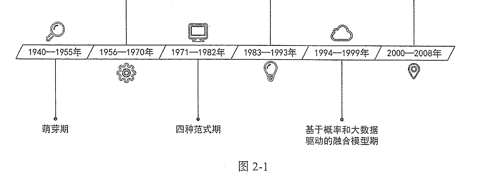
值得注意的是，该著作成书时深度学习、预训练语言模型、大模型等技术尚处萌芽或未诞生，因此未纳入分类。

# 2.1.2 自然语言处理发展的7个阶段

继承前人关于自然语言处理的探索，从模型范式演进的视角来看，NLP 的发展可划分为七个阶段，见图2-2。

# 1. 起源期（1913—1956年）

该阶段的关键人物包括图灵、马尔可夫、史蒂芬·科尔·克莱尼与香农。代表性工作涵盖图灵的算法计量框架、马尔可夫模型、McCulloch-Pitts 单层固定权重神经元，以及克莱尼的有限自动机理论，其中就包含了香农提出的概率式有限自动机。当时研究者主要在思考如何用图灵的计量模型去刻画语言、词语及其关联，整体仍停留在理论推演层面，尚未形成可用的工程方案。

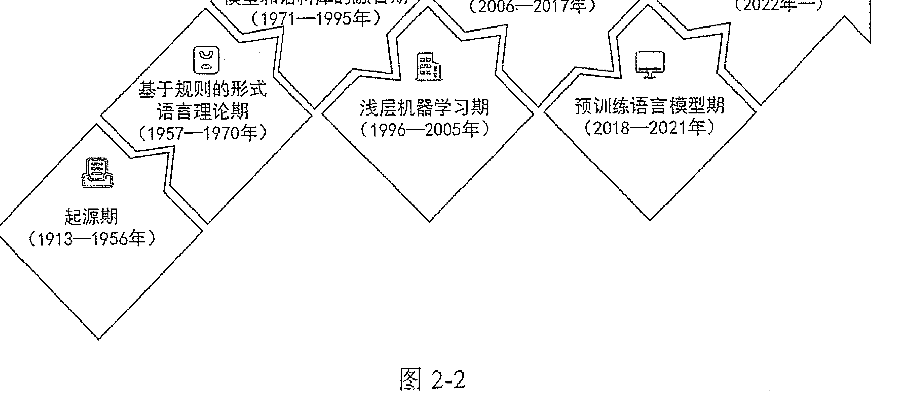

谈到这一领域的开端，马尔可夫模型是绕不开的。马尔可夫认为语言内部存在可被概率描述的关联。1913 年，他从普希金《叶甫盖尼·奥涅金》中截取两万个字母，去掉标点和空白后构成序列，并对该序列做了统计，得到如图2-3 的结果。

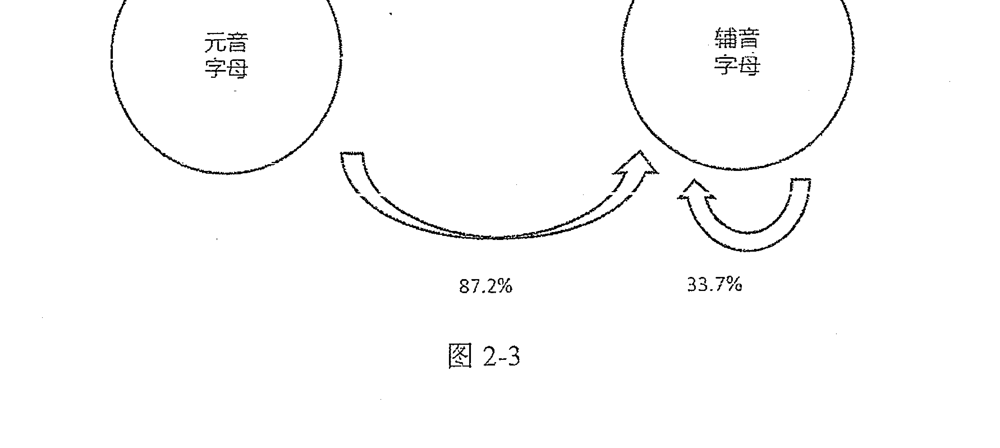

从图2-3 可见，《叶甫盖尼·奥涅金》中字母出现存在统计规律，辅音后接元音的概率最高达 87.2%，元音后仍接元音的概率最低仅 12.8%。

进一步研究后，马尔可夫总结出，某一事件的下一状态概率分布只受当前状态制约，与更早的历史无关，这就是马尔可夫链。

把马尔可夫链与上述字母序列的概率规律结合，就能在一定程度上用概率方式推断给定文本中某个词或字母出现的可能性。只要样本规模足够大、计算资源足够强，就能据此预估下一个可能出现的字母或词。

马尔可夫模型 λ 可用三元组表达：
λ = (S, π, A)
其中 S 为状态集合，π 为初始概率分布，A 为状态转移概率矩阵。

香农在马尔可夫链基础上提出，语言的统计特性可以建模，借助该概率模型也能实现语言生成。通过大量实验他发现，基于概率先验构建的模型越复杂，生成的语言抗干扰能力越强，也越贴近真实自然语言。例如向系统投喂大量英文文本，系统可学习到字母与词出现的统计概率，以及字母间、词间的转移矩阵。再加入少量语法规则，例如句首字母大写、人名地名首字母大写等，就能搭建出更复杂的模型，产出的文本更接近英语。

香农所处的时代算力受限，难以处理海量英文，只能在小样本上做验证。即便如此，其前瞻性观点为后世通过概率建模生成语言提供了思路。

# 2. 基于规则的形式语言理论期（1957—1970年）

1957 年，诺姆·乔姆斯基在有限自动机理论基础上提出形式语言理论，这一贡献被载入史册。该理论的重要基石是有状态语言模型。

有状态语言模型按线性顺序挑选语言的基本构件，如主谓宾，后续构件受先前构件制约，这种制约即为规则与约束。乔姆斯基认为，语言由有限自动机产生的符号序列构成，语法是研究具体语言中构造句子的方法和加工过程①，它应当能生成所有合乎语法的句子。

按其观点，语言的基本单位是符号，符号序列遵循特定语法结构构成句子，句子再按句法结构构成语言。

此外他还提出四类语言模型：正则语言模型、上下文无关语言模型、上下文相关语言模型与递归可枚举语言模型。下面以上下文无关语言为例，假设句法遵循主谓宾结构。

```
S1: {
Sentence -> s v o;
S -> 张三 | 小猫;
v -> 吃 | 做;
o -> 萝卜 | 鱼 | 作业 | 手工
}
```

> ① 诺姆·乔姆斯基. 句法结构. 2版. 陈满华，译. 北京：商务印书馆，2022.

# 第2章 自然语言处理的发展历程 | 19

该形式语言描述 S1 可生成 16 个句子，如“张三吃萝卜”“张三吃鱼”“小猫吃萝卜”“小猫做作业”“小猫做手工”等。但其中部分句子违背客观规律，如“小猫做萝卜”“小猫做作业”“小猫做手工”等。

为改进 S1，可增加约束规则，得到类似 S2 的形式语言描述，S2 的具体表示如下：

```
S2: {
Sentence -> S V O;
S -> 张三 | 小猫;
V -> 吃 | 做;
O -> 萝卜 | 作业 | 手工;
吃 O ->
张三 做 O -> 张三 做 作业 | 张三 做 手工
}
```

与 S1 能生成 16 句相比，S2 仅能生成 6 句。但加入约束后，S2 生成的句子更合理，不会再出现“小猫做萝卜”“小猫做作业”“小猫做手工”等不合逻辑的表达。

对比 S1 与 S2 不难看出，增加约束后 S2 变为上下文相关语言描述。两者差异在于：

在 S1 中，S、V、O 之间相互独立，没有依赖，即上下文无关。而在 S2 中，部分规则存在依赖，例如“吃”对应的宾语只能是“吃萝卜”或“吃鱼”，即上下文相关。

形式语言理论的提出开启了学界对自然语言结构的研究、建模与解析，为基于结构与规则的文本识别、生成和翻译开辟了道路。此后全球的文本识别、生成和翻译系统迅速涌现。

基于形式语言模型，中国计算语言学家冯志伟在 20 世纪 80 年代提出多叉多标记树形图模型，这是一个基于短语的机器翻译模型。在此基础上，他人工设置了数万条语法和句法规则，研制出全球首款可将中文译成外语的 FAJRA 系统，FAJRA 为法语-英语-日语-俄语-德语的法语缩写。若输入为规范的常用中文，FAJRA 翻译准确率可达 90% 以上。但一旦扩大输入范围和自由度，准确率会降至 70% 左右。这也侧面说明，单纯依赖规则的形式语言方法会遇到明显的精度瓶颈，需结合其他方法才能突破。

# 3. 基于规则、概率模型和语料库的融合期（1971—1995 年）

自然语言处理在 20 世纪 40、50 年代摸索后，于 70 年代中期起加速发展，其中隐马尔可夫模型 HMM 的诞生是里程碑式进展，大幅推动了发展进程，例如 20 世纪 80 年代享誉全球的基于 GMM-HMM 的语音识别框架就是经典应用。

1967 年，Leonard Esau Baum 等人在论文“An Inequality with Applications to Statistical Estimation for Probabilistic

# 第2章 自然语言处理的发展历程

上快车道，一个个实用产品开始涌现。

20 世纪 90 年代，基于规则、概率模型和语料库的融合方法已渗透到机器翻译、文本分类、信息检索、问答系统、信息抽取、语言知识挖掘等应用系统中，逐渐成为研究主流和标配。

# 4. 浅层机器学习期（1996—2005年）

采用规则、概率模型和语料库的融合方法后，即传统融合方法，准确率大幅提升，但在语义理解与处理等难题上仍受限。传统融合方法更多依赖预先构建的知识库，学习能力不足，泛化能力偏弱，进而影响准确率。

浅层机器学习能在一定程度上弥补不足，展现学习与推理能力，有助于优化文本分类、消歧、语义分析、情感分析等。

最早进入自然语言处理的浅层模型是朴素贝叶斯，该模型也可视为基于概率的统计模型。随着概率方法兴起，它曾风靡一时。例如 1959 年，Woodrow Wilson Bledsoe 等人用朴素贝叶斯建立了早期文本识别系统；1961 年，M. E. Maron 在论文 “Automatic Indexing: An Experimental Inquiry” 中首次将朴素贝叶斯用于文本分类。

朴素贝叶斯优点在于模型简洁、稳定、高效，对小样本表现良好，常用于文本分类、增量学习等场景。但局限也很明显，如样本独立性假设与许多场景不匹配、先验概率难以计算、准确率不高，这些限制了其发展。

随后更多浅层算法涌现，如 K 近邻、逻辑回归、决策树、随机森林、支持向量机、提升树等，被广泛应用于自然语言处理任务。与传统融合方法相比，浅层算法能有效用于分类、聚类、预测等数据挖掘任务，运算效率较高，准确性和稳定性也有明显提升。

此外，很多浅层算法如线性回归、决策树具有良好的可解释性，在金融、电信、电商等领域深入应用，有力推动了数据智能发展，提升企业商业价值。

特别值得强调的是，提升树算法如 GBDT、XGBoost、LightGBM 的提出大幅提升了效果，几乎适用于所有场景，当时成为数据挖掘和机器学习应用的标配。

不过使用浅层算法解决实际问题也存在痛点，如特征工程耗时费力、需要大量数据标注、模型信息含量与人工投入成正比、非线性关系挖掘有限、输入以结构化数据为主、推理与泛化能力有限等。深度学习的提出在一定程度上解决了这些问题，提升了推理、泛化和建模效率。

需要强调的是，深度学习能快速落地产生商业价值，也与算力提升和数据大爆炸密切相关。深度学习计算复杂度远高于浅层机器学习，需要强大算力支撑。从某种角度看，大算力是深度学习高速发展的重要基础。

# 5. 深度学习期（2006—2017年）

2003 年，Yoshua Bengio 等人提出神经网络语言模型 NNLM，但受训练难度限制，当时仅停留在理论层面。直到 2006 年，深度学习泰斗 Geoffrey Hinton 与 Ruslan Salakhutdinov 发表论文 “Reducing the Dimensionality of Data with Neural Networks”，由此掀起深度学习在自然语言处理领域快速发展的浪潮。他们主要提出三点：多层神经网络能挖掘更多隐含信息；能实现特征工程自动化；可通过逐层初始化预训练解决多层网络训练难题，相当于解决了 Bengio 关于神经网络语言模型训练的问题。这三点对学界和工业界具有划时代意义。

另一个里程碑是词向量技术与表征方法的提出。在词向量诞生前，自然语言文本在很多场景存在高维稀疏特征问题，影响识别准确率。简单说，词向量是一种特征提取技术，将词从稀疏空间通过隐藏层投影到低维稠密向量空间，语义相近的词在低维空间距离也相近，不仅解决矩阵稀疏问题，还实现了特征自动提取。词向量技术将自然语言处理推进了一大步。

2008 年，Ronan Collobert 等人在论文 “A Unified Architecture for Natural Language Processing: Deep Neural Networks with Multitask Learning” 中提出将词向量作为深层神经网络的目标任务，打开了词向量表征技术的大门。2013 年，Tomas Mikolov 提出经典的 Word2vec 词向量表征方法，包含 CBOW 和 Skip-gram。随后学界陆续提出 GloVe 和 ELMo 等经典模型。

随着卷积神经网络 CNN 在图像处理中大放异彩，其被广泛应用于文本分类、语义理解、文本生成、机器翻译等任务，效果显著。

CNN 明显缺陷是缺少记忆能力，而自然语言序列具有时序性和长程性，需要记忆先前输入。基于此，循环神经网络 RNN 被提出。RNN 因具备记忆能力，被广泛用于语言建模、聊天机器人、机器翻译、语音识别等任务。

RNN 面对长序列数据存在梯度消失缺陷，对长期记忆不敏感，容易丢失远期信息，换句话说，只能获取较近的文本序列信息。由此，RNN 的优化变种长短时记忆网络 LSTM 和门控循环单元 GRU 被提出。

LSTM 加入输入门、遗忘门和输出门三个门，GRU 引入重置门和更新门两个门。总体看，LSTM 参数更多，收敛更慢，效率更低；GRU 为提升运算效率而牺牲部分精度。

类 RNN 算法需按时序输入，难以并行计算，编码效率低下。针对该痛点，2017 年 Ashish Vaswani 等人提出 Transformer 模型，核心是自注意力机制。与 RNN 相比，Transformer 能挖掘各类特征、有效记忆历史信息，且支持并行运算，因而被广泛应用于自然语言处理的复杂任务并取得良好效果。

# 6. 预训练时代 2018—2021

预训练语言模型到底解决了哪些问题？熟悉机器学习的读者都知道，模型效果好需要大量标注的训练数据和测试数据。而现实中，与海量未标注数据相比，高质量标注数据凤毛麟角，且标注耗时耗成本高。为解决此问题，预训练方法应运而生。

“预训练”通常是将大量低成本收集的训练数据放在一起，通过某种预训练方法学习共性，再将这些共性“迁移”到执行特定任务的模型中，用少量领域标注数据进行微调。模型只需从共性出发学习特定任务的特殊部分即可。

预训练实质是把学习任务分解，先学习数据量庞大的共性知识，再逐步学习垂直领域专业知识。例如，让不懂中文的机器人成为中文法律专家，因法律领域标注数据少，可分解任务：

第一步，先让机器人学会中文，达到熟读理解中文水平。中文标注数据量大、来源丰富，有助于机器人学到充分知识。

第二步，让机器人学习法律专业知识。结合已学共性知识与法律专业知识，可大幅提升学习效率与效果。也可以进一步分解，先学法律行业共性，再学更垂直领域的专业知识，效果更佳。

若直接从零到一学习中文法律知识，受语料库有限、文本与标注数据缺乏影响，学习效果和效率大概率不达预期。

我们认为，预训练语言模型的诞生是行业里程碑。预训练机制大幅降低了自然语言处理的门槛，让初创公司能在预训练模型基础上优化，并在各垂直领域应用中获得良好效果。这极大推动了自然语言处理在各行各业的快速应用与赋能，为 AI 飞入寻常百姓家立下汗马功劳。

2018 年，Jacob Devlin 等人在论文 “BERT: Pre-training of Deep Bidirectional Transformers for Language Understanding” 中提出 BERT 模型。该论文展示的测试效果在多个自然语言理解任务中刷新纪录，一时间成为最热门的模型。

那几年学界整体呈现百家争鸣的局面。不同团队立足各自擅长的方向，持续抛出有建设性的改进思路，让自然语言处理模型的实际表现不断向好。在此期间，和 BERT 同期获得广泛关注的预训练系统还有 GPT、XLNet、MPNet、ERNIE 等。拿 XLNet 来说，Zhilin Yang 等人撰写的论文 “XLNet: Generalized Autoregressive Pretraining for Language Understanding” 在 BERT 的基础上做了多项升级，也把部分下游任务效果推高了。主要改动可以概括为用自回归式预训练取代自编码式预训练，引入双向注意力，并在结构上借鉴 Transformer-XL 的做法。

时间线上需要厘清的是 OpenAI 发布的 GPT 比 BERT 先出现。两者架构取向差异明显，BERT 用的是双向 Transformer 编码器，能够兼顾左右上下文，更适合理解类应用；GPT 用的是单向 Transformer 解码器，更偏向文本生成。其余预训练模型基本沿着 BERT 或 GPT 两大路线演进，侧重点多在方法层面的创新，而不是单纯地放大参数规模和复杂度。

总体来看，这批早期的预训练模型参数量普遍在 4 亿以下，因此在垂直场景下做精调的投入相对可控，即使是体量不大的创业公司也能承受，这也是它们能够在多个行业快速落地的关键因素之一。

# 7. 大模型元年开启（2022—）
2022 年 11 月 OpenAI 公布 ChatGPT。凭借突出的生成与推理水准，该产品在全球迅速走红，两个月内月活就突破 1 亿，也点燃了新一轮 AGI 热潮。

和传统以亿级参数计的预训练模型相比，ChatGPT 体量达到 1750 亿参数，已经属于大语言模型范畴。它在对话、机器翻译、文案创作、代码编写等多种 NLP 任务上都展现出强劲表现。

即便大模型在生成、推理、问答和泛化方面已经可观，与 AGI 仍有明显差距，路还长。可以推测 LLM 更像是通往 AGI 途中的过渡手段或核心工具。展望未来，随着算力与计算效率的提升，AGI 很可能也是超大规模模型，其参数规模大概率会远超当下的 GPT-4。

如果算力相关技术加速推进，算力性价比实现跃升，中小企业的建模和微调门槛将被大幅拉低，更多公司有能力分担高昂成本，从而加快 GPT-4 的落地节奏，真正驶入快车道。

从严格定义来看，随 GPT-4 的到来，AI 已进入多模态大模型阶段。如图 2-5 所示，单模态的 ChatGPT 更像是一个过渡形态，其高光应锚定在 2022 年，大模型的未来属于多模态。实际使用中 GPT-4 的效果与体验远超 ChatGPT。换句话说，GPT-4 完全可以覆盖 ChatGPT 的能力范围，反之则不行。

多模态大模型的出现将带来行业层面的范式变革，AI 有望成为各行各业的基础设施，驱动数智化转型并显著提升商业价值。2023 年可视作多模态大模型的元年，而未来 3 至 5 年则是其高速扩张期。

即便相对 GPT-4，单模态 ChatGPT 只是过渡产品，这并不否定 LLM 的价值。多模态大模型最关键的两大模态是自然语言与图像，二者的持续进化至关重要，能够为多模态体系提供坚实支撑。

# 2.2 从小模型时代到大模型时代的跃迁
回望 BERT 主导的小模型时期，动辄两台显存有限的 GPU 服务器就能完成大部分训练。只要构建者掌握 BERT 原理，整个训练与优化流程都较为透明可控，可信度较高。这种可信与透明让 AI 真正进入大众视野，也让中小企业能在特定垂直赛道轻松驾驭 AI。

进入大模型时代，若要从零自研模型，对算力与资金的需求极高，往往需要上千万投入，中小公司基本难以承受，自研已不切实际。

即便只做微调，两台低显存 GPU 服务器也只能以数十亿参数级别的模型作为底座。若想以千亿参数量级的模型作为底座进行微调，至少需要数十台显存普遍大于 16GB 的高配 GPU 服务器，成本压力巨大。

此外，大模型微调对算法工程师而言更像是在操作一个黑箱，喂入数据后效果好坏只能靠反复试错来判断。缺乏充足算力支撑时，单次微调耗时极长，工程师可干预的空间非常有限。

从结果层面看，ChatGPT 在文本生成与推理等任务上的表现明显优于 BERT 模型，后文会展开说明。由此带来的直接后果是，中小企业开始难以承受 AI 的门槛。因此不禁要问：ChatGPT 为何能获得如此高关注度？为何需要如此庞大的参数量？BERT 与 ChatGPT 的差距究竟如何？具体差异点在哪里？

# 2.3 BERT 究竟解决了哪些问题
BERT 由 Google 于 2018 年推出，其核心创新在于提出预训练范式，并以 Transformer 编码器作为底座架构。

在 BERT 诞生前，OpenAI 已发布 GPT-1。从 Jacob Devlin 等人发表的论文 “BERT: Pre-training of Deep Bidirectional Transformers for Language Understanding” 可见，他们对 GPT-1 进行了深入关注。

# 表2-2

| 评论 | 情感评分 |
| ---- | -------- |
| Assured, glossy and shot through with brittle desperation. | 0.763 89 |
| It's a big time stinker. | 0.111 11 |
| At best this is a film for the under-7 crowd. But it would be better to wait for the video. And a very rainy day. | 0.277 78 |
| The turntable is now outselling the electric guitar... | 0.5 |
| comes from the heart. | 0.75 |

情感分析是自然语言处理的基础能力之一。对人类而言，只要正确理解评论含义，做出情感判断并不困难。对机器而言，情感分析仍是一项重大挑战。

# 3. 判断语义是否相近
该任务采用 MRPC 数据集。该语料库从网络新闻中抽取了 5800 对句子，并由人工标注每对句子是否语义相近，相近标记为 1，不相近标记为 0。

例如下面两句被判定为语义相近，故标注为 1。
句子 1: Amrozi accused his brother, whom he called "the witness", of deliberately distorting his evidence.
句子 2: Referring to him as only "the witness", Amrozi accused his brother of deliberately distorting his evidence.

再例如下面两句被判定为语义不相近，故标注为 0。
句子 1: A BMI of 25 or above is considered overweight; 30 or above is considered obese.
句子 2: A BMI between 18.5 and 24.9 is considered normal, over 25 is considered overweight and 30 or greater is defined as obese.

# 4. 语义相似度的打分
该任务采用 STS-B 数据集。该数据集汇集了来自图像描述、新闻标题、社区论坛等不同来源的 8628 对句子。标注者为每对句子的语义相近程度打 1 至 5 分，分数越高表示越相似。

例如下面两句被标记为 5 分。
句子 1：Neither was there a qualified majority within this House to revert to Article 272.
句子 2：There was not a majority voting in Parliament to go back to Article 272.

再例如下面两句被标记为 1 分。
句子 1：The man played follow the leader on the grass.
句子 2：The rhino grazed on the grass.

# 5. 问题对的语义相似
该任务采用 QQP 数据集。该语料库收集了 Quora 网站上的各类问题对。标注者判断两个问题是否在语义上相近，相近为 1，否则为 0。与 MRPC 的区别在于，QQP 专注于问题对的语义相似性判断。

# 6. 句子对关系判别
该任务采用 SNLI 数据集，包含约 570 000 对句子。每对句子的第一个为前提，第二个为假设。

同时数据集提供了句子对之间关系的标注，主要有三类：蕴含、矛盾、neutral。类似任务的数据集还包括 MNLI 和 RTE。

例如下面两句关系为蕴含。
前提：A soccer game with multiple males playing.
推断：Some men are playing a sport.

再例如下面两句关系为相互矛盾。
前提：A man inspects the uniform of a figure in some East Asian country.
推断：The man is sleeping.

# 7. 问答推理
该任务采用 QNLI 数据集，主要用于自然语言推理。

每个测试实例包含一个问题和一个陈述，模型需判断两者是否存在蕴含关系，蕴含标记为 1，否则为 0。

# 8. 命名实体识别
该任务采用 NER 数据集。该数据集包含 20 万个词，每个词都被标注为四类实体之一：Person 人、Organization 组织、Location 地点、Miscellaneous 其他实体，属于四分类任务。

# 9. 阅读理解
该任务采用 SQuAD 数据集。该数据集由维基百科文章衍生的各类问题、包含答案的文本段落以及答案组成。任务目标是预测段落中答案的文本起止位置，或输出 “No Answer”。目前最新版本为 SQuAD2.0。下面举例说明。

文字描述：Computational complexity theory is a branch of the theory of computation in theoretical computer science that focuses on classifying computational problems according to their inherent difficulty, and relating those classes to each other. A computational problem is understood to be a task that is in principle amenable to being solved by a computer, which is equivalent to stating that the problem may be solved by mechanical application of mathematical steps, such as an algorithm.

问题 1：What branch of theoretical computer science deals with broadly classifying computational problems by difficulty and class of relationship？
回答：computational problems

问题 2：What branch of theoretical computer class deals with broadly classifying computational problems by difficulty and class of relationship？
回答：<No Answer>

# 10. 完形填空
该任务采用 SWAG 数据集。该数据集包含 113 000 个完形填空句子，每个句子均有部分词缺失。任务是对缺失词进行补全。

从 Jacob Devlin 等人的研究成果可知，如表 2-3 所示，从准确性角度...

# 表2-3

| 模型 | 使用MNLI、QQP、QNLI、SST-2、CoLA、STS-B、MRPC和RTE数据集的平均测试效果 | 使用QQP数据集的测试效果 | 使用CoLA数据集的测试效果 | 使用RTE数据集的测试效果 |
| GPT | 75.1 | 70.3 | 45.4 | 56.0 |
| BERT模型 | 79.6 | 71.2 | 52.1 | 66.4 |
| BERT大模型 | 82.1 | 72.1 | 60.5 | 70.1 |

目前不少知名模型在 CoLA 数据集上的语法对错二分类、QQP 数据集上的问题对语义相似、RTE 数据集上的语义理解任务上的表现均不理想。即便是 BERT 模型在这几项任务上的成绩也仅属中等水平，这说明 BERT 诞生时期自然语言理解在语法判断与复杂语义理解上仍未得到很好的解决。

下面再看 BERT 大模型在另外两个较进阶、较困难的任务上的表现。表 2-4 和表 2-5 分别为 BERT 大模型在 SQuAD 和 SWAG 数据集上的测试结果。

# 表2-4

| 模型 | EM（完全匹配）评分 | F1评分 |
| Human（人类） | 86.9 | 89.5 |
| BERT大模型（Single） | 80.0 | 83.1 |

# 表2-5

| 模型 | Accuracy（准确率）评分 |
| Human | 85.0 |
| BERT大模型 | 86.3 |

① 使用数据集的测试效果用 0～100 表示。0 表示最差，100 表示最好。

从表 2-4 可知，BERT 大模型在阅读理解任务上的表现非常突出，尽管与人类仍有差距，但差距有限。

从表 2-5 可知，BERT 大模型在完形填空任务上的表现略优于人类。

总体来看，尽管 BERT 整体表现可圈可点，但在语法对错二分类、问题对语义相似等任务上仍显不足。此外 BERT 大模型在阅读理解上与人类存在一定差距。BERT 的这些局限成为后续模型重点突破的方向，也为 ChatGPT 的研究提供了思路。

此外，随着 BERT 的成功，业界总结出提升自然语言处理效果的三个方向，也为后续更强模型如 ChatGPT 的研发指明了路径。

+ (1) BERT 大模型的效果明显优于 BERT 基础模型，因此增加网络深度、提升参数规模成为行业优化方向之一。
+ (2) 将预训练模型与微调机制相结合，也成为提升自然语言处理效果的重要路径。

(3) 多任务联合训练正被视作下一条关键路径，让不同任务的数据互相挖掘、彼此赋能，从而带起模型整体表现的提升。

# 2.4 BERT登场后，行业在摸索中前行

BERT发布后凭借强劲效果和开源特性迅速落地，智能客服、语音质检、对话机器人、搜索引擎等场景都尝到了商业甜头，一度点燃了全行业的AI热情。

随着使用加深，对自然语言理解系统的要求也水涨船高，BERT的局限随之暴露出来：多任务场景下性能下滑，结构上双向Transformer也没能摆脱自编码模型的固有束缚；预训练与微调流程不一致，导致在需要生成的任务上表现平平。尽管各类改进层出不穷，却始终缺少质的飞跃，让不少从业者再次陷入迷茫，对AGI的距离感也愈发强烈。

OpenAI的团队敏锐察觉到这些短板，并吸收了业界的新思路，对GPT系列持续打磨，始终朝向AGI的目标推进。有清晰的方向、站在前人肩膀上、加上数据、资金和人才的加持，剩下的便交给时间。从2018到2022，自然语言处理领域涌现出一波成果：

RoBERTa扩大了批处理规模、使用更多未标注语料、提升参数量并加入长序列训练；分词换成字节对编码BPE，同一输入也会得到不同的掩码序列。排列语言模型的提出让双向编码成为可能，不再拘泥于序列顺序，而是枚举所有排列以最大化期望对数，使得每个词元都能吸收来自全部位置的信息，最具代表性的是XLNet和MPNet。

围绕训练机制，也有新进展。Pual Christiano等人把基于人工反馈的强化学习引入自然语言；John Schulman提出近端策略优化PPO，核心在于新旧策略差距要可控，且新策略必须在旧策略采样的数据上学习以避免偏差。OpenAI的Jan Leike等人提出语言对齐机制，强调模型要按用户意图来训练。

在工程侧，ZEN以BERT编码器为底座，借助N-gram增强性能并更好利用细粒度文本信息，收敛更快、效果更好。H. Tsai等人提出面向多语言序列标注的模型，通过知识提炼在词性标注和复数形态属性预测上取得改进。

# 第2章 自然语言处理发展脉络 | 39

表2-6盘点了BERT提出后、ChatGPT出现前行业的主流模型。整体可归为三类：第一类在BERT基础上做优化，如ERNIE、StructBERT、ALBERT；第二类以GPT为框架迭代，如GPT-2、GPT-3；第三类兼顾两者优势，如XLNet、BART。

| 年份 | 模型 | 框架 |
| --- | --- | --- |
| 2019 | ERNIE | Transformer Encoder |
| 2019 | InfoWord | Transformer Encoder |
| 2019 | StructBERT | Transformer Encoder |
| 2019 | XLNet | Transformer - XL Encoder |
| 2019 | ALBERT | Transformer Encoder |
| 2019 | XLM | Transformer Encoder |
| 2019 | GPT - 2 | Transformer Decoder |
| 2019 | RoBERTa | Transformer Decoder |
| 2019 | Q8BERT | Transformer Encoder |
| 2020 | SpanBERT | Transformer Encoder |
| 2020 | FastBERT | Transformer Encoder |
| 2020 | BART | Transformer |
| 2020 | XNLG | Transformer |
| 2020 | K - BERT | Transformer Encoder |
| 2020 | GPT - 3 | Transformer Decoder |
| 2020 | MPNet | Transformer Encoder |
| 2020 | GLM | Transformer Encoder |
| 2020 | ZEN | Transformer Encoder |
| 2021 | PET | Transformer Encoder |
| 2021 | GLaM | Transformer |
| 2021 | XLM-E | Transformer |
| 2022 | LaMDA | Transformer Decoder |
| 2022 | PaLM | Transformer |
| 2022 | OPT | Transformer Decoder |

由于BERT一度成为现象级产品，衍生类模型在该阶段占比最高，其次是融合类，纯GPT路线占比最低。这也说明当时GPT选型并不主流，行业的攻坚重心集中在理解而非生成。

# 40 | 多模态大模型：原理与实战

# 2.5 ChatGPT横空出世

站在前人肩上，OpenAI从GPT-1一路迭代到GPT-2、GPT-3、InstructGPT、GPT3.5，最终以ChatGPT引爆全球，成为现象级热点。

2018至2022年，大量研究精力投向理解任务和BERT的改进，虽然局部指标有微小提升，但与行业预期和AGI的距离依旧遥远。与BERT相比，ChatGPT在文本生成上的体验跃升明显，热度远超同期BERT。

ChatGPT面世数月后，全球数百个大模型项目密集启动，多国多家企业纷纷表态。很多人只看到了热闹，却没弄清本质：BERT代表的是理解方向，ChatGPT代表的是生成方向。

通俗地说，BERT的理想是部分替代普通自然语言工作者，而ChatGPT的定位更像人类的助手，帮助创意和推理、提升人类能力。从工程难度看，前者更难，后者更容易实现。

## 2.5.1 InstructGPT是怎样炼成的

在介绍ChatGPT前，先看其孪生方案InstructGPT。OpenAI的Long Ouyang等人在论文《Training Language Models to Follow Instructions with Human Feedback》中提出三步构建法。

第一步：微调GPT-3。收集并标注演示数据以做监督学习，具体可拆为：构建Prompt数据集，例如“向小孩解释登月”“讲故事白雪公主”等；人工标注数据，例如“登月就是去月球”；用标注集微调GPT-3得到新参数。

第二步：训练奖励模型。收集用于训练奖励模型RM的比较数据，标注对同一输入哪个输出更受用户偏好，通过奖惩训练RM，使其更贴合人类偏好。具体：用微调后的GPT-3对采样任务预测；对预测结果按好坏标注形成比较集；以比较集训练得到RM。

第三步：用PPO更新参数。通过强化学习，以RM输出的标量奖励为信号，用PPO对监督策略微调。具体：用PPO优化GPT-3构建新生成函数并产生输出；用RM打分得Reward；按打分更新模型参数。第二步与第三步可循环：收集当前最优策略的比较数据训练新RM，再用PPO训练新策略。

整体流程并不复杂，更多是工程实践的创新而非理论突破。InstructGPT在14个公开数据集上测试，与GPT-3.0、微调版GPT-3.0对比明显更好，尤其在Truthful QA的真实性判断和RTE的句子对关系判断上优势突出。

## 2.5.2 ChatGPT与InstructGPT有何不同

ChatGPT以对话形式工作，能答疑、认错、追问模糊需求、质疑不合理前提并拒绝不当请求。它是InstructGPT的兄弟模型，被训练为在提示下遵循指令并给出反馈。网上常把两者混用，但差异明显：ChatGPT主要基于对话式任务样例训练，InstructGPT基于指令数据集训练。

| 模型 | InstructGPT | ChatGPT |
| --- | --- | --- |
| 底座模型 | GPT-3.0 | GPT-3.5 |
| 数据集 | 指令数据集 | 人工交互标注数据 + 指令数据集，最终转成对话集 |
| 应用场景 | 更适合指令型文本生成 | 更适合对话型文本生成 |
| 推理能力 | 中 | 较强 |
| 代码生成能力 | 弱 | 较强 |
| 泛化能力 | 中等 | 较强 |

底座不同带来能力分化，GPT-3.5在预训练阶段引入指令微调、代码生成与理解、推理思维链等优化，性能明显高于GPT-3.0。InstructGPT虽通过指令微调和PPO提升了部分阅读理解和生成表现，但在代码和推理上仍显不足，ChatGPT有效补齐了这些短板。数据集层面，InstructGPT以单轮Prompt为主，适配ChatGPT需转为对话格式；多轮闲聊场景下，单轮语料必须补全为人机交互标注的多轮对话。

## 2.5.3 ChatGPT 对阵 BERT，公开榜单怎么说

ChatGPT以生成见长。Qihuang Zhong等人在2023年论文《Can ChatGPT Understand Too? A Comparative Study on ChatGPT and Fine-tuned BERT》中比较了8个理解数据集的表现。

结果显示，参数量远小于ChatGPT的BERT大模型在多数理解任务上仍占优，但ChatGPT在MNLI、RTE等推理型任务上表现更佳，体现出优势与短板的共存。

## 2.5.4 数据标注的品质决定上限

ChatGPT的能力高度依赖样本标注的质量。OpenAI对标注提出三点要求：简单而多样，标注者可自拟任务但需保证多样性；Few-shot，样本稀缺时需提供清晰指令与多组问答对；用户导向，依据真实用例生成对应的Prompt。

以InstructGPT为例，其数据分布集中于文本生成45.6%、开放问答12.4%、头脑风暴11.2%、闲聊8.4%，多样性与用户场景的贴合是效果的关键。

| 重写       | 6.6%   |

| 总结和归纳 | 4.2%   |

| 分类       | 3.5%   |

| 封闭问答   | 2.6%   |

| 抽取       | 1.9%   |

| 其他       | 3.5%   |

表2-10的分布显示，指令集合中约一半的需求集中在文本生成上，开放问答类约占12.4%，随后是头脑风暴类，占比约11.2%。

实践中可以观察到，指令的目标越明确、描述越具体，模型回应的质量就越可靠。

ChatGPT要覆盖更宽泛的自然语言处理范畴，对标注数据的广度和精度要求极高。因此对标注方和标注人员的专业水准与敏感度也提出很高要求。能力决定数据质量，敏感度决定合规与安全。以敏感内容标注为例，OpenAI会整理提示与完成的语料，对其中可能诱发强烈负面情绪的内容——包括但不限于有毒、性相关、暴力、评判性、政治性等——进行敏感标签标注。

## 2.6 思考

自然语言处理可大致分为理解与生成两大方向。前文已梳理过该领域的发展脉络。下面换一个视角，以里程碑回顾关键进展。图2-6汇总了自然语言处理历史上12个里程碑事件或核心技术，这些节点被认为对行业演进具有划时代意义。前述12项已在前面介绍，这里不再赘述。

图灵奖得主Yann LeCun认为，从底层技术看，ChatGPT并无特别原创的突破，也谈不上革命性创新，类似技术在多家实验室早有探索。更重要的是，ChatGPT是多年多方积累的多项技术叠加的产物。按LeCun的说法，ChatGPT更像是一项依托算力的工程化实践，而非AI技术本身的巨大飞跃。

我们在部分业务场景中持续验证大模型，实践中发现要获得理想效果存在以下明显阻力。

(1) ChatGPT对算力的需求很高，使用门槛随之提升。
(2) 整体架构极其复杂，对算法工程师而言接近黑盒，微调只能靠反复试错，难以完全可控。
(3) 更擅长偏创意的文本生成，难以稳定保证输出的准确性与一致性。
(4) 实际应用常需把ChatGPT与其他NLP技术融合，但黑盒属性会显著增加融合难度与不确定性。
(5) 法律合规与道德伦理风险始终存在。
(6) 目前不支持多模态输入，很难提供多模态一体化的服务体验。

# 第3章 ChatGPT技术内核拆解

第2章已系统介绍了LLM的演进、ChatGPT的优势与局限，并提及了部分核心技术。本章围绕以Transformer为底座的预训练语言模型、提示学习与指令微调、基于人类反馈的强化学习、思维链方法展开，并重点介绍集成学习的思路。本章不堆砌公式与推导，聚焦各方法的核心流程，帮助读者理解原理与业务价值。

# 3.1 Transformer底座的预训练模型

ChatGPT的底座是在Google提出的原始Transformer上演化而来的变体。原始Transformer是一种基于自注意力机制的深度神经网络，相较RNN，能高效并行处理序列数据，因而精度更高。

原始模型采用编码器-解码器结构，核心由编码器和解码器组成，结构示意如图3-1。编码器把输入序列映射为中间矩阵，解码器再把中间矩阵转为目标序列。两者均由自注意力层与前馈神经网络层构成。

自注意力层负责捕捉序列内部不同位置的关联，使模型能处理长距离依赖。前馈层对特征做非线性变换，提升网络表达能力。Softmax把多分类输出归一化到0~1之间且总和为1，经Softmax映射即可得到下一个词的预测概率。

输出: I like playing football

输入：我喜欢踢足球

图3-1

编码器结构如图3-2所示，每个编码器包含一层多头自注意力与一层前馈神经网络，每层输出均会经过残差连接与归一化处理。

残差连接把原始输入矩阵X与经多头自注意力处理后的新矩阵相加，即X+MultiHeadAttention(X)。残差连接是业界应对深层网络梯度爆炸或消失的常用手段，让网络只需学习残差，从而挖掘更深特征。归一化让每层神经元输入分布保持一致的均值方差，有助于加速收敛、提升建模效率。

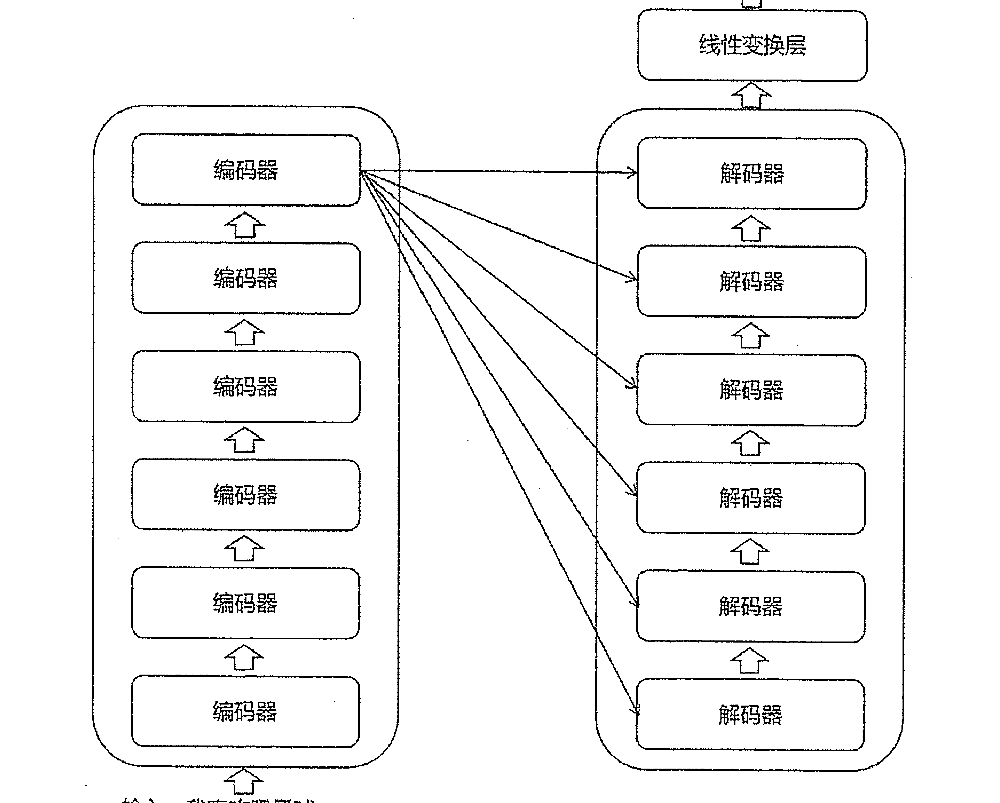

多头自注意力机制的计算思路直观，即把多个单头自注意力的输出矩阵按行拼接，再经线性变换层得到新矩阵，其示意如图3-3。

前馈神经网络结构相对简单，通常由一个或多个线性与非线性变换构成，主要用于获得更丰富的特征。在原始Transformer中，前馈网络采用两层全连接，第一层线性变换使用ReLU激活，第二层线性变换不使用激活，示意如图3-4。经多头自注意力后再经前馈网络处理，可获得更丰富的语义信息，有效提升性能。


输出

线性变换层

矩阵拼接层

自注意力模型1

自注意力模型2

……

自注意力模型k

输入

图3-3

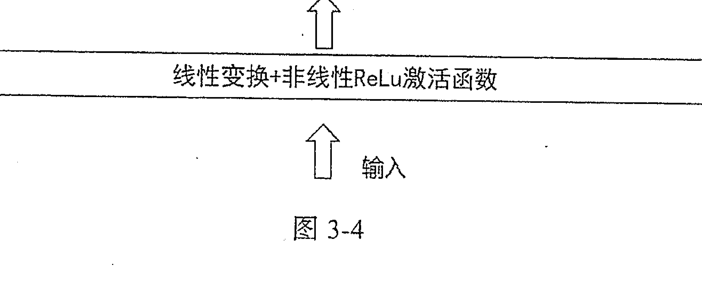

输出

线性变换

线性变换+非线性ReLU激活函数

输入

图3-4

解码器结构如图3-5所示。整体与编码器相似，区别在于每个解码器包含两个多头自注意力层和一个前馈神经网络层，比编码器多一个自注意力层。同样，每层输出均经过残差连接与归一化。

解码器与编码器的主要差异体现在自注意力层的内部设计，主要有两点：

+   (1) 是否使用遮挡。第一个多头自注意力层中的自注意力模型带有遮挡操作，有助于提升泛化能力，更好地预测后续内容。

[PAGE 66]

(2) 是否引入编码器的输出作为输入。第二个多头自注意力层的输入不仅包含下游解码器的输入，还包含了编码器中间输出的矩阵，这样在解码时每个词都能充分利用编码器对全部输入词的编码信息。


图 3-5

[PAGE 67]

在原始Transformer基础上，NLP领域逐渐形成三种构建预训练语言模型的常见方式。

(1) 仅含编码器的预训练语言模型，典型代表是BERT。这类模型通常以掩码语言建模为预训练目标，预测被遮挡的词。基于双向编码，可同时利用上下文信息，全局可见性较好，因而广泛应用于自然语言理解。主要局限是难以进行可变长度文本生成，不适用于生成类任务。

(2) 仅含解码器的预训练语言模型，如ChatGPT。思路是先构建具备较强泛化能力的模型，再针对下游任务做有针对性的微调，以获得良好迁移效果。缺点是基于解码器的架构一般采用单向自回归模式，信息是有序可见的，难以有效利用后续信息，因此更擅长文本生成。

(3) 同时包含编码器与解码器的预训练语言模型，如BART。该类模型兼顾前两者的优点，既能保证信息的全局可见性，又能借鉴单向自回归模式，文本生成能力更强。

# 3.2 Prompt与指令微调策略

提示学习的核心是通过改写下游任务的输入，使其在形式上贴近指令训练集，从而挖掘更多信息、提升学习效果。换句话说，将下游任务输入按预训练格式重写，使其分布向预训练数据分布靠近，从而提高模型适应能力。下面以两个例子说明。

示例 A：情感判断。
文本：最近总下雨，只能在家待着。
提示：最近天气很好，可以出去玩，让人十分开心，最近总下雨，只能在家待着，让人十分____？

[PAGE 68]

# 56 | 多模态大模型：技术原理与实战

# 示例 B：问答场景。
问题：居里夫人的主要成就是____？
提示：诺贝尔的主要成就是发明了烈性炸药，爱因斯坦的主要成就是提出了相对论，爱迪生的主要成就是发明了电灯，请问居里夫人的主要成就是____？

由示例可知，通过提示学习对测试集进行改写，可为模型提供更多上下文，从而提升准确率。

总体而言，提示学习能有效增强语言模型的生成与补全能力，通过更清晰的提示引导模型做出正确判断，而无需进行微调即可在下游任务中取得不错的效果。

常见的提示学习方法有三种：Zero-shot、One-shot、Few-shot。

( 1 ) Zero-shot，也称零样本预测，不向模型提供任何示例，直接进行推理预测。做法是将指令与输入文本拼接后让模型输出。示例如下。

指令：请提取下面这句话中的人物、时间、组织机构3类命名实体。
提示：张三于2020年毕业于北京大学 =>

[PAGE 69]

# 第3章 读懂ChatGPT的核心技术 | 57

( 2 ) One-shot，也称单样本预测，给定一个示例后进行推理预测。示例如下。

指令：请提取下面这句话中的人物、时间、组织机构3类命名实体。
样例：彭帅1993年毕业于北京科技大学 =>人物：彭帅，时间：1993年，组织机构：北京科技大学
提示：张三2020年毕业于北京大学 =>

( 3 ) Few-shot，也称小样本预测，提供少量示例作为上下文，提升模型的通用预测能力。示例如下。

指令：请提取下面这句话中的人物、时间、组织机构3类命名实体。
样例1：彭帅1993年毕业于北京科技大学 => 人物：彭帅，时间：1993年，组织机构：北京科技大学
样例2：张馨月上个月刚从美团离职 => 人物：张馨月，时间：上个月，组织机构：美团
样例3：刘敏航明天人职百度 => 人物：刘敏航，时间：明天，组织机构：百度
提示：张三2020年毕业于北京大学 =>

指令微调与提示学习的关键区别在于，指令微调不再局限于模仿预训练数据分布，而是直接构建指令数据集并在此基础上进行微调，以获得更好的效果与泛化能力。当指令任务种类达到一定规模后，大模型甚至在零样本任务上也能表现出较强的迁移能力。

构建指令数据集是ChatGPT构建流程的重中之重。将高质量训练数据与符合人类使用习惯的指令结合，可构建指令数据集，涉及任务包括但不限于文本翻译、文本生成、角色扮演、知识问答、知识抽取、多轮对话、阅读理解等。表3-1列举了一些常见的指令微调数据形式。

# 表 3-1

| 类型 | 输入 | 输出 |

| ---- | ---- | ---- |

| 文本翻译 | 翻译成英文：美国企业家比尔·盖茨14日上午抵达北京开启访华行程。 | American entrepreneur Bill Gates arrived in Beijing on the morning of the 14th to begin his visit to China. |

| 实体识别 | 美国企业家比尔·盖茨14日上午抵达北京开启访华行程。实体识别： | 美国，比尔·盖茨，14日上午，北京 |

| 阅读理解 | 阅读文章，回答问题：美国企业家比尔·盖茨14日上午抵达北京开启访华行程。问题：比尔·盖茨何时抵达北京？ | 14日上午 |

| 文本分类 | 美国企业家比尔·盖茨14日上午抵达北京开启访华行程。这篇文章属于以下哪个类别：军事、政治、科技、教育、娱乐、经济？ | 经济 |

| 文本生成 | 根据题目写文章：比尔·盖茨访华 | 6 月 14 日，微软创始人比尔·盖茨抵达北京，寻求加强在创新、全球减贫、公共卫生、药物研发、农村农业等领域和中国的进一步合作。 |

[PAGE 70]

# 58 | 多模态大模型：技术原理与实战

指令数据集之所以关键，主要有三点原因。

其一，预训练语言模型蕴含丰富的先验知识，指令微调是激活这些知识的有效途径，能最大化唤醒模型已学能力。

其二，指令数据集以指令形式引导生成，可提升模型的泛化能力，使其在未见任务上仍能实现优秀的零样本推理。

其三，指令数据集通常经过人工构建与审核，价值观更贴近人类，可有效减少种族歧视、色情暴力等与人类价值观冲突的生成内容。

自ChatGPT发布以来，通用领域与垂直领域的开源指令数据集不断涌现，中文领域的指令数据空白得到较大弥补。表3-2为部分常见开源指令数据集。

# 表 3 - 2

| 名称       | 来源         | 简介                                                                 |

|------------|--------------|--------------|

| BELLE      | 链家         | BELLE 数据集是由人工构建指令集，然后调用 OpenAI 的 API 生成的 内容构建的数据集。其数据丰富多样，包含 23 种数据类别，数据量达到 115 万条 |

| COIG       | 智源研究院    | 包含了翻译数据（66 858 条）、考试数据（63 532 条）、人类价值观 对齐数据（34 471 条）、多轮对话数据（13 653 条）、LeetCode 数据（11 737 条） |

| Stanford Alpaca | 斯坦福大学   | 包含 52 000 条指令数据，基于 text - davinci - 003 模型生成的 内容构建的数据集，后续又增加了人工调整的中文版本 Alpaca Chinese           |

| Med - ChatGLM | 哈尔滨工业大学 | 哈尔滨工业大学健康智能组团队通过 OpenAI 的 API 及医学知识图谱 构建的中文医学领域指令数据集                                             |

总体来看，指令数据集的精细构建是ChatGPT性能强劲的重要基础。

[PAGE 71]

# 3.3 基于人工反馈的强化学习

ChatGPT与InstructGPT的差异在2.5节已有介绍，这里聚焦ChatGPT的训练流程。

# 1. 第一个阶段：SFT，即有监督微调

ChatGPT以GPT-3.5-turbo作为有监督微调的底座。选取一批高质量指令数据集对底座进行微调，数据总量不大但覆盖任务类型丰富，包含多轮对话。标注人员轮流扮演用户与聊天机器人，扮演用户时提出问题即构建指令，扮演机器人时先让ChatGPT生成回复再据自身判断进行编辑优化。经过有监督微调后，模型能较好理解用户指令的内在含义。原理示意图如图3-6所示。

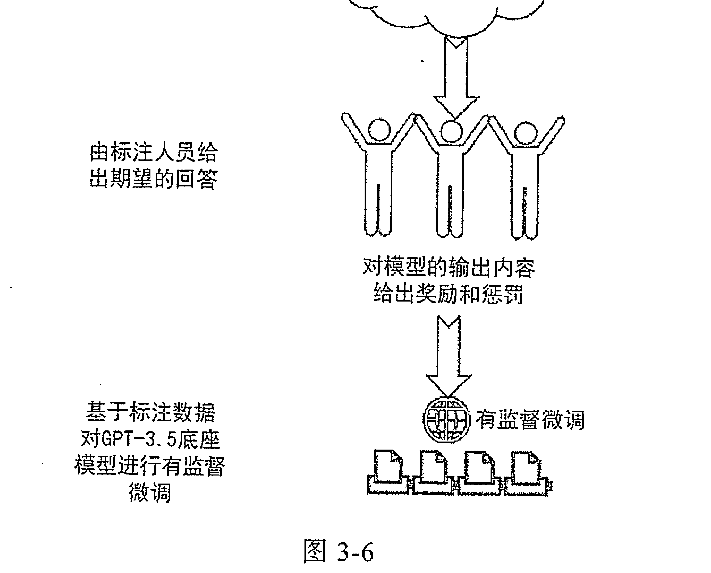

[PAGE 72]

# 2. 第二个阶段：训练RM

有监督微调使模型理解了指令含义，但尚未判断哪些回复更受用户青睐。需要让用户对同一指令下的多个回复进行完整排序，使模型学会区分高质量、逻辑合理、安全无害的回复。

具体做法是从指令集中随机抽样提问，基于第一阶段微调后的模型生成多个候选回复，再由人工按质量排序。使用pairwise-loss作为损失函数，该损失在推荐与排序任务中常见，每次取两样本组合评估先后顺序，累积得到整体排序。训练RM使用的人工标注数据约2万至3万条。训练好的RM可有效引导模型输出更符合用户偏好的结果。原理示意图如图3-7所示。

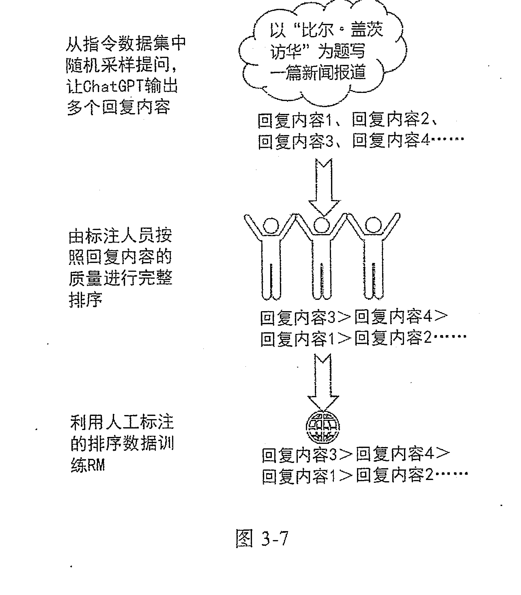

[PAGE 73]

# 3. 第三个阶段：使用PPO算法更新ChatGPT的参数

在第二阶段RM训练完成后，ChatGPT的回复即可最大程度契合用户预期。

第三阶段的主轴是强化学习的精细化调优。操作上先从指令库里随机挑取新指令，以第一阶段监督微调后的权重作为 PPO 的起点，让模型按指令生成候选回复，随后把回复交给第二阶段训练好的奖励模型打分，将分数作为整体回报驱动策略梯度持续迭代，直至参数收敛训练收尾，从而让 ChatGPT 的表现再上一个台阶。

把整条训练链路复盘一下不难看出，强化学习通过不断调整参数逼近回报最大化，进而提升能力。ChatGPT 融合了基于人工反馈的强化学习与指令微调，使系统能够听从用户指令行动，完成意图对齐。

# 3.4 思维链方法
预训练加微调的范式让模型整体可用性提升，但在复杂推理上仍显吃力。直到 Chain of Thought 被引入 ChatGPT，推理能力才出现明显跃迁。在少样本演示里加入一系列中间推导步骤，有效改善了推理质量。思维链体现了化繁为简、步步突破的思路，与人类解题习惯高度契合。面对难题先拆成若干小问题逐个求解，更容易得到最终答案。

回到逻辑推理，思维链的本质是遵循化繁为简，把复杂推理拆成多步简单操作再逐步执行。这样生成路径更清晰，也具备一定可解释性。思维链配合提示学习，在复杂推理场景下可大幅提升可解释性，同时显著增强推理效果。下面用一道数学题演示思维链的思路。

数学题：父亲大明出差返程带回三十个苹果，两个孩子自行分配这三十个苹果，大明未参与分配过程，老大得到的数量是老二的两倍。老二觉得不公平向大明反映。大明认为老大自私，既未给父母留出份额，也未照顾老二

# 第3章 读懂ChatGPT的核心技术 | 65
集成学习要求基模型保持差异性，可通过选用不同类型的算法，例如线性与非线性，或同一算法搭配不同的超参数，例如树的深度、叶节点个数，或同一算法在不同数据子集上训练，例如选取不同的数据行或列来实现。

(2) 各专家模型的水平差距不宜过大。若各专家性能相差悬殊，容易干扰集成决策，导致效果受损，好比评委团中多数专家不匹配，最终评审质量难以保证。

目前常见的集成方法主要有以下4种①。

(1) Bagging 方案：在训练时利用数据差异，让同一学习算法基于不同的数据行或列随机抽样，从而构建多个差异化模型。

(2) Boosting 方案：Boosting 在训练过程中主要通过调整样本权重串行构建模型。对预测正确的样本降低权重，迫使模型聚焦于错误样本，有效提升预测准确率；同时降低表现较差模型的权重，让优质模型权重更高，也能改善整体效果。

(3) Stacking 方案：Stacking 将基础模型的结果作为新增属性，与原始特征合并后作为新模型的输入。

(4) 混合专家 Mixture of Experts, MOE 方案：通常每个专家只在自己擅长的样本上训练，对其他样本训练力度很小或不参与。这样可在不同数据上匹配合适的模型，实现整体优化。最终输出为各专家输出与门控网络输出的加权组合，示意图如图3-8所示。MOE 方案主要通过以下公式来控制输出：

```
E(x)·G(x)=∑eᵢ(x)gᵢ(x)
```

> ① 彭勇. 数据中台建设: 从方法论到落地实战. 北京：电子工业出版社，2021.

式中，eᵢ(x) 表示各子专家模型的输出，而 gᵢ(x) 表示各子门控网络的输出，取值为0或1。


# 图3-8
MOE 的核心优势在于：在计算量未显著增加的前提下，充分挖掘不同语料数据集合的特性，让模型表现更佳。众所周知，大模型的规模极其庞大，既带来训练难度和成本，也带来使用难度和响应延迟。但在同等条件下，参数越多模型性能通常越好。

MOE 能在两者之间取得平衡，可通过增加专家数量构建超大模型，再借助稀疏门控网络控制专家的激活，从而保持计算复杂度可控。已有研究把 MOE 嵌入双层 LSTM 网络和 Transformer 模型的前馈神经网络层，并取得不错效果。把大模型拆成多个小模型后，对每个样本不必全量激活，而是通过门控网络选择性激活，在充分挖掘语料多样性的同时保障模型稳定性和效果。

# 3.6 思考
ChatGPT 与 GPT-4 热度攀升后，众多研究者试图剖析其内部机制。我们在研究 ChatGPT 与 GPT-4 核心技术时发现，OpenAI 在巨人肩膀上做了大量创新。本章以通俗方式介绍了这些创新，期望帮助读者加深理解。

# 第4章 看清GPT的进化史和创新点
二〇一八年六月，OpenAI 公布了 GPT 家族的首个产品 GPT-1。这是学界和工业界首个基于 Transformer 架构及海量无标签数据进行预训练的单向大语言模型。GPT 家族的产品发布时间和参数量如图4-1所示。

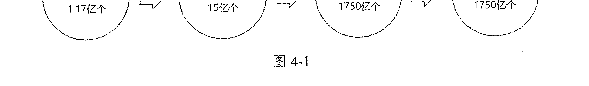

本章将围绕 GPT 家族系列产品，尤其是 ChatGPT，重点介绍其技术发展历程和主要创新点。

# 4.1 GPT技术的发展历程
# 4.1.1 GPT-1技术的发展历程
在 GPT-1 出现前，传统自然语言处理模型如 LSTM 网络的训练方式通常是先随机初始化词向量参数，或通过无监督浅层神经网络如 Word2vec 得到先验词向量，再搭建深层网络，最后基于大量高质量监督数据训练。这种方式存在明显短板。

(1) 人力成本高。高质量监督数据多靠人工标注，海量标注意味着巨大人力投入。
(2) 信息提取能力弱。传统模型层数少、先验不足，信息提取能力有限，且位置越远关联越弱。
(3) 并行计算能力差。受框架限制难以有效并行，无法充分利用硬件资源，计算效率不高。
(4) 领域迁移能力弱。每个领域都需要大量高质量监督数据，推理能力难以泛化到其他领域。

GPT-1 对训练方式进行创新，把训练分为两阶段：第一阶段利用海量无标签文本构建初始生成式语言模型；第二阶段基于各监督 NLP 任务对该模型进行微调。GPT-1 的模型框架如图4-2所示。

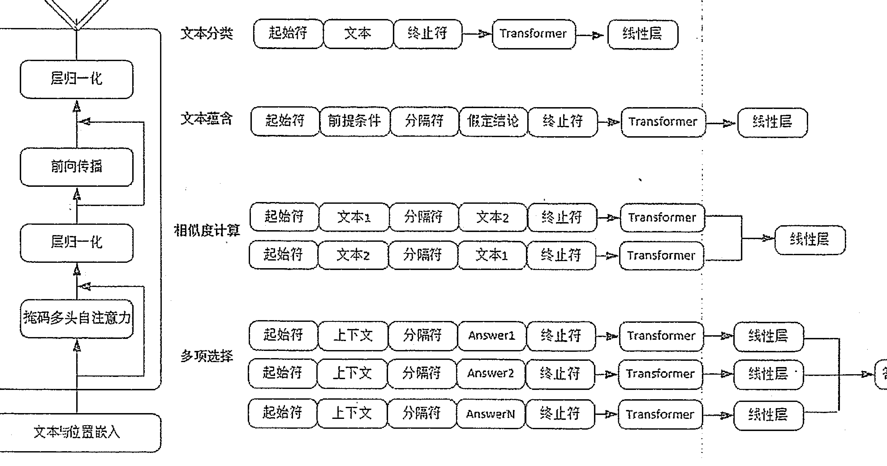

GPT-1 采用 Transformer 解码器部分，如图4-2 左侧所示，共含12层解码器，每层均使用多头自注意力机制，

# 4.1.2 GPT-2 技术的发展历程
二〇一九年二月，OpenAI 公布了 GPT 家族的第二代产品 GPT-2。GPT-2 的参数达到了 15 亿个，更大的参数量意味着生成式预训练语言模型具备更丰富的先验知识。GPT-2 没有对 GPT-1 在网络结构和算法框架上做出大的改动，仍然采用 Transformer 模型的解码器部分，主要优化举措集中在训练数据量、网络层数和下游任务等方面，详细介绍如下。

(1) 数据集扩充。GPT-1 采用了 BookCorpus 及 Common Crawl 作为预训练语料，其预训练语料总量约为 5GB，Token 总量约为 1.3 亿个。GPT-2 采用了 WebText 语料作为预训练数据集。WebText 是从美国社交平台 Reddit 上爬取的高赞链接的文本，其网页数量大于 4500 万个。经过推算，GPT-2 的预训练语料总量约为 40GB，Token 总量约为 15 亿个。

(2) 词表扩充。与 GPT-1 相比，GPT-2 采用了更多词表，其词表数量达到了 50 257 个。在相同的分词方式下，词表越多意味着模型能够学会越多样的术语，出现未登录词的概率就越低，还可以有效地提高编码和解码的效率。

(3) 最大上下文窗口长度扩充。与 GPT-1 相比，GPT-2 的最大上下文窗口长度提高到了 1024 个 Token。更高的上下文窗口长度上限意味着模型可以提高更长的上下文之间的理解能力。

(4) 批处理大小扩充。GPT-1 的批处理大小设置为 32 个数

# 4.1.3 GPT-3技术的发展历程
二〇二〇年六月，OpenAI 公布了 GPT 家族的第三代产品 GPT-3。与 GPT-2 的 15 亿个参数相比，GPT-3 的参数达到 1750 亿个，GPT-3 是一个实打实的超级大模型。

GPT-3 凭借着超大参数量的加持，在各个自然语言处理任务中，无论是在

# 4.2 GPT的创新点总结
GPT 类预训练语言模型，包含 GPT-1、GPT-2、GPT-3、GPT-3.5、InstructGPT 等，在理论上做了大量的创新，无论是在大的方法论上还在小的理论上，都有诸多值得学习和深思的地方。

首先，GPT 是第一个使用 Transformer 的大规模预训练语言模型。使用双向多层的 Transformer、大规模的无监督语料、掩码语言建模进行预训练，都是 GPT 重要的技术手段，并且这三者都极其重要，缺一不可，使得 GPT 在训练时可以保持较快的速度、在推理时可以保持较高的准确性、在各个自然语言处理任务中都表现优异。

其次，GPT 原创了 Zero-shot、One-shot、Few-shot 的推理方式。GPT 通过 Prompt 模板的形式大大地提高了预训练语言模型的泛化能力。传统的预训练语言模型在各个语种、各个行业的任务中都需要一批高质量的标注数据。训练一个只适用于某个数据的模型，成本极高、迁移能力弱。GPT 使用提

# 4.2.1 GPT-3的技术创新
GPT-3 的技术创新主要体现在以下几个方面：

(1) 预训练数据集的扩充。GPT-3 的预训练数据集比 GPT-2 更大，包括 Wikipedia、WebText2、Common Crawl、Books1 和 Books2 等多个数据集，总数据量达到了约 750GB，Token 总量约为 5000 亿个。

(2) 模型结构的改进。GPT-3 采用了更大的模型结构，参数量达到了 1750 亿个，这使得 GPT-3 在各个自然语言处理任务中表现出色。

(3) 推理预测方式。GPT-3 采用了 Zero-shot、One-shot、Few-shot 三种推理预测方式，无需对模型参数进行微调或更新，即可在下游任务中很好地进行推理预测。

(4) 多模态能力。GPT-3 具备多模态能力，可以处理文本、图像、音频等多种模态的数据。

# 4.2.2 GPT-3的局限性
尽管 GPT-3 在各个自然语言处理任务中都表现出色，但它也存在一些局限性：

(1) 无法保证生成的文章是否符合人类的价值观、是否有政治敏感和种族歧视的信息。
(2) 长距离上下文理解能力不够强大。
(3) 多轮对话能力有待提高。

# 4.2.3 GPT-3的未来发展
未来，GPT-3 可能会在以下几个方面得到进一步发展：

(1) 模型结构的改进。通过改进模型结构，提高模型的性能和效率。
(2) 多模态能力的提升。通过提升多模态能力，使 GPT-3 能够更好地处理多种模态的数据。
(3) 安全性和可控性的提升。通过提升安全性和可控性，使 GPT-3 在各个领域的应用更加广泛。

成性别歧视、种族偏见、色情暴力等与人类价值观不符的内容。

最后，OpenAI 从始至终坚持“大力出奇迹”的理念，我们分析发现，从 GPT-1 的 5GB 训练数据、1.17 亿个参数，到 GPT-2 的 40GB 训练数据、15 亿个参数，再到 GPT-3 的 750GB 训练数据、1750 亿个参数，最后到 GPT-3.5 融入大量的代码数据和指令数据，进一步扩充预训练数据，OpenAI 始终坚持 Transformer 的技术路线，不断地增加训练数据及其多样性，坚持量变引起质变的理念。

事实也证明了这一点，GPT 的参数达到 500 亿个数量级以上，会引起模型推理能力“突变”，例如训练数据中不存在阿尔及利亚语的文本翻译数据，GPT 模型却可以很好地对其进行翻译。

总之，从 GPT-1、GPT-2、GPT-3、GPT-3.5 到 ChatGPT 的诞生，预训练的数据量、模型的参数量呈指数级增长，预训练语言模型的实际效果也从仅能生成较为通顺流畅的语言发展到几乎逼近人类预期的智能水平。Transformer、零样本学习、少数样本学习、指令微调及基于人工反馈的强化学习都是 GPT 成功的关键所在。

# 4.3 思考
大模型的发展如火如荼，未来会逐步应用到各行各业，但是其被广泛应用有以下几个前提：效果好、效率高和成本可控。目前，大模型在这几个方面还不够理想。

# 第5章 大模型+多模态产生的“化学反应”
ChatGPT 引爆了以 AIGC 为代表的第四范式 AI 的市场，并成为 AI 市场的热点。当前业界的大模型，更多的是指 LLM，而全面融合文本信息、图像信息、语音信息、视频信息的多模态大模型将成为 AI 的基础设施，并有望将整个 AIGC 产业推向辉煌。

在阿里巴巴达摩院发布的《2023 十大科技趋势》中，实现文本-图像-语音-视频“大统一”的多模态预训练大模型占据榜首。多模态与我们的生活息息相关，我们每天都通过语言、文字来感知这个世界，并有数不尽的文本、图像、语音、视频信息每时每刻都在传播和存储。

# 5.1 多模态模型的发展历史
从字面意思上可知，多模态 指的是在同一个体系或者系统中，同时存在两种或者两种以上的感知模态或数据类型。这些感知模态或数据类型包含了文本、图像、语音、视频等，每一种模态都从各自的维度分别提供了不同的信息。将不同模态的信息进行汇总，就可以获得更多样、更丰富的信息。

> Tom Brown 等人在发表的论文 “Language Models are Few-shot Learners”

## 第5章 大模型+多模态产生的‘化学反应’
中认为，从 AI 算法的技术变革角度来看，多模态的发展经历了 5 个时代，分别是行为时代 1970—1979 年、计算时代 1980—1999 年、交互时代 2000—2009 年、深度学习时代 2010—2019 年、大模型时代 2020 年至今。

在行为时代，人们对多模态的感知还没有达到量化压缩可计算的层面，只能从心理学的角度进行定性的感知和剖析。例如，人们认为手势和语言都是信息表达的核心部分，都是直接受大脑神经元控制的，都代表了说话人的思考方式。人们通过听觉和视觉的完美结合才能真正地欣赏一场演出，通过语言文字描述和图像才能理解美术作品要传达的意境等。

在计算时代，人们开始通过一些浅层神经网络 如反向传播 Back Propagation，BP 神经网络 对多模态问题进行定量研究。人们基于 BP 神经网络自动解读唇语来提高语音识别的效果，发现在有噪声的环境下，引入视觉信号的辅助能够极大地提高语音识别的准确率。此外，人们开始逐渐从事多感知情感计算、数字视频等项目的研究。

在交互时代，随着智能手机等电子设备的出现，人们的研究重点转向了多模态识别，如语音和视频的同步、会议记录中语音和文本的转写等。与此同时，人们开始尝试构建标准的多模态训练数据集和评测数据集。多模态技术的发展逐渐衍生出了当时轰动一时的苹果手机语音助手 Siri。Siri 可以执行基本的自然语言指令，如查看天气、发送信息、拨打电话、播放音乐等。

在深度学习时代，多模态技术快速发展，这主要得益于以下 3 点：

其一是算力快速发展，这使得研究者可以搭建更深层的神经网络架构进行快速计算。

其二是新的多模态数据集层出不穷，例如图像和文本对齐的数据集、文本和视频对齐的数据集、文本和语音对齐的数据集等，如表 5-1 所示。这使得研究者可以在标准数据集上更关注算法本身的改进。

其三是语言特征提取能力和视觉特征提取能力快速提高，这使得文本、视频等不同模态的信息可以被提取到高维空间进行表示学习和对齐。

## 表5-1

| 名称 | 类别 | 简介 |
|------------|-----------|--------------------------------------------------------------------------------------------|
| COCO | 图像-文本 | COCO 数据集主要用于目标检测、图像描述、图像分割等任务，有 33 万张图片，每张图片有 5 个描述，包含 80 个目标类别、91 个对象类别 |
| Conceptual Captions | 图像-文本 | Conceptual Captions 数据集的图像-文本对数据来自互联网。人们首先对原始数据的内容、大小、图文匹配程度进行筛选，然后进行人工清洗和抽验审核，得到最终的数据集 |
| HowTo100M | 文本-视频 | HowTo100M 数据集针对教学领域，包含的视频总时长达到 15 年，平均每个视频的时长达到 6.5 分钟，通过字幕描述与视频剪辑配对 |
| AudioSet | 文本-语音 | AudioSet 数据集是谷歌发布的大规模语音数据集，包含了超过 200 万个时长为 10 秒的语音片段及 632 个语音类别，其数据最初来源于 YouTube |

| HD-VILA-100M | 文本-视频  | HD-VILA-100M 数据集包含了 300 万个视频，以及 1 亿个文本-视频对，涵盖了多个领域 |

该阶段的标志性进展是引入深度玻尔兹曼机的跨媒体建模，真正意义上的融合式建模随之出现。研究者参考了经典的编码解码范式，把玻尔兹曼机搬进跨媒体研究。

训练时把各通道信息间的变动压到最小作为优化目标，引导玻尔兹曼机在潜空间里学习各通道的联合分布，形成共享的语义表征。借助这份共用表征，哪怕某个通道缺失，也能凭借其余通道的输入进行补全。

推理阶段以图文为例。图像先经编码器提取高维特征，再按条件概率 P(文本|图像)生成文本的高维特征，逐步解码成图像的文字描述；文本先经编码器得到高维特征，按条件概率 P(图像|文本)生成图像的高维特征，再通过特征检索定位最契合的图像。基于深度玻尔兹曼机的跨媒体模型原理示意图如图 5-1 所示。图 5-1 中[CLS]

# 88 | 跨媒体大模型技术概览

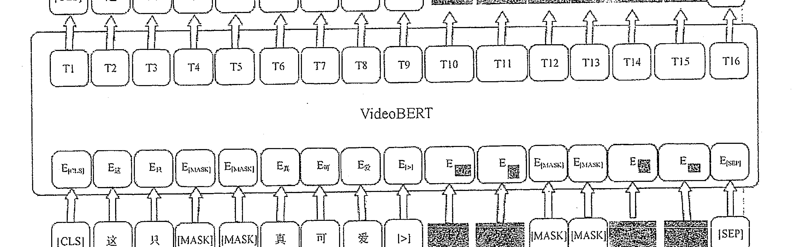


VideoBERT 的数据来自 YouTube 上的大量未标注视频。连续帧被切为片段，片段经特征提取得到视频向量，再对全部向量做聚类。于是每个视频被分配到一个类别，该类别相当于自然语言处理中的 Token。借助语音识别还能拿到视频中的文字，从而获得文本与视频的配对数据。

训练方式与原始 BERT 几乎一致，如图 5-6 所示。VideoBERT 把文本 Token 与视频 Token 拼接，中间用特殊符号[>]分隔。训练包含两项任务：随机遮蔽部分 Token 让模型复原；判断文本与视频是否匹配，即视频 Token 序列能否作为文本 Token 序列的下一句。

# 3. CLIP 体系

CLIP 是 OpenAI 于 2021 年推出的文本-图像融合预训练大体系，是融合领域里程碑式的进展，利用丰富先验实现了下游任务的零样本推理，并在多项任务上取得最佳表现，验证了“融合预训练大体系+零样本推理”思路的可行性。

CLIP 出现前，主流做法是训练单通道体系进行图像分类，也有尝试把自然语言引入视觉体系，但效果不及有监督的单通道图像体系。研究者主要基于三点考量：
1. 单通道图像体系需要大量高质量标注如类别标签，获取成本高。互联网已有海量文本-图像对，如社交媒体配图，可直接作为有标注数据使用，缓解标注成本与获取难题。
2. 既有融合尝试效果有限，可能因标注规模不足而难以激发体系推理潜能，而 Transformer 已在 NLP 证明大规模预先训练的价值。
3. 传统单通道图像体系在高质量标注下分类表现尚可，却缺乏零样本推理能力。若以互联网真实的海量文本-图像对进行融合预先训练，体系能获得更强的零样本推理与泛化能力。

基于此，CLIP 从互联网收集了 4 亿个文本-图像对并清洗用于预先训练。训练分为特征映射阶段与对比学习阶段。原理示意图如图 5-7 所示。

# 1. 特征映射阶段

# 2. 对比学习阶段

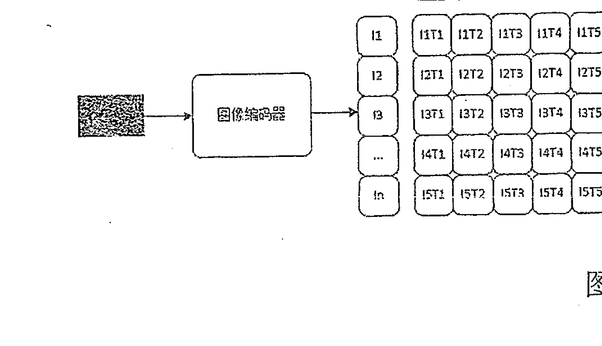

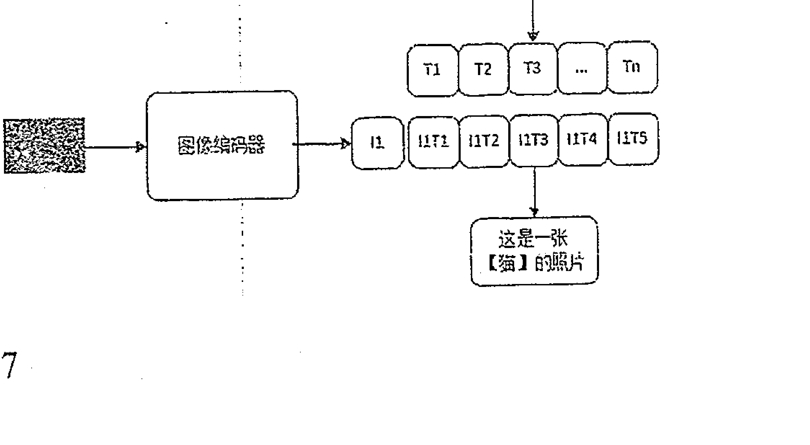

# 图5-7

对比学习阶段通过计算图像向量嵌入与文本向量嵌入的余弦距离更新参数，距离越小关联越强。目标是让正样本即配对的文本图像距离最小化，同时让负样本即不匹配的文本图像距离最大化，反复迭代优化网络参数。

预先训练后的 CLIP 具备很强的泛化与零样本能力。以图像分类为例，输入图像经视觉编码器得到特征向量嵌入，被判类别依次经语言编码器转为文本特征向量嵌入，计算余弦距离，距离最小的即为类别标签。

# 4. CoCa 体系

2022 年 5 月谷歌发布 CoCa。体系融合了解决图像融合问题的三种传统思路，结合各自优势适用于更广任务。

三种思路为单编码器、双编码器、编码器-解码器。
单编码器即架构中仅有一个视觉编码器的体系。例如图像分类需用大批高质量图像及对应类别标签训练编码器。单编码器在特定领域效果不错，但人工标注成本高、迁移能力差，每个领域需单独训练且不具备零样本推理能力。
双编码器即架构中存在两个编码器的体系，文本-图像任务中即语言编码器与视觉编码器各自独立编码，再通过余弦距离更新参数。经过大规模互联网预先训练后泛化与零样本能力强，但编码过程缺乏交互融合，对视觉问答、视频问答等需要图像-文本语义协同的任务表现不佳。
编码器-解码器即同时存在编码器与解码器的体系。例如图像描述任务中编码器把图像编码为特征向量嵌入，解码器跨通道解码为文本描述。该结构有助于融合特征，在理解任务上表现好，但缺乏独立语言编码器，在图像检索、视频检索等任务上不足。

CoCa 创造性融合上述三种思路，既能独立获得图像与文本特征向量，也能分层融合特征。原理示意图如图 5-8 所示。

整体结构含三部分：视觉编码器、单通道文本解码器及融合文本解码器。

视觉编码器独立，用于编码输入图像获取特征向量嵌入，可用 Vision Transformer 等充当。
单通道文本解码器独立，用于解码自然语言文本获取文本特征向量嵌入，与视觉编码器不产生交互。

# 第5章 大模型与多通道的化学反应 | 91

# 5. GPT-4

2023 年 3 月 14 日 OpenAI 发布 GPT-4，超大规模融合预训练体系，外界猜测参数在 10 万亿至 100 万亿量级。可接受文本、图像输入并生成自然语言文本，目前不支持语音与视频通道。能很好理解图像语义，结合用户问题进行多步推理，给出准确合理安全的回答。例如一道物理题含文本说明与工程力学图像，体系可准确理解并逐步推导公式输出答案。

支持更长文本输入，可超 3 万字符，上下文理解更透彻，多语言与多任务表现全面超越 GPT-3.5。图像描述任务中幻觉问题降低，描述出不存在物体的概率大幅下降。输出安全性提升，能拒绝违背人类价值观的问题，这得益于训练过程中的强化学习阶段。

# 6. CoDi 体系

截至 2023 年 7 月，主流融合大体系涉及的通道往往只有两个或者三个，如文本-图像、文本-语音、文本-图像-视频、文本-图像-语音等。CoDi 开创性提出可组合扩散技术，这项技术支持输入为文本、图像、语音、视频的任意组合，输出也可为任意组合。原理示意图如图5 - 9所示。

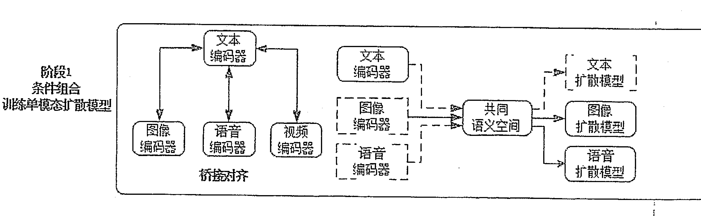

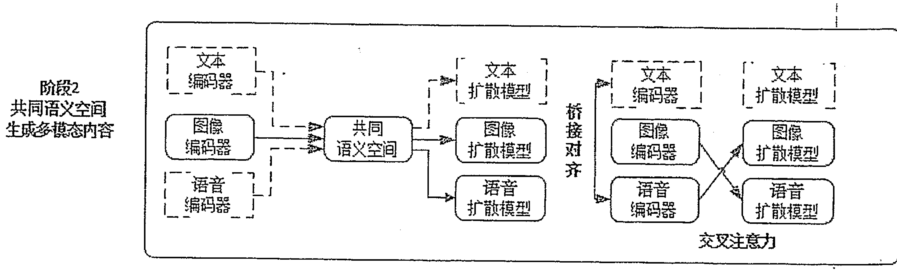


# 94 | 跨媒体大模型技术原理与实践

先简要说明扩散模型。传统生成模型以生成对抗网络 GAN 为核心，含生成器与判别器，通过对抗提升图像质量。但 GAN 训练时间长、生成多样性不足，未能进一步发展。扩散是物理现象，气体分子由高浓度向低浓度扩散。在计算中模拟这一过程，对一张图像先逐步加入噪声破坏信息直至丢失，再逐步去噪重构。生成图像更稳定多样、分辨率更高，且舍弃对抗训练速度更快。

CoDi 训练分两步。第一步针对文本、图像、语音、视频通道分别训练一个潜在扩散模型。后续处理中图像与视频流程一致，故视觉编码器与图像扩散模型可分别代表视频编码器与视频扩散模型。训练时输入可为组合通道，投影到共用语义空间，输出为单一通道。第二步增加输出通道种类，在第一步基础上为每个潜在扩散模型增加交叉注意力模块，将不同潜在扩散模型的特征映射到共用语义空间，输出通道种类进一步多样化。

# 5.4 大模型+融合的3种实现方法

预先训练 LLM 成就显著，但不支持图像、语音、视频等其他通道的输入输出，如何在 LLM 基础上引入跨通道信息使其更强通用？本节介绍三种实现方法。

+   1. 以 LLM 为核心，调用其他融合组件

2023 年 5 月微软亚洲研究院联合浙江大学发布 HuggingGPT 框架，该框架以 LLM 为核心调用其他融合组件合作完成复杂 AI 任务。原理示意图如图 5-10 所示。下面按论文示例逐步拆解执行过程。

# 第5章 大模型与多通道的化学反应 | 95

# 任务定义


# 结果返回

# 图 5-10

假设需执行复杂任务：生成一张小女孩读书的照片，要求姿势与示例照片中小男孩姿势相同，然后用自己的声音描述新照片。HuggingGPT 将过程分为四步。

1）任务规划。使用 LLM 理解用户意图并拆分为详细执行步骤。如图 5-10 左上部分所示，输入指令被拆为 6 个子步骤。
子步骤 1：根据小男孩图像 Image-1 生成姿态轮廓 Image-2。
子步骤 2：根据提示文本“小女孩正在读书”及姿态轮廓 Image-2 生成小女孩图像 Image-3。
子步骤 3：对小女孩图像 Image-3 进行图像分类。
子步骤 4：对 Image-3 进行目标检测，生成带目标框的图像 Image-4。
子步骤 5：对 Image-3 进行图像描述，生成描述文本，并在 Image-4 中完成目标框与描述文本配对。
子步骤 6：根据描述文本生成语音 Audio-1。

2）模型选择。依据拆分的子步骤，从 Hugging Face 平台选取最合适的模型。子步骤1轮廓生成选 OpenCV 的 openpose control 模型；子步骤2图像生成选 sd-controlnet-openpose 模型；子步骤3图像分类选谷歌 vit-base-patch16-224 模型；子步骤4目标检测选 Facebook 的 detr-resnet-101 模型；子步骤5图像描述选 nlpconnect 开源项目的 vit-gpt2-Image-captioning 模型；子步骤6语音生成选 Facebook 的 fastspeech2-en-ljspeech 模型。

3）任务执行。依次调用选定模型并将结果返回给 LLM。

4）响应生成。使用 LLM 整合各模型结果并输出。

HuggingGPT 以 LLM 为核心智能调用融合组件处理复杂任务，原理简单、使用方便、可扩展性强，执行效率与稳定性尚待加强。

# 2. 基于多通道对齐数据训练融合大体系

这种方法直接利用多通道的对齐数据训练融合大体系，5.3 节介绍了诸多相关工作。

# 5.5 融合大体系的效果评估

本节在图像生成、图像描述、视觉问答三类任务中直观展示效果，仅做主观案例展示，后续章节将从评价标准、评测语料等定量角度详细对比。

## 1. 图像生成任务

给定自然语言文本描述生成对应图像。

首先让体系生成一只可爱的猫咪，体系轻松完成，如图 5-12 所示。

难度提升后让体系画一只蓝色的猫咪，蓝色猫咪在自然界极为罕见，体系仍成功生成，说明理解了文本语义，如图 5-13 所示。


再增加风格限定、数量限定等要求，体系也能准确生成，如图 5-14 所示。

## 2. 图像描述任务

输入图像让体系描述内容并输出自然语言文本。

首先创建一张虚拟照片让体系描述，如图 5-15 所示。

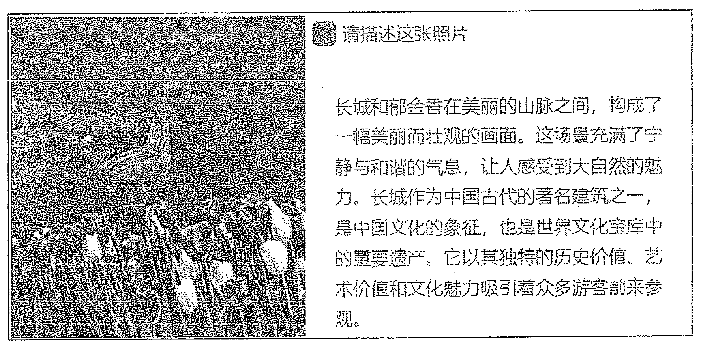

随后测试体系多语言能力，如图 5-16 所示。

## 3. 视觉问答任务

根据图像或视频内容进行问答，体现自然语言理解与推理能力。

图 5-18 显示体系准确识别出图像描绘的城市，并正确回答该城市拥有哪些著名大学。

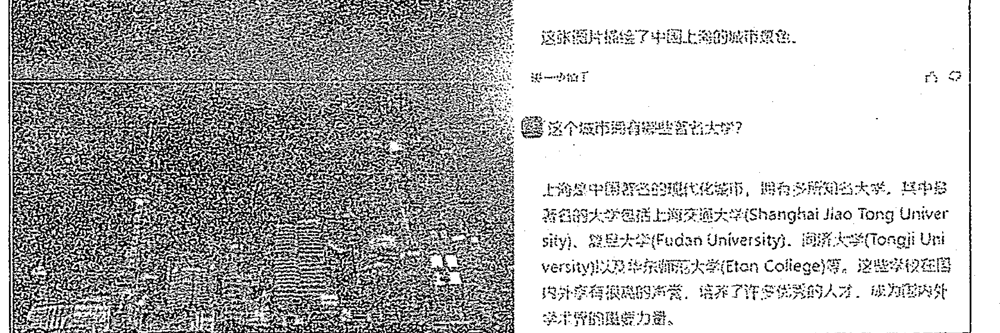

最后用几个例子探索深层语义理解。

图 5-19 和图 5-20 验证了体系的深层语义理解能力。体系能识别出图片中不寻常之处并解释，还能根据图片中的食物推算制作方式。

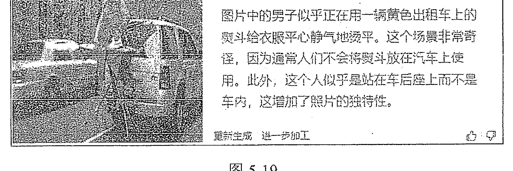

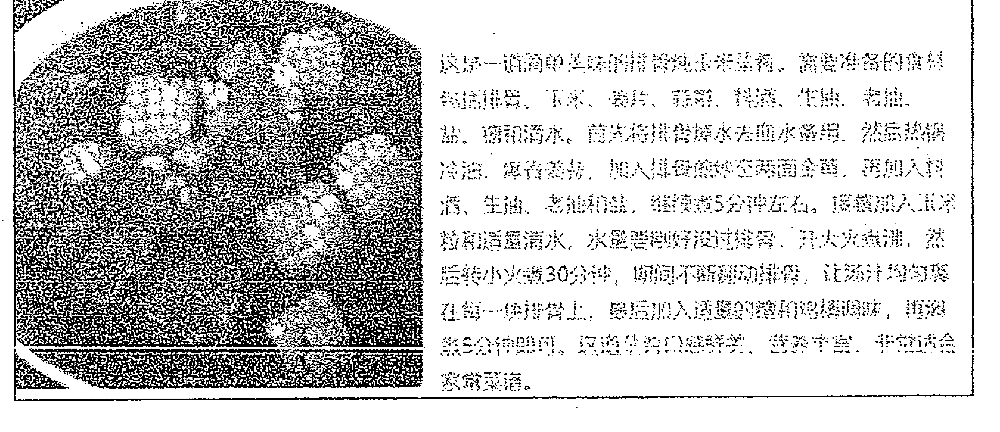

## 5.6 演进复盘

从行为范式、计算范式、交互范式，到深度学习再到大模型时代，多模态研究一路累积了大量理论与工程创新。经过学界持续打磨，多模态大模型在文字、图像、语音、视频之间的协同能力已达到较高水平。

本章先梳理了多模态整体发展脉络，随后对单模态、多模态、跨模态三种学习范式逐一给出典型应用场景、利弊对比。之后重点拆解 Vision Transformer、VideoBERT、CLIP、CoCa 等里程碑模型的创新点与内在机理。为发挥大语言模型在自然语言理解与推理上的优势并加速多模态大模型构建，LLM 与多模态融合目前形成三种主流实现路径，本章对其进行了介绍。最后通过图像生成、图像描述、视觉问答等真实任务表现，让读者直观感受多模态大模型的能力边界。

# 第6章 多模态大模型核心技术

多模态大模型带来与众不同的内容生产方式，即以一种模态作为输入生成其他模态的输出。覆盖文本、图像、视频、语音等多样形态后，跨模态生成需求被极大释放，因而成为产学研共同追逐的热点。我们判断多模态大模型是人工智能未来演进的重要方向。

尽管多模态大模型能满足更高级的内容生成诉求，但与单模态模型相比仍存在多重技术壁垒。首当其冲的是多模态数据的构建。早期 COCO、Visual Genome 等数据集主要依赖人工标注，因标注成本高且覆盖有限，制约了模型发展。随后涌现 Conceptual Captions 3M、Conceptual Captions 12M、ALT200M、ALIGN1.8B、LAION-400M 等弱监督数据集，但大多仅停留在图像-文本、文本-视频两两配对层面，缺乏两个以上模态共同交互的标注，跨模态对齐与垂直领域的定制化数据集构建仍是难题。

除数据来源外，模态表征本身亦十分棘手。语音、视频多以信号形式存在，文本则是文字或表格化离散形式。即使仅文本内部，也存在纯文本与结构化文本之分，如何将异构数据统一表征仍是长期研究课题。

再者，模态间的转换过程复杂。不同模态结构各异，且转换关系开放多样式，比如文字转图像的合理路径众多，很难找到一套普适且理想的统一转换方案。

应用价值巨大，问题同样突出。尤其自2023年3月15日 OpenAI 发布 GPT-4 多模态版本后，行业对多模态大语言模型 MLLM 的研究掀起新一轮浪潮，也预示全民多模态时代临近。

本章聚焦文本多模态、图像多模态、语音多模态、视频多模态、跨模态组合技术、多模态大模型高效训练方法、GPT-4 多模态核心技术及发展趋势，并做详细展开。

# 第6章 多模态大模型核心技术 | 105

多模态大模型赋予用户跨模态内容生成能力，输入一种模态即可得到另一种模态输出，极大满足用户需求，故始终是商业与学术的焦点。未来发展重要方向毋庸置疑。

但相较单模态，多模态大模型仍面临不少突破点。数据集构建是首要瓶颈，早期人工标注的 COCO、Visual Genome 规模受限，后来出现的非人工标注集合如 Conceptual Captions 3M、12M、ALT200M、ALIGN1.8B、LAION-400M 虽扩大规模，却多为双模态配对，缺少多模态交互标注，对齐与领域化数据建设仍难。

数据表征也是一大难点。语音视频以信号表征，文本以文字或表格形式表征，单一文本内部也分纯文本与离散表格文本，统一表征方法仍在探索。

模态转换更困扰研究者，数据既异构又结构迥异，转换关系开放且多样式，难以用一种通用模式完美适配任意模态转换。

问题虽多，应用价值巨大。自2023年3月15日 GPT-4 多模态发布以来，行业对 MLLM 的热情再度高涨，多模态时代正在到来。本章将介绍文本、图像、语音、视频多模态技术、跨模态组合、高效训练、GPT-4 核心技术及趋势。

# 6.1 文本驱动多模态

本节所指文本多模态主要指以多模态输入产生文本输出的能力，典型配模态为图像。核心任务即图像生成文本，让机器实现看图说话。

图像生成文本经历三阶段：基于模板的描述、基于检索的描述、基于深度学习的描述。前两者早期为主流，却高度依赖前期视觉处理，对模型本身优化空间有限，难以产出高质量描述，逐渐淡出。书中仅简述原理，重点落在深度学习路径。

# 6.1.1 模板式图文描述

该方法采用固定句式模板，结合语法决策树构建数据模型，并用视觉依存分析抽取物体、动作、场景等要素。支持向量机可用于提取节点特征以识别上述三类元素，再填入预设模板生成完整句子。效果有限，但在当时技术条件下仍具参考价值。

# 6.1.2 检索式图文描述

原理较为直接，将大量图像描述文本存入集合供调用。对待描述图像与训练集图像进行相似度比对，找到最接近的匹配项后，将其描述迁移并做适当修正。例如，收集网络图像及其标签构建描述库，计算待描述图像与库内图像的整体相似度，复制最相似条目的描述并编辑加工，形成新描述。

# 6.1.3 深度学习图文描述

2012 年后神经网络快速发展，深度学习在视觉与 NLP 领域广泛应用。2014 年起受编码器-解码器启发，图像描述被视作图像到文本的翻译问题，可端到端学习映射关系，直接从海量数据中提炼更精确的描述。

Ryan Kiros 等 2014 年论文 Multi-Modal Neural Language Models 提出 CNN-RNN 框架，开创深度学习图像描述。图像不同区域与其文本映射到同一向量空间，CNN 担任编码器，RNN 担任解码器，通过隐状态连接实现双向映射。

该框架仅粗略集成图像到文本，未很好对齐两者信息。Kai Xu 等 2015 年 Show, Attend and Tell 将注意力机制引入 CNN-RNN，使表征能力与效果大幅提升。Kiros 方法保证当前词仅依赖上一时刻输出，Xu 方法则同时结合上一时刻输出与图像区域注意力。

GAN 作为无监督生成模型，也被用于描述生成。Bo Dai 等受文本生成图像启发，提出条件 GAN 生成多样自然描述。生成器用 CNN 提取图像特征并加入噪声，经 LSTM 生成句子；判别器用 LSTM 编码真假句子并与图像特征联合，输出概率约束生成质量。

# 6.2 图像驱动多模态

图像作为古老模态，与文本相似。常见转换有文本生成图像、图像生成文本，视频转图像多为逐帧处理，创造性有限。本节聚焦图像生成与创作，重点为文本生成图像。

文本生成图像始于 2010 年左右，随深度学习成熟而演进。近年代表作有 OpenAI 的 DALL-E 2 与 GPT-4、谷歌大脑的 Imagen、Stability AI 的 Stable Diffusion、百度的文心一言等，生成图像质量逼近真实照片或手绘艺术。

# 6.2.1 GAN 文本生图

学界公认的首个现代文本生成图像模型为 AlignDRAW，由多伦多大学 Elman Mansimov 等 2015 年提出，参见 Generating Images from Captions with Attention。该模型在 COCO 上训练，用于标题生成图像。框架属编码器-解码器，包含基于双向循环神经网络的文本处理器与条件绘图网络、深度递归注意力写入器 DRAW。采用递归变分自编码器与词对齐模型结合，并广泛使用注意力机制，在当时表现优于前作。

AlignDRAW 理念未掀起太大波澜，但编码器-解码器仍是主流。从 2016 年起 GAN 大量用于图文对齐，成为图像生成新起点，直至 2021 年前保持主流。GAN 通过生成器与判别器对抗学习数据分布，实现图文对齐。

# 6.2.2 VAE 文本生图

受自编码器影响，研究者引入变分自编码器 VAE。VAE 通过隐变量将输入压缩至低维潜在空间，再采样生成新数据，具备高随机性与多样性。编码器映射输入，解码器重构输出，通过最小化重构误差与最大化先验匹配实现学习。

受 GPT 影响，Transformer 随后进入文本生图。OpenAI 2021 年提出 DALL-E，结合 GPT-3 与 GAN 框架实现文本生图，流程分为编码与解码，百亿参数规模带来优异性能。

2020 年前 GAN 与 VAE 为主流，当前主流转向扩散模型。2020 年后 H.Jonathan 等提出去噪扩散概率模型 DDPM，CompVis 推出 Stable Diffusion，均以扩散理念为核心，推动 2022 年 AIGC 元年形成。

# 第6章 多模态大模型核心技术

多模态大模型带来跨模态生成能力，是商业与学术热点。技术壁垒包括数据集构建、数据表征、模态转换。自 2023 年 3 月 GPT-4 多模态发布后，行业对 MLLM 研究再次升温。

# 6.2.3 扩散模型文本生图

扩散模型概念源于 2015 年，通过马尔可夫链向数据逐层加噪，再学习从噪声重建样本。与 VAE、GAN 不同，其隐变量维度高且流程固定。

学习过程包含顺扩散 X0→Xt 与逆扩散 Xt→X0。X0 为真实图像，顺扩散为逐步加噪，逆扩散为逐步去噪恢复原图。

经典 DDPM 采用 U-Net 编码器-解码器结构，顺扩散由编码器实现，逆扩散由解码器实现，结合变分推理建模，将文本生图带入扩散时代。

Stable Diffusion 框架由文本编码器、图像隐信息生成器、图像解码器组成。文本编码器基于 Transformer 自回归编码，输出高维词嵌入；生成器执行扩散逆过程，去噪生成图像隐信息；解码器将隐信息还原为图像。

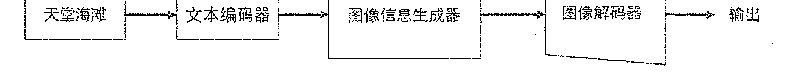

# 6.3 语音多模态

语音模态历史相对较短，可追溯至留声机发明。多模态场景多为文本生成语音，目标是生成可理解且自然的声音信号。近十年依托神经网络发展，深度学习方法取得明显进步。

# 6.3.1 传统文本转语音

早期以拼接法与参数法为主。拼接法最简单，使用预录高质量语音片段组合生成新声。需构建包含语音段与拼接单元的语料库，生成时提取目标文本的拼接单元序列及音节、时长、韵律、音调等信息，按规则从库中筛选并拼接。

# 6.3.2 深度学习文本转语音

深度学习与神经网络发展后，端到端语音生成取代传统统计参数系统，降低特征工程复杂度并提升质量。GAN、VAE 在语音生成落地，如 Parallel WaveGAN、GAN-TTS、NaturalSpeech 等。

Parallel WaveGAN 是一种基于 GAN 的非自回归波形生成方法，无需知识蒸馏且速度快。采用多分辨率频谱图与对抗损失建模语音，生成器将噪声并行转为波形，判别器判断真伪。

DeepMind 提出的 GAN-TTS 使用 GAN 实现高质量高效文本转语音。前向传播采用 GNN 作生成器，多判别器基于多频随机窗口判别。生成器包含 7 个 GBlock，每个含 4 个卷积核，输入语言与音调信息，输出原始波形。


# 6.4 视频多模态

视频模态出现较晚，积累有限，生成视频挑战巨大，但与图像关联紧密，图像领域技术可迁移。本节聚焦文本生成视频。

文本生成图像取得大量进展，文本生成视频成为热点。任务要求根据文本生成时空一致的视频序列，难度远高于图像生成。目前扩散与非扩散模型生成能力均较弱，难以直接商用。主要原因包括缺乏高质量训练语料。文本生成视频的配对多模态数据集稀少，学习复杂视频语义困难。

文生视频目前仍卡在两道硬骨头上。

一是算力成本难扛。视频需要帧与帧之间在空间形态和时间演进上保持连贯，这就要求模型捕捉长程依赖，训练时的计算开销随之暴涨，绝大多数研究团队和商业公司都无力承担。

二是描述精度待突破。用自然语言把动态画面讲清楚、讲准，这个基本功至今没有成熟解法。

不过文生图技术的爆发式进步，给文生视频带来了明显的牵引效应。回看发展脉络，文生视频与文生图的演进走向高度相似，大致可划分为两大阶段。先行阶段主要集中在非扩散范式上。

# 6.4.1 非扩散架构的文生视频方法

TGANS-C 可以根据标题合成对应视频，其整体结构如图 6-8 所示，左侧是生成端，右侧是判别端。生成端分为两段，前段用双向 LSTM 做文本编码，后段在文本表征上注入噪声并通过反卷积展开成视频。判别端采用了三套 GAN，正是名字里“s”的来源，也是模型强劲的根源之一。从图 6-8 右侧可见判别器被拆成上下中三路。第一路负责辨别合成视频与真实视频的真伪，并检查是否贴合标题；第二路聚焦单帧真伪，同时兼顾与标题的匹配度；第三路专门在时间轴上校准前后帧的衔接，防止画面跳变过大。

CVAE-GAN 则是 VAE 与 GAN 融合的混合框架，通过联合训练一个判别生成器...

# 6.4.2 扩散模型驱动的文生视频技术

视频扩散模型 Video Diffusion Models VDM 是把图像领域成熟的扩散机制最早搬到大规模视频生成任务上的雏形框架，并在多项数据集上交出了不错的视频效果，掀起了扩散范式在文生视频里的热潮。VDM 基本保留了扩散的训练流程，区别在于把原本只处理图像的 U-Net 改造为能处理时序序列...

Imagen Video 采用级联扩散思路来做高分辨率视频。当单一模型难以一步到位时，就用多个小模型层层堆叠。Imagen Video 参数规模超百亿，整体由 1 个文本编码器、7 个视频扩散子模块、1 个基础视频扩散模型、3 个空间超分辨率 SSR 扩散模型和 3 个时域超分辨率 TSR 扩散模型构成。文本编码器先把输入文本转成词向量，基础模型据此生成粗糙视频，随后 SSR 与 TSR 分别负责提升清晰度和扩充帧率。

# 6.5 跨模态融合与组合技术

模型输入一旦涉及多种模态，信息融合就是难题。常见做法可分为模型无关和模型相关两大类。

模型无关可再细分为早期融合、晚期融合和混合融合。早期融合把多模态特征先拼在一起，再逐层送入更深网络，最后连到分类器等下游模块。好处是只需训练一个统一网络，容易管理，但不同来源的数据差异大，拼接容易出问题，直接拼接还容易产生高维特征，让预处理变得敏感。晚期融合则为每个模态独立训练模型，预测时再合并结果。灵活性高，即使某类模态缺失也能运行，但底层特征的关联没有被充分利用，效果可能打折，而且要训多个模型，计算负担重。混合融合兼顾早期、晚期以及中间层的特征交互，既保留两者的优点，又能发挥中间表征的作用。

模型相关的融合可分为深度学习、多核学习和图模型三类，目前以深度学习为主。这里重点提一下可组合扩散 Composable Diffusion CoDi。它是一种全新的生成模型，可以从任意模态组合的输入生成语言、图像、视频、语音等任意模态组合的输出。

CoDi 的搭建分三步。第一步为每个模态单独构建潜在扩散模型 Latent Diffusion Model LDM 并联合训练。第二步在每个 LDM 和环境编码器上加入交叉注意力，把潜变量映射到共享空间，从而扩充可生成的模态种类。第三步训练完成后，模型具备处理多种输入输出组合的能力。

CoDi 通过扩散过程中的共享多模态空间对齐不同模态，能够在任意输入组合上做条件生成，甚至生成训练时未见过的模态组合，推理能力非常强。

# 6.6 多模态大模型轻量微调策略

多模态大模型成为热点后应用场景迅速扩散，但对普通用户而言做全量数据训练并不现实，因此出现了大量高效二次训练方案。下面汇总三种在已有大模型底座上用垂直领域数据做二次训练的高效方法。

第一类是前缀调优 Prefix Tuning 与提示调优 Prompt Tuning。Prefix Tuning 冻结预训练语言模型参数，只学习面向特定任务的前缀，避免了全量微调的开销与存储压力。这些前缀本质上是可微分的虚拟 Token，即软提示。Prompt Tuning 是其简化版，为每个任务设计专属提示词并拼接到数据输入中，只在输入层加入可学习 Token，不使用 MLP 调整，训练更易收敛。

第二类是 P-Tuning 与 P-Tuning v2。P-Tuning 先把 Prompt 转为可学习嵌入，再用 MLP 与 LSTM 处理，提升性能。P-Tuning v2 是一种更通用的改进方案，基于深度提示优化，适用于各类自然语言任务，对 Prompt Tuning 与 P-Tuning 做了进一步完善。

第三类是低秩适配家族，包括 LoRA、低秩自适应 LoRA AdaLoRA 与量化长程注意力 QLoRA。它们都基于低秩分解。AdaLoRA 在 LoRA 基础上动态调整增量矩阵的分配，QLoRA 则先把模型压缩到 4 位再做低秩分解。其中第三类目前最火，已成为大模型微调的标配。

# 6.7 GPT-4 多模态核心技术拆解

GPT-4 是 OpenAI 于 2023 年 3 月 4 日发布的超大规模多模态大模型，相比 ChatGPT 性能显著提升，具备多模态输入输出，一经发布便成为行业焦点。下面回顾其部分核心技术。

1. Transformer。编码器-解码器结构，最初用于机器翻译，多头自注意力极大提升了翻译精度，成为模型创新的基石。编码器派生出 BERT、RoBERTa、ALBERT 等自编码模型，解码器派生出 GPT-1、GPT-2 等自回归模型，完整结构则发展出 T5、GLM 等。

2. 混合专家 MOE。原理在 3.5 节已有介绍。公开信息显示 GPT-4 使用 16 个专家，每个专家约 1110 亿参数。

3. 多查询注意力 MQA。让 key 与 value 在多个注意力头间共享，减少运行时的内存占用，是务实且关键的技术。

4. 推测解码 Speculative Decoding。先用一个小而快的模型预解码多个 Token，再以批处理方式输入大模型验证。若小模型预测被认可，则一次完成多 Token 解码；若被否定，则丢弃并由大模型重新解码。

# 6.8 多模态技术未来走向

数据本身就是多模态的，核心形态有文字、视频、图像、语音。随着 5G 与自媒体普及，用户对机器人提供一站式多模态服务的需求日益强烈。

不同模态的信息并非冗余，反而能相互补全。图像的像素细节无法被文字完全承载，语音的情感色彩也难以从图像中体现。个性化内容生成需要技术层面的多模态输入输出。融合方式的选择涉及多个维度，GPT-4 已给出先例，可耕耘的空间很大，预计会有更多研究者投入多模态输入输出。

我们认为多模态融合输入输出是未来主线。一种思路是以中间媒介如文字桥接不同模态，让单一大模型同时处理多模态输入输出，既解决数据缺失问题，又实现高质量输出。另一种是 MOE 方法，部分多模态大模型已在采用，适合多模态信息的多路处理。MOE 整合文本、视频、图像、语音的输入输出，也是另一个重要趋势。

# 第7章 国内外多模态大模型横向对比

GPT-4 发布后，高质量多模态输入输出成为现实，企业若只做单语言大模型，很容易一出世就落后。国内外公司和高校纷纷发力，自 GPT-4 之后涌现出一批多模态大模型。

由于更新快、门槛高，爱好者很难短期掌握全部知识。本章聚焦 GPT-4 面世后涌现的知名国内外多模态大模型，并对比优缺点。

除了模型本身，评测同样重要：测试效果是技术组成部分；统一数据集下可看出各家水平；评测设计反映需求与认知，也为同行提供借鉴。目前评测数据集与方法百花齐放，本章将介绍其构建与方法，最后用公共标准数据集对比主流模型的表现。

# 7.1 国内代表性多模态大模型盘点

GPT-4 之后国内也诞生了大量多模态大模型，以下重点介绍三款有代表性的模型：LLaMA-Adapter V2、VisualGLM-6B 与 mPLUG-Owl。

# 7.1.1 LLaMA-Adapter V2

LLaMA-Adapter V2 由香港中文大学发布，支持双语输出的多模态大模型，通用型多模态基础模型，可接收图像、语音、文本、视频、3D 点云等多种输入，并输出图像与文本。网上已有公开试用平台。

模型支持中英文。图 7-1 左侧输入指令“write a poem for this picture”并配一张泸沽湖湖面图，右侧输出为模型创作的英文诗。从测试可见其理解能力强且知识储备丰富，能为图片赋诗。图 7-2 的例子是让模型识别物体，模型详细描述为“这是一台放置在地面上的白色洗衣机”，充分发挥了大参数带来的知识优势。

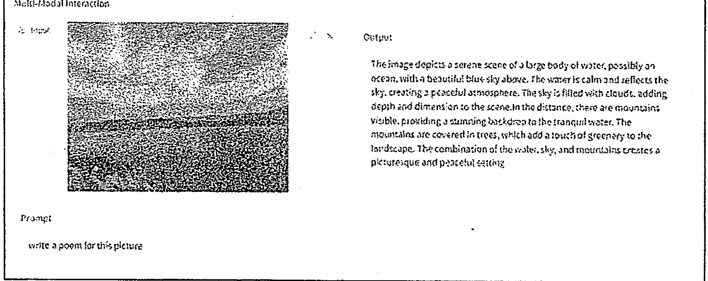

# LLaMA-Adapter V2

For Bilingual Multi-modality Instruction Model, please try imageBind-LM.

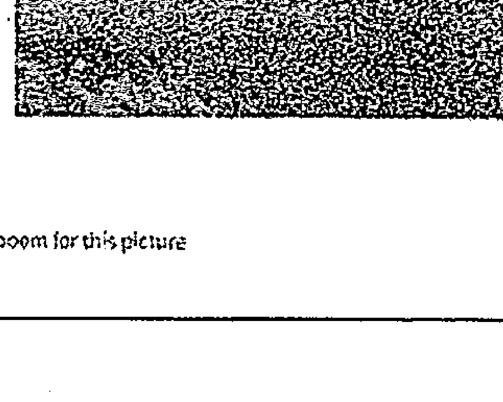

Prompt: write a poem for this picture

Output: The image depicts a serene scene of a large body of water, possibly an ocean, with a beautiful blue sky above. The water is calm and reflects the sky, creating a peaceful atmosphere. The sky is filled with clouds, adding depth and dimension to the scene. In the distance, there are mountains visible, providing a stunning backdrop to the tranquil water. The mountains are covered in trees, which add a touch of greenery to the landscape. The combination of the water, sky, and mountains creates a picturesque and peaceful setting

# 图 7-1

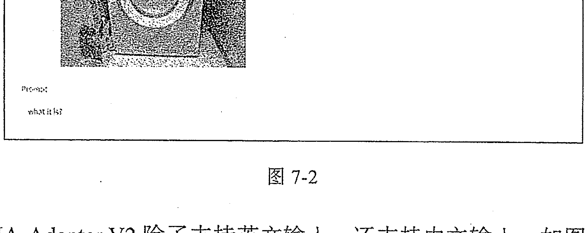

# LLaMA-Adapter V2

For Bilingual Multi-modality Instruction Model, please try imageBind-LM.

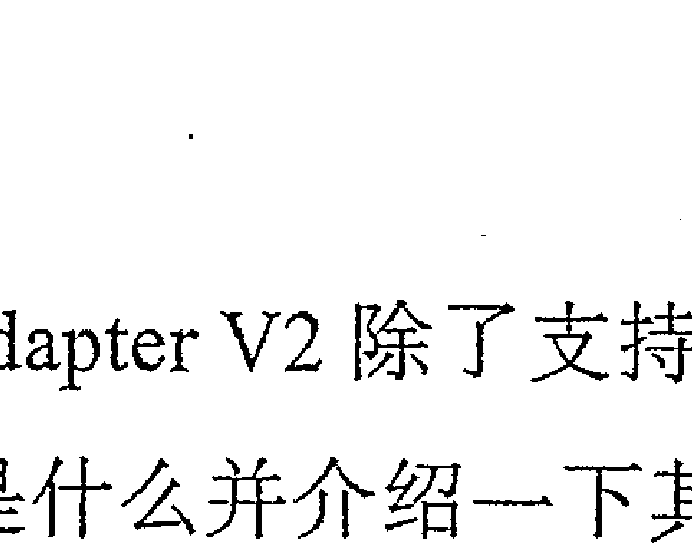

Prompt: what it is?

Output: The image shows a white front-loading washing machine sitting on the floor of a room.

# 图 7-2

LLaMA-Adapter V2 不仅能处理英文，还能处理中文输入。如图 7-3 所示，输入中文“这是什么并介绍一下其用途”，模型理解语义并以英文作答，结果符合预期。

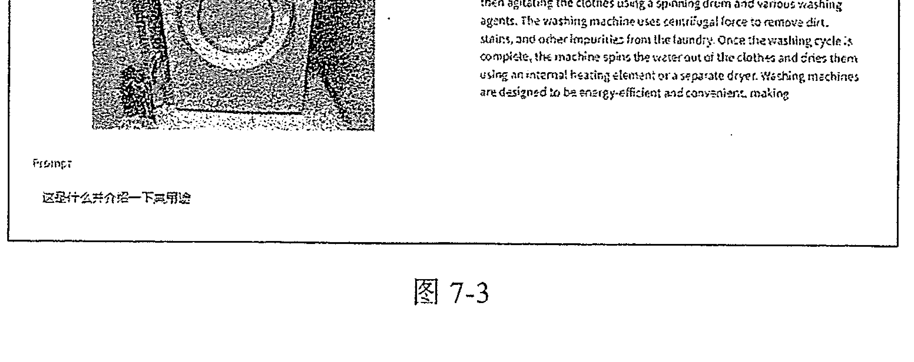

# LLaMA-Adapter V2

For Bilingual Multi-modality Instruction Model, please try imageBind-LM.

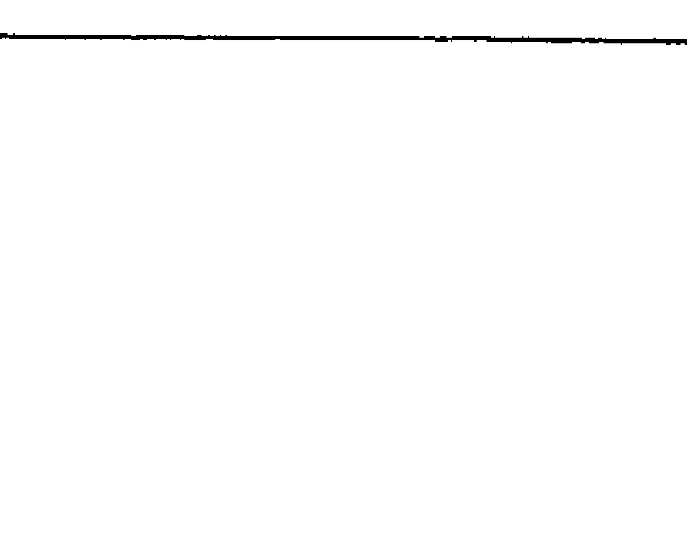

Prompt: 这是什么并介绍一下其用途

洗衣机是日常家庭中常见的清洁电器，主要职责是对衣物和其他纺织品进行清洗。运行过程先向机桶注水并加入洗涤剂，随后滚筒旋转使衣物与洗涤介质相互翻动，离心作用帮助剥离污垢、顽渍及杂质。完成主洗后设备会以高速甩干水分，若配有内置加热模块或外置烘干设备便能完成烘干。整体方案偏向节能与便捷，

# 图 7-3

综合前三组测试可发现，LLaMA-Adapter V2 整体表现亮眼，既能兼顾中英文视觉语言输入，也能对图像进行精准解读与描述，基本达到预期。随后简述该模型的构建思路。

LLaMA-Adapter V2 的前身是 LLaMA-Adapter。后者基于 Transformer，引入可学习适配提示，并在保留预训练知识的同时实现新知识的高效注入。该机制让训练更省力，也方便向多模态场景迁移以提升推理。

相对于初代，V2 在三方面做了改进。

+   (1) 线性层的偏置调优。初代依赖可学习适配提示与零初始化注意力融合新知识，并把指令提示注入 LLaMA 以实现指令跟随，但可更新参数仅限提示与门控因子，难以深度微调。V2 采用偏置调节策略，新增可学习的偏置与缩放参数，并支持 LLaMA 内所有归一化层的动态校准，使得每个线性层都能响应指令跟随任务。
+   (2) 为避免视觉微调与语言微调相互干扰，研究者提出早期融合思路，防止视觉提示与自适应提示直接交互产生负面效应。初代中视觉提示经冻结编码器与可学习投影层顺序编码后逐步加入各插入层的适配提示。V2 则分别设立两组独立 Transformer 层处理编码后的视觉标记与适配提示，不再混合。
+   (3) V2 融合了字幕生成、目标检测与 OCR 等专家系统，以强化视觉指令遵循能力。

这三项优化共同赋能 LLaMA-Adapter V2，使其成为当前少见的高性能多模态大模型。

[PAGE 141]

# 7.1.2 VisualGLM-6B

VisualGLM-6B 由清华大学团队开源，是一款支持图像与中英文混合输入的多模态大模型。语言主干来自 ChatGLM-6B，视觉部分则由 BLIP2-Qformer 训练得到。Q-Former 属于轻量级 Transformer，承担语言与视觉模块之间的信息桥梁作用。

模型已开源，可在 Hugging Face 等平台下载。参数规模约 78 亿，在普通 RTX 3090 显卡上即可运行。推理时 16 位模型约需 16GB 显存，8 位约需 11.2GB 显存，4 位模型显存需求显著更低，

# 第7章 国内外多模态大模型对比

多模态大模型的实现参见 Qinghao Ye 等人论文“mPLUG-Owl: Modularization Empowers Large Language Models with Multimodality”。mPLUG-Owl 延续 mPLUG 系列的模块化训练思想，将大语言模型迁移为多模态基座。

该模型整体由三部分构成：视觉基础模块使用开源 ViT-L、视觉抽象模块以及预训练语言模型 LLaMA-7B。视觉抽象模块负责把图像特征压缩为易学习的 Token，再与文本查询一并送入语言模型生成回复。

它不仅能接受图片与英文输入，还支持视频输入，展现出较强的多模态统一能力。但底座为 LLaMA 且微调数据未包含中文，因而中文表现相对薄弱。

mPLUG-Owl-7B 即参数 70 亿的版本，已在 GitHub 开源可免费下载。相同参数量下其资源消耗低于 VisualGLM-6B。图文输入方式与前述模型类似，需上传图片并给出指令，运行后输出文本。如图 7-6 所示，mPLUG-Owl-7B 的结果依然出色。

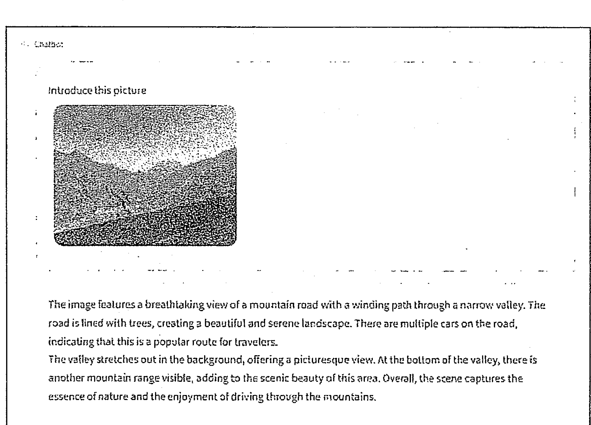

观察发现，当输入图像分布与训练分布差异较大时，mPLUG-Owl-7B 输出质量明显下降，说明迁移能力仍有限。例如让模型介绍一张谷歌图片，测试效果并不理想，如图 7-7 所示。

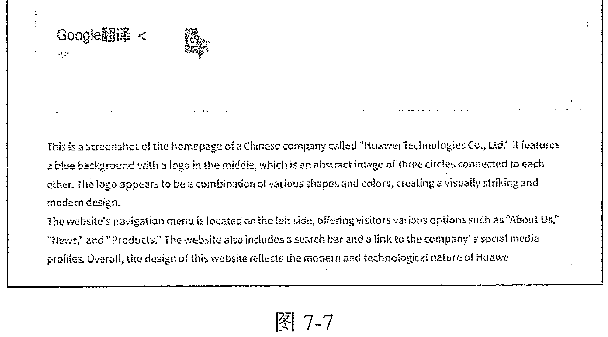

# 7.2 国外多模态大模型介绍

国内已有不少优质方案，国外也涌现出一批强劲的多模态模型。本节重点介绍 Visual ChatGPT、InstructBLIP 与 MiniGPT-4 三款代表。

# 7.2.1 Visual ChatGPT

微软亚洲研究院于 2023 年 3 月 9 日发布可视化版 ChatGPT，命名为 Visual ChatGPT，参见 Chenfei Wu 等人论文“Visual ChatGPT: Talking, Drawing and Editing with Visual Foundation Models”，并将代码上传至 GitHub，首周即获 19700 Star。通过把 ChatGPT 与多组视觉模型串联，Visual ChatGPT 支持用户在文本与图像之间互动并执行复杂视觉指令，促进多模型协作。该模型能有效理解文本与视觉输入，削弱文本转图像的信息损耗，提升 AI 工具互操作性。因其以 ChatGPT 为核心语言模型，故归入国外多模态大模型。

当前 ChatGPT 仅能通过接口调用，Visual ChatGPT 本质是 ChatGPT 与视觉模型的串联，但其热度反映出较大影响力。从论文案例看，它能发挥语言模型与视觉模型各自优势，实现文本与视频的多模态生成。

其强大能力源于巧妙设计。与传统重训练不同，它仅需一组特殊提示即可引导 ChatGPT 学习来自 22 个视觉模型的知识。这些提示明确描述了各视觉模型的能力及输入输出格式，并把视觉信息转化为语言形式，使 ChatGPT 更深入理解图像内容。研究表明，Visual ChatGPT 在零样本迁移任务中同样表现优异。

# 7.2.2 InstructBLIP

InstructBLIP 由 BLIP 团队开发，面向多模态领域，参见 Wenliang Dai 等人论文“InstructBLIP: Towards General-Purpose Vision-Language Models with Instruction Tuning”。

该模型支持英文多轮对话式多模态融合，效果较好。如图 7-8 所示，给出一张猫咪睡觉的图片并要求命名，InstructBLIP 分析后给出标题，显示出对多模态输入的强理解能力。

随后输入一张植物图，如图 7-9 所示，测试其辨识能力。结果显示模型较为智能，能准确判断物体属于植物，下一步可细化到具体种类。

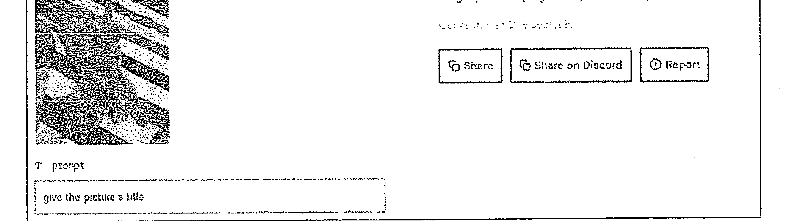

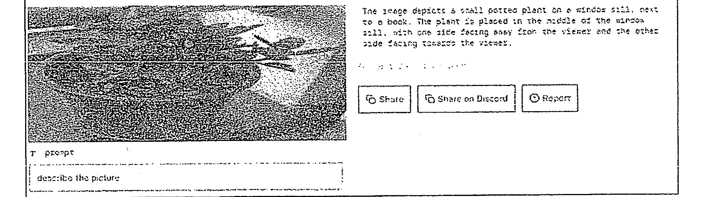

InstructBLIP 的结构如图 7-10 所示，Q-Former 能从冻结图像编码器输出的嵌入中提取引导性视觉特征。这些特征作为软提示送入语言模型，并借助语言模型损失进行指令式训练以生成回答。Q-Former 内部如图 7-10 右侧所示，可学习查询通过自注意力和指令交互，并通过跨注意力和图像特征交互，鼓励提取与任务相关的图像特征。

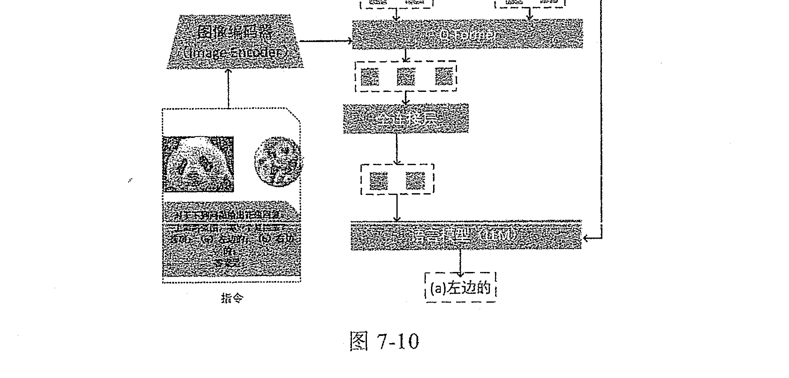

# 7.2.3 MiniGPT-4

MiniGPT-4 是一个具备图像理解能力的开源对话机器人，核心为 Vicuna-13B LLM 与 BLIP-2 视觉语言模型，参见 Deyao Zhu 等人论文“MiniGPT-4: Enhancing Vision-Language Understanding with Advanced Large Language Models”。除描述图片、回答相关问题外，还能根据手绘网页草图自动生成对应 HTML 代码。从技术角度看，其结构简洁，见图 7-11，主要包含三部分。

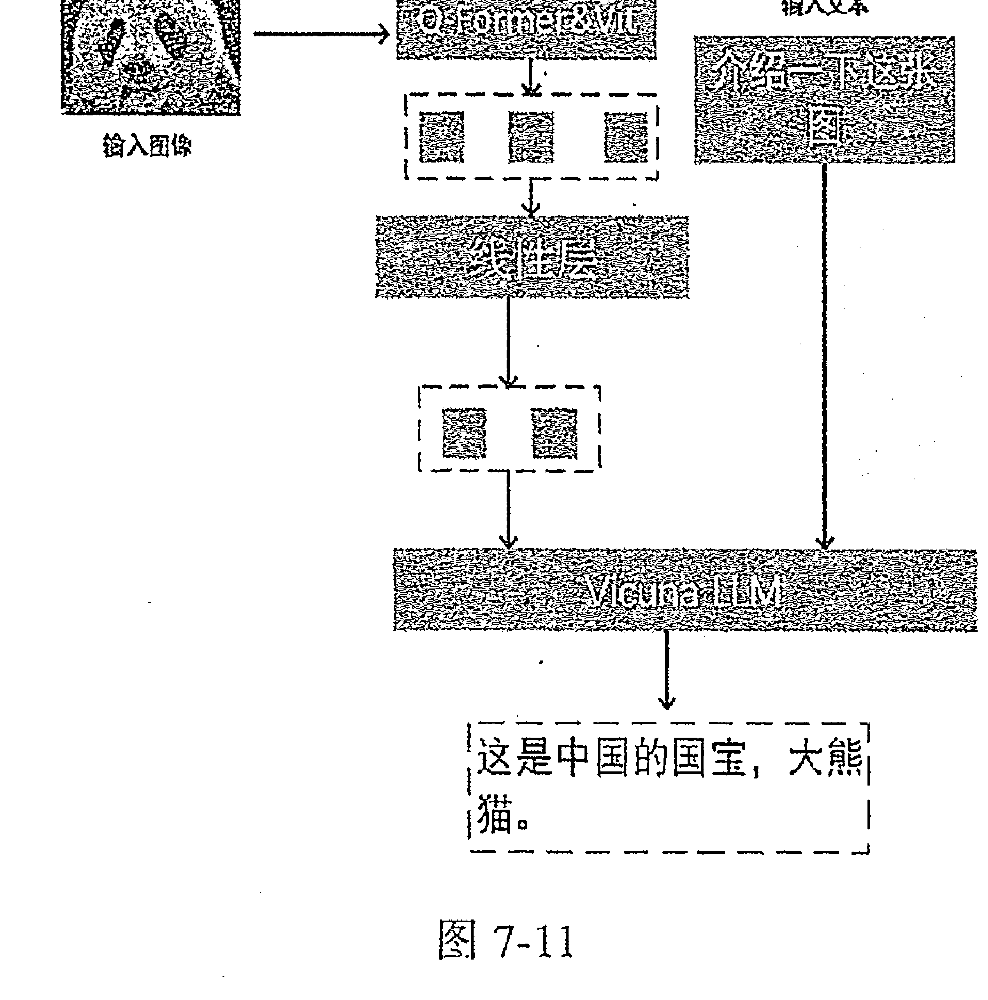

+   (1) 带有预训练 ViT 与 Q-Former 的视觉编码器。
(2) 独立线性层。
(3) Vicuna LLM。

从性能看，MiniGPT-4 仅需训练线性层即可对齐视觉特征与 Vicuna LLM，效果十分强劲。

图 7-12 是一个抽象测试样例，图片中仅隐约可见几根枝杈，但模型仍能正确输出树木景象。


再举一例，如图 7-13 所示，输入是一张像素密集、背景昏暗的日出观景图。测试发现，MiniGPT-4 仍能对复杂图像进行语义识别并准确作答。

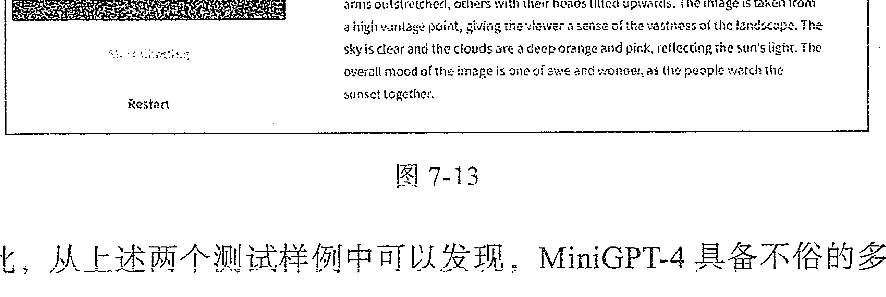

由此可见，MiniGPT-4 具备不俗的多模态解析能力。

# 7.3 多模态大模型评测数据集

工业界与学术界在发布多模态大模型的同时也构建了大量评测集。借助这些数据，研究人员可了解各模型性能与缺陷，便于后续优化。本节介绍国内外四个知名评测集。

# 7.3.1 国内评测数据集

mPLUG-Owl 发布时附带评测集 OwlEval。OwlEval 主要评估文本生成能力，仅含 50 张图片与 82 个问题，却覆盖故事生成、广告生成、代码生成等多任务，部分图片含多轮对话问题。该集全面考察指令理解、视觉理解、图像文字理解及视觉推理等维度。

MME 由腾讯优图实验室联合厦门大学构建，用于衡量现有多模态大模型能力，便于统一比较，参见 Chaoyou Fu 等人论文“MME: A Comprehensive Evaluation Benchmark for Multimodal Large Language Models”。MME 涵盖感知与认知两类测试。感知测试除 OCR 外，还包括粗粒度与细粒度目标识别，前者考察物体存在、数量、位置与颜色，后者可识别电影海报、名人、场景、地标与艺术品等。认知测试包括常识推理、数值计算、文本翻译与代码推理等。

MME 的指令-答案对均由工程师手工设计，指令简洁，避免提示工程干扰，保证公平。为便于统计，结果设计为“请回答是或否”，可直接根据模型输出进行量化，实现客观准确。

# 7.3.2 国外评测数据集

COCO 全称 Common Objects in Context，由微软构建，包含多项检测任务，如 Object Detection、DensePose、Keypoints、Stuff、Panoptic 与 Captions。

VQA 即 Visual Question Answering，是一个关于图像的开放式问答集。回答需要深入理解视觉、语言与常识知识，涉及计算机视觉、自然语言处理与知识表示推理等领域。VQA 包含 265 016 张图片，每张至少 3 个问题，平均 5.4 个，每个问题附 10 个事实答案与 3 个合理但可能不正确的答案。

# 7.4 多模态大模型的评测标准

7.3 节介绍了四个评测集，本节聚焦评测标准。通过分析各数据集的评测细则，可进一步了解多模态大模型的测试规范。

# 7.4.1 国内评测标准

OwlEval 主要依赖人工标注打分，因缺乏合适自动化指标，参考 Self-Instruct 进行人工评测，规则为 A=“正确且令人满意”，B=“存在不完美但可接受”，C=“理解指令但回复明显错误”，D=“完全不相关或错误回复”。

MME 的评测结果分为“是”或“否”二分类，便于衡量 Accuracy 与 Accuracy+。Accuracy+ 更能反映模型对整张图片的全面理解。除此之外，构建者将准确率与准确性融合得到子任务分数，感知分数为各子任务分数之和。

# 7.4.2 国外评测标准

微软 COCO 数据集的评测指标可采用 mAP，即各类平均精度的平均值，图 7-14 为 COCO 官方评测指标示意图，展示了 Average Precision 的计算过程。

Average Precision (AP):
  AP % AP at IoU=.50:.05:.95 (primary challenge metric)
  APIoU=.50 % AP at IoU=.50 (PASCAL VOC metric)
  APIoU=.75 % AP at IoU=.75 (strict metric)
AP Across Scales:
  Apsmall % AP for small objects: area < 32²
  APmedium % AP for medium objects: 32² < area < 96²
  APlarge % AP for large objects: area > 96²
Average Recall (AR):
  ARmax=1 % AR given 1 detection per image
  ARmax=10 % AR given 10 detections per image
  ARmax=100 % AR given 100 detections per image
AR Across Scales:
  ARsmall % AR for small objects: area < 32²

ARmedium % AR for medium objects: 32² < area < 96²

  ARlarge % AR for large objects: area > 96²


在物体检测的评估里，IOU 常被当作衡量预测框与真实框重叠程度的核心标尺。实际使用中阈值策略主要有两种：一类是让阈值从 0.5 起以 0.05 为步长逐级递增到 0.95，对每个档位算出 mAP 再求平均；另一类只在 0.5 与 0.75 两个锚点上分别给出平均精度。mAP 还会依据实例尺度拆分为小、中、大三类呈现。AR，即平均召回率，也是业内常用的汇总性统计量。

视觉问答类基准在正确率之外，往往会考察预测分数与人工打分的契合度，典型相关性指标包括 PLCC、SROCC、KROCC，以及反映绝对误差的 RMSE。

# 7.5 多模态模型横评

前面章节已经梳理了六个中外的代表性多模态基座、若干主流评测集以及对应的打分规则。整体来看，评测集发布时间越靠后，后发优势越明显，能够纳入更多已开源模型进行同一基准下的横向比较，应用范围也更广。

MME 是一个较新的多模态评测集合，已对十二个主流模型完成统一打分，模型与所属机构如下：

| 模型 | 研发机构 |
|---|---|
| BLIP-2 | Salesforce 研究院 |
| LLaVA | 微软研究院 |
| MiniGPT-4 | 阿卜杜拉国王科技大学 |
| LLaMA-Adapter V2 | OpenAI |
| Multimodal-GPT | 香港中文大学 |
| InstructBLIP | MetaAI |
| VisualGLM-6B | 清华大学 |
| Otter | 南洋理工大学 |
| PdandaGPT | 腾讯 AI 实验室 |
| LaVIN | 厦门大学 |
| ImageBind | MetaAI |
| mPLUG-Owl | 阿里巴巴达摩研究院 |

评测这12个多模态大模型

# 第7章 国内外多模态大模型对比

### 表7-3

| 排名 | 模型 | 得分 |
| ---- | ------------ | ------ |
| 1 | InstructBLIP | 185.00 |
| 1 | LaVIN | 185.00 |
| 2 | BLIP-2 | 160.00 |
| 3 | ImageBind | 128.33 |
| 4 | mPLUG-Owl | 120.00 |
| 4 | LLaMA-Adapter V2 | 120.00 |
| 5 | MiniGPT-4 | 115.00 |
| 6 | VisualGLM-6B | 85.00 |
| 7 | PandaGPT | 70.00 |
| 8 | Multimodel-GPT | 61.67 |
| 9 | LLaVA | 50.00 |
| 10 | Otter | 48.33 |

### 表7-4

| 排名 | 模型 | 得分 |
| ---- | ------------ | ------ |
| 1 | InstructBLIP | 143.33 |
| 2 | BLIP-2 | 135.00 |
| 3 | MiniGPT-4 | 123.33 |
| 4 | LaVIN | 88.33 |
| 5 | ImageBind | 60.00 |
| 6 | Multimodel-GPT | 55.00 |
| 7 | mPLUG-Owl | 50.00 |
| 7 | LLaMA-Adapter V2 | 50.00 |
| 7 | VisualGLM-6B | 50.00 |
| 7 | Otter | 50.00 |
| 7 | PandaGPT | 50.00 |
| 7 | LLaVA | 50.00 |

### 表7-5

| 排名 | 模型 | 得分 |
| ---- | ------------ | ------ |
| 1 | MiniGPT-4 | 81.67 |
| 2 | BLIP-2 | 73.33 |
| 3 | InstructBLIP | 66.67 |
| 4 | LaVIN | 63.33 |
| 5 | Multimodel-GPT | 58.33 |
| 6 | mPLUG-Owl | 50.00 |
| 6 | Otter | 50.00 |
| 6 | PandaGPT | 50.00 |
| 6 | LLaVA | 50.00 |
| 7 | LLaMA-Adapter V2 | 48.33 |
| 7 | VisualGLM-6B | 48.33 |
| 8 | ImageBind | 46.67 |

### 表7-6

| 排名 | 模型 | 得分 |
| ---- | ------------ | ------ |
| 1 | InstructBLIP | 153.33 |
| 2 | BLIP-2 | 148.33 |
| 3 | MiniGPT-4 | 110.00 |
| 4 | LLaMA-Adapter V2 | 75.00 |
| 4 | LaVIN | 75.00 |
| 5 | ImageBind | 73.33 |
| 6 | Multimodel-GPT | 68.33 |
| 7 | mPLUG-Owl | 55.00 |
| 7 | VisualGLM-6B | 55.00 |
| 7 | Otter | 55.00 |
| 7 | LLaVA | 55.00 |
| 8 | PandaGPT | 50.00 |

## 第7章 国内外多模态大模型对比 | 143

### 表7-7

| 排名 | 模型 | 得分 |
| ---- | ------------ | ------ |
| 1 | BLIP-2 | 141.84 |
| 2 | mPLUG-Owl | 136.05 |
| 3 | InstructBLIP | 123.81 |
| 4 | LLaMA-Adapter V2 | 99.66 |
| 5 | LaVIN | 79.59 |
| 6 | PandaGPT | 76.53 |
| 7 | VisualGLM-6B | 65.99 |
| 8 | ImageBind | 64.97 |
| 9 | Multimodel-GPT | 57.82 |
| 10 | MiniGPT-4 | 55.78 |
| 11 | LLAVA | 50.00 |
| 12 | Otter | 44.90 |

### 表7-8

| 排名 | 模型 | 得分 |
| ---- | ------------ | ------ |
| 1 | BLIP-2 | 105.59 |
| 2 | InstructBLIP | 101.18 |
| 3 | mPLUG-Owl | 100.29 |
| 4 | LLaMA-Adapter V2 | 86.18 |
| 5 | ImageBind | 76.47 |
| 6 | Multimodel-GPT | 73.82 |
| 7 | MiniGPT-4 | 65.29 |
| 8 | PandaGPT | 57.06 |
| 9 | VisualGLM-6B | 53.24 |
| 10 | Otter | 50.00 |
| 11 | LLAVA | 48.82 |
| 12 | LaVIN | 47.36 |

### 表7-9

| 排名 | 模型 | 得分 |
| ---- | ------------ | ------ |
| 1 | InstructBLIP | 153.00 |
| 2 | LLaMA-Adapter V2 | 148.50 |
| 3 | VisualGLM-6B | 146.25 |
| 4 | BLIP-2 | 145.25 |
| 5 | LaVIN | 136.75 |
| 6 | mPLUG-Owl | 135.50 |
| 7 | PandaGPT | 118.00 |
| 8 | ImageBind | 113.25 |
| 9 | MiniGPT-4 | 95.75 |
| 10 | Multimodel-GPT | 68.00 |
| 11 | LLAVA | 50.00 |
| 12 | Otter | 44.25 |

### 表7-10

| 排名 | 模型 | 得分 |
| ---- | ------------ | ------ |
| 1 | mPLUG-Owl | 159.25 |
| 2 | LLaMA-Adapter V2 | 150.25 |
| 3 | BLIP-2 | 138.00 |
| 4 | LaVIN | 93.50 |
| 5 | VisualGLM-6B | 83.75 |
| 6 | InstructBLIP | 79.75 |
| 7 | Multimodel-GPT | 69.75 |
| 7 | PandaGPT | 69.75 |
| 8 | MiniGPT-4 | 69.00 |
| 9 | ImageBind | 62.00 |
| 10 | LLAVA | 50.00 |
| 11 | Otter | 49.50 |

## 7.5.2 认知能力评测

认知部分拆为常识推理、数值计算、文本翻译、代码推理四个子任务，表 7-12 至表 7-15 给出了各子任务的排名。

### 表7-12

| 排名 | 模型 | 得分 |
| ---- | -------------- | ------ |
| 1 | BLIP-2 | 136.50 |
| 2 | InstructBLIP | 134.25 |
| 3 | mPLUG-Owl | 96.25 |
| 4 | LaVIN | 87.25 |
| 5 | VisualGLM-6B | 75.25 |
| 6 | ImageBind | 70.75 |
| 7 | LLaMA-Adapter V2 | 69.75 |
| 8 | Multimodel-GPT | 59.50 |
| 9 | MiniGPT-4 | 55.75 |
| 10 | PandaGPT | 51.25 |
| 11 | LLAVA | 49.00 |
| 12 | Otter | 41.75 |

### 表7-13

| 排名 | 模型 | 得分 |
| ---- | -------- | --------------- |
| 1 | InstructBLIP | 129.29 |
| 2 | BLIP-2 | 110.00 |
| 3 | LaVIN | 87.14 |
| 4 | LLaMA-Adapter V2 | 81.43 |
| 5 | mPLUG-Owl | 78.57 |
| 6 | PandaGPT | 73.57 |
| 7 | MiniGPT-4 | 72.14 |
| 8 | LLAVA | 57.14 |
| 9 | Multimodel-GPT | 49.29 |
| 10 | ImageBind | 48.57 |
| 11 | VisualGLM-6B | 39.29 |
| 12 | Otter | 38.57 |

### 表7-14

| 排名 | 模型 | 得分 |
| ---- | -------- | ------ |
| 1 | LaVIN | 65.00 |
| 2 | LLaMA-Adapter V2 | 62.50 |
| 2 | Multimodel-GPT | 62.50 |
| 3 | mPLUG-Owl | 60.00 |
| 4 | MiniGPT-4 | 55.00 |
| 4 | ImageBind | 55.00 |
| 5 | PandaGPT | 50.00 |
| 5 | LLAVA | 50.00 |
| 6 | VisualGLM-6B | 45.00 |
| 7 | BLIP-2 | 40.00 |
| 7 | InstructBLIP | 40.00 |
| 8 | Otter | 20.00 |

### 表7-15

| 排名 | 模型 | 得分 |
| ---- | -------- | ------ |
| 1 | mPLUG-Owl | 80.00 |
| 2 | BLIP-2 | 65.00 |
| 2 | InstructBLIP | 65.00 |
| 3 | Multimodel-GPT | 60.00 |
| 4 | PandaGPT | 57.50 |
| 5 | LLAVA | 57.50 |
| 6 | MiniGPT-4 | 55.00 |
| 7 | ImageBind | 50.00 |
| 7 | LLaMA-Adapter V2 | 50.00 |
| 7 | VisualGLM-6B | 50.00 |
| 8 | LaVIN | 47.50 |
| 9 | Otter | 27.50 |

## 第7章 国内外多模态大模型对比 | 145

综合认知维度来看，MiniGPT-4、InstructBLIP、BLIP-2 位列前三，mPLUG-Owl 与 LaVIN 紧随其后。常识推理上 InstructBLIP 与 BLIP-2 保持领先，其中 InstructBLIP 得分为 129.29 分，见表 7-12。数值计算与文本翻译的题型难度并不算高，但整体表现普遍未突破 80 分，说明该类能力仍有较大提升空间。代码推理则被 MiniGPT-4 明显拉开，得分达到 110 分，远高于其他对手，见表 7-15。

### 表7-15

| 排名 | 模型 | 得分 |
| ---- | -------------- | -------- |
| 1 | MiniGPT-4 | 110.00 |
| 2 | BLIP-2 | 75.00 |
| 3 | ImageBind | 60.00 |
| 4 | mPLUG-Ow1 | 57.50 |
| 4 | InstructBLIP | 57.50 |
| 5 | LLaMA-Adapter V2 | 55.00 |
| 5 | Multimodel-GPT | 55.00 |

| 6    | Otter          | 50.00    |

| 6    | LLAVA          | 50.00    |

| 6    | LaVIN          | 50.00    |

| 7    | VisualGLM-6B   | 47.50    |

| 7    | PandaGPT       | 47.50    |

### 表7-16

| 排名 | 模型           | 得分     |

| ---- | -------------- | -------- |

| 1    | MiniGPT-4      | 292.14   |

| 2    | InstructBLIP  | 291.79   |

| 3    | BLIP-2         | 290.00   |

| 4    | mPLUG-Ow1      | 276.07   |

| 5    | LaVIN          | 249.64   |

| 6    | LLaMA-Adapter V2| 248.93  |

| 7    | PandaGPT       | 228.57   |

| 8    | Multimodel-GPT | 226.79   |

| 9    | LLAVA          | 214.64   |

| 10   | ImageBind      | 213.57   |

| 11   | VisualGLM-6B   | 181.79   |

| 12   | Otter          | 136.07   |

# 7.6 多模态大模型观察与评测反思

本章围绕6个具有代表性的多模态大模型展开梳理，国内部分有 LLaMA-Adapter V2、VisualGLM、mPLUG-Owl，国外部分有 Visual ChatGPT、InstructBLIP 与 MiniGPT-4。通过这些案例的拆解，呈现了 AIGC 时代多模态技术的发展脉络，为后续模型选型提供参考坐标。

仔细对比可以看出，国内的成果数量不少，但在多语言适配能力上明显吃紧，而且绝大多数处于封闭或未开源的状态。期待未来能出现更多中文开源的多模态模型，推动技术走向更开放的生态。

此外，本章还汇总了国内外常用的4套评测集及其评价规则。之所以把评测放进来，主要基于三点：其一，训练与评估密不可分；其二，评测水平的提升能直接带动模型进步；其三，当前多模态评测仍存在不少短板，需要行业共同完善。

# 第8章 中小团队的大模型落地路径

2022年底 ChatGPT 的出现开启了对话大模型的时代，冲击已深入工业应用。无论准备是否充分，大模型浪潮已不可逆转，每个企业都需要明确研发或应用方向。QLoRA 与 DeepSpeed ZeRO-3 的组合，让微调变得更可控、更省资源。

# 8.1.1 LoRA 低秩微调原理

低秩适配 LoRA 由 Edward J.Hu 等人在 ICLR 2022 提出，核心思路是用低秩分解来模拟权重变化，以极少的额外参数实现间接训练。针对含矩阵乘法的模块，在预训练语言模型 PLM 基础上并联一条新通路：先用矩阵 A 做降维，再用矩阵 B 做升维，模拟出“本征秩”的变化。

在 LoRA 微调中，模型主体参数被冻结，仅更新新增的两个低秩矩阵，PLM 的输出与新通路的输出相加得到最终结果。两路的输入输出维度需保持一致，具体更新过程如下。

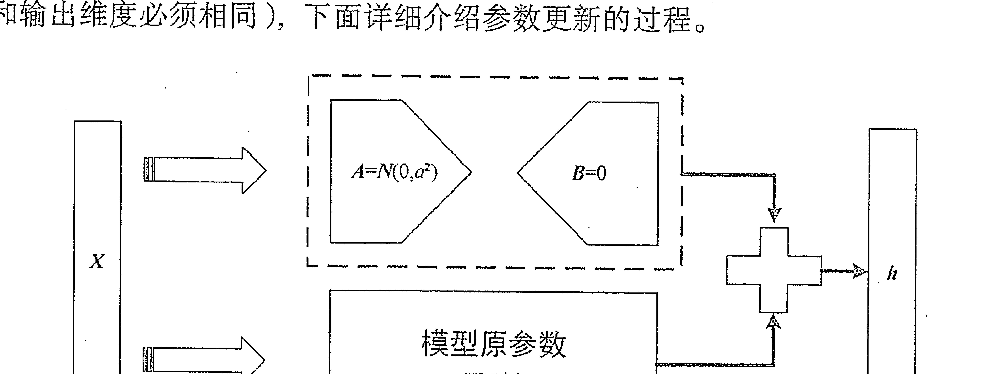

输入向量记为 X，PLM 中的全连接层权重记为 W，低秩矩阵为 A、B。A 的初始值通常用高斯分布初始化，B 初始化为零矩阵，确保训练起点时 BA = 0 不干扰原有预测。推理时 h = WX + BAX = (W + BA)X，只需把训练好的 BA 加到原始 W 上即可，无额外计算开销。

实验显示，以本征秩 r=8 为例，对130亿参数的 LLaMA 模型进行 LoRA 微调，模型规模超20GB，而实际更新的参数不足3000万，资源效率远超传统全量微调。

# 8.1.2 AdaLoRA 动态预算分配

LoRA 的效果虽好，却要求所有增量矩阵使用相同的本征秩 r，这忽略了不同层、不同模块权重差异带来的不稳定。为此 Qingru Zhang 等人提出 AdaLoRA，论文《Adaptive Budget Allocation for Parameter-Efficient Fine-Tuning》给出了动态分配方案。

1) AdaLoRA 会根据对任务的影响程度评估每个增量矩阵的重要性，对影响大的矩阵给予更高秩、更多参数预算，对影响小的矩阵降低秩，防止过拟合并节省算力。
2) 参数更新采用奇异值分解进行参数化，结合重要性指标剔除不重要的奇异值，保留关键奇异向量。该做法降低了对大矩阵做精确 SVD 的计算成本，提升了稳定性和速度。

# 8.1.3 QLoRA 4位量化微调

70亿和130亿参数模型在显存占用上已相对友好，配合 LoRA 的小参数更新，使得低显存 GPU 服务器也能完成微调。但模型规模继续放大时，例如660亿参数的 LLaMA 约需300GB 显存，16位量化存储微调需超过780GB，常规 LoRA 已力不从心。

| 量化压缩存储表征       | 70亿个参数的大模型占用的显存 | 130亿个参数的大模型占用的显存 |

| 16位               | 13GB                     | 24GB                       |

| 8位                | 7.8GB                    | 15.6GB                     |

| 4位                | 3.9GB                    | 7.8GB                      |

为此 Tim Dettmers 等人提出 QLoRA，论文《QLoRA:Efficient Finetuning of Quantized LLMs》。该方法把预训练模型压缩为4位表示，并引入可学习的适配器权重，通过反向传播对量化权重进行微调。QLoRA 支持4位存储与 BFloat16 计算，权重使用时先转成 BFloat16 再做16位矩阵乘法。实现上依赖4位 Normal Float NF4 量化和双量化技术，保证高保真微调。

# 8.1.4 DeepSpeed ZeRO-3 协同微调

DeepSpeed 是微软开源的大模型训练加速库，目标是提升训练效率与扩展性。它提供模型并行、梯度累积、动态精度缩放、混合精度等手段，并附带分布式训练管理、内存优化、模型压缩等工具。基于 PyTorch 构建，迁移成本低，已广泛用于语言、视觉等大规模任务。

零冗余优化器 ZeRO 是 DeepSpeed 的核心内存优化技术，可将百亿参数模型的训练速度提升3至5倍，并为万亿参数训练提供可能。它融合数据并行与模型并行的优点，在数据并行进程间拆分模型状态、梯度、优化器状态，消除冗余内存占用与重复传输，并采用动态通信调度维护计算粒度。目前支持 ZeRO-1 优化器状态分区、ZeRO-2 梯度分区、ZeRO-3 参数分区。ZeRO-3 可在4块 RTX A100 上运行数十亿参数模型。

## 8.2 模型压缩三大手法

让模型更轻、更快、仍能可靠推理是研究重点。模型压缩是关键手段，常见方向有剪枝、知识蒸馏和量化压缩。

## 8.2.1 剪枝 去冗余

深度网络常含大量冗余参数，只有少数权重和节点对结果起关键作用。剪枝通过移除无用节点减小网络规模，降低计算成本并保持推理质量，类似园艺修剪。

典型流程：
+ (1) 先训练一个性能好但较慢的原始模型。
+ (2) 识别贡献小的参数并置零。
+ (3) 在训练数据上微调以弥补结构变化的损失。
+ (4) 评估大小、速度与效果，不达标则继续剪枝。

剪枝分为非结构化与结构化。非结构化剪枝针对单个权重或行列进行稀疏化，形成稀疏矩阵，需计算平台支持高效稀疏运算。结构化剪枝以滤波器或通道为单位，改变网络结构，更容易部署。

非结构化包含权值剪枝与神经元剪枝。权值剪枝按权重大小排序，将靠后的比例置零。神经元剪枝计算每个神经元对应行列权重的均值排序后删除低分节点。

结构化剪枝即滤波器剪枝，包含 Filter-wise、Channel-wise、Shape-wise。Filter-wise 删除完整卷积核，Channel-wise 保留同层部分权重，Shape-wise 在卷积核内保留特定区域权重。

## 8.2.2 知识蒸馏 教师带学生

大模型结构复杂、泛化强，小模型因规模受限表达不足。知识蒸馏把大模型的经验迁移到小模型，提升小模型性能并压缩参数。

该技术源于 Geoffrey Hinton 的《Distilling the Knowledge in a Neural Network》，采用教师-学生框架。

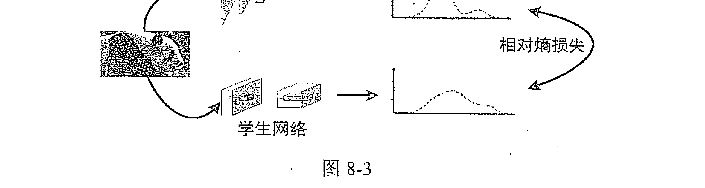

流程分两步：先训练一个参数更多、结构更复杂的教师网络，再用教师网络指导学生网络学习。学生并不直接拟合真实标签，而是学习教师输出的软标签，从而获得更丰富的类别间关系信息，提升泛化能力。

## 8.2.3 量化压缩 精度换效率

科学计算常使用32位或64位浮点，深度学习乘加运算密集，量化压缩可把权重与激活值从高精度转为低精度，同时保持较高准确率。

主要收益：
(1) 体积显著减小，8位量化后约为原版1/4；
(2) 传输功耗降低，适合移动端；
(3) 8位运算速度通常快于32位浮点。

量化本质是函数映射，分为线性与非线性。线性量化即均衡量化，相邻量化值间隔固定，用缩放因子 s 将浮点数映射为整数再舍入截断，反量化不完全等价。非线性量化间隔随数据分布调整，数据密集区用小间隔提升精度，稀疏区用大间隔保持效率，理论上优于线性。

大模型压缩普遍采用量化，最低可至4位编码。4位显存需求仅为16位的1/4，使得中小公司也能驾驭数百亿参数模型。

# 8.3 实战篇 LoRA 微调

本节以 LoRA 与 Finetune 为主线，介绍真实训练环境的操作要点，帮助读者建立可复现的微调能力。

## 8.3.1 13B LLaMA 部分参数微调案例

以130亿参数的 LLaMA 为例，说明部分参数微调流程。服务器配置见下表，采用 Torch + Transformers 组合。建议 Python 不低于3.8，Transformers 不低于4.28，Peft 集成 LoRA 的版本为0.2.0，物理机环境更稳定。

| 操作系统 | Ubuntu 20.4 |

| GPU 驱动型号 | 512.125.06 |

| CUDA 版本 | 12.0 |

| Python 版本 | 不低于 3.8 |

| 深度学习框架 | Torch |

| Transformer 版本 | 不低于 4.28 |

| 内存大小 | 128GB |

| 硬盘大小 | 大于 1TB |

| Peft | 0.2.0 |

基于 LoRA 的微调在服务器上的关键配置参考表 8-2，LLaMA 自身与 LoRA 的具体参数对照见表 8-3。其中 LoRA 的秩 Lora_r 设为 8，缩放系数 Lora_alpha 设为 16，dropout Lora_dropout 设为 0.05，LoRA 只对 Transformer 结构中的 q_proj 与 v_proj 两个投影矩阵进行低秩适配。

| Llama_config | Epoch | 5 |

| Llama_config | Per_batch_size |

# 第8章 中小团队的大模型实战路径 | 159

基于 DeepSpeed 的微调在服务器上的主要配置见表 8-4，模型本身与 DeepSpeed 的参数对照见表 8-5，其中 Zero_optimization 打开至 3 级，优化器选用 AdamW。

## 表 8-5

|                | Epoch       | 5          |

| -------------- | ----------- | ---------- |

| Llama_config   | Per_batch_size | 2         |

|               | Learning_rate | 8e-6     |

|               | Max_length  | 1024      |

| deepspeed_config | Zero_optimization | 3       |

|               | optimizer   | AdamW     |

用 DeepSpeed 完成约 10 万条样本、5 个批次的训练大约需要 3 天。为避免训练中断，建议用 Tmux 在后台启动。LLaMA 搭配 DeepSpeed 的损失曲线如图 8-5 所示，整体走势与 LLaMA 搭配 LoRA 的曲线如图 8-4 所示基本吻合，只是初始损失偏高但下降速度更快。

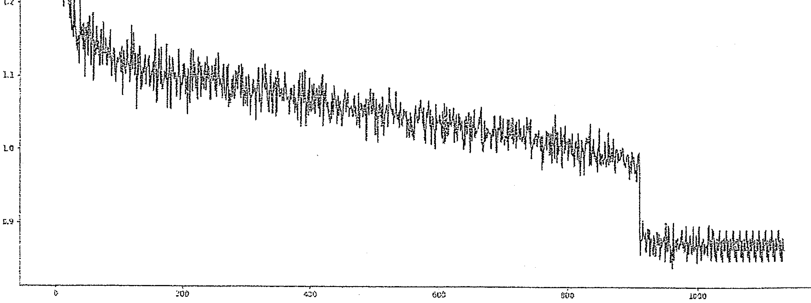

## 图 8-5

# 8.4 模型压缩实战指南

本部分聚焦工程落地中的量化压缩，以 LLaMA 压缩为例帮助理解 8 位量化与 4 位量化的实操要点。

## 8.4.1 8 位量化实操

8.2 节提到三类压缩手段，真正大规模落地的多是量化压缩，原因主要有三点。
(1) 大模型的规模直接决定推理表现，剪枝或知识蒸馏都会削减参数量，从而削弱能力。
(2) 剪枝与蒸馏实施门槛较高，量化压缩操作更简便，适用面更广。
(3) 蒸馏与剪枝往往需要二次训练，流程更繁琐，而量化压缩成本更低。

当前大模型多以 16 位量化存储，具体位数可通过查看 config.json 文件确认，如图 8-6 所示。下面仅演示 8 位与 4 位量化存储的实践。

```
[
  "architectures": ["LLaMAForCausalLM"],
  "bos_token_id": 0,
  "eos_token_id": 1,
  "hidden_act": "silu",
  "hidden_size": 5120,
  "intermediate_size": 13824,
  "initializer_range": 0.02,
  "max_sequence_length": 2048,
  "model_type": "llama",
  "num_attention_heads": 40,
  "num_hidden_layers": 40,
  "pad_token_id": -1,
  "rms_norm_eps": 1e-06,
  "torch_dtype": "float16",
  "transformers_version": "4.27.0.dev0",
  "use_cache": true,
  "vocab_size": 32000
]
```

# 第8章 中小团队的大模型实战路径 | 161

以 16 位量化存储的 LLaMA_13B 为例说明 8 位量化做法。Hugging Face 的 Transformers 库已内置 8 位量化加载方式，只需安装 accelerate 与 bitsandbytes，然后在导入模型时设置对应参数即可，如图 8-7 所示。

```
from transformers import AutoModelForCausalLM
model=AutoModelForCausallM.form_pretrained(model_path, torch_dtye=torch.float16,
device_map="auto", config=model_config, load_in_8bit=True)
```

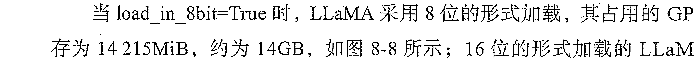

当设置 load_in_8bit=True 时，LLaMA 以 8 位方式载入，GPU 显存占用约 14 215MiB，即约 14GB，如图 8-8 所示；以 16 位方式载入的 LLaMA 如图 8-9 所示，显存占用大约是 8 位加载的两倍。


## 8.4.2 4 位量化实操

同样以 16 位存储的 LLaMA-13B 为例说明 4 位量化方法。官方库并未提供现成的 4 位量化模型，需要使用者先用压缩算法把 16 位模型转成 4 位再使用。市面已有不少开源实现可直接套用。

生成式预训练转换器量化 Generative Pre-trained Transformer models Quantization，GPTQ，更多细节可参考 Elias Frantar 等人论文“GPTQ: Accurate Post-Training Quantization for Generative Pre-trained Transformers”，是一种面向 GPT 系列的单次后训练权重量化方法，核心是借助近似二阶信息实现高精度高效压缩。

GPTQ 大约在 4 个 GPU 小时内即可把 1750 亿参数、16 位编码的 GPT 模型压缩为 3 位或 4 位编码，精度损失可以忽略。相较传统量化，GPTQ 压缩增益提升一倍以上且保持精度。即使在极端压缩下仍具可用性，例如权重量化到 2 位或三元量化。GPTQ 支持端到端推理加速，相对于原模型，在 NVIDIA RTX A100 上加速约 4.5 倍，在 NVIDIA RTX A6000 上加速约 3.25 倍。GPTQ 是首个证明可将数百亿参数语言模型量化到每个权重 3 位或 4 位的方法。

GitHub 上有大量 GPTQ 实现，支持 OPT、BLOOM、LLaMA 等多种生成模型。GPTQ 可将 18 位大模型量化为 4 位、3 位甚至 2 位。

对 LLaMA 做 GPTQ 压缩时，只需运行 llama.py 文件，如图 8-10 所示。

```
Here is a sample command:
python llama.py LLAMA_HF_FOLDER c4 --wbits 4 --true-sequential --act-order --new-eval
```

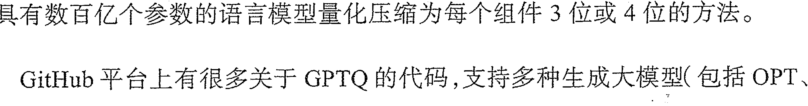

实测中 LLaMA 以 4 位方式加载占用内存约 7820MiB，如图 8-11 所示；而 8 位加载的 LLaMA 如图 8-8 所示占用约 14 215MiB，约为 4 位加载的接近一倍。

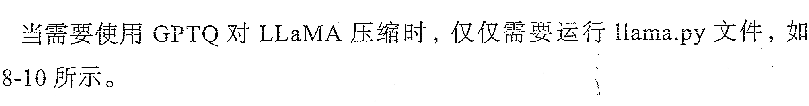

# 8.5 思考与展望

ChatGPT 面世已半年有余，目前对大模型的应用需求正趋于理性。大模型对人类产生了深远影响，可归纳为三点：

(1) 自然语言处理能力突出。理解与生成自然语言取得突破，计算机对人类表达的理解更精准，人机交互效率显著提升，无论工作还是生活都获得了更智能的辅助。

(2) 多模态交互优势明显。图像、视频、语音等内容创作从数小时缩短到数十秒，改变了工作方式，影响或将长期持续。

(3) 商业普及加速。AI 在企业落地提速，效率提升、成本下降、用户体验优化，政府与社会也获得智能决策支持，有助于解决社会难题。

尽管大模型仍有不足，其影响已不可逆转。个人与企业只能主动拥抱。当前是“百模大战”时代，也是中小公司弯道超车的窗口期。顺势找准定位、用好大模型，方能立于潮头。

# 第9章 多模态大模型零到一部署实战

前文已介绍多模态大模型的发展、技术与评测，本章聚焦落地：如何在服务器上从零部署多模态大模型。以 VisualGLM-6B 部署为例拆解全过程。

# 9.1 部署环境准备清单

完成多模态大模型部署与发布需要软硬件支撑，主要包括显卡、操作系统、显卡驱动、并行计算平台 CUDA 与神经网络库 cuDNN，分述如下。

## 1. 显卡硬件
显卡由显存、GPU、电路板等构成，GPU 是核心计算单元，负责图像、动画、视频等并行密集任务。在多模态大模型训练与推理中 GPU 必不可少。市面型号丰富，包括 NVIDIA、AMD、Intel、Adreno 等，性能与价格各异。

## 2. 操作系统
服务器常用系统有 Ubuntu、CentOS、KylinOS 等。

## 3. 显卡驱动程序
驱动是操作系统中用于驱动显卡的程序，不同系统与 GPU 型号对应不同驱动。

## 4. CUDA
NVIDIA 显卡需安装 CUDA。进入官网选择对应系统与版本获取安装命令，安装后可用 nvcc --version 或 nvcc -V 验证。官网编程手册提供矩阵转置、乘法、卷积等样例。

## 5. cuDNN
cuDNN 是 NVIDIA 的深度神经网络计算加速库，对卷积、池化、激活、归一化等层深度优化，适配 PyTorch、TensorFlow、Keras、Caffe2、PaddlePaddle 等框架。注意并非所有 GPU 场景都必须安装 cuDNN，未安装仍可在多数场景使用 GPU。

# 9.2 部署全流程拆解

在 9.1 节准备好环境后即可部署。以 VisualGLM-6B 为例，使用的显卡为 NVIDIA RTX A6000，系统为 Ubuntu 20.04.1，CUDA 为 cuda11.1，cuDNN 为 cudnn v8.0.4，Python 为 3.9.12。

整体流程为：下载源代码、下载模型、安装 Python 依赖、按需开发 API、启动部署程序。

+ 1. 下载 VisualGLM-6B 源代码
可从 GitHub 直接下载，或在 Linux 服务器上用 git clone 拉取。

+ 2. 下载 VisualGLM-6B
模型与源码路径不同，模型托管于 Hugging Face 模型库。也可通过 git lfs 下载大文件，加快传输。

+ 3. 安装需要的 Python 包
源码中的 requirements.txt 记录了所需包及版本，可一键安装：

```
pip install -r requirements.txt
```

# 第 9 章 从 0 到 1 部署多模态大模型 | 167

使用阿里云或清华源加速时，可执行：
pip install -i 下载地址 -r requirements.txt

+ 4. 根据具体使用方式开发 API
常见三种接入方式。

第一种是命令行方式。在 Python 命令行输入信息，模型推理后将结果输出到命令行。图像描述与视觉问答任务先输入图像本地路径或 URL，再进入纯文本多轮对话，输入 clear 重启，输入 stop 退出。适合学习者理解代码逻辑。

第二种是 API 调用方式。将模型封装为接口供其他应用调用，输入输出遵循约定格式。常用封装有 FastAPI、Flask、Django。适合开发者构建上层功能。

第三种是 Web 页面访问方式。基于模型搭简易 Web 前端，直观输入输出。常见框架有 Gradio、Streamlit，适合初学者快速体验。

+ 5. 启动部署程序
最后启动服务进行真实交互，用 Python 运行启动脚本即可：

```
nohup python web_demo.py > log.txt &
```

若服务器可用 GPU，模型会自动在 GPU 加载，否则回落到 CPU。

启动时可指定参数，例如：

```
nohup python web_demo.py --max_length 2000 --top_p 0.5 >log.txt &
```

该命令限制最大输出 2000 个字符，top_p 设为 0.5。

VisualGLM-6B 共 78 亿参数，默认 FP16 加载约需 15GB 显存。模型支持量化压缩节省显存，INT8 量化最低约需 11GB，INT4 量化最低约需 8.7GB，可在消费级显卡运行。

# 9.3 Flask 框架 API 开发实战

## 1. Flask 框架介绍
Flask 是 Python 的轻量级 Web 框架，上手快、灵活、可定制，适合小型网站。每个视图函数绑定唯一 URL，请求到达时调用对应函数并返回结果给浏览器。

## 2. Flask 框架的应用案例
一个简单的 Flask 应用案例代码如下：

```
from flask import Flask\napp = Flask( __name__ )\n@app.route('/muti_round_chart',methods=['POST'])\ndef index():\treturn '你好!'\nif __name__ == '__main__':\tapp.run(debug=False,host='0.0.

# 170 | 多模态大模型：技术原理与实战


tokenizer=AutoTokenizer.from_pretrained(model_path, trust_remote_code=True)
model=AutoModel.from_pretrained(model_path, trust_remote_code=True).half().cuda()
```

这段关键逻辑集中在第三个代码块里，它是多模态大模型落地部署的核心载体。

```
@app.route('/muti_round_chart', methods=['POST'])
def generate_text_stream():
    if request.method != 'POST':
        return Response('request method must be post!!')
    data = request.get.data()
    data = json.load(data)
    image = data['image']
    prompt = data['prompt']
    def generate_output():
        torch.cuda.empty_cache()
        def base64_to_image_file(base64_str, image_path):
            base64_data = image.split(',')[ -1]
            image_data = base64.b64decode(base64_data)
            with open(image_path, 'wb') as f:
                f.write(image_data)
            image_path = os.path.join(BASE_DIR, 'examples/xx.png')
            base64_to_image_file(image, image_path)
            for reply, history in model.stream_chat(tokenizer, image_path, prompt, history=[], max_length=9000, top_p=0.4, top_k=45, temperature=0.4):
                query, response = history[-1]
                yield f'data:{json.dumps(response, ensure_ascii=False)}\n\n'
    return Response(generate_output(), mimetype='text/event-stream')
```
# 第9章 多模态大模型零到一部署 | 171

该模块共拆成三大部分。

(1) `generate_text_stream` 函数。负责承接外部请求，解析其中 base64 编码的图片和自然语言指令，并以流式形式返回图像描述或图文问答结果。Flask 端的流式响应是通过把 `mimetype` 设为 `text/event-stream` 实现的。函数内部会调用 `generate_output` 来完成真正的多模态问答。

(2) `generate_output` 函数。承担两项工作，一是每次 API 调用前主动释放 Torch 占用的 CUDA 显存，防止显存长期堆积导致溢出；二是根据图片 URL、历史对话、用户指令以及期望输出长度等参数，驱动多模态大模型进行多轮对话推理。

(3) `base64_to_image_file` 函数。HTTP POST 请求无法直接携带原始图片，只能先转成 base64 传输，而模型本身不支持 base64。于是需要把 base64 还原为本地图片并生成可访问的 URL。函数接收 base64 输入，写入指定目录，之后模型就能通过 URL 读取图片进行问答。

随后第四个代码块通过调用 `run` 方法启动 Flask 服务。

```
if __name__ == '__main__':
    app.run(debug=False, host='0.0.0.0', port=8000)
```
# 4. Flask 框架 API 调用

Flask 服务启动后，就可以通过接口请求来验证和评估模型表现了。按当前配置，请求地址为 `http://ip:port/muti_round_chart`，ip 与 port 对应 Flask 启动时指定的网络地址和端口。请求方式为 POST，输入参数需按接口约定组织。
# 9.4 Gradio 构建 Web 界面
# 1. Gradio 框架概览

Gradio 是一个面向初学者的 Python 库，用来快速把机器学习与深度学习模型封装成交互式 Web 应用。

过去展示模型能力流程繁琐：算法工程师出模型和接口，后端工程师开发服务并对接，最后前端工程师做页面渲染。Gradio 把算法接口、后端服务和前端页面统一到同一份 Python 代码里，极大简化了协作成本。

上手简单、组件封装度高，还能一键分享生成的页面，很适合快速验证。

# 2. Gradio 快速上手案例

使用前先安装依赖，执行官方安装命令即可。

```
pip install gradio
```

现在用 Gradio 实现一个最简的输入输出示例：输入任意字符，程序返回 “Hello” 加上该字符。

```
import gradio as gr
```
# 第9章 多模态大模型部署全流程 | 173

```
def main(text):
    return "Hello" + text + "!"
demo = gr.Interface(fn=main, inputs="text", outputs="text")
demo.launch()
```
运行后可在浏览器看到效果，默认地址为 127.0.0.1，端口为 7860。

把最后一行改为 `demo.launch(share=True)` 即可生成公网访问链接，任何人都能打开该页面。接下来可以基于 Gradio 实现图像分类：上传图片、指定若干类别，返回图片在各类别上的概率分布。

```
import gradio as gr
def image_class(image):
    return {"大雁": 0.7, "喜鹊": 0.2, "鹦鹉": 0.1}
demo = gr.Interface(fn=image_class, inputs="image", outputs="label")
demo.launch()
```
除此之外，Gradio 还支持多输入多输出、自定义组件、动态页面等能力，有兴趣可以进一步查阅文档。
# 3. 基于 Gradio 开发 Web 页面

借助 Gradio 这样轻量的页面开发框架，多模态大模型的能力展现变得非常高效。整体代码被拆成多个片段，下面逐段解析。

第一个代码块负责导入必要的 Python 依赖，主要是多模态大模型的词表加载和预训练模型加载相关包。

```
from transformers import AutoModel, AutoTokenizer
import gradio as gr
import torch
```
第二个代码块实现了 `predict` 函数。这是推理预测的核心入口，函数接收多项输入参数，在多模态大模型上完成推导，并以流式方式返回生成内容以及更新后的对话历史。

```
def predict(input, image_path, chatbot, max_length, top_p, temperature, history):
    if image_path is None:
        return [(input, "图片不能为空。请重新上传图片。")], []
    chatbot.append((input, ""))
    with torch.no_grad():
        for response, history in model.stream_chat(tokenizer, image_path, input, history, max_length=max_length, top_p=top_p, temperature=temperature):
            chatbot[-1] = (input, response)
    yield chatbot, history
```
返回结果包含两部分：本次生成的文本内容和新的对话历史，以便保持连续的多轮交互。

第三个代码块实现了 `predict_new_image` 函数。实现思路与 `predict` 类似，主要用于用户首次上传图片或清空记录后重新上传时，快速获取图片的基础描述，为后续多轮对话提供上下文。

```
def predict_new_image(image_path, chatbot, max_length, top_p, temperature):
    input, history = "描述这张图片。", []
    chatbot.append((input, ""))
    with torch.no_grad():
        for response, history in model.stream_chat(tokenizer, image_path, input, history, max_length=max_length, top_p=top_p, temperature=temperature):
            chatbot[-1] = (input, response)
    yield chatbot, history
```
# 174 | 多模态大模型技术与实践

第四个代码块实现了 `reset_user_input` 与 `reset_state` 两个函数。用户点击 “clear” 按钮时，程序会重置用户输入变量和会话状态变量。

```
def reset_user_input():
    return gr.update(value='')
```

```
def reset_state():
    return None, [], []
```
第五个代码块负责加载多模态大模型的词表和预训练权重。注意模型可做量化压缩以节省显存，INT8 量化最低约需 11GB 显存，INT4 量化最低约需 8.7GB 显存。

```
global model, tokenizer
tokenizer = AutoTokenizer.from_pretrained("THUDM/visualglm-6b", trust_remote_code=True)
if args.quant in [4, 8]:
    model = AutoModel.from_pretrained("THUDM/visualglm-6b", trust_remote_code=True).quantize(args.quant).half().cuda()
else:
    model = AutoModel.from_pretrained("THUDM/visualglm-6b", trust_remote_code=True).half().cuda()
model = model.eval()
```
第六个代码块的 `main` 函数是 Gradio Web 页面的核心。页面包含用户上传图片的输入区、文本指令输入区、可调模型参数区，以及由 Chatbot 组件展示模型生成内容的输出区，同时提供 “Generate”、“Clear” 以及删除已上传照片等按钮。图9-1 展示了该页面的交互效果。

```
def main():
    with gr.Blocks(css='style.css') as demo:
        with gr.Row():
            with gr.Column(scale=2):
                image_path = gr.Image(type="filepath", label="Image Prompt", value=None).style(height=504)
            with gr.Column(scale=4):
                chatbot = gr.Chatbot().style(height=480)
        with gr.Row():
            with gr.Column(scale=2, min_width=100):
                max_length = 1024
                top_p = gr.Slider(0, 1, value=0.4, step=0.01, label="Top P", interactive=True)
                temperature = gr.Slider(0, 1, value=0.8, step=0.01, label="Temperature", interactive=True)
            with gr.Column(scale=4):
                with gr.Box():
                    with gr.Row():
                        with gr.Column(scale=2):
                            user_input = gr.Textbox(show_label=False, placeholder="Input...", lines=4).style(container=False)
                        with gr.Column(scale=1, min_width=64):
                            submitBtn = gr.Button("Generate")
                            emptyBtn = gr.Button("Clear")
                        history = gr.State([])
                    submitBtn.click(predict, [user_input, image_path, chatbot, max_length, top_p, temperature, history], [chatbot, history], show_progress=True)
                    image_path.upload(predict_new_image, [image_path, chatbot, max_length, top_p, temperature], [chatbot, history], show_progress=True)
                    image_path.clear(reset_state, outputs=[image_path, chatbot, history], show_progress=True)
                    submitBtn.click(reset_user_input, [], [user_input])
                    emptyBtn.click(reset_state, outputs=[image_path, chatbot, history], show_progress=True)
                    demo.queue().launch(inbrowser=True, server_name='0.0.0.0', server_port=8080)
```
# 175 | 多模态大模型技术与实践

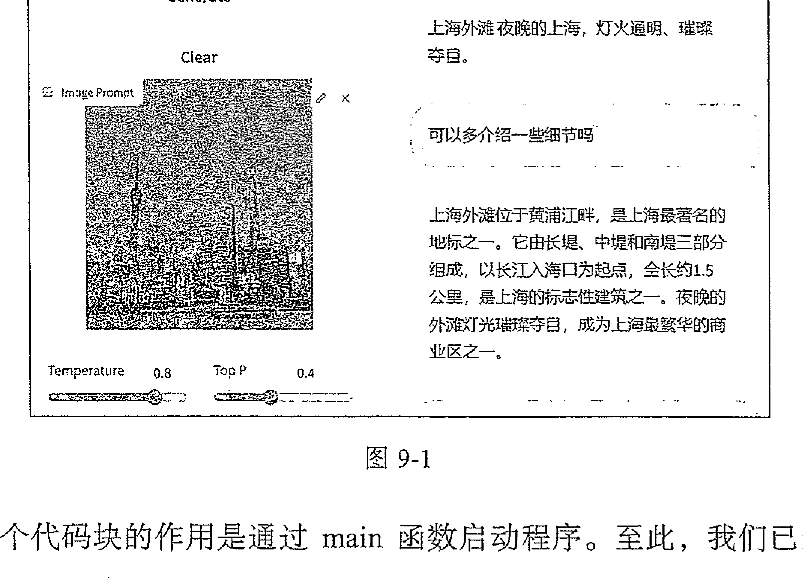
第七个代码块通过调用 `main` 函数启动程序。至此，基于 Gradio 开发多模态大模型 Web 页面的完整流程已介绍完毕。

```
if __name__ == '__main__':
    main()
```

Gradio 不只提供了基础的交互组件，生态里还有不少更复杂的高级控件和交互模式，网页端可以同时完成文字、图片、语音、视频的输入与输出。对刚开始接触多模态大模型的学习者来说，Gradio 是一个体验门槛很低、效果直观的选择。

# 9.5 其它主流部署方式概览
前面已经演示了基于 Flask 与 Gradio 的模型上线思路，工程实践中还有几套被广泛使用的方案，典型就是 FastAPI、Django、Tornado 来承载多模态大模型。

# 1. FastAPI 部署实操指南
FastAPI 是基于 Python 的高性能 Web 框架，运行效率能和 Go 相媲美，在 Python 阵营里属于速度领先的一类。它上手快、智能补全能力强，写代码的同时还能自动生成可交互的 API 文档。用 FastAPI 开发可以大幅减少重复代码和潜在漏洞，开发效率会有明显提升。

开始前先安装对应的 Python 依赖：

```
pip install fastapi
pip install uvicorn
```

一个最小可运行的 FastAPI 示例示意如下：

```
import uvicorn
from fastapi import FastAPI
app = FastAPI()
@app.get('/')
async def main():
    return {"message": "Hello World"}
if __name__ == '__main__':
    uvicorn.run(app, host='0.0.0.0', port=8080, workers=1)
```

整体流程是先导入依赖库，实例化 FastAPI 对象，再声明路由与处理函数，最后绑定 IP 与端口启动服务。

# 2. Django 部署实操指南
和 Flask、FastAPI 这类轻量框架不同，Django 面向的是可大规模扩展的企业级应用和大型互联网站点，Disqus、Instagram、Spotify 等产品都基于它构建。Django 扩展性强、安全性好，支撑千万级并发访问没有问题，而且和各种机器学习算法的结合非常顺滑，对算法工程师很友好。

安装所需依赖包的命令为：

```
pip install Django
pip install Django-cors-headers
```

# 第9章 多模态大模型从零到一部署实录
Django 自带的文件与依赖相对较多，本文不展开具体示例，有兴趣的同学可以自行查阅官方文档深入学习。

## 3. Tornado 框架部署要点
Tornado 也是 Python 系的 Web 框架，但运行机制和 Flask、Django 有本质区别。后两者属于同步框架，并发请求多时性能会受限；Tornado 是异步非阻塞框架，单机每秒可处理上千次请求，速度很快，更适合高负载环境。

先安装依赖：

```
pip install tornado
```

## 一个简单的 Tornado 代码示例
```
import tornado.ioloop
import tornado.web
class MainHandler(tornado.web.RequestHandler):
    def get(self):
        self.write("Hello World!")

def make_app():
    return tornado.web.Application([(r"/", MainHandler),])
if __name__ == '__main__':
    app = make_app()
    app.listen(8000)
tornado.ioloop.IOLoop.current().start()
```

上面这段 Tornado 示例实现了输出 “Hello World” 的基础功能。

## 4. Docker 容器化部署
Docker 的思路是在物理机上创建若干隔离的容器，每个容器相当于一台虚拟服务器，作用类似虚拟机。容器化能实现开发环境的隔离，也便于打包迁移。前面提到的 Flask、Django、Tornado 都可以在容器内运行。

安装并启动 Docker 后，先从镜像仓库拉取基础镜像，例如 Python 3.9：

```
docker pull python:3.9
```

拉取完成后，用该镜像创建容器，比如命名为 docker_test、映射 8000 端口：

```
docker run itd -p 8000:8000 --name docker_test. --restart unless-stopped python:3.9 bash
```

进入容器后即可在内部完成后续安装和部署操作：

```
docker exec -it docker_test bash
```

# 9.6 部署踩坑合集与解决思路
上线多模态大模型时问题层出不穷，软硬件环境和参数配置都会影响结果。下面以 VisualGLM-6B 为例，梳理常见的异常。

+ 1. GPU显存不足
显存不够时会直接报 “cuda out of memory” 错误。

## 2. 安装环境不匹配
各层环境需要相互兼容，建议严格按官方版本来。GPU 驱动要匹配显卡型号，cuDNN 要匹配 CUDA 版本，Python 建议 3.8~3.10 区间，torch-gpu 等依赖也要和 CUDA 版本对应。比如 Torch 与 CUDA 不匹配常见报错是 “CUDA error: no kernel image is available for execution on the device”。

## 3. Gradio 网页开发常见错误
使用 Gradio 搭建页面时偶尔会出现 “Something went wrong, connection error out”。通常可以先关闭服务器的网络代理，必要时把 Gradio 版本降到 3.21.0 以下。

## 4. VisualGLM-6B 文件缺失
VisualGLM-6B 由多个文件组成，pytorch-model-bin 被拆成 5 个子文件，还包括量化文件 quantization.py、配置文件 config.json 与 configuration_chatglm.py、词表文件 tokenization_chatglm.py 与 tokenizer_config.json 等。缺少任意一份模型都无法正常运行，例如缺少 ice_text.model 会报 “RuntimeError: Internal:/Users/runner/work/sentencepiece/sentencepiece/src/sentencepiece_processor.cc(1102)”。

## 5. 找不到模型路径
出现 “No module named ‘THUDM/VisualGLM-6B’” 说明程序定位不到模型。常见原因是手动下载后上传到服务器的位置与代码中声明的路径不一致。解决办法是将模型拷贝到代码要求的目录，或修改代码中的路径指向。

## 6. 量化压缩在 Windows 上报错
对 VisualGLM-6B 做 INT8/INT4 量化可以省显存，量化后的模型在 Linux 下通常正常，但在 Windows 下会失败。想在 Windows 正常使用，需要安装 GCC 与 openmp 以支持编译。

## 7. 多轮对话后显存持续上涨
多轮对话时历史记录不断累积，每次输入长度变大，导致显存占用逐渐升高最终溢出。可以限制历史轮数，例如只保留最近 10 轮，新增第 11 轮时丢弃最早的一轮，保持运行稳定。

## 8. 端口被占用
Gradio 默认端口是 7860，若被其他程序占用或容器内未映射该端口，服务无法启动。可在 demo.queue().launch 中手动指定其它空闲端口。

## 9. 生成文本重复或跑偏
模型容易出现属性错配或幻觉。重复词循环通常是 temperature、top_p 设置过小，模型总选概率最高词，导致死循环，可适当调大这两个参数；生成内容发散则是参数过大，候选词太多导致偏离主题，可适当调小。

## 10. 接口调用不通
用 Flask、FastAPI、Django 部署时接口可能连不上，原因多样：接口地址配错、Nginx 转发错误、请求方法 GET/POST 用错、参数传递错误、域名权限未开放、跨域问题等，需逐项排查。

# 第10章 多模态大模型应用场景全景
人类天然具备强大的自然语言理解能力，这是区别于其他智能体的关键。多模态大模型要逼近人类水平难度极大，人类对它的容错率很低。文艺创作、方案撰写、代码编写、数学推理等高阶任务对专业训练要求高，模型也尚未完全胜任。

目前多模态大模型刚起步，与产业结合仍在探索期，但发展潜力被普遍看好。技术复杂且涉及 AGI 多项能力，业界对其落地路径的认知还不够深入。很多人知道它好，却不清楚好在哪、怎么用。本章围绕六大领域展开，说明多模态大模型如何赋能具体业务，创造商业价值。

# 10.1 应用图谱总览
# 10.1.1 30个核心基础应用
ChatGPT 发布后，Kosmos-1、Visual ChatGPT、PaLM-E、GPT-4 等模型相继出现。快速发展背后有 8 项关键技术支撑：

+ (1) 神经网络与深度学习能力持续增强
+ (2) Transformer 与自注意力机制普及
+ (3) BERT 的发展推动了 VideoBERT 等视觉-语言模型
+ (4) Vision Transformer 使 Transformer 能处理图像，形成系列视觉预训练模型
+ (5) BEiT 推动图像大规模自监督学习
+ (6) 思维链提升推理能力
+ (7) ChatGPT 重燃行业热情并大幅提升自然语言生成水准
+ (8) 扩散模型与大模型结合推动文生图发展

目前最常见的多模态融合仍是语言、文本、图像、视频，典型如文生图、图生文、视频标注等。图10-1 汇总了 30 个基础应用。

| 图像生成 | 语音生成 | 视频生成 | 多模态翻译 | 多模态对话 |

| 图像编辑 | 语音编辑 | 视频编辑 | 情绪识别 | 巡检 |

| 图像描述 | 语音描述 | 视频描述 | 多模态目标检测 | 数字人 |

| 图像检索 | 语音检索 | 视频检索 | 多模态目标识别 | 艺术创作 |

| 图像问答 | 语音问答 | 视频问答 | 多模态目标追踪 | 智能助手 |

| 图像理解和推理 | 语音理解和推理 | 视频理解和推理 | 多模态路径规划 | 生物识别 |

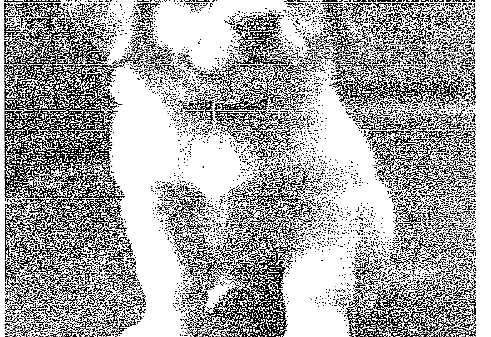

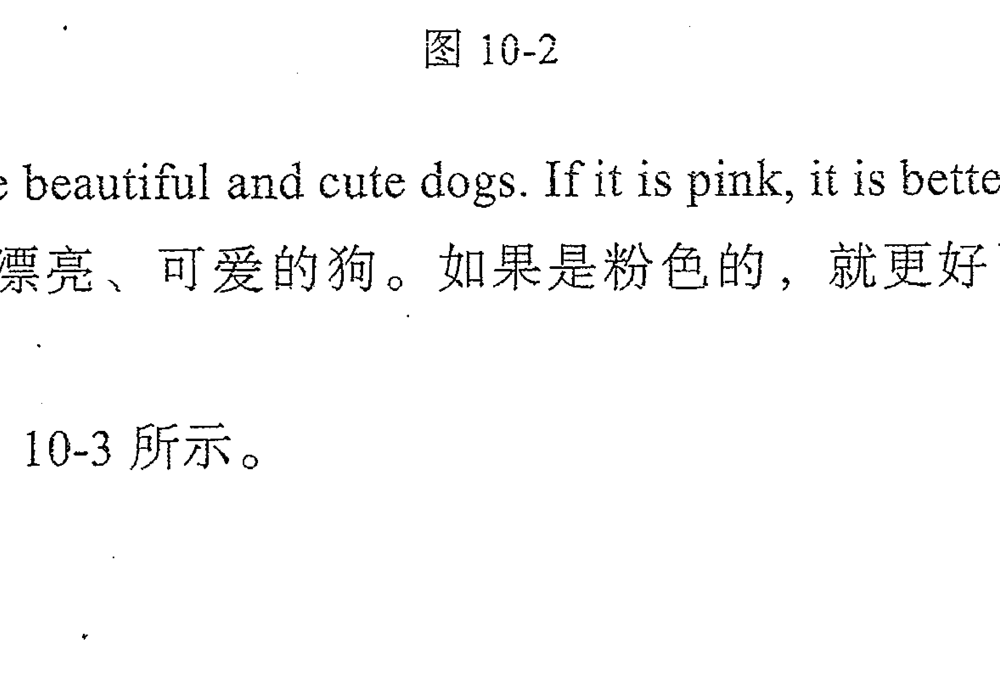

输入 1: I like beautiful and cute dogs. Please show me a photo.(我喜欢漂亮、可爱的狗。请给我看一张照片。)

输出 1: 如图 10-2 所示。

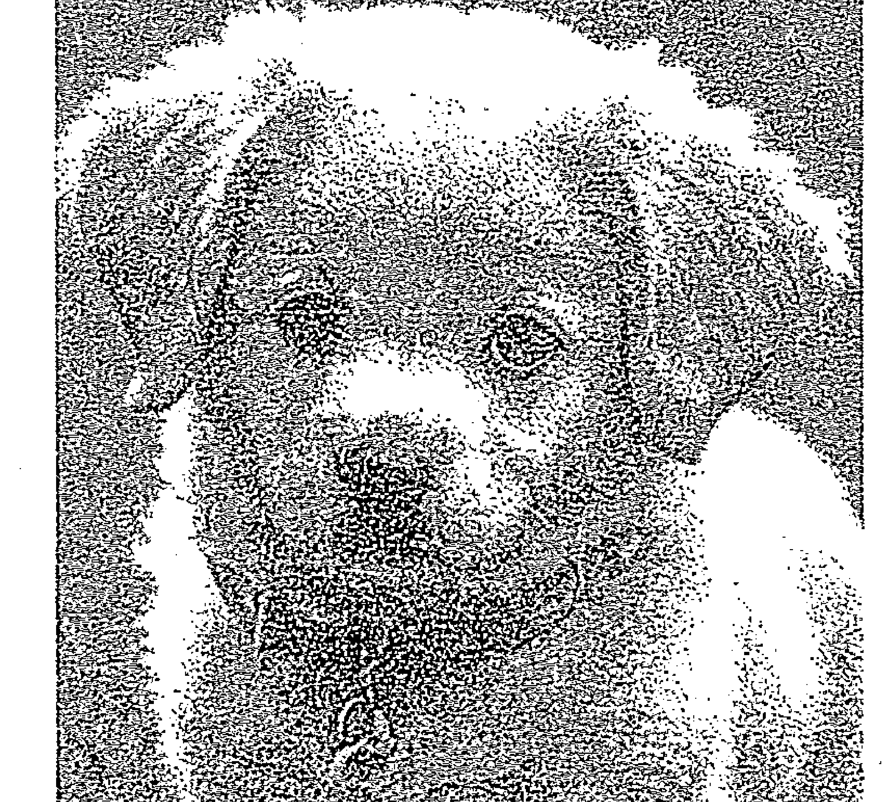

# 图10-3
总体来看图像生成技术已相对成熟，能满足大部分商业场景。以 Logo 设计为例，输入文字描述即可自动生成公司 Logo。

输入3：我们公司的中文名称是“数擎智”，英文名称是“Deep Digital Intelligence”，请帮公司设计一个Logo，色调偏橙色。

输出3：如图10-4所示。

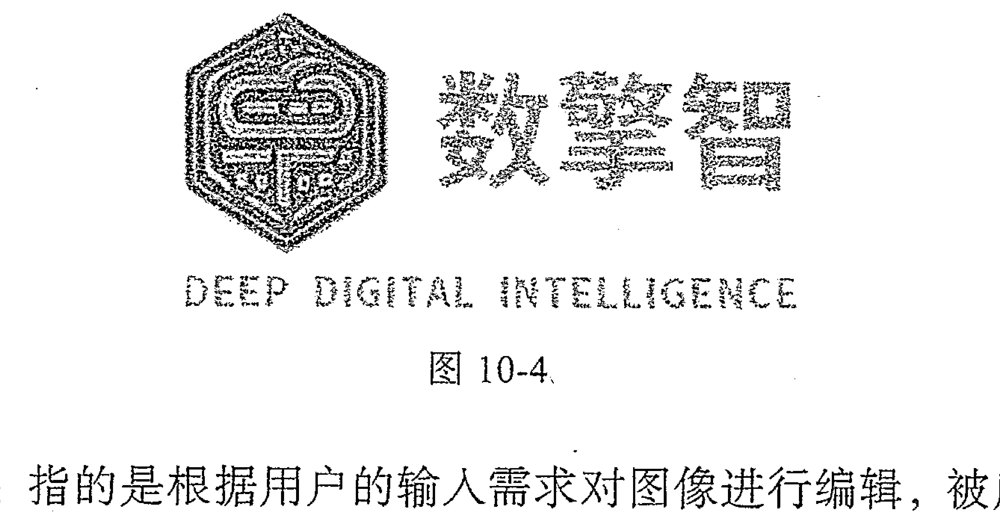

# 图10-4
图像编辑：依据用户指令对原图进行修改，广泛用于多媒体创作。

图像描述：把一张图片的主要内容用自然语言表述出来。

图像检索：按需求从海量图片中找匹配项，多模态大模型能显著提升检索精度。

[PAGE 200]

图像问答：用户上传图片并提问，模型基于图像语义给出自然语言回答，并支持多轮对话。

图像理解和推理：不仅理解图片表达，还能做更高阶推理，如找相似图或解决图形数学题。

语音生成：根据文本、图像等输入合成符合预期的语音，在素材创作中应用广泛。

语音编辑：基于多模态输入对语音进行剪辑、修改等处理。

语音描述：把一段语音内容转成自然语言描述。

语音检索：按需求检索目标语音。

语音问答：用户输入语音提问，模型基于语音语义回答，并可多轮交互。

语音理解和推理：理解语音意图并做进阶推理，如语音转文本/图像/视频。

视频生成：依据文本、语音、图像等输入生成目标视频，用于多媒体创作。

视频编辑：根据多模态输入对视频进行分割、修改、合并等操作。

视频描述：用自然语言概括视频主要内容。

视频检索：按需求检索视频，短视频兴起后需求爆发，传统方法精度不足，多模态模型能进一步提升效果。

# 视频问答：
用户输入视频并提问，模型基于视频语义输出自然语言或语音答案，支持多轮对话。

# 视频理解和推理：
理解视频表达并做高级推理，如识别破绽或融合多段视频语义生成复杂内容。

# 多模态翻译：
对文本、语音、视频等多媒体素材进行跨语言翻译或字幕添加等。

# 情绪识别：
分析多媒体素材中主体情绪，如判断图片中人物或动物的情绪状态。

# 多模态目标检测：
给定文本描述和视频等多媒体输入，在视频中自动检测出描述的目标，应用于机器视觉与自动驾驶。

# 多模态目标识别：
在多媒体输入下对描述的目标进行精准识别，同样广泛用于机器视觉与自动驾驶。

# 多模态目标追踪：
基于文本与视频等输入，在视频中持续追踪描述的目标，服务于机器视觉与自动驾驶场景。

# 需求驱动的路径规划
依据用户目标与偏好计算最优出行或行驶路线，这类能力在地图导航、机器视觉、无人驾驶等场景里应用广泛。

# 跨模态交流
让人类与机器、机器与机器之间的沟通更高效顺畅，目前在视觉处理和自动驾驶相关任务中较为常见。

[PAGE 202]

巡检：机器人通过摄像头获取画面，结合文本或语音指令完成指定巡检作业。
数字人：基于文本、图片等素材构建企业或个人的虚拟形象，再通过语音、视频等形态进行生动内容输出。
艺术创作：完成写诗、作图等多种媒体形式的文艺创作任务。
智能助手：为企业或个人提供综合支持，可承担多轮问答、文案生成、PPT撰写、虚拟人生成等复杂工作。
生物识别：融合图像、视网膜、指纹、语音、行为特征等多源信息进行精准鉴别，相较于仅依赖图像或语音等单一模态的传统方式，准确率明显提升。

上述跨模态大模型的30项基础能力可以灵活组合，解决更复杂的业务问题。以无人驾驶为例，往往需要同时调用目标识别、目标检测、目标追踪、对话交互、情绪识别等多种基础能力协同工作。

# 10.1.2 六大行业的多模态大模型应用
跨模态大模型在语言理解、视觉感知、听觉处理和综合感知上表现突出，因而在多行业具备较大潜力。在梳理的30项基础应用之上，进一步归纳出其在金融、出行物流、电商、工业设计制造、医疗健康、教育培训六大领域的分布，如图10-5所示。

### 1. 金融行业
覆盖银行、保险、证券、基金等。AI 已在行业内普及，常见形态有智能理财顾问、智能客服、智能催收、通话质检等，但精度与智能化程度仍有提升空间，跨模态大模型的出现有望重塑传统AI方案。

| 金融领域 | 出行与物流领域 | 电商领域 | 工业设计与生产领域 | 医疗健康领域 | 教育培训领域 |

| --- | --- | --- | --- | --- | --- |

| 舆情管理需求调研生物识别产品设计智能顾问智能营销智能理赔智能客服智能风控语音质检数字人AI助理新媒体运营智能运维智能培训智能招聘合规管理 | 舆情管理需求调研生物识别智能营销智能客服智能导航出行规划辅助驾驶AI助理驾驶培训智能招聘智能分拣智能配送 | 舆情管理生物识别需求调研智能客服智能试穿产品设计AI助理数字人智能搜索智能推荐新媒体运营 | 舆情管理智能踏勘智慧巡检智能监控风险评估产品检测需求调研智能设计内容运营智能客服数字人AI助理新媒体运营智能招聘智慧培训 | 疾病预防问答机器人基因检测健康监测在线问诊机器人智能影像分析疾病预测手机机器人医生助手数字疗法脑机接口巡检消毒康复机器人VR康复心理康复形体管理心理管理情绪管理睡眠管理新药发现药品评估药物再利用 | 需求调研课程设计方案设计学习机器人AI助理智能招聘智慧培训智能客服数字人新媒体运营 |

图10-5

图10-5列出金融板块17个典型应用，例如舆情管理、需求调研、生物识别、产品设计、智能顾问、智能营销、智能理赔、智能客服等。借助跨模态大模型赋能，金融行业将发生结构性变化。

随着机器人智能水平提升，金融业务流程将迎来重构，如需求调研、产品创新、销售、风控、合规等。以银行为例，智能理财顾问可依据客户风险偏好，无需外出即可定制理财方案。以保险为例，通用智能技术有助于理赔流程自动化，涵盖智能查勘、自动核算、自动赔付等。

## 第10章 多模态大模型的主要应用场景 | 191

### 2. 出行与物流板块
出行是刚性需求之一，路径规划、语音导航、辅助驾驶等多模态应用已取得明显成效。驾驶技能提升也是重要场景，跨模态模型可模拟真实驾驶环境，指出操作不当或高风险行为，帮助提升安全水平。

在物流配送方面，模型可完成图像识别如OCR提取订单与目的地信息，进而实现智能分拣与路线规划。配送过程中可借助机器人实现自动投递，并赋予其定位、感知、规划、导航及机械臂投递等能力，实现高效精准安全配送。

图10-5列出了出行物流14个应用场景。随着技术深化，工具的准确率与用户体验将持续提升，该领域或将发生结构性变化。自动驾驶仍是出行领域的重要发展方向，未来或催生新出行生态。

### 3. 电商板块
电商领域的应用潜力巨大，图10-5中列出12个场景，包括智能试穿、智能搜索、虚拟人、AI助手等。受能力限制，应用范围虽广但渗透仍不深。智能客服是典型痛点，高频交互下现有方案难以满足用户期待，服务体验有待改善。

### 4. 工业设计制造板块
该领域数字化程度相对滞后，但随着推进，跨模态应用将快速增长。以屋顶分布式光伏为例，设计阶段用无人机拍摄屋顶照片，由模型进行测绘与模拟布图输出方案图；安装阶段利用无人机影像评估组件是否翘起、是否对齐；运营阶段借助无人机快速巡检与清洗，保证发电稳定。

图10-5列出15个场景，如智能踏勘、智慧巡检、智能监控、智能设计等。随着模型成熟，产业数字化与智能化进程将进一步加速。

### 5. 医疗健康板块
健康医疗是当前热点，Google、微软、IBM、阿里巴巴等均已布局并取得进展。Google推出的Med-PaLM2升级版在多项数据集上表现提升，进一步巩固其行业地位。

图10-5列出该领域应用。以结构生物学为例，DeepMind推出的AlphaFold工具能高效检索蛋白质三维结构，截至目前已预测超2亿种已知蛋白质形态，为罕见病治疗与新药研发提供支撑。

### 6. 教育培训板块
传统教育依赖面对面传授，优质师资稀缺。随着互联网发展，在线教育提升了效率与覆盖面。AI的介入让机器人具备普通教师能力，差距逐步缩小，有助于缓解师资短缺，并实现时空突破。随着跨模态模型能力逼近优秀教师，教育培训将迎来重大变革。

图10-5列出该领域10个场景：需求调研、课程设计、方案设计、学习机器人、AI助手、智能招聘、智慧培训、智能客服、虚拟人、新媒体运营。

本节仅概括30项基础应用，并初步展示六大领域的应用方向与潜力，后续章节将选取部分场景详细阐述赋能路径与实例。

# 10.2 跨模态大模型在金融行业中的应用
金融场景丰富，本节以通话质检与智能顾问为例说明赋能方式。

# 10.2.1 通话质检
金融行业对客服合规要求严格，违规可能带来监管处罚。保险行业尤其重视礼仪与话术。传统通话质检多依赖人工抽听，随深度学习发展，逐步引入深度学习结合规则的方案。基础要求如下：

+ (1) 在规定时限内完成全部录音转文字并自动给出质检评分，可在评分页面回放录音并查看评分、通话伴随信息、识别文本等。
+ (2) 支持质检模型与质检项关联，系统按模型命中情况自动判定结果并计分，得出每条录音扣分汇总。
+ (3) 支持质检任务自动派发给质检员进行人工评分，并完成初审、复议、复审等流程。
+ (4) 支持按优先级分配任务，对高风险录音优先全量质检，对低风险录音抽样质检。
+ (5) 支持系统评分、人工评分、初审、复议、复审等全流程评价。
+ (6) 支持各类质检报表及自定义报表。

图10-6为自动通话质检流程，共8步：抽音、构建跨模态大模型、创建专家模型、创建打分表模板、自动打分、人工复核、申诉/复议、报表统计。其中构建跨模态大模型与创建打分表模板最为关键。

## 196 | 多模态大模型：技术原理与实战

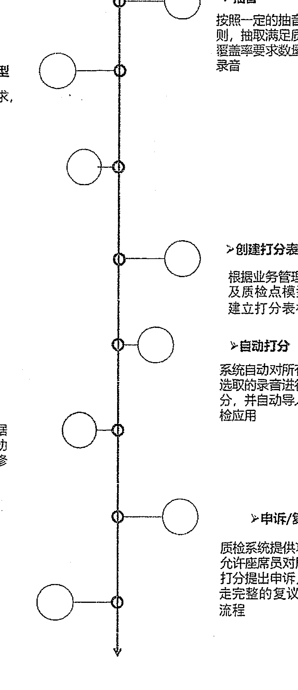

传统流程第二步多为语音转文本后再建模。如今跨模态大模型成熟后，语音转文本并非必经环节，且语音转文本模型也只是众多专家模型之一，用于提升质检效果。创建专家模型并非必须，主要为提升稳定性，若模型本身已具备商业可用性可省略。

创建打分表模板是从业务视角帮助客服定位违规与不规范点并及时纠正。识别违规只是第一步，核心在于告知客服违规的时间、地点、具体内容等细节，并通过事后培训促成合规。由此要求模型具备可解释性，针对每个风险点构建符合质检要求的AI模型是关键任务。

表10-1为打分表模板示例，累计扣分超过6分则判定未通过。跨模态大模型可实时输出风险分值与主要风险点，帮助客服改善服务。

## 表10-1

| 一级分类 | 二级分类 | 扣分项       | 基础分值 |

| :-------- | :-------- | :---------- | :----------- |

| 销售      | 礼仪      | 态度粗鲁    | 1            |

| 销售      | 销售流程  | 未按照标准流程介绍产品 | 1          |

| 销售      | 合规      | 给客户返礼  | 3            |

| 销售      | 风险      | 销售捆绑    | 2            |

| 理赔      | 合规      | 贬低竞争对手 | 3            |

| 理赔      | 理赔流程  | 未遵守标准流程 | 1          |

| 支付      | 支付流程  | 支付确认    | 1          |

实际生产中通话质检分为离线与实时。出于成本与监管考虑，金融行业目前以离线质检为主，但随机器人普及与智能对话增多，实时质检应用将逐步增加。

# 10.2.2 智能顾问
AI成熟推动金融销售流程自动化与智能化成为大趋势。以银行个人业务为例，到网点办理的客户多为老年人，年轻人较少。我们认为低利率时代到来将催生综合金融需求。微软CEO纳德拉曾提出，聊天机器人在金融行业迎来爆发。

以保险为例，Insurify利用AI模拟代理人，通过客户拍摄的车辆照片进行身份验证、车辆询问、保险咨询等对话后推送匹配方案，复杂问题则转人工。Allstate提供类似服务。Conversica则通过AI挖掘潜在客户需求并将商机推送给线下销售人员，提升转化精度。

投资领域，因果树发布投资顾问机器人，其工作效率相当于分析师40分钟工作量。ZestFinance借助机器学习构建大数据风控模型辅助信贷与债券发行。Kabbage利用机器学习建立信用风险模型推荐资产组合。天弘基金结合专家经验与机器学习研发面向定增市场的跨模态模型，先筛选因子组合再由专家确定参与时点与报价，形成策略。

总体看，当前智能金融顾问智能化水平与精度仍有限，用户易识别为机器，且难以实现需求自动采集、方案实时定制与综合服务。随着跨模态大模型完善，能力将进一步夯实。

设想理财场景中，机器人引导客户表达财富管理诉求，理解需求后输出匹配方案并自动生成分析文档，同时通过营销活动设计提升匹配率与成交率。

因此，一名优秀的智能金融顾问需具备以下五项能力。

## 第10章 多模态大模型的主要应用场景 | 199

### 1. 需求调研和采集
沟通过程中采集客户实时信息与初步需求，并借助历史大数据深挖精准需求。跨模态大模型可接收文本、语音、图像、视频等多维输入，有助于更全面精准地把握需求。

### 2. 金融产品咨询
智能顾问可掌握全行业金融产品，通过人机交互提供产品类别、合同、周期、收益率、风险、现金价值、条款、理赔方式等全天候咨询。

### 3. 方案设计
在掌握存量产品信息后，可借助模型实现产品创新与定制。创新分为两类：存量产品组合形成新方案；基于存量产品定制全新产品。前者难点在于处理不同产品的约束与互斥规则，如年龄、性别、地域、年限、重复理赔等。例如客户在甲企业与乙企业分别购买40万元雇主责任险，行业按比例理赔，合计赔付40万元则各赔20万元。

另一案例中，客户需疾病医疗、意外医疗、意外身故保障，医疗报销比例高且含门诊，医保额度不少于100万元，身故保额不少于30万元。单一产品无法满足，智能顾问通过组合企业A产品1、产品2与企业B产品3实现需求覆盖。

## 产品组合

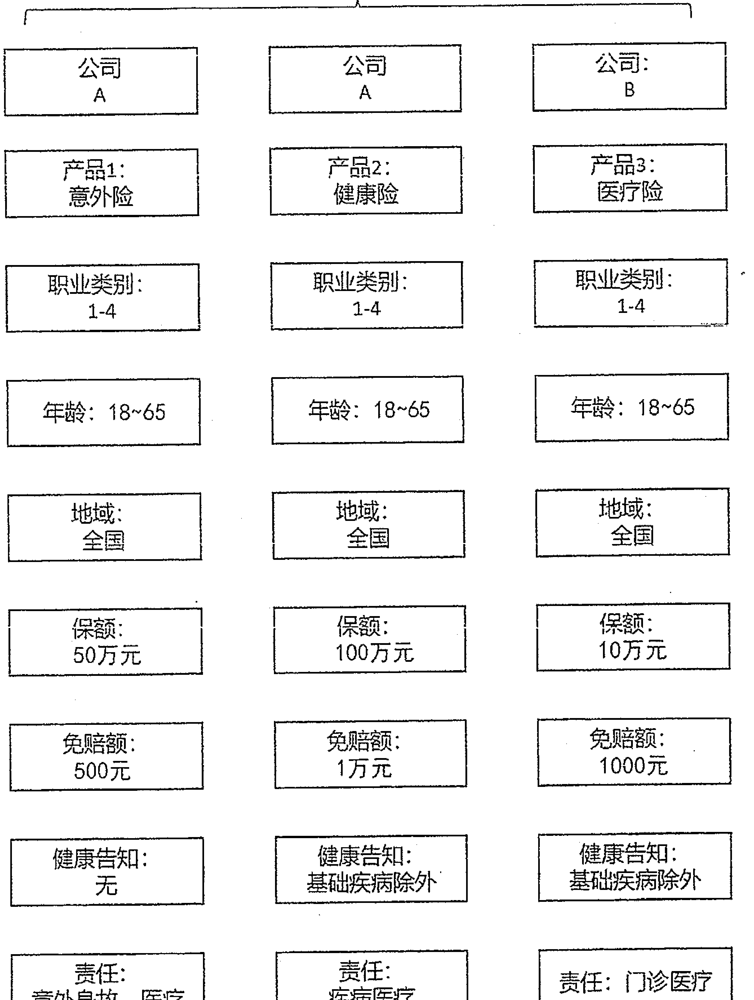


现有融合感知框架多只能应对驾驶任务，难以兼顾AI助手与人机交互。跨模态大模型在交互上优势明显，潜力巨大。当前模型在算力需求、响应速度、稳定性上仍待改善，自动驾驶对实时性要求极高，目前模型响应较慢，大规模落地仍需时间。随着算力提升，应用将更深入。

## 10.4 多模态大模型驱动电商新体验

电商一直是数据持续爆发的典型行业。数以亿计的消费者在各大平台上留下行为轨迹，让行业有了乘数据腾飞的基础。《中国电子商务报告2022》指出，2022年全国电子商务交易额达到43.83万亿元，网上零售额为13.79万亿元。面对超十万亿体量的市场，大数据与机器学习已经渗透到浏览、搜索、下单、物流等全链路环节。

电商天然就是多模态大数据场域，画面、文字、语音、流媒体同时存在。业务又天然重互动，全流程在线化，沟通闭环可以在平台内完成。如何把这些多模态数据真正转化为商业能力，成为电商当前的核心命题。

本节重点拆解智能客服与智能试穿两大场景。

### 10.4.1 智能客服进化

在电商里，用户只能靠简短图文判断商品是否合适，进而产生大量问答需求。即便头部平台，传统智能客服也常答非所问。出问题时解决不了，人工客服响应又慢，购物体验被严重拖累。

我们访谈的多位电商用户反映了10类典型痛点：

1. 想深入了解商品，客服回应笨拙，信息获取不到位。
2. 安装流程不清晰，详情页缺失或描述模糊，需反复追问。
3. 视频介绍比文字丰富，但多为宣传，信息密度低，难以全面判断。
4. 服装尺码标准不统一，与个人需求匹配困难。
5. 客服多为固定话术，个性化问题处理效率低、效果差。
6. 用户自己不确定想要什么，希望获得推荐，客服难以提供。
7. 用户难以准确描述需求，希望被引导推荐，客服无力满足。
8. 看到图片或视频里心仪单品，想找相似款却不知如何操作。
9. 平台虽支持语音、图像、文字交互，实际使用不顺畅。
10. 缺乏定制化方案能力，需求输入后处理薄弱。

多模态大模型的到来让上述问题得到系统性缓解。相较传统方案，基于多模态大模型的智能客服具备三大特征：

1. 输入输出形式多元，输出更生动人性，代入感显著增强。
2. 交互更像人对人，遇到模糊点会主动提问补全线索，定制更精准。
3. 智能水平更高，能给出更有用的建议与体验。

图10-10展示了电商多模态大模型框架，支持文本、图像、语音、视频输入，通过强交互与强智能能力输出需求洞察、方案定制、智能问答等服务。同时，电商多模态大模型也支持多维
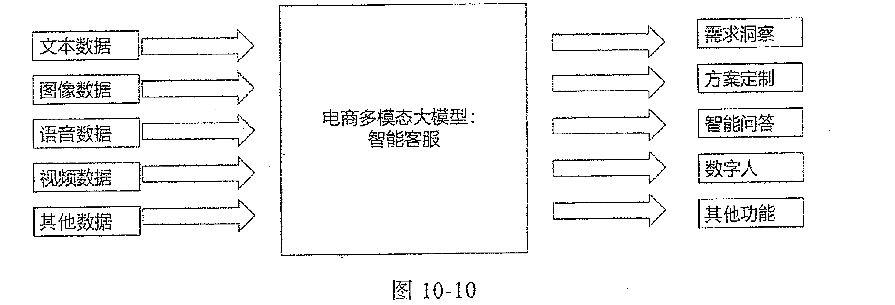

智能客服的核心运行逻辑可概括如下：先采集学习用户与商品等各类数据，再收集用户问题或需求。即便问题看似简单，模型也需进行大量知识检索与复杂推理。交互式问答与多模态学习推理是最大优势。初步方案产生后，客服会持续与用户互动吸收反馈并迭代优化，直至需求闭环。最后，解决方案可通过动态数字人呈现，提升趣味性与生动度。

该能力的落地依赖大数据、云计算、算力、AI算法与元宇宙等技术共同演进。我们判断，未来几年AI持续成熟，十万亿级的电商市场仍有较大增长空间。

### 10.4.2 智能试穿突破

线上与线下购物最大落差在于试穿。线下虽麻烦耗时，但便利性与真实感仍远超线上。

早期出现了智能试衣镜等硬件尝试。Fit:Match.AI搭建了融合推荐与虚拟试衣的智能工作室，通过采集身高体重体型偏好等信息，用3D智能摄像头扫描建立三维身形，结合历史数据实现精准推荐。

类似产品不少，但整体受限于智能不足与体验不佳。智能弱体现在建模不准、响应慢、不支持多模态输入、推理能力差；体验差体现在需要手动填大量信息、互动性弱。

未来的智能试穿机器人应是多模态机器人，能基于历史图片、购物记录等历史数据和实时视频，精准建模身形形态，以美观数字人呈现，用户还能交互式修改数字人以满足审美偏好。

形态确定后，下一步是服饰匹配。机器人需像客服一样懂用户、主动交互、挖掘真实需求、协助方案设计并给出最优推荐。

整体流程可分为三部分：

1. 形态与姿态建模。核心难点是结合计算机视觉与历史图文数据还原真实身形。建模质量受摄像头角度与拍摄质量影响。电商场景常用手机电脑摄像头，与专业3D设备差距明显。非专业条件下可从三方面提升效果：一是实时采集形态、身材类数据弥补设备短板；二是引导用户使用标准拍摄软件；三是选择明亮安静环境。随着视觉技术进步，这些要求会逐步放宽。
2. 需求收集与方案设计。涉及大量交互与多模态建模，是多模态大模型的强项，逻辑与智能客服相近，此处不再展开。
3. 商品准备与配送。属运营环节，不作重点阐述。

## 10.5 光伏产业的智能化升级路径

工业设计与生产覆盖面广，工业生产属制造，工业设计属服务。本节聚焦清洁能源中的光伏发电。

图10-11呈现了光伏产业架构，分为上游、中游、下游与服务。 上游生产硅片硅棒等原材料；中游生产电池组件、逆变器、发电系统等；下游为发电环节，包含集中式与分布式；服务环节提供金融、财务、人力等支持。

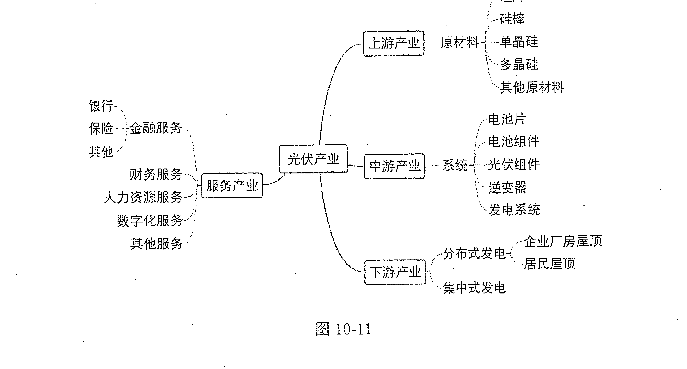

光伏是清洁能源核心支柱，其生产安装运维的安全稳健可持续性直接影响国家能源安全。

光伏电站建设流程见图10-12，分为建设前、建设中、建成后。以下以屋顶分布式电站为例说明多模态大模型的赋能场景。

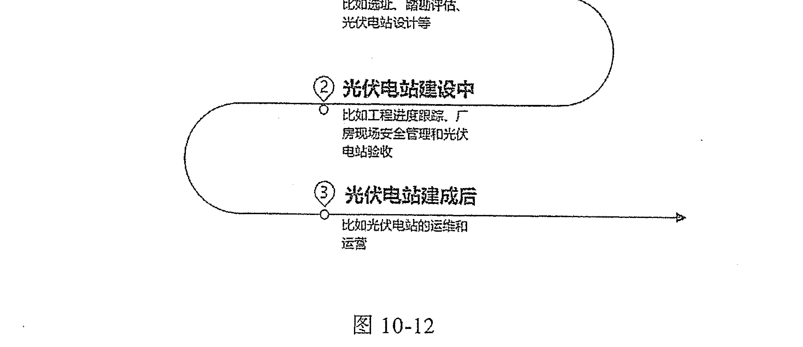

建设前核心工作为选址、踏勘评估、方案设计，踏勘评估是典型应用场景。

踏勘评估借助卫星或无人机影像重建实景模型，完成数据采集以辅助设计，如图10-13。评估分为两种：批量卫星影像评估给出初步结论；无人机单屋顶影像评估实现精细化判断。对比传统深度学习，多模态大模型能显著提升效率与精度。

建设中主要包含进度跟踪、现场安全管理、验收。

工程进度跟踪：定期采集影像等多模态数据，结合设计图图像识别，自动追踪建设进度。

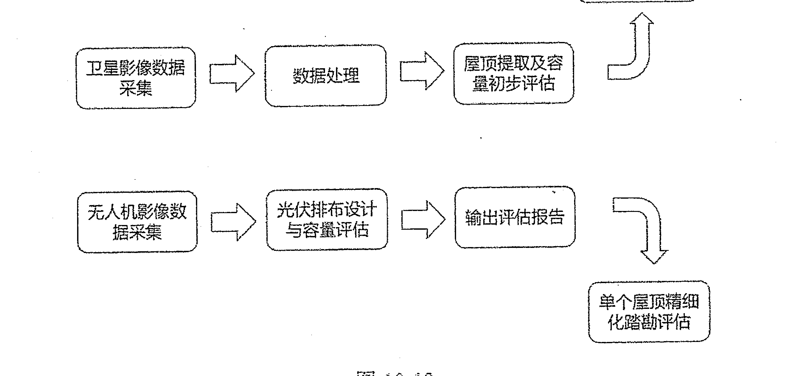

厂房现场安全管理：定期采集内外影像，结合其他大数据全面分析安全隐患并及时预警处置。

光伏电站验收：板面铺设后易出现位置偏差、缝隙过大、倾斜等问题。多模态大模型可实现自动化质检，无人机影像经算法校验组件数量、装机容量、倾斜角度、隐裂等，并安排技术人员处理。

建成后聚焦运维运营，主要任务包括：

+   1. 电站故障导致发电异常，需及早发现处理。
+   2. 板面积尘影响透光与发电，需及时清洗。
+   3. 恶劣天气可能导致板面倾斜倾覆，需及时维修。

借助无人机与物联网传感器采集多模态数据，可监测运行状态并提前预警，结合机器人实现故障清除，还可利用无人机红外技

## 10.6 多模态大模型在医疗健康领域的渗透

医疗健康是AI主战场，谷歌、IBM、阿里巴巴等均已布局。AI已覆盖产业链各环节并取得成效，随着多模态大模型成熟，行业将迎来结构性变化。图10-14展示了应用图谱，发展深入后效果将显著提升。

+   1. 疾病预防

预防重于治疗，需了解健康状况与预防知识，因而预防问答机器人尤为关键。基因检测、智能硬件实时监测、脑机接口等技术均可赋能。

| 类别 | AI应用 |
| ---- | ---- |
| 疾病预防 | 疾病预防问答机器人、基因检测、健康监测等 |

以智能硬件为例，分内置与外穿。内置传感器植入体内采集器官运行信号，通过多模态大模型解析预测健康；外穿设备佩戴采集信号后建模预测。基因检测与健康监测也是典型应用。

# 2. 疾病问诊

与预防相近。医疗资源分布不均，优质医生稀缺，在线问诊需求旺盛。当前以人工为主，机器人能力受限。多模态大模型成熟后，问诊有望取得突破性进展。疾病

# 3. 疾病检测

通过解析大数据建模预测疾病。以心脏影像为例，传统人工判读效率低，多模态大模型可大幅提升。以血脂检测为例，传统化验只能判断结果难知原因，多模态大模型采集更多身体数据后可发现关联特征，实现精准对症。其它方向包括基因检测、疾病预测、健康监测等

更加智能地交互，从而大幅提高康复的效率、质量和体验。

# 6. 健康管理

广义上融合预防、问诊、检测、治疗、康复全流程。狭义上指基于既定健康目标管理饮食、运动、睡眠等行为。

Woebot Health打造的Woebot机器人即为典型，可像心理医生般聊天互动，在对话中捕捉微表情与情绪变化，提供更精准心理支持，定位为补充与助手。VR赋能健康管理也具代表性，AppliedVR通过VR数字疗法帮助患者缓解疼痛。

# 7. 药品研发

多模态大模型赋能研发是热点。传统研发存在两大痛点：①反复实验验证分子组合的理化与药理特性，投入大周期长；②细胞体外研究难以真实模拟人体效应，数据可信度低。

XtalPI构建了多模态大模型驱动的药物发现流程，可更准确预测分子行为与性质，已证实显著提升研发效率。

Signet Therapeutics由哈佛癌症中心科学家Dana Farber创立，利用真实世界癌症基因组数据开发针对癌症亚型的类器官模型，三维模拟器官微环境，产生更具临床相关性的数据，解决体内效应模拟失真问题，为真实临床试验奠基。

我们有理由认为，随着技术演进，智能机器人在医疗领域的作用将快速扩张，例如：

- (1) 多模态大模型结合VR操控复杂机械臂，助力外科医生完成更复杂手术。
- (2) 康复机器人配备传感器与先进交互控制，实现智能化与舒适化康复。
- (3) 多模态大模型结合室内导航，协助临床人员完成后勤与物资配送。
- (4) 健康管理机器人解决身体、心理、精神多维度健康问题。
- (5) 全流程赋能新药研发，涵盖发现、组合、测试、临床等。

# 10.7 教育培训的智能化演进

教育培训与医疗健康相似，优秀师资稀缺且培养周期长，多模态大模型可实现广覆盖深发展。VR与多模态大模型结合还能提升培训效果。

教育培训涉及听说读写看，多模态数据丰富。赋能方向主要有：

# 第10章 多模态大模型的主要应用场景 | 217
(1) 提供赋能工具：培训机器人、课程设计机器人、VR培训工具、实训机器人等，提升效果与效率。
(2) 生成培训内容：智能化产出教材、课件、资料。
(3) 其他影响：招聘、营销、运营等流程优化。

成人教育场景可设想为：用户向学习机器人提出提升AI建模能力的需求，机器人结合历史数据与目标制定学习计划，以数字人讲解呈现，实现沉浸式认知。

计划确定后，机器人承担教师与辅导角色，管理学习全程，阶段性测试评估效果，通过持续互动发现知识盲区并优化计划。循环迭代保障学习成果。实训环节机器人可生成实操场景，提升动手能力。随模型能力提升，该设想将很快落地。

# 10.8 思考

与单模态应用相比，多模态应用更丰富全面智能。数字化万物互联时代，无人驾驶、工业生产、健康问诊等场景天然产生多模态数据，单模态模型难以满足智能化与一站式服务需求。

单模态大模型是过渡阶段，最终服务于多模态大模型。未来多模态大模型具备更大潜力。

本章梳理了30个基础应用并在六大领域展开。虽尚不成熟，已带来惊喜。我们相信，随着成熟，AI将成为企业标配与基础设施，对各行业的赋能将是革命性的，加速数字化与智能化变革。

# 第11章 用多模态大模型打造 AI 助理实战

OpenAI研究显示，GPT等大语言模型可能对80%的美国劳动力产生影响，GPT-4等模型将深度影响19%的工作。

多模态大模型正在重塑人类的演进路径，悄然改写我们的工作方式与生活习惯，让个体不再孤立作战，而是能借助模型的智能完成任务。未来每个人身边都可能常驻一位 AI 助理，为决策提供支持，让工作与生活都更高效、更从容。本章聚焦多模态大模型在 AI 助理场景的落地实践，帮助读者清晰认识模型在人类发展进程中扮演的助理角色，并提升整体智能水平。

# 11.1 应用背景

美国全国经济研究所 NBER 的最新研究显示，生成式 AI 的应用让客服效率平均提升 14%，在助力职场新人成长上效果尤为突出，将原本需要约 6 个月才能熟练上手的周期压缩到大约两个月。报告印证了 AI 助理对效率的真实拉动，也意味着越来越多企业、机构和组织会加大投入，用 AI 助理解放人力、降本增效并放大生产力。

与此同时，以 ChatGPT、GPT-4 为代表的基础大模型面世，标志着 AIGC 时代正式开启。对话大模型的技术已实现突破性进展，应用从尝鲜转向实质赋能商业。市场对 AI 助理的需求旺盛叠加技术成熟，为各行业打造高质量助理奠定了坚实基础。

# 11.2 方法论介绍

语义理解与内容创作是多模态大模型最核心的两大能力，前者决定模型是否明白任务意图，后者激发模型的主动生成力，满足多样化需求。针对如何进一步激活这两项能力，业界已展开大量研究与实践。本节汇总若干经实测有效的代表性方法和技巧，目标是简洁高效地提升 AI 助理表现。

# 11.2.1 思维链解决复杂的推理问题

人类面对复杂推理时习惯采用自上而下、逐步细化的思路，把整体问题拆解为若干中间子问题再逐层求解，这被称为自顶向下逐步求精。思维链 CoT 正是基于自然语言的推理过程，由问题输入、推理路径、结论输出三部分构成。与传统提示不同，思维链更强调过程展开，因而能显著提升模型在复杂推理任务上的准确率，也因条理更清晰而在一定程度上抑制了模型“胡说八道”的现象，其示意图见图 11-1 左侧。
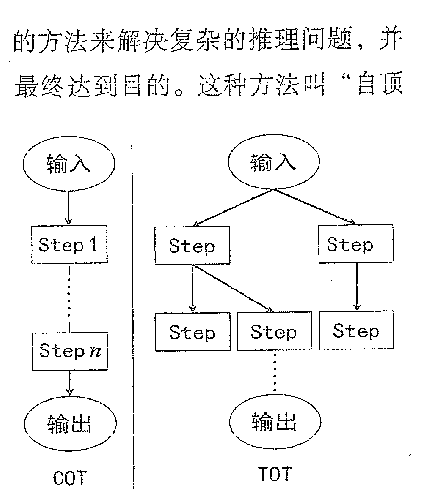
# 第11章 用多模态大模型打造AI助理实战 | 221

以下给出一个典型应用。借助思维链数据赋能，模型可以对求解过程进行清晰解释，如图 11-2 所示。

假设 X=1，Y=7，那么 3 倍的 X 加上 4 倍的 Y 等于多少？

先把已知条件代入式子：
3X + 4Y = ?
3 × 1 + 4 × 7 = 3 + 28 = 31
因此当 X=1、Y=7 时，3 倍的 X 加上 4 倍的 Y 等于 31。
# 图11-2

# 11.2.2 思维树进一步提升推理能力

思维树 Tree of Thought, TOT 是更复杂的推理框架，如图 11-1 右侧所示，它让模型同时考虑多条不同的推理链并进行自我评估，再做出决策。其优势主要体现在：① 多条链相当于多位专家并行赋能，使结果更稳健可靠；② 不同链的结果可以相互校验，提升精度；③ 不同问题存在多种解法，思维树能增强可解释性并满足用户多样偏好；④ 根据场景需求，模型可向前展望或回溯历史，实现全局性选择。

# 11.2.3 采用插值法解决长文本输入问题

参数规模在 70 亿与 130 亿的 LLaMA 原生最多处理 2048 个 token，且内建词表中的中文词条约 700 个左右。面对中文输入时，常出现一个汉字被拆成多个 token 的情况，2048 的窗口往往覆盖的中文非常有限，遇到生僻字时问题更严重，严重制约了长文本的接收与理解。

一个简洁有效的改法是引入旋转式位置编码 Rotary Position Embedding, RoPE。配合插值法，可将位置编码长度成倍扩展，使 LLaMA 接纳更长的文本，且无需重新训练即可取得不错效果。

具体操作如图 11-3 所示，首先定位到 Transformer 安装包中的 model_llama.py，为其中的 LlamaRotaryEmbedding 类新增方框中所示的 4 行代码即可实现功能。
```
class LlamaRotaryEmbedding(torch.nn.Module):\n    def __init__(self, dim, max_position_embeddings=2048, base=10000, device=None):\n        super().__init__()\n        inv_freq = 1.0 / (base ** (torch.arange(0, dim, 2).float().to(device) / dim))\n        self.register_buffer('inv_freq', inv_freq)\n        \n        max_position_embeddings=8192:\n        # Build here to make torch.jit.trace work\n        self.max_seq_len_cached = max_position_embeddings\n        t = torch.arange(self.max_seq_len_cached, device=self.inv_freq.device, dtype=self.inv_freq.dtype)\n        \n        self.scale=1/4\n        t*=self.scale\n        \n        freqs = torch.einsum('i,j->ij', t, self.inv_freq)\n        # Different from paper, but it uses a different permutation in order to obtain the same calculation\n        emb = torch.cat((freqs, freqs), dim=-1)\n        self.register_buffer('cos_cached', emb.cos()[:, None, :].persistent=False)\n        self.register_buffer('sin_cached', emb.sin()[:, None, :].persistent=False)\n        \n    def forward(self, x, seq_len=None):\n        # x: [bs, num_attention_heads, seq_len, head_size]\n        # This `if` block is unlikely to be run after we build sin/cos in `__init__`. Keep the logic here just in case.\n        if seq_len > self.max_seq_len_cached:\n            self.max_seq_len_cached = seq_len\n            t = torch.arange(self.max_seq_len_cached, device=x.device, dtype=self.inv_freq.dtype)\n            \n        t*=self.scale\n        freqs = torch.einsum('i,j->ij', t, self.inv_freq)\n        # Different from paper, but it uses a different permutation in order to obtain the same calculation\n        emb = torch.cat((freqs, freqs), dim=-1).to(x.device)\n        self.register_buffer('cos_cached', emb.cos()[:, None, :].persistent=False)\n        self.register_buffer('sin_cached', emb.sin()[:, None, :].persistent=False)\n
```

# 图11-3

该思路可推广至其他采用 RoPE 的多模态大模型，例如 ChatGLM，只要同样进行位置编码插值，就能实现更强的记忆与推理能力。

# 11.3 工具和算法框架介绍

本节介绍以 LLM 为底座构建 AI 助理的完整路径，实现常见对话、多轮对话以及限定域问答等能力。搭建助理前需要明确目标与能力边界，并选择合适的工具与底座模型，下文逐一说明。

# 11.3.1 使用的工具

LangChain 是一个面向 LLM 的端到端应用开发框架，帮助开发者更便捷地搭建基于语言模型与聊天模型的应用程序。它支持文本生成图像、文档问答、聊天机器人等复杂任务。主要优势包括：

- （1）简化应用创建流程。
- （2）便于管理与语言模型的交互并整合外部资源如 API、数据库，提升开发效率。
- （3）兼容多种语言模型并提供统一 API。
- （4）适用于个人助理、文档问答、聊天机器人、表格查询、外部 API 交互等多种场景。

# 11.3.2 使用的算法框架

鉴于 Ziya 表现优异，本节选用其作为 AI 助理的底座。Ziya 在 LLaMA 基础上做了优化，包括：

- （1）扩充中文词表，新增约 2 万个中文词汇。
- （2）使用悟道 WuDao 数据集对 LLaMA 进行二次预训练，大幅提升中文处理能力。
- （3）利用百万级指令数据集对二次预训练模型进行微调。
- （4）在微调基础上引入基于人工反馈的强化学习，进一步提升对齐效果，最终形成 130 亿参数的模型。

性能上，Ziya 在同等条件下优于同期 ChatGLM、MOSS-16B 等模型。


为做更细致对比，我们基于 BELLE 开源的 1000 个测试集构建新评测集。组成如表 11-1 所示，共 6 大类 200 道题，均以问答形式输出，并新增多轮对话评测以更贴近真实意图。
# 表 11 - 1

| 数据类型 | 目的 |
| --- | --- |
| 通用问答 | 验证常识能力 |
| 翻译 | 验证翻译能力 |
| 创作 | 验证问答能力 |
| 处理时效性问题 | 验证上下文学习能力 |
| 角色扮演 | 验证角色扮演能力 |
| 多轮对话 | 验证多轮对话能力 |
## 第 11 章 用多模态大模型打造 AI 助理实战 | 225

使用该数据集测试 Ziya、LLaMA-13B-2M 和 ChatGLM2，指标为准确率，结果如表 11-2 所示。Ziya 整体表现优异，符合构建 AI 助理的要求。

| 数据类型 | Ziya 的准确率 | LLaMA - 13B - 2M 的准确率 | ChatGLM2 的准确率 |
| --- | --- | --- | --- |
| 通用问答 | 76% | 67% | 51% |
| 翻译 | 93% | 76% | 93% |
| 创作 | 90% | 71% | 79% |
| 时效性问题 | 80% | 56% | 60% |
| 角色扮演 | 71% | 57% | 57% |
| 多轮对话 | 51% | 26% | 51% |

基于 LangChain 框架，使用 Ziya 实现限定域问答的业务流程如图 11-5 所示，主要分为三步：
1. 以自然语言输入的问题先在本地数据库检索。
2. 将检索到的相关文档片段与问题组合成指令送入 Ziya。
3. Ziya 输出回复，整个流程由 LangChain 控制调度。


# 11.4 优化逻辑介绍

总体来看 Ziya 性能出色，但表 11-2 显示其在多轮对话和角色扮演上仍有提升空间，同时原模型处理长文本的能力不足。本节针对这三点缺陷给出优化思路。

# 11.4.1 如何提高多轮对话能力

多轮对话能力核心在于模型能否区分历史对话与当前对话的相关性。为此我们构造相关指令数据集，基本信息如表 11-3 所示。数据均来自开源资源，其中中英文对齐数据取自 MOSS，单轮指令与前后轮相关多轮对话取自 BELLE，前后轮无关多轮对话则由中英文对齐数据与单轮指令组合而成。

| 数据集 | 数据的数量（万条） |
| --- | --- |
| 中英文对齐数据集 | 10 |
| 单轮指令数据集 | 10 |
| 前后轮无关的多轮对话数据集 | 10 |
| 前后轮相关的多轮对话数据集 | 10 |

数据集构建完成后，使用 LoRA 技术对 Ziya 进行微调，在 8 张 NVIDIA RTX A6000 GPU 服务器上训练约 2 天，可得到优化后的模型。性能评估统一在 11.6 节给出。

# 11.4.2 如何提高角色扮演能力

模型角色扮演能力要求按预设立场回答问题，相关开源数据较少。我们借助 Self-Instruct 框架调用 ChatGPT 构造约 10 万条语料，经人工修正后用 LoRA 对 Ziya 微调。Self-Instruct 框架如图 11-6 所示。


该框架基于预设种子任务，通过半自动迭代引导算法不断生成新指令，利用模型自身指令信号对预训练语言模型进行指令调优，效果显著，详细评估同样在 11.6 节呈现。

# 11.4.3 如何提高长文本阅读能力

原始 Ziya 最多处理 2048 个字符，超出后困惑度 PPL 陡然增大，如图 11-7 所示。

为此采用 11.2.3 节所述插值法，将位置编码长度扩展至 4096 字符。同时以思维链形式融合多轮对话与角色扮演数据，构造出长度为 4096 字符的训练文本，提升模型对长文本的阅读能力。

经优化后，Ziya 的最大输入长度突破 2048，可达 4096，具备更强的长文本理解与推理能力。

# 11.5 部署要点与 Ziya 参数调优

第 9 章已经梳理了把多模态大模型上线时的常见路线，Flask、Gradio、FastAPI、Django 等框架都可选用，具体取舍要看硬件条件与业务诉求，本节不再展开部署细节。重点放在如何为 Ziya 设定可控参数，提升使用手感。

表 11-4 汇总了 Ziya 的可调项，共 5 项，归为 3 类用途：限定单次输入的最大处理规模、调节生成文本的多样性、控制词元采样策略，具体说明如下。

| 参数 | 参数值 |
|------------|----------|
| Max tokens | 2048 |
| Temperature | 0.1 |
| Tok_p | 0.85 |
| Tok_k | 30 |
| Frequency_penalty | 1.2 |

其中 Max tokens 用来限制模型一次能处理的字符上限，本案例设置为 2048。

# 11.6 多模态大模型性能评估

# 11.6.1 综合性能对比

前文提出的优化思路均已完成实验验证。表 11-5 对比了原版 Ziya-13B 与微调后 Ziya-13B-Finetune 在相同任务上的表现。可以看出微调后整体表现明显提升，创作、时效问答、角色扮演与多轮对话的增幅尤其突出，这印证了前述优化方案的有效性。

| 任务 | Ziya-13B-Finetune | Ziya-13B |
|---------------------|--------------------|----------|
| 通用问答 | 76% | 76% |
| 翻译 | 93% | 93% |
| 创作 | 90% | 80% |
| 处理时效性问题 | 93% | 80% |
| 角色扮演 | 100% | 71% |
| 多轮对话 | 82% | 51% |

基于以上基础任务的得分，已能直观看出优化带来的收益。为帮助读者更直观感受，接下来将用长文本阅读、多轮对话、角色扮演三个场景展示优化后模型的实际效果，最后结合 LangChain 演示 Ziya+LangChain 在限定领域问答中的表现。

# 11.6.2 长文本阅读示例

未经优化的 Ziya 最长只能处理 1024 个字符，超长内容无法覆盖。借助插值法扩充上限后如图 11-8。测试时投喂一段远超 1024 字符的长文，优化后的 Ziya 仍能把握核心意图并给出更精准的回复，记忆长度与推理能力均有提升，体现出较强的长文理解力。

当前癌症发病率较高，研究显示至少 40% 的癌症与不当饮食相关，不良饮食习惯可能诱发癌症。例如有人用甜饮料替代早餐，饥饿时用糖果充饥，这对防癌不利，因为这些食物都含有“精制糖”。01 精制糖是什么？精制糖是指经过化学加工后纯度很高的食用糖，涵盖白糖、红糖、液体糖浆、麦芽糊精、冰糖等。《中国居民膳食指南 2022》建议，居民每日添加糖摄入最好不超过 50 克，理想控制在 25 克以内。摄入过多会快速升高血糖，产生饱腹感，抑制食欲，影响营养吸收，导致维生素 B1 缺乏，长期可能出现厌食、呕吐、消化不良、烦躁不安等神经症状。精制糖代谢还会消耗钙，增加骨质疏松风险，且肿瘤细胞偏爱葡萄糖，过量精制糖分解后为肿瘤增殖提供养分。临床还发现高糖饮食会升高胰岛素，对胰岛素抵抗人群而言，高胰岛素水平会提升直肠癌等肿瘤风险。02 哪些食物精制糖含量高？主要有三类：零食类如糖果、糕点、蜜饯、果脯、冰淇淋等；含糖饮品如碳酸饮料、果汁、奶茶、运动饮料等；高糖主食菜肴如糖醋排骨、拔丝红薯、红烧肉等。减少摄入时应养成看标签的习惯，配料表中白砂糖、黄糖、麦芽糊精、玉米糖浆等排在前面则含量较高，应少选。碳水化合物主要来源于主食，成人每日约 300~400 克。搭配时可遵循三点：1. 杂粮、薯类、豆类混搭，血糖生成指数更低且营养更丰富；2. 按膳食指南均衡蛋白、脂肪、碳水，20 岁以下、20 岁后、中年期的配比有所差异；3. 老年人咀嚼消化能力下降，避免过度粗糙，选择细做烹饪与少食多餐。祝大家保持健康体魄。“ 总结上文

文章阐述了精制糖的危害与常见存在形式，强调减少摄入对预防癌症的重要性，并提供了降低摄入与科学选主食的实用建议。


# 11.6.3 多轮对话示例

图 11-9、图 11-10 展示了微调后 Ziya 在多轮对话中的表现。可以看到模型能够稳定支撑中英文混杂的上下文追问，完成闲聊与问答。

- Can you introduce the capital of China?
- The capital of China is Beijing.
- Further information
- Introduce its geographical location
- Beijing is located in the northern part of China, the capital of the country and a center of politics, culture and international exchanges. It is located in the middle of the North China Plain, with longitude 116.4043 degrees and latitude 39.9042 degrees, covering an area of 16,410.54 square kilometers, with a population of about 21.54 million.
- Further information
- Where are some famous universities in it?
- Beijing has many famous universities and higher education institutions, including Tsinghua University, Peking University, Renmin University of China, Beijing University of Aeronautics and Astronautics, Beijing Normal University, Central Conservatory of Music, China Academy of Art, etc.
- Further information


# 11.6.4 角色扮演示例

下面让 Ziya 切换不同人设检验处理能力。图 11-15 ～ 图 11-17 分别展示了 Ziya 扮演大学老师、

即便面对需要最新事实的场景，Ziya 借助 LangChain 框架的联网检索能力，在理解用户问题的基础上，也能输出张雨霏最新的比赛成绩信息，使得结果保持时效，满足客户对事实类问题的最新回复需求。

# 11.7 思考

在 Ziya+LangChain 框架下，通过一系列优化举措，部分任务取得明显提升，足以胜任 AI 助手角色。同时案例也暴露出改进空间，主要有四点：

(1) 130 亿参数的 Ziya 作为底座仍显不足，未来可寻找参数更大、性能更优的多模态大模型进行替换。
(2) Ziya 与 LangChain 的协同目前处于初级阶段，如何充分发挥 LangChain 优势是下一步方向。
(3) 微调数据仍可完善，例如构建更多垂直领域的多轮对话语料，提升垂直场景能力。
(4) 行业评测标准不统一，数据集构造易有偏向，导致结果不公允，需建立公平合理的评测体系。

## 第 12 章 多模态大模型在情绪识别领域的应用

前几章已依次介绍多模态大模型的历史脉络、核心技术、评测方法、部署流程及典型应用，读者已具备整体认知。本章以情绪识别为案例，逐步拆解落地方法。

# 12.1 应用背景和待解决的问题

情绪识别是指利用机器学习与深度学习判断表述中所包含的情感倾向，是自然语言处理的核心课题之一。

人的情绪类型多样，如愉悦、悲伤、愤怒、惊讶等，属于粗粒度的离散情绪，针对整体表述。学术界与工业界更关注细粒度的属性级情绪，即对具体目标的态度或观点。例如旅客评价：这个酒店设施齐全、服务态度好，但隔音效果不好。对设施与服务的情绪为积极，对隔音为消极，如何判断旅客对服务的满意度，正是属性级情绪识别要解决的问题。

情绪识别广泛应用于舆情分析、智能客服、医疗看护等场景。传统方法多为单模态：文本情绪识别常用文本编码器提取特征后接线性分类，常用编码器有 Word2vec、TextCNN、LSTM、BERT 等；语音情绪识别一是转写为文本后再做文本分类，二是直接用 Wav2vec 等模型提取声学向量后分类；图像情绪识别用 CNN、Vision Transformer、CLIP 等编码器提取视觉特征后分类；视频情绪识别将视频逐帧处理后加权汇总。

尽管单模态技术已较成熟，仍存在四类问题。其一，真实情绪往往由语言、面部表情、语气音调等多模态共同表达，单一模态信息不完整。其二，数据源单一导致准确率与泛化能力不足。其三，噪声干扰或主观掩饰造成模态缺失，模型鲁棒性下降。其四，正话反说、夸张修饰等表达会使单模态推理出错。图12-1 为对恶劣天气的多模态表达示例，通过文本、语音和图像三种模态共同展现了对当前恶劣天气的不满。


因此将多模态大模型引入情绪识别是必要的。单一模态难以保证真实性、有效性与完整性，需要多源信息协同分析。同时细粒度属性级情绪识别也是关键挑战，需先抽取表达情感的方面词，再识别其所携带的情感极性。

# 12.2 方法论介绍

## 1. 数据层面融合

数据层面融合指将多模态原始数据直接合并，不做特征抽取即进行识别。常见做法是用线性或非线性规则对不同模态原始数据整合，流程见图 12-2 所示。


优点是保留了原始数据的浅层特性，无需深度特征提取，数据清洗需求低，避免信息丢失。缺点是缺乏统一语义空间，文本与图像、图像与语音的直接融合需要复杂规则，且仅使用浅层特征，识别效果有限，同时无法支撑细粒度的属性级情绪识别。

## 2. 识别层面融合

识别层面融合先用各单模态编码器分别提取特征，再用各自分类头得到多个识别结果，最后在决策层做统计整合，如投票、加权求和等。核心是结果协同而非特征交互，流程见图 12-3。


其优势是实现简单，能复用传统单模态模型，对整体效果有一定提升。局限在于决策规则依赖人工设定，设定不当会拉低准确率且不稳定；未利用深层特征，多模态语义未对齐，整体精度受限；同样无法解决属性级情绪识别问题。

## 3. 特征层面融合

特征层面融合先分别编码各模态特征，再拼接融合形成多模态联合表征，最后用分类器输出结果。流程见图 12-4。


该方式利用了深层语义特征，不同模态信息可相互补充验证。在噪声较低且内容一致时，整体识别效果和稳定性较好。

在特征层进行融合时，通常的做法是把各路单模态的向量直接拼起来形成一个联合表示。参与的模态越多，联合向量的规模就越容易膨胀，信息重复和维度灾难随之出现，模型表现反而变差，这时常用 PCA 这类降维手段来压缩。更根本的问题在于，硬拼接并没有挖掘模态间的真实互动，也未处理模态间的尺度差异和时序对齐，整体情绪判断能力受限，对细粒度属性级别的情绪捕捉几乎无能为力，也难以支撑属性级精细识别的需求。

## 4. 模型层面融合
模型层面融合的核心是借助海量无监督语料预训练一个多模态大模型，VideoBERT、CLIP 都是典型例子。经过预训练的大模型自带丰富先验，对小样本和零样本任务都有不错的泛化，实现了不同模态信息的真正内化。先由大模型抽取每路输入的整体表征，再经线性映射头输出情绪判别，具体流程见图12-5。


目前看，这一路线是情绪识别里效果最扎实的做法。依托大模型的先验，能够较好缓解模态差异和时序对齐的困扰。构建过程中引入细粒度属性方面词抽取以及对应情绪判别任务，也让属性级的精细分析成为可能。受限于参数规模，该方案对算力有一定要求，随着硬件持续演进，其落地范围会不断扩大。

伴随深度学习与算力的迭代，多模态大模型在情绪识别中的运用越来越普遍，效果明显。它们可以在统一的语义对齐空间里直接对多模态数据做表征提取，无需多套单模态编码器，同时解决了细粒度属性级情绪识别的难题。后续章节会沿技术路线，展开算法框架、优化思路、部署步骤和实测表现。

# 12.3 工具和算法框架介绍

# 12.3.1 算法的输入和输出
以图文为例搭建细粒度属性级情绪识别框架。模型接收针对同一事物的文本描述与图像表达，输出属性级方面词及其对应的情绪。以酒店场景为例，上传一张酒店图片并配文“这个酒店空间大、设施新，但是布局不太好”，系统会输出三组结果：空间 积极、设施 积极、布局 消极，如图12-6所示。


# 12.3.2 算法框架的整体构建流程
参照 VIP-MABSA 的思路，下面说明整体构建过程。构建时主要要解决两点：

1. 传统的多模态融合，无论是数据层、识别层还是特征层，都是先用各自的图像编码器和文本编码器得到表征再融合，并没有让图文真正落在同一个语义空间，也忽略了模态差异和时序同步问题。
2. 传统方法没有利用多模态大模型的先验知识。预训练中如果同时做图文匹配，以及细粒度属性方面词抽取和对应情绪识别，对后续任务帮助很大。

针对以上问题，整体构建以 BART 为生成式骨干，同时接受图文输入，依次执行文本、图像、多模态三层预训练，最后用多模态大模型的整体损失优化参数。

BART 是一种典型的序列到序列预训练模型，融合了 BERT 的自编码思路和 GPT 的自回归思路，适合自然语言理解与生成任务。

# 12.3.3 文本预训练任务
文本预训练的目的是让模型具备通用上下文理解能力，以及细粒度属性方面词和情感词抽取能力。包含两个子任务：BERT 风格的掩码语言建模 MLM，用以增强上下文理解；文本方面词与情感词抽取，用以实现细粒度情绪识别。

## 1. MLM 任务
MLM 属于遮盖式语言任务。做法是在句子中随机抽取约15%的 token，被选中的位置有80%的概率被替换为

## 第12章 多模态大模型在情绪识别领域的应用 | 251


## 图12-12
五个预训练子任务各会产生自己的损失，加权求和得到最终损失，权重作为超参数可灵活调整。再用自动梯度更新策略不断优化模型参数直至收敛，算法求解完成。

得到大模型权重后，可用于下游任务。多模态情绪识别主要有三种用法：

- 基于图文对抽取出方面词；
- 基于图文对，给定方面词识别其情绪；
- 基于图文对同时抽取方面词并识别对应情绪。

至此完成框架构建、预训练任务定义、求解和应用。基于多模态大模型的情绪识别，一方面让不同模态在共同语义空间对齐，提升准确率；另一方面解决了细粒度属性级情绪问题，拓展了下游能力。

# 12.4 优化逻辑介绍
基于多模态大模型的细粒度属性级情绪识别在各项指标上都优于传统单模态方法，也解决了传统模型无法处理的属性级问题。下面逐条说明优化逻辑。

### 1. 模型层面融合
传统情绪识别只能用单一模态。要用多模态，数据层融合只能提取浅层特征且模态差异大，操作难度高。识别层融合靠多个单模态模型协同推理，易部署但依赖专家规则，缺乏深层语义抽取。特征层融合把特征拼接后统一推理，性能虽有提升，却是将特征硬拼，未在共同语义空间对齐，忽略差异性和时序同步，仍有很大提升空间。只有模型层融合才能把多模态数据对齐到同一语义空间，学习跨模态关联，再统一推理，准确率才有质变。

### 2. 细粒度属性级情绪的实现
单模态大模型本身具备丰富先验和零样本能力。若能把下游任务抽象为一种生成形式并纳入预训练，就能大幅增强领域先验。推理时保持与预训练一致的输入输出形式，先验即可被充分激活。按此思路，将文本方面词/情感词抽取、图像方面词/情感词抽取加入预训练，下游即可单独抽取方面词、基于方面词抽取情感词，或同时输出方面词-情感词对，从而巧妙解决细粒度属性级情绪问题。

### 3. 预训练任务的设计
除方面词与情感词抽取外，还要赋予模型通用上下文理解和连续图像片段语义理解能力，故引入 MLM 和 MRM。最关键的是构建多模态预训练任务，让文本和图像真正关联对齐。五个子任务从不同维度刻画能力需求，其损失与梯度更新共同牵引模型参数向最优。

# 12.5 部署流程
想深入了解预训练细节的读者，可在 GitHub 查阅 VLP-MABSA 的原理。本节简述部署和使用。

第9章已介绍了多模态大模型的从零到一部署，含 Flask、Gradio、FastAPI、Django 等框架，这里不再重复。学习后只需编写情绪识别领域的推理函数即可快速上线。推理函数核心可分为几块。

第一块负责引入 Python 依赖，方便加载模型权重和图像转换，同时定义工程的相对和绝对路径。

```
trust_remote_code=True).half().cuda()
```
第三块负责接收输入，输入包含图像和文本，图像通过 Image.open 转为图像流以便模型计算。

```
url=os.path.join(BASE_DIR,'image','xxx.png')
image=Image.open(requests.get(url, stream=True).raw)
text= '这个酒店空间大、设施新，但是布局不太好'
```
第四块对文本和图像做预处理后送入模型推理。模型返回方面词索引和情绪 ID，再经配置字典映射为具体方面词及情绪标签，即积极/中性/消极。若一条输入包含多组方面词-情感对，则以数组返回。

```
input=processor(image,text,return_tensors='pt')
outputs=model(**input)
logits=outputs.logits
idx,start,end=logits.argmax(-1).item()[0]
aspect= text[start:end]
sentiment=model.config.id2sentiment[idx]
```
# 12.6 效果评测
多模态预训练的标注数据来自公开集 MVSA-Multi，源自社交媒体推特，包含约2万条图文对，标签为积极、中性、消极，由人工标注。

# 12.6.1 评测数据集
Twitter-2015 和 Twitter-2017 是基于图像-文本多模态推文的公开集，每条数据包含原始推文、配图、方面词及对应情绪标签，完全满足细粒度属性级情绪评测需求。

两个数据集均划分为训练集、验证集、测试集。从情绪分类看都用于三分类：积极、中性、消极。表12-1 和表12-2 给出样本量。

| 情绪识别 | 训练集的样本数量 | 验证集的样本数量 | 测试集的样本数量 |
|----------|------------------|------------------|------------------|
| 积极     | 928 条           | 303 条           | 317 条           |
| 中性     | 1883 条          | 670 条           | 607 条           |
| 消极     | 368 条           | 149 条           | 113 条           |
| 情绪识别 | 训练集的样本数量 | 验证集的样本数量 | 测试集的样本数量 |
| 积极     | 1508 条          | 515 条           | 493 条           |
| 中性     | 1638 条          | 517 条           | 573 条           |
| 消极     | 416 条           | 144 条           | 168 条           |

Twitter-2015 和 Twitter-2017 的样例分别如表12-3 和表12-4 所示。

| 推文 | 图片 | 方面词 | 情绪 |
|------|------|--------|------|
| Hanging out with Corey # Blackhawks # WinterClassic | （图片内容，以图表示） | Corey # Blackhawks | 消极 消极 |
| 推文 | 图片 | 方面词 | 情绪 |
| :----------------------: | :---------: | :----------: | :----: |
| Honored to be here in LA @ jworldwatch IWitness Award given to Intel 4 commitment to only use conflict free minerals | 图像 | LA | 积极 |
| 积极积极 | Intel 4 | 积极 |
| This is where Abe Lincoln was not only born, but raised . Amy Schumer at Lincoln Center | 图像 | Abe | 中性 |
| Lincoln | Lincoln Center | 中性 |
| Amy Schumer |  | 中性 |
| First day of school in Chicago and at Cameron Elementary. This kindergartener wasn't impressed by the mayoral visit | 图像 | Chicago | 中性 |
| Cameron Elementary |  | 消极 |
| 推文 | 图片 | 方面词 | 情绪 |
| :-----------------------: | :---------: | :-----------: | :---: |
| Virtual reality “Mario Kart” is coming to Japanese arcades | 图像 | Mario Kart | 中性 |
| 日本人 | Japanese | 中性 |
| David Gilmour and Roger Waters playing table football . | 图像 | David Gilmour | 积极 |
| Roger Waters |  | 积极 |
| Lily’s having a great day at the # SpringFarm Festival | 图像 | Lily | 积极 |

针对方面词-情感词组合对的抽取和识别评测结果如表12-7所示。

# 表12-7

| 模型 | Twitter-2015 数据集 | Twitter-2017 数据集 |

|------------|----------------------------------------|----------------------------------------|

|            | 精确率/%                                | 召回率/%                                | F1 值          | 精确率/%                                | 召回率/%                                | F1 值          |

| RAN        | 80.5                                    | 81.5                                    | 81.0           | 90.7                                    | 90.0                                    | 90.3           |

| UMT        | 77.8                                    | 81.7                                    | 79.7           | 86.7                                    | 86.8                                    | 86.7           |

| OSCGA      | 81.7                                    | 82.1                                    | 81.9           | 90.2                                    | 90.7                                    | 90.4           |

| JLM-META   | 83.6                                    | 81.2                                    | 82.4           | 92.0                                    | 90.7                                    | 91.4           |

| OURS       | 83.6                                    | 87.9                                    | 85.7           | 90.8                                    | 92.6                                    | 91.7           |

从表12-7的呈现来看，在方面词与情感词配对的抽取识别任务上，多模态大模型整体表现更突出。原因在于一方面模型能同步利用文本与图像等多模态信息做综合抽取，另一方面推理时的数据输入方式与预训练阶段保持一致，利于发挥模型能力。

# 12.7 多模态情绪识别的下一步优化

基于多模态大模型的细粒度属性级情绪识别已经取得进展，但仍有不少瓶颈有待攻关，学界与业界会在后续逐步完善。主要的改进方向汇总如下。

1. 探索文本-图像-语音-视频四模态情绪识别
现阶段多模态大模型使用的多为文本-图像、文本-语音等双模态组合，还未做到四模态统一输入输出。如何实现文本、图像、语音、视频语义空间的对齐以及联合表征，是下一步研究重点。

2. 应对模态缺失带来的鲁棒性问题
实际推理时常出现某一路模态不可用，例如视频被遮挡、语音受噪声干扰无法使用等。如何在模态缺失情况下仍保持模型稳定可靠，值得深入研究。

3. 缓解模态数据不均衡
多模态大模型预训练需要大量对齐样本，但不同模态采集难度差异明显。文本与图像相对容易获取，语音与视频收集成本高，容易导致数据不平衡，影响模型训练效果。

4. 提升多模态数据去噪能力
原始多模态数据自带噪声，文本里混杂表情符号、网页冗余信息，语音里夹杂无关杂音等，都可能干扰模型构建。如何做好筛选与预处理，直接决定模型质量。

5. 优化算力资源消耗
多模态大模型参数量常在数亿到数百亿级别，部分已达千亿级，限制了普通团队与个人的研究参与。借助高效量化压缩、知识蒸馏等手段把模型降到消费级显卡可运行范围，是重要优化点。

6. 实现情绪的精细量化
当前情绪识别多把情绪粗分为积极、中性、消极三类。未来需要把情绪强弱以数值形式量化压缩，实现更精准的情绪分析。

7. 补齐中文生态短板
在中文场景下，成熟的多模态大模型、对齐训练数据与评测数据都相对稀缺，这在很大程度上制约了中文多模态情绪识别的发展。

# 第13章 LLM重塑软件研发的实践与前沿

在当前软件研发实践中，写代码既耗时又易出错。LLM的出现为开发流程带来根本性变革。依托自然语言处理与机器学习能力，开发者可以更快产出代码，并在编写过程中获得更及时的建议与支持。工具能够自动生成代码片段与单元测试用例等，提升效率与质量。

整体来看，LLM对研发效率的提升主要体现在以下层面。

+   (1) 缩短开发周期。基于LLM的代码生成工具可快速产出代码片段，减少手工编写时间，压缩整体研发周期。(2) 提升代码质量。LLM可在编写过程中提示潜在错误与问题，并能自动生成单元测试用例以提高测试覆盖率，确保质量。(3) 降低学习门槛。LLM帮助开发者更快上手新技术与框架，通过解读代码辅助理解现有代码库，加速开发。(4) 增强协作效率。基于LLM的拉取请求提效功能可加速代码审查与合并，提升团队协作流畅度。

下面聚焦关键技术与落地应用。

# 13.1 研发流程中的单点效率提升

# 13.1.1 GitHub Copilot驱动的代码片段智能补全

在代码补全领域，GitHub Copilot表现突出。它由GitHub与OpenAI联合打造，面向开发者的生产力工具，可在Visual Studio Code、Microsoft Visual Studio、Vim或JetBrains等IDE中使用，覆盖Python、JavaScript、TypeScript、Ruby、Go等语言。模型会结合开发者输入与上下文自动生成代码，从而提高编码效率与质量。Copilot通过学习海量代码库与文档，理解编程意图，自动产出高质量结果。

工作流程上，输入代码时，Copilot基于Codex大语言模型，结合上下文与语法提示给出生成建议并提供备选。开发者可挑选最匹配的方案插入。工具能辅助创建函数、类、变量等结构，填充代码块，消除重复，还能根据自然语言注释生成可执行代码并对语义进行解读。

底层模型Codex是基于GPT-3的改进版，专用于编程提效与代码生成。训练数据涵盖大量英文文本、公开GitHub仓库及其他开源代码，包含5400万个公共仓库的159GB代码集。

Codex的目标是理解与生成代码，帮助开发者更高效编程。借助语义代码搜索与补全等技术，可更好地把握意图并产出更准更优代码。

Codex的主要特性：

+   ( 1 ) 多语言支持。可处理Python、JavaScript、TypeScript、Java、C++、Ruby等语言，适配不同开发环境。
+   ( 2 ) 理解自然语言。开发者可用自然语言描述需求，模型据此生成代码片段或方案。
+   ( 3 ) 代码生成能力。可按需生成函数、类、算法等，节省时间。
+   ( 4 ) 汇聚编程知识。能回答编程语言、库、框架、工具相关问题，辅助理解与使用。
+   ( 5 ) 多场景适配。可用于代码审查、重构、自动化测试、快速原型等，对初学者也有学习参考价值。

局限性方面：

+   ( 1 ) 代码质量层面，生成结果未必最优，仍需人工检查与优化。
+   ( 2 ) 安全性视角，模型可能产出不安全或不符合最佳实践的代码，使用时需人工评估。
+   ( 3 ) 外部资源依赖，对于需访问API密钥、数据库等外部资源的任务，仍需人工介入。

GitHub Copilot 的优势在于它可以根据软件研发人员的输入和上下文代
码中的缺陷。上半部分代码中有一个拼写错误，把变量名lo写成了low，使用缺陷修复代码刷，就能自动修复。


# 图13-11


# 图13-12


第三个案例是 Debug 代码刷。有些时候软件研发人员需要对代码进行调试，尤其在多进程和多线程的场景中，需要在代码中加入一些额外的日志（log）用于调试，但是这个工作如果由软件研发人员人工去做效率比较低，而且没有技术难度，只是增加了工作量，此时 Debug 代码刷就能发挥作用了。图 13-13 展示了使用 Debug 代码刷前后代码的对比。

# 第13章 大模型在软件研发领域的实战案例与前沿探索 | 273


# 图13-13

第四个案例是鲁棒性代码刷，如图13-14所示，鲁棒性代码刷可以增强前端代码的鲁棒性，避免出现兼容性问题。


# 图13-14

# 13.1.6 Copilot Voice实现语音驱动的编码

开发者是否能不用键盘，仅靠口述就完成编码？Copilot Voice提供了这种可能，不仅支持语音写代码，还能语音控制IDE操作，包括代码跳转、编译打包等。图13-15展示了使用示例。


# ( a )


# ( b )


# ( c )

# 图 13-15

# 第13章 大模型在软件研发领域的实战案例与前沿探索 | 275


# (d)


# (e)

# 图13-15（续）

# 13.1.7 Copilot CLI实现命令行的自动生成

开发终端功能强大，但要熟练使用命令行往往需要长时间积累。即便已掌握大部分命令，仍常需查阅帮助或搜索网络获取信息，例如堆栈内存溢出错误的根因。记不住命令参数也常带来困扰。Copilot CLI可将自然语言需求转化为具体命令行，免除死记硬背。

通过Copilot CLI的“××”交互模式，可把操作意图转成命令。图 13-16 展示了生成“列出 js 文件”命令的过程，图 13-17 展示了生成“使用 curl 发起 request”命令的过程。


# 图 13-16


# 图 13-17

# 13.1.8 TestPilot实现单元测试用例的自动生成

TestPilot让单元测试编写更轻松。它能基于现有代码与文档自动生成单元测试。与众多工具不同，TestPilot生成的用例可读性强、断言有意义，并可根据反馈迭代优化。选中函数后，工具会扫描注释与示例，按发现的信息生成测试用例，可直接运行并交互式改进。

例如，包Deque.prototype.clear中的方法js-sdsl，其文档包含以下示例（如图13-18所示）。


据此，TestPilot可自动生成以下单元测试用例（如图13-19所示）。


TestPilot现作为Copilot Labs的一部分提供，可与IDE无缝集成。图13-20为使用界面。


在多个流行及小众npm包上验证TestPilot，语句覆盖率通常可达60%～80%的行覆盖，效果良好。图13-21展示部分数据。

| PACKAGE         | STATEMENT COVERAGE |

|-----------------|--------------------|

| bluebird        | 68.2%              |

| image-downloader| 75.8%              |

| js-sdsl         | 36.5%              |

| simple-statistics | 80.1%          |

| zip-a-folder    | 88.0%              |

# 图 13-21

# 13.1.9 更多可延展的应用场景

除上述之外，LLM在研发流程中的应用还包括：SQL语句智能生成、SQL执行计划调优、更高效精准的静态代码检查与自动修复、智能辅助代码评审、智能辅助代码重构、接口测试代码自动生成、BDD测试用例步骤与描述自动映射、语义级重复代码检测、失败测试用例自动分析与归因、精准技术问答等。

# 13.2 LLM 浪潮下研发的得与失

读完前文关于大语言模型在研发全链路的实践，你很可能冒出一个念头：完了，程序员要大面积被淘汰了。事实真会如此吗？要回答这个问题，需要先把镜头拉远，先厘清研发这件事里，究竟哪些被改写了，哪些依旧稳如磐石。

# 13.2.1 研发到底发生了哪些变化

看完前面的案例，你大概已经感受到 LLM 在单点提效上的想象空间。我把这些变化归结为一件事：基础编码能力的普惠，进而带来局部效率的跃升。

过去，一个工程师要精通一门语言及配套的数据结构与算法，需要漫长的学习和大量实战沉淀。每个人都在重复相似的爬坡。现在模型让没受过系统训练的人也能快速获得同等水准的能力，个体间的差距被大幅抹平，这就是平权。ChatGPT 实现了数字时代的知识平权，Codex 这类代码大模型则实现了基础编码能力的平权。

由此门槛被拉低，更多对研发感兴趣的人能更轻松地参与进来。同时编程的效率与质量被提升，研发者能在更短时间内交付更多，从而腾出精力去做编码之外的事，比如业务价值提炼、商业模式抽象、架构优化与沉淀、软件工程能力建设、研发效能改进等。

哈佛前教授、曾在谷歌与苹果担任高级工程师的 Matt Welsh 发过一段视频，核心论点是“LLM 要终结编程”。他认为研发者将被淘汰，未来只剩产品经理与代码审查员。怎么看由你。但在保持敬畏的同时，我更倾向于不轻易下结论。因为研发还有大量未变的内核，而这些未变的，才是工程的本质矛盾。

# 13.2.2 研发本质上依然没有变

先问一个根本问题：软件研发的本质是什么？

说直白点，它更像手工业，高度依赖个人能力。这种模式在小型软件上可行，规模上去就失效了。早期一个想法半天就能上线。随着功能丰富、复杂度攀升，需要细分团队协同，几百人的项目里，一个新需求往往要跨需求、产品、开发、测试、运维等多团队，数周才能落地。可看出，规模扩张直接拖慢效率。

规模与复杂度的关系像身高与体重。90厘米的孩子约30斤，180厘米的成年人约150斤，身高翻倍体重翻四倍。软件规模像身高，复杂度像体重，前者增长必带动后者更快增长。

复杂度分两层：系统层和流程层。系统层的大型软件常陷入“运转时没人知道为何能运转”。流程层上，哪怕只改一行代码，也要走完整流程，经多团队、多工具链协作。对大软件而言，复杂是常态，简单才是异常。

所以我们面对的是软件工程问题，而非单纯编程。编程只是工程的一环。工程的四项内在特性——复杂度、一致性、可变性、不可见性——并未因 LLM 而改变，这才是主要矛盾。

从复杂度看，问题域的本质复杂度没变，变的可能只是部分随机复杂度。局部编码变快变易，需求分析与软件设计并未变简单。更何况现代产品常要把 LLM 能力内嵌到智能客服、游戏 NPC、数字人、数字孪生、办公协作等场景，问题域被拉得更宽更深。

从一致性看，研发本质是“知识手工业者的大规模协作”，一致性至关重要。相似事要用相似的方式做，错不可怕，可怕的是糟得千奇百怪。LLM 并未提升一致性，反而因其概率属性，生成的代码不一致风险被放大。

从可变性看，软件随需求持续演进，架构与模块抽象只能面向当下，天生短视有局限。最优秀的架构师也难以避免。敏捷下需求更碎片、目标更模糊，缺乏全局视野时迭代是常态。每次迭代获得的信息只是宏图的冰山一角，全貌并不在场，LLM 也无力解决。

从不可见性看，软件没有物理形体，不同关注点靠 UML 时序图、类图等表达。强行叠加会让图异常臃肿，反而丧失可视化价值。设计不可见就限制了有效沟通。

再叠加上系统规模与团队规模的效应，沟通成本、决策成本、认知成本、试错成本被急剧放大。这些正是工程的本质难题，且始终未变，LLM 对此基本无能为力。

# 280 | 多模态大模型：技术原理与实战

# 第13章 大模型在软件研发领域的实战案例与前沿探索 | 281

# 13.2.3 核心矛盾其实没动

综合来看，软件工程的核心矛盾未变。现代工程应对的是规模化下的复杂性，LLM 带来的编码提效只是其中一小块，更关键的需求表达与代码演进模式并未发生本质变化。

# 1. 需求的权重不减反增

代码要准，需求就得先准。能不能把需求说清楚，成为关键。面向自然语言编程，首要前提是沟通能力。

实践中我们发现，把需求描述到能稳定生成正确代码，所花费的精力已接近甚至超过写代码本身。原因有二。

一是代码实现多为命令式，需求描述多为声明式，对人的要求完全不同。研发者的教育背景是写代码，而非讲需求，更擅长编码而非描述。

二是在传统模式下，研发常以代码为需求方“代偿”。产品文档里没写清的内容，工程师直接用代码实现。现在要求先把细节厘清再生成，这与习惯背道而驰。

举个例子：要实现 sort。从小到大排列就够了吗？远远不够，如何处理重复值、空输入、稳定性、原地排序还是新建数组、时间空间约束等，都需要在描述里明确。

# 2. 能力迁移的方向

在这种背景下，更值得培养的能力是：锻炼架构设计、架构分析、设计取舍的功力，并推动设计文档化与规范化；学会系统思考，直抵问题本质，而非只停留在工具应用层面。

## 13.3.2 思考 2：小团队效率更容易守住

随着规模扩张，参与项目的人只多不少，分工越细，人际沟通呈指数级增长。沟通耗时有时远超节省的时间。超过临界点后，增人不再提速，反而因协同混乱而降效，这就是团队规模的诅咒。

软件越大需要的人越多，规模扩张加速。LLM 在一定程度上自动化了基础编码，恰好有助于控制团队规模，守住小团队的高效优势。

## 13.3.3 思考 3：暗知识难以被模型学习

LLM 的强项来自互联网文本、专业书籍等公开语料。软件工程却不仅是代码，还包括需求分析和软件设计。

大量分析与设计并未文档化，沉淀在工程师与架构师的脑中，或停留在讨论里。即便有文档，也常与代码不同步。哪怕同步，文档背后还有方案对比、债务妥协等决策过程，这些往往未被记录。这部分未被写下的知识就叫暗知识。

理论上数据足够模型就能学到，但暗知识难以被捕捉，“足够数据”在需求与设计场景里很难成立。实际研发也难以一次性讲清需求，常是边做边澄清，敏捷更是如此。于是模型在通用、无需私域知识的问题上表现好，在需要特定领域知识的专用问题上则明显吃力。

总之，你能想到的比能说出的多，能说出的比能写下的多。训练语料仅限于写下那部分，这天然限制了模型能力的上限。

## 13.3.4 思考 4：Prompt 成为新代码

大胆设想一下：需求一变，我们不再改代码，而是修改对应需求的 Prompt，直接再生完整代码。这将是范式迁移。在此范式下，代码必须完全由 Prompt 生成，不允许手工修改，Prompt 也需要版本管理，可能诞生类似今日代码管理的 Prompt 版本管理新物种。

本质上，Prompt 即代码，原本的代码不再是代码。编程从 Prompt to Code 演进为 Prompt as Code，即指令即代码。

再往前推，如果代码由 LLM 写作与维护，现有的软件架构体系还适用吗？工程化实践还重要吗？当编程被指令取代，才可能真正实现研发范式的进化。

## 13.3.5 思考5：从 Prompt 直达可执行程序

更进一步，是否会出现 Prompt to Executable 的基础设施？

代码只是工程的一部分，编码后还有持续集成、持续交付等价值交付链路。新范式能否实现从 Prompt 直接到可运行实例？Serverless 或许是实现这一转变的架构方向之一。

# 13.4 思考
> 彼得·德鲁克说过，“动荡时代的最大风险不是动荡本身，而是企图以昨天的逻辑来应对动荡。”我们仍习惯用旧框架去评判 LLM 对软件工程的冲击，这个前提本身可能就错了。全新的时代需要全新的思维，我们拭目以待。