# 多模态大模型新范式全解

## 内容简介
本书用通俗易懂的笔触梳理多模态大模型的技术路径、开源生态与落地场景，并对因果推理、世界模型、多智能体、具身智能等前沿方向做重点展开，帮助读者把握多模态大模型的核心特质与演进趋势，为新一代人工智能范式和通用人工智能的推进提供参考。

全书分为五章。第一章聚焦最具代表性的大模型架构；第二章剖析多模态大模型的关键技术；第三章盘点一批标志性的多模态基础模型；第四章深入视觉问答、AIGC、具身智能三类典型应用；第五章探讨迈向通用人工智能的可行路径。

本书既可作为高校相关专业高年级本科生与研究生的教学参考，也适合业内从业者了解前沿进展。

## 推 荐 序
自1956年起，人工智能的发展呈现波浪式推进。第一波1956至1976年以符号主义为主导；第二波1976至2006年联结主义逐渐兴起；第三波自2006年以来深度神经网络成为主流。此后先后出现两股强劲浪潮：2012年起以人脸识别为代表的计算机视觉快速突破，图像分类与视频理解进展迅猛；2022年底以ChatGPT为代表的大语言模型爆发，对社会影响堪比iPhone面世。有人认为第三次浪潮或将如蒸汽机、发电机、计算机之于前三次工业革命，成为第四次工业革命的核心驱动，我深表认同。

新一代人工智能为何而来？它将如何重塑生活？如何在技术变革中抢占先机？这些议题关乎人工智能本身，更关乎国家发展。当前我国正加快构建人工智能先发优势，培育战略性新兴产业集群，以新一代信息技术、人工智能、生物技术等为增长引擎。随着ChatGPT等多模态大模型的全球流行，技术范式正发生深刻更迭。多模态大模型正是此次变革的核心枢纽，也是通向通用人工智能的关键一环。

多模态大模型涵盖自然语言处理、计算机视觉、机器人与具身智能等多分支，近年成果分散于不同领域、不同论文，术语、符号与表述各异，体系化难度较大，初学者不易消化。因此一部系统介绍该领域的著作十分必要。完成此书需要从海量成果中提炼兼具代表性与全貌性的材料。两位作者长期从事多模态认知推理、多智能体与具身智能的教学科研，将仍在演进的技术整理成书，令人敬佩，在此代表读者致谢。

全书共五章。第一章带领读者认识BERT、ChatGPT、ChatGLM等典型大模型架构，为整体认知奠基。第二章拆解提示学习、上下文学习、思维链、人类反馈强化学习等核心方法，揭示其独特技术内涵。第三章介绍CLIP、LLaMA、SAM、PaLM-E等代表性多模态基础模型，呈现多元解决方案。第四章聚焦视觉问答、AIGC、具身智能三大应用，展示真实场景能力。第五章讨论实现AGI的可能思路，涵盖因果推理、世界模型、超级智能体与具身智能等前沿方向。

据了解，这是目前第一本以平实方式系统介绍多模态大模型方法、开源平台与应用，并深入探讨AGI路径的著作。其出版有助于科研人员全面把握多模态大模型特征与潜在走向，推动新一代人工智能范式与AGI发展。鉴于技术持续演进，部分最新成果未能收录，可待再版补充，也是遗憾与期待并存。林倞教授领衔的中山大学人机物智能融合实验室长期深耕多模态认知推理、可控内容生成、具身智能与机器人等方向，并推动成果落地，学术与产业影响广泛，其团队撰写的此书必定干货十足，值得期待。

高文
中国工程院院士
2023年11月23日，于深圳

## 前 言

### 写作背景
2023年ChatGPT引领的技术浪潮推动人工智能进入新阶段，大语言模型、AIGC、世界模型、具身智能、超级智能体等概念频繁登上头条，范式转换被视作第四次工业革命的标志。多模态大模型作为新一代人工智能的核心力量日益凸显。为应对这一崛起，笔者希望向公众系统介绍该领域最新进展。面向本科生与研究生的多模态大模型教材尚缺，虽然可在相关课程中补充前沿论文，但系统性专著仍属必需。因此2023年初，笔者与林倞教授启动本书撰写，加快进度，于同年年底完成初稿。

### 写作目标与特色
本书旨在系统呈现多模态大模型的关键技术、基础模型与典型应用。为让低年级本科生与行业新人易于理解，采用深入浅出方式讲解核心要点，并辅以直观案例，剖析经典多模态大模型的构造与原理。目标是介绍技术方法、开源平台、应用场景，并为实现通用人工智能提供清晰指引，包括因果推理、世界模型、具身智能与多智能体等前沿议题。期望为学术与工业界提供清晰视角，帮助研究者更全面把握技术与发展方向。

本书面向计算机相关专业高年级本科生与研究生，可作新一代人工智能课程教材，也可供感兴趣读者入门。建议读者先修读机器学习与深度学习相关课程。

### 本书组织架构
全书共五章，每章围绕多模态大模型的关键领域展开。第1章以最具代表性的大语言模型结构切入，介绍BERT、ViT、GPT系列、ChatGPT、ChatGLM、百川大模型等，为全面认知奠基。第2章深入核心技术，涵盖预训练、提示学习、上下文学习、微调、思维链、人类反馈强化学习，揭示技术内涵。第3章介绍CLIP、BLIP、LLaMA、SAM、PaLM-E等多模态基础模型，展示技术多样性。第4章剖析视觉问答、AIGC、具身智能三大典型应用，呈现实际能力。第5章讨论多模态大模型现有挑战，并介绍实现通用人工智能的可行思路，如因果推理、世界模型、具身智能与超级智能体等。每章均经多轮修改，力求提供高价值内容。

教学安排上，本书可支撑32至56学时。第5章涉及模型鲁棒性、可解释性、可信性、因果推理、世界模型、具身智能与多智能体等热点，需要结合实践任务深入研讨。

### 致谢
本书写作得到众多专家学者的支持，感谢为本书提供建议的各位。特别感谢学生陈卫兴、罗经周、江凯萱、柏永杰、宋昕帅的热情与创新，为本书增色。鉴于多模态大模型迭代迅速且跨学科复杂，部分细节理解或有偏差，最新工作亦可能遗漏，恳请专家读者批评指正。

衷心感谢林倞教授在学术与写作上的长期支持，其深厚造诣与悉心指导令人受益。感谢家人默默承担家务与育儿，让本书得以顺利完成。

刘阳
2023年12月于中山大学东校区南实验楼D302

### 参考文献说明
撰写过程中参考了大量文献以保证准确性。电子版参考文献已公开，读者可访问中山大学人机物智能融合实验室官方GitHub网站获取：https://github.com/HCPLab-SYSU/Book-of-MLM。

# 1 大模型全家桶
自1950年图灵提出图灵测试以来，人类持续探索可通过测试的机器，目标是构建与人类语言智能相当的系统。语言是一个受语法约束的复杂表达体系，让AI真正理解与运用语言极具挑战。过去二十年，统计语言模型与神经语言模型在理解与生成上广泛应用。

近年来，基于大规模语料预训练Transformer模型催生了预训练语言模型，其在自然语言处理任务上表现强劲。当参数规模突破阈值，模型性能显著跃升，并出现小模型不具备的上下文学习等新能力。此类模型被称为大语言模型。随着BERT、ViT、GPT-3、ChatGPT、ChatGLM-6B等在海量数据上训练并适配下游任务，AI范式正经历深刻变化。

### 1. 从单模态到多模态的范式转变
大模型需处理图像、视频、文本、语音等多源输入，结构与训练更复杂灵活。由单一模态向多模态迁移，使系统能综合处理多种数据类型，任务能力增强。人机交互也变得更自然，用户可用语言、图像、音频等方式沟通。

### 2. 从预测到生成的范式转变
多数大模型基于生成式架构，可在缺乏明确标注时创造新文本、图像、音频等。由预测转向生成，提升了创造力与想象力，更适合创新型任务。

### 3. 从单任务到多任务的范式转变
大模型具备良好泛化与迁移能力，可同时应对多任务。由单任务转向多任务，使系统更适应变化场景，普适性与通用性增强。

### 4. 从感知到认知的范式转变
传统方法多依赖人工规则与单一数据形式，大模型则依托海量多样数据学习，灵活性与强大性提升。这种多样性让AI更接近人类感知认知，应用更广，也更能应对现实问题，部分模型已具备自我学习改进能力，逐步逼近AGI。

### 5. 从大模型到超级智能体的转变
ChatGPT出现后，AI实现多轮对话并给出建议。随后各领域推出“智能副驾驶”，如Microsoft 365 Copilot、GitHub Copilot、Adobe Firefly等，成为办公、编程、设计的助手。Agent与大模型差异在于交互方式。大模型依赖prompt，人类输入清晰度直接影响输出效果。Agent仅需一个目标即可自主规划、决策并执行，会自行拆解步骤、生成prompt并借助环境反馈实现目标。若Copilot是副驾驶，Agent更接近初级主驾驶，可感知环境并做出思考与行动，最终目标是AGI。

从2019年谷歌T5到OpenAI GPT系列，参数巨型化持续推进，尤其2022年11月ChatGPT的发布引发广泛关注，其技术进展重塑AI开发与使用方式。

1. Agent源自拉丁语Agere，意为“to do”。在LLM语境中指能自主理解、规划、执行复杂任务的智能体。它不仅告知“如何做”，更能代为完成。若Copilot是副驾驶，Agent则是主驾驶。

2. prompt可理解为启动模型的触发方式，常为一段文本或语句，用于指引生成特定类型内容。在NLP中多为问题或任务描述；在图像识别中可为描述、标签或分类信息。

## 1.1 多模态大模型基本概念
正如论文“On the opportunities and risks of foundation models”所述，随着在海量数据上训练的模型兴起，如BERT、GPT系列、CLIP与DALL-E，AI正经历范式迁移，这些模型可适配众多下游任务。笔者称之为基础模型，以强调其跨领域统一与新能力涌现。技术上得益于迁移学习与规模效应。早期集中于自然语言处理，BERT的推出被视为开端，随后扩展至计算机视觉与多模态。计算机视觉社区由此兴起SimCLR、MoCo、BEiT、MAE等自监督模型。预训练成功也推动视觉语言多模态研究。本书关注处理视觉与视觉语言模态的多模态基础模型，并按功能与通用性分类，如图1.1所示。目标包括视觉理解、视觉生成、以及融合语言理解与生成的通用接口。

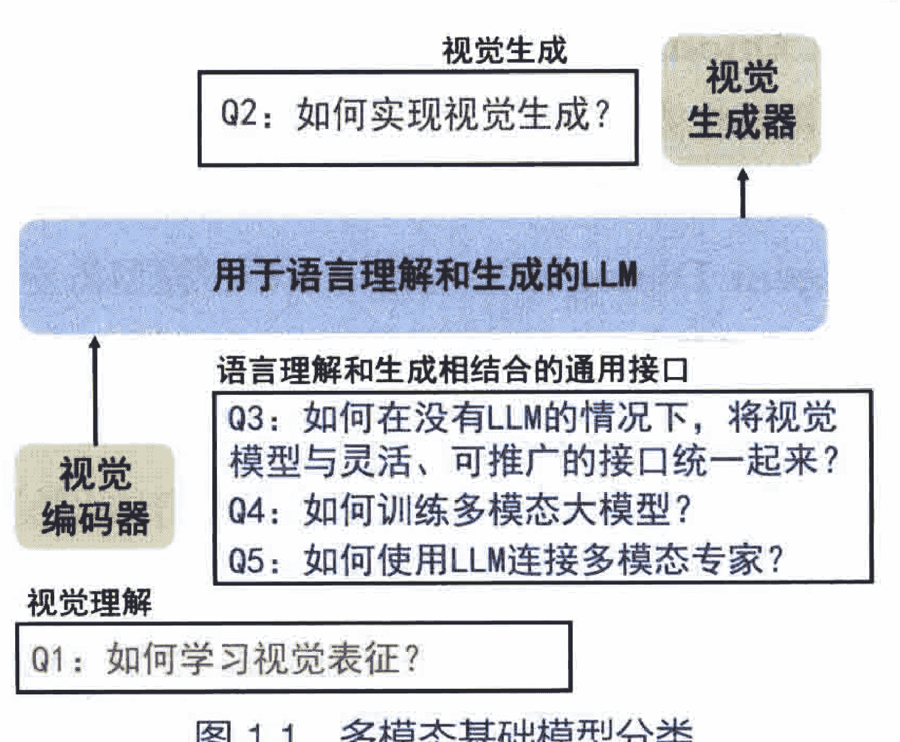

### 1. 视觉理解模型
学习通用视觉表征对构建视觉基础模型至关重要。强大的视觉骨干模型是图像分类、检索、字幕生成、检测、定位、分割等下游任务的基础。

### 2. 视觉生成模型
大规模图文数据催生基础图像生成模型，关键技术包括矢量量化VAE、扩散模型与自回归模型。

### 3. 通用接口
前述模型多为特定目的设计。通用模型的出现为AI智能体奠定基础。当前研究集中于统一视觉理解与生成，或在建模中融入预训练大语言模型，包括联合训练与链接方式。

#### 1.1.1 多模态
多模态指使用文本、图像、音频、视频等多种媒体与数据输入，它们相互关联并在不同层面传递信息。处理多模态数据需融合异构信息，实现更全面准确的分析与推断。其应用包括：

- 视觉问答：结合图像与自然语言回答关于图像的问题，需融合视觉与语言信息，详见第4章。
- 智能对话：模型需理解自然语言，对话中可能涉及图像等信息，多模态可提升理解与回复准确性。
- 图像描述：为图像生成文字描述，需同时理解图像与语言含义。

#### 1.1.2 大模型和基础模型

**从参数巨兽到通用基座：大模型与 BERT 内核拆解**

现在提到巨型模型，多数人想到的都是参数量级达到数亿甚至数千亿的深度神经网络体系。这类系统在多任务多数据集上的泛化能力突出，代表作包括 BERT、GPT、T5、ELECTRA 等。

**基座模型**
基座模型本质上是面向通用的预训练巨模，先在海量语料上完成初始学习，再迁移到广泛的下游场景。训练过程中它会沉淀自然语言、图像、语音等领域的通用表征与常识，后续只需微调即可对接具体任务。BERT 就是典型的基座模型，在文本分类、命名实体识别、问答等自然语言处理方向被大量使用；GPT 经过微调后也能覆盖机器翻译、文本生成、摘要等工作。

从范式看，基座模型是巨型模型的一个分支，更强调通用可迁移性，为更细分的领域提供底座。它在超大规模数据上完成预训练，积累了丰富的语言与知识，为后续任务提供更强的起点。

从技术史角度看，基座模型的思路并不新颖，深度神经网络与自监督学习已有数十年积累。但近几年其规模与落地广度已超出预期。传统特征抽取多依赖卷积神经网络或循环神经网络，而生成式预训练范式则以 Transformer 作为特征提取器，按自回归方式在大规模语料上训练。以 GPT-3 为例，参数规模约 1,750 亿，即便没有针对特定任务显式训练，也能借助自然语言提示实现任务迁移，并在多数基准上表现不错。

#### 1.1.3 多模态大模型
多模态巨模指参数极大且能处理多种输入类型的神经网络，涵盖文本、图像、音频、视频等。与只能处理单一模态的传统模型不同，多模态巨模可将异构数据融合，提取有效信息并整合，以实现更佳的预测与推理。

核心在于跨模态特征融合。模型为每个模态配备对应的特征提取器，得到各自表征后进行融合，形成全局表示供后续预测使用。融合阶段通常借助注意力机制强化关键特征的权重，提升效果。

这类模型一般拥有数亿到数千亿参数，需要海量数据支撑，训练与部署成本较高，对算力与技术支持要求明显。其优势在于能够利用多源信息，使结论更全面准确，并在不同领域取得更好表现。

应用场景十分丰富。自然语言处理中可做视觉问答、图像描述生成；计算机视觉中可做视频分类、图像检索；医学影像中可辅助诊断与治疗决策。

## 1.2 BERT 技术详解
BERT，即 Bidirectional Encoder Representations from Transformer，是谷歌在 2018 年提出的预训练语言模型[10]。它基于 Transformer 的深度双向表征学习思路，先在大量未标注文本上预训练提取通用语言表征，再在各下游自然语言处理任务上微调，取得优异结果。预训练加微调的组合使其在表达力与泛化性上更强，掩码机制让模型从上下文预测中间词，相较传统语言建模能更深挖掘语义。本节聚焦建模方法，涵盖结构、预训练任务与下游应用。

### 1.2.1 模型结构
先做整体把握，再逐项展开。整体结构见图 1.2。BERT 的骨架由多层 Transformer 编码器堆叠而成，这意味着编码时每个位置都能看到全部位置的信息，而非仅历史信息。整体可拆为输入、编码、输出三大部分，编码部分由多层 Transformer 编码器构成。预训练阶段末端有两个输出头：掩码语言建模与下一句预测。

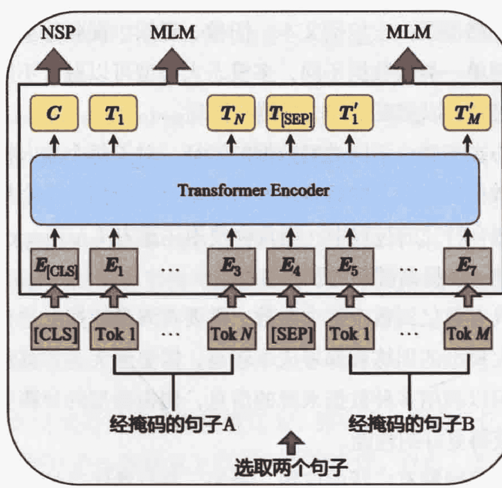

输入表征由三部分叠加而成：Token Embedding、Segment Embedding、Position Embedding。Token Embedding 负责词级向量表达，Segment Embedding 用于区分不同句子的输入，Position Embedding 标明词在句子中的位置，见图 1.3。整体结构包含以下模块。

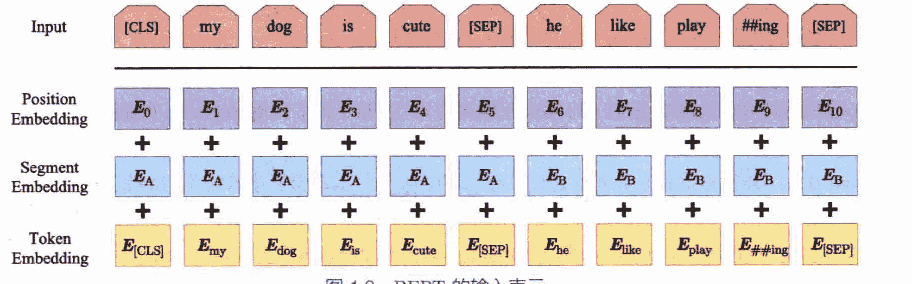

#### 1. 输入嵌入层
BERT 的输入是一条 Token 序列，输入嵌入层把每个 Token 映射为向量。两个特殊符号 [CLS] 用于分类任务，[SEP] 用于句子断开。嵌入过程使用 Token、Segment、Position 三个向量。

为便于计算，三种嵌入维度统一记为 e，输入序列表征 v 可由式 (1.1) 得到：

$$v = v^p + v^s + v^t$$

式中 $v^p$ 为 Position 嵌入，$v^s$ 为 Segment 嵌入，$v^t$ 为 Token 嵌入。三者的形状均为 $N \times e$，$N$ 为最大序列长度，$e$ 为嵌入维度。下面分别说明计算方式。

**Token 嵌入**：与常规神经网络类似，BERT 通过可训练的词表矩阵把输入文本转为实值向量。设输入序列 $x$ 的独热表示为 $e^t \in \mathbb{R}^{N \times |V|}$，对应的嵌入 $v^t$ 为

$$v^t = e^t W^t$$

其中 $W^t \in \mathbb{R}^{|V| \times e}$ 为可训练矩阵，$|V|$ 为词表大小。

1. Token 在自然语言处理中指文本的基本单元，可是词、词组、标点或字符，具体取决于处理需求。

**Segment 嵌入**：用于编码 Token 归属的 Segment。每个 Token 的 Segment 编码为其所在 Segment 的序号，从 0 开始。若输入为单段文本，所有 Token 编码为 0；若为两段文本，第一段编码为 0，第二段编码为 1。序列首标记 [CLS] 与段尾标记 [SEP] 的编码均为 0。随后用 Segment 矩阵 $W^s$ 将编码 $e^s \in \mathbb{R}^{N \times |S|}$ 映射为实值向量 $v^s$：

$$v^s = e^s W^s \quad (1.3)$$

其中 $W^s \in \mathbb{R}^{|S| \times e}$ 为可训练矩阵，$|S|$ 为 Segment 数量。

**Position 嵌入**：编码 Token 的绝对位置。按下标顺序转为 Position 独热，再用矩阵 $W^P$ 映射为实值向量 $v^P$：

$$v^P = e^P W^P \quad (1.4)$$

其中 $W^P \in \mathbb{R}^{N \times e}$ 为可训练矩阵，$N$ 为最大位置长度。

为表述方便，后续将输入表征操作记为

$$X = [CLS]x_1^{(1)}x_2^{(1)}\cdots x_n^{(1)}[SEP]x_1^{(2)}x_2^{(2)}\cdots x_m^{(2)}[SEP] \quad (1.5)$$

对原始输入序列 $X$，经处理后得到 BERT 输入表征 $v$：

$$v = \text{InputRepresentation}(X) \quad (1.6)$$

其中 $v \in \mathbb{R}^{N \times e}$ 为 Token、Segment、Position 三种嵌入之和。

#### 2. Transformer 编码器层
BERT 用 Transformer 编码器对 Token 序列进行编码。该层可视为多个相同子层的堆叠，每个子层包含多头自注意力和前馈神经网络。

**多头自注意力**：为序列每个位置生成向量表征，利用当前位置向量加权汇总全部位置向量，权重由相似度决定。该机制可捕捉不同位置间的依赖与语义。Transformer 的多头自注意力通过并行多头计算捕捉不同语义信息，先将输入投影到多个线性空间分别计算，再拼接输出。

**前馈神经网络**：由多个全连接层构成，用于对每个位置向量做非线性变换与映射。先线性映射到另一维度，再经激活函数如 ReLU 非线性化，最后线性映射回输出。两个子层配合残差连接与层归一化 LN，可稳定训练深层网络，提升泛化与鲁棒性。

该编码层是 BERT 的核心，通过自注意力和前馈网络编码序列，并借助残差与归一化优化训练。

#### 3. 掩码语言模型
预训练时 BERT 随机掩码部分 Token，替换为特殊标记 [Mask]，模型需定位掩码位置并恢复原词。技术细节见 1.2.2。

#### 4. 下一句预测
下一句预测是预训练任务，训练模型判断两句话的关系。模型输入一对句子，预测是否相邻，即后者是否为前者的续句。细节见 1.2.2。

#### 5. 下游任务微调层
预训练获得语言知识后，BERT 可微调到文本分类、命名实体识别、问答系统等下游任务。微调层通常是一个简单的线性层，具体形式随任务而定。

### 1.2.2 预训练任务
预训练语料主要包括：

- (1) **BookCorpus**：英文小说与非小说集合，约 11,000 本书，约 8,000 万词。
- (2) **Wikipedia**：由众多贡献者编写的百科全书，语料质量高。BERT 使用全部文章，约 2.5 亿词。

预训练采用 MLM 与 NSP 两个任务，让模型学习语义与语法，为后续微调提供语言知识。下面分别介绍。

#### 1. MLM
为实现双向建模，BERT 采用类似完形填空的 MLM 方法。目标是预测被随机遮蔽的词。具体做法是随机挑选输入序列中的部分词用 [MASK] 替换，模型据上下文预测原词，从而学会利用上下文信息。

掩码比例为 15%，即 15% 的 WordPieces 子词被掩码。为缓解预训练与下游不一致的问题，掩码策略按概率执行：

- 80% 概率替换为 [MASK]；
- 10% 概率替换为词表中的随机词；
- 10% 概率保持原词不变。

建模方式如下。

（1）**输入层**。MLM 不强制输入为两段文本，设原始文本为 $x_1x_2\cdots x_n$，掩码后为 $x'_1x'_2\cdots x'_n$。处理后得到输入表征 $v$：

$$X = [\text{CLS}]x'_1x'_2\cdots x'_n[\text{SEP}]$$

$$v = \text{InputRepresentation}(X)$$

其中 [CLS] 为序列起始标记，[SEP] 为分隔标记。

若文本长度 $n$ 小于最大长度 $N$，需在后方补齐 [PAD] 至 $N$。例如 $N=10$，输入长度 7 时需补 3 个 [PAD]。

$$[\text{CLS}]x_1x_2x_3x_4x_5[\text{SEP}][\text{PAD}][\text{PAD}][\text{PAD}]$$

若输入长度大于 $N$，则截断至 $N$。例如 $N=5$，输入长度 7 时需截断使有效序列长度变为 3。

$$[\text{CLS}]x_1x_2x_3[\text{SEP}]$$

后续忽略 [PAD] 处理，统一用 $N$ 表示最大长度。

（2）**BERT 编码层**。输入表征 $v$ 经 $L$ 层 Transformer，自注意力机制学习词间语义关联。

$$h^{[l]} = \text{Transformer-Block}(h^{l-1}), \forall l \in \{1, 2, \cdots, L\}$$

其中 $h^{[l]} \in \mathbb{R}^{N \times d}$ 为第 $l$ 层隐含输出，规定 $h^{[0]} = v$。简化记为

$$h = \text{Transformer}(v)$$

其中 $h$ 为最后一层输出 $h^{[L]}$。最终得到文本的上下文语义表征 $h \in \mathbb{R}^{N \times d}$，$d$ 为隐含维度。

BERT预训练双任务与ViT视觉Transformer拆解

（3）**输出层设计**。MLM 只对输入词进行部分掩码，因此不需要对每个位置都做预测，只需对被掩掉的位置进行还原。记所有被掩码的位置下标集合为 $\mathbb{M} = \{m_1, m_2, \cdots, m_k\}$，$k$ 为掩码总数。若序列长度为 $n$，掩码比例取 15%，则 $k = \lfloor n \times 15\% \rfloor$。随后以 $\mathbb{M}$ 为索引，从上下文语义向量 $h$ 中取出对应片段并拼接，得到掩码表示 $h^m \in \mathbb{R}^{k \times d}$。

在 BERT 里，输入嵌入维度 $e$ 与隐藏维度 $d$ 相同，于是可以直接用词表矩阵 $W^t \in \mathbb{R}^{|V| \times e}$（式 1.9）把掩码表示投射到词表空间。对 $h^m$ 的第 $i$ 个分量 $h_i^m$，按式 1.10 求出该位置在词表上的概率分布 $P_i$。

$$P_i = \text{Softmax}(h_i^m W^{t^T} + b^o)$$

式中 $b^o \in \mathbb{R}^V$ 为全连接层的偏置向量。

得到每个掩码位置的分布 $P_i$ 后，再与真实标签 $y_i$ 即原词 $x_i$ 的独热编码计算交叉熵损失，驱动参数更新。

#### 2. NSP

MLM 能够通过上下文还原被掩住的词，从而学到上下文敏感的表征。但对于阅读理解、文本蕴含等需要同时建模两段文本的任务，仅靠 MLM 无法显式刻画段间关联。例如阅读理解要对篇章和问题共同建模，文本蕴含要分析前提与假设的关系。

为此 BERT 引入第二个预训练目标 NSP，用来判断两个句子是否连续。具体做法是输入一对句子 A、B，让模型预测 B 是否紧跟在 A 之后。该任务可帮助模型捕捉因果、转折等句子间关系。

NSP 是二分类问题，判断句子 B 是否是句子 A 的下一句。样本构造如下：

- （1）**正样本**：取自自然文本中真正相邻的“句子 A”“句子 B”，构成下一句关系。
- （2）**负样本**：保留句子 A，将句子 B 换成语料库中随机抽取的句子，构成非下一句关系。

正负样本总体比例维持在 1:1。构造方式简单且可自动生成大量训练对，因而具备无监督特性。

NSP 的建模流程与 MLM 相似，主要在输出侧不同。

（1）**输入层**。对经过掩码处理的输入文本

$$x^{(1)} = x_1^{(1)} x_2^{(1)} \cdots x_n^{(1)},$$

$$x^{(2)} = x_1^{(2)} x_2^{(2)} \cdots x_m^{(2)},$$

做如下拼接，得到 BERT 的输入表示 $v$。

$$X = [\text{CLS}]x_1^{(1)}x_2^{(1)}\cdots x_n^{(1)}[\text{SEP}]x_1^{(2)}x_2^{(2)}\cdots x_m^{(2)}[\text{SEP}]$$

$$v = \text{InputRepresentation}(X)$$

式中 [CLS] 标记序列起始，[SEP] 标记句子边界。

（2）**BERT 编码层**。输入表示 $v$ 进入 $L$ 层 Transformer 编码器，自注意力机制逐层捕捉词间语义依赖，最终输出上下文表征。

$$h = \text{Transformer}(v)$$

式中 $h \in \mathbb{R}^{N \times d}$，$N$ 为最大序列长度，$d$ 为隐含维度。

（3）**输出层**。与 MLM 不同，NSP 只需判定 $x^{(2)}$ 是否为 $x^{(1)}$ 的下一句。因此使用序列首个标记 [CLS] 的隐含向量进行分类。由于 [CLS] 位于序列最前，其隐含向量即 $h$ 的首分量 $h_0$。再经一个全连接层得到二分类概率 $P \in \mathbb{R}^2$。

$$P = \text{Softmax}(h_0 W^P + b^O)$$

式中 $W^P \in \mathbb{R}^{d \times 2}$ 为全连接权重，$b^O \in \mathbb{R}^2$ 为偏置。

随后用分类概率 $P$ 与真实标签 $y$ 计算交叉熵损失，更新参数。

MLM 与 NSP 协同，使 BERT 同时掌握语言的语义语法能力和段间关联能力。

### 1.2.3 下游应用场景

预训练完成后，BERT 可通过微调适配具体任务。通常做法是保留预训练体干，在其上接任务专用的输出头。例如文本分类可在顶端接全连接加 Softmax 做类别预测。典型下游方向包括：

- （1）**文本分类**：垃圾邮件判别、情感分析等。
- （2）**问答系统**：理解问题与上下文的关系，从文本中抽取答案。
- （3）**语言推理**：自然语言推理、篇章阅读理解等逻辑判断。
- （4）**语义匹配**：相似度计算、语义对齐等。
- （5）**命名实体识别**：识别人名、地名、机构名等。
- （6）**自然语言生成**：摘要、机器翻译、对话生成等。
- （7）**推荐系统**：建模用户与物品关系，用于商品、新闻、音乐推荐。

## 1.3 ViT 技术详解

ViT 即 Vision Transformer，2020 年由 Google Brain 提出。传统 CNN 需要手工设计卷积与池化，且对大尺寸图像处理繁琐。ViT 用自注意力直接学习图像关键特征，避免手工结构，并能更好地处理大图。相对 CNN，ViT 的优势体现在：

（1）尺寸适应性：CNN 要求固定尺寸输入，ViT 可把不同尺寸图像切分为固定块处理。
（2）长程依赖：CNN 难以直接建模远距离关联，ViT 的自注意力可全局建模。
（3）参数效率：在同等规模下，ViT 往往用更少参数达到相近效果。
（4）泛化能力：训练时不显式依赖位置先验，对新图像更具泛化性。

本节聚焦 ViT 的建模方式与预训练策略。

### 1.3.1 模型结构

ViT 先把图像切成若干小块并展平为序列，再送入 Transformer 编码器学习特征，最后用全连接层映射到类别。训练时常先在大规模数据上自监督预训练，再在小数据上微调。

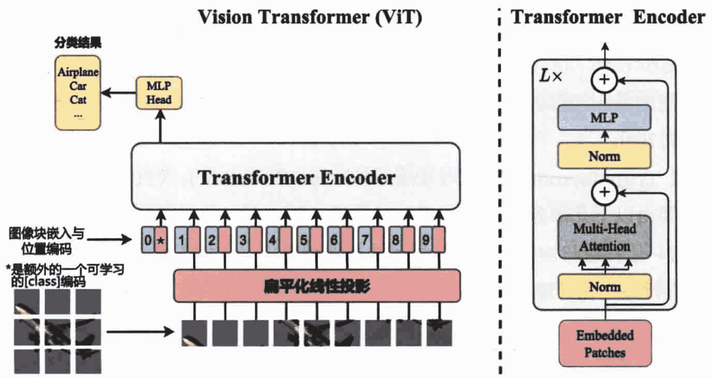

（1）图像切割。Transformer 需要二维的 Token 序列输入。把图像 $x \in \mathbb{R}^{H \times W \times C}$ 划分为 $x_p \in \mathbb{R}^{N \times (P^2 C)}$ 的块后，用线性投影 $E \in \mathbb{R}^{(P^2 C) \times D}$ 映射为 $x_pE \in \mathbb{R}^{N \times D}$。其中 $N = HW/P^2$。以 ViT-B/16 为例，$224 \times 224 \times 3$ 的图像被切成 $196$ 个 $16 \times 16 \times 3$ 的块，经投影变为长度 768 的向量。维度变化为

$[224, 224, 3] \xrightarrow{\text{Patch}} 196 \times [16, 16, 3] \xrightarrow{\text{Linear}} 196 \times [768]$

（2）类别嵌入层。与 BERT 类似，额外插入可训练的分类 Token $x_{\text{class}} \in \mathbb{R}^{1 \times D}$。ViT-B/16 中该向量长度为 768，与 196 个图像 Token 拼接后变为 $[197,768]$。

（3）位置编码层。为保留空间关系，加入可训练位置编码 $E_{\text{pos}} \in \mathbb{R}^{(N+1) \times D}$，直接与 Token 相加，维度保持 $[197,768]$。

（4）多层 Transformer 编码器。$L$ 层编码器由层归一化、多头自注意力、Dropout 与 MLP 组成，MLP 由两层全连接、GeLU 与 Dropout 构成。整体可表示为：

$z_0 = [x_{\text{class}}; x_p^1 E; \dots; x_p^N E] + E_{\text{pos}}$

$z_l' = \text{MSA}(\text{LN}(z_{l-1})) + z_{l-1}$

$z_l = \text{MLP}(\text{LN}(z_l')) + z_l'$

$y = \text{LN}(z_L^0)$

ViT 把图像视作向量序列，用自注意力处理，摆脱了 CNN 对空间结构的强依赖，可接受任意尺寸输入。

### 1.3.2 预训练任务

ViT 的预训练常使用 ImageNet 等大规模图像集，ImageNet 含百万级图像与千类标签。更大规模的 JFT-300M、YFCC100M 也被用于提升泛化。

自监督预训练常用掩码图像块预测 MPP。对图像块 Embedding 随机干扰 50%，其中 80% 用可学习 [MASK] 替换，10% 随机替换，10% 保留原值。模型需预测被干扰块的 3-bit 平均颜色，从而学习语义表征。

其他自监督方式还包括：

- （1）图像块对比学习。对同一图像的两个块编码，使其在嵌入空间接近，同时远离其他图像的块，常借助 InfoNCE、SimCLR 等对比目标。
- （2）图像重构。从被遮挡或损坏的块中恢复原始块，迫使模型整合局部与全局特征。

2021 年何恺明提出的掩码自编码器 MAE 在 ViT 上取得突出效果。其核心是随机掩码图像块，仅用可见块预测被掩部分，实现去噪自编码。

视觉与语言的 MAE 存在差异：

- （1）模型范式不同。视觉长期由 CNN 主导，位置嵌入融合困难，ViT 才让 Transformer 适配图像。
- （2）信息密度不同。文本信息高度浓缩，掩少量词即可捕捉语义；图像像素冗余度高，局部纹理相似，恢复像素对语义需求较低。

多模态大模型：新一代人工智能技术范式

- （3）解码器功能的分化：BERT 做掩码词预测时，恢复被遮挡的词要求解码器具备对文本语义的理解；相对而言，视觉领域的掩码重建任务，预测被遮挡像素并不高度依赖语义信息。

正是基于这一差别，MAE 选用高达 75% 的掩码比例给图像引入噪声，使得仅凭邻近可见像素难以完成重建，从而倒逼编码器捕捉图像的语义表征。以下对 MAE 的核心机制作展开说明。

如图 1.5 所示，MAE 采用不对称的编码器-解码器架构。编码器沿用 ViT 提出的 Transformer 主干，以图像块作为输入恰好适配掩码操作。解码器则设计得很轻量，在层数与宽度上均远小于编码器。另一处不对称在于输入范围：编码器只接收可见的 patch，解码器则拿到整张图的 patch 信息，包括掩码标识以及编码器对可见 patch 的特征。下面分别介绍两部分。

- （1）编码器部分：设计上继承 ViT 编码器，输入并非完整图像而是未被遮挡的 patch。与标准 ViT 一致，块先经线性投影转为嵌入向量并加上位置编码，随后送入多层 Transformer。只处理约 25% 的可见 patch，使得训练时的计算开销大幅下降。

- （2）解码器部分：输入由两类信息构成，图像嵌入与位置编码。
  - （a）图像嵌入融合了编码器输出的可视特征和用于占位的掩码 Token。
  - （b）位置编码提供空间位置。需留意的是，解码器使用的掩码 Token 为可学习且共享的参数。

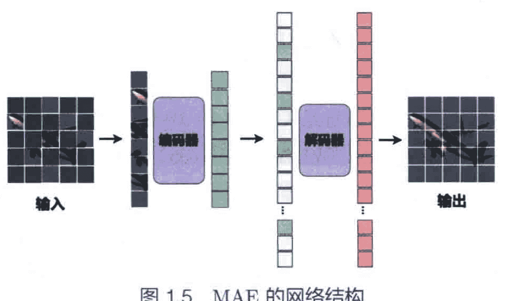

在 MAE 中，解码器和编码器解耦，仅在预训练重建阶段发挥作用。因此解码器可以按需设计。例如默认配置下，解码器的计算量约为编码器的 10%。这种不对称让预训练更快完成。

重建目标分为原始像素重建与归一化后像素重建。试验显示，采用归一化像素可提升约 0.5% 的准确率。数据增强方面，MAE 仅使用随机裁剪和水平翻转。实验表明，类 Color Jitter 的色彩扰动会降低性能。因为随机掩码本身已提供大量随机性，过度增强反而提高训练难度。

## 1.4 GPT 系列

GPT 由 OpenAI 于 2018 年提出，是一个在复杂自然语言处理任务上表现突出的预训练语言模型。系列整体遵循持续堆叠 Transformer 的思路，通过扩大训练数据规模与质量、提升参数量实现迭代。与 BERT 不同，GPT 属于单向语言模型，只能依据前文生成后文。发展脉络可归纳为以下阶段。

**GPT-1[12]**：2018 年 6 月发布，共 12 层 Transformer 编码器，每层 768 维隐藏单元，参数约 1.17 亿，以约 5GB 的 BooksCorpus 做无监督预训练后针对特定任务微调。

**GPT-2[13]**：2019 年 2 月发布，是 GPT-1 的改进版。参数达 15 亿，是前者的 10 倍左右。预训练语料扩大至 CommonCrawl、WebText、BooksCorpus 等。相比 GPT-1，文本生成与下游任务能力明显提升，且能在不微调情况下完成多种 NLP 任务。

**GPT-3[14]**：2020 年 5 月发布，参数 1,750 亿，基于 45TB 的 CommonCrawl 进行大规模学习，参数量为 GPT-2 的十倍以上。预训练语料涵盖 CommonCrawl、WebText、BooksCorpus、Wikipedia 等大型语料，并引入动态模型大小控制、层级分解、流控制等改进。给定少量示例或自然语言指令时，可在多类任务上取得优异表现。

**ChatGPT**：2022 年 11 月推出，基于 GPT-3.5 构建的应用，使用 10 万亿参数与 100TB 社交媒体数据进行对话生成学习。核心结构与 InstructGPT 一致，采用多层 Transformer 解码器。相较通用模型，ChatGPT 聚焦对话场景，优化语境后能输出更贴合对话的自然文本，实现流畅、有逻辑、有情感、有创造力的交互。

**GPT-4**：2023 年 3 月发布，相对于 ChatGPT 有多项跃升。升级为多模态，可输入输出图像，识图能力强；文字输入上限提升至 2.5 万字；回答准确性显著提高；高级推理与模拟考试水平明显提升。

**GPT-4V**：2023 年 9 月 25 日，OpenAI 发布具备视觉功能的 GPT-4Vision，简称 GPT-4V。用户可让模型分析上传的图像。2023 年 9 月 29 日，微软发布了长达 166 页的 GPT-4V 研究报告。

### 1.4.1 GPT-1 结构详解

GPT-1 假设可获得大量无标签文本与少量有标签下游数据，且两者不必来源相同。在此前提下，训练分为两个阶段。

- （1）**无监督预训练**：借助海量未标注数据预训练语言模型。
- （2）**有监督微调**：用标注数据对预训练模型进行调整，使其迁移到具体监督任务。GPT-1 的做法本质上是半监督，学习通用表征以便后续任务只需少量改动。整体结构见图 1.6，左为 Transformer 结构与训练目标，右为不同微调任务。下面详述两个阶段。

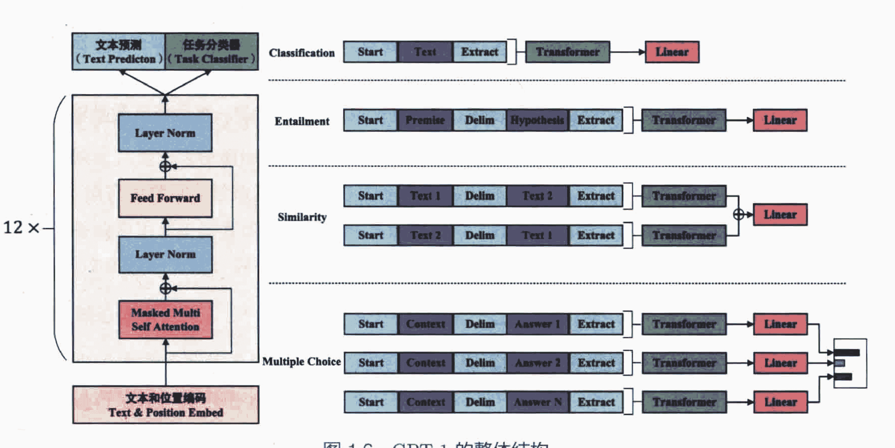

#### 1. 无监督预训练

给定无标注序列 $\mathcal{U} = \{u_1, u_2, \cdots, u_n\}$，GPT-1 使用标准语言建模目标最大化以下似然：

$$L_1(\mathcal{U}) = \sum_{i} \log P(u_i | u_{i-k}, \cdots, u_{i-1}; \Theta) \quad (1.20)$$

式中，$k$ 表示文本窗口大小，$P$ 表示用神经网络参数 $\Theta$ 建模的条件概率。参数均以随机梯度下降优化。

GPT-1 采用来自 BERT 的多层 Transformer 解码器，对输入使用多头自注意力与位置敏感全连接层，得到目标序列输出分布：

$$h_0 = UW_e + W_p$$

$$h_l = \text{Transformer\_block}(h_{l-1}), \quad \forall i \in [1, n] \quad (1.21)$$

$$P(u) = \text{Softmax}(h_n W_e^T)$$

式中，$U = \{u_{-k}, \cdots, u_{-1}\}$ 为上下文序列向量，$n$ 为层数，$W_e$ 为词向量矩阵，$W_p$ 为位置向量矩阵，T 为矩阵转置。

#### 2. 有监督微调

预训练后，GPT-1 以有监督方式调整参数。设标注集 $\mathcal{C}$ 中每个实例包含输入词序列 $\boldsymbol{x}_1, \boldsymbol{x}_2, \cdots, \boldsymbol{x}_m$ 与类别标签 $\boldsymbol{y}$。输入送入预训练模型得到最终 Transformer 激活 $\boldsymbol{h}_l^m$，再经参数为 $\boldsymbol{W}_y$ 的线性层预测 $\boldsymbol{y}$：

$$P(\boldsymbol{y}|\boldsymbol{x}_1, \boldsymbol{x}_2, \cdots, \boldsymbol{x}_m) = \text{Softmax}(\boldsymbol{h}_l^m \boldsymbol{W}_y) \quad (1.22)$$

随后最大化以下目标进行微调：

$$L_2(\mathcal{C}) = \sum_{(\boldsymbol{x}, \boldsymbol{y})} \log P(\boldsymbol{y}|\boldsymbol{x}_1, \boldsymbol{x}_2, \cdots, \boldsymbol{x}_m) \quad (1.23)$$

此外，为提升泛化与收敛，将语言模型目标加入下游微调，最终目标为：

$$L_3(\mathcal{C}) = L_2(\mathcal{C}) + \lambda L_1(\mathcal{C}) \quad (1.24)$$

#### 3. 任务相关的输入形式

如图 1.6 右半部分所示，不同下游任务采用不同输入形式。

- （1）文本分类任务：直接按上述方式微调。
- （2）文本蕴含任务：该任务指据一文本推断另一文本的真实性。将前提与假设拼接，中间加入分隔符 $。
- （3）文本相似任务：比较的两句无固有顺序。为体现此点，将两种可能顺序均放入输入并各独立处理，得到两个表示 $\boldsymbol{h}_l^m$ 后逐元素相加再送入线性层。
- （4）多项选择任务：给定文档 $z$、问题 $q$ 与候选答案 $\{a_k\}$，将 $[z; q; \$; a_k]$ 拼接后分别输入语言模型与线性分类层，再经 Softmax 得答案分布。

### 1.4.2 GPT-2 结构详解

GPT-2 的无监督学习方式与 GPT-1 相同，但使用大量高质量跨任务数据，各任务损失均需收敛且参数共享，进一步提升泛化。网络加深、数据增多的同时，GPT-2 去掉了微调环节，不再为每个任务单独建模。相较有监督多任务学习，语言模型无需显式定义输入输出。实际上有监督输出只是序列子集，例如“中国的首都是北京”一句，模型自然学会问答的输入与输出。目标是迈向通用系统，无需为每个任务额外标注。下面介绍核心方法、训练数据与模型结构。

#### 1. 核心方法

GPT-2 的核心是语言建模，可视为对样例序列 $(x_1, x_2, \cdots, x_n)$ 无监督分布的估计，每个样本为不同长度符号序列 $(s_1, s_2, \cdots, s_n)$。语言具有天然顺序，通常把联合概率分解为条件概率乘积：

$$p(x) = \prod_{i=1}^{n} p(s_n | s_1, s_2, \cdots, s_{n-1}) \quad (1.25)$$

该方式可对 $p(x)$ 及形如 $p(s_{n-k}, \cdots, s_n | s_1, \cdots, s_{n-k-1})$ 的条件概率进行可控采样与估计。随着表达能力提升，这类条件概率可被有效计算。

单任务学习可表述为估计条件分布 $p(\text{output} | \text{input})$。通用系统需处理多种任务，且输出应依赖任务而非仅输入。因此 GPT-2 根据输入与任务给出对应输出：

$$p(\text{output} | \text{input}, \text{task}) \quad (1.26)$$

各类任务的输入输出均可表示为序列，例如自然语言形式，使任务处理更灵活。如输入“中国的首都是北京”，即可得到英文翻译“The capital of China is Beijing”。由此机器翻译、自然语言推理、关系抽取等多类任务被统一建模，无需为每个子任务单独设计。实验表明，大规模语言模型能以此方式处理多种任务，但学习速度慢于特定监督方式。GPT-2 为后续大语言模型发展奠定基础。

#### 2. 训练数据

GPT-2 使用 WebText。构建 WebText 时，团队开发了侧重文档质量的爬虫，仅抓取人工筛选或已过滤网页，并从 Reddit 爬取获至少 3 个点赞的外部链接，以此作为内容有趣或有教育价值的启发式指标。WebText 含约 4,500 万链接文本。为从 HTML 提取文本，结合使用 Dragnet 与 Newspaper。鉴于 WebText 是常见数据源，可能与测试集重叠，故 GPT-2 去除了 WebText 中的所有维基百科文档。

#### 3. 模型结构

GPT-2 仍基于 Transformer，并在 GPT-1 上作少量调整。层归一化移至每个 Transformer 块起始，并在最后一层注意力后增加一次层归一化。为避免深度增加时残差累积，对残差层初始化进行调整，参数按残差层数 $N$ 缩放。词表扩大至 50,247，上下文窗口从 512 增至 1,024，Batch Size 提升到 512。

### 1.4.3 GPT-3 结构详解

“预训练 + 微调”范式需任务相关数据集与专门微调，每新任务都要大量标签，制约能力。微调后模型易过拟合，丧失泛化。人类在多数任务上无需大量标注即可学习。

基于此，OpenAI 于 2020 年 5 月发布 GPT-3，即 Generative Pre-trained Transformer 3。GPT-3 为自回归语言模型，沿用 GPT-2 结构但容量大幅提升，采用 96 层多头 Transformer，词向量维度 12,288，参数 1,750 亿，是 GPT-2 的百倍以上。给出任务描述与参考案例时，能理解当前语境。即使下游任务与预训练分布不一致，表现依然良好。GPT-3 不做微调，推理时不计算梯度，而是让案例作为输入提示引导模型。GPT-3 在翻译、问答、填空等任务上表现强劲，也擅长即时推理与领域适应，如拼写、引入新词、三位数算术等。下面详述结构、训练数据与评测方式。

#### 1. 模型结构

GPT-3 在整体上与 GPT-2 一致，内部 Transformer 有差异。采用类似稀疏 Transformer 的局部带状稀疏注意力模式，以提升计算效率。

#### 2. 训练数据

预训练语料包括 CommonCrawl、WebText、BooksCorpus、Wikipedia 及其他大型语料。CommonCrawl 规模大但质量低，故采取三步提升质量。

- （1）以 WebText 为高质量、CommonCrawl 为低质量，训练简单逻辑回归模型判断质量，过滤后得到改进版 CommonCrawl。
- （2）模糊去重，避免在保留验证集上过拟合。
- （3）加入已知高质量语料，增加多样性。

下载的 CommonCrawl 约 45TB，过滤后剩 570GB。训练时并非按大小采样，而是给高质量集更大权重，实质是用少量高质量数据交换过拟合风险。处理中还需检测与评测集的重叠，降低记忆带来的指标虚高。

#### 3. 评测方式

GPT-3 对所有任务的检验可以归纳为三种范式，分别是少样本、单样本和零样本。

少样本 FS 在推理时把少量任务演示作为条件输入，模型参数不做更新。具体做法是给出 K 个示例，通常在 10 到 100 之间，再让模型进行预测，K 越大表现往往越好。它的主要好处是大幅削减对任务特定数据的需求，降低在小而窄的微调集上学得过于偏科的风险。主要短板是效果远不及最先进的微调模型，而且仍然需要一点任务专属数据。这里的少样本学习与机器学习领域的同名概念相通，都是先在隐含于预训练数据的宽泛任务分布上学习，再快速迁移到新任务。

单样本 1S 与少样本思路一致，只提供一次演示，并配合一段自然语言的任务描述。之所以单独区分，是因为它最贴近人类日常的沟通方式。比如在众包平台做数据收集时，常只给一个示范。没有示例的话，很难把任务内容和格式讲清楚。

零样本 OS 与单样本类似，只是完全不给演示，模型仅依据自然语言指令来理解任务。这种方式便利性最强、鲁棒性最好，也能规避虚假相关，除非这类相关在预训练语料库中普遍存在，但同时也是最难的。有些任务即便对人来说，没有先验示例也难以把握格式，所以显得“不公平地难”。例如让某人“做一张200米冲刺世界纪录表”，请求本身就模糊，不知道表格格式和包含内容。尽管如此，在某些场景下零样本最接近人类执行任务的方式。以翻译为例，人类往往只需读指令就知道怎么做。GPT-3 研究的零样本、单样本、少样本学习都要求模型在测试时只做前向推理即可完成任务。少样本设置里通常会提供几十个示例。

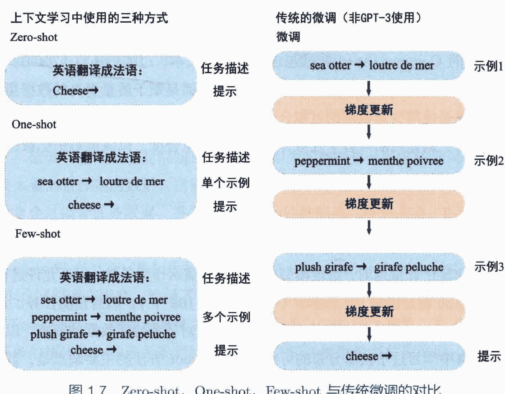

#### 4. GPT-3 的局限
尽管相较 GPT-2，GPT-3 在文本生成和多项自然语言任务上实现了明显的定量和定性提升，弱点依然突出。生成文本时整体质量尚可，但文档级别会出现语义重复，随着篇幅增长连贯性下降，会自相矛盾，也偶尔产出不连贯的句子或段落。在离散语言任务上，常识物理尤其困难，比如“把奶酪放进冰箱会融化吗”这类问题就答不好。量化来看，上下文学习存在明显缺陷，在若干比较类任务上表现接近随机猜测，例如判断同一个词在两个句子中的用法是否一致，或一个句子是否蕴含另一个句子。

这些问题背后有结构和算法层面的限制。GPT-3 主要探索自回归语言模型在上下文学习上的能力，因为采样和似然计算很直接。因此实验里没有双向结构，也没有去噪等训练目标。这种设计选择可能让模型在需要双向信息的任务上吃亏，比如填空、比较两个内容等。这或许能解释它在 WIC、ANLI、QuAC、RACE 等任务上的低分。据以往文献推断，同规模的双向模型在微调后可能更强。未来可以尝试构建与 GPT-3 同等规模的双向模型，或让双向模型适配少样本、零样本学习，以求兼顾两者优势。

语言模型更本源的不足在预训练目标函数上。当前目标把所有 Token 视为等价，不区分重要性。单纯放大模型容量、数据规模、训练时长或已触及自监督方法的上限。大型预训练模型没有来自视频或现实物理交互的经验，缺少大量世界上下文。因此纯自监督预测的扩展可能受限，需要其它增强手段，未来方向可能包括借鉴人类目标函数、用强化学习做微调、引入图像等其它模态来构建更好的世界模型。

预训练阶段的样本效率也是普遍问题。测试时 GPT-3 的样本效率接近人类，但预训练所消耗的文本远超人类一生所见。提升预训练样本效率是重要方向，可通过利用物理世界额外信息或算法改进来实现。

少样本学习本身存在不确定性：模型是在推理时从零学习新任务，还是仅仅识别和辨别训练时已见过的任务。可行的解释有多种：演示与测试分布完全一致、识别不同格式的同一任务、或适应特定风格的通用任务。GPT-3 在不同任务上的位置可能不同。合成任务如词序打乱或定义无意义词很可能被重新学习，而翻译显然需要在预训练期间就已学到，因为语料可能来自风格迥异的数据。最终人类是全新学习还是依赖既往演示，仍是开放问题。

针对 GPT-3 量级的模型，推理成本高昂是现实瓶颈，可能限制其实际应用。对 LLM 进行蒸馏以适配特定任务是一种可行思路。LLM 包含大量技能，其中许多在特定任务中用不到，原则上可压缩。蒸馏已是成熟课题，但在数千亿参数级别仍有新挑战和机会。

最后，GPT-3 与大多数深度学习系统一样缺乏可解释性，在新输入上的预测校准不足，这从其在标准基准上表现的高方差可见，远高于人类，且保留训练数据中的偏误，可能导致生成偏误内容。

## 1.5 ChatGPT 简介
ChatGPT 是 OpenAI 推出的一款由 AI 驱动的自然语言处理工具，采用 Transformer 神经网络结构，本质上基于 GPT-3.5 架构。它擅长序列数据处理，具备语言理解与文本生成能力，训练时连接了大量真实世界的对话数据，使其知识面覆盖天文地理，并能基于聊天上下文互动。ChatGPT 不仅是聊天机器人，还能撰写邮件、视频脚本、文案、翻译、编程等。自 2022 年 11 月 30 日发布以来迅速走红，5 天注册用户超 100 万，两个多月突破亿级，被称作“史上增长最快的消费者应用”。

要理解 ChatGPT，先要了解 InstructGPT，因为 ChatGPT 沿用了其思路。核心结构与基于 GPT-3 的 InstructGPT 一致，但数据量提升了数个量级。InstructGPT 在 GPT-3 上使用强化学习做微调，内核为 PPO-ptx。

### 1.5.1 InstructGPT
单纯扩大语言模型并不会使其更善于遵循用户意图。LLM 可能产出不真实、有害或无帮助的内容，即与用户需求不齐。InstructGPT 使用人类反馈微调的语言模型，目标是让模型在广泛任务上与用户意图对齐。流程分三步：有监督微调、奖励模型训练、以奖励模型为基础的近端策略优化 PPO 强化学习。蓝色箭头表示数据用于训练。步骤二中 A~D 为模型抽样输出，由标注者排序。InstructGPT 起始于标注者编写的提示和通过 OpenAI API 提交的提示，收集演示数据后用监督学习微调 GPT-3，随后收集模型输出的排名数据并用人类反馈强化学习进一步优化，因此得名。即使参数仅 130 亿，远小于 GPT-3 的 1750 亿，其输出在人类评估中仍更受青睐，且真实性提升、有害输出减少。尽管仍会出现简单错误，实验表明人类反馈微调是实现对齐的有前景方向。

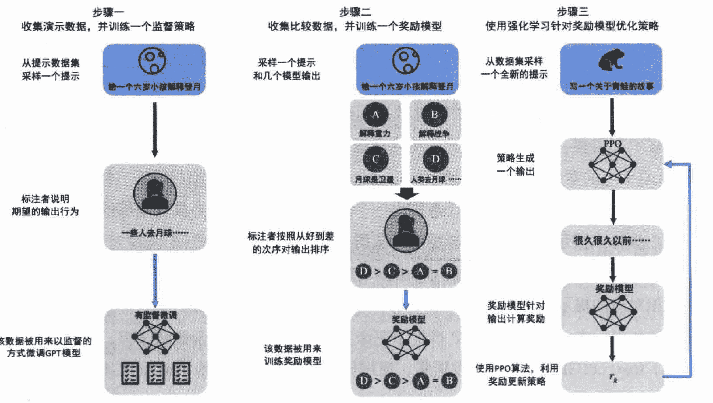

#### 1. 高层方法论
步骤 1：收集演示数据，训练有监督策略。标注者在提示分布上提供所需行为的演示，InstructGPT 用监督学习在这些数据上微调预训练 GPT-3。
步骤 2：收集比较数据，训练奖励模型。收集模型输出之间的比较数据，然后训练奖励模型预测人类偏好。
步骤 3：用 PPO 针对奖励模型优化策略。将奖励模型输出作为标量奖励，用 PPO 微调监督策略以优化该奖励。步骤 2 与 3 可迭代进行，用当前最佳策略收集更多比较数据来训练新奖励模型和新策略。InstructGPT 中大部分比较数据来自监督策略，部分来自 PPO 策略。

#### 2. 数据集
提示主要来自提交到 OpenAI API 的文本提示，特别是 Playground 界面使用早期 InstructGPT 模型的用户。客户被告知数据可能用于模型改进。InstructGPT 通过长公共前缀启发式去重，并限制每个用户 ID 提示数不超过 200 个，还按用户 ID 划分训练、验证、测试集。为避免学习敏感客户细节，过滤掉含个人身份信息的提示。

训练首个模型时，要求标注者自行编写提示，因为初始指令式提示在常规 GPT-3 API 提交中较少。标注者编写三类提示：普通提示，要求任务多样；少样本提示，提供指令及多个查询/响应对；基于用户的提示，对应 OpenAI API 申请等待期间列出的用例。

由此产生三个数据集：SFT 数据集用于监督微调，RM 数据集用于奖励模型训练，PPO 数据集无人类标签，用于人类反馈强化学习微调。SFT 约 13,000 个训练提示，RM 约 33,000 个，PPO 约 31,000 个，前两者来自 API 与标注者，后者仅来自 API。

#### 3. 训练任务
数据来自标注者编写的提示和 InstructGPT API 上早期模型的提示。覆盖生成、问答、对话、摘要、抽取等自然语言任务，超过 96% 为英语。

每个提示通常用自然语言指令直接指定任务，也可通过少量示例间接指定，或靠隐含关联指定。标注者被要求尽可能推断提示编写者的意图，并跳过任务不清晰的输入。同时考虑隐含意图，如响应真实性、偏见或有害语言等潜在风险。

#### 4. 人类数据收集
演示和比较数据及评估由 Upwork 和 ScaleAI 的约 40 名承包商团队收集。相比早期仅做摘要任务的人类偏好数据收集，InstructGPT 的输入任务范围更广，包含争议和敏感主题。目标是挑选对不同人群偏好敏感且擅长识别有害输出的标注者，因此进行筛选测试。训练和评估时的对齐标准可能不同，训练更侧重帮助用户，评估则要求标注者优先考虑真实性和无害性。

#### 5. 模型构建流程
基于 GPT-3 预训练模型，有监督微调、奖励建模、强化学习三种技术。
有监督微调：用监督学习将 GPT-3 微调到标注演示数据，用余弦学习率衰减和残差 Dropout 0.2 训练 16 个 epoch，按验证集奖励模型分数选最终模型。1 个 epoch 后验证损失即过拟合，更多轮次可提高奖励分数和人类偏好。
奖励建模：从去掉最终反嵌入层的监督微调模型出发，输入提示和响应，输出标量奖励。为节省算力使用 6B 参数奖励模型，175B 参数模型训练不稳定，不适合用作强化学习阶段的价值函数。
强化学习：用 PPO 微调监督微调模型。环境提供随机客户提示并期望响应，奖励由奖励模型给出。每个 token 增加来自监督微调模型的 KL 惩罚以避免过度优化。价值函数从奖励模型初始化，统称为 PPO。

### 1.5.2 ChatGPT
ChatGPT 以 GPT-3.5 为基座，依托其生成能力并通过 RLHF 进一步训练，效果突出。GPT 系列从 GPT-3 起分化为两个技术路径：以 Codex 为代表的代码与训练技术，以 InstructGPT 为代表的指令预训练技术。随后进入融合式预训练，通过指令学习、有监督微调和 RLHF 实现以自然语言对话为接口的 ChatGPT 模型。

#### 1. ChatGPT 未来的发展方向
ChatGPT 仍面临诸多挑战。其一，可能生成似是而非、毫无意义的答案。原因包括强化学习训练中没有明确正确答案、谨慎训练策略导致模型不敢给出应有的正确回复、监督学习中错误引导使模型偏向标注者已知内容而非自身所知。其二，对输入措辞敏感，问题微调措辞后可能从“不知道”变为给出正确答案。其三，回复通常过长，且过度使用某些短语，源于训练数据偏差和过拟合。其四，尽管 OpenAI 已努力让模型拒绝不恰当请求，仍可能对有害请求作出回应或表现出偏见。

# ChatGPT：能力边界、局限与多模态跃迁

ChatGPT 能力很强，但模型体量庞大、调用成本高，业界开始探索轻量化方向。主流压缩手段大致有四类。量化是降低参数数值表达精度，例如把 FP32 压缩到 FP16 或 INT8。剪枝是按策略去掉神经网络里贡献小的参数，粒度从单个权重到通道，在视觉任务或中小型语言模型上效果更明显。蒸馏是让小模型在教师模型指导下保留关键信息、过滤冗余。稀疏化则是大规模剔除冗余变量，在简化结构的同时守住数据核心信息。

与此同时，降低人工标注依赖的 AI 反馈强化学习 RLAIF 也在兴起。2022年12月，Anthropic 发表论文《Constitutional AI: Harmlessness from AI Feedback》，同时推出对话机器人 Claude。训练框架和 ChatGPT 相近，都用强化学习优化，区别在排序环节：Claude 用模型来做数据标注，先让模型学会人类对无害性的打分偏好，再以此对结果排序，替代人工标注。

#### 2. ChatGPT 的核心亮点
ChatGPT 和微软小冰、百度度秘这类对话系统一样，都能直接下指令自然交互，上手门槛低。相比之下，它的回答更可靠、推理更细、能完成的任务更多，背后可归为三方面能力。

（1）底座够硬。ChatGPT 源自指令微调后的 Code-davinci-002，属于 GPT-3.5 家族。GPT-3.5 用数千亿级词元预训练，规模足够大，蕴含涌现潜力，为后续指令能力的释放奠定基础。

（2）逐步推演能力突出。在文本预训练基础上，底座模型又用约 159GB 代码数据继续训练。代码天生具备分步、分模块求解特性，促使模型涌现出逐步推演能力，表现不再随规模线性增长而出现跃迁，对传统尺度定律形成偏离。

（3）零样本泛化实用。基于底座进行多样指令微调后，泛化力被激活，能处理从未见过的任务，通用性提升，支持多语言与多任务。

总体看，大模型记忆海量知识并具备逐步推演，配合指令微调后，在知识范围内几乎无所不知，破绽难察，远超普通聊天机器人。

和其它大模型相比，指令微调时引入了更多轮对话样本，因而能建模对话历史并持续交互。现实语料带有偏见，单纯预训练易产出有害回复。ChatGPT 在指令微调阶段引入基于人类反馈的强化学习，调节输出偏好，使其更倾向详实、公正的回应，并主动拒绝不当或超出知识边界的问题，在一定程度上缓解偏见，也更耐用。同时可利用真实用户反馈形成正向循环，不断增强对齐能力，输出更安全的结果。

ChatGPT 之前，针对特定任务微调小模型是自然语言处理的常用范式。相比之下，ChatGPT 依托大量指令激发出的泛化力，在零样本和少样本场景优势明显。其前身 InstructGPT 的指令集超 96% 为英语，仅含约 20 种其它语言，但在机器翻译上，用指令集中未出现过的塞尔维亚语测试，仍能得到正确译文，这是传统微调小模型难以企及的泛化表现。

另外，在创作类任务上表现尤为突出，水平甚至超过多数普通人。

#### 3. ChatGPT 的明显短板
受限于模型本身、数据与标注策略，ChatGPT 仍存在不足。

（1）可信度难以保证。模型可能给出貌似合理实则错误的答案，语句通顺、逻辑看着成立，却缺乏可靠证据验证。

（2）时效性差。无法实时吸收新知识，知识边界停留在预训练数据的时间点之前。

（3）算力与成本压力大。训练费用高、部署难度大、单次调用价格不菲且可能延迟，对工程能力要求很高。

（4）专业领域偏弱。预训练语料以通用数据为主，缺乏领域专业数据，例如特定领域的术语翻译并不理想。

（5）生成不稳定。每次输出基于束搜索或采样，存在细微差异。对输入敏感，同一意图换几个词就可能从错误变正确，稳定性不足。

基础模型基于现实语料预训练，因偏见仍可能产生有害内容。即便采用人类反馈强化学习，通过诱导仍有可能诱发不当输出。ChatGPT 由 OpenAI 部署，用户数据掌握在 OpenAI 手中，长期大规模使用存在泄露风险。

人类反馈强化学习使行为更贴近人类预期，也让偏好在一定程度上反映标注者的偏好，若标注者偏好分布不均会引入新偏见。标注时人们倾向选择更长的答案，看起来更全面，这导致 ChatGPT 偏好生成更长回复，部分场景下显得冗长。

在微调小模型已能取得不错效果的背景下，考虑到 ChatGPT 的训练部署难度，其在以下场景性价比偏低或并不适用。

（1）针对序列标注等传统自然语言处理任务，若理解任务不需要生成能力也不需要额外知识，且有足够数据微调，小模型仍是更优选择。

（2）不需要大模型提供额外知识的任务，例如机器阅读理解，答案知识已全在上下文中。

（3）非英语或多语言翻译，预训练库中占比很低，追求高准确率时不适用。

（4）大模型的现实先验太强，很难被提示覆盖，使用者很难纠正事实性错误，使用场景受限。

（5）在常识、符号与逻辑推理问题上，ChatGPT 更倾向给出不确定回复，避免正面作答，不适用于要求唯一正确答案的场景。

#### 4. ChatGPT 的应用前景
作为掀起新一轮 AIGC 热潮的核心引擎，ChatGPT 对人工智能产业和其他产业都产生深远影响。

##### 1）对 AI 领域的影响与机会
发布后，让许多长期未解的问题迎刃而解，如事实型问答、文本摘要一致性、篇章级机器翻译性别问题等。它也可以作为开发工具：

（1）代码开发。辅助补全代码、自然语言指令生成代码、代码翻译、缺陷修复，提升开发效率。
（2）与具体任务结合。ChatGPT 在文本摘要一致性、篇章级机器翻译性别一致性等方面优于微调小模型，结合两者能显著提升小模型效果。
（3）指令微调带来的零样本能力。对只有少量或无标注数据的任务、需要分布外泛化的任务，可直接使用 ChatGPT，也可将其作为冷启动收集数据的工具。

##### 2）跨行业冲击与机遇
发布引发连锁反应：Stack Overflow 封禁其生成内容，美国多所公立学校禁用 ChatGPT，多家期刊禁止将其列为合著者。在部分行业被视为公敌，在另一些行业则带来机遇。

（1）搜索引擎。自发布以来，谷歌担心搜索使用方式和市场格局被打破而拉响警报。此后谷歌内测 Bard，百度开放文心一言，微软宣布 ChatGPT 赋能必应并推出新必应。两者结合已不可避免，未必立刻取代搜索，但用检索为生成提供证据展示、并用新知识扩展回答边界已成为进行中的方向。
（2）泛娱乐行业。可基于 ChatGPT 构建更智能的游戏虚拟人与玩家交流，提升体验；利用虚拟数字人进行虚拟主播直播互动，为数字人提供更智能大脑。在心理健康抚慰、闲聊陪护等场景也大有可为。
（3）自媒体行业。BuzzFeed 携手 OpenAI，将使用 ChatGPT 辅助创作。内容生产门槛降低，博主产出效率大幅提升，更有精力打磨内容。
（4）教育行业。调查显示 89% 学生用 ChatGPT 完成作业，迫使多所学校禁用，否则视为作弊。这也推动人工智能相关法规完善，加速人工智能社会化。
（5）其他专业领域。受训练数据限制，ChatGPT 难以对专业知识做细致分析，回答专业度不足、可信度难以保证，只能作为参考。例如未获 IDC、Gartner 等机构数据授权，半导体产业市场分析中很少涉及量化数据。

同时，ChatGPT 能帮助个人使用者写邮件、演讲稿、文案、报告，提升工作效率。微软已将其整合进 Word、PowerPoint 等办公软件，进一步提高办公效率。

### 1.5.3 多模态 GPT-4V
2023 年 9 月 25 日，OpenAI 发布多模态版 ChatGPT，实现看、听、说的交互。新版让用户能把正在讨论的内容直接展示给 AI。同期披露的 GPT-4V[16] 细节也随之公开，用户可指示 GPT-4V 分析上传的图像输入，这已是目前广泛可用的最新功能。将图像等额外模态融入大模型被视为研发前沿。多模态大模型能利用非语言模态，提供新界面与新功能，解决新任务。

和 GPT-4 一样，GPT-4V 训练于 2022 年完成，OpenAI 自 2023 年 3 月起提供早期访问。GPT-4 是 GPT-4V 视觉能力的技术基础，训练流程相同：先用互联网海量文本与图像数据及许可数据源预训练，预测文档下一个词；再用人类反馈强化学习利用额外数据微调，生成人类偏好的输出。多模态模型引入了不同限制并扩展了风险范围。GPT-4V 不仅拥有文本和视觉等多模态能力，还能从模态交汇点及大模型智能推理中产生新能力，在处理任意交错的多模态输入和通用能力上具有前所未有的水平，成为强大的多模态通用系统。结合公布的演示视频与 GPT-4V 系统卡，整理出以下视觉能力。

（1）物体检测：可检测识别图像中常见物体如汽车、动物、家居用品等，在标准图像数据集上评估。
（2）文本识别：具备 OCR 功能，能检测图像中打印或手写文本并转写为机器可读文本，在文档、标志、标题等图像中测试。
（3）人脸识别：可定位并识别人脸，并据面部特征推断性别、年龄、种族属性，在 FairFace 和 LFW 等数据集上测量。
（4）验证码解密：在文本和图像验证码解密时展现视觉推理能力，显示高级解密潜力。
（5）地理定位：能识别风景图像描绘的城市或地理位置，证明模型学习了现实世界知识，同时存在隐私泄露风险。
（6）复杂图像：对上下文细节不敏感，难以准确解释复杂科学图表、医学扫描或多重重叠文本组件的图像。

注：B 代表十亿。

多模态大模型：新一代人工智能技术范式

接下来简要介绍 GPT-4V 的输入模式、工作模式和提示技术，以及面临的挑战[17]。

#### 1. GPT-4V 的输入模式
GPT-4V 支持三种输入模式：纯文本、单个图像-文本对、交错的图像-文本输入。

强大的语言能力使其可作为单模态语言模型处理纯文本输入，在输入输出均为文本时可执行各类语言与编码任务。建议参考 GPT-4 技术报告对语言与编码能力做深入分析。

作为最新多模态大模型，GPT-4V 以图像和文本为输入、以文本为输出。与现有通用视觉-语言模型类似，可接收单一图像-文本对或单张图像，执行各类视觉与视觉-语言任务。图像-文本对中的文本可作为指令，如“描述图像”用于字幕生成，也可作为查询输入，像视觉问答中的问题。相比前代技术，GPT-4V 以显著增强的性能与通用性体现卓越智能。

通用性进一步增强，GPT-4V 能灵活处理交错的图像-文本输入。交错输入可以视觉为中心，如多张图像配一个简短问题或指令；也可以文本为中心，如包含两张插入图像的长网页，或图像与文本混合。这种混合模式为多类应用提供灵活性。例如计算多张收据图像上的总税款，处理多输入图像并提取信息；还能关联交错输入中的信息，如在菜单上找到啤酒价格、统计数量及总成本。除直接应用外，处理交错输入也是场景内少样本学习等高级测试时提示技术的基础，进一步增强通用性。

#### 2. GPT-4V 的工作模式和提示技术
##### 1）遵循文本指令
GPT-4V 的通用性之一来自强大的理解与遵循文本指令能力。指令以自然方式定义和定制任意视觉-语言用例的输出文本。在输入侧，模型可理解详细指令执行挑战性任务。例如提供中间步骤指令，帮助模型更好地解释抽象推理问题。学习新任务的能力显示出在未见应用和任务上强大的适应潜力。

##### 2）视觉指向和视觉参考提示
指向是人际互动基本要素。为提供可比的互动通道，GPT-4V 研究了多种“指向”形式来指示任意感兴趣空间区域。例如指向可表示为数值空间坐标，如框坐标和图像裁切，或叠加在像素上的视觉标记，如箭头、框、圆圈、手绘图案。GPT-4V 在理解直接绘制在图像上的视觉指针方面尤其强大。鉴于图像绘制的灵活性，该能力可作为未来人机交互方法。

##### 3）视觉-文本提示
视觉参考提示可与其他图像-文本提示结合，呈现简洁丰富的界面。GPT-4V 在整合不同输入格式和无缝混合指令与示例方面熟练。通用性和灵活性使其像人类理解多模态指令，并具备应对未见任务的能力。

融合多模态指令输入。现有模型通常对交错图像-文本输入的格式有隐含约束，如场景内少样本学习要求图像-文本对与查询格式相似。相比之下，GPT-4V 展示了处理任意混合图像、子图像、文本、场景文本和视觉指针的通用性。与之形成鲜明对比的是，现有多模态大模型在图像文本组合方式和可处理图像数量上受严格限制，制约了能力和通用性。

多模态示例引导指令。除支持更灵活格式外，GPT-4V 的通用性还带来更有效的任务演示方式。指令遵循技术最初为自然语言处理设计，专注纯文本格式的任务指令。文本指令与视觉查询弱相关，可能无法提供清晰演示。而场景内少样本学习提供含图像文本的测试示例，需与推理查询格式完全对齐，难以融合。此外，场景示例通常与指令分离使用，需模型推断任务目标，降低演示效果。

##### 4）上下文少样本学习
场景内的少样本学习是 GPT-4V 的另一突出能力。即在推理时前置少数场景示例即可生成所需输出，无需更新参数。这些示例与输入查询格式相同，作为演示说明期望输出。

#### 3. GPT-4V 存在的挑战

# 从文字到多模态：演进脉络与 ChatGLM 落地

GPT 的 1 至 3 代基本都固守在文字进文字出的交互范式，只对自然语言作出响应。GPT-4 在纯文本的理解与生成上实现了显著跃升，而引入视觉通道的 GPT-4V 则额外获得了图像阅读能力。理想的多模态系统应能编织图文交错的内容，比如把解说文字与配图融合在一起的生动教程，从而完成从理解到生成的闭环。后续还可把视频流、音频信号以及各类传感器数据纳入进来，进一步拓展边界。目前的训练仍高度依赖人工整理好的配对语料，例如图像标注或图文对。即便如此，GPT-4V 仍暴露出明显短板。

- （1）空间关系：对画面内物体的细致排布和相对方位判断不准，常说不清彼此处在哪。
- （2）物体重叠：多件物体严重叠加时，容易混淆一物终点与另一物起点，把不同实体误合为一。
- （3）前景背景：前景与背景元素的辨识并不稳定，关系描述经常出现偏差。
- （4）遮挡：被部分或完全遮住的目标往往识别失败。
- （5）细节：画面中极小物体、文字或复杂纹理常被忽略或判错，进而牵连关系判断。
- （6）上下文推理：视觉推理力不足，难以深入拆解图像语境并捕捉隐含关联。
- （7）置信度：有时会给出与图像实际不符的对象关系。
- （8）System Card 明确提示“在科研与医疗场景下当前表现不可靠”。

GPT-4V 既打开了新机会也带来了新风险。部署评估尤其聚焦人物图像相关议题，如人脸识别、由人物图像产生的偏见输出，以及由此引发的代表性伤害或分配性伤害。

研究者正进一步探讨：模型是否应该借助图像识别公众人物，是否允许推断个体的性别、族裔或情绪。这些问题触及隐私、公平以及 AI 在社会中的角色边界。

## 1.6 中英双语对话机器人 ChatGLM

ChatGLM 是一款兼具问答、多轮对话与代码生成的双语系统，基于千亿级基座 GLM-130B 构建并做了中文专项增强。在开源千亿基座后，清华大学 KEG 团队随后开源了中英对话版 ChatGLM-6B，并结合量化技术，使得普通消费卡即可本地运行，INT4 量化时约需 6GB 显存。经中英文预训练以及有监督微调、RLHF 等对齐手段，参数仅 62 亿的 ChatGLM-6B 虽体量远小于千亿级，却大幅降低了部署门槛并能输出更贴合人类偏好的结果。相关开源版本可于 ChatGLM 官网获取。

2023 年 3 月 14 日，千亿对话模型 ChatGLM 进入内测，62 亿参数的 ChatGLM-6B 同步开源。至 2023 年 4 月底，ChatGLM-130B 已商用于联想等企业。2023 年 6 月 25 日，ChatGLM-6B 全球下载量突破 300 万，GitHub 星标达 3 万，衍生出数百个垂类模型及国内外应用。同一天，第二代 ChatGLM2-6B 开源，表现明显增强：MMLU 提升 23%、C-Eval 提升 33%、GSM8K 提升 571%，会话窗口从 2,000 扩展到 8,000，推理效率提升 42%，并采用更开放的开源许可。2023 年 7 月 25 日，基于 ChatGLM2-6B 的代码生成模型 CodeGeeX2 发布。

ChatGLM 的思路借鉴 ChatGPT，在千亿基座 GLM-130B 预训练阶段注入代码数据，并通过有监督微调实现意图对齐。其能力提升主要归功于独特的千亿基座 GLM-130B。与 BERT、GPT-3、T5 不同，ChatGLM 是具备多目标函数的自回归预训练模型。2022 年 8 月，清华大学 KEG 团队对外开放了拥有 1300 亿参数的中英文稠密模型 GLM-130B，其突出优势包括：

- （1）双语兼顾：同时支持中文与英文。
- （2）英文精度高：在 LAMBADA、MMLU、Big Bench Lite 等公开英文榜单上优于 GPT-3 175B、OPT-175B、BLOOM-176B。
- （3）中文精度高：在 7 个零样本 CLUE 数据集和 5 个零样本 FewCLUE 数据集上明显领先 ERNIE TITAN 3.0 260B 与 YUAN 1.0-245B。
- （4）推理迅速：首个实现 INT4 量化的千亿模型，可在单台 4 卡 3090 或单台 8 卡 2080 Ti 上实现基本无损的快速推理。
- （5）可复现性：超过 30 个任务的结果均可通过开源代码与参数复现。
- （6）跨平台：支持海光 DCU、华为、申威处理器及英伟达芯片上的训练与推理。

### 1.6.1 ChatGLM-6B 模型

为推动大模型普及，清华大学 KEG 团队开源了 ChatGLM-6B。该模型拥有 62 亿参数，采用与 ChatGLM 相同的技术路线，初步具备中文问答与对话能力，可在单张 2080Ti GPU 上推理。其特点如下：

- （1）充分的中英文预训练：在 1:1 中英文数据上训练约 1TB Token，兼顾双语表现。
- （2）更优的模型结构：继承 GLM-130B 的训练经验，修正了二维 RoPE 位置编码实现，采用传统 FFN 结构。
- （3）部署门槛低：FP16 半精度下推理至少需要 13GB 显存，经量化后可降至 INT8 的 10GB 与 INT4 的 6GB，便于消费级显卡部署。
- （4）更长的会话长度：相较 GLM-10B 的 1,024，会话长度达 2,048，支持更长的对话。
- （5）人类意图对齐训练：使用有监督微调、Feedback Bootstrap、RLHF 等方法，使模型初步理解指令意图，输出采用 Markdown 格式便于展示。

因此在特定条件下 ChatGLM-6B 具备较好的对话与问答能力，但也存在已知不足：

- （1）参数规模有限：6B 参数限制了记忆与语言能力，在事实性知识任务上易出现错误，对逻辑类问题如数学、编程也不擅长。
- （2）可能产生有害或有偏见内容：仅完成初步对齐，仍可能输出不当信息。
- （3）多轮对话较弱：会话记忆有限，长答案或多轮对话时易丢失上下文、理解偏差。
- （4）英文理解不足：训练指令多为中文，英文指令回复质量较差，有时与中文回复矛盾。
- （5）易被误导：自我认知存在缺陷，容易被引导产生错误言论。

ChatGLM2-6B 是 ChatGLM-6B 的第二代版本，在对话流畅与低部署门槛的基础上引入新特性：

- （1）更强大的性能：在初代经验基础上升级基座，使用 GLM 混合目标函数，经 1.4TB 中英语料预训练与人类偏好对齐，评估显示在同尺寸开源模型中竞争力突出。
- （2）更长的会话窗口：借助 Flash Attention，基座模型窗口从 2,000 提升至 32,000，对话阶段使用 8,000 长度训练，支持更多轮次交互。
- （3）更高效的推理：采用 Multi-Query Attention，官方实现推理速度较初代提升 42%，INT4 量化下 6GB 显存支持的对话长度由 1,000 提升到 8,000。

### 1.6.2 千亿基座 GLM-130B 架构解析

GLM-130B[18] 是一款双语预训练语言模型，参数规模达 1300 亿，性能接近 GPT-3 davinci，如表 1.1 所示。与 GPT-3 175B 相比，其在多项热门英文基准上优势明显；同时在中文基准上超越 ERNIE TITAN 3.0 260B。GLM-130B 借助独特的缩放特性实现 INT4 量化，无需量化感知训练且几乎不损失性能，成为首个具备该特性的百亿级模型。

表 1.1 ChatGLM-130B 与主流 LLM 的对比

| 基础架构 | 训练方式 | 量化 | 加速 | 跨平台能力 |

| :--- | :--- | :--- | :--- | :--- |

| GPT3-175B GPT | 自监督预训练 | - | - | NVIDIA |

| BLOOM-176B GPT | 自监督预训练 | INT8 | Megatron | NVIDIA |

| GLM-130B GLM | • 自监督预训练<br>• 多任务预训练 | INT4/INT8 | Faster Transformer | • NVIDIA<br>• 海光 DCU<br>• 华为处理器 910<br>• 申威 |

| 对比优势 | 高精度：<br>• Big Bench Lite: +5.2%<br>• LAMBADA: +2.3%<br>• CLUE: +24.3%<br>• FewCLUE: +12.8% | 普惠推理：<br>• 节省 75% 的内存空间<br>• 可在单台 4 块 3090 GPU<br>或单台 8 块 2080 Ti GPU<br>上进行基本无损的推理 | 高速推理：<br>• 比 PyTorch 提速<br>7~8.4 倍<br>• 比 Megatron 提<br>速 2.5 倍 | 跨平台：<br>支持更多的大规模语言模型的适配和应用 |

参数超过千亿的 LLM 已呈现出明显的扩展规律，并出现了零样本与少样本学习能力。1750 亿参数的 GPT-3 通过少量标注示例在多项基准上超越全监督 BERT-Large，开启了千亿级研究。然而 GPT-3 的训练细节长期不透明，公开高质量千亿模型与训练流程具有重要价值。

2022 年 5 月 6 日至 7 月 3 日，GLM-130B 在由 96 个 DGX-A100 节点（每个 8×40GB GPU）组成的集群上完成了 4000 亿 Token 的预训练。模型未采用 GPT 结构，而是使用 GLM 算法以利用双向注意力优势与自回归空白填充目标。

#### 1. 模型结构
GLM-130B 以 GLM 为主干。GPT-3、PaLM、OPT、BLOOM 等百亿级模型多遵循 GPT 式的纯解码器自回归结构，而 GLM-130B 探索以双向 GLM 作为主干的可行性。

GLM 是一种基于 Transformer 的语言模型，以自回归空白填充作为训练目标。简言之，对文本序列 $x = [x_1, x_2, \cdots, x_n]$ 抽样文本跨度 $\{s_1, s_2, \cdots, s_n\}$，每个 $s_i$ 为连续 Token 段 $[s_{i,1}, s_{i,2}, \cdots, s_{i,l_i}]$，并被替换为单个掩码 Token 形成 $x_{\text{corrupt}}$，模型需自回归地恢复它们。为允许被破坏跨度间交互，其可见性由随机抽样的顺序决定。预训练目标可定义为

$$L = \max_{\theta} \mathbb{E}_{z \sim Z_m} \left[ \sum_{i=1}^{m} \log \prod_{j=1}^{l_i} p(s_{i,j} | x_{\text{corrupt}}, s_{z<i}, s_{i,<j}) \right] \quad (1.27)$$

其中，$Z_m$ 表示所有扰动序列的集合，$s_{z<i}$ 表示 $[s_{z_1}, s_{z_2}, \cdots, s_{z_{i-1}}]$。

GLM 对未掩码上下文使用双向注意力，与 GPT 式的单向注意力形成区别。为兼顾理解与生成，模型混合两种扰动目标，各由特殊掩码 Token 表示：

- [MASK] 用于句子中短空白，其总长度相当于输入的一部分。
- [gMASK] 用于前缀上下文句子的末尾。

双向注意力的空白填充目标比 GPT 式更有效地捕捉上下文：使用 [MASK] 时表现与 BERT、T5 相近；使用 [gMASK] 时表现类似 PrefixLM。

**层归一化。** 训练不稳定是 LLM 训练的主要难点。GLM-130B 尝试 Pre-LN、Post-LN、Sandwich-LN，均无法稳定运行。采用 DeepNorm 初始化的 Post-LN 方案获得了较好稳定性。设模型有 $N$ 层，采用 $\text{DeepNorm}(x) = \text{LayerNorm}(\alpha \cdot x + \text{Network}(x))$，其中 $\alpha = (2N)^{-\frac{1}{2}}$，并对 FFN、v_proj 与 out_proj 应用 Xavier 归一化，缩放系数为 $(2N)^{-\frac{1}{2}}$，所有偏置项初始化为零。

**位置编码与 FFN。** GLM-130B 在位置编码与 FFN 上做了经验性改进。位置编码采用旋转位置编码 RoPE，替代 ALiBi。FFN 部分选用带 GeLU 激活的 GLU 函数作为改进方案。

#### 2. GLM-130B 的预训练设置
预训练目标除 95% Token 的自监督 GLM 自回归填空外，还包含小部分 Token 的多任务学习，有助于提升下游零样本性能。

自监督空白填充占 95% 的 Token，GLM-130B 同时使用 [MASK] 与 ...

#### 3. 平台感知的并行策略与模型配置
GLM-130B 在由 96 台 DGX-A100 GPU（8×40GB）服务器组成的集群上训练，训练时长约 60 天，目标是最大化集群吞吐量。

**三维并行策略：** 数据并行与张量并行是训练百亿级模型的常用手段。为缓解跨节点张量并行导致的利用率下降，团队将流水线并行与前两者结合，形成三维并行。流水线并行把模型划分为顺序阶段，为减少气泡，GLM-130B 使用 DeepSpeed PipeDream-Flush 实现，并采用较大全局批次 4,224 进行训练。经验证，最终采用 4 路张量并行与 8 路流水线并行。

**GLM-130B 的配置：** 目标是在 FP16 精度下于单台 DGX-A100（40GB）节点运行。借鉴 GPT-3 的 12,288 维隐藏状态，模型总参数需控制在 130B 以内。为提升 GPU 利用率，模型按平台与并行策略配置。为避免两端词嵌入带来的中间阶段内存不均衡，团队通过删除一层来平衡流水线分区，最终生成 $9 \times 8 - 2 = 70$ 个 Transformer 层。

在为期 60 天的集群独占期内，GLM-130B 完成了约 4000 亿 token 的训练规模，中英文各占约 2000 亿，单个样本的固定序列长度统一为 2048。对于 gMASK 训练目标，采用 2048 的上下文窗口；而 [MASK] 以及多任务目标则使用 512 的窗口，并把 4 个样本拼接起来凑满 2048 长度。在训练最开始的 2.5% 样本阶段，批次大小从 192 阶梯式提升到 4224。优化器选用 AdamW，β1 与 β2 分别设为 0.9 和 0.95，权重衰减 0.1。前 0.5% 样本进行学习率预热，从 1e-7 升至 8e-5，随后按 10 倍余弦曲线衰减。模型 dropout 设为 0.1，梯度裁剪阈值取 1.0。

## 1.7 百川 2 系列全景拆解
2023 年 9 月 6 日，百川智能正式放出百川 2 系列 LLM 的开源版本[28]，涵盖 7B 与 13B 的 Base 版和 Chat 版，并附带 Chat 版的 4bit 量化，全部支持免费商用。在主流的中英文通用评测榜单上，百川 2 全面压过 LLaMA 2，其中百川 2-13B 直接碾压同体量所有开源模型，并在 2023 年 9 月 15 日这个时间点成为同尺寸中文开源模型的性能天花板。

尽管 LLM 领域已出现诸多振奋人心的进展和落地应用，但 GPT-4[29]、PaLM-2[30]、Claude 等顶尖模型仍处于封闭状态，研究者和开发者只能有限接触参数，难以深入剖析或二次微调。Meta 推出的 LLaMA[31] 凭借完整开源，为社区带来了巨大助力。随后 OPT[32]、Bloom[33]、MPT[34]、Falcon[35] 等开源模型相继出现，透明的可访问性让研究节奏明显加快，也催生了 Alpaca[36]、Vicuna[37] 等一系列衍生工作[38-40]。

问题在于，大多数开源模型仍然英语主导。以 LLaMA 为例，其预训练数据中 CommonCrawl 占比高达 67%。MPT[34]、Falcon[35] 等同样偏重英语，对其他语言尤其是中文的支持相对薄弱，这制约了特定语言场景的发展。

本节聚焦的百川 2 就是面向多语言的大规模模型家族。它包含两个独立版本：参数 70 亿的百川 2-7B，和参数 130 亿的百川 2-13B。两者均在 2.6 万亿 token 上完成训练，据作者所知这是当前公开数据量最大的语料，较百川 1 增长一倍以上。海量数据带来全面跃升：在 MMLU[41]、CMMLU[42]、C-Eval[43] 等通用基准上，百川 2-7B 相比百川 1-7B 提升接近 30%。数学与代码能力也被重点强化，GSM8K[44]、HumanEval[45] 的表现明显优于前代。医学、法律等专业领域同样出色，MedQA[46] 与 JEC-QA[47] 上超越其他开源模型，使其成为优质的领域基础模型。

同时还发布了百川 2-7B-Chat 与百川 2-13B-Chat 两个对话模型，经过指令遵循优化，在对话连贯性和上下文理解上表现突出。接下来将先介绍百川 2 基础 Transformer 结构的改进与训练方法，再说明微调流程。基础模型与聊天模型均可在 GitHub 的 /baichuan-inc/baichuan2 项目中用于研究与商业化。

### 1.7.1 预训练

#### 1. 预训练数据
**数据来源：** 百川 2 强调数据可扩展性和代表性，采集范围覆盖互联网网页、书籍、科研论文、代码库等，搭建起宽广的世界知识体系。训练库构成如图 1.9 所示。

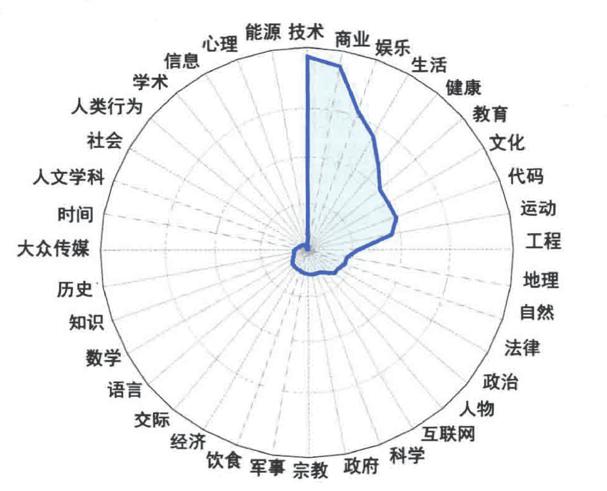

**数据处理：** 处理环节聚焦频率控制与质量筛选。频率控制依赖聚类去重，百川 2 自研了支持 LSH 类特征与密集嵌入特征的大规模去重聚类系统，可在数小时内完成万亿级数据的处理。基于聚类结果，对文档、段落、句子进行去重并打分，分数随后用于预训练抽样。

#### 2. 模型结构
整体架构沿用 Transformer[48]，并做了多项针对性改造。

#### 3. 分词器
分词器需要在高压缩率与词嵌入充分训练之间取得平衡。百川 2 将词表规模从 64000 扩至 125696，兼顾推理效率与模型效果。

分词采用 SentencePiece[49] 的字节对编码 BPE[50]。与百川 1 不同，百川 2 不对输入做任何截断，也不加虚拟前缀；多位数字会被拆分为单数字以更好编码数值；为处理代码中的额外空白，新增了仅含空格的 token。字符覆盖率设为 0.9999，罕见字符回退到 UTF-8 字节。最大 token 长度设为 32，便于处理较长的中文短语。分词器训练语料来自百川 2 预训练库，并额外采样代码与学术论文以提升覆盖度[51]。

位置编码：百川 2-7B 在百川 1 基础上使用 RoPE[52]；百川 2-13B 则采用 ALiBi[53]。ALiBi 是更新的位置编码方案，外推能力更强。虽然多数开源模型仍用 RoPE，且 Flash Attention[54-55] 因乘法实现更契合 RoPE，无需传递 attention_mask，但实测中位置编码选择对性能影响并不显著。

#### 4. 激活函数与层归一化
激活选用 SwiGLU[56]，即 GLU[57] 的开关变体，效果更佳。SwiGLU 采用三矩阵的“双线性”结构，比传统 FFN 的两矩阵更多，因此隐藏层尺寸从 4 倍压缩到 8/3 倍，并对齐到 128 的倍数。

注意力层引入 xFormers 优化的注意力机制[58]，凭借低内存特性和偏差支持，能高效融合 ALiBi 的位置偏差，降低显存占用，为大规模训练提供效率保障。

层归一化[59] 应用于 Transformer 块输入，对 Warm-up 策略[60] 更稳健。同时采用文献 [61] 的 RMSNorm，仅计算方差以提升效率。

#### 5. 优化
训练使用 AdamW[62]，β1=0.9、β2=0.95，权重衰减 0.1，梯度范数裁剪至 0.5。学习率在 2000 步线性预热后达到峰值。

全模型采用 BFloat16 混合精度，前后向在 BFloat16 下进行，优化器更新使用 Float32。BFloat16 的动态范围更适合 LLM，但低精度会在数值敏感操作上出错，例如部分 RoPE 与 ALiBi 实现中 torch.arange 超过 256 时会碰撞。因此位置编码等敏感部分仍使用全精度。

**NormHead:** 为稳定训练，百川 2 对输出头做归一化。实验显示头范数易不稳定，稀有 token 嵌入范数会变小干扰训练动态，NormHead 能显著稳定这一过程。语义信息主要由余弦相似度承载，点积 logits 同时包含 L2 距离与余弦信息，归一化可削弱 L2 的干扰。

**Max-z 损失:** 训练中发现 logits 易过大。虽然 Softmax 只依赖相对值，但在推理时，HuggingFace 的重复惩罚实现会直接对 logits 缩放，过大的 logits 会放大超参数敏感性。借鉴 NormSoftmax[63] 与 PaLM 的辅助 z 损失[21]，百川 2 加入 max-z 损失进行约束：

$$\mathcal{L}_{\text{max-}z} = 2e^{-4z^2}$$

其中 z 为最大 logits 值，有助于稳定训练并提升推理鲁棒性。

#### 6. 尺度定律
尺度定律描述误差随数据量与模型规模的幂律下降。在成本高企的 LLM 训练中具有指导价值。百川 2 先训练 10M 至 3B 的小模型，从最终规模的 1/1000 到 1/10不等，每个模型最多训练 1 万亿 token，使用一致超参与相同语料，据此拟合出训练 FLOP 到目标损失的映射。

拟合公式采用文献 [64]：

$$L_C = a \times C^b + L_{\infty}$$

L∞ 为不可约损失，第一项为可约的幂律项。C 为训练 FLOP，LC 为对应损失。参数通过 SciPy 的 curve_fit 拟合得到。

#### 7. 基础设施
百川 2 提出弹性训练框架与智能调度协同设计。GPU 资源被多任务共享，行为不可预测易导致空闲，而 8 卡 A800 一台机器已满足 7B/13B 显存需求，因此框架需能随集群状态动态调整资源。

框架集成张量并行与 ZeRO 支持的数据并行，单机内张量并行，跨机通过 ZeRO 弹性扩展。同时采用张量切分技术[65]，对大词汇表交叉熵等计算分组，降低显存峰值，无需额外通信。混合精度训练中前向反向用 BFloat16，优化器用 Float32。

为支撑千卡级扩展，引入两项技术：
（1）拓扑感知的分布式训练，按交换机层级安排 rank，降低跨交换机通信延迟；
（2）ZeRO 的混合分层划分，先将优化器状态全局划分，再自适应决定哪些层启用 ZeRO3 及是否分层划分参数。

综合后可在 1024 张 NVIDIA A800 上高效训练 7B 与 13B 模型，算力效率超 180 TFLOP。

### 1.7.2 对齐

百川 2 还完成了对齐，产出百川 2-7B-Chat 与百川 2-13B-Chat。对齐包含 SFT 与 RLHF 两阶段。

#### 1. SFT
SFT 阶段由人工标注从多源收集的提示，按 Claude 类似原则标记为“有帮助”或“无害”。为保证质量，采用交叉验证，由权威标注者抽检众包小组的批次，不合格则剔除。

共收集超 10 万条监督微调样本用于基础模型训练。随后通过 RLHF 进一步优化，流程包含奖励模型学习与强化学习训练，如图 1.10 所示。

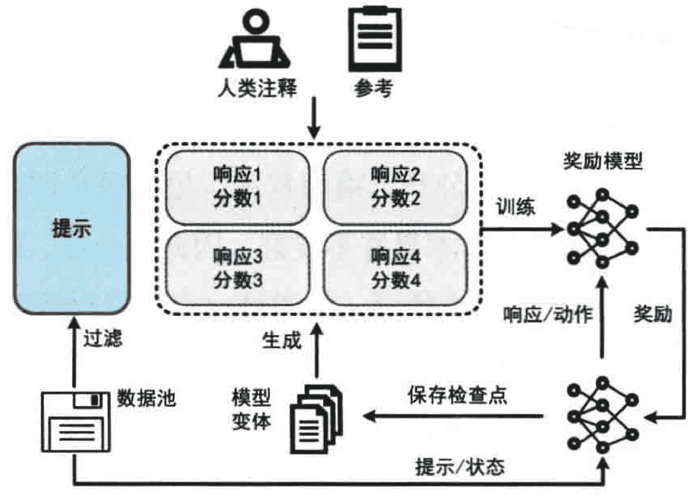

#### 2. 奖励模型
提示被划分为三层分类体系：6 个大类、30 个中类、200+ 小类。既能覆盖用户需求，也保证每个类别内样本多样性以利泛化。

响应由不同规模与阶段的百川 2 模型 SFT、PPO 生成以提升多样性，仅使用百川 2 自家模型生成的响应进行奖励模型训练，外来数据集与专有模型响应不提升准确率，反证模型内在一致性。

损失函数与 InstructGPT[15] 保持一致，训练得到的奖励模型与 LLaMA 2[31] 相当，能清晰区分两条响应的优劣。

#### 3. PPO
获得奖励模型后，使用 PPO 训练语言模型。涉及四个模型：演员模型生成响应、参考模型计算固定参数的 KL 惩罚、奖励模型给出整段响应的总奖励、评论家模型学习每个 token 的价值。

#### 4. 训练细节
RLHF 中评论家模型先预热 20 步，随后演员与评论家按标准 PPO 更新。梯度裁剪 0.5，学习率 5e-6，PPO 剪切阈值 ε=0.1。KL 惩罚系数 β 从 0.2 逐步降至 0.005。共迭代 350 次，得到两个 Chat 模型。

对学术界而言，阻碍大模型深入研究的正是从零到一的全流程成本：高质量数据获取、大规模集群稳定运行、算法调优稍有偏差即失之千里。大多数开源模型只公布权重，训练细节缺乏，终版且常带 Chat，对研究不友好。百川智能此次不仅公开技术报告，详细披露数据处理、结构优化、尺度规律、过程指标等，还开源了从 220B 到 2640B 全过程的检查点，在国内尚属首次，对训练复现、继续训练与价值观对齐研究价值极高。

## 1.8 本章小结
本章梳理了 BERT、ViT、GPT 系、ChatGPT、ChatGLM 与百川大模型等代表性 LLM 的结构。这些经典架构构成了多模态大模型的基础，也为后续多模态核心技术的展开奠定基础。

# 2 多模态大模型核心技术
过去十年 AI 模型发展多元繁荣，作者将其归纳为四类，如图 2.1 所示。

整体图谱被拆分为四类，第一类为针对单一任务定制的专用模型，后三类均属于基础模型范畴，其中语言侧的基础模型以绿色区块呈现，视觉侧的基础模型以蓝色区块呈现，每一类都点出了该类模型的典型属性。对语言基础模型和视觉基础模型进行对照，可以推测多模态基础模型的演进大体遵循同类规律：由面向特定目标的预训练模型出发，发展为兼具涌现式能力的整合模型，最终形成通用助手。演进路径上仍存在不确定性，图中用问号标示，这与 GPT-4V 和 Gemini 的关键实现尚未公开有关，该分类视角在不同研究领域均具有参考价值。下面先以自然语言处理中的语言模型为例，回顾其演变历程。

初期，研究者往往为某个数据集或单一任务单独设计模型，通常需从零训练。随着大规模预训练兴起，语言模型在理解与生成方面取得显著突破，代表作包括 BERT、RoBERTa、T5、DeBERTa 与 GPT-2 等。这些预训练成果为下游迁移提供了良好的初始化。以 GPT-3 为例，大规模语言模型把多种理解与生成任务收敛到统一架构，实现了规模化预训练，并在此阶段显现出上下文理解、思维链构造等新颖能力。伴随人机协作研究的进展，LLM 开始承担通用助手的职能，ChatGPT 与 GPT-4 为典型。它们在交互体验与工具调用上表现突出，也为 AGI Agent 的构建奠定了基础。值得注意的是，最新一代基础模型在保留前代核心特性的同时，还带来了额外能力。

多模态大模型正成为前沿热点，其思路是以强势 LLM 充当核心处理器来驱动多模态任务。该类系统展现出令人意外的认知表现，例如据图生成叙事或完成数学推导，这在传统范式中较少出现。本章聚焦多模态大模型的技术内核，覆盖文本、图像、视频等多种模态，涉及预训练基础模型 Pretrained Foundation Model, PFM、预训练 Pre-training、自监督学习 Self-Supervised Learning、提示学习 Prompt Learning、上下文学习 In-Context Learning、指令微调 Fine-Tuning、思维链 Chain-of-Thought, CoT、RLHF 及 RLAIF 等要点。

## 2.1 预训练基础模型

预训练基础模型可视为支撑下游应用的基础设施。BERT、ChatGPT 等系统均先在大规模语料上完成预训练，为后续任务提供合理的参数起点。与早期依赖卷积、循环结构提取特征的做法不同，BERT 利用 Transformer 学习双向编码表征，形成在海量数据上训练的上下文语言表征。生成式预训练 Transformer 则把 Transformer 作为特征提取器，采用自回归范式在大数据上进行训练。ChatGPT 在大语言模型上取得的进展本质上是零样本或少样本提示下的自回归语言建模。近年来预训练基础模型的突破为多个 AI 分支带来了实质性进展。

预训练基础模型建立在预训练方法之上，即先用海量数据训练通用模型，再在不同下游任务上便捷微调。该思想源于计算机视觉中的迁移学习，因在视觉任务中效果良好而被推广到其他领域。引入到自然语言处理后，经过充分训练的语言模型能够捕获对下游任务有益的丰富知识，如长程依赖、层次结构等。NLP 预训练的另一优势在于训练文本可来自任意未标注语料库，理论上语料供给近乎无限。早期预训练属于静态范式，例如 NNLM 和 Word2Vec，但静态表征难以应对多变的语义环境，因而出现了 BERT、XLNet 等动态预训练技术。图 2.2 汇总了自然语言处理与计算机视觉领域预训练基础模型的演进轨迹。基于预训练技术的模型在大规模语料上学习通用语义表征，随着开创性工作的出现，各类预训练基础模型大量涌现并被用于下游任务。

例如，预训练基础模型可应用于机器翻译、问答、主题建模、情感分析等。图像领域的预训练思路与文本相似，也是先在海量数据集上训练通用大模型，再迁移至具体视觉任务。OpenAI 提出的 GPT-4V 模型是一个典型的大规模多模态语言模型，可接受文本与图像输入并生成文本输出，在专业与学术评测中达到接近人类水平。此外，预训练基础模型正向统一处理多模态数据演进，即 Unified PFM，可同时处理文本、图像、音频等，如 OFA、UNIFIED-IO、FLAVA、BEiT-3 等。

ChatGPT 是一个典型案例，其源头为 GPT-3.5，而 GPT-3.5 是在文本与代码混合数据上训练的。ChatGPT 采用了 RLHF，这已成为将 LLM 与人类意图对齐的有前景手段。其卓越表现可能推动预训练基础模型训练范式的转变，增加指令对齐技术，例如强化学习、提示调整 与思维链，朝 AGI 方向发展。

### 2.1.1 基本结构

Transformer 是预训练基础模型的主流架构。在自然语言处理中，Transformer 能在处理序列输入时缓解长程依赖问题，例如 GPT-3 就是基于 Transformer 的生成模型。在计算机视觉中，ViT 把图像切分为一系列图像块，类似于词嵌入序列。得益于 Transformer 结构更高的并行化潜能，模型规模得以大幅扩展，从而带来开创性能力。例如 ViT-22B 约有 220 亿参数，而最大语言模型的参数远超百亿，如 GPT-3 有 1,750 亿参数，PaLM 有 5,400 亿参数。

预训练大模型依赖多种数据集，训练完成后需针对下游任务进行微调。Transformer 是一种创新结构，有助于在各类神经单元间传递加权知识表征。它完全基于注意力机制，不使用循环或卷积。注意力机制是 Transformer 的核心，为所有编码输入分配权重，捕捉输入中最关键的部分。注意力输出通过对值的加权求和得到，权重由相应键的兼容性函数计算。在大模型中，已出现多种注意力变体。

### 2.1.2 学习机制

在计算机视觉领域，深度学习模型在分类、识别、检测、分割等常见任务以及匹配、跟踪、序列预测等特定任务中均表现突出。这些学习范式同样适用于自然语言处理。

#### 1. 有监督学习
给定训练集 $X$，用 $\{(x_i, y_i)\}_{i=1}^n$ 表示其中原始数据，其中 $x_i$ 为第 $i$ 个训练样本，$y_i$ 为对应标签。完整的网络通过最小化以下目标函数学习函数 $f(x_i; \theta)$。

$$\arg \min_{\theta} \frac{1}{n} \sum_{i=1}^n \mathcal{L}(f(x_i; \theta), y_i) + \lambda \Omega(\theta) \quad (2.1)$$

其中，$\mathcal{L}$ 和 $\Omega$ 分别为预定义的损失函数和正则化项。函数 $f$ 可表达为如下嵌套形式：

$$h_1(x_i) = g(x_i^\top \omega_1 + b_1)$$

$$h_{l+1}(x_i) = g(h_l(x_i^\top) \omega_1 + b_l), l = 1, 2, \cdots, N \quad (2.2)$$

其中 $h$ 表示模型某一层的映射函数，$g$ 表示激活函数，$b$ 表示某一层的偏置项，$l$ 为模型层索引，$N$ 为层数，这意味着 $\theta = \{\omega_1, b_l, l = 1, 2, \cdots, N\}$。

#### 2. 半监督学习
假设除人工标注数据集外，还存在未标注数据集 $Z = \{z_i\}_{i=1}^m$，若同时利用两者学习理想网络，学习过程可表述为

$$\arg \min_{\theta} \frac{1}{n} \sum_{i=1}^n \mathcal{L}(f(x_i; \theta), y_i) + \frac{1}{m} \sum_{i=1}^m \mathcal{L}'(f'(z_i; \theta'), R(z_i, X)) + \lambda \Omega(\theta) \quad (2.3)$$

其中 $R$ 为关系函数，用于定义未标注数据的目标，随后伪标签被整合进端到端训练。$f'$ 为编码器，用于在数据集 $Z$ 中学习原始数据的新的表示。具体而言，若训练中没有任何数据标签，则可通过数据自身内在距离或设计的预训练任务学习特征，分别称为无监督学习和自监督学习。

#### 3. 弱监督学习
弱监督学习对人工标签的依赖度介于全监督学习和自监督学习之间。自监督学习使用特殊预训练任务，全监督学习使用数据附带的现有标签，二者都能学习良好视觉特征并在下游任务表现不错。假设数据集中图像 $x_i$ 的真实标签为 $y_i \in \{0,1\}^K$，$i = 1,2,\cdots,n$，$K$ 为可能标签数，$y_i$ 各元素可为 0 或 1。则总共需最小化 $nK$ 个损失项，表述如下：

$$\arg \min_{\theta} \frac{1}{nK} \sum_{i=1}^{n} \sum_{k=1}^{K} \mathcal{L}(f(x_i; \theta), y_i^k) + \lambda \Omega(\theta) \quad (2.4)$$

其中 $[y_i^1, y_i^2, \cdots, y_i^K] = y_i$，且 $\mathcal{L}$ 可为适用于二元分类问题的损失函数。对 $y_i$ 的每个元素，需计算一对多 one-versus-all 二元分类损失。

#### 4. 自监督学习
自监督学习 Self-Supervised Learning, SSL 利用数据自身信息学习不同任务的基本特征表示。通过自定义伪标签，避免了大规模数据集的手动标注成本。在自然语言处理中，语言模型可通过预测掩码字符、词语或句子进行训练。变分自编码器 Variational Auto-Encoders, VAE 和生成对抗网络 Generative Adversarial Network, GAN 是两种生成式自监督方法，用于重构数据本身。此外，对比学习作为判别式自监督方法被广泛用于计算机视觉、自然语言处理和图像生成。对比学习的核心思想是通过数据增强等方法学习数据先验分布，使投影空间中相似实例更接近，不相似实例更远。以下为对比损失的简化版本：

$$\mathcal{L}_c(x_i, x_j, \theta) = m \|f_\theta(x_i) - f_\theta(x_j)\|_2^2 + (1 - m) \max(0, \epsilon - \|f_\theta(x_i) - f_\theta(x_j)\|_2^2)^2 \quad (2.5)$$

其中，两个样本标签相同时 $m$ 为 1，否则为 0，$\epsilon$ 为上限距离。

#### 5. 强化学习
强化学习 Reinforcement Learning, RL 是另一种学习范式，将学习过程建模为 Agent 与环境间的顺序交互，Agent 旨在学习顺序决策问题的最优策略。具体而言，在每个时间步 $t$，Agent 接收来自状态空间 $\mathcal{S}$ 的状态 $s_t$，并从动作空间 $\mathcal{A}$ 中选择动作 $a_t$，遵循由参数 $\theta$ 参数化的策略 $\pi_\theta(a_t|s_t)$ 实现 $\mathcal{A} \rightarrow \mathcal{S}$。随后 Agent 接收即时奖励 $r_t = r(s_t, a_t)$ 及根据环境动态得到的下一状态 $s_{t+1}$，其中 $r(s, a)$ 为奖励函数。对每个 episode，即一系列连续交互，直至 Agent 到达终止状态。每当 episode 结束，Agent 重新开始新 episode。每个状态的回报被折现，用折扣因子 $\gamma$ 累积奖励，$R_t = R(s_t, a_t) = \sum_{k=0}^{\infty} \gamma^k r_{t+k}$。Agent 的目标是最大化每个状态长期回报的期望值：

$$\max_{\theta} \mathbb{E}_{s_t} [R_t | s_t, a_t = \pi_{\theta}(s_t)]$$

## 2.2 预训练任务概述

预训练是一种初始化框架，通常需与下游任务微调结合使用。在预训练和微调的流程中，模型参数在预设任务上训练以捕捉特定属性和结构信息。预训练获得的特征可为下游任务提供足够信息并加速收敛。

### 2.2.1 自然语言处理领域的预训练任务

预训练任务按学习方式可分为五类：MLM、去噪自编码器 Denoised Autoencoder, DAE、字符替换检测 Replaced Token Detection, RTD、NSP 和句子顺序预测 Sentence Order Prediction, SOP。RTD、NSP 和 SOP 属于对比学习方法，它们假设观察到的样本在语义上比随机样本更相似。

MLM 在输入序列中随机遮蔽部分词，然后在预训练中预测被遮蔽词。典型例子包括 BERT 和 SpanBERT。

DAE 用于向原始数据库添加噪声，再用含噪声的数据库重构原始输入。典型例子是 BART。

RTD 是一个判别任务，用于判断语言模型是否替换了当前 Token。该任务在 ELECTRA 中提出。通过训练模型区分 Token 是否被替换，模型可获取语言知识。

为使模型理解两个句子间的相关性并捕捉句子级特征，引入了 NSP 任务。PFM 输入来自不同文档的两个句子，并检查句子顺序是否正确。典型例子是 BERT。

与 NSP 不同，SOP 使用文档中两个连续片段做正样本，将片段顺序交换做负样本。预训练基础模型可更好地建模句子间相关性，例如 ALBERT。

### 2.2.2 计算机视觉领域的预训练任务

针对计算机视觉，已设计大量基于自监督学习的预训练任务来学习特征空间。这些任务包含人工设计的标签，如拼图或比较图像中各类图像块。通过这种方式，预训练任务学到的特征可泛化到一系列下游任务。

- （1）特定代理任务。代理任务为编码器网络在预训练阶段执行而创建。网络通过预测特定代理任务答案进行训练，根据数据特定特征为虚构任务生成伪标签。随后用有导向学习技术训练编码器完成代理任务。例如，修补任务旨在通过预测缺失中心部分来预训练模型。
- （2）帧序学习任务。从视频学习帧序涉及按时间步处理帧，可作为计算机视觉预训练任务。该任务通常涉及完成预文本练习，有助于获取视觉时间表示。
- （3）数据生成任务。生成对抗网络内的表示能力也可用于预训练。将数据投影回潜在空间，有助于辅助有监督判别任务，充当特征表示。
- （4）数据重建任务。由于图像可像自然语言一样划分为图像块，部分自然语言处理预训练任务也可用于计算机视觉，例如基于自编码器的掩码预测。首先将原始图像划分为若干图像块，并用离散视觉标记编码每个块。然后输出来自掩码图像块的视觉标记，以与固定分词器的相应视觉标记匹配。
- （5）其他任务。为在计算机视觉领域训练预训练基础模型，建议使用额外预训练任务。例如基于对比学习，编码器网络在各种数据增强上进行预训练。通过最大化负样本如标签不同样本对间的距离和最小化正样本如标签相同样本对间的距离来训练参数。为预训练骨干网络参数，DeepClustering 方法将特征分成不同聚类，并把这些聚类标记为监督信号。

## 2.3 基于自然语言处理的预训练关键技术

自然语言处理是语言学与计算机科学融合的研究领域。预训练基础模型概念最初在自然语言处理领域获得广泛应用，随后被计算机视觉采用。预训练基础模型在大规模基准数据集上训练，并在主任务数据集上微调，以获得能解决新相似任务的模型。预训练基础模型同时对单词句法和语义表示建模，并根据不同输入动态改变多义词表示。预训练基础模型学习了丰富语法和语义推理知识，并取得更好结果。

本节先介绍单词表征方法，包括自回归语言模型、上下文语言模型和置换语言模型。然后介绍用于预训练基础模型设计方法和掩码设计方法的神经网络结构。接着总结用于提升模型性能的增强方法、多任务学习和不同下游任务。最后介绍指令对齐方法如 RLHF 和思维链在预训练基础模型如 ChatGPT 中的应用，以提供更符合人类偏好且无害的输出结果。

### 2.3.1 单词表征方法

许多大规模预训练模型在问答、机器阅读理解和自然语言推理上表现优于人类，表明当前预训练基础模型构建方法是可行的。按单词表征方法，预训练语言模型可分为自回归语言模型、上下文语言模型和置换语言模型三个分支。在这三个分支中，单词预测方向和上下文信息是最重要因素。

#### 1. 自回归语言模型

预训练语言模型怎么一步步进化到今天

自回归式的语言建模核心思路是利用已知词去推断下一个可能出现的词，有时也会反过来用后文信息回推前文。它把文本当成前文驱动的特征提取过程，所以在需要持续生成文本的场景里表现更顺手。针对一个序列 $T = [w_1, w_2, \cdots, w_N]$，在给定条件下某个词的条件概率可以写成：

$$P(w_1; w_2; \cdots; w_N) = \prod_{i=1}^{N} P(w_i | w_1; w_2; \cdots; w_{i-1}) \quad (2.7)$$

其中 $i > 1$，$N$ 表示输入序列的长度。

GPT 系列把自监督预训练和有监督微调拆成两阶段，并选用堆叠的 Transformer 作为解码器。随后 OpenAI 把这条路子推向更大规模，推出了 GPT-2，把 Transformer 的层数提到 48 层，参数总量达到 15 亿，还引入多任务学习。GPT-2 依然遵循自回归语言建模的范式，却在不明显增加成本的前提下把性能拉升。Transformer 本身对上下文的建模有限，GPT-2 的提升主要来自多任务预训练、超大语料和模型规模的叠加效应。针对具体下游任务，仍然需要基于任务的数据进行微调。当训练规模持续扩大，模型的任务无关性会明显增强，于是出现了参数达 1,750 亿、训练数据约 45TB 的 GPT-3，它在不做针对性微调的情况下也能给出不错的结果。

#### 2. 上下文语言模型

自回归建模只能看到前向或后向的一侧信息，无法同时兼顾两端。ELMo 用双向长短期记忆网络来编码，前向 LSTM 与后向 LSTM 拼接在一起。上下文语言建模的预测对象是上下文词，它借助 Transformer 编码器和自注意力，让上层与下层直接交互。

BERT 采用多层堆叠的双向 Transformer 为骨架，并用 WordPiece 做分词。输入由词嵌入、段嵌入和位置嵌入三部分构成。它把双向 Transformer 当作特征提取器，用来弥补 ELMo 与 GPT 的不足。缺点也很突出：双向结构没能摆脱自编码模型的限制，参数量庞大对算力有限的设备不友好，部署成本高。预训练阶段的掩码语言建模也会带来输入分布不一致的问题，即预训练时有掩码，微调时没有掩码。RoBERTa 在此基础上加大了批量、扩充无标签数据，延长训练时间，去掉了下一句预测任务，增加长序列训练，并改用字节对编码 BPE 做分词，且每个序列采用不同的掩码模式。

#### 3. 置换语言模型

可以把上下文语言建模看作自编码语言建模的一种。因为预训练与微调之间存在不一致，自编码模型在生成类任务上往往吃亏。置换语言模型希望吸收自回归与自编码各自的长处，改进两者的缺陷，并为未来的预训练目标提供思路。对同一序列 $T = [w_1, w_2, \cdots, w_N]$，其目标函数可表述为：

$$\max_{\theta} \mathbb{E}_{z \sim Z_N} \left[ \sum_{t=1}^{N} \log p_{\theta}(x_{z_{T=t}} | x_{z_{T<t}}) \right]$$

其中 $\theta$ 是所有排列共享的参数，$Z_N$ 表示输入序列的所有可能排列集合，$z_{T=t}$ 和 $z_{T<t}$ 分别指排列中的第 $t$ 个元素和前 $t-1$ 个元素。

BERT 的掩码语言建模很好地实现了双向编码，但预训练时用掩码标记，微调时却不用，导致两阶段数据不一致。为避免这个问题，出现了置换语言模型。它基于自回归思想规避不一致的影响，不再按原始顺序建模，而是对序列的所有排列取期望对数似然最大化。这样任意位置都能利用全序列的上下文信息，实现真正意义上的双向编码。代表作是 XLNET 和 MPNet。XLNET 融合了 Transformer-XL 的相对位置编码与段落循环机制。MPNet 则把掩码语言建模和置换语言建模结合，预测标记间依赖关系，并借助辅助位置信息输入，使模型能看到完整句子并减小位置偏差。

### 2.3.2 模型结构设计方法

ELMo 采用多层循环神经网络结构，每层由前向、后向语言模型组成的双向 LSTM 构成，两个方向的最大似然被作为优化目标。相比静态词向量，ELMo 引入了上下文，缓解了多义词问题，但在语言特征的抽取深度上仍显不足。

预训练基础模型的应用大致分为两条线：带微调的预训练模型如 BERT，和带零样本或少样本提示的预训练模型如 GPT。BERT 用双向编码器预测被掩码的词并判断两句是否相关，但因为是双向编码，缺失标记往往被独立预测，导致文本生成能力下降。GPT 用自回归解码器做特征提取，根据前面若干词预测下一个词，再靠微调解决下游任务，更适合生成。问题在于 GPT 只能利用前文，无法学习双向交互。

与两者不同，BART 是一个降噪自编码器，采用编码器-解码器结构。预训练先用噪声破坏文本，再用 Seq2Seq 模型重建原文。编码器为双向 Transformer，噪声模式包括词掩码、词表删除、跨度掩码、句子重排、文档重排五种。编码前序列已被掩码，解码器依据编码器输出和未被掩码的序列恢复原文。多样的噪声让 BART 在序列生成和自然语言推理上表现更好。

### 2.3.3 掩码设计方法

注意力机制先把关键词聚合成句向量，再把重要句向量聚合成文本向量，从而为不同输入分配差异化关注。对 BERT 而言，输入句中任意两个词可以相互影响，这在一定程度上阻碍了生成任务的学习。

Joshi 等人提出基于 RoBERTa 的 SpanBERT，采用动态掩码和单段预训练。SpanBERT 提出跨度掩码和跨度边界目标，用两端可见标记恢复被掩码的跨度，训练阶段使用动态掩码策略而非预处理阶段固定掩码。与 BERT 不同，SpanBERT 随机覆盖一段连续文本并加入 SBO 训练目标，用最接近跨度边界的标记来预测跨度，且不再使用 NSP 任务。

BERT 和 GPT 分别只能联合训练编码器或解码器，难以同时发挥两者优势。Song 等人提出的 MASS 在训练阶段对编码器输入随机掩码一段长度为 k 的连续片段，再由解码器恢复该片段。UniLM 为两个句子设计不同掩码来学习生成。第一个句子使用与 Transformer 编码器相同的结构，每个词可关注前后词；第二个句子每个词只能关注第一句的词以及本句前面的词。这样两句输入形成经典的 Seq2Seq 模式。

### 2.3.4 提升方法

#### 1. 模型性能的提升

大多数预训练模型依赖海量数据，硬件要求高，重训困难，只能做微调。为此出现了压缩型模型。百度发布的 ERNIE Tiny 在减少层数的前提下，把预测速度提升 4.3 倍，精度仅轻微下降。ALBERT 通过词嵌入参数分解和层间隐藏参数共享来降低内存占用并加快训练。压缩不可避免带来性能损失，未来需要在不损失语义语法信息的前提下实现高效表示和无损压缩。ALBERT 还提出 SOP 任务预测句子顺序，在显著减少参数量的同时保持性能。

#### 2. 多任务学习能力的提升

ERNIE 主要由 Transformer 编码器和任务嵌入组成，自注意力捕获每个标记的上下文信息生成表示，任务嵌入用于区分不同任务。ERNIE 2.0 引入多任务学习，实现词法、语法与语义的联合预训练，共 7 个预训练任务，覆盖词级、句级和语义级。它采用连续学习保留旧任务知识并增强长距离记忆，借助任务嵌入在连续学习中区分任务。UniLM 使用三种预训练任务：单向语言模型、双向语言模型和编码器-解码器语言模型，通过自注意力掩码机制在同一阶段完成三类目标，采用类似 SpanBERT 的小段掩码策略，损失函数为三者的加总并同步训练。多任务建模与参数共享提升了自然语言理解与生成的泛化能力。

#### 3. 不同下游任务性能的提升

预训练模型体量大，如何适配下游任务很关键，已出现面向特定数据库训练的模型。Cui 等人提出 BERT-WWM 全词掩码模型，直接在中文文本上随机掩码导致语义丢失，因为中文缺少明确词边界。ZEN 在 BERT 编码器基础上引入 n-gram 增强，借助细粒度文本信息加速收敛。Tsai 等人提出面向多语言序列标注的模型，采用知识蒸馏，在低资源语言的词性标注和形态属性预测上表现更好，推理时间降至原来的 1/28。

#### 4. 实例：ChatGPT 和 Bard

ChatGPT 在 GPT-3.5 基础上使用 RLHF 微调。先收集提示与期望输出行为的大规模数据集，用监督学习微调 GPT-3.5；然后让模型对同一提示生成多个输出，由标注者打分排序形成对比数据训练奖励模型；最后用 PPO 算法按奖励模型优化微调后的模型。

Bard 基于对话语言模型 LaMDA。LaMDA 基于 Transformer 构建，使用 1.56 万亿条对话数据和网络文本预训练。安全性与事实依据是大型语言模型的两大挑战，LaMDA 通过高质量标注数据和外部知识源的微调来改善模型表现。

### 2.3.5 指令对齐方法

指令对齐旨在让语言模型遵循人类意图并生成有意义的输出。常见做法是用高质量数据对预训练模型进行监督微调。为了提升实用性和无害性，部分研究把强化学习引入微调，让模型根据人类或 AI 反馈修正响应。有监督学习和强化学习都能结合思维链式推理，提升人类判断和 AI 决策的透明度。

有监督微调是把知识迁移到特定现实任务甚至未知任务的成熟手段。模板由输入-输出对和指令构成，例如“把这句话译成西班牙语”。模板可以是人工设计的非自然指令或自然指令，也可由种子数据库引导。道德与社会风险是该阶段需要重点考量的因素。

RLHF 已被用于机器翻译、摘要、对话生成、图像字幕、问题生成、文本游戏等任务。强化学习有助于把不可微的目标转化为序列决策问题。但其过度依赖神经网络度量标准，可能导致样本在指标上得分高却缺乏意义。强化学习也被用来把模型与人类偏好对齐。

InstructGPT 团队提出用 PPO 对大模型进行微调以对齐人类偏好，与 ChatGPT 的 RLHF 方法一致。具体做法是用标注者人工排名的对比数据训练奖励模型，为每个输出计算奖励，再用 PPO 更新语言模型。

GPT-4 遵循预训练预测下一个标记的方法，随后用 RLHF 微调。随着任务复杂度上升，GPT-4 在可靠性、创造性和细粒度指令处理上优于 GPT-3.5。

DeepMind 的 Sparrow 也采用 RLHF，降低不安全和不合适答案的风险。虽然取得了有用结果，但缺乏公开基准和实现资源制约了进展，强化学习在 NLP 中被认为难以应用。为此出现了 RL4LMs 开源库，提供基于语言模型生成任务的强化学习微调和评估模块。

除了 RLHF，对话代理 Claude 倾向采用 Constitutional AI，奖励模型由 RLAIF 学习。批评与 AI 反馈均受“宪法”原则指导，这是 Claude 中唯一的来自人类的内容。AI 反馈侧重解释对危险查询的异议，使输出更无害。

思维链提示通过引导模型生成导致最终答案的中间步骤来改善多步推理能力。思维链显著提升复杂推理表现，且在微调后输出更无害。思维链提示是模型规模的累积特性，在更大更复杂的模型上效果更好，也可在思维链推理数据上微调以提升能力与可解释性。

神经概率语言模型用神经网络估计概率语言模型参数，减少参数量同时扩大上下文窗口，避免持续改进平滑算法。训练目标无监督，只需海量数据。负采样技术为后续目标提供思路，因其表示能力和训练效率推动了下游研究。BERT 等预训练基础模型出现后，语言模型研究进入新阶段，双向、隐层和排序语言模型更深地建模了语法和语义。ChatGPT 作为强化学习预训练语言模型的里程碑，其质量超越神经概率语言模型，在某些任务上甚至超过人类。

## 2.4 基于计算机视觉的预训练关键技术

随着预训练基础模型在自然语言处理中普及，研究者开始探索其在计算机视觉中的迁移，用于提取预训练特征。在计算机视觉深度学习里，“预训练”尚无统一定义，最初指在 ImageNet 等数据集上调参以获得暖启动初始化，使其他任务更快收敛。与早期依赖监督信号迁移学习的卷积网络不同，预训练基础模型研究更侧重自监督学习，用拼图或图像块对比等人为设计的代理任务学习表示，使学到的表征可泛化到分类、检测、识别、分割等下游任务。

当学习任务更复杂时，标注成本高昂，标注过程往往比学习本身更耗时耗力，自监督学习必须改进以减少对标注的依赖。为此自监督学习利用未标注数据进行匹配、对比或生成训练。

# 自监督预训练全地图

如图2.3所示，自监督的学习范式本质上是分两步走。上半段是无标签的预训练，下半段则是把预训练得到的权重拿去服务有标签的下游任务。预训练的核心是给编码器设计一个人工代理任务，任务标签并非人工标注，而是直接从数据本身的属性里自动产生，比如来自同一张图的两个块被视作正对，来自不同来源的块被视作负对。用监督的方式把编码器训练到能完成这个代理任务即可。

浅层网络主要捕捉边缘、角度、纹理等细粒度信息，深层网络则逐渐沉淀出语义、整体内容等高阶表征，编码器于是具备了迁移能力。到下游阶段，主干网络通常被冻结，只额外训练一个轻量分类头，例如两层的多层感知机。工作量不大，所以业界习惯把这一步叫做微调。总体看，预训练阶段学到的通用表征可以复用到多种任务上并保持不错的效果。

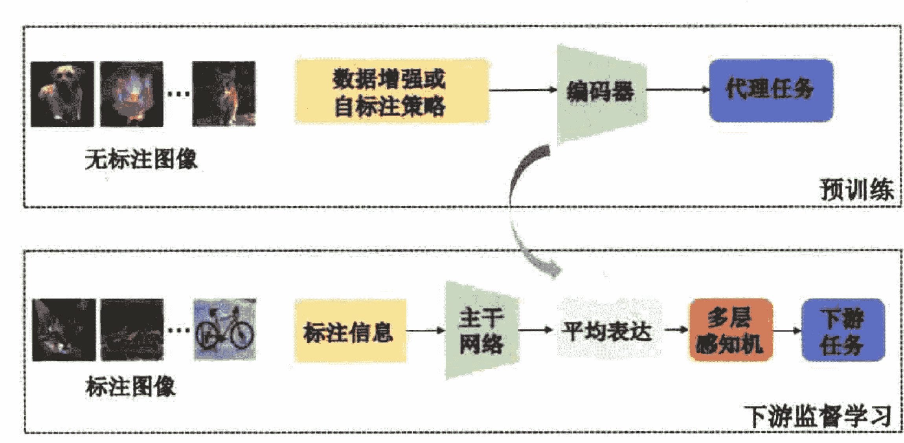

本节梳理计算机视觉里预训练基础模型常见的任务形式，基础模型往往就是通过某种代理任务来完成的。

### 2.4.1 特定代理任务的学习
早期无监督训练的做法是先造一个先验任务，再让网络去预测答案。Dosovitskiy 等人[120-121] 用 Exemplar CNN 训练模型分辨未标注数据里的不同图像块，验证表明学到的表征能迁移到标准识别任务。基于上下文预测的方法[122] 把位置信息手工编码成成对分类的标签。图像修复[123] 以补全中心缺失区域为目标，修复属于语义层面的预测，因而常把解码器和上下文编码器串联起来，逐像素重建过程也能迁移到其他修复下游任务。

上色[124] 把图像块着色当作预训练任务，被称作跨通道编码，因为输入输出在不同通道间切换。Split-Brain Autoencoder[125] 同样逼迫网络完成跨通道预测来获得自监督信号。Jigsaw[126] 把拼图当成无上下文的自监督任务。Completing Damaged Jigsaw Puzzles[127] 进一步提升难度，拼图缺一块且其余块颜色不完整。Noroozi 等人[128] 把计算视觉基元计数作为先验任务，在常规基准上超过了当时的 SOTA。NAT[129] 用低维噪声对齐主干 CNN 的输出来学习表示。RotNet[130] 的目标是判断图像被旋转了多少角度。

### 2.4.2 帧序列学习
对于视频这类时序数据，学习要沿时间步处理帧，往往绑定特定的先验任务来获取视觉时间表征。对比预测编码 Contrastive Predictive Coding，CPC[131] 是首个在潜在空间里预测未来的表示学习模型，可处理语音、图像、文本等多种模态。CPC 的结构如图 2.4 所示[131]，输入序列可为图像或视频。$x_t$ 为观测，$z_t$ 经编码器 $g_{enc}$ 得到潜在序列，$c_t$ 由自回归模型 $g_{ar}$ 对 $z \le t$ 进行汇总得到上下文潜在表示。传统生成式方法用 $p_k(x_{t+k}|c_t)$ 预测未来帧，CPC 改用密度比 $f_k$ 表征 $c_t$ 与 $x_{t+k}$ 的互信息：

$f_k(x_{t+k}, c_t) \propto p(x_{t+k}|c_t)/x_{t+k}$

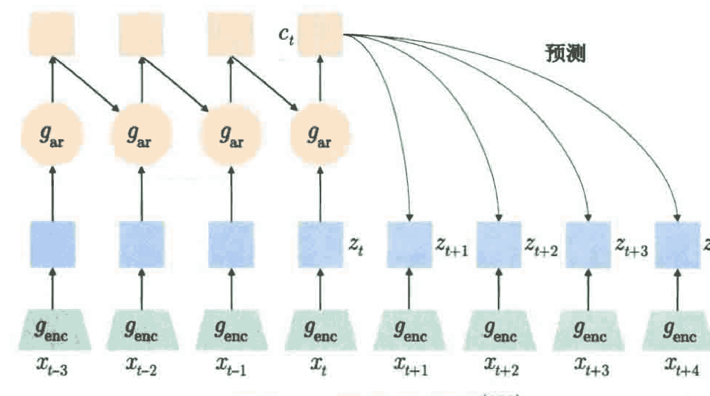

循环编码之后可根据需求选用 $z_t$ 或 $c_t$ 投到下游任务。编码器与自回归模型的训练借助 InfoNCE[131] 完成：

$\mathcal{L} = -\mathbb{E}_X \left[ \log f_k(x_{t+k}, c_t) \bigg/ \sum_{x_j \in X} f_k(x_j, c_t) \right]$

其中 $X$ 包含正负样本，$f_k$ 通过最小化 $\mathcal{L}$ 被估计。CPC v2 对 CPC[132] 做了改进，在无监督表征预训练后学得的通用性可以低资源迁移到数据高效的下游任务。

### 2.4.3 生成式学习
GAN 缺乏显式特征编码器，导致内部表征利用不足，于是出现双向生成对抗网络 BiGAN[133]，把数据投回潜在空间，这对以特征为辅助的判别任务很有帮助。在此基础上 BigBiGAN[134] 首个在 ImageNet 上实现无监督表征学习的 SOTA，做法是在 BiGAN 上加入编码器并改造判别器。如图 2.5 所示，传统 GAN 组件编码器 $\varepsilon$ 与生成器 $G$ 用来产生数据-潜在对 $(x \sim P_x; \hat{z} \sim \varepsilon(x))$ 和 $(\hat{x} \sim G(z); z \sim P_z)$。最终损失 $\ell$ 由数据特定项 $s_x$、$s_z$ 与联合项 $s_{xz}$ 组成。引入的判别器 $D$ 学习区分原始分布、潜在分布与编码向量构成的数据对，对应 ALI$^{[135]}$ 或 BiGAN$^{[133]}$。

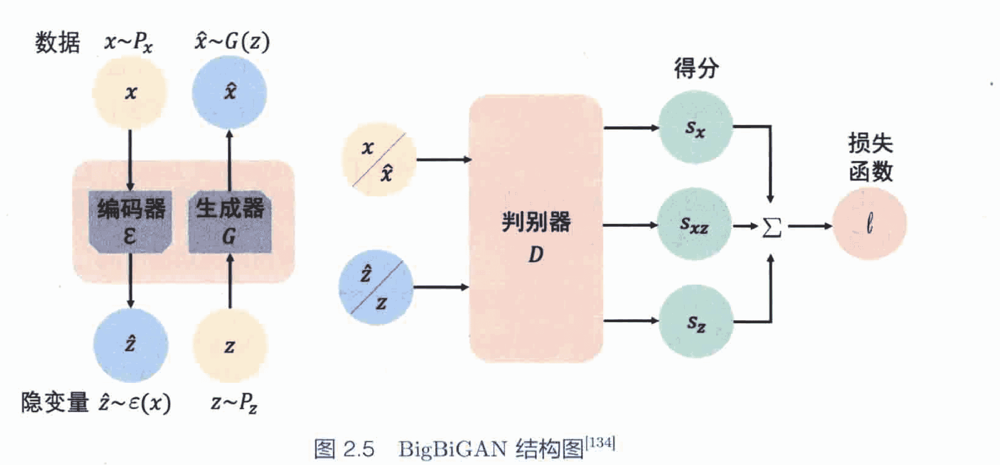

### 2.4.4 重建式学习
iGPT$^{[136]}$ 和 ViT$^{[11]}$ 证明了把自然语言自编码器的预训练思路搬到图像是可行的。BEiT$^{[6]}$ 是首个展示基于自编码器的遮挡预测能在不额外预训练的情况下超越 DINO$^{[137]}$ 这类传统 SOTA 的工作。BEiT 分两阶段：先用离散变分自编码器 dVAE$^{[3]}$ 做 Token 嵌入，再用遮挡图像做标记器训练。第一阶段把原图切块并用离散标签编码，不同于 NLP 中块已有预定义符号。第二阶段编码器接收含可见块和遮挡块的图像，输出视觉标记以匹配固定标记器的结果。缺陷是遮挡预测与自编码训练分离，导致框架非端到端。

MAE$^{[7]}$ 给出端到端解法，直接用均方误差预测被遮挡块。值得注意的是 MAE 的遮挡比例高达 75%，远高于 BERT 约 15%。消融实验显示高比例对微调和线性探测都有利。SimMIM$^{[138]}$ 也提出类似自编码方案，验证了更高遮挡比例和随机遮挡策略有效。两者差异在于职责分配：SimMIM 的解码器同时负责编码与预测，MAE 的编码器只做表示，解码器专司重建。

2023 年 4 月 Meta AI 发布 SAM（Segment Anything Model）[139]，用户可指定分割目标，无需额外训练即可完成多种分割。SAM 使用 MAE 预训练的 ViT-H[11] 作为图像编码器，每张图生成一次嵌入，再配提示编码器接收点或框提示，最后轻量 Transformer 掩码解码器预测对象的掩码。实验显示单点提示即可生成接近人工标注质量的掩码，模型在零样本迁移和提示工程下取得定量定性进展。

ViT 版 MAE 受块数影响大，减少块数会使计算翻倍。改善方向有两类：

- （1）分层 ViT。

- （2）局部注意力机制。

分层 ViT（hViT）借助金字塔结构和偏移窗口[140] 降低计算，但局部窗口注意力难以处理 MAE 式的随机遮挡。随后提出的统一遮挡 MAE UM-MAE[141] 采用先采样后遮挡的两步流程，使分层 ViT 可用。另一思路是缩小输入维度，通过把注意力限制在局部小窗口。LoMaR[142] 观察到局部信息足以重构遮挡块，只采样若干小窗口进行重建，在下游任务上从效率角度超过 MAE。

### 2.4.5 记忆池式学习
非参数实例判别 Non-Parametric Instance Discrimination，NPID[143] 首个利用实例本身来学习下游表示。记忆池的通用结构如图 2.6 所示，因实例级分类需要整套训练集，特征被暂存于内存库。对任意图像 $x$，特征为 $v = f_{\theta}(x)$，识别为第 $i$ 个样本的概率为

$$P(i|v) = \exp(v_i^T v / \tau) / \sum_{j=1}^{n} \exp(v_j^T v / \tau)$$

其中 $v_i$ 或 $v_j$ 分别是第 $i$ 或第 $j$ 样本的表征，可看作分类器权重原型；$\tau$ 是借自知识蒸馏[144] 的温度参数。

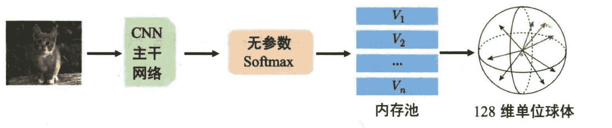

Local Aggregation，LA[145] 训练 CNN 编码器把原图映射到低维嵌入空间，最大化局部聚合度量会让相似实例靠近，不相似实例远离。

在 NPID 基础上提出 Pretext Invariant Representation Learning，PIRL[146]，论证语义表征在预文本变换下保持不变。设原视图和变换后视图为 $V_I$ 与 $V_{I^t}$，送入 CNN 编码器后在训练集 $\mathcal{D}$ 上的经验损失为

$$\mathcal{L}_{\text{total}}(\theta; \mathcal{D}) = \mathbb{E}_{t \sim \mathcal{T}} \left[ \frac{1}{|\mathcal{D}|} \sum_{I \in \mathcal{D}} \mathcal{L}(V_I, V_{I^t}) \right] \quad (2.12)$$

其中 $\mathcal{T}$ 表示不同图像变换。损失希望 $I$ 与 $I^t$ 的表征相似，而 $I^t$ 与其他图像 $I'$ 的表征不相似，如图 2.7 虚线框所示。更多负样本有助于梯度扩展，最终编码器学到更强表征。为此引入内存池保存更多历史表征供比较。

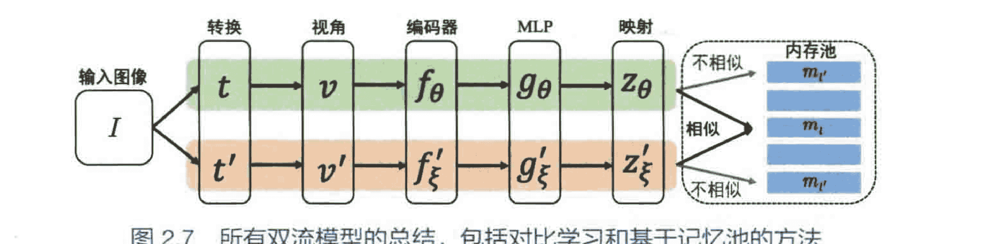

### 2.4.6 共享式学习
自监督常使用两个编码网络对不同增强视图建模，通过拉近正对、推远负对来预训练。图 2.7 展示了对比学习框架的双流结构。对输入 $I$，变换 $t$ 生成视图 $v$，$t'$ 生成 $v'$。一般用两个编码器 $f_{\theta}$ 与 $f'_{\xi}$ 提取表征，再经 MLP $g_{\theta}$、$g'_{\xi}$ 学习利于对比损失的组合。MLP 与内存库可根据设置保留或移除。共享编码器可分为软共享与硬共享两类。

- （1）软共享，即两个编码器参数相似但不等 $f_{\theta} \neq f'_{\xi}$。

- （2）硬共享，即结构与参数完全相同 $f_{\theta} = f'_{\xi}$。

**软共享。** Facebook AI Research 提出 MoCo（Momentum Contrast）$^{[5]}$，用动量控制两个编码器差异。如图 2.8 所示，一个编码器充当词典，维护队列 $\{k_0, k_1, \cdots\}$；另一个编码器产生查询 $q$ 并随批次更新。相似度通过查询与队列键的点积衡量，队列中 $K$ 个键作为新键的负样本。对比损失采用 InfoNCE$^{[131]}$。关键设计是动量更新，直接把键编码器参数改为查询编码器会导致一致性丢失。动量编码器参数 $\theta_k$ 更新为：

$$\theta_k = m\theta_k + (1 - m)\theta_q \qquad (2.13)$$

其中查询参数 $\theta_q$ 直接由梯度学习，$m \in [0,1)$ 控制一致性，$m$ 越接近 1 越稳定。

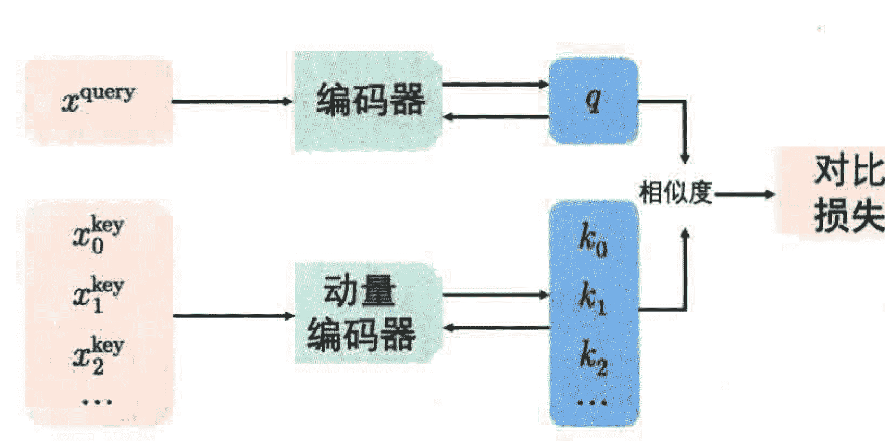

受 SimCLR 启发，MoCo v2$^{[132]}$ 在编码器后加入 MLP 投影头并强化数据增强，线性分类器缩小无监督与有监督表示差距，更大批次与更强增强提供更多对比样本。

DeepMind 提出 Bootstrap Your Own Latent，BYOL$^{[147]}$，在不使用负样本情况下达到 SOTA。作者认为区分不同视图可防止崩溃，但不一定要大量负样本。BYOL 有在线网络与目标网络两条流，在线网以自身预测与目标网回归目标对比更新参数，目标网参数按 $\xi \leftarrow \tau \xi + (1 - \tau)\theta$ 更新，$\tau$ 为目标衰减率。目标网可视为动量编码器，其中 $\xi$ 对应 $\theta_k$，在线网 $\theta$ 对应查询参数 $\theta_q$。

**硬共享。** SimCLR$^{[148]}$ 由 Google Brain 提出，采用硬参数共享，同一编码器 $f(\cdot)$ 处理不同视图。损失定义为：

$$\mathcal{L}_{i,j} = -\log \exp(\text{sim}(z_i, z_j)/\tau) / \sum_{k=1}^{2N} \mathbb{I}_{k \neq i} \exp(\text{sim}(z_i, z_k)/\tau) \quad (2.14)$$

其中 $(i,j)$ 为正对，$\tau$ 为温度超参，$\mathbb{I}_{k \neq i} \in \{0,1\}$ 控制分母仅包含负对。

为避免海量成对比较，Inria 与 FAIR 提出 SwAV（Swapping Assignments between multiple Views of the same image）$^{[149]}$，引入聚类替代成对比较，利用原型向量参与损失计算，无需队列。为此原型被编码为反向传播学习的向量集合，因而不需要显式比较不同视图编码。

在此基础上提出的 SELF-supERvised，SEER$^{[150]}$ 旨在从任意随机图像与海量数据集中学习预训练编码器，骨干为用 SwAV SSL$^{[149]}$ 训练的 RegNetY$^{[151]}$。实验表明有监督学习并非局限于 ImageNet，RegNet 的出现也凸显了传统 ResNet 骨干的局限。

**从简化对比到聚类与提示：无监督学习的演进**

FAIR曾借助Simple Siamese【152】的架构做过一组对照实验，这套方案绕开了传统对比学习里对负样本对与动量编码器的依赖。图 2.7 中原来由一对参数一致的编码器分别处理图像 x 的两个衍生视图 t 与 t′ 的流程，被 Simple Siamese 网络所替代。其中一个视图的表征交给 MLP 预测器 g 来建模，而另一个视图的表征则施加了 Stop-gradient。

### 2.4.7 基于聚类的表征学习

DeepCluster【90】是首个把聚类算法引入大规模无监督预训练的模型。它的思路是先把数据划分成若干簇，并把簇标签当作主要的预训练信号来指导主干网络参数的优化，在多个经典的无监督迁移基准上取得了领先表现。

在对比学习与聚类关联方面，SwAV【149】把原型视作聚类中心，并在预训练阶段辅助样本的判别。PCL【153】则是首次明确把对比学习和聚类挂钩的方案。与仅学习低层实例鉴别表示的预训练任务不同，聚类能够捕捉更强的语义信息，因此在更多语义相关的下游任务上受益。图 2.9 所示，PCL 用原型替换了 ProtoNCE 损失【式 (2.14)】，并据此生成样本的一个视图，这即是 PCL 中提出的 ProtoNCE 损失。此外 PCL 属于软参数共享范式，其动量编码器的更新遵循式 (2.13)。

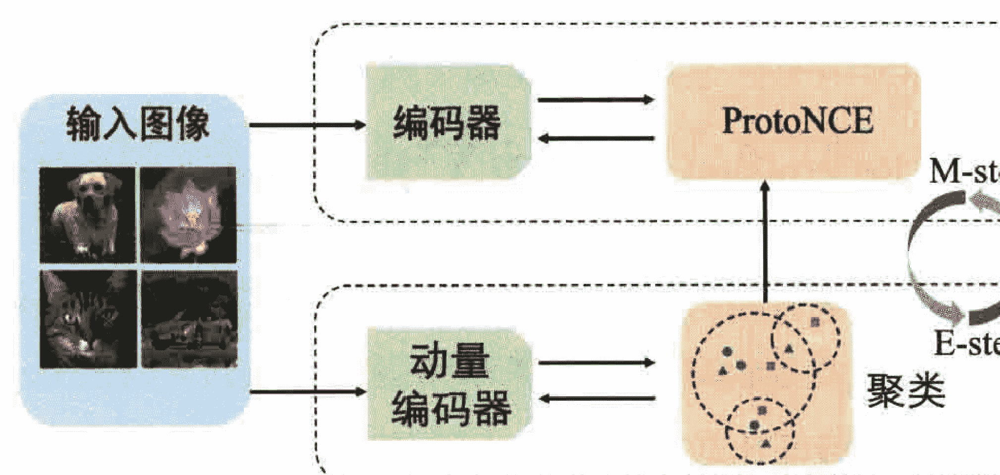

图 2.9 展示了 DeepCluster【90】模型的关键流程

## 2.5 提示学习

监督学习是指在特定任务的输入输出标注集上直接训练模型，在许多机器学习任务尤其是自然语言处理中占据核心地位。人工标注的数据往往稀缺，所以早期 NLP 大量依赖特征工程，研究者凭借领域知识手工定义并抽取显著特征，为模型提供归纳偏置。随着神经网络的兴起，特征的抽取与模型训练同步进行，关注点转移到结构设计上，通过合理网络结构注入归纳偏置。

2017 至 2019 年，NLP 的训练范式发生了根本转变。主流做法变为“预训练＋微调”。固定结构的模型先在大规模原始文本上进行语言模型预训练，学习语言的通用表征；随后引入额外参数并以任务特定目标进行微调以适配下游。此时核心是目标工程，同时预训练模型主体也会被一起微调。

当前正进入第二次变革，“预训练＋微调”逐渐被“预训练＋提示和预测”取代。新范式下，模型通过文本提示把下游任务改造成更接近原始语言模型训练任务的形式，而非通过目标工程强行适配。例如对句子“I missed the bus today”做情感识别，可以提示“我感到很_”让模型填入带情感的词；也可以提示“英语：I missed the bus today. 法语_”让模型补全翻译。通过恰当提示即可操控模型行为，有时甚至无需额外任务训练即可得到所需输出。优势是单一无监督训练的语言模型能处理大量任务，但也引入了提示工程的需求，即需找到最能让模型完成任务的提示。

与传统监督学习不同，提示学习【154】直接基于语言模型对文本概率建模。为执行预测任务，原始输入 x 经模板改写为含空槽的提示文本 x′，语言模型再对空槽进行随机填充得到最终字符串 ˆx，进而推导出输出 y。提示学习的吸引力在于，模型能在海量原始文本上预训练，并在新提示函数下实现少样本甚至零样本学习，适配少量或无标注的新场景。本节介绍提示学习的基础、统一的数学记号，并从预训练模型选择、提示与调优策略等多维度梳理现有工作，从基础的模板工程与答案工程到更高级的多提示方法。

### 2.5.1 提示的定义

#### 1. 提示的基础

监督学习需要为模型 P(y|x; θ) 准备大量标注数据，而许多任务难以获取。提示方法试图学习语言模型对文本自身概率 P(x; θ) 的建模，并借此预测 y，从而降低对大规模标注的需求。最基本的提示流程可在三步内得到最高分 ˆy。

**步骤 1：提示构造。** 提示函数 f_prompt(·) 把输入文本 x 改写为提示 x′ = f_prompt(x)。该函数通常包含两步。

- 应用一个文本模板，模板中包含输入槽[X] 用于放置 x，以及答案槽[Z] 用于中间生成的答案文本 z 并映射为 y。
- 把输入文本 x 填入[X] 槽。

以情感分析为例，当 x = “I love this movie” 时，模板可设为 “[X] Overall, it was a [Z] movie.”，则 x′ 变为 “I love this movie. Overall it was a [Z] movie.”。机器翻译的模板可设为 “Chinese: [X] English: [Z]”，用语言标记把输入与答案串联。

**步骤 2：答案检索。** 搜索使语言模型得分最高的文本 ˆz。首先定义 z 的取值集合 Z。生成式任务中 Z 可覆盖整个语言空间；分类式任务中 Z 往往是有限词表，例如 Z = {“excellent”, “good”, “OK”, “bad”, “horrible”} 对应 Y = {+, +, +, -, -}。

再定义填充函数 f_fill(ˆx, z)，把候选答案 z 填入提示 ˆx 的[Z] 位置。经此处理的提示称为填充提示，若由真实答案填充则称为已答复提示。最后利用预训练的 LMP(·; θ) 计算各填充提示的概率，对候选答案进行搜索：

$$\hat{z} = \underset{z \in Z}{\text{search}} P(f_{\text{fill}}(\hat{x}, z); \theta) \qquad (2.15)$$

该搜索既可以是 arg max 式的最高分选取，也可以是依据语言模型分布的采样生成。

**步骤 3：答案映射。** 从得分最高的 ˆz 转到最终输出 ˆy。在生成任务如翻译中答案即输出；在分类任务中，一个类别可能由多个同义表达表示，例如类别“++”可由“excellent”“fabulous”“wonderful”等词代表，此时需建立答案与输出值的映射。

#### 2. 提示的设计原则

- （1）预训练语言模型的选择：不同的预训练模型可用作 P(x; θ) 的计算基础。
- （2）提示模板工程：提示决定任务形式，合适的模板对准确率和任务执行的先后顺序影响很大。
- （3）提示答案工程：根据任务设计 Z 及映射函数。
- （4）扩展范式：式 (2.16) 只是众多提示框架中最简的一种。

### 2.5.2 提示模板工程

提示模板工程指构造 f_prompt(x) 以在下游任务上获得最佳效果。研究中常通过人工或算法搜索最优模板，首先确定提示类型，再决定手动或自动构建。

（1）提示类型。主要有两种：填空提示【155-156】，用于补全文本中的空白，如 “I love this movie, it is a [Z] movie”；前缀提示【80, 157】，用于延续字符串前缀，如 “I love this movie. What's the sentiment of the review? [Z]”。生成任务或自回归模型更适合前缀提示，掩码语言模型更适合填空提示。涉及多输入的任务如文本对分类，模板需至少包含 [X1] 与 [X2]。

（2）手工模板工程。基于人类直觉的手工构造是最自然的方式。例如 LAMA 数据集【156】提供手工填空模板以探测语言模型知识；Brown 等人【14】手工制作前缀提示处理问答、翻译及常识推理；Schick 与 Schütze【81, 158-159】在少样本文本分类与条件生成中使用预定义模板。

（3）自动模板工程。手工构造直观但耗时且难达最优，于是出现了多种自动化方法。自动引导的提示可分为离散提示，即自然语言短语；连续提示，即在语言模型嵌入空间中表示。提示函数可以是静态的，对各输入使用相同模板，或动态的，为每个输入生成定制模板。

#### 1. 离散提示

自动发现硬提示的方法在离散空间搜索模板，通常对应自然语言短语。

（1）**提示挖掘**。Mine 方法【160】基于挖掘思路，在给定训练输入 x 与输出 y 时，从大规模语料如维基百科中抓取同时包含 x 与 y 的句子，提取中间词或依存路径作为模板，频次高的路径即为候选。

（2）**提示释义**。基于释义的方法接受一个种子提示，将其改写成一组候选提示，再按下游准确率挑选。改写方式包括跨语言互译回译【160】、同义词替换【161】或神经提示重写器【162】。Haviv 等人【162】在模板填入 x 后再做释义，可为每个样本生成不同变体。

（3）**基于梯度的搜索**。Wallace 等人【163】对真实标记做梯度搜索，找到能触发目标预测的短序列。Shin 等人【164】利用下游训练样本自动搜索模板标记，在提示场景中效果强劲。

（4）**提示生成**。可把提示生成视为文本生成任务。例如 Gao 等人【165】用 T5 在模板位置插入标记生成模板；Guo 等人【166】用强化学习【148】生成控制生成的提示；Ben-David 等人【167】训练 T5 为每个输入生成领域相关特征 DRF，一组描述领域的关键词，与输入拼接后供下游使用。

（5）**提示评分**。Davison 等人【168】研究知识库补全，先手工制作一组头-关系-尾三元组模板作为候选，填入输入与答案槽后，用单向语言模型为填充提示打分，选出概率最高者。

#### 2. 连续提示

提示不必限于人类可读的自然语言，于是出现了直接在嵌入空间操作的软提示。它放宽了模板词必须为自然语言单词的限制，也取消了模板参数必须由预训练模型参数化的限制，模板拥有独立参数并可按下游数据调整。

（1）**前缀调整**。前缀调整【157】在输入前加入一系列可训练的任务特定向量，语言模型参数保持固定。目标是对数似然：

$$\max_{\phi} P(y|x; \theta; \phi) = \max_{\phi} \sum_{y_i} \log P(y_i|h_{<i}; \theta; \phi) \quad (2.16)$$

式 (2.16) 中，h_<i> = [h_<i>^(1); …; h_<i>^(n)] 是时间步 i 各层的拼接。若该步在前缀内，则直接从可训练矩阵 M_φ 复制；否则由预训练模型计算。

实验显示【157】，在低数据下连续前缀对初始化敏感，但当时对照使用的是含真实词的离散提示。Lester 等人【80】在序列前加入特殊标记并直接调优其嵌入，减少了每层引入可调参数的数量。Tsimpoukelli 等人【169】训练视觉编码器把图像编码为嵌入序列提示固定的自回归语言模型生成标题，可实现视觉问答等任务的少样本学习。此处前缀是样本相关的而非任务共享。

（2）**用离散提示初始化调整**。一些方法先用离散搜索得到模板，再以其初始化连续提示的搜索。例如 Zhong 等人【170】先用 Auto-Prompt【164】等离散搜索定义模板，再微调虚拟标记嵌入。Auto-Prompt 发现手工模板可提供更好起点。Qin 与 Eisner【171】学习每个输入的软模板混合，权重与模板参数共同学习，初始模板可手工或通过提示挖掘获得。Hambardzumyan 等人【172】引入遵循手工模板形状的连续模板。

（3）**硬-软提示混合调整**。Liu 等人【173】提出 P-tuning，通过在嵌入输入中插入可训练变量学习连续提示，并引入任务相关锚点标记如关系抽取中的 “capital” 以提升效果，锚点在训练期间固定。Han 等人【174】提出基于规则的提示调优，用手工子模板按逻辑规则组合完整模板，并插入可与预训练模型参数一同调优的虚拟标记。模板含真实标记与虚拟标记，在关系分类上有效。

### 2.5.3 提示答案工程

提示模板工程负责输入设计，提示答案工程则负责寻找合适的答案空间 Z 及其到原始输出空间 Y 的映射。需考虑答案类型与设计方法两个维度。

- （1）答案类型。表征答案的粒度，常见选择包括：

    - （a）令牌（Token）：预训练语言模型词表中的一个标记，或词表的一个子集。

提示工程的答案空间与多提示策略

- （b）跨度（Span）：通常是短小且 Token 数量有限的片段，多用于与填空式提示搭配。
- （c）句子：指完整的一个句子或一段文档，常配合前缀式提示使用。

实际任务中，答案类型的挑选要看具体需求。Token 级或文本跨度的答案空间，在情感分类、关系抽取、命名实体识别等分类类任务里应用很广。更长的短语或句子形式的答案，则多见于语言生成类任务，以及多项选择题作答等场景。

（2）答案设计方法。接下来讲讲怎么构建合适的答案空间 Z，以及当答案不直接作为最终输出时，如何把 Z 映射到输出空间 Y。

#### 1. 手工设计

手工设计里，答案空间 Z 以及它到 Y 的映射，都是由系统或评测设计者人工定制的，主要有两种思路。

- （1）无限制的空间。常见做法是把 Z 设为所有 Token 的集合、固定长度跨度的集合，或 Token 序列的集合[156][177]。这时通常用恒等映射，把得到的答案 z 直接作为最终输出 y。
- （2）受限制的空间。当输出范围本身有限时，比如文本分类、实体识别或多选题，Z 的规模就会受限。Yin 等人[175] 就手工列出与主题“健康”“金融”“政治”等、情感“愤怒”“喜悦”“悲伤”“恐惧”等相关的词表来做分类。Cui 等人[155] 则为命名实体识别手工准备了“人物”“地点”等类表。这类任务需要显式建立答案空间 Z 与底层类别空间 Y 的对应关系。

实践中常借用语言模型计算在若干候选项上输出的概率，文献 [178] 就是早期代表。

#### 2. 离散答案搜索

光靠人工构造答案往往难以让语言模型发挥最佳效果，因此出现了自动化的答案搜索。既有针对离散答案空间的，也有针对连续答案空间的。

（1）**答案释义**。从初始空间 Z' 出发，通过释义扩增来扩大覆盖面[160]。给定一对答案输出 < z', y >，先定义一个生成释义集合 para(z') 的函数。最终输出概率被定义为所有释义答案的边际概率，即 $P(y|x) = \sum_{z \in para(z')} P(z|x)$。释义方法多样，Jiang 等人[160] 采用了反向翻译，先译成他语再译回，批量生成多种释义形式。

（2）**剪枝-搜索**。先构造一个包含少量候选的初始剪枝空间 Z'，再在上面做算法搜索。部分论文里把 y 映射到单个答案 token z 的函数称为“用词器”[81]。Schick、Schütze[81] 及 Schick 等人[179] 从大规模无标注语料中筛选出出现频率高且至少含两个字母的 token 作候选。搜索时以在训练集上最大化标签似然来评估 token 代表标签 y 的适用度。Shin 等人[164] 用 [Z] 位置的上下文表征训练逻辑分类器，搜索时取得分最高的前 k 个 token 组成答案。Gao 等人[165] 先在 [Z] 位置挑选生成概率最高的前 k 个词构建 Z'，再在其中挑出在训练样本上零样本准确率高的子集。随后用固定模板在训练数据上微调，最后按开发集准确率挑选最优标签词。

（3）**标签分解**。关系抽取中，Chen 等人[180] 把每个关系标签拆成构成词作为答案。例如 per:city_of_death 分解为 {person,city,death}。答案跨度的概率按各 token 概率求和计算。

#### 3. 连续答案搜索

可通过梯度下降优化的软答案标记研究较少。Hambardzumyan 等人[172] 为每个类别分配一个虚拟标记，并把类别嵌入与提示嵌入一并优化。答案标记直接在嵌入空间中学习，不依赖语言模型的预训练嵌入，而是为每个标签单独学习一个表示。

### 2.5.4 多提示学习方法

前文聚焦于为单个输入构造一个提示。大量工作证实，用多个提示能进一步提升效果，统称为**多提示学习方法**。扩展到多提示主要有几类动机和做法。

#### 1. 提示集成

提示集成是在推理时用多个未填答案的提示共同做预测，提示可以是离散或连续。不同提示互补可降低调参成本，关键是如何稳定任务性能。

（1）**统一平均法**。最直观的做法是把各提示的概率平均：$P(z|x) := \frac{1}{K} \sum_{i}^{K} P(z|f_{\text{prompt},i}(x))$。Jiang 等人[160] 先筛选出训练集上准确率最高的前 K 个提示，再用它们在 [Z] 位置的平均对数概率做判定。Schick 和 Schütze[81] 在对无标注数据做标注时也采用此法。Yuan 等人[161] 把问题形式化为文本生成，用不同提示的分数均值作为最终分。

（2）**加权平均法**。统一平均并非最优，提示间存在性能差异。于是引入权重，每个提示按表现或训练集优化得到权重。Jiang 等人[160] 通过最大化训练数据目标输出概率来学习权重。Qin 和 Eisner[171] 同样学习权重，并把权重与软提示参数联合优化，还提出数据相关的加权，用输入出现在提示中的概率来加权。Schick 和 Schütze[81, 159] 则直接把训练集准确率作为先验权重。

（3）**多数投票法**。分类任务里可把不同提示的结果做多数投票结合[80, 172]。

（4）**知识蒸馏法**。集成常提升性能，可用蒸馏压缩到单模型。Schick 和 Schütze[81, 159] 为每个手工模板-答案对训练独立模型，用集成标注无标注数据，再以此蒸馏训练单模型。Gao 等人[165] 在自动生成的模板上采用类似集成。

（5）**用于文本生成的提示集成**。生成任务答案是 token 序列，研究较少。简单做法是用下一个词概率做集成：$P(z_t|x, z_{<t}) := \frac{1}{K} \sum_{i}^{K} P(z_t|f_{\text{prompt},i}(x), z_{<t})$。Schick[158] 为每个提示单独微调模型，然后解码后对多模型输出取平均，内存不可行时才采用后平均。

#### 2. 提示增强

提示增强，也称演示学习[165]，在提示前加入若干已回答示例来示范模型应如何作答。如“中国的首都是 [Z]”前加上“英国的首都是伦敦。日本的首都是东京。”模型会利用重复模式进行预测。

实现上存在挑战：

（1）样本选择。少样本下示例选择影响极大，可能接近最优或接近随机。Gao 等人[165] 和 Liu 等人[183] 用句子表征挑选与输入相近的示例。Mishra 等人[184] 在评估指令泛化时同时考虑正负样本。

（2）样本排序。Lu 等人[182] 发现顺序影响明显，提出用熵来打分排列。Kumar 和 Talukdar[185] 搜索好的训练示例排列。Yoo 等人[186] 不直接排列，而是基于已回答提示生成元提示。

提示增强与检索式上下文扩展相近，通过提供更多文本上下文提升效果[187][188]。

（3）提示组合。能分解为基础子任务的任务可做提示组合，每个子任务一个子提示，再按逻辑合成复合提示。Han 等人[174] 在关系抽取中先用多个子提示做实体识别和关系分类，再按规则组合。

（4）提示分解。对需逐样本多次预测的任务，如序列标注，整体提示难以直接定义。可把整体提示拆成多个子提示分别回答。Cui 等人[155] 将输入切成片段，为每个片段单独预测实体类型，含“非实体”选项。

## 2.6 上下文学习

随着模型规模扩大，LLM 展现出上下文学习能力[189]，即从少量示例中学习。研究显示其能完成数学推理等复杂任务，已成为 LLM 的标志性新能力。核心思想是类比学习。图 2.10 展示了决策流程：先准备自然语言模板写的演示上下文，再把查询和演示拼接成提示输入模型预测。与监督学习需反向传播更新参数不同，上下文学习直接在预训练模型上推理，模型被期望捕捉演示中的隐含规律。

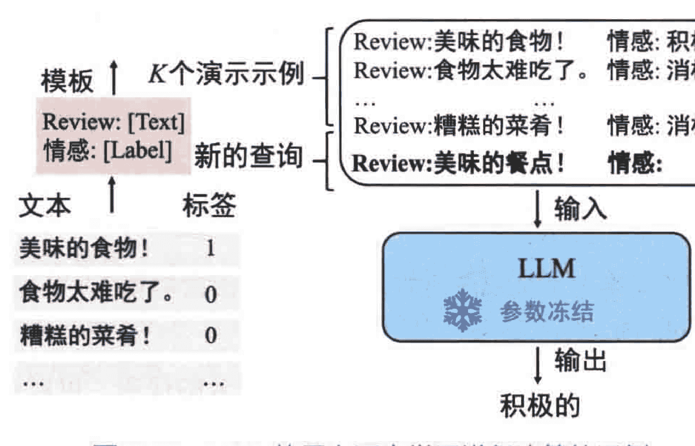

作为新范式，上下文学习有三点优势。其一，演示用自然语言书写，提供可解释的人机交互接口，便于把人类知识注入模型。其二，学习方式类似人类类比决策。其三，无需训练即可迁移，大幅降低适应新任务的算力成本，也便于大规模落地。

能力形成分两阶段：训练阶段培养上下文学习能力，推理阶段根据任务演示做预测。训练阶段模型仅在语言建模目标上训练，并非为上下文学习专门优化，但仍产生该能力。推理阶段输入输出都以自然语言模板呈现，有多处可优化。本节先给出形式化定义并厘清关系，再讨论训练策略、示例设计及分析，最后谈挑战。

### 2.6.1 上下文学习的定义

据 GPT-3 论文[14]，上下文学习指 LLM 仅凭少量演示即可学习任务。本质是利用预训练 LLM 在给定演示条件下估计候选答案的可能性。

形式上，给定查询 $x$ 和候选集 $Y = \{y_1, y_2, \cdots, y_m\}$，预训练模型 $\mathcal{M}$ 在演示集 $C$ 条件下选择得分最高的候选。$C$ 包含可选任务指令 $I$ 和 $k$ 个演示 $s(x_i, y_i)$，即 $C = \{I, s(x_1, y_1), \cdots, s(x_k, y_k)\}$ 或不含指令。候选 $y_j$ 的可能性由序列得分函数 $f$ 给出：

$$P(y_j|x) = f_{\mathcal{M}}(y_j, C, x) \tag{2.17}$$

最终预测为概率最高的候选：

$$\hat{y} = \arg \max_{y_j \in Y} P(y_j|x) \tag{2.18}$$

得分函数估计在演示和查询下当前答案的可能性。如二元情感分类中比较“消极”“积极”的 token 概率。

与相关概念的区别：

- （1）**提示学习**：可为离散模板或软参数，引导模型输出。严格说上下文学习是提示调整的子类。
- （2）**少样本学习**：通用机器学习范式，需参数适应以在少量监督下找最优参数。上下文学习不更新参数。

### 2.6.2 模型预热

LLM 已具备一定上下文学习能力，但研究表明在预训练与推理之间加持续训练可进一步提升，称为**模型预热**。这是可选步骤，可修改原参数或添加新参数，与微调不同，目标不是完成特定任务，而是增强整体上下文学习能力。

#### 1. 有监督上下文学习

为增强能力，研究者提出有监督上下文微调。通过构建上下文格式训练数据和多任务训练缩小差距。文献 [190-191] 提出 MetaICL，用大量任务持续训练预训练模型，提升少样本学习。Wei 等人[192] 提出符号微调，在上下文输入-标签对上微调，用任意符号替代自然语言标签，如把“正面/负面情感”换成“foo/bar”，从而更依赖上下文而弱化先验语义。

指令信息也被证明有价值。FLAN[103] 用 137B LaMDA-PT[19] 在 60+ NLP 数据集的自然语言指令模板上调优，提升了零样本和少样本性能。相比 MetaICL 只造示例，指令调优更强调任务解释，更易扩展。Chung 等人[118] 和 Wang 等人[105] 把指令调优扩展到上千任务。

#### 2. 自监督上下文学习

Chen 等人[190] 利用原始语料做预热，构造与下游上下文格式对齐的自监督数据，把原始文本转为输入-输出对，探索掩码预测和分类等目标。PICL[193] 同样用原始语料但采用简单语言建模目标，促进基于上下文的推理，同时保留泛化能力，效果优于前者。

#### 3. 小结

- （1）监督和自监督预热都在推理前对 LLM 训练，核心是让训练目标更接近上下文学习格式。与需演示的上下文微调相比，无演示的指令微调更简便流行。
- （2）这些方法都通过更新参数提升能力，说明原 LLM 上下文学习的提升空间很大。虽非必需，仍建议在推理前加入预热。
- （3）随训练数据规模扩大，预热带来的增益趋于平缓，监督和自监督均如此，说明 LLM 只需少量数据即可适应预热阶段的学习。

### 2.6.3 演示设计

大量研究表明，演示格式、示例顺序等对性能影响显著[182, 194]。本节介绍演示设计策略，分演示组织和演示格式两部分。

#### 1. 演示组织

# 提示示范与轻量适配策略全景拆解

在有限的样本库里，组织好示范的本质是挑对样例、定好先后、配好表达。

## （1）示范挑选
挑选示范的核心问题是哪些样例对少样本推理最有帮助。现有做法可大致分为两类，一类是依赖先验指标且无需标签监督，另一类是依赖先验指标但需要监督信号。

先验指标驱动的无监督筛选用法。文献 [183] 指出邻近样本作上下文很有效，常用句子嵌入的 L2 或余弦距离据此发展出 KATE 这类基于 kNN 的检索器。除了距离，互信息也是常见选择标准 [195]，甚至可检索跨语言 kNN 样例 [196] 以增强源-目标对齐，而且互信息不依赖标注也不绑定特定大模型。Gonen 等人 [197] 倾向挑选困惑度更低的 prompt，Levy 等人 [198] 强调样例多样性来提升组合泛化，Kim 等人 [199] 则让大模型自行生成样例而非从人工标注里挑选。

另一批无监督方法直接利用模型输出概率 $P(y|C, x)$ 衡量质量。Wu 等人 [200] 按数据传输编码长度排列 kNN 子集，最优排列可在给定 $x$ 与 $C$ 时压缩标签 $y$。Nguyen 和 Wong [201] 计算单个样例的影响力，即包含与不包含该样例的子集平均表现的差异。Li 等人 [202] 定义信息分数为验证集中所有 $(x, y)$ 对上 $P(y|x_i, y_i, x)-P(y|x)$ 的均值，并加入多样性正则。

先验指标驱动的有监督筛选用法。Rubin 等人 [203] 提出两阶段检索，先用无监督检索器如 BM25 召回候选，再用有监督检索器如 EPR 从候选中精筛。评分型语言模型评估候选与输入的关联，高分作正例低分作负例。Li 等人 [204] 用统一检索器增强 EPR，实现跨任务统一选择。Ye 等人 [205] 不再逐个检索，而是检索整组样例以建模样例间相互作用，训练的 DPP 检索器通过对比学习与模型输出分数对齐，再经后验最大化得到最优集合。

从提示调整角度，Wang 等人 [206] 把 LLM 视作主题模型，可从少量样例推断概念 $\theta$ 并据此生成 Token。任务相关的概念 Token 用于表征潜在概念，学习目标是最大化 $P(y|x, \theta)$，挑选的是按 $P(\theta|x, y)$ 最可能推断出概念变量的样例。Zhang 等人 [207] 把样例选择形式化为马尔可夫决策过程 [208]，用 Q-Learning 决策，动作是挑一个样例，奖励为验证集准确率。

## （2）示范排序
样例的先后次序同样关键。Lu 等人 [182] 证实排序敏感性在多种模型上普遍存在。早期无需训练的排序里，Liu 等人 [183] 按样例与输入的距离做合理排序。Lu 等人 [182] 提出全局与局部熵度量，发现熵度量与少样本表现正相关，于是直接用熵度量确定最佳顺序。

## 2. 示范表达形式
常见做法是把样例 $(x_1, y_1), ..., (x_k, y_k)$ 直接与模板 $T$ 拼接。但在数学、常识推理等需要复杂推理的任务里，仅用 $k$ 个映射学习 $x_i$ 到 $y_i$ 并不容易。除了模板工程 [154] 的研究，有人尝试在指令 $I$ 中描述任务，并在 $x_i$ 与 $y_i$ 之间加入中间推理步骤以设计更利于学习的格式。

### （1）指令表达
除了精心挑选的样例，清晰描述任务的指令对推理也很重要。与样例普遍存在于传统数据集中不同，任务指令多靠人工撰写。Honovich 等人 [209] 发现给定几个样例后 LLM 能自行生成任务指令。受生成能力启发，Zhou 等人 [210] 提出自动提示工程师，用于自动生成和挑选指令。Wang 等人 [38] 进一步用 LLM 从自身生成中提炼出初始指令示范。自动生成指令效果不错，也为人工反馈与自动指令结合打开空间。

### （2）推理步骤表达
Wei 等人 [83] 在输入输出之间插入中间推理步骤构建样例，即思维链。有了思维链，LLM 能逐步预测推理过程并给出最终答案。思维链提示研究涵盖提示设计和流程优化等 [211]。

与样例选择类似，思维链也需要挑选。不同于 [83] 的手工编写，AutoCoT [82] 用“让我们一步一步来思考”自动生成思维链。Fu 等人 [212] 提出基于复杂度的样例选择，挑选推理步骤更多的样例来做思维链提示。

当输入输出映射被拆解为逐步推理时，多阶段上下文学习被用于思维链提示，每个步骤使用不同的样例去查询 LLM。Self-Ask [213] 让 LLM 为输入生成后续问题并自问自答，问题与中间答案被加入链条。iCAP [214] 设计了上下文感知提示器，能动态调整各推理步骤的上下文。从少到多提示 [215] 是包含问题缩减与子问题解决的两阶段方法，第一阶段把复杂问题拆成子问题，第二阶段 LLM 逐个作答并把已回答的问题与答案累积到上下文中。

Xu 等人 [216] 在特定任务上微调小型 LLM 作为插件生成伪推理步骤。给定输入输出对 $(x_i, y_i)$，SuperICL 把小型 LLM 对 $x_i$ 的预测 $y'_i$ 与置信度 $c_i$ 当作推理步骤，通过串联 $(x_i, y'_i, c_i, y_i)$ 形成思维链。

## 3. 核心要点回顾
- 示范选择能提升少样本表现，但多数方法停留在单条层面。少样本评估下，库级别选择更关键却研究不足。
- LLM 的输出分数或概率分布在样例选择中发挥重要作用。
- $k$ 个示范的排列空间是 $k!$，如何高效找到最优顺序或逼近最优排序仍是挑战。
- 思维链能把复杂推理拆解为中间步骤，多阶段示范设计有助于更好生成思维链，提升思维链提示能力值得继续探索。
- 除了人工编写，LLM 的生成能力可用于示范设计，可生成指令、示范、探测集、思维链等，降低人工模板成本。

### 2.6.4 评分机制
评分函数负责把语言模型预测转化为特定答案的可能性估计。直接估计法使用候选答案的条件概率，候选答案可用词汇表标记表示 [14]，选概率最高的作最终答案。此法对模板有要求，答案标记通常需放在序列末尾。

困惑度是另一常用指标。整体序列 $S_j = \{C, s(x, y_j, I)\}$ 的句子困惑度由示范 $C$、查询 $x$ 与候选标签 $y_j$ 的标记组成。因困惑度评估整句概率，可摆脱标记位置限制，但计算开销更大。生成任务如机器翻译中，少样本推理通过解码句子概率最高的标记预测答案，常配合波束搜索或 Top-p、Top-k [217] 等多样化策略。

Min 等人 [218] 提出用通道模型反向计算条件概率，即估计给定标签下输入查询的可能性。该方式需 LLM 生成输入各标记，在数据不平衡时更稳健。鉴于少样本推理对样例敏感，用空白输入减去模型先验来归一化分数，可提升稳定性与整体表现 [194]。

另一方向是校准超出上下文长度限制的信息。Structured Prompting [219] 用特殊位置嵌入单独编码样例，再通过重标注意力机制提供给测试样例。kNN Prompting [220] 先用训练数据查询 LLM 得到分布式表示，再以封闭表示的最近邻锚点预测测试实例。

直接用候选答案条件概率高效但仍受模板限制，困惑度简单通用。现有评分函数都基于 LLM 条件概率计算。校准偏差或减轻敏感性的研究仍有限，比如在模型预测中加入额外校准参数来调整结果 [194]。

## 2.7 模型微调
大模型在通用文本上训练后，对特定任务或领域知识可能不足。此时在更小、更专业的集上微调可提升领域内表现。主流做法分为适配器微调与任务导向微调。

### 适配器微调
第一种方式用神经适配器或模块化组件增强 LLM 在特定领域任务上的表现，而不对内部参数做大幅改动。适配器集成到现有结构中，支持特定任务学习同时保持原模型基本完整。

### 任务导向微调
第二种方式重点是修改 LLM 内部参数以对齐特定任务。但受硬件与性能下降限制，全面更新所有参数不现实，研究难点在于确定应改动的子集及高效更新方式。

两种方式都能让 LLM 按任务或领域定制化。

### 2.7.1 适配器微调策略
微调常用在三类场景：提升特定任务性能如开放世界目标检测、增强特定能力如视觉定位、指令微调以解决下游视觉任务如 InstructBLIP [221]。即使只微调线性层，性能也能提升，可用 ImageNet 等任务数据集改进预训练模型。也有工作在定位数据上微调预训练视觉语言模型，如 Minderer 等人 [222] 在检测数据上微调视觉 Transformer 得到开放词汇目标检测器。此外可把视觉数据集转为指令微调集，使视觉语言模型适配下游任务。

适配器微调的目标是为 LLM 加入少量额外参数，通常以简单模块形式存在，引导模型适应目标领域或任务。理想模块具备三个特点：
- 参数少且结构简单。
- 能扩展到原始语言模型。
- 在不同领域连续训练时保持灵活。

大部分满足上述特点的工作属于参数高效微调范畴，并在适配器框架 [223-224] 下构建。

适配器是插入预训练模型层中可训练的模块 [223]。关键在于原始模型参数保持冻结，适配器提供可跨任务共享的参数。设 $f_{\Theta}(\cdot)$ 为参数集 $\Theta$ 的 LLM 函数，$g_{\Delta\Theta}(\cdot)$ 为参数 $\Delta\Theta$ 的适配器函数，则 $f_{\Theta} \circ g_{\Delta \Theta}$ 表示经适配器微调的模型。设 $X$ 为一般输入，$\phi$ 为任务性能度量，$D$ 为域训练数据，$\phi_D$ 为领域特定性能，值越大越好，适配器的目标是找到 $g_{\Delta \Theta}$，使得

$$\phi(f_{\Theta}(X)) \approx \phi(f_{\Theta} \circ g_{\Delta \Theta}(X)) \quad \phi_D(f_{\Theta}(D)) \leqslant \phi_D(f_{\Theta} \circ g_{\Delta \Theta}(D)) \quad (2.19)$$

部分工作探索适配器在无监督领域自适应 UDA 中的用法，旨在增强跨语言或多任务学习能力。文献 [225] 首次提出多领域自适应的两步策略，先在混合库上用掩码语言模型损失做领域融合，再在领域库上用任务损失微调。随后文献 [226] 提出 UDApter，同样两步训练但拆成领域适配器与任务适配器两模块。领域适配器先学习领域不变表示，再与冻结的任务适配器连接，结构源自 AdapterFusion [227]。AdapterSoup 在测试阶段仅用领域适配器的加权平均提升效率 [228]，选择策略包括穷举组合、文本聚类和语义相似性。在 GPT-2 [225-226, 228] 上验证后认为方法可迁移到更大模型。为此提出 LLaMA-Adapter，利用自指导示范在 LLM 与适配器上实现高效自适应，适配器含零初始化注意力机制，并在指令遵循与多模态推理上测试领域自适应能力 [229]。

随着适配器应用扩大，基于结构可分为神经适配器与低秩适配器，也有大量工作构建综合适应框架 [230-231]，集成适配器在多种下游任务上表现突出。

#### （1）神经型适配器
神经网络结构的适配器即神经适配器。最初设计 [223] 使用下投影、GeLU 非线性 [232]、上投影与前馈层作为骨干。随后 [233] 简化为单层隐藏层前馈网络并验证领域适应效果。模块通常插入 Transformer 的多头注意与前馈层，被称为瓶颈适配器或串行适配器，本书提及的 [223] 即为串行适配器。

发展受 ResNet、自动编码器、注意力等启发。文献 [227] 的适配器加入额外残差连接。文献 [234] 提出 MAD-X 框架，插入可逆适配器紧邻输入并反转传至输出嵌入，在高层语义空间类似自动编码器。Tiny-attention 适配器 [235] 探索小维度注意力层适配器的有效性。多数结构用全连接层做下投影与上投影，而 Compacters [236] 用参数化超复数乘法层 [237] 替代，其形式类似全连接但学习克罗内克积之和，参数效率更高。受网络修剪启发，SparseAdapter [238] 在初始化时修剪以减少训练参数，是适用于神经适配器的通用技术。

内部适应之外还有外部适应。K-Adapter [239] 在不同知识领域单独训练多个适配器，再通过连接把知识注入语言模型。Sung 等人 [240] 关注反向传播带来的内存开销，提出阶梯侧调节，只在一侧添加小模块并用快捷连接。两者都使用 MLP，但结构保持灵活。

#### （2）低秩适配器
低秩适配 LoRA [241] 源于“LLM 存在于内在子空间 [242]”的观察，认为参数可有效更新。LoRA 在子空间嵌入可学习奇异值分解块，低秩 $r \ll d$，$d$ 为输入维度。矩阵与预训练权重并行相加，微调时冻结原权重。LoRA 大幅减少训练参数且推理不增加延迟。

后续工作 DyLora [243] 用动态搜索解决固定块大小与最优秩穷举问题。LoRA 的表示能力受限，Kronecker 适配器 KronA [244] 用两个小矩阵的 Kronecker 乘积替代奇异值分解模块。虽然低秩适配后续研究不多，LoRA 作为重要构建块被纳入多种综合框架 [230, 245-247]。

#### （3）集成适配器框架
AdapterFusion [227] 在不同任务上训练多个适配器，用融合层组合各适配器的嵌入。UniPELT [246] 通过门控机制动态激活最适合当前数据或任务的子模块组合，包括串行适配器 [223]、LoRA [241]、前缀微调 [157] 与 Bitfit [248]。对应的 AdaMix [247] 堆叠多个同一类型适配器，用随机路由训练激活以避免额外计算成本。AdaMix 虽只在串行适配器与 LoRA 上验证，但可视为通用技术。

# 适配器路由：大模型落地的隐形门槛

由适配器库衍生出路由学习的思路，直接催生了后续系列探索。 Poly-tropon[249] 提出让适配器集合与路由策略一起训练，目标是把不同尺度的微调适配器在任务间灵活重组。 后续工作[250] 对此做了延展，比如把显式路由换成权重平均，或引入多头路由来提升表达弹性。 在工程层面，AdapterHub[231] 是目前适配器整合最全面、最易用的工具箱，短板是尚未覆盖大语言模型。 LLM-Adapter[230] 则专门面向 LLaMA、OPT、GPT-J 等开放大模型搭建适配框架，以串行适配器[223]、MAD-X[234]、并行适配器[251] 与 LoRA[241] 作为四类基础积木，并在其上拓展新模块。

研究者 Sung 等人[240] 提醒，即便冻结历史参数，适配器方案在反向传播时依然会波及全网，训练显存需求并不低。

把适配器迁移到语言模型领域特化时，两类阻力尤为突出。

- （1）稳定与泛化：适配器在预训练语言模型上的表现常被结构选择和超参设定牵动，稳定性与泛化能力受挑战。延伸到大模型语境，厘清适配器类型与任务设定的匹配规律，是推广的关键一步。
- （2）算力负担：适配器在预训练语言模型上可做到百万量级参数，但与大模型的适配性仍待验证。若需要堆叠更多模块、扩大参数规模，计算成本会再次抬头。更理想的思路是通过结构优化或更省内存的微调方法来降低训练开销。

### 2.7.2 面向任务的精调难题

依托海量文本训练而来的大语言模型能力惊人，但想跳脱对少样本示做例的依赖，仍需用大量高质量领域数据刷新内部参数。 对大模型做领域精调会碰上两大障碍。

- （1）更新全局知识可能侵蚀上下文学习能力，原因涵盖过拟合、灾难性遗忘以及任务特有偏见[252]。
- （2）参数空间庞大、网络层级深，精调大模型的计算开销极高。

下面梳理刷新全局知识的两种技术路线：指令式更新与局部更新。

#### 1. 指令驱动的知识更新

指令驱动的知识更新，是指在大规模多样任务、并配以明确指令或提示的前提下对大模型进行精调，从而刷新其参数化知识。 概念上与文献[15]提出的指令学习一致。 图 2.12 演示了用指令精调大模型的流程。 具体来说，模型会在常识推理、信息抽取等任务上训练，并配备详细指令，期望获得可迁移的解题能力。 Wei 等人[38]是最早尝试用指令描述的数据集对大模型进行精调的研究，实验证明有效的指令能显著提升模型在未见任务上的零样本表现。 FLAN 利用自然语言指令模板，在 60 个 NLP 数据集上对 137B 量级语言模型进行精调。 结果显示，其在多数未见任务上的表现优于未修改基线，甚至在零样本与少样本设定下超过参数量达 175B 的 GPT-3。 随后[118, 253-254] 在此基础上继续探索，重点放在扩大任务规模、增大模型规模，以及在思维链数据上进行精调。 经处理后的模型在众多零样本或少样本基准上达到领先水平。

##### （1）人类指令引导的微调

这一方向的目的是让大模型生成更安全、真实、无害且贴合用户意图的内容。 多数大模型采用自回归生成，输出高度受训练语料分布制约，可控性较差。 RLHF 是典型对齐技术，用于使输出与人类需求一致[78]。 其流程为：模型针对同一提示产出多个候选，由人工依据质量、相关性与期望一致性排序；外部奖励模型据此打分，捕捉评估者偏好；再通过强化学习更新策略以最大化预期奖励，使模型更贴合人类偏好；生成-排序-建模-优化的循环不断重复，模型持续从人类反馈中学习。 当前已有方法把 RLHF 成功应用到复杂推理任务的人类指令精调上[255-256]。

##### （2）指令微调的局限

显式指令在自然语言处理任务上表现不错，但在与测试集差异较大的任务面前会吃力。 提升多任务适应性往往伴随灾难性遗忘，如何在不遗忘的前提下扩展知识与能力是核心难题。 Huang 等人提出的方法是利用预训练语言模型为无标注问题生成高置信答案，从而在没有标准标签或明确指令时增强通用推理能力[257]。 Scialom 等人则在多种任务上精调，并引入基于反复练习的持续学习策略，在扩展知识与能力的同时规避灾难性遗忘[258-259]。

#### 2. 局部知识更新

除了借助任务特定指令精调大模型，还可以不依赖外部指导，仅编辑与特定知识相关的部分参数。 设 $f_{\Theta}(\cdot)$ 为参数集 $\Theta$ 下的大模型，$\theta \in \Theta$。 基于训练集 $D$ 更新内部知识可表述为

$$\tilde{\Theta} = \Theta + \nabla f_{\Theta}(D) \odot T, \quad T^{(i)} = \begin{cases} 1, & \text{如果 } \theta_{(i)} \in \Theta_T; \\ 0, & \text{如果 } \theta_{(i)} \notin \Theta_T. \end{cases} \quad (2.20)$$

这里 $T$ 为掩码向量，$T^{(i)}$ 为其第 $i$ 个分量。 掩码决定每次迭代中内部知识的更新量，记待更新参数为 $\Theta_T \subseteq \Theta$。 传统预训练语言模型精调设定下$^{[260-262]}$，$|\Theta| = |\Theta_T|$。 但全参数更新在计算上不可行且资源消耗巨大。 经验证 $|\Theta| \gg |\Theta_T|$，即实际只修改极少量参数。 现有的参数高效知识更新大致可分三类：知识编辑旨在直接定位并修改大模型中一小部分参数；梯度掩码在精调过程中屏蔽无关参数的梯度；知识蒸馏侧重从大模型中提炼出具备特定领域知识的子模型。

##### （1）知识编辑

部分研究在更新大模型新记忆方面取得进展，用于替换过时信息或注入专业知识。 例如提升“鲍里斯·约翰逊是英国首相”等过时预测的能力，可增强可靠性和泛化性。 已提出多种定位与编辑参数化知识的方法$^{[263-267]}$。 De Cao 等人提出超网络以更新模型参数，仅修改单一事实，避免全面精调以防性能退化$^{[264]}$。 后续研究发现随模型规模增大，基于超网络的编辑受限，进而提出检索式方法$^{[268-269]}$。 另一些工作聚焦内部机制定位，通过注意力与因果干预识别驱动预测的神经元，成功更新领域事实$^{[263,266-267]}$。 文献[265] 构建从文本查询到内部事实编码的映射，将这些编码用作编辑器与探针。

##### （2）梯度掩码

梯度掩码是在精调中选择性更新大模型特定部分的策略。 核心目标是降低计算开销、缓解灾难性遗忘或过拟合，特别在把预训练模型适配到小规模或专用数据时。 该方法通过在反向传播中施加掩码函数修改梯度，决定哪些部分被更新，从而冻结部分参数。 参数选择可依据与任务的相关性、在模型中的重要性或对整体损失的贡献。

早期尝试$^{[248,270]}$ 使用正则化精调相对较小的模型，但不适用于大模型，因有效训练所需数据与算力远高于小型模型，可能高出数个数量级。 为迁移到大模型，CHILD-TUNING$^{[271]}$ 利用下游任务数据探测与任务最相关的参数作为子网，并将非子网参数冻结于预训练权重。 此外 Zhang 等人$^{[272]}$ 提出动态参数选择算法，根据反向传播梯度自适应挑选更有前景的子网分阶段更新，在低资源下更好完成领域下游任务。

##### （3）知识蒸馏

围绕大模型自我知识更新的研究多集中于任务特定指令与参数效率提升。 一个方向是把大模型中的领域知识抽取到更小网络，以降低推理延迟并增强领域任务解决能力。 Muhamed 等人把 15 亿参数大模型压缩为 7000 万参数模型用于点击率预测，引入孪生结构类 BERT 编码器与融合层，通过跨结构蒸馏从单一大模型提取知识，在线与离线环境均表现优异[273]。 类似地，文献[274-276] 在大模型精调中加入蒸馏模块，实现更快收敛与更好资源利用。 该模块借助预训练参数加速收敛，并训练少量参数缓解过参数化问题。 此外文献[277-278] 把大模型中的思维链推理能力迁移到小模型。

#### 3. 现存挑战

用最新数据精调大模型以提供准确信息尤为重要，特别在技术、医疗、时事等快速变化领域。 不同应用或用户也可能有独特需求与偏好。 因此挑战包括：

- （1）**合规要求**：多数情况下更新与精调大模型为确保符合特定法规或指南所必需，所谓的对齐可在精调阶段完成。
- （2）**算力资源**：精调或更新内部知识需要高性能 GPU 或专用硬件，对个人研究者或中小型组织而言成本高昂且难以获取。 提升精调效率仍是现实且关键的问题。

## 2.8 思维链：让大模型会思考

传统大模型在“预训练+精调”范式下难以完成多步推理。 2022 年 Jason Wei 提出的 Chain-of-Thought Prompting，CoT Prompting[38,83] 能显著提升性能，尤其在数学与推理等复杂任务上。 具体体现为三点提升。

- （1）**常识推理赶超人类**。以往模型在众多挑战任务上不及人类，采用 CoT 提示后，大模型在 BBH 评测基准 23 个任务中 17 个任务的表现超过人类基线。 如 Sports Understanding 任务中，CoT 提示的模型常识推理性能为 95%，高于运动爱好者 84%。
- （2）**数学逻辑推理大幅提升**。语言模型在算术推理上表现平平，引入 CoT 后逻辑推理能力跃升。 MultiArith 与 GSM8K 用于测试数学推理能力。 PaLM 在采用 CoT 提示后较传统提示学习提升约 300%，在 MultiArith 与 GSM8K 上表现显著提高，甚至超过有监督学习最优结果。 这意味着大模型也能处理需要精确分步计算的复杂数学问题。
- （3）大模型更具可解释性，更加可信。 超大规模无监督深度学习构建的大模型本质是黑盒，推理决策链不可知，导致结果难以信任。 CoT 把逻辑推理问题拆解为多步，生成结果拥有更清晰的逻辑链条，具有一定可解释性，使用者能追溯答案来源。 Jason Wei 提出的 CoT 是大模型惊艳世界的必要条件。

尽管实证成功显著，CoT 背后的机制及如何释放潜力仍不为所知。 本节介绍 CoT 的技术细节，以及具备 CoT 的大模型在基础数学与决策问题上的能力。

### 2.8.1 思维链技术拆解

其一，先前研究不仅让模型从零开始生成自然语言中间步骤[279]，也通过精调预训练模型实现这一目标[44]。 此外还有神经符号方法，使用形式语言而非自然语言[280-282]。 其二，大模型通过提示具备上下文少量示范学习能力。 也就是说，不必为每个新任务单独精调语言模型，而是用若干输入输出示例提示模型进行学习。 令人惊讶的是，这在一些简单问答任务上取得成功[14]。

上述思路存在局限。 对加入自然语言解释的训练与精调而言，制作大量高质量解释是一项复杂工作，远比普通的输入输出对困难。 文献[14] 的传统少量示范提示在需要推理能力的任务上表现不佳，且不随模型规模增大而改善[20]。 CoT 可以规避这些限制。 具体来说，CoT 探索了大模型在推理任务上进行少量示范提示的能力，给定提示由三元组组成：输入、思维链、输出。 思维链是自然语言推理步骤序列，本文称之为 CoT 提示，示例见图 2.13。 纯提示方法之所以重要，是因为它无需大规模训练集，且单一模型检查点可执行多任务而不损失通用性。 CoT 关注大模型如何借助少量任务相关自然语言示例进行学习，而非通过海量训练数据的自动模式学习。

以复杂推理任务为例，如多步数学应用题。 通常会把问题分解为多个中间步骤，逐步求解后再给出最终答案。 CoT 的目标是赋予语言模型生成思维链的能力——一系列连贯的中间推理步骤，据此可推导出最终答案。 若在少量示例提示中提供思维链推理演示，足够大的大模型即可生成这类链条。

CoT 提示在促进推理方面具有以下特点。

- （1）CoT 原则上允许模型把多步问题拆分为中间步骤，意味着可为需要更多推理步骤的问题分配额外计算。
- （2）CoT 为模型行为提供可解释性窗口，提示其如何得出特定答案，并提供调试推理路径的机会。
- （3）CoT 推理可用于数学问题、常识推理与符号操作，理论上适用于任何人类可通过语言解决的任务。
- （4）通过在少量示例提示中加入思维链序列示例，可在足够大的大模型中轻松得到 CoT。

### 2.8.2 自洽性驱动的思维链

本节介绍一种新解码策略——自洽性 Self-consistency，用来替代 CoT 提示[83] 中使用的贪婪解码。 它先对不同推理路径进行多样性采样，而非仅走贪婪路径，再对采样得到的推理路径进行边缘化，选择最一致的答案。 自洽性利用了复杂推理问题常可通过多种不同思路得到唯一正确答案的直觉。 大量实证评估显示，自洽性显著提升 CoT 提示在算术与常识推理基准上的表现，包括 GSM8K 提升 17.9%、SVAMP 提升 11.0%、AQuA 提升 12.2%、StrategyQA 提升 6.4% 和 ARC-challenge 提升 3.9%。

尽管语言模型在多种 NLP 任务中展现强能力，但在推理上尚未充分发挥[20]。 为此 Wei 等人[83] 提出 CoT 提示方法，要求语言模型生成一系列短句，模仿人类解题时的推理过程。 例如对“停车场已有 3 辆车，又来 2 辆，现在有多少辆”，模型不会直接答“5”，而是分析：“停车场已有 3 辆，又来 2 辆。现在有 3+2=5 辆。答案是 5。” 观察发现，CoT 提示在多步推理任务中显著提升性能[83]。

自洽性利用复杂推理任务存在多种正确推理路径的特性，即回答问题需要深思熟虑与分析，才能基于多样推理路径得到答案。 图 2.14 用示例说明自洽性方法。 首先用 CoT 提示引导语言模型，然后采样生成多样推理路径，最后对采样路径进行边缘化，先从解码器采样生成一组多样推理路径。 每个路径可能产生不同答案，最终通过边缘化采样路径确定最优答案。 该思路类似人类经验，若多种不同思考方式都得出相同答案，人们对最终答案正确性更有信心。 相较其他解码方法，自洽性避免了贪婪解码的重复性与局部最优问题，同时缓解了单次采样的随机性。

以往方法要么训练额外验证器，要么基于人工标注训练重排序模型以提升生成质量。 自洽性则是无监督的，即插即用在预训练语言模型上，无需额外人工标注，也避免额外训练、辅助模型或精调。 与典型集成方法不同，后者需训练多个模型并聚合输出，自洽性更像“自我集成”，在单一语言模型上工作。

#### 不同推理路径下的自洽性

人类显著特点是思考方式多样。 在需要深思熟虑的任务中，存在几种不同解题方法很自然，语言模型可通过从解码器采样来模拟这一过程。 语言模型并非完美推理者，可能产生错误推理路径或在步骤中犯错，这些路径很少得出相同答案。

自洽性方法大致如下。 首先，用一组手工编写的连续思维示例[83] 提示语言模型。 接下来，从解码器采样候选输出，生成多样化的候选推理路径。 自洽性与多数现有采样算法兼容，包括温度采样、前 k 个最高采样与核采样。 最后，对采样推理路径进行边缘化，聚合答案并选择生成答案中最一致者。

进一步展开来看，解码器一次输出的最终结果记作 $a_i$，其取值被限制在预设的答案集合 $\mathbb{A}$ 内，$(i = 1,2,\cdots,m)$ 对应从解码器中抽取的 $m$ 条候选结果的编号。在提示与问题固定的情境下，自洽机制额外引入一个隐变量 $r_i$，它刻画第 $i$ 条输出所经历的推理轨迹，即一条 token 序列，随后把 $(r_i,a_i)$ 视作整体生成，其中 $r_i \rightarrow a_i$，先产出推理过程 $r_i$ 再据此得到答案 $a_i$，而 $r_i$ 本身仅起辅助作用。以图 2.14 的例子为例，前几句“她早餐吃 3 颗……所以她有 9 颗鸡蛋 $\times 2$ 美元 $= 18$ 美元。”就构成了 $r_i$，末尾一句“答案是 18 美元”被解析为 $a_i$。对多条 $(r_i,a_i)$ 采样后，先对推理轨迹 $r_i$ 做边缘化，再在答案层面做多数表决，即 $\arg \max_a \sum_{i=1}^m \mathbb{I}(a_i = a)$，亦可直接从最终答案池里挑选出现频率最高的那一个。

除朴素投票外，聚合时也可以给每条 $(r_i,a_i)$ 赋予权重 $P(r_i,a_i\mid\text{prompt},\text{question})$。该条件概率既可以用模型在给定提示与问题下生成此对的未归一化概率来近似，也可再按输出长度做归一化，即

$$P(r_i, a_i | \text{prompt}, \text{question}) = \exp \frac{1}{K} \sum_{k=1}^K \log P(t_k | \text{prompt}, \text{question}, t_1, \cdots, t_{k-1}) \quad (2.21)$$

式中 $\log P(t_k\mid \text{prompt},\text{question},t_1,\cdots,t_{k-1})$ 表示在已知前面 token 的条件下生成第 $k$ 个 token $t_k$ 的对数概率，$K$ 为 $(r_i,a_i)$ 的总 token 数。

自洽性本质上是在开放式续写与固定答案的最优生成之间搭桥。推理类任务的答案往往是确定的，这也是贪婪解码被长期采用的原因[13, 21, 83]。思维链的工作表明，即便目标答案唯一，刻意制造推理过程的多样性也会带来明显收益。因此可以借用开放式生成常用的采样技巧[13-14, 19]。需要强调的是，自洽性目前主要适用于最终答案可归入有限集合的问题。原则上，只要能在多份生成之间定义合理的相容性度量，比如两份答案是否一致或矛盾，该思路就能延伸到开放式文本生成问题。

### 2.8.3 思维树：让模型会规划与回溯

有了链式思考后，大模型在一些很简单的问题上仍会出错。2023 年 5 月，普林斯顿大学与 Google DeepMind 的研究者提出一种全新的推理范式——Tree of Thoughts，ToT[283]。它是对链式思考的泛化，用来引导语言模型提示，并让模型能够对一致的文本单元即“思维”进行系统性探索，这些单元充当解决问题的中间步骤。ToT 让模型在权衡多种推理路径并借助自我评估来做有意识决策时，能够决定下一步怎么走，并在必要时回溯以实现全局择优。

在设计这种规划流程时，ToT 借鉴了自 20 世纪 50 年代起由纽厄尔、肖和西蒙探讨的规划思想[284-285]。纽厄尔等人把问题求解描述为在组合问题空间中的搜索，并据此提出树形框架来处理语言模型的通用任务。如图 2.15 所示，每个矩形框代表一个思维，传统做法是让模型采样连续的语言序列作为中间步骤。把中间产物提升为高级语义单元后，模型就能通过在语言内部实现的推理过程，自评不同中间思维对问题进展的贡献。通过语言模型本身来完成搜索启发式的实现是新颖的，过去的启发式多靠手工编程或专门学习得到。最后，ToT 把基于语言的生成与评估多样性思维的能力，与搜索算法结合，比如广度优先搜索 BFS 或深度优先搜索 DFS，从而实现对思维树的系统性遍历、前向验证与回溯。

经验上，24 点游戏、创意写作与填字游戏对当时最强的 GPT-4[29] 都构成挑战，这些任务涉及演绎、数学、常识与词汇推理。ToT 表现出足够的普适性和灵活性，既能支撑不同粒度层级的思维，也能以多样化的生成与评估方式运行，并适配包含不同问题特性的多种搜索策略。在 24 点、创意写作和填字游戏三项任务上，它取得了不错的效果。

#### 1. 设计脉络与符号说明

ToT 用 $p_{\theta}$ 表示参数为 $\theta$ 的预训练语言模型，用小写 $x,y,z,s,\cdots$ 表示语言序列，$x=(x[1];x[2];\cdots;x[n])$，每个 $x[i]$ 为一个 Token，故 $p_{\theta}(x)=\prod_{i=1}^{n}p_{\theta}(x[i]\mid x[1,2,\cdots,i])$。大写 $S_1,S_2,\cdots,S_n$ 表示一组语言序列。

输入/输出提示是最常见的把问题输入 $x$ 映射到输出 $y$ 的方式，其中 $y\sim p_{\theta}(y\mid\text{prompt}_{\text{I/O}}(x))$，$\text{prompt}_{\text{I/O}}(x)$ 把输入 $x$ 包装上任务说明和少量示例。为简洁记 $p_{\theta}^{\text{prompt}}(\text{output}\mid\text{input})$ 为 $p_{\theta}(\text{output}\mid\text{prompt}(\text{input}))$，于是 I/O 提示可写成 $y\sim p_{\theta}^{\text{I/O}}(y\mid x)$。

链式提示$^{[83]}$ 面对的是输入 $x$ 到输出 $y$ 的映射难以直接学习的情况，例如 $x$ 是数学题而 $y$ 是数值答案。其核心是引入一系列中间思维 $z_1,z_2,\cdots,z_n$ 连接 $x$ 与 $y$，每个 $z_i$ 都是连贯的语言序列，作为通向解法的有意义中间步，比如数学问答中的中间方程。使用时先依次采样每个思维 $z_i$，再输出 $y\sim p_{\theta}^{\text{CoT}}\cdots\text{CoT}_{\theta}(y\mid x,z_1,z_2,\cdots,z_n)$。实践中常把 $[z_1,z_2,\cdots,z_n,y]\sim p_{\theta}^{\text{CoT}}(z_1,z_2,\cdots,z_n,y\mid x)$ 作为连续序列一起采样，思维的切分粒度如词组、句子或段落是模糊的。

自洽性链式思考 CoT-SC$^{[38]}$ 是一种集成做法，它采样 $k$ 个独立同分布的思维链：$[z_1^{(i)}\cdots n;y^{(i)}]\sim p_{\theta}^{\text{CoT}}(z_1\cdots n;y\mid x)\;(i=1,2,\cdots,k)$，然后返回出现频率最高的输出：$\arg\max_y\{i\mid y^{(i)}=y\}$。自洽性链式思考提升了链式思考的效果，同一问题往往存在多种推理路径，扩大思维集合能让决策更可信。但它内部并未对不同思维步骤做局部探索，且“最频繁”启发式仅在输出空间受限时有效，如多项选择问答。

#### 2. 复杂问题求解的树形思路

真正的问题求解是不断利用已有信息启动探索、逐步揭示新信息直到找到解的过程。人类解决组合问题时，常采用树状结构，节点对应部分解，分支对应修改操作符，分支选择由启发式引导，以在问题空间中前进。这一视角揭示了现有方法的两点不足：局部上未对思维的不同延伸即树的分支进行探索；全局上缺乏规划或回溯机制，而启发式引导的搜索正是人类解题的典型特征。

（1）思维切分。根据任务不同，一个思维可以是几个词如填字游戏里的一个词、一道方程如 24 点，或整段写作计划如创意写作。通常思维要够“小”，以便模型能产生丰富多样样本；同时又要够“大”，以便模型能评估其对解题的推进程度。

（2）**思维生成器** $G(p_{\theta},s,k)$。给定树状态 $s=[x;z_1\cdots z_i]$ 时，可用两种策略生成下一步思维的 $k$ 个候选。
- （a）从链式提示独立同分布采样：$z^{(j)}\sim p_{\theta}^{\text{CoT}}(z_{i+1}\mid s)=p_{\theta}^{\text{CoT}}(z_{i+1}\mid x,z_1\cdots_i)\;(j=1,2,\cdots,k)$。当思维空间宽泛例如段落级时，该策略更有利于产生多样性。
- （b）通过“提出提示”一次性生成：$[z^{(1)},z^{(2)},\cdots,z^{(k)}]\sim p_{\theta}^{\text{propose}}(z_{i+1}^{(1\cdots k)}\mid s)$。当思维空间受限例如只是一个词或一行时，该策略更好，因为在同一上下文中并列提出可避免重复。

（3）**状态评估器** $V(p_{\theta},S)$。面对一组候选状态，评估器衡量它们在解决问题上的进展，为搜索算法提供何时继续、按何顺序探索的启发式。虽然启发式是搜索的标准手段，过去多靠编程实现如 DeepBlue$^{[286]}$ 或学习实现如 AlphaGo$^{[287]}$。ToT 提出第三种路径：让语言模型对状态进行有意识推理。这种基于语言的启发式更灵活、样本效率更高。类似生成器，评估也可采用独立或投票两种方式。
- （a）独立为每个状态打分：对 $S$ 中每个 $s$，$V(p_{\theta},S)(s)\sim p_{\theta}^{\text{value}}(v\mid s)$，值提示可让模型依据状态推理出标量值如 1~10 或类别如确定/可能/不可能。评估依据可能依赖少量前瞻模拟，比如在“hot_l”中填入“e”可得“inn”，也可能依赖常识如没有词以“tzxc”开头。评估不必完美，近似即可。
- （b）跨状态投票：$V(p_{\theta},S)(s)=\mathbb{I}[s=s^*]$，其中“好”状态 $s^*\sim p_{\theta}^{\text{vote}}(s^*\mid S)$ 由投票提示选出。当成功难以直接量化例如段落连贯性时，比较不同局部解并投票更为自然。

（4）**搜索算法**。在树形框架内可嵌入不同搜索策略。文中探讨了两种相对简单的方法，更高级的如 A*$^{[288]}$、MCTS$^{[289]}$ 留待后续。
- （a）广度优先搜索，每步保留一组最优状态 $b$ 个。用在 24 点游戏和创意写作中，树深度有限 $T\le 3$，初始步骤可评估并剪枝到较小集合 $b\le 5$。
- （b）深度优先搜索，优先深入最优状态，直至得到最终输出 $t>T$，或评估器认为从当前状态 $s$ 无解 $V(p_{\theta},\{s\})(s)\le v_{\text{th}}$，其中 $v_{\text{th}}$ 为阈值。此时以 $s$ 为根的子树被剪枝，用以平衡探索与利用。在这两种情形下，深度

### 2.8.4 思维图：从链到图升级推理网络

要发挥大模型的潜力，有效的提示设计至关重要，于是出现了提示工程这一领域。在众多方案中，链式思考因强大的推理能力备受关注，其衍生的自洽性链式思考与树形思考也广受讨论。2023 年 8 月，苏黎世联邦理工学院、Cledar 与华沙理工大学的研究团队提出更进一步的思路：思维图 Graph of Thoughts, GoT$^{[290]}$。让思维从链到树再到图，模型的推理构建能力不断提升，实验也证实了这一点。思维图的核心优势在于它能把大模型生成的信息建模为任意图形，其中信息单元即模型思维作为顶点，边表示这些顶点间的依赖关系。

作者认为可以让模型的思维形成任意图结构以获得更强的提示能力。这一想法受多种现象启发。面对新概念时，人类不仅沿单链思考，还会形成更复杂的思维网络。大脑本身形成类似图形的复杂网络，具有循环等模式$^{[291]}$。算法执行也会暴露网络模式，常由有向无环图表示。这些图上的变换应用到模型思维时能提供更强的提示，却无法用链式思考或树形思考表达。图 2.16 对比了思维图与其他提示策略。

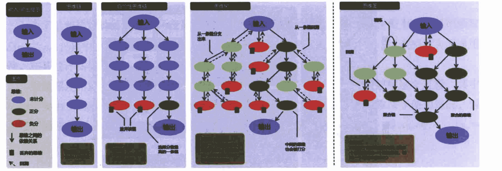

#### 1. 推理过程的图式表达

形式上，思维图可建模为四元组 $(G,\mathcal{T},\mathcal{E},\mathcal{R})$，其中 $G$ 代表“LLM 推理过程”，即上下文中所有模型思维及其关系，$\mathcal{T}$ 代表潜在的思维转换，$\mathcal{E}$ 用于获取思考得分的评估函数，$\mathcal{R}$ 用于挑选最相关思考的排序函数。

思维图把推理过程建模为有向图 $G=(V,E)$，$V$ 为顶点集合，$E\subseteq V\times V$ 为边集合。边是有序顶点对，每个顶点包含解决当前问题的方案，无论是初始、中间还是最终方案。思维的具体形态取决于任务，可以是写作中的一段文字，或排序任务中的数字序列。有向边 $(t_1,t_2)$ 表示 $t_2$ 是利用 $t_1$ 作为直接输入构建的，即显式指示模型使用 $t_1$ 生成 $t_2$。

在某些场景，图节点分属不同类别。例如写作任务中，部分顶点模拟段落计划，另一些模拟实际段落。此时使用异构图 $G=(V,E,c)$，其中 $c$ 把顶点 $V$映射到类别集合 $C$，如 $C=\{\text{计划},\text{段落}\}$。于是任意顶点都能模拟推理的不同侧面。

思维图把 $G$ 与 LLM 的推理过程关联。要推进推理，需对 $G$ 应用思维变换。一个例子是将得分最高的思维合并成新思维；另一个例子是循环增强某个思维。注意这些变换严格扩展了链式思考、自洽性链式思考或树形思考可用的变换集合。

#### 2. 思维变换

得益于基于图的推理模型，思维图能够实现对思维的新型变换，因此可称其为图驱动的变换。例如写作中可把多篇输入文章合并为连贯摘要；排序中可把多个已排序子序列组合成最终有序数组。图 2.17 列举了聚合与生成类思维变换的示例。

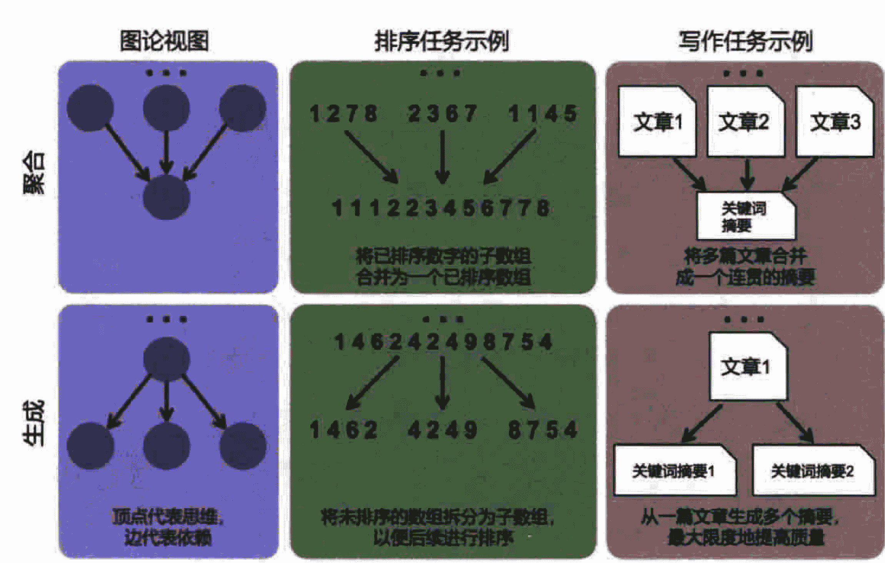

形式上，每个变换可写成 $\mathcal{T}(G,p_{\theta})$，其中 $G=(V,E)$ 反映当前推理状态，$p_{\theta}$ 为所用大模型。通常 $\mathcal{T}$ 通过新增顶点及其入边来修改 $G$。记变换后的图为 $G'=T(G,p_{\theta})=(V',E')$，其中 $V'=(V\cup V^+)\setminus V^-$ 且 $E'=(E\cup E^+)\setminus E^-$。$V^+$ 与 $E^+$ 是为模拟新思维及其依赖而插入的新顶点和边。为了最大化表达能力，思维图显式支持移除思维，指定要删除的顶点 $V^-$ 与边 $E^-$。使用者需保证 $V^+,E^+,V^-,E^-$ 的变换一致，例如不会删除不存在的顶点。这使得可以无缝整合节省上下文空间的方案，删除没有改进潜力的推理部分。

$\mathcal{T}$ 的具体形式及其对 $G$ 的影响取决于所选变换。下面先介绍主要的图驱动思维变换，再说明思维图如何兼容早期变换方案。除非另有说明，$V^-=E^-=\phi$ 表示不进行删除。

**思路聚合**
图模型让若干分散的节点能够汇聚成一个代表性节点，既能保留各条线索的优点，又能抵消短板。最简情形下只产生单一新节点 $v^+$，边集写作 $E^+ = \{(v_1, v^+), \cdots, (v_k, v^+)\}$，其中 $v_1$ 到 $v_k$ 为被合并的 $k$ 个思路。实际使用中聚合还能把推理链串起来，使链路更长。借助图表达，可以从多条模拟链的末端 $v_1,\cdots,v_k$ 引出指向同一节点 $v^+$ 的边，实现收敛。

**原位精炼**
精炼是对已有节点 $v$ 内容的就地修正：$V^+ = \{\}$，$E^+ = \{(v, v)\}$。自环表示在保持原有连接的前提下对同一思路进行迭代打磨。

**分支衍生**
从一个已有节点 $v$ 展开出一个或多个新节点，对应早期模拟推理中的树状展开或自洽链思路。形式化为 $V^+ = \{v_1^+, v_2^+, \cdots, v_k^+\}$ 且 $E^+ = \{(v, v_1^+), (v, v_2^+), \cdots, (v, v_k^+)\}$。

#### 3. 对思维打分并排序
要判断解是否可用，必须给思路打分。打分被抽象为通用函数 $\mathcal{E}(v, G, p_{\theta})$，评估对象是 $v$。引入完整的推理状态 $G$ 能提升泛化，部分场景下分数还会受其他节点影响。

图模型同时支持排序。用 $\mathcal{R}(G, p_{\theta}, h)$ 描述排序过程，$h$ 表示从 $G$ 中取出的前 $h$ 个节点数。具体实现随任务变化，常用做法是直接返回得分最高的 $h$ 个节点 $v_1, v_2, \cdots, v_h = \mathcal{R}(G, p_{\theta}, h)$。

#### 4. 详细结构
思维图的整体布局如图 2.18 所示，由若干协同模块构成。提示器负责为大模型准备消息，解析器从回复中抽取信息，评测与校验负责验证并赋分，控制器统筹推进并决定下一步。控制器内部包含操作图 Graph of Operations，GoO 与图推理状态 Graph Reasoning State，GRS。GoO 是静态蓝图，规定特定任务的图分解方式、应用于思路的变换类型以及执行顺序与依赖。GRS 是动态记录，用于维护当前推理进程的快照。

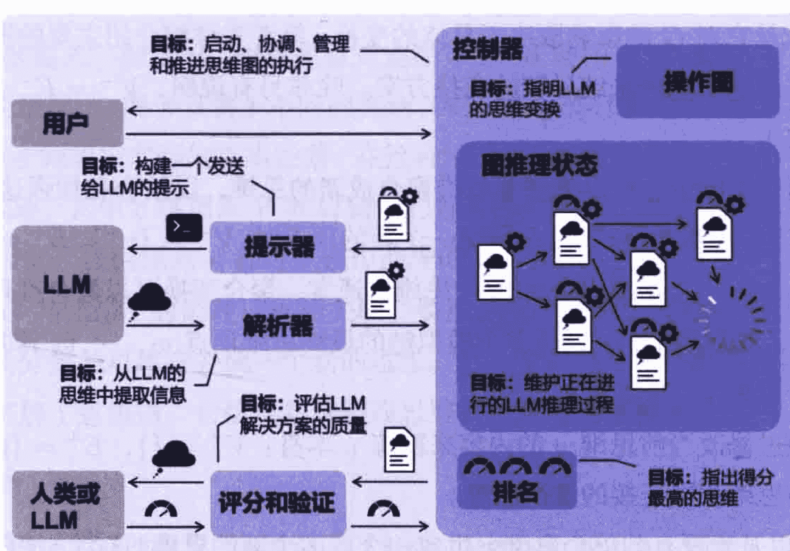
提示器需把图结构细节编码进提示，使用者可通过完全访问图结构实现定制编码。解析器为每个思路构建思路状态，记录抽取信息并据此更新图推理状态。

评测与校验先检验 LLM 思路是否满足潜在正确性条件，再给出分数。按来源不同，模块可能向 LLM 要求解释，也允许人工打分。最后借助简单的局部评分函数完成排序。

控制器依据图推理状态挑选待操作的思路，把信息传给提示器，并判断流程是否结束或需新一轮交互。

操作图由使用者在执行前一次性实例化，规定思路操作的执行计划。它是静态结构，每个操作都知道前驱与后继。运行期间，实例持续维护最新推理信息：已执行操作、所有生成思路的状态、有效性与得分等。该机制形成可扩展 API，便于实现不同提示方案。

## 2.9 RLHF
OpenAI 的 ChatGPT 掀起新一轮 AI 热潮，背后是语言模型生成范式转向 RLHF，即以强化学习方式依据人的反馈优化语言模型。

设计能捕捉可解释属性的损失函数很困难，大多数模型仍用逐 token 预测损失训练。为弥补不足，人们引入 BLEU、ROUGE 等更贴近人感知的指标，但它们只是与参考文本做规则化对比，局限仍在。若能把人对生成文本的反馈直接作为度量并用于优化，则更理想，这正是 RLHF 的思路：通过强化学习直接利用人反馈优化模型。

典型成功案例即 ChatGPT。笔者曾让 ChatGPT 自述 RLHF，见图 2.19。

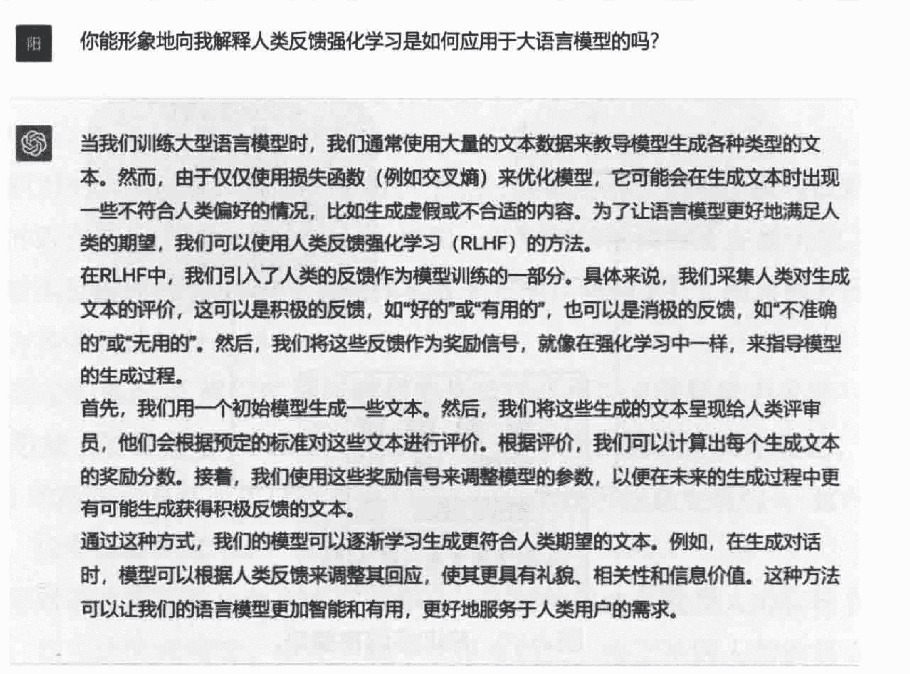

### 2.9.1 RLHF 技术分解
RLHF 概念复杂，涉及多阶段训练与部署，如图 1.8。整体可拆为三步。

- （1）预训练一个语言模型。
- （2）收集数据并训练奖励模型。
- （3）以强化学习方式微调语言模型。

#### 1. 预训练语言模型
作为起点，RLHF 先用传统预训练目标训练语言模型，如图 2.20。OpenAI 首个 RLHF 模型 InstructGPT 用规模较小的 GPT-3。Anthropic 用参数在千万到 520 亿间的 Transformer，DeepMind 用 2800 亿参数的 Gopher。初始模型可按需在额外文本或条件上进一步微调。例如 OpenAI 在人工生成的“更可取”文本上微调，Anthropic 则依据从上下文线索提取的“有帮助、诚实、无害”原则生成初始数据。这些昂贵增强数据并非理解 RLHF 所必需。目前尚无定论哪个模型是最佳起点。随后用语言模型生成的数据训练奖励模型，并在此引入人的偏好信息。

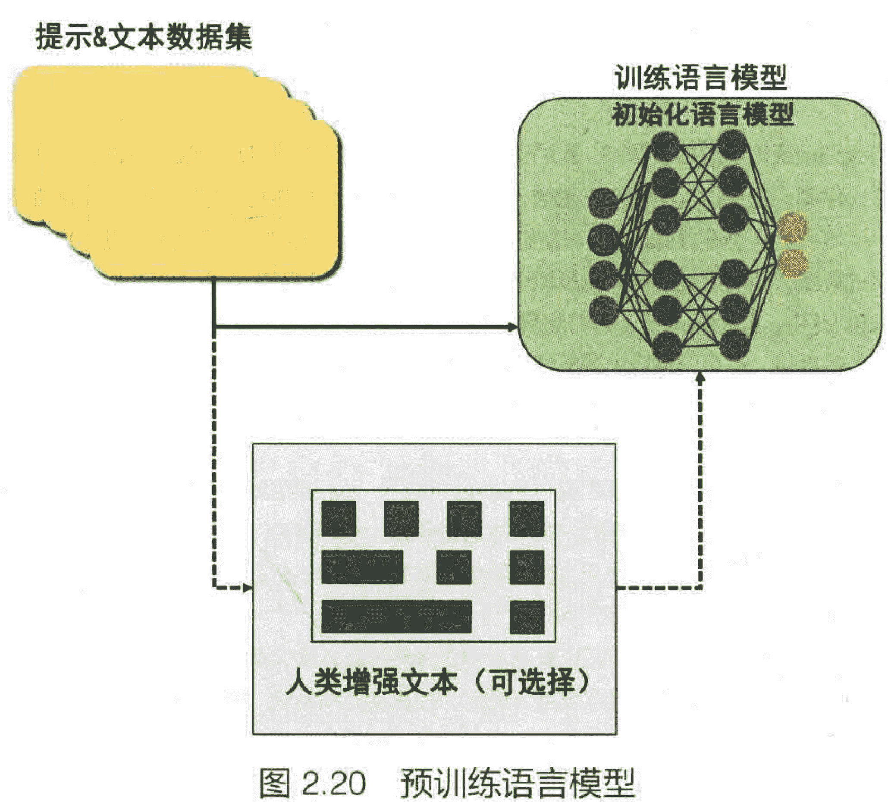

#### 2. 训练奖励模型
生成与人偏好对齐的奖励模型是近年研究的起点，目标是得到一个接收文本序列并输出标量奖励的系统，该数值应反映人的偏好。它可以是端到端的语言模型，也可以是先排序后转化的模块化系统。标量输出便于把现有强化学习算法无缝接入 RLHF。训练流程如图 2.21。

用于奖励的模型可为微调后的模型，也可为基于偏好数据从零训练的模型。例如 Anthropic 在预训练后采用专门微调方法初始化这些模型，称偏好模型预训练。该方法样本效率更高，但目前并无公认最佳变体。

提示-生成对的训练集通过从预定义语料采样提示生成，Anthropic 数据多来自 Amazon Mechanical Turk 上的聊天工具并可在 Hub 获取，OpenAI 数据则来自用户提交给 GPT API 的提示。这些提示送入初始语言模型生成新文本。

人工标注者对模型输出进行排序。早期想法是让人工直接给出标量分，但不同价值观会导致分数不校准且噪声大。实践中更常用排序来比较多个模型输出，形成更稳定的正则化数据。典型做法是让用户在同一提示下比较两段由语言模型生成的文本。通过端到端比较可借助 Elo 系统生成排名。不同排名方法最终归一为训练用的标量奖励信号。

至今成功的系统中奖励模型与语言模型规模不同：OpenAI 用 175B 语言模型配 6B 奖励模型，DeepMind 用 70B Chinchilla 作为语言模型和奖励模型。直观上，奖励模型需要具备理解所处理文本的能力，类似生成对应文本所需的能力。

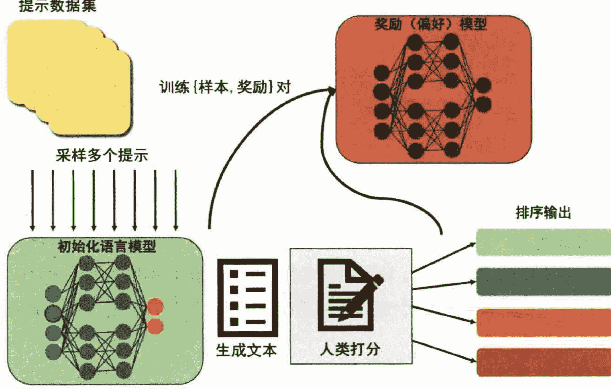

#### 3. 强化学习微调
多个机构已成功用 PPO 算法微调语言模型的部分或全部参数。完整微调 10B 及以上参数成本过高，因此通常冻结部分参数。PPO 算法成熟，是扩展到 RLHF 的常用选择。实现 RLHF 的关键在于如何用熟悉的算法更新如此庞大的模型。

把微调建模为强化学习问题：策略即语言模型接收提示并返回文本序列或其概率分布。动作空间为语言模型词表对应的所有 token，约 5 万量级；观测空间为可能的输入 token 序列分布。奖励函数结合偏好模型与策略变化约束。

奖励函数把各组件整合进 RLHF 流程。给定提示 $x$ 与当前微调策略生成的文本 $y$，把二者拼接后送入偏好模型得到“可取性”标量 $r_{\theta}$。同时比较强化学习策略与初始模型的每个 token 概率分布，计算差异惩罚。OpenAI、Anthropic、DeepMind 的论文中该惩罚通常是标记分布间 KL 散度的缩放版本 $r_{\text{KL}}$。KL 项惩罚策略在训练批次中偏离初始预训练模型的程度，有助于保持输出合理连贯。若无此惩罚，优化易产生荒诞文本并欺骗奖励模型。实践中 KL 散度通过采样近似。最终奖励为 $r = r_{\theta} - \lambda r_{\text{KL}}$。强化学习微调流程如图 2.22。

奖励函数常加入额外项，如 OpenAI 在 InstructGPT 上把来自人工标注集的预训练梯度混入 PPO 更新。

策略更新基于 PPO 参数更新，最大化当前批次的奖励指标，PPO 为在线策略，仅依据当前提示-生成对更新。它是信任域优化，对梯度施加约束以避免破坏学习。DeepMind 在 Gopher 中采用类似奖励设置但使用 A2C 优化梯度。可选地，RLHF 损失可通过迭代奖励模型与策略实现优化。随着策略更新，使用者可继续把新旧输出合并排名。

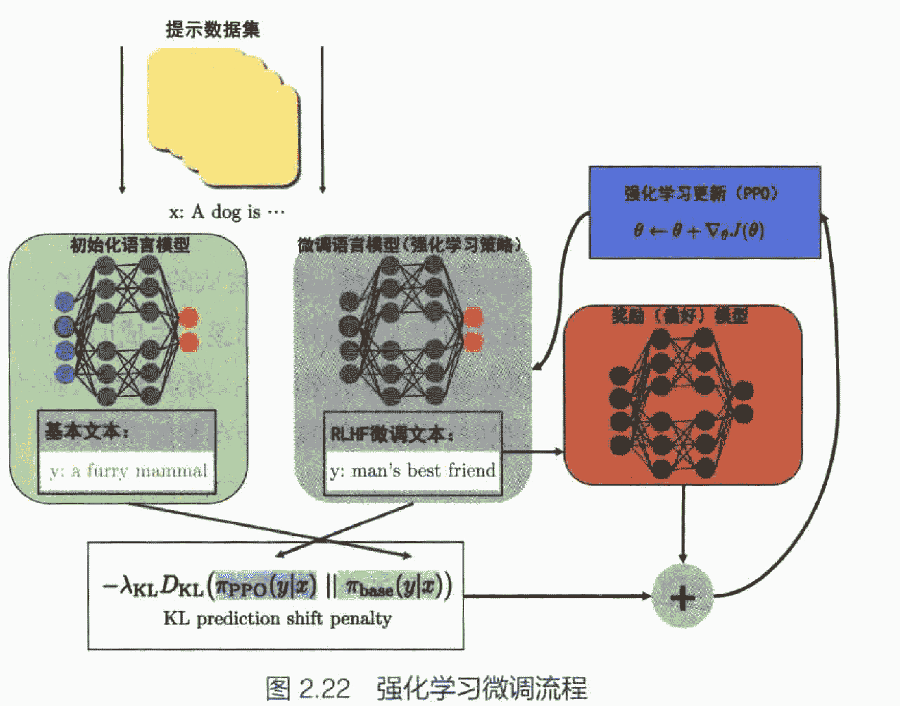

### 2.9.2 RLHF 开源工具集
OpenAI 2019 年首次发布 TensorFlow 版 RLHF 代码。如今 PyTorch 生态下已有多个活跃库，主要有 TRL、TRLX 与 RL4LM。

TRL 旨在用 PPO 微调 HuggingFace 生态的预训练语言模型。TRLX 由 CarperAI 构建，是 TRL 的扩展，支持在线与离线训练的大模型。截至本书成稿，TRLX 提供可在约 330 亿参数大模型上实现 PPO 与 ILQL 的 RLHF API。未来计划支持 2000 亿参数模型的训练，其接口面向有经验的机器学习工程师。

RL4LM 提供使用多种强化学习算法 PPO、NLPO、A2C、TRPO、多种奖励函数与指标进行 LLM 微调与评估的模块，支持编码器-解码器或编码器式 Transformer LM 在用户指定奖励上训练。该库经过大量测试与基准验证，涵盖专家演示、奖励建模、奖励欺骗、训练不稳定等实际问题，共约 2000 次实验。RL4LM 计划支持更大规模模型的分布式训练及新强化学习算法。

### 2.9.3 RLHF 的未来挑战
部署 RLHF 系统的首个数据难题是收集人偏好标签成本高昂。RLHF 性能完全取决于标注质量，标注有两种形式：为初始语言模型微调而人工生成文本，如 InstructGPT 所用；以及对模型输出间偏好的标签。生成针对特定提示的高质量人类回答通常需聘请兼职人员，代价高昂。所幸训练大多数 RLHF 应用奖励模型的数据并不那么昂贵，但对学术界仍难以承受。第二难题是标注者常存在分歧，缺乏基准真值时为训练数据带来不确定性。

在此限制下，仍有大量可探索的设计空间，多属改进强化学习优化器。PPO 相对较旧，其他算法尚未在现有 RLHF 流程中展现优势。策略微调的反馈成本巨大：策略生成的每段文本都需在奖励模型上评估，后者相当于环境的一部分。为避免大模型昂贵的前向传递，可采用离线强化学习算法作为策略优化器，随后出现如 ILQL 等针对该类优化的算法。强化学习中的探索与利用平衡等权衡也尚未充分记录。

## 2.10 RLAIF
RLHF 非常有效，但高质量人偏好标签收集困难。2023 年 9 月谷歌团队提出 RLAIF，并与 RLHF 对比，RLAIF 中偏好标签由 LLM 代替人类标注。结果显示 RLAIF 在不依赖人类标注者的情况下可产生与 RLHF 相当的改进，胜率 50%。同时研究再次证实，相较有监督微调，RLAIF 与 RLHF 的胜率均超 70%。两者比较如图 2.23。

RLHF 使 LLM 能针对复杂序列级目标优化，而传统有监督微调难以区分这些目标。但现实问题是 RLHF 需要大量高质量人类标注数据。在谷歌研究前，Anthropic 探索用 AI 偏好训练奖励模型微调的奖励模型，首次在 Constitutional AI 中提出 RLAIF，发现 LLM 与人类判断高度一致，部分任务上甚至优于人类。但该研究未与人类反馈对比，RLAIF 能否替代 RLHF 尚无定论。谷歌的最新研究主要解决人类判断与 RLAIF 一致性问题。下面将详细介绍 RLAIF 技术细节，包括用 LLM 生成偏好标签的方法及强化学习与指标评估。

### 2.10.1 用大模型标注偏好
RLAIF 使用现成 LLM 为候选对中的偏好做注释，该模型为预训练或通用指令调优模型，未针对特定下游任务微调。给定一段原文和两个候选摘要，LLM 被要求判断哪个摘要更好。LLM 输入结构示例如图 2.24。

1. 前导部分：介绍与任务说明。
2. 少量示例 1-shot 可选：文本示例、一对摘要、思维链解释及偏好判断示例。
3. 样本标注：待标记的文本与一对摘要。
4. 结束部分：提示 LLM 的结束符，如“首选摘要 =”。

| 部分 | 说明 |
| :--- | :--- |
| 前导部分 | 对“什么是好的摘要”给出定义，并要求模型基于连贯性、准确性、覆盖度和整体质量输出 1 或 2。 |

LLM 输入示例速览

| 1-shot示例 | >>>>> Example >>>>> Text - We were best friends over 4 years ... Summary 1 - Broke up with best friend, should I wish her a happy birthday... And what do you think of no contact? Summary 2 - should I wish my ex happy birthday, I broke no contact, I'm trying to be more patient, I'm too needy, and I don't want her to think I'll keep being that guy. Preferred Summary=1 |

| 样本标注 | >>>>> Follow the instructions and the example(s) above >>>>> Text - {text} Summary 1 - {summary1} Summary 2 - {summary2} |

| 结束部分 | Preferred Summary= |

图 2.24 LLM 的输入结构示例

拿到 LLM 的输入后，RLAIF 会提取模型对标记 “1” 与 “2” 的对数概率，并通过 Softmax 把两者映射为偏好分布。

获取 LLM 偏好标签还有其他做法，比如让模型自由解码出文字回答，再用启发式规则判断 “第一个摘要更好” 之类，或把偏好直接表示为独热向量。RLAIF 采用的对数概率 Softmax 方式准确度已经很高，所以未尝试上述替代方案。

在提示设计上，RLAIF 实验了两种前导写法。基础版直接问 “哪个摘要更好”；OpenAI 版则模仿人类标注员的评级指令，评级说明里详细列出了构成高质量摘要的要素。此外还尝试在提示里加入少量手工挑选的示范做上下文学习，示例覆盖不同主题。

#### 1. 解决位置偏误
候选摘要在 LLM 面前的呈现顺序会影响选择结果。研究发现小尺寸的 LLM 标注器尤其容易出现位置偏好。为此对每对候选，RLAIF 会进行两次推理，第二次把顺序调换。两次结果取平均，作为最终偏好分布。

#### 2. 思维链推理
为让 AI 标注更贴近人类偏好，RLAIF 引导模型进行思维链推理。做法是把标准提示末尾的 “Preferred Summary=” 换成 “考虑摘要的连贯性、准确性、覆盖范围和整体质量，并解释哪个更好。理由：”，先让模型解码出解释，再把原始提示、解释以及原结束符 “Preferred Summary=” 拼接起来，按既定打分流程得到偏好分布。零样本情形下模型没有推理示例，少样本情形下则提供思维链示例供模仿。

#### 3. 自洽性
针对思维链提示，RLAIF 使用自洽性提升推理稳定性。采用非零采样温度产生多条推理路径，每条路径末端对应的最终答案都用于获取一次 LLM 偏好分布，再对所有结果求平均。

### 2.10.2 关键技术路线
LLM 完成偏好标注后，RLAIF 会训练一个奖励模型来预测偏好。模型输出的是软标签，例如偏好向量 [0.6, 0.4]。训练时把奖励模型给出的分数过 Softmax，再用交叉熵损失优化。Softmax 的作用是将无界奖励分数转为概率分布。

在 AI 标注数据上训练奖励模型本质上是一种蒸馏，RLAIF 的标注器通常比要蒸馏出的奖励模型更强。另一种思路是直接把 RLAIF 当作强化学习中的奖励信号，跳过奖励模型，但计算开销很大。

训练好奖励模型后，RLAIF 用适合语言模型的 A2C，即优势演员-评论员算法，进行强化学习。虽然 PPO 在语言任务上更常见，配合裁剪等技巧提升稳定，但 RLAIF 选择 A2C，是因为它更简洁且对本问题有效。

### 2.10.3 评测
RLAIF 用三项指标评估：AI 标注一致性、成对准确率和胜率。

**AI 标记器一致性**衡量 AI 偏好与人类偏好的吻合度。对单个样本，先把软标签转为二值表示，例如 [0.6, 0.4] → [1, 0]，标签与人类目标一致计 1，否则计 0。

**成对准确度**衡量训练好的奖励模型在保留的人类偏好集上的表现。给定上下文和一对候选回复，若奖励模型给出的分数让人类偏好的候选排在前面，则计 1，否则计 0。

胜率用于端到端质量评估，通过人类标注者对两个策略生成文本的偏好投票，衡量哪个策略更受欢迎。

## 2.11 本章小结
本章梳理了以文本、图像、视频等多种模态数据为基础的多模态大模型的核心技术，为理解多模态基础模型的典型架构提供了理论基础。

# 3 多模态基础模型

“基础模型” 一词由斯坦福人文中心人工智能研究院的 Bommasani 等人提出，指在自监督或半监督方式下用大规模数据训练、可迁移到多个下游任务的基础模型。这种范式用一次训练的通用模型替代多个专用模型，能快速适配新应用，并在域内域外获得更好表现，同时产生涌现能力。

理解视觉场景需要感知系统来观察和推理图像构成。物体位置关系、现实环境的歧义与变化更适合用自然语言描述，但语言受语法等规则约束。模型通过缩小多模态数据与大规模训练数据间的差距，提升测试时的上下文推理、泛化与提示能力，这类模型即多模态基础模型。其输出可通过人为提示修改，无需重训，例如用边界框指定分割对象、用问答交互图像或视频、或用语言指令操控机器人。本章介绍典型模型并回顾进展。

与 LLM 类似，各感知任务也出现了大型基础模型。例如视觉-语言预训练模型 CLIP 在图像分类、目标检测等下游任务上展现了不错的零样本能力。这类模型通常用数百万互联网图像-文本对训练，提供泛化特征。可通过自然语言描述和提示适配下游任务，例如 CLIP 用手工模板如 “{标签} 的照片” 构建动态分类器。也有工作通过指令集微调加入会话能力。

除文本引导的模型外，还有视觉提示型基础模型。例如 SAM 在给定图像和框、点或掩码等视觉提示时可做无类别分割。该模型在半自动标注环境中训练，使用了数十亿物体掩码，并能迁移到医学分割、视频分割、机器人等任务。研究还探索了图像-文本、视频-音频、图像-深度等多模态对齐模型。

近年来基础模型快速发展，训练完成后可作为基座适配与其训练分布相关的下游任务。尽管深度神经网络和自监督学习已有多年历史，但 LLM 的流行主要得益于数据和模型规模的大幅扩张。例如 GPT-3 等十亿参数模型可在零样本或少样本下表现优异；参数达 5400 亿的 PaLM 在语言理解、生成、推理和代码任务上领先。本文把多模态基础模型划分为传统模型、文本提示模型、视觉提示模型和多模态模型，并据此介绍典型代表。

## 3.1 CLIP

视觉-语言模型主要用于同时理解视觉和文本的任务。Radford 等人提出机器可从自然语言中的视觉概念学习感知，并提出对比图像-语言预训练 CLIP。该方法在批次内联合训练图像编码器和文本编码器，目标是正确配对图像与其描述。随着 CLIP 的强势表现，基于语言监督的模型成为主流。

CLIP 是基于对比学习的图像-文本对预训练方法。不同于 MoCo、SimCLR 等纯视觉对比方法，CLIP 的训练样本是图像与其对应文本描述。对比学习让模型掌握匹配关系。CLIP 包含图像编码器 ViT 或缩放版 CNN，和类似 GPT 的 Transformer 文本编码器。其核心动机是扩大自然语言监督规模。研究者从互联网收集约 4 亿图像-文本对，在此规模上模型展现强零样本泛化、对分布迁移鲁棒，并在线性探针微调上表现良好。以下详细介绍 CLIP。

传统图像模型训练特征提取器加线性分类器预测标签，而 CLIP 同时训练图像编码器和文本编码器，预测一批图像-文本对的正确配对。测试时，文本编码器把目标类别名称或描述映射为嵌入，合成零迁移的线性分类器。

### 3.1.1 创建足够大的数据集
早期研究多用 MS-COCO、Visual Genome 和 YFCC100M。MS-COCO 与 Visual Genome 标注质量高但规模小，各约十万张训练图。YFCC100M 有一亿张图，但元数据稀疏且质量参差，很多标题是文件名或相机参数。筛选出含英语自然语言标题或描述后，数据只剩 1500 万，与 ImageNet 相当。

为利用互联网上的海量自然语言监督，CLIP 构建了新数据集，包含 4 亿公开可获取的图像-文本对。为覆盖更广视觉概念，研究者在构建时把图像-语言对搜索纳入流程，并限制每个查询最多 2 万对以近似类别平衡。最终词量与训练 GPT-2 的 WebText 相当。该集称为 WIT。

### 3.1.2 选择有效的预训练方法
CLIP 早期尝试类似 VirTex 的联合预测描述。受对比表示学习启发，研究发现对比目标优于等价的预测目标。于是 CLIP 改为仅预测哪些文本与哪些图像配对，不预测具体文本内容。基于词袋编码基线，改用对比目标后，零样本迁移到 ImageNet 的速度提升约 4 倍。

给定 N 个图像-文本对，CLIP 学习最大化 N 个真实配对的余弦相似度，同时最小化 N²-N 个错误配对的相似度，从而学习多模态嵌入空间，并在相似度上优化对称交叉熵损失。

因过拟合不是主要问题，训练细节被简化。CLIP 从零开始训练而非用预训练权重初始化，去掉了表征与对比空间间的非线性投影，仅用线性投影把各编码器输出映射到共享空间。还去掉了文本转换函数 t_u，因为数据多为句子，函数仅随机采样一句。图像转换也简化，训练时只做随机裁剪。温度参数 τ 直接作为对数参数化乘法标量在训练中优化，避免成为超参数。

### 3.1.3 选择和扩展模型
CLIP 尝试两种图像编码器。第一种基于 ResNet50 并改进为 ResNetD，使用抗锯齿 rect-2 模糊池化，并把全局平均池化换为注意力池化，即单层 Transformer 风格的多头注意力，以全局平均表示为条件。第二种采用 ViT，仅在 Transformer 前对图像块和位置嵌入加额外层归一化并使用不同初始化。

文本编码器为 Transformer，基准配置 12 层、隐层 512、8 个注意力头。对小写字节对编码文本操作，用 [SOS] 与 [EOS] 标记包裹序列，以最高层 [EOS] 位置的激活作为文本特征，经层归一化后线性投影到多模态空间。编码器使用掩码自注意力，保留语言建模作为辅助目标的能力。

扩展上，ResNet 不仅加宽加深，还参考 EfficientNet 在宽度、深度、分辨率三维度分配计算。文本编码器主要加宽，使其宽度与 ResNet 增长幅度成正比，不扩展深度，因为性能对文本编码器不敏感。

### 3.1.4 预训练
CLIP 训练了 5 个 ResNet 和 3 个 ViT。ResNet 包括 ResNet50、ResNet101，以及按 EfficientNet 风格缩放的 RN50x4、RN50x16、RN50x64，计算量约为 ResNet50 的 4 倍、16 倍、64 倍。ViT 包括 ViT-B/32、ViT-B/16 和 ViT-L/14。最大 ResNet RN50x64 在 592 张 V100 GPU 上训练 18 天，最大 ViT 在 256 张 V100 上训练 12 天。对 ViT-L/14 还在 336 像素分辨率下额外训练以提升性能，类似 FixRes，标记为 ViT-L/14@336px。

## 3.2 BLIP
BLIP 即 Bootstrapping Language-Image Pretraining，是 Salesforce 2022 年提出的多模态框架，统一理解与生成能力，引入跨模态编码器和解码器实现信息流动，在多项视觉语言任务上达到 SOTA。在 AIGC 领域广泛使用，常用来为图像生成提示，优质提示对交叉注意力微调很关键，例如 ICCV2023 马尔奖工作 ControlNet 中的 Automatic Prompt 即由 BLIP 生成。

视觉语言预训练的实用突破：从 BLIP 到 BLIP-2 与 LLaMA

视觉语言预训练让大量视觉语言任务的性能得到提升，但现有模型普遍存在偏科问题，要么擅长理解要么擅长生成，而且单纯靠扩充带噪声的网络图文对来提升效果已触及瓶颈。BLIP 是面向更广下游任务的新式视觉语言预训练框架，从模型和数据两端给出解法。它提出的多模态编码解码混合结构 MED 和基于字幕生成与过滤的数据清洗策略 CapFilt，让模型既能理解也能生成。借助两者，BLIP 在嘈杂网络数据上训练后，在图像文本检索上平均召回提升 2.7%，图像字幕生成的 CIDEr 提升 2.8%，视觉问答分数提升 1.6%，同时在零样本任务上也表现出强泛化。

### 3.2.1 模型结构

BLIP 采用视觉 Transformer 作为图像编码器，把输入图切分为若干图像块编码为嵌入序列，并额外加入一个 CLS 标记来概括全局图像特征。相较于过去依赖预训练目标检测器提取视觉特征的思路，ViT 更简洁且被近年方法广泛采用。

为了让同一模型具备理解与生成能力，BLIP 设计了多模态编码解码混合体 MED，可在三种工作模式间切换。

- 单模态编码器，分别编码图像和文本。文本编码器与 BERT 保持一致，在文本开头加入 CLS 标记用于汇总整句信息。
- 图像引导文本编码器，在每个 Transformer 块的双向自注意力与前馈网络之间插入额外的交叉注意力层，用来注入视觉信息。任务专用的 [Encode] 标记缀于文本之后，其输出嵌入作为图像文本对的多模态表征。
- 图像引导文本解码器，在图像引导文本编码器的基础上把双向自注意力换成因果自注意力。用 [Decode] 标记序列起点，结束标记标识序列终点。

### 3.2.2 预训练目标函数

预训练同时优化三个目标，两个偏向理解，一个偏向生成。每对图像文本只需在视觉 Transformer 上做一次前向传播，在文本 Transformer 上做三次前向传播，对应激活不同功能计算三种损失。

- 图像文本对比损失 ITCL 激活单模态编码器。通过让正样本在特征空间更接近、负样本更远离来对齐视觉与文本空间。BLIP 遵循文献做法引入动量编码器生成特征，并用动量编码器生成的软标签作为训练目标，以缓解负样本中可能存在的潜在正样本问题。
- 图像文本匹配损失 ITML 激活图像文本编码器。学习捕捉视觉与语言细粒度对齐的多模态表征，是一个二分类任务，由线性匹配头判断正负配对。为了获得更有信息量的负样本，采用硬负样本挖掘策略，优先挑选相似度较高的负样本参与损失计算。
- 语言建模损失 LML 激活图像文本解码器，在给定图像条件下生成文本描述，自回归最大化生成似然。计算时加入 0.1 的标签平滑。相比掩码语言模型，显式的语言建模让模型获得把视觉信息转化为连贯描述的能力。

为兼顾多任务与效率，文本编码器和解码器除自注意力层外共享全部参数。编码侧用双向自注意力构建当前标记表示，解码侧用因果自注意力预测下一标记；嵌入层、交叉注意力层与前馈网络功能相近，故共享以提升训练效率。

### 3.2.3 标注过滤

高质量人工标注图文对稀缺，例如 COCO。近期工作大量使用网络自动采集的图像替代文本对，但文本往往不能准确描述图像视觉内容，成为噪声信号。

BLIP 提出 CapFilt 提升文本库质量。框架包含字幕生成器与过滤器两大模块，两者均从同一预训练 MED 初始化，再在 COCO 上分别做轻量微调。

字幕生成器是一个图像文本解码器，通过语言建模微调实现在图像条件下解码文本。对网络图像 I_w 生成合成字幕 T_s。过滤器是一个图像文本编码器，通过图像文本对比与匹配目标微调来判断文本是否匹配图像。过滤器从原始网络文本 T_w 和合成文本 T_s 中剔除噪声，只要匹配头预测为不匹配即视为噪声。最终将过滤后的图文对与人工标注对合并，用于新一轮预训练。

## 3.3 BLIP-2

随着大模型端到端训练成本攀升，Salesforce 于 2023 年提出 BLIP-2，提供通用高效的预训练范式，直接从现成的冻结图像编码器和冻结大语言模型出发引导视觉语言预训练。BLIP-2 用轻量级查询 Transformer 弥合模态鸿沟，分两阶段预训练：第一阶段在冻结图像编码器上进行视觉语言表征学习，第二阶段在冻结 LLM 上进行视觉到语言的生成学习。可训练参数远少于现有方法，仍在各类视觉语言任务上取得领先。

为在冻结单模型下实现有效对齐，BLIP-2 设计了基于两阶段预训练策略的查询 Transformer Q-Former。它用一组可学习查询向量从冻结图像编码器中抽取视觉特征，作为冻结图像编码器与 LLM 之间的信息瓶颈，只传递最有用的视觉信息。

第一阶段迫使 Q-Former 学习与文本最相关的视觉表征，第二阶段将 Q-Former 输出接入冻结 LLM，训练其输出的视觉表征可被 LLM 解释，从而完成生成学习。

### 3.3.1 模型结构

BLIP-2 以 Q-Former 为可训练连接器，连接冻结图像编码器与冻结 LLM。它从图像编码器抽取与输入分辨率无关的固定数量特征。Q-Former 由共享同一自注意力层的两个 Transformer 子模块构成。

- 图像 Transformer 与冻结图像编码器交互，完成视觉特征提取。
- 文本 Transformer 可作为编码器或解码器使用。

构建一组可学习查询嵌入输入图像 Transformer。查询间通过自注意力交互，并通过每隔一个 Transformer 块插入的交叉注意力层与冻结图像特征交互，再通过相同自注意力层与文本交互。不同预训练任务通过不同的自注意力掩码控制查询文本交互。Q-Former 用 BERT_base 预训练权重初始化，交叉注意力层随机初始化。整体约 188M 参数，查询向量即为可训练参数。

实验中使用 32 个查询，每个维度 768，与 Q-Former 隐藏维度一致。记输出查询表示为 Z，其规模 32×768 小于冻结图像特征如 ViT-L/14 的 257×1024。瓶颈结构配合预训练目标，迫使查询抽取与文本最相关的视觉特征。

### 3.3.2 使用冻结的图像编码器进行视觉与语言表示学习

表示学习阶段，Q-Former 接在冻结图像编码器后，用图像文本对预训练。目标是让查询学会提取能表达文本信息的视觉特征。受 BLIP 启发，同时优化三个共享输入格式与参数的目标，仅通过自注意力掩码区分。

- 图像文本对比学习，让图像表征与文本表征对齐以最大化交互信息。通过对比正样本相似度与负样本相似度实现。Q-Former 的 Z 与文本 Transformer 的 CLS 输出 t 对齐，Z 包含多嵌入，先计算逐对相似度再取最高作为对相似度。为避免信息泄露，采用单模态自注意力掩码禁止查询与文本交互。冻结编码器允许每块 GPU 装载更多样本，使用批内负样本而非动量队列。
- 图像引导文本生成，训练 Q-Former 在图像条件下生成文本。因结构限制冻结编码器与文本 Token 不能直接交互，信息须先经查询提取再传给文本。查询被迫抽取能覆盖文本信息的视觉特征。使用类似 UniLM 的多模态因果自注意力掩码，查询可互相关注但不可关注文本，文本 Token 可关注所有查询及前文。CLS 换为 [DEC] 标记作为解码任务首 token。
- 图像文本匹配，学习图像与文本表征的精细对齐关系。采用双向自注意力掩码使查询与文本相互可见。每个输出查询送入二分类线性分类器得对数后平均得到匹配分数。同样采用硬负样本挖掘构造信息丰富的负样本。

### 3.3.3 使用冻结的 LLM 进行从视觉到语言的生成学习

生成学习阶段，带冻结图像编码器的 Q-Former 接入冻结 LLM。先用全连接层将 Z 线性投影到与 LLM 文本表示同一维度，再在输入文本前拼接投影后的查询，作为软视觉提示。Q-Former 已被预训练以提取语言信息相关的视觉特征，有效充当信息瓶颈，剔除无关视觉信息，减轻 LLM 学习对齐负担并缓解灾难性遗忘。

对基于解码器的 LLM，使用语言建模损失预训练，冻结 LLM 在 Q-Former 视觉特征条件下生成文本。对编码解码式 LLM，使用前缀语言建模损失，文本分为前缀与视觉特征拼接作为编码器输入，后缀作为解码器生成目标。

### 3.3.4 模型预训练

- 预训练数据。BLIP-2 使用与 BLIP 相同的预训练集，共约 129M 图像，涵盖 COCO、Visual Genome、CC3M、CC12M、SBU 以及 LAION400M 中的 115M 图像。采用 CapFilt 为网络图像创建合成标题。具体用 BLIPlarge 标题模型生成 10 个候选标题，再由 CLIP ViT-L/14 计算图像文本相似度对合成标题与原始网络标题排序，保留每张图前两名作为训练数据，每步随机采样一个标题。
- 预训练冻结图像编码器。探索 CLIP 的 ViT-L/14 与 EVA-CLIP 的 ViT-g/14 两种 SOTA 视觉 Transformer。移除 ViT 最后一层，使用倒数第二层输出以提升性能。
- 预训练设置。第一阶段 250K 步，第二阶段 80K 步。第一阶段 ViT-L 与 ViT-g 批量大小分别为 2,320 与 1,680，第二阶段 OPT 与 FlanT5 批量大小分别为 1,920 与 1,520。训练中将冻结 ViT 与 LLM 参数转为 FP16，除 FlanT5 外还使用 BFloat16，性能与 32 位模型相当。冻结模型使预训练更省算力。
- 所有模型共用相同超参数，使用 AdamW 优化器，beta1=0.9，...

## 3.4 LLaMA

LLaMA 是一组参数规模从 7B 到 65B 的基础语言模型，在数万亿 token 上训练，仅使用公开数据集即达最先进水平。

为兼顾不同推理预算，LLaMA 在训练中使用更多标签。例如 LLaMA-13B 在多数基准上优于 GPT-3，但规模仅为其十分之一。模型可在一张 GPU 上运行，提升可及性。更大规模的 LLaMA-65B 与 Chinchilla 或 PaLM-540B 等大模型可比。

与 Chinchilla、PaLM、GPT-3 不同，LLaMA 仅依赖公开可获得数据，与开源更兼容。本节介绍其对 Transformer 结构的改动与训练方法。

### 3.4.1 预训练数据

训练方法类似既有研究，并受 Chinchilla 扩展规律启发，使用标准优化器在大规模文本上训练 Transformer。

训练集由多个来源混合，覆盖多个领域。

- English CommonCrawl 占比 67%。对 2017-2020 年共 5 个 CommonCrawl 数据集进行预处理，采用 CCNet 流程。流程包含行级去重、用 FastText 线性分类器做语言识别剔除非英语页面，以及 n-gram 语言模型过滤低质内容。另训练线性模型区分 Wikipedia 参考页面与随机页面，丢弃未被判为参考的页面。
- C4 占比 15%。加入公开可得的 C4 数据集，预处理包括去重与语言识别。
- GitHub 占比 4.5%。使用 Google BigQuery 上的公开 GitHub 数据集，仅保留 Apache、BSD、MIT 许可项目。用行长或字母数字字符比例启发式过滤低质文件，用正则表达式删除标题等样板内容，最后在文件级去重并做精确匹配。

**LLaMA 底层构造与多模态适配方案**

训练数据与预处理

- 维基百科 占 4.5%。LLaMA 收录了 20 种使用拉丁或西里尔字母的语言、2022 年 6 月到 8 月的维基百科快照。清洗阶段剔除了超链接、注释以及格式样板类内容。
- 古腾堡与 Books3 占 4.5%。数据集中并入两大书库：古腾堡的公有领域图书，以及 ThePile 中来自 Books3 的部分[311]，该集对 LLM 训练公开可用。LLaMA 在书本粒度上执行去重，丢弃与已有文献重叠比例超过 90% 的图书。
- arXiv 占 2.5%。模型解析 arXiv 的 LaTeX 源文件以补充科研数据。根据文献 [312]，处理流程移除了旧版本正文与参考文献信息，删掉了 .tex 中的注释，并对作者自定义的定义与宏做内联展开，以统一论文表述。
- Stack Exchange 占 2%。站点涵盖计算机科学、化学等多个领域的优质问答。LLaMA 去掉了其中的 HTML 标签，并按得分由高到低对回答进行排序。
- 分词器。LLaMA 采用基于 SentencePiece 的字节对编码 [93]。处理上有两点特色：所有数字被拆开到单个数字层面；碰到未知的 UTF-8 字符时退回到字节级拆分。

分词后整体语料规模约 1.4TB 标记。除维基百科与图书数据外，其余大部分数据在训练中每个标记仅被见一次，而维基百科和图书数据约为两轮。

### 3.4.2 网络结构

LLaMA 的主干为 Transformer，并在多处吸收了后来的改进灵感，来源见方括号。

- 预规范化 [GPT-3]。为提升训练稳定性，LLaMA 对每个 Transformer 子层的输入做归一化，而非对输出归一化。所用归一化函数为 RMSNorm [61]。
- SwiGLU 激活函数 [PaLM]。ReLU 被 SwiGLU [56] 取代以获得更好效果。隐层维度相应上调。
- 旋转嵌入 [GPTNeo]。模型抛弃绝对位置编码，转而在每一层注入旋转位置编码 [52]。

### 3.4.3 优化器

训练使用 AdamW [62]，超参数为 $\beta_1=0.9$、$\beta_2=0.95$。学习率采用余弦调度，最终值降至峰值的 10%。权重衰减设为 0.1，梯度裁剪阈值为 1.0。预热步数为 2,000 步，学习率与批次大小会随模型尺度进行调整。

### 3.4.4 高效实现

为加快训练，LLaMA 做了多项工程优化。高效因果多头注意力降低了内存占用与运行时间，该实现可在 XFormers 中找到，其设计受文献 [58] 启发，反向传播采用文献 [54] 的方法。

借助检查点技术减少反向阶段的激活重算。做法是保存计算代价高的中间激活，例如线性层的输出，并手工实现 Transformer 层的反向函数，不依赖 PyTorch 自动微分。

同时引入模型并行与序列并行来压缩内存占用，并尽可能将激活计算与 GPU 间的 all_reduce 通信重叠，以削减网络开销。

以 65B 参数规模为例，在 2,048 块 80GB A100 上约可达到每秒 380 个标记的处理速度。按 1.4TB 标记计，完整训练大约需要 21 天。

## 3.5 LLaMA-Adapter

把大模型转化为指令跟随模型已成研究热点，而多模态推理的训练仍在探索。LLaMA-Adapter V2 [313] 在此方向上做了三点扩展：解冻更多可学习参数如归一化、偏置与比例因子，使指令能力渗透到整个 LLaMA 而不仅限于适配器；提出早期融合策略，仅把视觉标记送入前几层以更好地整合视觉知识；对不相交的可学习参数组进行联合优化，实现图像-文本对与指令跟随数据的协同训练，有效缓解两者冲突，仅靠少量数据也能达成强多模态推理。推理时还能接入字幕、OCR 等专家模型，在不增加训练成本的前提下提升图像理解。与原版相比，仅引入约 1,400 万参数即可支持开放式多模态指令，且纯语言指令跟随与对话能力也得到加强。

LLM [297] 因理解、推理与生成能力备受关注。随后研究开始把 LLM 调成指令跟随模型。斯坦福的 Alpaca [314] 用 OpenAI InstructGPT [15] 生成的指令样本对 LLaMA [31] 微调。后续工作借助 ShareGPT 或 GPT-4 [255] 生成更高质量指令数据。相比 Alpaca 与 Vicuna [37] 的全量微调，LLaMA-Adapter [229] 在冻结的 LLaMA 中引入零初始化注意力的轻量适配器，实现高效微调与知识注入。但要达到 GPT-4 [29] 级别的视觉理解仍有差距。

MiniGPT-4 [39] 与 LLaVA [294] 推动了语言指令模型向多模态扩展。MiniGPT-4 在 1.34 亿张图像-文本对上预训练，连接冻结视觉编码器与 LLM，再在对齐数据上微调。LLaVA 也利用图像-文本对对齐视觉与语言，并在 GPT-4 生成的 15 万条高质量多模态指令上微调整个 LLM。两者均需更新数十亿参数并依赖大量标注或 API 提取的多模态数据。

LLaMA-Adapter V2 在此基础上兼顾参数效率与性能。原始 LLaMA-Adapter 可通过把视觉特征融入适应提示而转为视觉指令模型，但缺乏多模态指令微调数据。多模态版本被限制为传统视觉-语言模式，例如在 COCO Caption [315] 上只能生成简短标题，无法应对复杂推理与问答。即使没有多模态指令数据，仍可对适配器做多模态指令微调。LLaMA-Adapter V2 以冻结的指令跟随 LLaMA-Adapter 为起点，先在图像-文本对上微调视觉投影层以对齐模态。然而视觉特征容易主导适应提示，导致指令跟随能力迅速衰减。

为此提出视觉知识早期融合策略。在 LLaMA-Adapter 中动态视觉提示会融入最后 $L$ 层静态适应提示。LLaMA-Adapter V2 改为只把动态视觉提示分配给前 $K$ 层，其中 $K<N-L$、$N$ 为总层数。图像-文本对齐不再侵蚀指令跟随能力。即使缺少高质量多模态指令数据，也可通过图像字幕与指令数据的非相交参数联合训练实现出色的视觉指令学习。增加可调容量后指令知识可分布到整个 LLM，这些参数仅占整体约 0.04%，仍保持高效。

引入专家模型后，LLaMA-Adapter V2 的图像理解超越了依赖大量图像-文本对预训练的 MiniGPT-4、LLaVA 等方法。借助专家协作可在不同任务中即插即用，无需大规模视觉-语言预训练。训练流程如图 3.8 所示。

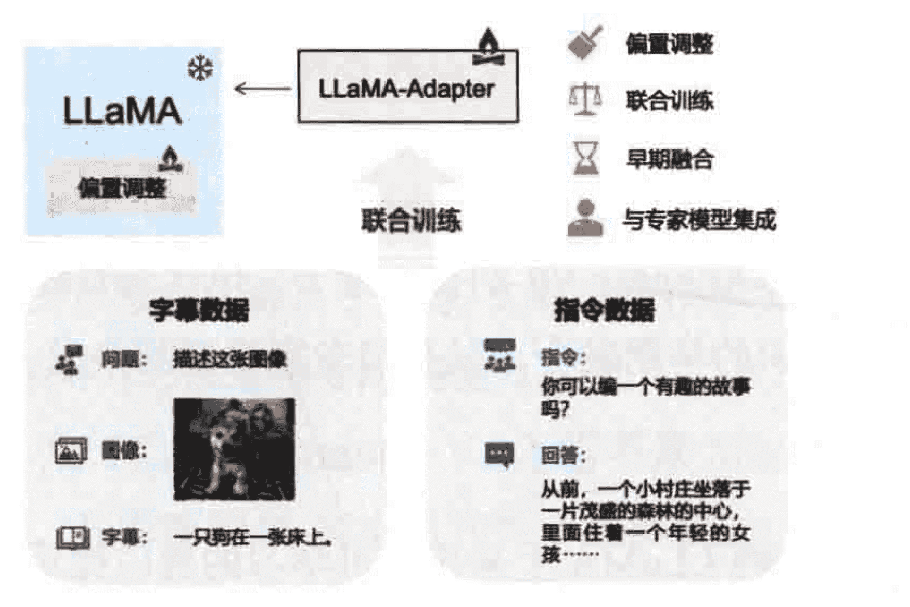

图 3.8 LLaMA-Adapter V2 的训练流程

一系列策略共同塑造了一个参数与性能兼顾的视觉指令模型，具备强大的多模态推理能力。

### 3.5.1 LLaMA-Adapter 的技术细节

- 零初始化注意力。LLaMA-Adapter [229] 冻结全部 LLaMA [31]，并加入约 120 万参数的轻量适配器。适配器作用于较高层 Transformer，并把一组可学习软提示作为前缀接在词标记前。为了让新知识逐步融入，提出零初始化注意力，通过学习一个初始为零的门控因子自适应控制适应提示的贡献。门控幅度随训练增长，早期保留语言生成能力，后期不断注入指令跟随能力。
- 简单多模态变体。除纯语言指令微调外，还可处理图像视频输入。如图像输入，使用 CLIP [2] 等预训练视觉编码器提取多尺度特征，聚合成全局视觉表征后经可学习投影层对齐语言嵌入空间，再逐元素加到较高层的适应提示中。ScienceQA 上表现具有竞争力。
- 开放式多模态推理。虽然能处理简单任务，但开放式生成能力尚不明确。研究从预训练于语言指令数据的 LLaMA-Adapter 开始，再在 COCO Caption [315] 上微调适配器与视觉投影层。结果显示新学到的视觉线索会主导适应提示，覆盖原有指令特性，这促使 LLaMA-Adapter V2 的提出。

### 3.5.2 LLaMA-Adapter V2

下面介绍偏置调整、不相交参数联合训练、视觉早期融合及专家集成等细节。

#### 1. 调整线性层的偏置

LLaMA-Adapter 仅更新适应提示与门控因子，无法修改 LLM 内部参数，限制深层微调。LLaMA-Adapter V2 提出偏置调整：除适应提示与门控外，还把指令能力融入 LLaMA 本体。具体做法是解冻所有归一化层，并在每个 Transformer 线性层额外增加一个偏置 $b$ 与一个比例因子 $s$ 作为可学习参数。设输入为 $x$、预训练权重为 $W$，修改后的计算如以下所示：

```
$y = W \cdot x \rightarrow y = s \cdot (W \cdot x + b), \quad b = \text{Init}(0), \, s = \text{Init}(1) \qquad (3.1)$
```

类比零初始化注意力，偏置与比例因子分别初始化为 0 与 1，保证训练初期稳定。结合高质量指令数据后指令跟随能力显著提升，新增参数仅占 LLaMA 总量的约 0.04%，保持高效。

该策略与 BitFit [316]、SSF [317] 等方法相近，但在 7 亿到 65 亿参数的 LLM 上展现效率。偏置调整为输入无关，与 LoRA 的输入感知低秩偏置不同，进一步降低微调成本。

#### 2. 实现不相交参数的联合训练

目标是同时获得长文本生成与多模态理解能力。如图 3.9 所示，联合训练范式同时利用 500K 图像-文本字幕与 50K 指令样本。两类数据量悬殊，直接混合会损害指令跟随。因此对图像-文本对齐与指令跟随采用不相交参数组分别优化：图像-文本字幕只训练视觉投影层及早期零初始化注意力与门控因子；指令跟随则使用后期适应提示、零门控、解冻归一化、新加偏置与比例因子，或可选的低秩适配 [241]。该分离避免了干扰，使视觉指令跟随更突出。

在该范式下，无需像 MiniGPT-4 [39]、LLaVA [294] 那样依赖高质量多模态指令数据，只需图像字幕与纯语言指令即可。字幕数据扩展图像理解，语言指令数据保持长篇生成能力。

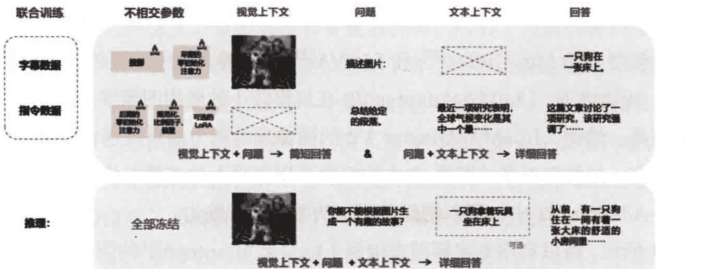

图 3.9 LLaMA-Adapter V2 中的联合训练范式

同时利用图像-文本标题和纯语言指令数据对 LLaMA-Adapter V2 进行联合训练，优化不相交的可学习参数组。

#### 3. 平衡视觉知识的早期融合

为避免图像与语言微调冲突，LLaMA-Adapter V2 采用早期融合。原版中图像提示经冻结的可学习投影编码后在每层叠加到适应提示。V2 改为把编码后的图像标记与适应提示注入不同 Transformer 层，如图 3.10 所示。适应提示仍按原方式放在最后 $L$ 层，例如 $L=30$。图像提示则直接与第一个带零初始化注意力的 Transformer 层的词标记拼接，而非叠加到适应提示。结合联合训练，该策略有效解耦两种微调目标，得到高效且强推理的模型。

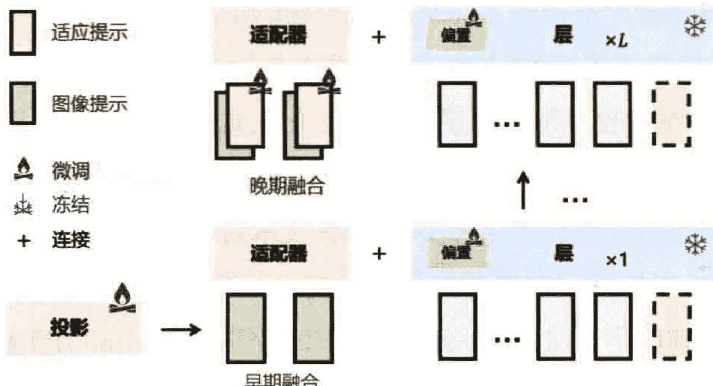

#### 4. 与专家模型的集成

## 小参数适配，专家来补位

MiniGPT-4 与 LLaVA 之类支持图文指令的方案，惯常做法是靠海量图文对把视觉编码器与大语言模型桥接起来。LLaMA-Adapter V2 走另一条路，只在规模不大的通用图像说明集上做微调，因此在数据利用效率上更有优势。代价是视觉理解能力相对吃紧，交互时容易出现偏差或脱离主题的回答。与不断堆砌图文数据或直接换更强多模态主干相比，在架构里引入专家组件来增强图像侧推理是更经济的选择。

图 3.11 展示的就是这种增强思路。面对一张输入图像，LLaMA-Adapter V2 先用预训练的视觉编码器完成内容编码，再请专家模型生成一段文字字幕作为补充。默认配置里担任专家的仍是 LLaMA-Adapter 本身，并在 COCO Caption 上完成预训练，能够输出简短且较为可靠的图像说明。

专家并不局限于此，任何图像到文本的模型乃至通用搜索引擎都能胜任。这种松耦合的设计让研究者在面对不同下游任务时可以便捷地切换专家。

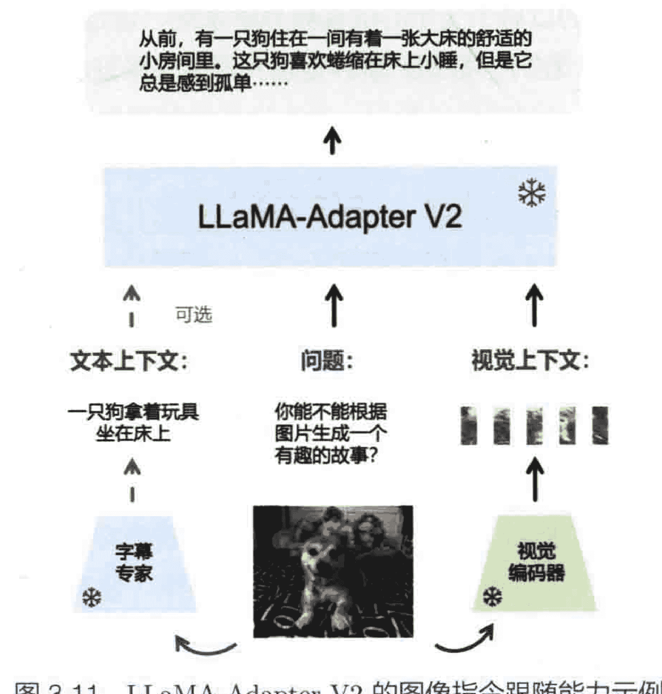

图 3.11 LLaMA-Adapter V2 的图像指令跟随能力示例

## 3.6 VideoChat

视频更接近人类持续感知的视觉体验，智能视频理解在人机交互、自动驾驶、智能监控等场景里需求明确。如今主流做法是对预训练的视频基础模型做特定任务微调，这在一定程度上限制了面向个性化需求的通用时空理解能力。

以视觉为核心的多模态对话已成研究热点。借助预训练的大语言模型、图像编码器以及可学习适配模块，这类系统能够解读图像内容，比如识别表情包梗，并通过多轮对话完成与图像相关的任务，应用面已经出现革新。但学界迄今尚未从数据层面系统化地解决围绕视频的任务处理问题。

现有以视频为中心的多模态对话系统，通常先用开源的分类、检测、字幕模型把视频转成文字，再映射为自然语言问答。对象和动作清晰的片段表现尚可，但把视频转写成文字不可避免地会丢失视觉细节并过度简化时空结构。几乎所有视觉模型在视频中的时空推理、事件定位与因果判断上都显吃力。

为此 VideoChat 提出了一个对话导向的视频理解系统，同时吸收视频与语言两端的领先技术。模型层面形成闭环，以可学习方式融合视频与语言基础模型；数据层面则补齐训练所需的全部要素。如图 3.12 所示，它是一个端到端的聊天式视频理解系统，通过可学习的神经接口把视频基础模型与大语言模型衔接，在时空推理、事件定位与因果推断上表现突出。

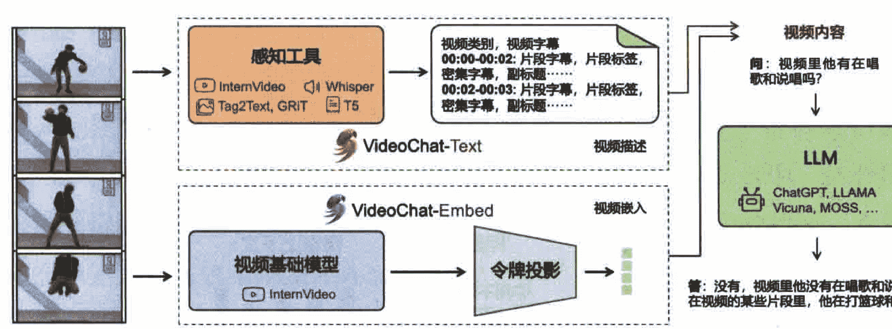

VideoChat-Text 把视频转成文本流，VideoChat-Embed 把视频编码成嵌入，两类视频表征都会送入 LLM 进行多模态理解

架构上，VideoChat 用可学习的神经接口把视频基础模型与大语言模型结合起来。在大规模视频文本集与自建视频指令集上开展双阶段轻量训练，只更新时空对齐与视频-语言对齐模块。指令集覆盖数千条视频，每条都配有详尽文本描述，以及由 ChatGPT 根据时序密集字幕合成的对话。数据刻意强调时空主体、动作、事件与因果关系，为视频对话系统提供宝贵训练资源。

VideoChat 把所有视频相关任务统一为多轮视频问答，任务在推理时由词语即时定义，训练时不提供实例或仅提供少量实例。在此设定下，大语言模型被视为通用的视频任务解码器，把视频的描述或嵌入转成人类可读文本，对各类应用都很友好。

具体而言，VideoChat 用视觉网络从视频里抽取概念，如下式所示：

$$[E]_i^j = f_{\text{img}}^j(I_i) \text{ 或 } E^j = f_{\text{vid}}^j(V) \text{ 当 } V = [I_i]_{i=1,2,\cdots,T} \text{ 时} \quad (3.2)$$

其中，E 代表上下文的文字说明或嵌入；f_img^j 代表第 j 个视觉网络，用于预测可读注释或视觉特征；I 与 V 分别代表图像与视频。VideoChat 根据用户的问题从大语言模型中解码预测任务，如下式所示：

$$W_t^a = f_{\text{llm}}(E|W_{\leq t}^q, W_{<t}^a) \quad (3.3)$$

其中，W_t^a 与 W_≤t^q 分别代表在第 t 轮由大语言模型给出的答案与第 t 轮之前用户提出的所有问题，f_llm 代表大语言模型。

从技术角度看，理想的端到端聊天式视频理解系统，应借助视频或视觉基础编码器把视觉序列映射为大语言模型的潜在特征，保证整体可微。VideoChat-Text 验证了大语言模型作为通用视频任务解释器的可行性。该方法先用多种开源视觉网络把视频转为文本流，再交由大语言模型做判别或推理。虽然能处理典型的时空任务如空间和时间感知，但对复杂的时间推理和因果推断仍显不足。为此 VideoChat 推出 VideoChat-Embed，这是一个融合视频与语言基础模型的端到端多模态系统，经视频指令数据微调后，在更高阶的时间任务上性能明显提升。

### 3.6.1 VideoChat-Text

先用若干视觉网络把视频视觉数据转为文字，再用特定提示在时间轴上结构化预测文本，最后让预训练的大语言模型通过回答基于视频文本描述的问题来完成用户指定的任务。

给定视频后，VideoChat 先用 FFmpeg 以低帧率抽取关键帧，得到 T 个视频帧和对应音频。把帧和音频送入各网络，可得到动作标签、帧摘要、视频标签、综合描述、物体位置坐标、视频叙事、时间戳等片段级细节。随后结合时序信息把相关内容整合成带时间戳的文本描述。先介绍所用视觉网络和提示框架，再分析 VideoChat-Text。

#### 1. 感知模型

借助视频和图像网络的组合，VideoChat 从动作、带位置标注的物体等多个角度解析视频。各网络输出相对独立，VideoChat 用预训练的 T5 网络对描述做优化以提升清晰度。此外，VideoChat-Text 还整合 Whisper 语音识别，充分利用视频音频，进一步丰富描述。

#### 2. 提示系统

作者先用感知网络获取片段的动作类别、片段/视频字幕及密集字幕和字幕条，再按模板组织生成文本化视频描述（如图 3.13 所示）作为大语言模型输入。为大语言模型提供的背景提示会告诉它先通过 VideoChat 提供的格式化文本观看给定的视频，再基于结构化视频知识与之交流，该背景提示由图 3.14 实现。

多模态大模型：新一代人工智能技术范式

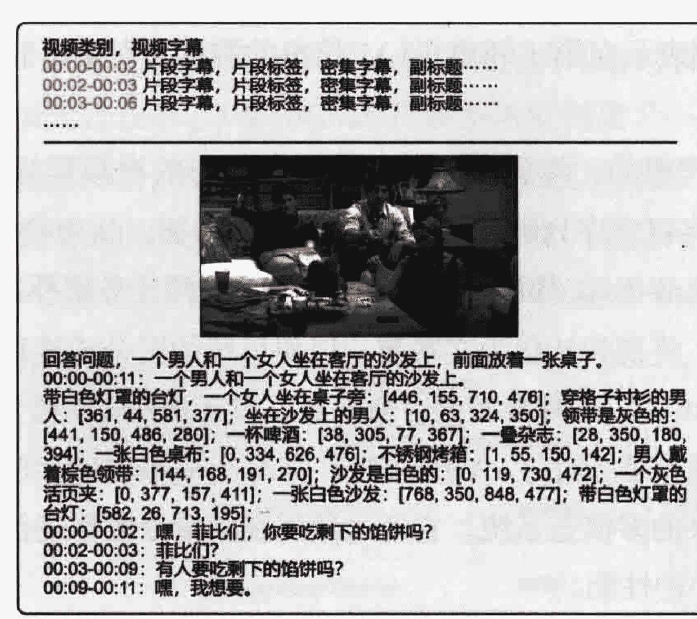

图 3.13 使用感知模型的视频描述

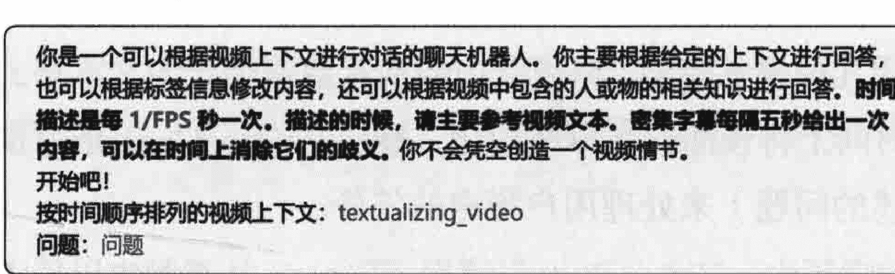

图 3.14 系统提示

这段描述让 LLM 能够理解视频文本，并根据文档中相关的内容进行回答，避免回答与视频无关的问题

得益于轻量感知网络，VideoChat-Text 能以 1 FPS 把视频转成带时间戳的文本，在 NVIDIA-A10 GPU 上处理 10s 片段约需 2s。交流由大语言模型完成。但文本媒介限制了感知网络的表达能力，因为解码器被约束在语言空间。要给大语言模型更丰富的视觉信息，需要更强的感知网络，这又会和 VideoChat-Text 的效率冲突。此外，其潜力也受制于主流视觉指令微调方法的局限。

### 3.6.2 VideoChat-Embed

VideoChat-Embed 是一个端到端视频对话模型。结构如图 3.15（a）所示，由视频和语言基础模型加可学习的视频-语言 Token 接口 VLTI 组成。整体基于 BLIP-2 和 StableVicuna，训练分对齐阶段和指令调优阶段。受文献启发，为更好跨模态优化，模型采用语言友好的视频基础模型。考虑到视频冗余，VLTI 用交叉注意力压缩视频 Token，通过视频文本数据微调实现视频到语言表示的对齐，最后把视频 Token、用户查询和对话背景一起送入大语言模型。

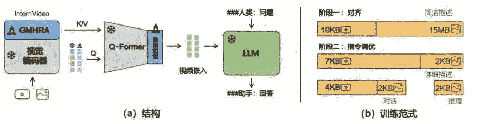

#### 1. 结构

VideoChat-Embed 基于 BLIP-2 和 StableVicuna 实现。具体而言，视频侧用预训练的 ViT-G 配合全局多头关系聚合器 GMHRA，GMHRA 是 InternVideo 和 UniFormerV2 中的时间建模模块。Token 接口采用预训练 Q-Former，并补充线性投影，同时加入额外查询 Token 以建模视频背景，使模型能得到适合大语言模型的紧凑视频嵌入。

训练时除新引入的 GMHRA、查询和线性投影外，其余参数基本冻结。受文献启发，VideoChat 还引入图像数据联合训练。首阶段用大规模视频文本微调把视频编码器与大语言模型对齐。次阶段用两种视频指令数据调优系统：深入视频描述和视频问答对。下面介绍指令数据的生成过程和双阶段训练细节。

#### 2. 指令数据

以 WebVid-10M 为基础构建视频中心的多模态指令集。对应的详细描述和问答由 ChatGPT 结合视频文本 借助 VideoChat-Text 生成，并使用若干时空特征提示。与详细描述相比，视频对话进一步提升了指令数据的多样性、时态和因果特征。

详细视频描述方面，VideoChat 用 GPT-4 把提供的视频描述浓缩成一段视频叙事，突出随时间进展。相关提示见图 3.16 和图 3.17。第一个提示把各预测文本标签转成连贯演进的故事，第二个提示对叙事做精炼以提高清晰连贯性并减少虚构。共从随机视频中生成 7,000 条描述。使用示例见图 3.18。

多模态大模型：新一代人工智能技术范式

> 给你一个生成 origin_caption 的视频。按时间顺序排列的视频内容是 textualizing_video。请用顺序副词“首先”、“接下来”、“然后”和“最后”来详细描述这段视频，但不要提及具体时间。尽可能多地给出细节。把你看到的都说出来。描述应该在150字以上，200字以内。

图 3.16 详细的视频描述的提示

origin_caption 是由 VideoChat-Text 生成的

> 修正给定段落中的错误。删除任何重复的句子、无意义的字符、非英文句子等。删除不必要的重复。重写不完整的句子。直接返回结果，不做任何解释。如果输入的段落正确，则直接返回，不做任何解释。

图 3.17 后处理的提示，从 MiniGPT-4 复制而来

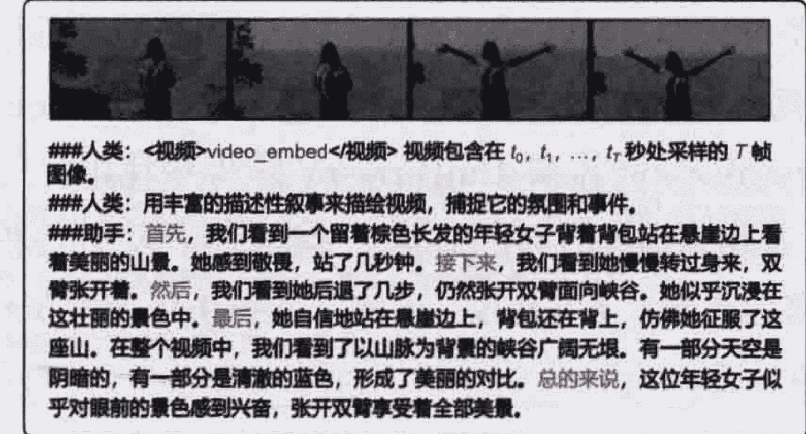

图 3.18 使用详细的视频描述的示例

#### 3. 双阶段训练

受 MiniGPT-4 和 LLaVA 启发，VideoChat 设计双阶段联合训练范式，既能利用现有图像指令数据，又能构建兼顾图像和视频、具备空间感知与推理能力的系统。

首阶段：对齐。为平衡收敛与效率，使用 2,500 万视觉-文本对微调。数据包括 WebVid-10M 的 1,000 万视频-文本对，以及 COCO Caption、Visual Genome、SBU Captions、CC3M 和 CC12M 的 1,500 万图像-文本对。语言模型输入提示如下：

```
“###Human: <Video>video_embed</Video> video_instruction ###Assistant:”
“###Human: <Image>image_embed</Image> image_instruction ###Assistant:”
```

其中，video_embed 和 image_embed 为 Token 接口输出；video_instruction 和 image_instruction 从预定义指令表随机抽样得到简洁的视频和图像描述。语言模型以对应的视觉描述作为回答。

次阶段：指令调优。自建视频指令数据包含 7,000 条详细视频描述和 4,000 条视频对话。为提升空间感知与推理，还收集 MiniGPT-4 的 3,000 条详细图像描述、2,000 条图像对话，以及 LLaVA 的 2,000 条图像推理任务。共 18,000 条数据上进行 3 轮训练。视频数据里包含时序推理采样信息：该视频包含在 t0, t1, … t_T 秒处抽样的 T 帧图像。

## 3.7 SAM

基于大规模网络数据的预训练大语言模型正以强大的 Zero-shot 和 Few-shot 泛化能力重塑自然语言处理。训练时，这些“基础模型”能在未见任务和数据分布下泛化，通常靠提示工程实现，即用手工文本提示语言模型生成针对当前任务的有效回复。随着规模化训练，Zero-shot 和 Few-shot 性能可与微调模型相当，现象随模型规模、数据量和训练计算提升而增强。

基础模型在计算机视觉领域也有探索，最典型的是基于网络文本-图像对的对齐。例如 CLIP 和 ALIGN 用对比学习训练文本和图像编码器，使其相互对齐。训练完成后，精心设计的文本提示即可实现对新视觉概念和数据分布的 Zero-shot 泛化，且编码器可与其他模块组合支持后续任务如图像生成，例如 DALL·E。尽管视觉-语言编码取得很大进展，计算机视觉问题远不止于此。

SAM 的目标是为图像分割构建基础模型，即开发可提示模型，在广泛数据上预训练以实现强泛化。通过提示工程，SAM 可解决新数据分布上的系列分割问题。成功依赖三要素：任务、模型和数据。为实现 SAM，需回答关于图像分割的几个关键问题。

- （1）哪个任务能实现 Zero-shot 泛化？
- （2）对应的模型结构是什么？
- （3）哪些数据能支撑任务和模型？

三者相互交织，需要整体方案。SAM 通过定义一个足够通用的可提示分割任务来解决这些问题，该任务既能提供强大的预训练目标，又支持广泛后续应用。任务还需一个支持灵活提示、被提示时能实时输出分割掩码的模型，便于交互使用。为训练模型，SAM 需要多样化的大规模数据集。不幸的是，目前并无大规模网络分割掩码数据集；为此 SAM 构建数据引擎，在数据收集过程中反复用高效模型辅助采集，并利用新数据改进模型。

（1）任务。在 NLP 和 CV 领域，基础模型可通过提示技术在新数据集和任务上做 Zero-shot 和 Few-shot 学习。受相关工作启发，SAM 提出可提示的分割任务，目标是在给定分割提示的情况下返回有效分割掩码（如图 3.19（a）所示）。SAM 将可提示分割既用作预训练目标，也通过提示工程完成通用的后续分割任务。

**SAM 与 PaLM-E：可提示分割与具身推理的底层逻辑**

（2）**模型**。可提示分割的使用场景和实时交互需求，给模型结构带来了三重约束：要支持灵活的提示方式、要在成本分摊的前提下实时算出掩码、还要具备处理歧义的能力。SAM 的团队发现，一个看似简洁的组合就能同时满足这三点：先用一个强力的图像编码器把整张图映射成嵌入，再用提示编码器把各种提示转成嵌入，最后让轻量级的掩码解码器把两路信息融合并输出分割结果。这个体系被命名为 Segment Anything Model。把工作拆成图像编码、快速提示编码和掩码解码三部分后，同一张图的图像嵌入可以被反复复用，成本被摊薄。在图像嵌入准备好的情况下，提示编码和掩码解码在网页浏览器里约 50 毫秒就能完成一次预测。SAM 原生支持点、框、掩码提示，并初步展示了自由文本提示的效果。为了应对歧义，模型允许对同一个提示输出多个候选掩码，从而自然地容纳不确定的情况。

（3）**数据引擎**。要在新分布上保持强泛化，必须用远超现有分割集的海量多样掩码进行训练。基础模型常用的在线采数据方式掩码稀疏，SAM 选择另辟蹊径，自建一个参与模型迭代的数据标注流水线，如图 3.19（c）。流水线分三步走：先是模型辅助的人工标注，再是半自动标注，最后是全自动生成。第一阶段里 SAM 充当交互式分割的助手，帮助标注者高效勾勒掩码。第二阶段中 SAM 会主动提出可能的目标位置并自动生成部分掩码，人工只需补齐剩余目标以提升多样性。第三阶段则用规则的前景点网格去提示模型，平均每张图能稳定产出约 100 个高质量掩码。

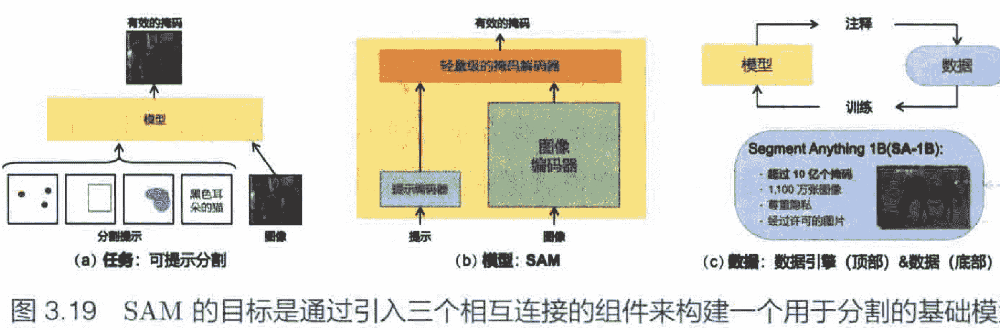

（4）**数据集**。最终沉淀的 SA-1B 包含超过 10 亿个掩码，来源是 1,100 万张已获隐私许可的图像，如图 3.20。全部掩码均由 SAM 全自动生成，质量高且多样。为便于展示，图像按每图掩码数分组，平均约 100 个 / 图。通过数据引擎最后阶段全自动收集，掩码总量比此前最大的分割数据集多出约 400 倍。除了用来训练 SAM 提升鲁棒性和泛化，SA-1B 也可作为构建新基础模型的宝贵资源。

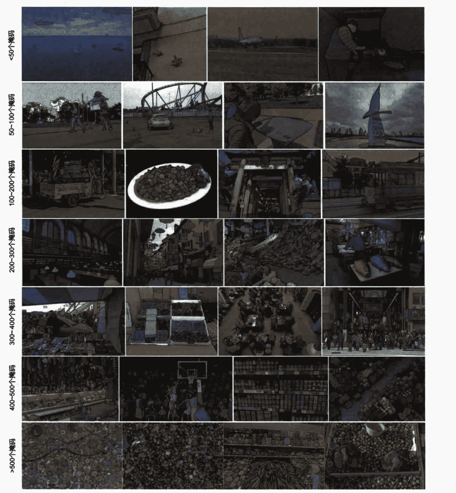

### 3.7.1 SAM 任务

SAM 的预训练思路借鉴了下一个 Token 预测，并通过提示工程迁移到下游分割任务。为了建立可分割的基础模型，首先要定义一个具备相似能力的任务。

（1）任务。SAM 把自然语言处理里的提示概念搬到分割领域，提示可以是前景/背景点集合、粗略框、掩码、自由文本，或任何能指示图像中分割区域的信息。可提示分割的定义是：给定任意提示，返回一个可用的分割掩码。这里的“可用”是指即使提示模糊、指向多个物体，也至少能对其中一个物体给出合理的掩码，类似语言模型对模糊输入给出连贯回应的要求。选用这个任务是因为它天然对应一个预训练算法，也能通过提示实现零样本下游迁移。

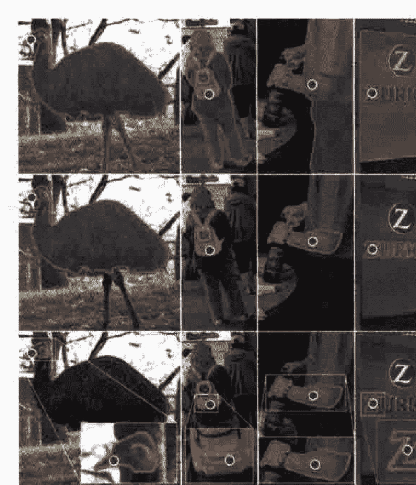

（2）预训练。可提示分割对应一个预训练流程：对每个训练样本模拟一系列提示，再把模型预测与真实掩码对比。SAM 在交互式分割的思路上做了改造。交互式分割追求的是在足够多的用户反馈后最终得到一个正确掩码，而 SAM 要求对任何提示都立刻给出可用掩码，哪怕提示模糊。这种设计保证了模型在存在歧义的场景下依然有效，也正是数据引擎自动注释所依赖的能力。

（3）Zero-shot 泛化。该预训练让模型在推理时学会对任意提示作出合理响应，下游任务只需用合适的提示即可完成。

（4）**相关任务**。分割家族十分庞大，包括交互式分割、边缘检测、超像素、目标候选区生成、前景分割、语义分割、实例分割、全景分割等。提示式能力属于任务泛化的一种。与以往的多任务分割系统不同，后者用单一模型完成固定任务集合，训练与测试任务一致；而经过提示分割训练的模型可在推理时作为更大系统的组件执行全新任务。

### 3.7.2 SAM 的视觉模型结构

SAM 共由三部分组成，如图 3.22。一个重量级的图像编码器产出可被各种提示高效查询的图像嵌入；面对模糊提示时可输出多个有效掩码并附带置信度。整体基于 Transformer 视觉架构，并做了成本分摊与实时性的权衡。

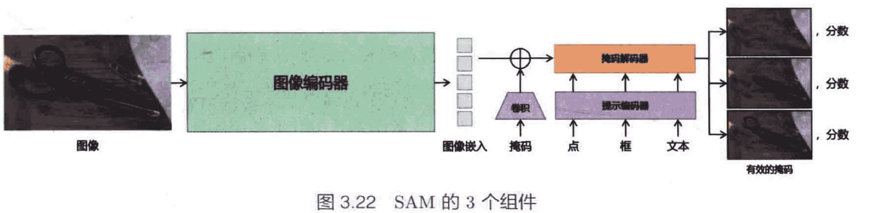

（1）**图像编码器**。受可扩展性和强预训练启发，SAM 采用掩码自编码器预训练的 ViT，并做最小改动以适配高分辨率输入。编码器每图只运行一次，可在提示前完成。

（2）**提示编码器**。提示分为稀疏类点、框、文本和密集类掩码。点和框用位置编码表示并与对应类型的可学习嵌入相加；自由文本则直接调用 CLIP 的现成文本编码器。密集提示经卷积嵌入后与图像嵌入逐元素相加。

（3）**掩码解码器**。解码器把图像嵌入、提示嵌入和输出 Token 映射到掩码，受文献启发在标准 Transformer 解码器模块后接动态掩码预测头。改造后的解码块在提示嵌入与图像嵌入之间双向进行提示自注意力和交叉注意力更新。经过两层解码模块后，图像嵌入上采样，再用 MLP 把输出 Token 映射为动态线性分类器，在每个像素位置计算前景概率。

（4）**解决模糊**。单输出时，模糊提示会导致多个有效掩码被平均。为此 SAM 支持对单提示预测多掩码，如图 3.21。实践中 3 个输出已能覆盖多数情况，对应嵌套掩码最多三层：整体、部分和子部分。训练时只回传损失最小的掩码梯度，同时为每个掩码预测置信度以便排序。

（5）**效率**。在预计算图像嵌入的前提下，提示编码和掩码解码可在浏览器 CPU 上约 50 毫秒完成，足以支撑无缝实时交互。

（6）**损失和训练**。掩码监督采用 Focal 损失与 Dice 损失的线性组合。可提示分割训练使用混合几何提示，并按文献模拟交互过程，每掩码随机采样 11 轮提示，便于与数据引擎衔接。

### 3.7.3 SAM 的数据引擎

互联网上分割掩码并不丰富，为收集 11 亿掩码的 SA-1B，SAM 搭建了三阶段数据引擎：模型辅助人工、半自动混合、全自动生成。

（1）**模型辅助手动标注阶段**。专业标注团队使用基于浏览器的交互式分割工具，通过点选前景/背景点并用画笔、橡皮擦精修来标注掩码。借助预计算的图像嵌入，标注可在浏览器内实时进行。标注不设语义限制，可标注“物质”与“事物”，建议按可命名原则标注但不收集名称，要求按显著性顺序标注。初期用公开分割集启动训练，数据积累后仅用新标注掩码重训。随着数据增长，编码器从 ViT-B 扩展到 ViT-H，结构细节也不断演进，共重训 6 次。单掩码平均标注时间从 34 秒降至 14 秒，比 COCO 快约 6.5 倍；每图平均掩码数从 20 增至 44。该阶段累计从 120 万张图收集 430 万掩码。

（2）**半自动阶段**。目标是提升掩码多样性。SAM 先自动筛选高置信度掩码，展示给标注者后让其专注补充未标注目标。高置信掩码通过在第一阶段掩码上训练通用“物体”类边界框检测器获得。此阶段在 18 万张图上额外收集 590 万掩码，累计达 1,020 万。共重训 5 次。单掩码平均标注时间回升至 34 秒，不含自动部分，因目标更具挑战；每图平均掩码数升至 72，含自动部分。

（3）**全自动阶段**。得益于足够数据带来的性能提升和歧义感知能力的完善，标注可完全自动化。具体做法是用 32×32 的规则点网格提示模型，每点预测一组可能掩码。歧义感知模型能对点落在部分或子部分时返回子部分、部分或整体。为保证稳定性，仅保留阈值 0.5 ± τ 内变化不大的掩码，再按置信度和稳定性筛选后做非极大值抑制去重。为提升小目标质量，还会裁剪重叠的放大图。该流程作用于 1,100 万张图，产出 11 亿高质量掩码。

### 3.7.4 SAM 的数据集

SA-1B 由 1,100 万张多样、高分辨率、已获许可且保护隐私的图像及经数据引擎收集的 11 亿高质量掩码组成，并与现有数据集做对比分析。

（1）**图像**。图像来自与摄影师直接合作的供应商，使用许可齐全。高分辨率带来存储与访问挑战，故公开版本将最短边降采样至 1,500 像素。即使降采样后，分辨率仍远高于 COCO 约 480×640 像素。

（2）**掩码**。共 11 亿掩码，其中 99.1% 为全自动生成。自动掩码质量足以支撑训练，SA-1B 仅保留自动结果。

（3）**掩码质量**。随机抽样 500 张图约 5 万个掩码，由标注者用画笔和橡皮擦进行人工修正以评估质量。

（4）掩码属性。图 3.23 展示 SA-1B 物体中心空间分布与最大现有分割集的对比。所有集均存在摄影师偏见。SA-1B 与 LVIS v1、ADE20K 分布最相似，但在图像角落覆盖更广；COCO 与 Open Images V5 更偏中心。SA-1B 的图像数是 Open Images 的 11 倍，掩码数多 400 倍。凹凸性分布与其它数据集相近。

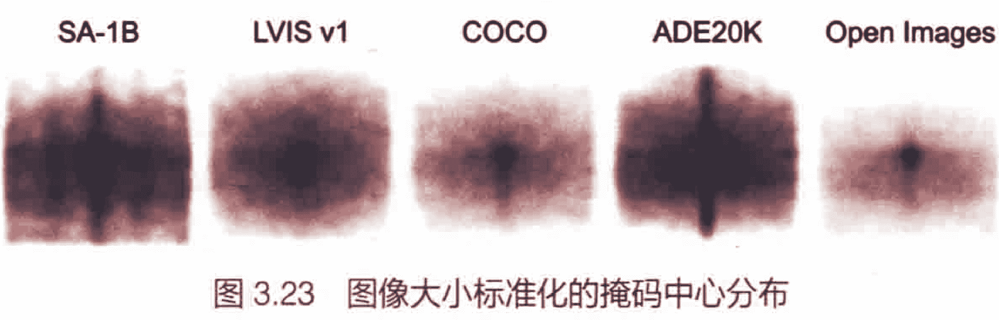

## 3.8 PaLM-E

大语言模型在对话、逐步推理、数学求解、代码编写等方面展现强推理，但现实世界推理受制于 grounding 问题：大规模文本训练产生的表征需与视觉和物理传感器模态连接，才能解决计算机视觉和机器人中的现实问题。先前工作把 LLM 输出与学习到的机器人策略结合，但受限于仅文本输入，且几何配置在很多任务中关键。现有顶尖视觉-语言模型多在视觉问答等任务上训练，难以直接完成机器人推理。

LLM 已被证明可执行复杂任务。谷歌提出具身语言模型 PaLM-E，把连续传感器模态直接融入语言模型，建立词语与感知的联系。其输入是交织视觉、连续状态估计和文本编码的多模态句子。结合预训练 LLM，PaLM-E 在机器人任务规划、视觉问答、字幕生成等多具身任务上训练。这一大型具身多模态模型可处理来自多种观察模态、涉及多个实体的具身推理任务，并表现出积极迁移：受益于互联网规模语言、视觉和视觉-语言联合训练。

PaLM-E-562B 为系列最大模型，参数 562B，整合 540B 参数的 PaLM 语言模型与 22B 参数的 ViT 视觉模型。除机器人训练外，它也是视觉-语言模型，在 OK-VQA 上取得最先进性能，且随规模增大仍保持通用语言能力。

PaLM-E 直接把具身 Agent 的传感器连续输入融入语言模型，使其能在现实世界中进行更强推理与序列决策。图像和状态估计等输入被嵌入到与语言标记相同的潜在空间，并以相同方式进入 LLM 自注意力，如图 3.24。PaLM-E 在多模态句子上运行，任意模态输入如图像、神经 3D 表示或状态，与文本标记一起输入端到端训练的 LLM。这些编码器输出自然文本形式的序列决策，可由具身 Agent 解释，通过调节低级策略决策或回答问题。研究评估了多任务训练方法，比较了标准 ViT 编码与面向对象的 ViT 编码，探讨冻结与微调语言模型的影响，以及多任务联合训练能否实现迁移。


谷歌把 PaLM-E 扩展至 562B 参数，将 540B 参数的 PaLM 与 22B 参数的 ViT 整合。PaLM-E-562B 在 OK-VQA 基准上领先，无需任务特定微调。仅在单一图像示例上训练，仍展现强能力，如图 3.25。它能做零样本多模态思维链推理，给定图像讲视觉笑话，并展示一系列机器人相关多模态能力，包括感知、基于视觉的对话和规划。PaLM-E 还能从单图提示零样本泛化到多图提示，可在图像中嵌入手写数字并做数学计算，也能在带时间标注的主观视角图像上做零样本问答，全部以端到端方式在一个模型中实现。

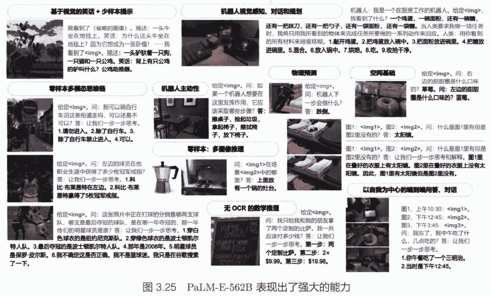

### 3.8.1 模型结构

PaLM-E 的核心思想是把连续具身观察如图像、状态估计等注入预训练语言模型的语言嵌入空间。连续观察被编码为与语言 Token 嵌入维度相同的向量序列，以类似语言 Token 的方式注入。PaLM-E 为仅解码器的 LLM，按前缀或提示自回归生成文本，因其基于 PaLM 并赋予具身特性而得名。

输入由文本和多个连续观察组成，多模态标记与文本交错形成多模态句子。输出为模型自回归生成的文本，可作回答或决策序列文本，由机器人执行。涉及决策或规划任务时，研究者假设存在基础策略或规划器把这些决策转为低级动作。先前研究已讨论此类基础策略的训练方法，PaLM-E 可直接使用。

（1）纯解码器大语言模型。Decoder-only 结构本质上是一个自回归生成器，学习目标是为一段标记序列 $w_{1:L} = (w_1,w_2,\cdots,w_L)$，$w_i\in\mathcal{W}$，估计其联合概率 $p(w_{1:L})$。在实现上通常采用链式分解：
$p(w_{1:L}) = \prod_{l=1}^{L} p_{\text{LM}}(w_l | w_{1:l-1})$  
(3.4)
其中 $p_{\text{LM}}$ 由大型的 Transformer 网络建模。

（2）前缀解码器大语言模型。因为自回归特性，预训练语言模型可在不改动结构的前提下以前缀 $w_{1:n}$ 为条件继续生成：
$p(w_{n+1:L} | w_{1:n}) = \prod_{l=n+1}^{L} p_{\text{LM}}(w_l | w_{1:l-1})$  
(3.5)
前缀或提示 $w_{1:n}$ 提供了上下文，模型据此预测后续标记 $w_{n+1:L}$。该机制常被用于推理引导。

（3）词元嵌入空间。词元 $w_i$ 来自有限的固定词表 $\mathcal{W}$，对应自然语言中的子词单元。模型通过映射 $\gamma:\mathcal{W}\rightarrow\mathcal{X}$ 把词元投到词嵌入空间 $\mathcal{X}\subset\mathbb{R}^k$，即 $p_{\text{LM}}(w_l|\boldsymbol{x}_{1:l-1})$，其中 $\boldsymbol{x}_i=\gamma(w_i)\in\mathbb{R}^k$。$\gamma$ 通常是一个 $k\times|\mathcal{W}|$ 的嵌入矩阵，并端到端训练。PaLM-E 中 $|\mathcal{W}|=256,000^{[21]}$。

（4）多模态句子与连续观测注入。图像等连续模态信息可绕过离散词元，直接映射到语言嵌入空间 $\mathcal{X}$ 进行融合。可训练编码器 $\phi:\mathcal{O}\rightarrow\mathcal{X}^q$，把连续观测空间 $\mathcal{O}$ 转成 $q$ 个向量，再与文本嵌入交错构成 LLM 的前缀。于是前缀中每个向量 $\boldsymbol{x}_i$ 来源有二：
$\boldsymbol{x}_i = \begin{cases} \gamma(w_i), & i \text{ 为文本 Token}\\ \phi_j(O_j)_i, & i \text{ 对应观测 } O_j \end{cases}$  
(3.6)
单个观测 $O_j$ 常被编码为多个向量。不同编码器 $\phi_i$ 可在前缀不同位置交错使用，以融合多源观测。如此注入连续信息可复用原有的位置编码。与文献 [364] 等方法不同，观测嵌入并非固定位置插入，而是动态地嵌入在周边文本中。

（5）具身输出与控制回路。PaLM-E 与具身系统的对接分两种情形。若任务仅需文本输出，则输出即为解。另一情形用于具身规划或控制，模型生成条件化基础指令的文本。假设存在一个小型词表可执行的基元技能策略，PaLM-E 的规划成功意味着技能序列的串联。模型需自行从训练数据和提示中推断可用技能，无额外限制或过滤机制。尽管策略是语言条件化的，单一策略无法完成长期复杂指令。因此 PaLM-E 被嵌入控制循环：预测的决策由机器人基元策略执行，执行后产生新观测，PaLM-E 据此重新规划。由此可视为一个高级策略，对基元策略进行编排与调度。

### 3.8.2 多源感知与场景编码
本节说明 PaLM-E 中各模态的接入方式及对应编码器设计。为每个编码器 $\phi:\mathcal{O}\rightarrow\mathcal{X}$ 选择不同结构，将相应模态映射到语言嵌入空间。研究者考察了状态估计向量、用于二维图像的视觉 Transformer ViT$^{[299,364-365]}$，以及用于三维感知的对象场景表征 Transformer OSRT$^{[366]}$。除整体场景编码外，还探索了以对象为中心的分块表征，将观测拆分为场景中个体对象的标记。

（1）**状态估计向量**。来自机器人或物体状态估计的向量是最直接的输入形式。设 $s\in\mathbb{R}^S$ 描述场景对象状态，可包含位姿、尺寸、颜色等。MLP $\phi_{\text{state}}$ 将 $s$ 映射到语言嵌入空间。

（2）**视觉 Transformer**。ViT $\phi_{\text{ViT}}^{[299]}$ 把图像 $I$ 映射为一系列嵌入 $x_{1:m}=\phi_{\text{ViT}}(I)\in\mathbb{R}^{m\times k}$。已尝试多种变体，包括文献 [364] 中 40 亿参数的 ViT-4B 和 220 亿参数的 ViT-22B$^{[84]}$，均在图像分类上预训练。另有 ViTToken 学习器 ViT + TL$^{[365]}$，从零训练。ViT 嵌入维度 $k$ 不一定等于语言模型维度，需经仿射变换投影 $x_i=\phi_{\text{ViT}}(I)_i=\psi(\phi_{\text{ViT}}(I)_i)$，$\psi$ 可学习。

（3）**以对象为中心的表征**。视觉输入不像语言天然结构化为实体与关系，ViT 虽能捕捉语义，表示更像静态网格而非对象集合。因此探索结构化编码器，在注入 LLM 前先将视觉输入拆分为不同对象。

（4）**对象场景表征 Transformer OSRT**。OSRT$^{[366]}$ 不依赖标注分割，通过架构归纳偏置在无监督下发现对象$^{[367]}$。基于 SRT$^{[368]}$，OSRT 在领域数据上通过新视图合成任务学习三维神经场景表征。该表征包含对象槽 $o_j=\phi_{\text{OSRT}}(I_{1:v})_j\in\mathbb{R}^k$，$v$ 为视图数。每槽经投影 $x_{1:m}^j=\psi(\phi_{\text{OSRT}}(I_{1:v})_j)$，$\psi$ 为多层感知机。注意单个对象通常被分解为多个向量，即 $\psi:\mathbb{R}^k\rightarrow\mathbb{R}^{m\times k}$。

（5）**实体引用**。具身规划需在生成的计划中指代对象。大多数实验里，对象可用自然语言的独特属性识别。当语言难以区分时，如桌上多个同色方块，按对象中心表征，PaLM-E 会在提示中为对象分配多模态标记：对象1 为 <obj_1>，…，对象 $j$ 为 <obj_j>。模型即可通过生成句中特殊标记 obj_j 引用对象。此时假设基元策略同样能处理这些标记。

### 3.8.3 训练方法
PaLM-E 在数据集 $D=\{(I_{1:u_i}^i,w_{1:L_i}^i,n_i)\}_{i=1}^N$ 上训练，每个样本含 $u_i$ 个连续观测 $I_j^i$、文本 $w_{1:L_i}^i$ 和索引 $n_i$。为形成多模态句子，文本中设有特殊标记，其位置被编码器嵌入替换。解码器以预训练的 8B、62B、540B 参数 PaLM 变体为基础，通过输入编码器注入连续观测。编码器可预训练也可从头训练。8B LLM 配 4B ViT 称为 PaLM-E-12B；62B LLM 配 22B ViT 称为 PaLM-E-84B；540B LLM 配 22B ViT 称为 PaLM-E-562B。

（1）**模型冻结变体**。PaLM-E 包含编码器 $\phi$、投影器 $\psi$ 与语言模型 $p_{\text{PLM}}$ 三部分。训练时可全部更新。鉴于 LLM 在合适提示下展现强推理能力，研究者探讨冻结 LLM 仅训练输入编码器的效果，并比较不同模态编码器。此时编码器需产生使冻结 LLM 能从观测中获取具身信息的嵌入。可被视作输入条件的软提示形式$^{[169]}$，与常规软提示$^{[80]}$相关。

（2）**跨任务联合训练**。实验在多样化数据上联合训练，主要为大规模视觉-语言数据。具身数据采样占比约 8.9%，且每个具身主体包含多任务。

### 3.9 小结
本章介绍了多模态基础模型的代表，包括 CLIP、BLIP、BLIP-2、LLaMA、LLaMA-Adapter、VideoChat、SAM 与 PaLM-E。这些模型为后续多模态应用提供了强有力的支撑。

# 4 多模态大模型典型应用
随着多模态大模型技术演进，其在多个领域落地，视觉问答、AIGC、具身智能等任务上表现突出。模型性能提升伴随规模增长，对算力和设计复杂度提出更高要求，数据配对需求上升，整合难度加大。本章梳理多模态大模型典型应用的最新走向并讨论通用技术范式。具体聚焦视觉问答、AIGC 与具身智能三大方向，并指出当前难题与未来研究方向。

## 4.1 视觉问答任务
视觉问答 Visual Question Answering，VQA[369-370] 是连接计算机视觉与自然语言处理的基础任务。典型设定为给定一张图像和一个关于该图像的文本问题，模型需给出用词或短语表达的正确答案。形式包括二元问答和多选问答。关键区别在于运行时问题未知；传统分割、检测等任务问题预先确定，仅输入变化。VQA 中问题形式与所需操作集合皆不固定，涉及通用图像理解。与文本问答相关，后者答案在特定文本或知识库中查询。图像比纯文本维度更高、噪声更多，缺乏语言的语法结构和解析工具，且蕴含更丰富的现实信息。语言则提供更高层次抽象。VQA 的快速发展得益于两大领域技术成熟与大规模数据集。VQA 比图像描述更复杂，常需图像外信息，如常识或百科知识。它是真正完备的 AI 任务，需跨子领域的跨模态知识，并在信息整合后推理出答案。

### 4.1.1 视觉问答的分类
构建 VQA 需要强大的视觉语言表示与推理能力。应用已扩展到医疗、机器人等。医疗 VQA 需回答医学影像如 CT 扫描相关问题。机器人相关 VQA 要求 Agent 回答当前视野外物体的问答，即需先导航再回答，被称为具身 VQA。

从数据角度可分为图像问答与视频问答。

（1）基于图像的问答模型仅接受静态图像。常用 VQA[369] 和 VQA 2.0[371] 使用 MS COCO[315] 图像，覆盖丰富场景。COCO-QA[372] 与 Visual7W[373] 同样基于 COCO。GQA[374] 使用从 Visual Genome[329] 挑选的有上下文图像。其他基于图像的数据集[375] 来自合成图像，如卡通风格的抽象 VQA、基于三维合成图像的 CLEVR[376]。特定来源的数据集包括医学 VQA[377] 使用 CT、X 射线、超声等，Text-VQA[378] 要求识别图像中的 OCR 文本。具身 VQA 输入为三维合成模型渲染的图像。

（2）基于视频的问答[379-381] 需回答关于视频的问题，挑战更高。需处理长序列图像的视觉与运动上下文，并具备时间推理能力。

按任务设置分类，最常见的是开放问答，无候选答案，主要涉及外观属性如颜色、数量、类别。例如广泛使用的 VQA[369] 与 VQA 2.0[371]。

部分问题需依赖常识，KBVQA[382]、FVQA[383]、OKVQA[384] 属此列。测试时仅给图像与问题，模型需从知识库检索。例如“图像中有多少哺乳动物”，需先知道哪些动物属于哺乳类。除知识推理，还有组合推理，如 CLEVR[376] 设计链式与树状推理问题，如“有多少个圆柱在小物体前面且在绿色物体左边”，需兼顾空间与外观推理。

具身问答[385] 在三维环境中随机放置 Agent 并提问，Agent 需智能导航探索，基于第一人称收集视觉信息后作答。

### 4.1.2 基于图像的问答
图像 VQA 仅以图像为输入。本节分别介绍经典方法、知识型方法与视觉语言预训练方法。给定图像与自然语言问题，任务需理解问题并在图像中定位关键视觉元素以预测答案。先介绍主流数据集如 COCO-QA、VQA-v1、VQA-v2，随后详述联合嵌入、注意力机制、记忆网络与组合推理等经典方法。

#### 1. 数据集
目前已提出大量 VQA 研究数据集，均至少包含图像、问题、正确答案三元组，部分还提供描述、支持区域或多选候选。数据集在复杂性、推理量及所需非视觉信息如常识方面差异显著。本节聚焦经典数据集。

首要差异是图像类型，可分为自然真实图像、卡通剪贴画图像与合成图像。早期广泛使用的 DAQUAR[386]、COCO-QA[387]、VQA-v1-real[369] 使用自然图像。当前最常用的是 VQA-v2[371]，为 VQA-v1-real 的扩展，同样使用自然图像。VQA-v1-abstract[369] 及其平衡版[375] 基于合成卡通图像。

视觉问答里的“数据分型”与“模型路数”

在视觉问答里，数据集最根本的分水岭之一是问答对长成什么样。开放式问答没有预设答案库，模型必须自己生成文字表述，DAQUAR、COCO-QA、FM-IQA 和 Visual Genome 都归在这一类；多项选择则给每个问题配好有限选项，比如 Visual Madlibs 就采用这种形式。VQA-v1-real 和 Visual7W 两套数据既支持开放式评估，也支持多选题评估。两种判定方式的分数不能直接横比，而且开放式问答的量化难度明显更高。实践中研究者大多用 VQA-v1-real 来做开放式检验，而 Visual7W 的提出者则主张在多选题设定下做可解释性评估。

DAQUAR，全称真实世界图像问答集，是早期视觉问答任务的主力数据。数据建立在 NYU-Depth v2 之上，共 1,449 张图像，训练集 795 张，测试集 654 张。问答对采样分两条路：合成路线按 NYU 标注的模板自动生成，人工路线由标注员补充，侧重基础颜色、数量、物体和集合。累计 12,468 组问答对，训练 6,794 组，测试 5,674 组。它是首个规模可用的视觉问答集，推动了早期方法发展，但答案种类受限，对少数物体存在强偏见。

COCO-QA 以 Microsoft COCO 为底座，收录 123,287 张图像，训练 72,783 张，测试 38,948 张，余下用于验证。问答对是自动构造的，把图像描述转写成问答形式。每张图对应一组问答。该集极大扩充了视觉问答的训练量，代价是自动生成导致重复率偏高。

FM-IQA，即自由式多语种图像问答，同样依托 COCO，涵盖 120,360 张图像。与 COCO-QA 的最大差别在于采集方式：FM-IQA 的问答由 AMT 众包标注员在给定图像下自由提问，问题类型更开放。多样性和质量因此提升，共收集 250,560 组问答对。

VQA-v1 是最常用的 VQA 数据之一，包含自然图像的 VQA-v1-real 和合成卡通图像的 VQA-v1-abstract。VQA-v1-real 抽取 COCO 的 123,287 张训练图和 81,434 张测试图。问答由标注员采集，多样性高，并引入了是非二元问题。全集共 614,163 个问题，每个问题收集 10 位标注者的答案。数据集偏见明显，部分问题可脱离图像作答，例如以“你是否看到……”开头的题，盲猜“是”也能得到 87% 的正确率。VQA-v1-abstract 的目标是提升高级推理能力，包含 50,000 张剪贴画图像，共 150,000 个问题，每张图 3 问，每个问题同样由 10 人作答，采集流程与 VQA-v1-real 保持一致。

VQA-v2 是对 VQA-v1-real 的去偏扩展。通过为每个问题找一对相似但答案不同的图像来构建互补样本，从而削弱语言先验。最终规模为 204,721 张图像和 1,105,904 个问题，每个问题保留 10 个答案。图问对数量约为 VQA-v1-real 的两倍。去偏后模型更难靠语言捷径得分，有助于训练出更注重视觉、解释性更强的系统。

Visual Genome QA 建立在 Visual Genome 项目上，该项目以场景图结构化注释视觉元素及其关系。图像源自 COCO，共 108,000 张。问答由标注员提供，分自由格式和区域格式两类，问题必须以 who、what、where、when、why、how 或 which 开头。自由格式下每张图提供 8 组问答，对多样性有要求，标注员需使用三个不同起始词。区域格式要求问题或答案与图像特定区域绑定。该集比 VQA-real 的答案更丰富，其核心优势是可利用结构化场景注释。

Visual7W 是 Visual Genome 的子集，包含 47,300 张图像和 327,939 个带标注的问题。评测采用多项选择，每题提供 4 个候选，仅一个正确。题中提及的物体均与图像边界框一一对应，实现视觉 grounding。

#### 2. 联合表征学习范式

多模态联合嵌入最初服务于图像字幕，后广泛迁移到视觉问答。将图像与问题映射到同一空间是常见做法。本节聚焦两类代表：序列编码解码式建模和多模态双线性融合。

##### 1）序列编码解码式建模

随着端到端深度学习成熟，编码器解码器成为跨模态问题的通用工具。图像字幕在该结构上取得显著进展，于是被引入视觉问答。典型工作包括神经图像问答 Neural Image QA 和多模态问答 MQA。

Malinowski 等提出的神经图像问答基于端到端结构，用以回答关于真实世界图像的自然语言问题。如图 4.1 所示，CNN 负责抽取图像特征，LSTM 编码问题，两者融合后逐词生成答案。答案预测被建模为序列生成：

$$\hat{a}_t = \arg\max_{a \in \mathcal{V}} p(a|x, q, \hat{A}_{t-1}; \theta)$$

其中，$\hat{A}_{t-1} = \{\hat{a}_1, \hat{a}_2, \cdots, \hat{a}_{t-1}\}$ 表示已生成的历史词，$x$ 与 $q$ 分别为图像与问题，$V$ 为答案词表，$\theta$ 为可学习参数。图像 $x$ 由 GoogleNet 编码，在 ImageNet 上预训练，除末层外参数固定。问题 $q$ 与答案词 $a$ 先转独热再经嵌入层降维。融合时问题被答案增强为 $\hat{q} = [q, a]$。训练阶段直接用真实答案词增强，推理阶段每步 $t$ 用已预测词 $\hat{a}_1,\dots,\hat{a}_t$ 增强为 $\hat{q}_t = [q, \hat{a}_1,\dots,\hat{a}_t]$。随后 LSTM 以 $v_t$ 为输入，其中 $v_t$ 是 $[x, \hat{q}_t]$ 的拼接，在每步预测 $\hat{a}_t$，直至生成终止符号 <END>。

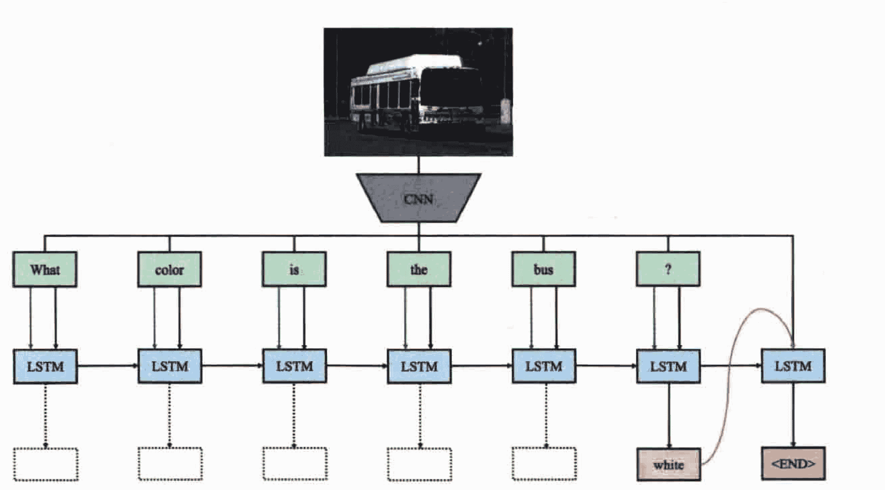

Gao 等提出的 MQA 使用两个独立 LSTM 分别处理问题和答案。与神经图像问答先拼接问题再增强答案、仅用一个 LSTM 的做法不同，MQA 的结构如图 4.2 所示。模型输入图像与问题，例如“消防栓是什么颜色的？”，训练目标是生成答案，例如“黑黄色”。两个 LSTM 的词嵌入权重共享，且该权重以转置形式与 Softmax 层权重共享。图中不同颜色区分模块。MQA 由四部分组成：提取问题表征的 LSTM(Q)、抽取图像特征的 CNN、建模答案词的 LSTM(A) 以及融合生成网络。具体实现上，ImageNet 预训练的 GoogleNet 提取图像特征并在训练中固定。与神经图像问答不同，LSTM(Q) 与 LSTM(A) 结构相似但参数不共享。前三部分的特征经融合模块合并生成第 $t$ 个词，公式为：

$$f(t) = g(V_{r_Q}r_Q + V_I I + V_{r_A}r_A(t) + V_{\omega}\omega(t))$$

其中 “+” 为逐元素相加，$r_Q$ 为 LSTM(Q) 末词表征，$I$ 为图像特征，$r_A(t)$ 为第 $t$ 词 LSTM(A) 的隐藏态，$\omega(t)$ 为第 $t$ 个答案词的嵌入，$V$ 为可学习权重，$g(\cdot)$ 为逐元素非线性。融合后经中间层映射回词空间，再经全连接 Softmax 产生答案。为保证问题与答案中相同词义一致，模型采用权重共享，减少参数并提升性能。具体而言，LSTM(Q) 与 LSTM(A) 的词嵌入权重共享，且词嵌入权重与 Softmax 层权重转置共享。

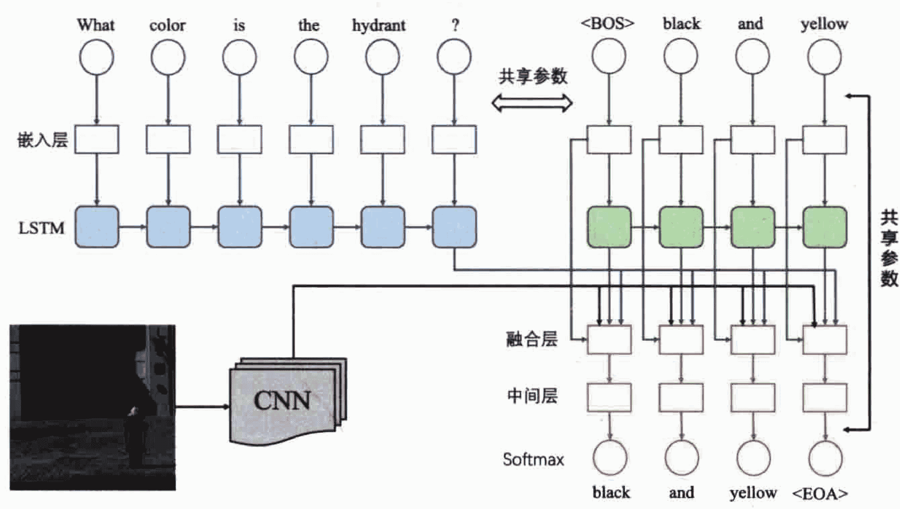

图 4.2 多模态问答模型结构示意图

最早的序列到序列编码解码式联合嵌入可视作视觉问答的简单基线，在部分数据集上表现不佳。其融合过于朴素，通常靠逐元素操作拼接多模态信息，难以捕捉图像与问题中蕴含的复杂关联。

##### 2）多模态双线性融合

为视觉问答编码表达力强的视觉文本联合表征是必要前提，便于后续分类与推理。双线性融合比简单的逐元素融合更具表达能力。原生双线性池化因参数与计算开销巨大难以直接使用。例如图像与问题特征均为 2,048 维，答案类别 3,000 类时，可学习双线性模型参数可达 125 亿。为此提出 MCB 与 MLB 等近似方案。

原生双线性池化以视觉向量 $x$ 与文本向量 $q$ 的外积为输入，在学习线性模型 $M$ 中生成高维投影 $z$：

$$z = M[x \otimes q]$$ (4.3)

其中 $\otimes$ 表示外积， $[\cdot]$ 表示矩阵线性化。

为把高维外积压缩到低维并间接计算，Fukui 等提出 MCB，利用计数草图投影函数把 $v \in \mathbb{R}^n$ 投影到 $y \in \mathbb{R}^d$。投影依赖两个随机初始化后固定的向量 $s \in \{-1,1\}^n$ 与 $h \in \{1,2,\dots,d\}^n$，$y$ 初始为零。$s$ 将元素 $v_i$ 翻转为 $v_i$ 或 $-v_i$，$h$ 将索引 $i$ 映射到输出索引 $j$。对每个 $v_i$，目标 $j=h_i$，值更新为 $y_j = s_i \cdot v_i$。由此外积可被压缩，减少矩阵 $W$ 的参数。如图 4.3 所示，经 $\Psi$ 后视觉向量 $x$ 与文本向量 $q$ 分别得到草图 $x'$ 与 $q'$。外积的间接高效计算可写为：

$$\Psi(x \otimes q, h, s) = \Psi(x, h, s) * \Psi(q, h, s) = x' * q'$$ (4.4)

其中 $*$ 为卷积。

根据卷积定理，时域卷积 $x'*q'$ 可转到频域表示：

$$x' * q' = \text{FFT}^{-1}(\text{FFT}(x') \odot \text{FFT}(q'))$$ (4.5)

其中 $\odot$ 为逐元素乘，FFT 为快速傅里叶变换，FFT$^{-1}$ 为逆变换。

MCB 虽大幅减少参数，仍产生高维特征且计算复杂。为进一步降参，Kim 等提出 MLB。双线性投影 $z = x^\top W q$ 中 $W$ 为高秩矩阵。MLB 将大矩阵分解为两个低秩因子 $W = UV^\top$，则

$z = P^\top(U^\top x \odot V^\top q)$ (4.6)

其中 $P$ 为全 1 矩阵，$\odot$ 为 Hadamard 积。

MCB 与 MLB 在视觉问答上取得明显提升。MCB 在 VQA-v1-real 测试集开放式问题上取得 66.5% 的总分，MLB 达到 66.89%，参数量显著下降。双线性池化的主要短板仍是计算成本较高。

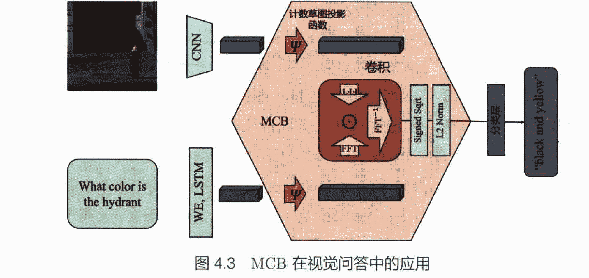

#### 3. 注意力驱动的建模思路

注意力机制在视觉与语言任务中被广泛验证，是视觉问答的首选工具之一。本节介绍两种经典做法：堆叠注意力网络和分层问答图像协同注意力。

##### 1）堆叠式注意力网络

常见做法是用 CNN 取全局图像特征，用 RNN 取整体问题特征。这种简易流程难以应对需要多步细粒度推理的复杂问答。全局特征会引入与问题无关区域的噪声，而单步注意力不足以定位正确区域。Yang 等因此提出堆叠注意力网络 SAN，基于多层注意力实现多步细粒度推理，如图 4.4 所示。

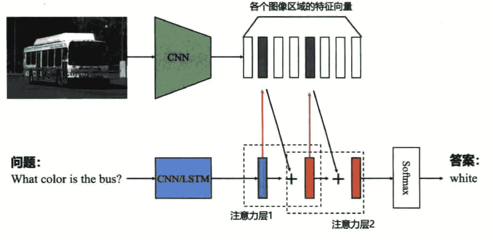

图 4.4 SAN 基于多层注意力机制，实现视觉问答任务的多步细粒度推理

SAN 由图像特征提取、问题特征提取和堆叠注意力三部分构成。图像特征提取选用 VGGNet 最后一个池化层，保留空间信息：

$$f_I = \text{CNN}_{\text{VGG}}(I)$$

得到特征 $f_I$ 维度为 $512 \times 14 \times 14$，其中 $14 \times 14$ 对应图像的区域数。随后将 196 个区域的特征向量 $f_i$ 统一映射为与问题向量同维的图像表征 $V_I$：

$$V_I = \tanh(W_I f_I + b_I)$$

给定问题词表 One-hot 表示 $q = [q_1, q_2, \cdots, q_T]$，SAN 提供两种问题编码方式：LSTM 方式与 CNN 方式。LSTM 方式将问题嵌入后送入 LSTM，取最后一层隐藏态 $h_T$ 作为问题表征 $v_Q$。CNN 方式先把 One-hot 嵌入为向量 $x = [x_1, x_2, \cdots, x_T]$，再用多组卷积核及最大池化提取一元、二元、三元语法文本特征 $\tilde{h}_1,\tilde{h}_2,\tilde{h}_3$，公式为：

$$h_{c,t} = \tanh(W_c x_{t:t+c-1} + b_c)$$

### SAN：让注意力一层层聚焦

$$\tilde{h}_{c,t} = \max_t [h_{c,1}, h_{c,2}, \cdots, h_{c,T-c+1}]$$
c 取 1、2、3 分别对应三种不同的卷积核尺寸。随后把这些不同尺度的特征拼接起来，作为最终的问题表示 v_Q：

$$v_Q = [\tilde{h}_1, \tilde{h}_2, \tilde{h}_3] \tag{4.10}$$
在拥有图像表征 v_I 与问题表征 v_Q 的前提下，模型借助一个单层的 Softmax 网络为每个图像单元 v_i 计算出针对 v_Q 的注意力权重 p_I，并据此得到聚焦后的图像特征 \tilde{v}_I：

$$h_A = \tanh(W_{I,A}v_I \oplus (W_{Q,A}v_Q + b_A))$$

$$p_I = \text{Softmax}(W_P h_A + b_P) \tag{4.11}$$

$$\tilde{v}_I = \sum_i p_i v_i$$
其中 W 代表可训练的权重参数，b 代表偏置，\oplus 表示矩阵与向量的相加操作。

随后将 \tilde{v}_I 与 v_Q 融合，形成后续多轮注意力使用的查询向量 u：

$$u = \tilde{v}_I + v_Q \tag{4.12}$$
具体来看，SAN 串联了多层注意力模块。第 k 层里，前一轮的查询 u^{k-1} 指导产生一轮新的注意力图像特征 \tilde{v}_I^k，之后把 u^{k-1} 与 \tilde{v}_I^k 相加得到下一轮查询 u^k，这一迭代重复 K 次直至产出最终查询 u^K：

$$h_A^k = \tanh(W_{I,A}^k v_I \oplus (W_{Q,A}^k u^{k-1} + b_A^k))$$

$$p_I^k = \text{Softmax}(W_P^k h_A^k + b_P^k) \tag{4.13}$$

$$\tilde{v}_I^k = \sum_i p_i^k v_i^k$$

$$u^k = \tilde{v}_I^k + u^{k-1}$$
初始化时 u^0 直接设为 v_Q。

最终的查询 u^K 进入答案预测阶段：

$$p_{\text{ans}} = \text{Softmax}(W_u u^K + b_u) \tag{4.14}$$
在 VQA-v1 标准测试集上，SAN 的整体准确率达到 58.9%，相比最强视觉问答基线提升了 4.8 个百分点，并在 DAQUAR 与 COCO-QA 两个数据集上均明显优于现有方法。消融实验表明，两层 SAN 的效果好于单层，印证了堆叠多层注意力的积极作用。

##### 2）分层协同注意 HieCoAtt
现有的视觉问答注意力大多只实现了问题驱动的视觉聚焦，本质上是“看哪里”。而“听哪里”同样关键，基于图像的问题注意力能够有效削弱语言噪声。Lu 等人提出的分层问答-图像协同注意力机制 HieCoAtt，便是同时实现问题引导图像注意与图像引导问题注意的方案。

实现 HieCoAtt 包含两个新组件：问题分层与协同注意力。给定包含 T 个词的问题 One-hot 表示 Q = {q_1, q_2, …, q_T}，分层模块为每个位置 t 生成三层表征：词级嵌入 q_t^w、短语级嵌入 q_t^p 与问题级嵌入 q_t^s。具体做法是先把 One-hot 词嵌入到词级得到 Q^w = {q_1^w, q_2^w, …, q_T^w}。短语级表征则借鉴 SAN 的 CNN 特征提取思路，通过多组卷积核配合最大池化生成，其生成过程可表示为

$$\hat{q}_{s,t}^p = \tanh(W_c^s q_{t:t+s-1}^w), \quad s \in \{1, 2, 3\}$$

$$q_t^p = \max(\hat{q}_{1,t}^p, \hat{q}_{2,t}^p, \hat{q}_{3,t}^p), \quad t \in \{1, 2, \cdots, T\}$$

(4.15)
其中 s 指示不同的窗口大小。问题级表征 q_t^s 为编码短语级表征 q_t^p 后的时间步 t 处 LSTM 的隐藏状态。HieCoAtt 设计了两种协同注意力：平行协同注意与交替协同注意，下面重点介绍更具代表性的平行版本。如图 4.5 所示，平行协同注意会在图像与问题之间同步进行。先给定特征图 V 与对应的问题 Q，计算相似矩阵 C：

$$C = \tanh(Q^\top W_b V)$$

(4.16)
借助矩阵 C，可同时得到图像各位置的注意力分数 a^v 与问题各位置的注意力分数 a^q：

$$H^v = \tanh(W_v V + (W_q Q)C), \quad H^q = \tanh(W_q Q + (W_v V)C^\top)$$

$$a^v = \text{Softmax}(w_{hv}^\top H^v), \quad a^q = \text{Softmax}(w_{hq}^\top H^q)$$

(4.17)
其中 W 与 w 分别为可学习的权重矩阵与向量。经过注意力操作后的图像特征 \hat{v} 与问题特征 \hat{q} 由下式获得

$$\hat{v} = \sum_{n=1}^N a_n^v v_n, \quad \hat{q} = \sum_{t=1}^T a_t^q q_t$$

(4.18)
## 多模态大模型：新一代技术范式
在交替协同注意力里，注意操作是顺序进行的。模型先在问题特征的引导下得到聚焦的图像特征，再基于该图像特征回过头去关注问题特征。这两种机制都以层次化方式实现，生成分层的注意力特征 \hat{v}^r 与 \hat{q}^r，其中 r ∈ {w, p, s}。

HieCoAtt 在 VQA-v1 标准集上取得开放式问题 62.1%、多选题 66.1% 的综合分数，领先其他最先进方法至少 1.7%。定性分析显示，分层协同注意力能够从不同层次捕捉互补信息，有助于更深入地理解图文关系。不足之处在于平行协同注意较难训练，而交替协同注意可能累积误差。

#### 4. 记忆网络赋能问答
记忆网络在 NLP 问答中已证明有效，能挖掘细粒度特征。将这类记忆机制引入视觉问答是自然选择，下面介绍两种经典方案：改进的动态记忆网络与增强记忆网络。

##### 1）动态记忆网络升级 DMN+
动态记忆网络 DMN 在自然语言问答上表现强劲，但依赖额外标注事实，跨模态迁移困难。Xiong 等人提出的 DMN+ 可直接处理图像数据。

用于问答的 DMN 包含输入模块、问题模块、情景记忆模块与答案模块。DMN+ 改动了输入模块与情景记忆模块。

在输入模块中，DMN+ 用 VGG 提取 196 个局部区域特征，维度 512，再通过线性投影将这些向量映射到与问题向量 q 同一空间。随后局部特征经双向 RNN 处理，得到全局感知的事实向量 \vec{F} = [\vec{f_1}, \vec{f_2}, …, \vec{f_N}]，作为情景记忆模块输入。DMN+ 在视觉问答中的流程如图 4.6 所示。

情景记忆模块负责从事实中检索与问题相关内容。模块包含基于注意力的选择机制与记忆更新机制，前者让事实、问题与先前记忆状态交互，后者通过当前状态与检索到的事实交互生成新记忆。注意力采用基于注意力的 GRU 网络生成上下文向量 c_t，用于更新情景记忆状态 m_t。

$$z_i^t = [\vec{f_i} \odot q; \vec{f_i} \odot m^{t-1}; |\vec{f_i} - q|; |\vec{f_i} - m^{t-1}|]$$

$$Z_i^t = W^{(2)} \tanh(W^{(1)} z_i^t + b^{(1)}) + b^{(2)}$$

$$g_i^t = \frac{\exp(Z_i^t)}{\sum_{k=1}^{M_i} \exp(Z_k^t)}$$

$$h_i = g_i^t \odot \tilde{h_i} + (1 - g_i^t) \odot h_{i-1}$$
其中 \vec{f_i} 为第 i 个事实，q 为问题向量，m^{t-1} 为上一轮记忆状态，h 为 GRU 隐藏状态，\odot 表示逐元素乘积，|\cdot| 表示逐元素绝对值，[;] 表示拼接。c_t 取自 GRU 的最后一个隐藏状态，记忆更新由 ReLU 层完成：

$$m^t = \text{ReLU}(W^t[m^{t-1}; c^t; q] + b)$$
最后答案模块以记忆网络的最终状态与问题向量为输入，预测单个词或多词答案。DMN+ 在 VQA-v1 标准集上达到 60.4% 的综合得分，优于其他先进方法至少 1.5%，在各类型问题上均取得最佳表现。

##### 2）记忆增强网络 MAN
视觉问答数据常呈现长尾分布，模型易偏向高频样本而忽略稀有但关键的实例。常见做法是将稀有词标记为未知并剔除稀有答案，同时模型还易出现语言偏差，只学问答对而忽视视觉内容。为解决长尾与语言偏差，Ma 等人提出受增强记忆神经网络与协同注意力启发的记忆增强网络 MAN。

MAN 先用协同注意力把图像与问题特征共同嵌入，再借助增强记忆网络记住训练集中的稀有样本。MAN 由输入模块、序列协同注意力模块、记忆增强模块与答案推理模块组成，整体结构如图 4.7 所示。

图像输入使用预训练 VGGNet-16 与 ResNet-101 提取带空间布局的特征 {v_n}，取自最后一个池化层输出，对应 14×14 的区域分布。问题输入把词标记 w_t 送入双向 LSTM 生成固定长度的顺序词向量，作为问题特征 {q_t}：

$$h_t^+ = \text{LSTM}(\omega_t, h_{t-1}^+)$$

$$h_t^- = \text{LSTM}(\omega_t, h_{t-1}^-)$$

$$q_t = [h_t^+, h_t^-]$$

(4.21)
其中 h_t^+ 与 h_t^- 分别为时间步 t 的前向与后向 LSTM 隐藏状态，[\cdot] 表示拼接。

随后采用顺序协同注意力。先把 v_n 与 q_t 相加平均得到 v_0 与 q_0，再做逐元素乘积形成联合基准向量 m_0。利用视觉特征 v_n 与 m_0 计算软注意力权重 \alpha_n，通过带 Softmax 的两层网络得到聚焦视觉特征 v^*。同理用问题特征与 m_0 得到注意力权重 \alpha_t 与聚焦问题特征 q^*。最后拼接 v^* 与 q^* 得到协同关注的图文特征 x_t = [v_t^*, q_t^*]。

基于 x_t，MAN 采用增强记忆神经网络放大稀有训练样本的作用。控制器为内置内部内存与外部内存 M_t 的 LSTM。首先把 x_t 输入 LSTM 控制器得到隐藏状态 h_t，作为外部内存的查询。随后计算 h_t 与外部内存各元素 M_t(i) 的余弦距离 D(h_t, M_t(i))，归一化为读取权重 w_t^r(i)。利用读取权重生成关注的读取记忆 r_t：

$$h_t = \text{LSTM}(x_t, h_{t-1})$$

$$D(h_t, M_t(i)) = \frac{h_t \cdot M_t(i)}{\|h_t\| \|M_t(i)\|}$$

$$w_t^r(i) = \text{Softmax}(D(h_t, M_t(i)))$$

$$r_t = \sum_i w_t^r(i) M_t$$
最后把 r_t 与 h_t 拼接生成最终特征向量 o_t 作为答案分类器输入。分类器为带 Softmax 的单层感知机：

$$h_t = \tanh(b W_o o_t)$$

$$p_t = \text{Softmax}(W_h h_t)$$
与主流方法 MCB 相比，MAN 在 VQA-v1 与 VQA-v2 测试集上均有竞争力。VQA-v1 上多选问题略有提升，开放式问题略有下降。相较仅使用 RNN 内部记忆的 DMN+，MAN 提升约 3.5%。VQA-v2 上与 MCB 差距仅约 0.2%。

#### 5. 模块化组合推理
视觉问答需要复杂推理，单一整体模型难以兼顾。模块化思路把问题拆解为子任务，再组装专用网络。下面讨论神经模块网络 NMN 与动态神经模块网络 D-NMN。

##### 1）神经模块网络 NMN
复杂问题通常需要多步处理，例如“狗是什么颜色”需先定位狗再识别颜色。单一网络难以覆盖所有子任务。Andreas 等人提出的 NMN 通过可组合模块化网络将问题分解为多步骤预测。

如图 4.8 所示，NMN 由一组模块与网络布局预测器组成，并加入 LSTM 问题编码器提供句法语义知识。NMN 包含查找模块 Find、变换模块 Transform、合并模块 Combine、描述模块 Describe 与度量模块 Measure 五大模块，用于处理图像、非归一化注意力与标签三种数据。如图 4.9 所示，查找模块通过卷积层如 find[green] 计算输入图像各区域的非归一化注意力；变换模块用多层感知机把一种注意力细化为另一种，如 transform[above]；合并模块如 combine[and] 用带 ReLU 的卷积层激活两注意力交集；描述模块在给定图像与注意力后预测除是非问题外的标签分布，如 describe[color]；度量模块则专用于是非问题，如 measure[is]。这些模块是联合训练的。

NMN 根据问题生成所需网络布局。具体做法是用 Stanford 解析器生成过滤后的依赖表示，例如“猫是什么颜色？”转为 color(cat)。按规则生成布局：叶节点用查找模块输入图像，中间节点用变换或合并模块，根节点用描述或度量模块输出。布局生成后，组装网络的根表示与 LSTM 编码器的最后一个隐藏状态相加，经全连接与 Softmax 预测最终答案。

NMN 在 VQA-v1 测试集整体得分 58.0%，优于当时最先进方法，尤其在涉及物体、属性或数字的问题上表现突出。解析器误差仍是提升空间，借助更优解析或联合学习可进一步提高性能。

##### 2）D-NMN

D-NMN：从手工布局到自学习排布

传统 NMN 的单元结构需要人工设定，组合方式由句法解析硬编码。依赖手写规则把依存树映射成固定排布，限制了单条查询能生成的结构复杂度，也难以让网络拓扑产生较大变化。面对更难的任务，需要增强结构化语义表征的泛化能力。Andreas 研究组在[400]中提出 D-NMN，在 NMN 把视觉问答拆分为模块子问题的思路上扩展。该体系能借助结构预测器从候选集合中自动学习单元排布，同时在处理图像等非结构信息的同时也能对知识库等结构信息做推理。

如图 4.10 所示，D-NMN 由排布预测和执行预测两部分构成。排布预测依据输入查询挑选单元排布，执行预测则依托排布与世界表征即图像或知识库来推断答案。给定查询 x、世界表征 w 与参数集合 θ，两部分分别给出排布分布 p(z|x; θ₁) 和答案分布 p(y|ω; θₑ)，其中 z 代表网络排布，y 代表答案。

该体系首先用固定的句法解析器如 Stanford 解析器生成一小批排布候选，做法与 NMN 搭建单元布局类似。获得候选后，用多层感知器对候选进行打分。具体地，查询 q 的 LSTM 编码 h_q(x) 与排布 z_i 的特征向量 f_z(i) 送入 MLP，得到排布 z_i 的得分 s(z_i|x)：

s(z_i|x) = a^T σ(B h_q(x) + C f(z_i) + d) (4.24)

其中 a、B、C、d 均可学习。经 Softmax 归一化后得到选择分布：

p(z_i|x, θ₁) = e^{s(z_i|x)} / Σ_{j=1}^n e^{s(z_j|x)} (4.25)

用于挑选最优单元排布。随后依据各单元间的中间结果得到答案分布 p_z(y|ω, θₑ)。内部配置的单元有检索单元、关系单元、交集单元、描述单元和存在性预测单元。检索单元负责管理专有名词并在输入特征图上产生独热注意力，同时处理普通名词和动词，并在特征图的每个位置生成注意力。关系单元处理介词短语，基于区域间的关联生成注意力；交集单元负责注意力的交集运算并拼接排布片段。描述单元依据输入注意力预测答案，存在性预测单元依据输入注意力预测是否存在。相同功能的单元共享参数，可复用于不同实例。

体系还采用策略梯度把 z 的不可微选择转为可微过程，使得排布预测器与执行单元可以联合训练，排布预测和单元参数同步学习。D-NMN 在 VQA-v1 测试集上取得 58.0% 的整体分数，可解释性很高。但预定义单元难以迁移到不同数据集，子单元必须精细设计，神经模块网络的可行性仍是挑战。

### 4.1.3 视频问答

视频问答于 2014 年首次提出，比静态图像问答复杂得多。数据集与模型是研究的两个关键支点。本节先梳理最具代表性的视频问答数据集，从物理对象到真实世界，再介绍一批基于编码器-解码器框架的经典模型。

视频问答的核心是学会理解视频与查询的语义信息以及二者间的关联，从而推断正确答案。可拆分为视频定位、物体检测、特征提取、多模态融合与分类等子任务。模型 f(v, q, a; θ) 的输入定义为视频 v∈V、查询 q∈Q、由模型输出的答案 a∈A。因此学习目标可表述为

$$\min_{\theta} = L_{\theta} + \lambda \|\theta\|^2 \quad (4.26)$$

其中 θ 为模型系数，L_θ 为损失函数，λ 为训练损失与正则化之间的权衡。训练 θ 以回答查询是解决视频问答的关键。

先介绍最具影响力的视频问答数据集，再介绍基于编码器-解码器框架的经典模型。

#### 1. 视频问答数据集

按查询复杂度与所需推理步数对现有典型数据集进行归类。部分数据集仅需单步推理，如“什么”“怎么”等查询；部分涉及多步推理，如“走过门口后，他们与哪个物体互动了”。再按视频来源划分，可分为电影类、电视类、TGIF 类、几何类以及游戏卡通类。以下按来源顺序展开。

TVQA[380] 基于 6 部热门电视剧构建的大规模组合式视频问答集，涵盖医疗剧、情景喜剧、犯罪剧等。共含 152,545 个问答对，21,793 条视频剪辑，累计超 460 小时。剪辑时长 60s~300s，理解难度高。每条剪辑附带对话与字幕。查询采用组合格式：[What/How/Where/Why/…] + [when/before/after]，前半部分指向相关帧，后半部分定位视频中最相关帧。数据集提供时间戳标注，指出回答每个查询所需的最小上下文段。

TVQA+[401] 是 TVQA 的增强版。TVQA 仅有时间标注，缺乏空间标注即物体与人物的边界框。TVQA+ 以 2 秒为间隔采样帧并为查询及正确答案中提及的视觉概念添加逐帧边界框。总体包含 148,468 张图像、310,826 个边界框。

SVQA[402] 是大规模自动生成的数据集，含 12,000 个视频和 118,680 个问答对。视频由 Unity3D 生成并附带 JSON 记录每个几何体的属性与位置。查询来自预定义模板，特点是长度极长且涉及对象间多种空间与时间关系的组合。可拆解为逻辑树或链式布局，每个节点对应如形状筛选等推理子任务。

CLEVRER[403] 是用于系统评估多种推理的诊断性视频集，包含 20,000 个合成碰撞物体视频和超 300,000 个问答对。视频由物理引擎生成，含三种形状、两种材质、八种颜色、三种事件：进入、离开、碰撞。查询分四类：描述性如“什么颜色”、解释性如“是什么造成的”、预测性如“接下来会发生什么”、假设性如“如果怎样会怎样”，分别有 219,918、33,811、14,298、37,253 个。每个查询以树状功能程序表示。

AGQA[404] 用于评估组合空间时间推理，含 390 万平衡问答对、1.92 亿不平衡问答对、9,600 个视频。视频源自 Charades，注释包含 Charades 的动作标注和 Action Genome 的时空场景图标注，后者为所有物体关联边界框、动作关联时间戳。查询由手工编写程序在注释上操作生成。还提供三种新时空拆分：新颖组合、间接引用、附加组合步骤，用于测试推理能力。基于真实视频源且由复杂模板生成，挑战性很高。

Traffic QA[405] 是评估复杂交通场景下因果推理与事件理解的诊断基准，含 10,080 个实景视频和 62,535 个标注问答对。提出 6 个交通推理任务：基础理解、事件预测、逆向推理、假设推理、反思、归因。问答对由标注者按上述任务设计，平均查询长度 8.6 个词。

Movie QA[406] 用于从视频与文本双角度评估自动故事理解，含与 408 部电影相关的 14,944 个查询。关键特性是同时提供视频剪辑、情节、字幕、剧本与 DVS。其中 140 部电影、6,462 个问答对带有时间戳，指示查询答案在视频中的位置。查询与答案平均长度约 9 与 5 个词。

ActivityNet-QA[407] 是来自 ActivityNet 的大规模完整标注 VideoQA 集，含 58,000 个问答对、5,800 个复杂网络视频，覆盖约 20,000 条未剪辑视频、200 个动作类别。查询分运动、空间关系、时间关系三类。为避免表征不当，查询最长 20 词、答案最长 5 词。问答对由不同提问者与回答者标注，保证质量。

TGIF-QA[379] 由 56,720 个动画 GIF 构成，含 103,919 个问答对，分四类任务。

- （1）重复次数，11 个可能答案。
- （2）重复动作，多选题形式，每题 5 个候选。
- （3）状态转换，查询特定状态变化。
- （4）基于视频帧的问答，按帧作答。查询依据手工模板自动生成。

MarioQA[408] 由 Super Mario 游戏玩法视频与事件日志合成。每个样本为 240×20 剪辑加带答案的查询，共采集 13 小时游戏时长 187,757 个样本，92,874 个独特问答对，平均每剪辑 11.3 个事件。基于 11 类事件生成：杀死、死亡、跳跃、击中、打破、出现、射击、扔、踢、持有、吃。查询分事件中心、计数、状态三类。含三个时间关系子集：无时间关系 NT、简单时间关系 ET、复杂时间关系 HT。NT、ET、HT 分别关注全视频唯一事件查询、带时间关系的全局唯一事件、含干扰事件，旨在推理事件间时间依赖。

PororoQA[409] 基于儿童卡通《Pororo》，含 20.5 小时视频的 16,066 对场景对话、27,328 句场景描述和 8,913 个故事相关问答对。视频背景简单、事件清晰，易于理解。共 171 集，平均时长 7.2 分钟。描述句与问答由 AMT 手工收集。查询类型 11 种：动作、人物、抽象、细节、方法、原因、地点、陈述、因果、是/否、时间。场景描述平均长度 13.6 词。

#### 2. 视频问答任务的经典模型

视频问答的核心是时空推理。基本流程是先将视频表示为物体级、帧级、剪辑级特征。物体级多用 Faster R-CNN 检测局部区域；帧级是全局视觉的粗粒度表征，常用于捕捉场景，常用 ResNet、VGGNet；剪辑级捕捉多帧动作信息，常用 C3D。文本则按词级与句子级表示，词级常用 Word2vec、GloVe，句子级常用 skip-thought、BERT。获得视觉与文本特征后进行时空推理得到上下文表征，再送入判别式模型或多分类模型生成答案。视频与查询天然为序列，故编码器-解码器模型被广泛借用。

Zhu 等人[410] 用 GRU 学习视频时间结构并设计双通道排序损失用于多选题。如图 4.11 所示，先训练三个编码器-解码器学习输入帧的过去、现在、未来表征，编码器-解码器的主要目的为重构输入帧以提升编码质量，解码器结构与编码器类似。随后用双通道排序损失计算视觉上下文与查询候选的相似性，可表示为

$$\text{Loss} = \min_{\theta} \sum_{v} \sum_{j \in K, j \neq j^i} \lambda l_{\text{word}} + (1 - \lambda) l_{\text{sent}}, \lambda \in [0, 1]$$

$$l_{\text{word}} = \max(0, \alpha - \boldsymbol{v}_p^\top \boldsymbol{p}_{j'} + \boldsymbol{v}_p^\top \boldsymbol{p}_j)$$

$$l_{\text{sent}} = \max(0, \beta - \boldsymbol{v}_s^\top \boldsymbol{s}_{j'} + \boldsymbol{v}_s^\top \boldsymbol{s}_j)$$

(4.27)

其中 v_p = W_vp v，v_s = W_vs v，p_j = W_pv y_j，s_j = W_sv z_j。v 来自编码器-解码器的视觉表征，y_j 与 z_j 为文本表征。最终选择相似度最高的候选作为答案。也有研究用 GRU 实现时间推理，可捕捉长时信息，但答案生成与视频表征分别训练，难以建模文本视频关系。

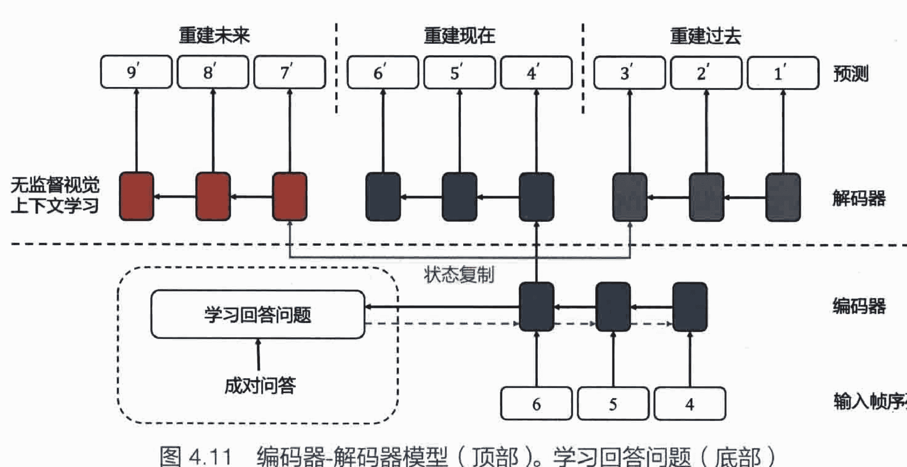

上述工作基于基础编码器-解码器，难以实现跨模态推理。部分研究在编码或解码中加入简单注意力以考察不同模态关联。Lei 等人[380] 提出多流端到端可训练网络，每流输入不同上下文源包括区域视觉特征、视觉概念特征、字幕及问答对。视频由三类特征表示：

- （1）区域视觉特征，每帧 Faster R-CNN 检测的前 K 个区域。
- （2）视觉概念特征，检测到的对象与属性标签。
- （3）ImageNet 特征，由 ResNet101 提取。

时序信息包括文本与视觉，均用双向 LSTM 编码，隐藏状态拼接作为表征。随后上下文匹配模块生成视频引导的查询表征与视频引导的答案表征并融合，供答案生成层使用。另一种方法[380] 充分利用多模态信息，如图 4.12 所示丰富上下文表征，上下文匹配单元提供了更丰富的文本视觉关联。

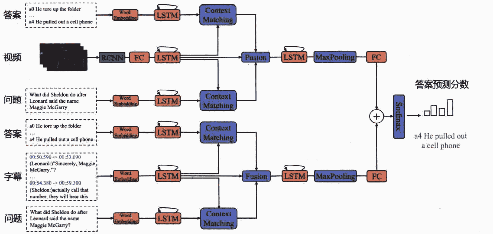

图 4.12 多模态视频问答模型。模型将不同的上下文信息源，以及查询-答案对作为每个流的输入。简洁起见，只展示区域视觉特征（上方）和字幕（下方）流

Jang 等人[379] 提出 ST-VQA，即带空间时间注意力的双 LSTM 模型。如图 4.13 所示，先用在 ImageNet 2012 预训练的 ResNet 与在 Sports1M 预训练的 C3D 提取帧级与序列级特征并拼接。查询与答案分别嵌入序列。三个双向 LSTM 分别编码视觉、查询、答案。输入 LSTM 前，第一个注意力单元用于确定帧中哪些区域与查询答案最相关，如图 4.14 左侧，单元融合编码后的文本表征与视觉特征。第二个注意力单元用于学习视频中需要检查的帧，如图 4.14 右侧，结合双向 LSTM 的时序视觉隐藏状态与编码文本表征。数据集含多选、开放数字、开放词三种答案，模型针对性训练三个解码器。两个注意力单元实现与问答相关的时空推理。

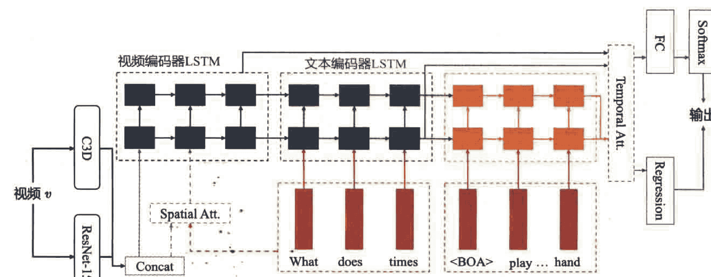

图 4.13 ST-VQA 模型

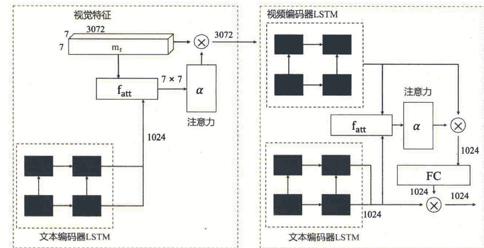

图 4.14 空间注意力（左）和时序注意力（右）

Xue 等人[411] 提出统一注意力模型，如图 4.15 所示，包含三个部分：

- （1）顺序视频注意力模型，如图 4.15 左上。
- （2）时序查询注意力模型，如图 4.15 右上。
- （3）答案生成的解码器，如图 4.15 底部。

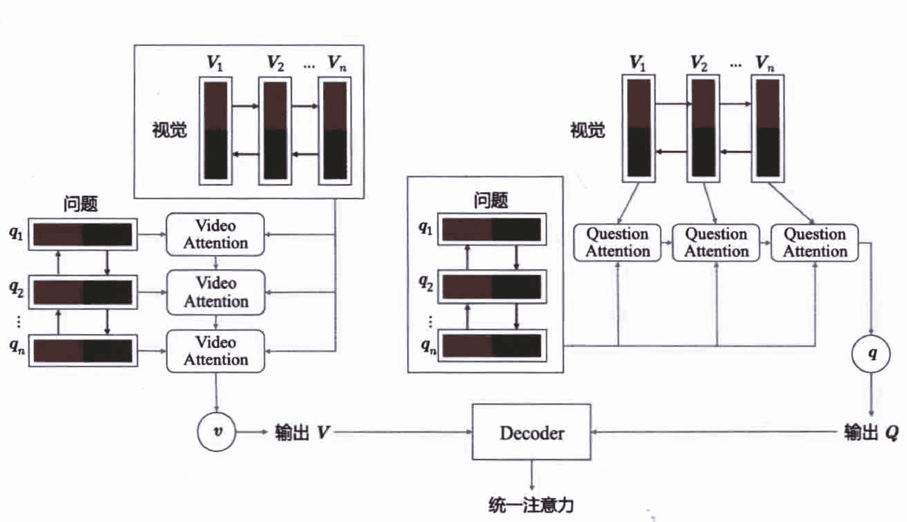

双向注意力建模概览

顺序式视频注意与时序式问题注意构成了互补的双架构。首先把经 LSTM 编码的视频表征和问题序列的隐向量进行关联，累积后的结果被视为视觉侧的编码输出。形式化记为 $V = r(T)$，展开可写作

$$r(i) = y_v^\top s_v(i) + \tanh(V_{rr}r(i-1)), \quad 1 \leqslant i \leqslant T$$

$$s(i,j)_v \propto \exp(W_{cs}^\top c(i,j)) \tag{4.28}$$

$$c(i,j) = \tanh(W_{vc}y_v(j) + U_{qc}y_q(i) + V_{rc}r(i-1))$$

式中 $y_v(j)$ 对应第 $j$ 帧的视觉特征，$y_q(i)$ 对应第 $i$ 个词的文本特征。另一端同时利用经 LSTM 处理的问题表征与视频的 LSTM 隐状态序列，最终得到作为文本侧编码的向量。输出 $q = w_T$ 可表示为

$$w(j) = y_q^\top s(j)_t + \tanh(V_{ww}w(i-1)), \quad 1 \leqslant j \leqslant N$$

$$s(j,i)_t \propto \exp(U_{cs}^\top c(j,i)) \tag{4.29}$$

$$c(j,i) = \tanh(W_{qc}y_q(i) + U_{vc}y_v(j) + V_{wc}w(j-1))$$

随后上述两种编码被融合送入解码器，解码器采用双层 LSTM 逐 token 生成开放式答案。

Zhao 等[412] 提出的分层时空注意力编码-解码体系借助多步推理解决开放式视频问答。图 4.16 展示了整体流程：先由多步时空注意力编码器学习视频与问题的上下文表征。每步推理中空间注意先在单帧内部定位与问题相关的区域。对第 $j$ 帧中第 $i$ 个目标，空间注意分数 $s_{ji}^{(s)}$ 计算如下：

$s_{ji}^{(s)} = w^{(s)} \tanh(W_{qs}q + W_{fs}f_{ji} + b_s)$

(4.30)

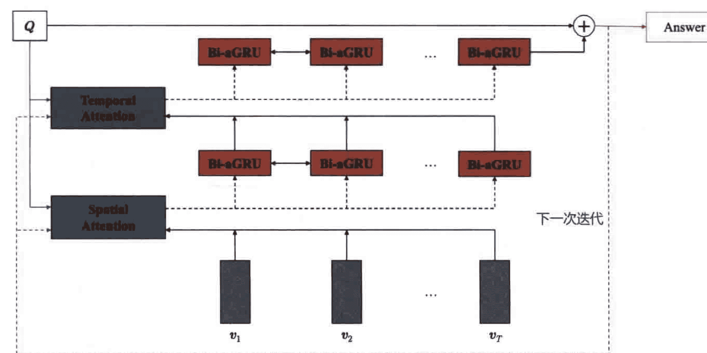

由此得到空间加权帧表征：

$v_j^{(s)} = \sum_i \alpha_{ji} f_{ji}$

$\alpha_{ji} = \frac{\exp(s_{ji}^{(s)})}{\sum_i \exp(s_{ji}^{(s)})}$

(4.31)

当帧数庞大且存在冗余时，筛选关键帧变得关键，时域注意在整段视频上运行以锁定有效帧。第 $t$ 个隐状态的相关度记为

$s_j^{(t)} = w^{(t)} \tanh(W_{qt}q + W_{ht}h_j^{(s)} + b_t)$

(4.32)

随后自适应门控循环单元刷新当前隐状态：

$h_j^{(t)} = \beta_j \odot \tilde{h}_j^{(t)} + (1 - \beta_j) \odot \tilde{h}_{j-1}^{(t)}$

$\beta_j = \frac{\exp(s_j^{(t)})}{\sum_j \exp(s_j^{(t)})}$

(4.33)

相关帧信息被逐步写入隐状态，通过递归更新获得更优的视觉与文本表征。

Zhao 等[413] 针对长视频问答提出自适应分层强化编码-解码网络。内部自适应循环模块借助二进制门对 ConvNet 提取的帧级特征进行分段，并判定时刻 $t$ 的隐状态与记忆单元是否传递至 $t+1$。编码阶段二进制门把帧特征分割并计算 $\gamma_t$，衡量时间 $t$ 的隐状态与 $t+1$ 视觉表征的相似度。给定带有门值 $\{\gamma_1,\gamma_2,\cdots,\gamma_N\}$ 的语义序列 $\{h_1,h_2,\cdots,h_N\}$，先学习问题敏感的视频段表征，再经段级 LSTM 产生 $\{h_1^s,h_2^s,\cdots,h_K^s\}$。解码器被设计为强化式神经网络，依据语义表征与问题表征的相似度生成开放答案。核心贡献在于用自适应分层编码器学习段级问题感知视频表征，并用强化解码器生成答案，如图 4.17 所示。


#### 3. 因果干预助力事件级问答的稳健可信

跨模态事件级问答推理依托视频事件理解，要求模型同时具备多模态视觉语义理解、时空表征学习、自然语言理解生成以及因果关系挖掘能力，从而实现对真实事件的深度理解，达成人机协同的自然交互。

其一，现有问答方法多聚焦于相对简单的素材，例如电影、电视节目或合成视频，这类内容对时域理解与因果发现的要求并不高，更复杂更具挑战的事件往往被忽略。面对视频与相关问题，人类通常先记住每帧出现的关联目标及其交互，例如车在路上行驶、人骑摩托车穿越马路，再据此推断答案。而图 4.18 中的事件级反事实视觉问答推理任务要求在特定假设下得到给定视频未发生的事件所对应的结果，例如人没有骑摩托车穿越马路。若仅简单关联相关视觉内容而忽略其中隐含的时空与因果关系，推理结果可能错误。为在反事实条件下准确推断设想事件的答案，模型需要层次化关系推理能力，并能充分挖掘视觉语言内容所蕴含的因果、逻辑与时空动态结构。


其二，现有跨模态问答推理方法往往捕捉的是混淆因子带来的浅层语言或视觉关联，而非真正的因果结构与因果驱动的跨模态表征，这导致推理过程不鲁棒且不可信，难以捕捉视频中跨事件的时间性、因果性和动态性。图 4.19(a) 为训练集，其中存在视觉和语言偏误，Person 和 Motorbike 概念出现频率很高；图 4.19(b) 为结构因果图模型，展示了混淆因子如何给事件级问答推理带来浅层关联，绿色路径表示无偏误的问答推理过程，包含真正因果关系，红色路径表示混淆因子导致的有偏误过程；图 4.19(c) 为当测试集出现一些与 vehicle 和 accident 高度相关的样本时，模型可能不会利用真正的问题语义和显著的视觉线索来推理正确答案。图灵奖得主 Judea Pearl 提出因果学习的三个层次——关联、干预与反事实，并指出现有基于深度学习的大数据模型倾向于以关联性刻画数据信息，学到的只是低层次关联关系，这种建模难以得到数据背后的因果关系，其可解释性和鲁棒性在复杂场景下无法保证。

# 4 多模态大模型的应用

为实现上述目标，中山大学人机物智能融合实验室提出跨模态因果关系推理框架 Cross Model Causal Relational Reasoning，CMCIR[414]。具体而言，基于因果关系图对问答推理过程建模，如图 4.20 所示，并引入一系列因果干预操作以揭示视觉与语言模态间的潜在因果结构。CMCIR 包含三个模块。

- （1）因果感知的视觉-语言推理模块，通过因果前门与因果后门干预的协同来削弱视觉和语言的虚假相关性。
- （2）时空 Transformer 模块，用于捕捉视觉与语言语义间的细粒度交互。
- （3）视觉-语言特征融合模块，自适应地学习全局语义感知的视觉-语言表征。


多模态大模型：新一代人工智能技术范式

CMCIR 在 SUTD-TrafficQA、TGIF-QA、MSVD-QA 和 MSRVTT-QA 四个事件级问答推理数据集上开展大量实验，验证了其在发现视觉-语言因果结构和实现鲁棒问答推理方面的优越性。该工作首次在事件级问答推理任务中探索跨模态因果关系发现的可能性，从结构因果图 Structural Causal Model 的视角创新性地引入视觉前门因果干预和语言后门因果干预模型，以增强事件级问答推理模型的鲁棒性和可信性。该研究为未来利用因果范式提升多模态大模型的鲁棒性、可解释性和可信性提供了思路与启发。CMCIR 已集成到多模态因果开源框架 CausalVLR，笔者将在 5.2.5 节介绍该框架。

### 4.1.4 未来研究方向

（1）可解释问答：现有视觉问答模型多以黑盒方式运行，人们难以知晓模型为何做出预测或决策依据。黑盒方法的性能在达到预期前往往趋于停滞。为推动领域发展，需理解模型的工作原理与动机。虽然注意力机制在此方向有潜力，但它仅在图像或问题上可视化注意力映射，类似热图，突出对回答重要的部分，却没有清晰的推理链展示模型如何以及为何得到答案。可靠且可解释的视觉问答系统必须能够收集相关信息并关联以回答问题并提供可信解释。为此，机器需充分理解并关联图像、问题和知识，并对推理链本身进行推理。

（2）消除偏误：偏误既存在于数据集中，也存在于现实场景中。例如我们看到更多红苹果而非绿苹果；我们骑自行车而非推自行车。因此当图像出现绿苹果或人推自行车时，现有模型在查询苹果颜色或人的活动时可能回答红色或骑行，这源于偏误。为消除偏误，有两种可能：在所有情境中包含大致相同数量的数据，或增强模型的推理能力使之意识到预测缘由。另一问题是数据集中捕获的某些偏误可能代表现实世界的自然规律即常识知识，这种偏误对模型无害甚至有益。例如“狗”是一种“动物”，“橙子”的颜色通常是“橙色”。因此过滤和消除语言与视觉模态中的真正负面偏误仍是挑战。

（3）其他应用：现有视觉问答任务仅覆盖现实世界场景的一部分。众多领域尚未涉及，例如教育场景的视觉问答，驾驶、飞行、潜水场景的视觉问答。随着场景变化，模型会面临各种挑战。未来工作可集中于将现有视觉问答技术应用于更多应用领域以改善生活。视觉问答已应用于医疗视觉问答以解答医患问题，也应用于机器人领域，例如虚拟机器人的具身视觉问答在模拟环境中回答问题。笔者相信视觉问答可在不同设定下融入更多应用。

## 4.2 AIGC

随着 ChatGPT 的迅速走红，AIGC[415] 因其分析与创作文本、图像等能力成为焦点。AIGC 的目标是生成高保真视觉内容，包括图像、视频、神经辐射场、3D 点云等。对创意应用如设计、艺术和多模态内容创作至关重要。它在合成训练数据方面也发挥重要作用，有助于形成多模态内容理解与生成的闭环。要利用 AIGC，关键是生成与人类意图严格对齐的视觉数据。这些意图作为输入条件馈入生成模型，如类别标签、文本、边界框、布局掩码等。鉴于开放式文本描述的灵活性，文本条件，包括文本到图像、视频、3D 的转换，已成为条件视觉生成中的关键主题，AIGC 的基础技术、任务和工业应用框架如图 4.21 所示。


值得注意的是，ChatGPT 仅是众多 AIGC 任务中的一个工具。许多人对 ChatGPT 的局限性产生疑问：GPT-5 或未来 GPT 变体能否统一所有 AIGC 任务实现多样化内容创作？为回答此问题，需对现有 AIGC 任务进行全面审视。此外，跨模态 AIGC 方法研究也取得重要进展，生成方法可接收一种模态的输入条件并在另一种模态下生成输出，这些模态可为图像、视频、3D 形状、3D 场景、3D 人物头像、3D 运动及音频等。AIGC 依赖多种基础技术，包括自监督预训练和生成模型方法如 GAN 与扩散模型。笔者将重点介绍基于不同输出模态的 AIGC 任务技术发展，包括文本、图像、视频、3D 内容等，展示 AIGC 的未来潜力。笔者将全面审视不同数据模态下的 AIGC 方法，包括单模态与多模态方法，突出每种情境的代表性成果、技术方向及挑战。最后展望 AIGC 将来的发展方向。

### 4.2.1 GAN 和扩散模型

谈到深度生成模型，你首先想到什么？答案取决于技术背景，但 GAN 绝对是最常被提及之一。GAN[416] 最早由 Ian J. Goodfellow 团队于 2014 年提出，并于 2016 年被 Yann LeCun 评为“过去十年最有趣的机器学习思想”。作为生成高质量图像的开创工作，GAN 长期被视为图像合成任务的主流标准模型。然而，其长期主导地位正受到名为扩散模型[417] 的新型深度生成模型家族的挑战。扩散模型的压倒性成功始于图像合成，并扩展到视频、音频、文本、图形等其他模态。鉴于其在生成式 AI 发展中的影响，笔者在介绍其他深度生成模型前先介绍 GAN 与扩散模型。

#### 1. GAN

GAN 的结构如图 4.22 所示。GAN 由两个网络组件构成，分别是判别器 $\mathcal{D}$ 与生成器 $\mathcal{G}$。$\mathcal{D}$ 用于区分真实图像与 $\mathcal{G}$ 生成的图像，而 $\mathcal{G}$ 旨在欺骗 $\mathcal{D}$。给定潜在变量 $z \sim p_z$，$\mathcal{G}$ 的输出为 $\mathcal{G}(z)$，构成概率分布 $p_g$。GAN 的目标是使 $p_g$ 逼近观测数据分布 $p_{\text{data}}$。这一目标通过对抗学习实现，可解释为一个极小极大博弈[375]：

$$\min_{G} \max_{D} \mathbb{E}_{\boldsymbol{x} \sim p_{\text{data}}} \log[D(\boldsymbol{x})] + \mathbb{E}_{\boldsymbol{z} \sim p_z} \log[1 - D(G(\boldsymbol{z}))]$$

其中，$\mathcal{D}$ 被训练以最大化将正确标签分配给真实图像和生成图像的概率，并被用来引导 $\mathcal{G}$ 的优化以生成更真实图像。GAN 存在训练不稳定和生成图像多样性偏低的弱点，这源于其对抗性训练特性。GAN 与自回归模型的基本区别在于，GAN 学习隐式数据分布，而后者学习由模型结构强加的先验控制的显式分布。


#### 2. 扩散模型

近几年扩散模型 Diffusion Model 得到广泛使用，它是一种特殊形式的变分自编码器，已出现爆发式增长[418-420]。扩散模型也被称为去噪扩散概率模型 Denoising Diffusion Probabilistic Model, DDPM 或基于分数的生成模型，可生成与训练数据相似的新数据[417]。受非平衡热力学的启发，DDPM 可定义为参数化马尔可夫链，通过扩散步骤逐渐向训练数据添加随机噪声，并学习逆转扩散过程，利用纯噪声构造所需数据样本。


在正向扩散过程中，DDPM 通过连续添加高斯噪声逐渐破坏训练数据。假设数据分布为 $x_0 \sim q(x_0)$，DDPM 通过逐渐扰动输入数据将训练数据映射到噪声，该过程可通过一个简单随机过程实现，该过程从数据样本开始，迭代生成更嘈杂的样本 $x_T$，其中 $q(x_t|x_{t-1})$ 使用简单的高斯扩散核：

$$q(x_{1:T}|x_0) := \prod_{t=1}^{T} q(x_t|x_{t-1})$$

$$q(x_t|x_{t-1}) := \mathcal{N}(x_t; \sqrt{1-\beta_t}x_{t-1}, \beta_t I)$$

其中，$T$ 和 $\beta_t$ 分别是扩散步数和超参数。简单起见，仅讨论高斯噪声作为转换核的情况，用式中的 $\mathcal{N}$ 表示。通过 $\alpha_t := 1 - \beta_t$ 和 $\bar{\alpha}_t := \prod_{s=0}^{t} \alpha_s$，可在任意步骤 $t$ 得到如下噪声图像：

$$q(x_t|x_0) := \mathcal{N}(x_t; \sqrt{\bar{\alpha}_t}x_0, (1-\bar{\alpha}_t)I)$$

在反向去噪过程中，DDPM 通过反转加噪过程学习恢复数据，即通过执行迭代去噪来撤销正向扩散。该过程代表数据合成，DDPM 被训练成通过将随机噪声转化为真实数据来生成数据。它也可形式化定义为一个随机过程，该过程从 $P_\theta(T)$ 开始迭代对输入数据去噪，并生成可遵循真实数据分布 $P_\theta(x_0)$ 的 $q(x_0)$。因此该模型的优化目标如下：

$$E_{t \sim \mathcal{U}(1,T), x_0 \sim q(x_0), \epsilon \sim \mathcal{N}(0,I)} \lambda(t) \|\epsilon - \epsilon_\theta(x_t, t)\|^2$$

DDPM 的前向扩散与逆向采样往往依赖数千到上万级的步数，慢慢把干净数据染成噪声，再在生成时逐步把噪声剥离出来。

### 4.2.2 文本生成：理解与创作
自然语言处理的核心围绕理解与生成两大方向展开，二者相互依存——要产出恰当的文本，往往需要先读懂输入。很多语言模型的工作本质就是把一段文本映射成另一段文本，这正是文本生成的基石，典型场景有机器翻译、摘要生成、对话等。当前该方向的演进主要聚焦在两个层面：更精细的可控性，以及跨模态的融合。

#### 1. 纯文本到纯文本
##### 1）对话机器人
聊天机器人存在的意义就是拉近人和机器的沟通距离[421-422]。按是否绑定具体任务来分，大致有两类：任务导向对话系统 TODS [423-425] 与开放域对话系统 OODS [426-428]。TODS 的目标是完成特定任务，比如订餐、订票之类的场景[425]；OODS 则更像闲聊伙伴，完全数据驱动，不受任务和领域束缚[425]。

（1）任务型对话系统内部又可拆成模块化方案和端到端方案。模块化做法通常包含四个环节：自然语言理解[429-430]、对话状态追踪 DST [431-432]、对话策略学习 DPL [433-434] 以及自然语言生成[435-436]。用户的话先被理解模块转成语义槽，DST 与 DPL 再据此决定下一步动作，最后生成模块把动作转回自然语言回复。这套流水线便于精细控制和单独调优，但部分环节不可微，局部优化也未必带动整体提升[425]。端到端思路则试图让各模块都可微以实现整体训练，或直接用一个统一模块替代。无论哪种路线，都面临 DST 追踪效率待提升、数据稀缺时端到端响应质量难保证等难题。

（2）开放域对话系统追求无任务、无领域限制的自由聊天[425, 437]，主流实现可归为检索式、生成式和混合式三类[425]。检索式系统只能在已有回复库里挑选现有答案；生成式系统则能产出训练集中未曾出现的全新回复。混合式系统把两者结合，要么择优选择，要么用生成模型对检索结果做优化[425, 438-439]。学界在提升这类系统上花了不少力气，尤其是对话上下文建模[440-443]，以增强连贯性和多样性。ChatGPT 的爆红就是开放域对话的典型代表，它不仅能答疑，还能写论文、改代码、做表格等。

##### 2）机器翻译
机器翻译的核心是把一种语言的文本自动搬到另一种语言[444-445]，如图 4.24。早期基于规则[446]和统计[447-448]的做法被深度学习取代，神经机器翻译 NMT [449-450] 脱颖而出，优势在于捕捉句子长距离依赖[451]。NMT 的火爆很大程度上靠语言模型对前文条件下的词概率预测[69]。Seq2Seq [452] 首创性地把编码器-解码器 RNN [453] 用到翻译上，但长句表现不佳，于是 [454] 引入注意力机制，通过词对齐改善长句翻译。随着注意力技术的成熟，2006 年 Google 的 NMT 系统相比自家短语级系统把人工后处理量砍掉约 60%，大幅缩小了人机差距[92]。CNN 在 NMT 上的探索不少[455-456]，但在性能上仍不及带注意力的 RNN[454]。卷积 Seq2Seq [457] 让 CNN 也能用上注意力，显示出与 RNN 相当甚至更优的结果，但随后 Transformer [48] 横空出世并成为新标杆。当前 NMT 多以 RNN 或 Transformer 为骨干，结合自回归生成，推理时常采用贪心搜索选概率最高的词逐个预测。


当下 NMT 的关键方向是小数据也能拿出好效果，哪怕只用有限的双语语料训练[458]。应对数据不足，一种做法是借力多语言，联合其他语种一起训练[459-461]，或借助英语做中转翻译[462-463]。另一类思路是引入预训练语言模型，比如 BERT[10] 或 GPT[12]。文献 [464] 表明，用 BERT[10] 或 RoBERTa[66] 预热权重能明显提升英德翻译效果。即便不做微调，GPT 家族模型[12-14] 也能跑出可 competing 的成绩。ChatGPT 在翻译上的表现同样亮眼，和 Google Translate 等商业产品相比毫不逊色[465]。

#### 2. 多模态文本生成
##### 1）图像到文本
图像转文本，本质上就是给图配字，也就是图像字幕生成，如图 4.25。开创性工作 Neural Image Caption NIC [466] 用 CNN 编码器抽取图像高级特征，再喂给 RNN 解码器生成描述。此后编码器-解码器范式成为主流，前者负责视觉编码[467]，后者负责语言解码。


图 4.25 图像字幕生成的一个示例

（1）视觉编码。核心是给图像提炼出有效表征。早期的 NIC [466] 与 GoogleNet [468] 都聚焦全局特征，后续有人尝试 AlexNet [470] [469]、VGG [473] [471-472] 等不同 CNN 作为编码器。但仅靠全局特征生成精细字幕对语言模型是挑战。于是注意力机制被引入细粒度视觉特征，比如对 CNN 网格特征的注意力[474-477]、对不同视觉区域的注意力[478-480]。还有工作用图神经网络[481-482] 编码区域间的语义与空间关联，不过手工定义的图会限制交互[467]，自注意力方法[483-485] 包括 ViT [486] 通过全连接所有元素来缓解这一局限。

（2）语言解码。解码器的任务是依据已生成的词序列概率持续产出字幕[467]。受 NLP 进展的推动，解码器骨架从早期的 RNN [466, 475, 479, 487] 逐步换成 Transformer [483, 488-489]，性能得到明显跃升。除经典的视觉编码+语言解码之外，部分研究尝试类似 BERT 的结构，在模型早期就把图像和文本融合在一起[490-492]。比如文献[492] 使用单一编码器在早期融合图文...

##### 2）语音到文本
语音转文本即自动语音识别 ASR [493-494]，核心是把说话声转成文字，如图 4.26。其应用场景很广，从语音拨号、语言学习辅助、字幕生成到 Alexa、Siri 这类智能助手，都离不开它。自 50 年代起 ASR 就是热门课题[495-497]，技术路线也从隐马尔可夫模型 HMM [498-499] 演进到深度神经网络体系[500-502]。


**研究热点与待解难题。** 学界从多个维度优化 ASR。不少工作聚焦声学特征提取，比如时域特征如离散小波变换，以及更常用的频域特征梅尔频率倒谱系数 MFCC [503-505] [496]。系统架构上也在演进，从传统的多模型流水线到端到端方案[506]。多模型体系[496, 507] 先用声学模型把特征映射到音素，再用语言模型生成词序列[506]。端到端模型则直接从音频预测转写结果[508-512]。端到端在多语言多方言上表现亮眼，但仍有痛点：一是低资源场景难以落地，标注数据获取成本高耗时长[506, 513]；二是泛化能力不足，对专业词汇或未见数据适应性差[513]；三是数据偏见会让监督式 ASR 对特定人群或说话风格的识别率偏低[514]。

**低资源语音的应对。** 这里重点看数据匮乏情形[506]。部分研究用多任务学习让不同任务共享编码器来提升效果[515-516]。与此同时，自监督 ASR 成为活跃方向，它不依赖海量标注。具体流程是先在大量无标注语音上预训练，再用少量标注数据微调，从而提高效率并增强对多说话风格、噪声环境及多语言转写的适应性[517-520]。

### 4.2.3 图像生成
与文本生成类似，图像合成也可以按输入控制方式来划分。既然输出都是图像，最直接的控制就是图像控图像，由此衍生出超分辨、去模糊、编辑、风格迁移等任务。图像控制的短板是灵活性不足，而文本引导则能按需生成任意风格内容。因为文与图属于不同模态，文本到图像因此属于跨模态生成范畴。

#### 1. 图像到图像
##### 1）图像恢复
图像恢复本质上是求解反问题，即从退化图还原清晰图，如图 4.27。难度在于映射不唯一，从退化到清晰存在无数可能。退化来源主要有信息缺失和噪声干扰两类。任务可分为两大方向：一是超分辨、修补、上色这类信息补全，二是去噪、去雨、去雾、去模糊等干扰消除。早期方法依赖数学统计建模，比如空间滤波做去噪[521-523]、核估计做去模糊[524-525]。近些年深度学习主导了该领域[526-532]，比传统方案更通用、视觉效果更好。CNN 长期是主流构建块[533-536]，近年 Transformer 结构也开始发力，在超分辨[537]、上色[538]、修复[539]等任务上成绩亮眼，部分工作还把 CNN 与 Transformer 结合取长补短[540-542]。


恢复中的生成思路。常规恢复模型靠重构损失学习退化图到清晰图的映射。训练时常把清晰图人为降质，生成下采样、灰度化等配对数据。GAN 这类生成模型被大量用于保留高频细节、提升真实感，比如超分辨[543-545] 和修复[530, 546]。但 GAN 在复杂场景下易不稳定甚至崩溃，于是扩散模型[547-549, 549-551] 在近期恢复任务中被广泛采用。GAN 与扩散模型都能为同一张退化图产出多种清晰变体。

**从单任务到多任务。** 目前多数恢复方法为每种退化单独训练模型，面对多种退化叠加的真实场景效果受限。为此，有研究构造多扰动数据集，把不同类型和强度的退化混在一起训练[552-555]。也有工作设计多分支网络，不同子网专攻特定退化[553, 556-558]。另一条路线借助注意力或引导子网，让单一网络学会区分并处理多种退化[319, 554-555, 559-560]。

##### 2）图像编辑
相较于修复画质的恢复，图像编辑是按需修改图像，比如风格迁移等，如图 4.28。严格来说，上色这类恢复任务也可以视作编辑。手机相机已内置锐化[561]、自动裁剪[562]、去红眼[563]等基础编辑功能，但在 AIGC 语境下，更关注的是能改变内容、风格、物体属性等语义级的高级编辑。


图 4.28 风格转移的示例

多模态大模型：新一代人工智能技术范式
其中一类编辑聚焦于改变主体的属性，比如人脸编辑可调发型、年龄甚至性别。早期代表做法是优化式方法[564-565]，在预训练 CNN 编码器上做迭代优化，耗时较长。随后出现学习式方法直接生成，从单属性控制[566-567] 发展到多属性同时控制[568-570]。这些方法多依赖属性标签标注，无监督解耦属性的研究[571-572] 正是为了解决这一依赖。

另一类编辑是双图融合改变语义。比如图像变形[573] 在两图间做内容插值，风格迁移[574] 则取一图的内在内容和另一图的风格合成新图。像素级插值容易产生伪影，而在潜空间插值能更好地处理视角变化并输出平滑结果。借助 GAN 反演[575] 可先把两图映射到潜空间，再进行操作。已有不少工作[576-579] 在预训练 GAN 的潜空间里做变形。风格迁移里常用的是 StyleGAN [580]，其层级从粗到细分别控制结构到纹理，因此可用内容图的浅层潜码结合风格图的深层潜码实现迁移[576, 581-583]。

和恢复相比，编辑更灵活，但多样性仍受限，引入文本提示可有效扩展。基于扩散模型的文本引导编辑已成热点，效果显著[584-586]。DiffusionCLIP [587] 先微调预训练扩散模型让结果与文本对齐，而 LDEdit [584] 则在 LDM [588] 基础上避免微调。遮罩融合也是研究重点，如何让手动遮罩区与背景无缝衔接[589-591]，DiffEdit [592] 进一步提出自动预测待编辑区域的遮罩。扩散模型配合文本指导也被用于 3D 物体编辑[593-595]。

#### 2. 多模态图像生成
##### 1）文本到图像
文本到图像 T2I 的目标是用文字描述生成对应的图像，其前身是基于标签或属性的图像合成[596-597]。AlignDRAW [598] 是早期里程碑，它能把自然语言甚至富有想象力的描述如“蓝天中飞翔的停车标志”转成图像。T2I 的演进大致分三条线：GAN 驱动、自回归和扩散模型，如图 4.29。


（1）GAN 路线。AlignDRAW [598] 画质不够真实，后续需用 GAN 做增强。文献 [599] 在 DCGAN [600] 基础上提出首个字符到像素的端到端可微结构。为提升分辨率和训练稳定性，StackGAN [601] 与 StackGAN++ [602] 引入多阶段生成，分级产出不同尺度图像。AttnGAN [603] 与 ControlGAN [604] 则加入注意力，能按关键词对局部区域做精细控制。

（2）自回归路线。受自回归 Transformer [48] 启发，部分工作把图像转成 Token 序列再逐个生成，DALL-E [3] 即为代表。它先用预训练的离散 VAE 把图像编码成图像 Token，再训练自回归 Transformer 学习文本与图像 Token 的联合分布。思路相近的 CogView [605] 在 MS COCO 上取得更优的 FID [606]，FID 衡量生成图与真实图的相似度。CogView2 [607] 在此基础上拓展到图像字幕等任务，通过遮罩 Token 实现描述生成。Parti [608] 则靠把参数扩到 200 亿级进一步提升画质。

（3）扩散范式下的图像合成突破
近年来以扩散机制为核心的合成路线获得极高关注，建模位置既可在原始像素域 [609-610] 操作，也能转向压缩后的潜空间展开推演 [588, 611]。GLIDE [609] 将原有类别条件扩散扩展至文本条件，直接把自然语言指令映射为图像，在效果上超过早期 DALL-E。Imagen [610] 进一步接入预训练语言模型 T5 来捕捉文本语义，使成图质量再上层楼。为缓解像素级扩散的计算压力，Stable Diffusion [588] 先把高分辨率图像压至低维潜空间，再在该空间完成扩散训练，此类做法后被命名为潜空间扩散模型 Latent Diffusion Model, LDM [588]。Stable Diffusion 以图像自监督方式学习潜空间，而 DALL-E2 [611] 则让扩散过程学习 CLIP 图像空间与文本空间之间的对齐先验。随后研究在空间可控性 [612-613] 与参考图引导 [614-615] 等方向持续迭代。

##### 2）说话脸
从结果维度看，说话脸 Talking Face [616] 的目标是按时间顺序生成带有口型变化的面部帧序列；从技术维度看本质上属于视频合成任务。与通用视频生成不同，该任务必须以一张人脸作为身份锚点，再依据语音流进行局部编辑，更接近图像编辑范式。语音到人脸的转换可类比语音识别把声波转成文字。随着多模态生成框架成熟，学界把说话脸归为多模态图像生成问题。在深度学习驱动下，语音驱动的头部视频合成成为热点，主要分为二维方案与三维方案。


二维方案主要依赖地标、语义图等中间表征。地标用于建立低维音频到高维视频的中间映射，并通过双解码器把语音内容与说话人身份解耦 [617]，这是首个借助深度生成模型制作口型的研究。图像到图像转换 [618] 也常用于唇部合成，而分离的视听表征配合神经网络可进一步优化合成效果 [619-620]。三维方案先搭建几何模型，再借助渲染控制运动 [621-622]，但建模成本较高。为降低成本，出现了基于 3DMM 参数 [623-626] 的轻量化做法，使用 BlendShape [623]、Flame [627]、三维网格 [628] 等模型把音频作为内容输入。目前多数做法仍在训练视频上直接重建。NeRF，即神经辐射场，利用多层感知器做隐式表达，可记录三维坐标与外观信息，适用于高清场景 [629-631]。

此外，已有工作提出无限制说话脸视频合成的流水线与端到端框架 [632-633]，能够接受任意未见视频与任意语音作为输入。文本引导的视频生成示例如图 4.31 所示。


### 4.2.4 视频生成
与图像生成相比，视频生成的进展明显滞后，核心在于维度更高且帧间语义需保持一致。视频不仅要生成像素，还要保证时序连贯。整体可分为无引导生成与有引导生成，有引导又可细分为文本引导、图像引导、视频引导，其中文本到视频因影响力最大而最受关注。

**无引导的视频生成。** 最早把图像从单帧推向多帧的工作只能产生单调规律的内容，例如海浪。生成的动态纹理 [634-635] 通常呈现时序演化的空间重复模式。随着模型能力提升，多篇工作 [636-642] 尝试把虚拟动态纹理拓展到真实视频。但这些成果基本局限于简单场景、短时长、低分辨率。后续研究 [643-646] 不断提升画质，其中文献 [644] 被视作扩散模型在视频方向的开山之作。

**文本引导的视频生成。** 文本到图像已能生成近乎逼真的画面，文本到视频则更具挑战。早期 VAE 或 GAN 方法 [647-652] 多在数字弹跳、行人行走等简单场景验证。受 VQ-VAE 在图像生成上成功的启发，部分工作 [653-654] 把它迁移到视频，得到更逼真的场景。为进一步提升质量，文献 [644] 首推扩散模型进行文本引导视频生成，并刷新评测基准。随后 Meta 与 Google 分别推出 Make-a-Video [655] 与 Imagen Video [656]。Make-a-Video 将文本引导图像扩散模型扩展到视频，加速推理并摆脱对成对文本-视频训练数据的依赖，但微调仍需海量文本-视频对，算力消耗巨大。最新的 Tune-a-Video [657] 实现了一次学习视频生成，由文本与图像共同驱动，仅用单个文本-视频对即可训练出开放域生成器。

### 4.2.5 三维数据生成
二维图像生成的大爆发推动研究者转向三维建模，即对真实物理世界的建模。与二维单一格式不同，三维物体可表示为深度图、体素网格 [658]、点云 [659-660]、网格 [661] 与神经场 [662]，各有优劣。根据引导信号，三维物体可由文本、图像或三维数据生成。尽管已有方法 [663-665] 尝试用语义标签或语言描述编辑三维形状，但受数据稀缺与结构复杂限制，三维生成仍具挑战。基于扩散思路，DreamFusion [666] 利用预训练文本与二维模型来弥补三维缺失。另一类是图像到三维 Image-to-3D，从单视图图像 [667-672] 或多视图图像 [673-676] 重建三维。多视图重建的代表分支是 NeRF [630]，用于隐式表达三维信息。三维到三维 3D-3D 任务包括部分数据补全 [677] 与变换 [678]，其中三维检索是典型变换任务。

### 4.2.6 HCP-Diffusion 统一代码框架
扩散图像生成模型层出不穷，效果惊艳，但代码碎片化严重，导致迁移困难、门槛高、实现质量参差。为此，中山大学人机物智能融合实验室打造了 HCP-Diffusion 统一框架，系统实现微调、个性化训练、推理加速、图像编辑等扩散相关算法，整体结构见图 4.32。

HCP-Diffusion 采用统一格式的配置文件编排组件与算法，大幅提升灵活性和可扩展性。开发者像搭积木一样组合能力，无需重复造轮子。例如基于该框架，仅需修改配置文件即可部署并组合 LoRA、DreamArtist、ControlNet 等常见算法。这既降低创新门槛，也方便兼容各类定制化需求。


图 4.32 HCP-Diffusion 框架的结构图

#### HCP-Diffusion 的功能模块介绍

（1）框架特色：HCP-Diffusion 把主流扩散训练算法框架模块化，打造通用底座，主要特点如下。

- 统一结构：搭建 Diffusion 系列模型统一代码框架。
- 算子插件：支持数据、训练、推理、性能优化等算子算法，如 DeepSpeed、Colossal-AI 和 Offload 等加速优化。
- 一键配置：Diffusion 系列模型可通过灵活地修改配置文件完成模型实现。
- 一键训练：提供 Web UI，一键训练、推理。

（2）数据模块：HCP-Diffusion 支持定义多个并行数据集，每个数据集可采用不同的图像尺寸与标注格式，每次训练迭代会从每个数据集中各抽取一个批次进行训练，如图 4.33 所示。外，每个数据集可配置多种数据源，支持.txt、.json、.yaml 等标注格式或自定义标注格式，具有高度灵活的数据预处理与加载机制。

图 4.33 数据集结构示意图

数据集处理部分提供带自动聚类的宽高比工具，支持处理图像尺寸各异的数据集。用户无须对数据集尺寸做额外处理和对齐，框架会根据宽高比或分辨率自动选择最优的分组方式。该技术大幅降低了数据处理的门槛，优化用户体验，使开发者更专注于算法本身的创新。

对于图像数据的预处理，框架也兼容 Torch Vision、Albumentations 等多种图像处理库。用户可以根据需要在配置文件中直接配置预处理方式，或是在此基础上拓展自定义的图像处理方法。

在文本标注方面，HCP-Diffusion 设计了灵活且清晰的 Prompt 模板规范，可支持复杂多样的训练方法与数据标注。可以用 HCP-Diffusion 配置文件 source 目录下的 word_names 来自定义特殊字符对应的嵌入词向量与类别描述，目的是与 DreamBooth、DreamArtist 等模型兼容，并且对于文本标注，提供按句擦除（TagDropout）或按句打乱（TagShuffle）等多种文本增强方法，可以减少图像与文本数据间的过拟合问题，使生成的图像更多样化。

（3）模型框架模块：HCP-Diffusion 通过将目前主流的 Diffusion 训练算法框架模块化，实现框架的通用性。具体而言，Image Encoder、Image Decoder 完成图像的编解码，Noise Generator 产生前向过程的噪声，Diffusion Model 实现扩散过程，Condition Encoder 对生成条件进行编码，Adapter 微调模型与下游任务对齐，Positive 与 Negative 双通道代表正负条件对图像的控制生成。

如图 4.34 所示，HCP-Diffusion 在配置文件中通过简易的模块组合，即可实现 LoRA、ControlNet、DreamArtist 等多种主流训练算法。同时，支持对上述算法进行组合，例如 LoRA 和 Textual Inversion 同时训练，为 LoRA 绑定专有触发词等。此外，通过插件模块，可以轻松自定义任意插件，兼容目前所有主流方法接入。通过上述模块化组合，HCP-Diffusion 实现了对任意主流算法的框架搭建，降低了开发门槛，促进了模型的协同创新。

# 4 多模态大模型的应用
HCP-Diffusion 将 LoRA、ControlNet 等各种 Adapter 类算法统一抽象为模型插件，通过定义一些通用的模型插件基类，将所有这类算法统一对待，降低用户的使用成本和开发成本，将所有 Adapter 类算法统一。

框架提供四种类型的插件，可以轻松支持目前所有的主流算法。

- SinglePluginBlock：单层插件，根据该层输入改变输出，如 LoRA 系列。支持正则表达式（re: 前缀）定义插入层，不支持 pre_hook: 前缀。
- PluginBlock：输入层和输出层都只有一个，如定义残差连接。支持正则表达式（re: 前缀）定义插入层，输入层和输出层都支持 pre_hook: 前缀。
- MultiPluginBlock：输入层和输出层都可以有多个，如 ControlNet。不支持正则表达式（re: 前缀），输入层和输出层都支持 pre_hook: 前缀。
- WrapPluginBlock：替换原有模型的某个层，将原有模型的层作为该类的一个对象。支持正则表达式（re: 前缀）定义替换层，不支持 pre_hook: 前缀。

（4）训练、推理模块：HCP-Diffusion 中的配置文件支持定义 python 对象，运行时自动实例化。该设计使得开发者可以轻松接入任何 pip 可安装的自定义模块，例如自定义优化器、损失函数、噪声采样器等，无须修改框架代码，如图 4.35 所示。配置文件结构清晰，易于理解，可复现性强，有助于平滑连接学术研究和工程部署。

多模态大模型：新一代人工智能技术范式

（5）加速优化支持：HCP-Diffusion 支持 Accelerate、DeepSpeed、Colossal-AI 等多种训练优化框架，可以显著减少训练时的显存占用，加快训练速度。支持 EMA 操作，可以进一步提高模型的生成效果和泛化性。在推理阶段，支持模型 Offload 和 VAE Tiling 等操作，仅需 1GB 显存即可完成图像生成。

通过上述简单的文件配置，可无须耗费大量精力查找相关框架资源完成模型的配置，如图 4.36 所示。HCP-Diffusion 模块化的设计方式，将模型方法定义、训练逻辑、推理逻辑等完全分离，配置模型时无须考虑训练与推理部分的逻辑，帮助用户更好地聚焦于方法本身。同时，HCP-Diffusion 提供了大多数主流算法的框架配置样例，只需对其中部分参数进行修改，就可以实现部署。

（6）HCP-Diffusion：Web UI 图像界面：除了可直接修改配置文件，HCP-Diffusion 提供了 Web UI 图像界面，如图 4.37 所示，Web UI 包含图像生成、模型训练等多个模块，以提升用户体验，大幅降低框架的学习门槛，加速算法从理论到实践的转化。

### 4.2.7 挑战与展望

#### 1. 挑战
尽管 AIGC 在各领域都生成了出色的、多样化的输出，但在现实世界的应用中仍存在许多挑战。除了需要大量的训练数据和计算资源，还有以下最重要的挑战。

（1）**解释性不足**。虽然 AIGC 模型可以产生令人印象深刻的输出，但要理解模型是如何得出这些输出的仍然具有挑战性。特别是当模型生成不良输出时，缺乏解释性使得其难以控制输出。

（2）**道德和法律问题**。AIGC 模型容易受到数据偏见的影响。例如，主要基于中文文本训练的语言模型可能会对西方文化产生偏见。侵犯版权和侵犯隐私是不可忽视的潜在法律问题。此外，AIGC 模型也具有被恶意使用的风险。例如，学生可以利用这些工具作弊写作业，这就需要 AI 内容检测器的检测。AIGC 模型还可以用于传播政治宣传中的误导性内容。

（3）**领域特定的技术挑战**。在不久的将来，不同领域需要其特定的 AIGC 模型。每个领域仍然面临其独特的挑战。例如，流行的文本到图像 AIGC 工具 Stable Diffusion 有时会生成偏离用户期望的输出，将人类绘制成动物，将一个人绘制成两个人等。另外，ChatBot 偶尔会犯事实性错误。

#### 2. 展望
尽管具有前所未有的流行度，但 AIGC 仍处于早期阶段。笔者认为 AIGC 可能的发展方向如下。

（1）**更灵活的控制**。AIGC 任务的一个主要趋势是实现更灵活的控制。以图像生成为例，早期基于 GAN 的模型可以生成高质量的图像，但可控性较低。最近，基于大规模文本-图像数据训练的扩散模型通过文本指令实现了控制，这有助于生成更符合用户需求的图像。然而，当前的文本到图像模型仍需要更精细的控制，以便以更灵活的方式生成图像。

（2）**从预训练到微调**。目前，像 ChatGPT 这样的 AIGC 模型的发展重点在预训练阶段。而对其进行下游任务的微调是一个未经深入探讨的领域。

## 4.3 具身智能
LLM、深度学习、强化学习、计算机图形学和机器人技术的快速发展引发了研究者对 AGI 系统的关注。具身智能（Embodied Intelligence）[679-681] 的理念是：真正的智能可以从 Agent 与其环境的互动中产生。目前的具身智能只是将视觉、语言、推理等传统智能概念纳入具身，以帮助其在虚拟环境中解决 AI 问题。具身智能研究任务对具身智能模拟器的需求大幅增加。具身智能模拟器已经取得了显著进展，能真实地复制物理世界。这些模拟器充当虚拟实验台，目的是在具身智能框架部署到现实世界之前对其进行测试。这些具身智能模拟器还有助于收集相关任务的数据集[682-683]，在现实世界中收集这些数据集是烦琐的，因为需要大量的人工劳动来复制与虚拟世界相同的设置。

具身智能模拟器催生了一系列潜在的具身智能研究任务，如视觉探索、视觉导航和具身问答。笔者将重点关注这三个任务，因为大多数现有的具身智能论文[684-686] 要么专注于这些任务，要么利用为这些任务引入的模块来构建更复杂任务的模型，如视听导航。这三个任务在复杂性上也有联系。视觉探索是视觉导航的一个非常有用的组成部分[685, 687]，用于模拟真实情境[688-689]，而具身问答涉及建立在视觉和语言导航基础上的复杂问答能力。由于语言是一种常见的模态，而视觉问答在 AI 中是一个流行的任务，因此具身问答是具身智能的自然方向。本节讨论的这三个任务已在九个具身智能模拟器中至少实现了一次。

本节涵盖从具身智能模拟器到研究任务的内容，包括以下九个具身智能模拟器：DeepMind Lab[690]、AI2-THOR[691]、CHALET[692]、VirtualHome[693]、VRKitchen[694]、HabitatSim[695]、iGibson[696]、SAPIEN[697] 和 ThreeDWorld[698]。不同于仅用于训练强化学习 Agent 的游戏模拟器[699]，具身智能模拟器在计算机模拟中提供了对现实世界的逼真表示。这些模拟器中的大部分至少包括一个物理引擎、Python API 和可以在环境内控制或操作的人工 Agent。

4.3.1 节将介绍具身智能的概念。4.3.2 节将对九个具身智能模拟器进行基准测试，帮助读者了解它们在真实性、可扩展性、互动性方面的情况，以及它们在具身智能研究中的使用情况。4.3.3 节~4.3.6 节将基于这些模拟器介绍具身智能中的四个主要研究任务：视觉探索、视觉导航、具身问答和具身交互，涵盖最先进的方法、评估和数据集。4.3.7 节将建立模拟器、数据集和研究任务之间的相互关系，分析具身智能模拟器和研究中的现有挑战。

### 4.3.1 具身智能的概念

#### 1. 何谓具身智能

第一代做具身智能的人，把目光死死锁在机器人的身体上。那套思路认为，只有给机器装上足够丰富的传感器和执行器，让它以高带宽的方式去和嘈杂的真实世界打交道，才能摆脱传统 AI 必须依赖干净输入、干净输出、世界不变的老框架。近几年这条路被模拟器推着向前走，模拟器多半是从真实建筑扫描和真实机器人建模中长出来的，几乎复刻了现实的空间。这些虚拟世界既能用来挖掘智能的本质属性，也成了从仿真到真实现场的迁移跳板。

如果把具身智能拆开看，它其实是在研究会看、会听、会说、会动、会思考的智能体。看是靠视觉听觉乃至其他感知去读懂环境，说是基于环境的自然语言对话，听是理解场景里的音频，动是导航并与环境交互去完成目标，思考则是权衡行动的长期后果。具身智能要打破的是被动式任务的套路，比如图像分类、语音识别这类只做一次预测的工作，它要求主体在时间轴上持续与环境互动，有时甚至要改变环境。具身环境也很难像游戏关卡或流水线那样干净，噪声、变化、其他主体的干扰都是常态。

因此具身智能不只是研究一个更主动的 Agent，更是在探索智能本身长什么样。做得好的具身系统和被动系统往往长得不一样，而表现很好的被动模型也能作为零件嵌入到具身系统中发挥作用。今天的模拟器和深度学习库配合起来，让研究人员可以做精细的消融实验，拆解具体任务需要哪些具身属性。

#### 2. 技术交汇与边界
具身智能横跨机器人、计算机视觉、机器学习、AI 和仿真，但侧重点不同也就有了独立性。所有机器人都是具身的，具身却不等于机器人，AR 眼镜就是一个典型例子。具身智能更在意在真实环境里探查智能属性，同时把底层的精细控制抽象掉。以 ALFRED 为例，Agent 要读懂“先冲洗鸡蛋再放进微波炉”这类自然语言指令，然后在看到物体且足够接近时执行打开、拾取等动作。机器人则更贴近现实世界的落地，强调低层控制、实时响应和传感器处理。

计算机视觉为具身提供了关键助力。视觉领域的主流仍是提升被动任务，比如分类、分割、图像变换。具身研究则常把问题拉到多模态，有些需要视觉，有些完全不用，比如仅靠声音导航或纯激光雷达导航。

#### 3. 真实场景为何不可替代
为什么要强调交互性和现实感？因为每一种新的智能形式都需要新的结构。Agent 与环境的闭环互动离不开深度强化学习，这项技术在棋盘游戏、Atari、Mujoco 这类仿真里已经成熟。然而具身智能把重心放在更贴近现实、需要真正部署的环境上。原因有两个：一是现实环境的复杂性是训练可部署系统的必要考验，二是只有在接近真实的问题里，才能逼出处理真实世界的智能特质。

### 4.3.2 具身智能模拟器
#### 1. 主流平台与七维解剖
现在常用的具身模拟器有 DeepMind Lab、AI2-THOR、SAPIEN、VirtualHome、VRKitchen、ThreeDWorld、CHALET、iGibson 和 Habitat-Sim。评价它们可以从七个技术维度展开：环境、物理、物体类型、物体属性、控制器、动作、多智能体。

环境有两条建模路线。游戏化场景 G 靠 3D 资源拼装，分割清晰，容易把部件建模成可动关节。现实扫描场景 W 靠对真实建筑和物体的扫描，保真度更高，更利于仿真到现实的迁移。除了 Habitat-Sim 和 iGibson，其它大多走游戏路线，因为现实扫描成本更高。

物理分基础版和进阶版。基础版包含碰撞、刚体动力学、重力。进阶版要到布料、流体、软体。大部分平台够用基础物理，ThreeDWorld 这类想研究复杂物理如何影响决策的才上进阶物理。

物体来源分数据集驱动 D 和资源驱动 O。数据集型来自 SUNCG、Matterport 3D、Gibson 资源。资源型来自 Unity 商店等。数据集更贵但质量可控，资源更便宜但模型参差。游戏化模拟器普遍从资源商店拿物体，现实化模拟器更倾向用已有 3D 数据集。

物体互动分可互动 I 和多状态 M。基础的只支持碰撞，高级的能模拟状态变化，比如苹果被切开后变成切片。AI2-THOR、VRKitchen 就支持多状态。

控制器分 Python API P、虚拟机器人 R、虚拟现实 V。机器人控制器能直接接 UR5、TurtleBot V2 并用 ROS 控制。VR 控制器提供沉浸式交互。iGibson、AI2-THOR 等导航类模拟器配虚拟机器人控制器，便于迁移到 Castro、RoboTHOR 等真实平台。

动作层级分导航 N、原子操作 A、人机互动 H。导航是共性，原子操作提供离散的基础动作，人机互动靠 VR 实现实时控制。规模大的平台通常同时具备导航、原子操作和 ROS 操作。ThreeDWorld、VRKitchen 属于人机互动阵营，需要接近人类灵巧度的控制。

多智能体支持较少，AI2-THOR、iGibson、ThreeDWorld 能做。一种是角色型 AT，如 ThreeDWorld 的模拟角色互动，另一种是用户型 U，如 AI2-THOR 的双智能体协作学习。

#### 2. 选型逻辑与任务分布
在艾伦人工智能研究所的相关研究框架下，模拟器还可以用逼真度、可扩展性、互动性三项次要指标来审。逼真度看环境和物理的真实程度，可扩展性看物体类型是否容易扩充，互动性看物体属性、控制器、动作和多智能体。AI2-THOR、iGibson、Habitat-Sim 在这三项上均衡，被大量使用。量化对比里 AI2-THOR 场景规模最大，Habitat-Sim 和 iGibson 在渲染性能上领先。

任务层面，近年来关注度上升与具身假设有关，即智能源于与环境的感觉运动互动。从 AI 角度看，具身研究关注泛化到未知环境、机器人建图导航、传感器抗噪，以及融合深度、语言、音频等模态。任务形成金字塔：视觉探索在底，之上是视觉导航，再上是具身问答，最顶是具身交互。


图 4.43 具身智能研究任务的金字塔结构

### 4.3.3 视觉探索
视觉探索是指 Agent 通过移动和感知不断收集 3D 信息来更新内部模型，为视觉导航等下游任务提供基础。衡量标准是高效，用最少步数完成建模。内部模型可以是拓扑图、语义地图、占用地图或空间记忆，它们保留几何和语义信息，比纯反应式或循环策略更容易规划。探索常在导航前做先验建图，也可在导航过程中边走边建。

经典机器人里探索靠 SLAM，先建图再定位与路径规划。纯几何 SLAM 受传感器噪声影响大，需要大量调参。基于 RGB 或深度学习的探索对噪声更鲁棒，还能融入语义理解，把先前的环境知识迁移到新场景，实现无监督泛化。对动态环境，比如救援或深海探测，学习式内部模型尤其关键。

#### 1. 方法论拆解
视觉探索常被建模为部分可观测马尔可夫决策过程 POMDP，用七元组描述状态、动作、转移、奖励、观测、观测分布和折扣因子。

基线做法有随机行动、一直前进撞墙再左转、基于地图的边界探索。

好奇心驱动的方法让 Agent 寻找难以预测的状态，把预测误差当作内在奖励。典型做法是用前向动力学模型最小化下一状态预测误差。挑战在于随机性，噪声电视问题会让模型对无意义随机产生高奖励。改进方向包括逆动力学模型来估计可控性、随机网络蒸馏用随机初始化网络输出做目标、以及分歧探索让模型集合在高不确定动作上分叉。

覆盖式方法追求最大化可观测区域。Agent 自我中心观察，需要在 3D 障碍中航行。一种思路是结合经典规划器与学习式 SLAM，降低端到端训练的样本需求并加入噪声模型提升现实迁移。场景记忆 Transformer 则用自注意力对所有观察做记忆编码，比传统地图记忆更灵活可扩展。

**从所见推演未见：场景重建怎么做**

重建的核心逻辑是让 Agent 根据已捕捉到的视角去还原其他视角。早期研究集中在 360° 全景图和 CAD 模型的像素级复原 [743-744]，训练数据多来自人类拍摄的照片集 [727]。近几年这套思路被搬进具身智能，难度明显上升——模型必须结合自我观察和主动感知来完成场景复原。

一种做法是用自我中心的 RGB-D 观测来推断视线之外的占用状态，并把随时间累积的预测融合为精准的占用地图 [727]。占用预测本质上是像素级分类任务，给摄像机前 V×V 网格中的每个单元赋予被探索且被占用的概率。相较于单纯的覆盖统计，这种方式让 Agent 能处理根本看不见的区域。另一条路线转向语义级复原而非像素级 [685]，Agent 被要求判断查询位置是否出现诸如“门”等语义概念。该方法借助 K 均值，把查询位置的重建概念建模为其特征表示中 J 个最近的簇质心；若某次获取的视图有助于提升重建概念的预测精度，Agent 就会获得奖励。

#### 2. 评测度量
视觉探索的评估主要归纳为两类：统计访问目标的数量，以及用下游任务表现来衡量。前者可细分目标类型，比如覆盖区域 [722] 和关注对象 [730]。区域访问又有变体，如以平方米计的绝对覆盖面积，以及在场景中被探索的区域占比。后者则认为视觉探索的产出会直接影响下游任务，例如用于图像导航 [689]、点导航 [684]、物体导航 [745] 的地图，因而可以通过这些下游任务的成绩来间接评估探索质量。

#### 3. 数据集
视觉探索常用的是 Matterport 3D 与 Gibson V1。两者都提供逼真的 RGB 数据，并附带深度图和语义分割等对具身任务有帮助的信息。Habitat-Sim 模拟器支持这两套数据，还额外提供可配置的 Agent 与多种传感器。Gibson V1 在加入交互功能和更真实的机器人控制后形成了 iGibson。上述最新 3D 模拟器都可用于视觉探索，它们均能输出 RGB 观测。

### 4.3.4 视觉导航
视觉导航是指 Agent 在三维环境中前往目标点，可能带有外部先验或自然语言指令，也可能完全没有。目标形式多样，点、物体、图像、区域都可作为任务目标。本节聚焦点和物体作为目标，它们还能与感知输入或语言规范结合，衍生出带先验的导航、视觉语言导航乃至具身问答等更复杂任务。点导航要求抵达特定坐标，物体导航要求按预期路线找到特定类别物体的位置。

传统导航多由手工设计的子模块构成：定位、建图、路径规划与运动控制。具身智能中的视觉导航试图从数据中学习这些系统，降低人工调参成本，便于与数据驱动的下游任务衔接。也有混合方案，把经典导航与学习式导航结合取长补短。学习方法对传感器噪声更鲁棒，因其使用 RGB 或深度数据并能融合语义理解；同时它可把过去环境中的知识泛化到未知场景，减少人工标注依赖。

研究增多后涌现出多个挑战赛来加速进展并提供基准：iGibson Sim2Real Challenge、Habitat Challenge、RoboTHOR Challenge。三者都限制 Agent 仅能使用自中心的 RGB-D 观测。2020 年 iGibson Sim2Real Challenge 的任务是点导航，训练用 73 个高质量 Gibson 3D 场景，训练/开发/测试均在复刻真实公寓的 Castro 场景中进行，Castro 包含无障碍物、可交互障碍物、存在其他移动 Agent 三种设定。Habitat Challenge 既有 点导航 又有 物体导航。点导航使用 Gibson 3D 场景的分割数据，物体导航借助 Habitat 2.0 支持的 Matterport 3D 交互室内集，训练集 61 个场景，验证集 11 个，测试集 18 个。RoboTHOR Challenge 仅做物体导航，分三阶段：第一阶段在 60 个模拟公寓训练、15 个验证；第二阶段在 4 个模拟公寓及其真实对应物上评估泛化；第三阶段在 10 个真实公寓实测。

#### 1. 视觉导航任务的类型
点导航是文献中基础且热门的任务 [722]。Agent 需在特定距离内抵达目标点 [684]。通常 Agent 在原点 (0,0,0) 初始化，固定目标点以相对原点的三维坐标 (x,y,z) 指定 [684]。完成任务需要视觉感知、情景记忆构建、推理、规划与导航等多项能力。Agent 常配备 GPS 与指南针，可获知自身位置相对目标的方向 [695,746]。目标相对坐标可以静态给出，仅在每个路径节点开始时提供一次，也可以动态给出，每步都更新 [695]。因室内定位不完全，Habitat Challenge 2020 转向更具挑战的纯 RGB-D 在线定位，不再使用 GPS 与指南针 [747]。

基于学习的点导航方法近年大量出现。较早的端到端工作 [733] 在没有真实地图与姿态的情况下处理未见环境中的点导航。基础算法是直接未来预测 DFP [748]：彩色图像、深度图和最近四次观测的动作等输入经神经网络处理后串联，进入双流全连接的动作期望网络，输出所有动作下未来时间步的测量预测。

Belief DFP 为提升可解释性，在未来预测中加入类地图的中间表示，借鉴了神经网络注意力、强化学习中的继承表示 [749-750] 与特征 [751]。实验显示 BDFP 多数情况下优于 DFP，而经典导航方法通常仍优于仅用 RGB-D 的学习方法。文献 [752] 给出更模块化的 SplitNet：视觉编码器配合多个解码器处理自我运动预测等辅助任务与策略，学习有意义的表征。用相同 PPO 算法 [102] 与行为克隆训练，SplitNet 在未见环境中胜过可比的端到端方法。另一模块化结构 [731] 在室内同时做建图与目标驱动导航，基于 MapNet [729] 构建含语义特征的 2.5D 记忆并用 LSTM 做导航策略，在未见环境中优于无地图的 LSTM 策略 [753]。

2019 年 Habitat Challenge 引入标准化评测、数据集与传感器配置后，方法多在此基准上比较。Habitat 团队首个工作使用 PPO、演员-评论家结构与 CNN 生成视觉嵌入。随后研究给出存在性证明：在模拟环境中，配备 GPS、指南针并使用海量训练步数（25 亿步 vs 之前的 7500 万步）的 Agent 可实现接近完美的点导航 [747]，最优 Agent 与最短路径预测器的差距仅 3%~5%。该工作把 PPO 与广义优势估计结合用于分布式强化学习 DD-PPO。每步 Agent 接收自我视角的深度或 RGB 观测，经 CNN 编码后结合 GPS 与指南针更新目标相对位置，再输出动作与价值估计。实验表明性能随训练时间持续提升，接近最短路径上限。

为提高资源与时间效率，另有工作在相同 DD-PPO 基线上加入辅助任务 [746]：动作条件对比预测编码 CPC|A [755]、逆动力学 [724] 与时间距离估计。因端到端学习成本高，Habitat Challenge 2019 RGB 与 RGB-D 赛道获胜者 [722] 提出混合方案，把学习模块化引入经典导航管线，隐式纳入障碍与低层控制知识。结构包括学习式神经 SLAM 模块、全局策略、局部策略与分析路径规划器。神经 SLAM 利用观测与传感器预测地图与位姿估计；全局策略始终输出长期目标坐标，经分析规划器转为短期目标；局部策略训练以抵达短期目标。模块化与分析规划显著缩小训练搜索空间。

物体导航是具身智能的难点之一。任务是在未知环境中按标签找到指定物体，Agent 随机初始化。相较点导航，它额外要求语义理解，除视觉感知与情景记忆外，还需识别物体类别，因而更具挑战与价值。

物体导航可通过自适应方式演示或学习，以在无直接监督下泛化。一种工作借助元强化学习实现自适应导航，Agent 学习自监督交互损失以鼓励有效探索。不同于传统方法在推理时冻结模型，该做法允许自监督下持续学习并在线纠错，避免在发现错误前累积过多失误。另一思路是先学习物体间关系再规划。工作构建对象关系图 ORG，非外部先验而是在视觉探索阶段积累的知识图，包含类别相似性与空间相关性等关系。

#### 先验导航
先验导航强调把语义知识或先验信息以多模态输入形式注入，如知识图谱或音频，帮助 Agent 在见过或未见环境中训练导航。早期工作 [756] 把人类先验集成到深度强化学习框架，显示 Agent 可利用类似人类的语义/功能先验在未知环境中寻找未见物体，例如在厨房找苹果时优先搜索逻辑位置，知识编码于图网络中训练。

人类还能把音频信号与物体物理位置对应，因而可导航至声源。工作 [757] 让 Agent 选择目标物体的视觉与声音等多感官观测，找到从起点到声源的最短轨迹，由视觉感知映射器、声音感知模块与动态路径规划器共同实现。

视觉语言导航 VLN 要求 Agent 遵循自然语言指令在环境中导航。难点在于需顺序感知视觉与语言，并依据历史动作与指令预测下一步。轨迹与语言指令的对齐往往不顺畅。VLN 与视觉问答看似相近，差异显著：两者都可表述为视觉序列转码，但 VLN 序列更长，需持续输入视觉并操作相机视角，而视觉问答只需输入问题并输出答案。人们期望机器人能按自然语言指令执行任务 [682-683,758]，这得益于递归神经网络进展 [758] 与专门为 3D 环境任务指导设计的数据集。

典型方法采用“辅助推理导航”框架 [723]，处理轨迹重述、进展估计、角度预测、跨模态匹配四项辅助推理，让 Agent 学习回顾过去动作并预测未来信息。视觉对话导航是 VLN 的延伸，旨在让 Agent 与人类进行持续自然语言对话以辅助导航。相关工作 [723] 使用跨模态记忆网络 CMN，通过独立的语言记忆与视觉记忆模块记住过去导航动作的有用信息并据此决策。

##### 评测度量
视觉导航主要指标为路径长度加权成功率 SPL 与成功率 [684]。SPL 定义为 1/N Σ S_i * l_i / max(p_i, l_i)，其中 S_i 为第 i 步成功标志，p_i 为 Agent 路径长度，l_i 为最短路径长度，N 为步数。SPL 已知存在缺陷。成功率是规定时间内抵达目标的事件比例 [733]。另有较少用的指标 [684,731,733,759-760]：路径长度比率，即预测路径与最短路径的比值，仅在成功片段计算；成功距离/导航误差，衡量最终位置与目标周围成功阈值边界的距离。

视觉语言导航另有两项指标：
- 优化成功率，即轨迹中停在距目标最近点的比率。
- 轨迹长度。总的来说，VLN 最佳度量仍是 SPL，因其兼顾路径。

视觉对话导航除成功率与优化成功率外，还用：
- 目标进度，即 Agent 朝目标前进的平均进度。
- 优化路径成功率，即在最短路径上停在距目标最近点的成功率。

##### 数据集
与视觉探索相似，Matterport 3D 与 Gibson V1 最受欢迎。Gibson V1 场景相对较小，视频长度较短。AI2-THOR 模拟器与数据集也被使用。VLN 需要不同类型数据，多用 Room-to-Room R2R 数据集配合 Matterport 3D 模拟器 [758]，包含 21,567 条导航指令，平均 29 个词。视觉对话导航 [723] 使用 Cooperative Vision-and-Dialog Navigation CVDN [761] 数据集，含 2,050 次人际对话与 Matterport 3D 中超过 7,000 条轨迹。

#### 具身问答
在具身模拟器中，具身问答是通用智能的重要进展。执行具身问答需视觉识别、语言理解、问答、常识推理、任务规划与目标驱动导航等广泛能力，因此被视为当前具身研究中最繁重复杂的任务。

##### 类型
常见框架把具身问答拆为导航与问答两子任务，因 Agent 需先探索环境观察物体才能作答，导航模块至关重要。例如文献 [385] 提出 Planner-Controller 导航模块 PACMAN，规划器选方向，控制器决定每次移动距离。Agent 决定停止后，用路径上的帧序列执行问答。导航与视觉问答先分别训练，再用 REINFORCE [762] 联合训练。文献 [763-764] 在此基础上引入神经模块控制 NMC，高层主策略提出语义子目标，由子策略执行。

多目标具身问答 MT-EQA [764] 更复杂，涉及含多个目标的问题，如“卧室里的苹果比客厅里的橙子大吗”。Agent 必须分别导航到卧室与客厅定位苹果与橙子，再比较作答。

交互式问答 Interactive Question Answering，IQA [765] 是在 AI2-THOR 场景下开展的物理化问答分支。Agent 必须通过真实操作来获取答案，比如要判断“冰箱里有鸡蛋吗”，就得先把冰箱打开。由此可见，IQA 是具身问答向操作闭环的延伸。

[765] 提出的分层交互记忆网络 Hierarchical Interactive Memory Network，HIMN 由多层控制器构成，让系统能够在不同时间尺度上执行、学习与推理，同时把每个子任务的难度拆小。自中心的 GRU 用来保存环境的空间与语义信息。规划器负责调度下游模块：导航器调用 A* 寻找最短路径，扫描器执行旋转以采集新视角，执行器改变环境状态，答复器把结果返回给 Agent。[766] 则从多智能体视角切入，让若干 Agent 协作探索同一交互场景来作答。它构建了供多 Agent 共享的多层次结构与语义记忆，先完成 3D 场景重建，再在此基础上进行问答。

##### 评测度量
具身问答与交互式问答都包含导航和问答两个环节，且采用不同的评估标准。

导航效果常用以下指标：
- （1）终止时 Agent 与目标的距离，即导航误差 $d_T$。
- （2）从起点到终点目标距离的改变量，即目标进展 $d_\Delta$。
- （3）Agent 距离目标的最小值，即最小距离 $d_{\min}$。
- （4）在任务序列长度上限到来前主动停止以作答的任务占比 %stop。
- （5）Agent 在包含目标物体的房间内停止作答的任务占比 %$r_T$。
- （6）Agent 至少进入一次目标房间的题目占比 %$r_e$。
- （7）目标物体的交并比 IoU。
- （8）基于 IoU 的命中正确率 $h_T$。
- （9）轨迹长度即任务长度。

其中（1）（2）（9）也常用于视觉导航的评价。

问答效果则看模型预测真实答案的平均排名与准确率。

##### 数据集
具身问答 [385] 的数据是基于 House3D 搭建，House3D 属于 SUNCG [710] 的子集，与 Replica 数据集 [767] 风格相近。House3D 把 SUNCG 的静态空间转化为可物理约束导航的虚拟世界，例如不能穿墙或穿越物体。为检验语言理解、常识推理与导航能力，[385] 利用 CLEVR [376] 的功能程序合成关于物体属性的问题与答案，涵盖颜色、存在、位置与相对介词等。总量 5,000 道问答，分布于 750 个环境，涉及 7 种房间类型中的 45 个独特物体。MT-EQA [763] 另引入 MT-EQA 数据集，包含 6 类构成性问题，用于在多个目标对象或房间之间比较颜色、大小、距离等属性。交互式问答 [764] 则标注了大规模多选题集 IQUAD V1，共 75,000 题，题型与具身问答类似，聚焦存在性、计数与空间关系。

#### 具身交互
当 Agent 能力提升后，人类参与变得愈发关键。人类可以引导、监督 Agent 行动，使其保持与需求目标的一致性，并在安全、合规与道德层面提供约束或监管。在医学等涉及数据隐私的领域，人类介入还能弥补数据缺口，促进更顺畅安全的协作。从人类学看，人类语言习得依赖沟通互动而非单纯阅读，Agent 也不应只依赖预标注数据训练，而需通过在线互动持续演化。人机协作大致分为两种范式：
- （1）不平等互动，即指导者-执行者范式，人类下指令，Agent 作为助手执行。
- （2）平等互动，即平等伙伴范式，Agent 与人类在同一水平上共同参与。

##### Robotics Transformer 系列模型
2022 年 12 月，Google 发布机器人具身模型 Robotics Transformer 1，RT-1 [363]。它把机器人输入输出动作 Token 化，实现高效推理与实时控制。模型在 13 台 Everyday Robots 机器人在 17 个月内收集的 130,000 个回合、覆盖 700 多项任务的真实数据上训练，技能包括拾放、开合抽屉、把物品放入取出抽屉、竖立细长物、击倒物体、抽纸巾、开罐等。2023 年 7 月，Google 发布视觉-语言-动作 VLA 模型 Robotics Transformer 2，RT-2 [768]。它从网络与机器人数据中学习，将知识迁移为通用机器人指令，底座采用 PaLM-E 与 PaLI-X。微调阶段加入机器人动作数据，并沿用 RT-1 阶段的视觉-语言-机器人动作集。数据显示，在训练见过的物体抓取上 RT-2 与 RT-1 相当，因具备常识，面对未见物体时 RT-1 成功率 32% 提升至 62%。RT-1 接受图像与自然语言指令，输出离散化的基座与手部动作，参数约 3,500 万，可达每秒 3 次动作。RT-2 把机器人动作表述为语言标记，与互联网规模视觉-语言数据联合训练，推理时把文本标记解码为动作，形成闭环控制，从而把视觉语言模型的泛化、语义理解与推理能力迁移到机器人控制。

##### VoxPoser
LLM 已展现丰富可操作知识，可用于推理与规划，但多数工作仍依赖预定义基础运动单元。2023 年 7 月，斯坦福李飞飞团队提出 VoxPoser [769]。研究目标是为开放指令集与开放物体集合成密集的 6-DoF 末端执行器航点序列。LLM 能从自由语言中推断可行性与约束，并依据 RGB-D 观测与语言指令生成代码，与视觉语言模型交互产出基于机器人观测空间的 3D 可达性图与约束图，即价值图。融合后的价值图作为动作规划器的目标函数来合成轨迹，整个流程无需额外训练。

##### RoboAgent
Meta 与 CMU 研究者耗时两年打造通用机器人 RoboAgent [770]。框架如图 4.46 所示，仅用 7,500 条轨迹训练，就在 38 个任务中实现 12 类复杂技能，如烘焙、拾物、倒茶、厨房清洁等，并能泛化到 100 个未知场景，受扰动时仍可完成任务。

其由四个模块化可补偿要素支撑：
- 1. RoboPen：基于商用硬件的分布式机器人基建，支持长期不间断运行。
- 2. RoboHive：跨仿真与真实世界的统一机器人学习框架。
- 3. RoboSet：覆盖多场景日常物体的高质量数据集。
- 4. MT-ACT：高效的语言条件多任务离线模仿学习框架，通过构建多样化语义增强集放大离线数据，并采用高效动作表示结构，在数据预算内恢复高性能策略。

研究团队期望 RoboAgent 成为真正的通用机器人 Agent，它是多方向研究的集合，也是未来研究的起点。迈向通用机器人 Agent 需克服两大难题：一是因果两难，长期缺乏可训练此类 Agent 的数据集，也缺乏能生成数据的通用 Agent；二是恶性循环，需一种范式在实际数据预算下让 Agent 习得多种技能并推广到未知场景。

#### 存在的挑战
Habitat-Sim 与 iGibson 都支持视觉探索与多种视觉导航研究，说明高保真度重要，二者为世界场景模拟器。它们独有的特性更适合深度强化学习等非具身独立任务，因此部分模拟器目前未接入具身研究任务，但仍符合具身智能模拟器的分类标准。

相对而言，具身问答与带先验知识的视觉导航需要模拟器具备多状态物体属性，因为任务涉及与环境的交互，AI2-THOR 正提供交互接口。目前唯一未使用上述 9 个具身模拟器的研究任务是视觉语言导航，它使用 Matterport 3D 模拟器，因早期 VLN 不需交互功能，Matterport 3D 已足够。随着 VLN 进一步发展，未来很可能需要交互，因而要转向具身模拟器。与传统强化学习仿真环境只专注单任务训练不同，具身智能模拟器提供类现实世界的多任务训练环境。

#### 关于具身智能未来研究的一些看法
基于对现有任务的梳理可形成金字塔结构，任务间相互支撑，例如视觉探索推动视觉导航，视觉导航支撑具身问答。按可预见趋势，下一步很可能是任务导向的交互式问答 TIQA，把执行任务与回答问题结合。如“鸡蛋煮熟需要多久？橱柜里有苹果吗？”这类问题无法通过传统方法回答，需要 Agent 先完成相关家务，再推断环境信息作答。TIQA Agent 可执行各类家务，获取对问答至关重要的信息，可能成为泛化任务规划与仿真中通用人工智能的关键，也对现实部署意义重大。

#### 具身智能模拟器的挑战
当前具身模拟器在功能与逼真度上已有提升，与传统强化学习仿真器拉开差距，但逼真性、可扩展性与互动性仍待突破。

**逼真性：** 该维度关注视觉与物理仿真。机器人社区青睐高视觉逼真与逼真物理的平台，用于导航与交互测试。但同时具备世界级场景与高级物理的模拟器仍缺乏。在仿真到现实迁移任务中，世界场景模拟器优于游戏场景模拟器，目前仅 Habitat-Sim 与 iGibson 属于世界场景模拟器，其缺失制约了 Sim-to-Real 与落地应用。物理层面，预测模型进步凸显先进物理的重要性，目前仅 ThreeDWorld 符合标准，相信 3D 重建与物理引擎发展会提升逼真度。

**可扩展性：** 基于图像的数据集易从众包或互联网获取，而大规模世界场景 3D 数据与 3D 物资收集的手段与工具有限。采集逼真 3D 场景多靠摄影测量，如 Matterport 3D 扫描仪、Meshroom 或移动 3D 扫描 App，但成本高、难以大规模收集 3D 物体与场景。

**互动性：** 精细操作功能性物体是复现人-现实交互的关键。多数游戏场景模拟器提供精细操作与符号交互或简单点选，研究者常倾向符号交互，除非需两者结合。世界场景模拟器中的 Agent 仅有粗糙运动控制而非符号交互，物体属性多为表面可交互，可实现粗略控制但缺乏状态变化的细致表达，需在功能性与动作复杂度间取舍。

主流模拟器如 AI2-THOR、iGibson、Habitat-Sim 为研究提供了环境，但各有局限。随着图形学与视觉进展，以及真实世界数据集的引入，由真实到虚拟的领域适应是改进方向之一。

#### 3. 具身智能研究的挑战
具身任务的出现标志着 AI 复杂度从互联网大数据向多模态传感器与长轨迹 3D 仿真自主学习跃迁，记忆能力与内部表征变得极其重要。长行为轨迹与多输入类型要求强大的记忆结构聚焦环境关键信息。现有研究对记忆结构关注不足，递归神经网络在捕捉长期依赖上有限，难以确定最优记忆类型。

任务复杂度持续上升，从视觉探索到融合语言理解的问答，每新增组件都指数级提高训练难度。由此出现两条进展：混合方法结合经典与学习算法以缩小搜索空间与样本复杂度、提升鲁棒性；以及先验知识整合受到重视。同时，消融研究更难进行，模拟器在功能与问题上差异显著，部分基础任务研究充分，而新颖专业任务关注不足。

此外，多 Agent 功能的仿真器缺乏导致多 Agent 系统研究不足。现实中 Agent 间协作通信普遍，但研究热度不高。虽已有多 Agent 模拟器出现，其对多 Agent 算法的支持是否足够仍需观察。

## 4.4 本章小结
本章梳理了多模态大模型的三大典型应用：视觉问答、AIGC 与具身智能，得益于多模态大模型快速发展，这些领域近年取得突破性进展，这是否意味着 AGI 近在眼前？我们离 AGI 还有多远？第 5 章将给出答案。

# 5 多模态大模型迈向 AGI
ChatGPT 的出现重塑了人们对 AI 的认知，首次展现出能执行需常识甚至专业知识任务的模型，如聊天、写论文、写代码，其影响不亚于 AlphaGo，推动 AI 向 AGI 方向前进。此前 AGI 被视作遥不可及，过去突破多属窄域 AI，单任务且缺乏常识。ChatGPT 改变了这一格局，在 AGI 路上迈出关键一步，虽仍显薄弱，但其发展值得深入探讨。

随着数据与算力提升，模型与训练数据规模扩大可提升容量，遵循扩展定律，最终形成 LLM。在大规模语料上预训练的 LLM 如 BERT [10]、RoBERTA [66]、T5 [25] 在问答 [771]、机器翻译 [772]、文本生成 [773] 等任务上表现优异。容量大幅增长带来涌现能力 [23]，为 LLM 应用于 AGI 铺路。ChatGPT 与 PaLM 等先进 LLM 拥有数十亿参数，在具身智能 [360]、代码生成 [774]、教育 [775]、推荐 [776] 等复杂实际任务中展现巨大潜力。

LLM 在诸多任务上已经展现出不俗表现，但其对事实的把控力仍饱受质疑。训练语料里确实沉淀了大量知识，可模型在回忆时常常失灵，输出的陈述与现实相悖，幻觉随之产生。比如问及“爱因斯坦何时发现重力”，模型可能回答“1687 年”，这与牛顿提出万有引力的历史事实直接冲突，严重削弱了可信度。

作为黑箱系统，LLM 的可解释性同样薄弱。知识以隐式参数形式存在，难以核查。推理依赖概率生成，本质上是不确定的过程，其用于预测或决策的具体模式无法被直接读取。即便引入思维链来展示思路，解释的质量同样会被幻觉拖累，这使得医疗诊断、法律判断等高风险场景难以放心使用。再加上通用数据库训练带来的泛化局限，模型在特定领域或新知识面前往往力不从心。

借助 LLM 构建的多模态大模型避免了从零堆砌的能力，堪称从弱 AI 向 AGI 过渡的重要进展。相较小型模型，LLM 在类人文本理解与生成上优势明显，已成为当前研究热点。本文从八个维度梳理了多模态大模型面临的研究难题：评估标准缺失、模型设计思路不清、模态间对齐不佳、领域专精不足、幻觉频发、鲁棒性受威胁、可信性堪忧、可解释与推理能力薄弱。与此同时，因果推理、世界模型、超级智能体 AGI Agent 以及基于 Agent 的具身智能等方向，展现出值得深挖的潜力。

## 5.1 研究挑战

### 5.1.1 评估体系缺口
大规模对话式视觉语言模型天然开放，全面衡量其能力十分困难。这个问题在 LLM 进展中已存在，而在视觉输入下更为突出，因为任务多样性极高。一种可操作的量化做法是先制定涵盖多种推理类型的指令集，再让两款竞品视觉语言模型的回答交由 GPT-4 打分，分数区间 1 至 10。这种“让大模型当裁判”的思路源自 Vicuna-Instructions-80，用于 LLM 基准测试，共包含通用、知识、数学、反事实、费米估计、编码、写作、角色扮演、常识九类指令。该方法也被迁移到视觉语言领域，例如文献 [295] 用 GPT-4 按信息正确性、细节关注度、上下文理解度、时间理解度、一致性五个维度对视频定制任务的模型进行评测。把 GPT-4 视作黄金标准仍存争议，而针对 LLM 基准测试的改进与边缘识别进展已在出现，有望延伸到视觉语言评估中。

### 5.1.2 设计规则不明
当前多数多模态大模型聚焦文本、图像与图数据，常用做法是扩充数据、提升算力、优化训练流程以换取表现，如何在数据、算力与性能间取舍仍需研究。

**模型多样性：** 设计探索众多，但基于 GAN 的路线并不主流。原因一是判别器在训练中学习到有意义特征却被遗忘；二是模式崩溃使生成器只输出单一模式样本以欺骗判别器。尽管有尝试把 GAN 用于自监督预训练，判别器难收敛、生成器易发散的问题仍制约发展。

**模型压缩：** 预训练模型的计算开销正成瓶颈。从头训练门槛极高，例如 BERT-base 约 1.08 亿参数，GPT-3 约 1,750 亿参数，显著阻碍研究跟进。也有压缩案例，如 ALBERT 在参数更少的情况下效果优于 BERT-base，但提升仍依赖强算力，难以普及，降低高昂算本仍是关键挑战。

**模型鲁棒性：** 各类预训练前置任务虽多，核心仍是如何设计稳健的前置任务，以及在大规模计算前如何评估表现。公平比较不同评估方法也是难题。NLP 的线性特性让深度网络易受对抗输入攻击，预训练模型虽在多任务上表现尚可，鲁棒性普遍偏弱。视觉中裁剪旋转不改本质，而文本中增删改词则易扰乱语义，如何提升多模态大模型在 NLP 侧的鲁棒性仍是技术难题。

**模型抗攻击：** 多模态大模型易被对抗样本误导，轻易给出特定错误预测。语言的离散特性让防御更困难，抗攻击能力仍有大片提升空间。

### 5.1.3 跨模态对齐偏差
现有视觉语言模型在视觉与语言间的对齐上表现不足。例如 SAM 在点、框、掩模等视觉提示下效果尚可，文本提示的表现则明显弱化。对异构模态，对齐难度更高。ImageBind 证明了多模态对齐的可行性，但要实现更广泛输入在共享语义空间中的强对齐仍有距离。人类看到食物照片，不仅能辨类别，还能联想到味道、食谱、咀嚼声等。构建统一的世界表征空间，掌握联合嵌入学习的基础模型至关重要。

### 5.1.4 垂直领域适配弱
LLM 作为通用问题解决器潜力巨大，但要突破“聊天机器人”定位面临挑战，于是出现领域专业化的需求。领域专业化指依据特定领域上下文数据定制，结合领域知识、优化领域目标并受领域约束调控。驱动因素包括：各领域对话与语言风格差异显著，专业能力需多年实践积累；不同机构对响应效用的“商业模型”各异，通用解法无法替代；专业任务需要实时、深入、准确的领域知识，预训练模型难以自发具备；大量核心知识属专有资源不会外泄；社会规范、文化、宗教、法律与伦理让语言使用高度情境化，通用模型难以一刀切。

领域专业化是重要难题，至少涉及三点：

- （1）**知识更新滞后。** 模型强大源于海量训练库，也因此有知识截止期，无法充分触达最新信息、事件与发现。专业领域中法规与最佳实践持续演进，模型难以跟上。离线知识提取让社交媒体分析、事实核查等任务受限。需定期重训或持续学习以保持新鲜度，这对数据采集、清洗与训练提出高资源需求。
- （2）**单模型难兼顾多领域专知。** LLM 通用知识广但深度不足，难以胜任特定任务。专业任务涉及复杂概念、术语与实体关系，缺乏引导时模型易产出合理却错误答案，即幻觉。其根源在于模型基于输入预测最可能词序列，而非依据结构化知识库给出确定答案。少量演示可提升相关性与准确性，但演示供给并不简单，用户指令常模糊不全，意图难辨，且模型上下文窗口有限，如 ChatGPT 约 4,097 Token。
- （3）**下游适配计算成本高。** 为适配特定应用，下游任务学习是传统做法。与传统模型不同，LLM 微调需大量高质量任务数据，采集与预处理耗时耗资源。超参数、学习率、训练时长显著影响效果。陈等人指出下游微调易致灾难性遗忘，复杂架构更易遗忘旧知识并过拟合目标领域。GPT-3、PaLM 等模型含数百亿参数，训练需高性能 GPU 或 TPU，对个人研究者与小型机构极不友好。

### 5.1.5 幻觉困扰
幻觉指在假设情境下模型输出不真实或无意义。基于生成式预训练的基础语言与视觉模型，尤其开放对话模型，常会自行编造答案。原因在于训练数据规模大且含噪，模型难以辨真伪。以视觉语言模型为例，一类幻觉是忽略视觉输入，仅凭文本提示生成答案。

缓解手段包括为对话模型提供明确指令，要求其严格基于给定上下文作答，如从患者健康记录中补全信息但只引用记录内事实。其他策略有思维链提示、自洽思维链，以及借助知识库的检索增强生成。

### 5.1.6 鲁棒性隐患
随着多模态大模型应用普及，风险评估迫在眉睫。既有工作已关注法律、伦理、教育、推理等风险，本文聚焦鲁棒性，该维度尚未得到系统评估。鲁棒性指抵御导致故障或不准确结果的干扰与外部因素的能力，在关键安全场景尤为重要。如用于假新闻检测时，恶意用户可通过加噪或扰动绕过系统，无鲁棒性则可靠性受损。

威胁形态多样：分布外样本 OOD、对抗输入、长尾样本、嘈杂输入等。本文重点讨论对抗鲁棒性与 OOD 鲁棒性。对抗鲁棒性考察模型对不可察觉扰动的稳定性，如图像加噪、文本关键词替换。OOD 鲁棒性衡量模型在训练分布以外数据的表现，如用艺术绘画训练的模型去识别涂鸦，或用电器评价模型分析酒店评论。

#### 1. 对抗鲁棒性
对抗输入仍是 LLM 的难题。ChatGPT 等基础模型的普及让该挑战延续到各类下游任务，尤其安全关键应用。对抗样本多由人类主观构造，不存在于自然分布，模型训练难以穷举。错误校正之外，将对抗样本注入训练数据可提升对已知噪声的抵抗。长期目标是通过持续训练，使预训练模型适应人类或算法生成的对抗扰动。

下游 π 语言模型继承预训练缺陷，挑战依然存在。如何在减少缺陷继承的同时实现有效微调是核心难题。已有开创性方案，但随模型规模增大，微调成本超出多数研究者承受范围。对模型提供方与下游使用者而言，如何抵御对抗攻击仍是难题。提示本身也可能被攻击，需更多知识与算法应对。

#### 2. OOD 鲁棒性
ChatGPT 等模型在 OOD 数据集上表现优异，引发是否已解决 OOD 泛化的疑问。庞大参数与数据是一体两面：既助泛化，也易过拟合。直观上把 OOD 数据纳入训练即可，但“数据的不合理有效性”是否成立仍未知。模型何时因何过拟合，尚未明朗。

一个可能原因是训练数据实际已覆盖与测试集相似分布，即便数据采集于 2021 年后。此时需引入长尾领域新数据集以进行公平评估。研究也显示 ID 与 OOD 性能不一定正相关，有时甚至负相关，需正则化等技术提升 π 语言模型的 OOD 能力。为此，PromptBench 被提出，用以衡量 LLM 对对抗提示的鲁棒性。

#### 3. 其他领域
对抗与 OOD 鲁棒性不仅存在于 NLP，也延伸至机器学习与计算机视觉。视觉领域常问能否用基础模型解决图像对抗与 OOD 问题。以 ViT-22B 为例，其在 40 亿张图像的 JFT 数据集上训练，参数达 220 亿，在图像分类上表现突出，但参数提升并未带来新能力，与 LLM 现象相似。

理论、算法与优化是 AI 基础。基础模型成功得益于 Transformer 等先进方法，反过来也为理论界提供启示：能否以新理论、算法与优化解决鲁棒性难题，从而提升训练效率。研究不应仅聚焦计算密集方向，多样化科学探索仍具价值。

### 5.1.7 可信度不足
十年发展后，可信 AI 仍难达成。如今模型以统计方式在海量文本图像上训练，参数惊人，却仍可能输出合理但错误的答案，故不可信、不稳定、易脆弱。

**不可信：** 医生要求 ChatGPT 引用文献，模型给出极具说服力的期刊文章，医生发现该文并不存在：“它选了真实期刊《欧洲内科杂志》，用了该刊作者姓名，却凭空捏造了标题。” 律师因引用模型“找到”的六个不存在案例被处罚，亦有人因虚构证据被错误指控。

**脆弱：** 模型会犯人类不会的错。被告知《罗密欧与朱丽叶》结局是“罗密欧自杀”，追问“罗密欧是否死于剧中”，模型答“没有办法知道”。问及非圆形滑板轮是否同样有效，也答错。研究表明系统易受人类不易察觉的对抗攻击。根本在于模型对世界运行的丰富性理解不足，对日常生活、人际与文化理解薄弱。理解涉及知识、推理与世界模型，在 LLM 中均未完善。

**知识：** 人类掌握大量事实与稳定常识，如一人不能同时在两地；也拥有世界运行的定性理解，如下雨会淋湿露天物品。LLM 未必具备。

**推理：** 人类能将知识片段组合进行多步推理。当前生成式 AI 缺乏真正知识与推理能力。

将知识与推理拆解为 16 项关键要素，可信 AGI 不必如人类思考，但至少应具备其中能力。

（1）**解释：** 可信 AI 应能解释每个答案的推理链。连续追问“为什么”时，应逐步归于基本事实，每条证据、经验法则均可溯源。这在科学、家庭医疗、金融等关键领域必要。解释需结合上下文与用户先验知识，在资源约束下尽可能简洁，优先呈现关键细节。

AI 真的可信吗？先过这 16 道考

可信的 AI 需要像人一样会想、会猜、会反思，还得把底线和速度都拿得住。下面这 16 项，是判断一个系统是否值得托付的基本尺子。

(2) **推理：** 真正可靠的模型要能做深度推演，结论的得到方式和人类相似。典型的是假设推演：人类知道“国家都有边界”，再结合“中国是国家”，就能推出“中国有边界”。算术推演也常见，比如房间原本 4 人进来 1 人，现在就是 5 人。棋类对弈里就体现出穷举式推演，濒临将军的棋手会逐一盘点当下所有可行着法和对手的应手，找胜机。连接词的理解必不可少，“和”“或”“不”及其各种否定变体都要分得清。推理还包括抓矛盾和抓重复：发现两段话互相抵触，或实质上在说同一件事。

(3) **归纳：** 归纳是对演绎的补充，用来概括逻辑上推不出来的规律。很典型的例子是物种决定体貌，若听说刚发现一种无脊椎新种，特征是 8 条腿加 2 只翅膀，人们就会归纳为这类型多半如此。归纳并不总是对，却能帮助在复杂世界里快速应付。最普遍的归纳形式是时间映射：若在 t1 时刻 X 成立，就能估计在 t2 时刻 X 仍成立的概率。比方知道你现在有房，便可推断两年前或三年后你拥有房子的可能性。大多数时间映射呈现概率衰减，跨场景都适用，事物往往在边界或事件中断处发生改变。

(4) **类比：** 人类经常把目标对象与远而不相干的事物对照，需要脑中有一个宽泛的可比对象库，涵盖物体、行为、属性等各种维度。

(5) **归纳性推理：** 也叫最佳解释推理。清洁工昨晚见过一把椅子，今天房间里出现一把看起来一模一样的，在其他条件不变时，最省事的解释是它就是那把椅子。这种套路会出错，但和归纳、类比一样长期实用。

(6) **心智理论：** 人与人对话时，会为对方建一个模型，估计对方的知识、技能、兴趣，进而调控表达。与同事交流可以简洁，与陌生人交流则要更周全。面对不同背景或年龄的人，对话也会依据先验和隐性知识自动校准。AI 说太多会显得居高或卖弄，说太少则显得神秘、不配合甚至误导。AI 应该随着时间不断为其他 Agent 及世界更新模型，以加时间戳的新版本累加，而不是直接覆盖只保留最新版。自我模型同样重要，AI 要清楚自己是谁、正在做什么、为何做，以及与用户之间的契约是什么。

(7) **量词流利性：** “每个瑞典人都有一个国王” 与 “每个瑞典人都有一个母亲” 的差别很微妙。前者是同一个国王对应所有瑞典人，后者每个人母亲各不相同。用量词变量就能消歧：前者可表述为“存在一个国王 x，对每个瑞典人 y，x 是 y 的国王”；后者是“对每个瑞典人 y，存在一个母亲 x，x 是 y 的母亲”。

(8) **情态流利性：** 人类说话大量使用情态修饰，“我希望…”、“他害怕…”、“我相信…”、“我打算…”、“因为…所以…”等。处理这些情态算子，包括多层嵌套的能力，是自然沟通的标志。

(9) **可废除性：** 许多可靠推理在默认情境下成立，却不是永恒不变。信息不断涌入，依据新证据早先的判断需要修正。要可信，就得吸收新信息并更新旧信念，并在关键场景主动告诉用户自己撤回或修改了之前的回答。

(10) **利弊论点：** 世界上很多真实选择没有标准解，比如选哪所大学、买什么车。不同选项各有利弊，需要逐条列出并权衡。人类通常依赖启发式，如偏爱新鲜不偏爱陈旧、信任专家胜过新手等，来给论点排序。

(11) **上下文：** 站起来欢呼在球赛里合适，在课堂讲座里就不合适。一些命题在一个信仰体系里成立，在另一个里不成立；诸如“瑞典国王是谁”这类命题会随时间改变。必须具备上下文感知和跨上下文推理，还要能推断出上下文本身。人际交流往往留有上下文线索，能帮助判断提问动机、资源限制、使用者背景以及回答将被用在何处。文化就是关键上下文，明确它能减少误会、促进跨文化沟通。

(12) **元知识和元推理：** 可信的推理者应能访问并反思自己的知识，最好保留每个事实或经验法则的历史与来源，还要有自我评估模型，知道自己懂什么不懂什么、何时不该乱猜。解题时需要停下来复盘策略是否有效、还要多久、是否该换路。事后分析自己的行为对改进很重要。AI 要能自省并解释为何改变看法，还应能理解并创造笑话，这涉及元推理、常识与心智理论。对信息源是否可信的批判性思考就是典型元推理，心智理论、上下文、利弊论证都可以看作元知识与元推理的分支。

(13) **明确的伦理原则：** 值得信赖的 AI 应有一套近乎不可侵犯的核心准则，比如不撒谎、不造成身心伤害。问题是这些准则复杂且会冲突，比如为避免伤害而撒谎。共识难以达成，设计方向是构建一个多上下文的大空间，每个上下文继承更一般的上下文并保留个性化修改，交互发生在其中。AI 当前的伦理规范体系必须对所有人透明且不可更改，它构成与用户间小型不可变的核心契约。互动中还需共情力，至少能同情和道歉，并对每位使用者做出承诺并遵守，比如不泄露秘密。

(14) **足够的速度：** 反应速度要匹配任务类型。某些应用要求微秒级，无法由人完成；实时对话约 0.25 秒；另一些则可慢速。人类的硬件水平相对稳定，AI 速度则取决于算力。

(15) **具备足够的语言能力和具身能力：** 很多任务离不开执行者，需要自然语言交流、听音与发音调、视觉解析场景与物体、搬运操作、感知纹理压力温度气味等。也有任务几乎不需要具身或语言能力。自然语言理解涉及隐喻、讽刺、铺垫、反讽、潜台词等。即使知识推理与语言无关，也要掌握不同语言的词汇语法成语，并把语言特有表达映射到内部知识表征。

(16) **广泛而深入的知识：** 人与人交流依赖庞大的共享常识与世界知识。互联网普及后记忆所有事实的重要性下降，但高效的人或 AI 仍应能在需要时迅速调取并理解相关事实。人类常靠网络搜索，AI 则更擅长访问数据库、服务器和结构化网站。结合前 15 条，可信 AI 应能利用自己拥有或获取的所有知识含义，在必要时以足够快的速度达到至少与大多数人相当的表现。

规划、选择、学习等都是上述能力的组合。规划会调动几乎所有要素，选择亦然。学习同样依赖所有推理能力，比如机器人学开车需海量知识，而人类凭丰富背景和推理能少经验就上手。若 AGI 想在错误成本高时获得信任，就得具备这 16 种能力，而现有的 LLM 在这些维度上仍有明显短板。

### 5.1.8 可解释性和推理能力问题

可信的多模态大模型应具备可解释性与透明度，展示内容生成的来龙去脉。大多数机器学习是黑箱，在医疗诊断、招聘、贷款等高风险商业场景，用户往往无法理解决策依据。ChatGPT 等新一代对话模型提供了一种新路径：通过对话提出问题、澄清疑惑，用自己的话解释思考过程，从而培养信任。然而在完全信任和理解内部机制前仍有诸多难题。因果推理尤其棘手，它要求模型对未在提示或训练数据中出现的事件做合理想象，模仿人类进行因果推断，以便评估干预效果、做反事实推理和预测结果。当前模型在稳健的类人因果认知上仍差距明显。

#### 1. 缺乏可解释性

在医疗、金融等领域，可解释机器学习研究大量涌现。基于删减的解释方法，如 Shapley 值或反事实解释，根据特征对输出的影响度量其重要性：去掉一个特征输出不变，则该特征作用有限。基于概念的解释方法则考察种族、性别等概念在预测中实际被使用的程度。显著性图利用梯度信息定位关键输入特征。以上技术也被改造成适用于自然语言处理，如情感分析、多选问答。

为 LLM 提升解释性，新方向是检索增强模型。提供相关参考文档指引输出，用户可核查来源决定是否信任。外部浏览器、搜索引擎、整理文档库或维基百科都是常见来源，先检索后提示。问题在于上下文长度限制，检索过多文档会溢出。LangChain 等库采用迭代汇总压缩提示的办法缓解。

Bills 等人提出用 LLM 解释 LLM 的思路，假设内部特定节点对应生成过程的主题，通过观察激活并用次级 LLM 预测，识别出上千个高激活节点。方法涉及三模型：被解释的主题模型、解释器模型、模拟器模型。让 LLM 用思维链解释自己也成为主流，开启全新研究分支。

#### 2. 缺乏通用的推理能力

推理是问答、自然语言推理、常识推理的基础，逻辑链条的构建决定答案是否连贯可信。思维链解释被用来评估 LLM 推理能力，研究显示生成思维链能在问答上提升准确率，自洽思维链进一步提高逻辑一致性，思维树则允许回溯与探索多条推理链。

但 LLM 是否真的像人类那样逻辑推理？证据并不乐观。研究发现思维链常不能真实反映底层过程，模型可能未使用输入中的明显偏置特征。ChatGPT 也能用错误或无效逻辑步骤得出正确的数学定理结论。阅读理解与自然语言推理等关键任务上，ChatGPT 与 GPT-4 表现明显下滑，尽管在常规基准上不错，说明成功可能依赖数据集而非人类式推理。LLM 更倾向于利用浅层虚假模式，如前提假设间的词汇重叠。GPT-3 的预测与词汇重叠等启发式高度相关，却缺乏实质逻辑。

在基于侦探谜题的归纳推理基准中，GPT-3 几乎不胜随机猜测，GPT-4 仅能解决 38%。这些结果凸显了与人类逻辑能力的差距。提升方法大致分四类：提示工程、预训练与持续训练、有监督微调、强化学习。最少到最多提示让模型把问题拆解为子问题并查询已有知识。特定领域高质量数据预训练可提升下游表现。监督微调则侧重下游预测准确性，如添加人工标注的思维链增强数据，或用大模型生成数据对小模型进行专一化微调。

#### 3. 缺乏因果推理能力

逻辑推理由前提得结论，因果推理则识别因果关系，对事件与世界状态间的关系做推断，包括推断随机变量如温度与纬度、事件如撞桌导致杯子掉落之间的因果，回答反事实问题，理解结构因果模型规则如 d-分离。

Kiciman 等人发现 GPT-4 推断必要原因较准，但推断充分原因不佳，因为需要回答大量反事实问题。CORR2CAUSE 数据集评估从相关性到因果的推理能力，给定因果图 A → C ← B，提供变量数、相关性事实 A not ⊥ C、B not ⊥ C、A ⊥ B，并给出假设关系如 A 直接导致 C，要求判断假设是否有效。未微调的 LLM 几乎无法超越随机猜测，少样本微调虽提升准确性，却对文本模板改写或变量重命名不稳定。

案例研究涉及情感分析中的必要原因概率 PN(x_i)。定义要求在观察到情感 Y = y、特征 X_i = x_i、其他特征 X_{¬i} = x_{¬i} 的句子中，若删除特征 x_i 会改变情感，则 x_i 是必要原因。这正是检验模型是否理解因果必要性的典型任务。

大模型会因果推理吗？四步测试暴露的关键短板

图 5.1 描述了一个递进的考核。让大模型先写出一句带情绪的陈述，再挑出驱动这份情绪的必要事件，接着通过改动该必要事件把情绪 polarity 翻转，最后判断句中是否还有别的事件需要同步调整。完成这套流程，本质上要求模型读懂句内事件的因果链条，并据此产出自洽的反事实改写。这一点与文献 [812] 里的必要原因检测有本质区别：后者只需要判断某个事件是否为另一个事件的必要条件，只涉及两点间的因果；前者的目标是借助事件改写实现情感标签的翻转，必须厘清决定情绪的节点、必要原因与周边事件之间的因果关系。图 5.1 中的原句因果链很直白：暴风雨 → 棒球比赛取消 → 球迷们感到失望，负面情绪一路传导。当指令 text-davinci-003 把负面情绪改写为正面时，模型改动了决定情绪的节点及其必要原因，结果生成了一个逻辑与语义都站不住脚的新句。常识上，“棒球比赛推迟” 并不会让“球迷们感到兴奋”。


## 5.2 因果推理

随着参数量与训练语料的增长，LLM 能胜任越来越复杂的任务，比如写代码、编故事、做诗、写稿，并在一些推理题上表现亮眼 [812]。更引人注目的是，当被要求解释自己的输出、结合新证据修正结论、甚至构造反事实情境时，模型往往能给出看似合理的回答。图 5.2(a) 就是一个典型例子，模型会点出因果讨论中的潜在混杂因素，并提议做 A/B 测试来厘清问题。但模型并非无懈可击，它也会抛出荒诞的论断，经常在逻辑和数学的基础问题上翻车，更不用说复杂推理了。图 5.2(b) 记录了一次因果判断的失误。继续追问并提醒模型注意潜在混杂，比如在线广告与报纸广告的受众特征、人口基数等信息未知，模型依然给出错误结论，因为它只盯着销售额比较，没有考虑到两种渠道在投放成本与触达人群上的差异。由此引发的争论是：LLM 真正具备了因果推理能力，还是只是一个不可靠的模仿者？如果它在做因果推理，那属于哪一类，能被用来做什么？本节先梳理因果推理的核心概念，再探讨 LLM 与因果推理的关系。


### 5.2.1 因果推理的基本概念

相关不等于因果，两个变量一起动并不代表一方在推动另一方。统计学习模型学到的本质是数据相关性。在独立同分布的充足样本下，这类方法表现很好；一旦违背 IID 假设，效果就会掉队，例如图像识别模型看到天空就预测鸟类，恰恰是学到了“天空—鸟”这种伪关联。不同于统计学习，因果学习 [811, 842] 的目标是在数据相关之上挖掘真正的因果关系。它要求模型不仅能预测 IID 实验的结果，还能从因果视角进行推断。因果推理大致可分三层。第一层是关联，统计机器学习就属此类，典型问题是“天空变灰时天气会怎样”，问的是天气与天空颜色的关联。第二层是干预，关注采取某种行动后的结果，必须超越单纯的数据关联才能回答。第三层是反事实，常以“What if I had”开头，探究条件未实现时的可能结果，反事实推理比较的是在相同条件下不同结果的差异，而前提本身并不存在。

#### 1. 结构因果模型

结构因果模型 SCM 关心的就是因果如何搭建。假设有一组变量 $X_1, X_2, \cdots, X_n$，每个变量都是因果图中的一个节点，形成有向无环图 DAG，用来刻画变量间的因果方向。随后这些变量可被写成函数的形式：

$$X_i = f_i(\text{PA}_i, U_i) \approx P(X_i | \text{PA}_i), \quad i = 1, 2, \cdots, n \tag{5.1}$$

其中 $\text{PA}_i$ 代表因果图里变量的父节点，指的是未观测到的因素，比如噪声。确定性函数给出了变量 $X_i$ 因果关系的数学表达。借助图模型与 SCM 语言，联合分布可以写成：

$$P(X_1, X_2, \cdots, X_n) = \prod_{i=1}^{n} P(X_i | \text{PA}_i) \tag{5.2}$$

式 (5.2) 被称作联合分布的乘积分解。经过分解与图建模后，数据集的因果结构和影响就能以因果图与联合分布的形式呈现。

#### 2. 独立因果机制

独立因果机制 ICM 原则可以这样表述：系统的因果生成过程由相互独立、不互相通知的自主模块构成。概率上，这意味着在给定原因条件下，每个变量的条件分布不会影响或透露其他变量的条件分布。ICM 描述了因果机制之间的独立性。假定真实世界由不同风格的模块组成，这些模块即可视作物理上独立的因果机制。将 ICM 原则用于分解式 (5.2)，可以表达为：

- （1）干预或改变一个机制 $P(X_i | \text{PA}_i)$ 不会改动其他机制 $P(X_j | \text{PA}_j) (i \neq j)$。
- （2）了解一个机制 $P(X_i | \text{PA}_i)$ 不能提供关于另一机制 $P(X_j | \text{PA}_j) (i \neq j)$ 的信息。

ICM 保证了对一个机制的干预不会波及他处，也从理论上支持了在模块相同的前提下知识跨域迁移的可能性。

#### 3. 因果推断

在医药场景里，因果推断的任务是评估不同疗法的效果。例如药物 $A$，$A=1$ 表示用药，$A=0$ 表示不用，则 $A=1$ 就是一种干预，患者的康复是该干预的结果。因果推断的目标正是揭示干预 $A=1$ 的效应。反事实结果是未采取行动时的潜在结果，比如做了 $A=1$，那么 $A=0$ 就是反事实。平均处理效应 ATE 可表示为

$$ATE = E[Y(A=1) - Y(A=0)] \tag{5.3}$$

其中 $Y(A=1)$ 是干预下的潜在结果，$Y(A=0)$ 是反事实结果。

受成本与伦理限制，现实观察数据往往不完整。反事实视角下，若观察到的数据全是接受治疗，很难知道未治疗会怎样。因此需要因果推断来分析疗效。

#### 4. 因果干预

机器学习中的因果干预旨在捕捉变量干预的因果效应，并利用数据中的因果关系提升模型性能与泛化。核心思路是用调整策略改造图模型、操纵条件概率，从而揭示变量间的因果。下文介绍两种常用策略：后门干预与前门干预。

##### 1）后门干预

用贝叶斯规则衡量 $X$ 与 $Y$ 的因果效应，可得到：

$$P(Y|X) = \sum_{z} P(Y|X, Z=z) P(Z=z|X) \tag{5.4}$$

这个条件分布无法反映真实因果，因为存在后门路径 $X \leftarrow Z \rightarrow Y$。变量 $Z$ 是混杂因子，既影响干预前的 $X$，又影响结果 $Y$，导致条件分布混入了 $X$ 与 $Z$ 的综合效应，产生虚假相关。为消除后门路径带来的偏差，后门干预使用 do 运算符计算干预概率 $P(Y|\text{do}(X))$，而非条件概率 $P(Y|X)$：

$$P(Y|\text{do}(X)) = \sum_{z} P(Y|X, Z=z) P(Z=z) \tag{5.5}$$

与 $P(Y|X)$ 不同，$P(Y|\text{do}(X))$ 用边缘分布替代了 $P(z|X)$。图 5.3 展示了后门干预的例子。在干预后的因果图里，从 $Z$ 到 $X$ 的边被切断，后门路径被阻断，于是 $X$ 与 $Z$ 变为独立。经过后门干预，$P(Y|\text{do}(X))$ 能剔除 $X$ 与 $Z$ 的虚假关联，从而得到 $X$ 的真实因果效应。后门干预的思路就是找到并阻断指向处理变量的后门路径。


##### 2）前门干预

在某些图结构中，后门干预所需的条件难以满足，例如后门路径不存在，或阻断变量不可观测。这时可以采用前门干预。如图 5.4 所示，若变量 $Z$ 未被观测，后门干预失效，因为无法获得 $P(z)$。但如果前门路径 $X \rightarrow W \rightarrow Y$ 上存在可观测的中间变量 $W$，则 $X$ 对 $W$ 的影响可以确定，因为从 $X$ 到 $W$ 的后门路径被位于 $Y$ 处的碰撞器阻断：

$$P(W|\text{do}(X)) = P(W|X) \tag{5.6}$$


注意 $W$ 到 $Y$ 之间仍存在后门路径 $W \leftarrow X \leftarrow Z \rightarrow Y$，可通过后门干预阻断：

$$P(Y|\text{do}(W)) = \sum_{x} P(Y|W, x)P(x) \tag{5.7}$$

而 $X$ 对 $Y$ 的总效应可通过对 $W$ 的所有取值求和表达：

$$P(Y|\text{do}(X)) = \sum_{w} P(Y|\text{do}(W = w))P(W = w|\text{do}(X)) \tag{5.8}$$

把式 (5.6) 至 (5.9) 结合，就得到前门干预公式：

$$P(Y|\text{do}(X)) = \sum_{w} \sum_{x} P(Y|W = w, x)P(W = w|x)P(x) \tag{5.9}$$

前门干预通过两次使用 do 运算符来估计 $X$ 对 $Y$ 的影响，一次作用于中间变量 $W$，一次作用于阻断后门路径的 $X$，从而绕开不可观测的 $Z$。

总体来看，后门干预需要预先确定混杂因素，在混杂可观测时有效。但在计算机视觉等领域，数据偏差严重，不同混杂因素往往难以全部识别，尤其是视觉与语言模态中的混杂并不总是可观测。此时前门干预提供了一种在混杂不明确情况下仍可操作的计算方案。

### 5.2.2 因果的类型

因果科学涵盖了众多建模与推理方法，涉及协方差与逻辑、类型与实际等维度。正确的因果推理是做出正确决策、构建鲁棒系统和开展科学发现的基础。虽然核心概念已被形式化，不同领域仍使用相关但各异的概念与工具。本节介绍三种因果关系与任务。

- （1）基于协方差与基于逻辑的因果关系：前者侧重数据分析，后者侧重逻辑推理。
- （2）类型因果与实际因果：前者问一般的因果规律，后者问特定事件的具体原因。
- （3）不同因果任务及其因果类型。

#### 1. 基于协方差和基于逻辑的因果关系

统计学、生物统计学、计量经济学多强调基于协方差的因果分析，用统计手段从数据中发现并量化因果强度 [843-844]，典型应用包括药物疗效评估、新经济政策影响分析、业务决策优化。因果分析通常从一个问题出发，转化为统计估计，再用合适数据求解。而法律、法医调查、故障诊断等领域更强调基于逻辑的因果关系，依赖逻辑推理与领域知识推断系统中的因果 [846]。例如部分法律责任认定就涉及反事实推理与合理情境分析，以确定事件的直接原因 [847]。

#### 2. 类型与实际因果关系

类型因果关系关注变量间的因果规律，如因果发现与因果效应估计 [848]。实际因果关系，也称具体因果关系，则是关于特定事件导致另一事件发生的程度的推断 [849]。换句话说，实际因果关心的是“这件事为什么在这一次发生了”，而类型因果关心的是“在一般情况下变量如何起作用”。医学中“吸烟是否致癌”“吸烟增加肺癌风险多大”属于类型因果；“弗雷德的肺癌是吸烟造成的还是石棉暴露造成的”“这台机器为何故障”则属于实际因果。类型因果有助于建立理论与预测，例如平均因果效应可指导政策制定。实际因果则服务于特定情境的决策，如确定病因或维修设备。除简单逻辑外，确定实际因果常借助“前向模拟”来预测事件演化，或把观察到的结果归因为特定原因 [850-851]。

#### 3. 不同因果任务及因果类型

因果任务可分为因果发现、效应推断、归因、判断等。它们都旨在推理系统中的因果关系，并以改善期望结果为目标。尽管部分任务存在交叉、共享抽象关系或输入输出依赖，解决一类任务并不等同于解决另一类。

因果发现是恢复系统基础因果结构的任务，通常用因果图描述 [848, 852]。在类型因果背景下，多采用基于协方差的方法。效应推断是对已知或假定的因果关系的强度进行刻画，虽然常被归为协方差方法，但仍依赖逻辑推理来验证因果假设的有效性，并使用敏感性分析手段如负控制 [853, 854]。效应推断主要服务于类型因果场景。归因任务是找出变化的原因，可基于协方差或逻辑，也可在类型与实际情境中使用。例如大规模互联网服务性能下降的原因分析属于类型情境下的协方差归因；系统执行中的某次具体错误归因属于实际情境下的协方差归因；而纵火调查中火源的判定则是逻辑归因 [849, 855]。判断任务在归因基础上加入奖励或责任分配，涉及行为者的道德、常态与意图等额外考量 [856, 857]。除此之外，还包括政策优化、决策制定、解释、科学发现等任务。

### 5.2.3 LLM 的因果推理能力

LLM 的因果推理 [812] 涉及多类因果知识与方法，包括对一般性与领域特定的因果机制的先验知识、因果与反事实推理的直觉与逻辑方式，以及基于协方差的因果关系。

### 5.2.4 LLM 和因果发现的关系

实验表明，LLM 带来了与现有因果推理方法互补的新能力。它通过捕捉与任务相关的领域知识实现因果推理，而领域知识正是所有因果分析的核心部分。因此 LLM 有潜力改变因果分析的方式，并可辅助因果推理的每个环节，如图 5.5 所示。处理真实世界的因果任务时，人们需要在逻辑与协方差两种因果视角之间递归、迭代地切换，以验证前提与推论。

给定一组变量，因果发现的任务是刻画数据生成过程的因果图。从成对因果任务起步，基于 LLM 的方法在很大程度上超过了现有发现算法。文献 [812] 的模型在 Tubingen 基准上达到 97% 准确率，远高于之前的最佳 83%。该基准涵盖物理、生物、动物学、认知科学、流行病学、土壤科学等上百个因果关系。同一模型在医疗疼痛诊断的现实任务上重现了这一表现，准确率与 GPT-3.5、GPT-4 相当。在更具挑战的完整图发现任务上，LLM 与基于深度学习的方法竞争力相当。不足之处在于，LLM 仅利用元数据即变量名称进行判断，并不分析数据取值，因此仍会出现错误。

无论是否真正进行因果推理，LLM 基于经验执行的因果任务能力已足够强，能够支撑目前仍依赖人类的因果推理工作。传统因果发现与效应推断高度依赖对系统潜在因果机制的先验领域知识，而当前最佳实践仍主要依赖人类专家提供这些知识。捕捉并正确表征领域知识是影响因果分析有效性的关键瓶颈。LLM 的出现使我们能够以编程方式访问一系列记忆或推断出的因果机制，整合一般性与领域特定知识，并通过引导、评论等方式增强人类专家的能力。LLM 还能理解并形式化因果场景、依据世界背景知识生成相关形式化前提、识别并构建复杂的因果约束、进行验证与反驳，比如负控制与正控制等。过去只能依赖人类的这些任务，现在在有人监督下可以部分乃至全部自动化。然而 LLM 也存在意外的失效模式。在文献 [812] 研究的每个任务中，模型整体准确率高于平均水平，却在某些输入上出现简单且难以预测的错误。此外，其鲁棒性很大程度上取决于提示的设计 [858]。

从因果到世界：大模型正在换脑子

现在主流的大语言模型本质上算是机器学习里的一个分支，骨架大多还是 Transformer 结构 [10]。训练时做的事很直接：猜下一个词。早期这个猜词几乎只靠词频统计，后来人们加入人工偏好信号改造奖励函数，让输出还要兼顾指令服从、安全合规等额外目标 [15]。因果方面的探索也在同步发生 [859]，比如文献 [858] 用 3 到 4 个节点的迷你因果图测试模型能否把结构还原出来，做法是对每对变量 A、B 让模型给两句对立描述打分，一句说 A 导致 B，另一句说 B 导致 A。文献 [839] 则把任务拉到更现实的医学疼痛诊断上，发现纯 LLM 的诊断准确率并不高。

因果发现的任务是给一组变量找到它们之间的因果关系结构 [848]。理想的输出是一个有向图，箭头同时说明关系是否存在以及方向指向谁。这个图其实在描述数据的生成机理，解释一个变量变动后会怎样传导到别的变量。后续的效应推断、预测、归因等分析都建立在这个图之上，图准了，下游才可靠。可以说因果发现是所有因果工作的地基。

难点在于，仅靠观测数据很难锁定唯一正确的图。因为在同一个数据分布下，可能存在多张统计上不可区分的结构，它们构成马尔可夫等价类 [811]。过去二十年主要有两条克服思路。第一条是给生成过程加约束来争取可识别性 [852]，比如在线性情形下叠加非高斯噪声 [860]，或假设所有函数都是带加性噪声的非线性形式 [861-862]。即便如此，线性方程配高斯噪声这类简单情形依然不可识别。第二条是借助深度学习联合建模变量间的协方差，期望提升图的质量。可识别性问题并未根本解决，所以在真实数据上的顶尖方法表现仍然参差 [863-864]。LLM 提供的启发是不要只盯变量的数值本身，而是看变量背后的元信息，这和人类专家靠领域知识搭因果图的做法很像。

### 5.2.5 多模态因果开源框架 CausalVLR

CausalVLR [865] 来自中山大学人机物智能融合实验室 HCP-Lab 的一个 Python 开源项目，聚焦因果发现与因果推理。它覆盖 AIGC、问答推理、图像视频标注、泛化与鲁棒性分析、具身交互、医疗问诊决策等一系列多模态认知推理场景，目前是面向多模态认知推理的因果推理开源平台，提供了案例、基座模型、可插拔模块和模型仓库，支持灵活拼装各种多模态因果推理方案并提供长效技术支持。

平台有四个突出特点。

#### 1. 统一结构
平台为多模态因果推理搭建了统一的代码骨架，可支撑多种典型任务，如图 5.6 所示。已公开因果自洽思维链、视觉问答、医学报告生成、医疗问诊、模型鲁棒性等示范。系统把视觉语言任务的因果范式拆成可组合的组件，通过不同组件的搭配，研究者能快速拼装定制化的推理框架，如图 5.7 所示。同时附带海量数据集与预训练权重供参考。

#### 2. 通用模块插件
平台内置因果干预、因果关系、反事实推理、因果图生成等通用插件。开发者可参考教程与示例代码迅速部署相关模型。

#### 3. 灵活配置
平台提供多种多模态任务的基座模型，通过修改配置文件即可实现指定任务，如图 5.8 所示。各基座模型会定期迭代以保持时效。

#### 4. 交互式推理
采用统一定制的模块结构，数行代码即可完成部署与校验，并提供可视化 UI 用于监控效果。系统支持交互式推理过程，可呈现因果推理的动态演化。如图 5.9 所示，已实现问答推理的因果干预可视化、医学报告生成的因果干预可视化、因果关系发现基座生成因果图，以及因果自洽思维链的交互式可视化，便于工程师直观调试，推动该方向的技术与社区发展。

## 5.3 世界模型：LeCun 提出的新范式

2022 年 6 月，被视作卷积神经网络之父的 Yann LeCun 提出世界模型概念 [866]，并抛出三个短期内难以真正解答的问题。

- （1）机器如何像人类和动物那样高效学习？
- （2）机器如何学会推理与规划？
- （3）机器能否在多重抽象层级上学习感知与行动规划的表征，从而在不同时间跨度内完成推理、预测与规划？

LeCun 并未否定当前 AI 的实用价值，他认为在翻译、图像识别等与训练数据匹配的特定领域，AI 仍然非常有用。但对于以 GPT、BERT 为代表的大语言模型，他认为本质上是自回归生成模型。基本流程是先预测序列的下一个词元，然后把预测结果追加到序列中继续预测。词元可以是文本、图像块或语音片段。LeCun 指出，由于现有 LLM 多数仅在文本上训练，对世界的理解相当肤浅。即便参数与数据规模巨大，模型学到的仍是文本的统计规律，而非文本所指的现实意义。这种底层现实知识的缺失会导致错误，有时错误十分低级。他认为若模型能利用视觉等更多感官信号学习世界运行规律，就能更深刻地理解现实，这也是他更关注图像、音频等多模态研究的原因。本节介绍世界模型概念及相关模型。

### 5.3.1 世界模型的核心思想

人类和动物似乎能以任务无关、无监督的方式，通过观察和少量互动积累大量关于世界运行的背景知识。可以假设这些累积知识构成常识。常识可视为世界模型的集合，能告诉智能体什么可能、合理或不可能。借助世界模型，动物能在少量训练后掌握新技能。智能体可以预判自身行为的后果，进行推理、规划、探索并想象新的解法。更重要的是，它们能在面对未知情境时规避危险错误。

世界模型的观念在心理学中已有悠久历史 [867]。自 20 世纪 50 年代起，把预测世界下一状态的前向模型作为当前状态或即将发生行动的函数，已成为最优控制的标准做法 [868]，即模型预测控制。在强化学习中使用可微世界模型曾被长期忽视，但在 LLM 时代重新回潮 [869]。一辆自动驾驶汽车可能需要数千次强化学习才能理解“转弯过快会打滑”并学会减速，而人类凭借对物理世界的掌握即可预测后果，在学习新技能时避开大部分致命行为。

世界模型本质上是关于认识世界的抽象概念与感受集合，无需专门训练即可自发形成常识。如图 5.10 所示，婴儿在早期认知中仅靠非任务特定的感知就能建立对世界的认识 [866]，在此基础上结合先天行为与内在动机快速学习新任务。

常识不仅用于预测未来，也能填补时空上的信息缺口。因此 LeCun 认为可以设计可在无监督或自监督方式下学习的世界模型，并借助它进行预测、推理与规划。其核心技术难题是如何设计能处理复杂不确定性的可训练世界模型，为此提出了图 5.11 的框架。

假设所有模块均为可微，即一个模块的输出送入另一个模块可获得关于自身输出的梯度估计，各模块如下。

- （1）**配置器模块**：汇总其它模块的输入，通过调节参数与注意力回路为当前任务做参数配置。具体可激活感知器、世界模型与代价模块以满足需求。
- （2）**感知器模块**：接受配置器的信号估计当前世界状态。但在特定任务中，感知到的状态只有一小部分相关且有用。因此配置器会预调感知系统，从感知器中提取与任务相关信息。
- （3）**世界模型模块**：架构中最复杂的部分，承担两项工作：补全感知器提供的状态缺失信息，并预测合理的未来状态。它既能预测世界的自然演化，也能预测执行器提出的一系列动作导致的状态。这些状态由表征不确定性的潜变量参数化。哪些方面相关取决于当前任务，因此配置器会让世界模型在包含任务相关信息的抽象空间内进行缺失信息或未来状态的预测。理想情况下，世界模型应能决定状态的多重抽象层级表征，从而在多个时间尺度上预测。实现的关键在于世界模型必须能表示多种可能的预测，而自然界并非完全可预测，尤其是其中可能存在具有对抗性的其它智能体。即使世界仅含混沌行为或状态不可完全预测的无生命物体，仍需解决两大问题：如何让世界模型进行多轮合理预测并表征预测中的不确定性，以及如何训练它。
- （4）**代价模块**：以能量这一标量量化智能体的不适感。能量是两个子模块之和，分别是不可变的内在代价模块与可训练的评价者模块。智能体的目标是采取行动使平均能量最小化。内在代价模块不可训练，计算内在能量标量，用于衡量瞬时不适感，可理解为痛苦对应高能量、愉悦对应低或负能量、饥饿等。其输入可以是感知器对当前状态的理解，或世界模型预测的潜在未来状态。智能体的最终目标是长期最小化内在代价，这构成基本行为驱动与内在动机。内在代价模块的设计决定行为性质，例如鼓励四足机器人行走时感觉好、与人类互动时感觉好、察觉他人喜悦时感觉好、能量充足时感觉好、经历新情境时感觉好、履行特定计划时感觉好，此时能量较低。反之，面对痛苦或明显危险如极端高温、火灾，或使用危险工具时能量升高。一方面内在代价模块可被配置器调制以驱动不同行为；另一方面评价者模块用于预测未来内在能量的估计值，其输入同样可以是当前状态或世界模型预测的可能状态。训练时，评价者从短期记忆模块检索过去状态，并从代价模块获取对应的内在代价，通过前者学习预测后者。代价模块的两子模块均可微，能量的梯度可通过其它模块反向传播。
- （5）**短期记忆模块**：存储过去、当前与未来状态相关信息，以及对应的内在代价值。世界模型在时间上预测未来状态，同时在空间上找回当前状态的丢失信息或纠正不一致信息，访问并更新短期记忆。世界模型可向短期记忆发送查询并接收检索值，或写入新的状态值。评价者子模块可通过从记忆中检索过去状态及其内在代价进行训练。该结构类似键值记忆网络 Key-Value Memory Network [870]。
- （6）**执行器模块**：计算一系列动作的提案，并把首个动作或短期动作序列输出。世界模型根据动作序列预测未来状态序列并传递给代价模块。代价模块估计与所提动作序列相关的未来能量。执行器可访问估计成本相对于候选动作序列的梯度，因而可用基于梯度的方法计算使估计成本最小的最佳动作序列。若动作空间离散，可用动态规划寻找最优序列。优化完成后，执行器输出首个动作或短期动作序列。该过程类似最优控制中的模型预测控制 [868]。

### 5.3.2 JEPA：联合嵌入预测架构

LeCun 认为训练世界模型是自监督学习的一个典型案例，基本思路是利用有限感知信息预测未来输入或未观测输入。然而存在三个待解问题。

- （1）世界模型的质量取决于状态序列的多样性。
- （2）世界并非完全可预测，即在当前动作提案下可能存在多个合理状态。
- （3）世界模型须能在不同时间尺度和抽象层次上做出预测。

为此提出了联合嵌入预测结构 Joint Embedding Predictive Architecture, JEPA，如图 5.12 所示。

JEPA 并非生成式，不能轻易用来从 x 预测 y。它仅捕捉 x 与 y 之间的依赖关系，而非显式生成 y。图 5.12 中两个变量 x、y 分别输入两个编码器得到表征 s_x、s_y。两个编码器可不同，无需同构也不必共享参数，这使得 x 与 y 本质上可以不同，例如视频与音频。预测模块基于 x 的表征预测 y 的表征，可能依赖潜变量 z。此处能量只是表征空间中的预测误差：

$E_w(x, y, z) = D(s_y, \text{Pred}(s_x, z))$ (5.10)

通过对 z 最小化得到总能量：

$\hat{z} = \arg \min_{z \in Z} E_w(x, y, z) = \arg \min_{z \in Z} D(s_y, \text{Pred}(s_x, z))$ (5.11)

$F_w(x, y) = \min_{z \in Z} E_w(x, y, z) = D(s_y, \text{Pred}(s_x, \hat{z}))$ (5.12)

JEPA 的主要优点是可在表征空间中进行预测，无需还原 y 的每个细节。Enc(y) 为抽象表征提取函数，可消除无关细节。为表征状态序列的多样性，s_y 作为不变部分，潜变量 z 作为条件即执行器的动作。此外 JEPA 可采用非对比式方法训练，可由以下四条准则实现。

- （1）s_x 应最大程度提供关于 x 的信息量。
- （2）s_y 应最大程度提供关于 y 的信息量。
- （3）s_y 应更容易从 s_x 预测出来。
- （4）最小化用于预测的潜变量 z 的信息量，以表征不确定性。

准则（1）（2）（4）共同防止能量模型崩溃：准则（1）（2）保证 s_x、s_y 携带更多与输入相关的信息，确保准则（3）能在表征中正确预测 $\hat{s}_y$；准则（4）通过让 z 离散、低维、稀疏或带噪声，迫使模型在尽可能少的潜变量帮助下预测 $\hat{s}_y$，使模型无法忽略 s_x。

此外 JEPA 学习的是使世界可预测的抽象表征，而不可预测细节被编码器消除或由 z 表征，因而可分层堆叠以对世界状态的更粗略描述进行长期预测，即 Hierarchical-JEPA。以驾驶汽车为例，基于接下来几秒的方向盘与踏板操作步骤，驾驶员可准确预测一段时间的轨迹；在更长时间尺度上轨迹细节难以预测，但驾驶员仍可在更高层次准确预测：忽略细节、其它车辆、信号灯等影响，汽车将在可预测的时间内到达目的地。该层面的描述省略了详细轨迹，但可保留地图上的大致路线。可使用离散潜变量表征多条备选路线。

提出 JEPA 理论概念后，LeCun 在计算机视觉领域验证世界模型并提出基于图像的联合嵌入预测结构 Image-based Joint Embedding Predictive Architecture, I-JEPA [871]，如图 5.13 所示。

I-JEPA 核心思想简明：利用单一上下文信息预测同一图像中各类目标图像块的表征。为引导 I-JEPA 生成语义表征，核心设计是掩码策略：选取尺度足够大具语义的目标图像块，以及信息足够丰富、空间分布广泛的上下文图像块。与 JEPA 中的 z 类似，I-JEPA 随机采样 4 个目标块掩码，尺度范围在 (0.15,0.2)，长宽比在 (0.75,1.5)。这 4 个掩码可作为提示帮助预测器预测对应区域的语义表征，并保证世界状态多样性。结合 ViT 使用时，LeCun 发现 I-JEPA 具有很强可扩展性。例如在不到 72 小时内用 16 块 A100 GPU 在 ImageNet 上训练 ViT-Huge/14 模型，在线性分类、物体计数、深度预测等下游任务上表现强劲。与 MAE [7]、CAE [872]、iBOT [873] 相比，I-JEPA 在更低计算成本下取得更好表征学习效果。

I-JEPA 预测空间上缺失的信息，而世界模型亦可在时间上预测未来状态。过去自监督视觉表征多专注于学习内容特征，未捕获物体运动信息或位置，侧重识别与区分。另一方面光流估计任务不涉及对估计所依赖图像内容的理解。LeCun 将两者统一，提出运动-内容联合嵌入预测结构 Motion-Content Joint-Embedding Predictive Architecture, MC-JEPA [874]，见图 5.14，用于在共享编码器内联合学习光流与内容特征，证明光流估计目标与自监督学习目标可相互受益，从而学习包含运动信息的内容特征。该方法在现有无监督光流基准及图像视频语义分割等下游任务上取得与常见自监督方法相媲美的性能。


粗细分层自监督光流与表征预训练

Yann LeCun 提出的光流自监督思路采用由粗到精的分层策略。输入为相邻两帧彩色图像 $I_t, I_{t+1} \in \mathbb{R}^{3,H,W}$，对应的二维位移场 $f \in \mathbb{R}^{2,H,W}$ 把 $I_t$ 的每个像素对应到 $I_{t+1}$ 的位置。目标是在视频集 $D = \{\{I_t\}_{t=1}^T\}_{i=1}^N$ 上训练参数为 $\theta$ 的估计器 $F_\theta$，使 $f = F_\theta I_t, I_{t+1}$。无监督流估计的核心约束是让流扭曲后的前帧在亮度上尽可能贴近后帧，并辅以平滑正则避免场破碎。不同实现的主要分歧在损失写法、编码器与流网络结构以及额外自监督信号的选择。

MC-JEPA 的实现把 PWC-Net$^{[875]}$ 作为流模块。金字塔结构让残差流逐层提升分辨率，得到的流可用于扭曲图像，再把推断出的下一时刻状态与真实下一时刻进行对比。另一条路径是先对编码器进行预训练以学习内容表征，从而把两张图的多个视角投到同一空间。MC-JEPA 通过随机裁剪、色调扰动等变换制造视图集合，再用扩展网络在这批视图上计算 VICReg 损失$^{[866]}$。

### 5.3.3 Dynalang：用语言做前瞻推演
要与人互动并在真实场景中行动，智能体必须把自然语言与视觉对齐。现有 Agent 多数只能执行低级直接指令换取回报，比如去拿某个具体物件。真实交流里藏着大量需要领会的隐性知识，例如雨天地面更滑、瓷砖上站立不稳。Dynalang$^{[877]}$ 的核心想法是用语言帮助 Agent 做前瞻：会看到什么、环境如何演化、哪些情境会被奖励。它把语言理解与未来预测整合成一个自监督目标，用多模态预测系统同时推演未来的文本表达与图像表达，并在脑内模拟中推演行动。传统方案多用语言预测下一步动作，Dynalang 反过来用过去的语言预测未来的语言，从而获得更丰富的语言理解。它既能在线交互学习，也能在不涉及动作或回报的纯文本、纯视频或混合数据上预训练。从网格世界里的语言提示到逼真的家居扫描，都能靠多样语言提升任务表现。

图5.15 中展示了 Dynalang 靠上下文对后续观测做预测来解决问题的过程。在 HomeGrid 场景里，Agent 边探索边接收视频与文本。从过去文本“瓶子在客厅”出发，它推断时间步 61~65 会在客厅角落看到瓶子；从任务描述“拿到瓶子”推断完成时能得到回报。Agent 还能做文本续写预测：给定前缀“盘子在”，在 $t=30$ 看到台面上的盘子，最可能的下一个词是“厨房”。


用语言来理解环境很契合建模思路。该工作建立在 DreamerV3[878] 的基础上，DreamerV3 是一种基于模型的强化学习智能体。Dynalang 会不断吸收 Agent 执行任务时收集的经验。图5.16（a）显示，每一步把文本与图像压缩成潜在向量，并在此基础上学习重建原始观测、估算回报、预测下一时刻的潜状态。直观上，模型在学习文本里读到的内容所对应的期望所见。图5.16（b）显示，Dynalang 在压缩表示上训练策略网络挑选动作，并通过对预测系统的脑内模拟学习最大化预测回报。与以往逐句或逐段消费文本的多模态模型不同，它把视频与文本当成统一序列处理，一次只进一帧图像加一个文本 Token。类似人类听信息需要时间，这种序列化让模型像语言模型那样在纯文本上预训练，进而提升强化学习效果。


### 5.3.4 可交互的真实场景模拟器
Dynalang 能用预测系统描述未来状态并估算回报，自然可以延伸为直接用该系统在模拟环境里生成训练数据。互联网上生成模型已改写文本、图像、视频的创作方式，下一个关键节点可能是让模型在响应人类、机器人或其他交互智能体的操作时模拟逼真体验。现实环境模拟器既能用于游戏电影的可控内容生成，也能用于先在模拟中训练具身智能体再直接部署到真实世界。图5.17 显示，基于 GAIA-1$^{[879]}$ 框架可以构建按用户需求生成动态驾驶视频的系统。这是一个生成式预测系统，融合视频、文本、操作输入生成逼真驾驶场景，并对自车行为与场景要素做精细控制。


GAIA-1 把建模当作无监督序列建模问题，通过把输入映射到离散标记来预测序列的下一个标记。其新特点包括学习高层结构与场景演化、上下文感知、泛化与几何理解。GAIA-1 学到的表征能捕捉对未来事件的预期，再加上生成逼真样本的能力，为自动驾驶创新提供可能。模型约 90 亿参数，用 4,700 小时驾驶视频训练，可模拟多种路况与天气，有效预测行驶中可能出现的场景，帮助车辆适应不断变化的环境。这种方式既提升安全也降低成本：预测系统通过模拟未来让 AI 对自己的决定产生觉察，对安全至关重要；训练数据也至关重要，合成数据更安全、更便宜且可无限扩展。生成式 AI 还能覆盖更多边缘情形，比如大雾中行人横穿马路。

除自动驾驶模拟器外，UC 伯克利、Google DeepMind、MIT 等机构的研究者还探索了用生成模型学习真实世界交互的通用模拟器 UniSim，迈出了构建通用模拟器的第一步[880]。主要障碍是可用数据的获取难度。虽然互联网上有数十亿文本、图像、视频片段，但不同数据覆盖的信息轴不同，必须整合才能模拟真实体验。例如成对图文数据场景对象丰富但动作少；视频字幕问答数据高级活动描述丰富但低层运动细节少；人类活动数据有人类动作但机械运动少；机器人数据机器人动作丰富但体量有限。为克服这些挑战，研究者把大量互联网图文对汇集进条件视频生成框架 UniSim 中，如图5.18 所示。


通过精心编排不同轴上的丰富数据，UniSim 能把不同轴数据的经验融合并推广到数据之外，通过控制静态场景与对象细粒度运动实现丰富交互。借助预测系统对真实常识进行学习，再以多模态大模型可视化并模拟现实世界，是一个很有前景的方向。

### 5.3.5 Sora：文本驱动的视频合成
2024 年 2 月 16 日，OpenAI 公布了“文本到视频”生成式模型 Sora$^{1}$。作为可扩展的视频生成模型，Sora$^{[881]}$ 可能是学习物理世界模型、构建物理世界通用模拟器的一条路径。其技术突破主要在四点。

- 能生成长达一分钟、符合用户文本指令的视频，同时保持较高视觉质量与连贯性；
- 具备模拟物理世界的潜力。经训练理解并模拟运动物理世界的 Sora 能依据文本指令生成逼真或富有想象力的场景，可生成含多角色、特定运动类型、主体与背景细节准确的复杂场景，并理解事物在物理世界中的存在方式；
- 对语言理解很深，能生成富有生动情感的角色，还能在单个视频里创建多个镜头，准确体现角色与视觉风格，并呈现细微物理变化与背景动态；
- 支持视频编辑，可在两个输入视频间逐帧插值，在主题与场景构成迥异的视频间创造流畅过渡。

Sora 的核心是基于预训练 Transformer 的扩散模型。与 GPT-4 等 LLM 类似，它能解析文本并理解复杂指令。为提升效率，Sora 采用时空潜在图像块作为构建单元。具体而言，先把原始视频压缩为时空潜在表示，再抽取一系列包含短时视觉外观与运动动态的时空潜在块。这些块类似语言模型里的 Token，为生成视频提供视觉短语。文本到视频生成由扩散 Transformer 完成：从带视觉噪声的帧开始迭代去噪，并按用户文本提示引入细节。本质上视频是多步恢复过程的产物，每一步都让视频更符合内容与质量要求。

图5.19 显示，Sora 主要由三部分组成。

- 视频压缩网络先把原始视频映射到时空潜在空间；
- 处理 Token 化后的潜在表示并输出去噪后的潜在表示；
- 类似 CLIP 的调制机制，接收 LLM 增强的用户指令和潜在视觉提示，引导扩散模型生成风格化或主题化视频。经多次去噪后，生成视频的潜在表示被获取，再通过解码器映射回时空像素空间。


核心技术如下。

- 视频压缩网络：图5.20 显示，OpenAI 训练了一个降低视觉数据维度的网络。该网络接收原始视频输入，输出在时间与空间上均被压缩的潜在表示。Sora 在此压缩的时空潜在空间上训练并生成视频，同时训练解码器把生成潜在表示映射回像素空间。


图 5.20 Sora 视频压缩网络

- 可扩展 Transformer 用于视频生成：Sora 是基于可扩展 Transformer 结构的扩散模型；给定带噪声的图像块和文本提示，扩散模型被训练用于预测原始去噪图像块，如图5.21 所示。


图 5.21 基于可扩展 Transformer 结构的扩散模型

- 语言理解：OpenAI 发现训练文本到视频生成需要大量配对文本标题的视频。OpenAI 把 DALL·E 3 中的标注生成技术迁移到视频领域，训练了一个高度描述性的视频描述模型，用它为全部训练视频生成高质量文本描述，再以视频-文本对训练。这样文本提示与视频数据高度对齐。生成阶段，Sora 会先用 GPT 模型改写用户提示，生成高质量描述性提示，再送入视频生成模型。

大规模训练后，Sora 涌现出模拟能力，能模拟物理世界中人、动物、环境的某些方面，包括：

- 三维一致性：可生成带摄像机动态移动效果的视频，随着摄像机平移旋转，人物与场景元素在三维空间中相应移动；
- 长距离连贯性与物体持久性：Sora 通常能有效模拟短距离与长距离依赖。例如人物、动物、物体被遮挡或离开画面时仍保持存在；也能在单次采样中为同一角色生成多个镜头并贯穿始终保持外观不变；
- 与世界互动：可模拟影响世界状态的行为。例如画家在画布上留下新笔触并随时间持续存在。

尽管 Sora 能生成逼真视频，视频仅受提示词引导，并未准确刻画物理规律，难以精确操控事物。因此它难以作为反事实推理$^{1}$ 工具准确回答 what if 问题。即使规模持续扩大，也无法直接实现模拟物理世界的仿真器，需要超越数据做反事实推理，具备回答 what if 的能力。反事实推理是人类天然的因果推理能力，当前 AI 模型尚不足。

图灵奖得主 Yann LeCun 指出当前基于自回归的生成式多模态大模型如 Sora 在透彻理解物理世界上的不足：仅按提示生成逼真视频不代表模型理解物理世界，生成过程与基于预测系统的因果预测完全不同。虽然 Sora 能想象大量视频类型，但生成系统只要产出一个合理样本就算成功。真实视频中符合物理规律的内容相对较少，尤其在特定动作条件下。此外，生成视频续篇不仅成本高且意义不大。更理想的做法是生成续篇的抽象表示，剔除与可能行动无关的场景细节。这正是 JEPA 的核心思想，它是非生成式的，在表征空间中做预测。

Sora 公布当天，Meta 推出无监督视频预测模型 V-JEPA$^{2}$，能以人类理解方式看世界，通过抽象高效预测生成被遮挡部分。它揭示了预测系统容量直接影响所学表征抽象程度的关键。与生成式 Sora 完全不同，V-JEPA 是非生成模型，与 I-JEPA 类似，后者通过比较图像抽象表征学习而非直接比较像素。不同于试图重建每个缺失像素的生成方法，V-JEPA 能舍弃难预测信息，从而提升训练与样本效率。V-JEPA 结构如图5.22 所示，输入为 $T$ 帧、空间分辨率 $H \times W$ 的视频片段，展平成 $L$ 个 Token 的序列。首先去掉掩码 Token 作为编码器 x 的输入。编码器 x 处理掩码视频序列并为每个输入 Token 输出嵌入向量。随后把编码器 x 的输出与一组可学习掩码 Token 连接，其中包含掩码时空块的位置嵌入。预测器处理组合 Token 序列并为每个掩码 Token 输出嵌入向量。最后用 L1 损失逼近预测器的输出与预测目标，预测目标对应编码器 y 的输出。


V-JEPA 中的 V 代表视频，聚焦视频视觉元素的分析。Meta 的方向是推出能同时处理视频视觉与音频信息的多模态方法。作为概念验证模型，V-JEPA 在识别视频中细微物体互动方面表现突出。例如能区分某人放下笔、拿起笔，或假装放下但实际未放下。研究人员用 V-JEPA 做感知——通过分析视频流实时理解周围世界。在联合嵌入预测架构中，预测器充当初步物理世界模型，能概括视频中正在发生的事。下一步目标是利用该预测器做规划与连续决策。V-JEPA 只需观察视频训练，如同婴儿观察世界，无需强监督即可学习大量知识。从长远看，其强大的情境理解能力对开发具身智能意义重大。

### 5.4 超级智能体 AGI Agent
1981 年，希拉里·普特南在《理性、真理与历史》中提出“缸中之脑”假想。科学家把人脑取出置于营养液缸中维持运转，神经末梢连到电线，另一端是计算机。计算机模拟真实世界参数，通过电线传递信息，让大脑感觉一切正常。对大脑而言，人、物体、天空仿佛仍存在。多模态大模型就像这样的“缸中之脑”，靠 GPU 和电力维系一个近似。

多模态大模型：新一代人工智能技术范式

AGI 的 GPT 模型。当前 LLM 具备一定智力与庞大知识，但除内容生成等通用能力外，其它领域潜力尚不明，而人类日常任务大致分为两类。

- 离散、孤立任务：与环境无关、无时空依赖，如编程、下围棋、内容生成；
- 连续、与环境捆绑任务：与环境相关，如点外卖、打车、经营企业。

“缸中之脑”只能处理前者，而绝大多数任务属于后者，关键在于 Agent。因此 Agent 是多模态大模型与任务场景之间价值传递的桥梁。

Agent 进阶：从被动生成到主动行动

当下 Agent 赛道最核心的突破点，都集中在了提示层。靠更精细的提示词去撬动模型潜能，把过去必须写死在代码里的刚性逻辑，转变为由模型在线生成的动态逻辑。传统 LLM 的角色很被动，只能承接用户的查询指令，完成故事创作、代码生成这类生成类任务。而以 AutoGPT、GPT-Engineer、BabyAGI 为代表的大型动作模型 LAM，则把 LLM 放在 Agent 大脑的位置，把复杂目标拆解后在每个子步骤里自行做决策，基本不需要人工逐项干预就能把事办完。LAM 的兴起说明大模型研发正在从生成迈向行动。本节围绕 Agent 是什么、由什么构成、有哪些典型模型展开，并展望其发展方向。

### 5.4.1 Agent 定义拆解

在 LLM 语境里，Agent 就是能自行感知、做计划、执行复杂任务的智能体。最简化的决策链可以用

Agent：P（感知）→ P（规划）→ A（行动）

来表示，类似人干活的三步循环。感知是把环境信息收进来并提炼知识，规划是为目标做决策，行动是按规划与环境交互。感知和规划决定行动方向，行动的结果又会成为新的感知起点，形成自主闭环。

通俗地说，Agent 能独立思考并调用工具把目标落到地上。比如让它下单外卖，可直接打开 App 选餐、再调用支付程序完成支付，全程不需人工逐条指令。

一个完整的 Agent 必须与外部环境持续交互。它本身是一块，外部世界是一块，就像人生活在物理世界里。人类基于全部感知推断世界隐含状态，结合记忆与常识做规划、执行行动，行动反过来改变环境并带来新反馈，再据此迭代。自主 Agent 在收到目标后，能自建任务、执行任务、再建任务、动态调整优先级，直到目标达成。

可概括为一个公式：
Agent = LLM + Planning + Feedback + ToolUse (5.13)

它让 LLM 拥有目标达成能力，并靠自我强化循环推进。规划时不仅要看当下状态，还要调取记忆、经验、过往反思与世界知识。ChatGPT 更像一个通用的知识库，用来做规划的知识源，它缺乏对具体环境状态的把握，也没有记忆和经验。基于向量数据库叠加的推理能让它更显性、更可纠错。反馈是行动后得到的正向或试错信号、阶段性结果或奖励。把跟 ChatGPT 聊天视作一个 Agent，用户的每一次文本回复就是一种反馈，此时用户就是外部环境。RLHF 也是一种极简的外部环境。

人之所以能成事是因为会用工具。Agent 同样能借助外部工具拓展能力，处理更复杂的事务，比如 LLM 调用天气 API 获取预报。工具之外，行动与反馈也能靠学习来适应环境。Agent 是释放 LLM 潜能的关键，让模型具备主观能动性，成为大模型与场景价值传递的桥梁。

Agent 的形态大致分三类。最基础且发展最快的是纯数字、低场景限制的 Agent。第一类是元宇宙型，比如谷歌和斯坦福探索的现实版“西部世界”，放到游戏里就是 NPC，主要为虚拟世界注入活力，但也可能带来社会负面影响。第二类需结合真实场景，可数字可非数字，用于招聘、营销、运维监控等。第三类是具身机器人，能直接控制外设。这三类都能处理持续运转的场景，后两者更贴近现实应用。

### 5.4.2 Agent 核心构成

Agent 主要由规划、记忆和工具三部分组成。

#### 1. 任务规划
复杂任务必须拆成子目标。笼统可分为两步：

##### 1）子目标拆解
把大任务拆成更小易处理的子目标，提升处理效率。
思维链已成为诱导模型推理的标配，通过“逐步思考”让模型利用测试时计算来拆解子目标并展示思路。
思维树则在每个子步展开多种推理可能，形成树状解法。问题被拆成多个思考步，每步产生多个分支，搜索可采用广度或深度优先，状态可由分类器或投票评估。任务拆解既可靠简单提示，也可借助任务相关指令。

##### 2）反思与优化
Agent 能复盘过往行动，从错误中学习并改进后续步骤。
自我反思在可试错任务中尤为有用。ReAct 把动作空间扩展为任务相关离散动作与语言空间的组合，让 LLM 既能推理又能与环境交互，如调用维基百科搜索 API；语言空间则输出自然语言推理轨迹。ReAct 模板明确了思考步骤，在知识密集型和决策任务中表现优于仅保留动作的基线。

#### 2. 记忆系统
记忆分为短期与长期。

- 短期记忆：上下文学习全靠模型短期记忆承接。
- 长期记忆：用于长时间保存和回忆信息，通常靠外部向量库与快速检索实现。

人类记忆大致分三类：
（1）感觉记忆：刺激消失后短暂保留感官印象，通常只维持数秒，含图像记忆、回声记忆、触觉记忆。
（2）短期记忆：当前意识范围内的信息与执行认知任务所需内容，约可容纳7件事，维持20~30秒。
（3）长期记忆：可保存数天至数十年，容量近乎无限。分显式/陈述性记忆，能主动回忆的事实与事件，含情景记忆与语义记忆；隐式/程序性记忆，无意识的技能与程序，如骑车、打字。

映射到 LLM：感觉记忆对应原始输入的嵌入表征；短期记忆对应上下文学习，受 Transformer 窗口限制；长期记忆对应查询时可用的外部向量存储。

#### 3. 工具调用
使用复杂工具是高智力的表现。给 LLM 配外部工具能显著扩展功能，让 Agent 学会调用外部 API 补全模型权重里缺失的信息，如实时信息、代码执行、专有数据源。ChatGPT 插件与 OpenAI API 函数调用是典型实践。

### 5.4.3 典型 AGI Agent 模型

#### 1. AutoGPT
如图 5.23 所示，AutoGPT 会先把目标任务拆成子任务，再在自动循环中借助互联网等工具完成。它基于 OpenAI GPT-4 或 GPT-3.5 API，是较早实现自主任务的示例。不同于 ChatGPT 这类需人工逐条输入指令的交互系统，AutoGPT 会自行新增目标任务，不强制人类干预。它能依据提示执行目标，并在过程中根据新信息创建、修订自身提示，形成递归实例。借助读写数据库与文件管理短期与长期记忆，并通过摘要控制输入长度，可实现网络搜索、表单生成、API 交互、文本转语音等能力，进而被用于代码 Bug 自动检查、基于财经网站的自主投资、复杂网站搭建、科技调研报告生成等项目。也有开发者推出网页版 AgentGPT，只需提供 API 即可在网页端运行。


AutoGPT 仍有明显短板：成本高、速度慢、易死循环。GPT-4 单个 Token 价格约为 GPT-3.5 的15倍。假设任务理想情况需20步，每步消耗4000个 GPT-4 Token，1000 Token 单价约0.05美元，按1美元=7元计，理想成本约 20×4×0.05×7=28元。实际任务常拆成数十甚至上百步，成本迅速不可承受。GPT-4 响应也明显慢于 GPT-3.5，步骤越多越拖沓。当遇到 GPT-4 无法解决的步骤时，系统会陷入死循环，反复生成无意义提示与输出，造成资源浪费。

#### 2. BabyAGI
BabyAGI 也是基于 LLM 的 Agent，目标是按给定目标自动生成并执行任务。它整合 OpenAI、Pinecone、LangChain、Chroma 等技术实现自动化。如图 5.24 所示，它像项目经理一样维护任务列表、排序优先级并执行，能随变化调整策略。独特之处在于可通过试错从反馈中学习，做类人类认知决策，还能编写并运行代码，在加密货币交易、机器人、自动驾驶等领域表现突出。优势在于复杂决策与反思能力，适合逻辑推理类待办事项型任务。与 AutoGPT 类似，BabyAGI 的局限在于训练依赖真实场景与模拟环境，性能受训练数据领域限制，适用范围有限。


#### 3. AgentBench
开发能在特定环境中决策行动的 Agent 长期是 AI 研究重点，LLM 的出现带来新机会。经大规模对齐训练后，LLM 不仅擅长问答、推理、摘要，还能理解意图并执行指令，推动出 AutoGPT、BabyAGI、AgentGPT 等自主目标应用。但缺乏系统基准来评估 LLM 作为 Agent 的表现。传统文本游戏环境封闭、行动空间离散，侧重常识评估；具身 Agent 模拟器虽复杂，却难以反映真实用例，且多模态特性对文本为主的 LLM 构成障碍。大多数基准只聚焦单一环境，限制适用性。因此急需在多轮开放生成任务中评估推理与决策能力。智谱提出的 AgentBench[884] 是一个多维演进基准，涵盖8种环境，如图5.25所示。

- 1. 操作系统：考察 bash 环境下文件操作、用户管理的能力。
- 2. 数据库：考察利用 SQL 操作给定数据库的能力。
- 3. 知识图谱：考察通过工具从知识图谱获取复杂知识的能力。
- 4. 卡牌对战：考察按规则与状态进行策略决策的能力。
- 5. 家庭场景：在模拟家庭环境中完成日常任务，考察复杂任务拆解能力。
- 6. 情景猜谜：通过提问猜答案，考察横向思维。
- 7. 网络购物：在模拟电商环境中按需购物，考察自主推理与决策。
- 8. 网页浏览：在模拟网页环境中完成跨站复杂任务，考察 Web Agent 能力。


测试了25个 LLM，包括 API 与开源模型。结果显示开源模型在复杂环境中已展现较强 Agent 能力，但与顶级商业模型仍有显著差距。作者认为 LLM 在自然语言交流等任务上已接近类人水平，但在行动有效性、上下文记忆、多轮一致性、代码生成执行等关键能力上仍需提升，发展空间很大。

#### 4. XAgent
2023年10月，面壁智能与清华大学自然语言处理实验室联合发布大模型 XAgent[885]。它以 LLM 为核心，能理解人类指令、制定复杂计划并自主行动，已在真实复杂任务上全面超越 AutoGPT。传统 Agent 多受人类规则限制，像工具而非真正自主体；XAgent 则具备自主规划决策能力，可独立运行、发现新策略，不受预设束缚。

（1）双循环机制：类似人类左右脑分工，XAgent 采用外循环与内循环，如图5.26所示。外循环负责高级任务管理和分配，充当规划智能体“领导”，把复杂任务拆成子任务并监督整体进度，根据反馈优化规划。内循环切换为工具智能体，负责低级任务执行与优化，从外部系统获取所需工具逐步解决子任务，完成后再把执行反馈传回外循环。


（2）人机协作：为避免死循环、错误调用等问题，XAgent 从设计上强化交互。它提供直观界面让用户直接覆盖或修改建议，融合 AI 效率与人类直觉；在新挑战面前会主动向用户求助，确保不确定领域仍能发挥最佳效果。
（3）高效通信语言与强工具调用：XAgent 采用 Function Call 作为内部通信语言，具备结构化、标准化和统一化优势，能清晰表达所需信息，减少错误。

（b）标准化：Function Call 把 Agent 与外部工具的沟通纳入统一范式，以一套通用表述串联调用流程，让智能体掌握接入并综合使用多种工具，从而承接更复杂的业务。

（c）统一化：把信息归纳、任务拆解、工具调度等环节全部映射为 Function Call 形态，以同一套处理逻辑贯穿始终，系统搭建因此更简洁易控。

XAgent 还自研了工具执行引擎 ToolServer，借助隔离的 Docker 容器运行各类工具，既提升执行效率与扩展性，又隔离主系统风险，保障安全稳定。

#### 5. 社会化 Agent

2023 年 10 月 21 日，Meta 对外公布三项进展：Habitat 3.0 模拟器、合成三维场景集 HSSD-200 以及可复现的研究平台。以下作简要梳理。

（1）Habitat 3.0 属于首个可在高度逼真、种类丰富的室内场景中开展大规模训练的仿真环境，面向人机协同类任务。它同时容纳机器人与人形化身，可在家庭式场景中复现协作清扫等互动。研发目标是培育具备社会性的 AI Agent，代表社交智能机器人迈入新阶段。模拟器能够逼真重现人的外形与姿态，动作范围覆盖从走路、挥手到与实体交互等层级，并兼容动作捕捉；虚拟化身可程序化操控且不损性能。人机共训的速度接近机器人自训的速度。

另一核心机制是“人在回路”。使用者可借助鼠标、键盘或 VR 介入交互，任务结束后系统会采集策略与数据用于人机互动评估。Habitat 3.0 还能复刻多种真实社交情境。例如社交导航任务里，机器人在确保安全的前提下寻找并跟随人；另一任务里，机器人需与人协作整理房间，双方都要抵达目标位置并实现高效配合。训练后机器人可呈现多种社会行为，如保持安全距离、必要时主动后退让路。

当人形化身与机器人在仿真家庭空间中共存，研究者首次可在有人形在场的客厅式场景中学习、运行并评估机器人 AI 策略，完成日常作业并检验效果。此举意义重大。

（a）强化学习通常要上百万次迭代才能形成有效知识，物理世界需花费数年，仿真环境数日即可完成。
（b）物理世界要在不同房间采集数据需搬运设备并布置场景，操作不现实；仿真环境可在 1 秒内切换场景并立刻开始试验。
（c）若模型训练不足，物理世界中机器人可能破坏场景或伤人；仿真提供安全试验场，验证通过后再迁移到现实。
（d）当前最前沿的 AI 需要海量数据，仿真可大幅降低采集成本与耗时。

（2）高质量三维场景对机器人仿真训练至关重要。既有数据集在规模与真实度之间难以平衡。Meta 推出的 HSSD-200 合成三维场景集收录 211 个高质量室内场景，涵盖 466 个语义类别、18,656 个物理世界物体模型，比前作更贴近真实物理场景。该集在同类中质量领先，可用于训练导航 Agent，并在物理重建场景下泛化表现优异，且所需场景更少。

（3）共享平台是机器学习发展的关键指标，而机器人领域难以复制硬件成果。Meta 提出可复现的研究平台，设定三项诉求。
（a）提供有引导的核心任务以激发研究兴趣，便于横向对比方法，尤其在开放词汇移动操作等需要长期感知与场景理解的真实问题上。
（b）提供抽象接口，使机器人更容易适配导航与操作等多种任务。
（c）鼓励开发者参与，形成围绕代码库的社区生态。

为推动进展，Meta 发布 HomeRobot 库，支持 Hello Robot Stretch 的导航与操作。HomeRobot 是一款经济型家用机器人助手，提供硬件与软件平台，可在仿真与物理环境中执行开放词汇任务。大规模学习中，Habitat 3.0 在单张 GPU 上每秒可完成超 1,000 步。

HomeRobot 由两部分构成：仿真部分提供新颖高质量多房间家庭环境与大量多样对象；物理部分为低成本的 Hello Robot Stretch 及波士顿动力产品提供软件栈，便于各实验室复现物理实验。

同时提供易用的软件栈，快速部署与测试。主要特性：
（a）可移植性：仿真与物理共享统一的状态与动作空间，既可用高层动作如预设抓取策略，也可用低层连续关节控制。
（b）模块化：感知与行动组件支持高层状态如语义地图、分段点云，以及高层行为如前往目标、拾取物体。
（c）基准 Agent：可为开放词汇移动操作提供基础策略，并给出构建更复杂 Agent 的工具，供其他团队扩展。

在 HomeRobot OVMM 基准中，Agent 需在家居环境中抓取新颖物品并放入目标容器。Meta 结合强化学习与启发式方法，展示了导航与放置技能从仿真向物理世界的迁移。

#### 6. V-IRL：在虚拟环境中模拟现实世界

V-IRL[886] 是一款多功能 Agent，旨在缩小数字环境与人类居住现实之间的鸿沟，使 Agent 能在仿真的真实世界中完成各类复杂任务。它依托地图与街景数据，实现真实位置导航、获取周边最新信息并执行现实任务。以地理空间坐标为核心，V-IRL 灵活可扩展，可接入任意地理空间平台与 API。平台还提供海量视觉数据，可作为评估视觉模型真实数据分布表现的大型测试床。

V-IRL 的 Agent“居住”在全球城市的虚拟映射中，映射核心是与地球表面点对应的地理坐标。借助坐标，虚拟 Agent 可通过地图、街景图像、周边目的地信息及任意地理空间 API 的补充数据与现实世界建立联系。面对复杂任务时，V-IRL 遵循 LLM 驱动 Agent 的模式，实现灵活推理、规划并调用外部工具与 API。纯语言驱动 Agent 仅依赖文本信息，在视觉任务上受限，而真实感官输入对人类日常活动至关重要。V-IRL 让 Agent 能利用街景图像在现实世界中进行视觉推理，完成一系列感知驱动任务。

人类常以协作方式完成复杂任务，将其拆分为子任务由领域专家处理。基于 V-IRL，Agent 可通过地理空间数据与街景图像与其他 Agent 及人类用户协作。协作 Agent 面向特定任务，可联合处理超出单一专业能力的目标。

V-IRL 采用分层架构。底层平台提供基础组件与设施；感知、推理、行动、协作等高层能力由此衍生；Agent 再结合这些能力与用户自定义元数据完成具体任务。


在 V-IRL 中，Agent 行为由用户定义的元数据决定，包含背景、意图与内部感知状态。背景给出实例化 Agent 所需的现实上下文与位置，并引导推理决策；意图说明 Agent 在环境中的目的；内部感知状态反映其心理与身体状态随时间变化，并影响行为。该概念对增强人机协作至关重要。

环境组件负责把 Agent 扎根于真实世界，提供真实城市的可导航表征。地理坐标是现实与虚拟表征的桥梁。借助谷歌地图平台，Agent 可访问街景图像、查询合法移动、检索周边位置信息并规划路线。这些坐标与位置信息与现实绑定，使 V-IRL 成为接入房地产 API 等地理位置外部工具的自然接口。

感知组件使 Agent 处理环境提供的丰富感知数据，特别是街景图像。预训练定位模型赋予 Agent 精确的空间理解；更通用的真实世界识别模型可在视野内检测更广泛对象；预训练特征匹配模型实现同一位置不同视角的连续性理解，帮助分辨不同视角下的同一实例。

推理组件依据感知与环境信息做决策，与 LLM 及各类 API 交互，把环境数据与感知输出转化为可执行指令。推理组件还通过自然语言实现 Agent 间或 Agent 与人类的协作，定制化提示可促进交互。

V-IRL 为提升 AI 在感知、决策及与真实世界数据交互方面的能力开辟了新路径。

### 5.4.4 AGI Agent 的未来展望

即便当下视觉大模型已很强劲，相较于构建通用多模态 Agent 的愿景仍处起步阶段。下面给出若干展望。

多模态通用 Agent：目标是打造像人类一样融合语言、视觉、语音、行动等多通道与世界互动的通用 Agent。此时多模态基础模型的概念变得模糊，它更像 Agent 感知与合成视觉信号的关键部件。例如 Gato 与 PaLM-E 用同一套权重执行控制任务，其中视觉感知是理解环境的关键。

与人类意图对齐：AI 对齐研究旨在让系统贴近人类预期目标、价值观与道德准则。语言虽具普遍表达性却并非总是最优。SAM 与 ControlNet 显示，人类意图可更精确地用视觉提示表达，如关键点、边界框、草图，分别用于视觉理解与生成。构建多模态人机交互界面的基础模型，是解锁以视觉方式表达意图新场景的关键，如场景内元素的空间布局或艺术风格。

规划、记忆与工具：可构建以 LLM 为核心的自主 Agent 系统，辅以规划、记忆与工具三大组件。

（1）规划：为完成现实复杂任务，Agent 应能把大任务拆解为更小易管理的子任务。理想情况下应具备自我改进能力，进行自我评估与反思，从错误中学习改进。视觉模态常用于表征环境状态，促进规划需要提升视觉理解模型对细粒度视觉细节与长序列视频的感知能力。

（2）记忆：上下文学习或提示工程可作为短期记忆，长期记忆则通过从多模态向量空间快速检索外部知识实现。建模上需让基础模型学会有效使用两种记忆。

（3）工具：指 Agent 学会调用外部 API 获取模型权重中缺失的知识。基于视觉信号与指令，模型可决定是否使用检测、分割、OCR、代码生成等外部 API 以达成目标。

Multi-Agent 协作：单一 Agent 缺乏协作与从社会交互中学习的能力，限制其从多轮反馈中提升性能。因此需持续与人类交互并通过指令微调。Multi-Agent 协作系统可在不大幅增加人类参与的情况下，将复杂任务按专业化设定分工，显著提升效率与质量。如图 5.28 所示，按交流方式可分为无序与有序。

无序交流中，各 Agent 可自由公开观点，从各自角度如职业、性格、爱好出发提供反馈建议修改答案，讨论无控制、无固定顺序、无标准化流程。

有序交流中，各 Agent 遵循特定规则按设定顺序表达意见，下游仅关注上游输出，效率更高且组织性强。仅有两个 Agent 的对话本质上也属于有序交流。

尽管可提升效率，Multi-Agent 系统性能仍受 LLM 约束，面临挑战：

（1）长时间交流下 LLM 上下文窗口难以处理长输入。
（2）计算开销显著增加。
（3）协商可能收敛于错误共识，且各 Agent 均坚信自身正确。目前系统尚不成熟，适时引入人工指导仍是促进进步的有效选择。


## 5.5 基于 Agent 的具身智能

具身智能常与 Agent 并存，二者目标相近：感知环境、具备丰富知识与认知推理能力，并通过行动与环境交互。当前具身智能热潮与 LLM 如 GPT-4 流行密不可分。强大 LLM 在文本理解、多域知识积累、调用工具与 API 完成任务上表现惊人。于是大量研究在“文字世界”中测试提升 Agent 能力，如 ALFWorld 文字模拟房间、Agent 小镇文字 RPG、APIBench 与 RestGPT 等 API 调用评测。

但仅在文字环境训练不足以让 Agent 在真实世界工作。Agent 需感知真实物理属性，视觉感知尤为关键，这是现有语言模型所缺。如何弥补？许多研究采用“模态转换”，即借助其他模型或 API 把多模态信息转为文本再交 LLM 处理，让其间接“看见”世界。

此时 LLM 如同视觉障碍的智者，依赖他人描述做决策。其优点是可直接利用强大语言模型，性能随模型提升而提升；缺点是转换过程中信息大量丢失。若模态转换必失信息，为何不直接用视觉语言模型端到端决策？即输入图像与问题，输出最佳行动建议，这本质是视觉问答问题。但具身环境中的行为决策比单纯视觉问答或借助外部知识的视觉问答复杂得多，主要体现在三层面。

（1）跨领域感知能力：模型需深入分析图像中与问题相关特定内容，而非泛泛描述。如交通场景需准确识别标志，家庭环境需识别各类家居用品。

（2）丰富世界知识与推理能力：模型不仅要有知识，如交通法规、游戏规则，还能结合感知信息进行有效推理。

（3）行为理解与选择：模型要明确各种行为含义，结合感知信息与已有知识推理后选择最合适行为。

“语言模型即世界模型”讨论热烈。笔者认为具备上述三大能力的模型才接近世界模型，即拥有跨领域感知、丰富世界知识与推理能力，并能将两者结合以支持决策。接下来从三个角度介绍具身 Agent 现状：具身决策评测集、具身知识与世界模型嵌入、具身任务规划。

### 5.5.1 具身决策评测集

当前最大挑战是缺乏合适的评测框架，高效评估以 LLM 为核心的 Agent 在多模态具身环境中的决策能力。为此提出多模态具身决策评测集 PCA-EVAL[893]，对比多模态模型端到端决策与基于 LLM 的工具调用方法，GPT-4V 展现出多模态感知与行动决策能力，为具身智能与视觉语言模型领域开启新篇章。

具体而言，PCA-EVAL 聚焦与具身智能研究紧密相关的三个领域。

（1）自动驾驶。
（2）家庭机器人应用。
（3）开放世界游戏。

PCA-EVAL 的评测资源依托现实道路交通、家庭机器人基准 ALFRED 以及开放世界游戏 Minecraft 三类场景搭建并完成手工标注，交通、家居、游戏三条线目前各收录约百例，数据规模仍在持续扩充。构建该评测的初衷是让 Agent 的能力检验更贴近真实使用，以支撑可信人工智能的落地。评测维度被定义为感知、认知与决策三方面，每条标注实例以六项要素呈现：画面、提问、可选行为、标准答案、推理依据、画面关键概念。除了考察选择正确性，评测同时要求模型给出原因说明并指出画面中的关键信息。

在端到端评测中，平台对比了 Instructblip、MMICL 等主流视觉语言系统以及最新的 GPT-4V。采用 HOLMES 流程时，则将 Vicuna、GPT-3.5 与 GPT-4 的效果并列。配套的自动评分工具基于 LLM-EVAL，可对感知、认知与行为表现进行量化。当评测从纯文本迁移到真实多模态环境后，效果呈现明显分化：GPT-4V 在跨模态推理与决策上表现突出，其余开源视觉语言模型的提升空间仍然很大。

### 5.5.2 具身知识与世界模型嵌入
大语言模型在自然语言任务上能力强劲，也能在一定程度上辅助具身决策，展现出对物理世界的初步理解。然而在物理场景的推理与规划上仍显薄弱，诸如物体恒存性、居家活动安排等基础问题上容易出错。如图 5.29 所示，即便以 ChatGPT 为代表的系统，在统计物体数量这类看似简单的任务上也会犯错。作者的判断是，现阶段模型多基于海量文本语料训练，缺少在真实环境中移动、与物体交互、感知并追踪状态的具身经验，因而难以形成支撑物理推理与规划所需的扎实知识体系。

文献 [894] 的目标是在保留通用能力的前提下，为预训练大模型注入基础具身技能。提出的方法称为 E2WM，即利用世界模型生成的具身经验进行微调。世界模型本质上是具身模拟器，能够复现真实物理互动，比如 VirtualHome，为模型提供理解物体交互并执行操作的训练场，使其主动参与水平提升。这类简化现实可显著强化传统预训练范式。借助世界模型产生的经验微调，能在增强具身知识的同时保持通用性，进而提升各类具身任务的处理能力。

E2WM 关注物体追踪、目标导向规划、他人行为识别等基础能力。为此设计了两种经验采集方式：目标驱动规划与随机探索。前者侧重收集与目标行为相关的经验，后者侧重积累物体与世界状态追踪的经验。在目标驱动规划中，模型为特定活动设定目标，例如把垃圾投入垃圾桶，并生成达成方案。作者使用蒙特卡洛树搜索在世界模型中进行探索，该过程被记录为具身经验。随机探索时，一个或多个智能体在世界模型中执行随机动作，并记录所有物体的位置与移动轨迹。经验采集完成后，E2WM 将其转化为微调任务，如计划生成、活动识别与追踪。

多模态大模型：新一代智能范式

### 5.5.3 具身机器人任务规划与控制
完成复杂任务需要为具身系统配备常识。下游样本稀缺且任务多样，直接在各部署场景中训练并不现实。语言模型可从海量网络数据中汲取丰富常识，供具身系统用于生成以自然语言表达人类需求的行动计划。但语言模型无法感知现场环境，容易产生与不存在物体交互的不可执行指令。例如指令“给我点葡萄酒”，GPT-3.5 可能给出“从瓶中倒酒到玻璃杯”，而现实中可能只有马克杯没有玻璃杯，可执行的应为“从瓶中倒酒到马克杯”。因此需要将模型生成的计划与物理世界关联，构建可执行的具身任务规划，帮助系统顺利完成复杂任务。

#### 1. 基于 LLM 的具身任务规划
为在特定物理场景获得可执行计划，早期工作常通过视觉线索过滤或调整生成动作，实现桌面物体操作。为了丰富家庭任务类型，SayCan 与 LLM-Planner 利用视觉导航收集室内信息生成场景化计划。SayCan 仅限厨房场景，LLM-Planner 在 ALFRED 模拟器中处理的任务多为放置摆放等简单操作，二者难以满足日常复杂任务与多样部署需求。

文献 [896] 提出 TaPA 任务规划智能体，用于物理场景具身规划。SayCan 难以迁移到不同室内环境，ALFRED 上的 LLM-Planner 因模拟器预设指令简单而难以应对复杂任务。TaPA 不受任务类型与目标物体限制，能生成具体计划。智能体从中获得通用常识知识，可为制作三明治、摆放餐具等复杂家务提供导航与操作基础指令，处理更高层次人类需求。

图 5.30 展示 TaPA 整体流程，即结合场景信息与人类指令生成可执行行动计划。

TaPA 任务更复杂，步骤更多。具体做法是先构建多模态数据集，每样本由视觉场景、人类指令、对应计划构成三元组。基于该数据集，作者依据场景物体清单预测行动步骤，进而微调预训练 LLaMA 网络，这即为 TaPA 的任务规划器。推理时，具身系统可访问站立点，采集多视角 RGB 图像，并将多视图开放词汇检测器推广到已有物体清单。与 LLaVA 等先进大模型及多模态模型相比，TaPA 生成行动计划的成功率更高。

#### 2. 基于三维场景图的机器人任务规划
“给我做一杯咖啡然后放到我的桌子上”这样看似简单的指令，对当前机器人仍是挑战，涉及导航、感知、操作及高级规划。语言模型进步显著提升了机器人引入常识的能力，使其能为需要背景知识和语义理解的任务做复杂规划。

要成为有效规划工具，模型必须与现实对齐，遵循机器人操作的物理约束，包括可用动作、相关谓词及动作对当前状态的影响。此外在广阔环境中，机器人需知晓自身位置、定位目标物体并理解环境拓扑，以便规划跨区域路径。为此研究 [897] 提出可扩展方法 SayPlan，面向跨房间跨楼层环境实现基于语言模型的任务规划。作者借助三维场景图 3DSG，如图 5.31 所示。3DSG 捕捉环境丰富拓扑与分层语义图表示，具备用自然语言编码任务所需信息的灵活性，包括物体状态、谓词、动作选择与属性。SayPlan 可把三维场景图的 JSON 表示作为预训练语言模型的输入，为扩大适用场景提出三项关键创新。

图 5.31 三维场景图 3DSG 的分层结构, 包括 4 个层级

其一，SayPlan 设计机制让模型能操作“折叠”后的 3DSG 节点，通过扩展与收缩 API 函数调用实现任务相关子图的语义搜索。这样模型在规划时聚焦规模小信息密集的子图，避免超出 token 限制，从而在更大环境中规划。其二，随着指令复杂度与范围增大，计划范围也扩大，模型更易产生虚构或不可行动作序列。对此 SayPlan 放宽模型对导航组件的生成要求，利用现有最优路径规划器如 Dijkstra 连接模型生成的高层节点。其三为确保可行性，SayPlan 引入迭代重规划流程，通过场景图模拟器反馈验证并完善初始计划，纠正如忘记开冰箱等无法执行的动作，避免因环境条件不一致、幻觉或物理约束导致的规划失败。

#### 3. 基于环境反馈的具身视觉-语言编程 Agent
伴随语言模型兴起，视觉语言模型发展迅速，使机器能执行基于图像或视频的描述、推理与对话。在具身智能领域，SayCan、PaLM-E、RT-2 等工作在机器人操作数据上训练，使系统能处理视觉输入并输出精确电机控制指令。

与此并行的是通过代码调用与环境交互的方法。该方法类似人类“系统-I”式本能动作，像预定义代码直接触发。更深思熟虑的“系统-II”过程涉及规划推理，更能发挥大模型认知能力。事实上，编程范式虽不涉及视觉，已在 ToolFormer、HuggingGPT、ViperGPT、VisProg 等工作中被利用，它们让模型制定程序并调用相关 API。以游戏为中心的 Voyager 与 Smallville 也让 GPT 在游戏引擎中进行函数调用，通常直接解析环境数据。

然而融合视觉感知时，同类范式尚未充分探讨。TAPA 与 SayPlan 只能输出规划，策略被限制在初始状态，难以转化为实际行动。另一挑战是过度依赖预训练视觉模型将视觉内容转成语义，有时影响模型性能。虽然 EmbodiedGPT 通过视觉语言建模规划并用策略映射操作来缓解此问题，但具身视觉语言模型制定可执行程序的能力仍属空白。

文献 [905] 提出 Octopus，一种新型具身视觉语言编程系统。为赋予视觉中心编程能力，作者借助 GPT-4 在开源社区 OctoVerse 中收集训练数据，GPT-4 获得复杂系统提示、丰富环境线索和明确目标。基于这些输入，GPT-4 制定关键行动策略并生成对应代码。同时 Octopus 在使用数据时无缝融合视觉、语言指令与动作代码生成代码。在数据收集阶段，由 GPT-4 引导的智能体同时从模拟器获得每步代码执行有效性反馈，区分成功与失败移动。这促使作者将具备环境反馈的强化学习方法纳入流程，从而提升决策准确性。

尽管 Octopus 代码生成能力不错，仍存在明显局限，只能生成简单代码。面对复杂任务时常出错，且高度依赖环境反馈调整行动，往往难以达到最终成功。未来可通过改进其应对更具挑战的环境和任务，或结合擅长创建复杂结构化程序的最新模型来解决。此外，现有 Octopus 仅在模拟环境运行，迁移到真实世界会引入大量复杂性。例如真实场景可能不提供像 OctoGibson 那样易用的真实场景图，使得用场景图模型传达环境细微差别更困难。对静态图像输入的依赖也引发了视频输入能否提升任务性能的讨论。

#### 4. 具身 GPT
具身智能任务如规划、视觉问答、控制，旨在赋予机器人感知、推理与行动能力，使其能基于实时观察自主执行长期计划。GPT-4、PaLM-E 等模型已展现强大语言理解、推理与思维链能力，为开发能理解自然语言指令、执行多模态思维链并在物理环境中规划行动的机器人带来新可能。

大规模数据集对训练语言模型至关重要，例如 OpenCLIP 在含 20 亿图像语言对的 LAION-2B 上训练 ViT-G/14。具身智能与通用视觉语言任务不同，后者可从互联网获取大量弱标注图像文字对，而具身任务需要机器人领域的主观数据。此外精确规划需要结构化语言指令，通常成本高昂，这对高质量多模态具身数据收集构成挑战。部分研究尝试用模拟器创建大规模具身数据集，但模拟器与真实世界仍有差距。另有研究尝试用 LoRA 等高效微调策略将预训练模型调整到新领域，仍有未解问题：如何将模型应用于存在较大领域差距的机器人领域，如何利用思维链进行结构化规划，如何以端到端方式用输出的语言计划执行下游操作。

为解决上述问题，Mu 等人 [904] 提出具身版 GPT，即 EmbodiedGPT。作者首先构建大规模具身规划数据集 EgoCoT，包含思维链规划指令。该数据集从 Ego4D 数据集挑选，含主观视频及对应的高质量逐步语言指令，指令经机器生成、语义筛选后人工验证。此外，作者扩展 Ego4D 创建 EgoVQA 数据集，专注于主观人-物互动视频问答，以提供更丰富的主观多模态数据。

基于 EgoCoT 和 EgoVQA，作者提出端到端多模态具身基础模型 EmbodiedGPT，能更自然直观地与物理世界互动，执行规划、视觉问答、控制等多项任务。EmbodiedGPT 包含四个集成模块。

- （1）冻结视觉模型，用于编码当前观察的视觉特征。
- （2）冻结语言模型，用于自然语言问答、描述和具身规划任务。
- （3）具身形态模型，带有语言映射层，用以对齐视觉与具身指令，并从生成的规划中提取任务相关的实例级特征供低层控制使用。
- （4）策略网络，负责基于任务相关特征生成低层动作，使智能体能有效与环境交互。

为进一步提升生成可靠规划的能力，作者在冻结语言模型上实施前缀调优，以鼓励生成更具可执行性的计划。

#### 5. RT-H：用语言来规划机器人层级化动作序列
随着语言模型与机器人深度融合，具身智能研究备受关注。谷歌的 RT 系列最具代表性，Google DeepMind 于 2023 年 7 月推出全球首个可控制机器人的视觉语言动作模型 RT-2，用户只需用对话形式下达指令，机器人即可准确执行并完成任务。

语言是人类推理的引擎，能把复杂概念分解、纠正理解并在新环境推广。随着语言模型快速发展，机器人也开始利用高效组合式语言结构分解高度抽象概念，实现新环境泛化。这类具身机器人模型通常遵循共同范式：面对语言描述的高层任务如拿起可乐罐，学习将视觉观察和语言描述映射到低层机器人动作策略，需要大规模多任务数据。语言的优势在于能编码相似任务间的共享结构，例如拿起可乐罐与拿起苹果，减少任务到行为映射所需数据。然而任务越多样，描述语言也越多样，仅靠高层语言学习不同任务间共享结构变得困难。

为学习多样化任务并更准确捕捉其相似性，2024 年 3 月 Google DeepMind 发布 RT 系列最新框架 RT-H [906]，即 Robot Transformer with Action Hierarchies。RT-H 能将复杂任务分解为简单语言指令，再转化为机器人动作以提高执行准确性和学习效率。如图 5.32 所示，RT-H 的动作层级让模型学会不同任务间的共享结构。与直接任务到动作映射相比，这些语言动作能在多任务数据集间更好地共享数据。层级结构还允许人类选择性地为机器人提供语言动作纠正以防止失败，并利用新的语言动作预测更好的动作。人工干预完成后，RT-H 将继续像以往一样预测语言动作。

RT-H 结构如图 5.33 所示。RT-H 用语言创建策略学习的动作层级，将动作预测问题分为语言动作查询，使用图像标记和任务描述标记预测细粒度语言动作，并利用任务和场景上下文灵活解码为具体动作。用户可直接对动作查询进行干预，提供语言动作纠正。为从纠正中学习，RT-H 仅更新语言动作查询以包含新标注的语言动作纠正，然后将更新后的模型部署到动作层级。

RT-H 包含两个关键步骤。

- （1）根据任务描述和视觉观察预测语言动作，即语言动作查询，在图 5.33 的左上角。
- （2）根据预测的语言动作、具体任务和观察结果推断精确动作，即动作查询，在图 5.33 的左下角。

RT-H 的模型结构借鉴 RT-2，后者是在视觉语言数据上联合训练的视觉语言模型，旨在提升策略学习效率。RT-H 使用单一模型同时处理语言动作和动作查询，充分利用海量知识为动作层级的各层提供支持。在处理多样化多任务数据集时，使用语言动作层级带来显著改善。相比 RT-2，RT-H 在一系列任务上表现明显提升。当语言动作被修正时，RT-H 能在相同任务上达到接近完美的成功率，体现语言动作的灵活性和环境适应性。RT-H 的语言动作能更好地适应场景和物体变化，相较 RT-2 展现出更优的泛化性能。

从 RT-H 的实践来看，它为具身多模态大模型探索提供了可借鉴的思路。表现上，该模型在体量巨大且来源多样的语料上领先于同类，但即便加入修正性训练，其任务完成的绝对比例仍然有提升余地。值得注意的是，它提出的语言化动作表征，能够打通诸如 OXE[907] 这类汇聚多源具身数据的集合，也能从只用文字描述行为的视频里提炼行动知识。

结构上，RT-H 尝试对行为进行分层拆解，可中间层该抽象到什么粒度，目前仍缺少明确判断。

应用层面，语言化的动作既提供了预测时的上下文，也起到了压缩表征的作用。借助 RT-H 对动作语境的建模能力，把语言动作的预测当作先验，就能缩小强化学习和策略搜索时的动作范围。这种表征让学习更高效，也更便于人工理解与修正。模仿学习里，Mobile ALOHA[908] 等工作已显示机器人与示范者动作保持一致的重要性，而以语言动作对动作空间进行压缩，则能进一步提升一致性，从而让策略训练更高效。

## 5.6 本章小结

多模态大模型正处于快速迭代期，新的思路几乎每天都在出现。正因如此，本书不可能覆盖所有前沿议题。作者希望书中整理的内容，能为研究者与工程实践者提供参考与灵感，推动整个社区向前。现阶段，这类模型仍属初创期，缺少统一完整的框架。但若遵循新一代人工智能的技术路线，深度发掘多模态大模型在不同场景的潜力，未来很可能迎来令人振奋的突破，通用智能的实现也会更近一步。将视觉、自然语言、因果推理、世界模型、具身智能等能力与 Agent 紧密结合，打造真正通用化的 Agent，将对社会发展产生深远影响。

## 作者简介

### 刘阳

现任中山大学计算机学院副研究员，同时是该校人机物智能融合实验室 HCP-Lab 的核心成员。研究兴趣集中在多模态认知理解、因果推理以及具身智能。截至2023年12月，其在 IEEE T-PAMI、T-IP、ICCV、ACM MM 等刊会发表论文超过30篇，其中2篇入选ESI高被引与热点。自行开发的视觉语言因果推理开源框架 CausalVLR 在业内获得广泛关注。主持多项国级、省部级科研项目，并作为骨干参与国家人工智能重大专项。2023年斩获中国软件大会“达闼杯”机器人大模型与具身智能挑战赛优胜奖，并获得广东省第三届计算机科学青年学术秀一等奖。

### 林倞

系国际人工智能知名学者，拥有 IEEE Fellow、IAPR Fellow、IET Fellow 头衔，现任鹏城实验室多智能体与具身智能研究所所长、中山大学二级教授，曾获国家杰出青年科学基金并担任国家人工智能重大专项首席科学家。研究覆盖多模态认知计算、生成式建模、具身交互与学习等方向，取得多项原创性突破。至2023年10月，发表论文400余篇，其中T-PAMI论文40余篇，谷歌学术引用超3万次，5次荣获最佳论文。曾获黑龙江省自然科学一等奖、吴文俊人工智能奖自然科学类、中国图象图形学会科技一等奖等。所指导博士获 CCF 优秀博士论文奖、ACM China 优秀博士论文奖及 CAAI 优秀博士论文奖。长期践行产学研融合，曾任商汤科技研究院执行院长，孵化领军企业拓元智慧，并在企业数字化、元宇宙、智慧城市等方向推出多项具有广泛影响的商业化成果。

读者服务

微信扫码回复：47547

- 获取本书参考文献等资料
- 加入读者交流群，与同行互动交流
- 获取【百场业界大咖直播合集】持续更新，仅需1元

上架建议：人工智能

责任编辑：郑柳洁

封面设计：吴海燕

反馈意见或投稿

邮箱：zhenglj@phei.com.cn

微信号：Alinamercy

定价：119.00元