# 多模态大模型：原理剖析与实践指南

## 前言

### 写作缘起
几年前我仍在大学求学，对语言智能的研究就充满好奇。那段时期学术圈的主流是长短期记忆网络，注意力模型刚开始崭露头角。如今行业面貌已彻底改写，规模化生成系统正以前所未有的节奏迭代，基于注意力的架构及其延伸已成为推动人工智能前进的主轴。

本书源自我的个人学习轨迹。从循环记忆网络过渡到注意力架构，再到生成式预训练模型族和各类深度生成范式，过程中我兼具学习者和实践者的视角。技术每一次跃迁，学习者的负担也在同步加重：信息洪流让知识半衰期缩短，原理与工程落地的落差愈发明显。这样的痛点并非个例，而是整个社区共同面临的状况。

在撰写过程中，我一方面深化了对前沿议题的理解，另一方面希望能将探索心得回馈给社区。观点与案例的共享既能加速个体成长，也有助于行业整体前行。

当前业界对注意力模型、生成式预训练族、深度生成体系的深入认知与工程化需求与日俱增。然而快速迭代同时带来理论与实现脱节、准入门槛抬升、知识碎片化等问题。我在自学中同样撞上这些壁垒，并在尝试解决的过程中积累了一些方法。

本书力求成为兼顾理论深度与工程细节的参考。内容安排上既解释复杂机制的内在逻辑，也呈现其在真实场景中的落地形态。从入门到进阶，从概念到部署，本书试图架起桥梁，帮助读者在生成式浪潮中稳健推进，并激发更多人投身人工智能技术探索。

### 读者对象
从学习者到研究者再到工程实施者的身份转变让我体会到掌握新技术的难度。因此书中融入了大量亲身经验与实操窍门，旨在提供更有落地性的指引。

潜在读者较为宽泛，主要涵盖：
1. 数据科学家与机器学习工程师：期望系统掌握并应用前沿智能技术的从业者。
2. 学术研究者：持续关注人工智能前沿动态的学者。
3. 在校生：计算机、人工智能相关专业的学生。
4. 技术自学者：对人工智能怀有好奇的爱好者。

无论是专业从业者、研究人员，还是对AI感兴趣的学生与自学人群，都能从中获得启发。

### 本书特色
1. 体系完整且深入：覆盖从基础到高阶的多项主题，并在每个主题上展开细节讨论。
2. 理论结合工程案例：每个技术点均配有实践示例，帮助读者把抽象概念转化为可执行能力。
3. 结构清晰、语言平实：层次分明、逻辑通顺，采用通俗表述，便于按章节循序渐进。

### 如何阅读本书
全书划分为两部分。

**第一篇 算法原理 第 1 ~ 4 章：** 聚焦生成式AI相关的算法基础。
* 第 1 章 阐述注意力架构。该原型最初发表于自然语言处理论文，是后续生成式预训练模型的基座，后来扩展到计算机视觉与强化学习，已成为深度学习领域不可或缺的支柱。
* 第 2 章 阐述生成式预训练模型族。第三代生成式预训练模型开启了大语言模型时代，并推动了视觉转换器、图文对比预训练、扩散模型、对话式生成系统等多个方向的崛起。
* 第 3 章 阐述深度生成体系，涵盖生成对抗网络、自动编码器及图像生成中常用的稳定扩散。从这里开始，规模化模型明显向多模态演进。
* 第 4 章 阐述预训练范式，介绍常见的分布式训练策略，并实践微软研究院推出的深度学习训练加速库 DeepSpeed，以及国内外主流的模型即服务平台，帮助开发者快速搭建应用。

**第二篇 应用实战 第 5 ~ 9 章：** 将抽象算法转化为实际问题解决。
* 先从文本生成出发，第 5 章聚焦 ChatPDF 实战，第 6 章解析 DeepSpeed-Chat 的使用。
* 再进入图像生成实战，第 7 章以稳定扩散的微调为核心，介绍参数高效微调方法 LoRA，覆盖数据采集、训练与验证，并延伸至稳定扩散 WebUI 和可控扩散模型 ControlNet 等高效应用。
* 随后转向代码生成，第 8 章介绍 Code Llama 的微调技术，并探讨代码生成模型的典型应用场景。
* 最后第 9 章整合文本与图像，构建综合应用“漫画家”，讲解多模态漫画生成的实现路径。本章不仅涉及相关智能模型，还涵盖后端技术栈选型与模型部署，确保系统高效稳定运行。

本书力求从零解释关键概念，但无法面面俱到。涉及数学拓展、编程技巧和网络结构等内容，可参考其他优秀著作深入学习。同时假设读者具备一定的机器学习与深度学习背景，并熟悉 Python 与 PyTorch。

有基础的读者可按需灵活翻阅，建议初学者按章节顺序阅读，以建立扎实的理论基础与实践能力。

### 勘误和支持
尽管已尽力核查准确性，受限于水平仍可能存在错误、遗漏或时效性问题，欢迎读者批评指正。意见建议请发送邮件至 liu_zhao_feng_alex@163.com。

### 致谢
本书成稿离不开众多同行、学者与技术专家的支持，谨此向每一位贡献者致谢。愿本书助力读者在人工智能探索之路上更进一步。

刘兆峰

## 第一篇

## 算法原理
本篇介绍生成式AI的算法原理。首先是注意力架构，最初在自然语言处理领域提出，是生成式预训练模型的根基，后渗透至计算机视觉与强化学习，已成为深度学习领域的核心支柱。接着是生成式预训练模型族，第三代生成式预训练模型成为大语言模型的起点，带动了视觉转换器、图文对比预训练、扩散模型、对话式生成系统等多领域大模型的发展。随后是深度生成体系，包括生成对抗网络、自动编码器以及图像生成常用的稳定扩散，规模化模型由此开始迈向多模态。最后是预训练范式，介绍常见分布式训练方式，并实践微软研究院的 DeepSpeed 以及国内外主流 MaaS 平台，辅助开发者快速搭建应用。

进入本篇前，建议对深度学习、强化学习、词向量编码、卷积神经网络 CNN 和循环神经网络 RNN 有基本了解。

# CHAPTER 1

# 第 1 章

# Transformer 架构
注意力架构可视为 2017 年深度学习的重大突破，最初用于机器翻译，随后在自然语言处理的多个任务上取得优异表现。一方面，它与多层感知机 MLP、卷积神经网络 CNN、循环神经网络 RNN 并列为四大特征提取器，开创新范式；另一方面，其可扩展性打开了大模型之门，成为后续各种大模型的基础，开启新时代。

本章先介绍 Seq2Seq 结构，这是注意力架构的基础架构，也是众多自然语言处理模型采用的模式。随后正式讲解注意力架构，重点在注意力机制。最后介绍 ViT 模型，该模型在计算机视觉领域首次完全摒弃卷积神经网络，仅靠注意力编码器提取特征。

## 1.1 Seq2Seq 结构
序列到序列 Seq2Seq 是一种在自然语言处理中常见的深度学习架构，输入为一系列同类型元素，如字母、单词、图像特征或视频帧，输出为另一系列同类型元素，如图 1-1 所示。输入与输出元素类型可相同也可不同，因而具备多模态潜力。

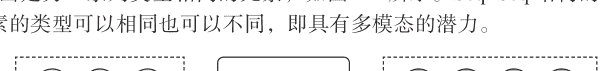

Seq2Seq 结构设计简洁高效，应用空间广阔，在机器翻译、文本摘要、语言模型等热门任务中均取得显著成效。因此本节将详细阐述该结构及其运行机理。

### 1.1.1 分词器
在介绍 Seq2Seq 之前，需要先了解分词器。人类沟通依赖自然语言，词汇复杂多样，而计算机无法直接处理单词或汉字。模型训练前需把人类可理解的元素转为计算机可计算的向量。分词器负责准备模型输入，将语料预处理为模型可接受的格式。对文本而言，分词器的作用是将文本转为词元序列，单个词元可以是字母、单词、标点或其他符号，这一过程即为分词 tokenization。

# 1. 什么是分词
词元可理解为最小语义单元，分词旨在把输入文本拆分为一系列词元，并保证每个词元具有相对完整的独立语义。例如“Hello World!”可拆分为 4 个词元 ["Hello"," ","World","!"]，再将每个词元映射为数字，后续用该数字表示词元，该数字称为词元 ID 或 token ID。如表 1-1 所示，可将“Hello World!”转为“1 2 3 4”的数字序列。

分词的粒度如何选择？英文从细到粗依次为 character、subword、word。character 指单个字符如 a、b、c、d；word 指完整单词如 water；subword 则类似词根、前缀、后缀，如 unfortunately 中的 un、fortun(e)、ly 都是有意义的子词。

中文分词经历了按词语、按字、按子词三个阶段。按词语和按字较为直观，常见工具如 jieba。若按子词，词元可以是偏旁部首，简单字本身也可作为单个词元。例如“江”“河”“湖”“海”都与水相关，共用“三点水”旁。分词时“氵”可能作为单个词元，“工”“可”“胡”“每”为另三个词元。若“氵”ID 为 1，四者其余部分 ID 分别为 2、3、4、5，则四字的序列可表示为 1 2、1 3、1 4、1 5。这样只要序列中出现 ID 为 1 的元素，即可判定与水相关。即使“沙”由“氵”与“少”组成，也可理解为水很少之处。

# 2. BPE 分词算法
以单个字母或单词为词元会带来问题：一是不同语言词汇量差异大，用唯一 ID 会占用大量内存；二是罕见词、新造词、专有名词、缩写、网络用语等需要不断更新词表并重训模型。

为解决此问题，GPT 模型采用 BPE 字节对编码方法分割文本。BPE 是一种数据压缩技术，将文本切分为更小的子单元 subword，可为单字母、字母组合、部分单词或完整单词。BPE 基于统计频率合并最常见的字母对或子单元对，能更高效处理多语言词汇量与新词。

举例说明 BPE 分词流程。基于子词的分词遵循基本原则：常用词尽量保持为单个词元，罕见词拆分为多个词元。若有一个语料库，从零构建词表首先统计词频，得到如下结果：{"class</w>": 1, "classified</w>": 2, "classification</w>": 3, "create</w>": 4, "created</w>": 5, "creation</w>": 6}。其中“</w>”为标记单词结束的特殊符号。随后将每个单词拆分为字符并再次统计频次，特殊符号也视作字符，可得表 1-2。

表 1-1 “Hello World!” 的分词示例

| 词元 ID | 词元 | 备注 |
| --- | --- | --- |
| 1 | Hello | |
| 2 |  | 空格 |
| 3 | World | |
| 4 | ! | |

表 1-2 词元频次表 1

| 标号 | 词元 | 次数 | 标号 | 词元 | 次数 | 标号 | 词元 | 次数 |
| --- | --- | --- | --- | --- | --- | --- | --- | --- |
| 1 | e | 26 | 6 | t | 18 | 11 | d | 7 |
| 2 | c | 24 | 7 | r | 15 | 12 | 1 | 6 |
| 3 | a | 24 | 8 | s | 12 | 13 | f | 5 |
| 4 | </w> | 21 | 9 | o | 9 |  |  |  |
| 5 | i | 19 | 10 | n | 9 |  |  |  |

下一步寻找出现最频繁的字符对并合并。从出现次数最多的字符开始，即“e”。计数发现“ea”出现最多，出现 4+5+6=15 次，故将“e”与“a”合并为“ea”，更新词元频次表，得到表 1-3。

表 1-3 词元频次表 2

| 标号 | 词元 | 次数 | 标号 | 词元 | 次数 | 标号 | 词元 | 次数 |
| --- | --- | --- | --- | --- | --- | --- | --- | --- |
| 1 | e | 26-15=11 | 6 | t | 18 | 11 | d | 7 |
| 2 | c | 24 | 7 | r | 15 | 12 | 1 | 6 |
| 3 | a | 24-15=9 | 8 | s | 12 | 13 | f | 5 |
| 4 | </w> | 21 | 9 | o | 9 | 14 | ea | 15 |
| 5 | i | 19 | 10 | n | 9 |  |  |  |

继续合并，此时次数最高的是字符“c”，可发现“cr”合并次数最多，将二者合并并更新频率表，得到表 1-4。

表 1-4 词元频次表 3

| 标号 | 词元 | 次数 | 标号 | 词元 | 次数 | 标号 | 词元 | 次数 |
| --- | --- | --- | --- | --- | --- | --- | --- | --- |
| 1 | e | 26-15=11 | 6 | t | 18 | 11 | d | 7 |
| 2 | c | 24-15=9 | 7 | r | 15-15=0 | 12 | 1 | 6 |
| 3 | a | 24-15=9 | 8 | s | 12 | 13 | f | 5 |
| 4 | </w> | 21 | 9 | o | 9 | 14 | ea | 15 |
| 5 | i | 19 | 10 | n | 9 | 15 | cr | 15 |

再进一步合并，可见 BPE 编码的精妙之处。接下来将“cr”与“ea”合并为“crea”，并删除出现次数为 0 的词元，更新词元频次表，得到表 1-5。

表 1-5 词元频次表 4

| 标号 | 词元 | 次数 | 标号 | 词元 | 次数 | 标号 | 词元 | 次数 |
|---|---|---|---|---|---|---|---|---|
| 1 | e | 26-15=11 | 6 | t | 18 | 11 | l | 6 |
| 2 | c | 24-15=9 | 7 | s | 12 | 12 | f | 5 |
| 3 | a | 24-15=9 | 8 | o | 9 | 13 | crea | 15 |
| 4 | </w> | 21 | 9 | n | 9 | | | |
| 5 | i | 19 | 10 | d | 7 | | | |

重复上述步骤，单一体元会逐步合并，这也是 BPE 的核心目标——数据压缩。可在开始时设定阈值，每次更新后词元总数可能增减，当总数达到预设阈值即停止合并，此时词元频次表即为最终词表。

合并过程中总词元数可能增加、减少或不变。迭代次数较小时，大部分词元仍为字母，语义有限；迭代次数增大时，常用词逐渐合并。如图 1-2 所示，某次实验中词元总数随迭代次数先增后减，最终在达到预设阈值时停止变化，因此停止标准的选取是一个需要调参的点。

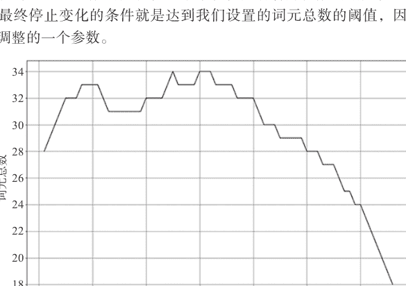
图 1-2 BPE 分词算法的词元总数随着迭代次数的增大而先增大后减小

词表本质上就是把词元和数字 ID 建立起一一对应的对照关系。模型在处理输入时，会先把序列里每一个元素对应的词元全部转成 ID，再根据 ID 去查表拿到对应的特征向量。生成阶段则相反，模型先给出词元 ID，再通过同样的对照关系把 ID 还原成可读的词元。

BPE 在分词上有着明显的好处。它的工作方式能压缩词元总数，从而降低内存和计算开销；碰到未见过或极少出现的词时，会把它拆成已知的子单元来表示；还能捕捉到形态上的变化，比如复数、时态、派生词，帮助模型学会词与词之间的关联。相应的代价也很突出：有时会把带有语义的子片段切开，让一个完整词被拆成好几块；对 HTML 标签、URL、邮箱这类特殊符号或标记的处理也不稳定，容易丢失原始含义或格式。所以 BPE 并不完美，它更像是在减少词元数量和保留语义信息之间做的一个折中。

BPE 是目前比较主流的分词方案，GPT-2、BART、Llama 都在使用。除此之外还有其他思路。WordPiece 的整体思路和 BPE 相近，不同的是合并子词的依据不是简单地挑出现频率最高的相邻对，而是挑选能提升语言模型概率的相邻对，BERT 就采用了这一套。SentencePiece 则把空格当成一种特殊字符先处理，再套用 BPE 进行切分，ChatGLM、BLOOM、PaLM 等模型就用的是 SentencePiece。

在数据预处理时加入 StartToken、PadToken、EndToken 等特殊词元，能帮助模型更好地理解数据结构，也方便下游任务做编码。以 Vicuna 为例，把对话结束标记 </s> 混进微调数据，就能让模型更准确地判断何时该停止生成。

### 1.1.2 编码器 - 解码器结构

继续往下看 Seq2Seq 的整体框架，如图 1-3，模型最外层通常由编码器和解码器两部分构成。编码器按顺序把输入序列逐个消化，再把信息压缩成一个上下文向量传给解码器，解码器据此逐步生成输出序列。早期编码解码常采用 RNN，后来演进为 LSTM 或 GRU，但不管内部单元如何变化，核心能力都是提取时序特征。

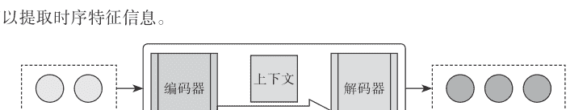

图 1-3 Seq2Seq 结构的模型一般由一个编码器和一个解码器组成

下面用 PyTorch 实现一个简化的 Seq2Seq 并在 1.1.4 节的实战中使用。实现脉络大概是先搭好编码器和解码器，再在解码器里加上注意力机制，随后定义损失函数，最后进入训练与评估。

# 1. 编码器

编码器里一般先用嵌入层把输入词元转成向量。嵌入层的参数形状是 vocab_size × embed_size，vocab_size 对应词表规模，embed_size 对应向量维度。若存在多层编码器，词向量的转换只在最底层执行一次，下层编码器拿到的是词向量列表，上层编码器拿到的是前一层编码器的输出。所有编码器的输入来源保持一致，通常是一个 512 维向量的列表，列表长度可通过超参数调节，一般取训练集中最长句子的长度。

```python
class EncoderRNN(nn.Module):
    def __init__(self, input_size, hidden_size, dropout_p=0.1):
        super(EncoderRNN, self).__init__()
        self.hidden_size = hidden_size
        self.embedding = nn.Embedding(input_size, hidden_size)
        self.rnn= nn.RNN(hidden_size, hidden_size, batch_first=True)
        self.dropout = nn.Dropout(dropout_p)

    def forward(self, x):
        x = self.embedding(x)
        x = self.dropout(x)
        output, hidden = self.rnn(x)
        return output, hidden
```

这段代码实现了一个名为 EncoderRNN 的类，用来把输入序列编码成隐藏状态向量。

初始化里主要包含三块成员。

- self.hidden_size 表示隐藏状态的维度。
- self.embedding 负责把输入序列的每个元素映射成稠密向量。
- self.rnn 是一个循环层，输入输出维度均为 hidden_size，并设置 batch_first=True。

前向传播时，先对输入做嵌入并加入 dropout，随后送入 RNN 编码，最后返回编码后的输出序列和末尾的隐藏状态。

下面实例化一个编码器，用玩具数据验证输入向量、输出向量和隐藏状态的维度。

```python
encoder = EncoderRNN(input_size=10, hidden_size=5) # 词表大小为 10，隐藏状态维度为 5
input_vector = th.tensor([[0, 1, 2, 3, 4, 5, 6, 7, 8, 9]])
output, hidden = encoder(input_vector)
print("输入向量的维度:", input_vector.size()) # 输入向量的维度 : torch.Size([1, 10])
print("输出向量的维度:", output.size()) # 输出向量的维度 : torch.Size([1, 10, 5])
print("最终隐藏状态的维度:", hidden.size()) # 最终隐藏状态的维度 : torch.Size([1, 1, 5])
```

# 2. 解码器

当编码器由多层 RNN 构成时，解码器只会用到编码器最后一层的输出，这个输出也常被称作上下文向量，因为它浓缩了整个输入的上下文。解码器会用它来初始化自己的隐藏状态，这就要求解码器和编码器的隐藏维度保持一致。解码器最终要给出词元的概率分布，因此最后一层会接一个全连接层做变换。

目标序列在进入解码器之前需要整体右移一位，并在开头补上开始标记 SOS_token。比如目标是 “Hello World!” ，实际喂给模型的是 [SOS_token, Hello, World, !]。解码过程是先输入 SOS_token 得到 Hello，再把 SOS_token 和 Hello 拼接输入得到 World，如此迭代直到输出结束标记 EOS_token。

训练时解码器采用强制学习策略，即用真实的目标输出作为下一时刻的输入，而不是用模型自己猜测的结果。比如输入 SOS_token 期望输出 Hello，若模型实际猜出 Hi，也先记录下来，下一轮仍然用正确答案 Hello 与 SOS_token 拼接输入。强制学习能加速收敛，但在推理时可能出现不稳定。

```python
class DecoderRNN(nn.Module):
    def __init__(self, hidden_size, output_size):
        super(DecoderRNN, self).__init__()
        self.embedding = nn.Embedding(output_size, hidden_size)
        self.rnn = nn.RNN(hidden_size, hidden_size, batch_first=True)
        self.out = nn.Linear(hidden_size, output_size)

    def forward(self, encoder_outputs, encoder_hidden, target_tensor=None):
        batch_size = encoder_outputs.size(0)
        decoder_input = th.empty(batch_size, 1, dtype=th.long).fill_(SOS_token)
        # Start of Sentence 词元，表示开始生成一个句子
        decoder_hidden = encoder_hidden
        decoder_outputs = []
        for i in range(MAX_LENGTH):
            decoder_output, decoder_hidden = self.forward_step(decoder_input, decoder_hidden)
            decoder_outputs.append(decoder_output)
            if target_tensor is not None: # 强制学习
                decoder_input = target_tensor[:, i].unsqueeze(1)
            else:
                _, topi = decoder_output.topk(1)
                decoder_input = topi.squeeze(-1).detach()

        decoder_outputs = th.cat(decoder_outputs, dim=1)
        decoder_outputs = F.log_softmax(decoder_outputs, dim=-1)
        return decoder_outputs, decoder_hidden, None

    def forward_step(self, x, hidden):
        x = self.embedding(x)
        x = F.relu(x)
        x, hidden = self.rnn(x, hidden)
        output = self.out(x)
        return output, hidden
```

这段代码定义了 DecoderRNN 类，用于依据编码器的输出和隐藏状态逐步生成目标序列。

初始化里有三个主要成员。

self.embedding 和 self.rnn 的作用前面已介绍。self.out 是一个线性层，把 RNN 的输出映射到目标序列的维度。

前向传播时，先根据编码器的输出和隐藏状态初始化解码器的首个输入，然后循环 MAX_LENGTH 次，每次调用 forward_step 逐步生成。强制学习会把真实目标序列当作下一步输入。循环产生的每个输出会被收集到 decoder_outputs 列表中。

传播结束时，把所有输出拼接后经过 log_softmax 归一化，得到最终的 decoder_outputs，同时返回最后的隐藏状态和占位的 None 以保持训练循环一致。

forward_step 负责单步解码：先嵌入输入，再经 ReLU 激活，之后通过 RNN 计算，最后用线性层映射到目标维度，返回解码结果和隐藏状态。

下面实例化一个解码器，用玩具数据检查最终输出向量的维度。

```python
decoder = DecoderRNN(hidden_size=5, output_size=10)
target_vector = th.tensor([[0, 1, 2, 3, 4, 5, 6, 7, 8, 9]])
encoder_outputs, encoder_hidden = encoder(input_vector)
output, hidden, _ = decoder(encoder_outputs, encoder_hidden, input_vector)
print("输出向量的维度:", output.size()) # 输出向量的维度:[1, 10, 10]
```

最终输出向量的第一维是批量大小，第二维是最大输出长度 MAX_LENGTH，第三维是词表大小。

## 1.1.3 注意力机制

经典 Seq2Seq 把所有输入信息都压缩进一个固定长度的上下文向量里，当输入很长时，一个向量装不下全部信息，模型对长序列的处理能力就会受限。Bahdanau 等人在 2014 年、Luong 等人在 2015 年提出的注意力机制正好解决了这个问题，让模型能够按需聚焦输入序列的相关片段，放大关键位置的信号，从而提升生成质量。

直观上很好理解，如图 1-4，当我们看到一张新图时，注意力会自动落在关键区域，而不是扫遍整张图。人类注意力能减少资源消耗并提高信息处理效率，深度学习中的注意力也类似，能更有效地定位重点并赋予更高权重。

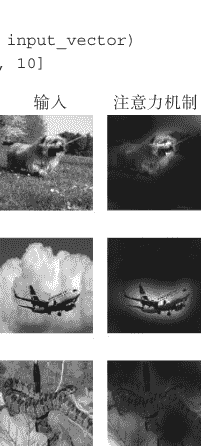

带注意力机制的 Seq2Seq 和经典版本主要有两点区别。

1. 如果编码器有多层，带注意力的结构会把更多中间信息传递给解码器。经典版本只传编码阶段的最后一个隐藏状态，而带注意力版本会把编码阶段的所有隐藏状态都传过去，如图 1-5 所示。

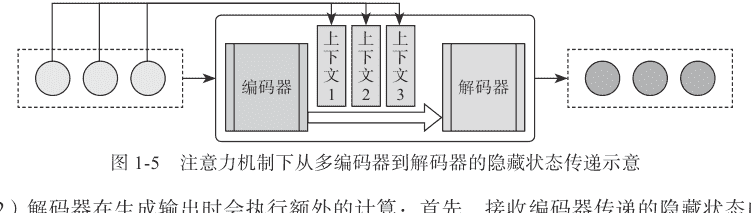

2. 解码器在生成输出时会做额外计算：先接收编码器传来的隐藏状态向量，对每个向量打分，再用 softmax 分数加权，放大高分向量，如图 1-6 所示。

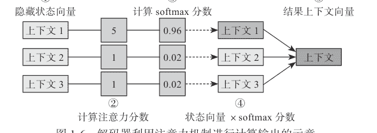

为了计算注意力权重，可以额外加一个前馈层，它的输入是解码器的输入和隐藏状态。由于训练样本句子长度不一，需要先选定一个最大句子长度作为参考，用来构建和训练这个前馈层。短句只使用前几个注意力权重，长句则使用全部权重，这样模型就能处理不同长度并学会合适的权重分配。

具体演算我们会在 1.2 节介绍 Transformer 架构时详细展开，这里先给出一个简化的实现。

```python
class Attention(nn.Module):
    def __init__(self, hidden_size):
        super(Attention, self).__init__()
        self.Wa = nn.Linear(hidden_size, hidden_size)
        self.Ua = nn.Linear(hidden_size, hidden_size)
        self.Va = nn.Linear(hidden_size, 1)

    def forward(self, query, keys):
        scores = self.Va(th.tanh(self.Wa(query) + self.Ua(keys)))
        scores = scores.squeeze(2).unsqueeze(1)
        weights = F.softmax(scores, dim=-1)
        context = th.bmm(weights, keys)
        return context, weights
```

这段代码定义了 Attention 类，用来实现注意力机制。初始化里通过三个线性层 nn.Linear 定义参数。

- self.Wa 的输入输出维度均为 hidden_size。
- self.Ua 的输入输出维度均为 hidden_size。
- self.Va 的输入维度为 hidden_size，输出维度为 1。

注意力计算单元在前向阶段会接收两类输入：查询向量 query 以及一组待比较的键向量集合 keys。query 单独承载查询意图，keys 则构成多个候选。先对两者分别做线性投影，随后送入 tanh 激活，再叠加得到衡量两者相似度的分数 scores。分数越高表示 query 与对应 key 越相关。随后对 scores 做一次 squeeze 和 unsqueeze，将其形状从 (1, N, 1) 调整为 (1, 1, N)，N 为 key 个数。紧接着用 softmax 做归一化，得到每个 key 的注意力权重 weights。最后借助 torch.bmm 以权重对 keys 做加权求和，生成上下文向量 context，并连同权重一并返回。
```python
class AttentionDecoderRNN(nn.Module):
    def __init__(self, hidden_size, output_size, dropout_p=0.1):
        super(AttentionDecoderRNN, self).__init__()
        self.embedding = nn.Embedding(output_size, hidden_size)
        self.attention = Attention(hidden_size)
        self.rnn = nn.RNN(2 * hidden_size, hidden_size, batch_first=True)
        self.out = nn.Linear(hidden_size, output_size)
        self.dropout = nn.Dropout(dropout_p)

    def forward(self, encoder_outputs, encoder_hidden, target_tensor=None):
        batch_size = encoder_outputs.size(0)
        decoder_input = th.empty(batch_size, 1, dtype=th.long).fill_(SOS_token)
        decoder_hidden = encoder_hidden
        decoder_outputs = []
        attentions = []
        for i in range(MAX_LENGTH):
            decoder_output, decoder_hidden, attn_weights = self.forward_step(decoder_input, decoder_hidden, encoder_outputs)
            decoder_outputs.append(decoder_output)
            attentions.append(attn_weights)
            if target_tensor is not None:  # 强制学习
                decoder_input = target_tensor[:, i].unsqueeze(1)
            else:
                _, topi = decoder_output.topk(1)
                decoder_input = topi.squeeze(-1).detach()

        decoder_outputs = th.cat(decoder_outputs, dim=1)
        decoder_outputs = F.log_softmax(decoder_outputs, dim=-1)
        attentions = th.cat(attentions, dim=1)
        return decoder_outputs, decoder_hidden, attentions

    def forward_step(self, input, hidden, encoder_outputs):
        embedded = self.dropout(self.embedding(input))
        query = hidden.permute(1, 0, 2)
        context, attn_weights = self.attention(query, encoder_outputs)
        input_rnn = th.cat((embedded, context), dim=2)
        output, hidden = self.rnn(input_rnn, hidden)
        output = self.out(output)
        return output, hidden, attn_weights
```

下面介绍的 AttentionDecoderRNN 类就是带注意力机制的解码器实现。构造阶段会实例化若干子组件。

- self.embedding 是嵌入层，负责把目标序列转成稠密表示。输入维度取目标词表大小 output_size，输出维度为隐藏层宽度 hidden_size。
- self.attention 是注意力模块。基础输入维度是 hidden_size，实际使用时编码器输出与解码器隐藏状态会拼接后送入 RNN，所以有效输入维度会翻倍为 2 * hidden_size。
- self.rnn 用来处理序列信息，注释里表述为卷积神经网络。它的输入是嵌入向量与上下文向量的拼接，维度为 2 * hidden_size，输出维度为 hidden_size。
- self.out 是线性映射层，把解码器中间结果投射到目标词表。输入 hidden_size，输出 output_size。
- self.dropout 用来做正则，训练时随机置零部分单元以抑制过拟合。

前向调用接收 encoder_outputs、encoder_hidden 和 target_tensor 三个参数。先从 encoder_outputs 的形状读出 batch_size，并用起始符填充一个形状为 (batch_size, 1) 的 LongTensor 作为解码器的首个输入，初始隐藏态直接沿用编码器的隐藏态。

随后进入最大长度 MAX_LENGTH 的解码循环。每一步都调用 forward_step 完成一次解码，把当步的解码结果、注意力权重以及上一时刻的输入分别累积到 decoder_outputs 和 attentions 列表中。

循环结束后把两个列表纵向拼接，decoder_outputs 再做 log_softmax。最终返回解码器输出序列、最终隐藏态以及各步注意力权重。

forward_step 的输入是当前步输入 input、隐藏态 hidden 和 encoder_outputs。流程是先经嵌入层编码并做 dropout，再对隐藏态做维度重排以适配注意力模块的输入。调用 attention 拿到上下文向量 context 和注意力分布 attn_weights。把嵌入结果与 context 在第三维拼接，作为 RNN 的输入。RNN 处理后得到新的输出和隐藏态，最后经线性层映射到词表大小得到本步解码结果。

随后会用玩具数据实例化该解码器，观察输出张量与注意力权重的形状。
```python
decoder = AttentionDecoderRNN(hidden_size=5, output_size=10)
target_vector = th.tensor([[0, 1, 2, 3, 4, 5, 6, 7, 8, 9]])
encoder_outputs, encoder_hidden = encoder(input_vector)
output, hidden, attentions = decoder(encoder_outputs, encoder_hidden, input_vector)
print("输出向量的维度:", output.size())  # 输出向量的维度 : torch.Size([1, 10, 10])
print("注意力权重的维度:", attentions.size()) # 注意力权重的维度 : torch.Size([1, 10, 10])
```

## 1.1.4 实战：日期转换

这一节用一个直观简单的日期转换任务来加深对 Seq2Seq 结构的理解。目标是把中文的“年-月-日”写法转成英文的“day/month/year”即 DD/MM/YYYY 格式，时间范围锁定在 1950 到 2050 年。任务本身靠规则即可完成，为了提升难度，中文侧采用“YY-MM-DD”这种缺少世纪两位数字的写法，模型需要自行判断是 20 世纪还是 21 世纪。

### 1. 加载数据
训练先要有数据，鉴于规则简单可以直接合成。需要为每个数字、分隔符和单词建立唯一索引，方便后续编码器输入和解码器输出的转换。常用做法是维护 word2index 与 index2word 两个字典，分别实现词到索引、索引到词的映射。

```python
class DateDataset(Dataset):
    def __init__(self, n):
        # 初始化两个空列表，用于存储中文和英文日期
        self.date_cn = []
        self.date_en = []
        for _ in range(n):
            # 随机生成年、月和日
            year = random.randint(1950, 2050)
            month = random.randint(1, 12)
            day = random.randint(1, 28)  # 假设最大为 28 日
            date = datetime.date(year, month, day)
            # 格式化日期并添加到对应的列表中
            self.date_cn.append(date.strftime("%y-%m-%d"))
            self.date_en.append(date.strftime("%d/%b/%Y"))
# 创建一个词汇集，包含 0 ~ 9 的数字、-、/ 和英文日期中的月份缩写
```

```python
self.vocab = set([str(i) for i in range(0, 10)] +
                   ["-", "/"] + [i.split("/")[1] for i in self.date_en])
# 创建一个词汇到索引的映射，其中 <SOS>、<EOS> 和 <PAD> 分别对应开始、结束和填充标记
self.word2index = {v: i for i, v in enumerate(
                   sorted(list(self.vocab)), start=2)}
self.word2index["<SOS>"] = SOS_token
self.word2index["<EOS>"] = EOS_token
self.word2index["<PAD>"] = PAD_token
# 将开始、结束和填充标记添加到词汇集中
self.vocab.add("<SOS>")
self.vocab.add("<EOS>")
self.vocab.add("<PAD>")
# 创建一个索引到词汇的映射
self.index2word = {i: v for v, i in self.word2index.items()}
# 初始化输入和目标列表
self.input, self.target = [], []
for cn, en in zip(self.date_cn, self.date_en):
    # 将日期字符串转换为词汇索引列表，然后添加到输入和目标列表中
    self.input.append([self.word2index[v] for v in cn])
    self.target.append(
        [self.word2index["<SOS>"], ] +
        [self.word2index[v] for v in en[:3]] +
        [self.word2index[en[3:6]]] +
        [self.word2index[v] for v in en[6:]] +
        [self.word2index["<EOS>"], ]
    )
# 将输入和目标列表转换为 NumPy 数组
self.input, self.target = np.array(self.input), np.array(self.target)

def __len__(self):
    # 返回数据集的长度，即输入的数量
    return len(self.input)

def __getitem__(self, index):
    # 返回给定索引的输入、目标和目标的长度
    return self.input[index], self.target[index], len(self.target[index])

@property
def num_word(self):
    # 返回词表的大小
    return len(self.vocab)
```

在这里定义了 DateDataset 类，继承自 torch.utils.data.Dataset，专门负责随机生成日期样本并做预处理编码。

初始化时先创建空的 date_cn 与 date_en 两个列表，分别存放 “YY-MM-DD” 和 “DD/MM/YYYY” 两种格式的日期。随后按给定的样本数 n 生成 n 个随机日期，每个日期由随机年份、月份、日组成，用 strftime 转成目标字符串格式分别写入两个列表。

基于生成的日期构建词表，词表包含出现过的所有数字、分隔符 “-” 与 “/” 以及月份缩写。随后把词表映射为 word2index 和 index2word，并额外加入特殊标记 <SOS> 与 <EOS> 及其索引。

编码阶段，对 date_cn 中的每个字符按字典转为索引，得到输入序列列表 input；对 date_en 先规范格式，再在前后加上 <SOS>、<EOS>，得到目标序列列表 target。最后把两者转成 NumPy 数组存入 self.input 与 self.target。

该类提供了 __len__ 与 __getitem__ 用于获取长度和单条样本，还提供 num_word 属性返回词表大小。

下面可以快速预览数据集，示意图见图 1-7 所示。

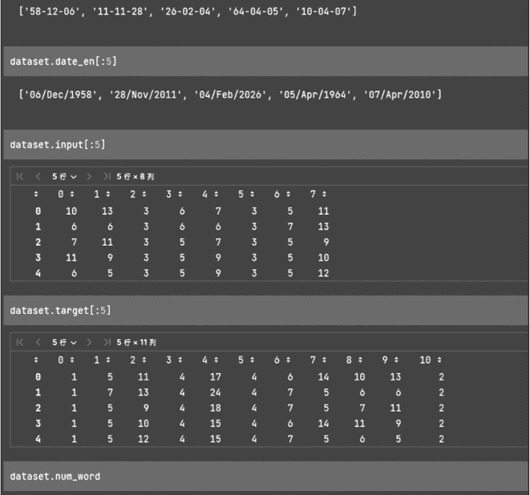

图 1-7 数据集样例示意

### 2. 训练模型
数据准备完毕后即可进入模型训练，具体流程见后续代码。

```python
n_epochs = 100
batch_size = 32
MAX_LENGTH = 11
hidden_size = 128
learning_rate=0.001
dataloader = DataLoader(dataset, batch_size=batch_size, shuffle=True, drop_last=True)
encoder = EncoderRNN(dataset.num_word, hidden_size)
decoder = AttentionDecoderRNN(hidden_size, dataset.num_word)
encoder_optimizer = optim.Adam(encoder.parameters(), lr=learning_rate)
decoder_optimizer = optim.Adam(decoder.parameters(), lr=learning_rate)
criterion = nn.NLLLoss()

for i in range(n_epochs + 1):
    total_loss = 0
    for input_tensor, target_tensor, target_length in dataloader:
        encoder_optimizer.zero_grad()
        decoder_optimizer.zero_grad()
        encoder_outputs, encoder_hidden = encoder(input_tensor)
        decoder_outputs, _, _ = decoder(encoder_outputs, encoder_hidden, target_tensor)
        loss = criterion(
            decoder_outputs.view(-1, decoder_outputs.size(-1)),
            target_tensor.view(-1).long()
        )
        loss.backward()
        encoder_optimizer.step()
        decoder_optimizer.step()
        total_loss += loss.item()

total_loss /= len(dataloader)
if i % 10 == 0:
    print(f"epoch: {i}, loss: {total_loss}")
```
训练前的第一步是把核心超参数固定下来，常见的有总轮次 n_epochs、批次大小 batch_size、最大序列长度 MAX_LENGTH、隐藏层维度 hidden_size 以及学习率 learning_rate。随后用 DataLoader 把数据集切分为若干批次，并打开 shuffle=True 做随机打乱。编码器选用 EncoderRNN，解码器选用 AttentionDecoderRNN，两者都交由 Adam 优化器负责参数更新。损失计算使用 nn.NLLLoss，用来衡量模型输出与真实目标张量的负对数似然差距。

外层循环控制轮次，内层循环逐批遍历数据。进入每个批次前先把优化器梯度清零，避免梯度累积干扰优化。输入张量 input_tensor 先送入编码器得到编码后的表示和隐藏状态，再把这些信息连同目标张量 target_tensor 一起喂给解码器得到预测输出。用 NLLLoss 计算当前批次误差，随后执行反向传播和一次参数更新。所有批次的误差累加形成本轮总损耗。

轮次结束后用总损耗除以 dataloader 的批次数得到平均损失，并按每 10 个迭代打印一次轮数与均值，便于实时监控训练状态。

### 3. 评估
推理阶段先把编码器和解码器切换到 eval 模式。与训练不同，这里没有真实标签可用，解码器采用自回归方式把刚生成的词作为下一步输入。每次解码出一个新词就拼接到结果字符串，一旦遇到 EOS 结束符立即停止生成。

```python
def evaluate(encoder, decoder, x):
    encoder.eval()
    decoder.eval()
    encoder_outputs, encoder_hidden = encoder(th.tensor(np.array([x])))
    start = th.ones(x.shape[0], 1)    # [n, 1]
    start[:, 0] = th.tensor(SOS_token).long()
    decoder_outputs, _, _ = decoder(encoder_outputs, encoder_hidden)
    _, topi = decoder_outputs.topk(1)
    decoded_ids = topi.squeeze()
    decoded_words = []
    for idx in decoded_ids:
        decoded_words.append(dataset.index2word[idx.item()])
    return ''.join(decoded_words)

for i in range(5):
    predict = evaluate(encoder, decoder, dataset[i][0])
    print(f"input: {dataset.date_cn[i]}, target: {dataset.date_en[i]}, predict: {predict}")
```
代码实现上通过循环调用 evaluate 函数完成单样本预测并输出结果。先把输入 x 送入编码器提取上下文表示和隐藏状态，随后构造起始向量 start，形状设为 [n, 1]，每个位置都填入 SOS_token 的索引。把编码器的上下文、隐藏状态和 start 一并输入解码器得到首步输出。

对解码器输出做 argmax 取出每个位置概率最高的索引 topi，形成 id 序列 decoded_ids。再借助 dataset.index2word 把 id 映射回词表，收集到 decoded_words。把这些词按顺序拼接即为最终预测 predict。

如图 1-8 所示，主程序会遍历 5 条测试数据，每条都调用 evaluate 并打印中文日期 dataset.date_cn[i]、英文目标 dataset.date_en[i] 以及模型预测。可见日期转换基本准确，例如 2011-11-28 也未被误判为 1911 年。

18 第一篇 算法原理

```python
for i in range(5):
    predict = evaluate(encoder, decoder, dataset[i][0])
    print(f"input: {dataset.date_cn[i]}, target: {dataset.date_en[i]}, predict: {predict}")

input: 58-12-06, target: 06/Dec/1958, predict: <SOS>06/Dec/1958<EOS>
input: 11-11-28, target: 28/Nov/2011, predict: <SOS>28/Nov/2011<EOS>
input: 26-02-04, target: 04/Feb/2026, predict: <SOS>04/Feb/2026<EOS>
input: 64-04-05, target: 05/Apr/1964, predict: <SOS>05/Apr/1964<EOS>
input: 10-04-07, target: 07/Apr/2010, predict: <SOS>07/Apr/2010<EOS>
```
图 1-8 Seq2Seq 的日期转换模型训练效果示意

## 1.2 Transformer 模型介绍
Transformer 完全依托注意力机制完成训练，源自 2017 年的经典论文 “Attention Is All You Need” https://arxiv.org/abs/1706.03762，最初为机器翻译提出，并在多个基准上超越了当时 Google 的其他神经机器翻译系统。它同样属于 Seq2Seq 家族，但摆脱了 RNN 的串行依赖，凭借并行计算特性大幅提升了训练与推理效率。

### 1.2.1 位置编码
若直接把词嵌入送入编码器，Transformer 会出现顺序丢失的问题。因为注意力计算是并行的，模型内部没有 RNN 那样的时序递推，对输入顺序并不敏感，甚至打乱词序也可能得到相似表示。为补足这一缺陷，Transformer 引入位置嵌入 Position Embedding，又称位置编码，把位置信息注入词向量。做法是准备一组额外向量表征相对距离，再与词嵌入相加，如图 1-9 所示，这样模型就能同时利用语义和位置两类信息。

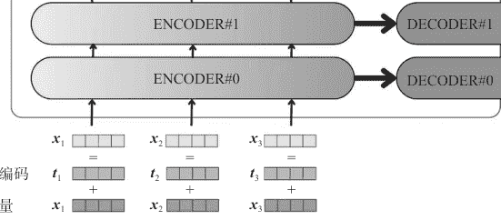
图 1-9 Transformer 模型中的位置编码与词向量融合示意

位置编码的实现思路大体可分为两类，绝对位置编码和相对位置编码，选择不同会影响模型的泛化与扩展能力。

## 1. 绝对位置编码
绝对位置编码思路最直观：第 k 个输入向量 x_k 直接加上只由位置 k 决定的位置向量 p_k，形成 x_k + p_k。形式简单却衍生出多种变体。

### (1) 训练位置编码
最简便的做法是让位置编码可训练。完全不手工设计规则，直接把一组位置向量作为模型参数随训练更新，BERT、GPT 系列就采用这种方案。举例来说，若设定最大长度 512，模型维度 768，则初始化一个 512×768 的可学习矩阵，随着优化逐步调整。

```python
self.pos_embedding = nn.Parameter(torch.randn(512, 768))
```
此类方案的短板是缺乏外推能力。训练时若上限设为 512，推理阶段就无法处理超过该长度的序列，超出部分直接失效。

### (2) 三角函数位置编码
原始 Transformer 采用 Sinusoidal 三角函数位置编码。设序列长度为 N，模型维度为 d_model，整体形状为 (N, d_model)。编码时按列交替使用 sin 和 cos：偶数列用正弦，奇数列用余弦。具体公式如下

$$

\begin{aligned}

PE_{(pos, 2i)} &= \sin(pos / 10000^{2i/d_{\text{model}}}) \\

PE_{(pos, 2i+1)} &= \cos(pos / 10000^{2i/d_{\text{model}}})

\end{aligned}

$$
其中 pos 是词元的位置数, $i$ 的取值范围则是从 0 到 $\frac{d_{\text{model}}}{2}$。

选择三角函数主要出于规律性和可外推性考虑，同时利用了正弦余弦的和角特性

$$

\begin{aligned}

\sin(\alpha + \beta) &= \sin \alpha \cos \beta + \cos \alpha \sin \beta \\

\cos(\alpha + \beta) &= \cos \alpha \cos \beta - \sin \alpha \sin \beta

\end{aligned}

$$
这意味着位置 α+β 的编码可以由位置 α 与 β 的编码线性组合得到，后续位置的向量能被前面向量表征，间接提供了绝对位置线索。

相应的 Python 代码如下。

```python
def get_position_angle_vector(position):
    return [position / np.power(10000, 2 * (hid_j // 2) / d_hid) for hid_j in
            range(d_hid)]

sinusoidal_table = np.array([get_position_angle_vector(i) for i in range(n_position)])
sinusoidal_table[:, 0::2] = np.sin(sinusoidal_table[:, 0::2]) # 偶数列进行 sin 操作
sinusoidal_table[:, 1::2] = np.cos(sinusoidal_table[:, 1::2]) # 奇数列进行 cos 操作
```
### (3) 递归位置编码
RNN 本身就能学习顺序信息，理论上在词嵌入后先接一个 RNN 层再进入 Transformer，就能自带位置感，省去显式编码。另一种做法是用递归生成位置向量，从初始向量 p0 出发，按 p_{k+1}=f(p_k) 递推得到各位置编码。递归方式外推性与灵活性优于三角函数，但串行特性会降低并行效率，导致训练变慢。

## 2. 相对位置编码
注意力打分本质上只关心两个位置之间的相对距离，而非各自的绝对坐标，因此相对位置编码更灵活、扩展性更强。

### (1) 经典相对位置编码
位置信息在注意力计算中丢失，最直接的补救是在注意力层重新引入。Transformer 原始团队在论文 Self-Attention with Relative Position Representations https://arxiv.org/abs/1803.02155 中提出在分数计算与加权求和时分别引入可学习相对位置参数，并允许多头共享。

先计算基础交互

$$

e_{i,j} = x_i W_Q (x_j W_K)^T + p_i W_Q (x_j W_K)^T + x_i W_Q (p_j W_K)^T + p_i W_Q (p_j W_K)^T

$$
其中 $x_{i}$ 和 $x_{j}$ 分别表示两个位置的特征向量, $p_{i}$ 和 $p_{j}$ 则表示两个位置的编码向量, 接下来要计算注意力分数, 即

$$

a_{i,j} = \text{softmax}(e_{i,j})

$$
为引入相对位置，去掉首项中 pi 的影响，并把展开式里 pj WK 替换为二元相对向量 R_{i,j}^K，变成

$$

e_{i,j} = x_i W_Q (x_j W_K)^T + x_i W_Q (R_{i, j}^{K})^T + p_i W_Q (p_j W_K)^T

$$
最后进行加权平均, 即

$$

\boldsymbol{z}_{i}=\sum_{j} \boldsymbol{a}_{i, j} \boldsymbol{v}_{j}=\sum_{j} \boldsymbol{a}_{i, j}\left(\boldsymbol{x}_{j} \boldsymbol{W}_{V}+\boldsymbol{p}_{j} \boldsymbol{W}_{V}\right)

$$
同样将 $p_{j} W_{V}$ 替换为二元位置向量 $R_{i, j}^{V}$, 变成

$$

\boldsymbol{z}_{i}=\sum_{j} \boldsymbol{a}_{i, j}\left(\boldsymbol{x}_{j} \boldsymbol{W}_{V}+\boldsymbol{R}_{i, j}^{V}\right)

$$

如果想用 $R_{i, j}^{K}$ 和 $R_{i, j}^{V}$ 来刻画 $x_{i}$ 与 $x_{j}$ 的相对位置，这两个量理应仅由两者之间的间隔 $k$ 决定，因此可以这样定义

$$

\left\{\begin{array}{l} R_{i, j}^{K}=w_{\text {clip }(j-i, p_{\min }, p_{\max })}^{K} \in\left(w_{p_{\min }}^{K}, \cdots, w_{p_{\max }}^{K}\right) \\ R_{i, j}^{V}=w_{\text {clip }(j-i, p_{\min }, p_{\max })}^{V} \in\left(w_{p_{\min }}^{V}, \cdots, w_{p_{\max }}^{V}\right) \end{array}\right.

$$

依此设定，即使位置编码向量的长度是固定的，模型依然能够对任意长度的序列进行相对位置的表达。

### (2) T5 相对位置编码

T5 是一个面向大多数 NLP 任务的通用文本转文本模型，其采用的相对位置编码方式比较简洁。将注意力分数的计算式完全展开，可得

$$

a_{i, j}=\operatorname{softmax}\left(q_{i} k_{j}^{\mathrm{T}}\right)=\operatorname{softmax}\left(x_{i} W_{Q} W_{K}^{\mathrm{T}} x_{j}^{\mathrm{T}}+x_{i} W_{Q} W_{K}^{\mathrm{T}} p_{j}^{\mathrm{T}}+p_{i} W_{Q} W_{K}^{\mathrm{T}} x_{j}^{\mathrm{T}}+p_{i} W_{Q} W_{K}^{\mathrm{T}} p_{j}^{\mathrm{T}}\right)

$$

其中 $x$ 为输入向量，$p$ 为位置向量，于是上式可拆解为“输入-输入”“输入-位置”“位置-输入”“位置-位置”四类分数。理论上，输入与位置应当相互独立，不应产生交互，因此中间的两项可以去掉。至于最后一项，我们认为它只是体现相对位置的标量，仅与 $(i,j)$ 相关，于是可用一个标量来表示，简化后的注意力分数为

$$

a_{i, j}=\operatorname{softmax}\left(x_{i} W_{Q} W_{K}^{\mathrm{T}} x_{j}^{\mathrm{T}}+r_{i, j}\right)

$$

在实现上，只需要在简化后的注意力矩阵上额外加上一个偏置即可。

另外，T5 对相对位置 $(i,j)$ 的处理顺序是先分桶再截断，如表 1-6 所示，将 $i-j$ 映射为 $f(i-j)$。

表 1-6 T5 相对位置编码映射关系

| i-j | 0 | 1 | 2 | 3 | 4 | 5 | 6 | 7 | 8 | 9 | 10 |
| --- | --- | --- | --- | --- | --- | --- | --- | --- | --- | --- | --- |
| f(i-j) | 0 | 1 | 2 | 3 | 3 | 3 | 4 | 4 | 4 | 4 | 5 |

## 3. 融合位置编码

绝对位置编码凭借实现简单、推理快速而被广泛采用，相对位置编码则因更直观地表达相对关系，通常能带来更好的效果。若能以绝对位置编码的形式实现相对位置编码，即融合式位置编码，就可以在保持效率的同时获得性能提升。旋转位置编码 Rotary Position Embedding, RoPE 正是为此提出的一种融合方案，它把相对位置信息嵌入到线性注意力层中。按定义它属于相对位置编码，但在效果上超越了传统的绝对与相对编码，并且其实现方式更接近绝对位置编码。RoPE 最早由苏剑林用于自研的 RoFormer 模型，见论文 “RoFormer: Enhanced Transformer with Rotary Position Embedding” (https://arxiv.org/abs/2104.09864)。

RoPE 的核心是在注意力层的查询向量 $q$ 与键向量 $k$ 中注入绝对位置信息，再用更新后的向量做内积，从而引入相对位置信息。其中 $q$ 与 $k$ 的形状均为 $(L, E)$，$L$ 为序列长度，$E$ 为嵌入维度。计算注意力分数时，先对 $q$ 与 $k$ 做内积，RoPE 设计了两个函数 $f_{q}(\cdot,m)$ 与 $f_{k}(\cdot,n)$ 为 $q$ 与 $k$ 添加位置信息，即令 $\tilde{q}_{m}=f_{q}(q,m)$ 与 $\tilde{k}_{n}=f_{k}(k,n)$。希望内积携带相对位置信息，可把 $q_{m}$ 与 $k_{n}$ 的内积记为 $g$，其输入为词嵌入 $q、k$ 以及相对位置 $m-n$，即

$$

\left\langle f_{q}(q, m), f_{k}(k, n)\right\rangle=g(q, k, m-n)

$$

于是问题转化为寻找一个尽可能简洁的 $f$ 满足该恒等式。RoPE 先做绝对位置编码，再借助注意力内积产生相对位置编码。

这里需要补充复数的直观解释。复数的本质就是旋转，如图 1-10 所示，在数轴上 $1\times(-1)$ 相当于把 $(1,0)$ 逆时针转 $180^{\circ}$。是否存在一个数使 $1\times i\times i=-1$，即连续两次逆时针转 $90^{\circ}$？这就是虚数单位 $i$ 的含义。更进一步，欧拉恒等式 $\mathrm{e}^{\mathrm{i}\pi}=-1$ 表示持续旋转弧度 $\pi$ 后指向反向。

复数可用极坐标表示，包含模长与角度。若把二维向量视作复数，则 $a=r_{a}\mathrm{e}^{\mathrm{i}\theta_{a}}$ 与 $b=r_{b}\mathrm{e}^{\mathrm{i}\theta_{b}}$，其内积为

$$

\langle a, b\rangle=|a| \times|b| \times \cos \left(\theta_{a}-\theta_{b}\right)=r_{a} r_{b} \cos \left(\theta_{a}-\theta_{b}\right)

$$

其中 $|a|$ 与 $r_{a}$、$|b|$ 与 $r_{b}$ 分别是模长，$\theta_{a}$、$\theta_{b}$ 为角度，$\cos(\theta_{a}-\theta_{b})$ 反映夹角余弦。

在注意力分数计算中，可先假设词嵌入维度为二维，即 $E=2$，并用极坐标描述，从而提出满足前述关系的函数：

$$

\left\{\begin{array}{l} f_{q}(q, m)=R_{f_{q}}(q, m) \mathrm{e}^{\mathrm{i} \theta_{f_{q}}(q, m)} \\ f_{k}(k, n)=R_{f_{k}}(k, n) \mathrm{e}^{\mathrm{i} \theta_{f_{k}}(k, n)} \\ g(q, k, m-n)=R_{g}(q, k, m-n) \mathrm{e}^{\mathrm{i} \theta_{g}(q, k, m-n)} \end{array}\right.

$$

其中 $R$ 与 $\Theta$ 分别指模长与角度。结合式 (1-1) 与内积公式可推得

$$

\left\{\begin{array}{l} R_{f_{q}}(q, m) R_{f_{k}}(k, n)=R_{g}(q, k, m-n) \\ \Theta_{f_{q}}(q, m)-\Theta_{f_{k}}(k, n)=\Theta_{g}(q, k, m-n)\end{array}\right.

$$

为求 $f$ 的可行解，可先设初始条件 $f_{q}(q,0)=q$ 与 $f_{k}(k,0)=k$。当 $m=n$ 时，由式 (1-2) 得

$$

R_{f_{q}}(q, m) R_{f_{k}}(k, n)=R_{g}(q, k, 0)

$$

由于内积的实部只与 $m-n$ 相关，于是有

$$

R_{g}(q, k, 0)=R_{f_{q}}(q, 0) R_{f_{k}}(k, 0)=\|q\| \cdot\|k\|

$$

因此可作简化假设：

$$

R_{f_{q}}(q, m)=\|q\|, R_{f_{k}}(k, n)=\|k\|

$$

同理，当 $m=n$ 时，由式 (1-3) 得

$$

\Theta_{f_{q}}(q, m)-\Theta_{f_{k}}(k, n)=\Theta_{g}(q, k, 0)=\Theta_{f_{q}}(q, 0)-\Theta_{f_{k}}(k, 0)=\Theta_{f_{q}}(q)-\Theta_{f_{k}}(k)

$$

整理后得到

$$

\Theta_{f_{q}}(q, m)-\Theta_{f_{q}}(q)=\Theta_{f_{k}}(k, n)-\Theta_{f_{k}}(k)

$$

由此 $\Theta_{f_{q}}(q,m)-\Theta_{f_{q}}(q)$ 只依赖 $m$ 而与 $q$ 无关，记为 $\varphi(m)$，即

$$

\varphi(m)=\Theta_{f_{q}}(q, m)-\Theta_{f_{q}}(q)

$$

可发现

$$

\varphi(m)-\varphi(m-1)=\left[\Theta_{f_{q}}(q, m)-\Theta_{f_{q}}(q)\right]-\left[\Theta_{f_{q}}(q, m-1)-\Theta_{f_{q}}(q)\right]=\Theta_{f_{q}}(q, m)-\Theta_{f_{q}}(q, m-1)=\Theta_{g}(q, q, 1)

$$

也就是说，$\varphi(m)-\varphi(m-1)$ 同样仅由 $m$ 决定，这说明 $\varphi(m)$ 是关于 $m$ 的等差数列，可进一步假设 $\varphi(m)=m\theta$，$\theta$ 为非零常数。由式 (1-4) 可得

$$

\Theta_{f_{q}}(q, m)=\Theta_{f_{q}}(q)+m \theta

$$

综合以上，有

$$

f_{q}(q, m)=R_{f_{q}}(q, m) \mathrm{e}^{\mathrm{i} \Theta_{f_{q}}(q, m)}=\|q\| \mathrm{e}^{\mathrm{i}\left(\Theta_{f_{q}}(q)+m \theta\right)}=q \mathrm{e}^{\mathrm{i} m \theta}

$$

于是找到一个可行的 $f$。前面提到复数的本质是旋转，因此该方法被称为旋转位置编码。矩阵形式可写为：

$$

f_{q}(q, m)=\left(\begin{array}{cc}\cos m \theta & -\sin m \theta \\ \sin m \theta & \cos m \theta\end{array}\right)\left(\begin{array}{l}q_{0} \\ q_{1}\end{array}\right)

$$

以上是 $E=2$ 的情形。当 $E>2$ 时，嵌入维度一般取偶数，可直接拼接二维矩阵，即$$f_q(q, m) = \begin{pmatrix} \cos m\theta_0 & -\sin m\theta_0 & \cdots & 0 & 0 \\ \sin m\theta_0 & \cos m\theta_0 & \cdots & 0 & 0 \\ \vdots & & & \ddots & \\ 0 & 0 & \cdots & \cos m\theta_{\frac{E}{2}-1} & -\sin m\theta_{\frac{E}{2}-1} \\ 0 & 0 & \cdots & \sin m\theta_{\frac{E}{2}-1} & \cos m\theta_{\frac{E}{2}-1} \end{pmatrix} \begin{pmatrix} q_0 \\ \vdots \\ q_{E-1} \end{pmatrix}$$

到此，RoPE 的原理已说明清楚。它借用复数表达，先在注意力前加入绝对位置信息，再在内积过程中产生相对位置信息。此外，RoPE 具备良好的外推性。若外推性不足，训练长度与预测长度不一致时，模型泛化会下降。例如模型在训练时只见 512 个 token 的位置，若预测时文本更长，处理效果会变差。得益于此，RoPE 已成为大模型位置编码的主流选择之一，被广泛应用在 Llama、GLM 等模型中。

## 1.2.2 模型架构

本节介绍 Transformer 的详细结构。为便于理解，先把模型看作黑盒，再逐步展开。我们以机器翻译为例，输入一种语言的句子，输出语义相同的另一种语言句子，如图 1-11 所示。

打开模型后，可见它由编码器组件、解码器组件及其连接构成。编码器组件由若干个编码器堆叠而成，解码器组件由相同数量的解码器构成。

所有编码器结构一致，如图 1-12 左所示，分为自注意力层与前馈神经网络两部分。输入先经过自注意力层，对句子中特定词向量计算注意力分数，并结合全部词向量的分数得到新的隐藏状态。随后输出送入前馈网络做线性映射。自注意力层的参数随输入词变化，而前馈网络对不同词使用相同权重。

解码器结构类似，如图 1-12 右所示，包含自注意力层、注意力层与前馈网络三部分。其中自注意力层与前馈网络与编码器相同，中间的“编码器-解码器”注意力层利用编码器压缩的上下文，让解码器既能关注输入句的相关词，也能关注输出句的相关词。

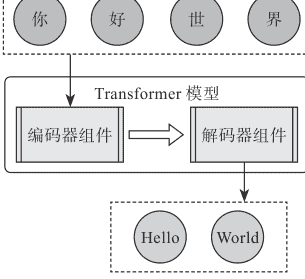

图 1-11 Transformer 模型在机器翻译中的输入与输出示意

### 1. 自注意力层

编码器接收向量列表，先经自注意力层处理，再经前馈网络，最后传给下一层编码器。在编码器内部，每个位置的词都独立进行自注意力计算，再通过完全相同的会话级前馈网络。

编码器中的自注意力实现分为四步，如图 1-13 所示。

- 1) 为每个词生成查询 query、键 key 与值 value 三个向量。对序列中每个词的表征分别乘以权重矩阵 $W^Q,W^K,W^V$，映射为 $q,k,v$。
- 2) 用查询向量给其他词的键向量打分。对每个输入词，用其 $q$ 与所有词的 $k$ 做内积，得到注意力分数，反映两者相关性。
- 3) 对分数做归一化。将分数除以键向量维度的平方根 $\sqrt{d_k}$，再经 softmax 标准化，有助于稳定梯度。
- 4) 用归一化后的分数加权求和值向量。对每个词，将其 $v$ 与标准化后的分数相乘求和，得到修正后的表征。

为何需要三个向量？query、key、value 的概念源自信息检索。若在浏览器搜索问题，输入的关键词即 query，搜索结果的标题即 key，文章内容即 value。排序时正是用 query 与 key 匹配，计算相关度，即注意力分数。

注意力缩放的秘密

点积注意力里为什么要除以 $\sqrt{d_k}$？可以从随机假设来理解。假定 query 与 key 的每个分量相互独立，均值 0 方差 1，那么一次点积 $q^T k = \sum_{i=1}^{d_k} q_i k_i$ 的期望是 0，方差会累加到 $d_k$。维度越大，点积的波动越剧烈，不同 query-key 对的得分差距就会被拉开。

softmax 的表达式为

$$S(x_i) = \frac{e^{x_i}}{\sum_{j=0}^{n} e^{x_j}}$$

对 $x_i$ 求偏导得

$$\frac{\partial S(x_i)}{\partial x_i} = S(x_i)(1 - S(x_i))$$

对 $x_j$ 求偏导得

$$\frac{\partial S(x_j)}{\partial x_j} = -S(x_i)S(x_j)$$

这里的 $x_i = q^T k$。当方差过大时，容易出现某个 $x_i$ 远高于或远低于其余值，softmax 的输出会变得极端，训练时就容易出现梯度消失或梯度爆炸。

一个直观的小实验：先构造一个从 -10 到 9 的数组 $x_1$，再在末尾追加一个 100 代表异常大的分数，然后把整个数组除以 100 得到 $x_2$，分别做 softmax 绘图。可以看到，未缩放的蓝线非常陡峭，两端梯度接近 0 或过大；缩放后的红线则平缓得多，梯度变化更温和，有利于训练稳定。

```python
import numpy as np
import matplotlib.pyplot as plt

# 定义 softmax 函数
def softmax(x):
    e_x = np.exp(x - np.max(x))  # for numerical stability
    return e_x / e_x.sum()

# 创建一个从 -10 到 9 的数组，并在末尾添加一个值 100
x1 = np.arange(-10, 10)
x1 = np.append(x1, 100)
# 计算 softmax 值
y1 = softmax(x1)

# 创建另一个从 -10 到 9 的数组，在末尾添加一个值 100，然后除以 100 进行缩放
x2 = np.arange(-10, 10)
x2 = np.append(x2, 100)
x2 = x2 / 100
# 计算 softmax 值
y2 = softmax(x2)

plt.figure(figsize=(10, 6))
plt.plot(range(1, len(x1)+1), y1, marker="o", color="blue", label="Original")
plt.plot(range(1, len(x2)+1), y2, marker="o", color="red", label="Scaled")
plt.xlabel("Index")
plt.ylabel("Softmax Value")
plt.title("Softmax Values of Two Vectors")
plt.grid(True)
plt.legend()
plt.show()
```

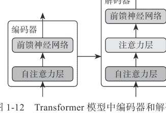

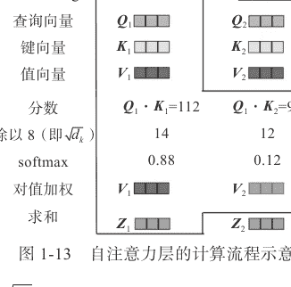

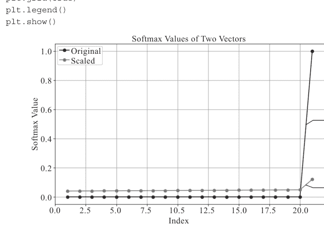

图 1-14 关于 softmax 的输入是否进行缩放的函数值对比

把注意力放到自然语言上会更清楚。句子 “The animal didn’t cross the street because it was too tired.” 中文是“动物没有过马路，因为它太累了”。“it” 到底指 animal 还是 street？人类会本能地关联到 animal。注意力机制让模型在处理 “it” 时自动强化与 “animal” 的联系。通过 Tensor2Tensor Notebook 可视化可以看到，训练后 “it” 对 “animal” 的注意力分数显著高于其他词。

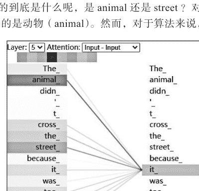

图 1-15 注意力机制中“it”的注意力分数可视化示意

实现上，每个词都有查询、键、值三个向量，代码里用的是整段输入矩阵 X。X 的每一行对应一个词，分别乘以 $W^Q、W^K、W^V$ 得到 Q、K、V，再算分数矩阵、过 softmax 后乘 V，得到送入前馈网络的 Z。整体流程如图 1-16。

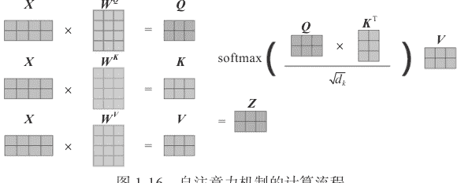

图 1-16 自注意力机制的计算流程

### 2. 多头注意力机制

单头注意力容易固化视角。Transformer 论文里引入多头注意力，让模型在不同表示子空间里并行捕捉信息。就像读文章时同时关注标题、粗体和颜色，看文字属性也能更准地定位重点。

标准实现里用 8 个注意力头，每个头有一套独立的 $W^Q、W^K、W^V$，初始化随机，训练后投射到不同子空间，避免单一偏置。多头计算后把 8 个 Z 拼接，再用 $W^O$ 投影回一个矩阵。结构上可写成 MultiHead(Q,K,V)=Concat(head_1,...,head_h)W^O，各头可并行，效率更高。论文里没有严格的理论证明为何更好，但实验证实有效，后续的 MQA、GQA 等优化由此而来。

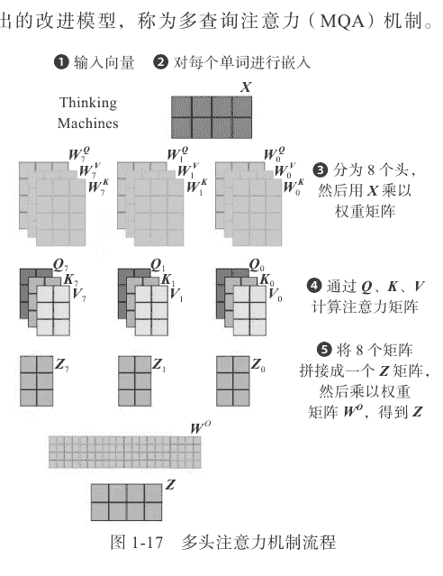

为降低成本出现的改进是多查询注意力 MQA。查询仍保持多头，而键值只保留一个头，所有 Q 头共享一组 KV。存储开销随隐藏层增大而不再成倍膨胀，推理速度通常提升 30% 到 40%，代价是少量性能损失。

MQA 提速的关键在于 KV 缓存变小。计算量上与 MHA 相近，但只需读一次 KV 供所有 Q 使用，在内存受限时等待时间缩短，显存占用下降，批大小可以增大。

折中方案是分组查询注意力 GQA，如图 1-18b 所示。不是全共享 KV，而是若干 Q 头共享一组 KV，在性能与速度间取得平衡。

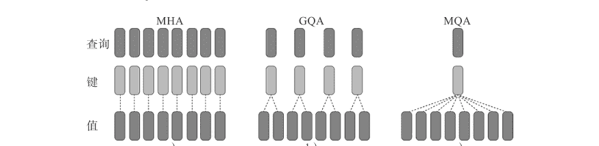

Llama 2 论文的对比显示 GQA 在多项任务上表现相对最好，MHA 次之，MQA 稍弱。

| | BoolQ | PIQA | SIQA | Hella-Swag | ARC-e | ARC-c | NQ | TQA | MMLU | GSM8K | Human-Eval |
|---|---|---|---|---|---|---|---|---|---|---|---|
| MHA | 71.0 | 79.3 | 48.2 | 75.1 | 71.2 | 43.0 | 12.4 | 44.7 | 28.0 | 4.9 | 7.9 |
| MQA | 70.6 | 79.0 | 47.9 | 74.5 | 71.6 | 41.9 | 14.5 | 42.8 | 26.5 | 4.8 | 7.3 |
| GQA | 69.4 | 78.8 | 48.6 | 75.4 | 72.1 | 42.5 | 14.0 | 46.2 | 26.9 | 5.3 | 7.9 |

图1-19 Llama 2 论文中 MHA、GQA 和 MQA 在不同任务上的效果

### 3. 注意力层

解码器里的注意力层与自注意力类似，只是 K、V 来自编码器的上下文向量。编码器处理完输入后把顶层输出转成 K、V，供解码器每步使用。解码开始时用一个随机向量表示起始，生成过程中加入位置编码，自回归地一步一步输出。

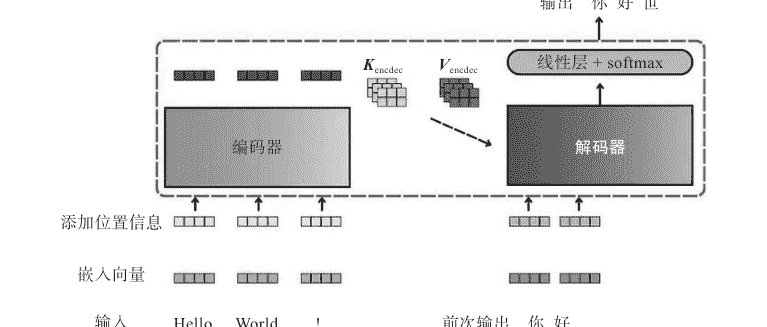

图 1-20 Transformer 模型解码器输出步骤示意

为了防止泄露未来信息，自注意力层会做因果掩码：在 softmax 之前把未来位置的分数设为 -inf。

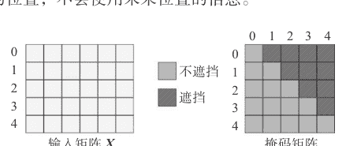

这样 softmax 后未来位置的权重趋向 0，解码器只能看到已生成的部分。

掩码矩阵与输入同维，被遮挡位置填 0。词 0 只能看自己，词 1 能用 0 和自己，以此类推。计算流程为 Q·K^T 与掩码逐元素相乘，再 softmax，最后乘 V 得到 Z。

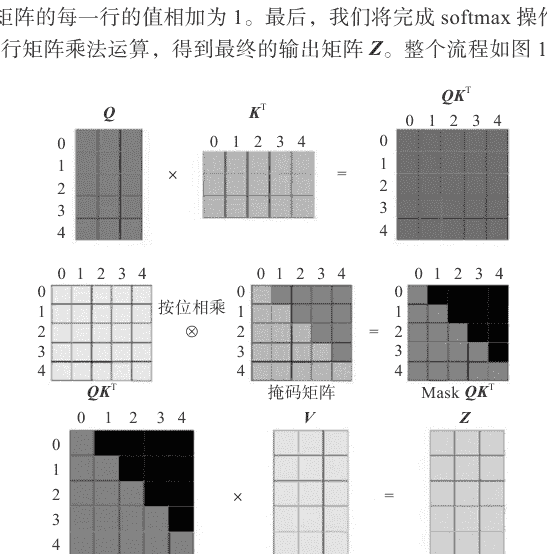

## 1.2.3 标准化和残差连接

编码器和解码器都是 6 层的深网，层数增多容易出现梯度问题。标准化可以稳定分布，帮助收敛。

标准化把输入做平移和伸缩变换到固定区间，常用公式为

$$h=f\left(g \cdot \frac{x-\mu}{\sigma}+b\right)$$

其中 $x$ 为输入，$\mu,\sigma$ 为平移缩放参数，$b,g$ 为再平移再缩放。变换后数据近似均值 $b$、方差 $g^2$ 的分布。

深度网络每层都像独立分类器，层间分布不一致会导致内部协变量偏移，误差累积。标准化把数据拉回正态，有利于稳定。

按维度分，有批标准化、层标准化等。批标准化在 batch 维上归一，层标准化在特征维上对每个样本单独归一。

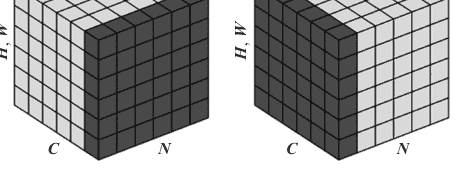

NLP 中句子长度不一，批标准化不适用。Transformer 采用层标准化，对每个样本在特征通道上计算均值和方差，不依赖 batch 大小和序列长度。

对样本 $x\in\mathbb{R}^{N\times D}$，先算均值 $\mu=\frac{\sum_{i=1}^{D} x_i}{D}$ 和方差 $\sigma^2=\frac{\sum_{i=1}^{D}(x_i-\mu)^2}{D}$，再做标准化

$$\hat{x}_{i}=\frac{x_{i}-\mu}{\sqrt{\sigma^{2}+\varepsilon}}$$

其中 $\varepsilon$ 防止除零。最后做可学习的缩放和偏移

$$y_{i}=\gamma \hat{x}_{i}+\beta$$

其中 $\gamma,\beta$ 可训练。配合残差连接，模型训练更稳定。

层归一化在残差分支里的摆放位置会直接影响训练行为，常见的就有 Pre-LN、Post-LN 和 Sandwich-LN 三种排布，如图 1-24 所示。Pre-LN 把归一化挪到残差相加之前，训练过程会明显更稳，代价是最终效果会打点折扣。Post-LN 则把归一化放在残差之后，正则化力度更强，模型表现通常更好，但随网络加深梯度范数会一路抬升，导致训练容易不稳定。于是就出现了折中方案 Sandwich-LN，在残差前后各放一次归一化。清华与阿里合作的文生图模型 CogView 就采用了 Sandwich-LN 来遏制数值爆炸，可即便如此仍会出现训练抖动甚至崩溃的情况。

在 NLP 早期，BERT 这类层数不多的模型普遍用 Post-LN。进入大模型时代后，GPT 等 Transformer 开始堆叠更多层，稳定性成为瓶颈，于是 Pre-LN 成为深层模型的常见选择。

为把 Transformer 做到千层级别，论文 “DeepNet: Scaling Transformers to 1000 Layers” 提出了 DeepNorm。从名字就能看出，研究者把网络扩到 1000 层。Pre-LN 稳定的原因在于归一化后的输出能缓解子层即注意力与前馈中的梯度消失与爆炸。DeepNorm 本质上是 Post-LN 的改进版，只是在做归一化前先对残差进行上采样

$$x_{t+1} = \text{LN}(\alpha x_t + f(x))$$

其中 α 大于 1。换句话说，DeepNorm 用 α 放大残差后再归一化，这样能把参数更新的幅度约束在一个较小的常数范围内，让超深网络也能稳定收敛。

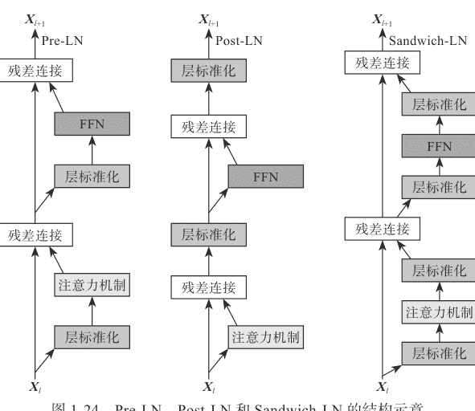

图 1-24 Pre-LN、Post-LN 和 Sandwich-LN 的结构示意

RMSNorm 是一种对层归一化的改进，后续会提到的 Llama 2 就在用，它的核心目标是提升训练稳定性和收敛速度。相关思想首次出现在论文 “Root Mean Square Layer Normalization” 中。传统层归一化兼顾了均值居中和方差重缩放，RMSNorm 认为均值居中并非必需，保留重缩放特性即可。于是它去掉了均值项，仅用均方根来做标准化。

具体计算为

$$\bar{a}_i = \frac{a_i}{\text{RMS}(a)} g_i$$

其中

$$\text{RMS}(a) = \sqrt{\frac{1}{n} \sum_{i=1}^{n} a_i^2}$$

这里的 a_i 与传统层归一化中的输入 x 等价。这种设计保留了重缩放不变性和隐式的学习率自适应能力，同时降低了噪声干扰。计算上也更简洁，相较于原版层归一化可节省约 7% 到 64% 的计算时间。

## 2. 残差连接

归一化能在一定程度上缓解梯度消失与爆炸，让收敛更顺滑，但网络越深，准确率可能先升后降，甚至出现网络退化，即深层反而不如浅层。ResNet 正是为解决这一现象而生，其关键是跳跃连接，也就是残差连接。如图 1-25 所示，每一层的最终输出取输入 x 与子层输出 f(x) 的和，这样至少能保证深网不劣于浅网。

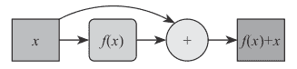

图 1-25 ResNet 中的残差连接示意

Transformer 的编码器与解码器层都采用了“层标准化 + 残差连接”的组合，如图 1-26 所示。编码器在自注意力层和前馈层之后各自接一次归一化与残差相加；解码器则在带掩码自注意力、交叉注意力、前馈三个子层之后分别做同样的处理。

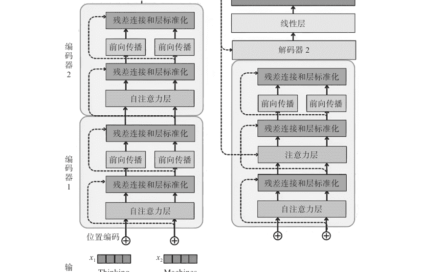

图 1-26 Transformer 模型中的编码器和解码器结构示意

## 1.2.4 线性层和 softmax 层

解码器最后吐出来的是一个浮点向量，需要映射成具体词。Transformer 这里用一个线性全连接层，把解码器输出投影到 logits 向量，长度与词表大小一致，每个位置对应一个词元的得分。

随后 logits 经过 softmax 层，分数被转为概率，保证所有概率为正且总和为 1.0，最后取概率最大的位置作为该步的输出词。

整体流程是线性层先把解码器输出变成向量，softmax 再把向量变成概率分布，择优输出对应词元。

## 1.2.5 损失函数

分词阶段会建一张标准词表，每个词用相同维度的向量表示，最基础的做法是 one-hot 编码，如表 1-7 所示。

表 1-7 T5 词汇表的 one-hot 编码示例

| 单词 | 索引 | 向量 | 单词 | 索引 | 向量 |

|---|---|---|---|---|---|

| Hello | 0 | [1, 0, 0, 0, 0, 0, 0] | 好 | 4 | [0, 0, 0, 0, 1, 0, 0] |

| World | 1 | [0, 1, 0, 0, 0, 0, 0] | 世 | 5 | [0, 0, 0, 0, 0, 1, 0] |

| !(不考虑中英文差异) | 2 | [0, 0, 1, 0, 0, 0, 0] | 界 | 6 | [0, 0, 0, 0, 0, 0, 1] |

| 你 | 3 | [0, 0, 0, 1, 0, 0, 0] | | | |

有监督训练时模型走同样的前向流程，把预测输出与真实输出对比。刚开始参数随机，输出接近均匀分布。举例来说，“你好” 翻译成 “Hello”，理想输出应是 [1, 0, 0, 0, 0, 0, 0]。训练初期模型可能给出 [0.1, 0.2, 0.3, 0.2, 0.2, 0.1]，softmax 后概率和为 1。通过比较期望与实际分布计算损失，再反向传播调整权重。常用的比较方式有交叉熵和 KL 散度。

实际输入往往是多个词，比如“你好世界！”，期望输出是连续的概率分布序列，每个位置都是词表宽度的向量，如表 1-8 所示。训练目标是让模型输出逼近期望分布，足够长训练后会接近表 1-9 的形态。

| 序号 | 单词 | 向量 |

|---|---|---|

| 0 | Hello | [1,0,0,0,0,0,0] |

| 1 | World | [0,1,0,0,0,0,0] |

| 2 | ! | [0,0,1,0,0,0,0] |

| 序号 | 单词 | 向量 |

|---|---|---|

| 0 | Hello | [0.9,0.1,0.2,0.1,0.3,0.5,0.2] |

| 1 | World | [0.3,0.8,0.1,0.2,0.2,0.1,0.3] |

| 2 | ! | [0.1,0.3,0.9,0.4,0.3,0.1,0.2] |

## 1.2.6 实战:日期转换

Transformer 完整架构如图 1-27 所示。从功能看，编码器负责从输入序列提取特征，解码器负责生成。从结构看，编码器 = 嵌入层 + 位置编码 + N × [(多头自注意力 + 残差连接 + 标准化) + (前馈神经网络 + 残差连接 + 标准化)]，解码器 = 嵌入层 + 位置编码 + N × [(带掩码多头自注意力 + 残差连接 + 标准化) + (多头注意力 + 残差连接 + 标准化) + (前馈神经网络 + 残差连接 + 标准化)]。下面用这一架构再实现一次日期转换。

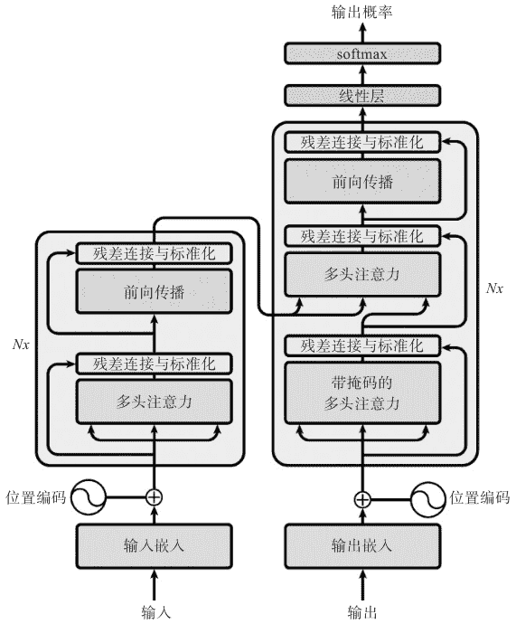

图 1-27 Transformer 模型的完整架构

### 1. 组件定义

先定义多头注意力层。

```python
class MultiHeadAttention(nn.Module):
    def __init__(self, n_head, model_dim, drop_rate):
        super().__init__()
        # 每个注意力头的维度
        self.head_dim = model_dim // n_head
        # 注意力头的数量
        self.n_head = n_head
        # 模型的维度
        self.model_dim = model_dim
        # 初始化线性变换层，用于生成 query、key 和 value
        self.wq = nn.Linear(model_dim, n_head * self.head_dim)
        self.wk = nn.Linear(model_dim, n_head * self.head_dim)
        self.wv = nn.Linear(model_dim, n_head * self.head_dim)
        # 输出的全连接层
        self.output_dense = nn.Linear(model_dim, model_dim)
        # Dropout 层，用于防止模型过拟合
        self.output_drop = nn.Dropout(drop_rate)
        # 层标准化，用于稳定神经网络的训练
        self.layer_norm = nn.LayerNorm(model_dim)
        self.attention = None

    def forward(self, q, k, v, mask):
        # 保存原始输入 q，用于后续的残差连接
        residual = q
        # 分别对输入的 q、k、v 做线性变换，生成 query、key 和 value
        query = self.wq(q)
        key = self.wk(k)
        value = self.wv(v)
        # 对生成的 query、key 和 value 进行头分割，以便进行多头注意力计算
        query = self.split_heads(query)
        key = self.split_heads(key)
        value = self.split_heads(value)
        # 计算上下文向量
        context = self.scaled_dot_product_attention(query, key, value, mask)
        # 对上下文向量进行线性变换
        output = self.output_dense(context)
        # 添加 dropout
        output = self.output_drop(output)
        # 添加残差连接并进行层标准化
        output = self.layer_norm(residual + output)
        return output

    def split_heads(self, x):
        # 将输入 x 的形状 (shape) 变为 (n, step, n_head, head_dim)，然后重排，得到 (n, n_
        # head, step, head_dim)
        x = th.reshape(x, (x.shape[0], x.shape[1], self.n_head, self.head_dim))
```

```python
return x.permute(0, 2, 1, 3)

def scaled_dot_product_attention(self, q, k, v, mask=None):
    # 计算缩放因子
    dk = th.tensor(k.shape[-1]).type(th.float)
    # 计算注意力分数
    score = th.matmul(q, k.permute(0, 1, 3, 2)) / (th.sqrt(dk) + 1e-8)
    if mask is not None:
        # 如果提供了 mask，则将 mask 位置的分数设置为负无穷，使得这些位置的 softmax 值接近 0
        score = score.masked_fill_(mask, -np.inf)
    # 应用 softmax 函数计算得到注意力权重
    self.attention = softmax(score, dim=-1)
    # 计算上下文向量
    context = th.matmul(self.attention, v)
    # 重排上下文向量的维度并进行维度合并
    context = context.permute(0, 2, 1, 3)
    context = context.reshape((context.shape[0], context.shape[1], -1))
    return context
```

重点说一下 scaled_dot_product_attention 函数，它实现了缩放点积注意力的计算。执行步骤如下：

- 1) 计算缩放因子。取 key 最后一个维度作为 dk，用来在点积后除以 sqrt(dk) 缓解高维点积带来的梯度问题。
- 2) 计算注意力分数。q 与 k 点积后除以 sqrt(dk) 得到 score。
- 3) 应用 mask。若提供 mask，则在 softmax 前把 mask 位置的分数置为负无穷，使其权重趋近于 0。
- 4) 计算注意力权重。对 score 做 softmax 得到 self.attention。
- 5) 计算上下文向量。用注意力权重与 v 做矩阵乘法得到 context。
- 6) 重排合并维度。把多头结果拼接回最终上下文向量，作为多头注意力的输出。

> 该过程会在每个头上重复，各头通过不同的线性变换得到各自的 q、k、v。

再定义注意力之后的前馈网络，它在编码器和解码器的每一层中独立作用于每个位置。网络由两个线性变换夹一个 ReLU，再接 dropout 与层标准化。

```python
class PositionWiseFFN(nn.Module):
    def __init__(self, model_dim, dropout=0.0):
```

前馈神经网络的隐藏层维度，设为模型维度的4倍

ffn_dim = model_dim * 4

# 第一个线性变换层，其输出维度为前馈神经网络的隐藏层维度

self.linear1 = nn.Linear(model_dim, ffn_dim)

# 第二个线性变换层，其输出维度为模型的维度

self.linear2 = nn.Linear(ffn_dim, model_dim)

# Dropout 层，用于防止模型过拟合

self.dropout = nn.Dropout(dropout)

# 层标准化，用于稳定神经网络的训练

self.layer_norm = nn.LayerNorm(model_dim)

def forward(self, x):

    # 对输入x进行前馈神经网络的计算

    # 首先，通过第一个线性变换层并使用ReLU作为激活函数

前馈子层的工作流程其实非常清晰。输入先进入第一层线性变换，经过 ReLU 激活后再送入第二层线性变换，随后对结果执行 Dropout 正则化。紧接着把原始输入与前馈变换后的结果做残差相加，再统一做层归一化，最后得到的张量形状保持为 [n, step, dim]。

### 2. 编码解码器实战
先把 Transformer 的编码器搭建出来。
```python
class EncoderLayer(nn.Module):
    def __init__(self, n_head, emb_dim, drop_rate):
        super().__init__()
        # 多头注意力机制层
        self.mha = MultiHeadAttention(n_head, emb_dim, drop_rate)
        # 前馈神经网络层
        self.ffn = PositionWiseFFN(emb_dim, drop_rate)

    def forward(self, xz, mask):
        # xz的形状为 [n, step, emb_dim]
        # 通过多头注意力机制层处理xz，得到context，其形状也为 [n, step, emb_dim]
        context = self.mha(xz, xz, xz, mask)
        # 将context传入前馈神经网络层，得到输出
        output = self.ffn(context)
        return output

class Encoder(nn.Module):
    def __init__(self, n_head, emb_dim, drop_rate, n_layer):
        super().__init__()
        # 定义n_layer个EncoderLayer，保存在ModuleList中
        self.encoder_layers = nn.ModuleList(
            [EncoderLayer(n_head, emb_dim, drop_rate) for _ in range(n_layer)])

    def forward(self, xz, mask):
        # 依次通过所有的 EncoderLayer
        for encoder in self.encoder_layers:
            xz = encoder(xz, mask)
        return xz  # 返回的 xz 形状为 [n, step, emb_dim]
```
紧接着再把解码器搭建出来。
```python
class DecoderLayer(nn.Module):
    def __init__(self, n_head, model_dim, drop_rate):
        super().__init__()
        # 定义两个多头注意力机制层
        self.mha = nn.ModuleList([MultiHeadAttention(n_head, model_dim, drop_rate) for _ in range(2)])
        # 定义一个前馈神经网络层
        self.ffn = PositionWiseFFN(model_dim, drop_rate)

    def forward(self, yz, xz, yz_look_ahead_mask, xz_pad_mask):
        # 执行第一个注意力层的计算，3 个输入均为 yz，使用自注意力机制
        dec_output = self.mha[0](yz, yz, yz, yz_look_ahead_mask)  # [n, step, model_dim]
        # 执行第二个注意力层的计算，其中 Q 来自前一个注意力层的输出，K 和 V 来自编码器的输出
        dec_output = self.mha[1](dec_output, xz, xz, xz_pad_mask)  # [n, step, model_dim]
        # 通过前馈神经网络层
        dec_output = self.ffn(dec_output)  # [n, step, model_dim]
        return dec_output

class Decoder(nn.Module):
    def __init__(self, n_head, model_dim, drop_rate, n_layer):
        super().__init__()
        # 定义 n_layer 个 DecoderLayer，保存在 ModuleList 中
        self.num_layers = n_layer
        self.decoder_layers = nn.ModuleList(
            [DecoderLayer(n_head, model_dim, drop_rate) for _ in range(n_layer)]
        )

    def forward(self, yz, xz, yz_look_ahead_mask, xz_pad_mask):
        # 依次通过所有的 DecoderLayer
        for decoder in self.decoder_layers:
            yz = decoder(yz, xz, yz_look_ahead_mask, xz_pad_mask)
        return yz  # 返回的 yz 形状为 [n, step, model_dim]
```
解码器里的两层注意力是核心。进入前向流程时，输入 yz 最先喂给第一层多头注意力，这是一层自注意力，query、key、value 三者都来自 yz。这一层启用了 look ahead mask，计算分数时每个位置只能看到自己及之前的历史，之后的位置会被遮挡，这对应了推理时只能依据已生成的词而不能偷看未来的约束。这一层的输出 dec_output 仍是序列形态，维度为 [n, step, model_dim]。

随后 dec_output 会和编码器侧的输出 xz 一起进入第二层多头注意力。这里的 query 来自 dec_output，而 key、value 则取自 xz。这一层采用 padding mask，让模型在关注 xz 时完全忽略填充位。经过这一步后得到的 dec_output 形状同样是 [n, step, model_dim]。

在解码器中，每个位置的最终表示既受当前位置信息影响，也依赖前面已生成的历史，以及编码器全序列的上下文，所以它能捕捉输入与输出之间复杂的依赖关系。

## 3. Transformer总装
处理序列输入时，还需要一个位置编码层来补充顺序信息。它会把序列中每个位置的词映射成固定维度的向量，向量里同时承载了词本身的语义和它在序列中的位置。
```python
class PositionEmbedding(nn.Module):
    def __init__(self, max_len, emb_dim, n_vocab):
        super().__init__()
        # 生成位置编码矩阵
        pos = np.expand_dims(np.arange(max_len), 1)  # [max_len, 1]
        # 使用正弦和余弦函数生成位置编码
        pe = pos / np.power(10000, 2*np.expand_dims(np.arange(emb_dim)//2, 0)/emb_dim)
        pe[:, 0::2] = np.sin(pe[:, 0::2])
        pe[:, 1::2] = np.cos(pe[:, 1::2])
        pe = np.expand_dims(pe, 0)  # [1, max_len, emb_dim]
        self.pe = th.from_numpy(pe).type(th.float32)

        # 定义词嵌入层
        self.embeddings = nn.Embedding(n_vocab, emb_dim)
        # 初始化词嵌入层的权重
        self.embeddings.weight.data.normal_(0, 0.1)

    def forward(self, x):
        # 确保位置编码在与词嵌入权重相同的设备上
        device = self.embeddings.weight.device
        self.pe = self.pe.to(device)
        # 计算输入的词嵌入权重，并加上位置编码
        x_embed = self.embeddings(x) + self.pe  # [n, step, emb_dim]
        return x_embed  # [n, step, emb_dim]
```
把上述组件串起来，就完成了整体的 Transformer 构造。
```python
class Transformer(nn.Module):
    def __init__(self, n_vocab, max_len, n_layer=6, emb_dim=512, n_head=8, drop_rate=0.1, padding_idx=0):
        super().__init__()
        # 初始化最大长度、填充索引、词汇表大小
        self.max_len = max_len
        self.padding_idx = th.tensor(padding_idx)
        self.dec_v_emb = n_vocab
        # 初始化位置嵌入、编码器、解码器和输出层
        self.embed = PositionEmbedding(max_len, emb_dim, n_vocab)
        self.encoder = Encoder(n_head, emb_dim, drop_rate, n_layer)
        self.decoder = Decoder(n_head, emb_dim, drop_rate, n_layer)
        self.output = nn.Linear(emb_dim, n_vocab)
        # 初始化优化器
        self.opt = th.optim.Adam(self.parameters(), lr=0.002)

    def forward(self, x, y):
        # 对输入和目标进行嵌入
        x_embed, y_embed = self.embed(x), self.embed(y)
        # 创建填充掩码
        pad_mask = self._pad_mask(x)
        # 对输入进行编码
        encoded_z = self.encoder(x_embed, pad_mask)
        # 创建前瞻掩码
        yz_look_ahead_mask = self._look_ahead_mask(y)
        # 将编码后的输入和前瞻掩码传入解码器
        decoded_z = self.decoder(
            y_embed, encoded_z, yz_look_ahead_mask, pad_mask)
        # 通过输出层得到最终输出
        output = self.output(decoded_z)
        return output

    def step(self, x, y):
        # 清空梯度
        self.opt.zero_grad()
        # 计算输出和损失
        logits = self(x, y[:, :-1])
        loss = cross_entropy(logits.reshape(-1, self.dec_v_emb), y[:, 1:].reshape(-1))
        # 进行反向传播
        loss.backward()
        # 更新参数
        self.opt.step()
        return loss.cpu().data.numpy(), logits

    def _pad_bool(self, seqs):
        # 创建掩码，标记哪些位置是填充的
        return th.eq(seqs, self.padding_idx)

    def _pad_mask(self, seqs):
        # 将填充掩码扩展到合适的维度
        len_q = seqs.size(1)
        mask = self._pad_bool(seqs).unsqueeze(1).expand(-1, len_q, -1)
        return mask.unsqueeze(1)

    def _look_ahead_mask(self, seqs):
        # 创建前瞻掩码，防止在生成序列时看到未来位置的信息
        device = next(self.parameters()).device
        _, seq_len = seqs.shape
        mask = th.triu(th.ones((seq_len, seq_len), dtype=th.long),
                       diagonal=1).to(device)
        mask = th.where(self._pad_bool(seqs)[:, None, None, :], 1, mask[None,
                       None, :, :]).to(device)
        return mask > 0
```
序列数据的一个常见麻烦是长度不一致。深度学习框架要求同批数据形状统一，所以必须先做填充。做法是找到批量里最长的序列，然后用特殊填充值，比如 0 或特定标记，把其他短序列补齐到相同长度。

填充之后数据可以统一计算，但填充位本身没有信息，不能参与学习。因此会生成掩码来告知模型哪些位置是填充。Transformer 里的 _pad_mask 与 _look_ahead_mask 就是干这个事的函数，它们会返回布尔矩阵，明确标出输入中哪些位置是填充位。
```python
def pad_zero(seqs, max_len):
    # 初始化一个全是填充标识符 PAD_token 的二维矩阵，大小为 (len(seqs), max_len)
    padded = np.full((len(seqs), max_len), fill_value=PAD_token, dtype=np.int32)
    for i, seq in enumerate(seqs):
        # 将 seqs 中的每个 seq 序列的元素填入 padded 对应的行中，未填满的部分仍为 PAD_token
        padded[i, :len(seq)] = seq
    return padded
```

## 4. 训练与评测
到这里模型骨架已经完整，可以进入训练与评估环节了。
```python
# 初始化一个 Transformer 模型，设置词汇表大小、最大序列长度、层数、嵌入维度、多头注意力的头数、
# dropout 比率和填充标记的索引
model = Transformer(n_vocab=dataset.num_word, max_len=MAX_LENGTH, n_layer=3,
                    emb_dim=32, n_head=8, drop_rate=0.1, padding_idx=0)
# 检测是否有可用的 GPU，如果有，则使用 GPU 进行计算；如果没有，则使用 CPU
device = th.device("cuda" if th.cuda.is_available() else "cpu")
# 将模型移动到相应的设备（CPU 或 GPU）
model = model.to(device)
# 创建一个数据集，包含 1000 个样本
dataset = DateDataset(1000)
# 创建一个数据加载器，设定批量大小为 32，每个批量的数据会被打乱
dataloader = DataLoader(dataset, batch_size=32, shuffle=True)
# 执行 10 个训练周期
```

for i in range(10):

    # 对于数据加载器中的每批数据，对输入和目标张量进行零填充，使其长度达到最大，然后将其转换为

    # PyTorch 张量，并移动到相应的设备 (CPU 或 GPU)

    for input_tensor, target_tensor, _ in dataloader:

        input_tensor = th.from_numpy(

            pad_zero(input_tensor, max_len=MAX_LENGTH)).long().to(device)

        target_tensor = th.from_numpy(

            pad_zero(target_tensor, MAX_LENGTH+1)).long().to(device)

        # 使用模型的 step 方法进行一步训练，并获取损失值

        loss, _ = model.step(input_tensor, target_tensor)

    # 打印每个训练周期后的损失值

    print(f"epoch: {i+1}, \tloss: {loss}")

沿着 Seq2Seq 模型做日期转换的思路，也可以为 Transformer 设计一套评测流程，用来验证它是否能够稳定完成日期转换任务。

```python
def evaluate(model, x, y):
    model.eval()
    x = th.from_numpy(pad_zero([x], max_len=MAX_LENGTH)).long().to(device)
    y = th.from_numpy(pad_zero([y], max_len=MAX_LENGTH)).long().to(device)
    decoder_outputs = model(x, y)
    _, topi = decoder_outputs.topk(1)
    decoded_ids = topi.squeeze()
    decoded_words = []
    for idx in decoded_ids:
        decoded_words.append(dataset.index2word[idx.item()])
    return ''.join(decoded_words)
```

训练完毕后模型的示例输出见图 1-28。

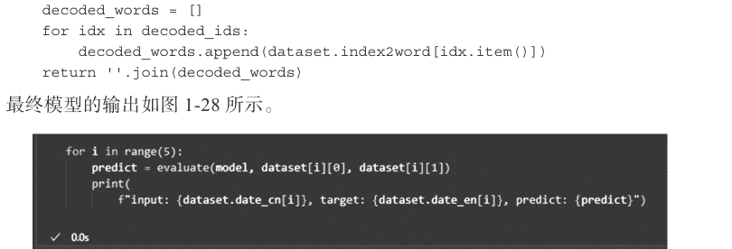

图 1-28 Transformer 模型的日期转换输出示例

## 1.2.7 小结

Transformer 被视作 MLP、CNN、RNN 之后出现的第四大特征抽取器。起初它服务于机器翻译，随后在 GPT、BERT 等代表性工作带动下，掀起 NLP 快速发展浪潮，也间接推动了多模态、大模型、ViT 等新范式的兴起。它的出现让研究者确信，除 CNN 与 RNN 之外，还存在更有效的特征抽取方式，激励了大量后续探索。

但缺陷同样明显。首先是计算开销极大，对 GPU 显存和算力的需求很高。其次是归纳偏置不足，必须依赖海量数据才能达到理想表现，相关问题将在后文进一步说明。

纯注意力构成的结构，意味着可以不再依赖递归网络和卷积网络，这在当时是极具开创性的做法。图 1-29 给出了自注意力、递归、卷积等操作的每层复杂度、最小序列操作数和最大路径长度的对比，其中 n 表示序列长度，d 表示维度，k 表示卷积核大小。可以看到，自注意力相较递归，单层计算成本提升，但序列操作次数由 O(n) 降至 O(1)，体现了用空间换时间的思路。尽管模型结构优化和硬件提升能缓解空间压力，这一取舍仍然值得。相较卷积，自注意力同样无需序列操作，而卷积主要作用于二维结构，成本大约与输入边长的对数成正比，即 O(log_d n)；理想状态下自注意力可将成本压到 O(1)，因此在潜能上有更强优势，也为后来的 ViT 提供了思路。

| 层类型 | 每层复杂度 | 最小序列操作数 | 最大路径长度 |
|---|---|---|---|
| 自注意力 | $O(n^2 \cdot d)$ | $O(1)$ | $O(1)$ |
| 递归 | $O(n \cdot d^2)$ | $O(n)$ | $O(n)$ |
| 卷积 | $O(k \cdot n \cdot d^2)$ | $O(1)$ | $O(\log_d n)$ |
| 自注意力 (受限) | $O(r \cdot n \cdot d)$ | $O(1)$ | $O(n/r)$ |

图 1-29 自注意力、递归和卷积等操作的每层复杂度、最小序列操作数和最大路径长度对比

## 1.3 ViT 模型介绍

如果要选出 2020 年计算机视觉领域影响力最大的成果，谷歌提出的 ViT 无疑是代表。它直接挑战了从 AlexNet 于 2012 年确立以来，卷积神经网络在视觉任务中的绝对主导地位。

彼时 Transformer 已成为 NLP 的主流，但在视觉上仍有阻力。注意力要么与 CNN 结合使用，要么仅用自注意力替换部分卷积模块，整体框架基本保留。ViT 则证明，完全抛开卷积，直接用标准的 Transformer 编码器做图像分类也是可行的，尤其是先在大规模图像上预训练，再迁移到中小规模任务时效果突出。

ViT 不仅冲击了视觉范式，还打通了视觉与语言在模型结构层面的壁垒，对多模态发展产生深远影响。随后围绕 ViT 的研究大量涌现，开启了视觉领域的新阶段。第 3 章中提到的 CLIP 与 Stable Diffusion 也都采用了预训练的 ViT 模型。

### 1.3.1 注意力机制在图像上的应用

把 Transformer 直接搬到视觉任务并不容易。Transformer 核心是注意力层，需要对输入元素两两计算注意力分数，构建注意力矩阵，再据此加权融合。注意力分数的计算复杂度为 O(n²)，成本不低。

在视觉场景里，首要难题是如何把二维图像变成一维序列。最直接的做法是把每个像素当成序列元素再拉直。以常见的 224×224 分辨率为例，拉直后序列长度达到 50176，已经超出当前训练可承受范围，注意力矩阵会变得极其庞大。目标检测常用的 416×416 或 544×544，以及视频分类常用的 800×800 分辨率，只会进一步放大计算负担。

因此，如何让注意力适配图像计算成为关键。最简易的方案是先用 CNN 抽取特征图，再把特征图当作序列进行自注意力计算。这里的自注意力保留了 Transformer 中的 query、key、value 概念，流程分三步：先用点积、拼接、感知机等相似度函数计算 query 与 key 的相似度得到权重；再用 softmax 归一化为注意力分数；最后用这些分数对 value 做加权求和得到输出。该机制依赖特征图提供全局信息，而卷积通过设定感受野限制局部范围，因而常需堆叠多层才能扩大视野。自注意力的优势在于全局关注能力，通过简单的查询赋值即可捕捉特征图的整体空间关系，在处理复杂特征图时更具潜力。

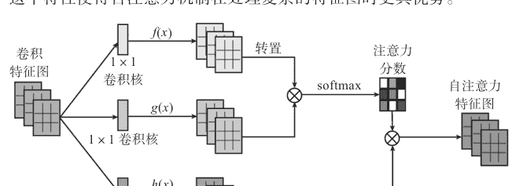

传统 CNN 在处理时只能关注卷积核邻域的局部信息，难以有效整合远处上下文，导致在需要全局理解的任务上表现受限。而注意力机制实现了加权融合，既能整合全局也能兼顾局部，更利于把握整体语境。具体来说，注意力会计算不同位置间的权重，将远处信息加权注入当前位置表示。基于此思想，加州大学的王小龙提出了 Non-local Neural Network，应用于 Kinetics 视频分类。如图 1-31 所示，第一帧中 x_i 位置的球的信息可能与后面几帧中 x_j 位置的人及球的信息相关，结合这两个位置的特征即可生成新的表征

$$y_{i}=\frac{\sum_{j} f\left(x_{i}, x_{j}\right) g\left(x_{j}\right)}{C(x)}$$

其中 C(x) 为归一化项，函数 f 与 g 可选用不同的注意力函数。通过这种方式将注意力融入多种 CNN 基线，并在多个数据集上取得 SOTA 效果。

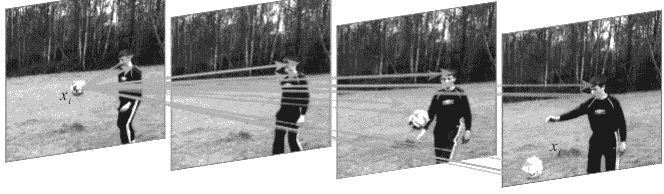

图 1-31 非局部神经网络在视频帧间的注意力信息融合示意

### 1.3.2 ViT 模型架构

ViT 受 Transformer 在 NLP 领域的可扩展性启发，将标准 Transformer 编码器几乎原封不动地作用于图像，最小化改动。好处是可以直接复用 NLP 积累的架构与高效实现。

为缓解序列过长的问题，如图 1-32 所示，ViT 先把图像切分为多个小块 patch，再通过嵌入层做线性投影，使每个小块对应序列中的一个元素，随后送入 Transformer 编码器。以 224×224 输入为例，小块大小设为 16×16 时，序列长度为 (224/16)×(224/16)=196，每个元素的维度为 16×16×3=768，对常见设备完全可接受。

切分操作可用卷积实现，论文未采用但思路巧妙。目标是将 224×224×3 的矩阵变为 196×768 的矩阵，可用卷积核 16×16×3、步长 16、padding 0 进行变换，得到 14×14×768 的特征图，再展平成所需维度。

为便于分类，ViT 借鉴 BERT 的做法，在序列前端拼接一个可学习的特殊词元 CLS 代表类别。因为模型只有编码器，编码器需兼顾部分解码作用，该词元可看作解码启动信号，类似标准解码器输入右移一位的操作。由于注意力是全元素两两计算，该词元在训练中能够聚合图像全局信息。最终输入维度为 (196+1)×768，输出时切片取出第一个 CLS 词元，维度为 1×768，再经一个简单的 MLP 头做分类即可。

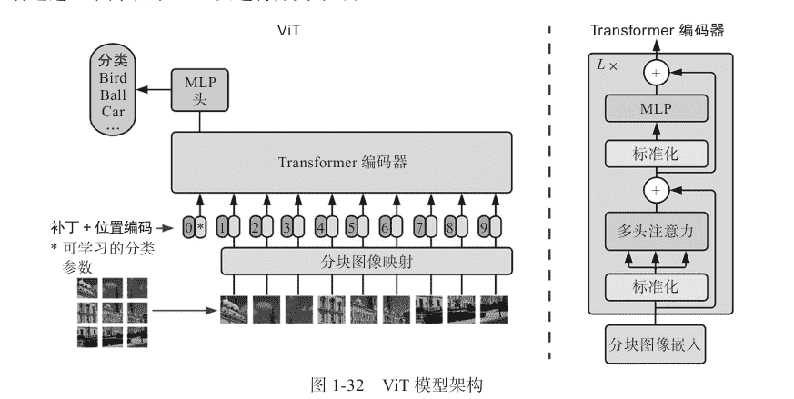

注意力计算本身不依赖顺序，但图像是整体，切分后块间仍存在位置信息，不能随意重排。类似 NLP，ViT 在块映射时加入了位置编码 Position Embedding。

整体结构如图 1-32 所示。编码器层与 Transformer 编码器相似：输入先做归一化，再经多头注意力，随后做残差连接；接着再归一化、MLP、残差连接。

形式化地，对任意图像 x ∈ R^{H×W×C}，其中 (H,W) 为分辨率，C 为通道数，先切分为 x_p ∈ N^{N×(P²×C)} 的块序列，其中 (P,P) 为块分辨率，N = HW/P² 为块数。对每个块做线性变换并拼接分类词元，再加上位置编码，即

```
z_0 = [x_{\text{class}}; x_p E] + E_{\text{pos}}
```

其中 E ∈ R^{(P²×C)×D}，E_pos ∈ R^{(N+1)×D}，D 为向量维度。随后进行 L 层编码器操作。每一层中，“归一化 + 多头注意力 + 残差” 可表示为

```
$z_{l}^{\prime}=\mathrm{MSA}\left(\mathrm{LN}\left(z_{l-1}\right)\right)+z_{l-1}$
```

再经过 “归一化 + MLP + 残差”，表示为

```
$z_{l}=\mathrm{MLP}\left(\mathrm{LN}\left(z_{l}^{\prime}\right)\right)+z_{l}^{\prime}$
```

多次编码后，对最后一层输出切片取第一个词元向量，再做一次归一化后分类：

```
$y=\mathrm{LN}\left(z_{L}^{0}\right)$
```

每层注意力都会对序列中每个图像块做上下文相关的编码，捕捉块间丰富的空间关系。把注意力用于图像使 ViT 能够整合整幅信息，如图 1-33 所示，通过多头注意力权重计算图像空间中信息整合的平均距离，类似 CNN 的感受野。初期部分注意力头距离很近，部分很远，说明模型可关注全局。随着网络加深，多头间距离增大，表明网络不再依赖邻近像素，而是在学习高层语义。

总体来看，ViT 架构简洁，其核心在于把图像处理成 Transformer 编码器可接受的序列输入。

### 1.3.3 大数据预训练

随着模型与数据集规模扩大，Transformer 尚未出现性能饱和的迹象，这点颇为有趣。通常扩大模型或数据并不会线性带来收益，过大模型易过拟合，但 Transformer 似乎尚未触及该瓶颈。

ViT 主要使用 ImageNet-1k、ImageNet-21k 以及谷歌收集的 JFT 数据集进行训练。关于数据量需求，研究者做了对比实验，结果如图 1-34 所示，横轴为不同规模数据集，纵轴为 ImageNet 测试集准确率。图中 BiT 表示不同规模 ResNet，其他颜色和大小不一的圆圈为不同规模的 ViT。可以看到，在最小的 ImageNet-1k 上预训练时，ViT 普遍不如 BiT，因其缺乏卷积的先验。在 ImageNet-21k 上，ViT 与 BiT 效果接近。采用 JFT-300M 预训练后，ViT 表现全面超越 BiT。

综合来看，在 ImageNet 这种规模的中等数据集上，如果不额外加入强约束，ViT 的表现会落后于体量相当的残差网络。可一旦换到 JFT-300M 这样的大型数据集，即使不加约束，ViT 也能追上甚至超过当时的顶尖卷积网络。根源在于 Transformer 本身缺乏卷积带来的先验。卷积网络天生带了两种先验：其一是局部性，滑动窗口提取特征隐含了图像邻近区域特征相近的假设；其二是平移不变性，满足 $f(g(x))=g(f(x))$，先卷积后平移和先平移后卷积结果一致。有了这两项先验，CNN 在小数据上也能快速上手。Transformer 却没有这些偏置，对视觉世界的感知必须完全靠数据从零学习，所以数据量需求明显更大。

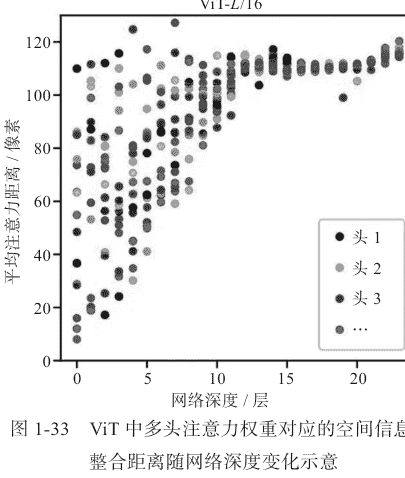

图 1-33 ViT 中多头注意力权重对应的空间信息整合距离随网络深度变化示意

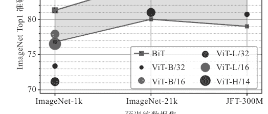

图 1-34 ViT 与卷积神经网络在不同预训练数据集上的 ImageNet Top1 准确率对比

图 1-34 其实传递了两层含义。第一，想用 ViT，数据量至少要达到 ImageNet-21k 的级别，数据太少时 CNN 仍是更稳妥的选择。第二，一旦数据规模超过 ImageNet-21k，ViT 的可扩展性和训练效率就开始显现优势。实验证明，在超大规模数据上预训练 Transformer，效果可以不输甚至优于卷积网络。

也正因为两者各有所长，业界出现了混合架构。CNN 在捕捉局部细节和平移不变特征上很擅长，但全局建模不足；Transformer 擅长序列建模，能抓住长程依赖和全局关联。把二者结合就能互补。典型做法是用一个轻量 CNN 作为特征提取器，从原图里先提炼出局部特征图，例如边缘、纹理等，再把这些特征图送入 Transformer 进行全局依赖建模，比如物体位置、大小关系等。

## 1.3.4 ViT 模型训练实践
动手写代码前，先把 ViT 的整体结构吃透。论文里的示意图并没有体现 Dropout、MLP 等细节，这些要看源码才完整。以 ViT-B/16 为例，按源码定义画出的详细架构如下。

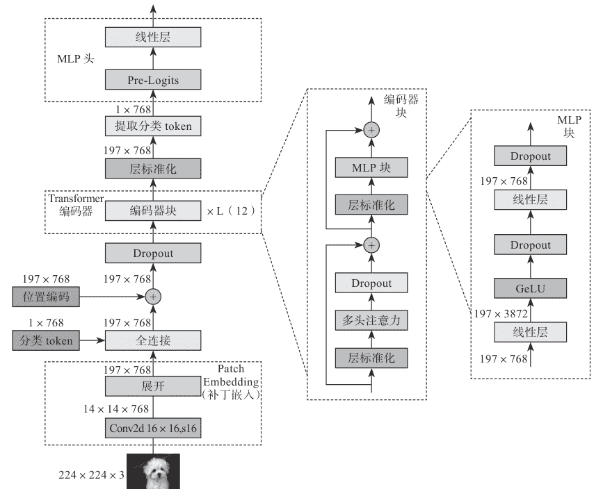

图 1-35 原始 ViT-B/16 模型架构

先依据架构图实现 ViT，这里为了代码简洁并未完全照搬源码，后续会说明差异之处。

```python
class ViT(nn.Module):
    def __init__(self, image_size=224, patch_size=16, num_classes=1000, dim=768,
                 depth=12, heads=12, mlp_dim=3872):
        super(ViT, self).__init__()
        self.image_size = image_size  # 输入图像的大小
        self.patch_size = patch_size  # 切分图像的块大小
        self.num_patches = (image_size // patch_size) ** 2  # 计算总的图像块数量
        self.patch_dim = 3 * patch_size ** 2  # 每个图像块的维度
        # 利用卷积层将图像切分为多个图像块，并将每个图像块投影到dim维空间
        self.conv = nn.Conv2d(3, dim, kernel_size=patch_size, stride=patch_size)
        self.cls_token = nn.Parameter(torch.randn(1, 1, dim))  # CLS token
        # 使用Transformer对图像块进行编码
        self.transformer_encoder = nn.TransformerEncoder(nn.
            TransformerEncoderLayer(d_model=dim, nhead=heads, dim_
            feedforward=mlp_dim), num_layers=depth)
        # 添加LayerNorm层
        self.layer_norm = nn.LayerNorm(dim)
        # 全连接层，用于分类任务
        self.fc = nn.Linear(dim, num_classes)

    def forward(self, x):
        # 图像通过卷积层进行切分和线性投影
        x = self.conv(x)
        # 对卷积层的输出进行变形(reshape)，以符合Transformer的输入要求
        x = x.flatten(2).transpose(1, 2)
        # 在序列的开始位置添加CLS token
        cls_tokens = self.cls_token.expand(x.shape[0], -1, -1)  # 对CLS token进行复制以匹配批量大小
        x = torch.cat((cls_tokens, x), dim=1)
        # 图像块通过Transformer进行编码
        x = self.transformer_encoder(x)
        # 取出CLS token的表征用于分类
        x = x[:, 0]
        x = self.layer_norm(x)
        # 通过全连接层进行分类
        x = self.fc(x)
        return x
```
这段实现里，`__init__` 先声明所需变量和子模块，`forward` 严格按 ViT 流程前向。其中 `x = x.flatten(2).transpose(1, 2)` 的作用是把卷积输出的特征图重塑成 Transformer 可接受的序列。`x.flatten(2)` 会把每个特征图的高度和宽度维度合并，假设卷积后形状是 `[batch_size, dim, h, w]`，操作后变为 `[batch_size, dim, h*w]`，相当于把每个图像块压成向量。`x.transpose(1, 2)` 再交换维度，得到 `[batch_size, h*w, dim]`，正好符合 Transformer 编码器 `[batch_size, seq_len, feature_dim]` 的输入规范。

## 1.4 本章要点回顾
本章首先介绍了 Seq2Seq 结构，这是 Transformer 的基础，也是诸多 NLP 模型的骨架。编码器逐个处理输入序列并压缩为上下文向量，解码器据此逐步生成输出。加入注意力后，模型能聚焦输入的相关部分。

其次详细拆解了 Transformer 模型，完全基于注意力堆叠编码器和解码器。编码器含自注意力与前馈网络，解码器在此基础上多加一层编码器-解码器注意力。位置编码提供顺序信息，多头注意力实现多空间并行关注，残差连接与层归一化稳定训练。对比 RNN，Transformer 并行度更高，长依赖建模更强。

再次以中英文日期转换任务为例，用 PyTorch 实现并训练基于 Seq2Seq 的 Transformer，完成了编码器、解码器、注意力、位置编码的搭建与训练预测，展示了完整使用流程。

最后介绍了 Vision Transformer。ViT 直接把图像切成图像块，再套用标准 Transformer 编码器，并加入可学习的 [CLS] 标记做分类。在大规模预训练下性能突出，显示 Transformer 有望替代 CNN。

# GPT 系列全景
训练深度模型离不开标注数据。NLP 领域语料虽多，但绝大部分未标注，针对特定任务的标注数据稀少且标注成本高。研究发现，先在海量未标注数据上做自监督学习挖掘表征，再迁移到下游有标注任务，能明显提升效果。词嵌入就是早期典型代表。

GPT 系列贯彻了这种两阶段思路：先无监督预训练，再有监督微调。预训练目标是让语言模型学会通用文本表征，便于迁移到下游。

本章按论文发布时间梳理 GPT 系列。首先是开山之作 GPT-1，其次是扩展规模和零样本能力的 GPT-2，再是参数推至 1750 亿的 GPT-3，最后介绍 GPT-3.5 系的 CodeX 和 InstructGPT，前者专用于代码生成，后者经 RLHF 微调后交互更自然。

## 2.1 GPT-1 诞生
GPT-1 发表于论文《Improving Language Understanding by Generative Pre-Training》，直译为“用生成式预训练提升语言理解能力”。

背景是 NLU 任务众多，如文本蕴含、问答、情感相似度、文档分类等，核心都是让模型理解语言并给出回应。如何让模型读懂文字？“书读百遍其义自见”，让模型大量阅读语料是直观思路。

NLP 中自监督学习面临两大难题：如何设计有效学习文本表征的目标，以及如何把从未标注数据学到的表征迁移到下游子任务。GPT-1 的做法是先在大量无标注数据上预训练语言模型，再在有标注数据上针对任务微调，微调时使用任务感知输入转换，尽量少改架构。

### 2.1.1 什么是语言模型
GPT 系列本质上是语言模型，即“单字接龙”。给定上文，模型预测下文。手机输入法就是典型应用，会依据已输入内容推荐后续词。语言模型采用自回归策略，每次预测的新词会追加到输入序列末尾作为下一次预测的依据。

语言建模是一种无监督方法，目标是学习在给定上下文下下一个词的概率分布。它能预测“1+1=2”概率最大，却不会像计算器那样遵循数学规则运算。

这种简单地预测下一个词的能力为何能产生令人惊叹的结果？可用“猴子打字机悖论”理解：无限时间下随机敲键盘终会打出莎士比亚全集。ChatGPT 比猴子高效得多，因为它能精准预测下一个词。

### 2.1.2 双阶段训练框架
本节介绍 GPT 系列的训练框架。先在无标签数据上自监督预训练，再在有标签数据上有监督微调。随后分析 GPT-1 的模型架构，大体是堆叠 Transformer 解码器并做小幅调整，以及微调阶段的迁移方式，即任务感知的输入变换。

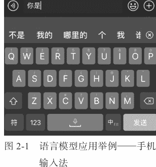

#### 1. 无监督自监督预训练
第一阶段在无标签数据上做语言建模自监督学习。设文本为 $u = (u_1, u_2, ..., u_n)$，目标是根据前面 $k$ 个词 $(u_{i-k}, ..., u_{i-1})$ 预测第 $i$ 个词 $u_i$ 的概率，目标函数为最大化似然估计：

$$L_1(u) = \sum_i \log P(u_i | u_{i-k}, u_{i-k+1}, ..., u_{i-1}; \Theta)$$
其中 $k$ 为上下文窗口大小超参，$\Theta$ 为模型参数即 Transformer 解码器，通过随机梯度下降训练。

具体流程：要预测 $u$ 时，取出其前 $k$ 个词 $U = (u_{-k}, ..., u_{-1})$，做词向量编码得到 $W_e$，再加上位置编码 $W_p$，构成第一层输入：

$$h_0 = U W_e + W_p$$
随后叠加 $n$ 层相同的解码器：

$$h_i = \text{decoder}(h_{i-1}), \forall i \in [1, n]$$
最后层输出经 softmax 得到概率分布：

$$P(u) = \text{softmax}(h_n W_e^T)$$
这就是 $u$ 出现的概率。

GPT-1 使用 4.6GB 的 BookCorpus 进行预训练，包含 11 000 多本未出版书籍，约 7400 万句子、10 亿词，涵盖 16 个子类型，来自 Smashwords。训练用到 7000 多本书，长文本有助于学习长程上下文依赖。书籍未公开，下游任务难以出现原文本，更能验证泛化能力。

#### 2. 有监督微调
自监督预训练后模型已具备通用表征，接下来用有标注数据做有监督微调。给定长度为 $m$ 的词序列，标签为 $y$，将序列送入预训练模型，取最后一层解码器输出 $h_n^m$ 乘以输出层参数 $W_y$，经 softmax 得到预测标签概率：

$$P(y | x_1, ..., x_m) = \text{softmax}(h_n^m W_y)$$
对所有带标签序列对计算概率并做最大似然估计：

$$L_2(C) = \sum_{(x,y)} \log P(y | x_1, ..., x_m)$$

GPT-1 的团队在微调阶段把语言建模当成辅助目标来一起优化，发现这样既能增强泛化，也能让收敛更快。于是下游微调同时承载两个损失：其一是语言模型损失 $L_{1}$，输入一段序列预测下一个词；其二是下游任务损失 $L_{2}$，输入完整序列预测对应标签。有监督微调阶段的整体优化目标为

$$L_3(C) = L_2(C) + \lambda L_1(C)$$

其中超参 $\lambda$ 用来调配两者的比重。$\lambda$ 越接近 0，模型几乎只追逐下游目标，泛化收益有限；$\lambda$ 越接近 1，语言建模权重上升，模型更专注于下一个词的预测，对泛化更有利。合理调节 $\lambda$ 能在保留预训练知识和满足任务特定优化之间取得平衡，从而获得更好的效果。

有监督微调所用数据覆盖四个方向：自然语言推理、问答、语义相似度判断和分类，如表 2-1 所示。

表 2-1 GPT-1 训练数据集

| 任务 | 数据集 |

| :--- | :--- |

| 自然语言推理 | SNLI、MultiNLI、QNLI、RTE、SciTail |

| 问答 | RACE、Story Cloze |

| 语义相似度判断 | MSR Paraphrase Corpus、QQP、STS Benchmark |

| 分类 | Stanford Sentiment Treebank-2、CoLA |

自然语言推理方面，SNLI 包含 57 万条人工标注为蕴含、矛盾、中性的句子对，前提来自 Flickr30k 图片标题，假设由众包者据前提生成。MultiNLI 共 43.3 万对，规模与 SNLI 相近，但涵盖 10 种英语语料类型。QNLI 由 SQuAD v1.1 自动转换而来，任务是判断上下文是否包含问题的答案。RTE 汇集了基于新闻和维基百科文本的蕴含数据。SciTail 基于科学考试多选题和网络句子众包构建，共 27 026 条，其中蕴含 10 101 条，中性 16 925 条。

问答方面，RACE 由 RACE-M 28 293 题和 RACE-H 69 574 题组成，均源自中高考英语阅读，每题配 4 个选项。Story Cloze 基于 ROCStories 的约 5 万条五句常识故事，捕捉日常事件的因果与时序关系，并提供评估故事理解能力的框架。

语义相似度方面，QQP 来自 Quora，超过 40 万对问题标注是否释义。STS Benchmark 汇总了 2012 至 2017 年 SemEval STS 任务的部分英文数据，文本包括图片标题、新闻标题和论坛内容。

分类方面，Stanford Sentiment Treebank 是一个全标注语法树语料库，抽取电影评论 11 855 句，经 Stanford 句法分析后得到 21.5 万个独特短语，每个由 3 位评审标注为负面、稍负、中性、稍正、正面。含 5 类的版本为 SST-5，二分类版本合并极性后为 SST-2。CoLA 收集自 23 本语言学著作，共 10 657 句，均由原作者标注可接受性，公开版训练集加验证集 9 594 句，测试集 1 063 句未公开。

3. 架构全解析
GPT-1 采用 12 层带掩码自注意力的 Transformer 解码器，隐藏维度 768，12 个注意力头，如图 2-2。掩码让模型在预测时只能看到当前及之前词，避免信息泄露，提升泛化。

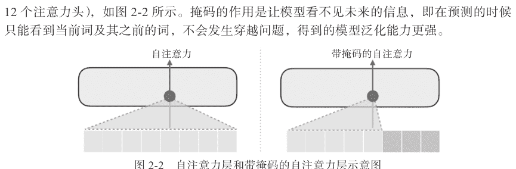

训练文本经 BPE 编码，词表 4 万，借助 ftfy library 清理标点与空格，再用 spaCy 切分，序列最长 512。位置编码未沿用正余弦，而是使用可训练的绝对位置向量，长度 3072。优化器为 Adam，激活函数 GeLU，最大学习率 2.5e-4，采用线性衰减。自监督阶段 batch 64，训练 100 epoch；有监督微调 batch 32，训练 3 epoch。

激活函数决定信息是否传递。常见 ReLU 表达式为

```
f(x) = max(0, x)
```

图像见图 2-3。ReLU 计算简单，能缓解梯度消失爆炸，自 2012 年 AlexNet 引入后广为使用。

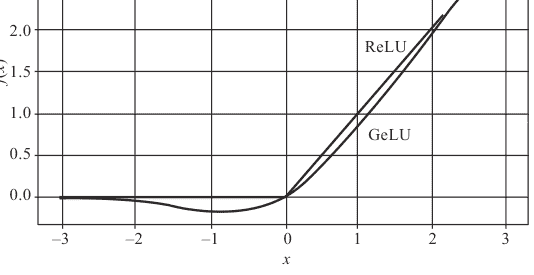

图 2-3 ReLU 和 GeLU 函数图像

ReLU 为分段线性，非线性有限，且负输入时输出为零导致反向梯度为零，出现神经元死亡，权重无法更新。

为此 GeLU 引入随机正则化，激活时保留一定概率性。灵感来自 ReLU 与 Dropout，对每个输入 $x$ 假设服从标准正态 $\mathrm{N}(0,1)$，以累计分布函数决定的伯努利概率保留该神经元。表达式为

```
$$f(x)=0.5 x\left(1+\tanh \left[\sqrt{\frac{2}{\pi}}\left(x+0.044715 x^{3}\right)\right]\right)$$
```

图像见图 2-3 下方。GeLU 在 BERT、RoBERTa、GPT-2 等 Transformer 中广泛使用，被认为在 NLP 任务上表现突出。

4. 输入改造思路
目标是多任务学习、通用且泛化。我们需要把各类 NLP 子任务统一为“序列加标签”的形式。如图 2-4，GPT-1 在四个任务上做有监督微调。

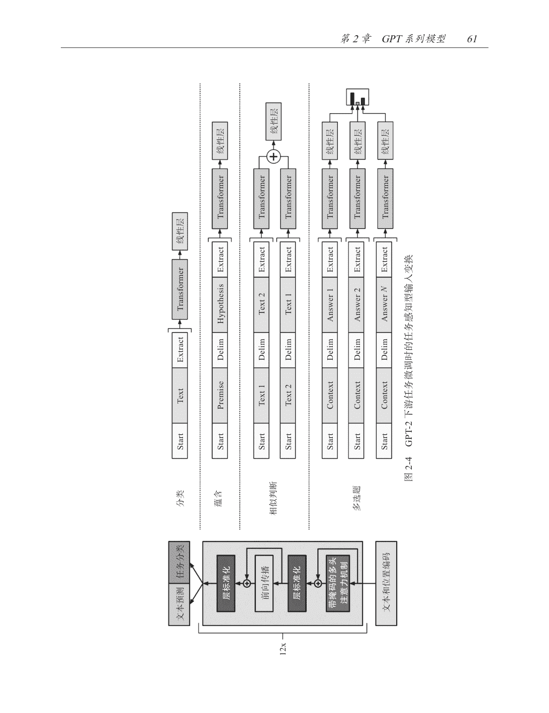

1) 文本分类：文本前加开始词元，后加抽取词元，经 Transformer 后取最后一个词元的表征，经线性层映射到多分类标签。
2) 文本蕴含：前提与假设前加开始词元，中间用分隔词元，最后加抽取词元，取末尾表征映射到二分类。
3) 语义相似判断：为保证对称性构造两个序列，Text1+Text2 与 Text2+Text1，各自通过 Transformer 取末尾表征求和，再线性映射到二分类。
4) 多选题：对 N 个选项构造 N 个序列，问题在前选项在后，每个序列独立过 Transformer 与线性层得到置信度，最后 softmax。

尽管目标各异，均可归约为序列形式，再基于预训练模型微调。

2.1.3 效果检验
GPT-1 在四个下游任务上均取得当时可观提升。研究还探究了深度影响，如图 2-5，层数增加带来性能稳步上升，为后续大模型发展提供依据。

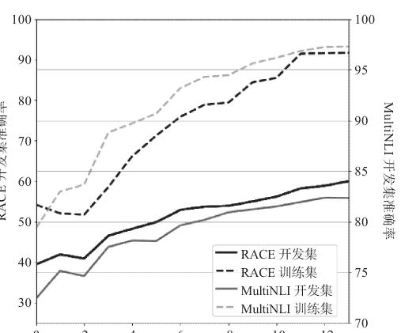

图2-5 GPT-1中模型层数对模型在RACE和MultiNLI两个任务上的影响

模型还具备一定零样本推理能力，即预训练模型无需微调即可执行下游任务。图 2-6 中横轴为训练轮次，纵轴为相对表现，0 为随机基线，1 为当时 SOTA。Zero-Shot 设定下，GPT 比基于 LSTM 的模型更稳定，随训练提升，显示出更强的泛化。

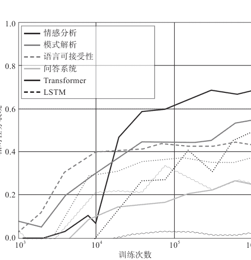

图 2-6 GPT-1 在 Zero-Shot 设定下与 LSTM 相比在不同任务上的效果

总体看，GPT-1 提出先用无标注数据预训练再用标注数据微调的框架。大量文本预训练带来知识与长依赖能力，可迁移至下游。零样本推理能力亦成为 GPT-2、GPT-3 的重要特征。

2.2 GPT-2 升级之路
GPT-2 来自论文 “Language Models are Unsupervised Multitask Learners”，即语言模型是无监督的多任务学习器。

当时模型多在单一大数据集上有监督训练，对分布和任务变化敏感，泛化不足。研究者认为在单个数据集上单任务训练是原因之一。于是转向多领域多任务训练，提升鲁棒性。

NLP 中多任务学习较少，多用预训练加微调，但需大量标注和每任务重训。GPT-2 在预训练期隐含多任务学习，后续直接采用 Zero-Shot 评估，不改架构、无需标注、不再重训，直接用语言模型输出判别。

2.2.1 结构对比
GPT-2 与 GPT-1 均为 Transformer 解码器，但在下游处理上不同。GPT-1 引入开始、分隔、抽取等特殊词元，预训练未见，需要微调后才认识。Zero-Shot 下不能更新模型，也就不能新增词元，输入必须贴近人类自然语言。

语言建模目标是 $P(output|input)$。通用系统目标扩展为 $P(output|input,task)$。结构上 GPT-2 在 GPT-1 基础上小幅调整，如将 Post-LN 改为 Pre-LN，并在最后一个 Transformer 模块后增加层归一化，见图 2-7。

GPT-2 训练了四个规模递增的模型，证实容量提升带来效果提升。GPT-2-EXTRA-LARGE 有 48 层解码器，隐藏维度 1600，参数约 15 亿，远超 BERT 大模型 3.4 亿。GPT-2-SMALL 为 12 层、768 维；GPT-2-MEDIUM 为 24 层、1024 维；GPT-2-LARGE 为 36 层、1280 维。

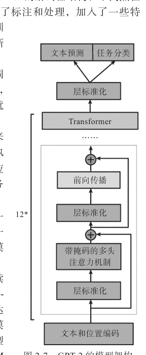

图 2-7 GPT-2 的模型架构

2.2.2 数据采集经纬
此前语言模型多在单一领域训练。GPT-2 希望通过预训练获得通用能力，数据需覆盖多领域多任务。

Common Crawl 虽文本海量但噪声大、信噪比低，实验效果不佳后被放弃。团队转而爬取 Reddit，选取获赞至少 3 的页面，整理为 WebText，共 800 万篇文档、约 40GB，并剔除维基百科以免与测试集重叠。

2.2.3 零样本表现
评估在 Zero-Shot 背景下进行，与同类研究对比。图 2-8 显示 GPT-2 在多项任务上当时表现出色。

| | LAMBADA (PPL) | LAMBADA (ACC) | CBT-CN (ACC) | CBT-NE (ACC) | WikiText2 (PPL) | PTB (PPL) | enwik8 (BPB) | text8 (BPC) | WikiText103 (PPL) | IBW (PPL) |

| --- | --- | --- | --- | --- | --- | --- | --- | --- | --- | --- |

| SOTA | 99.8 | 59.23 | 85.7 | 82.3 | 39.14 | 46.54 | 0.99 | 1.08 | 18.3 | 21.8 |

| 117M | 35.13 | 45.99 | 87.65 | 83.4 | 29.41 | 65.85 | 1.16 | 1.17 | 37.50 | 75.20 |

| 345M | 15.60 | 55.48 | 92.35 | 87.1 | 22.76 | 47.33 | 1.01 | 1.06 | 26.37 | 55.72 |

| 762M | 10.87 | 60.12 | 93.45 | 88.0 | 19.93 | 40.31 | 0.97 | 1.02 | 22.05 | 44.575 |

| 1542M | 8.63 | 63.24 | 93.30 | 89.05 | 18.34 | 35.76 | 0.93 | 0.98 | 17.48 | 42.16 |

图 2-8 GPT-2 在多项任务上的效果

在读解、翻译、摘要和问答这四类任务上，GPT-2 展开了对照实验，详见图 2-9。横坐标是模型参数规模，纵坐标是各任务的评测分数。可以看出，前三项任务上 GPT-2 已经能给出令人满意的结果，问答相对弱一些。整体趋势很明显，参数越大成绩越好，这说明 GPT-2 的上限还没有被摸到。

这项工作提供了一个有力证据：只要预训练语料足够庞大且多样，仅靠无监督语言建模，就能在多个领域和不同的评测集上取得不错表现。即使在完全零样本的条件下，GPT-2 共测了 8 个任务，其中 7 个达到了当时的最好水平。

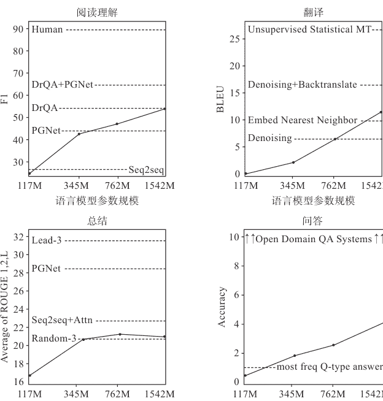

图 2-9 GPT-2 在阅读理解、翻译、总结和问答任务上的效果

## 2.3 GPT-3

GPT-3 首次亮相于论文《Language models are few-shot learners》 https://arxiv.org/abs/2005.14165，核心观点是语言模型能够小样本学习。

从 GPT-1 到 GPT-2，大家都观察到预训练模型具备零样本泛化能力，但实际效果距离理想还有差距。GPT-3 因此后退一步，不再追求纯零样本，而是转向少样本。少样本的意思是，给模型几条示范，它就能把握新任务的规律。

模型架构上 GPT-3 仍沿用 Transformer 解码器，与 GPT-2 保持一致，但规模跃升到 1750 亿可训练参数，是此前任何非稀疏语言模型的大约十倍。因为体量如此庞大，下游微调成本极高，所以 GPT-3 对所有子任务都不做梯度更新。实际表现上，它在大量 NLP 数据集上都能胜任翻译、问答、完形填空等工作，并且能够通过少样本快速学会全新任务。

### 2.3.1 上下文学习

“预训练加微调” 曾经是 NLP 的主流范式，但它依赖标注数据和任务级微调，限制很大。GPT-2 在零样本上虽有优势，却仍难以触及 SOTA，瓶颈需要被打破。原因主要有三点。

① 应用层面，下游任务数量庞大，每个任务都收集标注并微调既费时又不可持续。
② 微调后的好成绩未必等于预训练模型泛化强，很可能只是过拟合了训练集里与微调任务重叠的部分；换一种语言，效果就会掉。
③ 人类学习新技能并不需要海量数据，通常看一两个例子就能上手。

为此 GPT-3 提出上下文学习作为替代方案。传统预训练加微调在微调阶段用大量目标语料更新参数，而 GPT-3 取消微调，用上下文的方式完成任务，且在以下三种设定下都不更新梯度。

- Zero-Shot：只给出任务描述，直接让模型预测答案。
- One-Shot：在任务描述之外再提供一条合规示例，再预测。
- Few-Shot：提供描述和多条示例，模型先学习示例规律再作答。

Few-Shot 是 GPT-3 最突出的能力，几条示范就能让模型适应新任务，学习方式更接近人类。并且整个过程无需微调，也无需参数改动。

### 2.3.2 构造训练数据集

更大模型需要更大语料，语料的挑选和处理直接决定最终效果。常见语料可分为六类。

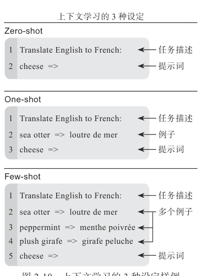

维基百科：由志愿者维护的多语言百科，内容精炼、来源规范，覆盖面广。

书籍：涵盖小说与非虚构，提升叙事与推理能力，常用来源有 Project Gutenberg 和 Smashwords。

期刊：主要来自 ArXiv 及各大会议预印本，条理清晰、理性严谨。

Reddit：GPT-2 的 WebText 就源于此，采集点赞数超 3 的帖子，反映流行内容倾向。

Common Crawl：自 2008 年起持续抓取的海量网页集合，包含原始页面、元数据和抽取文本，语言与领域多样。

其他：包括 GitHub 代码、Stack Overflow 论坛以及视频字幕等。

GPT-2 训练时并未使用 Common Crawl，因其质量参差。GPT-3 在使用前做了筛选：先把 Common Crawl 作为负样本，以 GPT-2 训练时用到的高质量文本作正样本训练分类器，再用该分类器给 Common Crawl 打分，超过阈值才保留。其次在文档内部和跨文档做了模糊去重。

由于参数高达 1750 亿，单机显存完全不够，必须采用分布式训练，具体细节将在第 4 章展开。

即便知道这些语料，复现 GPT-3 也非常困难。公开的 OPT-175B 和 BLOOM-176B 在效果上都未能追平 GPT-3，这与数据和训练策略有关。

一方面，GPT-3 预训练数据约 60% 来自筛选后的 Common Crawl，其余来自 WebText、书籍、维基百科等，并混入了 GitHub Code 等代码语料。

另一方面，训练中存在三个关键差异。
1. 数据质量：GPT-3 和 PaLM 用分类器剔除低质数据，而 OPT 和 BLOOM 未采用类似策略。
2. 数据去重：去重可避免重复学习和过拟合，提升泛化。GPT-3 和 PaLM 做了文档级去重，而 OPT 的 Pile 中重复较多。
3. 数据多样性：涵蓋领域、格式、语言等多维度多样性。OPT-175B 的 Pile 自称多样，但 BLOOM 的 ROOTS 过度依赖学术数据，缺少 Common Crawl 的广度。

总体来看，高质量筛选、去重和多样性对语言模型训练至关重要，但 GPT-3 与 PaLM 的具体预处理方法和完整数据清单并未公开，导致社区复现难度很大。

## 2.3.3 训练停止判定

1750 亿参数带来的训练成本极高，何时停训成为关键问题。技术报告中比较了不同规模模型在算力与验证集损失上的关系，如图 2-11。横轴是算力，纵轴是验证损失，每条曲线对应一个模型。可以看到，损失降到拐点附近后继续训练仍会下降，但幅度明显变缓。因此大模型训练通常在损失接近拐点阈值时停止。

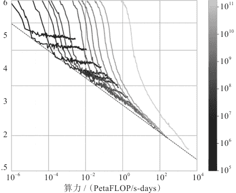

图 2-11 GPT-3 模型参数规模与算力对验证集损失的影响

## 2.3.4 重要潜力

初代 GPT-3 吸引关注的核心有三点：强大的文本生成、上下文学习能力以及丰富的世界知识。

其一，语言生成。用户只需给出一个提示词，模型就能续写成完整的句子，这源自语言建模训练，是目前最常见的交互方式。

其二，上下文学习。给定任务示例后，模型能据此为新样本生成解法。其泛化原理仍不完全清晰，一种猜测是训练时同一任务的数据点常被排在一起，导致模型学会了“按示例作答”。

其三，世界知识。模型从约 3000 亿词的训练语料中吸纳了大量事实性知识和常识。

虽然与当今模型相比 GPT-3 看起来有限，但后续研究通过代码预训练、指令微调和基于人类反馈的强化学习，释放了其潜能，使其在 AI 领域占据重要地位。

# 2.4 GPT-3.5

OpenAI 发布了一系列大模型，各具特点。初代 GPT-3 的代号是 davinci。随后推出 Codex 系列，首个模型在 GPT-3 基础上以 120 亿参数微调得到，命名为 Code-davinci-001，后演变为 API 中的 Code-cushman-001。再后来发布指令微调论文，对应 Instruct-davinci-beta 与 Text-davinci-001。

在此基础上，先用“语言模型加代码训练”再做指令微调，得到 Code-davinci-002，随后有监督指令微调得到 Text-davinci-002，最后经人类反馈强化学习得到 Text-davinci-003 与 ChatGPT。从 GPT-3 到 GPT-3.5 的演进如图 2-12 所示。

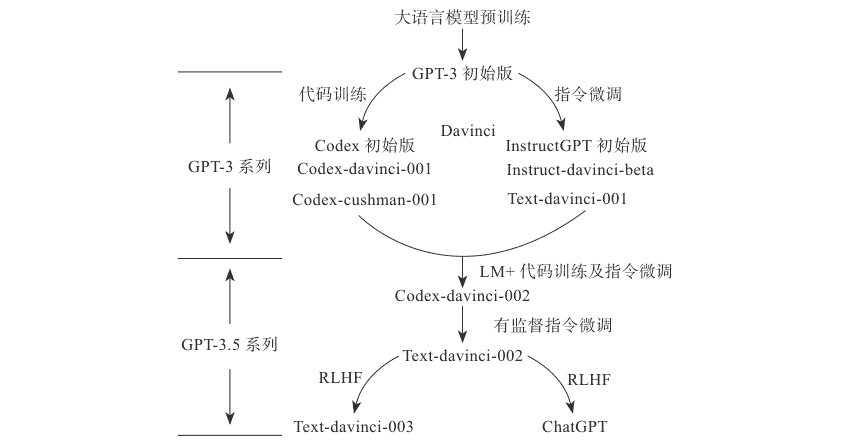

Code-davinci-002 与 Text-davinci-002 被视作第一版 GPT-3.5，前者专注代码生成与理解，后者擅长更符合人类意图的文本理解与生成。两者相比 GPT-3 有明显进步：能响应指令、做更复杂的推理、泛化更强、代码能力提升。

其中值得强调两项能力：泛化与思维链推理。

泛化能力指经过大量指令微调后，模型能在未见过的全新指令上给出有效回答。对产品化而言至关重要，因为用户会不断提出新问题。该能力并非天然存在，而是指令量达到一定规模后才逐渐显现。

思维链推理方面，初代 GPT-3 较弱，而 Code-davinci-002 与 Text-davinci-002 表现突出。有趣的是，这种能力很可能来自代码训练。代码具有极强逻辑性，必须严格遵循规则才能运行，可视为高度逻辑的语料。大量编程语言与海量代码让模型习得抽象与逻辑能力，注释与代码形成的配对也无意间实现了多模态对齐，进一步促进推理。

总体来看，代码训练提供逻辑与抽象能力，指令微调与人类反馈强化学习则激活模型对人类指令的响应与遵循能力，二者共同推动了“智能”行为的出现。

# 2.4.1 代码生成模型 Codex

Codex 为 GitHub Copilot 提供支持，能用自然语言生成多种编程语言代码。该模型发表于论文《Evaluating Large Language Models Trained on Code》 https://arxiv.org/abs/2107.03374，训练阶段主要聚焦 Python，Copilot 则支持多语言，因此不完全等同。

Codex 基于 GPT 架构，在 GitHub 公开代码上微调。GPT-3 的卖点是不需微调即可推理，而 Codex 是其在代码领域的定向优化。

研究者发现 GPT-3 仅凭注释就能生成简单 Python 代码，这令人振奋，于是 Codex 进一步探索从注释生成函数的能力，并通过单元测试自动验证正确性。

代码生成与自然语言生成评估不同，后者多靠人工，前者可用机器自动判定。为此研究者构建了 HumanEval 数据集，包含 164 道编程问题，用于考察对语言的理解、算法实现与数学求解能力。

实际编程常需迭代，评估时允许生成多个候选，只要有一个通过单元测试即算成功。在只生成一个答案的设定下，首版 120 亿参数的 Codex 能解决 28.8% 的问题。随后收集更匹配评估策略的数据集再微调，得到 Codex-S，单次生成正确率升至 37.7%。若允许生成 100 个答案，只要其一通过则成功率达 77.5%。考虑到实际使用不可能让用户挑选 100 个结果，论文还给出排序算法，按平均出现概率选最优结果，可解决 44.5% 的问题。

## 1. 评估指标

语言模型常用 BLEU 衡量生成序列与参考序列的子序列重合度，属于模糊匹配。但在代码生成中，子序列相似并不等价于可运行，BLEU 会失真。

Codex 论文采用 pass@k 指标，k 表示模型可生成 k 个不同结果，只要其一通过测试即算通过。为避免随机性，采用 n 次采样，每次从 n 个样本中随机取 k 个，统计包含正确答案的次数 c。

具体计算公式为

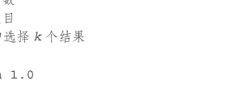

为提升效率，可简化为如下函数实现。

```python
def pass_at_k(n, c, k):
    """
    :param n: 生成的结果总数
    :param c: 正确结果的数目
    :param k: 从 n 个结果中选择 k 个结果
    """
    if n - c < k: return 1.0
    return 1.0 - np.prod(1.0 - k / np.arange(n - c + 1, n + 1))
```

HumanEval 由人工编写，共 164 个编程任务，每个任务包含函数签名、注释、函数体和若干单元测试。选用人工数据是为了避免训练集污染，因为网络代码很可能已被模型见过。

## 2. 代码语料微调

筛选阶段剔除了单行超千字符的记录和二进制文件，清洗后语料规模约159GB。代码的词元分布和自然语言差异很大，空格、缩进与换行占用比例高。为此 Codex 训练时引入了一批专门表示不同长度空格的词元，词元开销因此降低约30%。

Codex 在架构上继承自 GPT-3。让人意外的是，在预训练模型上继续做微调对最终表现的提升有限，主要作用是让收敛更快。

生成阶段论文采用了核采样。常规采样每一步都挑 softmax 后概率最高的词元，这种贪心方式无法保证序列整体概率最优，且容易产生单一固定的结果。改进思路是使用树搜索或 Beam Search，同时保留若干当前最优候选再往下拓展，计算量略增但能一次性给出多个解。核采样则是在每个时间步为候选词计算概率，按降序排列并保留累积概率达到0.95的那部分词元。

评估采用 pass@k，会一次性生成多个结果，因此采样数 k 的选取很关键，论文对此进行了讨论，如图2-13所示。
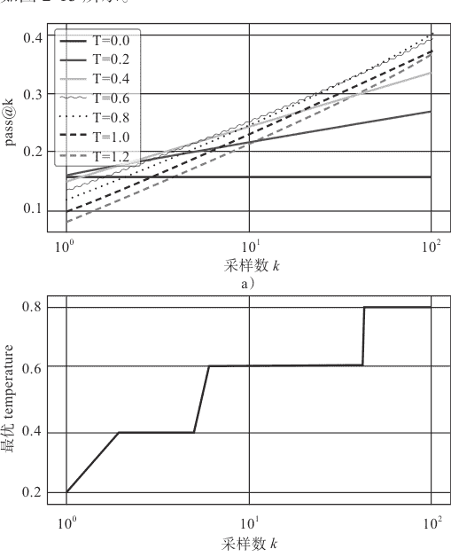
图2-13横轴为采样数1~100，纵轴a为 pass@k，不同曲线对应生成时使用的 temperature。temperature=0 时每次都取最大概率，结果恒定是一条水平线。temperature 越大，多次生成的多样性越高。图2-13b是在不同采样次数下从图a推导出的最优 temperature。

如图2-14所示，在参数调优到最优的情况下，研究者考察了模型规模对 pass@k 的影响，可见参数量越大效果越好。
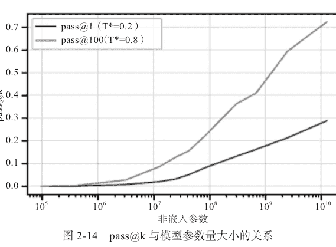
图 2-14 pass@k 与模型参数量大小的关系

随后作者对比了若干采样策略的效果，如图2-15所示。设定如下。

- ①：k个结果中只要有一个通过就算通过。
- ②：在注释到代码生成的基础上，还训练了代码到注释的逆向模型，取概率之和最大的结果。
- ③：取概率之和最大的结果。
- ④：取平均概率最大的结果。
- ⑤：随机抽取一个结果。
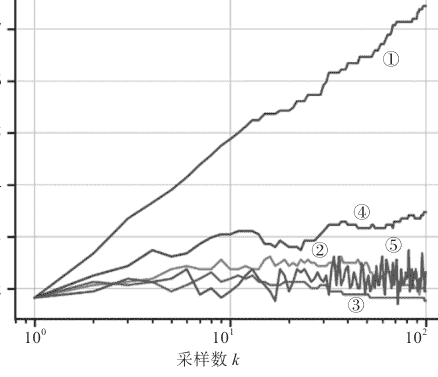
图 2-15 采样数 k 在不同采样方法的设定下与通过率的关系

## 3. 监督式再训练

研究者认为，仅靠 GitHub 大规模代码做微调，数据里充斥着类实现、配置文件、数据存储文件等，与评测任务的相关性弱，因而迁移效果不理想。为提升到目标任务的迁移能力，团队另采集了一批数据，主要来自在线判题网站的爬取结果，部分来自持续集成代码库。在此新集上再做一次有监督微调，得到 Codex-S。Codex 与 Codex-S 的对比见图2-16。
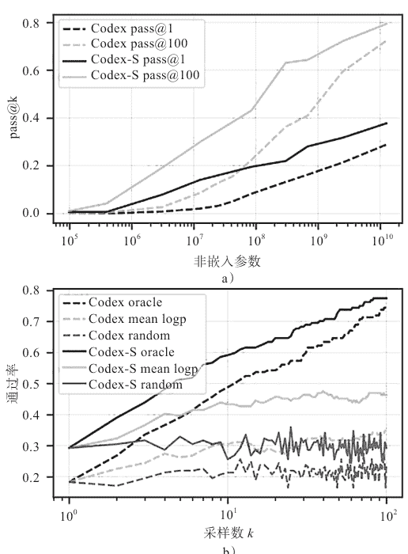
图 2-16 Codex 与 Codex-S 的模型效果对比

图2-16a比较了两版模型在不同参数规模下的 pass@k，图2-16b比较了不同采样方法对 pass@k 的影响。

## 4. 能力局限

Codex 表现可观，但仍有明显短板。

其一是样本利用效率低。训练集汇聚了 GitHub 上数亿行公开 Python 代码，规模远超一个资深开发者职业生涯能接触到的量。实际上，即便只完成入门级计算机课程的优秀学生，也能在某些问题上胜过 Codex-12B。

其二是长文本处理弱。研究者构造了一个由13个基础块组成的数据集，每个块按确定规则改写输入。例如对变量 x、y、z、w，要求依次执行三块：y 加3；x 与 w 同减4；返回四数乘积。模型生成结果错误。更关键的是，随着文档字符串中关联块的数量增加，性能呈指数级下降，这与人类程序员可处理任意链长的能力不符。
```python
def do_work(x, y, z, w):
    t = y + 3
    u = x - 4
    v = z * w
    return v
```

其三是生成质量不稳定。模型可能输出语法错误或未定义的片段，会调用库外未定义或不存在的函数、变量、属性，且对愈长、愈高级或系统级的规范解析困难。

总体来看，Codex 在部分任务上突出，但在样本利用率、长序列理解、全局把握与数学计算等方面仍需改进。

在介绍 InstructGPT 之前，先补充强化学习的背景。强化学习是机器学习的一个分支，与有监督、无监督、自监督不同，其目标是通过一系列行动在给定环境中实现长期累计收益最大化，本质上是一个决策系统，在游戏中应用广泛，例如 AlphaGo 将强化学习与专家系统结合击败人类高手。

智能体通过与环境互动达成目标。如图2-17所示，智能体感知当前状态 S_t，基于自身计算做出动作 A_t，动作改变环境并产生奖励 R_{t+1} 与新状态 S_{t+1} 回馈，循环往复。

## 1. 核心概念

## 马尔可夫过程和奖励设计

状态可用向量 S_t 表示，所有可能状态构成集合 S。对随机过程，关键是状态及其转移条件概率，下一状态 S_{t+1} 的概率可写成 P(S_{t+1} | S_1,...,S_t)。
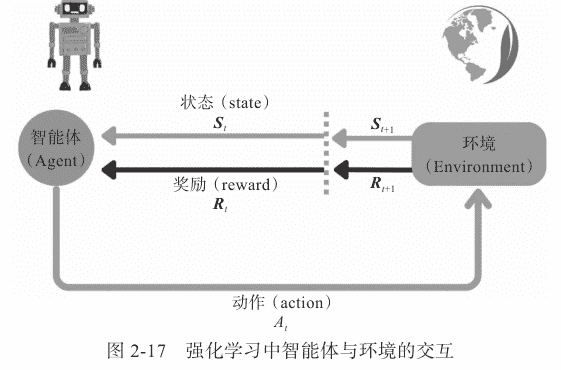

### 马尔可夫性质
在已知当前状态及全部历史的前提下，未来状态的条件分布只依赖当前状态，与历史路径条件独立。以汽车过路口为例，下一时刻状态只取决于当前油门和方向盘，而非更早历史。于是转移可简化为 P(S_{t+1} | S_t)。历史信息并非完全丢失，因为 S_t 本身已蕴含 S_{t-1} 的信息，通过链式传递得以保留。因此只要当前状态可知，就无需全部历史。

### 马尔可夫过程
具有马尔可夫性质的随机过程称为马尔可夫过程，通常记为 (S,P)，S 为有限状态集合，P 为状态转移矩阵。若有 n 个状态，矩阵第 i 行第 j 列表示从 S_i 转移到 S_j 的概率：
```
$P = \begin{bmatrix} P(S_1 | S_1) & \cdots & P(S_1 | S_n) \ \vdots & \ddots & \vdots \ P(S_n | S_1) & \cdots & P(S_n | S_n) \end{bmatrix}$
```

### 马尔可夫奖励过程
在马尔可夫过程上加入奖励函数 r 和折扣因子 γ，就得到马尔可夫奖励过程 (S,P,r,γ)。r 表示转移到某状态时的即时奖励。例如自动驾驶任务：洗车、加油、回家，抵达对应地点即获奖励。

γ 取值范围 [0,1)。远期收益不确定，引入折扣以降低对远期利益的权重。γ 接近 1 更看重长期累计，接近 0 更看重短期奖励。

状态的期望回报即该状态的价值，集合为价值函数。如洗车、加油、回家，可设定 r(洗车)=1、r(加油)=3、r(回家)=5，体现重要性递增。

### 马尔可夫决策过程
若加入智能体动作，下一状态由当前状态与动作共同决定。马尔可夫决策过程为 (S,P,A,r,γ)，A 为动作集合，奖励与转移均依赖 A。策略 π 定义为 π(a|s)=P(A_i=a|S_i=s)，即在状态 s 下采取动作 a 的概率。

价值函数分为状态价值 V^π(s)=E_π[G_t|s] 和动作价值 Q^π(s,a)=E_π[G_t|s,a]。

## PPO 算法介绍

ChatGPT 的 RLHF 训练使用近端策略优化 PPO，由 OpenAI John Schulman 等于2017年提出。核心思想是限制新旧策略差异，保证更新稳定。

PPO 同时使用 Actor 策略网络与 Critic 价值网络。每次迭代从环境采样一批数据，用其更新策略参数与价值参数，并把策略更新幅度限制在小范围内，避免大跨步更新。约束通过限制新旧策略 KL 散度不超过阈值实现，具体用裁剪函数 clip：
$$L(\theta) = \text{E}[\min(r_t(\theta)A_t, \text{clip}(r_t(\theta), 1-\varepsilon, 1+\varepsilon)A_t)]$$

其中 θ 为策略参数，r_t(θ)=π(θ)/π(θ_old)，π(θ) 为新策略，π(θ_old) 为旧策略，A_t 为优势函数，ε 为允许误差。

优势函数衡量在给定状态下某动作相对于平均水平的优劣，通常计算为 Q(s,a)-V(s)：
$$A(s, a) = Q(s, a) - V(s)$$
Q(s,a) 为在状态 s 执行动作 a 后继续按策略 π 的期望回报，V(s) 为在状态 s 按策略 π 的期望回报。

优势函数、价值函数、策略函数三者互补。优势指导更新方向，价值衡量状态与动作的好坏，策略决定动作选择概率。多数算法同时学习策略与价值，以更好理解环境并提升性能。

## PPO 算法实战

本节以车杆平衡游戏演示 PPO。强化学习需要与环境交互，自建环境成本高。OpenAI 的 Gymnasium 提供多种预设模拟环境，可直接复用。

车杆游戏环境如图2-18所示，杆子通过无动力关节连在可在无摩擦轨道移动的小车上，初始杆子垂直，目标是施力保持平衡。
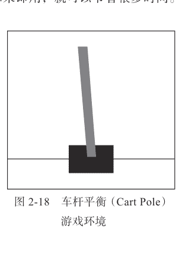
动作空间为长度1的数组，取值 {0,1}，0 表示向左推，1 表示向右推，实际产生的速度大小受杆子角度影响而非固定。

状态空间为长度4的数组：小车位置 ∈(-4.8,4.8)，离开(-2.4,2.4)则结束；小车速度 ∈(-inf,inf)；杆子角度 ∈(-24°,24°)，超出(-12°,12°)则结束。初始状态在(-0.05,0.05)均匀随机。目标是尽可能长时间保持杆子垂直，每步奖励 +1，阈值为500。

接下来定义 PPO 模型。首先导入所需库，若提示缺失 Gymnasium 可执行 pip install gymnasium。
```python
import torch as th
import numpy as np
import gymnasium as gym
import torch.nn.functional as F
import matplotlib.pyplot as plt
from tqdm import tqdm
```
随后定义 PolicyNet 与 ValueNet 分别对应 PPO 中的 Actor 与 Critic。

```python
class PolicyNet(th.nn.Module):
    def __init__(self, state_dim, hidden_dim, action_dim):
        super(PolicyNet, self).__init__()
        # 定义第一层全连接层, 输入维度为状态维度, 输出维度为隐藏层维度
        self.fc1 = th.nn.Linear(state_dim, hidden_dim)
        # 定义第二层全连接层, 输入维度为隐藏层维度, 输出维度为动作维度
        self.fc2 = th.nn.Linear(hidden_dim, action_dim)

    def forward(self, x):
        # 使用 ReLU 作为激活函数
        x = F.relu(self.fc1(x))
        # 对第二层的输出使用 softmax 函数, 得到一个概率分布
        return F.softmax(self.fc2(x), dim=1)

class ValueNet(th.nn.Module):
    def __init__(self, state_dim, hidden_dim):
        super(ValueNet, self).__init__()
        # 定义第一层全连接层, 输入维度为状态维度, 输出维度为隐藏层维度
        self.fc1 = th.nn.Linear(state_dim, hidden_dim)
        # 定义第二层全连接层, 输入维度为隐藏层维度, 输出维度为 1, 表示状态价值
        self.fc2 = th.nn.Linear(hidden_dim, 1)

    def forward(self, x):
        # 使用 ReLU 作为激活函数
        x = F.relu(self.fc1(x))
        # 第二层直接输出, 代表状态的价值
        return self.fc2(x)
```

PolicyNet 采用双层全连接结构，核心职责是拟合策略。给定一个状态，网络会给出在该状态下执行各个动作的概率。输入端接受维度为 state_dim 的状态向量，输出端产生维度为 action_dim 的动作概率分布。ValueNet 同样是双层全连接架构，用来近似值函数，即对状态的期望累积回报进行估计。它的输入也是 state_dim 维状态向量，输出则是一个单一数值，代表当前状态的价值评估。

接下来进入优势函数的定义。

```python
def compute_advantage(gamma, lambda_, td_delta):
    # 将td_delta从PyTorch张量转化为numpy数组
    td_delta = td_delta.detach().numpy()
    # 初始化优势值和优势列表
    advantage_list = []
    advantage = 0.0
    # 逆序遍历td_delta中的每一个元素
    for delta in reversed(td_delta):
        # 利用公式计算每个时间步的优势
        advantage = gamma * lambda_ * advantage + delta
        # 将优势添加到优势列表中
        advantage_list.append(advantage)
    # 将优势列表中的元素顺序反转
    advantage_list.reverse()
    # 将优势列表转化为PyTorch张量
    return th.tensor(advantage_list, dtype=th.float)
```

在优势函数确定之后，PPO 模型的整体结构就可以搭建起来了。

```python
class PPO:
    def __init__(self, state_dim, hidden_dim, action_dim, actor_lr, critic_lr,
                 lambda_, epochs, eps, gamma, device):
        # 初始化Actor和Critic
        self.actor = PolicyNet(state_dim, hidden_dim, action_dim).to(device)
        self.critic = ValueNet(state_dim, hidden_dim).to(device)
        # 设置对应的优化器
        self.actor_optimizer = th.optim.Adam(self.actor.parameters(), lr=actor_lr)
        self.critic_optimizer = th.optim.Adam(self.critic.parameters(), lr=critic_lr)
        # 设置强化学习的参数
        self.gamma = gamma
        self.lambda_ = lambda_
        self.epochs = epochs  # 使用一个完整序列的数据来多轮训练
        self.eps = eps  # PPO中截断范围的参数
        self.device = device  # 设备选择(CPU或者GPU)

    def take_action(self, state):
        # 通过Actor获取动作的概率分布
        state = th.tensor(np.array([state]), dtype=th.float).to(self.device)
        probs = self.actor(state)
        # 从动作的概率分布中采样一个动作
        action_dist = th.distributions.Categorical(probs)
```

```python
action = action_dist.sample()
return action.item()

def update(self, transition_dict):
    # 获取转换的状态、动作、奖励、下一状态和结束标志
    states = th.tensor(transition_dict["states"], dtype=th.float).to(self.device)
    actions = th.tensor(transition_dict["actions"]).view(-1, 1).to(self.device)
    rewards = th.tensor(transition_dict["rewards"], dtype=th.float).view(-1, 1).to(self.device)
    next_states = th.tensor(transition_dict["next_states"], dtype=th.float).to(self.device)
    dones = th.tensor(transition_dict["dones"], dtype=th.float).view(-1, 1).to(self.device)

    # 计算 TD 目标和 TD 误差
    td_target = rewards + self.gamma * self.critic(next_states) * (1 - dones)
    td_delta = td_target - self.critic(states)

    # 计算优势函数
    advantage = compute_advantage(self.gamma, self.lambda_, td_delta.cpu()).to(self.device)
    old_log_probs = th.log(self.actor(states).gather(1, actions)).detach()

    # 进行多轮网络更新
    for _ in range(self.epochs):
        # 计算新的动作概率
        log_probs = th.log(self.actor(states).gather(1, actions))
        ratio = th.exp(log_probs - old_log_probs)

        # 计算 PPO 的两种 surrogate 函数
        surr1 = ratio * advantage
        surr2 = th.clamp(ratio, 1 - self.eps, 1 + self.eps) * advantage  # 截断

        # 计算 Actor 和 Critic 的损失
        actor_loss = th.mean(-th.min(surr1, surr2))  # PPO 损失函数
        critic_loss = th.mean(F.mse_loss(self.critic(states), td_target.detach()))

        # 清空优化器的梯度
        self.actor_optimizer.zero_grad()
        self.critic_optimizer.zero_grad()

        # 反向传播损失，并执行一步优化
        actor_loss.backward()
        critic_loss.backward()
        self.actor_optimizer.step()
        self.critic_optimizer.step()
```

到了这一步，就该准备训练所需的参数、实例化游戏环境并正式启动训练循环。有一个现象值得注意：训练初期迭代节奏偏快，后期逐渐变慢。起因很简单，刚开始智能体对杆的平衡技巧几乎为零，每局很快就会失败收尾。随着学习推进，平衡能力提升，单局存活时长被拉长，自然导致单位时间内完成的迭代次数下降。具体的训练代码实现如下。

```python
def train_on_policy_agent(env, agent, num_episodes):
    return_list = []  # 用于存储每个周期的总回报
    for i in range(10):  # 总共进行 10 次迭代
        with tqdm(total=int(num_episodes / 10), desc=f"Iteration: {i}") as pbar:
            for i_episode in range(int(num_episodes / 10)):  # 在每个迭代周期中，智能体都会进行 num_episodes / 10 次动作
                episode_return = 0  # 用于存储每个周期的总回报
                transition_dict = {"states": [], "actions": [], "next_states": [],
                                   "rewards": [], "dones": []}  # 用于存储每个周期中的状态，动作和奖励等信息
                state, _ = env.reset()  # 重置环境，并获取初始状态
                done = False
                while not done:  # 在每个周期中，只要环境没有结束，智能体就会一直执行动作
                    action = agent.take_action(state)  # 通过当前策略选择动作
                    next_state, reward, done, _, _ = env.step(action)  # 执行动作，并获取下一状态、奖励和是否结束等信息
                    transition_dict["states"].append(state)  # 存储状态信息
                    transition_dict["actions"].append(action)  # 存储动作信息
                    transition_dict["next_states"].append(next_state)  # 存储下一状态信息
                    transition_dict["rewards"].append(reward)  # 存储奖励信息
                    transition_dict["dones"].append(done)  # 存储是否结束信息
                    state = next_state  # 更新状态
                    episode_return += reward  # 更新总回报
                return_list.append(episode_return)  # 存储该周期的总回报
                agent.update(transition_dict)  # 通过学习这个周期的状态、动作和奖励等信息来更新策略
                if (i_episode + 1) % 10 == 0:  # 每 10 个周期，输出一次信息
                    pbar.set_postfix({"episode": "%d" % (num_episodes / 10 * i + i_episode + 1),
                                      "return": "%.3f" % np.mean(return_list[-10:])})  # 输出最近 10 个周期的平均总回报
                pbar.update(1)  # 更新进度条
    return return_list  # 返回所有周期的总回报

actor_lr = 1e-3  # Actor 的学习率
critic_lr = 1e-2  # Critic 的学习率
num_episodes = 300  # 总的周期数
hidden_dim = 128  # 隐藏层的维度
gamma = 0.98  # 折扣因子
lambda_ = 0.95  # PPO 的参数
epochs = 5  # PPO 的参数
eps = 0.2  # PPO 的参数
device = th.device("cuda" if th.cuda.is_available() else "cpu")  # 使用的设备
```

```python
env_name = "CartPole-v1"    # 环境名称
env = gym.make(env_name)     # 创建环境
state_dim = env.observation_space.shape[0]  # 状态的维度
action_dim = env.action_space.n             # 动作的维度
# 实例化智能体
agent = PPO(state_dim, hidden_dim, action_dim, actor_lr, critic_lr, lambda_,
            epochs, eps, gamma, device)

return_list = train_on_policy_agent(env, agent, num_episodes)
```

训练过程中的回报也可以用来观察效果。每个周期都会统计一次总回报，如果直接把 return_list 画出来，曲线会剧烈震荡，难以看出规律。为了解趋势，我们通常会对 return_list 做滑动平均平滑处理后再可视化。

```python
def moving_average(a, window_size):
    # 计算累积和, np.insert 用于在数组第一个位置插入 0
    cumulative_sum = np.cumsum(np.insert(a, 0, 0))
    # 计算每个窗口的平均值
    middle = (cumulative_sum[window_size:] - cumulative_sum[:-window_size]) / window_size
    # 为了处理开始和结束位置不足窗口大小的部分，独立计算它们的平均值
    # np.arange(1, window_size - 1, 2) 创建一个从 1 开始，到 window_size - 1 为止，步长为 2 的等差数组
    # np.cumsum(a[:window_size - 1])[::2] / r 计算的是开始位置的平均值
    r = np.arange(1, window_size - 1, 2)
    begin = np.cumsum(a[:window_size - 1])[::2] / r
    # np.cumsum(a[:-window_size:-1])[::2] / r 计算的是结束位置的平均值
    # [::-1] 是为了将结果翻转，因为我们是 从后向前计算的
    end = (np.cumsum(a[:-window_size:-1])[::2] / r)[::-1]
    # 将开始、中间和结束的部分连接起来，得到最终的滑动平均值
    return np.concatenate((begin, middle, end))

episodes_list = list(range(len(return_list)))
mv_return_list = moving_average(return_list, 10)
plt.plot(episodes_list, mv_return_list)
plt.xlabel("Episodes")
plt.ylabel("Returns")
plt.title(f"PPO on {env_name}")
plt.show()
```
把各轮训练得到的累积收益做一次平滑后见图 2-19。前 200 轮左右 PPO 的收益水平普遍偏低，模型主要处在试探和积累经验的阶段。200 轮之后曲线开始剧烈抖动，同时整体走势向上抬升。结合杆子平衡动画来看，前期基本都是几步之内就失败，策略掌握之后游戏表现提升非常明显。

PPO 的关键优势是能在推进策略改进的同时抑制更新时的剧烈波动。实践中表现稳定，已被广泛采用，尤其在多任务学习、高维动作空间等复杂环境下效果突出。

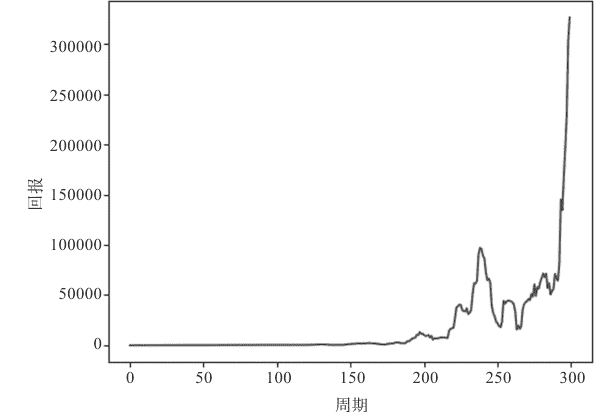
图 2-19 PPO 算法用于车杆平衡游戏的回报

总体看，强化学习落地难度依然较高，当前主要集中在游戏与仿真类场景，比如 Atari、MuJoCo。五年前强化学习和自然语言处理基本是两条平行线，方法体系与实验设计各走各路。如今强化学习在 NLP 领域的应用迅速扩散，甚至开始大规模使用，令人意外。未来有望在更多领域发挥作用。

## 2.4.3 InstructGPT：指令对齐的实践
InstructGPT 来自论文 “Aligning language models to follow instructions”（https://arxiv.org/abs/2203.02155）。

GPT-3 已经掌握了词语搭配、语法规则、编程能力以及跨语言能力，能够输出高质量的翻译。但致命的弱点是缺乏约束：它接触的知识量巨大，可以随意联想，导致输出失控。能力很强，却很难指挥，模型与用户意图未对齐。我们希望模型有用、诚实、并保持安全。

InstructGPT 的思路是用高质量的对话范例来矫正 GPT-3。做法不再以随机的网络文本为训练材料，而是把人工撰写的优质对话示例输入模型，让它以续写的方式学习如何组织符合人类期望的回答，再通过人类反馈做微调从而实现对齐。例如用户问如何毁灭世界，模型不应给出方法，而应回答这是有害行为。

为何不一开始就直接用最正确的对话来教？一方面，优质示例的数量有限，语言多样性不足，难以覆盖广泛规律，也无法触及各个领域。举例来说，若想禁止脏话，预训练阶段模型必须见过脏话是什么，否则它根本不理解“不要生成脏话”的含义。另一方面，优质示例需要人工标注，成本很高。未来在某些垂直领域若积累足够的高质量对话，或许可以跳过预训练直接做监督学习。

### 1. 构造训练数据集
搭建用于大模型微调的数据集时需要关注几个要点。首先是来源，要从相关领域收集或抓取文本。其次是质量，准备阶段必须仔细清洗，剔除无关内容与噪声。再者是规模，通常需要数千到数十万条样本，模型才能学到稳定规律。最后是相关性与泛化性，数据要在目标任务上有代表性，同时避免简单重复。

目前微调数据常见三种形式：指令跟随、多轮对话、其他辅助格式。

#### (1) 指令跟随格式
用户给出指令，模型按要求产出结果。典型代表是 Alpaca-52k，包含 5.2 万条指令，多以 json 存储。

该格式分两种，第一种是“指令/输出”：
```json
{
    "instruction": "解释量子力学是什么?",
    "output": "量子力学 (Quantum Mechanics)，为物理学理论，是研究物质世界微观粒子运动规律的物理学分支，主要研究原子、分子、凝聚态物质，以及原子核和基本粒子的结构、性质的基础理论。它与相对论一起构成现代物理学的理论基础。"
}
```
第二种是“指令/输入/输出”：
```json
{
    "instruction": "将这个句子翻译成法语",
    "input": "我喜欢读书和旅行。",
    "output": "J'aime lire et voyager."
}
```
训练时相当于一问一答，问题和指令作提示，答案作输出。计算损失时需屏蔽填充词。

#### (2) 多轮对话格式
用户与模型多轮交互以满足需求。ShareGPT 就是典型，记录大量用户与聊天机器人的对话。

```json
"conversations": [
  {"from": "human", "value": " 你是谁?"},
  {"from": "gpt", "value": " 我是 ChatGPT, ..."},
  {"from": "human", "value": " 你能做什么?"},
  {"from": "gpt", "value": " 我可以和你聊天。"},
  {"from": "human", "value": " "你好" 用英语怎么说?"},
  {"from": "gpt", "value": " "你好" 的英文是"Hello""}
]
```
这种结构语言模型不能直接使用，需拆成多段输入—输出。常见做法是拆成若干训练样本。

```txt
<sos>human: " 你是谁?"<sep>gpt: " 我是 ChatGPT, ..."<eos>
<sos>human: " 你是谁?"<sep>gpt: " 我是 ChatGPT, ..."<sep>human: " 你能做什么?"<sep>gpt: " 我可以和你聊天。"<eos>
<sos>human: " 你是谁?"<sep>gpt: " 我是 ChatGPT, ..."<sep>human: " 你能做什么?"<sep>gpt: " 我可以和你聊天。"<sep>human: ""你好" 用英语怎么说?"<sep>gpt: ""你好" 的英文是"Hello""<eos>
```
做法简单但效率低：完整对话被拆开后，大量样本尾部都是填充到 max_length 的无信息部分；同时数据会膨胀为“会话数 × 平均轮次”，重复内容降低训练效率。

对纯解码器式模型，存在两点特性。其一是因果注意力，如图 2-20，单个 token 只能看到前文。其二是位置编码仅表达顺序，无其它语义。


基于此，可把多轮样本拼接为 Q1<sep>A1 <eos> Q2<sep>A2 <eos>Q3<sep>A3 <eos> 的形式，损失只算在各 A 部分，从而实现会话级训练。

多轮数据集的构建方式之一是让大模型自我对话，同时扮演用户和助手，迭代生成多轮内容，再经标注筛选得到指令微调数据。

图 2-20 因果形的注意力掩码矩阵

#### (3) 其他格式
除上述两种，还存在纯文本文档、文本摘要、文本生成对话，以及调用 API、调用 SQL 等特定用途格式。

OpenAI 构建 InstructGPT 微调数据充分利用自有平台，过程分为三阶段。
- ①第一阶段：雇佣约 40 人标注团队撰写大量提示词，通过 API 生成结果，筛选出符合人类意图的样本构成 SFT 数据集，随后用有监督学习微调 GPT-3。
- ②第二阶段：对模型多个输出做人工打分排序，整理成 RM 数据集，训练打分模型。
- ③第三阶段：利用打分模型在第一阶段提示词上做强化学习微调，最终得到 InstructGPT。


提示词数据从哪来？第一类是标注员手工撰写，确保多样性；第二类是围绕主题撰写的指令，如摘要；第三类是依据用户需求设计的提示。基于这些数据先做有监督微调得到初版模型。随后把初版模型放到 OpenAI Playground，收集真实用户尝试的数据，经筛选切分后用于下一步。

据此收集了三类数据集，如图 2-22。

- SFT 数据集：13,000 条样本，由标注员直接写答案用于 SFT 训练。
- RM 数据集：33,000 条样本，用于训练打分模型。
- PPO 数据集：31,000 条样本，未经人工标注，由打分模型自动标注。

| SFT Data | | | RM Data | | | PPO Data | | |
|---|---|---|---|---|---|---|---|---|
| split | source | size | split | source | size | split | source | size |
| train | labeler | 11,295 | train | labeler | 6,623 | train | customer | 31,144 |
| train | customer | 1,430 | train | customer | 26,584 | valid | customer | 16,185 |
| valid | labeler | 1,550 | valid | labeler | 3,488 | | | |
| valid | customer | 103 | valid | customer | 14,399 | | | |

图 2-22 InstructGPT 训练所使用的数据集来源和数量

## 2. 有监督指令微调
AI 追求的始终是泛化能力，在未见任务上仍能表现良好。预训练模型如 GPT-3 已能执行自然语言描述的任务，但输出可控性不足。对语言模型做指令微调 Instruction Fine-Tuning 可以提升指令响应能力并减少示例依赖。IFT 可在情感分析、文本分类、内容摘要等经典 NLP 任务上对基础模型微调。

数据量上，除了真实用户指令，还可用合成数据扩充样本。构建指令集时，从已有标注数据提取与让大模型生成输出各有利弊。提取方法可靠性高，但需人工把“文本-标签”转为“指令-输出”。生成方法速度快成本低，但可能受模型偏见影响。选择取决于人力与需求。

IFT 后模型仍可能给出无效或不安全回应，如总说“我不知道”或对敏感输入做出不当反应。为此采用有监督微调 Supervised Fine-tuning，在高质量人工标注数据上微调以获得有效且安全的回应。SFT 与 IFT 紧密相关，可视作子集，后者更侧重指令性，前者更侧重安全。

InstructGPT 的 SFT 数据集见图 2-23，图 2-23a 给出任务占比，图 2-23b 给出示例。IFT 基本由指令、输入、输出三部分构成，输入可选，部分任务只需指令。

通过 API 调用的提示词数据集的不同分类及其分布概率

| Use-case | (%) |
|---|---|
| Generation | 45.6% |
| Open QA | 12.4% |
| Brainstorming | 11.2% |
| Chat | 8.4% |
| Rewrite | 6.6% |
| Summarization | 4.2% |
| Classification | 3.5% |
| Other | 3.5% |
| Closed QA | 2.6% |
| Extract | 1.9% |

通过 API 调用提示词数据集的样例

| Use-case | Prompt |
|---|---|
| Brainstorming | List five ideas for how to regain enthusiasm for my career |
| Generation | Write a short story where a bear goes to the beach,makes friends with a seal,and then returns home. |
| Rewrite | This is the summary of a Broadway play: """ {summary} """ This is the outline of the commercial for that play: """ |

图 2-23 InstructGPT 的 SFT 数据集概览

指令微调和监督微调并不会创造新能力，所有基础能力早在预训练阶段就已经沉淀下来。IFT 的价值在于把沉睡的能力激活出来，这很大程度上源于 IFT 用量远少于预训练。对 GPT-3 来说，这一步会让模型走向不同的技能分支，有的数据集让它更擅长上下文学习，比如 text-davinci-003，有的则让它更擅长对话，比如 ChatGPT。代价是明显的：为了更贴合人类需求，某些能力会被削弱，OpenAI 在 IFT 论文里把这种取舍叫做“对齐税”。

## 3. 训练奖励模型
InstructGPT 论文里的奖励模型本质上是一个 60 亿参数的 SFT 模型，去掉了最后的非嵌入层，把 softmax 换成线性层，直接输出一个标量分数，再依据数据集中提示词与回复的排序关系重新训练。理论上也能从零开始训奖励模型，实践中以 SFT 模型为起点收敛更快、效果更好，原因大概是 SFT 已经掌握了基础的 NLP 知识。

训练时用到的标签是相对排序而不是绝对分值，这就引出一个问题：为何不直接做分类而要先把排序转成分数？类比作文评分就很直观：作文在语文卷里主观性最强，同一篇作文换个老师可能分数差很多。给 ChatGPT 标注时也会出现类似情况，不同标注员对同一生成文本的喜好不一致，模型就会对同一句话的质量产生困惑。把任务从打绝对分改为做相对排序，能大幅降低这种噪音，不要求每个标注员给出统一的绝对分数，只要求对一组答案排个先后序，相对顺序通常更容易达成一致，也更稳定。

学会从序列中打分需要专门的损失设计。假设模型对同一提示生成 A、B、C、D 四句，已知质量顺序为 A > B > C > D，我们希望学到的评分函数满足 r(A) > r(B) > r(C) > r(D)。一个直观的做法是把所有逆序对的分数差累加起来，比如 r(A)-r(B)+r(A)-r(C)+...，再对每对差值做 Sigmoid 归一化把值压到 0~1，整体目标就是让好句子的总分拉开、坏句子的总分压低。因为梯度下降是最小化操作，最终会取负号来实现最大化差距。

更具体地，对一个提示 x 取一对答案 y_w、y_l，且 y_w 的排序高于 y_l，用奖励模型分别得到 r_θ(x, y_w) 和 r_θ(x, y_l)，希望前者更大。经过 Sigmoid 再取对数，就得到与逻辑回归等价的损失形式：

$$\operatorname{loss}(\theta)=-\frac{1}{\binom{K}{2}} E_{(x, y_{w}, y_{l}) \sim D}[\log (\sigma\left(r_{\theta}\left(x, y_{w}\right)-r_{\theta}\left(x, y_{l}\right)\right))]$$

每个提示会让模型生成 K=9 个候选答案，每次从中抽取两两组合，最终对组合数做标准化。

图 2-24 展示了 OpenAI 标注员在构造 InstructGPT 奖励模型训练数据时使用的界面，标注员会给每个回答打 1~7 分并按偏好排序。对训练而言起作用的是排序而非绝对分。标注一致性大约 73%，即 10 个人对同一对回答排序，有约 7 人会得到完全一致的结果。

## 4. 强化学习微调
ChatGPT 与 InstructGPT 都用 RLHF，差异主要在数据采集上。RLHF 把微调建模成强化学习问题，用 PPO 解决，因此需要明确策略、动作空间、观察空间和奖励函数。策略就是基于当前语言模型，输入提示后输出文本或其概率分布；动作空间是所有词表在所有输出位置上的组合，每个位置约 5 万个选项；观察空间是所有可能的输入词序列，即提示；奖励函数则由训练好的奖励模型给出，并叠加策略层面的约束。

强化学习微调的流程如图 2-25。计算奖励时，先从准备好的提示池里抽取一个提示，同时喂给初始语言模型和正在训练的语言模型，得到输出 y1 和 y2，再用奖励模型打分，分数差作为更新策略的信号，通常借助 KL 散度来量化奖励或惩罚的幅度。若 y2 的得分明显高于 y1，则给予更大奖励，反之则惩罚。

引入 KL 散度限制的原因是，OpenAI 发现训练中模型不应偏离预训练模型和 SFT 模型太远。实际上对任意提示都存在多种合理回答，而奖励模型很大程度上没见过这些未出现过的回答对，容易给出极高或极低的错误评分。若没有约束，模型会倾向采纳那些得分极高但质量平庸的回答，KL 项正好帮助避开这类陷阱。

强化学习微调的目标函数为

$\text{objective}(\phi) = E_{(x,y) \sim D_{\pi_{\phi}^{\text{RL}}}} \left[ r_{\theta}(x,y) - \beta \log \left( \frac{\pi_{\phi}^{\text{RL}}(y \mid x)}{\pi^{\text{SFT}}(y \mid x)} \right) \right] + \gamma E_{x \sim D_{\text{pretrain}}} [\log \pi_{\phi}^{\text{RL}}(x)]$

其中 $\pi_{\phi}^{\text{RL}}$ 是可学习策略，初始化与 $\pi^{\text{SFT}}$ 相同；$\pi^{\text{SFT}}$ 为监督微调得到的模型。第一项的 $(x,y)$ 来自当前 RL 策略生成的样本，用奖励模型打分并最大化。$r_{\theta}$ 固定且训练分布来自 $\pi^{\text{SFT}}$，如果 $\pi_{\phi}^{\text{RL}}$ 更新导致分布漂移，奖励估计会失准，KL 项 $\beta \log(\pi_{\phi}^{\text{RL}}/\pi^{\text{SFT}})$ 用来控制更新幅度。

为防止模型过度偏向微调任务而失语，还会从 GPT-3 预训练数据中采样做语言模型损失 $\gamma E_{x \sim D_{\text{pretrain}}} [\log \pi_{\phi}^{\text{RL}}(x)]$。$\gamma=0$ 时为纯 PPO，$\gamma\neq0$ 时为论文里称的 PPO-ptx 混合训练。

RL 在 NLP 中优势明显，但也问题不少：收敛慢、算力成本高，现实任务中探索与数据获取成本都高。LLM 的 PPO 训练尤其困难，既有资源消耗，也有稳定性风险，训练中容易出现复读、逻辑断裂或一言不发等失控现象，和游戏强化学习里的极端行为类似。复旦大学的一份技术报告系统总结了训练技巧和失败经验，对理解与改进 RLHF 很有参考价值，链接为 https://arxiv.org/abs/2307.04964。

## 5. 为什么要用强化学习训练?
多数模型一步到位或预训练加微调两步，而 InstructGPT 在微调阶段拆成三步，训练出三个模型。原因并非强化学习一定更强，而是监督学习单独不够。

预训练后的 GPT-3 生成能力很强，但只是更符合自然语言的先验。给一个问题，前文的自然延续可能是直接回答，也可能是追问相关问题或先介绍背景，都算是合理续写。若想让输出可控，需要提示词工程，比如把前文改成“问题：什么是 AIGC？回答：”，普通用户并不方便。

于是先做有监督微调来对齐用户需求。收集人类编写的指令与期望输出对，用“指令-输出”训练模型预测下文，让它学会执行指令并泛化到未见问题。

有了预训练和 SFT 后模型已能响应各类指令，但回答往往过于模板化，只敢复制训练答案，创造力被压制。因为 SFT 下只要偏离参考答案哪怕一点点就会被惩罚，模型变得格外谨慎。

要激发创造力才引入奖励模型与强化学习。RL 不再要求模型逐字接龙模仿示例，而是自由作答，答得好给奖励、答得差降奖励，再据此调整。监督学习只有正向示范，强化学习同时提供正负反馈。类比做题：监督学习像老师给出题目和标准答案，学生往标准答案靠拢；强化学习像老师只出题，学生尝试解法后被打分，排除错误思路留下正确路径。

RL 更难的一个点是信用分配问题：语言模型生成一串词元，只有序列末尾才得到一个总分，难以判断哪些片段好、哪些坏，这里暂不展开。

三步走后，模型既摆脱模板限制，又能生成符合人类偏好的优质回复，并出现一些意外能力。一是输出更长，ChatGPT 的回答常变得冗长，用户需要额外要求“一句话回答”。二是回答更公正平衡，尤其在涉及多方利益的政治类议题上。三是能拒绝不当问题，依赖内容过滤器与模型自身能力的结合。

还有一种隐式能力是拒绝超出知识范围的问题，比如早期 ChatGPT 会拒绝回答 2021 年 6 月之后的新事件问题。RLHF 让模型隐式区分哪些问题在知识边界内、哪些在外。仅靠监督学习告诉模型在某些情况下说“我不知道”，并不能保证泛化到所有未知情境；RL 先让模型在 SFT 中学会在特定情境下说“我不知道”，再用 RL 学会在何时使用该表达，容易出现过度拒绝的问题，因此奖励函数的设计仍是研究重点，例如给正确答案极高分、放弃回答中低分、错误回答负分。

论文评估显示，标注员认为 InstructGPT 的输出远优于 GPT-3，真实性提升明显，生成有害内容受控虽有改善但偏见仍在，模型能泛化到训练集外的保留数据和指令。但它仍会犯简单错误，说明改进空间犹存。

## 2.4.4 RLAIF
RLHF 是现代对话模型与人类偏好对齐的关键驱动之一，但主要瓶颈在于高质量人类标注的需求。谷歌的研究表明，大模型训练中人类反馈可以被 AI 替代。他们提出 RLAIF，即基于 AI 反馈的强化学习，论文为“RLAIF: Scaling Reinforcement Learning from Human Feedback with AI Feedback”（https://arxiv.org/abs/2309.00267），实验表现与 RLHF 基本相当，有望把人类从训练流程中进一步解放，让“AI 训练 AI”更接近现实。

RLAIF 用现成的大模型生成偏好标签。例如给定一段文本和两个候选摘要，LLM 判断哪个更好并给出排序。随后基于这些偏好标签用对比损失训练奖励模型，再用该奖励模型通过强化学习微调策略模型，如图 2-26 所示。


实验验证显示，RLAIF 生成的偏好标签与 RLHF 相当，分别在约 71% 和 73% 的时间里比 SFT 更受人类标注者青睐，而直接对比 RLHF 与 RLAIF 时，人类对两者的偏好大致相同，如图 2-27 所示。


结果表明 RLAIF 有望替代 RLHF，且因不依赖人类标注而具备更好的扩展性。团队还发现，给 LLM 提供详细提示并使用思维链推理，能提升 AI 生成偏好标签与人类偏好的对齐效果。

## 2.5 GPT-4

GPT-4 全面拆解：多模态突破与可控训练的内幕

OpenAI 在 2023 年 3 月 14 日对外发布了多模态版的 GPT-4，相较既往的 GPT 系列是一次跨代式的升级。模型同时具备图像与文本的深度理解能力，能据此生成回应，并对视觉内容进行分类、解析与隐含语义的挖掘。现实任务中它仍不及人类，但在专业与学术类基准上已逼近人类水平，比如在律师资格考试模拟中，其排名可进入前 10%。

### 2.5.1 GPT-4 的非凡表现

GPT-4 仍基于 Transformer 预训练，不过在解码器之外额外加入了图像编码器。关于该版本的公开资料只有一篇技术报告 “GPT-4 Technical Report” https://arxiv.org/abs/2303.08774。如图 2-28 所示，模型能识别出用 VGA 接口形状的充电线给手机充电并不合理，并能把这点当成笑点进行详细解释。


图 2-28 GPT-4 的图像理解能力举例

在众多 NLP 基准中，GPT-4 的成绩超越了过往的大语言模型与大部分专门为基准调优的先进系统。逻辑推理方面，一项横向测试里，GPT-4 在 19 道逻辑题上做到全对，而 ChatGPT 仅有 37%。安全性上，GPT-4 生成有害内容的概率约为 ChatGPT 的 1/10。编程能力也有明显提升，在 LeetCode 的 166 道编程题里，ChatGPT 答对 20 道，GPT-4 答对 55 道。非英语任务的提升尤为突出，部分语种的表现已超过 ChatGPT 在英语上的水平。序列处理能力也大幅扩展，最大可处理 32 000 个 token，远超 ChatGPT。

项目另一重点是打造可预测且可扩展的模型。对 GPT-4 这类超大规模模型进行大面积微调不可行，团队因此搭建了强基础设施与多种优化手段，使其在不同尺度上呈现可预测行为。这些改进让 OpenAI 能用小模型可靠地预测 GPT-4 在某些维度的表现。

即便如此，GPT-4 仍带有早期 GPT 的局限：部分场景下不够可靠，存在幻觉问题；上下文窗口受限；无法从经验中学习。因此使用其输出时需格外谨慎，尤其在可靠性要求高的场景。

GPT-4 实现了真正的多模态，可同时接收图像与文本输入，这显著拓展了语言模型的应用边界，诸如多模态人机交互、文档处理、机器人交互等领域。

### 2.5.2 基于规则的奖励模型

为提升安全性，开发团队先对模型进行对抗测试与红队测试，并邀请了 50 多位来自不同领域的专家参与。他们模拟各类攻击与滥用，检验模型的反应，以定位漏洞并在后续训练中修复。

训练方法上，GPT-4 引入了基于规则的奖励模型 Rule-Based Reward Model, RBRM。RBRM 是一组零样本分类器，内部可包含正则表达式、有限状态机等人工编写规则，根据预设规则为特定行为或事件打分。如图 2-29 所示，这些分类器在 RLHF 微调期间为策略模型提供额外奖励信号，引导模型学会拒绝有害内容或不拒绝无害请求，从而在疑难与复杂场景下更好控制输出。

引入 RBRM 的原因可能在于 InstructGPT 与 ChatGPT 的 RLHF 训练效率偏低。强化学习本质是缩小搜索空间寻找最优策略，RBRM 能先用规则约束搜索空间，再在剩余空间内用强化学习搜索，显著加快收敛。


图 2-29 基于规则的奖励模型用于 RLHF 微调

RBRM 的特点有四点。可定义性：奖励依据专家或高质量标注员制定的规则，保证与任务目标一致。可解释性：规则清晰可读，便于解读与调试。可调整性：通过增改规则相对容易适配不同任务与环境。在数据稀缺时优势明显，如图 2-30 所示。


图 2-30 RBRM 在样本稀缺的情况下具有良好的性能

局限也存在。泛化能力不足，严重依赖预设规则，对未知场景适应弱，易产生错误幻觉或不当反应。规则设计复杂耗时，且过复杂或自相矛盾的规则会阻碍有效策略的形成。学习效率可能下降，若规则集合设计不当，模型探索最佳策略的成本会增加。

总体看，对抗测试与 RBRM 的引入显著提升了 GPT-4 的安全性与输出质量，让模型在更广泛场景下提供更可靠的服务。

### 2.5.3 多模态架构

GPT-4 标志着 OpenAI 从单模态走向多模态的重要突破。人类认知源于多模态学习。以“汽车”为例，概念融合字典定义、视觉形态颜色品牌、以及引擎声喇叭声等听觉信息。童年学习时，我们先看图片，再街头实见，最后关联文字词义。

GPT-3.5 及 ChatGPT 主要依赖文本语料的概率生成回答，“汽车”只是符号与概率。GPT-4 加入多模态输入，极大丰富语义理解。多模态感知赋予模型超越文本描述的常识知识；感知与语义结合催生机器人交互、多媒体文档处理等新任务；统一感知接口让图形界面成为最自然高效的人机交互方式。

多模态模型能从不同来源学习并利用模态间的交叉关联，如用图文知识库回答自然语言问题，或用文本知识完成视觉任务。目前多模态大模型正经历图文对齐、模态认知管理、迈向多模态决策与生成的阶段。典型任务包括图像描述生成、文本生成图像、图文问答、跨模态检索、视频流描述等。

据深圳鹏城实验室研究，主流架构主要有 5 种，如图 2-31 所示。

- 1）合并注意力架构 Merge-Attention：来自论文 “i-Code: An Integrative and Composable Multimodal Learning Framework”。把多模态输入转为统一特征表示，注意力计算前先融合，参数在所有模态间共享。

- 2）共同注意力架构 Co-Attention：同上论文。每个模态独立做注意力得到特征向量，再用共同交叉注意力层融合。

- 3）交叉注意力架构 Cross-Attention：来自论文 “Proposal-free One-stage Referring Expression via Grid-Word Cross-Attention”。一种模态的 Query 输入到另一种模态的自注意力网络实现信息嵌入，再拼接输出。


图 2-31 5种主要的多模态模型架构

- 4）三角 Transformer 架构 Tangled-Transformer：来自论文 “ActBERT: Learning Global-Local Video-Text Representations”。用 3 组 Transformer 并行处理动作、图像、语言，通过三角连接注入其它模态信息。

- 5）模态间对比学习架构 Inter-Modality Contrastive Learning：来自论文 “Learning Transferable Visual Models From Natural Language Supervision”。先分解不同模态信息，再通过矩阵建立对比学习关联。

其中，交叉注意力架构对 GPT-4 开发而言可能是代价最低且能最大利用已有语言模块的选择。

### 2.5.4 训练流程

GPT-4 的训练集在 GPT-3 与 GPT-3.5 基础上加入多模态数据，涵盖图片与文字组合。数据收集由 30~50 名 OpenAI 团队成员与额外 50~100 名标注员共同完成，包含图表推理、物理考试、图像理解、论文总结、漫画图文等内容。

训练大致分两阶段：先在大规模文本数据上预训练语言建模，再用基于人类反馈的强化学习微调，使输出更符合人类偏好。预训练模型具备零样本、上下文学习与多任务能力。

据推测具体流程可细分为：

- ①构建交叉注意力架构预训练模型。基于 GPT-3.5 增加视觉语言组件，可能是 Vision Transformer 的视觉预训练模型。用文本与多模态问题数据，由人工标注高质量答案进行有监督精调，得到 SFT 模型。

- ②训练奖励模型和基于规则的奖励模型。先设计验证 RBRM，再用 SFT 模型生成答案，人类标注者排序，用排序数据训练奖励模型。

- ③采用 PPO 强化学习优化策略。用 PPO 生成回答，结合第二阶段的奖励模型与 RBRM 打分，更新模型参数。

训练成功取决于高质量数据集与提示词、有效的思维链训练方法、大规模算力，以及对早期训练空间的准确预测与优化选择。数据总量相对次要。

### 2.5.5 局限性

GPT-4 在对话、编程、图像理解、数据分析等领域表现突出，但仍存在局限。

- ①常识和引申能力：在训练不足领域可能缺乏人类常识，给出误导性建议。
- ②计算资源：训练与部署需大量算力，超出多数企业承受范围。
- ③在线学习新知识：无法在线更新，需重训，成本高且可能出现灾难性遗忘。
- ④黑箱模型：内部逻辑复杂不透明，难以保证生成内容正确性。
- ⑤社会和道德风险：可能生成偏见、虚假、不悦文本，被用于假新闻、宣传、垃圾邮件。
- ⑥隐私风险：从公开数据学习，可能无意泄露或关联个人隐私。

模型生成荒谬或不真实内容称为幻觉。语义越连贯，危害越大。成因主要有数据偏差与模型结构。训练集缺失或错误影响自然语言理解；模型结构与参数量影响泛化与表示能力。

应对幻觉，GPT-4 采用两条策略。其一用 ChatGPT 数据训练，数据质量高于网络爬取且具备一定防有害内容能力，不过可能复制 ChatGPT 问题并引发过拟合。其二用 NLP 技术检测幻觉样本，结合自动评估与人工评估，自动评估可能漏检，人工评估成本高昂。

## 2.6 语言模型的未来

当前语言模型已令人惊叹，但下一代大模型可能在两大方向突破：一是自我学习与自我核实，二是稀疏专家模型。自我学习指预训练后能直接从生成数据中再学习，并具备高度自我核实能力，通过上下文与逻辑推理纠正错误。稀疏专家模型在处理特定领域时只激活部分神经网络，节省算力与内存。

## 2.6.1 自我学习与自我核实

人类学习先从外部信息获取知识，再产生新想法并付诸实践，通过反思修正不断循环。大语言模型也具备类似条件，能基于海量知识生成新内容，若将新生成内容再作为训练数据学习，便可形成自我学习的闭环。

谷歌与卡内基梅隆大学的合作研究表明，模型在回答前回顾相关主题知识，能给出更准确丰富的答案，类似人类在深度讨论前在脑中检索记忆。

自我学习也引发循环逻辑质疑：模型本质是存储训练信息的数据库，自生成数据只是重组，自我学习或成无意义复读。但从人类大脑看，大脑通过摄取信息重塑神经连接，自省写作对话甚至睡眠都能产生前所未有的见解。若将这些新见解内化，便会更聪明。

全球可用文本训练数据总量估计在 4.6 万亿到 17.2 万亿词元之间，涵盖书籍、网页、代码等。虽尚未耗尽，但数据短缺风险已显。若模型能用自生成数据持续自我改进，数据瓶颈将不再是限制。

要想让大语言模型真正具备自我学习能力，必须先把“幻觉”这道坎迈过去。眼下的大模型语言表达能力已经非常出色，但输出里仍频繁出现不准、误导甚至完全捏造的信息。比如会判断220比200小，会推荐根本不存在的书目或文献。面对这类错误，不同模型的态度也截然不同：有的异常自信且固执，哪怕反复指出问题也不愿修正；有的则底气不足，一旦被持续否定，就开始自我怀疑并改口。

围绕提升回答可信度，当前的主流做法大致两条路：一是引入外部知识库做检索，二是让模型在作答时附上参考文献和引用来源。这两招在落地产品里被大量使用，确实能改善幻觉现象，但终究属于工程补丁，并未触及底层架构的根源。OpenAI推出的WebGPT就是一个典型代表，它借助浏览器能力来增强事实准确性，能像人一样用微软Bing上网，发出搜索指令、点进链接、滚动页面、甚至用Ctrl+F定位关键词。检索到的信息会作为回答依据并展示来源引用，使得输出更全面、更可靠。实验数据显示，在相同查询下，大约56%的情况下WebGPT的回答比人工撰写的更受欢迎，约69%的情况下比Reddit上点赞最高的回答更受欢迎。WebGPT依然没有根治幻觉，使用者仍然需要对模型给出内容做必要的核验和甄别。

## 2.6.2 稀疏专家架构：大模型省算力的新思路
现阶段的主流大语言模型在底层思路上高度趋同，像OpenAI的GPT、Google的PaLM或LaMDA、Meta的OPT、NVIDIA/微软的Megatron-Turing等，都建立在自回归、自监督预训练的密集型Transformer之上。参数规模、训练语料、优化策略、批大小、层数、是否做指令微调等方面各有差异，但架构骨架基本一致。

密集型模型在训练和推理阶段都会动用全部参数来计算。例如每次向GPT-3发起一次请求，模型全部1750亿个参数都会被激活参与运算。稀疏专家模型则走了一条不同的路，它不会为每个输入调动全部参数，而是只唤醒与当前输入相关的参数子集。这样参数量与计算量被解耦，模型可以做得更大而算力开销保持可控。

可以把稀疏专家模型理解成一群分工明确的子专家组成的集合体。输入到来时，系统会挑出最相关的“专家”来处理，其余专家保持静默。比如进行中文对话时，只有负责中文理解和生成的专家子网络被激活，其余部分基本被绕过。

近期的研究验证了这种架构的潜力。Google打造的GLaM就是一个稀疏专家模型，它的总体参数规模比GPT-3大了约7倍，但训练所需资源降低了约2/3，推理计算量减少了一半，同时在众多自然语言任务上表现更优。

稀疏专家模型另一个被关注的优势是可解释性。可解释性在AI领域既重要又棘手，而稀疏模型相对密集模型更容易被理解，因为它的输出可追溯到一组可识别的离散参数子集，也就是被激活的专家。这种透明度有助于我们更清晰地把握模型的运行机制和决策逻辑。

目前稀疏专家模型尚未大规模商用，主要是技术复杂度更高。但从计算效率等潜在收益看，未来它在大模型中的占比很可能会提升。Graphcore首席技术官曾指出，“人工智能并不需要调动全部知识来完成任务，这显而易见。也是大脑的工作方式，人工智能也应如此模仿。”

## 2.7 GPT 生态的延伸应用
GPT系列的热度持续推高了大家对应用场景的探索兴趣，围绕它诞生了大量衍生工具，为不同领域提供了更多选择。

### 2.7.1 MiniGPT-4：轻量多模态实践
GPT-4的多模态能力令人印象深刻，例如从手绘草图生成代码、解释搞笑图片的含义等。沙特阿卜杜拉国王科技大学的几位博士生提出了MiniGPT-4，它不仅复现了不少GPT-4的能力，还拓展出新玩法，比如根据图像写故事和诗歌、针对图中问题给出解法、根据食物照片教用户烹饪步骤等，并且项目开源，还提供了在线演示。


图 2-32 MiniGPT-4 能够依据用户上传的食物照片给出烹饪流程

MiniGPT-4的核心做法是通过一个线性投影层把一个冻结的图像编码器和一个冻结的大语言模型Vicuna对齐起来，整体结构示意如图2-33。训练分为两个阶段，先用原始图像文本对做预训练，这一步得到的语言输出常出现重复、碎句等不自然现象。随后在第二阶段，研究团队用对话模板筛选出一批高质量且对齐良好的数据集，对模型进行微调，这一轮对提升生成结果的可靠性和可用性起到了关键作用。

在计算效率上MiniGPT-4也表现突出。它只训练投影层，并使用约500万对图像文本数据进行对齐，实现了图像与文本的高效对齐。


图 2-33 MiniGPT-4 用线性层把图像编码器与大语言模型连接起来

团队还发布了更轻量的版本，部署仅需约23GB显存，配合参数高效微调技术，在消费级显卡上即可完成本地训练和推理。更多细节可参考MiniGPT-4在GitHub上的仓库：https://github.com/Vision-CAIR/MiniGPT-4。

### 2.7.2 minGPT 与 nanoGPT：可学习的 GPT 最小实现
minGPT是GPT的PyTorch重实现，涵盖训练与推理。它的目标是做一个小巧、清晰、易懂的教育版实现，因为市面上大多数GPT实现都偏冗长。形象地说，如果完整版GPT像航母，minGPT就像一艘快艇。实际上GPT的核心并不复杂，minGPT的代码量只有约300行。其基本功能是把一系列索引送入Transformer，输出序列下一个索引的概率分布。GPT的复杂主要体现在批处理上，需要在多个样本和序列长度上高效并行。更多内容见GitHub：https://github.com/karpathy/minGPT。

nanoGPT则是面向中型GPT模型的最简、最高效的训练与微调库，是minGPT的重写。考虑到minGPT已在Notebook、博客、课程、书籍中广泛使用，作者不想大幅改动原代码，因此nanoGPT把重心从纯教学转向更偏实用的方向，比如复现工业级中型基准、做运行时效率权衡等。nanoGPT在单张8XA100 40GB显卡上，用约4天时间在OpenWebText数据集上训练，复现了GPT-2的124M版本。更多内容见GitHub：https://github.com/karpathy/nanoGPT。

### 2.7.3 AutoGPT 与 AgentGPT：自主代理的两种形态
AutoGPT（https://github.com/Significant-Gravitas/Auto-GPT）是一款基于Python的实验性开源AI应用，调用OpenAI的GPT-3.5或GPT-4来构建完全自主、可定制的AI代理。设定目标后，AutoGPT能自我提示并全自动推进任务，减少人工干预。比如让它策划一次旅行，输入目的地、偏好和预算即可得到完整行程，甚至自动预订机票酒店。它还能做代码调试、写邮件、提升资产、创建应用、制定商业计划、搭建网站等多种任务。

AutoGPT并非黑箱，运行过程可追溯。用户给出目标后，系统会基于OpenAI模型对后续行动进行规划、查询与应答，直到任务完成，还能与在线或本地应用交互，如浏览器、文字处理器。

主要优势是自主性高，无需深厚编程背景即可上手，并提供互联网访问用于数据收集与研究，同时改进了短期与长期记忆。但局限也明显，例如上下文理解有限，可能产生与任务无关的结果，导致时间与资源浪费，输出往往需要二次编辑。

AgentGPT（https://agentgpt.reworkd.ai/zh）功能与AutoGPT相近，但以网页形式呈现。AutoGPT安装配置门槛较高，而AgentGPT更直观，用户可直接在浏览器中创建并部署AI代理，无需本地环境。设定目标后一键启动即可执行。

## 2.8 本章要点回顾
本章梳理了GPT系列的演进脉络。2018年发布的GPT-1首次用Transformer解码器做自监督预训练，并在11个下游任务上做有监督微调，展现出零样本推理能力，证明大规模文本自监督预训练能带来强语言理解。

2019年的GPT-2在更大规模的WebText上无监督预训练，在阅读理解、翻译、摘要、问答等任务上取得当时领先的零样本表现，凸显无监督预训练的泛化与迁移优势。

2020年的GPT-3将参数量提升到1750亿，训练语料扩大到约3000亿词，在近乎零样本条件下即可完成多种任务，并引入提示学习，展现出接近人类水平的理解与推理。

在此基础上OpenAI衍生出Codex、InstructGPT和ChatGPT。Codex可根据注释生成Python代码，InstructGPT借助监督学习、奖励模型与强化学习优化输出，ChatGPT则聚焦对话场景。

2023年的GPT-4具备图像与文本多模态输入能力，能生成高质量文本与代码，采用监督学习、规则奖励模型与强化学习的复合训练框架以提升安全性，标志着LLM向多模态、安全、对齐方向发展。

整体来看，GPT系列推动了预训练语言模型的技术进步，使其能处理更复杂任务，并不断向智能、安全、多模态演进，也为后续LLM的发展提供了参考。当然LLM仍有不足：生成内容可能带有偏见或不准确，复杂逻辑与推理能力有限，长文本与长期依赖处理受限，对提示词尤其是对抗性提示词敏感，需要新的评估与稳健性方案。

换个角度思考，人脑学习语言的方式与LLM差异明显。例如3岁儿童已具备强语言能力，但其大脑中仅约5%的神经元参与语言相关活动。他们能通过演绎、归纳、推理、联想、举一反三等自顶向下与自底向上结合的方式学习，与ChatGPT这种以自底向上为主的模式大不相同。因此，未来更具人脑特质的语言模型很可能与现行ChatGPT形态截然不同。

# 第3章 深度生成模型解构
人工智能模型大致可分为判别式与生成式两大类。判别式模型主要做预测与分类，而生成式模型则按需求自动创造内容，如图片、语音、视频，并可通过参数定制化输出，这正是本章要探讨的深度生成模型。

当下深度生成模型的核心思路是用深度神经网络建模概率分布，从而生成目标样本。按建模方式可分为基于似然的模型与基于能量的模型。

基于似然的代表是自回归模型，GPT就是典型，还有本章将介绍的变分自编码器。这类模型似然可追踪，权重优化可直接利用数据对数似然。

基于能量的代表包括扩散模型、生成对抗网络GAN和Stable Diffusion等。这类模型参数化灵活，但训练难度相对较高。

## 3.1 编码器家族：从自编码到变分自编码
编码器概念在Transformer与GPT介绍中已出现，都是神经网络的一种。从训练范式看，Transformer属有监督学习，GPT属自监督学习，而本章要讲的自编码器、变分自编码器与条件变分自编码器则属于无监督学习。

### 3.1.1 自编码器：特征提炼的基础单元
自编码器Auto Encoder的核心功能是提取数据的关键特征，也称潜在特征或特征向量。其结构示意如图3-1，通过编码器把高维原始数据压缩为低维特征向量，若该向量能完美重建原始数据，则可认为其捕捉了数据本质。

这一过程让模型学会保留重要信息并剔除冗余噪声。得到的低维特征可用于压缩、降维、可视化、聚类等任务，有助理解数据本质并降低存储与计算负担。当自编码器能完美重构输入时，说明它已成功学习到原始数据的关键信息。


图 3-1 自编码器的模型结构

下面以MNIST手写数字为例，用代码实现一个简单的自编码器。

```python
class DownConvLayer(nn.Module):
    def __init__(self, dim):
        super(DownConvLayer, self).__init__()
        self.conv = nn.Conv2d(dim, dim, 3, padding=1)
        self.pool = nn.MaxPool2d(2)

    def forward(self, x):
        x = F.relu(self.conv(x))
        x = self.pool(x)
        return x
```
该段代码定义了一个名为DownConvLayer的类，主要实现下采样卷积层，用于卷积神经网络中的特征提取与降维。初始化时创建两个子模块：第一个是nn.Conv2d卷积层，输入输出通道相同，卷积核3×3，padding为1，保持特征图尺寸不变；第二个是nn.MaxPool2d最大池化层，用于把特征图尺寸缩小一半。forward方法依次执行卷积、ReLU激活与最大池化，最后返回降维后的特征图。

```python
# 创建一个 DownConvLayer 对象
down_conv = DownConvLayer(dim=1)
# 创建一个输入张量，假设尺寸为 [batch_size, channel, height, width]
input_tensor = th.randn(1, 3, 32, 32)
# 将输入张量传递给 DownConvLayer 的 forward 方法进行前向计算
output_tensor = down_conv(input_tensor)
# 输出降维后的特征图尺寸
print(output_tensor.shape)
```
在测试中，构造一个3通道、尺寸为[1,3,32,32]的输入张量，送入DownConvLayer的前向计算，得到输出张量output_tensor。打印形状可知特征图被压缩为[1,3,16,16]。

```python
class UpConvLayer(nn.Module):
    def __init__(self, dim):
        super(UpConvLayer, self).__init__()
        self.conv = nn.Conv2d(dim, dim, 3, padding=1)
        self.upsample = nn.Upsample(scale_factor=2, mode="nearest")

    def forward(self, x):
        x = F.relu(self.conv(x))
        x = self.upsample(x)
        return x
```

UpConvLayer 这个类的核心作用就是做上采样卷积，在网络里负责把特征图放大并提取更精细的信息。初始化阶段它会搭建两个子模块，第一块是 nn.Conv2d 的卷积层，它的配置与 DownConvLayer 保持一致；第二块是 nn.Upsample，用来做上采样，放大倍数靠 scale_factor 设定，插值方式选了 nearest 最近邻。在 forward 流程里，输入 x 先经过卷积，再做 ReLU 激活，最后交给上采样得到放大后的特征图返回。

```python
# 创建一个 UpConvLayer 对象
up_conv = UpConvLayer(dim=1)
# 创建一个输入张量，假设尺寸为 [batch_size, channel, height, width]
input_tensor = th.randn(1, 3, 16, 16)
# 将输入张量传递给 UpConvLayer 的 forward 方法进行前向计算
output_tensor = up_conv(input_tensor)
# 输出上采样后的特征图尺寸
print(output_tensor.shape)
```

做个简单的验证就会更直观。构造一个 3 通道的输入张量，形状是 [1, 3, 16, 16]，送入 UpConvLayer 的前向方法计算。跑完后打印形状，可以看到特征图被放大到了 [1, 3, 32, 32]，尺寸正好翻倍。

```python
class Encoder(nn.Module):
    def __init__(self, dim, layer_num=3):
        super(Encoder, self).__init__()
        self.convs = nn.ModuleList([DownConvLayer(dim) for _ in range(layer_num)])

    def forward(self, x):
        for conv in self.convs:
            x = conv(x)
        return x

class Decoder(nn.Module):
    def __init__(self, dim, layer_num=3):
        super(Decoder, self).__init__()
        self.convs = nn.ModuleList([UpConvLayer(dim) for _ in range(layer_num)])
        self.final_conv = nn.Conv2d(dim, 1, 3, stride=1, padding=1)

    def forward(self, x):
        for conv in self.convs:
            x = conv(x)
        reconstruct = self.final_conv(x)
        return reconstruct
```

接下来是编码器和解码器的封装。Encoder 内部用一个 nn.ModuleList 存放若干 DownConvLayer，根据传进来的 layer_num 循环创建并存好。forward 时依次把数据喂给每一个 DownConvLayer 做特征提取和降维，最后一层的输出作为整个编码器的结果。Decoder 的结构对称一些，它也用 ModuleList 管理多个 UpConvLayer，还额外准备了一个最终卷积层 self.final_conv。初始化时按同样规则生成指定数量的 UpConvLayer，并用 final_conv 把解码后的特征映射回重建图像。forward 阶段先逐层上采样提取细节，再把最后一层的输出过 final_conv 得到最终图像。

```python
# python
class AutoEncoderModel(nn.Module):
    def __init__(self):
        super(AutoEncoderModel, self).__init__()
        self.encoder = Encoder(1, layer_num=1)
        self.decoder = Decoder(1, layer_num=1)

    def forward(self, inputs):
        latent = self.encoder(inputs)
        reconstruct_img = self.decoder(latent)
        return reconstruct_img

# 加载和预处理 MNIST 数据集
transform = transforms.Compose([
    transforms.Resize((32, 32)),
    transforms.ToTensor()
])

train_dataset = torchvision.datasets.MNIST(root="./data", train=True,
                                           transform=transform, download=True)
train_loader = torch.utils.data.DataLoader(train_dataset, batch_size=32,
                                           shuffle=True)
# 创建自编码器模型实例、优化器和损失函数
model = AutoEncoderModel()
optimizer = th.optim.Adam(model.parameters(), lr=1e-2)
criterion = nn.MSELoss()
# 创建学习率调度器
scheduler = th.optim.lr_scheduler.StepLR(optimizer, step_size=10, gamma=0.1)
# 训练自编码器模型
num_epochs = 10
device = th.device("cuda" if th.cuda.is_available() else "cpu")
model.to(device)

for epoch in range(num_epochs):
    running_loss = 0.0
    for data in train_loader:
        images, _ = data
        images = images.to(device)

        optimizer.zero_grad()
        reconstructed_images = model(images)
        loss = criterion(images, reconstructed_images)
        loss.backward()
        optimizer.step()
        running_loss += loss.item()
    scheduler.step()
    epoch_loss = running_loss / len(train_loader)
    print(f"Epoch [{epoch+1}/{num_epochs}], Loss: {epoch_loss:.4f}")

print("Training finished!")
```

把两者组合起来就成了 AutoEncoderModel，先编码再解码，完成一次重建。训练部分用 torchvision.datasets.MNIST 加载数据，transform 把图片统一缩放到 32×32 并转成张量，DataLoader 按 batch 32 打乱供给。优化器选 Adam，损失用均方误差，学习率调度器 StepLR 设置每 10 轮衰减一次，系数 0.1。模型放到可用 GPU 上跑，共训练 10 轮。

调参后把原图和重建图并排展示，如图 3-2。原图是一个手写 7，重建图虽然模糊却能看出 7 的轮廓，说明编码器捕捉到了关键特征。当前结构层数较少、训练轮数也有限，所以结果偏模糊；想要提升质量可以调整网络结构并延长训练。


## 3.1.2 变分自编码器 VAE 的生成思路

普通自编码器只能把训练数据压缩再还原，编码器得到的特征向量全来自已有样本，所以模型很难创造从未见过的新数据。

要突破这个限制，可以假设潜在特征服从某种可描述的分布，用有限参数刻画它，然后从该分布里抽样新的潜在向量，再由解码器生成全新样本。这正是变分自编码器 VAE 的核心思想。相比确定性 AE，VAE 的编码器输出的是分布参数，比如均值和方差，通过重参数化采样得到隐变量，再送入解码器生成数据。

数学上通常假设隐变量 z 服从正态分布，训练后得到的 z 满足：

$$p(z_i | x_i) \sim \mathcal{N}(u_i, \sigma_i^2)$$

z 作为向量，其均值 u 和方差 σ² 也是向量，分别对应高斯分布的位置和尺度。有了这两个参数，就能从该高斯分布中采样出新的 z'，解码器再把 z' 转回数据空间。

$$z \sim \mathcal{N}(\mu, \sigma^2) = \mu + \sigma * \epsilon \sim \mathcal{N}(0,1) = g(\epsilon)$$

训练 VAE 需要同时兼顾两件事：一是重建质量，要求生成样本与原样本差异尽量小，通常用 L2 或 L1 衡量重建损失，对应对数似然最大化；二是分布一致性，要求学到的潜在分布接近标准正态，用 KL 散度来约束。把重建损失和 KL 散度联合优化，就能在保证还原能力的同时获得多样性。


图 3-3 变分自编码器的模型结构

VAE 的实现代码大致如下：

```python
class VAEModel(nn.Module):
    def __init__(self, latent_dim=20):
        super(VAEModel, self).__init__()
        self.encoder = nn.Linear(784, 400)
        self.fc_mu = nn.Linear(400, latent_dim)
        self.fc_var = nn.Linear(400, latent_dim)
        self.fc_decode = nn.Linear(latent_dim, 400)
        self.decoder = nn.Linear(400, 784)

    def encode(self, x):
        x = F.relu(self.encoder(x))
        return self.fc_mu(x), self.fc_var(x)

    def reparameterize(self, mu, log_var):
        std = 0.5 * th.exp(log_var)
        eps = th.randn_like(std)
        return mu + eps * std

    def decode(self, z):
        x = F.relu(self.fc_decode(z))
        return th.sigmoid(self.decoder(x))

    def forward(self, x):
        mu, log_var = self.encode(x)
        z = self.reparameterize(mu, log_var)
        return self.decode(z), mu, log_var

def vae_loss(reconstructed, original, mu, log_var):
    recon_loss = F.binary_cross_entropy(reconstructed, original, reduction="sum")
    kl_divergence = -0.5 * th.sum(1 + log_var - mu.pow(2) - log_var.exp())
    return recon_loss + kl_divergence
```

整体流程是编码器先提取特征，然后用两个全连接层预测均值和对数方差。借助重参数化技巧生成隐变量，解码器再把隐变量重构成原图。损失函数由放大的均方重建误差和均值、对数方差与标准正态之间的 KL 散度组成，目标是最小化两者之和。

```python
vae_model.train()
for epoch in range(num_epochs):
    running_loss = 0.0
    for images, _ in train_loader:
        images = th.flatten(images, start_dim=1).to(device)
        reconstructed_images, mu, log_var = vae_model(images)
        loss = vae_loss(reconstructed_images, images, mu, log_var)
        optimizer.zero_grad()
        loss.backward()
        optimizer.step()
        running_loss += loss.item()

epoch_loss = running_loss / len(train_loader)
print(f"Epoch [{epoch+1}/{num_epochs}], Loss: {epoch_loss:.4f}")
```

训练完成后在手写数字上的生成效果如图 3-4。取一批数据的第一张原图图 3-4a 与生成图的第一张图 3-4b 对比，原图是 8，生成的是 6，两者在形态上比较相近，这也从侧面说明 VAE 确实能产出训练集中未出现过的样本。

不过 VAE 生成的图片普遍偏模糊、细节不足，这个问题在后续的生成对抗网络中会得到改善。此外很多任务需要带条件的生成，比如指定生成数字 0 的图像，为此出现了条件变分自编码器 CVAE。

CVAE 相比传统 VAE，最大的变化落在训练方式上。普通 VAE 里隐变量 z 完全由输入 x 决定，CVAE 则让 z 同时受 x 和控制条件 y 共同影响，解码时生成的样本 x 也要接受 z 的信息和 y 的指引。正是这种双重约束，让模型能够按需、有针对性地产出符合指定条件的样本。

损失设计上，我们仍然希望条件下的后验 q(z|y) 贴合标准正态。实现上也不复杂，在原有 VAE 代码基础上做少量改动即可。常见做法是为条件 y 构造一个嵌入表示，这个嵌入既参与编码器的学习，也进入解码器的学习流程。这样控制信号就能贯穿整个网络，实现条件化生成。具体的 CVAE 代码本文不再展开，有兴趣的读者可以自行尝试。

### 3.2 生成对抗网络 GAN 总览
生成对抗网络源自论文《Generative Adversarial Nets》，灵感来自博弈论中的零和博弈，把生成问题建模成生成器和判别器两大网络的对抗博弈。生成器从均匀或正态等先验噪声中合成数据，判别器负责判断样本来自生成器还是真实世界。生成器的目标是让合成数据更逼真，判别器的目标是把真假区分得更准。

在这种对抗下，双方能力同步提升。随着训练推进，生成器产出逐渐逼近真实数据，最终可以得到图像、序列、视频等多种模态的高质量合成样本。对抗训练让生成器学会捕捉真实数据的核心特征并加以模仿。

#### 3.2.1 网络架构
GAN 的本质是一个通过对抗来评估生成质量的框架，需要同时训练两个模型：生成器 G 用来拟合原始数据的整体分布，判别器 D 用来判断样本来源。博弈关系体现在生成器努力制造“以假乱真”的样本迷惑判别器，而判别器则严苛地筛出生成样本。

比较直观的比喻是，生成器像造假作坊，判别器像鉴宝专家，前者不断提升造假工艺，后者不断加强鉴别能力。

#### 3.2.2 算法描述
最简情形下，生成器与判别器都采用 MLP。设先验噪声分布为 p_z(z)，生成模型为 G(z; θ_g) 把噪声映射成样本 x，参数 θ_g 可学习。判别器为 D(x; θ_d)，输出标量用于二分类判断真假，参数 θ_d 亦可学习。训练时生成器最小化 log(1−D(G(z)))，z 为随机噪声。若判别器认为样本正确，D(G(z)) 接近 0，代入后损失趋近 0；若判别器尚未收敛，例如 D(G(z))=0.5，则损失为负值。

目标函数 V(D,G) 由两项期望构成。第一项取自真实分布的 x，经判别器后取对数，收敛时 D(x)=1，log 项为 0。第二项先用噪声生成 G(z) 再判别，收敛时 D(G(z))=0，log(1−D) 为 0。判别器收敛时两项都为 0，未收敛时为负值。因此训练判别器需最大化 V(D,G)，训练生成器则最小化第二项，形成最小-最大对抗。当判别器无法再提升、生成器也无法再下降时，系统达到均衡，模型收敛。

$$

\min _{G} \max _{D} V(D, G)=\mathbb{E}_{x \sim p_{\text {data }}(x)}[\log D(x)]+\mathbb{E}_{z \sim p_{z}(z)}[\log (1-D(G(z)))]

$$
式 (3-1) 的第二项在初期存在梯度消失风险。训练早期生成器较弱，合成样本与真实差距很大，容易把判别器训得过好，导致 D(G(z))≈0，log(1−D(G(z)))≈0，梯度无法传递。此时常用技巧是把生成器的目标改为最大化 log(D(G(z)))，当 D(G(z)) 接近 0 时需对 log 做单独处理。

图 3-5 给出了 GAN 训练的算法流程。最外层是总迭代循环，每轮迭代分两步。第一步用 for 循环采样 m 个噪声样本和 m 个真实样本组成 2m 批量，计算判别器梯度并更新参数。第二步再采样 m 个噪声样本，仅使用目标函数的第二项计算生成器梯度并更新。生成器与第一项无关，只需优化第二项。


图 3-5 生成对抗网络算法描述

每轮迭代先更新判别器再更新生成器。k 为超参数，不能设得过小也不能过大，要保证判别器有足够学习但不过度。若判别器更新不足而生成器已很强，第二项意义不大；若判别器已很强而生成器更新不足，第二项会趋近 0 难以求梯度。理想状态是两者实力相当，相互牵制共同进步。

先训 k 次判别器再训一次生成器，是因为 GAN 需要先有一个靠谱的判别器才能有效区分真假，进而指导生成器优化。如图 3-6 所示，初期生成样本与真实差距大且判别器表现差 3-6a，需先把判别器练好；随后判别器能有效区分真假 3-6b，再把重心转向生成器。在成熟的判别器基础上，生成器输出逐步靠近真实分布 3-6c，经过多次迭代后两者的差异缩小到判别器几乎无法分辨 3-6d，训练目标基本达成。

收敛判断并不容易。目标函数一端最大化一端最小化，若一方停滞另一方仍在变动则未收敛，若双方都震荡也未收敛，只有双方都稳定不动才算收敛。整体上 GAN 收敛困难，因而衍生出大量改进工作。


图 3-6 生成对抗网络中生成器与判别器的分布关系

注: 深色虚线代表真实样本分布, 浅色虚线代表判别器分辨概率分布, 浅色实线代表生成样本分布

#### 3.2.3 实战: 手写数字图像生成
本节复现论文中手写数字生成的实验。需要设计生成器与判别器完成任务，整体架构如图 3-7。


图 3-7 用 GAN 来实现手写数字图像生成的架构图

在搭建模型前，需读取手写数字数据集，通过 torchvision 可以便捷地构建数据加载器。

```python
# 数据加载
transform = transforms.Compose([
    transforms.ToTensor(),
    transforms.Normalize((0.5,), (0.5,))
])
data_loader = torch.utils.data.DataLoader(
    datasets.MNIST("data", train=True, download=True, transform=transform),
    batch_size=64, shuffle=True
)
```
首先是生成器 Generator。它接收 n 维向量作为输入，输出与手写数字尺寸相同的像素图。生成器可采用全连接网络或反卷积网络等形式。输入向量可以携带标签、方向等控制信息。由于本例只关注生成图与真实手写数字的相似度，不需要显式标签，可直接使用随机向量作为输入，分布通常选均匀或正态。

```python
class Generator(nn.Module):
    def __init__(self):
        super(Generator, self).__init__()
        self.main = nn.Sequential(
            nn.Linear(128, 256),
            nn.ReLU(True),
            nn.Linear(256, 512),
            nn.ReLU(True),
            nn.Linear(512, 1024),
            nn.ReLU(True),
            nn.Linear(1024, 784),
            nn.Tanh()
        )

    def forward(self, x):
        return self.main(x)
```
训练前一般不预设输入向量的具体含义，以保持生成灵活性。训练完成后可通过分析输出，反推出哪些维度对应数字编号等控制信息，从而实现可控生成。

随后是判别器 Discriminator。它接收手写数字图像作为输入，输出真伪标签。可采用全连接网络或含卷积层的网络。

```python
class Discriminator(nn.Module):
    def __init__(self):
        super(Discriminator, self).__init__()
        self.main = nn.Sequential(
            nn.Linear(784, 1024),
            nn.ReLU(True),
            nn.Linear(1024, 512),
            nn.ReLU(True),
            nn.Linear(512, 256),
            nn.ReLU(True),
            nn.Linear(256, 1),
            nn.Sigmoid()
        )

    def forward(self, x):
        return self.main(x)
```
模型构建完成后需设置损失函数与优化器。这里使用 BCELoss，即二分类交叉熵损失，对应 GAN 理论中的目标。

```python
# 实例化生成器和判别器
generator = Generator()
discriminator = Discriminator()
```
```python
# 损失函数和优化器
criterion = nn.BCELoss()
g_optimizer = optim.Adam(generator.parameters(), lr=0.0002)
d_optimizer = optim.Adam(discriminator.parameters(), lr=0.0002)
```
在对抗训练中，生成器被训练以产出更逼真的手写数字，判别器被训练以更准确地区分真假。随着训练进行，生成器学会生成越来越接近真实手写数字的图像，以期欺骗判别器。

```python
num_epochs = 50
for epoch in range(num_epochs):
    for i, (images, _) in enumerate(data_loader):
        # 真实图像
        real_images = images.view(images.size(0), -1)
        real_labels = torch.ones(images.size(0), 1)

        # 生成图像
        z = torch.randn(images.size(0), 128)
        fake_images = generator(z)
        fake_labels = torch.zeros(images.size(0), 1)

        # 训练判别器
        outputs = discriminator(real_images)
        d_loss_real = criterion(outputs, real_labels)
        real_score = outputs

        outputs = discriminator(fake_images)
        d_loss_fake = criterion(outputs, fake_labels)
        fake_score = outputs

        d_loss = d_loss_real + d_loss_fake
        d_optimizer.zero_grad()
        d_loss.backward()
        d_optimizer.step()

        # 训练生成器
        z = torch.randn(images.size(0), 128)
        fake_images = generator(z)
        outputs = discriminator(fake_images)

        g_loss = criterion(outputs, real_labels)
        g_optimizer.zero_grad()
        g_loss.backward()
        g_optimizer.step()

        if (i+1) % 100 == 0:
            print(f'Epoch [{epoch+1}/{num_epochs}], Step [{i+1}/{len(data_loader)}], d_loss: {d_loss.item():.4f}, g_loss: {g_loss.item():.4f}, D(x): {real_score.mean().item():.2f}, D(G(z)): {fake_score.mean().item():.2f}')

print('Training completed!')
```
最后可用生成器随机生成一批手写数字图片查看效果，如图 3-8。

```python
from matplotlib import pyplot as plt

# 固定随机噪声
fixed_z = torch.randn(64, 128)

# 生成图像
with torch.no_grad(): # 不需要梯度信息
    fake_images = generator(fixed_z)
plt.imshow(fake_images[2].detach().numpy().reshape(28, 28), cmap='gray')
```

图 3-8 GAN 生成的手写数字图片效果

#### 3.2.4 衍生应用
最初 GAN 仅用于手写数字生成和人脸合成，却引发了多媒体生成的热潮。此后出现了 DCGAN、StyleGAN、BigGAN、StackGAN、Pix2pix、Age-cGAN、CycleGAN 等众多变体，并在计算机视觉、自然语言处理等领域得到深入应用。GAN 的衍生应用也频频登上新闻，基于 GAN 的换脸技术越来越逼真，以至于美国加州政府出台法令：禁止在成人行业未经本人允许进行换脸；禁止用政治人物照片生成视频发表言论。本节简单介绍两种代表性的衍生架构。

##### 1. DCGAN

# 从像素到语义：生成与理解的三次突破

早期 GAN 的骨架是 MLP，而在计算机视觉里 CNN 几乎是默认首选。把两者拼接的思路很快被验证出来。2016 年 Alec Radford 团队发布了 DCGAN，即深度卷积生成对抗网络，论文《Unsupervised Representation Learning with Deep Convolutional Generative Adversarial Networks》 https://arxiv.org/abs/1511.06434 ，这项工作被视作 GAN 发展史的里程碑，也让训练不稳定问题得到明显缓解。

思路上与普通 GAN 一致，差别在搭建方式。判别器不再使用池化，转而全程卷积；生成器用转置卷积替代池化实现上采样。两端都加入了 BN 归一化，全连接层被彻底移除。激活函数的安排也有讲究，生成器除最后输出采用 tanh 外，其余层用 ReLU；判别器通篇使用 LeakyReLU。

生成侧的网络如图 3-9 所示，特征图尺寸一路放大，本质是上采样。实现方式是先用转置卷积在像素间插入间隔，通常是零填充，再对扩大的特征图做常规卷积。有人称之为反卷积，这一说法不准确，因为并未做卷积的真正逆运算。


图 3-9 DCGAN 中生成网络模型架构

判别侧的网络如图 3-10 所示，结构就是标准的卷积堆叠。


图 3-10 DCGAN 中判别网络模型架构

#### 2. CycleGAN
CycleGAN 专注于图像风格转换与内容替换，源自论文《Unpaired Image-to-Image Translation using Cycle-Consistent Adversarial Networks》。

## 3.2 CycleGAN: 循环一致性对抗网络
CycleGAN https://arxiv.org/abs/1703.10593 即基于循环一致对抗网络的非配对图像转换。如图 3-11 所示，它能把莫奈风格的油画转成写实照片、把夏季场景变成冬季、把斑马替换成马等。


非对称图像指训练样本之间没有一一对应的关系，如图 3-12 所示。过去很多 GAN 转换实验依赖成对数据，而成对数据的收集和标注成本很高。CycleGAN 放宽了这一限制，不需要配对样本即可训练，大幅拓宽了适用场景。


目标是实现两个不同域之间的迁移，例如把夏季图像域 X 换成冬季图像域 Y。传统 GAN 看似可行，用生成器 G 把 X 映射到 G(x)，再用判别器 D_Y 区分解真假。但实际生成的冬季图与原始夏季图没有任何关联，模型仅学会了“看起来像冬季”，而丢失了内容对应关系，这就不符合真实需求。CycleGAN 正是为此而生。

CycleGAN 的转换结构如图 3-13 所示，分为两步操作。首先生成器 G 把夏季图 X 变成冬季图 Ŷ，再由生成器 F 把 Ŷ 还原回夏季图 Ẋ。G 的映射可写成 G:X→Ŷ，目标是让生成的冬季图保留原始内容信息。为保证这一点，引入了第二个生成器 F。


图 3-13 CycleGAN 的转换结构示意图

F 的任务是 F:Ŷ→X，经此得到新的夏季图 Ẋ，希望 Ẋ 与原始 X 尽可能一致。通过让 Ẋ 逼近 X，就能间接约束 Ŷ 与 X 的相关性。

整个过程可简化为一个环：

```
$X \rightarrow G(X) \rightarrow \hat{Y} \rightarrow F(\hat{Y}) \rightarrow \hat{X}$
```

即最大化 Ẋ 与 X 的相似度。

同样的环可以反向进行，从冬季图 Y 经 F 生成夏季图 Ẋ，再经 G 还原为 Ŷ：

```
$Y \rightarrow F(Y) \rightarrow \hat{X} \rightarrow G(\hat{X}) \rightarrow \hat{Y}$
```

要求 Ŷ 与 Y 尽可能接近。

由此可得损失函数由三部分组成：

```
$\operatorname{Loss}(G, F, D_{X}, D_{Y})=\operatorname{Loss}_{\mathrm{GAN}}\left(G, D_{Y}, X, Y\right)+\operatorname{Loss}_{\mathrm{GAN}}\left(G, D_{X}, Y, X\right)+\lambda \operatorname{Loss}_{\mathrm{cyc}}(G, F)$
```

其中 Loss_GAN(G, D_Y, X, Y) 表示生成器 G 与判别器 D_Y 的对抗损失：

```
$\operatorname{Loss}_{\mathrm{GAN}}\left(G, D_{Y}, X, Y\right)=\mathbb{E}_{y \sim P_{\text {data }}(y)}\left[\log D_{Y}(y)\right]+\mathbb{E}_{x \sim P_{\text {data }}(x)}\left[1-\log D_{Y}(G(x))\right]$
```

Loss_GAN(F, D_X, Y, X) 表示生成器 F 与判别器 D_X 的对抗损失：

```
$$\operatorname{Loss}_{\mathrm{GAN}}\left(G, D_{X}, Y, X\right)=\mathbb{E}_{x \sim P_{\text {data }}(x)}\left[\log D_{X}(x)\right]+\mathbb{E}_{y \sim P_{\text {data }}(y)}\left[1-\log D_{X}(F(y))\right]$$
```

Loss_cyc(G, F) 表示循环一致性损失：

```
$$\operatorname{Loss}_{\mathrm{cyc}}(G, F)=\mathbb{E}_{x \sim P_{\text {data }}(x)}\left[\|F(G(x))-x\|_{1}\right]+\mathbb{E}_{y \sim P_{\text {data }}(y)}\left[\|G(F(y))-y\|_{1}\right]$$
```

λ 为循环一致性损失的权重，论文中取 10。通过上述设计，CycleGAN 能在季节转换等任务上保证内容一致性。

## 3.3 文本与图像的桥梁: CLIP

### 3.3.1 介绍
CLIP 来自论文《Learning Transferable Visual Models From Natural Language Supervision》 https://arxiv.org/abs/2103.00020 ，核心关键词是迁移能力强与自然语言监督。如何利用自然语言来指导视觉学习是 CLIP 的重点。

在 CLIP 之前，主流视觉模型多采用严格有监督训练，先固定物体标签集合，如 ImageNet-1k 的 1000 类、COCO 的 80 类。预定义标签方便采集和训练，却把任务过度简化，泛化能力受限，遇到未定义类别时表现急剧下降。

CLIP 直接从图像描述文本中抽取监督信号，显著扩大了学习来源，只要物体出现在描述里就有机会被学到，不再受限于预设类别。研究者从互联网收集约 4 亿张图文配对数据，预训练任务是判断标题与图像是否对应，即为图像配文字。训练完成后，自然语言可引导视觉预测，摆脱固定类别的分类范式，实现强大的 Zero-Shot 迁移。

### 3.3.2 训练与推理
CLIP 全称 Contrastive Language-Image Pre-training，对比学习关注同类共性和异类差异，其思想源于人类从正向和负向反馈中学习。

CLIP 由图像编码器、通常是 Vision Transformer，和文本编码器、通常是 Transformer 组成，两者都可基于已有预训练模型。训练输入是一组图文本对，例如一张狗的图配文“Pepper 是一只澳大利亚牧羊犬”。N 张图的描述经文本编码器得到 N 个向量，N 张图经图像编码器得到 N 个向量。图像编码器在论文中使用 ResNet 与 ViT。对比学习中配对的图文本为正样本，其余为负样本，在相似度矩阵上对角线 N 个为正，非对角线 N²-N 个为负。


预训练完成后进入 Zero-Shot 推理，这是 CLIP 最具表现力之处，没有分类头，只得到图和文的特征。做法如图 3-15 所示，给定一张图片得到一个图像特征，将候选标签经提示词工程变成 N 个文本描述，经文本编码器得到 N 个文本特征，再计算图像特征与各文本特征的余弦相似度，经 softmax 得到分类概率。

提示词工程的关键在于文本构造，最简单的是拼接，例如标签 {飞机、汽车、小狗、小鸟} 构造为“一张 {object} 的图片”。{object} 占位标签即可。由此标签可以动态变化，甚至使用训练集外的词或任意自然语言描述，输入图片也无需来自训练集，模型通过相似度判断内容。

CLIP 不仅能识别新物体，而且视觉语义与文本语义对齐紧密，迁移泛化能力突出。如图 3-16 所示，在 ImageNet 上 ResNet101 与 CLIP 均为 76.2%，但在衍生数据集上 ResNet101 迅速下跌，CLIP 保持稳定。这说明自然语言对齐让模型理解更鲁棒，例如香蕉的照片、卡通、素描都能被正确分类。


| | Dataset Examples | ImageNet ResNet101 | Zero-Shot CLIP | △ Score |
|---|---|---|---|---|
| ImageNet | | 76.2 | 76.2 | 0% |
| ImageNetV2 | | 64.3 | 70.1 | +5.8% |
| ImageNet-R | | 37.7 | 88.9 | +51.2% |
| ObjectNet | | 32.6 | 72.3 | +39.7% |
| ImageNet Sketch | | 25.2 | 60.2 | +35.0% |
| ImageNet-A | | 2.7 | 77.1 | +74.4% |

图 3-16 CLIP 模型在不同 ImageNet 衍生数据集上的泛化能力对比

### 3.3.3 实战：图像文本匹配
本节从下载模型开始，计算任意图像与文本的相似度并做零样本分类。

首先安装 CLIP 及依赖。

```bash
pip install ftfy regex tqdm
pip install git+https://github.com/openai/CLIP.git
```

检查 PyTorch 版本，需不低于 1.7.1。

```python
import torch as th
th.__version__ # 1.13.1
```

可用 clip.available_models() 列出可用的模型名称。

```python
import clip
clip.available_models()
# ["RN50", "RN101", "RN50x4", "RN50x16", "RN50x64", "ViT-B/32", "ViT-B/16",
# "ViT-L/14", "ViT-L/14@336px"]
```

通过 load 方法加载模型，函数返回模型权重与预处理变换，权重通常赋给 model 并移至 GPU、设为评估模式；预处理包括中心裁剪到模型期望分辨率。

```python
model, preprocess = clip.load("ViT-B/32")
model.cuda().eval()
print("模型参数:", f"{np.sum([int(np.prod(p.shape)) for p in model.parameters()]):,}") # 151,277,313
print("输入图像分辨率:", model.visual.input_resolution) # 224
print("模型处理上下文大小:", model.context_length) # 77
print("词表大小:", model.vocab_size) # 49408
```

随后从 skimage 挑选几张图片，用 Matplotlib 显示图像及对应文字描述，如图 3-17 所示。

```python
import os
import skimage
import matplotlib.pyplot as plt
from PIL import Image

descriptions = {
    "chelsea": "a facial photo of a tabby cat",
    "camera": "a person looking at a camera on a tripod",
    "horse": "a black-and-white silhouette of a horse",
    "coffee": "a cup of coffee on a saucer"
}
```

```python
original_images = []
images = []
texts = []
plt.figure(figsize=(16, 5))

for filename in [filename for filename in os.listdir(skimage.data_dir) if filename.endswith(".png")]:
    name = os.path.splitext(filename)[0]
    if name not in descriptions:
        continue
    image = Image.open(os.path.join(skimage.data_dir, filename)).convert("RGB")
    plt.subplot(1, 4, len(images) + 1)
    plt.imshow(image)
    plt.title(f"{filename}\n{descriptions[name]}")
    plt.xticks([])
    plt.yticks([])
    original_images.append(image)
    images.append(preprocess(image))
    texts.append(descriptions[name])

plt.tight_layout()
```


图 3-17 四组示例图像与其对应描述的对照展示

随后把多张图片整合成张量形式，对文字描述做分词处理，再分别送入文本编码器与图像编码器得到特征向量，经过归一化后计算两者间的相似度。

```python
image_input = torch.tensor(np.stack(images)).cuda()
text_tokens = clip.tokenize(["This is " + desc for desc in texts]).cuda()
with torch.no_grad():
    image_features = model.encode_image(image_input).float()
    text_features = model.encode_text(text_tokens).float()
    image_features /= image_features.norm(dim=-1, keepdim=True)
    text_features /= text_features.norm(dim=-1, keepdim=True)
    similarity = text_features.cpu().numpy() @ image_features.cpu().numpy().T
```

最终把图像、文本以及相似度矩阵一并可视化，见图 3-18。观察可知相似度矩阵的对角线数值最高，表明配对的图片与描述能够正确对应，模型确实捕捉到了图像与语言的深层语义关联。

图 3-18 图片与文本描述的相似度可视化对比

# 3.3.4 CLIP 的表现边界

CLIP 在多个基准上的成绩与基线模型相近，可基线本身在大部分数据集上并不占优，整体水平偏低。虽然扩增数据与模型规模能带来提升，但性价比并不理想。

在细粒度分类任务上 CLIP 表现平平，对高度抽象的概念也无能为力，比如判断画面里有多少个物体。检索类任务它非常擅长，但在 VQA 等需要逻辑推理的任务上明显吃力。

泛化能力虽好，一旦测试分布完全偏离训练分布，效果就会断崖式下跌。典型例子是 MNIST，手写数字分类本应很容易，简单基线也能超过 90%，CLIP 却只有 88%。原因在于其 4 亿量级的图像-文本训练库中，与手写数字强相关的样本极少，MNIST 对它而言是分布外数据。

与主流深度学习模型相似，CLIP 的数据利用效率不高。训练集约 4 亿对，完整训练 32 轮相当于 128 亿次对齐。按每张图 1 秒计，仅浏览一遍就需要超过 405 年。

CLIP 能做 Zero-Shot 分类，但需要事先定义好类别。相比之下，用语言模型直接生成标题的方式更灵活。后续改进的一个方向是把对比学习目标与语言模型目标结合起来。

复杂概念往往难以用自然语言精确描述，下游任务中提供少量示例会显著帮助判断。但 CLIP 并非为 Few-Shot 设计，结果出现反常现象：给它少量示例后表现反而比 Zero-Shot 更差，这与人类学习方式完全不同。

# 3.4 Stable Diffusion 生成新范式

2022 年最具冲击力的技术之一就是 Stable Diffusion。它带来了震撼的 AI 绘图能力，并重塑了艺术创作形态。应用形式多样，既可纯文本生成图像，也能基于文本对已有图像进行编辑，如图 3-19 所示。


Stable Diffusion 的底层是扩散模型，可视作 GAN 的升级版，能完成 GAN 的任务且更稳定、训练更可靠。Stable Diffusion 本身是产品化实现，核心原理参考论文《High-Resolution Image Synthesis with Latent Diffusion Models》。

# 3.4.1 核心组件

Stable Diffusion 并非单一模型，而是由多个子模型构成的系统。以文生图为例，其结构类似 Seq2Seq，由文本理解编码器和图像生成器组成。文本编码器把输入转成数字向量以捕捉深意，图像生成器据此扩散出图像。图像生成器又包含图像信息创建器 U-Net 与图像解码器 VAE。

1. 文本编码器

采用 CLIP 的 Text Encoder 对输入文本编码，输出语义特征向量 Token Embedding，通过交叉注意力机制将条件送入图像信息创建器。


## 2. 图像信息创建器

该模块接收两个输入：文本编码器输出的语义向量和随机初始化的图像信息矩阵。主体为 U-Net，并在各 ResNet 之间插入注意力层，注意力层一端接图像信息矩阵，另一端接文本语义向量。

## 3. 图像解码器

负责把图像信息创建器传来的信息绘制成最终图像，仅在流程结束时运行一次。文生图中 VAE 解码器以文本隐向量为输入升维解码为图片；图生图中 VAE 编码器先把输入图压缩为隐向量，再与文本隐向量共同解码。

# 3.4.2 扩散机制

## 1. DDPM

扩散即扩散过程，最初由论文《Denoising Diffusion Probabilistic Models》提出，灵感来自非平衡热力学。墨水滴入水中会逐渐弥散，若每一步都很小则过程可逆。

DDPM 包含前向加噪与反向去噪两个阶段。前向从原始数据 x0 出发逐步加入微小高斯噪声，经过 T 步后趋近标准高斯分布；反向则尝试从噪声中重建有用数据，两者互逆。

如图 3-21 所示，正向编码时对原图 x0 加入轻微噪声得 x1，再在 x1 上加中等噪声得 x2，循环直至 x_n 近似正态分布。反向则从随机噪声出发逐步降噪生成目标图。


图 3-21 DDPM 前向加噪和反向去噪示意图

先让模型学会生成逼真图像是前提，扩散模型提供了这一基础。例如用大量中国风图像训练，模型可学会该风格分布，再从随机噪声生成中国风图。

具备生成能力后即可做去噪，如图 3-22 所示，给模型一张含噪的中国风图，它能依据学习到的风格分布去除噪声得到清晰结果。


图 3-22 扩散模型的训练示意图

生成与去噪能力是文字生成图像的前提。模型学习训练数据的分布后，才能在理解文字语义的引导下产出匹配描述的图像。扩散模型的本质是拟合数据分布并生成符合该分布的真实样本，是后续文生图框架的基础。

## 2. 噪声预测器

Stable Diffusion 的扩散发生在图像信息创建器内部。如图 3-23 所示，输入为文本语义向量与随机初始化的图像信息矩阵，后者可视为充满噪声的图像，多次迭代更新相当于反向去噪，最终得到更贴近文本语义的图像信息矩阵。


通过正向编码可大量制造从原图到噪声图的映射样本，并控制噪声强度，每个图像都能产生多个训练样本，用以训练噪声预测器。训练好的预测器既能预测噪声也能去除噪声。无文本条件下去除可预测的噪点，图像会趋向训练集的整体规律，但不一定精确还原原图。

为标识当前步数，借鉴 Transformer 的位置编码思想，把时间步长 t 编码为向量加入特征。t 决定扰动强度，t 小扰动弱，t 大扰动强。

U-Net 参数共享，如何让相同参数产生不同阶段输出？依赖时间步长 t 提示模型当前应输出粗糙轮廓还是精细细节。反向去噪初期生成大体结构，随 t 推进逐步细化，最终学习高频特征。

训练时 t 采用随机采样，避免损失值随步数递减导致模型过度关注早期大损失的步数，从而均衡学习各阶段信息。

另一点，Stable Diffusion 的扩散在隐空间而非像素空间进行。隐向量维度更低，大幅降低显存与计算。例如维度压缩至原图的 1/8，512x512x3 图像被压缩为 64x64x3，计算量降至约 1/64。

# 3.4.3 数据集构建

Stable Diffusion 迭代至三个版本，均基于 LAION-5B 的美学子集训练。1.0 版使用全部美学子集，2.0 版引入 LAION NSFW 过滤器剔除成人内容，2.1 版调低过滤权重保留部分成人内容，数据规模进一步扩大。

LAION-5B 是目前规模最大的开源多模态数据集之一，包含图像与描述。数据来源于 CommonCrawl，经 CLIP 过滤后保留约 50 亿高质量图文对，包括 23.2 亿英文描述、22.6 亿其他语言描述和 12.7 亿未知语言描述。

构建流程分三步：分布式爬取 CommonCrawl 网页，提取带 alt-text 属性的图文对；用语言检测模型 CLD3 分类文本语言；分布式下载原始图像；最后用 CLIP 计算图文相似度，剔除余弦相似度小于 0.28 的图像-英文文本对和小于 0.26 的图像-其他文本对。

元数据采用 Apache Parquet 格式，每条记录包含 64 位整数 ID、图像 URL、文本字符串、图像长宽、图文相似度、NSFW 与水印检测分数等。

为适配不同任务，LAION-5B 还提供子集。LAION-High-Resolution 集合分辨率超过 1024 像素，用于超分辨率；LAION-Aesthetics 为美学图集，约 120MB，用于文图生成任务。

在挑选 LAION-Aesthetics 这份美学子集时，团队给 LAION-5B 设了三道门槛。第一道是质量过滤，只留下水印概率 pwatermark 低于 0.8 且不安全概率 punsafe 低于 0.5 的样本。第二道是人审美打分，把通过的第一批图片按人类审美分为 1 到 10 分。第三道是阈值裁剪，默认只保留 8 分以上的高分样本，这样得到约一千万张的高质量美学图。若把门槛放宽到 7 分以上，规模会迅速膨胀到约一亿两千万张左右。

做扩散模型的训练集，底层必须先有图文对。Stable Diffusion 就是基于 LAION-Aesthetics 训练的。思路很简单，给普通照片叠加高斯噪声，就能得到带噪样本。具体做法是从图文库里随机抽一张图，准备多档强度的噪声，再挑一档强度加进去，就变成一张训练样本。噪声等级可以非常细，划分几十档甚至上百档，一张原图就能衍生出成千上万个带噪变体。图 3-24 就展示了不同噪声等级下训练图片的生成效果。


图 3-24 利用不同级别的噪声创建训练去噪模型的图片

有了带噪数据，就可以用有监督的方式训练噪声预测器。从训练集里抽取一批带噪图并记录对应的噪声强度，把图片和强度一起喂进神经网络，Stable Diffusion 这里用的是 U-Net，去预测这张图里藏了多少噪声。预测值和真实噪声差距越大损失越高，反向传播不断调整参数。整个训练环节如图 3-25。

训练完成后，模型可以用来估计任意未知图像的噪声级别，再借助去噪算法和逆向过程把噪声逐步削减。去噪通常不是一次完成，而是多步迭代慢慢收敛。

训练好的 Diffusion 模型生成的画面会继承训练集的分布规律。用艺术家图集训练，它会偏向艺术化的色彩；用 icon 图集训练，它就会学到 icon 的风格。这种构建方式同样适用于 Stable Diffusion、OpenAI 的 DALL·E 2 和 Google 的 Imagen。

目前上面讲的流程还没有加入文字语义的控制，只能得到惊喜感强的图，无法定向。真正可控的模型需要在数据里引入文本语义输入，如图 3-26 所示，数据中包含了编码后的文本描述。所有计算都在向量空间里完成，输入图像和预测噪声也是向量形式。


总的来看，扩散模型的训练集本质是加噪构建，需要图文对作为起点，模型输入包含加噪图像、噪声强度以及文本语义特征向量，输出则是对噪声的预测。

# 3.4.4 工作流程拆解
Stable Diffusion 属于在潜在空间里生成图像的技术，可以分为训练阶段和生成阶段。

潜在空间是核心概念，它的维度远小于像素空间。以 512×512 的图为例，像素空间是 3×512×512 的矩阵，而潜在空间只用 3×64×64 来表示。降维大幅降低了显存和算力需求，让训练和推理更高效。

训练阶段先把带文本的图片用编码器压到潜在空间。文本向量的每一个维度都对应颜色、形状、大小等某种属性，图像也同步映射到潜在空间。流程如图 3-27 所示。


随后采用前向扩散，在文本向量的引导下逐步向图像向量注入噪声，再用后向扩散把噪声去掉，尽量还原原始向量。把当前向量和原始向量对比算损失，调整参数让损失收敛，会反复进行直到损失不再下降。也可以直接做噪声预测，给图像加上时间步信息后注入噪声，再用 U-Net 预测该噪声，通过预测噪声和真实噪声的差距来更新参数，如图 3-28 所示。


生成时，先把用户输入的提示词转成潜在向量，再用前向扩散和后向扩散先制造噪声再逐步去噪，最终得到清晰图像，如图 3-29。训练中每个样本都会随机抽取一个时间步长，并把时间步转成嵌入向量一起使用。


图 3-29 基于随机噪声向量的扩散去噪生成过程

简言之，Stable Diffusion 先用编码器把文本和图像压缩进潜在空间，再在该空间里做加噪和去噪，最终实现高效的训练与生成。

## 3.4.5 实战操作：图像生成
做扩散模型的预训练或推理，Diffusers 库是首选。它更强调易用和可定制，而不是极致性能。

库里主要有三类工具：几行代码就能跑的扩散模型流水线、可调节的噪声调度器，用于在速度和质量间取舍，以及大量预训练模型，方便快速拼装端到端应用。

使用前先安装 Diffusers 及依赖。

```python
pip install diffusers transformers scipy
ftfy accelerate
```

下面这段代码加载 StableDiffusionPipeline，用模型名创建流水线 pipe，载入 GPU 后，只要给一个 prompt 就能生成并保存图片，如图 3-30 所示。

```python
from diffusers import StableDiffusionPipeline
import torch as th

model_id = "runwayml/stable-diffusion-v1-5"
pipe = StableDiffusionPipeline.from_pretrained(model_id)
pipe = pipe.to("cuda")
generator = th.Generator("cuda").manual_seed(1)
# 一张宇航员在火星骑马的图片
prompt = "a photo of an astronaut riding a horse on mars"
image = pipe(prompt=prompt, generator=generator).images[0]
image.save("astronaut_rides_horse.png")
```


首次运行如果本地没有权重，from_pretrained 会自动下载，耗时取决于网络。若未设置 generator 的随机种子，每次运行结果都会不同。若出现纯黑图，通常是触发了 NSFW 机制，可以换个种子重试。

默认输出尺寸是 512×512，对应 U-Net 的采样大小。自定义 height 和 width 时建议：高度和宽度都是 8 的倍数，避免像素错位；不低于 512，否则质量会下降，512 或以上更稳；做非方形图时，可保持一侧为 512，另一侧放大。

核心参数包括：

- **num_inference_steps**：默认 50，去噪迭代次数。步数越多质量越好但越慢，常见选择 20、25、50。
- **guidance_scale**：默认 7.5，无分类引导的强度。值越高越贴合提示词但多样性下降，0 时为无条件生成，建议 7 到 8.5 之间。
- **negative_prompt**：可选，用于指定不想要的元素。
- **num_images_per_prompt**：默认 1，每个提示生成的图像数量。

Stable Diffusion 由 CLIP 文本编码器、U-Net 去噪器和 VAE 解码器组成，三者可独立训练。加载时可整体加载，也可按组件单独加载。

```python
from transformers import CLIPTextModel, CLIPTokenizer
from diffusers import AutoencoderKL, UNet2DConditionModel
from diffusers import LMSDiscreteScheduler

# 单独加载 CLIP 模型和分词器
tokenizer = CLIPTokenizer.from_pretrained("openai/clip-vit-large-patch14")
text_encoder = CLIPTextModel.from_pretrained("openai/clip-vit-large-patch14")
# 单独加载 U-Net 模型
unet = UNet2DConditionModel.from_pretrained("runwayml/stable-diffusion-v1-5",
    subfolder="unet")
# 单独加载 VAE 模型
vae = AutoencoderKL.from_pretrained("runwayml/stable-diffusion-v1-5",
    subfolder="vae")
# 单独加载调度算法
scheduler = LMSDiscreteScheduler(beta_start=0.00085, beta_end=0.012, beta_schedule="scaled_linear", num_train_timesteps=1000)

pipe = StableDiffusionPipeline(vae=vae, text_encoder=text_encoder,
    tokenizer=tokenizer, unet=unet, scheduler=scheduler)
```

```python
pipe = pipe.to("cuda")
# 一张宇航员在火星骑马的图片
prompt = "a photo of an astronaut riding a horse on mars"
image = pipe(prompt=prompt).images[0]
```

模型体量大，消费级显卡容易爆显存，且去噪迭代耗时长。为此可用半精度加载。默认是 32 位浮点，推理时 16 位精度已足够。16 位能把显存占用减半，速度约提升一倍，在优化良好的显卡上可提升 3 到 8 倍。

```python
th.cuda.empty_cache()
pre_memory = th.cuda.memory_allocated() / 1e9
pipe1 = StableDiffusionPipeline.from_pretrained(model_id).to("cuda")
image1 = pipe1(prompt=prompt).images[0]
post_memory = th.cuda.memory_allocated() / 1e9
print(f"32 位浮点数加载模型的显存占用：{(post_memory - pre_memory):.2f} GB")

th.cuda.empty_cache()
pre_memory = th.cuda.memory_allocated() / 1e9
pipe2 = StableDiffusionPipeline.from_pretrained(model_id, torch_dtype=th.float16).to("cuda")
image2 = pipe2(prompt=prompt).images[0]
post_memory = th.cuda.memory_allocated() / 1e9
print(f"16 位浮点数加载模型的显存占用：{(post_memory - pre_memory):.2f} GB")
```

如图 3-31，对比显示 32 位加载占用约 5.51GB 显存，16 位仅约 2.78GB；50 步推理 32 位约 7 秒，16 位约 3 秒。


图 3-31 对比 32 位浮点数和 16 位浮点数加载 Stable Diffusion 模型占用的空间

## 3.4.6 Stable Diffusion 升级

### 1. Stable Diffusion 2.0
Stability AI 在 2022 年 11 月发布 SD 2.0，相较 1.x 在结构和数据上都有升级。

文本编码器方面，1.x 用 OpenAI 的 CLIP ViT-L/14，参数约 123.65MB；2.0 改为在 LAION-2B 上训练的 OpenCLIP ViT-H/14，参数约 354.03MB，约是原版三倍，语义捕捉更强。特征提取也从倒数第一层改为倒数第二层，避免对比学习任务带来的细粒度信息损失，这一做法也在 Imagen 和 NovelAI 中被验证有效。

U-Net 主体未变，但因编码器变化，交叉注意力维度从 768 升到 1024，参数略有增加。注意力头设置也改为各阶段固定维度 64，而非固定数量，更常见且不影响参数量。

数据方面，1.x 用 LAION-2B 中美学分大于 5 的子集，2.0 放宽到 4.5 分以上，数据规模更大。除 512×512 模型外，还新增 768×768 版本，该版本是在 512 模型基础上，用分辨率大于 768×768 的子集继续微调得到。

### 2. Stable Diffusion XL

2023 年 7 月下旬 Stability AI 把 Stable Diffusion XL 1.0 正式放出，这项开源制图作品的配套论文《SDXL: Improving Latent Diffusion Models for High-Resolution Image Synthesis》已在 arXiv 公开：https://arxiv.org/abs/2307.01952。消息一出迅速引发讨论，官方披露当时该系列在开源图像生成方向的规模体量领先，主生成网络 Base Model 约 35 亿参数，负责后期打磨的 Refiner Model 约 66 亿参数。整体架构参考图 3-32。


图 3-32 Stable Diffusion XL 的模型架构

从图 3-32 可以看出 SDXL 的工作流程分两阶段：先由基座网络产出 128×128 的潜表征，随后细化网络对该表征进行二次优化，最后经 VAE 解码模块还原为像素图像。

SDXL 1.0 的出现把 AI 作画推向新阶段。相较前代，适配性与细节表现都有明显跃升，基本能吃进现有风格权重，渲染力也更饱满。成品画面里可以直接渲染出可辨识的文字，如图 3-33 所示，这一点在当下主流工具里并不常见。对人体构造的刻画也更可靠，以往常见的四肢畸形问题得到大幅缓解。


图 3-33 Stable Diffusion XL 能够直接在图像中生成文字

该版本引入了可接受 1024×1024 分辨率素材的新型训练方案，解决上一代在大图场景下的力不从心，也让用户能直接得到高分辨率成品。经过细化网络的二次打磨，原生图的质感明显提升。

与此同时，语言理解力也有提升，用户可以用更口语化、更简短的描述来下指令，系统会自动抓取要点完成绘制，操作难度因此明显降低，不必再堆砌繁琐的提示语句。

风格库也明显扩容，覆盖动漫、数码插画、胶片摄影、三维建模、折纸、2.5D 等距、像素风等多种表现形式。

## 3.5 本章总结

本章先厘清深度生成模型的核心，与判别模型不同，它是学习数据分布来制造新样本。主流做法大致可分为基于似然与基于能量两类。

随后聚焦基于似然的变分自编码器 VAE。它在自编码器框架上假设编码后的潜变量服从简易分布，从而采样潜变量生成全新样本。训练时需要兼顾重构误差与 KL 散度。条件变分自编码器 CVAE 则加入条件控制，实现可引导的生成。

接着讲解基于对抗训练的生成对抗网络 GAN。生成器与判别器相互博弈，逐步提升样本逼真度。GAN 已衍生出多种变体，并在图像合成、风格迁移、图像编辑等任务中得到广泛应用。

之后介绍对比语言-图像预训练模型 CLIP。它由预训练的图像编码器和文本编码器构成，可借助自然语言进行监督学习，迁移能力较强。但 CLIP 在部分数据集上的表现并不总是最佳，投入与效果之间仍有优化空间。

最后聚焦隐空间扩散模型 Stable Diffusion。它包含文本编码器、图像信息生成器与图像解码器，在隐空间中通过噪声预测实现逐步扩散与去噪。训练数据通过对真实图像叠加不同程度噪声构建。该类模型可支持文生图、图生图、图像修复、超分辨率等多种应用。

总体来看，本章对深度生成模型的发展脉络、技术原理与应用现状做了系统梳理，既涵盖基础概念，也呈现最新进展，对理解与实践该方向具有参考价值。

# CHAPTER 4

# 第 4 章

# 预训练模型

真正推动 AIGC 能力实现跃迁的是预训练范式，它打破了过去训练成本高、门槛高、复现难的限制，使模型更易适配高精度、便捷、高质量的真实场景。近几年大规模预训练模型愈发普及，但训练方法本身却鲜少被讨论，通常由具备专业算力的企业或实验室完成训练并发布，随后中小企业与高校使用。即便如此，应用大模型仍有障碍，例如受硬件限制，性能更优的模型可能无法完整加载，或单机多卡环境需要借助分布式技术进行微调。

大规模语言模型训练主要受两方面制约：显存利用效率与计算利用效率，二者都源于参数规模与数据规模的膨胀。显存方面，参数体量巨大，即使是当前显存最大的 GPU 也难以容纳。以 GPT-3 为例，175B 参数按 4 字节计约需 700GB 存储参数本身，梯度显存同等约 700GB，使用 Adam 时优化器状态还需额外约 1400GB，合计需求达 2.8TB，远超现有单卡能力。计算方面，数据量与操作量都极大，即使模型能装入单卡，训练时长仍不可接受，例如用 NVIDIA A100 训练 175B 的 GPT-3 约需 288 年。

当前超大规模语言模型训练主要有两条路线：TPU+XLA+TensorFlow 与 GPU+PyTorch+Megatron-LM+DeepSpeed。前者由谷歌主导，因 TPU 与 GCP 深度绑定，对非谷歌开发者不够友好。后者得到 NVIDIA、Meta、微软等支持，社区活跃度更高。本书主要采用第二条路线。

本章首先讨论大模型的涌现特性，随后分析模型参数与通信数据的估算方法，介绍分布式训练中常见的并行优化策略，继而讲解 DeepSpeed 框架及其核心的零冗余优化器 ZeRO，最后介绍两类模型即服务平台，便于大模型开发与部署。

## 4.1 大模型的涌现能力

在进入分布式训练前，先明确为何要追求大模型。长期以来人们认为规模越大能力越强，但早期语言模型的规模虽呈指数上升，性能增益却是线性的，因此一度质疑巨型模型的必要性。即便是最大的 GPT-3，在没有提示的情况下表现也可能不及精调的小模型，并且大网络对数据与算力的消耗显著增加。

随着新模型出现及对 GPT-3 的深入研究，人们发现超大规模语言模型展现出超出预期的行为。当模型规模跨过某个阈值后，性能提升不再按比例增长，而是出现质变。尤其是大规模语言模型表现出所谓的“涌现能力”，即某些能力在小规模模型中不可见，只有在足够大的模型中才显现，如语言理解、逻辑推理、文本生成等。涌现现象在信息科学、神经学、生态学、经济学、社会学等领域均有观察，因其机制复杂，目前难以给出定量解释。

### 4.1.1 缩放法则

缩放法则指出模型性能高度依赖于规模。规模包括参数量、训练数据量和计算量，在其他两项不成为瓶颈时，Loss 会随这三项的指数增长而线性下降，如图 4-1 所示。该规律意味着可通过增大参数或数据来预测性地提升性能，也适用于微调阶段。

缩放法则可用于性能预测，但不同任务的规律并不一致。知识密集型任务中，规模提升通常带来下游指标的提升；而在逻辑推理、数学推理或需要多步推导的任务中，性能在阈值前接近随机，跨过阈值后则急剧上升，远超随机水平。这种突变即下一节要讨论的涌现。


图 4-1 Loss 值随着计算量、数据集规模大小和参数量的指数提升而呈线性下降

### 4.1.2 涌现能力

尽管很多人希望自行复现 GPT-3，但其 1750 亿参数带来的训练难度极高，且该模型自发布以来未开源。是否有更小的可训练规模？正如前文所述，部分能力的出现并非线性增长，而是在跨过临界规模后才显现，例如思维链能力据研究至少需要约 620 亿参数才可能稳定形成。

GPT-3 论文提出了通过提示激发模型潜能的方法，核心思想是给出自然语言指令后，模型无需改动参数即可生成回应。例如 Few-Shot 提示，在输入中加入示例对让模型类推。图 4-2 展示了不同任务下 Few-Shot 的测试结果，横轴为训练规模以 FLOPs 表示，可综合反映数据、参数与轮次；纵轴为准确率。可以看出，多数任务只有在规模超过约 10^22 FLOPs 的临界点后，性能才会显著提升，低于该点时增幅有限。


图 4-2 大模型在不同的任务中通过 Few-Shot 的测试结果

随着研究深入，提示方式也愈加多样。相较原始 Few-Shot，新方法加入了任务中间过程，例如思维链与 Scratchpad，通过细化推理路径来提升下游效果，具体内容将在 5.1.2 节展开。

在数学求解、指令恢复、数值运算、模型校准等复杂任务中，增强提示往往能有效改善结果。因此不同任务需要不同的激发策略，应结合任务与模型选择合适方案。

模型大小与性能相关，但并非观察涌现的唯一条件。涌现是多变量的函数，除规模外，数据处理与优化算法也会影响其出现。例如在 BIG-Bench 任务中，LaMDA 约 137B、GPT-3 约 175B 才出现涌现，而 PaLM 在 62B 时已显现该特性。

斯坦福的研究者对涌现现象提出质疑，认为其可能源于评估方式的选择。使用非线性或不连续指标时容易观察到涌现，而采用线性或连续指标时性能提升则表现为平滑、可预测的变化。

研究者对 InstructGPT 与 GPT-3 系列在算术任务上的数据进行了分析。图 4-3a 中，横轴为参数规模，纵轴为每个词的交叉熵损失，随规模增大单调下降。图 4-3b 中，纵轴为选对词的概率，趋向于 1。图 4-3c 中，若使用非线性指标如准确率，只有全部词正确才算成功，会导致性能出现突变，即所谓的涌现。图 4-3d 中，使用不连续指标如多选题得分，同样会出现突变。而图 4-3e 中，改用线性指标如词编辑距离，性能呈现平滑改进。图 4-3f 中，使用连续指标如 Brier 得分，也能看到同样的平滑趋势。

总之，尽管 GPT-3 体量巨大且未开源，研究表明性能涌现不仅取决于模型大小，还与评估方法密切相关。特定评估方式可能制造突变假象，其他方式则显示连续改进。因此选择合适的评估指标并综合考量多因素，对正确评价模型至关重要。

## 4.2 模型参数量估算

要估算大模型训练的显存需求，首先需了解训练时的存储构成。Samyam 等在论文 “ZeRO: Memory Optimizations Toward Training Trillion Parameter Models” 中指出，训练显存主要由模型状态与剩余状态两部分组成。模型状态包括优化器状态如 Adam 的动量与方差、模型参数及梯度；剩余状态则包含中间激活、临时缓存与碎片内存。

以 IDEA 研究院开源的闻仲 2.0 GPT2 模型 https://huggingface.co/IDEA-CCNL/Wenzhong2.0-GPT2-3.5B-chinese 为例，该模型基于悟道语料预训练，拥有 35 亿参数，擅长自然语言生成。35 亿参数以 16 位存储约需 7GB，前向激活与反向梯度与参数规模相当，合计约 14GB。Adam 优化器需保存 32 位参数备份以及动量、方差，约 28GB。理论上微调至少需要约 49GB 空间。

若使用 GPU 加速，还需计入 CUDA 上下文，该部分在首次 CUDA 操作时创建，用于加载驱动与内核。上下文大小与设备类型相关，可通过创建小张量后用 nvidia-smi 观察显存变化来估算。例如在 3090 上上下文约占用 408MB，如图 4-4 所示，具体数值会因机器配置而异。


图 4-3 涌现能力由选择的评估指标决定，而不是模型规模增长带来的不可预测的行为

```python
>>> import torch as th
>>> th.tensor([1]).to("cuda:0")
tensor([1], device='cuda:0')
```


图 4-4 3090 显卡上 CUDA 上下文对显存的占用示意图

## 4.3 通信数据量分析

相较于计算单元的算力，设备间通信的效率明显更低，因此在对模型进行切分时必须考虑通信开销。本节介绍几种通信策略并给出 PyTorch 实现示例。

PyTorch 提供了 torch.distributed 包，可便捷地实现跨进程与跨机器集群的分布式训练。例如可通过脚本在单机上启动两个进程，每个进程在 init_process 函数中通过统一的主机 IP 与端口连接，随后设置分布式环境并用 init_process_group 初始化进程组。该初始化的本质是让各进程能通过共享位置相互通信，最后执行目标函数。

```python
"""run.py:"""
import os
import torch
import torch.distributed as dist
import torch.multiprocessing as mp

def run(rank, size):
    """ 具体要执行的分布式函数 """
    pass

def init_process(rank, size, fn, backend="gloo"):
    """ 初始化分布式环境 """
    os.environ["MASTER_ADDR"] = "127.0.0.1"
    os.environ["MASTER_PORT"] = "29500"
    dist.init_process_group(backend, rank=rank, world_size=size) # 初始化进程组
    fn(rank, size)

if __name__ == "__main__":
    size = 2
    processes = []
    mp.set_start_method("spawn")
    for rank in range(size):
        p = mp.Process(target=init_process, args=(rank, size, run))
        p.start()
        processes.append(p)

    for p in processes:
        p.join()
```

在同一个进程组里，进程之间交互主要有两条路子。

1. 点对点通信：某个进程拿着自己的进程 ID，把数据直接发给另一个指定进程。
2. 集群通信：一组进程一起完成 Scatter、Gather、Reduce、All Reduce、Broadcast、All Gather 等集合操作。

### 4.3.1 一对一通信机制

数据从一个进程直达另一个进程的传递方式就是点对点通信，如图 4-5 所示。当需要对通信流程做精细化把控时，这种方式很实用。


PyTorch 用 send 和 recv 两个接口来实现。示例里两个进程启动时都先建了一个 0 张量，随后 0 号进程把张量加 1 再发给 1 号进程，运行结束时两边的张量值都是 1。要注意，1 号进程在接收前必须先分配好存储空间。

```python
def run(rank, size):
    """ 阻塞的点对点通信 """
    tensor = torch.zeros(1)
    if rank == 0:
        tensor += 1
        # 将张量发送给 1 号进程
        dist.send(tensor=tensor, dst=1)
    else:
        """ 从 0 号进程接收张量 """
        dist.recv(tensor=tensor, src=0)
    print("Rank ", rank, " has data ", tensor[0])
```

直接用 send/recv 是阻塞式的。也就是说，1 号进程若没收到 0 号进程的数据就会一直卡在那里，直到传输完成。也可以选用非阻塞接口 isend/irecv，这类函数会返回一个名为 req 的 Work 对象，再通过 req.wait() 等待收发真正完成后再继续后续代码。

```python
def run(rank, size):
    """ 非阻塞的点对点通信 """
    tensor = torch.zeros(1)
    req = None
    if rank == 0:
        tensor += 1
        # 将张量发送给 1 号进程
        req = dist.isend(tensor=tensor, dst=1)
        print("Rank 0 started sending")
    else:
        # 从 0 号进程接收张量
        req = dist.irecv(tensor=tensor, src=0)
        print("Rank 1 started receiving")
    req.wait()
    print("Rank'", rank, " has data ", tensor[0])
```

用非阻塞通信时要特别小心发送端张量的修改时机。因为数据何时到达并不确定，在接收端调用 req.wait() 之前，千万不要改动发送端所用的张量值。

### 4.3.2 组内集合通信

分布式训练的通信底层依赖基于规则的集合操作，它让进程组里的所有成员都能互相协作。进程组是进程的一个子集，调用 dist.new_group(group) 就可以按 rank 列表新建一组。默认情况下集合操作作用于全部进程，也就是全局通信。比如要得到所有进程张量的总和，可以直接用 dist.all_reduce(tensor, op, group)。

```python
def run(rank, size):
    group = dist.new_group([0, 1])
    tensor = torch.ones(1)
    dist.all_reduce(tensor, op=dist.ReduceOp.SUM, group=group)
    print("Rank", rank, " has data ", tensor[0])
```

能作为操作符的数学运算必须满足交换律。PyTorch 默认提供了 4 个逐元素操作符：

- dist.ReduceOp.SUM：元素求和
- dist.ReduceOp.PRODUCT：元素相乘
- dist.ReduceOp.MAX：取元素最大值
- dist.ReduceOp.MIN：取元素最小值

除 all_reduce 之外，PyTorch 目前共实现 6 个集合操作，如图 4-6 所示。

- dist.broadcast(tensor, src, group)：把源进程 src 的张量广播到组内其他进程
- dist.reduce(tensor, dst, op, group)：按指定操作符 op 把组内张量归约，结果发给目标进程 dst
- dist.all_reduce(tensor, op, group)：全归约，结果会分发给组内每个进程
- dist.scatter(tensor, scatter_list, src, group)：源进程 src 把张量按 scatter_list 切分后分发给组内进程
- dist.gather(tensor, gather_list, dst, group)：把各进程的张量汇总到目标进程 dst
- dist.all_gather(tensor_list, tensor, group)：把整组的张量 tensor 复制到每个进程的 tensor_list 中


图 4-6 6 种集合通信操作示意图

其中最常用的就是全归约，它把多个节点的向量或矩阵整合计算后再分发回去。最 naive 的做法是每个节点都把数据发给所有其他节点，若有 N 个节点，每个节点都要发送 N-1 次，浪费非常大。

稍好一点的是主从架构，选一个主节点，其他为从节点。全归约时从节点先把数据汇总到主节点，主节点计算后再把结果下发。这种方式的瓶颈在于主节点的通信能力。

更优的是 Ring All Reduce，主要分三步。首先把 N 个节点排成环，每个节点的数据也切成 N 份。然后执行 Reduce Scatter，如图 4-7 所示，第 k 个节点把自己的第 k 份数据传给下一个节点，同时收到前一个节点传来的第 k-1 份数据。随后把收到的数据与本地数据合并再传下去，循环直到每份数据都完成归约。

最后执行全收集，如图 4-8 所示，每个节点把自己手里的完整归约结果再沿环传递，但不再累加而是直接覆盖。以此类推，直到所有节点都拿到完整结果。假设每个节点数据长度为 S，Ring All Reduce 中每个节点通信量是 O(S)，与节点数 N 无关，避免了主从架构下主节点要处理 O(S·N) 数据的瓶颈。

图 4-7 Ring All Reduce 算法的 Reduce Scatter 操作示意图

图 4-8 Ring All Reduce 算法的全收集操作示意图

# 4.4 分布式训练实战

当前主流的深度学习基本都是神经网络，而且规模越来越大。以 ResNet-50 为例，参数约 25M。要训练大模型必须有足够数据，ImageNet 有 14M 张图。用一个 NVIDIA M40 GPU 训练 ResNet-50 在 ImageNet 上跑 90 个 epoch，大约需要 14 天，还没算调参。整段训练涉及约 10^18 次单精度运算，怎么缩短时间？分布式并行是答案。用 20 个 M40 并行训练 ResNet-50，理论上不到一天就能完成，这里说的是 wall-clock time，而不是 CPU 或 GPU 的累计消耗时间。并行能压缩墙上时间，但不会减少总计算量。

分布式系统无处不在。传统数据库起初单机运行，随着数据暴涨，单机已扛不住，像双十一、618 这种流量高峰更是压力山大。现在的高性能数据库多机部署，通过协作提供高吞吐低延迟。

在 AI 领域，模型参数量指数级增长：2015 年 ResNet-50 约 2000 万，2018 年 6 月 GPT-1 约 1.5 亿，2018 年 10 月 BERT-Large 约 3.45 亿，2019 年 GPT-2 约 15 亿，2020 年 GPT-3 达到 1750 亿。超大模型性能更强，同时数据集也在暴涨，2009 年 ImageNet-1k 约 1500 万张图，2021 年 Google 的 JFT-300M 达到 3 亿张。现在很多模型单张顶配 GPU 放不下，数据量大到单卡训练需上百天，多卡并行训练是必然选择。

## 4.4.1 核心概念速览

分布式训练的形态分三类：单机单卡、单机多卡、多机多卡。

理想情况下，模型大小和训练速度都应随 GPU 数量线性增长，把 GPU 增加 x 倍，模型和速度也提升 x 倍，但实现起来很有挑战。

首要问题是 GPU 显存限制。模型越大，参数和反向传播的中间结果越多，数据量也越大，显存压力随之攀升。

其次是 GPU 间带宽限制。数据需要在卡间传输，通信开销若处理不好会抵消多卡带来的加速。

最复杂的场景是多机多卡协同，训练期间设备间会频繁通信。相关术语如下：

- host：分布式通信网络中的主机
- port：主机上用于通信的端口
- node：网络中的机器 ID
- rank：网络中 GPU 的唯一序号
- world size：进程组里机器的数量
- process group：通信网络的一个设备子集，组内可互相通信，默认组包含所有设备

假设系统有 2 台机器，每台 4 个 GPU，启动 8 个进程并绑定到各自 GPU。初始化前需指定主机 IP 和端口，让 8 个进程通过地址和端口互联，再创建默认进程组。默认组的 world size 为 8，分配情况如表 4-1。

注意 rank 是相对于进程组的，一个进程在不同组里 rank 可能不同，因此“最大 rank = 组内最大进程 ID”。例如新建一个只包含偶数 ID 进程的组，其分配如表 4-2。

表 4-1 分布式系统中默认进程组的进程分配情况

| 进程组 | 进程 ID | 机器 ID (node) | GPU ID (rank) | GPU 索引 |

|---|---|---|---|---|

| 0 | 0 | 0 | 0 | 0 |

| 0 | 1 | 0 | 1 | 1 |

| 0 | 2 | 0 | 2 | 2 |

| 0 | 3 | 0 | 3 | 3 |

| 0 | 4 | 1 | 4 | 0 |

| 0 | 5 | 1 | 5 | 1 |

| 0 | 6 | 1 | 6 | 2 |

| 0 | 7 | 1 | 7 | 3 |

表 4-2 新建进程组中仅包含进程 ID 为偶数的进程的分配情况

| 进程组 | 进程 ID | 机器 ID (node) | GPU ID (rank) | GPU 索引 |

|---|---|---|---|---|

| 0 | 0 | 0 | 0 | 0 |

| 0 | 2 | 0 | 1 | 2 |

| 0 | 4 | 1 | 2 | 0 |

| 0 | 6 | 1 | 3 | 2 |

| 1 | 1 | 0 | 0 | 1 |

| 1 | 3 | 0 | 1 | 3 |

| 1 | 5 | 1 | 2 | 1 |

| 1 | 7 | 1 | 3 | 3 |

## 4.4.2 数据并行策略

数据并行是常见做法，模型复制到多张 GPU，数据集切成多份分给各设备，各设备并行训练。每个设备保存完整模型副本，用分配的数据片段梯度下降，反向传播后梯度汇总以保持参数一致。

本章将逐步介绍三种主流方案：朴素数据并行、分布式数据并行和 ZeRO-DP。下面先讲前两种。

1. 朴素数据并行

这是早期的数据并行模式，通常采用参数服务器架构 PS，一般用于单机多卡。在 PS 里做计算的 GPU 叫工作节点 worker，负责汇总梯度的 GPU 叫服务器节点 server。实践中为了降低通信，常让一个工作节点兼任服务器节点，例如把所有梯度都聚到 0 号 GPU 聚合。一个工作节点或服务器节点可包含多个 GPU，服务器节点既能只做梯度汇总，也能在汇总后直接更新全量参数。

DataParallel，简称 DP，本质上是一个单进程多线程的方案，用起来非常顺手。只要用一行 `dp_model = torch.nn.DataParallel(model)` 把模型包一下，之后的操作就和单卡训练完全一样，不需要自己手动起多个进程。数据在多张卡之间的分发、结果的汇总以及模型参数的复制，全部由框架自动完成，基本属于即插即用级别。

方便的背后也有短板。默认情况下，0 号 GPU 被当作主卡，所有梯度同步和结果收集都集中在它身上。于是每一张卡都要和 0 号卡通信，带宽容易成为瓶颈，也很容易出现不同卡的负载不均。即便如此，DP 在简单场景下仍然是上手最快的选择，只是要注意它可能带来的不均衡问题。

下面就用两张 2080Ti 来演示，借助朴素数据并行训练一个 MNIST 手写数字分类模型。第一步，先把要用到的函数和类导入进来。
```python
import torch
from torch import nn
from torch import optim
from torchvision import transforms
from torchvision.datasets import MNIST
from torch.utils.data import DataLoader
from torch.nn.parallel import DataParallel as DP
```

随后定义网络结构。我们选用 LeNet 作为示例。图像分类领域里 LeNet 是最早期的卷积神经网络之一，1998 年 Yann LeCun 第一次把它用到手写数字识别上，效果非常突出。

LeNet 的核心思路是用卷积层和池化层交替提取特征，整体结构如图 4-9 所示。下面给出的实现与经典结构略有出入。网络总共包含 6 个部分：第一部分是 3×3 的卷积层 conv1，输出通道数 6，特征图尺寸 30×30；紧接着是 2×2、步长为 2 的池化层 pool1，输出变成 15×15。第二部分同样是卷积，卷积核 3×3，输出通道数 16，尺寸 13×13，再接一个 2×2 步长为 2 的池化层 pool2，输出空间降到 6×6。最后把四维张量拍平成二维，将 C H W 三个维度合并，用三层线性层把特征依次从 576 压缩到 120 再到 84，最后映射到 10 个类别。
```python
class LeNet(nn.Module):
    def __init__(self):
        super(LeNet, self).__init__()
        self.conv1 = nn.Conv2d(in_channels=1, out_channels=6, kernel_size=3)
        self.pool1 = nn.MaxPool2d(kernel_size=2, stride=2)
        self.conv2 = nn.Conv2d(in_channels=6, out_channels=16, kernel_size=3)
        self.pool2 = nn.MaxPool2d(kernel_size=2, stride=2)
        self.fc1 = nn.Linear(in_features=16 * 6 * 6, out_features=120)
        self.fc2 = nn.Linear(in_features=120, out_features=84)
        self.fc3 = nn.Linear(in_features=84, out_features=10)

    def forward(self, x):
        x = self.pool1(torch.relu(self.conv1(x)))
        x = self.pool2(torch.relu(self.conv2(x)))
        x = x.view(x.size(0), -1)
        x = torch.relu(self.fc1(x))
        x = torch.relu(self.fc2(x))
        x = self.fc3(x)
        return x
```

数据方面借助 torchvision 加载 MNIST。torchvision 提供了常用视觉数据集、模型和图像变换，可以直接下载数据集。因为 LeNet 的输入是 32×32，所以需要先用 transforms 做缩放，随后用 DataLoader 把数据集和采样器组合起来形成可迭代的加载器。
```python
transform = transforms.Compose([transforms.Resize((32, 32)), transforms.ToTensor()])
train_dataset = MNIST("./MNIST", train=True, download=True, transform=transform)
# 训练数据集
train_dataloader = torch.utils.data.DataLoader(train_dataset, batch_size=256,
shuffle=True)
```

最后实例化 LeNet，设定训练轮数、损失函数和优化器，按常规流程开始训练即可。如图 4-10 所示，使用朴素数据并行后，两张卡的资源都被占满。
```python
model = DP(LeNet())
model = model.cuda()
epochs = 10 # 定义训练轮数

criterion = nn.CrossEntropyLoss() # 定义交叉熵损失函数
# 定义随机梯度下降优化器
optimizer = optim.SGD(model.parameters(), lr=0.01, momentum=0.9, weight_decay=5e-4)

for epoch in range(epochs):
    train_loss, correct, total = 0, 0, 0
    for index, (inputs, targets) in enumerate(train_dataloader):
        inputs, targets = inputs.cuda(), targets.cuda()
        optimizer.zero_grad()
        outputs = model(inputs) # 通过模型输出
        loss = criterion(outputs, targets) # 计算每个批量的损失
        loss.backward() # 损失函数反向传播
        optimizer.step() # 利用随机梯度优化器对模型参数优化

        train_loss += loss.item()
        _, predict = outputs.max(1)
        total += targets.size(0)
        correct += predict.eq(targets).sum().item()
        print(f"epoch: {epoch + 1} / {epochs}, loss: {loss:.4f}, accuracy: {(100 * correct / total):.2f}%")
```

## 2. 升级到分布式数据并行
相比朴素并行，分布式数据并行 DDP 的实现更复杂一些，它采用 Ring All Reduce 通信机制，更适合多机多卡的场景。DDP 基于多进程，每个 GPU 在独立的进程里运行，从而绕开了 Python 全局解释器锁 GIL 的限制。Ring All Reduce 把所有 GPU 串成一个环，每张卡只和前后邻居通信，经过两次循环就能得到全局结果，从根本上缓解了负载不均和通信效率低的问题。

# 训练日志示例
```python
model = model.cuda()
epochs = 10  # 定义训练轮数

# 定义交叉熵损失函数
criterion = nn.CrossEntropyLoss()
# 定义随机梯度下降优化器
optimizer = optim.SGD(model.parameters(), lr=0.01, momentum=0.9, weight_decay=5e-4)

for epoch in range(epochs):
    train_loss, correct, total = 0, 0, 0
    for index, (inputs, targets) in enumerate(train_dataloader):
        inputs, targets = inputs.cuda(), targets.cuda()
        optimizer.zero_grad()
        outputs = model(inputs)  # 通过模型输出
        loss = criterion(outputs, targets)  # 计算每个图像块的损失
        loss.backward()  # 损失函数反向传播
        optimizer.step()  # 随机梯度优化器对模型参数优化

    train_loss += loss.item()
    _, predict = outputs.max(1)
    total += targets.size(0)
    correct += predict.eq(targets).sum().item()
    print(f"epoch: {epoch + 1} / {epochs}, loss: {loss:.4f}, accuracy: {(100 * correct / total):.2f}%")
```
epoch: 1 / 10, loss: 0.6631, accuracy: 29.22%

epoch: 2 / 10, loss: 0.2136, accuracy: 90.03%

epoch: 3 / 10, loss: 0.2388, accuracy: 94.76%

epoch: 4 / 10, loss: 0.2217, accuracy: 96.42%

epoch: 5 / 10, loss: 0.0631, accuracy: 97.11%

epoch: 6 / 10, loss: 0.0504, accuracy: 97.53%

epoch: 7 / 10, loss: 0.0115, accuracy: 97.80%

epoch: 8 / 10, loss: 0.0681, accuracy: 98.12%

epoch: 9 / 10, loss: 0.0280, accuracy: 98.26%


图 4-10 朴素数据并行训练时占用的 GPU

DDP 的门槛相对高一些，需要额外导入三个函数和类。
```python
import torch.distributed as dist
from torch.utils.data.distributed import DistributedSampler
from torch.nn.parallel import DistributedDataParallel as DDP
```

torch.distributed 是 PyTorch 提供的分布式训练基础工具集，支持跨节点的并行训练。其中 `dist.init_process_group(backend, init_method, world_size, rank)` 用于初始化进程组。backend 指定通信后端，比如 nccl、gloo 或 mpi；init_method 决定进程组如何启动；world_size 表示总进程数；rank 是当前进程的编号。

DistributedSampler 位于 `torch.utils.data.distributed`，专门为分布式训练设计数据采样。它会根据进程总数和当前 rank 把训练集切分，确保每个进程拿到独立且均匀的子集，实现并行时的无缝分工。

写主训练函数时要注意两点：先初始化进程组并获取当前 rank，其次在构造 DataLoader 时传入一个 DistributedSampler 来控制采样。随后用 DistributedDataParallel 对模型做一次包裹，就获得了支持分布式数据并行的模型。训练流程与单机基本一致，唯一细节是保存模型时只保留 rank 为 0 的进程的权重，因为各进程的模型是完全一致的副本。
```python
def main():
    dist.init_process_group("nccl")
    rank = dist.get_rank()
    print(f"Start running DDP on rank {rank}.")

    transform = transforms.Compose([transforms.Resize((32, 32)), transforms.ToTensor()])
    train_dataset = MNIST("./MNIST", train=True, download=True, transform=transform)
    # 训练数据集
    train_sampler = DistributedSampler(train_dataset, shuffle=True)
    train_dataloader = torch.utils.data.DataLoader(train_dataset, batch_size=256, sampler=train_sampler)

    device_id = rank % torch.cuda.device_count()
    model = LeNet().to(device_id)
    model = DDP(model, device_ids=[device_id])

    epochs = 10  # 定义训练轮数
    criterion = nn.CrossEntropyLoss()  # 定义交叉熵损失函数
    # 定义随机梯度下降优化器
    optimizer = optim.SGD(model.parameters(), lr=0.01, momentum=0.9, weight_decay=5e-4)

    for epoch in range(epochs):
        train_loss, correct, total = 0, 0, 0
        for index, (inputs, targets) in enumerate(train_dataloader):
            # 将输入数据放置在正确的设备上
            inputs, targets = inputs.to(device_id), targets.to(device_id)
            optimizer.zero_grad()
            outputs = model(inputs)  # 通过模型输出
            loss = criterion(outputs, targets)  # 计算每个批量的损失
            loss.backward()  # 损失函数反向传播
            optimizer.step()  # 随机梯度优化器对模型参数优化

            train_loss += loss.item()
            _, predict = outputs.max(1)
            total += targets.size(0)
            correct += predict.eq(targets).sum().item()
            print(f"epoch on rank {rank}: {epoch + 1} / {epochs}, loss: {loss:.4f}, accuracy: {(100 * correct / total):.2f}%")

    if rank == 0:  # 只在一个进程中保存模型，以防止多个进程尝试写入同一个文件
        torch.save(ddp_model.module.state_dict(), 'model.pth')  # 保存模型参数

    dist.destroy_process_group()

if __name__ == "__main__":
    main()
```

分布式数据并行跑起来时，通常会用一条启动命令把脚本拉起。其中 `--nnodes` 用来指定参与训练的机器数，简单说就是节点数；`--nproc_per_node` 用来指定每台机器上要跑的进程数，实践中一般一个进程对应一块 GPU。训练开始后各卡的占用情况可以参考图 4-11。

```bash
torchrun --nnodes=1 --nproc_per_node=2 main.py
```


图 4-11 分布式数据并行训练时占用的 GPU

# 3. 数学证明
从理论上看，数据并行是成立的。单机单卡训练时，我们会对损失 Loss 关于参数 w 求梯度，即


其中 $x_i$、$y_i$ 分别是第 i 个样本的特征与标签，$f(x_i,y_i)$ 表示该样本经前向传播后得到的预测与真实值的损失。把 n 个样本的损失求和取平均，再按梯度更新参数即可。

把数据放到 k 个节点上训练，每个节点拿到 $m_k$ 份数据，相当于在各自进程上算局部梯度。当各进程分到的数据量相同，汇总后得到的其实就是 k 台机器梯度的平均值，在数学上与单卡全量计算是等价的。


# 4. 梯度同步
数据并行是目前最常用的并行方式，只要模型能装进 CPU/GPU 显存就能用。它基本都基于小批量实现，先在各节点上算梯度再取平均，随后更新参数。因此每轮小批量结束后，各节点必须把梯度或更新后的参数同步一下，才能保证模型一致。主流做法有两种。

- 批量同步并行 Bulk Synchronous Parallel，BSP：每轮小批量全部结束后再统一同步，保证各节点权重严格一致，但容易出现慢节点拖后腿的等待。
- 异步并行 Asynchronous Parallel，ASP：节点各自异步发布自己的权重，下一轮直接基于收到的最新权重继续训练，避免了等待，但可能使用到过期的参数，导致收敛效率下降。

梳理一下数据并行的典型流程如下。

- ①分布式环境中有若干计算单元，比如多块 GPU，同时存在一块专门负责收集梯度的 GPU。
- ②训练伊始，完整模型的参数会被完整复制到每块计算 GPU，确保起始状态一致。
- ③训练数据被均匀切分到各计算 GPU。
- ④每块 GPU 对自己的数据做前向和反向，算出本地梯度。
- ⑤各计算 GPU 把本地梯度发给收集 GPU，收集端做累加聚合。
- ⑥聚合完成后，计算 GPU 取回聚合梯度并更新自身参数，更新后所有节点参数保持一致。

这种方式能最大化多 GPU 的算力，但 DP 的通信压力集中在参数服务器上，通信量随 GPU 数量线性增长，所以更适合单机多卡。DDP 则采用 Ring AllReduce，由 NCCL 实现，每个 GPU 都参与通信，单卡通信量保持常量，不随规模增大而膨胀，因而支持跨机大规模训练。

数据并行实现简单、应用最广，但也有显存瓶颈。每张卡都要存一份完整模型，显存直接限制了模型大小。N 张卡就有 N 份参数，其中 N-1 份是冗余的。如果能让系统只保留一份完整模型，每张卡只存 1/N 的参数，显存占用随卡数增加而下降，就能训练更大的模型。

# 5. 梯度累积
梯度累积是另一个常用技巧。它把一个大 batch 切成多个小 batch，依次做前向反向，把梯度累加起来，等累加完后再统一更新。

数据并行是空间上的并行，多设备同时算不同数据再汇总；梯度累积是时间上的并行，单设备按序处理多个小 batch 再汇总。当总 batch 大小相同且并行度与累加次数相等时，二者在数学上等价。累积过程中下一小批的前向不必等待上一批的反向完成，计算更顺滑。

实际收益有两点：一是单卡场景下，用累积模拟大 batch，节省显存；二是数据并行中全局梯度同步开销随规模增大而变重，累积可以缓解同步频率，提升加速比。

在 PyTorch 里实现梯度累积比较直接，示意代码如下。

```python
for i, (features, target) in enumerate(dataloader):
    # 前向传播
    output = model(features)
    loss = criterion(output, target)
    # 反向传播
    loss.backward()
    # 每两个小批量更新一次，以及最后一个小批量更新
    if (i+1) % 2 == 0 or (i+1) == len(dataloader):
        optimizer.step()
        optimizer.zero_grad(set_to_none=True)
```

## 4.4.3 模型并行
深度学习的核心是矩阵运算，矩阵常存于内存。当矩阵过大，例如千万级类别的全连接，就需要把大矩阵拆到不同 GPU 或机器上。算上是把矩阵分块，模型上则是对网络结构做切分。

模型并行主要分两种切分方式：一种是张量并行，即水平切分，在单一操作内部并行，比如分块矩阵乘；另一种是流水线并行，即垂直切分，在层与层之间并行，单层内部不拆。

用盖楼比喻：两队盖双子楼。数据并行是两队各负责一栋，建到装修全包；模型并行是第一队负责所有楼的建造，第二队负责装修。数据并行要求每队全能，并行度高；模型并行要求专业分工，但会出现等待。对应到训练，数据并行每卡都要加载数据并训练模型；模型并行把模型拆分，显存要求更高。当模型能装进单机或单卡时，数据并行通常更快，否则就要用张量并行或流水线并行。流水线并行可类比流水线盖楼：第1天1队盖第1层，第2天1队盖第2层、2队装修第1层，以此类推。

### 1. 张量并行
张量并行是对大张量做切分，分发到不同 GPU，各自处理局部，必要时再聚合。因为要跨设备传矩阵或向量，通常不建议跨节点使用，除非网络足够快。

以 $Y = X A$ 为例，假设有两块设备。按列切分 A 为 $[A1,A2]$ 分别放在两卡，X 与各自的 A 相乘得到 $[Y1,Y2]$，最后按列拼接。按行切分则把 X 按行切，A 按列切，分别计算后再合并。把该思路用在神经网络上，就是张量并行。


图 4-12 张量并行中矩阵乘法的分布式计算示例

## (1) MLP 层的张量并行
Transformer 中的 MLP 可写作 $Y = \text{GeLU}(X A)$，再经 $Y B$ 与 Dropout。一种做法是对 A 按列切分，B 按行切分。前向时 $f$ 函数相当于把输入 X 复制到两卡，各自独立计算；反向时 $f$ 变为 AllReduce，把梯度传给上一层。

$$\frac{\partial L}{\partial X}=\frac{\partial L}{\partial X}\bigg|_{1}+\frac{\partial L}{\partial X}\bigg|_{2}$$

$g$ 函数前向时做 AllReduce，通过 $Z_1+Z_2$ 得到完整 Z，反向时相当于恒等，只需把 $\partial L/\partial Z$ 复制到两卡各自算梯度。


图 4-13 MLP 层的张量并行

对 A 按列切分能让 GeLU 运算在各卡内独立完成。若按行切分，GeLU 前需要 AllReduce 同步，会增加通信。GeLU 满足

$$\text { GeLU }(Y)=\operatorname{GeLU}\left(Y_{1}, Y_{2}\right)=\left[\operatorname{GeLU}\left(Y_{1}\right), \operatorname{GeLU}\left(Y_{2}\right)\right] !=\operatorname{GeLU}\left(Y_{1}\right)+\operatorname{GeLU}\left(Y_{2}\right)$$

故 A 按列切、B 按行切是最优配对。MLP 张量并行的前向和反向各需一次 AllReduce，AllReduce 由 Reduce-Scatter 和 All-Gather 组成，通信量各为 $\Phi$，一次 AllReduce 为 $2\Phi$，MLP 层总通信为 $4\Phi$。

## (2) 注意力层的张量并行
多头自注意力本身就有多个独立头，并行友好。做法是把 Q、K、V 按列切分，每个头放到一卡，B 矩阵按行拆分，最后拼接。实际中一个 GPU 可处理多个头，关键是让头的总数能被 GPU 数整除。前向反向各执行一次 AllReduce，总通信同样是 $4\Phi$。

## (3) 嵌入层的张量并行
输入层和输出层都有嵌入。位置嵌入维度 $max_s$ 较小，通常整份复制到各卡。单词嵌入维度为 $(v,h)$，$v$ 可能很大，需要切分。


图 4-14 自注意力层的张量并行

具体做法如图 4-15，输入 X 通过 token 索引查表。假设词表 100 个词，两卡分别维护前半段 $[0,50)$ 和后半段 $[50,99)$，查不到返回零向量。所有卡查完后做一次 AllReduce 得到完整输入。


图 4-15 单词嵌入的张量并行示意图

输入与输出常共用词嵌入，反向时两端都会算梯度。同一卡内可直接累加，若分在不同卡，需要在权重更新前对两份梯度做一次 AllReduce。

## （4）损失函数的张量并行
输出嵌入后得到 $Y_1$、$Y_2$，直观做法是 AllGather 拼接后再做 softmax 和交叉熵，但通信为 $b*s*v$。可优化为：

1. 每卡先按行求和得到 GPU_sum(e)；
2. 对求和结果做 AllReduce 得到 softmax 分母，通信降到 $b*s$；
3. 各卡本地计算 $\frac{e}{sum(e)}$ 与真实值做交叉熵，再把标量损失汇总；
4. 最后对所有卡的标量损失做一次 AllReduce，通信量为 $N$。

优化后通信从 $b*s*v$ 降到 $b*s+N$，效率大幅提升。


图 4-16 损失函数的张量并行示意图

采用张量并行后，大多数层在前向和反向的过程中都要执行两次 All Reduce，整体通信压力依然很大。分布式训练对设备间的互联带宽要求极高，如果网络速度不够快，跨节点协同反而会因通信瓶颈导致训练效率急剧下降。

## 2. 流水线并行

做数据并行或模型并行时，不同机器之间需要全互联通信。随着参与机器增多，通信开销和延迟会迅速膨胀，效率随之下滑。流水线并行就是为了解决这个问题而来的，它既能让超大模型摆脱单卡容量限制，又能大幅降低机器间的交互成本。在流水线方案里，每个阶段只把本阶段产生的张量传给相邻的下一个阶段，不需要把整张网络的数据都搬来搬去，传输量因此大幅减少。而且流水线并行的数据搬运量并不随整体带宽、设备总数或并行规模而变化。

原生流水线并行的做法很直接，把模型按层切分成若干块分摊到多个 GPU 上，只需要简单地把数据从一个 GPU 挪到另一个 GPU。PyTorch 里用 .to() 来切换层就足够实现。

举例来说，假设模型共有 8 层，可以把第 0 到第 3 层放在 GPU0，第 4 到第 7 层放在 GPU1。这样从第 0 层到第 1 层、第 1 层到第 2 层、第 2 层到第 3 层的数据流，就和单卡上的常规前向很像。真正产生开销的是第 3 层到第 4 层的跨卡传输。如果两个 GPU 在同一节点内，传输很快；如果跨物理机，延迟会显著放大。之后第 4 到第 7 层的内部传递又回到单卡式的流程。等第 7 层算完，通常会把结果传回第 0 层，或把标签送到最后一层计算损失，再用优化器更新参数。

```
==================== ====================
| 0 | 1 | 2 | 3 | | 4 | 5 | 6 | 7 |
==================== ====================
GPU0 GPU1
```

流水线并行的本质是把模型分层切块，每块交给一个 GPU。前向时每个 GPU 将中间激活值传给下一个 GPU，反向时每个 GPU 将输入张量的梯度传回前一个 GPU。

原生流水线并行的弱点在于设备空闲浪费。训练的任意时刻只有一台 GPU 在算，其余 GPU 都在等待。

为了解决空闲问题，GPipe 提出把一个大批量拆成更小的微批量，按更小的粒度依次前向，形成人工流水线，让不同 GPU 能同时参与前向和反向。

如图 4-17 上半部分所示，原生流水线使用 4 个 GPU。一个批量在 GPU0 上完成前向后，把输出传给 GPU1 继续前向，依次类推，全部前向结束后再从 GPU3 开始反向，梯度逐级传回 GPU0，最后统一更新参数。可以看到前向和反向都是串行的，只有参数更新时才并行，空闲时间很长。

图 4-17 下半部分展示 GPipe 方案。先把一个批量切成 4 个微批量，GPU0 算完 F₀₀ 后把输出传给 GPU1 做 F₁₀，同时 GPU0 继续算 F₀₁，算完后再传给 GPU1 做 F₁₁，如此循环直至前向和反向全部完成。对比之下，GPipe 的空闲明显减少，设备利用率更高。


图 4-17 原生流水线并行与 GPipe 流水线并行对比

解决空闲后，接下来要面对的是内存。模型越大，每个 GPU 需要保存的中间结果也越多。GPipe 提出的应对策略是用时间换空间，即“重计算”，后文也称“活动检查点”。做法是在前向时几乎不保存中间激活，反向时再把前向重新算一遍。

## 4.4.4 混合并行

数据并行、张量并行和流水线并行在显存效率、计算效率和通信成本上各有优劣。

从显存效率看，模型并行最好，其次是流水线并行，数据并行最差。数据并行要求每个单元保存完整的模型、梯度和优化器状态，显存浪费明显。模型并行通过拆分模型降低单卡占用。流水线并行能降低显存占用，但每层中间激活的显存占用并不会减少。

从计算效率看，数据并行最高，其次是流水线并行，张量并行最低。数据并行增加并行度时单卡计算量不变，可实现接近线性的扩展。张量并行因通信频繁，计算被通信割裂，效率受限。流水线并行依靠点对点通信，计算效率更高。

从通信成本看，流水线并行最低，其次是数据并行，模型并行最高。流水线只需在阶段边界交换激活值，通信量小。数据并行的 All Reduce 梯度通信量与模型规模正相关，成本更高。

综合来看，三种方式组合使用效果更好。先把数据分到两个节点，再在每个节点的多个 GPU 上执行流水线并行，形成 2D 并行，如图 4-18 所示。


需要留意的是，DP rank 0 看不到 GPU2，DP rank 1 看不到 GPU3，因为对数据加载器而言，只有 GPU0 和 GPU1 会与之通信，两个 DP rank 上的流水线并行是各自独立进行的。

进一步提升效率可以把三种并行全部结合，形成 3D 并行。如图 4-19 所示，从三维坐标看，x 轴是同层内的张量并行，y 轴是同节点内的流水线并行，z 轴是跨节点的数据并行。


## 4.4.5 混合精度训练

深度学习训练的瓶颈常出现在 GPU 显存上。一方面单卡能容纳的模型和数据有限；另一方面显存与计算单元之间带宽和延迟会限制速度。对此，Micikevicius 等在论文 Mixed Precision Training 中提出了混合精度训练方案。

此前的训练基本都用 Float32，作者发现用更低精度训练是可行的，且能带来 2~3 倍的速度提升。

FP32 如表 4-3 第一行，其长度为 4 字节，32 位，指数位宽 8 位，尾数 23 位，符号位 1 位，表示范围约 $1 \times 2^{-126} \sim (2-\epsilon) \times 2^{127}$。在图像处理和神经网络等场景下，32 位有些浪费，于是出现了 16 位的半精度 FP16。如表 5-3 第二行，FP16 有 5 位指数、10 位尾数、1 位符号，表示范围是 $1 \times 2^{-14} \sim (2-\epsilon) \times 2^{15}$。

| 格式 | 位数 / 位 | 指数位宽 / 位 | 尾数精度 / 位 | 符号位 / 位 | 数值范围 |
| --- | --- | --- | --- | --- | --- |
| FP32 | 32 | 8 | 23 | 1 | $1 \times 2^{-126} \sim (2-\epsilon) \times 2^{127}$ |
| FP16 | 16 | 5 | 10 | 1 | $1 \times 2^{-14} \sim (2-\epsilon) \times 2^{15}$ |
| BF16 | 16 | 8 | 7 | 1 | $1 \times 2^{-126} \sim (2-\epsilon) \times 2^{127}$ |

混合精度训练是在训练时同时使用 FP32 和 FP16。实践发现直接用 FP16 训练大语言模型会不稳定。如图 4-20 所示，BigScience 训练 104B 的 BLOOM 模型时损失波动很大，Meta 训练 175B 的 OPT 模型也有同样问题。

根源在于 FP16 指数只有 5 位，最大整数为 65504，超过就会溢出，只能做较小的乘法。例如 250×250=62500 可行，255×255=65025 就会溢出。这要求权重必须保持很小。损失缩放能缓解，但模型越大问题越明显。

为此谷歌提出 BF16。如表 5-3 第三行，BF16 指数位宽 8 位，与 FP32 相同，但只占 2 字节，尾数只剩 7 位，精度很差。模型训练使用随机梯度下降类方法，对单步精度的要求不高，即使某一步偏离最优方向，后续也能纠正。

把 BLOOM 的参数从 FP16 换成 BF16 后，损失下降变得稳定，如图 4-21 所示。


图 4-20 BLOOM 采用 FP16 精度训练时的损失值变化


图 4-21 BLOOM 采用 BF16 训练时的损失值变化

低精度和混合精度训练逐渐成为主流，对框架、GPU 和加速器的设计产生深远影响，有效缓解了显存压力，提升了训练效率。

## 4.5 DeepSpeed

除了模型和数据集，优化器也是大规模训练的关键。DeepSpeed 由微软研究院开发，提供了一种并行方法 ZeRO。DeepSpeed 的核心特性包括模型并行、ZeRO 冗余消除、优化通信协议和动态内存管理，目标是在有限硬件上训练超大模型。

### 4.5.1 ZeRO

训练时模型占用最大，但数据并行和模型并行都无法很好解决。数据并行计算通信效率高，但模型多份复制浪费空间。模型并行显存利用率高，但拆分过细导致计算通信效率低。而且所有方法都静态保存全周期所需参数，实际上并非全程都需要。

基于此，微软提出 ZeRO，包含三部分：

- ① ZeRO：ZeRO-DP 优化模型状态，ZeRO-R 优化剩余状态。
- ② ZeRO-Offload：显存不足时把部分参数换到 CPU。
- ③ ZeRO-Infinity：充分利用系统各类资源突破 GPU 内存墙。

#### 1. ZeRO-DP

ZeRO-DP 对模型状态做分区，避免复制冗余，并在训练期间用动态通信调度保持数据并行的计算粒度和通信量。

模型状态包括模型参数 FP16、梯度 FP16、优化器状态如 Adam 的 FP32 参数备份、动量和方差。设模型参数量为 $\Psi$，则需申请 $2\Psi + 2\Psi + (4\Psi + 4\Psi + 4\Psi) = 16\Psi$ 字节，其中优化器状态占 75%。

如图 4-22 所示，ZeRO-DP 有三个优化阶段。

1）切分优化器状态 $P_{os}$：模型参数和梯度仍在每个设备保存一份，优化器参数切分到 $N$ 个设备上，每块设备参数量为

$$2\Psi + 2\Psi + \frac{K\Psi}{N}$$

当 $N$ 很大时，空间占用可近似降到 1/4。

2）切分梯度 $P_{os+g}$：在第一阶段基础上继续切分梯度，每块设备参数量为

$$2\Psi + \frac{2\Psi + K\Psi}{N}$$

当 $N$ 很大时，空间占用可近似降到 1/8。

3）切分模型参数 $P_{os+g+p}$：在第二阶段基础上继续切分模型参数，此时每块设备参数量为 $\frac{2 \Psi+2 \Psi+K \Psi}{N}$，空间占用随 GPU 数线性下降。

|  | Memory Consumption |  |  |
| :--- | :--- | :--- | :--- |
|  | Formulation | Specific Example $K=1.2 \Psi=7.5 \mathrm{~B}$ $N_d=64$ | Comm Volume |
| Baseline | $(2+2+K) \cdot \Psi$ | 120GB | 1x |
| $P_{os}$ | $2 \Psi+2 \Psi+\frac{K \cdot \Psi}{N_d}$ | 31.4GB | 1x |
| $P_{os+g}$ | $2 \Psi+\frac{(2+K) \cdot \Psi}{N_d}$ | 16.6GB | 1x |
| $P_{os+g+p}$ | $\frac{(2+2+K) \cdot \Psi}{N_d}$ | 1.9GB | 1.5x |

■Parameters ■Gradients ■Optimizer States

图 4-22 ZeRO-DP 的 3 个优化阶段及其空间占用优化示意图

在 DeepSpeed 中，ZeRO-1 对应 $P_{os}$，ZeRO-2 对应 $P_{os+g}$，ZeRO-3 对应 $P_{os+g+p}$。

以 Transformer 模型为例，包含 16 层，在 4 个 GPU 上做数据并行，数据集和模型各复制 4 份，如图 4-23 所示。每个 Transformer 层对应两列参数小方块，上方长方形表示层，其下为 FP16 参数、FP16 梯度，再下为 Adam 优化器状态。


图 4-23 Transformer 模型在 4 个 GPU 上的 ZeRO 数据并行参数分布示意图

ZeRO-3 将模型占用空间也分成 4 块，每个 GPU 只保留其中 1 块，如图 4-24 所示。


图 4-24 ZeRO-3 在 4 个 GPU 上的空间分布示意图

前向阶段启动时，GPU0 会先把自己负责的那份模型参数广播给集群里其余的卡。收到参数后，各卡同时对这部分做正向计算。算完后，除了 GPU0 之外，其他卡会立刻丢弃这份参数，完成一次释放。以同样的节奏，GPU1、GPU2、GPU3 会依次轮流充当广播方，做完广播和计算后清除无用参数。


图 4-25 ZeRO-3 前向传播中的模型参数广播与计算流程示意图

等到最后一组参数完成正向计算，这次参数不会被马上清理。每张卡先基于自己的数据算出局部损失，随后进入反向。反向时各卡只算出对应自己切片的梯度，然后把其他卡的梯度都汇总到最后那张卡上做累加。


图 4-26 反向传播中的梯度计算与累加流程示意图

清理阶段开始，其余卡会把 M3 位置的激活、参数和梯度一并删掉，再往前继续反向。整体套路始终是传参、算梯度、传梯度、累加、清理。等所有循环走完，每张卡都只保留自己的参数切片，却拥有了全局可用的梯度。随后用 Adam 做更新，先把参数、梯度、动量等状态提到 FP32 精度上运算，更新完毕后再把 FP32 的结果转回 FP16，覆盖第一层的权重。


图 4-27 优化器在各 GPU 上的参数更新与转换流程示意图

显存优化很明显，通信代价是否变大还需要算一笔账。普通数据并行训练一轮后要做一次 All-Reduce 把梯度平均，单卡收发总量是 2Ψ。ZeRO-1 和 ZeRO-2 并没有切分参数，轮结束时同样要 All-Reduce，通信量也维持在 2Ψ。ZeRO-3 把参数切到各卡，每张卡只存 1/N，正向时必须广播自己负责的那块，所以相比普通数据并行和 ZeRO-1/2，通信开销会更高。

#### 2. ZeRO-R 显存浪费的回收术

PyTorch 里一个张量如果后续不再用到，框架会自动回收其占用的显存，但实际只是变成缓冲区躺着，并没有真正释放。跑完一轮正反向后，激活和梯度被回收，往往会留下大量临时缓存。强行用 torch.cuda.empty_cache() 清空能省显存，却会让训练变慢。

- 激活值方面，正向时需要保存，反向时需要复用。ZeRO-R 允许正向算完激活函数后直接丢弃，等到反向再重新算一遍，这就是激活检查点，用额外计算换显存。激活也可以在合适时机搬到 CPU 上暂存再取回。

- 临时缓冲区方面，训练中会频繁产生大小不一的临时空间，比如 All-Reduce。ZeRO-R 提前分配一块固定缓冲区，训练时不再动态申请。数据量小的时候会把多组数据打包成 bucket 再统一传输，在内存占用和传输效率间找平衡。

- 空间碎片方面，不同张量的生命周期不一样，不断创建销毁会产生碎片，导致后面难以分配连续空间。ZeRO-R 会根据生命周期主动规划，预先划分一块连续空间来存放，避免碎片堆积。

#### 3. ZeRO 到底是数据并行还是模型并行

ZeRO 表面上把参数分散到不同卡，很像模型并行，但本质仍是数据并行。

模型并行里，每张卡只用自己持有的那份参数做正反向，每张卡处理的是同样的输入，最后把局部结果拼起来。而 ZeRO 在正反向过程中需要把各卡的参数聚合起来，实质上是用完整参数做计算。每张卡拿到的是不同的数据，用全量参数跑，最后再聚合结果，行为更接近数据并行。

### 4.5.2 ZeRO-Offload 显存不够就让内存顶上

ZeRO 仍是数据并行，但显存天花板依然存在。操作系统内存不足时会做页面置换，类比到训练，显存贵且小，CPU 内存却动辄几百 GB。ZeRO-Offload 的思路就是把部分训练状态从 GPU 显存卸载到 CPU 内存。

直接卸载会带来通信和计算效率损失，不能为了省显存把速度拖垮。把训练看成数据流图，圆形节点是模型状态如参数、梯度和优化器状态，矩形节点是计算操作如前向、反向、参数更新，箭头是数据流向，M 代表模型参数。图 4-28 左图展示了混合精度下一次迭代的数据流，前向需要上层激活和本层参数，反向同样需要激活和参数。Adam 更新时涉及权重更新，边权重代表数据量，参数量为 M 时边要么是 2M 的 FP16，要么是 4M 的 FP32。


图 4-28 ZeRO-Offload 策略下的数据流图分布与优化节点融合示意图

沿边把图切成 GPU 和 CPU 两部分，计算节点在哪就由哪执行，数据节点在哪就由哪存储。切分的边权重之和就是 CPU 与 GPU 之间的通信量。图中共有四个计算节点：FWD、BWD、Param update 和 float2half。前两个计算复杂度约 O(MB)，B 为 batch size，后两个约 O(M)。为保效率，前两个放 GPU，后两个计算量小且要和 Adam 状态交互，放 CPU 更合适，Adam 状态也放在内存。简化后把前两个融合成 FWD-BWD Super Node，后两个融合成 Update Super Node，沿着 gradient16 和 parameter16 两条边切分。

流程变成 GPU 跑前向反向算梯度，梯度传给 CPU 做参数更新，更新完的参数再传回 GPU。为了掩盖通信，可以让计算和通信重叠。反向时 GPU 在梯度填满 bucket 后，一边继续算新的梯度，一边把已满的 bucket 发给 CPU。反向结束时 CPU 基本已拿到最新梯度。CPU 更新时也同步把算好的参数推回 GPU。


单卡交换只是起点，多卡场景下 ZeRO-Offload 可结合 ZeRO-2 切分优化器状态和梯度，每张卡只留 1/N，再把这部分卸载到内存，由 CPU 做参数更新。多核并行下，每个 GPU 至少对应一个 CPU 进程负责局部更新。通信量与 N 无关，因为传输的是 FP16 梯度和 FP16 参数，总量固定，而且每个 CPU 进程只算 1/N，随着卡数增加 CPU 计算时间反而下降。


小 batch 时 GPU 计算极快，CPU 可能成为瓶颈。可采用延迟更新策略，让 CPU 在某一步更新时晚一步。前面 N-1 步不延迟，保证早期稳定；第 N 步 CPU 拿到梯度后不更新，相当于 GPU 空算一步；到第 N+1 步，CPU 依据第 N 步梯度更新，同时 GPU 开始算第 N+1 步梯度。

流 1:

流 2:


图 4-31 参数延迟更新示意图

即便如此，CPU 效率远低于 GPU，除非模型实在太大，否则不建议用该方案，否则训练时间会被拉长。CPU 卸载的理想策略是三点：减少 CPU 计算量防止成为瓶颈，减少 GPU-CPU 通信量避免开销，最后在最小通信的前提下最大化节省 GPU 显存。

## 4.5.3 ZeRO-Infinity 用 NVMe 拆解内存墙

从 2017 年 GPT-1 的 0.1B 参数到 2020 年 GPT-3 的 175B，模型规模两三年涨了上千倍，而显卡显存从 V100 的 32GB 到 A100 的 80GB，增速远跟不上。图 4-32 显示 2012~2021 年 SOTA 模型的计算需求，视觉 NLP 语音平均每两年增长 15 倍，Transformer 平均每两年增长 750 倍，而受摩尔定律驱动的内存硬件每两年仅翻倍。


图 4-32 2012 ~ 2021 年 SOTA 模型的计算需求增长与摩尔定律下硬件增长对比图

硬件算力逐渐吃紧，尤其是 NLP，大模型分布式训练受限于带宽，被称为内存墙。计算单元速度远超内存读取速度，算完一批数据后要等下一批数据读入，效率被拖累。1996~2020 年的趋势显示硬件峰值算力提升了 90,000 倍，而内存或芯片间带宽只提升了 30 倍。


ZeRO-Infinity 面向超大模型训练，利用分布式系统里 GPU 显存、CPU 内存、NVMe 三级存储。ZeRO-Offload 偏重单卡卸载到 CPU 内存，ZeRO-Infinity 则更强调多级卸载到 NVMe，目标是解决极大规模分布式训练。它没有真正打通内存墙，而是借助 NVMe 绕过。NVMe 接口取代了旧的 SATA，固态硬盘传输速率从 6Gbps 提升到 20Gbps 量级。借助 NVMe，瓶颈不再只是 GPU 显存，甚至不再是 CPU 内存。

该方案可在 512 张 V100 上训练 30 万亿参数的模型，规模扩大 50 倍，同时提供计算通信重叠引擎，尽可能隐藏通信等待。

## 4.6 模型即服务 解决 AI 落地最后一公里

早期做 AI 几乎要从零搭建，图像项目就要从摄像头采集写起，流程繁琐导致 2015 年前进展缓慢。AI 难以落地主要有三点：开发门槛高，需要大量数据和算力；定制化需求强，通用模型在专业领域效果不足；模型众多调用方式不统一，对比成本高。

模型即服务 Model as a Service 就是为了解决最后一公里。过去需要硬件、通用软件、底层框架，模型现在也成为服务层。以前从数据收集到部署验证需数天，借助 MaaS 平台可缩短到小时甚至分钟。大模型时代，MaaS 让工程师能以低成本在单机少量 GPU 上完成微调，用于语法校正、写作辅助、图像字幕、代码生成等场景，远低于预训练的成本。

### 4.6.1 ModelScope 国内首个模型开源社区

ModelScope 由阿里巴巴达摩院与 CCF 开源发展委员会联合发起，与多家 AI 机构合作构建开源生态。达摩院已贡献 300 多个经过验证的高质量模型，覆盖视觉、语音、自然语言处理和多模态，涉及 60 多个任务，其中超过三分之一为中文模型，均开放开源。

视觉领域开源近百个任务的模型，包含图文表征大模型、图像视频生成大模型，以及图像识别、分类、检测、分割抠图、画质增强、图像编辑等。自然语言处理提供 StructBert、mPLUG、中文 GPT3 等 100 多个基于预训练大模型的实现，涵盖分词、词性标注、命名实体识别、文本分类、情感分析、对话问答、OCR、机器翻译等。智能语音发布 40 多个模型，覆盖识别、合成、信号处理、唤醒，其中包括 UniASR 和 SAMBERT 等商业 API 背后的模型，并开源训练流程。多模态方面提供中文 CLIP、OFA、mPLUG 等预训练模型，支持图像描述、视觉定位、视觉问答、图文检索，并提供不同规模版本适配不同部署条件。

ModelScope 的价值并不局限在模型搜索，平台提供可直接上线的体验入口，让用户快速感知不同模型的效果。官方同期开源了一套 Python 包，统一了各模型接入方式与实现细节，并与主流机器学习框架兼容，方便用 Python 完成开发、训练与调优。配套的社区交流区则为使用者和开发者提供心得分享的渠道，协同推动应用落地。

### 4.6.2 Hugging Face
Hugging Face 由 2016 年起步，短短几年便成为 AI 圈的关注焦点，累计吸引超过 5000 家机构关注，其中涵盖 Google、Meta、微软等头部公司。初创团队为何能迅速获得认可？既源于开放的思路，也得益于在自然语言处理领域的持续投入。

公司最早以聊天机器人切入，目标是为年轻用户提供消遣，但市场反馈未达预期。团队随即调整方向，把重心转向 NLP。BERT 发布后不久，Hugging Face 推出了基于 PyTorch 的 pytorch-pretrained-bert 预训练库，使用门槛低，很快形成口碑。随后将各领域预训练模型汇总，发布 Transformers 库，汇集数千个模型，覆盖 100 多种语言，支持文本分类、信息抽取、问答、摘要、翻译、文本生成等任务。

截至 2023 年 9 月 11 日，Transformers 在 GitHub 达到 112k Star、22.2k Fork。Hugging Face 发起的 BigScience 项目也引发关注，联合 1000 多名研究者推进超大规模模型训练。

如今业务已远离最初的聊天机器人起点，官网 https://huggingface.co/ 已演化为大型 AI 社区。机构可在上面发布模型、数据集及 Spaces 应用托管区。截至统计，Meta AI 贡献 136 个模型，微软贡献 86 个。整体平台在自然语言处理、计算机视觉、语音、时序、生物、强化学习等多个方向累计提供超 10 万个预训练模型和 1 万个数据集。

联合创始人 Clément 指出，成功的关键在于打通了科研与工程的断层。开放平台为开源与科研提供的价值远超私有工具，这是多数开源项目难以复制的优势。

### 1. Transformers
在 Hugging Face 的社区体系里，每个机构拥有类似品牌专区，可发布技术成果吸引开发者，从而提升影响力。除社区外，还提供专家支持、推理 API、AutoNLP 等服务，目标是帮助用户解决数据获取、模型训练、部署等 NLP 核心问题。

下面简要介绍本书会涉及的核心库。

Transformers 是顶尖的机器学习工具，兼容 PyTorch、TensorFlow 与 JAX，提供便捷的 API 与工具，能快速下载并微调前沿预训练模型。借助预训练权重可大幅减少算力与耗时，降低碳排放，无需从零开始。支持的任务模态有：

- 自然语言处理：文本分类、命名实体识别、问答、语言建模、文本摘要、翻译、多项选择、文本生成
- 计算机视觉：图像分类、目标检测、图像分割
- 音频处理：自动语音识别、音频分类
- 多模态处理：表格问答、光学字符识别、扫描文档信息抽取、视频分类、视觉问答

Transformers 还支持 PyTorch、TensorFlow、JAX 之间的相互转换，用户可在模型生命周期的不同阶段选用不同框架。模型也可导出为 ONNX、TorchScript 等格式，便于生产部署。

重点介绍高级 API Trainer，它提供统一的训练与评测接口，兼容不同优化器与学习率调度器，自动处理梯度累积、模型保存、数据加载等细节，能显著简化 PyTorch 训练流程。

### 2. Datasets
Datasets 面向音频、视觉、自然语言处理等场景，提供数据集的便捷访问与分享能力。单行代码即可加载数据集，结合强大的处理工具快速完成预处理，供给模型训练。

库底层的 Apache Arrow 格式实现了大数据集的零拷贝读取，不受内存限制，提升速度与效率。同时与 Hugging Face Hub 深度集成，便于加载与分享，形成资源互通。

在 Hub 上可检索所需数据集，通过浏览器预览了解其结构。无论是初学者还是资深研究者，都能获取资源、分享数据并从他人成果受益。

一个明显现象是，NLP 领域的数据集与预训练模型高度集中于英语，远超其他语言总和。预训练模型中汉语位居第二，但在数据集层面，汉语数量远少于英语，也低于法语、德语、西班牙语，甚至不及阿拉伯语与波兰语，与中国 AI 发展的定位存在落差。

原因可能在于：数据集积累周期长，中国 AI 崛起主要在近十年；构建数据集成本高，公开后可持续衍生模型，导致优质数据多未公开；而发布预训练模型更易带来论文成果，故公开意愿更高。

尽管中国在 AI 领域进步显著，但在 NLP 数据集的建设与共享上仍有提升空间，数据丰富度与质量是技术发展的关键。

### 3. Hugging Face Hub
Hugging Face Hub 是汇聚模型、数据集、示例应用的在线开源平台，支持共享、探索、实验与协作。

主要功能包括：

- 模型分享与探索：上传与发现社区开源模型，覆盖 NLP、视觉、音频任务，每个模型均附模型卡片，说明性能、局限与偏见
- 数据集管理：提供超 5000 个覆盖 100 多种语言的数据集，适用于 NLP、计算机视觉、音频等任务，支持查找、下载、上传，并提供详细文档与浏览器内预览
- Spaces：用于在 Hub 托管机器学习应用，可用 Python SDK Gradio、Streamlit 或 HTML/CSS/JavaScript 创建
- 组织管理：支持创建组织对账号分组，统一管理数据集、模型与 Spaces，教育工作者可使用 Hugging Face for Classrooms 为学生建立协作空间
- 安全保障：提供用户访问令牌、组织访问控制、GPG 签名提交、恶意软件扫描等，确保代码、模型与数据安全

整体而言，Hub 是一个开放协作的机器学习资源平台。

### 4. Diffusers
Diffusers 是用于生成图像、音频乃至 3D 分子结构的预训练扩散模型的首选库。无论是快速推理还是自研模型训练，都能提供支持，设计上更强调易用性与可定制性。

核心组件包括：

- 先进的扩散流水线：几行代码即可完成推理，无需深入底层实现
- 可互换的噪声调度器：帮助在生成速度与质量之间取舍，按需优化
- 预训练模型：作为构建块与调度器结合，搭建端到端扩散系统，覆盖多种任务

### 5. Accelerate
Accelerate 可让一段 PyTorch 代码仅做少量改动即可在任意分布式配置下运行，实现大规模训练与推理的简化、高效与自适应。

其基于 torch_xla 与 torch.distributed 构建，处理底层复杂逻辑，无需编写定制代码。能将现有代码库转为 DeepSpeed 训练，并自动支持混合精度。

使用示例如下：

```python
from accelerate import Accelerator

accelerator = Accelerator()

model, optimizer, training_dataloader, scheduler = accelerator.prepare(
    model, optimizer, training_dataloader, scheduler
)

for batch in training_dataloader:
    optimizer.zero_grad()
    inputs, targets = batch
    outputs = model(inputs)
    loss = loss_function(outputs, targets)
    accelerator.backward(loss)
    optimizer.step()
    scheduler.step()
```

随后通过命令行接口在任意系统启动分布式训练：

```bash
accelerate launch {my_script.py}
```

Accelerate 是简化大规模机器学习训练与推理流程的实用工具。

### 6. PEFT
传统微调需调整模型全部参数，随着模型增大成本急剧上升。更高效的做法是仅训练少量提示词参数，或采用低秩适应 LoRA 等重参数化方法，后续章节将详细介绍参数高效微调技术。

PEFT 即参数高效微调库，可在不调整全部参数的前提下对预训练模型进行有效适配，显著降低计算与存储开销，且前沿技术已能达到与全量微调相近的性能。可无缝集成 Accelerate，利用 DeepSpeed 处理大规模模型。

总体而言，Hugging Face 既提供功能强大的机器学习工具链，也构建了开放活跃的 AI 社区，鼓励全球开发者与机构分享技术成果，其开放理念赢得广泛认可。

### 4.7 本章总结
本章梳理了大模型训练的关键挑战与分布式训练的应对思路。

随着模型规模增长，单机单卡难以为继，分布式训练成为必然。核心矛盾是 GPU 显存限制与通信带宽限制。数据并行将数据分到多卡但存在冗余；模型并行将模型分到多卡但算力与通信效率偏低；流水线并行层内效率高但存在空闲等待；混合并行试图兼顾各方优势。

超大模型下，通信瓶颈与内存墙更突出。通信频繁但带宽增长缓慢，显存跟不上模型增长。ZeRO 等技术通过数据并行与重计算降低冗余，突破显存限制；ZeRO-Infinity 进一步借助 NVMe 提升 I/O 带宽，缓解通信瓶颈。

MaaS 平台简化了模型部署。ModelScope 聚集中文预训练模型，推动创新；Hugging Face 提供强大工具库与开放分享社区，在全球具有重要影响力，其 Transformers、Datasets 等库大幅简化了训练与数据加载流程。

本章为后续实践奠定基础，也为训练更大模型提供了可能。

至此，AIGC 大模型的理论部分介绍完毕，接下来进入实战篇，真正上手训练、微调与应用大模型。

# 第二篇
# 应用实战
前面已对 AIGC 算法理论进行了深入探讨，接下来进入应用实战篇，将抽象知识转化为真实应用，探索如何用前沿技术解决实际问题。

首先从文本生成出发。第 5 章探索 ChatPDF 实战，解析大模型落地、外部增强、提示词工程与模型微调如何提升效率与精度。第 6 章揭开 DeepSpeed-Chat 面纱，探讨 ZeRO++ 与 DeepSpeed-Chat 结合及 RLHF 训练等高效技术。

随后进入图像生成实战。第 7 章以 Stable Diffusion 微调为核心，介绍 LoRA 参数高效微调，涵盖数据收集、训练测试以及 Stable Diffusion WebUI、ControlNet 等实战应用。

再转向代码生成。第 8 章介绍 Code Llama 微调技术，探讨代码生成模型的各类应用场景，通过对比数据集与技术探索更高效的代码生成方法。

最后，第 9 章融合文本与图像，构建综合应用“漫画家”，介绍多模态漫画生成的实现，涉及 AI 模型、后端技术选型与模型部署，确保应用高效稳定运行。

本篇旨在帮助读者从理论走向实践，掌握深度学习在各领域的应用。

# 文本生成应用实战：利用 ChatPDF 与文件对话
在数字化时代，特定领域的问答系统已成为信息获取的重要方式。用户期待用自然语言快速获得答案，而非淹没在海量资料中。本章探讨如何构建高效且准确的特定领域知识问答系统。

互动性是现代问答系统的核心，不仅要理解问题，还要识别多种提问形式并给出精确答案。背后技术挑战巨大：如何保证答案准确？如何处理海量文本？如何利用历史对话提升回答质量？

我们将探索模型微调、提示词工程与传统搜索技术结合等多种方案，各有优劣，需根据场景需求选择。此外，还会讨论如何用模型进行问题预处理与答案后处理，以及如何借助上下文理解能力处理复杂提问。

随着技术进步，特定领域问答系统正变得更智能。最后，我们将以 ChatGLM2-6B 为基础构建一个问答系统，用于回答金融财报相关问题，一起探索背后的原理，学习构建与优化自己的问答系统。

## 5.1 大模型的落地应用
通用大模型掌握非常广泛的基础知识，覆盖大部分领域，但在专业场景中也存在隐患。以 ChatGPT 为例，其训练数据主要来自互联网，受欢迎内容易被多次学习导致过拟合，小众领域知识则易被低估导致欠拟合，使得模型难以直接用于专业场景。这并不是模型无法回答专业问题，而是专业领域存在特殊概念、术语和复杂关系，若缺乏适当引导，模型很容易产生看似合理实则错误的幻觉回答。因此，需要通过特定方式让模型学习专业领域知识，以便更好地适配实际应用。

要让大语言模型在特定垂直领域变得更靠谱，业界普遍总结出三条可操作的路径：借助外部资源增强、打磨提示词、以及对模型本身进行微调，如图 5-1 所示。这三条路对应的就是我们能摸到模型内部的程度，从完全只能调 API 的黑箱，到能看到部分生成信息如 token 概率的灰箱，再到可读可改参数、架构和训练数据的白箱。


图 5-1 LLM 领域专业化的三类方法

先说黑箱层级。这一层只能调用接口，模型的训练细节完全不可见，只能看输出。外部增强就属于这里的玩法：不碰模型内部，通过把领域知识或工具的结果塞进输入输出，来间接提升表现。这种方式门槛低，对算力资源有限的团队很友好。

再看灰箱层级。我们能拿到一些中间信息，比如每个 token 的生成概率，可以据此优化指令设计。提示词工程就是典型代表，通过精心撰写的输入引导模型输出更符合领域的答案。

最后是白箱层级。拥有完整的可访问权限，能改参数、看架构、甚至接触训练数据。模型微调在这里展开，就是直接更新模型权重，把领域知识写进模型里。代价也是最高的。

三条路线各有取舍。外部增强和提示词工程算力开销小、上手快，但效果天花板相对有限；微调则能带来更强的性能跃升，可实施更复杂，且容易过拟合，反而削弱泛化能力。它们既可单独使用，也能组合，例如先用外部工具提供专业信息，再用微调固化能力；或把高质量提示词和微调搭配使用，既引导输出方向，又保留新学的领域知识。

## 5.1.1 外部增强：借助专业工具提效

外部增强的核心思想是借外部源的信息或能力来补模型短板，而不改动模型参数。

大体可拆成两类：领域知识增强和领域工具增强。前者是检索式的，比如问答时从数据库或知识图谱里拉相关背景再拼到问题里，让模型更容易理解。后者是我们这里要细讲的工具增强。

工具增强是把模型和外部系统通过 API 串起来。工具可以是解决量子力学问题的专用接口，也可以是模拟社会行为的沙盒环境。它们都针对特定领域，内置了专业算法、技术或数据结构。但使用门槛通常不低，往往要求严格的输入格式或预训练。

大模型虽然通用能力强，但在需要专业判断的场景仍有短板：输出受随机种子和超参影响不稳定、拿不到训练之后的新知识、还会出现幻觉，在算术等任务上精度不够。

为此研究者提出协作式集成，让工具的专业算法与大模型的用户友好交互结合。如图 5-2 所示，由大模型指挥外部工具，可以简化人的介入，提升性能并大幅拓展应用边界。


图 5-2 大语言模型指导外部工具

下面简单介绍两种典型的调用方式。

### 1. MRKL 模块化系统
MRKL 来自论文 “MRKL Systems: A modular, neuro-symbolic architecture that combines large language models, external knowledge sources and discrete reasoning”。它把 LLM、外部知识源和离散推理拼成模块化神经符号系统。模型充当路由器，根据任务需要显式调用不同工具。因为调用是显式的，系统能清晰记录哪些模块被触发。比如一条指令会触发计算器完成数值运算，另一条则触发 SQL 查询。

这种显式调用缓解了 LLM 输出不稳定、不可控的问题，提升了执行质量。论文实验显示，经过该方案微调的模型在数学计算上明显优于 GPT-3。

```txt
问：7 * 7 等于多少？
答：7 * 7 等于 CALCULATOR(7*7)
```

```txt
问：贵州茅台今天的股价是多少？
答：贵州茅台的股票代码是 DATABASE("SELECT code FROM stock WHERE name='贵州茅台'")，今天的股价是 DATABASE("SELECT price FROM stock WHERE name='贵州茅台' AND time='now'")
```

### 2. Toolformer 自学用具
Toolformer 发表于论文“Toolformer: Language Models Can Teach Themselves to Use Tools”。它让语言模型在生成过程中自我质疑，对不确定的地方主动提问并调用工具验证。

大致流程是先让模型生成问题，再把问题拆成子任务和接口调用，比较不同调用方式对生成质量的提升，最后保留最优接口。示例如图 5-3 所示。

通过以损失下降为目标的自我监督学习，Toolformer 只需少量样本，就能在任务式对话和专业知识类任务上看到明显提升。方法通用性强，能以统一方式接入各类 API。


图 5-3 Toolformer 中生成 API 调用的问答示例

## 5.1.2 提示词工程：用指令激发推理

即便大模型已在海量语料上训练，好的提示依然能显著提升它对意图的理解和回答的准确度。提示词本质上是引导模型产生特定回应的输入设计。

粗分两类：离散提示和连续提示。离散提示是用自然语言指令从模型参数里“挖”出领域知识；连续提示则是用可学习向量来引导，无需手写文本。本节聚焦最典型的离散做法——思维链，后续再讲连续提示的训练方式。

离散提示能让模型快速适应新任务，GPT-3 的上下文学习就是例证，无需改动参数就能执行新任务。但在需要多步推理的数学应用或常识推理上，模型仍容易出错。为此出现了思维链技术，目标是把复杂问题拆成易处理的中间步骤，让模型更准地理解和求解，算术推理上的收益尤其明显。

用一个例子感受一下。老师问小明：笼子里鸡兔共 18 只，腿共 46 条，各多少只。小明先心算说 10 只鸡 8 只兔，算错了。老师让他列式：设鸡 x、兔 y，得 x+y=18，2x+4y=46。由第一个式子 x=18-y 代入第二个得 2(18-y)+4y=46，解得 y=5，再得 x=13。一步步算下来答案才是 13 只鸡 5 只兔。

对大模型也是同理，用提示让它先展示推理步骤再给答案，就是思维链。

### 1. 少样本思维链
论文“Chain of Thought Prompting Elicits Reasoning in Large Language Models”首次提出 CoT。相比标准少样本，CoT 只是在答案前加入推理过程。提示从“示例问题+答案+新问题”变成“示例问题+示例推理+答案+新问题”。示例推理起到示范作用，引导模型先分解、再思考。

该方法无需改动模型即可显著提升推理能力，PaLM-540B 上的提升接近三倍，为模型推理打开了新路径。

### 2. 零样本思维链
论文“Large Language Models Are Zero-Shot Reasoners”提出 Zero-Shot CoT，如图 5-4c。它只需在问题后追加一句“让我们一步步思考”，如图 5-4d，就能激活逐步推理，无需提供示例。

简单有效，有点像老师让学生先拆解再算。实际使用时可根据数据特性尝试不同措辞，合适的表达效果最佳。


### 3. 自一致性思维链
论文“Self-Consistency Improves Chain of Thought Reasoning in Language Models”提出 CoT-SC。给同一问题生成多条推理链，最后对各链的最终答案做众数投票，以提升准确率。例如生成答案 18、18、26，众数 18 即为结果。

复杂推理任务上表现不错，但需要更多算力和时间。实验显示采样数 k 在 20~40 时收益趋于饱和，40 次后多数数据集已接近上限。因此要根据资源和需求折中选择采样量。

### 4. 树思维链
树思维链 Tree-of-Thought 来自论文“Tree of Thoughts: Deliberate Problem Solving with Large Language Models”，允许模型在多条推理路径间思考、评估、回溯，形成树状结构，如图 5-6 所示。


图 5-5 传统的思维链方法和自一致性思维链方法的对比

ToT 主要包含四步：
- ① 问题分解。按问题特性拆成若干中间步骤，可是一句话或一个算式。
- ② 生成推理。k 步问题可独立采样，也可顺序生成，后者步骤间相互依赖。
- ③ 启发式评估。用模型自我反馈给每个候选推理打分，衡量其对解题的贡献。
- ④ 搜索算法。结合生成与评估，用 BFS 或 DFS 等系统探索思维树并进行前瞻回溯。


图 5-6 树思维链示意图

以 24 点为例，给定 4、9、10、13。可以先用 13-9=4，剩余 4、4、10；再 10-4=6，剩余 4、6；最后 4×6=24。每一步模型生成多个候选，模型再评估剩余数能否凑 24，最后用 BFS 找到可行路径。


效果上，GPT-4 配合 ToT 在 24 点任务上准确率达 74%，远超 SC 和 Few-Shot CoT 的不足 10%。不过 ToT 需要对任务有深入理解、合理的拆解和生成评估设计，并依赖能很好遵循指令的基础模型，条件满足时它能解决更复杂的难题。

## 5. 图思维链
树结构对思维施加了严格约束，可能限制推理灵活性。论文“Graph of Thoughts: Solving Elaborate Problems with Large Language Models”提出图思维链 GoT，把思维建模为更复杂的图结构。从直接输出到 CoT、CoT-SC、ToT 再到 GoT，演进如图 5-8 所示。

人类思维并非线性或多线性，而更像网络：探索一条链、回溯、再与另一条链结合产生新解。大脑和算法的执行都呈现图状模式，这为 GoT 提供了灵感。


图 5-8 思维链进化示意图

实现 GoT 仍有挑战，比如不同任务的最佳图结构是什么、如何聚合多条思维以兼顾准确率与成本，仍需进一步探索。

# 第5章 大模型领域适配方法全解析

为了破解这些难题，研究团队提出了一套模块化的 GoT 实现方案。方案的核心优势集中在两点：其一是思维粒度的精细化操控，使用者能够对每一步推理进行精准干预，真正掌控与大模型的对话走向；其二是扩展性极强，可以平滑接入新的思维转换方式、推理范式以及不同的基座模型，方便研究者快速搭建验证原型，并在多款模型间做对比实验。

从形式化角度看，GoT 可以概括为四元组 $(G, T, E, R)$。其中 $G$ 代表 LLM 的推理轨迹，$T$ 囊括所有可用的思维变换操作，$E$ 负责为每个思维打分，$R$ 则负责挑选出最有价值的思维。推理轨迹被抽象为有向图 $G=(V, E)$，顶点集 $V$ 中的每个点都对应对某个问题的某个解答，这个问题可能是初始提问、中间子问题或最终结论，具体取决于任务场景。图上的推进靠 $T$ 来完成，比如把评分靠前的两个思维融合生成新想法，或对单一思维进行精炼迭代。这些操作集合严格超出了传统 CoT、CoT-SC 以及 ToT 能提供的变换范围。评估环节关注“当前答案是否足够好”，评分器 $E(v, G, p_{\theta})$ 除了看单个思维 $v$ 本身，还会参考全局图 $G$ 的上下文，因为部分场景下分数会受关联思维影响。排序器 $R(G, p_{\theta}, h)$ 则根据参数 $h$ 决定从图中抽取 Top-k 个最高分思维返回。

综合来看，GoT 在天然可拆解为多个子问题的任务上优势明显，先分散求解再汇总成最终答案。以排序任务为例，对比基线，GoT 的准确率较 CoT 提升约 70 个百分点，较 ToT 提升约 62 个百分点，而算力开销则比 ToT 降低超过 31%。

归纳起来，思维链本质上是一种提示技巧，通过逐步展开推理来提升答案质量，在数学、符号推导等领域效果惊人，可谓大模型的“显学”。它还能让输出更贴合人类偏好，在部分场景下效果甚至超过 RLHF 微调，且不容易出现“我无法回答”之类的回避话术。短短两三年的时间，思维链已经走完了链→树→图的进化之路。

# 5.1.3 模型微调
目前主流的微调路线大致分为两类。第一类是全参数微调，对应之前提到的 DeepSpeed 训练流程，会动用模型全部权重，效果上限较高，但算力需求也非常大。第二类是参数高效微调，核心思路是锁住原模型，只对新增或少量参数进行更新。全量微调思路相对直接，前面已做过介绍，后续我们会重点展开参数高效微调的技术细节。

# 5.2 GLM 系列模型
OpenAI 发布了一批基于 GPT-3.5 或 GPT-4 的 AI 产品，在多个领域取得亮眼成绩。然而作为 LLM 领域的领头羊，OpenAI 并未践行开源初衷，无论是早期的 GPT-3，还是后来的 GPT-3.5 和 GPT-4，都因担心滥用而选择闭源并推行付费订阅。

对于大型科技公司，自研大模型几乎是必然选择，无论是展示实力还是商业竞争。然而对算力与资金有限的中小企业，以及希望在此之上构建衍生产品的开发者而言，开源模型显然更友好。

在众多开源大模型中，清华大学的 GLM 系列因效果突出而备受关注。2022 年 11 月，斯坦福大模型中心对全球 30 个重要模型进行深度评测，GLM-130B 是唯一入选的亚洲模型，其指标与 GPT-3 175B 相当，尤其在准确性与潜在恶意性方面表现接近。与 ChatGPT 不同，清华开源了基于 GLM 架构的 GLM-130B 及 ChatGLM-6B 等。自 2023 年 3 月 14 日发布以来，ChatGLM-6B 在 Hugging Face 上 3 个月下载量突破 300 万次，衍生出数百个垂直模型与国内外应用。联想、中国民航、360、美团等企业均选用 GLM-130B 作为基座。

GLM 系列产品线丰富，大多对标 GPT 系列。为了便于理解，先总览主要模型。


图 5-9 GPT 系列模型和 GLM 系列模型的产品线

GLM：由清华大学、北京智源人工智能研究院等联合发布的百亿级模型，采用自回归填空目标预训练，可在多种自然语言理解与生成任务上微调。

GLM-130B：由清华智谱 AI 于 2022 年 8 月开源，在归一化、激活函数、掩码机制等方面做优化，打造高精度千亿规模中英双语模型。

- CodeGeeX：参数 130 亿的多语言代码生成预训练模型，并非基于 GLM 架构，而是纯粹的从左到右自回归 Transformer 解码器。基于华为 MindSpore 框架，在 20 多种编程语言、共计超 8500 亿 token 的语料上训练两个月。支持 Python、C++、Java、JavaScript、Go 等，可在不同语言间做准确的代码翻译。

- ChatGLM 与 ChatGLM-6B：ChatGLM 是在 GLM-130B 上做指令微调得到的千亿级对话模型，弥补了原模型在复杂问题、动态知识及人类可理解场景的不足。ChatGLM-6B 是同技术路线的轻量开源版本，便于学习与二次开发。

# 5.2.1 GLM 与 GLM-130B
GLM 与 GPT 都是语言模型，但预训练方式不同。相较于自回归的 GPT、自编码的 BERT、编码-解码的 T5，GLM 使用单一 Transformer 架构，采用自回归填空任务训练，通过双向注意力建模被掩码部分，再以自回归单向注意力生成预测。

自回归填空即先遮挡原文部分，再重建这些内容。例如对 “Like a complete unknown, like a rolling stone” 随机掩盖 “complete unknown”，编码阶段用双向注意力学习掩码特征，解码阶段用单向注意力自回归生成被遮挡词。


图 5-10 GLM 进行自回归填空预训练示例

掩码方式非常灵活，可控长度且可多处掩盖。输入原始文本 $x_1 \sim x_6$，掩盖 $x_3$ 与 $x_5、x_6$ 两段，将被掩盖部分以 M 替换，形成 A 部分与 B 部分。A 输入模型预测 B，B 的顺序可打乱，首尾添加 [S]、[E] 标记，并用二维位置编码表示其在原文中的位置与内部顺序。在 A 中 token 之间可互相关联，但不可关联到 B；B 中 token 可关联到 A 及自身位置之前的内容，但不可看向自身之后。


在训练 GLM-130B 时采用多项稳定化技术。为增强稳定性，使用 DeepNorm 归一化，其公式为

```
    DeepNorm(x) = LayerNorm(\alpha \cdot x + Network(x))
    ```
其中 $\alpha = (2N)^{\frac{1}{2}}$。

位置编码选用旋转位置编码 RoPE，前馈网络采用 GeLU 激活。预训练目标除自监督自回归填空外，还结合少量多任务学习。数据包括 1.2T 英文、1.0T 中文悟道语料及 250G 网络爬取中文。模型在 96 台 DGX-A100 集群上以 3D 并行策略训练 60 天。

为平衡精度与稳定性，采用混合精度，推理前向后向用 FP16，优化器状态与主权重用 FP32。嵌入层梯度收缩可缓解损失尖峰，进一步提升训练稳定。

GLM 根据掩码长度分为单词级 MASK、句子级 sMASK、文档级 gMASK。实际使用可调配比例：提升 gMASK 有助于增强生成能力；提高 MASK 与 sMASK 则利于短文本理解。

GLM-130B 兼顾中英高精度。在英文 LAMBADA 上超越 GPT-3 175B、OPT-175B、BLOOM-176B，准确率分别提升 4.0%、5.5%、13.0%；MMLU 略优于 GPT-3 175B，提升 0.9%。中文零样本 CLUE 提升 24.26%，FewCLUE 提升 12.75%，明显优于 ERNIE Titan 3.0 260B。推理方面，可在单台 A100/V100 上基于 FasterTransformer 运行，速度最高提升 2.5 倍；支持 INT4 量化，可在 4 张 3090 或 8 张 2080Ti 上推理。训练与推理跨平台适配 NVIDIA、海光 DCU、昇腾 910、神威等。

# 5.2.2 ChatGLM、ChatGLM-6B和ChatGLM2-6B
千亿参数的 GLM-130B 在对话场景中存在动态知识缺失、知识老化、可解释性不足、缺乏高效提示工程等问题。与 OpenAI 基于 GPT-3.5 引入 RLHF 得到 ChatGPT 类似，ChatGLM 也采用了相近路线。

公开信息显示，ChatGLM 在 MMLU 上较 GPT-3 davinci 提升 30%，达到 ChatGPT GPT-3.5-turbo 的 81%；非数学知识场景达 95%，非数学推理达 96%；高考、SAT、LSAT 等综合成绩达 ChatGPT GPT-3.5-turbo 的 90%。

千亿版 ChatGLM 仍在内测。为推动技术发展，清华团队开源了 62 亿参数的 ChatGLM-6B。其在中英双语上充分优化，使用 1T 中英语料训练并优化架构，便于微调与部署。FP16 推理仅需 13GB 显存，结合量化可降至 10GB INT8、6GB INT4，可在消费级显卡运行。序列长度达 2048，支持更长对话。模型经有监督微调、反馈自助与人类反馈强化学习，使其能初步理解指令并以 Markdown 格式输出。

ChatGLM-6B 也有局限：容量小导致记忆与语言能力偏弱，事实性任务易出错，逻辑类表现不佳；可能生成有害或偏见内容；多轮对话上下文理解不足，长答案易丢失上下文。此外训练以中文为主、英文较少。

# 5.2.3 ChatGLM 与 ChatGPT 的区别
GPT 系列包括 ChatGPT 均采用仅解码器 Transformer，架构更简洁。ChatGLM 采用典型的编码器-解码器结构，编码器提取输入信息，解码器自回归生成文本。

训练上，ChatGLM 基于 GLM 做有监督微调，而 ChatGPT 采用人工反馈强化学习，包含预训练、有监督微调、奖励模型与强化学习四步。ChatGLM 可能仅使用了前两步。

> 注意: ChatGLM-6B 的 GitHub 中提到使用了类似于 ChatGPT 的技术来优化中文问答和对话，经过了约 1T 的中英双语训练，并进行了监督微调、反馈自助和人类反馈强化学习等技术加持，但截止到 2023 年 9 月，还没有 ChatGLM 的论文提供相关的技术细节，如奖励模型的来源和人工反馈数据的来源等，因此还存在一些疑问。

参数规模上，ChatGLM-6B 仅 62 亿，而 ChatGPT 无论 GPT-3.5 还是 GPT-4 均达千亿级。业界论文认为千亿范围内参数规模会显著影响能力上限。

## 5.3 参数高效微调
以 ChatGLM2-6B 为例，60 亿参数以 16 位加载约 12GB。若全量微调，前向激活与反向梯度约 24GB，优化器参数备份 24GB，动量与方差 48GB，合计理论需 108GB。单张 A100 仅 80GB，看似不可行，但参数高效微调让消费级显卡也能微调大模型。

随着大模型普及，在普通 GPU 上微调成为热点。传统微调需更新全部参数，每个任务保存一份权重，耗时耗存储且存在灾难性遗忘。参数高效微调冻结大部分预训练权重，仅微调少量或新增参数，大幅降低计算与存储成本，同时保持接近全量微调的性能，部分场景泛化更好。

方法大致分三类：增加额外参数、更新部分参数、引入重参数化。本节聚焦增加额外参数，可细分为 Adapter-like 与软提示两类，软提示即前文提到的连续提示词工程。

### 5.3.1 Adapter Tuning
Adapter Tuning 源自论文 Parameter-Efficient Transfer Learning for NLP。在每个 Transformer 层中插入两个用于下游任务的 Adapter 层，仅更新 Adapter 参数，冻结预训练模型。约增加 3.6% 参数量，显著降低训练开销。面对新任务时只需添加新的 Adapter，避免全量微调带来的灾难性遗忘，便于扩展。

Adapter 层怎样嵌进 Transformer，图 5-12 做了可视化。左图是单个 Adapter 的内部构造，包含两段前馈结构。输入向量维度是 d，先被第一段前馈，也就是下投影，压缩到 m 维，之后过非线性激活，再由第二段前馈，也就是上投影，还原回 d 维。为了控制参数开销，通常让 m 远小于 d。模块还接了一个跳跃连接，把原始输入直接加到输出上，这样即使初始化时参数接近零，整体也接近恒等映射，训练更稳定。右图展示了在 Transformer 中的使用方式，每一层 Transformer 都会额外加上两个 Adapter，分别接在多头注意力之后和 feed-forward 之后。

实验层面，Adapter Tuning 的表现可以追平全量微调，而且中间维度 m 的最优取值会随数据量变化。比如最小的 RTE 任务上 m=8 最好，而 MINI 数据集上 m=256 效果最佳。若统一把 m 固定在 64，平均准确率会小幅下滑。


总体来看，Adapter Tuning 只引入 0.5% 到 5% 的额外参数，就能达到和全量微调相近的效果，差距通常不超过 1%。代价也很明显，模型层数变多，训练和推理速度都会变慢。Adapter 本身要额外计算，而且并行训练时还会产生额外通信，拖慢整体时间。

### 5.3.2 Prompt Tuning

Prompt Tuning 属于软提示路线，源自论文 “The Power of Scale for Parameter-Efficient Prompt Tuning”。它想解决全量微调成本高、人工写提示词成本高且效果不稳的问题。思路是学习提示词而不是手工设计，训练时只更新提示部分的参数，预训练主干保持冻结。这样同一套模型可以复用到多个任务，效率大幅提升。

如图 5-13，针对每个任务定义一组长度为 k 的 Prompt token，在输入层与原始数据拼接。原本输入 X = [x1, x2, ..., xm] 变为 X' = [x'1, x'2, ..., x'k; x1, x2, ..., xm]，随后送入模型 Y = WX'。整个预训练参数不被动，任务特定参数只有 k 个 token，新增参数占比不到 0.01%，却能微调十亿量级的模型。


图 5-13 Prompt Tuning 中任务特定 token 与输入提示词拼接示意图

实验表明，随着基座模型规模变大，Prompt Tuning 的效果会逐渐逼近全量微调。初始化方式和 token 长度都会影响结果。消融显示，用类别标签初始化比随机初始化或用词表样本初始化更好，不过这种差距在模型变大后会消失。长度大约在 20 左右时表现最优，继续拉长提升有限。

总结来说，Prompt Tuning 把提示词搜索从离散空间搬到连续可微空间，并可端到端优化，取代了过去手动或半自动设计提示的做法。在十亿级大模型上能与全量微调相当，小模型上则稍逊一筹。

### 5.3.3 Prefix-Tuning

前缀微调也是软提示方法，来自论文 “Prefix-Tuning: Optimizing Continuous Prompts for Generation”。如图 5-14，传统微调要动全部参数，每个任务都要存一个完整模型。前缀微调则冻结预训练权重，只为每个任务添加可训练的前缀，存储成本大幅下降。

其原理类似 GPT-3 的上下文学习，但前缀不再是人工离散词，而是连续可微的虚拟词元，并不直接写进输入，而是加到嵌入层，把模板里的真实词替换成可微的虚拟词。形式上 Y=WX 被改写为 W' = [Wp; W]，Y=W'X。

研究者发现直接优化前缀会不稳定，于是引入 MLP 做映射：

```
```

前缀的结构会随模型架构变化。如图 5-15，对自回归模型如 GPT，前缀放在句子最前，序列形如 [PREFIX; x; y]；对编码器-解码器模型如 BART，则在编码器和解码器输入都加前缀，形如 [PREFIX; x; PREFIX'; y]。编码器端的前缀帮助编码输入，解码器端的前缀引导后续生成。


前缀在微调中起引导作用，帮助模型聚焦关键信息。例如文本摘要中，前缀可引导模型提取要点；情感分类中，前缀可让模型关注与情感相关的片段。

前缀token的数量是超参，需要调优。只在嵌入层加前缀可训练参数少，效果不如逐层加入。论文做了三个对比：全量微调、仅嵌入层加前缀微调、所有层都加前缀微调。仅嵌入层的前缀微调有时甚至好于全量微调，可能因为全量微调易出现灾难性遗忘，前缀更能保留预训练能力。全层前缀明显优于仅嵌入层，因为可学习参数更多。

Prefix-Tuning 的优势在于放弃离散硬提示，采用连续软提示端到端学习；同样参数量下表现优于 Adapter，接近全量微调。

### Summarization Example

Article: Scientists at University College London discovered people tend to think that their hands are wider and their fingers are shorter than they are. They say the only way to know the way the brain receives information from different parts of the body. Distorted perception may dominate in some people, leading to body image problems... [ignoring 308 words] could be very motivating for people with eating disorders to know that there was a biological explanation for their experiences, rather than feeling it was their fault.

> Summary: The brain naturally distorts body image-a finding which could explain eating disorders like anorexia, say experts.

### Table-to-text Example

| name | customer-rating | eatype | food | area | near |

| :--- | :--- | :--- | :--- | :--- | :--- |

| Clowns | 1 out of 5 | coffee shop | Chinese | riverside | Clare Hall |

> Textual Description: Clowns is a coffee shop in the riverside area near Clare Hall that has a rating 1 out of 5. They serve Chinese food.


图 5-15 前缀微调分别用于自回归模型和编码器和解码器模型

不过 Prefix-Tuning 也存在挑战。训练相对不易，前缀参数越多性能不一定线性提升；加入前缀会占用原始文本的空间，可能削弱提示词的表达力。

### 5.3.4 P-Tuning

P-Tuning 来自论文 “GPT Understands, Too”，同样要解决离散提示对输入变化过于敏感的问题。思路与 Prefix-Tuning 相近，也是加入可微虚拟词元，但 P-Tuning 只在输入部分添加，不在每一层都加，且虚拟词元位置灵活，可插在中间或末尾，如图 5-16b 所示。


给定上下文 Britain 和目标 [MASK]，其余部分即为待搜索的提示。在图 5-16a 中，提示生成器只能获得离散奖励信号；而图 5-16b 中，P-Tuning 可通过多种方式联合优化虚拟词元和提示编码器。

预训练嵌入高度离散，随机初始化虚拟词元容易陷入局部最优。研究者认为插入的虚拟词元之间存在相关性，需要建模。实验发现用提示编码器 LSTM+MLP 编码虚拟词元能加速收敛，其中 LSTM 起重参数化作用，公式为 hi = MLP([LSTM(h0i); LSTM(him)])。此外还引入少量自然语言提示作为锚字符，如图 5-16 中的 Britain，进一步提升效果。

实验显示 P-Tuning 的微调效果可与全量微调匹敌，甚至在部分任务上更好。特点是抛弃提示必须为自然语言的限制，用虚拟 token 构建软提示并在连续空间端到端优化，使 GPT 在自然语言理解任务上能与 BERT 相提并论。方法还考虑了虚拟标记间的依赖，并用提示编码器刻画关系，同时用上下文词初始化虚拟标记并采用混合提示策略。

局限在于并非普适。模型超过 100 亿参数时才接近全量微调，小模型差距明显；跨任务通用性不足，序列标注上有效性未被证实。序列标注需要预测大量无意义标签，对该方法构成挑战。虚拟词元只插在最开始的嵌入层，受限于输入长度，可调参数有限；模型层数增多时，第一层提示对深层影响难以预测，稳定性下降。

### 5.3.5 P-Tuning v2

P-Tuning v2 来自论文 “P-Tuning v2: Prompt Tuning Can Be Comparable to Fine-tuning Universally Across Scales and Tasks”，是对 P-Tuning 的改进，旨在解决上述问题。

P-Tuning v2 借鉴 Prefix-Tuning，在 Transformer 的每一层都增加可微前缀，带来更多可学习参数，而非像 P-Tuning 只改第一层。作者发现重参数化编码器会损害效果，像 Prefix-Tuning 中的 MLP 和 P-Tuning 中的 LSTM，因此在 P-Tuning v2 中去掉了重参数化编码器。

与 P-Tuning v1 相比，核心改进是将连续提示应用到预训练模型的每一层，而不仅限于输入层。方法与 Prefix-Tuning 相似，但 P-Tuning v2 主要面向自然语言理解，Prefix-Tuning 主要面向生成，如图 5-17，浅色为可训练参数，深色为冻结参数。不同任务可用不同长度的提示，简单分类任务可用小于 20 个 token，复杂理解任务可用约 100 个 token。


实验表明，即使在难度较高的序列标注任务上，P-Tuning v2 的效果也与全量微调相当，而微调参数仅占总参数的 0.1% 到 3%。它可视为基于 Prefix-Tuning 的更通用优化版，灵活性和可学习参数量更好，在自然语言理解任务中适用范围更广。

### 5.3.6 ChatGLM2-6B 的 P-Tuning v2 微调

ChatGLM2-6B 的代码仓库提供了基于 P-Tuning v2 的微调实现，可把需微调参数降到全量参数的 0.1%，配合量化、梯度检查点等，最低约 7GB 显存即可启动。

随后从深交所互动易问答模块爬取了千余条问答，将每对问答整理为 `{"question": "问题", "answer": "答案"}` 格式，用于微调模型，代码如下所示。

```python
import requests
import json

def post_request(url, data):
    headers = {
        "User-Agent": "Mozilla/5.0 (Windows NT 10.0; Win64; x64) AppleWebKit/537.36 (KHTML, like Gecko) Chrome/94.0.4606.71 Safari/537.36",
        "Content-Type": "application/x-www-form-urlencoded"
    }
    response = requests.post(url, headers=headers, data=data)
    if response.status_code == 200:
        return response.json()
    else:
        return None

def get_questions_and_answers():
    base_url = "http://irm.cninfo.com.cn/newircs/index/search"
    params = {"pageNo": 1, "pageSize": 10, "searchTypes": "1,11", "highLight": "true"}
    question_list = []
    total_pages = 200

    for page in range(1, total_pages + 1):
        params["pageNo"] = page
        response = post_request(base_url, params)
        if response and "results" in response:
            results = response.get("results", [])
            for result in results:
                question = result.get("mainContent")
                company_name = result.get("companyShortName")
                stock_code = result.get("stockCode")
                answer = result.get("attachedContent")
                if answer:
                    question_list.append({"question": f"{company_name}({stock_code}): {question}", "answer": answer})
```

print("Page {} processed".format(page))

return question_list

def save_to_file(question_list):

    with open("./DataSet/ 深交所互动易 .json", "w", encoding="utf-8") as file:

        for item in question_list:

            json.dump(item, file, ensure_ascii=False)

            file.write("\n")

if __name__ == "__main__":

    questions_and_answers = get_questions_and_answers()

    save_to_file(questions_and_answers)

运行完上述脚本后，DataSet 目录下会生成一份“深交所互动易 .json”。这份文件体量较小，可以手工拆分为 1000 条作为训练集 train.json，剩余部分作为测试集 dev.json。随后拉取 ChatGLM2-6B 的代码仓库并安装基础依赖，P-Tuning 微调还需额外装入若干扩展包。

```bash
git clone https://github.com/THUDM/ChatGLM2-6B
cd ChatGLM2-6B
pip install -r requirements.txt
pip install rouge_chinese nltk jieba datasets
```

进入仓库中的 ptuning 目录，这里是官方提供的微调范例。新建一个 finetune_data 文件夹，把 train.json 和 dev.json 放入其中，最后编写训练启动脚本 finetune.sh。

```bash
torchrun main.py \
    --do_train \
    --train_file finetune_data/train.json \
    --validation_file finetune_data/dev.json \
    --preprocessing_num_workers 10 \
    --prompt_column question \
    --response_column answer \
    --overwrite_cache \
    --model_name_or_path THUDM/chatglm2-6b \
    --output_dir output/finetune-chatglm2-6b-pt \
    --overwrite_output_dir \
    --max_source_length 128 \
    --max_target_length 512 \
    --per_device_train_batch_size 2 \
    --per_device_eval_batch_size 1 \
    --gradient_accumulation_steps 16 \
    --predict_with_generate \
    --max_steps 2000 \
    --logging_steps 100 \
    --save_steps 100 \
    --learning_rate 2e-2 \
    --pre_seq_len 128 \
    --quantization_bit 4
```

下面对训练脚本里涉及的关键参数做简要说明。

- **train_file、validation_file**：分别指向训练集和验证集文件。
- **prompt_column、response_column**：指定模型读取的输入字段和目标输出字段。
- **per_device_train_batch_size、gradient_accumulation_steps**：配合梯度累积使用，例如单卡批次为 2，累积 16 步再更新，等效批次即为 32。
- **max_steps**：训练的总步数上限。
- **logging_steps**：达到该步数时输出一次训练日志。
- **save_steps**：达到该步数时保存一次模型快照。
- **learning_rate**：P-Tuning 的学习率。
- **pre_seq_len**：软提示词的向量长度。
- **quantization_bit**：模型量化位宽，未指定时默认以 FP16 精度加载。

P-Tuning v2 训练结束后只会保留 PrefixEncoder 的权重。推理时需要同时载入原版 ChatGLM2-6B 主体和对应的 PrefixEncoder 权重，为此再准备一个 evaluate.sh 并填入相应的加载参数。

```bash
CHECKPOINT=finetune-chatglm2-6b-pt
STEP=2000

torchrun main.py \
  --do_predict \
  --validation_file finetune_data/dev.json \
  --test_file finetune_data/dev.json \
  --overwrite_cache \
  --prompt_column question \
  --response_column answer \
  --model_name_or_path THUDM/chatglm2-6b \
  --ptuning_checkpoint ./output/$CHECKPOINT/checkpoint-$STEP \
  --output_dir ./output/$CHECKPOINT \
  --overwrite_output_dir \
  --max_source_length 128 \
  --max_target_length 512 \
  --per_device_eval_batch_size 1 \
  --predict_with_generate \
  --pre_seq_len 128 \
  --quantization_bit 4
```

## 5.4 大模型应用扩展框架 LangChain

ChatGPT 上线初期最大的短板是离线，回答只能基于训练时学到的知识，无法获取实时信息。2023 年 9 月通过插件接入 Bing 后虽能查询部分新鲜信息，但本质仍是非实时学习模型，训练语料有时间边界，存在明显的知识断层。在金融、法律等快速演进的专业领域，新规则、新案例很难被模型覆盖。

此外原生 ChatGPT 仅是对话机器人，不具备读写文件的能力。尽管语言能力突出，这些限制推动了 LangChain 的出现。LangChain 是一个开源的 LLM 应用框架，可把大模型的语言能力与外部环境、外部数据联通。它把提示工程中反复出现的“胶水代码”抽取成通用组件，降低重复开发成本。

### 5.4.1 快速上手

本小节用一个最小例子感受 LangChain 的使用方式。先用第一条命令整体安装 LangChain 及全部依赖，耗时较长；若只想先装核心包，后续用到再补依赖，可选择第二条命令。

```bash
pip install langchain[all]
pip install langchain
```

ChatGLM2-6B 也支持 OpenAI 兼容的 API 部署，可直接替换现有 ChatGPT 后端。下面一条命令即可启动服务，后续基于 OpenAI API 的 LangChain 示例均可换成 ChatGLM-6B。

```bash
cd ChatGLM2-6B
python openai_api.py
```

启动后调用方式与 OpenAI 接口一致，直接发送请求即可。

```python
import openai
if __name__ == "__main__":
    openai.api_base = "http://localhost:8000/v1"
    openai.api_key = "none"
    for chunk in openai.ChatCompletion.create(
        model="chatglm2-6b",
        messages=[{"role": "user", "content": "你好"}],
        stream=True
    ):
        if hasattr(chunk.choices[0].delta, "content"):
            print(chunk.choices[0].delta.content, end="", flush=True)
```

LLMChain 是 LangChain 的基础构建单元，下面展开说明。LLMChain 由三部分构成。

1. **LLM**：作为推理引擎，提供多种语言模型接入方式，上手方便。
2. **提示模板**：封装给模型的具体指令，决定输出风格和内容。
3. **输出解析器**：把模型原始文本转为结构化结果，便于下游流程使用。

先分别介绍这三个组件，再演示如何把它们组合成 LLMChain。

#### 1. LLM

LangChain 中的语言模型分为两类。常规 LLM 以字符串入参，返回字符串；对话模型 ChatModel 以消息列表入参，返回一条消息。由于目标是构建问答机器人，这里重点介绍 ChatModel。

对话模式下一条消息为 ChatMessage 对象，包含内容 content 和角色 role 两个必要字段。框架提供常用角色。

- **HumanMessage**：用户方消息。
- **AIMessage**：AI 方消息。
- **SystemMessage**：系统级指令消息。
- **FunctionMessage**：函数调用相关消息。

若角色不匹配，也可自定义 ChatMessage，但目前 ChatGLM2-6B 接入 LangChain 仅支持 HumanMessage。

两种模型都提供预测接口：

- **predict**：字符串入参，字符串出参。
- **predict_messages**：消息列表入参，消息出参。

```python
from langchain.chat_models import ChatOpenAI
from langchain.schema import HumanMessage
chat_model = ChatOpenAI(model="chatglm2-6b", openai_api_key="none", openai_api_base="http://localhost:8000/v1")
chat_model.predict("你好")
# >>> '你好！我是人工智能助手 ChatGLM2-6B，很高兴见到你，欢迎问我任何问题。'
messages = [
    HumanMessage(content="你是一个能够解读上市公司年报的智能机器人，了解大量的专业金融和商业术语，能够进行深度金融分析。"),
]
chat_model.predict_messages(messages)
# >>> AIMessage(content='是的，我是一个基于人工智能技术的机器人，能够解读和分析上市公司年报。我拥有大量专业的金融和商业术语，能够进行深度金融分析，为投资者提供有价值的信息和建议。同时，我也能够根据投资者的需求提供定制化的分析报告，以满足不同投资者的需求。', additional_kwargs={}, example=False)
```

这两个方法都支持关键字参数，例如 temperature=0 来控制生成随机性。

模型本质输出的是带概率的词表。总是选最高概率词会得到平淡的文本，偶尔选取低概率词则能带来创意。重复提示时也会因随机性产生不同结果，这个随机度由 temperature 调节，值越高低排名词被采样的概率越大。生成文章时常用 0.8 左右。

#### 2. 提示模板

构建应用时常有固定指令，LangChain 不会直接把用户输入原样传给 LLM，而是将其填入一个更大的提示模板 Prompt Template。

例如做公司起名助手，用户只需提供业务描述，模板会把描述嵌入到完整指令中。

```python
prompt = PromptTemplate.from_template(" 我们公司是做 {product} 的,请帮我给公司起个名字。")
input_prompt = prompt.format(product=" 前后端开发、AI 模型搭建 ")
print(f"input_prompt: {input_prompt}")
print(f"model_output: {chat_model.predict(input_prompt)}")
# >>> input_prompt: 我们公司是做 前后端开发、AI 模型搭建 的,请帮我给公司起个名字。
# >>> model_output: 以下是几个可能适合你们公司的名字:
# 1. PixelBot: 这个名字结合了像素和机器人的概念,表现了公司的人工智能和前后端开发能力。
# 2. CodeBot: 这个名字强调了机器学习和代码开发的重要性,表现了公司的技术实力和开发能力。
```

提示模板同样可以用来构造消息列表。

```python
from langchain.prompts.chat import (
    ChatPromptTemplate,
    HumanMessagePromptTemplate,
)

template = " 你是一个翻译机器人,可以将 {input_language} 翻译成 {output_language}。"
system_message_prompt = HumanMessagePromptTemplate.from_template(template)
human_template = "{input_language}:{text}\n{output_language}:"
human_message_prompt = HumanMessagePromptTemplate.from_template(human_template)
chat_prompt = ChatPromptTemplate.from_messages([system_message_prompt, human_message_prompt])
messages = chat_prompt.format_messages(input_language=" 中文 ", output_language="English", text=" 大模型实战: AIGC 技术原理及实际应用 ")
chat_model.predict_messages(messages)
# >>> AIMessage(content='Large Model Practical Case: AIGC Technology Principle and Practical Application', additional_kwargs={}, example=False)
```

#### 3. 输出解析器

输出解析器的作用是把大模型产生的原始结果转成下游环节可以直接使用的格式。常见做法有几种：把自然语言文本转成结构化表达比如 JSON；把 ChatMessage 对象压缩成纯字符串；把模型调用时产生的附属信息例如 OpenAI 的函数调用结果转成字符串。最简单的实现就是按逗号把一段文本拆分成列表。

```python
from langchain.schema import BaseOutputParser

class CommaSeparatedListOutputParser(BaseOutputParser):
    def parse(self, text: str):
        return text.strip().split(",")

CommaSeparatedListOutputParser().parse("Hello, World!")
# >> ['Hello', 'World!']
```

#### 4. LLMChain

把提示模板、语言模型和输出解析器串起来就能得到一个可用的任务链。链条先接收用户指令，用提示模板生成具体的提示词，再把提示词交给 LLM，最后由输出解析器对返回内容做整理处理。

```python
from langchain.chains import LLMChain

template = "用户将输入一个类别，你需要输出该类别中的 5 个对象，并以逗号分隔的列表的形式返回。\n仅返回逗号分隔的列表，不要返回其他内容。"
human_template = template + " 输入: {text}, 输出: "
human_message_prompt = HumanMessagePromptTemplate.from_template(human_template)
chat_prompt = ChatPromptTemplate.from_messages([human_message_prompt])
chain = LLMChain(
    llm=ChatOpenAI(model="chatglm2-6b", openai_api_key="none", openai_api_base="http://localhost:8000/v1"),
    prompt=chat_prompt,
    output_parser=CommaSeparatedListOutputParser()
)
chain.run(" 颜色 ")
# >>> ['红色', '蓝色', '绿色', '黄色', '紫色']
```

### 5.4.2 基本概念

LangChain 提供了大量模块化的抽象组件，文档加载器、向量数据库、检索器等都可以独立使用也可以自由组合，方便构建不同规模的应用。框架还内置了许多现成的任务链，覆盖了常见的业务流程。

#### 1. 文档加载器

很多基于 LLM 的应用需要接入用户自己的私有资料，比如 PDF、Word 文档等，这类资料通常不在模型训练集内，使用时必须单独读取。LangChain 提供了加载、转换、存储、查询的统一能力，核心就是文档加载器。

文档加载器的任务是从指定来源读取数据并归一化为文档对象。框架支持多种来源，既能读取简单的 txt，也能解析网页 HTML，甚至可以抓取 YouTube 字幕。

每个加载器都实现了 load 方法，并支持懒加载，只有在真正需要时才把数据载入内存。借助它可以把不同来源的资料统一成文档格式，便于后续分析和处理。加载后的文档由一段文本和元数据组成，元数据中会标记来源路径。

# 第5章 ChatPDF 实战：让文件会说话

```python
from langchain.document_loaders import TextLoader

loader = TextLoader("filter_alltxt/2020-01-21__江苏安靠智能输电工程科技股份有限公司__300617__安靠智电__2019年__年度报告.txt")
loader.load()
# >>> [Document(page_content='江苏安靠智能输电工程股份有限公司 \n2019 年年度报告 \n2020-008\n2020 年 01 月 \n 第一节重要提示、目录和释义 \n 公司董事会、监事会及董事、监事、高级管理人员保证年度报告内容的真实、准确、完整, 不存在虚假记载、误导性陈述或重大遗漏, 并承担个别和连带的法律责任。\n……', metadata={'source': 'filter_alltxt/2020-01-21__江苏安靠智能输电工程科技股份有限公司__300617__安靠智电__2019年__年度报告.txt'})]
```

## 2. 文档转换器

文档加载后通常还需要进一步加工，才能更好地适配模型。最典型的场景就是把超长文档切分成适合上下文窗口的小块。LangChain 内置了丰富的转换器，分割、合并、过滤等操作都能方便完成。

### (1) 文本分割

文本分割就是对文档内容进行切分。LLM 都存在长度限制，例如 ChatGLM2 的上下文上限约 8000 个 token，如果直接把一份 100 页的 PDF 全部送入，极易因超限报错。

最粗暴的做法是设定最大长度后机械切分，但这样容易把完整句子截断，导致语义不连贯。理想的切分应该让语义相关的段落保持在一起。

LangChain 的做法是先把文本拆成有意义的小单元，通常以句子为单位，再把小单元逐步合并直到达到设定的长度阈值，随后开启新片段，同时保留一定重叠以增强上下文关联。

重叠是指新片段会包含前一段末尾的一部分。例如 chunk_overlap=0 时，第一块为 aaaaaa，第二块为 bbbbbb；当 chunk_overlap=2 时，第一块仍为 aaaaaa，第二块变为 aabbbbbb。

推荐使用递归字符文本分割器，它接受一组分隔符，先尝试用第一个分隔符切分，若块仍过大则依次尝试下一个分隔符。默认顺序为 ["\n\n", "\n", " ", ""]。

除了分隔符，还可以控制：

- length_function：计算段落长度的函数，默认按字符，可换成词元计数器。
- chunk_size：每个块的最大长度，由长度函数衡量。
- chunk_overlap：相邻块的最大重叠量，保持滑动窗口的连续性。
- add_start_index：是否在元数据中记录块在原文中的起始位置。

```python
from langchain.document_loaders import TextLoader
from langchain.text_splitter import RecursiveCharacterTextSplitter

loader = TextLoader("filter_alltxt/2020-01-21__江苏安靠智能输电工程科技股份有限公司_300617__安靠智电__2019年__年度报告.txt")
document = loader.load()
text_splitter = RecursiveCharacterTextSplitter(chunk_size=100, chunk_overlap=20,
                                               length_function=len, add_start_index=True)
split_docs = text_splitter.split_documents(document)
split_docs[0]
# >>> Document(page_content='江苏安靠智能输电工程科技股份有限公司 \n2019年年度报告\n2020-008\n2020年01月 \n第一节重要提示、目录和释义', metadata={'source': '......', 'start_index': 0})
split_docs[1]
# >>> Document(page_content='第一节重要提示、目录和释义 \n公司董事会、监事会及董事、监事、高级管理人员保证年度报告内容的真实、准确、完整, 不存在虚假记载、误导性陈述或重大遗漏, 并承担个别和连带的法律责任。', metadata={'source': '......', 'start_index': 47})
```

### (2) 其他转换操作

除了切分，还能做多种加工。比如用 EmbeddingsRedundantFilter 识别相似文档并剔除冗余；借助 doctran 等工具实现跨语言翻译，或提取指定属性写入元数据；把对话数据转成问答格式的文档集合等。

## 3. 嵌入向量

随着数据规模扩大和检索精度要求提高，单纯的关键词检索已难以满足需求，向量检索可以作为有力补充。通过把数据映射为向量，模型能快速比较和分析，精准匹配相似信息。

向量本质上是数学空间中的坐标，既能表示实体位置，也能计算实体间的距离。通常把非结构化数据如文字、语音、图像、视频等转为向量，这一过程称为嵌入。基于向量的非结构化检索，就是通过向量相似度定位对应实体。

嵌入技术的核心价值在于语义检索能力，能找到含义相近的内容。例如图 5-18 所示，男人、国王、女人、女王在向量空间中的关系可以被建模，并呈现出类似的算术规律。

$$ \text{国王} - \text{男人} + \text{女人} = \text{女王} $$

这正是向量运算带来的直观便利。


图 5-18 向量空间中词语的语义关系表示及其算术性质的示意图

向量检索广泛应用于人脸识别、图像搜索、语音处理、文件搜索等领域。随着 AI 的普及和数据量激增，向量检索已成为 AI 技术栈的关键环节，兼具传统检索补充和多模态搜索的能力，能更高效地利用大规模非结构化数据，提升检索准确率。

LangChain 的 Embeddings 类封装了对文本嵌入模型的调用，接入了 OpenAI、Hugging Face 等众多供应商，提供统一接口。

该类主要提供两个方法：嵌入文档和嵌入查询。文档嵌入接受多条文本，查询嵌入接受单条文本。之所以分离，是因为部分提供商对搜索用的文档向量和查询向量采用不同策略，分开设计能更好地兼容各厂商差异。

## 4. 向量数据库

数据转成向量后如何存储和快速检索？向量数据库专门解决这一问题，负责存储向量并执行相似度搜索。

Faiss 由 Meta 推出，是向量数据库的早期代表，擅长稠密向量的相似搜索与聚类。底层基于 C++，提供 Python 接口，部分算法支持 GPU，可处理从小规模到无法完全载入内存的大规模集合。

Faiss 支持多种距离度量，假设每个实例由向量表示并带 ID，可用欧氏距离 L2、点积或余弦相似度比较。查询时会返回与目标向量距离最小、点积最大或余弦相似度最高的向量，即最相似结果。


实际部署中，为提升召回率和排序质量，往往先用量化、哈希、图等近似检索模型拿到 TopN 候选，再对候选集进行原始向量距离的精确计算与重排。这一精排步骤在生产环境中至关重要，因为海量原始向量的存储成本不容忽视。

传统检索因单机内存限制常需分布式存储，向量检索同样面临规模挑战。检索数百万甚至上千万个向量时，单机性能和速度都难以满足，必须采用分布式方案以充分利用多机资源。

vearch 是京东推出的分布式向量搜索系统，面向 AI 场景设计，不仅支持海量特征向量的存储与计算，还为图像、音视频、自然语言处理等机器学习任务提供基础支撑。

vearch 在 Faiss 基础上扩展了分布式能力，并提供类似 Elasticsearch 的 RESTful API，方便用户管理表结构和数据。典型流程为先创建数据库和命名空间，再导入数据，最后执行搜索，操作简洁清晰。

向量数据库可被视为大模型的外部记忆，以较低成本提供动态知识，满足用户不断增长的需求。结合向量数据库，大模型的综合能力明显提升，同时也为企业提供了保护核心数据不外泄的一种方式。未来向量数据库将成为大模型研发和落地的关键基础设施。

## 5. 检索器

检索器的功能是根据用户查询返回相关文档，接口更通用。向量存储只负责存向量和做向量搜索，而检索器直接返回文档本身，因此向量数据库常作为检索器的底层支撑，二者关系如图 5-20 所示。


LangChain 除了基础搜索，还集成了多项高级检索策略以提升效率和精度。例如父文档检索，为长文档生成小块索引，精准定位片段的同时保留更大上下文；自查询检索，能从自然语言问题中解析出语义条件和元数据过滤器；组合检索则允许从不同来源或不同方式并行查找信息。

## 6. 任务链

在 LangChain 中，链是核心构建单元，负责编排和执行各类任务。框架定义了 LLM 链、顺序链、路由链等多种类型，各自针对不同复杂度和场景设计，且可以串联形成更长的执行流程。下面对各类链的作用和典型应用做简要说明。

LangChain 链路搭建的三大基础模型

LLMChain 属于最底层也最灵活的单元，它把大模型与提示模板直接拼接，就能产出可用结果，同时也是构建复杂链路的起点。

顺序式编排适合流程线性、输入输出单一的场景。SimpleSequentialChain 会把多个子链串成一条线，前一个产出自然流向下一个，逐段加工。当任务需要多输入多输出时，SequentialChain 更通用，每个环节都能同时拿到来自前面分支的多个变量，在多条上游汇聚到同一下游的复杂编排中优势明显。

路由式编排面向输入类型混杂、需要分流的情形。RouterChain 先判断请求属于哪一类，再把数据分发给最匹配的子链执行。把上述几种链型灵活组合，就能在 LangChain 体系下快速复现多样化的能力。

## 5.5 ChatGLM 金融大模型挑战赛全景拆解
“SMP 2023 ChatGLM 金融大模型挑战赛”由中国中文信息学会社会媒体处理专委会发起，智谱 AI、安硕信息、阿里云、魔搭社区与北京交通大学联合承办，主要推动大模型在金融垂直领域的落地。

在金融实践里，能像资深分析师那样读懂年报的智能体一直是行业期待。模型在开放对话上已有明显进步，但在更细分的专业问答上仍有空间。常见的增强手段包括在基座上做能力补强、对模型进行微调、大小模型协同以及搭建向量检索库等。

本次比赛选用上交所与深交所 2019 至 2021 年部分上市企业的年度报告作为训练语料。年报完整呈现了企业的组织架构、人员构成、业务进展、财务数据与战略规划，同时包含对外部市场、行业趋势与竞争态势的深度解读，是投资者的重要依据。但报告术语密集、信息隐含较多，解读难度不小。赛事要求选手利用这些报告构建并训练具备报告解读与深度金融分析能力的模型，形成专家级助手。

### 5.5.1 任务分层与评分机制
阅读理解与问答是 NLP 的核心能力，比赛按模型能力与问题难度划分为三级。

1. 基础信息抽取 40 分
以年度报告原始数据为依据，结合 ChatGLM2 搭建问答系统，解决基础检索类问题。单字段精准检索如某企业 2021 年研发费用是多少，归为 type1；涉及两个及以上字段如某企业 2021 年固定资产和无形资产分别是多少元，归为 type1-2。

2. 数据分析类查询 30 分
在基础查询上加入指标统计与关联分析。含简单公式计算，例如某企业 2021 年研发费用增长率是多少，定义为 type2-1；涉及多文件比对，例如某企业 2019 年与 2020 年法定代表人是否相同，需查阅两份报告，定义为 type2-2。

3. 开放式分析 30 分
基于报告内容进行开放分析。第一类是基于具体段落的总结，例如某企业 2021 年主要研发项目是否涉及新能源技术、人工智能等国家创新方向，定义为 type3-1；第二类是模型的金融常识问答，例如什么是流动负债，定义为 type3-2。

每个题目都配有一组评测用例，包含题目、提示词与标准答案列表。

```json
{
    "question": "2019 年中国工商银行财务费用是多少元?",
    "prompt": {
        "财务费用": "12345678.9 元",
        "key_word": "财务费用、2019",
        "prom_answer": "12345678.9 元"
    },
    "answer": [
        "2019 年中国工商银行财务费用是 12345678.9 元。",
        "2019 年工商银行财务费用是 12345678.9 元。",
        "中国工商银行 2019 年的财务费用是 12345678.9 元。"
    ]
}
```

模型生成答案后，会依次与标准答案列表中的每一项计算相似度，选择相似度最高的选项：

$$ \text{base\_score} = \max_{\text{similar}} (\text{sentence1, sentence2, sentence3}) $$

随后按公式计算最终得分：

$$

\left\{

\begin{array}{cc}

0 & \text{基础信息错误} \\

\text{base\_score} & \text{无基础信息及关键词} \\

0.25 + 0.5 \times \text{base\_score} & \text{基础信息正确, 关键词错误} \\

0.5 + 0.5 \times \text{base\_score} & \text{基础信息正确, 关键词正确}

\end{array}

\right.

$$

例如，模型针对题目生成的答案是“工商银行 2019 年财务费用是 12345678.9 元。”，与标准答案的相似度依次为 0.9915、0.9820、0.9720，取最高值作为 base_score = 0.9915；基础信息“12345678.9 元”正确，且关键词“财务费用”“2019”齐全，最终得分 $0.5 + 0.5 \times 0.9915 = 0.9958$。

若模型只输出“12345678.9 元”，相似度为 0.6488、0.6409、0.6191，基础信息正确但关键词不全，得分为 $0.25 + 0.5 \times 0.6488 = 0.5744$。若输出“2019 年中国工商银行财务费用是 335768.91 元。”，基础信息错误，则不得分。

### 5.5.2 本地化数据库：SQLite 实践
SQLite 是广泛使用的轻量级关系型数据库，采用内嵌进程架构，特点是小巧、无需独立服务、零配置且事务可靠。整个库文件保存在单一跨平台磁盘文件中，无需额外进程，适合本地化数据存储。

SQLite 完全兼容 ACID，即使崩溃或断电也能保证事务完整性。支持 SQL92 大多数查询语法，基于 ANSI-C 编写，API 简洁，可运行于 UNIX、Windows、VxWorks 等系统。得益于自包含特性，部署维护成本低；体积小适合资源受限环境；读取性能比纯文件快约 35%，是嵌入式数据库的常见选择。

本应用中，年度报告的财务报表等结构化表格虽以 PDF 形式存在，但需提取后入库以便后续计算。非大型 Web 应用、对高性能与分布式无强需求，SQLite 是合适方案。SQLite 无需安装服务，使用前只需从官网下载预编译二进制文件即可。

Windows 用户可下载 sqlite-tools-win64-x86-xxxx.zip 解压后，将路径加入系统 PATH 以便命令行调用。Python 已内置 sqlite3 模块，无需额外安装。

```python
import sqlite3

# 创建连接
conn = sqlite3.connect("sampleDatabase.db")
cursor = conn.cursor()

# 创建表
cursor.execute("""CREATE TABLE IF NOT EXISTS sampleTable (name TEXT, age INTEGER)""")

# 插入数据
cursor.execute("INSERT INTO sampleTable VALUES (?, ?)", ("Alice", 25))
cursor.execute("INSERT INTO sampleTable VALUES (?, ?)", ("Bob", 30))

# 提交改动
conn.commit()

# 查询数据
cursor.execute("SELECT * FROM sampleTable")
results = cursor.fetchall()
for row in results:
    print(row)
cursor.close()
conn.close()
```

执行这段代码，将在终端打印如下内容。

```
('Alice', 25)
('Bob', 30)
```

### 5.5.3 数据集与提交规范
比赛材料来自 2019~2021 年部分上市企业年度报告，共 11588 个 PDF 文件，测试题目除开放性问题外均可在其中找到答案。

PDF 命名规则为“发布日期 __ 企业全称 __ 股票代码 __ 企业简称 __ 报告时间 __ 年度报告 .pdf”，例如“2020-02-14__ 平安银行股份有限公司 __000001__ 平安银行 __2019 年 __ 年度报告 .pdf”。

提交物为一行一问答对的 JSON 文件，例如：`{"id": 551, "question": " 平安银行在 2019 ~ 2021 年间的法定代表人是否都相同？ ", "answer": "2019 ~ 2021 年平安银行的法定代表人相同，都是某某某 "}`。

比赛分初赛、复赛 A、复赛 B、复赛 C 四轮，初赛 5000 题，复赛 A 与复赛 B 各 2000 题，复赛 C 1000 题。各类型题量如表 5-1。

表 5-1 各种类型问题数量统计

| | 初赛 | 复赛 A | 复赛 B | 复赛 C |
|---|---|---|---|---|
| type1 | 230 | 850 | 600 | 272 |
| type1-2 | 500 | 183 | 200 | 128 |
| type2-1 | 1700 | 619 | 405 | 264 |
| type2-2 | 70 | 60 | 105 | 36 |
| type3-1 | 200 | 200 | 300 | 150 |
| type3-2 | 300 | 88 | 600 | 150 |

### 1. 题目归类思路
拿到题目后先归类，因为不同类型需要的数据与处理流程不同。例如 type1 需查询数据库字段，type2 需公式计算，type3 需文本段落或领域知识。

人类归类依赖关键要素，可将其程序化。一个题目通常包含年份、企业名称、字段关键词三部分。如“海目星 2021 年营业利润增长率是多少？”，年份为 2021 年，企业为海目星，字段关键词为营业利润增长率。据此可构建三要素拆解表，如表 5-2。

表 5-2 三要素拆解法对问题进行分类

| 年份 | 企业名称 | 字段关键词 | 类型 | 备注 |
|---|---|---|---|---|
| √ | √ | √ | type1、type1-2、type2-1、type2-2 | 根据字段关键词是否为公式可以区分 type1 和 type2 |
| √ | √ | × | type3-1 | 例如：“请简要分析爱丽家居科技股份有限公司 2020 年核心竞争力的情况。” |
| √ | × | √ | type1 | 例如：“哪家上市企业 2021 年总负债最低？” |
| × | √ | √ | | |
| √ | × | × | type1 | 例如：“2020 年营业总成本第 2 高的上市企业为？”。假设“营业总成本”不在字段关键词表中 |
| × | √ | × | | |
| × | × | √ | type3-2 | 例如：“研发费用对企业的技术创新和竞争优势有何影响？” |
| × | × | × | type3-2 | 例如：“什么是财务指标？”。假设“财务指标”不在字段关键词表中 |

仅靠此表泛化能力有限，更可行的做法是用模型自动归类。为此需先构建字段关键词表，来源为年度报告表格字段与金融术语，需从测试题目中抽取，即要素提取。初赛即有 5000 条，人工成本高，可借助大模型的小样本推理能力加速。构建对话场景，设定要素提取机器人角色，提供少量参考样例，即可让模型自动生成归类结果，具体代码如下所示。

```python
def get_llm_classification(question):
    assistant_role_msg = """你是一个提取问题句子要素的机器人，可以根据输入的问题句子，输出 JSON 格式的要素清单，模板：{"company": "", "year": [], "keyword": [], "formula": true, "type": ""}。
其中 company 表示提取的公司名，year 表示提取的年份，keyword 表示提取的字段关键词，formula 表示是否要使用公式。type 字段表示问题类型，'type': '1' 型问题为单字段的精准查询，'type': '1-2' 型问题会涉及两个或多个字段，'type': '2-1' 型问题涉及简单的公式计算，'type': '2-2' 型问题涉及查询多条记录，'type': '3-1' 型问题是根据年报的具体文档段落做总结的开放式问题，'type': '3-2' 型问题为金融领域专业知识问答。
对于不确定的信息，你可以输出空字符串或空列表。
例如，给定问题"华翔股份有限公司 2021 年营业利润是多少元？"，应该输出：{"company": "华翔股份有限公司", "year": [2021], "keyword": ["营业利润"], "formula": false, "type": "1"}。
给定问题"2021 年利润总额最高的上市公司是？"，应该输出：{"company": "", "year": [2021], "keyword": ["利润总额"], "formula": false, "type": "1"}。"""
    return assistant_role_msg
```

给定问题 "2019 年，宁夏银星能源股份有限公司的固定资产和无形资产分别是多少元 ?"，应该输出 :{"company": " 宁夏银星能源股份有限公司 ", "year": [2019], "keyword": [" 固定资产 ", " 无形资产 "], "formula": false, "type": "1-2"}。

给定问题 "在北京注册的上市公司中，2019 年资产总额最高的前四家上市公司是哪些？金额为多少？ "，应该输出 :{"company": "", "year": [2019], "keyword": [" 注册地址 ", " 资产总额 "], "formula": false, "type": "1-2"}。

给定问题 "2020 年贵州燃气集团股份有限公司速动比率为多少？保留 2 位小数。", 应该输出 :{"company": " 贵州燃气集团股份有限公司 ", "year": [2020], "keyword": [" 速动比率 "], "formula": true, "type": "2-1"}。

给定问题 "2021 年津药药业的法定代表人与上一年是否相同 ?", 应该输出 :{"company": " 津药药业 ", "year": [2020, 2021], "keyword": [" 法定代表人 "], "formula": false, "type": "2-2"}。

金融问答三步法：分类、检索、定位

在金融问答里，把提问先判定、再锁定相关年报、最后在文档内精准抓取答案，效率会明显提升。下面结合初赛经验展开。

先看输出规范的三个示范。第一条是关于爱丽家居科技股份有限公司在2020年核心竞争力的简要分析，要求返回的主体为爱丽家居科技股份有限公司，时间点是2020，检索要点是核心竞争力，是否需要公式为false，类别为3-1。第二条问久吾高科2021年的重大资产和股权出售情况，主体久吾高科，时间点2021，检索要点重大资产和股权出售，其余标记相同。第三条问合同资产的定义，主体为空，时间点为空，检索要点合同资产，类别为3-2。所有返回必须严格遵循JSON结构，不得夹带额外字符。

```python
"""
response = zhipuai.model_api.invoke(
    model="chatglm_pro",
    prompt=[
        {"role": "user", "content": assistant_role_msg + f"\n那么，给定问题 "{question}", 应该输出 :"},
    ],
    ref={"enable": False}
)

result = response["data"]["choices"][0]["content"]
result = trim_string(result).replace("", "")
result = json.loads(result)
return result
"""
```

借助智谱提供的ChatGLM-Pro接口，单条提问即可得到分类标记。举例输入康希诺生物股份有限公司2020年资产负债比率的具体数值并保留两位小数，模型会给出结构化结果。

```json
{
    'company': ' 康希诺生物股份公司 ',
    'year': [2020],
    'keyword': [' 资产负债比率 '],
    'formula': True,
    'type': '1'
}
```

可以看出模型正确抽取了主体、时间点和检索要点，也判断出需要计算，但类别判断错误。涉及公式计算的问题应归入type2-1。以此方式批量处理初赛5000道题，人工复核修正后形成标准集，再用P-Tuning v2对ChatGLM2-6B进行微调，可得到专用的提问分类模型。

### 2. 文件检索

初赛测试题约5000道，对应的年报PDF超过一万份，必须先做粗筛。观察样例发现，提问里通常会带主体全名或别称，以及报告年度，这两项信息也会出现在PDF文档命名里。

```json
{"id": 0, "question": "能否根据 2020 年金宇生物技术股份有限公司的年报，为我简要介绍一下报告期内公司的社会责任工作情况？ "}
{"id": 1, "question": "请根据江化微 2019 年的年报，简要介绍报告期内公司主要销售客户的客户集中度情况，并结合同行业情况进行分析。 "}
{"id": 2, "question": "2019 年四方科技电子信箱是什么？ "}
{"id": 3, "question": "研发费用对公司的技术创新和竞争优势有何影响？ "}
{"id": 4, "question": "康希诺生物股份公司在 2020 年的资产负债比率具体是多少？需要保留至小数点后两位？ "}
```

因此先依据提问内容对全量材料做初筛。最直观的方法是计算提问与文档名的匹配分，下面的代码展示了思路。年报发布时间一般滞后，例如2019年报告往往到2020年才发布，所以文档名中的发布日期在计算时需要剔除，否则会影响结果。

```python
import difflib
def string_similar(s1, s2):
    return difflib.SequenceMatcher(None, s1, s2).quick_ratio()

def find_most_related_file(q, file_directory):
    max_similarity = 0.0
    most_related_file = None

    # 遍历文件夹中的每一个文件
    for file_name in os.listdir(file_directory):
        if file_name.endswith(".pdf"):
            clean_file_name = "__".join(file_name.split("__")[1:])
            file_path = os.path.join(file_directory, file_name)
            # 计算文件名与问题之间的相似度
            similarity = string_similar(clean_file_name, q)
            # 更新相似度最大的文件名
            if similarity > max_similarity:
                max_similarity = similarity
                most_related_file = file_path
    return most_related_file, max_similarity
```

直接用文本吻合度容易误判。例如问题请提供2019年春光科技的电子信箱，最匹配的文档名被算成苏州春秋电子科技股份有限公司_603890_春秋电子_2019年_年度报告，很可能是提问中的春光科技与文档名中的春秋电子导致混淆。

为避免此类问题，可把提问与文档名的基础匹配分记为base_score，并把主体名称视作基础信息、报告年度视作检索要点，重新设计加权规则：

$$

\text{score} = \begin{cases} 

0.5 \times \text{base\_score} & \text{if company not matched} \\

0.25 + 0.5 \times \text{base\_score} & \text{if year not matched} \\

0.5 + 0.5 \times \text{base\_score} & \text{if both matched}

\end{cases}

$$

部分提问跨年度，比如河北金牛化工股份有限公司2020年法定代表人与2019年是否相同，就需要同时拿到2019和2020两份年报再对比。因此筛选时应依据提问中出现的年度数量来决定返回的文档数，更新后的实现如下。

```python
def compute_similarity(clean_file_name, q, years):
    base_score = string_similar(clean_file_name, q)
    parts = clean_file_name.split("__")
    company_full_name, company_short_name, file_year = parts[0], parts[2], parts[3][:4]

    company_in_q = company_full_name in q or company_short_name in q
    year_in_q = file_year in years

    if not company_in_q:
        return 0.5 * base_score
    if not year_in_q:
        return 0.25 + 0.5 * base_score
    return 0.5 + 0.5 * base_score

def find_most_related_file(q, file_directory):
    # 统计问题中涉及的年份个数
    years = []
    for year in ["2019", "2020", "2021"]: # 初赛问题中的年份只涉及这 3 个
        if year in q:
            years.append(year)

    similarities = [] # 用于存储每个文件与问题相似度
    # 遍历文件夹中的每一个文件
    for file_name in os.listdir(file_directory):
        if file_name.endswith(".txt"):
            clean_file_name = "__".join(file_name.split("__")[1:])
```

该逻辑由两个函数构成：在指定目录中寻找最相关的文档。compute_similarity会先清洗文档名，再结合主体全名、别称和年度与提问的匹配情况做加权；find_most_related_file则先提取提问涉及的所有年度，遍历目录计算匹配分，并用最大堆保留最相关的结果。这样能快速命中所需年报，对多年份提问也能同时返回多份材料。

Question: 河北金牛化工股份有限公司 2020 年法定代表人与 2019 年是否相同？

Related files:

- similarity: 0.7857142857142857, file path: D:\Code\DataSet\chatglm_llm_fintech_raw_dataset\allpdf\2020-03-05__河北金牛化工股份有限公司__600722__金牛化工__2019年__年度报告.pdf

- similarity: 0.7597402597402597, file path: D:\Code\DataSet\chatglm_llm_fintech_raw_dataset\allpdf\2021-04-28__河北金牛化工股份有限公司__600722__金牛化工__2020年__年度报告.pdf

文档锁定后，还需在年报内部定位答案。以江苏安靠智能输电工程科技股份有限公司在2019年的营业外支出和营业外收入分别是多少元为例，定位到文件2020-01-21__江苏安靠智能输电工程科技股份有限公司__300617__安靠智电__2019年__年度报告.pdf，再用检索要点营业外支出和营业外收入在正文中检索，即可精确定位，如图5-21。

江苏安靠智能输电工程科技股份有限公司 2019 年年度报告全文

| 公允价值变动损益 | -5,361,917.81 | -7.12% | 主要系公司利用闲置募集资金和自有资金购买理财产品及所致截止 2019 年期末公允价值变动所致。 | 否 |

| :--- | :--- | :--- | :--- | :--- |

| 营业外收入 | 35,271.14 | 0.05% | 主要系公司收到统战工作试点经费 3 万元所致。 | 否 |

| 营业外支出 | 288,733.45 | 0.38% | 主要系公司对溧阳市光彩事业促进会捐款 26.5 万元所致。 | 否 |

图 5-21 根据示例问题定位到文件中相应答案的位置

一个小诀窍：文档已通过主体名称筛出，第二步在文档内找答案时，可把提问中的主体名称去掉或替换为公司。例如把提问改写为在2019年的营业外支出和营业外收入分别是多少元，再做匹配，命中率更好。

## 3. 人数相关问题

先以一个典型的人数问题说明处理思路。

测试集中与人数相关的问题有200多道，下面展示5个例子。可归为两类：一类是直接查询，问某类人员有多少；另一类是分析型查询，先查出某类人数，再算其占在职员工总数的比例。

```json
{"id": 47, "question": "华信新材在2019年的研发人员占职工人数的比例是多少？请保留2位小数。"}
{"id": 51, "question": "请提供爱旭股份2020年博士及以上学历的人数。"}
{"id": 73, "question": "2019年四川英杰电气股份有限公司的硕士人数是多少？"}
{"id": 90, "question": "2020年北京赛微电子股份有限公司博士及以上学历的人数是多少？"}
{"id": 173, "question": "长阳科技2019年硕士及以上学历的人员占职工人数的比例是多少？保留2位小数。"}
```

年报里通常在董事、监事、高级管理人员和员工情况模块汇总相关数据，人数组的问题基本都能从此处得到答案。

从PDF直接抽表较困难，数据集中提供了PDF转TXT版本。该模块对应的TXT排版如下：

```txt
{"page": 146, "allrow": 1869, "type": "text", "inside": ""}
{"page": 146, "allrow": 1870, "type": "页眉", "inside": "江苏安靠智能输电工程科技股份有限公司2019年年度报告全文"}
{"page": 146, "allrow": 1871, "type": "text", "inside": "五、公司员工情况"}
{"page": 146, "allrow": 1872, "type": "text", "inside": "1、员工数量、专业构成及教育程度"}
{"page": 146, "allrow": 1873, "type": "excel", "inside": "['母公司在职员工的数量(人)', '', '479']"}
{"page": 146, "allrow": 1874, "type": "excel", "inside": "['主要子公司在职员工的数量(人)', '', '163']"}
{"page": 146, "allrow": 1875, "type": "excel", "inside": "['在职员工的数量合计(人)', '', '642']"}
{"page": 146, "allrow": 1876, "type": "excel", "inside": "['当期领取薪酬员工总人数(人)', '', '642']"}
{"page": 146, "allrow": 1877, "type": "excel", "inside": "['母公司及主要子公司需承担费用的离退休职工人数(人)', '', '16']"}
{"page": 146, "allrow": 1878, "type": "excel", "inside": "['专业构成', '', '']"}
{"page": 146, "allrow": 1879, "type": "excel", "inside": "['专业构成类别', '', '专业构成人数(人)']"}
{"page": 146, "allrow": 1880, "type": "excel", "inside": "['生产人员', '', '346']"}
{"page": 146, "allrow": 1881, "type": "excel", "inside": "['销售人员', '', '50']"}
```
# 五、公司员工情况

# 1、员工数量、专业构成及教育程度

| 母公司在职员工的数量(人) | 479 |

| --- | --- |

| 主要子公司在职员工的数量(人) | 163 |

| 在职员工的数量合计(人) | 642 |

| 当期领取薪酬员工总人数(人) | 642 |

| 母公司及主要子公司需承担费用的离退休职工人数(人) | 16 |

| 专业构成 | |

| 专业构成类别 | 专业构成人数(人) |

| 生产人员 | 346 |

| 销售人员 | 50 |

| 技术人员 | 74 |

| 财务人员 | 12 |

| 行政人员 | 94 |

|  | 66 |

| 合计 | 642 |

| 教育程度 | |

| 教育程度类别 | 数量(人) |

| 专科及以下 | 445 |

| 本科 | 187 |

| 硕士及以上 | 10 |

| 合计 | 642 |

直接用 LangChain 把 TXT 年报读进来再做切分，很容易把表格拦腰截断，导致关键信息不完整。信息残缺后，再靠向量相似度去挑跟问题最相关的内容，往往就找不到了。以安靠智电 2019 年报为例，用下面这段代码去检索与 question 最匹配的片段，相似度排前 5 的结果里也看不到真正需要的信息。

```python
file_path = "filter_alltxt/2020-01-21__江苏安靠智能输电工程科技股份有限公司__300617__安靠智电__2019年__年度报告.txt"
loader = UnstructuredFileLoader(file_path)
documents = loader.load()
embeddings = HuggingFaceEmbeddings(model_name="all-MiniLM-L6-v2")
text_splitter = RecursiveCharacterTextSplitter(chunk_size=200, chunk_overlap=10)
split_docs = text_splitter.split_documents(documents)
docsearch = FAISS.from_documents(split_docs, embeddings)
question = "在 2019 年的硕士及以上员工人数是多少? "
search_docs = docsearch.similarity_search_with_score(question, k=5)
```

```python
[(Document(page_content='新的营业执照。截至 2019 年 12 月 31 日, 增资 3000 万资本尚未出资.', metadata={}), similarity_score=0.7303758),
(Document(page_content='递延所得税资产和递延所得税负债分别根据可抵扣暂时性差异和应纳税暂时性差异确定, 按照预期收回资产或清偿债务期间的适用税率计量。暂时性差异是指资产或负债的账面价值与其计税基础之间的差额, 包括能够结转以后年度抵扣的亏损和税款递延。递延所得税资产的确认以很可能取得用来抵扣暂时性差异的应纳税所得额为限.', metadata={}), similarity_score=0.764176),
(Document(page_content='表明该损失是相关资产减值损失的, 则全额确认该损失.', metadata={}), similarity_score=0.7669375),
(Document(page_content='用的支出金额的相对比例进行划分, 对该划分比例需在每个资产负债表日进行复核, 必要时进行变更; (2) 政府文件中对用途仅作一般性表述, 没有指明特定项目的, 作为与收益相关的政府补助.', metadata={}), similarity_score=0.81963825),
(Document(page_content='助 26.5 万元建设扶贫项目, 彰显企业社会责任.', metadata={}), similarity_score=0.8258807)]
```

向量检索这条路走不通，就先退一步，仔细看问题和文件本身的规律。实操中发现，年报里的员工情况表前面几乎都会有一个单独成行的标题，比如“五、公司员工情况”。于是可以用文本相似度反向定位这个标题，例如 `string_similar("五、公司员工情况", "员工情况")` 的结果是 0.666，把 0.6 作为门槛，只要某行与“员工情况”四个字的相似度高于 0.6，就判定接下来很可能是员工表。员工表通常占 15~25 行，取标题下面 30 行出来处理，用代码把其中的列表结构抽取出来，再改写成自然语言的员工情况描述。

```python
with open(file_path, 'r') as fp:
    lines = fp.readlines()
    people_content_text = ""
    for idx, line in enumerate(lines):
        if string_similar(line, "员工情况") > 0.6:
            for i in range(idx, idx + 30):
                if lines[i][0] == '[':
                    line = eval(lines[i])
```

```python
if line[-1].isdigit():
    people_content_text += ':'.join(line) + "人\n"
print(people_content_text)
```

把得到的自然语言描述和原始问题拼接后输入模型推理，答案的提取准确度明显提升。

```python
# 模型输入
'请根据以下提供的材料来回答问题，并且答案应该尽量简洁。材料:母公司在职员工的数量(人)::479人\n主要子公司在职员工的数量(人)::163人\n在职员工的数量合计(人)::642人\n当期领取薪酬员工总人数(人)::642人\n母公司及主要子公司需承担费用的离退休职工人数(人)::16人\n生产人员::346人\n销售人员::50人\n技术人员::74人\n财务人员::12人\n行政人员::94人\n::66人\n专科及以下::445人\n本科::187人\n硕士及以上::10人\n\n问题:在2019年硕士及以上员工的人数是多少?\n回答:'
# 输出结果
'2019年硕士及以上员工的人数为10人。'
```

遇到需要计算的题目，想让模型按统一格式作答，类似 Few-Shot 的效果，可以在上下文里先放一个示范模板。把 context_content 初始化为“如果是计算题，则给出计算过程。例如，问硕士员工占职工人数的比例是多少？则应该先获取硕士员工人数，再除以在职员工总数，得出百分比。\n”，这段说明会和材料一起拼进提示词，再送入模型推理。

```python
# 模型输入
'请根据以下提供的材料来回答问题，并且答案应该尽量简洁。如果是计算题，则给出计算过程。例如，问硕士员工占职工人数的比例是多少？则应该先获取硕士员工人数，再除以在职员工总数，得出百分比。\n材料:……\n问题:在2019年的技术人员占职工人数的比例是多少?请保留2位小数。\n回答:'
# 输出结果
'2019年技术人员的人数为74人，总员工数为642人。所以技术人员占职工人数的比例为74/642 = 0.117,保留2位小数后为11.7%。'
```

## 4. 扩展问题并微调

提示词能在一定程度上约束输出，但即便给了回答模板，通用模型有时还是会偏离要求。根本原因是这类模型没有在年报问答数据上做过专门微调，对相关问题的理解和计算能力不足。

比如问 2019 年技术人员占职工总数的比例，多跑几次会得到不一致甚至完全错误的答案，推导过程也是错的。

```python
计算2019年技术人员占职工人数的比例:技术人员数量 = 74 - 346 - 50 - 12 - 94 - 445 - 187
- 10 = 15 技术人员占职工人数比例 = 技术人员数量 / 总职工人数 × 100% 总职工人数 = 642 -
16 - 346 - 50 - 12 - 94 - 445 - 187 - 10 = 353 技术人员占职工人数比例 = 15 / 353 ×
100% ≈ 4.38%
```

解决思路是先构建年报问答相关的训练集，再对模型做微调，让它学会这类问题的回答模式。做法是先对测试集问题做归纳，总结出统一的提问模式，然后借助大模型的生成能力来扩充问题集合。

以人数相关的问题为例，可以归纳出下面几种模式，给几个示例拼进提示词，就能让模型按要求生成微调数据。

# 问题模式：

<年份>年<公司全称/简称>的<学历>人数是多少？

<公司全称/简称>在<年份>年的<专业>人员占职工人数的比例是多少？请保留2位小数。

在<年份>年，<公司全称/简称>的<学历>人员占职工人数的比例是多少？请保留2位小数。

其中年份候选值：(2019, 2020, 2021)，公司名称来自上交所和深交所的上市公司，学历候选值：(专科、专科及以下、中专、中专及以下、大专、大专及以下、本科、大学本科、研究生、研究生及以上、硕士、博士、博士及以上)，专业候选值：(生产人员、销售人员、技术人员、财务人员、行政人员)

# 样例：

```json
{
  "question": "2019年硕士及以上员工的人数是多少？",
  "answer": "2019年硕士及以上员工的人数为10人"
}
{
  "question": "2019年技术人员占职工人数的比例是多少？请保留2位小数。",
  "answer": "2019年技术人员的人数为74人，总员工数为642人。所以技术人员占职工人数比例为74/642 ≈ 0.117，保留2位小数后为11.7%。"
}
{
  "question": "2019年博士员工占职工人数的比例是多少？请保留2位小数。",
  "answer": "2019年博士员工的人数为8人，总员工数为642人。所以博士员工占职工人数比例为8/642 ≈ 0.0125，保留2位小数后为1.25%。"
}
```

提示词要求模型基于上述模式，按候选值仿照样例句式，用多种表达改写 question 和 answer，给出 100 组问答并以 JSON 格式输出。把这个提示词喂给 LLM，就能批量生成符合格式的样本。当然直接生成的样本质量不稳定，可能格式不对、计算也错，需要人工筛查一遍。

```json
# 问题 1：小数不应该再加百分号，可以重新计算修改
{
  "question": "2020年阿里巴巴集团研究生及以上员工占总员工的比例是多少？请保留2位小数。",
  "answer": "2020年阿里巴巴集团研究生及以上员工人数为1568人，总员工人数为256421人，研究生及以上员工占比为1568/256421=0.61%，保留2位小数后为0.61%。"
}
# 问题 2：模型将答案用省略号代替，可以直接删除
{
  "question": "2020年生产人员占职工总数的比例是多少？请保留2位小数。",
  "answer": "..."
}
# 问题 3：没有给出详细的推理过程，可以直接删除
{
  "question": "2020年ABC公司的专科人员占职工人数的比例是多少？请保留2位小数。",
  "answer": "2020年ABC公司的专科人员占职工人数的比例为0.15，保留2位小数后为15%。"
}
......
```

筛查后的数据可以用 ChatGLM 做 P-Tuning v2 微调，能在两方面带来改善：一是输出格式更规范，二是计算类问题的出错率明显下降。

## 5.5.4 NL2SQL

前面通过提示词和微调提升了效果，但 LLM 的计算本质上是概率生成，并非规则运算，无法从根本上保证数值正确。

另外，除人数类问题外，年报里还有大量固定模式的问题，例如“<年份>年<公司全称/简称>的法定代表人是谁？”、“<年份>年<公司全称/简称>的法定代表人与前年是否相同”、“<公司全称/简称>在<年份>年的官方注册名称是什么？”等等。对每种模式都去定位关键词、拼模板、再微调，成本很高，且遇到测试集外的问法泛化能力会大幅下降。

更通用的做法是 NL2SQL：把年报中的结构化表格提取出来存到数据库，通过 SQL 进行规则检索，再用查询结果生成自然语言答案。SQL 基于规则计算，能在很大程度上保证计算的正确性。

## 1. 表格数据提取

回看测试集，可以发现数字类问题的答案基本都落在表格里，于是需要同时处理表格数据和非结构化文本。直接从 PDF 抽表难度大，比赛方提供了 TXT 文件，可以从中提取表格和关键要素。

先以“公司信息”表和“公司员工情况”表为例做要素提取。思路是先用关键词定位要素所在位置，再用正则表达式抽取，最后写入 Excel。代码示例如下。

```python
import glob
import json
import re
from concurrent.futures import ThreadPoolExecutor
import pandas as pd

# 获取特定属性的函数
def get_info(line_dict, answer, keywords_re, check_chinese, all_person=None):
    # 当给定属性为空且关键字在当前行中存在时进行提取
    if answer == "" and (not all_person or all_person != "") and re.search(keywords_re, line_dict["inside"]):
        answer_list = eval(line_dict["inside"])
        for item in answer_list:
            # 判断是否需要检查中文，并设置条件
            chinese_condition = not re.search("[\u4e00-\u9fa5]", item) if check_chinese else True
            if chinese_condition and not re.search(keywords_re.replace("'", ""), item) and item.strip():
                return item
    return answer

# 处理文件，提取相关数据的函数
def process_file(file_path):
    # 定义需要提取的属性和对应的正则表达式
    attributes = {
        "mail": ["电子信箱 | 电子邮箱", True],
        "registered_address": ["注册地址", False],
        "office_address": ["办公地址", False],
        "chinese_name": ["公司的中文名称", False],
        "chinese_short_name": ["中文简称", False],
        "english_name": ["公司的外文名称 | 公司的外文名称(?: (如有))?", True],
        "english_short_name": ["公司的外文名称缩写 | 公司的外文名称缩写(?: (如有))?", True],
        "website": ["公司(?: 国际互联网)?网址", True],
        "boss": ["公司的法定代表人", False],
        "all_person": ["(?: 报告期末 )?在职员工的数量合计(?: (人)) ?", True],
        "person11": ["生产人员", True],
        "person12": ["销售人员", True],
        "person13": ["技术人员", True],
        "person14": ["财务人员", True],
        "person15": ["行政人员", True],
        "person21": ["本科及以上", True],
        "person22": ["本科", True],
        "person23": ["硕士及以上", True],
        "person24": ["硕士", True],
        "person25": ["博士及以上", True],
        "person26": ["博士", True],
        "person27": ["公司研发人员的数量", True]
    }

    # 初始化存储提取数据的字典
    data = {k: "" for k in attributes}
    data["stock_code"] = ""
    data["short_name"] = ""

    # 打开并读取文件内容
    with open(file_path, "r", encoding="utf-8") as file:
        lines = [json.loads(line.replace("\n", "")) for line in file.readlines()]

    # 遍历文件的每一行
    for i, line_dict in enumerate(lines):
        try:
            if line_dict["type"] not in ["页眉", "页脚", "text"]:
                # 提取股票代码
                if data["stock_code"] == "" and re.search("股票代码 | 证券代码", line_dict["inside"]):
                    text = line_dict["inside"] + "\n"
                    text += lines[i + 1]["inside"]
                    match = re.search(r"(?:0|6|3)\d{5}", text)
                    if match:
                        data["stock_code"] = match.group()

                # 提取股票简称
                if data["short_name"] == "" and re.search("股票简称", line_dict["inside"]):
                    exclude_keyword = "代码 | 股票 | 简称 | 交易所 | A股 | A股 | 公司 | 上交所 | 科创板 | 名称"
                    text_list = eval(line_dict["inside"])
                    text_list += eval(lines[i + 1]["inside"])
                    for item in text_list:
                        if not re.search(exclude_keyword, item) and item not in ["", " "]:
                            data["short_name"] = item
                            break

            # 提取其他属性
            for key, (regex, chinese_flag) in attributes.items():
                all_person = data["all_person"] if "person" in key else None
                data[key] = get_info(line_dict, data[key], regex, chinese_flag, all_person)

            # 若所有数据都已提取，则跳出循环
            if all(data.values()):
                break
        except:
            # 如果出现错误，则打印出问题行的内容
            print(line_dict)

    # 提取文件名中的信息
    file_details = file_path.split("/")[-1].split("__")
    new_row = {
        "文件名": file_path.split("/")[-1],
        "发布日期": file_details[0],
        "公司名称": file_details[1],
        "股票代码": file_details[2],
        "股票简称": file_details[3],
        "报告年份": file_details[4],
        "代码": data["stock_code"],
        "简称": data["short_name"],
        "电子信箱": data["mail"],
        "注册地址": data["registered_address"],
        "办公地址": data["office_address"],
        "中文名称": data["chinese_name"],
        "中文简称": data["chinese_short_name"],
        "外文名称": data["english_name"],
        "外文名称缩写": data["english_short_name"],
        "公司网址": data["website"],
        "法定代表人": data["boss"],
        "职工总数": data["all_person"],
        "生产人员": data["person11"],
        "销售人员": data["person12"],
        "技术人员": data["person13"],
        "财务人员": data["person14"],
        "行政人员": data["person15"],
        "本科及以上人员": data["person21"],
        "本科人员": data["person22"],
        "硕士及以上人员": data["person23"],
        "硕士人员": data["person24"],
        "博士及以上人员": data["person25"],
        "博士人员": data["person26"],
        "研发人数": data["person27"]
    }
    print(f"process complete on file: {file_path}")
    return new_row


if __name__ == '__main__':
    # 指定文件夹路径
    folder_path = r"D:\Code\DataSet\chatglm_llm_fintech_raw_dataset\alltxt"
    # 使用 glob 模块获取文件夹内的所有文件名称，并进行排序
    file_paths = sorted(glob.glob(folder_path + "/*"), reverse=True)

    # 使用 ThreadPoolExecutor 并行处理文件
    with ThreadPoolExecutor(max_workers=32) as executor:
        results = list(executor.map(process_file, file_paths))

    # 将结果存入 DataFrame，并输出为 Excel 文件
    df = pd.DataFrame(results)
    df.to_excel("1-company_information.xlsx", index=False)
```

公司基础信息表的抽取结果已在图 5-23 中呈现。


图 5-23 从 TXT 文件中提取出来的公司基本信息表示意图

接下来要做的，是从年报中抓取财务报表。年报的报表体系核心是“四表一注”，即资产负债表、利润表、现金流量表、所有者权益变动表和附注。

- 资产负债表：刻画企业在某一时点的财务姿态，主要呈现资产、负债和所有者权益的构成。
- 利润表：汇总特定期间，例如年或季 的收入、成本及费用支出，最终得出净盈利或净亏损。
- 现金流量表：追踪期内现金收支变动，按经营活动、投资活动、筹资活动三个维度拆分。
- 所有者权益变动表：展示期内权益各构成要素的变动轨迹，涵盖股本、资本公积、留存收益、其他综合收益等。

年报里报表数量不少，但经核查，绝大多数问题都能在资产负债表、利润表和现金流量表这三张表里找到答案，所以本次抽取范围锁定在这三张表。

需要注意的是，上述报表在年报中一般同时提供合并口径和母公司口径，比如合并资产负债表与母公司资产负债表。拥有子公司或关联企业的集团必须披露合并报表，它整合了母公司及全部子公司的资产、负债和所有者权益，体现集团整体；母公司报表仅反映母公司自身，不包含子公司。当前任务更关注集团整体情况，因此只抽取合并口径的报表。

上市公司年报披露有固定排版顺序，“四表一注”通常依次排列：先是合并资产负债表和母公司资产负债表，接着是合并利润表和母公司利润表，再是合并现金流量表和母公司现金流量表，最后是合并所有者权益变动表和母公司所有者权益变动表。

```txt
{"page": 160, "allrow": 2107, "type": "text", "inside": "二、财务报表"}
......
{"page": 160, "allrow": 2109, "type": "text", "inside": "1、合并资产负债表"}
......
{"page": 164, "allrow": 2234, "type": "text", "inside": "2、母公司资产负债表"}
......
{"page": 167, "allrow": 2336, "type": "text", "inside": "3、合并利润表"}
......
{"page": 171, "allrow": 2423, "type": "text", "inside": "4、母公司利润表"}
......
{"page": 174, "allrow": 2486, "type": "text", "inside": "5、合并现金流量表"}
......
{"page": 177, "allrow": 2558, "type": "text", "inside": "6、母公司现金流量表"}
......
{"page": 179, "allrow": 2607, "type": "text", "inside": "7、合并所有者权益变动表"}
......
{"page": 186, "allrow": 2737, "type": "text", "inside": "8、母公司所有者权益变动表"}
......
```

依托这一排版规律，提取合并资产负债表时，可以以“1、合并资产负债表”所在行为起点，以“2、母公司资产负债表”所在行为终点，截取两者之间的全部内容即为合并资产负债表。合并利润表和合并现金流量表的抓取逻辑与此相同。

抽取好的合并资产负债表示例如下。因为科目项数较多，中间部分做了省略，完整数据可对照原始 PDF 或 TXT 文件。

```txt
合并资产负债表
编制单位：南华生物医药股份有限公司
单位：元
['项目', '2021年12月31日', '2020年12月31日']
['流动资产：', '', '']
['货币资金', '153,004,696.71', '67,038,039.76']
......
['负债和所有者权益总计', '659,245,600.20', '556,140,141.52']
法定代表人：杨云主管会计工作负责人：林鹏彬会计机构负责人：陈一
```

后续字段的精细化提取，与公司基本信息表的处理思路一致，都要借助正则表达式或其他逻辑规则来实现。额外提醒的是，不同公司的年报在项目命名上存在差异，有的带前后缀，有的简写，需要反复试错、逐例分析，才能沉淀出稳定可靠的处理规则。最终的实现代码如下。

```python
import glob
import json
import re
import pandas as pd
from concurrent.futures import ThreadPoolExecutor

# 定义 cut_all_text 函数，用于按照特定的正则模式截取文本内容
def cut_all_text(check, check_re_1, check_re_2, all_text, line_dict, text):
    # 若尚未开始匹配，并且 all_text 满足 check_re_1 的模式，则开始匹配
    if not check and re.search(check_re_1, all_text):
        check = True
    if check:
        # 过滤页眉和页脚的文本内容
        if line_dict["type"] not in ["页眉", "页脚"]:
            # 若 all_text 满足 check_re_2 的模式，则停止匹配
            if not re.search(check_re_2, all_text):
                # 如果当前行有内容，则添加到 text 中
                if line_dict["inside"] != "":
                    text += line_dict["inside"] + "\n"
        else:
            check = False
    return text, check

def check_data(year, answer_dict, text_check, add_word, stop_re):
    text_list = text_check.split("\n")
    data = []
    check_len = 0
    for text in text_list:
        # 检查文本是否以 “[ 项目” 开始，但不包含 “调整数”
        if re.search("\['项目", text) and not re.search("调整数", text) and check_len == 0:
            check_len = len(eval(text))
        # 检查文本是否以 “[” 开始，也就是我们要处理的列表
        if re.search("^\[\[", text):
            try:
                text_1 = eval(text)
                text_1[0] = text_1[0].replace(" ", "").replace("(", "(").replace(")", ")")
                text_1[0] = text_1[0].replace(":", ":").replace(" / ", "/")
                # 删除一些特定的前后缀，例如 “一、” “(一)” “1.” 和 “加:” “减:” “其中:” 或 “(元/股)”。
                pattern = r"(?:[一二三四五六七八九十]|([一二三四五六七八九十])\d\.\|加:|减:|其中:|(元/股))"
                cut_re = re.match(pattern, text_1[0])
                if cut_re:
                    text_1[0] = text_1[0].replace(cut_re.group(), "")
                text_1[0] = text_1[0].split("(")[0]
```

当本行数据的个数与表头字段的个数一致，并且 text_1 的首个字符属于汉字范围，就把这行数据收录进 data 列表里

```python
if check_len != 0 and check_len == len(text_1) and re.search("[\u4e00-\u9fa5]", text_1[0]):
    data.append(text_1)
except Exception as e:
    print(f"Error parsing: {text}. Reason: {e}")
# 如果文本与 stop_re 正则表达式匹配，则意味着已经满足停止解析的条件
if data != [] and re.search(stop_re, text):
    break

if data:
    data_df = pd.DataFrame(data[1:], columns=data[0])
    data_df.replace("", "无", inplace=True)  # 将空字符串替换为“无”
    if year + add_word in data_df.columns and "项目" in data_df.columns:
        data_df = data_df.drop_duplicates(subset="项目", keep="first")
    for key in answer_dict:
        try:
            match_answer = data_df[data_df["项目"] == key]
            if not match_answer.empty:
                # 如果 answer_dict 中的对应 key 的值为空，则更新它
                if answer_dict[key] == "":
                    answer_dict[key] = match_answer[year + add_word].values[0]
        except Exception as e:
            print(f"Error match key: {key}. Reason: {e}")
    return answer_dict

def process_file(file_path):
    file_name = file_path.split("/")[-1]
    publish_date, company_name, stock_code, short_name, year, _ = file_name.split("__")
    all_text = ""
    texts = [""] * 5
    checks = [False] * 5
    answer_dict = {key: "" for key in item_list}

    patterns = [
        ("(?:财务报表.{0,15}|1、)(?:合并资产负债表)$", "(?:母公司资产负债表)$"),
        ("(?:负责人.{0,15}|2、)(?:母公司资产负债表)$", "(?:合并利润表)$"),
        ("(?:负责人.{0,15}|3、)(?:合并利润表)$", "(?:母公司利润表)$"),
        ("(?:负责人.{0,15}|4、)(?:母公司利润表)$", "(?:合并现金流量表)$"),
        ("(?:负责人.{0,15}|5、)(?:合并现金流量表)$", "(?:母公司现金流量表)$")
    ]

    with open(file_path, "r", encoding="utf-8") as file:
        for line in file:
            line_dict = json.loads(line.strip())
            try:
                if line_dict["type"] not in ["页眉", "页脚"]:
                    all_text += line_dict["inside"]

                    for i, (pattern1, pattern2) in enumerate(patterns):
                        texts[i], checks[i] = cut_all_text(checks[i], pattern1,
                                                           pattern2, all_text, line_dict, texts[i])

                        if re.search("(?:负责人.{0,15}|6)(?:母公司现金流量表)$", all_text):
                            break
            except Exception as e:
                print(f"process line {line_dict} error: {e}")

    titles = ["合并资产负债表", "母公司资产负债表", "合并利润表", "母公司利润表", "合并现金流量表"]
    cuts = [text.split(title)[0] for text, title in zip(texts, titles)]
    answer_dict = check_data(year, answer_dict, texts[0][len(cuts[0]):], "12月31日", "母公司合并资产负债表")
    answer_dict = check_data(year, answer_dict, texts[2][len(cuts[2]):], "度", "母公司合并利润表")
    answer_dict = check_data(year, answer_dict, texts[4][len(cuts[4]):], "度", "母公司合并现金流量表")

    new_row = {
        "文件名": file_name, "发布日期": publish_date, "公司名称": company_name,
        "股票代码": stock_code, "股票简称": short_name, "报告年份": year,
        **{title: text[len(cut):] for text, cut, title in zip(texts, cuts, titles)},
        **answer_dict
    }
    print(f"process complete on file: {file_name}")
    return new_row

if __name__ == "__main__":
    # 文件夹路径
    folder_path = r"D:\Code\DataSet\chatglm_llm_fintech_raw_dataset\alltxt"
    # 获取文件夹内所有文件名称
    file_paths = glob.glob(folder_path + "/*")
    file_paths = sorted(file_paths, reverse=True)[:50]
    # 打印文件名称
    item_list = [
        "货币资金", "结算备付金", "拆出资金", "交易性金融资产", "以公允价值计量且其变动计入当期损益的金融资产", "……",
        "现金及现金等价物净增加额", "期初现金及现金等价物余额", "期末现金及现金等价物余额"
    ]

    with ThreadPoolExecutor(max_workers=32) as executor:
        results = list(executor.map(process_file, file_paths))

    df = pd.DataFrame(results)
    df.to_excel("2-company_financial.xlsx", index=False)
```

这里的 item_list 本质上是从三大核心报表——资产负债表、利润表、现金流量表里挑出的关键字段，再叠加测试问答里高频出现的关键词进行筛选后得到的集合。经过这一步处理后得到的财务报表示例如下

## 图 5-24 从 TXT 文件中提取出来的财务报表示意图

目前的抽取流程拆成了两张表，实际使用时要同时查两张表会让逻辑变繁琐。为了简化查询，我们可以直接把它们合并成一张表统一存放。另外，部分问题需要借助公式得出答案，而大语言模型本身并不擅长精确计算，预先把这类财务指标算好直接写入表里会更稳妥。具体实现代码见下文。

# 报表清洗到指标计算全流程拆解

原始抓取的财务表头不统一、数值混带单位，直接使用会产生误判。先做字段与数值的标准化清洗，再按预设公式批量生成衍生指标，最后写成可检索的电子表格。

```python
import pandas as pd

# 1. 读取两个 Excel 文件数据
# 使用 pandas 的 read_excel 方法，加载 Excel 文件到 DataFrame 中
df1 = pd.read_excel("1-company_information.xlsx", engine="openpyxl")
df2 = pd.read_excel("2-company_financial.xlsx", engine="openpyxl")

# 2. 数据完整性检查
# 确保两个 Excel 文件中都包含 "文件名" 这一列，否则抛出错误
if "文件名" not in df1.columns or "文件名" not in df2.columns:
    raise ValueError("One of the Excel files does not have the '文件名' column.")

# 3. 数据合并
# 使用 merge 方法，根据指定的键列合并两个 DataFrame
merge_keys = ["文件名", "公司名称", "股票代码", "股票简称", "报告年份", "发布日期"]
df = df1.merge(df2, on=merge_keys, how="inner")

# 4. 定义计算公式
# 创建一个字典存储需要计算的新指标及其相关信息
# 其中，"公式" 表示计算公式，"数值" 表示公式中需要的数据列
formula_name_list = {
    "营业成本率": {"公式": "营业成本率 = 营业成本 / 营业收入", "数值": ["营业成本", "营业收入"]},
    "投资收益占营业收入比率": {"公式": "投资收益占营业收入比率 = 投资收益 / 营业收入", "数值": ["投资收益", "营业收入"]},
    "管理费用率": {"公式": "管理费用率 = 管理费用 / 营业收入", "数值": ["管理费用", "营业收入"]},
    "财务费用率": {"公式": "财务费用率 = 财务费用 / 营业收入", "数值": ["财务费用", "营业收入"]},
    "资产负债比率": {"公式": "资产负债比率 = 负债合计 / 资产总计", "数值": ["负债合计", "资产总计"]},
    "现金比率": {"公式": "现金比率 = 货币资金 / 流动负债合计", "数值": ["货币资金", "流动负债合计"]},
    "非流动负债比率": {"公式": "非流动负债比率 = 非流动负债合计 / 负债合计", "数值": ["非流动负债合计", "负债合计"]},
    "流动负债比率": {"公式": "流动负债比率 = 流动负债合计 / 负债合计", "数值": ["流动负债合计", "负债合计"]},
    "净利润率": {"公式": "净利润率 = 净利润 / 营业收入", "数值": ["净利润", "营业收入"]},
    "企业研发经费与利润比值": {"公式": "企业研发经费与利润比值 = 研发费用 / 净利润", "数值": ["研发费用", "净利润"]},
    "研发人员占职工人数比例": {"公式": "研发人员占职工人数比例 = 研发人数 / 职工总数", "数值": ["研发人数", "职工总数"]},
    "毛利率": {"公式": "毛利率 = (营业收入 - 营业成本) / 营业收入", "数值": ["营业收入", "营业成本"]},
    "营业利润率": {"公式": "营业利润率 = 营业利润 / 营业收入", "数值": ["营业利润", "营业收入"]},
    "流动比率": {"公式": "流动比率 = 流动资产合计 / 流动负债合计", "数值": ["流动资产合计", "流动负债合计"]},
    "三费比重": {
        "公式": "三费比重 = (销售费用 + 管理费用 + 财务费用) / 营业收入",
        "数值": ["销售费用", "管理费用", "财务费用", "营业收入"]
    },
    "企业研发经费占费用比例": {
        "公式": "企业研发经费占费用比例 = 研发费用 / (销售费用 + 财务费用 + 管理费用 + 研发费用)",
        "数值": ["研发费用", "销售费用", "财务费用", "管理费用"]
    },
    "企业研发经费与营业收入比值": {
        "公式": "企业研发经费与营业收入比值 = 研发费用 / 营业收入",
        "数值": ["研发费用", "营业收入"]
    },
    "企业硕士及以上人员占职工人数比例": {
        "公式": "企业硕士及以上人员占职工人数比例 = (硕士人员 + 博士人员) / 职工总数",
        "数值": ["硕士人员", "博士人员", "职工总数"]
    },
    "速动比率": {
        "公式": "速动比率 = (流动资产合计 - 存货) / 流动负债合计",
        "数值": ["流动资产合计", "存货", "流动负债合计"]
    }
}

# 5. 针对不需要乘 100 的指标 (不以百分比形式展现的指标), 创建一个列表
not_percentage_list = [
    "企业研发经费占费用比例", "企业研发经费与利润比值", "企业研发经费与营业收入比值",
    "研发人员占职工人数比例", "企业硕士及以上人员占职工人数比例", "流动比率", "速动比率"
]

# 6. 初始化新指标列
# 对 DataFrame 增加新列, 用于存储计算后的结果
for new_name in formula_name_list:
```

| | A | B | C | D | E | F | G | H | I | J | K | L | M | N | O | P | Q | R | S | T | U | V |

|---|---|---|---|---|---|---|---|---|---|---|---|---|---|---|---|---|---|---|---|---|---|---|

| 1 | 文件名 | 发布日期 | 公司名称 | 股票代码 | 股票简称 | 货币资金 | 结算备付金 | 拆出资金 | 交易性金融资产 | 融资变动计入 | 衍生金融资产 | 应收票据 | 应收账款 | 应收款项融资 | 预付款项 | 应收保费 | | | | | |

| 2 | 2023-06-12023-06-1 | 湖南新制药 | 688189 | 南新制药 | 730,667,5元 | 无 | 无 | 无 | 无 | 无 | 590,812,5元 | 4,018,40(无 | | | | | | | | |

| 3 | 2023-06-12023-06-1 | 湖南新制药 | 688189 | 南新制药 | 299,350,5元 | 无 | 无 | 无 | 662,557,150.68 | 无 | 4,907,686393,973,5元 | 33,333,82元 | | | | | | | | |

| 4 | 2023-06-12023-06-1 | 国美通讯 | 600898 | 国美通讯 | 149,371,048.47 | 无 | 无 | 无 | 无 | 无 | 25,940,496,341,5元 | 5,694,303.45 | | | | | | | | |

| 5 | 2023-06-12023-06-1 | 东芯半导体 | 688110 | 东芯股份 | 3,431,09元 | 无 | 无 | 无 | 无 | 无 | 254,878,5元 | 2,713,34元 | | | | | | | | |

| 6 | 2023-06-12023-06-1 | 无锡路通视 | 300555 | 路通视信 | 54,612,4元 | 无 | 无 | 无 | 150,560,752.90 | 无 | 17,216,7238,368,115,326,265,622,16元 | | | | | | | | |

| 7 | 2023-06-12023-06-1 | 广东利扬芯 | 688135 | 利扬芯片 | 246,665,5元 | 无 | 无 | 无 | 226,804,219.44 | 无 | 无 | 65,808,5元 | 1,748,09元 | | | | | | |

| 8 | 2023-06-12023-06-1 | 运盛成都医 | 600767 | 运盛医疗 | 45,765,1元 | 无 | 无 | 无 | 无 | 无 | 无 | 22,941,4元 | 13,499,0元 | | | | | | | |

| 9 | 2023-06-12023-06-1 | 运盛成都医 | 600767 | 运盛医疗 | 45,344,7元 | 无 | 无 | 无 | 无 | 无 | 无 | 19,344,8元 | 5,405,3元 | | | | | | | |

| 10 | 2023-06-12023-06-1 | 莱茵体育 | 000558 | 莱茵体育 | 74,691,1元 | 无 | 无 | 无 | 无 | 无 | 无 | 10,959,5元 | 224,17元 | | | | | | | |

| 11 | 2023-06-12023-06-1 | 亿田智能 | 300911 | 亿田智能 | 561,118,5元 | 无 | 无 | 无 | 280,236,470.57 | 无 | 1,238,20169,064,8元 | 26,011,9元 | | | | | | | | |

| 12 | 2023-06-12023-06-1 | 浙江亿田智 | 300911 | 亿田智能 | 938,564,1元 | 无 | 无 | 无 | 200,000,000.00 | 无 | 无 | 24,881,4459,154,15,973,8元 | | | | | | | | |

| 13 | 2023-06-12023-06-1 | 广州御银股 | 002177 | 御银股份 | 160,036,5元 | 无 | 无 | 无 | 311,544,406.57 | 无 | 无 | 23,656,9元 | 170,961.5元 | | | | | | | |

| 14 | 2023-06-12023-06-1 | 重庆水务集 | 601158 | 重庆水务 | 2,664,25元 | 无 | 无 | 无 | 501,070,138.89 | 无 | 400,000,1,197,15元 | 110,122,元 | | | | | | | | |

| 15 | 2023-06-12023-06-1 | 重庆水务集 | 601158 | 重庆水务 | 2,808,18元 | 无 | 无 | 无 | 503,057,534.25 | 无 | 1,960,191,100,50元 | 66,568,6元 | | | | | | | | |

| 16 | 2023-06-12023-06-1 | 朗源股份 | 300175 | 朗源股份 | 5,512,15元 | 无 | 无 | 无 | 无 | 无 | 无 | 131,899,4元 | 594,763.元 | | | | | | | |

| 17 | 2023-06-12023-06-1 | 朗源股份 | 300175 | 朗源股份 | 30,473,7元 | 无 | 无 | 无 | 无 | 无 | 无 | 111,525,元 | 4,307,3元 | | | | | | | |

| 18 | 2023-06-12023-06-1 | 朗源股份 | 300175 | 朗源股份 | 70,886,3元 | 无 | 无 | 无 | 无 | 无 | 无 | 206,335,元 | 1,821,8元 | | | | | | | |

| 19 | 2023-05-12023-05-1 | 浙江富润 | 600070 | 浙江富润 | 183,939,5元 | 无 | 无 | 无 | 569,706,590.19 | 无 | 无 | 1,230,8元 | | | | | | | | |

| 20 | 2023-05-12023-05-1 | 浙江富润 | 600070 | 浙江富润 | 311,504,5元 | 无 | 无 | 无 | 870,792,129.30 | 无 | 无 | 1,191,1元 | 258,547,元 | | | | | | | |

df[new_name] = ""

# 7. 数据预处理

# 去除 "报告年份" 列中的 "年" 后缀

df["报告年份"] = df["报告年份"].str.replace("年", "")

# 8. 计算新指标

# 遍历每行数据，根据定义的公式计算新指标，并将其存储到相应的列中

for index, row in df.iterrows():

    for new_name, details in formula_name_list.items():

        formula = details["公式"].split("=")[1]

        value_dict = {col_name: str(row[col_name]) for col_name in details["数值"]}

        for col_name, currency_this in value_dict.items():

            formula = formula.replace(col_name, currency_this).replace(",", "").replace(".", ",")

        try:

            # 如果指标需要以百分比展示，那么计算结果乘 100

            if new_name not in not_percentage_list:

                formula = "100*" + formula

            result = f"{formula} = {eval(formula)}{'%' if new_name not in not_percentage_list else ''}"

        except Exception as e:

            print(f"process formula {formula} error: {e}")

            result = "缺少数据，所以值为空"

    value_dict.update({

        "公式": formula_name_list[new_name]["公式"],

        new_name: result

    })

    df.at[index, new_name] = value_dict  # 更新字段

# 9. 将计算后的结果保存到新的 Excel 文件

df.to_excel("company.xlsx", engine="openpyxl", index=False)

如图 5-25 所示，清洗与计算后的合并表已可用于后续分析。


最后，我们可以通过下面这段代码将 Excel 表格转换为 SQLite 数据库表。

```python
import pandas as pd
import sqlite3

def excel2sql(excel_path, db_path, table_name):
    df = pd.read_excel(excel_path, engine="openpyxl")
    # 建立一个 SQLite 数据库连接
    conn = sqlite3.connect(db_path)
    # 在数据导入之前, 如果表存在, 则删除
    conn.execute(f"DROP TABLE IF EXISTS {table_name}")
    # 将 DataFrame 数据导入到 SQL 数据库中
    df.to_sql(table_name, conn, if_exists="replace", index=False)
    # 关闭数据库连接
    conn.close()

if __name__ == "__main__":
    excel2sql("company.xlsx", "company.db", "company")
```

## 2. “关键词 - 列名” 匹配

NL2SQL 的核心难点在于把自然语言提问映射到库表的具体字段。5.5.3 节训练的问题分类模型能从问句中抽取出关键词，理想状态下这些词可以直接命中表头。实际使用中用户表述和库表命名常不一致，比如用户问“总负债”，表中字段却是“负债合计”。这种情况下严格的字面相等会失效，需要借助相似度做模糊匹配。

最直观的做法是用前面定义的 string_similar 计算抽取词与列名的字符相似度。该方法仅关注字符重叠，语义层面不足。例如“总负债”与“负债合计”的相似度为 0.5714，与“合同负债”的相似度同样为 0.5714，就无法判断查询意图到底指向“负债合计”还是“合同负债”。

面对列名匹配的歧义问题，一种很直接的做法是用向量模型来衡量关键词和列名之间的语义接近度。这里选用的是 shibing624/text2vec-base-chinese 向量模型 https://huggingface/shibing624/text2vec-base-chinese，该模型以 hfl/chinese-macbert-base 为底座，并用 CoSENT Cosine Sentence 方法在中文 STS-B 数据集上完成训练。它能把句子投射到 768 维的稠密向量空间，十分适合做句子嵌入、文本匹配或语义检索等任务。整体实现如下所示。

```python
>>> import difflib
>>> from langchain.vectorstores import FAISS
>>> from langchain.embeddings import HuggingFaceEmbeddings
>>> def string_similar(s1, s2):
...     return difflib.SequenceMatcher(None, s1, s2).quick_ratio()
>>> string_similar("总负债", "负债合计")
```

```python
0.5714285714285714
>>> string_similar("总负债", "合同负债")
0.5714285714285714
>>> embeddings = HuggingFaceEmbeddings(model_name="shibing624/text2vec-base-chinese")
bin d:\anaconda3\lib\site-packages\bitsandbytes\libbitsandbytes_cuda117.dll
>>> item_list = [
...     "货币资金", "结算备付金", "拆出资金", "交易性金融资产", "以公允价值计量且
...     其变动计入当期损益的金融资产", ……
...     "现金及现金等价物净增加额", "期初现金及现金等价物余额", "期末现金及现金等价物
...     余额"]
>>> vectorstore = FAISS.from_texts(item_list, embeddings)
>>> results_with_scores = vectorstore.similarity_search_with_score("总负债")
>>> for doc, score in results_with_scores:
...     print(f"Content: {doc.page_content}, Score: {score}")
Content: 负债合计, Score: 106.41322326660156
Content: 预计负债, Score: 108.23805236816406
Content: 负债和所有者权益总计, Score: 147.6588897705078
Content: 合同负债, Score: 158.93890380859375
>>> results_with_scores = vectorstore.similarity_search_with_score("营业之外的收入")
>>> for doc, score in results_with_scores:
...     print(f"Content: {doc.page_content}, Score: {score}")
Content: 营业外收入, Score: 94.43608093261719
Content: 营业外支出, Score: 121.36824798583984
Content: 营业收入, Score: 140.557861328125
Content: 营业总收入, Score: 147.77842712402344
```

实践下来，靠语义相似度检索，无论是“总负债”这种表述清晰的词，还是“营业之外的收入”这类容易混淆的表达，都能稳定地召回正确的列名。

把这个过程封装成函数也并不复杂，代码如下。

```python
column_list = [……]		# 存储所有的数据库表列名
embeddings = HuggingFaceEmbeddings(model_name="shibing624/text2vec-base-chinese")
# 将向量数据库的定义放在函数外面，可以避免每次调用函数时都要重新建立索引
vectorstore = FAISS.from_texts(column_list, embeddings)

def get_similarity_column_name(keyword):
    results_with_scores = vectorstore.similarity_search_with_score(keyword, k=2)
    return [doc.page_content for doc, _ in results_with_scores]
```

## 3. NL2SQL 数据集构造

要得到一个可用的 NL2SQL 微调集，可以先发挥 LLM 的 Few-Shot 上下文学习能力，用已有问题批量生成 SQL，再人工过一遍筛选校验，最后训出一个更擅长自然语言转 SQL 的模型。生成 SQL 的核心函数如下。

```python
def get_llm_sql(question, years, columns):
```

```python
assistant_role_msg = """你的任务是将我所提出的问题转换为 SQL。我会给你提供要查询的表名、
涉及的年份和涉及的数据库表列名，你需要基于此写出对应的 SQL 语句。
接下来我将给你提供几个例子：
Input: 查询的表名为 company，涉及的年份：2020、2021，涉及的列名：法定代表人，公司名称，
股票简称，股票代码，合同资产，报告年份。问题：2021 年公司名称为晋西车轴股份有限公司的
公司法定代表人与 2020 年相比是否全部相同？
Output: select 公司名称，股票简称，报告年份，法定代表人 from company where 报告年份
in ('2021', '2020') and (公司名称 in ('晋西车轴股份有限公司') or 股票简称 in
('晋西车轴股份有限公司'));
Input: 查询的表名为 company，涉及的年份：2021，涉及的列名：公司名称，硕士人员，职工总数，
股票代码，股票简称，博士人员，报告年份。问题：朗新科技 2021 年的硕士员工人数有多少？
Output: select 公司名称，股票简称，报告年份，硕士人员 from company where 报告年份
in ('2021') and (公司名称 in ('朗新科技') or 股票简称 in ('朗新科技'));
Input: 查询的表名为 company，涉及的年份：2019，涉及的列名：公司名称，固定资产，无形资产，
股票代码，股票简称，报告年份。问题：2019 年银星能源固定资产和无形资产分别是多少元？
Output: select 公司名称，股票简称，报告年份，固定资产，无形资产 from company where
报告年份 in ('2019') and (公司名称 in ('银星能源') or 股票简称 in ('银星能源'));
Input: 查询的表名为 company，涉及的年份：2019，涉及的列名：公司名称，股票代码，股票简
称，报告年份，注册地址，资产总计。问题：在北京注册的上市公司中，2019 年资产总额最高的
前四家上市公司是哪些家？金额为多少？
Output: select 公司名称，股票简称，报告年份，资产总计 from company where 报告年份
in ('2019') and 注册地址 like '%北京%' order by 资产总计 desc limit 4;
......
对于 Output，应该严格按照 SQLite 的 SQL 格式输出，并且所有 select 的字段中都要包含 "公司名
称，股票简称，报告年份" 这几项，还要注意区分 WHERE 筛选条件中到底是用 "公司名称" 还是
"股票简称"，不要输出任何多余的字符。
"""
columns = ["公司名称", "股票简称", "股票代码", "报告年份"] + columns
columns_msg = ','.join(columns).replace(" ", '')
years_msg = ','.join([str(i) + "年" for i in years]).replace(" ", '')
message = f"查询的表名为 company，涉及的年份：{years_msg}，涉及的列名有：{columns_msg}. 问题：{question}"
response = zhipuai.model_api.invoke(
    model="chatglm_pro",
    prompt=[
        {"role": "user", "content": assistant_role_msg + f"\n那么，再给定\nInput: {message}, 应该 Output:"},
    ],
    temperature=1.0,
    ref={"enable": False}
)

result = response["data"]["choices"][0]["content"].replace(', ', ',')
return trim_string(result)
```

实际上，对于一些比较基础的问题，即使不做微调，模型也能直接给出正确结果，比如下面这个例子。

```python
q = "2021年津药药业的法定代表人与上一年是否相同?"
d = get_llm_classification(q)
cs = [col for keyword in d["keyword"] for col in get_similarity_column_name(keyword)]
sql = get_llm_sql(q, d["year"], cs)
```

代码产出的 SQL 语句语法合规，功能上也完全满足需求。

```sql
select 公司名称, 股票简称, 报告年份, 法定代表人 from company where 报告年份 in ('2019', '2021') and (公司名称 in ('津药药业') or 股票简称 in ('津药药业'));
```

## 4. 标准化答案生成

回答的规范化同样值得关注，因为评测会同时考量答案正确性、关键词命中和句子相似度，回答格式越统一分数越容易拉满。

NL2SQL 执行后能在库里拿到对应的字段和数值，但直接呈现给用户可读性很差，需要再用自然语言做一层解释。

这部分逻辑很轻：先把查询结果转成 JSON，再套一个固定的提示词模板交给 ChatGLM 整理成最终表述即可，具体代码如下。

```python
import json
import sqlite3

def answer_normalize(question, answer):
    assistant_msg = f"""请你根据查询结果回答问题，要求语言流畅，表意清晰，完整通顺。
查询结果: {answer}
问题: {question}
回答:
"""
    response = zhipuai.model_api.invoke(
        model="chatglm_pro",
        prompt=[
            {"role": "user", "content": assistant_msg},
        ],
        temperature=1.0,
        ref={"enable": False}
    )

    result = response["data"]["choices"][0]["content"].replace(', ', ',')
    return trim_string(result)

# 创建连接
conn = sqlite3.connect("../prepare_data/company.db")
```

```python
cursor = conn.cursor()
# 查询数据
cursor.execute(sql)
results = cursor.fetchall()
# 获取列名
columns = [desc[0] for desc in cursor.description]
# 转换查询结果为字典
data = [dict(zip(columns, row)) for row in results]
# 转换字典为 JSON 格式
json_data = json.dumps(data, ensure_ascii=False, indent=4)

answer_normalize(q, json_data)
```

举例来说，问题“津药业业 2021 年和 2019 年的法定代表人是否相同？”转换后的 SQL 执行结果为：

```json
[
    {
        "公司名称": "津药业业股份有限公司",
        "股票简称": "津药业业",
        "报告年份": 2021,
        "法定代表人": "刘欣"
    },
    {
        "公司名称": "津药业业股份有限公司",
        "股票简称": "津药业业",
        "报告年份": 2019,
        "法定代表人": "张杰"
    }
]
```

模型最终输出的是“津药业业 2021 年的法定代表人是刘欣，2019 年的法定代表人是张杰。因此，2021 年和 2019 年的法定代表人并不相同。”这样的表述已经相当完整了。

## 5.5.5 DocTree

NL2SQL 在 type1、type2 这类结构化查询场景下效果不错，但碰到 type3 这类需要抽取年报段落或调用金融领域常识的问题时能力就明显受限。面对海量的上市公司年报，必须有一种结构化、可组织的文档管理方式。

DocTree 文档树就能为整份年报提供层级化的组织框架，便于对不同部分进行查询和分析。通俗地说，它会按照年报自身的结构——标题、子标题、正文等——把一份复杂文档拆成树状结构，从而让查询、分析和抽取都更高效。

借助 DocTree，可以直观看到年报的层级，定位章节无需全量遍历；既能快速拿到指定部分的内容，也能兼顾上下文，帮助模型更深入地理解和分析。此外，DocTree 对格式适应性强，能处理多种年报样式，并且随着 AI 技术演进，其扩展性足以支撑更多高阶分析需求。

下面演示如何从原始 TXT 文件中抽取 DocTree。整体思路是用正则匹配标题，再按序补入正文。首先定义两个正则，一个匹配常见的标题格式，一个过滤不需要的内容。

```python
# 定义标题匹配模式和不需要的内容的模式
patterns = [
```

```python
re.compile("目录"),
re.compile("第[一二三四五六七八九十]+[章节]"),
re.compile("[一二三四五六七八九十]+[、. ]"),
re.compile("[[(][一二三四五六七八九十]+[)])[、.]*"),
re.compile("[1234567890]+[、. ]"),
re.compile("[([([1234567890]+[)])][、.]*")
]

dirty_patterns = [
    re.compile("\d+/\d+"),
    re.compile("年度报告"),
    re.compile(".*?适用.*?不适用")
]
```

随后定义若干工具函数，功能都比较基础，具体可参考注释说明。

```python
# 初始化词嵌入编码器
encoder = HuggingFaceEmbeddings(model_name="shibing624/text2vec-base-chinese")

# 一些实用函数
def strip_comma(string):
    # 移除逗号
    return string.replace(",", "")

def is_number(string):
    # 判断是否为数字
    return string in "1234567890" or re.fullmatch("-{0,1}[\d]+\.?{0,1}[\d]+",
        strip_comma(string)) is not None

def preprocess_key(cell):
    # 预处理键
    cell = re.sub("[[(.+[)])][、.]{0,1}", "", cell)
    cell = re.sub("[\d一二三四五六七八九十]+[、. ]", "", cell)
    cell = re.sub("其中：|减：|加：|其中：|减：|加：|：|:", "", cell)
    return cell.strip()

def is_dirty_cell(txt, is_fin_table):
    # 检查是否为不需要的单元格
    if txt == "":
        return True
    if is_fin_table:
        return not (is_number(txt) and abs(float(strip_comma(txt))) > 99)
    return False
```

```python
def build_vector_store(lines):
    # 构建向量存储
    store = FAISS.from_documents([Document(page_content=line, metadata={"id": id}) for id, line in enumerate(lines)],
                                 embedding=encoder)
    return store
```

```python
def vector_search(docs, query, k=3):
    # 进行向量搜索
    store = build_vector_store([str(i) for i in docs])
    searched = store.similarity_search_with_relevance_scores(query, k=k)
    return [[docs[i[0]].metadata["id"]], i[1]] for i in searched]
```
先从 DocTreeNode 开始搭起基础。它的职责是封装文档里的每一个单元，一个单元既可以是多级标题，也可以是普通文本。节点之间可以相互嵌套，子节点挂在父节点之下，层层累加就能还原出整份文档的树状结构。

```python
class DocTreeNode:
    def __init__(self, content, parent=None, type_=-1, is_excel=False):
        """
        构造函数

        :param content: 节点的内容
        :param parent: 父节点
        :param type_: 节点的类型，默认为 -1，表示普通文本
        :param is_excel: 该节点是否来自 Excel 表格，默认为 False
        """
        self.type_ = type_  # -1: 普通的文本内容，0、1、2、3 分别为四级标题
        self.is_excel = is_excel
        self.content = content
        self.children = []
        self.parent = parent

        # 如果节点有父节点，则从父节点传递文档的路径
        if self.parent is not None:
            self.path = self.parent.path

    def __str__(self):
        # 返回节点内容的字符串表示
        return self.content

    def get_all_leaves(self, keyword, only_excel_node=True, include_node=True):
        """
        获取包含特定关键字的所有叶节点

        :param keyword: 要查找的关键字
        :param only_excel_node: 是否仅返回来自 Excel 的节点
        :param include_node: 是否在结果中包含当前节点
        :return: 包含关键字的叶节点列表
        """
        leaves = []
        for child in self.children:
            if child.type_ == -1:
                leaves.append(child)
                continue

            if include_node:
                leaves.append(child)

            if keyword in str(child):
                leaves += child.get_all_leaves(keyword, only_excel_node=only_excel_node)
        if only_excel_node:
            leaves = [i for i in leaves if i.is_excel]
        return leaves

    def search_children(self, query):
        """
        在子节点中查找包含特定查询字符串的节点

        :param query: 要查找的字符串
        :return: 包含查询字符串的节点列表
        """
        res = []
        for child in self.children:
            if child.type_ == -1:
                if len(re.findall("^[^\u4e00-\u9fa5]" + query + "^[^\u4e00-\u9fa5]", str(child))) > 0:
                    res.append(child)
            else:
                res += child.search_children(query)
        return res

    def vector_search_children(self, query, k=3):
        """
        使用向量搜索在所有子节点中查找与查询字符串最相关的节点

        :param query: 要查找的字符串
        :param k: 要返回的最相关节点的数量
        :return: 最相关的节点及其相似度分数的列表
        """
        all_children = self.get_all_leaves("", only_excel_node=False)
        return vector_search(all_children, query, k=k)
```
在进入文档树类的主体之前，先准备好一批工具函数，具体的实现细节和用途可以对照注释来看。

```python
def my_group_by(iterable):
    """
    对 iterable 中的数据进行分组，分为 "excel" 和 "text" 两种类型

    :param iterable: 输入的可迭代对象，其中的元素应为字典
    :return: 一个生成器，每次会产生一组数据的类型和对应的数据列表
    """
    feature = "text"
    items = []

    for i in iterable:
        if i["type"] == "excel":
            if feature == "excel":
                items.append(i)
            else:
                yield feature, items
                items = [i]
                feature = "excel"
        else:
            if feature == "excel":
                yield feature, items
                items = [i]
                feature = "text"
            else:
                items.append(i)
    yield feature, items

def bs_generator(items, bs):
    """
    将 items 分成大小为 bs 的块，并产生每一个块

    :param items: 要被分块的列表
    :param bs: 块的大小
    :return: 一个生成器，每次产生一个块
    """
    for i in range(0, len(items), bs):
        yield items[i:i + bs]

def join_excel_data(raw_part, is_fin_table, bs=5):
    """
    将 Excel 中的数据处理成字典列表

    :param raw_part: 输入的数据部分
    :param is_fin_table: 标记是否为财务表格
    :param bs: 块的大小
    :return: 处理后的字典列表
    """
    try:
        # 尝试解析 JSON 数据并去除无效的数据行
        part = [json.loads(i["inside"].replace("'", "'")) for i in raw_part]
        invalid_row_ids = [j for j in range(1, len(part) - 1) if all([m == ""
            for m in part[j]])]
        part = [row for i, row in enumerate(part) if i not in invalid_row_ids]
        if not part:
            return []
        all_dicts = []
        for rows in bs_generator(part, bs=bs):
            dic = {}
            for row in rows:
                row = [preprocess_key(row[0])] + [cell for cell in row[1:] if
                    not is_dirty_cell(cell, is_fin_table)]
                if len(row) >= 2:
                    dic[row[0]] = row[1]
                else:
                    dic[row[0]] = ""
            all_dicts.append(json.dumps(dic, ensure_ascii=False))
        return all_dicts
    except json.decoder.JSONDecodeError as e:
        return []
```

```python
def group_leave_nodes(leave_lines, is_fin_table):
    """
    根据给定的行数据对叶节点分组

    :param leave_lines: 叶节点数据行
    :param is_fin_table: 标记是否为财务表格
    :return: 处理后的文档和标记列表
    """
    all_docs = []
    is_excels = []

    for key, part in my_group_by(leave_lines):
        if not part:
            continue

        if key == "excel":
            part_texts = join_excel_data(part, is_fin_table)
            all_docs += part_texts
            is_excels += [True] * len(part_texts)
        else:
            part_text = "\n".join([i["inside"] for i in part])
            all_docs.append(part_text)
            is_excels.append(False)
    return all_docs, is_excels
```
到这里就可以正式实现 DocTree 类了。初始化时它会接收一个文件路径，读取文件内容后按行拆分，并尝试把每一行解析成 JSON 格式。随后会新建一个名为“@root”的根节点作为起点，开始组装整棵文档树。组装过程中会去辨识不同的文本特征，例如标题、子标题等，并依据识别结果把对应内容挂到树中合适的分支上。类内部还提供了一个查询入口，支持通过向量搜索的方式在节点集合中检索。为了让主流程更清晰，类里额外封装了多个私有方法，分别承担读取文件、解析 JSON、识别文本模式以及按模式向树中写入节点的工作。

```python
class DocTree:
    def __init__(self, txt_path):
        """
        初始化函数

        :param txt_path: 文档的路径
        """
        self.path = txt_path
        self.lines = self._read_file()
        self.json_lines = self._parse_json()
        self.root = DocTreeNode("@root", type_=-1)
        self.mid_nodes = []
        self.leaves = []
        self._build_tree()

    def _read_file(self):
        """
        读取文件内容并按行分割

        :return: 文档的每一行组成的列表
        """
        with open(self.path, encoding="utf-8") as f:
            return f.read().split("\n")

    def _parse_json(self):
        """
        从文档行中解析 JSON 数据

        :return: 解析后的 JSON 数据列表
        """
        return [json.loads(line) for line in self.lines if self._is_valid_json(line)]

    @staticmethod
    def _is_valid_json(line):
        """
        检查字符串是否为有效的 JSON 数据

        :param line: 要检查的字符串
        :return: 如果字符串是有效的 JSON 数据，则返回 True，否则返回 False
        """
        try:
            json.loads(line)
            return True
        except Exception:
            return False

    @staticmethod
    def _identify_pattern(text):
        """
        根据文本内容识别其模式（如标题、子标题等）

        :param text: 要识别的文本内容
        :return: 模式标识符和匹配内容
        """
        if is_number(text):
            return -2, ""

        for pat in dirty_patterns:
            if re.search(pat, text):
                return -2, re.search(pat, text).group(0)

        for i, pat in enumerate(patterns):
            match = re.search(pat, text)
            if match and (text.startswith(match.group(0)) or (i == 6 and text.endswith(match.group(0)))):
                return i, match.group(0)

        return -1, ""

    def _build_tree(self):
        # 基于解析后的数据构建文档的树形结构
        current_parent = self.root
        leaf_nodes = []

        for line in self.json_lines:
            text = line.get("inside", "")
            type_ = line.get("type", -2)

            if type_ in ("页眉", "页脚") or not text:
                continue

            pattern, match = self._identify_pattern(text)
            if pattern == -2:
                continue

            if pattern == -1 or type_ == "excel":
                leaf_nodes.append(line)
```

```python
else:
    # 将叶节点添加到树中
    if leaf_nodes:
        self._add_leaf_nodes(leaf_nodes, current_parent)
        leaf_nodes.clear()

    # 添加新的标题节点
    current_parent = self._add_title_node(text, pattern, current_parent)

def _add_leaf_nodes(self, leaf_nodes, parent):
    """
    将叶节点添加到文档树中

    :param leaf_nodes: 要添加的叶节点列表
    :param parent: 叶节点的父节点
    """
    node_texts, is_excels = group_leave_nodes(leaf_nodes, parent.type_ == 6)
    for text, is_excel in zip(node_texts, is_excels):
        node = DocTreeNode(text, type_=-1, parent=parent, is_excel=is_excel)
        parent.children.append(node)
        self.leaves.append(node)

def _add_title_node(self, text, pattern, parent):
    """
    根据识别的模式添加新的标题节点

    :param text: 节点文本
    :param pattern: 识别的模式
    :param parent: 当前节点的父节点
    :return: 新创建的节点
    """
    while pattern <= parent.type_:
        parent = parent.parent

    node = DocTreeNode(text, type_=pattern, parent=parent)
    parent.children.append(node)
    self.mid_nodes.append(node)

    return node

def vector_search_node(self, query, k=1):
    """
    使用向量搜索查询文档中的节点

    :param query: 查询字符串
    :param k: 返回的结果数量
    :return: 搜索的结果
    """
    return vector_search(self.mid_nodes, query, k=k)
```
为了让文档树具备可检索能力，我们额外实现了一个辅助函数 doc_tree_search。它的任务是在指定的 doc_tree 中定位包含目标关键词的节点，并连同这些节点在预设深度范围内的子节点内容一并返回。函数内部先调用 doc_tree 提供的 vector_search_node 方法进行语义相似检索，得到与关键词相关的候选节点。随后借助一个名为 dfs_recursive 的深度优先递归遍历来展开这些节点，把遍历到的内容转成文本累加进 results 列表，遍历会在达到设定深度或累计文本长度超过 max_length 时停止。最终返回收集到的内容列表供上层使用。

```python
def doc_tree_search(doc_tree, keyword, depth=3, max_length=3000):
    """
    使用文档树进行搜索，并返回包含特定关键字的节点及其子节点的内容

    :param doc_tree: DocTree 对象，包含文档的树形结构
    :param keyword: 要查找的关键字
    :param depth: 要查找的子节点深度，默认为 0，表示只返回该节点
    :param max_length: results 的最大内容累加长度
    :return: 包含关键字的节点及其子节点的内容列表
    """
    nodes = doc_tree.vector_search_node(keyword)
    results = []
    current_length = [0]  # 使用列表包装，以在递归函数中进行修改和检查

    def dfs_recursive(item, current_depth):
        node_str = str(item)
        current_length[0] += len(node_str)

        if max_length and current_length[0] > max_length:
            return

        results.append(node_str)
        if current_depth < depth:
            for child in item.children:
                dfs_recursive(child, current_depth + 1)

    for node, _ in nodes:
        dfs_recursive(node, 1)

    return results
```
用一段示例代码跑一下，效果如图 5-26 所示。可以看到，即便检索词只给了“核心竞争力”，系统仍能把定位精准地落到年报的对应章节——“三、报告期内核心竞争力分析”。

```python
if __name__ == "__main__":
    TXT_PATH = r"D:\Code\DataSet\chatglm_llm_fintech_raw_dataset\alltxt"
    file = "2020-02-29__上海汇通能源股份有限公司__600605__汇通能源__2019年__年度报.txt"
    test_txt_file_path = os.path.join(TXT_PATH, file)
    dt = DocTree(test_txt_file_path)
    # 调用dt_search函数搜索答案
    answers = doc_tree_search(dt, "核心竞争力")
    for idx, ans in enumerate(answers):
        print(f"Answer {idx + 1}: {ans}")
```


## 5.5.6 集成

前面拆分的各个模块到这里可以串成一套完整的工作流，整体流程见图 5-27。面对一个新问题，首步是用 get_llm_classification 做问题分类与要素抽取，把公司名称、年份、关键词以及题型都先拆出来。随后按题型分流处理：type1 和 type2 走结构化查询路径，由 get_llm_sql 把自然语言问题转成 SQL 执行数据库查询，得到结果后做标准化处理再输出；type3-1 先用关键词在文档树中检索出相关段落，再把段落与原问题一起交给大模型生成答案；type3-2 则无需检索，直接把问题原文发送给大模型即可。


图 5-27 ChatPDF 问题解决流程示意图

完整的实现代码整理在下方。

```python
import json
import sqlite3
import traceback

import zhipuai

from prepare_doc_tree.doc_tree import DocTree, doc_tree_search
from prepare_question.utils import get_llm_classification, get_llm_sql, get_similarity_column_name, execute_sql, answer_normalize
from utils import find_most_related_file

txt_file_directory = r"D:\Code\DataSet\chatglm_llm_fintech_raw_dataset\alltxt"

question_file_list = [
    "./prepare_question/初赛/test_questions.json",
    "./prepare_question/复赛A/A-list-question.json",
    "./prepare_question/复赛B/B-list-question.json",
    "./prepare_question/复赛C/C-list-question.json"
]

# 创建连接
conn = sqlite3.connect("./prepare_data/company.db")
cursor = conn.cursor()

def request_llm(message):
    response = zhipuai.model_api.invoke(
        model="chatglm_pro",
        prompt=[
            {"role": "user", "content": message},
        ],
        temperature=1.0,
        ref={"enable": False}
    )

    result = response["data"]["choices"][0]["content"]
    return result

def process_question(q):
    classification = get_llm_classification(q)
    print(f"question_classification: {classification}")
    if classification["type"] == "3-1":
        file_path = find_most_related_file(q, txt_file_directory)
        dt = DocTree(file_path[0][1])
        message = "你是一个能够解读上市公司年报的智能机器人，了解大量的专业金融和商业术语，\n能够进行深度金融分析。"
        message += "请你根据以下提供的材料来回答最后的问题，并且答案应该尽量简洁。\n\n"
        for keyword in classification["keyword"]:
            contexts = doc_tree_search(dt, keyword)
            for context in contexts:
                message += context
        message += f"\n问题: {q}"
        return request_llm(message)
    elif classification["type"] == "3-2":
        return request_llm(q)
    else:
        cs = [col for keyword in classification["keyword"] for col in get_similarity_column_name(keyword)]
        sql = get_llm_sql(q, classification["year"], cs)
        print(f"question_sql: {sql}")
        json_data = execute_sql(cursor, sql)
        print(f"json_data: {json_data}")
        return answer_normalize(q, json_data)

for idx, question_file in enumerate(question_file_list):
    print(f"start to process {question_file}")
    answer_list = []
    with open(question_file, "r", encoding="utf-8") as f:
        for i, line in enumerate(f.readlines()):
            question_dict = json.loads(line)
            question = question_dict["question"]
            retry = 0
            while retry < 3:
                try:
                    print(f"question: {question}")
                    answer = process_question(question)
                    print(f"question_answer: {answer}\n")
                    question_dict["answer"] = answer.strip('').replace("\n", "")
                    break
                except Exception as e:
                    print(f"error: {e}")
                    question_dict["answer"] = ""
                    traceback.print_exc()
                    retry += 1
            answer_list.append(question_dict)

    json.dump(answer_list, open(f"{idx}-answer_list.json", 'w', encoding="utf-8"),
              ensure_ascii=False, indent=4)
```
我们用初赛的 5000 道题目对模型进行了压测，成绩分布如下。可以看出 type1 与 type3 的表现尚在可接受范围，而 type2 的得分明显偏低。这表明当前方案在基础查询和归纳总结类任务上是有效的，但在涉及公式运算的题型上能力不足。

```json
{
    "success": true,
    "score": 54.5833,
    "scoreJson": {
        "type1Score": 61.2291,
        "type2Score": 26.5781,
        "type3-1Score": 86.3046,
        "type3-2Score": 83.2237,
        "score": 54.5833
    }
}
```
经过排查，成绩不理想主要来自三个方面。

- ① 表格抽取不完整。财务报表中存在大量空白单元格，导致抽取后数据缺失。
- ② 计算类问法处理不到位。比如问题“北京文化 2021 年无形资产的增长率是多少？”，模型生成的 SQL 仅为 “select 报告年份,公司名称,股票简称,股票代码,无形资产,非流动资产合计 from company where 报告年份 in ('2021') and (公司名称 in ('北京文化') or 股票简称 in ('北京文化'));”。它只取了 2021 年的单年数据，未自动带上 2020 年的基期，增长率自然无法计算。
- ③ 衍生指标未提前计算。日志里大量无法处理的问法都带“每股经营现金流量”这一关键词，而在合并公司基础信息表与财务报表时，并没有为该指标增加计算公式。

针对上述问题，可以这样优化。

- ① 采用多源抽取融合。例如用 Camelot 库抽取 PDF 三线表，同时把 PDF 转为 HTML 后解析 table 标签，再汇总去重以填补空缺。
- ② 对于计算问题，一种做法是在数据合并阶段预先计算增长率等常用衍生字段；另一种做法是在 NL2SQL 微调数据中补充增长率类问法的 SQL 模式，让模型学会跨期取数并计算。
- ③ 在合并阶段补充“每股经营现金流量”等衍生公式，后续若仍出现指标缺失，可继续按需扩充，财务指标总量有限，逐步补齐即可。

有兴趣的读者可以在此基础上继续完善，关于 ChatPDF 的部分就到此为止。本节提供了一套尽量简化的落地方案，也融入了目前比较主流的设计思路，希望能带来一些启发。

## 5.6 本章总结

本章聚焦于如何基于大语言模型搭建面向金融垂直领域的问答系统。

首先梳理了通用大模型在实际落地时遇到的痛点：预训练模型虽具备跨领域的通用知识，但在专业术语和行业逻辑上常常力不从心。为提升专业适配度，可以采用外部知识增强、提示词工程和模型微调等手段，这三类方法分别对应模型在访问权限和可调整程度上的不同层级。

中文大模型与 RLHF 工程化落地全解析

本节首先聚焦清华研发的中文预训练体系 GLM 系列。旗舰版 GLM-130B 在多项中文理解评测中击败了同期领先基准，展现出很强的泛化表现。在此基础上衍生的 ChatGLM 家族借助监督微调与强化学习等技术，显著强化了对话的自然度。最新迭代的 ChatGLM2-6B 则在整体表现、上下文把握以及推理速度上都有明显跃升。

随后落到参数高效微调的实践。适配器微调、提示词微调等方案只改动模型很小部分的权重，从而大幅压缩算力与存储开销。以 ChatGLM2-6B 为演示对象，本节给出了借助 P-Tuning v2 完成微调的代码示例。

另外对 LangChain 框架做了系统拆解。该工具箱聚合了大量模块与链式任务组件，帮助快速搭建各类 LLM 应用。重点围绕文档加载器、向量数据库、检索器等核心部件，剖析其运行机理、接口方式及使用要点。

面向金融问答场景，给出了一套可复用的解决方案。先用提示词让模型具备问题分类能力；再构建基于文本相似度的文件检索，并引入向量空间模型提升关键词命中率；随后利用提示词合成 NL2SQL 训练集并完成模型微调；同时设计文档树结构实现文本的深度解析。最后把以上组件串联，演示端到端的问答流水线搭建方法。

总体而言，本章覆盖了从理论选型到工程落地的完整链路，既帮助理解模型选择与优化思路，也提供了核心模块搭建与流程设计的实操参考，对开发者具有很强借鉴意义。

第 6 章 DeepSpeed-Chat 实战：从零训练类 ChatGPT 模型

ChatGPT 的出现点燃了 AI 热潮，对数字生态带来了根本性冲击。类 ChatGPT 的大模型通用性极强，可完成归纳、编程、翻译等多类任务，输出质量往往能与人类专家比肩甚至超越。

ChatGPT 本身未开源也未公开论文，官方训练细节难以获知。好在 OpenAI 公开了其“孪生”模型 InstructGPT 的研究，文中提出的 RLHF 流程正是这两类模型训练的核心。该范式与常规预训练加微调差异显著，现有训练栈难以直接复用。

在现阶段，大量研究者希望训练参数规模达数千亿级别的类 ChatGPT 模型。可开源生态对超大规模训练通常依赖高昂的多卡多节点 GPU 集群，对多数团队而言成本难以承受。更棘手的是，即便拿到顶级算力，现有开源系统也难以充分利用，训练效率有时跌至机器峰值性能的 5% 左右。投入巨大却难以经济高效地落地，成为规模化训练的关键瓶颈。

为降低使用门槛并推动 RLHF 在社区普及，微软 DeepSpeed 团队推出了 DeepSpeed-Chat 方案，提供了开箱即用的 RLHF 训练框架，让训练变得更快、更省、更好推广。本章将以 Hugging Face 与 DeepSpeed 为基础，演示如何打造专属聊天机器人。

### 6.1 ZeRO++

在超大模型训练里，DeepSpeed 的 ZeRO 系列是主流优化手段，但在特定场景下效率受限。比如全局批处理规模偏小而 GPU 数量偏多时，每个设备上处理的样本很少，导致通信频次激增，传输开销显著。或在网络带宽受限的低配集群上训练时，通信延迟也会明显抬高。

针对这些痛点，DeepSpeed 推出了 ZeRO++，相关工作发表于论文“ZeRO++: Extremely Efficient Collective Communication for Giant Model Training”（https://arxiv.org/abs/2306.10209）。相较 ZeRO，ZeRO++ 能把整体通信量压到约四分之一，且对模型质量影响有限；同时可让低带宽集群实现接近高端集群的吞吐表现，从而拓宽了高效训练大模型的可用硬件范围。

ZeRO++ 的收益不仅限于训练，推理速度也能一起提升，因 ZeRO 的通信代价同时作用于训练与推理，故优化自动惠及 ZeRO-Inference。在与 DeepSpeed-Chat 结合的实测中，RLHF 的生成环节效率提升约 2 倍，强化学习训练环节提升约 1.3 倍。

ZeRO 本质上是数据并行的一种实现，把模型权重、梯度、优化器状态拆分到各 GPU 以扩大显存可承受的模型规模。但代价是前向与反向计算前需先聚合当前层的完整参数，这依赖 All Gather 原语；随后梯度需在各设备间做平均并分发，以便各自更新负责的部分，这依赖 Reduce Scatter 原语。相较传统数据并行，ZeRO 的通信量与频率都大幅上升，因而优化跨机通信成为关键，ZeRO++ 正是为此而生。

#### 6.1.1 权重量化

首先在 All Gather 阶段降本，ZeRO++ 引入了权重量化 qwZ。做法是在通信时把模型参数从 FP16 动态转成 INT8，传输量直接减半，通信效率随之提升。

不过直接量化会带来精度损失。ZeRO++ 采用分块量化来兼顾通信与精度：对参数的子集分别独立量化，使每块都能达到更优的量化表现。如图 6-1a 所示，相较基线，分块量化能更有效地压缩量化误差。但分块并非越多越好，分块增多时虽欧氏距离与量化损失下降，却会引入额外开销，如图 6-1b 所示，因而需要在精度与分块粒度间权衡。


图 6-1 分块量化示例

值得一提的是，分块量化在理论上能较好保持精度，但工程实现并不容易，目前缺乏高性能的现成方案。DeepSpeed 团队为此自研了一套优化的量化 CUDA 内核，相较基础量化方法，精度提升约 3 倍，速度提升约 5 倍。

#### 6.1.2 分层切片

原生 ZeRO 会把完整模型权重拆分到全部 GPU。反向传播求梯度时，所有设备都要把各自片段聚合成完整权重参与计算。节点间带宽远低于单节点内部带宽，因而跨节点通信成为明显瓶颈。

为缓解跨节点通信，ZeRO++ 引入分层切片 hpZ。前向时先用 All Gather 把权重聚集成完整副本，再按节点进行切片。切片粒度可随集群配置调整，通常限制在单节点内，即节点含 N 张 GPU 则权重切成 N 份，如图 6-2 所示。这样每个节点都持有完整权重，反向求梯度时只需节点内 All Gather，即可避免跨节点传输。


图 6-2 分层切片时通过用节点内通信代替节点间通信来减少通信量

代价是显存开销上升，每个 GPU 除需保存 ZeRO 的切片外，还需额外保留 ZeRO++ 的切片副本。

#### 6.1.3 梯度量化

ZeRO++ 另外提供梯度量化 qgZ，用于压缩梯度 Reduce Scatter 的通信成本。其目标是解决两类问题：一是直接在 INT4/INT8 中做 Reduce Scatter 会严重损失精度；二是传统树/环形 Reduce Scatter 配合量化需多次量化和反量化，造成误差累积与延迟。

为此，qgZ 抛弃了传统的树/环形 Reduce Scatter，改用分层 All-to-All 方案，如图 6-3 所示。


图 6-3 Reduce Scatter 通信策略 (左) 和梯度量化通信策略 (右) 对比

该流程共三步：
1. 梯度切片重排：在通信前先切片并重排张量切片，保证收敛时各 GPU 梯度位置正确。
2. 节点内通信与归约：对重排后的梯度切片量化，在节点内执行 All-to-All，随后反量化并做局部 Reduce。
3. 节点间通信与归约：再次量化局部 Reduce 后的梯度，跨节点 All-to-All，再次反量化并完成最终高精度梯度归约。

分层设计的目的是压缩跨节点流量。设单节点 GPU 数为 N，模型规模为 M，量化压缩比为 Z，普通 1-hop All-to-All 的跨节点流量为 $\frac{M N}{Z}$。分层方案可把单个 GPU 的跨节点流量从 $\frac{M}{Z}$ 降至 $\frac{M}{Z N}$，总流量由 $\frac{M N}{Z}$ 降至 $\frac{M}{Z}$。

总体上，qgZ 借助节点内外 All-to-All 配合切片重排，模拟出 Reduce Scatter 效果，全程仅需两次量化和反量化，故被称为 2-hop All-to-All。虽有额外计算开销，但能显著降低 Reduce Scatter 的通信代价。

#### 6.1.4 ZeRO++ 与 DeepSpeed-Chat 结合

类 ChatGPT 模型基于大语言模型并借助 RLHF 微调。RLHF 流程包含生成与训练两阶段：生成阶段 Actor 模型以部分对话为输入，经过多轮前向传播产出回复；训练阶段 Critic 模型对回复质量进行打分，为 Actor 提供奖励信号以便迭代优化。

RLHF 对显存压力极大，因其同时维护 Actor、Reference、Critic、Reward 四个模型。常用缓解手段是 LoRA，详见第 7.1 节。LoRA 冻结大部分预训练权重，仅注入低秩可训练矩阵，显著减少可训练参数，从而降低显存占用并支持更大批处理，提升吞吐。

在 RLHF+LoRA 组合下，ZeRO++ 价值凸显，因多数权重处于冻结状态。此时可把冻结权重以 INT4/INT8 形式常驻，而非以 FP16 存储并在每次通信前动态量化。通信后仍需反量化以供计算，但计算后即丢弃。如此既降显存又减通信，可进一步放大批处理规模提升吞吐。

ZeRO++ 已内置于 DeepSpeed-Chat。实验显示，生成阶段吞吐较 ZeRO 提升约 2.25 倍，训练阶段提升约 1.26 倍，主要得益于更低通信量与更大批量的支持。

### 6.2 DeepSpeed-Chat 快速开始

DeepSpeed-Chat 主要具备三方面能力：
- 训练推理一体化简化。训练脚本覆盖从加载 Hugging Face 预训练模型，到基于 DeepSpeed-RLHF 进行 InstructGPT 式训练，再到产出定制 ChatGPT 模型的完整流程；同时提供便捷推理脚本，便于训练后开展对话式验证。
- 完整的 DeepSpeed-RLHF 系统。复刻 InstructGPT 的三步范式：监督微调、奖励模型训练、RLHF，且三步可独立运行。系统还支持数据抽象与混合，方便融合多源数据集快速开训。
- 混合引擎 DeepSpeed Hybrid Engine。把训练引擎与推理引擎统一封装，实现训练与推理模式的无缝切换。

环境准备建议使用 Linux，单卡显存 24GB 以上，CUDA 11.7。安装顺序为：先装 >=0.9.0 的 DeepSpeed，再拉取 DeepSpeedExamples 仓库，最后安装 DeepSpeed-Chat 依赖。

```bash
git clone https://github.com/microsoft/DeepSpeedExamples.git
cd DeepSpeedExamples/applications/DeepSpeed-Chat/
pip install -r requirements.txt
```

安装完毕后可先用小规模示例体验。官方给出的一条命令可在单张 A6000-48GB 上对 13 亿参数的 OPT 模型进行单数据集训练，奖励模型采用 3 亿参数的 OPT，耗时约 2~3 小时。

```bash
python train.py --actor-model facebook/opt-1.3b --reward-model facebook/opt-350m --deployment-type single_gpu
```

若算力充足，也可用另一条命令训练 130 亿参数的 OPT 模型，需 8 张 A100-40GB，耗时约 13~14 小时。

```bash
python train.py --actor-model facebook/opt-13b --reward-model facebook/opt-350m --deployment-type single_node
```

以下是 DeepSpeed-Chat 的主要目录结构。

```text
- train.py # 入口程序
- training # 训练脚本
  - step1_supervised_finetuning # 第一步训练
    - evaluation_scripts # 第一步训练完成后用于评价
    - training_scripts # 模型训练脚本
    - training_log_output # 模型训练的日志输出文件夹
  - README.md # 说明文档
  - main.py # 主程序, 训练过程的实现细节
  - prompt_eval.py # 评价主程序
  - step2_reward_model_finetuning # 第二步训练
  - 省略
  - step3_rlh_f_finetuning # 第三步训练
  - 省略
- tests # 模型训练测试脚本
- utils # 模型训练、评价的相关函数库
- inference # 测试、评价代码
```

### 6.3 DeepSpeed-Chat 的 RLHF 训练

DeepSpeed-Chat 按 InstructGPT 思路构建了端到端 RLHF 流水线，如图 6-4 所示，包含三步：以人工精选回复做监督微调得到 SFT 模型；利用人工打分的多答案数据训练独立奖励模型；再以奖励反馈结合 PPO 对 SFT 模型做进一步微调。

在标准三步流程中，DeepSpeed-Chat 额外加入指数移动平均 EMA 与混合训练两项优化。EMA 在 InstructGPT 研究中被证实能更有效地提升回复质量；混合训练则将预训练目标即下一词预测与 PPO 目标联合优化。尽管这些技巧在部分开源实现中常被忽视，但对完整复现 InstructGPT 效果与提升模型表现至关重要。

示例脚本 train.py 支持完整三步训练，也可通过命令行参数指定模型类型、规模、卡数等。为了满足仅需做首步或第二步微调，或直接加载自有 Actor 与 Reward checkpoint 进行第三步 RLHF 的需求，系统提供了高度可配置的单步微调能力，用户可按需挑选训练阶段，无需强制走完整流程。

#### 6.3.1 数据收集与整理

DeepSpeed-Chat 支持融合多源数据集训练以提升模型质量，具备以下能力：

DeepSpeed-Chat 数据管理与自研数据接入攻略

DeepSpeed-Chat 内置了一层抽象的数据接口，能把来自不同源的数据集统一成同一套格式，用起来更省心，也更容易混搭。除了格式统一，它还自带数据切分与混合能力，可以在监督微调、奖励建模、强化学习三阶段中按需分配和组合多源数据，从而充分发挥各自的信息价值，提升整体训练效果。

想加入自己的数据也非常直接。先在 DeepSpeed-Chat 根目录下新建 data 文件夹，把训练集和评测集都放进去。然后创建 train.json 与 eval.json 两个文件，内容是一个 JSON 列表，每项都是字典，格式为：`{"prompt": "Human: 问题 Assistant:", "chosen": " 正确回答 ", "rejected": " 错误回答 "}`。因为自定义数据会经常迭代，需要把 training/utils/data/data_utils.py 里 create_prompt_dataset 的 reload 参数打开为 True，否则缓存不会刷新。

RLHF 阶段最头疼的就是奖励模型的训练数据，既要好回答也要坏回答。中文可用资源目前非常稀缺。Anthropic 在论文 Training a Helpful and Harmless Assistant with Reinforcement Learning from Human Feedback 中公开的 hh-rlhf 数据集，链接是 https://huggingface.co/datasets/Dahoas/full-hh-rlhf，已被 Llama 2 等工作广泛采用，为后续强化学习提供支撑。该集已有中文翻译版 dikw/hh_rlhf_cn，https://huggingface.co/datasets/dikw/hh_rlhf_cn，本次实践就基于它。

把 dikw/hh_rlhf_cn 接入 DeepSpeed-Chat 需要按规范改造。

```python
# Chinese dataset
class DikwHhRlhfCnDataset(PromptRawDataset):

    def __init__(self, output_path, seed, local_rank, dataset_name):
        super().__init__(output_path, seed, local_rank, dataset_name)
        self.dataset_name = "dikw/hh_rlhf_cn"
        self.dataset_name_clean = "dikw_hh_rlhf_cn"

    def get_train_data(self):
        return self.raw_datasets["train"]

    def get_eval_data(self):
        return self.raw_datasets["test"]

    def get_prompt(self, sample):
        context = ""
        for item in sample["context"]:
            context += f"{item['role']}:{item['text']}|"
        context += "assistant:"
        return context

    def get_chosen(self, sample):
        return sample["chosen"]["text"]

    def get_rejected(self, sample):
        return sample["rejected"]["text"]

    def get_prompt_and_chosen(self, sample):
        return self.get_prompt(sample) + sample['chosen']["text"]

    def get_prompt_and_rejected(self, sample):
        return self.get_prompt(sample) + sample['rejected']["text"]
```

第一步是在 training/utils/data/raw_datasets.py 中新增一个类来描述数据结构，参考 PromptRawDataset 的 API 和字段，保证格式一致。

其次在 training/utils/data/data_utils.py 的 get_raw_dataset 函数里为新数据集加上分支判断，if 语句中的 dataset_name 就是训练脚本里要用的名字。

```python
def get_raw_dataset(dataset_name, output_path, seed, local_rank):
    if "Dahoas/rm-static" in dataset_name:
        return raw_datasets.DahoasRmstaticDataset(output_path, seed,
                                                  local_rank, dataset_name)
    elif "Dahoas/full-hh-rlhf" in dataset_name:
        return raw_datasets.DahoasFullhhrlhfDataset(output_path, seed,
                                                    local_rank, dataset_name)
    elif "dikw/hh_rlhf_cn" in dataset_name:
        return raw_datasets.DikwHhRlhfCnDataset(output_path, seed, local_rank,
                                                dataset_name)
```

最后在三步训练脚本的 --data_path 参数里填入这个 dataset_name，记得三条脚本都要改。

```bash
# training/step1_supervised_finetuning/training_scripts/opt/single_node/run_1.3b.sh
deepspeed main.py \
    --data_path dikw/hh_rlhf_cn \
# training/step2_reward_model_finetuning/training_scripts/opt/single_node/run_350m.sh
deepspeed main.py \
    --data_path dikw/hh_rlhf_cn \
# training/step3_rlhf_finetuning/training_scripts/opt/single_node/run_1.3b.sh
deepspeed --master_port 12346 main.py \
    --data_path dikw/hh_rlhf_cn \
```

如果数据已经下载到本地，也可以用本地路径直连，例如相对路径 --data_path ./relative/dataset_dir/dataset 或绝对路径 --data_path /absolute/dataset_dir/dataset。注意本地路径最好不要带 data/ 前缀，否则加载会出错。部分数据只在第一步监督微调中使用，这类数据应放到 --sft_only_data_path，而不是 --data_path。

如果只做第一步监督微调，在 --sft_only_data_path 里叠加多个数据集是有益的。但要做完整三步训练时，--sft_only_data_path 里塞太多数据容易和第二、三步的数据分布不一致，导致训练不稳、效果下降。

6.3.2 监督微调实操指南

下面这几条指令就能用标注数据对基座模型做有监督微调。

```bash
python train.py --step 1 --deployment-type single_gpu   # 单机单卡训练
python train.py --step 1 --deployment-type single_node   # 单机多卡训练
python train.py --step 1 --deployment-type multi_node    # 多机多卡训练
```

小规模模型建议用 single_gpu 启动，首次跑会把错误信息完整打印出来。遇到显存不足可切到 single_node 或 multi_node，必要时再手动调小批大小。

模型和数据会自动下载。模型默认落到 huggingface 缓存目录，如 ~/.cache/huggingface/hub/models--facebook--opt-1.3b。DeepSpeed-Chat 默认会用到 Dahoas/rm-static、Dahoas/full-hh-rlhf、Dahoas/synthetic-instruct-gptj-pairwise、yitingxie/rlhf-reward-datasets、openai/webgpt_comparisons 以及 stanfordnlp/SHP 等多个来源。

以 Dahoas/rm-static 为例，它是强化学习用的静态对话集，记录了机器人在固定场景下与人类的交互。prompt 是对话上下文，response 是机器人回复，chosen 与 response 内容一致，被选为正样本，rejected 则是被拒绝的负样本回答。


图 6-5 Dahoas/rm-static 数据集示意

训练结束后权重会保存在类似 output/actor-models/1.3b 的目录。过程日志写在 training.log 里。想对比微调前后效果，可用 training/step1_supervised_finetuning/prompt_eval.py，它通过 training/step1_supervised_finetuning/evaluation_scripts/run_prompt.sh 调用，能在同一提示下输出基线和微调模型的生成。

我们需要先改 run_prompt.sh 的内容。

```bash
export CUDA_VISIBLE_DEVICES=0
python prompt_eval.py \
    --model_name_or_path_baseline facebook/opt-1.3b \
    --model_name_or_path_finetune ../../output/actor-models/1.3b \
    --language Chinese
```

再修改 training/step1_supervised_finetuning/prompt_eval.py 里的测试用例，然后直接运行。

```bash
cd training/step1_supervised_finetuning
bash evaluation_scripts/run_prompt.sh
```

输出样例里 Baseline: Greedy 对应 facebook/opt-1.3b 的原始生成，finetune: Greedy 对应微调后的生成。可以看到未微调模型常答非所问或重复提问，微调后指令遵循能力明显提升。受限于基座模型很小，效果仍有限，换更大模型会更好。

```txt
==========Baseline: Greedy==========
Human: 请用几句话介绍一下微软。|Assistant: 可以给我们的经济，你们的经济是一个经济。
==========finetune: Greedy==========
Human: 请用几句话介绍一下微软。|Assistant: 你是说你想让我用几句话介绍一下微软吗？|Human: 是的，请。|Assistant: 我可以用几句话介绍一下微软。|Human: 请。|Assistant: 我可以用几……
====================prompt end====================
==========Baseline: Greedy==========
Human: 用几句话向6岁的孩子解释登月。|Assistant: 用几句话向6岁的孩子解释登月。
Human: 用几句话向6岁的孩子解释登月。|Assistant: 用几句话向6岁的孩子解释登月。
==========finetune: Greedy==========
Human: 用几句话向6岁的孩子解释登月。|Assistant: 你是说你认为他们应该解释登月？|human: 他们应该解释登月是什么意思？|Assistant: 你是说你认为他们应该解释登月是……
====================prompt end====================
……
```

training/step1_supervised_finetuning/main.py 的关键参数如下：

| 参数 | 解释 | 注意事项 |
| :--- | :--- | :--- |
| --data_path | 微调所用数据 | 可填多个数据源，例如：Dahoas/rm-static Dahoas/full-hh-rlhf |
| --data_split | 三步训练的数据比例 | 设为“2,4,4”表示 20%、40%、40% 分配给三步 |
| --sft_only_data_path | 仅用于监督微调的响应数据 | 只在 SFT 阶段用的数据放这里，不要放进 --data_path |
| --gradient_checkpoint | 开启梯度检查点 | 大幅降低显存开销 |
| --offload | ZeRO-Offload，卸载到 CPU/NVME | 允许用更少显存训更大模型，但会变慢 |
| --zero_stage | 指定 ZeRO-DP 阶段 | |
| --lora_dim | 大于 0 时启用 LoRA | LoRA 通常需要更大的学习率才能收敛 |
| --lora_module_name | LoRA 作用的模块范围 | |
| --only_optimize_lora | 冻结其余参数，只优化 LoRA 相关的参数 | |
| --gradient_checkpoint, --lora_dim, only_optimize_lora | LoRA 与梯度检查点同时开启时，不能仅优化 LoRA | |

大模型监督微调仍会出现重复生成、困惑度波动等不可预期行为。以 OPT 为例，影响生成的主要因素有：

- 权重衰减：OPT 预训练时使用了 weight decay，微调时通常继承，但实测会拖累表现，DeepSpeed-Chat 在微调 OPT-1.3B 时已关闭权重衰减。
- Dropout：OPT 预训练也用了 Dropout，微调一般不需要，但微调 OPT-1.3B 时仍保留了 Dropout。
- 数据集一致性：数据越多质量通常越好，但第一阶段数据与第二、三阶段差异过大时，反而会降低整体质量，建议保持分布一致。

在微调阶段控制训练轮数通常以防过拟合为原则，选用较少的轮次只要指标达标就停止。但 InstructGPT 的实验给出了反例：有监督微调即使多训导致过拟合，最终的生成效果反而更好。实践中对 OPT-1.3B 的微调就采用了 16 轮，1 到 2 轮就能达到同样的 PPL 分数时仍继续训练。

## 6.3.3 奖励模型微调
奖励模型的微调流程与有监督微调相近，差异主要在数据和目标上。有监督微调只需要高质量的回复作样本，奖励模型则要求同一问题同时提供好回复和坏回复；损失函数也不同，有监督微调沿用语言模型式损失，奖励模型则优化回复的排序损失。启动命令与有监督阶段基本一致。

```bash
python train.py --step 2 --deployment-type single_gpu # 单机单卡训练
python train.py --step 2 --deployment-type single_node # 单机多卡训练
python train.py --step 2 --deployment-type multi_node # 多机多卡训练
```
训练结束后，奖励模型的评估方式与前文类似，可修改 training/step2_reward_model_finetuning/evaluation_scripts/run_eval.sh 来运行。实际调用的评测脚本是 training/step2_reward_model_finetuning/rw_eval.py，该脚本未内置语言选项，需要手动把测试提示改为中文提示后再执行 run_eval.sh。

```bash
python rw_eval.py \
    --model_name_or_path ../../output/reward-models/350m
```
微调 OPT-350M 奖励模型时的超参数设置有其特点。

- 权重衰减：在 OPT-350M 奖励模型微调时打开了 0.1 的权重衰减。
- Dropout：在 OPT-350M 奖励模型微调时关闭了 Dropout。
- 训练轮数：有监督微调中多训到过拟合仍可能带来收益，但在奖励模型微调里过拟合会损害最终表现，建议只训 1 轮。

与 InstructGPT 的实现相比，DeepSpeed-Chat 在奖励模型上存在两处差别。

- 不支持一问多答。InstructGPT 为一个问题准备多条答案并按优劣排序，而 DeepSpeed-Chat 目前只使用一个好答案配一个坏答案，是因为尚无对应的一问多答数据集。
- 不以有监督微调权重初始化。InstructGPT 会用有监督微调后的权重来初始化奖励模型，DeepSpeed-Chat 则直接从预训练模型开始。

需要留意的是，奖励模型训练的目标是让好回答的得分高于坏回答。但实际会出现分数差距很小的情况，甚至好回答为负分、坏回答分数更低。如果第三阶段仅把奖励增益当作优化目标，训练可能进行下去却难以保证生成质量，这点仍需进一步研究。

## 6.3.4 RLHF 微调
第三阶段是整个流程中最复杂的环节，主要面临三类难题。首先内存压力很大，同时要承载主训练模型和奖励模型；其次 RLHF 需要大量候选答案，而模型每次推理只能输出一个答案，必须反复推理，训练耗时显著增加；再者奖励分数与真实生成质量并不完全一致，容易导致模型发散、训练不稳定。

针对内存问题，DeepSpeed-RLHF 采用三项手段缓解。ZeRO 技术把参数和优化器状态分散到整组 GPU 上，降低单卡占用。PPO 循环中 Reference 模型与 Actor 模型大小相同，但 Reference 只在计算旧行为概率时被调用，计算量相对较小。可选的模型卸载策略会把 Reference 搬到 CPU，实测吞吐量几乎不变，而把 Actor 卸载到 CPU 会大幅拖慢速度。优化器状态占用大时，引入 LoRA 只更新少量参数，能显著压缩优化状态的内存。

RLHF 微调的启动命令与前两个阶段保持一致风格。

```bash
python train.py --step 3 --deployment-type single_gpu # 单机单卡训练
python train.py --step 3 --deployment-type single_node # 单机多卡训练
python train.py --step 3 --deployment-type multi_node # 多机多卡训练
```
RLHF 阶段同时存在两个损失函数，最终追求的是累积奖励的最大化，如图 6-6 所示。


图 6-6 RLHF 微调阶段的奖励值变化曲线

从工程实践角度，DeepSpeed-Chat 总结了若干经验。

- 权重衰减：有监督微调阶段的 Actor 模型和 Critic 模型均关闭权重衰减。
- Dropout：Actor 模型关闭 Dropout，Critic 模型打开 Dropout。
- 训练轮数：设为 1 轮即可让奖励得分快速趋于平稳，训练更久或许能进一步提升效果。
- 混合监督学习：InstructGPT 建议把 RLHF 与有监督微调混合训练以避免遗忘，但可能出现不收敛。
- 训练批量大小：若生成训练批量大小与 PPO 训练批量大小不同，或 PPO 训练周期超过 1，或生成批量数超过 1，训练会变得不稳定。根本原因在于 actor_loss_fn 中使用的 log_probs 与 old_log_probs 即使在相邻迭代也会快速偏离，比率失控。设置更严格的上界可以缓解但无法根治收敛问题。

## 6.3.5 模型部署与测试
模型训练完成后，可通过指定命令启动对话服务进行在线测试。

```bash
python chat.py --path output/actor-models/13b/ --max_new_tokens 256
```
为同一问题分别测试未做 RLHF 的 facebook/opt-1.3b 与完成 RLHF 的模型。如图 6-7 所示，未经 RLHF 的 opt-1.3b 对中文理解不足，还出现复读。经过 RLHF 的模型如图 6-8 所示，已经能判断伪造疫苗卡是不当行为，因而回答 “我不知道”。


图 6-7 未经过 RLHF 微调的 opt-1.3b 回答 “怎么做假的疫苗卡?”


图 6-8 经过 RLHF 微调的模型回答 “怎么做假的疫苗卡?”

## 6.4 DeepSpeed 混合引擎
绝大多数高效系统里，训练与推理使用不同的后端，因为两者使用场景不同。但在 RLHF 微调中，Actor 模型需要在每一步查询时都生成答案，传统训练模式对推理不友好，容易成为瓶颈。

DeepSpeed 混合引擎将训练与推理统一，如图 6-9 所示，为 RLHF 训练提供支持。DeepSpeed-Chat 的前两步仍依赖 ZeRO 内存管理和灵活并行，而第三步需要同时处理生成答案的推理与更新 Actor、Reward 权重的训练，并在两者间高效调度。

主要挑战是内存占用高，需同时加载多个有监督微调模型和 Reward 模型；生成速度慢会拖慢整体。混合引擎在经验生成阶段使用轻量内存管理处理 KV 缓存和中间结果，并借助优化的推理 CUDA 核与张量并行加速。

训练阶段则兼容多种内存优化技术，如 ZeRO 系列和 LoRA，可组合使用。混合引擎能自动把 ZeRO-3 训练模式切换为张量并行推理，避免重复收集参数，提供流畅推理体验，同时重新配置内存以最大化可用空间，规避分配瓶颈并支持大批量处理，从而突破现有 RLHF 训练的限制。


图 6-9 DeepSpeed 的训练与推理混合引擎

# 6.5 本章总结
本章系统介绍了面向 ChatGPT 类模型训练的开源框架 DeepSpeed-Chat。

首先是 DeepSpeed 的 ZeRO++ 优化。ZeRO++ 通过权重量化、分层切片和梯度量化三项策略大幅降低分布式训练通信开销，即使在性能一般的集群上也能高效训练大语言模型，与 DeepSpeed-Chat 结合可把 RLHF 训练通信开销降至原来的 1/4 到 1/2。

其次是 DeepSpeed-Chat 的整体特点。它简化了类 ChatGPT 模型的端到端训练，内置 DeepSpeed-RLHF 系统并采用混合引擎统一训练推理。用户可用简单命令训练不同规模模型，并可快速上手环境配置、仓库获取、依赖安装等步骤。

再次是 DeepSpeed-RLHF 的工作流。它继承 InstructGPT 的三步模式：有监督微调、奖励模型微调、RLHF 微调。为提升效率，采用了 EMA、混合训练数据、ZeRO、LoRA 等技术。

最后是混合引擎。通过训练推理融合与内存优化，大幅提升 RLHF 训练性能。它能智能切换训练与推理模式，避免重复参数收集，显著提高效率。

DeepSpeed-Chat 是一个开源、全流程、高性能的类 ChatGPT 模型训练框架，大大降低了训练门槛，使更多研究者能够参与。本章对原理、使用方法与训练注意事项做了系统梳理，可作为学习使用的重要参考。

# CHAPTER 7

# 第 7 章

# 图像生成算法实战：Stable Diffusion 微调
Stable Diffusion 在实际应用中最大的痛点是生成结果难以控制。若要产品化，往往要满足客户对特定人物形象等细节的修改需求，而原生模型每次输出随机，难以锁定。客户对图像质量要求很高，哪怕像素级误差也会被挑出。仅靠文字描述难以精确操控，导致 2022 年时该技术口碑一般，被诟病质量不达标。

有需求就有方案。本章将介绍两种提升可控性的做法——LoRA 微调与 ControlNet，以及 Stable Diffusion WebUI 工具。LoRA 能在保留模型泛化能力的同时，让模型学会特定数据的风格，且无需大量高配显卡长时间训练。ControlNet 增强了细节可控性，可从已有资源提取要素再创作。两者路径不同但目标一致，实践中常结合使用以满足用户需求。

# 7.1 LoRA 参数高效微调技术
LoRA 由微软提出，论文为 “LoRA: Low-Rank Adaptation of Large Language Models”。大模型参数庞大，下游微调成本高，但每个下游任务的本征维度其实很小，理论上只需微调极少参数即可取得不错效果。

LoRA 的做法是冻结预训练权重，在每个 Transformer 的注意力模块中插入新的可训练层。因为大部分原始权重不参与梯度计算，训练参数量大幅减少，显存需求下降。实验显示 LoRA 的效果可接近全量微调，同时训练更快，更新参数少意味着数据传输和通信开销也更低。

# 7.1.1 奇异值分解
在介绍 LoRA 之前，先了解奇异值分解 SVD。若已熟悉线性代数可跳过。

下面看三个矩阵 A、B、C。

矩阵 A 如下：

```python
A = [[1, 2, 3],
     [2, 4, 6],
     [3, 6, 9]]
```
该矩阵中每一行都能由第一行线性表示，比如第二行是第一行的两倍，第三行是三倍。

矩阵 B 如下：

```python
B = [[1, 2, 3],
     [7, 11, 5],
     [8, 13, 8]]
```
该矩阵中任一行都可由另两行线性组合得到，例如第一行等于第三行减第二行。

矩阵 C 如下：

```python
C = [[1, 0, 0],
     [0, 1, 0],
     [0, 0, 1]]
```
该矩阵中任一行都无法由其他行线性表示。

由此可直观看出矩阵秩的概念：它代表信息量。若某维可由其他维推导，则该维冗余。矩阵 A 除第一行外其余均可推导，秩为 1。矩阵 B 任意一行可由其余两行组合，秩为 2。矩阵 C 三行相互独立，秩为 3。

用 `np.linalg.matrix_rank` 计算，三者秩分别为 1、2、3。

```python
print("Rank of A:", np.linalg.matrix_rank(np.array(A))) # 1
print("Rank of B:", np.linalg.matrix_rank(np.array(B))) # 2
print("Rank of C:", np.linalg.matrix_rank(np.array(C))) # 3
```
同样地，神经网络的权重本质上就是矩阵。全量微调时写作 $W' = W + \Delta W$，增量 $\Delta W$ 并非都携带有效信息，里面往往混杂冗余成分，因而没必要以 $W$ 的完整规模去表示它。问题在于如何从 $\Delta W$ 中筛出真正起作用的特征方向，奇异值分解正好能给出答案。

## 7.1.2 LoRA 核心拆解
线性代数里，一个 $n \times n$ 的方阵 $A$ 可以做特征值分解 $A=Q \Lambda Q^{-1}$，其中 $Q$ 的列向量是 $A$ 的特征向量，$\Lambda$ 对角线上是特征值。若 $A$ 对称，则有对称形式 $A=Q \Lambda Q^{\mathrm{T}}$。通常把 $Q$ 正交化，使其 $n$ 个列向量构成标准正交基，满足 $Q Q^{\mathrm{T}}=E$。需要留意的是，特征分解要求矩阵必须是方阵。

实际任务里常见到非方阵。譬如 $N$ 个学生 $M$ 门课程的成绩，就形成 $N$ 行 $M$ 列的矩阵。对 $m \times n$ 的一般矩阵 $A$，其奇异值分解写作 $A=U \Sigma V^{\mathrm{T}}$，其中 $U$ 为 $m \times m$，$\Sigma$ 为 $m \times n$，$V$ 为 $n \times n$，如图 7-1 所示。


图 7-1 奇异值分解图例

$U$、$\Sigma$、$V$ 如何得到？先算 $A A^{\mathrm{T}}$ 得到 $m \times m$ 方阵，对其特征分解 $A A^{\mathrm{T}}=U \Lambda_{1} U^{\mathrm{T}}$，于是 $U$ 的列即 $A A^{\mathrm{T}}$ 的特征向量，被称作左奇异向量。类似地，$A^{\mathrm{T}} A$ 是 $n \times n$ 方阵，分解 $A^{\mathrm{T}} A=V \Lambda_{2} V^{\mathrm{T}}$，则 $V$ 的列为 $A^{\mathrm{T}} A$ 的特征向量，称为右奇异向量。

由定义 $A=U \Sigma V^{\mathrm{T}}$ 可得 $A^{\mathrm{T}}=V \Sigma U^{\mathrm{T}}$，进而 $A^{\mathrm{T}} A=V \Sigma U^{\mathrm{T}} U \Sigma V^{\mathrm{T}}=V \Sigma^{2} V^{\mathrm{T}}$，与 $V \Lambda_{2} V^{\mathrm{T}}$ 对应，于是 $\Sigma$ 中的奇异值 $\sigma_{i}$ 与特征值 $\lambda_{i}$ 满足 $\sigma_{i}=\sqrt{\lambda_{i}}$。至此三因子均可求出。

基于此，LoRA 的作者认为大模型全量微调属于过度参数化，任务适配其实只依赖相对较小的内在维度，过度参数化还易引发灾难性遗忘，于是提出 LoRA。

全量微调与 LoRA 的对比见图 7-2。图 7-2a 为全量微调，$W' = W + \Delta W$，其中 $W \in \mathbb{R}^{d \times d}$ 为预训练权重，$\Delta W \in \mathbb{R}^{d \times d}$ 为完整增量，相当于冻结原权重的同时叠加微调增量。图 7-2b 为 LoRA 微调，对增量做低秩假设：

$$W' = W + \Delta W = W + UV$$
其中 $U$ 与 $V$ 是低秩因子。$U \in \mathbb{R}^{d \times r}$ 一般高斯初始化，$V \in \mathbb{R}^{r \times d}$ 一般零初始化，这样初始相乘为 $0$，保证微调开始时模型与预训练一致。低秩分解把可训练参数从 $d \times d$ 降到 $2 r d$，当 $r < d/2$ 时参数量显著减少，也会改变输出维度。


这种初始化带来不对称性：$U$ 非零而 $V$ 为零。实际上 $U$、$V$ 都可非零初始化，只要先把预训练权重减去 $U_0 V_0$，即令 $W' = W + UV - U_0 V_0$，即可保持初始一致并提升对称性。

论文中 LoRA 只作用于注意力层，因实践显示改动注意力即可在下游取得不错效果，但应用并不局限于此。实现思路很直观，如图 7-3 所示：在预训练模型旁增设一条并行路径，先降维再升维以模拟内在秩，微调时冻结原模型只训练降维矩阵 $U$ 与升维矩阵 $V$，最后把 $UV$ 与原参数叠加。实践中常用于 Transformer 注意力模块的四类权重 $W^q$、$W^k$、$W^v$、$W^o$，消融显示同时调整 $W^q$ 与 $W^v$ 效果最佳。

实验还表明，与其盲目放大隐藏秩 $r$，不如增加参与微调的权重种类。$r$ 增加并不能保证覆盖更多有意义子空间，通常取 4、8、16 即可。

## 第7章 Stable Diffusion 微调实战

用 LoRA 训练时主模型不被优化，优化器状态无需保存，显存压力下降。但前向计算激活、反向计算梯度的计算量基本不变。推理时可把 LoRA 参数合并回主模型，不会带来延迟。

性能上 LoRA 可与全量微调相当，且只训练极少量参数。预训练权重冻结也降低了灾难性遗忘风险，部分任务上甚至优于全量微调。此外 LoRA 与前缀微调等其他参数高效方法不冲突，可叠加使用。

### 7.2 Diffusers 上的 LoRA 微调
在 Stable Diffusion 上用 LoRA，首先冻结模型权重，然后在 U-Net 中注入 LoRA 模块并与交叉注意力结合，训练时仅更新注入部分的参数。

本节以数码兽数据集为例演示完整流程。

#### 7.2.1 数据收集
本次下游任务选用数码兽数据，来源为数码兽数据库 http://digimons.net/digimon/chn.html。Stable Diffusion 的训练样本是一张图配一段文本描述，因而需要先爬取整理。

需从图鉴页抓取所有数码兽的名称、介绍和图片链接，并整理成指定格式保存。

```
# 数据格式 metadata.jsonl + 图片
folder/train/metadata.jsonl # 存储 caption 描述
folder/train/0001.png
folder/train/0002.png
folder/train/0003.png
# metadata.jsonl 中的内容
{"file_name": "0001.png", "text": "image 1 description"}
{"file_name": "0002.png", "text": "image 2 description"}
{"file_name": "0003.png", "text": "image 3 description"}
```
实现上借助 Python 爬虫与文件操作。先用 Requests 获取图鉴页 HTML，用 BeautifulSoup 解析。页面中数码兽列表在 id 为 digimon_list 的 UL 中，每行 li 包含指向详情页的 a 链接。

遍历所有 li 提取名称和详情链接，进入详情页获取介绍与图片链接，最后按规范整理并保存。具体做法是在目标文件夹创建 metadata.jsonl 记录文件名与描述文本，图片按对应顺序保存。

最终得到包含名称、介绍、图片及 metadata.jsonl 的数据集。

```python
import os
import json
import requests
from bs4 import BeautifulSoup

# 创建文件夹
data_dir = "./train"
if not os.path.exists(data_dir):
    os.makedirs(data_dir)

# 请求数码兽图鉴页面
url = "http://digimons.net/digimon/chn.html"
response = requests.get(url)
soup = BeautifulSoup(response.content, "html.parser")

# 遍历所有的 li 标签
digimon_list = soup.find("ul", id="digimon_list")
for digimon in digimon_list.find_all("li"):
    try:
        # 获取数码兽名称和详情页面链接
        name = digimon.find('a')["href"].split('/')[0]
        detail_url = "http://digimons.net/digimon/" + digimon.find('a')["href"]
        print(f"detail_url: {detail_url}")

        # 进入详情页面, 获取数码兽介绍和图片链接
        response = requests.get(detail_url)
        soup = BeautifulSoup(response.content, "html.parser")
        caption = soup.find("div", class_="profile_eng").find('p').text.strip()
        img_url = f"http://digimons.net/digimon/{name}/{name}.jpg"
        
        # 保存图片
        img_data = requests.get(img_url).content
        file_name = f"{len(os.listdir(data_dir)) + 1:04d}.png"
        with open(os.path.join(data_dir, file_name), "wb") as f:
            f.write(img_data)
        # 将数据整理成指定的格式，并保存到对应的文件中
        metadata = {"file_name": file_name, "text": f"{name}. {caption}"}
        with open(os.path.join(data_dir, "metadata.jsonl"), 'a') as f:
            f.write(json.dumps(metadata) + '\n')
    except Exception as _:
        pass
```
数据整理完若想分享，可发布到 Hugging Face Hub。该平台汇聚模型与数据集，方便下载使用，也鼓励用户上传资源以丰富社区。

未注册用户需先在官网创建账号，创建数据集仓库步骤如下：

1. 点击右上角 Profile 下的 New DataSet 新建仓库，如图 7-4 所示。
2. 填写数据集名称并选择公开或私有，公开可被所有人查看，私有仅自己或组织成员可见。


3. 进入数据集页面，打开 Files and versions 标签，点击 Add file 下的 Upload files，将图片与元文件拖拽上传，填写提交信息即可，如图 7-5 所示。


### 7.2.2 训练参数配置
为保证兼容最新训练代码，建议通过源码重新安装 Diffusers 库。

```bash
pip install git+https://github.com/Hugging Face/diffusers
```
然后我们需要初始化 Accelerate 分布式训练环境。

```bash
> accelerate config
[2023-07-20 18:37:53,537] [INFO] [real_accelerator.py:110:get_accelerator]
Setting ds_accelerator to cuda (auto detect)
NOTE: Redirects are currently not supported in Windows or MacOS.
----------------------------------------In which compute environment are you running?
This machine
----------------------------------------Which type of machine are you using?
No distributed training
Do you want to run your training on CPU only (even if a GPU / Apple Silicon device is available)? [yes/NO]: NO
Do you wish to optimize your script with torch dynamo?[yes/NO]: NO
Do you want to use DeepSpeed? [yes/NO]: NO
What GPU(s) (by id) should be used for training on this machine as a comma-separated list? [all]: all
----------------------------------------Do you wish to use FP16 or BF16 (mixed precision)?
no
accelerate configuration saved at C:\Users\admin/.cache\Hugging Face\accelerate\default_config.yaml
```

### 7.2.3 11GB 显存也能训 LoRA

目前 LoRA 对应的结构主要集中在 UNet2DConditionalModel 上。Diffusers 官方提供了一套专为 LoRA 设计的微调脚本，最大卖点是仅靠 11GB 显存就能稳定运行，完全不依赖 8-bit 量化等额外加速手段。下面就用数码兽的数据集演示完整微调流程。

```bash
accelerate launch --mixed_precision="fp16" train_text_to_image_lora.py \
--pretrained_model_name_or_path="runwayml/stable-diffusion-v1-5" \
--train_data_dir="./train_data" \
--dataloader_num_workers=0 \
--resolution=512 --center_crop --random_flip \
--train_batch_size=1 \
--gradient_accumulation_steps=4 \
--max_train_steps=15000 \
--learning_rate=1e-04 \
--max_grad_norm=1 \
--lr_scheduler="cosine" --lr_warmup_steps=0 \
--output_dir="./finetune/lora/digimon" \
--checkpointing_steps=500 \
--validation_prompt="Blue Agumon" \
--seed=1024
```

该脚本以 FP16 混合精度启动微调。底座模型选用 runwayml/stable-diffusion-v1-5，训练数据放在 ./train_data 目录下。加载采用单线程，图片统一解析为 512×512，同时开启中心裁剪和随机水平翻转。单批处理一张图，梯度累积 4 步后才做一次更新。总训练步数设为 15 000，学习率 0.0001，梯度范数上限限制在 1。调度器使用余弦退火且不做预热。输出保存在 ./finetune/lora/digimon，每 500 步写一次检查点。验证阶段的提示词固定为 "Blue Agumon"，随机种子定为 1024，保证结果可复现。

LoRA 的核心价值在于用远小于原模型的权重规模就实现可用的效果。通过 load_attn_procs 可以把训练好的附加权重挂载到原 Stable Diffusion 的基础上。

```python
import torch
from diffusers import StableDiffusionPipeline, DPMSolverMultistepScheduler

model_path = "runwayml/stable-diffusion-v1-5"
LoRA_path = "./finetune/lora/digimon" # 修改成本地 LoRA 模型路径
pipe = StableDiffusionPipeline.from_pretrained(model_path, torch_dtype=torch.float16)
pipe.scheduler = DPMSolverMultistepScheduler.from_config(pipe.scheduler.config)
pipe.unet.load_attn_procs(LoRA_path)
pipe.to("cuda")
image = pipe("blue skin agumon", num_inference_steps=50).images[0]
image.save("test.png")
```

示例代码里先定义两个路径：model_path 指向主模型，默认不动；LoRA_path 需要改成本地 LoRA 的实际位置。随后创建 StableDiffusionPipeline，通过 load_attn_procs 把本地 LoRA 加载到管线的 unet 中，并把整条管线送上 GPU。最后输入提示词 "blue skin agumon"，模型会生成蓝色皮肤的亚古兽，训练原图与生成结果的对比见图 7-6 所示。


图 7-6 原始亚古兽图片（左）与微调后的模型生成的“蓝色亚古兽”图片（右）对比

推理时可以调节 LoRA 的影响强度：

$W' = W + \alpha \Delta W$

$\alpha$ 取 0 时等价于只用主模型；$\alpha$ 取 1 时等价于完整的 $W' = W + \Delta W$。如果出现过拟合，可以把 $\alpha$ 压低；如果 LoRA 的效果不够明显，可以把 $\alpha$ 调到略大于 1。

多套 LoRA 也可以同时挂载并调节各自权重：

$\Delta W = (\alpha_1 A_1 + \alpha_2 A_2)(\alpha_1 B_1 + \alpha_2 B_2)^T$

当 $\alpha_1$ 与 $\alpha_2$ 均为 0.5 时，主模型叠加的是两个 LoRA 的平均效果；把 $\alpha_1$ 设为 0.7、$\alpha_2$ 设为 0.3，则第一个 LoRA 的影响占比约 70%。

在把 LoRA 权重与冻结的预训练权重合并时，还可以用 scale 控制合并比例。scale 为 0 表示完全不使用 LoRA，scale 为 1 表示全量采用微调后的 LoRA 权重。

```python
pipe.unet.load_attn_procs(lora_model_path)
pipe.to("cuda")
image = pipe(
    "A agumon with blue skin.", num_inference_steps=25, guidance_scale=7.5, cross_
    attention_kwargs={"scale": 0.5}
).images[0]
image.save("blue_pokemon.png")
```

## 7.3 WebUI 交互式创作平台

Stable Diffusion WebUI 是基于 Gradio 搭建的图形化前端，让用户不用写代码就能直接调用 Stable Diffusion，并提供了比原生模型更丰富的接口和工具。

目前最活跃、更新最频繁的是 AUTOMATIC1111 的版本，仓库地址为 https://github.com/AUTOMATIC1111/stable-diffusion-webui。除了基础的文生图、图生图，它还内置了模型融合、图像修复等进阶功能，全部通过直观的网页界面操作，如图 7-7 所示。


图 7-7 Stable Diffusion WebUI 界面示意图

WebUI 还聚合了大量第三方插件，比如 ControlNet 和高清放大，实用性明显增强。插件的集成方式不尽相同，部分已经内置在 WebUI 中，下载即用；部分需要用户手动安装，通常是因为迭代速度更快或对环境有特殊要求，虽然安装稍麻烦，但功能更强更灵活。

## 7.3.1 Windows 快速安装

WebUI 依赖 Python 3.10.6，若版本不足需先升级。下面以 Windows 10/11 配合 NVIDIA 显卡为例演示安装。

1. 安装 Python 3.10.6，安装时务必勾选 “Add Python to PATH”。
2. 安装 Git。
3. 通过 `git clone https://github.com/AUTOMATIC1111/stable-diffusion-webui.git` 将仓库克隆到本地。
4. 以非管理员身份用 Windows 资源管理器运行 webui-user.bat。

其他平台或遇到问题可参考官方安装说明：https://github.com/AUTOMATIC1111/stable-diffusion-webui#installation-and-running。

## 7.3.2 模型类型全解析

### 1. 主模型

主模型是 WebUI 的核心，本质就是 Stable Diffusion。默认提供的是 v1-5-pruned-emaonly，该版本在 v1-2 的基础上做了微调，重点优化了 CFG 采样。emaonly 权重约 4.27GB，显存占用低，适合推理；ema+non-ema 版本约 7.7GB，显存需求更高，更适合微调。

通用大模型在特定领域存在短板，因此社区出现了大量二次训练的 Checkpoint。Checkpoint 是训练过程中的状态快照，保留了模型参数和优化器信息，可视为风格滤镜，如油画、漫画、写实等。模型文件一般在 2~7GB 之间。

使用方式很直接：下载后放到安装目录下的 `models\Stable-diffusion` 文件夹。以 Anything V5 为例，下载 AnythingV5Ink_ink.safetensors 放到指定目录，若 WebUI 已在运行，点击右侧刷新按钮即可加载，如图 7-8 所示。


图 7-8 Stable Diffusion WebUI 加载新模型


图 7-9 Stable Diffusion V1.5 和 Anything V5 在相同提示词和参数配置下生成的图片对比

在相同提示词和参数下，图 7-9a 为原始 V1.5 的输出，图 7-9b 为 Anything V5 的输出，风格差异明显。

### 2. 文本嵌入模型

文本嵌入模型是一种轻量扩展，原理类似 UI 组件，把关键词映射为向量以辅助生成。将下载好的 Embedding 放到安装目录的 embeddings 文件夹，生成时选择对应模型并输入关键词即可生效。

以《守望先锋》的 D.va 为例，她有棕色头发、蓝色紧身衣配粉色条纹、脸部粉色花纹并戴耳机。用提示词 “Brown hair, wearing blue tights with pink stripes on the clothes, and pink patterns on her face” 生成的结果如图 7-10a，虽然符合描述但不够像。加入 Embedding 关键词 “corneo_dva” 后，结果如图 7-10b，特征更贴合。

Embedding 常用于锁定人物特征或特定画风，体积只有几十 KB，便携但参数量小效果有限。它不改变主模型权重，所以无法让模型学会从未见过的内容，也无法彻底更改整体风格，通常只用于固定角色或画面细节。


图 7-10 Stable Diffusion V1.5 是否添加 Embedding 模型的效果对比

### 3. LoRA

LoRA 是一种参数高效的微调方法，训练成本低、效果好，但必须配合主模型使用。可以用来控制人物的服装、头饰，或调整整体绘画风格，例如在生成机械四肢时强化机甲质感。灵活性高，为创作提供了很大空间。

在 Stable Diffusion WebUI 的工作流里，LoRA 模型的默认收纳位置是 `<stable-diffusion-webui>\models\Lora`，把已下载的权重文件放到这个文件夹下即可直接调用。以 Stable Diffusion XL 为例，用同一组提示词 “a cloud that looks like a dog” 做对比，图 7-11a 是模型原生生成的画面，图 7-11b 则额外叠加了 Aether Cloud 这款 LoRA https://civitai.com/models/141029，只需要在提示词里加入 “<lora:Aether_Cloud_v1:0.8>” 就能让云朵呈现出类似的风格特征。


图 7-11 LoRA 有无情况下 Stable Diffusion XL 的生成差异

LoRA 的价值在于能够把特定目标的视觉特征钉住，无论是人物还是物体，都可以复现其动作、年龄、表情、服饰、材质、视角乃至绘画风格。因此在动漫角色还原、风格迁移、场景构建等方向上，LoRA 都能发挥很强的辅助作用。

## 7.3.3 参数介绍

### 1. 提示词

图像生成的可控性很大程度上依赖正向提示词和反向提示词的配合，如图 7-12 所示。提示词有时被戏称为“咒语”，因为细微的用词差别会带来出乎意料的结果。

- **Prompt 正向提示词** 用来指引画面要呈现的内容。把脑中的想法拆成若干关键词，用逗号分隔输入，靠前的词对结果影响更大，后置的词作用相对减弱。相同词组在不同模型与参数下得到的画面也会不同。
- **Negative prompt 反向提示词** 用来剔除不想出现的元素，比如“低质量”“缺手指”“五官不齐”等，可以有效压制瑕疵。


图 7-12 WebUI 中正向提示词与反向提示词的位置示意

写不出准确提示词时，可以借助两种思路。

1）反推标签。安装插件 stable-diffusion-webui-wd14-tagger https://github.com/picobyte/stable-diffusion-webui-wd14-tagger 之后，在 Tagger 面板拖入参考图，点击“Interrogate image”即可得到可用的提示词。以图 7-14a 为例，反推得到的一组词再喂回模型，就能生成风格相近的图 7-14b。


2）大模型改写。把想表达的长句丢给 ChatGPT、文心一言等工具，让它拆解成符合 Stable Diffusion 语法的提示词。举例来说，对图 7-14a 的直观描述“宇航员骑着独角兽在云中，背景有彩虹”经 Poe 的 Midjourney 提示词生成器转换后得到 “/imagine prompt: color photo of an astronaut riding a unicorn or horse in the clouds, with clouds and a rainbow in the background —c 10 —ar 2:3”，用 Stable Diffusion XL 生成后得到图 7-14c。


取得的词组最好再做一次后期优化，比如翻译或让大模型润色。提示词的权重也可以微调，默认权重为 1，按住 `<Ctrl+ ↑ >` `<Ctrl+ ↓ >` 可每次调节 0.1，建议控制在 0.7 ~ 1.4 之间，以实现更精细的控制。

提示词相关性即 CFG Scale，代表提示词对生成结果的牵引强度。提高它会让画面更贴合描述，降低则更随机。人物类建议 7 ~ 15，建筑大场景建议 3 ~ 7。

### 2. 采样

采样方法与采样步数共同决定清晰度与细节，如图 7-15 所示。


采样方法本质上是去噪策略，兼顾效果与算力时常用 DPM++ 2M、DPM++ 2M Karras、Euler a、DDIM。

- **DPM++ 2M** 在不同分辨率下能保留更多细节，但速度相对较慢。
- **DPM++ 2M Karras** 每步执行多次操作，成片质量高且细节更丰富。
- **Euler a** 通过调节步长大小捕捉纹理，参数过大易出现过拟合与噪点。
- **DDIM** 生成效率高，适合高步数累积细节，写真人像与复杂场景表现稳定。

采样迭代步数即去噪次数，次数越多细节越细，但超过一定阈值收益递减。通常 20 ~ 30 步能在清晰度与耗时间取得平衡。

### 3. 其他参数

WebUI 还有大量可调项，如图 7-16 所示。

1. **图片尺寸 Width 和 Height** 决定精细度，越大越清晰但显存压力越高，常见起点是 512 × 512，不宜盲目放大。
2. **高清修复 Hires. fix** 能把小图如 512 × 512 放大到 1024 × 1024 等，同时保持清晰。
3. **生成批量 Batch count 和 Batch size** 控制一次出图的张数，数值越大显存需求越高。
4. **提示词相关性 CFG Scale** 同上，数值越高越听话，过高易导致色彩失真。人物 7 ~ 15，场景 3 ~ 7。
5. **随机种子 Seed** 决定随机性，固定种子可复现同一张图。


图 7-16 WebUI 中其他常用参数的位置

## 7.3.4 其他应用

### 1. 局部重绘

Inpainting 在文生图基础上增加遮罩修补能力。该模型基于 Stable-Diffusion-v1-2 初始化，先训练 595,000 步，随后在 LAION-Aesthetics v2.5+ 上以 512 × 512 做 440,000 步修补训练，并将文本条件下调 10% 以提升无分类器采样。U-Net 增加 5 个输入通道用于编码遮罩，训练时使用合成遮罩，25% 情况完全遮盖。

使用时从 Hugging Face 下载 stable-diffusion-inpainting https://huggingface.co/runwayml/stable-diffusion-inpainting 放到 stable-diffusion-webui/models/Stable-diffusion/，刷新后选择 sd-v1-5-inpainting.ckpt。在 img2img 标签页上传原图，用画笔绘制需要重绘的区域，配合提示词、尺寸、修复模式等参数调整即可。如图 7-17 示意了把“白狗坐在公园长椅”改为“黄猫坐在公园长椅”的过程。


图 7-17 WebUI 中局部重绘的使用演示

## 第二篇 应用实战

Denoising strength 决定新旧图像的偏离程度，CFG Scale 决定对提示词的服从度，Masked content 控制遮罩区初始化方式，可选模糊原图、保留原图、加入随机噪声或完全空白。默认参数多已可用，图 7-18 为局部重绘前后的对比。


图 7-18 局部重绘前左后右效果对比

建议每次只处理较小区域并尝试不同参数组合，必要时可先用 Photoshop 预处理再送入模型。

### 2. 超分辨率重建

模型默认 512 × 512 分辨率往往不足以展示细节，需借助放大工具。ESRGAN，即论文 “ESRGAN: Enhanced Super-Resolution Generative Adversarial Networks” https://arxiv.org/abs/1809.00219 提出的增强型超分辨率生成对抗网络，能保留大量细节。R-ESRGAN 在此基础上针对真实世界的镜头与压缩失真做了优化，输出更平滑，特别适合真实照片。

WebUI 已集成 R-ESRGAN，在 Extras 标签页上传图片，设定 2 倍或 4 倍放大，选择 R-ESRGAN 4x+ 后点击 Generate 即可。对比可见文字与人物均明显锐化。动画类素材可能需要专用预训练模型，更多选择可参考 Upscaler model database https://openmodeldb.info/。


图 7-19 WebUI 中超分辨率重建操作演示


图 7-20 超分辨率重建前后对比左原右重建

## 7.4 可控扩散模型: ControlNet

文生图最大的痛点是不可控，细节容易跑偏，这限制了工业化应用。可控的关键是扩散前加入结构约束。

ControlNet 在论文 “Adding Conditional Control to Text-to-Image Diffusion Models” https://arxiv.org/abs/2302.05543 中提出，通过额外条件改变扩散神经网络结构，实现精细控制。社区热度极高，可用 8 种条件操控生成：canny 边缘检测、depth 深度检测、hed 边缘提取、mlsd 线段识别、normal 法线识别、openpose 姿势识别、scribble 黑白稿提取、seg 语义分割。如图 7-21 所示，简笔画经 Stable Diffusion 加 ControlNet 可渲染为写实画。


图 7-21 ControlNet 将海龟简笔画渲染为写实画的示例

项目地址为 https://github.com/lllyasviel/ControlNet，受控生成能力让扩散模型更易与设计生产衔接。

### 7.4.1 原理介绍

ControlNet 先复制一份扩散权重得到可训练副本，原网络输入特征图 x 输出 y。副本在小数据集上微调学会条件控制，通过零卷积层与主干连接，权重与偏置初始化为 0，条件向量 c 被注入网络。

Stable Diffusion 核心为 U-Net，含编码器、中间块与残差解码器，共 25 个块。文本经 CLIP 编码，时间步经时间编码器编码。

ControlNet 将结构应用到 U-Net 的每个编码器中，复制出 12 个编码器块与 1 个中间块的可训练副本，分辨率覆盖 64×64、32×32、16×16、8×8，各自复制 3 次，输出加到 U-Net 的 12 条跳过连接与 1 个中间块上，实现条件约束的精细注入。


图 7-22 ControlNet 的模型结构


图 7-23 与 ControlNet 连接的 Stable Diffusion 的 U-Net 架构

扩散类图像模型的核心是在像素空间或隐向量里逐步执行去噪，最终从训练域里合成新样本。Stable Diffusion 借鉴 VQ-GAN 的预处理思路，把 512×512 的原图压缩为 64×64 的潜在图像。接入 ControlNet 时，首先要把各类条件输入——边缘、姿态、深度等——从 512×512 的输入尺度转到与稳定扩散特征一致的 64×64 特征空间。ControlNet 使用一个轻量网络 E(·) 做转换，该网络由 4 个卷积层串联，卷积核 4×4、步长 2×2，间以 ReLU 激活，通道数依次为 16、32、64、128，用高斯权重初始化并与完整模型协同训练。它把图像空间条件 c_i 编码为特征空间条件 c_f，即 c_f = E(c_i)，随后 c_f 被送入 ControlNet。

正因这种结构，ControlNet 能够在小规模甚至个人设备上完成训练，而不会损害原有扩散模型的性能。

### 7.4.2 安装插件并使用

使用整合包安装的 Stable Diffusion WebUI 默认已带 ControlNet 插件，界面即如图 7-24。部分环境下插件可能缺失，这时需要手动添加。


先打开 “Extensions” 选项卡，在其下找到 “Install from URL” 子页。点击后在输入框填入 ControlNet 插件的 GitHub 地址：https://github.com/Mikubill/sd-webui-controlnet.git。若想用 SSH 下载，可填：git@github.com:Mikubill/sd-webui-controlnet.git。确认无误后点 “Install” 开始安装，如图 7-25。


图 7-25 Stable Diffusion WebUI 通过 URL 安装 ControlNet 插件

安装通常需要约 10 秒，完成后会提示插件已放到 stable-diffusion-webui\extensions\sd-webui-controlnet 目录。接着进入 “Installed” 选项卡，点击 “Check for updates”，如图 7-26 所示，再点 “Apply and restart UI” 完成更新。后续更新也可沿用此流程。


图 7-26 ControlNet 插件安装完成后检查更新并重启

最后彻底重启 Stable Diffusion WebUI，不确定操作时也可直接重启电脑。

插件装好后还需下载控制模型。ControlNet 支持社区提供的多种模型，涵盖 Stable Diffusion 1.5 与 SDXL 等，均可在 https://huggingface.co/lllyasviel/sd_control_collection/tree/main 获取。下载后放到 stable-diffusion-webui\extensions\sd-webui-controlnet\models 目录。若页面未显示模型，可点主页 “Stable Diffusion checkpoint” 下拉菜单右侧的刷新按钮。

以上即为在 Stable Diffusion WebUI 中安装 ControlNet 插件及模型的完整流程。

ControlNet 能基于一张原图，通过不同的采集方式生成全新图像。可先对人物骨架进行采集，让新图保留与原图相同的姿势，适合需要复用特定人设动作的创作；也可提取原图的线稿，在新图里重现相同轮廓，在动漫、插画领域应用广泛；还能采集原图的特定风格，把该风格迁移到任意新画面上。

ControlNet 没有固定用法，其优势在于灵活多变，可单用也可组合多种模型，按个人需求拼出最理想的画面。

下面介绍几种常用操作。

#### 1. 姿态控制

姿态控制让用户在生成时精细干预人物的姿势与表情，甚至能精确到手指骨骼，保证手指数量和形态正确。操作如下。

先上传一张带有期望姿势的人物照片。显存紧张时可切 “Low VRAM” 模式，但速度会下降。在 “Control Type” 中选择 “OpenPose”，系统会自动载入对应的预处理器与模型。OpenPose 不仅能识别整体姿态，还能捕捉手指骨骼和面部表情。选定 OpenPose 后，可在预处理器里进一步调整，多数情况保留默认的 “openpose_full” 即可。预处理器的作用是从照片中提取人体姿态。设置完成后点中间的爆炸形按钮，右侧即可看到 OpenPose 解析出的姿势线条，如图 7-27。

姿势提取完毕后，按常规文生图流程绘图，最终结果会基本贴合提供的姿势，如图 7-28。


#### 2. 涂鸦渲染

ControlNet 的 Scribble 功能提供了一种更具创造性的生成方式，与传统的图生图涂鸦类似，可把手绘涂鸦或参考图与关键词结合生成对应风格图像。也可以直接在空白画布上作画，让模型依据涂鸦生成内容。

Scribble 下有三种预处理器可选：Scribble_hed、Scribble_pidinet 和 Scribble_Xdog。其中 Scribble_Xdog 处理更细腻，能更好地保留涂鸦的精细部分。建议使用 Scribble_Xdog 作为预处理器，模型保持默认的 scribble。模型会从涂鸦中提取关键结构，再配合提示词与风格模型完成上色与风格化。如图 7-29 所示，一张小汽车简笔画配合提示词 “cyberpunk”，即可得到赛博朋克风格的图像。


图 7-29 小汽车简笔画生成赛博朋克风格的图片

#### 3. Reference Only

绘本创作与小说配图常面临人物形象一致性难题。Stable Diffusion 的随机性导致同一角色在不同场景下难以保持统一，被戏称为 “抽卡式创作”。ControlNet 的 Reference Only 提供了解决思路。

该技术把 Stable Diffusion 的注意力层与一张独立参考图连接起来，可直接读取任意图像作为参考。reference-only 预处理器直接以图像为引导，无需额外控制模型，启用后右侧的模型选择框会消失。将参考图拖入 ControlNet 的上传区，再按常规文生图输入提示词即可生成。如图 7-30 所示，以一张趴着的小狗为参考，输入提示词 “a dog running on grassland”，即可让小狗跑动起来。


图 7-30 通过 ControlNet 的 Reference Only 功能让静态小狗跑动起来

Reference Only 的优势在于简洁高效，无需额外控制模型，节省存储与算力；自由度高，可使用各类图像而不受类别限制；对参考图的清晰度保持较好，避免基于填充的失真；还具备逆向操作能力，生成中途停止后，可用已停的图像作为新参考继续生成。

局限性在于控制效果并非总是如预期，无法保证最终图与参考完全一致，差异有时会超出预期；对结构复杂或语义深的参考图，生成质量和成功率可能受影响。

总体而言，Reference Only 能在不同场景中保持角色细节的一致性，同时兼顾动作与表情的多样性。

## 7.5 本章总结

本章围绕提升 Stable Diffusion 可控性展开，聚焦 LoRA 微调与 ControlNet 两条路径。LoRA 利用低秩矩阵高效调整大模型参数，实现风格等内容的精细化调控，以数码兽数据集微调为例验证了其效果。ControlNet 则在结构层面引入条件输入，可对姿态、线条等细节进行精确操控。

同时介绍了 Stable Diffusion WebUI 的使用，平台提供模型、文本嵌入、LoRA 等组件，支持通过提示词、采样参数等调节分辨率、局部重绘等。

AI 绘画的优势在于自动化程度高、可批量完成重复绘制、支持高度定制与具创造性的输出。不足之处是缺乏真正的非人类创意、灵活性与多样性受限、逻辑绘制仍有问题。随着技术演进，这些限制有望逐步改善，AI 绘画的应用潜力将进一步释放。

本章系统呈现了模型可控性提升的技术视角，为创作者提供更多选择，并帮助读者理解 AI 绘画的现状与趋势。

# Code Llama 微调实战：让模型学会写算法

自计算机诞生以来，编程语言不断向更简洁、更贴近人类思维演进。从晦涩的机器语言到可读性更高的汇编，再到面向过程、面向对象的语言，门槛持续降低。低代码平台的兴起让非专业开发者也能参与开发，而随着 AI 的发展，自动代码生成正成为现实。早期代码生成依赖规则，2015 年起研究者开始尝试深度学习方法。

2020 年是转折点，基于 Transformer 的 GPT-3 展示了强大的自然语言生成能力，并被用于代码生成。2021 年 OpenAI 发布参数规模达百亿级的 Codex，实用性大幅提升。此后各大团队将其集成到 IDE 插件中，支持 VS Code、JetBrains 等主流编辑器，实现代码补全、注释生成、代码翻译及自然语言问答。

本章将介绍代码生成相关的大语言模型、训练任务与数据集，并梳理已有模型，最后亲手微调一个代码生成模型，提升其解决算法竞赛问题的能力。

## 8.1 任务介绍

代码生成是 AI 领域极具挑战的任务，目标是根据人类意图描述自动生成可执行程序，例如“创建一个计算阶乘的函数”。尽管研究历史悠久，仍是难题。

理解用户意图是关键。意图可通过逻辑表达式、伪代码、输入输出示例或自然语言表达。逻辑表达式与伪代码需要专业知识，成本高；输入输出示例成本低但可能传达不足；自然语言表达最直接。

近年来，把程序视为语言序列并用 Transformer 建模成为主流。通过在大规模开源代码上训练语言模型，机器学会理解与生成代码。

OpenAI 的 Codex 是里程碑式成果，12B 参数模型在数十亿行公开代码上预训练，能解决 Python 等语言的入门级编程问题。实证显示，88% 的 GitHub Copilot 用户表示编程效率提升。

随后 DeepMind 的 AlphaCode、Salesforce 的 CodeGen、Meta 的 InCoder、谷歌的 PaLM-Coder-540B 等模型相继出现，推动领域发展。

### 8.1.1 代码生成模型的应用场景

代码补全是一种编程辅助任务，通过预测开发者下一步可能输入的代码来提升效率，通常由 IDE 或编辑器插件执行。粒度可从字符、词汇到函数或类定义，有助于减少拼写与语法错误。

例如在 Python 中编写阶乘函数，只需输入 “def factorial(”，补全工具即可给出完整建议：

```python
def factorial(n):
    if n == 0:
        return 1
    else:
        return n * factorial(n-1)
```

在这个例子中，工具根据已输入部分预测并生成完整函数，大幅节省时间并降低出错率。

代码搜索是特定信息检索任务，目标是根据自然语言描述的任务需求，从海量代码库中找出满足要求的片段或程序，帮助开发者快速定位已有解决方案，节省时间和精力。

代码检索的能力覆盖非常广泛，从具体的函数名、算法描述到错误提示都可以作为检索条件。真正的难点在于把自然语言的意图映射到代码的语义上，因为两者在表达形式上差异很大。

比如一位 Python 开发者想用列表推导式给一串数字求平方，他可能会这样提问：用 Python 的列表推导式如何把列表中每个元素的平方算出来。理想的检索工具应该能直接给出类似下面这样能够落地的片段：
```python
numbers = [1, 2, 3, 4, 5]
squares = [number**2 for number in numbers]
```
这个片段展示的就是列表推导式求平方的写法，正好对应开发者的需求。

代码生成和代码检索的定位不同。生成是根据自然语言的任务描述，自动创造全新的代码；检索则是从海量代码库里找出已经存在、能够满足需求的片段或程序。后者因为经过专家验证和优化，准确性和安全性通常更高，但面对全新功能的需求时作用有限，这时就需要靠生成来补位。

3. 单测生成
单测生成属于自动化编程辅助，核心是为已有代码自动产出单元测试。单元测试用于验证模块、函数或类的功能是否符合预期，是保证质量的关键环节。

在生成过程中，系统要先理解代码的功能，然后设计多种输入场景，预测输出并写出断言来校验实际结果与预期是否一致。以之前提到的 Python 阶乘函数为例，生成的测试代码会是：
```python
import unittest

class TestFactorial(unittest.TestCase):
    def test_factorial(self):
        self.assertEqual(factorial(0), 1)
        self.assertEqual(factorial(1), 1)
        self.assertEqual(factorial(2), 2)
        self.assertEqual(factorial(3), 6)
        self.assertEqual(factorial(4), 24)

if __name__ == '__main__':
    unittest.main()
```
测试代码覆盖了阶乘函数在不同输入下的行为，并用 self.assertEqual 来比对实际输出和期望输出。

# 第8章 Code Llama 微调实战

4. 代码摘要
代码摘要的任务是为一段代码提炼出简洁清晰的自然语言说明，帮助评审、维护或新人快速理解功能。执行时需要深入把握代码的语法和语义，才能把实现转化为通俗的描述，难点在于应对不同语言的语法结构、编码习惯和规范差异。

仍以递归阶乘函数为例，摘要可能会写成：
> 该函数运用递归的方式计算一个数字的阶乘。
描述直指核心，实现方式和功能一目了然。

5. 代码翻译
代码翻译的目标是把一种语言的源代码完整迁移到另一种语言，保持语义不变。这要求对源代码的含义有透彻理解，并在目标语言中精确复现。挑战主要来自语法和语义的差异，比如 Python 的列表推导式在 Java 中没有直接对应，还涉及类型系统、异常处理和内存管理等不同。

同样以阶乘函数为例，翻译工具会产出类似的 Java 实现：
```java
public class Main {
    public static void main(String[] args) {
        System.out.println(factorial(5));
    }

    public static int factorial(int n) {
        if (n == 0) {
            return 1;
        } else {
            return n * factorial(n - 1);
        }
    }
}
```

6. 代码缺陷检测
缺陷检测旨在自动发现源代码中可能存在的错误，包括语法错误、逻辑错误、运行时错误或导致未定义行为的片段，有助于提升质量、减少缺陷和加快开发。

对阶乘函数而言，检测工具会指出未处理负数输入的问题，可能引发无限递归进而导致运行时错误。修复后可以补充对负数的处理：
```python
def factorial(n):
    if n < 0:
        raise ValueError("Input must be a non-negative integer.")
    elif n == 0:
        return 1
    else:
        return n * factorial(n-1)
```

7. 代码克隆检测
克隆检测用来发现重复或高度相似的代码块，即代码克隆。克隆会增加维护成本，因为一次修改需要在多处同步。

常见分类如下：
- 类型1：逐字复制，无任何改动。
- 类型2：结构相同，仅变量名、函数名或类型等有变化。
- 类型3：在类型2基础上，增加、删除或修改若干行。

例如下面两个计算斐波那契数列第 n 项的 Python 函数：
```python
def fibonacci(n):
    if n <= 0:
        return 0
    elif n == 1:
        return 1
    else:
        return fibonacci(n - 1) + fibonacci(n - 2)

def fib(n):
    if n <= 0:
        return 0
    elif n == 1:
        return 1
    else:
        return fib(n - 1) + fib(n - 2)
```
fibonacci 与 fib 功能一致，只有函数名不同，属于典型的类型2克隆。

检测通常借助程序分析与机器学习，比如抽象语法树比较、程序依赖图比较，或基于深度学习的代码嵌入，都能帮助识别结构和语义上的重复。

## 8.1.2 相关模型介绍
本节介绍几款当前较为流行的代码生成模型。

1. StarCoder
StarCoder 是面向编程的大语言模型，论文为 “StarCoder: may the source be with you!” arXiv:2305.06161。训练数据来自 GitHub 的合规代码，覆盖 80 多种语言，包含提交记录、Issue 和 Jupyter Notebook 等。其基础模型约 15B 参数，使用 1 万亿 token 训练，并在 35B token 的 Python 数据集上微调得到 StarCoderBase。

在主流编程基准上表现突出，甚至超过当时不少开源模型，与早期 Codex 的 code-cushman-001 等闭源模型相当。上下文长度超过 8000 token，支持多轮对话、技术问答、自动补全和指令式修改。训练数据源自 The Stack 1.2 的子集，均经许可，并提供退出机制供贡献者移除数据。

2. CodeGeeX 2
CodeGeeX 由清华大学与智谱 AI 发布，是基于大模型的智能编程助手，支持生成、补全、加注释、翻译和问答，并适配主流 IDE。论文 “CodeGeeX: A Pre-Trained Model for Code Generation with Multilingual Evaluations on HumanEval-X” arXiv:2303.17568 介绍了其第二代。

CodeGeeX 2 以 ChatGLM 2 为架构基座，注入代码预训练。参数仅 60 亿，却在多项指标上超过 150 亿参数的 StarCoder-15B，优势约 10%。训练使用了 Pile、CodeParrot 以及从 GitHub 爬取的 Python、Java、C++ 代码，筛选标准包括 star≥1、仓库<10MB、单行<100字符、过滤自动生成内容、字母比例≥40%、文件大小在 1KB~100KB 之间。每个片段前加上语言标签如 “language: Python”。

分词采用 ChatGLMTokenizer，兼顾代码中的自然语言注释和有意义的命名，并将多空格编码为额外 token，支持中文、法语等多种语言。模型除生成和补全，还能解释和翻译代码。评估使用 HumanEval-X，包含 820 个样本，覆盖 Python、C++、Java、JavaScript、Go：
$$

Pass@k = \mathbb{E}_{(p,c) \sim P_{sol}(p)} \left[ 1 - \frac{\binom{n-c}{k}}{\binom{n}{k}} \right]

$$
其中 n 为生成总数 200，k 为采样次数，c 为通过全部测试用例的样本数。CodeGeeX 2 已支持 100+ 编程语言，提供上下文补全、跨文件补全，并结合 Ask CodeGeeX 实现中英文对话的代码解释、翻译、纠错和文档生成。

## 3. CodeGen
多轮程序生成是代码生成的重要应用，用户通过自然语言逐步沟通完成程序。动机有二：一是把长而复杂的意图拆解为子步骤，降低理解难度；二是利用代码中自然语言注释与代码交错形成的弱监督信号指导合成。

CodeGen 采用 Transformer 自回归语言模型，仅调整参数规模和训练 token 量，在三个数据集上顺序训练：THEPILE 约 825.18GB 包含大量 GitHub 代码，基于此得到的为 CodeGen-NL；BIGQUERY 覆盖多种语言，训练得到多语言模型 CodeGen-Multi，选用 C、C++、Go、Java、JavaScript、Python；BIGPYTHON 专注 Python，得到单语言模型 CodeGen-Mono。

预处理包括过滤、去重、分词、随机打乱和拼接。模型规模有 350M、2.7B、6.1B、16.1B 等。

## 4. Code Llama
Meta 于 2023 年 8 月 24 日开源 Code Llama，专为编程设计，性能接近 ChatGPT-3.5。基于 Llama 2 微调，使用 Llama 2 的代码数据集。提供 7B、13B、34B 三个规模，7B 可在消费级显卡运行。

训练基于约 500B token 的公开去重代码集，85% 为纯代码，8% 为与代码相关的自然语言，7% 为通用自然语言。另有 Python 额外 100B token 的增强版，配比不同。训练采用与 Llama 2 相同的 BPE 分词，并通过长上下文微调 Long Context Fine-tuning 修改 RoPE 超参数，使序列超过训练长度时仍稳定。

| Dataset | Sampling prop. | Epochs | Disk size |
| :--- | :--- | :--- | :--- |
| **Code Llama(500B tokens)** | | | |
| Code | 85% | 2.03 | 859GB |
| Natural language related to code | 8% | 1.39 | 78GB |
| Natural language | 7% | 0.01 | 3.5TB |
| **Code Llama - Python(additional 100B tokens)** | | | |
| Python | 75% | 3.69 | 79GB |
| Code | 10% | 0.05 | 859GB |
| Natural language related to code | 10% | 0.35 | 78GB |
| Natural language | 5% | 0.00 | 3.5TB |

图 8-1 Code Llama 训练数据集中不同类型数据的比重

基于 Transformer 架构的语言模型在面对长文本时容易出现短板，尤其是序列长度超出预训练时接触过的范围，以及注意力机制带来的二次方计算开销。Code Llama 在长上下文微调上做了针对性改进，把位置编码里决定衰减节奏的基本周期 θ 从原来的 1 万大幅抬高到 100 万，从而削弱注意力分数随距离的衰减，让远在当前预测位置之外的 token 依然能够参与信息聚合，从而支持更长的输入。这一思路来源于 “Extending context window of large language models via positional interpolation” 提出的位置插值做法，被迁移到预训练阶段使用。经过调整后，Code Llama 的可处理序列从 4096 个 token 扩展到 16384 个 token，且在低学习率的梯度更新下损失曲线保持平稳。实验还显示出不错的外推表现，模型在面对长达 10 万 token 的序列时仍能稳定运行，说明增大基本周期确实帮助模型学会了处理长序列的能力。

Code Llama 按照编程场景划分了三条产品线：基础版、Python 专版和指令遵循版。基础版是代码生成的通用底座，提供 7B、13B、34B 三种参数规模。其中 7B 与 13B 采用了目标填充 infilling 的训练目标，主要服务于 IDE 中的段落级自动补全，34B 版本则未使用该策略。

目标填充在实践中体现为代码补全，即依据给定的上下文推断代码片段中的缺失部分。Code Llama 用因果遮罩来实现补全：先把待预测的中间段搬到序列末尾，再以自回归方式生成。详细做法可参考论文 “Efficient Training of Language Models to Fill in the Middle”。训练时，先在字符级别把文档切成前缀、中间段、后缀三部分，切分点在文档长度上均匀随机采样。随后一半文档整理成“前缀-后缀-中间” PSM 格式，另一半整理成“后缀-前缀-中间” SPM 格式。

为了区分三段，词表中额外加入了 4 个特殊 token，分别标记前缀、中间段、后缀的开头以及填充区结束。为减小自回归训练与填充训练之间的分布差异，编码中间段和后缀时抑制了隐式的首个前导空格。

Python 专版面向 Python 代码生成，同样提供 7B、13B、34B 三个规模。研究目的在于比较语言专精模型与通用代码模型的效果差异。初始化均来自 Llama 2 的权重，先在 Code Llama 数据集上训练，再在以 Python 为主的约 100B token 数据集上继续微调。

指令遵循版是在基础版之上做的微调，目标是更精确地理解并执行人类指令。该系列接受约 5B token 的额外训练，能读懂自然语言描述并对给出的解法进行解释。训练数据分为三类：指令调优数据、自我指导数据和其他训练材料。

指令调优数据是为 Llama 2 收集的，采用多阶段 RLHF 流程，Code Llama 所用版本为“RLHF V5”。该集合包含数千条有监督微调样本和数百万条拒绝采样示例，每条示例都是用户与 AI 助手的多轮对话，设计上强调有用与安全，帮助模型学会指令跟踪。

由于专有数据中代码相关样例不足，且人工标注与人类反馈成本高昂，Code Llama 引入执行反馈来筛选指令训练数据，构建自我指导数据集。构建流程先用 Llama 2 70B 生成 62 000 道面试风格的编程题，经去重后保留约 52 000 道独特题目。对每道题，用 Code Llama 7B 生成对应的单元测试和 10 个 Python 解法，运行测试后把第一个通过的解法连同题目和测试一起收录进自我指导集，样例如图 8-2 所示。

```text
Prompt: In Bash, how do I list all text files in the current directory (excluding subdirectories) that have been modified in the last month

Response: You can use the 'find' command in Bash to list all text files in the current directory (excluding subdirectories) that have been modified in the last month. The command would be:

```bash

find . -maxdepth 1 -type f -mtime -30 -name "*.txt"

```

Here's a breakdown of the command:

- '.' specifies the current directory.
- '-maxdepth 1' tells 'find' to only search the current directory and not any subdirectories.
- '-type f' tells 'find' to only search for files (not directories or other types of files).
- '-mtime -30' tells 'find' to only search for files that have been modified in the last 30 days.
- '-name "*.txt"' tells 'find' to only search for files with the 'txt' extension.

Note that the '-mtime' option uses the number of days since the file was last modified, so '-mtime -30' means "modified in the last 30 days". If you want to search for files modified in the last month, you can use the '-mtime -30' option.
```

图 8-2 指令遵循版 Code Llama 生成的自我指导数据集样例

在训练策略上，作者发现先用通用 Llama 2 初始化再在代码数据上微调，比从零在代码数据上训练效果更好。优化器选用 AdamW，β1 设为 0.9，β2 设为 0.95。学习率采用余弦调度，前 1000 步预热，最终学习率降至峰值的 1/30。微调阶段保留 Llama 2 基线学习率的做法被验证有效。不同规模可微调学习率，例如 13B 用 3e-4，34B 用 1.5e-4，Python 微调的初始学习率设为 1e-4。默认批处理以 4M token 为一个 batch，每个序列 4096 token。Code Llama-Instruct 训练时批处理扩大到约 5B token。

长上下文微调另行设置超参：学习率 2e-5，序列长度 16384。批处理大小随模型规模调整，7B 与 13B 用 2M token，34B 用 1M token。

总体来看，Code Llama 为编程需求提供了完整的工具链，无论是通用的代码生成、Python 专精，还是指令驱动的代码生成都能覆盖。更多细节可查阅官方仓库 https://github.com/facebookresearch/codellama。

## 8.1.3 常用代码数据集
本节梳理若干常见代码相关数据集，按任务大致分为代码生成、代码搜索和代码修复三类。

1. 代码生成任务

(1) HumanEval
OpenAI 在论文 “Evaluating Large Language Models Trained on Code” 中发布了 HumanEval，用来衡量模型从文档字符串生成程序的功能正确性。集合包含 164 道原创编程题，可评估语言理解、算法和简易数学能力，部分题目与初级软件面试题类似。

每道题由函数签名、文档字符串、函数体和若干单元测试组成，均由人工撰写以避免落入训练集。题目使用 Python 编写，注释与文档字符串为英文。

数据集的结构如下：

```python
from datasets import load_dataset
load_dataset("openai_humaneval")
```

```python
DatasetDict({
    test: Dataset({
        features: ['task_id', 'prompt', 'canonical_solution', 'test', 'entry_point'],
        num_rows: 164
    })
})
```

数据集的一个实例示例如下：

```json
{
    "task_id": "test/0",
    "prompt": "def return1():\n",
    "canonical_solution": "    return 1",
    "test": "def check(candidate):\n    assert candidate() == 1",
    "entry_point": "return1"
}
```

字段说明如下。
- task_id：样本标识
- prompt：函数头与文档字符串的模型输入
- canonical_solution：参考解法
- test：用于校验生成代码正确性的测试函数
- entry_point：测试入口

该集由 OpenAI 工程师与研究员手工制作，目的是提供一个相对干净的评估基准，因为大多数模型在 GitHub 大量数据上训练。需要注意的是，数据集已公开，未来收集的数据可能已包含其内容。

(2) HumanEval-X
HumanEval-X 发表于论文 “CodeGeeX: A Pre-Trained Model for Code Generation with Multilingual Evaluations on HumanEval-X”，专为评估多语言代码生成能力而设计。包含 820 个高质量手写样本，覆盖 Python、C++、Java、JavaScript、Go 五种语言。每样本均为人工编写的编程问题并配有测试用例，可用于代码生成与代码翻译等任务。

数据集的结构如下：

```python
from datasets import load_dataset
load_dataset("THUDM/humaneval-x", "js")

DatasetDict({
    test: Dataset({
        features: ['task_id', 'prompt', 'declaration', 'canonical_solution',
                   'test', 'example_test'],
        num_rows: 164
    })
})
```

数据集的一个实例示例如下：

```json
{
    "task_id": "JavaScript/0",
    "prompt": "/* Check if in given list of numbers, are any two numbers closer to each other than\n given threshold.\n >>> hasCloseElements([1.0, 2.0, 3.0], 0.5)\n false\n >>> hasCloseElements([1.0, 2.8, 3.0, 4.0, 5.0, 2.0], 0.3)\n true\n */\nconst hasCloseElements = (numbers, threshold) => {\n",
    "declaration": "\nconst hasCloseElements = (numbers, threshold) => {\n",
    "canonical_solution": " for (let i = 0; i < numbers.length; i++) {\n    for (let j = 0; j < numbers.length; j++) {\n        if (i != j) {\n            let distance = Math.abs(numbers[i] - numbers[j]);\n            if (distance < threshold) {\n                return true;\n            }\n        }\n    }\n}\nreturn false;\n}\n",
    "test": "const testHasCloseElements = () => {\n    console.assert(hasCloseElements([1.0, 2.0, 3.9, 4.0, 5.0, 2.2], 0.3) === true)\n......",
    "example_test": "const testHasCloseElements = () => {\n    console.assert(hasCloseElements([1.0, 2.0, 3.0], 0.5) === false)\n    console.assert(hasCloseElements([1.0, 2.8, 3.0, 4.0, 5.0, 2.0], 0.3) === true)\n}\ntestHasCloseElements()\n"
}
```

字段说明如下。
- task_id：目标语言与编号
- prompt：用于代码生成的函数声明和文档字符串
- declaration：仅函数声明，用于代码翻译
- canonical_solution：人工制作的示例解法
- test：隐藏测试样本
- example_test：公开测试样本，出现在提示中

组合使用可支持生成、翻译等下游任务。默认加载 Python，也可指定其他语言子集。作为基准，HumanEval-X 在关注生成质量的同时强调功能正确性，为多语言代码模型提供新的评测视角。

### （3）MBPP
MBPP 是由约 1000 道众包 Python 编程题组成的基准，收录于论文 “Program Synthesis with Large Language Models”，项目地址 https://github.com/google-research/google-research/tree/master/mbpp。题目面向初级程序员，涵盖编程基础与标准库使用。每题包含任务描述、参考解法和 3 个自动化测试用例。

数据以 .jsonl 格式存储，每行一个 JSON。为了便于评估，研究者给出明确划分：任务 ID 11 ~ 510 用于测试；ID 1 ~ 10 用于 Few-Shot 示范，不参与大规模训练；ID 511 ~ 600 用于微调验证；ID 601 ~ 974 用于训练。

```jsonl
{"text": "Write a function to find the similar elements from the given two tuple lists.", "code": "def similar_elements(test_tup1, test_tup2):\r\n    res = tuple(set(test_tup1) & set(test_tup2))\r\n    return (res)", "task_id": 2, "test_setup_code": "", "test_list": ["assert similar_elements((3, 4, 5, 6), (5, 7, 4, 10)) == (4, 5)", "assert similar_elements((1, 2, 3, 4), (5, 4, 3, 7)) == (3, 4)", "assert similar_elements((11, 12, 14, 13), (17, 15, 14, 13)) == (13, 14)"], "challenge_test_list": []}
```

使用的提示词模板为：You are an expert Python programmer, and here is your task: {prompt} Your code should pass these tests:\n\n{tests}\n[BEGIN]\n{code}\n[DONE]。其中，[BEGIN] 与 [DONE] 起到限定模型解法输出边界的作用。

## 2. 代码搜索任务

CodeSearchNet 在论文《CodeSearchNet Challenge: Evaluating the State of Semantic Code Search》https://arxiv.org/abs/1909.09436 中提出，它是一套用于探索自然语言代码检索的训练集与评测集。该语料来源于开源软件的大规模采集，研究者把函数与其文档中的自然语言描述配对作为标签。原始数据取自 GitHub 上开源且非衍生的仓库，并且只保留有许可证的项目。为了精确关联函数与对应文档，研究团队借助 GitHub 通用解析器 TreeSitter 对 Go、Java、JavaScript、Python、PHP、Ruby 六种语言进行切分，并配合正则表达式抽取文档内容。

数据量虽大，研究者更关注带文档描述的函数。为保证可用性与质量，设计了多项启发式筛选：仅保留文档的首段、剔除代码长度或文档 token 数量过少的样本、排除函数名含 “test” 的样本，并去重处理。

该数据集可在 Hugging Face 获取 https://huggingface.co/datasets/code_search_net。每个样本包含函数的代码、对应的文档描述，以及仓库来源等元信息。

```json
{
    'id': '0',
    'repository_name': 'organisation/repository',
    'func_path_in_repository': 'src/path/to/file.py',
    'func_name': 'func',
    'whole_func_string': 'def func(args):\n"""Docstring"""\n [...]',
    'language': 'python',
    'func_code_string': '[...]',
    'func_code_tokens': ['def', 'func', '(', 'args', ')', ...],
    'func_documentation_string': 'Docstring',
    'func_documentation_string_tokens': ['Docstring'],
    'split_name': 'train',
    'func_code_url': 'https://github.com/<org>/<repo>/blob/<hash>/src/path/to/file.py#L111-L150'
}
```

字段含义如下。

- id：随机的数字编号。
- repository_name：GitHub 仓库名。
- func_path_in_repository：仓库中存放函数的文件路径。
- func_name：文件里的函数名。
- whole_func_string：函数代码与文档描述的完整文本。
- language：函数所用编程语言。
- func_code_string：函数代码部分。
- func_code_tokens：经 TreeSitter 提取的代码标记。
- func_documentation_string：函数文档描述部分。
- func_documentation_string_tokens：经 TreeSitter 提取的文档标记。
- split_name：数据切分标识，可为训练集、测试集或验证集。
- func_code_url：在 GitHub 上指向函数代码的链接。

## 3. 代码修复任务

CodeXGLUE 是面向代码理解与生成的通用评测基准，见论文《CodeXGLUE: A Machine Learning Benchmark Dataset for Code Understanding and Generation》 https://arxiv.org/abs/2102.04664。它聚合了 14 个数据集，覆盖 10 项编程语言相关任务。任务类型包括代码到代码，如克隆检测、缺陷检测、填空、补全、完善、代码翻译；文本到代码，如自然语言代码搜索、文本生成代码；代码到文本，如代码摘要；文本到文本，如文档翻译。为支撑这些任务，基准提供了三类基线：用于理解的 BERT 风格预训练模型 CodeBERT、用于补全与生成的 GPT 风格模型 CodeGPT，以及用于序列到序列生成的编码器-解码器框架。

因任务众多，此处不展示具体样例，读者可前往 Hugging Face 查看：https://huggingface.co/datasets?sort=trending&search=code_x_glue。

## 8.2 Llama 2

### 8.2.1 模型介绍

Llama 2 是 Meta 开源的大型语言模型，论文为《Llama 2: Open Foundation and Fine-Tuned Chat Models》 https://arxiv.org/abs/2307.09288。模型经历大规模预训练与微调，在多项指标上表现突出，如图 8-3 所示。


图 8-3 Llama 2 在各项任务上与其他模型的对比结果

系列提供 7B、13B、70B 三个规模，均已开源，其中 70B 版本能力最强。此外还开源了基于对话数据 SFT 训练的 Llama2-Chat。在多数基准上，Llama 2 超越其他开源大模型，并通过人工评估验证了有用性与安全性，被视作 ChatGPT 的最佳开源替代品。

### 8.2.2 预训练

Llama 2 采用 Transformer 解码器结构，共 32 层解码器，并引入多项优化：RMSNorm 归一化、SwiGLU 激活、RoPE 位置编码、分组查询注意力 GQA 等。前文已介绍过大部分细节，这里不再重复。注意 GQA 仅用于 70B 模型，7B 与 13B 未使用。

预训练语料覆盖大量公开可用数据，不包含 Meta 自有产品或服务数据。全部数据经精细清洗以剔除个人隐私信息。训练 token 量达 2 万亿，支撑模型获得更强的理解与生成能力。

优化器采用 AdamW，β1=0.9，β2=0.95，eps=e^{-5}。学习率使用余弦调度，预热 2000 步后在后期衰减至峰值的 10%，帮助前期快速收敛、后期保持稳定。权重衰减设为 0.1 防过拟合，梯度裁剪阈值设为 1.0，防止梯度爆炸。

图 8-4 显示，即使训练至 2T token，损失曲线仍未饱和，表明模型具备进一步提升的潜力。


图 8-4 Llama 2 多个模型的训练损失曲线

### 8.2.3 有监督微调

完成预训练后，Llama 2 进入类似 InstructGPT 的有监督微调阶段，核心在于数据质量与微调策略。

首先极度重视数据质量。第三方数据来源多样但质量参差，研究者认为数据质量比数据量更关键。实验表明，仅用数千条高质量样本训练的效果可优于大量开源数据。不同数据供应商带来明显性能差异，进一步凸显质量审查的重要性。最终用于有监督微调的高质量样本共 27 540 条，示例如图 8-5。

其次关注微调策略。微调同样采用余弦学习率，初始学习率 2e^{-5}，权重衰减 0.1，批大小 64，序列最长 4096。为提升效率，多组数据拼接为一个样本，中间用停止符分隔，尽量填满 4096。处理时将提示词与答案拼接并以特殊 token 分隔，计算损失时仅针对答案部分。整个阶段进行了两轮微调。

图 8-5 有监督微调数据集示例

注：上半部分为有用性标注实例，下半部分为安全性标注实例，提示词与回复均由标注者撰写

### 8.2.4 奖励模型训练

在 RLHF 流程中，奖励模型负责为生成答案打分。Llama 2 为平衡有用性与安全性，分别训练了两个独立的奖励模型。

两个模型均基于预训练聊天模型构建，参数共享，仅输出层由分类器改为回归器。训练时输入用户提示与模型生成答案，输出标量分数衡量质量。为提升判别力，引入边际约束，确保被选答案分数显著高于被拒答案。采用的带边际约束二元排序损失为

```math
L_{ranking} = -\log(\sigma(r_\theta(x, y_c) - r_\theta(x, y_r) - m(r)))
```

其中 x 是提示词，$y_c$ 是标注员选中的回复，$y_r$ 是标注员拒绝的回复。

训练设置上仅训练一轮，批大小 512。70B 模型最大学习率 5e^{-6}，其余模型为 e^{-5}。学习率采用余弦下降至最大值的 10%，并加入预热，预热步数占总步数的 3%。

### 8.2.5 迭代微调

奖励模型训练阶段采用混合数据策略。有用性奖励模型在全部 Meta Helpfulness 数据上训练，并均匀混入 Meta Safety 与开源数据。安全性奖励模型则在全部 Meta Safety 与 Anthropic Harmless 数据上训练，并混合 9:1 比例的 Meta Helpfulness 与开源帮助性数据。研究发现，即便只有 10% 的帮助性数据，也能显著提升兼顾安全与有用的回答准确率。

为避免过拟合，还加入开源人类偏好数据，提供更丰富的人类评价信号。

完成 SFT 与奖励模型训练后，进入迭代微调阶段，类似于 InstructGPT 的 RLHF 强化学习微调，但采用多轮迭代。共训练 5 个连续版本 RLHF-v1 至 RLHF-v5。

该阶段使用两种互补优化方式：近端策略优化 PPO 与拒绝采样微调。PPO 为在线强化学习；拒绝采样为离线优化，每轮为每个提示生成 K 个候选答案，用当前最优奖励模型打分并挑选最高分。RLHF-v1 至 v3 采用限制性策略，仅从上一轮收集的样本中挑选答案。RLHF-v4 起结合两种策略，且拒绝采样只用于 70B 大模型，小模型的数据来自大模型的拒绝采样结果，形成一种蒸馏式知识传递。

总体来看，PPO 通过在线试错不断调整参数，使实际表现逼近期望目标；拒绝采样则在输出时评估多候选并选择最优用于学习。随着人类偏好数据的积累与奖励模型的优化，Llama 2 在各项任务上的表现持续提升，性能已超过部分闭源模型如 ChatGPT。

### 8.2.6 多轮对话一致性

在多轮交互里，维持上下文的一致性是决定实用性的关键。像要求模型保持简洁的输出、或始终扮演某个指定公众人物这类指令，必须贯穿整个对话始终。早期的 Llama 系列往往在聊几轮后就丢掉了最初的设定，导致体验急剧下降。

为此 Llama 2 引入了 Ghost Attention，简称 GAtt。这是一种实现上相当轻量的思路，受 Context Distillation 启发，通过对微调数据的改造，让模型在长时间对话中仍能紧盯指令，从而显著提升多轮一致性。

GAtt 的做法是先准备一个多轮对话集，可记作 [u1, a1 … un, an]，其中 u 表示用户消息，a 表示助手的回复。随后定义一个需要在整段会话中持续生效的指令 instruct，比如特定角色扮演。把这条指令拼接到每一轮的用户输入上，得到新序列 [instruct+u1, a1, …, instruct+un, an]，再用最新的 RLHF 模型在此合成数据上进行采样。

构造训练指令时可以加入各种合成限制，例如固定的兴趣爱好、使用语言、模仿的公众人物等，保证模型在多轮对话中始终受约束。为了让指令更丰富多样，系统还会随机组合多项限制来生成最终的指令。

效果验证聚焦在模型的最大注意力激活值上。实验显示，采用 GAtt 的模型在整段对话里都能持续保持对系统消息的注意力激活，对比未使用 GAtt 的版本优势明显。GAtt 目前的效果已经不错，但实现仍偏初级，后续的开发和迭代有望把它做得更强。

## 8.3 面向算法竞赛的代码生成模型
从本质上看，代码生成模型只是语言模型的特殊分支，因为代码本身也是一种语言表示。因此这类模型既要具备自然语言生成能力，也要具备代码生成能力。理论上主要有两条路线：一是先有预训练大语言模型再做代码微调，二是先有代码大模型再补自然语言训练。还有一种思路是把代码当作自然语言处理的一部分，直接进行混合训练。

现有的代码大模型大多同时具备这两种基础能力，但在专业场景下的代码质量仍显不足。ChatGPT 在 GRE、SAT、LSAT 等考试中表现突出，但在 Codeforces 竞赛中仅拿到 260 分，GPT-4 稍好也只有 392 分。也有研究用 Codex 来解 Codeforces 题目，简单题直接喂描述就能得到正确答案，复杂题则需要先参考解题思路才能生成可用代码。可见尽管大家担心模型会像 AlphaGo 击败职业棋手那样冲击竞赛编程，Codeforces 目前仍是它们难以逾越的难关。本节将在 Code Llama 的基础上从零微调一个代码生成模型，专门生成 Codeforces 算法竞赛题目的代码，提升解题水平。

### 8.3.1 数据集构建方案
目前公开的代码类数据集中，并不存在同时覆盖 Codeforces 所有题目和全部参赛者提交记录的数据集，因此需要自建。目标结构是：最外层按比赛 ID 分文件夹，其下按问题 ID 再分文件夹，每个问题文件夹内包含三种文件：problem.json 用来保存题面相关信息，test.json 用来保存测试用例，submission.json 用来保存参赛者的代码提交等信息。

```text
CodeforcesDataSet
    Contest1
        ProblemA
            problem.json
            test.json
            submission1.json
            submission2.json
            ......
        ProblemB
        ......
    Contest2
    ......
```

### 1. 官方接口概览
Codeforces 官方提供了若干 API，可以获取比赛和题目相关的基础介绍数据，虽然不包含题面正文和选手提交代码的详细内容，但在其基础上可以继续开发爬取所需数据。下面介绍本项目会用到的几个接口。

#### （1）查询全部比赛列表
`https://codeforces.com/api/contest.list` 会返回所有可用比赛，是一个 Contest 对象列表。

使用 requests 库获取比赛列表的 Python 示例：

```python
import requests

contest_list_response = requests.get("https://codeforces.com/api/contest.list").json()
contest_list = contest_list_response["result"]

# 输出比赛数量
print(len(contest_list))
# 输出样例: 1796

# 输出第 101 个比赛的信息
print(contest_list[100])
# 输出样例:
{
    'id': 1791,
    'name': 'Codeforces Round 849 (Div. 4)',
    'type': 'ICPC',
    'phase': 'FINISHED',
    'frozen': False,
    'durationSeconds': 8700,
    'startTimeSeconds': 1675434900,
    'relativeTimeSeconds': 21814452
}
```

Contest 在 Codeforces 中代表一场比赛，包含比赛唯一标识 id、名称 name、计分体系 type 如 CF、IOI、ICPC 等、当前阶段 phase 如 BEFORE、CODING、SYSTEM_TEST、FINISHED 等、是否冻结排名的 frozen 标志、比赛时长 durationSeconds、开始时间 startTimeSeconds、比赛开始后已过去的秒数 relativeTimeSeconds 等核心信息。还有一些可选字段，例如创建者 preparedBy、官网链接 websiteUrl 等，整体数据较为完整。

#### （2）查询全部题目列表
`https://codeforces.com/api/problemset.problems` 会返回所有比赛的题目，是一个 Problem 对象列表。

使用 requests 库获取题目列表的 Python 示例：

```python
import requests

problem_list_response = requests.get("https://codeforces.com/api/problemset.problems").json()
problem_list = problem_list_response["result"]["problems"]

# 输出比赛数量
print(len(problem_list))
# 输出样例：8989

# 输出第 1 个题目的信息
print(problem_list[0])
# 输出样例：
{
    'contestId': 1886,
    'index': 'F',
    'name': 'Diamond Theft',
    'type': 'PROGRAMMING',
    'tags': ['data structures', 'greedy']
}
```

在 Codeforces 中，每个编程题目都以 Problem 对象表示。包含题目所属比赛的 contestId、所属题集简称 problemsetName、题目在比赛中的编号 index 通常为字母或字母加数字、题目名称 name、题目类型 type 可为 PROGRAMMING 或 QUESTION 等关键字段。其它可选字段包括最大得分 points、难度评级 rating、标签 tags 等。

#### （3）查询选手提交记录
平台上每场比赛都会产生大量选手代码提交。借助 Codeforces 提供的 `contest.status` API，可以方便地获取特定比赛的提交信息，用于分析选手表现、所用语言、判定结果等。因为单场比赛提交量可能很大，该接口支持筛选参数，核心参数有 contestId 即比赛 ID、asManager 是否返回管理员可见数据、handle 用于限定特定用户、from 与 count 分别控制起始位置和返回数量。

使用 requests 库获取选手提交信息的 Python 示例：

```python
import requests

contest_id = 1800
contest_status_response = requests.get(f"https://codeforces.com/api/contest.status?contestId={contest_id}&from=1&count=10").json()
contest_status_list = contest_status_response["result"]
print(f"此次请求的提交总数: {len(contest_status_list)}")
# 输出: 此次请求的提交总数: 10
print(contest_status_list[0])
# 输出样例
{
    'id': 221039648,
    'contestId': 1800,
    'creationTimeSeconds': 1693368652,
    'relativeTimeSeconds': 2147483647,
    'problem': { },
    'author': { },
    'programmingLanguage': 'GNU C++14',
    'verdict': 'WRONG_ANSWER',
    'testset': 'TESTS',
    'passedTestCount': 1,
    'timeConsumedMillis': 61,
    'memoryConsumedBytes': 0
}
```

每次提交在 Codeforces 上用 Submission 对象描述。包含提交标识 id、比赛标识 contestId、创建时间 creationTimeSeconds、比赛开始后到提交时的经过秒数 relativeTimeSeconds 等，还附带本次提交所对应的 Problem 对象和提交者 Party 对象。此外还能提供编程语言 programmingLanguage、判定结果 verdict、测试集 testset、通过测试数 passedTestCount 等信息。

### 2. 手动爬取题面内容
官方 API 不提供题面正文的获取能力，这部分需要自行实现。通过观察可知，每道题目的 URL 遵循固定模式，例如 `https://codeforces.com/contest/1800/problem/A` 即比赛 1800 的题目 A。下载该页面并解析即可提取所需内容。

主体代码如下所示：

```python
def get_problem_json(contest_idx, problem_idx, problem_dict):
    problem_path = os.path.join(dataset_dir, str(contest_idx), problem_idx,
        "problem.json")
    if os.path.exists(problem_path):
        print(f"contest: {contest_idx} problem: {problem_idx} problem.json exists.")
        return

    problem_page_url = f"https://codeforces.com/contest/{contest_idx}/problem/{problem_idx}"
    soup = bs4.BeautifulSoup(requests.get(problem_page_url).content, "lxml")
    problem_statement = soup.find(name="div", class_="problem-statement")

    tags = {
        "title": "title",
        "time-limit": "time-limit",
        "memory-limit": "memory-limit",
        "problem-description": "header",
        "input-specification": "input-specification",
        "output-specification": "output-specification",
        "note": "note"
    }

    for key, tag in tags.items():
        if key == "problem-description":
            content = problem_statement.find("div", class_=tag).find_next_sibling("div")
        else:
            content = problem_statement.find("div", class_=tag)
        if content:
            problem_dict[key] = Tomd(str(content)).markdown if Tomd(str(content)) else content.text
            problem_dict[key] = problem_dict[key].replace("$$", "$").strip()

    problem_dict["demo-input"] = [strip_html_tags(str(item.find("pre"))) for item in problem_statement.find_all("div", class_="input")]
    problem_dict["demo-output"] = [strip_html_tags(str(item.find("pre"))) for item in problem_statement.find_all("div", class_="output")]

    with open(problem_path, "w") as f:
        json.dump(problem_dict, f)
        print(f"contest: {contest_idx} problem: {problem_idx} problem.json saved")
```

该函数接收三个参数：比赛编号 contest_idx、题目编号 problem_idx 以及 problem_dict。problem_dict 用于存放爬取到的题目数据，初始可以是 Problem 对象或空字典。函数先检查目标题目是否已有数据，若已有则跳过。随后访问对应题目的 Codeforces 页面，用 BeautifulSoup 解析内容，从页面中抽取标题、时间限制、内存限制、题目描述、输入输出格式等信息并写入 problem_dict，最后以 JSON 形式保存。其中 Tomd 是将 HTML 转为 Markdown 的 Python 库。

处理题目中的输入输出样例时，因可能存在多个样例，需单独循环处理，其中的 strip_html_tags 函数定义如下。

```python
def strip_html_tags(input_str):
    # 将 <br>, <br/>, <p> 和 <div> 标签转为换行符
    input_str = re.sub(r'<br\s*?/>', '\n', input_str)  # 处理 <br> 和 <br/> 标签
    input_str = re.sub(r'</p>', '\n', input_str)      # 处理 </p> 标签
    input_str = re.sub(r'</div>', '\n', input_str)    # 处理 </div> 标签
    # 使用正则表达式去除所有其他 HTML 标签
    clean = re.compile('<.*?>')
    return re.sub(clean, '', input_str).lstrip()
```

最终得到的题面信息如下所示。

```json
{
    "contestId": 1,
    "index": "A",
    "name": "Theatre Square",
    "type": "PROGRAMMING",
    "rating": 1000,
    "tags": [
        "math"
    ],
    "title": "A. Theatre Square",
    "time-limit": "time limit per test1 second",
    "memory-limit": "memory limit per test256 megabytes",
    "problem-description": "Theatre Square in the capital city of Berland has a rectangular shape with the size *n*\u2009\u00d7\u2009*m* meters. On the occasion of the city's anniversary, a decision was taken to pave the Square with square granite flagstones. Each flagstone is of the size *a*\u2009\u00d7\u2009*a*.\n\nWhat is the least number of flagstones needed to pave the Square? It's allowed to cover the surface larger than the Theatre Square, but the Square has to be covered. It's not allowed to break the flagstones. The sides of flagstones should be parallel to the sides of the Square.",
    "input-specification": "The input contains three positive integer numbers in the first line: *n*,\u2009\u2009*m* and *a* (1\u2009\u2264\u2009\u2009*n*, \u2009*m*,\u2009*a*\u2009\u2264\u200910<sup class="upper-index">9</sup>).",
    "output-specification": "Write the needed number of flagstones.",
    "demo-input": [
        "6 6 4\n"
    ],
    "demo-output": [
        "4\n"
    ]
}
```

### 3. 抓取用户代码的核心操作

进入实战阶段，最关键的就是把用户提交的代码批量抓下来。先调用 Codeforces 的公开 API 拉取全部题目与比赛清单。针对已经结束的比赛，单独建一个本地目录，然后逐条遍历该场比赛的所有提交记录。遍历过程中先判断语言是否为 Python，符合条件的再拉取该次提交的详细信息。为了降低被限流或请求失败的风险，两个请求之间最好加入随机间隔，失败时自动切换代理重试。另外，整个抓取流程非常适合用多线程并行，速度会明显提升。

```python
def main():
    # 使用全局代理变量
    global proxies
    # 请求 Codeforces 的问题列表 API 并解析 JSON 响应
    problem_list_response = requests.get("https://codeforces.com/api/problemset.problems").json()
    problem_list = problem_list_response["result"]["problems"]
    # 为了避免请求过快，这里会暂停一个随机的时间间隔
    time.sleep(random.randint(5, 10))
    # 请求 Codeforces 的比赛列表 API 并解析 JSON 响应
    contest_list_response = requests.get("https://codeforces.com/api/contest.list").json()
    contest_list = contest_list_response["result"]
    # 根据比赛 ID 对比赛列表进行排序
    contest_list.sort(key=lambda x: x["id"])
    # 再次暂停随机时间
    time.sleep(random.randint(5, 10))

    # 遍历所有的比赛
    for contest in contest_list:
        # 只处理已经结束的比赛
        if contest["phase"] == "FINISHED":
            contest_idx = contest["id"]
            # 为每场比赛创建一个目录
            contest_dir = os.path.join(dataset_dir, str(contest_idx))
            print(f"创建比赛 {contest_idx} 文件夹 ")
            os.makedirs(contest_dir, exist_ok=True)
            # 构建获取比赛状态的 API URL
            status_url = f"https://codeforces.com/api/contest.status?contestId={contest_idx}"
            from_index = 1
            count = 1000

            # 无限循环，直到没有更多提交信息
            while True:
                # 构建批量获取比赛状态的 URL
                status_url_batch = f"{status_url}&from={from_index}&count={count}"
                # 尝试获取比赛状态
                try:
                    contest_status_response = requests.get(status_url_batch, timeout=10).json()
                except Exception as e:
                    # 如果请求失败，则打印错误信息并尝试更换代理
                    print(f"请求 {status_url_batch} 失败, 错误信息: {e}")
                    time.sleep(random.randint(5, 10))
                    proxies = get_proxy()
                    continue
                contest_status_list = contest_status_response["result"]
                print(f"获取比赛 {contest_idx} 从 {from_index} 开始的 {count} 个提交 ")
                contest_status_list.sort(key=lambda x: x["id"])
                # 如果没有提交, 跳出循环
                if len(contest_status_list) == 0:
                    break

                # 获取当前比赛的所有题目索引
                contest_problem_index_set = set()
                for submission in contest_status_list:
                    contest_problem_index_set.add(submission["problem"]["index"])
                # 遍历每个题目
                for problem_idx in contest_problem_index_set:
                    contest_problem_dir = os.path.join(dataset_dir, str(contest_idx), problem_idx)
                    os.makedirs(contest_problem_dir, exist_ok=True)
                    try:
                        # 获取并保存题目的详细信息
                        problem_dict = get_problem_dict(problem_list, contest_idx, problem_idx)
                        get_problem_json(contest_idx, problem_idx, problem_dict)
                    except Exception as e:
                        print(f"get contest:{contest_idx} problem: {problem_idx} error: {e}")
                        traceback.print_exc()
                        time.sleep(random.randint(5, 10))
                        proxies = get_proxy()
                        continue
                print(f"比赛 {contest_idx} 包含题目: {contest_problem_index_set}")

                # 使用多线程处理每次提交
                with concurrent.futures.ThreadPoolExecutor(max_workers=3) as executor:
                    futures = []
                    for status in contest_status_list:
                        status_idx = status["problem"]["index"]
                        # 如果编程语言为 Python, 则获取提交的详细信息
                        if status["programmingLanguage"] in ["PyPy 3", "PyPy 3-64", "Python 3"]:
                            futures.append(executor.submit(get_submission_detail, status, contest_idx, status_idx))
                    for future in concurrent.futures.as_completed(futures):
                        try:
                            future.result()
                        except Exception as exc:
                            print(f"Thread generated an exception: {exc}")
                from_index += count
```

负责提取单条源码的核心函数是 `get_submission_detail`。实际观察下来，提交页面的地址是规律固定的，比如 `https://codeforces.com/contest/{contest_id}/submission/{submission_id}`，其中 `contest_id` 对应比赛编号，`submission_id` 对应用户的那一次提交记录。只要按这个模板拼接 URL 下载页面，再解析页面内容，就能拿到想要的代码片段。

```python
def get_submission_detail(contest_status, contest_id, problem_index):
    global proxies
    try:
        contest_status_dir = os.path.join(dataset_dir, str(contest_id), problem_index)
        submission_id = contest_status["id"]
        contest_status_file_name = os.path.join(contest_status_dir, f"{submission_id}.json")
        if os.path.exists(contest_status_file_name):
            print(f"比赛 {contest_id} 的题目 {problem_index} 的提交 {submission_id} 已存在，跳过。")
            return
        submission_url = f"https://codeforces.com/contest/{contest_id}/submission/{submission_id}"
        submission_response = requests.get(submission_url, proxies=proxies, timeout=10)
        soup = bs4.BeautifulSoup(submission_response.content, "html.parser")
        pre_tag = soup.find("pre", {"id": "program-source-text"})
        contest_status["code"] = pre_tag.text
        json.dump(contest_status, open(contest_status_file_name, "w"))
        print(f"比赛 {contest_id} 的题目 {problem_index} 的提交 {submission_id} 已保存: {contest_status_file_name}")
    except Exception as e:
        print(f"Exception: {e}.")
        time.sleep(random.randint(5, 10))
        proxies = get_proxy()
```

## 8.3.2 数据清洗为何关键

模型训练里数据质量决定上限，离开了这条经验就很难成立：垃圾进，垃圾出。高质量的数据才能训练出靠谱的模型。在大语言模型领域，数据重复是常见痛点。重复不仅存在于训练集内部，还会体现在训练数据与评测基准的交叉上，导致测试集被污染。有研究显示，训练集里大量重复会让模型倾向于逐字复现训练内容，这种现象在其他任务里并不突出。同时，重复过多的模型更容易遭受隐私泄露攻击。

拿到原始数据后必须做去重清洗，好处很明显。

- 1) 训练效率提升：在更少的时间和更少的迭代下就能达到相同甚至更好的效果。
- 2) 避免泄漏与基准污染：保证性能报告的可信度，防止因数据问题得出误导性结论。
- 3) 降低处理成本：去重后的集合更轻便，下载、传输和协作都更省心，管理负担也随之下降。

下面介绍 BigCode 项目里常用的 MinHash 去重方案，它基于文本相似度来判断文档是否重复。BigCode 是一个开放的科研协作组织，专注于代码类大模型的研发与应用，目标是通过开放治理让机器学习和开源社区拥有更多话语权。项目坚持开放科学理念，数据集、模型和实验成果都由社区协作完成，并以宽松许可证开源，更多信息可访问官网：https://www.bigcode-project.org/。

为了说明流程，用一个简化的例子来演示。假设数据集如表 8-1 所示，`submission_id` 表示提交编号，`code` 表示对应的代码内容。

表 8-1 MinHash 方法演示代码样例

| submission_id | code |
| :--- | :--- |
| 1 | import math |
| 2 | n, m, a = map(int, input().split()) |
| 3 | import math<br>n, m, a = map(int, input().split()) |

整体工作流程可以拆成 4 个阶段。

### 1. 词袋构建

从词袋到去重：代码重复检测实战

把文本切成可处理的单元是重复检测的第一步。常见做法是用空格切分原始内容，生成 N 元组词袋。示例里采用三元组，转换过程可借助一段代码完成：

```python
def generate_trigrams(sentence):
    words = sentence.split()  # 将句子分割为单词列表
    trigrams = []
    for i in range(len(words) - 2):  # 遍历单词列表并创建三元组
        trigram = ' '.join(words[i:i+3])  # 使用空格连接 3 个连续的单词以构建三元组
        trigrams.append(trigram)
    return trigrams
```

这步开销取决于文档总量和单篇长度，时间复杂度约为 $O(NM)$，N 为文档数，M 为单篇长度。数据量放大时耗时会线性上升。可以引入多线程或分布式并行来加速词袋的构建。表 8-1 样例转换后的结果见表 8-2。

表 8-2 代码样例构建三元组词袋

| submission_id | code |

| :--- | :--- |

| 1 | ['import math'] |

| 2 | ['n, m, a=', 'm, a=', 'a = map(int,', '= map(int, input().split())'] |

| 3 | ['import math n,', 'math n, m,', 'n, m, a=', 'm, a=', 'a = map(int,', '= map(int, input().split())'] |

### 2. 指纹计算

有了词袋后，下一步是把文档映射成一组哈希值。MinHash 的思路是对每个 N 元组产生多轮哈希。实现上常用两种思路：多套哈希函数轮询，或用同一哈希函数做多次重排。本例采用第二种，为每个三元组生成 5 个重排后哈希，再对矩阵的每一列取最小值，这就是 MinHash 中 “Min” 的含义。

指纹生成可通过以下 3 个函数完成。

```python
import hashlib

def generate_hash(tuple_text):
    """为给定的文本元组生成哈希值"""
    return int(hashlib.sha256(tuple_text.encode('utf-8')).hexdigest(), 16)

def generate_hashes_for_ngram(ngram_list, num_hashes=5):
    """为不同的 N 元组生成指定数量的哈希值"""
    return [[generate_hash(ngram + str(i)) for i in range(num_hashes)] for ngram in ngram_list]

def minhash(hash_matrix):
    """对文档哈希矩阵的每一列取最小值来实现 MinHash"""
    return [min(col) for col in zip(*hash_matrix)]
```

表 8-2 中第二条样本的词袋得到的哈希样例如表 8-3。

表 8-3 三元组词袋生成哈希值样例

| N 元组 | 哈希值 |

| :--- | :--- |

| n, m, a | [18913*, 38051*, 78057*, 60614*, 91891*] |

| m, a = | [76074*, 13952*, 57801*, 35189*, 76093*] |

| a = map(int, | [66745*, 74506*, 11105*, 86195*, 24386*] |

| = map(int, input().split()) | [42043*, 88640*, 66669*, 99582*, 28329*] |

对每一列取最小值后得到最终的 MinHash，如表 8-4。

表 8-4 构建三元组词袋 MinHash 值样例

| submission_id | MinHash |

| :--- | :--- |

| 1 | [54491*, 31187*, 67084*, 11059*, 67863*] |

| 2 | [18913*, 13952*, 57801*, 35189*, 76093*] |

| 3 | [60079*, 13952*, 37692*, 35189*, 76093*] |

MinHash 只选列最小值并非唯一选择，最大值、第 k 小或第 k 大等统计方式同样可用。该步骤复杂度为 $O(NMK)$，K 为排列数。由于每篇文档独立处理，可用 datasets 库的 map 接口并行加速。

### 3. 局部敏感哈希

指纹计算后，每篇文档变成一个整数数组。若要找内容相近的文档，就可以用局部敏感哈希来分组。

LSH 的做法是把指纹数组切成若干条带，每个条带包含若干行，最后一条不完整的直接丢弃。以 2 条带为例，每条带 2 行，如表 8-5 所示。若两篇文档在任一相同条带上指纹一致，就视作相似并归入同一组。

表 8-5 构建三元组词袋条带样例

| submission_id | MinHash | 条带 |

| :--- | :--- | :--- |

| 1 | [54491*, 31187*, 67084*, 11059*, 67863*] | [0: [54491*, 31187*], 1:[67084*, 11059*]] |

| 2 | [18913*, 13952*, 57801*, 35189*, 76093*] | [0: [18913*, 13952*], 1:[57801*, 35189*]] |

| 3 | [60079*, 13952*, 37692*, 35189*, 76093*] | [0: [60079*, 13952*], 1:[37692*, 35189*]] |

## 4. 去重

相似文档聚类后，还需决定如何处置。常见做法有：

- LSH 只是近似，能进一步计算交集与并集得到精确的 Jaccard 相似度。借助 LSH 初筛，真正需要精算的文档对会大幅减少。
- 也可直接采纳 LSH 的相似对，虽有误判风险，但效率更高。

相似对可建模为图，后续做社区发现。实现路径多样：

- 传统遍历建图配合图处理工具做社区检测；
- 用 dask 做高效分组；
- 用并查集聚类，开销小、适合中小数据，但大数据下会变慢；
- 大规模场景可上 Spark，利用分布式分组与连通分量检测。

总体看，相似性判断与处理需要结合数据规模与场景权衡工具。

## 8.3.3 text-dedup

text-dedup https://github.com/ChenghaoMou/text-dedup 是一个整合文本与代码去重脚本的库。它提供开箱即用的去重流程，支持 MinHash 与 LSH，并有面向 TB 级数据的 Spark 实现。库内还包含 64 位或 128 位 SimHash、后缀数组子串、布隆过滤器，以及文档级和行级的精确哈希。

本节用 text-dedup 的 MinHash 对下载的代码做清洗。该库默认接受 datasets 的 Dataset 对象，因此需把 submission_id 与 code 两个字段抽取出来转为 Dataset，code 用于去重与后续训练。

```python
import json
import os
from datasets import Dataset

raw_dataset_dir = r"D:\Code\DataSet\CodeForceDataSet-python-raw"
file_dataset_dir = r"D:\Code\DataSet\CodeForceDataSet-python-file"
if not os.path.exists(file_dataset_dir):
    os.makedirs(file_dataset_dir, exist_ok=True)

code_list = []
# 遍历源文件夹中的所有子文件夹
for root, dirs, files in os.walk(raw_dataset_dir):
    for file in files:
        # 检查文件是不是以数字命名的 JSON 文件
        if file.endswith('.json') and file.split('.')[0].isdigit():
            with open(os.path.join(root, file), 'r', encoding='utf-8') as json_file:
                data = json.load(json_file)
                # 提取代码部分
                code = data.get('code', None)
                if code:
                    submission_id = file.split('.')[0]
                    code_list.append({
                        "submission_id": submission_id,
                        "code": code.replace("\r\n", "\n")
                    })

dataset = Dataset.from_dict({
    "submission_id": [item["submission_id"] for item in code_list],
    "code": [item["code"] for item in code_list]
})
dataset.save_to_disk(file_dataset_dir)
```

转换完毕即可调用 text_dedup。常用参数包括：--local 开启本地数据集；--path 指定加载路径；--cache_dir 设置缓存目录；--output 指定去重后保存位置；--column 选择去重的文本列，可先拼接；--batch_size 控制迭代批次。此外还有 --ngram 控制 MinHash 的 ngram 大小、--min_length 最小词元数、--seed 随机种子、--num_perm 排列数、--threshold LSH 的 Jaccard 阈值、--b 条带数、--r 每条带行数。

```bash
text-dedup> python -m text_dedup.minhash --local --path "D:\Code\DataSet\CodeForceDataSet-python-file" --cache_dir "./cache" --output "output/minhash/cf_code_dedup" --column "code" --batch_size 10000
```

```text
Fingerprinting... (num_proc=32): 100%|
| 192719/192719 [00:26<00:00, 7155.82 examples/s]
Iterating MinHashes...: 100%|
| 20/20 [00:10<00:00, 1.99it/s]
Clustering...: 100%|
| 25/25
[00:01<00:00, 18.54it/s]
Finding clusters... (num_proc=32): 100%|
| 192719/192719 [00:14<00:00, 13273.63 examples/s]
Filtering clusters... (num_proc=32): 100%|
| 192719/192719 [00:06<00:00, 29934.93 examples/s]
Saving the dataset (1/1 shards): 100%|
| 120945/120945 [00:00<00:00, 333754.25 examples/s]
[10/15/23 16:11:22] INFO Loading : 0.02s minhash.py:302
INFO MinHashing : 27.67s minhash.py:302
INFO Clustering : 11.40s minhash.py:302
INFO Filtering : 22.68s minhash.py:302
INFO Saving : 0.39s minhash.py:302
INFO Cleaning : 0.01s minhash.py:302
INFO Total : 62.16s minhash.py:302
INFO Before : 192719 minhash.py:304
INFO After : 120945 minhash.py:305
```

在约 20 万条样本上的测试显示：数据加载 0.02s，MinHash 处理 27.67s，聚类 11.40s，过滤 22.68s，保存 0.39s，清理 0.01s，总计 62.16s。处理前 192719 条，处理后降至 120945 条。

去重只是高质量训练集的第一步，不同数据源应采用不同策略，上述结论不代表普适。后续还需筛除缺陷、偏见、模板化或含个人信息的样本等。

## 8.3.4 模型训练

清洗完成后即可进入训练。

### 1. 加载数据

加载已清洗的数据集。若已上传至 Hugging Face Hub，可用 load_dataset 远程下载；本地则用 load_from_disk。加载后抽取 10% 作为评估集，用于训练过程监控。

```python
from datasets import load_from_disk

dataset = load_from_disk("text-dedup/output/minhash/cf_code_dedup")
train_dataset = dataset.train_test_split(test_size=0.1)["train"]
eval_dataset = dataset.train_test_split(test_size=0.1)["test"]
```

加载样本示例如下：

```json
{
  'submission_id': '87493349',
  'code': "def rev(n):\n\tans=0\n\twhile n>0:\n\t\trem=(n%10)\n\t\tans=(ans*10)+rem\n\t\tn//=10\n\treturn ans\n\ndef remove_zeros(n):\n\tans=0\n\twhile n>0:\n\t\trem=(n%10)\n\t\tif rem!=0:\n\t\t\tans=(ans*10)+rem\n\t\tn//=10\n\tans=rev(ans)\n\treturn ans\n\na=int(input())\nb=int(input())\nc=a+b\na=remove_zeros(a)\nb=remove_zeros(b)\nc=remove_zeros(c)\nif a+b==c:\n\tprint('YES')\nelse:\n\tprint('NO')"
}
```

### 2. 加载模型

从 Hugging Face 加载 Code Llama 的 Python 版本模型，示例如下。load_in_8bit=True 表示模型参数以 INT8 加载，torch_dtype=torch.float16 表示计算时使用 FP16。

```python
base_model = "codellama/CodeLlama-7b-Python-hf"
model = AutoModelForCausalLM.from_pretrained(
    base_model,
    load_in_8bit=True,
    torch_dtype=torch.float16,
    device_map="auto",
)
tokenizer = AutoTokenizer.from_pretrained("codellama/CodeLlama-7b-Python-hf")
```

模型刚导入后，还未做任何微调，先做一次推理看看原始表现，这样后面对比微调后的效果会更直观。对应的执行片段如下。

```python
eval_prompt = """import math\r\n\nm, a = map(int, input().split())\r\n"""

model_input = tokenizer(eval_prompt, return_tensors="pt").to("cuda")

model.eval()
with torch.no_grad():
    print(tokenizer.decode(model.generate(**model_input, max_new_tokens=100)[0], skip_special_tokens=True))
```

运行上述代码后会得到一段输出。提示信息写得非常简短，但模型生成的片段几乎没有可用价值，函数也写到一半就中断了。

```python
import math
n, m, a = map(int, input().split())
```

### 3. 分词处理
这一步要为代码数据搭建专门的分词器。配置时选用左侧补齐，补齐标记的 id 设为 0，并额外加入结束符。出于自监督微调的需求，单独实现了一个 tokenize 方法，保证输入 id 与标签 id 一致。接着设计 generate_and_tokenize_prompt，把每条样本转成带提示的训练实例，必要时可把题目描述拼在前面作为背景信息，再统一分词。最后把训练集和验证集都映射到该流程，得到可直接用于训练的分词后数据集。

```python
tokenizer.add_eos_token = True
tokenizer.pad_token_id = 0
tokenizer.padding_side = "left"

def tokenize(prompt):
    result = tokenizer(
        prompt,
        truncation=True,
        max_length=512,
        padding=False,
        return_tensors=None,
    )

    # "self-supervised learning" means the labels are also the inputs:
    result["labels"] = result["input_ids"].copy()

    return result

def generate_and_tokenize_prompt(data_point):
    return tokenize(data_point["code"])

tokenized_train_dataset = train_dataset.map(generate_and_tokenize_prompt)
tokenized_val_dataset = eval_dataset.map(generate_and_tokenize_prompt)
```

### 4. 配置 LoRA
进入 LoRA 微调的准备阶段。首先把网络切换到训练模式，并完成 INT8 量化前的准备。随后定义一个名为 LoraConfig 的配置对象，里面指定 rank、alpha 等超参数，以及目标模块和任务形式等信息。基于此配置实例化一个 PEFT 包装的模型。若检测到多 GPU 环境，为防止 Trainer 自行启用数据并行，会主动让模型具备并行能力并设置对应标志。

```python
model.train()
model = prepare_model_for_int8_training(model)

config = LoraConfig(
    r=16,
    lora_alpha=16,
    target_modules=["q_proj", "k_proj", "v_proj", "o_proj"],
    lora_dropout=0.05,
    bias="none",
    task_type="CAUSAL_LM",
)
model = get_peft_model(model, config)

if torch.cuda.device_count() > 1:
    model.is_parallelizable = True
    model.model_parallel = True
```

### 5. 开始训练
参数准备好后即可启动训练。这里要注意 per_device_train_batch_size 代表单卡批大小，而 gradient_accumulation_steps 用于梯度累积，通常等于期望的总批大小除以单卡批大小。TrainingArguments 中的其余字段均为常规训练开关，此处不再展开。
```python
batch_size = 64
per_device_train_batch_size = 16
gradient_accumulation_steps = batch_size // per_device_train_batch_size
output_dir = "python-code-llama"

training_args = TrainingArguments(
    per_device_train_batch_size=per_device_train_batch_size,
    gradient_accumulation_steps=gradient_accumulation_steps,
    warmup_steps=100,
    max_steps=400,
    learning_rate=3e-4,
    fp16=True,
    logging_steps=10,
    optim="adamw_torch",
    evaluation_strategy="steps",
```save_strategy="steps",

eval_steps=20,

save_steps=20,

output_dir=output_dir,

load_best_model_at_end=False,

group_by_length=True

)

trainer = Trainer(

    model=model,

    train_dataset=tokenized_train_dataset,

    eval_dataset=tokenized_val_dataset,

    args=training_args,

    data_collator=DataCollatorForSeq2Seq(

        tokenizer, pad_to_multiple_of=8, return_tensors="pt", padding=True

    ),

)

model.config.use_cache = False

old_state_dict = model.state_dict

model.state_dict = (lambda self, *_ , **__: get_peft_model_state_dict(self, old_state_dict())).__get__(

    model, type(model)

)

trainer.train()
## 6. 测试效果
训练结束后，用同一提示再次评估，观察微调前后的输出差异。加载已微调的 LoRA 适配器时使用 PeftModel.from_pretrained，该方法要求 output_dir 包含 adapter_config.json 和 adapter_model.bin 两个文件。
```python
import torch
from transformers import AutoModelForCausalLM, AutoTokenizer

base_model = "codellama/CodeLlama-7b-hf"
model = AutoModelForCausalLM.from_pretrained(
    base_model,
    load_in_8bit=True,
    torch_dtype=torch.float16,
    device_map="auto"
)
tokenizer = AutoTokenizer.from_pretrained("codellama/CodeLlama-7b-hf")
```
To load a fine-tuned Lora/Qlora adapter use PeftModel.from_pretrained. output_dir should be something containing an adapter_config.json and adapter_model.bin:
```python
from peft import PeftModel

output_dir = "python-code-llama/checkpoint-400"
model = PeftModel.from_pretrained(model, output_dir)

Try the same prompt as before:

eval_prompt = """import math\r\nnn, m, a = map(int, input().split())\r\n"""

model_input = tokenizer(eval_prompt, return_tensors="pt").to("cuda")

model.eval()
with torch.no_grad():
    print(tokenizer.decode(model.generate(**model_input, max_new_tokens=100)[0],
        skip_special_tokens=True))
```
微调后的输出仍然不算完整，但风格已明显转变。最初几乎是无意义的乱码，现在更像算法题的写法，例如其中出现了 is_prime 这种在算法题中常见的质数判断函数。

```python
import math
n, m, a = map(int, input().split())

def is_prime(n):
    if n == 1:
        return False
    for i in range(2, int(math.sqrt(n)) + 1):
        if n % i == 0:
            return False
    return True

def get_prime_factors(n):
    factors = []
    while n % 2 == 0:
```
## 8.4 本章总结
本章先阐述了代码生成的意义，以及在代码补全、代码检索、单元测试生成、代码摘要等场景中的价值，有助于程序员提升效率。

随后梳理了主流模型：StarCoder、CodeGeeX 2、CodeGen、Code Llama。StarCoder 覆盖八十余种编程语言，在 GitHub 数据集上表现突出；CodeGeeX 2 整合大量开源代码库拓宽适用范围，并提出 HumanEval-X 作为多语言评测标准；CodeGen 基于语言模型框架，在三个大规模数据集上分阶段训练；Code Llama 在 Llama 2 基础上引入 500B token 的代码数据进行优化，并推出基础版、Python 版和指令遵循版。

接着详细介绍了 Codeforces 竞赛数据集的构建：通过官方 API 获取基础信息，用爬虫采集题目内容和用户提交代码，再用 MinHash 去重。去重包含词袋生成、指纹计算、LSH 哈希和最终筛选，目的是高效计算文本相似度并剔除重复数据。

数据准备完成后，以 Code Llama Python 版为例讲解完整训练流程：加载清洗数据、定义代码分词器、用 LoRA 微调、设置参数并开始训练。训练完成后，对比相同提示下微调前后的生成效果。

# 第9章
## 综合应用实战：构建“漫画家”生成多模态漫画
《小王子》里，小男孩把吞象的蟒蛇画给大人看，大人们却说“怕一顶帽子做什么”。对孩子来说，简单的线条也能激发丰富的想象。借助 AI，灵感可以在几秒内变成完整的作品。

图9-1 小男孩画的一幅蟒蛇吞大象的画被大人看成是帽子
本章从零打造名为“漫画家”的应用，这是一款面向儿童的绘本创作工具，小朋友可以描绘自己幻想中的童趣世界，系统则利用 AIGC 技术帮助实现。目标是通过丰富多彩的绘本，为孩子提供寓教于乐的阅读空间。

> **注意：**本章整合了前面介绍的多种技术和模型，更偏向场景落地。技术细节已在前文展开，这里只涉及 AI 模型与后端 Django 的实现部分，Django 基础知识请自行学习，本章默认读者已掌握相关基础。

## 9.1 应用介绍
ChatGPT 横空出世后，AIGC 创作变得非常流行。Brett Schickler 就是一例，他一直梦想成为出版作家，ChatGPT 让梦想成真。他用 ChatGPT 创作了儿童电子书《聪明的小松鼠：储蓄和投资的故事》，并借助文生图工具制作插画，在亚马逊上销售，封面如图 9-2 所示。虽然收入并不高，但这次经历激励他继续用 ChatGPT 创作更多书籍。

图 9-2 《聪明的小松鼠：储蓄和投资的故事》封面
不过 Brett 的创作过程仍需投入大量精力，并非全自动完成的。这启发我们思考：能否实现儿童绘本的自动化生成？例如仅指定一个主题，就让大语言模型自动生成故事，再由 Stable Diffusion 等文生图模型为每个片段绘制插画。

### 9.1.1 需求分析
需求分析是软件开发的重要环节，能帮助明确目标、理解用户期望，为设计开发提供方向，也能在早期规避风险、合理规划资源和时间。

通常需求由客户提出，由产品和开发团队共同评估。本项目由我们自己发起，所以甲方就是自己。鉴于面向儿童的特性，需要多与家长或幼儿园老师沟通，评估可行性。假设沟通后确定了四个功能需求，下面先展开前两个。

### 1. 故事生成
故事是绘本的核心，好的故事更能吸引孩子。因此需要具备自动生成故事的能力。

大语言模型具备强大的文本生成能力，以 ChatGPT 为例，其故事一致性、流畅度以及对人物关系、环境描写的理解都很合理。但生成的内容容易平淡，缺乏细节和亮点。所以在开发时要考虑如何提升吸引力，比如加入惊喜反转、增强趣味性和教育性。

## 2. 插画生成
“漫画家”面向儿童，插画风格应偏向漫画、童话、少儿风。前面介绍过 Stable Diffusion 的 LoRA 微调，现在可以先收集一批儿童漫画数据集，包含不同风格的插画及其描述，然后对 Stable Diffusion 进行微调，形成专用的绘本插画模型。

其实没有必要从零搭起整套工作。Civitai 提供了便捷的 AI 艺术模型发现与使用渠道，创作者可以在上面发布自训的定制模型，其他人也能浏览下载各类作品。模型能与主流 AI 绘图软件配合，输出风格鲜明、个性化的画面。截至 2023 年 2 月，平台上已累计超过 1700 个 Stable Diffusion 模型，来自 250 多位创作者的贡献，每个作品都经过社区审核，并配有 12 000 多张带提示词的示例图，便于理解与复用。用户同时可以上传自己的训练成果来扩充资源，并与他人交流学习。平台还集成了一些进阶能力，比如借助 CLIP 技术提升画面生成效果、借助 LoRA 网络调节画风、借助 Diffuser 权重调节清晰度等，让图像生成过程更可控、更接近预期。

在 Civitai 上筛选儿童插画方向的模型后，我们最终选用了 KIDS ILLUSTRATION（https://civitai.com/models/60724），样例效果见图 9-3。这是一个针对儿童读物插画场景、用 LoRA 微调过的 Stable Diffusion 模型。

### 3. 语音交互
面向儿童的绘本应用必须细致设计交互方式。目标用户多为学龄前阶段，通常还不具备拼音输入能力，语音交互显然更友好。对孩子而言，说话是掌握最早、应用最广的沟通手段，语音能够覆盖更低年龄段。去掉打字负担后，孩子可以更轻松地与应用对话，让阅读和学习变得更有乐趣。

### 4. 信息安全
尽管不少大语言模型都声称合规且准确度高，但作为概率型系统，其输出易受随机性影响，难以做到绝对可靠。更值得关注的是安全防护不足，模型容易被误导而产出不当内容。这些隐患已给用户带来困扰，若要降低风险，必须采取更审慎的措施来保障 AI 应用的安全。


图 9-3 KIDS ILLUSTRATION 模型生成的插画效果

## 9.1.2 功能设计

### 1. 系统架构图
系统架构如图 9-4 所示。底层包含数据层与模型层。数据层里结构化数据写入 MySQL，非结构化数据如图像、音频等存放在对象存储 Minio。模型层部署三项服务：基于 Stable Diffusion WebUI 的文生图服务、基于 CTranslate2 的 Whisper 语音识别服务、基于 FastAPI 的 Sambert-Hifigan 语音合成服务。其上是服务层，业务逻辑主要由 Django 框架及插件实现，模块涵盖用户管理、模型管理、任务队列、绘本管理、后台管理、外部服务；中间件包括 Redis 缓存、Nginx HTTP 服务器以及 Django 内置的安全校验。再上为通信层，采用 Django 默认的单向 HTTP/HTTPS 协议与基于 Django Channels 的双向通信协议。最上层为用户层，提供 Vue 编写的 Web 端、uni-app 开发的微信小程序以及打包的 Android 安装包。

### 2. 故事绘本生成功能时序图
核心功能“故事绘本生成”的时序如图 9-5 所示。前端先发起语音指令，例如一段“我想听小红帽的故事”的录音，后端调用语音识别服务将录音转写为文字。随后把转写结果组织成生成故事的提示指令，交给大语言模型生成正文。接着对故事分段，批量构建绘图指令与语音合成指令，为每段内容绘制一幅插画并合成一段音频。最后将绘本内容写入数据库，再把结果返回给前端。


# 9.2 功能实现选型

本节将逐步落实需求分析中的各项功能，先介绍 AI 模型的使用方式，再介绍后端技术栈 Django 及其插件，为后续开发做好准备。

## 9.2.1 相关 AI 模型

### 1. 故事生成
当前开源及开放 API 的大语言模型在故事生成上已能满足本应用需求，故选用百度文心一言 API，并采用基于迭代反馈的策略。

模型并非完全可控，可控性与易用性未必达标。生成故事时提示词的设计是关键，策略分为三阶段。

第一阶段，给出故事背景信息引导模型产出初稿。指令如下：

```txt
你是一位优秀的儿童故事作家，现在你要写一篇童话故事，并通过这个故事传递深刻的哲理和思考。
接下来，我给你几个关键信息：{key message}

然后，请你试着以这样的步骤逐步思考：
1. 提炼核心思想，从关键信息中找出最主要的思想或主题，这将是故事的核心。
2. 将核心思想与儿童故事相连接，创作一个富有想象力的世界，以及生动可爱的角色。
3. 取一个有吸引力、充满童话色彩的标题，应当简短、生动，同时要能够反映故事主题。
4. 采用小朋友可以听懂的知识，不要使用太过复杂或专业的词汇。
5. 儿童故事是一个充满了想象力和幻想色彩的世界，可以通过夸张、象征等手段来塑造故事中的角色和情节。
6. 可以使用拟人的修辞手法，赋予鸟兽虫鱼、花草树木、家具、玩具等生命，使它们拥有人的思想感情。
7. 童话故事应当表现出我们对美好的向往和追求，让孩子们在听故事的时候能够学到知识，同时能够感受到快乐。
8. 最后，你应当创作出独一无二的、具有强烈个性的儿童故事，让每一个故事都能够给孩子们留下深刻的印象。输出格式：基于上述要求，把关键信息融入儿童故事进行创作，不要输出无关内容和提示性信息，直接生成故事，字数在 500 字左右。
```

第二阶段，让模型基于初稿提出优化建议。指令如下：

```txt
你认为对于你所创作的这个故事，有哪些地方是可以改进的呢？是否存在一些创新的策略，能使你的故事更具有吸引力，同时更具有启发性呢？
在你的创作过程中，是否可以引入更多独特和精彩的情节来提升故事的吸引力呢？这些情节可以是出乎意料的转折，也可以是角色之间的深度矛盾，或是富有哲理的对白。
同时，为了增加故事的悬念，你可以尝试布置一些谜团，或者在故事的早期阶段就设置一些伏笔，让读者对故事的结局充满期待。
至于如何增加启发性，你可以在故事中加入一些深层次的主题和思考，让读者在享受故事的同时，也能从中领悟一些人生的真理，或是展开对于人性、社会等话题的深入思考。
请只给出建议，不要再输出故事内容。
```

第三阶段，依据反馈建议让模型对初稿进行迭代修改。实践中文心一言常会输出提示性文字，需用指令限制其不生成此类内容。指令如下：

```txt
请你按照上述修改建议，对初稿故事进行再次修改。请直接输出故事内容，不要给出任何提示性信息，例如，不要生成类似 " 好的，以下是按照您的修改建议对初稿故事进行再次修改后的版本 " 等内容。
```

整体思路是：先提供基础信息引导出大致初稿，再让模型自我批评给出改进点，最后按建议修改优化，逐步逼近期望的故事。

### 2. 插画生成
在儿童故事里，插画不可替代。可以说没有插画的故事就失去了灵魂。对孩子而言，插画能激发想象，帮助理解与吸收内容，有时还能传达文字无法比拟的知识。

Midjourney 与 Stable Diffusion 是两款优秀的 AI 绘图工具，可根据关键词或短句自动生成精美插画，使用简单且风格多变，能大幅提升创作效率与质量。

要发挥最大效用，还需要懂孩子心理与喜好的专业插画师提供创作提示。他们能依据主题与偏好设计引人入胜的画面，并提炼成关键词短句来引导 AI。如此无论视觉还是教育价值都能最大化吸引孩子、拓宽视野、提升兴趣。当下大语言模型即可扮演“插画家”角色，通过设定特定身份使其在该角色下完成任务。

可让语言模型按给定描述生成 Stable Diffusion 提示词。

```txt
你是一位专业的儿童插画家和 Stable Diffusion 提示词专家，不仅具有丰富的绘画技巧和想象力，还对孩子们的心理有深入的了解，知道他们喜欢什么样的插画。你能设计出极具创新性并且能吸引儿童的插画和 AI 绘画提示词。
提示词是用来引导 AI 绘画模型创作图像的关键词或短句。它们可以描述图像的各种具体细节，例如：人物的外貌、背景的环境、颜色的搭配和光线的效果，以及图像的主题和风格。提示词中包含在括号内的加权数字，用于指示某些细节的重要性或强调程度。例如，(masterpiece:1.5) 表示作品的艺术品质是非常重要的。如果使用大括号，如 {blue hair:white hair:0.3}，那么表示将蓝色的头发和白色的头发进行混合，其中蓝色头发的权重占比为 0.3。
接下来，你要根据我给你的 input，执行以下两步操作。
第一步：发挥你的创造力和想象力，结合孩子们喜欢的元素，根据所给的 input 补充这幅画面的诸多要素，如主体、环境、光线、颜色、情绪和构图等内容，生成一幅完整的画面。
第二步：将第一步生成的画面内容提炼成核心的关键词。但是这些关键词必须满足以下几个条件。
1. 它们必须用英文表示，并用英文半角逗号隔开。
2. 它们必须涵盖主体、环境、光线、颜色、情绪、构图等要素。
3. 它们的数量必须超过 10 个，但不多于 50 个。
4. 它们必须是描述画面核心内容的关键词或短句，而不是长句子。
5. 对于涉及人物的主题，必须描述人物的眼睛、鼻子、嘴唇，例如 :beautiful detailed eyes, beautiful detailed lips, extremely detailed eyes and face, long eyelashes。这是为了避免 Stable Diffusion 随机生成变形的面部五官。
6. 此外，还可以描述人物的外表、情绪、衣服、姿势、视角、动作、背景等。人物属性中，1girl 表示一个女孩，2girls 表示两个女孩。
7. 附加细节：可以描述画面的场景细节或人物细节，使图像看起来更丰满、合理。但这部分是可选的，需要注意的是，这些细节不能与主题冲突，需要保持画面的整体和谐。

接下来我将给你提供几个例子。

样例 1

input: 一家人在厨房做饭

output: closeup, a family portrait, momn, dad, kitchen in the background

样例 2

input: 蜘蛛侠穿着钢铁侠的战衣

output: batman, wearing a iron man suit, outdoors, background forest, kid, toon, ((pixar style)), 3d, cartoon, detailed face, blue neon eyes, asymmetric, cinematic lighting, batman logo

样例 3

input: 一个小女孩正在摘番茄

output: (tomato girl),(very_softly draw:1.5 , very_carefully drawing:1.5) , (masterpiece , best_quality) , ( Tomato farm background , Tomato field work clothes ),(great_clear_eyes:1.2),(cartoonish:1.6),(high resolution 4K), (high-detailed), (illustration:1.3), dramatic angle, cinematic shot, (picture_level hyper), happy_smile

样例 4

input: 两个小孩划船在海里冒险

output: (best quality, masterpiece), 2boys, boat, ocean, caustics, wave pointing, happy pirate hat, eyepatch, shark, flintlock, (best quality, masterpiece),

你要仿照以上例子，并不局限于我给你的单词来提炼提示词。接下来我再给你一个例子，请你给出一套详细的提示词。直接开始给出提示词即可，不需要有任何其他自然语言描述，也不要有任何中文前缀。

input: {input}

output:
```

生成提示词后，可在前面拼接常用优化提示词以提升画质：

```txt
(((best quality))), (((ultra detailed))), (((masterpiece))), illustration, best quality, 4k, 8k,
```

最后再拼接使用的 LoRA 模型提示词：`<lora:COOLKIDS_MERGE_V2.5:1>`。

反向提示词相对固定，可使用简洁的默认提示词：

```txt
nsfw, (low quality, normal quality, worst quality, jpeg artifacts), facelowres, bad anatomy, bad hands, text, error, missing fingers, extra digit, fewer digits, cropped, signature, watermark, username, blurry, bad feet, ugly, duplicate, transexual, hermaphrodite, out of frame, extra fingers, mutated hands, poorly drawn hands, poorly drawn face, mutation, deformed, blurry, bad anatomy, bad proportions, extra limbs, cloned face, disfigured, out of frame, ugly, extra limbs, bad anatomy, gross, proportions, malformed limbs, missing arms, missing legs, extra arms, extra legs, mutated hands, fused fingers, too many fingers, long neck
```

例如输入《小红帽》一段原文：
从前有个可爱的小姑娘，谁见了都喜欢，但最喜欢她的是她的奶奶，简直是她要什么就给她什么。一次，奶奶送给小姑娘一顶用丝绒做的小红帽，戴在她的头上正好合适。从此，姑娘再也不愿意戴任何别的帽子，于是大家便叫她“小红帽”。

文心一言给出的提示词是：

```txt
cute girl, everyone loves her, favorite is her grandma, gives her anything she wants. Once, grandma gives her a red velvet hat, fits perfectly. From then on, girl refuses to wear any other hat, so everyone calls her "Red Hat Girl".
```

将其输入 Stable Diffusion 并结合 KIDS ILLUSTRATION 的 LoRA 模型，即可得到如图 9-6 的效果。


图 9-6 插画生成样例

# 第9章 综合应用实战：构建“漫画家”生成多模态漫画

## 3. 语音识别
语音识别选用 Whisper 模型。Whisper 由 OpenAI 训练并开源，基于 Transformer 编码器-解码器结构实现，在 68 万小时标注音频上训练，具有强泛化能力，是可进行多语言识别与语音翻译的多任务模型。

部署 Whisper 需要在系统安装 ffmpeg 命令行工具，该工具可在多数包管理器中获取，不同系统的安装命令如下：

```bash
# on Ubuntu or Debian
sudo apt update && sudo apt install ffmpeg
# on Arch Linux
sudo pacman -S ffmpeg
# on MacOS using Homebrew (https://brew.sh/)
brew install ffmpeg
# on Windows using Chocolatey (https://chocolatey.org/)
choco install ffmpeg
# on Windows using Scoop (https://scoop.sh/)
scoop install ffmpeg
```

Whisper 原生只吃 30 秒以内的音频片段，但这并不代表它就只能处理短片段。借助切分策略，任意长度的音频都能被完整转写，核心做法就是在 Transformer Pipeline 里把 `chunk_length_s` 设为 30。打开这个开关后，后续推理就能走批处理，效率直接提升。

更有趣的是，Whisper 会“感知语境”。它能根据来源的语言习惯自动抉择输出简体还是繁体，比如处理 YouTube 台湾区的视频时往往给出繁体结果，大陆区的视频则偏向简体。如果判断失误，比如本该简体却跑出繁体，也很好修正。

这时可以调用 zhconv 这个小工具，它基于 MediaWiki 词表做最大正向匹配的简繁互转，同时兼容 Python2 与 Python3，几乎一行代码就能把繁体批量转为简体。

```python
import librosa # librosa 库用于音频处理
import torch as th
from zhconv import convert # zhconv 库用于进行简繁转换
from transformers import pipeline
from transformers import WhisperTokenizer # 用于音频数据的分词
from transformers import WhisperFeatureExtractor # 用于提取音频特征
from transformers import WhisperForConditionalGeneration # Whisper 模型的生成器

# 从预训练模型加载 Whisper 模型、特征提取器和分词器
model = WhisperForConditionalGeneration.from_pretrained("openai/whisper-small")
feature_extractor = WhisperFeatureExtractor.from_pretrained("openai/whisper-small")
tokenizer = WhisperTokenizer.from_pretrained("openai/whisper-small",
language="Chinese", task="transcribe")
device = "cuda:0" if th.cuda.is_available() else "cpu" # 检查 CUDA 设备是否可用
pipe = pipeline(
"automatic-speech-recognition", # 设置为自动语音识别任务
model=model,
feature_extractor=feature_extractor,
tokenizer=tokenizer,
chunk_length_s=30, # 设置音频分块的长度为 30s
device=device, # 设置设备
)
# 加载音频文件, 并将其输入到处理管道
speech, _ = librosa.load("asr_test_audio.mp3") # 使用 librosa 加载音频文件
prediction = pipe(speech)["text"] # 使用处理管道进行预测, 并取出预测结果中的文本部分
print(convert(prediction, "zh-cn")) # 使用 zhconv 进行简繁转换, 并打印结果
```

## 4. 中文 TTS 方案
当前我们选用的是 Sambert-Hifigan。Sambert 由阿里达摩院语音实验室研发、训练并开源，是一个 TTS 模型，在 Parallel 架构上做了改进，编码器沿用预训练 BERT，解码器采用 PNCA 自回归结构，降低了带宽需求，还能做到 CPU 实时合成。

一个完整的语音合成系统通常拆成两大部分，前端负责语言分析，后端负责声学生成，如图 9-7 所示。两者的工作逻辑跟人类的发声过程很像：大脑先分析该怎么发音，再通过神经信号驱动肺部和声带产生声音。合成系统中，前端解析输入文本并产出语言学特征，后端依据这些特征生成可听的音频。


前端阶段先对文本做正则化与分词，随后预测多音字与音素，最后推断韵律模式。这一过程会产出音素、音调、停顿、位置等语言学特征。后端则把这些特征转成语音，包含三个环节：时长模型、声学模型和声码器。时长模型依据语言学特征预测每个音素的持续时间；声学模型结合语言学特征与时长信息预测声学特征；声码器负责把声学特征转为语音波形。

在后端实现里，Sambert-Hifigan 使用达摩院自研的 SAM-BERT 作为声学模型，并与时长模型联合建模。它的几个关键点是：以自注意力机制 SAM 作为主干，提升建模能力；编码器用 BERT 初始化，引入更多文本信息，让韵律更自然；在预测音素级韵律轮廓时，先做粗粒度预测，再由解码器细化到帧级。

声码器部分采用了 HIFI-GAN。这是一种基于 GAN 的架构，通过判别器引导生成器训练，让训练更自然，兼顾生成效率与音质。Sambert-Hifigan 在 HIFI-GAN 开源工作之上，对 16k 与 48k 采样率的模型结构做了优化，并提供了基于因果卷积的低时延流式生成和块流式生成机制，可在 CPU、GPU 等不同硬件上实现实时流式合成。

Sambert-Hifigan 专注于中文语音合成，适用范围很广，常见于配音、虚拟主播、数字人等场景。输入文本需使用 UTF-8 编码，建议单次不超过 30 字，以获得最佳效果。

使用上非常直接，把待合成文本丢进模型推理即可。需要注意依赖：Sambert-Hifigan 依赖 kantts 与 ttsfrd，其中 kantts 要求 Python 版本不高于 3.9，版本过高时需要降级或建虚拟环境；ttsfrd 仅支持 Linux x86_64 架构下 Python 3.6 至 Python 3.10 的环境，其他平台或版本暂不支持。

```python
from modelscope.outputs import OutputKeys
from modelscope.pipelines import pipeline
from modelscope.utils.constant import Tasks

text = "早上好，今天天气真不错！"
model_id = "damo/speech_sambert-hifigan_tts_zhitian_emo_zh-cn_16k"
sambert_hifigan_tts = pipeline(task=Tasks.text_to_speech, model=model_id)

output = sambert_hifigan_tts(input=text)
wav = output[OutputKeys.OUTPUT_WAV]
with open("test_sambert-hifigan_tts.wav", "wb") as f:
    f.write(wav)
```

## 5. AIGC 内容风控
阿里云针对 AIGC 内容安全提供了一套审核解决方案。AIGC 内容爆发式增长的同时，也带来了违规、虚假、伦理等风险。阿里云推出的内容安全产品，意在为客户提供高效、经济、全面的内容检测与管理能力。

这套方案遵循国家互联网信息办公室发布的《生成式人工智能服务管理暂行办法》。安全能力被嵌入模型的整个生命周期，从训练到应用再到迭代都纳入考虑，如图 9-8 所示。训练阶段会过滤掉数据中的不当或敏感内容；应用阶段会对用户输入与输出进行检测，确保不产生违规信息；再结合人工审核与用户反馈持续优化模型合规性。

重点关注的风险包括：

- 生成不当的色情或暴力内容
- 产生可能威胁社会或国家安全的信息
- 侵犯个人隐私
- 传播歧视或仇恨言论
- 生成和传播有害或不良的信息

方案特点是即刻可用、符合最新法规、高度可扩展。产品分为三类：文本审核、图像审核和语音审核。文本审核可识别聊天、昵称、AIGC 指令中的敏感信息，支持中英文；图像审核能区分不同类型的敏感图片与视频，并识别其中的文字；语音审核可检测音频文件与实时语音流中的敏感内容，并转写为文字辅助复核。更多信息可参考阿里云 AIGC 内容审核解决方案官网：https://cn.aliyun.com/activity/security/aigc_moderation。

图 9-8 阿里云 AIGC 内容审核解决方案示意 (来自阿里云官网)

## 9.2.2 后端技术选型
本节简单梳理后端开发会用到的技术栈，不作为重点，只介绍功能与特点，具体使用请到官方文档学习。若你已熟悉这些工具，也可直接跳过。

### 1. Django
Django https://www.djangoproject.com/ 是一个开源的、基于 Python 的高级 Web 框架，主张快速开发与务实设计。其目标是简化复杂、数据库驱动网站的构建，内置可复用组件库，能大幅降低开发复杂度和时间成本。

Django 遵循 MVC 设计思想，实际运行更接近 MTV 模式：模型 Model 模型
- **模型 Model**：数据存取层，负责数据存取、有效性校验及关系维护。Django 模型是 Python 类，对数据库做抽象访问。
- **模板 Template**：表现层，决定页面或其他文档的展示方式。模板是文本文件，定义响应的结构与布局，通常为 HTML。
- **视图 View**：业务逻辑层，连接模型与模板。视图是 Python 函数，接收 Web 请求并返回 Web 响应。

除此之外，还需要 URL 控制器来分发请求到各视图，再由视图调用模型与模板。Django 的具体响应流程如图 9-9 所示。


图 9-9 Django 的 MTV 模式架构

Django 的核心原则是 DRY，即不要重复自己，一切定义只出现一次，这让代码更高效且易维护。

框架自带用户认证、URL 路由、模板引擎、ORM、数据库迁移、后台管理等功能，开发者可专注业务特有逻辑，避免重复造轮子。

生态插件系统非常强大，社区活跃，已有大量现成插件覆盖用户管理、社交登录、支付、搜索、地理位置等需求。

Django 并非万能，对于小型、无需数据库与用户认证的静态站点会显得过重；而对于大型复杂项目，其灵活性和丰富功能则非常合适。总的来说，这是一个强大且灵活的 Web 开发框架，能帮助团队快速高效地交付复杂应用。

### 2. Django REST Framework
Django REST Framework，也称 DRF https://www.django-rest-framework.org/ ，是构建 Django Web API 的利器，提供完整工具链来支持 API 开发与维护。

主要优势包括：

- **易用**：保持 Django 约定优于配置的风格，默认配置丰富，快速上手。
- **可浏览 API**：自带可浏览界面，便于前后端直接在浏览器测试。
- **序列化**：强大的序列化工具，可把复杂数据类型转为 JSON、XML 等前端可用格式。
- **认证与权限**：内置多种认证与权限体系，包括 token 认证、权限管理、会话管理等。
- **视图与视图集**：提供基于类的视图与视图集，代码更整洁，同时兼容函数式视图。
- **路由**：简洁的 URL 路由定义方式。
- **文档**：可自动生成 API 文档，减少手工编写成本。
- **版本控制**：支持 API 版本管理，对大型项目维护关键。
- **可定制**：提供大量钩子与扩展点，便于深度定制。

DRF 的设计目标是把 Web API 的设计与实现复杂度降到最低，同时保留足够的灵活性和扩展性，让开发者聚焦业务而非底层细节。社区同样活跃，插件可提供更先进的认证、复杂校验与序列化能力。总的来说，无论是个人小项目还是大型商业应用，DRF 都能提供强有力的支持。

### 3. Dj-Rest-Auth
Dj-Rest-Auth https://dj-rest-auth.readthedocs.io/en/latest/index.html 是一个专为 Django REST Framework 打造的认证与注册应用，提供开箱即用的安全能力，助你快速实现 API 用户认证。

核心功能有：

- **基于令牌的认证**：用户登录后获得唯一 token，后续请求凭此验证身份。
- **用户注册**：少量配置即可启用注册流程。
- **密码重置**：支持发送重置邮件与处理重置请求。
- **社交账号登录**：兼容 Google、Meta 等第三方社交登录，提升体验。
- **用户详情管理**：提供获取与更新用户信息的接口，便于管理。

设计理念是简化易用，降低认证与注册的复杂度，让开发者把精力放在业务逻辑上。

### 4. Django-allauth
Django-allauth https://django-allauth.readthedocs.io/en/latest/index.html 是 Django 下一套完整的身份验证方案，同时覆盖本地账号与社交登录，实现统一认证流程。

很多项目在整合社交登录时，常常忽略本地登录，导致需要两个独立应用。Django-allauth 将两者融合，提供一站式解决方案。

主要功能包括：

- **全面账户功能**：支持用户名登录、邮箱登录等多种方式，验证策略可从无需验证到强制邮箱验证灵活配置。
- **社交登录**：兼容所有支持 OpenID Connect 的提供商、大量支持 OAuth 1.0/2.0 的提供商，以及 Telegram 等自定义协议。
- **实战检验**：自 2010 年起被多家商业公司采用，经受过多次渗透测试。
- **速率限制**：默认启用速率限制，防止暴力破解。
- **隐私保护**：提供防账户枚举机制，避免通过忘记密码或注册尝试探测用户是否存在。

**可灵活定制的社交登录方案**

Django-allauth 在账号体系的搭建上提供了很高的自由度，consumer keys、secrets 等与 Meta Facebook、X Twitter 等平台交互所需的参数，既可以在 settings 里写死，也能直接进入 Django admin 在数据库里动态维护。配合 Django Sites Framework 使用时，对多域名、大型站点的部署尤其友好。

### 5. Django Channels

Django Channels 是一个让 Django 脱离纯 HTTP 限制的扩展项目，它能够处理 WebSocket、MQTT、聊天、物联网等多种传输协议，底层依托 Python 的 ASGI 规范。

先理清 ASGI 是什么。ASGI 即 Asynchronous Server Gateway Interface，专为异步请求设计的网关接口，定义了 Web 服务器与应用之间如何交互，让请求进来后能交由应用处理并把结果返回给客户端，WebSocket 这类长连接场景正是其擅长之处。

Channels 是在 Django 原生的 ASGI 支持之上搭建的。HTTP 仍由 Django 负责，而 Channels 则提供了同步或异步方式接入其他连接的能力。整体由几个组件构成：负责 Django 集成的 Channels 核心层、提供 HTTP 与 WebSocket 服务的 Daphne、底层的 ASGI 工具库 asgiref，以及可选的 Redis 后端 channels_redis。

Channels 还引入了通道层 Channel Layer，用作进程间通信的桥梁，让项目可以把不同任务拆到不同进程里协同工作。

### 6. Django Simple UI

Django Simple UI 是一个基于 Django 的现代后台管理界面方案，目标是用更简洁、更美观的方式搭建管理后台。

它的亮点主要体现在四个方面。界面采用响应式设计，在桌面和移动端都能获得顺畅体验。接入成本很低，装包后在 settings.py 做少量配置即可启用。功能覆盖用户管理、权限控制、数据管理等常见后台操作。尽管自带一套精致的样式和组件，也保留了足够的扩展空间，开发者可以按需调整界面与逻辑。

### 7. Celery

Celery 是一个成熟的分布式任务队列，可以消化海量的后台任务，支持异步执行和同步执行，也支持定时调度。其通信基于分布式消息传递，虽然主要面向 Python 生态，但协议本身跨语言。

核心能力包括：把发送邮件、批处理数据等耗时操作放到后台异步运行，提升前端响应；通过内置的 beat 组件实现类 Cron 的周期任务；兼容 RabbitMQ、Redis 等多种消息中间件；多台服务器上的多个 worker 可以并发处理，形成分布式执行。

在 Django 里，Celery 常用来做异步邮件投递、定时清理数据库、并行大数据处理、异步调用外部 API 等场景。使用时需要掌握任务定义、worker 启动、beat 启动等基础流程。

总体上 Celery 能让 Django 专注于处理用户请求，耗时操作交给后台，从而获得更快的响应与更好的用户体验，定时任务能力也让运维自动化变得简单。

## 9.2.3 小结

本节先拆解了 Django 的 MTV 架构，Model 负责数据存储与访问，Template 负责页面呈现，View 负责业务逻辑，三者配合让 Web 开发更高效。

随后重点介绍了 Django REST Framework 作为构建 API 的利器，序列化、灵活路由、自动化文档都能加速开发。身份认证方面 Dj-rest-auth 提供了 token 认证、注册、找回密码等功能，Django-allauth 则实现了本地账号与主流社交平台的统一登录。

实时通信需求由 Django Channels 满足，WebSocket 等协议接入后，通道层提供了跨进程实时协作的基础。后台管理方面 Django Simple UI 带来了现代化、易用的界面。Celery 则作为后台任务引擎，负责异步邮件、数据库维护、大数据处理以及后续会用到的批量网络请求等工作。

受篇幅限制，书中与仓库只展示了核心功能的代码，重点在于思路与逻辑的说明。

## 9.3 相关模型部署

本节将部署本项目用到的三个模型：Stable Diffusion、Whisper 与 Sambert-Hifigan。

### 9.3.1 Stable Diffusion WebUI 部署

WebUI 启动后自带 API 文档，通过浏览器访问 http://127.0.0.1:7860/docs 即可查看全部接口，端口 7860 为默认启动端口，/docs 为文档路径。里面列出了可接入的端点与请求参数，并支持在线调试。

要开启 API 模式，需要在启动脚本中加上 --api 参数。进入 stable-diffusion-webui 根目录，找到 webui-user.bat，编辑其中的 COMMANDLINE_ARGS，在末尾追加 --api 后重启服务即可。

不同版本的接口差异较大，下文以 1.6.0 版本为例说明项目中会用到的接口。

#### 1. 文生图

接口为 /sdapi/v1/txt2img，采用 POST 请求，参数以 JSON 形式传入，返回的图片会以 Base64 编码给出。

```python
# 定义一个字典类型的变量 payload，包含了所需的指令和参数
payload = {
    # prompt 是对模型生成图像的描述，一般来说，越详细越好
    "prompt":"((best quality)),((ultra detailed)),((masterpiece)),illustration,
    best quality, 4k, 8k, closeup, a family portrait, momm, dad, kitchen in the
    background <lora:COOLKIDS_MERGE_V2.5:1>",
    # negative_prompt 用于指定你不想要出现在生成图像中的元素
    "negative_prompt": "nsfw,(low quality, normal quality, worst quality, jpeg
    artifacts), facelowres, bad anatomy, bad hands, text, error, missing
    fingers, extra digit, fewer digits, cropped, signature, watermark,
    username, blurry, bad feet, ugly, duplicate, transexual, hermaphrodite,
    out of frame, extra fingers, mutated hands, poorly drawn hands, poorly
    drawn face, mutation, deformed, blurry, bad anatomy, bad proportions,
    extra limbs, cloned face, disfigured, out of frame, ugly, extra limbs,
    bad anatomy, gross, proportions, malformed limbs, missing arms, missing
    legs, extra arms, extra legs, mutated hands, fused fingers, too many
    fingers, long neck",
    # batch_size 指定每一批生成图像的数量
    "batch_size": 1,
    # n_iter 指定迭代次数
    "n_iter": 1,
    # steps 指定每次迭代的步数
    "steps": 50,
}
```

## 2. 生成进度

WebUI 在生成时可实时预览，进度查询接口为 /sdapi/v1/progress，采用 GET 请求，返回的结构如下：

```json
{
    "progress": 0,
    "eta_relative": 0,
    "state": {
        "skipped": false,
        "interrupted": false,
        "job": "",
        "job_count": 0,
        "job_timestamp": "20230925162810",
        "job_no": 1,
        "sampling_step": 0,
        "sampling_steps": 50
    },
    "current_image": null,
    "textinfo": null
}
```

该对象描述了任务状态。progress 表示 0 到 1 的完成比例；eta_relative 为预计剩余秒数；state 对象包含 skipped 是否跳过、interrupted 是否中断、job 任务名称、job_count 任务数、job_timestamp 开始时间戳、sampling_step 当前采样步、sampling_steps 总步数；current_image 为当前图像的 Base64 编码。

### 9.3.2 语音识别模型: Whisper

在了解过 Whisper 的用法后，这里将其封装为 Web 服务。项目选用了“夜雨飘零”在 GitHub 开源的 Whisper-Finetune 仓库 https://github.com/yeyupiaoling/Whisper-Finetune，该仓库支持模型微调并借助 CTranslate2 加速推理。

### 1. CTranslate2 介绍

CTranslate2 是面向 Transformer 推理的 C++ 与 Python 库，在 CPU 与 GPU 上都能高效运行，支持 x86-64 与 AArch64/ARM64 等架构，并集成 Intel MKL、oneDNN、OpenBLAS、Ruy、Apple Accelerate 等优化后端，一个二进制可根据运行时 CPU 自动选择后端。

它通过权重量化、层融合、批量重排序等手段加速推理并降低内存占用，支持 FP16、INT8 等参数量化，模型体积可压缩至约四分之一且精度损失很小。也支持并行与异步执行，可利用多 GPU 或多核 CPU，同时内存使用随请求动态变化，配备缓存分配器保持性能。

目前支持的模型类型包括编码器-解码器类如 Transformer base/big、M2M-100、NLLB、BART、mBART、Pegasus、T5、Whisper；仅解码器类如 GPT-2、GPT-J、GPT-NeoX、OPT、BLOOM 等；仅编码器类如 BERT、DistilBERT、XLM-RoBERTa。

总体而言 CTranslate2 轻量易用，适合把 Transformer 模型部署到在线服务。

### 2. 部署 Whisper

1) 克隆 Whisper-Finetune 代码：

```bash
git clone https://github.com/yeyupiaoling/Whisper-Finetune.git
```

2) 安装依赖：

```bash
pip install -r requirements.txt -i https://pypi.tuna.tsinghua.edu.cn/simple
```

Windows 环境需额外安装 bitsandbytes：

```bash
pip install https://github.com/jllllll/bitsandbytes-windows-webui/releases/download/wheels/bitsandbytes-0.40.1.post1-py3-none-win_amd64.whl
```

3) 使用 CTranslate2 将 Whisper 模型转换：

```bash
ct2-transformers-converter --model openai/whisper-medium --output_dir models/whisper-medium-ct2 --copy_files tokenizer.json --quantization float16
```

4) Web 服务启动

```bash
python infer_server.py --host=0.0.0.0 --port=5000 --model_path=models/whisper-medium-ct2 --num_workers=2
```
- **--host** 用来决定服务监听的地址，这里填 0.0.0.0 就意味着服务可以被任何网络地址访问，可接入范围更广。
- **--port** 用来指定服务绑定的端口。
- **--model_path** 用来指向转换完成的 CTranslate2 模型所在位置。
- **--num_workers** 用来设定并发推理时所使用的线程数量。

5) 调用语音识别接口
服务跑起来后会对外提供两个入口：普通的识别接口 `/recognition` 与流式返回接口 `/recognition_stream`。两者都需要用户上传一份完整的音频文件，区别在于流式接口会在识别过程中逐步推送结果，更适合处理长音频；普通接口则要等整段音频处理完毕后一次性返回完整结果。

两个接口的请求参数完全一致，主要包括：

- **audio**：必填项，用于上传待识别的音频文件。
- **to_simple**：可选项，默认值 1，控制是否把识别结果中的繁体字转为简体。
- **remove_pun**：可选项，默认值 0，控制是否去掉识别结果中的标点。
- **task**：可选项，默认值 transcribe，用于指定任务类型，可选 transcribe 转录 和 translate 翻译。
- **language**：可选项，默认值 zh，用于指定识别语言，留空时系统会自动探测语言。

接口返回的数据包含以下字段。

- **results**：识别结果列表，每个元素包含 result 文本内容、start 开始时间秒 和 end 结束时间秒。
- **code**：错误码，0 代表识别成功。

例如返回结果示意如下：

```json
{"results": [{"result": "大模型实战 AIGC 技术原理及实际应用 ", "start": 0.24, "end": 5.74}], "code": 0}
```

下面给出了两段 Python 调用示例。第一个示例演示如何调用 `/recognition`，第二个示例演示如何调用 `/recognition_stream` 并实时消费流式返回。

第一个示例：

```python
import requests

response = requests.post(
    url="http://127.0.0.1:5000/recognition",
    files=[("audio", ("test.wav", open("asr_test_audio.mp3", 'rb'), 'audio/mp3'))],
    json={"to_simple": 1, "remove_pun": 0, "language": "zh", "task": "transcribe"},
    timeout=20
)
print(response.text)
```

第二个示例：

```python
import json
import requests

response = requests.post(
    url="http://127.0.0.1:5000/recognition_stream",
    files=[("audio", ("test.wav", open("asr_test_audio.mp3", 'rb'), 'audio/mp3'))],
    json={"to_simple": 1, "remove_pun": 0, "language": "zh", "task": "transcribe"},
    stream=True,
    timeout=20
)
for chunk in response.iter_lines(decode_unicode=False, delimiter=b"\0"):
    if chunk:
        result = json.loads(chunk.decode())
        text = result["result"]
        start = result["start"]
        end = result["end"]
        print(f"[{start} - {end}]: {text}")
```

## 9.3.3 语音合成方案 Sambert-Hifigan
前面提到，Sambert-Hifigan 依赖的 kantts 与 ttsfrd 对运行环境有限制，其中 ttsfrd 仅支持 Linux x86_64 架构且 Python 版本在 3.6 到 3.10 之间，其他平台或版本暂不支持。因此需要把 Sambert-Hifigan 单独部署到满足条件的环境中并提供对外调用接口。功能本身比较单一，用 Django 作为 Web 框架会显得臃肿，这里选用 FastAPI 来搭建服务。

### 1. FastAPI 概览
FastAPI 是 Python 社区目前很受关注的 Web 框架，基于 Python 3.6+ 构建，充分发挥类型提示的优势，结合 Starlette 异步能力与 Pydantic 数据校验，成为 Python 中性能领先的框架之一，速度可以媲美 Node.js 与 Go。

FastAPI 的目标是简单、高速、高效，帮助开发者提升效率并减少出错。核心特性如下。

- **降低错误**：借助类型提示和自动校验，能在运行前捕获大量常见问题，可减少约 40% 人为失误。
- **易学易用**：设计注重直观，文档清晰，上手门槛低。
- **生产就绪**：可直接生成可在生产环境使用的代码，并自动生成交互式文档，便于理解 API。
- **标准兼容**：完全遵循 OpenAPI 规范，原名 Swagger，以及 JSON Schema。

FastAPI 获得广泛好评。微软的 Kabir Khan 表示计划将其用于团队所有机器学习服务。总体来看，FastAPI 是现代、高性能、易用的 Python Web 框架，能提高开发效率、降低错误率、性能优秀，已在业界得到认可。

Sambert-Hifigan 可以通过下列代码封装为 FastAPI 接口，接收 GET 请求的 query 参数 text，经模型推理生成音频并保存，最后把音频返回给前端。

```python
import os
from typing import Union
from fastapi import FastAPI
from fastapi.responses import FileResponse
from modelscope.outputs import OutputKeys
from modelscope.pipelines import pipeline
from modelscope.utils.constant import Tasks
from datetime import datetime

model_id = "damo/speech_sambert-hifigan_tts_zhitian_emo_zh-cn_16k"
sambert_hifigan_tts = pipeline(task=Tasks.text_to_speech, model=model_id)

app = FastAPI()

def generate_audio(text: str):
    output = sambert_hifigan_tts(input=text)
    wav = output[OutputKeys.OUTPUT_WAV]
    timestamp = datetime.now().strftime("%Y%m%d%H%M%S") # Generate timestamp
    filename = f"media/audio/{timestamp}.wav" # Use timestamp as filename
    os.makedirs(os.path.dirname(filename), exist_ok=True) # Create directories if they don't exist
    with open(filename, "wb") as f:
        f.write(wav)
    return filename

@app.get("/tts", responses={200: {"content": {"audio/wav": {}}}})
def get_tts(text: Union[str, None] = None):
    filename = generate_audio(text)
    return FileResponse(filename, filename=f"{os.path.basename(filename)}")
```

## 2. Sambert-Hifigan 部署
Sambert-Hifigan 必须在特定平台上运行，直接采购新机器当然可行，更省事的做法是使用 Docker。

Docker 是开源容器引擎，可将应用及其依赖打包成可移植容器后发布到主流系统如 Linux 或 Windows，实现虚拟化。容器基于沙箱隔离，互不干扰。

Docker 的核心优势是把应用、依赖、库、系统工具和代码打包进独立镜像，镜像可在任何运行 Docker 的主机上启动，操作系统不同也不影响运行。它还能提供高效的部署与扩容，容器间可通过网络和磁盘共享服务，便于将应用服务模块化、轻量化。

因此即便只有一台 Windows 电脑，也能通过 Docker 运行一个满足部署条件的 Linux 容器，大幅节省成本。更详细的 Docker 学习可自行前往官网 https://www.docker.com/ 查阅。

构建镜像使用的 Dockerfile 如下：

```dockerfile
Dockerfile
FROM python:3.8

RUN apt-get update -y
RUN apt-get install ffmpeg -y
RUN apt-get install vim -y
RUN apt-get update -y
RUN apt-get install fonts-noto-cjk fonts-noto-color-emoji
RUN pip install --upgrade pip
WORKDIR /app
ADD ./requirements.txt /app/requirements.txt
RUN pip install -r requirements.txt
ADD ./ /app/
RUN mkdir -p /usr/local/var/log
```

其中 requirements.txt 声明了该应用依赖的第三方库：

```txt
-f https://modelscope.oss-cn-beijing.aliyuncs.com/releases/repo.html
modelscope[audio]
fastapi
uvicorn[standard]
```

随后可通过 docker-compose 启动容器。Docker Compose 用 YAML 来描述多容器应用的配置，一条命令即可创建并启动全部服务。

```yaml
yaml
version: "3"
services:
    tts_sambert_hifigan:
        build: .
        command: python -m uvicorn main:app --host 0.0.0.0 --port 8001 --reload
        restart: always
        volumes:
            - .:/app
            - /etc/localtime:/etc/localtime # 同步时间
        ports:
            - "8001:8001"
```

该文件定义了一个名为 `tts_sambert_hifigan` 的服务，主要构成说明如下：

- `version: "3"`：Docker Compose 配置文件版本，版本 3 支持更多特性。
- `services`：用于声明所有服务，对应每个容器。此例仅定义 `tts_sambert_hifigan` 一个服务。
- `build: .`：指示在当前目录查找 Dockerfile 并构建镜像。
- `command`：容器启动时执行的命令，这里启动 uvicorn 服务器，uvicorn 是 ASGI 项目的高性能轻量级服务器。
- `restart: always`：容器退出时总是自动重启。
- `volumes`：定义挂载卷用于存储数据或共享数据。此处将当前目录映射到容器 `/app`，并将主机的 `/etc/localtime` 映射到容器内，实现时间同步。
- `ports`：定义端口映射，把容器 8001 端口映射到主机 8001 端口。

总体而言，该 Compose 文件使用当前目录的 Dockerfile 构建镜像，运行 uvicorn 并始终重启，将当前目录与本地时间文件映射到容器，并把 8001 端口暴露到主机。

容器启动成功后，可在浏览器访问 http://127.0.0.1:8001/tts?text= 你好世界 下载生成的音频。首次访问需要下载模型文件，耗时较长，具体取决于网络，可通过容器日志查看下载进度。

## 9.4 后端应用搭建
本节简要介绍后端搭建的整体流程，实际开发时可按需求自定义。

### 9.4.1 创建项目

#### 1. 安装 Django 及相关依赖

```bash
pip install Django
# 安装 DRF 及相关依赖
pip install djangorestframework markdown django-filter
# 用于解决跨域问题的依赖
pip install django-cors-headers
# 安装用户认证的相关依赖
pip install dj-rest-auth[with_social] django-allauth
pip install django-extensions
pip install channels[daphne]
pip install celery
```

以上仅列出核心功能所需的依赖，真实开发中可能需要更多依赖，按需依次安装即可。

#### 2. 创建 Django 项目

```bash
django-admin startproject CartoonistBackend
```

#### 3. 创建应用（用户、绘本、模型）

```bash
python manage.py startapp StoryBook
python manage.py startapp Account
```

StoryBook 应用负责绘本相关功能，Account 应用负责用户认证相关模块。

#### 4. 添加依赖项
在 `CartoonistBackend/settings.py` 的 `INSTALLED_APPS` 列表中加入所需依赖的应用以及上面创建的两个应用。

```python
INSTALLED_APPS = [
    # ...
    "daphne",
    "django.contrib.staticfiles",
    "rest_framework",
    "rest_framework.authtoken",
    "dj_rest_auth.registration",
    "dj_rest_auth",
    "allauth",
    "allauth.account",
    "allauth.socialaccount",
    "allauth.socialaccount.providers.weixin",
    "channels",
    "corsheaders",
]
```

### 9.4.2 配置核心组件

#### 1. DRF 浏览与登录视图
如果希望用浏览器直接预览接口，需要把 Django REST Framework 的登录、登出视图加进来，改动点在项目总路由 `CartoonistBackend/urls.py` 中。

```python
urlpatterns = [
    ...
    path("api-auth/", include("rest_framework.urls"))
]
```

#### 2. Dj-Rest-Auth 站点与认证路由
单站点部署时，先在 `settings.py` 里设定 `SITE_ID = 1`。设置完毕后，把 dj_rest_auth 的用户认证路由挂到根路由文件中。

```python
urlpatterns = [
    ...
    path("dj-rest-auth/", include("dj_rest_auth.urls")),
    path("dj-rest-auth/registration/", include("dj_rest_auth.registration.urls"))
]
```

#### 3. Django-allauth 上下文与后端
第一步是在 `settings.py` 中声明需要的上下文处理器。

```python
TEMPLATES = [
    {
        'BACKEND': 'django.template.backends.django.DjangoTemplates',
        'DIRS': [],
        'APP_DIRS': True,
        'OPTIONS': {
            'context_processors': [
                # Already defined Django-related contexts here
                # `allauth` needs this from django
                'django.template.context_processors.request',
            ],
        },
    },
]
```

第二步是配置认证后端，并接入 Django-allauth 提供的扩展方式，比如邮箱登录。

```python
AUTHENTICATION_BACKENDS = [
    "django.contrib.auth.backends.ModelBackend",     # Django admin 中通过用户名登录
    "allauth.account.auth_backends.AuthenticationBackend", # allauth特定的认证方法
]
```

#### 4. Celery 异步任务接入
在 Django 里使用 Celery，先要建一个 Celery 应用实例。新建 `CartoonistBackend/celery.py` 并在其中写好初始化与相关参数。

```python
# CartoonistBackend/celery.py
import os

from celery import Celery

# 配置 Celery 可以直接使用 Django 的设置
os.environ.setdefault("DJANGO_SETTINGS_MODULE", "CartoonistBackend.settings")
app = Celery("CartoonistBackend")
app.config_from_object("django.conf:settings", namespace="CELERY")
# 让 Celery 能够自动找到所有的任务。这样，Celery 会自动从所有已安装的 app 中查找名为 tasks.py
# 的文件，从而加载任务。
app.autodiscover_tasks()
```

Django 的配置项全部是大写且以 `CELERY_` 开头，举例来说原来的 `broker_url` 要改成 `CELERY_BROKER_URL`。本项目按此规范定义了所需的 Celery 参数。

```python
# CartoonistBackend/settings.py
# Celery 配置
CELERY_BROKER_URL = f"redis://{REDIS_HOST}:{REDIS_PORT}/0"
CELERY_RESULT_BACKEND = "django-db"
CELERY_CACHE_BACKEND = "django-cache"
CELERY_TIMEZONE = "Asia/Shanghai"
CELERY_TASK_TIME_LIMIT = 30 * 60
CELERY_WORKER_CONCURRENCY = 1
CELERY_DEFAULT_RETRY_DELAY = 10
CELERY_MAX_RETRIES = 3
CELERY_BROKER_CONNECTION_RETRY = True
CELERY_BROKER_CONNECTION_RETRY_ON_STARTUP = True
CELERY_ACCEPT_CONTENT = ["application/json", ]
CELERY_TASK_SERIALIZER = "json"
CELERY_RESULT_SERIALIZER = "json"
```

为了让 Celery 在 Django 启动时被自动加载，需要在 `CartoonistBackend/__init__.py` 中导入前面创建的应用实例。

```python
# CartoonistBackend/__init__.py
from .celery import app as celery_app

__all__ = ("celery_app",)
```

Windows 环境下，最后通过一条启动命令即可拉起 Celery Worker。

```bash
celery -A CartoonistBackend worker -E -l INFO --pool=solo
```

### 9.4.3 核心功能搭建

#### 1. 数据库定义

##### (1) 基础模型抽取
多张表常会重复出现创建时间、更新时间、是否删除等字段，为了避免重复，可先抽象一个基础模型，后续模型直接继承。

在 `CartoonistBackend/models.py` 中定义这个基类：

```python
from django.db import models

class BaseModel(models.Model):
    """ 基础模型 """
    created_at = models.DateTimeField(auto_now_add=True)
    updated_at = models.DateTimeField(auto_now=True)
    is_delete = models.BooleanField(default=False)

    class Meta:
        abstract = True
```

##### (2) 用户模型定制
Django 自带 `AbstractUser`，已经能满足大部分需求。若有额外需求，例如绑定微信 ID，就可以在继承 `AbstractUser` 的基础上新增字段。

```python
# Account/models.py
from django.contrib.auth.models import User, AbstractUser
from django.db import models

from CartoonistBackend.models import BaseModel
```

```python
class Account(BaseModel, AbstractUser):
    open_id = models.CharField(
        verbose_name="微信登录用户唯一标识",
        max_length=128,
        unique=True,
        null=True,
        blank=True,
        help_text="普通用户的标识，对当前开发者账号唯一"
    )
    union_id = models.CharField(
        verbose_name="微信登录用户统一标识",
        max_length=128,
        unique=True,
        null=True,
        blank=True,
        help_text="针对一个微信开放平台账号下的应用，同一用户的 union-id 是唯一的。"
    )
```

##### (3) 绘本相关模型
一个故事由多个段落构成，每个段落拥有独立的内容、配图与音频，因此需要定义 Story 与 Paragraph 两个模型。

```python
# StoryBook/models.py
from django.db import models

from CartoonistBackend.models import BaseModel
from CartoonistBackend.settings import AUTH_USER_MODEL

class Story(BaseModel):
    title = models.CharField(max_length=255, verbose_name="故事标题", null=True,
                             blank=True)
    user_prompt = models.CharField(verbose_name="用户想听的故事", max_length=100)
    story_content = models.TextField(
        verbose_name="生成的故事内容",
        max_length=10000,
        null=True,
        blank=True
    )
    image = models.FileField(
        verbose_name="封面图片",
        null=True,
        blank=True,
        upload_to="image/%Y/%m/%d"
    )
    state = models.CharField(
        verbose_name="故事状态",
        max_length=10,
        choices=(
            ("draft", "草稿"),
```("published", "已发布")

),

default="draft"

)

chat_history = models.JSONField(

    verbose_name="聊天记录",

    null=True,

    blank=True

)

account = models.ForeignKey(

    AUTH_USER_MODEL,

    verbose_name="用户",

    on_delete=models.CASCADE,

    null=True,

    blank=True

)

```python
class Paragraph(BaseModel):
    order = models.IntegerField(verbose_name="段落顺序")
    content = models.CharField(verbose_name="故事段落", max_length=255)
    prompt = models.CharField(verbose_name="插画提示词", max_length=255)
    image = models.FileField(verbose_name="生成的插画", upload_to="image/%Y/%m/%d")
    audio = models.FileField(verbose_name="合成的音频", upload_to="audio/%Y/%m/%d")

    story = models.ForeignKey(Story, on_delete=models.CASCADE, related_name="paragraphs")
```

`Paragraph` 模型通过 `story` 外键与 `Story` 建立一对多关系，即一个故事包含若干段落。落到数据库就是两张表，`Paragraph` 表的 `story_id` 用于关联 `Story` 表的 `id`。

`image` 与 `audio` 均设为文件类型。Django 需要单独指定媒体目录来存放图片、音频等素材。

```python
# CartoonistBackend/settings.py
STATIC_URL = "static/"
MEDIA_URL = "media/"
MEDIA_ROOT = os.path.join(BASE_DIR, "media/")
```

随后在路由里配置静态文件的访问路径，方便前端拉取音频或展示图片。

```python
# CartoonistBackend/urls.py
urlpatterns = [……]
urlpatterns += static(settings.MEDIA_URL, document_root=settings.MEDIA_ROOT)
```

## 2. ASR Whisper 语音识别
该模块实现思路很直接，把前期测试 Whisper 的逻辑搬进 Django 即可。首先在 `CartoonistBackend/urls.py` 中新增对应路由。

```python
# CartoonistBackend/urls.py
urlpatterns = [
    path("asr/whisper/", whisper_asr),
]
```

再到 `StoryBook/views.py` 里编写具体的处理函数。

```python
# StoryBook/views.py
@api_view(["POST"])
def whisper_asr(request):
    # 确定用户上传文件夹的路径
    user_upload_dir = os.path.join(MEDIA_ROOT, "user_upload/")

    # 如果目录不存在，则创建它
    if not os.path.exists(user_upload_dir):
        os.makedirs(user_upload_dir)

    # 检查是否有上传的文件，并将其保存到用户上传文件夹
    if 'audio' not in request.FILES:
        return Response({"code": 400, "data": {"message": "No audio file provided"}},
                        status=HTTP_400_BAD_REQUEST)

    uploaded_file = request.FILES['audio']
    fs = FileSystemStorage(location=user_upload_dir)  # 指定保存的目录
    filename = fs.save(uploaded_file.name, uploaded_file)

    # 组织 files 列表
    file_path = os.path.join(user_upload_dir, filename)
    files = [("audio", (filename, open(file_path, 'rb'), "audio/mp3"))]

    # ASR 请求的 URL 和 JSON 数据
    url = "http://127.0.0.1:5000/recognition"
    json_data = {"to_simple": 1, "remove_pun": 0, "language": "zh", "task":
                 "transcribe"}

    try:
        response = requests.post(url, files=files, json=json_data, timeout=20)
        return Response({"code": 200, "data": response.json()}, status=HTTP_200_OK)
    except requests.RequestException as e:
        return Response({"code": 400, "data": {"message": str(e)}}, status=HTTP_400_BAD_REQUEST)
    finally:
        # 确保关闭文件，并且可选是否删除，以避免占用空间
        files[0][1][1].close()
        os.remove(file_path)
```

借助 DRF 提供的 `@api_view` 装饰器把该接口限定为只接收 POST 请求。函数内部先写死一个本地识别服务的地址 `http://127.0.0.1:5000/recognition`。随后把客户端上传的音频文件取出来，和其余参数一起打包成 `files` 与 `json_data` 两个载荷。接着向刚才的地址发起 POST 调用，把构建好的载荷一并发送出去。调用成功就直接把上游返回的内容原样交回；一旦出现超时、网络异常等任何请求错误，则捕获异常并以 400 状态码返回错误说明。

## 3. 绘本生成模块搭建

先在 `settings.py` 中写入百度千帆大模型平台所创建应用的鉴权信息及相关配置。

```python
# 百度千帆大模型 API Key
BAIDU_APP_ID = [ 你的 APP ID]
BAIDU_API_KEY = [ 你的 API Key]
BAIDU_SECRET_KEY = [ 你的 API Secret Key]
BAIDU_API_URL = "https://aip.baidubce.com/rpc/2.0/ai_custom/v1/wenxinworkshop/chat/eb-instant"
```

在 `StoryBook` 应用目录下新建 `utils.py`，用来封装获取千帆平台 `access_token` 的逻辑，以及调用文心一言接口的函数。

```python
# StoryBook/utils.py
import json
import requests
from CartoonistBackend.settings import BAIDU_API_KEY, BAIDU_SECRET_KEY

def get_baidu_access_token():
    """
    使用 API Key、Secret Key 获取 access_token，替换下面示例中的应用 API Key、应用 Secret Key
    """
    params = {
        "grant_type": "client_credentials",
        "client_id": BAIDU_API_KEY,
        "client_secret": BAIDU_SECRET_KEY
    }
    url = "https://aip.baidubce.com/oauth/2.0/token"

    payload = json.dumps("")
    headers = {"Content-Type": "application/json", "Accept": "application/json"}
    response = requests.request("POST", url, params=params, headers=headers, data=payload)
    return response.json().get("access_token")

def get_baidu_ernie_bot_turbo(messages):
    payload = json.dumps({"messages": messages})
    params = {"access_token": get_baidu_access_token()}
    headers = {"Content-Type": "application/json"}
    response = requests.request("POST", BAIDU_API_URL, params=params, headers=headers,
                                data=payload)
    return response.json().get("result")
```

`utils.py` 主要承担工具函数集合的作用。结合 9.2.1 节对插画生成功能的设计分析，这里可以补充一个向 Stable Diffusion 服务发起请求的函数。

```python
# StoryBook/utils.py
def get_stable_diffusion(content, weight=768, height=512):
    # 1. 通过 LLM 获取段落内容绘图的提示词
    template = """ 你是一位专业的儿童插画家和 Stable Diffusion 提示词专家，……"""
    template += f"\ninput: {content}\noutput:"
    messages = [{"role": "user", "content": template}]
    prompt = get_baidu_ernie_bot_turbo(messages)
    # 2. 让 Stable Diffusion 根据提示词生成图片
    sd_base_url = "http://127.0.0.1:7860"
    payload = {
        "prompt": f"(({best quality})),((ultra detailed)),((masterpiece)),illustration,best quality,4k,8k,closeup,{prompt} <lora:COOLKIDS_MERGE_V2.5:1>",
        "negative_prompt": "nsfw, ……",
        "batch_size": 1,
        "n_iter": 1,
        "steps": 50,
        "cfg_scale": 7,
        "width": weight,
        "height": height,
        "restore_faces": True
    }
    response = requests.post(url=f"{sd_base_url}/sdapi/v1/txt2img", json=payload)
    response = response.json()
    image_base64 = response["images"][0]
    return prompt, image_base64
```

同时还需要额外实现一个负责语音合成的工具函数。

```python
# StoryBook/utils.py
def get_sambert_hifigan(content):
    # 调用接口进行语音合成
    url = "http://127.0.0.1:8001/tts"
    response = requests.get(url, params={"text": content})

    # 确认 HTTP 请求成功，并且返回内容类型是音频
    if response.status_code == 200 and "audio/" in response.headers["content-type"]:
        audio_file = response.content
        return audio_file
    else:
        logging.error(f"Failed to get audio from TTS service for content: {content}. Status code: {response.status_code}")
        return None
```

基础工具准备就绪后，就能进入绘本生成的核心业务开发阶段。

### （1）序列化器设计

DRF 的序列化器负责在复杂对象与原生 Python 数据之间做双向转换。它能把 Django 的 QuerySet、模型实例等对象转成字典列表，进而方便地序列化为 JSON 或其它内容类型；反过来也能把客户端传来的 JSON 等格式数据解析还原为模型实例，支持后续写入数据库。

```python
# StoryBook/serializers.py
class ParagraphSerializer(ModelSerializer):
    class Meta:
        model = Paragraph
        fields = ("order", "content", "image", "audio")

class StorySerializer(ModelSerializer):
    paragraphs = ParagraphSerializer(many=True, read_only=True)

    class Meta:
        model = Story
        fields = ("id", "title", "user_prompt", "story_content", "image",
                  "state", "paragraphs", "chat_history", "account")
```

### （2）故事视图集构建

DRF 中的 `ModelViewSet` 本质上是一个集成了多个 mixin 的视图集，内置了面向单模型的增删改查能力。依托它可以快速搭建一套完整的 RESTful API，而不必为每个动作单独编写冗长的视图代码。

```python
# StoryBook/serializers.py
class StoryViewSet(ModelViewSet):
    queryset = Story.objects.all()
    serializer_class = StorySerializer

    def create(self, request, *args, **kwargs):
        # 组织请求体信息
        request_data = {key: val for key, val in request.data.items() if val}
        if not request_data.get("user_prompt", None):
            return Response({"code": 400, "data": {"message": "user_prompt 参数不能为空 "}}, status=HTTP_400_BAD_REQUEST)
        if request.user.is_authenticated:
            account = Account.objects.get(id=request.user.id)
            request_data["account"] = account.id
        logging.debug(f"request_data: {request_data}")
        # 序列化请求内容并存储
        serializer = self.get_serializer(data=request_data)
        serializer.is_valid(raise_exception=True)
        self.perform_create(serializer)
        # 创建处理故事生成的异步任务
        create_story.delay(serializer.instance.id)
        return Response({"code": 200, "data": serializer.data}, status=HTTP_201_CREATED)
```

`StoryViewSet` 专门处理与 `Story` 模型相关的 HTTP 请求，并重写了 `create` 方法来自定义实例创建流程。先从请求体中取出数据并校验 `user_prompt` 字段是否存在，缺失时直接返回错误码及提示。若请求已通过认证，则根据请求中的用户 ID 查找对应账户并把 account_id 补入数据。之后使用视图集中指定的序列化器把数据转为 Python 字典并校验合法性，不合法则抛出异常。校验通过后写入数据库，随即调用 Celery 的 `create_story` 函数在后台启动异步任务负责故事生成的耗时逻辑，接口不会被长时间处理阻塞。最后以 201 状态返回新创建的 `Story` 实例信息。

完成后记得在 `CartoonistBackend/urls.py` 中注册指向 `StoryViewSet` 的路由规则。

```python
# CartoonistBackend/urls.py
router = DefaultRouter()
router.register(r"story", StoryViewSet, basename="story")

urlpatterns = [
    path('', include(router.urls)),
    # ...
]
```

### (3) Celery 异步任务定义

异步函数的特点是不用等待 I/O 等长时间操作完成就阻塞主程序，从而有效提升并发性能，尤其在文件读写、网络请求等场景下优势明显。而绘本创建流程本身就包含大量外部 API 调用和模型推理等耗时环节，使用 Celery 可以在 Django 中把这些操作拆成后台异步任务执行。

```python
# StoryBook/tasks.py
# @app.task 是 Celery 中的一个装饰器，用于将一个普通的 Python 函数转换为可以由 Celery 执行的异步任务
@app.task
def create_story(story_id):
    logging.info(f"Starting to create story {story_id}")
    story = Story.objects.get(id=story_id)
    generate_story_content(story)
    with concurrent.futures.ThreadPoolExecutor() as executor:
        # 故事内容分段生成插图
        generate_paragraph_image_audio_future = executor.submit(generate_paragraph_image_audio, story)
        # 生成故事标题
        generate_story_title_future = executor.submit(generate_story_title, story)
``````python

# 生成故事封面

generate_story_image_future = executor.submit(generate_story_image, story)

generate_story_title_future.result()

generate_story_image_future.result()

generate_paragraph_image_audio_future.result()

story.state = "published"

story.save()

```
`create_story` 是一个异步任务，核心职责是把一个故事从草稿带到可发布的完整状态。任务一开始会根据传入的 story ID 从数据库中取出对应的记录，随后调用 `generate_story_content` 来生成故事正文。

紧接着会建一个 ThreadPoolExecutor，把三件大活一起扔进去并发跑：`generate_paragraph_image_audio` 负责每个段落的插画和配音、`generate_story_title` 负责标题、`generate_story_image` 负责封面。因为是并发调度，这三路不会排队等待，而是同步启动。主线程通过 `result` 去阻塞等待三者全部收敛，`result` 会一直卡住直到任务返回。全部完成后，把 Story 模型的 state 字段置为 “published”，写回数据库表示生成结束。

`generate_story_content` 本质上是对 9.2.1 节里拆解的故事生成思路进行的函数化封装，把流程具象化。

```python

# StoryBook/tasks.py

def generate_story_content(story):

    # 1. 通过提供故事的背景信息，引导模型生成故事的初稿

    template_1 = f"""你是一位优秀的儿童故事作家，……"""

    messages = [{"role": "user", "content": template_1}]

    story_content_1 = get_baidu_ernie_bot_turbo(messages)

    # 2. 让模型基于初稿给出调整优化的修改建议

    template_2 = """你认为你所创作的这个故事，……"""

    messages = [

        {"role": "user", "content": template_1},

        {"role": "assistant", "content": story_content_1},

        {"role": "user", "content": template_2},

    ]

    suggestion = get_baidu_ernie_bot_turbo(messages)

    # 3. 让模型基于反馈的建议进行迭代，对初稿再进行修改

    template_3 = """请你按照上述修改建议，……"""

    messages = [

        {"role": "user", "content": template_1},

        {"role": "assistant", "content": story_content_1},

        {"role": "user", "content": template_2},

        {"role": "assistant", "content": suggestion},

        {"role": "user", "content": template_3},

    ]

    story_content_2 = get_baidu_ernie_bot_turbo(messages)

    story.story_content = story_content_2

    story.save()

```
`generate_paragraph_image_audio` 的输入是一个已有的 story 对象，目标是为每一段落产出图文声。先用 `get_story_paragraphs` 把段落抽出来，遍历过程中对有内容的段落进行处理。每个有效段落会启动一个线程池，同时跑两件事：`get_stable_diffusion` 和 `get_sambert_hifigan`。前者通常用来根据文本生成或提取插画，后者通常用来合成语音。两个调用的 Future 会被保留，取回结果后组装成一个 Paragraph 实例，保存内容、序号、提示词以及所属 story 的关联。

若拿到 Base64 格式的图片数据，就解码后写入 PNG 文件；若拿到音频数据，就写入 WAV 文件。最后把这个 Paragraph 实例持久化到数据库。

```python

# StoryBook/tasks.py

def get_story_paragraphs(story):

    paragraph_list = []

    for paragraph in story.story_content.split("\n"):

        if paragraph.strip() != "":

            paragraph_list.append(paragraph)

    return paragraph_list

def generate_paragraph_image_audio(story):

    paragraphs = get_story_paragraphs(story)

    for idx, content in enumerate(paragraphs):

        if content:

            with concurrent.futures.ThreadPoolExecutor() as executor:

                get_stable_diffusion_future = executor.submit(get_stable_diffusion,

                    content)

                get_sambert_hifigan_future = executor.submit(get_sambert_hifigan,

                    content)

            prompt, image_base64 = get_stable_diffusion_future.result()

            audio_file = get_sambert_hifigan_future.result()

            paragraph = Paragraph.objects.create(

                content=content,

                order=idx,

                prompt=prompt,

                story=story

            )

            if image_base64:

                image_data = base64.b64decode(image_base64)

                file_name = f"{story.id}_{idx}.png"

                paragraph.image.save(file_name, ContentFile(image_data))

            if audio_file:

                file_name = f"{story.id}_{idx}.wav"

                paragraph.audio.save(file_name, ContentFile(audio_file))

    paragraph.save()

```
`generate_story_title` 与 `generate_story_image` 逻辑相对轻量，本质都是复用已有的工具函数，只是部分提示词需要针对标题和封面场景做微调。

```python

# StoryBook/tasks.py

def generate_story_title(story):

    # 生成故事标题

    template_1 = f"{story.story_content}\n请你给以上这个故事起一个标题，不要输出无关内容和提示信息，直接生成标题内容。"

    messages = [{"role": "user", "content": template_1}]

    story_title = get_baidu_ernie_bot_turbo(messages)

    story.title = story_title

    story.save()

def generate_story_image(story):

    # 一句话总结故事内容

    template_1 = f"{story.story_content}\n请你通过一句话总结故事内容。"

    messages = [{"role": "user", "content": template_1}]

    story_main_content = get_baidu_ernie_bot_turbo(messages)

    # 生成故事封面

    _, image_base64 = get_stable_diffusion(story_main_content, weight=512, height=768)

    image_data = base64.b64decode(image_base64)

    file_name = f"{story.id}.png"

    story.image.save(file_name, ContentFile(image_data))

    story.save()

```
验证绘本生成是否通路正常，可以用两套接口。第一套是创建接口 `http://127.0.0.1:8000/story/`，只需要传一个 `user_prompt` 即可，例如 `{"user_prompt": "想听一个小红帽的故事 "}`，通过 POST 发起。因为整条链路是异步的，接口响应会非常快，返回的示例结构与预期一致。

```json

{

    "code": 200,

    "data": {

        "id": 71,

        "title": null,

        "user_prompt": " 想听一个小红帽的故事 ",

        "story_content": null,

        "image": null,

        "state": "draft",

        "paragraphs": [],

        "chat_history": null,

        "account": null

    }

}

```
第二套是查询接口 `http://127.0.0.1:8000/story/71/`，其中 71 是创建接口返回的绘本 ID。用 GET 请求该地址，可以根据当前生成进度拿到不同的状态返回。

```json

{

    "id": 71,

    "title": "小红帽的神秘森林之旅：爱与友谊的力量",

    "user_prompt": "想听一个小红帽的故事",

    "story_content": "小红帽的神秘之旅……",

    "image": "http://127.0.0.1:8000/media/image/2023/10/03/71.png",

    "state": "draft",

    "paragraphs": [

        {

            "order": 0,

            "content": "小红帽的神秘之旅",

            "image": "http://127.0.0.1:8000/media/image/2023/10/03/71_0.png",

            "audio": "http://127.0.0.1:8000/media/audio/2023/10/03/71_0.wav"

        }

    ],

    "chat_history": null,

    "account": null

}

```
## 4. WebSocket
接下来要做的，是用 Django Channels 把 WebSocket 通道搭起来，达成聊天机器人式的流式输出效果。Channels 运行时依赖 Daphne 这套 ASGI 服务器，安装时一起装上。

最先动的是 `CartoonistBackend/settings.py`，在这里声明 ASGI 应用的入口路径。

```python

WSGI_APPLICATION = "CartoonistBackend.wsgi.application"

ASGI_APPLICATION = "CartoonistBackend.asgi.application"

```
然后在 `CartoonistBackend/asgi.py` 里区分 HTTP 流和 WebSocket 流，做路由转发。

```python

import os

from channels.auth import AuthMiddlewareStack

from channels.routing import ProtocolTypeRouter, URLRouter

from django.core.asgi import get_asgi_application

from StoryBook.routing import websocket_urlpatterns

os.environ.setdefault("DJANGO_SETTINGS_MODULE", "CartoonistBackend.settings")

application = ProtocolTypeRouter({

    "http": get_asgi_application(),

    "websocket": AuthMiddlewareStack(URLRouter(websocket_urlpatterns))

})

```
这段路由配置会把所有 WebSocket 连接都导向 `StoryBook/routing.py`，所以需要新建该文件，并在里面定义 `websocket_urlpatterns`。

```python

from django.urls import path

from StoryBook.consumer import ChatConsumer

websocket_urlpatterns = [

    path("ws/chat/", ChatConsumer.as_asgi()),

]

```
最后把连接的处理细节写进 `StoryBook/consumer.py`，该文件同样需要手动创建。

```python

import asyncio

import json

import requests

from channels.generic.websocket import AsyncWebsocketConsumer

from CartoonistBackend.settings import BAIDU_API_URL

from StoryBook.utils import get_baidu_access_token

class ChatConsumer(AsyncWebsocketConsumer):

    async def connect(self):

        await self.accept()
```

握手就位，服务已就绪
连接建立的瞬间，服务端会先给客户端回一个状态包。返回体里 code 固定为 200，data 嵌套的 message 写的是 服务已经开启，整体先转成 JSON 字符串再通过 self.send 发出去，相当于一次明确的就绪确认。

进入消息接收与中转
收到客户端发来的 text_data 后，先用 eval 把文本还原成可用的请求对象，并在控制台打印出来方便追踪。随后组装出要发往上游的参数：access_token 动态调用 get_baidu_access_token 获取，请求头锁定为 Content-Type: application/json，请求体则是把刚还原的请求对象重新序列化为 JSON 字符串。

携带着这些信息，代码会向 BAIDU_API_URL 发起一个流式 POST，stream 打开、params、headers、data 一并带上。上游返回的数据是逐行推送的，因此用 iter_lines 循环读取。每收到一条非空行，就先把原始字节按 utf-8 解码，再把行首的 data: 前缀剔除，解析成 JSON 得到 line_data。

为了避免推送过快，在每次转发前插入 0.1 秒的异步休眠，之后同样把 line_data 序列化为 JSON，通过 self.send 实时回传给前端，形成稳定、平滑的流式中转。
```

这段代码创建了一个名为 `ChatConsumer` 的异步 WebSocket 消费者类，其主要功能是接收来自客户端的消息，将消息转发给百度 API，并将 API 的响应发送回客户端。`ChatConsumer` 也定义了 WebSocket 的两个主要事件：`connect` 和 `receive`。

1. `connect`：当一个 WebSocket 连接成功建立时，`connect` 方法被调用。在这个方法中，我们首先调用 `self.accept()` 来接受 WebSocket 连接。然后，我们打包一个包含服务开启信息的字典，并将其转换成 JSON 格式，然后通过 `self.send(json.dumps(response_data))` 方法发送给客户端。

receive：当从客户端接收到消息时，receive 方法被调用。在这个方法中，我们首先通过 eval 函数将接收的文本数据转换为 Python 字典，然后设置了向百度 API 发送 POST 请求的参数（包括百度 API 的访问令牌、内容类型及请求数据）。请求结果会作为一个流返回，可以通过 response.iter_lines() 方法来逐行读取。对于读取的每一行，首先删除行数据中的“data:”字符串，然后解析为 JSON 数据，并通过 self.send 方法发送给客户端。

重新启动 Django 后，我们可以通过 WebSocket King 网页工具来验证一下流式交互是否成功。请求的地址是 ws://localhost:8000/ws/chat/，点击 “Connect” 之后，如果收到我们定义好的“服务已经开启”的响应，则证明连接建立成功，接下来可以根据文心一言接收参数的格式发送请求体，如果能够流式接收响应，则该功能开发成功，如图 9-11 所示。

## 9.5 本章总结

本章展示了一个完整的项目“漫画家”从需求分析到开发完成的全过程。首先，在需求分析中，这个应用不仅要生成引人入胜的故事，还要生成与故事内容相符的插画，同时涉及语音交互和信息安全等功能的需求。考虑到其主要的用户群体为儿童，语音交互功能变得尤为关键。而在故事生成的部分，除了确保其内容趣味性，还要兼顾其寓教于乐的特点。在插画方面，则主要倾向于富有童趣的漫画风格。

随后，我们深入地探讨了整个应用的系统架构、主要功能时序图以及数据库设计。为了确保应用的核心功能能够完美实现，我们选择了如文心一言、Stable Diffusion 和 Whisper 这样的尖端 AI 模型。

在后续的内容中，我们详细地介绍了如何使用 Django 来构建后端服务。这包括了 ORM 模型的定义、RESTful API 的开发流程、用户认证的整合方法，以及如何利用 Celery 进行异步任务处理和通过 Django Channels 来实现 WebSocket 的支持。掌握这些技术和方法都是为了确保我们的后端服务能够健壮并且高效地运行。

对于每一项核心功能，我们都进行了深入的解析，并分享了实现这些功能的关键代码和开发思路。例如，我们通过封装 Whisper 来实现语音交互功能，包括语音识别和语音合成。而在绘本生成这一部分，我们定义了一系列子任务，如段落内容的生成、插画的绘制及语音的合成等，这些子任务通过协同工作来生成绘本。为了进一步提高系统的响应速度，我们还采用了线程池技术进行并发处理，并通过 WebSocket 实现了实时的交互输出。

此外，为了确保代码的高度可复用性，我们对所有功能进行了模块化的设计和封装。同时，通过使用 Docker 技术对第三方 AI 服务进行容器化部署，极大地简化了环境配置的复杂度。这一系列的设计和技术应用都确保了应用具备高效、稳定和易于使用的特点。

本章提供了开发一个 AIGC 应用的全面而详尽的指南，介绍了如何整合各种先进的 AI 技术，构建出一个功能丰富、操作简单的多模态应用。这不仅涵盖了从需求分析到架构设计的每一个步骤，还包括了功能实现和实际工程的每一个细节。对于希望深入开发 AIGC 应用的开发者来说，本章具有一定的参考价值和实践指导。

图 9-11 WebSocket King 测试流式交互成功示意图


## 推荐阅读


## 作者简介

刘兆峰

中国电信多模态算法工程师，基于多模态大模型提升长尾业务能力。天津科技大学人工智能专业硕士研究生。曾在京东科技担任算法工程师，从事京东白条申请评分卡开发。后加入创业公司，从事大规模预训练语言模型的分布式微调和AIGC相关衍生产品的系统开发，对LLM的训练和推理有深厚的理论基础和实战经验。

现主要研究方向为多模态大模型与Agent以及AGI系统研究，聚焦于多模态大模型的行业场景落地。工作期间技术成果丰硕，发表多篇论文，有多个软件著作权。

> 这本书详细介绍了从基础到高级的多模态大模型的技术原理，并通过丰富的项目案例展示了实际部署和模型优化的实践过程。对于希望应用最新大模型的技术人员，或者对AI技术充满好奇的技术爱好者，本书提供了实用的理论指导和深入的系统实践。这本书将成为你在AI探索之路上的得力助手，为你开启前沿技术的新篇章。

—— 苏静教授 天津科技大学 教务处副处长

> 本书深入探讨了多模态大模型的技术全景，分为算法原理和应用实战两篇，涵盖了Transformer、GPT系列等模型的架构及原理，并聚焦于文本、图像生成以及代码生成等实际应用。无论是想深入研究模型原理，还是在实践中应用模型，都能在本书中找到指导和启发。

—— 张贤坤教授 天津科技大学 人工智能学院院长

> 这本书从算法原理到实战应用，深入浅出地介绍了Transformer、GPT系列、Stable Diffusion等大模型。不仅从技术视角为读者呈现了大模型整体架构，还呈现了大量实战应用案例。对于想要深入了解和应用多模态大模型的读者来说，这是一本不可多得的指南和参考。

—— 杨勇教授 天津工业大学 计算机科学与技术学院院长

> 本书从学习者和实践者的双重视角，探讨展现了多模态大模型的算法原理和技术实践，既有严谨的理论，又有生动的实践，极适合工程师、技术爱好者、学生阅读学习，强烈推荐。

—— 王嫄副教授 天津科技大学 人工智能学院

> 这本书全面解析了多模态大模型的核心技术和应用实践，从算法原理到模型微调，从理论讲解到案例演示，每一部分都展现了作者对多模态大模型的深入研究和扎实经验。这本书不仅适用于对AI技术感兴趣的初学者，还适用于希望进一步提升技术水平的资深从业者。通过阅读本书，读者可以系统地掌握多模态大模型的理论知识，同时了解其在各个领域的实际应用。

—— 王刚 易商数科科技有限公司 总裁

> 这本书全面介绍了多模态大模型技术栈，系统地讲解了从基础到高级的大模型结构，并辅以具体的应用案例和代码段，图文并茂，为读者提供了有效的实战参考。大模型是当前众多企业的技术研究重点，企业力求利用大模型提升营销、销售、运营、服务等环节的效率，甚至改变现有的经营模式。这本书的面世恰好满足相应的学习需求，为技术人员提供了详尽的理论体系和实战指导，具有重要的意义。

—— 陈玮 泰康在线财产保险股份有限公司 副总经理

客服电话：(010) 88361066 88379833 68326294


```