# 多模态深度学习技术精讲

## 内容简介

深度学习为多模态信息的挖掘打开了新局面。本书先厘清多模态信息处理的来龙去脉与典型应用，再聚焦最通用、最基础的深度学习多模态技术。全书划分为初识多模态信息处理、单模态深度学习表示技术、多模态深度学习基础技术、多模态预训练技术四大部分。第一部分讲清概念与任务，第二部分拆解模型里常用的文本与图像表示手段，第三部分围绕表示、对齐、融合、转换四项核心能力展开讲解，第四部分介绍以通用表征和多任务学习为目标的多模态预训范式。为了让理论落地，书中配套了四个可直接运行的完整案例，分别对应表示、对齐、融合、转换四种技术。

本书既可作为高校智能科学与技术、人工智能等专业的多模态信息处理课程参考资料，也适合对该方向感兴趣的研究者与工程实践者阅读。

## 前言

人类通过视觉、听觉、触觉、嗅觉、味觉获取世界信息，五种通道各有侧重，却能合成一体化的感知体验。大致而言，人会以多通道的方式形成对物理世界的统一认知。移动互联网普及后，多模态数据规模急剧膨胀，迫切需要系统的综合分析理论与方法，多模态信息处理因此具备重要的科学价值与应用前景。

深度学习出现前，多模态研究进展缓慢，多集中于少数特定问题。2010年后，深度网络在图像、文本、语音任务上持续突破，为多模态建模提供了可行路径。基于深度的方法大幅提升了既有任务效果，也让更复杂的多模态问题成为可能，故本书聚焦深度学习驱动的多模态信息处理。

尽管多模态近年才成为热点，作者团队已深耕超十年，并于2013年发表基于深度学习的图文跨模态检索论文。北京邮电大学智能科学与技术中心自2012级起开设《多模态信息处理》课程，本书以该课程讲义为骨架，凝练了团队长期科研与教学的成果。

本书力求系统化梳理深度学习多模态技术，偏重通用基础方法，覆盖表示、对齐、融合、转换四大类技术，同时触及前沿的多模态预训练。配套四个可运行案例分别对应上述四项基础技术，帮助读者实践落地。

本书可作为相关课程的教学参考，也可供工程师和研究人员自学参考。

## 本书主要内容

如图1所示，全书分为四部分。

第一部分为第1、2章，第1章阐释多模态与信息处理的基本概念、核心难点、选用深度学习的理由、基础技术归纳及发展脉络，第2章梳理当前热门的多模态研究任务。

第二部分为第3、4章，分别介绍多模态模型中常用的文本表示与图像表示技术。

第三部分为第5~8章，分别讲解面向具体任务的深度学习多模态表示、对齐、融合、转换技术，每章均附带一个完整可运行的实战案例。

第四部分为第9章，介绍在上述基础之上，以学习通用表征或实现多任务为目标的多模态预训练技术。

## 致谢

感谢在北京邮电大学智能科学与技术中心长期从事多模态深度学习研究的老师和同学，书中诸多内容源于团队成果。

感谢微软亚洲研究院吴晨飞博士为第7章实战案例提供的代码支持。编撰过程中参考了大量文献，在此一并致谢。感谢清华大学出版社的出版工作。

限于水平，书中难免有不足之处，恳请专家读者批评指正。

作 者
2023年8月

## 第 1 章 绪论

本章先给出模态与多模态信息处理的基本定义，再指出任务的本质困难即跨模态异质性，继而说明深度学习相较浅层学习在应对该困难上的优势，最后总结表示、对齐、融合、转换四项基础技术，并回顾技术演进史。

### 1.1 多模态信息处理的概念

讲到多模态很容易联想到感知。人类的感知能力由视觉、听觉、触觉、嗅觉、味觉整合而成。不同感觉通道提供互补信息，共同构成对世界完整一致的表征。例如学习“苹果”概念时，视觉、触觉、嗅觉、味觉共同参与。提供的信息通道越多，理解往往越精准高效。看电影时字幕辅助理解即是典型。不同通道间还存在微妙关联，如灯光影响食欲、海浪声影响对咸味的感知等。

研究中，感知觉与模态并不完全等同。一种感知可包含多种具体形式。视觉可表现为图像、视频、文字；听觉可表现为语音、环境声、音乐。除人类感知外，传感器采集的信息也可视为不同模态。如自动驾驶使用激光雷达获取点云、热成像相机获取热信息、超声波探测近场障碍；医疗诊断利用可穿戴设备采集睡眠、步态等行为数据，利用近红外设备采集脑电数据。每一种具体的信息载体都可称作模态，即更细粒度的信息表示单元。

近十年移动互联网发展，互联网内容多由多模态数据共同构成。旅游分享配图配文，电商用图文视频介绍商品，在线音乐包含音频、歌词、评论。为让计算机理解此类数据，多模态信息处理应运而生，其核心是研究计算机如何理解与生成多模态数据，是人工智能的前沿方向之一。

### 1.2 多模态信息处理的难点

与专注单模态的计算机视觉或自然语言处理不同，多模态需同时独立分析各模态并综合分析。最大的挑战是跨模态异质性，各模态信息存在本质差异。以图像与文本为例，图像多用像素矩阵表示，文本多用离散序列表示。基本单元层面，像素与词无直接关联；时间层面，图像偏连续，文本偏离散；空间层面，图像二维延展，文本一维时序；表达粒度上，图像具体低容量，文本抽象高容量。这种异质鸿沟使综合分析困难重重。

长期以来，因模态差异大，各领域工具与基础技术分道扬镳，体现在数据获取、特征提取、模型选择等环节。交流受限，多模态研究集中于视听语音识别、跨模态检索、多模态情感计算等少数问题，进展缓慢。

### 1.3 使用深度学习技术的动机

深度学习在图像、语音、文本上的成功为多模态建模提供了支撑。相较浅层学习，深度学习有三方面优势。

其一，多模态底层特征异构。通过多层非线性变换抽象，深度网络可在高层形成更易关联的表征，而非浅层的一两层处理。

其二，基本单元与结构通用。无论图像、语音或文本，深度模型都使用神经元及其变体，以及多层、卷积、循环、注意力等结构，在不同模态上均有效，利于构建端到端统一模型。

其三，单模态预训练缩小差距。大规模图像分类上训练的深层卷积网络的高层特征已蕴含丰富语义，便于与文本关联。

### 1.4 多模态信息处理的基础技术

涉及两种及以上模态的任务都属多模态范畴，任务多样。为入门者降低门槛，可将复杂任务归纳为表示、对齐、融合、转换四类。

#### 1.4.1 表示技术

即为多模态数据构建统一或关联表征。一种策略是为所有模态学习共享空间的单一表示，融合各模态信息；另一种是为每种模态保留独立空间，通过一致性约束建立对应关系。

#### 1.4.2 对齐技术

即建立不同模态间关联关系的技术。可用于跨模态匹配如图文检索、指称表达理解，也可作为融合与转换的前置步骤，为后续操作提供基础。

#### 1.4.3 融合技术

即整合多模态表征或决策的技术。可直接用于多模态决策任务如视频分类、视觉问答，也可作为多模态信息汇聚的基础手段。

#### 1.4.4 转换技术

即把源模态映射为描述同一事物的目标模态。可用于图像描述、指称表达生成、文生图等任务。

实践中单一技术往往不足。随着发展，多技术组合成为常态。如视觉问答早期仅拼接图像与问题表征，后期先通过对齐筛选相关区域再融合；文生图早期直接映射，后期先生成低分辨率图像，对齐后再融合细化，最后生成高分辨率图像。

### 1.5 多模态深度学习技术的发展历史

深度学习前，多模态研究缓慢且局限于特定任务，缺乏统一框架。

2010年后深度学习兴起，模型直接以原始信号为输入，减少手工特征依赖。文本表征从独热与词袋演进为词嵌入静态表示、循环神经网络动态表示，再到基于注意力的预训练语言模型。图像表征从像素统计的词袋特征演进为大规模预训练的深层网络表示，形式上从卷积网络整体与网格表示，发展到目标检测的区域表示、视觉Transformer的整体与块表示，以及自编码器压缩表示用于生成。

丰富的表征形式提升了模型性能，图像/视频描述、视觉/视频问答、视觉对话、文生图、指称理解与生成、语言引导导航等相继成为热点，多模态进入深度学习时代。

随后，深度网络在各模态均可端到端训练，多模态基础技术迎来突破。

多模态表示率先推进。表示学习旨在获得通用表征以支撑多种任务。深度自编码器、深度信念网络、深度玻尔兹曼机等被扩展为多模态版本，在视听分类、图像标注、图文分类等任务上验证。随后出现重构损失、排序损失、对抗损失等对应表示学习方法，目标是学习可被简单模型复用的通用表征。早期多模态表示多为单一向量，难以超越专用模型。

研究重心随后转向针对特定任务设计模型。对齐技术借助注意力提出交叉注意力，实现细粒度局部对齐，提升检索与问答性能。主流做法先用自注意力建模单模态，再用交叉注意力实现跨模态对齐。为降低复杂任务的计算开销，图神经网络方法被引入，先将模态数据建模为图，再在图上挖掘对齐关系，减少冗余建模并增强可解释性。

融合方面，由于模型可端到端训练，融合时机不再关键。早期多用拼接、逐元素相加等线性方式。随后出现双线性融合，通过外积让各元素相互关联。基于注意力的融合成为主流，从简单求和拼接发展到堆叠交叉注意力，最终形成基于Transformer的交叉Transformer。

转换方面，模型由多阶段改为端到端。图像描述广泛采用编码器-解码器框架，图像编码器包括卷积网络、目标检测网络、视觉Transformer，文本解码器包括循环网络、注意力网络、Transformer解码器，组合丰富。文生图领域，生成对抗网络曾主导，后引入多阶段生成、注意力生成、图文对齐等提升质量。图像离散表示出现后，可先将图像转为可重构离散序列，再用Transformer编解码生成图像。近期扩散模型逐步取代GAN，成为文生图的主流模块。

2018 年以后，预训练语言模型横空出世，自然语言处理正式迈入预训练 + 微调的主流范式。这类模型通用能力强，下游任务几乎不用动结构就能上手。与此同时，计算机视觉里的自监督学习也迎来突破。叠加跨模态对齐、融合与转换技术日趋成熟，多模态深度学习开始摆脱任务定制，转向统一的模型架构和共享的表示空间，这一类工作我们统称为多模态预训练。2021 年，OpenAI 在 4 亿张图文对上训练出 CLIP，它学习图像和文本的对应表示，并在大量图像单模态分类设定下取得突出表现。借助 CLIP 学到的视觉-语言表征，后续研究把多个多模态任务的上限一起推高。思路相近，北京智源人工智能研究院等团队随后发布了中文域的对齐表示模型“文澜”，在众多中文多模态任务上展现了很强的效果。如今，多模态预训练已成为人工智能最受关注的方向之一，甚至被认为是通往通用人工智能的关键路径之一。

如图 1.4 所示，回看多模态深度学习的发展脉络，最早期的工作追求通用的整体表征，之后转向以特定任务为导向，期间多模态表示、对齐、融合与转换技术得到充分积淀，最终在多模态预训练阶段又回到了学习通用多模态表征、甚至同时覆盖多项任务的目标上来。本书会系统梳理这些基于深度学习的多模态信息处理方法。

### 1.6 小结
本章先给出了模态与多模态信息处理的基本概念，接着剖析了多模态处理的难点，并说明深度学习在这些任务上的优势，之后罗列了多模态处理四大基础技术，最后概览了多模态深度学习的技术演进。后续章节将按任务与技术对多模态深度学习做系统介绍。

### 1.7 习题
- 1. 依据本书对模态的定义，判断下列两个任务是否属于多模态任务：同时包含颜色与深度信息的彩色深度图像分类；包含图像多角度颜色信息的多视角图像分类。
- 2. 尝试分析图像模态与语音模态在特性上的差异。
- 3. 分别举例说明深度学习在图像、语音和文本建模方面的典型成功案例。
- 4. 列举至少 3 个生活中的多模态任务，并指出完成每个任务最核心的多模态信息处理基础技术。
- 5. 阐述单模态深度学习技术对多模态深度学习发展起到的推动作用。
- 6. 你认为加入图像信息是否有助于提升自然语言处理任务效果？请给出说明。

## 第 2 章 多模态任务
第 1 章指出模态是一种细粒度的信息表征概念，任何形式的信息都可以看作一个模态，比如自然图像、深度图、文本、语音等。在众多模态里，图像和文本数据最容易获取，也因此产生海量研究，是最具代表性的多模态组合。本书聚焦图像与文本的信息处理。

本章会重点介绍学术界 5 个同时涉及图像和文本的热门多模态任务，并给出常用数据集与评测标准。学完本章，读者对图文多模态的主流任务会有清晰认知，为后续学习打好基础。

## 第 2 章 多模态任务

### 2.1 图文跨模态检索
跨模态检索指用一种模态的数据去检索另一种模态的数据。如图 2.1 所示，图文跨模态检索包含两类子任务：以图检文、以文检图。前者把图像作为查询，在文本集合里找匹配描述，后者把文本作为查询，在图像集合里找匹配图像。互联网上图像与文本数据体量巨大且持续增长，跨模态检索是刚需。传统检索多局限于单模态，查询与候选同模态。像百度图片、Google 图片这类服务在为文本检索图片时，实质依赖图片附带的标注文本，本质仍是单模态检索，因而大量无文本的图片无法被检索到。单模态检索能较好完成以文检文、以图检图，却难以解决跨模态检索问题，这也凸显了该方向的研究价值。

#### 2.1.1 数据集
一般来说，跨模态检索模型的训练数据只包含对齐的图像-文本对，不带类别、排序等额外信息，这类数据最易收集。常用数据集如下。

- **Wikipedia**[1]：来源于 Wikipedia 的 “Wikipedia featured articles” 栏目，共 2866 个图文对，划入 10 个语义类。常规划分：训练集 2173 个，验证集 231 个，测试集 462 个。
- **Pascal Sentence**[2]：包含 20 个语义类，每类 50 个样本，共 1000 对。图像来自 2008 Pascal 挑战赛开发包，每张图配 5 条人工句子。划分：训练 800 个、验证 100 个、测试 100 个。
- **NUS-WIDE-10k**[3]：源自约 27 万张图像与文本标注的 NUS-WIDE[4] 数据集，共 81 个语义类。NUS-WIDE-10k 取其中样本最多的 10 类，每类 1000 个，合计 1 万，且每个训练样本仅属一类。划分：训练 8000 个、验证 1000 个、测试 1000 个。
- **Flickr8k**[5]：来自 flickr 社区的人或动物行为图像 8000 张，每张配 5 条人工描述。按 Karpathy 划分：训练 6000 张，验证 1000 张，测试 1000 张。
- **Flickr30k**[6]：同样来自 flickr，共 31000 张图像，每张 5 条人工描述。按 Karpathy 划分：训练 29000 张，验证 1000 张，测试 1000 张。
- **MS COCO**[7]：按 2014 版划分，训练集 82783 张，验证集 40504 张，每张 5 条人工描述。按 Karpathy 划分：训练用全部 82783 张，验证与测试各取原验证集中的 5000 张。

需要说明，Wikipedia、MS COCO 等虽含类别信息，但训练时不使用，仅在部分评测指标中参考。

#### 2.1.2 评测指标
评测时查询集与候选集通常均为全部测试集，常用指标有：

（1）**Recall@K**：正确答案落在前 K 个结果中的样例占比，用来衡量匹配是否被检索到。
（2）**Median r**：使 Recall@K 达到 50% 的最小 K 值，用来衡量检索到的位置质量。
（3）**mAP@R**：对一个查询，取返回列表前 R 个结果，平均准确率定义为

$$\frac{1}{M} \sum_{r=1}^{R} p(r) \cdot \text{rel}(r) \qquad (2.1.1)$$

其中，$M$ 为检索结果中与查询相关的结果数，$p(r)$ 为位置 $r$ 的准确率，$\text{rel}(r)$ 表示位置 $r$ 结果是否相关，相关为 1，否则为 0。
（4）**$PR$ 曲线**：准确率随召回率变化的曲线。常用 11-PR 曲线，按召回率 0.0、0.1、…、1.0 共 11 个水平取点绘制。第 1 点横坐标为 0，纵坐标为召回率区间 [0,0.1) 的准确率均值，以此类推，第 10 点横坐标 0.9，对应区间 [0.9,1.0) 的均值，第 11 点横坐标 1.0，纵坐标为召回率为 1.0 时的准确率。

### 2.2 图像描述
如图 2.2 所示，图像描述任务要求模型为图片自动生成流畅自然的语言描述，给定图像输出描述文本。与图像分类、目标检测等视觉识别任务不同，后者大多在封闭标签集里做类别标注，信息有限。图像描述通过自然语言输出，能包含更丰富的主体细节，如“穿紫衣的小孩”“穿红衣的小孩”“野餐垫”“零食”，也能显式表达目标间交互，如“吃”“坐”。这种更贴近人类使用的方式，使图像描述具备广阔应用前景，例如幼儿教学、盲人导航、自动导游、视觉语义搜索、多媒体人机对话、社交图片智能分享、车载智能辅助、医疗影像报告自动生成等。

#### 2.2.1 数据集
图像描述常用数据集有 **Pascal Sentence**、**Flickr8k**、**Flickr30k** 与 **MS COCO**，这些集最初为图像描述构建，后被用于跨模态检索验证。关注动词特性时，Pascal Sentence 中约 25% 描述无动词，15% 含 sit、stand、wear、look 等静态动词；Flickr8k 与 Flickr30k 中约 21% 的描述无动词或仅含静态动词。

中文领域常用 **AIC-ICC**[8]，发布于 2017 AI Challenger，含训练集 21 万张、验证集 3 万张、测试集 A 3 万张、测试集 B 3 万张，每张配 5 条人工中文描述。

#### 2.2.2 评测指标
MS COCO 是图像描述最常用的评测基准，其排行榜会展示 BLEU、METEOR、ROUGE-L、CIDEr-D 四类基于字符串相似度的指标，以及更关注语义的 SPICE。下面介绍五类指标。

（1）**BLEU** (biLingual evaluation understudy)[9] 是一种基于 n-gram 匹配的相似度度量，用于计算生成文本中 n-gram 在参考文本中出现的概率，广泛用于机器翻译、图像描述生成、问答等。IBM 于 2002 年提出，后经改进以缓解短句偏好。对于候选文本 $a$ 与一组参考文本 $B$，令 $w_n$ 表示第 $n$ 个 n-gram，$c(x, y_n)$ 表示 $n$-gram $y_n$ 在候选文本 $x$ 中出现次数，则 BLEU-$n$ 可由式（2.2.1）计算：

$$\text{BLEU}-n(a, B) = \frac{\sum_{w_n \in a} \min\left(c(a, w_n), \max_{j=1,2,\cdots,|B|} c(B_j, w_n)\right)}{\sum_{w_n \in a} c(a, w_n)} \qquad (2.2.1)$$

分子为候选文本中出现在参考中的 n-gram 次数，分母为候选文本中 n-gram 总数，即 n-gram 准确率。该计算易偏爱短文本。例如：

参考文本 1： 两个 / 孩子 / 在 / 地垫 / 上 / 玩耍
参考文本 2： 两个 / 孩子 / 在 / 野餐垫 / 上
候选文本 1： 两个 / 孩子 / 在 / 野餐垫 / 上 / 玩耍
候选文本 2： 上 / 上 / 上 / 上 / 上 / 上
候选文本 3： 上

按式(2.2.1)可得 BLEU-1 分别为 $\frac{6}{6}$、$\frac{1}{6}$、$\frac{1}{1}$。错误候选 3 的 BLEU-1 与正确候选 1 相同。为此 BLEU 综合多组 n 取值并惩罚过短候选。最终计算方式为：

$$\text{BLEU} = \text{BP} \exp\left(\sum_{n=1}^{N} \alpha_n \log(\text{BLEU}-n)\right) \qquad (2.2.2)$$

其中 $\alpha_n$ 为 BLEU-$n$ 权重，通常取平均，$N$ 一般为 4，即 $n=1\sim4$。BP 为短文本惩罚：

$$\text{BP} = \begin{cases} 1, & c > r \\ \exp\left(1 - \frac{r}{c}\right), & \text{其他} \end{cases} \qquad (2.2.3)$$

其中 $c$ 为候选长度，$r$ 为与候选最接近的参考长度。图像描述常报告 BLEU-1~4。优点是计算简单，缺点是不考虑 n-gram 顺序、对所有 n-gram 等待、衡量流畅性而非语义。

（2）**METEOR** (metric for evaluation of translation with explicit ordering)[10] 提出于 2004 年，强调召回率的重要性。本质上是基于 unigram 准确率与召回率的加权调和平均，召回权重更高。计算分两步。

首先在候选与参考间做词到词映射，先列出全部可能匹配，匹配原则包括完全匹配、词根匹配、同义词匹配（WordNet），再从中挑选匹配词数最多的方案，若并列则选交叉最少的。

其次计算 METEOR 值，多参考文本时取最高分：

$$\text{METEOR} = \max_{j=1,2,\dots,|B|} \left( \frac{10PR}{R+9P} \right) \left[ 1 - \frac{1}{2} \left( \frac{\sharp\text{chunks}}{\sharp\text{matched unigram}} \right)^3 \right] \qquad (2.2.4)$$

其中 $P$ 为一元组准确率，$R$ 为一元组召回率，$\sharp\text{chunks}$ 为 chunk 数量，chunk 指在候选与参考中均相邻的被匹配一元组聚集成的单元。该式可视为 $F$ 值乘以惩罚项，chunk 越少惩罚越小，鼓励连续匹配。

例：
参考文本： 两个 / 孩子 / 在 / 地垫 / 上 / 玩耍
候选文本： 两个 / 孩子 / 在 / 野餐垫 / 上 / 玩耍
“两个 / 孩子 / 在” 为一个 chunk，“上 / 玩耍” 为一个 chunk，故 #chunk=2。

尽管词映射使计算较慢，METEOR 优点包括词级映射、兼顾语义与位置、通过 chunk 进行任意长度 n-gram 匹配、避免指定 n、规避多参考召回计算难题等。

## 图像描述与视觉问答的评测思路

（3）**ROUGE** recall oriented understudy of gisting evaluation[11] 是一种面向召回的 n-gram 相似性度量，用来估计参考文本中的 n-gram 在候选文本里出现的概率，该指标最初在 2004 年为机器翻译任务设计。

$$\text{ROUGE}-n(a, B) = \frac{\sum_{j=1}^{|B|} \sum_{w_n \in B_j} \min(c(a, w_n), c(B_j, w_n))}{\sum_{j=1}^{|B|} \sum_{w_n \in B_j} c(B_j, w_n)} \qquad (2.2.5)$$
可以看出，分母是参考文本 n-gram 的总数，分子是参考文本与候选文本共有的 n-gram 数目。于是 ROUGE-n 本质上就是 n-gram 的召回率。

在直接计算召回的 ROUGE-n 之外，ROUGE 还衍生出三种兼顾准确率与召回率的变体：基于最长公共子序列共现的准确率召回 F 值统计的 **ROUGE-L**；带权重的最长公共子序列共现的准确率召回 F 值统计的 ROUGE-W；不连续二元组共现的准确率召回 F 值统计的 ROUGE-S。图像描述常用的就是 ROUGE-L，其中最长公共子序列记为 LCS(a,b)，a 为候选文本长度 n，b 为参考文本长度 m，计算方式为

$$\text{ROUGE-L} = \frac{(1 + \beta^2)PR}{R + \beta^2 P} \qquad (2.2.6)$$

其中，

$$\begin{cases} R = \frac{\text{LCS}(a, b)}{m} \\ P = \frac{\text{LCS}(a, b)}{n} \\ \beta = \frac{P}{R} \end{cases} \qquad (2.2.7)$$

多参考文本时分别计算每个参考的 ROUGE-L 取最大值作为最终分数。ROUGE-L 的好处是不要求 n-gram 完全匹配，也不需要预先设定匹配长度，并在一定程度上保留了词序信息。不足之处在于它只利用了最长的公共子序列，文本中其余的相同片段会被忽略。

（4）**CIDEr** consensus-based image description evaluation[12] 与前面为机器翻译设计的指标不同，它是 Vedantam 等在 2015 年提出专门用于图像描述的评估方法。CIDEr 通过在整个语料上计算 n-gram 的 TF-IDF 来降低高频 n-gram 的权重，因为这类表达信息量通常较少。具体流程是先对所有词做词干化，再以 n-gram 的 TF-IDF 作为权重把文本映射成向量，最后求参考与候选向量的相似度，公式如下。

$$\text{CIDEr}-n(a, B) = \frac{1}{|B|} \sum_{j=1}^{|B|} \frac{g_n(a)g_n(B_j)}{\|g_n(a)\|\|g_n(B_j)\|} \qquad (2.2.8)$$

其中 $g_n(x)$ 表示文本 $x$ 的 n-gram TF-IDF 表示。最终 CIDEr 为 $n=1$ 到 $4$ 的 CIDEr-n 的平均值。

引入 TF-IDF 加权避免了常见但信息贫瘠的 n-gram 抬高分数的问题。但词干化会让动词原形与名词误匹配，并且当候选句反复出现高置信度词时得分也会异常偏高。

为缓解上述问题，作者提出 **CIDEr-D**。它取消词干化步骤，对候选与参考的长度差进行惩罚，并通过截断 n-gram 计数不再统计候选出现次数超过参考的情况，计算式为

$$\text{CIDEr-D}-n(a, B) = \frac{10}{|B|} \sum_j \exp \left( \frac{-(l(a) - l(B_j))^2}{2\sigma^2} \right) \times \frac{\min(g_n(a), g_n(B_j))g_n(B_j)}{\|g_n(a)\|\|g_n(B_j)\|} \qquad (2.2.9)$$

其中 $l(a)$ 与 $l(B_j)$ 分别是候选文本和参考文本的长度，min 为截断操作，系数 10 可能使结果超过 1。最终 CIDEr-D 同样是 $n=1$~$4$ 的平均。

（5）**SPICE** semantic propositional image caption evaluation[13] 是为图像描述专门设计的指标。与前述方法以 n-gram 为单元不同，SPICE 使用基于图的语义表示来刻画候选文本中的对象 object、属性 attribute 与关系 relationship。它先用概率上下文无关文法 PCFG 依存分析器把候选与参考解析成句法依存树，再借助规则把依存树映射成场景图。场景图可形式化为

$$G(x) = < O(x), E(x), K(x) > \tag{2.2.10}$$

其中 $O(x)$ 为文本或文本集合 $x$ 的实体集合，$E(x)$ 为实体间关系集合，$K(x)$ 为实体属性集合。通过 $T(G(x))$ 可把场景图 $G(x)$ 转为逻辑元组集合，元素可为一元、二元或三元组。单样本的 SPICE 即计算 $T(G(a))$ 与 $T(G(B))$ 的准确率与召回率，最终得到 F1：

$$\begin{cases} P(a, B) = \frac{|T(G(a)) \cap T(G(B))|}{|T(G(a))|} \\ R(a, B) = \frac{|T(G(a)) \cap T(G(B))|}{|T(G(B))|} \\ \text{SPICE}(a, B) = \frac{2P(a, B)R(a, B)}{P(a, B) + R(a, B)} \end{cases} \tag{2.2.11}$$

SPICE 的优势在于在语义层面而非 n-gram 层面度量相似性，映射到场景图后还能体现模型对关系或属性的识别能力。劣势是缺乏对文本流畅性的 n-gram 度量，且结果受场景图解析器准确性的制约。

总体来看，各指标各有利弊，实践中常组合使用以全面衡量图像描述模型。

### 2.3 视觉问答
如图 2.4 所示，给定一张图片和一个问题，视觉问答 visual question answering, VQA 任务要求模型分析推理后输出答案。任务中的图像可以是自然图也可以是抽象图，问题可能只依赖图像也可能结合外部知识，答案可以是单个词或短句。与图像分类、目标检测等基础视觉任务，或跨模态检索、图像描述等多模态任务相比，视觉问答更具挑战，因为它既要细粒度理解图像与问题的语义，又要完成复杂推理。机器需要同时表征理解视觉与语言并进行融合推理，因此常被称作“视觉图灵机”[14] 和“人工智能完备”问题[15]。

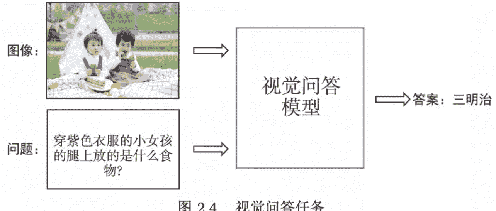

相比其他多模态任务，视觉问答也更易评测。许多问题可用是或否回答，大多数问题只需在图像中定位具体信息，1~3 个词即可，或采用固定答案集做成多选题。

视觉问答应用前景很广。机器同时处理视觉与语言信息对人机交互至关重要。传统交互多为文本或语音单模态，如 Siri、Cortana、小爱同学、小度、天猫精灵等。未来基于视觉感知的人机交互有望改善生活方式，例如自动驾驶、视障辅助、情景教学问答等。

#### 2.3.1 数据集
视觉问答是近年最热门的多模态研究方向之一，围绕它诞生了大量数据集，常用者简介如下。

- **CLEVR** compositional language and elementary visual reasoning[16]：图片由若干简单三维几何体合成，问答由规则程序自动生成。问题类型包括属性识别、属性比较、存在判断、计数、数量比较。训练集 70000 张图 699989 个问题，验证集 15000 张图 149991 个问题，测试集 15000 张图 14988 个问题。作者还提供生成代码，便于按需造数。
- **DAQUAR**[17]：1449 张室内场景 RGBD 图配 12468 个问题。795 张训练，654 张测试。问题部分规则生成部分人工标注，答案限定在 16 种颜色和 894 个物体类别。
- **COCO-QA**[18]：共 117684 个样本，分训练 78736 问、测试 38948 问。问题分物体识别、计数、颜色识别、位置识别四类，答案为单词。规则生成导致重复较多。
- **Visual Genome QA（VG-QA）**[19]：源自 Visual Genome。VG 以场景图和区域文本描述著称，常用于视觉关系检测[20] 和密集描述[21]。VG-QA 包含 101174 张图和 1773258 个问答对，问题类型为 What、Where、When、Who、Why、How、Which 七种。
- **Visual7W**[22]：VG 子集，47300 张图，327939 个问题，每个问题配 4 个候选答案。
- **TDIUC**[23]：167437 张来自 MS COCO 与 VG 的图像，1654167 个问题。共 12 类：存在、物体识别、场景分类、运动识别、行为识别、计数、位置推理、情感识别、颜色识别、其他属性识别、功能识别、怪诞类。
- **VQA v1** [15]：图像来自 MS COCO，训练 82783 张、验证 40504 张、测试 81434 张。每图 3 问，每问 10 个人工答案，测试答案不公开，需上传官方服务器评测。测试集分 test-dev 与 test-std，前者上传次数限制更宽松。题型有开放问答和选择题，开放答案为短语，选择题含正确答案、干扰项、高频回答和随机回答。
- **VQA v2** [24]：图像仍来自 MS COCO，训练问题 443757 个、验证 214354 个、测试 447793 个，每问 10 个答案。仅开放题。同一问题配两张图片且答案不同，有效缓解先验偏置。
- **VQA-CP v1/v2** [25]：把 VQA v1/v2 的训练与验证集重排，使各问题类型的答案分布在训练集与测试集上不一致，迫使模型不依赖先验。VQA-CP v1 训练约 11.8 万图 24.5 万问，测试约 8.7 万图 12.5 万问；VQA-CP v2 训练约 12.1 万图 43.8 万问，测试约 9.8 万图 22 万问，常用于评估泛化能力。
- **GQA** [26]：共 18542880 个样本，分训练集 1435356 和提交集 4237524。提交集再分为验证 2011853、测试 1340048、挑战 885623，挑战集小部分拆出为开发测试 172174。作者另提供平衡训练集 943000 和平衡验证集 132062。问题由 VG 场景图结构自动生成。

#### 2.3.2 评测指标
视觉问答常用准确率。对选择题，正确样本比例即为准确率。开放题计算规则因数据集而异。COCO-QA 与 TDIUC 要求回答与标准答案完全一致才计 1 分，否则 0。DAQUAR 只有回答与人工标注频率最高的答案一致时才计 1。最常用的 VQA v1/v2 与 VQA-CP v1/v2 采用

$$\min\left(\frac{\text{预测答案在真实候选答案中出现的次数}}{3}, 1\right)$$

即若预测答案在 10 个人工标注中出现 ≥3 次则准确率为 1，出现 2 次为 2/3，出现 1 次为 1/3。

除总体准确率外，研究常报告各问题类型的平均准确率，以避免模型偏好数据集中问题量多的类型。

### 2.4 文本生成图像

文本生成图像的核心目标，是让模型依据一段文字描述自动合成语义对应的自然图像，输入通常是一句话式的语言说明，输出则是一张相关联的画面。学界普遍用两个维度来评价这项任务：逼真度与一致性。逼真度指的是生成的图像在视觉上要接近真实照片，看起来可信；一致性指的是画面内容要能够体现出文本输入所蕴含的信息。

在当下的互联网生态里，内容生产与分发已成为推动行业持续增长的关键动力。创作者以文字、图像、视频等形式产出多媒体资讯，吸引大量用户阅读观看，并由此带来广告和销售收益，形成巨大的商业价值，同时也带动了整个产业链的发展。图像创作是其中不可或缺的一环，在插画、视频封面、游戏美术素材等方面需求广泛。但对人工来说，画图门槛较高，需要专业的美术与绘图技巧，创作周期长且修改成本大。基于此，能够直接从文字生成图像的能力具备很强的实用价值。

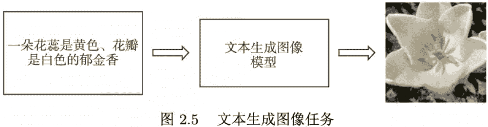

#### 2.4.1 数据集
文本生成图像所用的训练数据，和跨模态检索、图像描述一样，都是图像与文本严格对齐的配对。常用语料如下。

- **CUB** [27]：该语料收录了 11788 张鸟类照片，按种类划分为 200 类。每张图里仅有单一鸟只，并提供了鸟只的位置框以便训练时裁剪。每张图配有 10 条以鸟为主题的描述。划分方式参考 StackGAN：150 个类别共 8855 张用于训练，剩余 50 个类别共 2933 张用于测试，训练集与测试集的类别互不重叠。
- **Oxford-102** [28]：每张图同样配有 10 条描述，主题为花卉。共计 8189 张图，分属 102 个花卉类别，其中 7034 张用于训练，1155 张用于测试。

这两个集合有相似之处：①类别数量多；②图像中只出现单一物体；③描述对物体的属性细节刻画很细。因此它们属于细粒度语料。**MS COCO** 也是文本生图的常用语料，与前两者不同，它属于开放域语料。其特点是单张图内常包含多个物体，部分图像甚至上百个，物体形态多样且常出现遮挡、形变等情况，所以对文本生图而言，MS COCO 的难度明显高于细粒度集合。

#### 2.4.2 评测指标
图像生成的自动评测一直是难点，人工评估至今仍是重要参考。下面介绍常用的自动指标。它们各有局限，但能在一定程度上反映模型表现。按照文本生图的两个基本目标，指标分为衡量图像真实感的可信度指标，和衡量图像与文本相关性的一致性指标。

##### 1. 图像可信度指标
目前最常见的可信度评测是 inception score (IS)[29] 和 Fréchet inception distance (FID)[30]，二者都能在一定程度上刻画生成图的清晰度与多样性。

（1）IS 的名字来源于 Inception 网络的得分。评估时使用在 ImageNet[31] 上训练的 inception v3[32] 分类模型。IS 认为好模型要同时满足：生成图清晰，以及生成图多样。

清晰度：用 inception v3 对生成图 x 编码得到 1000 维的类别概率向量 y。对清晰的图，模型应给出明确的分类，即 p(y|x) 集中，熵值较低。

多样性：在整体生成集合上看类别分布。理想模型应能较为均匀地覆盖各类，而不是坍缩到单一模式。于是关注边缘分布 p(y)，熵值越高越好。

综合两点，IS 的计算公式如下：

$$\sum_{x} \sum_{y} p(y|x) \log p(y|x) - \sum_{y} p(y) \log p(y)$$

尽管 IS 是最常用的可信度指标，研究[33-34]指出它并不可靠，例如 CPGAN[35] 出现明显的 IS 过拟合。原因在于 IS 只关注生成分布的熵，忽略了真实图像分布，反而可能让模型去拟合 inception v3 学到的分布。

（2）**FID** 同样依赖 inception v3，但把网络倒数第二层的向量作为图像表征，而非最终分类分数。换句话说，IS 用的是最后一层的类别得分，FID 用的是倒数第二层的特征向量。

FID 的提出者认为评估时必须结合真实数据的分布，而非只看生成数据。因此 FID 衡量的是真实图与生成图在特征空间上的差异。具体做法是假设两者的 inception v3 表征都服从高斯分布，再用 Fréchet 距离计算差异。公式为：

$$\text{FID}(r, g) = \|\mu_g - \mu_r\|^2 + \text{Tr}(\epsilon_g + \epsilon_r - 2\sqrt{\epsilon_g \epsilon_r})$$

其中 Tr 为矩阵迹，μ 为均值，Σ 为协方差，下标 r 指真实分布，g 指生成分布。

FID 越低说明两分布越接近，生成图的真实感和多样性越好。该指标对模式坍缩更敏感，对噪声的鲁棒性也优于 IS。例如模型只生成一张图时 FID 会变得很大。因此当前研究更倾向用 FID 来衡量可信度。

##### 2. 图文一致性指标
（1）**基于检索的 R-Precision** 是目前最常见的图文一致性指标，最早见于 Attn-GAN[36]，本质是跨模态检索中的 Recall@K，这里取 K=1。

具体操作是，对每个文本-生成图像对，从语料中随机抽取 99 条不匹配的文本，组成 1 对 100 的检索集合。以生成图为查询，100 条文本为候选，用预训练的图文关联模型 DAMSM 计算相似度，统计 Recall@1 作为该样本的 R-Precision。为保证可比性，评估规定模型需用 30000 条随机文本生成 30000 张图，且 99 条负样本也从这 30000 条中抽取。最终 R-Precision 为 30000 个样本的平均值。

近年的工作[33-34,37]发现很多模型在 R-Precision 上甚至超过真实图，出现过拟合 DAMSM 的现象。因为 DAMSM 在不少文本生图模型训练中也被使用。于是改用在非 MS COCO 数据上训练且未参与生图模型训练的图文关联模型来计算相似度。

（2）语义对象准确率（SOA）[37] 是 2019 年提出的利用目标检测准确率来评估图文一致性的指标。其动机是：如果文本提到可识别的对象，预训练的目标检测器应在生成图里检测到它们。例如文本“坐在沙发上的狗”，生成图应能被检测出“狗”和“沙发”。

具体做法是对 MS COCO 验证集的文本进行筛选，找到与 80 个类别标签相关的关键词。对每个文本生成三张图，再用在 MS COCO 上预训练的目标检测模型 YOLO v3[38] 进行检测，检查是否能识别出指定对象。以召回率为指标，分别计算类平均 SOA-C 和图平均 SOA-I。形式化为：

$$\begin{cases} \text{SOA-C} = \frac{1}{|C|} \sum_{c \in C} \frac{1}{I_c} \sum_{i_c \in I_c} \text{OD}(i_c) \\ \text{SOA-I} = \frac{1}{\sum_{c \in C} |I_c|} \sum_{c \in C} \sum_{i_c \in I_c} \text{OD}(i_c) \end{cases}$$ (2.4.3)

其中 C 为全部类别集合，|C|=80，I_c 为包含类别 c 信息的文本所生成的图像集合。若检测器 OD 在生成图 i_c 中检测到类别 c 的对象，则 OD(i_c)=1，否则为 0。

总体而言，SOA 与 R-Precision 不同，它更关注生成图的局部细节是否符合描述，而不考察整体分布。

### 2.5 指称表达
指称表达（referring expression，RE）[39] 指对图像中特定物体的无歧义语言描述。图 2.6 示例了四个对图像中彩笔的描述，其中“绿色画笔”“橙色画笔”“绿色画笔上的红色画笔”都能唯一对应某个物体，可作为指称表达；而“红色画笔”在该图中有两个对应物，存在歧义，不属于指称表达。

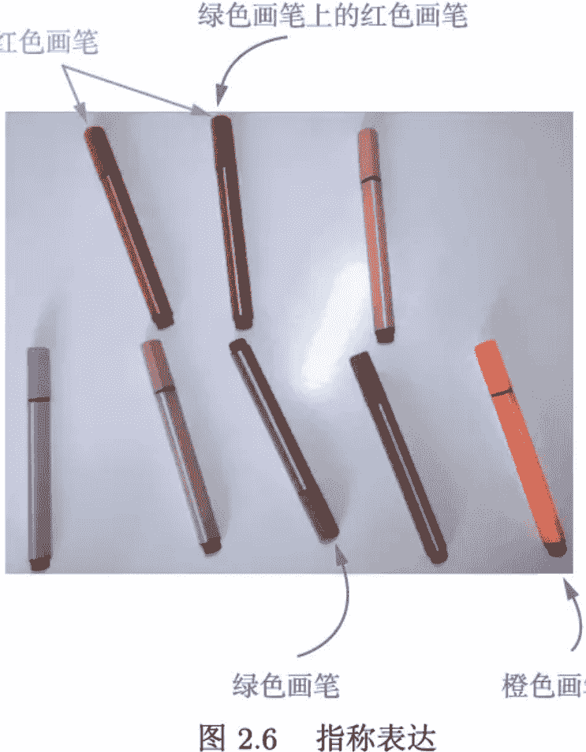

指称表达所指的物体及其所在环境构成了语境，离开语境谈指代就失去意义。语境可以是文本、图像或其他模态场景，在图文多模态里，语境通常就是图像。

由于指称表达能唯一锁定语境中的物体，它在符号语言与物理世界之间起桥梁作用，在日常交流中被频繁使用。研究主要分两类互逆任务：指称表达生成（REG）和指称表达理解（REC）。如图 2.7 所示，REG 在给定图像和特定物体区域时生成对应描述；REC 则在给定描述时定位图像中符合的区域。

该方向应用丰富。例如服务机器人可据此理解客户指代或主动生成指代进行交互；早教机器人可帮助幼儿学习无歧义描述；辅助视觉障碍人士的设备可据此生成对特定物体的清晰描述，便于交流。

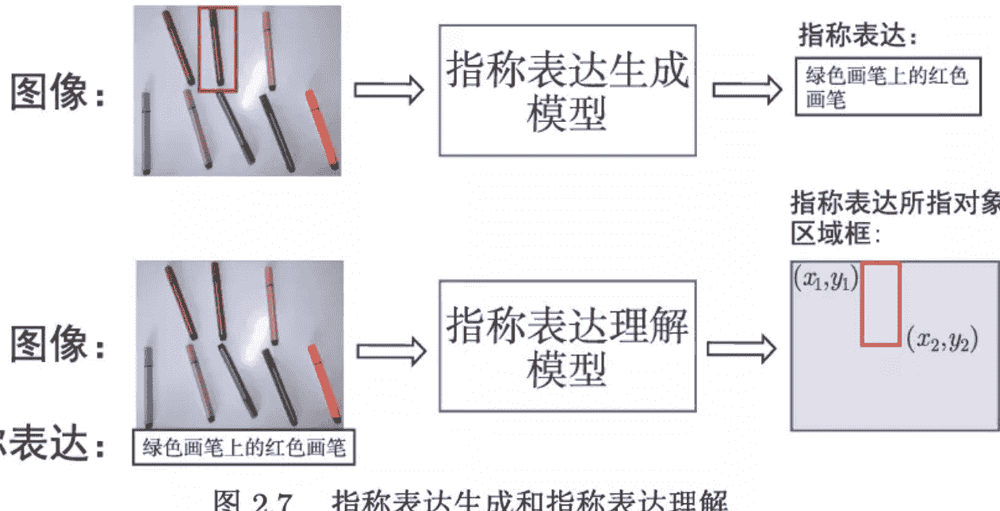

#### 2.5.1 数据集
指称表达常用三个语料：RefCOCO[40]、RefCOCO+[40] 和 RefCOCOg[41]。图像均来自 MS COCO，标注可在公开代码库获取。RefCOCO 与 RefCOCO+ 来自双人标注游戏 ReferIt[42]。角色 1 在给定图像和目标物体分割区的情况下写出能与其它物体区分的句子；角色 2 根据句子点选物体。若点选正确则得分并交换角色，失败则换新样本。每张图至少含两个同类物体。

- **RefCOCO** 包含 19994 张图，50000 个物体的 142209 条描述。划分为训练集、验证集、测试集 A 和测试集 B，测试集 A 以多人图像为主，测试集 B 以除人外的多物体图像为主。同一图像的物体-描述对不会跨划分。
- **RefCOCO+** 包含 19992 张图，49856 个物体的 141564 条描述。与 RefCOCO 的主要区别是描述中禁止使用绝对位置词如 left、right 等。划分规则与 RefCOCO 相同。
- **RefCOCOg** 并非游戏收集，而是先选定区域请多人标注完整句子，再请另一批人根据句子选区，重复三轮。包含 26711 张图，54822 个物体的 85474 条描述，平均长度 8.43 个词，明显长于 RefCOCO 的 3.61 词和 RefCOCO+ 的 3.53 词。划分为训练、验证、测试三部分，同一图像的样本可能分布在不同集合。

#### 2.5.2 评测指标
指称表达理解与生成形式不同，评测也不相同。

指称表达理解通常用预测框与标注框的交并比 IoU 衡量。设第 * 个框左上角为 (l_*^x, l_*^y)，右下角为 (r_*^x, r_*^y)，则框 i 与框 j 的 IoU 计算如下。

（1）交集面积。交集也是矩形，左上角为 (max(l_i^x,l_j^x), max(l_i^y,l_j^y))，右下角为 (min(r_i^x,r_j^x), min(r_i^y,r_j^y))，宽和高分别为

$$w_{ij}^{\text{intersection}} = \min(r_i^x, r_j^x) - \max(l_i^x, l_j^x)$$

$$h_{ij}^{\text{intersection}} = \min(r_i^y, r_j^y) - \max(l_i^y, l_j^y)$$
(2.5.1)

若两框不相交，宽或高至少一个为负。最终交集面积为

$$\text{area}_{ij}^{\text{intersection}} = \max(w_{ij}^{\text{intersection}}, 0) \times \max(h_{ij}^{\text{intersection}}, 0)$$
(2.5.2)

（2）并集面积为两框面积之和减去交集：

$$\text{area}_{ij}^{\text{union}} = w_i \times h_i + w_j \times h_j - \text{area}_{ij}^{\text{intersection}}$$
(2.5.3)

（3）IoU 为交集除以并集：

$$\mathrm{IoU}_{ij} = \frac{\mathrm{area}_{ij}^{\mathrm{intersection}}}{\mathrm{area}_{ij}^{\mathrm{union}}} \qquad (2.5.4)$$

评测结果一般定义为模型最高分预测框与标注框 IoU 大于 0.5 的比例。

指称表达生成多采用图像描述的指标，包括 BLEU、METEOR 和 CIDEr 等。

### 2.6 小结
本章梳理了五类代表性图文多模态任务的内容、常用语料与评测指标，涵盖图文跨模态检索、图像描述、视觉问答、文本生成图像和指称表达，后续章节将基于这些任务介绍多模态深度学习的基础技术。

### 2.7 习题

1. 有 6 条跨模态检索测试，正样本的回排位置分别为第 4 名、第 2 名、第 3 名、第 3 名、第 1 名、第 1 名，请算出该模型的中位秩 Median r 以及 mAP@3 的数值。
2. 请回顾本章所列出的图像描述 5 项评测指标，分别说明其优势与局限。
3. 通过具体例子，阐释视觉问答数据集 VQA v1、VQA v2 与 VQA-CP v1/v2 在构建思路上的差异。
4. 在 MS COCO 真实图像池中随机抽样 3 万张图片，借助开源实现计算其 Inception Score。
5. 针对图 2.6 中“叠放在绿色画笔之上的红色画笔”这一目标，提供三组不同的指称性表达。
6. 编写一段代码，计算两个矩形框之间的交并比 IoU。

第 3 章 文本向量化的演进脉络
跨模态建模能力的攀升，很大程度上依托于单模态深度学习的技术红利。聚焦文本侧，输入表征的方式已从早期的独热编码与词袋统计，逐步过渡到基于海量语料预训练得到的语义向量。

在深度学习兴起前，词常用独热向量表示，短文本则用词袋聚合。一个致命问题是任意两个不同词的独热向量余弦相似度恒为 0，词间相似度无法体现，进而导致机器学习时出现严重的稀疏性。为缓解此弊，传统做法常叠加词性、词缀等额外特征，借助 WordNet、HowNet 等语义词典，或采用 Brown 聚类对词做分组。

上述补救仍耗时费力，随后分布式语义假设得到重视。该假设认为“一词可由其伴随者定义”，即词义由上下文分布决定。早期分布式方法直接以共现频次作为词向量，并用点互信息 PMI、奇异值分解 SVD 等手段压制高频词影响、挖掘高阶关联，但计算开销大、难以增量更新，也很难针对下游任务做适应性调整。

2013 年起，深度学习让分布式语义从统计转向可学习，以 Word2vec 为代表的词嵌入实现突破。模型把每个词映射为低维稠密连续向量，并作为可训练参数。在大规模语料中，模型利用词与上下文的天然共现关系，通过最大化中心词与共现词的条件概率来优化参数。词嵌入不仅直接供给多模态模型提取文本特征，还启发了融合图像信息来补全词嵌入的研究。

Word2vec 的短板在于得到的向量是静态的，不随上下文改变，无法处理多义词。为此，研究者借助循环神经网络构建动态上下文向量，其隐状态同时受当前词与历史上下文影响。RNN 一度成为多模态文本建模的主流，例如文本生成图像的 AttnGAN、MirrorGAN、DM-GAN，图像描述的 NIC、m-RNN，视觉问答的 VIS-LSTM，以及指称表达的 MMI 等均以此为核心。

2018 年，注意力机制成熟，BERT 等基于注意力的预训练语言模型出现，自然语言处理正式进入预训练-微调范式。与早期词向量不同，这类模型结构通用性强，下游任务几乎无需改动，并在绝大多数 NLP 任务上达到最佳效果，并推动图文多模态也进入大规模预训练-微调时代，在多项任务上保持领先。本章将系统介绍深度学习时代三种主流文本表征：基于词嵌入的静态表示、基于循环神经网络的动态表示、基于注意力的预训练语言模型表示。

### 3.1 静态词嵌入表示
词嵌入是通过模型把语料中的词映射为低维稠密连续向量的技术。自 2013 年以来，学界相继提出 Word2vec、兼顾词嵌入与矩阵分解的 GloVe、引入子词信息的 fastText 等。本节聚焦 Word2vec 与 GloVe。

#### 3.1.1 Word2vec
Word2vec 由 Google 发布，对学术界与工业界影响深远。它包含 CBOW 和 Skip-gram 两种架构。训练流程大致如下。

1. 收集大规模语料，统计词表。
2. 为词表中的每个词随机初始化两个定长向量，分别对应其作为中心词与作为上下文词时的表征。
3. 以语料中每个词为中心词 c，把窗口内的词作为上下文词 o，利用两类向量的相似性计算条件概率 P(c|o) 或 P(o|c)。
4. 调整词向量以提升条件概率。

CBOW 与 Skip-gram 的分歧在第 3 步：CBOW 由上下文预测中心词，即计算 P(c|o)；Skip-gram 由中心词预测上下文，即计算 P(o|c)。

以“我 爱 多模态 信息 处理”为例，设中心词为“多模态”，窗口大小为 2。

图 3.1(a) 为 CBOW 结构。它基于上下文“我”“爱”“信息”“处理”生成中心词“多模态”的概率。上下文与中心词的矩阵分别记为 W^{in} 与 W^{out}，上下文向量为 W_{t-2}^{in}, W_{t-1}^{in}, W_{t+1}^{in}, W_{t+2}^{in}，中心词向量为 W_t^{out}，条件概率为

$$P(c|o) = \frac{\exp(W_t^{\text{out}^\top} \bar{W}_t^{\text{in}})}{\sum_i \exp(W_i^{\text{out}^\top} \bar{W}_t^{\text{in}})} \quad (3.1.1)$$

其中，\bar{W}_t^{in} = 1/4 (W_{t-2}^{in}+W_{t-1}^{in}+W_{t+1}^{in}+W_{t+2}^{in}) 为上下文平均向量。

图 3.1(b) 为 Skip-gram 结构。它基于中心词“多模态”生成上下文“我”“爱”“信息”“处理”的概率。中心词向量记为 W_t^{in}，上下文向量记为 W_{t-2}^{out}, W_{t-1}^{out}, W_{t+1}^{out}, W_{t+2}^{out}，分别计算每个上下文的条件概率并相乘，即

$$P(o|c) = \prod_{t-2 \leqslant k \leqslant t+2, k \neq t} \frac{\exp(W_t^{\text{out}^\top} W_k^{\text{in}})}{\sum_i \exp(W_i^{\text{out}^\top} W_k^{\text{in}})} \quad (3.1.2)$$

两者均可视为三层神经网络。CBOW 的输入层是词表大小的词袋特征，隐藏层为无激活无偏置的全连接层，将词袋映射到词向量空间，输出层预测中心词。Skip-gram 的输入层是中心词的独热编码，隐藏层映射到词向量空间，输出层对上下文进行分类。W^{in} 与 W^{out} 分别对应隐藏层与输出层权重。

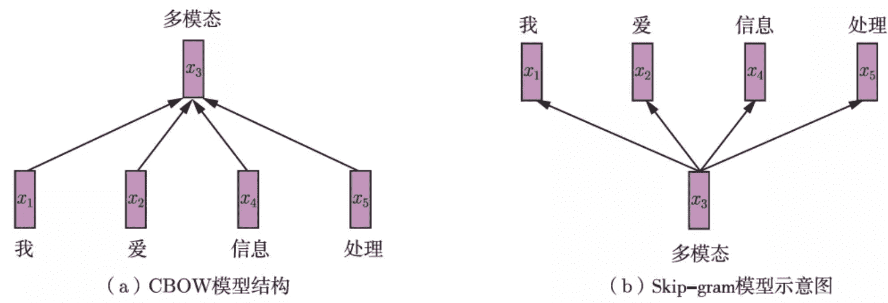

实践中 CBOW 多用输出层权重作为词表征，Skip-gram 多用输入层权重。

#### 3.1.2 GloVe
GloVe 即 global vectors，由斯坦福提出，其思路是融合 Word2vec 与全局共现矩阵分解的优点，学习基于全局词频统计的表示。训练步骤如下。

- 1. 收集语料，建立词表。
- 2. 构建共现矩阵 X，其中 X_{ij} 为中心词 i 与上下文词 j 在定长窗口内的共现次数，距离越远贡献越小。若共现 N 次，第 n 次距离为 d_n(i,j)，则有

$$X_{ij} = \sum_{n=1}^{N} \frac{1}{d_n(i,j)} \quad (3.1.3)$$

- 3. 用中心词矩阵 W^{in} 与上下文词矩阵 W^{out} 拟合 X。损失函数为

$$\sum_{i} \sum_{j} f_{ij} \left( W_i^{\text{in}^\top} W_j^{\text{out}} + b_i^{\text{in}} + b_j^{\text{out}} - \log X_{ij} \right)^2 \quad (3.1.4)$$

其中 b_i^{in} 与 b_j^{out} 分别为偏置，f_{ij} 为权重函数。

权重函数与共现次数相关，采用分段形式：

$$f_{ij} = \begin{cases} \left(\frac{X_{ij}}{X_{\text{max}}}\right)^\alpha, & X_{ij} < X_{\text{max}} \\ 1, & \text{其他} \end{cases} \qquad (3.1.5)$$

X_{max} 与 α 为超参数，论文中取 100 与 0.75。这意味着共现次数小于 100 时权重随次数递增并不超过 1，否则恒为 1。若未共现则权重为 0，训练可只考虑非零项。GloVe 通常把中心与上下文向量相加作为最终词表征，预训练向量可公开下载。

### 3.2 基于循环神经网络的动态词表示
静态模型训练后每个词只有一个固定向量，上下文信息被忽略，无法应对一词多义。例如“杜鹃哪个季节开花”与“杜鹃的叫声像什么”中的“杜鹃”含义迥异。为此提出基于循环神经网络的动态表示，使同一词的向量随上下文变化。

#### 3.2.1 循环神经网络基础
RNN 专用于序列建模。如图 3.2 所示，其隐藏层输出会回流作为下一时刻输入。给定序列 x1,x2,…,xn，更新形式为

$$\boldsymbol{h}_t = \phi(\boldsymbol{x}_t \boldsymbol{W}_{xh} + \boldsymbol{h}_{t-1} \boldsymbol{W}_{hh} + \boldsymbol{b}_h) \qquad (3.2.1)$$

其中 x_t 为第 t 步输入，h_t 为隐状态，W_{xh} 与 W_{hh} 分别为输入到隐状态与隐状态到隐状态的权重，b_h 为偏置，φ 为非线性激活。

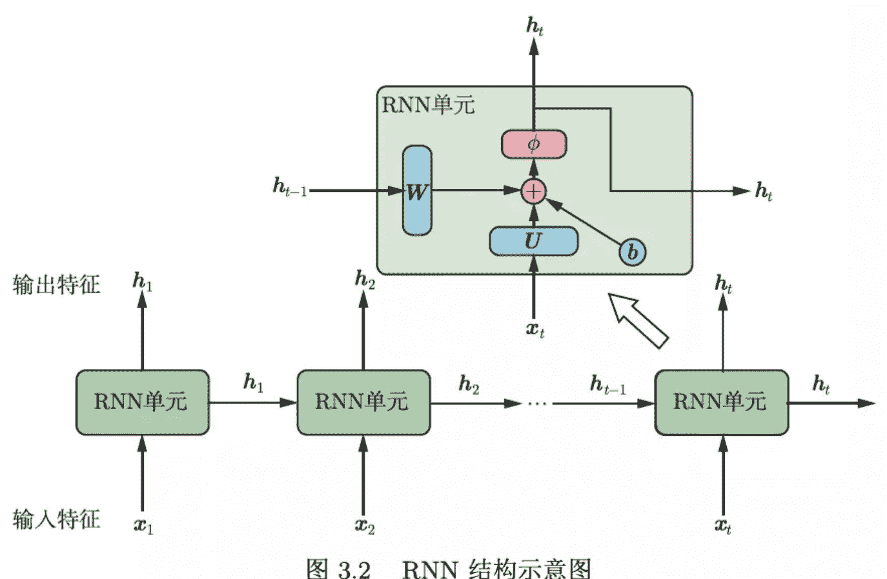

#### 3.2.2 现代循环神经网络
RNN 存在梯度消失，难以建模长序列。常用改进包括 LSTM、GRU、多层 RNN 与双向 RNN。

##### 1. 长短时记忆网络
LSTM 结构更复杂，引入三个门与细胞状态。如图 3.3 所示，每步先由当前输入 x_t 与上一隐状态 h_{t-1} 生成候选细胞状态 \tilde{C}_t：

$$\widetilde{C}_t = \tanh(W_C \cdot [h_{t-1}, x_t] + b_C)$$

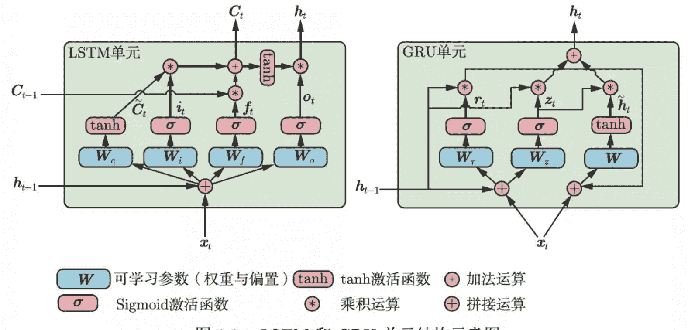

图 3.3 LSTM 和 GRU 单元结构示意图

随后输入门 i_t 与遗忘门 f_t 分别控制写入与擦除信息：

$$

\begin{cases}

i_t = \sigma(W_i \cdot [h_{t-1}, x_t] + b_i) \\

f_t = \sigma(W_f \cdot [h_{t-1}, x_t] + b_f) \\

C_t = f_t * C_{t-1} + i_t * \tilde{C}_t

\end{cases}

\tag{3.2.3}

$$

输出门决定当前细胞状态的输出：

$$

\begin{cases}

o_t = \sigma(W_o \cdot [h_{t-1}, x_t] + b_o) \\

h_t = o_t * \tanh(C_t)

\end{cases}

\tag{3.2.4}

$$

门控与细胞状态的引入缓解了梯度消失，更适合长句。

##### 2. 门控循环单元
GRU 参数更少、更新更简洁，取消细胞状态，仅保留更新门 z_t 与重置门 r_t，用于控制信息流：

$$

\begin{cases}

z_t = \sigma(\boldsymbol{W}_z \cdot [\boldsymbol{h}_{t-1}, \boldsymbol{x}_t]) \\

r_t = \sigma(\boldsymbol{W}_r \cdot [\boldsymbol{h}_{t-1}, \boldsymbol{x}_t]) \\

\tilde{\boldsymbol{h}}_t = \tanh(\boldsymbol{W} \cdot [r_t * \boldsymbol{h}_{t-1}, \boldsymbol{x}_t]) \\

\boldsymbol{h}_t = (1 - z_t) * \boldsymbol{h}_{t-1} + z_t * \tilde{\boldsymbol{h}}_t

\end{cases}

\tag{3.2.5}

$$

##### 3. 双向循环神经网络

迄今为止所说的循环网络都是单向推进的，第 t 步的隐藏状态只能综合前 t-1 步的序列信息和当前输入 $\boldsymbol{x}_t$ 来生成。可是文本理解里，一个词的含义既受前面语境影响，也受后面语境制约。为此需要补充一条反向链路的循环网络，从词序列尾端向前回溯。图 3.4 描绘了双向循环网络的整体架构。正式地，前向与反向隐藏状态的递推公式如下。

$$

\begin{cases}

\overrightarrow{\boldsymbol{h}}_t = \phi(\boldsymbol{x}_t \overrightarrow{\boldsymbol{W}}_{xh} + \overrightarrow{\boldsymbol{h}}_{t-1} \overrightarrow{\boldsymbol{W}}_{hh} + \overrightarrow{\boldsymbol{b}}_h) \\

\overleftarrow{\boldsymbol{h}}_t = \phi(\boldsymbol{x}_t \overleftarrow{\boldsymbol{W}}_{xh} + \overleftarrow{\boldsymbol{h}}_{t-1} \overleftarrow{\boldsymbol{W}}_{hh} + \overleftarrow{\boldsymbol{b}}_h)

\end{cases}

\tag{3.2.6}

$$

于是每个词位置都会同时拥有正向和反向两个隐藏向量。

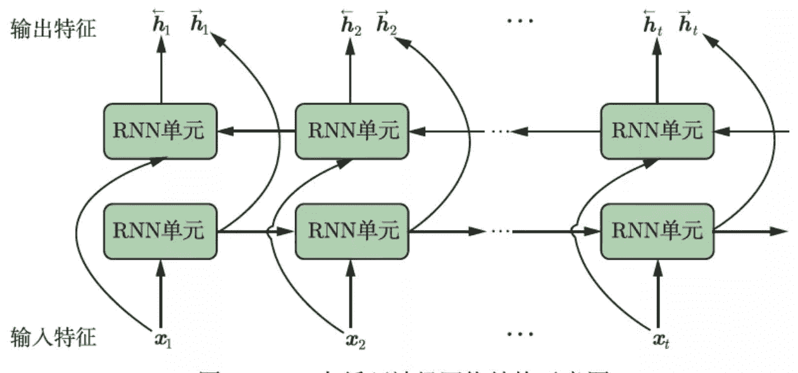

##### 4. 堆叠多层的循环结构
RNN 也可以纵向堆叠出多层结构，这就是深度循环网络。图 3.5 给出了拥有 L 层的示例，其中任意一层的当前状态同时依赖本层上一时刻的状态和上一层当前时刻的状态。记第 t 步第 l 层的隐藏向量为 $\boldsymbol{h}_t^{(l)}$，并把输入记作 $\boldsymbol{x}_t = \boldsymbol{h}_t^{(0)}$，那么

$$

\boldsymbol{h}_t^{(l)} = \phi(\boldsymbol{h}_t^{(l-1)} \boldsymbol{W}_{xh}^{(l)} + \boldsymbol{h}_{t-1}^{(l)} \boldsymbol{W}_{hh}^{(l)} + \boldsymbol{b}_h^{(l)})

\tag{3.2.7}

$$

其中 $W_{xh}^{(l)}$、$W_{hh}^{(l)}$、$b_{h}^{(l)}$ 对应第 l 层的可训练参数。

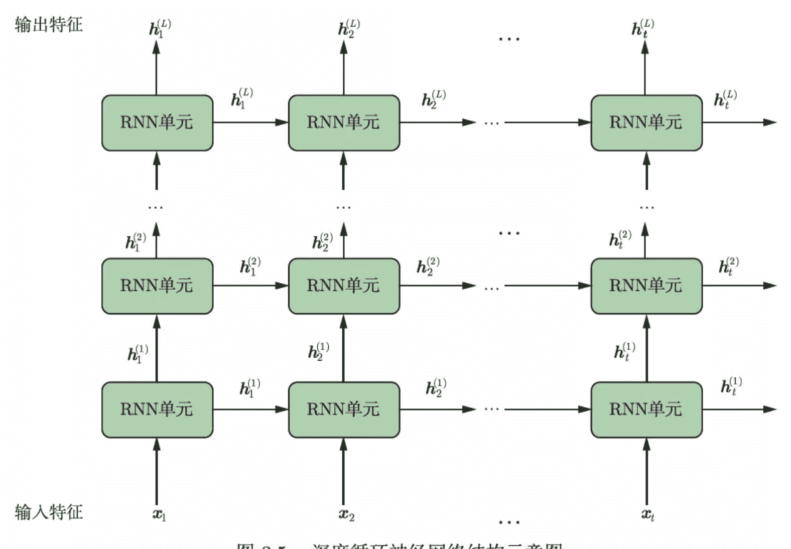

#### 3.2.3 动态词向量与文本整体向量
在多模态任务里，用循环网络给文本编码以提取逐词动态表示和整段概要表示是很常见的。主流做法大致分两类。

其一，单向 RNN 编码时，把每个词映射为顶层隐藏层的输出；整句向量则取末词向量、或所有词向量的均值/最大值。举例来说，一句话有 5 个词，词嵌入是 50 维，用两层 GRU 且隐藏维度为 64 来抽取表示，示范如下。

```python
import torch
import torch.nn as nn

rnn = nn.GRU(input_size = 50, hidden_size = 64,
num_layers = 2, batch_first = True, bidirectional = False)
input = torch.randn(1, 5, 50)
output, hidden = rnn(input)
# rnn 返回两个张量 output 和 hidden
# output 的形状为 (batch_size, num_words, hidden_size)
# hidden 为最后一个词对应的表示，形状为 (num_layers, batch_size, hidden_size)
print('rnn 返回值 output 的形状：', output.shape)
print('rnn 返回值 hidden 的形状：', hidden.shape)

word_representation = output
global_representation_lastword = hidden[-1] # 这里也可以是 output[:,-1,:]
global_representation_avg = torch.mean(output, axis=1)
global_representation_max = torch.amax(output, dim=1)
print('词表示的形状：', word_representation.shape)
print('整体表示（最后一个词表示）的形状：', global_representation_lastword.shape)
print('整体表示（所有词表示的平均值）的形状：', global_representation_avg.shape)
print('整体表示（所有词表示的最大值）的形状：', global_representation_max.shape)
```

```
rnn 返回值 output 的形状： torch.Size([1, 5, 64])
rnn 返回值 hidden 的形状： torch.Size([2, 1, 64])
词表示的形状： torch.Size([1, 5, 64])
整体表示（最后一个词表示）的形状： torch.Size([1, 64])
整体表示（所有词表示的平均值）的形状： torch.Size([1, 64])
整体表示（所有词表示的最大值）的形状： torch.Size([1, 64])
```

其二，双向 RNN 编码时，逐词表示由正向和反向顶层隐藏向量的平均或拼接构成；句子级表示通常选用首词或末词的向量。下面以双向 GRU 为例展示提取流程的代码。

```python
import torch
import torch.nn as nn

# 将参数 bidirectional 的值设为 True，即为双向 RNN
rnn = nn.GRU(input_size = 50, hidden_size = 64,
```

### 3.3 注意力驱动的预训练语言表征
用 RNN 做表征时，当前词的输出只由它自己的表示和前一词的隐藏状态决定。这带来两个痛点：一是词与词之间没有直接通路，距离一远信息衰减严重，不利于捕捉长句中的远距离依赖；二是解码必须串行，训练效率低，不易在海量语料上展开。自注意力就是为解决这两个问题而诞生的新操作，如今已成为 NLP 的标准范式。随着研究深入，基于注意力的预训练语言模型 BERT[53] 横空出世，让自然语言处理真正进入“预训练-精调”时代，并迅速成为主流表征方法，也直接催生了多模态预训练。

#### 3.3.1 自注意力
图 3.6 展示了自注意力的整体思路，任一词的输出都直接汇聚整句信息，并且所有位置可以同时计算。

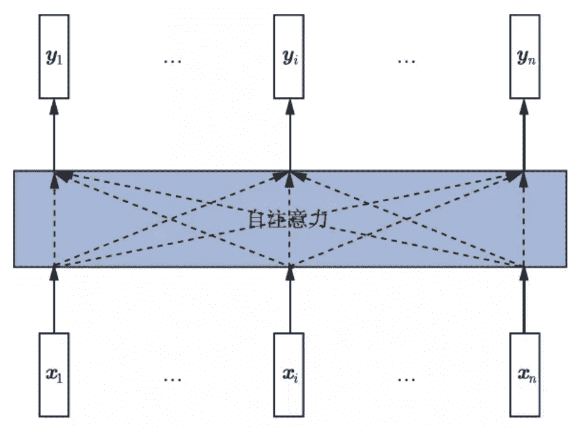

图 3.6 自注意力整体框架示意图

##### 1. 计算流程
自注意力对输入和输出要求一致，都是长度为 n 的向量序列。记输入为 X = {x1,...,xn}，输出为 Y = {y1,...,yn}，具体步骤如图 3.7。

1) 通过三组线性变换把每个输入映射为查询 Q、键 K、值 V 三个向量。对第 i 个输入

$$

\begin{cases}

q_i = W_Q x_i \\

k_i = W_K x_i \\

v_i = W_V x_i

\end{cases}

\tag{3.3.1}

$$

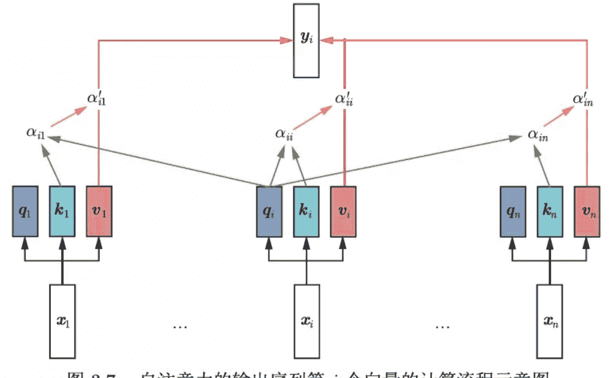

图 3.7 自注意力的输出序列第 i 个向量的计算流程示意图

2) 对每个输入向量，计算其查询和所有键之间的相似性，以此衡量该位置与全句其他位置的相关度，也即注意力得分。

$$\alpha_{ij} = a(\boldsymbol{q}_i, \boldsymbol{k}_j) \qquad (3.3.2)$$

其中 $a$ 为注意力评分函数。常用评分函数有：

- 缩放点积 scaled dot-product 注意力[58]：$\frac{\boldsymbol{q}_i \cdot \boldsymbol{k}_j}{\sqrt{d}}$，$d$ 为 $\boldsymbol{q}_i$ 的维度。
- 加性 additive 注意力[59]：$\boldsymbol{W}_2^\mathrm{T} \tanh(\boldsymbol{W}_1[\boldsymbol{q}_i; \boldsymbol{k}_j])$，$\boldsymbol{W}_1$ 和 $\boldsymbol{W}_2$ 为参数。

3) 对注意力得分做归一化：

$$\alpha'_{ij} = \frac{\exp(\alpha_{ij})}{\sum_k \exp(\alpha_{ik})} \qquad (3.3.3)$$

4) 以归一化后的权重对 V 加权求和得到输出特征：

$$\boldsymbol{y}_i = \sum_k \alpha'_{ik} \boldsymbol{v}_k \qquad (3.3.4)$$

于是每个 $x_i$ 都对应一个由整句信息生成的 $y_i$，且全序列可并行求得。为便于表述，把该操作记为

$$Y = SA(X)$$

##### 2. 位置编码
目前为止自注意力并不知道先后顺序，也没有距离感，这对序列建模是致命的。常用的补救方案分两类：手工固定的编码和从数据中学习的可学习编码。

最具代表性的固定编码是基于正弦和余弦的方案[58]。设序列长度为 n，特征维为 d，则位置矩阵 $P \in \mathbb{R}^{n \times d}$ 的第 i 行第 2j 列和第 2j+1 列为

$$\begin{cases} p_{i,2j} = \sin\left(\frac{i}{10000^{2j/d}}\right) \\ p_{i,2j+1} = \cos\left(\frac{i}{10000^{2j/d}}\right) \end{cases}$$

该编码具备唯一性、相对距离一致、可外推、值有界且位置确定等优点。可学习编码则先用独热位置再经一层全连接映射得到。

##### 3. 多头自注意力
单头自注意力只能关注一种关联模式。为同时捕捉多种关系，实践中采用多组 Q、K、V 并行计算多组输出，再拼接后经线性投影融合，这就是多头自注意力[58]。图 3.8 展示了其结构。

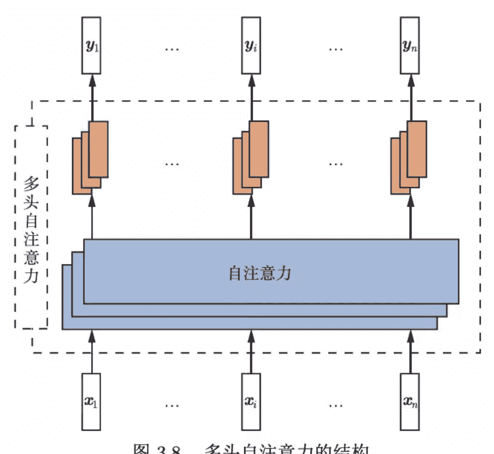

图 3.8 多头自注意力的结构

#### 3.3.2 Transformer 编码器
自注意力层可以像 RNN 一样堆叠，Transformer 编码器[58] 就是基于此构建。图 3.9 显示它堆叠了 $N_e$ 个相同的编码块，每个块包含多头自注意力和前馈网络，通常是两层全连接，激活为 ReLU，并配合层归一化 LN 与残差连接。

形式上，令第 l 层表示为 $Z^l$，则

$$

\begin{cases}

\hat{Z}^l = \text{LN}(\text{MSA}(Z^l) + Z^l) \\

Z^{l+1} = \text{LN}(\text{MLP}(\hat{Z}^l) + \hat{Z}^l)

\end{cases} \tag{3.3.7}

$$

其中 MSA 为多头自注意力。

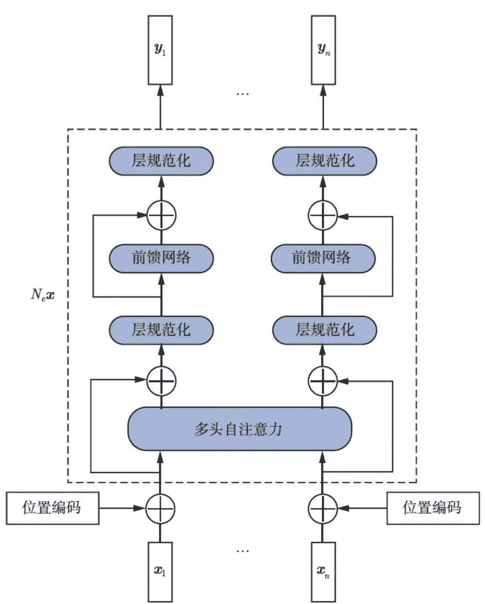

图 3.9 Transformer 编码器结构示意图

#### 3.3.3 BERT
来自 Transformer 的双向编码器表示 BERT[53] 于 2018 年提出，它以前向-后向编码器的能力为基础，先在大规模无监督语料上预训练，再在下游任务上微调，从此开启预训练范式。

图 3.10 显示 BERT 输入由两段文本拼接，网络主体为 Transformer 编码器，需完成掩码语言模型和下一句预测两个预训练任务。

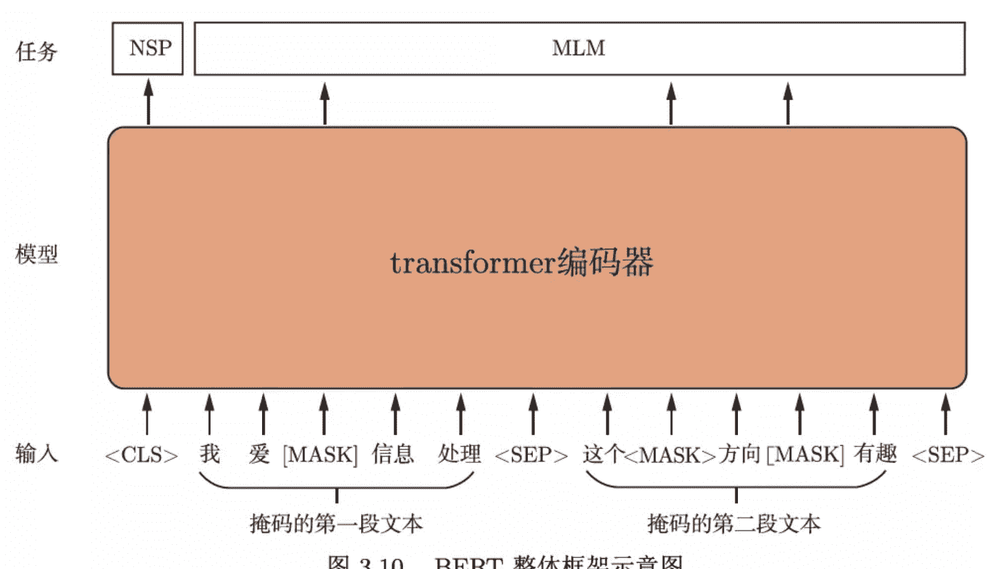

##### 1. 输入表示
如图 3.11，输入序列为 <CLS> + 第一段 + <SEP> + 第二段 + <SEP>。除词向量和位置向量外，还加入段向量区分两段，第一段为 0，第二段为 1。BERT 的位置向量为可学习形式，最终输入为三者之和。

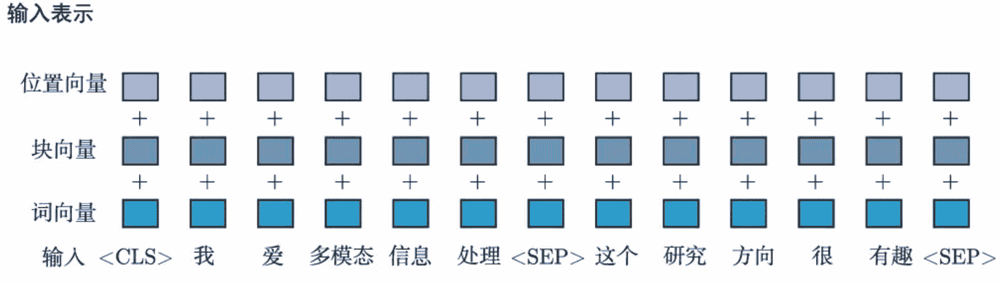

##### 2. 预训练任务
掩码语言模型 MLM 随机选取 15% 的 WordPieces 进行掩码，对每个被选子词以 80% 概率用 [MASK] 替换，10% 概率换成随机词，10% 保持原样，然后让模型预测原始子词，以避免预训练与微调的分布不一致。

下一句预测 NSP 将两句拼接并判断后句是否为前句的真正续句，为二分类任务，正样本取语料中相邻句，负样本随机抽换第二句，分类信号取自 <CLS> 的输出。

#### 3.3.4 BERT 词表征与整体表征
借助 Hugging Face 可提取 BERT 的逐词输出向量作为词表征，整段表征常用所有词向量的平均值。该方案即在文本生成图像模型 XMC-GAN[33] 中被采用。

```python
from transformers import BertModel, BertTokenizer, logging

logging.set_verbosity_error()

# bert-base-uncased 为所使用的预训练 BERT 模型名
tokenizer = BertTokenizer.from_pretrained('bert-base-uncased')
model = BertModel.from_pretrained('bert-base-uncased')

# 文本
texts = ['I love multimodal information processing']
# 将文本转化为子词序列
encoded_input = tokenizer(texts, return_tensors='pt')
print('子词序列：', tokenizer.convert_ids_to_tokens(encoded_input['input_ids'][0]))
# 执行 BERT 模型前馈过程
output = model( **encoded_input )
```

<sup>1</sup> https://huggingface.co/

```python
# 词表示
word_representation = output['last_hidden_state']
# 整体表示
global_representation = word_representation.mean(axis=1)

print('词表示的形状：', word_representation.shape)
print('整体表示的形状：', global_representation.shape)
```

```
子词序列：['[CLS]', 'i', 'love', 'multi', '##mo', '##dal', 'information', 'processing', '[SEP]']
词表示的形状： torch.Size([1, 9, 768])
整体表示的形状： torch.Size([1, 768])
```

### 3.4 回顾要点

在多模态体系里，单模态表征的抽取是整个流程的基石。本章梳理了多模态深度学习中文本表征的发展脉络与驱动原因，并系统呈现了三类文本表征的做法与实现路径。静态词向量的构建依赖词嵌入模型，动态词向量的构建依赖循环神经网络，而基于预训练的语言模型表征则依赖注意力机制。这三套手段为多模态模型处理文本侧数据提供了有力的建模工具，后续章节会展示它们的具体应用场景。

### 3.5 练习

1. 给出任意一个词获取其 GloVe 向量的代码示例。
2. 构思一套面向图文多模态任务的静态词表征获取方案。
3. 构思一套面向图文多模态任务的动态词表征获取方案。
4. 概括 PyTorch 中如何用循环神经网络同时为多条长度不一的句子得到动态词级表征和句子级表征，并用代码加以说明。
5. 对比自注意力机制与循环神经网络的优势与局限。
6. 参考 3.3.4 节的示例代码，利用 Hugging Face 上的任一中文 BERT 模型，实现中文句子词级与句级表征的提取。

## 第 4 章 图像表征概览

第 3 章回顾了多模态模型中文本侧表征的演进与常用提取方式。图像侧的输入形式也经历了相似的变迁：从基于像素值与梯度统计的手工词袋特征，过渡到在大规模数据上预训练的深度网络表征。

在深度学习普及前，图像特征很大程度上依赖视觉专家的手工设计，如 SIFT、HOG、GIST、SURF、LBP 等，均遵循固定的像素或梯度统计规则。这类特征计算耗时且任务专一，例如 HOG 更适合行人检测，GIST 更偏向场景分类。

深度学习直接以原始信号为输入，摆脱了人工特征的限制，能够自适应学习对任务最相关的表示。2012 年 Krizhevsky 等提出的 AlexNet [60] 在 ImageNet 大规模视觉识别挑战赛中以较大优势胜出传统手工特征，开启了深度网络表征的时代。此后，主流做法是在大规模标注集上预训练图像分类模型，再针对新任务调整最后一层分类单元数量并微调权重，实质上是一种迁移学习的预训练-微调范式。

这类以语义标签为监督训练得到的网络表征富含语义信息，有助于缩小图文跨模态鸿沟，因而被广泛采用。早期工作多取自图像分类模型的整体向量，即预训练卷积网络的倒数第二层输出。例如早期的跨模态检索 [61]、首批图像描述模型 NIC [50]、m-RNN [51]、首批视觉问答模型 Neural-Image-QA [62]、VIS+LSTM [52] 等。

随着技术推进，深度表征的使用方式愈发多样。单一向量容易丢失局部细节，不利于细粒度图文对齐，于是出现了网格表征，即取预训练卷积网络的最后一个卷积层或汇聚层输出，将一张图表示为多组网格向量，每个格子对应局部区域。代表工作包括跨模态检索与视觉问答的 DAN[63]、图像描述的 ARCTIC[64] 与 SCST[65]。实践中网格表征常与整体表征联合使用，以兼顾全局与局部。

网格虽能覆盖多个区域，却难以精准锁定人类更关心的特定目标或显著区。自 2018 年起，目标检测模型被引入多模态图像表征提取，以获得目标级区域向量。BUTD[66] 首次提出该思路并用于图像描述与视觉问答。此后区域表征成为主流，广泛应用于跨模态检索[67]、图像描述、视觉问答及多数多模态预训练方法中，也常与整体表征搭配使用。

2020 年视觉 Transformer[68] 提出，将 Transformer 直接用于图像像素级建模。ViT 把图像切分为 patch，经线性投影为视觉词向量，再以 Transformer 编码器建模：每个 patch 的输出为块表征，分类 token <CLS> 的输出为图像整体表征。得益于 Transformer 结构，块表征被大量用于同构的多模态预训练模型，如 VLMo[69]、CLIP[70]、ALBEF[71]。

2021 年初 OpenAI 发布的 DALL·E[72] 先用量化自编码器[73] 得到图像的离散压缩表征，再将语言描述与离散表征拼接作为“文本”训练神经语言模型，实现文生图。此后 CogView[74]、VQ-Diffusion[75]、Parti[76]、Muse[77] 等均以离散压缩表征提升生成效果。2022 年备受关注的 Stable Diffusion[78] 则采用变分自编码器学习连续压缩表征，训练以文本为条件的扩散模型完成生成。

本章将系统介绍图文多模态中常用的图像表征，按依赖模型可归为四类：基于图像分类模型的整体与网格表征、基于目标检测模型的区域表征、基于视觉 Transformer 的块表征、基于自编码器的压缩表征。

### 4.1 CNN 的整体与网格特征

#### 4.1.1 卷积网络原理

卷积神经网络是图像建模的常用框架，核心由卷积层与汇聚层构成。

卷积层具备局部连接与权重共享两大特性，如图 4.1 所示。与全连接层不同，每个神经元只接收局部感受野的像素输入，这与模式局部性相符。卷积核在整图上滑动计算点积并输出特征图，同一卷积核在不同位置复用参数，大幅降低参数量，也体现了模式可迁移的假设。

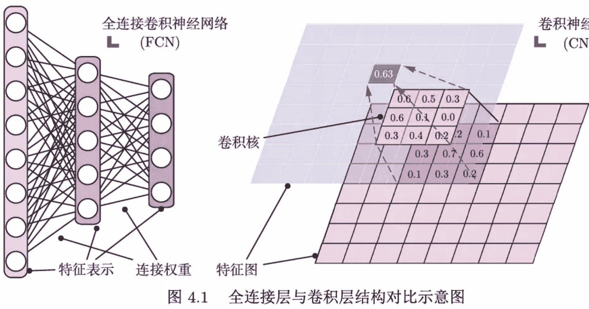

典型卷积层涉及四个可调参数。

- 核尺寸。决定每次计算覆盖的像素范围，极端情况下核等于整图则退化为全连接。
- 核数量。不同核可捕捉不同模式，核数即输出特征图的通道数。
- 步幅。控制核在图像上的移动间隔，步幅越大输出越小。
- 填充。为保持尺寸一致，可在边界补零或反射等填充方式。

汇聚层无参数，用于降维与加速。常见有平均汇聚与最大汇聚，前者取窗口均值，后者取窗口最大值。

#### 4.1.2 主流 CNN 演进

现代 CNN 起源于 2012 年的 AlexNet，含 5 个卷积层、3 个汇聚层与 3 个全连接层，采用 ReLU 缓解梯度消失，配合 dropout 防过拟合，在 LSVRC-12 中夺冠。

L SVRC-13 的 NiN[79] 大量使用 1×1 卷积调整通道并减少参数，并取消全连接层，最后用全局平均汇聚生成类别维向量。

L SVRC-14 的 VGGNet 系列[80] 以堆叠 3×3 小核构成深层结构，VGG16 与 VGG19 主要差异在卷积层数量，体现小核堆叠在相同感受野下更优。VGG 明确引入块的概念，为后续设计提供思路。同届的 GoogLeNet[81] 提出 Inception 块并行使用多尺寸核，构建了当时最深的 22 层网络并夺冠。

层数增加带来优化困难，56 层模型甚至优于 20 层。问鼎 LSVRC-15 的 ResNet[82] 引入残差块，通过输入与输出相加缓解梯度问题，催生了 ResNet-50、ResNet-101、ResNet-152 等常用结构。

#### 4.1.3 整体向量与网格特征

多模态任务中常选用在 ImageNet 上预训练的 VGGNet 或 ResNet 作为特征提取器。输出层选择不同，得到两种常见表征：整体表征一般取分类层输入，如 VGG 的 4096 维、ResNet-101 的 2048 维；网格特征则取最后一个汇聚层前的卷积特征图，例如 ResNet-101 对 3×224×224 输入输出 2048×7×7，相当于 49 个区域向量。早期工作偏好整体表征，后期随注意力机制发展，网格特征更利于建模区域与文本的细粒度关联。

下面的代码展示了用 ResNet-101 提取整体表征与网格表征的方法。

```python
import torch
import torchvision
import torchvision.transforms as transforms
from PIL import Image
from torchvision.models import ResNet101_Weights

# 载入 CNN 图像分类模型
model = torchvision.models.resnet101(weights=ResNet101_Weights.DEFAULT)
# ResNet-101 的最后两层分别为 avgpool 和 fc，可以通过 print(model) 查看模型结构
# 整体表示提取器为删除最后一个 fc 层的 ResNet-101
global_representation_extractor = torch.nn.Sequential(*(list(model.children())[:-1]))
# 网格表示提取器为删除最后两层的 ResNet-101
grid_representation_extractor = torch.nn.Sequential(*(list(model.children())[:-2]))
# 图像预处理流程
preprocess_image = transforms.Compose([
    transforms.Resize(256),
    transforms.CenterCrop(224),
    transforms.ToTensor(),
    transforms.Normalize([0.485, 0.456, 0.406], [0.229, 0.224, 0.225])
])
# 读取图像
img = Image.open('../img/test.jpg').convert('RGB')
# 执行图像预处理
img = preprocess_image(img).unsqueeze(0) # unsqueeze(0) 将单张图像转为 batch 形式
# 提取整体表示
global_representation = global_representation_extractor(img).squeeze()
# 提取网格表示
grid_representation = grid_representation_extractor(img).squeeze()
# 展示整体表示和网格表示的形状
print('整体表示的形状：', global_representation.shape)
print('网格表示的形状：', grid_representation.shape)
```

```
整体表示的形状： torch.Size([2048])
网格表示的形状： torch.Size([2048, 7, 7])
```

### 4.2 目标检测驱动的区域特征

网格虽能反映多区域信息，却难以精确对应不同尺寸位置的目标。目标检测模型因此被用于提取目标级区域表征。

#### 4.2.1 深度目标检测入门

目标检测旨在定位图像中感兴趣目标的类别与包围框。传统流程分区域选择、特征提取、区域分类、后处理四步：区域选择常用滑动窗口生成候选框；特征提取使用 HOG、SIFT 等手工特征；分类器判断候选是否为目标；后处理以非极大值抑制合并冗余框。

2014 年之后，深度学习开始实质性地进入目标检测领域。最初的尝试[83-84]本质上只是把传统管线里的人工设计的视觉特征，替换成由图像分类网络提取的整体特征。这种做法的短板很明显：区域提议这一步跑得慢，整个流程也做不到端到端优化。Faster R-CNN[85]引入了 RPN，利用全卷积结构在网络内部实时产出候选框，并把 NMS 搬进模型内部，这一改进让目标检测真正迈入了可端到端训练的深度时代。

从是否依赖预设锚框来看，深度检测大致可分成两大流派：基于锚框的方案和摆脱锚框的方案。前者先在图像里撒下一批预置锚框，判断每个锚框是否包含感兴趣目标，再对正样本锚框回归到真实框的偏移量；后者不借助预置模板，通常直接以中心点或角点为线索完成定位。

在锚框流派内部，还能按候选框的产生方式区分为两阶段和一阶段。两阶段先用锚框生成粗略的目标候选并做前景背景划分，再对候选进行精细的分类与回归，典型代表是 R-CNN 家族；一阶段则直接对锚框同时完成位置回归与类别预测，典型代表是 YOLO 家族[38,86]，这里不计入 YOLOv1[87]，YOLOv1 虽属一阶段却没有使用预设锚框。

表 4.1 基于深度学习的目标检测 3 类方法的预测速度和预测精度对比

| | 基于锚框的一阶段方法 | 基于锚框的两阶段方法 | 与锚框无关的方法 |
|---|---|---|---|
| 预测速度 | 快 | 稍慢 | 快 |
| 预测精度 | 优 | 更优 | 较优 |

在上述三种范式里，锚框两阶段方法对区域表征的提取最为友好。一方面它的检测准确度最高；另一方面区域表征可以直接从该类模型的某层导出。而锚框一阶段方法里，不同尺度的区域落在不同分支，不同分支的表征难以横向比较，所以很难用单一层来代表区域表征。

#### 4.2.2 区域表示
在图文多模态里，被广泛采用的区域特征提取器是自底向上注意力模型 bottom-up attention, BUA[66]。该工作以在 ImageNet 上预训练的 ResNet-101 为 Faster R-CNN 的主干，并在 Visual Genome 数据集子集上进行微调。该子集覆盖 1600 个区域类别，模型除了要定位这些区域，还要估计它们在 400 个属性上的分布。

BUA 在类别预测上的实现与 Faster R-CNN 保持一致，都在 pool5 之上接分类与回归的全连接。 为了额外得到属性预测，BUA 先把 pool5 前 32 个通道拆出来，再与对应区域的真实标签向量拼接，用以估计属性分布。于是 pool5 本身就能作为区域表征，同时编码类别、位置与属性信息。图 4.2 用 Netscope 工具展示了 BUA 训练配置中对 Faster R-CNN 的修改要点。

BUA 提供两种图像表征形式。固定表征是对任意输入强制抽取 36 个边界框，得到 36×2048 的矩阵；自适应表征则依据图像大小与内容多少灵活抽取 K 个边界框，得到 K×2048 的矩阵，其中 36 ≤ K ≤ 100。代码仓库提供了 MS COCO 全量图像的这两种表征，并给出了在其他数据集上提取区域表征的操作流程。

<sup>1</sup> http://ethereon.github.io/netscope/quickstart.html

<sup>2</sup> https://github.com/peteanderson80/bottom-up-attention

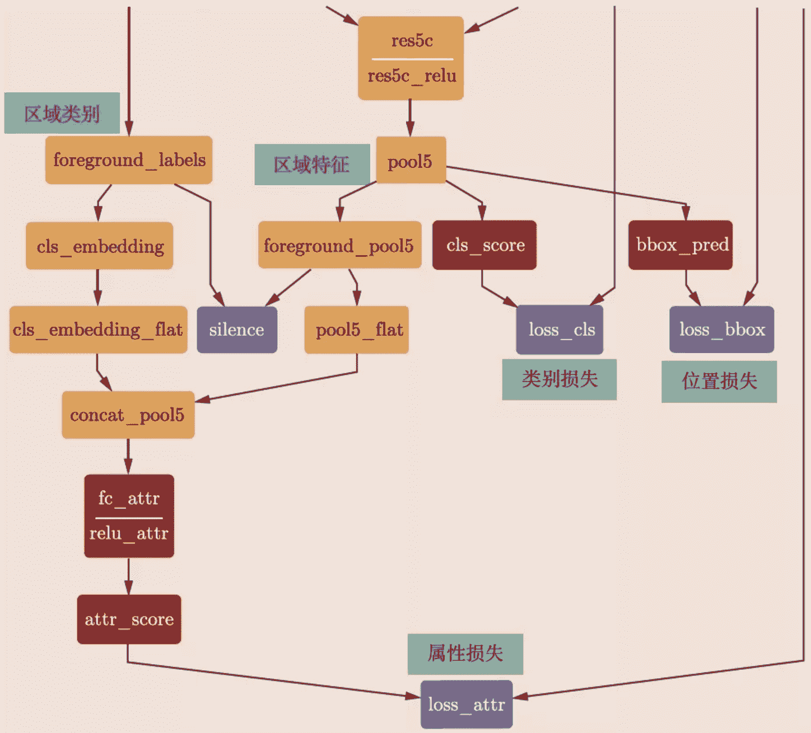

图 4.2 BUA 模型训练配置文件可视化：对 Faster-RCNN 更改的部分

### 4.3 基于视觉 transformer 的整体表示和块表示
视觉 Transformer 近年成为建模图像的主流范式之一，在分类、检测、分割、生成等任务上表现突出，因此其图像表征也被大量用于图文多模态。

#### 4.3.1 使用自注意力代替卷积
把 Transformer 用到图像上的关键变化是用自注意力层替换传统卷积层。形式上，单个卷积核大小为 F×F，把 H1×W1×D1 的输入映射为 H2×W2×D2 的输出。也可把卷积理解为序列操作：把 H1×W1×D1 的输入切成 H2×W2 个 F×F×D1 的块，输出 H2×W2 个 D2 维向量，每个输出神经元反映对应输入块的特征。从形式看，卷积把一组输入向量转为另一组输出向量，每个输出只依赖其对应的单个输入，感受野由块尺寸决定。CNN 通过堆叠卷积扩大感受野。

3.3.1 节中提到的自注意力层在输入输出形式上与卷积相同，都是向量组。因此理论上可以用自注意力直接替代卷积。不同的是，自注意力中每个输出向量的计算会涉及全部输入向量，单层的感受野即为全局，实际有效范围由归一化注意力分数大于 0 的项决定。可以总结为：卷积是带有固定感受野的自注意力，而自注意力是带有可学习感受野的卷积[88]。

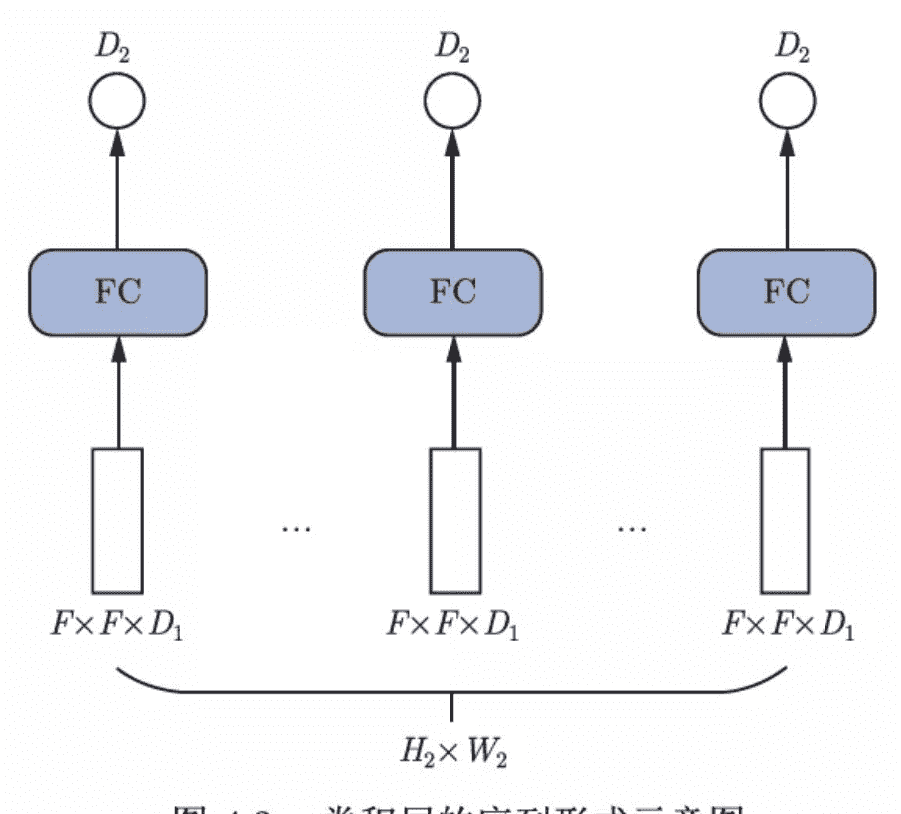

#### 4.3.2 视觉 transformer
图 4.4 展示了首个完全抛弃卷积、仅用 Transformer 编码器进行图像分类的模型 ViT[68] 的结构。流程自输入到输出如下。

1. 将图像切分为大小相同且互不重叠的块。假设切成 K 块，每块形状为 (F, F)，则整张图可表示为 K 个形状为 (F, F, 3) 的三维数组。
2. 把每块从三维数组转为向量，得到 K 个维度为 F×F×3 的向量，随后用线性映射层对每个向量降维，得到低维的图像块输入编码。该过程

#### 4.3.3 整体表示和块表示
在多模态学习里，通常把视觉 Transformer 中分类标识符 <CLS> 对应的输出作为图像的整体表征，而每个块对应的 Transformer 输出则作为块表征。基于视觉 Transformer 的整体与块表征常被用于多模态预训练模型，构成完全基于 Transformer 架构的端到端多模态预训练体系。

### 4.4 基于自编码器的压缩表示
多模态处理中有一类任务涉及图像生成。前文提到的分类与检测模型都依赖语言符号监督，提取的是高度抽象的语义信息，无法完成图像生成。图像生成需要建模图像分布信息。虽然已有工作直接在像素层面建模分布，但维度过高难以生成高分辨率图像。因此研究者转向学习可重构输入图像的压缩表征，挖掘隐变量，在低维空间建模图像分布。

按取值形式，压缩表征可分为离散与连续。接下来介绍三个典型模型：VQ-VAE、VQGAN 与 KLGAN。其中 VQ-VAE 与 VQGAN 通过量化编码学习离散表征，KLGAN 则借助 KL 散度学习连续表征。

#### 4.4.1 量化自编码器：VQ-VAE
VQ-VAE（vector quantised-variational autoencoder）[73] 是首个在大规模图像集上训练成功的量化自编码器，并被用于图像生成。下面介绍其结构与损失。

##### 1. 模型结构
自编码器可视为特殊的三层网络：输入层、表征层、重构层。从输入到表征的映射为编码器，从表征到重构的映射为解码器。训练目标是让重构输出尽可能接近编码器输入。误差函数度量二者差异，常用于平方误差与交叉熵误差，前者适用于任意输入，后者要求输入取值在 0~1。训练可用小批量随机梯度下降，效果以重构误差评估。

学习离散表征的朴素思路是先用自编码器学连续表征，再用 k-means 等聚类离散化。VQ-VAE 将两步合并，实现中间层即为离散值的自编码器。

图 4.5 展示了 VQ-VAE 结构，可拆分为编码器 E、量化模块 Q 与解码器 G 三部分。

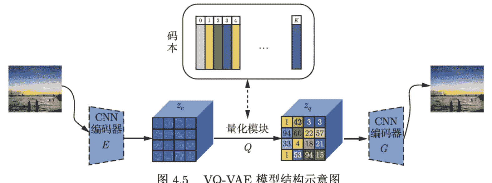

编码器由一系列转换与下采样卷积层构成，把输入图像 x ∈ R^{H×W×3} 下采样为目标尺寸的卷积特征图：

$$\boldsymbol{z}_e = E(\boldsymbol{x}) \in \mathbb{R}^{h \times w \times D} \quad (4.4.1)$$

量化模块维护一个嵌入层即码本，包含 K 个长度为 D 的向量。对卷积特征图中每个位置的特征，在码本中检索最近邻向量，将其映射为码本中的某一个向量。于是整张特征图 z_e 被映射为由码本向量组成的特征图 z_q ∈ R^{h×w×D}。z_q 中所有向量的码本索引为整数，对应一个整数矩阵，即图像的离散表征。

解码器由一系列转换与上采样卷积层构成，把编码 z_q 上采样回输入尺寸的图像：

$$\hat{\boldsymbol{x}} = G(\boldsymbol{z}_q) \in \mathbb{R}^{H \times W \times 3} \quad (4.4.2)$$

##### 2. 损失函数
自编码器的损失为重构损失，即

$$\mathcal{L}_{\text{recon}} = \| \boldsymbol{x} - G(\boldsymbol{z}_q) \|_2^2 \quad (4.4.3)$$

在 VQ-VAE 中，z_q 的计算包含无梯度的最近邻搜索，若直接使用上述损失，编码器参数将无法更新。因此采用直通梯度估计方法，重构损失写为：

$$\mathcal{L}_{\text{recon}} = \| \boldsymbol{x} - G(\boldsymbol{z}_e + \text{sg}[\boldsymbol{z}_q - \boldsymbol{z}_e]) \|_2^2$$

其中 sg 表示 stop gradient，不参与梯度计算但不影响前向结果。于是前向传播时 G(z_e + z_q - z_e)=G(z_q)，反向传播时实际只使用 G(z_e)，从而实现编码器参数更新。

除重构损失外，还需让码本与编码器输出 z_e 互相靠近。VQ-VAE 使用码本损失与承诺损失两项：

$$\begin{cases} \mathcal{L}_{\text{codebook}} = \text{sg}[\boldsymbol{z}_e] - \boldsymbol{z}_q \\ \mathcal{L}_{\text{commitment}} = \boldsymbol{z}_e - \text{sg}[\boldsymbol{z}_q] \end{cases}$$

分开设计可为两项在总损失中使用不同权重。

最终总损失为

$$\mathcal{L}_{\text{VQ-VAE}} = \mathcal{L}_{\text{recon}} + \beta \mathcal{L}_{\text{codebook}} + \gamma \mathcal{L}_{\text{commitment}}$$

其中 β 与 γ 为相应损失项的权重。

#### 4.4.2 量化生成对抗网络：VQGAN
VQGAN 在 VQ-VAE 基础上放宽重构约束，加入感知损失与生成对抗损失。下面先简述生成对抗网络基础，再给出 VQGAN 损失。

##### 1. 生成对抗网络的基础知识
生成对抗网络 generative adversarial networks, GAN[97] 常见于图像生成等任务。与多数生成模型不同，GAN 不显式定义数据概率分布，而是用神经网络把简单分布映射到数据分布，并用另一网络度量生成分布与真实分布的距离。

如图 4.6 所示，GAN 由生成器与判别器组成。生成器负责拟合数据分布并由随机噪声采样产生样本，判别器负责判断样本来自生成器还是真实数据，输出概率反映样本来自真实数据的可能性。

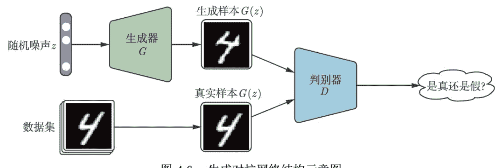

生成器与判别器通过对抗学习训练，生成器目标是最大化判别器犯错概率，判别器目标是最小化自身错误。形式化目标为

$$\min_G \max_D \mathbb{E}_{x \sim p_{\text{data}}} [\log D(x)] + \mathbb{E}_{z \sim p_z} [\log (1 - D(G(z)))] \quad (4.4.7)$$

实际训练中二者交替更新，常拆分为生成器损失 L_G 与判别器损失 L_D：

$$\begin{cases} \mathcal{L}_G = -\mathbb{E}_{z \sim p_z} [\log(D(G(z)))] \\ \mathcal{L}_D = -\mathbb{E}_{x \sim p_{\text{data}}} [\log(D(x))] - \mathbb{E}_{z \sim p_z} [\log (1 - D(G(z)))] \end{cases} \quad (4.4.8)$$

对抗设定下，生成器与判别器构成双人 Minimax 博弈，最终达到纳什均衡时生成器能伪造逼真样本，判别器对任意样本输出 1/2。

标准 GAN 的生成器仅以随机噪声为输入，只能随机生成样本。若需按需求生成，需加入条件信息。条件式对抗生成网络 conditional GAN, cGAN[98] 的优化目标变为

$$\min_G \max_D \mathbb{E}_{(x,c) \sim p_{\text{data}}} [\log D(x, c)] + \mathbb{E}_{z \sim p_z, c \sim p_{\text{data}}} [\log (1 - D(G(z, c), c))] \quad (4.4.9)$$

生成器与判别器结构无严格限制，只要可微即可。基于条件对抗生成网络的文生图模型均以 cGAN 为图像生成器，生成器主要由上采样卷积构成，判别器主要由卷积层构成。

##### 2. VQGAN 的损失函数
VQGAN 总损失分为 L_VQ 与 L_GAN 两部分：L_VQ 基本沿用 VQ-VAE 损失但稍作调整；L_GAN 为判别器引入的新损失项。具体而言。

L_VQ 的形式为

$$\mathcal{L}_{\text{VQ}} = \mathcal{L}_{\text{recon}} + \beta \mathcal{L}_{\text{codebook}} + \gamma \mathcal{L}_{\text{commitment}} \quad (4.4.10)$$

这里 $\mathcal{L}_{\text{codebook}}$ 与 $\mathcal{L}_{\text{commitment}}$ 仍沿用 VQ-VAE 的定义方式。重建项 $\mathcal{L}_{\text{recon}}$ 被额外加入了 LPIPS 感知型损失$^{[99]}$。该类损失不再在像素点上逐点比对，而是从更抽象的视觉感受层面衡量两张图像的差异。典型做法是用一个预训练的卷积网络先把图像映射为特征图，再计算真实图与生成图的特征图距离。距离越大说明差异越大损失越高，距离越小说明越接近损失越低。在 VQGAN 中 $\mathcal{L}_{\text{recon}}$ 的具体写法为

$$\mathcal{L}_{\text{recon}} = \|\boldsymbol{x} - \hat{\boldsymbol{x}}\|^2 + \alpha \mathcal{L}_{\text{perceptual}}(\boldsymbol{x}, \hat{\boldsymbol{x}}) \quad (4.4.11)$$

式中 $\mathcal{L}_{\text{perceptual}}(\boldsymbol{x}, \hat{\boldsymbol{x}})$ 为借助预训练模型实现的感知型损失模块，$\alpha$ 控制其贡献比例。

对抗损失 $\mathcal{L}_{\text{GAN}}$ 的通用表达为

$$\mathcal{L}_{\text{GAN}} = \log D(\boldsymbol{x}) + \log(1 - D(\hat{\boldsymbol{x}})) \quad (4.4.12)$$

训练时 $\mathcal{L}_{\text{GAN}}$ 会拆分为生成器部分 $\mathcal{L}_{\text{G}}$ 与判别器部分 $\mathcal{L}_{\text{D}}$，并沿用生成对抗网络常用的交替更新策略。

需要强调的是，VQGAN 在优化生成器时采用的目标是 $\mathcal{L}_{\text{VQ}}$ 与 $\mathcal{L}_{\text{G}}$ 之和即 $\mathcal{L}_{\text{VQ}} + \mathcal{L}_{\text{G}}$，而优化判别器时仅使用 $\mathcal{L}_{\text{D}}$。

整体目标的最终形式为

$$\mathcal{L}_{\text{VQGAN}} = \mathcal{L}_{\text{VQ}} + \lambda \mathcal{L}_{\text{GAN}} \quad (4.4.13)$$

其中

$$\lambda = \frac{\nabla_{G_L}[\mathcal{L}_{\text{recon}}]}{\nabla_{G_L}[\mathcal{L}_{\text{GAN}}] + \delta} \quad (4.4.14)$$

$\nabla_{G_L}[\cdot]$ 表示相应损失对生成器末层参数的梯度。$\delta$ 固定为 $10^{-6}$ 用以保证数值稳定，$\lambda$ 为自适应系数，用于在训练中平衡重建项与对抗项对离散自编码器参数的影响，使过程更平稳。

#### 4.4.3 KLGAN：去量化的变分对抗网络

KLGAN 即 Kullback-Leibler GAN，它去掉 VQGAN 中的量化环节，用下式的 KL 项 $\mathcal{L}_{\text{KL}}$ 替代 VQ 损失 $\mathcal{L}_{\text{VQ}}$。

$$\mathcal{L}_{\text{KL}} = \mathcal{L}_{\text{recon}} + D_{\text{KL}}(N(\mu(\boldsymbol{Z}_e), \Sigma(\boldsymbol{Z}_e)) \| N(0, \boldsymbol{I})) \qquad (4.4.15)$$

该式中的 $D_{\text{KL}}$ 促使图像表征向标准正态分布靠拢，其形式与变分自编码器$^{[100]}$ 中的 KL 散度完全一致。所以与 VQ-VAE、VQGAN 不同，KLGAN 学习的表征是连续的而非离散的。

KLGAN 的总目标为

$$\mathcal{L}_{\text{KLGAN}} = \mathcal{L}_{\text{KL}} + \lambda \mathcal{L}_{\text{GAN}} \qquad (4.4.16)$$

其中 $\mathcal{L}_{\text{GAN}}$ 与 VQGAN 中式(4.4.12) 保持一致。

补充说明，KLGAN 对应 Stable Diffusion$^{[78]}$ 中的 KL-reg，VQGAN 对应文中 VQ-reg。

#### 4.4.4 压缩式表征

离散表征方面，DALL·E$^{[72]}$ 的代码仓库$^1$提供了其 VQ-VAE 模型，并给出提取图像离散表征 $z_q$ 的实现。VQGAN$^{[101]}$ 在 VQ-VAE 解码结果上叠加了图像块真伪判别器，通过对抗训练提升解码图像的逼真度。实验显示 VQGAN 提取的离散表征重建能力更强，因而取代 VQ-VAE 成为后续图像生成的主流 backbone。VQGAN 代码库$^2$提供了多个可用的预训练权重。

连续表征方面，文本到图像模型 Stable Diffusion 的代码仓库$^3$ 同步收录了 VQGAN 与 KLGAN 的预训练权重，可分别获得离散压缩表征与连续压缩表征。

$^1$ https://github.com/openai/DALL-E

$^2$ https://github.com/CompVis/taming-transformers

$^3$ https://github.com/CompVis/stable-diffusion

### 4.5 小结

本章回顾了深度学习中常用的图像表征演进动机，系统梳理了四类表征及其获取途径。网格表征依赖卷积神经网络，区域表征依赖目标检测，块表征依赖视觉 Transformer，压缩表征依赖自编码器。不同表征支撑不同模型与应用，后续章节会反复调用这些提取方式。

### 4.6 习题

- 1. 对比卷积神经网络得到的网格表征与目标检测模型得到的区域表征的优劣。
- 2. 目标检测一般只输出类别，自底向上注意力模型额外输出属性分布，其设计动机是什么。
- 3. 说明自注意力与卷积操作的关系及各自适用场景。
- 4. 参照 4.1.3 节基于 CNN 提取整体与网格表征的代码，写出基于视觉 Transformer 提取整体与块表征的代码。
- 5. 分别阐述离散压缩表征与连续压缩表征的优缺点。
- 6. 基于 VQGAN 代码库可视化对比 VQGAN 与 KLGAN 的重建效果。

## 第 5 章 多模态表征

前两章介绍了文本与图像的单模态表征。要完成跨模态任务需要在单模态基础上学习联合表征。在此先看数据的特点。通常不同模态既有重叠也有独有信息。如图 5.1(a) 的图文对：一张图与其描述。“落日”“大海”同时出现在图与文本中，属于共同信息；而文本中“长滩岛”“iPhone8”“好心情”无法直接从图中读取，属于文本特有；“人”“帆船”只能在图中看到，属于图像特有。图 5.1(b) 用文氏图做集合描述，左圆为图像信息，右圆为文本信息，交集为公共信息。

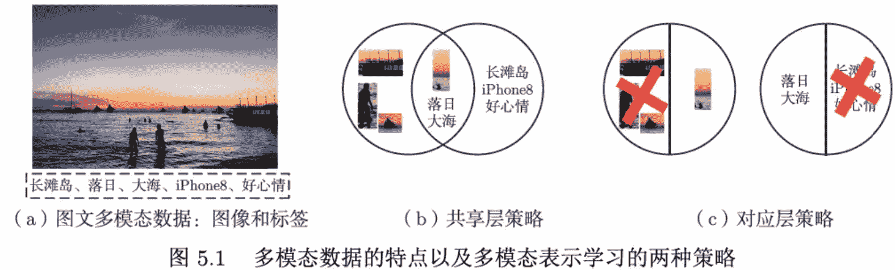

基于这一特性，研究者主要采用两种思路。

第一种为多个模态学习一个共享空间，将各模态融合到同一层，称为共享表征 joint representation。目标是得到与图 5.1(b) 对应的层，既保留模态特有信息也保留公共信息。

2011 年，基于深度自编码器的多模态共享表征模型[102] 在视听语音分类上取得当时最好成绩，首次把深度学习引入多模态处理。2012 年，深度信念网络与深度玻尔兹曼机被扩展为多模态共享模型[103-104]，用于图像标注与图文分类。这些工作仅用对齐数据做无监督学习，希望用简模型解决多任务，但因均采用整体表征且融合方式简单，最终难以超越任务专用模型。

此后研究转向为特定任务设计有监督深度模型，表征不再追求通用性而多作解释。期间对齐、融合、转换技术快速发展。叠加预训练语言模型在 NLP 的突破，2019 年起出现多模态预训练模型学习通用表征，多使用 Transformer 融合多模态，<CLS> 输出可作为共享表征。

第二种为每个模态单独建模，但在不同模态的空间中加入相似性约束建立对应关系，称为对应表征 coordinated representation。目标是得到与图 5.1(c) 对应的层，只保留公共部分。

早期对应表征同样基于自编码器与玻尔兹曼机，如 Corr-AEs[3]、MSAE[105]、DCCAE[106]、Corr-RBMs[107]。由于可直接用不同模态对应表征的距离度量关联度，这些模型常用于跨模态检索。

随后排序损失方法成为主流，通过引入不匹配的图文作负例，使匹配对相似度高于不匹配对，相关模型有 MNLM[108]、GXN[109]、VSE++[110]。

可视化发现排序损失学到的空间中图像与文本是分离的，于是出现对抗损失方法，用模态分类器促进图文在对应空间充分混合，消除模态差异。代表工作有 UCAL[111]、ACMR[112]。

上述对应表征模型多面向跨模态检索，通用性有限。2021 年 Radford 等提出基于排序损失的对应表征预训练模型 CLIP [70]，在 4 亿图文对上训练，其图像表征在零样本、小样本与常规图像分类上表现突出。随后 CLIP 表征被广泛用于 Clip4clip [113]、ClipCap [114]、Styleclip [115]、DALL·E [72]、unCLIP [116] 等任务。

本章介绍这两种表征。说明仅覆盖早期的无监督整体表征学习方法，多模态预训练将在后续章节单独讨论。

### 5.1 共享表征

最直接的做法是将多个模态的表征简单拼接，可保留全部信息但冗余高。深度学习通常采用图 5.2 的结构：先用若干网络层分别建模各模态输入得到抽象表征，再用一层连接各模态抽象表征得到共享表征。该表征融合充分且紧凑，可直接用于分类或作为后续网络输入，并支持端到端训练。

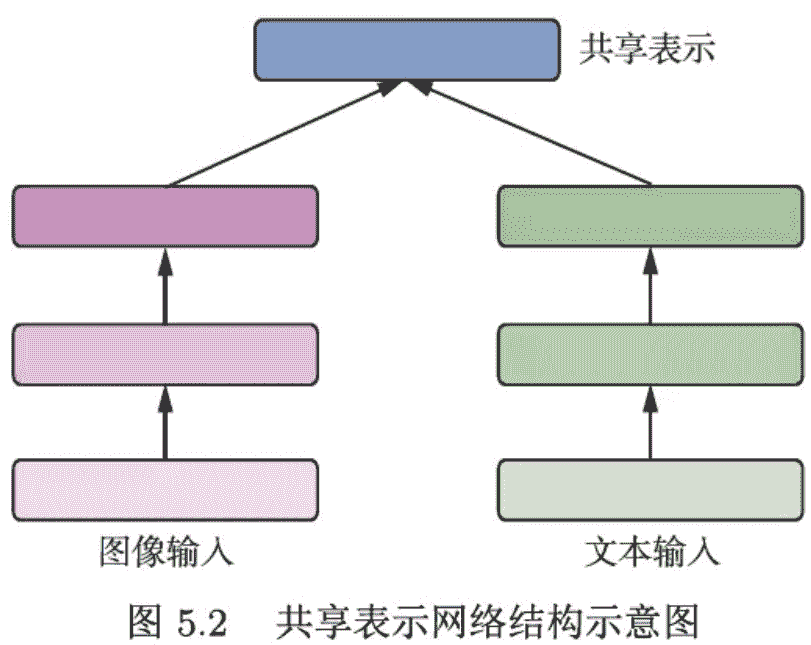

下面介绍两类经典方法：多模态深度自编码器与多模态深度生成模型。

#### 5.1.1 多模态深度自编码器

如图 5.3 所示，多模态深度自编码器 MDAE[102] 的输入与输出均包含两个模态。训练时需扩充数据，除了对齐的图文对，还需两组数据：一组仅图像输入、文本置零；一组仅文本输入、图像置零。这两组同样要求重建图文两个模态。于是三分之一样本为仅图像输入，三分之一为仅文本输入，三分之一为对齐输入。该设计借鉴去噪自编码器思想，要求从损坏输入恢复完整输入以学习更鲁棒表征。

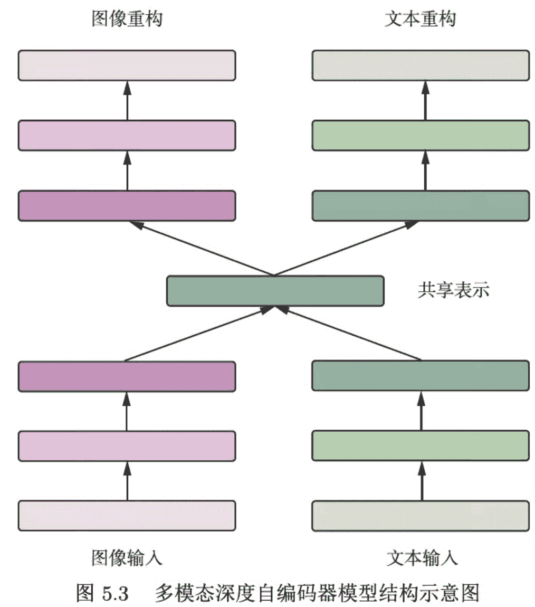

训练阶段可先用受限玻尔兹曼机或自编码器逐层预训练，再用标准反向传播微调。训练完成后，两个模态可被编码模块映射到同一共享层。

#### 5.1.2 多模态深度生成模型

多模态深度信念网络[103] 与多模态深度玻尔兹曼机[104] 是典型的图文共享表征生成模型，均以受限玻尔兹曼机为基础。为此先介绍受限玻尔兹曼机的结构、优化与评估，再介绍基于它的单模态深度生成模型，最后介绍多模态生成模型。

##### 1. 受限玻尔兹曼机

受限玻尔兹曼机 RBM[117] 是基于能量的模型 EBM，是玻尔兹曼机 BM[118] 的特例。

如图 5.4 所示，RBM 为两层概率无向图模型，由输入层与表示层组成。与 BM 中全连接不同，RBM 内层节点间无连接，层间全连接。用 $v$ 表示输入层，$h$ 表示表示层，若两者均为二值随机变量 $v_i\in\{0,1\},h_j\in\{0,1\}$，则称为伯努利 RBM。其联合分布 $p(v,h)$ 与边缘分布 $p(v)$ 分别为

$$p(v, h) = \frac{\exp(-E(v, h))}{Z}$$

$$p(v) = \frac{\sum_h \exp(-E(v, h))}{Z}$$

(5.1.1)

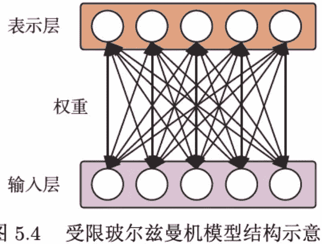

其中 $Z=\sum_v\sum_h\exp(-E(v,h))$ 为归一化因子即配分函数，$E$ 为能量函数，若单元为二值则能量定义为

$$E(\boldsymbol{v}, \boldsymbol{h}) = -\sum_{i,j} v_i W_{ij} h_j - \sum_i c_i v_i - \sum_j b_j h_j \quad (5.1.2)$$

其中 $v_i$ 为输入层第 $i$ 个节点取值，$h_j$ 为表示层第 $j$ 个节点取值，$W_{ij}$ 为权重，$c_i$ 为输入偏置，$b_j$ 为表示偏置。由分布与能量定义可推得条件概率：

$$p(h_j = 1|\boldsymbol{v}) = \frac{\exp(-E(\boldsymbol{v}, h_j = 1))}{\exp(-E(\boldsymbol{v}, h_j = 1)) + \exp(-E(\boldsymbol{v}, h_j = 0))}$$

$$= \frac{\exp(\sum_i W_{ij} v_i + \sum_i c_i v_i + b_j)}{\exp(\sum_i W_{ij} v_i + \sum_i c_i v_i + b_j) + \exp(\sum_i c_i v_i)}$$

$$= \frac{\exp(b_j + \sum_i W_{ij} v_i)}{1 + \exp(b_j + \sum_i W_{ij} v_i)}$$

$$= s\left(b_j + \sum_i W_{ij} v_i\right) \quad (5.1.3)$$

受限玻尔兹曼机训练与多模态深度生成要点

$$p(v_i = 1|\boldsymbol{h}) = \frac{\exp(-E(v_i = 1, \boldsymbol{h}))}{\exp(-E(v_i = 1, \boldsymbol{h})) + \exp(-E(v_i = 0, \boldsymbol{h}))}$$

$$= \frac{\exp(\sum_j W_{ij} h_j + \sum_j b_j h_j + c_i)}{\exp(\sum_j W_{ij} h_j + \sum_j b_j h_j + c_i) + \exp(\sum_j b_j h_j)}$$

$$= \frac{\exp(c_i + \sum_j W_{ij} h_j)}{1 + \exp(c_i + \sum_j W_{ij} h_j)} = s\left(c_i + \sum_j W_{ij} h_j\right)$$

其中激活映射 $s(x)=\frac{1}{1+\mathrm{e}^{-x}}$ 即 Logistic 形式。

要估计 RBM 的权重 $\boldsymbol W$、可见偏置 $\boldsymbol b$、隐偏置 $\boldsymbol c$，统称为 $\theta$，现有多种高效优化方案，这里重点介绍最常用的对比散度 Contrastive Divergence、CD$^{[119]}$ 方法。

训练的出发点是提升训练样本上 $\log p(\boldsymbol v)$ 的对数值。对 $p(\boldsymbol v)$ 的对数关于参数 $\theta$ 求偏导，可得

$$\frac{\partial \log p(\boldsymbol{v})}{\partial \theta} = \frac{\partial \log \sum_{\boldsymbol{h}} \exp(-E(\boldsymbol{v}, \boldsymbol{h})) - \log(Z)}{\partial \theta}$$

$$= \frac{1}{\sum_{\boldsymbol{h}} \exp(-E(\boldsymbol{v}, \boldsymbol{h}))} \cdot -\exp(-E(\boldsymbol{v}, \boldsymbol{h})) \cdot \frac{\partial E(\boldsymbol{v}, \boldsymbol{h})}{\partial \theta}$$

$$- \frac{1}{Z} \cdot -\exp(-E(\boldsymbol{v}, \boldsymbol{h})) \cdot \frac{\partial E(\boldsymbol{v}, \boldsymbol{h})}{\partial \theta}$$

$$= - \frac{\exp(-E(\boldsymbol{v}, \boldsymbol{h}))}{\sum_{\boldsymbol{h}} \exp(-E(\boldsymbol{v}, \boldsymbol{h}))} \frac{\partial E(\boldsymbol{v}, \boldsymbol{h})}{\partial \theta} + \frac{\exp(-E(\boldsymbol{v}, \boldsymbol{h}))}{\boldsymbol{Z}} \frac{\partial E(\boldsymbol{v}, \boldsymbol{h})}{\partial \theta}$$

$$=- < \frac{\partial E(\boldsymbol{v}, \boldsymbol{h})}{\partial \theta} >_{p(\boldsymbol{h}|\boldsymbol{v})} + < \frac{\partial E(\boldsymbol{v}, \boldsymbol{h})}{\partial \theta} >_{p(\boldsymbol{v}, \boldsymbol{h})} \quad (5.1.4)$$

其中 $<\cdot>$ 表示期望，下标指明分布。第一项来源于条件分布 $p(\boldsymbol h|\boldsymbol v)$，在给定可见单元时隐单元相互独立，容易算出；第二项来自联合分布 $p(\boldsymbol v,\boldsymbol h)$，因归一化常数 $\boldsymbol Z$ 而难以直接求值，只能借助采样近似。

把式(5.1.2)、式(5.1.3)、式(5.1.4)合并，可写出 $W$、$b$、$c$ 的梯度表达式：

$$\frac{\partial \log p(\boldsymbol{v})}{\partial W_{ij}} = p(h_j = 1|\boldsymbol{v})v_i - \sum_{\boldsymbol{v}} p(\boldsymbol{v})p(h_j = 1|\boldsymbol{v})v_i$$

$$\frac{\partial \log p(\boldsymbol{v})}{\partial c_i} = v_i - \sum_{\boldsymbol{v}} p(\boldsymbol{v})v_i \quad (5.1.5)$$

$$\frac{\partial \log p(\boldsymbol{v})}{\partial b_j} = p(h_j = 1|\boldsymbol{v}) - \sum_{\boldsymbol{v}} p(\boldsymbol{v})p(h_j = 1|\boldsymbol{v})$$

RBM 结构对称且单元在条件下去独立，使得 CD 能用有限步吉布斯采样$^{[120-121]}$ 来近似第二项的期望。具体 $k$ 步采样流程如下。

$$\boldsymbol{v}^0 \xrightarrow{p(\boldsymbol{h}|\boldsymbol{v}^0)} \boldsymbol{h}^0 \xrightarrow{p(\boldsymbol{v}|\boldsymbol{h}^0)} \boldsymbol{v}^1 \xrightarrow{p(\boldsymbol{h}|\boldsymbol{v}^1)} \boldsymbol{h}^1 \cdots \boldsymbol{h}^{k-1} \xrightarrow{p(\boldsymbol{v}|\boldsymbol{h}^{k-1})} \boldsymbol{v}^k \xrightarrow{p(\boldsymbol{h}|\boldsymbol{v}^k)} \boldsymbol{h}^k \quad (5.1.6)$$

执行 $k$ 步采样的 CD 即 CD-$k$。完成采样后，参数梯度的近似形式为：

$$\delta W_{ij} = v_i^0 h_j^0 - v_i^k h_j^k$$

$$\delta c_i = v_i^0 - v_i^k \quad (5.1.7)$$

$$\delta b_j = h_j^0 - h_j^k$$

获得梯度后即可用梯度上升更新参数。CD-$k$ 的近似相当粗糙，甚至不保证是某个目标函数的梯度，但大量实验验证了其在 RBM 训练中的实用性。

直接用训练数据上的似然衡量效果是最直观的，然而似然计算涉及 $\boldsymbol Z$，复杂度极高。常用近似评估手段有退火重要性采样 Annealed Importance Sampling、AIS$^{[122]}$，它借助易算的辅助分布来估计归一化常数，能较准确估计似然，却因计算开销大而不利于实时监控。实践中最流行的是重构误差，和自编码器评估思路相同，即比较原始输入 $v^0$ 与 $k$ 步采样后得到的重构 $v^k$ 的差异。这一指标虽不够可靠，但实现简单，因而被广泛使用。本文亦以重构误差大小判定训练质量。

##### 2. 建模实数值

基本 RBM 仅能处理二值随机输入，面对实数、离散等情形便不再适用。研究者通过改造能量函数扩展 RBM 以适配不同数据。对实值数据，最直接做法是用高斯分布建模可见层，得到高斯 RBM Gaussian RBM、GRBM$^{[123-124]}$。其能量定义为

$$E(\boldsymbol{v}, \boldsymbol{h}) = \frac{1}{2} \sum_{i} \frac{(v_i - c_i)^2}{2\sigma_i^2} - \sum_{i,j} \frac{v_i}{\sigma_i} W_{i,j} h_j - \sum_{i} c_i v_i - \sum_{j} b_j h_j \quad (5.1.8)$$

其中 $\sigma_i$ 为输入第 $i$ 维的标准差，其余符号与标准 RBM 含义一致。对应的概率为

$$p(h_j = 1|\boldsymbol{v}) = s(b_j + \sum_{i} \frac{v_i}{\sigma_i} W_{ij})$$

$$p(v_i = 1|\boldsymbol{h}) = \mathcal{N}(c_i + \sigma_i \sum_{j} W_{ij} h_j, \sigma_i^2) \quad (5.1.9)$$

其中 $\mathcal N$ 代表高斯分布。实际使用时，通常先把每维特征归一化到均值 0 方差 1。GRBM 的参数学习同样依赖 CD。

##### 3. 建模离散值

当输入为稀疏离散时，常采用神经主题模型 replicated softmax RBM、RSRBM$^{[125]}$。能量函数写作

$$E(\boldsymbol{v}, \boldsymbol{h}) = - \sum_{i,j} \frac{v_i}{\sigma_i} W_{i,j} h_j - \sum_{i} c_i v_i - D \sum_{j} b_j h_j \quad (5.1.10)$$

其中 $D$ 为离散值的总和，对一篇文档即词总数。RSRBM 的参数亦用 CD 求解，其可见层可视为多项式随机变量。本文用 RSRBM 对文本模态的词袋特征建模。

##### 4. 深度信念网络和深度玻尔兹曼机

深度信念网络 Deep Belief Networks、DBN$^{[126]}$ 与深度玻尔兹曼机 Deep Boltzmann Machine、DBM$^{[127]}$ 是两类典型的基于 RBM 的深度生成模型。

DBN 由 Hinton 等提出，包含多层表示，结构见图5.5(a)，最底层为输入层，其上为 $n$ 个表示层，实线为连接，虚线为逐层表示的抽取过程。DBN 结构混合，顶层两层为无向 RBM，其余层自上而下为有向网络。于是各层联合分布可表为

$$p(\boldsymbol{x}, \boldsymbol{h}_1, \boldsymbol{h}_2, \cdots, \boldsymbol{h}_{n-1}, \boldsymbol{h}_n) = p(\boldsymbol{h}_n, \boldsymbol{h}_{n-1}) \left( \prod_{k=0}^{n-2} p(\boldsymbol{h}_k | \boldsymbol{h}_{k+1}) \right) \quad (5.1.11)$$

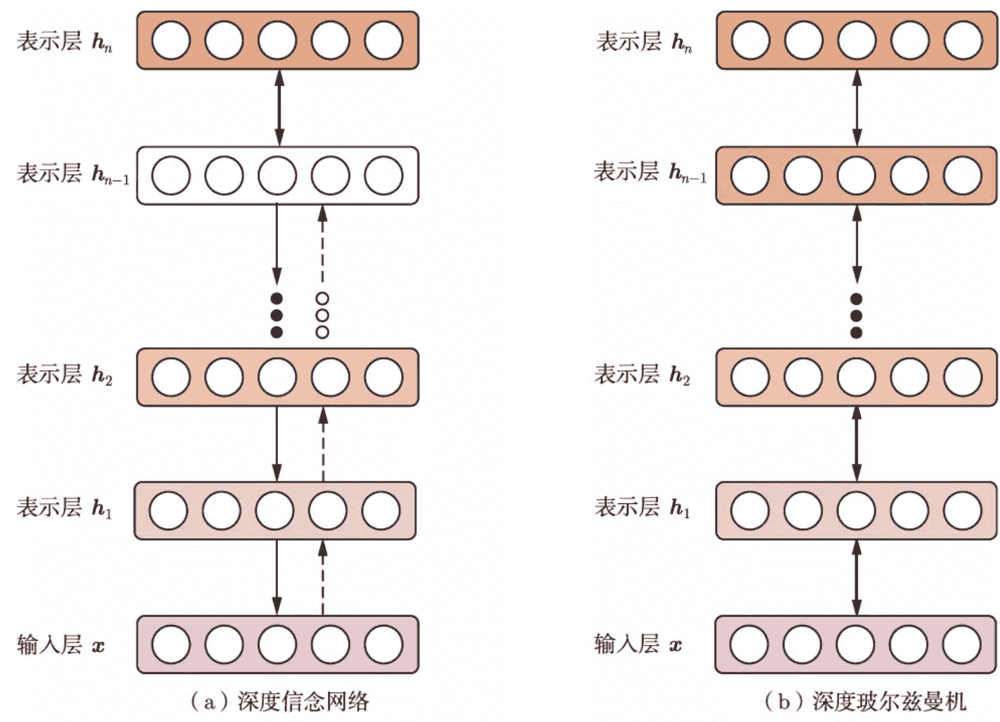

其中 $\boldsymbol x=\boldsymbol h_0$，$p(\boldsymbol h_n,\boldsymbol h_{n-1})$ 为顶层 RBM 的联合分布，$p(\boldsymbol h_k|\boldsymbol h_{k+1})$ 为其余层的条件分布，这里把 $\boldsymbol h_{k+1}$ 视作表示层、$\boldsymbol h_k$ 视作输入层。

DBN 生成是自顶向下：先随机初始化顶层 $h_n$，用吉布斯采样得到 $h_{n-1}$，再依次按 $p(h_{n-2}|h_{n-1}),\cdots,p(x|h_1)$ 采样出输入 $x$。

因后验 $p(h_{k+1}|h_k)$ 难以计算，端到端训练困难。Hinton 等提出贪婪逐层学习$^{[126,128]}$，用 RBM 的 $p(h|v)$ 近似后验。具体先用 CD 训练最底层 RBM，再由 $p(h_1|x)$ 得到表示 $h_1$，依此类推完成各层预训练，最后可选择 wake-sleep$^{[126,129]}$ 微调整体权值。

DBM 把多个 RBM 直接堆叠而成，结构见图5.5(b)，层间均为无向连接，是标准无向图模型。DBM 同样能学习层次化复杂表征，但在生成与训练中同时存在自顶向下和自底向上两条通道，而 DBN 只有自顶向下，因而 DBM 的表达能力更强，训练算法也随之更复杂。相关高效学习方法见$^{[125,127,130-131]}$。

##### 5. 多模态深度信念网络和多模态深度玻尔兹曼机

多模态深度信念网络 Multimodal DBN、MDBN 和多模态深度玻尔兹曼机 Multimodal DBM、MDBM 分别由 DBN 与 DBM 扩展而来，结构见图5.6。与 MDAE 不同，二者均为概率生成模型，目标是最大化图像与文本联合概率。训练流程与单模态类似，包含单层 RBM 预训练与整体调权两个阶段。

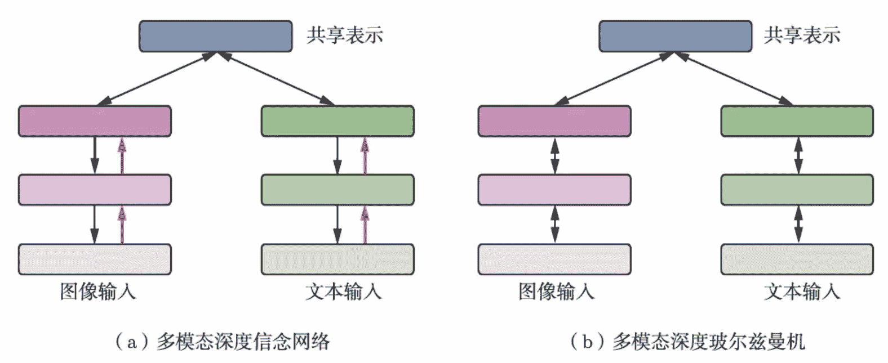

相较 MDAE，多模态深度生成模型能自然地基于一种模态采样另一种模态，既可实现跨模态生成，也能处理模态缺失情形：先补全缺失模态再提取共享表示。

### 5.2 对应表示

如图5.7 所示，对应表示学习采用两个独立编码器分别提取图像与文本表征，并在对应空间加入图文相似性约束以建立关联。按优化目标可分为基于重构损失、基于排序损失和基于对抗损失三类。下面以结构和损失形式介绍代表模型。

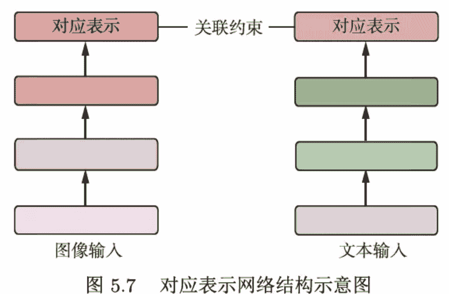

为便于表述，先统一符号。

数据集：训练集为 $n$ 组匹配的图像文本对 $\{(x_i^I,x_i^T)|i=1,2,\cdots,n\}$，$x_i^T$ 为 $x_i^I$ 的描述。为简洁后续省略下标 $i$，损失均针对单对。

模型输入：本节模型的输入为图像与文本的整体表示，记作 $x^I$ 与 $x^T$。

图文编码器：图像编码器 $f(x^I;W_f)$、文本编码器 $g(x^T;W_g)$，$W$ 含权值与偏置，下标 $f,g$ 分别对应两模态。

#### 5.2.1 基于重构损失的方法

此类方法借助解码结构让对应空间的表征可重构原始输入，以保证区分性。多数模型以自编码器为基础。如图5.8 所示，由图像自编码器与文本自编码器构成整体，两个自编码器经表示层引入相似性约束。重构约束与相似性约束共同促使学习到的表示满足：①匹配的图文在对应空间距离很近；②单模态内部相似样本在对应空间也靠近。

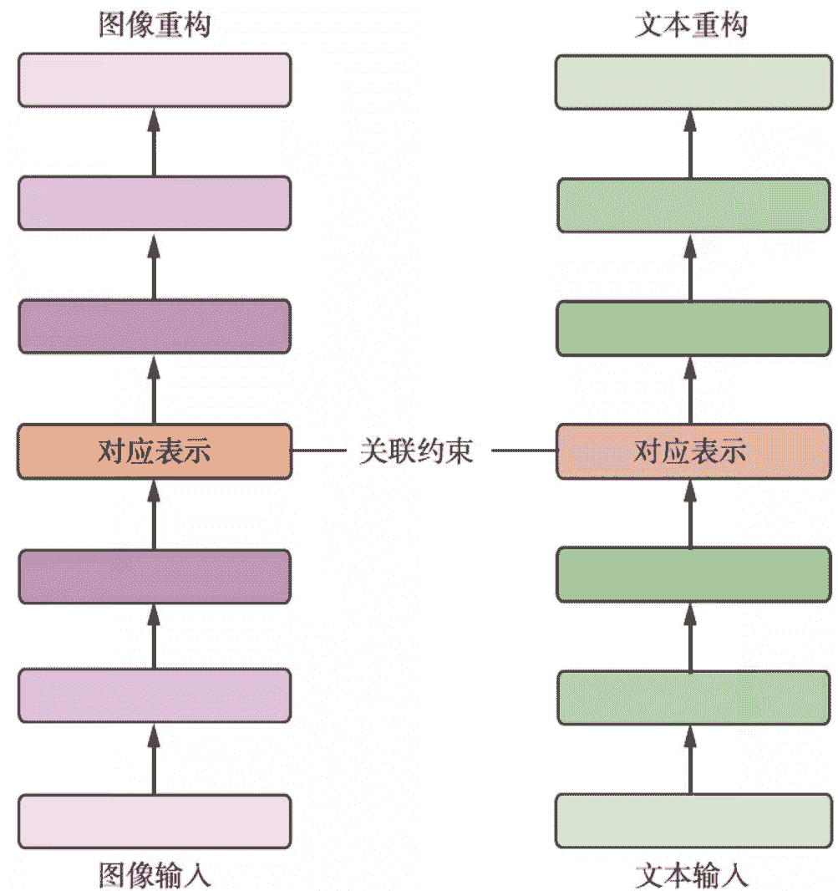

记 $\hat{\boldsymbol x}^I$、$\hat{\boldsymbol x}^T$ 为经各自解码器后的重构输出。图像解码器记为 $h$、文本解码器记为 $s$，参数为 $W_h$、$W_s$，则对输入 $\boldsymbol x^I$、$\boldsymbol x^T$ 的损失为

$$\mathcal{L}(\boldsymbol{x}^I, \boldsymbol{x}^T) = \alpha \mathcal{L}_C(\boldsymbol{x}^I, \boldsymbol{x}^T; W_f, W_g) + (1 - \alpha)(\mathcal{L}_I(\boldsymbol{x}^I; W_f, W_h) + \mathcal{L}_T(\boldsymbol{x}^T; W_g, W_s)) \quad (5.2.1)$$

其中，

$$\mathcal{L}_C(\boldsymbol{x}^I, \boldsymbol{x}^T; W_f, W_g) = \|f(\boldsymbol{x}^I; W_f) - g(\boldsymbol{x}^T; W_g)\|_2^2$$

$$\mathcal{L}_I(\boldsymbol{x}^I; W_f, W_h) = \|\boldsymbol{x}^I - \hat{\boldsymbol{x}}^I\|_2^2 \qquad (5.2.2)$$

$$\mathcal{L}_T(\boldsymbol{x}^T; W_g, W_s) = \|\boldsymbol{x}^T - \hat{\boldsymbol{x}}^T\|_2^2$$

记图像重建误差为 $\mathcal{L}_I$，文本重建误差为 $\mathcal{L}_T$，二者均以解码输出与原始输入间的平方差衡量；跨域对齐项 $\mathcal{L}_C$ 则度量视觉与语言在中间表征空间的分离程度，可视为模态间关联偏差。

整体优化沿式(5.2.1)进行，目标是在压低跨域对齐偏差的同时降低两路自编码器的重建误差。

目标式中引入调和系数 $\alpha(0 < \alpha < 1)$，用于平衡对齐损失 $\mathcal{L}_C$ 与重建损失 $\mathcal{L}_I + \mathcal{L}_T$ 的贡献。$\alpha$ 的选取直接影响有效性。若 $\alpha$ 取 0，目标退化为两路自编码器误差之和，视觉编解码与语言编解码脫钩训练，模态间的对应关系无法被捕获。若 $\alpha$ 取 1，目标只剩对齐项，此时存在平凡解 $W_f = 0 = W_g$ 且所有偏置清零，会使任意输入的中间表征趋同。此时模型只追求模态一致而弃重建，单模态内部分辨力丧失，也学不到可用表示。

参数学习可沿用前馈网络通用的反向传播机制。依据式(5.2.1)可直接推得映射矩阵 $W_f$ 与 $W_g$ 的梯度解析式：

$$\frac{\partial \mathcal{L}}{\partial W_f} = \alpha \frac{\partial \mathcal{L}_C}{\partial W_f} + (1 - \alpha) \frac{\partial \mathcal{L}_I}{\partial W_f}$$

$$\frac{\partial \mathcal{L}}{\partial W_g} = \alpha \frac{\partial \mathcal{L}_C}{\partial W_g} + (1 - \alpha) \frac{\partial \mathcal{L}_T}{\partial W_g} \qquad (5.2.3)$$

#### 5.2.2 基于排序损失的方法

排序类思路在正对之外引入失配对作为负样本，迫使正对的亲和度系统性地高于负对。余弦度量是该族方法里最常用的相似性刻画，具体定义为

$$s(\boldsymbol{x}^I, \boldsymbol{x}^T) = \text{cosine}(f(\boldsymbol{x}^I; W_f), g(\boldsymbol{x}^T; W_g)) \qquad (5.2.4)$$

当前主流的多模态排序目标主要有两类：多模态 triplet 排序与多模态 n-pair 排序，分述如下。

图 5.9 展示的多模态 triplet 损失借助三元素结构让正对比失配对更相似，其通用形式为

$$\mathcal{L}_{\text{triplet}}(\boldsymbol{x}^I, \boldsymbol{x}^T) = \sum_{T^-} [m - s(\boldsymbol{x}^I, \boldsymbol{x}^T) + s(\boldsymbol{x}^I, \boldsymbol{x}^{T^-})]_+ + \sum_{I^-} [m - s(\boldsymbol{x}^I, \boldsymbol{x}^T) + s(\boldsymbol{x}^{I^-}, \boldsymbol{x}^T)]_+ \tag{5.2.5}$$

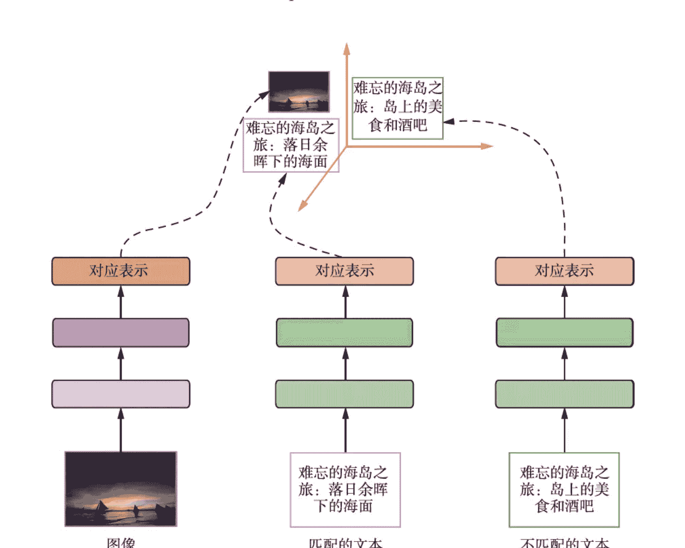

其中间隔 $m$ 为超参，$[x]_+ \equiv \max(x, 0)$。损失包含两段对称结构：第一段以锚图像、正文、负文构成三元，期望锚与正文的相似度至少比与任意负文高出 $m$；第二段以锚文本为起点，要求其与正图的相似度同样高于与任意负图的相似度 $m$。全量枚举时三元规模达 $2N^2$。为降成本，实际仅在同一 mini-batch 内构造负样本，设 batch 大小为 bs，则有效三元数变为 $2\frac{N}{bs} * bs^2 = 2N * bs$，计算量显著下降。

工程中更常用硬负样本挖掘版的 triplet 排序，其形式为

$$\mathcal{L}_{\text{triplet-HEM}}(\boldsymbol{x}^I, \boldsymbol{x}^T) = \max_{T^-} [m - s(\boldsymbol{x}^I, \boldsymbol{x}^T) + s(\boldsymbol{x}^I, \boldsymbol{x}^{T^-})]_+ + \max_{I^-} [m - s(\boldsymbol{x}^I, \boldsymbol{x}^T) + s(\boldsymbol{x}^{I^-}, \boldsymbol{x}^T)]_+ \tag{5.2.6}$$

与式(5.2.5)结构相近，该版本仍保持双向对称，但不再对全部三元求和，而是保留每类损失最大的那一个。换言之 $L_{\text{HEM}}$ 专注于最具迷惑性的失配样本，通常性能更稳。

triplet 每次仅对比单个负样本，多模态 n-pair 排序则在一次比较中同时涵盖与正对相关的全部负样本。具体做法是枚举所有正负配对形成如图 5.10 的矩阵，以 3 对图文为例，对角为正对，其余为负对；随后把每行或每列视作分类问题，正类即正对索引，最后对矩阵的各行列求交叉熵。对单个正对的具体形式为

$$\mathcal{L}_{n\text{-pair}}(\boldsymbol{x}^I, \boldsymbol{x}^T) = -\log \frac{\exp(s(\boldsymbol{x}^I, \boldsymbol{x}^T))}{\exp(s(\boldsymbol{x}^I, \boldsymbol{x}^T)) + \sum_{T^-} \exp(s(\boldsymbol{x}^I, \boldsymbol{x}^{T^-}))} - \log \frac{\exp(s(\boldsymbol{x}^I, \boldsymbol{x}^T))}{\exp(s(\boldsymbol{x}^I, \boldsymbol{x}^T)) + \sum_{I^-} \exp(s(\boldsymbol{x}^{I^-}, \boldsymbol{x}^T))} \tag{5.2.7}$$

为保证效率，n-pair 损失同样只在同一小批量内构造负样本。

#### 5.2.3 基于对抗损失的方法

对抗式方案借鉴生成对抗原理，引入模态鉴别器以促进图文对应空间的融合并削弱模态差异。如图 5.11 所示，在常规图文编码器之上额外叠加模态判别器，其输入为图或文在对应空间的向量，输出为归属两类模态的概率。

损失由对齐分量 $L_C$ 与判别分量 $L_D$ 组成。$L_C$ 多取对应表征的 $l_2$ 距离；$L_D$ 为二分类交叉熵。若把判别器 $D$ 的全部参数记为 $W_D$，联合目标为

$$\mathcal{L}(W_f, W_g, W_D) = L_C - L_D \qquad (5.2.8)$$

训练与 GAN 相似，分生成阶段与判别阶段。生成阶段把图文映射至公共空间，使判别器无法分辨来源，即最小化 $\mathcal{L}$ 并更新 $W_f$、$W_g$；判别阶段则提升判别器区分能力，即最大化 $\mathcal{L}$ 并更新 $W_D$。

图 5.11 基于对抗损失的对应表示模型网络结构示意图

### 5.3 实战案例：基于对应表示的跨模态检索

#### 5.3.1 跨模态检索技术简介

跨域检索的核心在于建立异构数据的关联，更直接地说模型需给出多模态间的匹配得分。如图 5.12 所示，现存思路可归为两类：一类先学图文的对应表征，再以表征间距离计算得分，称作对应表示法；另一类先学共享表征，随后在共享层叠加网络直接输出匹配分，称作共享表示法。

总体而言，共享表示法因融合更充分，通常表现更好。直观理解是对应表示法要求关联在无交互条件下建立，而共享表示法无此限制，拟合自由度更大。

不过共享表示法的检索开销很大。以文检图为例，需把查询文本与候选集中每张图像逐对送入模型才能得到分数。而对应表示法只需离线预先算好候选图像的表征，检索时仅在线计算文本表征，再用最近邻搜索即可。因此对应表示法在实际检索中更普及。

下面以对应表示模型 VSE++<sup>[110]</sup> 为例展开实战，其官方代码见链接<sup>1</sup>。为便于理解训练过程，我们做了复现。

#### 5.3.2 模型训练流程

在主流深度学习框架下，训练通常包含读取数据、前馈计算、计算损失、更新参数、选择模型五个环节，各环节需分别实现。

- 读取数据阶段，先获取数据，整理格式以便构造数据类，再在此基础上构建可按批次产生训练、验证、测试数据的对象。
- 前馈计算阶段，需实现具体模型，使其能依据输入产生输出。
- 计算损失阶段，需将模型输出与期望输出对比，实现损失函数。
- 更新参数阶段，需指定优化方法；框架已自动求梯度并实现常用优化器，通常只需选取即可。
- 选择模型阶段，需实现评估指标，挑出在验证集上表现最优的参数。

下文将按此流程介绍 VSE++ 的具体实现并串联起来。

#### 5.3.3 读取数据

##### 1. 下载数据集

选用 Flickr8k 数据集，获取后解压，将图片置于指定目录 images 文件夹下，本节代码中设为 ../data/flickr8k。数据共 8000 张图，每张配 5 条描述。划分采用 Karpathy 提供的方法，将 dataset_flickr8k.json 复制到指定目录。该划分把数据分为 6000 张用于训练、1000 张用于验证、1000 张用于测试。

##### 2. 整理数据集

获取完成后需预处理以适配 PyTorch 数据集类。文本描述先构建词表，再据词表转为向量；图像暂只记录文件路径。若内存与磁盘充足，也可将图片读入并处理为三维数组，训练测试时便无需重复读取。下面给出整理数据集函数的相关代码。

```python
%matplotlib inline
import json
import os
import random
from collections import Counter, defaultdict
from matplotlib import pyplot as plt
from PIL import Image

def create_dataset(dataset='flickr8k',
                   captions_per_image=5,
                   min_word_count=5,
                   max_len=30):
    """
    参数：
        dataset: 数据集名称
        captions_per_image: 每张图片对应的文本描述数
        min_word_count: 仅考虑在数据集中（除测试集外）出现 5 次的词
        max_len: 文本描述包含的最大单词数，如果文本描述超过该值，则截断
    输出：
        一个词典文件：vocab.json
        三个数据集文件：train_data.json、val_data.json、test_data.json
    """

    karpathy_json_path='../data/%s/dataset_flickr8k.json' % dataset
    image_folder='../data/%s/images' % dataset
    output_folder='../data/%s' % dataset

    with open(karpathy_json_path, 'r') as j:
        data = json.load(j)

    image_paths = defaultdict(list)
    image_captions = defaultdict(list)
    vocab = Counter()

    for img in data['images']:
        split = img['split']
        captions = []
        for c in img['sentences']:
            # 更新词频，测试集在训练过程中时未见数据集，不能统计
            if split != 'test':
                vocab.update(c['tokens'])
            # 不统计超过最大长度限制的词
            if len(c['tokens']) <= max_len:
                captions.append(c['tokens'])
        if len(captions) == 0:
            continue

        path = os.path.join(image_folder, img['filename'])

        image_paths[split].append(path)
        image_captions[split].append(captions)

    # 创建词典，增加占位标识符<pad>、未登录词标识符<unk>、句子首尾标识符<start> 和<end>
    words = [w for w in vocab.keys() if vocab[w] > min_word_count]
    vocab = {k: v + 1 for v, k in enumerate(words)}
    vocab['<pad>'] = 0
    vocab['<unk>'] = len(vocab)
    vocab['<start>'] = len(vocab)
    vocab['<end>'] = len(vocab)

    # 存储词典
    with open(os.path.join(output_folder, 'vocab.json'), 'w') as fw:
        json.dump(vocab, fw)

    # 整理数据集
    for split in image_paths:
        imgpaths = image_paths[split]
        imcaps = image_captions[split]
        enc_captions = []

        for i, path in enumerate(imgpaths):
            # 合法性检查，检查图像是否可以被解析
            img = Image.open(path)
            # 如果该图片对应的描述数量不足，则补足
            if len(imcaps[i]) < captions_per_image:
                filled_num = captions_per_image - len(imcaps[i])
                captions = imcaps[i] + \
                    [random.choice(imcaps[i]) for _ in range(filled_num)]
            # 如果该图片对应的描述数量超了，则随机采样
            else:
                captions = random.sample(imcaps[i], k=captions_per_image)
            assert len(captions) == captions_per_image

            for j, c in enumerate(captions):
                # 对文本描述进行编码
                enc_c = [vocab['<start>']] + \
                    [vocab.get(word, vocab['<unk>']) for word in c] + \
                    [vocab['<end>']]
                enc_captions.append(enc_c)
        # 合法性检查
        assert len(imgpaths) * captions_per_image == len(enc_captions)

        # 存储数据
        data = {'IMAGES': imgpaths,
                'CAPTIONS': enc_captions}
        with open(os.path.join(output_folder, split + '_data.json'), 'w') as fw:
            json.dump(data, fw)

create_dataset()
```

生成完符合要求的数据集文件后，可以抽取其中一条样本进行目视检查，确保实际格式与预期设计保持一致。

```python
%matplotlib inline
import json
from matplotlib import pyplot as plt
from PIL import Image

# 读取词典和验证集
with open('../data/flickr8k/vocab.json', 'r') as f:
    vocab = json.load(f)
vocab_idx2word = {idx:word for word,idx in vocab.items()}
with open('../data/flickr8k/val_data.json', 'r') as f:
    data = json.load(f)

# 展示第 12 张图片，其对应的文本描述序号是 60 到 64
content_img = Image.open(data['IMAGES'][12])
plt.imshow(content_img)
for i in range(5):
    word_indices = data['CAPTIONS'][12*5+i]
    print(' '.join([vocab_idx2word[idx] for idx in word_indices]))
```

<start> a dog on a leash shakes while in some water <end>

<start> a black dog is shaking water off his body <end>

<start> a dog standing in shallow water on a red leash <end>

<start> black dog in the water shaking the water off of him <end>

<start> a dog splashes in the murky water <end>

##### 3. 定义数据集类

先前整理好的原始数据还需被包装成 PyTorch 可用的 Dataset 形式，这样 DataLoader 才能按批次取出样本。框架自带的类主要面向图像、文本、语音这类单模态任务，面对跨模态的图像-文本对就必须自行实现。

实现起来并不复杂，只要继承 torch.utils.data.Dataset，分别提供读取单个样本的 __getitem__ 方法和返回样本总数的 __len__ 方法即可完成定制。

```python
from argparse import Namespace
import numpy as np
import torch
import torch.nn as nn
from torch.nn.utils.rnn import pack_padded_sequence
from torch.utils.data import Dataset
import torchvision
import torchvision.transforms as transforms
from torchvision.models import ResNet152_Weights, VGG19_Weights

class ImageTextDataset(Dataset):
    """
    PyTorch 数据类，用于 PyTorch DataLoader 来按批次产生数据
    """

    def __init__(self, dataset_path, vocab_path, split,
                 captions_per_image=5, max_len=30, transform=None):
        """
        参数:
            dataset_path: json 格式数据文件路径
            vocab_path: json 格式词典文件路径
            split: train、val、test
            captions_per_image: 每张图片对应的文本描述数
            max_len: 文本描述包含的最大单词数
            transform: 图像预处理方法
        """
        self.split = split
        assert self.split in {'train', 'val', 'test'}
        self.cpi = captions_per_image
        self.max_len = max_len

        # 载入数据集
        with open(dataset_path, 'r') as f:
            self.data = json.load(f)
        # 载入词典
        with open(vocab_path, 'r') as f:
            self.vocab = json.load(f)

        # PyTorch 图像预处理流程
        self.transform = transform

        # 数据量
        self.dataset_size = len(self.data['CAPTIONS'])

    def __getitem__(self, i):
        # 第 i 个文本描述对应第 (i // captions_per_image) 张图片
        img = Image.open(self.data['IMAGES'][i // self.cpi]).convert('RGB')
        if self.transform is not None:
            img = self.transform(img)

        caplen = len(self.data['CAPTIONS'][i])
        pad_caps = [self.vocab['<pad>']] * (self.max_len + 2 - caplen)
        caption = torch.LongTensor(self.data['CAPTIONS'][i]+ pad_caps)

        return img, caption, caplen

    def __len__(self):
        return self.dataset_size
```

##### 4. 批量读取数据

在上一步得到的 Dataset 基础上，借助 DataLoader 构造三套迭代器，分别负责训练、验证和测试阶段的分批读取。

def mktrainval(data_dir, vocab_path, batch_size, workers=4):

    train_tx = transforms.Compose([

        transforms.Resize(256),

        transforms.RandomCrop(224),

        transforms.ToTensor(),

        transforms.Normalize([0.485, 0.456, 0.406], [0.229, 0.224, 0.225])

    ])

    val_tx = transforms.Compose([

        transforms.Resize(256),

        transforms.CenterCrop(224),

        transforms.ToTensor(),

        transforms.Normalize([0.485, 0.456, 0.406], [0.229, 0.224, 0.225])

    ])

    train_set = ImageTextDataset(os.path.join(data_dir, 'train_data.json'),

                                 vocab_path, 'train', transform=train_tx)

    valid_set = ImageTextDataset(os.path.join(data_dir, 'val_data.json'),

                                 vocab_path, 'val', transform=val_tx)

    test_set = ImageTextDataset(os.path.join(data_dir, 'test_data.json'),

                                vocab_path, 'test', transform=val_tx)

    train_loader = torch.utils.data.DataLoader(

        train_set, batch_size=batch_size, shuffle=True,

        num_workers=workers, pin_memory=True)

    valid_loader = torch.utils.data.DataLoader(

        valid_set, batch_size=batch_size, shuffle=False,

        num_workers=workers, pin_memory=True, drop_last=False)

    # 因为测试集不需要打乱数据顺序，故 shuffle 设置为 False

    test_loader = torch.utils.data.DataLoader(

        test_set, batch_size=batch_size, shuffle=False,

        num_workers=workers, pin_memory=True, drop_last=False)

    return train_loader, valid_loader, test_loader

#### 5.3.4 定义模型

图 5.14 展示了 VSE++ 的整体构成，包含视觉侧编码器与文本侧编码器，分别负责把图像和句子映射到共享的表示空间。视觉编码器采用在 ImageNet 上预训练的 VGG19 或 ResNet-152，前者输出 4096 维特征，后者输出 2048 维特征；文本编码器则选用 GRU 网络。

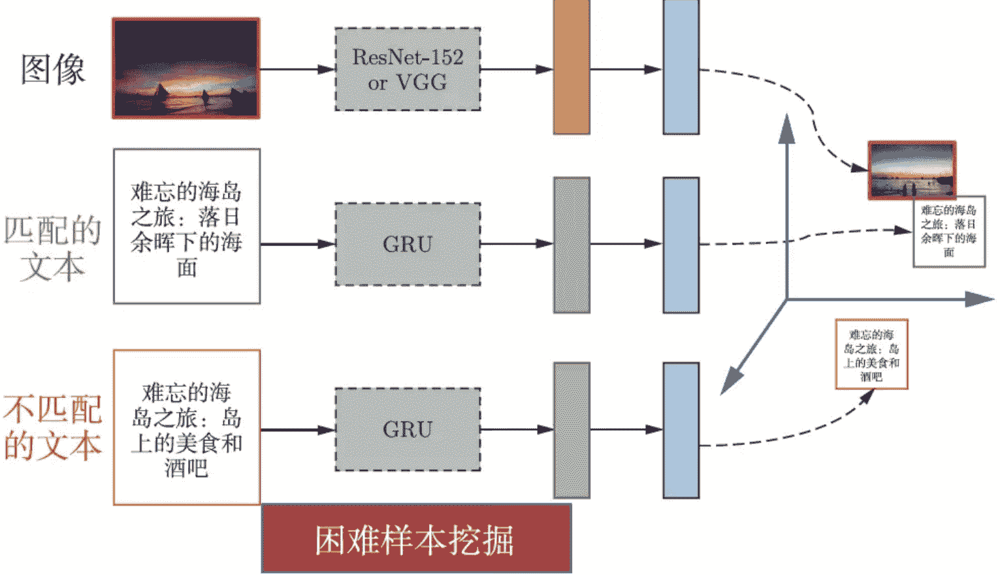

图 5.14 VSE++ 的模型结构示意图

##### 1. 图像表示提取器

图像特征提取这里选用在 ImageNet 上完成预训练的 ResNet-152 与 VGG19，两者都要把尾部的全连接分类层替换掉，让网络输出与目标表示空间维度一致的向量。输出的图像向量全部做了长度归一化处理。

```python
class ImageRepExtractor(nn.Module):
    def __init__(self, embed_size, pretrained_model='resnet152', finetuned=True):
        """
        参数：
            embed_size: 对应表示维度
            pretrained_model: 图像表示提取器，ResNet-152 或 VGG19
            finetuned: 是否微调图像表示提取器的参数
        """
        super(ImageRepExtractor, self).__init__()
        if pretrained_model == 'resnet152':
            net = torchvision.models.resnet152(weights=ResNet152_Weights.DEFAULT)
            for param in net.parameters():
                param.requires_grad = finetuned
            # 更改最后一层（fc 层）
            net.fc = nn.Linear(net.fc.in_features, embed_size)
            nn.init.xavier_uniform_(net.fc.weight)
        elif pretrained_model == 'vgg19':
            net = torchvision.models.vgg19(weights=VGG19_Weights.DEFAULT)
            for param in net.parameters():
                param.requires_grad = finetuned
            # 更改最后一层（fc 层）
            net.classifier[6] = nn.Linear(net.classifier[6].in_features, embed_size)
            nn.init.xavier_uniform_(net.classifier[6].weight)
        else:
            raise ValueError("Unknown image model " + pretrained_model)
        self.net = net

    def forward(self, x):
        out = self.net(x)
        out = nn.functional.normalize(out)
        return out
```

##### 2. 文本编码器
文本侧采用 GRU 结构，输入是词嵌入形式，代表整段文本的向量取自最后一个词对应的隐藏状态。文本向量的维度与图像侧保持一致，并且同样做了长度归一化。

文本长度不统一时，短句会被 0 填充，词表序号里 0 用于占位。若这些填充值也参与循环计算会浪费算力。RNN 是按时间步逐层推进的，每一步实际只用到小批量里该步的有效数据，于是可以把每个时间步的非零元素合并成一个子批输入。PyTorch 提供的 `pack_padded_sequence` 正好完成这一压缩，在送入 RNN 前先对小批量做打包，把无效填充剔除掉。

以图 5.15 为例，一个批大小为 4、最大长度为 5 的样本经过打包后，会按时间步重排。输出的 `data` 只保留所有非零 token，`batch_sizes` 记录每个时间步实际参与的样本数。调用该函数前必须先按长度降序对输入序列排序。

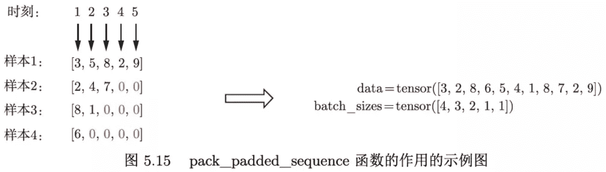

```python
class TextRepExtractor(nn.Module):
    def __init__(self, vocab_size, word_dim, embed_size, num_layers):
        """
        参数：
            vocab_size: 词典大小
            word_dim: 词嵌入维度
            embed_size: 对应表示维度，也是 RNN 隐藏层维度
            num_layers: RNN 隐藏层数
        """
        super(TextRepExtractor, self).__init__()
        self.embed_size = embed_size
        self.embed = nn.Embedding(vocab_size, word_dim)
        self.rnn = nn.GRU(word_dim, embed_size, num_layers, batch_first=True)
        # RNN 默认已初始化，这里只需要初始化词嵌入矩阵
        self.embed.weight.data.uniform_(-0.1, 0.1)

    def forward(self, x, lengths):
        x = self.embed(x)
        # 压缩掉填充值
        packed = pack_padded_sequence(x, lengths, batch_first=True)
        # 执行 GRU 的前馈过程会返回两个变量，第二个变量 hidden 为最后一个词（由 length 决定）对应的所有隐藏层输出
        _, hidden = self.rnn(packed)
        # 最后一个词的最后一个隐藏层输出为 hidden[-1]
        out = nn.functional.normalize(hidden[-1])
        return out
```

##### 3. VSE++ 组装
有了图像编码器和文本编码器，搭建 VSE++ 就很直接，只需对配对的图文数据分别编码得到表示。

实际操作中先按文本长度对数据排序以便打包，训练结束后做检索评估时又要把顺序还原回原始排列，保证图像和文本一一对应。

```python
class VSEPP(nn.Module):
    def __init__(self, vocab_size, word_dim, embed_size,
                 num_layers, image_model, finetuned=True):
        """
        参数：
            vocab_size: 词表大小
            word_dim: 词嵌入维度
            embed_size: 对应表示维度，也是 RNN 隐藏层维度
            num_layers: RNN 隐藏层数
            image_model: 图像表示提取器，ResNet-152 或 VGG19
            finetuned: 是否微调图像表示提取器的参数
        """
        super(VSEPP, self).__init__()
        self.image_extractor = ImageRepExtractor(embed_size, image_model, finetuned)
        self.text_extractor = TextRepExtractor(vocab_size, word_dim,
                                               embed_size, num_layers)

    def forward(self, images, captions, cap_lens):
        # 按照 caption 的长短排序，并对照调整 image 的顺序
        sorted_cap_lens, sorted_cap_indices = torch.sort(cap_lens, 0, True)
        images = images[sorted_cap_indices]
        captions = captions[sorted_cap_indices]
        cap_lens = sorted_cap_lens

        image_code = self.image_extractor(images)
        text_code = self.text_extractor(captions, cap_lens)
        if not self.training:
            # 恢复数据原始的输入顺序
            _, recover_indices = torch.sort(sorted_cap_indices)
            image_code = image_code[recover_indices]
            text_code = text_code[recover_indices]
        return image_code, text_code
```

#### 5.3.5 损失函数
VSE++ 采用带困难样本挖掘的 triplet 损失。困难样本挖掘分为离线和在线两种：离线是在训练开始或每个 epoch 结束后统一挖掘，在线则在每个小批量内部实时挖掘。本实现选用在线挖掘，代码参考了作者开源实现。

```python
class TripletNetLoss(nn.Module):
    def __init__(self, margin=0.2, hard_negative=False):
        super(TripletNetLoss, self).__init__()
        self.margin = margin
        self.hard_negative = hard_negative

    def forward(self, ie, te):
        """
        参数:
            ie: 图像表示
            te: 文本表示
        """
        scores = ie.mm(te.t())

        diagonal = scores.diag().view(ie.size(0), 1)
        d1 = diagonal.expand_as(scores)
        d2 = diagonal.t().expand_as(scores)

        # 图像为锚
        cost_i = (self.margin + scores - d1).clamp(min=0)
        # 文本为锚
        cost_t = (self.margin + scores - d2).clamp(min=0)

        # 损失矩阵对角线上的值不参与计算
        mask = torch.eye(scores.size(0), dtype=torch.bool)
        I = torch.autograd.Variable(mask)
        if torch.cuda.is_available():
            I = I.cuda()
        cost_i = cost_i.masked_fill_(I, 0)
        cost_t = cost_t.masked_fill_(I, 0)

        # 寻找困难样本
        if self.hard_negative:
            cost_i = cost_i.max(1)[0]
            cost_t = cost_t.max(0)[0]

        return cost_i.sum() + cost_t.sum()
```

<sup>1</sup> https://github.com/fartashf/vsepp

#### 5.3.6 优化策略
参数更新使用 Adam 优化器，学习率采用分段衰减。

```python
def get_optimizer(model, config):
    params = filter(lambda p: p.requires_grad, model.parameters())
    return torch.optim.Adam(params=params, lr=config.learning_rate)

def adjust_learning_rate(optimizer, epoch, config):
    """ 每隔 lr_update 个轮次，学习速率减小至当前二分之一"""
    lr = config.learning_rate * (0.5 ** (epoch // config.lr_update))
    lr = max(lr, config.min_learning_rate)
    for param_group in optimizer.param_groups:
        param_group['lr'] = lr
```

#### 5.3.7 评估标准
跨模态检索常用 Recall@K 作为指标，定义为正确答案落在前 K 名的查询占比。以图搜文为例，对一张查询图在文本库里找 K 个最近邻，只要前 K 中出现至少一个匹配文本，该次查询记 1，否则记 0，最后对测试集求平均。需要区分的是，推荐系统里的 Recall@K 计算的是 K 个推荐里相关项占全部相关项的比例，两者定义不同。

具体做法是先用 VSE++ 得到全部图像和文本编码，再用点积计算两两相似度，因为相邻图片可能重复，取固定间隔采样即可。随后按分数排序得出 Recall@K。图像查询时一张图对应多条文本，需取这些文本中排名最靠前的那个位置。

```python
def evaluate(data_loader, model, batch_size, captions_per_image):
    # 模型切换进入评估模式
    model.eval()
    image_codes = None
    text_codes = None
    device = next(model.parameters()).device
    N = len(data_loader.dataset)
    for i, (imgs, caps, caplens) in enumerate(data_loader):
```

#### 5.3.8 训练细节
整体训练拆成读取数据、前馈计算、计算损失、更新参数、选择模型五个环节。

训练共进行 45 个轮次，初始学习率为 0.00002，每隔 15 轮把学习率缩为原来的一半。

```python
# 设置模型超参数和辅助变量
config = Namespace(
    captions_per_image = 5,
    batch_size = 32,
    word_dim = 300,
    embed_size = 1024,
    num_layers = 1,
    image_model = 'resnet152', # 或 VGG19
    finetuned = True,
    learning_rate = 0.00002,
    lr_update = 15,
    min_learning_rate = 0.000002,
    margin = 0.2,
    hard_negative = True,
    num_epochs = 45,
    grad_clip = 2,
    evaluate_step = 60, # 每隔多少步在验证集上测试一次
    checkpoint = None, # 如果不为 None，则利用该变量路径的模型继续训练
    best_checkpoint = '../model/vsepp/best_flickr8k.ckpt',
                        # 验证集上表现最优的模型的路径
    last_checkpoint = '../model/vsepp/last_flickr8k.ckpt' # 训练完成时的模型的路径
)
```

```python
# 设置 GPU 信息
os.environ['CUDA_VISIBLE_DEVICES'] = '0'
device = torch.device("cuda" if torch.cuda.is_available() else "cpu")
```

```python
# 数据
data_dir = '../data/flickr8k/'
vocab_path = '../data/flickr8k/vocab.json'
train_loader, valid_loader, test_loader = mktrainval(data_dir,
                                                    vocab_path,
                                                    config.batch_size)
```

```python
# 模型
with open(vocab_path, 'r') as f:
    vocab = json.load(f)
```

```python
# 随机初始化或载入已训练的模型
start_epoch = 0
checkpoint = config.checkpoint
if checkpoint is None:
    model = VSEPP(len(vocab),
                  config.word_dim,
                  config.embed_size,
                  config.num_layers,
                  config.image_model,
                  config.finetuned)
else:
    checkpoint = torch.load(checkpoint)
    start_epoch = checkpoint['epoch'] + 1
    model = checkpoint['model']
```

```python
# 优化器
optimizer = get_optimizer(model, config)

# 将模型复制至 GPU，并开启训练模式
model.to(device)
model.train()

# 损失函数
loss_fn = TripletNetLoss(config.margin, config.hard_negative)

best_res = 0
print("开始训练")
for epoch in range(start_epoch, config.num_epochs):
    adjust_learning_rate(optimizer, epoch, config)

    for i, (imgs, caps, caplens) in enumerate(train_loader):
        optimizer.zero_grad()
        # 1. 读取数据至 GPU
        imgs = imgs.to(device)
        caps = caps.to(device)

        # 2. 前馈计算
        image_code, text_code = model(imgs, caps, caplens)
        # 3. 计算损失
        loss = loss_fn(image_code, text_code)
        loss.backward()

        # 梯度截断
        if config.grad_clip > 0:
            nn.utils.clip_grad_norm_(model.parameters(), config.grad_clip)

        # 4. 更新参数
        optimizer.step()

        state = {
            'epoch': epoch,
            'step': i,
            'model': model,
            'optimizer': optimizer
        }

        if (i+1) % config.evaluate_step == 0:
            r1_i2t, r1_t2i, r5_i2t, r5_t2i, r10_i2t, r10_t2i = \
                evaluate(valid_loader, model,
                        config.batch_size, config.captions_per_image)
            recall_sum = r1_i2t + r1_t2i + r5_i2t + r5_t2i + r10_i2t + r10_t2i
            # 5. 选择模型
            if best_res < recall_sum:
                best_res = recall_sum
                torch.save(state, config.best_checkpoint)
            torch.save(state, config.last_checkpoint)
            print('epoch: %d, step: %d, loss: %.2f, \n          I2T R@1: %.2f, T2I R@1: %.2f,  \n          I2T R@5: %.2f, T2I R@5: %.2f, \n          I2T R@10: %.2f, T2I R@10: %.2f,' %
                  (epoch, i+1, loss.item(),
                   r1_i2t, r1_t2i, r5_i2t, r5_t2i, r10_i2t, r10_t2i))

checkpoint = torch.load(config.best_checkpoint)
model = checkpoint['model']
r1_i2t, r1_t2i, r5_i2t, r5_t2i, r10_i2t, r10_t2i = \
    evaluate(test_loader, model, config.batch_size, config.captions_per_image)
print("Evaluate on the test set with the model \n      that has the best performance on the validation set")
print('Epoch: %d, \n      I2T R@1: %.2f, T2I R@1: %.2f, \n      I2T R@5: %.2f, T2I R@5: %.2f, \n      I2T R@10: %.2f, T2I R@10: %.2f' %
      (checkpoint['epoch'], r1_i2t, r1_t2i, r5_i2t, r5_t2i, r10_i2t, r10_t2i))
```

执行完上述代码的训练流程后，程序末尾会打印出在验证集上表现最优的模型在测试集上的评估结果，示例如下。

```
Epoch: 41, I2T R@1: 22.20, T2I R@1: 17.30, I2T R@5: 47.70, T2I R@5: 40.78,
I2T R@10: 60.10, T2I R@10: 53.10
```

### 5.4 本章要点回顾

本章围绕多模态整体表征学习展开，概括了两大基本思路及相应代表性模型。先是共享表征学习，典型做法分为基于自编码器的非概率模型和基于 RBM 的概率模型，二者都具备无监督预训练的特性。实际应用中，通常先在海量图文对齐语料上训练得到共享空间，再在少量有监督数据上训练下游任务专用模型，这类工作为通用多模态共享表征提供了早期探索。随后介绍基于不同损失设计的对应表征学习，包含重构损失驱动的方法、排序损失驱动的方法和对抗损失驱动的方法，三类方法均针对跨模态检索提出，可学习通用的整体对齐表征。最后给出一个完整的实战案例，演示如何用对应表征方法完成跨模态检索，帮助读者理解模型细节。

### 5.5 练习题

- 1. 假设有一个由 $M(M>1000000)$ 对图文配对构成的数据集，以及 $N(N>1000)$ 条带有类别标签的文本，设计一个基于多模态深度自编码器或多模态深度生成模型的文本分类方案。
- 2. 设一个输入层和隐层各含 2 个神经元的受限玻尔兹曼机，权重 $w_{11}=2, w_{22}=1, w_{12}=w_{21}=-1$，偏置 $b_1=b_2=0, c_1=c_2=0$，计算 $p(v_1=1, v_2=1, h_1=1, h_2=1)$ 与 $p(v_1=0, v_2=1)$ 的值。
- 3. 描述多模态深度信念网络的训练流程，并说明如何利用该模型实现跨模态生成。
- 4. 对比 5.2 节中基于三种不同损失的对应表征学习方法所学得的表征空间在特性上的差异。
- 5. 将 5.3 节 VSE++ 模型中的排序损失替换为对抗损失，对比替换前后在跨模态检索上的表现，并借助 t-SNE 可视化两种损失下学习到的对应表征空间。
- 6. 在 5.3 节 VSE++ 的排序损失上叠加对抗损失，利用 t-SNE 分析融合两种损失时的跨模态检索效果与表征分布。

## 第 6 章 多模态细粒度对齐

多模态对齐的核心是建立不同模态间的信息关联。按图文的表征粒度可划分为四种情形：图像整体与文本整体的对齐、图像局部与文本局部的对齐、图像局部与文本整体的对齐、图像整体与文本局部的对齐。5.2 节所述的对应表征学习属于典型的图文整体对齐范式，即图像和文本都被压缩为单一向量，关联建立在整体层面，因而易丢失局部细节，不利于精细对齐。

为挖掘更细粒度的关联，自 2016 年起研究者开始引入注意力机制来关联图像局部与文本整体。具体做法是以文本整体表征作为查询、以图像局部序列作为键值，将原本用于单模态建模的自注意力扩展为可建模跨模态的交叉注意力。此时文本的输出即为图像所有局部表征的加权组合，从而建立了文本整体到图像局部的映射。视觉问答中需要剔除与问题无关的图像区域并聚焦有效区域，交叉注意力因此率先在此任务中得到广泛应用 [66,132-133]。

随后工作进一步挖掘图像局部与文本局部的双向关联，即为每个图像局部寻找文本所有局部，或为每个文本局部寻找图像所有局部的对应关系。相关研究包括面向视觉问答的层次化问题-图像共注意力模型 [134] 和面向图文检索的 SCAN 模型 [67]。

理论上，先用自注意力分别建模图像和文本，再用交叉注意力完成对齐，可穷尽两模态间的细粒度关系。但随着待对齐局部数量的增长，自注意力的时空开销会急剧上升。于是借助图神经网络，研究者提出图结构表征方法。先将图像和文本分别映射为图结构，该形式显式保留了丰富的细粒度信息，再在图上挖掘对齐关系。引入图像中实体间的语义与空间关系、文本的句法结构等先验，提升了建模透明度和可解释性，同时避免了冗余关联，降低了复杂度。代表性工作有面向图文检索的 VSRN 模型 [135]、GSMN 模型 [136] 和 CGMN 模型 [137]。

本章将介绍两类细粒度对齐范式：基于注意力的方法与基于图神经网络的方法。

### 6.1 注意力驱动的对齐

#### 6.1.1 交叉注意力机制

3.3 节已说明自注意力可把一段向量序列映射为另一段向量序列，其计算包含四步：生成查询 Q、键 K、值 V、计算相关性分数、归一化、加权求和。

在交叉注意力里，Q、K、V 来源于不同模态，Q 来自一模态，K、V 来自另一模态，也称跨模态引导注意力。计算图像输出时 Q 来自图像，K、V 来自文本，称为图像引导；计算文本输出时 Q 来自文本，K、V 来自图像，称为文本引导。

##### 1. 总体架构

假设图像和文本均以序列形式表征。图像为 $n$ 个 $D_I$ 维向量 $\{\boldsymbol{x}_1^I,\boldsymbol{x}_2^I,\cdots,\boldsymbol{x}_n^I\}$，矩阵形式 $\boldsymbol{X}^I\in\mathbb{R}^{n\times D_I}$；文本为 $m$ 个 $D_T$ 维向量 $\{\boldsymbol{x}_1^T,\boldsymbol{x}_2^T,\cdots,\boldsymbol{x}_m^T\}$，矩阵形式 $\boldsymbol{X}^T\in\mathbb{R}^{m\times D_T}$。交叉注意力的输出序列分别为图像 $\{\boldsymbol{y}_1^I,\cdots,\boldsymbol{y}_n^I\}$ 和文本 $\{\boldsymbol{y}_1^T,\cdots,\boldsymbol{y}_m^T\}$。

图 6.1 展示了整体结构。输入输出均包含双模态，图像输出的每个向量与当前图像输入向量及全部文本输入向量相关，文本输出的每个向量与当前文本输入向量及全部图像输入向量相关。下面给出具体计算流程。

##### 2. 计算步骤

图像输出序列第 $i$ 个向量的推导如图 6.2 所示，具体如下。

（1）获取图像模态的查询 $Q^I$、文本模态的键 $K^T$ 与值 $V^T$。形式上，图像序列第 $i$ 个向量对应的查询 $q_i^I$、文本序列第 $j$ 个向量对应的键 $k_j^T$ 与值 $v_j^T$ 定义为

$$q_i^I = W_Q^I x_i^I$$

$$k_j^T = W_K^T x_j^T$$

$$v_j^T = W_V^T x_j^T \tag{6.1.1}$$

（2）对图像序列每个向量，计算其查询与文本序列全部键之间的相似度，作为该图像向量与所有文本向量间的相关性：

$$\alpha_{ij} = a(q_i^I, k_j^T) \tag{6.1.2}$$

（3）对注意力得分进行归一化：

$$\alpha'_{ij} = \frac{\exp(\alpha_{ij})}{\sum_k \exp(\alpha_{ik})} \tag{6.1.3}$$

（4）以归一化后的得分为权重，对文本序列全部值 $V^T$ 加权求和得到输出特征：

$$y_i^I = \sum_j \alpha'_{ij} v_j^T \tag{6.1.4}$$

权重越大表示局部关联越紧密。由此可得到完整的图像输出序列。文本输出序列的计算与图像对称，仅交换 Q 与 K、V 的来源即可，不再赘述。总体记作：

$$Y^I, Y^T = CA(X^I, X^T) \tag{6.1.5}$$

#### 6.1.2 基于交叉注意力的对齐与相关度计算

交叉注意力可显式得到图文对齐关系，进而计算匹配程度。下面按模态表征形式区分解释与计算方式。

**当图像和文本均采用局部表征时**，交叉注意力可获得局部间的对齐。具体而言，图像输出的每个向量由文本全部局部加权合成，隐含了图像每个局部与文本全部局部的对齐；同理，文本输出的每个向量由图像全部局部加权合成，隐含了文本局部与图像全部局部的对齐。

图文整体匹配得分的计算依赖于跨模态对齐后的局部表征。常用做法是计算对齐前后表征的余弦相似度。形式上，图像第 $i$ 个局部的跨模态关联得分 $s_i^I$ 为

$$s_i^I = \text{cosine}(\boldsymbol{x}_i^I, \boldsymbol{y}_i^I) \tag{6.1.6}$$

同理，文本第 $i$ 个局部的跨模态关联得分 $s_i^T$ 为

$$s_i^T = \text{cosine}(\boldsymbol{x}_i^T, \boldsymbol{y}_i^T) \tag{6.1.7}$$

整体的相关性可以由各片段的跨模态打分通过某种累积方式得到。站在视觉侧，做法是把一张图里所有片段与语言得到的分数直接取极大值或求均值，用来代表整图与整句的相关度；换到语言侧，思路是对称的，把句子里各片段分数取极大或均值即可。除了极值与均值，还常用一种平滑的极大近似 LogSumExp，写法为 $\log(\sum_{i=1}^n \exp(s_i))$，这里的 $n$ 为参与聚合的分数个数。该式常被理解为对 max 的软化版本，解释如下。

$$\begin{aligned} \max\{s_1, s_2, \cdots, s_n\} &= \log(\exp(\max(s_i))) \\ &\leqslant \log(\exp(s_1) + \cdots + \exp(s_n)) \\ &\leqslant \log(n \cdot \exp(\max(s_i))) \\ &= \max\{s_1, s_2, \cdots, s_n\} + \log(n) \end{aligned} \tag{6.1.8}$$

可以看出 LogSumExp 的输出会落在 max 与 max+ln n 之间，随着 $n$ 越小，其与 max 的差距越小，近似效果越好。

如图 6.3 所示，当视觉采用片段表征而语言采用全局表征时，可用跨模注意建立视觉片段与语言全局的对应。此时语言被压缩为一个多维向量，看似不是序列，可把它当作长度为 1 的序列处理，从而算出语言对应的输出向量。该输出本质上是视觉所有片段表征的线性加权和，暗含了语言全局与视觉各片段的匹配信息。

此时相关度计算变得简洁，只需比较匹配前后语言全局向量的余弦值。设匹配前的语言向量为 $\boldsymbol{x}^T$，匹配后的为 $\boldsymbol{y}^T$，则得分为

$$s^T = \text{cosine}(\boldsymbol{x}^T, \boldsymbol{y}^T) \tag{6.1.9}$$

与上文类似，当视觉采用全局表征而语言采用片段表征时，如图 6.4 所示，可利用跨模注意让视觉全局与语言片段匹配。这时视觉也是单一向量，同样视作长度为 1 的序列，通过跨模注意得到视觉对应的输出向量。该输出由语言所有片段表征的线性加权和构成，暗含了视觉全局与语言各片段的对应关系。

此时相关度由匹配前后视觉全局表征的余弦值给出。设匹配前后的视觉表征分别为 $x^I$ 和 $y^I$，则得分为

$$s^I = \text{cosine}(x^I, y^I) \tag{6.1.10}$$

### 6.2 基于图网络的跨模对齐

基于图网络的视语匹配流程如图 6.5 所示，包含视语特征获取、单模图文表征学习和跨模图匹配三部分。特征获取负责拿到视语的初始片段表征，图表征学习把图像和句子分别建模为图型结构并用图网络学习其表征，跨模图匹配则在点级和图级进行，分别对应片段匹配和全局匹配。

#### 6.2.1 图网络基础原理

图是一种常用结构，可记作 $\mathcal{G} = \{\mathcal{V}, \mathcal{E}\}$，其中 $\mathcal{V}$ 含 $N$ 个点，$\mathcal{E}$ 为边集。通常用相邻矩阵 $\boldsymbol{A} \in \{0, 1\}^{N \times N}$ 描述连接关系，若点 $i$ 与 $j$ 相连则 $A_{ij}=1$，否则为 0。

图 6.6 给出了一个 5 点 6 条边的例子，点集 $\mathcal{V} = \{v_1, v_2, v_3, v_4, v_5\}$，边集 $\mathcal{E} = \{e_1, e_2, e_3, e_4, e_5, e_6\}$。对应的相邻矩阵为

$$A = \begin{pmatrix} 0 & 0 & 1 & 0 & 1 \\ 0 & 0 & 1 & 1 & 0 \\ 1 & 1 & 0 & 1 & 0 \\ 0 & 1 & 1 & 0 & 1 \\ 1 & 0 & 0 & 1 & 0 \end{pmatrix} \tag{6.2.1}$$

与每个顶点相连边数构成的度数矩阵为

$$D = \begin{pmatrix} 2 & 0 & 0 & 0 & 0 \\ 0 & 2 & 0 & 0 & 0 \\ 0 & 0 & 2 & 0 & 0 \\ 0 & 0 & 0 & 3 & 0 \\ 0 & 0 & 0 & 0 & 2 \end{pmatrix} \tag{6.2.2}$$

图网络就是把深度网络用到图型数据上。网络中每个点对应一个 $d^0$ 维向量，整体点矩阵记作 $H^0 \in \mathbb{R}^{N \times d^0}$。核心思想是通过聚合邻居信息来更新点表征，这与卷积神经网络有相似之处，但图型结构不规则、没有固定窗口的邻域，所以需要专门的聚合设计。一次聚合以上一层表征 $H^l$ 和相邻矩阵 $A$ 为输入，输出新表征 $H^{l+1} \in \mathbb{R}^{N \times d^{l+1}}$，即

$$H^{l+1} = f(H^l, A) \tag{6.2.3}$$

图 6.7 展示了第 $l$ 层到第 $l+1$ 层的转换。可以看到结构不变，只有点表征在变化。若只看点表征更新，输入输出都是若干向量的序列，和自注意力形式类似。

最基础的聚合做法是先取邻居表征的均值，再用全连接层融合邻居均值与自身表征，最后做非线性激活。问题在于度小的点容易被度大的邻居主导。为此出现了多种改进的聚合方式，按利用图信息的角度可分为谱域方法和空间域方法。前者基于图谱理论设计聚合，后者直接利用空间结构。接下来介绍两个空间视角的典型模型：GCN[138] 和 GAT[139]。GCN 既可归为谱法也可看作空间法，GAT 属于空间法。

##### 1. 图卷积网络

给定第 $l$ 层表征 $H^l \in \mathbb{R}^{N \times d^l}$，GCN 的聚合更新为

$$H^{l+1} = \sigma(\tilde{D}^{-\frac{1}{2}} \tilde{A} \tilde{D}^{-\frac{1}{2}} H^l W^l) \quad (6.2.4)$$

其中 $\tilde{A}=A+I$，$I$ 为单位矩阵，$\tilde{D}$ 是 $\tilde{A}$ 的度数矩阵，$\tilde{D}_{ii}=\sum_j \tilde{A}_{ij}$，$W^l \in \mathbb{R}^{d^l \times d^{l+1}}$ 为可学习权重，$\sigma$ 为激活函数。

单独看点 $i$ 的更新为

$$H_i^{l+1} = \sigma \left( \sum_j \frac{1}{\sqrt{\tilde{D}_{ii} \tilde{D}_{jj}}} \tilde{A}_{ij} H_j^l W^l \right) \tag{6.2.5}$$

可见 GCN 在聚合时考虑了邻居的度，能缓解基础聚合中度小点受度大邻居过度影响的问题。图 6.8 展示了图 6.6 中点 1 和点 5 的聚合计算过程。

实际使用时常采用多组权重 $W$，并将结果拼接。设使用 $K$ 组权重，则有

$$H_i^{l+1} = \|_{k=1}^K \sigma \left( \sum_j \frac{1}{\sqrt{\tilde{D}_{ii} \tilde{D}_{jj}}} \tilde{A}_{ij} H_j^l W_k^l \right) \tag{6.2.6}$$

##### 2. 图注意网络

在 GAT 中，单个点的自身表征作为查询，邻居表征作为键和值，注意力操作的结果即为该点的聚合表征。图 6.9 给出图 6.6 中点 3 的计算过程。点 3 只与 1、2、4 相连，与 5 无关，所以聚合不依赖点 5。点 $i$ 的计算分四步。

（1）生成查询与键值：

$$q_i = H_i^l W^l$$

$$k_j = H_j^l W^l$$

$$v_j = k_j \tag{6.2.7}$$

这里采用共享参数的线性映射，键和值是同一向量。

（2）计算相关性，每对点的相关分数 $\alpha_{ij}$ 为

$$\alpha_{ij} = a(\boldsymbol{q}_i, \boldsymbol{k}_j) \tag{6.2.8}$$

采用与加性注意力类似的方式，先拼接查询与键，再经 LeakyReLU 的全连接网络变换得到分数。

（3）归一化注意力得分：

$$\alpha'_{ij} = \frac{\exp(\alpha_{ij})}{\sum_k \exp(\alpha_{ik})} \tag{6.2.9}$$

（4）加权求和得到聚合表征：

$$\boldsymbol{H}_i^{l+1} = \sigma \left( \sum_j \alpha'_{ij} \boldsymbol{v}_j \right) \tag{6.2.10}$$

其中 $\sigma$ 为激活函数。为捕获不同方面的信息，GAT 使用多头注意力。设注意力头数为 $K$，最终更新为

$$\boldsymbol{H}_i^{l+1} = \|_{k=1}^K \sigma \left( \sum_j \alpha_{ij}^{'k} \boldsymbol{v}_j^k \right) \tag{6.2.11}$$

其中，$K$ 为注意力头的数量。

#### 6.2.2 单模表征提取

该部分包含视觉获取器和语言获取器。

视觉获取器常用目标检测模型，输出若干区域表征 $X^I = \{x_1^I, x_2^I, \cdots, x_n^I\} \in \mathbb{R}^{n \times D_I}$，$n$ 为区域数，$D_I$ 为维度。为对齐视觉与语言维度，通常用全连接层映射，得到视觉表征 $V = \{v_1, v_2, \cdots, v_n\}$。形式上

$$v_i = W_f x_i^I + b_f \quad (6.2.12)$$

其中 $W_f$ 与 $b_f$ 为全连接参数。

语言获取器常用双向 GRU，每个词的表征为前向和后向隐藏态的平均值。记语言表征为 $U = \{u_1, u_2, \cdots, u_m\} \in \mathbb{R}^{m \times D_T}$，$m$ 为词数，$D_T$ 为维度。

#### 6.2.3 单模图文表征学习

##### 1. 视觉图的构建

图像区域间的关系对理解至关重要。例如“人”和“足球”同时出现时，若二者靠近关系更可能是“踢”，核心语义为“人踢足球”；若距离很远，语义就会变化。视觉图正是显式建模区域间关系的一种方式，区域为点，点表征为区域特征，关系分为空间关系和语义关系，对应空间图和语义图。

空间图显式建模区域的相对位置。常用定义有相对极坐标和交并比 IoU。

设第 $*$ 个框的左上角为 $(l_*^x, l_*^y)$，右下角为 $(r_*^x, r_*^y)$，先算中心坐标 $(c_*^x, c_*^y)$ 与宽高 $(w_*^x, h_*^y)$：

$$c_*^x = \frac{l_*^x + r_*^x}{2}$$

$$c_*^y = \frac{l_*^y + r_*^y}{2}$$

$$w_{*}^{x} = r_{*}^{x} - l_{*}^{x}$$

$$h_{*}^{y} = r_{*}^{y} - l_{*}^{y}$$

(6.2.13)

则框 $i$ 与框 $j$ 中心间的距离 $\rho_{ij}$ 和夹角 $\theta_{ij}$ 为

$$\rho_{ij} = \sqrt{(c_{j}^{x} - c_{i}^{x})^2 + (c_{j}^{y} - c_{i}^{y})^2}$$

$$\theta_{ij} = \arctan \frac{c_{j}^{x} - c_{i}^{x}}{c_{j}^{y} - c_{i}^{y}}$$

(6.2.14)

在基于相对极坐标的空间图中，点 $i$ 与 $j$ 的关联定义为距离与夹角的拼接：

$$R_{ij} = \rho_{ij} \| \theta_{ij}$$

(6.2.15)

交并比反映两框的重叠程度，2.5.2 节已介绍其计算。不同工作采用不同构造方式，例如 CGMN 模型[137] 中，点 $i$ 与 $j$ 的空间关系还结合视觉表征距离，其关联为

$$R_{ij} = \begin{cases} \text{cosine}(\boldsymbol{v}_i, \boldsymbol{v}_j) \times \text{IoU}_{ij}, & \text{IoU}_{ij} \geqslant \xi \\ 0, & \text{IoU}_{ij} < \xi \end{cases}$$

(6.2.16)

其中 $\xi$ 为阈值，IoU 小于阈值时认为无关联。

语义图基于区域视觉特征本身挖掘潜在语义关联，无需额外先验，是一个含 $n(n-1)$ 条边的全连接图。点 $i$ 与 $j$ 的关联一般定义为

$$R_{ij} = (\boldsymbol{W}_q \boldsymbol{v}_i)(\boldsymbol{W}_k \boldsymbol{v}_j)^\top$$

(6.2.17)

其中 $\boldsymbol{W}_q$ 与 $\boldsymbol{W}_k$ 为线性变换权重。

##### 2. 语言图的构建

按是否引入先验，语言图可分为稠密图和稀疏图。稀疏图在稠密图基础上加入句子结构先验。

稠密图基于词向量建模词间潜在关联。每个词为点，点表征为词向量。点 $i$ 与 $j$ 的关联可定义为余弦值，也可归一化为

$$R_{ij} = \frac{\exp(\lambda \boldsymbol{u}_i^\top \boldsymbol{u}_j)}{\sum_{j=0}^m \exp(\lambda \boldsymbol{u}_i^\top \boldsymbol{u}_j)} \quad (6.2.18)$$

稀疏图显式引入句法结构。常用 Stanford CoreNLP 得到依存句法树，以词为点，以依存关系为边构建图并得到相邻矩阵。词间权重与稠密图保持一致。

##### 3. 图表征学习

构建完视觉侧的图结构和文本侧的图结构后，就能用 GCN、GAT 这类图神经网络分别对图像、文本做建模，得到图神经网络的向量表征。前面提到的两类图都自带描述节点是否连通的邻接矩阵 $\boldsymbol{A}$，以及量化连边强度的关联矩阵 $\boldsymbol{R}$。不过在先前 GCN、GAT 的公式推导里，$\boldsymbol{R}$ 并没有被带入。实际上把它融合进模型非常直接。

在 GCN 的聚合环节，可以直接把节点间连边的强度当作加权求和的系数使用。式(6.2.5)于是可改写为

$$\boldsymbol{H}_i^{l+1} = \sigma \left( \sum_j \frac{R_{ij}}{\sqrt{\tilde{D}_{ii} \tilde{D}_{jj}}} \tilde{A}_{ij} \boldsymbol{H}_j^l \boldsymbol{W}^l \right) \quad (6.2.19)$$

在 GAT 里，计算节点间相关度时，只需在式(6.2.8)定义的相关函数 $a$ 中额外以 $R_{ij}$ 作为参考依据。

#### 6.2.4 多模态图对齐

若并行使用多种视觉图或文本图，可把不同图类型学习到的节点 embedding 求平均来得到最终表征。此时图像与语言都是局部粒度的表征，就能借助交叉注意力完成跨模态对齐并算相关性。具体做法见 6.1.2 节，此处不再展开。这种对齐属于图结构内部的节点级对齐。

跨模态图对齐往往还会兼顾图整体的对齐，通常在节点表征上用循环网络或多层感知机来学习整个图的向量。RNN 方案把所有节点当成一个序列喂给循环网络得到整体编码；MLP 方案则先用多层感知机对每个节点向量做变换，再对变换后结果求和。得到图像-文本整体向量后，可用 5.2.2 节介绍的多模态 triplet 排序损失来衡量相似度。这种对齐是图级别的对齐。

### 6.3 实战案例：基于交叉注意力的跨模态检索

5.3 节已介绍基于统一表示的跨模态检索模型 VSE++，它关注的是图文整体向量的关联。本节要演示的是基于交叉注意力的检索模型 SCAN，它聚焦图文更细粒度的局部向量关联。下面沿用 5.3.2 节的训练流程来展开 SCAN 的实现细节。

#### 6.3.1 读取数据

与 VSE++ 选用同一基准 Flickr8k。5.3.3 节已说明数据集的获取与划分，这里不再重复。

-   1.  提取图像区域表征

数据准备好后，需用 bottom up attention 模型<sup>1</sup>来抽取区域特征。对每张图抽取 36 个边界框特征。环境配置完成后，把脚本 tools/generate_tsv.py 中的 MIN_BOXES 与 MAX_BOXES 同时设为 36，并在 load_image_ids 函数里补上 Flickr8k 的信息。

```
elif split_name == 'flickr8k':
    data_dir = '../data/flickr8k/'
    with open(os.path.join(data_dir, 'dataset_flickr8k.json'), 'r') as j:
        data = json.load(j)
    for img in data['images']:
        img_path = os.path.join(data_dir, 'images', img['filename'])
        split.append((img_path, img['imgid']))
```

随后执行下列命令抽取图像表征，请按机器配置修改 GPU 编号：

> 1 https://github.com/peteanderson80/bottom-up-attention

```
./tools/generate_tsv.py --gpu 0,1,2,3 \
    --cfg experiments/cfgs/faster_rcnn_end2end_resnet.yml \
    --def models/vg/ResNet-101/faster_rcnn_end2end_final/test.prototxt \
    --out resnet101_faster_rcnn_flickr8k.tsv \
    --net data/faster_rcnn_models/resnet101_faster_rcnn_final.caffemodel \
    --split flickr8k
```

紧接着调用脚本中的 merge_tsvs 函数把多张卡生成的特征文件合并，并拷贝到 config 指定的 data_dir 目录下。

最后对抽取到的特征进行解析，把每张图的 36 个框特征保存为单个 npy 文件，同时把文件路径写入数据 json。便于后续分析，框的位置信息也以 npy 格式保存。json 里只记录文件名前缀，补上 “.npy” 即为图像特征，补上 “.box.npy” 即为框坐标。具体代码如下。

```
import base64
import csv
import json
import numpy as np
import os
import sys

csv.field_size_limit(sys.maxsize)

def resort_image_feature(dataset='flickr8k'):
    karpathy_json_path = '../data/%s/dataset_flickr8k.json' % dataset
    image_feature_path = '../data/%s/bottom_up_feature.tsv' % dataset
    feature_folder = '../data/%s/image_box_features' % dataset
    if not os.path.exists(feature_folder):
        os.mkdir(feature_folder)

    with open(karpathy_json_path, 'r') as j:
        data = json.load(j)
    img_id2filename = {img['imgid']:img['filename'] for img in data['images']}

    imgid2feature = {}
    imgid2box = {}
    FIELDNAMES = ['image_id', 'image_h', 'image_w', 'num_boxes', 'boxes', 'features']
    with open(image_feature_path, 'r') as tsv_in_file:
        reader = csv.DictReader(tsv_in_file, delimiter='\t', fieldnames = FIELDNAMES)
        for item in reader:
            item['image_id'] = int(item['image_id'])
            item['image_h'] = int(item['image_h'])
            item['image_w'] = int(item['image_w'])
            item['num_boxes'] = int(item['num_boxes'])
            for field in ['boxes', 'features']:
                buf = base64.b64decode(item[field])
                temp = np.frombuffer(buf, dtype=np.float32)
                item[field] = temp.reshape((item['num_boxes'],-1))

            imgid2feature[item['image_id']] = item['features']
            imgid2box[item['image_id']] = item['boxes']

            feat_file = os.path.join(feature_folder, img_id2filename[item['image_id']]+'.npy')
            np.save(feat_file, item['features'])
            box_file = os.path.join(feature_folder, img_id2filename[item['image_id']]+'.box.npy')
            np.save(box_file, item['boxes'])

resort_image_feature()
```

生成好标准格式的数据集后，可随机抽取一条样本检查格式是否符合预期。

```
%matplotlib inline
import json
import numpy as np
from matplotlib import pyplot as plt
from PIL import Image

# 读取词典和验证集
with open('../data/flickr8k/vocab.json', 'r') as f:
    vocab = json.load(f)
vocab_idx2word = {idx:word for word,idx in vocab.items()}
with open('../data/flickr8k/val_data.json', 'r') as f:
    data = json.load(f)

# 展示第 20 张图片和 36 个区域，其对应的文本描述序号是 100～104
content_img = Image.open(data['IMAGES'][20])
for i in range(5):
    word_indices = data['CAPTIONS'][20*5+i]
    print(' '.join([vocab_idx2word[idx] for idx in word_indices]))

fig = plt.imshow(content_img)
feats = np.load(data['IMAGES'][20].replace('images','image_box_features')+'.box.npy')
for i in range(feats.shape[0]):
    bbox = feats[i,:]
    fig.axes.add_patch(plt.Rectangle(
        xy=(bbox[0], bbox[1]), width=bbox[2]-bbox[0], height=bbox[3]-bbox[1],
        fill=False, linewidth=1))
```

```
<start> a black dog is looking through the fence <end>
<start> a brown dog runs along a fence <end>
<start> a dark brown dog is running along a fence outside <end>
<start> a large black dog runs along a fence in the grass <end>
<start> the brown greyhound dog walks on green grass and looks through a fence <end>
```

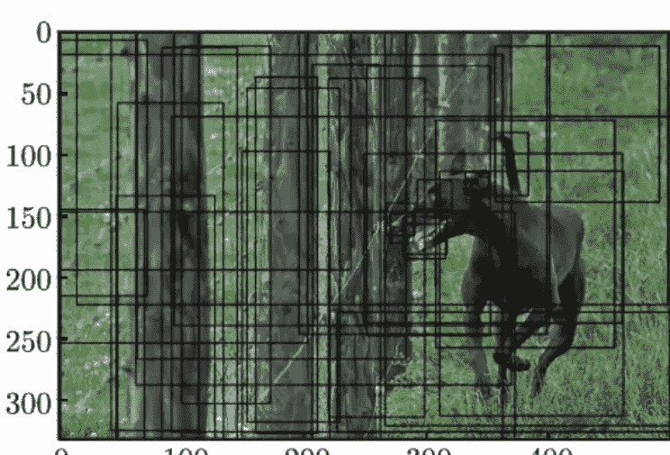

##### 2. 定义数据集类

在数据准备完毕后，按惯例需要封装一个 PyTorch 的 Dataset 类，配合 DataLoader 完成批式读取。具体是继承 torch.utils.data.Dataset 并实现 __getitem__ 与 __len__。

```
from argparse import Namespace
import numpy as np
import torch
import torch.nn as nn
from torch.nn.utils.rnn import pack_padded_sequence
from torch.utils.data import Dataset
import torchvision
import torchvision.transforms as transforms

class ImageBoxTextDataset(Dataset):
    """
    PyTorch 数据类，用于 PyTorch DataLoader 来按批次产生数据
    """

    def __init__(self, dataset_path, vocab_path, split,
                 captions_per_image=5, max_len=30):
        """
        参数:
            dataset_path: json 格式数据文件路径
            vocab_path: json 格式词典文件路径
            split: train、val、test
            captions_per_image: 每张图片对应的文本描述数
            max_len: 文本描述包含的最大单词数
        """
        self.split = split
        assert self.split in {'train', 'val', 'test'}
        self.cpi = captions_per_image
        self.max_len = max_len
        # 载入数据集
        with open(dataset_path, 'r') as f:
```

self.data = json.load(f)

# 载入词典

with open(vocab_path, 'r') as f:

    self.vocab = json.load(f)

# 数据量

self.dataset_size = len(self.data['CAPTIONS'])

def __getitem__(self, i):

    # 第 i 个文本描述对应第 (i // captions_per_image) 张图片

    feat_path = self.data['IMAGES'][i // self.cpi].replace('images','image_box_features')+'.npy'

    img = torch.Tensor(np.load(feat_path))

    caplen = len(self.data['CAPTIONS'][i])

    pad_caps = [self.vocab['<pad>']] * (self.max_len + 2 - caplen)

    caption = torch.LongTensor(self.data['CAPTIONS'][i]+ pad_caps)

    return img, caption, caplen

def __len__(self):

    return self.dataset_size

##### 3. 批量读取数据

借助上面封装的数据集类，通过 DataLoader 构建训练、验证、测试的批数据对象。图像表征已离线提取，无需在线增强。

def mktrainval(data_dir, vocab_path, batch_size, workers=4):

    train_set = ImageBoxTextDataset(os.path.join(data_dir, 'train_data.json'),

                                    vocab_path, 'train')

    valid_set = ImageBoxTextDataset(os.path.join(data_dir, 'val_data.json'),

                                    vocab_path, 'val')

    test_set = ImageBoxTextDataset(os.path.join(data_dir, 'test_data.json'),

                                   vocab_path, 'test')

    train_loader = torch.utils.data.DataLoader(

        train_set, batch_size=batch_size, shuffle=True,

        num_workers=workers, pin_memory=True)

    valid_loader = torch.utils.data.DataLoader(

        valid_set, batch_size=batch_size, shuffle=False,

num_workers=workers, pin_memory=True, drop_last=False)

    # 因为测试集不需要打乱数据顺序，故将 shuffle 设置为 False

    test_loader = torch.utils.data.DataLoader(

        test_set, batch_size=batch_size, shuffle=False,

        num_workers=workers, pin_memory=True, drop_last=False)

    return train_loader, valid_loader, test_loader

#### 6.3.2 定义模型
训练与验证阶段打开随机洗牌，评测阶段保持样本原始顺序，三类加载器均使用多进程并行读取、锁定页内存并舍弃尾部不完整批，最后返回训练、验证、测试三套迭代器。

##### 1. 图像表示提取器
视觉分支仅在区域特征上叠加一层线性映射，将 2048 维投射到统一的嵌入空间。输入形状为每张图 36 个区域，PyTorch 的 Linear 默认作用于末尾维度，无需额外改形。映射后对每个向量做 L2 单位化，归一化维度固定为最后一位。

class ImageRepExtractor(nn.Module):

    def __init__(self, img_feat_dim, embed_size):

        super(ImageRepExtractor, self).__init__()

        self.fc = nn.Linear(img_feat_dim, embed_size)

    def forward(self, x):

        out = self.fc(x)

        out = nn.functional.normalize(out, dim=-1)

        return out

##### 2. 文本表示提取器
语言分支使用双向 GRU。词表先通过嵌入得到向量，再用打包序列剔除填充后送入循环，编码完解包恢复形状。每个词的表征取正向与反向末态的平均，随后进行单位长度归一化。嵌入权重初始化采用 -0.1 到 0.1 的均匀分布。

class TextRepExtractor(nn.Module):

    def __init__(self, vocab_size, word_dim, embed_size, num_layers):

        super(TextRepExtractor, self).__init__()

        self.embed_size = embed_size

        self.embed = nn.Embedding(vocab_size, word_dim)

        self.rnn = nn.GRU(word_dim, embed_size, num_layers,

                          batch_first=True, bidirectional=True)

        self.init_weights()

    def init_weights(self):

        self.embed.weight.data.uniform_(-0.1, 0.1)

    def forward(self, x, lengths):

        x = self.embed(x)

        packed = pack_padded_sequence(x, lengths, batch_first=True) # 压缩掉填充值

        out, _ = self.rnn(packed)

        padded = pad_packed_sequence(out, batch_first=True) # 填充回来

        # 双向 RNN，隐藏层的最后一个维度的大小为 2*embed_size，每个词的表示为（正向 + 后

        # 向）/ 2

        # 注意：句子长度会缩小到 x 中最长句子的长度

        cap_emb, _ = padded

        cap_emb = (cap_emb[:,:,:cap_emb.size(2)//2] + cap_emb[:,:,cap_emb.size(2)//2:])/2

        out = nn.functional.normalize(cap_emb, dim=-1)

        return out

##### 3. SCAN 模型
完整模型由图像编码器与文本编码器组成。为提升打包效率，前向时依据描述长度降序重排输入，并同步调整图像顺序。进入推理模式后，利用排序索引将编码结果还原到原始输入顺序，保证图文对齐。

class SCAN(nn.Module):

    def __init__(self, vocab_size, word_dim, embed_size, num_layers, img_feat_dim):

        super(SCAN, self).__init__()

        self.image_encoder = ImageRepExtractor(img_feat_dim, embed_size)

        self.text_encoder = TextRepExtractor(vocab_size, word_dim,

                                            embed_size, num_layers)

    def forward(self, images, captions, cap_lens):

        # 按照 caption 的长短排序，并对照调整 image 的顺序

        sorted_cap_lens, sorted_cap_indices = torch.sort(cap_lens, 0, True)

        images = images[sorted_cap_indices]

        captions = captions[sorted_cap_indices]

        cap_lens = sorted_cap_lens

        image_code = self.image_encoder(images)

        text_code = self.text_encoder(captions, cap_lens)

        if not self.training:

            # 恢复数据原始的输入顺序

            _, recover_indices = torch.sort(sorted_cap_indices)

            image_code = image_code[recover_indices]

            text_code = text_code[recover_indices]

        return image_code, text_code

#### 6.3.3 定义损失函数
SCAN 继承 VSE++ 的在线困难负例挖掘三元组损失，差异仅在图文相关性由跨模态注意力计算。

##### 1. 注意力函数
通用注意力接收查询 Q 与键值 K V，完成打分、归一化、加权求和三步。跨模态情形下查询来自一侧，键值来自另一侧。打分函数支持 plain、softmax、l2norm、clipped、clipped_l2norm，最终以带平滑系数的 Softmax 完成归一化。

def func_attention(query, key_value, smooth, func_attn_score='plain'):

    """

    Q K V: Q 和 K 算出相关性得分，作为 V 的权重，K=V

    参数：

        query: 查询 (batch_size, n_query, d)

        key_value: 键和值，(batch_size, n_kv, d)

    """

    batch_size, n_query = query.size(0), query.size(1)

    n_kv = key_value.size(1)

    # 计算 query 和 key 的相关性，实现 a 函数

    # query^T: (batch_size, d, n_query)

    queryT = torch.transpose(query, 1, 2)

    # (batch_size, n_kv, d)(batch_size, d, n_query)

    # => attn: (batch_size, n_kv, n_query)

    attn = torch.bmm(key_value, queryT)

    if func_attn_score == "plain":

        pass

    elif func_attn_score == "softmax":

        attn = nn.Softmax(dim=2)(attn)

    elif func_attn_score == "l2norm":

        attn = nn.functional.normalize(attn, dim=2)

    elif func_attn_score == "clipped":

        attn = nn.LeakyReLU(0.1)(attn)

    elif func_attn_score == "clipped_l2norm":

        attn = nn.LeakyReLU(0.1)(attn)

        attn = nn.functional.normalize(attn, dim=2)

    else:

        raise ValueError("unknown function for attention score:", func_attn_score)

    # 归一化相关性分数

    # (batch_size, n_query, n_kv)

    attn = torch.transpose(attn, 1, 2).contiguous()

    # (batch_size*n_query, n_kv)

    attn = attn.view(batch_size*n_query, n_kv)

    attn = nn.Softmax(dim=1)(attn*smooth)

    # (batch_size, n_query, n_kv)

    attn = attn.view(batch_size, n_query, n_kv)

    # (batch_size, n_kv, n_query)

    attnT = torch.transpose(attn, 1, 2).contiguous()

    # 计算输出

    # (batch_size, d, n_kv)

    key_valueT = torch.transpose(key_value, 1, 2)

    # (batch_size x d x n_kv)(batch_size x n_kv x n_query)

    # => (batch_size, d, n_query)

    output = torch.bmm(key_valueT, attnT)

    # --> (batch_size, n_query, d)

    output = torch.transpose(output, 1, 2)

    return output, attnT

##### 2. 交叉注意力
模型试验图像到文本与文本到图像两种查询方向。前者以图像区域为查询、词为键值，后者相反。对齐后先算对齐前后局部向量的余弦相似，再用聚合函数汇总。可选平均值或带超参 λ_lse 的 LogSumExp，即 log sum exp 除以 λ_lse，λ 越大越接近最大值，越小越平滑。

def xattn_score(images, captions, cap_lens, config):

    """

    参数:

        images: (batch_size, n_regions, d)

        captions: (batch_size, max_n_words, d)

        cap_lens: (batch_size) array of caption lengths

    """

    similarities = []

    n_image = images.size(0)

    n_caption = captions.size(0)

    for i in range(n_caption):

        # 获得第 i 条文本描述

        n_word = cap_lens[i]

        cap_i = captions[i, :n_word, :].unsqueeze(0).contiguous()

        # 将第 i 条文本复制至 n_image 份

        # (n_image, n_word, d)

        cap_i_expand = cap_i.repeat(n_image, 1, 1)

        if config.cross_attn == 'i2t':

            """

            图像-文本交叉注意力：用文本中的词表示图像中的每个区域，

            所有图片的所有区域用当前文本表示

            images(query): (n_image, n_region, d)

            cap_i_expand(key_value): (n_image, n_word, d)

            align_feature: (n_image, n_region, d)

            """

            align_feature, _ = func_attention(images, cap_i_expand,

                                             config.lambda_softmax,

##### 3. 困难样本挖掘的 triplet 损失函数
相较 VSE++，唯一变化在于相似度改用交叉注意力生成，其余在线硬负例挖掘流程保持不变。

```python
class XAttnTripletNetLoss(nn.Module):
    def __init__(self, config, margin=0.2, hard_negative=False):
        super(XAttnTripletNetLoss, self).__init__()
        self.config = config
        self.margin = margin
        self.hard_negative = hard_negative

    def forward(self, ie, te, tl):
        # 和 VSE++ 模型唯一的区别在于图文关联分数的计算
        scores = xattn_score(ie, te, tl, self.config)
        diagonal = scores.diag().view(ie.size(0), 1)
        d1 = diagonal.expand_as(scores)
        d2 = diagonal.t().expand_as(scores)

        # 图像为锚
        cost_i = (self.margin + scores - d1).clamp(min=0)
        # 文本为锚
        cost_t = (self.margin + scores - d2).clamp(min=0)

        # 损失矩阵对角线上的值不参与计算
        mask = torch.eye(scores.size(0), dtype=torch.bool)
        I = torch.autograd.Variable(mask)
        if torch.cuda.is_available():
            I = I.cuda()
        cost_i = cost_i.masked_fill_(I, 0)
        cost_t = cost_t.masked_fill_(I, 0)

        # 找困难样本
        if self.hard_negative:
            cost_i = cost_i.max(1)[0]
            cost_t = cost_t.max(0)[0]

        return cost_i.sum() + cost_t.sum()
```

#### 6.3.4 优化方案

本实现采用 Adam 作为参数迭代器，学习率不设为固定值，而是依据预设阶段逐步下调的分段衰减策略。

```python
def get_optimizer(model, config):
    params = filter(lambda p: p.requires_grad, model.parameters())
    return torch.optim.Adam(params=params, lr=config.learning_rate)

def adjust_learning_rate(optimizer, epoch, config):
    """ 每隔 lr_update 个轮次，学习速率减小至当前十分之一"""
    lr = config.learning_rate * (0.1 ** (epoch // config.lr_update))
    for param_group in optimizer.param_groups:
        param_group['lr'] = lr
```

#### 6.3.5 评测指标

跨模态检索任务里广泛使用的 Recall@K 仍被沿用为本节的评价标准。

先由 SCAN 为图像与文本分别生成向量表征，再把所有图向量与所有文本向量做成对比较得到匹配分数，依据分数排序即可导出 Recall@K。需要指出的是，此处的配对分数来自交叉注意机制，计算开销较大只能依赖 GPU。受显存限制，整批测试数据无法一次性载入，因此相似度计算被拆成多批分次求解，相关逻辑已封装在 calc_score 中。

```python
import math

def evaluate(data_loader, model, batch_size, config):
    # 模型切换进入评估模式
    model.eval()
    device = next(model.parameters()).device
    max_len = config.max_len + 2

    N = len(data_loader.dataset)
    image_codes = torch.zeros((N, config.max_boxes, config.embed_size))
    text_codes = torch.zeros((N, max_len, config.embed_size))
    cap_lens = []

    for i, (imgs, caps, caplens) in enumerate(data_loader):
        with torch.no_grad():
            image_code, text_code = model(imgs.to(device), caps.to(device), caplens)
            # 将图文对应表示存到 numpy 数组中，gpu 一般无法存储全部数据，
            # 因此先存储至系统内存中
            st = i*batch_size
            ed = (i+1)*batch_size
            image_codes[st:ed] = image_code.data.cpu()
            text_codes[st:ed,:text_code.size(1),:] = text_code.data.cpu()
            cap_lens.extend(caplens)
    res = calc_recall(image_codes, text_codes, cap_lens, config)
    # 模型切换回训练模式
    model.train()
    return res

def calc_score(image_codes, text_codes, cap_lens, config):
    # 分块计算图文相似度得分，这里每次计算 500 张图片和 1000 条文本的相似度得分
    image_bs = 500
    text_bs = 1000
    image_num = image_codes.size(0)
    text_num = text_codes.size(0)
    n_image_batch = math.ceil(image_num / float(image_bs))
    n_text_batch = math.ceil(text_num / float(text_bs))
    scores = []
    for i in range(n_text_batch):
        text_code = text_codes[i*text_bs:min((i+1)*text_bs,text_num)].cuda()
        tmp_scores = []
        for j in range(n_image_batch):
            image_code = image_codes[j*image_bs:min((j+1)*image_bs,image_num)].cuda()
            tmp_scores.append(xattn_score(image_code, text_code, cap_lens, config))
        # n_text_batch 个 (image_bs, text_bs) 矩阵块，拼接成矩阵 (image_num, text_bs)
        # 最终在 cpu 上计算 recall
        scores.append(torch.cat(tmp_scores, 0).cpu())
    scores = torch.cat(scores, 1).numpy()
    return scores

def calc_recall(image_codes, text_codes, cap_lens, config):
    # 之所以可以每隔固定数量取图片，是因为前面对图文数据对输入顺序进行了还原
    cpi = config.captions_per_image
    image_codes = image_codes[::cpi]
    scores = calc_score(image_codes, text_codes, cap_lens, config)
    # 以图检文：按行从大到小排序
    sorted_scores_indices = (-scores).argsort(axis=1)
    (n_image, n_text) = scores.shape
    ranks_i2t = np.zeros(n_image)
    for i in range(n_image):
        # 一张图片对应 cpi 条文本，找到排名最靠前的文本位置
        min_rank = 1e10
        for j in range(i*cpi,(i+1)*cpi):
            rank = list(sorted_scores_indices[i,:]).index(j)
            if min_rank > rank:
                min_rank = rank
        ranks_i2t[i] = min_rank
    # 以文检图：按列从大到小排序
    sorted_scores_indices = (-scores).argsort(axis=0)
    ranks_t2i = np.zeros(n_text)
    for i in range(n_text):
        rank = list(sorted_scores_indices[:,i]).index(i//cpi)
        ranks_t2i[i] = rank
    # 最靠前的位置小于 k，即 recall@k
    r1_i2t = 100.0 * len(np.where(ranks_i2t<1)[0]) / n_image
    r1_t2i = 100.0 * len(np.where(ranks_t2i<1)[0]) / n_text
    r5_i2t = 100.0 * len(np.where(ranks_i2t<5)[0]) / n_image
    r5_t2i = 100.0 * len(np.where(ranks_t2i<5)[0]) / n_text
    r10_i2t = 100.0 * len(np.where(ranks_i2t<10)[0]) / n_image
    r10_t2i = 100.0 * len(np.where(ranks_t2i<10)[0]) / n_text
    return r1_i2t, r1_t2i, r5_i2t, r5_t2i, r10_i2t, r10_t2i
```

#### 6.3.6 训练流程

与 VSE++ 的思路一致，训练过程可归纳为五个环节：数据加载、前向推理、损失求解、权重更新、择优保存。

```python
config = Namespace(
    captions_per_image = 5,
    max_len = 30,
    max_boxes = 36,
    batch_size = 128,
    word_dim = 300,
    embed_size = 1024,
    num_layers = 1,
    img_feat_dim = 2048,
    learning_rate = 0.0005,
    lr_update = 10,
    margin = 0.2,
    hard_negative = True,
    num_epochs = 30,
    grad_clip = 2,
    evaluate_step = 60,
    checkpoint = None,
    best_checkpoint = '../model/scan/best_flickr8k.pth.tar',
    last_checkpoint = '../model/scan/last_flickr8k.pth.tar',
    func_attn_score = 'clipped_l2norm', # plain|softmax|clipped|l2norm|clipped_l2norm
    agg_func = 'LSE', # LSE|AVG
    cross_attn = 't2i', # t2i|i2t
    lambda_lse = 6,
    lambda_softmax = 9
)

os.environ['CUDA_VISIBLE_DEVICES'] = '0'
device = torch.device("cuda" if torch.cuda.is_available() else "cpu")

# 数据
data_dir = '../data/flickr8k/'
vocab_path = '../data/flickr8k/vocab.json'
train_loader, valid_loader, test_loader = mktrainval(data_dir,vocab_path,config.batch_size)
# 模型
with open(vocab_path, 'r') as f:
    vocab = json.load(f)
model = SCAN(len(vocab),
             config.word_dim,
             config.embed_size,
             config.num_layers,
             config.img_feat_dim)
model.to(device)
model.train()

# 损失函数
loss_fn = XAttnTripletNetLoss(config, config.margin, True)

# 优化器
optimizer = get_optimizer(model, config)

start_epoch = 0
best_res = 0
print("开始训练！")
for epoch in range(start_epoch, config.num_epochs):
    adjust_learning_rate(optimizer, epoch, config)
    for i, (imgs, caps, caplens) in enumerate(train_loader):
        optimizer.zero_grad()
```

imgs = imgs.to(device)

caps = caps.to(device)

image_code, text_code = model(imgs, caps, caplens)

loss = loss_fn(image_code, text_code, caplens)

loss.backward()

# 梯度截断

if config.grad_clip > 0:

    nn.utils.clip_grad_norm_(model.parameters(), config.grad_clip)

optimizer.step()

state = {

    'epoch': epoch,

    'step': i,

    'model': model,

    'optimizer': optimizer

}

if (i+1) % config.evaluate_step == 0:

    r1_i2t, r1_t2i, r5_i2t, r5_t2i, r10_i2t, r10_t2i = \
        evaluate(valid_loader, model, config.batch_size, config)

    recall_sum = r1_i2t + r1_t2i + r5_i2t + r5_t2i + r10_i2t + r10_t2i

    if best_res < recall_sum:

        best_res = recall_sum

        torch.save(state, config.best_checkpoint)

    torch.save(state, config.last_checkpoint)

    print('''epoch: %d, step: %d, loss: %.2f,
        I2T R@1: %.2f, T2I R@1: %.2f,
        I2T R@5: %.2f, T2I R@5: %.2f,
        I2T R@10: %.2f, T2I R@10: %.2f,''' %
        (epoch, i+1, loss.item(),
        r1_i2t, r1_t2i, r5_i2t, r5_t2i, r10_i2t, r10_t2i))

checkpoint = torch.load(config.best_checkpoint)

model = checkpoint['model']

r1_i2t, r1_t2i, r5_i2t, r5_t2i, r10_i2t, r10_t2i = \
    evaluate(test_loader, model, config.batch_size, config)

print("Evaluate on the test set with the model \
      that has the best performance on the validation set")

print('Epoch: %d, \
      I2T R@1: %.2f, T2I R@1: %.2f, \
      I2T R@5: %.2f, T2I R@5: %.2f, \
      I2T R@10: %.2f, T2I R@10: %.2f' % \
      (checkpoint['epoch'], r1_i2t, r1_t2i, r5_i2t, r5_t2i, r10_i2t, r10_t2i))

用上述脚本进行训练，程序收尾时会打印出在验证集上表现最优的模型在测试集上的评估结果，数据显示为：

Epoch: 26, I2T R@1: 41.60, T2I R@1: 29.56, I2T R@5: 71.30, T2I R@5: 59.34, I2T R@10: 82.90, T2I R@10: 72.24

对比此前实现的 VSE++，SCAN 在跨模态检索上的提升非常明显。以图搜文与以文搜图两个方向的 Recall@1，SCAN 分别达到 41.6 和 29.56，而 VSE++ 仅有 22.20 和 17.30。

### 6.4 小结
本章梳理了常用的多模态对齐思路。先介绍了以注意力为核心的对齐方式，涵盖交叉注意力的具体操作以及如何借助它量化图文相关性，这是注意力在多模态任务中的基础用法，也为后续大量模型提供了通用范式。随后介绍了基于图神经网络的对齐思路，其特点是为图像和文本分别显式构建图结构，再在图上挖掘跨模态的对应关系。最后通过一个基于注意力对齐的跨模态检索实战案例，让读者直观体会交叉注意力在多模态信息处理中的实际作用。

### 6.5 习题
- 1. 参照 6.1.1 节中交叉注意力生成图像侧输出序列的推导过程，给出文本侧输出序列的计算流程。
- 2. 在同时拥有图像和文本的全局表示与局部表示的前提下，设计一套基于交叉注意力的图文相关性度量方案。
- 3. 说明图神经网络在多模态对齐任务中承担的功能。
- 4. 对比分析图神经网络与 Transformer 在单模态表示学习中的差异。
- 5. 为 6.3 节的 SCAN 实现补充交叉注意力可视化模块，用以展示图文局部的关联模式。
- 6. 在 6.3 节 SCAN 的损失函数上额外加入基于全局表示的损失项，形式与 VSE++ 保持一致，比较加入前后跨模态检索性能的变化。

## 第 7 章 多模态融合
多模态融合的核心是把不同模态的信息整合成统一的表征或判决结果。在深度学习普及之前，按融合时机可分为早期融合、后期融合和混合融合。早期融合先用拼接等简单手段把各模态向量合并，再交给机器学习模型做预测；后期融合则先为每个模态单独建模并得到各自的分析或判别结果，再通过统计或学习方法汇总；混合融合兼顾两端。

深度学习时代各模态都用神经网络处理，参数可通过反向传播端到端学习，融合可以发生在网络的任意层次，时机不再是关键。研究重点转向融合的具体实现方式。

早期的做法多为线性融合，比如拼接、逐元素相加、加权求和、逐元素相乘等。5.1 节介绍的共享表示学习就是典型代表：图像和文本各自经多层网络映射到高层空间后拼接，再经全连接层得到融合向量。Ren 等[52] 的做法是把图像向量当作一个视觉词拼接到文本序列前端，再用 LSTM 编码，输出作为融合表示。Neural-Image-QA[62] 则把图像整体向量与文本中每个词的向量拼接，再用 LSTM 编码。类似思路也见于 MMI[41] 等指称表达任务。这种融合本质上是对应维度的简单组合，参数少、交互浅，难以捕捉图文的细粒度关联。

为提升融合深度，2016 年起双线性融合开始流行。与线性融合只捕捉对应位置关联不同，双线性融合借助外积建模视觉元素与文本元素之间的两两关系。但直接建模会导致参数平方级增长。随后 MCB[140]、MLB[141]、MFB[142]、MUTAN[143]、MFH[144]、BLOCK[145] 等方法相继出现，在压缩参数和计算量的同时保持或提升性能，并广泛用于视觉问答。

注意力在 NLP 的成功推动了注意力式融合。最直接的做法是把交叉注意力对齐后的向量直接作为融合表示，或用拼接、相加、逐元素相乘等简单操作融合对齐前后表示。为了加深融合，多项工作迭代使用交叉注意力建模多阶关联，如 QRU[132]、SAN[133]、r-DAN[63] 在每次对齐后维护一个融合向量作为下一轮查询。Transformer 的兴起让交叉 Transformer 成为主流，如用于视觉问答的 MCAN[146]、DFAF[147]，以及多数多模态预训练模型。

本章聚焦两类细粒度融合：基于双线性融合的方法和基于注意力的方法。

### 7.1 基于双线性融合的方法
双线性池化通过计算两个向量的外积来构建融合表示。如图 7.1 所示，图像向量 $v \in \mathbb{R}^{D_I}$ 与文本向量 $u \in \mathbb{R}^{D_T}$ 经过双线性池化后得到

$$z = W[v \otimes u] \in \mathbb{R}^{D_z}$$

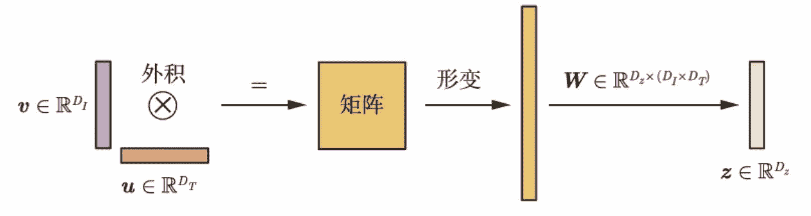

图 7.1 双线性池化示意图

其中 $v \otimes u$ 为 $D_I \times D_T$ 的矩阵，$\square$ 表示展平操作，$W$ 的形状为 $(D_z, D_I \times D_T)$。

双线性池化让两个向量的所有元素互相作用，融合充分，但维度一高参数会爆炸。例如 $D_I = D_T = 2048$，$D_z = 3000$ 时，$W$ 规模达 $(3000, 2048 \times 2048)$，参数超 120 亿。

为降低复杂度，研究者提出了 MCB、MLB、MFB、MUTAN、MFH、BLOCK 等方案。

MCB 先用 count sketch$^{[148]}$ 把图文映射到高维，再在快速傅里叶变换域做逐元素乘以模拟卷积，从而规避显式外积。其依据是外积的 count sketch 等价于两个 sketch 的卷积。缺点是仍依赖高维 sketch，计算压力大。MLB 提出基于 Hadamard 积的低秩近似，把三维权重张量分解为三个二维矩阵，参数大幅减少，但收敛慢且对超参敏感。MFB 同样做低秩分解，但使用多组映射矩阵生成融合向量的不同维度，提升容量。MUTAN 基于 Tucker 分解实现双线性池化，有效降参且通用性好。MFH 并联多个 MFB 单元进一步提升容量，代价是参数倍增。BLOCK 则先把视觉和文本向量切分为多个块，分别融合对应块再拼接，在容量和复杂度间取得平衡，参数少仍能保持不错效果。

下面详细介绍 MLB、MFB、MUTAN 三种典型方法。

#### 7.1.1 多模态低秩双线性池化
先看融合向量 $z$ 中单个元素 $i$ 的计算，可写成

$$z_i = \boldsymbol{v}^\top \boldsymbol{W}_i \boldsymbol{u}$$

(7.1.2)

其中 $\boldsymbol{W}_i \in \mathbb{R}^{D_I \times D_T}$ 为 $\boldsymbol{W}$ 的第 $i$ 块。

为降参，MLB 把 $\boldsymbol{W}_i$ 分解为两个低秩矩阵 $\boldsymbol{P}$ 与 $\boldsymbol{Q}$，得到

$$z_i = \boldsymbol{v}^\top (\boldsymbol{P}\boldsymbol{Q}^\top)\boldsymbol{u}$$

(7.1.3)

其中 $\boldsymbol{P} \in \mathbb{R}^{D_I \times k}$、$\boldsymbol{Q} \in \mathbb{R}^{D_T \times k}$，$k$ 为超参，越小参数越少。可改写为

$$z_i = \boldsymbol{1}^\top (\boldsymbol{P}^\top \boldsymbol{v} \circ \boldsymbol{Q}^\top \boldsymbol{u})$$

(7.1.4)

其中 $\circ$ 为 Hadamard 积，$\boldsymbol{1}^\top \in \mathbb{R}^k$ 为全 1 行向量，等价于求和。为得到完整向量 $\boldsymbol{z}$，MLB 用可学习矩阵 $\boldsymbol{W}_z \in \mathbb{R}^{D_z \times k}$ 替换 $\boldsymbol{1}^\top$，得到

$$\boldsymbol{z} = \boldsymbol{W}_z(\boldsymbol{P}^\top \boldsymbol{v} \circ \boldsymbol{Q}^\top \boldsymbol{u})$$

图 7.2 展示了 MLB 的流程：先对图像和文本做线性变换并加入非线性激活，再用逐元素乘融合，最后经线性变换映射到目标维度。

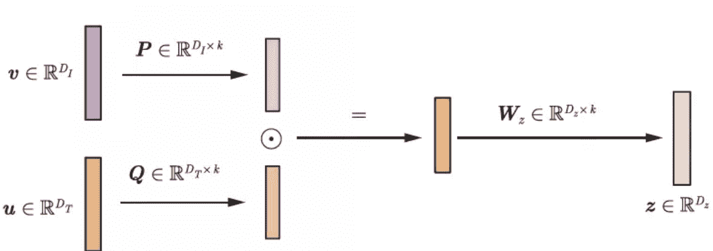

图 7.2 MLB 融合的计算过程

#### 7.1.2 多模态因子双线性池化
MFB 与 MLB 都做低秩分解，区别在于 MFB 用 $D_z$ 组低秩矩阵分别生成融合向量的每个维度，即

$$z_i = \mathbf{1}^\top (\mathbf{P}_i^\top \mathbf{v} \circ \mathbf{Q}_i^\top \mathbf{u}) \quad (7.1.6)$$

其中 $\mathbf{P}_i \in \mathbb{R}^{D_I \times k}$、$\mathbf{Q}_i \in \mathbb{R}^{D_T \times k}$。整个融合向量由 $D_z$ 组参数共同决定。

图 7.3 展示了 MFB 流程：用 $D_z$ 组不同权重对图像和文本分别做非线性变换，逐组做逐元素乘后求和，得到每个维度值，最终组成融合表示。

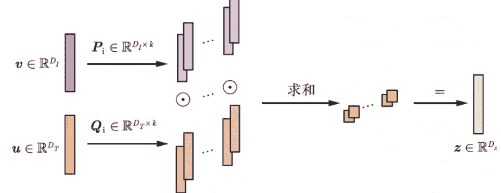

图 7.3 MFB 融合的计算过程

#### 7.1.3 多模态 Tucker 融合
MUTAN 基于 Tucker 分解。首先用张量-矩阵乘积把双线性融合写成

$$\mathbf{z} = (\mathbf{W} \times_1 \mathbf{v}) \times_2 \mathbf{u} \quad (7.1.7)$$

其中 $\times_i$ 为 i-mode 乘积，可改变张量第 $i$ 维大小。例如形状 $(4,3,2)$ 的张量与 $(3,5)$ 矩阵做 $\times_2$，结果为 $(4,5,2)$。

对 $\boldsymbol{W}$ 做 Tucker 分解可得

$$\boldsymbol{W} = ((\boldsymbol{T}_c \times_1 \boldsymbol{P}) \times_2 \boldsymbol{Q}) \times_3 \boldsymbol{W}_z \qquad (7.1.8)$$

其中 $\boldsymbol{T}_c \in \mathbb{R}^{d_I \times d_T \times d_z}$，$\boldsymbol{P} \in \mathbb{R}^{D_I \times d_I}$，$\boldsymbol{Q} \in \mathbb{R}^{D_T \times d_T}$，$\boldsymbol{W}_z \in \mathbb{R}^{D_z \times d_z}$。

代入即得基于 Tucker 分解的双线性融合

$$\boldsymbol{z} = ((\boldsymbol{T}_c \times_1 (\boldsymbol{v}^\top \boldsymbol{P})) \times_2 (\boldsymbol{u}^\top \boldsymbol{Q})) \times_3 \boldsymbol{W}_z \qquad (7.1.9)$$

图 7.4 呈现了 MUTAN 融合的具体计算流程。可以看出，MUTAN 先借助矩阵 $\boldsymbol{P}$ 与 $\boldsymbol{Q}$ 分别对图像表征和文本表征做一次线性投影，得到压缩后的新表征记作 $\tilde{\boldsymbol{v}}$ 与 $\tilde{\boldsymbol{u}}$。与前文类似，这里完成的是等价的非线性变换。随后将 $\tilde{\boldsymbol{v}}$ 与 $\tilde{\boldsymbol{u}}$ 输入经典的双线性融合单元，参数矩阵记为 $\boldsymbol{T}_c$。由于变换后的图像、文本维度均小于原始维度，双线性操作的计算开销因此被削减。最后再通过一次线性映射把融合结果投射到期望的表示空间。

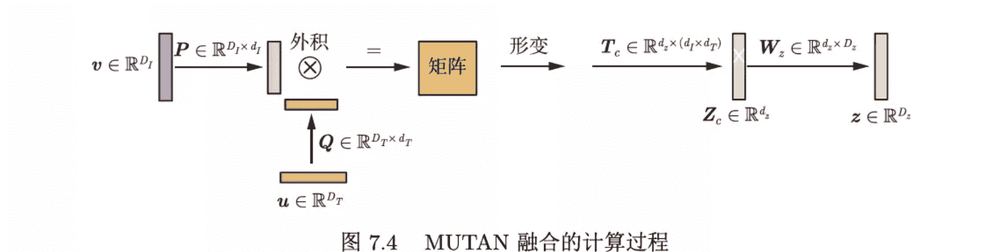

### 7.2 基于注意力的方法

#### 7.2.1 基于交叉注意力的基础方法

最朴素的注意力驱动多模态融合，就是在进行跨模态对齐前后都对表示进行利用。当图像与文本都以局部形式出现时，先用交叉注意力得到跨模态对齐后的局部特征 $Y^I$ 与 $Y^T$，再把对齐前后的特征通过拼接、相加等简易操作或双线性融合进行整合。以相加融合为例，融合后的图像与文本表征分别为

$\{\boldsymbol{x}_1^I + \boldsymbol{y}_1^I, \boldsymbol{x}_2^I + \boldsymbol{y}_2^I, \cdots, \boldsymbol{x}_n^I + \boldsymbol{y}_n^I\}$

(7.2.1)

$\{\boldsymbol{x}_1^T + \boldsymbol{y}_1^T, \boldsymbol{x}_2^T + \boldsymbol{y}_2^T, \cdots, \boldsymbol{x}_m^T + \boldsymbol{y}_m^T\}$

(7.2.2)

当图像保持局部表示而文本为整体表示时，先用交叉注意力为文本生成跨模态对齐的局部输出 $\boldsymbol{y}^T$，再把对齐前后的文本表征通过拼接、相加或双线性融合结合。以拼接融合为例，融合后的文本表征可写成 $\boldsymbol{x}^T \| \boldsymbol{y}^T$。

#### 7.2.2 基于多步交叉注意力的方法

交叉注意力能够被多次串联形成多步交叉注意力。其核心在于维护一个查询向量 $\boldsymbol{m}$。初始步中，查询可定义为图像整体表征与文本整体表征逐元素相乘或相加的结果。得到初始查询后，如图 7.5 所示，以整体向量 $\boldsymbol{m}$ 作查询、以图像局部表征作键值，通过交叉注意力得到与图像对齐的表征 $\boldsymbol{m}^I$：

$\boldsymbol{m}^I = \mathrm{CA}(\boldsymbol{X}^I, \boldsymbol{m})$

(7.2.3)

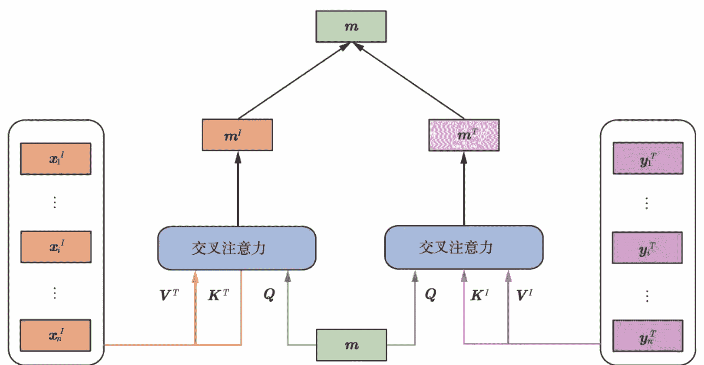

类似地，以整体向量 $\boldsymbol{m}$ 作查询、以文本局部表征作键值，通过交叉注意力得到与文本对齐的表征 $\boldsymbol{m}^T$：

$$\boldsymbol{m}^T = \mathrm{CA}(\boldsymbol{m}, \boldsymbol{X}^T) \tag{7.2.4}$$

往后每一步，先把查询更新为 $\boldsymbol{m}^I$ 与 $\boldsymbol{m}^T$ 逐元素相乘的结果，再次用交叉注意力产生新的对齐表征。重复 $K$ 次交叉注意力后，最终的多模态查询即可直接当作融合表示。

需要指出的是，上述流程的每一轮都包含两次交叉注意力：一次把查询与图像对齐，一次把查询与文本对齐。这正是 $r$-DAN$^{[63]}$ 提出的融合策略。

也有工作把第一步的查询设为单一模态的整体表征，仅使用一次交叉注意力完成与另一模态的对齐，随后每一步都把查询设为对齐后表征或对齐前后表征之和，且仍只做一次交叉注意力。QRU$^{[132]}$ 与 SAN$^{[133]}$ 在视觉问答任务中采用了此类做法。它们把问题整体表征作为查询与图像局部表征对齐，从而筛选出与问题相关的区域。多步交叉注意力被解读为多步推理，每一步都在融合问题与图像，并在下一步对图像区域做更精细的筛选。

#### 7.2.3 基于交叉 transformer 编码器的方法

3.3 节提到堆叠自注意力可得 transformer 编码器。同理，堆叠交叉注意力即可得到交叉 transformer 编码器，用来刻画复杂的图文关联。图 7.6 给出了一个交叉 transformer 块的构成，每个块包含多头交叉注意力 MCA 与前馈网络 MLP，并引入层归一化 LN 与残差连接等常用训练技巧。编码器由若干个此类块堆叠而成。

形式化地，设第 $l$ 层的图文表征为 $\boldsymbol{Z}^{I(l)}$ 与 $\boldsymbol{Z}^{T(l)}$，则经交叉 transformer 块处理后得到第 $l+1$ 层的表征 $\boldsymbol{Z}^{I(l+1)}$ 与 $\boldsymbol{Z}^{T(l+1)}$ 的计算流程如下。

$$\hat{\boldsymbol{Z}}^{I(l)}, \hat{\boldsymbol{Z}}^{T(l)} = \mathrm{LN}\left(\mathrm{MCA}\left(\boldsymbol{Z}^{I(l)}, \boldsymbol{Z}^{T(l)}\right) + \left[\boldsymbol{Z}^{I(l)} ; \boldsymbol{Z}^{T(l)}\right]\right)$$

$$\boldsymbol{Z}^{I(l+1)} = \mathrm{LN}\left(\mathrm{MLP}\left(\hat{\boldsymbol{Z}}^{I(l)}\right) + \hat{\boldsymbol{Z}}^{I(l)}\right) \tag{7.2.5}$$

$$\boldsymbol{Z}^{T(l+1)} = \mathrm{LN}\left(\mathrm{MLP}\left(\hat{\boldsymbol{Z}}^{T(l)}\right) + \hat{\boldsymbol{Z}}^{T(l)}\right)$$

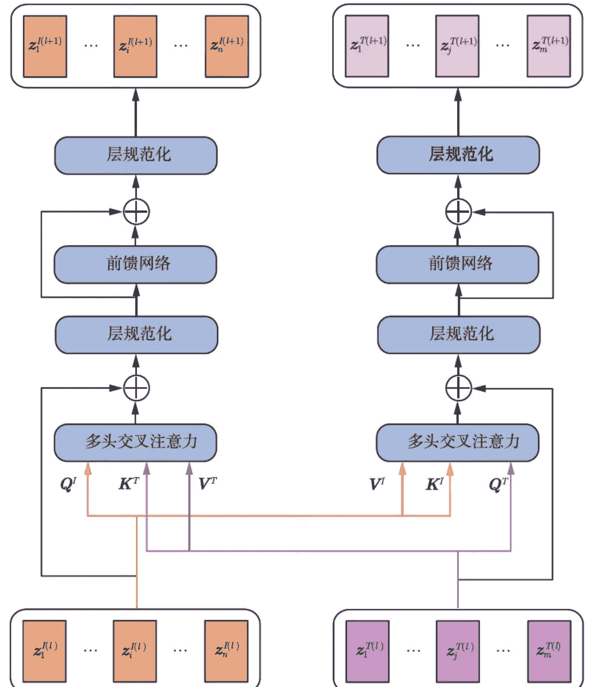

图 7.6 交叉 transformer 块结构示意图

### 7.3 实战案例：基于 MFB 的视觉问答

#### 7.3.1 视觉问答技术简介

视觉问答的本质是挖掘图像与问题之间的关联并加以融合，从而推理出答案。形式上，模型需融合图像与文本两路输入，预测出文本形式的答案或对应类别编号。

当前视觉问答技术大致可分为四类：其一是特征融合类，利用线性融合或双线性融合综合图像与问题信息；其二是注意力类，利用注意力机制实现图像区域与问题的跨模态对齐与融合；其三是视觉关系建模类，该类方法显式建模图像区域间的关系，并借助多模态对齐把关系与问题关联，最终通过多模态融合综合关系与问题；其四是模块网络类，先用全连接层、卷积层、注意力层等单元预定义属性查找、区域转换、组合、属性描述、计数等模块，再把问题解析为可映射到这些模块的子任务，最后依据解析结果动态组装模块。

这四类方法并非完全割裂，实际构建模型时大多会借助注意力机制完成多模态融合与对齐。

本节以基于 MFB$^{[142]}$ 与注意力的视觉问答模型 MFBVQA 为例做实战演示。如图 7.7 所示，该模型先用注意力把问题与图像区域做多模态对齐，注意力打分函数选用 MFB，随后用 MFB 融合对齐前后问题的表征，最终输出答案。

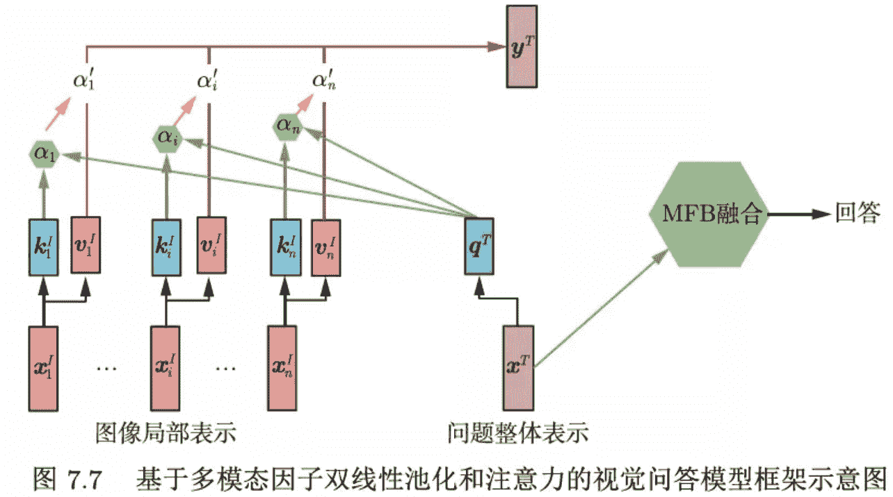

后续将按读取数据、定义模型、定义损失函数、选择优化器、选择评估指标、训练模型这六个步骤依次说明实现细节。

#### 7.3.2 读取数据

1. 下载数据集

我们采用的数据集为 VQA v2，下载地址见注。该集图像来源于 MS COCO，需要额外下载 bottom up attention 模型$^{2}$提供的图像区域表征$^{3}$。解压后得到每个图片 36 个检测框的视觉表征文件，覆盖训练集与验证集。本节把 tsv 文件置于目录 ../data/vqa/coco 下。

问题与答案方面需下载四份文件：训练标注集即训练答案集、验证标注集即验证答案集、训练问题集、验证问题集。四文件解压后为 json 格式，统一放到 ../data/vqa 下的 vqa2 文件夹。测试集标注未公开，故仅使用训练与验证集。该数据集包含 443757 个训练问题与 214354 个验证问题，每个问题配有 10 条人工标注答案。

> $^{1}$ https://visualqa.org/download.html
> $^{2}$ https://github.com/peteanderson80/bottom-up-attention
> $^{3}$ https://storage.googleapis.com/up-down-attention/trainval_36.zip

2. 整理数据集

下载完成后需对数据进行预处理，使其适配后续 PyTorch 数据集类。对于图像，沿 6.3.1 节做法，将每张图的 36 个检测框表征保存为单个 npy 文件，并在数据 json 中记录路径。为便于后续分析，检测框位置信息也以 npy 形式保存。json 中仅记录文件名前缀，后缀 “.npy” 对应图像特征，后缀 “.box.npy” 对应框特征。

```python
import base64
import csv
import json
import numpy as np
import os
from os.path import join as pjoin
import sys

csv.field_size_limit(sys.maxsize)

def resort_image_feature():
    coco_dir = '../data/vqa/coco/'
    img_feat_path = pjoin(coco_dir, 'trainval_resnet101_faster_rcnn_genome_36.tsv')
    feature_folder = pjoin(coco_dir, 'image_box_features')
    if not os.path.exists(feature_folder):
        os.makedirs(feature_folder)

    imgid2feature = {}
    imgid2box = {}
    FIELDNAMES = ['image_id', 'image_h', 'image_w', 'num_boxes', 'boxes', 'features']
    with open(img_feat_path, 'r') as tsv_in_file:
        reader = csv.DictReader(tsv_in_file, delimiter='\t', fieldnames = FIELDNAMES)
        for item in reader:
            item['num_boxes'] = int(item['num_boxes'])
            for field in ['boxes', 'features']:
                buf = base64.b64decode(item[field])
                temp = np.frombuffer(buf, dtype=np.float32)
                item[field] = temp.reshape((item['num_boxes'],-1))
            feat_path = pjoin(feature_folder, item['image_id']+'.jpg.npy')
            box_path = pjoin(feature_folder, item['image_id']+'.jpg.box.npy')
            np.save(feat_path, item['features'])
            np.save(box_path, item['boxes'])

resort_image_feature()
```

对于答案，选取出现频次最高的 max_ans_count 个答案，把任务转化为 max_ans_count 类分类，并把每个问题的多条答案整理为列表。

对于问题，先构建词表，再依据词表把问题映射为向量序列，并剔除所有答案都不在高频答案集合中的样本。

```python
from collections import defaultdict, Counter
import json
import os
from os.path import join as pjoin
import random
import re
import torch
from PIL import Image

def tokenize_mcb(s):
    """
    问题词元化（tokenization）函数，来源于 https://github.com/Cadene/block.bootstrap.pytorch
    """
    t_str = s.lower()
    for i in [r'\?',r'\!',r'\'',r'"',r'\$',r'\:',
             r'\@',r'\(',r'\)',r'\,',r'\.',r'\;']:
        t_str = re.sub( i, '', t_str)
    for i in [r'\-',r'\/']:
        t_str = re.sub( i, ' ', t_str)
    q_list = re.sub(r'\?','',t_str.lower()).split(' ')
    q_list = list(filter(lambda x: len(x) > 0, q_list))
    return q_list

def tokenize_questions(questions):
    for item in questions:
        item['question_tokens'] = tokenize_mcb(item['question'])
    return questions

def annotations_in_top_answers(annotations, questions, ans_vocab):
    new_anno = []
    new_ques = []
    assert len(annotations) == len(questions)
    for anno,ques in zip(annotations, questions):
        if anno['multiple_choice_answer'] in ans_vocab:
            new_anno.append(anno)
            new_ques.append(ques)
    return new_anno, new_ques

def encode_questions(questions, vocab):
    for item in questions:
        item['question_idx'] = []
        for w in item['question_tokens']:
            item['question_idx'].append(vocab.get(w, vocab['<unk>']))
    return questions

def encode_answers(annotations, vocab):
```

##### 3. 定义数据集类

在数据准备好后，需定义 PyTorch Dataset 类以便 DataLoader 按批次供给数据。PyTorch 内置的 Dataset 主要面向单模态任务，因此需自定义。

自定义数据集只需继承 torch.utils.data.Dataset 并实现 `__getitem__` 与 `__len__`。在视觉问答里，`__getitem__` 需返回图像、问题与答案的表征。其中图像表征直接从检测框特征文件读取，问题表征为其词在词表中的索引序列。答案有两种形式：一是从答案列表中按出现概率采样一个答案，二是保留完整的答案列表。若答案为单值，任务即为传统单标签多分类；若答案为列表，则任务可建模为标签分布预测问题。

```python
from argparse import Namespace
import collections
import numpy as np
from os.path import join as pjoin
import skipthoughts
import torch
import torch.nn as nn
from torch.utils.data import Dataset

def collate_fn(batch):
    # 对一个批次的数据进行预处理
    max_question_length = max([len(item['question']) for item in batch])
    batch_size = len(batch)
    image_feat_shape = batch[0]['image_feat'].shape
    imgs = torch.zeros(batch_size, image_feat_shape[0], image_feat_shape[1])
    ques = torch.zeros(batch_size, max_question_length, dtype=torch.long)
    ans = torch.zeros(batch_size, 1000)
    lens = torch.zeros(batch_size, dtype=torch.long)
    for i, item in enumerate(batch):
        imgs[i] = torch.from_numpy(item['image_feat'])
        ques[i, :item['question'].shape[0]] = item['question']
        for answer in item['answers']:
            ans[i, answer] += 1
        lens[i] = item['length']
    return (imgs, ques, ans, lens)

class VQA2Dataset(Dataset):
    def __init__(self,
        data_dir='../data/vqa/vqa2/',
        rcnn_dir='../data/vqa/coco/image_box_features/',
        split='train',
        samplingans=True):
        """
        参数：
            samplingans：决定返回的回答数据。
            取值为 True，则从回答列表中按照回答出现的概率采样一个回答；
            取值为 False，则为回答列表。
        """
        super(VQA2Dataset, self).__init__()
        self.rcnn_dir = rcnn_dir
        self.samplingans = samplingans
        self.split = split
        dir_processed = pjoin(data_dir, 'processed')
        if split == 'train':
            data_file = pjoin(dir_processed, 'train_data.json')
        elif split == 'val':
            data_file = pjoin(dir_processed, 'val_data.json')
        self.dataset = json.load(open(data_file, 'r'))
        self.dataset_size = len(self.dataset['questions'])

    def __getitem__(self, index):
        item = {}
        item['index'] = index
        # 读取问题
        question = self.dataset['questions'][index]
        item['question'] = torch.LongTensor(question['question_idx'])
        item['length'] = torch.LongTensor([len(question['question_idx'])])
        # 读取图像检测框特征
        image_feat_path = pjoin(self.rcnn_dir, '{}.jpg.npy'.format(question['image_id']))
        item['image_feat'] = np.load(image_feat_path)
        # 读取回答
        annotation = self.dataset['annotations'][index]
        if 'train' in self.split and self.samplingans:
            item['answers'] = [random.choice(annotation['answer_list'])]
        else:
            item['answers'] = annotation['answer_list']
        return item

    def __len__(self):
        return self.dataset_size
```

##### 4. 批量数据流构建
在前面定义好的数据集类基础上，调用 DataLoader 为训练、验证和测试分别生成可按批次供给的数据对象。

```python
def mktrainval(data_dir, image_feat_dir, batch_size, workers=0):
    train_set = VQA2Dataset(data_dir, image_feat_dir,
                            split='train', samplingans=True)
    valid_set = VQA2Dataset(data_dir, image_feat_dir,
                            split='val', samplingans=False)

    train_loader = torch.utils.data.DataLoader(
                            train_set, batch_size=batch_size,
                            shuffle=True, num_workers=workers,
                            pin_memory=True, collate_fn=collate_fn)
    valid_loader = torch.utils.data.DataLoader(
                            valid_set, batch_size=batch_size,
                            shuffle=False, num_workers=workers,
                            pin_memory=True, collate_fn=collate_fn)
    return train_loader, valid_loader
```

#### 7.3.3 模型结构拆解
MFBVQA 的整体框架已在图 7.7 中呈现，核心由两部分构成，注意力跨模态对齐和双线性融合。

跨模态对齐模块以问题表征作为查询，以图像的局部表征作为键和值，输出问题与图像对齐后的表征。本质上是对图像局部表征做加权汇总，权重体现的是每个区域与当前问题的关联强弱。该过程使用多头注意力，且在计算查询与键相关性时，注意力打分函数内部采用了 MFB 融合。

双线性融合模块则把对齐前后的问题表征通过 MFB 融合，得到最终的联合表征。

实现顺序上，先完成 MFB 融合算子，再基于它搭建注意力跨模态对齐，最后把两者组合起来完成 MFBVQA 的整体实现。

##### 1. MFB 融合实现
下面给出 MFB 融合算子的代码。该算子既能处理单一向量对的融合，也能批量处理多组向量。

```python
class MFBFusion(nn.Module):
    def __init__(self, input_dim1, input_dim2, hidden_dim, R):
        """
        参数:
            input_dim1: 第一个待融合表示的维度
            input_dim2: 第二个待融合表示的维度
            hidden_dim: 融合后的表示的维度
            R: MFB 所使用的低秩矩阵的数量
        """
        super(MFBFusion, self).__init__()
        self.input_dim1 = input_dim1
        self.input_dim2 = input_dim2
        self.hidden_dim = hidden_dim
        self.R = R
        self.linear1 = nn.Linear(input_dim1, hidden_dim * R)
        self.linear2 = nn.Linear(input_dim2, hidden_dim * R)

    def forward(self, inputs1, inputs2):
        """
        参数：
            inputs1: (batch_size, input_dim1) 或 (batch_size, num_region, input_dim1)
            inputs2: (batch_size, input_dim2) 或 (batch_size, num_region, input_dim2)
        """
        # -> total: (batch_size, hidden_dim) 或 (batch_size, num_region, hidden_dim)
        num_region = 1
        if inputs1.dim() == 3:
            num_region = inputs1.size(1)
        h1 = self.linear1(inputs1)
        h2 = self.linear2(inputs2)
        z = h1 * h2
        z = z.view(z.size(0), num_region, self.hidden_dim, self.R)
        z = z.sum(3).squeeze(1)
        return z
```

##### 2. 跨模态注意力实现
下面展示多头交叉注意力的代码实现。其中注意力系数 α 的计算依赖于先用 MFB 操作对查询和键进行融合的结果。

```python
class MultiHeadATTN(nn.Module):
    def __init__(self, query_dim, kv_dim,
                 mfb_input_dim, mfb_hidden_dim,
                 num_head, att_dim):
        """
        参数：
            query_dim: 问题表示（查询）的维度
            kv_dim: 图像区域表示（键和值）的维度
            mfb_input_dim: 融合操作的输入的维度
            mfb_hidden_dim: 融合操作的输出的维度
            num_head: 多头交叉注意力的头数
            att_dim: 多头交叉注意力的输出表示（对齐后的表示）维度
        """
        super(MultiHeadATTN, self).__init__()
        assert att_dim % num_head == 0
        self.num_head = num_head
        self.att_dim = att_dim

        self.attn_w_1_q = nn.Sequential(
            nn.Dropout(0.5),
            nn.Linear(query_dim, mfb_input_dim),
            nn.ReLU()
        )
        self.attn_w_1_k = nn.Sequential(
            nn.Dropout(0.5),
            nn.Linear(kv_dim, mfb_input_dim),
            nn.ReLU()
        )
        self.attn_score_fusion = MFBFusion(mfb_input_dim, mfb_input_dim,
                                           mfb_hidden_dim, 1)
        self.attn_score_mapping = nn.Sequential(
            nn.Dropout(0.5),
            nn.Linear(mfb_hidden_dim, num_head)
        )
        self.softmax = nn.Softmax(dim=1)
        # 对齐后的表示计算流程
        self.align_q = nn.ModuleList([nn.Sequential(
            nn.Dropout(0.5),
            nn.Linear(kv_dim, int(att_dim / num_head)),
            nn.Tanh()
        ) for _ in range(num_head)])

    def forward(self, query, key_value):
        """
        参数：
            query: (batch_size, q_dim)
            key_value: (batch_size, num_region, kv_dim)
        """
        # （1）使用全连接层将 Q、K、V 转化为向量
        num_region = key_value.shape[1]
        # -> (batch_size, num_region, mfb_input_dim)
        q = self.attn_w_1_q(query).unsqueeze(1).repeat(1, num_region, 1)
        # -> (batch_size, num_region, mfb_input_dim)
        k = self.attn_w_1_k(key_value)
        # （2）计算 query 和 key 的相关性，实现注意力评分函数
        # -> (batch_size, num_region, num_head)
        alphas = self.attn_score_fusion(q, k)
        alphas = self.attn_score_mapping(alphas)
        # （3）归一化相关性分数
        # -> (batch_size, num_region, num_head)
        alphas = self.softmax(alphas)
        # （4）计算输出
        # (batch_size, num_region, num_head) (batch_size, num_region, key_value_dim)
        # -> (batch_size, num_head, key_value_dim)
        output = torch.bmm(alphas.transpose(1, 2), key_value)
        # 最终再对每个头的输出进行一次转换，并拼接所有头的转换结果将其作为注意力输出
        list_v = [e.squeeze() for e in torch.split(output, 1, dim=1)]
        alpha = torch.split(alphas, 1, dim=2)
        align_feat = [self.align_q[head_id](x_v) for head_id, x_v in enumerate(list_v)]
        align_feat = torch.cat(align_feat, 1)
        return align_feat, alpha
```

##### 3. 组装 MFBVQA 模型

在已有 MFB 融合单元与多头自注意模块的基础上，组装 MFBVQA 并不会很复杂。模型同时接收图像区域特征和对应的问题文本。其中问题整体的语义编码借助了预训练的 Skip-thoughts 向量[149]，该编码模型以单句为输入，依赖前后句作为监督信号完成训练。

```python
class MFBVQAModel(nn.Module):
    def __init__(self, vocab_words, question_dim, image_dim,
                 attn_mfb_input_dim, attn_mfb_hidden_dim,
                 attn_num_head, attn_output_dim,
                 fusion_q_feature_dim, fusion_mfb_hidden_dim,
                 num_classes):
        super(MFBVQAModel, self).__init__()

        # 文本表示提取器
        list_words = [vocab_words[i + 1] for i in range(len(vocab_words))]
        self.text_encoder = skipthoughts.BayesianUniSkip(
            '../data/vqa/skipthoughts/',
            list_words,
            dropout=0.25,
            fixed_emb=False)

        # 多头自注意力
        self.attn = MultiHeadATTN(question_dim, image_dim,
                                  attn_mfb_input_dim, attn_mfb_hidden_dim,
                                  attn_num_head, attn_output_dim)

        # 问题的对齐表示到融合表示空间的映射函数
        self.q_feature_linear = nn.Sequential(
            nn.Dropout(0.5),
            nn.Linear(question_dim, fusion_q_feature_dim),
            nn.ReLU()
        )

        # MFB 融合图文表示类
        self.fusion = MFBFusion(attn_output_dim, fusion_q_feature_dim,
                                fusion_mfb_hidden_dim, 2)

        # 分类器
        self.classifier_linear = nn.Sequential(
            nn.Dropout(0.5),
            nn.Linear(fusion_mfb_hidden_dim, num_classes)
        )

    def forward(self, imgs, quests, lengths):
        # 初始输入
        v_feature = imgs.contiguous().view(-1, 36, 2048)
        q_emb = self.text_encoder.embedding(quests)
        q_feature, _ = self.text_encoder.rnn(q_emb)
        q_feature = self.text_encoder._select_last(q_feature, lengths)
        # 利用注意力获得问题的对齐表示
        align_q_feature, _ = self.attn(q_feature, v_feature)  # b*620
        # 对原始文本表示进行变换
        original_q_feature = self.q_feature_linear(q_feature)
        # 融合对齐前后的问题的表示
        x = self.fusion(align_q_feature, original_q_feature)
        # 分类
        x = self.classifier_linear(x)
        return x
```

#### 7.3.4 定义损失函数
优化采用 KL 散度作为目标，设计上兼容答案为单值与答案为列表两种表达方式。

```python
class KLLoss(nn.Module):
    def __init__(self):
        super(KLLoss, self).__init__()
        self.loss = nn.KLDivLoss(reduction='batchmean')

    def forward(self, input, target):
        return self.loss(nn.functional.log_softmax(input), target)
```

#### 7.3.5 选择优化方法
参数更新选用 Adam 优化器，学习率策略为指数式衰减。

```python
import torch.optim.lr_scheduler as lr_scheduler

def get_optimizer(model, config):
    params = filter(lambda p: p.requires_grad, model.parameters())
    return torch.optim.Adam(params=params, lr=config.learning_rate)

def get_lr_scheduler(optimizer):
    """ 每隔 lr_update 个轮次，学习速率减小至当前速率的二分之一"""
    return lr_scheduler.ExponentialLR(optimizer, 0.5 ** (1 / 50000))
```

#### 7.3.6 选择评估指标
VQAv2 最常用的回答准确率被实现。评判规则为：预测答案在 10 条人工标注中出现不少于 3 次即记为 1 分，出现 2 次记 2/3 分，出现 1 次记 1/3 分。

```python
def evaluate(data_loader, model):
    model.eval()
    device = next(model.parameters()).device
    accs = []
    for i, (imgs, questions, answers, lengths) in enumerate(data_loader):
        # 读取数据至 GPU
        imgs = imgs.to(device)
        questions = questions.to(device)
        answers = answers.to(device)
        lengths = lengths.to(device)

        output = model(imgs, questions, lengths)
        hit_cts = answers[torch.arange(output.size(0)), output.argmax(dim=1)]
        for hit_ct in hit_cts:
            accs.append(min(1, hit_ct / 3.0))
    model.train()
    return float(sum(accs)) / len(accs)
```

#### 7.3.7 训练模型
完整训练可分为数据读取、前向推理、损失求值、参数更新、最佳模型挑选五个阶段。

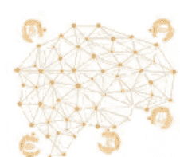

# 多模态深度学习技术基础

```python
# 设置模型超参数和辅助变量
config = Namespace(
    question_dim=2400,
    image_dim=2048,
    attn_mfb_input_dim=310,
    attn_mfb_hidden_dim=510,
    attn_num_head=2,
    attn_output_dim=620,
    fusion_q_feature_dim=310,
    fusion_mfb_hidden_dim=510,
    num_ans=1000,
    batch_size=128,
    learning_rate=0.0001,
    margin=0.2,
    num_epochs=45,
    grad_clip=0.25,
    evaluate_step=360,  # 每隔多少步在验证集上测试一次
    checkpoint=None,  # 如果不为 None，则利用该变量路径的模型继续训练
    best_checkpoint='../model/mfb/best_vqa2.ckpt',  # 验证集上表现最优的模型的路径
    last_checkpoint='../model/mfb/last_vqa2.ckpt',  # 训练完成时的模型的路径
)

# 设置 GPU 信息
os.environ['CUDA_VISIBLE_DEVICES'] = '0'
device = torch.device("cuda" if torch.cuda.is_available() else "cpu")

# 数据
data_dir = '../data/vqa/vqa2/'
dir_processed = os.path.join(data_dir, 'processed')

train_loader, valid_loader = mktrainval(data_dir,
                                        '../data/vqa/coco/image_box_features/',
                                        config.batch_size,
                                        workers=0)
```

### 7.4 小结
本章梳理了多模态融合的代表性做法。首先介绍双线性融合思路，其要点在于通过双线性汇聚让两种模态的各个分量全面交互，以获得更丰富的联合表征。由于直接双线性汇聚计算开销过大，后续出现了多种简化变体，本章重点呈现了 MLB、MFB、MUTAN 三种典型方案。随后转向基于注意机制的融合，涵盖基础交叉注意、多步交叉注意以及交叉 Transformer 编码器，其中后者已成为多模态处理的主流架构之一。最后以结合双线性汇聚与注意机制的视觉问答实践为例，帮助理解两者在融合中的具体作用。

### 7.5 习题
1. 设图像表征 $v = [0.2, 0.3, -0.8, 0.9]$，文本表征 $u = [-0.7, 0.1, -0.4, 0.1]$，请利用双线性汇聚构造长度为 6 的图文融合向量，线性映射权重可自行设定。
2. 分别写出双线性汇聚、MLB、MFB、MUTAN 四种融合方式的计算复杂度。
3. 写出式(7.2.3)的推导过程以及图像对齐表征 $m^I$ 的具体计算步骤。
4. 列出由 3 个 Transformer 块构成的交叉 Transformer 编码器的全部可训练参数。
5. 提出一个除视觉问答之外的多模态融合应用场景，并设计相应的网络结构。
6. 将 7.3 节 MFBVQA 中的 MFB 融合替换为 MLB 融合，比较两者在视觉问答上的性能差别。

## 第 8 章 多模态转换
多模态转换指把源模态数据映射为描述同一内容的目标模态数据的过程。在深度学习普及前，图像合成与文本生成进展有限。文本生成主要依赖模板、N 元语法与语法规则，只能产出简短语句；图像生成则以像素或块的相似性为依据，只能得到纹理或低分辨率图像。因缺乏生成能力，当时多采用检索式方案，即先通过跨模态对齐检索相关目标数据，再按规则拼接生成新样本。

2014 年受神经机器翻译启发，可端到端训练的编解码网络被引入图像到文本转换，即图像描述。编码器负责抽取图像表征，解码器负责生成语言描述，训练目标是在给定图像条件下最大化对应描述的对数似然。随着发展，图像描述的编解码主流先后从循环神经网络[50-51,150-151] 过渡到注意机制[64,66] 再到 Transformer[152-155]。

2016 年起生成对抗网络在条件图像生成中迅速兴起，成为文本生成图像的主流范式。先获得文本表征，再用以以上采样卷积为主的生成器映射为目标分辨率图像，最后用以下采样卷积为主的判别器联合图像与文本表征评估匹配可信度。GAN-CLS[156] 首个实现了 64×64 分辨率的合成；StackGAN[157] 与 StackGAN-v2[158] 通过多级生成器与判别器提升分辨率；AttnGAN[36] 引入注意机制，同时捕捉文本词级与句级信息。

2021 年得益于 Transformer 成熟与算力提升，基于 Transformer 的编解码模型开始应用于文本生成图像。典型做法是先用量化自编码器提取图像离散表征，再用 Transformer 编解码建模文本序列到图像离散序列的映射，如 DALL·E[72]、CogView[74] 等。2022 年发布的 OFA[159] 则用单一 Transformer 编解码模型统一完成图像描述、文本生成图像等多项任务。

自 2021 年下半年起，扩散模型逐步取代 GAN 成为图像生成的焦点。其思想是前向过程向图像逐步加噪直至退化为随机噪声，逆向过程从噪声逐步去噪得到清晰图像。2021 年底 GLIDE[160] 首将扩散模型用于文本生成图像，在逆向去噪中引入文本条件。2022 年 stable diffusion[78] 利用扩散模型生成文本到压缩表征，再解码为图像，其开源推动了研究热潮。目前基于扩散的多模态转换仍在快速演进。

本章将介绍两类经典范式：基于编解码框架的方法与基于生成对抗网络的方法。

### 8.1 基于编解码框架的方法
通用编解码框架包含编码器与解码器，编码器把输入模态压缩为状态表征，解码器把该表征解码为输出模态。可端到端训练的神经网络是当前主流实现。按时间顺序，主流结构依次为基于循环神经网络的模型、基于注意机制的模型与基于 Transformer 的模型。

以下以机器翻译为例，介绍三种结构及其在多模态转换中的使用。

#### 8.1.1 基于循环神经网络的编解码模型
循环神经网络编解码在序列到序列任务中应用广泛。图 8.2 展示了机器翻译示例。编码器用一层循环网络对源语言序列编码，以末时刻隐藏状态作为整体表征；该表征作为另一循环网络解码器的初始隐藏状态或每步输入的一部分，逐 token 生成目标语言序列。

设输入序列 $X = \{x_1, x_2, \cdots, x_n\}$ 的整体表征 $c = \text{RNN}_{\text{encoder}}(X)$，目标序列表示为 $Y = \{y_1, y_2, \cdots, y_m\}$。若把整体表征作为解码器每步输入的一部分，输出计算如下。

（1）把整体表征与目标序列各词表征拼接，形成新序列 $Y_{\text{concat}} = \{y_1 \| c, y_2 \| c, \cdots, y_m \| c\}$

（2）用循环网络对 $Y_{\text{concat}}[1:m-1]$ 进行编码，获得各时刻的隐状态。

$$H^{\text{decoder}} = \text{RNN}^{\text{decoder}}(Y_{\text{concat}}[1:m-1])$$

（3）引入权重矩阵 $W_o$ 的线性映射层，把解码器隐状态序列中的每个隐向量都映射成对应的输出向量，由此得到完整输出序列。第 $j$ 步得到的输出向量 $o_j$ 计算为

$$o_j = W_o h_j^{\text{decoder}}$$

其中 $W_o$ 的输出维度等于目标语言词汇表的规模。

（4）随后对输出序列里每个向量做 softmax 归一化，得到该步对下一词的概率预测。第 $j$ 步的概率分布 $p_j$ 为

$$p_j = \text{softmax}(o_j) \quad (8.1.3)$$

每一步的监督信号都是目标序列中下一位置的真实词。

编码侧与解码侧共用同一损失进行联合优化，编码侧学到的表征可直接供给解码侧，解码侧产生的梯度也会回传更新编码侧参数。整体损失是所有时间步正确词负对数似然的总和，即

$$L(I, S) = -\sum_{j=1}^{m-1} \sum_{k=1}^{|\mathcal{V}|} \log p_{jk} \mathbb{I}(\mathcal{V}[k] = y_j) \quad (8.1.4)$$

其中 $\mathcal{V}$ 为目标语言词汇表，$|\mathcal{V}|$ 为词汇表大小，$p_{jk}$ 为第 $j$ 步模型预测下一个词为词汇表中第 $k$ 个词的概率，指示函数 $\mathbb{I}$ 仅累加预测正确的那一项。

含序列生成解码器的模型常见两种训练策略：一是自回归方式，每一步解码器输入取自上一时刻模型自己的预测；二是 Teacher-Forcing 方式，每一步解码器输入直接取自目标序列该时刻的真实词。Teacher-Forcing 在训练初期效果很好，因为自回归方式下误差会累积导致难以收敛。Teacher-Forcing 还能使同一条序列各时间步并行计算，大幅提升速度。实际训练中常以随机切换的方式混合使用这两种策略。

在图像描述任务里，可先提取图像局部特征，再用 RNN 编解码架构将其转为文字。另一种做法如图 8.3 所示，把编码侧的 RNN 换成 CNN 来获得图像整体表征，解码侧仍保留 RNN。

推理阶段：由于仅有图像可见，RNN 的输入就变为上一时刻采样的词，按此循环直到生成结束符。常见的采样策略有两种。

（1）贪心采样，即每次挑选概率最大的词。计算开销小，但属于局部最优，难以保证整句概率最高。

（2）束搜索采样，设束宽为 $K$，在 $t$ 时刻保留 $K$ 个候选句子，到 $t+1$ 时刻每个候选都扩展出概率最大的前 $K$ 个词，产生 $K^2$ 个新候选，再从中挑选概率最高的前 $K$ 个继续。束搜索同样不保证全局最优，但 $K$ 越大搜索空间越宽，越容易得到高概率句子。当 $K=1$ 时束搜索退化为贪心采样。

#### 8.1.2 基于注意力的编解码模型

RNN 编解码把整段输入压缩成单一向量，细节信息易丢失，不利于生成精确输出。直觉上编码侧应保留输入序列每个词的表征，解码侧在生成某个目标词时，除了依赖前一状态和已生成内容，还应关注输入序列中与当前词最相关的部分。注意力机制的编解码模型正是为此提出。

如图 8.4 所示，注意力编解码的核心是在每个解码步通过交叉注意力得到对齐的上下文向量，用以替代整体表示，具体流程如下。

（1）解码器第 $j$ 步的查询取自前一时刻的状态 $h_{j-1}^{\text{decoder}}$，键和值都取自输入序列的局部表示 $H^{\text{encoder}}$。形式化写作

$$

\begin{aligned}

\boldsymbol{q}_j &= \boldsymbol{h}_{j-1}^{\text{decoder}} \\

\boldsymbol{k}_i &= \boldsymbol{h}_i^{\text{encoder}} \\

\boldsymbol{v}_i &= \boldsymbol{h}_i^{\text{encoder}}

\end{aligned}

$$

(8.1.5)

（2）计算当前状态与输入序列各词的相关得分：

$$\alpha_{ij} = a(\boldsymbol{q}_j, \boldsymbol{k}_i)$$

(8.1.6)

（3）对相关得分做归一化：

$$\alpha'_{ij} = \frac{\exp(\alpha_{ij})}{\sum_k \exp(\alpha_{ik})}$$

(8.1.7)

（4）计算对齐的上下文向量：

$$\boldsymbol{c}_i = \sum_k \alpha'_{ik} \boldsymbol{v}_k$$

(8.1.8)

最后把上下文向量与当前时刻的输入拼接得到 $\boldsymbol{Y}_{\text{concat}}$，之后的下一个词概率分布计算与 RNN 编解码完全一致，此处不再重复。

在图像描述生成中，只需把编码侧换成图像局部表示提取器即可使用注意力编解码。此时注意力让每个词的生成都依赖不同的图像上下文，上下文正是模型对不同局部区域的关注结果。图 8.5 展示了以网格表示的 CNN 作编码侧、带注意力机制的 RNN 作解码侧的模型结构。

#### 8.1.3 基于 transformer 的编解码模型

3.3.2 节已介绍 transformer 编码器，同样可以用 transformer 构建解码器，形成完全基于 transformer 的编解码模型。如图 8.6 所示，编码侧用 $N_e$ 个 transformer 块提取输入序列每个词的表示，解码侧用 $N_d$ 个 transformer 块得到输出序列表示，最后经线性变换和 softmax 激活得到下一个词分布。结构上 transformer 解码器与编码器主要有两点差异：一是解码器使用掩码多头自注意力；二是解码器增加了交叉注意力层。

由于输出是按顺序生成的，生成某一时刻的词时只能看到之前已生成的词，因此解码器不能像编码器那样对全部序列做自注意力。掩码自注意力会在 softmax 归一化前把每个词的查询与其后续词的键计算出的分数置为负无穷，使得注意力权重趋近于零，从而实现因果约束。

与注意力编解码类似，transformer 解码器也使用交叉注意力，令模型在生成目标语言每个词时能够聚焦输入语言序列的不同位置。具体而言，编码侧得到的输入序列局部表示作为交叉注意力的键和值，解码侧经掩码多头自注意力层得到的已生成部分序列作为查询。其余部分与注意力编解码一致。

图像描述生成中，编码侧可以是图像局部特征提取器加 transformer 编码器，也可以是 4.3.2 节介绍的视觉 transformer。图 8.7 给出了以视觉 transformer 为编码侧、以 transformer 为解码侧的图像描述模型。

对于文本生成图像任务，可先用 4.4.1 节介绍的图像离散表示把图像转成离散序列，再训练文本到图像离散序列的 transformer 编解码模型，最后由离散表示解码回图像。

### 8.2 基于生成对抗网络的方法

2014 年的生成对抗网络极大提升了图像生成质量。2016 年首次出现文本生成图像的对抗模型，能生成 64×64 分辨率的图像。为追求更高分辨率，研究者采用多阶段生成，先生成低分辨率图像再逐步细化。同时为利用文本细粒度信息，注意力机制被引入以融合文本与低分辨率图像，提升一致性。

本节按时间顺序介绍三类基于生成对抗网络的方法：条件生成对抗网络的基础方法、多阶段生成网络、注意力生成网络。

#### 8.2.1 基于条件生成对抗网络的基本方法

##### 1. 模型结构

如图 8.8 所示，该类模型的输入由随机噪声 $z$ 与文本整体表示 $x^T$ 拼接。生成器 $G$ 由一系列分辨率提升模块组成，将输入映射为合成图像 $\hat{x}^I$，即

$$\hat{x}^I = G(z, x^T) \tag{8.2.1}$$

判别器包含一系列分辨率压缩模块，先把图像转为特征图后分两支：条件分支与非条件分支。条件分支把特征图与文本整体表示拼接，评估文本与图像的匹配可信度；非条件分支只输出图像本身的可信度。两支的映射函数分别记为 $D^c$ 与 $D^u$。

##### 2. 损失函数

对应判别器两支输出，损失分为条件损失与无条件损失。条件损失衡量生成图像与文本是否匹配，无条件损失衡量生成图像本身的真实性。

生成器损失的条件部分希望 < 文本描述，生成图像 > 的匹配可信度最大化，无条件部分希望生成图像的可信度最大化，具体为

$$\mathcal{L}_G = -\mathbb{E}_{\hat{x}^I \sim p_G}[\log(D^c(\hat{x}^I, x^T))] - \mathbb{E}_{\hat{x}^I \sim p_G}[\log(D^u(\hat{x}^I))] \tag{8.2.2}$$

其中 $\hat{x}^I \sim p_G$ 表示合成图像。

判别器损失的条件部分希望 < 文本描述，合成图像 > 的匹配可信度最小，< 文本描述，真实图像 > 的匹配可信度最大，以及 < 随机不匹配文本，真实图像 > 的匹配可信度最小；无条件部分希望合成图像可信度最小、真实图像可信度最大，具体形式为

$$\mathcal{L}_D = - \mathbb{E}_{x^I \sim p_{\text{data}}}[\log(D^c(x^I, x^T))] - \mathbb{E}_{\hat{x}^I \sim p_G}[\log(1 - D^c(\hat{x}^I, x^T))] - \mathbb{E}_{x^I \sim p_{\text{data}}}[\log(1 - D^c(x^I, x^{T-}))] - \mathbb{E}_{x^I \sim p_{\text{data}}}[\log(D^u(x^I))] - \mathbb{E}_{\hat{x}^I \sim p_G}[\log(1 - D^u(\hat{x}^I))] \tag{8.2.3}$$

其中 $x^{T-}$ 为与图像 $x^I$ 不匹配的文本整体表示，$x^I \sim p_{\text{data}}$ 表示真实图像。

实践中也有模型仅使用条件损失，此时判别器只保留条件分支。

##### 3. 训练过程

输入：成对图文训练样本构成的小批量，图像记为 $x^I$，文本记为 $x^T$。
输出：训练好的生成器与判别器参数。
过程：
- (1) 提取文本 $x^T$ 的整体表示 $\boldsymbol{x}^T$；
- (2) 从高斯噪声中采样噪声 $\boldsymbol{z}$；
- (3) 按式(8.2.1)将拼接输入 $(\boldsymbol{z}, \boldsymbol{x}^T)$ 转为合成图像 $\hat{x}^I$；
- (4) 按式(8.2.3)计算判别器损失并更新判别器参数；
- (5) 按公式(8.2.2)计算生成器损失并更新生成器参数。

##### 4. 代表模型

2016 年提出的 GAN-CLS$^{[156]}$ 是首个基于条件生成对抗网络的文本生成图像模型，可从文本生成 64×64 的自然图像。

实现上，GAN-CLS 的文本编码来自一个预训练的图文跨模态匹配模型$^{[161]}$，该模型的文本编码器与图像编码器分别为 char-CNN-RNN 与 GoogLeNet，通过 5.2.2 节的排序损失训练。训练好的文本编码器在 GAN-CLS 训练时权重固定。生成器的分辨率提升模块由转置卷积、批量归一化与 LeakyReLU 组成，判别器的分辨率压缩模块由卷积、批量归一化与 LeakyReLU 组成，且仅含条件分支，仅使用条件损失。

GAN-CLS 的贡献在于：
- (1) 采用预训练多模态文本编码器，降低了文本与图像的模态鸿沟；
- (2) 判别器损失加入了降低 < 随机不匹配文本，真实图像 > 可信度的目标，保证语义一致性；
- (3) 在 CUB、Oxford-102 与 MS COCO 三个数据集上验证，后续工作多沿用这些基准。

#### 8.2.2 基于多阶段生成网络的方法

为生成更高分辨率图像，研究者采用多阶段生成：先基于文本生成低分辨率图像确定整体形状与颜色，再以文本和前阶段图像为条件逐步上采样并修正细节。根据训练方式可分为分阶段训练与多阶段联合训练。

##### 1. 分阶段训练的模型

分阶段训练把高分辨率生成拆成多步：第一阶段生成低分辨率图像，后续每阶段将前阶段图像放大并精炼。

第一阶段结构与条件生成对抗网络基础模型相同，以噪声与文本整体表示为输入生成低分辨率图像。

如图 8.9 所示，后续各阶段生成器先用融合模块整合前阶段合成图像与文本整体表示，再经残差模块转换特征，最后经分辨率提升模块生成更高分辨率图像。各阶段判别器与第一阶段结构相同，只是因输入分辨率升高，分辨率压缩模块数量更多。

##### 2. 分阶段训练的代表模型

StackGAN$^{[157]}$ 是首个用多个条件生成对抗网络生成更高分辨率图像的模型，可生成 256×256 的自然图像。

StackGAN 将生成分为两阶段：第一阶段生成 64×64 图像，第二阶段上采样到 256×256。

第一阶段输入为噪声与文本整体表示，文本整体表示先经过条件增强模块。CA 模块用两个全连接网络以文本表示为输入输出均值与方差，从对应高斯分布采样得到增强文本表示，以缓解离散文本导致隐藏空间不连续的问题，增强表示需向标准正态分布对齐。噪声与增强文本表示拼接后输入生成器。生成器的分辨率提升模块由最近邻放大、批量归一化与 ReLU 组成，最后一层不做批量归一化并使用 tanh。判别器的分辨率压缩模块由卷积、批量归一化与 LeakyReLU 组成，第一层不做批量归一化。

第二阶段生成器先融合增强文本表示与第一阶段图像。增强文本表示经空间复制从 128 维变为 128×16×16，第一阶段图像经分辨率压缩从 3×64×64 变为 512×16×16，二者拼接为 (128+512)×16×16，再经 3×3 卷积、批量归一化与 ReLU 的残差模块，最后经 4 个最近邻放大、批量归一化与 ReLU 的分辨率提升模块生成 3×256×256 图像。判别器结构与第一阶段类似。

StackGAN 两阶段均仅采用条件损失，第一阶段生成器损失还加入 CA 模块引入的增强文本表示分布与标准正态分布之间的 KL 散度，即

$$\mathcal{L}_{kl} = D_{kl}(\mathcal{N}(\mu(\boldsymbol{x}^T), \Sigma(\boldsymbol{x}^T))||\mathcal{N}(0, I))$$

文本到图像生成与注意力式描述拆解

StackGAN 的工作价值主要体现在三点。第一，把高分辨率合成拆成由低到高的渐进过程，分阶段化解生成难度。第二，引入条件自适应 CA 模块，对冲文本编码空间不连续带来的判别器训练不稳问题。第三，评测上开始引入 Inception Score IS，降低对人工主观评价的依赖。

##### 3. 联合训练的多阶段建模思路
这类方案同样由多组生成器与判别器堆叠成多个阶段，但所有生成器可一起优化。图 8.10 所示，第一阶段的输入与先前模型一致，由随机噪声与文本整体向量构成。第一阶段生成器被拆成两部分：先经多层上采样构成的转换网络把输入升维成目标分辨率的特征图，再用卷积把通道数压到 3 形成图像。

后续阶段的生成器也保持两段结构：第一段用融合模块把上一阶段的特征图与文本整体向量结合，随后经多块残差模块加一个上采样模块的转换网络，把分辨率翻倍；第二段同样用卷积把通道数映射为 3 得到合成图。

关键在于，高分辨率分支的损失梯度能够沿着低分辨率特征图回传至前一阶段生成器，所以整个阶段链可以实现联合、端到端的训练。

##### 4. 多阶段联合训练的典型代表
StackGAN-v2[158] 是首个以多阶段联合训练生成 256×256 自然图像的工作。

实现上采用三阶段联合架构，分别输出 64×64、128×128、256×256 三种分辨率。文本侧沿用经 CA 模块增强的文本表示，判别器仍为条件分支加非条件分支的双分支结构，损失也融合条件损失与非条件损失。

总体贡献可归纳为三点：
- （1）提出可端到端联合优化的多阶段生成框架，该框架随后被广泛复用；
- （2）提出同时使用条件与非条件损失的训练目标，该目标也被后续工作大量借鉴；
- （3）把 Frechet Inception Distance FID 引入生成质量评估体系。

#### 8.2.3 基于注意力机制的生成范式
这类方法在文本描述的词与图像区域之间建立注意力对应，同时兼顾词级与句级信息。如图 8.11，文本编码器除了输出句级整体向量，还输出词级局部向量。第一阶段仍只用整体文本向量与噪声输入，生成器与判别器的结构与多阶段联合训练的第一阶段相同。

注意力主要体现在第二阶段的融合模块。相比先前方案，此处的融合模块不再接受整体文本向量，而是接受局部词向量，通过注意力机制把局部文本信息与前一阶段的特征图进行融合。

##### 代表模型
AttnGAN[36] 是首个以注意力生成网络实现 256×256 自然图像合成的模型。

其文本编码器为双向 LSTM。句级表示取最后一个词的隐藏态记为 $\bar{e} \in \mathbb{R}^D$，词级表示取每个词的隐藏态记为 $e \in \mathbb{R}^{D \times T}$，其中 $D$ 为词向量维度，$T$ 为句子词数。注意力融合模块采用交叉注意力。设卷积特征图为 $h \in \mathbb{R}^{\hat{D} \times N}$，$N$ 为像素总数，注意力融合步骤如下。

（1）对齐词向量与融合空间维度：
$$e' = Ue \tag{8.2.5}$$
其中 $U \in \mathbb{R}^{\hat{D} \times D}$。

（2）以特征图的每个区域作为查询，以词向量作为键值执行交叉注意力：
$$c_j = \sum_{i=0}^{T-1} \alpha'_{ji} e'_i \tag{8.2.6}$$
其中
$$\alpha'_{ji} = \frac{\exp(\alpha_{j,i})}{\sum_{k=0}^{T-1} \exp(\alpha_{j,k})} \tag{8.2.7}$$
$$\alpha_{ji} = h_j^T e'_i$$

（3）将 $(c_0, c_1, \cdots, c_{N-1}) \in \mathbb{R}^{\hat{D} \times N}$ 与卷积特征图在通道上拼接，得到最终融合结果。

损失方面，AttnGAN 沿用 StackGAN-v2 的损失，并在最后阶段的生成器损失上额外加入匹配损失以强化图文一致性。图文一致性由预训练的深度注意力多模态相似性模型 DAMSM 计算，该匹配损失即 DAMSM 损失。

DAMSM 同时建模整体与局部表示以实现图文对齐。其文本编码器与注意力生成网络中的编码器完全一致。实际上，注意力生成网络使用的文本编码器权重来源于 DAMSM，并在文本生成图像模型训练时保持固定。

### 8.3 实战案例：基于注意力的图像描述

#### 8.3.1 图像描述技术简介
图像描述的核心是产出能自然语言表述图像内容的句子。传统方法先用视觉分析预测语义，再显式转成语言标签，最后基于标签生成句子。典型流水线包含：
- （1）用计算机视觉对场景分类、检测物体、预测属性与关系、识别动作，并映射为单词、短语等基础语言单元；
- （2）借助模板、n-gram、语法规则等自然语言生成技术，把单元组合成描述句。

这种流水线虽可控，但存在交互受限、对预定义语义类高度依赖、误差累积、难以端到端训练等问题。

当前主流做法转向编解码框架，直接学习图像到文本的映射。思想是用图像条件化的语言模型建模视觉与文本的共现概率，依托深度网络对图文通用表示的学习能力，形成端到端的编解码结构，可避免流水线弊端。

不同模型的差异在于图像编码器与文本解码器的结构选择。表 8.1 罗列了深度学习时代常见的组合。

表 8.1 常见的图像描述编解码器组合

| 图像编码器 | 文本解码器 |
| :--- | :--- |
| CNN 整体表示 | RNN |
| CNN 网格表示 | RNN+ 交叉注意力 |
| CNN 区域表示 | RNN+ 交叉注意力 |
| CNN 区域表示 + 自注意力 | RNN+ 交叉注意力 |
| CNN 区域表示 + 图神经网络 | RNN+ 交叉注意力 |
| CNN 区域表示 + transformer 编码模块 | transformer 解码模块 |
| 视觉 transformer | transformer 解码模块 |

下面以图像编码器为 CNN 网格提取器、文本解码器为 RNN+ 注意力的方案为例展开实现。该实现本意复现 ARCTIC 模型[64]，但在细节上做了调整，具体差异后续说明。更贴近原版的代码可参考链接¹，部分实现思路也受其启发。本节按读数据、建模型、定损失、选优化、选指标、训练模型的顺序叙述。

¹ https://github.com/sgrvinod/a-PyTorch-Tutorial-to-Image-Captioning

#### 8.3.2 读取数据
采用与 VSE++ 相同的 Flickr8k 数据集，数据读取流程与 VSE++ 完全一致。5.3.3 节已说明下载方式、划分方法、数据集类与批量读取，这里不再重复。

#### 8.3.3 定义模型
ARCTIC 是典型的注意力编解码结构，编码器为图像网格表示提取器，解码器为循环网络。解码器在每一步生成词时，都通过注意力判断当前词与图像各网格的相关度。

##### 1. 图像编码器
原版 ARCTIC 用 ImageNet 预训练的 VGG19 作编码器，以最后一层卷积层做网格提取。本实现改用 ResNet-101，并将其最后一个非全连接层作为网格提取层。

```python
import torch.nn as nn
import torchvision
from torchvision.models import ResNet101_Weights

class ImageEncoder(nn.Module):
    def __init__(self, finetuned=True):
        super(ImageEncoder, self).__init__()
        model = torchvision.models.resnet101(weights=ResNet101_Weights.DEFAULT)
        # ResNet-101 网格表示提取器
        self.grid_rep_extractor = nn.Sequential(*(list(model.children())[:-2]))
        for param in self.grid_rep_extractor.parameters():
            param.requires_grad = finetuned

    def forward(self, images):
        out = self.grid_rep_extractor(images)
        return out
```

##### 2. 文本解码器
原版使用带注意力的 LSTM，本实现改用带注意力的 GRU，注意力打分函数选用加性注意力。具体实现如下。

3.3.1 节已介绍加性注意力打分函数 $W_2^T \tanh(W_1[q_i; k_j])$。实现时先按查询 $q$ 与键 $k$ 的维度把 $W_1$ 拆分为两组权重，分别把单个查询和一组键映射到注意力隐藏空间；相加后得到 attn_dim 维表示，经非线性变换后再用形状为 $(attn_dim, 1)$ 的 $W_2$ 映射为数值；softmax 归一化后得到查询与所有键的相关分数；最后以该分数加权求和键值对得到输出。这里键与值使用同一组向量。

```python
class AdditiveAttention(nn.Module):
    def __init__(self, query_dim, key_dim, attn_dim):
        """
        参数：
            query_dim: 查询 Q 的维度
            key_dim: 键 K 的维度
            attn_dim: 注意力函数隐藏层表示的维度
        """
        super(AdditiveAttention, self).__init__()
        self.attn_w_1_q = nn.Linear(query_dim, attn_dim)
        self.attn_w_1_k = nn.Linear(key_dim, attn_dim)
        self.attn_w_2 = nn.Linear(attn_dim, 1)
        self.tanh = nn.Tanh()
        self.softmax = nn.Softmax(dim=1)

    def forward(self, query, key_value):
        """
        Q K V: Q 和 K 算出相关性得分，作为 V 的权重，K=V
        参数：
            query: 查询 (batch_size, q_dim)
            key_value: 键和值，(batch_size, n_kv, kv_dim)
        """
        # （2）计算 query 和 key 的相关性，实现注意力评分函数
        # -> (batch_size, 1, attn_dim)
        queries = self.attn_w_1_q(query).unsqueeze(1)
        # -> (batch_size, n_kv, attn_dim)
        keys = self.attn_w_1_k(key_value)
        # -> (batch_size, n_kv)
        attn = self.attn_w_2(self.tanh(queries+keys)).squeeze(2)
        # （3）归一化相关性分数
        # -> (batch_size, n_kv)
        attn = self.softmax(attn)
        # （4）计算输出
        # (batch_size x 1 x n_kv)(batch_size x n_kv x kv_dim)
        # -> (batch_size, 1, kv_dim)
        output = torch.bmm(attn.unsqueeze(1), key_value).squeeze(1)
        return output, attn
```

解码器前向流程：
（1）按文本实际长度从长到短排序，模拟 pack_padded_sequence 的思想，便于动态批大小，避免无效计算。
（2）首时刻用图像表示初始化 GRU 的隐状态。
（3）每一步解码拆为四个子操作。
- （3.1）获取当前实际批大小；
- （3.2）以 GRU 上一步的最后一个隐藏态作查询，以图像表示作键值，得到上下文向量；
- （3.3）把上下文向量与当前词向量拼接作为 GRU 本步输入，得到输出；
- （3.4）经全连接层与 softmax 后，将 GRU 输出映射为词表上的概率分布。

```python
class AttentionDecoder(nn.Module):
    def __init__(self, image_code_dim, vocab_size, word_dim,
                 attention_dim, hidden_size, num_layers,
                 dropout=0.5):
        super(AttentionDecoder, self).__init__()
        self.embed = nn.Embedding(vocab_size, word_dim)
        self.attention = AdditiveAttention(hidden_size, image_code_dim, attention_dim)
        self.init_state = nn.Linear(image_code_dim, num_layers*hidden_size)
        self.rnn = nn.GRU(word_dim + image_code_dim, hidden_size, num_layers)
        self.dropout = nn.Dropout(p=dropout)
        self.fc = nn.Linear(hidden_size, vocab_size)
        # RNN 默认已初始化
        self.init_weights()

    def init_weights(self):
        self.embed.weight.data.uniform_(-0.1, 0.1)
        self.fc.bias.data.fill_(0)
        self.fc.weight.data.uniform_(-0.1, 0.1)

    def init_hidden_state(self, image_code, captions, cap_lens):
        """
        参数:
            image_code: 图像编码器输出的图像表示
                        (batch_size, image_code_dim, grid_height, grid_width)
        """
        # 将图像网格表示转换为序列表示形式
        batch_size, image_code_dim = image_code.size(0), image_code.size(1)
        # -> (batch_size, grid_height, grid_width, image_code_dim)
        image_code = image_code.permute(0, 2, 3, 1)
        # -> (batch_size, grid_height * grid_width, image_code_dim)
        image_code = image_code.view(batch_size, -1, image_code_dim)
        # (1) 按照 caption 的长短排序
        sorted_cap_lens, sorted_cap_indices = torch.sort(cap_lens, 0, True)
        captions = captions[sorted_cap_indices]
        image_code = image_code[sorted_cap_indices]
        # (2) 初始化隐状态
        hidden_state = self.init_state(image_code.mean(axis=1))
        hidden_state = hidden_state.view(
            batch_size,
            self.rnn.num_layers,
            self.rnn.hidden_size).permute(1, 0, 2)
        return image_code, captions, sorted_cap_lens, sorted_cap_indices, hidden_state

    def forward_step(self, image_code, curr_cap_embed, hidden_state):
        # (3.2) 利用注意力机制获得上下文向量
        # query: hidden_state[-1], 即最后一个隐藏层输出 (batch_size, hidden_size)
        # context: (batch_size, hidden_size)
        context, alpha = self.attention(hidden_state[-1], image_code)
        # (3.3) 以上下文向量和当前时刻词表示为输入，获得 GRU 输出
        x = torch.cat((context, curr_cap_embed), dim=-1).unsqueeze(0)
        # x: (1, real_batch_size, hidden_size+word_dim)
        # out: (1, real_batch_size, hidden_size)
        out, hidden_state = self.rnn(x, hidden_state)
        # (3.4) 获取该时刻的预测结果
        # (real_batch_size, vocab_size)
        preds = self.fc(self.dropout(out.squeeze(0)))
        return preds, alpha, hidden_state

    def forward(self, image_code, captions, cap_lens):
        """
        参数：
            hidden_state: (num_layers, batch_size, hidden_size)
            image_code: (batch_size, feature_channel, feature_size)
            captions: (batch_size, )
        """
        # (1) 将图文数据按照文本的实际长度从长到短排序
        # (2) 获得 GRU 的初始隐状态
        image_code, captions, sorted_cap_lens, sorted_cap_indices, hidden_state \
            = self.init_hidden_state(image_code, captions, cap_lens)
        batch_size = image_code.size(0)
        # 输入序列长度减 1，因为最后一个时刻不需要预测下一个词
        lengths = sorted_cap_lens.cpu().numpy() - 1
        # 初始化变量：模型的预测结果和注意力分数
        predictions = torch.zeros(batch_size, lengths[0], self.fc.out_features)
        predictions = predictions.to(captions.device)
        alphas = torch.zeros(batch_size, lengths[0], image_code.shape[1])
        alphas = alphas.to(captions.device)
        # 获取文本嵌入表示 cap_embeds: (batch_size, num_steps, word_dim)
        cap_embeds = self.embed(captions)
        # Teacher-Forcing 模式
        for step in range(lengths[0]):
```

## （3）解码实战

### （3.1）复刻 pack_padded_sequence 思路，筛掉 <pad> 取出本步有效输入

```python
real_batch_size = np.where(lengths>step)[0].shape[0]
preds, alpha, hidden_state = self.forward_step(
    image_code[:real_batch_size],
    cap_embeds[:real_batch_size, step, :],
    hidden_state[:, :real_batch_size, :].contiguous())
# 记录结果
predictions[:real_batch_size, step, :] = preds
alphas[:real_batch_size, step, :] = alpha
return predictions, alphas, captions, lengths, sorted_cap_indices
```

编码器与解码器搭建完毕后，组装 ARCTIC 图像描述模型就很顺畅了。初始化里只需要实例化编码器和解码器两个模块，前向流程中把编码器的视觉输出配合目标文本一起喂给解码器即可完成推理。

另外还自建了一个束搜索采样函数，主要用来生成句子并据此计算 BLEU 指标。后续的代码实现会逐行做详细标注。

```python
class ARCTIC(nn.Module):
    def __init__(self, image_code_dim, vocab, word_dim,
                 attention_dim, hidden_size, num_layers):
        super(ARCTIC, self).__init__()
        self.vocab = vocab
        self.encoder = ImageEncoder()
        self.decoder = AttentionDecoder(image_code_dim, len(vocab),
                                       word_dim, attention_dim,
                                       hidden_size, num_layers)

    def forward(self, images, captions, cap_lens):
        image_code = self.encoder(images)
        return self.decoder(image_code, captions, cap_lens)

    def generate_by_beamsearch(self, images, beam_k, max_len):
        vocab_size = len(self.vocab)
        image_codes = self.encoder(images)
        texts = []
        device = images.device
        # 对每个图像样本执行束搜索
        for image_code in image_codes:
            # 将图像表示复制 k 份
            image_code = image_code.unsqueeze(0).repeat(beam_k,1,1,1)
            # 生成 k 个候选句子，初始时，仅包含开始符号<start>
            cs_shape = (beam_k, 1)
            cur_sents = torch.full(cs_shape, self.vocab['<start>'], dtype=torch.long)
            cur_sents = cur_sents.to(device)
            cur_sent_embed = self.decoder.embed(cur_sents)[:,0,:]
            sent_lens = torch.LongTensor([1]*beam_k).to(device)
            # 获得 GRU 的初始隐状态
            image_code, cur_sent_embed, _, _, hidden_state = \
                self.decoder.init_hidden_state(image_code, cur_sent_embed, sent_lens)
            # 存储已完整生成的句子（以句子结束符<end>结尾的句子）
            end_sents = []
            # 存储已完整生成的句子的概率
            end_probs = []
            # 存储未完整生成的句子的概率
            probs = torch.zeros(beam_k, 1).to(device)
            k = beam_k
            while True:
                preds, _, hidden_state = \
                    self.decoder.forward_step(
                        image_code[:k], cur_sent_embed,
                        hidden_state.contiguous())
                # -> (k, vocab_size)
                preds = nn.functional.log_softmax(preds, dim=1)
                # 对每个候选句子采样概率值最大的前 k 个单词生成 k 个新的候选句子，
                # 并计算概率
                # -> (k, vocab_size)
                probs = probs.repeat(1,preds.size(1)) + preds
                if cur_sents.size(1) == 1:
                    # 第一步时，所有句子都只包含开始标识符
                    # 因此，仅利用其中一个句子计算 topk
                    values, indices = probs[0].topk(k, 0, True, True)
                else:
                    # probs: (k, vocab_size) 是二维张量
                    # topk 函数直接应用于二维张量会按照指定维度取最大值
                    # 这里需要在全局取最大值
                    # 因此，将 probs 转换为一维张量，再使用 topk 函数获取最大的 k 个值
                    values, indices = probs.view(-1).topk(k, 0, True, True)
                # 计算最大的 k 个值对应的句子索引和词索引
                sent_indices = torch.div(indices, vocab_size, rounding_mode='trunc')
                word_indices = indices % vocab_size
                # 将词拼接在前一轮的句子后，获得此轮的句子
                cur_sents = torch.cat([cur_sents[sent_indices],
                                       word_indices.unsqueeze(1)], dim=1)
                # 查找此轮生成句子结束符<end>的句子
                end_indices = [idx for idx, word in enumerate(word_indices)
                               if word == self.vocab['<end>']]
                if len(end_indices) > 0:
                    end_probs.extend(values[end_indices])
                    end_sents.extend(cur_sents[end_indices].tolist())
                    # 如果所有句子都包含结束符，则停止生成
                    k -= len(end_indices)
                    if k == 0:
                        break
                # 查找还需要继续生成词的句子
                cur_indices = [idx for idx, word in enumerate(word_indices)
                               if word != self.vocab['<end>']]
                if len(cur_indices) > 0:
                    cur_sent_indices = sent_indices[cur_indices]
                    cur_word_indices = word_indices[cur_indices]
                    # 仅保留还需要继续生成的句子、句子概率、隐状态、词嵌入
                    cur_sents = cur_sents[cur_indices]
                    probs = values[cur_indices].view(-1,1)
                    hidden_state = hidden_state[:,cur_sent_indices,:]
                    cur_sent_embed = self.decoder.embed(
                        cur_word_indices.view(-1,1))[:,0,:]
                # 句子太长，停止生成
                if cur_sents.size(1) >= max_len:
                    break
            if len(end_sents) == 0:
                # 如果没有包含结束符的句子，则选取第一个句子作为生成句子
                gen_sent = cur_sents[0].tolist()
            else:
                # 否则选取包含结束符的句子中概率最大的句子
                gen_sent = end_sents[end_probs.index(max(end_probs))]
            texts.append(gen_sent)
        return texts
```

#### 8.3.4 损失函数怎么设

本节选用交叉熵来计算误差。同一批次里的描述句子长短不一，填充位其实不用参与求导，直接算会浪费算力。做法是先按文本长度从大到小排好序，再用 pack_padded_sequence 把无效的 padding 目标打包去掉，最后只在有效位置上计算交叉熵损失。

```python
class PackedCrossEntropyLoss(nn.Module):
    def __init__(self):
        super(PackedCrossEntropyLoss, self).__init__()
        self.loss_fn = nn.CrossEntropyLoss()

    def forward(self, predictions, targets, lengths):
        """
        参数：
            predictions: 按文本长度排序过的预测结果
            targets: 按文本长度排序过的文本描述
            lengths: 文本长度
        """
        predictions = pack_padded_sequence(predictions, lengths, batch_first=True)[0]
        targets = pack_padded_sequence(targets, lengths, batch_first=True)[0]
        return self.loss_fn(predictions, targets)
```

#### 8.3.5 优化器怎么选

参数更新统一用 Adam。因为数据量小、训练轮次也少，整体学习率全程保持不变，但编码器和解码器分开调。图像编码器是预训练模型，学习率设得更保守；文本解码器需要从零学习，学习率相对调高一些。

```python
def get_optimizer(model, config):
    enc_params = filter(lambda p: p.requires_grad, model.encoder.parameters())
    enc_lr = config.encoder_learning_rate
    dec_params = filter(lambda p: p.requires_grad, model.decoder.parameters())
    dec_lr = config.decoder_learning_rate
    return torch.optim.Adam([{"params": enc_params, "lr": enc_lr},
                            {"params": dec_params, "lr": dec_lr}])
```

```python
def adjust_learning_rate(optimizer, epoch, config):
    """
    每隔 lr_update 个轮次，学习速率减小至当前学习速率的 1/10，
    实际上，我们并未使用该函数，这里是为了展示在训练过程中调整学习速率的方法
    """
    enc_lr = config.encoder_learning_rate * (0.1 ** (epoch // config.lr_update))
    dec_lr = config.decoder_learning_rate * (0.1 ** (epoch // config.lr_update))
    optimizer.param_groups[0]['lr'] = enc_lr
    optimizer.param_groups[1]['lr'] = dec_lr
```

#### 8.3.6 评估指标怎么定

评测部分借助 nltk 实现图像描述领域的常用指标 BLEU。调用前要先做清洗，把句子里人工插入的开始符、结束符以及占位符全部移除，否则这些标记会干扰匹配得分。

## 第 8 章 多模态转换精讲

```python
from nltk.translate.bleu_score import corpus_bleu

def filter_useless_words(sent, filterd_words):
    # 去除句子中不参与 BLEU 值计算的符号
    return [w for w in sent if w not in filterd_words]

def evaluate(data_loader, model, config):
    model.eval()
    # 存储候选文本
    cands = []
    # 存储参考文本
    refs = []
    # 需要过滤的词
    filterd_words = set({model.vocab['<start>'],
                         model.vocab['<end>'],
                         model.vocab['<pad>']})
    cpi = config.captions_per_image
    device = next(model.parameters()).device
    for i, (imgs, caps, caplens) in enumerate(data_loader):
        with torch.no_grad():
            # 通过束搜索，生成候选文本
            texts = model.generate_by_beamsearch(
                imgs.to(device), config.beam_k, config.max_len+2)
            # 候选文本
            cands.extend([filter_useless_words(text, filterd_words)
                          for text in texts])
            # 参考文本
            refs.extend([filter_useless_words(cap, filterd_words)
                         for cap in caps.tolist()])
    # 实际上，每个候选文本对应 cpi 条参考文本
    multiple_refs = []
    for idx in range(len(refs)):
        multiple_refs.append(refs[(idx//cpi)*cpi : (idx//cpi)*cpi+cpi])
    # 计算 BLEU-4 值，corpus_bleu 函数默认 weights 权重为 (0.25,0.25,0.25,0.25)
    # 即计算 1-gram 到 4-gram 的 BLEU 几何平均值
    bleu4 = corpus_bleu(multiple_refs, cands, weights=(0.25,0.25,0.25,0.25))
    model.train()
    return bleu4
```

#### 8.3.7 启动训练

模型训练的流水线依然包含五道工序：载入数据、正向推演、算损失、更新权重、挑选模型。具体的训练设定是共跑 30 个 epoch，编码器端的学习率定为 0.0001，解码器端的学习率定为 0.0005。

```python
# 设置模型超参数和辅助变量
config = Namespace(
    max_len = 30,
    captions_per_image = 5,
    batch_size = 32,
    image_code_dim = 2048,
    word_dim = 512,
    hidden_size = 512,
    attention_dim = 512,
    num_layers = 1,
    encoder_learning_rate = 0.0001,
    decoder_learning_rate = 0.0005,
    num_epochs = 10,
    grad_clip = 5.0,
    alpha_weight = 1.0,
    evaluate_step = 900, # 每隔多少步在验证集上测试一次
    checkpoint = None, # 如果不为 None，则利用该变量路径的模型继续训练
    best_checkpoint='../model/ARCTIC/best_flickr8k.ckpt', # 验证集上表现最优的模型的路径
    last_checkpoint = '../model/ARCTIC/last_flickr8k.ckpt', # 训练完成时的模型的路径
    beam_k = 5
)

# 设置 GPU 信息
os.environ['CUDA_VISIBLE_DEVICES'] = '0'
```

## 第 8 章 跨模态生成与转换

```python
device = torch.device("cuda" if torch.cuda.is_available() else "cpu")
```

```python
# 数据
data_dir = '../data/flickr8k/'
vocab_path = '../data/flickr8k/vocab.json'
train_loader, valid_loader, test_loader = mktrainval(data_dir,
                                                    vocab_path,
                                                    config.batch_size)
```

```python
# 模型
with open(vocab_path, 'r') as f:
    vocab = json.load(f)
```

```python
# 随机初始化或载入已训练的模型
start_epoch = 0
checkpoint = config.checkpoint
if checkpoint is None:
    model = ARCTIC(config.image_code_dim,
                   vocab,
                   config.word_dim,
                   config.attention_dim,
                   config.hidden_size,
                   config.num_layers)
else:
    checkpoint = torch.load(checkpoint)
    start_epoch = checkpoint['epoch'] + 1
    model = checkpoint['model']
```

```python
# 优化器
optimizer = get_optimizer(model, config)
```

```python
# 将模型复制至 GPU，并开启训练模式
model.to(device)
model.train()
```

```python
# 损失函数
loss_fn = PackedCrossEntropyLoss().to(device)

best_res = 0

for epoch in range(start_epoch, config.num_epochs):
    for i, (imgs, caps, caplens) in enumerate(train_loader):
        optimizer.zero_grad()
        # 1. 读取数据至 GPU
        imgs = imgs.to(device)
        caps = caps.to(device)
        caplens = caplens.to(device)

        # 2. 前馈计算
        predictions, alphas, sorted_captions, \
        lengths, sorted_cap_indices = model(imgs, caps, caplens)
        # 3. 计算损失
        # captions 从第 2 个词开始为 targets
        loss = loss_fn(predictions, sorted_captions[:, 1:], lengths)
        # 重随机注意力正则项，使得模型尽可能全面利用到每个网格
        # 要求所有时刻在同一网格上的注意力分数的平方和接近 1
        loss += config.alpha_weight * ((1. - alphas.sum(axis=1)) ** 2).mean()

        loss.backward()
        # 梯度截断
        if config.grad_clip > 0:
            nn.utils.clip_grad_norm_(model.parameters(), config.grad_clip)

        # 4. 更新参数
        optimizer.step()

        if (i+1) % 100 == 0:
            print('epoch %d, step %d: loss=%.2f' % (epoch, i+1, loss.cpu()))
```

```python
fw.write('epoch %d, step %d: loss=%.2f \n' % (epoch, i+1, loss.cpu()))
fw.flush()

state = {
    'epoch': epoch,
    'step': i,
    'model': model,
    'optimizer': optimizer
}
if (i+1) % config.evaluate_step == 0:
    bleu_score = evaluate(valid_loader, model, config)
    # 5. 选择模型
    if best_res < bleu_score:
        best_res = bleu_score
        torch.save(state, config.best_checkpoint)
    torch.save(state, config.last_checkpoint)
    print('Validation@epoch, %d, step, %d, BLEU-4=%.2f' %
          (epoch, i+1, bleu_score))
checkpoint = torch.load(config.best_checkpoint)
model = checkpoint['model']
bleu_score = evaluate(test_loader, model, config)
print("Evaluate on the test set with the model \n      that has the best performance on the validation set")
print('Epoch: %d, BLEU-4=%.2f' %
      (checkpoint['epoch'], bleu_score))
```

按上述代码跑完训练后，最后一行会给出在验证集上最优模型在测试集上的表现：

Epoch: 4, BLEU-4=0.23

### 8.4 小结

本章梳理了典型的多模态转换思路。先是基于编解码架构的方案，涵盖了循环神经网络、注意力机制以及 Transformer 三类编解码模型，这类结构既能做图像到文本，也能做文本到图像。随后介绍了基于生成对抗网络的范式，这类方法主要聚焦于文本生成图像。最后以注意力编解码模型做图像描述的实战为例，帮助读者体会注意力在多模态转换中的具体用法。

### 8.5 习题

- 1. 对比 CNN-RNN 模型与 CNN-Attention 模型在设计与效果上的异同。
- 2. 列出由 3 个 Transformer 编码块和 3 个 Transformer 解码块构成的编解码模型全部可训练参数。
- 3. 查阅文献，介绍 3 个面向文本生成图像任务的 Transformer 编解码模型架构。
- 4. 在 CUB 数据集上实现一个基础的条件生成对抗网络文本生成图像模型。
- 5. 说明注意力机制在 AttnGAN 中承担的作用。
- 6. 将 8.3 节 ARCTIC 模型的图像编码器从网格表示提取器换成区域表示提取器，对比两种编码器在图像描述任务上的结果差异。

## 第 9 章 图文预训练全景

预训练最早在计算机视觉里流行起来，典型做法是在大规模图像分类集上先训好卷积分类网络，再把前几层当作通用视觉特征提取器，后接任务专属网络，仅微调任务层或整体微调。近年自监督预训练取得不少进展，比如遮挡图像若干块、把图像变灰、随机旋转、降低分辨率等，要求模型复原原图或在表征空间逼近原图；再如把图像切块并给出两块，要求模型判断二者的空间关系。

自然语言处理领域则以 BERT 为代表的大规模预训练取得突破。区别于为单一任务定制模型，BERT 采用预训练加微调的范式，先用海量易获取文本学通用表征，再在小规模下游数据上微调即可胜任多种任务，且效果超越旧方法。

采用预训练-微调流程的核心在于，先借助大规模无标注或弱标注数据学习一个通用表征提取器，后续对特定下游任务只需微调提取器与任务头即可，降低对标注的依赖。图文多模态任务同时涉及图像和文本，人工标注成本更高，预训练需求更为迫切；再加上图文单模态预训练都已成功，多模态预训练也就自然兴起。

### 9.1 总体框架

如图 9.1 所示，多模态预训练通常分为预训练与微调两阶段。

预训练阶段先从网络搜集海量易得的图文对构建预训练集，再搭建多模态模型学习通用的图文表征，同时设计多项促进图文对齐与融合的自监督任务来学习参数。简单说，就是用尽可能多的数据让模型充分融合或对齐多模态信息，获得多模态任务的共性表征。

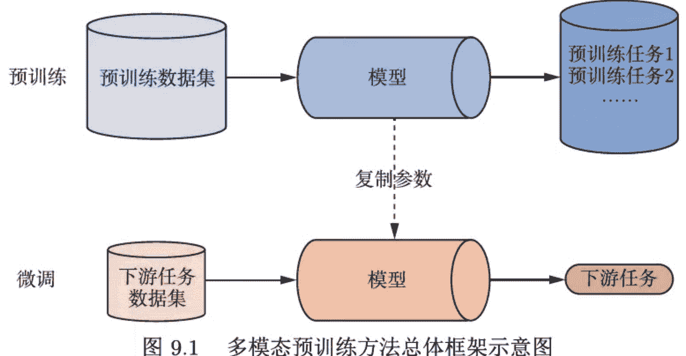

微调阶段针对具体下游任务，在预训练模型基础上，依据任务目标对结构做微小改动或保持不变，直接微调全部权重。下面分别阐述框架涉及的预训练数据、模型结构、预训练任务与下游任务。

### 9.2 预训练数据集

预训练数据必须规模大且容易获取，互联网上大量图文共现内容正好满足需求。常用图文预训练集如下：

- **Conceptual Captions (CC)**$^{[162]}$：约 330 万图句配对，常称 CC3M。句子来自网页图片说明 alt-text 经规则清洗，噪声较小，可用于预训练也可用于图像描述评测。
- **Conceptual 12M (CC12M)**$^{[163]}$：约 1200 万图句配对。相比 CC 覆盖更广的视觉概念，但噪声更多，适合仅做预训练。
- **SBU Captions**$^{[164]}$：超 100 万图句配对，采集方式与 CC 類似。
- **YFCC100M**$^{[165]}$：来自 Flickr 的约 9920 万图像及用户文本。OpenAI 筛选出英文描述子集，形成约 14829396 幅图像的 YFCC100M Subset。
- **LAION-400M**$^{[166]}$：经清洗的约 4 亿图文对。清洗包括剔除文本少于 5 字符、图像小于 5KB 的样本；用布隆过滤器对 URL 与文本去重；剔除 CLIP 计算的图文相似度小于 0.3 的样本；利用 CLIP 特征过滤非法内容如 NSFW。
- **LAION-5B**：超 50 亿图文对，按语言切分为三个子集：约 23 亿英文对的 laion2B-en、约 22 亿其他语言的 laion2B-multi、约 10 亿语言不明的 laion1B-nolang。

第 2 章介绍过的其它整理好的图文多模态数据集也可作为预训练来源。

### 9.3 模型结构

多模态预训练模型大致可分为编码器类与编解码框架类。编码器类在预训练阶段学习通用多模态表征，下游再接入任务专用模块微调；编解码框架类在预训练时就统一各任务的输入输出形式，用单一模型预训练，下游直接微调无需新增模块。

#### 9.3.1 基于编码器的模型

第 5 章提到多模态表征可分为融合式共享表征与对齐式对应表征。编码器类预训练同样分为两支：基于融合编码器的模型学习图文共享表征，基于双编码器的模型学习图文对应表征。

##### 1. 基于融合编码器的模型

按融合时机可分为早期融合的单流与中期融合的双流。

1）单流模型

如图 9.2 所示，单流模型在最开始就把图像与文本拼接输入，直接用单模态编码器当作融合编码器建模，得到图文融合表征。单模态主干多采用标准 Transformer。

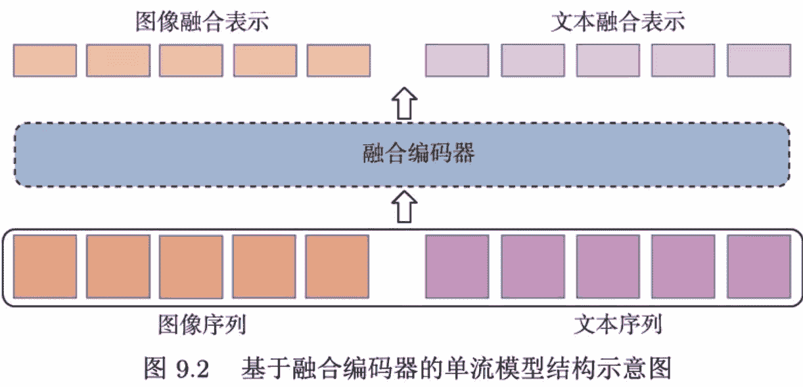

2）双流模型

如图 9.3 所示，双流模型先用两个单模态编码器分别处理图像与文本，再用多模态融合模块对两者编码结果建模得到融合表征。单模态主干常用标准 Transformer，融合模块最常见的是交叉 Transformer。

##### 2. 基于双编码器的模型

如图 9.4 所示，双编码器模型用两个独立编码器分别学习图像和文本的对应表征，并在对应空间加入图文相似性约束来建立关联。

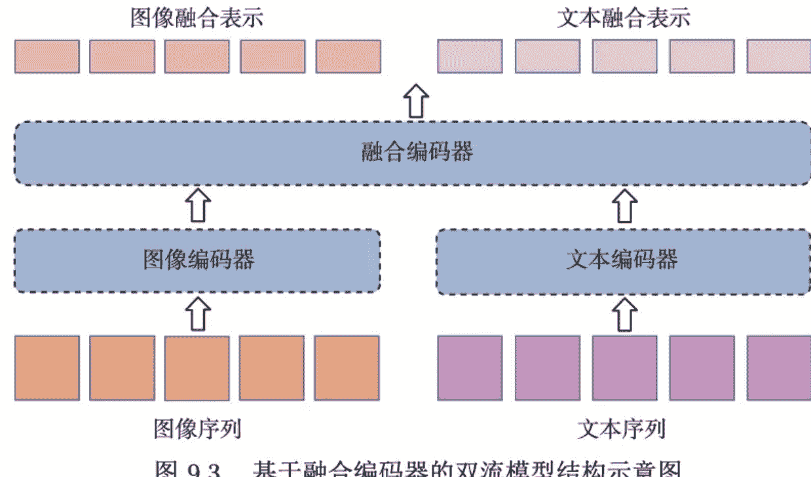

图 9.3 基于融合编码器的双流模型结构示意图

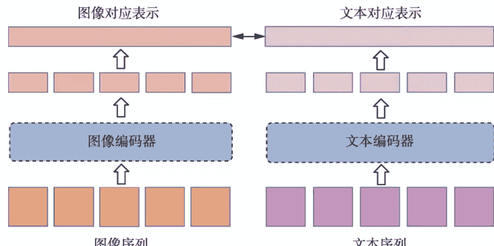

图 9.4 基于双编码器的模型结构示意图

#### 9.3.2 基于编解码框架的模型

如图 9.5 所示，这类模型把图像序列与文本序列拼接成统一输入序列，并把多任务输出映射到共享词表离散序列，最终用编解码模型学习输入输出关联。重点不在学习通用表征，而是把不同任务统一格式，以一模型多任务建模。最常用结构即 8.1.3 节介绍的 Transformer 编解码器。

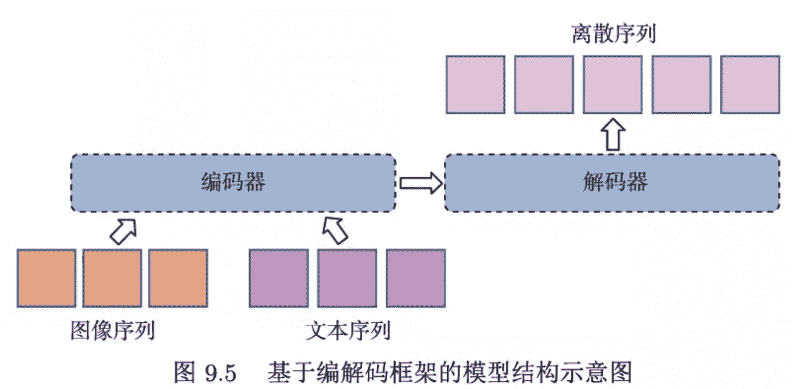

### 9.4 预训练任务

#### 9.4.1 掩码语言模型

3.3 节提到掩码语言模型 Masked Language Modeling 是 BERT 的预训练任务之一。以一定概率随机遮挡文本中部分词并以 [MASK] 代替，要求模型利用上下文预测被遮挡词。在图文多模态预训练中，预测不仅依赖文本上下文，还依赖配对图像提供的信息。

#### 9.4.2 掩码视觉模型

多模态预训练全景：从遮挡建模到典型架构

受掩码语言模型思路启发，掩码视觉建模 Masked Vision Modeling 会以一定概率随机遮挡图像局部，惯用做法是把该区域的视觉特征置零，让模型依据可见信息推断被遮住部分。按预测目标的不同，可拆成两类具体预训练目标。

掩码区域分类 Masked Region Classification，MRC：在图文联合语境下预测被遮挡区域的类别。通常在该区域的输出表征后接线性映射加 softmax 的分类头，输出类别分布。实际使用中被遮挡区域的真实类别不可得，因此 MRC 多与目标检测产生的区域表征配合。监督信号来自检测器，可用硬标签或软分布两种形式。硬标签下优化为分类交叉熵；软分布下优化为让预训练模型与检测器输出的类别分布接近，以 KL 散度衡量，该变体常称 MRC-KL。

掩码区域特征回归 Masked Region Feature Regression，MRFR：在图文条件下回推出被替换区域原本的视觉特征。对应输出后接线性或非线性全连接层，预测该区域原始特征向量，目标是最小化预测特征与真实特征的 L2 距离。约束较弱，可在任意使用局部图像表征的体系中应用。

#### 9.4.3 图像-文本匹配判定

图像文本匹配 Image Text Matching，ITM 的任务是给定预先构造的图文字对，判断文本是否准确描述图片。MLM 与 MVM 聚焦图文局部对齐，ITM 更强调整体一致。实现上先得到图文融合后的多模态表征，再在其上加二分类器做匹配判定。单流融合编码器里通常引入 <CLS> 标记，其高层输出视为整体表征。双流融合编码器里图端和文端各有 <CLS>，可将两者输出拼接作为多模态表征，也可像单流一样只保留一个 <CLS>。

#### 9.4.4 跨模态对比学习

跨模态对比学习 Cross-Modal Contrastive Learning，CMCL 的目标是学习图像与文本的表征，使正样本图文字对的相似度高于负样本对。实现思路采用第 5.2 节所述的排序损失方法，拉近匹配对、推远不匹配对。

### 9.5 下游评测任务

多模态预训练模型本身难以直接评估，通常借助下游任务检验效果。除第 2 章介绍的任务外，常见的图文任务还有以下 3 种。

#### 9.5.1 视觉常识推理

给定包含众多目标区域的图片，视觉常识推理 Visual Commonsense Reasoning，VCR 要求完成两步选择题：先依据问题选出答案，再解释为何选该答案。常用数据集 VCR v1.0 包含 11 万张电影截图和 29 万道选择题，每题配一个正确答案与理由。

#### 9.5.2 视觉语言推理

给定两张图片和一段文本描述，视觉语言推理 Natural Language for Visual Reasoning，NLVR 任务要求判断描述是否准确概括了这两张图的内容。形式上与视觉问答的 yes/no 类问题相似，区别在于视觉输入为图对。现用版本 NLVR2 包含 10.7 万组图对与文本描述。

#### 9.5.3 视觉蕴含

给定一张图片和一句文本，视觉蕴含 Visual Entailment，VE 任务要求判断由图片作为前提推断句子是蕴含、中立还是矛盾。形式上等同于三选一的视觉问答，输入为图文，输出为三个选项的得分。常用数据集 SNLI-VE 共有 3.17 万条样本，训练、验证、测试集分别为 2.97 万、1000、1000。

### 9.6 代表性架构

#### 9.6.1 基于融合编码器的双流模型：LXMERT

LXMERT Learning Cross-Modality Encoder Representations from Transformers 是典型的双流融合编码器模型，框架如图 9.6。按输入、结构、预训练目标、预训练数据、下游任务顺序介绍。

图像端输入为目标检测得到的区域序列。每个区域表征由视觉特征与位置编码融合，设第 i 个区域视觉表征为 v_i，位置表征为 p_i，则区域表征 x_i^I 计算为

$$\hat{\boldsymbol{v}}_{i}=\mathrm{LN}\left(\boldsymbol{W}_{v} \boldsymbol{v}_{i}+b_{v}\right)$$

$$\hat{\boldsymbol{p}}_{i}=\mathrm{LN}\left(\boldsymbol{W}_{p} \boldsymbol{p}_{i}+b_{p}\right)$$

$$\boldsymbol{x}_{i}^{I}=\frac{\hat{\boldsymbol{v}}_{i}+\hat{\boldsymbol{p}}_{i}}{2}$$

(9.6.1)

其中 LN 为层归一化，W_v、b_v 与 W_p、b_p 分别是视觉与位置的线性变换参数。两者映射到同一维后再求平均。

文本端输入为 <CLS> 与词元序列拼接。词元表征为词嵌入与位置编码之和，设第 j 个词元为 w_j，则表征 x_j^T 为

$$\hat{\boldsymbol{w}}_{j}=\operatorname{WordEmbed}\left(w_{j}\right)$$

$$\hat{\boldsymbol{u}}_{j}=\operatorname{IdxEmbed}(j)$$

$$\boldsymbol{x}_{j}^{T}=\mathrm{LN}\left(\hat{\boldsymbol{w}}_{j}+\hat{\boldsymbol{u}}_{j}\right)$$

(9.6.2)

WordEmbed 获取词元与 <CLS> 的词嵌入，IdxEmbed 获取位置编码，两者同维后求和并做层归一化。

结构上，LXMERT 先用两组 Transformer 编码器，分别含 N_I 与 N_T 层，独立建模区域间和词元间关联；再用 N_x 个交叉 Transformer 编码器实现图文融合。预训练目标共 5 个：掩码语言模型、掩码区域分类、掩码区域特征回归、图像文本匹配、视觉问答。前 4 个已在前文介绍，ITM 采用文本侧 <CLS> 的高层表征后接二分类器。视觉问答仅在图文匹配时触发，利用同一 <CLS> 表征后接多分类器预测答案。

预训练数据使用 MS COCO、VG、VQA v2、平衡版 GQA 与 VG-QA，共约 18 万张不同图片、918 万图文字对，已剔除与下游测试重叠样本。

下游实验覆盖视觉问答与视觉语言推理。视觉问答使用 VQA v2 与 GQA，视觉语言推理使用 NLVR2。对 VQA 可直接微调；NLVR2 输入为两图加一段文本，微调时先分别送入模型得到各自的 <CLS> 高层表征，将两者拼接后接二分类器完成判定。

#### 9.6.2 基于融合编码器的单流模型：ViLT

ViLT Vision-and-Language Transformer without Convolution or Region Supervision 是典型单流融合模型，框架如图 9.7。

图像端输入为 [CLS-I] 与图像块序列。块表征由视觉特征、位置编码与模态类型编码相加，设模态编码为 m^I，则第 i 块表征 x_i^I 为
\hat{v}_i = W_v v_i
\hat{p}_i = W_p p_i
x_i^I = \hat{v}_i + \hat{p}_i + m^I
(9.6.3)

文本端输入为 [CLS-T] 与词元序列。表征为词嵌入、位置编码与模态类型编码之和，设模态编码为 m^T，则
\hat{w}_j = WordEmbed(w_j)
\hat{u}_j = IdxEmbed(j)
x_j^T = \hat{w}_j + \hat{u}_j + m^T
(9.6.4)

图文序列拼接后直接用 Transformer 编码。预训练目标为图像文本匹配与掩码语言模型。ITM 基于文本侧 [CLS-T] 高层表征接二分类器。为加强局部对齐，还引入词块对齐 Word Patch Alignment，WPA，通过枚举文本子集与图像子集，用 IPOT 算法近似计算最优传输距离作为匹配分数。掩码语言模型采用子词掩码与整词掩码，整词掩码将一个词的所有子词同时掩掉，避免仅靠上下文猜词。

预训练数据为 MS COCO、VG、CC、SBU Captions，约 400 万张图、1000 万条文本。下游客验证视觉问答 VQA v2、自然语言视觉推理 NLVR2、图文跨模态检索 MS COCO 与 Flickr30k。

#### 9.6.3 基于双编码器的模型：CLIP

CLIP Learning Transferable Visual Models from Natural Language Supervision 由 OpenAI 于 2021 年提出，采用双编码器架构，意图借助超大规模图文字对中的文本监督学习鲁棒图像表征，并在零样本图像识别上接近监督模型。

如图 9.8，图像与文本分别由独立的 Transformer 或 CNN 编码器提取单模态整体表征，训练使用跨模态对比学习，具体为多模态 n-pair 排序损失。伪代码实现如下：

```
# 引自 CLIP 原论文
# 提取图像和文本的整体表示
I_f = image_encoder(img)  # [n, d_i]
T_f = text_encoder(text)  # [n, d_t]

# 利用线性变换，统一图文表示的维度，并对表示长度进行归一化 [n, d_e]
I_e = l2_normalize(np.dot(I_f, W_i), axis=1)
T_e = l2_normalize(np.dot(T_f, W_t), axis=1)

# 计算所有图文对的余弦距离 [n, n]
logits = np.dot(I_e, T_e.T) * np.exp(t)

# 计算损失
labels = np.arange(n)
loss_i = cross_entropy_loss(logits, labels, axis=0)
loss_t = cross_entropy_loss(logits, labels, axis=1)
loss = (loss_i + loss_t)/2
```

预训练集为团队从互联网收集的 4 亿图文字对，经规则清洗后使用，尚未公开。大规模数据是其成功的关键。

下游主要面向图像识别，在超过 30 个数据集上评测，涵盖光学字符识别、视频动作识别、地理位置识别等细粒度分类。原文未展示多模态任务表现，但该表征已广泛用于图文检索、图像描述、文本引导编辑与文本生成图像等。

#### 9.6.4 基于编解码框架的模型：OFA

OFA One For All 由阿里达摩院于 2022 年提出，采用编解码框架，把多种多模态与单模态任务统一为序列到序列生成，避免任务特定模块。

预训练包含 5 个多模态任务、2 个图像任务与 1 个文本任务。多模态任务：指称表达理解、图像区域描述、图像文本匹配、图像描述、视觉问答。图像任务：目标检测、图像补全。文本任务：掩码语言模型。其中图像区域描述要求为指定区域生成自然语言描述；图像补全随机遮挡局部区域要求重建像素值，与掩码视觉建模不同，后者重建类别或特征。

输入统一化方面，图像端使用基于 ResNet 的网格表征，加上网格位置与模态类型编码。图像补全时先将中间区域像素置零再送入 ResNet。文本端使用离散指令，共享词表。不同任务构造不同指令，如指称表达理解为 which region does the text “{Text}” describe?，图像区域描述为 what does the region describe? region:x0 y0 x1 y1，坐标经离散化。每个词元表征仍为嵌入、位置、模态类型之和。

输出为单一离散序列，共享词表。8 个任务的输出形式有文本、区域坐标、图像像素三种。文本直接离散，坐标离散化方式与输入一致，像素离散表征使用 VQGAN 量化得到。

结构上采用标准 Transformer 编解码器，提供 5 个不同规模的预训练模型，差异在于 ResNet 与 Transformer 的具体规模。

OFA 预训练资源与下游任务全景

OFA 的预训练在多个公开语料上展开，各任务对应数据源见表 9.1。下面针对本书此前未展开的几个集合做简要补充。

VG-Cap 源自 Visual Genome，服务于图像密集描述。OpenImages 规模约为 900 万张图，标注涵盖图像类别、目标检测框与分割掩码。Objects365 为目标检测而建，包含约 200 万张图和 3000 万条检测框标注。ImageNet-21K 是 ImageNet 的完整版，涉及 21000 多个类别、1400 多万张图像。Pile 是面向大规模语言模型的大型纯文本库，原体量 825GB，OFA 实际采用经过筛选的约 140GB 子集。

表 9.1 OFA 预训练任务所使用的数据集信息

| 预训练任务 | 数据集 | 图像数 |
| :--- | :--- | :--- |
| 指称表达理解 | RefCOCO, RefCOCO+, RefCOCOg, VG-Cap | 131K |
| 图像区域描述 | RefCOCO, RefCOCO+, RefCOCOg, VG-Cap | 131K |
| 图像文本匹配 | CC12M, CC3M, SBU, MS COCO, VG-Cap | 14.78M |
| 图像描述 | CC12M, CC3M, SBU, MS COCO, VG-Cap | 14.78M |
| 视觉问答 | VQAv2, VG-QA, GQA | 178K |
| 目标检测 | OpenImages, Objects365, VG, MS COCO | 2.98M |
| 图像补全 | OpenImages, YFCC100M, ImageNet-21K | 36.27M |
| 掩码语言模型 | Pile(Filter) | - |

下游方面，OFA 支持 5 个多模态任务、1 个图像任务和 3 个文本任务。多模态包括图像描述、视觉问答、视觉蕴含、指称表达理解、文本生成图像；图像任务为目标检测；文本任务为文本摘要、文本分类、文本生成。其中文本分类可细分为单句分类、双句分类与摘要。

图像描述、视觉问答、指称表达理解在预训练阶段已出现，下游沿用预训练时的文本指令。另两项多模态任务的指令单独给出，视觉蕴含使用 Can image and text1 “{Text1}” imply text2 “{Text2}”？，文本生成图像使用 What is the complete image? caption: {Caption}。

### 9.7 小结

图文多模态预训练是当前人工智能研究的前沿热点。本章先呈现图文多模态预训练的整体框架，再分别拆解其中的预训练数据、模型结构、预训练任务与下游任务，最后介绍 4 个结构各异的典型模型。多模态预训练正处于快速发展期，未来将持续推动人工智能的进步。

### 9.8 习题

- 1. 概括多模态预训练模型的基本思路，并说明它相较于传统多模态方法的优势所在。
- 2. 选择一篇多模态预训练论文，梳理其使用的预训练数据、模型架构、预训练目标和下游评测任务。
- 3. 比较融合编码器、双编码器和编解码器三种框架的优缺点，并指出各自更适合的应用场景。
- 4. 说明 ViLT 在视觉问答、自然语言视觉推理以及图文跨模态检索三个下游任务上的具体做法。
- 5. 描述 OFA 在微调文本生成图像任务时采用的损失函数，以及输入端图像序列的处理方式。
- 6. 你认为当前多模态预训练模型还存在哪些问题，请尝试分析说明。

参考文献

- [1] RASIWASIA N, COSTA PEREIRA J, COVIELLO E, et al. A new approach to cross-modal multimedia retrieval[C]//MM'10: Proceedings of the 18th ACM International Conference on Multimedia. New York, NY, USA: Association for Computing Machinery, 2010: 251-260.
- [2] FARHADI A, HEJRATI M, SADEGHI M A, et al. Every picture tells a story: Generating sentences from images[C]//Computer Vision–ECCV 2010. Cham: Springer International Publishing, 2010: 15-29.
- [3] FENG F, WANG X, LI R. Cross-modal retrieval with correspondence autoencoder[C]//MM'14: Proceedings of the 22nd ACM International Conference on Multimedia. New York, NY, USA: Association for Computing Machinery, 2014: 7-16.
- [4] CHUA T S, TANG J, HONG R, et al. NUS-WIDE: A real-world web image database from national university of singapore[C]//CIVR'09: Proceedings of the ACM International Conference on Image and Video Retrieval. New York, NY, USA: Association for Computing Machinery, 2009: 1-9.
- [5] MICAH H, PETER Y, JULIA H. Framing image description as a ranking task: data, models and evaluation metrics[C]//IJCAI'15: Proceedings of the Twenty-Fourth International Joint Conference on Artificial Intelligence (IJCAI 2015). Buenos Aires, Argentina: AAAI Press, 2015: 4188-4192.
- [6] PETER Y, ALICE L, MICAH H, et al. From image descriptions to visual denotations: New similarity metrics for semantic inference over event descriptions[J]. Transactions of the Association for Computational Linguistics, 2014: 67-78.
- [7] LIN T Y, MAIRE M, BELONGIE S, et al. Microsoft COCO: Common objects in context[C]// Computer Vision – ECCV 2014. Cham: Springer International Publishing, 2014: 740-755.
- [8] WU J, ZHENG H, ZHAO B, et al. AI challenger : A large-scale dataset for going deeper in image understanding[EB/OL]. 2017. https://arxiv.org/abs/1711.06475.
- [9] PAPINENI K, ROUKOS S, WARD T, et al. BLEU: A method for automatic evaluation of machine translation[C]//ACL'02: Proceedings of the 40th annual meeting on association for computational linguistics. USA: Association for Computational Linguistics, 2002: 311-318.
- [10] BANERJEE S, LAVIE A. METEOR: An automatic metric for MT evaluation with improved correlation with human judgments[C]//Proceedings of the ACL Workshop on Intrinsic and Extrinsic Evaluation Measures for Machine Translation and/or Summarization. ANN Arbor, Michigan: Association for Computational Linguistics, 2005: 65-72.
- [11] LIN C Y. ROUGE: A package for automatic evaluation of summaries[C]//Text Summarization Branches Out. Barcelona, Spain: Association for Computational Linguistics, 2004: 74-81.
- [12] VEDANTAM R, ZITNICK C L, PARIKH D. Cider: Consensus-based image description evaluation[C]//2015 IEEE Conference on Computer Vision and Pattern Recognition (CVPR). Los Alamitos, CA, USA: IEEE Computer Society, 2015: 4566-4575.
- [13] ANDERSON P, FERNANDO B, JOHNSON M, et al. Spice: Semantic propositional image caption evaluation[C]//Computer Vision–ECCV 2016. Cham: Springer International Publishing, 2016: 382-398.
- [14] XU X, CHEN X, LIU C, et al. Can you fool AI with adversarial examples on a visual turing test?[EB/OL]. 2017. https://arxiv.org/abs/1709.08693.
- [15] ANTOL S, AGRAWAL A, LU J, et al. VQA: Visual Question Answering[C]//2015 IEEE International Conference on Computer Vision (ICCV). Los Alamitos, CA, USA: IEEE Computer Society, 2015: 2425-2433.
- [16] JOHNSON J, HARIHARAN B, VAN DER MAATEN L, et al. CLEVR: A diagnostic dataset for compositional language and elementary visual reasoning[C]//2017 IEEE Conference on Computer Vision and Pattern Recognition (CVPR). Los Alamitos, CA, USA: IEEE Computer Society, 2017: 1988-1997.
- [17] MALINOWSKI M, FRITZ M. A multi-world approach to question answering about real-world scenes based on uncertain input[C]//NIPS'14: Proceedings of the 27th International Conference on Neural Information Processing Systems - Volume 1. Cambridge, MA, USA: MIT Press, 2014: 1682–1690.
- [18] REN M, KIROS R, ZEMEL R S. Exploring models and data for image question answering[C]// NIPS'15: Proceedings of the 28th International Conference on Neural Information Processing Systems - Volume 2. Cambridge, MA, USA: MIT Press, 2015: 2953–2961.
- [19] KRISHNA R, ZHU Y, GROTH O, et al. Visual genome: Connecting language and vision using crowdsourced dense image annotations[J]. International Journal of Computer Vision, 2016, 123: 32–73.
- [20] LU C, KRISHNA R, BERNSTEIN M, et al. Visual relationship detection with language priors[C]//Computer Vision – ECCV 2016. Cham: Springer International Publishing, 2016: 852-869.
- [21] JOHNSON J, KARPATHY A, FEI-FEI L. Densecap: Fully convolutional localization networks for dense captioning[C]//2016 IEEE Conference on Computer Vision and Pattern Recognition (CVPR). Los Alamitos, CA, USA: IEEE Computer Society, 2016: 4565-4574.
- [22] ZHU Y, GROTH O, BERNSTEIN M, et al. Visual7W: Grounded question answering in images[C]//2016 IEEE Conference on Computer Vision and Pattern Recognition (CVPR). Los Alamitos, CA, USA: IEEE Computer Society, 2016: 4995-5004.
- [23] KAFLE K, KANAN C. An analysis of visual question answering algorithms[C]//2017 IEEE International Conference on Computer Vision (ICCV). Los Alamitos, CA, USA: IEEE Computer Society, 2017: 1983-1991.
- [24] ZHANG P, GOYAL Y, SUMMERS-STAY D, et al. Yin and Yang: Balancing and answering binary visual questions[C]//2016 IEEE Conference on Computer Vision and Pattern Recognition (CVPR). Los Alamitos, CA, USA: IEEE Computer Society, 2016: 5014-5022.
- [25] AGRAWAL A, BATRA D, PARIKH D, et al. Don't just assume; look and answer: Overcoming priors for visual question answering[C]//2018 IEEE/CVF Conference on Computer Vision and Pattern Recognition (CVPR). Los Alamitos, CA, USA: IEEE Computer Society, 2018: 4971-4980.
- [26] HUDSON D A, MANNING C D. GQA: A new dataset for real-world visual reasoning and compositional question answering[C]//2019 IEEE/CVF Conference on Computer Vision and Pattern Recognition (CVPR). Los Alamitos, CA, USA: IEEE Computer Society, 2019: 6693-6702.
- [27] WAH C, BRANSON S, WELINDER P, et al. The caltech-ucsd birds-200-2011 dataset: CNS-TR-2011-001[R]. Pasadena, CA: California Institute of Technology, 2011.

核心文献一览

下面把原始清单里的每一项都用通俗表述重新梳理一遍，作者、年份、论文题目、收录刊物或会议、出版地、出版社与页码等关键信息全部保留。

[28] Nilsback M E、Zisserman A 的论文《Automated flower classification over a large number of classes》，作为会议论文收录于 Indian Conference on Computer Vision, Graphics & Image Processing 会议论文集，由 IEEE Computer Society 在美国加州洛杉矶出版，2008 年，页码 722-729。

[29] Salimans T、Goodfellow I、Zaremba W 等人撰写的《Improved techniques for training GANs》，发表在 Advances in Neural Information Processing Systems 第 29 卷，Curran Associates, Inc. 出版，出版地美国纽约 Red Hook，2016 年，第 2234-2242 页。

[30] Heusel M、Ramsauer H、Unterthiner T 等人提出的《GANs trained by a two time-scale update rule converge to a local nash equilibrium》，收入 Advances in Neural Information Processing Systems 第 30 卷，Curran Associates Inc. 出版，Red Hook, NY, USA，2017 年，页码 6629-6640。

[31] Deng J、Dong W、Socher R 等人发表的《Imagenet: A large-scale hierarchical image database》，收录于 2009 IEEE Conference on Computer Vision and Pattern Recognition，IEEE Computer Society 出版，美国加州洛杉矶，2009 年，页码 248-255。

[32] Szegedy C、VanHoucke V、Ioffe S 等人的《Rethinking the inception architecture for computer vision》，发表于 2016 IEEE Conference on Computer Vision and Pattern Recognition，IEEE Computer Society 出版，洛杉矶 CA USA，2016 年，页码 2818-2826。

[33] Zhang H、Koh J Y、Baldridge J 等人的研究《Cross-modal contrastive learning for text-to-image generation》，发表在 2021 IEEE/CVF Conference on Computer Vision and Pattern Recognition，IEEE Computer Society 出版，洛杉矶，2021 年，页码 833-842。

[34] Frolov S、Hinz T、Raue F 等人撰写的综述《Adversarial text-to-image synthesis: A review》，刊登于期刊 Neural Networks，第 144 卷，2021 年，页码 187-209。

[35] Liang J、Pei W、Lu F 的《CPGAN: Full-spectrum content-parsing generative adversarial networks for text-to-image synthesis》，收录于 Computer Vision-ECCV 2020，由 Springer International Publishing 出版，瑞士 Cham，2020 年，页码 491-508。

[36] Xu T、Zhang P、Huang Q 等人提出的《AttnGAN: Fine-grained text to image generation with attentional generative adversarial networks》，发表于 2018 IEEE/CVF Conference on Computer Vision and Pattern Recognition，IEEE Computer Society 出版，洛杉矶，2018 年，页码 1316-1324。

[37] Hinz T、Heinrich S、Wermter S 的论文《Semantic object accuracy for generative text-to-image synthesis》，刊于 IEEE Transactions on Pattern Analysis and Machine Intelligence，第 44 卷第 3 期，2022 年，页码 1552-1565。

[38] Redmon J、Farhadi A 在 2018 年发布的预印本《YOLOv3: An incremental improvement》，类型为电子文献，在线可查，链接 https://arxiv.org/abs/1804.02767。

[39] Dale R、Reiter E 的《Computational interpretations of the gricean maxims in the generation of referring expressions》，发表于期刊 COGNITIVE SCIENCE，第 18 卷，1995 年，页码 233-263。

[40] Yu L、Poirson P、Yang S 等人的《Modeling context in referring expressions》，收录于 Computer Vision-ECCV 2016，由 Springer International Publishing 出版，Cham，2016 年，页码 69-85。

[41] Mao J、Huang J、Toshev A 等人发表的《Generation and comprehension of unambiguous object descriptions》，发表于 2016 IEEE Conference on Computer Vision and Pattern Recognition，IEEE Computer Society 出版，洛杉矶，2016 年，页码 11-20。

[42] Kazemzadeh S、Ordonez V、Matten M 等人提出的《ReferItGame: Referring to objects in photographs of natural scenes》，发表于 Proceedings of the 2014 Conference on Empirical Methods in Natural Language Processing，ACL 出版，卡塔尔多哈，2014 年，页码 787-798。

[43] Firth J R 所著专著《Papers in Linguistics》，出版机构 Oxford University Press，出版地伦敦，1957 年。

[44] Mikolov T、Chen K、Corrado G 等人于 2013 年发布的电子文献《Efficient estimation of word representations in vector space》，在线地址 https://arxiv.org/abs/1301.3781。

[45] Mikolov T、Sutskever I、Chen K 等人撰写的《Distributed representations of words and phrases and their compositionality》，收录于 Advances in neural information processing systems 第 2 卷，Curran Associates, Inc. 出版，Red Hook, NY, USA，2013 年，页码 3111-3119。

[46] Kiela D、Bottou L 的《Learning image embeddings using convolutional neural networks for improved multi-modal semantics》，发表于 Proceedings of the 2014 Conference on Empirical Methods in Natural Language Processing，Association for Computational Linguistics 出版，多哈，2014 年，页码 36-45。

[47] Lazaridou A、Pham N T、Baroni M 的《Combining language and vision with a multimodal skip-gram model》，收录于 Proceedings of the 2015 Conference of the North American Chapter of the Association for Computational Linguistics: Human Language Technologies，Association for Computational Linguistics 出版，美国科罗拉多丹佛，2015 年，页码 153-163。

[48] Qiao T、Zhang J、Xu D 等人提出的《Mirrorgan: Learning text-to-image generation by redescription》，发表于 2019 IEEE/CVF Conference on Computer Vision and Pattern Recognition，IEEE Computer Society 出版，洛杉矶，2019 年，页码 1505-1514。

[49] Zhu M、Pan P、Chen W 等人发表的《DM-GAN: Dynamic memory generative adversarial networks for text-to-image synthesis》，刊于 2019 IEEE/CVF Conference on Computer Vision and Pattern Recognition，IEEE Computer Society 出版，洛杉矶，2019 年，页码 5795-5803。

[50] Vinyals O、Toshev A、Bengio S 等人撰写的《Show and tell: A neural image caption generator》，发表于 2015 IEEE Conference on Computer Vision and Pattern Recognition，IEEE Computer Society 出版，洛杉矶，2015 年，页码 3156-3164。

[51] Mao J、Xu W、Yang Y 等人于 2014 年发布的电子论文《Explain images with multimodal recurrent neural networks》，可在线获取 https://arxiv.org/abs/1410.109。

[52] Ren M、Kiros R、Zemel R S 的《Exploring models and data for image question answering》，收录于 NIPS'15 Proceedings of the 28th International Conference on Neural Information Processing Systems Volume 2，MIT Press 出版，美国马萨诸塞州剑桥，2015 年，页码 2953-2961。

[53] Devlin J、Chang M W、Lee K 等人发表的《BERT: Pre-training of deep bidirectional transformers for language understanding》，发表于 Proceedings of the 2019 Conference of the North American Chapter of the Association for Computational Linguistics: Human Language Technologies Volume 1，Association for Computational Linguistics 出版，美国明尼苏达明尼阿波利斯，2019 年，页码 4171-4186。

[54] Pennington J、Socher R、Manning C 的《Glove: Global vectors for word representation》，发表于 Proceedings of the 2014 conference on empirical methods in natural language processing，Association for Computational Linguistics 出版，多哈，2014 年，页码 1532-1543。

[55] Bojanowski P、Grave E、Joulin A 等人撰写的《Enriching word vectors with subword information》，刊于 Transactions of the Association for Computational Linguistics，第 5 卷，2017 年，页码 135-146。

[56] Hochreiter S、Schmidhuber J 的经典论文《Long short-term memory》，发表于 Neural computation，第 9 卷第 8 期，1997 年，页码 1735-1780。

[57] Cho K、Van Merriënboer B、Bahdanau D 等人发表的《On the properties of neural machine translation: Encoder–decoder approaches》，收录于 Proceedings of SSST-8 Eighth Workshop on Syntax, Semantics and Structure in Statistical Translation，Association for Computational Linguistics 出版，多哈，2014 年，页码 103-111。

[58] Vaswani A、Shazeer N、Parmar N 等人提出的《Attention is all you need》，发表于 Advances in Neural Information Processing Systems 第 30 卷，Curran Associates, Inc. 出版，Red Hook, NY, USA，2017 年，页码 6000-6010。

[59] Bahdanau D、Cho K、Bengio Y 于 2014 年发布的电子文献《Neural machine translation by jointly learning to align and translate》，在线链接 https://arxiv.org/abs/1409.0473。

[60] Krizhevsky A、Sutskever I、Hinton G E 的《Imagenet classification with deep convolutional neural networks》，收录于 Advances in neural information processing systems 第 25 卷，Curran Associates, Inc. 出版，Red Hook, NY, USA，2012 年，页码 1097-1105。

[61] Wei Y、Zhao Y、Canyi L 等人撰写的《Cross-modal retrieval with CNN visual features: A new baseline》，发表于 IEEE Transactions on Cybernetics，第 47 卷，2016 年，页码 1-12。

[62] Malinowski M、Rohrbach M、Fritz M 的《Ask your neurons: A neural-based approach to answering questions about images》，发表于 2015 IEEE International Conference on Computer Vision，IEEE Computer Society 出版，洛杉矶，2015 年，页码 1-9。

[63] Nam H、Ha J W、Kim J 提出的《Dual attention networks for multimodal reasoning and matching》，发表于 2017 IEEE Conference on Computer Vision and Pattern Recognition，IEEE Computer Society 出版，洛杉矶，2017 年，页码 2156-2164。

视觉-语言与生成模型核心文献盘点

一、图文生成与视觉语言交互里程碑
64. 2015 年 XU K、BA J、KIROS R 等发表的《Show, attend and tell: Neural image caption generation with visual attention》收进由 BACH F、BLEI D 主编的《Proceedings of Machine Learning Research》第 37 卷，即第 32 届国际机器学习会议论文集，PMLR 于法国里尔出版，页码 2048-2057。
65. LU J、XIONG C、PARIKH D 等 2017 年的工作《Knowing when to look: Adaptive attention via a visual sentinel for image captioning》被 IEEE Computer Society 纳入 2017 IEEE Conference on Computer Vision and Pattern Recognition 会议集，美国洛斯阿拉米托斯出版，页码 3242-3250。
66. ANDERSON P、HE X、BUEHLER C 等 2018 年的研究《Bottom-up and top-down attention for image captioning and visual question answering》登载于 IEEE Computer Society 发行的 2018 IEEE/CVF Conference on Computer Vision and Pattern Recognition 论文集，美国洛斯阿拉米托斯，第 6077-6086 页。
67. LEE K、CHEN X、HUA G 等撰写的《Stacked cross attention for image-text matching》于 2018 年刊出在 Springer International Publishing 出版的《Computer Vision – ECCV 2018》，瑞士，第 212-228 页。
68. DOSOVITSKIY A、BEYER L、KOLESNIKOV A 等 2021 年成果《An image is worth 16×16 words: Transformers for image recognition at scale》在维也纳举办的 International Conference on Learning Representations 上发布，由 OpenReview.net 发行。
69. WANG W、BAO H、DONG L 等 2022 年论文《VLMo: Unified vision-language pre-training with mixture-of-modality-experts》被 MIT Press 收录于《NeurIPS’22: Proceedings of the 36th International Conference on Neural Information Processing Systems》，美国剑桥。
70. RADFORD A、KIM J W、HALLACY C 等的研究《Learning transferable visual models from natural language supervision》刊于《Proceedings of Machine Learning Research》第 139 卷。

二、相关拓展文献
71. LI J、SELVARAJU R、GOTMARE A 等的《Align before fuse: Vision and language representation learning with momentum distillation》收于 Curran Associates, Inc. 2021 年出版的《Advances in Neural Information Processing Systems》第 34 卷，美国雷德胡克，第 9694-9705 页。
72. RAMESH A、PAVLOV M、GOH G 等的《Zero-shot text-to-image generation》纳入 PMLR 2021 年发行的《Proceedings of Machine Learning Research》第 139 卷、第 38 届国际机器学习会议论文集，线上会议，第 8821-8831 页。
73. VAN DEN OORD A、VINYALS O、KAVUKCUOGLU K 的《Neural discrete representation learning》见于 Curran Associates Inc. 2017 年出版的《NIPS'17: Proceedings of the 31st International Conference on Neural Information Processing Systems》，美国雷德胡克，第 6309-6318 页。
74. DING M、YANG Z、HONG W 等的《Cogview: Mastering text-to-image generation via transformers》刊载在 Curran Associates, Inc. 2021 年出版的《Advances in Neural Information Processing Systems》第 34 卷，美国雷德胡克，第 19822-19835 页。
75. GU S、CHEN D、BAO J 等关于《Vector quantized diffusion model for text-to-image synthesis》的研究发表于 IEEE Computer Society 2022 年出版的 2022 IEEE/CVF Conference on Computer Vision and Pattern Recognition，美国洛斯阿拉米托斯，第 10686-10696 页。
76. YU J、XU Y、KOH J Y 等 2022 年预印本《Scaling autoregressive models for content-rich text-to-image generation》，EB/OL，https://arxiv.org/abs/2206.10789。
77. CHANG H、ZHANG H、BARBER J 等 2023 年预印本《Muse: Text-to-image generation via masked generative transformers》，EB/OL，https://arxiv.org/abs/2301.00704。
78. ROMBACH R、BLATTMANN A、LORENZ D 等的《High-resolution image synthesis with latent diffusion models》见于 IEEE Computer Society 2022 年出版的 2022 IEEE/CVF Conference on Computer Vision and Pattern Recognition，美国洛斯阿拉米托斯，第 10684-10695 页。
79. LIN M、CHEN Q、YAN S 的《Network in network》于 OpenReview.net 2014 年出版的 International Conference on Learning Representations 发表，加拿大班夫。
80. SIMONYAN K、ZISSERMAN A 的《Very deep convolutional networks for large-scale image recognition》刊载于 OpenReview.net 2015 年出版的 International Conference on Learning Representations，美国圣迭戈。
81. SZEGEDY C、LIU W、JIA Y 等的《Going deeper with convolutions》收录在 IEEE Computer Society 2015 年出版的 2015 IEEE Conference on Computer Vision and Pattern Recognition，美国洛斯阿拉米托斯，第 1-9 页。
82. HE K、ZHANG X、REN S 等的《Deep residual learning for image recognition》登于 IEEE Computer Society 2016 年出版的 2015 IEEE Conference on Computer Vision and Pattern Recognition，美国洛斯阿拉米托斯，第 770-778 页。
83. GIRSHICK R、DONAHUE J、DARRELL T 等的《Rich feature hierarchies for accurate object detection and semantic segmentation》发表于 IEEE Computer Society 2014 年出版的 2014 IEEE Conference on Computer Vision and Pattern Recognition，美国洛斯阿拉米托斯，第 580-587 页。
84. GIRSHICK R 的《Fast R-CNN》见于 IEEE Computer Society 2015 年出版的 2015 IEEE Conference on Computer Vision and Pattern Recognition，美国洛斯阿拉米托斯，第 1440-1448 页。
85. REN S、HE K、GIRSHICK R 等的《Faster r-cnn: Towards real-time object detection with region proposal networks》收录在 Curran Associates, Inc. 2015 年出版的《Advances in neural information processing systems》第 1 卷，美国雷德胡克，第 91-99 页。
86. REDMON J、FARHADI A 的《YOLO9000: better, faster, stronger》刊载于 IEEE Computer Society 2017 年出版的 2017 IEEE Conference on Computer Vision and Pattern Recognition，美国洛斯阿拉米托斯，第 6517-6525 页。
87. REDMON J、DIVVALA S、GIRSHICK R 等的《You only look once: Unified, real-time object detection》发表于 IEEE Computer Society 2016 年出版的 2016 IEEE Conference on Computer Vision and Pattern Recognition，美国洛斯阿拉米托斯，第 779-788 页。
88. CORDONNIER J B、LOUKAS A、JAGGI M 的《On the relationship between self-attention and convolutional layers》在 OpenReview.net 2019 年出版的 International Conference on Learning Representations 上线，线上会议。
89. HAN K、XIAO A、WU E 等的《Transformer in transformer》收录于 Curran Associates, Inc. 2021 年出版的《Advances in Neural Information Processing Systems》第 34 卷，美国雷德胡克，第 15908-15919 页。
90. WU H、XIAO B、CODELLA N 等的《CVT: Introducing convolutions to vision transformers》见于 IEEE Computer Society 2021 年出版的 2021 IEEE/CVF International Conference on Computer Vision，美国洛斯阿拉米托斯，第 22-31 页。
91. LIU Z、LIN Y、CAO Y 等的《Swin transformer: Hierarchical vision transformer using shifted windows》发表于 IEEE Computer Society 2021 年出版的 2021 IEEE/CVF International Conference on Computer Vision，美国洛斯阿拉米托斯，第 9992-10002 页。
92. LIU Z、HU H、LIN Y 等的《Swin transformer v2: Scaling up capacity and resolution》刊载于 IEEE Computer Society 2022 年出版的 2022 IEEE/CVF Conference on Computer Vision and Pattern Recognition，美国洛斯阿拉米托斯，第 11999-12009 页。
93. YUAN K、GUO S、LIU Z 等的《Incorporating convolution designs into visual transformers》收录在 IEEE Computer Society 2021 年出版的 2021 IEEE/CVF International Conference on Computer Vision，美国洛斯阿拉米托斯，第 559-568 页。
94. WANG W、XIE E、LI X 等的《Pyramid vision transformer: A versatile backbone for dense prediction without convolutions》登于 IEEE Computer Society 2021 年出版的 2021 IEEE/CVF International Conference on Computer Vision，美国洛斯阿拉米托斯，第 568-578 页。
95. CHEN X、XIE S、HE K 的《An empirical study of training self-supervised vision transformers》见于 IEEE Computer Society 2021 年出版的 2021 IEEE/CVF International Conference on Computer Vision，美国洛斯阿拉米托斯，第 9620-9629 页。
96. TOUVRON H、CORD M、DOUZE M 等的《Training data-efficient image transformers & distillation through attention》收录于 PMLR 2021 年出版的《Proceedings of Machine Learning Research》第 139 卷、第 38 届国际机器学习会议论文集，线上会议，第 10347-10357 页。
97. GOODFELLOW I J、POUGET-ABADIE J、MIRZA M 等的《Generative adversarial nets》发表于 MIT Press 2014 年出版的《NIPS'14: Proceedings of the 27th International Conference on Neural Information Processing Systems - Volume 2》，美国剑桥，第 2672-2680 页。
98. MIRZA M、OSINDERO S 的《Conditional generative adversarial nets》，EB/OL，2014 年，https://arxiv.org/abs/1411.1784。

# 多模态生成文献速览

以下按主题分层收录了多模态表征、跨模态检索与生成模型的核心论文，便于快速定位研究脉络与方法演进。

核心基石
[99] Zhang R, Isola P, Efros AA 等. 《深度特征作为感知度量的非理性有效性》. IEEE CVPR 2018, 586-595.
[100] Kingma DP, Welling M. 《变分自编码》. ICLR 2014.
[101] Esser P, Rombach R, Ommer B. 《控制 Transformer 实现高分辨率图像合成》. IEEE CVPR 2021, 12868-12878.
[102] Ngiam J, Khosla A, Kim M 等. 《多模态深度学习》. ICML 2011, 689-696.
[103] Srivastava N, Salakhutdinov R. 《基于深度置信网络的多模态数据表征学习》. ICML Representation Learning Workshop 2012.
[104] Srivastava N, Salakhutdinov R. 《基于深度玻尔兹曼机的多模态学习》. NeurIPS 2012, 2231-2239.
[105] Wang W, Ooi BC, Yang X 等. 《基于堆叠自编码器的高效多模态检索》. PVLDB 2014, 7(8): 649-660.
[106] Wang W, Arora R, Livescu K 等. 《深度多视角表征学习研究》. ICML 2015, 1083-1092.
[107] Feng F, Li R, Wang X. 《用于跨模态检索的深度对应受限玻尔兹曼机》. Neurocomputing 2015, 154: 50-60.
[108] Kiros R, Salakhutdinov R, Zemel RS. 《用多模态神经语言模型统一视觉-语义嵌入》. arXiv 2014, https://arxiv.org/abs/1411.2539.

拓展阅读
[109] Gu J, Cai J, Joty SR 等. 《看、想象、匹配：用生成模型提升文本-视觉跨模态检索》. IEEE CVPR 2018, 7181-7189.
[110] Faghri F, Fleet DJ, Kiros JR 等. 《VSE++：借助困难负样本改进视觉语义嵌入》. BMVC 2018, 12.
[111] He L, Xu X, Lu H 等. 《通过对抗学习实现无监督跨模态检索》. IEEE ICME 2017, 1153-1158.
[112] Wang B, Yang Y, Xu X 等. 《对抗式跨模态检索》. ACM MM 2017, 154-162.
[113] Luo H, Ji L, Zhong M 等. 《Clip4Clip：CLIP 在端到端视频片段检索中的实证研究》. Neurocomputing 2022, 508: 293-304.
[114] Mokady R, Hertz A, Bermano AH. 《ClipCap：用于图像描述的 CLIP 前缀》. arXiv 2021, https://arxiv.org/abs/2111.09734.
[115] Patashnik O, Wu Z, Shechtman E 等. 《StyleCLIP：基于文本驱动的 StyleGAN 图像操控》. IEEE ICCV 2021, 2085-2094.
[116] Ramesh A, Dhariwal P, Nichol A 等. 《基于 CLIP 潜在表示的层次化文本条件图像生成》. arXiv 2022, https://arxiv.org/abs/2204.06125.
[117] Freund Y, Haussler D. 《用双层网络对二值向量分布进行无监督学习》. NeurIPS 1991, 912-919.
[118] Rumelhart DE, McClelland JL, PDP Research Group C. 《并行分布式处理：认知微结构的探索 卷1 基础》. MIT Press 1986.
[119] Hinton GE. 《通过最小化对比散度训练专家乘积》. Neural Computation 2002, 14(8): 1771-1800.
[120] Geman S, Geman D. 《随机松弛、吉布斯分布与图像贝叶斯恢复》. IEEE TPAMI 1984, PAMI-6(6): 721-741.
[121] Andrieu C, De Freitas N, Doucet A 等. 《机器学习中 MCMC 的导论》. Machine Learning 2003, 50(1-2): 5-43.
[122] Salakhutdinov R, Murray I. 《深度置信网络的定量分析》. ICML 2008, 872-879.
[123] Krizhevsky A, Hinton G. 《从微小图像学习多层特征》. University of Toronto 技术报告 2009.
[124] Welling M, Rosen-Zvi M, Hinton G. 《指数族和谐模型及其在信息检索中的应用》. NeurIPS 2004, 1481-1488.
[125] Salakhutdinov R, Hinton G. 《复制 Softmax：一种无向主题模型》. NeurIPS 2009, 1607-1614.
[126] Hinton GE, Osindero S, Teh YW. 《深度置信网络的快速学习算法》. Neural Computing & Applications 2006, 18(7): 1527-1554.
[127] Salakhutdinov R, Hinton G. 《深度玻尔兹曼机的高效学习流程》. Neural Computing & Applications 2012, 24(8): 1967-2006.
[128] Hinton GE, Salakhutdinov RR. 《用神经网络降低数据维度》. Science 2006, 313(5786): 504-507.
[129] Hinton GE, Dayan P, Frey BJ 等. 《无监督神经网络的“唤醒-睡眠”算法》. Science 1995.
[130] Salakhutdinov R, Hinton G. 《预训练深度玻尔兹曼机的更好方法》. NeurIPS 2012, 2447-2455.
[131] Salakhutdinov R. 《用自适应 MCMC 学习深度玻尔兹曼机》. ICML 2010, 943-950.
[132] Li R, Jia J. 《带有问题表征更新的视觉问答》. NeurIPS 2016, 4662-4670.
[133] Yang Z, He X, Gao J 等. 《用于图像问答的堆叠注意力网络》. IEEE CVPR 2016, 21-29.
[134] Lu J, Yang J, Batra D 等. 《视觉问答的层次化问-图协同注意》. NeurIPS 2016, 289-297.
[135] Li K, Zhang Y, Li K 等. 《图像文本匹配的视觉语义推理》. IEEE ICCV 2019, 4653-4661.
[136] Liu C, Mao Z, Zhang T 等. 《用于图像文本匹配的图结构网络》. IEEE CVPR 2020, 10918-10927.
[137] Cheng Y, Zhu X, Qian J 等. 《图像文本检索的跨模态图匹配网络》. ACM Transactions on Multimedia Computing, Communications and Applications 2022, 18(4).

# 多模态视觉研究文献速览

以下梳理了近年来推动图神经网络、视觉问答、图像描述、文生图以及大規模图文预训练的关键工作，涵盖模型架构、融合策略与评测资源。

## 图神经网络基础
[138] Kipf T N 与 Welling M 在 2017 年于法国图卢兹召开的 International Conference on Learning Representations 上发表论文《Semi-supervised classification with graph convolutional networks》，由 OpenReview.net 出版，提出基于图卷积的半监督分类方法。
[139] Veličković P、 Cucu rull G、 Casanova A 等人于 2018 年在加拿大温哥华举办的 International Conference on Learning Representations 上报告《Graph attention networks》，由 OpenReview.net 出版，引入图注意力机制。

## 视觉问答融合方法
[140] Fukui A、 Park D H、 Yang D 等人于 2016 年在美国奥斯汀举行的 Empirical Methods in Natural Language Processing 会议上发表《Multimodal compact bilinear pooling for visual question answering and visual grounding》，由 Association for Computational Linguistics 出版，页码 457-468。
[141] Kim J H、 On K W、 Lim W 等人于 2017 年在法国图卢兹的 International Conference on Learning Representations 上提出《Hadamard product for low-rank bilinear pooling》，OpenReview.net 出版。
[142] Yu Z、 Yu J、 Fan J 等人于 2017 年在 IEEE International Conference on Computer Vision 上发表《Multi-modal factorized bilinear pooling with co-attention learning for visual question answering》，由 IEEE Computer Society 于美国加州洛杉矶出版，页码 1839-1848。
[143] Ben-Younes H、 Cadene R、 Cord M 等人于 2017 年同在 ICCV 上发表《Mutan: Multimodal Tucker fusion for visual question answering》，页码 2631-2639。
[144] Yu Z、 Yu J、 Xiang C 等人于 2018 年在 IEEE Transactions on Neural Networks and Learning Systems 第 29 卷第 12 期发表《Beyond bilinear: Generalized multimodal factorized high-order pooling for visual question answering》，页码 5947-5959。
[145] Ben-Younes H、 Cadene R、 Thome N 等人于 2019 年发表于 Proceedings of the AAAI Conference on Artificial Intelligence 第 33 卷的《Block: Bilinear superdiagonal fusion for visual question answering and visual relationship detection》，页码 8102-8109。
[146] Yu Z、 Yu J、 Cui Y 等人于 2019 年在 IEEE/CVF Conference on Computer Vision and Pattern Recognition 上发表《Deep modular co-attention networks for visual question answering》，由 IEEE Computer Society 出版，页码 6281-6290。
[147] Gao P、 Jiang Z、 You H 等人于 2019 年在 CVPR 上提出《Dynamic fusion with intra- and inter-modality attention flow for visual question answering》，由 IEEE Computer Society 于美国加州洛杉矶出版。
未编号 Recognition 出版于 2019 年 CVPR，Los Alamitos, CA, USA: IEEE Computer Society，页码 6639-6648。

## 图像描述与标题生成
[148] Pham N 与 Pagh R 于 2013 年在 KDD'13 暨第 19 届 ACM SIGKDD 国际知识发现与数据挖掘会议上发表《Fast and scalable polynomial kernels via explicit feature maps》，由 Association for Computing Machinery 于美国纽约出版，页码 239-247。
[149] Kiros R、 Zhu Y、 Salakhutdinov R R 等人于 2015 年在 Advances in Neural Information Processing Systems 第 28 卷中发表《Skip-thought vectors》，Curran Associates, Inc. 于美国纽约 Red Hook 出版，页码 3294-3302。
[150] Karpathy A 与 Fei-Fei L 于 2015 年在 IEEE Conference on Computer Vision and Pattern Recognition 上发表《Deep visual-semantic alignments for generating image descriptions》，IEEE Computer Society 出版，页码 3128-3137。
[151] Donahue J、 Hendricks L A、 Guadarrama S 等人于 2015 年在同届 CVPR 上发表《Long-term recurrent convolutional networks for visual recognition and description》，页码 2625-2634。
[152] Herdadé S、 Kappeler A、 Boakye K 等人于 2019 年在 Advances in Neural Information Processing Systems 第 32 卷中发表《Image captioning: Transforming objects into words》，页码 11137-11147。
[153] Guo L、 Liu J、 Zhu X 等人于 2020 年在 CVPR 上发表《Normalized and geometry-aware self-attention network for image captioning》，页码 10324-10333。
[154] Luo Y、 Ji J、 Sun X 等人于 2021 年在 Proceedings of the AAAI Conference on Artificial Intelligence 上发表《Dual-level collaborative transformer for image captioning》，页码 2286-2293。
[155] Liu W、 Chen S、 Guo L 等人于 2021 年发布预印本《CPTR: Full transformer network for image captioning》，网址 https://arxiv.org/abs/2101.10804。

## 文生图与统一模型
[156] Reed S、 Akata Z、 Yan X 等人于 2016 年在 Proceedings of Machine Learning Research 第 48 卷、第 33 届 International Conference on Machine Learning 上发表《Generative adversarial text to image synthesis》，PMLR 于美国纽约出版，页码 1060-1069。
[157] Zhang H、 Xu T、 Li H 等人于 2017 年在 ICCV 上发表《StackGAN: Text to photo-realistic image synthesis with stacked generative adversarial networks》，页码 5908-5916。
[158] 同一作者组于 2018 年在 IEEE Transactions on Pattern Analysis and Machine Intelligence 上发表《StackGAN++: Realistic image synthesis with stacked generative adversarial networks》。
[159] Wang P、 Yang A、 Men R 等人于 2022 年在 Proceedings of Machine Learning Research 第 162 卷、第 39 届 International Conference on Machine Learning 上发表《OFA: Unifying architectures, tasks, and modalities through a simple sequence-to-sequence learning framework》，PMLR 于美国马里兰巴尔的摩出版，页码 23318-23340。
[160] Nichol A Q、 Dhariwal P、 Ramesh A 等人于 2022 年在同刊同会发表《GLIDE: towards photorealistic image generation and editing with text-guided diffusion models》，页码 16784-16804。

## 细粒度视觉描述与大规模图文资源
[161] Reed S E、 Akata Z、 Lee H 等人于 2016 年在 CVPR 上发表《Learning deep representations of fine-grained visual descriptions》，页码 49-58。
[162] Sharma P、 Ding N、 Goodman S 等人于 2018 年在 Proceedings of the 56th Annual Meeting of the Association for Computational Linguistics 上发表《Conceptual captions: A cleaned, hypernymed, image alt-text dataset for automatic image captioning》，Association for Computational Linguistics 于澳大利亚墨尔本出版，页码 2556-2565。
[163] Changpinyo S、 Sharma P、 Ding N 等人于 2021 年在 CVPR 上发表《Conceptual 12M: Pushing web-scale image-text pre-training to recognize long-tail visual concepts》，页码 3557-3567。
[164] Ordonez V、 Kulkarni G、 Berg T 于 2011 年在 Advances in Neural Information Processing Systems 第 24 卷发表《Im2text: Describing images using 1 million captioned photographs》，页码 1143-1151。
[165] Thomee B、 Shamma D A、 Friedland G 等人于 2016 年在 Commun. ACM 第 59 卷第 2 期发表《YFCC 100M: The new data in multimedia research》，页码 64-73。
[166] Schuhmann C、 Vencu R、 Beaumont R 等人于 2021 年发布《Laion-400M: Open dataset of clip-filtered 400 million image-text pairs》，网址 https://arxiv.org/abs/2111.02114。

## 视觉推理与跨模态理解
[167] Zellers R、 Bisk Y、 Farhadi A 等人于 2019 年在 CVPR 上发表《From recognition to cognition: Visual commonsense reasoning》，页码 6720-6731。
[168] Suhr A、 Zhou S、 Zhang A 等人于 2019 年在 Proceedings of the 57th Annual Meeting of the Association for Computational Linguistics 上发表《A corpus for reasoning about natural language grounded in photographs》，Association for Computational Linguistics 于意大利佛罗伦萨出版，页码 6418-6428。
[169] Xie N、 Lai F、 Doran D 等人于 2019 年发布预印本《Visual entailment: A novel task for fine-grained image understanding》，网址 https://arxiv.org/abs/1901.06706。
[170] Tan H 与 Bansal M 于 2019 年在 Proceedings of the 2019 Conference on Empirical Methods in Natural Language Processing and the 9th International Joint Conference on Natural Language Processing 上发表《LXMERT: Learning cross-modality encoder representations from transformers》，Association for Computational Linguistics 于中国香港出版，页码 5100-5111。

[171] KIM W, SON B, KIM I. Vilt: Vision-and-language transformer without convolution or region supervision[C]//Proceedings of Machine Learning Research: volume 139 Proceedings of the 38th International Conference on Machine Learning. Virtual: PMLR, 2021: 5583-5594.

[172] XIE Y, WANG X, WANG R, et al. A fast proximal point method for computing exact wasserstein distance[C]//Proceedings of Machine Learning Research: volume 115 Proceedings of The 35th Uncertainty in Artificial Intelligence Conference. Tel Aviv, Israel: PMLR, 2020: 433-453.

[173] KUZNETSOVA A, ROM H, ALLDRIN N, et al. The open images dataset v4: Unified image classification, object detection, and visual relationship detection at scale[J]. International Journal of Computer Vision, 2020, 128: 1956-1981.

[174] SHAO S, LI Z, ZHANG T, et al. Objects365: A large-scale, high-quality dataset for object detection[C]//2019 IEEE/CVF International Conference on Computer Vision (ICCV). Los Alamitos, CA, USA: IEEE Computer Society, 2019: 8429-8438.

[175] GAO L, BIDERMAN S, BLACK S, et al. The pile: An 800GB dataset of diverse text for language modeling[EB/OL]. 2021. https://arxiv.org/abs/2101.00027.

# 多模态深度学习入门指南

这是一套专为跨模态学习全新编撰的教学用书，架构完整、脉络清晰、紧跟研究动态、表述流畅，为该领域长期缺乏的系统性教材提供了支撑。

整体内容分为四个递进单元：先展开跨模态信息处理的整体认知，再介绍单一模态的深度表征方法，随后深入跨模态基础技术，最后聚焦预训练思路。涉及的核心方向涵盖表征构建、模态对齐、信息融合、模态转换与大规模预训练。

书中配备四个可端到端运行的实操项目，分别落地表征、匹配、融合、转换四个基本能力，通过真实任务把方法与实践结合，帮助读者真正理解并掌握。每套项目都提供可直接执行的 Jupyter Notebook，方便教师在课堂上即时演示。

使用定位灵活，既能充当高校人工智能与相近专业的核心教材或辅助读物，也适合自学者作为系统入门的参考资料。

配套的电子讲义已在清华大学出版社官网开放获取，读者可登录网站下载。

资源下载·扩展阅读

清华大学出版社

书 圈

官 方 微 信 号